# Fedora 和 Red Hat Enterprise Linux 实用指南

> “我发现这本书非常适合作为课堂教材，同时也是一本优秀的 Linux 资源。它采用自底向上的方式教授 Linux，让学生有机会提升技能并深入了解 Linux 世界。当被问及推荐一本扎实的 Linux 参考书时，我经常会推荐这本书。”

> —埃里克·哈特韦尔（Eric Hartwell），信息技术学院主席，ITT 理工学院


778

## 资源记录

779

### DNS 查询与响应

782

## 反向名称解析

783

## 关于 DNS

785

### DNS 如何工作

785

### 先决条件

785

## 更多信息

786

## 注释

786

### JumpStart I：设置 DNS 缓存

787

### JumpStart II：使用 system-config-bind 设置域名

789

## 注释

789

### 使用 BIND 配置 GUI 窗口

790

### 设置域名服务器

791

## 添加资源记录

792

## 设置 BIND

793

#### named.conf：named 配置文件

794

## 区域文件

796

# DNS 缓存

797

#### DNS 胶水记录

802

#### TSIGs：事务签名

803

# 在 chroot 监狱中运行 BIND

804

# 故障排除

805

### 全功能名称服务器

807

### 从属服务器

810

### 分割视界服务器

811

## 章节摘要

816

## 练习

816

## 进阶练习

817

# 第 25 章：iptables：设置防火墙

819

## iptables 的工作原理

820

## 关于 iptables

822

## 更多信息

822

### 先决条件

823

## 注释

823

### JumpStart：使用 system-config-firewall 构建防火墙

824

## iptables 命令的结构

825

## 构建一组规则

826

## 命令

827

## 数据包匹配条件

828

## 显示条件

828

## 匹配扩展

829

## 目标

831

### 在规则和内核之间复制

832

## system-config-firewall：生成一组规则

833

## 使用 NAT 共享互联网连接

835

## 将多个客户端连接到单个互联网连接

836

## 将多个服务器连接到单个互联网连接

838

## 章节摘要

839

## 练习

839

## 进阶练习

839

# 第 26 章：APACHE (httpd)：设置 Web 服务器

841

### 引言

842

## 关于 Apache

842

### 先决条件

843

## 更多信息

843

## 注释

844

### JumpStart I：启动 Apache

844

## 修改 httpd.conf 配置文件

845

### 测试 Apache

845

### 放置您的内容

846

### JumpStart II：使用 system-config-httpd 设置 Apache

846

### 目录

## 文件系统布局

848

## 配置指令

850

### 指令 I：在您开始时可能需要修改的指令

850

## 上下文和容器

854

# 指令 II：高级指令

858

## Fedora/RHEL httpd.conf 文件

870

### 第 1 节：全局环境

871

### 第 2 节：主服务器配置

872

### 第 3 节：虚拟主机

873

### 重定向

873

# 多视图

874

# 服务器生成的目录列表（索引）

874

# 虚拟主机

874

# 故障排除

875

# 模块

876

# 模块列表

876

# mod_cgi 和 CGI 脚本

877

# mod_ssl

877

### 认证模块和 .htaccess

880

## 脚本模块

881

### webalizer：分析 Web 流量

881

### MRTG：监控流量负载

882

## 错误代码

882

## 章节摘要

883

## 练习

884

## 进阶练习

884

# 第六部分：编程工具

885

# 第 27 章：编程 BOURNE AGAIN SHELL

887

# 控制结构

888

## if...then

888

## if...then...else

892

## if...then...elif

895

## for...in

901

## for

902

## while

904

## until

908

## break 和 continue

910

## case

911

### select

917

### Here Document（此处文档）

919

## 文件描述符

921

## 参数和变量

924

## 数组变量

924

## 变量的局部性

926

## 特殊参数

928

## 位置参数

930

### 展开空值和未设置变量

935

# 内置命令

936

### type：显示有关命令的信息

937

### read：接受用户输入

937

## exec：执行命令

940

## trap：捕获信号

943

### kill：中止进程

946

### getopts：解析选项

946

### 内置命令的部分列表

949

## 表达式

950

## 算术求值

950

## 逻辑求值（条件表达式）

951

## 字符串模式匹配

952

## 运算符

953

## Shell 程序

958

### 一个递归 Shell 脚本

959

### quiz Shell 脚本

962

## 章节摘要

968

## 练习

970

## 进阶练习

972

# 第 28 章：PERL 脚本语言

975

## Perl 简介

976

## 更多信息

976

## 帮助

977

### perldoc

977

## 术语

979

## 运行 Perl 程序

980

## 语法

981

# 变量

983

## 标量变量

985

## 数组变量

987

## 哈希变量

990

# 控制结构

991

### if/unless

991

### if...else

993

#### if...elsif...else

994

## foreach/for

995

## last 和 next

996

## while/until

998

# 处理文件

1000

# 排序

1003

## 子程序

1005

## 正则表达式

1007

#### 语法和 =\ 运算符

1008

## CPAN 模块

1013

## 示例

1015

## 章节摘要

1019

## 练习

1019

## 进阶练习

1020

# 第七部分：附录

1021

# 附录 A：正则表达式

1023

## 字符

1024

## 分隔符

1024

## 简单字符串

1024

## 特殊字符

1024

### 句点

1025

## 括号

1025

### 星号

1026

### 尖号和美元符号

1026

## 引用特殊字符

1027

## 规则

1027

### 尽可能长的匹配

1027

## 空正则表达式

1028

## 括号表达式

1028

## 替换字符串

1028

### 与号（Ampersand）

1029

### 带引号的数字

1029

### 扩展正则表达式

1029

### 附录摘要

1031

# 附录 B：帮助

1033

## 解决问题

1034

## 查找 Linux 相关信息

1035

### 文档

1035

### 有用的 Linux 网站

1036

## Linux 新闻组

1037

## 邮件列表

1037

## 词汇

1038

### 软件

1038

## 办公套件和文字处理器

1040

## 指定终端

1040

# 附录 C：安全性

1043

### 加密

1044

#### 公钥加密

1045

#### 对称密钥加密

1046

## 加密实现

1047

## GnuPG/PGP

1048

## 文件安全性

1049

## 电子邮件安全性

1049

## MTA（邮件传输代理）

1049

### MUA（邮件用户代理）

1050

## 网络安全


## 网络安全解决方案

## 网络安全指南

## 主机安全性

### 登录安全性

### 远程访问安全性

## 病毒和蠕虫

### 物理安全性

## 安全资源

### 附录摘要

# 附录 D：自由软件定义

## 术语表

## 索引

## 前言

无论你是最终用户、系统管理员，还是两者兼有，本书将通过逐步示例解释如何充分发挥 Fedora 或 Red Hat Enterprise Linux (`RHEL`) 系统的功能。在 28 个章节中，本书将带领你从安装 Fedora 或 `RHEL` 系统，到理解其内部工作原理，再到配置运行在该系统上的安全服务器。

本书适用于广泛的读者群体。虽然不需要编程经验，但拥有一些使用通用计算机（如 Windows、Macintosh、UNIX 或其他 Linux 系统）的经验确实会有帮助。本书适合：

- 使用 Linux 学习课程的学生
- 希望设置和/或运行 Linux 的家庭用户
- 在工作中使用 Linux 的专业人士
- 需要了解 Linux 及其可用工具的系统管理员，包括 `bash` 和 Perl 脚本语言
- 学习 Linux 操作系统的计算机科学学生
- 希望打下 Linux 基础的技术管理人员

《Fedora 9 和 Red Hat Enterprise Linux 4 实用指南，第五版》让你对 Linux 的众多方面有广泛的了解，从安装 Fedora/`RHEL` 到使用和定制它。无论你的背景如何，本书都提供你开展工作所需的知识。读完本书后，你将了解如何使用 Linux，并且本书将成为未来多年有价值的参考书。

### 本版本新增内容

本版本包含对前一版本的许多更新：

- 一个关于 Perl 编程语言的全新章节（第 28 章；第 975 页）
- 覆盖 MySQL 关系数据库，已添加到第 16 章（第 584 页）
- 覆盖 Cacti 网络监控工具，已添加到第 17 章（第 607 页）
- 更新章节以反映 Fedora 12 和 Red Hat Enterprise Linux 5.4 的发布

### 重叠内容

如果你阅读过*Linux 实用指南*® *命令、编辑器和 Shell 编程，第二版*，你会发现那本书和你现在正在读的这本书之间有一些重叠。第一章；关于实用程序、文件系统和 Perl 的章节；以及关于正则表达式的附录在两本书中都非常相似，关于 Bourne Again Shell（`bash`）的三个章节也是如此。出现在本书但未出现在*Linux 实用指南*® *命令、编辑器和 Shell 编程，第二版*中的章节包括第 2 章和第 3 章（安装）、第 4 章和第 8 章（Fedora/`RHEL` 和 GUI）、第 10 章（网络）、第四部分（系统管理）和第五部分（服务器）的所有章节，以及附录 C（安全性）。

### 差异

虽然本书解释了如何从图形界面和命令行（文本界面）使用 Linux，但*Linux 实用指南*® *命令、编辑器和 Shell 编程，第二版*仅使用 Linux 和 Mac OS X 命令行。它包含关于 vi 和 emacs 编辑器的完整章节，以及关于 gawk 模式处理语言和 sed 流编辑器的章节。此外，它还有一个命令参考部分，提供了 100 个最重要的 Linux 和 Mac OS X 实用程序的大量使用示例。你可以使用这些实用程序来解决问题，而无需诉诸 C 语言编程。

## 本书包含 DVD 版的 FEDORA 12

*Fedora*® *和 Red Hat*® *Enterprise Linux 实用指南*，第五版，包含一张 DVD，你可以用它来安装或升级到 Fedora 12。第 2 章帮助你为安装 Fedora 做准备。第 3 章提供了从该 DVD 安装 Fedora 的分步说明。本书指导你了解、使用和管理工作 Fedora 或 `RHEL`。

## 本版本有什么新内容？

*Fedora*® *和 Red Hat*® *Enterprise Linux 实用指南*第五版涵盖 Fedora 12 和 Red Hat Enterprise Linux 版本 5.4。第 2 章和第 3 章描述了启动到实时会话并从实时介质安装的过程。

第 16 章有关于 MySQL 的新章节，第 17 章有关于 Cacti 的新覆盖。自本书上一版出版以来对 Fedora/`RHEL` 所做的所有更改——无论是大是小——都已融入到解释和示例中。

## 本书特色

本书的设计和编排旨在让你在最短时间内获得最大的收益。你不必按页码顺序通读本书。相反，一旦你习惯了使用 Linux，就可以将本书作为参考：在目录或索引中查找感兴趣的主题并阅读相关内容。或者把这本书看作 Linux 主题的目录：翻阅页面直到某个主题吸引你的眼球。本书包含许多指向网站的提示，你可以从中获取更多信息：请将互联网视为本书的延伸。

*Fedora* 和 *Red Hat Enterprise Linux 实用指南*，*第五版*，具有以下结构特点：

- 在本书中，术语“Fedora/`RHEL`”指 `Fedora` 和 `Red Hat Enterprise Linux` 两者。仅适用于其中一个操作系统或另一个操作系统的功能标记如下：FEDORA 或 `RHEL`。
- `可选章节`使你可以以不同的水平阅读本书，当你准备好深入探索更困难的材料时再返回。
- `注意事项框`突出了容易出错的操作，在你遇到问题之前提供指导。
- `提示框`突出了通过不同方式做事来节省时间的方法，或者额外信息可能有用或仅仅是有趣的情况。
- `安全性框`指出了你可以使系统更安全的地方。安全附录介绍了系统安全问题的快速背景。
- 概念通过全书的`实际示例`进行说明。
- `章节总结`回顾了每章覆盖的重要要点。
- 每章末尾包含`复习练习`，供希望进一步提高技能的读者使用。偶数题的答案可在 www.sobell.com 找到。
- 本书提供了在互联网上`查找软件`的资源。它还解释了如何使用 `yum`、`BitTorrent` 以及用于 Red Hat Enterprise Linux 的 Red Hat Network (`RHN`) 来`下载和安装`软件。
- `术语表`定义了 500 多个常用术语。
- 涵盖服务器的章节包含 JumpStart 部分，帮助你快速开始使用客户端并设置服务器。一旦服务器启动并运行，你就可以按照这些章节其余部分所述的测试和修改其配置。
- 本书详细描述了许多重要的 GNU 工具，包括 GNOME 桌面、Nautilus 文件浏览器、`parted` 分区编辑器以及其他（或类似的分区编辑器，注：原文此处 'palmppst' 疑似 OCR 错误，结合上下文 'parted' 及常见工具，可能指代 'fdisk'、'cfdisk' 或 'gnome-disks' 等，但基于谨慎原则保留原意或修正为常见对应词，此处根据常见搭配暂译为 parted 及类似分区编辑器，若需精确修正建议核实原文）。
- 文本中的指针提供了从许多来源获取在线文档的帮助，包括本地系统、Red Hat 网站、Fedora 项目网站以及互联网上的其他位置。
- 许多有用的 URL（互联网地址）指向你可以获取软件、安全程序和信息以及更多内容的网站。
- 全面的索引帮助你快速轻松地定位主题。

## 本书涵盖的关键主题

本书包含大量信息。本节提炼并总结了其内容。此外，“详情”（从第 xxii 页开始）描述每章的内容。最后，目录提供了更多细节。本书：

- 描述如何从互联网下载 Fedora ISO 映像文件，并刻录 Fedora 桌面实时介质 CD/DVD 和 Fedora 安装介质 CD/DVD。
- 帮助你规划系统硬盘的布局，并协助你使用 Disk Druid 或 GNOME `parted` 磁盘实用程序来分区硬盘。
- 解释如何设置双启动系统，以便你可以在 Windows 系统上安装 Fedora 或 `RHEL`，并启动任一操作系统。
- 解释如何使用逻辑卷管理器 (`LVM2`) 来设置、扩展和迁移逻辑卷，这些逻辑卷在功能上类似于传统的磁盘分区。
- 讨论启动到实时 Fedora 会话并从该会话安装 Fedora。
- 详细描述如何从 DVD、CD、硬盘或通过 FTP、NFS 或 HTTP 网络安装 Fedora/`RHEL`。
- 涵盖启动命令行参数（FEDORA）、对 `boot:` 提示符的响应（`RHEL`），以及与 Anaconda（Fedora/`RHEL` 的安装程序）的操作。


- 介绍 GNOME 桌面（GUI），并解释如何使用桌面工具，包括顶部和底部面板、面板对象、主菜单、对象上下文菜单、工作区切换器、Nautilus 文件浏览器以及 GNOME 终端模拟器。
- 解释如何使用“外观首选项”窗口添加和修改主题，以定制桌面，取悦您的感官并提高您的工作效率。
- 详细说明如何设置利用 Compiz Fusion 优势的 3D 桌面视觉效果。


## 概述

- 在三个章节中介绍 Bourne Again Shell (`bash`)，包括一整章关于 shell 编程的内容，其中包含许多 shell 脚本示例。这些章节清晰地解释并提供了大量示例，展示 `bash` 如何在日常工作中从命令行运行，以及作为一种编程语言来编写 shell 脚本。
- 解释文本（命令行）界面，并介绍 30 多种命令行实用工具。
- 提供关于 `vim` 文本编辑器的教程。
- 涵盖网络类型、网络协议和网络实用工具。
- 解释主机名、IP 地址和子网，并探索如何使用 `host` 和 `dig` 在因特网上查找域名和 IP 地址。
- 涵盖分布式计算和客户端/服务器模型。
- 解释如何使用 ACL（访问控制列表）来微调用户访问权限。

## 使用 Fedora/RHEL

## 系统管理

- 解释如何使用 Fedora/RHEL 的图形界面和文本（命令行）工具来配置显示、DNS、NFS、Samba、Apache、防火墙、网络接口等。您还可以使用这些工具添加用户并管理本地和远程打印机。
- 描述如何使用以下工具下载软件并保持系统更新：
  - `yum`—从因特网下载和安装软件包，保持系统最新，并在处理软件包时解决依赖关系。您可以手动运行 `yum`，也可以设置它每晚自动运行。
  - `BitTorrent`—适用于分发大量数据，例如 Fedora 安装 DVD 和现场媒体 CD/DVD。使用 `BitTorrent` 下载文件的人越多，速度越快。
  - `update`—用于保持 Red Hat Enterprise Linux 系统软件最新工具。
- 涵盖图形系统管理工具，包括 GNOME 主菜单中的许多可用工具。
- 解释系统操作，包括启动过程、init 脚本、救援模式、单用户和多用户模式，以及系统崩溃时应采取的步骤。
- 描述如何使用和编程新的 Upstart init 守护程序，它取代了 System V init 守护程序。
- 描述文件、目录和文件系统，包括文件和文件系统的类型、`fstab`（文件系统表）、自动挂载的文件系统、文件系统完整性检查、文件系统实用工具以及文件系统的微调。
- 解释如何设置和使用 `Cacti` 网络监控工具来随时间绘制系统和网络信息。
- 涵盖备份实用工具，包括 `tar`、`cpio`、`dump` 和 `restore`。
- 解释如何定制和构建 Linux 内核。

### 安全性

- 帮助您使用 `ssh`（安全 shell）、`vsftpd`（安全 FTP 服务器）、`Apache`（`httpd` Web 服务器）、`iptables`（防火墙）等管理基本系统安全问题。
- 提供关于 `SELinux`（Security Enhanced Linux，安全增强型 Linux）的完整章节，包括使用 `system-config-selinux` 配置 `SELinux` 的说明。
- 涵盖使用 `system-config-firewall` 设置基本防火墙以保护系统。
- 提供使用 `iptables` 通过 LAN 共享因特网连接和构建高级防火墙的说明。
- 描述如何设置 `chroot` 监狱以保护服务器系统。
- 解释如何使用 TCP wrappers 控制谁可以访问服务器。
- 涵盖使用 `xinetd` 超级服务器控制服务器。

### 客户端和服务器

- 解释如何设置和使用最流行的 Linux 服务器，为每个服务器提供一章：`Apache`、`Samba`、`OpenSSH`、`sendmail`、`DNS`、`NFS`、`FTP`、`NIS` 和 `LDAP` 以及 `iptables`（所有这些都包含在 Fedora/RHEL 中）。
- 描述如何设置 `CUPS` 打印机服务器。
- 解释如何设置和使用 `MySQL` 关系数据库。
- 描述如何设置和使用 `DHCP` 服务器。

### 编程

- 提供关于 `Perl` 编程语言的全新章节，以及使用 `bash` 进行 shell 编程的完整章节，包括许多示例。

## 细节

- 第 1 章简要介绍了 Linux 的历史，并解释了一些使其成为前沿操作系统特性。本书中的“本书使用的约定”（第 16 页）部分详细说明了本书使用的字体和术语。
- 第一部分“安装 Fedora 和 Red Hat Enterprise Linux”讨论如何安装 Fedora 和 RHEL。第 2 章概述了安装 Fedora 和 RHEL 的过程，包括硬件要求、下载和刻录 CD 或 DVD，以及规划硬盘布局。第 3 章是安装 Fedora 或 Red Hat Enterprise Linux 的分步指南；它涵盖了从 CD/DVD、现场会话、本地硬盘以及通过 FTP、NFS 或 HTTP 通过网络进行安装。它还展示了如何定制图形桌面（GUI）。
- 第二部分“Fedora 和 Red Hat Enterprise Linux 入门”使您熟悉 Fedora/RHEL，涵盖登录、GUI、实用工具、文件系统和 shell。第 4 章介绍桌面功能，包括顶部和底部面板以及主菜单；解释如何使用 `Nautilus` 文件浏览器管理文件、运行程序以及连接到 FTP 和 HTTP 服务器；涵盖查找文档、处理登录问题和使用窗口管理器；并提出了关于查找文档位置的一些建议，包括手册、教程、软件说明和 HOWTO。第 5 章介绍 shell 命令行界面，描述 30 多种实用工具，并提供关于 `vim` 文本编辑器的教程。第 6 章讨论 Linux 分层文件系统，涵盖文件、文件名、路径名、处理目录、访问权限以及硬链接和符号链接。第 7 章介绍 Bourne Again Shell (`bash`) 并讨论命令行参数和选项、重定向命令的输入和输出、在后台运行程序以及使用 shell 生成和扩展文件名。

> 如果您以前使用过 UNIX 或 Linux 系统，您可能希望快速浏览或跳过第二部分中的部分或所有章节。所有读者都应该查看的两个部分是“本书使用的约定”（第 16 页），它解释了本书中使用的排版和布局约定，以及“在哪里查找文档”（第 124 页），它指出了 Linux/Fedora/RHEL 文档的本地和远程来源。

- 第三部分“深入了解 Fedora 和 Red Hat Enterprise Linux”更详细地讨论系统操作。第 8 章讨论 GUI（桌面），并包含如何运行远程系统上的图形程序并让显示出现在本地的章节。关于 GNOME 的部分描述了几个 GNOME 实用工具，并更深入地介绍了 `Nautilus` 文件浏览器。第 9 章扩展了第 7 章中关于 `bash` 的内容，解释如何重定向错误输出、避免覆盖文件以及处理作业控制、进程、启动文件、重要的 shell 内置命令、参数、shell 变量和别名。`第 10 章`解释网络、网络安全性和因特网，并讨论网络类型、子网、协议、地址、主机名和各种网络实用工具。关于分布式计算的部分描述了客户端/服务器模型以及一些您可以用于网络的服务器。设置和使用客户端和服务器的细节留到第五部分再讨论。
- 第四部分涵盖系统管理。`第 11 章`讨论核心概念，如使用 root 权限（作为 *Superuser* 工作）、*SELinux*（Security Enhanced Linux，安全增强型 Linux）、系统操作、设置服务器的一般信息、`DHCP` 和 PAM。`第 12 章`解释 Linux 文件系统，详细说明文件类型，包括特殊文件和设备文件，使用 `fsck` 验证和修复文件系统完整性，以及使用 `tune2fs` 更改文件系统参数。`第 13 章`解释如何通过从因特网下载软件并安装来保持系统最新，包括使用 `yum`、`BitTorrent` 和 `RHEL’s update` 实用工具的示例。`第 14 章`解释如何设置 `CUPS` 打印系统，以便您可以本地系统以及远程系统上打印。`第 15 章`详细说明了定制和构建 Linux 内核。`第 16 章`涵盖其他管理任务，包括设置用户账户、备份文件、计划自动化任务、跟踪磁盘使用情况、解决一般问题以及安装和运行 `MySQL`。`第 17 章`解释如何设置局域网（LAN），包括硬件（包括无线）和软件设置。它还讨论使用 `Cacti` 监控网络。
- 第五部分详细介绍设置和运行服务器以及使用客户端连接它们。本书此部分中的章节涵盖以下客户端/服务器：
  - `OpenSSH`—设置 `OpenSSH` 服务器并使用 `sh`、`sshd` 和 `sftp` 通过因特网安全通信。
  - `FTP`—设置 `vsftpd` 安全 FTP 服务器并使用几种 FTP 客户端之一与服务器交换文件。
  - 邮件—配置 `sendmail` 并使用 `Webmail`、`POP3` 或 `IMAP` 检索邮件；使用 `SpamAssassin` 对抗垃圾邮件。
  - `NIS` 和 `LDAP`—设置 `NIS` 以方便局域网的系统管理，并设置 `LDAP` 以在网络上传播信息和认证用户。
  - `NFS`—在网络上的系统之间共享文件系统。
  - `Samba`—在 `Windows` 和 Linux 系统之间共享文件系统和打印机。
  - `DNS/BIND`—设置域名服务器，以便因特网上的其他系统知道它们可能需要联系的本地系统的名称和 IP 地址。


- `iptables`—在局域网上的系统之间共享单个因特网连接，并设置防火墙以保护本地系统。
- `Apache`—设置 `HTTP` 服务器以提供网页，浏览器然后可以显示这些网页。

# 附录

作者的个人主页 (`www.sobell.com`) 提供了本书中较长程序的下载列表，以及指向万维网上许多有趣且有用的 Linux 站点的链接、本书的勘误表、偶数编号练习的答案，以及对更正、评论和建议的征询。

## 致谢

首先，我要感谢马克·L·陶布（Mark L. Taub），他是普伦蒂斯·哈尔出版社（Prentice Hall）的主编，他在这一项目的艰难阶段给予了鼓励和支持。在我 26 年的著书经历中，马克是独一无二的：一位使用我所撰写工具进行工作的编辑。因为马克在他的家用电脑上运行 Linux，所以在写这本书时我们分享了共同的经验。马克，你的意见和指导是无价的；没有你的帮助，就不会有这本书。谢谢你，马克·T。

来自 ContentWorks 的莫莉·夏普（Molly Sharp）在我制作这本书的过程中与我逐日合作，提供帮助，倾听我的牢骚，并确保一切顺利进行。感谢合版编辑吉尔·霍布斯（Jill Hobbs），她使这本书变得可读、易懂且前后一致；以及校样员鲍勃·坎贝尔（Bob Campbell），他让每一页都熠熠生辉，并找出了作者留下的错误。

还要感谢普伦蒂斯·哈尔出版社中帮助让这本书诞生的各位，特别是负责图书制作的全程服务制作经理朱莉·纳希尔（Julie Nahil）；保持宏观视野的总编辑约翰·富勒（John Fuller）；市场营销经理布兰登·普雷比姆斯基（Brandon Prebymski）；负责出版本书所涉诸多细节的编辑助理金·博迪海默（Kim Boedieheimer）；公关人员希瑟·福克斯（Heather Fox）；媒体开发人员丹·舍尔夫（Dan Scherf）；高级索引编辑谢丽尔·伦瑟（Cheryl Lenser）；设计经理桑德拉·施罗德（Sandra Schroeder）；封面设计师丘蒂·帕塞瑟特（Chuti Praserthit）；以及所有在幕后工作以使这本书得以现身的其他人。

劳伯系统解决方案公司（Lauber System Solutions, Inc.）的苏珊·劳伯（Susan Lauber）对这本书产生了重大影响。她审阅了多个章节的草稿，提供了见解、技巧并进行了更正。她关于 Fedora/RHEL 系统的知识的广度和深度给我留下了非常深刻的印象。

向其他阅读了本书草稿并发表意见，促使我重新聚焦书中某些不清晰或完全遗漏之处的各位致以大大的“感谢”：

- 乔治·维什二世（George Vish II），高级教育顾问，惠普公司（Hewlett-Packard）
- 约翰·波伊曼（John Poelman），Fedora 项目经理，红帽公司（Red Hat, Inc.）
- 马克斯·索贝尔（Max Sobell），纽约大学
- 乔·巴克尔（Joe Barker），Ubuntu 论坛职员
- 马修·莱因高（Matthew Leingang），数学临床副教授，纽约大学
- 金伯利·詹森·斯特德尔（Kimberlee Jensen Stedl），软件顾问和网页开发人员

我也感谢自由在线计算机词典（The Free On-line Dictionary of Computing, FOLDOC）的主编丹尼斯·豪（Denis Howe）。丹尼斯慷慨地允许我使用他汇编的词条。务必查看这本词典 (`www.foldoc.org`)。

还要感谢以下这些帮助了我早期版本图书的人们：

- 约翰·东（John Dong），Ubuntu 开发人员，论坛理事会成员
- 安迪·莱斯特（Andy Lester），《斩获你热爱的技术工作：为什么技能和运气是不够的》（*Land the Tech Job You Love: Why Skill and Luck Are Not Enough*）的作者，他在 Perl 章节方面提供了大量帮助
- 迈克·贝辛格（Mike Basinger），Ubuntu 社区和论坛理事会成员
- 马修·米勒（Matthew Miller），高级系统分析师/管理员，BU Linux 项目，波士顿大学信息技术办公室
- 詹姆斯·斯托克福德（James Stockford），Systemsteka, Inc.
- 斯蒂芬妮·图特尔（Stephanie Tootle），Book Oven
- 道格·谢帕德（Doug Sheppard）
- 布莱恩·海维（Bryan Heivay），IT 总监，OpenGoSolutions
- 万·斯科特（Vann Scott），弗林特贝克学院（Baker College of Flint）
- 杰西·基廷（Jesse Keating），Fedora 项目
- 约翰·威尔逊（John Wilson），高级软件工程师，红帽公司（Red Hat, Inc.）
- 斯科特·曼（Scott Mann），Aztek Networks
- 大卫·奇斯莫尔（David Chismall）
- 克里斯·卡尔（Chris Karr），西北大学
- 卡斯滕·普费弗（Carsten Pfeiffer），软件工程师和 KDE 开发人员
- 艾伦·韦伯（Aaron Weber），Ximian
- 克里斯托夫·福克（Cristof Falk），CriterDesign 软件开发者
- 史蒂夫·埃尔格斯马（Steve Elgersma），普林斯顿大学计算机系
- 斯科特·迪尔（Scott Dier），明尼苏达大学
- 罗伯特·哈金斯（Robert Haskins），Computer Net Works
- 拉尔斯·凯洛格-斯特德曼（Lars Kellogg-Stedman），哈佛大学
- 吉姆·A·罗拉（Jim A. Lola），高级系统顾问，Priva tecersys, LLC
- 埃里克·S·雷蒙德（Eric S. Raymond），开源计划基金会联合创始人
- 斯科特·曼（Scott Mann）
- 兰德尔·莱希纳（Randal Lechliner），独立计算机顾问
- 杰森·沃茨（Jason Wertz），蒙哥马利县社区学院计算机科学讲师
- 贾斯汀·霍威尔（Justin Howell），索拉诺社区学院
- 埃德·萨维茨基（Ed Sawicki），The Accelerated Learning Center
- 大卫·梅斯（David Merce），康涅狄格州
- 杰弗里·比安钦（Jeffrey Bianchine），倡导者，作者，记者
- 约翰·肯尼迪（John Kennedy）
- 吉姆·丹尼斯（Jim Dennis），Starshine Technical Services

还要感谢：

- 达斯汀·普里尔（Dustin Puryaur），Puryaur Information Technology
- 加博尔·利佩塔克（Gabor Lipetak），独立顾问
- 巴特·谢弗（Bart Schaefer），首席技术官，iOps
- 迈克尔·J·乔丹（Michael J. Jordan），网页开发人员，Linux Online Inc.
- 史蒂文·吉布森（Steven Gibson），SuperAnt.com 的所有者
- 约翰·维加斯（John Viegas），创始人兼首席科学家，Secure Software, Inc.
- K. 蕾切尔·特鲁（K. Rachael Treu），互联网安全分析师，Global Crossing
- 卡拉·皮查德（Kara Pitchard），K & S Pitchard Enterprises, Inc.
- 格伦·瓦莱利（Glen Wilely），Capital One Finances
- 卡雷尔·巴卢恩（Karel Baloun），高级软件工程师，Looksmart, Ltd.
- 马修·惠特沃思（Matthew Whitworth）
- 达蒙·D·韦尔奇-阿伯纳西（Dameon D. Welch-Abernathy），诺基亚系统
- 乔什·西蒙（Josh Simon），顾问
- 斯坦·艾萨克斯（Stan Isaacs）
- 埃里克·H·赫林二世博士（Dr. Eric H. Herrin II），副总裁，赫林软件开发公司（Herrin Software Development, Inc.）

还要感谢道格·休斯（Doug Hughes），资深的系统设计师和管理员，他在系统管理、网络、互联网和编程章节给了我巨大的帮助。

更多的感谢献给：

- 顾问洛林·卡拉汉（Lorraine Callahan）和史蒂夫·沃姆珀尔（Steve Wampler）
- 罗纳德·希莱特（Ronald Hilleter），Graburn Technology, Inc.
- 查尔斯·A·普拉特（Charles A. Plater），韦恩州立大学
- 鲍勃·帕洛沃达（Bob Palowoda）
- 汤姆·比亚拉斯克（Tom Bialasik），Sun Microsystems
- 罗杰·哈特穆勒（Roger Hartmuller），Network Associates 的 TIS Labs
- 卡文·刘（Kaowen Liu）


- 安迪·斯皮策（Andy Spitzer）

- 里克·施奈德（Rick Schneider）

- 杰西·圣劳伦特（Jesse St. Laurent）

- 史蒂夫·贝伦托（Steve Bellento）

- 雷·W·希尔布兰德（Ray W. Hiltbrander）

- 詹妮弗·怀格姆（Jennifer Wigham）

- 格特-扬·哈格纳尔斯（Gert-Jan Hagenaaars）

- 卡斯珀·迪克（Casper Dik）

《Fedora 实用指南》（*A Practical Guide to Fedora*）和《Red Hat Linux 实用指南》（*Red Hat Linux*）第五版，部分基于我之前的两本 UNIX 书籍，《UNIX System V：实用指南》（*UNIX System V: A Practical Guide*）和《UNIX 系统实用指南》（*A Practical Guide to the UNIX System*）。许多人帮助了我创作那些书，在此感谢：

- 帕特·帕塞根（Pat Parseghian）

- 凯思琳·亨内韦博士（Dr. Kathleen Hennenway）

- 布莱恩·拉罗斯（Brian LaRose）

- 拜伦·A·杰夫（Byron A. Jeff），克拉克·亚特兰大大学

- 查尔斯·斯特罗斯（Charles Stross）

- 杰夫·吉特林（Jeff Gitlin），Lucent Technologies

- 库尔特·霍肯伯里（Kurt Hockenbury）

- 莫里·巴赫（Maury Bach），英特尔以色列有限公司（Intel Israel Ltd.）

- 彼得·H·萨勒斯（Peter H. Salus）

- 拉胡尔·戴夫（Rahul Dave），宾夕法尼亚大学

- 肖恩·沃尔顿（Sean Walton），Intelligent Algorithmic Solutions

- 蒂姆·塞加（Tim Segall），Computer Sciences Corporation

- 贝赫鲁兹·福鲁赞（Behrouz Forouzan），DeAnza 学院

- 迈克·基南（Mike Keanan），弗吉尼亚理工大学

- 迈克·约翰逊（Mike Johnson），俄勒冈州立大学

- 詹德林·普莱恩（Jandelyn Plane），马里兰大学

- 阿诺德·罗宾斯（Arnold Robbins）和萨提斯·梅农（Sathis Menon），佐治亚理工学院

- 克利夫·谢弗（Cliff Shaffer），弗吉尼亚理工大学

- 史蒂文·斯蒂普内克（Steven Stepneak），北加州州立大学，因审阅本书而致谢。

我依然感激那些帮助了我早期 UNIX 书籍版本的许多人。特别感谢罗杰·西普尔（Roger Sippel）、劳拉·金（Laura King）和罗伊·哈林顿（Roy Harrington），他们向我介绍了 UNIX 系统。我的母亲，海伦·索贝尔博士（Dr. Helen Sobell），在几个关键节点对原稿提供了无价的评论。还要感谢：

- 艾萨克·拉比科维茨（Isaac Rabichowitz）

- 拉斐尔·芬克尔教授（Professor Raphael Finkel）

- 兰道夫·本顿教授（Professor Randolph Benton）

- 鲍勃·格林伯格（Bob Greenberg）

- 乌多·普教授（Professor Udo Pooh）

- 鲁迪·罗斯（Rudy Ross）

- 罗伯特·维罗夫博士（Dr. Robert Veroff）

- 迈克·丹尼博士（Dr. Mike Denny）

- 乔·迪马丁诺（Joe DiMartino）

- 约翰·梅希博士（Dr. John Mashey）

- 黛安·舒尔茨（Diane Schulz）

- 罗伯特·容（Robert Jung）

- 查尔斯·惠特克（Charles Whitaker）

- 唐·克拉根（Don Cragon）

- 布莱恩·道尔蒂（Brian Dougherty）

- 彼得·费什博士（Dr. Peter Fish）

- 盖伊·哈里斯（Guy Harris）

- 廖冰（Ping Liao）

- 加里·林德格伦（Garry Lindgren）

- 贾瑞特·罗森伯格博士（Dr. Jarrett Rosenberg）

- 彼得·史密斯博士（Dr. Peter Smith）

- 比尔·韦伯（Bill Weber）

- 迈克·比安奇（Mike Bianchi）

- 斯库特·莫里斯（Scooter Morris）

- 克拉克·埃科尔兹（Clarke Echols）

- 奥利弗·格里尔迈尔（Oliver Grillmeyer）

- 大卫·康博士（Dr. David Korn）

- 斯科特·韦卡特博士（Dr. Scott Weikart）

- 理查德·柯蒂斯博士（Dr. Richard Curtis）

我对本书中的任何错误和遗漏负责。如果你发现错误或仅仅有一条评论，请告诉我 (`mgs@sobell.com`)，我将在下一次印刷中修正。我的个人主页 (`www.sobell.com`) 包含一个错误列表并致谢那些发现错误的人。它还提供了书中较长脚本的副本，并指向许多有趣的 Linux 页面。

马克·G·索贝尔（Mark G. Sobell）

加利福尼亚州，旧金山

# 欢迎使用 Linux

Linux *内核*由芬兰本科生林纳斯·托瓦兹开发，他利用互联网使源代码免费向所有人开放。托瓦兹于 1991 年 9 月发布了 Linux 0.01 版本。

这款新操作系统的诞生凝聚了巨大的努力。世界各地的程序员迅速扩展了内核并开发其他工具，增加了功能，使其比 BSD UNIX 和 System V UNIX（SVR4）以及新功能更胜一筹。

Linux 操作系统由世界各地许多人的合作开发而成，是*互联网的产物*，也是*免费的操作系统*。换句话说，所有源代码都是免费的。您可以自由地研究它、重新分发它和修改它。因此，该代码可以免费获得——软件、源代码、文档或支持（通过新闻组、邮件列表和其他互联网资源）均不收费。正如 GNU 自由软件定义（附录 D 中转载）所述：

> “自由软件”关注的是自由，而不是价格。为了理解这个概念，你应该把“自由”理解为“言论自由”中的“自由”，而不是“免费啤酒”中的“免费”。

## 本章内容

- GNU 与 Linux 的联系 . . . 2

- Linux 2.6 内核 . . . 5

- Linux 的传承：UNIX . . . 5

- Linux 有什么优点？ . . . 6

- Linux 概述 . . . 10

- Linux 的其他特性 . . . 14

- 本书使用的约定 . . . 16

# 1

## GNU 与 Linux 的联系

操作系统是底层软件，负责调度任务、分配存储，并处理与外围硬件（如打印机、磁盘驱动器、屏幕、键盘和鼠标）的接口。操作系统主要有两部分：*内核*和*系统程序*。内核将机器资源（包括内存、磁盘空间和*CPU*（第 1077 页）周期）分配给在计算机上运行的其他所有程序。系统程序执行更高级别的维护任务，通常作为客户端/服务器关系中的服务器。*Linux* 是林纳斯·托瓦兹在 1991 年向世界展示的内核名称，自那以后，许多人一直致力于增强、稳定、扩展并使其更安全。

### GNU-LINUX 的历史

本节介绍 GNU 和 Linux 之间关系的一些背景。

#### 回溯至 1983 年

理查德·斯特曼（www.stallman.org）宣布¹创建了 GNU 项目，旨在创建一个操作系统（包括内核和系统程序），并提出了《GNU 宣言》，²该宣言开头如下：

> GNU，即“Gnu's Not UNIX”（GNU 不是 UNIX）的缩写，是我正在编写的完整的 UNIX 兼容软件系统的名称，我希望将其免费提供给所有能使用它的人。

几年后，斯特曼意识到这句话造成了混淆，并为上述句子添加了一个脚注：

> 这里的措辞很不严谨。本意是任何人使用 GNU 系统都不必为*许可*付费。但这些词语并未清楚地表达这一点，人们常常将其解读为副本的 GNU 分发应该总是免费或只收取少量费用。这从来不是本意；后来，宣言中提到了公司可以以盈利为目的提供分发服务的可能性。后来，我学会了仔细区分作为“自由”意义的“自由”和作为“价格”意义的“免费”。自由软件是用户拥有分发和修改自由度的软件。有些用户可能免费获得副本，而其他用户则付费获得副本——如果资金有助于支持软件改进，那就更好了。重要的是，拥有副本的每个人都有自由与他人合作使用它。

在宣言中，在简要介绍了项目以及迄今取得的成就之后，斯特曼继续写道：

> **我为什么要编写 GNU**
>
> 我认为，黄金法则要求，如果我喜欢某个程序，我必须将其分享给其他喜欢它的人。软件销售商希望将用户分割并征服他们，让每个用户同意不与他人分享。我拒绝以这种方式破坏与其他用户的团结。我不能在良心安宁的情况下签署保密协议或软件许可协议。多年来，我在人工智能实验室内部工作，以抵制这种趋势和其他不友好行为，但最终他们走得太远了：我无法留在一个机构，在那里他们会违背我的意愿替我做这些事情。


> 因此，为了能够继续不违背良心地使用计算机，我决定收集足够的自由软件，以便我能够不依赖任何非自由软件而生活。我已从人工智能实验室辞职，以剥夺 MIT 阻止我分发 GNU 的任何法律借口。

### 下一场：1991 年

GNU 项目朝着其目标取得了很大的进展。除内核外，GNU 操作系统的大部分已完成。理查德·斯特曼后来写道：

> 到 90 年代初，我们已经组装了整个系统，除了内核（我们当时也在开发内核，即 GNU Hurd，³它运行在 Mach⁴之上）。开发这个内核比预期的要难得多，我们仍在努力完成它。⁵

> ……[许多人认为]一旦林纳斯·托瓦兹完成了内核的编写，他的朋友们四处寻找其他自由软件，结果发现，在没有特定原因的情况下，构建类 UNIX 系统所需的大部分内容已经可用。

他们找到的并非偶然——那是 GNU 系统。可用的自由软件⁶加起来构成一个完整的系统，因为 GNU 项目自 1984 年以来一直致力于创建这样一个系统。GNU 宣言提出了开发一个免费的类 UNIX 系统（称为 GNU）的目标。GNU 项目的初始公告也概述了 GNU 系统的一些原始计划。到编写 Linux 时，[GNU] 系统几乎已完成。⁷

如今，GNU“操作系统”运行在 FreeBSD（www.freebsd.org）和 NetBSD（www.netbsd.org）内核之上，具有完整的 Linux 二进制兼容性，并运行在 Hurd 预发布版本和 Darwin（developer.apple.com/opensource）之上，但不具备这种兼容性。

### 代码是自由的

自由软件的传统可以追溯到 UNIX 以象征性价格发布给大学的时代，这有助于其可移植性和成功。随着 UNIX 商业化且制造商将源代码视为专有，这一传统随之消亡，使其实际上无法获取。商业版本 UNIX 的另一个问题与其复杂性有关。随着每家制造商为特定架构调整 UNIX，它变得不那么可移植，对于教学和实验来说也太过笨重。

`MINIX` 两位教授创建了简化的类 UNIX 系统用于教育目的：道格·科默创建了 XINU（www.cs.purdue.edu/research/xinu.html），安德鲁·塔嫩鲍姆创建了 MINIX（www.minix3.org）。林纳斯·托瓦兹创建 Linux 以弥补 MINIX 的不足。每次在代码简单性和效率/功能之间做出选择时，塔嫩鲍姆都选择了简单性（以便易于使用 MINIX 进行教学），这意味着该系统缺少许多人想要的许多功能。Linux 则朝相反方向发展。

您可以免费通过互联网（第 41 页）获取 Linux。您也可以通过美国邮件以适度的材料费和邮资获取 GNU 代码。您可以通过购买价格更高的（GNU）代码软件包来支持自由软件基金会（www.fsf.org），您还可以购买 Linux 的商业打包发行版（称为发行版），如 Fedora/RHEL，它们包括安装说明、软件和支持。

`GPL` Linux 和 GNU 软件根据 GNU 通用公共许可证（GPL; www.gnu.org/licenses/licenses.html）的条款分发。GPL 规定您有权复制、修改和重新分发受协议保护的代码。但是，当您重新分发代码时，您还必须随代码分发相同的许可证，使代码和许可证不可分割。如果您从……

1. www.gnu.org/gnu/initial-announcement.html
2. www.gnu.org/gnu/manifesto.html
3. www.gnu.org/software/hurd/hurd.html
4. www.gnu.org/software/hurd/microkernel/mach.html
5. www.gnu.org/software/hurd/hurd-and-linux.html
6. 参见附录 D 或 www.gnu.org/philosophy/free-sw.html。
7. www.gnu.org/gnu/linux-and-gnu.html

# 乐趣无穷！

Linux 的两个关键词是“享受乐趣！”。这些话语出现在提示信息和文档中。UNIX——现在是 Linux——的文化中充满了幽默，这在系统各处随处可见。例如，`less`（更少）比 `more`（更多）更好——GNU 用一个名为 `less` 的改进工具取代了名为 `more` 的 UNIX 分页实用工具。查看 PostScript 文档的工具名为 `ghostscript`，而 vi 编辑器的几种替代品之一名为 `elvis`。虽然搭载 Intel 处理器的机器外部贴有“Intel Inside”标志，但一些 Linux 机器则展示着“Linux Inside”标志。Torvalds 本人也被看到穿着印有“Linux Inside”标志的 T 恤。

# Linux 2.6 内核

Linux 2.6 内核于 2003 年 12 月 17 日发布。该内核拥有许多提供更高安全性和速度的特性。其中一些特性直接惠及最终用户；另一些则帮助开发者编写更好的代码并更快地发现问题。

# Linux 的传承：UNIX

UNIX 系统由研究人员开发，他们需要一套现代的工具体系来辅助其项目。该系统允许在一个项目中协作的一组人共享选定的数据和程序，同时保持其他信息私密。

大学通过“四年效应”在推广 UNIX 操作系统的普及方面发挥了重要作用。当 UNIX 操作系统在 1975 年广泛可用时，贝尔实验室以象征性的价格将其提供给教育机构。这些学校反过来在其计算机科学课程中使用它，确保计算机科学学生熟悉它。由于 UNIX 是一个如此先进的开发系统，学生们习惯了一个复杂的编程环境。当这些学生毕业并进入业界时，他们期望在一个同样先进的环境中工作。随着他们中越来越多的人在商业界步步高升，UNIX 操作系统也进入了工业界。

除了向学生介绍 UNIX 操作系统外，加利福尼亚大学伯克利分校的计算机系统研究组（CSRG）对其进行了重要的添加和修改。事实上，它进行了如此多受欢迎的更改，以至于该系统的某个版本被称为 UNIX 系统的伯克利软件发行版（BSD）（或简称为 Berkeley UNIX）。另一个主要版本是 UNIX System V（SVR4），它源自由 AT&T 和 UNIX 系统实验室开发和维护的版本。

# Linux 有什么优点？

近年来，Linux 作为一种强大且创新的 UNIX 类系统崭露头角。其 popularity（普及程度）正在超越其 UNIX 前辈。尽管它在许多方面模仿 UNIX，但 Linux 操作系统在几个重要方面背离了 UNIX：Linux 内核独立于 BSD 和 System V 实现，Linux 的持续发展是通过全世界许多能干个人的共同努力进行的，并且 Linux 使 UNIX 的强大功能变得易于商业和个人计算机用户获取。通过互联网，今天的熟练程序员向 Linus Torvalds、GNU 或 Linux 的其他作者提交操作系统的附加和改进。

- **应用程序**：Linux 拥有丰富的应用程序选择——包括免费和商业的——以及各种各样的工具：图形、文字处理、网络、安全、管理、Web 服务器以及许多其他工具。大型软件公司最近看到了支持 Linux 的好处，现在拥有专职程序员，其工作就是设计并编写 Linux 内核、GNU、KDE 或其他在 Linux 上运行的软件。例如，IBM (www.ibm.com/linux) 是一个主要的 Linux 支持者。Linux 越来越紧密地符合 POSIX 标准，一些发行版以及其他部分也符合此标准。（更多信息请见第 8 页的“标准”。）这些发展意味着 Linux 正在变得更加主流，并作为其他流行操作系统的诱人替代品而受到尊重。

- **外设**：吸引用户的 Linux 另一个方面是它支持的外设范围之广以及新外设支持出现的速度之快。Linux 通常比任何公司都更早支持某款外设或接口卡。不幸的是，某些类型的外设——特别是专有显卡——在其支持方面落后，因为制造商未能及时发布驱动程序规范或源代码，甚至根本不发布。

- **软件**：对用户来说同样重要的是可用的软件数量——不仅包括源代码（需要编译），还包括易于安装且随时可用的预构建二进制文件。这些包括比免费软件更多的内容。例如，Netscape 从一开始就为 Linux 提供了版本，并在许多商业供应商之前提供了 Java 支持。现在，其姊妹产品 Mozilla/Thunderbird/Firefox 也是一个可行的浏览器、邮件客户端和新闻阅读器，还执行许多其他功能。

- **平台**：Linux 不仅仅适用于 Intel 基础的平台：它已移植到并在 Power PC——包括 Apple 计算机 (pclinux)、Compaq 的（前身为 Digital Equipment Corporation）基于 Alpha 的机器、基于 MIPS 的机器、摩托罗拉基于 68K 的机器、各种 64 位系统以及 IBM 的 S/390x 上运行。Linux 也不仅仅适用于单处理器机器：从 2.0 版本开始，它可以在多处理器机器（SMP）上运行。它还包括一个 O(1) 调度器，这极大地提高了 SMP 系统的可扩展性。


Linux 支持被称为*仿真器*（emulators）的程序，这些程序运行专为其他操作系统编写的代码。通过使用仿真器，您可以在 Linux 下运行一些 DOS、Windows 和 Macintosh 程序。`Wine` (`www.winehq.com`) 是一个建立在 X 窗口系统和 UNIX/Linux 之上的 Windows API 开源实现；`QEMU` (`www.nongnu.org/qemu`) 是一个仅针对 CPU 的仿真器，它可在非 x86 Linux 系统上执行 x86 Linux 二进制文件。

`Xen` 由剑桥大学创建，现在正在开源社区中开发，是一个开源虚拟机监视器（VMM）。VMM 允许多个虚拟机（VM）在一台计算机上运行，每个虚拟机运行一个独立的操作系统实例。`Xen` 隔离 VM，以便如果一个崩溃，不会影响其他任何虚拟机。此外，与直接在原生上运行每个操作系统相比，`Xen` 引入的性能开销极小。

使用 VM，您可以在一台机器上试验操作系统和应用程序的最新版本，而无需担心基础（稳定）系统。您还可以在一台机器上设置和测试系统网络。`Xen` 提供了一个*沙盒*（sandbox），这是一个您可以操作的区域（系统），而无需担心操作的结果或清理工作。

Fedora 12 包含 `Xen 3.4`。本书不涵盖 `Xen` 的安装或使用。有关安装说明，请参阅 `fedoraproject.org/wiki/Tools/Xen`。

有关 `Xen` 的更多信息，请参阅位于 `wiki.xensource.com/xenwiki` 的维基和位于 `www.cl.cam.ac.uk/research/srg/netos/xen` 的 `Xen` 主页。

# 为什么 Linux 受到硬件公司和开发者的欢迎

计算机行业的两个趋势为 UNIX 和 Linux 的普及奠定了基础。首先，硬件技术的进步产生了对能够利用现有硬件性能的操作系统的需求。在 1970 年代中期，小型机开始挑战大型大型机，因为在许多应用中，小型机可以更低成本地执行相同的功能。最近，强大的 64 位处理器芯片、充足且便宜的内存以及更低价格硬盘存储使硬件公司能够在台式计算机上安装多用户操作系统。

其次，随着硬件成本不断下降，硬件制造商无法再负担开发和专有操作系统的支持费用。*专有*（proprietary）操作系统由硬件制造商编写和拥有（例如，DEC/Compaq 拥有 VMS）。当今的制造商需要一种通用的操作系统，以便他们可以轻松将其适应其机器。

## 第 1 章 欢迎来到 Linux

### 通用操作系统

*通用*操作系统是在硬件制造商之外编写的，它们被出售（如 UNIX、Windows）或提供给（如 Linux）制造商。Linux 是一个*通用*操作系统，因为它能运行在不同制造商生产的不同类型的硬件上。当然，如果制造商只需支付开发费用而避免了单件成本（就像他们每售出一套 Windows 副本都要向微软付费一样），制造商的利益会更大。反过来，软件开发商需要降低其产品的价格；他们无法负担将产品转换为在多种不同的专有操作系统上运行的费用。与硬件制造商一样，软件开发商也需要一个*通用*操作系统。虽然 UNIX 系统曾满足过硬件公司和研究人员对*通用*操作系统的需求，但随着时间的推移，随着每个制造商添加对专用功能的支持并引入新的软件库和实用程序，它变得越来越*专有*。

Linux 的出现旨在满足这两方面的需求。它是一个*通用*操作系统，充分利用了可用的硬件性能。

### Linux 具有可移植性

*可移植*操作系统是指能在许多不同机器上运行的操作系统。Linux 操作系统的 95% 以上是用 C 编程语言编写的，而 C 语言具有可移植性，因为它是用一种更高级、机器无关的语言编写的。（C 语言编译器是用 C 语言编写的。）

由于 Linux 具有可移植性，它可以被适配（移植）到不同的机器上，并满足特殊要求。例如，Linux 被用于嵌入式计算机，如手机、PDA 以及许多电视顶部的有线电视盒。文件结构充分利用了大容量、快速硬盘的优势。同样重要的是，Linux 最初是设计为一个*多用户*操作系统的——它并非作为事后补救被修改为服务于多个用户。在多个用户之间共享计算机资源，并赋予他们共享数据和程序的能力，是该系统的*核心*功能。

因为它具有适应性并充分利用可用的硬件，Linux 在许多不同的基于微处理器的系统以及大型机上都得以运行。基于微处理器的硬件的普及推动了 Linux 的发展；这些微型计算机速度越来越快，而价格点却大致相同。在快速微型计算机上运行的 Linux 已经足够好，可以在许多桌面上取代工作站。Linux 既惠及用户，他们不喜欢为了每个供应商的硬件都要学习新的操作系统；也惠及系统管理员，他们喜欢拥有一致的软件环境。

标准操作系统的出现促进了软件行业的发展。如今，软件制造商可以负担得起为不同制造商的机器提供同一版本的产品。

### 标准

来自整个计算机行业的公司中的个人联合起来，制定了 `POSIX`（可移植操作系统计算机环境接口）标准，该标准主要基于 UNIX 系统 V 接口定义（`SVID`）和其他早期的标准化努力。这些工作得到了美国政府的支持，美国政府需要一个标准的计算环境来降低其培训和采购成本。随着这些标准逐渐被接受，软件开发人员能够开发出在所有符合标准的 UNIX、Linux 和其他操作系统版本上运行的应用程序。

### C 编程语言

肯·汤普森（Ken Thompson）于 1969 年用 PDP-7 汇编语言编写了 UNIX 操作系统。汇编语言是依赖于机器的：用汇编语言编写的程序只能在一台机器上，或者最好是在一个机器系列上运行。因此，最初的 UNIX 操作系统不容易移植到其他机器上运行（即它不具有可移植性）。

为了使 UNIX 具有可移植性，汤普森从 BCPL 语言开发了 B 编程语言，这是一种机器无关的语言。丹尼斯·里奇（Dennis Ritchie）通过修改 B 语言开发了 C 编程语言，并与汤普森一起在 1973 年用 C 语言重写了 UNIX。修订后的操作系统可以更轻松地移植到其他机器上运行。

这一开发标志着 C 语言的开端。其根源揭示了它为何是一种如此强大的工具的一些原因。C 语言可用于编写机器无关的程序。设计可移植程序的程序员可以轻松地将它迁移到任何拥有 C 语言编译器的计算机上。C 语言还被设计为能编译出非常高效的代码。随着 C 语言的问世，程序员不再需要求助于汇编语言来获取运行良好（即快速）的代码——尽管汇编器始终比高级语言生成更高效的代码。

C 语言是一种良好的系统语言。你可以用 C 语言编写编译器或操作系统。它具有高度结构化，但不一定是高级语言。C 语言允许程序员操作位和字节，这在编写操作系统时是必要的。但它还具有高级结构，允许高效、模块化的编程。

20 世纪 80 年代末，美国国家标准学会（ANSI）定义了 C 语言的标准版本，通常被称为 ANSI C 或 `C89`（指标准发布的年份）。十年后，`C99` 标准发布；它主要由 GNU 项目的 C 编译器（名为 `gcc`）支持。该语言的原始版本通常被称为 *Kernighan & Ritchie*（或 K&R）C，以描述 C 语言的第一本书的作者命名。

贝尔实验室的另一位研究员比贾恩·斯特劳斯特鲁普（Bjarne Stroustrup）创建了一种名为 `C++` 的面向对象编程语言，它建立在 C 语言的基础之上。由于如今许多雇主都期望具备面向对象编程能力，在许多环境中，`C++` 比 C 更受欢迎。另一种受欢迎的语言是 `Objective-C`，它被用于编写第一个 Web 浏览器。GNU 项目的 C 编译器支持 C、`C++` 和 `Objective-C`。

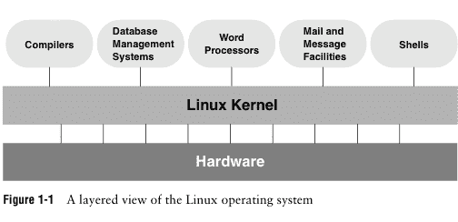

**图 1-1** Linux 操作系统的分层视图

### Linux 概述

Linux 操作系统具有许多独特且强大的功能。与其他操作系统一样，Linux 是计算机的控制程序。但像 UNIX 一样，它也是一个精心设计的实用程序族（图 1-1）以及一组允许用户连接并使用这些实用程序来构建系统和应用程序的工具。

### Linux 具有内核编程接口

Linux 内核——Linux 操作系统的心脏——负责分配计算机资源并调度用户作业，使每个作业都能公平地获得系统资源，包括对 CPU 的访问；外围设备，如磁盘、DVD 和 CD-ROM 存储；打印机；以及磁带驱动器。程序通过*系统调用*与内核交互，这些是带有已知名称的特殊函数。程序员可以使用单个系统调用来与许多类型的设备交互。例如，只有一个 `write()` 系统调用，而不是许多设备特定的调用。当程序发出 `write()` 请求时，内核解释上下文并将请求传递给适当的设备。这种灵活性使得旧的实用程序能够与在实用程序最初编写时不存在的设备协同工作。它还使得将程序迁移到操作系统的新版本成为可能而无需重写它们（前提是新版本识别相同的系统调用）。

### Linux 可以支持许多用户

根据硬件和计算机执行的任务类型，Linux 系统可以支持从 1 到 1,000 多个用户，每个用户同时运行不同的程序集。能够同时被许多人使用的计算机的人均成本低于同一时间只能被一个人使用的计算机。之所以更低，是因为一个人通常无法充分利用计算机提供的所有资源。也就是说，没有人能独占所有


打印机持续运转，占用所有系统内存，让所有磁盘忙碌于读写，保持互联网连接在使用中，同时让所有终端都处于繁忙状态。多用户操作系统允许多人几乎同时使用所有系统资源。高成本资源的使用可以被最大化，而每位用户的成本可以被最小化——这是多用户操作系统的主要目标。

## Linux 可以运行许多任务

Linux 是一个完全受保护的多任务操作系统，允许每个用户同时运行多个任务。进程之间可以相互通信，但彼此之间保持完全的保护，就像内核与所有进程保持隔离一样。你可以在后台运行多个任务，同时全神贯注于屏幕上显示的任务，并且可以在任务之间来回切换。如果你正在运行 X 窗口系统（第 15 页），你可以在同一屏幕上的不同窗口中运行不同的程序，并监视所有这些程序。这种能力确保了用户可以更具生产力。

## Linux 提供安全的分层文件系统

文件是信息的集合，例如备忘录或报告的文字、销售数据的累积、图像、歌曲或可执行程序。每个文件都以唯一的标识符存储在存储设备（如硬盘）上。Linux 文件系统提供了一种结构，文件被组织在目录之下，目录就像文件夹或盒子。每个目录都有一个名称，可以容纳其他文件和目录。目录依次被组织在其他目录之下，以此类推，形成树状结构。这种结构通过将有关系的文件归类到目录中，帮助用户管理大量文件。每个用户有一个主要目录，以及根据需要创建的子目录（图 1-2）。

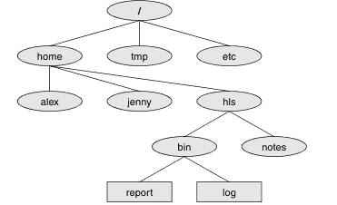

**图 1-2** Linux 文件系统结构

为了简化系统管理员和软件开发人员的生活，一群人通过网络聚集在一起开发了 Linux 文件系统标准（FSTND），该标准后来演变为 Linux 文件系统层次标准（FHS）。在此标准被采用之前，关键程序位于不同的 Linux 发行版中的不同位置。如今，你只需坐在 Linux 系统前，就知道在哪里可以找到任何给定的标准程序（第 198 页）。

`链接` 允许通过两个或多个名称访问特定文件。替代名称可以位于原始文件所在的同一目录中，也可以位于另一个目录中。链接可以使同一文件出现在`多个用户`的目录中，使用户能够轻松共享文件。Windows 使用术语`快捷方式`代替`链接`。Macintosh 用户可能对术语`别名`更熟悉。在 Linux 中，`别名`不同于`链接`；它是由 shell 提供的命令宏功能（第 332 页）。

与大多数多用户操作系统一样，Linux 允许用户保护其数据不被其他用户访问。它还允许用户通过一种简单但有效的保护方案，与特定的其他用户共享选定的数据和程序。这种安全级别由文件访问权限提供，这些权限限制了哪些用户可以读取、写入或执行文件。访问控制列表（ACLs）最近已被添加到 Linux 内核中，并在 Fedora/RHEL 中可用。ACLs 为用户提供了对文件访问权限更细粒度的控制，同样也为管理员提供了这种控制。

### Shell：命令解释器和编程语言

在文本环境中，shell——命令解释器——充当你与操作系统之间的接口。当你在屏幕上输入命令时，shell 解释命令并调用你想要的程序。Linux 有多种可用的 shell。这里描述了三种最流行的：

- Bourne Again Shell（`bash`），原始 Bourne Shell 的增强版本。它是原始的 UNIX shell 之一。
- TC Shell（`tsh`），C Shell 的增强版本。它作为 BSD UNIX 的一部分开发。
- Z Shell（`zsh`）。它结合了多种 shell 的功能，包括 Korn Shell。

由于用户通常偏好不同的 shell，多用户系统在任何特定时间都可能使用几种不同的 shell。shell 的选择展示了 Linux 操作系统的一个优势：为每个用户提供定制化接口的能力。

除了执行从键盘解释命令并将这些命令发送到操作系统的基本功能外，shell 还是一种高级编程语言。Shell 命令可以安排在文件中以便稍后执行（Linux 将这些文件称为 `shell 脚本`；Windows 称它们为 `批处理文件`）。这种灵活性允许用户相对轻松地执行复杂操作，通常使用相当短的命令，或者以令人惊讶的少量努力构建执行高度复杂操作的复杂程序。

## 文件名生成

当你输入由 shell 处理的命令时，你可以使用对 shell 具有特殊含义的字符构建模式。这些字符被称为`通配符`字符。这些模式被称为`模糊文件引用`，是一种简写形式：用户不必输入完整的文件名，而是输入模式，shell 会将它们扩展为匹配的文件名。模糊文件引用可以省去输入长文件名或长串相似文件名的麻烦。例如，shell 可能会将模式 `mak*` 扩展为 `make-3.80.tar.gz`。当你只知道文件名的一部分或记不清确切拼写时，模式也很有用。

## 设备独立的输入和输出

设备（如打印机或终端）和磁盘文件对于 Linux 程序来说看起来像文件。当你向 Linux 操作系统发出命令时，你可以指示它将输出发送到几个设备或文件中的任意一个。这种重定向称为`输出重定向`。

类似地，通常来自键盘的程序输入可以被重定向，使其改为来自磁盘文件。输入和输出是`设备独立`的；它们可以重定向到任何适当的设备或从任何适当的设备读取。

作为一个例子，`cat` 实用程序通常在屏幕上显示文件的内容。当你运行 `cat` 命令时，你可以轻松地使其输出转到磁盘文件而不是屏幕。

## Shell 函数

Shell 最重要的功能之一是可以将其用作编程语言。由于 shell 是解释器，它不编译为其编写的程序，而是在每次从磁盘加载时解释程序。加载和解释程序可能很耗时。

许多 shell，包括 Bourne Again Shell，包含 shell 函数，shell 将这些函数保留在内存中，因此在你想要执行它们时不需要每次都从磁盘读取它们。Shell 还以内部格式保留函数，因此不需要花费那么多时间来解释它们。

## 作业控制

`作业控制`是一个 shell 功能，允许用户同时处理多个作业，并根据需要在其间来回切换。当你启动一个作业时，它通常位于前台，因此连接到终端。使用作业控制，你可以将正在处理的作业移入后台并在那里继续运行，同时在前景中处理或观察另一个作业。如果后台作业需要你的关注，你可以将其移回前台，使其再次连接到终端。作业控制的概念起源于 BSD UNIX，它出现在 C Shell 中。

## 大量有用的实用程序

Linux 包含数百个实用程序家族，通常称为命令。这些实用程序执行用户普遍需要的功能。例如，`sort` 实用程序将列表（或列表组）按字母或数字顺序排列，并可用于按零件号、姓氏、城市、邮政编码、电话号码、年龄、大小、成本等排序列表。`sort` 实用程序是一个重要的编程工具，是标准 Linux 系统的一部分。其他实用程序允许用户创建、显示、打印、复制、搜索和删除文件，以及编辑、格式化文本和排版。`man`（手册）和 `info` 实用程序为 Linux 本身提供在线文档。

## 进程间通信

### 管道和过滤器

Linux 允许用户在命令行上建立管道和过滤器。管道将一个程序的输出作为输入发送到另一个程序。过滤器是一种特殊的管道，它处理输入数据流以产生输出数据流。过滤器处理另一个程序的输出并对其进行修改。过滤器的输出随后成为另一个程序的输入。

管道和过滤器经常将实用程序连接起来以执行特定任务。例如，你可以使用管道将 `cat` 实用程序的输出发送到 `sort`（一个过滤器），然后可以使用另一个管道将 `sort` 的输出发送到第三个实用程序 `lp`，该实用程序将数据发送到打印机。因此，在一条命令行中，你可以将三个实用程序组合在一起对文件进行排序和打印。

## 系统管理

在 Linux 系统中，系统管理员通常是系统的所有者和唯一用户。这个人有许多职责。第一个职责可能是设置系统和安装软件。

系统启动并运行后，系统管理员负责下载和安装软件（包括升级操作系统）、备份和恢复文件，以及管理打印机、终端、服务器和局域网等系统设施。系统管理员还负责在多用户系统上为新用户设置账户，根据需要启动和关闭系统，并处理出现的任何问题。

## Linux 的其他功能

Linux 的开发者在其操作系统中包含了来自 BSD、System V 和 Sun Microsystems 的 Solaris 的功能，以及新功能。虽然大多数在 UNIX 上发现的工具在 Linux 上也都存在，但在某些情况下，这些工具已被更现代化的对应物取代。本节介绍了 Linux 下可用的一些流行工具和功能。

# GUI：图形用户界面

X 窗口系统（也称为 X 或 X11）部分由麻省理工学院（MIT）的研究人员开发，为 Linux 可用的图形用户界面（GUI）奠定了基础。在支持 X 的终端或工作站屏幕上，用户可以通过屏幕上的多个窗口与计算机交互、显示图形信息，或使用专门的应用程序来绘制图片、监控进程或预览格式化输出。X 是一个跨网络协议，允许用户在与生成窗口的 CPU 不同的远程工作站或计算机系统上打开窗口。

通常在 X 下运行两层：桌面管理器和窗口管理器。**桌面管理器**是一种面向图形的用户界面，允许你通过操作图标而不是向 shell 输入相应命令来与系统程序交互。Fedora/RHEL 包含了 GNOME（见图 1-3，www.gnome.org）和 KDE（www.kde.org），这是最流行的桌面管理器。


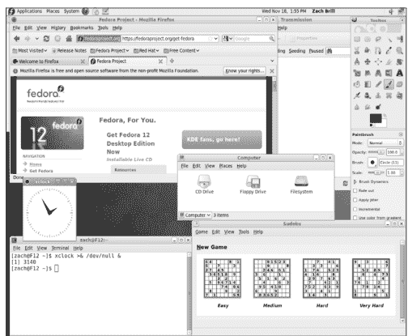

**图 1-3** 一个 GNOME 工作区

**窗口管理器**是一个运行在桌面管理器下的程序，允许你打开和关闭窗口、运行程序，并设置鼠标，使其根据点击的位置和方式执行不同的操作。窗口管理器还赋予了屏幕独特的个性。虽然 Microsoft Windows 允许你更改窗口中关键元素的颜色，但 X 下的窗口管理器允许你自定义屏幕的整体外观和感觉：你可以更改窗口的外观和工作方式（通过赋予其不同的边框、按钮和滚动条），设置虚拟桌面，创建菜单等等。

有几种流行的窗口管理器在 X 和 Linux 下运行。Fedora/RHEL 提供了 Metacity（GNOME 的默认窗口管理器）和 kvn（KDE 的默认窗口管理器）。其他窗口管理器，如 Sawfish 和 WindowMaker，也可用。第 4 章和第 8 章包含更多关于 GUI 的信息。

## 网络工具

Linux 网络支持包括许多实用工具，使你能够通过各种网络访问远程系统。除了向其他系统的用户发送电子邮件外，你还可以访问挂载在其他计算机磁盘上的文件，就像它们位于本地系统上一样；以类似的方式让你的文件对其他系统可用；来回复制文件；在远程系统上运行程序同时在本地系统上显示结果；并在局域网（LAN）和广域网（WAN，包括互联网）上执行许多其他操作。

在此网络访问之上叠加了广泛的应用程序，这些应用在全球范围内扩展了计算机资源。你可以与世界各地的人进行对话，收集各种主题的信息，并快速可靠地通过互联网下载新软件。第 10 章讨论了网络、互联网和 Linux 网络设施。

# 软件开发

Linux 最引人注目的优势之一是其丰富的软件开发环境。你可以找到许多计算机语言的编译器和解释器。除了 C 和 C++，适用于 Linux 的语言还包括 Ada、Fortran、Java、Lisp、Pascal、Perl 和 Python。`bison` 实用程序生成解析代码，使编写用于构建编译器（解析包含结构化信息的文件的工具）的程序变得更加容易。`flex` 实用程序生成扫描器（识别文本中词法模式的代码）。`make` 实用程序和 GNU 配置与构建系统使管理复杂的开发项目变得更加容易。诸如 `CVS` 之类的源代码管理系统简化了版本控制。包括 `gdb` 在内的几种调试器有助于跟踪和修复软件缺陷。GNU C 编译器（`gcc`）与 `gprof` 性能分析实用程序配合使用，帮助程序员识别程序性能中的潜在瓶颈。C 编译器包含选项，用于对 C 代码进行广泛检查，使代码更具可移植性并减少调试时间。第 1038 页的表 B-4 列出了你可以下载软件的一些站点。

# 本书中使用的约定

本书使用约定使解释更简短、更清晰。以下段落描述了这些约定。

| 约定 | 描述 |
| :--- | :--- |
| `Fedora/RHEL` | 在本书中，术语 *Fedora/RHEL* 指 Fedora 和 Red Hat Enterprise Linux。仅适用于其中一个操作系统的特性会这样标记，使用这些标记：FEDORA 或 RHEL。 |
| 文本和示例 | 正文使用此字体，而示例则以等宽字体（也称为*固定宽度*字体）显示：<br> `cat practice` <br> `This is a small file I created` <br> `with a text editor.` |
| 你输入的内容 | 你在键盘上输入的一切都以粗体字体显示：在正文中，使用**这种粗体字体**；在示例和屏幕中，使用**这一种**。在上面的示例中，第一行的美元符号（$）是 Linux 显示的一个提示符，因此它不是粗体；第一行的其余部分是由用户输入的，因此它是粗体。 |
| 实用程序名称 | 实用程序的名称以这种**无衬线字体**印刷。本书引用 *emacs* 文本编辑器和 *ls* 实用程序或 *ls* 命令（或仅 *ls*），但指导你在命令行输入 *ls -a*。通过这种方式，正文区分了实用程序（它们是程序）和你在命令行上给出的指令以调用这些实用程序。 |
| 文件名 | 文件名以粗体字体显示。例如 **memo5**、**letter.1283** 和 **reports**。文件名可以包含大写字母和小写字母；然而，Linux 是*区分大小写的*（第 1073 页），因此 **memo5**、**MEMO5** 和 **Memo5** 指代三个不同的文件。 |
| 字符字符串 | 在正文中，字符和字符串通过用粗体字体标记来识别。此约定避免了在字符串前后使用引号或其他分隔符的需要。一个例子是由 **passwd** 实用程序显示的以下字符串：**Sorry, passwords do not match.** |
| 按钮和标签 | 在描述 GUI 的章节中，单词以粗体字体显示。此字体表示当鼠标指针在屏幕上的这些单词上方或在此名称的按钮上方时，你可以点击鼠标按钮。 |
| 按键和字符 | 本书使用小大写字母表示三类项目：<br>- 键盘按键，如 SPACE 键和 RETURN、ESCAPE 和 TAB 键。<br>- 按键生成的字符，如 SPACE 键生成的空格。<br>- 你与 CONTROL 键一起按下的键盘按键，如 CONTROL-D。（即使 D 显示为大写字母，你也不需要按 SHIFT 键；通过按住 CONTROL 键并按 D 来输入 CONTROL-D。） |
| 提示符和回车 | 大多数示例包括*shell 提示符*——即 Linux 等待命令的信号——作为美元符号（$）、英镑符号（#）或有时作为百分号（%）。 |

提示符不是粗体字体，因为你不需要输入它。当使用本书中的示例进行实验时，不要在键盘上输入提示符。如果你这样做了，示例将无法正常工作。

示例*省略*了执行它们所需的**RETURN**键击。一个命令行的示例：

```bash
$ vim memo.1204
```

要将此示例作为运行 *vim* 文本编辑器的模型，请输入命令 `vim memo.1204` 并按下 `RETURN` 键。（按 `ESCAPE ZZ` 退出 vim；请参阅第 174 页了解 vim 教程。）这种输入命令的方法使书中的示例与屏幕上显示的内容相对应。

菜单选择路径是菜单的名称或位置，后跟冒号、**SPACE**，以及由大于号（$>$）分隔的菜单选择项。整个菜单选择路径以*粗体*字体显示。你可以将 **Konqueror 菜单栏: Tools > Find** 读作“从 Konqueror 菜单栏，选择 *Tools*；从 *Tools*，选择 *Find*。”

所有标记为 `[*note]` 的词汇表条目均由 Denis Howe 惠赠，他是《免费在线计算机词典》（www.foldoc.org）的编辑，并经授权使用。该网站是一个正在进行的项目，包含定义、轶事和趣闻。

> **可选信息**
>
> 标记为可选的段落出现在灰色框中，它们不是章节中呈现的核心思想，但通常涉及更具挑战性的概念。阅读章节时，一个好的策略是先跳过可选部分，然后在熟悉章节中呈现的主要思想后再返回阅读。这是一个可选段落。

Web 地址或 URL 有一个隐式的 `http://` 前缀，除非显示为 `ftp://` 或 `https://`。当前缀为 `http://` 时，你通常不需要指定前缀，但当你指定 FTP 或安全 HTTP 站点时，必须从浏览器使用前缀。因此，你可以按照本书中显示的方式在浏览器中指定 URL。

以下方框强调了你在使用或管理 Linux 系统时可能有帮助的信息。

**提示**

提示框可能帮助你避免重复常见错误，或指向额外的信息。

**注意**

注意框警告你潜在的陷阱。

**安全说明**

安全框强调潜在的安全问题。这些说明通常面向系统管理员，但有些适用于所有用户。

## 章节摘要

Linux 操作系统脱胎于 UNIX 传统，发展成为一种流行于微计算机（PC）硬件上的传统系统（即 Windows）的替代方案。UNIX 用户会在 Linux 中找到熟悉的环境。Linux 发行版包含了由来自世界各地的程序员贡献的预期的 UNIX 实用工具集合，其中包括作为 GNU 项目一部分开发的一整套工具。Linux 社区致力于该系统的持续开发。随着新微计算机设备和功能硬件的推出，对其的支持很快就会增加，并且 Linux 上可用的工具仍在不断精化。随着许多可在 Linux 平台上运行的商业软件包的出现，以及许多硬件制造商在其系统上提供 Linux，显然该系统已远远超越其作为本科生项目的起源，成为学术、商业、专业和个人用途的首选操作系统。

## 练习题

- 1. 什么是自由软件？列出自由软件的三个特征。
- 2. 为什么 Linux 受欢迎？为什么它在学术界特别受欢迎？
- 3. 什么是多处理器系统？为什么它们很成功？
- 4. 什么是自由软件基金会/GNU？什么是 Linux？各自提供了 Linux 操作系统的哪些部分？还有哪些人帮助构建和完善了这个操作系统？
- 5. Linux 是用什么语言编写的？这种语言与 Linux 的成功有什么关系？
- 6. 什么是实用程序？


### 7. 什么是 Shell？它如何与内核配合工作？如何与用户配合工作？

### 8. 你如何使用实用程序和 Shell 来创建自己的应用程序？

### 9. 为什么 Linux 文件系统被称为*分层*文件系统？

### 10. 多处理器系统和多处理系统有什么区别？

### 11. 举一个你希望使用多处理系统的例子。

### 12. 大约有多少人编写了 Linux？这有什么独特之处？

### 13. GNU 通用公共许可证的主要条款是什么？

## 第一部分

### 安装 Fedora 和 Red Hat Enterprise Linux

- 第 2 章：安装概述 23
- 第 3 章：逐步安装 51

## 2

### 安装概述

#### 本章内容

- 规划安装 . . . . . . 24
- 设置硬盘 . . . . . . 30
- LVM：逻辑卷管理器 . . . . . . 38
- 安装过程 . . . . . . . . . 39
- 介质：源数据在哪里？ . . . . . . . . . . . . . . . 40
- 下载 CD/DVD（Fedora） . . . . . . . . . . . . . . . . . . . . . 41
- 使用 BitTorrent 下载 CD/DVD ISO 映像文件 . . . . . . . . 44
- 选择救援安装 DVD . . . . . . . . . . . . . . . . . . . . . . 46
- 收集系统信息 . . . . . . . . . . . . . . . . . . . . . . 46
- 更多信息 . . . . . . . . . . . . . . . . . . . . . . 48

安装 Fedora/RHEL 是从介质复制操作系统文件到本地系统并设置配置文件，以便 Linux 能在硬件上正常运行的过程。你可以从许多类型的介质安装 Linux，包括 CD/DVD、本地硬盘、USB 闪存驱动器，或通过网络访问的另一系统的硬盘。可以进行多种类型的安装，包括全新安装、从旧版 Fedora/RHEL 升级、双引导安装以及虚拟机安装。你可以手动执行安装，或者设置 `Kickstart` 来自动安装 Fedora/RHEL。

本章讨论一般的安装过程：规划、硬盘分区、获取安装文件、如有必要刻录 CD/DVD 以及收集硬件信息。第 3 章涵盖安装 Fedora/RHEL 的过程。

Red Hat 开发了 `Anaconda`，这是一个使用图形或文本界面执行交互式安装的安装工具，旨在自动化并简化 Linux 安装过程。要在标准硬件上安装 Linux，通常只需插入 CD/DVD，引导系统并按几下 `RETURN` 键即可。然而，有时你可能希望定制系统，或者在非常规硬件上进行安装：`Anaconda` 在安装过程展开时提供许多选择。有关定制 Fedora/RHEL 安装的信息，请参阅第 57 页的“The Anaconda Installer”和第 68 页的“Modifying Boot Parameters (Options)”。

### 桌面 Live CD 和安装 DVD

**Live CD** 本书将 Fedora 桌面 Live 介质称为*Live CD*。`Live CD` 无需将其安装在系统上即可运行 Fedora。当你从此 CD 引导时，它会启动一个 `GNOME` 桌面：你正在运行一个 Live 会话。如果你从 Fedora KDE Live 介质 CD 引导，它会启动一个运行 Live 会话的 `KDE` 桌面。当你退出 Live 会话时，系统恢复到你从 CD 引导之前的状态。如果系统有交换分区（大多数 Linux 系统都有；参见第 34 页），Live 会话会使用它来提高性能，但除此之外不会写入硬盘。你可以从 Live 会话安装 Fedora。Red Hat Enterprise Linux 不提供 Live 会话。

启动 `Live CD` 是测试硬件和修复无法从硬盘引导的系统的好方法。对于新手或对 Fedora 或 Linux 不熟悉但想要尝试 Fedora 却尚未准备好将其安装在系统上的人来说，Live 会话是非常理想的。它也比安装 DVD 提供了更简单的安装 Fedora 路径。

**安装 DVD** 本书将安装介质称为*安装 DVD*，它作为单个 DVD（随本书提供）或一组 CD 提供。安装 DVD 在安装 Fedora/RHEL 之前不会启动桌面。当你引导安装 DVD 时，它会启动一个菜单，允许你安装 Fedora/RHEL。与 `Live CD` 相比，安装 DVD 在安装 Fedora 时提供更多选择。例如，安装 DVD 允许你使用图形安装程序或文本安装程序（在引导时使用 `text` 参数；参见第 71 页）或救援已安装的系统（从欢迎菜单选择*Rescue installed system*；参见第 56 页）。你还可以使用第一个安装 CD 或网络引导 CD 来救援已安装的系统。

**网络引导 CD** 网络引导 CD（原称 Boot CD）引导系统并显示与安装 DVD（如上所述）相同的菜单。它不包含安装 Fedora/RHEL 所需的软件包，但允许你从硬盘或通过网络安装新系统。有关更多信息，请参见第 70 页的*`asmkmethod`*。

### 规划安装

规划安装时的主要决策是确定如何将硬盘划分为分区，或者在双引导系统的情况下，Linux 分区放在哪里，以及在某些情况下，决定安装哪些软件包。当你在虚拟机上安装 Fedora/RHEL 时，你必须决定虚拟机文件放在哪里。除这些主题外，本节还讨论 Fedora/RHEL 的硬件要求、Fedora 与 RHEL 的比较，以及全新安装与升级的区别。

#### 考虑因素

**SELinux** `SELinux`（安全增强型 Linux）通过在 Fedora/RHEL 内核（第 41 页）中实施强制访问控制策略来提高系统安全性。默认情况下，Fedora 以执行模式安装 `SELinux`。如果你不打算使用 `SELinux`，你可以在系统安装后将其更改为宽容模式。当你安装 RHEL 时，如果你计划在 RHEL 下使用 `SELinux`，请允许它保持执行模式，或将其更改为宽容模式，但不要在第一启动期间（第 67 页）禁用它。由于 `SELinux` 会在文件上设置扩展属性，在已关闭 `SELinux` 的系统上启用 `SELinux` 可能是一个耗时的过程。

**GUI** 在大多数安装中（服务器除外），你可能想要安装图形桌面环境。`GNOME` 是默认安装的。你也可以安装 `KDE` 或同时安装 `GNOME` 和 `KDE`。在服务器上，你通常会将尽可能多的资源分配给服务器，并尽可能少地分配给服务器不需要的资源。因此，专用服务器很少包含图形界面。

**软件和服务** 随着你在系统上安装更多的软件包，更新数量和包之间的相互作用会增加。监听网络连接的服务包通过增加系统被攻击的途径使系统更容易受到攻击。额外的服务也可能使系统变慢。如果你希望拥有一个用于学习或开发的系统，额外的包和服务可能很有用。如果目标是更加安全的生产系统，最好安装和维护所需的最少数量的包，并只启用你需要的服务。

#### 要求

**硬件** Fedora/RHEL 可以在许多不同类型的硬件上运行。本节详细说明了在 32 位 Intel 及兼容平台（如 AMD 和 VIA）以及 64 位平台（如 AMD64 处理器（包括 Athlon64 和 Opteron）、带有 Intel 扩展内存 64 技术（EM64T）的 Intel 处理器（包括 Core 和 Core 2 系列）以及 Intel Itanium（IA-64）处理器）上的安装。在这些平台内，Fedora/RHEL 可以在大部分可用硬件上运行。你可以在 `hardware.redhat.com` 找到 Red Hat 的兼容和支持硬件列表。虽然这些列表适用于 Red Hat Enterprise Linux，但它们可以作为 Fedora 运行硬件的良好指南。发行说明也提供硬件信息（参见安装 DVD、第一个安装 CD 或 Fedora/RHEL 网站）。许多互联网网站讨论 Linux 硬件；使用 `Google`

Fedora/RHEL 通常运行在与 Windows 相同的系统上，除非系统包含非常新或不常见的组件。

- **内存（RAM）**

  对于以文本模式（无图形界面）运行的 32 位 x86 系统，最低需要 128 MB 内存；对于图形界面系统，需要 192–256 MB。对于 64 位 x86.64 系统，文本模式至少需要 256 MB，图形界面系统需要 384–512 MB。Linux 能很好地利用额外内存：系统内存越多，运行速度越快。增加内存是提升系统速度最具成本效益的方法之一。

- **CPU**

  Fedora 在文本模式下要求最低配备 200 MHz Pentium 级处理器或等效的 AMD 或其他处理器。Fedora 图形界面模式和 RHEL 至少要求配备 400 MHz Pentium Pro 或 Pentium II 处理器或等效处理器。

- **硬盘空间**


所需硬盘空间大小取决于你安装的 Fedora/RHEL 版本、安装的软件包数量、安装的语言数量以及用户数据（你的文件）所需的空间。操作系统占据的空间大约从 300 MB 到 9 GB 以上不等。

## BIOS 设置

现代计算机可以设置为从 CD/DVD、软盘、硬盘、USB 闪存盘启动，或通过 PXE 服务器通过网络启动。BIOS 决定了系统尝试从各个设备启动的顺序。你可能需要更改此顺序：请确保 BIOS 设置为优先尝试从你正在使用的设备启动。

## CMOS

CMOS 是存储系统配置信息的持久性存储器。要更改 BIOS 设置，你需要编辑存储在 CMOS 中的信息。系统启动时，会显示一条简短的消息，说明如何进入系统设置或 CMOS 设置模式。通常，你需要在系统启动时按下 `Del` 或 `F2` 键。按下提示的键，然后将光标移动到处理系统启动的屏幕和行上。通常有一个包含三到四个设备列表，系统会尝试从中启动；如果第一次尝试失败，系统会尝试第二个设备，依此类推。调整该列表，使你要使用的设备成为首选，保存设置，然后重新启动。有关更多信息，请参阅硬件/BIOS 手册。

## 处理器架构

Fedora/RHEL 的 CD 和 DVD 包含编译后用于在特定处理器架构（处理器或 CPU 类别）上运行的程序。以下列表描述了 Fedora/RHEL 所编译支持的每种架构。有关每种架构中处理器的详细列表，请参阅 [doc.fedoraproject.org/install-guide/f12/en-US/html/ch-new-users.html#sn-which-arch](https://doc.fedoraproject.org/install-guide/f12/en-US/html/ch-new-users.html#sn-which-arch)。由于 Linux 源代码对所有人开放， knowledgeable 用户可以编译 Fedora/RHEL 以在其他处理器架构上运行。

### 在支持 64 位的处理器上，我应该安装 32 位还是 64 位的 Fedora/RHEL？

**提示：** 以下列表可能有助于你决定在支持 64 位的处理器上安装 32 位还是 64 位的 Fedora/RHEL。

- EM64T/AMD64 处理器可以同等良好地运行任何版本的 Fedora/RHEL。
- 64 位发行版允许每个进程寻址超过 4 GB 的 RAM。更大的地址空间是 64 位发行版最大的优势，通常仅对某些工程/科学计算工作以及运行多个虚拟系统时有用。
- 一般来说，64 位处理器并不比 32 位处理器更快。大多数基准测试显示性能大致相当。在某些情况下性能更好，而在某些情况下则更差。两种类型的处理器都没有明显的性能优势。
- 64 位 Linux 的内存模型使指针的大小是 32 位 Linux 的两倍。根据应用程序的不同，这种尺寸差异会导致 RAM 使用量增加 5% 以上。如果系统 RAM 较少，这种开销可能会使性能变差。
- 由于使用 32 位 Linux 的人更多，32 位 Linux 中的错误往往比 64 位 Linux 中的错误更快被发现和修复。
- 在 64 位系统上，Fedora/RHEL 可以像在 32 位系统上一样，通过单击一次来设置 Flashplayer 和 Java。然而，对于某些应用程序（如 Skype），在 64 位系统上运行它们时必须应用丑陋的变通方法。
- 如果没有重新安装 Fedora/RHEL，就没有简单的方法可以在 32 位和 64 位版本的 Fedora/RHEL 之间来回切换。
- 如果你不确定要使用哪个发行版，请安装 32 位版本的 Fedora/RHEL。

**PC (i386)**

Fedora/RHEL i386 CD/DVD 上的软件编译后用于在 Intel x86 兼容处理器上运行，包括大多数配备 Intel 和 AMD 处理器的机器，几乎所有运行 Microsoft Windows 的机器，以及使用 Intel 处理器的较新型 Apple Macintosh 机器。如果你不确定机器具有哪种类型的处理器，请假设它具有这种类型的处理器。例外包括以下 Intel 处理器：Atom 230、Atom 330、Core 2 Duo、Centrino Core 2 Duo 和较新的 Xeon；以下 AMD 处理器：Athlon 64、Athlon x2、Sempron 64 和 Opteron；以及 VIA C3 和 C7 处理器。

**64 位 PC (x86_64)**

Fedora/RHEL 64 位 PC CD/DVD 上的软件编译后用于在 Intel 处理器上运行，包括 Intel Atom 230、Atom 330、Core 2 Duo、Centrino Core 2 Duo 和 Xeon；AMD 处理器，包括 Athlon 64、Athlon x2、Sempron 64 和 Opteron；以及 Apple MacBook、MacBook Pro 和 MacBook Air。由于某些专有第三方应用程序的功能在 64 位架构上不可用，你可能希望在具有 64 位处理器的系统上运行编译为 32 位 (i386) 处理器版本的 Fedora/RHEL（参见前面的提示）。

**Mac PowerPC (ppc)**

Fedora/RHEL PPC 版本运行在 Apple Macintosh G3、G4、G5、PowerBook 和基于 PPC 的 Macintosh 上。

## 界面：安装程序和已安装的系统

安装 Fedora/RHEL 时，你可以选择在安装期间使用（与安装程序交互）的界面，以及在选择与已安装系统交互时使用的界面。本节描述了两种基本界面：文本界面和图形界面。

- **文本界面（CLI）**

  文本界面也称为命令行界面 (CLI) 或基于字符的界面，显示字符和一些简单的图形符号。它是面向行的；你仅使用键盘向其发出指令。

- **伪图形界面**

  伪图形界面有时称为文本用户界面 (TUI)，利用基于文本的显示设备（如终端）上的图形元素。它也可以使用颜色。此界面使用文本元素，包括简单的图形符号，来绘制模拟 GUI 窗口和按钮的初级方框。`TAB` 键通常使光标从一个元素移动到下一个元素，`RETURN` 或 `SPACE` 键选择光标所在的元素；你仅使用键盘向其发出指令。

- **图形界面（GUI）**

  图形用户界面 (GUI) 通常显示桌面（如 GNOME 或 KDE）和窗口；你使用鼠标和键盘向其发出指令。你可以通过打开终端模拟器窗口（第 118 页）在 GUI 内运行文本界面。GUI 比文本界面使用更多的计算机资源（CPU 时间和内存）。

- **优势**

  GUI 用户友好，而文本界面紧凑，使用更少的系统资源，并且可以在仅文本的终端上工作。你可以使用 `ssh`（第 638 页）远程（通过网络）运行 GUI 工具。由于效率更高，文本界面适用于较旧、较慢的系统以及 RAM 量最小的系统。服务器系统经常使用文本界面，因为它们允许系统将更多资源用于其设定好的任务，而将更少的资源用于取悦系统管理员。不运行 GUI 还可以提高系统安全性。

- **安装程序界面**

  Fedora/RHEL 提供用户友好的图形安装程序界面和高效的伪图形安装程序界面（图 2-1）。这两个界面完成相同的任务：它们使你可以告诉安装程序你希望如何配置 Fedora/RHEL。然而，伪图形界面提供的选择较少。

## 你正在安装的是 Fedora 还是 Red Hat Enterprise Linux？

本书描述了两种产品：Fedora 和 Red Hat Enterprise Linux。本节简要强调了这些产品之间的区别。

- **FEDORA**

  Fedora 项目由 Red Hat 赞助并得到开源社区支持。随着大约每六个月发布一次称为 Fedora 的发行版，这个 Linux 发行版包含了前沿代码。它*不是*受支持的 Red Hat 产品，*不*推荐用于生产环境，因为在这些环境中，软件包和功能的集合必须在较长时间内保持不变。

  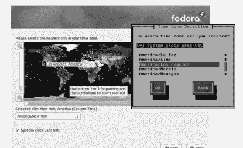

  **图 2-1** 图形化（左）和文本（伪图形，插入图）安装程序

  Fedora 旨在反映其所包含的上游项目，包括内核。它被广泛认为是最稳定的“自由”Linux 发行版。相比之下，红帽企业 Linux（Red Hat Enterprise Linux）包含了许多由 Fedora 引入的变更。

- **RHEL** 红帽企业 Linux 通常通过年度订阅销售，该订阅包含对红帽网络（RHN；第 516 页）和技术支持的访问权限。与 Fedora 相比，它更稳定，但在前沿技术方面稍逊一筹。RHEL 提供至少 7 年的更新支持；而 Fedora 提供 13 个月的更新支持。


红帽企业 Linux 和红帽企业 Linux 高级平台（Advanced Platform）功能完全相同，旨在运行服务器。前者授权用于拥有 1 或 2 个物理 CPU 芯片以及最多 4 个虚拟客户端的系统。后者授权用于拥有任意数量 CPU 芯片和虚拟客户端的系统。

红帽企业 Linux 桌面版（Desktop）运行办公生产力软件开发应用程序。此操作系统有若干版本，支持拥有 1 或 2 个 CPU、不同容量 RAM 以及不同数量虚拟客户端的系统。它并非为生产服务器环境设计。有关 RHEL 各版本的更多信息，请访问 www.redhat.com/rhel/compare。

`CentOS` [CentOS](https://www.centos.org) 是一个免费的、与 RHEL 相当的 Linux 发行版。与 Fedora 相比，它具有更长期的稳定性，但支持程度低于 RHEL。由于 CentOS 与 RHEL 兼容，本书也介绍了 CentOS。

## 升级现有的 FEDORA/RHEL 系统与全新安装

`升级` `升级`会用较新版本的 Linux 内核和实用程序替换已安装版本的 Fedora/RHEL 中的相应组件。在升级过程中，安装程序会尝试保留系统和用户数据文件。升级会将旧版本中存在的实用程序更新至最新，但不会安装新的实用程序，除非为了满足依赖关系而必需（你可以稍后再安装它们）。现有且已修改的配置文件将被保留；新添加的配置文件将以 `.rpmnew` 作为文件名扩展名。升级日志保存在 `/root/upgrade.log` 中。在升级系统之前，请备份系统上的所有文件。

- **预升级（Fedora）** `预升级`提供了一个图形用户界面（GUI），允许你从之前的 Fedora 版本（9 或更高）升级到当前版本。它会在工作时于后台执行所有下载。在下载完必要的软件包并重启后，Fedora 将启动安装程序并执行升级。更多详细信息请访问 fedoraproject.org/wiki/How_to_use_PreUpgrade。

- **全新安装** `安装`，有时称为全新安装，会将所有新数据写入硬盘。安装程序会覆盖所有系统程序、数据以及内核。根据用户数据的位置以及你如何格式化/分区硬盘，你可以选择在安装过程中保留部分用户数据。务必备份所有将被全新安装覆盖的数据和配置文件。

### 全新安装的稳定性优于升级

> 为了获得更好的系统一致性，红帽建议备份系统数据并执行全新安装，而非升级。

## 设置硬盘

- **空闲空间** 硬盘必须以多种方式进行准备，以便 Linux 能够向其写入和从中读取数据。低级格式化是准备磁盘使用的第一步。你不需要执行此任务，因为它在工厂中已完成。准备硬盘用于使用的下一步是向其写入分区表并在磁盘上创建分区。最后，你需要在分区上创建文件系统。未被分区占用的磁盘区域称为`空闲空间`。新磁盘没有分区表也没有分区。在 DOS/Windows 下，`格式化`一词意味着在分区上创建文件系统；请参阅下一页的“文件系统”。

- **分区** `分区`或`切片`是硬盘的一个逻辑部分，拥有设备名称（如 `/dev/sda1`），以便你将其与其他部分区分开来以便单独引用。为了正常使用，必须在硬盘上创建至少一个分区（第 31 页及之后）。在 live 会话中以及在安装 Fedora/RHEL 后，你可以使用 `partimage` 磁盘实用程序（第 78 页）在现有系统上查看、调整大小和创建分区。在安装期间，你可以使用 Disk Druid 分区工具（第 60 页）创建分区。安装完成后，你可以使用 `parted`（第 568 页）、`palimpsest`（第 78 页）或 `fdisk` 来操作分区。有关设备名称的更多信息，请参阅第 468 页的 `/dev`。

- **分区表** 分区表存储关于硬盘上分区的信息。在磁盘上创建第一个分区之前，创建分区的程序必须在磁盘上设置一个空的分区表。随着分区被添加、删除和修改，关于这些变更的信息会记录在分区表中。如果你删除了分区表，除非采取非常规手段，否则你将无法访问磁盘上的信息。

- **LVM** 默认情况下，在安装期间 Disk Druid 会设置逻辑卷（LV），其功能类似于分区。使用 LV，你可以使用逻辑卷管理器（LVM，第 38 页）更改卷的大小。使用 LVM 操作 LV 比使用操作分区的工具更为方便。

- **文件系统** 在大多数程序能够写入分区之前，需要将一种称为`文件系统`的`数据结构`（第 1078 页）写入分区。这种数据结构保存 inode（第 481 页），将磁盘上存储文件的位置映射到文件名。该数据结构的顶部是一个未命名的目录。稍后将解释，当文件系统挂载时，该目录会并入系统目录结构。

当 Fedora/RHEL 安装程序创建分区时，它也会自动向分区写入文件系统。你可以使用 `mkfs`（创建`文件系统`；第 439 页）实用程序手动在分区上创建文件系统，该实用程序类似于 DOS/Windows 的 `format` 实用程序。第 485 页的表 12-1 列出了一些常见的文件系统类型。Fedora 11 及更高版本创建 `ext4` 文件系统，而 RHEL 5.4 及更早版本以及 Fedora 10 及更早版本创建 `ext3` 文件系统。除非你有理由使用其他类型的文件系统，否则请使用 `ext4`（Fedora）或 `ext3`（RHEL）。Windows 使用 FAT16、FAT32 和 NTFS 文件系统。Apple 使用 HFS（分层文件系统）和 HFS+。OS X 使用 HFS+ 或 UFS。不同类型的文件系统可以在单个硬盘的不同分区中共存，包括 Windows 和 Linux 文件系统。

## 主分区、扩展分区和逻辑分区

你可以将一个磁盘划分为最多 15 个分区。你可以独立地将每个分区用于交换设备、文件系统、数据库、其他资源，甚至其他操作系统。Fedora/RHEL 建议使用 LVM（第 38 页）进行分区管理。

**主分区和扩展分区** 不幸的是，磁盘分区遵循很久以前为 DOS 机器建立的模板。一个磁盘最多只能包含四个`主分区`。你可以将其中一个（且仅一个）主分区划分为多个`逻辑分区`；这个被划分的主分区称为`扩展分区`。如果你希望在一个驱动器上拥有超过四个分区——这种情况很常见——你必须设置一个扩展分区。

典型的磁盘被划分为三个主分区（通常编号为 `1、2` 和 `3`）和一个扩展分区（通常编号为 `4`）。三个主分区的大小即是你希望最终分区的大小。扩展分区占据磁盘的剩余部分。一旦建立了扩展分区，你就可以将其细分为额外的逻辑分区（编号为 `5` 或`更大`），每个分区的大小都是你想要的。你不能使用扩展分区（编号 4）——只能使用它包含的逻辑分区。第 569 页的图 16-3 说明了本段描述的磁盘。有关更多信息，请参阅 `Linux 分区 HOWTO`（tldp.org/HOWTO/Howto/Partition）。

LVM 解决了扩展分区的问题：它允许你在单个分区内创建许多文件系统，其方式比使用扩展分区优雅得多。

## Linux 目录层级结构

**对于基本安装，可跳过本节**

本节简要介绍了 Linux 目录层级结构，以便你更好地理解在安装 Linux 时将硬盘划分为分区时可能需要做出的一些决策。安装 Linux 时并非必须阅读本节。你可以使用默认的分区布局（第 61 页）来设置磁盘，并在有需要时再返回阅读本节。有关 Linux 目录层级结构的更详细解释，请参阅第 6 章开头部分。

-   **命名空间**：命名空间是一组名称（标识符），其中每个名称都是唯一的。

-   **Windows 与 Linux 的区别**：与 Windows 机器不同，Linux 系统提供了一个单一的命名空间，该命名空间包含本地系统上的所有文件（包括目录）。Linux 系统命名空间被称为目录层级结构或目录树。在 Windows 中，C:\ 和 D:\ 是独立的命名空间。以 C:\ 为根的目录层级结构与以 D:\ 为根的目录层级结构是相互独立的，两者之间没有路径或连接。在 Linux 中，单一的系统命名空间以 `/` 为根，`/` 是根目录。根目录下包含诸如 bin、boot、etc、home 和 usr 等顶级子目录。

-   **绝对路径名**：Linux 系统上的所有文件（包括目录）都有一个称为绝对路径名的唯一标识符。绝对路径名追踪了一条通过目录层级结构的路径，从根目录开始，到路径名所标识的文件或目录结束。因此，名为 home 的顶级目录的绝对路径名为 `/home`。更多信息请参见第 193 页。

-   **路径名中的斜杠 (/)**：在路径名中，斜杠 (`/`) 紧跟在目录名称之后（出现在目录名称的右侧）。因此，`/home/sam` 指定名为 sam 的普通文件或常规文件位于名为 home 的目录中，而 home 是根目录 (`/`) 的子目录。路径名 `/home/sam/` 指定 sam 是一个目录文件。在大多数情况下，这种区别并不重要。当斜杠出现在路径名的左端或单独出现时，隐含的是根目录。

-   **Linux 系统命名空间**：Linux 系统命名空间由系统中目录层级结构内所有文件（包括目录）的绝对路径名集合组成。

## 挂载点


分区上的文件系统不包含有关其在目录层级结构中挂载位置的信息（文件系统的顶级目录没有名称）。使用安装程序创建大多数分区时，你需要指定要写入分区的文件系统类型以及 Fedora/RHEL 与该分区关联的目录名称。

挂载文件系统即将文件系统与目录层级结构中的某个目录关联起来。你可以将文件系统挂载到目录层级结构中的任意目录。你将其上挂载文件系统的目录被称为挂载点。使用安装程序创建分区时指定的目录即为该分区的挂载点。大多数挂载点是顶级子目录，但也有少数例外（例如 `/usr/local` 经常被用作挂载点）。

### 不要在挂载文件系统之前在挂载点创建文件

**注意**：当文件系统未挂载到某个挂载点时，不要在该作为挂载点的目录中放置任何文件。当文件系统挂载到该目录时，该目录中的任何文件都会被掩盖；你将无法访问它们。当文件系统取消挂载时，这些文件会重新出现。

例如，假设第一块硬盘上的第二个分区的设备名称为 `/dev/sda2`。为了创建一个在目录层级结构中显示为 `/home` 的 ext4 文件系统，你必须在系统启动时指示 Linux 将 `/dev/sda2` 分区挂载到 `/home` 上。当此文件系统挂载到其常规挂载点时，你可以将其作为 `/home` 目录进行访问。

- **文件系统独立性**：一个文件系统的状态不会影响其他文件系统：一个驱动器上的某个文件系统可能损坏且无法读取，而其他文件系统运行正常。某个文件系统可能已满，无法向其写入数据，而其他文件系统则留有大量空间容纳更多数据。
- **`/etc/fstab`**：持有分区与挂载点关联信息的文件是 `/etc/fstab`（文件系统表；第 490 页）。存储在 fstab 文件中的关联是系统的默认设置，但你很容易覆盖它们。在恢复模式下工作时，你可以将文件系统挂载到 `/target` 目录，以便修复文件系统。例如，如果你将通常挂载在 `/home` 上持有该文件系统的分区挂载到 `/target`，那么通常位于 `/home/sam` 的目录将位于 `/target/sam`。
- **分区和文件系统的命名**：分区及其持有的文件系统除了拥有设备名称（以及相关 UUID 值——参见第 490 页）外，没有其他名称或标识。分区和文件系统经常通过分区的常规挂载点名称来指代。因此，“`/home` 分区”和“`/home` 文件系统”指的是持有通常挂载在 `/home` 目录上的文件系统的分区。有关挂载文件系统的更多信息，请参见第 487 页。

## 划分磁盘

在安装过程中，Anaconda 调用分区程序来设置磁盘分区。本节讨论了如何规划分区大小。虽然本节使用的是术语“分区”，但规划和调整 LV（逻辑卷；第 38 页）大小的方式相同。更多信息请参阅第 60 页以及 www.tldp.org/HOWTO/Partition 上的 Linux 分区 HOWTO 文档。

### GiB 与 GB

**提示**：历史上，吉字节 (GB) 曾指 $2^{30}$ (1,073,741,824) 或 $10^9$ (1,000,000,000) 字节。最近，术语“吉比字节” (gibyte，即十进制二进制字节，缩写为 GiB) 被用来表示 $2^{30}$ 字节；相应地，“吉字节” (gigabyte) 更常用于表示 $10^9$ 字节。类似地，梅比字节 (Mebibyte, MiB) 为 $2^{20}$ (1,048,576) 字节。Fedora/RHEL 分区程序仍使用兆字节和吉字节来指定分区大小。

## 默认分区

如果不熟悉 Linux，可能很难恰当规划分区大小。安装过程中，Fedora/RHEL 提供*默认分区*。默认分区不询问任何问题，将分配给 Fedora/RHEL 的磁盘部分划分为三个分区。其中一个分区是引导分区 (*boot*)，通常大小为 200–500 兆字节（第 35 页）。磁盘的其余部分被设置为卷组，你可以使用 LVM（逻辑卷管理器；第 38 页）对其进行控制。默认分区将卷组划分为两个逻辑卷（分区）。第一个逻辑卷用于保存交换空间，其大小可以是 512 兆字节到 2 吉字节或以上。另一个逻辑卷指定为 `/` (根)，包含剩余的磁盘空间。有关手动分区优势的讨论，请参阅下一节。

## 手动分区：规划分区

本节讨论你可能想要创建的其他分区。建议在创建分区（LV）*之前*设置 LVM（第 38 页）；LVM 允许你在系统安装后轻松更改分区大小。默认分区使用 LVM。

如果你决定手动划分硬盘并设置除根分区 `/` 和交换分区之外的其他分区，请先考虑每个顶级子目录下会发生哪些类型的活动。然后决定是否适合通过创建文件系统并将其挂载到单独的分区上来隔离该子目录。创建额外文件系统的好处包括以下几点：

- 将经常变更的数据（例如 */var* 和 */home*）与很少变更的数据（例如 */usr* 和 */boot*）分离，可以减少变更较少文件系统的碎片，有助于保持最佳系统性能。
- 隔离文件系统（例如 */home*）可以在升级或重新安装 Linux 时保留数据。
- 额外的文件系统可以简化系统数据的备份。
- 如果所有目录都是单个文件系统的一部分，并且某个程序失控或系统成为*拒绝服务攻击*（第 1080 页）的目标，整个磁盘可能会填满。可能包含能够告诉你哪里出错的系统记账和日志信息可能会丢失。在具有多个文件系统的系统中，此类问题通常只会填满单个文件系统，而不影响其他文件系统。可能有助于确定故障原因的数据很可能被保留，系统崩溃的可能性也更小。

接下来的段落讨论了将每个主要顶级子目录作为单独的、可挂载的文件系统的优势。你没有为其创建文件系统的目录会自动成为根 `/` 文件系统的一部分。例如，如果你不创建 */home* 文件系统，/home 将是根 `/` 文件系统的一部分。

当 Linux 没有足够的 RAM 来保存其正在处理的所有信息时，会临时将程序和数据存储在交换分区上。当系统休眠（挂起到磁盘）时也会使用交换分区。交换分区的大小应为系统 RAM 大小的一倍到两倍之间，且

## 分区大小建议

最小尺寸为 256 MB。最坏情况下的休眠需要交换分区大小是 RAM 大小的 1.5 倍。例如，拥有 1 GB RAM 的系统应配备 1 到 2 GB 的交换分区。虽然交换分区并非必需，但大多数系统在存在交换分区时性能表现更好。此外，某些应用程序（例如 Oracle）会直接使用交换空间。在具有多个驱动器的系统中，在每个驱动器上设置交换分区可以进一步提升性能。交换分区不会被挂载，因此不关联任何挂载点。有关更多信息，请参阅第 479 页的“交换分区”章节。

### `/boot`

`/boot` 分区保存内核及系统启动所需的其他数据；它不能置于 LVM 的控制之下。该分区通常约为 200 MB，尽管所需空间量取决于您希望保留多少内核映像。它可以小到 50 MB。对于安装，建议 Fedora 系统的最小尺寸为 300 MB。

虽然您可以省略 `/boot` 分区，但在许多情况下它是很有用的。许多管理员在此分区上使用 ext2 文件系统，因为其上的数据变更频率不足以证明使用 ext3 日志的开销是值得的。某些较旧的 BIOS 要求 `/boot` 分区（如果没有 `/boot` 分区，则为 `/`（根）分区）出现在磁盘的起始附近位置。

#### `/boot` 分区的位置

> **注意**
>
> 在较旧的系统中，`/boot` 分区必须完全位于硬盘的 1023 柱面以下。
>
> 确保符合此限制的一个简单方法是使 `/boot` 分区成为磁盘上的第一个分区之一。当系统拥有多个硬盘时，`/boot` 分区还必须位于以下位置的驱动器上：
>
> - 多个 IDE 或 EIDE 驱动器：主控制器
> - 多个 SCSI 驱动器：ID 0 或 ID 1
> - 多个 IDE 和 SCSI 驱动器：主 IDE 控制器或 SCSI ID 0

### `/var`

名称 *var* 是“variable”（变量）的缩写：此分区中的数据经常变化。由于 `/var` 保存大部分系统日志、软件包信息和会计数据，因此将 `/var` 设为独立分区是一个好主意。这样，如果某个用户运行了一项耗尽所有用户磁盘空间的任务，`/var/log` 中的系统日志文件就不会受到影响。`/var` 分区的大小可从 500 MB 到数 GB 不等，这取决于系统活跃度、运行许多冗长守护进程以及大量的打印机和邮件活动（打印队列位于 `/var/spool/cups`，接收的邮件存储在 `/var/mail`）。例如，软件许可证通常属于极高活跃度的系统。默认情况下，在 Fedora/RHEL 中，Apache 内容（它提供的网页）存储在 `/var` 下；您可能希望更改 Apache 使用的位置。

虽然这种情况不太可能发生，但在 `/var` 目录下可能会创建许多文件或少数几个大文件。创建一个独立文件系统来保存 `/var` 中的文件可以防止这些文件填满整个目录结构，从而导致系统停止工作，并可能产生难以恢复的问题。

一些管理员选择将日志目录放在独立分区中，以将系统日志与 `/var` 目录中的其他文件隔离开来。

### `/home`


将用户主目录放在独立的文件系统上是一种常见的策略。该文件系统通常挂载在`/home`上。将`/home`作为独立文件系统，允许您进行干净的重新安装，而不必担心损坏或丢失用户文件。此外，拥有独立的`/home`文件系统可防止用户用其数据填满目录结构；最多她只能填满`/home`文件系统，这会影响其他用户，但不会导致系统崩溃。

> **提示**
>
> 根据您希望备份哪些数据以及希望多久备份一次来规划分区。一个非常大的分区可能比几个较小的分区更难备份。

## /usr

如果您计划将`/usr`导出到其他系统，并希望获得独立分区所能提供的安全性，则分离`/usr`分区可能非常有用。许多管理员在此分区上使用`ext2`文件系统，因为其上的数据变更频率不足以证明使用`ext4`日志的开销是值得的。`/usr`的大小取决于您安装的软件包数量。在默认系统中，通常为 2 到 4 GB。

## /usr/local 和 /opt

`/usr/local`和`/opt`都是分离的候选者。如果您计划除了 Fedora/RHEL 之外还安装许多软件包（例如在企业系统中），您可能希望将它们保留在独立分区中。如果您将额外软件安装在与用户主目录相同的分区上，例如，它可能会侵占用户的磁盘空间。许多站点将所有的`/usr/local`或`/opt`软件保存在一台服务器上，并将其导出到其他系统。如果您选择创建`/usr/local`或`/opt`分区，其大小应符合您计划安装的软件需求。

表 2-1 提供了 Linux 使用分区的最小大小指导原则。根据需求及硬盘大小设置其他分区（如`/home`、`/opt`和`/usr/local`）的大小。如果您不确定如何使用额外的磁盘空间，可以创建额外的分区，并使用您喜欢的任何名称（例如，`/b01`、`/b02`等）。当然，安装 Linux 时不必对整个驱动器进行分区。您可以等到稍后再次将额外空间划分为分区。

### 表 2-1 示例最小分区大小

| 分区 | 示例大小 |
| :--- | :--- |
| `/boot` | 100–200 MB，安装 Fedora 需 300 MB |
| `/` (root) | 1 GB |
| (swap) | 系统 RAM 量的 1 到 2 倍，最小为 256 MB |
| `/home` | 根据需要尽可能大；取决于用户数量及其工作类型 |
| `/tmp` | 最小 500 MB |
| `/usr` | 最小 2–16 GB；取决于您安装哪些软件包以及安装数量 |
| `/var` | 最小 500 MB–如果是服务器则大得多 |

*a. 此表中的大小假设所有分区都是单独创建的。例如，如果您创建一个 1 GB 的`/ ` (root)分区且不创建`/usr`分区，在大多数情况下，您将没有足够的空间来存储所有系统程序。*

## RAID

RAID（廉价/独立磁盘冗余阵列）组合使用两个或更多硬盘驱动器或分区，以提高容错能力和/或性能。应用程序和实用程序将这些多个驱动器/分区视为单个逻辑设备。RAID 可以在硬件或软件中实现（Fedora/RHEL 提供此选项），它将数据分布在多个磁盘上。根据您选择的级别，RAID 可以提供数据冗余，以在硬件故障的情况下保护数据。

真正的硬件 RAID 需要专门设计用于实现 RAID 的硬件，本书不予涵盖（但请参见下文“伪 RAID”）。

### 不要用 RAID 替代备份

不要将 RAID 用作常规备份的替代品。如果系统遭遇灾难性故障，RAID 毫无用处。地震、火灾、盗窃和其他灾难可能导致整个系统无法访问（如果硬盘被破坏或丢失）。RAID 也不能解决用户意外删除文件时替换文件这一简单情况。在这些情况下，可移除介质上的备份（已被移除）或网络备份是您唯一能够恢复文件系统的方式。

RAID 可以是备份的有效补充。Fedora/RHEL 提供 RAID 软件，您可以在安装 Fedora/RHEL 系统时安装，或者事后安装。如果分区 ID 设置为`0xfd`（RAID 自动检测），Linux 内核会在启动时自动检测 RAID 阵列（分区集）。

内核中实现的软件 RAID 比硬件 RAID 便宜得多。这种方法不仅避免了对专用 RAID 磁盘控制器的需求，而且可以以较低的成本同时使用 ATA 磁盘和 SCSI 磁盘。

### 伪 RAID

Fedora/RHEL 通过`dmraid`驱动程序集提供支持基于主板的 RAID（称为伪 RAID）。Linux 软件 RAID 几乎总是优于伪 RAID。

Live CD 和安装 DVD 上的分区程序让您选择实现 RAID 级别 0、1、5、6 或 10：

- **RAID 级别 0**（*条带化*）：提高性能，但不提供冗余。RAID 设备的存储容量等于成员分区或磁盘的容量。
- **RAID 级别 1**（*镜像*）：提供简单的冗余，提高数据可靠性，并可改善读取密集型应用的性能。RAID 设备的存储容量等于其中一个成员分区或磁盘的容量。
- **RAID 级别 5**（*磁盘条带化加奇偶校验*）：提供冗余并提高性能（最显著的是读取性能）。RAID 设备的存储容量等于成员分区或磁盘的容量之和减去一个分区或磁盘（假设它们大小相同）。
- **RAID 级别 6**（*磁盘条带化加双重奇偶校验*）：在两块磁盘同时故障时保护数据，从而改进级别 5 RAID。级别 6 RAID 在驱动器数量较少时效率较低。
- **RAID 级别 10**（*RAID 1+0；多个级别 1 阵列存储在物理驱动器上，并在级别 1 阵列之上有一个级别 0 阵列[*条带化*]*）：提供故障容忍和改进的性能，但增加了复杂性。它至少需要四块磁盘，且磁盘数量必须为偶数。

如需更多信息，请参考 [wikipedia.org/wiki/RAID](https://wikipedia.org/wiki/RAID) 和*软件 RAID HOWTO*（[tldp.org/HOWTO/Software-RAID-HOWTO.html](http://tldp.org/HOWTO/Software-RAID-HOWTO.html)）。

## LVM：逻辑卷管理器

逻辑卷管理器（LVM）允许你动态更改逻辑卷（LV，即 LVM 中等同于分区的概念）的大小。使用 LVM，如果你在设置 LV 时犯错或需求发生变化，你可以使用 `system-config-lvm`（**主菜单：系统->管理->逻辑卷管理**）轻松地将 LV 变大（假设卷组中有可用空间）或变小，而不会影响用户数据。（你需要使用 `yum` 安装 `system-config-lvm` 软件包来运行此实用程序。）LVM 必须在安装系统时（默认情况下即如此）或添加硬盘时使用；你不能将其追溯应用到已充满数据的磁盘上。LVM 支持 IDE 和 SCSI 驱动器，以及 RAID 分区中发现的多个设备。

LVM 将磁盘组件（分区、硬盘或存储设备阵列），称为*物理卷*（PVs），分组到一个存储池或虚拟磁盘，称为*卷组*（VG），如图 2-2 所示。你分配 VG 的一部分来创建一个*逻辑卷*（LV）。

LV 在功能上类似于传统的磁盘分区，因为你可以在 LV 上创建文件系统。然而，更改和移动 LV 比分区容易得多：当 LV 上的文件系统空间不足时，你可以将 LV 及其文件系统扩展到空闲或新的磁盘空间，或者将文件系统移动到更大的 LV。LVM 的磁盘空间操作对用户是透明的，并且不会中断服务。

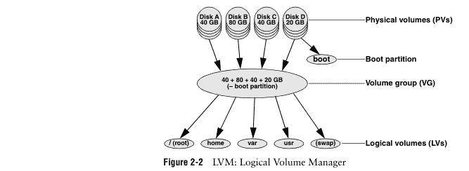

LVM 还减轻了存储迁移的负担。当你超出了 PV 的容量或需要升级它们时，LVM 可以在不中断用户的情况下将数据移动到新 PV 中。如需阅读更多关于 LVM 的内容，请参考第 48 页“更多信息”下的资源列表。

## 安装过程

以下步骤概述了使用 Anaconda 从安装 DVD 安装 Fedora/RHEL 的过程。从其他介质安装遵循类似的步骤。有关安装的具体操作，请参见第 3 章。

- 将安装 DVD 插入计算机，然后开机或重置计算机。
- 在通过特定于计算机的硬件诊断后，系统将显示安装 DVD 欢迎菜单（第 56 页，图 3-4）。
- 你可以从菜单中进行选择，按 TAB 键并修改启动参数，或者等待一分钟不输入任何内容；计算机将从 DVD 启动安装程序。
- 作为安装过程的一部分，Fedora/RHEL 创建 RAM 磁盘，用它来替代正常启动操作所使用的硬盘。安装程序将从安装 DVD 复制安装所需的工具到 RAM 磁盘。使用 RAM 磁盘允许安装过程在规格和设计阶段运行而无需写入硬盘，并使你可以随时选择退出安装，直到系统警告你即将写入硬盘（或你完成安装）为止。如果你在此时之前退出，系统将被保留在其原始状态。R&M 磁盘还允许从 Live CD 引导的系统保持硬盘不被触碰。
- 此时你可以检查安装介质。
- Anaconda 安装程序会询问你一些关于如何配置 Fedora/RH&M 的问题，探测硬件，启动 X 窗口系统进行图形化安装，然后收集更多关于你想如何安装 Fedora/RH&M 的信息。
- 当 Anaconda 完成信息收集时，它将操作系统文件写入硬盘。


当你重新启动系统时，`Firstboot`会询问一些完成安装所需的问题（第 66 页）。

`Fedora/RH&M`系统已准备好使用。

### 介质：源数据在哪里？

当你安装`Fedora/RH&M`时，你会将操作系统文件从源——通常是`CD/DVD`——复制到目标计算机的硬盘。包含你用来刻录`CD/DVD`的数据的文件被称为*ISO 镜像文件*。它们以定义数据存储方式的标准（`ISO 9660`）命名。这些文件有多种来源。

#### `CD`或`DVD`

`Red Hat Enterprise Linux DVD`由`Red Hat`及其分销商销售。`Red Hat Enterprise Linux`的`ISO`镜像文件可通过订阅`Red Hat Network`获取。你可以从`Red Hat`网站下载 30 天的`RH&M`评估副本。另请参见“检查和刻录`CD/DVD`”（第 45 页）。

本书包含安装`Fedora`所需的`DVD`（即安装`DVD`）。或者，你可以从第三方供应商购买`Fedora CD/DVD`，或者你可以下载`Fedora ISO`镜像文件，然后从镜像安装或刻录`CD/DVD`（下一节）。

#### 硬盘

如果目标系统已经运行`Linux`，你可以将`ISO`镜像文件存储在目标系统的硬盘上。你可以使用第一个安装`CD`、`Net Boot CD`、安装`DVD`或`USB`闪存盘引导系统以进行硬盘安装。有关更多信息，请参见第 70 页的*asmkmethod*。或者，你可以使用预升级（第 30 页）从运行`Fedora`的系统的硬盘进行安装。

## 网络

`ISO`镜像文件可以通过服务器系统访问，你在安装`Linux`的机器可以通过网络连接到该服务器。你可以使用`FTP`、`NFS`或`HTTP`进行网络安装。然而，除非你拥有快速的`Internet`连接，否则不建议通过`Internet`进行安装，因为这可能需要很长时间；下载`ISO`镜像文件是一个更可靠且可能更令人放心的选择。你可以使用第一个安装`CD`、`Net Boot CD`、安装`DVD`或`USB`闪存盘引导系统以进行网络安装。有关更多信息，请参见第 70 页的**askmethod**或第 71 页的**method**。

你也可以使用`PXE`（预启动执行环境）引导系统，然后使用上述方法之一安装`Linux`。有关`PXE`的信息来源，请参见第 48 页的“更多信息”。

## 下载`CD/DVD`（`FEDORA`）

你可以下载`ISO`镜像文件并刻录`Fedora CD/DVD`。虽然你不会得到伴随`Red Hat Enterprise Linux`的客户支持，但如果你采取这种方式，你不需要向`Red Hat`付费。自由软件（附录 D）的一个美点在于它始终免费提供。`Fedora Project`通过在线提供其`CD/DVD`的`ISO`镜像文件，使获取和使用`Fedora`变得容易。这些文件很大——`CD`几乎 700 兆字节，`DVD`几乎 4 吉字节——因此下载它们可能需要很长时间。

本节告诉你如何找到你需要的文件，使用几种不同的技术下载它们，检查它们是否正确下载，并将它们刻录到`CD/DVD`上。

**你必须使用 700 兆字节`CD-ROM`空白盘**

> 当你从`ISO`镜像文件刻录`Fedora CD`时，必须使用 700 兆字节的空白盘。较小的 650 兆字节空白盘将不起作用，因为数据太多无法容纳。

有几种方法可以获得`Fedora CD/DVD`。`Fedora Project`提供`Linux`发行版作为`CD`和`DVD ISO`镜像文件。本节描述如何下载这些镜像文件之一并刻录`CD/DVD`。你还可以通过邮政邮件订购`CD/DVD`并收到它：将浏览器指向 **fedoraproject.org/get-fedora**；在页面底部，**网速慢？没有 Internet？**下方，有链接允许你向`Fedora Project`请求免费`CD`或从商店或网站购买`CD/DVD`。

## 下载`CD ISO`镜像文件的最简单方法

本节解释了下载`CD ISO`镜像文件的最简单方法。这种技术在大多数情况下都适用。

## 图 2-3

`fedoraproject.org/get-fedora`网页

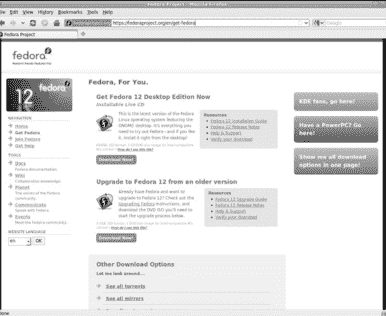

首先，将浏览器指向 `fedoraproject.org/get-fedora`。您可以选择`Fedora`桌面版（Live 介质）或升级到`Fedora`（安装介质）。参见图 2-3。有关更多信息，请参见第 24 页的“桌面 Live CD 和安装 DVD”。

下载`ISO`映像文件最简单的方法是直接下载。例如，要下载针对`Intel` 32 位处理器的桌面 Live CD（参见第 26 页的“处理器架构”），请单击页面`Fedora`桌面 Live 介质部分的`Direct Download`下的 `i686 – Live CD`。接下来，单击 `Download Now` 或 `OK`。如果浏览器询问如何处理该文件，请将其保存到硬盘。浏览器会将`ISO`映像文件保存到硬盘。请继续阅读第 45 页的“检查和烧录`CD/DVD`”。

## 寻找用于下载的镜像站点

如前一节所述，您可以从 `fedoraproject.org/get-fedora` 下载 `CD/DVD ISO`映像文件。其他（镜像）网站也维护着这些映像。您可以使用 Web 浏览器或 `FTP` 客户端从这些网站之一下载文件。或者，您可以使用 `BitTorrent` 下载 `ISO` 映像文件；参见第 44 页。

### 镜像站点

通过指向 `mirrors.fedoraproject.org` 来定位镜像站点。在标题信息下方，页面显示 `Public Active Mirrors`。通过单击页面右上角的 `Mirror list filter` 中的选择来缩小范围（图 2-4）。例如，单击 12 以列出您可以从中下载

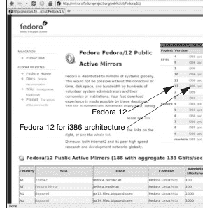

## 图 2-4

`mirrors.fedoraproject.org` 网页

`Fedora 12` 的站点，或者单击以 12 开头的行中的 **i386**，以列出您可以从中下载 `Fedora 12 i386` 版本的站点。

该网页上的列表按国家代码顺序排列。例如，`FR` 代表法国，`US` 代表美国。为了节省网络带宽，请滚动到离您较近的镜像站点并从中下载。查看 `Content`、`Bandwidth` 和 `Comments` 列。选择合适站点的一行，并单击 `Content` 列中您想使用的协议。对于浏览器来说，**FTP** 和 **HTTP** 协议之间几乎没有区别，尽管使用 **FTP** 访问站点可能会稍快一些。

当您单击某个协议时，浏览器会显示一个类似于图 2-5（下一页）所示的页面。按照以下步骤下载您想要的 `ISO` 映像文件：

- 1. 单击 **releases**。浏览器将显示从 `Fedora 7` 开始的 `Fedora` 发行版列表。
- 2. 单击您要下载的 `Fedora` 发行版的编号。浏览器将显示一个包含 **Fedora** 和 **Live** 的列表。
- 3. 如果要下载 `Live CD`，请单击 **Live**；如果要下载安装 `DVD`，请单击 **Fedora**。请确保硬盘上有足够的空间容纳该文件：`DVD ISO` 映像文件占用近 4 千兆字节。
- 4. 单击您想要在其上安装 `Fedora` 的体系结构（第 26 页）：针对 32 位系统选择 **i386** 或 **i686**，针对 64 位系统选择 **x86_64**。对于 `PowerPC` 系统，请单击 **ppc**。

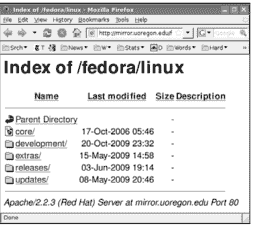

## 图 2-5

一个 `Fedora` 镜像站点

- 5. 如果您正在下载安装 `ISO` 映像，请单击 `iso`。如果您正在下载 `Live CD`，请转到下一步。
- 6. 下载 `CHECKSUM` 文件。
- 7. 单击您要下载的 `ISO` 映像文件的名称，并选择下载（而不是安装）该映像。`Live` 提供 `Fedora-12-i686-Live.iso`，它可以运行并安装 `Fedora/GNOME` 桌面。`Fedora-12-Live-i686-KDE.iso`，它可以运行并安装 `KDE` 桌面。`Fedora` 提供下载安装 `DVD ISO` 映像文件、安装 `CD ISO` 映像文件或网络安装 `CD ISO` 映像文件的选择。

## 使用 `BITTORRENT` 下载 `CD/DVD ISO` 映像文件

当您使用 Web 浏览器下载文件时，浏览器会联系 Web (`HTTP`) 或 `FTP` 服务器并从该服务器下载文件。如果太多人在同一时间从服务器下载文件，下载速度会变慢。


BitTorrent 高效地分发大量静态数据，例如 ISO 映像文件。与使用浏览器从单个服务器下载文件不同，BitTorrent 将服务器的功能分布在其客户端上。随着每个客户端下载文件，它也会成为其已下载文件部分的服务器。要使用 BitTorrent，您必须下载一个名为 `torrent` 的小文件（或者让 Web 浏览器为您执行此操作）。该文件包含允许客户端相互通信的信息，其文件名扩展名为 `.torrent`。随着更多人同时使用 `torrent` 下载文件，下载速度会变快。

由于 BitTorrent 适用于 Windows、Mac OS X 和 Linux，因此您可以在这些任何操作系统下下载并烧录 Fedora CD/DVD。要下载 `torrent`，请将浏览器指向 `fedoraproject.org/get-fedora` 或 `torrent.fedoraproject.org`，并单击您要下载的 `torrent` 文件名。BitTorrent 客户端应自动启动并询问将下载的文件放在哪里。您

也可以手动下载 `torrent`。为此，请下载 `torrent` 而不是启动 BitTorrent 客户端。然后，您可以从命令行（第 508 页）或通过在 Nautilus 文件浏览器中单击该文件（第 98 页）开始下载文件。

### 您可以在任何操作系统上下载并烧录 CD/DVD

> 您可以在任何连接到互联网、拥有浏览器、硬盘上有足够空间容纳 ISO 映像文件（CD 约为 700 兆字节，DVD 约为 4 千兆字节）并能烧录 CD/DVD 的计算机上下载并烧录 CD/DVD。通常，您可以使用 `ftp`（第 646 页）或者在运行 GNOME 的 Linux 系统上使用 `Main menu:` `Places`⇒`Connect to Server` 代替浏览器来下载文件。

## 检查和烧录 CD/DVD

一旦您下载了 CD/DVD ISO 映像文件和 `CHECKSUM` 文件（`FEDORA`）或 MD5 校验和值（`RHEL`），下一步就是检查 ISO 映像文件是否正确。

### 检查文件

`CHECKSUM` 文件包含每个 ISO 映像文件的 SHA-256 校验和。有关 SHA 校验和的更多信息，请参见第 1105 页。当您使用 `sha256sum` 实用程序处理文件时，`sha256sum` 会根据该文件生成一个数字。如果该数字与 `CHECKSUM` 文件中对应的数字匹配，则下载的文件是正确的。使用 `-c` 选项和 `CHECKSUM` 文件的名称，`sha256sum` 会检查 `CHECKSUM` 文件中列出的每个文件。以下示例显示 DVD 正常，而 `disc1` 的 ISO 映像文件不存在：

```
$ sha256sum -c Fedora-12-i386-CHECKSUM
Fedora-12-i386-DVD.iso: OK
sha256sum: Fedora-12-i386-disc1.iso: No such file or directory
Fedora-12-i386-disc1.iso: FAILED open or read
...
```

以相同的方式检查您下载的每个 ISO 映像文件。计算大文件的 SHA-256 校验和需要一些时间。RHEL 使用 MD5SUM 值而不是 SHA-256 值；请使用 `md5sum` 实用程序代替 `sha256sum`。

### 测试 ISO 映像文件和测试 CD/DVD

> 在您使用 ISO 映像文件和烧录的 CD/DVD 安装 Fedora/RHEL 之前测试它们是个好主意。当您从 CD/DVD 启动系统时，Fedora/RHEL 会提供检查 CD/DVD 缺陷的选项（第 53 页和第 57 页）。CD/DVD 上的坏文件可能直到您完成 Fedora/RHEL 安装并使其运行后才显现出来。到那时，找出问题所在可能会变得困难且耗时。测试文件和 CD/DVD 只需几分钟，但如果某些地方不对劲，它可以为您节省数小时的麻烦。如果您只想进行一次测试，请测试 CD/DVD。

## 烧录 CD/DVD

ISO 映像文件是 CD/DVD 上所需内容的精确映像。将该映像放入 CD/DVD 涉及的过程与将文件复制到 CD/DVD 不同。您使用的 CD/DVD 烧录软件有一个专门用于烧录 ISO 映像文件的选项。其标签类似于 `Record CD from CD Image` 或 `Burn CD Image`。有关如何将 ISO 映像文件烧录到 CD/DVD 的信息，请参见您正在使用的软件的说明。

**确保软件设置为烧录 ISO 映像文件**

> > `tip`
>
> > 烧录 ISO 映像文件与将文件复制到 CD/DVD 不同。请确保 CD/DVD 烧录软件设置为烧录 ISO 映像文件。如果您只是将 ISO 映像文件复制到 CD/DVD，当尝试安装 Fedora/RHEL 时将无法工作。

## 安装 DVD 的救援选项

`Rescue mode` 您可以使用第一个安装 CD、Net Boot CD 或安装 DVD 使系统以救援模式启动。关于使系统以救援模式启动和运行的讨论见第 411 页。

## 收集系统信息

安装并启动 Fedora/RHEL 系统并不困难。然而，您在开始前对安装过程的了解越多，安装就越容易。安装软件会收集系统信息，并可以帮助您在安装过程中做出决策。但是，当您知道希望如何分区磁盘，而不是让安装程序在没有您输入的情况下创建分区时，系统运行得会更好。有许多细节，您掌握的控制越多，您对最终产品的满意度就越高。找到本节要求的信息将有助于确保您最终获得一个您理解并且在必要时知道如何修改的系统。在越来越大的程度上，安装软件会探查硬件并弄清楚您拥有什么。新设备比旧设备更有可能自我报告。

在开始前掌握某些信息至关重要。Linux 永远无法自行推导出的事情是所有相关的名称和 IP 地址（除非您正在使用 DHCP，在这种情况下，地址已为您设置好）。

以下是您可能需要相关信息的列表。在开始安装 Linux 之前，请尽可能多地收集每个条目的信息：制造商、型号、大小（兆字节、千兆字节等）、按钮数量，

芯片组（用于板卡）等。某些项目，例如网络接口卡，可能已集成到主板中。

- 硬盘。
- 内存（您可能需要此信息来计算交换分区的大小）。
- SCSI 接口卡。
- 网络接口卡（NIC）。
- 视频接口卡（包括视频 RAM/内存容量）。
- 声卡及其与标准的兼容性（例如 SoundBlaster）。
- 鼠标（PS/2、USB、AT 以及按钮数量）。
- 显示器（尺寸和最大分辨率）。
- IP 地址和名称，除非您使用 DHCP（第 451 页），在这种情况下 IP 地址会自动分配给系统。大部分信息来自系统管理员或 ISP。
    - 系统主机名（您可以随意命名）
    - 系统地址
    - 网络掩码（`netmask`）
    - 网关地址（连接到网络或 Internet 的连接点）或使用拨号连接时的电话号码
    - 域名服务器地址，也称为 DNS 地址
    - 域名（非必需）

## 查找安装手册

关于如何安装 Fedora/RHEL 的指令的权威资源，是与您正在安装的发行版及平台相对应的《安装指南》。您可以在以下网站查看或下载安装指南：

- `FEDORA` 访问 `docs.fedoraproject.org`，并在“Installation Guide”下选择各种格式和语言版本。
- `RHEL` 访问 `www.redhat.com/docs/manuals/enterprise`。Red Hat 在 `www.redhat.com/apps/support` 提供其他安装、配置和故障排除资源。您还可以使用大多数 Red Hat 网页右上角标记为“Search”的搜索框搜索关键词或词语。

## 更多信息

- 本地：`lvm` man 页，包括底部列出的“参见”页面
- 网络：
    - Fedora 主页：`fedoraproject.org`
    - Fedora 文档：`docs.fedoraproject.org`
    - Linux 专用搜索引擎：`www.google.com/linux`
    - SELinux：请参阅 `docs.fedoraproject.org` 中的 SELinux 条目
    - X.org：`wiki.x.org`
    - `memtest86+`：`www.memtest.org`
    - 硬件兼容性：`hardware.redhat.com`
    - `Partition HOWTO`：`tldp.org/HOWTO/Partition`
    - `Software-RAID HOWTO`：`tldp.org/HOWTO/Software-RAID-HOWTO.html`
    - LVM 资源页面（包含许多链接）：`sourceware.org/lvm2`
    - `LVM HOWTO`：`www.tldp.org/HOWTO/LVM-HOWTO`


- BitTorrent：www.bittorrent.com、www.transmissionbt.com、azureus.sourceforge.net
- PXE：www.kernel.org/pub/pxe.html
- PXE 和 Kickstart：www.stanford.edu/~/alfw/PXE-Kickstart/PXE-Kickstart.html
- 内核引导参数：www.kernel.org/doc/Documentation/kernel-parameters.txt、www.kernel.org/pub/linux/kernel/people/gregkh/lnk/lnk_pdf/ch09.pdf；也可以在网络中搜索 `linux boot parameters`

## 下载
- Fedora 下载页面：fedoraproject.org/get-fedora
- Fedora 免费媒体计划：fedoraproject.org/wiki/Distribution/FreeMedia
- Fedora BitTorrent 追踪器：torrent.fedoraproject.org
- Fedora 镜像站：mirrors.fedoraproject.org/publist
- RHEL 源代码：ftp://ftp.redhat.com/pub/redhat/linux/enterprise/5/Server/en/os/SRPMs

## 本章总结

Live CD 可以运行 live Fedora 会话，而无需在系统上安装 Fedora。您可以从 live 会话安装 Fedora。启动 live CD 是测试硬件和修复无法从硬盘启动的系统的良好方法。

当安装 Fedora/RHEL 时，您将操作系统文件从介质复制到本地系统，并设置配置文件，使 Linux 在本地硬件上正常运行。您可以从许多类型的介质安装 Linux，包括 CD、DVD、本地硬盘，或通过访问网络的另一台系统上的硬盘。操作系统文件存储为 CD/DVD ISO 映像文件。您可以使用浏览器、FTP 或 BitTorrent 下载 ISO 映像文件。建议在下载后以及烧录 CD/DVD 后测试 CD/DVD ISO 映像文件，然后再使用它安装 Fedora/RHEL。

计划安装时需做出的主要决策是如何将硬盘划分为分区以及安装哪些软件包。如果您正在安装 RHEL，并计划使用 SELinux，请在安装 Linux 后的 Firstboot 阶段保持 SELinux 处于开启状态。由于 SELinux 会在文件上设置扩展属性，因此在 Linux 安装后再开启 SELinux 是一个耗时的过程。

安装 Fedora/RHEL 时，您可以让安装程序决定如何划分硬盘分区，也可以手动指定您想要如何划分分区。

Fedora Project 由 Red Hat 赞助并得到开源社区的支持。Fedora 是一个包含最新代码的 Linux 发行版；不建议在生产环境中使用。Red Hat Enterprise Linux 比 Fedora 更稳定。

## 练习

1. 简要说明安装像 Fedora/RHEL 这样的操作系统涉及哪些过程？
2. Anaconda 是什么？
3. 您会在服务器系统上设置 GUI 吗？为什么或不为什么？
4. 系统从硬盘启动。为了安装 Linux，您希望它从 DVD 启动。如何使系统从 DVD 启动？
5. 硬盘上的空闲空间是什么？文件系统是什么？
6. 什么是 ISO 映像文件？如何将 ISO 映像文件烧录到 CD/DVD？

## 高级练习

7. 给出两个不应该使用 RAID 替代备份的原因。
8. 什么是 RAM 盘，它们在安装过程中如何使用？
9. 什么是 SHA-256？它是如何确保您下载的 ISO 映像文件是正确的？

# 3 分步安装

### 本章内容
- 运行 Fedora Live 会话 ... 52
- 从 Live 会话安装 ... 55
- 从安装 DVD 安装/升级 . 55
- Anaconda 安装程序 . 57
- 使用 Disk Druid 划分磁盘 . 71
- LVs：逻辑卷 . 73
- 设置双启动系统 . 82
- X 窗口系统 . 84

第 2 章介绍了规划 Fedora/RHEL 安装的过程：确定需求；执行升级还是全新安装；规划硬盘布局；获取安装所需的文件，包括如何下载和烧录 CD/DVD ISO 映像；以及收集系统信息。本章专注于安装 Fedora/RHEL。安装通常非常简单，特别是如果您已经做了很好的规划。有时您可能会遇到问题或处于特殊情况；本章为您提供在这些情况下使用的工具。请阅读本章所需的尽可能多的内容；一旦您安装了 Fedora/RHEL，请继续阅读第 4 章，该章涵盖使用 Fedora/RHEL 桌面的入门指南。如果您安装的是文本（命令行）系统，请参见第 5 章。

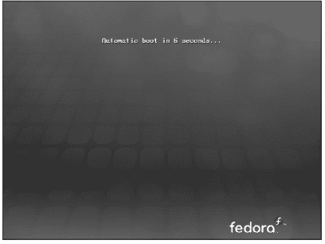

图 3-1 Live 会话，自动启动屏幕

## 运行 Fedora Live 会话

如第 2 章所述，live 会话是在未安装 Linux 的计算机上运行的 Linux 会话。在 live 会话后重启，计算机保持原样。如果您正在运行 Windows，在 live 会话后，Windows 将以 live 会话之前的方式启动。如果您愿意，可以从 live 会话安装 Fedora。Red Hat Enterprise Linux 不提供 live 会话。

Live 会话为您提供预览 Fedora 的机会而无需安装它。从 live CD 启动以开始 live 会话，并按照第 4 章的说明操作 Fedora。完成后，移除 CD 并重启系统。系统将按 live 会话发生之前的方式启动。

由于 live 会话不会写入硬盘（除了使用交换分区，如果可用的话），因此您保存的工作在重启后将无法访问。您可以使用 USB 闪存盘、网络邮件或其他方法将需要保留的文件传输到另一台系统。

## 启动系统

在 Fedora 能够显示 live 会话的桌面或在硬盘上安装自身之前，Linux 操作系统必须被读入内存（启动）。这个过程在较旧、较慢的系统以及内存（RAM）最小的系统中可能需要几分钟。

## 图 3-2 Fedora Live 欢迎菜单

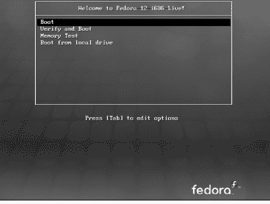

在大多数情况下，你可以从 Live CD 启动 Fedora 以运行 Live 会话，该会话会显示桌面，且在从 Live CD 启动后无需执行任何其他操作。开始时，请将 Live CD（标准的 GNOME Fedora 桌面 Live 媒体）插入 CD 光驱，并打开系统或重置系统。如果系统无法从 CD 启动，请参阅第 26 页的“BIOS 设置”。如果 Fedora 无法启动或显示错误消息，请参阅第 68 页的“修改引导参数（选项）”。

系统启动片刻后，Fedora 会显示一个屏幕，上面写着 **10 秒后自动启动**，并从 10 倒计时到 1（图 3-1）。接下来，系统会显示一个图形屏幕，其中包含一个进度条。

### 检查 CD

首次使用 CD 时，检查其是否有缺陷是个好主意。为此，在 Fedora 倒计时期间，按下一个键（如空格键）以中断自动启动。Fedora 将显示欢迎菜单（图 3-2）。使用下箭头键高亮显示 **验证并启动** 行，然后按回车键（此时鼠标尚未生效）。当 Fedora 验证 CD 内容时，会显示一个进度条；在此期间不会发生任何事情。如果 CD 正常，系统将启动。

### 内存测试

从欢迎菜单中选择“内存测试”将运行 memtest86+，这是一个适用于基于 x86 计算机的 GPL 许可的独立内存测试实用程序。按 C 键配置测试；按 ESC 键退出并重启。更多信息请参阅 www.memtest.org。

# GNOME

如果你是从 Fedora 桌面 Live 媒体（本书称为 *Live CD*）安装，那么你将安装 GNOME 桌面管理器。当你从该 CD 启动时，Fedora 会在几秒钟内显示一个登录屏幕，自动以名为 **liveuser** 的用户身份登录，并显示 GNOME 桌面（图 3-3）。为了加快此过程，当 Fedora 显示登录屏幕时，你可以点击标有 **登录** 的按钮。


## 图 3-3 GNOME Live 桌面

### KDE

如果你是从 Fedora KDE Live 媒体安装，那么你将安装 KDE 桌面管理器。当你从该磁盘启动时，Fedora 接下来会显示 KDE 启动屏幕，然后是 KDE 桌面——无需登录。

### 可选：查看正在发生的事情


如果你好奇并希望查看 Fedora 从 Live CD 启动时的执行情况，请从引导参数中移除 `quiet`（控制内核消息）和 `rhgb`（红帽图形引导，控制图形安装程序的消息）。请参阅第 68 页的图 3-13；屏幕上列出的参数将与图中显示的有所不同。当 Fedora Live 欢迎菜单显示时（图 3-2），按 `TAB` 键显示引导命令行参数。使用 `后退箭头` 键退格覆盖——但不要删除——`quiet` 右侧的任何单词。按 `BACKSPACE` 或 `DEL` 键退格覆盖并擦除引导命令行中的 `quiet` 和 `rhgb`。按 `RETURN` 键。现在，当 Fedora 启动时，它会显示关于其正在执行的操作的信息。文本会在屏幕上滚动，尽管有时速度太快而无法阅读。当你从 DVD 启动 Fedora 以及启动 RHEL 时，默认会显示这些信息：你不需要更改命令行。

## 安装 FEDORA/RHEL

你可以从 Live 会话（前节所述；仅适用于 Fedora）或从安装 DVD（适用于 RHEL/Fedora）安装 Fedora/RHEL。从 Live 会话安装更简单，但不如从安装 DVD 安装那样具有灵活性。例如，当从 Live 会话安装时，你无法选择安装程序使用的语言，也无法选择要安装哪些软件包。

在安装 Fedora/RHEL 之前检查硬盘上有什么

除非你确定正在安装 Fedora/RHEL 的硬盘上没有任何内容（它是新磁盘），或者你确定磁盘上没有有价值的信息，否则在安装开始前检查磁盘内容是个好主意。你可以使用 Live 会话中的 `partimage`（第 78 页）来实现此目的。

安装 DVD 包含 Fedora/RHEL 支持的大量软件包。你可以从该 DVD 安装任意喜欢的软件包，而无需连接互联网。但是，如果没有互联网连接，你将无法更新系统上的软件。

Live CD 包含有限的一组软件包。一旦你从这个 CD 安装，你必须连接互联网以更新系统上的软件并下载和安装额外的软件包。

要开始大多数安装，请将 Live CD 或安装 DVD 插入 CD/DVD 光驱，并打开或重置系统。对于基于硬盘和网络安装，你可以使用第一个安装 CD、网络引导 CD、安装 DVD 或 USB 闪存驱动器。

## 从 Live 会话安装

按照第 52 页的说明调起一个 Live GNOME 会话。双击（左键）标有“安装到硬盘”的对象（图 3-3）以开始安装 Linux。继续阅读第 57 页的“Anaconda 安装程序”。

## 从安装 DVD 安装/升级

要从安装 DVD 安装/升级 Fedora，请将此 DVD 插入 DVD 光驱，并打开或重置系统。片刻后，Fedora 将显示“欢迎来到 Fedora”菜单（图 3-4，见下一页）以及一条消息，内容为“60 秒后自动启动”。

在 60 秒内按下某个键（如空格键）以停止倒计时并显示“按 [TAB] 编辑选项”消息，如 图 3-4 所示。如果你不按任何键，60 秒后 Fedora 将开始图形安装/升级。如果系统无法从 DVD 启动，请参阅第 26 页的“BIOS 设置”。如果 Fedora/RHEL 无法启动或显示错误消息，请参阅第 68 页的“修改引导参数（选项）”。

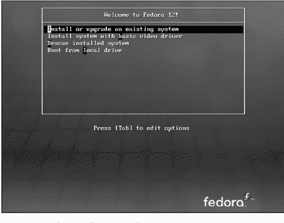

欢迎菜单具有以下选项：

- `安装或升级现有系统`

  使用图形安装程序安装图形化的 Fedora/RHEL 系统。

- `使用基本视频驱动程序安装系统`

  使用图形安装程序安装图形化的 Fedora/RHEL 系统。Fedora/RHEL 不会尝试确定连接到系统的显示器类型；它使用与大多数显示器兼容的基本视频驱动程序。如果前一个选项在“找到光盘”屏幕（第 57 页）之后不久失败，请选择此选项。

- `救援已安装系统`

  调起 Fedora/RHEL 但不安装它。在检测到系统的磁盘和分区后，系统进入救援模式，并允许你挂载现有的 Linux 文件系统。更多信息请参阅第 411 页的“救援模式”。

- `从本地驱动器启动`

  从硬盘启动系统。此选项通常具有与在没有 CD/DVD 的情况下启动系统相同的效果（具体取决于 BIOS [第 26 页] 的设置方式）。

## 开始安装

从欢迎菜单中选择一个选项，然后按 `RETURN` 键启动系统。系统在启动时文本会滚动显示。

## RHEL

安装红帽企业 Linux (RHEL) 的过程与安装 Fedora 相似。最大的区别在于两个系统显示的初始屏幕。FEDORA 显示一个菜单，而 RHEL 显示一个 `boot:` 提示符。按照屏幕上的说明安装图形模式或文本模式的 RHEL。要在救援模式（第 411 页）下启动系统，请输入 `linux rescue` 并按 `RETURN`。你在 `boot:` 提示符处输入的大多数参数都以单词 `linux` 开头。你可以使用第 68 页“修改引导参数（选项）”中讨论的所有参数，但必须以单词 `linux` 开头。按屏幕底部列出的功能键以获取更多信息。

## 光盘已找到屏幕

安装 DVD 安装过程显示的第一个屏幕是伪图形的“光盘已找到”屏幕。因为它不是真正的图形屏幕，所以鼠标不起作用。相反，你必须使用 `TAB` 或箭头键高亮显示不同的选项，然后按 `RETURN` 选择高亮显示的选项。此屏幕允许你测试尽可能多的安装 CD/DVD。选择“确定”以测试媒体，或选择“跳过”以绕过测试。请参见下面的警告框。

### 测试安装 DVD

> **注意**
>
> 许多人从网络下载 ISO 镜像文件，然后使用这些文件刻录磁盘。在获取 ISO 镜像时，数据可能会损坏；在将镜像写入可记录媒体时，也可能发生瞬态错误。当你从安装 DVD 启动 Fedora/RHEL 时，Anaconda 在开始安装之前会显示“光盘已找到”屏幕。从此屏幕，你可以验证安装 DVD 不包含任何错误。测试 DVD 需要几分钟，但如果由于媒体损坏导致安装失败，它可以为你节省几个小时的**烦恼**。

如果用于刻录磁盘的软件不包含填充，DVD 可能会在媒体测试中失败。如果 DVD 在媒体测试中失败，请尝试使用 `nodma` 参数启动。有关在引导命令行中添加参数的信息，请参阅第 68 页。

如果你使用 `nodma` 参数启动系统时，DVD 通过媒体测试，则该 DVD 是正常的；在安装 Fedora/RHEL 之前，请在不使用此参数的情况下重启系统。如果你在此参数下启动后安装 Linux，内核将设置为始终使用该参数。因此，系统的安装和运行可能会变慢。

## ANACONDA 安装程序

Anaconda 是用 Python 和 C 编写的，它识别硬件、构建文件系统，并安装或升级 Fedora/RHEL 操作系统。Anaconda 可以运行在文本或图形（默认）交互模式，或批处理模式（请参阅第 82 页的“使用 Kickstart 配置器”）。

Anaconda 具体显示哪些屏幕取决于你是从 Live 会话还是从安装 DVD 安装 Fedora，是否正在安装红帽企业 Linux，以及你在引导命令行上指定了哪些参数。除了某些例外情况——最明显的是如果你在运行文本安装——Anaconda 会探测视频卡和显示器，并启动原生 X 服务器。

Anaconda 在运行期间会打开虚拟控制台（第 137 页），如表 3-1 所示。您可以通过按下 `CONTROL-ALT-Fx` 来显示虚拟控制台，其中 x 是虚拟控制台编号，Fx 是对应于该虚拟控制台编号的功能键。

### 表 3-1 安装期间的虚拟控制台分配

| 虚拟控制台 | 安装 DVD | 实时 CD |
| :--- | :--- | :--- |
| 1 | 安装对话框 | 安装对话框 |
| 2 | Shell | 登录提示符（以 liveuser 身份登录） |
| 3 | 安装日志 | 安装日志 |
| 4 | 系统消息 | 登录提示符（以 liveuser 身份登录） |
| 5 | X 服务器输出 | 登录提示符（以 liveuser 身份登录） |
| 6 | GUI 交互式安装界面 a | 登录提示符（以 liveuser 身份登录） |
| 7 | GUI 交互式安装界面 a | GUI 交互式安装 |

a. GUI 显示在虚拟控制台 6 或 7 上。

在安装过程中的任何时间，您都可以切换到虚拟控制台 2（`CONTROL-ALT-F2`）并输入命令以查看进展情况。不要输入任何更改安装过程任何部分的命令。若要切换回图形安装屏幕，请按下 `CONTROL-ALT-F6` 或 `CONTROL-ALT-F7`。

## 使用 ANACONDA

Anaconda 在每个安装屏幕的右下角显示一个标有“Next”的按钮，在大多数屏幕上，其旁边还有一个标有“Back”的按钮。当您完成安装屏幕上的输入后，单击“Next”或按 `F12`；在文本安装中，按 `TAB` 键直到“Next”按钮高亮显示，然后按 `RETURN` 键。选择“Back”可返回到上一个屏幕。

## ANACONDA 屏幕


Anaconda 根据您输入的指令和所做的选择显示不同的屏幕。在图形安装期间，Anaconda 启动、加载驱动程序并探测将在安装期间使用的设备。探测完成后，它启动 X 服务器。本节描述 Anaconda 在默认安装期间显示的屏幕，并解释在屏幕上可做出的选择。

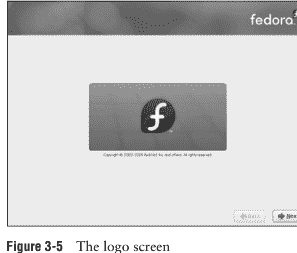

当 Anaconda 获取到启动 X 窗口系统所需的足够信息后，会显示标志屏幕（图 3-5）。在此屏幕上您无需执行任何操作。单击“Next”。

选择您希望在安装过程中使用的语言。该语言不一定与安装后的系统显示的语言相同。

RHEL 会询问您是否希望提供安装编号或跳过此步骤。有关更多信息，请参阅 [www.redhat.com/support/resources/faqs/installation_numbers](https://www.redhat.com/support/resources/faqs/installation_numbers)。

选择连接到系统的键盘类型。

如果硬盘之前未被使用过，Anaconda 会显示此警告。对话框提示可能需要初始化驱动器。初始化驱动器时，驱动器上的所有数据将会丢失。如果这是新驱动器或者您不需要驱动器上的数据，请单击“重新初始化驱动器”。Anaconda 会立即初始化硬盘。

Fedora 要求您指定系统名称。RHEL 要求在“网络配置”屏幕上提供此信息。

时区屏幕允许您指定系统所在的时区（图 2-1，第 29 页）。使用鼠标滚轮或地图左侧的滑块来放大或缩小所选地图部分，拖动水平和垂直滑块（第 1111 页）以在窗口中对地图进行定位，然后单击本地系统时区中的城市。或者，您可以滚动下拉列表并高亮显示适当的选择。如果系统时钟未设置为 UTC（第 1114 页），请取消勾选“系统时钟使用 UTC”复选框。单击“Next”。

输入并确认 root 用户（超级用户）的密码。有关 root 权限的更多信息，请参见第 405 页。单击“Next”。如果您输入的密码不是

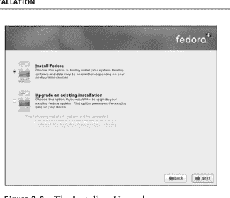

**图 3-6** 安装或升级屏幕

足够安全，Anaconda 将显示一个带有“弱密码”字样的对话框；根据实际情况，单击“取消”或“仍要使用”。

- 安装或升级（此选项在实时 CD 上不可用。）仅当 Anaconda 检测到硬盘上可升级的 Fedora/RHEL 版本时，才会显示“安装或升级”屏幕（图 3-6）。Anaconda 为您提供升级现有安装或用新安装覆盖现有安装的选择。有关此选择的帮助，请参见第 29 页的“升级现有的 Fedora/RHEL 系统与安装全新副本”。选择一个条目并单击“Next”。

- 磁盘分区 “磁盘分区”屏幕（图 3-7）允许您指定分区信息并选择要安装 Fedora/RHEL 的驱动器（假设系统有多个驱动器）。在标有“选择要用于此安装的驱动器”的框架中指定要安装 Linux 的驱动器。Anaconda 在屏幕顶部的下拉列表中提供以下选择；单击列表右端的箭头按钮，然后单击您想要的选择：

  - 使用整个驱动器——删除硬盘上的所有数据，并在整个硬盘上创建默认布局，就好像您在操作一个新硬盘一样。
  - 替换现有 Linux 系统——删除所有 Linux 分区，删除这些分区上的数据，并在其中一个或多个被删除分区的位置创建默认布局。如果硬盘上仅有一个 Linux 系统，此选择与上一选择相同。
  - 缩小当前系统——缩小已安装在硬盘上的操作系统正在使用的分区。此选择会在从已安装操作系统回收的空间中创建默认布局。
  - 使用空闲空间——在磁盘的*空闲空间*（第 30 页）中安装 Fedora/RHEL。如果没有足够的空闲空间，此选择将无法使用。
  - 创建自定义布局——不更改硬盘分区。此选择将导致 Anaconda 运行 Disk Druid（第 71 页），以便您可以保留想要保留的分区并覆盖其他分区。例如，如果您想在保留 `/home` 的同时进行干净安装而不是升级，这是一个不错的选择。

**默认布局** 前四个选择创建的默认布局包含两个逻辑卷（swap 和 root [/]）和一个标准分区（**boot**）。在此配置下，磁盘上的大部分空间分配给根分区。有关逻辑卷管理器的信息，请参见第 38 页。

勾选标有**加密系统**的复选框以加密您正在创建的文件系统。如果安装在多个磁盘上，您可以选择系统启动时使用的驱动器。请参见第 35 页的技巧。

**Disk Druid** 仅当您勾选了标有**审查和修改分区布局**的复选框，或者如前所述从下拉列表中选择了**创建自定义布局**时，Anaconda 才会运行 Disk Druid。您可以使用 Disk Druid 在写入硬盘之前验证和修改布局。有关更多信息，请参见第 71 页的“使用 Disk Druid 对磁盘进行分区”。

**警告** 如果您正在删除或格式化分区，Anaconda 将显示警告。单击**是**、**格式化**或将**更改写入**磁盘以继续。

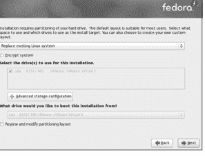

**图 3-7** 磁盘分区屏幕

# 图 3-8

引导加载程序配置屏幕

仅当您勾选了标有**审查和修改分区布局**的复选框，或在“磁盘分区”屏幕的下拉列表中选择了**创建自定义布局**时，Anaconda 才会显示“引导加载程序配置”屏幕（图 3-8）。默认情况下，Anaconda 安装 grub 引导加载程序（第 551 页）。如果您不想安装引导加载程序，请取消勾选标有**在 /dev/xxx 上安装引导加载程序**的复选框。若要更改安装引导加载程序的设备，请单击**更改设备**。当您在已运行其他操作系统的机器上安装 Fedora/RHES 时，Anaconda 通常会识别出其他操作系统并设置 grub，以便您可以从任一操作系统启动。有关设置双启动系统的信息，请参见第 82 页。若要手动将其他操作系统添加到 grub 的可启动系统列表中，请单击**添加**并指定标签和要启动的设备。为了获得更安全的系统，请指定引导加载程序密码。

实时 CD 在此时开始复制文件。有关“开始安装”的信息，请参见第 65 页。

（此窗口仅由网络安装 CD 显示。）此窗口允许您指定网络接口。有关更多信息，请参见第 64 页。

RHEL 的“网络配置”屏幕允许您指定网络配置信息，它有三个部分：网络设备、主机名和杂项设置。如果您使用 DHCP 设置网络接口，则无需在此屏幕上更改任何内容。

“网络设备”框架列出了安装程序发现的网络设备。通常，您希望网络设备在系统启动时处于活动状态。如果您*不希望*某个设备在系统启动时处于活动状态，请取消勾选该设备左侧的复选框。

若要手动配置网络设备（不使用 DHCP），请高亮显示设备并单击设备列表右侧的**编辑**。Anaconda 显示“编辑接口”窗口。若要手动设置 IPv4 网络，请单击标有**手动**的单选按钮

## 图 3-9 软件选择界面

在“启用 IPv4 支持”配置下，在相应的输入框中输入系统的 IP 地址和子网掩码。您还可以在此界面上设置或禁用 IPv6 网络。单击“确定”。

如果您未使用 DHCP，请在“网络配置”界面的“手动设置主机名”选项下，选中带有“manually”（手动）标签的单选按钮，并输入系统名称。当您在“网络设备”框架中关闭 DHCP 配置时，Anaconda 允许您指定一个网关地址以及一个或多个 DNS（名称服务器）地址。您不需要指定多个 DNS 地址，但如果首选名称服务器停止工作，拥有两个名称服务器会很有用。单击“下一步”。

## 软件选择

（如果您从 live CD 安装，此界面不会出现。）正如软件选择界面所述，默认情况下 Anaconda 安装一个基本的 Fedora 系统，包括允许您使用互联网的软件。参见图 3-9。在界面顶部有三个复选框，您可以勾选以选择要安装软件类别：办公和生产率（仅限 FEDORA；默认选中）、软件开发和 Web 服务器。

Fedora/RHEL 软件存储在软件仓库中（参见第 13 章）。在界面中部有复选框（仅限 FEDORA），您可以勾选以选择包含以下项目的仓库：

- 安装仓库—指示 Anaconda 从安装介质中包含的仓库进行安装。
- Fedora 12 - xxx—指示 Anaconda 使用在线的 Fedora 12 仓库。xxx 指示系统架构（例如，i386）。
- Fedora 12 - xxx - Updates—指示 Anaconda 使用在线的 Fedora 12 更新仓库。xxx 指示系统架构（例如，i386）。

选择最后两个选项中的任意一个，如果在安装过程中决定自定义软件选择，您将在后续步骤中获得更多的软件包可供选择。


当您在最后两个复选框中勾选时，Anaconda 显示“启用网络接口”窗口（图 3-10）。默认情况下，标有“使用动态 IP 配置（DHCP）”的复选框已被勾选。如果系统已连接到局域网，并且该网络正在使用 DHCP，请单击“确定”，Anaconda 将自动设置网络连接。否则，您必须从“接口”下拉列表中选择适当的网络，取消勾选标有“使用动态 IP 配置（DHCP）”的复选框，并指定本地系统的 IP 地址、网关地址和名称服务器地址。您的网络管理员或 ISP 应能提供此信息。单击“确定”；“启用网络接口”窗口关闭。

在“软件选择”界面的仓库选择框架下方，有标有“添加额外软件仓库”和“修改仓库”的按钮。有关软件仓库的信息，请参见第 13 章。

在界面底部有两个单选按钮：

- `稍后自定义`—安装默认包以及从此界面顶部列表中选择的执行任务所需的包。
- `立即自定义`—在单击此界面的“下一步”后，显示包选择界面（在下一节中讨论），以便您可以选择想要安装的具体软件类别和包组。如果您希望按照本书第五部分所述设置服务器，请选择`立即自定义`并在下一步中安装它们。

在大多数情况下，在安装前自定义软件选择是个好主意。无论您现在选择哪些软件组和包，只要系统可以连接到互联网，您随时都可以在系统启动并运行后更改已安装的软件组和包。

如果您选择了`立即自定义`，Anaconda 将显示一个包选择界面，该界面顶部附近有两个相邻的框架（图 3-11）。如果您在“安装仓库”之外添加了仓库，此界面将显示更多选项。从左边的框架中选择软件类别，从右边的框架中选择包组。每个包组由许多软件包组成，其中一些是强制的（基础包），另一些是可选的。

例如，要安装未默认安装的 KDE，请单击左边框架中的`桌面环境`。Anaconda 会高亮显示您的选择，并在右边框架中显示您可以安装的桌面环境列表。勾选标有`KDE（K 桌面环境）`的复选框；Anaconda 会高亮显示 KDE，在窗口底部的框架中显示关于 KDE 的信息，显示所选可选包的数量，并激活标有`可选包`的按钮。单击此按钮以选择除基础包外您想要安装哪些可选包。开始时，接受默认的可选包。如果您将在系统上运行服务器，请单击左边的`服务器`，并从右边的列表中选择要安装的服务器。以相同方式选择其他包类别。完成后，单击`下一步`；Anaconda 开始向硬盘写入数据。

## 开始安装

经过一些初步步骤后，Anaconda 根据您在之前界面中的选择安装 Fedora/RHEL，将安装日志放置在 `/root/install.log`，并将 Kickstart 文件（第 82 页）放置在 `/root/anaconda-ks.cfg`。若要更改您设置 Fedora/RHEL 的方式，您可以按 `CONTROL-ALT-DEL` 重新启动系统并重新开始。如果您重新启动系统，您将失去至此为止所做的所有工作。

安装 Fedora/RHEL 可能需要一些时间。所需时间取决于您安装操作系统所在的硬件以及您安装的软件包数量。

当 Anaconda 完成时，它会告诉您安装已完成。从 live CD 安装时会弹出光盘。如果您使用其他安装技术，您必须移除 CD/DVD（如果那是您安装所用的介质）。单击`重新启动`。

## FIRSTBOOT：当您重启时

系统重新启动后，正在运行 Fedora/RHEL。首次启动时，Fedora/RHEL 运行 Firstboot，在允许您登录之前会询问几个问题。

在欢迎界面（图 3-12）上无需执行任何操作。单击`继续`。

欢迎界面之后，Firstboot 显示许可证信息界面。如果您理解许可证信息，请单击`继续`。

接下来 RHEL 为您提供机会设置一个非常基本的*防火墙*（第 1082 页）。首先从标有`防火墙`的下拉列表中选择`启用`或`禁用`。如果启用防火墙，请选择防火墙将允许哪些服务通过到系统。这些服务是系统通过您设置的服务器提供的。例如，您不需要启用`WWW`来使用 Firefox 浏览网络；只有当您想设置 Apache (HTTP) Web 服务器时才需要启用`WWW`。选择`安全 WWW (HTTPS)`，它用于安全浏览器连接，以允许安全 HTTP 通过防火墙。单击`其他端口`左侧的三角形以打开一个框架，在其中您可以添加和删除防火墙将通过的额外协议和端口。使用标有`添加`和`删除`的按钮来操纵此列表。

有关设置防火墙的更多信息，请参见第 824 页的“JumpStart: 使用 system-config-firewall 构建防火墙”。第 25 章关于 `iptables` 的信息介绍了如何构建更完整和功能性更强的防火墙。单击继续。

**SELinux（RHEL）。** `SELinux`（安全增强型 Linux）执行限制用户或程序可执行操作的安全策略。在此界面上，RHEL 允许您选择两种策略之一：强制（Enforcing）或宽容（Permissive）。或者，您可以禁用 SELinux。如果启用 SELinux，您可以修改其策略。策略默认为强制，这会阻止任何用户或程序做不被策略允许的事情。如果您永远不想使用 SELinux，请禁用它。如果您现在不想使用它但未来可能想使用，请建立宽容策略——它发出警告但不执行策略。在已禁用 SELinux 的系统上开启它可能需要很长时间。更多信息请参见第 414 页的“SELinux”。单击继续。

**创建用户。** 下一个界面允许您设置用户帐户。更多信息请参见第 556 页的“配置用户和组帐户”。

**日期和时间。** 下一个界面允许您设置系统日期和时间。运行网络时间协议（NTP）会使系统时钟定期从互联网上的时钟进行重置。如果系统已连接到互联网，您可以通过勾选标有“通过网络同步日期和时间”的复选框来启用 NTP。单击继续。

当“日期和时间”界面关闭时，安装完成。现在您可以使用系统并按您想要的方式设置它。例如，您可能想要自定义桌面（如第 4 章和第 8 章所述）或设置服务器（如本书第五部分所述）。

## 初始化数据库和更新系统

更新 `whatis` 数据库可确保 `whatis`（第 168 页）和 `apropos`（第 167 页）工具正常工作。同样，更新 `locate` 数据库可确保 `locate` 正常工作。（`locate` 工具对系统中的文件进行索引，允许您快速且安全地搜索文件。）您不必在安装系统时更新这些数据库，可以等待 `cron`（第 565 页）运行它们，但请注意 `whatis`、`apropos` 和 `locate` 将有一段时间无法工作。更新这些数据库的最佳方式是通过每日运行的 `cron` 脚本。以 root 权限（超级用户；第 405 页）执行以下命令：

```
# /etc/cron.daily/makewhatis.cron
# /etc/cron.daily/mlocate.cron
```

这些工具运行几分钟，可能会抱怨无法找到一两个文件。当系统显示提示符时，`whatis` 和 `locate` 数据库已是最新的。

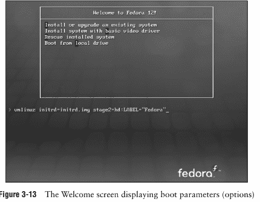

**图 3-13** 显示启动参数（选项）的欢迎屏幕

## 安装任务

本节详细介绍在软件安装期间或安装后您可能需要执行的一些常见任务。内容涵盖修改启动参数、使用磁盘向导（Disk Druid）在安装过程中对磁盘进行分区、使用 *parted* 查看和修改分区、使用逻辑卷（LV）来简化磁盘分区、使用 Kickstart 实现安装自动化，以及设置能够启动 Windows 或 Linux（双系统）的系统。

### 修改启动参数（选项）

**FEDORA** 若要修改启动参数，您必须通过按键（如空格键）来中断自动启动过程，此时 Fedora 正从 Live CD（第 52 页）或安装 DVD（第 55 页）启动并显示倒计时。当您按键后，Fedora 将显示欢迎菜单（第 53 页的图 3-2 或第 56 页的图 3-4）。请使用 *方向* 键突出显示您想要选择的选项，然后再继续操作（第 56 页）。在所需选项被突出显示后，按 TAB 键以显示启动命令行参数（图 3-13）。

**RHEL** RHEL 在您按下 TAB 键时，会显示一个 `boot:` 提示符，以替代 Fedora 显示的启动参数行。您可以输入本节中描述的任意参数以响应 `boot:` 提示符；但是，您必须在这些参数之前加上 `linux` 一词。（请参阅以下段落中的示例。）


# RHEL/FEDORA
在输入任何参数之前，请输入一个 `SPACE`（空格）。您可以通过 `SPACES`（空格）分隔来指定多个参数。按 `RETURN`（回车）以启动系统。有关启动参数的更多信息，请参阅 [www.kernel.org/doc/Documentation/kernel-parameters.txt](www.kernel.org/doc/Documentation/kernel-parameters.txt)、[www.kernel.org/pub/linux/kernel/people/gregkh/lkml/ikn_pdf/ch09.pdf](www.kernel.org/pub/linux/kernel/people/gregkh/lkml/ikn_pdf/ch09.pdf)，或位于 [fedoraproject.org/wiki/Anaconda/Options](fedoraproject.org/wiki/Anaconda/Options) 的网页。或者，您可以使用 Google 搜索 `linux boot parameters`。

## 如果安装无法正常工作该怎么办

`提示` 在某些硬件上，安装过程可能会暂停长达十分钟。在尝试其他修复方法之前，请先尝试等待一段时间。如果安装挂起，请尝试使用本节中描述的一个或多个启动参数启动系统。尝试以 `pseudo graphical`（文本）模式运行安装程序。

以下是您可以添加到启动命令行的一些参数。如果在安装过程中遇到显示问题，请提供 `nofb` 参数，以关闭视频内存。如果您正在从 DVD 以外的介质进行安装——也就是说，如果您是从本地硬盘上的文件，或使用 FTP、NFS 或 HTTP 从另一台系统上的文件进行安装——请提供 `askmethod` 或 `method` 参数。

许多这些参数可以组合使用。例如，要在 115,200 波特率、无奇偶校验、8 位终端上以文本模式安装 Linux，该终端连接到第一个串行设备，请提供以下参数（`_115200n8_` 是可选的）。第一行显示您在启动 Fedora 时输入的参数。第二行显示您在启动 RHEL 时响应 `boot:` 提示符输入的参数，包括 `linux`。

```
text console=ttyS0,115200n8 FEDORA
boot: linux text console=ttyS0,115200n8 RHEL
```

下一组参数在分辨率为 1024 × 768 的显示器上安装 Fedora/RHEL，并且不探测任何设备。安装程序会要求您指定安装数据的来源（CD、DVD、FTP 站点或其他），并要求提供视频驱动程序。

```
resolution=1024x768 noprobe askmethod FEDORA
boot: linux resolution=1024x768 noprobe askmethod RHEL
```

- `noacpi` 禁用 ACPI（高级配置和电源接口）。此参数对于不支持 ACPI 或其 ACPI 实现存在问题的系统非常有用。默认情况下启用 ACPI。也可以使用 `acpi=off`。
- `noapic` 禁用 APIC（高级可编程中断控制器）。默认情况下启用 APIC。
- `noapm` 禁用 APM（高级电源管理）。默认情况下启用 APM。也可以使用 `apm=off`。

提供安装源的选择：本地 CD/DVD 或硬盘，或通过 NFS、FTP 或 HTTP 网络安装（仅适用于第一张安装 CD、网络启动 CD 和安装 DVD）。

- `本地 CD/DVD` — 显示“找到光盘”屏幕，允许您测试安装介质（与未输入任何启动参数时相同）。
- `硬盘` — 提示输入包含安装树或安装 DVD ISO 映像的分区和目录。指定目录名称时，不要包含挂载点的名称。例如，如果 ISO 映像位于 `/home/sam/FC12` 目录中，且 `/dev/sda6` 包含通常挂载到 `/home` 的分区，则应将分区指定为 `/dev/sda6`，将目录指定为 `sam/FC12`（无前导斜杠）。
- 接下来两个选项显示“配置 TCP/IP”屏幕，您可以从中选择 DHCP 或手动配置。手动配置要求您输入系统的 IP 地址和子网掩码，以及默认网关和主要名称服务器的 IP 地址。
- `NFS 目录` — 显示“NFS 设置”屏幕，要求您输入 NFS 服务器名称以及包含安装树或安装 DVD ISO 映像的目录名称。输入服务器的 IP 地址和导出目录的 *名称*，而不是其设备名称。远程（服务器）系统必须导出（第 739 页）包含安装树或安装 DVD ISO 映像的目录层次结构。
- `URL` — 显示“URL 设置”屏幕，要求您输入包含安装树或安装 DVD ISO 映像的目录的 URL。

- `nodma` 关闭所有磁盘控制器的直接内存访问（DMA）。此参数可能会使有缺陷的控制器（或驱动程序有缺陷的控制器）更可靠，但由于连接的设备必须运行在 PIO 模式而不是 DMA 模式下，这也会导致它们的性能非常缓慢。它可能有助于测试未正确刻录的 CD/DVD。有关更多信息，请参阅第 57 页的“找到光盘屏幕”。
- `nofb`（无 `framebuffer`）关闭 framebuffer（视频内存）。如果在安装的图形阶段出现问题，此选项非常有用。
- `irqpoll` 改变内核处理中断的方式。
- `ks=URI` 指定用于控制安装过程的 Kickstart（第 82 页）文件的位置。`URI` 是 Kickstart 文件的路径名或网络位置。
- `noapic` 禁用本地 APIC。默认情况下启用本地 APIC。
- `lowres` 以 640 × 480 像素的分辨率运行安装程序。另请参阅 `resolution`。
- `mem=xxxxxx` 覆盖检测到的内存大小。将 xxx 替换为计算机中的 RAM 兆数。
- `method=URI` 指定安装方法和位置，而不像 askmethod 那样进行提示。例如，您可以使用以下参数从指定的服务器开始安装：

```
method=http://download.fedora.redhat.com/pub/fedora/linux/releases/12/Fedora/i386/os
```

- `noprobe` 禁用对所有设备的硬件探测，包括网络接口卡（NIC）、显卡和显示器。此选项迫使您从列表中选择设备。使用此参数时，您必须确切知道系统使用哪些卡或芯片。当探测导致安装挂起或以其他方式失败时，请使用 noprobe。此参数允许您为指定的每个设备驱动程序提供参数。
- `rescue` 将系统置于救援模式；详情请参见第 411 页。
- `resolution=WXH` 指定用于图形安装的显示器的分辨率。例如，`resolution=1024x768` 指定分辨率为 1024 × 768 像素的显示器。
- `text` 以伪图形（第 28 页）模式安装 Linux。虽然屏幕上的图像看起来是图形的，但它们完全由文本字符组成。
- `vnc` 通过 VNC（虚拟网络计算）远程桌面会话安装 Linux。提供 IP 地址后，您可以使用远程计算机上的 VNC 客户端远程控制安装过程。您可以从 `www.realvnc.com` 下载支持多个平台的 VNC 客户端。使用 `vnc`（第 500 页）在 Fedora/RHEL 系统上安装 vnc 软件包，以运行 VNC 客户端。
- `vncpassword=` 密码 为 VNC 连接启用密码。此选项要求您同时使用 `vnc` 选项。

## 磁盘分区

有关分区和硬盘设置的讨论，请参见第 30 页。

## 使用磁盘向导对磁盘进行分区

磁盘向导（Disk Druid）是一个图形化磁盘分区程序，可以添加、删除和修改硬盘上的分区，它是 Fedora/RHEL 安装系统的一部分。您只能在安装系统时才能使用磁盘向导；它无法独立运行。在 Fedora/RHEL 安装完成后，您可以使用 `parted`（第 78 页）、`parted`（第 568 页）或 `fdisk` 来操作分区，并使用 `system-config-lvm` 来处理逻辑卷（LV）。如前所述，如果您想要一组基本分区，可以允许 Anaconda 自动对硬盘进行分区。

当您在磁盘分区屏幕（第 61 页的图 3-7）中勾选“审阅并修改分区布局”复选框，或选择“创建自定义布局”时，Anaconda 将运行磁盘向导。

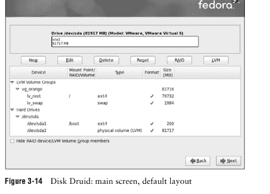

## 图 3-14 Disk Druid：主屏幕，默认布局

Disk Druid 包含一个名为 Clone 的工具，可将单个磁盘的分区方案复制到其它磁盘中。在创建具有相同分区或相同分区方案的大型 RAID 阵列时，Clone 对于制作 RAID 分区/磁盘的多个副本非常有用。点击 `RAID` 按钮即可访问 Clone 工具，该工具仅在存在至少一个未分配的 RAID 分区时激活。有关 RAID 的更多信息，请参见第 37 页。


图 3-14 展示了当为硬盘选择默认布局（参见第 60 页“磁盘分区”）时 `Disk Druid` 主屏幕的外观。该屏幕分为三个部分（从上到下）：显示每个磁盘分区情况的磁盘驱动器图形表示、一行按钮，以及每行列出一个分区或 LV 的表格。在该图中，`/boot` 分区的图形表示过小，其说明文字被其他分区覆盖。

屏幕顶部附近显示以下按钮：

- `New`—向磁盘添加新分区（第 76 页）
- `Edit`—编辑高亮的分区或 LV（均参见第 73 页）
- `Delete`—删除高亮的分区或 LV
- `Reset`—取消所做的更改，并使 `Disk Druid` 表格恢复以匹配磁盘布局
- `RAID`—允许创建软件 RAID 分区，并将两个或更多 RAID 分区组合为一个 RAID 设备（第 37 页）
- `LVM`—允许创建物理卷（PV），然后可用于创建 LV（第 38 页）

`Disk Druid` 表格包含以下列：

- `Device`—`/dev` 目录中设备的名称（例如 `/dev/sda1` 或 LV 的名称）。
- `Mount Point/RAID/Volume`—指定系统启动时分区的挂载位置（例如 `/usr`）。它还用于指定分区所属的 RAID 设备或 LVM 卷。
- `Type`—分区类型，例如 `ext4`、`swap` 或物理卷（LVM）。
- `Format`—此列中的勾选标记表示该分区将在安装过程中被格式化。分区上的所有数据都将丢失。
- `Size (MB)`—分区或 LV 的大小（以 MB 为单位）。
- `Start`—分区起始位置所在的块号。
- `End`—分区结束位置所在的块号。

屏幕底部有一个复选框，允许隐藏 RAID 设备和 LVM 卷组成员。如果希望查看有关磁盘驱动器的所有信息，请勿勾选此复选框。

## LVs：逻辑卷

当你指示 `Anaconda` 以默认布局对硬盘进行分区（参见第 60 页“磁盘分区”）时，它使用 `LVM`（第 38 页）设置大部分硬盘，创建 LV（逻辑卷）而非分区。它将 `/boot` 放置在驱动器的第一个分区上，不受 LVM 控制。LVM 创建一个名为 `vg_xxx` 的 VG（卷组），其中 `xxx` 是系统名称。在此 VG 内创建两个 LV：`root`（`lv_root`）和 `swap`（`lv_swap`）。`swap` LV 最多占用几个 GB；`root` LV 占用驱动器剩余空间。本节说明如何缩小 `root` LV，以便向 `vg_xxx` 添加额外的 LV。

如果在默认设置下（`root` LV 占用除 `swap` LV 和 `/boot` 分区外的所有磁盘空间）点击 `Disk Druid` 的 `LVM` 按钮，`Disk Druid` 会显示一个对话框，提示物理卷空间不足，建议创建新分区。由于现有分区占用了整个磁盘，因此无法创建新分区。

为了缩小 `root` LV 以为额外分区腾出空间，首先高亮显示 `root` 分区（`lv_root`），然后点击 `Edit`。`Disk Druid` 显示 `Edit`

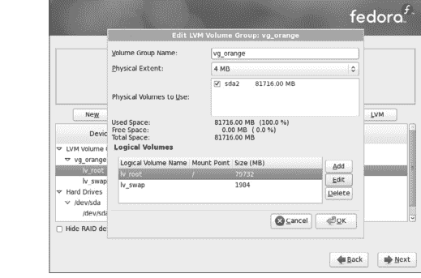

### 图 3-15 Disk Druid：编辑 LVM 卷组窗口

LVM 卷组窗口（图 3-15）。该图显示 `vg_orange`（系统命名为 `orange`）没有空闲空间（参见窗口中间的线条）。该系统上有两个 LV：没有挂载点的 `swap`，以及挂载点为 `/` 的 `root`。

在标记为 `Logical Volumes` 的框架中高亮显示 `root` LV（`lv_root`），然后点击 `Edit`。`Disk Druid` 显示“编辑逻辑卷”窗口（图 3-16），允许更改 `root` LV 的大小。用希望分配给 `root` LV 的 MB 数替换标记为 `Size (MB)` 的文本框中的数字。图 3-16 显示 `root` 分区大小被更改为 40 GB（40,000 MB）。点击 `OK`。

一旦缩小 `root` 分区大小，“编辑 LVM 卷组”窗口将显示 VG 具有空闲空间。现在可以向 VG 添加另一个 LV。点击“编辑 LVM 卷组”窗口中的 `Add` 以显示“创建逻辑卷”窗口（图 3-17）。选择 LV 的挂载点、文件系统类型和大小。如有需要可以更改 LV 名称，尽管 `Disk Druid` 分配的是易于使用的逻辑顺序名称。图 3-17 显示正在创建名为 `lv_home`、文件系统类型为 `ext4`、大小为 20 GB 的 `/home` LV。设置好 LV 后点击 `OK`。

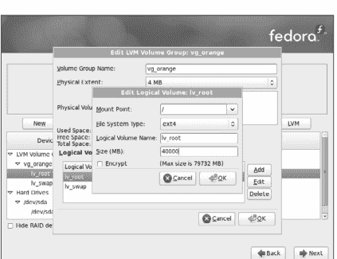

### 图 3-16 Disk Druid：编辑逻辑卷窗口

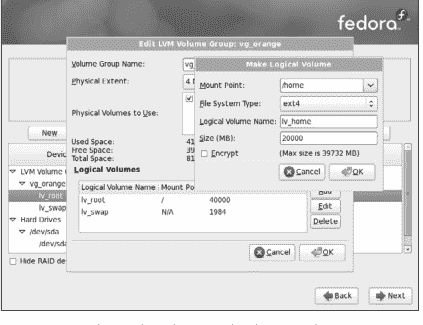

### 图 3-17 Disk Druid：创建逻辑卷窗口

## 分区

### 添加新分区

要向硬盘添加新分区，*硬盘必须有足够的空闲空间容纳该分区*；参见第 77 页“调整分区大小”。点击 `New` 按钮以添加分区。作为响应，`Disk Druid` 显示“添加分区”窗口（图 3-19）。指定挂载点（分区将挂载到的目录名称；第 32 页）和文件系统类型；使用这些框右端的箭头按钮显示下拉列表。

如果有多个驱动器可用，请在 `Allowable Drives` 框架中想要创建分区的驱动器旁边的复选框中打勾。指定分区大小，并在 `Additional Size Options` 框架中点击标记为 `Fixed` 大小的单选按钮，以创建接近指定大小的分区。由于块大小限制，最终分区通常不完全是指定大小。点击标记为 `Fill all space up to`（`MB`）的单选按钮并填入希望分区占用的最大尺寸，以创建占用现有空闲空间直至指定最大尺寸的分区。换句话说，如果 `Disk Druid` 无法按期望大小创建分区，它不会报错。点击标记为 `Fill to maximum allowable size` 的单选按钮，使分区占据磁盘上所有剩余空闲空间，无论大小如何。（如果在创建 `Fill to maximum allowable size` 分区后创建另一个分区，新分区将从现有的最大尺寸分区中拉取块。）

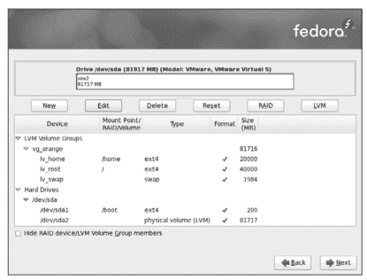

图 3-18 显示了带有新 `/home` LV 的修改后的 `Disk Druid` 主屏幕。

### 图 3-18 Disk Druid：带有新 /home LV 的主屏幕

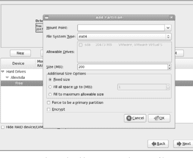

### 图 3-19 Disk Druid：添加分区窗口，ext4 文件系统

在标记为 `Encrypt` 的复选框中打勾以加密分区。在标记为 `Force to be a primary partition` 的复选框中打勾以创建主分区（第 31 页）。点击 `OK`，`Disk Druid` 将分区添加到其表格中（但不会将更改写入硬盘）。

### 编辑现有分区

要修改现有分区，请在 `Disk Druid` 表格或硬盘的图形表示中高亮显示该分区，然后点击 `Edit` 按钮；`Disk Druid` 显示“编辑分区”窗口。使用此窗口，您可以更改分区的挂载点或大小，或将分区格式化为其他类型（`ext3`、`vfat`、`swap` 等）。

## 始终备份硬盘上的数据

- **注意**
- 如果要在存有重要数据的磁盘上安装 Fedora/RHEL，请在开始安装过程之前始终备份数据。事情可能会出错，也确实会发生。安装过程中电源可能断电，导致硬盘上的数据损坏。分区软件中的 bug 可能会破坏文件系统。虽然可能性不大，但你可能会犯错误，格式化包含你希望保留的数据的分区。

### 调整分区大小

如果你有一个单分区占用整个磁盘的硬盘，例如在 Windows 系统上添加 Fedora/RHEL 以设置双启动系统时（第 82 页），你可能可以调整分区大小以安装 Fedora/RHEL。无论分区类型如何，调整分区大小的过程都相同：你可以使用以下技术调整 Windows、Linux 或其他类型分区的大小。

为了在此系统上安装 Fedora/RHEL，必须调整（缩小）分区大小以腾出空间安装 Fedora/RHEL。在调整 Windows 分区大小之前，必须启动 Windows 并使用 Windows 磁盘碎片整理程序对分区进行碎片整理；详见第 83 页的技巧。要调整分区大小，请在 `Disk Druid` 表格或硬盘的图形表示中突出显示该分区，并单击`编辑`按钮；`Disk Druid` 将显示“编辑分区”窗口。

在“编辑分区”窗口中，勾选标记为`调整大小`的复选框。然后输入想要将文件系统缩小到多大的大小（以兆字节为单位）。请确保指定的大小大于文件系统中数据所占用的空间量。单击`确定`后，`Disk Druid` 将缩小分区。

## palimpsest：GNOME 磁盘实用程序 (FEDORA)


除非你确定正在安装 Fedora/RHEL 的硬盘上没有任何数据（是一块新硬盘），或者你确信磁盘上没有有价值的信息，否则在安装开始前检查磁盘内容是个好主意。`palimpsest` 磁盘实用程序可以在 live 会话中使用，是完成这项任务的理想工具。它属于 `gnome-disk-utility` 软件包的一部分。通过选择主菜单：应用程序 → 系统工具 → 磁盘实用程序 打开 Palimpsest 磁盘实用程序窗口，如图 3-20 所示。或者，你也可以在终端模拟窗口中输入命令 `palimpsest`（第 118 页）。

`palimpsest` 实用程序会显示硬盘的布局（图 3-21）。从这个窗口中，你可以创建和删除分区。虽然可以使用 `palimpsest` 创建分区，但无法指定分区的挂载点（第 32 页）——这一步必须等到安装 Fedora/RHEL 并使用 Disk Druid 分区工具时才能完成。如果使用 `palimpsest` 检查硬盘，并使用 Disk Druid 设置安装 Fedora/RHEL 的分区，可以节省时间。

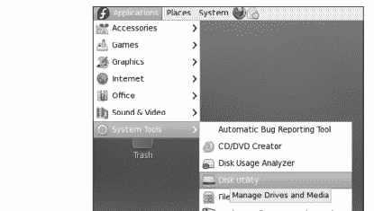

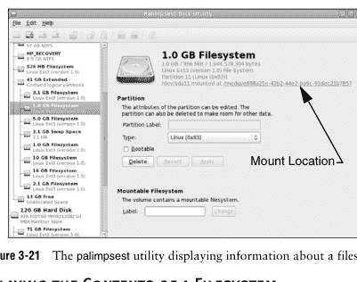

## 显示文件系统内容

要显示文件系统的内容，请在 Palimpsest 磁盘实用程序窗口中突出显示该文件系统，并单击窗口顶部附近的 `palimpsest` 工具栏中的挂载图标（最左侧）。`palimpsest` 实用程序会挂载突出显示的文件系统，并将挂载位置（图 3-21）作为链接显示。右键单击挂载位置，并从下拉菜单中选择“打开链接”。Nautilus 将在窗口中显示该文件系统（图 3-22）。除非按照第 99 页“Nautilus 的两副面孔”下的说明指示 Nautilus 始终打开“文件浏览器”窗口，否则 Nautilus 将以空间视图（第 270 页）显示文件系统。在此情况下，空间视图不会造成问题。检查完文件系统内容后，单击卸载图标（从左数第二个）以卸载文件系统。

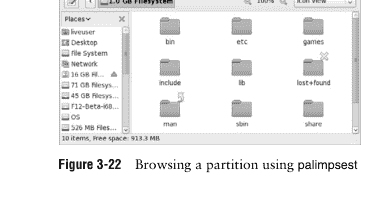

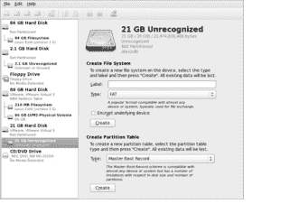

图 3-23 没有分区表的磁盘

## 删除分区

在删除分区之前，请确保其中不包含你需要保留的任何数据。若使用 `partimage` 实用程序删除分区，请突出显示想要删除的分区，并单击标记为“删除”的按钮。`partimage` 在与你确认之后，将删除该分区。

## 写入分区表

新磁盘没有分区表（第 30 页），其外观类似于图 3-23 中突出显示的磁盘。它将被标记为“未识别”。请确保突出显示的是标记为“未识别”的条目，而不是标记为“硬盘”的条目。如果你正在操作的磁盘已经有分区表，请跳至下一节。

通常你希望创建类型为 `主引导记录 (Master Boot Record)` 的分区表。在选中此类型分区的情况下，单击“创建分区表”标题下方标记为“创建”的按钮。`partimage` 在确认你真的想要创建分区表（这将使磁盘上的数据无法访问）之后，会创建该表。

## 创建分区和文件系统

创建分区表后，磁盘将被标记为 `空闲 (Free)`（空闲空间；第 30 页），你便能在空闲空间中创建包含文件系统的分区（图 3-24）。使用标记为“大小”的滑块或旁边的数字框，指定新分区的所需大小。如果你愿意，可以输入标签。接下来，指定文件系统类型；在 Fedora 下，ext4 文件系统最为常见。通常你希望拥有文件系统的所有权，因此保留 `获取文件系统所有权 (Take ownership of file system)` 复选框中的勾选。如果你想加密文件系统，请在 `加密底层文件系统 (Encrypt underlying filesystem)` 复选框中勾选。最后，单击“创建”。`partimage` 在与你确认之后，将创建文件系统。如果你没有使用所有的空闲空间，可以以相同方式创建额外的分区/文件系统。

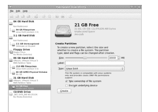

图 3-24 带有分区表的空磁盘

## 使用 SMART 显示磁盘性能信息

SMART（自监控、分析和报告技术）监控硬盘并尝试预测硬盘故障。要查看系统中某磁盘的 SMART 报告，请突出显示标记为 硬盘 (Hard Disk) 的条目，并单击 Palimpsest 磁盘实用程序窗口右侧的 更多信息 (More Information)；`palimpsest` 将显示一个类似图 3-25 的窗口。从这个窗口中，你可以运行各种自检并滚动查看窗口底部的信息。

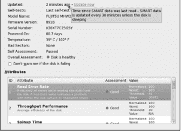

图 3-25 `palimpsest` 显示的 SMART 数据

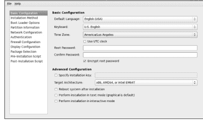

## 使用 Kickstart 配置工具

Kickstart 是一个 Fedora/RHEL 程序，它可以在一台或多台机器上完全或部分自动化安装及安装后配置过程。要使用 Kickstart，你需要创建一个单独的文件，回答安装过程中通常提出的所有问题。然后 Anaconda 将参考此文件，而不是在安装过程中向你提问。参见第 70 页的 `ks` 启动参数。使用 Kickstart，你可以自动化语言选择、网络配置、键盘选择、引导加载程序安装、磁盘分区、X 窗口系统配置以及更多操作。

`system-config-kickstart` 实用程序显示 Kickstart 配置工具窗口（图 3-26），用于创建 Kickstart 安装脚本。此实用程序是 `system-config-kickstart` 软件包的一部分，但默认未安装。你可以使用 `yum` 安装此软件包；参见第 500 页。要运行此实用程序，请在命令行中输入 `system-config-kickstart`，或选择 主菜单：应用程序 → 系统工具 → Kickstart。

图 3-26 显示了 Kickstart 配置工具显示的第一个窗口。要生成 Kickstart 文件（默认为 `ks.cfg`），请浏览此窗口的每个部分（左侧的项目）并填写答案，在适当的复选框中打勾。以 Anaconda 在安装系统时生成的 Kickstart 安装脚本（`/root/anaconda.cfg`）作为起点可能会有所帮助。单击菜单栏上的“帮助”以获取完成这些任务的说明。完成后，单击 文件 → 保存。Kickstart 配置工具会在保存文件之前给你机会审查生成的脚本。

## 设置双启动系统

`双启动` 系统是指可以启动两个（或更多）操作系统之一的系统。本节描述如何向可以启动 Windows 的系统添加 Fedora/RHEL，从而创建一个可以启动 Windows 或 Linux 的系统。你可以使用相同的技术向运行其他版本或发行版 Linux 的系统添加 Fedora/RHEL。

设置双启动系统时会出现的一个问题是寻找新 Fedora/RHEL 系统的磁盘空间。下一节讨论了创建所需空间的几种方法。

## 在 Windows 系统上创建空闲空间

通常你将在硬盘的空闲空间中安装 Fedora/RHEL。若要向 Windows 系统添加 Fedora/RHEL，必须在已包含 Windows 的硬盘上有足够的空闲空间。有几种方法可以提供或创建这种空闲空间。以下段落按从易到难的顺序讨论了这些选项。

- 添加新硬盘。向系统添加另一块硬盘，并将 Linux 安装在该新硬盘上，该硬盘仅包含空闲空间。此技术非常简单且干净，但需要一块新硬盘。
- 使用现有空闲空间。如果 Windows 磁盘上有足够的空闲空间，你可以将 Linux 安装在那里。此技术是最佳选择，但已安装的硬盘上很少有足够多的空闲空间。
- 调整 Windows 分区大小。Windows 分区通常占用整个磁盘，这就解释了为什么调整 Windows 分区大小是释放空间最常用的技术。Windows 系统通常使用 NTFS、FAT32 和/或 FAT16 文件系统。在安装 Fedora/RHEL 时，你可以调整现有的 Windows 分区。或者，你可以使用 `partimage` 实用程序检查并调整分区大小，以腾出用于安装 Linux 的空闲空间（第 77 页）。

### 调整大小前务必进行碎片整理

> 在调整 Windows 分区大小之前，必须启动 Windows 并对该 Windows 分区进行碎片整理。有时你可能需要多次运行 Windows 磁盘碎片整理程序才能整合大多数文件碎片。碎片整理不仅能为 Linux 分区提供更多空间，还可能防止双启动系统设置过程失败。


删除 Windows 分区。如果你可以删除一个足够大的 Windows 分区，就可以在其原位置安装 Linux。要删除 Windows 分区，必须在 Windows 下有多个分区，并且你愿意丢失要删除分区中的数据。在许多情况下，你可以通过将数据从要删除的分区移动到另一个 Windows 分区来保存这些数据。

一旦你确定分区中不包含有用的信息，就可以在安装 Fedora/RHEL 时将其删除。或者，你可以使用 `partimage` 将其删除（第 80 页）。删除分区后，你可以在原分区占用的空闲空间中安装 Fedora/RHEL。

## 将 FEDORA/RHEL 安装为第二个操作系统

在 Windows 系统上创建了足够的空闲空间之后（参见上一节），你可以开始安装 Fedora/RHEL。当你到达磁盘分区步骤时

screen (Figure 3-7, page 61), choose Use free space to have `Anaconda` partition the free space on the hard disk automatically. If you need to delete a Windows partition, you must choose Create custom layout; this selection calls `Disk Druid` (page 71) so you can delete the appropriate Windows partition and create Linux partitions in the free space. When you boot the system, you will be able to choose which operating system you want to run.

## THE X WINDOW SYSTEM

If you specified a graphical desktop environment such as GNOME or KDE, you installed the X.org (`x.org/wiki`) implementation of the X Window System when you installed Linux. The X Window System release `X11R7.2` comprises almost 50 software packages. The X configuration files are kept in `/etc/X11`.

### gnome-display-properties: CONFIGURES THE DISPLAY

You can use the `gnome-display-properties` (`FEDORA`) or `system-config-display` (`RHEL`) utility to display the Display Preferences window (Figure 3-27), which allows you to configure the monitor. Most users never need to run this utility. In almost all cases, Fedora/RHEL autoconfiguration sets up X.org to work properly. To run this utility, enter `gnome-display-properties` (`FEDORA`) or `gnome-config-display` (`RHEL`) on a command line or select Main menu: System➝Preferences➝Display (`Fedora`) or Main menu: System➝Administration➝Display (`RHEL`).

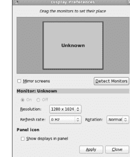

Figure 3-27 The Display Preferences window

Figure 3-27 shows the Display Preferences window, which allows you to specify the resolution for the monitor. Normally the system probes the monitor and fills in these values. If these values are missing, check the specifications for the monitor and select the appropriate values from the drop-down lists.

### MORE INFORMATION

*Web*

- X.org: www.x.org/wiki, www.freedesktop.org

- X.org FAQ: www.x.org/wiki/FAQ

## CHAPTER SUMMARY

Most installations of Fedora/RHEL begin by booting from the live CD or the install DVD. When the system boots from the CD/DVD, it displays a message saying when it will boot automatically. During the time it displays this message, you can give various commands and then have the system continue booting.

The program that installs Fedora/RHEL is named `Anaconda`. `Anaconda` identifies the hardware, builds the necessary filesystems, and installs or upgrades the Fedora/RHEL operating system. It can run in textual or graphical (default) interactive mode or in batch mode using Kickstart.

The `Disk Druid` graphical disk-partitioning program can add, delete, and modify partitions and logical volumes (`LVs`) on a hard disk during installation. The `partmpset` utility reports on and manipulates hard disk partitions before or after installation. The `system-config-lvm` utility works with logical volumes after installation.

A dual-boot system can boot one of two or more operating systems, frequently Windows and Linux. The biggest task in setting up a dual-boot system, assuming you want to add Linux to a Windows system, is finding enough disk space to hold Linux.

Fedora/RHEL uses the X.org X Window System version `X11R7.2`. Fedora/RHEL uses the GNOME display manager (`gdm`) to provide a graphical login.

### EXERCISES

- 1. What is a live system? What advantages does it have over an installed system?

- 2. Which boot parameter would you use to begin an FTP installation?

- 3. Describe the `Anaconda` installer.

- 4. Where on the disk should you put your `/boot` partition or the root (`/`) partition if you do not use a `/boot` partition?

- 5. If the graphical installer does not work, what three steps should you try?


- 6. When should you specify an `ext2` filesystem instead of `ext4`?
- 7. Describe Disk Druid.

### Advanced Exercises
- 8. When does a Fedora/RHEL system start X by default?
- 9. If you do not install `grub` on the master boot record of the hard disk, how can you boot Linux?
- 10. Why would you place `/var` at the beginning of the disk?
- 11. How does Anaconda set up a hard disk by default?

## PART II

## GETTING STARTED WITH FEDORA AND RED HAT ENTERPRISE LINUX

- CHAPTER 4

  INTRODUCTION TO FEDORA AND RED HAT ENTERPRISE LINUX 89

- CHAPTER 5

  THE LINUX UTILITIES 147

- CHAPTER 6

  THE LINUX FILESYSTEM 187

- CHAPTER 7

  THE SHELL 223

# 4

# INTRODUCTION TO FEDORA AND RED HAT ENTERPRISE LINUX

In This Chapter
- Curbing Your Power (Super-user/root Privileges) . . . . . . . . . . 90
- A Tour of the Fedora/RHEL Desktop . . . . . . . . . . . . . . . . . . . . . . . . 90
- Mouse Preferences . . . . . . . . . . . . . . . . . . . . . . . . . . . . . . . . 97
- Using Nautilus to Work with Files . . . . . . . . . . . . . . . . . . . . . . . . . . . . . 98
- The Update Applet . . . . . . . . . . . . . . . . . . . . . . . . . . . . . . . . 104
- Updating, Installing, and Removing Software Packages . . . . . . 122
- Where to Find Documentation . . . . . . . . . . . . . . . . . . . . . . . . . . . 124
- More About Logging In . . . . . . . . . . . . . . . . . . . . . . . . . . . . . . . . 132
- What to Do If You Cannot Log In . . . . . . . . . . . . . . . . . . . . . . . . . . 134
- Working from the Command Line . . . . . . . . . . . . . . . . . . . . . . . . . . . . . . . . . 138
- Controlling Windows: Advanced Operations . . . . . . . . . . . . . . . . . . . . . . . 141

One way or another you are sitting in front of a computer that is running Fedora or Red Hat Enterprise Linux. After describing `root` (Superuser) privileges, this chapter takes you on a tour of the system to give you some ideas about what you can do with it. The tour does not go into depth about choices, options, menus, and so on; that is left for you to experiment with and to explore in greater detail in Chapter 8 and throughout later chapters of this book. Instead, this chapter presents a cook's tour of the Linux kitchen: As you read it, you will have a chance to sample the dishes that you will enjoy more fully as you read the rest of this book.

Following the tour is a section that describes where to find Linux documentation (page 124). The next section offers more about logging in on the system, including information about passwords (page 132). The chapter concludes with a more advanced, optional section about working with Linux windows (page 141).

Be sure to read the warning about the dangers of misusing the powers of `root` (Superuser) in the next section. While reading that warning, feel free to experiment with the system: Give commands, create files, click objects, choose items from menus, follow the examples in this book, and have fun.

## CURBING YOUR POWER (SUPERUSER/ROOT PRIVILEGES)

While you are logged in as the user named `root`, you are referred to as Superuser or administrator; you are working with `root` privileges and have extraordinary systemwide powers. Running the `su` or `sudo` utility can give you similar privileges. When working with `root` privileges, you can read from or write to almost any file on the system, execute programs that ordinary users cannot, and more. On a multuser system you may not be permitted to know the `root` password and so may not be able to run certain programs. Nevertheless, someone— the system administrator — knows the `root` password, and that person maintains the system. When you are running Linux on your own computer, you will assign a password to `root` when you install Linux. Refer to “System Administrator and Superuser” on page 405 for more information.

Do not experiment while you are working with `root` privileges


> Feel free to experiment when you are `not` working with `root` privileges. When you `are` working with `root` privileges, do only what you have to do and make sure you know exactly what you are doing. After you have completed the task at hand, revert to working as yourself. When working with `root` privileges, you can damage the system to such an extent that you will need to reinstall Linux to get it working again.

# A TOUR OF THE FEDORA/RHEL DESKTOP

This section presents new words (for some readers) in a context that explains the terms well enough to get you started with the Linux desktop. If you would like exact definitions as you read this section, refer to “GNOME Desktop Terminology” on page 110 and to the Glossary. The Glossary also describes the data entry `widgets` (page 1115), such as the `combo box` (page 1075), `drop-down list` (page 1080), `list box` (page 1091), and `text box` (page 1110).

`GNOME` `GNOME` (www.gnome.org), a product of the GNU project (page 4), is the user-friendly default desktop manager under Fedora/RHEL. `KDE` (www.kde.org/whatis/kde), the K Desktop Environment, is a powerful desktop manager and complete set of tools you can use in place of `GNOME`.

This tour describes `GNOME`, a full-featured, mature desktop environment that boasts a rich assortment of configurable tools. After discussing logging in, this section covers desktop features — including panels, objects, and workspaces — and explains how to move easily from one workspace to another. It describes several ways to launch objects (run programs) from the desktop, how to set up the desktop to meet your needs and please your senses, and how to manipulate windows. As the tour continues, it explains how to work with files and folders using the Nautilus File Browser window, one of the most important `GNOME` tools. The tour concludes with a discussion of the Update applet, the object that allows you to keep a system up-to-date with the click of a button; getting help; and logging out.

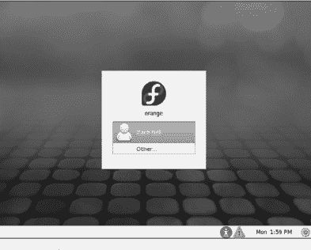

**图 4–1** Fedora GNOME 登录屏幕

## 系统登录

`Fedora` 当启动标准的 Fedora 系统时，系统控制台会显示一个登录屏幕（图 4–1）。屏幕中央是一个包含用户名列表的窗口。一旦点击您的用户名，Fedora 会显示一个标有`密码`的文本框。此外，屏幕底部有一个面板，其图标允许您切换语言、选择不同的键盘布局、更改访问偏好设置（例如，放大文本以便于阅读）、查看启动消息以及重启或关闭系统。有关更多信息，请参阅第 133 页的“登录屏幕”。

`RHEL` 当启动标准的 RHEL 系统时，系统控制台会显示一个登录屏幕。该屏幕包含一个标有`用户名`的文本框。屏幕底部有按钮，允许您切换语言、更改登录会话以及重启或关闭系统。按 F10 键可显示完整的登录选项菜单。有关更多信息，请参阅第 133 页的“登录屏幕”。

要登录，请点击您的用户名（`Fedora`）或在标有`用户名`的文本框中输入您的用户名并按下`RETURN`（回车键）（`RHEL`）。随后会出现一个标有`密码`的文本框（`Fedora`）或标签变更为`密码`（`RHEL`）。输入您的密码并按下`RETURN`。如果 `Fedora`/`RHEL` 显示错误消息，请再次尝试输入您的用户名和密码。确保`大写锁定`（CAPS LOCK）键未开启（如果开启，`Fedora`/`RHEL` 会显示消息）——验证您输入内容的程序是区分大小写的。如果您需要登录帮助，请参见第 134 页；如果您想更改密码，请参见第 136 页。系统将花费片刻时间进行设置，然后显示一个工作区（图 4-2）。

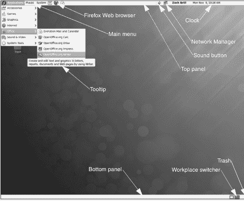

**图 4-2** 初始工作区

## 简介

您可以直接使用该桌面，也可以对其进行自定义，直到它看起来和工作起来都不像初始桌面那样为止。如果您拥有自己的计算机，您可能希望添加一个用户（第 556 页），并在实验桌面时以该用户身份工作。当您确定自己喜欢哪些功能后，可以登录为您自己并实施这些功能。这样，您就不必担心“破坏”桌面且无法恢复其到令人满意的配置状态。

登录时，`GNOME` 会显示一个工作区，其中包含顶部和底部面板（栏），它们是轻松高效地完成工作的关键（图 4-2）。每个面板都包含多个称为对象的图标和文字。（按钮、小工具和菜单都是对象的类型。）当您点击一个对象时，会发生某些事情。

面板并不会让您做其他无法做到的事情，而是将对象收集在一个地方，使您对系统的操作变得更加容易。由于面板配置简单，您可以设置它们来放置您经常使用的工具。您可以创建额外的面板来放置不同组的工具。

您在屏幕上看到的内容是一个`工作区`。最初，Fedora/RHEL 配置 `GNOME` 带有四个`工作区`。桌面（并非一次性全部显示）是所有工作区的集合。第 95 页的“切换工作区”描述了一些您可以针对工作区执行的操作。

### 暂时不要移除对象或面板

您可以随心所欲地添加和移除面板和对象。但是，在您对使用桌面感到舒适并且读完本节之前，最好不要从桌面移除任何面板或对象。

### 左键点击和右键点击

当您需要点击鼠标左键时，本书使用术语`click`（点击）；当您需要点击鼠标`右`键时，使用`right-click`（右键点击）。有关将鼠标调整为左手使用的说明，请参见第 97 页。

## 从桌面启动程序

本节介绍了从桌面启动程序运行的许多方法中的三种。

点击对象的效果取决于该对象的设计功能。点击一个对象可能会启动一个程序；显示一个菜单或文件夹；或者打开一个文件、窗口或对话框。

例如，要启动 Firefox Web 浏览器，（左）点击 Firefox 对象（顶部面板上的蓝色和橙色地球仪；参见图 4-2）。`GNOME` 会打开一个运行 Firefox 的窗口。当您使用完 Firefox 时，点击窗口顶部标题栏右侧的小 x。`GNOME` 会关闭该窗口。

当您（左）点击顶部面板右端的日期和时间时，时钟小工具会显示当前月份的日历。（在 Fedora 下，如果您在日历上双击某个日期，该对象会打开 Evolution 日历至您点击的日期——但首先您必须设置好 Evolution。）再次点击日期和时间以关闭日历。


启动程序的第二种方法是将其从菜单中选择。主菜单是顶部面板左端的一个对象，包含*应用程序、地点和系统*（Applications, Places, and System）这几个词。点击这些词中的一个以显示相应的菜单。每个包含子菜单的菜单选择在菜单名称的右侧显示一个三角形（指向右侧）（下一页的图 4-3）。当您将鼠标指针移动到这些选择项之一并在那里停留片刻（此操作称为*悬停*），菜单就会显示子菜单。当您将鼠标光标悬停在其中一个子菜单选择项上时，GNOME 会显示一个*工具提示*（第 110 页）。

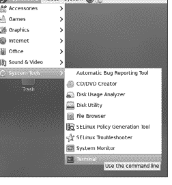

**图 4-3** 主菜单：应用程序→附件→终端

试验一下主菜单。启动 Sudoku（主菜单：应用程序→游戏→Sudoku，RHEL 默认不包含游戏）、一个终端仿真器（主菜单：应用程序→系统工具→终端 [FEDORA] 或 主菜单：应用程序→附件→终端 [RHEL]）以及应用程序菜单中的其他程序。地点和系统菜单在第 114 页讨论。

您也可以通过按下 ALT-F2 显示运行应用程序窗口（图 4-4）来启动程序。例如，当您开始在窗口顶部的文本框中输入 firefox 时，窗口会识别您输入的内容并显示 Firefox 标志以及单词 firefox 的其余部分。点击运行以启动 Firefox。

- **可选** 运行文本应用程序

您可以从运行应用程序窗口运行命令行实用程序，这些是文本式的（而非图形化的）。当您从此窗口运行文本实用程序时，您必须在标有“在终端中运行”的复选框中打勾（点击复选框以打勾；再次点击以移除勾）。该勾号告诉 GNOME 在终端仿真器窗口中运行该命令。当实用程序运行结束后，GNOME 会关闭该窗口。

例如，在文本框中输入 vim（一种基于文本的编辑器名称），在标有“在终端中运行”的复选框中打勾，并点击运行。GNOME 会打开一个终端（仿真器）窗口，并在那窗口中运行 vim 文本编辑器。当您退出 vim（依次按 ESCAPE 和 :q 来实现）时，GNOME 会关闭终端窗口。

您可以运行仅显示输出然后终止的命令行实用程序。由于窗口在实用程序运行结束后立即关闭，且大多数实用程序运行速度很快，您很可能看不到输出。在文本框中输入以下

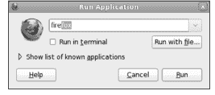

**图 4-4** 运行应用程序窗口

命令，以运行 df（磁盘剩余空间；第 729 页）实用程序，并保留窗口直到您按下 RETURN（记得在标有**在终端中运行**的复选框中打勾）：

```
bash -c "df -h ; read"
```

此命令启动一个 **bash** shell（Shell 第 7 章），执行 -c 选项后的命令行。该命令行包含两个由分号分隔的命令。第二个命令 **read**（第 937 页）会在终止前等待您按下 RETURN。因此，df -h 命令的输出会保留在屏幕上，直到您按下 RETURN。将 read 替换为 **sleep 10**，可使窗口保持打开状态十秒。

## 切换工作区

- **工作场所切换器** *工作场所切换器*（Workplace Switcher）小工具（或简称 *切换器*）中的每个矩形——位于底部面板右端附近的矩形组——代表一个工作区（第 92 页的图 4-2）。当您点击一个矩形时，切换器会显示相应的工作区并高亮该矩形，以指示当前显示的是哪个工作区。您也可以按下**CONTROL-ALT-右箭头**以显示当前工作区右侧的工作区；按下**CONTROL-ALT-左箭头**则向相反方向工作。

点击切换器中最右侧的矩形（不是其右侧的垃圾桶小工具），然后选择**主菜单：系统->首选项->鼠标**。GNOME 会打开鼠标首选项窗口。切换器中与您当前正在工作的区对应的矩形会显示一个小彩色矩形。这个小矩形在大小和位置对应于切换器矩形内的工作区窗口。用鼠标指针按住窗口顶部的标题栏上的鼠标左键不放，将窗口拖拽到桌面边缘。切换器内的小矩形会移动到切换器矩形内相应的位置。

现在点击切换器中不同的矩形并打开另一个应用程序——例如，GNOME 帮助浏览器（选择**主菜单：系统->帮助**）。当一个工作区有 GNOME 帮助浏览器窗口，另一个工作区有鼠标首选项窗口时，您可以点击切换器中相应的矩形在工作区（以及应用程序）之间来回切换。

## 右键单击显示对象上下文菜单

> **提示** 上下文菜单是根据具体上下文环境而设计的菜单。当你右键单击某个对象时，它会显示对象上下文菜单。每个对象都显示其自身的上下文菜单，尽管相似对象拥有相似的上下文菜单。大多数对象上下文菜单都包含“偏好设置”或“属性”选项。有关对象上下文菜单的更多信息，请参阅相邻章节“设置个人偏好设置”及第 119 页。

### 设置个人偏好设置

你可以为桌面上的许多对象设置偏好设置，包括面板上的对象。

- **工作区切换器：** 要显示工作区切换器偏好设置窗口（图 4-5），首先在任何位置*右键单击*切换器以显示切换器菜单，然后选择*偏好设置*。在标记为**工作区数量**的旋转框中指定你想要的工作区数量。（启用桌面特效 [第 108 页] [FEDORA] 时，窗口外观有所不同。）切换器显示的工作区数量会随着旋转框中数字的变化而变化——在你关闭偏好设置窗口之前，你可以看到操作的结果。通常四个工作区是一个不错的起始数量。单击**关闭**。

- **时钟小部件：** 时钟小部件有一个有趣的偏好设置窗口。右键单击时钟小部件（图 4-2，第 92 页）并选择*偏好设置*。GNOME 会显示时钟偏好设置窗口中的常规选项卡（在*RHE*中，此窗口没有选项卡）。此选项卡允许你自定义顶部面板上显示的日期和时间。你在该窗口中进行的更改会立即反映在时钟上。单击**位置**选项卡，然后单击**添加**按钮，输入你所在或附近城市的名称，以便时钟小部件显示天气信息。

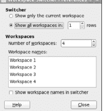

**图 4-5** 工作区切换器偏好设置窗口

不同的对象显示不同的偏好设置窗口。相比之下，启动程序的显示对象属性窗口，而没有偏好设置窗口。尝试不同的偏好设置和属性窗口，看看会发生什么。

### 鼠标偏好设置

鼠标偏好设置窗口（图 4-6）允许你更改鼠标特性以适应你的需求。要显示此窗口，请选择**主菜单：系统⇒偏好设置⇒鼠标**，或在终端模拟器或运行应用程序窗口（ALT-F2）中输入命令 **gnome-mouse-properties**。在 Fedora 下，鼠标偏好设置窗口有两个选项卡：常规和辅助功能（笔记本电脑上还有一个第三个选项卡：触摸板）。在 RHEL 下，此窗口有三个选项卡。

**左手鼠标**

选择常规或按钮选项卡。若要更改鼠标按钮的方向以便左撇子使用，请单击标记为**左手**的单选按钮。如果你更改了鼠标按钮的设置，请记得相应地重新解释本书中的描述。也就是说，当本书要求你单击左按钮或未指定要单击哪个按钮时，请单击右按钮，反之亦然。有关通过命令行更改鼠标按钮方向的信息，请参阅第 262 页的“重新映射鼠标按钮”。

**双击超时**

使用**双击超时**滑块来更改你必须双击鼠标按钮的速度，以便系统将你的动作识别为双击而非两次单击。你还可以控制鼠标的加速和灵敏度。拖放阈值指定你在系统将动作视为拖放操作的一部分之前必须拖动对象的距离。

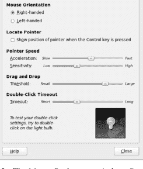

从辅助功能选项卡，你可以控制鼠标单击的不同方面。

### 处理窗口

若要调整窗口大小，将鼠标指针定位在窗口的边缘；指针会变成双向箭头。当指针是双向箭头时，你可以单击并拖动窗口的侧面。当你将鼠标指针定位在窗口的角落时，你可以同时调整窗口的高度和宽度。

若要移动窗口，请单击并拖动标题栏（窗口顶部带有窗口名称的条）。为了好玩，试着将窗口移动越过工作区的任一侧。会发生什么？结果取决于桌面特效（第 108 页）的设置方式。


在标题栏的右侧有三个用于控制窗口的图标（图 4-18，第 115 页）。单击下划线，它通常出现在图标集的左侧，会将窗口最小化（图标化），此时窗口的唯一指示就是底部面板上带有窗口名称的对象（窗口列表小部件；第 113 页）。单击窗口列表小部件可以在可见和最小化之间切换窗口。单击方框图标，它通常出现在三个图标的中间，可以在最大尺寸（最大化窗口）和正常尺寸之间切换窗口。双击标题栏也会执行相同的操作。


单击 x 会关闭窗口，通常还会终止在该窗口中运行的程序。在某些情况下，你可能需要单击几次。一些程序，如 Empathy IM 客户端，不会终止，而是继续在后台运行。处于此状态时，程序会在顶部面板的右端附近显示一个图标。右键单击该图标并从下拉菜单中选择“退出”以终止程序。

### 使用 Nautilus 处理文件


# Nautilus

Nautilus 是 GNOME 文件管理器，是一个简单而强大的文件管理器。你可以使用它来创建、打开、查看、移动和复制文件和文件夹，以及执行程序和脚本。它最基本和最重要的功能之一是创建和管理桌面。本节介绍 Nautilus 并展示 Nautilus 与桌面之间的对应关系。有关 Nautilus 的更详细信息，请参阅第 264 页。


Nautilus 显示文件浏览器窗口，该窗口显示文件夹的内容。*文件夹*和*目录*这两个词是同义词；“文件夹”经常用于图形环境中，而“目录”可能用于文本或命令行环境中。本书互换使用这些术语。

- **术语：文件浏览器** 本书有时使用*文件浏览器窗口*和*文件浏览器*这两个术语来指代 Nautilus 文件浏览器窗口。

在文件浏览器窗口中双击某个对象的效果与在桌面上双击该对象相同：Nautilus 会对该对象采取适当的操作。例如，当你双击一个文本文件时，Nautilus 使用文本编辑器打开该文件。当你双击一个 OpenOffice.org 文档时，Nautilus 使用 OpenOffice.org 打开该文件。如果文件是可执行的，Nautilus 会运行它。如果文件是文件夹，Nautilus 会打开该文件夹并在窗口中显示其内容，替代窗口之前显示的内容。

- **FEDORA** 在 Nautilus 文件浏览器窗口中，你可以在新选项卡中打开一个文件夹。为此，中键单击该文件夹或右键单击该文件夹并从下拉菜单中选择**在新选项卡中打开**；Nautilus 会显示一个以你单击的目录命名的新选项卡。单击该选项卡以显示目录的内容。

**Nautilus：若要遵循示例，请关闭空间视图，打开文件浏览器窗口**

- **提示** 默认情况下，Fedora/RHEL 显示 Nautilus 空间视图。本书中的示例显示 Nautilus 显示文件浏览器窗口。为了使你桌面上的 Nautilus 窗口与本书中的图片中的窗口相对应，请按照“Nautilus 的两副面孔”下的说明打开 Nautilus 文件浏览器窗口。

## Nautilus 的两副面孔

Nautilus 的外观根据其设置而不同。具体来说，它可以显示*空间视图*或*文件浏览器窗口*。图 4-7 展示了每种视图的示例。默认情况下，Fedora/RHEL 设置为显示空间视图。由于空间视图不太传统，本书在示例中使用 Nautilus 文件浏览器窗口。以下步骤将文件浏览器窗口设置为 Nautilus 的默认视图：


- **图 4-7** Nautilus 空间视图（左）和文件浏览器窗口（右）

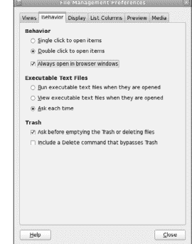

**图 4-8** 文件管理偏好设置窗口，行为选项卡，并确保屏幕上的 Nautilus 窗口看起来与本书中的相似。有关 Nautilus 空间视图的更多信息，请参见第 270 页。

若要关闭 Nautilus 空间视图并启用文件浏览器窗口：

1. 选择 **主菜单：位置 -> 主文件夹**。Nautilus 会打开一个窗口，显示主文件夹内容的空间视图（也称为主目录；第 192 页）。它的外观类似于图 4-7 左侧。
2. 在新窗口的菜单栏中，选择 **编辑 -> 偏好设置**。Nautilus 会显示文件管理偏好设置窗口。
3. 点击标记为 **行为** 的选项卡。参见图 4-8。
4. 点击标记为 **始终在浏览器窗口中打开** 的复选框。复选框中会出现一个勾选标记。
5. 点击文件管理偏好设置窗口右下角标记为 **关闭** 的按钮以关闭窗口。
6. 点击主文件夹窗口右上角的 **x** 以关闭窗口。

按照这些步骤操作后，Nautilus 将始终显示本书中所示的文件浏览器窗口。

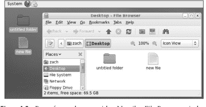

**图 4-9** 工作区的一部分，包含一个 Nautilus 文件浏览器窗口

## 桌面目录

桌面上的文件存储在一个目录中，该目录的路径名为 `/home/username/Desktop`，其中 `username` 是你的登录名，或者如果你是在实时会话中登录，则为 `liveuser`。简单的目录名称为 `Desktop`。参见第 99 页的技巧，在继续之前先关闭 Nautilus 空间视图。当你选择 **主菜单：位置 桌面** 时，GNOME 会打开一个文件浏览器窗口，显示桌面上的文件（图 4-9）。最初没有文件。（Nautilus 在浏览器窗口中不显示计算机、主目录和回收站文件；请参阅相邻的可选章节以获取解释。）如果你点击文件浏览器窗口左上角边缘的纸笔图标，位置文本框将显示 Nautilus 正在显示的目录的路径名。

> 虽然计算机、主目录和回收站文件的图标出现在桌面上，但这些文件并未存储在 `/home/username/Desktop` 目录中。因为它们不在 Desktop 目录中，所以不会显示在显示 Desktop 目录内容的 Nautilus 窗口中。这些图标出现在桌面上是因为 GNOME 配置文件的设置方式。GNOME 配置文件是位于根目录为 `/home/username/.gnconf` 的目录层次结构中的 XML（第 1116 页）文件。虽然不推荐这样做，但你可以使用 `gconf-editor` 编辑这些文件。你必须安装 `gconf-editor` 包才能使用此编辑器。有关更多信息，请参见 `projects.gnome.org/gconf`。

要查看图形化桌面与 Desktop 目录之间的对应关系，右键点击桌面文件浏览器窗口内的大片空白区域。选择 **创建文档 空文件**。Nautilus 会在桌面上创建一个新文件，并在此窗口中显示其对象。当你创建此文件时，GNOME 会高亮显示文件下方的名称 `new file`：此时你可以输入任何喜欢的名称。输入完名称后按 RETURN 键。如果你双击新文件，Nautilus 会假定它是一个文本文件并在 `gedit` 窗口中打开该文件。

`gedit` 实用程序是一个简单的文本编辑器。）输入一些文本并点击工具栏上的 **保存**。你可以通过使用文件菜单或点击标题栏右端的 x 来关闭窗口。你已经在桌面上创建了一个文本文档。你现在可以双击桌面上的文档对象或文件浏览器窗口中的文档对象来打开和编辑它。

接下来，通过右键点击根窗口（工作区的任何空白部分）并选择 **创建文件夹** 来创建一个文件夹。你可以按照之前为文件命名的方式为这个文件夹命名。该文件夹对象将出现在桌面和桌面文件浏览器窗口中。

在桌面上，拖动文件直到它位于文件夹上方；文件夹会打开。松开鼠标按钮将文件放入文件夹；GNOME 会将文件移动到文件夹中。再次在桌面上，双击你刚才移动了文件的文件夹。GNOME 会打开另一个文件浏览器窗口，这个窗口显示文件夹的内容。你移动到文件夹中的文件会出现在新窗口中。现在将文件从窗口拖动到之前打开的桌面文件浏览器窗口。文件回到了桌面上，尽管它可能被某个文件浏览器窗口遮挡。

接下来，通过选择 **主菜单：应用程序⇒办公⇒OpenOffice.org 文字处理器** 来打开一个文字处理文档。如果该程序不可用，请选择 **主菜单：应用程序⇒附件⇒gedit 文本编辑器**。输入一些文本并点击保存（软盘）图标，或选择 **菜单栏：文件⇒保存** 来保存文档。编辑器会显示保存或另存为窗口（图 4-10）。在标记为 **名称** 的文本框中输入你想要保存文档的名称（暂时使用 `memo`）。你可以通过两种方式指定保存文档的目录：使用标记为 **保存到文件夹** 的下拉列表，或使用保存窗口的 **浏览其他文件夹** 部分。

点击 **浏览其他文件夹** 左侧的三角形以打开和关闭窗口的此部分。图 4-10 显示了此部分关闭的保存窗口。在 **浏览其他文件夹** 部分关闭的情况下，你可以从标记为 **保存到文件夹** 的下拉列表中选择目录。这种方法快捷简单，但提供的文件夹选择有限。默认情况下，它会将文档保存在你的主文件夹中（`/home/username`）。如果你想将文档保存到桌面，请在此下拉列表中点击 **桌面**，然后点击 **保存**。OpenOffice.org 会保存文档，文件扩展名为 `.odt`，表示这是一个 OpenOffice.org 文字处理文档。这种类型的文件对象包含一些文本和图片。

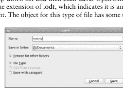

### 可选

#### 浏览/保存窗口

当打开 **浏览其他文件夹** 部分时（点击 **浏览其他文件夹** 左侧的三角形），保存窗口会使标记为 **保存到文件夹** 的下拉列表变灰，并展开 **浏览其他文件夹** 部分，如 图 4-11 所示。此展开部分包含两个并排的大列表框：**位置** 和 **名称**。标记为 **位置** 的列表框显示系统中的目录和位置，包括 **文件系统**。标记为 **名称** 的列表框列出 **位置** 中高亮显示的目录内的文件。


浏览`/path/to/xxx`目录，找到`xxx.json`。

在表达式`cvar = avar + bvar`中，加法运算符（`+`）将`avar`与`bvar`相加，得到它们的和`cvar`

在`List.of(arg0, arg1, arg2)`中，`List`接口的工厂方法`of()`接受一系列的元素，返回包含它们的只读列表。

之后我们这样调用`cmd`命令：`cmd arg0 arg1 arg2`。

```
if (condVar > someVal) {console.log("xxx")}
```


## 桌面特效（Fedora）

通过选择 **主菜单：系统设置 桌面特效** 或在终端模拟器或运行应用程序窗口（ALT-F2）中执行命令 `desktop-effects`，可以打开桌面特效窗口。该窗口允许你开启桌面特效，并从两个选项中进行选择。开启桌面特效会用 Compiz（`compiz.org`）替换 Metacity 窗口管理器，它实现了 3D 加速的桌面。最引人注目的桌面特效之一是颤动窗口：要查看此效果，请开启桌面特效，选择 **窗口移动时颤动**，并拖动窗口标题栏让窗口四处移动。如果系统出现问题，请关闭桌面特效。

### 桌面特效可能引发问题

> 开启桌面特效可能导致意外的图形伪影、缩短电池寿命，并降低 3D 应用程序和视频播放的性能。如果遇到系统问题，请尝试关闭桌面特效，看看问题是否消失。

## 会话管理

会话在你登录时开始，在你注销或重置会话时结束。对于完全符合 GNOME 规范的应用程序，GNOME 可以管理会话，使得当你登录时桌面看起来与你保存会话或注销时一样：相同的窗口将位于相同的工作区，程序状态也保持在你离开时的样子。

启动应用程序首选项窗口允许你选择每次登录时要运行的应用程序。它还允许你自动保存那些在注销时正在运行的应用程序和打开的窗口；当你再次登录时，它们将自动启动。要打开启动应用程序首选项（Fedora）或会话（RHEL）窗口，请选择 **主菜单：系统设置 启动应用程序（Fedora）** 或 **主菜单：系统设置 更多首选项 会话（RHEL）**，或者在终端模拟器或运行应用程序窗口（ALT-F2）中执行命令 `gnome-session-properties`。你必须以自己的身份登录时执行此命令（不能在以 root 权限工作时执行）。

要保存会话，请显示启动应用程序首选项窗口。点击“选项”选项卡，然后在标有 **注销时自动记住正在运行的应用程序** 的复选框中打勾。每次登录时，出现的窗口将与注销时相同。

## 获取帮助

Fedora/RHEL 提供多种形式的帮助。选择 **主菜单：系统 帮助** 会显示 GNOME 帮助浏览器，其中提供了关于桌面的信息。

要显示其他信息，请点击此窗口左侧列表中的某个主题。你也可以在标有 **搜索** 的文本框中输入要搜索的文本，然后按 **回车键**。此外，大多数窗口都提供帮助对象或菜单。有关更多资源，请参阅第 124 页的“在哪里查找文档”。

## 尽情探索

尝试从主菜单中选择不同的项目，看看你能发现什么。以下是一些你可能想要探索的应用程序：

- **gedit** 文本编辑器是一个简单的文本编辑器。选择 **主菜单：应用程序→附件→gedit 文本编辑器** 即可访问它。
- OpenOffice.org 的 Writer 是一个功能齐全的文字处理程序，可以导入和导出 Microsoft Word 文档。选择 **主菜单：应用程序→办公→OpenOffice.org Writer**。办公菜单还提供数据库、演示管理器和电子表格。如果系统中没有此应用程序，请按照第 501 页的说明安装 **openoffice.org-writer** 软件包。
- Firefox 是一个功能强大的全功能 Web 浏览器。点击顶部面板上蓝橙色的地球对象即可启动 Firefox。你也可以选择 **主菜单：应用程序→互联网→Firefox 网页浏览器**。
- Empathy 是一个图形即时消息（IM）客户端，允许你与使用 AOL、MSN 和 Yahoo! 等 IM 客户端的人在互联网上聊天。要启动 Empathy，请选择 **主菜单：应用程序→互联网→Empathy 即时消息客户端**。

第一次启动 Empathy 时，它会打开一个写着 **欢迎使用 Empathy** 的窗口。按照说明访问现有的 IM 帐户或打开一个新帐户。访问 `live.gnome.org/Empathy` 以获取更多信息。

## 注销

要注销，请选择 **主菜单：系统→注销 \underline{用户名}**。你还可以选择关闭系统。在文本环境中，请按 **CONTROL-D** 或在 shell 提示符下执行命令 `exit`。

## 充分利用桌面

GNOME 桌面是一个功能强大的工具，具有许多特性。本节涵盖了其面板、主菜单、窗口、终端模拟以及更新、安装和删除软件的方式。第 8 章将继续本章未尽的内容，讨论 X 窗口系统，更详细地介绍 Nautilus，并描述一些 GNOME 实用工具。

## GNOME 桌面术语

以下术语取自 GNOME 用户指南，为讨论 GNOME 桌面奠定了基础。第 92 页的图 4-2 显示了初始的 Fedora GNOME 桌面。

**桌面** *桌面* 包含 GNOME GUI 的所有方面。当你使用 GNOME 工作时，你正在桌面上工作。始终只有一个桌面。

**面板** 面板是出现在桌面上并容纳（面板）对象的条形。初始时有两个灰色面板：一个位于屏幕顶部（顶部边缘面板，或简称顶部面板），另一个位于底部（底部边缘面板，或简称底部面板）。你可以添加和删除面板。你可以将面板放置在桌面的顶部、底部和两侧，并且可以在这些位置中的任何一个堆叠多个面板。桌面可以没有面板、一个面板或几个面板。有关面板的更多信息，请参阅第 111 页。

**面板对象** 面板对象以文字或图标的形式出现在面板上。你可以点击这些对象来显示菜单、运行小部件或启动程序。五种类型的面板对象是小部件、启动器、按钮、菜单和抽屉。有关面板对象的更多信息，请参阅第 113 页。

**窗口** 图形应用程序通常在一个窗口内运行并显示该窗口。大多数窗口的顶部都有一个标题栏，你可以用它来移动、调整大小和关闭窗口。*根窗口* 是工作区中未被占用的区域，经常被遮挡。桌面可以没有窗口、一个窗口或许多窗口。虽然大多数窗口都有装饰（第 142 页），但有些窗口（如注销窗口）没有。

**工作区** 工作区将桌面划分为一个或多个区域，在给定时间只有一个区域填满屏幕。初始时有两个工作区。由于桌面及其上的面板和对象是桌面的特征，因此所有工作区都显示相同的面板和对象。默认情况下，窗口出现在单个工作区中。切换器（第 95 页）允许你显示几个工作区中的任意一个。

**工具提示** 工具提示（图 4-2，第 92 页）是一个微型上下文帮助系统，通过将鼠标指针移到按钮、图标、窗口边框或小部件（如面板上的那些）上并让它停留在那里来激活它。当鼠标指针悬停在对象上时，GNOME 会显示该对象的简要说明。

## 打开文件

默认情况下，你双击一个对象即可打开它；或者，你可以右键点击该对象，并从下拉菜单中选择 **打开**。当你打开一个文件时，GNOME 通过确定文件的 *MIME*（第 1094 页）类型来确定使用哪种适当的工具。GNOME 将每个文件扩展名与一种 MIME 类型相关联，并将每种 MIME 类型与一个程序相关联。初始时，GNOME 使用文件扩展名来尝试确定文件的 MIME 类型。如果它无法识别文件扩展名，它将检查文件的 *magic number*（第 1092 页）。

例如，当你打开一个扩展名为 ps 的文件时，GNOME 会调用 Evince 文档查看器，该查看器以可读格式显示 PostScript 文件。

当你打开一个文本文件时，GNOME 使用 gedit 显示该文件并允许你编辑它。当你打开一个目录时，GNOME 会在文件浏览器窗口中显示其内容。当你打开诸如 Firefox 这样的可执行文件时，GNOME 会运行该可执行文件。当 GNOME 使用错误的工具打开文件时，该工具通常会发出错误消息。有关如何使用除默认工具以外的工具打开文件的信息，请参阅第 121 页的“打开方式”。

## 面板

如前所述，面板是初始时出现在桌面顶部和底部的条形。它们是桌面的一部分，因此在工作区之间保持一致。

### 面板（上下文）菜单

右键点击面板的空白部分会显示面板（上下文）菜单。除了帮助和信息选择项外，此菜单有四个选择项。

**添加到面板** 选择“添加到面板”会显示“添加到面板”窗口（图 4-14）。你可以将对象从此窗口拖到面板上，从而可以选择该对象出现在哪个面板上。你也可以突出显示一个对象，然后点击“添加”，将该对象添加到用于显示此窗口的那个面板上。此窗口中的许多对象都很奇特：试试“眼睛”，并在其首选项窗口中选择“血眼”，或者试试“鱼”。其中一个更有用的对象是“搜索文件”。当你点击面板上的此对象时，它会显示“搜索文件”窗口（第 274 页）。

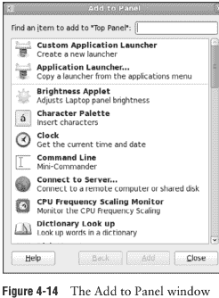


**图 4-15** 面板属性窗口，常规选项卡

选择 **属性** 将显示面板属性窗口（图 4-15）。此窗口有两个选项卡：常规和背景。


在常规选项卡中，`方向`用于选择面板出现在桌面的哪一侧；`大小`用于调整面板的宽度。`展开`使面板跨越工作区的宽度或高度；如果未勾选此复选框，则面板居中显示，且宽度刚好足以容纳其对象。`自动隐藏`使面板消失，直到您将鼠标指针触碰工作区的边缘为止。隐藏按钮的工作原理与自动隐藏不同：显示隐藏按钮会在面板的两端显示按钮。当您点击其中一个按钮时，面板会滑出视野，仅剩下一个按钮。当您再次点击该按钮时，面板会滑回原位。

如果您想了解堆叠面板的外观，请使用`方向`下拉列表更改您正在操作的面板的位置。如果您正在使用上面板，请选择`底部`，反之亦然。与偏好设置窗口类似，属性窗口没有应用和取消按钮；它们会立即实施更改。使用相同的步骤将面板放回原处即可。

面板属性窗口的背景选项卡允许您为面板指定颜色和透明度或图像。有关更改面板颜色的说明，请参见第 273 页的“拾取颜色窗口”。更改颜色后，移动标有`样式`的滑块，以使面板颜色更透明或不那么透明。如果您不喜欢该效果，请点击标有`无（使用系统主题）`的单选按钮，将面板恢复为其默认外观。点击`关闭`。

选择`删除此面板`会执行您预期的操作。请谨慎选择此项；当它删除面板时，会删除面板上的所有对象，如果您希望恢复原状，则需要重新构建面板。

选择`新建面板`会在桌面上添加一个新面板。`GNOME`决定其放置位置。然后，您可以使用新面板的面板属性窗口中常规选项卡中的`方向`将面板移动到其他地方。


图 4-16 窗口列表小部件

## 面板对象

面板上的图标和文字，称为`面板对象`，用于显示菜单、启动程序以及显示信息。带有蓝色和橙色地球仪的面板对象用于启动 Firefox。电子邮件按钮（打开的信封图标）用于启动 Evolution，这是一款电子邮件和日历应用程序（www.gnome.org/projects/evolution）。您可以使用面板对象启动系统中的几乎任何实用程序或程序。本节介绍了各种类型的面板对象。

小部件是一个小型程序，它会在面板上或旁边显示其用户界面。您可以通过其小部件面板对象与小部件进行交互。时钟（日期和时间）和工作区切换器（均在第 92 页的图 4-2 中显示）都是小部件。

虽然窗口列表小部件不是一种独立的对象类型，但它是一个独特且重要的工具。每个已打开或最小化的窗口（在显示的工作区中）会在下面板上显示一个窗口列表小部件（图 4-16）。左击此对象可将其窗口最小化，或者如果窗口已最小化，则将其恢复。右击此对象可显示窗口操作菜单（第 116 页）。如果某个窗口被其他窗口遮挡，请点击其窗口列表小部件使其可见。

当您打开启动器时，它可以执行命令、启动应用程序、显示文件夹或文件的内容、在 Web 浏览器中打开 URI 等。除了出现在面板上之外，启动器还可以出现在桌面上。Firefox 对象是一个启动器：它用于启动 Firefox 应用程序。在`主菜单：应用程序`下，您可以找到用于启动应用程序的启动器。在`主菜单：位置`下，主文件夹、文档、桌面和计算机对象是用于打开文件浏览器窗口以显示文件夹的启动器。

按钮执行单个、简单的操作。声音按钮（图 4-2，第 92 页）显示音量控制。显示桌面按钮（可能出现在下面板的左端）会最小化工作区上的所有窗口。

菜单显示您可以从中选择的选项列表。某些选择可以是包含更多选择的子菜单。其他所有选择都是启动器。下一节将讨论主菜单。

抽屉是面板的扩展。您可以在抽屉中放置与在面板上相同的对象，包括另一个抽屉。当您点击抽屉对象时，抽屉会打开；然后您可以像在面板上点击对象一样点击抽屉中的对象。

## 面板对象上下文菜单

有三个选择是面板对象上下文菜单（右击面板对象以显示此菜单）独有的。从面板中移除选择仅执行其名称所指示的功能。移动选择允许您在面板内以及移动到其他面板；您还可以通过用鼠标中键拖动对象来移动它。`锁定到面板`选择将对象锁定在当前位置，使其无法移动。当您在面板上移动对象时，它可能会穿过其他对象。如果其他对象未被锁定，必要时它可以移动该对象。`移动`选择在对象被锁定时是灰色的。

## 主菜单

主菜单出现在上面板的左侧，包括`应用程序`、`位置`和`系统`。点击其中一个词以显示相应的菜单。

`应用程序`菜单包含几个子菜单，每个子菜单以应用程序的类别命名（例如，游戏、图形、互联网、办公——列表因系统上安装的软件而异）。从子菜单中的选择会启动应用程序——浏览这些选择，将鼠标悬停在您不确定的选项上以显示相关的工具提示。

`位置`菜单包含多种启动器，其中大多数都会打开文件浏览器窗口。主文件夹、桌面和文档对象显示具有相应名称的目录。计算机、`CD/DVD`创建器和网络对象显示特殊位置。这些位置中的每一个都允许您访问文件管理功能。例如，`CD/DVD`创建器选择允许您刻录 CD 或 DVD。连接到服务器选择会打开一个窗口，允许您连接到各种类型的服务器，包括`SSH`和`FTP`服务器（参见第 268 页的“文件”）。在这些选择下方是已挂载的文件系统；点击其中一个以显示该文件系统的顶级目录。查找文件选择允许您搜索文件（第 274 页）。

`系统`菜单包含两个子菜单以及提供支持和允许您注销的选择。这两个子菜单对于配置您的账户以及设置和维护系统至关重要。

偏好设置子菜单确立了您的账户的特征；每个用户都可以设置自己的偏好设置。点击其中一些选择，以熟悉在`Fedora/RHEL`系统上定制账户的各种方式。

管理子菜单控制系统的工作方式。例如，`管理⇒打印`（第 522 页）设置和配置您可以从系统中使用的打印机，而`管理⇒添加/删除软件`允许您添加和删除软件包（第 123 页）。这些选择中的大多数都需要您输入`root`密码才能进行更改。这些菜单选择将在本书中详细讨论。

您可以将主菜单中的任何启动器复制到上面板或桌面。不要左击菜单选择，而是右击它。`GNOME`会显示一个下拉菜单，允许您将启动器添加到上面板或桌面。

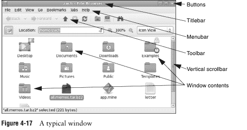

### 窗口

在工作区中，`窗口`是运行或受特定程序控制的区域（图 4-17）。由于您可以控制窗口的外观和感觉——甚至它们显示的按钮——因此您的窗口可能看起来与本书中显示的窗口不同。工作区中的每个窗口在下面板上都有一个窗口列表小部件（第 113 页）。

**标题栏** 标题栏（图 4-17 和 4-18）出现在大多数窗口的顶部，并控制其附加的窗口。您可以更改标题栏的外观和功能，但它通常至少具有图 4-18 中所示按钮的功能。

`最小化`（图标化）按钮将窗口折叠，使其存在的唯一指示是下面板上的窗口列表小部件；点击此小部件以恢复窗口。点击`最大化`按钮以扩展窗口，使其占据

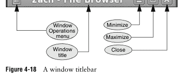

整个工作区；在最大化窗口标题栏上点击同一按钮可将窗口恢复至先前大小。你还可以通过双击标题栏来最大化或恢复窗口。点击关闭按钮会关闭该窗口，通常也会终止在其中运行的程序。若要重新定位窗口，请左击标题栏并将窗口拖拽至所需位置。

**窗口操作菜单**

**窗口操作**菜单包含了你通常需要对任何窗口执行的大多数常见操作。点击窗口操作菜单按钮，或者右键点击标题栏或窗口小部件（第 113 页），即可显示此菜单。你可以使用此菜单将窗口移动到另一个工作区，保持窗口位于其他窗口之上或之下，并让窗口始终在显示的工作区上可见。

**工具栏**

`工具栏`（图 4-17，前页）通常出现在窗口顶部附近，并包含图标、文本、小部件、菜单等。存在许多种类型的工具栏。标题栏不是工具栏；相反，它是窗口管理器（第 142 页）放置在那里作为窗口装饰的一部分。

### 更改输入焦点（窗口循环）

具有输入焦点的窗口是接收你键入的键盘字符和命令的窗口。除了使用窗口小部件（第 113 页）外，你还可以通过使用键盘更改当前工作区中哪个窗口具有输入焦点；这个过程称为`窗口循环`。当你按下`ALT+TAB`时，`GNOME`会在工作区中心显示一个包含代表工作区中窗口内运行程序图标的方框。它还将输入焦点切换到当前活动窗口之前刚处于活动状态的那个窗口，这使得在两个窗口之间轻松切换变得非常容易。当你按住`ALT`并多次按下`TAB`时，焦点会在窗口之间移动。同时按住`ALT`和`SHIFT`并反复按下`TAB`则朝相反方向循环。有关输入焦点的更多信息，请参阅第 141 页。

### 使用剪贴板剪切和粘贴对象

在桌面上以及窗口内部和窗口之间，有两种相似的对象用于剪切/复制和粘贴对象及文本。首先，你可以使用剪贴板，技术上称为`复制缓冲区`，来复制或移动对象或文本。为此，你显式地将对象或文本复制到缓冲区，然后将其粘贴到其他位置。遵循用户界面指南的应用程序使用`CONTROL-X`进行剪切，`CONTROL-C`进行复制，`CONTROL-V`进行粘贴。应用程序上下文菜单通常也提供这些相同的选项。


你可能不熟悉第二种复制和粘贴文本的方法——使用*选择*或*主*缓冲区，其中始终包含你最近选择（高亮）的文本。你无法使用此方法来复制对象。点击鼠标中键（如果鼠标有滚轮，则点击滚轮）会在鼠标指针位置粘贴选择缓冲区的内容（如果你使用的是双键鼠标，请同时点击两个按钮以模拟点击中键）。

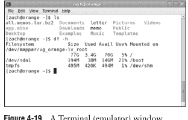

使用这两种技术时，首先通过高亮显示对象或文本来选择它。你可以拖拽一个框围绕多个对象来选择它们，或者将鼠标指针拖过文本来选择文本。双击可选择单词，三击可选择一行或一段。

接下来，若要使用剪贴板，请显式地复制（`CONTROL-C`）或剪切（`CONTROL-X`）对象或文本。^1 如果你希望使用选择缓冲区，请跳过此步骤。

要粘贴选定的对象或文本，将鼠标指针定位到你想放置的位置，然后要么按下`CONTROL-V`（剪贴板方法），要么按下鼠标中键（选择缓冲区方法）。

在使用剪贴板时，你可以在`CONTROL-C`或`CONTROL-X`与`CONTROL-V`之间输入任意数量的命令，只要你没有再次按下`CONTROL-C`或`CONTROL-X`即可。在使用选择缓冲区时，你可以在选择文本之后、粘贴之前输入其他命令，只要你没有选择（高亮）其他文本即可。

### 使用根窗口

根窗口是工作区中未被窗口、面板或对象占据的任何部分。它是工作区中可以看到背景的部分。当根窗口被遮挡时，要查看根窗口，请点击底部面板左端的“显示桌面”按钮（如果显示），以最小化工作区中的窗口。

**桌面菜单**

右键点击根窗口以显示桌面菜单，该菜单允许你创建文件夹、启动器或文档。“更改桌面背景”选项会打开“外观首选项”窗口（第 106 页）并定位到其“背景”选项卡。

^1 这些控制字符在终端模拟器窗口中不起作用，因为在该窗口中运行的 shell 会在终端模拟器接收到它们之前截获它们。你必须在此环境中使用选择缓冲区，或者使用菜单栏或上下文菜单（右键点击）中的“编辑”选项进行复制/粘贴。

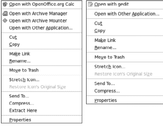

图 4-20 电子表格（左）和文本文件（右）的对象上下文菜单

### 从终端模拟器/shell 运行命令

终端模拟器是一个呈现命令行界面（CLI）的窗口；它作为文本（基于字符的）终端运行，并显示在图形环境中。

要显示名为 Terminal 的 GNOME 终端模拟器（图 4-19，前页），请选中主菜单：应用程序 ➔ 系统工具 ➔ Terminal（Fedora）。主菜单：应用程序 ➔ 附件 ➔ Terminal（RHEL），或者从“运行应用程序”窗口（`ALT-F2`）输入命令`gnome-terminal`。因为你已经登录并在桌面环境中创建了一个子 shell，所以你不需要再次登录。一旦你打开了一个终端模拟器窗口，尝试输入命令`man man`来阅读关于 man 实用程序（第 125 页）的信息，该程序用于显示 Linux 手册页。第 5 章介绍了你可以从终端模拟器运行的实用程序。

你可以在终端模拟器窗口中运行通常会在终端或控制台上运行的基于字符的程序。你也可以从此窗口启动图形程序。图形程序会打开其自己的窗口。

当你在终端模拟器窗口中打字时，几个字符，包括 $, ?, !, [ 和 ]，具有特殊含义。在你阅读第 148 页的“特殊字符”之前，请避免使用这些字符。

**Shell**

一旦你打开终端模拟器窗口，你正在与称为 shell 的命令解释器通信。Shell 在你与 Linux 的大部分通信中起着重要作用。当你在键盘上响应屏幕上的 shell 提示符输入命令时，shell 解释该命令并启动相应的操作——例如，执行程序；调用编译器、Linux 实用程序或其他标准程序；或显示错误消息，表明你输入的命令有误。当你在图形用户界面（GUI）上工作时，你绕过 shell，通过点击对象或名称来执行程序。有关 shell 的更多信息，请参阅第 7 章。

### 对象上下文菜单

当你在桌面或文件浏览器窗口中右键点击对象或对象组时，GNOME 会显示对象上下文菜单。不同类型的对象显示不同的上下文菜单，但大多数上下文菜单都包含共同的选项。图 4-20 显示了 OpenOffice.org 电子表格文件和纯文本文件的上下文菜单。表 4-1 列出了一些常见的对象上下文菜单选项。

**表 4-1 对象上下文菜单选项**

| 操作 | 描述 |
| :--- | :--- |
| 打开 | 运行可执行文件。使用适当的应用程序打开文件。在文件浏览器窗口中打开文件夹。与双击对象相同。 |
| 在新窗口中打开 | （仅在文件浏览器窗口中有效。）在新文件浏览器窗口中打开文件夹，而不是替换当前窗口内容。与在浏览器窗口中按住**shift**键同时双击文件夹相同。 |
| 使用'*App*'打开 | 使用名为*App*的应用程序打开文件。当此选项作为菜单中的第一个选项出现时，*App*是 GNOME 用于打开此类型文件的默认应用程序。有关更改此默认设置的信息，请参阅第 121 页。 |
| 使用 > 打开 | 选项右侧出现的三角形表示该选项是一个菜单。允许鼠标指针悬停在选项上以显示子菜单。每个子菜单选项都是一个“使用'*App*'打开”选项（如上所述）。子菜单中的最后一个选项是“使用其他应用程序打开”（如下所述）。 |
| 浏览文件夹 | （仅在桌面上有效。）在文件浏览器窗口中打开文件夹。与在桌面上双击文件夹相同。 |
| 使用其他应用程序打开 | 显示“使用...打开”菜单，允许你选择一个应用程序来打开此类型的文件。下次使用对象上下文菜单打开此类型文件时，你选择的应用程序将作为“使用'*App*'打开”选项（如上所述）出现。不会为此类型文件更改默认应用程序。有关更改默认应用程序的信息，请参阅第 121 页。 |
| 剪切 | 移除对象并将其放置到剪贴板上（第 116 页）。 |
| 复制 | 复制对象到剪贴板上（第 116 页）。 |
| 在此处提取 | 将归档及某些其他类型的文件（如某些文档）的内容提取到与原文件同名但带有**FILES**后缀的目录中。 |
| 制作链接 | 在与对象相同的目录中创建指向该对象的符号链接。然后你可以将链接移动到可能更有用的其他目录中。有关更多信息，请参阅第 216 页的“符号链接”。 |
| 移到回收站 | 将对象移到回收站（第 104 页）。 |
| 发送到 | 打开一个“发送到”窗口，允许你通过电子邮件发送该对象。 |
| 创建归档 | 打开“创建归档”窗口，允许你指定一个或多个对象的归档格式和名称（第 268 页）。 |
| 属性 | 显示对象属性窗口（见下一节）。 |

## 对象属性窗口

对象属性窗口显示文件的相关信息，例如文件的所有者、权限、大小、位置、MIME 类型、操作方式等。此窗口的标题为*文件名 属性*，其中*文件名*是你点击以打开该窗口的文件名称。要显示此窗口，请右键单击对象，然后从下拉菜单中选择*属性*。属性窗口最初会显示一些基本信息。点击窗口顶部的标签以显示更多信息。不同类型的文件关联着不同的标签组。只有当你拥有相应权限时，才能在此窗口中修改设置。本节描述了对象属性窗口中最常见的五个标签页。

- **基本** 基本标签页显示文件信息，包括其 MIME 类型，并允许你为文件选择自定义图标和更改其名称。在标记为**名称**的文本框中更改文件名称。如果文件名未列在文本框中，则你没有权限更改它。更改图标的一个简单方法是打开一个文件浏览器窗口，位于`/usr/share/icons`。向下浏览目录，直到找到一个你喜欢的图标，然后将其拖放到对象属性窗口基本标签页中**名称**左侧的图标上。此技术不适用于链接文件（由对象右上角的箭头徽章表示）。

- **徽章** 徽章标签页（图 4-21，左）允许你通过在徽章旁边的复选框中打勾或移除勾号，来添加或移除与文件关联的徽章。第 115 页的图 4-17 展示了一些文件对象上的徽章。Nautilus 在其图标视图和列表视图中都显示徽章，尽管列表视图中可能没有空间显示多个徽章。徽章也会显示在桌面上。你还可以通过将徽章从侧栏/徽章拖放到文件浏览器窗口的视图栏（第 265 页）中的某个对象上，来为对象添加徽章。将“擦除”徽章拖到某个对象上，即可移除该对象上的大多数徽章。

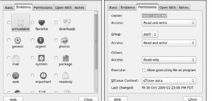

**图 4-21** 对象属性窗口：徽章标签页（左）；权限标签页（右）

### 权限

权限标签页（图 4-21，右）允许文件所有者更改文件的权限（第 203 页）以及更改文件所属的组（见第 472 页的 `/etc/group`）为所有者关联的任何组。在以**root** 权限运行时，你还可以更改文件的所有者。在终端仿真器窗口中运行命令 `su –` 随后运行命令 `nautilus`，会打开一个以**root** 权限运行的文件浏览器窗口（但请阅读第 90 页的注意事项）。Nautilus 会将你不被允许更改的项目置灰。


使用下拉列表，你可以授予所有者（在其他地方称为用户；见第 205 页关于 `chmod` 的技巧）、组和其他人读取或读写文件的权限。你可以指定权限为`无`来禁止组和其他人访问该文件。在标记为`执行`的复选框中打勾，以授予所有用户执行该文件的权限。此标签页提供的权限分配控制不如 `chmod`（第 204 页）精细。

目录的权限工作方式如第 206 页所述。所有者、组和其他人可以被允许列出目录中的文件、访问文件（读取以及——在适当权限下——执行）文件或创建和删除文件。组和其他人的权限可以设置为`无`。标记为`执行`的三态复选框不适用于目录本身，而是适用于目录中的文件。在此复选框中打勾将授予所有人对这些文件的执行访问权限；输入短横线不会更改文件的执行权限；空复选框将移除所有人对这些文件的执行访问权限。

### 打开方式

当你要求 GNOME 打开一个不可执行文件时（通过双击其图标或右键单击并选择第一个“打开方式”选项），GNOME 会确定使用哪个应用程序或工具来打开该文件。GNOME 使用几种技术来确定文件的 `MIME`（第 1094 页）类型，并基于此选择默认应用程序。

打开方式标签页（图 4-22）允许你更改 GNOME 可用于打开该文件及相同 `MIME` 类型其他文件（通常是具有相同文件名扩展名的文件）的应用程序。点击`添加`按钮以向应用程序列表添加项目。高亮显示某个应用程序并点击`移除`可将该应用程序从列表中移除。你无法移除默认应用程序。

当你添加一个应用程序时，GNOME 会将其添加到“打开方式”列表中，但不会更改用于打开该类型文件的默认应用程序。点击应用程序旁边的单选按钮可使该应用程序成为 GNOME 用于打开此类型文件的默认应用程序。

当文件的“打开方式”标签页中的应用少于四个时，对象上下文菜单将显示该菜单中的所有应用程序。如果有四个或更多应用程序，对象上下文菜单会提供一个“打开方式”子菜单（图 4-22）。

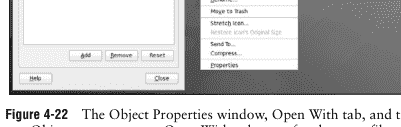

图 4-22 对象属性窗口、打开方式标签页，以及同一文件的对象上下文菜单中的“打开方式”子菜单

## 备注

备注标签页提供了一个记录文件备注的地方。

## 更新、安装和移除软件包

Fedora/RHEL 软件以软件包形式提供，包含所有必要的文件、允许程序自动安装和移除软件的指令，以及该软件包依赖的其他软件包列表。有许多方法可以搜索和安装软件包。更新小部件（第 104 页）在系统软件可用更新时每次都会提示你。添加/移除软件窗口（在下一页讨论）是一种安装流行软件的简单方式。第 13 章解释了如何从命令行处理软件包。

## 更新（Fedora）

通过选择主菜单：系统 ⇨ 首选项 ⇨ 软件更新打开软件更新首选项窗口（图 4-23）。此窗口允许你选择系统检查更新的频率、你希望系统自动安装的更新（否则它会提示你安装这些更新），以及你希望系统检查主要升级（Fedora 新发布版本）的频率。

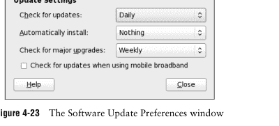

### 添加/移除软件

在 Fedora 下，你可以使用添加/移除软件窗口（图 4-24）从系统中添加和移除应用程序。你可以通过选择主菜单：系统/管理/添加/移除软件或从终端仿真器或运行应用程序窗口（`ALT-F2`）输入命令 `gpk-application` 来打开此窗口。最大化此窗口可能使其更易于使用。在 RHEL 下，选择主菜单：系统/应用程序/添加/移除软件以打开包管理器窗口（第 505 页）；使用 RHN（第 516 页）添加或移除软件可能更易于使用。

添加/移除软件窗口左上角文本框（紧邻标记为`查找`的置灰按钮）是查找你要添加或移除的软件包的关键。初始状态下，此文本框左侧的图标是一支笔和纸，表示你将通过描述搜索软件包。点击此图标可从下拉列表中选择其他类型的搜索。

在窗口左上角的文本框中输入应用程序的名称或部分名称，并点击`查找`以搜索应用程序。添加/移除软件窗口在窗口右侧的框架中显示匹配的软件包列表。或者，你可以选择窗口左侧列表中的某个条目以显示软件包列表。选择`所有软件包`以显示所有可用软件包的列表。窗口左下角的图标和文本会告知你工具的进度。

滚动查看窗口右侧框架中显示的软件包。当你点击/高亮显示某个应用程序时，窗口会在窗口右下角的框架中显示该应用程序的摘要。在每个你想安装的应用程序旁边的复选框中打勾。移除你想移除的任何应用程序旁的勾号。

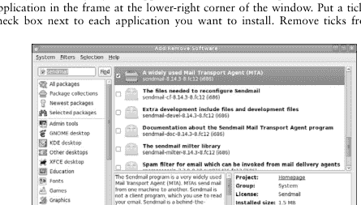

图 4-24 添加/移除软件窗口

你想移除的应用程序。点击 `应用` 以实施你所标记的更改。如果你想要安装的软件包依赖于尚未安装的其他软件包，该实用程序会请求权限安装这些依赖软件包。由于你需要使用 `root` 权限来安装和移除软件，该实用程序可能会要求输入 `root` 密码。完成后，该实用程序可能会询问你是否要运行新应用程序。当你完成后，关闭 添加/移除软件 窗口。你安装的软件包可能在 主菜单 中可用。

## 在哪里查找文档

Linux 发行版（包括 Fedora/RHEL）通常不附带纸质参考手册。然而，其在线文档一直是 Linux 的强项之一。自操作系统的早期版本以来，`man`（手册）和 `info` 页面一直可以通过 `man` 和 `info` 实用程序获取。GNOME 桌面提供了一个图形化的帮助浏览器。不出所料，随着 Linux 和互联网的持续发展，文档的来源也得到了扩展。本节讨论了一些您可以查找有关 Linux 一般信息以及 Fedora/RHEL 特定信息的地方。另见附录 B。


图 4-25 GNOME 帮助浏览器

## GNOME 帮助浏览器

要显示 GNOME 帮助浏览器（图 4-25），请选择 主菜单：系统帮助。在此窗口中点击主题，直到找到你正在寻找的信息。点击 手册页面 以显示 man 页面。点击 GNU Info 页面 以显示 info 页面。你还可以使用标记为 _搜索_ 的文本框搜索主题。

## man：显示系统手册

除了图形化的 GNOME 帮助浏览器外，基于文本的 `man` 实用程序还显示系统文档中的（man）页面。当你知道想要使用哪个实用程序但忘记具体用法时，这些文档非常有帮助。你还可以参考 man 页面以获取有关特定主题的更多信息，或确定 Linux 中可用哪些功能。由于系统文档中的描述通常简练，因此如果你已经理解了实用程序的基本功能，它们会更有帮助。

因为 `man` 是一个基于字符的实用程序，你需要打开一个终端仿真器窗口（第 118 页）来运行它。你也可以登录到虚拟终端（第 137 页）并从那里运行 man。

要了解某个实用程序的更多信息，输入命令 `man`，后跟该实用程序名称。图 4-26 显示了 man 显示关于自身的信息；用户输入了 `man man` 命令。

man 实用程序自动将其输出通过一个 _分页器_——通常是 `less`（第 150 页），它一次显示一屏。当你以这种方式访问手册页面时，`less` 在显示每一屏文本后，会在屏幕底部显示一个冒号 (:) 提示，并等待你按 `空格` 键以请求显示另一屏文本。按 `h`（帮助）会显示 less 命令列表。按 `q`（less(分页器)）

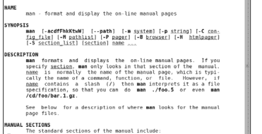

图 4-26 man 实用程序显示关于自身的信息

（退出）停止 less 并导致 shell 显示一个提示。你可以使用 apropos 实用程序（第 127 页）搜索 man 页面涵盖的主题。

根据 `FHS`（文件系统层次标准；第 198 页），Linux 系统手册和 man 页面被分为十个部分，每个部分描述相关的工具：

- 1. 用户命令
- 2. 系统调用
- 3. 子例程
- 4. 设备
- 5. 文件格式
- 6. 游戏
- 7. 杂项
- 8. 系统管理
- 9. 内核
- 10. 新

这种布局 closely 模仿了 UNIX 手册集一直以来的划分方式。除非你指定了手册部分，man 会显示命令行中你指定的词在手册中最早出现的位置。大多数用户发现他们在第 1、6 和 7 部分找到了所需信息；程序员和系统管理员经常需要查阅其他部分。

在某些情况下，手册中包含具有相同名称的不同工具条目。例如，以下命令显示系统手册第 1 部分中 passwd 实用程序的 man 页面：

```
$ man passwd
```

要查看第 5 部分中 passwd 文件的 man 页面，输入此命令：

```
$ man 5 passwd
```


前面的命令指示 `man` 仅在第 5 部分查找 man 页面。在文档中，你可能会看到该 man 页面被称为 `passwd(5)`。使用 `-a` 选项（参见旁边的提示）查看给定主题的所有 man 页面（按 `<回车>` 显示每个后续的 man 页面）。例如，输入命令 `man -a passwd` 以查看 `passwd` 的所有 man 页面。

## 选项

> 提示 选项修改实用程序或命令的工作方式。选项通常指定为一个或多个由一个或两个连字符开头的字母。选项通常出现在你调用的实用程序名称和一个 `空格` 之后。命令的其他 `参数`（第 1069 页）跟在选项和一个 `空格` 之后。更多信息请参考第 225 页的“选项”。

## apropos：搜索关键词

当你不知道执行特定任务所需的命令名称时，你可以使用 `apropos` 和一个关键词进行搜索。该实用程序在所有 `man` 页面的简短描述行（顶行）中搜索该关键词，并显示包含匹配项的那些页面。`man` 实用程序在带 `-k`（关键词）选项调用时，提供与 `apropos`（它是同一个命令）相同的输出。

`apropos` 使用的名为 `whatis` 的数据库在 Fedora/RHEL 系统首次安装时不可用，但由 `cron`（第 365 页）使用 `makewhatis` 自动构建。（`cron` 实用程序运行 `/etc/cron.daily/makewhatis` `cron` 脚本以构建 `whatis` 数据库。）如果你定期关闭系统（如笔记本电脑），该脚本可能未运行。如果 `apropos` 未产生任何输出，请在具有 root 权限时运行命令 `makewhatis -w`。

以下示例显示了当你使用 `who` 关键词调用 `apropos` 时的输出。输出包括每个命令的名称、包含它的手册部分以及 man 页面顶部的简短描述。此列表包括你需要的实用程序（`who`）并识别其他可能对你有用的相关工具：

```
$ apropos who
at.allow (5)
	- determine who can submit jobs via at or batch
at.deny (5)
	- determine who can submit jobs via at or batch
from (1)
	- print names of those who have sent mail
w (1)
	- Show who is logged on and what they are doing.
w,procs (1)
	- Show who is logged on and what they are doing.
who (1)
	- show who is logged on
whoami (1)
	- print effective userid
whois (1)
	- client for the whois directory service
```

`whatis` `whatis` 实用程序类似于 `apropos`，但它只查找工具名称的完全单词匹配：

```
$ whatis who
who
(1) - show who is logged on
```

## info：显示关于实用程序的信息

基于文本的 `info` 实用程序是一个由 GNU 项目（第 2 页）开发的基于菜单的超文本系统，并随 Fedora/RHEL 分发。`info` 实用程序包含一个教程

### man 和 info 显示不同的信息

> `info` 实用程序比 `man` 显示更完整和最新的关于 GNU 实用程序的信息。当 man 页面显示由 `info` 覆盖的实用程序的简略信息时，man 页面会指向 `info`。`man` 实用程序经常显示非 GNU 实用程序仅有的可用信息。当 `info` 显示非 GNU 实用程序的信息时，它通常是 `man` 页面的副本。

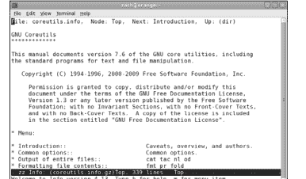

图 4-27 `info coreutils` 显示的初始屏幕

关于自身的教程（www.gnu.org/software/textinfo/manual/info）以及许多由 GNU 项目开发的 Linux shell、实用程序和程序的文档。图 4-27 显示了当你输入命令 `info coreutils`（`coreutils` 软件包包含 Linux 核心实用程序）时 `info` 显示的屏幕。

由于此屏幕上的信息来自可编辑文件，你的显示可能与本节中显示的屏幕不同。当你看到初始 info 屏幕时，你可以按以下任意键：

- `h` 进入关于 info 的交互式教程

- `?` 列出 info 命令

- `空格` 滚动显示可用信息项目的菜单

- `m` 后跟你想显示的名称或一个 `空格` 以显示菜单列表

- `q` 或 `CONTROL-C` 退出

`info` 用于描述键盘按键的符号可能对你来说不熟悉。符号 `C-h` 等同于 `CONTROL-H`。同样，`M-x` 意味着按住 `META` 或 `ALT` 键并按 `x`。（在某些系统上，你需要按 `ESCAPE` 然后按 `x` 来模拟 `META-X` 的功能。）

### 你可能会发现 pinfo 比 info 更容易使用

> `pinfo` 实用程序类似于 `info`，但如果你不熟悉 emacs 编辑器，它更直观。该实用程序在文本环境中运行，就像 `info` 一样。当可用时，`pinfo` 使用颜色使其界面更容易使用。如果系统未安装 `pinfo`，请使用 添加/移除软件 窗口（第 123 页）安装 `pinfo` 软件包。从终端仿真器或运行应用程序窗口（`ALT-F2`）运行 `pinfo`，并选择 `在终端中运行`。

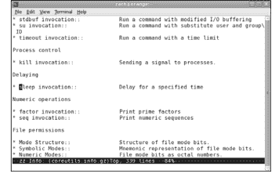

图 4-28 输入 `/sleep RETURN` 两次后，`info coreutils` 显示的屏幕

输入 `info coreutils` 命令后，按几次 `SPACE` 键以滚动查看显示内容。输入 `/sleep RETURN` 以搜索字符串 `sleep`。当你输入 `/` 时，光标移动到窗口的最后一行，并显示 `Search for string [string]`，其中 `string` 是你上次搜索的字符串。按 `RETURN` 搜索该字符串，或者输入你想搜索的字符串。输入 `sleep` 会在那一行显示 `sleep`，然后按 `RETURN` 会显示 `sleep` 的下一次出现位置。

现在输入 `/ RETURN`（或 `/sleep RETURN`）以搜索 `sleep` 的下一次出现，如图 4-28 所示。行左端的天星号表示此条目是一个菜单项。紧跟在天星号之后是菜单项的名称和该条目的描述。

每个菜单项都是指向描述该条目的 info 页面的链接。要跳转到该页面，请搜索或使用 `ARROW` 键将光标移动到包含菜单项的行，然后按 `RETURN`。当时光标位置如图 4-28 所示时，按 `RETURN` 将显示关于 `sleep` 的信息。或者，你可以在菜单命令中输入菜单项的名称来查看信息：例如，要显示关于 `sleep` 的信息，你可以输入命令 `m sleep`，然后按 `RETURN`（当你输入 `m`（代表 menu）时，光标像输入 `/` 时一样移动到窗口的最后一行）并显示 `Menu item:`。输入 `sleep` 会在那一行显示 `sleep`，然后按 `RETURN` 将显示你选择的菜单项的相关信息。

图 4-29（下一页）显示了关于 `sleep` 信息的顶级节点。节点将一组你可以使用 `SPACE` 键滚动浏览的信息组合在一起。要显示下一个节点，按 `n`；要显示上一个节点，按 `p`。

当你阅读本书并了解新的实用工具时，可以使用 `man` 或 `info` 来了解这些实用工具的更多信息。你可以打印 PostScript 文档，可以使用带有 `-t` 选项（例如，`man -t cat | lp` 打印关于 `cat` 实用工具的信息）的 `man` 实用工具打印手册页。你还可以使用 Web 浏览器显示 www.tldp.org、docs.fedoraproject.org 或 www.redhat.com/docs 上的文档，然后从浏览器中打印所需的信息。


图 4-29 关于 `sleep` 实用工具的 info 页面

### `--help` 选项

在文本环境中你可以使用的另一个工具是 `--help` 选项。大多数 GNU 实用工具都提供了一个 `--help` 选项，用于显示关于该实用工具的信息。非 GNU 实用工具可能使用 `-h` 或 `--help` 选项来显示帮助信息。


```
$ cat --help
Usage: cat [OPTION] [FILE]...  Concatenate FILE(s), or standard input, to standard output.
-A, --show-all    equivalent to -vET
-b, --number-nonblank     number nonblank output lines
-e     equivalent to -vE
-E, --show-ends  display $ at end of each line
...
```

如果 `--help` 显示的信息超出了屏幕范围，请使用管道（第 158 页）将输出通过 `less` 分页器（第 125 页）发送：

```
$ ls --help | less
```

## HOWTOs：了解事物如何运作

HOWTO 文档详细解释了与 Linux 相关的某项操作的方法——从设置专用硬件到执行系统管理任务，再到设置特定的网络软件。Mini-HOWTO 提供更简短的说明。与 Linux 软件一样，通常由一个人或少数人负责编写和维护 HOWTO 文档，但许多人可能会为其做出贡献。

Linux 文档项目（LDP，第 132 页）网站托管了大多数 HOWTO 和 mini-HOWTO 文档。使用 Web 浏览器访问 www.tldp.org，点击 HOWTOs，并选择你想用来查找 HOWTO 或 mini-HOWTO 的索引。你还可以使用其主页上的 LDP 搜索功能来查找 HOWTO 和其他文档。


图 4-30 Google 报告的一条错误消息

## 获取系统帮助

GNOME 提供了工具提示（第 110 页）、上下文敏感的帮助系统，以及第 125 页讨论的帮助浏览器。

### 在本地查找帮助

`/usr/src/linux/Documentation`（仅在安装内核源代码时存在，如第 15 章所述）和 `/usr/share/doc` 目录通常包含关于实用工具比 `man` 或 `info` 提供的更详细且不同的信息。这些信息通常是针对将编译和修改该实用工具的人，而不仅仅是使用者。这些目录包含数千个文件，每个文件都包含关于单独主题的信息。

### 使用互联网获取帮助

互联网提供了许多与 Linux 相关的有用网站。除了提供各种形式文档的网站外，你还可以在搜索引擎（如 Google（www.google.com）或其 Linux 专用版本 www.google.com/linux）中输入你遇到问题的程序的错误消息。将错误消息用双引号括起来以提高结果的质量。搜索很可能会产生一条关于你问题的帖子以及关于如何解决它的建议。参见图 4-30。

- Fedora 文档可在 docs.fedoraproject.org 上获取。


- 从 Red Hat Linux 到 Linux 9 和 RHEL 的手册可在 www.redhat.com/docs 上获取。

- 各种类型的支持文档和支持可在 www.redhat.com/apps/support 上获取（需要免费注册）。

- 你可以在 kbase.redhat.com 上查询 Red Hat 知识库。

- Fedora（fedoraproject.org）和 RHEL（www.redhat.com）的主页拥有大量的信息。

- Fedora/RHEL 支持论坛是关于人们想要提出的任何 Red Hat 相关问题的在线讨论。一个论坛专门面向新用户；其他论坛面向 Apache、X 窗口系统等。请访问 www.redhat.com/mailman/listinfo 浏览列表列表。另一个具有类似有用信息的网站是 fedorafa.org。

- Fedora/RHEL 错误数据库可在 bugzilla.redhat.com 上获取。任何人都可以搜索该数据库。要提交新错误或追加到现有错误，你需要注册一个免费帐户。

- Fedora 每周新闻可在 fedoraproject.org/wiki/FWN 上获取。

- RHEL 硬件帮助可从 Red Hat 硬件目录 hardware.redhat.com 获取。Fedora 支持的硬件大多是 RHEL 所支持硬件的超集。

`GNU` GNU 手册可在 www.gnu.org/manual 上获取。此外，你可以访问 GNU 主页（www.gnu.org）以获取额外的文档和其他 GNU 资源。许多 GNU 页面和资源可用多种语言获取。

`Linux 文档项目` Linux 文档项目（www.tldp.org；图 4-31），其存在时间几乎与 Linux 一样长，托管了完整的指南、HOW-TOs、FAQs、man 页面和 Linux 杂志的集合。主页可用英语、葡萄牙语、西班牙语、意大利语、韩语和法语获取。它易于使用，并支持本地文本搜索。它还提供了完整的链接集，你可以用它来查找几乎任何与 Linux 相关的内容（点击搜索框中的 `Links` 或访问 www.tldp.org/links）。链接页面包含关于通用信息、事件、入门、用户组、邮件列表和新闻组的章节，每个章节包含许多子章节。

## 更多关于登录

有关登录信息，请参考第 91 页的“Logging In on the System”。本节涵盖你可以从登录屏幕选择的选项以及常见登录问题的解决方案。它还描述了如何从终端和远程系统登录。


图 4-31 Linux 文档项目主页

### security

#### 始终使用密码

除非你是系统唯一的用户，系统没有连接到其他系统、互联网或调制解调器，并且你是唯一拥有该系统物理访问权限的人，否则维护一个没有密码的用户帐户是一种糟糕的做法。

#### fedora

#### 登录屏幕

登录屏幕（图 4-1，第 91 页）显示了一个允许在系统上登录的用户列表。在屏幕底部的面板上有三个按钮。点击描绘人物的圆形蓝色按钮，以从访问首选项中选择一个列表，这可能会让某些人更容易使用系统。点击包含感叹号的三角形黄色按钮以显示启动消息列表。点击面板右端的灰色圆形按钮以重启或关闭系统。点击用户列表中的你的名字以登录。

一旦你点击了你的名字，登录屏幕会显示一个标记为 `Password` 的文本框。除了屏幕底部的面板外，它还添加了标记为 `Language` 和 `Keyboard` 的按钮。如果安装了多个窗口管理器或桌面，还会出现一个标记为 `Sessions` 的按钮。在文本框中输入你的密码并按 RETURN 以登录。

在登录之前，标记为 `Language` 的按钮显示即将使用的会话的语言名称。要更改即将使用的会话的语言，请点击此按钮并从下拉列表中选择一种语言。如果你

（原）想项未列出，请从下拉列表中选择 `其他`；Fedora 将显示语言窗口。从该窗口中选择您想要的语言并单击 `确定`。然后登录。Fedora 会询问您是否希望更改标准文件夹（目录）的名称，以便它们以新语言显示。

您可以通过使用登录界面上标有 `键盘` 的按钮，按照与使用语言按钮相同的方式，来更改即将开始的会话所期望的键盘布局。如果安装了多个窗口管理器或桌面环境，您可以使用标有 `会话` 的按钮来选择它们。

`PHELI`。在 `PHELI` 下登录的过程与在 `FEDORA` 下类似，区别在于系统会提供一个标有 `用户名` 的文本框供您输入用户名，初始界面上会出现标有 `语言` 的按钮，且没有标有 `键盘` 的按钮。

## 如果无法登录该怎么办

如果您错误地输入了用户名或密码，系统会在您输入*两者*——您的用户名*和*密码之后显示一条错误消息。该消息表明您*要么*是用户名*要么*是密码输入错误，或者它们均无效。系统不会区分不可接受的用户名和不可接受的密码——*这是一种旨在阻止未授权人员通过猜测用户名和密码获取系统访问权限的策略*。

以下是登录失败的一些常见原因：

- `用户名和密码对大小写敏感`。请确保 `CAPS LOCK`（大写锁定）键处于关闭状态，并准确输入指定的或您设置的用户名和密码。

- `您未在正确的机器上登录`。如果您试图在错误的机器上登录，登录/密码组合可能无效。在大型网络化系统中，您可能需要先指定要连接到的机器，然后才能登录。

- `您的用户名无效`。如果您尚未被设置为用户，登录/密码组合可能无效。如果您是系统管理员，请参阅第 556 页的“配置用户和组账户”。否则，请联系系统管理员。

- `文件系统已满`。当对登录过程至关重要的文件系统已满时，登录界面可能会短暂消失后再次出现，看似登录成功，但片刻后登录屏幕会重新出现。您必须以救援模式启动系统（第 411 页）并删除一些文件。


该账户可能被禁用。`root`（超级用户）账户默认禁止通过图形界面登录。管理员可能会禁用其他账户。通常，`root`账户不允许通过网络登录。如果您需要从远程系统使用 root 权限，必须使用`su`或`sudo`（第 405 页）。

如果您想更改密码，请参阅第 136 页的“更改您的密码”。

## 远程登录：终端仿真器、SSH 和拨号连接

当您没有使用直接连接到正在登录的 Linux 系统的控制台、终端或其他设备时，您可能正在使用另一台系统上的终端仿真软件连接到该 Linux 系统。运行在本地系统上的此软件通过网络（以太网、异步电话线、PPP 或其他类型）连接到远程 Linux 系统，允许您登录。

### 确保 TERM 设置正确

无论您如何连接，请确保已将`TERM`变量设置为您仿真器正在仿真的终端类型。有关更多信息，请参阅第 1040 页的“指定终端”。

当您通过拨号线登录时，连接过程很直接：您指示本地仿真器程序联系远程 Linux 系统，它拨号，远程系统显示登录提示。当您通过直接连接的网络登录时，您使用`ssh`（安全；第 627 页）或`telnet`（不安全；第 377 页）连接到远程系统。`ssh`程序已在许多操作系统上实现，不仅仅是 Linux。许多`ssh`用户界面都包含终端仿真器。从 Apple、Windows 或 UNIX 机器上，打开运行`ssh`的程序，并提供您要登录系统的名称或 IP 地址（请参阅第 367 页的“主机地址”）。有关使用终端仿真器的示例和更多详细信息，请参阅第 118 页的“从终端仿真器/Shell 运行命令”。下一节提供了有关从终端仿真器登录的更多信息。

## 从终端（仿真器）登录

在终端、终端仿真器或其他文本设备上登录之前，系统会显示一条名为`issue`的消息（存储在`/etc/issue`文件中），以标识正在该系统上运行的 Fedora/RHEL 版本。以下是一个`issue`消息的示例：

```
Fedora release 12 (Constantine)
Kernel 2.6.31.5-127.fc12.i686.PAE on an i686 (tty2)
```

此消息之后是一个登录提示。根据系统提示输入您的用户名和密码。如果您使用的是`终端`（第 1110 页）且屏幕未显示`login:`提示，请检查终端是否已插入并打开，然后按几次 RETURN（回车）键。如果`login:`仍未出现，请尝试按 CONTROL-Q（Off）。如果您使用的是`工作站`（第 1116 页），请运行`ssh`（第 627 页）、`telnet`（第 377 页）或您用于登录到该系统的任何通信/仿真软件。

一旦`shell 提示符`（或简称`提示符`）出现，表示您已成功登录；此提示符显示系统已准备好接收命令。第一个 shell 提示符行之前可能会附带一条短消息，称为`当日信息`，或`motd`（第 474 页），它存储在`/etc/motd`文件中。Fedora/RHEL 建立的提示符格式为[`user`@`host` `directory`]$，其中`user`是您的用户名，`host`是系统名称，`directory`是您正在工作的目录名称。波浪号（~）代表您的主目录。有关如何更改提示符的信息，请参阅第 307 页。

### 您上次登录是什么时候？

当您登录到文本环境时，输入用户名和密码后，系统会显示该账户上次登录的信息，显示发生的时间和来源。您可以使用此信息来判断自您上次使用以来是否有人访问过该账户。如果有人访问过，可能是一位未授权的用户得知了您的密码并以您的身份登录。为了维护安全，请向系统管理员汇报任何让您感到可疑的情况——并更改您的密码。

## 更改您的密码

如果其他人为您分配了密码，建议您为自己设置一个新密码。出于安全原因，任何实用程序都不会显示您输入的密码。

### 保护您的密码

不要允许他人得知您的密码：*不要*将密码放入未加密的文件中，不要允许他人观看您输入密码，也不要将密码告诉陌生人（系统管理员永远不需要知道您的密码）。您可以随时将密码写下来，保存在安全、私密的地方。

### 选择一个难以猜测的密码

不要使用电话号码、宠物或孩子的名字、生日、字典中的单词（即使是外语），等等。不要使用这些项目的排列组合或单词的 133t-speak 变体：现代字典破解工具也可能尝试这些排列组合。

### 区分重要和非重要密码

区分重要和非重要密码是个好主意。例如，博客或下载访问的网站密码并不重要：使用相同的密码访问此类网站是可以接受的。然而，您的登录、邮件服务器和银行账户网站密码至关重要：切勿将这些密码用于不重要的网站。

要更改密码，请选中**主菜单：系统** → **首选项** → **关于我**，然后单击**更改密码**。在命令行中，输入命令`passwd`。

系统询问的第一项是您当前的（旧）密码。系统会验证此密码，以确保未授权用户未试图修改您的密码。然后，系统要求输入新密码。

为了相对安全，密码应包含数字、大写和小写字母以及标点符号的组合，并满足以下标准：

- 长度必须至少为六个字符（如果系统管理员这样设置，则可以更长）。七个或八个字符是长度与安全性的良好折中方案。
- 不应是任何语言字典中的单词，无论其看似多么晦涩。
- 不应是任何可能被轻易发现的人名、地名、宠物名或其他事物的名称。
- 应包含至少两个字母和一个数字或标点符号。
- 不应是您的用户名、用户名的反向，或用户名移位一个或多个字符后的结果。

只有第一项是强制性的。避免使用控制字符（例如 CONTROL-H），因为它们可能对系统有特殊含义，导致您无法登录。如果您正在更改密码，新密码应与旧密码至少相差三个字符。更改字符的大小写并不算作不同的字符。有关选择密码的更多信息，请参阅第 577 页的“保护系统安全”。

## pwgen 帮你选择密码

`pwgen`实用程序（需安装`pwgen`软件包）会生成几乎随机的密码列表。凭借一点想象力，你可以发音，进而记住其中一些密码。

输入新密码后，系统会要求你重新输入一次，以确保你在第一次输入时没有出错。如果两次输入的新密码相同，你的密码将被更改。如果两次密码不同，说明你在其中一次输入中犯了错误。在这种情况下，系统会显示错误消息，或者不允许你点击**确定**按钮。如果你输入的密码长度不够，系统会显示类似“密码太短”的消息。

当你成功更改密码后，你就改变了登录方式。如果你忘记了密码，以`root`权限运行的用户可以更改它并告知你新密码。

## 使用虚拟控制台

在个人计算机上运行 Linux 时，你通常会使用连接到计算机的显示器和键盘。使用此物理控制台，你可以访问多达 63 个`虚拟控制台`（也称为`虚拟终端`）。其中一些被设置为允许登录；另一些则作为图形显示。要在虚拟控制台之间切换，请按住 CONTROL 和 ALT 键，然后按下对应你想要查看的控制台的功能键。例如，CONTROL-ALT-F5 会显示第五个虚拟控制台。本书将当你按下 CONTROL-ALT-F1 时看到的控制台称为`系统控制台`，或简称为`控制台`。

默认情况下，五个或六个虚拟控制台处于活动状态，并运行着文本登录会话。当你希望同时使用文本和图形界面时，可以在一个虚拟控制台上设置文本会话，在另一个虚拟控制台上设置图形会话。默认情况下，在 Fedora 中，图形会话在虚拟控制台 1 上运行；而在 RHEL 中，图形会话在虚拟控制台 6 或 7 上运行。

## 在命令行中工作

在图形用户界面（GUI）出现之前，UNIX 然后是 Linux 仅提供命令行（文本）界面（CLI）。如今，当你从终端、终端仿真器或文本虚拟控制台登录，或者使用`ssh`（第 625 页）或`telnet`（不安全，第 377 页）登录到系统时，都可以使用 CLI。

本节介绍 Linux CLI。第 5 章描述了一些你可以从命令行使用的更重要实用程序。本书第四部分和第五部分的大多数示例都使用 CLI，在可用的地方还会添加图形工具的示例。

尽管这个概念可能显得古老，但 CLI 在现代计算中仍有一席之地。在某些情况下，管理员可能会使用命令行工具，要么因为不存在对应的图形工具，要么因为图形工具不如文本工具功能强大或灵活。此外，在服务器系统上，可能甚至没有安装图形界面。产生这种遗漏的第一个原因是 GUI 消耗大量系统资源；而在服务器上，这些资源最好专门用于服务器的主要任务。此外，安全考虑要求服务器系统运行尽可能少的任务，因为每个额外的任务都可能使系统更容易受到攻击。

你还可以使用 CLI 编写脚本。使用脚本，你可以轻松地在多个系统上重现任务，从而将任务扩展到更大的环境。当你只是单个系统管理员时，使用 GUI 往往是配置系统最简单的方法。但当你作为许多系统（所有这些系统都需要安装或更新相同的配置）的管理员时，脚本可以使任务进行得更快。使用命令行工具编写脚本通常很容易，而使用图形工具则可能困难甚至不可能。

在 GUI 出现之前，资源丰富的程序员创建了包含图形元素（如方框、勾勒基本窗口的边框、高亮以及更近期的彩色）的文本界面。这些被称为伪图形界面的文本界面，弥合了文本界面和图形界面之间的差距。

## 纠正错误


本节解释如何纠正你在文本显示器上登录时可能犯的打字错误和其他错误。因为 shell 和大多数其他实用程序在你按下 `RETURN` 之后才会解释命令行或其他文本，所以你可以轻松地在按下 `RETURN` 之前纠正打字错误。

你可以用几种方式纠正此类错误：每次擦除一个字符、每次后退一个单词，或一步后退到命令行的开头。一旦你按下 `RETURN`，纠正错误就太迟了：在那时，你必须等待命令执行完毕或终止程序的执行（第 140 页）。

### 擦除字符

在从键盘输入字符时，你可以按 *erase* 键一次来擦除你想删除的每个字符。*erase* 键可以后退你想要的任何字符数。通常，它不会后退超过行首。

默认的擦除键是 `BACKSPACE`。如果此键不起作用，请尝试按 `DEL` 或 `CONTROL-H`。如果这些键不起作用，请输入以下 `stty` 命令，将擦除键和行终止键（参见“删除一行”）设置为其默认值：

```bash
$ stty ek
```

### 删除单词

你可以通过按 `CONTROL-W` 来删除你输入的单词。*一个单词* 是指任何不包含 `SPACE` 或 `TAB` 的字符序列。当你按下 `CONTROL-W` 时，光标会向左移动到当前单词的开头（如果你正在输入单词）或前一个单词的开头（如果你刚刚输入了 `SPACE` 或 `TAB`），并删除该单词。

`CONTROL-Z` 挂起一个程序

> 提示 虽然这不是纠正错误的方法，但你可能会误按挂起键（通常是 `CONTROL-Z`），然后纳闷发生了什么。如果你看到包含 *Stopped* 一词的消息，说明你刚刚使用作业控制（第 241 页）停止了你的作业。如果你输入 `fg` 命令在前景继续你的作业，你应该会回到你按下挂起键之前的状态。有关更多信息，请参阅第 295 页的“*bg: 将作业发送到后台*”。

### 删除一行

在你按下 `RETURN` 之前的任何时刻，你都可以按 *line kill* 键来删除你正在输入的行。当你按下此键时，光标向左移动，在移动过程中擦除字符，直到行首。默认的 *line kill* 键是 `CONTROL-U`。如果此键不起作用，请尝试 `CONTROL-X`。如果这些键不起作用，请输入“擦除字符”部分中描述的 *stty* 命令。

2. `stty` 命令是 *set teletypewriter* 的缩写，这是 UNIX 最初运行的第一个终端。如今，`stty` 通常被视为 *set terminal*。

有时您可能想要终止一个正在运行的程序。例如，您可能想要停止一个正在执行耗时任务的程序，例如显示一个长达数百页的文件内容，或者复制一个并非您本意要复制的大文件。

要从文本显示中终止程序，请按下中断键（`CONTROL-C`，或有时是 `DELETE` 或 `DEL`）。当您按下此键时，Linux 操作系统会向您正在运行的程序和 shell 发送一个终端中断信号。该信号的具体效果取决于程序。有些程序会立即停止执行；有些会忽略该信号；还有一些会采取其他行动。当 shell 接收到终端中断信号时，它会显示提示符并等待另一个命令。

如果这些方法无法终止程序，请尝试使用挂起键（通常是 `CONTROL-Z`）停止程序，给出 `jobs` 命令以验证正在运行该程序的作业编号，并使用 `kill` 中止该作业。作业编号是 `jobs` 显示的行左端方括号内的数字 ([1])。在下一个示例中，`kill` 命令（第 409 页）使用 `-TERM` 向由作业编号（前面带有百分号 %1）指定的作业发送终止信号。您可以从命令中省略 `-TERM`，因为 `kill` 默认会发送终止信号。

```
$ bigjob
^Z
[1]+  Stopped          bigjob
$ jobs
[1]+  Stopped          bigjob
$ kill -TERM %1
$ RETURN
[1]+  Killed           bigjob
```

`kill` 命令返回提示符；再次按下 `RETURN` 键以查看确认消息。如需更多信息，请参阅第 241 页的“在后台运行程序”。

## 重复/编辑命令行

要重复上一个命令，请按下向上箭头键。每次按下此键时，shell 都会显示较早的命令行。要重新执行显示的命令行，请按下 `RETURN` 键。按下向下箭头键可反向浏览命令行。

`右箭头` 和 `左箭头` 键用于在显示的命令行前后移动光标。在命令行的任何位置，您都可以通过输入字符来添加字符。使用删除键从命令行中移除字符。有关更复杂的命令行编辑信息，请参阅第 318 页。

> ³ 如果终止信号不起作用，请使用 kill (--KILL) 信号。正在运行的程序无法忽略 `kill` 信号；它肯定会中止该程序（第 409 页）。

## 控制窗口：高级操作

请参阅第 115 页的“窗口”以了解 Fedora/RHEL 下窗口操作的介绍。本节探讨以下主题：更改工作区上的输入焦点、更改显示分辨率以及深入了解窗口管理器。

### 更改输入焦点

当您在键盘上打字时，窗口管理器（第 142 页）会将您输入的字符导向某个位置，通常是某个窗口。*活动窗口* 是接受键盘输入的窗口；可以说它具有 *输入焦点*。根据您如何设置账户，您可以使用鼠标以三种方式之一来更改输入焦点（您也可以使用键盘；参见第 116 页）：

- `Click-to-focus`（*显式焦点*）— 当您单击窗口时，将输入焦点给予该窗口。无论鼠标指针位于何处，该窗口继续接受键盘输入。当您单击另一个窗口时，该窗口失去焦点。虽然单击鼠标中键或右键也会激活窗口，但请仅使用鼠标左键来执行此操作；使用其他按钮激活窗口时可能会产生意外效果。

- `Focus-follows-mouse`（*宽松焦点*、*仅进入* 或 *鼠标下焦点*）— 当您移动鼠标指针进入窗口时，将输入焦点给予该窗口。该窗口保持输入焦点，直到您将鼠标指针移动到另一个窗口，此时新窗口获得焦点。当您移动鼠标指针离开窗口并进入根窗口时，拥有输入焦点的窗口不会失去焦点。

- `Focus-strictly-under-mouse`（*进入-退出焦点*）— 当您移动鼠标指针进入窗口时，将输入焦点给予该窗口。该窗口保持输入焦点，直到您将鼠标指针移出该窗口，此时没有窗口拥有焦点。当您移动鼠标指针离开窗口并进入根窗口时，拥有输入焦点的窗口失去焦点，键盘输入将丢失。

您可以使用“窗口偏好”窗口来更改焦点策略。在 Fedora 下，您必须在显示此窗口之前安装 `control-center-extra` 软件包，如第 501 页所述。要显示此窗口，请选择 `主菜单：系统→首选项→窗口` 或从终端模拟器或运行应用程序窗口 (`ALTF2`) 发出 `gnome-window-properties` 命令。勾选 `当鼠标移到上方时选择窗口` 旁边的复选框以选择 `focus-follows-mouse` 策略。如果此复选框未勾选，则 `click-to-focus` 生效。单击 `关闭`。此窗口中不可用 `focus-strictly-under-mouse`。

要确定哪个窗口具有输入焦点，请比较窗口边框。活动窗口的边框颜色与其他窗口不同，或者在单色显示器上更深色。窗口活动的另一个迹象是键盘光标是一个实心矩形；在不是活动的窗口中，光标是矩形的轮廓。

使用以下测试来确定您使用的是哪种键盘焦点方法。如果您将鼠标指针放在一个窗口中，但该窗口未获得输入焦点，则您的窗口管理器配置为使用 `click-to-focus` 方法。如果窗口边框发生变化，则您正在使用 `focus-follows-mouse` 或 `focus-strictly-under-mouse` 方法。要确定您使用的是后两种方法中的哪一种，请开始输入一些内容，此时鼠标指针位于活动窗口上。然后，将鼠标指针移动到根窗口上并继续输入。如果字符继续出现在该窗口内，则您正在使用 `focus-follows-mouse`；否则，您正在使用 `focus-strictly-under-mouse`。

### 更改显示分辨率

X 服务器（Linux 图形界面的基础；参见第 256 页）在特定的显示分辨率和 *颜色深度*（第 1075 页）下启动。虽然您只能在启动 X 服务器时更改颜色深度，但您可以在 X 服务器运行时更改分辨率。可用的分辨率数量取决于显示硬件和 X 服务器的配置。许多用户更喜欢在较高的分辨率下完成大部分工作，但可能希望针对某些任务（如玩游戏）切换到较低的分辨率。您可以通过按下 `CONTROL-ALT-小键盘-+` 或 `CONTROL-ALT-小键盘-\-` 在显示分辨率之间切换，使用键盘数字小键盘上的 `+` 和 `\-` 键。您还可以使用“监视器分辨率设置”窗口（`主菜单：系统->首选项->显示`）来更改显示分辨率。

更改为较低的分辨率具有放大显示的效果；结果，您可能无法一次性查看整个工作区。您可以通过将鼠标指针推向屏幕边缘来滚动显示。

### 窗口管理器


*窗口管理器*——控制基本 GUI 外观和感觉的程序——在桌面管理器（如 GNOME 或 KDE）下运行，并控制 X 窗口系统环境中窗口的所有方面。窗口管理器定义了桌面上窗口的外观，并控制您如何操作和定位它们：打开、关闭、移动、调整大小、最小化等。它还可能处理一些会话管理功能，例如会话如何暂停、恢复、重启或结束（第 108 页）。
窗口管理器控制 *窗口装饰*——即窗口的标题栏和边框。除了更改窗口装饰的美学方面外，您

## Fedora/RHEL 窗口管理器

Metacity 和 Compiz——GNOME 的默认窗口管理器——通过 GNOME 面板对象提供窗口管理并启动许多组件。它们还与环境中的其他组件进行通信并促进对其的访问。“桌面特效”窗口（第 108 页）允许你在 Metacity 和 Compiz 之间进行切换。
利用标准的 X 库，程序员创建了许多其他窗口管理器，包括 blackbox、fluxbox 和 WindowMaker。你可以使用 `yum`（第 501 页）来安装其中任何一个包。

### 本章小结

与许多操作系统一样，当你登录时，你对 Linux 系统的访问权限是得到授权的。为此，你需要在登录屏幕上输入你的用户名和密码。在你处于登录状态时，你可以随时更改你的密码。选择一个难以猜测且符合更改密码工具所规定标准的密码。
系统管理员负责维护系统。在单用户系统上，你就是系统管理员。在一个小型的多用户系统上，你或其他用户可能充当系统管理员，或者这个职责可能被分担。在一个大型的多用户系统或系统网络上，通常有一个专职的系统管理员。当需要额外的权限来执行某些系统任务时，系统管理员通过输入用户名 `root` 和 `root` 密码以 `root` 用户身份登录；该用户被称为 *超级用户*（Superuser）或*管理员*。在多用户系统上，可能会向几位受信任的用户提供 `root` 密码。
不要习惯性地将 `root` 权限（作为 *超级用户*）作为常规操作。当你必须做需要 `root` 权限的事情时，仅在绝对必要的时间段内使用 `root` 权限；尽快恢复为 *你自己* 的身份工作。
理解桌面及其组件对于充分利用 Fedora/RHEL GUI 至关重要。面板提供了一种方便的方式启动应用程序，可以通过点击对象或使用主菜单来实现。主菜单是一个多层菜单，你可以用它来定制和维护系统，并启动许多常用的应用程序。窗口是应用程序的图形化呈现。你可以通过点击窗口标题栏上的按钮来控制其大小、位置和外观。终端模拟器允许你从图形化环境使用 Linux 命令行界面。你可以使用终端模拟器来启动文本程序和图形程序。
面板和菜单允许你选择一个对象（可以是系统上的几乎任何东西）。在面板上，你通常点击一个对象；在菜单上，你通常点击列表中的文本。
GNOME 环境为普通用户、办公室工作者、高级用户以及程序员/系统设计者提供了一个工作空间和工作工具集。GNOME 还提供了即开即用的生产力工具以及许多定制其外观、感觉和响应的方式。
Nautilus 是 GNOME 简单却强大的文件管理器。它可以创建、打开、显示、移动和复制文件和目录，以及执行程序脚本。它最基本和最重要的功能之一是创建和管理桌面。
`man` 实用程序为系统实用程序提供在线文档。该实用程序对新 Linux 用户和有经验的用户都有帮助，后者经常需要深入系统文档以获取关于实用程序行为细节的信息。`info` 实用程序同样对初学者和专家都有帮助。它提供了关于其使用的教程以及许多 Linux 实用程序的文档。
文本或命令行界面（CLI）在现代计算中继续占有一席之地。例如，有时不存在图形化工具，或者它可能不如其文本对应物强大或灵活。服务器系统上的安全关注点要求系统尽可能少地运行任务。由于每个额外的任务都可能使服务器更容易受到攻击，因此这些系统通常未安装 GUI。

## 练习

- 1. 当你尝试使用不正确的用户名 *或* 不正确的密码登录时，系统会显示以下消息：
  - a. 该消息并未指示你的用户名、密码或两者中哪一个是无效的。为什么它不透露这些信息？
  - b. 为什么系统在你提供不正确的用户名或密码后等待几秒钟？
- 2. 给出三个糟糕的密码选择的例子。每个选择有什么问题？
- 3. `fido` 是否是一个可接受的密码？给出几个原因说明为什么是可接受的或不可接受的。
- 4. 什么是上下文菜单？上下文菜单与其他菜单有何不同？
- 5. 当你右键单击根窗口时会出现什么？你如何使用该对象？
- 6. 你如何交换鼠标右键和左键的效果？拖放阈值是什么？你如何更改它？
- 7. 主菜单的主要功能是什么？
- 8. 什么是输入焦点？当没有窗口拥有输入焦点时，你在键盘上输入的字母会发生什么？你更喜欢使用哪种类型的输入焦点？为什么？
- 9. 窗口操作菜单的功能是什么？你如何显示此菜单？
- 10. 什么是面板？列举面板上的一些对象并解释你可以用它们做什么。工作区切换器小工具和窗口列表小工具是做什么的？
- 11. 什么是工具提示（tooltips）？它们有何用处？

## 高级练习

- 12. 当你将鼠标指针移动到窗口边缘时，鼠标指针会发生什么变化？当它看起来像这样时，如果你左键单击并拖动鼠标指针会发生什么？在窗口角落重复此实验。
- 13. 假设你启动了一个没有桌面管理器的窗口管理器。屏幕上缺少什么？描述窗口管理器做什么。桌面管理器如何使操作 GUI 更容易？
- 14. 当你输入的字符没有显示在屏幕上时，可能出了什么问题？你如何修复这个问题？
- 15. 当你从“运行应用程序”窗口运行 `vim` 而没有指定在终端中运行时，会发生什么？输出到哪里去了？
- 16. 第 126 页的例子显示 `passwd` 的 `man` 页面出现在系统手册的第 1 和 5 节。解释如何使用 `man` 确定系统手册的哪些节包含具有给定名称的手册页。
- 17. 系统手册中的“设备”子部分有多少个 `man` 页面？（提示：设备是“特殊文件”的子部分。）

# 第 5 章

#### 本章内容

- 特殊字符 . . . . . . . . . . . . . 148
- 基本实用程序 . . . . . . . . . . . . . . . . . . . 149
- 少即是多：一次显示一屏文本文件 . . . . . . . . . . . . . . . . . . . . 150
- 处理文件 . . . . . . . . . . . . . . . . . . . . . . . . . 151
- `lpr`：打印文件 . . . . . . . . . . . . . . . . . . . . . . . . . . 153
- `|`（管道）：进程间通信 . . . . . . . . . . . . . . . . . . . . . . . . . . . . . . . . . 158
- 压缩和归档文件 . . . . . . . . . . . . . . . . . . . . . . . . . . . . . . . 161
- 获取用户和系统信息 . . . . . . . . . . . . . . . . . . . . . . . . . . . . . . . . . . . . 168
- 教程：使用 `vim` 创建和编辑文件 . . . . . . . . . . . . . . . . . . . . . . . . . . . . . . . 174

## Linux 实用程序

当 Linus Torvalds 推出 Linux 及此后的很长一段时间里，Linux 没有图形用户界面（GUI）：它仅在基于字符的终端上运行。所有工具都通过命令行运行。如今 Linux GUI 很重要，但许多人——尤其是系统管理员——运行许多命令行程序。命令行实用程序通常比其 GUI 对应物更快、更强大或更完整。有时文本实用程序没有 GUI 对应物；有些人只是更喜欢命令行的亲自动手感。
当你使用命令行界面时，你正在使用 `shell`（第 7、9 和 27 章）。在你开始使用 `shell` 之前，了解一些 `shell` 的特殊字符是很重要的，因此本章从讨论特殊字符开始。然后本章描述五个基本实用程序：`ls`、`cat`、`rm`、`less` 和 `hostname`。它继续描述几个其他文件操作实用程序，以及查找谁已登录的实用程序；与其他用户通信的实用程序；打印、压缩和解压文件的实用程序；以及打包和解包归档文件的实用程序。
147

# 从命令行运行这些实用程序

> **提示**
> 本章描述的是命令行（或文本）实用程序。你可以在终端、GUI 内的终端模拟器（第 118 页）或虚拟控制台（第 137 页）中试验这些实用程序。

## 特殊字符

*特殊字符*对 `shell` 具有特殊含义，相关内容在“文件名生成/路径名扩展”（第 243 页）中有详细讨论。在此提及这些字符，是为了让你明白在理解 `shell` 如何解释它们之前，应尽量避免将它们误用作普通字符。例如，最好避免在文件名中使用以下任何字符（尽管 `emacs` 和某些其他程序会使用），因为它们会增加在命令行中引用该文件的难度：

```
& ; | * ? ' " \ [ ] ( ) $ < > { } # / \ ! ~
```


进入`/path/to/xxx`目录，找到`xxx.json`。

在表达式`cvar = avar + bvar`中，加法运算符（`+`）将`avar`与`bvar`相加，得到它们的和`cvar`

在`List.of(arg0, arg1, arg2)`中，`List`接口的工厂方法`of()`接受一系列的元素，返回包含它们的只读列表。

之后我们这样调用`cmd`命令：`cmd arg0 arg1 arg2`。

```
if (condVar > someVal) {console.log("xxx")}
```

## 空白字符
虽然不被视为特殊字符，但`RETURN`、`SPACE`和`TAB`对 shell 也有特殊含义。`RETURN`通常用于结束命令行的输入并触发命令执行。`SPACE`和`TAB`字符用于分隔命令行中的元素，统称为*空白*或*空格*。

## 引用特殊字符
如果你需要将以 shell 为特殊含义的字符作为普通字符使用，你可以对其进行*引用*（或*转义*）。引用特殊字符可以防止 shell 赋予其特殊含义。Shell 会将引用的特殊字符视为普通字符。然而，斜杠（`/`）在路径名中始终是分隔符，即使它被引用也是如此。

## 反斜杠
要引用一个字符，请在其前面加上反斜杠（`\`）。当两个或多个特殊字符连续出现时，必须为每个字符加上反斜杠（例如，输入`*`时应写为`\*`）。你可以像引用其他任何特殊字符一样引用反斜杠——即在其前面加上反斜杠（`\\`）。

## 单引号
引用特殊字符的另一种方法是将它们用单引号括起来：`'*'`。你可以在一对单引号之间引用许多特殊字符和普通字符：`'This is a special character: >'`。普通字符按常规解释，shell 也将引号内的每个字符视为普通字符。

引用擦除字符（`CONTROL-H`）、行取消字符（`CONTROL-U`）以及其他控制字符（尝试`CONTROL-M`）的唯一方法是在每个字符前加上`CONTROL-V`。单引号和反斜杠在此处不起作用。请尝试以下操作：

```
$ echo 'xxxxxxCONTROL-U'
$ echo xxxxxxCONTROL-V CONTROL-U
```

**可选**：虽然你无法在上一组命令中第二条命令的输出中直接看到`CONTROL-U`，但它确实存在。以下命令将`echo`（第 159 页）的输出通过管道（第 158 页）传递给`od`（参见`od`的 man 页面），以八进制数 25（`\025`）的形式显示`CONTROL-U`：

```
$ echo xxxx\xxCONTROL-V CONTROL-U | od -c
000000    x   x   x   x   x  025   \n
0000010
```

`\n`是`echo`在输出末尾发送的`NEWLINE`字符。

## 基本实用程序

Linux 的一大重要优势在于它附带了数千个实用程序，用于执行各种各样的功能。在使用 Linux 时，你会使用这些实用程序，无论是直接在命令行中通过名称使用，还是通过菜单或图标间接使用。以下部分讨论了最基本和最重要的实用程序；这些实用程序可以从基于字符的界面中访问。一些更重要的实用程序也可从 GUI 中访问；其他一些则只能从 GUI 中访问。

### 文件夹
*目录*这一术语在后续章节中将被大量使用。目录是一种可以容纳文件的资源。在其他操作系统中，包括 Windows 和 Macintosh，以及在谈论 Linux GUI 时，目录通常被称为文件夹。这是一个很好的类比：传统的 Manila 文件夹容纳文件的方式与目录类似。

### 在本章中，你在主目录中工作
**提示**：当你登录到系统时，你正在你的*主目录*中工作。在本章中，这是你唯一使用的目录：本章中创建的所有文件都位于你的主目录中。第 6 章将详细介绍目录。

### ls：列出文件名
使用你喜欢的编辑器，创建一个名为`practice`的小文件。（关于`vim`编辑器的教程出现在第 174 页。）退出编辑器后，你可以使用`ls`（list）实用程序来显示主目录中文件名称的列表。在图 5-1（下一页）的第一条命令中，`ls`列出了*practice*文件的名称。（你也可能会看到系统或程序自动创建的文件。）图 5-1 中的后续命令显示文件内容并删除该文件。这些命令将在下面描述。

### cat：显示文本文件
`cat`实用程序显示文本文件的内容。该命令的名称源自*concatenate*（串联），意思是将事物一个接一个地连接起来。（第 234 页的图 7-8 展示了如何使用`cat`将三个文件的内容串联在一起。）

```
$ ls
practice
$ cat practice
This is a small file that I created
with a text editor.
$ rm practice
$ ls
$ cat practice
cat: practice: No such file or directory
$
```

**图 5-1** 在名为`practice`的文件上使用`ls`、`cat`和`rm`

将文件内容显示到屏幕上的一个便捷方法是输入命令`cat`，后跟一个空格和文件名。图 5-1 展示了`cat`显示`practice`的内容。此图展示了`ls`和`cat`实用程序之间的区别：`ls`实用程序显示文件的名称，而`cat`显示文件的内容。

### rm：删除文件
`rm`（remove）实用程序用于删除文件。图 5-1 展示了`rm`删除名为`practice`的文件。`rm`删除文件后，`ls`和`cat`显示`practice`已不在目录中。`ls`实用程序不再列出其文件名，而`cat`报告该文件不存在。请谨慎使用`rm`。

### 更安全删除文件的方式
> 你可以使用`rm`的交互模式来确保只删除你打算删除的文件。当你在`rm`后面加上`-i`选项（关于选项的技巧参见第 126 页）和你想要删除的文件名时，`rm`会显示该文件的名称，然后等待你输入`y`（是）才会删除文件。如果你输入的不是以`y`开头的字符串，则不会删除文件。在 Fedora/RHEL 下，为 root 用户默认设置了`-i`选项：

```
$ rm -i toollist
rm: remove regular file 'toollist'? y
```

**可选**：你可以为`rm -i`创建一个别名（第 332 页）并将其放入启动文件（第 192 页）中，这样`rm`始终会以交互模式运行。

### 少即是多：一次显示一屏文本
**分页器**：当你想查看比一屏长的文件时，可以使用`less`实用程序或`more`实用程序。这些实用程序中的每一个在显示一屏文本后都会暂停。由于这些实用程序一次显示一页，因此它们被称为分页器。尽管`less`和`more`非常相似，但它们有细微的差别。例如，在文件末尾，`less`会显示 EOF（文件结束）消息，并等待你按`q`键才能返回到 shell。相比之下，`more`会直接返回到 shell。在这两个实用程序中，你都可以按`h`键显示一个帮助屏幕，列出你在分页浏览文件时可以使用的命令。将图 5-1 中的`cat`命令替换为`less practice`和`more practice`，以查看这些命令的工作原理。如果你想试验一个更长的文件，可以改为使用命令`less /usr/share/dict/words`。更多信息请参考`less`的 man 页面。

### hostname：显示系统名称
`hostname`实用程序显示你正在工作的系统名称。如果你不确定自己是否登录到了正确的机器上，请使用此实用程序。

```
$ hostname
bravo.example.com
```

## 文件操作
本节描述用于复制、移动、打印、搜索、显示、排序和比较文件的实用程序。

### 文件名补全
> 在命令行中输入文件名的一个或多个字母（位于命令之后）后，按 TAB 键，Bourne Again Shell 将尽可能多地补全文件名。当只有一个文件名以你输入的字符开头时，shell 会补全文件名并在其后放置一个空格。此时你可以继续输入或按 RETURN 键执行命令。当你输入的字符不能唯一确定一个文件名时，shell 会补全它能补全的部分并等待更多输入。如果按 TAB 键没有改变显示内容，请再次按 TAB 键以显示可能的补全列表。更多信息请参考“路径名补全”（第 328 页）。

### cp：复制文件
`cp`（copy）实用程序（图 5-2）创建文件的副本。此实用程序可以复制任何文件，包括文本文件和可执行程序（二进制）文件。你可以使用`cp`创建文件的备份副本或用于实验的副本。

`cp`命令行使用以下语法指定源文件和目标文件：

```
cp source-file destination-file
```

`source-file`是`cp`将要复制的文件的名称。`destination-file`是`cp`分配给结果（新）副本的文件名。

图 5-2 中的`cp`命令行将名为`memo`的文件复制到`memo.copy`。句点是文件名的一部分——只是另一个字符。初始的`ls`命令表明`memo`是目录中唯一的文件。`cp`命令执行后，第二个`ls`显示目录中有两个文件，`memo`和`memo.copy`。

```
$ ls
memo
$ cp memo memo.copy
$ ls
memo memo.copy
```


有时，在文件副本的名称中包含日期会很有用。以下示例在复制的文件中包含了 1 月 30 日（0130）的日期：

```
$ cp memo memo.0130
```

尽管这对 Linux 没有意义，但日期可以帮助你在某个特定日期创建的文件版本中进行搜索。包含日期还可以帮助你通过每天提供唯一的文件名来避免覆盖现有文件。更多信息请参阅第 189 页的“文件名”。

当需要在同一网络上的一个系统到另一个系统之间复制文件时，请使用 `scp`（第 625 页）或 `ftp`（第 643 页）。

### cp 可能会破坏文件

如果在给出 `cp` 命令之前 `destination-file`（目标文件）*已经存在*，`cp` 将覆盖它。由于 `cp` 在覆盖（并销毁内容）现有的 `destination-file`（目标文件）时不会发出警告，因此你必须小心，以免导致 `cp` 覆盖你仍然需要的文件。`cp -i`（交互式）选项会在覆盖文件之前提示你。有关选项的技巧，请参阅第 126 页。

以下示例假设名为 `orange.2` 的文件在给出 `cp` 命令之前已经存在。用户回答 `y` 以覆盖该文件：

```
$ cp -i orange orange.2
cp: overwrite 'orange.2'? y
```

### mv：更改文件名

`mv`（移动）实用程序可以在不制作副本的情况下重命名文件。`mv` 命令行使用与 `cp` 相同的语法指定现有文件和新文件名：

`mv existing-filename new-filename`

图 5-3 中的命令行将文件 `memo` 的名称更改为 `memo.0130`。最初的 `ls` 命令表明 `memo` 是该目录中唯一的文件。在给出 `mv` 命令后，`memo.0130` 是该目录中唯一的文件。将此结果与之前 `cp` 示例的结果进行比较。

`mv` 实用程序不仅仅用于更改文件名。请参阅第 201 页的“`mv`, `cp`: Move or Copy Files”（`mv`, `cp`：移动或复制文件）。有关更多信息，请参阅 `mv` 信息页。

### mv 可能会破坏文件

正如 `cp` 可能会破坏文件一样，`mv` 也可能这样做。与 `cp` 类似，`mv` 也有一个 `-i`（交互式）选项。请参阅标有“`cp` can destroy a file”（`cp` 可能会破坏文件）的警告框。

```
$ ls
memo
$ mv memo memo.0130
$ ls
memo.0130
```

图 5-3 `mv` 重命名文件

### lpr：打印文件

`lpr`（行式打印机）实用程序将一个或多个文件放入打印队列以进行打印。Linux 提供打印队列，以便一次仅在特定打印机上打印一个任务。队列允许多人或任务同时向单个打印机发送输出，并产生预期的结果。在可以访问多个打印机的系统上，你可以使用 `lptest -p` 来显示可用打印机列表。使用 `-P` 选项指示 `lpr` 将文件放入特定打印机的队列中——即使是连接到网络中另一个系统的打印机。以下命令打印名为 `report` 的文件：

```
$ lpr report
```

由于此命令未指定打印机，输出将发送到默认打印机，当你只有一个打印机时，它是 *the*（该）打印机。

下一条命令行在名为 `mailroom` 的打印机上打印相同的文件：

```
$ lpr -P mailroom report
```

你可以通过给出 `lptest -o` 命令或使用 `lpq` 实用程序来查看哪些任务在打印队列中：

```
$ lpq
lp is ready and printing
Rank  Owner     Job Files          Total Size
active alex    86 (standard input)    954061 bytes
```

在这个示例中，Alex 有一个正在打印的任务；队列中没有其他任务。你可以使用任务编号（在此例中为 86）与 `lprm` 实用程序一起从打印队列中删除任务并停止打印：

```
$ lprm 86
```

你可以使用单个命令向打印机发送多个文件。以下命令行在名为 `laserl` 的打印机上打印三个文件：

```
$ lpr -P laserl 05.txt 108.txt 12.txt
```

有关设置打印机和定义默认打印机的信息，请参阅第 14 章。

### grep：搜索字符串

`grep` 实用程序通过一个或多个文件进行搜索，查看是否有任何文件包含指定的字符字符串。此实用程序不会更改它搜索的文件，而是简单地显示包含该字符串的每一行。

> 1. 最初，`grep` 的名称是对 **ed**——Fedora/RHEL 上可用的原始 UNIX 编辑器——的一个命令的文字游戏：g/**re**/**p**。在此命令中，g 代表全局，re 是由斜杠分隔的正则表达式，p 代表打印。


**图 5-4** `grep` 搜索字符串

图 5-4 中的 `grep` 命令在文件 `memo` 中搜索包含字符串 `credit` 的行，并显示满足此条件的单行。如果 `memo` 包含诸如 `discredit`、`creditor` 或 `accreditation` 之类的词，`grep` 也会显示这些行，因为它们包含正在搜索的字符串。`→w` 选项使 `grep` 仅匹配整个单词。虽然你不需要用单引号括住要搜索的字符串，但这样做允许你在搜索字符串中包含 `SPACES`（空格）和特殊字符。

`grep` 实用程序的功能远不止于在单个文件中搜索简单字符串。有关更多信息，请参阅 `grep` 信息页和附录 A“正则表达式”。

### head：显示文件开头

默认情况下，`head` 实用程序显示文件的前十行。你可以使用 `head` 来帮助你记住特定文件的内容。例如，如果你有一个名为 `months` 的文件，按日历顺序列出一年中的 12 个月份，每行一个，那么 `head` 将显示从 `Jan` 到 `Oct`（图 5-5）。

此实用程序可以显示任意数量的行，因此你可以用它来查看文件的第一行、一整屏，甚至更多。要指定显示的行数，请在 `head` 命令中包含连字符，后跟行数。例如，以下命令仅显示 `months` 的第一行：

```
$ head -1 months
Jan
```

`head` 实用程序还可以基于块或字符的数量（而不是行数）显示文件的部分内容。有关更多信息，请参阅 `head` 信息页。

### tail：显示文件结尾

`tail` 实用程序类似于 `head`，但默认显示文件的*最后*十行。根据你的调用方式，此实用程序可以显示少于或超过十行，使用块或字符的数量（而不是行数）显示文件的部分内容，并显示正在被添加到正在变化的文件中的行。以下命令使 tail 显示图 5-5 中所示的月份文件的最后五行，从 Aug 到 Dec：

```
$ tail -5 months
Aug
Sep
Oct
Nov
Dec
```

你可以使用以下命令监控正在添加到不断增长的文件 `logfile` 末尾的行：

```
$ tail -f logfile
```

按下中断键（通常是 CONTROL-C）以停止 tail 并显示 shell 提示符。有关更多信息，请参阅 tail 信息页。

### sort：按顺序显示文件

`sort` 实用程序按行显示文件内容，但不更改原始文件。例如，如果名为 `days` 的文件按日历顺序包含每周每一天的名称，每行一个，那么 `sort` 将按字母顺序显示该文件（图 5-6）。

`sort` 实用程序用于对列表进行排序非常有用。`-u` 选项生成排序后的列表，其中每行都是唯一的（没有重复）。`-n` 选项将数字列表按顺序排列。有关更多信息，请参阅 `sort` 信息页。

### uniq：从文件中删除重复行

`uniq`（唯一）实用程序显示文件，跳过相邻的重复行，但不更改原始文件。如果文件包含名称列表，并且同一个人有两条连续条目，`uniq` 将跳过多余的行（图 5-7）。

如果文件在处理由 `uniq` 之前已排序，此实用程序确保文件中的两行不相同。（当然，`sort` 可以单独使用 `-u` 选项做到这一点。）有关更多信息，请参阅 `uniq` 信息页。

```
$ cat dupes
Cathy
Fred
Joe
John
Mary
Paula
$ uniq dupes
Cathy
Fred
Joe
John
Mary
Paula
```

图 5-7 `uniq` 删除重复行

# diff：比较两个文件


```
$ diff -u colors.1 colors.2
--- colors.1 Tue Nov 25 15:45:32 2008
+++ colors.2 Tue Nov 25 15:24:46 2008
@@ -1,6 +1,5 @@
 red
+blue
 green
 yellow
-pink
-purple
 orange
```

图 5-8 `diff` 显示统一输出格式

`diff`（差异）实用程序比较两个文件并显示它们之间差异的列表。该实用程序不会更改任何文件，因此当你想要比较信函或报告的两个版本，或某个程序源代码的两个版本时，它非常有用。

带有 `-u`（统一输出格式）选项的 `diff` 实用程序首先显示两行，指示正在比较的文件中哪一个由加号（`+`）表示，哪一个由减号（`-`）表示。在图 5-8 中，减号指示 `colors.1` 文件；加号指示 `colors.2` 文件。

`diff -u` 命令将长的多行文本分解为*块（hunks）*。每个块之前都有一行以两个 at 符号（`@@`）开头和结尾。此块标识符指示该块在两个文件中的起始行号和行数。在图 5-8 中，该块涵盖 `colors.1` 文件（由减号指示）从第 1 行到第 6 行的部分。`+1,5` 随后指示该块涵盖从 `colors.2` 的第 1 行到第 5 行。

在这些标题行之后，`diff -u` 显示每一行文本，前面带有减号、加号或无符号。前面的减号表示该行仅出现在由减号表示的文件中。前面的加号表示该行来自由加号表示的文件。既不以加号也不以减号开头的行出现在两个文件的相同位置。有关更多信息，请参阅 `diff` info 页面。

# file：测试文件的内容

你可以使用 `file` 实用程序来了解 Linux 系统上任何文件的内容，而无需自己打开并检查文件。在以下示例中，`file` 报告 `letter_e.bz2` 包含由 `bzip2` 实用程序（第 162 页）压缩的数据：

```
$ file letter_e.bz2
   letter_e.bz2: bzip2 compressed data, block size = 900k
```

下一个 `file` 报告另外两个文件：

```
$ file memo zach.jpg
memo:    ASCII text
zach.jpg: JPEG image data, ... resolution (DPI), 72 x 72
```

有关更多信息，请参阅 `file` man 页面。

# |（管道）：进程间通信

由于管道是 Linux 系统运行的关键组成部分，因此在此处介绍它们以用于示例。从第 238 页开始详细介绍管道。

*进程* 是 Linux 执行命令的过程（第 314 页）。进程间的通信是 UNIX 和 Linux 的显著特征之一。*管道*（在命令线上写为垂直线 `|`，在键盘上显示为实心或断开的垂直线）提供了这种通信的最简单形式。简而言之，管道将一个实用程序的输出获取并作为输入发送到另一个实用程序。使用 UNIX/Linux 术语，管道将一个进程的标准输出获取并重定向为另一个进程的标准输入。（有关更多信息，请参阅第 230 页的“标准输入和标准输出”。）进程在屏幕上显示的大部分内容都发送到标准输出。如果你不重定向它，此输出将出现在屏幕上。使用管道，你可以重定向输出，使其成为另一个实用程序的标准输入。例如，诸如 `head` 这样的实用程序可以从你在 `head` 单词后的命令行上指定的文件获取输入，也可以从标准输入获取输入。因此，你可以按照以下方式给出第 155 页图 5–5 中显示的命令：

```
$ cat months | head
Jan
Feb
Mar
Apr
May
Jun
Jul
Aug
Sep
Oct
```

下一个命令显示目录中的文件数量。带有 `-w` 选项的 `wc`（字数统计）实用程序显示其标准输入或你在命令行上指定的文件中的单词数量：

```
$ ls | wc -w
14
```

你可以使用管道将程序的输出发送到打印机：

```
$ tail months | lpr
```


**图 5-9** `echo` 将命令行（但不包括单词 `echo`）复制到屏幕上

# 四个其他实用程序

`echo` 和 `date` 实用程序是 Linux 大型实用程序集合中最常用的两个成员。`script` 实用程序将会话的一部分记录到文件中，而 `unix2dos` 创建一个可以在 Windows 或 Macintosh 机器上读取的文本文件副本。

## ECHO：显示文本

`echo` 实用程序将你在 `echo` 之后输入到命令行上的任何内容复制到屏幕上。一些示例显示在图 5-9 中。最后一个示例显示了 shell 如何处理命令行上未加引号的星号 (`*`)：它将星号扩展为目录中文件名的列表。

`echo` 实用程序是了解 shell 和其他 Linux 程序的好工具。第 244 页上的一些示例使用 `echo` 来说明星号等特殊字符是如何工作的。在第 7、9 和 27 章中，`echo` 帮助解释 shell 变量是如何工作的，以及如何从 shell 脚本向屏幕发送消息。有关更多信息，请参阅 `echo` info 页面。

## DATE：显示日期和时间

`date` 实用程序显示当前日期和时间：


以下示例显示了如何选择在 `date` 的输出中选择的格式和内容：


有关更多信息，请参阅 `date` info 页面。

## script：记录 shell 会话

`script` 实用程序记录登录会话的全部或部分，包括你的输入和系统的响应。此实用程序仅适用于基于字符的设备，如终端或终端模拟器。它确实可以捕获使用 `vim` 的会话；然而，由于 `vim` 使用控制字符来定位光标和显示不同的字体（如粗体），因此输出将难以阅读，可能没有用。当你 `cat` 一个捕获了 `vim` 会话的文件时，会话会迅速从你眼前掠过。

默认情况下，`script` 将会话捕获在名为 `typescript` 的文件中。要使用不同的文件名，请在 `script` 命令后加上空格和新的文件名。要追加到文件，请在 `script` 后、文件名前使用 `-a` 选项；否则 `script` 会覆盖现有文件。以下是由 `script` 记录的会话：

```
$ script
  Script started, file is typescript
$ date
Sun Jan 20 10:28:56 PST 2008
$ who am i
alex    pts/4        Jan  8 22:15
$ apropos vim
vim (1)                - Vi I'mproved, a programmers text editor
vimdiff (1)            - edit two or three versions of a file with ...
vimtutor (1)           - the vim tutor
$ exit
  Script done, file is typescript
$
```

使用 `exit` 命令终止 `script` 会话。然后你可以使用 `cat`、`less`、`more` 或编辑器查看你创建的文件。以下是由前述 `script` 命令创建的文件：

```
$ cat typescript
  Script started on Sun Jan 20 10:28:44 2008
$ date
Sun Jan 20 10:28:56 PST 2008
$ who am i
alex    pts/4        Jan  8 22:15
$ apropos vim
vim (1)                - Vi I'mproved, a programmers text editor
vimdiff (1)            - edit two or three versions of a file with ...
vimtutor (1)           - the vim tutor
$ exit
  Script done on Sun Jan 20 10:29:58 2008
$
```

如果你将使用 `vim`、`emacs` 或其他编辑器编辑该文件，你可以使用 `dos2unix` 消除 `typescript` 文件行尾的 `^M` 字符。有关更多信息，请参阅 `script` man 页面。

# unix2dos：将 Linux 和 Macintosh 文件转换为 Windows 格式


如果你希望与他人（在 Windows 或 Macintosh 系统上）共享你在 Linux 系统上创建的文本文件，你需要转换文件，以便其他系统上的人可以轻松读取。`unix2dos` 实用程序将 Linux 文本文件转换为可以在 Windows 或 Macintosh 系统上读取的文件。执行以下命令可将名为 `memo.txt`（使用文本编辑器创建）的文件转换为 DOS 格式文件：

```
$ unix2dos memo.txt
```

没有任何选项，`unix2dos` 会覆盖原始文件。现在你可以将该文件作为附件通过电子邮件发送给 Windows 或 Macintosh 系统上的某人。

你可以使用 `dos2unix` 实用程序将 Windows 或 Macintosh 文件转换以便在 Linux 系统上读取：

```
$ dos2unix memo.txt
```

有关更多信息，请参阅 `unix2dos` 和 `dos2unix` man 页面。

你也可以使用 `tr` 将 Windows 或 Macintosh 文本文件转换为 Linux 文本文件。在以下示例中，`-d` 选项使 `tr` 在创建文件副本时删除回车符（由 `\r` 表示）：

```
$ cat memo | tr -d '\r' > memo.txt
```

大于号（`>`）符号将 `tr` 的标准输出重定向到名为 `memo.txt` 的文件。有关更多信息，请参阅第 232 页的“重定向标准输出”。不使用 `unix2dos` 将文件反向转换没有那么简单。

# 压缩和归档文件

大文件占用大量磁盘空间，并且比小文件在通过网络从一个系统传输到另一个系统时花费更长的时间。如果你不需要经常查看大文件的内容，你可能希望将其保存在 CD、DVD 或其他介质上，并将其从硬盘上移除。如果你对文件有持续的需求，从 CD 检索副本可能不方便。为了减少你使用的磁盘空间而不完全移除文件，你可以压缩文件而不丢失其包含的任何信息。同样，将几个文件打包到较大文件中的单个归档比多个文件更容易操作、上传、下载和电子邮件传输。你可能会经常从互联网下载压缩的归档文件。本节描述的实用程序用于压缩和解压缩文件，以及打包和解包归档。

## bzip2：压缩文件

`bzip2` 实用程序通过分析和更有效地重新编码来压缩文件。新版本的文件看起来完全不同。事实上，由于新文件包含许多不可打印的字符，你无法直接查看它。`bzip2` 实用程序在处理包含大量重复信息的文件时表现特别出色，例如文本和图像数据，尽管大多数图像数据已经是压缩格式。

以下示例展示了一个无趣的文件。`letter_e` 文件的 8,000 行中的每一行都包含 72 个 `e` 和一个标记行尾的 `NEWLINE`（换行）字符。该文件占用了超过半兆字节的磁盘存储空间。

```bash
$ ls -l
-rw-rw-r--   1 sam sam 584000 Mar  1 22:31 letter_e
```

`-l`（长格式）选项使 `ls` 显示关于文件的更多信息。在这里，它显示 `letter_e` 的长度为 584,000 字节。`--verbose`（或 `-v`）选项使 `bzip2` 报告它能够将文件大小缩小多少。在这种情况下，它将文件大小缩小了 99.99 百分比：

```bash
$ bzip2 -v letter_e
letter_e: 11680.0:1,  0.001 bits/byte, 99.99% saved, 584000 in, 50 out.
$ ls -l
-rw-rw-r--   1 sam sam 50 Mar  1 22:31 letter_e.bz2
```

现在文件只有 50 字节长。`bzip2` 实用程序还重命名了该文件，在其名称后添加了 `.bz2`。这种命名约定提醒你该文件已被压缩；例如，你不想在首先解压之前显示或打印它。`bzip2` 实用程序不会更改与文件相关联的修改日期，尽管它完全改变了文件的内容。

在以下更现实的示例中，文件 `zach.jpg` 包含计算机图形图像：

```bash
$ ls -l
-rw-r--r--   1 sam sam 33287 Mar  1 22:40 zach.jpg
```

由于图像已经是压缩格式，`bzip2` 实用程序只能将文件大小减少 28 百分比：

```bash
$ bzip2 -v zach.jpg
zach.jpg:  1.391:1,   5.749 bits/byte, 28.13% saved, 33287 in, 23922 out.

$ ls -l
-rw-r--r--   1 sam sam 23922 Mar  1 22:40 zach.jpg.bz2
```

有关更多信息，请参阅 `bzip2` 手册页、www.bzip.org 以及 `Bzip2 mini-HOWTO`（参见第 130 页）。

## bunzip2 和 bcat：解压文件

你可以使用 `bunzip2` 实用程序来恢复使用 `bzip2` 压缩的文件：

```bash
$ bunzip2 letter_e.bz2
$ ls -l
-rw-rw-rw- 1 sam sam 584000 Mar 1 22:31 letter_e
$ bunzip2 zach.jpg.bz2
$ ls -l
-rw-r-r-r-- 1 sam sam 33287 Mar 1 22:40 zach.jpg
```

`bcat` 实用程序显示使用 `bzip2` 压缩的文件。作为 `.bz2` 文件版本的 `cat`，`bcat` 解压压缩数据并显示解压文件的内容。与 `cat` 一样，`bcat` 不会更改源文件。以下示例中的管道重定向了 `bcat` 的输出，使其不在屏幕上显示，而是成为 `head` 的输入，`head` 显示文件的前两行：

```bash
$ bcat letter_e.bz2 | head -2
eeeeeeeeeeeeeeeeeeeeeeeeeeeeeeeeeeeeeeeeeeeeeeeeeeeeee
eeeeeeeeeeeeeeeeeeeeeeeeeeeeeeeeeeeeeeeeeeeeeeeeeeeeeee
```

运行 `bcat` 后，`letter_e.bz2` 的内容没有变化；文件仍以压缩形式存储在磁盘上。

### bzip2recover

`bzip2recover` 实用程序支持从媒体错误中恢复有限的量数据。输入命令 `bzip2recover`，后跟你想尝试恢复数据的压缩损坏文件的名称。

## gzip：压缩文件

### gunzip 和 zcat

`gzip`（GNU zip）实用程序比 `bzip2` 更古老，效率也更低。它的标志和操作与 `bzip2` 非常相似。由 `gzip` 压缩的文件以 `.gz` 文件扩展名为标记。Linux 以 `gzip` 格式存储压缩页面以节省磁盘空间；同样，你从互联网下载的文件经常也是 `gzip` 格式。就像分别使用 `bzip2`、`bunzip2` 和 `bcat` 一样，使用 `gzip`、`gunzip` 和 `zcat`。请参阅 `gzip` 信息页获取更多信息。

### compress

`compress` 实用程序也可以压缩文件，尽管不如 `gzip` 好。该实用程序通过在其名称中添加 `.Z` 来标记已压缩的文件。

### gzip 与 zip

**提示：** 不要将 `gzip` 和 `gunzip` 与 `zip` 和 `unzip` 实用程序混淆。后两者用于打包和解包包含多个压缩到单个文件中的文件的 `zip` 归档文件，这些文件是从运行 Windows 的系统导入或正在导出到该系统的。`zip` 实用程序构建 `zip` 归档，而 `unzip` 解包 `zip` 归档。`zip` 和 `unzip` 实用程序与 PKZIP 兼容，这是一个压缩和归档文件的 Windows 程序。

## tar：打包和解包归档

`tar` 实用程序执行许多功能。其名称是 *tape archive*（磁带归档）的缩写，因为其原始功能是创建和读取归档及备份磁带。如今，它用于从多个文件或目录层次结构创建单个文件（称为 *tar 文件*、*归档* 或 *tarball*），并从 `tar` 文件中提取文件。`cpio` 实用程序执行类似的功能。

在以下示例中，第一个 `ls` 显示了文件 `g`、`b` 和 `d` 的存在及其大小。接下来，`tar` 使用 `-c`（创建）、`-v`（详细）和 `-f`（写入文件或从文件读取）选项^2 从这些文件创建一个名为 `all.tar` 的归档。每行输出显示 `tar` 正在添加到正在创建的归档中的文件名称。

`tar` 实用程序在创建归档时增加开销。下一个命令显示归档文件 `all.tar` 占据约 9,700 字节，而三个文件大小之和约为 6,000 字节。这种开销在较小的文件上更为明显，例如此例中的文件：


```bash
$ ls -l g b d
-rw-r--r--    1 jenny    jenny    1302    Aug    20    14:16    g
-rw-r--r--    1 jenny    other    1178    Aug    20    14:16    b
-rw-r--r--    1 jenny    jenny    3783    Aug    20    14:17    d
$ tar -cvf all.tar g b d
g
b
d
$ ls -l all.tar
-rw-r--r--    1 jenny    jenny    9728    Aug    20    14:17    all.tar
$ tar -tvf all.tar
-rw-r--r-- jenny/jenny        1302    2008-08-20    14:16    g
-rw-r--r-- jenny/other         1178    2008-08-20    14:16    b
-rw-r--r-- jenny/jenny        3783    2008-08-20    14:17    d
```

前面示例中的最后一条命令使用 `-t` 选项显示归档的内容目录。要从 `tar` 归档中提取文件，请使用 `-x` 代替 `-t`。如果你希望 `tar` 安静地工作，请省略 `-v` 选项。

你可以使用 `bzip2`、`compress` 或 `gzip` 来压缩 `tar` 文件，使它们更容易存储和处理。许多你从互联网下载的文件已经处于这些格式之一。经过 `tar` 处理并由 `bzip2` 压缩的文件通常具有 `.tar.bz2` 或 `.tbz` 的文件扩展名。经过 `tar` 和 `gzip` 处理的文件具有 `.tar.gz` 或 `.tgz` 扩展名，而经过 `tar` 和 `compress` 处理的文件使用 `.tar.Z` 作为扩展名。

你可以分两步解包已 `tar` 化并 `gzip` 压缩的文件。（如果文件是由 `bzip2` 压缩的，请遵循相同的步骤，但使用 `bunzip2` 代替 `gunzip`。）下一个示例展示了如何解包从 `ftp.gnu.org/pub/gnu/make/make-3.80.tar.gz` 下载后的 `GNU make` 实用程序：

```bash
$ ls -l mak*
-rw-rw-r--    1 sam    sam    1211924    Jan    20    11:49    make-3.80.tar.gz
$ gunzip mak*
$ ls -l mak*
-rw-rw-r--    1 sam    sam    4823040    Jan    20    11:49    make-3.80.tar
```

> 2. 虽然最初的 UNIX `tar` 不使用前导连字符来表示命令行上的选项，但现在它接受连字符。此处描述的 GNU `tar` 接受带有或不带有前导连字符的 `tar` 命令。为了与大多数其他实用程序保持一致，本书使用连字符。

```bash
$ tar -xvf mak* 
make-3.80/ 
make-3.80/po/ 
make-3.80/po/Makefile.in.in 
... 
make-3.80/tests/run_make_tests.pl 
make-3.80/tests/test_driver.pl
```

第一个命令列出已下载并 `gzip` 压缩的 `tar` 文件：`make-3.80.tar.gz`（约 1.2 兆字节）。文件名中的星号 (`*`) 匹配任何文件名中的任意字符（第 244 页），因此你会得到一个以 `make` 开头的文件列表；在这种情况下只有一个。使用星号可以节省打字并提高长文件名的准确性。`gunzip` 命令解压该文件并生成 `make-3.80.tar`（无 `.gz` 扩展名），它约为 4.8 兆字节。`tar` 命令在工作目录中创建 `make-3.80` 目录并将文件解包到其中。

```bash
$ ls -ld mak*
drwxrwxr-x 8 sam sam    4096 Oct  3 2002 make-3.80 
-rw-rw-r-- 1 sam sam 4823040 Jan 20 11:49 make-3.80.tar 
$ ls -l make-3.80 
total 1816 
-rw-r--r-- 1 sam sam   24687 Oct  3 2002 ABOUT-NLS 
-rw-r--r-- 1 sam sam    1554 Jul  8 2002 AUTHORS 
-rw-r--r-- 1 sam sam    18043 Dec 10 1996 COPYING 
-rw-r--r-- 1 sam sam    32922 Oct  3 2002 ChangeLog 
... 
-rw-r--r-- 1 sam sam    16520 Aug 21 2000 vmsify.c 
-rw-rw-r-- 1 sam sam    16409 Jun  9 2002 w32.c 
drwxrwxr-x 5 sam sam     4096 Oct  3 2002 w32
```

在 `tar` 从归档中提取文件后，工作目录包含两个名称以 `mak` 开头的文件：`make-3.80.tar` 和 `make-3.80`。`-ld`（目录）选项使 `ls` 仅显示文件和目录名称，而不是像通常那样显示目录内容。最后的 `ls` 命令显示 `make-3.80` 目录中的文件和目录。请参阅 `tar` 信息页获取更多信息。

# tar：-x 选项可能会提取大量文件

一些 `tar` 归档包含许多文件。要在不解包的情况下列出归档中的文件，请运行带有 `-t` 选项和 `tar` 文件名的 `tar`。在某些情况下，你可能希望创建一个新目录（`mkdir` [第 195 页]），将 `tar` 文件移动到该目录中，并在那里展开。这样，解包的文件就不会与你现有的文件混合，从而避免混淆。这种策略还更容易删除提取的文件。一些 `tar` 文件会自动创建新目录并将文件放入其中。请参阅前面的示例。

# tar：-x 选项可能会覆盖文件

`tar` 的 `-x` 选项会覆盖与正在提取的文件具有相同文件名的文件。遵循前面警示框中的建议以避免覆盖文件。

**可选** 你可以在同一命令行中结合使用 `gunzip` 和 `tar` 命令，通过管道（`|`）将 `gunzip` 的输出重定向，使其成为 `tar` 的输入：

`$ gunzip -c make-3.80.tar.gz | tar -xvf -`

`-c` 选项使 `gunzip` 通过管道发送其输出，而不是创建一个文件。有关此命令行工作原理的更多信息，请参阅“管道”（第 238 页）和 `gzip`（第 163 页）。

更简单的解决方案是使用 `tar` 的 `-z` 选项。该选项使 `tar` 直接调用 `gunzip`（在创建存档时调用 `gzip`），并将上述命令行简化为

`$ tar -xzvf make-3.80.tar.gz`

以类似的方式，`-j` 选项调用 `bzip2` 或 `bunzip2`。

## 定位命令

**whereis** 和 **apropos** 实用程序可以帮助你找到名称已遗忘或位置未知的命令。当存在同一实用程序或程序的多个副本时，**which** 会告诉你将运行哪个副本。**locate** 实用程序在本地系统上搜索文件。

### which 和 whereis：定位实用程序

当你向 Linux 输入命令时，shell 会在目录列表中搜索具有该名称的程序，并运行它找到的第一个程序。此目录列表称为**搜索路径**。有关如何更改搜索路径的信息，请参阅第 306 页的“PATH：Shell 查找程序的位置”。如果你不更改搜索路径，shell 只搜索标准目录集，然后停止搜索。然而，系统中的其他目录也可能包含有用的实用程序。

**which** **which** 实用程序通过显示实用程序文件的完整路径名来定位实用程序。（第 6 章包含有关路径名和 Linux 文件系统结构的更多信息。）本地系统可能包含几个同名命令。当你键入命令名称时，shell 在你的搜索路径中查找该命令，并运行它找到的第一个命令。你可以使用 **which** 找出 shell 将运行程序的哪个副本。在以下示例中，**which** 报告了 **tar** 命令的位置：

`$ which tar`

`/bin/tar`

当命令似乎以意外方式运行时，**which** 实用程序可能很有帮助。运行 **which** 时，你可能会发现你正在运行一个非标准版本的工具，或者不是你预期的那个工具。*重要*提示：第 198 页的“标准目录和文件”提供了可执行文件标准位置的列表。例如，如果 `tar` 没有正常工作，并且你发现你运行的是 `/usr/local/bin/tar` 而不是 `/bin/tar`，你可能怀疑本地版本已损坏。

### which、whereis 和内置命令


`which` 和 `whereis` 实用程序仅报告磁盘上找到的命令名称；它们不报告 shell 内置命令（构建在 shell 中的实用程序；参见第 247 页）。当你使用 `whereis` 试图找到 `echo` 命令（既作为实用程序程序存在，也作为 shell 内置命令存在）存储在哪里时，你会得到以下结果：

```
$ whereis echo
echo: /bin/echo /usr/share/man/man1/echo.1.gz
```

`whereis` 实用程序不显示 `echo` 内置命令。甚至 `which` 实用程序也会报告错误的信息：

```
$ which echo
/bin/echo
```

在 bash 中，你可以使用 `type` 内置命令（第 937 页）来确定某个命令是否为内置命令：

```
$ type echo
echo is a shell builtin
```

`whereis` 实用程序通过查找标准位置而不是使用你的搜索路径来搜索与实用程序相关的文件。例如，你可以找到与 `tar` 相关的文件位置：

```
$ whereis tar
tar: /bin/tar /usr/share/man/man1/tar.1.gz
```

在这个示例中，`whereis` 找到了两个关于 `tar` 的引用：`tar` 实用程序文件和 `tar` 手册页。

### which 与 whereis

给定程序名称，`which` 按顺序遍历搜索路径中的目录，并定位该程序。如果搜索路径中包含多个具有指定名称的程序，`which` 只显示第一个（即你将会运行的那个）的名称。

`whereis` 实用程序遍历标准目录列表，并且独立于你的搜索路径工作。使用 `whereis` 来定位指定程序的二进制（可执行）文件、任何手册页和源代码；`whereis` 显示它找到的所有文件。

### apropos：搜索关键字

当你不知道执行特定任务所需的命令名称时，可以使用 `apropos` 配合关键字进行搜索。此实用程序在所有手册页的简短描述行（顶行）中搜索关键字，并显示包含匹配项的手册页。使用 `-k`（关键字）选项调用的 `man` 实用程序提供与 `apropos` 相同的输出（它是同一个命令）。

`apropos` 使用的名为 `whatis` 的数据库在 Fedora/RHEL 系统首次安装时并不存在，但由 `cron`（第 565 页）使用 `makewhatis` 自动构建。（`cron` 实用程序运行 `/etc/cron.weekly/makewhatis.cron` 脚本以构建 `whatis` 数据库。）如果你定期关闭系统（例如笔记本电脑），可能不会运行该脚本。如果 `apropos` 没有产生任何输出，请以 root 身份运行命令 `makewhatis -w`。

以下示例展示了使用 `who` 关键字调用 `apropos` 时的输出。输出包括每个命令的名称、包含它的手册部分以及手册页顶部的简短描述。此列表包括你需要的实用程序（`who`），并标识了你可能发现有用的其他相关工具：

```
$ apropos who
at.allow [at] (5) - determine who can submit jobs via at or batch
at.deny [at] (5) - determine who can submit jobs via at or batch
atwhois (1) - client for the whois service
dapwhooami (1) - LDAP who am i? tool
w (1) - Show who is logged on and what they are doing
who (1) - show who is logged on
whoami (1) - print effective userid
```

### whatis

`whatis` 实用程序类似于 `apropos`，但只查找实用程序名称的完整单词匹配：

```
$ whatis who
who (1) - show who is logged on
```

### locate：搜索文件

`locate` 实用程序在本地系统上搜索文件：

```
$ locate motd
/etc/motd
/lib/security/pam_motd.so
/usr/share/doc/pam-1.1.0/html/sag-pam_motd.html
/usr/share/doc/pam-1.1.0/txts/README.pam_motd
/usr/share/man/man8/pam_motd.8.gz
```

在使用 `locate` 之前，`updatedb` 实用程序必须构建或更新 `locate` 数据库。通常，数据库每天由 `cron` 脚本（第 565 页）更新一次。

如果你不在网络上，请跳过本章的其余部分

> 提示 如果你是未连接到网络的系统上唯一的用户，你可能想跳过本章的其余部分。如果你不在网络上但已设置为收发电子邮件，请阅读第 174 页的“电子邮件”。

## 获取用户和系统信息

本节介绍提供关于谁在使用系统、这些用户在做什么以及系统运行情况的信息的实用程序。要了解谁在使用本地系统，你可以采用几种实用程序中的一种，它们在提供的详细信息和支持的选项方面有所不同。最古老的实用程序 `who` 生成本地系统上已登录用户的列表、每个人正在使用的设备以及每个人登录的时间。


图 5-10 `who` 列出已登录的用户

`w` 和 `finger` 实用程序显示更多细节，例如每个用户的完整姓名以及每个用户正在运行的命令行。如果你的计算机连接到网络，可以使用 `finger` 实用程序获取远程系统上用户的信息。第 172 页的表 5-1 总结了这些实用程序的输出。

### who：列出系统上的用户

`who` 实用程序显示已登录用户的列表。在图 5-10 中，`who` 显示的第一列表明 Alex 和 Jenny 已登录。（Alex 从两个位置登录。）第二列显示每个用户的终端、工作站或终端仿真器所连接的设备。第三列显示用户登录的日期和时间。可选的第四列显示（在括号中）远程登录所在的系统名称；此列未显示在图 5-10 中。

`who` 显示的信息在你希望与安装地点的用户沟通时很有用。当用户已登录时，你可以使用 `write`（第 172 页）立即建立通信。如果 `who` 没有列出该用户，或者你不需要立即沟通，你可以向该人发送电子邮件（第 174 页）。

如果 `who` 的输出在屏幕上滚动消失，你可以通过管道（`|`，第 158 页）重定向输出，使其成为 `less` 的输入，后者一次显示一页输出。你也可以使用管道重定向输出通过 `grep` 来查找特定名称。

如果你想知道正在使用哪个终端或登录时间，可以使用命令 `who am i`：


### finger：列出系统上的用户

可以使用 `finger` 显示系统上已登录用户的列表。除了用户名外，`finger` 还提供每个用户的完整姓名，以及有关用户终端连接的设备、用户最近键入内容的时间、用户登录时间以及联系方式的信息

## 图 5-11 `finger l`：列出谁已登录

如果用户通过网络登录，则显示远程系统的名称作为用户的位置。例如，在图 5-11 中，`jenny` 和 `hls` 是从名为 `bravo` 的远程系统登录的。Helen 的设备（TTY）名称前的星号（*）表示她已阻止其他人直接向她的终端发送消息（参见第 173 页的“`mess`：拒绝或接受消息”）。

## `finger` 可能存在安全风险

在注重安全的系统中，系统管理员可能会禁用 `finger`。此实用程序可能会泄露有助于恶意用户入侵系统的信息。

你也可以通过指定用户名称在命令行中使用 `finger` 来了解更多关于某个人的信息。在图 5-12 中，`finger` 显示了名为 Alex 的用户的详细信息。Alex 已登录并正在积极使用他的其中一个终端（`pts/1`）；他在 5 分 52 秒前还没有使用他的另一个终端（`pts/0`）。你还可以从 `finger` 得知，如果你想与 Alex 安排会议，你应该联系 Jenny，分机号 1693。

图 5-12 中的大部分信息是由 `finger` 从系统文件中收集的。然而，标题 `Plan` 之后显示的信息是由 Alex 提供的。`finger` 实用程序在 Alex 的主目录中搜索了一个名为 `*.plan*` 的文件并显示其内容。（以句点开头的文件名，例如 `*.plan*`，通常不会被 `ls` 列出，被称为隐藏文件名 [第 192 页]。）你可能会发现为自己创建一个 `.plan` 文件很有用；它你可以选择包含任何信息，例如你的日程安排、兴趣爱好、电话号码或地址。类似地，`finger` 会显示主目录中 `.project` 和 `.pgpkey` 文件的内容。如果 Alex 没有登录，`finger` 只会报告他的用户信息、他上次登录的时间、他上次读取邮件的时间以及他的计划。


## 图 5-12 *finger II*：列出单个用户的详细信息

你也可以使用 `finger` 显示用户的用户名。例如，在一个有一个名为 Helen Simpson 的用户的系统中，你可能知道 Helen 的姓是 Simpson，但可能猜不到她的用户名是 `hls`。`finger` 实用程序不区分大小写，可以使用她的名字或姓氏搜索 Helen 的信息。以下命令可以找到你所寻求的信息，以及其他名为 Helen 或 Simpson 的用户的信息：

```
$ finger HELEN
Login: hls                                Name: Helen Simpson.
...
```

```
$ finger simpson
Login: hls                                Name: Helen Simpson.
...
```

有关通过网络使用 `finger` 的信息，请参见第 374 页。

## w：列出系统中的用户

`w` 实用程序显示已登录用户的列表。如 `who` 部分所述，`w` 显示的信息在你想要与所在安装环境中的某人通信时很有用。

图 5-13 中的第一列显示 Alex、Jenny 和 Scott 已登录。第二列显示每个用户的终端连接到的设备指定名称。第三列显示远程用户登录自哪个系统。第四列显示每个用户登录的时间。第五列指示每个用户空闲了多久（自用户按下键盘上的按键以来经过的时间）。接下来的两列识别每个用户在此登录会话中以及正在运行的任务上使用了多少计算机处理器时间。最后一列显示每个用户正在运行的命令。

```
      $ w
      8:20am up 4 days, 2:28, 3 users, load average: 0.04, 0.04, 0.00
      USER   TTY        FROM    LOGIN@  IDLE   JCPU   PCPU  WHAT
      alex   pts/4     :0      5:55am  13:45  0.15s  0.07s  w
      alex   pts/5     :0      5:55am  27      2:55   1:01   bash
      jenny  pts/7     bravo   5:56am  13:44  0.51s  30s    vim 3.txt
      scott  pts/12    bravo   7:17pm        1.00s  0:14s  run_bdgt
```

**图 5-13** `w` 实用程序

`w` 实用程序显示的第一行包括当前时间、计算机已运行的时间（以天、小时和分钟计）、已登录的用户数以及负载平均值（系统有多繁忙）。这三个负载平均值数字代表等待运行的任务数，分别是过去 1、5 和 15 分钟的平均值。使用 `uptime` 实用程序仅显示此行。表 5-1 比较了 `w`、`who` 和 `finger` 实用程序。

**表 5-1** `w`、`who` 和 `finger` 的比较

| 显示的信息 | `w` | `who` | `finger` |
|---|---|---|---|

| 用户名 | x | x | x |
| 终端线路标识 (`tty`) | x | x | x |
| 登录日和小时 | x | | |
| 登录日期和时间 | | x | x |
| 空闲时间 | x | | x |
| 用户正在执行的程序 | x | | |
| 用户登录的位置 | | | x |
| 使用的 CPU 时间 | x | | |
| 全名（或来自 `/etc/passwd` 的其他信息） | | | x |
| 用户提供的虚荣信息 | | | x |
| 系统正常运行时间和负载平均值 | x | | |

## 与其他用户通信

本节讨论的实用程序通过交互方式或电子邮件与其他用户交换消息和文件。

### write：发送消息

`write` 实用程序向已登录的另一用户发送消息。当你和另一用户使用 `write` 互相发送消息时，你们建立了双向通信。最初，`write` 命令（图 5-14）会在另一用户的终端上显示一个横幅，说明你即将发送一条消息。

`write` 命令行的语法是

```
write username [terminal]
```

`username` 是你想要通信的用户的用户名。`terminal` 是一个可选的设备名称，如果用户登录了不止一次，则很有用。你可以使用 `who`、`w` 或 `finger` 显示所有在本地系统上已登录的用户的用户名和设备名称。


**图 5-14** `write` 实用程序 I

要与另一用户建立双向通信，你和另一用户必须各自执行 `write`，并将对方的用户名指定为 `username`。然后，`write` 实用程序将文本从一行键盘/显示器逐行复制到另一行（图 5-15）。有时建立一个约定会有帮助，例如，当你准备好让另一个人输入时输入 `o`（表示“交给我”），当你准备好结束对话时输入 `oo`（表示“结束”）。当你想停止与另一用户通信时，在一行的开头按下 `CONTROL-D`。按下 `CONTROL-D` 会告诉 `write` 退出，在另一用户的终端上显示 `EOF`（文件结束），并使你返回到 shell。另一用户必须做同样的事情。

如果 `Message from` 横幅出现在你的屏幕上并遮挡了你正在处理的内容，请按下 `CONTROL-L` 或 `CONTROL-R` 以刷新屏幕并移除横幅。然后你可以清理、退出你的工作，并回应正在给你写信的人。然而，你必须记住是谁在给你写信，因为横幅将不再出现在屏幕上。

### msg：拒绝或接受消息

如果你不希望接收来自另一用户的消息，请输入以下命令：

```
$ msg n
```

如果 Alex 在 Jenny 试图向他发送消息之前输入了这个命令，Jenny 将会看到以下消息：

```
$ write alex
Permission denied
```

输入 `msg y` 可以再次允许接收消息。单独输入命令 `msg` 以显示是 `y`（表示“是，允许接收消息”）还是 `n`（表示“否，不允许接收*消息*”）。


**图 5-15** `write` 实用程序 II

## 电子邮件

电子邮件使你能够与本地系统上的用户以及（如果安装环境是网络的一部分）网络上的其他用户进行通信。如果你已连接到互联网，你可以与世界各地的用户进行电子通信。

电子邮件实用程序与 `write` 的不同之处在于，电子邮件实用程序可以在收件人未登录时发送消息。这些实用程序还可以同时向多个用户发送相同的消息。

Linux 有很多可用的电子邮件程序，包括最初的基于字符的 `mail` 程序、Mozilla/Thunderbird、`pine`、通过 `emacs` 发送的邮件、KMail 和 `evolution`。另一个流行的图形电子邮件程序是 `sylpheed` (`sylpheed.sraoss.jp/en`)。

有两个程序可以使任何电子邮件程序更容易使用和更安全。`procmail` 程序 (`www.procmail.org`) 创建和维护邮件服务器和邮件列表；对邮件进行预处理，将其分拣到合适的文件和目录中；根据传入邮件的特征启动各种程序；转发邮件；等等。GNU Privacy Guard (`GPG` 或 `GnuPG`，第 1048 页) 加密和解密电子邮件，并使未经授权的人几乎不可能阅读它。

有关设置电子邮件客户端和服务器的更多信息，请参见第 20 章。

如果你的系统是局域网 (`LAN`) 的一部分，你通常可以使用其他系统的用户名向 LAN 上其他系统的用户发送和接收电子邮件。在互联网上向 Alex 发送电子邮件的人需要指定他的*域名*（第 1080 页）以及他的用户名。使用此地址向本书作者发送电子邮件：`mgs@sobell.com`。

## 教程：使用 `vim` 创建和编辑文件

本节解释了如何启动 `vim`、输入文本、移动光标、更正文本、将文件保存到磁盘以及退出 vim。教程讨论了 vim 的三种工作模式，并解释了如何从一种模式切换到另一种模式。

### 默认未安装完整版本的 `vim`

默认情况下，Fedora/RHEL 系统安装一个最小化的 vim 构建，通过命令 `vi` 运行（见下一页的技巧）。命令 `vim` 和 `vimtutor` 不起作用。作为 `root`（第 408 页），输入以下 `yum`（第 500 页）命令以安装完整版本的 vim：

```
yum install vim-enhanced
```

你可以使用最小化的 vim 构建来学习本章中的示例：在示例中用命令 `vi` 替换 `vim`。

除了学习本教程外，你可能还想尝试 vim 的教程，名为 `vimtutor`：输入其名称作为命令来运行它。

## 指定终端类型


由于 `vim` 利用了各种特定终端的特性，因此你必须告诉它正在使用哪种类型的终端或终端模拟器。在许多系统上，通常在终端模拟器中操作时，终端类型会自动设置。如果需要显式指定终端类型，请参阅第 1040 页的“指定终端类型”。

## 启动 vim

使用以下命令行创建并编辑名为 `practice` 的文件，以启动 `vim`：

```
$ vim practice
```

按下 RETURN 键后，命令行消失，屏幕显示类似图 5-16 中的效果。

屏幕左侧的波浪号（~）表示该文件为空。随着向文件中添加文本行，这些波浪号会消失。如果您的屏幕看起来像是图 5-16 所示内容的失真版本，那么您的终端类型可能未正确设置。

### vi 命令运行 vim

> **提示** 在 Fedora/RHEL 系统上，`vi` 命令运行的是 `vim` 的精简版本，比 `vim` 更紧凑且加载速度更快，但功能较少。有关在 vi 兼容模式下运行 `vim` 的信息，请参阅第 181 页的“兼容参数”。

如果使用不在 `terminfo` 数据库中的终端类型启动 `vim`，`vim` 将显示错误消息。在以下示例中，用户将终端类型设置为数据库中不存在的类型：

```
$ vim practice
E437: terminal capability "cm" required
Press ENTER or type command to continue :q!
```


如果收到此消息，请输入以下命令退出 `vim` 并返回 shell 提示符：

```
:q!
```

通常，当输入冒号 (`:`) 时，`vim` 会将光标移动到屏幕底部行（在此情况下不执行其他操作）。字符 `q!` 告诉 `vim` 在不保存工作的情况下退出。（通常不会以这种方式退出 `vim`，因为通常希望保存工作。）输入此命令后必须按下 RETURN 键。一旦返回 shell 提示符，请参阅第 1040 页的“指定终端类型”，然后重新启动 `vim`。

如果不带文件名启动此编辑器，`vim` 会假设您是初学者，并告知您如何开始（图 5-17）。

`practice` 文件是新的，因此不包含任何文本。`vim` 编辑器在终端的状态行（底部行）上显示类似图 5-16 中所示的消息，以表示您正在创建和编辑一个新文件。当编辑现有文件时，`vim` 会显示文件的前几行，并在状态行上提供有关该文件的状态信息。

## 命令模式和输入模式

`vim` 的两种操作模式是命令模式（也称为普通模式）和输入模式（图 5-18）。当 `vim` 处于命令模式时，您可以向 `vim` 发出命令。例如，您可以删除文本或退出 `vim`。您还可以命令 `vim` 进入输入模式。在输入模式下，`vim` 接受您输入的任何内容作为文本并将其显示在屏幕上。按 `ESCAPE` 键使 `vim` 返回命令模式。默认情况下，`vim` 编辑器会告知您当前处于哪种模式：当处于插入模式时，它在屏幕左下角显示 INSERT。

以下命令使 `vim` 在正在编辑的文本旁边显示行号：

```
:set number RETURN
```

- 末行模式

上述命令中的冒号 (`:`) 使 `vim` 进入另一种模式，即末行模式。在此模式下，`vim` 将光标保持在屏幕底部行。当按下 RETURN 键完成命令输入时，`vim` 将光标恢复到其在文本中的位置。输入命令 `:set nonumber RETURN` 可关闭行号。

- vim 区分大小写

向 `vim` 发出命令时，请记住该编辑器区分大小写。换句话说，`vim` 根据输入的是大写字母还是小写字母，将同一字母解释为两个不同的命令。注意 `CAPS LOCK`（`SHIFTLOCK`）键。如果在输入模式下将该键设置为输入大写文本，然后退出到命令模式，`vim` 会将您的命令解释为大写字母。当发生这种情况时可能会造成混淆，因为 `vim` 似乎没有执行您输入的命令。

## 输入文本

`i`/`a` (输入模式)

启动 `vim` 时，在输入文本之前必须将其置于输入模式。要将 `vim` 置于输入模式，请按 `i` 键（在光标前插入）或 `a` 键（在光标后追加）。

如果您不确定 `vim` 当前是否处于输入模式，请按 `ESCAPE` 键；如果 `vim` 之前处于输入模式，它会返回命令模式，如果已经处于命令模式，则会发出蜂鸣声、闪烁或不采取任何操作。您可以再次按 `i` 或 `a` 键使 `vim` 回到输入模式。

当 `vim` 处于输入模式时，您可以通过在键盘上键入来输入文本。如果在键入时文本未显示在屏幕上，则说明 `vim` 不处于输入模式。


**图 5-19** 使用 `vim` 输入文本

要继续本教程，请输入图 5-19 中显示的示例段落，并在每行末尾按下 RETURN 键。如果在光标到达屏幕或窗口右侧之前未按 RETURN 键，`vim` 将换行，使其看起来像是开始了新行。在这种情况下，物理行将与程序行（逻辑行）不对应，因此编辑将变得更加困难。在使用 `vim` 时，您可以随时纠正所犯的任何输入错误。如果注意到正在输入的行中有错误，可以在继续之前进行纠正（第 179 页）。其他错误可以稍后纠正。输入完段落后，按 `ESCAPE` 键使 `vim` 返回命令模式。

## 获取帮助

在使用 `vim` 期间获取帮助时，请输入命令 `:help [feature]` 并跟随 RETURN（发出此命令时必须处于命令模式）。冒号将光标移动到屏幕最后一行。如果输入 `:help`，`vim` 将显示 `vim` 帮助的介绍（图 5-20）。屏幕底部附近的每个深色条带都标有上方显示的文件名称。（屏幕中显示文件的每个区域，如图 5-20 中显示的两个区域，都是 `vim` 的“窗口”。）`help.txt` 文件占据了屏幕的大部分（上方窗口）；`~/.viminfo` 文件（正在编辑的文件 (`practice`)）占据了屏幕下部（下方窗口）的几行。


**图 5-20** 主 `vim` 帮助屏幕

通过滚动文本阅读帮助介绍。按 `j` 或向下箭头键使光标逐行向下移动；按 `CONTROL-D` 或 `CONTROL-U` 使光标每次向下或向上滚动半屏。输入命令 `:q` 以关闭帮助窗口。

如果在 `vim` 处于命令模式时输入命令 `:help insert`，可以获得插入命令的帮助（图 5-21）。

## 在插入时更正文本

在 shell 命令行中后退和更正的按键在 `vim` 处于输入模式时具有相同的功能。这些按键包括擦除键、行终止键和字终止键（通常分别为 `CONTROL-H`、`CONTROL-U` 和 `CONTROL-W`）。虽然使用这些按键之一向后移动时 `vim` 可能不会从屏幕上删除已删除的文本，但当您键入覆盖文本或按下 RETURN 时，编辑器会将其删除。

## 移动光标

您需要能够在屏幕上移动光标，以便删除、插入和更正文本。当 `vim` 处于命令模式时，可以使用 RETURN 键、空格键和箭头键来移动光标。如果您更喜欢将手放在键盘中心附近，或者您的终端没有箭头键，或者您正在使用的模拟器不支持箭头键，可以使用 `h`、`j`、`k` 和 `l`（小写“1”）键分别向左、下、上、右移动光标。


**图 5-21** 插入命令帮助

## 删除文本

你可以通过将光标移动到要删除的字符上方，然后输入命令 `x` 来删除单个字符。你可以将光标定位在单词的首字母上，然后输入命令 `dw`（删除单词）来删除一个单词。你可以通过将光标移动到某一行中的任意位置，然后输入命令 `dd` 来删除一行文本。

## 撤销错误

如果你不小心删除了某个字符、行或单词，或者想要撤销之前输入的任何命令，请在想要撤销的命令之后立即输入命令 `u`（撤销）。`Vim` 编辑器会将文本恢复到输入上一个命令之前的状态。如果你再次输入 `u` 命令，`Vim` 将撤销在刚刚撤销的命令之前输入的那个命令。你可以使用这种技术来逐步撤销许多操作。然而，如果设置了兼容参数（第 181 页），`Vim` 只能撤销最近的一次更改。

如果你撤销了并非有意要撤销的命令，请输入 Redo（重做）命令：`CTRL-R` 或 `:redo`（后跟 RETURN）。`Vim` 编辑器将重新执行被撤销的命令。与撤销命令一样，你可以连续多次输入 Redo 命令。

## 输入附加文本

当你想在现有文本中插入新文本时，请将光标移动到计划输入的新文本之后的那个字符上。然后输入命令 `i`（插入），使 `Vim` 进入 Input 模式，输入新文本，按 `ESCAPE` 键使 `Vim` 返回 Command 模式。或者，你可以将光标定位在新文本之前的那个字符上，并使用命令 `a`（追加）。


## 要输入一行或多行

要输入一行或多行，请将光标定位在希望新文本所在的行的上方。输入命令 `o`（打开）。`Vim` 编辑器会打开一个空白行，将光标放在该行上，并进入 `Input` 模式。输入新文本，每行末尾按 `RETURN` 键。输入完文本后，按 `ESCAPE` 键使 `Vim` 返回 `Command` 模式。`O` 命令的操作方式与 `o` 相同，区别在于它打开的是一个位于光标所在行之上的空白行。

## 更正文本

要更正文本，请使用 `dd`、`dw` 或 `x` 删除错误的文本。然后使用 `i`、`a`、`o` 或 `O` 插入正确的文本。

例如，要将第 178 页图 5-19 中的单词 pressing 更改为 hitting，你可以使用箭头键移动光标，直到光标位于 pressing 中的 p 上。然后输入命令 `dw` 删除单词 pressing。通过输入命令 `i` 使 `Vim` 进入 `Input` 模式，输入单词 hitting 后跟一个空格，然后按 `ESCAPE` 键。单词被更改，`Vim` 处于 `Command` 模式，等待下一个命令。先输入 `dw` 再输入 `i` 这两个命令的简写形式是 `cw`（更改单词）。命令 `cw` 使 `Vim` 进入 `Input` 模式。

## 打印换页符

`CONTROL-L` 告诉打印机跳到下一页的顶部。你可以在 `Input` 模式下按 `CONTROL-L` 在文档的任何位置输入此字符。如果 `^L` 没有显示，请在按 `CONTROL-L` 之前按 `CONTROL-V`。

## 结束编辑会话

在编辑过程中，`Vim` 将编辑过的文本保存在名为 `Work buffer`（工作缓冲区）的区域中。编辑完成后，你必须将工作缓冲区的内容写入磁盘文件，以便保存编辑过的文本，并在下次需要时使用。

确保 `Vim` 处于 `Command` 模式，然后使用 `ZZ` 命令（必须使用大写的 `Z`）将你新输入的文本写入磁盘并结束编辑会话。输入 `ZZ` 命令后，`Vim` 将控制权交还给 shell。如果你不想保存工作，可以使用 `:q!` 退出。

## 不要混淆 ZZ 和 CONTROL-Z

当你使用 `ZZ` 退出 `Vim` 时，请确保你输入的是 `ZZ` 而不是 `CONTROL-Z`（通常是暂停键）。当你按下 `CONTROL-Z` 时，`Vim` 几乎像是退出了一样从屏幕上消失。实际上，`Vim` 将在后台继续运行，且你的工作未保存。请参阅第 294 页的“作业控制”。如果你尝试使用新的 `Vim` 命令编辑同一个文件，`Vim` 会显示关于交换文件的消息。

## 兼容参数

兼容参数使 `Vim` 与 `vi` 具有更高的兼容性。默认情况下，此参数未设置。从命令行使用 `-C` 选项来设置兼容参数，使用 `-N` 选项来取消设置它。刚开始使用 `Vim` 时，你可以忽略此参数。

设置兼容参数会改变 `Vim` 工作方式中的许多方面。例如，当设置兼容参数时，撤销命令（第 180 页）只能撤销你最近的一次更改；相比之下，当未设置兼容参数时，你可以反复调用撤销命令来撤销许多更改。要获取有关兼容参数的更多详细信息，请输入命令 `:help compatible RETURN`。要显示 `Vim` 与原始 `vi` 差异的完整列表，请使用 `:help vi-diff RETURN`。有关 `help` 命令的讨论，请参见第 178 页。

### 本章小结

本章介绍的工具是 `Fedora/RHEL` 系统中众多可用工具的一个小子集，但功能强大。由于你将频繁使用这些工具，并且它们是后续章节的核心内容，因此熟悉它们的使用非常重要。

表 5-2 中列出的工具用于操纵、显示、比较和打印文件。

### 表 5-2

文件工具

| 工具 | 功能 |
| :--- | :--- |
| `cp` | 复制一个或多个文件（第 151 页） |
| `diff` | 显示两个文件之间的差异（第 157 页） |
| `file` | 显示关于文件内容的信息（第 157 页） |
| `grep` | 在文件中搜索字符串（第 153 页） |
| `head` | 显示文件开头的行（第 154 页） |
| `lq` | 显示打印队列中的作业列表（第 153 页） |
| `lpr` | 将文件放入打印队列（第 153 页） |
| `lpque` | 从打印队列中移除作业（第 153 页） |
| `mv` | 重命名文件或移动文件到另一个目录（第 152 页） |
| `sort` | 按行对文件进行排序（第 155 页） |
| `tail` | 显示文件末尾的行（第 154 页） |
| `uniq` | 显示文件内容，跳过连续的重复行（第 156 页） |

为了减少文件占用的磁盘空间，你可以使用 `bzip2` 工具对其进行压缩。压缩对于包含模式的文件特别有效，大多数文本文件也是如此，但它也能减小几乎所有文件的尺寸。`bzip2` 的逆操作——`bunzip2`——将文件恢复到其原始的、未压缩的形式。表 5-3 列出了用于压缩和解压文件的工具。`bzip2` 工具是这些工具中效率最高的。

### 表 5-3

（解）压缩工具

| 工具 | 功能 |
| :--- | :--- |
| `bunzip2` | 将用 `bzip2` 压缩的文件恢复到其原始大小和格式（第 162 页） |
| `bzcat` | 显示用 `bzip2` 压缩的文件（第 162 页） |
| `bzip2` | 压缩文件（第 162 页） |
| `compress` | 压缩文件（效果不如 `gzip`）（第 163 页） |
| `gunzip` | 将用 `gzip` 或 `compress` 压缩的文件恢复到其原始大小和格式（第 163 页） |
| `gzip` | 压缩文件（第 163 页） |
| `zcat` | 显示用 `gzip` 压缩的文件（第 163 页） |

归档是一个文件，通常经过压缩，包含一组文件。`tar` 工具（表 5-4）用于打包和解包归档。文件扩展名 `.tar.bz2`、`.tar.gz` 和 `.tgz` 标识压缩的 `tar` 归档文件，在互联网上获取的软件包中经常看到这些扩展名。

### 表 5-4

归档工具

| 工具 | 功能 |
| :--- | :--- |
| `tar` | 从归档文件创建或提取文件（第 163 页） |

表 5-5 中列出的工具用于确定本地系统中工具的位置。例如，它们可以显示工具的路径名，或显示本地系统上可用的 `C++` 编译器列表。

### 表 5-5

位置工具

| 工具 | 功能 |
| :--- | :--- |
| `apropos` | 在 `man` 页的一行描述中搜索关键字（第 167 页） |
| `locate` | 在本地系统中搜索文件（第 168 页） |
| `whereis` | 显示工具、源代码或 `man` 页的完整路径名（第 166 页） |
| `which` | 显示你可以运行的命令的完整路径名（第 166 页） |

表 5-6 列出了用于显示其他用户信息的工具。你可以轻松了解用户的姓名、登录状态、用户的登录 `shell` 以及其他由系统维护的信息。

### 表 5-6

用户和系统信息工具

| 工具 | 功能 |
| :--- | :--- |
| `finger` | 显示有关用户的详细信息，包括他们的全名（第 169 页） |
| `hostname` | 显示本地系统的名称（第 151 页） |
| `w` | 显示已登录用户的详细信息（第 171 页） |
| `who` | 显示已登录用户的信息（第 169 页） |

表 5-7 中显示的工具可以帮助你与本地网络上的其他用户保持联系。

### 表 5-7

用户通信工具

| 工具 | 功能 |
| :--- | :--- |
| `mesg` | 允许或拒绝由 `write` 发送的消息（第 173 页） |
| `write` | 向另一个已登录用户发送消息（第 172 页） |

表 5-8 列出了杂项实用工具。

**表 5-8 杂项实用工具**

| 实用工具 | 功能 |
| :--- | :--- |
| `date` | 显示当前日期和时间（第 159 页） |
| `echo` | 将其参数（第 1069 页）复制到屏幕（第 159 页） |

## 练习

- 1. 你可以使用哪些命令来确定谁登录了特定的终端？
- 2. 如何阻止其他用户使用 `write` 命令与你通信？为什么要这样做？
- 3. 如果名为 `done` 的文件已经存在，执行以下命令会发生什么？
  - `$` `cp to_do done`
  - `$` `mv to_do done`
- 4. 如何查找系统中可用于编辑文件的实用工具？你的系统上有哪些用于编辑的实用工具？
- 5. 如何在名为 `phone` 的文件中找到 `Ace Electronics` 的电话号码，该文件包含姓名和电话号码列表？可以使用哪个命令按字母顺序显示整个文件？如何从文件中删除相邻的重复行？如何删除所有重复项？
- 6. 使用 `diff` 比较两个不相同的二进制文件时会发生什么？（你可以使用 `gzip` 创建二进制文件。）解释为什么二进制文件的 `diff` 输出与 `ASCII` 文件的 `diff` 输出不同。
- 7. 在你的主目录中创建一个 `.plan` 文件。`finger` 会显示你的 `.plan` 文件的内容吗？
- 8. 如果给 `which` 实用工具一个位于不在搜索路径中的目录里的命令名称，结果会是什么？


### 练习

9. 本章讨论的有用工具中，是否有位于系统上多个目录中的？如果有，是哪些？

10. 通过调用 `file` 实用工具并传入 `/usr/bin` 中文件的名称进行实验。有多少种不同类型的文件？

11. 你可以使用哪个命令查看名为 `status.report` 的文件的前几行？你可以使用哪个命令查看文件的末尾？

## 高级练习

12. 重新创建在第 157 页图 5-8 中使用的 `colors.1` 和 `colors.2` 文件。通过对它们运行 `diff -u` 来测试你的文件。你是否得到了与图中相同的结果？

13. 尝试给出这两个命令：

```
$ echo cat
$ cat echo
```

解释它们之间的区别。

14. 使用文件 `phone.gz`（姓名和电话号码列表的压缩版本）重复练习 5。对于每个问题，考虑多种解决方法，并解释你是如何做出选择的。

15. 找到现有文件或创建文件，使得：

- a. `gzip` 压缩率超过 80%。

- b. `gzip` 压缩率低于 10%。

- c. 使用 `gzip` 压缩后变大。

- d. 使用 `ls -l` 确定所讨论文件的大小。你可以描述 a、b 和 c 中的文件特征吗？

16. 旧版电子邮件程序无法处理二进制文件。假设你正在发送一个使用 `gzip` 压缩的文件（生成二进制文件），而收件人使用的是旧版电子邮件程序。参考 `uuencode` 的 `man` 手册页，它将二进制文件转换为 ASCII。了解该实用工具及其使用方法。

- a. 使用 `uuencode` 将压缩文件转换为 ASCII。编码后的文件比压缩文件大还是小？请解释。（如果本地系统没有 `uuencode`，你可以使用 `yum` [第 498 页] 安装它；它是 `sharutils` 包的一部分。）

- b. 在压缩文件之前使用 `uuencode` 是否有意义？请解释。

# Linux 文件系统

*文件系统* 是一组数据结构（第 1078 页），通常驻留在磁盘的一部分上，并保存着文件目录。文件系统存储用户数据和系统数据，它们是用户在系统上工作以及系统存在的基础。本章讨论 Linux 文件系统的组织和术语，定义普通文件和目录文件，并解释命名规则。它还展示了如何创建和删除目录，如何在文件系统中移动，以及如何使用绝对和相对路径名访问不同目录中的文件。它还包括对重要文件和目录的讨论，以及文件访问权限和访问控制列表（ACLs），后者允许你与其他用户共享选定的文件。最后，它讨论了硬链接和符号链接，它们可以使单个文件出现在多个目录中。

除了阅读本章，你可能还想参考 *df* info 页面以及 *fsck*、*mksfs* 和 *tune2fs* 的 man 手册页，以获取更多有关文件系统的信息。

### 本章内容

- 分层文件系统 . . . . . . . . . . 188

- 目录文件和普通文件 . . . . . . . . . . 188

- 工作目录 . . . . . . . . . . . . . 192

- 你的主目录 . . . . . . . . . . . . . 192

- 路径名 . . . . . . . . . . . . . . . . . 193

- 相对路径名 . . . . . . . . . . 194

- 操作目录 . . . . . . . . . . 200

- 访问权限 . . . . . . . . . . . . . 202

- ACL：访问控制列表 . . . . . . . 207

- 硬链接 . . . . . . . . . . . . . . . . 214

- 符号链接 . . . . . . . . . . . . . . . . 216


## 分层文件系统

*族谱* *分层结构*（第 1085 页）通常呈现金字塔形状。这种结构的一个例子可以通过追溯家族 lineage 找到：一对夫妇有一个孩子，而这个孩子可能有几个孩子，每个孩子又可能有更多孩子。这种分层结构被称为*族谱*（图 6-1）。

*目录树* 与它所像的族谱一样，Linux 文件系统被称为*树*。它由一组连接的文件组成。这种结构允许你组织文件，以便轻松找到任何特定文件。在标准的 Linux 系统中，每个用户从一个目录开始，用户可以向其中添加任意层级的子目录。通过创建多层子目录，用户可以按需扩展结构。

*子目录* 通常每个子目录专用于单一主题，例如一个人、项目或事件。主题决定了子目录是否应进一步细分。例如，图 6-2 显示了一个名为 *correspond* 的秘书子目录。该目录包含三个子目录：*business*、*memos* 和 *personal*。*business* 目录包含存储秘书键入的每封信的文件。如果你预计给某个客户发很多信，如 *milk_co* 的情况，你可以为该客户专门建立一个子目录。

Linux 文件系统的一个主要优势是其适应用户需求的能力。你可以利用这一优势，通过战略性地组织文件，使它们对你最方便和有用。

## 目录文件和普通文件

与族谱一样，表示文件系统的树通常倒置显示，其*根*在顶部。图 6-2 和 6-3 表明树从根“生长”


**图 6-2** 秘书的目录

向下延伸，路径连接根到每个其他文件。每条路径的末端是一个普通文件或目录文件。特殊文件，也可以位于路径的末端，在第 482 页有描述。普通文件，或简称文件，出现在无法支持其他路径的路径末端。目录文件，也称为目录或文件夹，是其他路径可以分支的点。（图 6-2 和 6-3 显示了一些空目录。）当你引用该树时，向上是指向根，向下是远离根。通过路径直接连接的目录称为父级（靠近根）和子级（远离根）。路径名是一系列名称，沿着分支从一个文件追踪到另一个文件的路径。有关路径名的更多信息见第 193 页。

### 文件名

每个文件都有一个文件名。文件名的最大长度因文件系统类型而异；Linux 支持几种类型的文件系统。虽然当今大多数文件系统允许你创建长达 255 个字符名称的文件，但一些文件系统


**图 6-3** 目录和普通文件

限制你使用较短的名称。虽然你可以在文件名中使用几乎任何字符，但为了避免混淆，请从以下列表中选择字符：

- 大写字母 (A–Z)

- 小写字母 (a–z)

- 数字 (0–9)

- 下划线 (_)

- 句号 (.)

- 逗号 (,)

### / 或根目录

根目录始终被命名为 `/`（斜杠），并通过这个单个字符来引用。没有其他文件可以使用此名称，或者在其名称中包含 `/`。然而，在路径名（即包含目录名的文件名字符串）中，斜杠用于分隔文件名（第 193 页）。

就像同一个父母的孩子一样，同一目录中的两个文件不能有相同的名称。（父母给孩子起不同的名字是有道理的，但 Linux 这样要求是强制性的。）不同目录中的文件，就像不同父母的孩子一样，可以拥有相同的名称。

你选择的文件名应该具有意义。目录中经常充斥着重要文件，却拥有像 hold1、wombat 和 junk 这样毫无帮助的名称，更不用说 foo 和 foodbar 了。这些名称是糟糕的选择，因为它们不能帮助你回忆起存储在文件中的内容。以下文件名符合建议的语法，并传达了关于文件内容的信息：

- correspond

- january

- davis

- reports

- 2001

- acct_payable

### 文件名长度

当你在其他系统的用户之间共享文件时，你可能需要让长文件名的前几个字符有所不同。运行 DOS 或旧版 Windows 的文件名主体长度为 8 个字符，文件名扩展名长度限制为 3 个字符。某些 UNIX 系统有 14 个字符的限制，而旧款 Macintosh 系统有 31 个字符的限制。如果你保持文件名简短，它们就易于输入；稍后你可以为它们添加扩展名，而不会超出某些文件系统施加的更短限制。短文件名的缺点是，它们通常不如长文件名描述性强。参见第 440 页的 `stat`，以了解如何确定本地系统上文件名的最大长度。

长文件名使你能够为文件分配描述性名称。为了帮助你在不输入完整文件名的情况下选择文件，Shell 支持文件名补全。有关此功能的更多信息，参见第 151 页的“文件名补全”技巧。

### 大小写敏感性

你可以在文件名中使用大写字母和/或小写字母。Linux 区分大小写，因此名为 JANUARY、January 和 january 的文件代表三个不同的文件。

#### 不要在文件名中使用空格


**注意** 虽然你可以在文件名中使用空格，但这是一个糟糕的主意。因为空格是一个特殊字符，所以必须在命令行上对其进行引用。在命令行上引用字符对新手用户来说可能很困难，对经验丰富的用户来说也很麻烦。请使用句号或下划线代替空格：`joe.05.04.26`, `new_stuff`。

如果你正在处理一个包含空格的文件名（例如来自其他操作系统的文件），则必须通过在空格前加反斜杠或在文件名两侧加引号来引用命令行上的空格。以下两个命令将名为 `my file` 的文件发送到打印机。

```
$ lpr my\ file
$ lpr "my file"
```

## 文件扩展名

文件扩展名是文件名中嵌入句号之后的部分。在表 6-1 中列出的文件名中，文件扩展名有助于描述文件的内容。某些程序（如 C 编程语言编译器）默认使用特定的文件扩展名；但在大多数情况下，文件扩展名是可选的。请自由使用扩展名，使文件名易于理解。如果你愿意，可以在同一文件名中使用多个句号——例如，`notes.4.10.01` 或 `files.tar.gz`。

表 6-1 文件扩展名

| 带扩展名的文件名 | 扩展名的含义 |
| :--- | :--- |
| `compute.c` | C 编程语言源文件 |
| `compute.o` | 该程序的目标代码 |
| `compute` | 作为可执行文件的同一个程序 |
| `memo.0410.txt` | 文本文件 |
| `memo.pdf` | PDF 文件；在 GUI 下使用 `xpdf` 查看 |
| `memo.ps` | PostScript 文件；在 GUI 下使用 `gs` 查看 |
| `memo.Z` | 使用 `compress` 压缩的文件（第 163 页）；使用 `uncompress` 或 `gunzip` 解压缩（第 163 页） |
| `memo.tgz` 或 `memo.tar.gz` | 使用 `gzip` 压缩的 `tar` 文件归档（第 163 页） |
| `memo.gz` | 使用 `gzip` 压缩的文件（第 163 页）；使用 `zcat` 查看或使用 `gunzip` 解压缩（均在第 163 页） |
| `memo.bz2` | 使用 `bzip2` 压缩的文件（第 162 页）；使用 `bcat` 查看或使用 `bunzip2` 解压缩（均在第 162 页） |
| `memo.html` | 旨在使用 Web 浏览器（如 `Firefox`）查看的文件 |
| `photo.gif`, `photo.jpg`, `photo.jpeg`, `photo.bmp`, `photo.tif` 或 `photo.tiff` | 包含图形信息（如图片）的文件 |

## 隐藏文件名

以句号开头的文件名称为 *隐藏文件名*（或 *隐藏文件*，有时也称 *不可见文件*），因为 `ls` 通常不会显示它。命令 `ls -a` 会显示 *所有* 文件名，包括隐藏文件。启动文件（第 192 页）的名称通常以句号开头，以便它们被隐藏且不使目录列表杂乱无章。`.plan` 文件（第 170 页）也是隐藏的。每个目录（第 197 页）中都有两个特殊的隐藏条目——单句号和双句号（`.` 和 `..`）。

## 工作目录

`pwd` 当你在基于字符的界面上登录到 Linux 系统时，你始终与一个目录相关联。与之关联的目录称为 *工作目录* 或 *当前目录*。有时这种关联在物理意义上被称为：“你在（或*正在* jenny 目录中 *工作*）。” `pwd`（print working directory，打印工作目录）实用程序显示工作目录的路径名。

## 你的主目录

当你第一次登录到 Linux 系统或启动终端模拟器窗口时，你的工作目录是你的 *主目录*。要显示主目录的路径名，请在登录后立即使用 `pwd`（图 6–4）。

当不带任何参数使用时，`ls` 实用程序显示工作目录中的文件列表。由于你的主目录是你迄今为止唯一使用过的工作目录，因此 `ls` 一直显示你主目录中的文件列表。（到目前为止你创建的所有文件都是在你主目录中创建的。）

### 启动文件

*启动文件* 出现在你的主目录中，向 Shell 和其他程序提供有关你和你的偏好的信息。通常，其中一个文件会告诉 Shell 你使用的是哪种终端（第 1040 页），并执行 `stty`（set terminal）实用程序以设置擦除键（第 139 页）和行删除键（第 139 页）。

你或系统管理员都可以将包含 Shell 命令的 Shell 启动文件放入你的主目录中。Shell 每次你登录时都会执行该文件中的命令。由于启动文件具有隐藏文件名，因此你必须使用 `ls -a` 命令来查看主目录中是否存在启动文件。GUI 有很多启动文件。通常你不需要直接处理这些文件，但可以通过使用桌面图标来控制启动序列。有关启动文件的更多信息，请参见第 281 页。

```
login: alex
Password:
Last login: Wed Oct 20 11:14:21 from bravo
$ pwd
/home/alex
```


## 路径名

本节讨论绝对路径名和相对路径名，并解释如何利用它们的优势。

### 绝对路径名

每个文件都有一个路径名。图 6-5 显示了文件系统层次结构的一部分中目录和普通文件的路径名。绝对路径名始终以斜杠 (`/`)（根目录的名称）开头。然后，你可以通过从根目录追踪路径经过所有中间目录到该文件来构建文件的绝对路径名。将所有路径中的文件名连接在一起，用斜杠 (`/`) 分隔每个名称，并在整个文件名组前加一个斜杠 (`/`)。这种文件名路径被称为 **绝对路径名**，因为它通过从根目录追踪到该文件的路径来绝对地定位文件。路径名中最后一个斜杠之后的部分称为 *简单文件名*、*文件名* 或 *basename*。

### 路径名中的波浪号 (~)

在绝对路径名的另一种形式中，Shell 会将路径名开头的 `~/`（波浪号后跟斜杠）扩展为主目录的路径名。使用此快捷方式，无论你当前工作目录是哪个，都可以使用以下命令显示你的 `*.bashrc*` 启动文件（第 281 页）：

```
$ less ~/.bashrc
```

波浪号可以快速引用以你或其他人的主目录开头的路径。Shell 会将路径名开头的波浪号后跟用户名的形式扩展为该用户主目录的路径名。例如，假设他


有权执行此操作的 Alex 可以使用以下命令查看 Scott 的 `.bashrc` 文件：

```
$ less ~/scott/.bashrc
```

有关更多信息，请参阅第 345 页的“波浪号扩展”。

### 相对路径名

*相对路径名* 是从工作目录追踪到文件的路径。路径名相对于工作目录而言是*相对*的。任何不以根目录 (`/`) 或波浪号 (`~`) 开头的路径名都是相对路径名。与绝对路径名一样，相对路径名可以追踪通过多个目录的路径。最简单的相对路径名是一个简单的文件名，它标识工作目录中的一个文件。下一节的示例使用了绝对路径名和相对路径名。

#### 使用相对路径名时，需知道哪个目录是工作目录

使用相对路径名访问的文件位置取决于（相对于）工作目录。在使用相对路径名之前，务必确认哪个目录是工作目录。使用 `pwd` 来验证目录。如果你正在使用 `mkdir` 而你并未处于你想象中的文件层级位置，新目录将最终出现在意想不到的位置。

当你使用绝对路径名时，哪个目录是工作目录无关紧要。

#### 工作目录的重要性

要访问工作目录中的任何文件，你只需要一个简单的文件名。要访问另一个目录中的文件，你*必须*使用路径名。输入长的路径名既繁琐又增加了出错的可能性。在图形用户界面 (GUI) 下，由于你通过点击文件名或图标进行操作，这种可能性较小。你可以为任何特定任务选择一个工作目录，以减少对长路径名的需求。你选择的工作目录并没有让你能做以前不能做的事情——它只是让某些操作变得更简单。

阅读本段时，请参阅图 6-6。工作目录的子文件可以通过简单的文件名引用。工作目录的孙文件可以通过短相对路径名引用：两个由斜杠分隔的文件名。当你在大型目录结构中操作文件时，使用短相对路径名可以为你节省时间和精力。如果你选择一个工作目录，其中包含特定任务中最常用的文件，你就需要更少的冗长且笨拙的路径名。


## 目录命令

本节讨论如何创建目录 (`mkdir`)、在目录之间切换 (`cd`)、删除目录 (`rmdir`)、使用路径名简化工作，以及在目录之间移动和复制文件和目录。

### `mkdir`：创建目录

`mkdir` 实用工具用于创建目录。`mkdir` 的*参数*（第 1069 页）成为新目录的路径名。以下示例构建了图 6-7 中所示的目录结构。在图中，新增的目录显示为较浅的颜色，并通过虚线连接。


在图 6-8（下一页）中，`pwd` 显示 Alex 正在他的主目录 (`/home/alex`) 中工作，`ls` 显示其主目录中文件的名称：`demo`、`names` 和 `temp`。使用 `mkdir`，Alex 创建了一个名为 `literature` 的目录，作为其主目录的子目录。由于他希望 `literature` 目录成为工作目录的子目录，因此他使用了相对路径名（一个简单的文件名）。当然，Alex 也可以使用绝对路径名来创建相同的目录：`mkdir` `/home/alex/literature`。


```
$ pwd
/home/alex
$ ls
demo names temp
$ mkdir literature
$ ls
demo literature names temp
$ ls -F
demo literature/ names temp
$ ls literature
$
```

**图 6-8** *mkdir* 实用工具

图 6-8 中的第二个 `ls` 验证了新目录的存在。`ls` 的 `-F` 选项在每个目录名称后显示斜杠，在每个可执行文件（shell 脚本、实用工具或应用程序）后显示星号。当你传入一个目录名称作为参数调用它时，`ls` 会列出该目录的内容。最后一个 `ls` 没有显示任何内容，因为 *literature* 目录中没有文件。

以下命令展示了两种创建 *promo* 目录的方法，使其成为新创建的 *literature* 目录的子目录。第一种方法检查 `/home/alex` 是否为工作目录，并使用相对路径名：

```
$ pwd
/home/alex
$ mkdir literature/promo
```

第二种方法使用绝对路径名：

```
$ mkdir /home/alex/literature/promo
```

使用 *mkdir* 的 `-p` (parents) 选项，可以用一条命令创建 *literature* 和 *promo* 两个目录：

```
$ pwd
/home/alex
$ ls
demo names temp
$ mkdir -p literature/promo
```

```
或者

$ mkdir -p /home/alex/literature/promo
```

### `cd`：更改为另一个工作目录

*`cd`* (change directory) 实用工具将另一个目录设为工作目录，但不会*更改*工作目录的内容。图 6-9 展示了将 `/home/alex/literature` 目录设为工作目录的两种方法，可通过 *`pwd`* 进行验证。首先，Alex 使用带有绝对路径名的 *`cd`* 使 *`literature`* 成为他的工作目录——当使用绝对路径名下达命令时，哪个目录是你的工作目录无关紧要。*`pwd`* 命令确认了 Alex 所做的更改。

```
$ cd /home/alex/literature
$ pwd
/home/alex/literature
$ cd
$ pwd
/home/alex
$ cd literature
$ pwd
/home/alex/literature
```

**图 6-9** cd 更改你的工作目录

如果不带参数使用，`cd` 会将你的主目录设为工作目录，就像你登录时一样。图 6-9 中的第二个 `cd` 命令没有参数，因此它使 Alex 的主目录成为工作目录。最后，知道自己正在主目录中工作，Alex 使用一个简单的文件名使 `literature` 目录成为他的工作目录（`cd literature`），并通过 `pwd` 确认了更改。

### 工作目录与主目录的区别

**提示**

工作目录与你主目录不同。你的主目录在整个会话期间保持不变，通常也在会话之间保持不变。登录后立即，你总是在同一个目录中工作：你的主目录。

与主目录不同，工作目录可以随你喜欢随时更改。你没有固定的工作目录，这就解释了为什么有些人将其称为当前目录。在你使用 `cd` 更改目录之前，从登录开始，你的主目录就是你的工作目录。如果你更改目录到 Scott 的主目录，那么 Scott 的主目录就会成为你的工作目录。

### `.` 和 `..` 目录条目

`mkdir` 实用工具会自动在你创建的每个目录中放入两个条目：一个单点 (`.`) 和一个双点 (`..`)。`.` 与工作目录的路径名同义，可用于替代它；`..` 与工作目录的父目录的路径名同义。这些条目是隐藏的，因为它们的文件名以点开头。

以 `literature` 目录作为工作目录，以下示例使用了三次 `..`：首先列出父目录 (`/home/alex`) 的内容，其次将 `memoA` 文件复制到父目录，最后再次列出父目录的内容。

```
$ pwd
/home/alex/literature
$ ls ..
demo literature memoA names temp
$ cp memoA ..
$ ls ..
demo literature memoA names temp
```

在使用 `cd` 将 `promo`（`literature` 的一个子目录）作为他的工作目录后，Alex 可以使用相对路径名调用 `vim` 编辑主目录中的文件。

```
$ cd promo
$ vim ../.names
```

你几乎可以在任何实用工具或程序要求文件名或路径名的地方使用绝对路径名、相对路径名或简单的文件名。这种用法适用于 `ls`、`vim`、`mkdir`、`rm` 以及大多数其他 Linux 实用工具。

## 重要的标准目录和文件

最初，Linux 系统中的文件并未放置在标准位置。分散的文件使得记录和维护 Linux 系统变得困难，几乎不可能有人发布一个能在所有 Linux 系统上编译和运行的软件包。第一个 Linux 文件系统标准，FSSTND (Linux Filesystem Standard)，于 1994 年 2 月 14 日发布。1995 年初，针对涵盖许多 UNIX 类系统的更广泛标准的 FHS (Linux Filesystem Hierarchy Standard, www.pathname.com/fhs) 工作开始。最近，FHS 已并入 LSB (Linux Standard Base, www.linuxbase.org)，这是 FSG (Free Standards Group, www.freestandards.org) 的一个工作组。图 6-10 显示了 FHS 规定的某些重要目录和文件的位置。随着你继续阅读，许多这些目录的重要性将变得清晰。

以下列表描述了图 6-10 中显示的目录、FHS 规定的一些目录以及其他一些目录。然而，Fedora/RHEL 并不使用 FHS 规定的所有目录。请注意，你不能总是通过目录名称来确定其功能。例如，虽然 `/opt` 存储附加软件，但 `/etc/opt` 存储 `/opt` 中软件的配置文件。另见第 468 页的“重要文件和目录”。

- `/` 根目录  

  根目录存在于所有 Linux 文件系统结构中，是文件系统中所有文件的祖先。

- `/bin` 基本命令二进制文件  

  存放系统启动时所需文件，使其能在首次启动时的单用户模式下运行（第 430 页）。

- `/boot` 引导加载程序的静态文件  

  包含启动系统所需的所有文件。


### /dev 设备文件

包含所有代表外围设备的文件，例如磁盘驱动器、终端和打印机。以前，此目录中填充了所有可能的设备。从 Fedora 3 和 RHEL v.4 开始，`udev`（第 482 页）提供了一个动态设备目录，使 /dev 仅包含系统中存在的设备。

### /etc 本机系统配置文件

存放管理、配置和其他系统文件。其中最重要的是 `/etc/passwd`，它包含所有有权使用系统的用户列表。

### /etc/opt 保存在 /opt 中的附加软件包的配置文件

### /etc/X11 X 窗口系统的本机配置文件

### /home 用户主目录

每个用户的主目录通常是 `/home` 目录下的众多子目录之一。例如，假设用户目录位于 `/home` 下，Jenny 主目录的绝对路径名是 `/home/jenny`。在某些系统中，用户目录可能不在 `/home` 下，而是分散在 `/inhouse` 和 `/clients` 等其他目录中。

### /lib 共享库

### /lib/modules 可加载的内核模块

### /mnt 用于临时挂载文件系统的挂载点

### /opt 附加软件包（可选包）

### /proc 内核和进程信息虚拟文件系统

### /root 根用户的主目录

### /sbin 关键系统二进制文件


用于系统管理的实用工具存储在 `/sbin` 和 `/usr/sbin` 中。`/sbin` 目录包含在引导过程中需要的实用工具，而 `/usr/sbin` 包含系统启动和运行后使用的实用工具。在旧版本的 Linux 中，许多系统管理实用工具散落在通常包含其他系统文件（`/etc`、`/usr/bin`、`/usr/adm`、`/usr/include`）的几个目录中。

## `/sys` 设备伪文件系统

有关更多信息，请参见第 482 页的 `udev`。

## `/tmp` 临时文件

## `/usr` 第二个主要层级

传统上包含由系统使用的信息的子目录。`/usr` 子目录中的文件不经常更改，并且可以由多个系统共享。

### `/usr/bin` 大多数用户命令

包含标准的 Linux 实用程序——即单用户模式（第 430 页）下不需要的二进制文件。

### `/usr/games` 游戏和教育程序

### `/usr/include` C 程序包含的头文件

### `/usr/lib` 库

### `/usr/local` 本地层级

存放添加到系统的本地重要文件和目录。子目录可以包括 `bin`、`games`、`include`、`lib`、`sbin`、`share` 和 `src`。

### `/usr/sbin` 非关键系统管理二进制文件

参见 `/sbin`。

### `/usr/share` 架构无关数据

子目录可以包括 `dict`、`doc`、`games`、`info`、`locale`、`man`、`misc`、`terminfo` 和 `zoneinfo`。

#### `/usr/share/doc` 文档

#### `/usr/share/info` GNU info 系统的主要目录

#### `/usr/share/man` 在线手册

#### `/usr/src` 源代码

### `/var` 可变数据

内容随系统运行而变化的文件保存在 `/var` 下的子目录中。最常见的示例是临时文件、系统日志文件、暂存文件和用户邮箱文件。子目录可以包括 `cache`、`lib`、`lock`、`log`、`opt`、`run`、`spool`、`tmp` 和 `yp`。旧版本的 Linux 将此类文件散落在 `/usr` 的多个子目录中（`/usr/adm`、`/usr/mail`、`/usr/spool`、`/usr/tmp`）。

#### `/var/log` 日志文件

包含 `lastlog`（每个用户最后登录的记录）、`messages`（来自 `rsyslogd` 的系统消息）和 `wtmp`（所有登录/注销的记录）。

#### `/var/spool` 暂存的应用数据

包含 `anacron`、`at`、`cron`、`lpd`、`mail`、`mqueue`、`samba` 和其他目录。文件 `/var/spool/mail` 通常在 `/var` 中有一个符号链接。

## 操作目录

本节涵盖删除目录、在目录之间复制和移动文件以及移动目录。它还描述了如何使用路径名来简化 Linux 操作。

## `rmdir`：删除目录

`rmdir`（删除目录）实用程序删除一个目录。你不能删除工作目录或包含除 `.` 和 `..` 条目外其他文件的目录。如果需要删除包含文件的目录，请先使用 `rm` 删除文件，然后删除该目录。你不需要（也不能）删除 `.` 和 `..` 条目；`rmdir` 会自动删除它们。以下命令删除 `promo` 目录：

```
$ rmdir /home/alex/literature/promo
```

`rm` 实用程序有一个 `-r` 选项（`rm -r filename`），可以递归删除目录内的文件（包括目录），并删除该目录本身。

**小心使用 `rm -r`，如果可能的话**

> 尽管 `rm -r` 是一个方便的命令，但你必须小心使用它。不要使用模糊的文件引用，例如 `*`。只用一个简短的命令就能抹掉整个主目录，这真是令人害怕的。

## 使用路径名

`touch` 如果你想尝试以下示例，请使用文本编辑器创建一个名为 `letter` 的文件。或者，你可以使用 `touch` 创建一个空文件：

```
$ cd /home/alex
$ pwd
/home/alex
$ touch letter
```

以 `/home/alex` 作为工作目录，以下示例使用 `cp` 和相对路径名将文件 `letter` 复制到 `/home/alex/literature/promo` 目录（如果你之前删除了它，需要重新创建 `promo`）。该文件的副本具有简单的文件名 `letter.0610`：

```
$ cp letter literature/promo/letter.0610
```

如果 Alex 不切换到另一个目录，他可以使用 `vim` 编辑刚刚创建的文件副本：

```
$ vim literature/promo/letter.0610
```

如果 Alex 不想使用长路径名来指定文件，他可以在使用 `vim` 之前使用 `cd` 将 `promo` 设为工作目录：

```
$ cd literature/promo
$ pwd
/home/alex/literature/promo
$ vim letter.0610
```

为了使工作目录的父目录（名为 `/home/alex/literature`）成为新的工作目录，Alex 可以输入以下命令，该命令利用了 `..` 目录条目：

```
$ cd ..
$ pwd
/home/alex/literature
```

## `mv`, `cp`：移动或复制文件

第 5 章讨论了使用 `mv` 重命名文件。然而，`mv` 的作用更普遍：你可以使用这个实用程序将文件从一个目录移动到另一个目录（更改文件的路径名），也可以更改简单的文件名。当用于将一个或多个文件移动到新目录时，`mv` 命令的语法如下：

`mv 现有文件列表 目录`

如果工作目录是 `/home/alex`，Alex 可以使用以下命令将文件 `names` 和 `temp` 从工作目录移动到 `literature` 目录：

```
$ mv names temp literature
```


**图 6-11 使用 `mv` 移动 `names` 和 `temp`**

此命令将 `names` 和 `temp` 文件的绝对路径名从 `/home/alex/names` 和 `/home/alex/temp` 分别更改为 `/home/alex/literature/names` 和 `/home/alex/literature/temp`（图 6-11）。与大多数 Linux 命令一样，`mv` 接受绝对或相对路径名。

随着你在 Linux 中工作并创建更多文件，你需要使用 `mkdir` 创建新目录以保持文件井井有条。`mv` 实用程序是扩展目录层级时从一个目录移动文件到另一个目录的有用工具。

`cp` 实用程序的工作方式与 `mv` 相同，区别在于它在指定的 *目录* 中创建 *现有文件列表* 的副本。

## `mv`：移动目录

正如它将普通文件从一个目录移动到另一个目录一样，`mv` 可以移动目录。语法类似，只是你指定要移动的一个或多个目录，而不是普通文件：

`mv 现有目录列表 新目录`

如果 *新目录* 不存在，*现有目录列表* 必须只包含一个目录名，`mv` 将其更改为 *新目录*（`mv` 重命名该目录）。虽然你可以使用 `mv` 重命名目录，但除非你使用 `-r` 选项，否则不能复制其内容。请参阅 `tar` 和 `cpio` 手册页了解复制和移动目录的其他方法。

## 访问权限

除了由 `SELinux`（第 414 页）强加的控制外，Fedora/RHEL 支持两种控制谁可以访问文件以及如何访问

## 图 6-12 `ls -l` 命令显示的各列


它：传统的 Linux 访问权限和访问控制列表（ACL，第 207 页）。ACL 提供了更细粒度的访问权限控制。本节描述传统的 Linux 访问权限。

三种类型的用户可以访问文件：文件的所有者（`owner`）、与该文件相关联的组的成员（`group`；有关组的更多信息请参见第 472 页），以及其他人（`other`）。用户可以三种方式尝试访问普通文件：尝试读取、写入或执行。

## `ls -l`：显示权限

当你使用 `-l` 选项和一个或多个普通文件的名称调用 `ls` 时，`ls` 会显示关于该文件的一行信息。以下示例显示了两个文件的信息。文件 `letter.0610` 包含一封信的正文，而 `check_spell` 包含一个 shell 脚本，即一种用高级 shell 编程语言编写的程序：

```bash
$ ls -l letter.0610 check_spell
-rw-r--r-- 1 alex pubs 3355 May 2 10:52 letter.0610
-rwx-r-xr-x 2 alex pubs 852 May 5 14:03 check_spell
```

从左到右，`ls -l` 命令显示的行包含以下信息（参见图 6-12）：

- 文件类型（第一个字符）


- 文件的访问权限（接下来的九个字符）
- ACL 标志（如果文件拥有 ACL，则显示，第 207 页）
- 指向该文件的链接数（第 212 页）
- 文件所有者的名称（通常是创建该文件的人）
- 与该文件相关联的组的名称
- 文件大小（以字符/字节为单位）
- 文件创建或最后修改的日期和时间
- 文件的名称

对于 `letter.0610`，文件类型（第一列）是一个连字符（-），因为它是一个普通文件（目录文件在此列中有一个 `d`）。

接下来的三个字符指定文件的所有者的访问权限：`r` 表示读取权限，`w` 表示写入权限，`x` 表示执行权限。列中的 `–` 表示所有者没有在该位置本应出现的权限。

类似地，接下来的三个字符代表组的权限，最后三个字符代表其他人（其他所有人）的权限。在前面的示例中，`letter.0610` 的所有者可以读取和写入该文件，而组和其他人只能读取该文件，任何人都不允许执行该文件。虽然可以为任何文件允许执行权限，但为包含文档（如信件）的文件分配执行权限是没有意义的。`check_spell` 文件是一个可执行的 shell 脚本，因此对它来说执行权限是合适的。（所有者、组和其他人都具有执行访问权限。）

## `chmod`：更改访问权限

文件的所有者控制哪些用户有权访问该文件以及他们如何访问。当你拥有一个文件时，你可以使用 `chmod`（更改模式）实用工具来更改该文件的访问权限。在以下示例中，`chmod` 为所有（`a`）用户添加（+）读取和写入权限（`rw`）：

```bash
$ chmod a+rw letter.0610
$ ls -l letter.0610
-rw-rw-rw- 1 alex pub5 3355 May 2 10:52 letter.0610
```

## 执行 shell 脚本必须具有读取权限

> **提示**
>
> 因为 shell 需要先读取 shell 脚本（包含 shell 命令的文本文件）才能执行脚本内的命令，所以你必须具有包含脚本的文件的读取权限才能执行它。你还需要执行权限才能在命令行上直接执行 shell 脚本。相比之下，二进制（程序）文件不需要被读取：它们被直接执行。你只需要执行权限即可运行二进制（非 shell）程序。

在下一个示例中，`chmod` 移除了（–）除文件所有者（`alex`）和与该文件关联的组（`pub5`）成员之外的用户（`o`，即 other）的读取（`r`）和执行（`x`）权限：

```bash
$ chmod o-rx check_spell
$ ls -l check_spell
-rwx-x--- 2 alex pub5 852 May 5 14:03 check_spell
```

除了 `a`（所有）和 `o`（其他）之外，你还可以在 `chmod` 的参数中使用 `g`（`group`，组）和 `u`（`user`，用户，尽管用户指的是文件的所有者，他/她可能并不总是在任何给定时间是文件的使用者）。你也可以使用绝对参数或数字参数来配合 `chmod`。有关使用 `chmod` 使文件可执行的更多信息，请参见第 287 页；有关绝对参数以及 `chmod` 一般信息的详细内容，请参见 `chmod` 手册页。有关组的更多信息，请参见第 472 页。

Linux 文件访问权限方案允许你让其他用户访问你愿意分享的文件，同时保持你的私有文件保密。你可以允许其他用户读取并写入文件（如果你是与几个人一起参与联合项目的人之一，这会很方便）。你只能允许其他人读取文件（也许是你正在提交的项目规范）。或者，你只允许其他人写入文件（类似于收件箱或邮箱，你希望他人能给你发邮件，但不希望他们读取你的邮件）。类似地，你可以保护整个目录不被扫描（稍后详述）。

前面描述的访问权限有一个例外。任何知道 `root` 密码的人都可以登录为超级用户（Superuser，第 405 页），并获取对所有文件的完全访问权限，无论文件的所有者或访问权限如何。

## Setuid 和 Setgid 权限

当你执行具有 setuid（设置用户 ID）权限的文件时，执行该文件的进程将获得文件所有者的特权。例如，如果你运行一个 set-uid 程序来删除目录中的所有文件，你可以删除文件所有者目录中的任何文件，即使你通常没有权限这样做。

## 最小化使用由 root 拥有的 setuid 和 setgid 程序

> **提示**
>
> 具有 setuid 权限并由 `root` 拥有的可执行文件在运行时具有超级用户特权，即使它们不是由 `root` 运行的。这类程序非常强大，因为它们可以执行超级用户可以做的任何事情（也是该程序设计用来做的事情）。类似地，具有 setgid 权限并属于 `root` 组的可执行文件也具有广泛的特权。
>
> 鉴于它们所拥有的权力及其潜在的破坏性，明智的做法是避免随意创建和使用由 `root` 拥有或属于 `root` 组的 setuid 和 setgid 程序。由于它们固有的危险，许多站点在其系统上最小化地使用这些程序。`passwd` 是一个必要的 setuid 程序。有关由 `root` 拥有的 setuid 文件的提示请参见第 407 页，有关列出本地系统中 setuid 文件的命令请参见第 413 页。

类似地，setgid（设置组 ID）权限意味着执行该文件的进程将获得该文件所关联的组的特权。`ls -l` 实用工具通过在所有者执行位置放置 `s` 来显示 setuid 权限，通过在组执行位置放置 `s` 来显示 setgid 权限：

```bash
$ ls -l program1
-rwxr-xr-x    1 alex pub 15828 Nov  5 06:28 program1
$ chmod u+s program1
$ ls -l program1
-rwsr-xr-x    1 alex pub 15828 Nov  5 06:28 program1
$ chmod g+s program1
$ ls -l program1
-rwsr-sr-x    1 alex pub 15828 Nov  5 06:28 program1
```

## 不要为 shell 脚本设置 setuid

> **提示**
>
> 永远不要为 shell 脚本设置 setuid 权限。有几种众知的技术可以破坏它们。

## 目录访问权限

当用于目录时，访问权限的含义略有不同。虽然三种类型的用户可以读取或写入目录，但目录不能被执行。对于目录，执行访问权限被重新定义：它意味着你可以 `cd` 进入该目录和/或检查你有权读取该目录中的文件。这与执行文件无关。

当你仅对目录具有执行权限时，如果你知道文件名，可以使用 `ls` 列出目录中的文件。你不能使用不带参数的 `ls` 来列出目录的全部内容。在以下示例中，Jenny 首先验证她是以自己的身份登录的。然后她检查 Alex 的 `info` 目录的权限。你可以通过使用 `-d`（目录）和 `-l`（长格式）选项运行 `ls` 来查看与目录关联的访问权限：

```bash
$ who am i
jenny        pts/7    Aug 21 10:02
$ ls -ld /home/alex/info
drwx--x-x 2 alex pubs 512 Aug 21 09:31 /home/alex/info
$ ls -l /home/alex/info
ls: /home/alex/info: Permission denied
```

`ls` 显示的行的左端的 `d` 表示 `/home/alex/info` 是一个目录。Alex 具有读取、写入和执行权限；pubs 组的成员没有访问权限；其他用户仅具有执行权限，如权限末尾的 `x` 所示。因为 Jenny 没有该目录的读取权限，所以 `ls -l` 命令返回错误。

当 Jenny 指定她想要获取信息的文件名时，她不是在读取新的目录信息，而是在查找特定信息，她拥有目录执行访问权限，因此被允许这样做。她对 `notes` 具有读取权限，所以使用 `cat` 显示该文件没有问题。她无法显示 `financial`，因为她没有该文件的读取权限：

```bash
$ ls -l /home/alex/info/financial /home/alex/info/notes
-rw------- 1 alex pubs 34 Aug 21 09:31 /home/alex/info/financial
-rw-r--r-- 1 alex pubs 30 Aug 21 09:32 /home/alex/info/notes
$ cat /home/alex/info/notes
This is the file named notes.
$ cat /home/alex/info/financial
cat: /home/alex/info/financial: Permission denied
```

接着 Alex 授予其他人对他的 `info` 目录的读取访问权限：


```bash
$ chmod o+r /home/alex/info
```

当 Jenny 检查她对 `info` 的访问权限时，她发现她对该目录既有读取权限又有执行权限。现在，不带参数的 `ls -l` 工作正常，但她仍然无法读取 `financial`。（此限制是文件权限的问题，而不是目录权限的问题。）最后，Jenny 尝试创建一个名为 `newfile` 的文件，通过

通过触摸操作。如果 Alex 授予她对 `info` 目录的写入权限，Jenny 就能在其中创建新文件：

```
$ ls -ld /home/alex/info
drwx--r-x  2 alex pubs 512 Aug 21 09:31 /home/alex/info
$ ls -l /home/alex/info
total 8
-rw------- 1 alex pubs 34 Aug 21 09:31 financial
-rw-r--r-- 1 alex pubs 30 Aug 21 09:32 notes
$ cat /home/alex/info/financial
cat: financial: Permission denied
$ touch /home/alex/info/newfile
touch: cannot touch '/home/alex/info/newfile': Permission denied
```

## ACL：访问控制列表

访问控制列表（ACL）比传统 Linux 权限（第 202 页）提供更精细的控制，用于管理哪些用户可以访问特定的目录和文件。使用 ACL，你可以指定多个用户访问目录或文件的方式。由于 ACL 可能会降低性能，因此请勿在存储系统文件的文件系统上启用它们，因为那里传统 Linux 权限已经足够。此外，在移动、复制或归档文件时要小心：并非所有工具都保留 ACL。另外，你无法将 ACL 复制到不支持 ACL 的文件系统。

## 大多数工具不保留 ACL

当使用 `-p`（保留）或 `-a`（归档）选项时，`cp` 在复制文件时会保留 ACL。Fedora/RHEL 提供的另一个保留 ACL 的工具是 `mv`。当你使用带 `-p` 或 `-a` 选项的 `cp` 且能够复制 ACL 时，或者当 `mv` 无法保留 ACL 的情况下，该工具会执行操作并发出错误消息：

```
$ mv report /tmp
mv: preserving permissions for '/tmp/report': Operation not supported
```

其他工具，如 `tar`、`cpio` 和 `dump`，不支持 ACL。你可以使用带 `-a` 选项的 `cp` 来复制目录层次结构，包括 ACL。

你永远不能将 ACL 复制到不支持 ACL 的文件系统，或者未开启 ACL 支持的文件系统。

ACL 由一组规则组成。规则指定特定的用户或组如何访问与 ACL 关联的文件。有两种类型的规则：访问规则和默认规则。（文档提到访问 ACL 和默认 ACL，尽管只有一种类型的 ACL：有一种列表 [ACL]，而 ACL 可以包含两种类型的规则。）

访问规则指定单个文件或目录的访问信息。默认 ACL 仅适用于目录；它为目录中未指定显式 ACL 的任何文件指定默认访问信息（ACL）。

## 启用 ACL

Fedora/RHEL 官方仅支持在 `ext2` 和 `ext3` 文件系统上使用 ACL，尽管其他文件系统上也可用非正式的 ACL 支持。默认情况下，`ext2` 和 `ext3` 文件系统上已启用 ACL。要关闭 ACL，你必须使用 `no_acl` 选项挂载设备（`acl` 是默认值）。例如，如果你想挂载由 `/home` 表示的设备，使得你无法在 `/home` 中的文件上使用 ACL，你可以在 `/etc/fstab` 中的选项列表中添加 `no_acl`：

```
$ grep home /etc/fstab
LABEL=/home                  /home      ext3      defaults,no_acl       1 2
```

更改 `fstab` 后，你需要重新挂载 `/home` 以关闭 ACL。如果没有其他人在使用系统，只要你的工作目录不在 `/home` 层次结构中，你就可以以 root 身份卸载并重新挂载它。或者，你可以使用 `remount` 选项在设备被使用时重新挂载 `/home`：

```
# mount -v -o remount /home
/dev/sda3 on /home type ext3 (rw,no_acl)
```

有关 `fstab` 的信息请参见第 490 页，有关 `mount` 的信息请参见第 487 页。

## 处理访问规则

`setfacl` 实用工具修改文件的 ACL，`getfacl` 实用工具显示文件的 ACL。当你使用 `getfacl` 获取没有 ACL 的文件信息时，它会以不同的格式显示与 `ls -l` 命令相同的信息：

```
$ ls -l report
-rw-rw-r--  1 max max  9537 Jan 12 23:17 report

$ getfacl report
# file: report
# owner: max
# group: max
user::rw-
group::r--
other::r--
```

`getfacl` 输出的前三行被称为头部；它们指定文件名、文件所有者以及文件关联的组。更多信息请参见第 203 页的“`ls -l`：显示权限”。`--omit-header`（或简写为 `--omit`）选项使 `getfacl` 不显示头部：

```
$ getfacl --omit-header report
user::rw-
group::r--
other::r--
```

在以 `user` 开头的行中，中间没有名称的两个冒号 (`::`) 表示该行指定文件所有者的权限。类似地，`group` 行中的两个冒号表示该行指定文件关联组的权限。`other` 后面的两个冒号是为了保持一致性：无法与 `other` 关联名称。

`setfacl --modify`（或 `-m`）选项使用以下格式在文件的 ACL 中添加或修改一个或多个规则：

`setfacl --modify ugo:name:permissions file-list`

其中 *ugo* 可以是 u、g 或 o，分别表示该命令为某个用户、某个组或所有其他用户设置文件权限；*name* 是要为其设置权限的用户或组的名称；*permissions* 是采用符号格式或绝对格式的权限；*file-list* 是要应用权限的文件列表。当你为其他用户（o）指定权限时，必须省略 *name*。符号权限使用字母表示文件权限（rw-x、r-x 等），而绝对权限使用八进制数。虽然 `chmod` 使用三组权限或三个八进制数（分别对应所有者、组和其他用户），但 `setfacl` 使用单一组权限或单个八进制数来表示授予 *ugo* 和 *name* 所代表的用户或组的权限。

例如，以下两个命令都为 `report` 文件的 ACL 添加了一条规则，赋予 `Sam` 对该文件的读写权限：

```
$ setfacl --modify u:sam:rw- report
```

或者

```
$ setfacl --modify u:sam:6 report
```

```
$ getfacl report
# file: report
# owner: max
# group: max
user::rw-
user:sam:rw-
group::r--
mask::rw-
other::r--
```

包含 `user:sam:rw-` 的行表明名为 `sam` 的用户对该文件具有读取和写入（rw-）访问权限。有关如何读取符号访问权限的解释，请参见第 203 页。有关以 `mask` 开头的行的描述，请参见以下可选部分。

当文件具有 ACL 时，`ls -l` 会在权限后面显示一个加号 (+) ，即使 ACL 是空的：

```
$ ls -l report
-rw-rw-r--+ 1 max max 9537 Jan 12 23:17 report
```

## 可选 有效权限掩码

以 `mask` 开头的行指定*有效权限掩码*。此掩码限制了授予 ACL 组和用户的有效权限。它不影响文件所有者或文件关联的组。换句话说，它不影响传统 Linux 权限。然而，由于 `getfacl` 始终将有效权限掩码设置为文件的最不限制 ACL 权限，除非你在为文件设置 ACL 后显式设置掩码，否则掩码没有效果。你可以通过在 `setfacl` 命令中用 `mask` 替代 `ugo` 并且不指定 *name* 来设置掩码。

以下示例将 `report` 文件的有效权限掩码设置为读取：

```
$ setfacl -m mask::r-- report
```


以下 `getfacl` 输出中的 `mask` 行显示有效权限掩码设置为读取 (`r---`)。显示 Sam 文件访问权限的行仍然显示为读写。然而，行右端的注释表明他的有效权限是读取。

```
$ getfacl report
# file: report
# owner: max
# group: max
user::rw-
user:sam:rw-                #effective::r--
group::r--
mask::r--
other::r--
```

如下例所示，`setfacl` 可以修改 ACL 规则，并且可以一次设置多个 ACL 规则：

```
$ setfacl -m u:sam::r--,u:zach:rw- report
```

```
$ getfacl --omit-header report
user::rw-
user:sam:r--
user:zach:rw-
group::r--
mask::rw-
other::r--
```

`-x` 选项移除用户或组的 ACL 规则。它不影响文件所有者或文件关联组的权限。下一个示例显示 `setfacl` 移除授予 Sam 访问文件权限的规则：

```
$ setfacl -x u:sam report
```

```
$ getfacl --omit-header report
user::rw-
user:zach:rw-
group::r--
mask::rw-
other::r--
```

使用 `-x` 选项时，你不能指定 `permissions`。相反，只需指定 `ugo` 和 `name`。仅跟随文件名的 `-b` 选项会移除你指定的文件或目录中的所有 ACL 规则以及 ACL 本身。

`setfacl` 和 `getfacl` 都有许多选项。使用 `--help` 选项可显示选项的简要列表，或参阅 man 页面以获取详细信息。

## 为目录设置默认规则

以下示例显示 `dir` 目录最初没有 ACL。`setfacl` 命令使用 `-d` 选项为 `dir` 的 ACL 添加两个默认规则。这些规则适用于 `dir` 目录中所有未明确设置 ACL 的文件。这些规则授予 `pubs` 组成员读取和执行权限，并授予 `admin` 组成员读取、写入和执行权限。

```bash
$ ls -ld dir
drwx------ 2 max max 4096 Feb 12 23:15 dir
$ getfacl dir
# file: dir
# owner: max
# group: max
user::rwx
group::---
other::---

$ setfacl -d -m g:pubs:r-x,g:admin:rw dir
```

以下 `ls` 命令显示 `dir` 目录现在有一个 ACL，如权限右侧的 + 所示。`getfacl` 显示的每个默认规则都以 `default:` 开头。前两个默认规则和最后一个默认规则指定文件所有者、文件所属组以及其他所有用户的权限。这三个规则指定了传统的 Linux 权限，并且优先于其他 ACL 规则。第三和第四个规则指定了 `pubs` 和 `admin` 组的权限。接下来是默认的有效权利掩码。

```bash
$ ls -ld dir
drwx------ + 2 max max 4096 Feb 12 23:15 dir
$ getfacl dir
# file: dir
# owner: max
# group: max
user::rwx
group::---
other::---
default:user::rwx
default:group::---
default:group:pubs:r-x
default:group:admin:rw
default:mask::rwx
default:other::---
```

请记住，默认规则适用于保存在目录中但未明确分配 ACL 的文件。你还可以为目录本身指定访问规则。

当你在具有默认规则的 ACL 的目录中创建文件时，该文件的有效权利掩码是根据该文件的权限创建的。在某些情况下，掩码可能会覆盖默认 ACL 规则。

在下一个示例中，`touch` 在 `dir` 目录中创建了一个名为 `new` 的文件。`ls` 命令显示该文件有一个 ACL。根据 `umask` 的值（第 440 页），文件所有者和文件所属组对该文件都具有读取和写入权限。有效权利掩码设置为读取和写入，因此 `pubs` 的有效权限是读取，而 `admin` 的有效权限是读取和写入。两个组都没有执行权限。

```bash
$ cd dir
$ touch new
$ ls -1 new
$ getfacl --omit new
user::rw-
group::---
group:pubs:r-x               #effective:r-
group:admin:rwx               #effective:rw-
mask::rw-
other::---
```

如果你将文件的传统权限更改为对所有者和组的读取、写入和执行，有效权利掩码将更改为读取、写入和执行，并且由默认规则指定的组将获得对文件的执行访问权限。

```bash
$ chmod 770 new
$ ls -1 new
-rwxrwx---- 1 max max 0 Feb 13 00:39 new
$ getfacl --omit new
user::rwx
group::---
group:pubs:r-x
group:admin:rw-
mask:rwx
other::---
```

### 链接

链接是指向文件的指针。每次你使用 `vim`、`touch`、`cp` 或任何其他方式创建文件时，你实际上是在目录中放置一个指针。该指针将文件名与磁盘上的位置关联起来。当你在命令中指定文件名时，你间接指向了磁盘上保存你想要信息的位置。


图 6-13 使用链接对文件进行交叉分类

当两个人或更多人在同一个项目上工作并需要共享某些信息时，共享文件会很有用。通过为文件创建额外的链接，你可以让其他用户轻松访问你的某个文件。

要与另一个用户共享文件，首先授予该用户读取和写入文件的权限（第 204 页）。你可能还需要更改文件父目录的访问权限，以赋予该用户读取、写入或执行权限（第 206 页）。一旦适当设置了权限，用户就可以创建指向该文件的链接，以便你们每个人都可以从各自的目录层次结构中访问该文件。

链接对于拥有大型目录层次结构的单个用户也很有用。你可以创建链接来对目录层次结构中的文件进行交叉分类，为不同的任务使用不同的分类。例如，如果你拥有第 189 页图 6-2 中描绘的文件布局，名为 `to_do` 的文件可能出现在 `correspond` 目录的每个子目录中——即 `personal`、`memos` 和 `business`。如果你发现很难跟踪所有需要做的事情，你可以在 `correspond` 目录中创建一个名为 `to_do` 的独立目录。然后，你可以将每个子目录的待办事项列表链接到该目录。例如，你可以将 `memos` 目录中名为 `to_do` 的文件链接到 `to_do` 目录中名为 `memos` 的文件。这组链接如图 6-13 所示。

虽然这听起来可能很复杂，但这种技术可以让你将所有待办事项列表方便地集中在一处。当你忙于写信、写备忘录或处理个人事务时，相关的列表在任务相关目录中很容易访问。

### 关于硬链接的讨论

> **提示** 存在两种链接：硬链接和符号（软）链接。硬链接较旧，正在变得过时。硬链接部分被标记为可选；你可以跳过它，尽管它讨论了 inode 并让你了解文件系统的结构。

## 硬链接

指向文件的硬链接看起来就像另一个文件。如果该文件与链接目标文件出现在同一目录中，链接必须具有不同的文件名，因为同一目录中的两个文件不能具有相同的名称。你只能在持有该文件的文件系统内部创建指向该文件的硬链接。

### ln：创建硬链接

`ln`（link）实用工具（不使用 `-s` 或 `--symlink` 选项）使用以下语法为现有文件创建硬链接：

```bash
ln existing-file new-link
```

下一条命令通过创建一个名为 `/home/alex/letter` 的新链接，指向 Jenny 主目录中名为 `draft` 的现有文件，从而创建图 6-14 中所示的链接：

```bash
$ pwd
/home/jenny
$ ln draft /home/alex/letter
```

新链接出现在 `/home/alex` 目录中，文件名为 `letter`。实际上，Alex 可能需要更改目录和文件权限，以便 Jenny 能够访问该文件。尽管 `/home/alex/letter` 出现在 Alex 的目录中，但 Jenny 是该文件的所有者，因为是她创建了该文件。


`ln` 实用工具为现有文件创建额外的指针，但不会创建文件的另一个副本。因为只有一个文件，文件状态信息——如访问权限、所有者和文件最后修改时间——对所有链接都是相同的；只有文件名不同。例如，当 Jenny 修改 `/home/jenny/draft` 时，Alex 会在 `/home/alex/letter` 中看到更改。


图 6-14 指向同一文件的两个链接：`/home/alex/letter` 和 `/home/jenny/draft`

### cp 与 ln 的区别

以下命令验证 `ln` 不会创建文件的额外副本。创建一个文件，使用 `ln` 为该文件创建额外的链接，通过一个链接更改文件内容，并通过另一个链接验证更改：

```bash
$ cat file_a
This is file A.
$ ln file_a file_b
$ cat file_b
This is file A.
$ vim file_b
...
$ cat file_b
This is file B after the change.
$ cat file_a
This is file B after the change.
```

如果你尝试使用 `cp` 代替 `ln` 进行相同的实验，并更改文件的一个*副本*，这两个实用工具之间的区别将变得更加清晰。一旦更改了文件的*副本*，这两个文件就不同了：

```bash
$ cat file_c
This is file C.
$ cp file_c file_d
$ cat file_d
This is file C.
$ vim file_d
...
$ cat file_d
This is file D after the change.
$ cat file_c
This is file C.
```

#### ls 和链接计数

你可以使用带有 `-l` 选项的 `ls`，后接要比较的文件名，以确认指向同一文件的两个链接具有相同的状态信息，而未链接的文件具有不同的状态信息。在以下示例中，链接字段中的 `2`（紧挨在 *alex* 左侧）表示 *file_a* 和 *file_b* 有两个链接：

```bash
$ ls -l file_a file_b file_c file_d
-rw-r--r-- 2 alex pubs 33 May 24 10:52 file_a
-rw-r--r-- 1 alex pubs 33 May 24 10:52 file_b
-rw-r--r-- 1 alex pubs 16 May 24 10:55 file_c
-rw-r--r-- 1 alex pubs 33 May 24 10:57 file_d
```

尽管在这个示例中很容易猜测哪些文件相互链接，但 `ls` 并没有明确告诉你。

#### ls 和 inode

使用带有 `-i` 选项的 `ls` 来确定哪些文件是链接，以免产生疑问。`-i` 选项列出每个文件的 *inode*（第 1087 页）编号。`inode` 是文件的控制结构。如果两个文件名具有相同的 `inode` 编号，它们共享相同的控制结构，并且是同一文件的链接。反之，当两个文件名具有不同的 `inode` 编号时，它们是不同的文件。以下示例

...

表 6-2 总结了本章中介绍的工具。

### 表 6-2：第 6 章介绍的工具

| **工具** | **功能** |
|---|---|
| cd | 将您关联到另一个工作目录（第 196 页） |
| chmod | 更改文件的访问权限（第 204 页） |
| getfacl | 显示文件的 ACL（第 208 页） |
| ln | 为现有文件创建链接（第 214 页） |
| mkdir | 创建目录（第 195 页） |
| pwd | 显示工作目录的路径名（第 192 页） |
| rmdir | 删除目录（第 200 页） |
| setfacl | 修改文件的 ACL（第 208 页） |

## 练习

1. 下列各项是绝对路径名、相对路径名还是简单文件名？
   - a. `milk.co`
   - b. `correspond/business/milk.co`
   - c. `/home/alex`
   - d. `/home/alex/literature/promo`
   - e. `..`
   - f. `letter.0610`

2. 列出你可以用来执行以下操作的命令：
   - a. 将主目录设为工作目录
   - b. 识别工作目录

3. 如果你的工作目录是 `/home/alex`，并且有一个名为 `literature` 的子目录，请给出三组命令，用于在 `literature` 下创建一个名为 `classics` 的子目录。此外，请给出几组命令，用于删除 `classics` 目录及其内容。

4. `df` 工具显示所有已挂载的文件系统及其相关信息。使用 `df` 工具及其 `-h`（人类可读格式）选项回答以下问题。
   - a. 你的 Linux 系统上挂载了多少个文件系统？
   - b. 哪个文件系统存储了你的主目录？
   - c. 假设你对练习 4a 的回答是两个或更多，尝试在另一个文件系统上创建一个硬链接。你会得到什么错误消息？如果你尝试创建一个指向该文件的符号链接，会发生什么？

5. 假设你有一个文件链接到另一个用户拥有的文件。如何确保对该文件的更改不再共享？

6. 你应该对 `/etc/passwd` 文件拥有读取权限。使用 `cat` 或 `less` 显示 `/etc/passwd` 以回答以下问题。查看系统上用户的 `/etc/passwd` 信息字段。
   - a. `/etc/passwd` 中用于分隔字段的字符是什么？
   - b. 描述每个用户使用了多少个字段？
   - c. 你的系统上有多少用户？
   - d. 你的系统上有多少种不同的登录 Shell？（提示：查看最后一个字段。）
   - e. `/etc/passwd` 的第二个字段以编码形式存储用户密码。如果密码字段包含 `x`，则你的系统使用影子密码，并在其他地方存储编码后的密码。你的系统使用影子密码吗？

7. 如果 `/home/jenny/draft` 和 `/home/alex/letter` 是同一文件的链接，并且发生了以下事件序列，`letter` 开头部分的日期会是什么？
   - a. Alex 输入命令 `vim letter`。
   - b. Jenny 输入命令 `vim draft`。
   - c. Jenny 将 `letter` 开头部分的日期改为 2008 年 1 月 31 日，写入文件并退出 `vim`。
   - d. Alex 将日期改为 2008 年 2 月 1 日，写入文件并退出 `vim`。

8. 假设某用户属于一个对名为 `jobs_list` 的文件拥有所有权限的组，但该用户作为文件的所有者没有任何权限。请描述该用户/所有者可以对 `jobs_list` 执行哪些操作（如果有的话）。该用户/所有者可以输入哪个命令来授予其对该文件的所有权限？

9. 根目录是否有普通用户无法搜索的子目录？根目录是否有普通用户无法读取的子目录？请解释。

10. 假设你被给定第 189 页图 6-2 所示的目录结构以及以下目录权限：
```
d--x---x---  3 jenny pubs 512 Mar 10 15:16 business
drwxr-xr-x  2 jenny pubs 512 Mar 10 15:16 business/milk_co
```
对于每种权限类别——所有者、组和其他——当你运行以下每个命令时会发生什么？假设工作目录是 `correspond` 的父目录，并且文件 `cheese_co` 对所有人都可读。
   - a. `cd correspond/business/milk_co`
   - b. `ls -l correspond/business`
   - c. `cat correspond/business/cheese_co`

## 高级练习

11. 什么是 `inode`？当你在文件内部移动文件时，`inode` 会发生什么变化？

12. 目录中的 `..` 条目指向哪里？在根 `/` 目录中，这个条目指向哪里？

13. 如何创建一个名为 `~i` 的文件？哪些技术不起作用，为什么不起作用？如何删除名为 `~i` 的文件？

14. 假设工作目录中只有一个名为 `andor` 的文件。当你运行以下命令行时，会得到什么错误消息？
```
$ mv andor and/or
```
在什么情况下可以运行该命令而不产生错误？

15. `ls -i` 命令显示文件名，前面带有该文件的 `inode` 号（第 215 页）。编写一个命令，输出工作目录中文件的 `inode`/文件名对，并按 `inode` 号排序。（*提示：* 使用管道。）

16. 你认为系统管理员是否有权访问可以解码用户密码的程序？为什么或为什么不这样认为？（参见练习 6。）


17. 是否可以将文件与其硬链接区分开来？也就是说，给定一个文件名，你能判断它是否使用 `ln` 命令创建吗？请解释。

18. 解释以下命令序列中显示的错误消息：

```
$ ls -l
total 1
drwxwr-x-x 2 alex pubs 1024 Mar 2 17:57 dirtmp
$ ls **dirtmp**
$ rmdir **dirtmp**
rmdir: **dirtmp**: Directory not empty
$ rm **dirtmp**/*
rm: No match.
```

# 7 SHELL

本章详细考察 Shell 并解释如何使用其中的一些功能。例如，它讨论了命令行语法，并描述 Shell 如何处理命令行以及启动程序执行。本章还解释了如何重定向命令的输入和输出，在命令行上构建管道和过滤器，以及在后台运行命令。最后一节涵盖文件名扩展，并解释如何在日常工作中使用此功能。

Shell 输出的确切措辞因不同的 Shell 而异：你的 Shell 显示的内容可能与本书中显示的内容略有不同。有关 `bash` 的更多信息，请参阅第 9 章；有关编写和执行 `bash` Shell 脚本的信息，请参阅第 27 章。

223

- 命令行 . 224

- 标准输入和标准输出 . 230

- 重定向 . 232

- 管道 . 238

- 在后台运行程序 . 241

- kill：中止后台作业 . 242

- 文件名生成/路径名扩展 . 243

- 内置命令 . 247

## 命令行

当你响应提示输入命令时，Shell 会执行程序。例如，当你输入 `ls` 命令时，Shell 会执行名为 `ls` 的工具程序。你可以以同样的方式让 Shell 执行其他类型的程序——如 Shell 脚本、应用程序和你编写的程序。包含命令及其参数的行称为**命令行**。在本书中，**命令**一词指的是你在命令行输入的字符，也指由此操作调用的程序。

## 语法

命令行语法规定了命令行上元素的顺序和分隔方式。当你在输入命令后按下**回车**键时，Shell 会扫描命令行以检查正确的语法。基本命令行的语法是

```
command [arg1] [arg2] ... [argn] RETURN
```

命令线上的元素之间必须用一个或多个**空格**分隔。**command** 是命令的名称，`arg1` 到 `argn` 是参数，**RETURN** 是终止所有命令行的键击。命令行语法中的方括号表示它们包含的参数是可选的。并非所有命令都需要参数：有些命令不允许参数；其他命令允许可变数量的参数；还有的命令需要特定数量的参数。选项是一种特殊类型的参数，通常由一个或两个连字符（也称为破折号或减号：`-`）引导。

### 命令名称

一些有用的 Linux 命令行仅由命令名称组成，没有任何参数。例如，单独的 `ls` 会列出工作目录的内容。大多数命令接受一个或多个参数。需要参数的命令在没有任何参数使用、参数不正确或参数数量错误的情况下，通常会给出一个简短的错误消息，称为**用法消息**。


## 参数

在命令行中，每个非空格字符序列被称为*标记*或*单词*。**参数**是标记，例如文件名、字符串、数字或其他命令操作的对象。例如，`vim` 或 `emacs` 命令的参数是你想要编辑的文件名称。

下面的命令行显示 `cp` 将名为 **temp** 的文件复制到 **tempcopy**：

```
$ cp temp tempcopy
```

参数编号从命令本身作为第零个参数开始计数。在这个示例中，`cp` 是第零个参数，`temp` 是第一个参数，而 `tempcopy` 是第二个参数。`cp` 实用程序要求在命令行中提供两个参数。（该实用程序可以接受更多参数，但不能少于两个。）第一个参数是现有文件的名称。第二个参数是 `cp` 正在创建或覆盖的文件的名称。在此处，这些参数并非可选；为了使命令正常工作，必须同时提供这两个参数。如果你没有提供正确数量或类型的参数，`cp` 将显示用法消息。尝试输入 `cp` 然后按 RETURN（回车）键。

## OPTIONS

*选项* 是修改命令效果的参数。你可以频繁地指定多个选项，以不同方式修改命令。选项是特定于命令行所调用的程序并由该程序解释的，而不是由 Shell 解释的。

按照惯例，选项是跟随在命令名称之后的独立参数，通常位于其他参数（如文件名）之前。大多数实用程序要求你在选项前加上一个连字符。然而，这一要求是针对特定实用程序的，而非针对 Shell 的。GNU 程序的选项经常由两个连续连字符引导。例如，`--help` 会生成一个（有时内容详尽的）用法消息。

图 7-1 首先展示了当你给出没有任何选项的 `ls` 命令时发生的事情。默认情况下，`ls` 按字母顺序垂直分列列出当前工作目录的内容。接下来，`-r`（逆序；因为这是一个 GNU 实用程序，你也可以使用 `--reverse`）选项使 `ls` 实用程序以逆字母顺序显示文件列表，仍然分列排序。`-x` 选项使 `ls` 以水平分行的方式显示文件列表。

### 组合选项

当你需要使用多个选项时，通常可以将多个单字母选项组合成一个以单个连字符开头的参数；选项之间不要加空格。然而，你不能以这种方式组合前面带有两个连字符的选项。组合选项的具体规则取决于你正在运行的程序。图 7-1 展示了与 `ls` 实用程序一起使用的 `-r` 和 `-x` 选项。这些选项共同生成一个水平分列的文件名列表，并按逆字母顺序排列。大多数实用程序允许你以任何顺序列出选项；因此 `ls -xr` 产生的结果与 `ls -rx` 相同。命令 `ls -x -r` 也生成相同的列表。


**图 7-1** 使用选项

### 显示可读的文件大小：-h 选项

> 大多数报告文件大小的实用程序以字节为单位指定文件大小。当你处理较小的文件时，字节工作得很好，但当你处理以兆字节或吉字节衡量的文件大小数字时，阅读起来可能很困难。使用 `-h`（或 `-human-readable`）选项以千字节、兆字节和吉字节显示文件大小。尝试使用 `df -h`（磁盘剩余空间）和 `ls -lh` 命令进行实验。

某些实用程序拥有自身需要参数的选项。例如，`gcc` 实用程序有一个 `-o` 选项，其后必须跟你想赋予 `gcc` 生成的可执行文件的名称。通常，选项的参数与其选项字母之间用空格分隔：

```
$ gcc -o prog prog.c
```

另一种惯例允许实用程序处理以连字符开头的参数（如文件名）。如果文件名是 `-1`，则以下命令存在歧义：

```
$ ls -1
```

该命令可能意味着当前工作目录中所有文件的长列表，也可能意味着名为 `-1` 的文件列表。它被解释为前者。你应该避免创建以连字符开头的文件。如果你确实创建了它们，许多实用程序遵循这样一个惯例：`--` 参数（两个连续连字符）表示选项的结束（以及参数的开始）。为了消除命令的歧义，你可以输入：

```
$ ls -- -1
```

你可以使用另一种格式，其中点号指代当前工作目录，斜杠表明名称指代当前工作目录中的文件：

```
$ ls ./-1
```

假设你正在 `/home/alex` 目录下工作，上述命令在功能上等同于：

```
$ ls /home/alex/-1
```

你可以给出以下命令以获取该文件的长列表：

```
$ ls -1 -- -1
```

这些是惯例，而非死板的规则，许多实用程序并不遵循它们（例如 `find`）。遵循这些惯例是个好主意；它使用户更容易使用你的程序。当你编写需要选项的 Shell 程序时，请遵循 Linux 选项惯例。

### `--help` 选项

> 许多实用程序在你使用 `--help` 参数调用它们时显示（有时内容详尽的）帮助消息。所有由 GNU 项目开发的实用程序（见第 2 页）都接受此选项。示例如下。


```bash
$ bzip2 --help
bzip2, a block-sorting file compressor.  Version 1.0.4, 20-Dec-2006.

usage: bzip2 [flags and input files in any order]

        -h --help               print this message
        -d --decompress         force decompression
        -z --compress           force compression
        -k --keep              keep (don't delete) input files
        -f --force              overwrite existing output files
        -t --test               test compressed file integrity
        -c --stdout             output to standard out
        -q --quiet              suppress noncritical error messages
        -v --verbose            be verbose (a 2nd -v gives more)
        ...
```

## PROCESSING THE COMMAND LINE

当你输入命令行时，Linux tty 设备驱动程序（Linux 操作系统内核的一部分）会检查每个字符，以确定是否需要立即采取行动。当你按下 `CONTROL-H`（用于删除一个字符）或 `CONTROL-U`（用于删除一行）时，设备驱动程序会立即根据需要调整命令行；Shell 从未看到你删除的字符或你删除的行。通常，当你按下 `CONTROL-W`（用于删除一个单词）时也会发生类似的调整。当你输入的字符不需要立即采取行动时，设备驱动程序将该字符存储在缓冲区中并等待更多字符。当你按下 `RETURN`（回车）键时，设备驱动程序将命令行传递给 Shell 进行处理。

当 Shell 处理命令行时，它将整行视为一个整体，并`解析`（拆分）它为其组成部分（见第 7-2 页的图 7-2）。接下来，Shell 查找命令的名称。通常，命令的名称是提示符后命令行上的第一个项目（第零个参数）。Shell 取命令行上直到第一个空白字符（TAB 或 SPACE）前的前几个字符，然后查找具有该名称的命令。命令名称（第一个标记）可以作为简单的文件名或路径名在命令行上指定。例如，你可以通过以下任一方式调用 `ls` 命令：

```bash
$ ls
$ /bin/ls
```


- `可选`

Shell 并不要求程序名称必须出现在命令行的开头。因此，你可以按如下方式构建命令行：

`>bb >aa cat`

此命令运行 `cat`，标准输入来自名为 `aa` 的文件，标准输出流向名为 `bb` 的文件。当 Shell 识别重定向符号（见第 232 页）时，它会在查找命令行所调用的程序名称之前识别并处理这些符号及其参数。这是一个结构正确——尽管很少见且可能令人困惑——的命令行。

- **绝对路径与相对路径**

当你在命令行上给出绝对路径名或不是简单文件名的相对路径名（即包含至少一个斜杠的任何路径名）时，Shell 会在指定目录中查找一个名为 `ls` 且你拥有执行权限的文件（在 `/bin/ls` 命令的情况下，目录为 `/bin`）。当你给出一个简单文件名时，Shell 会搜索一系列目录，以查找匹配指定名称且你拥有执行权限的文件。Shell 不会搜索所有目录，而仅搜索由名为 `PATH` 的变量指定的目录。有关 `PATH` 的更多信息，请参见第 306 页。另请参见第 166 页关于 `which` 和 `whereis` 实用程序的讨论。

当 `Bash`（Bourne Again Shell）找不到可执行文件时，它会显示如下所示的消息：

```
$ abc
bash: abc: command not found
```

Shell 找不到可执行文件的一个原因是该文件不在你的 `PATH` 包含的目录中。在 `bash` 下，以下命令会临时将工作目录（`.`）添加到你的 `PATH` 中：

```
$ PATH=$PATH:.
```

出于安全原因，你可能不希望永久将工作目录添加到 `PATH` 中；请参阅旁边的提示以及第 307 页上的提示。

## 尝试以 ./*command* 形式输入命令

`提示` 你始终可以通过在文件名前加上 `./` 来执行工作目录中的可执行文件。例如，如果 `myprog` 是工作目录中的一个可执行文件，无论 `PATH` 如何设置，你都可以通过以下命令执行它：

```
$ ./myprog
```

当 shell 找到了该程序但无法执行它（你对包含该程序的文件没有执行权限）时，它会显示类似以下消息：

```
$ def
bash: ./def: Permission denied
```

有关显示文件访问权限的信息，请参见第 203 页的“`ls -l`: 显示权限”；有关如何更改文件访问权限的说明，请参见第 204 页的“`chmod`: 更改访问权限”。

## 执行命令行

`进程` 如果 shell 找到了一个与命令同名的可执行文件，它会启动一个新进程。进程是 Linux 对命令的执行（第 314 页）。Shell 将被调用程序的每个命令行参数（包括选项和命令名称）提供给该程序。当命令正在执行时，shell 会等待进程结束。此时，shell 处于一种称为 `睡眠`（`sleep`）的非活动状态。当程序执行完毕时，它会将其退出状态（第 930 页）传递给 shell。然后，shell 返回到活动状态（醒来），发出提示符并等待另一个命令。

Shell 不处理参数。由于 shell 不处理命令行参数，只是将它们传递给被调用的程序，因此 shell 无法知道某个特定选项或其他参数对于给定程序是否有效。关于选项或参数的任何错误或用法消息都来自程序本身。某些实用程序会忽略无效的选项。

## 编辑命令行

你可以重复和编辑之前的命令，以及编辑当前的命令行。更多信息请参见第 140 页和第 318 页。


**图 7-3** 命令不知道标准输入来自哪里，也不知道标准输出和标准错误流向哪里

## 标准输入与标准输出

`标准输出` 是程序发送信息（如文本）的地方。程序永远不知道它发送到标准输出的信息去向（图 7-3）。这些信息可以流向打印机、普通文件或屏幕。以下章节展示了默认情况下，shell 如何将命令的标准输出重定向到屏幕 ${ }^{1}$，并描述如何指示 shell 将此输出重定向到另一个文件。

`标准输入` 是程序获取信息的地方。与标准输出一样，程序永远不知道信息来自哪里。以下章节还解释了如何将标准输入重定向到命令，使其来自普通文件而不是键盘（默认值）。

除了标准输入和标准输出之外，正在运行的程序通常还有一个地方用于发送错误消息：`标准错误`。有关处理标准错误的更多信息，请参见第 284 页。

## 作为文件的屏幕

第 6 章介绍了普通文件、目录文件以及硬链接和软链接。Linux 还有一种额外的文件类型：`设备文件`。设备文件位于 Linux 文件结构中，通常位于 `/dev` 目录中，并代表外围设备，如终端模拟器窗口、屏幕、打印机或磁盘驱动器。

`who` 实用程序在你的用户名后面显示的设备名称是你屏幕的文件名。例如，当 `who` 显示设备名称 `pts/4` 时，你的屏幕的路径名是 `/dev/pts/4`。当你使用多个窗口时，每个窗口都有自己的设备名称。你还可以通过使用 `tty` 实用程序来显示你输入命令的设备名称。虽然你通常没有这样的机会，但你可以像读写文本文件一样读写这个文件。写入它会让你在屏幕上看到所写的内容；读取它会读取你在键盘上输入的内容。

1. 本书中 `screen` 一词贯穿始终，指屏幕、终端模拟器窗口或工作站。`Screen` 指你看到提示符和消息显示的设备。

## chsh: 更改你的登录 shell

`提示` 设置你账户的人决定了你首次登录系统或在 GUI 环境中打开终端模拟器窗口时将使用哪个 shell。登录之后，你可以运行任何你喜欢的 shell。输入你想使用的 shell 的名称（`bash`、`tcsh` 或其他 shell）并按 `RETURN`；下一个提示符将是新 shell 的提示符。输入 `exit` 命令返回到上一个 shell。由于你以这种方式调用的 shell 是嵌套的（一个运行在另一个之上），你只能从原始 shell 注销。当你嵌套了多个 shell 时，请不断输入 `exit` 命令，直到回到原始 shell。然后你就可以注销了。


当你想永久更改登录 shell 时，请使用 `chsh` 实用程序。首先输入命令 `chsh`。然后，根据提示输入你的密码和你想使用的 shell 的绝对路径名（`/bin/bash`、`/bin/tcsh` 或另一个 shell 的路径名）。通过 GUI 下的终端模拟器（第 118 页）以这种方式更改登录 shell 后，后续终端模拟器窗口在注销系统并重新登录之前不会反映此更改。

## 键盘和屏幕作为标准输入和标准输出

当你首次登录时，shell 将你的命令的标准输出指向代表你屏幕的设备文件（图 7-4）。以这种方式引导输出会导致其出现在你的屏幕上。Shell 还将标准输入引导到来自同一文件，以便你的命令将你在键盘上输入的内容作为输入接收。

`cat` `cat` 实用程序很好地展示了键盘和屏幕分别作为标准输入和标准输出的工作方式。当你使用 `cat` 时，它将文件复制到标准输出。由于 shell 将标准输出指向屏幕，`cat` 会在屏幕上显示该文件。


**图 7-4** 默认情况下，标准输入来自键盘，标准输出流向屏幕

```
$ cat
This is a line of text.
This is a line of text.
Cat keeps copying lines of text
until you press CONTROL-D at the beginning
of a line.
CONTROL-D
$ 
```

**图 7-5** `cat` 实用程序将标准输入复制到标准输出

到目前为止，`cat` 一直从你在命令行上指定的文件名（参数）获取输入。当你不给 `cat` 提供参数时（即，当你输入命令 `cat` 后立即按 RETURN），`cat` 从标准输入获取输入。因此，当不带参数调用时，`cat` 逐行将标准输入复制到标准输出。

要查看 `cat` 的工作原理，在 shell 提示符后输入 `cat` 并按 RETURN。什么也不会发生。输入一行文本并按 RETURN。相同的行出现在你输入的行下方。`cat` 实用程序正在工作。由于 shell 将 `cat` 的标准输入关联到键盘，将 `cat` 的标准输出关联到屏幕，当你输入一行文本时，`cat` 将文本从标准输入（键盘）复制到标准输出（屏幕）。此交换过程如图 7-5 所示。

**CONTROL-D 表示 EOF。** `cat` 实用程序会不断复制文本，直到你在单独的一行上输入 CONTROL-D。按下 CONTROL-D 向 `cat` 发送 EOF（文件结束）信号，表明它已达到标准输入的末尾，没有其他文本可供复制。然后 `cat` 实用程序结束执行并将控制权返回给 shell，shell 随后显示提示符。

### 重定向

术语 `重定向` 涵盖你让 shell 改变命令标准输入来源和标准输出去向的各种方式。默认情况下，shell 将命令的标准输入和标准输出分别关联到键盘和屏幕，如前所述。你可以通过将任何命令的输入或输出关联到代表键盘或屏幕的设备文件以外的命令或文件，来让 shell 重定向该命令的标准输入或标准输出。本节演示如何重定向到普通文本文件和实用程序的输入以及来自它们的输出。

#### 重定向标准输出

`重定向输出符号` (`>`) 指示 shell 将命令的输出重定向到指定文件而不是屏幕（图 7-6）。重定向输出的命令行格式为：

```
command [arguments] > filename
```


图 7-6 重定向标准输出

其中 `command` 是任何可执行程序（如应用程序或实用程序），`arguments` 是可选参数，`filename` 是 Shell 将输出重定向到的普通文件的名称。

图 7-7 使用 `cat` 演示了输出重定向。该图与图 7-5 形成对比，在图 7-5 中，标准输入和标准输出都与键盘和屏幕相关联。图 7-7 中的输入来自键盘。命令行上的输出重定向符号使 Shell 将 `cat` 的标准输出与命令行中指定的 `sample.txt` 文件相关联。

在输入图 7-7 所示的命令和文本后，`sample.txt` 文件将包含你输入的文本。你可以使用以 `sample.txt` 为参数的 `cat` 命令来显示该文件。下一节将展示另一种使用 `cat` 显示该文件的方法。

## 重定向输出可能会损坏文件！

> 注意 在将输出重定向到文件时要小心。如果文件已存在，Shell 将覆盖该文件并销毁其内容。有关更多信息，请参见第 236 页的提示“重定向输出可能会损坏文件！”。

图 7-7 表明，将 `cat` 的输出重定向是使用编辑器之外创建文件的一种便捷方法。缺点是，一旦你输入一行并按下 RETURN（回车）键，你就无法编辑该文本。在输入行的过程中，擦除和删除键可用于删除文本。此步骤对于创建短小、简单的文件非常有用。

```
$ cat > sample.txt
This text is being entered at the keyboard and
cat is copying it to a file.
Press CONTROL-D to indicate the
end of file.
CONTROL-D
$
```

图 7-7 重定向输出的 `cat`

```
$ cat stationery
2,000 sheets letterhead ordered:  10/7/09
$ cat tape
1 box masking tape ordered:  10/14/09
5 boxes filament tape ordered:  10/28/09
$ cat pens
12 doz. black pens ordered:  10/4/09

$ cat stationery tape pens > supply_orders

$ cat supply_orders
2,000 sheets letterhead ordered:  10/7/09
1 box masking tape ordered:  10/14/09
5 boxes filament tape ordered:  10/28/09
12 doz. black pens ordered:  10/4/09
$ 
```

**图 7-8** 使用 `cat` 连接文件

图 7-8 展示了如何使用 `cat` 和输出重定向符号将多个文件*连接*（一个接一个地连接——这是 `cat` 实用程序名称的词源）到一个较大的文件中。前三个命令显示三个文件的内容：`stationery`、`tape` 和 `pens`。下一个命令显示带有三个文件名作为参数的 `cat`。当使用多个文件调用它时，`cat` 逐个将文件复制到标准输出。在这种情况下，标准输出被重定向到文件 `supply_orders`。最后的 `cat` 命令显示 `supply_orders` 包含所有三个文件的内容。

### 重定向标准输入

正如你可以重定向标准输出一样，你也可以重定向标准输入。`输入重定向符号`（`<`）指示 Shell 将命令的输入重定向为来自指定文件，而不是来自键盘（图 7-9）。重定向输入的命令行格式为

```
command [ arguments ] < filename
```

其中 `command` 是任何可执行程序（如应用程序或实用程序），`arguments` 是可选参数，`filename` 是 Shell 从中重定向输入的普通文件的名称。

图 7-10 显示了输入从图 7-8 中创建的 `supply_orders` 文件重定向，而标准输出流向屏幕的 `cat`。这种设置使 `cat` 在屏幕上显示示例文件。系统会在普通文件末尾自动提供一个 EOF（文件结束）信号。

使用输入从文件重定向的 `cat` 命令会产生与使用文件名作为参数的 `cat` 命令相同的结果。`cat` 实用程序是 Linux 实用程序类的一员，这类实用程序以这种方式工作。该类的其他成员包括 `lpr`、`sort` 和 `grep`。这些实用程序首先检查命令行


你用来调用它们。如果你在命令行中包含文件名，实用程序将从你指定的文件获取输入。如果你没有指定文件名，实用程序将从标准输入获取输入。是实用程序或程序——而不是 Shell 或操作系统——以这种方式工作。

## noclobber：避免覆盖文件

Shell 提供了一个名为 `noclobber` 的功能，它阻止你无意中通过重定向覆盖现有文件。当你通过设置 `noclobber` 变量来启用此功能，然后尝试将输出重定向到现有文件时，Shell 会显示错误消息并且不执行命令。如果前面的示例导致以下消息之一，则已设置 `noclobber` 功能。以下示例设置 `noclobber`，尝试将 `echo` 的输出重定向到现有文件，然后取消设置 `noclobber`：


```
$ set -o noclobber
$ echo "hi there" > tmp
bash: tmp: Cannot overwrite existing file
$ set +o noclobber
$ echo "hi there" > tmp
$
```

你可以通过在用于重定向输出的符号后添加管道符号来覆盖 `noclobber` (`>|`)。

在以下示例中，用户首先通过重定向 `date` 的输出到文件来创建一个名为 `a` 的文件。接下来，用户设置 `noclobber` 变量并尝试再次重定向


输出到 `a`。`Shell` 返回错误消息。然后，用户尝试相同的事情，但在重定向符号后使用管道符号。这次 `Shell` 允许用户覆盖该文件。最后，用户取消设置 `noclobber`（使用加号代替连字符）并验证它不再被设置。

```
$ cat < supply_orders
2,000 sheets letterhead ordered:    10/7/09
1 box masking tape ordered:          10/14/09
5 boxes filament tape ordered:       10/28/09
12 doz. black pens ordered:          10/4/09
```

图 7-10 重定向输入的 `cat`

```
$ date > a
$ set -o noclobber
$ date > a
bash: a: Cannot overwrite existing file
$ date >| a
$ set +o noclobber
$ date > a
```

## 重定向输出可能会损坏文件！！

**注意**

取决于你使用的 `Shell` 以及环境是如何设置的，像下面的命令可能会给你带来不理想的结果：

```
$ cat orange pear > orange
cat: orange: Input file is output file
```

尽管 `cat` 显示了一条错误消息，但 `Shell` 继续销毁现有 `orange` 文件的内容。新的 `orange` 文件将与 `pear` 具有相同的内容，因为 `Shell` 看到重定向符号 (`>`) 时采取的第一个操作是删除原始 `orange` 文件的内容。如果你想将两个文件连接成一个，请使用 `cat` 将两个文件放入一个临时文件，然后使用 `mv` 将此第三个文件重命名：

```
$ cat orange pear > temp
$ mv temp orange
```

下一个示例中发生的事情可能更糟糕。输入命令的用户想通过文件 `a`、`b` 和 `c` 搜索单词 `apple`，并将来自 `grep`（第 153 页）的输出重定向到文件 `a.output`。不幸的是，用户将文件名输入为 `a output`，省略了句号并在其位置插入了一个空格：

```
$ grep apple a b c > a output
grep: output: No such file or directory
```

`Shell` 忠实地删除了 `a` 的内容，然后调用 `grep`。错误消息可能会花费片刻时间才出现，给你一种命令正在正确运行的错觉。即使看到错误消息后，也可能需要一段时间才能意识到你销毁了 `a` 的内容。

## 将标准输出追加到文件

`输出追加符号` (`>>`) 使 `Shell` 将新信息添加到文件的末尾，保留任何现有信息。此符号提供了一种将两个文件连接为一个的便捷方法。以下命令演示了输出追加符号的作用。第二个命令实现了前一个注意框中描述的连接：

```
$ cat orange
this is orange
$ cat pear >> orange
$ cat orange
this is orange
this is pear
```

你首先看到*橙色*文件的内容。接下来，*梨色*文件的内容会被追加到（与*橙色*文件**连接**）*橙色*文件的末尾。最后的*cat*显示了结果。

### 不要信任 noclobber

追加输出比前面注意事项框中描述的两步程序更简单，但你必须小心地包含两个大于号。如果你不小心只使用了一个，并且**`noclobber`** 功能没有开启，你将覆盖*橙色*文件。即使你已开启**`noclobber`**功能，为你的操作文件保留备份副本也是一个好主意，以防你犯错。

虽然它保护你避免进行错误的重定向，但**`noclobber`**并不能阻止你使用*`cp`*或*`mv`*覆盖现有文件。这些实用程序包含*-i*（交互式）选项，通过在你尝试覆盖文件时验证你的意图来帮助你避免这类错误。更多信息，请参见第152页的提示“`cp` 可以销毁文件”。

下一个示例展示了如何创建一个包含日期和时间（*`date`*的输出）的文件，后跟登录用户列表（*`who`*的输出）。图7-11中的第一行将*`date`*的输出重定向到名为*`whoson`*的文件。然后*`cat`*显示该文件。接下来，示例将*`who`*的输出追加到*`whoson`*文件。最后，*`cat`*显示包含两个实用程序输出的文件。

```
$ date > whoson
$ cat whoson
Mon Mar 24 14:31:18 PST 2008
$ who >> whoson
$ cat whoson
Mon Mar 24 14:31:18 PST 2008
root     console     Mar 24 05:00 (:0)
alex     pts/4       Mar 24 12:23 (:0.0)
jenny    pts/5       Mar 24 12:33 (:0.0)
jenny    pts/7       Mar 23 08:45 (bravo.example.com)
```

**图 7-11** 重定向和追加输出

## /dev/null：让数据消失

*/dev/null* 设备是一个*数据池*，通常被称为*比特桶*。你可以将不需要保留或查看的输出重定向到 */dev/null*。输出会不留痕迹地消失：

```
$ echo "hi there" > /dev/null
$
```

当你从 */dev/null* 读取时，你会得到一个空字符串。给予以下 *cat* 命令可以将名为 *messages* 的文件截断为零长度，同时保留文件的拥有者和权限：

```
$ ls -1 messages
-rw-r--r--  1 alex pubs 25315 Oct 24 10:55 messages
$ cat /dev/null > messages
$ ls -1 messages
-rw-r--r--  1 alex pubs 0 Oct 24 11:02 messages
```

## 管道

`Shell` 使用*管道*将一个命令的标准输出直接连接到另一个命令的标准输入。管道（有时被称为*流水线*）的效果与将一个命令的标准输出重定向到文件，然后使用该文件作为另一个命令的标准输入相同。管道免去了单独的命令和中间文件。管道的符号是竖线（`|`）。使用管道的命令行语法为：

```
command_a [arguments] | command_b [arguments]
```

前面的命令行使用管道产生的结果与以下一组命令行相同：

```
command_a [arguments] > temp
command_b [arguments] < temp
rm temp
```

在前面的命令序列中，第一行将 *command_a* 的标准输出重定向到名为 *temp* 的中间文件。第二行将 *command_b* 的标准输入重定向为来自 *temp*。最后一行删除 *temp*。使用管道的命令不仅更容易输入，而且通常效率更高，因为它不创建临时文件。

你可以将管道与任何接受来自命令行指定文件或标准输入的 Linux 实用程序一起使用。你也可以将管道与仅接受标准输入的命令一起使用。例如，*tr*（翻译）实用程序仅从标准输入获取输入。在最简单的用法中，*tr* 的格式如下：

```
tr string1 string2
```

*tr* 实用程序从标准输入获取输入，并查找与 *string1* 中某个字符匹配的字符。找到匹配项后，*tr* 将 *string1* 中匹配的字符翻译为 *string2* 中对应的字符。（*string1* 中的第一个字符翻译为 *string2* 中的第一个字符，依此类推。）。*tr* 实用程序将其输出发送到标准输出。在以下两个示例中，*tr* 显示 *abstract* 文件的内容，其中字母 a、b 和 c 分别被翻译为 A、B 和 C：

```
$ cat abstract | tr abc ABC
$ tr abc ABC < abstract
```


**图 7-12** 一个管道


```
$ who > temp
$ sort < temp
alex            pts/4     Mar 24 12:23
alex            pts/5     Mar 24 12:33
jenny           pts/7     Mar 23 08:45
root            console   Mar 24 05:00
$ rm temp
```

**图 7-13** 使用临时文件存储中间结果

`tr` 实用程序不改变原始文件的内容；它不能改变原始文件，因为它不知道输入的来源。

`lp`（*行式打印机*）实用程序也接受来自文件或标准输入。当你在命令行上 `lp` 后面输入文件名时，它将该文件放入打印队列。当你在命令行上未指定文件名时，`lp` 从标准输入获取输入。此功能使你可以使用管道将输入重定向到 `lp`。图7-12中的第一组命令展示了如何使用 `lp` 和带有中间文件（`temp`）的 `lp` 将工作目录中的文件列表发送到打印机。如果 `temp` 文件存在，第一个命令将覆盖其内容。第二组命令使用管道将相同的列表（除了 `temp`）发送到打印机。

图7-13中的命令将 `who` 实用程序的输出重定向到 `temp`，然后按排序顺序显示此文件。`sort` 实用程序（第155页）从命令行指定的文件或（当未指定文件时）标准输入获取输入，并将其输出发送到标准输出。图7-13中的 `sort` 命令行从标准输入获取输入，该输入被重定向（`<`）为来自 `temp`。`sort` 发送到屏幕的输出按字母顺序列出用户。

由于 `sort` 可以从标准输入或命令行上的文件名获取输入，省略图7-13中的 `<` 符号会产生相同的结果。

图7-14在不创建 `temp` 文件的情况下实现相同的结果。使用管道，Shell 将 `who` 的输出重定向到 `sort` 的输入。`sort` 实用程序从标准输入获取输入，因为在命令行上它后面没有跟随文件名。

当很多人使用系统而你只想了解其中一个的信息时，你可以使用管道将 `who` 的输出发送到 `grep`（第153页）。`grep` 实用程序显示包含你指定字符串的行——在以下示例中为 `root`：

```
$ who | grep 'root'
root            console   Mar 24 05:00
```

```
$ who | sort
alex            pts/4     Mar 24 12:23
alex            pts/5     Mar 24 12:33
jenny           pts/7     Mar 23 08:45
root            console   Mar 24 05:00
```

**图 7-14** 管道代替临时文件工作

处理无法在屏幕上显示完全的输出（如拥挤目录中的文件列表）的另一种方法是使用管道将输出通过 `less` 或 `more`（均在第150页）发送。

```
$ ls | less
```

`less` 实用程序每次显示一屏文本。要查看另一屏，请按 SPACE 键。要再查看一行，请按 RETURN 键。按 h 获取帮助，按 q 退出。

一些实用程序在重定向其输出时会改变输出格式。比较单独使用 `ls` 的输出和通过管道发送到 `less` 的输出。

### 过滤器

*过滤器*是处理输入数据流以生成输出数据流的命令。包含过滤器的命令行使用管道将一个命令的标准输出连接到过滤器的标准输入。另一个管道将过滤器的标准输出连接到另一个命令的标准输入。并非所有实用程序都可以用作过滤器。

在以下示例中，`sort` 是一个过滤器，它从 `who` 的标准输出获取标准输入，并使用管道将标准输出重定向到 `lpr` 的标准输入。此命令行将 `who` 的排序输出发送到打印机：

```
$ who | sort | lpr
```

前面的示例展示了 Shell 的强大功能与 Linux 实用程序的通用性的结合。`who`、`sort` 和 `lpr` 这三个实用程序并不是专门为相互配合而设计的，但它们都以传统方式使用标准输入和标准输出。通过使用 Shell 处理输入和输出，你可以在命令行上组合标准实用程序以达到你想要的结果。

## tee：将输出发送到两个方向

`tee` 实用程序将其标准输入复制到文件并同时发送到标准输出。该实用程序命名恰当：它接受单个输入并将输出发送到两个方向。在图7-15中，`who` 的输出通过管道发送到 `tee` 的标准输入。`tee` 实用程序将标准输入的副本保存在名为 `who.out` 的文件中，并将副本发送到标准输出。`tee` 的标准输出通过管道发送到 `grep` 的标准输入，后者显示包含字符串 `root` 的行。


**图 7-15** 使用 tee

## 在后台运行程序

### 前台

在本书迄今为止的所有示例中，命令都是在前台运行的。当前台运行一个命令时，Shell 会等待该命令执行完毕，然后才提供另一个提示符并允许你继续操作。当在后台运行一个命令时，你无需等待该命令完成即可开始运行另一个命令。

### 任务

*任务*（Job）是由一个或多个通过管道连接起来的一组命令。在一个窗口或屏幕上，你只能有一个前台任务，但可以拥有许多后台任务。同时运行多个任务，你便利用了 Linux 的一项重要特性：多任务处理。当命令将运行很长时间且无需监管时，在后台运行该命令会很有用。它使屏幕保持空闲，以便你可以将其用于其他工作。当然，当你使用图形用户界面（GUI）时，你可以打开另一个窗口来运行另一个任务。

### 任务编号、PID 编号

要在后台运行一个命令，请在结束命令行的 RETURN 键之前输入一个 & 符号（ampersand）。Shell 会为该任务分配一个较小的数字，并在方括号内显示此 *任务编号*。在任务编号之后，Shell 会显示 *进程标识符（PID）编号*——这是由操作系统分配的一个较大的数字。这两个数字中的每一个都标识正在后台运行的命令。随后，Shell 显示另一个提示符，你可以输入另一个命令。当后台任务运行结束时，Shell 会显示一条消息，给出任务编号以及用于运行该命令的命令行。

下一个示例在后台运行，并将其输出通过管道传递给 `lp`，进而发送到打印机。

```bash
$ ls -l | lpr &
[1] 22092
$
```

跟在命令行后的 [1] 表示 Shell 已为此任务分配了任务编号 1。22092 是该任务中第一个命令的 PID 编号。当此后台任务完成执行时，你会看到如下消息：

```text
[1]+ Done          ls -l | lpr
```

（代替 `ls`，Shell 可能会显示类似 `ls --color=tty –1` 的内容。这是因为 `ls` 被别名为 `ls --color=tty` [见第 332 页]。）

## 将任务从前台移至后台

### CONTROL-Z

你可以通过按下挂起键（通常是 `CONTROL-Z`）来挂起（停止运行）前台任务。然后 Shell 会停止该进程，并断开与键盘的标准输入连接。你可以使用 `bg` 命令后跟任务编号，将挂起的任务放入后台并重新启动它。当只有一个停止的任务时，你不需要使用任务编号。

只有前台任务可以从键盘接收输入。要将键盘连接到在后台运行的程序，必须将其带回前台。当只有一个任务在后台时，键入不带任何参数的 `fg`。当多个任务在后台时，键入 `fg` 或百分号（%），后跟你想要带入前台的任务编号。Shell 会显示你用于启动该任务的命令（在下面的示例中为 `promptme`），并且你可以输入程序继续运行所需的任何输入：

```bash
$ fg 1
promptme
```

将你在后台运行的任务的输出重定向，以防止其干扰你在屏幕上正在进行的任何工作。有关后台任务的更多详细信息，请参阅第 290 页的“命令的分离和分组”（Separating and Grouping Commands）。

### kill：终止后台任务

中断键（通常是 CONTROL-C）无法终止你在后台运行的进程；为此目的你必须使用 `kill` [见第 409 页]。在命令行中，`kill` 后面要么跟 PID（你想终止的进程的编号），要么跟一个百分号（%）后接任务编号。

> 如果你忘记了 PID 编号，可以使用 `ps`（进程状态）实用工具 [见第 314 页] 来显示它。以下示例将 `tail -f outfile` 命令（-f 选项使 `tail` 监视 `outfile` 并在新行写入文件时显示它们）作为后台任务运行，使用 `ps` 显示该进程的 PID 编号，并使用 `kill` 终止该任务：

```bash
$ tail -f outfile &
[1] 18228
$ ps | grep tail
18228 pts/4 00:00:00 tail
$ kill 18228
[1]+ Terminated tail -f outfile
$
```


如果你忘记了任务编号，可以使用 `jobs` 命令来显示任务编号列表。下一个示例与上一个类似，但使用任务编号而不是 PID 编号来终止任务。有时，关于任务已终止的消息要在 `kill` 命令结束后的 RETURN 键再次按下 RETURN 后才会出现：

```bash
$ tail -f outfile &
[1] 18236
$ bigjob &
[2] 18237
$ jobs
[1]- Running tail -f outfile &
[2]+ Running bigjob &
$ kill %1
$
[1]- Terminated tail -f outfile
$
```

## 文件名生成/路径名扩展

### 通配符，Globbing（路径名扩展）

当你给 Shell 包含特殊字符（也称为 *元字符*）的缩写文件名时，Shell 可以生成与现有文件名称匹配的文件名。这些特殊字符也被称为 *通配符*，因为它们的作用就像一副扑克牌中的百搭牌一样。当这些字符之一出现在命令行的参数中时，Shell 会将该参数按排序顺序扩展为文件名列表，并将该列表传递给命令行调用的程序。包含这些特殊字符的文件名被称为 *模糊文件引用*，因为它们不指向任何一个特定的文件。Shell 对这些文件名执行的过程称为 *路径名扩展* 或 *Globbing*。

模糊文件引用允许你快速引用一组名称相似的文件，从而省去逐个输入名称的麻烦。它们还可以帮助你找到文件名但未能完全记住的文件。如果没有文件名匹配模糊文件引用，Shell 通常会将未扩展的引用（包括所有特殊字符）传递给命令。

## 特殊字符 ?

问号 (`?`) 是一个特殊字符，它促使 Shell 生成文件名。它匹配现有文件名称中的任意单个字符。以下命令在 `lpr` 实用工具的参数中使用了这个特殊字符：

```bash
$ lpr memo?
```

Shell 扩展 `memo?` 参数，并生成工作目录中所有名称由 `memo` 后接任意单个字符组成的文件列表。然后 Shell 将此列表传递给 `lpr`。`lpr` 实用工具永远不会“知道”调用它所使用的文件名是由 Shell 生成的。如果没有文件名匹配模糊文件引用，Shell 会将字符串本身 (`memo?`) 传递给 `lpr`，或者如果已如此设置，则传递一个空字符串（参见第 341 页的 `nullglob`）。

以下示例首先使用 `ls` 显示工作目录中所有文件的名称，然后显示 `memo?` 匹配的文件名：

```bash
$ ls
mem     memo12  memo9   memoalex  newmemo5
memo    memo5   memoa   memos
$ ls memo?
memo5   memo9   memoa   memos
```

模糊文件引用 `memo?` 不匹配 `mem`、`memo`、`memo12`、`memoalex` 或 `newmemo5`。你也可以在模糊文件引用中间使用问号：

```bash
$ ls
?may4report    may4report    mayreport    may_report
may14report    may4report.79    mayreport    may.report
$ ls may?report
may.report    may4report    may_report    mayreport
```

要练习文件名生成，你可以使用 `echo` 和 `ls`。`echo` 实用工具显示 Shell 传递给它的参数：

```bash
$ echo may?report
may.report may4report may_report mayreport
```

Shell 首先将模糊文件引用扩展为工作目录中所有匹配字符串 `may?report` 的文件列表，然后将此列表传递给 `echo`，就好像你输入了文件名列表作为 `echo` 的参数一样。接下来，`echo` 显示该文件名列表。

问号不匹配前导点（指示隐藏文件名的点；参见第 192 页）。当你要匹配以点开头的文件名时，必须在模糊文件引用中显式包含该点。

## 特殊字符 *

星号 (`*`) 执行的功能与问号相似，但匹配文件名中的任意数量字符，*包括零个字符*。以下示例显示了工作目录中的所有文件，然后显示了三个分别显示所有以字符串 `memo` 开头、以字符串 `mo` 结尾以及包含字符串 `a` 的文件名的命令：

```bash
$ ls
amemo memomemoa memoalx.0620 memosally user.memo
mem memo.0612 memoalx.keep sallymemo
memoalx memoa memorandum typescript
$ echo *memo*
amemo memo.0612 memoa memoalx.0620 memoalx.keep memorandum memosally
$ echo *mo
amemo memo sallymemo user.memo
$ echo *alx*
memoalx memoalx.0620 memoalx.keep
```

模糊文件引用 `*emo*` 不匹配 `amemo`、`mem`、`sallymemo` 或 `user.mem`。与问号一样，星号也 *不* 匹配文件名中的前导点。

`-a` 选项使 `ls` 显示隐藏的文件名。命令 `echo *` 不显示 `.`（工作目录）、`..`（工作目录的父目录）、`.aaa` 或 `.profile`。相比之下，命令 `echo . *` 仅显示这四个名称：

```bash
$ ls
aaa memosally sally.0612 thurs
memo.0612 report saturday
$ ls -a
.
..
.aaa
aaa
memosally
sally.0612
thurs
..
.profile
memo.0612
report
saturday
$ echo *
aaa memosally sally.0612 thurs
memo.0612 report saturday
$ echo . *
. .. .aaa .profile
```

在下面的示例中，`*.p*` 不匹配 `memo.0612`、`private`、`reminder` 或 `report`。接着，`ls .s*` 命令使 `ls` 除了列出 `.` 目录（工作目录）和 `..` 目录（工作目录的父目录）的内容外，还列出了 `.private` 和 `.profile`。当使用相同的参数调用时，`echo` 会显示工作目录中以点 (.) 开头的文件（包括目录）名称，但不会显示目录的内容。

```
$ ls -a
.        .private        memo.0612        reminder
..        .profile        private        report
```

```
$ echo .p*
.private .profile
```

```
$ ls .*
..
memo.0612 private        reminder        report
```

```
$ echo .s*
. . . . .private .profile
```

在建立文件命名约定时，你可以利用模糊文件引用。例如，当你将所有文本文件名以 `.txt` 结尾时，可以用 `*.txt` 来引用该组文件。下一条命令使用此约定将工作目录中的所有文本文件发送到打印机。`&` 符号使 `lpr` 在后台运行。

```
$ lpr *.txt &
```

## [ ] 特殊字符

方括号内围绕字符列表的一对方括号会导致 Shell 匹配包含单个字符的文件名。与 `memo2` 匹配 `memo` 后跟任意字符不同，`memo[17a]` 更具限制性，仅匹配 `memo1`、`memo7` 和 `memoa`。方括号定义了一个*字符类*，其中包含方括号内的所有字符。（GNU 将其称为*字符列表*；GNU 的*字符类*是另一回事。）当参数包含字符类定义时，Shell 会通过每次用字符类的一个成员替换方括号及其内容来扩展该参数。然后，Shell 将匹配的文件名列表传递给正在调用的程序。

每个字符类定义只能替换文件名中的单个字符。方括号及其内容类似于一个只替换字符类成员的问题号。

以下第一条命令列出工作目录中以 a、e、i、o 或 u 开头的所有文件名。第二条命令显示名为 `page2.txt`、`page4.txt`、`page6.txt` 和 `page8.txt` 的文件内容。

```
$ echo [aeiou]*
...
$ less page[2468].txt
...
```

方括号内的连字符在字符类定义中定义了一个字符范围。例如，`[6–9]` 代表 `[6789]`，`[a–z]` 代表英语中所有小写字母，而 `[a–zA–Z]` 代表英语中所有字母，包括大写和小写。


以下命令行展示了打印名为 `part0`、`part1`、`part2`、`part3` 和 `part5` 的文件的三种方式。这些命令行中的每一个都会导致 Shell 使用五个文件名调用 `lpr`：

```
$ lpr part0 part1 part2 part3 part5

$ lpr part[01235]

$ lpr part[0-35]
```

第一条命令行明确指定了五个文件名。第二条和第三条命令行使用模糊文件引用，结合字符类定义。Shell 扩展第二条命令行上的参数，以包含所有名称以 `part` 开头并以字符类中任一字符结尾的文件。该字符类明确定义为 0、1、2、3 和 5。第三条命令行也使用字符类定义，但将字符类定义为范围 0–3 中的所有字符加上 5。

以下命令行打印 39 个文件，`part0` 到 `part38`：

```
$ lpr part[0-9] part[12][0-9] part3[0-8]
```

接下来的两个示例列出了工作目录中某些文件的名称。第一个列出了名称以 `a` 到 `m` 开头的文件。第二个列出了名称以 `x`、`y` 或 `z` 结尾的文件。

```
$ echo [a-m]*
...
$ echo *[x-z]
...
```

**可选** 当感叹号 `!` 或插入符 `^` 紧跟在定义字符类的左方括号 `([` 之后时，方括号内包含的字符串将匹配*不*在方括号之间的任何字符。因此，`*[!ab]*` 匹配不以 a 或 b 开头的任何文件名。

以下示例表明，`*[!ab]*` 匹配不以字母 `a` 或 `b` 结尾的文件名，且 `*[b-d]*` 匹配以 `b`、`c` 或 `d` 开头的文件名。

```
$ ls
aa ab ac ad ba bb bc bd cc dd
```


你可以将连字符 `-` 或右方括号 `]` 放在最后一个右方括号之前来匹配它。

下一个示例证明 `ls` 实用程序无法解释模糊文件引用。首先，`ls` 使用参数 `?old` 调用。Shell 将 `?old` 扩展为匹配的文件名 `hold`，并将该名称传递给 `ls`。第二条命令与第一条相同，只是 `?` 被引用了（参见第 148 页的“特殊字符”）。Shell 不将此问号识别为特殊字符，并将其传递给 `ls`。`ls` 实用程序生成一条错误消息，说明它找不到名为 `\?old` 的文件（因为没有名为 `\?old` 的文件）。

```
$ ls ?old

hold

$ ls \?old

ls: \?old: No such file or directory
```

与大多数实用程序和程序一样，`ls` 无法解释模糊文件引用；这项工作留给 Shell。

# Shell 扩展模糊文件引用

> *Shell 在处理模糊文件引用时进行扩展，而不是由 Shell 运行的程序进行扩展。在本节的示例中，实用程序（`ls`、`cat`、`echo`、`lpr`）从未看到模糊文件引用。Shell 扩展模糊文件引用，并将普通文件名的列表传递给实用程序。在之前的示例中，`echo` 显示这是正确的，因为它只是显示其参数；它从不显示模糊文件引用。*

# 内建命令

内建命令是一种构建在 Shell 中的实用程序（也称为命令）。每个 Shell 都有自己的内建命令集合。当运行内建命令时，Shell 不会分叉新进程。因此，内建命令运行得更快，并且可以影响当前 Shell 的环境。由于内建命令的使用方式与实用程序相同，你通常不会意识到某个实用程序是构建在 Shell 中的内建命令还是独立的实用程序。

`echo` 实用程序是一个 Shell 内建命令。Shell 在尝试查找同名命令或实用程序之前总是先执行 Shell 内建命令。有关内建命令的深入讨论请参见第 936 页，有关 `bash` 内建命令列表请参见第 949 页。

要获取 `bash` 内建命令的完整列表，请输入命令 `info bash builtin`。要显示有关每个内建命令的更多信息页面，请将光标移动到列有内建命令的一行并按 RETURN。或者，在输入 `info bash` 之后，输入命令 `/builtin` 在 `bash` 文档中搜索字符串 `builtin`。光标将停留在菜单中的 Builtin 一词上；按 RETURN 显示内建命令菜单。由于 `bash` 是由 GNU 编写的，`info` 页面比 `man` 页面提供更多信息。如果你想阅读 `man` 页面中关于内建命令的内容，请输入命令 `man bash`，然后使用命令 `/^^SHELL BUILTIN COMMANDS` 搜索内建命令部分（搜索以 SHELL . . . 开头的行）。

## 章节摘要

Shell 是 Linux 命令解释器。它扫描命令行以查找正确的语法，提取命令名称和任何参数。第一个参数是参数一，第二个是参数二，等等。命令本身的名称是参数零。许多程序使用选项来修改命令的效果。大多数 Linux 实用程序通过其开头的单连字符或双连字符来识别选项。

当你给出一个命令时，Shell 尝试查找与命令同名的可执行程序。如果找到，Shell 执行该程序。如果未找到，Shell 会告诉你它无法找到或执行该程序。如果命令是一个简单的文件名，Shell 会在变量 `PATH` 中指定的目录中搜索，以尝试定位该命令。

当执行命令时，Shell 为一个文件指定命令的标准输入，为另一个文件指定标准输出。默认情况下，Shell 使命令的标准输入来自键盘，标准输出发送到屏幕。你可以指示 Shell 将命令的标准输入重定向自任何文件或设备，或将其标准输出重定向到任何文件或设备。你还可以使用管道将一个命令的标准输出连接到另一个命令的标准输入。过滤器是一个从某个命令的标准输入读取其标准输入并写入另一个命令标准输入的命令。

当命令在前台运行时，Shell 等待其完成，然后才显示提示符并允许你继续。当你在命令行末尾加上 `&` 符号时，Shell 在后台执行该命令并立即显示另一个提示符。当你想在 Shell 提示符下输入其他命令时，在后台运行缓慢的命令。`jobs` 内建命令显示作业列表，并包含每个作业的编号。

Shell 解释命令行上的特殊字符以生成文件名。问号代表任意单个字符，星号代表零个或多个字符。单个字符也可以用字符类表示：方括号内的字符列表。使用特殊字符（通配符）来缩写一个或多个文件名列表的引用称为模糊文件引用。

内建命令是一种构建在 Shell 中的实用程序。每个 Shell 都有自己的内建命令集合。当运行内建命令时，Shell 不会分叉新进程。因此，内建命令运行得更快，并且可以影响当前 Shell 的环境。

## 本章引入的工具和内置命令

表 7-1 列出了本章介绍的工具。

**表 7-1** 新工具

| 工具 | 功能 |

| :----- | :----- |

| `tr` | 将一个字符串映射为另一个字符串（第 238 页） |

| `tee` | 将标准输入同时发送到文件和标准输出（第 240 页） |

| `bg` | 将进程移至后台（第 241 页） |

| `fg` | 将进程移至前台（第 242 页） |

| `jobs` | 显示当前正在运行的作业列表（第 242 页） |

## 练习

- 1. 当命令正在执行时，shell 通常做什么？如果你不希望等待某个命令完成后再运行另一个命令，你应该怎么做？

- 2. 使用 `sort` 作为过滤器，重写以下命令序列：

    ```bash
    $ sort list > temp
    $ lpr temp
    $ rm temp
    ```

- 3. 什么是 PID 号？这些数字在你后台运行进程时为何有用？哪个工具显示你正在运行的命令的 PID 号？

- 4. 假设工作目录中存在以下文件：

    ```bash
    $ ls
    intro notesb ref2 section1 section3 section4b
    notesa ref1 ref3 section2 section4a sentrev
    ```

    为以下每个任务提供命令，使用通配符以尽可能少的字符表示文件名。

    - a. 列出所有以 section 开头的文件。

    - b. 仅列出 section1、section2 和 section3 文件。

    - c. 仅列出 intro 文件。

    - d. 列出 section1、section3、ref1 和 ref3 文件。

- 5. 参考 man 页面中的工具文档，确定哪些命令可以：

    - a. 输出包含 *单词* a 或 A 的标准输入行数。

    - b. 仅输出工作目录中包含模式 `$` 的文件名。

    - c. 以反向字母顺序列出工作目录中的文件。

    - d. 将工作目录中的文件列表发送给打印机，并按大小排序。

- 6. 提供命令以：

    - a. 将 `sort` 命令的标准输出重定向到一个名为 `phone_list` 的文件中。假设输入文件名为 `numbers`。


- b. 将文件 `permrdemos.c` 中所有出现的字符 `[` 和 `{` 转换为字符 `(`，并将所有出现的字符 `]` 和 `}` 转换为字符 `)`。(*提示：* 参考 `tr` 的 man 页面。)

- c. 创建一个名为 `book` 的文件，其中包含另外两个文件 `part1` 和 `part2` 的内容。

- 7. `lpr` 和 `sort` 工具可以从命令行中指定的文件或标准输入接收输入。

  - a. 说出另外两个以类似方式工作的工具。
  - b. 说出一个仅从标准输入接收输入的工具。

- 8. 给出一个使用 `grep` 的命令示例：

  - a. 输入和输出都重定向。
  - b. 仅重定向输入。
  - c. 仅重定向输出。
  - d. 在管道内使用。

在上述哪种情况下，`grep` 被用作过滤器？

- 9. 解释以下错误消息。随后的 `ls` 命令会显示哪些文件名？

```bash
$ ls
abc  abd  abe  abf  abg  abh
$ rm abc ab\
rm: cannot remove 'abc': No such file or directory
```

## 高级练习

- 10. 当你使用重定向输出符号 (`>`) 与命令配合时，shell 会在命令执行之前立即创建输出文件。证明这是真的。

- 11. 在实验 shell 变量时，Alex 意外删除了他的 `PATH` 变量。他决定不需要 `PATH` 变量。讨论他可能会很快遇到的一些问题，并解释这些问题的原因。他如何轻松地将 `PATH` 恢复到其原始值？

- 12. 假设你的权限允许你写入文件但不允许删除文件。

  - a. 给出一个不通过调用编辑器来清空文件的命令。
  - b. 解释你如何可能有权修改一个你无法删除的文件。

- 13. 如果你意外创建了一个包含非打印字符（例如 CONTROL 字符）的文件名，你如何重命名该文件？

- 14. 为什么 `noclobber` 变量不能保护你避免使用 `cp` 或 `mv` 覆盖现有文件？

- 15. 为什么命令名称和文件名通常不包含嵌入的空格？你会如何创建包含空格的 filename？你会如何删除它？（这是一个思维练习，不推荐这样做。如果你想尝试，请在一个仅包含你的实验文件的目录中创建和工作。）

- 16. 创建一个名为 `answer` 的文件并给出以下命令：

```bash
$ > answers.0102 < answer cat
```

解释该命令的作用及原因。表达此命令的更常规方式是什么？

## 第三部分

## 深入探索 Fedora 和 Red Hat Enterprise Linux

### 第 8 章

Linux GUIs: X AND GNOME 255

### 第 9 章

The Bourne Again Shell 279

### 第 10 章

Networking and the Internet 357

## 8

## Linux GUIs: X AND GNOME

#### 本章内容

- X 窗口系统 . . . . . . . . . . . . . . . . . . . . . . . . 256
- 从基于字符的显示启动 X . . . . . . . . . . . . . . . . . . . . . . . . . . . . . . 258
- 远程计算和本地显示 . . . . . . . . . . . . . . . . . . . . . . . . . . . . . . . 258
- 桌面环境/管理器 . . . . . . . . . . . . . . . . . . . . . . . . . . . . . . . . 263
- Nautilus 文件浏览器窗口 . . . . . . . . . . . . . . . . . . . . . . . . . . . . . 264
- Nautilus 空间视图 . . . . . . . . . . . . . . . . . . . . . . . . . . . . . . . . 270
- GNOME 工具 . . . . . . . . . . . . . . . . . . . . . . . . . . . . . . . . . . . 272
- 运行应用程序窗口 . . . . . . . . . . . . . . . . . . . . . . . . . . . . . . . . . . . 274
- GNOME 终端模拟器/Shell . . . . . . . . . . . . . . . . . . . . . . . . . . . . . . 275

本章涵盖 Linux 图形用户界面 (GUI)。它承接第 4 章的内容，更详细地介绍 X 窗口系统，它是 Linux GUI 的基础。它简要介绍了 GNOME 和 KDE 的历史，并讨论了拥有两个主要 Linux 桌面环境的一些问题和好处。关于 Nautilus 文件浏览器的部分涵盖了“视图”和“侧边”窗格、控制栏、菜单栏以及“空间”视图。最后一节探索了一些 GNOME 工具，包括终端（GNOME 终端模拟器）。

## X 窗口系统

### X 的历史

X 窗口系统 (`www.x.org`) 创建于 1984 年，由麻省理工学院 (MIT) 的研究人员在一个分布式计算项目和校园广泛的分布式环境（称为 Athena 项目）中开发。这个系统并不是第一个在 UNIX 系统上运行的窗口软件，但它是第一个广泛可用并被接受的系统。1985 年，MIT 向公众发布了 X（版本 9），无需许可证即可使用。三年后，一组供应商成立了 X 联盟，在 MIT 的领导下支持 X 的持续发展。到 1998 年，X 联盟成为 Open Group 的一部分。2001 年，Open Group 发布了 X 版本 11，修订版 6.6 (`X11R6.6`)。

X 窗口系统受到早期专有窗口系统中的想法和功能启发，但它是为了可移植性和灵活性而编写的。X 被设计为在通常连接到局域网 (LAN) 的工作站上运行。设计者在设计 X 时考虑了网络。如果你可以通过网络与远程计算机通信，那么在该计算机上运行 X 应用程序并将结果发送到本地显示是很简单的。

尽管 X 协议在很长一段时间内保持稳定，但通过扩展形式的添加非常常见。其中最有趣的一个——尽管尚未进入生产环境——是媒体应用服务器，它旨在为声音和视频提供与 X 为简单窗口应用程序提供的相同级别的网络透明性。

### XFree86 和 X.org

许多 Linux 发行版使用 XFree86 X 服务器，它继承了原始 MIT X 服务器的许可证，直到 4.3 版本。2004 年初，就在 XFree86 4.4 发布之前，XFree86 的许可证变更为更具限制性且与 GPL（第 4 页）不兼容的许可证。在此变更之后，许多发行版弃用了 XFree86，并用基于 XFree86 4.4 预发布版本的 X.org X 服务器取而代之，该版本早于 XFree86 许可证的变更。Fedora/RHEL 使用 X.org X 服务器，名为 `Xorg`；它在功能上等同于 XFree86 分发的服务器，因为大部分代码是相同的。因此，设计用于在一个服务器上工作的模块也可以在其他服务器上工作。

### X 堆栈

Linux GUI 是分层构建的（图 8-1）。底层是内核，它提供对硬件的基本接口。在内核之上是 X 服务器，它负责管理窗口并绘制基本图形基元，如线条和位图。大多数程序并不直接生成 X 命令，而是使用 `Xlib`，这是下一层，一个用于与 X 服务器接口的标准库。`Xlib` 很复杂，并且不提供高级抽象，如按钮和文本框。大多数程序不直接使用 `Xlib`，而是依赖提供高级抽象的工具包。使用库不仅使编程更容易，而且为应用程序带来了一致性。

近年来，X 的流行程度在 UNIX 社区之外增长，并超出了其最初构思的工作站级别计算机。如今，X 可用于麦金塔计算机以及运行 Windows 的 PC。

## 图形应用程序


图 8-1 X 体系结构

计算机网络在 X 的设计中处于核心地位。你完全可以在一台计算机上运行应用程序，并将结果显示在连接到另一台计算机的屏幕上；这种操作的便捷性是 X 区别于当今其他窗口系统的关键所在。得益于这种能力，科学家可以在位于另一栋建筑甚至另一个国家的强力超级计算机上运行或操控程序，同时在个人工作站或笔记本电脑上查看结果。欲了解更多详情，请参见第 258 页的“远程计算与本地显示”。


当你启动 X 窗口系统会话时，你就设置了一个客户端/服务器环境。一个称为 X 服务器的进程在 X 环境下显示桌面和窗口。每个向 X 服务器发出请求的应用程序或实用程序都是该服务器的客户端。X 客户端的例子包括 `xterm`、`Compiz`、`gnome-calculator`（GNOME 计算器），以及诸如文字处理和电子表格程序等通用应用程序。来自客户端的典型请求包括显示图像或打开窗口。

### X 客户端和 X 服务器的角色可能违背直觉

**提示** 在提及 X 时，“客户端”和“服务器”这两个术语的含义与人们直觉上的理解恰好相反：服务器运行鼠标、键盘和显示器；而应用程序则是客户端。

这种差异在你于远程系统上运行应用程序时表现得尤为明显。你可能认为运行程序的系统是服务器，而提供显示的系统是客户端，但事实恰恰相反。在 X 中，提供显示的系统是服务器，而运行程序的系统是客户端。

**事件** 服务器还负责监控键盘和鼠标操作（事件），并将它们传递给相应的客户端。例如，当你点击窗口边框时，服务器会将此事件发送给窗口管理器（客户端）。你在终端仿真窗口中输入的字符会被发送到该终端仿真器（客户端）。客户端在接收到事件时会采取相应的操作——例如，使窗口激活或在服务器上显示输入的字符。

将显示器的物理控制（服务器）与需要访问显示器的进程（客户端）分离，使得可以在一台计算机上运行服务器，而在另一台计算机上运行客户端。大多数时候，本书讨论的是在单个系统上同时运行 X 服务器和客户端应用程序。“远程计算与本地显示”一节描述了在分布式环境中使用 X 的情况。

> **可选** 你可以从终端仿真窗口输入命令 `xev` 来运行 `xev`（X 事件监控工具），然后观察信息如何在客户端和服务器之间流动。这个实用程序会打开一个事件测试器窗口，其中包含一个盒子，并要求 X 服务器每当发生任何事件（如移动鼠标指针、点击鼠标按钮、将鼠标指针移入盒子内、输入字符或调整窗口大小）时都向其发送事件。`xev` 实用程序会在你打开它的那个窗口中显示每个事件的相关信息。你可以将 `xev` 用作教育工具：启动它并观察每次移动鼠标时处理了多少信息。关闭事件测试器窗口即可退出 `xev`。

## 使用 X

本节提供了关于从命令行启动和配置 X 的基本信息。欲了解更多信息，请参阅 `Xserver` man 手册页以及 `Xserver` man 手册页底部列出的其他 man 手册页。

### 从基于字符的显示界面启动 X

一旦你在虚拟控制台上登录（第 137 页），你就可以使用 `startx` 启动 X 窗口系统服务器。有关更改 `/etc/inittab` 文件中 `initdefault` 项以让 Linux 以单用户模式启动（显示文本界面）的信息，请参见第 423 页。当你运行 `startx` 时，X 服务器将使用第一个可用的虚拟控制台显示 X 屏幕。以下命令会让 `startx` 在后台运行，以便你可以切换回此虚拟控制台并执行其他命令：

```bash
$ startx &
```

### 远程计算与本地显示

通常，X 服务器和 X 客户端运行在同一台机器上。要指定 X 应用程序（客户端）要使用的远程 X 服务器（显示），你可以设置全局 shell 变量或使用命令行选项。在连接到远程 X 服务器之前，你必须关闭两项安全功能：必须在服务器上关闭 Xorg 的 `-nolisten tcp` 选项，并且必须在服务器上运行 `xhost` 以授予客户端连接 X 服务器的权限。此外，你还需要禁用防火墙或开放 TCP 端口 `6000`（第 824 页）。除非你有理由保持这些功能关闭，否则在完成本节示例后，请重新启用它们——保持它们关闭会削弱系统安全性。这些任务必须在 X 服务器上执行，因为这些功能旨在保护服务器。你不需要对客户端进行任何配置。本节的示例假设服务器名为 `tiny`，客户端名为 `dog`。

### 安全与 Xorg −noListen tcp 选项

在生产环境中，如果你需要将 X 服务器和客户端部署在不同的系统上，最好通过 ssh 转发（隧道）X。这种设置提供了安全加密的连接。本节描述的方法适用于本地安全网络，并有助于理解 X 的工作原理。有关设置 ssh 以转发 X 的信息，请参见第 638 页的“X11 转发”。

### X −noListen tcp 选项

在 Fedora/RHEL 安装完成后，X 服务器启动时会使用 `−noListen tcp` 选项，该选项通过阻止 TCP 连接到 X 服务器来保护 X 服务器。要连接到远程 X 服务器，你必须在服务器上关闭此选项。要关闭它，请在 `/etc/gdm/custom.conf` 文件中 `[security]` 头部后添加 `DisallowTCP=false` 行，如下所示：

```
max@tiny:~$ cat /etc/gdm/custom.conf
...
[security]
DisallowTCP=false
...
```

重启系统以重新启动 X 服务器和 `gdm`（`gdm-binary`），使此更改生效。

### xhost 授予对显示的访问权限

安装完成后，`xhost` 保护每个用户的 X 服务器。希望授予其 X 服务器访问权限的用户需要运行 `xhost`。假设 Max 登录在名为 `tiny` 的系统上，并希望允许 `dog` 上的用户使用他的显示器（X 服务器）。Max 运行以下命令：

```
max@tiny:~$ xhost +dog
dog being added to access control list
max@tiny:~$ xhost
access control enabled, only authorized clients can connect
INET:dog
...
```

不带任何参数时，`xhost` 描述其状态。在前面的示例中，INET 表示 IPv4 连接。如果 Max 希望允许所有系统访问他的显示器，他可以输入以下命令：

```
$ xhost +
access control disabled, clients can connect from any host
```

如果你经常通过网络与其他用户协作，你可能觉得在 `.bash_profile` 文件中添加一行 `xhost` 命令很方便（第 281 页）——但请参见旁边关于安全性和 `xhost` 的提示。使用 `xhost` 授予对 X 显示的访问权限时要选择性地操作；如果另一个系统可以访问你的显示器，你可能会发现你的工作经常受到干扰。

### 安全与 xhost

使用 `xhost` 授予远程系统对显示的访问权限，意味着远程系统上的任何用户都可以监视你在终端仿真窗口中键入的一切内容，包括密码。因此，某些软件包（如 Tcl/Tk 开发系统（www.tcl.tk））在 `xhost` 允许远程访问 X 服务器时会限制其自身功能。如果你担心安全性，或希望充分利用诸如 Tcl/Tk 这样的系统，你应使用更安全的方式来授予对 X 会话的远程访问权限。有关 `xhost` 更安全的替代方案的信息，请参阅 `xauth` man 手册页。

### DISPLAY 变量

标识显示器最常见的方法是使用 `DISPLAY` shell 环境变量来存储 X 服务器 ID 字符串。当 X 服务器启动时，会自动设置此本地唯一的标识字符串。`DISPLAY` 变量持有显示的屏幕编号：

```
$ echo $DISPLAY
:0.0
```

显示器完整（全局唯一）ID 字符串的格式为：

*`[主机名]:显示编号:屏幕编号`*

其中，*主机名* 是运行 X 服务器的系统名称，*显示编号* 是逻辑（物理）显示器的编号（除非系统连接了多个监视器或图形终端，或者你通过 ssh 运行 X，否则默认为 0），*屏幕编号* 是（虚拟）终端的逻辑编号（除非你正在运行多个 X 实例，否则默认为 0）。当你处理单个物理屏幕时，可以缩短该标识字符串。例如，你可以使用 `tiny:0.0` 或 `tiny:0` 来标识名为 `tiny` 的系统上唯一的物理显示器。当 X 服务器和 X 客户端运行在同一系统上时，你可以进一步将标识字符串缩短为 `:0.0` 或 `:0`。通过 ssh 连接时，`DISPLAY` 显示为 `localhost:10.0`。你可能需要使用 `ssh -X` 来设置此值。有关设置 ssh 以转发 X 的信息，请参见第 622 页的“X11 转发”。

如果 `DISPLAY` 为空或未设置，则你正在使用的屏幕没有运行 X。应用程序（X 客户端）使用 `DISPLAY` 变量的值来确定使用哪个显示、键盘和鼠标（统称为 X 服务器）。要在本地系统上运行 X 应用程序（如 `gnome-calculator`），但让它使用远程系统的 X 显示，一种方法是更改客户端系统上 `DISPLAY` 变量的值，使其标识远程 X 服务器。

```
sam@dog:~$ export DISPLAY=tiny:0.0
sam@dog:~$ gnome-calculator &
```


前面的示例展示了 Sam 使用默认在名为 `tiny` 的系统上运行的 X 服务器来运行 gnome-calculator。将 `DISPLAY` 变量设置为 `tiny` 服务器的 ID 后，Sam 启动的所有 X 程序（客户端）都将使用 `tiny` 作为其服务器（即，输出显示在 `tiny` 的屏幕上，输入来自 `tiny` 的键盘和鼠标）。尝试用 xterm 代替 gnome-calculator 运行，看看它从哪个键盘接受输入。如果此示例产生错误，请回顾前面两节的内容，其中解释了如何设置服务器以允许远程系统连接。

# 更改 DISPLAY 的值时

> 提示：当你更改 `DISPLAY` 变量的值时，所有 X 程序都会将它们的输出发送到由 `DISPLAY` 指定的新显示。

# -display 选项

对于单个命令，通常可以在命令行中指定 X 服务器：

```bash
sam@dog:~$ gnome-calculator --display tiny:0.0
```

许多 X 程序接受 `--display` 选项。不接受此选项的程序会将输出发送到由 `DISPLAY` 变量指定的显示。

# 运行多个 X 服务器

你可以在单个系统上运行多个 X 服务器。运行第二个 X 服务器最常见的原因是使用第二个显示，该显示为每个屏幕像素分配不同的位数（使用不同的*色深*[第 1075 页]）。可能的值为每像素 8、16、24 和 32 位。Linux 可用的大多数 X 服务器默认每像素 24 或 32 位，允许同时使用数百万种颜色。以每像素 8 位启动 X 服务器允许同时使用 256 种颜色的任何组合。允许的最大每像素位数取决于计算机图形硬件和 X 服务器。每像素位数越少，系统需要传输的数据就越少，可能使响应更快。此外，许多游戏仅使用 256 种颜色。

当你启动多个 X 服务器时，每个服务器必须具有不同的 ID 字符串。以下命令启动第二个 X 服务器：

```bash
$ startx -- :1
```

`--` 选项标记了 *startx* 选项和参数的结束。*startx* 脚本使用该选项左侧的参数，并将该选项右侧的参数传递给 X 服务器。当你在图形环境中输入前面的命令时，例如从终端模拟器中，你必须拥有 `root` 权限；你将发起一个特权 X 会话。以下命令启动第二个以每像素 16 位运行的 X 服务器：

```bash
$ startx -- :1 -depth 16 &
```

“使用虚拟控制台”（第 137 页）描述了如何切换到虚拟控制台以启动第二个服务器，在那里你无需使用 root 权限。

为了允许另一个用户登录，同时你保持以 `root` 身份登录，请选择 **主** 菜单：**系统->注销** *用户名*... 并点击 **切换用户**。GNOME 将显示登录屏幕，另一个用户可以登录。在适当的时候，该用户可以注销或切换用户，以允许你登录并恢复你的会话。

有关通过 ssh 连接运行 X 的信息，请参阅第 638 页的“隧道/端口转发”。

# 停止 X 服务器

如何终止窗口管理器取决于运行的是哪个窗口管理器及其配置方式。如果 X 停止响应，请切换到虚拟终端，从其他终端或远程系统登录，或使用 ssh 访问系统。然后杀死（终止）（第 409 页）正在运行 Xorg 的进程。

# 重新映射鼠标按钮

贯穿全书，每次对鼠标单击的描述都通过其位置（左、中或右，未指定按钮时默认为左）来指代按钮，因为鼠标按钮的位置比任意名称或编号更直观。X 从左开始对按钮编号，并继续包括鼠标滚轮。三键鼠标的按钮编号为 1（左）、2（中）和 3（右）。如果存在鼠标滚轮，则编号为 4（向上滚动）和 5（向下滚动）。点击滚轮等同于点击鼠标中键。双键鼠标的按钮为 1（左）和 2（右）。

如果你是右手惯用手，你可以方便地用食指按下左键；X 程序利用这一事实，将最常见的操作依赖于按钮 1。如果你是左手惯用手，你的食指最方便地放在按钮 2 或 3（双键或三键鼠标的右键）上。

“鼠标偏好”（第 97 页）描述了如何使用 GUI 将鼠标在右手和左手设置之间切换。你还可以使用 xmodmap 更改 X 解释鼠标按钮的方式。如果你是左手惯用手，并且使用带滚轮的三键鼠标，以下命令将使 X 将右键解释为按钮 1，将左键解释为按钮 3：

```bash
$ xmodmap -e 'pointer = 3 2 1 4 5'
```

如果鼠标没有滚轮，请省略 4 和 5。以下命令适用于没有滚轮的双键鼠标：

```bash
$ xmodmap -e 'pointer = 2 1'
```

如果 xmodmap 显示抱怨按钮数量的消息，请使用 `xmodmap --pp` 选项显示 X 为鼠标定义的按钮数量：

```bash
$ xmodmap --pp
There are 9 pointer buttons defined.
```

| 物理按钮 | 按钮代码 |
| :--- | :--- |
| 1 | 1 |
| 2 | 2 |
| 3 | 3 |
| 4 | 4 |
| 5 | 5 |
| 6 | 6 |
| 7 | 7 |
| 8 | 8 |
| 9 | 9 |

然后扩展前面的命令，添加数字以完成列表。如果 `--pp` 选项显示九个按钮，请输入以下命令：

```bash
$ xmodmap -e 'pointer = 3 2 1 4 5 6 7 8 9'
```

更改前三个按钮的顺序对于使鼠标适合左手惯用用户至关重要。当你重新映射鼠标按钮时，请记住相应地重新解释本书中的描述。当本书要求你点击左键或未指定点击哪个按钮时，请使用右键，反之亦然。

# 桌面环境/管理器

从概念上讲，X 非常简单。因此，它未提供 GUI 中一些更常见的功能，例如绘制窗口的能力。UNIX/Linux 的理念是模块化：X 依赖于窗口管理器（如 Metacity 或 Compiz）来绘制窗口边框并处理移动和大小调整操作。

与任务明确的窗口管理器不同，桌面环境（管理器）做很多事情。通常，桌面环境（如 GNOME 或 KDE）提供了一种启动应用程序和实用工具（如文件管理器）的方法，这些工具与窗口管理器配合工作。

## GNOME 和 KDE

KDE 项目始于 1996 年，旨在为自由类 UNIX 操作系统创建一致、用户友好的桌面环境。KDE 基于 Trolltech 制作的 Qt 工具包。在 KDE 开发开始时，Qt 许可证与 GPL（第 4 页）不兼容。因此，自由软件基金会决定支持另一个项目，即 GNU 网络对象模型环境（GNOME）。最近，Qt 已按照 GPL 条款发布，消除了 GNOME 存在理由的一部分。

### GNOME

`GNOME` 是 Fedora/RHEL 的默认桌面环境。它提供了一个简单、一致的用户界面，适合企业使用。`GNOME` 使用 GTK 来绘制控件。GTK 是为 GNU 图像处理程序（gimp）开发的，使用 C 编写，尽管也提供 C++ 和其他语言的绑定。

`GNOME` 并未充分利用其组件架构。相反，它继续支持传统的 UNIX 理念，即依赖许多小型程序，每个程序都擅长执行特定任务。

### KDE

`KDE` 是基于 Qt 框架用 C++ 编写的。`KDE` 尝试使用现有技术，如果可以重用；如果没有其他可用或需要更好的解决方案，则创建自己的。例如，`KDE` 在 Mozilla 项目诞生之前很久就实现了 HTML 渲染引擎。同样，KOffice 的工作在 StarOffice 成为开源的 OpenOffice.org 之前很久就开始了。相比之下，`GNOME` 的办公应用程序是独立程序，起源于 `GNOME` 项目之外。`KDE` 的可移植性体现在其大多数核心组件（包括 Konqueror 和 KOffice）在 Mac OS X 上的使用。

### 互操作性

自 2.0 版本发布以来，`GNOME` 项目一直专注于简化用户界面，移除被认为不必要的选项，并旨在为一组终端用户不希望更改的默认设置。`KDE` 朝相反方向发展，强调可配置性。

freedesktop.org 小组（freedesktop.org），其成员来自 `GNOME` 和 `KDE` 项目，正在改善互操作性，并旨在制定标准，使这两个环境能够协同工作。freedesktop.org 发布的一项标准允许应用程序使用 `GNOME` 或 `KDE` 面板的通知区域，而无需知道它们正在哪个桌面环境中运行。

# GNUStep

`GNUStep` 项目（www.gnustep.org），早于 `KDE` 和 `GNOME` 项目，正在创建 OPENSTEP API 和桌面环境的开源实现。结果是一个非常简洁和快速的用户界面。

WindowMaker，`GNUStep` 窗口管理器的默认外观有些过时，但它支持主题，因此你可以自定义其外观。用户界面被广泛认为是 UNIX 平台上最具直观性的之一。由于 `GNUStep` 的开销比 `GNOME` 和 `KDE` 小，它在较旧的硬件上运行得更好。如果你运行 Linux 的硬件在 `GNOME` 和 `KDE` 上运行吃力，或者你更喜欢一个不试图模仿 Windows 的用户界面，请尝试 `GNUStep`。WindowMaker 在 WindowMaker 包中提供。

# Nautilus 文件浏览器窗口


“使用 Nautilus 处理文件”（第 98 页）介绍了如何使用 Nautilus。本节更详细地讨论 Nautilus 文件浏览器窗口。


**图 8-3** 显示列表视图和文本位置栏的 Nautilus 文件浏览器窗口

## 关闭空间视图；开启文件浏览器窗口

**提示** 为了让桌面上正在使用的 Nautilus 窗口与本书中的图示对应，必须关闭空间视图（第 270 页）并开启文件浏览器窗口。更多信息请参阅第 99 页的“Nautilus 的两副面孔”。

图 8-2 展示了一个文件浏览器窗口，包含侧边栏（有时称为*侧边栏*）、视图窗格、菜单栏、工具栏、位置栏和状态栏。要在文件浏览器窗口中显示主文件夹，请选择**主菜单：位置⇒主文件夹**。

## 视图窗格

视图窗格显示图标或文件名列表。请在位置栏右端的下拉列表中选择您偏好的视图。图 8-2 展示了图标视图，图 8-3 展示了列表视图。还提供了紧凑视图。视图窗格中的对象的行为与桌面中的对象完全相同。关于操作对象的信息，请参阅从第 92 页开始的章节。

您可以在单个视图窗格内、不同视图窗格之间，或者在视图窗格与桌面之间剪切/复制和粘贴对象。对象上下文菜单（右键点击）包含剪切、复制和粘贴选项。或者，您可以使用剪贴板（第 116 页）来剪切/复制和粘贴对象。

## 侧边栏

侧边栏补充了 Nautilus 在视图窗格中显示的信息。按 `F9` 或点击侧边栏顶部的 X 可将其关闭。您可以按 `F9` 或选择**文件浏览器菜单栏：查看⇒侧边栏**来显示侧边栏。要更改侧边栏的水平大小，请拖动其右侧的手柄（图 8-2）。

## Nautilus 可以打开终端模拟器

> 安装 `nautilus-open-terminal` 软件包后（说明见第 501 页）并注销重新登录，Nautilus 会在适当的上下文菜单中提供“在终端中打开”选项。例如，安装了此软件包后，当您右键点击一个文件夹（目录）对象并选择“在终端中打开”时，Nautilus 会打开一个终端模拟器，并以该目录作为工作目录（第 192 页）。

侧边栏可以显示六种类型的信息。位于其顶部的按钮控制它显示哪种类型。该按钮初始标记为“位置”；点击它以显示侧边栏下拉列表，其中包含以下选项。

- **位置** 列出文件夹。双击其中一个文件夹即可在视图窗格中显示该文件夹。您可以通过右键点击“位置”中的目录并选择“在新窗口中打开”来在新文件浏览器窗口中打开目录。在 Fedora 下，您可以右键点击并选择“在新标签页中打开”以在新标签页中打开该目录。

“位置”包含两部分：分隔线上方的列表是静态的，包含您的主目录、您的桌面、文件系统、网络、CD-ROM 驱动器（当其中包含光盘时）、未挂载的文件系统（如果存在）以及回收站。分隔线下方的列表包含书签。通过在视图窗格中显示您想要添加书签的目录并按下 `CONTROL-D`，或选择**文件浏览器菜单栏：书签⇒添加书签**来添加书签。通过选择**文件浏览器菜单栏：书签⇒编辑书签**或右键点击书签并选择“移除”来删除书签。您还可以使用“编辑书签”来重新排列书签。

- **信息** 提供由视图窗格显示的文件夹的相关信息。

- **树** 提供您主文件夹和每个已挂载文件系统的可扩展树视图。树中的每个目录左侧都有一个三角形。点击指向右侧的三角形以展开目录；点击指向下方的三角形以关闭目录。点击树中的目录以在视图窗格中显示该目录。双击目录以在侧边栏中展开它并在视图窗格中显示它。

- **历史记录** 按时间顺序显示曾在视图窗格中显示的文件夹列表，最近显示的文件夹位于顶部。双击列表中的文件夹以在视图窗格中显示它。

- **笔记** 提供记录关于视图窗格中显示的文件夹的笔记的地方。

- **徽章** 类似于对象属性窗口中的“徽章”选项卡（第 120 页），“徽章”允许您将徽章从侧边栏拖放到视图窗格中的对象上。将“擦除”徽章拖放以擦除与对象关联的徽章。无法擦除 Fedora/RHSEL 放置在对象上的徽章，例如锁定和链接徽章。

## 控制栏

本节讨论初始出现在文件浏览器窗口中的四个控制栏：状态栏、菜单栏、主工具栏和位置栏（图 8-2）。通过**文件浏览器菜单栏：查看**，您可以选择显示这些栏中的哪些——除了菜单栏，Nautilus 总是显示菜单栏。

菜单栏位于文件浏览器窗口的顶部，当您点击其选项之一时，会显示一个菜单。Nautilus 显示哪些菜单选项取决于视图窗格当前显示的内容以及选定的对象。下一节将详细描述菜单栏。

主工具栏位于菜单栏下方，包含导航工具图标：后退、前进、向上、停止、重新加载、主文件夹、计算机和搜索。如果主工具栏太短无法容纳所有图标，Nautilus 会在工具栏右端显示一个带有指向下方三角形的按钮。点击此按钮以显示剩余图标的下拉列表。

主工具栏下方是位置栏，它显示视图窗格中出现的目录名称。它可以以两种格式显示此名称：图标式（使用按钮）和文本式（使用文本框）。按 `CONTROL` 键可切换到文本格式，点击此栏左侧的笔和纸图标可在图标式和文本式格式之间切换。

在图标式格式中，每个按钮代表路径名（第 193 页）中的一个目录。视图窗格显示按下（颜色较深）按钮所在的目录。点击这些按钮之一以显示该目录。如果最左侧的按钮包含指向左侧的三角形，则 Nautilus 未显示绝对（完整）路径名中所有目录的按钮；点击包含三角形的按钮以显示更多目录按钮。

在文本式格式中，文本框显示所显示目录的绝对路径名。要让 Nautilus 显示另一个目录，请输入该目录的路径名并按下 `RETURN` 键。

位置栏还包含缩放选择器和视图下拉列表。要更改视图窗格中显示的缩放比例，请点击缩放百分比两侧的放大镜中的加号或减号。右键点击缩放百分比本身可返回默认缩放比例。左键点击缩放百分比以显示缩放比例的下拉列表。点击右侧放大镜右边发现的按钮，可选择将文件显示为图标、列表或紧凑格式。

如果没有选中任何项目，窗口底部的状态栏指示视图窗格中显示了多少个项目。如果您正在查看的目录位于本地系统上，它还告诉您包含视图窗格中显示的目录的设备上有多少可用空间。如果选中了某个项目，状态栏将显示该项目的名称及其大小。

## 菜单栏

Nautilus 文件浏览器菜单栏控制文件浏览器显示哪些信息以及如何显示这些信息。许多菜单选项与文件浏览器窗口其他地方的控件功能重复。本节突出显示


菜单栏上的一些选项；点击菜单栏上的**帮助**并选择**内容**以获取更多信息。菜单栏包含以下描述的菜单。

**文件** 多个**打开**选项和**文件**的**属性**选项作用于视图窗格中高亮的对象。如果没有高亮对象，这些选项将变灰或不存在。选择**连接服务器**（也可从**主菜单：位置**访问）会显示“连接服务器”窗口（图 8-4）。此窗口提供一个服务类型下拉列表，允许您选择 FTP、SSH、Windows 或其他类型的服务器。在标记为“服务器”的文本框中输入服务器的 URL。对于 FTP 连接，不要输入 URL 中的 `ftp://` 部分。根据需要填写可选信息。点击**连接**。如果服务器需要身份验证，Nautilus 会显示一个窗口，您可以在其中输入用户名和密码。Nautilus 会打开一个窗口，显示服务器上的目录以及桌面上一个以您指定的 URL 命名的对象。关闭窗口后，您可以打开该对象以连接并显示服务器上的目录。

**编辑** 许多**编辑**选项作用于视图窗格中高亮的对象；如果没有高亮对象，这些选项将变灰或不存在。本节讨论**编辑**中的三个选项：**压缩**、**背景和徽章**以及**首选项**。

**编辑→压缩** 选项创建一个包含所选对象的单一归档文件。此选项打开一个“压缩”窗口（图 8-5），允许您指定归档文件的名称和位置。标记为“文件名”的文本框右侧的下拉列表允许您指定决定此工具创建的归档文件类型的文件名扩展名。例如，`.tar.gz` 创建由 `gzip`（第 163 页）压缩的 `tar`（第 163 页）文件，而 `.tar.bz2` 创建由 `bzip2`（第 162 页）压缩的 `tar` 文件。点击**其他对象**左侧的三角形，可为归档设置密码和/或对其进行加密（仅适用于某些类型的归档）。您还可以将归档分割成多个文件（卷）。


**图 8-5** 压缩窗口

**“编辑→背景与徽标”** 选项在左侧有三个按钮：图案、颜色和徽标。点击**图案**可在窗口右侧显示许多图案对象。将其中一个对象拖放到文件浏览器的视图窗格中，即可更改所有文件浏览器视图窗格的背景。将**重置**对象拖放到位，可将背景重置为默认颜色和图案（通常为白色）。**颜色**按钮的工作方式与**图案**按钮相同。**徽标**按钮的工作方式与侧窗格中**徽标**标签页（第 266 页）相同。

**“编辑→首选项”** 选项显示**文件管理首选项**窗口（图 8-6）。此窗口有六个标签页，用于控制文件浏览器窗口的外观和行为。


**图 8-6** **文件管理首选项**窗口，**视图**标签页

**视图**标签页设置若干默认值，包括文件浏览器显示的视图类型（图标、列表或紧凑视图）、对象的排列方式、默认缩放级别以及紧凑视图的默认设置。

**删除与移动到废纸篓** **行为**标签页控制打开对象所需的点击次数，以及 Nautilus 打开可执行文本对象（脚本）时的操作。对于更有自信的用户，此标签页提供了一个选项，除了多个菜单上的“移动到废纸篓”选项外，还包含“删除”选项。“删除”选项会立即移除选定的对象，而不是将其移动到废纸篓文件夹。此标签页还包含标有*始终在浏览器窗口中打开*的复选框，其描述见第 99 页“Nautilus 的两副面孔”部分。

**显示**标签页指定 Nautilus 在对象（图标）说明中包含哪些信息。三个下拉列表指定了随着视图窗格缩放级别提高，Nautilus 显示信息的顺序。此标签页还指定 Nautilus 使用的日期格式。

**列表列**标签页指定 Nautilus 在视图窗格中选择列表视图时显示哪些列，以及显示它们的顺序。

**预览**标签页控制 Nautilus 何时显示或播放文件预览（始终、仅限本地文件、从不）。

**媒体**标签页指定插入媒体（如 CD/DVD）或连接设备（如闪存驱动器）到系统时，Nautilus 采取何种操作。

**视图** 点击视图子菜单中的**主工具栏**、**侧窗格**、**位置栏**和**状态栏**选项，以显示或从窗口中移除这些元素。**显示隐藏文件**选项会在视图窗格中显示文件名隐藏的文件（第 192 页）。

**前往** 前往选项在视图窗格中显示各种文件夹。

**书签** 书签显示在此菜单的底部以及侧窗格中的位置下。书签选项的解释见第 266 页的“位置”部分。

**选项卡** 选项卡选项与 Nautilus 窗口中的选项卡配合使用（FEDORA）。

**帮助** 帮助选项显示关于 Nautilus 的本地信息。

### Nautilus 空间视图

Nautilus 提供两种处理文件的方式：前一节描述的传统的文件浏览器视图和创新的空间视图（图 8-7 所示）。默认情况下，Fedora/RHEL 显示空间视图。除了本节外，本书描述的是更传统的文件浏览器窗口。有关如何关闭空间视图并开启文件浏览器的说明，请参见第 99 页的“Nautilus 的两副面孔”。

Nautilus 空间（意为“具有空间的性质”）视图具有许多强大功能，但可能需要一些时间来适应。它始终为每个文件夹提供一个窗口。默认情况下，当你打开一个文件夹时，Nautilus 会显示一个新窗口。


图 8-7 Nautilus 空间视图

要打开主目录的空间视图，请双击桌面上的主目录图标，并在阅读本节时进行实验。如果在空间视图中双击桌面图标，Nautilus 将打开一个新窗口，显示桌面文件夹。

空间视图可以显示图标、文件名列表或紧凑视图。要选择首选格式，点击菜单栏上的**视图**，然后选择**图标**、**列表**或**紧凑**。要创建文件进行实验，请在窗口中右键单击（不要在图标上）以显示 Nautilus 上下文菜单，并选择**创建文件夹**或**创建文档**。

#### 在打开另一个窗口时，使用 `SHIFT` 关闭当前窗口

> 当双击打开新窗口时，如果按住`SHIFT`键，Nautilus 在打开新窗口时会关闭当前窗口。这种行为可能更熟悉，有助于防止桌面变得过于杂乱。如果不想使用键盘，可以通过双击鼠标中键达到相同效果。

**窗口记忆** 通过拖动标题栏移动窗口。空间视图具有*窗口记忆*——也就是说，下次你打开该文件夹时，Nautilus 会以相同大小和位置打开它。甚至滚动条也将处于相同位置。

**父文件夹按钮** 关闭当前窗口并返回父目录窗口的关键是**父文件夹**按钮（图 8-7）。点击此按钮以显示父文件夹弹出菜单。从此菜单中选择要打开的目录。然后，Nautilus 在空间视图中显示你指定的目录。

从空间视图中，你可以通过右键单击文件夹并选择**浏览文件夹**来在传统视图中打开文件夹。


**图 8-8** 外观首选项窗口，字体标签页

## GNOME 实用工具

GNOME 附带了许多实用工具，可以简化桌面工作并提高生产效率。本节介绍了一些对使用 GNOME 至关重要的工具。

### 字体首选项 (FEDORA)

外观首选项窗口中的字体标签页（图 8-8）允许你更改 GNOME 用于应用程序、文档、桌面、窗口标题和终端仿真器（固定宽度）的字体。要显示此窗口，请选择**主菜单**：系统→首选项→外观，或在命令行中输入 `gnome-appearance-properties`。点击**字体**标签页。点击窗口上部的五个字体栏之一以显示选择字体窗口（接下来讨论）。

检查窗口下部的四个示例框，并选择字母看起来最清晰的那个。对于 LCD 显示器，子像素平滑通常效果最佳。点击**详细信息**以进一步优化字体渲染，同样在每个部分中选择字母看起来最清晰的框。

### 选择字体窗口 (FEDORA)

当你需要选择字体时，会出现选择字体窗口（图 8-9）；参见上一节。从此窗口中，你可以选择字体族、样式和大小。你的选择预览会显示在窗口下部的预览框中。对选择满意时，点击**确定**。

### 选择颜色窗口

当你需要指定颜色时，例如指定桌面背景（第 107 页）或面板的纯色时，会出现选择颜色窗口（图 8-10）。要指定面板的颜色，请右键单击面板以显示其上下文菜单，选择属性，点击背景标签页，点击标有纯色单选按钮，然后点击标有颜色的框内。GNOME 将显示选择颜色窗口。

当选择颜色窗口打开时，颜色圆圈下方的条形显示当前颜色。在色环上点击所需颜色，并在三角形中点击/拖动该颜色的亮度。当你更改颜色时，颜色圆圈下方条形的右端预览你正在选择的颜色，而左端继续显示当前颜色。你还可以使用吸管从工作区提取颜色：点击吸管，然后使用生成的吸管鼠标指针点击你要选择的颜色。你选择的颜色会显示在条形中。对指定的颜色满意时，点击确定。


## 运行应用程序窗口

运行应用程序窗口（图 4-4，第 95 页）允许您像从命令行启动一样运行程序。要显示“运行应用程序”窗口，请按 `ALT-F2`。在文本框中输入命令。一旦 GNOME 能够唯一识别您正在输入的命令，它会补全该命令，并可能显示一个标识该应用程序的对象。如果显示出的命令不是您要运行的命令，请继续键入。否则，按 `RETURN` 运行命令，或按 `TAB` 在文本框中接受该命令。然后，您可以继续在该窗口中输入信息。单击**运行并附加文件**以指定一个文件，作为文本框中命令的参数。在标记为**在终端中运行**的复选框中打勾，以在终端仿真器窗口中运行文本类应用程序，例如 `vim`。

## 查找文件

“查找文件”窗口（图 8-11）可以帮助您找到位置或名称未知或已遗忘的文件。要打开此窗口，请选择**主菜单：位置→查找文件**，或在终端仿真器或“运行应用程序”窗口（`ALT-F2`）的命令行中输入 `gnome-search-tool`。要按文件名或部分文件名进行搜索，请在标记为**名称包含**的组合框中输入（部分）文件名，然后从标记为**在文件夹中查找**的下拉列表中选中要搜索的文件夹。当 GNOME 在某个文件夹中搜索时，它会搜索任意层级的子文件夹（即搜索目录层次结构）。要搜索所有已挂载文件系统中的所有目录，请从标记为**在文件夹中查找**的下拉列表中选择**文件系统**。选择**其他**以搜索未包含在列表中的文件夹；GNOME 将打开“浏览/保存”窗口（第 103 页）。输入搜索条件后，点击**查找**。GNOME 将在标记为**搜索结果**的列表框中显示符合该标准的文件列表。双击此列表框中的文件即可打开它。

要细化搜索，您可以扩展更多的搜索标准。点击**选择更多选项**左侧的三角形以展开窗口并显示更多搜索标准。


**图 8-12** 展开“选择更多选项”后的“查找文件”窗口

GNOME 最初显示一个搜索标准和一行用于添加标准的行，如图 8-12 所示。当此窗口部分展开时，当您点击**查找**时，GNOME 会纳入所有可见的搜索标准。

**选择更多选项**下方的第一行包含一个标记为**包含文本**的文本框。如果此文本框中未输入任何内容，搜索将匹配所有文件。您可以保持此文本框原样，或点击该行右端的**移除**来删除该行。要搜索包含特定字符字符串（文本）的文件，请在该文本框中输入该字符串。

要添加搜索标准，请从标记为**可用选项**的列表框中进行选择，并点击下拉列表右侧的**添加**。要移除标准，请点击持有您要移除的标准的行右端的**移除**。


要选择在过去指定天数内被修改过的文件，请从标记为可用选项的下拉列表中选择修改日期少于，然后点击添加。“查找文件”窗口会添加一行，其中包含一个标记为修改日期少于的旋转框。当此旋转框显示为 0（零）时（初始状态即为如此），没有文件符合搜索标准。按需要修改此数字，然后点击查找开始搜索。

## GNOME 终端仿真器/Shell

GNOME 终端仿真器显示一个模仿基于字符的终端（第 118 页）的窗口。要显示终端仿真器窗口，请选择主菜单：应用程序→系统工具→终端（在 FEDORA 中为：主菜单：应用程序→附件→终端（RH/EL），或在命令行或“运行应用程序”窗口（ALT+F2）中输入 `gnome-terminal`。如果 GNOME 终端仿真器已显示，请选择终端菜单栏：文件→打开终端，或在终端窗口内右键单击并选择打开终端以显示一个新的终端仿真器窗口。

要在同一终端窗口内打开额外的终端会话，请右键单击窗口并从上下文菜单中选择打开标签页，或者选择终端菜单栏：文件→打开标签页。当 `gnome-terminal` 在现有会话之上打开另一个终端会话时，菜单栏下方会出现一行标签页。您可以添加任意数量的终端会话；点击标签页可在不同会话间切换。

### GNOME 终端仿真器快捷键

在使用 GNOME 终端仿真器时，`CONTROL-SHIFT-N` 打开新窗口，`CONTROL-SHIFT-T` 打开新标签页。新窗口和标签页将打开于当前工作目录。此外，您可以使用 `CONTROL-PAGE UP` 和 `CONTROL-PAGE DOWN` 在标签页之间切换。

通过上下文菜单添加的会话使用与您从中打开会话的会话相同的配置文件。当您使用菜单栏打开会话时，如果有多个可用配置文件，GNOME 会提供配置文件选择。您可以通过选择“终端菜单栏：编辑→配置文件”来添加和修改配置文件，包括默认配置文件。高亮显示您要修改的配置文件，或点击“新建”以设计新配置文件。

## 章节总结

X 窗口系统 GUI 具有良好的可移植性和灵活性，使得编写能够在多种不同系统类型上运行的应用程序变得简单，且无需了解各个系统的底层细节。该 GUI 可以在网络环境中运行，允许用户在远程系统上运行程序，并将结果发送到本地显示器。客户端/服务器概念是 X 窗口系统操作的核心，其中服务器负责满足对 X 窗口系统应用程序或客户端提出的请求。有数百个可在 X 下运行的客户端。程序员还可以使用 GTK+ 和 GTK+2 GNOME 库编写 GNOME 程序，或使用 Qt 和 KDE 库编写 KDE 程序，从而编写自己的客户端。

窗口管理器，以及几乎所有 X 应用程序，都旨在帮助用户以简单或复杂的方式定制其工作环境。您可以指定自动启动的应用程序，设置颜色和字体等属性，甚至可以更改对键盘按键和鼠标点击的解释方式。

构建在 X 窗口系统之上的 GNOME 桌面管理器可以按原样使用，也可以进行定制以更好地满足您的需求。它是系统服务（命令）、文件系统、应用程序等的图形用户接口。虽然 Metacity 和 Compiz 窗口管理器不是 GNOME 的一部分，但它们与 GNOME 紧密合作，并且是 Fedora 下 GNOME 的默认窗口管理器。窗口管理器控制窗口的所有方面，包括放置、装饰、分组、最小化和最大化、大小调整以及移动。

Nautilus 文件浏览器窗口是 GNOME 的关键部分；桌面是一个修改过的文件浏览器窗口。文件浏览器视图窗格显示您可以处理的图标或文件名列表。侧边栏可以显示六种类型的信息，补充了 Nautilus 在视图窗格中显示的信息。

GNOME 还提供了许多您可以用来定制和操作桌面的图形实用工具。它支持 MIME 类型；因此，当您双击某个对象时，GNOME 通常知道使用哪个工具来显示该对象表示的数据。总之，GNOME 是一个功能强大的桌面管理器，可以让您的工作更轻松、更有趣。

## 练习题

- a. Nautilus 是什么？
- b. 列出使用 Nautilus 可以做的四件事。
- c. 如何使用 Nautilus 搜索文件？
- 2. 什么是终端仿真器？它允许您在图形用户界面中做什么，而这是在没有它时您无法做到的？
- 3. 如何在整个文件系统中搜索名为 `today.odt` 的文件？
- a. 列出使用 Nautilus 打开文件的两种方法。
- b. Nautilus 如何“知道”使用哪个程序来打开不同类型的文件？
- c. Nautilus 的三个常见控制栏是什么？每根栏上有哪些类型的工具？
- d. 讨论 Nautilus 位置栏在文本模式下的使用。

### 高级练习题

- 5. 假设您正在使用一个定义了九个指针按钮的鼠标。您将如何反转使用鼠标滚轮的效果？
- a. 如何使用 Nautilus 连接到位于 `mirrors.kernel.org/fedora` 的 FTP 服务器？
- b. 在目录层次结构中找到一个小文件。您将如何把这个文件复制到桌面？
- 7. 讨论 X 窗口系统建立的客户端/服务器环境。X 服务器是如何工作的？列出三个 X 客户端。当您在本地系统上登录时，客户端和服务器在哪里？这种设置有什么优势？
- 8. 在终端仿真器窗口中运行 `xwininfo` 并回答这些问题：
  - a. `xwininfo` 是做什么的？
  - b. `xwininfo` 返回的所点击窗口名称是什么？这与窗口标题栏中的名称是否一致？
  - c. 窗口的大小是多少？`xwininfo` 以什么单位显示这个大小？窗口的深度（depth）是多少？
  - d. 如何让 `xwininfo` 显示相同的信息，而无需点击窗口？
- 9. 找到并安装 `xeyes`。编写一条 `xeyes` 命令，显示一个宽度为 600 像素、高度为 400 像素的窗口，该窗口位于屏幕右边缘向左 200 像素、屏幕顶部向下 300 像素的位置，并且包含蓝色轮廓、红色瞳孔的橙色眼睛。（提示：参考 `xeyes` 的手册页。）

## 9 Bourne Again 外壳

#### 本章内容

- 启动文件 … 281
- 重定向标准错误 … 284
- 编写简单的 Shell 脚本 … 286
- 作业控制 … 294
- 参数和变量 … 299
- 进程 … 314
- 历史 … 316
- 重新执行和编辑命令 … 318
- 别名 … 332
- 函数 … 335
- 控制 bash 特性和选项 … 338
- 处理命令行 … 342

本章承接第 7 章的内容。第 27 章将扩展本章内容，探讨控制流命令以及 Bourne Again Shell 编程的更高级方面。`bash` 的官方主页是 www.gnu.org/software/bash。`bash` 的信息页（info page）是完整的 Bourne Again Shell 参考文档。

Bourne Again Shell 是一个命令解释器，也是一种高级编程语言。作为命令解释器，它处理你在提示符后输入的命令行指令。当你使用 shell 作为编程语言时，它会处理存储在称为 shell 脚本的文件中的命令。与其他语言一样，shell 拥有变量和控制流命令（例如 `for` 循环和 `if` 语句）。

当你使用 shell 作为命令解释器时，你可以自定义工作环境。你可以让提示符显示当前工作目录的名称，为 `cp` 命令创建函数或别名以防止其覆盖某些类型的文件，利用关键变量改变 shell 的工作方式，等等。你还可以编写 shell 脚本来执行各种任务，从存储长而复杂的命令的单行脚本，到运行一组报告、打印它们并在任务完成后发送邮件提醒你的较长脚本。更复杂的 shell 脚本本身也是程序；它们不仅仅是运行其他程序。第 27 章提供了一些此类脚本的示例。

大多数系统 shell 脚本都是为在 Bourne Again Shell 下运行而编写的。如果你曾经需要在单用户模式下工作——例如在启动系统或进行系统维护、管理或修复工作时——熟悉这个 shell 是个好主意。

本章扩展了第 7 章中描述的 shell 的交互特性，解释了如何创建和运行简单的 shell 脚本，讨论了作业控制，介绍了 shell 编程的基本方面，讲述了历史和别名，并描述了命令行扩展。第 27 章呈现了一些更具挑战性的 shell 编程问题。

### 背景

Bourne Again Shell 基于 Bourne Shell（早期的 UNIX shell；为了避免混淆，本书将其称为原始 Bourne Shell），它由 AT&T 贝尔实验室的 Steve Bourne 编写。多年来，原始 Bourne Shell 已经得到扩展，但它仍然是许多商用 UNIX 版本提供的基本 shell。


由于其悠久且成功的历史，原始 Bourne Shell 被用于编写许多帮助管理 UNIX 系统的 shell 脚本。其中一些脚本在 Linux 中以 Bourne Again Shell 脚本的形式出现。虽然 Bourne Again Shell 包含许多原始 Bourne Shell 中未发现的扩展和特性，但 `bash` 保持了对原始 Bourne Shell 的兼容性，以便你可以在 `bash` 下运行 Bourne Shell 脚本。在 UNIX 系统中，原始 Bourne Shell 命名为 `sh`。在 Linux 系统中，`sh` 是指向 `bash` 的符号链接，确保需要 Bourne Shell 存在的脚本仍然可以运行。当作为 `sh` 调用时，`bash` 会尽力模拟原始 Bourne Shell。

System V UNIX 引入了由 David Korn 编写的 Korn Shell（`ksh`）。此 shell 扩展了原始 Bourne Shell 的许多特性并添加了许多新特性。Bourne Again Shell 的一些特性，如命令别名和命令行编辑，是基于 Korn Shell 的类似特性。

POSIX（可移植操作系统接口）相关标准家族正在由 PASC（IEEE 可移植应用标准委员会，`www.pasc.org`）开发。一个关于 POSIX 的全面常见问题解答（FAQ），包含许多链接，出现在 `www.opengroup.org/papers/posix_faq.html`。

POSIX 标准 `1003.2` 描述了 shell 功能。Bourne Again Shell 提供了符合此 POSIX 标准要求的功能。目前正在努力使 Bourne Again Shell 完全符合 POSIX 标准。在此期间，如果你使用 `--posix` 选项调用 `bash`，Bourne Again Shell 的行为将更紧密地匹配 POSIX 要求。

## Shell 基础

本节涵盖启动文件的编写和使用、重定向标准错误、编写和执行简单的 shell 脚本、命令的分离和分组、实现作业控制以及操纵目录栈。

### 启动文件

当 shell 启动时，它会运行启动文件来初始化自己。Shell 运行哪些文件取决于它是登录 shell、非登录的交互 shell（例如通过输入命令 `bash` 获得的 shell），还是非交互 shell（用于执行 shell 脚本的 shell）。要执行启动文件中的命令，你必须对该启动文件具有读权限。Fedora/RHEL 在这些文件中放置了适当的命令。本节介绍 `bash` 的启动文件。

### 登录 Shell

本节涉及的由登录 shell 以及使用 `--login` 选项启动的 shell 执行。登录 shell 本质上都是交互式的。

- `/etc/profile`

    Shell 首先执行 `/etc/profile` 中的命令。超级用户（Superuser）可以设置此文件以建立 `bash` 用户的系统级默认特性。

- `.bash_profile`

    接下来，shell 按顺序查找 `~/.bash_profile`、`~/.bash_login` 和 `~/.profile`（`~` 是主目录的简写），并执行它找到的第一个文件中的命令。你可以在这些文件之一中放置命令，以覆盖 `/etc/profile` 中设置的默认值。

- `.bash_logout`

    当你注销时，`bash` 执行 `~/.bash_logout` 文件中的命令。通常，清理会话后遗留项的命令（例如删除临时文件的命令）会放在此文件中。

### 交互式非登录 Shell

上述启动文件中的命令不会被交互式的非登录 shell 执行。然而，这些 shell 从登录 shell 继承由这些启动文件设置的变量。

- `/etc/bashrc`

    虽然不被 `bash` 直接调用，但许多 `~/.bashrc` 文件会调用 `/etc/bashrc`。这种设置允许超级用户（Superuser）为非登录的 `bash` shell 建立系统级默认特性。

- `.bashrc`

    交互式非登录 shell 执行 `~/.bashrc` 文件中的命令。通常，登录 shell 的启动文件（如 `.bash_profile`）会运行此文件，从而使登录和非登录 shell 都能受益于 `.bashrc` 中的命令。

### 非交互 Shell

之前描述的启动文件中的命令不会被非交互 shell（例如运行 shell 脚本的 shell）执行。然而，这些 shell 从登录 shell 继承由这些启动文件设置的变量。

`BASH_ENV` 非交互 shell 会查找环境变量 `BASH_ENV`（如果 shell 被作为 `sh` 调用，则查找 `ENV`），并执行该变量命名的文件中的命令。

### 设置启动文件

虽然存在许多启动文件和类型的 shell，但通常你只需要主目录中的 `.bash_profile` 和 `.bashrc` 文件。类似于 `.bash_profile` 中以下内容的命令会为登录 shell 执行 `.bashrc` 中的命令（当 `.bashrc` 存在时）。通过这种设置，`.bashrc` 中的命令将由登录和非登录 shell 执行。

```
if [ -f ~/.bashrc ]; then source ~/.bashrc; fi
```

`[ -f ~/.bashrc ]` 测试主目录中名为 `.bashrc` 的文件是否存在。有关 `test` 及其同义词 `[ ]` 的更多信息，请参阅第 889 页和第 891 页。

### 使用 `.bash_profile` 设置 `PATH`

提示 由于 `.bashrc` 中的命令可能被执行多次，并且由于子 shell 继承导出的变量，最好将添加到现有变量的命令放在 `.bash_profile` 文件中。例如，以下命令将 `home` 目录的 `bin` 子目录添加到 `PATH`（第 306 页），应该放在 `.bash_profile` 中：

```
PATH=$PATH:$HOME/bin
```

当你将此命令放在 `.bash_profile` 而不是 `.bashrc` 中时，该字符串仅在登录时添加到 `PATH` 变量一次。

在 `.bash_profile` 中修改变量允许在交互会话中做的更改传播到子 shell。相反，在 `.bashrc` 中修改变量会覆盖从父 shell 继承的更改。

以下是 `.bash_profile` 和 `.bashrc` 文件的示例。这些文件中使用的某些命令在本章后面才介绍。在任何启动文件中，你必须导出你希望子进程可用的变量和函数。有关更多信息，请参阅第 926 页的“变量的局部性”。

```
$ cat ~/.bash_profile
if [ -f ~/.bashrc ]; then
   source ~/.bashrc        # 如果本地启动文件存在则读取
fi
PATH=$PATH:.
export PS1="[\h \w \u]\\$ '  # 将工作目录添加到 PATH
                            # 设置提示符'
```

前一个 `.bash_profile` 文件中的第一个命令执行用户 `.bashrc` 文件中的命令（如果该文件存在）。下一个命令添加到 `PATH` 变量（第 306 页）。通常 `PATH` 在 `/etc/profile` 中设置并导出，因此无需在用户的启动文件中导出。最后一个命令设置并导出 `PS1`（第 307 页），它控制用户的提示符。

接下来是一个 `.bashrc` 文件示例。第一个命令执行 `/etc/bashrc` 文件中的命令（如果该文件存在）。接下来，`LANG`（第 312 页）和 `VIMINIT`（用于 `vim` 初始化）变量被设置并导出，并建立几个别名（第 332 页）。最后一个命令定义一个函数（第 335 页），该函数交换两个文件的名称。

## `.`（点）或 `source`：在当前 Shell 中运行启动文件


编辑了 `.bashrc` 等启动文件后，您无需注销并重新登录即可使更改生效。您可以使用 `.`（点）或 `source` 内置命令（它们是相同的命令）来运行启动文件。与其他所有命令一样，`.` 在命令行中后面必须跟一个空格。使用 `.` 或 `source` 内置命令类似于运行 Shell 脚本，不同之处在于这些命令将脚本作为当前进程的一部分运行。因此，当您使用 `.` 或 `source` 运行脚本时，在脚本内部对变量所做的更改会影响运行该脚本的那个 Shell。您可以使用 `.` 或 `source` 命令运行任何 Shell 脚本——不仅仅是启动文件——但可能会产生不良副作用（例如改变您依赖的 Shell 变量的值）。如果您将启动文件作为常规 Shell 脚本运行，且未使用 `.` 或 `source` 内置命令，那么启动文件中创建的变量仅将在运行该脚本的子 Shell 中生效——在您运行脚本的主 Shell 中不会生效。有关更多信息，请参见第 926 页的“变量的局部性”。

在以下示例中，`.bashrc` 设置了几个变量并将提示符 `PS1` 设置为主机名。`.` 内置命令使新值生效。

```
$ cat ~/.bashrc
export TERM=vt100           # 设置终端类型
export PS1="$(hostname -f): "   # 设置提示符字符串
export CDPATH=:$HOME         # 将 HOME 添加到 CDPATH 字符串
stty kill `Au`              # 设置 kill 行为为 control-u
$ . ~/.bashrc
bravo.example.com:
```

## 作为符号的命令

Bourne Again Shell 以多种方式使用符号 `( )`、`[ ]` 和 `$`。为了减少混淆，表 9-1 列出了这些符号最常见的用法，尽管其中一些符号直到后面章节才介绍。

### 表 9-1 作为符号的内置命令

| 符号 | 命令 |
| :--- | :--- |
| ( ) | 子 Shell（第 293 页） |
| $( ) | 命令替换（第 348 页） |
| (( )) | 算术求值；`let` 的同义词（当括号内的值包含等号时使用）（第 950 页） |
| $(( )) | 算术扩展（不适用于包含等号的情况）（第 346 页） |
| [ ] | `test` 命令（第 889、891 和 904 页） |
| [! ] | 条件表达式；类似于 `[ ]`，但增加了字符串比较（第 951 页） |

## 重定向标准错误

第 7 章介绍了标准输出的概念，并解释了如何重定向命令的标准输出。除了标准输出外，命令还可以将输出发送到*标准错误*。命令可以将错误消息发送到标准错误，以防止其混入发送到标准输出的信息中。

与标准输出一样，默认情况下 Shell 将命令的标准错误发送到屏幕。除非您重定向其中之一，否则您可能无法区分命令发送到标准输出的输出和发送到标准错误的输出。本节介绍 Bourne Again Shell 使用的语法。

*文件描述符*是程序发送其输出并获取其输入的位置。当您执行一个程序时，运行该程序的进程会打开三个文件描述符：0（标准输入）、1（标准输出）和 2（标准错误）。重定向输出符号 `>`（第 232 页）是 `1>` 的简写形式，它告诉 Shell 重定向标准输出。类似地，`<`（第 234 页）是 `0<` 的简写形式，用于重定向标准输入。符号 `2>` 用于重定向标准错误。有关更多信息，请参见第 921 页的“文件描述符”。

以下示例展示了如何将标准输出和标准错误重定向到不同的文件以及同一个文件。当您使用 `cat` 实用程序运行一个不存在的文件名称和一个存在的文件名称时，`cat` 会将错误消息发送到标准错误，并将存在的文件复制到标准输出。除非您重定向它们，否则两条消息都会显示在屏幕上。

```
$ cat y
This is y.
$ cat x
cat: x: No such file or directory
$ cat x y
cat: x: No such file or directory
This is y.
```

当您重定向命令的标准输出时，发送到标准错误的输出不受影响，仍然显示在屏幕上。

```
$ cat x y > hold
cat: x: No such file or directory
$ cat hold
This is y.
```

类似地，当您通过管道发送标准输出时，标准错误不受影响。以下示例将 `cat` 的标准输出通过管道发送到 `tr`，在本例中 `tr` 将小写字母转换为大写字母。（有关更多信息，请参见 `tr` 信息页。）`cat` 发送到标准错误的文本不会被转换，因为它直接发送到屏幕，而不是通过管道。

```
$ cat x y | tr "[a-z]" "[A-Z]"
cat: x: No such file or directory
THIS IS Y.
```

以下示例将标准输出和标准错误重定向到不同的文件。表示法 `2>` 告诉 Shell 将标准错误重定向到哪里（文件描述符 2）。`1>` 告诉 Shell 将标准输出重定向到哪里（文件描述符 1）。您可以使用 `>` 代替 `1>`。

```
$ cat x y > hold1 2> hold2
$ cat hold1
This is y.
$ cat hold2
cat: x: No such file or directory
```

在下一个示例中，`1>` 将标准输出重定向到 `hold`。然后 `2>&1` 声明文件描述符 2 是文件描述符 1 的副本。结果，标准输出和标准错误都被重定向到 `hold`。

```
$ cat x y 1> hold 2>&1
$ cat hold
cat: x: No such file or directory
This is y.
```

在上面的示例中，`1> hold` 位于 `2>&1` 之前。如果它们的顺序相反，则在将标准输出重定向到 `hold` 之前，标准错误会被设置为标准输出的副本。在这种情况下，只有标准输出会被重定向到 `hold`。

下一个示例声明文件描述符 2 是文件描述符 1 的副本，并通过管道将文件描述符 1 的输出发送到 `tr` 命令。

```
$ cat x y 2>&1 | tr "[a-z]" "[A-Z]"
CAT: X: NO SUCH FILE OR DIRECTORY
THIS IS Y.
```


## 编写简单的 Shell 脚本

*Shell 脚本*是包含 Shell 可以执行的命令的文件。Shell 脚本中的命令可以是响应 Shell 提示符时输入的任何命令。例如，Shell 脚本中的命令可以运行 Linux 实用程序、编译后的程序或另一个 Shell 脚本。与您在命令行中给出的命令一样，Shell 脚本中的命令可以使用模糊的文件引用，并且可以将其输入或输出重定向自或至文件，或通过管道发送（第 238 页）。您还可以在脚本本身的输入和输出上使用管道和重定向。

除了通常在命令行中使用的命令外，*控制流命令*（也称为*控制结构*）在 Shell 脚本中应用最广。这组命令使您能够像使用结构化编程语言改变语句执行顺序一样，改变脚本中命令的执行顺序。具体信息请参见第 888 页的“控制结构”。

Shell 依次解释并执行 Shell 脚本中的命令。因此，Shell 脚本使您可以简单快速地启动一系列复杂任务或重复性过程。

## chmod：使文件可执行

要通过将脚本名称作为命令来执行 Shell 脚本，您必须具有读取和执行包含该脚本的文件的权限（参见第 202 页的“访问权限”）。读取权限使您能够读取保存脚本的文件。执行权限告诉 Shell 和系统所有者、组和/或公众具有执行该文件的权限；这意味着文件的内容是可执行的。

当您使用编辑器创建 Shell 脚本时，文件通常未设置执行权限。以下示例显示了一个名为 `whoson` 且包含 Shell 脚本的文件：

```
$ cat whoson
date
echo "Users Currently Logged In"
who

$ whoson
bash: ./whoson: Permission denied
```

您无法通过将 `whoson` 的名称作为命令来执行它，因为您没有该文件的执行权限。Shell 不识别 `whoson` 为可执行文件，并在您尝试执行它时发出错误消息。当您将文件名作为 `bash` 的参数给出（`bash whoson`）时，`bash` 会将该参数视为 Shell 脚本并执行它。在这种情况下，`bash` 是可执行的，而 `whoson` 是 `bash` 执行的一个参数，因此您不需要具有执行 `whoson` 的权限。

> **未找到命令？**
>
> 如果您收到以下消息：
>
> $ whoson
> bash: whoson: command not found


则说明 Shell 未设置在工作目录中搜索可执行文件。请改用以下命令：

> `$ ./whoson`

`./` 明确告诉 Shell 在工作目录中查找可执行文件。若要更改环境以使 Shell 自动搜索工作目录，请参见第 306 页。


**图 9-1** 使用 `chmod` 使 shell 脚本可执行

`chmod` 实用程序用于更改与文件关联的访问权限。图 9-1 展示了 `ls` 配合 `-l` 选项，显示 `whoson` 文件在 `chmod` 授予文件所有者执行权限之前和之后的访问权限状态。

第一个 `ls` 命令显示第四个字符为连字符（`-`），表明所有者没有执行该文件的权限。接下来，`chmod` 授予所有者执行权限：`u+x` 使 `chmod` 为所有者（`u`）添加（`+`）执行权限（`x`）。（`u` 代表 `user`（用户），尽管它指的是文件的拥有者，而拥有者在任何时候都可能是该文件的用户。）第二个参数是文件的名称。第二个 `ls` 显示第四个位置为 `x`，表明所有者现在拥有执行权限。

如果其他用户将执行该文件，您还必须更改该文件的组和/或公共访问权限。任何用户都必须拥有执行访问权限才能将该文件名用作命令。如果该文件是一个 shell 脚本，试图执行该文件的用户还必须拥有对该文件的读取权限。执行二进制可执行文件（编译后的程序）不需要读取权限。

图 9-1 中的最后一条命令显示，当文件名作为命令给出时，shell 正在执行该文件。有关更多信息，请参阅第 202 页的“访问权限”、第 203 页的 `ls` 和第 204 页的 `chmod`。

## #! 指定 SHELL

您可以在文件的第一行放置一个特殊的字符序列，以告知操作系统应该使用哪个 shell 来执行该文件。由于操作系统在尝试执行（`exec`）程序之前会检查程序的初始字符，这些字符可以防止系统进行无效的尝试。如果 `#!` 是脚本的前两个字符，系统会将随后的字符解释为应该执行该脚本的实用程序的绝对路径名。这可以是任何程序的路径名，不仅仅是 shell。以下示例指定 `bash` 应该运行该脚本：

```
$ cat bash_script
#!/bin/bash
echo "This is a Bourne Again Shell script."
```

如果您有一个希望使用除当前运行脚本的 shell 之外的其他 shell 执行的脚本，`#!` 字符非常有用。以下示例显示了一个应由 `tcsh` 执行的脚本：

```
$ cat tcsh_script
#!/bin/tcsh
echo "This is a tcsh script."
set person = Jenny
echo "person is $person"
```

由于有 `#!` 行，无论您从哪个 shell 运行该脚本，操作系统都会确保由 `tcsh` 执行该脚本。

您可以在 shell 脚本中使用 `ps -f` 来显示正在执行该脚本的 shell 的名称。以下示例中 `ps` 显示的行显示正在运行父级 `bash` shell 的进程、正在运行 `tcsh` 脚本的进程以及正在运行 `ps` 命令的进程：

```
$ cat tcsh_script2
#!/bin/tcsh
ps -f
```

```
$ tcsh_script2
UID PID PPID C STIME TTY TIME CMD
alex 3031 3030 0 Nov16 pts/4 00:00:00 -bash
alex 9358 3031 0 21:13 pts/4 00:00:00 /bin/tcsh ./tcsh_script2
alex 9375 9358 0 21:13 pts/4 00:00:00 ps -f
```

如果您未在 `#!` 后跟一个可执行程序的名称，shell 会报告无法找到您要求它运行的命令。您也可以在 `#!` 后跟可选的空格。如果您省略 `#!` 行并尝试从例如 `bash` 中运行 `tcsh` 脚本，shell 可能会生成错误消息，或者脚本可能无法正确运行。

### 开始注释

注释使 shell 脚本以及所有代码更容易被您和其他人阅读和维护。如果脚本第一行的第一个字符位置的井号（`#`）后面没有紧跟感叹号（`!`），或者井号出现在脚本的其他任何位置，shell 会将其解释为注释的开始。然后，shell 会忽略井号和行尾（下一个换行符）之间的所有内容。

### 运行 Shell 脚本

命令行上的命令会导致 shell 派生（`fork`）一个新进程，创建 shell 进程的副本（子进程）。新进程试图执行（`exec`）该命令。与 `fork` 一样，`exec` 例程由操作系统执行（系统调用）。如果命令是一个二进制可执行程序，例如编译后的 C 程序，`exec` 会成功，并且系统会用可执行程序覆盖新创建的子 shell。如果命令是一个 shell 脚本，`exec` 会失败。当 `exec` 失败时，假设该命令是一个 shell 脚本，子 shell 会运行脚本中的命令。与期望从命令行获取输入的登录 shell 不同，子 shell 从文件（即 shell 脚本）中获取输入。

正如前面所述，如果您有一个没有执行权限的文件中的 shell 脚本，您可以使用 `bash` 命令来执行 shell 以直接运行脚本来执行脚本中的命令。在以下示例中，`bash` 创建了一个新 shell，该 shell 从名为 `whoson` 的文件中读取输入：

```
$ bash whoson
```

由于 `bash` 命令期望读取包含命令的文件，因此您不需要对 `whoson` 具有执行权限。（您需要具有读取权限。）尽管 `bash` 读取并执行 `whoson` 中的命令，但标准输入、标准输出和标准错误仍连接到终端。

虽然您可以使用 `bash` 来执行 shell 脚本，但这种技术会导致脚本运行速度比赋予自己执行权限并直接调用脚本更慢。用户通常倾向于使文件可执行，并通过在命令行输入其名称来运行脚本。输入名称也更容易，并且这种做法与其他类型程序的调用方式保持一致（因此您不需要知道您运行的是 shell 脚本还是其他类型的程序）。但是，如果 `bash` 不是您的交互式 shell，或者您想查看脚本在不同 shell 中的运行情况，您可能希望将脚本作为 `bash` 或 `csh` 的参数来运行。

## sh 不会调用原始的 Bourne Shell

> 注意：原始的 Bourne Shell 是通过命令 `sh` 调用的。虽然您可以使用 `sh` 命令调用 `bash`，但它不是原始的 Bourne Shell。`sh` 命令（`/bin/sh`）是指向 `/bin/bash` 的符号链接，因此它只是 `bash` 命令的另一个名称。当您使用命令 `sh` 调用 `bash` 时，`bash` 会尽可能模拟原始 Bourne Shell 的行为。它并不总是成功。

## 分隔和分组命令

无论您是交互式地向 shell 提供命令还是编写 shell 脚本，您都必须将命令相互分隔。本节回顾第 7 章中介绍的分隔命令的方式，并介绍几种新的方式。

### 分号 (;) 和换行符分隔命令

换行符（`NEWLINE`）是一个独特的命令分隔符，因为它启动其前面命令的执行。在本书中，每次您在命令行末尾按下 RETURN 键时，您都见过这种情况。

分号（`;`）是一个命令分隔符，它*不*启动命令的执行，也*不*改变命令功能运行的任何方面。您可以通过在单个命令行上输入一系列命令并用分号（`;`）分隔每个命令与下一个命令，从而按顺序执行一系列命令。您通过按下 RETURN 来启动该系列命令的执行。

```
$ x ; y ; z
```

如果 `x`、`y` 和 `z` 是命令，前面的命令行将产生与下面三个命令相同的结果。区别在于，在下例中，shell 在命令（`x`、`y` 和 `z`）中的每一个执行完毕后都会发出提示符，而前面的命令行只在 `z` 完成后才发出提示符：

```
$ x
$ y
$ z
```

- **空白**：虽然之前示例中分号周围的空白使命令行更容易阅读，但它们并非必要。任何命令分隔符都不需要用 SPACES 或 TABS 包围。

### 反斜杠 (\) 继续命令

当您输入一个长命令行且光标到达屏幕右侧时，可以使用反斜杠（`\`）字符将命令延续到下一行。反斜杠引用（或转义）其后的 `NEWLINE` 字符，以便 shell 不将 `NEWLINE` 视为命令终止符。将反斜杠放在单引号内会关闭反斜杠引用特殊字符（如 `NEWLINE`）的功能。将反斜杠放在双引号内对反斜杠的功能没有影响。

虽然您可以在单词（`token`）中间断行，但通常更容易在空白之前或之后断行。

- **可选**：您可以在不使用反斜杠的情况下，在命令行中的引号字符串中间输入 RETURN。然后，您输入的 `NEWLINE` (RETURN) 将成为该字符串的一部分：


```
$ echo "Please enter the three values
> required to complete the transaction."
Please enter the three values
required to complete the transaction.
```

在本节的三个示例中，由于发生在引号字符串内部，shell 不将 `RETURN` 解释为命令终止符。`>` 是一个次要提示符，表示 shell 正在等待您继续未完成的命令。在下一个示例中，第一个 `RETURN` 被引用（转义），因此 shell 将其视为分隔符，而不会按字面意思解释它。

```
$ echo "Please enter the three values \
> required to complete the transaction."
Please enter the three values required to complete the transaction.
```

单引号使 shell 按字面意思解释反斜杠：

```
$ echo 'Please enter the three values \
> required to complete the transaction.'
Please enter the three values \
required to complete the transaction.
```

## 与、分号命令以及其他操作

管道符号 (`|`) 和后台任务符号 (`&`) 也是命令分隔符。它们*不*启动命令的执行，但*确实*会改变命令运行的某些方面。管道符号改变标准输入的源或标准输出的目标。后台任务符号使 shell 在后台执行该任务，从而你可以立即获得提示符并继续处理其他任务。

以下每个命令行都启动一个包含三个任务的单一作业：

- `x | y | z`

- `ls -l | grep tmp | less`

在第一个作业中，shell 将任务 `x` 的标准输出重定向到任务 `y` 的标准输入，并将 `y` 的标准输出重定向到 `z` 的标准输入。由于它在前景中运行整个作业，shell 不会显示提示符，直到任务 `z` 运行完成：任务 `z` 在任务 `y` 完成之前不会结束，而任务 `y` 在任务 `x` 完成之前不会结束。在第二个作业中，任务 `x` 是一个 `ls -l` 命令，任务 `y` 是 `grep tmp`，任务 `z` 是分页器 `less`。shell 显示工作目录中包含字符串 `tmp` 的文件的长（宽）列表，并通过 `less` 进行管道传输。

下一个命令行在后台执行任务 `d` 和 `e`，并在前台执行任务 `f`：

- `d & e & f`

- 输出：`[1] 14271`，`[2] 14272`

shell 显示每个在后台运行的进程的括号内的作业号和 PID（进程标识）号。一旦 `f` 完成，你就会获得提示符，这可能早于 `d` 或 `e` 完成。

在显示新命令的提示符之前，shell 检查是否有任何后台作业已完成。对于每个已完成的作业，shell 显示其作业号、单词 `Done` 以及启动该作业的命令行；然后 shell 显示提示符。当列出作业命令时，最后启动的作业的编号后面跟一个 `+` 字符，而前一个作业的编号后面跟一个 `-` 字符。列出的其他任何作业都显示一个 `SPACE` 字符。运行完最后一个命令后，shell 在发出提示符之前显示以下内容：

- `[1]- Done d`

- `[2]+ Done e`

下一个命令行将所有三个任务作为后台作业执行。你立即获得 shell 提示符，无论是使用管道 (`|`) 符号还是无论其复杂度如何。Bourne Again Shell 仅显示一个被放置在后台的进程：

- `d | e | f &`

- 输出：`[1] 14295`

## 可选 () 分组命令

你可以使用括号来分组命令。shell 为每个组创建一个自身的副本，称为*子 shell*。它将每组命令视为一个作业，并为执行每个命令创建一个新进程（关于创建子 shell 的更多信息，请参阅第 314 页的“进程结构”）。每个子 shell（作业）都有自己的环境，这意味着它拥有自己的变量集，其值可能与其他子 shell 的值不同。

以下命令行在后台顺序执行命令 `a` 和 `b`，同时在后台执行 `c`。shell 提示符立即返回。

- `(a ; b) & c &`

- 输出：`[1] 15520`，`[2] 15521`

前面的示例与之前的示例 `d` & `c` & `f` & 不同，因为任务 `a` 和 `b` 是顺序启动的，而不是并发启动的。

类似地，以下命令行在后台顺序执行 `a` 和 `b`，同时，在后台顺序执行 `c` 和 `d`。运行 `a` 和 `b` 的子 shell 与运行 `c` 和 `d` 的子 shell 并发运行。提示符立即返回。

- `(a ; b) & (c ; d) &`

- 输出：`[1] 15528`，`[2] 15529`

下一个脚本将一个目录复制到另一个目录。第二对括号创建了一个子 shell 来运行管道后面的命令。由于这些括号，尽管中间有 `cd` 命令，第一个 `tar` 命令的输出可供第二个 `tar` 命令使用。如果没有括号，第一个 `tar` 命令的输出将发送给 `cd` 并丢失，因为 `cd` 不处理来自标准输入的数据。shell 变量 `$1` 和 `$2` 分别代表第一个和第二个命令行参数（第 931 页）。创建运行前两个命令的子 shell 的第一对括号允许用户使用相对路径名调用 `cpdir`。没有它们，第一个 `cd` 命令将改变脚本的工作目录（从而也改变第二个 `cd` 命令的工作目录）。有了它们，只有子 shell 的工作目录会改变。

- `cat cpdir`

```
(cd $1 ; tar -cf - .) | (cd $2 ; tar -xvf - )
```

- `cpdir home/alex/sources /home/alex/memo/biblio`

`cpdir` 命令行将 `/home/alex/sources` 目录中的文件和目录复制到名为 `/home/alex/memo/biblio` 的目录。这个 shell 脚本几乎与使用 `cp` 加 `-r` 选项相同。更多信息请参阅 `cp` 和 `tar` 的手册页。

## 作业控制

作业是一个命令管道。每当你在命令行输入一个命令并按 `RETURN` 时，你就运行了一个简单作业。例如，在命令行输入 `date` 并按 `RETURN`。你运行了一个作业。你也可以在单个命令行上使用多个命令创建几个作业：

- `find . -print | sort | lpr & grep -l alex /tmp/* > alexfiles &`

- 输出：

  - `[1] 18839`

  - `[2] 18876`

命令行中直到第一个 `&` 的部分是一个由三个通过管道连接的进程组成的作业：`find`、`sort`（第 155 页）和 `lpr`（第 153 页）。第二个作业是运行 `grep` 的单个进程。两个作业都通过末尾的 `&` 字符放入后台，因此 `bash` 不会等待它们完成才显示提示符。

使用作业控制，你可以将命令从前台移动到后台（反之亦然），暂时停止命令，并列出所有在后台运行或已停止的命令。

### jobs：列出作业

`jobs` 内置命令列出所有后台作业。以下序列演示了当你给出 `jobs` 命令时发生的情况。这里，`sleep` 命令在后台运行并创建一个由 `jobs` 报告的后台作业：

- `sleep 60 &`

- 输出：`[1] 7809`

- `jobs`

- 输出：

  - `[1] + Running sleep 60 &`

### fg：将作业带到前台

shell 为你在后台运行的命令分配作业号（第 292 页）。下一个示例中在后台启动了几个作业。对于每个作业，shell 立即列出作业号和 PID 号，就在发出提示符之前。

- `gnome-calculator &`

- 输出：`[1] 1246`

- `date &`

- 输出：

  - `[2] 1247`

  - `Thu Dec 4 11:44:40 PST 2008`

  - `[2]+ Done date`

- `find /usr -name ace -print > findout &`

- 输出：`[2] 1269`

- `jobs`

- 输出：

  - `[1] - Running gnome-calculator &`

  - `[2]+ Running find /usr -name ace -print > findout &`

作业号在作业完成时被丢弃，可以重新使用。当你启动或将作业放入后台时，shell 分配一个比当前使用的最高作业号多一的作业号。


在上面的示例中，`jobs` 命令将第一个作业 `gnome-calculator` 列为作业 1。`date` 命令不出现在作业列表中，因为它在运行 `jobs` 之前已经完成了。由于 `date` 命令在运行 `find` 之前完成，`find` 命令变成了作业 2。

要将后台作业移到前台，请使用 `fg` 内置命令后跟作业号。或者，你可以给出一个百分号（`%`）后跟作业号作为命令。以下任一命令都可以将作业 2 移到前台：

- `fg 2`
- `%2`

你也可以通过在百分号后跟一个唯一标识启动该作业所使用的命令行开头的字符串来引用作业。除了前面的命令外，你可以使用 `fg %find` 或 `fg %f`，因为两者都唯一标识作业 2。如果你在百分号后跟一个问号和字符串，则该字符串可以匹配命令行的任何部分。在上面的示例中，`fg %face` 也将作业 2 移到前台。

通常，你希望带到前台的作业是唯一的在后台运行的作业，或者是 `jobs` 列表中带加号（`+`）的作业。在这种情况下，你可以使用不带参数的 `fg`。

### bg：将作业发送到后台

要将前台作业移到后台，你必须首先按暂停键（通常是 `CONTROL-Z`）来挂起（暂时停止）该作业。按暂停键会立即挂起前台作业。然后，你可以使用 `bg` 内置命令在后台恢复该作业的执行。

- `bg`

如果后台作业尝试从终端读取，shell 会停止它并通知你该作业已停止并正在等待输入。然后你必须将该作业移到前台，以便它可以从终端读取。当 shell 将作业移到前台时，它会显示命令行。

- `( sleep 5; cat >mytext ) &`
- 输出：`[1] 1343`
- `date`
- 输出：
  - `Thu Dec 4 11:58:20 PST 2008`
  - `[1]+ Stopped ( sleep 5; cat >mytext )`
- `fg`
- 输出：
  - `( sleep 5; cat >mytext )`
  - `Remember to let the cat out!`
  - `CONTROL-0`
  - `$`

在上面的示例中，shell 在后台作业启动时立即显示其作业号和 PID 号，随后显示提示符。为了证明此时可以输入命令，用户输入了 `date` 命令及其输出出现在屏幕上。Shell 会等待，直到在显示提示符之前（在 `date` 命令执行完毕后）通知你作业 1 已停止。当你发出 `fg` 命令时，Shell 会将该作业放到前台，你可以输入该命令等待的输入。在这种情况下，输入需要通过 `CONTROL-D` 终止以表示 EOF（文件结束）。然后 Shell 会显示另一个提示符。

Shell 会通知你作业状态的变化，当后台作业启动、完成或停止（可能是等待来自终端的输入）时，它会提醒你。当有作业在前台被挂起时，Shell 也会让你知道。由于关于后台运行作业的提示可能会打扰你的工作，Shell 会延迟显示这些提示，直到在显示提示符之前。你可以设置 `notify`（参见第 341 页）来让 Shell 立即显示这些提示。

如果你尝试在作业停止时退出 Shell，Shell 会发出警告并且不允许你退出。如果你随后使用 `jobs` 查看作业列表，或者你立即再次尝试离开 Shell，Shell 允许你离开并终止那些停止的作业。那些正在运行（而非停止）的后台作业将继续运行。在以下示例中，`find`（作业 1）在第二次 `exit` 终止 Shell 后继续运行，但 `cat`（作业 2）被终止：

```
$ find / -size +100k > $HOME/bigfiles 2>&1 &
[1] 1426
$ cat > mytest &
[2] 1428
[2] + Stopped cat >mytest
$ exit
exit
There are stopped jobs.
$ exit
exit

login:
```

## 操作目录栈

Bourne Again Shell（`Bash`）允许你存储一个你正在使用的目录列表，使你能够在它们之间轻松移动。这个列表被称为*栈*。它类似于一摞餐盘：你通常从栈顶添加盘子并从栈顶移除盘子，从而创建一个后进先出（LIFO）栈。

### dirs：显示栈

`dirs` 内建命令显示目录栈的内容。如果调用 `dirs` 时目录栈为空，它会显示当前工作目录的名称：

```
$ dirs
~/literature
```


`dirs` 内建命令使用波浪号（`~`）来表示主目录的名称。接下来几个章节中的示例假设你正在引用图 9-2 中所示的目录结构。

### pushd：将目录压入栈

为了更改目录并同时向栈顶添加一个新目录，请使用 `pushd`（push directory，推入目录）内建命令。除了更改目录外，`pushd` 内建命令还显示栈的内容。以下示例在图 9-3 中进行了说明：

```
$ pushd ../demo
~/demo ~/literature
$ pwd
/home/sam/demo

$ pushd ../names
~/names ~/demo ~/literature
$ pwd
/home/sam/names
```


**图 9-4** 使用 `pushd` 更改工作目录

当你不带参数使用 `pushd` 时，它会交换栈顶的两个目录，并使新的顶层目录（即原来的第二个目录）成为新的工作目录（图 9-4）：

```
$ pushd
~/demo ~/names ~/literature
$ pwd
/home/sam/demo
```

以这种方式使用 `pushd`，你可以轻松地在两个目录之间来回移动。你还可以使用 `cd -` 切换到上一个目录，无论你是否明确创建了目录栈。要访问栈中的其他目录，请调用带有加号前缀数字参数的 `pushd`。栈中的目录从顶层目录（编号为 0）开始编号。以下的 `pushd` 命令继续上一个示例，将工作目录更改为 `literature` 并将 `literature` 移动到栈顶：

```
$ pushd +2
~/literature ~/demo ~/names
$ pwd
/home/sam/literature
```

### popd：从栈中弹出一个目录

要从栈中移除一个目录，请使用 `popd`（pop directory，弹出目录）内建命令。如下例和图 9-5 所示，不带参数使用的 `popd` 会从栈中移除顶层目录，并将工作目录更改为新的顶层目录：

```
$ dirs
~/literature ~/demo ~/names
$ popd
~/demo ~/names
$ pwd
/home/sam/demo
```

要从栈中移除除顶层以外的目录，请使用带有加号前缀数字参数的 `popd`。以下示例移除编号为 `1` 的目录 `demo`：

```
$ dirs
~/literature ~/demo ~/names
$ popd +1
~/literature ~/names
```


**图 9-5** 使用 `popd` 从栈中移除目录

移除编号 0 以外的目录不会更改工作目录。

## 参数和变量

在 Shell 内部，*Shell 参数* 与用户可访问的值相关联。有几种类型的 Shell 参数。名称由字母、数字和下划线组成的参数通常被称为 *Shell 变量*，或者简称为 *变量*。变量名必须以字母或下划线开头，不能以数字开头。因此，`A76`、`MY_CAT` 和 `__X__` 是有效的变量名，而 `69TH_STREET`（以数字开头）和 `MY-NAME`（包含连字符）则不是。

你命名并赋值的 Shell 变量是*用户创建的变量*。你可以随时更改用户创建变量的值，或者使它们成为只读，以便其值不能被更改。你还将用户创建的变量设为全局。全局变量（也称为*环境变量*）对所有 Shell 以及从原始 Shell fork 出的其他程序可用。一种命名约定是全局变量仅使用大写字母，而其他变量使用混合大小写或小写字母。有关全局变量的更多信息，请参阅第 926 页的“变量的局部性”。

要在 Bourne Again Shell 中为变量赋值，请使用以下语法：

```
VARIABLE=value
```

等号（`=`）两侧不能有空白字符。一个赋值示例如下：

```
$ myvar=abc
```


Bourne Again Shell 允许你在命令行上放置变量赋值。这些赋值局部于命令 Shell——也就是说，它们仅适用于该命令。`my_script` shell 脚本显示 `TMPDIR` 的值。以下命令运行 `my_script`，并将 `TMPDIR` 设置为 `/home/sam/temp`。`echo` 内建命令表明在运行 `my_script` 后，交互式 Shell 没有 `TMPDIR` 的值。如果 `TMPDIR` 在交互式 Shell 中已设置，以这种方式运行 `my_script` 对其值没有影响。

```
$ cat my_script
echo $TEMPDIR
$ TEMPDIR=/home/sam/temp
my_script
/home/sam/temp
$ echo $TEMPDIR
```

# 关键字变量

关键字 Shell 变量（或简称关键字变量）对 Shell 具有特殊含义，通常具有简短、助记的名称。当你启动 Shell（例如登录时），Shell 从环境中继承几个关键字变量。这些变量包括 `HOME`（标识你的主目录）和 `PATH`（确定 Shell 搜索哪些目录以及以何种顺序来定位你交给 Shell 的命令）。当启动 Shell 时，Shell 创建并初始化（带有默认值）其他关键字变量。还有其他变量在你设置它们之前并不存在。

你可以随时更改大多数关键字 Shell 变量的值，但通常没有必要更改在 `/etc/profile` 或 `/etc/csh.cshrc` 系统范围启动文件中初始化的关键字变量的值。如果需要更改 `bash` 关键字变量的值，请在你的某个启动文件中这样做（参见第 281 页）。就像你可以将用户创建的变量设为全局一样，你也可以将关键字变量设为全局；这通常在启动文件中自动完成。你还可以将关键字变量设为只读。

## 位置参数和特殊参数

位置参数和特殊参数的名称看起来不像变量名。这些参数中的大多数具有单字符名称（例如，`1`、`2` 和 `#`），并通过在名称前加美元符号来引用（`$1`、`$2` 和 `$#`，就像所有变量一样）。这些参数的值反映了你与 Shell 持续交互的不同方面。

每次你发出一个命令时，命令行上的每个参数都会成为位置参数的值。位置参数（参见第 930 页）使你能够访问命令行参数，这是一个在编写 Shell 脚本时经常需要的功能。`set` 内建命令（参见第 934 页）使你能够给位置参数赋值。

其他经常需要的 Shell 脚本值，例如最后一个执行的命令的名称、命令行参数的数量以及最近执行的命令的状态，可作为特殊参数使用。你无法给特殊参数赋值。

## 用户创建的变量

以下示例的第一行声明了名为 `person` 的变量，并将其初始化为值 `alex`：

```
$ person=alex
$ echo person
person
$ echo $person
alex
```

由于 `echo` 内建命令将其参数复制到标准输出，因此你可以使用它来显示变量的值。前一个示例的第二行表明 `person` 并不代表 **alex**。相反，字符串 **person** 被原样回显为 **person**。只有当你在变量名称前加上美元符号（`$`）时，shell 才会替换该变量的值。命令 `echo $person` 显示变量 `person` 的值；它不会显示 `\$person`，因为 **shell** 不会将 `\$person` 作为参数传递给 `echo`。由于前导的 `$`，shell 识别出 `$person` 是一个变量的名称，_替换_ 该变量的值，并将该值传递给 `echo`。`echo` 内建命令显示的是变量的值——而不是其名称——它根本不知道你是用一个变量调用了它。

## 给 `$` 加引号

你可以通过给前导的 `$` 加引号来防止 shell 替换变量的值。双引号不能防止替换；单引号或反斜杠（`\`）可以。

```bash
$ echo $person
alex
$ echo "$person"
alex
$ echo '$person'
$person
$ echo \$person
person
```

## 空格

由于双引号不能防止变量替换，但能关闭大多数其他字符的特殊含义，因此在你给变量赋值以及使用这些值时，双引号很有用。要给一个包含空格或制表符的变量赋值，请在值的周围使用双引号。虽然并非在所有情况下都需要双引号，但使用双引号是一个良好的习惯。

```bash
$ person="alex and jenny"
$ echo $person
alex and jenny

$ person=alex and jenny
bash: and: command not found
```

当你引用一个包含制表符或多个相邻空格的变量时，你需要使用引号来保留空格。如果你不给变量加引号，shell 会在将该变量传递给实用程序之前，将每组空白字符合并为单个空格：

```bash
$ person="alex   and   jenny"
$ echo $person
alex and jenny
$ echo "$person"
alex   and   jenny
```

当你使用变量作为参数执行命令时，shell 会用变量的值替换变量的名称，并将该值传递给正在执行的程序。如果变量的值包含特殊字符，例如 `*` 或 `?`，shell _可能_ 会扩展该变量。

### 赋值中的路径名扩展

在以下命令序列的第一行中，字符串 **alex\*** 被赋值给变量 **memo**。Bourne Again Shell（`bash`） **不扩展该字符串**，因为 **bash** 在将值赋值给变量时不进行路径名扩展（第 243 页）。所有 shell 都以特定的顺序处理命令行。在此顺序中，**bash** 在解释命令之前先扩展变量。在以下 **echo** 命令行中，双引号为扩展后的 **$memo** 值中的星号 (*) 加了引号，从而阻止 **bash** 在将扩展后的 **memo** 变量的值传递给 **echo** 命令之前对其进行路径名扩展：

```bash
$ memo=alex\*
$ echo "$memo"
alex\*
```

当你引用一个包含未加引号的特殊字符的变量时，所有 shell 都会将这些特殊字符解释为特殊字符。在以下示例中，因为 **memo** 变量的值没有加引号，所以 shell 扩展了该变量的值：

```bash
$ ls
alex.report    alex.summary
$ echo $memo
alex.report alex.summary
```

这里，shell 将 **$memo** 变量扩展为 **alex\***，将 **alex\*** 扩展为 **alex.report** 和 **alex.summary**，并将这两个值传递给 **echo**。

### 花括号

**${VARIABLE}** 语法是更通用的语法 **${{VARIABLE}}** 的一种特殊情况，其中变量名称被 **[ ]** 包围。花括号起到了隔离变量名称的作用。在将变量值与字符串连接时，必须使用花括号：

```bash
$ PREF=counter
$ WAY=$\{PREF\}clockwise
$ FAKE=$\{PREF\}feit
$ echo $WAY $FAKE

$
```

上述示例未按预期工作。只输出一个空行，因为虽然符号 **PREFclockwise** 和 **PREFfeit** 是有效的变量名称，但它们未被设置。默认情况下，**bash** 将未设置的变量评估为空（null）字符串并显示该值。为了实现这些语句的意图，请使用花括号引用 **PREF** 变量：

```bash
$ PREF=counter
$ WAY=${PREF}clockwise
$ FAKE=${PREF}feit
$ echo $WAY $FAKE
counterclockwise counterfeit
```

Bourne Again Shell 通过位置引用其命令行上的参数，使用特殊变量 `$1`、`$2`、`$3` 等，直到 `$9`。如果你希望引用第九个参数之后的参数，必须使用花括号：`${10}`。命令名称存储在 `$0` 中（第 931 页）。

## unset：删除变量

除非你删除一个变量，否则只要创建它的 shell 存在，它就一直存在。要删除变量的 *值* 而不删除变量本身，请将该值设置为 null：

```bash
$ person=
$ echo $person

$
```

你可以使用 *unset* 内建命令删除变量。要删除变量 **person**，请输入以下命令：

```bash
$ unset person
```

## 变量属性

本节讨论属性并解释如何为变量分配属性。

## readonly：使变量值变为永久

你可以使用 *readonly* 内建命令确保变量的值不能被更改。下一个示例将变量 **person** 声明为只读。你必须在将变量声明为只读 *之前* 为其赋值；声明后不能更改其值。当你尝试取消设置或更改只读变量的值时，shell 会显示一条错误消息：


```bash
$ person=jenny
$ echo $person
jenny
$ readonly person
$ person=helen
bash: person: readonly variable
```

如果你使用 `readonly` 内建命令且不带有参数，它会显示所有只读 shell 变量的列表。此列表包括自动设置为只读的关键字变量，以及你声明为只读的关键字或用户创建的变量。有关示例，请参见第 304 页的“列出变量属性” (`readonly` 和 `declare -r` 产生相同的输出)。

## declare 和 typeset：为变量分配属性

`declare` 和 `typeset` 内建命令（同一命令的两个名称）为 shell 变量设置属性和值。表 9-3（下一页）列出了这些属性中的五个。

表 9-3 变量属性（type$^{set}$ 或 declare）

| 属性 | 含义 |
|---|---|
| `-a` | 将变量声明为数组（第 924 页） |
| `-f` | 将变量声明为函数名称（第 335 页） |
| `-i` | 将变量声明为整数类型（第 305 页） |
| `-r` | 使变量为只读；也是只读（第 303 页） |
| `-x` | 导出变量（使其全局）；也是 export（第 926 页） |

以下命令声明了若干变量并设置了某些属性。第一行声明 `person1` 并为其分配值 `alex`。无论是否包含单词 `declare`，此命令的效果相同。

```bash
$ declare person1=alex
$ declare -r person2=jenny
$ declare -rx person3=helen
$ declare -x person4
```

`readonly` 和 `export` 内建命令分别是命令 `declare -r` 和 `declare -x` 的同义词。声明变量而不为其赋值是合法的，前面关于变量 `person4` 的声明就说明了这一点。此声明使 `person4` 对所有子 shell 可用（使其变为全局）。在对变量进行赋值之前，它具有 null 值。

你可以单独按任意顺序列出 `declare` 的选项。以下命令与前面 `person3` 的声明等效：

```bash
$ declare -x -r person3=helen
```

当你要从变量中移除某个属性时，请使用 `+` 字符代替 `-`。然而，你不能移除只读属性。在给出以下命令后，变量 `person3` 不再被导出，但它仍然是只读的。

```bash
$ declare +x person3
```

你也可以使用 `typeset` 代替 `declare`。

## 列出变量属性

不带任何参数或选项，`declare` 内建命令会列出所有 shell 变量。运行不带任何参数的 `set` 命令（第 934 页）时会输出相同的列表。

如果你使用带有选项但不带变量名称作为参数的 `declare` 内建命令，该命令会列出具有指定属性的所有 shell 变量。例如，选项 `-r` 与 `declare` 一起使用会列出所有只读 shell 变量。此列表与不带任何参数的 `readonly` 命令产生的列表相同。在前面示例中的声明给出后，结果如下：

```bash
$ declare -r
  declare -ar BASH_VERSION=0"{ 0 }""4"
  [1]="0" [2]="33" [3]="1" ... }
  declare -ir EUID="500"
  declare -ir PPID="936"
```

`declare -r SHELLOPTS="braceexpand:emacs:hashall:hstexpnad:history:..."`

`declare -ir UID="500"`

`declare -r person2="jenny"`

`declare -rx person3="helen"`

前五个条目是关键字变量，它们被自动声明为只读。其中一些变量以整数形式存储（`-i`）。`-a` 选项表示 `BASH_VERSINFO` 是一个数组变量；数组中每个元素的值列在等号右侧。

默认情况下，变量的值以字符串形式存储。当你对字符串变量执行算术运算时，shell 会将该变量转换为数字，进行操纵，然后转换回字符串。具有整数属性的变量以整数形式存储。按以下方式分配整数属性：

```bash
$ typeset -i COUNT
```

### 关键字变量

关键字变量要么被继承，要么由 shell 在启动时声明并初始化。你可以从命令行或启动文件中为这些变量赋值。通常你希望这些变量应用于你启动的所有子 shell 以及你的登录 shell。对于 shell 没有自动导出的那些变量，你必须使用 `export`（见第 926 页）来使它们对子 shell 可用。

### HOME：你的主目录

默认情况下，当你登录时，你的主目录就是你的工作目录。你的主目录在建立你的账户时确定；其名称存储在 `/etc/passwd` 文件中。

```bash
$ grep sam /etc/passwd
sam:x:501:501:Sam S. x301:/home/sam:/bin/bash
```

当你登录时，shell 继承你的主目录的路径名并将其赋值给变量 `HOME`。当你给出一个不带参数的 `cd` 命令时，`cd` 将 `HOME` 中存储的名称所代表的目录设置为工作目录：

```bash
$ pwd
/home/alex/laptop
$ echo $HOME
/home/alex
$ cd
$ pwd
/home/alex
```

此示例展示了 `HOME` 变量的值以及 `cd` 内建命令的效果。在你执行不带参数的 `cd` 后，工作目录的路径名与 `HOME` 的值相同：你的主目录。

波浪号（`~`） shell 使用 `HOME` 的值来扩展使用简写波浪号（`~`）符号（见第 193 页）表示用户主目录的路径名。以下示例使用 `echo` 显示此快捷方式的值，然后使用 `ls` 列出 Alex 的 `laptop` 目录中的文件，该目录是其主目录的子目录：

```bash
$ echo ~
/home/alex
$ ls ~/laptop
tester    count    lineup
```

### PATH：shell 查找程序的位置

当你向 shell 提供一个绝对或相对路径名而不是简单文件名作为命令时，它会在指定目录中查找具有指定文件名的可执行文件。如果指定路径名的文件不存在，shell 会报告 `命令未找到`（command not found）。如果文件存在如指定但你不具有执行权限，或者在 shell 脚本的情况下你不具有读取和执行权限，shell 会报告 `权限拒绝`（Permission denied）。

如果你提供一个简单文件名作为命令，shell 会在某些目录中搜索你要执行的程序。它会在多个目录中查找具有与命令相同名称且你具有执行权限（编译后的程序）或读取和执行权限（shell 脚本）的文件。`PATH` shell 变量控制此搜索。

`PATH` 的默认值在 `bash` 编译时确定。它不在启动文件中设置，尽管可以在那里修改。通常默认指定 shell 搜索几个用于保存常用命令的系统目录，然后搜索工作目录。这些系统目录包括 `/bin` 和 `/usr/bin` 以及其他适合本地系统的目录。当你发出一个命令时，如果 shell 在 `PATH` 列出的任何目录中找不到由命令命名的可执行（且，在 shell 脚本的情况下，可读）文件，shell 会生成上述错误消息之一。


`PATH` 变量指定了 shell 应搜索目录的顺序。每个目录必须用冒号与下一个目录分隔。以下命令将 `PATH` 设置为使可执行文件的搜索从 `/usr/local/bin` 目录开始。如果它未在此目录中找到文件，shell 首先查找 `/bin`，然后是 `/usr/bin`。如果在这些目录中的搜索失败，shell 会查找 `bin` 目录，它是用户主目录的一个子目录。最后，shell 查找工作目录。导出 `PATH` 使其值对子 shell 可访问：

```bash
$ export PATH=/usr/local/bin:/bin:/usr/bin:~/.bin:
```

字符串中的空值表示工作目录。在前面的示例中，空值（冒号和行尾之间没有任何内容）出现在字符串的最后一个元素。工作目录可以由前导冒号（不推荐；参见以下安全提示）、尾随冒号（如示例中所示）或字符串中任何位置的两个相邻冒号来表示。你还可以使用句点（`.`）显式表示工作目录。

由于 Linux 将许多可执行文件存储在名为 `bin`（*binary*）的目录中，用户通常将自己的可执行文件放在自己的 `~/.bin` 目录中。如果你将自己的 `bin` 目录放在 `PATH` 的末尾，如前例所示，shell 将在那里查找任何在 `PATH` 中更早日录中未找到的命令。

#### `PATH` 与安全


当安全是关注点时，不要将工作目录放在 `PATH` 的第一位。如果你以 `Superuser` 身份运行，你应该*永远*不要将工作目录放在 `PATH` 的第一位。常见的 `Superuser` `PATH` 会完全省略工作目录。你始终可以通过在名称前加上 `./` 来执行工作目录中的文件：`./ls`。

将工作目录放在 `PATH` 的第一位可能会产生安全漏洞。大多数人进入目录时通常输入的第一个命令是 `ls`。如果目录的*所有者*在目录中放置了一个名为 `ls` 的可执行文件，并且工作目录出现在用户的 `PATH` 中第一位，用户从该目录*发出* `ls` 命令时将执行工作目录中的 `ls` 程序，而不是系统 `ls` 实用程序，这可能会导致不良后果。

如果你想向 `PATH` 添加目录，你可以在将 `PATH` 设置为新值时引用 `PATH` 变量的旧值（但请参见前面的安全提示）。以下命令将 `/usr/local/bin` 添加到当前 `PATH` 的开头，并将用户主目录中的 `bin` 目录（`~/bin`）添加到末尾：

```
$ PATH=/usr/local/bin:$PATH:~/bin
```

### `MAIL`：你的邮件保存位置

`MAIL` 变量包含保存你邮件的文件*路径名*（你的*邮件箱*，通常是 `/var/spool/mail/name`，其中 `name` 是你的用户名）。如果设置了 `MAIL` 且未设置 `MAILPATH`，shell 会在 `MAIL` 指定的文件中有邮件到达时通知你。在图形环境中，你可以取消设置 `MAIL`，以便 shell 不在终端模拟器窗口中显示邮件提醒（假设你正在使用图形化邮件程序）。

`MAILPATH` 变量包含用冒号分隔的文件名列表。如果设置了此变量，shell 会在任何文件被修改时（例如，当邮件到达时）通知你。你可以跟随列表中的一个文件名之后加一个问号 `?`，然后加上一条消息。当你在登录状态下收到邮件时，该消息会替代 **你有新邮件** 消息。

`MAILCHECK` 变量指定 shell 多久检查一次新邮件，以秒为单位。默认值为 60 秒。如果你将此变量设置为*零*，shell 会在每个提示符之前检查。

### `PS1`：用户提示符（主提示符）

Bourne Again Shell 的默认提示符是一个美元符号 `$`。当你以 *root* 身份运行 `bash` 时，你可能会有一个英镑符号 `#` 提示符。`PS1` 变量保存 shell 用于让你知道它正在等待命令的提示字符串。当你更改 `PS1` 的值时，你更改了提示符的外观。

您可以自定义 `PS1` 显示的提示符。例如，赋值

```
$ PS1="\u@\h \W \![J$ "
```

显示如下提示符：

```
[user@host directory event]$
```

其中 *user* 是用户名，*host* 是第一个句号前的主机名，*directory* 是工作目录的基名，*event* 是当前命令的事件编号。

如果您在多台系统上工作，将系统名称纳入提示符可能会有帮助。例如，您可能将提示符更改为您正在使用的系统名称，后面跟一个冒号和一个 `SPACE`（提示符末尾的 `SPACE` 可以使您在提示符后输入的命令更易读）：

```
$ PS1="$(hostname): "
bravo.example.com: echo test
test
bravo.example.com:
```

以下第一个示例将提示符更改为本地主机名、一个 `SPACE` 和一个美元符号（或者，如果用户以 `root` 身份运行，则为磅符号）。第二个示例将提示符更改为时间后跟用户名。第三个示例将提示符更改为本书中使用的样式（`root` 为磅符号，其他情况为美元符号）：

```
$ PS1='\h \$ '
bravo $
```

```
$ PS1='\u \$ '
09:44 PM alex $
```

```
$ PS1='\$ '
$ # 如果用户以 root 身份运行；否则为 $
```

表 9-4 描述了您可以在 `PS1` 中使用的一些符号。要获取提示字符串中可使用的特殊字符完整列表，请打开 `bash man` 页面并搜索 `PROMPTING` 的第二次出现（输入命令 `/ PROMPTING` 然后按 `n`）。

#### 表 9-4 `PS1` 符号

| 符号 | 在提示符中的显示 |
| :----- | :---------------- |
| `\$` | `#` 如果用户以 `root` 身份运行；否则为 `$` |
| `\w` | 工作目录的路径名 |
| `\W` | 工作目录的基名 |
| `\!` | 当前事件（历史）编号（第 321 页） |
| `\d` | 星期几 月份 日 格式的日期 |
| `\h` | 机器主机名，不含域名 |
| `\H` | 完整的机器主机名，包含域名 |
| `\u` | 当前用户的用户名 |
| `\@` | 当前时间，12 小时 `AM`/`PM` 格式 |
| `\T` | 当前时间，12 小时 `HH:MM:SS` 格式 |
| `\A` | 当前时间，24 小时 `HH:MM` 格式 |
| `\t` | 当前时间，24 小时 `HH:MM:SS` 格式 |

### `PS2`：用户提示符（次要）

提示字符串 2 是 shell 存储在 `PS2` 中的次要提示符。在下例的第一行中，`echo` 后跟有一个未闭合的引号字符串。Shell 假设命令未完成，并在第二行给出默认的次要提示符 `>`。此提示符表明 shell 正在等待用户继续命令行。Shell 等待直到接收到闭合字符串的引号，然后执行命令：

```
$ echo "demonstration of prompt string
> 2"
demonstration of prompt string
2
$ PS2="secondary prompt: "
$ echo "this demonstrates
secondary prompt: prompt string 2"
this demonstrates
secondary prompt: prompt string 2
```

第二个命令将次要提示符更改为 `secondary prompt:` 后跟一个 `SPACE`。多行 `echo` 演示了新的提示符。

### `PS3`：菜单提示符

`PS3` 保存 `select` 控制结构的菜单提示符。

### `PS4`：调试提示符

`PS4` 保存 `bash` 调试符号。

### `IFS`：分隔输入字段（单词拆分）

`IFS` `Internal Field Separator`，内部字段分隔符 shell 变量指定了您可以用于分隔命令行上参数的字符，其默认值为 `SPACE`、`TAB` 和 `NEWLINE`。无论 `IFS` 的值如何，只要这些字符未被引用或转义，您始终可以使用一个或多个 `SPACE` 或 `TAB` 字符来分隔命令行上的参数。当您为 `IFS` 分配字符值时，这些字符也可以分隔字段，但前提是它们经历了展开。这种对命令行的解释方式称为 *word splitting*。

#### 更改 IFS 时需小心

更改 `IFS` 会产生多种副作用，因此操作时要谨慎。您可能发现先保存 `IFS` 的值再更改它很有用；如果得到意外结果，您可以轻松恢复原始值。或者，在实验 `IFS` 之前，您可以使用 `bash` 命令分叉一个新的 shell；如果遇到麻烦，您可以 `exit` 回到旧的 shell，在那里 `IFS` 工作正常。您也可以使用以下命令将 `IFS` 设置为其默认值：

```
$ IFS=' \t\n'
```

以下示例演示了设置 `IFS` 如何影响对命令行的解释：

```
$ a=w:x:y:z
$ cat $a
cat: w:x:y:z: No such file or directory
$ IFS=":"
$ cat $a
cat: w: No such file or directory
cat: x: No such file or directory
cat: y: No such file or directory
cat: z: No such file or directory
```

第一次调用 `cat` 时，shell 展开变量 `a`，将字符串 `w:x:y:z` 解释为一个单词，用作 `cat` 的参数。`cat` 实用程序找不到名为 `w:x:y:z` 的文件，并报告该文件名的错误。将 `IFS` 设置为冒号 `:` 后，shell 将变量 `a` 展开为四个单词，每个都是 `cat` 的参数。现在 `cat` 报告四个单独文件的错误：`w`、`x`、`y` 和 `z`。基于冒号 `:` 的单词拆分仅在变量 `a` 展开后发生。


Shell 根据 `IFS` 中找到的分隔字符拆分命令行上所有展开的单词。如果没有展开，就没有拆分。考虑以下命令：

```
$ IFS="p"
$ export VAR
```

尽管 `IFS` 设置为 `p`，但 `export` 命令行中的 `p` 未被展开，因此单词 `export` 未被拆分。

以下示例使用变量展开试图产生一个 `export` 命令：

```
$ IFS="p"
$ aa=export
$ echo $aa
ex ort
```

这次发生了展开，因此 token `export` 中的字符 `p` 被解释为分隔符，如前面的 `echo` 命令所示。现在，当您尝试使用 `aa` 变量的值来导出 `VAR` 变量时，shell 将 `$aa VAR` 命令行解析为 `ex ort VAR`。其效果是，命令行启动了 `ex` 编辑器，并有两个文件名：`ort` 和 `VAR`。

```
$ aa VAR
2 files to edit
"ort" [New File]
Enter Ex mode.  Type "visual" to go to Normal mode.
:d
E173: 1 more file to edit
:q
$
```

如果您取消设置 `IFS`，只有 `SPACE` 和 `TAB` 可作为字段分隔符。

### 多个分隔字符

尽管多个 `SPACE` 或 `TAB` 字符的序列被视为单个分隔符，但其他字段分隔符字符的每次出现都作为一个分隔符起作用。

## `CDPATH`：扩大 `cd` 的范围

`CDPATH` 变量允许您使用简单的文件名作为 `cd` 内置命令的参数，将工作目录更改为工作目录的子目录以外的目录。如果您喜欢从几个目录工作，此变量可以加快操作速度并节省使用较长路径名切换目录的麻烦。

当 `CDPATH` 未设置且您指定简单的文件名作为 `cd` 的参数时，`cd` 在工作目录中搜索与参数同名的子目录。如果子目录不存在，`cd` 显示错误消息。当 `CDPATH` 已设置时，`cd` 在 `CDPATH` 列表中的目录中搜索适当命名的子目录。如果 `cd` 找到一个，该目录将成为工作目录。设置 `CDPATH` 后，您可以使用 `cd` 和一个简单的文件名将工作目录更改为 `CDPATH` 中列出的任何目录的子目录。

`CDPATH` 变量取值为冒号分隔的目录路径名列表（类似于 `PATH` 变量）。通常在 `~/.bash_profile` 启动文件中通过如下命令行设置：

```
export CDPATH=$HOME:$HOME/literature
```

此命令导致 `cd` 在执行 `cd` 命令时先搜索您的主目录，然后是 `literature` 目录，最后是工作目录。如果您未在 `CDPATH` 中包含工作目录，`cd` 会在 `CDPATH` 中其他所有目录搜索失败后搜索工作目录。如果您希望 `cd` 首先搜索工作目录（当以 root 身份登录时绝不应这样做——请参阅第 307 页的技巧），请在 `CDPATH` 中将空字符串（由两个冒号 `(:)` 表示）作为第一个条目：

```
export CDPATH=::$HOME:$HOME/literature
```

如果 `cd` 内置命令的参数是绝对路径名——以斜杠 `(/)` 开头——则 shell 不查询 `CDPATH`。

## 关键字变量：摘要

表 9-5 列出了 *bash* 的关键字变量。

**表 9-5 bash 关键字变量**

| 变量 | 值 |
| :--- | :--- |
| `BASH_ENV` | 非交互式 shell 的启动文件的路径名（第 282 页） |
| `CDPATH` | `cd` 搜索路径（第 311 页） |
| `COLUMNS` | `select` 使用的显示宽度（第 917 页） |
| `FCEDIT` | `fc` 默认使用的编辑器名称（第 319 页） |
| `HISTFILE` | 保存历史记录列表的文件的路径名（默认值：`~/.bash_history`；第 316 页） |
| `HISTFILESIZE` | 保存在 `HISTFILE` 中的最大条目数（默认值：500；第 316 页） |
| `HISTSIZE` | 保存在历史记录列表中的最大条目数（默认值：500；第 316 页） |
| `HOME` | 用户主目录的路径名（第 305 页）；用作 `cd` 的默认参数以及标题扩展（第 193 页） |
| `IFS` | 内部字段分隔符（第 309 页）；用于单词分割（第 349 页） |
| `INPUTRC` | Readline 启动文件的路径名（默认值：`~/.inputrc`；第 329 页） |
| `LANG` | 当该类别未通过 `LC_` 变量具体设置时的区域设置类别 |
| `LC_` | 指定区域设置类别的一组变量，包括 `LC_COLLATE`、`LC_CTYPE`、`LC_MESSAGES` 和 `LC_NUMERIC`；使用 `locale` 内置命令显示带有值的完整列表 |
| `LINES` | `select` 使用的显示高度（第 917 页） |
| `MAIL` | 保存用户邮件的文件的路径名（第 307 页） |
| `MAILCHECK` | `bash` 检查邮件的间隔时间（秒）（第 307 页） |
| `MAILPATH` | `bash` 检查邮件的文件路径名的冒号分隔列表（第 307 页） |
| `PATH` | `bash` 查找命令的目录路径名的冒号分隔列表（第 306 页） |
| `PROMPT_COMMAND` | `bash` 在显示主要提示符之前执行的命令 |
| `PS1` | 提示符字符串 1；主要提示符（默认值："`$ `"；第 307 页） |
| `PS2` | 提示符字符串 2；次要提示符（默认值："> "；第 309 页） |
| `PS3` | `select` 发出的提示符（第 917 页） |
| `PS4` | `bash` 调试符号（第 900 页） |
| `REPLY` | 保存 `read` 接受的行（第 938 页）；也用于 `select`（第 917 页） |

## 特殊字符

表 9-6 列出了大多数对 `bash` shell 而言是特殊的字符。

**表 9-6 Shell 特殊字符**

| 字符 | 用途 |
| :--- | :--- |
| `NEWLINE` | 启动命令执行（第 290 页） |
| `;` | 分隔命令（第 290 页） |
| `( )` | 将命令分组以便由子 shell 执行（第 293 页）或标识函数（第 335 页） |
| `&` | 在后台执行命令（第 241 和 292 页） |
| `|` | 将前一个命令的标准输出发送到下一个命令的标准输入（管道；第 292 页） |
| `>` | 重定向标准输出（第 232 页） |
| `>>` | 追加标准输出（第 236 页） |
| `<` | 重定向标准输入（第 234 页） |
| `<<` | 这里文档（第 919 页） |
| `*` | 模糊文件引用中零个或多个字符的任意字符串（第 244 页） |
| `?` | 模糊文件引用中的任意单个字符（第 243 页） |
| `\\` | 引用下一个字符（第 148 页） |
| `'` | 引用字符串，防止所有替换（第 148 页） |
| `"` | 引用字符串，仅允许变量和命令替换（第 148 和 301 页） |
| `` `...` `` | 执行命令替换（第 348 页） |
| `[ ]` | 模糊文件引用中的字符类（第 245 页） |
| `$` | 引用变量（第 299 页） |
| `.` (`dot` 内置命令) | 执行命令（仅在行首；第 283 页） |
| `#` | 开始注释（第 289 页） |
| `{ }` | 用于包围函数的内容（第 335 页） |
| `:` (`null` 内置命令) | 返回真（第 945 页） |
| `&&` (布尔 AND) | 仅当左侧命令成功（返回零退出状态）时执行右侧命令（第 956 页） |
| `||` (布尔 OR) | 仅当左侧命令失败（返回非零退出状态）时执行右侧命令（第 956 页） |
| `!` (布尔 NOT) | 反转命令的退出状态 |
| `$( )` | 执行命令替换（首选形式；第 348 页） |
| `[ ]` | 评估算术表达式（第 346 页） |

## 进程

进程是 Linux 对命令的执行。登录时启动的 shell 与其他任何命令或进程一样。当你在命令行输入 Linux 实用程序名称时，你就启动了一个进程。当你运行 shell 脚本时，会启动另一个 shell 进程，并且为脚本中的每个命令创建额外的进程。取决于你如何调用 shell 脚本，脚本要么由当前 shell 运行，要么更典型地由当前 shell 的子 shell（子进程）运行。当你运行 shell 内置命令（如 `cd`）时，不会启动进程。

### 进程结构

- `fork` 系统调用

与文件结构类似，进程结构也是分层的，有父进程、子进程，甚至还有一个根。父进程分叉（`fork`）出一个子进程，该子进程又可以分叉出其他进程。（术语 `fork` 表示，就像道路的分叉一样，一个进程变成了两个。最初，这两个分叉除了一个是父进程、一个是子进程外，是完全相同的。你也可以使用 `spawn` 这个术语；这两个词可以互换。）创建新进程的操作系统例程，或系统调用，名为 `fork`。


当系统启动时，Linux 开始执行 `init`，这是一个称为自发进程（spontaneous process）的单个进程，其 PID 编号为 1。该进程在进程结构中占据与根目录在文件结构中相同的位置：它是系统和用户工作的所有进程的祖先。当系统处于多用户模式时，`init` 运行 `getty` 或 `mingetty` 进程，它们在终端和虚拟控制台上显示 `login:` 提示符。当有人响应提示符并按下 RETURN 键时，`getty` 将控制权交给名为 `login` 的实用程序，该程序检查用户名和密码组合。用户登录后，`login` 进程变成用户的 `shell` 进程。

### 进程识别

- PID 编号

Linux 在每个进程开始时分配一个唯一的 PID（进程标识）编号。只要进程存在，它就一直保持相同的 PID 编号。在一个会话中，同一个进程始终在运行登录 `shell`。当你分叉一个新进程时——例如，当你使用编辑器时——新（子）进程的 PID 编号与其父进程的 PID 编号不同。当你返回登录 `shell` 时，它仍然由相同的进程执行，并拥有与你登录时相同的 PID 编号。

以下示例表明，运行 `shell` 的进程分叉了（是运行 `ps` 的进程的父进程）（第 242 页）。当你使用 `-f` 选项调用它时，`ps` 显示关于每个进程的完整信息列表。`ps` 显示中具有 CMD 列中包含 `bash` 的行指的是运行 `shell` 的进程。PID 标题列标识 PID 编号。PPID 标题列标识父进程的 PID 编号。从 PID 和 PPID 列中可以看出，运行 `shell` 的进程（PID 21341）是运行 `sleep`（PID 22789）的进程的父进程。`sleep` 的父进程 PID 编号与 `shell` 的 PID 编号（21341）相同。

```
$ sleep 10 &
[1] 22789
$ ps -f

      UID    PID  PPID  C STIME TTY           TIME CMD
      alex   21341 21340  0 10:42 pts/16   00:00:00 bash
      alex   22789 21341  0 17:30 pts/16   00:00:00 sleep 10
      alex   22790 21341  0 17:30 pts/16   00:00:00 ps -f
```

请参阅 `ps` 手册页以获取有关 `ps` 及其使用 `-f` 选项显示的列的更多信息。第二组 `sleep` 和 `ps -f` 命令表明，`shell` 仍由相同的进程运行，但它分叉了另一个进程来运行 `sleep`：

```
$ sleep 10 &
[1] 22791
$ ps -f

      UID    PID  PPID  C STIME TTY           TIME CMD
      alex   21341 21340  0 10:42 pts/16   00:00:00 bash
      alex   22791 21341  0 17:31 pts/16   00:00:00 sleep 10
      alex   22792 21341  0 17:31 pts/16   00:00:00 ps -f
```

你还可以使用 `pstree`（或 `ps --forest`，无论是否有 `-e` 选项）来查看进程的父子关系。下一个示例显示了 `pstree` 的 `-p` 选项，该选项使其显示 PID 编号：

```
$ pstree -p

init(1)---acpid(1395)
|-atd(1758)
|-crond(1702)
...
|-kdeinit(2223)---firefox(8914)---run-mozilla.sh(8920)---firefox-bin(8925)
|   |-gaim(2306)
|   |-gvew(14062)
|   |-kdeinit(2228)
|   |-kdeinit(2294)
|   |-kdeinit(2314)---bash(2329)---sssh(2561)
|   |                  |-bash(2339)
|   |                  '---bash(16778)
|   |-kdeinit(16448)
|   |-kdeinit(20888)
|   `-oclock(2317)
|       |-pam-panel -icon(2305)---pam_timestamp.c(2307)
...
|-login(1823)---bash(20986)---pstree(21028)
                        '---sleep(21026)
...
```

上述输出是简化的。以 `--kdeinit` 开头的行显示了一个图形用户正在运行许多进程，包括 `firefox`、`gaim` 和 `oclock`。以 `-login` 开头的行显示了一个文本用户在前台运行 `pstree` 的同时，在后台运行 `sleep`。请参阅第 929 页的“`$: PID` 编号”了解如何指示 `shell` 报告 PID 编号的说明。

## 执行命令

### 派生与休眠

当你向 `shell` 发送一条命令时，它通常会派生（创建）一个子进程来执行该命令。在子进程执行命令期间，父进程会休眠。当一个进程处于休眠状态时，它不会使用任何计算机时间，而是保持非活跃状态，等待唤醒。当子进程完成命令执行后，它会通过其退出状态向父进程报告成功或失败，然后终止。父进程（正在运行 `shell` 的那个）会醒来，并提示输入下一条命令。

### 后台进程

当你在命令末尾加上和号（`&`）从而在后台运行一个进程时，`shell` 会派生一个子进程，而不会进入休眠状态，也不等待该子进程运行至完成。正在执行 `shell` 的父进程会报告该子作业编号和 PID 编号，并提示输入下一条命令。子进程在后台运行，与其父进程是独立的。

# 内置命令

尽管 `shell` 会派生一个进程来执行你提供的多数命令，但有些命令是内置于 `shell` 中的。`shell` 无需派生一个进程即可运行内置命令。更多信息请参阅第 247 页的“内置命令”。

# 变量

在一个给定的进程中，例如你的登录 `shell` 或一个子 `shell`，你可以声明、初始化、读取以及修改变量。但默认情况下，一个变量是局部于该进程的。当一个进程派生一个子进程时，父进程不会传递该变量的值给子进程。你可以通过使用 `export` 内置命令（第 926 页）使一个变量的值对子进程可用（全局）。

## 历史记录

历史机制，一种从 C Shell 移植的功能，维护一个最近执行的命令行列表，也称为事件，提供了一种快速重新执行列表中任何事件的方式。该机制还允许你执行以前命令的变体，并重用它们中的参数。你可以复制你在此登录会话或之前的会话中使用过的复杂命令和参数，并输入一系列彼此略有不同的命令。历史列表也充当你所做事情的记录。当你犯了错误但不确定自己做了什么，或者你想保留涉及一系列命令的过程记录时，它可能很有帮助。

`history` 内置命令会显示历史列表。如果它没有显示，请继续阅读你需要设置一些变量。

## 控制历史记录的变量

`HISTSIZE` 变量的值决定在一个会话期间在历史列表中保留的事件数量。值在 100 到 1,000 之间是正常的。


当你从 `shell` 退出时，最近执行的命令会被保存在由 `HISTFILE` 变量指定的文件中（默认为 `~/.bash_history`）。下一次你启动 `shell` 时，该文件会初始化历史列表。`HISTFILESIZE` 变量的值决定保存在 `HISTFILE`（不一定与 `HISTSIZE` 相同）中的历史行数。`HISTSIZE` 保存会话期间记住的事件数，`HISTFILESIZE` 保存会话之间记住的事件数，而由 `HISTFILE` 指定的文件保存历史列表。参见表 9-7。

### history 有助于查找错误

> 当你犯了命令行错误（不是脚本或程序内部的错误）且不确定哪里出错时，查看历史列表以回顾最近的命令。有时这个列表可以帮助你查明问题所在以及如何修复。

| 变量 | 默认值 | 功能 |
| :--- | :--- | :--- |
| `HISTSIZE` | 500 个事件 | 会话期间保存的最大事件数 |
| `HISTFILE` | `~/.bash_history` | 历史文件的位置 |
| `HISTFILESIZE` | 500 个事件 | 会话之间保存的最大事件数 |

Bourne Again Shell 为每个命令行分配一个顺序事件号。你可以通过在 `PS1` 中包含 `!`（第 307 页）来显示 bash 提示符中的此事件号。本节的示例在有助于说明命令行为时，会显示带有编号的提示符。

手动输入以下命令或将其放入 `~/.bash_profile`（以影响未来会话），以建立一个包含最近 100 个事件的历史列表：

```bash
$ HISTSIZE=100
```

以下命令使 bash 在登录会话之间保存最近 100 个事件：

```bash
$ HISTFILESIZE=100
```

设置 `HISTFILESIZE` 后，你可以注销并再次登录，上一个登录会话中最近 100 个事件将出现在你的历史列表中。

输入命令 `history` 以显示历史列表中的事件。事件列表按顺序排列，最早的事件位于列表顶部。以下历史列表包含一条用于修改 bash 提示符以显示历史事件编号的命令。历史列表中的最后一个事件是显示该列表的 `history` 命令。

```text
32 $ history | tail
23  PS1="!\n bash$ "
24  ls -l
25  cat temp
26  rm temp
27  vim memo
28  1pr memo
29  vim memo
30  1pr memo
31  rm memo
32  history | tail
```

随着你运行命令且历史列表变长，当你使用 `history` 内置命令时，它可能会超出屏幕顶部。将 `history` 的输出通过管道传递给 `less` 进行浏览，或者输入命令 `history 10` 查看最近 10 个命令。

## 重新执行和编辑命令

你可以重新执行历史列表中的任何事件。此功能可以为你节省时间、精力和烦恼。无需重新输入长命令行，你可以更容易、更快速、更准确地重新执行事件，而不是像必须重新键入整个命令行那样。你可以通过三种方式回忆、修改并重新执行以前执行的事件：你可以使用 `fc` 内置命令（下面介绍）；感叹号命令（第 320 页）；或者使用 Readline 库，它使用类似 vi 或 emacs 的单行编辑器来编辑和执行事件（第 326 页）。

### 使用哪种方法？

> 如果你更熟悉 `vi` 或 `emacs`，而对 `C` 或 `TC` Shell 不太熟悉，请使用 `fc` 或 Readline 库。如果你更熟悉 `C` 或 `TC` Shell，而对 `vi` 和 `emacs` 不太熟悉，请使用感叹号命令。如果难以抉择，请尝试 Readline 库；与其他方面学习 Linux 相比，掌握 Readline 库会比学习感叹号命令给你带来更大的好处。

## `fc`: 显示、编辑和重新执行命令

`fc`（fix command）内置命令允许你显示历史列表，并编辑和重新执行以前的命令。它提供了与命令行编辑器相同的大部分功能。

### 查看历史列表

当你使用 `-l` 选项调用 `fc` 时，它会显示历史列表中的命令。如果不带任何参数，`fc -l` 会以编号列表形式列出最近 16 条命令，最早的出现首位：

```bash
$ fc -l
1024    cd
1025    view calendar
1026    vim letter.adams01
1027    aspell -c letter.adams01
1028    vim letter.adams01
1029    lpr letter.adams01
1030    cd ../memos
1031    ls
1032    rm *0405
1033    fc -l
1034    cd
1035    whereis aspell
1036    man aspell
1037    cd /usr/share/doc/aspell*
1038    pwd
1039    ls
1040    ls man-html
```

使用 `-l` 选项时，`fc` 内置命令可以接受零个、一个或两个参数。参数指定要显示的历史列表部分：

```text
fc [-l [first [last]]]
```

`fc` 内置命令列出从与 `first` 匹配的最新事件开始的命令。参数可以是事件号、命令行开头的几个字符，或者一个负数（表示倒数第 n 个命令）。如果你提供了 `last`，`fc` 将显示从与 `first` 匹配的最新事件到与 `last` 匹配的最新事件的命令。下一条命令显示从事件 1030 到事件 1035 的历史列表：

```bash
$ fc -l 1030 1035
1030  cd ../memos
1031  ls
1032  rm *0405
1033  fc -l
1034  cd
1035  whereis aspell
```

以下命令列出从以 `view` 开头的最新事件到以 `whereis` 开头的最新命令行的历史列表：

```bash
$ fc -l view whereis
1025  view calendar
1026  vim letter.adams01
1027  aspell -c letter.adams01
1028  vim letter.adams01
1029  lpr letter.adams01
1030  cd ../memos
1031  ls
1032  rm *0405
1033  fc -l
1034  cd
1035  whereis aspell
```

要从历史列表中列出单个命令，请使用相同的标识符作为第一个和第二个参数。以下命令列出事件 1027：

```bash
$ fc -l 1027 1027
1027  aspell -c letter.adams01
```

## 编辑和重新运行以前的命令

你可以使用 `fc` 编辑并重新执行以前的命令。

```text
fc [-e editor] [first [last]]
```

当你调用 `fc` 并使用 `-e` 选项后跟编辑器名称时，`fc` 会以 Work 缓冲区中的事件调用该编辑器。如果没有提供 `first` 和 `last`，`fc` 默认为最近一条命令。下一个示例调用 `vi(m)` 编辑器来编辑最近的命令：

```bash
$ fc -e vi
```

`fc` 内置命令使用独立的 `vi(m)` 编辑器。如果你设置了 `FCEDIT` 变量，就不需要在命令行上使用 `-e` 选项来指定编辑器了。由于 `FCEDIT` 的值已更改为 `/usr/bin/emacs` 且 `fc` 没有参数，因此以下命令使用 `emacs` 编辑器编辑最近的命令：

```bash
export FCEDIT=/usr/bin/emacs
fc
```

如果你使用单个参数调用它，`fc` 将针对指定命令调用编辑器。以下示例在 Work 缓冲区中针对事件 21 启动编辑器。当你退出编辑器时，Shell 会执行该命令：

```bash
fc 21
```

同样，你可以使用数字或指定命令名称的前几个字符来识别命令。以下示例调用编辑器，处理从以字母 `vim` 开头的最近事件到事件 206 的事件：

```bash
fc vim 206
```

## 清理 fc 缓冲区


> **注意**：当你执行 `fc` 命令时，Shell 会执行你留在编辑器缓冲区中的任何内容，这可能会导致不期望的结果。如果你决定不想要执行某个命令，请在退出编辑器之前从缓冲区中删除所有内容。

## 不调用编辑器重新执行命令

你可以不进入编辑器就重新执行之前的命令。如果你使用 `-s` 选项调用 `fc`，它将跳过编辑阶段并重新执行命令。以下示例重新执行事件 1029：

```bash
fc -s 1029
lpr letter.adams01
```

下一个示例重新执行上一条命令：

```bash
fc -s
```

重新执行命令时，你可以告诉 `fc` 将一个字符串替换为另一个字符串。下一个示例将事件 1029 中的字符串 `adams` 替换为字符串 `john` 并执行修改后的事件：

```bash
fc -s adams=john 1029
lpr letter.john01
```

## 使用感叹号 (!) 引用事件

C Shell 历史记录机制使用感叹号来引用事件，并且可以在 `bash` 下使用。与 `fc` 相比，它使用起来通常更繁琐，但仍然具有一些有用的功能。例如，`!!` 命令重新执行上一个事件，而 `!$` 令牌代表上一条命令行中的最后一个单词。

你可以使用其绝对事件编号、相对事件编号或其中包含的文本来引用事件。所有对事件的引用（称为事件指示符）都以感叹号 (`!`) 开头。感叹号后面跟随一个或多个字符以指定事件。

你可以将历史事件放在命令行的任何位置。若要转义感叹号，使其被作为字面字符处理而不是作为历史事件的开始，请在其前面加一个反斜杠 (`\`) 或将其包含在单引号内。

## 事件指示符

事件指示符指定历史记录列表中的命令。有关事件指示符列表，请参见表 9-8。

- `!!` 重新执行上一个事件。

你始终可以通过给出 `!!` 命令来重新执行上一个事件。在以下示例中，事件 45 重新执行了事件 44：

```bash
44 $ ls -l text
-rw-rw-r-- 1 alex group 45 Apr 30 14:53 text
45 $ !!
ls -l text
-rw-rw-r-- 1 alex group 45 Apr 30 14:53 text
```

无论你的提示符是否显示事件编号，`!!` 命令都能起作用。如本例所示，当你使用历史机制重新执行事件时，Shell 会显示正在重新执行的命令。

### 使用事件编号

感叹号后面的数字指向一个事件。如果该事件在历史记录列表中，Shell 会执行它。否则，Shell 会显示错误消息。感叹号后面的负数引用相对于当前事件的数。例如，命令 `!-3` 引用前三个事件中的第三个。在你发出命令后，给定事件的相对事件编号会发生变化（事件 `-3` 变成事件 `-4`）。以下两个命令都重新执行事件 44：

```bash
51 $ !44
ls -l text
-rw-rw-r-- 1 alex group 45 Nov 30 14:53 text
52 $ !-8
ls -l text
-rw-rw-r-- 1 alex group 45 Nov 30 14:53 text
```

### 字符串事件文本

当一串文本跟随在感叹号后面时，Shell 会搜索并执行以该字符串开头的最近事件。如果你将字符串包裹在问号之间，Shell 会执行包含该字符串的最近事件。如果 `RETURN` 会立即跟随其后，则最后的问号是可选的。

```bash
68 $ history 10
59 ls -l text*
60 tail text5
61 cat text1 text5 > letter
62 vim letter
63 cat letter
64 cat memo
65 lpr memo
66 pine jenny
67 ls -l
68 history
69 $ !?letter?
cat letter
 ...
70 $ !?lpr?
lpr memo
71 $ !?letter?
cat letter
 ...
```

**表 9-8 事件指示符**

| 指示符 | 含义 |
| :--- | :--- |
| `!` | 除非立即跟随 SPACE、NEWLINE、`=` 或 `(`，否则开始一个历史事件 |
| `!!` | 上一条命令。 |
| `!n` | 历史记录列表中的命令编号 *n*。 |
| `!-n` | 前 *n* 条命令。 |
| `!string` | 以 *string* 开头的最近命令行。 |
| `!?string[?]` | 包含 *string* 的最近命令。最后一个 `?` 是可选的。 |
| `!#` | 当前命令（你目前输入的内容）。 |
| `!(event)` | *event* 是一个事件指示符。花括号将 *event* 与周围的文本隔离。例如，`!(~3)!3` 是最近执行的第三条命令，后跟一个 3。 |

## 单词指示符

*单词指示符* 指定事件中的单词或一系列单词。表 9-9 列出了单词指示符。

单词编号从 0 开始（行中的第一个单词——通常是命令），接着是 1（命令后的第一个单词），一直到 *n*（行中的最后一个单词）。

要指定之前事件中的特定单词，请在事件指示符（如 `!14`）后加上冒号和之前事件中的单词编号。例如，`!14:3` 指定事件 14 中命令后的第三个单词。你可以使用脱字符 (`^`) 指定命令后的第一个单词（单词编号 1），使用美元符号 (`$`) 指定最后一个单词。你可以通过用连字符分隔两个单词指示符来指定一个单词范围。

```bash
72 $ echo apple grape orange pear
apple grape orange pear
73 $ echo !72:2
echo grape
grape
74 $ echo !72:^
echo apple
apple
75 $ !72:0 !72:$
echo pear
pear
76 $ echo !72:2-4
echo grape orange pear
grape orange pear
77 $ !72:0-$
echo apple grape orange pear
apple grape orange pear
```

如下一个示例所示，`!$` 指的是上一个事件的最后一个单词。你可以使用这种简写形式来编辑文件，例如，你刚刚用 `cat` 显示过的文件：

```bash
$ cat report.718
...

$ vim !$
vim report.718
...
```

如果事件包含单个命令，则单词编号对应于参数编号。如果事件包含多个命令，那么对于第一条之后的命令，这种对应关系就不成立了。在以下示例中，事件 78 包含由分号分隔的两个命令，以便 Shell 按顺序执行它们；分号是单词编号 5。

```bash
78 $ !72 ; echo helen jenny barbara
echo apple grape orange pear ; echo helen jenny barbara
apple grape orange pear
helen jenny barbara
79 $ echo !78:7
echo helen
helen
80 $ echo !78:4-7
echo pear ; echo helen
pear
helen
```

**表 9-9 单词指示符**

| 指示符 | 含义 |
| :--- | :--- |
| *n* | 第 *n* 个单词。单词 0 通常是命令名称。 |
| `^` | 第一个单词（在命令名称之后）。 |
| `$` | 最后一个单词。 |
| *m*-*n* | 从单词编号 *m* 到单词编号 *n* 的所有单词；如果你省略 *m*，则默认为 0 (0-*n*)。 |
| *n*** | 从单词编号 *n* 到最后一个单词的所有单词。 |
| * | 除命令名称外的所有单词。等同于 `1*`。 |
| `%` | 由最近一次 `?string?` 搜索匹配的单词。 |

## 修饰符

在某些情况下，你可能想要更改正在重新执行的事件的某个方面。也许你输入了一个复杂的命令行，其中包含拼写错误或错误的路径名，或者你想要指定不同的参数。你可以通过在单词指示符之后，或者在没有单词指示符时在事件指示符之后，放置一个或多个修饰符来修改事件或事件的单词。每个修饰符前都必须有一个冒号 (`:`)。

*替换修饰符* 比其他修饰符更复杂。以下示例展示了替换修饰符纠正上一个事件中的拼写错误：

```bash
$ car /home/jenny/memo.0507 /home/alex/letter.0507
bash: car: command not found
$ !-1:s:car/cat
cat /home/jenny/memo.0507 /home/alex/letter.0507
...
```

替换修饰符具有以下语法：

```text
[g]s/old/new/
```


其中 `old` 是原始字符串（不是正则表达式），`new` 是替换 `old` 的字符串。替换修饰符将 `old` 的第一次出现替换为 `new`。在 `s` 之前放置 `g`（如 `gs/old/new/`）会进行全局替换，替换 `old` 的所有出现。`/` 是示例中的分隔符，但你可以使用任何不在 `old` 或 `new` 中的字符。如果 `RETURN` 会立即跟随其后，则最后一个分隔符是可选的。与 `vim` 的 Substitute 命令一样，历史机制会用 `old` 替换 `new` 中的和号 (`&`)。Shell 会将空的 `old` 字符串（`//new/`）替换为之前的 `old` 字符串，或者替换为你在命令中用 `?string?` 搜索的字符串。

替换修饰符的缩写形式为`快速替换`。使用它可以在更改部分事件文本的同时重新执行最近的事件。快速替换字符是脱字符（`^`）。例如，命令

```
$ ^old^new^
```

产生的结果与

```
$ !!:s/old/new/
```

相同。因此，将 previous event 中的 car 替换为 cat 可以输入为

```
$ ^car^cat
```

`cat /home/jenny/memo.0507 /home/jenny/memo.0507 /home/alex/letter.0507`

….

如果脱字符后面紧接着是 `RETURN`，则可以省略最后一个脱字符。与其他命令行替换一样，shell 会显示替换后出现的命令行。

`修饰符`（除了替换修饰符）对事件定界符和可选单词定界符所选定的事件部分执行简单的编辑。你可以使用多个修饰符，每个修饰符前都有一个冒号（`:`）。

以下命令系列使用 `ls` 列出文件名，重复该命令但不执行它（`^` 修饰符），并再次重复最后一条命令，移除路径名的最后一部分（`\h` 修饰符），且不执行：

```
$ ls /etc/sysconfig/harddisks
```

`/etc/sysconfig/harddisks`

```
$ !!:p
```

`ls /etc/sysconfig/harddisks`

```
$ !!:h:p
```

`ls /etc/sysconfig`

```
$ 
```

表 9-10 列出了替换修饰符以外的其他事件修饰符。

| 修饰符 | 功能 |
| :--- | :--- |
| e | 除文件扩展名外移除所有部分（extension） |
| h | 移除路径名的最后一部分（head） |
| p | 显示命令，但不执行它（print-not） |
| q | 引用替换内容，以防止对其进行进一步替换（quote） |
| r | 移除文件扩展名（root） |
| t | 除最后一部分外，移除路径名的所有元素（tail） |
| x | 类似于 q，但单独引用替换中的每个单词 |

## READLINE 库

Bourne Again Shell 中的命令行编辑通过 `Readline 库`实现，该库可用于任何用 C 编写的应用程序。使用 `Readline 库`的任何应用程序都支持与 `bash` 提供的行编辑一致的编辑功能。使用 `Readline 库`的程序，包括 `bash`，读取 `~/.inputrc`（第 329 页）以获取键绑定信息和配置设置。`--noediting` 命令行选项关闭 `bash` 中的命令行编辑。

在 `bash` 中使用 `Readline 库`时，你可以选择两种编辑模式之一：`emacs` 或 `vi(m)`。两种模式都提供了独立版本的 `vi(m)` 和 `emacs` 编辑器中可用的许多命令。你还可以使用 ARROW 键移动。向上和向下移动让你在前向和后向的历史列表中移动。此外，Readline 提供了几种类型的交互式单词补全（第 328 页）。默认模式是 `emacs`；你可以使用以下命令切换到 `vi` 模式：

```bash
$ set -o vi
```

下一条命令切换回 `emacs` 模式：

```bash
$ set -o emacs
```

## VI 编辑模式

开始之前，请确保你处于 `vi` 模式。

当你在 `vi` 编辑模式下输入 `bash` 命令时，你处于输入模式（第 176 页）。当你输入命令时，如果在按下 `RETURN` 之前发现错误，你可以按 `ESCAPE` 切换到 vi 命令模式。这种设置与独立 `vi(m)` 编辑器的初始模式不同。在命令模式下，你可以使用许多 `vi(m)` 命令来编辑命令行。这就像你正在使用 `vi(m)` 编辑历史文件的一个副本，而该屏幕只能容纳一条命令。当你使用 `k` 命令或 `UP ARROW` 向上移动一行时，你访问上一条命令。然后如果你使用 `j` 命令或 `DOWN ARROW` 向下移动一行，你将返回到原始命令。要使用 `k` 和 `j` 键在命令之间移动，你必须处于命令模式；你可以使用 `ARROW` 键在命令模式和输入模式下移动。

### 独立编辑器从命令模式开始

独立的 `vim` 编辑器从命令模式开始，而命令行 `vi(m)` 编辑器从输入模式开始。如果命令显示字符且不能正常工作，说明你处于输入模式。按 `ESCAPE` 并再次输入命令。

除了光标定位命令外，你还可以使用向后搜索（`?` ）命令后跟一个搜索字符串，以*向后*在你的历史列表中查找包含该字符串的最近命令。如果你已经在历史列表中向后移动，请使用前向斜杠（`/`）向*前*搜索到你最近的命令。与独立 `vi(m)` 编辑器中的搜索字符串不同，这些搜索字符串不能包含正则表达式。但是，你可以使用脱字符（`^`）开始搜索字符串，以强制 shell 查找以该搜索字符串开头的命令。与 vi(m) 一样，在成功搜索后按 `n` 将查找相同字符串的下一个出现位置。你还可以通过使用事件编号访问历史列表中的事件。当你处于命令模式（按 `ESCAPE`）时，输入事件编号后跟 `G` 可前往具有该事件编号的命令。

当你使用 `\`、`?` 或 `G` 移动到某条命令行时，你处于命令模式，而不是输入模式。现在你可以随心所欲地编辑命令，或者按 `RETURN` 执行它。

一旦你想编辑的命令显示出来，你可以使用 vi(m) 命令模式编辑命令，如 `x`（删除字符）、`r`（替换字符）、`~`（更改大小写）和 `.`（重复上一次更改）来修改命令行。要切换到输入模式，请使用插入（`i, I`）、附加（`a, A`）、替换（`R`）或更改（`c, C`）命令。你不必返回到命令模式就可以执行命令；即使光标在命令行的中间，只需按 `RETURN` 即可。

## EMACS 编辑模式

与 vi(m) 编辑器不同，emacs 是无模式的。你无需在命令模式和输入模式之间切换，因为大多数 emacs 命令都是控制字符，使 emacs 能够区分输入和命令。与 vi(m) 一样，emacs 命令行编辑器提供了在命令行上移动光标以及遍历命令历史列表的命令，以及修改命令部分或全部内容的命令。emacs 命令行编辑器命令在少数情况下与独立 emacs 编辑器中的命令有所不同。

在 emacs 中，你通过使用 `CONTROL` 和 `ESCAPE` 命令来移动光标。要在命令行上将光标向后移动一个字符，按 `CONTROL-B`。按 `CONTROL-F` 向前移动一个字符。与 vi 一样，你可以在这些移动前加计数。要使用计数，你必须先按 `ESCAPE`；否则，你输入的数字将出现在命令行上。

与 vi(m) 一样，emacs 提供单词和行移动命令。要在命令行上将光标向后或向前移动一个单词，按 `ESCAPE-B` 或 `ESCAPE-F`。要通过计数移动几个单词，按 `ESCAPE`，然后输入数字和适当的转义序列。要转到行首，按 `CONTROL-A`；要转到行尾，按 `CONTROL-E`；要转到字符 c 的下一个实例，按 `CONTROL-X CONTROL-F` 后跟 c。

你可以通过将光标移动到正确位置并输入所需文本，向命令行添加文本。要删除文本，将光标移到要删除字符的右侧，然后按一次擦除键（第 139 页）以删除每个你要删除的字符。

### CONTROL-D 可能会终止你的屏幕会话

如果你想删除光标正下方的字符，按 `CONTROL-D`。如果你在行首输入 `CONTROL-D`，它可能会终止你的 shell 会话。

如果你想删除整条命令行，输入行杀死字符（第 139 页）。你可以将光标放在命令行的任何位置输入此字符。如果你想从光标处删除到行尾，使用 `<kbd>CONTROL-k</kbd>`。

## READLINE 补全命令

你可以使用 `<kbd>TAB</kbd>` 键补全你在命令行上输入的单词。这项功能称为补全，适用于 vi 和 emacs 编辑模式。有几种类型的补全，使用哪一种取决于你按下 `<kbd>TAB</kbd>` 时正在输入命令行的哪个部分。

## 命令补全

如果你正在输入命令的名称（命令行上的第一个单词），按 `<kbd>TAB</kbd>` 将导致命令补全。也就是说，bash 查找名称以你已输入的单词部分开头的命令。如果没有命令以你输入的内容开头，bash 会发出蜂鸣声。如果只有一个这样的命令，bash 会为你补全命令名称。如果有多个选择，bash 在 vi 模式下不执行任何操作，在 emacs 模式下会发出蜂鸣声。第二次按 `<kbd>TAB</kbd>` 会使 bash 显示名称以你输入的前缀开头的命令列表，并允许你完成输入命令名称。


在以下示例中，用户输入 `bz` 并按 <kbd>TAB</kbd>。Shell 发出蜂鸣声（用户处于 emacs 模式），指示有多个命令以字母 `bz` 开头。用户输入另一个 <kbd>TAB</kbd> 使 shell 显示以 `bz` 开头的命令列表，后跟 `bz`，即用户到目前为止输入的命令行为：

```bash
$ bz →<kbd>TAB</kbd> <em>(beep)</em> →<kbd>TAB</kbd>
  bzcat      bzdiff     bzip2      bzless
  bzcmp      bzgrep     bzip2recover  bzmore
$ bz█
```

接下来，用户输入 `c` 并按 <kbd>TAB</kbd> 两次。Shell 显示以 `bzc` 开头的两个命令。用户输入 `a` 后跟 <kbd>TAB</kbd>，然后 shell 补全命令，因为只有一个命令以 `bzca` 开头。

```bash
$ bzc →<kbd>TAB</kbd> <em>(beep)</em> →<kbd>TAB</kbd>
  bzcat      bzcmp
$ bzca →<kbd>TAB</kbd> → t █
```

## 路径名补全

路径名补全同样使用 <kbd>TABs</kbd>，允许你输入路径名的一部分，并让 `bash` 提供其余部分。如果你输入的路径名部分足以确定一个唯一的路径名，`bash` 将显示该路径名。如果有多个路径名与之匹配，`bash` 将补全路径名直到有选择的点，以便你可以输入更多。

当你正在输入路径名（包括简单的文件名）并按下 <kbd>TAB</kbd> 时，shell 会发出蜂鸣声（如果 shell 处于 emacs 模式——在 vi 模式下没有蜂鸣声）。然后它将命令行扩展到尽可能远。

在 `films` 目录下，每个以 `dar` 开头的文件接下来都跟着 `k_`，因此 `bash` 无法在不从文件中做出选择的情况下进一步扩展该行。光标会停留在 `_` 字符之后。此时，你可以继续键入路径名，或者按两次 `TAB`。在后者情况下，`bash` 会发出蜂鸣声，显示你的选项，重新显示命令行，并再次将光标置于 `_` 字符之后。

```
$ cat films/dar<TAB> (beep) cat films/dark_
```

当你添加足够的信息来区分这两个可能的文件并按下 `TAB` 时，`bash` 会显示唯一的路径名。如果在 `_` 字符后输入 `p` 并接着按 `TAB`，Shell 将补全命令行：

```
$ cat films/dark_p<TAB> passage
```

由于没有进一步的歧义，Shell 会追加一个 `SPACE`，以便你可以完成输入命令行，或者直接按 `RETURN` 执行命令。如果完整的路径名是目录，`bash` 会在 `SPACE` 的位置追加一个斜杠（`/`）。

## 变量补全

在键入变量名时，按下 `TAB` 会触发*变量补全*，此时 `bash` 会尝试补全变量名。如果出现歧义，按两次 `TAB` 将显示选项列表：

```
$ echo $HO<TAB>
HOME    HOSTNAME    SHOSTTYPE
$ echo $HOM<TAB>E
```

### 按 RETURN 执行命令

按下 `RETURN` 会促使 Shell 执行命令，无论光标在命令行上的位置如何。

### .inputrc：配置 Readline

Bourne Again Shell 以及其他使用 Readline 库的程序会读取由 `INPUTRC` 环境变量指定的文件，以获取初始化信息。如果未设置 `INPUTRC`，这些程序将读取 `~/.inputrc` 文件。它们会忽略 `.inputrc` 中为空的或以井号（`#`）开头的行。

## 变量

你可以在 `.inputrc` 中设置变量，以使用以下语法控制 Readline 库的行为：

```
set variable value
```

表 9-11（下一页）列出了一些可用的变量和值。有关完整列表，请参见 `bash` 手册页或 info 页中的*Readline 变量*部分。

| 变量 | 效果 |
| --- | --- |
| `editing-mode` | 设置为 `vi` 可使 Readline 以 vi 模式启动。设置为 `emacs` 可使 Readline 以 emacs 模式启动（默认值）。类似于 `set -o vi` 和 `set -o emacs` Shell 命令（第 326 页）。 |
| `horizontal-scroll-mode` | 设置为 `on` 可使长行延伸到显示区域的右边缘之外。当光标位于显示区域的右边缘时向右移动，会将行向左移动，以便你可以看到更多行内容。通过让光标向左移出左边缘，可以将行移回。默认值为 `off`，这将导致长行换行到多行显示。 |
| `mark-directories` | 设置为 `off` 可使 Readline 在补全的目录名末尾不放置斜杠 `/`。通常它是 `on`。 |
| `mark-modified-lines` | 设置为 `on` 可使 Readline 在修改过的历史记录行前加一个星号。默认值为 `off`。 |

## 按键绑定

你可以指定绑定，将按键序列映射到 Readline 命令，从而允许你更改或扩展默认绑定。与 **emacs** 一样，Readline 库包含许多未绑定到按键序列的命令。要使用未绑定的命令，你必须使用以下形式之一进行映射：

```
keyname: command_name
"keystroke_sequence": command_name
```

在第一种形式中，你写出单个键的名称。例如，**CONTROL-u** 应写为 `control-u`。这种形式用于将命令绑定到单个键非常有用。

在第二种形式中，你指定一个描述按键序列的字符串，该序列将绑定到命令。你可以使用 **emacs** 风格的反斜杠转义序列来表示特殊键 **CONTROL (\C)**、**META (\M)** 和 **ESCAPE (\e)**。通过用另一个反斜杠转义来指定反斜杠：`\\`。类似地，双引号或单引号可以通过反斜杠转义：`"` 或 `'`。

`kill-whole-line` 命令仅在 **emacs** 模式下可用，它删除当前行。将以下命令放入 `.inputrc`，可以将 `kill-whole-line` 命令（默认未绑定）绑定到按键序列 `CONTROL-r`。

```
control-r: kill-whole-line
```

输入命令 `bind -P` 以显示所有 Readline 命令的列表。如果命令绑定到按键序列，则显示该序列。可以在 vi 模式中使用的命令以 vi 开头。例如，`vi-next-word` 和 `vi-prev-word` 分别将光标移动到下一个和上一个单词的开头。不以 vi 开头的命令通常在 **emacs** 模式下可用。

使用 `bind -q` 来确定哪个按键序列绑定到某个命令：

```
$ bind -q kill-whole-line
kill-whole-line can be invoked via "^C-r".
```

你还可以通过在双引号内包含引用来绑定文本（仅限 *emacs* 模式）：

```
"QQ": "The Linux Operating System"
```

当你输入 `QQ` 时，此命令会导致 *bash* 插入字符串 `The Linux Operating System`。

## 条件结构

你可以使用 `$if` 指令有条件地选择 *inputrc* 文件中的部分。条件结构的语法是

```
$if test[=value]
    commands
[$else
    commands]
$endif
```

其中 *test* 是 *mode*、*term* 或 *bash*。如果 *test* 等于 *value* 或者 *test* 为 *true*，此结构执行第一组 *commands*。如果 *test* 不等于 *value* 或者 *test* 为 *false*，如果存在则执行第二组 *commands*，如果不存在则退出该结构。

`$if` 指令的强大之处在于它可以执行三种类型的测试。

1. 你可以测试当前设置的模式。

   ```
   $if mode=vi
   ```

   如果当前 *Readline* 模式为 *vi*，上述测试为 *true*，否则为 *false*。你可以测试 `vi` 或 `emacs`。

2. 你可以测试终端类型。

   ```
   $if term=xterm
   ```

   如果 `TERM` 变量设置为 `xterm`，上述测试为 *true*。你可以测试 `TERM` 的任何值。

3. 你可以测试应用程序名称。

   ```
   $if bash
   ```

   当你运行 *bash* 而不是使用 *Readline* 库的其他程序时，上述测试为 *true*。你可以测试任何应用程序名称。


这些测试可以根据当前模式、终端类型和你正在使用的应用程序来定制 `Readline` 库。它们在与 `bash` 和其他程序一起使用 `Readline` 库时赋予了你极大的力量和灵活性。

## Readline 定制

`.inputrc` 中的以下命令使 `CONTROL-y` 无论 `bash` 处于 `vi` 还是 `emacs` 模式，都将光标移动到下一个单词的开头：

```
$ cat ~/.inputrc
  set editing-mode vi
  if mode=vi
    "\C-y": vi-next-word
  else
    "\C-y": forward-word
  endif
```

因为 `bash` 在启动时读取上述条件结构，所以你必须将编辑模式设置在 `.inputrc` 中。使用 `set` 交互式更改模式不会改变 `CONTROL-y` 的绑定。

有关 `Readline` 库的更多信息，请打开 `bash` 手册页并输入命令 ` / ^READLINE `，该命令搜索行首的单词 `READLINE`。

## 如果 Readline 命令不起作用，请注销并重新登录

`Bourne Again Shell` 在你登录时读取 `~/.inputrc`。在对这个文件进行修改后，你应该在测试更改之前先注销并重新登录。

## 别名

`别名` 是 `Shell` 将其转换为另一个（通常更长的）名称或（复杂的）命令的（通常较短）名称。别名允许你通过用字符串替换简单命令的第一个标记来定义新命令。它们通常放置在 `~/.bashrc` 启动文件中，以便对交互式子 `Shell` 可用。

`alias` 内建的语法是

```
alias [name=value]
```

等号周围不允许有空格。如果 `value` 包含空格或制表符，你必须用引号将 `value` 括起来。别名不接受来自 `命令行` 的 `value` 中的参数。当需要使用参数时，请使用函数（第 335 页）。

别名不会替换自身，这避免了对如下的别名进行无限递归处理的可能性：

```
$ alias ls='ls -F'
```

你可以嵌套别名。在非交互式 `Shell`（即 `Shell` 脚本）中，别名是被禁用的。要查看当前别名的列表，请键入命令 `alias`。要查看特定名称的别名，请输入 `alias` 后跟该名称且没有其他内容。你可以使用 `unalias` 内建命令删除别名。

当你执行不带任何参数的 `alias` 内置命令时，`shell` 会显示所有已定义的别名列表：

```
$ alias
alias ll='ls -l'
alias ls='ls -ltr'
alias ls='ls -F'
alias zap='rm -i'
```

`Fedora/RHEL` 定义了某些别名。运行 `alias` 命令可查看当前生效的别名。你可以从相应的启动文件中删除不需要的别名。

## 别名中的单引号与双引号

当别名中包含变量时，在 `alias` 语法中选择使用单引号还是双引号至关重要。如果用双引号包裹 `value`，则 `value` 中出现的任何变量都会在创建别名时被展开。如果用单引号包裹 `value`，则变量直到使用该别名时才会展开。以下示例说明了这种区别。

`PWD` 关键字变量保存工作目录的路径名。`Alex` 在他的家目录工作时创建了两个别名。因为他在创建 `dirA` 别名时使用了双引号，所以在创建该别名时，`shell` 替换了工作目录的值。`alias dirA` 命令显示 `dirA` 别名，并表明替换已经发生：

```
$ echo $PWD
/home/alex
$ alias dirA="echo Working directory is $PWD"
$ alias dirA
alias dirA='echo Working directory is /home/alex'
```

当 `Alex` 创建 `dirB` 别名时，他使用了单引号，这阻止了 `shell` 展开 `$PWD` 变量。`alias dirB` 命令显示 `dirB` 别名仍然保持未展开的 `$PWD` 变量：

```
$ alias dirB='echo Working directory is $PWD'
$ alias dirB
alias dirB='echo Working directory is $PWD'
```

在创建 `dirA` 和 `dirB` 别名后，`Alex` 使用 `cd` 将 `cars` 设为工作目录，并将每个别名作为命令执行。用双引号创建的 `dirA` 别名显示创建工作目录的名称作为当前工作目录（这是错误的），而 `dirB` 别名则显示正确的工作目录名称：

```
$ cd cars
$ dirA
Working directory is /home/alex
$ dirB
Working directory is /home/alex/cars
```

## 如何防止 shell 调用别名

> `shell` 只检查简单的、未加引号的命令以判断它们是否为别名。作为相对或绝对路径名给出的命令以及加引号的命令不会被检查。当你要执行一个有别名但你不想使用该别名时，请在命令前加反斜杠，指定命令的绝对路径名，或将命令作为 `command` 给出。

## 别名示例

以下别名允许你输入 `r` 来重复上一条命令，或输入 `r abc` 来重复以 `abc` 开头的最后一条命令行：

```
$ alias r='fc -s'
```

如果你经常使用 `ls -ltr` 命令，可以创建一个别名，使得当你输入命令 `l` 时替换为 `ls -ltr`：

```
$ alias l='ls -ltr'
$ l
total 41
-rw-r---  1 alex  group  30015 Mar  1 2007 flute.ps
-rw-------  1 alex  group  3089 Feb 11 2008 XTerm.ad
-rw-r---  1 alex  group   641 Apr  1 2008 fixtax.icn
-rw-r---  2 alex  group   484 Apr  9 2008 maptax.icn
drwxrwxr-x  2 alex  group  1024 Aug  9 17:41 Tiger
drwxrwxr-x  2 alex  group  1024 Sep 10 11:32 testdir
-rwxr-xr-x  1 alex  group   485 Oct 21 08:03 floor*
drwxrwxr-x  2 alex  group  1024 Oct 27 20:19 Test_Emacs
```

别名的另一个常见用途是保护你免于犯错。以下示例在你输入命令 `zap` 时替换为 `rm` 工具的交互版本：

```
$ alias zap='rm -i'
$ zap f*
rm: remove 'fixtax.icn'? n
rm: remove 'flute.ps'? n
rm: remove 'floor'? n
```

`-i` 选项使 `rm` 询问你验证每个将被删除的文件，从而帮助你避免意外删除错误的文件。你还可以通过 `rm -i` 命令为 `rm` 设置别名：`alias rm='rm -i'`。

下一个示例中的别名使得每次你输入 `l` 命令时，`shell` 都会替换为 `ls -l`，而当使用 `ls` 时替换为 `ls -F`：

```
$ alias ls='ls -F'
$ alias ll='ls -l'
$ ll
total 41
drwxrwxr-x  2 alex  group  1024 Oct 27 20:19 Test_Emacs/
drwxrwxr-x  2 alex  group  1024 Aug  9 17:41 Tiger/
-rw-------  1 alex  group  3089 Feb 11 2008 XTerm.ad
-rw-r---  1 alex  group   641 Apr  1 2008 fixtax.icn
-rw-r---  1 alex  group  30015 Mar  1 2007 flute.ps
-rwxr-xr-x  1 alex  group   485 Oct 21 08:03 floor*
-rw-r---  2 alex  group   484 Apr  9 2008 maptax.icn
drwxrwxr-x  2 alex  group  1024 Sep 10 11:32 testdir/
```

`ls -F` 选项使 `ls` 在目录名末尾打印斜杠（`/`），在可执行文件名末尾打印星号（`*`）。在此示例中，替换别名 `ll`（`ls -l`）的字符串本身包含一个别名（`ls`）。当用其值替换别名时，`shell` 会查看替换字符串的第一个单词以判断它是否为别名。在前面的示例中，替换字符串包含别名 `ls`，因此会发生第二次替换以产生最终命令 `ll -F -l`。（为了避免递归陷阱，替换文本中的 `ls` 虽然是别名，但不会第二次展开。）


当给定一个不带 `=value` 或 `value` 字段的别名列表时，`alias` 内置命令会响应显示每个已定义别名的值。如果某个别名未定义，`alias` 内置命令会报告错误：

```
$ alias ll l ls zap wx
alias ll='ls -l'
alias l='ls -ltr'
alias ls='ls -F'
alias zap='rm -i'
bash: alias: wx: not found
```

你可以通过在别名命令前加反斜杠（`\`）来避免别名替换：

```
$ \ls
Test_Emacs XTerm.ad     flute.ps    maptax.icn
Tiger      fixtax.icn   floor       testdir
```

由于用别名值替换别名名称不会改变命令行的其余部分，因此参数仍然会被接收该命令的程序接收：

```
$ ll fl*
-rw-r--r-- 1 alex group     641 Apr  1 2008 fixtax.icn
-rw-r--r-- 1 alex group   30015 Mar  1 2007 flute.ps
-rw-r-xr-x 1 alex group     485 Oct 21 08:03 floor*
```

你可以使用 `unalias` 内置命令移除别名。当移除 `zap` 别名后，它不再通过 `alias` 内置命令显示，后续使用会导致错误消息：

```
$ unalias zap
$ alias
alias ll='ls -l'
alias l='ls -ltr'
alias ls='ls -F'
$ zap maptax.icn
bash: zap: command not found
```

## 函数

`shell` 函数类似于 `shell` 脚本，因为它存储一系列命令以便稍后执行。然而，由于 `shell` 将函数存储在计算机的主内存（`RAM`）中，而不是磁盘上的文件中，`shell` 访问它的速度比访问脚本更快。`shell` 还会对函数进行预编译（解析），使其启动速度比脚本快。最后，`shell` 在调用它的同一 `shell` 中执行 `shell` 函数。如果你定义了太多函数，启动子 `shell`（如运行脚本时）的开销可能会变得无法接受。

你可以在 `~/.bash_profile` 启动文件中、使用它的脚本中，或直接从命令行声明 `shell` 函数。你可以使用 `unset` 内置命令移除函数。一旦注销，`shell` 不会保留函数。

### 移除变量和函数

> **提示** 如果你有一个 `shell` 变量和一个同名的函数，使用 `unset` 会移除 `shell` 变量。如果你再次使用相同名称调用 `unset`，它会移除函数。

声明 `shell` 函数的语法是

```
[function] function-name ()
{
commands
}
```

其中 `function` 这个词是可选的，`function-name` 是你用于调用函数的名称，`commands` 组成当调用函数时执行的命令列表。`commands` 可以是 `shell` 脚本中包含的任何内容，包括对其他函数的调用。

第一个花括号 `{` 可以出现在与函数名称相同的行上。别名和变量在函数被读取时展开，而不是在执行时展开。你可以在函数内使用 `break` 语句（第 910 页）来终止其执行。

`shell` 函数作为简写很有用，也可以用于定义特殊命令。以下函数在后台启动名为 `process` 的进程，并将 `process` 通常显示的输出保存在 `.process.out` 中：

```
start_process() {
process > .process.out 2>&1 &
}
```

下一个示例展示了如何创建一个简单的函数，显示日期、标题以及正在使用系统的人员列表。此函数执行与第 287 页描述的 `whoson` 脚本相同的命令。在此示例中，函数是通过键盘输入的。大于号（`>>`）是二级 `shell` 提示符（`PS2`）；请勿输入它们。

```
$ function whoson ()
> {
> date
> echo "Users Currently Logged On"
> who
> }

$ whoson
Thu Aug  7 15:44:58 PDT 2008
Users Currently Logged On
hls    console       Aug  6 08:59  (:0)
alex   pts/4         Aug  6 09:33  (0.0)
jenny  pts/7         Aug  6 09:23  (bravo.example.com)
```

### 启动文件中的函数

如果您希望始终可以使用 `whoson` 函数，而无需每次登录时手动输入，请将它的定义放入 `~/.bash_profile` 中。然后使用 `.` (点) 命令运行 `~/.bash_profile`，以立即使更改生效：

```bash
$ cat ~/.bash_profile
export TERM=vT100
stty kill '^u'
whoson ()
{
    date
    echo "Users Currently Logged On"
    who
}
$ . ~/.bash_profile
```

在调用函数时，您可以指定参数。在函数内部，这些参数可作为位置参数使用（见第 930 页）。以下示例展示了从键盘输入 `arg1` 函数。

```bash
$ arg1 () {
> echo "$1"
> }

$ arg1 first_arg
first_arg
```

请参阅第 283 页的 `switch ()` 函数作为函数的另一个示例。第 927 页的“函数”部分讨论了在函数内使用局部变量和全局变量。

#### 可选

以下函数允许您使用 `tcsh` 语法导出变量。`env` 内置命令列出所有环境变量及其值，并验证 `setenv` 是否正常工作：

```bash
$ cat .bash_profile
...
# setenv - keep tcsh users happy
function setenv()
{
    if [ $# -eq 2 ]
    then
        eval $1=$2
        export $1
    else
        echo "Usage: setenv NAME VALUE" 1>&2
    fi
}
$ . ~/.bash_profile
$ setenv TCL_LIBRARY /usr/local/lib/tcl
$ env | grep TCL_LIBRARY
TCL_LIBRARY=/usr/local/lib/tcl
```

`Eval`

特殊参数 `$#`（第 931 页）取命令行参数的数量值。此函数使用 `eval` 内置命令强制 `bash` 对命令 `$1=$2` 进行两次扫描。因为 `$1=$2` 以美元符号 (`$`) 开头，`shell` 将整个字符串视为单个标记——一个命令。在执行变量替换后，命令名称变为 `TCL_LIBRARY=/usr/local/lib/tcl`，这将导致错误。使用 `eval` 后，第二次扫描将字符串分割为所需的三个标记，并执行正确的赋值。

# 控制 BASH 功能和选项

本节介绍如何使用命令行选项以及 `set` 和 `shopt` 内置命令来控制 `bash` 的功能和选项。

## 命令行选项

有两种类型的命令行选项：短选项和长选项。短选项由连字符后跟一个字母组成；长选项由两个连字符后跟多个字符组成。在调用 `bash` 的命令行上，长选项必须出现在短选项之前。表 9-12 列出了一些常用的命令行选项。

**表 9-12** **命令行选项**

| 选项 | 说明 | 语法 |
| :--- | :--- | :--- |
| Help | 显示用法消息。 | `--help` |
| No edit | 防止用户在使用 `Readline` 库（第 326 页）在交互式 `shell` 中编辑命令行。 | `--noediting` |
| No profile | 防止读取这些启动文件（第 281 页）：`/etc/profile`, `~/.bash_profile`, `~/.bash_login`, 和 `~/.profile`。 | `--norc` |
| No rc | 防止读取 `~/.bashrc` 启动文件（第 281 页）。如果 `shell` 作为 `sh` 调用，此选项默认开启。 | `--norc` |
| POSIX | 在 `POSIX` 模式下运行 `bash`。 | `--posix` |
| Version | 显示 `bash` 版本信息并退出。 | `--version` |
| Login | 使 `bash` 像登录 `shell` 一样运行。 | `-l` (小写 "1") |
| shopt | 以 `shopt` 选项（第 339 页）运行 `shell`。`-O` (大写 "O") 设置选项；`+O` 取消设置选项。 | `±O [apf]` |
| End of options | 在命令行上，表示选项结束。后续的标记被视为参数，即使它们以连字符 (`-`) 开头。 | `--` |

## Shell 功能


您可以通过开启或关闭功能来控制 Bourne Again Shell (`bash`) 的行为。不同的功能使用不同的方法来开启或关闭。`set` 内置命令控制一组功能，而 `shopt` 内置命令控制另一组功能。您也可以通过调用 `bash` 时使用的命令行来控制许多功能。

### 功能、选项、变量？

> 为了避免术语混淆，本书将您可以控制的各种 shell 行为称为*功能*。`bash` info 页面将它们称为“选项”和“控制可选 shell 行为的变量值”。

### `set ±-o`: 开启和关闭 Shell 功能

当 `set` 内置命令与 `-o` 或 `+o` 选项一起使用时，可以启用、禁用和列出某些 `bash` 功能。例如，以下命令开启 `noclobber` 功能（第 235 页）：

```bash
$ set -o noclobber
```

您可以通过以下命令关闭此功能（这是默认设置）

```bash
$ set +o noclobber
```

不带选项的命令 `set -o` 会列出由 `set` 控制的每个功能及其状态（开启或关闭）。不带选项的命令 `set +o` 会以您可以用作 shell 输入的形式列出相同的功能。表 9-13 列出了 `bash` 功能。

### `shopt`: 开启和关闭 Shell 功能

`shopt` (shell option) 内置命令启用、禁用和列出控制 shell 行为的某些 `bash` 功能。例如，以下命令使 `bash` 在展开模糊文件引用时包含以点 (`.`) 开头的文件名（`-s` 代表 set）：

```bash
$ shopt -s dotglob
```

您可以通过以下命令关闭此功能（默认设置）（`-u` 代表 unset）

```bash
$ shopt -u dotglob
```

如果您将功能名称作为 `shopt` 的唯一参数提供，shell 会显示该功能的设置状态：

```bash
$ shopt dotglob
dotglob             off
```

不带任何选项或参数的命令 `shopt` 列出由 `shopt` 控制的功能及其状态。不带参数的命令 `shopt -s` 列出由 `shopt` 控制且已设置或开启的功能。命令 `shopt -u` 列出未设置或关闭的功能。表 9-13（下一页）列出了 `bash` 功能。

### 使用 `shopt` 设置 `set +o` 功能

> 您可以使用 `shopt` 设置/取消设置通常由 `set ±o` 控制的功能。使用带有 `-s` 或 `-u` 的常规 `shopt` 语法，并包含 `-o` 选项。例如，以下命令开启 `noclobber` 功能：

```bash
$ shopt -o -s noclobber
```

# 表 9-13 bash 功能

| 功能 | 描述 | 语法 | 替代语法 |
| :------- | :---------- | :----- | :--------------- |
| allexport | 在执行此命令后，自动导出您创建或修改的所有变量和函数。 | `set –o allexport` | `set –a` |
| braceexpand | 使 `bash` 执行大括号展开（默认；第 344 页）。 | `set –o braceexpand` | `set –B` |
| cdspell | 纠正用作 `cd` 参数的目录名称中的轻微拼写错误。 | `shopt –s cdspell` | |
| cmdhist | 将多行命令的所有行保存在同一个历史条目中，必要时添加分号。 | `shopt –s cmdhist` | |
| dotglob | 使模糊文件引用中的 shell 特殊字符（通配符；第 243 页）匹配文件名中的前导点。默认情况下，特殊字符不匹配前导点。您必须始终显式指定文件名 `.` 和 `..`，因为没有任何模式匹配它们。 | `shopt –s dotglob` | |
| emacs | 指定用于命令行编辑的 emacs 编辑模式（默认；第 327 页）。 | `set –o emacs` | |
| errexit | 当简单命令（非控制结构）失败时，使 `bash` 退出。 | `set –o errexit` | `set –e` |
| execfail | 当 shell 脚本找不到作为 `exec` 参数给出的文件时，使脚本继续运行。默认情况下，当 `exec` 找不到作为其参数的文件时，脚本会终止。 | `shopt –s execfail` | |
| expand_aliases | 使别名（第 332 页）被展开（默认为交互式 shell 开启，非交互式 shell 关闭）。 | `shopt –s expand_aliases` | |
| hashall | 使 `bash` 记住使用 `PATH`（第 306 页）找到的命令的位置（默认）。 | `set –o hashall` | `set –h` |
| histappend | 当 shell 退出时，使 `bash` 将历史列表附加到由 `HISTFILE`（第 316 页）指定的文件中。默认情况下，`bash` 会覆盖此文件。 | `shopt –s histappend` | |
| histexpand | 使历史机制（使用感叹号；第 320 页）正常工作（默认）。关闭此功能即可关闭历史展开。 | `set –o histexpand` | `set –H` |

## 表 9-13 bash 特性（续）

| 特性 | 描述 | 语法 | 替代语法 |
| :--- | :--- | :--- | :--- |
| history | 启用命令历史（默认开启；第 316 页）。 | `set -o history` | |
| ignoreeof | 指定 `bash` 必须接收十个 EOF 字符后才会退出。适用于嘈杂的拨号线路。 | `set -o ignoreeof` | |
| monitor | 启用作业控制（默认开启，第 294 页）。 | `set -o monitor` | `set -m` |
| nocaseglob | 使歧义的文件引用（第 243 页）在不区分大小写的情况下匹配文件名（默认关闭）。 | `shopt -s nocaseglob` | |
| noclobber | 有助于防止文件被覆盖（默认关闭；第 235 页）。 | `set -o noclobber` | `set -C` |
| noglob | 禁用路径名扩展（默认关闭；第 243 页）。 | `set -o noglob` | `set -f` |
| notify | 在启用作业控制（第 294 页）的情况下，立即报告后台作业的终止状态。默认行为是在下一个提示符出现前显示状态。 | `set -o notify` | `set -b` |
| nounset | 当在交互式 shell 中使用未设置的变量时，显示错误并从 shell 脚本中退出。默认行为是对未设置的变量显示空值。 | `set -o nounset` | `set -u` |
| nullglob | 使 `bash` 将不匹配文件名的歧义文件引用（第 243 页）扩展为空字符串。默认情况下，`bash` 会在不扩展这些文件引用的情况下将其传递。 | `shopt -s nullglob` | |
| posix | 以 POSIX 模式运行 `bash`。 | `set -o posix` | |
| verbose | 在 `bash` 读取时显示命令行。 | `set -o verbose` | `set -v` |
| vi | 指定命令行编辑的 vi 编辑模式（第 326 页）。 | `set -o vi` | |
| xpg_echo | 使 `echo` 内建命令无需 `-e` 选项即可扩展反斜杠转义序列（第 914 页）。 | `shopt -s xpg_echo` | |
| xtrace | 开启 shell 调试（第 900 页）。 | `set -o xtrace` | `set -x` |

## 处理命令行

无论你是交互式操作还是运行 shell 脚本，`bash` 都需要读取一行命令才能开始处理它——`bash` 在处理命令之前总是至少读取一行。某些 `bash` 内建命令，如 `if` 和 `case`，以及函数和带引号的字符串，跨越多行。当 `bash` 识别出一个覆盖多行的命令时，它会先读取整个命令然后再进行处理。在交互式会话中，`bash` 会在你输入多行命令的每一行时，使用次要提示符（默认为 `$2, >`；第 309 页）向你发出提示，直到它识别出命令的结束：

```bash
$ echo 'hi
> end'
hi
end
$ function hello () {
> echo hello there
> }
$
```

在读取命令行后，`bash` 会对该行应用历史扩展和别名替换。

## 历史扩展


第 318 页的“重新执行和编辑命令”讨论了你可以用来修改和重新执行历史列表中命令行的命令。历史扩展是 `bash` 将历史命令转换为可执行命令行的过程。例如，当你输入命令 `!!` 时，历史扩展会将该命令行更改为与上一条命令相同。历史扩展在交互式 shell 中默认开启；`set +o histexpand` 可将其关闭。历史扩展不适用于非交互式 shell（shell 脚本）。

## 别名替换

别名（第 332 页）用字符串替换简单命令的第一个词。默认情况下，别名在交互式 shell 中开启，在非交互式 shell 中关闭。输入命令 `shopt -u expand_aliases` 可关闭别名。

## 解析和扫描命令行

在处理完历史命令和别名后，`bash` 不会立即执行该命令。shell 做的第一件事之一是将（在命令中隔离字符串的）命令*解析*为标记或单词。然后，shell 扫描每个标记以查找指示 shell 执行特定操作的特殊字符和模式。这些操作可能涉及将一个或几个单词替换为另一个单词。当 shell 解析以下命令行时，它将其分解为三个标记（`cp`、`~/letter` 和 `.`）：

```bash
$ cp ~/letter .
```

在分离标记之后、执行命令之前，shell 会扫描标记并执行*命令行扩展*。

### 命令行扩展

无论是在交互式还是非交互式的用法中，shell 在将命令行传递给被调用的程序之前，都会使用*命令行扩展*对命令行进行转换。你可以使用 shell 而不必了解太多关于命令行扩展的知识，但如果你理解这一主题，就能更好地利用 shell 提供的功能。本节介绍 Bourne Again Shell 的命令行扩展。

Bourne Again Shell 按以下顺序扫描每个标记的各种扩展和替换类型。这些过程中的大多数将一个单词扩展为单个单词。只有花括号扩展、单词分割和路径名扩展可以改变命令中的单词数量（对变量 `"$@"` 的扩展除外——第 932 页）。

- 1. 花括号扩展（第 344 页）
- 2. 波浪号扩展（第 345 页）
- 3. 参数和变量扩展（第 346 页）
- 4. 算术扩展（第 346 页）
- 5. 命令替换（第 348 页）
- 6. 单词分割（第 349 页）
- 7. 路径名扩展（第 349 页）
- 8. 进程替换（第 351 页）

> 在 `bash` 完成上述列表后，它会从命令行中移除单引号、双引号和不是扩展结果的反斜杠。这个过程称为*引号移除*。

### 扩展顺序

`bash` 执行这些步骤的顺序影响命令的解释。例如，如果你将一个变量设置为看起来像输出重定向指令的值，然后输入一条使用该变量的值进行重定向的命令，你可能会期望 `bash` 重定向输出。

```bash
$ SENDIT="> /tmp/saveit"
$ echo xx $SENDIT
xxx > /tmp/saveit
$ cat /tmp/saveit
cat: /tmp/saveit: No such file or directory
```

事实上，shell 并*未*重定向输出——它在评估变量之前就会识别输入和输出重定向。当执行命令行时，shell 会检查重定向，如果没有发现，则评估 `SENDIT` 变量。在用 `> /tmp/saveit` 替换变量后，`bash` 将参数传递给 `echo`，后者忠实地将其参数复制到标准输出。并没有创建 `/tmp/saveit` 文件。以下章节对命令处理中涉及的步骤提供了更详细的描述。请记住，双引号和单引号会使 shell 在执行扩展时表现不同。双引号允许参数和变量扩展，但抑制其他类型的扩展。单引号抑制所有类型的扩展。

## 花括号扩展

源自 C Shell 的花括号扩展提供了一种方便的方式来指定文件名，当路径名扩展不适用时尤为有用。虽然花括号扩展几乎总是用于指定文件名，但该机制可用于生成任意字符串；shell 不会尝试将花括号表达式与现有文件的名称进行匹配。

花括号扩展在交互式和 非交互式 shell 中默认开启；你可以使用 `set +o braceexpand` 将其关闭。shell 还使用花括号来隔离变量名（第 302 页）。

下面的示例说明了花括号扩展的工作原理。由于工作目录中没有文件，`ls` 命令不显示任何输出。`echo` 内建命令显示 shell 通过花括号扩展生成的字符串。在这种情况下，这些字符串不匹配文件名（工作目录中没有文件）。

```bash
$ ls
$ echo chap_{one, two, three}.txt
chap_one.txt chap_two.txt chap_three.txt
```

shell 将 `echo` 命令中花括号内逗号分隔的字符串扩展为空格分隔的字符串列表。列表中的每个字符串都会加上前缀 `chap_`，称为引子（preamble），并加上后缀 `.txt`，称为尾声（postscript）。引子和尾声都是可选的。花括号内字符串的从左到右顺序在扩展中得以保留。为了让 shell 将左右花括号视为特殊符号并发生花括号扩展，花括号内必须至少有一个逗号且没有未加引号的空白字符。你可以嵌套花括号扩展。

当引子或尾声较长时，花括号扩展非常有用。以下示例将 `/usr/local/src/C` 目录下的四个文件 `main.c`、`f1.c`、`f2.c` 和 `tmp.c` 复制到工作目录。

```bash
$ cp /usr/local/src/C/{main, f1, f2, tmp}.c .
```

你还可以使用花括号扩展来创建名称相关的目录：

```bash
$ ls -F
file1 file2 file3
$ mkdir vrs{A, B, C, D}
$ ls -F
file1 file2 file3 vrsA/ vrsB/ vrsC/ vrsD/ vrsE/
```

## 波浪号扩展

`-F` 选项会使 `ls` 在目录后显示斜杠 `/`，在可执行文件后显示星号 `*`。

如果你尝试使用模糊的文件引用而非花括号来指定目录，结果将会不同（且不是你想要的结果）：

```
$ mkdir vrs
$ mkdir vrs[A-E]
$ ls -F
file1  file2  file3  vrs[A-E]/
```

模糊的文件引用会匹配现有文件的名称。由于没有发现与 `vrs[A-E]` 匹配的文件名，`bash` 将该模糊文件引用传给了 `mkdir`，从而创建了具有该名称的目录。第 245 页讨论了模糊文件引用中的括号。

第 6 章展示了一种简写记法，用于指定你的主目录或其他用户的主目录。本节提供了关于*波浪号扩展*的更详细解释。

波浪号 `~` 在出现在命令行令牌的开头时是一个特殊字符。当 `bash` 在此位置看到波浪号时，它会查看后续字符字符串——直到第一个斜杠 `/` 或如果没有斜杠则到单词的末尾——作为可能的用户名。如果这个可能的用户名为空（即，如果波浪号单独作为一个单词出现，或者它后面紧跟一个斜杠），shell 会用 `HOME` 变量的值替换波浪号。下面的示例演示了这种扩展，其中最后一条命令将名为 `letter` 的文件从 Alex 的主目录复制到工作目录：

```
$ echo $HOME
/home/alex
$ echo ~
/home/alex
$ echo ~/letter
/home/alex/letter
$ cp ~/letter .
```

如果波浪号后的字符字符串构成一个有效的用户名，shell 会用与该用户名关联的主目录路径替换波浪号和名称。如果它不为空但不是有效用户名，shell 则不进行任何替换：

```
$ echo ~jenny
/home/jenny
$ echo ~root
/root
$ echo ~xx
~xx
```

波浪号也用于目录堆栈操作（第 296 页）。此外，`~+` 是 `PWD`（工作目录名称）的同义词，而 `~-` 是 `OLDPWD`（前一个工作目录名称）的同义词。

## 参数和变量扩展

在命令行中，未紧随左括号（open parenthesis）的美元符号 `$` 会引入参数或变量扩展。参数包括命令行参数或位置参数（第 930 页）和特殊参数（第 928 页）。变量包括用户创建的变量（第 300 页）和关键字变量（第 305 页）。然而，`bash` 的 man 和 info 页面并未区分这两者。

如果参数和变量被单引号包围，或者其开头的美元符号被转义（前面加反斜杠），则不会进行扩展。如果它们被双引号包围，shell 会扩展参数和变量。

## 算术扩展

shell 通过评估算术表达式并将其替换为结果来执行算术扩展。在 `bash` 中，算术扩展的语法为

```
$(( expression ))
```

shell 评估表达式，并用评估结果替换 `$((expression))`。此语法与用于命令替换 `$(..)` 的语法相似，并执行并行功能。你可以将 `$((expression))` 用作命令的参数，或用于命令行上任何数值的位置。


表达式的构成规则与 C 编程语言中的相同；所有标准的 C 算术运算符都可用（见第 953 页的表 27-8）。`bash` 中的算术运算使用整数执行。然而，除非你使用整数类型的变量（第 305 页）或实际的整数，否则 shell 必须将字符串值的变量转换为整数，以用于算术评估。

你不需要在表达式内的变量名前加美元符号 `$`。

在下面的示例中，一个算术表达式确定距离 60 岁还有多少年：

```
$ cat age_check
#!/bin/bash
echo -n "How old are you? "
read age
echo "Wow, in $((60-age)) years, you'll be 60!"
$ age_check
How old are you? 55
Wow, in 5 years, you'll be 60!
```

你不需要用引号将表达式括起来，因为 `bash` 不会对其进行文件名扩展。这一特性使你更容易使用星号 `*` 进行乘法，如下面的示例所示：

```
$ echo There are $((60*60*24*365)) seconds in a non-leap year.
There are 31536000 seconds in a non-leap year.
```

下一个示例使用 `wc`、`cut`、算术扩展和命令替换来估算打印文件 `letter.txt` 内容所需的页数。`wc`（字数统计）实用程序在使用 `-l` 选项时，其输出是文件中的行数，位于第 1 到第 4 列，后跟一个空格和文件名（后续的第一条命令）。`cut` 实用程序使用 `-c1-4` 选项提取前四列。

```
$ wc -l letter.txt
351 letter.txt
$ wc -l letter.txt | cut -c1-4
351
```

美元符号和单括号指示 shell 执行命令替换；美元符号和双括号指示算术扩展：

```
$ echo $(( $(wc -l letter.txt | cut -c1-4)/66 + 1))
6
```

前面的示例通过管道将 `wc` 的标准输出发送到 `cut` 的标准输入。由于命令替换，这两个命令的输出替换了命令行中 `$()` 和匹配的 `)` 之间的命令。然后，算术扩展将此数除以 66（每页的行数）。最后加 1 是因为整数除法会丢弃任何余数。

### 减少美元符号 ($)

> **提示** 当你在 `$((` 和 `))` 内使用变量时，前置单个变量引用的美元符号是可选的：
>
> ```
> $ x=23 y=37
> $ echo $((2*$x + 3*$y))
> 157
> $ echo $((2*x + 3*y))
> 157
> ```

另一种获得相同结果的方法而无需使用 `cut`，是将输入重定向到 `wc`，而不是让 `wc` 从你在命令行中指定的文件获取输入。当你重定向其输入时，`wc` 不会显示文件名：

```
$ wc -l < letter.txt
351
```

将算术扩展的结果赋值给变量是常见的做法：

```
$ numpages=$(( ( $(wc -l < letter.txt)/66 + 1))
```

`let` 内置命令评估算术表达式的方式与 `$()` 语法相同。以下命令与前面的命令等效：

```
$ let "numpages=$(wc -l < letter.txt)/66 + 1"
```

双引号使空格（既包括可见的空格，也包括由命令替换产生的空格）不会将表达式分隔为 `let` 的单独参数。最后一个表达式的值决定了 `let` 的退出状态。如果最后一个表达式的值为 0，`let` 的退出状态为 1；否则，退出状态为 0。你可以在单个命令行上给 `let` 提供多个参数：

```
$ let a=5+3 b=7+2
$ echo $a $b
8 9
```

当你使用 `let` 或 `$(( ))` 进行算术扩展时引用变量，shell 不要求你在变量名前以美元符号 `$` 开头。尽管如此，最好这样做，因为在大多数地方你必须包含此符号。

## 命令替换

*命令替换* 用命令的输出替换该命令。在 `bash` 下，推荐的命令替换语法如下：

```
$(command)
```

在 `bash` 下，你也可以使用以下语法：

```
`command`
```

shell 在子 shell 中执行 *command*，并用 *command* 的标准输出替换 *command* 及其周围的标点符号。

在下面的示例中，shell 执行 `pwd`，并用命令的输出替换命令和周围的标点符号。然后，shell 将现在作为参数的命令输出传递给 `echo`，`echo` 将其显示出来。

```
$ echo $(pwd)
/home/alex
```

下一个脚本将 `pwd` 内置命令的输出赋值给变量 `where`，并显示包含此变量值的消息：

```
$ cat where
where=$(pwd)
echo "You are using the $where directory."
$ where
You are using the /home/jenny directory.
```

虽然这说明了如何将命令的输出赋值给变量，但这个例子并不现实。你可以更直接地显示 `pwd` 的输出，而无需使用变量：

```
$ cat where2
echo "You are using the $(pwd) directory."
$ where2
You are using the /home/jenny directory.
```

以下命令使用 `find` 在根目录为当前工作目录的目录树中定位名为 `README` 的文件。此文件列表是 `find` 的标准输出，并成为 `ls` 的参数列表。

```
$ ls -l $(find . -name README -print)
```

下一行命令展示了旧的 `\`command\`` 语法：

```
$ ls -1 `find . -name README -print`
```

新语法的一个优点是它避免了旧语法中关于令牌处理、引号处理以及转义反引号的晦涩规则。新语法的另一个优点是它可以嵌套，而旧语法则不能。例如，你可以使用以下命令生成所有大小超过 `./README` 的 `README` 文件的详细列表：

```
$ ls -l $(find . -name README -size +$(cat ./README | wc -c) -print)
```

在执行此命令之前，先执行一个 `set -x` 命令（第 900 页），以查看 `bash` 如何展开它。如果没有 `README` 文件，你只会得到 `ls -l` 的输出。有关使用命令替换的其他脚本，请参见第 896、915 和 945 页。

## $(( 与 $(

> **提示：** 符号 `$((` 构成一个独立的令牌。它引入的是一个算术表达式，而不是命令替换。因此，如果你想使用带括号的原生子 shell（第 293 页）在 `$( )` 内，必须在 `$(` 和下一个 `(` 之间插入一个空格。

## 单词分割

参数和变量展开、命令替换以及算术展开的结果是单词分割的候选项。`bash` 使用 `IFS`（第 309 页）中的每个字符作为可能的分隔符，将这些候选项分割为单词或令牌。如果 `IFS` 未设置，`bash` 使用其默认值（空格-制表符-换行符）。如果 `IFS` 为空，`bash` 不分割单词。

## 路径名展开

路径名展开（第 243 页），也称为*文件名生成*或*通配符匹配*，是解释模糊文件引用并替换为相应文件名列表的过程。除非设置了 `glob`（第 341 页），否则当 shell 遇到模糊文件引用——即包含任一引用字符 `\*?[]|` 的令牌时——shell 会执行此功能。如果 `bash` 无法找到任何匹配指定模式的文件，包含模糊文件引用的令牌将保持原样。Shell 不会删除该令牌或将其替换为空字符串，而是将其原样传递给程序（参见第 341 页的 `noglob`）。

在以下示例的第一个 `echo` 命令中，shell 展开模糊文件引用 `tmp*` 并将三个令牌（`tmp1`、`tmp2` 和 `tmp3`）传递给 `echo`。`echo` 内置命令显示 shell 传递的三个文件名。在 `rm` 删除这三个 `tmp*` 文件后，shell 尝试展开时找不到匹配 `tmp*` 的文件名。因此，它将未展开的字符串传递给 `echo` 内置命令，该命令显示其接收到的字符串。

```
$ ls
tmp1 tmp2 tmp3
$ echo tmp*
tmp1 tmp2 tmp3
$ rm tmp*
$ echo tmp*
tmp*
```

在路径名开头或在路径名中紧跟斜杠 `/` 后的点必须显式匹配，除非你设置了 `dotglob`（第 340 页）。选项 `nocaseglob`（第 341 页）使模糊文件引用在匹配文件名时忽略大小写。


进入 `/path/to/xxx` 目录，找到 `xxx.json`。

在表达式 `cvar = avar + bvar` 中，加法运算符（`+`）将 `avar` 与 `bvar` 相加，得到它们的和 `cvar`

在 `List.of(arg0, arg1, arg2)` 中，`List` 接口的工厂方法 `of()` 接受一系列的元素，返回包含它们的只读列表。

之后我们这样调用 `cmd` 命令：`cmd arg0 arg1 arg2`。

```
if (condVar > someVal) {console.log("xxx")}
```


c. 如果你的 `PATH` 变量未设置为搜索当前工作目录，你如何执行位于该处的程序？

d. 你可以使用哪个命令将目录 `/usr/games` 添加到 `PATH` 中目录列表的末尾？

4. 假设你进行了以下赋值：

```bash
$ person=jenny
```

给出以下每个命令的输出：

a. `echo $person`

b. `echo '$person'`

c. `echo "$person"`

5. 以下 shell 脚本向主目录中名为 `journal-file` 的文件添加条目。此脚本有助于你跟踪电话对话和会议。

```bash
$ cat journal
# journal: add journal entries to the file
# $HOME/journal-file

file=$HOME/journal-file
date >> $file
echo -n "Enter name of person or group: "
read name
echo "$name" >> $file
echo >> $file
cat >> $file
echo "------------------------------------------------" >> $file
echo >> $file
```

a. 为了能够执行该脚本，你需要对脚本做什么？

b. 为什么脚本在第一次从终端接受输入时使用 `read` 内置命令（第 937 页），而在第二次时使用 `cat` 实用工具？

6. 假设 `/home/jenny/grants/biblios` 和 `/home/jenny/biblios` 目录存在。给出 Jenny 执行以下每组命令后的工作目录。解释每种情况下的情况。

a.

```bash
$ pwd
/home/jenny/grants
$ CDPATH=$(pwd)
$ cd
$ cd biblios
```

b.

```bash
$ pwd
/home/jenny/grants
$ CDPATH=$(pwd)
$ cd $HOME/biblio
```

7. 说出两种识别你的登录 shell 的 PID 编号的方法。

8. 给出以下命令：

```bash
$ sleep 30 | cat /etc/passwd
```

`sleep` 有任何输出吗？`cat` 从哪里获取其输入？在 shell 显示另一个提示符之前必须发生什么？

## 进阶练习

9. 编写一组命令或一个脚本，证明变量扩展发生在路径名扩展之前。

10. 编写一个 shell 脚本，输出正在执行它的 shell 的名称。

11. 解释以下 shell 脚本的行为：

```bash
$ cat quote_demo
twoliner="This is line 1.
This is line 2."
echo "$twoliner"
echo $twoliner
```

a. 在此脚本中，每个 `echo` 命令看到多少个参数？请解释。

b. 重新定义 `IFS` shell 变量，使第二个 `echo` 的输出与第一个相同。

12. 将前一个命令的退出状态添加到你的提示符中，使其行为类似于以下示例：

```bash
$ [0] ls xxx
ls: xxx: No such file or directory
$ [1]
```

13. `dirname` 实用工具将其参数视为路径名，并将路径前缀写入标准输出——即除最后一个组件以外的所有内容：

```bash
$ dirname a/b/c/d
a/b/c
```

如果你给 `dirname` 一个简单文件名（没有 `/` 字符）作为参数，`dirname` 会在标准输出中写入一个 `.`：

```bash
$ dirname simple
.
```

将 `dirname` 实现为 `bash` 函数。确保当给定 `/` `.` 这样的参数时，它表现出合理的状态。

14. 将 `basename` 实用工具实现为 `bash` 函数，该实用工具将其路径名参数的最后一个组件写入标准输出。例如，给定路径名 `a/b/c/d`，`basename` 会在标准输出中写入 `d`：

```bash
$ basename a/b/c/d
d
```

15. Linux 的 `basename` 实用工具有一个可选的第二参数。如果你给出命令 `basename path suffix`，`basename` 会从 *path* 中移除 *suffix* 和前缀：

```bash
$ basename src/shellfiles/prog.bash .bash
prog

$ basename src/shellfiles/prog.bash .c
prog.bash
```

将此功能添加到你在练习 14 中编写的函数中。

# 10

# 网络与互联网

#### 本章内容

- 网络类型及其工作原理 . . . . . . . . . . . . . . . . . . . . . 359
- 网络协议 . . . . . . . . . . . . . . . . . . . . . . . . . . . . . . . 365
- 网络实用工具 . . . . . . . . . . . . . . . . . . . . . . . . . . . . . 376
- `ping`：测试网络连接 . . . . . . . . . . . . . . . . . . . . . . . . . 379
- `traceroute`：追踪互联网上的路由 . . . . . . . . . . . . . . . . . . . . . . . . . 380
- `host` 和 `dig`：查询互联网名称服务器 . . . . . . . . . . . . . . . . . . . . . 382
- 分布式计算 . . . . . . . . . . . . . . . . . . . . . . . . . . . 383
- `Usenet` . . . . . . . . . . . . . . . . . . . . . . . . . . . . . . . 392
- `WWW`：万维网 . . . . . . . . . . . . . . . . . . . . . . . . . . . 395

连接计算机的通信设施正在不断改进，允许更快且更经济的连接。最早的计算机是未连接的独立系统。要将信息从一个系统传输到另一个系统，你需要以某种形式（通常是磁 tape、纸带或穿孔卡片——称为 IBM 或 Hollerith 卡片）存储它，将其带到兼容的系统上，然后重新读取。当计算机开始通过串行线路交换数据时，发生了一项显著的进步，尽管传输速率很慢（每秒几百位）。人们很快发明了利用这种计算能力的新方法，例如电子邮件、新闻检索和公告板服务。凭借当今网络的速度，一封电子邮件可以在几秒钟内跨越整个国家，甚至跨越半个地球。

如今，很难找到一个不包含局域网（LAN）来连接其系统的计算机设施。Linux 系统通常连接到 *Ethernet*（以太网，第 1081 页）网络。无线网络也很普遍。大型计算机设施通常维护多个网络，通常类型不同，并且几乎肯定连接到更大的网络（公司范围内或校园范围内以及更远）。

357

互联网（The Internet）是一个管理较为松散的计算机网络（internetwork），它将全球各地不同局域网（LAN）上的计算机连接起来。小写的 `internet` 泛指由多个网络组成的通用网络，它可能与公共互联网共享部分组件。正是互联网使得人们能够向数千英里外的同事发送电子邮件，并在几分钟内收到回复。一个相关术语——内联网（intranet），指的是公司或其他机构内部的网络基础设施。内联网通常是私有的；外部网络对其访问可能受到限制并受到严格管控，通常使用防火墙（第 363 页）来实现。


在过去十年中，许多网络服务应运而生并实现了标准化。在 Linux 和 UNIX 系统中，称为守护进程（daemons，第 1078 页）的特殊进程通过与其他系统在网络上交换专门的消息来支持这些服务。已开发出多种软件系统，允许计算机之间共享文件系统，使得远程文件看起来像是存储在本地磁盘上一样。共享远程文件系统使用户无需知晓文件的物理位置，无需制作不必要的副本，也无需学习新的工具集即可进行信息共享和操作。由于这些文件看起来像是存储在本地，您可以使用标准工具（如 `cat`、`vim`、`lpr`、`mv` 或其图形化对应工具）来处理它们。

开发者创造了新工具并扩展了现有工具，以利用更高的网络速度并在更拥挤的网络中工作。设计于很久之前的 `rlogin`、`rsh` 和 `telnet` 工具，近年来在很大程度上已被 `ssh`（secure shell，安全外壳，第 621 页）所取代。`ssh` 工具允许用户安全地在远程计算机上登录或执行命令。用户依赖 `scp` 和 `tftp` 等工具通过网络在不同系统之间传输文件。通信工具，包括电子邮件工具和聊天程序（例如 `talk`、互联网中继聊天 [IRC]、ICQ 以及即时通讯 [IM] 程序，如 AOL 的 AIM 和 gaim）已经变得非常普及，以至于许多计算机专业知识很少的人每天都在使用它们与朋友、家人和同事保持联系。

内联网是一种连接学校、公司或其他组织内部计算资源的网络，但与互联网不同，它通常将访问权限限制在内部用户。内联网非常类似于局域网（LAN），但它是基于互联网技术的。内联网可以为有限的一组人提供数据库、电子邮件和网页访问，无论他们身处何地。

内联网连接异构计算机的能力是其优势之一。想想你在互联网上能找到的所有计算机：Macintosh 系统、运行不同版本 Windows 的 PC、运行 UNIX 和 Linux 的机器，等等。这些每台机器都可以通过 IP（第 365 页）这一通用协议进行通信。内联网也是如此：异构计算机都可以相互通信。

互联网和内联网之间的另一个关键区别在于，互联网仅传输一种协议套件：IP。相比之下，内联网可以配置为使用多种协议，如 IP、IPX、AppleTalk、DECnet、XNS 或多年来由厂商开发的其他协议。虽然这些协议不能直接在互联网上传输，但您可以在远程站点设置专门的网关设备，将这些协议隧道传输或封装到 IP 数据包中，然后利用互联网进行传输。

您可以使用外联网（extranet，也称为合作伙伴网络）或虚拟专用网（VPN）来提高安全性。这些术语描述了将远程站点安全连接到本地站点的方式，通常使用公共互联网作为载体，并采用加密作为保护数据传输的手段。

在阅读本章其余部分之前，您可能需要了解以下一些术语：

- ASP（第 1069 页）
- bridge（网桥，第 1072 页）
- extranet（外联网，第 1081 页）
- firewall（防火墙，第 1082 页）
- gateway（网关，第 1083 页）
- hub（集线器，第 1086 页）
- Internet（互联网，第 1088 页）
- Intranet（内联网，第 1088 页）
- ISP（互联网服务提供商，第 1089 页）
- packet（数据包，第 1098 页）
- router（路由器，第 1104 页）
- sneakernet（局域网/口头传递，第 1107 页）
- switch（交换机，第 1110 页）
- VPN（虚拟专用网，第 1114 页）

## 网络类型及其工作原理

计算机通过系统软件分配的唯一地址在网络进行通信。计算机消息，称为*数据包*、*帧*或*数据报*，包含目标计算机的地址和发送方的返回地址。最常见的三种网络类型是*广播*、*点对点*和*交换*网络。曾经流行过的基于令牌的网（如 FDDI 和令牌环）如今已很少见。

速度对于互联网的正常运行至关重要。较新的标准（cat 6 和 cat 7）正在为 1000BaseT（1 吉比特每秒，称为吉比特以太网，或 GiG-E）及更快的组网技术进行标准化。构成互联网骨干的一些网络以接近 10 吉比特每秒（OC192）的速度运行，以满足对网络服务日益增长的需求。表 10-1 列出了当前使用的一些规格。

**表 10-1 网络规格**

| 规格 | 速度 |
| :------------ | :--------------------------------------------------- |
| DS0 | 64 千比特每秒 |
| ISDN | 两条 DS0 线路加信令（16 千比特每秒）或 128 千比特每秒 |
| T-1 | 1.544 兆比特每秒（24 条 DS0 线路） |
| T-3 | 43.232 兆比特每秒（28 条 T-1） |
| OC3 | 155 兆比特每秒（100 条 T-1） |
| OC12 | 622 兆比特每秒（4 条 OC3） |
| OC48 | 2.5 吉比特每秒（4 条 OC12） |
| OC192 | 9.6 吉比特每秒（4 条 OC48） |

## 广播网络

在*广播网络*（如以太网）中，连接到网络电缆的任何系统都可以在任何时间发送消息；每个系统检查每条消息中的地址，并仅响应发往它自己的消息。在广播网络中，当多个系统同时发送数据时，会出现问题，导致电缆上的消息发生碰撞。当消息碰撞时，它们可能会变得混乱。发送系统注意到混乱的消息后，会在等待一段短暂但随机的时间后重新发送它。等待随机时间有助于防止那些相同的系统在同一时刻重新发送数据并再次经历碰撞。碰撞产生的额外流量会给网络带来压力；如果碰撞率变得太高，重传可能会导致更多的碰撞。最终网络可能变得不可用。

## 点对点网络

点对点链路看起来似乎算不上什么网络，因为只涉及两个端点。然而，大多数与广域网（WAN）的连接都是通过点对点链路进行的，使用有线电缆、无线电或卫星链路。点对点链路的优点是其简单性：由于只涉及两个系统，链路上的流量有限且易于理解。缺点是，每个系统通常只能配备少量的此类链路；建立连接每台计算机与其他所有计算机的点对点链路是不切实际且昂贵的。点对点链路通常使用串行线路和调制解调器。调制解调器与点对点链路的组合使得孤立的系统可以廉价地连接到更大的网络。

最常见的点对点链路类型是用于连接互联网的链路。当您使用 DSL（数字用户线路）时，您正在使用点对点链路连接到互联网。串行线路，如 T-1、T-3、ATM 链路和 ISDN，都是点对点的。虽然电缆调制解调器可能看起来像是点对点链路，但它基于广播技术，在这方面与以太网相似。

## 交换网络

*交换机*是一种设备，它在源主机和目标主机之间建立虚拟路径，使得每条路径看起来都像点对点链路，非常像铁路调车场。当主机寻求相互通信时，交换机创建和拆除虚拟路径。每个主机都认为它拥有与正在通信的主机之间的直接点对点路径。将此方法与广播网络进行对比，在广播网络中，每个主机也能看到发往其他主机的流量。交换网络相比纯点对点网络的优势在于，每个主机只需要一个连接：连接到交换机的连接。使用纯点对点连接，每个主机必须与其他每个主机都有连接。通过进一步连接交换机来提供扩展性。

> 1. DSL 术语包含了 xDSL 技术套件，其中包括 ADSL、XDSL、SDSL 和 HDSL。

## LAN：局域网

局域网（LAN）仅限于相对较小的区域，例如单一的计算机设施、建筑物或校园。如今，大多数局域网通过铜缆或光纤（玻璃或塑料）电缆运行，但其他无线技术，如红外线（类似大多数电视遥控器设备）和无线电波（无线或 Wi-Fi），正变得越来越流行。

如果数据包的目的地址不在本地网络上，则该数据包必须通过路由器传递到另一个网络（第 362 页）。路由器可能是一台通用计算机，也可能是连接到多个网络并充当它们之间网关的专用设备。

## 以太网

连接到局域网的 Linux 系统通常使用以太网连接到网络。典型的以太网连接支持每秒 10 兆比特到每秒 1 千兆比特的数据传输速率，未来还计划进一步提速。由于计算机负载、竞争的网络流量和网络开销的影响，以太网上的文件传输速率总是低于最大理论传输速率。

- **电缆** 以太网使用铜缆或光纤电缆，或使用无线收发器来传输数据。最初，每台计算机都通过间距六英尺的接点连接到粗同轴电缆（称为 *粗网*）上。粗电缆使用起来很笨拙，因此开发了其他解决方案，包括一种称为 *细网* 或 10Base2 的更细的同轴电缆。² 如今，大多数以太网连接要么是无线的，要么是通过无屏蔽双绞线（称为 UTP，五类线 [cat 5]，超五类线 [cat 5e]，六类线 [cat 6]，10BaseT 或 100BaseT）连接的——类似于用于电话线路和串行数据通信的线缆类型。

- **交换机** *交换式以太网* 网络是广播网络的一种特殊情况，它使用 *网络交换机*（或简称 *交换机*），这是一种智能集线器。不同于使用被动集线器（哑中继器）将接收到的每个数据包从每个端口广播出去，交换机会学习哪些设备连接到其哪个端口。交换机对数据包进行分类，然后仅将流量发送到目标机器。交换机还具有用于存储和排队数据包的缓冲区。


一些以太网交换机具有足够的带宽，能够以全双工模式与所有连接的设备同时通信。非交换式（基于集线器）的广播网络只能以半双工模式运行。全双工以太网通过消除冲突进一步提升了性能。交换网络上的每个主机可以以 `10/100/1,000` 兆比特每秒的速率同时传输和接收，从而实现主机之间 `20/200/2,000` 兆比特每秒的有效带宽，具体取决于交换机的容量。

> 2. 以太网版本被归类为 `XBaseY`，其中 `X` 是以兆比特每秒为单位的数据传输速率，`Base` 表示基带（相对于射频而言），`Y` 表示电缆类别。

## 无线

无线正变得越来越普遍。它们出现在办公室、家庭和公共场所，如大学、咖啡店和机场。无线访问点提供类似以太网集线器的功能。它们允许多个用户通过共同的无线电频谱进行交互。点对点无线连接允许你使用笔记本电脑在家中或办公室里四处走动，通过天线连接到局域网或通过家庭基站连接到互联网。`Linux` 包含许多常见无线网卡的驱动程序。无线访问点或基站将无线网络连接到有线网络，因此无线连接无需使用特殊协议。参见第 `605` 页以及位于 `www.lpl.hp.com/personal/Jean_Tourrilhes/Linux` 的 *Linux Wireless LAN HOWTO*。

## WAN：广域网

广域网（`WAN`）覆盖一个大的地理区域。相比之下，局域网使用的技术（如以太网）被设计用于在有限距离内和一定数量的主机连接上工作。`WAN` 可能跨越长距离，通过专用数据线（从电话公司租用的线路）或无线电或卫星链路连接。此类网络常用于互连局域网。主要的互联网服务提供商依赖 `WAN` 连接到其国内和全球的客户。

**`MAN`**：有些网络不符合 `LAN` 或 `WAN` 的定义。城域网（`MAN`）是包含在较小地理区域（如一个城市）内的网络。与 `WAN` 一样，`MAN` 通常用于互连局域网。

## 通过网关和路由器进行互联

**网关**：局域网通过 *网关* 连接到广域网。网关是拥有多个网络连接，并将数据从一个网络传递到另一个网络的计算机或专用设备的统称。网关将局域网使用的数据流量格式转换为广域网使用的格式。例如，通过广域网从一个以太网传输到另一个以太网横跨国家的数据，会被重新封装成不同的格式，以便构成广域网骨干的通信设备能够处理。当数据到达其在广域网上的旅程终点时，另一个网关会将其转换为适合接收网络使用的格式。在大多数情况下，这些细节只有网络管理员才关心；最终用户不需要了解数据传输是如何进行的。

**路由器**：*路由器* 是最常见的网关形式。路由器在互联网络中扮演着重要角色。就像你可能需要研究地图来规划驾车前往陌生地点的路线一样，计算机也需要知道如何通过沿途的中继系统和网络将消息传递到连接到远程网络中的系统。虽然你可能想象使用巨大的网络路线图来选择数据应遵循的路径，但对于大型网络而言，静态的计算机路由地图通常是一个糟糕的选择。你选择的路线上的计算机和网络可能会过载或宕机，而没有为你的消息提供绕行路径。

取而代之的是，路由器动态地通信，相互告知哪些路由可供使用。继续延伸这个类比，这种情况就像出发去旅行时不查阅地图寻找到达目的地的路线；相反，你前往附近的加油站询问方向。在整个旅程中，你继续从一个加油站到另一个加油站，每次都获取方向以找到下一个。虽然停下来需要一些时间，但每个加油站老板都会告知你糟糕的交通、封闭的道路、替代路线和捷径。

数据所做停留比你在汽车上所做的停留要快得多，但每条消息都会基于最新信息选择的每个路由器上的路径离开。可以将此系统视为一种 `GPS`（全球定位系统）设置，它在每个路口自动获取更新，并根据交通和高速公路状况告诉你下一步该去哪里。

图 `10-1`（下一页）展示了三个站点如何通过广域网（互联网）互连设置局域网的示例。在这种网络拓扑图中，以太网局域网被绘制为直线，设备以直角连接；广域网用云朵表示，表明细节已被省略；无线连接被绘制为带有断点的折线，表明连接可能是间歇性的。

在图 `10-1` 中，网关或路由器在各局域网和互联网之间中转消息。显示了互联网中的三个路由器（例如，每个站点最近的一个）。站点 `A` 有一个服务器、一个工作站、一台网络计算机和一台共享单个以太网局域网的 `PC`。站点 `B` 有一个以太网局域网，服务于一个打印机和四个 `Linux` 工作站。防火墙仅允许特定流量在 `Internet` 路由器和站点本地路由器之间通过。站点 `C` 有三个通过单个路由器连接的局域网，可能是为了减少如果局域网合并导致的流量负载，或者将工作组或位置保持在单独的网络中。站点 `C` 还包括一个无线访问点，支持与附近计算机的无线通信。

### 防火墙

汽车中的防火墙将发动机舱与乘客舱隔开，保护驾驶员和乘客免受发动机火灾、噪音和废气的伤害。以类似的方式，计算机防火墙将计算机与恶意和不受欢迎的用户隔开。

*防火墙* 阻止特定类型的流量进入或离开网络。例如，防火墙可能阻止来自你的 `IP` 地址的流量离开网络，并阻止除来自选定域名的用户外任何人使用 *`FTP`* 从网络检索数据。防火墙的实现方式多种多样——从运行定制软件的两台 *接口*（第 `1088` 页）`Linux` 机器，到具有简单访问列表的 *路由器*（第 `1104` 页），再到专有的、供应商提供的防火墙


**图 10-1** 互联网的一角

电器。大多数大型安装都至少部署了一种防火墙。防火墙通常伴随代理服务器/网关（第 `391` 页）一起使用，它在你和通信的主机之间提供了一个中间点。

除了多用途计算机中的防火墙外，防火墙在消费类电器中也越来越常见。例如，它们被内置在电缆调制解调器、无线网关、路由器和独立设备中。

通常，单台 `Linux` 机器会包含一个极简的防火墙。一小群 `Linux` 系统可能会使用一台廉价的、拥有两个网络接口和包过滤软件的 `Linux` 机器作为专用防火墙。其中一个接口连接到互联网、调制解调器和其他外部数据源。另一个接口通常通过集线器或交换机连接到本地网络。有关 `iptables` 和防火墙设置的更多信息，请参阅第 `2.5` 章；有关安全的讨论，请参阅附录 `C`。

# 网络协议

为了通过网络交换信息，计算机必须使用共同的语言，即协议（第 `1100` 页）进行通信。协议决定了消息报文的格式。`Linux` 系统使用的主要网络协议是 `TCP` 和 `IP`，统称为 `TCP/IP`（传输控制协议和互联网协议）。需要高可靠性连接的网络服务，如 `ssh` 和 `sep`，倾向于使用 `TCP/IP`。另一种用于某些系统服务的协议是 `UDP`（用户数据报协议）。不需要保证交付的网络服务，如 `RealAudio` 和 `RealVideo`，使用更简单的 `UDP` 也能满意地运行。

> 3. 所有对 `IP` 的引用均指 `IPv4`（第 `1089` 页）。

> 4. 语音和视频协议对延迟敏感，而非对完整性敏感。人耳和人眼可以接受并插值音频或视频流中的丢失，但无法应对可变延迟。`TCP` 提供的保证交付在繁忙网络上当报文被重传时会引入延迟。这种延迟对于视频和音频传输是不可接受的，而低于 `100%` 的完整性是可以接受的。

# IP：互联网协议

分层被引入以促进协议设计：层区分相邻协议之间的功能差异。层的分组可以被标准化为一个协议模型。`IP` 拥有一个区分协议层的模型。`IP` 模型与网络教科书中经常展示的 `ISO` 七层协议模型（也称为 `OSI` 模型）有所不同。具体来说，`IP` 使用了以下简化的五层模型：

- 1. `IP` 协议的第一层，称为物理层，描述了物理介质（铜线、光纤、无线）以及用于在该介质上传输信号的数据编码（例如光脉冲、电波或无线电波）。
- 2. 第二层，称为*数据链路层*，涵盖了网络设备的介质访问，并描述了如何将数据放入报文、传输数据以及检查错误。以太网和*`802.11`*（第 `1068` 页）无线技术都位于这一层。
- 3. 第三层，称为*网络层*，经常使用 `IP` 地址并对报文进行路由。
- 4. 第四层，称为*传输层*，是 `TCP` 和 `UDP` 存在的层。这一层为应用程序提供了相互通信的手段。传输层通常执行的功能包括保证交付、按传输顺序交付报文、流量控制、错误检测和纠错。传输层负责将数据流分割为报文。此外，这一层执行端口寻址，使其能够区分使用相同传输协议的不同服务。端口寻址将使用相同协议（例如 `TCP`）的多个应用程序的数据保持分离。
- 5. 传输层之上的任何内容都属于应用程序的领域，是第五层的一部分。与 `ISO` 模型不同，互联网模型不区分应用层、表示层和会话层。所有上层特性，如字符编码、加密和 `GUI`，都是应用程序的一部分。应用程序选择其所需的传输特性以及用于发送和接收数据的相应传输层协议。

# TCP：传输控制协议


TCP 最常运行在 `IP` 之上，这种组合被称为 `TCP/IP`。该协议在报文传输顺序中提供错误恢复和保证交付；它还与多个端口配合工作，以处理多个应用程序。*TCP 是一种* **面向连接** *的协议*（第 1076 页），也称为基于流的协议。一旦建立，TCP 连接看起来像一个数据流，而不是单独的 IP 报文。假设连接保持活动状态并且具有唯一的可寻址性。你写入连接的每段信息总是去往同一个目的地，并以发送顺序到达。因为 TCP 是面向连接的，并在两个系统之间建立一个*虚电路*，所以该协议不适合一对多传输（参见下文关于 UDP 的讨论）。TCP 具有内置机制来处理拥塞（在繁忙网络上进行流量控制，当必须重传丢失报文时降低数据流速度）。TCP 还能处理确认、广域网链路、高延迟链路以及其他情况。

# UDP：用户数据报协议

`UDP` 运行在 `IP` 堆栈的第 4 层，就像 `TCP` 一样，但简单得多。与 `TCP` 一样，`UDP` 与多个端口和多个应用程序配合工作。它具有用于错误检测的校验和，但不会自动重传未通过校验和测试的*数据报*（第 1078 页）。`UDP` 是一种面向数据报的协议：每个数据报必须携带自己的地址和端口信息。沿途的每个路由器检查每个数据报以确定目的地，一次一跳。你可以使用特殊地址将 `UDP` 数据报广播或多播到许多目的地。

# PPP：点对点协议

`PPP` 提供支持 `IP` 的串行线路点对点连接。该协议压缩数据以最大限度地利用串行连接上有限的可用带宽。`PPP` 取代了 `SLIP`²（串行线路 IP），充当一个点对点第 2/3 层传输，许多其他类型的协议可以运行在其上。它主要用于基于 `IP` 的服务和连接，如 `TCP` 或 `UDP`。

# XREMOTE 和 LBX

两种加速串行线路数据传输的协议是 `Xremote` 和 `LBX`。`Xremote` 压缩 X Window 系统协议，使其在较慢的串行线路上更有效率。`LBX`（低带宽 X）基于 `Xremote` 技术，是 X Window 系统版本 X11R6 及更高版本的一部分。

# 主机地址

每个计算机接口在其网络上由一个唯一的地址或主机号标识。连接到多个网络的系统拥有多个接口——每个网络一个，每个都有唯一的地址。

通过网络广播的每个信息包都有一个目标地址。网络上的所有主机必须处理每个广播包，以查看是否发送给了该主机。⁵ 如果报文寻址给特定的主机，该主机将继续处理它。否则，主机将忽略该报文。

机器的网络地址是 `IP` 地址，在 `IPv4` 下，它表示为一个被分成四段并由句点分隔的数字（例如，`192.168.184.5`）。域名和 `IP` 地址通过一个高度分布式的系统进行分配，该系统由 `ICANN`（互联网名称与数字地址分配机构—`www.icann.org`）通过许多注册机构进行协调（参见 `www.internic.net`）。`ICANN` 由各个域名注册局、注册机构以及 `IP` 地址注册机构资助，后者为互联网上的主机和服务提供全局唯一的标识符。虽然你可能不直接处理这些机构，但你的互联网服务提供商肯定处理它们。

公司如何使用 `IP` 地址由系统或网络管理员决定。例如，`IP` 地址中最左边的两组数字可能代表

> 5. `SLIP` 是 `IP` 最早的串行线路实现之一，其开销略小于 `PPP`。`PPP` 支持多个协议（如 AppleTalk 和 IPX），而 `SLIP` 仅支持 `IP`。

>

> 6. 对比广播包和单播包：计算机上的以太网硬件会过滤出未寻址给该机器的单播包；该机器上的操作系统永远不会看到这些包。

一个大型网络（校园网或公司网）；第三组，一个子网络（可能是一个部门或大楼的一层）；以及最右边的数字，代表一台独立的计算机。操作系统使用地址时采用不同的、更低级的形式，将其转换为其二进制等效形式，即一系列 1 和 0。更多信息请参阅以下可选章节。有关可在局域网中无需注册即可使用的地址的信息，请参见第 598 页的“私有地址空间”。

## 静态 IP 地址与动态 IP 地址

静态 `IP` 地址是始终保持不变的地址。动态 `IP` 地址则是每次连接网络时都可能变化的地址。动态地址在单个登录会话期间保持不变。任何服务器（邮件、Web 等）都必须拥有静态地址，以便客户端能够找到作为服务器运行的机器。最终用户系统通常使用动态地址运行良好。在特定的登录会话期间，它们可以作为客户端（例如你的 Web 浏览器）运行，因为它们维持恒定的 `IP` 地址。当你注销并重新登录时，拥有不同的 `IP` 地址并没有关系，因为你的计算机作为客户端，会与服务器建立新的连接。动态寻址的优势在于它允许重用非活动地址，从而减少所需 `IP` 地址的总数。

## IP 类别

为了便于在互联网上进行路由，`IP` 地址被划分为不同的类别。这些类别被标记为 A 类到 E 类，允许将互联网地址空间划分为小型、中型和大型网络的块，并根据网络内的主机数量进行分配设计。

当需要向本地网络之外的地址发送消息时，你的系统会在路由表中查找该地址块/类别，并将消息发送给通往最终目的地的下一个路由器。沿途的每个路由器都会执行类似的查找并相应地转发消息。在目的地，本地路由器将消息引导至特定地址。如果没有类别和块，你的主机在发送消息之前就必须知道互联网上的每个网络和子网络地址。由于互联网上的地址数量巨大，这种设置将是不切实际的。

`IP` 地址中的四个数字都在 0–255 的范围内，因为 `IP` 地址的每个段都由 8 位（一个八位字节）表示，每一位都可以取两个值；因此值的总数是 $2^8 = 256$。当你从 0 开始计数时，范围 1–256 就变成了 0–255。每个 `IP` 地址被划分为网络地址（`netid`）部分，这是类别的一部分，以及主机地址（`hostid`）部分。参见表 10-2。

> 7. 在内部，`IP` 地址表示为四个无符号 8 位字段的集合或一个 32 位无符号数，具体取决于程序如何使用的。在 C 语言中最常见的格式是将其表示为无符号 32 位长整型、四个无符号字符和两个无符号短整型的联合体。

表 10-2

| 类别 | 起始位 | 地址范围 | 0-7 | 8-15 | 16-23 | 24-31 |
| :---- | :---------- | :------------ | :-- | :--- | :---- | :--- |
| A 类 | 0 | 001.000.000.000–126.000.000.000 | 0-`netid` | =========`hostid`======= | | |
| B 类 | 10 | 129.000.000.000–191.255.000.000 | 10----`netid`---- | ==== `hostid`===== | | |
| C 类 | 110 | 192.000.000.000–223.255.255.000 | 110--------`netid` | ========= `hostid`= | | |
| D 类（组播） | 1110 | 224.000.000.000–239.255.255.000 | 1110 | | | |
| E 类（保留） | 11110 | 240.000.000.000–255.255.255.000 | 11110 | | | |

第一组地址，用于定义 A 类网络，保留给极其大型的公司（如通用电气（3.0.0.0）和惠普（15.0.0.0））以及 ISP。第一位的一个起始位（0）指定为 A 类网络，7 位保存地址的网络部分（`netid`），24 位保存地址的主机部分（`hostid`；参见表 10-2）。这种设置意味着通用电气可以在其网络上拥有 $2^{24}$，即大约 1600 万台主机。未使用的地址空间和子网（第 1109 页）会显著降低这一数字。127.0.0.0 子网（第 373 页）是保留的，还有几个其他子网也是如此（参见第 1100 页的私有地址空间）。

前两位的起始位（10）指定为 B 类网络，14 位保存地址的网络部分（`netid`），16 位保存地址的主机部分，潜在的主机总数为 65,534 台。C 类网络使用 3 个起始位（100），21 个 `netid` 位（200 万个网络），以及 8 个 `hostid` 位（254 台主机）。如今，新的超大客户不会获得 A 类或 B 类网络，但可能会根据资格获得 C 类网络或几个（通常连续的）C 类网络。

还存在其他几种网络类别。D 类网络保留用于组播（第 1095 页）网络。当你在 Linux 系统上运行 `netstat -nr` 时，你可以查看该机器是否是组播网络的成员。`netstat` 显示的目标列中的 224.0.0.0 表示 D 类组播地址（表 10-2）。组播类似于广播，但只有订阅该组播组的主机才能接收消息。用 Web 术语来说，广播就像“推送”。主机将广播推送到网络上，网络上的每个主机都必须检查每个数据包，看其中是否包含相关数据。组播就像“拉取”。只有当主机注册自己已订阅某个组播组或服务，并从网络中拉取相应数据包时，它才能看到组播。


表 10-3 展示了 IP 地址 131.204.027.027 的一些计算过程。每个地址均以十进制、十六进制和二进制形式显示。二进制是最便于进行按位（二进制）运算的形式。前三行显示了 IP 地址。接下来的三行显示了`子网掩码`（第 1109 页）的三种基数形式。接着将 IP 地址和子网掩码按位进行与运算，得出`子网号`（第 1109 页），同样以三种基数形式显示。最后三行显示了`广播地址`（第 1072 页），它是通过取子网号并将主机位设置为 1 来计算的。子网号标识本地网络。子网号和子网掩码决定了该机器 IP 地址必须所在的范围。路由器也使用它们来分割流量；参见`网段`（第 1096 页）。在此网络上的广播会发送到 131.204.27.1 到 131.204.27.254 范围内的所有主机，但只有使用这些广播的主机才会对其进行处理。

> 8. 16 位（B 类）地址可以寻址 $2^{16} = 65,536$ 台主机，但潜在的主机数量比这个数少两个，因为任何网络上的第一个和最后一个地址都是保留的。以类似的方式，8 位（C 类）地址只能寻址 254 台主机（$2^{8} - 2 = 254$）。主机地址 0（例如，对于 C 类网络为 194.16.100.0，对于 B 类网络为 131.204.0.0）保留作为网络本身的指示符。许多其他操作系统将此用作广播地址。主机地址 255（例如，对于 C 类网络为 194.16.100.255，对于 B 类网络为 131.204.255.255）保留作为 IP 广播地址。发送到该地址的 IP 数据包（分组）会被广播到网络上的所有主机。

> 子网的 netid 部分不受相同的限制。通常你可以选择保留范围内第一个和最后一个网络，就像保留 hostid 一样，但在实践中很少这样做。更常见的是，netid 范围内的第一个和最后一个网络提供了更多可用的地址空间。参见第 371 页的“子网”。

表 10-3 IP 地址 131.204.027.027 的计算

| | |----B 类----| | |

| :--- | :--- | :--- | :--- | :--- |

| IP 地址 | 131 | 204 | .027 | .027 十进制 |

| | 83 | CC | 1B | 1B 十六进制 |

| | 1000 0011 | 1100 1100 | 0001 1011 | 0001 1011 二进制 |

| 子网掩码 | 255 | 255 | .255 | .000 十进制 |

| | FF | FF | FF | 00 十六进制 |

| | 1111 1111 | 1111 1111 | 1111 1111 | 0000 0000 二进制 |

| IP 地址按位与 | 1000 0011 | 1100 1100 | 0001 1011 | 0001 1011 二进制 |

| 子网掩码 | 1111 1111 | 1111 1111 | 1111 1111 | 0000 0000 二进制 |

| = 子网号 | 1000 0011 | 1100 1100 | 0001 1011 | 0000 0000 二进制 |

| 子网号 | 131 | .204 | .027 | .000 十进制 |

| | 83 | CC | 1B | 00 十六进制 |

| | 1000 0011 | 1100 1100 | 0001 1011 | 0000 0000 二进制 |

| 广播地址 | 131 | .204 | .27 | .255 十进制 |

| （将主机位设为 1） | 83 | CC | 1B | FF 十六进制 |

| | 1000 0011 | 1100 1100 | 0001 1011 | 1111 1111 二进制 |

## 子网

网络上的每个主机都必须处理每个广播包，以确定包中的信息对该主机是否有用。如果网络包含大量主机，每个主机必须处理许多数据包。为了保持效率——大多数网络，特别是以太网等共享介质网络——需要划分为子网。³ 网络上的主机越多，网络性能受到的影响就越显著。组织使用路由器技术称为 `VLAN`（虚拟局域网）将相似的主机根据功能分组到广播域（子网）中。例如，经常可以看到交换机的不同端口属于不同的子网。有关如何指定子网的信息，请参阅第 443 页。

子网掩码（或地址掩码）是一个位掩码，用于标识 IP 地址中对应于网络地址和地址中子网部分的部分。此掩码在对应于网络号和子网号的位置上有 1，在主机号位置上有 0。当您对 IP 地址和子网掩码执行按位 AND 运算时（表 10-3），所得到的地址包含除了主机地址（hostid）部分之外的所有内容。

表示子网掩码有几种方法：网络可以具有 255.255.255.0（十进制）、FFFFF0（十六进制）或 /24（用于子网掩码的位数）的子网掩码。如果它是一个 B 类网络（其中 16 位已经固定），这将产生 $2^8$（总共 24 位 - 16 位固定位 + 8 位，$2^8 = 256$）个网络¹⁰，每个网络上有 $2^8 - 2$（$256 - 2 = 254$）个主机¹¹。

例如，当你将 C 类地址 192.25.4.0 划分为八个子网时，你得到子网掩码 255.255.255.224、FFFFE0 或 /27（27 个 1）。产生的八个网络是 192.25.4.0、192.25.4.32、192.25.4.64、192.25.4.96、192.25.4.128、192.25.4.160、192.25.4.192 和 192.25.4.224。你可以使用基于网络的子网掩码计算器来计算子网掩码（参见第 1039 页的“网络计算器”）。要使用此计算器确定前面的子网掩码，从 IP 主机地址 192.25.4.0 开始。

# CIDR：无类别域间路由

`CIDR`（发音为“cider”）允许将小于 C 类块地址的组分配给组织或 ISP，然后进一步细分和分发。此外，它有助于缓解主要互联网骨干和对等设备的潜在路由表变得太大而无法管理的问题。

- 9. 分割网络也是其他协议的问题，特别是 AppleTalk。
- 10. 第一个和最后一个网络类似于第一个和最后一个主机被保留，尽管标准是灵活的。您可以配置路由器以回收子网中的第一个和最后一个网络。不同的路由器有不同的回收这些网络的技术。
- 11. 减去 2，因为每个网络上的第一个和最后一个主机地址都是保留的。

可用的 IPv4 地址池已经耗尽，以至于没有人再获得 A 类地址了。趋势是尽可能回收这些巨大的地址块，并将它们回收为更小的地址组。此外，随着更多的 C 类地址被分配，互联网上的路由表正在填满并导致内存溢出。解决方案是聚合$^{12}$这些块的组并将其分配给 ISP，然后 ISP 进一步细分这些块并将其分配给他们的客户。前面部分描述的地址类别指定（A、B 和 C）如今使用较少，尽管您仍可能遇到子网。当您请求地址块时，您的 ISP 通常只给您需要的地址数量——不多也不少。ISP 聚合几个连续的小块并将它们路由到您的位置。这种聚合就是 `CIDR`。没有 `CIDR`，我们所知的互联网将无法运行。

例如，您可能被分配 192.168.5.0/22 IP 地址块，该块可以支持 $2^{10}$ 个主机（$32 - 22 = 10$）。您的 ISP 会设置其路由器，使得任何发送到该块中地址的数据包都会被发送到您的网络。内部，您自己的路由器可能会进一步将这个包含 1,024 个潜在主机的块细分为子网，也许是分成四个网络。四个网络需要额外的两位寻址（$2^2 = 4$）。因此，您可以设置路由器以支持此分配下的四个网络：192.168.5.0/24、192.168.6.0/24、192.168.7.0/24 和 192.168.8.0/24。这些每个网络都可以有 254 个主机。`CIDR` 允许您任意将网络和子网分成越来越小的块。每个路由器都有足够的内存来跟踪它需要定向的地址，并聚合其余的地址。

该方案高效地使用内存和地址空间。例如，您可以获取 192.168.8.0/24 并进一步将其划分为 16 个网络，每个网络有 14 个主机。16 个网络需要再四位（$2^4 = 16$），因此您将有 192.168.8.0/28、192.168.8.16/28、192.168.8.32/28，依此类推，直到最后一个子网 192.168.8.240/28，它将有主机 192.168.8.241 到 192.168.8.254。

12. `Aggregate` 意味着合并。在 `CIDR` 中，208.178.99.124 和 208.178.99.125 的聚合是 208.178.99.124/23（两个 C 类块的聚合）。

# 主机名

人们通常发现使用名称比使用数字更容易，因此 Linux 提供了多种将主机名与 IP 地址关联的方法。最老的方法是查阅存储在 `etc/hosts` 文件中的名称和地址列表：


```
$ cat etc/hosts
127.0.0.1     localhost
130.128.52.1  gw-example.example.com    gw-example
130.128.52.2  bravo.example.com        bravo
130.128.52.3  hurrah.example.com       hurrah
130.128.52.4  kudos.example.com        kudos
```

`localhost`

`127.0.0.1` 地址 `127.0.0.1` 保留给特殊主机名 `localhost`，它作为系统网络软件的钩子，用于在本地机器上操作而不进入物理网络。其他系统的名称以两种形式显示：一种是在互联网上唯一的 *完全限定域名*（FQDN）格式，另一种是本地唯一的昵称。

NIS 随着更多主机加入网络，将这些名称到地址映射存储在文本文件中被证明是低效和不方便的。`hosts` 文件越来越大，变得不可能保持最新。为了解决这个问题，Linux 支持 NIS（Network Information Service，第 387 页），它是为在 Sun 计算机上使用而开发的。NIS 将信息存储在数据库中，这使得查找特定地址更容易，但它仅适用于单个管理域内的主机信息。域外的主机无法访问该信息。

DNS 解决这一困境的方法是 DNS（Domain Name Service，第 385 页）。DNS 有效地通过安排整个网络 *命名空间*（第 1095 页）为层次结构来解决效率和更新问题。DNS 中的每个域管理自己的命名空间（寻址和名称解析），每个域可以通过沿命名空间向上或向下追踪直到找到适当的域来轻松地查询任何主机或 IP 地址。通过提供分层命名结构，DNS 将名称管理分布在整个互联网上。

# IPv6

互联网的爆炸式增长暴露了当前地址规划设计的缺陷——最 notably 是地址短缺。在接下来的几年里，一个修订后的协议，名为 IPv6（IP Next Generation），也称为 IPv6（IP 版本 6）¹³，将逐步引入。（它可能需要更长时间——引入过程相当缓慢。）这个新方案旨在克服当前方法的主要限制，并且可以逐步实施，因为它与现有的地址使用兼容。IPv6 使得能够分配许多更多唯一的互联网地址（$2^{128}$，或 340 *undecillion* [$10^{35}$]）。它还支持更高级的安全和性能控制功能：

- IPv6 启用自动配置。在 IPv4 中，使用可选的 DHCP（第 451 页）可用自动配置。在 IPv6 中，自动配置是强制性的，使主机能够自动配置其 IP 地址变得容易。
- IPv6 在报头中保留 24 位用于高级服务，例如资源预留协议、更好的骨干路由和改进的交通工程。
- IPv6 使多播协议变得强制性并广泛使用它们。在 IPv4 中，改善可扩展性的多播是可选的。
- 13. IPv5 指的是一个名为 ST 的实验性实时流协议——因此从 IPv4 跳到 IPv6。
- 由于 IPv6 拥有巨大的地址空间，它能够更有效地聚合地址块。这种聚合使得 NAT 变得过时（第 1095 页），因为 NAT 降低了可扩展性并引入了协议问题。
- IPv6 提供了简化的数据包头部，使硬件加速器能够更高效地工作。

一个 IPv6 地址的示例是 `fe80::a00:20ff:feff:5be2/10`。每四位十六进制数等价于 0 到 65,536 之间的一个数值（$16^4$）。一对相邻的冒号表示十六进制值 `0x0000`；前导 0 无需显示。使用八组十六进制分组，可以有 $65,536^8 \approx 2^{128}$ 个地址。在采用默认自动配置的主机上的 IPv6 地址中，地址的前几个字符始终是 `fe80`。最后 64 位包含接口 ID 标识，这通常是系统以太网控制器的 MAC 地址（第 1092 页）。

## 通过网络进行通信

许多可用于在单个计算机系统上与其他用户通信的命令已被扩展以在网络上工作。扩展工具的例子包括电子邮件程序、信息收集工具（例如 `finger`，第 169 页）和通信工具（例如 `talk`）。这些工具是 UNIX 哲学的体现：不是创建新的专用工具，而是修改现有的工具。

许多工具都理解网络地址的格式约定：`*user*@*host*`（读作“user at host”）。当你在其中一个工具的参数中使用 `@` 符号时，该工具会将后续文本解释为远程主机的名称。当你省略 `@` 符号时，工具会假设你正在请求来自本地系统的信息或与本地系统的某人通信。

本章示例中显示的提示符包含你所使用的系统的主机名。如果你经常通过多个系统通过网络进行工作，你可能会发现很难在特定时刻保持对当前正在交互的系统的跟踪。如果你设置提示符以包含当前系统的主机名，那么使用哪个系统将会始终清晰明了。要识别你正在使用的计算机，请运行 `hostname` 或 `uname -n`：

```
$ hostname
kudos
```

有关如何更改提示符的信息，请参见第 307 页。

## FINGER：显示远程用户信息

`finger` 工具显示系统中一个或多个用户的信息。这个工具最初是为本地使用而设计的，但随着网络变得普及，显然 `finger` 应该被增强以能够远程收集和获取信息。在以下示例中，`finger` 显示在名为 `bravo` 的系统上所有已登录用户的信息：

```
[kudos]$ finger @bravo
[bravo.example.com]
Login     Name        Tty Idle Login Time     Office  Office Phone
root      root                 1:35  Oct 22   5:00
alex      Alex Watson           4   Oct 22 12:23 (:kudos)
alex      Alex Watson           5   19  Oct 22 12:33 (: )
jenny     Jenny Chen          7    2:24 Oct 22   8:45 (: )
lis       Helen Simpson       11     2d  Oct 20 12:33 (: )
```

位于 `@` 符号前面的用户用户名会导致 `finger` 仅显示指定用户的远程系统信息。如果远程系统对该名称有多个匹配项，`finger` 将显示所有结果：

```
[kudos]$ finger alex@bravo
[bravo.example.com]
Login     Name        Tty Idle Login Time     Office  Office Phone
alex      Alex Watson           4   Oct 22 12:23 (:kudos)
alex      Alex Watson           5   19  Oct 22 12:33 (: )
```

`finger` 工具通过查询在受查询系统上运行的标准网络服务 `in.fingerd` 守护进程来工作。虽然 Fedora/RH EL 提供了此服务，但一些站点选择不运行它，以最小化系统负载、降低安全风险或保持隐私。当你使用 `finger` 获取此类站点中某人的信息时，你将看到错误消息或什么也看不到。远程 `in.fingerd` 守护进程决定分享多少信息以及以何种格式分享。因此，针对任何给定系统显示的报告可能与前面示例中显示的有所不同。

### in.fingerd 守护进程

| 类别 | 描述 |
| :--- | :--- |
| 安全性 | `finger` 守护进程（`in.fingerd`；`finger-server` 包的一部分），默认未安装，会泄露系统账户信息，这些信息可能会帮助恶意用户。一些站点禁用或移除 `finger`，或随机化用户账户 ID，以使恶意用户的工作更加困难。通过移除 `finger-server` 包来禁用 `finger`。 |

远程 `finger` 的信息看起来与 `finger` 在本地系统运行时非常相似，只有一个区别：在显示结果之前，`finger` 会报告回答查询的远程系统的名称（`bravo`，如前面示例中括号所示）。回答的主机名称可能与你命令行上指定的系统名称不同，这取决于远程系统上 `finger` 守护进程服务的配置方式。在某些情况下，如果一个 `finger` 守护进程联系另一个以检索信息，可能会列出几个主机名。

## 向远程用户发送邮件

给定远程系统上用户的用户名以及远程系统的名称或其域名，你可以使用电子邮件程序通过网络或互联网发送消息，使用 `@` 形式的地址：

```
jenny@bravo
```

*或者*

```
jenny@example.com
```

虽然许多 Linux 工具都识别 `@` 形式的网络地址，但你可能会发现，与其他网络工具相比，你可以使用电子邮件到达更多远程计算机。这种差异之所以存在，是因为电子邮件系统可以将消息传送到不运行 IP 的主机，即使该主机看起来拥有互联网地址。消息可能会在网络中路由，例如，直到到达拥有与目标系统的点对点拨号连接的远程系统。其他工具，如 `talk`，依赖于 IP，并且仅在联网主机之间运行。


## 邮件列表服务器

邮件列表服务器（listserv¹⁴）允许你创建和管理电子邮件列表。电子邮件列表为对特定主题感兴趣的人提供参与电子讨论的手段，并让某人定期向潜在的大型邮件列表分发信息。大多数列表服务器最强大的功能之一是将电子邮件帖子归档到列表中，创建归档索引，并允许用户根据关键字或讨论线程从归档中检索帖子。通常你可以订阅和退订列表，无论是否有人工干预。列表的所有者可以限制谁可以订阅、退订和向列表发布消息。流行的列表服务器包括 LISTSERV (www.lsoft.com)、ListProc (sourceforge.net/projects/listproc)、Lyrists (www.lyris.com)、Majordomo (www.greatape.com/majordomo) 和 Mailman (www.list.org, 第 688 页)。Red Hat 维护了许多邮件列表以及这些列表的归档，位于 www.redhat.com/mailman/listinfo。使用 Google 搜索 `linux mailing list` 以查找其他列表。

## 网络工具

为了实现联网环境的全部好处，扩展某些工具是有意义的，其中一些工具前面已经描述过。网络的出现也产生了对用于控制和监控网络的新工具的需求，推动了开发利用网络速度和连通性的新工具。本节描述了连接到网络的系统的概念和工具。

### 受信任的主机

一些命令，如 `rcp` 和 `rsh`，仅当远程系统信任你的本地计算机时（即远程系统知道你的本地计算机并且相信它不是伪装成另一个系统）才能工作。`/etc/hosts.equiv` 文件列出了受信任的系统。出于安全原因，Superuser 账户不依赖此文件来识别来自其他系统的受信任 Superuser。

基于主机的信任在很大程度上已经过时。由于绕过受信任主机安全机制的方法很多，包括颠覆 DNS 系统和 IP 地址欺骗（第 1089 页），基于 IP 地址的认证被广泛认为是不安全且过时的。在一个由具有本地 DNS 控制权的机器组成的小型同构网络中，这种方式可能“足够好”。在这些情况下，其更高的易用性可能比安全顾虑更重要。

## 不要共享你的登录账户

你可以使用 `.rhosts` 文件允许其他用户从远程系统登录到你的账户，而无需知道你的密码。*不建议使用这种配置。* 不要通过共享登录账户来削弱你的文件或整个系统的安全性。在尽可能的时候，使用 `ssh` 和 `scp` 代替 `rsh` 和 `rcp`。

## OPENSSH 工具

OpenSSH 项目提供了一组工具，用安全的等价物取代了 `rcp`、`rsh` 和其他工具。这些工具在 Fedora/RHEL 中默认安装，并且可以作为其不安全对应物的直接替代品。OpenSSH 工具套件在第 18 章中有详细涵盖。

## telnet：登录远程系统

你可以使用 `TELNET` 协议与远程计算机进行交互。`telnet` 实用程序是该协议的用户界面，其历史比 `ssh` 悠久，且并不安全。尽管如此，它可能在 `ssh`（第 627 页）不可用的情况下仍能正常工作（与非 UNIX 系统相比，对 TELNET 访问的非 UNIX 系统支持更多）。此外，许多旧式设备（如终端服务器和网络设备）不支持 `ssh`。

```bash
[bravo] $ telnet kudos
Trying 172.19.52.2 ... 
Connected to kudos.example.com
Escape character is '^]'.

Welcome to SuSE Linux 7.3 (i386) - Kernel 2.4.10-4GB (2). 
kudos login: watson
Password:
You have old mail in /var/mail/watson.
Last login: Mon Feb 27 14:46:55 from bravo.example.com
watson@kudos:~> ...
watson@kudos:~> logout
Connection closed by foreign host.
[bravo]$
```

当你使用 `telnet` 连接到远程 UNIX 或 Linux 系统时，你会看到一个常规的文本 `login` 提示符。除非另有指定，`ssh` 实用程序假定你在远程系统上的用户名与本地系统上的用户名匹配。由于 `telnet` 旨在与非 UNIX 和非 Linux 系统协同工作，因此它不做这种假设。

这两个实用程序之间的另一个区别在于，`telnet` 允许你配置许多特殊参数，例如如何处理 `RETURN` 或中断。在 UNIX 和/或 Linux 系统之间使用 `telnet` 时，你很少需要更改任何参数。

如果你没有在必令行上指定远程主机的名称，`telnet` 将以交互模式运行。以下示例与之前的 `telnet` 示例等效：

```bash
[bravo]$ telnet
telnet> open kudos
Trying 172.19.52.2 ...
Connected to kudos.example.com
Escape character is '^]'.
...
```

在你连接到远程系统之前，`telnet` 会告诉你*转义字符*是什么；在大多数情况下，它是 `^]`（其中 ^ 代表 `CONTROL` 键）。当你按下 `CONTROL-]` 时，你将进入 `telnet` 的交互模式。继续前面的例子：

```bash
[kudos]$ ^]
telnet> ?
```

*(显示帮助信息)*

```bash
telnet> close
Connection closed.
[bravo]$
```

当你在 `telnet>` 提示符后输入问号时，`telnet` 会列出其命令。`close` 命令结束当前的 `telnet` 会话，将你返回到本地系统。要退出 `telnet` 的交互模式并恢复与远程系统的通信，请在提示符后按 `RETURN`。

你可以使用 `telnet` 访问那些选择提供此类服务的站点上的特殊远程服务。然而，其中许多服务（例如美国国会图书馆信息系统 LOCIS）已迁移到 Web。因此，你现在可以使用 Web 浏览器获取相同的信息。

### 使用 telnet 连接其他端口

默认情况下，`telnet` 连接到端口 23，该端口用于远程登录。然而，你可以通过指定端口号使用 `telnet` 连接到其他服务。除了标准服务外，Internet 上可用的许多特殊远程服务使用未分配的端口号。例如，你可以使用 `telnet` 连接到一个指定的端口（如 4000 或 8888）来访问一些多玩家文字游戏，称为 `MUDs`（Multi-User Dungeons 或 Dimensions，多用户地下城或维度）。与标准协议的端口号不同，这些端口号可以由游戏管理员任意选择。

虽然 `telnet` 不再常用于登录远程系统，但它仍被广泛用作调试工具。该实用程序允许你直接与 TCP 服务器通信。一些标准协议足够简单，熟练的用户可以使用 `telnet` 直接连接到远程服务来调试问题。如果你遇到了网络服务器问题，一个好的第一步是尝试使用 `telnet` 连接到它。

在下面的示例中，一位正在调试邮件投递问题的系统管理员使用 `telnet` 连接到 `example.com` 服务器上的 SMTP 端口（端口 25），以查看为什么来自 `spammer.com` 域名的邮件被退回。输出的第一行指示 `telnet` 正在尝试连接的 IP 地址。在 `telnet` 显示 `Connected to smtpsrv.example.com` 消息后，用户模拟 SMTP 对话，遵循标准的 SMTP 协议。以 `helo` 开头的第一行开始会话并标识本地系统。SMTP 服务器响应后，用户输入一行，将邮件发件人标识为 `user@spammer.com`。SMTP 服务器的响应解释了为什么邮件被退回，因此用户使用 `quit` 结束会话。

```bash
$ telnet smtpsrv 25
Trying 192.168.1.1...
Connected to smtpsrv.example.com.
Escape character is '^]'.

220 smtpsrv.example.com ESPMTP Sendmail 8.13.1/8.13.1; Sun, 4 May 2008 00:13:43 -0500 (CDT)
250 smtpsrv.example.com Hello desktop.example.com [192.168.1.97], pleased to meet you
550 from:user@spammer.com
571 5.0.0 Domain banned for spamming
quit
221 2.0.0 smtpsrv.example.com closing connection
```


telnet 实用程序允许你使用任何你想要的协议，前提是你足够熟悉它，能够手动输入命令。

## ftp：通过网络传输文件

文件传输协议 (`FTP`) 是一种使用 `TCP/IP` 通过网络从另一系统下载文件和向另一系统上传文件的方法。`FTP` 不是一个安全的协议；请仅用于从公共服务器下载公共信息。大多数 Web 浏览器都可以从 `FTP` 服务器下载文件。第 19 章介绍了 `FTP` 客户端和服务器。

## ping：测试网络连接

`ping` 实用程序 (http://ftp.arl.mil/pub/misc/ping.html) 向远程计算机发送 `ECHO_REQUEST` 数据包。此数据包导致远程系统发送回响应。这种交换是验证远程系统是否可用以及检查网络运行状况（例如速度快慢或是否丢失数据包）的快速方法。`ping` 实用程序使用 `ICMP`（Internet 控制报文协议）。在不指定任何选项的情况下，`ping` 每秒测试一次连接，直到你用 `CONTROL-C` 中止执行。

```bash
$ ping tsx-11.mit.edu
PING tsx-11.mit.edu (18.7.14.121): 56 (84) bytes of data.
64 bytes from TSX-11.MIT.EDU (18.7.14.121): icmp_seq=0 ttl=45 time=97.2 ms
64 bytes from TSX-11.MIT.EDU (18.7.14.121): icmp_seq=1 ttl=45 time=96.1 ms
64 bytes from TSX-11.MIT.EDU (18.7.14.121): icmp_seq=2 ttl=45 time=95.7 ms
64 bytes from TSX-11.MIT.EDU (18.7.14.121): icmp_seq=3 ttl=45 time=96.3 ms
^C
--- tsx-11.mit.edu ping statistics ---
4 packets transmitted, 4 received, 0% packet loss, time 3001ms
rtt min/avg/max/mdev = 95.755/96.361/97.202/0.653 ms
```

此示例表明名为 tsx-11.mit.edu 的远程系统正在运行并且可通过网络访问。

默认情况下，`ping` 发送包含 64 字节（56 字节数据 + 8 字节协议头信息）的数据包。在上面的示例中，在用户按下 `CONTROL-C` 中断 `ping` 之前，向系统 tsx-11.mit.edu 发送了四个数据包。每行括号中的四位数字是远程系统的 IP 地址。还给出了数据包序列号（称为 `icmp_seq`）。如果数据包丢失，序列号中会出现空缺。往返时间列在最后；它代表从本地系统将数据包发送到远程系统，到本地系统接收到远程系统的响应所经过的时间（以毫秒为单位）。此时间受两个系统之间的距离、网络流量以及两台计算机的负载影响。在终止之前，`ping` 会总结结果，指示发送和接收的数据包数量，以及它测量的最小、平均、最大和平均偏差往返时间。使用 `ping6` 测试 IPv6 网络。

### 当 ping 无法连接时

> 提示 如果无法联系到远程系统，`ping` 将继续尝试，直到你用 `CONTROL-C` 中断它。系统可能因多种原因无法响应：远程计算机可能已关机，两个系统之间的网络接口或网络的一部分可能已损坏，可能发生了软件故障，或者远程机器出于安全原因被设置为不响应 `ping`（尝试 `ping` www.microsoft.com 或 www.ibm.com）。

## traceroute：追踪互联网上的路由

`traceroute` 实用程序追踪 IP 数据包遵循的路由，包括所有途经点（称为*网络跳*），直到其目的地（`traceroute` 的参数——一个 Internet 主机）。它显示一个编号的主机名列表（如果可用）和 IP 地址，以及数据包到达每个点所花费的往返时间
沿途经过的路由器以及确认返回。你可以利用这些信息来识别网络瓶颈的位置。

`traceroute` 实用程序没有从一个主机到下一个主机的路径概念；相反，它只是发出具有递增 `TTL`（生存时间）值的包。`TTL` 是 IP 报头中的一个字段，指示数据包在被丢弃或返回前还可以经过多少跳（hops）。对于 `traceroute` 数据包，当 `TTL` 值为零时，持有该数据包的主机会将其返回。结果就是一系列数据包为了到达目的地而经过的主机列表。

`traceroute` 实用程序可以帮助你解决路由配置问题并定位路由路径故障。当无法到达某个主机时，使用 `traceroute` 来发现数据包遵循的路径、它走了多远，以及延迟是多少。

下一个示例展示了 `traceroute` 跟踪从本地计算机到 www.linux.org 的路由时的输出。第一行指示目标 IP 地址、最大跟踪的跳数和将要使用的数据包大小。每个编号行包含中间目的地的名称和 IP 地址，随后是数据包到达该目的地并返回所需的时间。`traceroute` 实用程序向每个目的地发送三个数据包；因此每行会出现三个时间。第 1 行显示了数据包发送到本地网关时的统计信息（小于 3 毫秒）。第 4-6 行显示数据包在前往圣何塞之前在 Mountain View（加利福尼亚州）弹跳。在第 13 跳和第 14 跳之间，数据包横穿美国（从旧金山到东部的某个地方）。到第 18 跳时，数据包已找到 www.linux.org。当 `traceroute` 实用程序未收到响应时，会显示星号。每个星号表示 `traceroute` 已等待了三秒钟。使用 `traceroute6` 来测试 IPv6 网络。

```
/usr/sbin/traceroute www.linux.org
traceroute to www.linux.org (198.182.196.56), 30 hops max, 38 byte packets
1 gw.localco.com (204.94.139.65) 2.904 ms 2.425 ms 2.287 ms
2 covad-gw2.meer.net (209.157.140.1) 19.727 ms 23.287 ms 24.783 ms
3 gw-mv1.meer.net (140.174.164.1) 18.795 ms 24.973 ms 19.207 ms
4 di-4-2.a02.mtwca01.us.ra.verio.net (206.184.210.241) 59.091 ms d1-0-0-a-200.a03.mtwca01.us.ra.verio.net (206.86.206.25) 54.948 ms 39.485 ms
5 fa-11-0-0.a01.mtwca01.us.ra.verio.net (205.184.188.1) 40.182 ms 44.405 ms 49.362 ms
6 p1-1-0-0.a09.mtwca01.us.ra.verio.net (205.149.170.66) 78.688 ms 66.266 ms 28.003 ms
7 p1-12-0-0.a01.snjsca01.us.ra.verio.net (209.157.181.166) 32.424 ms 94.337 ms 54.946 ms
8 f4-1-0.sj0c.verio.net (129.250.31.81) 38.952 ms 63.111 ms 49.083 ms
9 sj0cqu0.verio.net (129.250.3.98) 45.031 ms 43.496 ms 44.925 ms
10 mae-west1.US.CRL.NET (198.32.136.10) 48.525 ms 66.296 ms 38.996 ms
11 t3-ames1.sfo-us.crl.net (165.113.0.249) 138.808 ms 78.579 ms 68.699 ms
12 E0-CRL-SF0-E0-E0X0.US.CRL.NET (165.113.153.2) 43.023 ms 51.910 ms 42.967 ms
13 sf02-vaal.ATM.us.crl.net (165.113.0.254) 135.551 ms 154.606 ms 178.632 ms
14 mae-east-02.ix.ai.net (192.41.17.207) 158.351 ms 201.811 ms 204.560 ms
15 ocl12-3-0-0.mae-east.ix.ai.net (205.134.161.2) 202.851 ms 155.667 ms 219.116 ms
16 border-ai.involvic.com (205.134.175.254) 214.622 ms 190.423 ms
17 router.involic.com (198.182.196.1) 224.378 ms 235.427 ms 228.856 ms
18 www.linux.org (198.182.196.56) 207.964 ms 178.683 ms 179.483 ms
```

## host 和 dig：查询互联网名称服务器


`host` 实用程序根据名称查找 IP 地址，或者反之亦然。以下示例展示了如何在已知 IP 地址的情况下使用 `host` 来查找主机的域名：

```
$ host 64.13.141.6
6.141.13.64.in-addr.arpa domain name pointer ns.meer.net.
```

你也可以使用 `host` 来确定域名的 IP 地址：

```
$ host ns.meer.net
ns.meer.net. has address 64.13.141.6
```

`dig`（域名信息分组器）实用程序向 DNS 服务器和单个机器查询有关域名的信息。`dig` 是一个功能强大的实用程序，拥有许多你可能永远不会使用的特性。它比 `host` 更复杂。

关于 DNS 的第 24 章中有很多 `host` 和 `dig` 的使用示例。

## jwhois：查找有关互联网网站的信息

`jwhois` 实用程序取代了 `whois`，并向 `whois` 服务器查询有关互联网网站的信息。该实用程序返回网站联系人以及 InterNIC 或其他注册机构的信息，这些信息可以帮助你追踪负责某网站的人：也许那个人正在给你或你的公司发送垃圾邮件（见第 1107 页）。互联网上的许多网站比 `whois` 更容易使用且速度更快。使用浏览器和搜索引擎搜索 `whois`，或访问 www.networksolutions.com/whois 或 www.ripe.net/perl/whois 开始操作。

当未指定 `whois` 服务器时，`jwhois` 默认使用 `whois.internic.net`。使用 `jwhois` 的 `-h` 选项来指定不同的 `whois` 服务器。有关更多选项和设置信息，请参见 `jwhois` 信息页。

要获取有关域名的信息，请指定完整的域名，如下例所示：

```
$ jwhois sobell.com
[Querying whois.internic.net]
[Redirected to whois.godaddy.com]
[Querying whois.godaddy.com]
[whois.godaddy.com]
The data contained in Go Daddy Software, Inc.'s whois database,
...
Registrant:
Sobell Associates Inc
POBox 460068
San Francisco, California 94146-0068
United States
```

通过注册：GoDaddy.com

域名：SOBEL.COM

创建日期：1995年4月7日

过期日期：2013年4月8日

最后更新日期：2004年1月16日

管理联系人：

Sobell, Mark sobell@meer.net

Sobell Associates Inc

PO BOX 460068

SAN FRANCISCO, California 94146-0068

United States

9999999999

传真 -- 9999999999

技术联系人：

hostmaster@meer.net

meer.net

po box 390804

Mountain View, California 94039

United States

18888446337

传真 -- 18888446337

按顺序列出的域名服务器：

NS.MEER.NET

NS2.MEER.NET

一些顶级注册机构服务于世界各个地区。你最有可能使用以下机构：

| 注册机构 | 地址 |
|---|---|
| 北美注册机构 | whois.arin.net |
| 欧洲注册机构 | www.ripe.net |
| 亚太注册机构 | www.apnic.net |
| 美国军方 | whois.nic.mil |
| 美国政府 | www.nic.gov |

## 分布式计算

当在同一网络上发现许多类似的系统时，通常希望在它们之间共享公共文件和实用程序。例如，系统管理员可能选择在一台计算机的磁盘上保留系统文档的副本，并使这些文件对远程系统可用。在这种情况下，系统管理员配置这些文件，使得需要访问在线文档的用户意识不到文件存储在远程系统上。这种设置是分布式计算的一个示例，不仅节省了磁盘空间，还允许你更新文档的一个中心副本，而不是追踪并更新分散在网络中许多不同系统上的副本。


### 图 10-2 文件服务器

图 10-2 展示了一个存储系统手册页和用户主目录的*文件服务器*。通过这种安排，用户的文件始终对该用户可用——无论用户登录的是哪个系统。每个系统的磁盘可能包含一个目录，用于存放临时文件以及操作系统的副本。第 22 章包含了在网络配置中设置 NFS 客户端和服务器的说明。

## 客户端/服务器模型

客户端/服务器模型并非第一个计算模型。首先出现的是大型机，它遵循“一台机器包办一切”的模型。也就是说，所有的智能都 reside（驻留）在一个系统中，包括数据以及操纵和报告数据的程序。用户使用终端连接到大型机。

随着 PC 的引入，文件共享网络变得可用。在这种模式中，数据从共享位置下载到用户的 PC，然后由程序在 PC 上操纵数据。随着网络扩展和更多用户需要访问数据，文件共享模型遇到了问题。

在客户端/服务器模型中，客户端使用协议（如 FTP）请求服务，而服务器提供客户端请求的服务。与文件共享模型提供数据文件不同，客户端/服务器关系中的服务器是一个数据库，只提供客户端需要或请求的信息片段。

客户端/服务器模型主导了 UNIX 和 Linux 系统的网络，并构成了本书中描述的大多数网络服务的基础。FTP、NFS、DNS、电子邮件和 HTTP（网络浏览协议）都依赖于客户端/服务器模型。某些服务器，如 Web 服务器和浏览器客户端，被设计用于与特定实用程序交互。其他服务器，如支持 DNS 的服务器，除了回答来自各种客户端的查询外，还彼此通信。客户端和服务器可以驻留在运行相同或不同操作系统的相同或不同系统上。这些系统可以邻近或相距数千英里。对于一个系统来说是服务器的系统，可以反过来作为另一个系统的客户端。服务器可以驻留在单个系统上，或者像 DNS 那样，分布在运行许多不同操作系统的数千个地理上分散的系统中。

对等（PTP）模型（其中任一程序都可以发起事务）与客户端/服务器模型形成对比。PTP 协议在小型网络。例如，微软的网络邻居（Network Neighborhood）和苹果的 AppleTalk 都依赖基于广播的点对点（PTP）协议进行浏览和自动配置。Zeroconf 组播 DNS 协议是小型网络的 PTP 替代 DNS。最著名的 PTP 网络是用于文件共享的网络，例如 Kazaa 和 Gnutella。这些网络中的许多并非纯 PTP 拓扑结构。纯 PTP 网络的可扩展性较差，因此 Napster 和 Kazaa 等网络采用了混合方法。

## DNS：域名系统

DNS 是一种分布式服务：全球数千台机器上的名称服务器协同工作，以保持数据库的最新状态。数据库本身将数十万个别名主机名映射为数字 IP 地址，它并不存在于单一位置。也就是说，没有系统拥有数据库的完整副本。相反，每个运行 DNS 的系统都知道哪些主机是该站点本地的，并了解如何联系其他名称服务器以了解其他非本地主机的信息。

与 Linux 文件系统类似，DNS 是以层次结构组织的。每个国家都有一个 ISO（国际标准化组织）国家代码指定作为其域名。（例如，AU 代表澳大利亚，IL 是以色列，JP 是日本；完整列表请访问 www.iana.org/domains/root/cc/。）虽然美国也以相同的方式表示（US），并使用标准的两字母邮政服务缩写来标识下一层级的域名，但只有政府和一些组织使用这些代码。美国域名中的学校由第三级（有时是第二级）域名 k12 表示。例如，纽约州 MySQLcom 的域名可能是 www.mysqlschool.k12.ny.us。

以下是六个原始顶级域名的列表。这些域名在美国范围内被广泛使用，在其他国家则由用户在一定程度上使用：

- COM：商业企业
- EDU：教育机构
- GOV：非军事政府机构
- MIL：军事政府机构
- NET：网络组织
- ORG：其他（通常为非营利）组织

在撰写本书时，以下附加顶级域名已获批准使用：

- AERO：航空运输业
- BIZ：商务
- COOP：合作社
- INFO：无限制使用
- MUSEUM：博物馆
- NAME：姓名注册机构


### 图 10-3 美国顶级域名


与 Internet 地址一样，域名曾经由网络信息中心（NIC）分配；现在由多家公司分配。系统的全名，称为其`完全限定域名`（FQDN），与简单主机名不同，它没有歧义。加利福尼亚大学伯克利分校的系统 `okeeffe.berkeley.edu`（图 10-3）与名为 `okeeffe.moma.org` 的系统不同，后者可能代表现代艺术博物馆的主机。域名不仅告诉你系统所在的位置，还为命名空间增加了足够的多样性，以避免当不同站点为其系统选择相似名称时产生混淆。

与文件系统层次结构不同，顶级域名出现在最后（从左向右阅读）。此外，域名不区分大小写，因此名称 `okeeffe.berkeley.edu`、`okeeffe.Berkeley.edu` 和 `okeeffe.Berkeley.EDU` 指的是同一台计算机。一旦分配了域名，本地站点可以自由扩展层次结构以满足本地需求。

使用 DNS，发往 `user@example.com` 的电子邮件可以交付给名为 `example.com` 的计算机，该计算机处理公司邮件并知道如何将消息转发到个人机器上的用户邮箱。随着公司发展，其站点管理员可能会决定创建组织或地理子域名。例如，名称 `delta.ca.example.com` 可能指支持加利福尼亚办公室的系统，而 `alpha.co.example.com` 则专用于科罗拉多州。功能性子域名可能是另一种选择，例如 `delta.sales.example.com` 和 `alpha.dev.example.com` 分别代表销售和开发部门。

`BIND` 在 Linux 系统中，访问 DNS 的最常见接口是 `BIND`（伯克利 Internet 名称域名）。`BIND` 遵循客户端/服务器模型。在任意给定的本地网络上，一个或多个系统可能运行名称服务器，支持所有本地主机作为客户端。当系统想要向另一台主机发送消息时，它会查询最近的名称服务器以获取远程主机的 IP 地址。被称为`解析器`的客户端可以是运行在名称服务器同一台计算机上的进程，也可能通过网络传递请求以到达服务器。为了减少网络流量并方便名称查找，本地名称服务器保留了一些关于远程主机的知识。如果本地服务器必须联系远程服务器以获取地址，当答案返回时，本地服务器会将该地址添加到其内部表格中，并在一段时间内重用该地址。名称服务器会在非本地信息过时之前删除它们。参见第 1112 页的“TTL”。

系统将符号主机名转换为地址的过程对大多数用户是透明的；只有联网系统的系统管理员需要关注名称解析的细节。使用 DNS 进行名称解析的系统通常能够与最大数量的主机通信——这比在 `/etc/hosts` 文件或私有 NIS 数据库中维护更多主机更实际。第 24 章涵盖 DNS 服务器的设置和运行。

主机名解析通常引用三个常见源：NIS、DNS 和系统文件（例如 `/etc/hosts`）。Linux 并不要求你在这些源中进行选择；相反，`nsswitch.conf` 文件（第 455 页）允许你以任何组合、任何顺序选择这些源中的任意一个。

## 端口

端口是网络接口上的逻辑通道，编号从 1 到 65,535。每个网络连接由每个端点的 IP 地址和端口号唯一标识。

在同时打开许多网络连接的系统上，端口的使用确保数据包（第 1098 页）在适当的程序之间流动。需要接收数据的程序绑定到一个端口，然后使用该端口进行通信。

### 特权端口

服务与特定端口相关联，通常是小于 1024 的数字。这些端口被称为特权（或保留）端口。出于安全原因，只有 root 可以绑定到特权端口。在特权端口上运行的服务提供了保证，即该服务是由拥有系统权限的人提供的，除了 Windows 98 及更早版本的 Windows 系统中的任何用户都可以绑定到任何端口。常用端口包括 22（SSH）、23（TELNET）、80（HTTP）、111（Sun RPC）和 201–208（AppleTalk）。

## NIS：网络信息服务

`NIS`（网络信息服务）通过将这些频繁使用的管理文件保存在中央数据库中，并让客户端联系数据库服务器以从数据库检索信息，从而简化了维护工作。就像 DNS 解决了保持多个 hosts 文件副本最新的问题一样，`NIS` 处理了保持系统独立配置文件（例如 `/etc/passwd`）当前状态的问题。参见第 21 章了解 `NIS` 的相关介绍。

## NFS：网络文件系统

`NFS`（网络文件系统）协议允许服务器在异构网络上与客户端系统共享选定的本地目录层次结构。远程文件服务器上的文件看起来就好像它们存在于本地系统上一样。`NFS` 在第 22 章中有详细介绍。

## Internet 服务

Linux Internet 服务由持续运行的守护进程或由 `xinetd` 守护进程（第 390 页）在收到服务请求时自动启动的守护进程提供。`/etc/services` 文件列出了网络服务（例如，telnet、ftp 和 ssh）及其关联数字。任何使用 TCP/IP 或 UDP/IP 的服务在此文件中都有一个条目。`IANA`（Internet 地址分配机构）维护一个所有永久注册服务的数据库。`/etc/services` 文件通常列出一个小的、常用服务的子集。访问 www.rfc.net/rfc/rfc10.html 以获取更多信息和注册服务的完整列表。

大多数守护进程（可执行文件）存储在 `/usr/sbin` 中。按照惯例，许多守护进程的名称以字母 d 结尾，以区别于实用程序（一个常见的名称不以 d 结尾的守护进程是 `sendmail`）。前缀 `in_` 或 `rpc` 常用于守护进程名称。查看 `/usr/sbin/*d` 可以看到本地系统上许多守护进程程序的列表。关于启动和停止这些守护进程的信息，参见第 426 页的“Init 脚本：启动和停止系统服务”和第 427 页的“service：配置服务 I”。

要查看守护进程的工作方式，请考虑运行 `ssh` 时发生的事情。本地系统联系远程系统上的 `ssh` 守护进程（`sshd`）以建立连接。两个系统根据固定协议协商连接。每个系统向对方识别自己，然后轮流向对方提出具体问题并等待有效回复。每个网络服务都遵循其自己的协议。

除了支持迄今为止描述的实用程序的守护进程外，许多其他守护进程支持你通常不会与之交互的系统级网络服务。表 10-4 列出了其中一些守护进程。

| 表 10-4 常见守护进程 |
| :--- | :--- | :--- |
| 守护进程 | 用于或由...使用 | 功能 |
| acpid | 高级配置和电源接口 | 用于分发 ACPI 事件的灵活守护进程。取代 apmd。 |
| apmd | 高级电源管理 | 报告并针对指定的系统电源变化（包括关机）采取行动。对于使用电池运行的机器（例如笔记本电脑）非常有用。 |
| atd | at | 在特定的日期和时间执行一次命令。有关定期执行命令，参见 crond。 |
| automount | 自动挂载 | 在访问文件系统时自动挂载文件系统。自动挂载是一种按需挂载远程目录的方式，而不必将它们硬配置到 `/etc/fstab` 中。 |

## 表 10-4 常见的守护进程（续）

| 守护进程 | 用途或使用者 | 功能 |
|---|---|---|
| crond | cron | 用于周期性执行任务。此守护进程会在 `/var/spool/cron` 目录中查找文件名对应用户名的文件。它还会查看 `/etc/crontab` 文件以及 `/etc/cron.d` 目录中的文件。当任务到达执行时间时，`crond` 会以拥有描述该任务文件的用户身份执行该任务。 |
| dhcpd | DHCP | DHCP 客户端守护进程（第 452 页）。 |
| dhcpcd | DHCP | 为主机分配 Internet 地址、子网掩码、默认网关、DNS 及其他信息。此协议响应 DHCP 请求，并可选地响应 BOOTP 请求。请参见第 451 页的“DHCP：配置主机”。 |
| ftpd | FTP | 处理 FTP 请求。请参见第 379 页的“ftp：通过网络传输文件”。另请参见 `vsftpd`（第 643 页）。可由 `xinetd` 启动。 |
| gpm | 通用鼠标或 GNU 粘贴管理器 | 允许你在控制台应用程序中使用鼠标进行文本剪切和粘贴。 |
| httpd | HTTP | Web 服务器守护进程（Apache，第 841 页）。 |
| in.fingerd | finger | 处理来自 `finger` 工具的用户信息请求。由 `xinetd` 启动。 |
| inetd | | 已被 `xinetd` 取代并弃用。 |
| lpd | 行打印机打印队列守护进程 | 当打印请求到达系统时由 `xinetd` 启动。不用于 CUPS。 |
| named | DNS | 支持 DNS（第 773 页）。 |


| `nfsd`, `statd`, `lockd`, `mountd`, `quotad` | NFS | 这五个守护进程协同工作以处理 NFS（第 727 页）操作。`nfsd` 守护进程处理文件和目录请求。`statd` 和 `lockd` 守护进程实现网络文件和记录锁定。`mountd` 守护进程将 `mount` 工具的文件系统名称请求转换为 NFS 句柄并检查访问权限。如果启用了磁盘配额，`quotad` 将处理相关事务。 |

| `ntpd` | NTP | 同步网络计算机上的时间。需要 `/etc/ntp.conf` 文件。更多信息请访问 www.ntp.org。 |

| `portmap` | RPC | 将传入的 RPC 服务编号请求映射为本地系统上的 TCP 或 UDP 端口号。请参见第 391 页的“RPC 网络服务”。 |

| `pppd` | PPP | 对于调制解调器，此协议控制由本地计算机和远程计算机之间 IP 连接所代表的伪接口。请参见第 367 页的“PPP：点对点协议”。 |

| `rexecd` | rexec | 允许拥有有效用户名和密码的远程用户在系统上运行程序。出于安全原因，其使用通常已被弃用；某些程序（如基于 PC 的 X 服务器）可能仍将其作为选项。由 `xinetd` 启动。 |

| `routed` | 路由表 | 管理路由表，使系统知道将发往远程网络的消息发送到哪里。如果系统没有 `/etc/defaultrouter` 文件，`routed` 会自动启动以监听传入的路由消息并向本地网络中的其他系统通告出站路由。一个较新的守护进程，网关守护进程（`gated`），提供增强的可配置性和对更多路由协议的支持，其复杂度也相应更高。 |

| `rsyslogd` | 系统日志 | 记录重要的系统事件并将它们存储在文件和/或转发给正在运行 `rsyslogd` 守护进程的用户或另一台主机。此守护进程通过 `/etc/rsyslog.conf` 进行配置，并与 `rsyslog` 工具一起使用。参见第 582 页。 |

| `sendmail` | 邮件程序 | `sendmail` 守护进程源自 Berkeley UNIX，已存在很长时间。作为 Internet 上事实上的邮件传输程序，`sendmail` 守护进程始终监听端口 25 以接收传入的邮件连接，然后调用本地投递代理，如 `/bin/mail`。邮件用户代理，如 KMail 和 Thunderbird，通常使用 `sendmail` 来投递邮件消息。 |

| `smbd`, `nmbd` | Samba | 允许 Windows PC 与 UNIX 和 Linux 计算机共享文件和打印机（第 749 页）。 |

| `sshd` | ssh, scp | 启用远程系统之间的安全登录（第 633 页）。 |

| `talkd` | talk | 允许你与同一台或远程机器上的其他用户进行对话。`talkd` 守护进程处理机器之间的连接。每个系统上的 `talk` 工具联系另一个系统上的 `talkd` 守护进程以进行双向对话。由 `xinetd` 启动。 |

| `telnetd` | TELNET | Internet 最早的远程访问协议之一（第 377 页）。由 `xinetd` 启动。 |

| `tftp` | TFTP | 用于启动系统或从网络获取信息。示例包括网络计算机、路由器和某些打印机。由 `xinetd` 启动。 |

| `timed` | 时间服务器 | 在 LAN 上与同样运行 `timed` 的其他计算机同步时间。 |

| `xinetd` | Internet 超级服务器 | 监听网络连接上的服务请求，并启动适当的守护进程以响应特定请求。由于 `xinetd` 的存在，系统无需让守护进程持续运行以处理各种网络请求。更多信息请参见第 445 页的“xinetd 超级服务器”。 |

## 代理服务器

*代理* 是一个被授权代表某系统行事但不属于该系统的网络服务。代理服务器或代理网关提供代理服务；它是一个透明的中介，在应用程序（如浏览器）和服务器（通常在 LAN 之外，且通常在 Internet 上）之间来回中继通信。当多个进程使用代理网关/服务器时，代理必须跟踪哪些进程正在连接哪些主机/服务器，以便它能将返回消息路由到正确的进程。最常遇到的代理是电子邮件和 Web 代理。

代理服务器/网关通过使用至少两个 IP 地址来隔离本地计算机与其他计算机或指定域：一个用于与本地计算机通信，另一个用于与服务器通信。代理服务器/网关检查并修改其处理的所有数据包上的头部信息，以便能够正确地编码、路由和解码它们。代理网关与代理服务器的区别在于，代理服务器通常包含 *缓存*（第 1073 页）以存储频繁使用的 Web 页面，从而使对该页面的下一次请求可以本地快速可用；代理网关通常不使用缓存。“代理服务器”和“代理网关”这两个术语经常互换使用。

对于 HTTP、HTTPS、FTP、SMTP 和 SNMP 等常见 Internet 服务，都有可用的代理服务器/网关。当 HTTP 代理从本地系统发送查询时，它向所有服务器呈现单一的整个组织范围的 IP 地址（代理服务器/网关的外部 IP 地址）。它将所有用户请求汇集到适当的服务器并进行跟踪。当响应返回时，HTTP 代理根据每台机器的唯一 IP 地址将它们分发到适当的应用程序，从而保护本地地址免受远程/指定服务器的窥探。

代理服务器/网关通常只是整体防火墙策略的一部分，旨在防止入侵者窃取信息或破坏内部网络。其他功能可以与此代理服务器/网关结合或独立存在，包括基于来源和类型阻止流量的包过滤，以及帮助用户活动报告，帮助管理层了解 Internet 的使用情况。

## RPC 网络服务

通过网络的大部分客户端/服务器交互是使用 RPC（远程过程调用）协议实现的，该协议实现为一组库调用，使网络访问对客户端和服务器来说是透明的。RPC 指定并解释消息，但不关心传输协议；它运行在 TCP/IP 和 UDP/IP 之上。使用 RPC 的服务包括 NFS 和 NIS。RPC 由 Sun 开发为 ONC RPC（开放网络计算远程过程调用），并与 Microsoft RPC 有所不同。

在客户端/服务器模型中，客户端联系特定端口（第 387 页）上的服务器，以避免服务、客户端和服务器之间出现混淆。为了避免维护长长的端口号列表，并允许新的客户端/服务器在启动时无需向中央注册中心注册端口号，当使用 RPC 的服务器启动时，它指定

## RPC 客户端/服务器通信

RPC 客户端和服务器之间通信的事件序列如下：

- 1. 客户端系统上的客户端程序发起 RPC 调用，以从（远程）服务器系统获取数据。（客户端发出“从文件读取记录”的请求。）

- 2. 如果 RPC 尚未为客户端程序与服务器系统建立连接，它会联系服务器 111 端口上的 `rpcbind`/`portmap`，询问目标 RPC 服务器正在监听哪个端口（例如 `rpc.nfsd`）。

- 3. 远程服务器上的 `rpcbind`/`portmap` 守护进程查询其表，并向本地系统（客户端）返回一个 UDP/TCP 端口号（对于 `nfs` 通常是 `2049`）。

- 4. 服务器系统上的 RPC 库接收来自客户端的调用，并将请求传递给适当的服务器程序。服务器程序对请求的来源是透明的。（文件系统接收“从文件读取记录”的请求。）

- 5. 服务器响应请求。（文件系统读取该记录。）

- 6. 远程服务器上的 RPC 库通过网络将结果返回给客户端程序。（读取的记录被返回给调用程序。）

## RHEL

由于标准的 RPC 服务器通常由 `xinetd` 守护进程（第 445 页）启动，因此必须在调用 `xinetd` 守护进程之前启动 `portmap` 守护进程。`init` 脚本（第 426 页）确保 `portmap` 在 `xinetd` 之前启动。您可以通过查看 `/etc/rc.d/*/S*portmap` 和 `/etc/rc.d/*/S*/xinetd` 相关的数字来确认此顺序。如果 `portmap` 守护进程停止，您必须重启本地系统上的所有 RPC 服务器。

## USENET

Usenet 是互联网上最早可用的信息源之一，它是一个电子公告板，允许具有共同兴趣的用户交换信息。Usenet 由一个非正式的、松散连接的系统网络组成，这些系统交换电子邮件和新闻项目（通常称为 *netnews*）。它形成于 1979 年，当时一些站点决定共享一些软件以及关于共同兴趣主题的信息。他们同意相互联系，并通过拨号电话线路（当时最高运行速度为 1,200 波特）传递信息，使用 UNIX 的 `uucp` 实用程序（UNIX-to-UNIX copy program）。


# Usenet 与 Netnews

Usenet 的流行导致 `uucp` 发生重大变化，以处理不断升级的消息量和站点数量。如今，大量的新闻通过网络链路流动，使用一种专为此目的设计的复杂协议：`NNTP`（Network News Transfer Protocol，网络新闻传输协议）。新闻消息以标准格式存储，并且有许多可用的公共领域程序让您读取它们。一个古老且简单的接口名为 `readnews`。其他接口，如 `rn`、其 X 窗口系统表亲 `xrn`、`tin`、`nn` 和 `xnews`，具有许多功能，可帮助您浏览或回复可用的文章，或创建您自己的文章。此外，Netscape 和 Mozilla 包含一个接口，您可以将其作为其 Web 浏览器的一部分来读取新闻（Netscape/Mozilla News）。读取 netnews 最简单的方法之一是访问 `groups.google.com`。您选择用于读取 netnews 的程序在很大程度上取决于个人喜好。

随着读取 netnews 文章的程序被移植到非 UNIX 和非 Linux 系统，netnews 用户社区变得越来越多样化。遵循 UNIX 传统，netnews 组的分类结构具有层次性。顶级包括 `comp`（计算机相关）、`misc`（杂项）、`rec`（娱乐）、`sci`（科学）、`soc`（社会问题）和 `talk`（持续讨论）等指定。通常，至少有一个区域分类位于顶级，例如 `ba`（旧金山湾区），并包含当地活动的信息。新的分类不断添加到超过 30,000 个新闻组中。新闻组的名称类似于域名，但从左到右读取（类似于 Linux 文件名）：`comp.os.unix.misc`、`comp.lang.c`、`misc.jobs.offered`、`rec.skiing`、`sci.med`、`soc.singles` 和 `talk.politics` 仅是一些示例。以下文章出现在 `linux.redhat.install` 中：

> 我刚安装好 Fedora 12，当我尝试启动 X 时，我得到了
>
> 以下错误消息：
>
> Fatal Server Error.
>
> no screens found
>
> XIO: Fatal IO error 104 (connection reset by peer) on X server "",0.0" after
>
> 0 requests (0 known processed) with 0 events remaining.
>
> 我如何解决这个问题？
>
> 谢谢，
>
> Fred

Fred，

看起来您的 X 配置不正确或缺失。您应该运行 `system-config-display` 并为您显卡和显示器设置配置。

Carl

Usenet 上有很多有用的信息，但您需要耐心和毅力才能找到您正在寻找的内容。您可以提出问题，就像前一个例子中的用户那样，世界上另一半的某人可能会回答。然而，在提出这样一个简单的问题并使其出现在全球成千上万的系统上之前，请先问问自己是否可以用侵入性较小的方式获得帮助。尝试以下方法：

- 参考 `man` 页面和 info。
- 浏览 `/usr/share/doc` 中的文件。
- 请求系统管理员或另一位用户的帮助。
- 所有流行的新闻组都有 FAQ（常见问题列表）。查阅这些列表，看看您的问题是否已被回答。FAQ 定期发布到新闻组；此外，所有 FAQ 都归档在互联网上的站点，包括 Google 群组（`groups.google.com`）。
- 因为有人可能之前已经问过同样的问题，请在 netnews 档案中搜索答案。尝试查看 `groups.google.com`，它拥有完整的 netnews 档案。
- 使用搜索引擎查找答案。获取帮助的一个好方法是搜索错误消息。
- 审阅 `www.redhat.com` 上的支持文档。
- 联系 Fedora/RHEL 用户组。

将查询发布到全球 Usenet 社区应作为最后的手段。如果您卡在 Linux 问题上且找不到其他帮助，请尝试将其提交到以下新闻组之一：

- `linux.redhat.install`
- `linux.redhat.misc`

对于更通用 的问题，尝试这些列表：

- `comp.os.linux.misc`
- `comp.os.linux.networking`
- `comp.os.linux.security`
- `comp.os.linux.setup`
- `linux.redhat.rpm`

了解新工具和服务的一种方式是通过阅读 Usenet 新闻。`comp.os.linux` 层次结构对 Linux 用户特别有趣；例如，关于 Linux 新发布软件的消息会发布在 `comp.os.linux.announce` 中。人们经常在那里宣布免费软件的可用性，并附上说明如何使用匿名 FTP（第 649 页）获取副本以供自己使用的说明。网络上还存在其他帮助寻找资源的工具，无论是旧的还是新的；参见附录 B。

## WWW：万维网

万维网（WWW、W3 或 Web）为存储在世界各地计算机上的大量信息提供了统一、互连的接口。催生万维网的理念来自欧洲粒子物理实验室（CERN）的 Tim Berners-Lee（`www.w3.org/People/Berners-Lee`），他是为了响应改善高能物理界通信需求而提出这一理念的。第一代解决方案是一个名为 Enquire 的笔记本程序（*Enquire Upon Everything* 的缩写，这是 Berners-Lee 童年时期一本书的名字），他于 1980 年在一台 NexT 计算机上创建，并支持命名节点之间的链接。直到 1989 年，这一概念才作为一个全球超文本项目被提出，即后来被称为万维网的项目。1990 年，Berners-Lee 撰写了一份关于超文本项目的提案，最终产生了 `HTML`（Hypertext Markup Language，超文本标记语言），即 Web 的通用语言。万维网程序于 1991 年夏天在互联网上可用。通过设计能与现有协议（如 FTP 和 gopher）协同工作的工具，创建 Web 的研究人员产生了一个通常对许多类型的信息和许多类型的硬件及操作系统都有用的系统。

WWW 是客户端/服务器范式的另一个例子。您使用 WWW 客户端应用程序，或称 `浏览器`，来检索和显示存储在服务器上的信息，该服务器可能位于您的本地网络或互联网的任何地方。WWW 客户端可以与许多类型的服务器交互。例如，您可以使用 WWW 客户端联系远程 FTP 服务器并显示其提供的用于匿名 FTP 的文件列表。最常见的是，您使用 WWW 客户端联系 WWW 服务器，该服务器提供支持本章剩余部分描述的万维网特殊功能。

Web 的强大功能源于其对 `超文本` 的使用，这是一种通过遵循交叉引用（称为 `链接`）从一个信息片段导航到另一个信息片段的方式。要有效地使用 Web，您需要运行交互式网络应用程序。浏览 Web 的第一个 GUI 是一个名为 Mosaic 的工具，它于 1993 年 2 月发布。它在伊利诺伊大学国家超级计算应用中心设计，其引入引发了万维网用户数量的急剧增加。参与伊利诺伊大学 Mosaic 项目的 Marc Andreessen 后来与 Silicon Graphics 的创始人 Jim Clark 共同创立了 Netscape Communications。两人创建了 Netscape Navigator，这是一个设计得比 Mosaic 浏览器性能更好、支持更多功能的 Web 客户端程序。Netscape Navigator 取得了巨大的成功，是探索万维网的流行选择。对 Linux 用户来说，重要的是从一开始 Netscape 就提供了在 Linux 上运行的工具版本。此外，Netscape 创建了 Mozilla（`mozilla.org`）作为一个开源浏览器项目，Firefox 正是从 Mozilla 衍生而来。

这些浏览器提供了 GUI，允许您收听声音、观看电视活动或实时新闻报道，并显示图片以及文本，从而为您提供访问 `超媒体`。你屏幕上的图片可能是指向更详细、非语言信息的链接，例如该图片的高分辨率副本或一段短动画。如果你的系统能够产生音频输出，你可以收听链接到该文档的音频片段。

## URL：统一资源定位器


考虑 URL `http://www.w3.org/Consortium/siteindex`。URL 中的第一个组件指示资源类型，在本题中为 `http`（HTTP——超文本传输协议）。其他有效的资源名称，如 `https`（HTTPS——安全超文本传输协议）和 `ftp`（FTP——文件传输协议），代表使用其他协议在 Web 上可获取的信息。接下来是冒号和双斜杠（`://`）。在印刷品中，通常省略 URL 中的 `http://` 字符串，因为我们在访问 URL 时很少需要输入它。下一个元素是作为该信息服务器的主机全名（`www.w3.org`）。URL 的其余部分是由指向包含该信息的文件的相对路径组成（`Consortium/siteindex`）。如果你在 Web 浏览器的地址栏中输入一个 URL，Web 服务器会返回该页面，通常是一个由该 URL 指向的 `HTML`（第 1086 页）文件。

按照惯例，许多站点通过在主机名或域名前加 `www` 前缀来标识其 WWW 服务器。例如，你可以通过 `www.njit.edu` 访问新泽西理工学院（New Jersey Institute of Technology）的 Web 服务器。当你使用浏览器浏览万维网时，你可能永远不需要输入 URL。然而，随着越来越多的信息以超文本形式发布，你会发现自己无处不见 URL——不仅是在电子邮件消息和 Usenet 文章等在线地方，也在报纸、广告和产品标签上。

### 浏览器

`Mozilla`（`www.mozilla.org`）是 Netscape 的开源对应物。`Mozilla` 最早于 1998 年 3 月发布，基于 Netscape 4 的代码。自那以后，`Mozilla` 一直在 Netscape（现为 AOL 的一个部门）、Red Hat 和其他公司的员工以及社区贡献者的持续开发下改进。`Firefox` 是 `Mozilla` 的 Web 浏览器组件。`KDE` 提供 `Konqueror`，这是一个通用的文件管理器和 Web 浏览器。其他流行的浏览器包括 `Opera`（`www.opera.com`）和 `Epiphany`（`www.gnome.org/projects/epiphany`）。虽然每个 Web 浏览器都是独特的，但它们都允许你在 Internet 上移动，查看 HTML 文档，收听声音并检索文件。如果你不使用 X Window System，可以试试文本浏览器，如 `lynx` 或 `links`。`lynx` 浏览器在盲文终端上运行良好。

## 搜索引擎

`搜索引擎` 是帮助你在万维网上搜索包含特定信息的网站的一组硬件和软件工具的名称。搜索引擎依赖于由 `Web 爬虫`（一种定期浏览构成万维网的数百万页面的程序）收集的信息数据库。搜索引擎还必须有一种方法来整理 Web 爬虫收集的信息，以便你可以快速、轻松地以对你最有用的方式访问它。搜索引擎的这一部分称为 `索引`，允许你搜索单词、词组或概念；它返回与你搜索内容相关的 Web 页面的 URL。Internet 上有许多不同类型的搜索引擎，每个都有其自身的优点和缺点。

## 章节总结

连接到网络的 Linux 系统很可能正在 Ethernet 上进行通信，该网络进而可能与其他局域网（LAN）和广域网（WAN）相连。LAN 和 WAN 之间的通信需要使用网关和路由器。网关将本地数据转换为适合 WAN 的格式，而路由器负责决定数据在沿途的最优路由。迄今为止，使用最广泛的网络是 Internet。

基本网络工具允许 Linux 用户登录到远程系统并执行命令（`ssh`、`telnet`），以及在不同系统之间快速复制文件（`scp`、`ftp/sftp`）。许多最初设计用于支持单主机计算机通信的工具（例如 `finger` 和 `talk`）随后被扩展以识别网络地址，从而允许不同系统上的用户相互交互。其他功能，如网络文件系统（NFS），旨在扩展基本的 UNIX 模型并简化信息共享。

人们对保护连接网络的机器以及通过网络传输的数据的安全性和隐私能力越来越担心。为此，许多新的工具和协议被创建：`ssh`、`scp`、HTTPS、IPv6、防火墙硬件和软件、VPN 等等。这些工具中的许多利用了更新、更难以攻破的加密技术。此外，一些较弱的概念（如 `受信任主机`）和一些工具（如 `finger` 和 `rwho`）正以安全为名被弃用。

计算机网络与其他连接计算机的方式相比，提供两个主要优势：它们使系统能够以高速通信，并且只需要很少的物理互连（通常每个系统一个，常常在共享电缆上）。

Internet 协议（IP），Internet 的通用语言，使世界各地不同架构的计算机系统能够轻松地相互通信。技术进步继续改善计算机系统和连接它们的网络的性能。

在 Internet 上获取信息的一种方式是通过 Usenet。许多 Linux 用户常规地浏览 Usenet 新闻（newstews）以了解其系统可用的最新资源。Usenet 新闻被组织成新闻组，涵盖计算机相关及非计算机相关的广泛主题。要阅读 Usenet 新闻，你需要访问新闻服务器和适当的客户端软件。许多现代电子邮件程序，如 Mozilla 和 Netscape，可以显示 newstext。

近年来网络通信速度的快速增长鼓励了许多新应用和服务的开发。万维网提供了对 Internet 上巨大信息存储库的访问，并大量使用超文本链接以促进通过相关文档的高效搜索。它遵循在计算机网络中极为普遍的客户端/服务器模型。通常，WWW 客户端位于站点本地，或通过 Internet 服务提供商提供。WWW 服务器负责提供由其众多客户端请求的信息。

`Mozilla/Firefox` 是一个具有巨大群众吸引力的 WWW 客户端程序。`Firefox` 和其他浏览器使用 GUI 让你访问文本、图像和音频信息：广泛使用这些超媒体简化了对信息的访问并增强了信息的呈现。

## 练习

- 1. 描述以下实用程序之间的相似点和不同点：
  - a. `scp` 和 `ftp`
  - b. `ssh` 和 `telnet`
  - c. `rsh` 和 `ssh`
- 2. 假设 `who` 在你的局域网系统中的相关机器上被禁用，描述两种方法来找出连接到你的网络的某些其他机器上谁已登录。
- 3. 解释客户端/服务器模型。给出三个在 Linux 系统中利用此模型的服务示例。
- 4. GNU 开发了一种国际象棋的软件实现，并可免费获取。你如何利用 Internet 找到一份副本并下载它？
- 5. 万维网和 Internet 之间有什么区别？
- 6. 如果你可以访问万维网，请回答以下问题。
  - a. 你使用哪个浏览器？
  - b. 本书作者主页的 URL 是什么？它有多少个链接？
  - c. 你的浏览器是否允许你创建书签？如果是，你如何创建书签？如何删除它？
- 7. 给出使用无线网络的一个优点和两个缺点。

## 高级练习

- 8. 假设第 364 页图 10-1 所示互联网中路由器 1 和路由器 2 之间的链路故障。如果 C 站的某人向连接到 A 站以太网电缆的工作站上的用户发送消息，会发生什么？如果 A 站的路由器故障，会发生什么？这告诉你在设计网络配置时应该注意什么？
- 9. 如果你有一个 B 类网络，想将其划分为子网，每个子网包含 126 台主机，你应该使用哪个子网掩码？可用网络数量是多少？起始于 131.204.18 的网络的四个地址（广播地址和网络号）是什么？
- 10. 假设你有 300 台主机，希望每个子网不超过 50 台主机。你应该向 ISP 申请多大地址块？你需要多少 C 类等效地址？分配后你还剩多少子网？
- 11. a. 在你的系统上，找到两个本章未列出的正在运行的守护进程，并解释它们的作用。
    b. 检查在你的系统上自动启动的服务/守护进程，并考虑哪些可能可以关闭。表 10-4（第 388 页）列出的服务/守护进程中，是否有你认为应该添加的？

## 第四部分

## 系统管理

- 第 11 章：系统管理：核心概念 403
- 第 12 章：文件、目录和文件系统 467
- 第 13 章：下载和安装软件 497
- 第 14 章：使用 CUPS 打印 519
- 第 15 章：重新构建 Linux 内核 543
- 第 16 章：管理任务 555
- 第 17 章：配置和监控局域网 595

## 11

### 系统管理：核心概念

#### 本章内容

- 系统管理员和超级用户 . . . . . . . . . . . . . . . 405
- 救援模式 . . . . . . . . . . . . . . . . . . . . . . . . . 411
- SELinux . . . . . . . . . . . . . . . . . . . . . . . . . 414
- Upstart 基于事件的 init 守护进程 (`Fedora`) . . . . . . . 417
- `rpcinfo`：显示 `rpcbind` 信息 . . . . . . 443
- `xinetd` 超级服务器 . . . . . . . . . . . . . . . . . . . 445


- TCP Wrappers：客户端/服务器安全性 (`hosts.allow` 和 `hosts.deny`) . . . . . . . 447

- 设置 chroot 监狱 . . . . . . . . . . . . . . . . . . . 448

- DHCP：配置主机 . . . . . . . . . . . . . . . . . . . . 451

- nsswitch.conf：首先查找哪个服务 . . . . . . . . . 455

- PAM . . . . . . . . . . . . . . . . . . . . . . . . . 458

系统管理员的工作是保持一台或多台系统对用户有用且状态便捷。在 Linux 系统上，管理员和用户可能都是你，你与计算机之间只有几英尺的距离。或者，系统管理员可能位于地球的另一端，支持一个系统网络，而你只是成千上万用户中的一员。系统管理员可以是一个兼职工作、照顾系统的人，可能也是该系统的用户。或者，管理员可以是几个人，全职工作以保持多个系统运行。

一个维护良好的系统

- 运行速度足够快，使用户不会因等待系统响应或完成任务而过于沮丧。
- 有足够的存储空间来满足用户的合理需求。
- 提供适合每位用户能力和要求的工作环境。
- 安全，防止恶意和意外行为改变其性能或危害其所持有数据及其他系统交换数据的安全。
- 定期备份，最近备份的文件可供用户轻松访问。
- 拥有用户完成工作所需的软件的最新副本。
- 比维护不善的系统更易于管理。

此外，系统管理员应随时准备帮助用户解决所有类型的系统相关问题——从登录到获取和安装软件更新，再到追踪和修复晦涩的网络问题。

本书第五部分将系统管理分为七章：

- 第 11 章涵盖系统管理的核心概念，包括使用 root 权限（超级用户）、系统操作、Fedora/RHEL 配置工具和其他实用工具、关于设置和加固服务器的一般信息（包括关于 DHCP 的部分），以及 PAM。
- 第 12 章从管理员的角度涵盖文件、目录和文件系统。
- 第 13 章涵盖在系统上安装软件，包括使用 `yum`、`pirut`、Red Hat Network (RHN)、BitTorrent 和 `wget`。
- 第 14 章讨论如何设置使用 CUPS 打印系统的本地和远程打印机。
- 第 15 章解释如何重新构建 Linux 内核。
- 第 16 章涵盖额外的系统管理员任务和工作，包括设置用户和组、备份文件、调度任务、打印系统报告以及一般问题解决。
- 第 17 章详细介绍如何设置局域网，包括设置和配置网络硬件以及配置软件。

由于 Linux 可配置且运行在多种平台上（Sun SPARC、DEC/Compaq Alpha、Intel x86、AMD、PowerPC 等），本章无法讨论每一种系统配置或作为系统管理员必须采取的所有行动。相反，本章旨在让你熟悉理解和维护 Red Hat Enterprise Linux 或 Fedora 系统所需的概念以及需要使用的工具。当无法深入探讨某个主题时，本章将提供对其他来源的引用。

本章假设你熟悉以下术语：

- `块设备`（第 1071 页）
- `守护进程`（第 1078 页）
- `设备`（第 1079 页）
- `设备文件名`（第 1079 页）
- `磁盘分区`（第 1079 页）
- `环境`（第 1081 页）
- `文件系统`（第 1082 页）
- `fork`（第 1083 页）
- `内核`（第 1090 页）
- `登录 Shell`（第 1092 页）
- `挂载`（第 1094 页）
- `进程`（第 1100 页）
- `根文件系统`（第 1104 页）
- `运行级别`（第 1104 页）
- `信号`（第 1106 页）
- `生成`（第 1107 页）
- `系统控制台`（第 1110 页）
- `X 服务器`（第 1116 页）

### 如果某些东西不工作，查看问题是否由 SELinux 引起

> 如果服务器或其他系统软件不能正常工作，特别是如果它显示与权限相关的错误消息，问题可能在于 SELinux。要查看 SELinux 是否是问题原因，请将 SELinux 设置为宽容模式并重新运行该软件。如果问题消失，你需要修改 SELinux 策略。记得重新打开 SELinux。更多信息请参考第 416 页的“使用 system-config-selinux 设置目标策略”。

### 系统管理员和超级用户

系统管理员所做的许多工作是普通用户没有权限执行的工作。在执行这些任务之一时，系统管理员以 `root` 登录（或使用其他方法；参见第 406 页开始的列表）以获得超出普通用户的系统级权限：拥有 root 权限的用户被称为超级用户。默认的用户名是 `root`。超级用户拥有以下权限及更多：

- 某些命令，如添加新用户、分区硬盘和更改系统配置的命令，只能由 `root` 执行。超级用户可以使用某些工具，如 `sudo`，给予特定用户执行通常为超级用户保留的任务的权限。
- 文件访问和目录访问权限中的读取、写入和执行权限不影响 `root`：超级用户可以读取、写入和执行所有文件，以及查看和操作所有目录。
- 某些内置于一些命令的限制和保障措施不适用于 `root`。例如，`root` 可以在不知道旧密码的情况下更改任何用户的密码。

当你以 `root`（超级用户）权限运行时，Shell 按照惯例显示一个特殊提示以提醒你的状态。默认情况下，此提示以井号（`#`）结尾或本身就是一个井号（`#`）。

# 最小权限

> 注意
>
> 当你在计算机上工作，尤其是作为系统管理员时，请在执行任何任务时尽量使用最小的权限。如果你可以以普通用户身份登录并完成任务，就请这样做。如果必须以超级用户身份登录，请尽可能多的任务以普通用户身份完成，然后登录或使用 `su` 获得 `root` 权限，完成必须作为超级用户执行的那部分任务，并尽快恢复为普通用户身份。因为当你匆忙时更容易出错，所以当你应用这一概念的时间越少时，这一概念就越重要。

你可以通过多种方式获取或授予超级用户权限：

1. 当你将系统启动到单用户模式（第 430 页）时，你就是超级用户。
2. 一旦系统以多用户模式（第 431 页）启动并运行，你可以登录为 `root`。当你提供正确的密码时，你将拥有超级用户权限。
3. 你可以以当前用户身份登录时，输入 `su`（替换用户）命令，并提供正确的密码，即可获得超级用户权限。更多信息请参考第 408 页的“`su`：赋予你另一个用户的权限”。
4. 你可以选择性地使用 `sudo`，在单用户和单命令的基础上，授予用户有限时间的超级用户权限。`sudo` 实用程序由 `/etc/sudoers` 文件控制，该文件必须由 `root` 设置。有关更多信息，请参考 `sudo` 的 `man` 手册页。
5. 任何用户都可以创建 `setuid`（设置用户 ID）文件（第 205 页）。Setuid 程序代表文件所有者运行，并拥有所有者拥有的所有访问权限。当作为超级用户运行时，你可以将 `root` 拥有的文件的权限更改为 setuid。当普通用户执行一个由 `root` 拥有且具有 setuid 权限的文件时，该程序将拥有完全的 root 权限。换句话说，该程序可以做 `root` 能做的任何事情，或者做该程序允许用户做的任何事情。用户的权限不会改变。当程序运行结束时，所有用户权限恢复为程序启动前的状态。由 `root` 拥有的 setuid 程序既极其强大，又对系统安全极其危险，这就是为什么系统中包含很少此类程序的原因。由 `root` 拥有的 setuid 程序的示例包括 `passwd`、`at` 和 `cronatb`。以下示例展示了超级用户授予程序 setuid 权限的两种方法：

```bash
# ls -l myprog
-rwxr-xr-x 1 root other 24152 Apr 29 16:30 myprog
-rwxr-xr-x 1 root other 24152 Apr 29 16:31 myprog2
# chmod 4755 myprog
# chmod u+s myprog2

# ls -l myprog
-rwsr-xr-x 1 root other 24152 Apr 29 16:30 myprog
-rwsr-xr-x 1 root other 24152 Apr 29 16:31 myprog2
```

`ls -l` 输出（第 203 页）中所有者执行位中的 `s` 表示该文件具有 setuid 权限。

### 由 root 拥有的 setuid 程序极其危险

由于由 `root` 拥有的 setuid 程序允许不知道 `root` 密码的人行使超级用户权限，因此它们是恶意用户的诱人目标。系统应尽可能少地包含此类程序。你可以通过使用 `nosuid` 选项挂载文件系统（第 488 页）在文件系统级别禁用 setuid 程序。你还可以使用 SELinux（第 414 页）禁用 setuid 程序。参见第 413 页的 `find` 命令，它列出了本地系统上的 setuid 文件。


6. 某些程序在启动时会要求你输入密码（根据你的特定命令和系统配置，可能是你的密码或 `root` 密码）。当你提供 `root` 密码时，程序将以 `root` 权限运行。

当程序在启动时请求 `root` 密码时，当你退出使用该程序时，你就不再以特权用户身份运行。这种设置防止你在不需要或没有意图的情况下保持登录为超级用户。参考第 409 页的“consolehelper：以 root 身份运行程序”。

某些技术限制了成为超级用户的方式。例如，`PAM`（第 458 页）控制登录的谁、何时以及如何。`/etc/security` 文件控制用户可以登录为 `root` 的哪些终端（ttys）。`/etc/security/access.conf` 文件为登录控制增加了另一个维度（有关详细信息请参阅该文件）。

### 不允许通过 Internet 进行 `root` 访问

禁止通过网络的 `root` 登录是 Fedora/RHEL 的默认策略，并由 PAM `security` 模块实现。`/etc/security/access.conf` 文件必须包含你希望用户能够以 `root` 身份登录的所有用户和终端/工作站的名称。最初，`access.conf` 中的每一行都被注释掉了。

然而，你可以使用 `ssh`（第 621 页）通过网络登录为 `root`。Fedora/RHEL 发行的 `ssh` 并不遵循 `security` 或 `access.conf` 中的指令。此外，在 `/etc/ssh/sshd_config` 中，Fedora/RHEL 将 `PermitRootLogin` 设置为 YES（默认设置），以允许 `root` 使用 `ssh` 登录（第 637 页）。

# 系统管理工具

许多工具可以帮助你成为一名高效且周密的系统管理员。本节描述了其中的一些工具/实用程序，另一组管理实用程序从第 436 页开始描述，其他的则分散在第四部分中。

# SU：赋予你另一个用户的权限

`su`（替换用户）实用程序可以创建具有指定用户的身份和权限的 shell，或以该身份执行程序。在命令行上在 `su` 后面跟上用户的名称；如果你拥有 root 权限或者知道该用户的密码，你将以该用户的身份进行操作。当你输入不带参数的 `su` 命令时，`su` 默认为超级用户，因此你将获得 `root` 的身份（你必须知道 `root` 密码）。

为了确保你使用的是系统官方的 `su` 版本（而不是恶意用户放在你系统上的版本），在使用时请指定 `su` 的绝对路径名（`/bin/su`）。（当然，如果有人已经将你的系统破坏到你需要运行虚假 `su` 命令的地步，你本来就处于严重的困境中——但为 `su` 使用绝对路径名仍然是一个好主意。）

当你输入 `su` 命令以成为超级用户时，你会生成一个新的 shell，它显示 `#` 提示符。通过终止此 shell，你可以返回到你正常的状态（以及你以前的 shell 和提示符）：按 CONTROL-D 或输入 `exit` 命令。单独输入 `su` 命令会改变你的用户和组 ID，但对你的环境所做的更改极少。你仍然保留登录为自己时相同的 `PATH`。当你运行通常由 `root` 运行的实用程序（`/sbin` 和 `/usr/sbin` 中的实用程序）时，你可能需要为实用程序指定绝对路径名（例如 `/sbin/service`）。当你输入命令 `su -`（你可以使用 `-l` 或 `-login` 代替连字符）时，你获得 `root` 登录 shell：这就像你以 `root` 身份登录一样。不仅你的用户和组 ID 与 `root` 相同，而且你的整个环境也是 `root` 的环境。登录 shell 在显示提示符之前执行相应的启动脚本，你的 `PATH` 设置为如果你以 `root` 身份登录时应有的值，通常包括 `/sbin` 和 `/usr/sbin`。

使用 `id` 实用程序显示你的用户和组 ID 以及你所属组的变化。在以下示例中，以 `context` 开头的信息涉及 SELinux：

```bash
$ id
uid=500(alex) gid=500(alex) groups=500(alex) context=user_u:system_r:unconfined_t
$ su
Password:
# id
uid=0(root) gid=0(root) groups=0(root),1(bin),2(daemon),3(sys), ...
```

你可以使用带 `–c` 选项的 `su` 以 `root` 权限运行单个命令，当命令执行完毕后，返回到你的原始 shell。以下示例首先显示用户不被允许终止进程。通过使用 `su –c` 和 `root` 密码，用户被允许终止（第 409 页）该进程。引号是必需的，因为 `su –c` 以单个参数的形式接收命令。

```bash
$ kill –15 4982
–bash: kill: (4982) – Operation not permitted
$ su –c "kill –15 4982"
Password:
$
```

## 超级用户、PATH 和安全性

在拥有 `root` 权限进行工作时，你的 `PATH` 中保留的目录越少，你就越不可能以 `root` 身份执行不可信的程序。如果可能，请在 `root` 的 `PATH` 中仅保留默认目录，以及 `/sbin` 和 `/usr/sbin`。永远不要在 `PATH` 中包含工作目录（无论是以 `..` 的形式出现在 `PATH` 中，还是作为 `PATH` 的最后一个元素）。更多信息请参阅第 306 页的“PATH：Shell 寻找程序的位置”。

## consolehelper：以 root 身份运行程序

`consolehelper` 实用工具可以方便那些登录在系统控制台但未以 `root` 身份登录的人，运行通常仅由 `root` 运行的系统程序。`PAM`（第 458 页），即用户身份验证模块，可以被设置为信任所有控制台用户、要求用户提供用户密码（而非 `root` 密码），或在授予信任前要求提供 `root` 密码。`consolehelper` 背后的概念是，你可能希望将任何能够访问控制台的人都视为可信任的。例如，Alex 可以自己登录到控制台并运行 `halt` 命令，而无需知道 `root` 密码。更多信息请参阅第 434 页关于 `consolehelper` 的讨论以及 `consolehelper` 的手册页。

## kill：向进程发送信号

`kill` 内置命令向进程发送信号。根据发送的信号类型以及进程的设计方式，该信号可能会终止（杀掉）进程，也可能不会。有关各种信号及其与进程交互作用的讨论，请参阅第 943 页的“trap：捕获信号”。当需要终止进程时，运行 `kill` 并不是用户或系统管理员应尝试的第一种方法。

- **`kill`：将 `kill` 信号（`–KILL` 或 `–9`）作为最后的手段使用**

当你确实需要使用 `kill` 时，请先发送终止信号（`kill –TERM` 或 `kill –15`）。只有当这种策略不起作用时，才应尝试使用 `kill` 信号（`kill –KILL` 或 `kill –9`）。

由于固有的危险性，使用 `kill` 信号是最后的手段，尤其在你以 `root` 权限运行时更是如此。`root` 发出的一条 `kill` 命令可能会在不发出警告的情况下导致系统宕机。

通常，用户可以在另一个窗口中或通过登录到另一个终端来终止进程。有时，你可能需要以 `root` 身份登录（或使用 `su`）来终止某个用户的进程。要终止一个进程，你需要知道其 PID。一旦确定用户正在运行的程序名称和/或用户名，`ps` 实用工具就可以提供此信息。`top` 实用工具（第 567 页）也有助于查找并终止失控进程（参见 `top` 的 `k` 命令）。

在下面的示例中，Zach 抱怨 `gnome-calculator` 卡住了，并且他无法从 `gnome-calculator` 窗口做任何操作——甚至无法关闭它。更有经验的用户可以打开另一个窗口来终止该进程，但在这种情况下，你替 Zach 终止它。首先使用带有 `–u` 选项的 `ps`，后跟用户名，再使用 `–f`（全宽）选项，以查看与该用户相关的所有进程。


```
$ ps -u zach -f
UID PID PPID C STIME TTY TIME CMD
zach 1312 1 0 12:29 ? 00:00:00 /usr/bin/gnome-keyring-daemon --
zach 1319 1261 0 12:29 ? 00:00:01 gnome-session
zach 1327 1 0 12:29 ? 00:00:00 dbus-launch --sh-syntax --exit-w
zach 1328 1 0 12:29 ? 00:00:01 /bin/dbus-daemon --fork --print-
zach 1394 1 0 12:29 ? 00:00:01 /usr/libexec/gconfd-2
zach 1401 1 0 12:29 ? 00:00:02 /usr/libexec/gnome-settings-daem
zach 1407 1 0 12:29 ? 00:00:00 /usr/libexec/gvfsd
zach 1411 1319 0 12:29 ? 00:00:01 metacity
...
zach 1618 1 0 12:29 ? 00:00:00 /usr/libexec/gvfsd-trash --spawn
zach 1620 1 0 12:29 ? 00:00:00 /usr/libexec/notification-daemon
zach 1623 1 0 12:29 ? 00:00:00 gnome-screensaver
zach 1637 1 0 12:29 ? 00:00:00 /usr/libexec/gvfsd-burn --spawn
zach 1657 1 0 12:30 ? 00:00:02 gnome-terminal
zach 1658 1657 0 12:30 ? 00:00:00 gnome-pty-helper
zach 1659 1657 0 12:30 pts/0 00:00:00 bash
zach 1800 1659 4 13:00 pts/0 00:00:01 gnome-calculator
```

这个列表相对较短，正在运行 `gnome-calculator` 的进程很容易找到。另一种搜索进程的方法是使用 `ps` 生成所有进程的长列表，然后使用 `grep` 查找哪些正在运行 `gnome-calculator`。

```
$ ps -ef | grep gnome-calculator
zach 1800 1659 0 13:00 pts/0 00:00:01 gnome-calculator
zach 1800 1719 0 13:04 pts/1 00:00:00 grep gnome-calculator
```

如果有多人正在运行 `gnome-calculator`，你可能需要在左列查找用户名，以便终止正确的进程。你可以将这两个命令组合为 `ps -u zach -f | grep gnome-calculator`。

现在你知道 Zach 运行 `gnome-calculator` 的进程的 PID 为 1800，你可以使用 `kill` 来终止它。最安全的方法是登录为 Zach（也许允许他为你登录，或者如果你是以 root 身份登录的，可以 `su` 到 `zach` [`su zach`]），并输入以下任何一条命令（所有这些命令都会向进程 1800 发送终止信号）：

```
$ kill 1800
```

或者

```
$ kill -15 1800
```

或者

```
$ kill -TERM 1800
```

只有当此命令失败时，你才应发送 kill 信号：

```
$ kill -KILL 1800
```

`-KILL` 选项指示 `kill` 发送 `SIGKILL` 信号，该信号是进程无法忽略的。你可以以 root 身份输入相同的命令，但在这种情况下，打字错误比作为普通用户登录时犯同样的错误后果要严重得多。用户只能终止自己的进程，而超级用户可以终止任何进程，包括系统进程。

作为速度与安全性之间的折中，你可以通过对 `su` 使用 `-c` 选项来组合 `su` 和 `kill` 实用工具。以下命令以 Zach 的身份运行 `-c` 后面的命令行部分：

```
# su zach -c "kill -TERM 1800"
```

与 `kill` 相关的两个有用实用工具是 `killall` 和 `pidof`。`killall` 实用工具与 `kill` 非常相似，但使用命令名称而不是 PID 号。要终止所有正在运行 `gnome-calculator` 或 `vi` 的进程，你可以输入以下命令：

```
$ killall gnome-calculator vi
```

当以 root 权限运行的用户输入此命令时，系统中所有正在运行 `gnome-calculator` 或 `vi` 的进程都会被终止。

`pidof` 实用工具显示运行指定命令的每个进程的 PID 号。由于此实用工具位于 `/sbin` 中，如果你不是以 root 身份运行，可能需要提供绝对路径名：

```
$ /sbin/pidof httpd
     567 566 565 564 563 562 561 560 553
```

如果很难找到正确的进程，请尝试使用 `top`。有关这些实用工具的更多信息（包括选项列表），请参阅其 `man` 手册页。

## 救援模式

救援模式是一种可用于修复无法正常启动的系统的环境。要以救援模式启动系统，请使用第一个安装 CD、网络引导 CD 或安装 DVD 引导系统。从安装 DVD 中，在欢迎菜单（第 56 页）中选择 `Rescue installed system`（救援已安装的系统）。从第一个安装 CD 和网络引导 CD 中，输入 `rescue`（FEDORA）或 `boot rescue`（RHEL）引导参数。更多信息请参阅第 68 页的“修改引导参数（选项）”。引导过程可能需要几分钟。然后，系统将进入救援模式。

在救援模式下，你可以更改或替换配置文件，使用 `fsck`（第 492 页）检查和修复分区，重写引导信息等。救援屏幕首先询问你是否想要设置网络接口。如果你想从局域网中的其他系统复制文件或从 Internet 下载文件，则需要此接口。当选择设置网络接口时，你需要决定是让 DHCP 自动配置网络连接，还是手动提供接口的 IP 地址和子网掩码，以及网关和 DNS 服务器的 IP 地址。

如果救援设置发现现有的 Linux 安装，你可以选择将其挂载到 `/mnt/sysimage` 下，可选地为只读模式。挂载现有安装后，一旦系统显示 shell 提示符（类似于 `sh-3.2#`），你可以输入命令 `chroot /mnt/sysimage`，以便访问现有的安装，就像正常引导时那样，现有安装的根目录可用作为 `/`（root）。（有关 `chroot` 的更多信息，请参阅第 448 页。）如果你选择不挂载现有安装，则你运行的是在标准位置（`/bin`、`/usr/bin` 等）挂载标准工具的救援系统。你本地安装的分区可供修复或挂载。当你退出救援 shell 时，系统会重启。如果你想从硬盘启动，请移除 CD 或 DVD。

## 避免木马程序

木马程序是一种看似无害，但会对系统造成破坏性或干扰性影响的程序。作为一个例子，你可以将以下脚本存储在一个名为 `mks` 的可执行文件中：

```
while true
do
echo 'Good Morning Mr. Jones. How are you? Ha Ha Ha.' > /dev/console
done
```

如果你是以超级用户身份运行此命令，它将不断向控制台写入消息。如果程序员心怀恶意，它可以造成更严重的后果。这个情节中唯一缺少的就是访问权限。

恶意用户可能会通过修改超级用户的 `PATH` 变量来实现这个木马程序，使其在 `PATH` 字符串的开头包含一个可公开写入的目录。（关键在于，你需要能够写入 `/etc/profile`——即设置 root 的 `PATH` 变量的地方——只有 root 才能这样做。）然后，你需要将那个虚假的 `mks` 程序文件放入该目录。由于虚假版本出现在 `PATH` 中比真实版本更早提到的目录中，shell 会运行它而不是合法版本。下一次超级用户尝试运行 `mks` 时，虚假版本就会运行。

那些潜伏并利用大多数人常见的拼写错误的木马程序是最阴险的类型之一。例如，你可能输入 `sl` 而不是 `ls`。因为你并不经常运行名为 `sl` 的实用工具，而且你可能不记得输入过命令 `sl`，所以追踪这种类型的木马程序比追踪名为更熟悉实用工具的木马程序要困难得多。

防止执行木马程序的一个好方法是确保你的 `PATH` 变量在 `PATH` 字符串的开头或结尾不包含单个冒号 (`:`)，并且在 `PATH` 字符串的任何位置不包含点 (`.`) 或双冒号 (`::`)。这一预防措施确保你不会意外执行工作目录中的文件。为了检查可能的木马程序，定期审查文件系统中具有 `setuid` 权限（请参阅第 406 页第 5 项）的文件。以下命令列出这些文件：

列出带有设置位的文件


`find / -perm -4000 -exec ls -lh {} \; 2> /dev/null`

`-rwS--x-x-x,1 root root 30K Oct 5 12:10 /usr/sbin/userhelper`

`-r-S-s-x---,1 root apache 11K Aug 21 07:15 /usr/sbin/suexec`

`-rws---x-x-,1 root root 1.9M Oct 4 21:38 /usr/sbin/Xorg`

`-rws---x-x,1 root root 15K Oct 5 08:28 /usr/bin/chsh`

`-rwsr-xr-x,1 root root 23K Sep 14 05:14 /usr/bin/passwd`

`-rws---x-x,1 root root 16K Oct 5 08:24 /usr/bin/cfin`

`---S---x-x,2 root root 169K Aug 21 04:24 /usr/bin/sudoedit`

`-rwsr-sf-x,1 root root 45K Aug 21 03:26 /usr/bin/crontab`

`----S-x-x,2 root root 169K Aug 21 04:24 /usr/bin/sudo`

`-rwsr-xf-x,1 root root 60K Sep 7 08:04 /usr/bin/gpasswd`

`-rwsr-xr-x,1 root root 51K Sep 29 11:58 /usr/bin/at`

该命令使用 `find` 来定位所有设置了设置位（模式 `4000`）的文件。模式前的连字符使得 `find` 报告任何设置了此位的文件，无论其他位如何设置。发送到标准错误的输出被重定向到 `/dev/null`，以免刷屏。

你还可以设置一个程序，例如 `AIDE`（高级入侵检测环境；`aide` 包的一部分），它会拍摄系统的快照并定期检查。欲了解更多信息，请访问 `sourceforge.net/projects/aide`。

## 获取帮助

Fedora/RHEL 发行版附带大量文档（第 124 页）。Red Hat 维护着一个指向许多有用支持文档的网页：`www.redhat.com/apps/support`。许多其他帮助来源的链接可以在 `fedoraproject.org/en/get-help` 找到。Fedora 在 `docs.fedoraproject.org` 维护文档。你还可以在系统管理员公会网站（`www.sage.org`）上找到帮助。互联网也是管理 Linux 系统的丰富信息来源；请参阅附录 B（第 1033 页）以及作者的首页（`www.sobell.com`），以获取有用网站的指引。

你不必孤立地担任 Fedora/RHEL 系统管理员；有一个庞大的 Linux/Fedora/RHEL 专家社区愿意协助你从系统中获得最大收益，尽管如果你已经尝试通过阅读可用文档自行解决问题，你将获得更好的帮助。如果你无法通过查阅文档解决问题，向合适的新闻组（例如 `comp.os.linux.misc`）或邮件列表提出经过深思熟虑的问题，通常可以产生有用的信息。确保准确描述问题并仔细标识你的系统。包括关于你的 Fedora/RHEL 版本以及你认为与问题相关的任何软件包和硬件的信息。新闻组 `comp.os.linux.answers` 包含常见问题的解决方案帖子以及最新版本的 FAQ 和 HOWTO 文档的定期列表。参见 `www.cats.org/~esr/faqs/smart-questions.html` 了解 Eric S. Raymond 和 Rick Moe 撰写的有用文章《如何聪明地提问》。

### SELinux

传统 Linux 安全，称为*自主访问控制*（DAC），基于用户和组。由于由用户运行的进程可以访问该用户可以访问的任何内容，因此难以实现细粒度的访问控制。细粒度的访问控制在服务器上尤为重要，服务器通常包含需要 root 权限才能运行的程序。

`SELinux`（安全增强型 Linux）由美国国家安全局（NSA）开发，在 Linux 内核中实现了*强制访问控制*（MAC）。MAC 执行限制用户或程序可执行操作的安全策略。它定义了控制部分或所有对象（如文件、设备、套接字和端口）以及部分或所有主体（如进程）的安全策略。使用 `SELinux`，你可以只授予进程其正常工作所需的权限，遵循最小权限原则（第 466 页）。MAC 是限制来自用户错误、软件缺陷和恶意用户的安全威胁的重要工具。内核在检查 DAC 规则后检查 MAC 规则。

`SELinux` 可以处于三种状态（模式）之一：

- **强制模式（Enforcing）**——默认状态，在此状态下执行 `SELinux` 安全策略。没有用户或程序可以执行安全策略不允许的任何操作。

- **宽容模式（Permissive）**——诊断状态，在此状态下 `SELinux` 将警告消息发送到日志但不执行安全策略。你可以使用该日志构建符合你需求的安全策略。

- **禁用模式（Disabled）**——由于未加载任何策略，`SELinux` 不执行安全策略。

以宽容或强制模式运行 `SELinux` 会在一定程度上降低系统性能。尽管 `SELinux` 通常对单用户系统没有益处，但你可能会考虑在连接到互联网的服务器上使用 `SELinux`。如果你不确定是否使用 `SELinux`，选择宽容模式可以让你稍后轻松地更改为禁用或强制模式。

`SELinux` 实现以下策略之一：

- **Targeted（目标型）**——仅对某些（目标）进程应用 `SELinux` MAC 控制（默认）。

- **MLS（多级安全）**——多级安全保护。

- **Strict（严格型）**——对所有进程应用 `SELinux` MAC 控制（*RHEL*）。

本节讨论目标型策略。在这种策略下，没有指定策略的守护进程和系统进程由传统 Linux DAC 控制。在严格策略下，所有进程均由 `SELinux`（MAC）控制。设置运行严格策略的系统超出了本书的范围。

安全性和可用性之间始终存在权衡。目标型策略不如严格策略安全，但更容易维护。当你运行严格策略时，你可能需要自定义策略，以便用户可以工作且系统能适当运行。

你可以在一个策略和另一个策略之间切换（如下所述）。尽管具有这种灵活性，在生产系统上从目标型策略切换到严格型策略并不是一个好主意。如果这样做，一些用户可能无法完成工作。在这种情况下，你需要自定义策略。从严格策略更改为目标型策略不应造成任何问题。

## 更多信息

- Web NSA：`www.nsa.gov/research/selinux`
- Fedora SELinux wiki：`fedoraproject.org/wiki/SELinux`
- SELinux News：`selinuxnews.org`
- 发行版 SELinux（Sourceforge）：`selinux.sourceforge.net`
- Fedora SELinux 邮件列表：`www.redhat.com/mailman/listinfo/fedora-selinux-list`
- Fedora 安全：`fedoraproject.org/wiki/Security`
- SELinux 参考策略：`oss.tresys.com/projects/refpolicy`

### 关闭 SELinux

提示

禁用 `SELinux` 有两种方法：你可以修改 `/etc/selinux/config` 文件，使其包含行 `SELINUX=disabled` 并重启系统，或者你可以使用 `system-config-selinux`（如下一节所述）。

如果你将来有可能想要启用 `SELinux`，将 `SELinux` 置于宽容模式比禁用它是更好的选择。这种策略允许你在决定这样做时更快速地开启 `SELinux`。

### config：SELinux 配置文件

`/etc/selinux/config` 文件，在 `/etc/sysconfig/selinux` 处有一个链接，控制本地系统上 `SELinux` 的状态。虽然你可以修改此文件，但使用 `system-config-selinux`（如下节所述）可能更直接。在以下示例中，策略设置为目标型，但由于 `SELinux` 被禁用，该设置没有影响。


```bash
$ cat /etc/selinux/config
# This file controls the state of SELinux on the system.
# SELINUX= can take one of these three values:
# enforcing - SELinux security policy is enforced.
# permissive - SELinux prints warnings instead of enforcing.
# disabled - SELinux is fully disabled.
SELINUX=disabled
# SELINUXTYPE= type of policy in use. Possible values are:
# targeted - Only targeted network daemons are protected.
# strict - Full SELinux protection.
SELINUXTYPE=targeted
```

要将 SELinux 设置为强制模式，请将包含 `SELINUX` 赋值的行修改为 `SELINUX=enforcing`。类似地，你可以通过设置 `SELINUXTYPE` 来更改策略。

### 如果你将来会使用 SELinux

如果你将来会使用 SELinux 但暂不使用，请在安装 Linux 时将其开启，并让它运行在宽容状态，同时将策略设置为你最终要使用的策略。宽容状态会将所需的扩展信息写入 inode，但它不会阻止你在系统上执行任何操作。

如果在 SELinux 被禁用后你再将其开启，当系统重启时，SELinux 必须为文件系统中的文件添加扩展属性。在大型文件系统中，这个过程可能需要很长时间。如果你永远不使用 SELinux，请将其禁用。

### getenforce、setenforce 和 sestatus：管理 SELinux

`getenforce` 和 `setenforce` 实用程序用于报告 SELinux 模式并临时设置该模式。`sestatus` 实用程序显示 SELinux 状态的摘要：

```
# getenforce
Enforcing
# setenforce permissive
# sestatus
SELinux status:              enabled
SELinuxfs mount:            /selinux
Current mode:               permissive
Mode from config file:      enforcing
Policy version:             24
Policy from config file:    targeted
```

### 使用 system-config-selinux 设置 targeted 策略

`system-config-selinux` 实用程序显示 SELinux 管理窗口（图 11-1），用于控制 SELinux。要运行此实用程序，请在图形环境中的命令行输入 `system-config-selinux`，或选择主菜单：系统 → 管理 → SELinux 管理。

在 SELinux 管理窗口左侧选中 **Status（状态）**，然后从标有 **System Default Enforcing Mode（系统默认强制模式）** 的下拉列表中选择 Enforcing（默认）、Permissive 或 Disabled。你选择的模式将在下次重启系统时生效。你可以使用标有 **Current Enforcing Mode（当前强制模式）** 的下拉列表立即在 Enforcing 和 Permissive 模式之间切换。当你使用此列表更改模式时，系统在重启后会恢复默认模式。

要修改 SELinux 策略，请在 SELinux 管理窗口左侧选中 **Boolean（布尔值）**，并浏览模块列表。例如，SpamAssassin（第 682 页）模块有两个策略。第一个策略 *Allow user spamassassin clients to use the network（允许用户 SpamAssassin 客户端使用网络）* 在标有 **Active（活动）** 的列（左列）中的复选框中没有标记，因此 SELinux 不允许用户 SpamAssassin 客户端使用网络。第二个策略 *Allow spamd to read/write user home directories（允许 spamd 读取/写入用户主目录）* 在标有 **Active（活动）** 列的复选框中有标记，这意味着 SpamAssassin 守护进程（spamd）被允许从用户主目录读取和写入。

要查找与 NFS 相关的模块，请在标有 **Filter（过滤器）** 的文本框中输入 `nfs`，然后按 RETURN 键。SELinux 管理窗口将显示描述中包含字符串 `nfs` 的所有模块。在 **Active（活动）** 列中有标记的模块正在使用中。


### Upstart 基于事件的 init 守护进程（Fedora）

由于传统的 System V init 守护进程（SysVinit）无法很好地处理现代硬件，包括热插拔设备、USB 硬盘和闪存驱动器以及网络挂载的文件系统，Fedora 使用 Upstart init 守护进程（[fedora-project.org/wiki/Features/Upstart](http://fedora-project.org/wiki/Features/Upstart)）取代了它。RHEL 仍然使用 xinetd（第 445 页），它是 init 守护进程的继任者。

还有其他几种 SysVinit 的替代品。其中最突出的一个是 [initng](http://www.initng.org)（www.initng.org），它可用于 Debian，并在 Ubuntu 上运行。此外，Solaris 使用 SMF（Service Management Facility），而 MacOS 使用 launchd。随着时间的推移，Upstart 很可能会整合这些系统的各项功能。

基于 runlevel 的 SysVinit 守护进程（**sysvinit** 软件包）使用 runlevel（单用户、多用户等）以及从 `/etc/rc/2.d` 目录到 `/etc/init.d` 中 init 脚本的链接来启动和停止系统服务。基于事件的 Upstart init 守护进程使用事件来启动和停止系统服务。在第 9 版中，Fedora 切换到 Upstart init 守护进程，并开始从 SysVinit 配置向 Upstart 配置的过渡。本节讨论 Upstart 以及保留下来的 SysVinit 部分：`/etc/rc2.d` 和 `/etc/init.d` 目录以及 runlevel 的概念。

Upstart init 守护进程基于事件，并在系统发生某些变化时运行指定的程序。这些程序通常是脚本，用于启动和停止服务。这种配置在概念上类似于 SysVinit 在系统进入 runlevel 时调用的 init 脚本链接，但 Upstart 更加灵活。Upstart 不仅可以在 runlevel 变更时启动和停止服务，还可以在接受到系统某处发生变化的信息时启动和停止服务。这种变化被称为 *事件*。例如，当 Upstart 从 `udev`（第 482 页）得知文件系统、打印机或其他设备已被添加到运行中的系统或从中移除时，它可以采取相应措施。它还可以在系统启动、系统关机或作业状态更改时启动和停止服务。

#### Upstart 的未来

从 SysVinit 切换到 Upstart 涉及 Linux 系统的许多部分。为了平稳过渡并尽可能减少错误，Upstart 团队选择跨多个发行版进行此过渡。

随着时间的推移，Fedora 将逐步从 SysVinit 配置转向更清洁、更灵活的 Upstart 配置。随着越来越多的系统服务置于 Upstart 控制之下，`/etc/event.d` 目录中的条目将取代 `/etc/init.d` 和 `/etc/rc*.d` 目录中的内容。Runlevel 将不再是 Fedora 的正式功能，但为了与第三方软件保持兼容性，它们仍将被保留。最终，Upstart 也将取代 `crond`。

#### 软件包

Upstart 系统使用默认安装的 `upstart` 软件包。Upstart 使用的某些文件位于同样默认安装的 `initscripts` 软件包中。

### 定义

**事件**


*事件* 是一种 **init** 可以得知其发生状态变化。几乎任何状态变化——无论是系统内部还是外部——都可以触发事件。例如，引导加载程序会触发 **startup（启动）** 事件，系统进入 runlevel 2 会触发 **runlevel 2** 事件，文件系统被挂载会触发 **path-mounted（路径已挂载）** 事件。移除和安装热插拔或 USB 设备（如打印机）也可以触发事件。你还可以通过提供 `initctl emit` 命令（第 421 页）手动触发事件。

**作业**

*作业* 是 **init** 读取的一系列指令。这些指令通常包含一个程序（二进制文件或 shell 脚本）和一个事件名称。**Upstart** init 守护进程在事件被触发时运行该程序。你可以分别通过提供 `initctl start` 和 `stop` 命令手动运行和停止作业（第 421 页）。作业分为任务和services（服务）。

- 任务（task）是一种执行其工作并在完成后返回等待状态的作业。
- 服务（service）是一种通常不会自行终止的作业。例如，logd 守护进程和 Getty 进程（第 423 页）实现为服务。init 守护进程监视每个服务，如果服务失败则重新启动该服务，如果服务被手动或通过事件停止则终止该服务。

`/etc/event.d` 目录保存作业定义文件（定义 Upstart init 守护进程运行的作业的文件）。最初，此目录由 Upstart 软件包（第 418 页）填充。安装某些服务时，会向此目录添加文件以控制该服务，取代之前服务安装时放置在 `/etc/rc.d` 和 `/etc/init.d` 目录中的文件。

核心而言，Upstart init 守护进程是一个状态机。它跟踪作业的状态，并随着事件的触发，跟踪作业状态的变化。当 init 跟踪作业从一个状态转到另一个状态时，它可能会执行该作业的命令或终止该作业。

System V init 守护进程使用 runlevel 的变化（第 424 页）来确定何时启动和停止进程。依赖 Upstart init 守护进程的 Fedora 系统没有 runlevel 的概念。为了便于从基于 runlevel 的系统迁移到基于事件的系统，并提供与其他发行版软件的兼容性，Fedora 使用 Upstart 模拟 runlevel。

由 `/etc/event.d/rc2` 文件定义的 `rc2` 作业运行 `/etc/init.d/rc` 脚本。此脚本通过 `/etc/rc2.d` 目录中的链接运行 `/etc/init.d` 中的 init 脚本，模拟 SysVinit 下这些链接的功能。当系统进入 runlevel 时，`rc2` 作业运行这些脚本；当系统离开 runlevel 时，它们不采取任何行动。有关 `rc2` 作业的讨论请参见第 422 页，有关 init 脚本的信息请参见第 426 页。Upstart 实现了 runlevel（第 424 页）和 telinit（第 424 页）实用程序，以提供与 SysVinit 系统的兼容性。

`initctl`（init 控制）实用程序允许具有 root 特权的系统管理员与 Upstart init 守护进程通信。此实用程序可以启动、停止和报告作业。例如，`initctl list` 命令列出作业及其状态：

```
$ sudo initctl list
ck-log-system-restart (stop) waiting
cx-log-system-start (stop) waiting
cx-log-system-stop (stop) waiting
control-alt-delete (stop) waiting
logd (stop) waiting
...
/tty5 (start) running, process 1271
/tty6 (start) running, process 1274
vnc-cleanup (stop) waiting
```

请参阅 `initctl` 手册页和本节中的示例以获取更多信息。你可以输入命令 `initctl help`（help 前没有连字符）来显示 `initctl` 命令列表。或者，你可以输入以下命令以显示有关 `list` 命令的更多信息：

## 作业（JOBS）

`/etc/event.d` 目录中的每个文件都定义一个作业（job），通常至少包含一个事件和一个命令。当事件被触发时，init 会执行该命令。本节描述了由管理员定义的作业和随 Upstart 包一起安装的安装作业示例。

### 管理员定义的作业

#### mutad 示例

以下由管理员定义的作业使用 **exec** 关键字执行 shell 命令。你也可以使用该关键字来执行存储在文件中的 shell 脚本或二进制可执行文件。

```bash
$ cat /etc/event.d/mutad
start on runlevel 5
exec echo "Entering runlevel 5 on " $(date) > /tmp/mutad.out
```

此文件定义了一个任务：当系统进入 run-level 5（运行级别 5）时，它运行 **echo** shell 命令。此命令将包含时间和日期的消息写入 **/tmp/mutad.out** 文件。shell 使用命令替换（第 348 页）来执行 **date** 工具。在此作业运行完成后，**mutad** 任务停止并进入等待状态。在下一个示例中，**cat** 工具显示 **/tmp/mutad.out** 文件的内容，**initctl list** 命令报告此任务的状态（**status** 工具显示相同的信息）：

```bash
# cat /tmp/mutad.out
Entering runlevel 5 on  Sat Oct 17 12:27:14 PDT 2009

# initctl list mutad
mutad (stop) waiting
```

如果 **exec** 命令行包含 shell 特殊字符（第 148 页），**init** 将执行 **/bin/sh**（指向 bash 的链接）并将命令行传递给 shell。否则，**exec** 直接执行命令行。若要运行多个 shell 命令，请使用 **exec** 运行存储在文件中的 shell 脚本，或者使用 `script...end script`（下文将讨论）。

Upstart init 守护程序只能监控使用 **exec** 执行程序的作业（服务）。它无法监控使用 `script...end script` 运行的作业。换句话说，*服务* 要求使用 **exec**，而 *任务* 可以使用任一方法运行程序。

#### myjob 示例

你还可以定义一个事件，并设置一个由该事件触发的作业。**myjob** 作业定义文件定义了一个由 `hithere` 事件触发的作业：

```bash
$ cat /etc/event.d/myjob
start on hithere
script
echo "Hi there, here I am!" > /tmp/myjob.out
date >> /tmp/myjob.out
end script
```

**myjob** 文件展示了另一种执行命令的方式：它在 `script` 和 `end script` 关键字之间包含了两行命令。这些关键字始终会导致 **init** 执行 `/bin/sh`。这些命令将一条消息和日期写入 `/tmp/myjob.out` 文件。你可以使用 `initctl emit` 命令来触发该作业。在下一个示例中，**init** 显示当你触发 **myjob** 时所经历的各种阶段：

##### initctl emit

```bash
# initctl emit hithere
hithere
myjob (start) waiting
myjob (start) starting
myjob (start) pre-start
myjob (start) spawned, process 1772
myjob (start) post-start, (main) process 1772
myjob (start) running, process 1772
myjob (stop) running
myjob (stop) stopping
myjob (stop) killed
myjob (stop) post-stop
myjob (stop) waiting

# cat /tmp/myjob.out
Hi there, here I am!
Sat Oct 17 12:33:39 PDT 2009

# initctl list myjob
myjob (stop) waiting
```

##### initctl start 和 stop


在此示例中，`cat` 显示 `myjob` 生成的输出，而 `initctl` 显示作业的状态。你可以通过输入命令 `initctl start myjob`（或仅为 `start myjob`）来运行相同的作业。`initctl start` 命令在你希望在不触发事件的情况下运行作业时非常有用。例如，你可以使用命令 `initctl start mutad` 来运行前一个示例中的 `mutad` 作业，而无需触发 `runlevel 2` 事件。

## /etc/event.d 中的作业定义文件

随着 Fedora 从 SysVinit 过渡到 Upstart init，将在 `/etc/event.d` 目录中定义更多的作业。本节描述了 Upstart 包（第 418 页）放入此目录中的一些作业。

### 指定带有参数的事件

`telinit` 和 `shutdown` 工具发出包含参数的 *runlevel*（运行级别）事件。例如，`shutdown` 发出 *runlevel 0*，而 `telinit 2` 发出 *runlevel 2*。你可以在作业定义中使用以下语法匹配这些事件：

```text
start|stop on *event* [arg]
```

其中 *event* 是诸如 *runlevel* 之类的事件，*arg* 是可选参数。若要在此系统进入 *runlevel 2* 时停止一个作业，请指定 *stop on runlevel 2*。你还可以指定 *runlevel [235]* 以匹配运行级别 2、3 和 5，或指定 *runlevel [!2]* 以匹配除 2 以外的任何运行级别。

尽管 Upstart 忽略事件中的额外参数，但作业定义文件中的事件名称里的额外参数必须在事件中存在。例如，作业定义文件中的 *runlevel*（无参数）匹配所有 *runlevel* 事件（无论参数如何），而 *runlevel 5 arg2* 不匹配任何 *runlevel* 事件，因为 *runlevel* 事件仅接受一个参数。

`/etc/event.d/rc2` 作业定义文件定义了 *rc2* 任务，它与其他 *rcn* 任务类似。当系统进入 *multiuser*（多用户）模式且不带 NFS 时（该事件名为 *runlevel 2*），*rc2* 任务启动；当系统进入 *runlevel 2* 以外的任何 *runlevel* 时（即 *runlevel [!2]*），它停止。脚本的第一部分调用 *runlevel* 工具（第 424 页），使系统看起来处于 *runlevel 2*（实际上没有真正的运行级别），并为两个变量赋值。实际工作由 `exec` 命令完成，该命令运行带有参数 2 的 `/etc/init.d/rc` 脚本。此脚本调用 `/etc/rcn.d` 目录中与其参数对应的链接。因此，*rc2* 任务运行 `/etc/rc2.d` 目录中的链接所指向的初始化脚本。

```bash
$ cat /etc/event.d/rc2
# rc2 - runlevel 2 compatibility
#
# This task runs the old sysv-rc runlevel 2 ("multi-user") scripts. It
# is usually started by the telinit compatibility wrapper.

start on runlevel 2
stop on runlevel [!2]
console output

script
set $(runlevel --set 2 || true)
if [ "$1" != "unknown" ]; then
PREVLEVEL=$1
RUNLEVEL=$2
 export PRELEVEL RUNLEVEL
fi
 exec /etc/init.d/rc 2
end script
```

#### tty 服务

以下是用于启动并监控 tty1 上 getty 进程的服务的作业定义文件：

```bash
$ cat /etc/event.d/tty1
# tty1 - getty
#
# This service maintains a getty on tty1 from the point the system is
# started until it is shut down again.

start on stopped rc2
start on stopped rc3
start on stopped rc4

stop on runlevel 0
stop on runlevel 1
stop on runlevel 6

respawn
exec /sbin/mingetty tty1
```

此服务在触发 runlevel 2 至 runlevel 4 之间的任一事件时启动 getty 进程，并在触发 runlevel 0、runlevel 1 或 runlevel 6 事件时停止 getty 进程（即，当系统关机、进入单用户模式或重启时）。`respawn` 关键字告知 init 如果在作业终止时重启该作业，而 `exec` 在 tty1 上运行 mingetty 进程。`initctl` 工具报告 tty1 服务处于停止和等待状态：

```bash
$ initctl list tty1
tty1 (stop) waiting
```

#### control-alt-delete 任务

有关控制-alt-delete 任务的讨论，请参见第 34 页，你可以使用该任务使系统关机。

#### rc-default 任务和 inittab

在 SysVinit 下，`/etc/inittab` 文件中的 `initdefault` 条目告诉 init 在系统启动时应将其带到哪个运行级别（第 424 页）。Fedora 包含一个 inittab 文件以兼容旧的 init 守护程序。如果此文件不存在，Upstart init 守护程序（使用 rc5 任务）会将系统引导到运行级别 3（无 X11 的多用户模式）。如果你希望系统引导到不同的运行级别，请编辑 inittab 文件。以下文件使系统引导到运行级别 2：

```bash
$ cat /etc/inittab
::id:2:initdefault:
```

当系统以单用户（恢复）模式启动时，init 在显示 root 提示符之前会请求 root 密码。

切勿将系统设置为启动到运行级别 0 或 6，因为那样系统无法正常启动。若要启动到多用户模式（运行级别 5），请编辑示例中所示的 inittab 文件，将 2 替换为 5。

## 系统操作

本章节介绍了系统功能的基本工作原理，以及系统管理员如何做出明智的决策。它并未详细阐述系统管理的所有方面，因此不足以让你设置或修改所有系统功能。相反，它提供了一份指南，指导你如何启动系统并使其在日常运行中保持良好状态。

## 运行级别

随着 Upstart 的引入，真正的运行级别从系统中消失了。作为一种过渡工具，运行级别被一种在 Upstart 下运行并模拟运行级别的结构所取代（第 419 页）。表 11-1 列出了 Upstart 下的这些伪运行级别。

**表 11-1** 伪运行级别

| 编号 | 名称 | 登录 | 网络 | 文件系统 |
| :--- | :--- | :--- | :--- | :--- |
| **0** | 停机 | | | |
| **1 (非 S 或 s)** | 单用户 | 文本 | 关闭 | 已挂载 |
| **2** | 无 NFS 的多用户 | 文本 | 开启 (部分) | 已挂载 |
| **3** | 多用户 | 文本 | 开启 | 已挂载 |
| **4** | 用户定义 | | | |
| **5** | 带 X 的多用户 | 图形 | 开启 | 已挂载 |
| **6** | 重启 | | | |

**默认运行级别** 默认情况下，Fedora 系统启动到图形多用户模式（运行级别 5）。参见第 423 页的“rc-default 任务和 inittab”了解如何更改此默认的说明。

**runlevel** `runlevel` 实用程序显示前一个和当前的运行级别。此实用程序是一个过渡工具；它提供与 SysVinit 的兼容性。在以下示例中，N 表示系统不知道之前的运行级别是什么，而 5 表示系统处于多用户模式。

```
$ runlevel
N 5
```

**telinit** `telinit` 实用程序允许具有 root 权限的用户关闭系统、重启系统或在恢复（单用户）模式和多用户模式之间切换。`telinit` 实用程序是一个过渡工具；它提供与 SysVinit 的兼容性。在运行 Upstart 的系统上，此实用程序会根据其参数发出运行级别事件。`telinit` 命令的格式为：

> `telinit runlevel`

其中 *runlevel* 是表 11-1 中描述的伪运行级别之一。

当系统进入恢复（单用户）模式时，**init** 会在显示 **root** 提示符之前请求 **root** 密码。当系统进入图形多用户模式时，它会显示图形登录屏幕。


# 不要直接将系统更改为运行级别 S

使用 `telinit` 请求系统更改到运行级别 1 时，系统会先进入运行级别 1，此时适当的系统进程（正在运行的系统服务）会被终止，然后自动进入运行级别 S。直接更改到运行级别 S 会将系统置于运行级别 S，但不会先终止任何进程；这通常是个坏主意。

Upstart `init` 守护程序仅在系统启动时参考 `/etc/inittab`（第 423 页）。此时没有来自之前运行级别的正在运行的进程，因此直接转到运行级别 S 不会有问题。

# 引导系统

*引导* 系统是将 Linux *内核*（第 1090 页）读取到系统内存中并启动运行的过程。有关系统启动初期步骤的更多信息，请参考第 551 页的“引导加载程序”。

在引导过程的最后一步，Linux 以 PID 号 1 运行 `init` 程序。`init` 程序是启动后运行的第一个真正的进程，也是所有系统进程的父进程。（这就是为什么当你以 `root` 身份运行并杀死进程 1 时，系统会崩溃的原因。）

`/etc/inittab` 文件（第 473 页）中的 `initdefault` 项告诉 `init` 将系统带到哪个运行级别（见表 11-1，第 424 页）。将 `initdefault` 设置为 3 可使系统在启动时显示文本登录消息；设置为 5 则显示图形登录屏幕（默认）。有关更多信息，请参见第 423 页的“rc-default 任务和 `inittab`”。

在引导过程的最后一步，Linux 以 PID 号 1 启动 `init` 守护程序（第 417 页）。`init` 守护程序是启动后运行的第一个真正的进程，也是所有系统进程的父进程。（这就是为什么当你以 `root` 权限杀死进程 1 时，系统会崩溃的原因。）

一旦 `init` 运行起来，`startup` 事件会触发 `rc5` 任务，该任务在系统进入任何运行级别时停止。`rc-default` 任务在 `rc5` 停止时启动。根据 `/etc/inittab`（第 423 页）的内容或缺少此文件，`rc-default` 要么

- 执行带有参数 S 的 `telinit`，这会触发 `rc5-sulogin` 并将系统带入恢复（单用户）模式，或者
- 执行带有参数 2 的 `telinit`，这会触发 `rc2`（第 422 页）并将系统带入多用户模式。

如果主引导记录（MBR）被覆盖，系统将无法引导进入 Linux，你需要重写 MBR。

# 初始化脚本：启动和停止系统服务

第一个运行的脚本是 `/etc/rc.d/rc.sysinit`，它执行基本的系统配置，包括设置系统时钟、主机名和键盘映射；设置交换分区；检查文件系统错误；以及开启配额管理（第 582 页）。此脚本由 `rc5` 任务运行（如 `/etc/event.d/rc5` 任务定义文件所指定；有关更多信息，请参见第 422 页）。

## 列出内核引导消息

若要保存内核引导消息的列表，请在系统启动并登录后立即运行 `dmesg`：

```
$ dmesg > dmesg.boot
```

此命令将内核消息保存到一个名为 `dmesg.boot` 的文件中。此列表可能具有教育意义；当你在引导过程中遇到问题时，它也可能很有用。有关更多信息，请参见第 553 页。

接下来，`rcn` 任务（参见第 422 页的“`rc2_task`”示例）运行 `/etc/rc.d/rcn` 初始化脚本，该脚本运行用于启动你首次启动系统时需要的服务的脚本，以及在系统从单用户模式切换到多用户模式再切回时需要启动或停止的服务的脚本。初始化（initialization）脚本，也称为 `rc`（run command）脚本，是位于 `/etc/rc.d/init.d` 目录中的 shell 脚本。它们通过 `/etc/rc.d/rcnd` 目录中的符号链接运行，其中 `n` 是系统正在进入的运行级别。

`/etc/rc.d/rcnd` 目录包含以字母 K 开头的脚本（例如，`K15httpd`、`K60nfs`、`K83bluetooth`）和以字母 `S` 开头的脚本（例如，`S25cups`、`S27NetworkManager`、`S55sshd`）。当进入新的运行级别时，每个 K（kill/终止）脚本都会以 `stop` 为参数执行，然后每个 S（start/启动）脚本都会以 `start` 为参数执行。每个 K 文件按数字顺序运行。S 文件以类似的方式运行。这种安排使得设置这些文件的人可以控制哪些服务被停止，哪些被启动，以及当系统进入特定运行级别时的顺序。使用带有 `start` 和 `stop` 参数的脚本增加了灵活性，因为它允许一个脚本根据调用时的参数来启动或终止进程。

要自定义系统初始化，你可以向 `/etc/rc.d/init.d` 目录添加 shell 脚本，并将这些文件的链接放置在 `/etc/rc.d/rcnd.d` 目录中。以下示例显示了几个指向 `cups` 脚本的链接。这些链接被调用来运行 `cups` 初始化脚本，以在不同的运行级别启动或停止 `cupsd` 守护程序：

```
$ pwd
/etc/rc.d
$ ls -1 */cups
-rwxr-xr-x. 1 root root 2947 Oct  8 04:45 init.d/cups
lrwxrwxrwx. 1 root root  14 Oct 14 20:38 rc0d/K10cups -> ../init.d/cups
-rwxrw-rwx. 1 root root  14 Oct 14 20:38 rc1.d/K10cups -> ../init.d/cups
-rwxrw-rwx. 1 root root  14 Oct 14 20:38 rc2.d/S25cups -> ../init.d/cups
-rwxrw-rwx. 1 root root  14 Oct 14 20:38 rc3.d/S25cups -> ../init.d/cups
-rwxrw-rwx. 1 root root  14 Oct 14 20:38 rc4.d/S25cups -> ../init.d/cups
-rwxrw-rwx. 1 root root  14 Oct 14 20:38 rc5.d/S25cups -> ../init.d/cups
-rwxrw-rwx. 1 root root  14 Oct 14 20:38 rc6.d/K10cups -> ../init.d/cups
```

`/etc/rc.d/rc*.d` 中的每个链接都应指向 `/etc/rc.d/init.d` 中的一个文件。例如，文件 `/etc/rc.d/rc1.d/K10cups` 是 `/etc/rc.d/init.d` 中名为 `cups` 文件的链接。（`/etc/rc.d/rc*.d` 目录中链接文件名的一部分数字可能会从一个操作系统版本变到下一个版本，但 `/etc/rc.d/init.d` 中的脚本始终具有相同的名称。）`/etc/rc.d/init.d` 目录中文件的名称具有功能性。因此，当你想要开启或关闭 NFS 服务时，使用 `nfs` 脚本。类似地，当你想要开启或关闭基本网络服务时，运行 `NetworkManager` 脚本。`cups` 脚本控制打印机守护程序。根据你想要执行的操作，每个脚本接受 `stop` 或 `start` 作为参数。一些脚本也接受其他参数，例如 `restart`、`reload` 和 `status`。不带参数运行脚本以显示用法消息，指示它接受哪些参数。

以下是调用初始化脚本的三个示例。你可能会发现使用 `service`（下一节讨论）来替代这些命令中的路径名更容易：

```
# /etc/rc.d/init.d/nfs stop
# /etc/rc.d/init.d/NetworkManager start
# /etc/rc.d/init.d/NetworkManager restart
```

第一个示例停止所有 NFS 进程（与通过网络提供文件系统相关的进程）。第二个示例启动与基本网络服务相关的所有进程。第三个示例停止这些相同的进程，然后重新启动它们。

# 维护 /etc/rc*.d 层次结构中的链接

> 提示 参见第 429 页，了解有关使用 `chkconfig` 维护 `/etc/rc*.d` 层次结构中符号链接的信息。

`/etc/rc.d/rc.local` 文件在其他初始化脚本之后执行。将用于自定义系统的命令放在 `rc.local` 中。虽然你可以向 `rc.local` 添加任何喜欢的命令，但最好在后台运行它们，这样即使它们挂起，也不会停止引导过程。

# service：配置服务 I

Fedora/RHEL 提供 `service`，这是一个方便的实用程序，可以报告或更改 `/etc/rc.d/init.d` 中任何系统服务的状态。替代上一节末尾描述的命令，你可以从任何目录给出以下命令：

```
# /sbin/service nfs stop
# /sbin/service NetworkManager start
# /sbin/service NetworkManager restart
```


命令 `/sbin/service --status-all` 显示所有系统服务的状态。下一节将探索配置系统服务的另一种方式。

## system-config-services：配置服务 II

`system-config-services` 实用程序显示“服务配置”窗口（图 11-2）。该实用程序具有两个功能：它可以立即开启或关闭系统服务，并且可以控制系统在进入和离开 2–5 运行级别时启动或停止哪些服务。`system-config-services` 实用程序可与 `/etc/rc.d/init.d` 中列出的许多服务以及由 `xinetd`（第 445 页）控制并列出在 `/etc/xinetd.d` 或指定在 `/etc/xinetd.conf` 中的服务配合使用。要运行 `system-config-services`，请在图形环境中的命令行输入 `system-config-services`，或者选择 主菜单 → 系统管理 → 服务。

“服务配置”窗口的左侧显示可滚动的服务列表。每一行的左端是一个红色或绿色的圆圈，或者是一组三个小开关。绿色圆圈表示该服务已启用；红色圆圈表示该服务已禁用。窗口的右侧重复显示相同的信息。如果圆圈位置显示的是一组开关，则窗口的右侧将包含有关该服务在哪些运行级别中启用的信息。

圆圈或开关的右侧是一个插头，该插头插入或拔出，分别表示左侧高亮显示的服务正在运行或未运行。此外，窗口的右侧还显示该服务的描述。


图 11-2 服务配置窗口

滚动并高亮显示你要操作的服务。点击工具栏上的按钮以启用、禁用、自定义、启动、停止或重启（即先停止再启动）高亮显示的服务。

启动、停止和重启按钮会立即开启或关闭服务；此更改不会影响服务在你下次启动系统、进入另一个运行级别或重新进入当前运行级别时是否运行。这些选择等同于使用 `service` 实用程序（第 427 页）所做的工作。

点击“自定义”时，`system-config-services` 将显示“自定义运行级别”窗口。在标有你希望启用该服务的运行级别的复选框中打勾，然后点击“确定”。此时，当系统进入其中一个标记了勾的运行级别时，它将开启该服务。当前服务的状态不会发生改变。

## 依赖 xinetd 的服务

某些服务（如 `rsync`）依赖于 `xinetd` 守护进程（第 445 页）的安装和运行。与其他服务一样，高亮显示该服务即可阅读其描述。点击工具栏上的“启用”或“禁用”按钮来开启或关闭该服务。此操作会更改第 447 页讨论的 `disable` 行的 yes/no 参数。滚动到 `xinetd` 服务并点击“重启”以重启 `xinetd`。这些更改会影响所有运行级别，并在运行级别变化或重启期间保持有效，除非你再次更改它们。它们等同于使用 `chkconfig` 实用程序（见下一节）所做的更改。

## chkconfig：配置服务 III

`chkconfig` 字符界面实用程序复制了 `system-config-services` 实用程序的许多功能：它使系统管理员更容易维护 `/etc/rc.d` 目录层次结构。该实用程序可以添加、删除、列出启动信息以及检查系统服务的状态。它仅更改配置——并不更改任何服务的当前状态。要查看所有服务的列表，请输入以下命令（你可以省略 `--list` 选项）：

```
$ /sbin/chkconfig --list
NetworkManager    0:off   1:off   2:on    3:on    4:on    5:on    6:off
abrt              0:off   1:off   2:off   3:on    4:off   5:on    6:off
atd               0:off   1:off   2:off   3:on    4:on    5:on    6:off
auditd            0:off   1:off   2:on    3:on    4:on    5:on    6:off
avahi-daemon      0:off   1:off   2:off   3:on    4:on    5:on    6:off
bluetooth         0:off   1:off   2:off   3:on    4:on    5:on    6:off
cpuspeed          0:off   1:on    2:on    3:on    4:on    5:on    6:off
crond             0:off   1:off   2:on    3:on    4:on    5:on    6:off
cups              0:off   1:off   2:on    3:on    4:on    5:on    6:off
...
```

所有运行自身守护进程的服务都会列出，每行一个，后面跟着每个运行级别的配置状态。你可以通过在上一条命令中附加其名称来检查特定守护进程的配置方式：

```
$ /sbin/chkconfig --list sshd
sshd        0:off  1:off  2:on   3:on   4:on   5:on   6:off
```

若要使用 `chkconfig` 进行更改，你必须以 `root` 权限工作。在下一个示例中，`chkconfig` 配置了 `/etc/rc.d` 目录层次结构，使 `sshd` 在运行级别 2、3、4 和 5 中处于关闭状态，并确认此更改：

```
# /sbin/chkconfig --level 2345 sshd off
# /sbin/chkconfig --list sshd
sshd        0:off  1:off  2:off  3:off  4:off  5:off  6:off
```

为了方便，你可以省略 `--level 2345` 选项。当你指定一个初始化脚本以及 `on` 或 `off` 时，`chkconfig` 默认为运行级别 2、3、4 和 5。以下命令等同于上述命令中的第一个命令：

```
# chkconfig sshd off
```

`ps` 和 `service` 都确认，尽管 `chkconfig` 已设置为让 `sshd` 在所有运行级别中关闭，但该守护进程仍在运行。`chkconfig` 实用程序并未关闭 `sshd`。在下一个示例中，第二行命令显示，当你输入 `service` 命令后跟上初始化脚本的名称时，你会收到脚本的使用信息：

```
# ps -ef | grep sshd
root    6735  1  0 13:55 ?      00:00:00 /usr/sbin/sshd
root    6790 6667  0 13:57 pts/0 00:00:00 grep sshd
# /sbin/service sshd
Usage: /etc/init.d/sshd {start|stop|restart|reload|force-reload|condrestart|try-restart|status}
# /sbin/service sshd status
openssh-daemon (pid  6735) is running ...
```

根据上述更改，当你重启系统时，`sshd` 将不会启动。然而，你可以使用 `service` 实用程序更轻松地停止它：

```
# /sbin/service sshd stop
Stopping sshd:                          [   OK   ]
# ps -ef | grep sshd
root    6834 6667  0 13:57 pts/0 00:00:00 grep sshd
# /sbin/service sshd status
openssh-daemon is stopped
```

## 单用户模式

当系统处于单用户模式时，仅启用系统控制台。你可以像在多用户模式下从任何终端一样，在单用户模式下从控制台运行程序。唯一的区别是，只有很少的系统守护进程正在运行。`/etc/rc.d/rc1.d` 中的脚本作为单用户初始化的一部分运行。有关将系统带入单用户模式的说明，请参阅第 435 页。

在系统处于单用户模式下时，你可以执行需要文件系统卸载或仅需要安静系统（即除了你之外没有人使用，以便没有用户程序干扰磁盘维护和备份程序）的系统维护。这种状态的经典 UNIX 术语是 *静止状态*（quiescent）。有关系统管理中最重要且常被忽视领域之一的讨论，请参阅第 558 页的“备份文件”。

## 进入多用户模式

在你确认文件系统一切正常后，可以将操作系统启动到多用户模式。当你从单用户 shell 退出时，`init` 将系统带入默认运行级别——通常是 5（第 425 页）。或者，你可以在超级用户提示符下输入以下命令，将系统带入文本多用户模式（使用 5 进入图形多用户模式）：


```
# /sbin/telinit 3
```

`telinit` 实用程序告知 `init` 要进入哪个运行级别。在 RHEL 下，`telinit` 可执行文件是指向 `init` 可执行文件的符号链接，但按照惯例，运行 `telinit` 比直接运行 `init` 更受青睐。在 Fedora 中它是一个独立的实用程序。

当系统从单用户模式切换到文本多用户模式时，系统会执行 K（杀死或停止）脚本，然后执行 `/etc/rc.d/rc3.d` 中的 S（启动）脚本。有关更多信息，请参阅第 426 页的“初始化脚本：启动和停止系统服务”。使用 `chkconfig`（第 429 页）可以阻止这些脚本之一在系统进入新运行级别时运行。

运行级别 2 被称为多用户模式，运行级别 3 被称为扩展多用户模式。但由于运行级别 2 很少使用，本章使用术语“多用户”来指代运行级别 3。运行级别 4 未使用，运行级别 5 是图形或 X11 模式。

## 图形多用户模式

图形多用户模式是 Fedora/RHEL 系统的默认状态。在此模式下，所有适当的文件系统都已挂载，用户可以登录到所有已连接的终端、拨号线和网络连接。所有支持服务和守护进程都已启用并正在运行。一旦系统处于图形多用户模式，控制台上将出现登录屏幕。大多数系统都配置为直接启动到图形多用户模式，而不停留在单用户模式。

## 登录

### 文本登录

在文本登录中，系统使用 `init`、`mingetty` 和 `login` 来允许用户登录；`login` 使用 PAM 模块（第 458 页）来验证用户。一旦系统处于多用户模式，Upstart init 守护进程负责在每个用户可用于登录的线路上生成 `mingetty` 进程。有关更多信息，请参阅第 423 页的“tty 服务”。

当你输入用户名时，`mingetty` 建立你的终端特性。然后它自身覆盖一个 `login` 进程，并将你在 `login:` 提示符后输入的内容传递给 `login` 进程。使用 PAM，`login` 进程检查 `/etc/passwd` 文件，看是否有与输入的用户名匹配的用户名。PAM 然后检查 `/etc/shadow` 文件，看是否有与该用户名关联的密码。如果有，`login` 会提示你输入密码；如果没有，则继续而不要求密码。当你的用户名需要密码时，`login` 通过再次检查 `/etc/shadow` 文件来验证你输入的密码。如果

您的用户名或密码不正确，登录显示“登录不正确”，暂停后提示您重新登录。

`/etc/shadow` 文件中的所有密码均使用 MD5 加密或哈希处理（第 1093 页）。无法恢复加密后的密码。登录时，登录过程会加密/哈希您在提示符处输入的密码，并将其与 `/etc/shadow` 中的加密/哈希密码进行比较。如果两个密码匹配，则完成身份验证。


在图形化登录中，Upstart 初始化守护程序默认在第一个空闲虚拟终端上启动 `gdm`（GNOME 显示管理器），提供类似于 `mingetty` 和 `login` 的功能。`gdm` 实用程序启动 X 服务器并显示登录窗口。随后，`gdm` 显示管理器使用 PAM 验证用户身份，并运行 `/etc/gdm/PreSession` 目录中的脚本。这些脚本检查用户的 `~/.dmrc` 文件（该文件存储用户的默认会话和语言设置），并启动用户会话。GNOME 会保存最后会话的状态，并在用户重新登录时尝试恢复该状态。

在使用 NIS 时，登录会将用户名和密码与相应的命名服务中的信息进行对比，而不是（或除了）`passwd` 和 `shadow` 文件之外。如果系统配置为同时使用这两种方法（`/etc/passwd` 和 NIS），它将检查 `/etc/nsswitch.conf` 文件（第 455 页）以确定咨询它们的顺序。

PAM（第 458 页）——即可插拔身份验证模块（Pluggable Authentication Module）——提供了比 `/etc/passwd` 和 `/etc/shadow` 文件更强大的用户登录控制能力。使用 PAM，您可以指定多个身份验证级别、互斥的身份验证方法或并行方法，其中每种方法本身都足以授予系统访问权限。例如，您可以为控制台登录和 `ssh` 登录设置不同的身份验证方法。同样，您可以要求调制解调器用户通过两种或更多方法（如智能卡或徽章读取器以及密码）进行身份验证。PAM 模块还为安全技术供应商提供了一种便捷的方式，使其硬件或软件产品能够与系统进行接口交互。

当用户名和密码正确时，`login` 或 `PreSession` 脚本将咨询相应的服务来初始化您的用户和组 ID，建立您的主目录，并确定您将使用的 shell 或桌面管理器。

`login` 实用程序/`PreSession` 脚本会为 `HOME`、`PATH`、`LOGNAME`、`SHELL`、`TERM` 和 `MAIL` 变量赋值。它们会在 `/etc/group` 文件（第 472 页）中查找用户所属的组。当 `login` 完成其工作时，它会用登录 shell 覆盖自身，该 shell 继承由 `login` 设置的变量。在图形化环境中，`PreSession` 脚本会启动桌面管理器。

在文本登录期间，登录 shell 会为额外的 shell 变量赋值，并执行系统启动 shell 脚本 `/etc/profile` 和 `/etc/bashrc` 中的命令。某些系统还有额外的系统启动 shell 脚本。尽管这些脚本执行的操作因系统而异，但它们通常显示 `/etc/motd`（每日信息）和 `/etc/issue` 文件的内容，告知您有邮件，并设置 `umask`（第 440 页），即文件创建掩码。

执行系统启动命令后，shell 会执行主目录中个人启动 shell 脚本里的命令。这些脚本的列表请参见第 281 页。由于 shell 在*之后*于系统脚本执行个人启动脚本，因此熟练用户可以覆盖由系统建立的任何变量或约定，而新用户则可以免受这些事务的影响。

## 注销

当系统显示 shell 提示符时，您可以执行一个程序或退出 shell。如果您退出 shell，运行该 shell 的进程将终止，父进程会被唤醒。当 shell 是另一个 shell 的子进程时，父 shell 会唤醒并显示提示符。退出登录 shell 会导致操作系统向 Upstart 发送信号，表明其某个子进程已终止。收到此信号后，Upstart 会根据相应的 *try* 作业定义文件（第 423 页）的内容采取行动。对于控制终端行的进程，Upstart 会通知 `mingetty` 该行已空闲，可供其他用户使用。

当您处于运行级别 5 并退出 GUI 时，GNOME 显示管理器 `gdm` 将发起新的登录显示。

## 关闭系统

`shutdown` 和 `halt` 实用程序执行安全关闭系统所需的任务。这些实用程序可以重启系统、准备关闭系统、将系统置于单用户模式，并且在某些硬件上可以关闭系统电源。

`poweroff` 和 `reboot` 实用程序链接到 `halt`。如果您在系统未处于关闭（运行级别 0）或重启（运行级别 6）状态下调用 `halt`，则 `halt` 会调用 `shutdown`。（当您以非超级用户身份运行时，该链接通过 `consolehelper` [第 409 页]。）

您必须告诉 `shutdown` 您希望何时关闭系统。此时间可以表示为绝对时间，例如 `19:15`，这会导致系统在下午 7:15 关闭。或者，您可以给出从当前时间起的分钟数，例如 `+15`，意为从现在开始 15 分钟。若要立即关闭系统（仅建议用于紧急**关闭**或您是唯一登录用户的情况），您可以提供参数 `+0` 或其同义词 `now`。当关闭时间超过 5 分钟时，在关闭前的最后 5 分钟内，所有非 root 登录将被禁用。

使用 `-r` 选项调用 `shutdown` 会导致系统重启（与 `reboot` 命令相同，只是 `reboot` 隐式包含 `now`）。添加 `-f` 选项会强制快速重启，其中文件系统检查被禁用（详情请参见 `shutdown` 的手册页）。使用 `-h` 代替 `-r` 会强制系统停止（与 `halt` 命令相同，只是 `halt` 隐式包含 `now`）。系统安全停止后会出现一条消息：*系统已停止*。由于大多数 ATX 系统在关闭后会自动断电，您不太可能看到此消息。

由于 Linux 是一个多用户系统，`shutdown` 在采取行动前会警告所有用户。此警告给用户提供了准备关闭的机会，例如写出编辑器文件或退出网络应用程序。您可以通过在命令行的时间规范后添加消息来替换默认的关闭消息：

```
# /sbin/shutdown -h 09:30 9:30 关机以安装磁盘，10 点前恢复。
```

### 在关闭系统之前请勿关闭电源


> 注意 请勿在未按照此处描述关闭 Linux 系统的情况下直接关闭电源。与 UNIX 一样，Linux 通过保持在内存中的磁盘缓冲区集合来加速磁盘访问，这些缓冲区会定期或在系统使用率暂时较低时写入磁盘。如果您在未将这些磁盘缓冲区内容写入磁盘的情况下关闭或重置计算机，您将丢失缓冲区中的所有信息。运行 `shutdown` 实用程序会强制这些缓冲区写入。您可以随时发出 `sync` 命令来强制写入缓冲区。但是，`sync` 不会卸载文件系统，也不会关闭系统。

## CONTROL-ALT-DEL：重启系统

在文本环境中，在控制台上按 `CONTROL-ALT-DEL` 键序列（也称为三指致敬或 Vulcan 死握）会导致内核触发 `control-alt-delete` 事件，使 `init` 运行 `/etc/event.d/control-alt-delete` 中的命令。有关 Upstart 事件的更多信息，请参见第 418 页。这些命令通过发出 `shutdown` 命令来安全地重启系统。您可以通过删除 `/etc/event.d/control-alt-delete` 文件（或将其移至其他目录以妥善保管）来禁用 `CONTROL-ALT-DEL` 序列。

在图形化环境中，X 窗口系统会捕获此键序列，但窗口管理器不会将其传递给内核。因此，`CONTROL-ALT-DEL` 在图形化环境中不起作用。

## consolehelper：允许普通用户运行特权命令

存在两个可执行的 `reboot` 文件：

```
$ file /sbin/reboot /usr/bin/reboot
/sbin/reboot:     ELF 32-bit LSB executable, Intel 80386, version 1 ...
/usr/bin/reboot: symbolic link to "/consolehelper"
```

`/sbin` 中的文件运行 `reboot` 实用程序，而 `/usr/bin` 中的文件是指向 `consolehelper` 的链接。在 root 的 `PATH` 变量中，`/sbin` 通常位于 `/usr/bin` 之前。因此，当在 root 环境中运行的某人发出 `reboot` 命令时，shell 会执行 `/sbin/reboot`（`reboot` 实用程序）。通常，在普通用户的 `PATH` 中，`/usr/bin` 位于 `/sbin` 之前；当普通用户发出 `reboot` 命令时，shell 会跟踪从 `/usr/bin/reboot` 的链接并执行 `/usr/bin/consolehelper`。

`consolehelper` 的功能取决于 PAM 的配置。使用 `/etc/pam.d/reboot` 来确定它调用的模块，使用 `/usr/share/doc/pam-*/txts` 来阅读模块的描述，使用 `pam_console` 手册页获取有关此功能的一般信息，并参阅第 458 页的 “PAM” 章节以获取更多信息。在 Fedora/RHEL 发行版中，`consolehelper` 不需要 root 密码；任何用户都可以从系统控制台输入重启命令来关闭系统。

### 进入单用户模式

由于从多用户模式切换到单用户模式可能会影响其他用户，因此必须以超级用户身份操作才能进行此更改。请确保在切换到单用户模式之前给予其他用户足够的警告；否则，他们可能会失去正在处理的工作。

以下步骤描述了一种手动将系统降低到单用户模式的方法——此时关闭电源是安全的。你必须以超级用户身份执行这些任务。

- 使用 `wall`（写全部）警告所有正在使用系统的用户注销。
- 如果你正在通过 NFS 共享文件，使用 `exportfs -ua` 禁用对共享文件系统的网络访问。（使用不带参数的 `exportfs` 可以查看正在共享哪些文件系统。）
- 确认后台没有关键进程正在运行（例如无人看管的编译或其他作业）。
- 输入命令 `/sbin/telint 1` 将系统降至单用户模式。系统将显示关于正在停止的服务的信息，最后显示一个类似于 `sh-3.1#` 的 bash shell 提示符。`runlevel` 实用程序确认系统处于运行级别 1（$ 表示单用户模式）：

```text
# /sbin/telinit 1

# runlevel
1 5
```

- 使用 `umount -a` 卸载所有未使用的已挂载设备。继续操作前，使用不带参数的 `mount` 确保除了根目录（`/`）之外没有其他设备被挂载。

### 关闭电源

一旦系统处于单用户模式，关机过程非常简单：输入命令 `telint 0`（推荐）、`poweroff`、`reboot -p` 或 `halt`。你可以构建带有 `apm` 的内核，以便在适当的时间关闭机器。如果你的机器未设置为此方式，请在出现适当提示或系统开始重启时关闭电源。

# 崩溃

当系统突然停止或意外失败时，就会发生崩溃。崩溃可能由软件或硬件问题或电源丢失引起。当运行中的系统失去电源时，它可能会表现出错误或不可预测的行为。在一瞬间内，某些组件获得足够的电压，而其他组件则没有。缓冲区未被刷新，损坏的数据可能被写入硬盘，等等。在这些情况下，IDE 驱动器的行为不如 SCSI 驱动器可预测。崩溃后，必须小心地启动操作系统，以最小化对文件系统可能造成的损害。在许多情况下，几乎没有或没有损害发生。

## 修复文件系统

尽管在启动过程中如果文件系统需要检查会自动执行，但如果问题无法自动修复，你必须手动检查它们。要在崩溃后手动检查文件系统，请将系统启动到单用户模式。除了 Linux 自动挂载的根目录外，不要挂载任何其他设备。在崩溃时已挂载的所有本地文件系统上运行 `fsck`（第 492 页），并根据需要修复它们。根据系统设置，当 `fsck` 无法自动修复文件系统时，系统可能会进入紧急模式，以便你手动运行 `fsck`。记录你修复（且能够识别）的任何普通文件或目录，并通知其所有者这些文件可能不完整或不正确。查看每个文件系统中的 `lost+found` 目录以寻找丢失的文件。成功运行 `fsck` 后，输入 `exit` 退出单用户 shell 并恢复系统启动。

如果文件不正确或完全缺失，你可能需要从文件系统的备份副本重新创建它们。更多信息请参阅第 558 页的 “备份文件”。

## 当系统无法启动时

如果你无法从硬盘启动计算机，可以尝试将系统启动到救援模式。更多信息请参阅第 411 页的 “救援模式”。如果系统以救援模式启动，请在根文件系统上运行 `fsck` 并再次尝试从硬盘启动。

如果其他方法都失败，请执行安装程序，并对当前版本的 Linux 执行 “升级”。Fedora/RHEL 系统可以执行无损升级，并在此过程中修复相当多的损坏。更多信息请参阅第 29 页。

## 系统管理实用工具

本节简要介绍了许多可帮助你执行系统管理任务的实用工具中的几个。这些实用工具中的一些已作为主菜单的一部分集成，有些对系统管理员以外的用户也很有用。

### FEDORA/RHEL 配置工具

大多数 Fedora/RHEL 配置工具的名称为 `system-config-*`。这些工具从 GUI 调用时会弹出图形界面；有些从非 GUI 命令行调用时会显示文本界面。一些工具，如 `system-config-firewall-tui`，对于文本界面使用带有 `-tui` 扩展名的名称。通常，这些工具（列在表 11-2 中）使用简单，除了工具本身呈现的内容外，几乎不需要解释。有些工具的工具栏上有帮助选项；大多数没有手册页。

如果你的系统上没有该工具，请使用 `yum`（第 498 页）安装它。

**表 11-2 Fedora/RHEL 配置工具**

| 工具 | 功能 |
| --- | --- |
| system-config-authentication | 显示认证配置窗口，包含三个选项卡。用户信息选项卡允许你启用 NIS、LDAP、Hesiod 和 Winbind 支持。认证选项卡允许你处理 Kerberos、LDAP、智能卡、指纹读取器和 Winbind。选项选项卡允许你使用 shadow 和 sha512 密码，并启用其他系统选项。 |
| system-config-bind | 显示域名服务窗口。（第 789 页）。 |
| system-config-boot | 允许你为 `grub.conf` 文件（第 552 页）指定默认内核和超时时间。 |
| system-config-date | 显示日期/时间属性窗口，包含两个选项卡：日期和时间以及时区。你可以从第一个选项卡设置日期和时间或启用 NTP（网络时间协议）。时区选项卡允许你指定系统时钟的时区或将系统时钟设置为 UTC（第 1114 页）。 |
| system-config-display | 打开显示设置窗口，包含三个选项卡：设置、硬件和双头显示（第 84 页）。 |
| system-config-firewall [-tui] (FEDORA) | 显示防火墙配置窗口（第 824 页）。 |
| system-config-httpsd | 显示 HTTP 窗口，包含四个选项卡：主、虚拟主机、服务器和性能调优（第 846 页）。 |


## 系统配置工具

| `system-config-keyboard` | 显示键盘窗口，允许你选择连接到系统的键盘类型。你在安装系统时使用此实用工具选择键盘。 |
| `system-config-language` | 显示语言选择窗口，允许你从已安装的语言中指定默认系统语言。你在安装系统时使用此实用工具选择系统语言。 |
| `system-config-lvm` | 显示逻辑卷管理窗口，允许你修改现有逻辑卷（第 38 页）。 |
| `system-config-network [-tui]` | 显示网络配置窗口（第 601 页）。 |
| `system-config-network-cmd` | 显示 `system-config-network` 使用的参数。 |
| `system-config-nfs` | 显示 NFS 服务器配置窗口（第 737 页）。 |
| `system-config-packages (RHEL)` | 运行 `pirut`（第 505 页）。 |
| `system-config-printer` | 显示打印机配置窗口，允许你设置打印机和编辑打印机配置（第 521 页）。 |
| `system-config-rootpassword` | 显示 root 密码窗口，允许你更改 root 密码。作为 root 登录时，你也可以从命令行使用 `passwd` 更改 root 密码。 |
| `system-config-samba` | 显示 Samba 服务器配置窗口，可帮助你配置 Samba（第 753 页）。 |
| `system-config-selinux (FEDORA)` | 显示 SELinux 管理窗口，控制 SELinux（第 416 页）。 |
| `system-config-services` | 显示服务配置窗口，允许你指定在每个运行级别中运行哪些守护进程（服务）（第 428 页）。 |
| `system-config-soundcard (RHEL)` | 显示音频设备窗口，告诉你系统检测到的音频设备，并提供播放声音以测试设备的选项。 |
| `system-config-users` | 显示用户管理器窗口，允许你处理用户和组（第 556 页）。 |

## 命令行实用工具

本节介绍了一些你可能觉得有用的命令行系统管理工具。要了解这些实用工具的更多信息，请阅读手册页。有关 `umask` 和 `uname` 的信息，请参见 info 页面。

### `csh`
更改用户的登录 Shell。当不带参数调用 `csh` 时，你更改的是自己的登录 Shell。超级用户（Superuser）可以通过将目标用户的用户名作为参数调用 `csh` 来更改任何用户的 Shell。使用 `csh` 更改登录 Shell 时，必须指定一个已安装且列在 `/etc/shells` 文件中的 Shell；其他条目将被拒绝。此外，必须严格按照 `/etc/shells` 中显示的路径名提供 Shell 路径。`csh --list-shells` 命令将显示可用 Shell 的列表。在以下示例中，超级用户将 Sam 的 Shell 更改为 `tcsh`：

```
# csh sam
Changing shell for sam.
New shell [/bin/bash]: /bin/tcsh
Shell changed.
```

### `clear`
清除屏幕。你也可以通过在 bash Shell 中使用 CONTROL-L 来清除屏幕。环境变量 `TERM`（见第 1040 页）的值用于确定如何清除屏幕。

### `dmesg`
显示内核环形缓冲区（见第 553 页）。

### `e2label`
在 ext2、ext3 或 ext4 文件系统上显示或创建卷标签。`e2label` 命令的格式如下：

```
e2label device [newlabel]
```

其中 `device` 是你想要操作的设备名称（例如，`/dev/hda2`、`/dev/sdb1`、`/dev/fd0`）。当包含可选参数 `newlabel` 时，`e2label` 会将 `device` 上的标签更改为 `newlabel`。如果没有此参数，`e2label` 将显示标签。你还可以使用 `tune2fs` 的 `-L` 选项（见第 492 页）创建卷标签。

### `mkfs`
在设备上创建新的文件系统。此实用程序是许多工具的前端，每个工具构建不同类型的文件系统。默认情况下，`mkfs` 构建 ext2 文件系统，并作用于硬盘分区或软盘。虽然它可以接受许多选项和参数，但你可以简单地将 `mkfs` 用作

```
# mkfs device
```

其中 `device` 是你想要创建文件系统的设备名称（例如，`/dev/hda2`、`/dev/sdb1`、`/dev/fd0`）。使用 `-t` 选项指定文件系统的类型。以下命令在 `/dev/sda1` 上创建一个 ext4 文件系统：

```
# mkfs -t ext4 /dev/sda1
```

### `ping`
向远程系统发送数据包。此实用程序确定你能否通过网络访问远程系统，并告诉你与远程系统交换消息所需的时间。请参阅第 379 页的“Ping：测试网络连接”。

### `reset`
链接至 `tset`。重置终端特性。环境变量 `TERM`（见第 1040 页）的值决定如何重置屏幕。屏幕将被清除，终止和中断字符被设置为其默认值，并且字符回显被开启。当从图形终端模拟器发出此命令时，它还会将窗口大小更改为默认值。在屏幕损坏后，`reset` 实用程序可用于将屏幕恢复到正常状态。它类似于 `stty sane` 命令。

### `setserial`
获取和设置串行端口信息。超级用户可以使用此实用程序配置串行端口。以下命令将 `/dev/ttys0` 的输入地址设置为 `0x100`，中断请求（IRQ）设置为 5，波特率设置为 115,000 波特：

```
# setserial /dev/ttys0 port 0x100 irq 5 spd_vhi
```

你也可以使用 `setserial` 检查串行端口的配置：

```
# setserial /dev/ttys0
/dev/ttys0, UART: 16550A, Port: 0x0100, IRQ: 5, Flags: spd_vhi
```

通常，如果串行端口需要自定义配置，`setserial` 会在系统启动时被调用。

### `stat`
显示文件或文件系统的信息。提供 `-f` (filesystem) 选项，后跟文件系统的设备名称或挂载点，将显示关于该文件系统的信息，包括文件名的最大长度（以下示例中的 `Namelen`）。更多信息请参阅 `stat` 手册页。

```
$ stat -f /dev/sda
File: "/dev/sda"
ID: 0   Namelen: 255   Type: tmpfs
Block size: 4096   Fundamental block size: 4096
Blocks: Total: 121237   Free: 121206   Available: 121206
Inodes: Total: 121237   Free: 120932
```

### `umask`
一个 Shell 内置命令，指定系统用户在创建文件时用于设置访问权限的面具（掩码）。`umask` 命令的格式如下：

```
umask [mask]
```

其中 `mask` 是一个三位八进制数或符号值，类似于你在 `chmod`（见第 204 页）中使用的值。该面具指定了不允许的权限。当 `mask` 是一个八进制数时，这些数字分别对应文件所有者、文件所属组的成员以及其他人被允许的权限。因为 `mask` 指定了不允许的权限，所以当你创建文件时，系统会从 7 中减去这三个数字中的每一个。结果是三个八进制数，它们指定了文件的访问权限（即你在 `chmod` 中使用的数字）。使用符号值指定的面具表示允许的权限。

大多数实用程序和应用程序试图创建的文件都不具有执行权限，无论 `mask` 的值如何；它们假设你不想要可执行文件。因此，当实用程序或应用程序（如 `touch`）创建文件时，系统会从 `mask` 中的这三个数字分别减去 6。一个例外是 `mkdir`，它假设你希望设置执行位（对于目录而言是访问位）。

以下命令设置文件创建权限面具，并显示在创建文件和目录时面具及其效果。`022` 的面具从 777 中减去后，为文件赋予 644（rw-r--r--）的权限，为目录赋予 755（rwxr-xr-x）的权限。

```
$ umask 022
$ umask
0022
$ touch afile
$ mkdir adirectory
$ ls -ld afile adirectory
drwxr-xr-x   2 sam sam 4096 May  2 23:57 adirectory
-rw-r--r--   1 sam sam    0 May  2 23:57 afile
```

下一个示例使用符号值设置相同的面具。`-S` 选项以符号形式显示面具：

```
$ umask u=rwx,g=rx,o=rx
$ umask
0022
$ umask -S
u=RWX, g=RX, o=RX
```

### `uname`
显示关于系统的信息。不带任何参数时，此实用程序显示操作系统名称（Linux）。带有 `-a` (all) 选项时，它显示操作系统名称、主机名、版本号和发布日期，以及你使用的硬件类型：


```
$ uname -a
Linux F12 2.6.31.6-145.fc12,1686.PAE #1 SMP Sat Nov 21 16:12:37 EST 2009 i686 athlon i386 GNU/Linux
```

# 设置服务器

本节讨论在设置服务器时可能需要解决的问题：如何编写配置文件；如何指定主机和子网；如何使用 `rcbind` (`FEDORA`) 或 `portmap` (`RHEL`)、`rpcinfo`、`xinetd` 和 TCP wrappers（`hosts.allow` 和 `hosts.deny`）；以及如何设置 `chroot` 监狱（`chroot jail`）。设置特定服务器在第 14 章和第 18–26 章中介绍。设置局域网（LAN）在第 17 章中介绍。

# 配置文件中的标准规则

大多数配置文件（通常命名为 `*.conf`）遵循以下约定：

- 空行会被忽略。
- 行中任意位置的 `#` 开始注释，一直持续到行尾。注释会被忽略。
- 当名称包含空格（`SPACE`）时，必须通过在其前加反斜杠 (`\`) 或将整个名称包围在单引号或双引号中来引用该空格。
- 为了使长行更易于阅读和编辑，你可以将它们拆分为几个较短的行。通过在行尾立即插入反斜杠 (`\`) 后跟换行符（在文本编辑器中按 `RETURN`）来断行。如果在空格（`SPACE`）前或后插入换行符，你可以缩进下一行以便更容易阅读。在 Windows 机器上编辑时，不要以这种方式断行，因为换行符可能未被正确转义（Windows 使用 `RETURN-LINEFEED` 来结束行）。

不符合这些约定的配置文件会在正文中注明。

# 指定客户端

表 11-3 展示了一些指定主机或子网的常用方法。大多数时候，你可以通过用空格（`SPACES`）分隔主机或子网指定来指定多个主机或子网。

## 表 11-3 指定客户端

| 客户端名称模式 | 匹配 |
| :--- | :--- |
| `n.n.n.n` | 一个 IP 地址。 |
| `name` | 一个主机名，本地或远程均可。 |
| 以 `.` 开头的名称 | 匹配以指定字符串结尾的主机名。例如，`.tcorp.com` 匹配 `kudos.tcorp.com` 和 `speedy.tcorp.com` 等系统。 |
| 以 `.` 结尾的 IP 地址 | 匹配以指定数字开头的主机地址。例如，`192.168.0.` 匹配 `192.168.0.` – `192.168.0.255`。如果省略结尾的点，此格式不起作用。 |
| 以 `@` 开头 | 指定一个网络组（`netgroup`）。 |
| `n.n.n.n/n.m.m.m` 或 `n.n.n.n/mm` | IP 地址和子网掩码指定一个子网。 |
| 以 `/` 开头 | 包含一个或多个名称或地址的文件的绝对路径名，如本表所示。 |
| **通配符** | **匹配** |
| `*` 和 `?` | 在简单的主机名或 IP 地址中匹配一个 (`?`) 或多个 (`*`) 字符。这些通配符不匹配域名中的点。 |
| `ALL` | 始终匹配。 |
| `LOCAL` | 匹配任何不包含点的主机名。 |
| **运算符** | |
| `EXCEPT` | 匹配前一个列表中除后续列表外的所有内容。例如，`a b c d EXCEPT c` 匹配 `a`、`b` 和 `d`。因此，你可以使用 `192.168. EXCEPT 192.168.0.1` 来匹配所有以 `192.168.` 开头的 IP 地址，除了 `192.168.0.1`。 |

## 示例

以下每个示例都指定了一个或多个系统：

- `10.10.*` 匹配所有以 `10.10` 开头的 IP 地址系统。
- `.redhat.com` 匹配 Red Hat 网络上的所有命名主机
- `localhost` 匹配本地系统
- `127.0.0.1` 回环地址；始终解析为 `localhost`
- `192.168.*.1` 可能匹配 `/24` 子网网络中的所有路由器（将在下一节中讨论）

# 指定子网

设置服务器时，通常需要指定允许连接到服务器的客户端。有时，指定 IP 地址范围（称为子网）会更方便。第 371 页的讨论解释了什么是子网以及如何使用子网掩码来指定子网。通常，你可以将子网指定为

```
n.n.n.n/m.m.m.m
```

或者

```
n.n.n.n/maskbits
```

其中 `n.n.n.n` 是基础 IP 地址，子网由 `m.m.m.m`（子网掩码）或 `maskbits`（用于子网掩码的位数）表示。例如，`192.168.0.1/255.255.255.0` 表示与 `192.168.0.1/24` 相同的子网。在二进制中，十进制 `255.255.255.0` 由 24 个 1 后跟 8 个 0 表示。`/24` 是 24 个 1 的子网掩码的简写。表 11-4 中的每一行展示了同一子网的两种表示法，随后是该子网包含的 IP 地址范围。

**表 11-4 子网的不同表示方法**

| 位数 | 掩码 | 范围 |
| --- | --- | --- |
| `10.0.0.0/8` | `10.0.0.0/255.0.0.0` | `10.0.0.0 - 10.255.255.255` |
| `172.16.0.0/12` | `172.16.0.0/255.240.0.0` | `172.16.0.0 - 172.31.255.255` |
| `192.168.0.0/16` | `192.168.0.0/255.255.0.0` | `192.168.0.0 - 192.168.255.255` |

# rpcinfo：显示关于 rpcbind 的信息

> **Fedora 使用 `rpcbind`；RHEL 使用 `portmap`**
>
> 提示：Fedora 使用 **`rpcbind`** 守护进程，而 RHEL 对同一目的使用 **`portmap`**。本章描述 Fedora 的实现。如果您运行的是 RHEL，请将所有 **`rpcbind`** 实例替换为 **`portmap`**。

`rpcinfo` 实用程序显示已注册到 `rpcbind` 的详细信息，并向程序发起 RPC 调用以检查它们是否处于活动状态。有关 `rpcbind` 的更多信息，请参阅第 391 页的“RPC 网络服务”。`rpcinfo` 实用程序接受以下选项和参数：

```
rpcinfo -p [host]

rpcinfo [-n port] -u -t host program [version]

rpcinfo -b -d program version
```

- `-b`（广播）向 *program* 的 *version* 发起 RPC 广播，并列出响应的主机。
- `-d`（删除）删除 *program* 的 *version* 的本地 RPC 注册。仅超级用户可用。
- `-n`（端口号）使用 –t 或 –u 时，使用编号为 *port* 的端口，而不是 *rpcbind* 指定的端口号。
- `-p`（探测）列出 *host* 上或与本地系统（如果未指定 *host*）注册到 *rpcbind* 的所有 RPC 程序。
- `-t`（TCP）向 *host* 上的 *program*（如果指定了 *version*）发起 TCP RPC 调用，并报告是否收到响应。
- `-u`（UDP）向 *host* 上的 *program*（如果指定了 *version*）发起 UDP RPC 调用，并报告是否收到响应。

输入以下命令以查看哪些 RPC 程序已注册到名为 *peach* 的系统上的 *rpcbind* 守护进程（`portmapper`）：

```
$ /usr/sbin/rpcinfo -p peach
 program   vers   proto   port
 100000     2     tcp    111   portmapper
 100000     2     udp    111   portmapper
 100024     1     udp  32768   status
 100024     1     tcp  32768   status
 100021     1     udp  32769   nlockmgr
 100021     3     udp  32769   nlockmgr
 ...
```

使用 `-u` 选项显示远程系统（*peach*）上注册的守护程序（例如 *ypserv*）的版本列表：

```
$ /usr/sbin/rpcinfo -u peach ypserv
 program 100004 version 1 ready and waiting
 program 100004 version 2 ready and waiting
```

指定 `localhost` 以显示本地系统上注册的守护程序版本列表：

```
$ /usr/sbin/rpcinfo -u localhost nfs
 program 100003 version 2 ready and waiting
 program 100003 version 3 ready and waiting
```


由于 `rpcbind` 守护进程保存关于哪些服务器在本地系统上运行以及每个服务器运行在哪个端口的信息，因此只有受信任的系统应能访问此信息。确保只有选定系统可以访问 `rpcbind` 的一种方法是在 `/etc/hosts.allow` 和 `/etc/hosts.deny` 文件中对其进行限制（第 447 页）。在 `hosts.deny` 中放入以下行，可防止所有系统使用本地（服务器）系统上的 `rpcbind`：

```
rpcbind: ALL
```

要从远程系统测试此设置，请输入以下命令：

```
$ /usr/sbin/rpcinfo -p hostname
No remote programs registered.
```

将 `hostname` 替换为您修改了 `hosts.deny` 文件的远程系统名称。更改立即生效；无需杀死或重启守护进程。

接下来在服务器系统上的 `hosts.allow` 文件中添加以下行：

```
rpcbind: host-IP
```

其中 `host-IP` 是之前发出 `rpcinfo` 命令的受信任远程系统的 IP 地址。在 `hosts.allow` 中仅使用 IP 地址配合 `rpcbind`；不要使用 `rpcbind` 可能会尝试解析而陷入僵持的系统名称。发出相同的 `rpcinfo` 命令，您现在应该能看到 RPC 了解的服务器列表，包括 `rpcbind`。更多示例请参见第 701 页。

# 设置时钟

> 注意：`rpcbind` 守护进程依赖于客户端和服务器时钟的同步。通过设置服务器时钟到错误时间，可以发起一个简单的 DoS 攻击（第 1080 页）。

# XINETD 超级服务器

RHEL 使用 `xinetd` 守护进程，这是最初随 4.3BSD 发布的 `inetd` 超级服务器的更安全的替代方案。Fedora 使用 Upstart `init` 守护进程（第 417 页）用于运行级别控制和大多数服务器。但是，一些 Fedora 服务器仍然需要安装并运行 `xinetd`。`xinetd` 超级服务器监听网络连接。当连接建立时，它会启动指定的服务器守护进程，并将套接字（第 483 页）中的数据转发到该守护进程的标准输入。

Fedora/RHEL 分发的 `xinetd` 版本与 `libwrap.so` 链接，因此可以使用 `/etc/hosts.allow` 和 `/etc/hosts.deny` 文件进行访问控制（有关更多信息，请参见第 447 页的“TCP Wrappers”）。使用 TCP wrappers 可以简化配置，但隐藏了 `xinetd` 的一些更高级功能。

# `xinetd` 可能未安装

> 提示：以 `root` 身份工作，输入以下命令以安装 `xinetd`：

```
# yum install xinetd
```

`xinetd` 的基本配置存储在 `/etc/xinetd.conf` 文件中。如果此文件不存在，则可能未安装 `xinetd`。（参见前面的提示。）默认的 `xinetd.conf` 文件注释良好。以下 `xinetd.conf` 文件示例展示了更常见的默认设置：

```
$ cat /etc/xinetd.conf
# Sample configuration file for xinetd

	defaults
	{
		instances		= 60
		log_type		= SYSLOG authpriv
		log_on_success	= HOST PID
		log_on_failure	= HOST
		cps			= 25 30
	}
	include /etc/xinetd.d
```

`defaults` 部分指定了 `xinetd` 的默认配置；包含目录 `/etc/xinetd.d` 中的文件指定特定于服务器的配置。默认值可以被特定于服务器的配置文件覆盖。

在上面的文件中，`instances` 指令指定任何守护进程一次不能运行超过 60 个副本。`log_type` 指令指定 `xinetd` 使用 `authpriv` 设施向系统日志守护进程（`syslogd`，第 582 页）发送消息。接下来的两行指定成功和失败时要记录的内容。`cps`（每秒连接数）指令指定如果每秒对特定服务建立超过 25 个连接，则该服务应被禁用 30 秒如果超过此限制。

以下 `xinetd` 配置文件允许来自本地系统和任何 IP 地址以 `192.168.*` 开头的系统的 telnet 连接。此配置文件不依赖 TCP wrappers，因此不依赖 `hosts.allow` 和 `hosts.deny` 文件。

```
$ cat /etc/xinetd.d/telnet
service telnet
{
	socket_type	= stream
	wait		= no
	user		= root
	server		= /usr/sbin/in.telnetd
	only_from	= 192.168.0.0/16 127.0.0.1
	disable		= no
}
```

`socket_type` 指示套接字是使用 TCP 还是 UDP。基于 TCP 的协议在客户端和服务器之间建立连接，并由类型 `stream` 标识。基于 UDP 的协议依赖于单个数据报文的传输，并由类型 `dgram` 标识。

当 `wait` 设置为 `no` 时，`xinetd` 处理对该服务的多个并发连接。将 `wait` 设置为 `yes` 会导致 `xinetd` 等待服务器进程完成后再处理该服务的下一个请求。一般来说，UDP 服务应该将 `yes` 设为 `是`，将 TCP 服务设为 `否`。如果你将 `telnet` 等服务的 `wait` 设为 `是`，则在任何给定时间只有一人能够使用该服务。

`用户` 指定服务器以哪个用户身份运行。如果此用户属于多个组，你还可以使用关键字 `group` 在单独的一行中指定组。

如果 `xinetd` 未以 `root` 权限运行，则会忽略 `user` 指令。服务器提供 `xinetd` 为此服务运行的服务器程序的路径名。

唯一的 `from` 指定允许 `xinetd` 使用该服务的系统。建议使用仅 IP 地址——如果使用主机名，则在 DNS 故障时可能导致服务不可用。IP地址右侧的零被视为通配符。例如，`192.168.0.0` 允许来自 `192.168` 子网中任何系统的访问。

`disable` 行禁用服务而不删除配置文件。如 Fedora/RHEL 发行版所示，许多服务包含一个 `xinetd` 配置文件，其中 `disable` 设置为 `yes`。要运行这些服务之一，请在 `xinetd.d` 中相应的文件中将 `disable` 更改为 `no`，然后重启 `xinetd`：

```
# /sbin/service xinetd restart
Stopping xinetd: [ OK ]
Starting xinetd: [ OK ]
```

## 加固服务器

你可以通过使用 TCP 包装器或设置 chroot jail 来加固服务器。

### TCP 包装器：客户端/服务器安全（HOSTS.ALLOW 和 HOSTS.DENY）

当你将本地系统打开以供远程系统访问时，必须确保满足以下条件：

- 仅将你希望允许其访问的系统打开到本地系统。
- 允许每个远程系统仅访问你希望其访问的数据。
- 允许每个远程系统仅以适当的方式（只读、读/写、仅写）访问数据。

作为客户端/服务器模型的一部分，可用于任何链接到 `libwrap.so` 的守护进程的 TCP 包装器，依赖于 `/etc/hosts.allow` 和 `/etc/hosts.deny` 文件作为简单访问控制语言的基础。此访问控制语言定义了规则，基于客户端的地址和客户端尝试访问的守护进程，有选择地允许客户端访问本地系统上的服务器守护进程。

`hosts.allow` 和 `hosts.deny` 文件中的每一行具有以下格式：

```
*daemon_list* : *client_list* [ : *command* ]
```

其中 `daemon_list` 是一个或多个服务器守护进程（例如 `rbind`、`vsftpd` 或 `sshd`）的逗号分隔列表，`client_list` 是一个或多个客户端的逗号分隔列表（参见第 442 页的表 11-3“指定客户端”），可选的 `command` 是当来自 `client_list` 的客户端尝试访问来自 `daemon_list` 的服务器守护进程时执行的命令。

当客户端请求与本地服务器连接时，按照以下方式查询 `hosts.allow` 和 `hosts.deny` 文件，直到找到匹配项：

1. 如果守护进程/客户端对匹配 `hosts.allow` 中的一行，则允许访问。
2. 如果守护进程/客户端对匹配 `hosts.deny` 中的一行，则拒绝访问。
3. 如果在 `hosts.allow` 或 `hosts.deny` 文件中都没有匹配项，则允许访问。


第一个匹配项确定客户端是否被允许访问服务器。如果`hosts.allow`或`hosts.deny`不存在，则就好像该文件为空一样。虽然不推荐，但你可以通过删除这两个文件来允许所有客户端访问所有守护进程。

**示例** 为了获得更安全的系统，请在`hosts.deny`中放入以下行以阻止所有访问：

```
$ cat /etc/hosts.deny
ALL : ALL : echo '%c tried to connect to %d and was blocked' >> /var/log/tcpwrappers.log
```

此行阻止任何客户端连接任何服务，除非在`hosts.allow`中特别允许。当匹配此规则时，它会向名为`/var/log/tcpwrappers.log`的文件中添加一行。`%c`扩展为客户端信息，`%d`扩展为客户端尝试连接的守护进程名称。

在放置上述`hosts.deny`文件的情况下，你可以在`hosts.allow`中包含明确允许访问某些服务和系统的行。例如，以下`hosts.allow`文件允许任何人连接到OpenSSH守护进程（`ssh`、`scp`、`sftp`），但仅允许来自与本地系统相同网络的用户以及192.168子网中的用户进行telnet连接：

```
$ cat /etc/hosts.allow
sshd : ALL
in.telnetd : LOCAL
in.telnetd : 192.168.* 127.0.0.1
```

第一行允许任何系统（`ALL`）连接到`sshd`。第二行允许与服务器在同一域中的任何系统（`LOCAL`）连接。第三行匹配IP地址以`192.168.`开头的任何系统以及本地系统。

### 设置CHROOT JAIL

在早期的UNIX系统中，根目录是文件系统中的固定点。在现代UNIX变体中，包括Linux，你可以按进程定义根目录。`chroot`实用程序允许你运行根目录不是`/`的进程。

根目录位于目录层级的顶部，没有父级：进程无法访问根目录上方的任何文件（因为它们在根目录上下文中不存在）。例如，如果你运行一个程序（进程）并指定其根目录为`/home/sam/jail/`，那么该程序将不会概念化`/home/sam`或更高处的任何文件：`jail`是程序的根目录，并标记为`/`（而不是`jail`）。

通过创建一个人工根目录，通常称为（`chroot`）`jail`，你可以防止程序访问或修改——可能带有恶意意图——其根开始的目录层级之外的文件。你必须正确设置`chroot jail`以提高安全性：如果你没有正确设置`chroot jail`，实际上可能会使恶意用户更容易获得系统访问权限，甚至比没有`chroot jail`时更容易。

#### 使用chroot

创建`chroot jail`很简单：作为`root`工作，输入命令`/usr/sbin/chroot directory`。目录成为根目录，进程尝试运行默认`shell`。从`/home/sam`目录以`root`权限工作，输入以下命令在（现有的）`/home/sam/jail`目录中设置`chroot jail`：

```
# /usr/sbin/chroot /home/sam/jail
/usr/sbin/chroot: cannot run command '/bin/bash': No such file or directory
```

此示例设置了一个`chroot jail`，但当它尝试运行`bash shell`时，操作失败。一旦设置好`jail`，名为`jail`的目录就被视为根目录`/`，因此`chroot`无法找到由路径名`/bin/bash`标识的文件。在这种情况下，`chroot jail`正在工作，但没有用。

让`chroot jail`按你想要的方式工作要复杂一些。为了让前面的示例在`chroot jail`中运行`bash`，你需要在`jail`（`/home/sam/jail/bin`）中创建一个`bin`目录，并将`/bin/bash`复制到该目录。由于`bash`二进制文件动态链接到共享库，你还需要将这些库复制到`jail`中。库放在`lib`中。

下一个示例创建必要的目录，复制`bash`，使用`ldd`显示`bash`的共享库依赖项，并将必要的库复制到`lib`中。`linux-gate.so.1`文件是一个由内核提供的动态共享对象（DSO），用于加速系统调用；你不需要将它复制到`lib`目录中。

```
$ pwd
/home/sam/jail
$ mkdir bin lib
$ cp /bin/bash bin
$ ldd bin/bash
    linux-gate.so.1 =>  (0x0089c000)
    libtinfo.so.5 => /lib/libtinfo.so.5 (0x00cdd000)
    libdl.so.2 => /lib/libdl.so.2 (0x00bb0000)
    libc.so.6 => /lib/libc.so.6 (0x009c9000)
    /lib/ld-linux.so.2 (0x0099a000)
$ cp /lib/{libtinfo.so.5,libdl.so.2,libc.so.6,ld-linux.so.2} lib
```

现在一切都设置好了，你可以再次启动`chroot jail`。虽然所有设置可以由普通用户完成，但你必须以超级用户身份运行`chroot`：

```
$ su
Password:
# /usr/sbin/chroot .
bash-3.2# pwd
/
bash-3.2# ls
bash: ls: command not found
bash-3.2#
```

这次`chroot`找到并启动了`bash`，它显示其默认提示符（`bash-3.2#`）。`pwd`命令有效，因为它是一个`shell`内建命令（第247页）。然而，`bash`找不到`ls`实用程序（它不在`chroot jail`中）。如果你希望`jail`中的用户能够使用`ls`，可以将`/bin/ls`及其库复制到`jail`中。

要设置一个有用的`chroot jail`，首先确定`chroot jail`的用户需要哪些实用程序。然后将适当的二进制文件及其库复制到`jail`中。或者，你可以构建二进制文件的静态副本并将它们放入`jail`中，而无需安装单独的库。（静态链接的二进制文件比其动态版本大得多。包含`bash`和核心实用程序的基础系统超过50兆字节。）你可以在`bash`和`coreutils SRPMS`（source rpm）软件包中找到大多数常见实用程序的源代码。

无论你选择哪种技术，你都必须在`jail`中放入`su`的副本。`su`命令是作为非`root`用户运行程序所必需的。由于`root`可以打破`chroot jail`，因此作为非`root`用户在`chroot jail`中运行程序至关重要。

Fedora/RHSEL分发的动态版本`su`需要PAM，无法在`jail`中工作。你需要从源代码构建一个`su`副本以在`jail`中使用。默认情况下，你构建的任何`su`副本都不需要PAM。请参考第513页的“GNU Configure and Build System”以了解如何构建`coreutils`（包含`su`）等软件包的说明。

要使用`su`，你必须将`/etc/passwd`和`/etc/shadow`文件中的相关行复制到`jail`内部`etc`目录中同名文件中。

#### 维护多个chroot jails


如果你计划部署多个`chroot jails`，最好在某个非活动`jail`之外保留`bin`和`lib`文件的干净副本。

### 在CHROOT JAIL中运行服务

在`jail`内部运行`shell`实用性有限。实际上，你更可能需要的是在`jail`内部运行特定服务。要在`jail`内部运行服务，你必须确保该服务所需的所有文件都在`jail`内部。在`chroot jail`中启动服务的命令格式为

```
# /usr/sbin/chroot jailpath /bin/su user daemnoname &
```

其中 `jailpath` 是 `jail` 目录的路径名，`user` 是运行守护进程的用户名，`daemonname` 是提供服务所在的守护进程的路径（位于 `jail` 内部）。

一些服务器已经设置好以利用 `chroot jail`。例如，您可以设置 DNS 使 `named` 在 `jail` 中运行（第 804 页），并且 `vsftpd FTP` 服务器可以为客户端自动启动 `chroot jail`（第 658 页）。

## 安全考虑

某些服务需要以 `root` 身份运行，但它们启动后会释放 `root` 权限（Proxmail 和 `vsftpd` 就是例子）。如果它们正在运行此类服务，您就不需要在 `jail` 内部放置 `su`。

以 `root` 身份运行的进程可能会从 `chroot jail` 中逃逸。因此，在启动 `jail` 内部的程序之前，您应该始终 `su` 切换到其他用户。此外，请谨慎选择允许进入 `jail` 内的 `setuid`（第 205 页）二进制文件——其中任何一个的安全漏洞都可能破坏 `jail` 的安全性。另外，确保用户无法访问其上传的可执行文件。

## DHCP：配置主机


DHCP（动态主机配置协议）允许客户端系统在每次连接到网络时获取网络配置信息，而不是将网络配置信息存储在每个系统的本地文件中。DHCP 服务器根据需要从地址池中向客户端分配 IP 地址。分配的地址通常是临时的，但也不一定。

与将网络配置信息存储在本地文件中相比，这种技术有几个优势：

- 新用户可以在不处理 IP 地址、子网掩码、DNS 地址和其他技术细节的情况下设置互联网连接。经验丰富的用户可以更快地设置连接。
- DHCP 通过将该过程集中在一台服务器上来促进 IP 地址和相关网络信息的分配和管理。系统管理员可以配置新系统（包括从不同位置连接到网络的笔记本电脑）使用 DHCP；然后 DHCP 仅在每个系统连接到网络时分配 IP 地址。IP 地址池在 DHCP 服务器上作为一组进行管理。
- IP 地址可以由多个系统使用，从而减少所需的 IP 地址总数。这种地址的节约非常重要，因为互联网上的 IPv4 地址即将耗尽。虽然特定的 IP 地址一次只能由一个系统使用，但许多最终用户系统仅在偶尔连接到互联网时需要地址。通过重用 IP 地址，DHCP 延长了 IPv4 协议的生命期。DHCP 仅适用于 IPv4，因为 IPv6 强制系统在连接到网络时自动配置其 IP 地址（称为自动配置）（第 373 页）。

DHCP 对于负责维护大量系统的管理员特别有用，因为单个系统不再需要存储唯一的配置信息。使用 DHCP，管理员可以设置主系统并部署新系统时复制主系统的硬盘。在教育机构和其他开放式接入设施中，硬盘映像可以存储在共享驱动器上，每个工作站会在每天结束时自动恢复原始状态。

## 更多信息

- Web：www.dhcp.org
- FAQ：www.dhcp-handbook.com/dhcp_faq.html
- HOWTO：DHCP Mini HOWTO

### DHCP 工作原理

客户端守护进程 `dhclient`（`dhcp` 包的一部分）联系服务器守护进程 `dhcpd` 以获取 IP 地址、子网掩码、广播地址、名称服务器地址和其他网络参数。服务器向客户端提供 IP 地址的 *租约*。客户端可以请求租约的特定条款，包括其持续时间；服务器反过来可以限制这些条款。在连接到网络时，客户端通常会根据需要请求延长其租约，使其 IP 地址保持不变。一旦客户端断开网络连接，租约即可过期，服务器在客户端请求新租约时会向客户端提供新的 IP 地址。您还可以设置 DHCP 服务器为特定客户端提供静态 IP 地址（参见第 368 页的“静态与动态 IP 地址”）。

DHCP 基于广播，因此客户端和服务器必须位于同一个子网中（第 371 页）。

### DHCP 客户端

DHCP 客户端从 DHCP 服务器请求网络配置参数，并使用这些参数来配置其网络接口。

#### 先决条件

安装以下软件包：

- `dhclient`

#### `dhclient`：DHCP 客户端

当 DHCP 客户端系统连接到网络时，`dhclient` 从 DHCP 服务器请求租约并配置客户端的网络接口。一旦 DHCP 客户端请求并建立了租约，它会将有关租约的信息存储在一个名为 `dhclient.leases` 的文件中，该文件存储在 `/var/lib/dhclient` 目录中。此信息用于在服务器或客户端需要重启时重新建立租约。DHCP 客户端配置文件 `/etc/dhclient.conf` 仅用于自定义配置。以下 `dhclient.conf` 文件指定单个接口 eth0：

```
$ cat /etc/dhclient.conf
interface "eth0"
{
    send dhcp-client-identifier 1:xx:xx:xx:xx:xx:xx;
    send dhcp-lease-time 86400;
}
```

在前面的文件中，`dhcp-client-identifier` 中的 1 指定了以太网网络，*xx:xx:xx:xx:xx:xx* 是控制该接口的设备的 *MAC 地址*（第 1092 页）。参见第 454 页了解如何显示 MAC 地址。 `dhcp-lease-time` 是 IP 地址租约的持续秒数。当客户端连接到网络时，`dhclient` 每次租约过半时自动续订租约。对于工作站来说，86,400 秒（或一天）的租约时间是一个合理的选择。

## DHCP 服务器

DHCP 服务器维护 IP 地址和其他配置参数的列表。当被请求时，DHCP 服务器向客户端提供配置参数。

#### 先决条件

安装以下软件包：

- `dhcp`

运行 `chkconfig` 使 `dhcpd` 在系统进入多用户模式时启动：

```
# /sbin/chkconfig dhcpd on
```

启动 `dhcpd`：

```
# /sbin/service dhcpd start
```

#### `dhcpd`：DHCP 守护进程

简单的 DHCP 服务器允许您向网络添加客户端，而无需维护已分配 IP 地址的列表。简单的网络，如共享互联网连接的家用 LAN，可以使用 DHCP 为几乎所有节点分配动态 IP 地址。例外是服务器和路由器，它们必须位于已知的网络位置才能接收连接。如果服务器和路由器未配置 DHCP，您可以在 `/etc/dhcp/dhcpd.conf`（*FEDORA*）或 `/etc/dhcpd.conf`（*RH9EL*）中指定简单的 DHCP 服务器配置：

```
$ cat /etc/dhcp/dhcpd.conf
default-lease-time 600;
max-lease-time 86400;

option subnet-mask 255.255.255.0;
option broadcast-address 192.168.1.255;
option routers 192.168.1.1;
option domain-name-servers 192.168.1.1;

subnet 192.168.1.0 netmask 255.255.255.0 {
    range 192.168.1.2 192.168.1.200;
}
```

前面的配置文件指定了一个 LAN，其中路由器和 DNS 都位于 192.168.1.1。default-lease-time 指定了如果客户端未指定持续时间，动态 IP 租约将保持有效的秒数。max-lease-time 是允许的最大租约时间。

option 行中的信息在客户端连接时发送给每个客户端。option 一词后面的名称指定了后续参数所代表的内容。例如，option broadcast-address 行指定了网络的广播地址。routers 和 domain-name-servers 选项后可以跟由逗号分隔的多个值。

subnet 部分包含一个 range 行，指定 DHCP 服务器可以分配的 IP 地址范围。如果您定义了多个子网，可以在 subnet 部分内定义选项，如 subnet-mask。定义在所有 subnet 部分之外的选项是全局的，并适用于所有子网。

前面的配置文件分配 192.168.1.2 到 192.168.1.200 之间的地址。DHCP 服务器从该范围的底部（FEDORA）或顶部（RHEL）开始，并尝试为每个新客户端分配新的 IP 地址。一旦 DHCP 服务器到达范围的顶部/底部，它就开始重新分配过去已使用但当前未使用的 IP 地址。如果您的系统数量少于 IP 地址数量，每个系统的 IP 地址应保持相对稳定。您不能同时为多个系统使用相同的 IP 地址。

一旦您配置了 DHCP 服务器，就可以使用 dhcpd init 脚本启动（或重启）它：

```
# /sbin/service dhcpd restart
```

服务器运行后，配置为使用 DHCP 从服务器获取 IP 地址的客户端应该能够做到这一点。

## 静态 IP 地址

如前所述，路由器和服务器通常需要静态 IP 地址。虽然您可以手动为这些系统配置 IP 地址，但让 DHCP 服务器提供静态 IP 地址可能更方便。

当需要特定静态 IP 地址的系统连接到网络并联系 DHCP 服务器时，服务器需要一种方法来识别该系统，以便服务器可以为该系统分配正确的 IP 地址。DHCP 服务器使用该系统的以太网卡（NIC）的 MAC 地址（第 1092 页）作为标识符。当您设置服务器时，必须知道每个需要静态 IP 地址的系统的 MAC 地址。

您可以使用 `ifconfig` 显示系统中以太网卡（NIC）的 MAC 地址。在以下示例中，MAC 地址是 HWaddr 后面以冒号分隔的十六进制数对序列：


```
$ /sbin/ifconfig | grep -i hwaddr
eth0    Link encap:Ethernet  HWaddr  BA:DF:00:DF:C0:FF
eth1    Link encap:Ethernet  HWaddr  00:02:B3:41:35:98
```

## DHCP 主机配置


在每个需要静态 IP 地址的系统上运行 `ifconfig`。确定这些系统的 MAC 地址后，你可以为每个系统在 `/etc/dhcp/dhcpd.conf` 文件中添加一个 host 部分，指示 DHCP 服务器向该系统分配特定地址。以下 host 部分将地址 192.168.1.1 分配给 MAC 地址为 BA:DF:00:DF:C0:FF 的系统：

```bash
$ cat /etc/dhcp/dhcpd.conf
…
host router {
  hardware ethernet BA:DF:00:DF:C0:FF;
  fixed-address 192.168.1.1;
  option host-name router;
}
```

`host` 后面的名称供 `dhcpd` 内部使用。在 `option host-name` 中指定的名称会传递给客户端，可以是主机名或完全限定域名（FQDN）。

在对 `dhcpd.conf` 进行更改后，使用 `service` 实用程序和 `dhcpd` 初始化脚本（第 453 页）重启 `dhcpd`。

## NSSWITCH.CONF：首先查看哪个服务

随着 NIS 和 DNS 的出现，查找用户和系统信息不再只是简单地搜索本地文件。以前，你只需查看 `/etc/passwd` 获取用户信息，查看 `/etc/hosts` 查找系统地址信息；现在，你可以使用多种方法来查找此类信息。`/etc/nsswitch.conf`（名称服务切换配置文件）指定了查找特定类型信息时使用的方法及使用顺序。你还可以指定当某种方法成功或失败时系统采取的操作。

- `nsswitch.conf` 中的每一行都指定了如何搜索某项信息（例如用户密码）。`nsswitch.conf` 中的一行具有以下格式：

```text
info: method [[action]] [method [[action]]…]
```

其中 `info` 是该行描述的信息类型，`method` 是用于查找信息的方法，`action` 是对前一个方法返回状态的响应。action 包含在方括号内。

### nsswitch.conf 的工作原理

当需要提供 `nsswitch.conf` 描述的信息时，系统会检查具有相应 `info` 字段的行。它从左侧的方法开始使用该行指定的方法。默认情况下，一旦找到所需信息，系统就会停止搜索。如果没有指定 action，当某个方法未能返回结果时，系统会尝试下一个方法。搜索可能会在未找到请求信息的情况下结束。

### 信息

`nsswitch.conf` 文件通常控制对用户（在 `passwd` 中）、密码（在 `shadow` 中）、主机 IP 地址以及组信息的搜索。以下列表描述了 `nsswitch.conf` 控制搜索的大多数信息类型（*info*），格式如前所述：

- `autoumount`：自动挂载（`/etc/auto.master` 和 `/etc/auto.misc`；第 744 页）

- `bootparams`：无盘及其他启动选项（参见 *bootparam* 手册页。）

- `ethers`：MAC 地址（第 1092 页）

- `group`：用户组（`/etc/group`；第 472 页）

- `hosts`：系统信息（`/etc/hosts`；第 472 页）

- `netgroup`：Netgroup 信息（`/etc/netgroup`；第 474 页）

- `networks`：网络信息（`/etc/networks`）

- `passwd`：用户信息（`/etc/passwd`；第 475 页）

- `protocols`：协议信息（`/etc/protocols`；第 476 页）

- `publickey`：用于运行在安全模式下的 NFS

- `rpc`：RPC 名称和编号（`/etc/rpc`；第 477 页）

- `services`：服务信息（`/etc/services`；第 477 页）

- `shadow`：影子密码信息（`/etc/shadow`；第 477 页）

### 方法

以下是 `nsswitch.conf` 控制搜索的信息类型（*method*）列表，语法如第 455 页所示。对于每种信息类型，你可以指定以下一个或多个方法：

- `files`：搜索本地文件，如 `/etc/passwd` 和 `/etc/hosts`

- `nis`：搜索 NIS 数据库；`nis` 是 `nis` 的别名

- `dns`：查询 DNS（仅 DNS 查询）

- `compat`：`passwd`、`group` 和 `shadow` 文件中的 ± 语法（第 458 页）

> 还有其他较少使用的方法。更多信息请参见默认的 `/etc/nsswitch.conf` 文件和 `nsswitch.conf` 手册页。虽然 NIS+ 属于此列表，但未在 Linux 中实现，且本书未对此进行讨论。

### 搜索顺序

两个或更多方法提供的信息可能会重叠：例如，`files` 和 `nis` 可能分别为同一用户提供密码信息。对于重叠的信息，你需要考虑希望哪个方法具有权威性（优先权），然后将该方法放在方法列表的左侧。

默认的 `nsswitch.conf` 文件列出不带 action 的方法，假设没有重叠（这是正常情况）。在这种情况下，顺序并不关键：当一个方法失败时，系统会继续下一个方法；损失的只是一点时间。当你在方法之间使用 action 或重叠条目存在差异时，顺序变得关键。

`nsswitch.conf` 中的以下第一行导致系统首先在 `/etc/passwd` 中搜索密码信息，如果失败，则使用 NIS 查找信息。如果你要查找的用户在这两个地方都有列出，将使用本地文件中的信息——它将是权威的。第二行使用 NIS；如果失败，则搜索 `/etc/hosts`；如果失败，则通过 DNS 查找主机信息。

```text
passwd    files nis
hosts     nis files dns
```

### Action 项

每个方法后面可以跟一个可选的 action 项，指定当该方法由于多种原因之一成功或失败时要执行的操作。action 项具有以下格式：

```text
[!/]STATUS=action]
```

其中，开方括号和闭方括号是格式的一部分，并不表示内容是可选的；`STATUS`（按惯例大写，但大小写不敏感）是正在测试的状态；`action` 是如果 `STATUS` 匹配前一个方法返回的状态时要采取的操作。前导的感叹号（`!`）是可选的，用于否定状态。

**STATUS** 值可能具有以下定义：

- `NOTFOUND`：方法已工作，但未找到正在搜索的值。默认操作为 *continue*。

- `SUCCESS`：方法已工作，找到了正在搜索的值；未返回错误。默认操作为 *return*。

- `UNAVAIL`：方法失败，因为它永久不可用。例如，所需文件可能不可访问或所需服务器可能已停止。默认操作为 *continue*。

- `TRYAGAIN`：方法失败，因为它暂时不可用。例如，文件可能被锁定或服务器过载。默认操作为 *continue*。

**ACTION** 值如下：

- `return`：带或不带值返回到调用例程。

- `continue`：继续下一个方法。任何返回的值都会被子下一个方法找到的值覆盖。

**示例**

`nsswitch.conf` 中的以下行导致系统首先使用 DNS 搜索给定主机的 IP 地址。（DNS 方法后的 action 项测试该方法返回的状态是否不是（`!`） `UNAVAIL`。）

```text
hosts     dns [!UNAVAIL=return] files
```

如果 DNS 方法未返回 `UNAVAIL`（`!UNAVAIL`），即如果 DNS 返回 `SUCCESS`、`NOTFOUND` 或 `TRYAGAIN`，系统将执行与 `STATUS`（`return`）相关的操作。因此，后续的方法（`files`）仅在 DNS 服务器不可用时使用：如果 DNS 服务器不可用（将两个否定理解为“可用”），搜索将返回域名或报告未找到域名。仅当服务器不可用时，搜索才使用 `files` 方法（检查本地 `/etc/hosts` 文件）。

## COMPAT 方法：PASSWD、GROUP 和 SHADOW 文件中的 ±

你可以在 `/etc/passwd`、`/etc/group` 和 `/etc/shadow` 文件中放入特殊代码，当你在 `nsswitch.conf` 中指定 `compat` 方法时，系统会组合和修改本地文件和 NIS 映射中的条目。也就是说，这些文件某一行开头的加号（`+`）添加 NIS 信息；减号（`−`）删除信息。

例如，要在 `passwd` 文件中使用这些代码，请在 `nsswitch.conf` 中指定 `passwd: compat`。然后系统按顺序遍历 `passwd` 文件，到达以 `+` 或 `−` 开头的每一行时，添加或删除相应的 NIS 条目。


虽然你可以在 `passwd` 文件末尾放置加号，并在 `nsswitch.conf` 中指定 `passwd: compat` 以搜索本地 `passwd` 文件然后遍历 NIS 映射，但在 `nsswitch.conf` 中放入 `passwd: files nis` 且不修改 `passwd` 文件会更高效。

## PAM

PAM（实际上是 Linux-PAM，即 Linux 可插拔身份验证模块）允许系统管理员确定应用程序如何使用身份验证（第 1070 页）来验证用户身份。PAM 提供模块共享库（位于 `/lib/security`），当被应用程序调用时，用于验证用户。PAM 名称中的“Pluggable”（可插拔）指的是你添加和移除身份验证堆栈中模块的便利性。保存在 `/etc/pam.d` 目录中的配置文件确定身份验证方法，并包含对模块的调用列表（即堆栈）。必要时，PAM 还可能使用其他文件，如 `/etc/passwd`。

PAM 提供共享库，将身份验证代码与应用代码分开，而不是将身份验证代码嵌入每个应用程序中。用户身份验证技术在不同应用程序之间保持一致。通过这种方式，PAM 使系统管理员能够更改特定应用程序的身份验证机制，而无需触碰该应用程序。

PAM 为多种系统入口服务（登录、ftp 等）提供身份验证。你可以利用 PAM 堆叠身份验证模块的能力，将系统入口服务与不同的身份验证机制（如 RSA、DCE、Kerberos 和智能卡）集成起来。

从登录到使用 `su`，再到关闭系统，每当系统要求您输入密码时（或者因为系统信任您自称的身份而不要求密码时），PAM 都使得系统管理员能够配置认证过程。此外，它也使得所有使用 PAM 进行认证的应用程序的配置过程基本保持一致。

存储在 `/etc/pam.d` 中的配置文件描述了每个应用程序的认证过程。这些文件的名称通常与它们所为之进行认证的应用程序的名称相同或相似。例如，`login` 实用程序的认证是在 `/etc/pam.d/login` 中配置的。文件的名称即为该文件所配置的 PAM 服务的名称。偶尔，一个文件可能同时服务于两个程序。PAM 仅接受 `/etc/pam.d` 目录中文件名使用小写字母。

## 切勿将自己锁定在系统之外

正确编辑 PAM 配置文件需要小心和专注。一个小小的错误就可能让您将自己锁定在计算机之外。为了避免这个问题，请始终保留您编辑的 PAM 配置文件的备份副本，彻底测试每一处更改，并确保在更改安装后您仍能登录。在完成测试之前，保持一个超级用户会话处于打开状态。如果更改失败且您无法登录，请使用超级用户会话将新编辑的文件替换为备份副本。

PAM 会对遇到的错误发出警告，并将它们记录在 `/var/log/messages` 或 `/var/log/secure` 文件中。如果您试图找出为什么修改后的 PAM 文件无法正常工作，请检查这些文件。为了防止恶意用户不必要地查看有关 PAM 的信息，PAM 将错误消息发送到文件而不是屏幕。

## 更多信息

- 本地 `/usr/share/doc/pam-*/html`

- Web [Linux-PAM 系统管理员指南](www.kernel.org/pub/linux/libs/pam/Linux-PAM-html/Linux-PAM_SAG.html): `www.kernel.org/pub/linux/libs/pam/Linux-PAM-html/Linux-PAM_SAG.html`

- HOWTO [用户认证 HOWTO](https://example.org)

## 配置文件、模块类型和控制标志

以下是一个 PAM 配置文件的示例。注释行以井号（`#`）开头。

> 2. PAM 服务与 `/etc/services` 文件之间没有关联。PAM 服务的名称是每个应用程序赋予 PAM 的任意字符串；PAM 随后查找具有该名称的配置文件并使用它来控制认证。不存在 PAM 服务名称的中心注册表。

```bash
$ cat /etc/pam.d/login
#%PAM-1.0
auth [user_unknown=ignore success=ok ignore=ignore default=bad] pam_securty.so
auth include system-auth
account required pam_nologin.so
account include system-auth
password include system-auth

# pam_selinux.so close should be the first session rule
session required pam_selinux.so close
session optional pam_keyinit.so force revoke
session include system-auth
session required pam_loginuid.so
session optional pam_console.so
# pam_selinux.so open should only be followed by sessions to be executed in the user context
session required pam_selinux.so open
session optional pam_ck_connector.so
```

第一行是一个特殊注释；只有当发布另一种 PAM 格式时，它才会变得有意义。除了前面示例中的第一行外，请勿使用 `#%`。

其余的行指示 PAM 在认证过程中执行某些操作。以 `#` 开头的行是注释。每行的第一个词是模块类型指示器：`account`（账户）、`auth`（认证）、`password`（密码）或 `session`（会话）（见表 11-5）。第二个是控制标志（见表 11-6），它指示如果认证失败，PAM 应采取的操作。行的其余部分包含 PAM 模块的名称（位于 `*/lib/security*`）以及该模块的任何参数。PAM 库本身使用 `/etc/pam.d` 文件来确定将哪些模块委托工作。

### 表 11-5 模块类型指示器

| 模块类型 | 描述 | 控制内容 |
| :--- | :--- | :--- |
| account | 账户管理 | 确定已认证用户是否被允许使用其试图使用的服务（即，账户是否已过期？此时用户是否被允许使用此服务？） |
| auth | 认证 | 证明用户有权使用服务。此任务可以通过密码或其他机制来完成。 |
| password | 密码修改 | 更新认证机制，如用户密码。 |
| session | 会话管理 | 在服务启动时（如用户登录时）设置相关配置，并在服务终止时（如用户注销时）拆除相关配置。 |

您可以使用表 11-6 中列出的控制标志关键字之一来设置控制标志。

### 表 11-6 控制标志关键字

| 关键字 | 标志功能 |
| :--- | :--- |
| `required` | 成功对于认证成功是必需的。在所有模块执行完毕后，返回控制权和失败结果。这种在堆栈中所有模块执行完毕后才向调用程序报告结果的技术，可能使攻击者不知道导致其认证尝试失败的原因，并向他们透露更少的系统信息，从而使他们更难入侵。 |
| `requisite` | 成功对于认证成功是必需的。模块处理在模块失败后立即中止，并立即返回控制权。这种技术可能会向攻击者暴露系统信息。然而，如果它阻止用户在不安全连接上提供密码，它可能会将信息保持在攻击者无法触及的范围之外。 |
| `sufficient` | 成功表示该模块类型已成功，并且不再执行此类型的后续必需模块。失败对于此模块类型的堆栈并非致命。此技术通常用于一种认证形式或其他形式足够好的情况。如果一个失败，PAM 尝试另一种。例如，当您使用 `rsh` 连接到另一台计算机时，`pam_rhosts` 首先检查您的连接是否可以无密码信任。如果连接可信任，`pam_rhosts` 模块报告成功，PAM 立即向调用它的 `rsh` 守护进程报告成功。您将不会被要求输入密码。如果您的连接不被认为可信，PAM 重新开始认证，要求输入密码。如果第二次认证成功，PAM 忽略 `pam_rhosts` 模块报告失败的事实。如果两个模块都失败，您将无法登录。 |
| `optional` | 结果通常被忽略。可选模块仅在它是特定服务堆栈中唯一的模块时才有意义。 |

PAM 按应用程序的请求使用每种模块类型。也就是说，应用程序将分别请求 PAM 进行认证、检查账户状态、管理会话和更改密码。PAM 将使用 `/lib/security` 目录中的一个或多个模块来完成这些任务中的每一个。

`/etc/pam.d` 中的配置文件列出了每个应用程序用于执行每个任务的模块集合。每组相同模块类型的集合称为*堆栈*。PAM 依次逐个调用模块，从堆栈顶部（配置文件中列出的第一个模块）到底部。每个模块向 PAM 报告成功或失败。当配置文件中的所有模块堆栈（除某些例外）都被调用后，PAM 库向应用程序报告成功或失败。

## 示例

以下是登录服务认证堆栈的简化版本：


```bash
$ cat /etc/pam.d/login
#%PAM-1.0
auth    required    pam_securetty.so
auth    include     system-auth
account    required    pam_nologin.so
...
```

**login** 实用程序首先要求输入用户名，然后要求 PAM 运行此堆栈以认证用户。请参考表 11-5 和表 11-6。

1. PAM 首先调用 **pam_securetty**（安全 tty）模块，以确保 **root** 用户仅从允许的终端登录（默认情况下，**root** 不被允许通过网络运行 **login**；此策略有助于防止安全漏洞）。如果认证堆栈要成功，**pam_securetty** 模块***必须***成功。**pam_securetty** 模块仅在有人试图从未授权的终端以 **root** 身份登录时报告失败。否则（如果正在认证的 usernames 不是 **root**，或者用户名是 **root** 且登录尝试来自安全终端），**pam_securetty** 模块报告成功。

   PAM 内部的成功和失败是不透明的概念，仅适用于 PAM。它们不等于操作系统其他地方使用的 true 和 false。

2. **system-auth** 模块检查正在登录的用户是否被授权这样做。作为此任务的一部分，它验证用户名和密码。

3. **pam_nologin** 模块确保如果 `/etc/nologin.txt` 文件存在，仅允许 **root** 用户登录。（也就是说，**pam_nologin** 模块仅在 `/etc/nologin.txt` 不存在或 **root** 用户正在登录时报告成功。）因此，当计划在未来的某个时间关机时，系统管理员可以阻止用户登录系统，以免他们仅在登录后片刻就遭遇关机。

**account** 模块类型的工作方式类似于 **auth** 模块类型，但在用户认证后被调用；它充当用户获得系统访问权限的额外安全检查或要求。例如，**account** 模块可能强制执行一项策略，规定用户仅能在工作时间登录。

**session** 模块类型设置和拆除会话（例如挂载和卸载用户的主目录）。在 Fedora/RHEL 系统上常见的一个 **session** 模块是 **pam_console** 模块，它针对在物理控制台而非远程登录的用户特别设置系统。本地用户能够访问软驱和 CD 驱动器、声卡，有时还有系统管理员定义的其他设备。

**password** 模块类型有点不寻常：堆栈中的所有模块都被调用一次；它们被要求获取将密码存储到持久内存所需的所有信息，例如

作为磁盘，但并非实际存储它。如果模块确定无法或不应存储密码，该模块将报告失败。如果堆栈中所有密码模块都报告成功，它们将被第二次调用，并被指示将其在第一次运行时获取的密码存储到持久内存中。密码模块负责更新认证信息（即，更改用户的密码）。

任何单一模块都可以充当一种以上的模块类型；许多模块可以同时充当所有四种模块类型。

## 修改 PAM 配置

某些 UNIX 系统要求用户必须是 wheel 组的成员才能使用 su 命令。虽然 Fedora/RHEL 默认并不这样配置，但 PAM 允许你通过编辑 `/etc/pam.d/su` 文件来更改默认设置：

```
$ cat /etc/pam.d/su
#%PAM-1.0
auth		sufficient		pam_rsuok.so
#auth		sufficient		pam_wheel.so trust use_uid
# Uncomment the following line to require a user to be in the "wheel" group.
#auth		required		pam_wheel.so use_uid
auth		include		system-auth
account		sufficient		pam_succeed_if.so uid = 0 use_uid quiet
account		include		system-auth
password		include		system-auth
session		include		system-auth
session		optional		pam_key.so
```

`su` 模块的第三行至第六行包含注释，这些注释中包含了必要的行，以允许 wheel 组的成员无需提供密码即可运行 `su`（sufficient），以及仅允许处于 wheel 组中的用户使用 `su`（required）。当你希望系统遵循其中一条规则时，取消其中一行的注释。

## 控制标志字段中的括号 ([])

> 注意
>
> 你可以比本节描述的更复杂的方式设置控制标志。当你在 PAM 配置文件中的控制标志位置看到括号 `[]` 时，说明正在使用较新的、更复杂的方法。每个逗号分隔的参数是一个 `value=action`（值=动作）对。当函数返回的结果匹配 `value`（值）时，`action`（动作）会被评估。更多信息请参考 PAM 系统管理员指南 (`/usr/share/doc/pam-*/txt/pam.txt`)。

## 不要创建 /etc/pam.conf

> 注意
>
> 你可能在其他系统上遇到过 PAM，在那里所有配置都安排在单个文件 (`/etc/pam.conf`) 中。这个文件在 Fedora/RHEL 系统中不存在。相反，`/etc/pam.d` 目录包含独立的配置文件，每个使用 PAM 的应用程序一个。这种设置使得安装和卸载使用 PAM 的应用程序变得容易，因为你不需要每次进行此类更改时都修改 `/etc/pam.conf` 文件。如果你在一个不使用此文件的系统上创建 `/etc/pam.conf` 文件，PAM 配置可能会变得混乱。不要使用来自其他系统的 PAM 文档。此外，`require` 控制标志在支持 PAM 的某些系统上不可用。

## 章节总结

系统管理员是使系统对其用户保持有用和方便的人。作为系统管理员所做的许多工作需要你使用 root 权限工作。`root` 用户，称为超级用户，拥有普通用户不具备的广泛的系统级权限。超级用户可以读取和写入任何文件，并可以执行普通用户不被允许执行的程序。

你可以让系统进入单用户模式。在此模式下，只有系统控制台是功能正常的。当系统处于单用户模式时，你可以备份文件，并在挂载文件系统之前使用 `fsck` 检查文件系统的一致性。`telinit` 实用程序将系统带回其正常的多用户状态。当系统运行在多用户模式下时，你仍然可以执行许多管理任务，例如添加用户和打印机。

系统管理员控制系统操作，这包括以下任务：配置系统；启动；运行 `init` 脚本；设置服务器；在单用户、多用户和救援模式下工作；关闭系统；以及处理系统崩溃。Fedora/RHEL 提供许多配置工具，包括图形界面和文本界面的工具。其中许多工具的名称为 `system-config-*`。

在 RHEL 下，`xinetd` 超级用户按需启动服务器守护进程，并通过控制谁可以使用哪些服务来帮助保护系统安全。Fedora 使用 Upstart `init` 守护进程。你还可以使用 TSCP 封装来通过编辑 `/etc` 目录中的 `hosts.allow` 和 `hosts.deny` 文件来控制谁可以使用哪些系统服务。因为它限制了用户看到的文件系统部分，`chroot` 监狱（`chroot jail`）可以帮助控制恶意用户可能造成的损害。

你可以设置 DHCP 服务器，这样你就不必手动配置网络上的每个系统。这项任务可能涉及使用 DHCP 设置静态和动态 IP 地址。系统使用 NIS、DNS、本地文件还是它们的组合作为信息来源（以及以何种顺序），由 `/etc/nsswitch.conf` 决定。Linux-PAM 使你能对谁可以访问系统、他们如何访问以及他们可以做什么进行细粒度控制。

## 练习

1. 单用户模式与多用户模式有何不同？

2. 你如何传达以下每一条消息？
    a. 系统将于明天晚上 6:00 停机进行定期维护。
    b. 系统将在 5 分钟后停机。
    c. Jenny 的任务正严重拖慢系统，她应该推迟这些任务。
    d. Alex 的妻子刚生了一个女孩。

3. `su` 命令中的字母代表什么？（提示：不是 Super-user。）除了给自己赋予超级用户权限外，你还可以用 `su` 做什么？如果你不知道 Alex 的密码但知道 `root` 密码，你将如何登录为 Alex？你将如何建立 Alex 首次登录时拥有的相同环境？

4. 你如何允许用户执行特权命令，而不向用户提供超级用户密码？

5. 假设你正以超级用户身份工作。你如何终止进程 1648？你如何终止所有正在运行 `rnail` 的进程？

6. 你如何禁用 SELinux？

7. 制定一种策略，想出一个入侵者不太可能猜到但你会记住的密码。

## 高级练习

8. 给出命令

    ```bash
    $ /sbin/fuser -uv /
    ```

    这是什么的列表？为什么它这么长？以 `root` 权限工作时（或请系统管理员这样做并将结果发送电子邮件给你）给出相同的命令。这个列表与第一个有何不同？为什么会有所不同？


9. 当 `fsck` 将文件放入 `lost+found` 目录时，它丢失了文件的目录信息，从而也丢失了文件的名称。每个文件都被赋予一个新名称，该名称与该文件的 inode 编号相同：

```bash
$ ls -lg lost+found
-rw-r--r-- 1 alex pubs 110 Jun 10 10:55 51262
```

你可以做什么来识别这些文件并恢复它们？

10. 查看 `/usr/bin/lespsipe.sh`。解释它做什么，并描述六种它工作的方式。

11. 为什么 `setuid` shell 脚本本质上是不安全的？

12. 当用户登录时，你希望系统首先检查本地 `/etc/passwd` 文件以查找用户名，然后检查 NIS。你如何实现这种策略？

13. 某些较旧的内核包含一种漏洞，允许本地用户获取 root 权限。解释这种类型的漏洞如何使 chroot 监狱的价值丧失。

# 12

## 文件、目录和文件系统

文件系统保存文件的目录。这些结构存储用户数据和系统数据，这是用户在系统上的工作和系统存在的基础。本章讨论重要的文件和目录，各种类型的文件以及如何与它们协作，以及文件系统的使用和维护。

#### 本章内容

- 重要的文件和目录 . . . 468
- 普通文件、目录、链接和 inode . . . . . . . . . . . . . . . . . . . . 481
- 特殊文件 . . . . . . . . . . . . . . . . . . . . . . . . . . . . . 482
- 文件系统 . . . . . . . . . . . . . . . . . . . . . . . . . . . . . . . 485
- `mount`: 挂载文件系统 . . . . 487
- `fstab`: 跟踪文件系统 . . . . . . . . . . . . . . . . . . . . . . 490
- `fsck`: 检查文件系统完整性 . . . . . . . . . . . . . . . . . . . . . . 492

## 重要文件和目录

本节详述了用于管理系统的常用文件。另请参阅第 198 页的“重要标准目录和文件”。

`~/.bash_profile` 包含个人用户的登录 Shell 初始化脚本。每次用户登录时，Shell 都会在与该 Shell 相同的环境中执行此文件中的命令。该文件必须位于用户的家目录中。

默认的 Fedora/RHEL `.bash_profile` 文件会执行 `~/.bashrc` 中的命令。您可以使用 `.bash_profile` 在用户登录时指定终端类型（对于 vi、终端仿真器和其他程序）、运行 `stty` 以建立终端特性、设置别名并执行其他管理功能。

以下是一个简单的 `.bash_profile` 文件，指定了 vt100 终端并将 CONTROL-H 设为删除键：

```bash
$ cat ~/.bash_profile
export TERM=vt100
stty erase '^h'
```

更多信息请参阅第 281 页的“启动文件”。

`~/.bashrc` 包含个人用户的交互式非登录 Shell 初始化脚本。每次用户创建新的交互式 Shell 时，Shell 都会在与（新）Shell 相同的环境中执行此文件中的命令。`.bashrc` 脚本与 `.bash_profile` 的不同之处在于，每次启动新 Shell 时都会执行它，而不仅仅是在用户登录时。默认的 Fedora/RHEL `.bash_profile` 文件会执行 `~/.bashrc` 中的命令，以便在用户登录时执行这些命令。更多信息请参阅第 281 页的“启动文件”。

`/dev` 包含代表伪设备和可能连接到系统的物理设备的文件。以下列表解释了某些物理设备的命名约定：

- `/dev/fd0`——第一个软驱。第二个软驱名为 `/dev/fd1`。
- `/dev/hda`——主 IDE 控制器上的主盘。主 IDE 控制器上的从盘名为 `/dev/hdb`。此磁盘可能是 CD-ROM 驱动器。
- `/dev/hdc`——副 IDE 控制器上的主盘。副 IDE 控制器上的从盘名为 `/dev/hdd`。此磁盘可能是 CD-ROM 驱动器。
- `/dev/sda`——传统上是第一个 SCSI 磁盘；现在是第一个非 IDE 驱动器，包括 SATA 和 USB 驱动器。其他类似的驱动器命名为 `/dev/sdb`、`/dev/sdc` 等。

这些名称（例如 `/dev/sda`）代表设备在其所连接总线上设备顺序，而非设备本身。例如，如果您交换被称为 `/dev/sda` 和 `/dev/sdb` 的磁盘的数据线，驱动器的指定名称将改变。同样，如果您移除被称为 `/dev/sda` 的设备，原本被称为 `/dev/sdb` 的设备现在将被称为 `/dev/sda`。

`/dev/disk/by-id` 保存指向本地设备的符号链接。此目录中设备的名称用于标识设备。每个条目都指向 `/dev` 中其引用的设备。

```bash
$ ls -l /dev/disk/by-id
lrwxrwxrwx 1 root root 9 Sep  9 08:32 ata-CR_48XCTE_3E30053332_0175 -> ../../../hdd
lrwxrwxrwx 1 root root 9 Sep  9 08:32 ata-WDC_WD1600JB-00VCWA0_WD-WCAL95325197 -> ../../../hda
```

`/dev/disk/by-uuid` 保存指向本地设备的符号链接。此目录中设备的名称由设备的 `UUID`（第 1114 页）编号组成。每个条目都指向 `/dev` 中其引用的设备。更多信息请参阅第 490 页。

```bash
$ ls -l /dev/disk/by-uuid
lrwxrwxrwx 1 root root 10 Jun  4 11:41 39fc600f-91d5-4c9f-8559-72705b027645 -> ../../hda2
lrwxrwxrwx 1 root root 10 Jun  4 11:41 7e0b0a40-d48d-4ded-b4e4-7027cc93629f -> ../../hda5
lrwxrwxrwx 1 root root 10 Jun  4 11:41 8c2e5007-9cea-4bfb-8d26-82f8b376949b -> ../../hda
...
```

`/dev/null` 也称为 `bit bucket`，发送到该文件的输出将消失。`/dev/null` 文件是一个设备文件，必须使用 `mknod` 创建。重定向来自此文件的输入显示为 `nulls`，从而创建一个空文件。您可以通过给出以下命令创建一个名为 `nothing` 的空文件：

```bash
$ cat /dev/null > nothing
```

或者

```bash
$ cp /dev/null nothing
```

或者，不显式使用 `/dev/null`，

```bash
$ > nothing
```

最后一条命令将 `null` 命令的输出重定向到文件，其结果与前几条命令相同。您可以使用这些命令中的任意一个将现有文件截断为 `zero` 长度，而无需更改其权限。您还可以使用 `/dev/null` 来丢弃不需要的输出：

```bash
$ grep portable * 2>/dev/null
```

此命令在工作目录中的所有文件中查找字符串 `portable`。任何标准错误输出（第 284 页）（例如 `permission` 或 `directory` 错误）都会被丢弃，而标准输出则显示在屏幕上。

`/dev/pts` `/dev/pts` 伪文件系统是 Linux 内核的一个挂钩，它是伪终端支持的一部分。伪终端由远程登录程序（如 `ssh` 和 `telnet`）以及 `xterm` 和其他图形终端仿真器使用。以下命令序列表明用户登录在 `/dev/pts/1` 上。在使用 `who am i` 验证用户登录的线路并使用 `ls` 显示该线路存在后，用户将 `echo` 命令的输出重定向到 `/dev/pts/1`，此时输出将出现在用户的屏幕上：

```bash
$ who am i
alex  pts/1  2006-02-16 12:30 (bravo.example.com)
$ ls /dev/pts
0 1 2 3 4
$ echo Hi there > /dev/pts/1
Hi there
```

`/dev/random` 和 `/dev/urandom`

这些文件是内核随机数生成器的接口。您可以使用 `dd` 在二者中任选一个来创建一个充满伪随机字节的文件。


```bash
$ dd if=/dev/urandom of=randfile2 bs=1 count=100
100+0 records in
100+0 records out
100 bytes (100 B) copied, 0.001241 seconds, 80.6 kB/s
```

上述命令从`/dev/urandom`读取并写入名为`randfile`的文件。块大小为`1`，计数为`100`，因此`randfile`的长度为`100`字节。如果您需要更随机的字节，可以从`/dev/random`读取。更多信息请参阅`urandom`和`random`的手册页。

### 擦除文件

您可以使用类似的技术在删除文件之前擦除数据，使得几乎不可能从已删除文件中恢复数据。您可能出于安全原因需要擦除文件。

在以下示例中，`ls`显示名为`secret`的文件的大小。通过设置块大小为`1`和对应于`secret`中字节数的计数，`dd`擦除了该文件。`conv=notrunc`参数确保`dd`覆盖文件中的数据，而不是磁盘上的其他位置。

```bash
$ ls -l secret
-rw-rw-r-- 1 sam sam 3496 Jan 25 21:48 secret
$ dd if=/dev/urandom of=secret bs=1 count=3496 conv=notrunc
3496+0 records in
3496+0 records out
3496 bytes (3.5 kB) copied, 0.029557 seconds, 118 kB/s
$ rm secret
```

为了增强安全性，在运行`dd`后运行`sync`以刷新磁盘缓冲区，并在删除文件前将这两条命令重复执行几次。

`/dev/zero`

从该文件获取的输入包含一个无限长的零字符串（数值零，而非 ASCII 零）。您可以使用如下命令用零填充文件（例如交换文件，第 479 页）或用零覆盖文件：

```bash
$ dd if=/dev/zero of=zero bs=1024 count=10
10+0 records in
10+0 records out
10240 bytes (10 kB) copied, 0.000195 seconds, 52.5 MB/s

$ od -c zeros
0000000 \0 \0 \0 \0 \0 \0 \0 \0 \0 \0 \0 \0 \0 \0
*
0024000
```

`od`实用程序显示新文件的内容。当您试图对`/dev/zero`做对`/dev/null`能做的事时，您会填满正在工作的分区：

```bash
$ cp /dev/zero bigzero
cp: writing 'bigzero': No space left on device
$ rm bigzero
```

`/etc/aliases` 邮件交付系统（通常是 `sendmail`）使用此文件来存储用户别名。请编辑此文件以符合本地需求。更多信息请参阅第 675 页的`/etc/aliases`。

`/etc/at.allow`、`/etc/at.deny`、`/etc/cron.allow`和`/etc/cron.deny`默认情况下，用户可以使用`at`和`crontab`实用程序。`at.allow`文件列出了允许使用`at`的用户。`cron.allow`文件以相同的方式工作，用于`crontab`。`at.deny`和`cron.deny`文件指定谁不允许使用相应的实用程序。由于 Fedora/RHEL 的配置方式，空的`at.deny`文件和不存在`at.allow`文件允许任何人使用`at`；不存在`cron.allow`和`cron.deny`文件允许任何人使用`crontab`。要防止除 Superuser 以外的任何人使用`at`，请删除`at.allow`和`at.deny`文件。要防止除 Superuser 以外的任何人使用`crontab`，请创建一个仅包含条目`root`的`cron.allow`文件。关于`crontab`的更多信息，请参阅第 565 页的“调度任务”。

`/etc/dumpdates`包含有关`dump`上次执行的信息。对于每个文件系统，它存储给定转储级别下最后一次转储的时间。`dump`实用程序使用此信息确定在特定转储级别执行时应备份哪些文件。更多信息请参阅第 538 页的“备份文件”和`dump`的手册页。以下是一个拥有四个文件系统并使用三个转储级别的备份计划系统的`/etc/dumpdates`文件示例：

```text
/dev/sda1        5  Thu Apr 20 03:53:55 2009
/dev/sda8        2  Sun Apr 16 08:25:24 2009
/dev/sda9        2  Sun Apr 16 08:57:32 2009
/dev/sda10       2  Sun Apr 16 08:58:06 2009
/dev/sda1        2  Sun Apr 16 09:02:27 2009
/dev/sda1        0  Sun Mar 19 22:08:35 2009
/dev/sda8        0  Sun Mar 19 22:33:40 2009
/dev/sda9        0  Sun Mar 19 22:35:22 2009
/dev/sda10       0  Sun Mar 19 22:43:45 2009
```

第一列包含被转储文件系统的设备名称。第二列包含转储级别和转储日期。

## /etc/fstab

**文件系统（挂载）表**

包含系统管理员指定的所有可挂载设备列表。程序不会写入此文件，只从中读取。请参阅第 490 页的“`fstab`：跟踪文件系统”。

## /etc/group

组允许用户共享文件或程序，而无需向所有系统用户授予对这些文件或程序的访问权限。当多个用户处理非公开文件时，这种方案非常有用。`/etc/group`文件将每个组（编号）与一个或多个用户名关联起来。关于控制文件访问的另一种方式，请参阅第 207 页的“ACI：访问控制列表”。

`/etc/group`文件中的条目包含四个字段，按以下格式排列：

`group-name:password:group-ID:login-name-list`

*group-name*是组的名称。`password`是可选的加密密码。此字段经常包含`x`，表示不使用组密码。*group-ID*是一个数字，1–499 保留给系统帐户。*login-name-list*是逗号分隔的属于该组的用户列表。如果条目太长无法在一行内显示，请在行尾使用反斜杠`\`，用于引用后续的 RETURN，并在下一行继续该条目。以下是`group`文件中的一个示例条目。该组名为`pubs`，没有密码，组 ID 为`503`：

```
    pubs::x:503:alex, jenny, scott, hls, barbara
```

您可以使用`groups`实用工具来显示用户所属的组：

```
$ groups alex
    alex : alex pubs
```

每个用户都有一个主组，即用户在`/etc/passwd`文件中被分配的组。默认情况下，Fedora/RHEL 用户拥有私有组：每个用户的主组与用户同名。此外，根据用户在`/etc/group`文件中出现的*login-name-lists*，用户还可以属于其他组。实际上，您同时属于您的主组和您在`/etc/group`中被分配的任何组。当您尝试访问您不拥有的文件时，操作系统会检查您是否是有权访问该文件的组的成员。如果是，您将受到该文件组访问权限的限制。如果您不是有权访问该文件的组成员，且您不拥有该文件，则您将受到该文件公共访问权限的限制。

当您创建一个新文件时，如果您属于该组，该文件将被分配给与正在写入文件的目录关联的组。如果您不属于有权访问该目录的组，则该文件将被分配给您的主组。

关于使用*system-config-users*管理组的信息，请参阅第 557 页。

## /etc/hosts

`/etc/hosts`文件存储本地系统所知道的其他系统的名称、IP 地址和可选别名。至少，此文件必须包含您为本地系统选择的主机名和 IP 地址，以及`localhost`的特殊条目。此条目支持*loopback service*（回环服务），允许本地系统与自身通信（例如，用于 RPC 服务）。回环服务的 IP 地址始终为`127.0.0.1`。以下是名为`rose`且 IP 地址为`192.168.0.10`的系统的简单`/etc/hosts`文件：


```
$ cat /etc/hosts
# Do not remove the following line, or various programs
# that require network functionality will fail.
127.0.0.1		rose localhost.localdomain localhost
192.168.0.1		bravo example.com		bravo
192.168.0.4		mpserver
192.168.0.5		workstation
192.168.0.10		rose
...
```

如果您不使用 NIS 或 DNS 来查找主机名（称为 *hostname resolution*），您必须在`/etc/hosts`中包含您希望本地系统能够联系的所有系统。`/etc/nsswitch.conf`文件（第 455 页）中的`hosts`条目控制检查主机名解析服务的顺序。

## `/etc/inittab`

(RHEL) 初始化表

在 RHEL 下，此文件控制 System V init 进程的行为。Fedora 已用 Upstart init 守护进程取代了 System V init 守护进程；更多信息请参阅第 417 页。在 Fedora 下，此文件仅包含`initdefault`行。`inittab`中的每一行包含四个由冒号分隔的字段：

`id:runlevel:action:process`

`*id*`唯一标识`inittab`文件中的条目。`*runlevel*`是执行`*process*`的系统运行级别。`*runlevel*`由`0123456S`中的零个或多个字符组成。如果列出了多个运行级别，则相关的`*process*`将在指定的每个运行级别执行。当您未指定运行级别时，`init`将在所有运行级别执行`*process*`。当系统更改运行级别时，`inittab`中所有不包含新运行级别的条目指定的`*processes*`都会发送`SIGTERM`信号，以便它们能够优雅地终止。5 秒后，如果这些`*processes*`仍在运行，则使用`SIGKILL`强制终止它们。`*process*`可以是任何`bash`命令行。

`*action*`是以下关键字之一：`respawn`, `wait`, `once`, `boot`, `bootwait`, `ondemand`, `powerfail`, `powerwait`, `powerokwait`, `powerfailnow`, `ctlaltdel`, `kbrequest`, `off`, `ondemand`, `initdefault`, 或`sysinit`。此关键字控制在执行时如何处理`*process*`。最常用的关键字是`wait`和`respawn`。

`*wait*`关键字指示`init`启动`*process*`并等待其终止。对`inittab`的所有后续扫描都会忽略此`wait`条目。由于`*wait*`条目仅在进入`*runlevel*`时启动一次，且在系统保持在`*runlevel*`时不会再次执行，因此它常用于将`init`输出重定向到控制台。

`*respawn*`条目告诉`init`如果`*process*`不存在则启动它，但无需等待其终止。如果`*process*`存在，`init`则转到`inittab`中的下一个条目。

`init`实用工具继续重新扫描`inittab`，寻找已终止的进程。当进程终止时，`respawn`条目会导致`init`重新启动它。

`initedefault`条目告诉`init`启动时将系统置于哪个运行级别（见第 424 页的表 11-1）。如果没有此信息，`init`会在系统控制台上提示输入运行级别。`initedefault`条目的值在您配置系统或直接编辑`inittab`时设置。默认情况下，Fedora/RHEL 将`initedefault`设置为`5`，这导致系统以图形多用户模式启动。

### 编辑 `inittab` 时需小心

> 手动编辑 `inittab` 时务必小心。在编辑此文件之前，总是在同一目录下制作备份副本。如果您犯了错误，可能无法启动系统。如果无法启动系统，请参阅第 411 页的“救援模式”。

每个虚拟控制台（第 137 页）都有一个 `inittab` `mingetty` 条目，其中包含唯一的终端标识符（例如 `tty1`，即 `/dev/tty1` 的缩写）。您可以通过添加或删除 `mingetty` 行来添加或删除虚拟控制台。请记住，为您希望运行的每个 X 窗口保留一个虚拟控制台。以下是 `/dev/tty2` 的 `mingetty` 条目：

```
2:2345:respawn:/sbin/mingetty tty2
```

`mingetty` 行上的 `id` 对应 `tty` 编号。

所有操作都在 `inittab` 手册页中有文档记录。更多信息请参阅第 425 页的“启动系统”。

## `/etc/motd`

包含当日消息（message of the day），每次有人使用文本登录时都会显示此消息。此文件通常包含站点策略和法律信息。请保持此文件简短，因为用户往往会多次看到该消息。

## `/etc/mtab`

当您不带任何参数调用 `mount` 时，它会参考此文件并显示已挂载设备的列表。每次您（或 `init` 脚本）调用 `mount` 或 `umount` 时，这些实用工具会对 `mtab` 进行必要的更改。虽然这是一个 ASCII 文本文件，但您不应编辑它。另见 `/etc/fstab`。

### 修复 `mtab`

> 操作系统在 `/proc/mounts` 中维护其自身的内部挂载表。您可以使用 `cat` 显示 `/proc/mounts` 的内容，以便审查内部挂载表。有时，`/etc/mtab` 中的文件列表可能与该表中的分区不同步。为了使 `mtab` 文件与操作系统的挂载表保持一致，您可以重启系统，或者用指向 `/proc/mounts` 的符号链接替换 `/etc/mtab`（可能会丢失一些信息）。

```
# rm /etc/mtab
# ln -s /proc/mounts /etc/mtab
```

## `/etc/netgroup`

定义 `netgroup`，用于在执行远程登录和远程挂载以及启动远程 shell 时检查权限。

## `/etc/nsswitch.conf`

指定系统使用 NIS、DNS、本地文件或它们的组合作为某些信息的来源，以及查询这些服务的顺序（第 455 页）。

## `/etc/pam.d`

此目录中的文件指定 PAM（第 458 页）应用程序使用的身份验证方法。

> **注意**
>
> 除非你了解如何配置 PAM，否则请避免更改 **`/etc/pam.d`** 中的文件。PAM 配置中的错误可能导致系统无法使用。

## `/etc/passwd`

向系统描述用户。不要直接编辑此文件；相反，请使用第 556 页“配置用户和组账户”中讨论的某个实用工具。**`passwd`** 的每一行都有七个由冒号分隔的字段，用于描述一个用户：

`login-name:dummypassword:user-ID:group-ID:info:directory:program`

`*登录名*` 是用户的用户名——即你在 **`login:`** 提示符或 GUI 登录屏幕上输入的名称。`*dummypassword*` 的值是字符 `x`。加密/哈希后的密码存储在 **`/etc/shadow`** 中（第 477 页）。出于安全原因，每个账户都应设置密码。按照惯例，禁用的账户在此字段中包含一个星号 (*)。

`*用户 ID*` 是一个数字，0 表示超级用户，1–499 保留给系统账户。`*组 ID*` 标识用户为某个组的成员。它是一个数字，0–499 保留给系统账户；参见 **`/etc/group`**。你可以在 **`/etc/login.defs`** 中更改这些值并设置最大值。

`*信息*` 是各种程序（如会计程序和电子邮件）用来进一步识别用户的信息。通常它至少包含用户的名和姓。它被称为 GECOS 字段（第 1084 页）。

`*目录*` 是用户主目录的绝对路径名。`*程序*` 是用户登录后运行的程序。如果不存在 `*program*`，则假定值为 `/bin/bash`。你可以在此处输入 `/bin/tcsh` 以使用 TC Shell 登录，或输入 `/bin/zsh` 以使用 Z Shell 登录，前提是假设你指定的 Shell 已安装。**`esh`** 实用工具（第 439 页）会更改此值。

`*program*` 通常是一个 Shell，但可以是任何程序。以下 **`passwd`** 文件中的行创建一个唯一目的是执行 **`who`** 实用工具的“用户”：

```
who:x:1000:1000:execute who:/usr/bin/who
```

使用 **`who`** 作为用户名会导致系统登录你，执行 **`who`** 实用工具，然后注销你。由于新的登录提示会立即清除屏幕，**`who`** 的输出会很快闪过。由于 **`who`** 执行完毕后无法保持登录状态，因此 **`passwd`** 文件中的此条目不提供 Shell。


此技术对于提供只能执行一项功能的特殊账户非常有用。例如，网站可能会创建一个 FTP（第 643 页）账户，以启用对其系统的匿名 FTP 访问。由于没有人通过此账户登录，Shell 被设置为 `/bin/false`（返回假退出状态）或 `/bin/nologin`（不允许用户登录）。当你在 `/etc/nologin.txt` 中放置消息时，`nologin` 会显示该消息（除了它和 `who` 的输出存在相同的问题；它被移除得太快，以至于你无法看到）。

> **不要用 Shell 脚本替换登录 Shell**
>
> 不要在 `/etc/passwd` 中使用 Shell 脚本来替换 Shell。用户可能会中断 Shell 脚本，从而在你未打算提供完全 Shell 访问权限时获得完全 Shell 访问权限。安装伪 Shell 时，请使用编译的程序，而不是 Shell 脚本。

- `/etc/printcap` 打印机能力数据库。此文件描述系统打印机，派生自 4.3BSD UNIX。

- `/etc/profile` 包含用于环境和启动程序的基于系统的交互式 Shell 初始化脚本。当你登录时，Shell 立即在当前 Shell 的相同环境中执行此文件中的命令。（有关以此方式执行 Shell 脚本的更多信息，请参阅第 283 页对 `.` [点] 命令的讨论。）此文件允许系统管理员建立基于系统的环境参数，单个用户可以覆盖这些参数。例如，你可以设置 Shell 变量、执行实用工具、设置别名以及其他后台任务。另见第 468 页的 `~/.bash_profile`。

以下是一个 `/etc/profile` 文件的示例，它显示当天的消息（`/etc/motd` 文件）、设置文件创建掩码（`umask`，第 440 页）并将中断字符设置为 CONTROL-C：

```
# cat /etc/profile
cat /etc/motd
umask 022
stty intr '^C'
```

参见本地系统上的 `/etc/profile` 文件以获取更复杂的示例。

- `/etc/protocols` 提供 DARPA Internet TCP/IP 协议的协议编号、别名和简要定义。请勿修改此文件。

- `/etc/rc.d` 存储系统初始化脚本，也称为运行命令 (`rc`) 脚本。`init` 程序在系统每次更改状态或运行级别时会执行多个初始化脚本。有关更多信息，请参阅第 426 页的“Init 脚本：启动和停止系统服务”。

- `/etc/resolv.conf` 解析器（第 776 页）配置文件，用于提供对 DNS 的访问。

以下示例显示了 `example.com` 域的 `resolv.conf` 文件。`resolv.conf` 文件通常至少有两行——`domain` 行和 `nameserver` 行：

```
# cat /etc/resolv.conf
domain example.com
nameserver 10.0.0.50
nameserver 10.0.0.51
```

第一行（可选）指定域名。`resolv.conf` 文件可以使用 `search` 代替 `domain`：在简单情况下，两者执行相同的功能。在这两种情况下，此域名将附加到所有未完全限定主机名上。请参阅第 1083 页的 FQDN。

`domain` 关键字采用单个域名作为参数：此名称将附加到所有 DNS 查询中，从而缩短查询本地主机所需的时间。当你将 `domain example.com` 放入 `resolv.conf` 时，对 `example.com` 域或其子域（如 `marketing.example.com`）中的任何主机的引用都可以使用主机的简写形式。例如，而不是发出命令 `ping speedy.marketing.example.com`，你可以使用 `ping speedy.marketing`。

此 `search` 关键字类似于 `domain`，但最多可以包含六个域名。在解析主机名的过程中，域按顺序搜索。以下 `resolv.conf` 行导致先搜索 `marketing` 子域，然后是 `sales`，最后是完整的 `example.com` 域：

`search marketing.example.com sales.example.com example.com`

将最频繁使用的域名放在首位是个好主意，以试图猜测可能的冲突。如果 `speedy.marketing.example.com` 和 `speedy.example.com` 都存在，当你调用 DNS 时，搜索顺序决定了选择哪一个。不要过度使用此功能。搜索路径越长，生成的网络 DNS 请求越多，响应越慢。通常三四个名称就足够了。

`nameserver` 行指示本地系统应查询哪些系统以将主机名解析为 IP 地址，反之亦然。这些机器按出现顺序咨询，查询之间有 10 秒的超时。前面的文件导致此机器查询 `10.0.0.50`，当第一个机器在 10 秒内没有响应时，接着查询 `10.0.0.51`。当激活由 PPP-（点对点协议）或 DHCP-（动态主机配置协议）控制的接口时，`resolv.conf` 文件可能会自动更新。有关更多信息，请参阅 `resolv.conf` 和 `resolver` man 页面。

## /etc/rpc

将 RPC 服务映射到 RPC 编号。此文件中的三列显示了 RPC 程序的服务器名称、RPC 程序编号以及任何别名。

## /etc/services

列出系统服务。此文件中的三列显示了服务的非正式名称、服务经常使用的端口号/协议以及服务的任何别名。此文件不指定本地系统上正在运行哪些服务，也不将服务映射到端口号。`services` 文件内部用于将端口号映射到服务，以用于显示目的。

## /etc/shadow

包含加密或 MD5（第 1093 页）哈希的用户密码。每个条目占一行，由九个以冒号分隔的字段组成：

`login-name:password:last-mod:min:pass:warn:inactive:expire:flag`

*登录名* 是用户的用户名——即用户响应 `login:` 提示符或 GUI 登录屏幕时输入的名称。*password* 是加密或哈希后的

`passwd` 命令写入此文件的密码。在手动创建新用户账户时，请以超级用户身份运行 `passwd` 命令为新用户分配密码。

`last-mod` 字段表示密码上次修改的时间。`min` 是密码修改前必须经过的最小天数；`max` 是密码必须修改前的最大天数。`warn` 指定在密码过期前给用户多少天的提前警告。如果登录会话之间的间隔天数超过 `inactive` 字段中指定的天数，账户将被关闭。账户也会在 `expire` 字段中的日期起被关闭。条目中的最后一个字段，`flag`，保留供将来使用。你可以使用 `system-config-users` 中的“密码信息”选项卡（参见第 556 页的“修改用户”）来修改这些字段。

`shadow` 密码文件的所有者应为 `root`，且不应被公开读取或写入。以这种方式设置所有权和权限可以加大他人通过识别无密码账户或使用专门尝试匹配哈希密码的专用程序来入侵系统的难度。

创建特殊 `shadow` 条目存在许多约定。密码字段中条目为 `*` 或 `NP`，分别表示锁定或无密码。无密码不同于空密码，这意味着这是一个管理账户，没有人直接登录该账户。偶尔会有程序以该账户的特权运行，用于系统维护功能。这些账户遵循最小权限原则（第 406 页）进行设置。

`shadow` 文件中的条目必须与 `passwd` 文件中的顺序一致。每个 `passwd` 条目必须恰好对应一个 `shadow` 条目。

## /etc/sysconfig

包含系统配置文件层级的目录。更多信息请参见 `/usr/share/doc/initscripts*/sysconfig.txt` 文件。

## /proc

`/proc` 伪文件系统提供了访问 Linux 内核的窗口。通过 `/proc`，你可以获取在计算机上运行的任何进程的信息，包括其当前状态、内存使用量、CPU 使用率、终端、父进程和组。你可以直接从 `/proc` 中的文件中提取信息。示例如下：


```
$ sleep 1000 &
[1] 4567
$ cd /proc/4567
$ ls -l
total 0
dr-xr-xr-x 2 sam sam 0 Jan 25 21:57 attr
-r--r----- 1 sam sam 0 Jan 25 21:57 auxv
-r-----r-- 1 sam sam 0 Jan 25 21:57 cmdline
lrwxrwxrwx 1 sam sam 0 Jan 25 21:57 cwd -> /home/sam
-r--r----- 1 sam sam 0 Jan 25 21:57 environ
lrwxrwxrwx 1 sam sam 0 Jan 25 21:57 exe -> /bin/sleep
dr-x------ 2 sam sam 0 Jan 25 21:57 fd
...
-r--r--r-- 1 sam sam 0 Jan 25 21:57 status
dr-xr-xr-x 3 sam sam 0 Jan 25 21:57 task
-r--r--r-- 1 sam sam 0 Jan 25 21:57 wchan
```

```
$ cat status
  Name:   sleep
  State:  S (sleeping)
  SleepAVG: 78%
  Tgid:   4567
  Pid:    4567
  Ppid:   4548
  TracerPid:    0
  Uid:    500     500     500     500
  Gid:    500     500     500     500
  FDSize: 256
  Groups: 500
  VmPeak:    3584 kB
  VmSize:    3584 kB
  . . .
```

在此示例中，`bash` 为 `sleep` 创建一个后台进程（PID 4567）。然后用户更改目录到 `/proc` 中以该后台进程 PID 同名的目录（`cd /proc/4567`）。该目录包含以其命名的进程的信息。在这种情况下，它包含关于 `sleep` 进程的信息。`ls -l` 命令显示该目录中的一些条目是链接（`cwd` 是进程启动时所在目录的链接，`exe` 是此进程正在运行的可执行文件的链接），而另一些则似乎为普通文件。它们看起来都是空的。当你 `cat` 这些伪文件之一（示例中的 `status`）时，你会得到所示输出。显然这不是一个普通文件。

### `/sbin/shutdown`

用于关闭系统的实用程序（参见第 433 页）。

### `swap`

尽管 `swap` 不是一个文件，但交换空间可以动态地从系统中添加和删除。交换空间由虚拟内存子系统使用。当实际内存（RAM）不足时，系统将 RAM 中的内存页写入磁盘上的交换空间。写入哪些页以及何时写入由 Linux 内核中精细调整过的算法控制。当运行中的程序需要这些页时，它们会被换回 RAM——这是一种称为分页（第 1098 页）的技术。当系统内存极度不足时，整个进程可能被换出到磁盘。

运行需要大量虚拟内存的应用程序可能需要额外的交换空间。如果交换空间不足，你可以使用 `mkswap` 创建新的交换文件并使用 `swapon` 启用它。通常使用磁盘分区作为交换空间，但也可以使用文件。磁盘分区的性能远优于文件。

如果你使用文件作为交换空间，首先使用 `df` 确保分区有足够空间容纳该文件。在以下命令序列中，管理员首先使用 `dd` 和 `/dev/zero`（第 470 页）在工作目录中创建一个空文件（不要使用 `cp`，因为这可能会创建带有空洞的文件，可能导致无法工作）。然后 `mkswap` 以第一步创建的文件名作为参数来设置交换空间。出于安全原因，更改文件权限，使得除了 root 以外的任何人无法读取或写入。使用 `swapon` 和相同的参数来开启交换文件；然后使用 `swapcon -s` 确认交换空间可用。最后两个命令关闭交换文件并删除它：

```
# dd if=/dev/zero of=swapfile bs=1024 count=65536
65536+0 records in
65536+0 records out
67108864 bytes (67 MB) copied, 0.684039 seconds, 98.1 MB/s
# mkswap swapfile
Setting up swapspace version 1, size = 67104 kB
# chmod 600 swapfile
# swapon swapfile
# swapcon -s
Filename		Type		Size	Used	Priority
/dev/sda5	partition	1020088	0	-1
/root/swapfile	file		65528	0	-2
# swapoff swapfile
# rm swapfile
rm: remove regular file 'swapfile'? y
```

### `/sys`

`/sys` 伪文件系统是在 Linux 2.6 内核中添加的，以便在内核空间运行的程序（如设备驱动程序）能够轻松地在用户空间运行的程序之间交换信息。请参见第 482 页的 `udev`。

### `/usr/share/magic`

大多数文件以称为 *magic number*（魔数）的唯一标识符开头。此文件是一个文本数据库，列出了系统上所有已知的魔数。当你使用 `file` 实用程序时，它会查询 `/usr/share/magic` 以确定文件类型。偶尔你可能会获得一种创建新文件类型的新工具，而该类型未被 `file` 实用程序识别。在这种情况下，你需要更新 `/usr/share/magic` 文件；详情请参见 `magic` 手册页。另见第 1092 页的“魔数”。

### `/var/log`

存放系统日志文件。

### `/var/log/messages`

包含守护进程、Linux 内核和安全程序的日志消息。例如，你可以在 `messages` 中找到文件系统已满的警告消息、系统守护进程（NFS、rsyslog、打印守护进程）的错误消息、SCSI 和 IDE 磁盘错误消息等。定期检查 `/var/log/messages` 以了解重要的系统事件。显示在系统控制台上的许多信息也会被发送到 `messages`。如果系统遇到问题且你无法访问控制台，请检查此文件中的问题消息。

### `/var/log/secure`

存放来自安全相关程序（如 `su` 和 `sshd` 守护进程）的消息。

## 文件类型

Linux 支持许多类型的文件。以下部分讨论这些文件类型：

-   普通文件、目录、链接和 inode（接下来讨论）

-   符号链接（第 481 页）

-   特殊文件（第 482 页）

-   FIFO 特殊文件（命名管道）（第 483 页）

-   套接字（第 483 页）

-   块设备和字符设备（第 484 页）

-   原始设备（第 485 页）

## 普通文件、目录、链接和 INODES

### 普通文件和目录文件

*普通* 文件存储用户数据，如文本信息、程序或图像，例如 *jpeg* 或 *tiff* 文件。*目录* 是标准格式的磁盘文件，存储关于普通文件和其他目录文件的信息，包括名称。

### Inodes

*inode* 是一个 *数据结构*（第 1078 页），存储在磁盘上，定义文件的存在，并由 inode 号标识。`inode` 包含关键信息，如文件所有者的名称、其在磁盘上的物理位置以及指向它的硬链接数量。此外，SELinux（第 414 页）在 `inode` 中存储关于文件的扩展信息。目录将其存储的每个文件名关联到一个 `inode`。

当你在文件系统内移动（*mv*）文件时，你更改的是与描述该文件的 `inode` 相关联的目录条目中的文件名部分。你并不创建新的 `inode`。如果你将文件移动到另一个文件系统，*mv* 首先在目标文件系统上创建新的 `inode`，然后删除原始 `inode`。你还可以使用 *mv* 递归地移动目录，在这种情况下，目录中的所有文件都被复制并删除。

当你为一个文件创建额外的硬链接（*ln*，第 214 页）时，你创建了指向描述该文件的 `inode` 的另一个引用（额外的文件名）。你并不创建新的 `inode`。

当你删除（*rm*）一个文件时，你删除的是描述该文件的目录条目。当你删除文件最后一个硬链接时，操作系统将 `inode` 指向的所有块放回 *free list*（磁盘上可用于使用的块列表）并释放 `inode` 供再次使用。

### . 和 .. 目录条目

每个目录至少包含 *两个* 条目（`.` 和 `..`）。`.` 条目是目录本身的链接。`..` 条目是父目录的链接。在根目录的情况下，没有父目录，`..` 条目是根目录本身的链接。无法为目录创建硬链接。

## 符号链接

由于每个文件系统都有单独的 `inode` 集合，你只能在该文件所在的文件系统内部为该文件创建硬链接。为了克服这一限制，Linux 提供 *符号* 链接，它们是指向其他文件的文件。通过符号链接关联的文件不共享 `inode`。因此，你可以从任何文件系统为文件创建符号链接。你还可以为目录、设备或其他特殊文件创建符号链接。更多信息请参见第 216 页的“符号链接”。


特殊文件代表 Linux 内核例程，用于提供操作系统功能的访问接口。FIFO（先进先出）特殊文件允许不相关的程序交换信息。套接字允许位于相同或不同计算机上的不相关进程交换信息。其中一种类型的套接字，即 UNIX 域套接字，是一种特殊文件。符号链接是另一种类型的特殊文件。

### 设备文件

设备文件包含块特殊文件和字符特殊文件，它们代表设备驱动程序，允许你与终端、打印机和硬盘等外围设备进行通信。按照惯例，设备文件出现在 `/dev` 目录及其子目录中。每个设备文件代表一个设备。你通过读取和写入该文件来读取和写入它所代表的设备。例如，使用 `cat` 命令将音频文件发送到 `/dev/dsp` 即可播放该文件。以下示例展示了 `ls -l` 命令针对 `/dev` 目录输出的部分内容：

```
$ ls -l /dev
total 0
crw-rw---- 1 root root      14,  12 Jan 25 08:33 adsp
crw------- 1 root root      10, 175 Jan 25 08:33 agpgart
crw------- 1 zach root       4,   3 Jan 25 08:33 audio
drwxr-xr-x 3 root root       60 Jan 25 08:33 bus
crw------- 1 zach root       1,   3 Jan 25 08:33 cdrom -> hdb
lrwxrwxrwx 1 root root        3 Jan 25 08:33 cdwriter -> hdb
crw------- 1 zach root       5,   1 Jan 25 08:33 console
crw-rw-rwx 1 root root       11 Jan 25 08:33 core -> /proc/kcore
drwxr-xr-x 6 root root      120 Jan 25 08:33 disk
crw------- 1 zach root      14,   3 Jan 25 08:33 dsp
lrwxrwxrwx 1 root root       13 Jan 25 08:33 fd1 -> /proc/self/fd
crw-rw---- 1 zach floppy      2,   0 Jan 25 08:33 fd0
brw-rw---- 1 zach floppy      2,   84 Jan 25 08:33 fd0u01040
brw-rw---- 1 zach floppy      2,   88 Jan 25 08:33 fd0u1120
...
lrwxrwxrwx 1 root root       3 Jan 25 08:33 floppy -> fd0
crw-rw-rw- 1 root root        1,   7 Jan 25 08:33 full
crw------- 1 root disk        3,   0 Jan 25 08:33 sda
brw-rw---- 1 root disk        3,  1 Jan 25 08:33 sda1
brw-rw---- 1 root disk        3,   2 Jan 25 08:33 sda2
brw-rw---- 1 root disk        3,   3 Jan 25 00:33 sda3
...
```

每一行的第一个字符始终是 `-`、`b`、`c`、`d`、`l` 或 `p`，分别代表普通（plain）、块、字符、目录、符号链接或命名管道（见下一节）。接下来的九个字符标识文件的权限，随后是硬链接数量以及拥有者和组的名称。在普通文件或目录文件显示字节数的位置，设备文件显示主设备和次设备编号（第 484 页），中间用逗号分隔。该行的其余部分与其他任何 `ls -l` 列表（第 203 页）相同。

### udev

`udev` 工具动态管理设备命名。它取代了早期的 devfs，并将设备命名功能从内核移至用户空间。由于设备添加到系统或从系统中移除的情况并不频繁，由此变化带来的性能损失微乎其微。这种移动的好处是，`udev` 中的缺陷不会危及内核或导致内核崩溃。

`udev` 工具是热插拔系统的一部分（将在下文讨论）。当设备被添加到系统或从系统中移除时，内核会在 `/sys` 伪文件系统中创建设备名称，并通知热插拔系统该事件，该事件由 `udev` 接收。随后，`udev` 工具创建设备文件（通常位于 `/dev` 目录中），或者从系统中移除设备文件。`udev` 工具还可以重命名网络接口。有关更多信息，请参阅 docs.fedoraproject.org/udev 和 www.kernel.org/pub/linux/utils/kernel/hotplug/udev.html。

热插拔系统允许你将设备插入系统并立即使用它。尽管 Linux 2.4 内核中已经提供热插拔功能，但 2.6 内核将热插拔与统一设备驱动程序框架（驱动程序模型核心）集成在一起，使得任何总线都可以在设备被添加到系统或从系统中移除时报告事件。用户软件可以接收到该事件的通知，从而采取适当的措施。有关热插拔的更多信息，请参阅 linux-hotplug.sourceforge.net。

## FIFO 特殊文件（命名管道）

FIFO 特殊文件，也称为命名管道，代表一个管道：你通过读取和写入该文件来读取和写入管道。术语 FIFO 代表“先进先出”——这是任何管道的工作方式。换句话说，你从一端输入的第一条信息也是从另一端输出的第一条信息。当你在命令行中使用管道将程序的输出发送到打印机时，打印机会按照程序生成并发送到管道的顺序输出这些信息。

除非你正在编写复杂的程序，否则你很少会直接处理 FIFO 特殊文件。然而，你在 Linux 上使用的程序会使用命名管道进行进程间通信。你可以使用 `mkfifo` 创建一个管道：

```
$ mkfifo AA
$ ls -l AA
prw-rw-r-- 1 zach zach 0 Apr 26 13:11 AA
```

`ls -l` 输出左端的 `p` 表示该文件是一个管道。

UNIX 和 Linux 系统已包含管道很多代了。如果没有命名管道，只有具有共同祖先进程的子进程才能使用管道交换信息。使用命名管道，单个系统上的任意两个进程都可以交换信息。当一个程序写入 FIFO 特殊文件时，另一个程序可以从同一个文件读取。这些程序不必同时运行，也不必感知彼此的活动。操作系统处理所有的缓冲和信息存储。这种类型的通信被称为异步（async），因为管道两端的程序不需要同步。

## 套接字

与 FIFO 特殊文件类似，套接字允许非同一祖先的子进程等异步进程交换信息。套接字是形成网络设施基础的进程间通信的核心机制。当你使用网络实用工具时，成对协作的套接字管理本地计算机和远程计算机上进程之间的通信。套接字是 ssh 和 scp 等实用工具的基础。

### 主设备和次设备编号

*主设备编号*指向内核中用于处理一类硬件设备（如终端、打印机、磁带驱动器、硬盘等）的驱动程序。在第 482 页的 `/dev` 目录列表中，所有硬盘分区的主设备编号均为 3。

*次设备编号*代表某类中的一个特定硬件部件。尽管所有硬盘分区都通过主设备编号分组，但每个分区都有不同的次设备编号（`sda1` 是 1，`sda2` 是 2，等等）。这种设置允许一个软件（设备驱动程序）为所有类似的硬件提供服务，同时能够区分不同的物理单元。

### 块设备和字符设备

本节描述典型的设备驱动程序。由于设备驱动程序可以针对特定用途进行修改，本节中的描述并不适用于所有系统。

*块设备*是一种 I/O（输入/输出）设备，其特征在于：

- 能够执行随机读取。
- 具有特定的块大小。
- 一次只处理单个数据块。
- 仅接受涉及完整数据块的事务。
- 能够在其上挂载文件系统。
- Linux 内核对其输入和输出进行缓冲。
- 在操作系统中表现为从 0 到 n − 1 编号的一系列块，其中 n 是设备上的块数。

Linux 系统中常见的块设备包括硬盘、软盘和 CD。

*字符设备*是任何不是块设备的设备。字符设备的示例包括打印机、终端、磁带驱动器和调制解调器。

字符设备的设备驱动程序决定了程序如何读取和写入该设备。例如，终端的设备驱动程序允许程序以两种方式读取你在终端上输入的信息。首先，程序可以以*原始*模式从终端读取单个字符——也就是说，驱动程序不对字符进行任何解释。（此模式与下一节中描述的原始设备无关。）或者，程序可以每次读取一行。当程序每次读取一行时，驱动程序处理擦除和杀字符，使得程序永远看不到已经已修正。在这种情况下，程序会读取从行首到结束该行的**回车**符之间的所有内容；行中的字符数量可以变化。

## 裸设备

块设备的设备驱动程序通常有两个入口点，以便以两种方式使用：作为块设备或作为字符设备。块设备的字符设备形式被称为**裸设备**。裸设备的特征包括：

- 直接 I/O（不通过 Linux 内核进行缓冲）。
- 系统调用与硬件请求之间的一一对应关系。
- I/O 的设备依赖性限制。


使用裸设备的实用程序示例是`fsck`。让`fsck`将磁盘作为裸设备来操作比受块设备接口中固定块大小的限制更有效率。由于`fsck`完全了解底层文件系统结构，因此可以使用尽可能大的单元在裸设备上操作。当文件系统被挂载时，进程通常通过块设备接口访问磁盘，这解释了为什么允许`fsck`仅修改未挂载的文件系统是很重要的。在已挂载的文件系统上，存在危险：当`fsck`正在通过裸设备重新排列底层结构时，另一个进程可能会使用块设备更改磁盘块，从而导致文件系统损坏。

### 文件系统

表 12-1 列出了 Linux 下可用的一些文件系统类型。

**表 12-1 文件系统**

| 文件系统 | 特性 |
| :--- | :--- |
| adfs | 高级磁盘文件系统。用于 Acorn 计算机。“Advanced”（高级）一词将该文件系统与其前身 DFS 区分开来，DFS 不支持高级特性（如分层文件系统）。 |
| afs | Amiga 快速文件系统 (FFS)。 |
| autofs | 自动挂载文件系统（第 744 页）。 |
| coda | CODA 分布式文件系统（卡内基梅隆大学开发）。 |
| devpts | 用于伪终端的伪文件系统（第 469 页）。 |
| ext2 | Fedora/RHEL 系统的标准文件系统，通常带有 ext3 扩展。 |
| ext3 | ext2 文件系统的日志记录（第 1089 页）扩展。它极大地改善了崩溃后的恢复时间（运行 `fsck` 所需的时间少得多），从而提高了可用性。与任何文件系统一样，日志记录文件系统在系统崩溃或硬件故障期间可能会丢失数据。 |
| ext4 | ext3 文件系统的扩展。有关更多信息，请参见 ext4.wiki.kernel.org。 |
| GFS | 全局文件系统。GFS 是一个日志记录、集群文件系统。它使一组 Linux 服务器能够共享一个公共存储池。 |
| hfs | 分层文件系统：用于旧版 Macintosh 系统。新版 Macintosh 系统使用 hfs+。 |
| hpfs | 高性能文件系统：IBM OS/2 的原生文件系统。 |
| iso9660 | CD-ROM 的标准文件系统。 |
| minix | 与 Linux 非常相似，这是为教育目的由 Andrew S. Tanenbaum 编写的小型操作系统的文件系统 (www.minix3.org)。 |
| msdos | DOS 和后续 Microsoft 操作系统使用的文件系统。不要使用 msdos 来挂载 Windows 文件系统；它不读取 VFAT 属性。 |
| ncpfs | Novell NetWare NCP 协议文件系统：用于挂载 NetWare 下的远程文件系统。 |
| nfs | 网络文件系统。由 Sun Microsystems 开发，该协议允许计算机通过网络访问远程文件，就好像它们是本地文件一样（第 727 页）。 |
| ntfs | NT 文件系统：Windows NT 的原生文件系统。 |
| proc | 类似于文件系统的接口（第 478 页），映射到多个 Linux 内核数据结构（第 1078 页）。 |
| qnx4 | QNX 4 操作系统文件系统。 |
| reiserfs | 基于平衡树算法的日志记录（第 1089 页）文件系统。有关日志记录文件系统的更多信息，请参见 ext3。 |
| romfs | 一种简单的只读文件系统，主要用于安装期间 RAM 磁盘（第 1102 页）。 |
| smbfs | Samba 文件系统（第 749 页）。 |
| 软件 RAID | 在软件中实现的 RAID。参见第 494 页的“RAID 文件系统”。 |
| sysv | System V UNIX 文件系统。 |
| ufs | Sun Solaris 操作系统和其他 UNIX 下的默认文件系统。 |
| umsdos | 一种功能齐全的 UNIX 风格文件系统，运行在 DOS FAT 文件系统之上。 |
| vfat | 由 Microsoft 开发，允许在 FAT 分区上使用长文件名的标准。 |
| xfs | SGI 的日志记录文件系统（移植自 Irix）。 |

## mount：挂载文件系统

`mount` 实用程序将目录层次结构——通常是文件系统——连接到 Linux 目录层次结构。这些目录层次结构可以位于远程和本地磁盘、CD 以及软盘上。Linux 还允许你挂载*虚拟文件系统*，它们构建在普通文件内部；为其他操作系统构建的文件系统；以及特殊的*/proc 文件系统*（第 478 页），它将有用的 Linux 内核信息映射到伪目录。

- **挂载点**
    - 你正在挂载的文件系统/目录层次结构的*挂载点*是本地文件系统中的目录。在挂载文件系统之前，该目录必须存在；只要文件系统挂载在该目录上，其内容就会消失，当你卸载文件系统时，内容会重新出现。

不带任何参数时，`mount` 列出当前挂载的文件系统，显示保存每个文件系统的物理设备、挂载点、文件系统类型以及挂载每个文件系统时设置的任何选项：

```
$ mount
    /proc on /proc type proc (rw)
    /dev/hdb1 on / type ext2 (rw)
    /dev/hdb4 on /tmp type ext2 (rw)
    /dev/hda5 on /usr type ext3 (rw)
    /dev/sda1 on /usr/X386 type ext2 (rw)
    /dev/sda3 on /usr/local type ext2 (rw)
    /dev/hdb3 on /home type ext3 (rw)
    /dev/hda1 on /dos type msdos (rw, umask=000)
    tuna:/p04 on /p04 type nfs (rw, addr=192.168.0.8)
    /dev/scd0 on /mnt/cdrom type iso9660 (ro, noexec, nosuid, nodev)
```

`mount` 实用程序从`/etc/mtab` 文件（第 474 页）获取此信息。本节介绍本地文件系统的挂载；有关使用 NFS 挂载远程目录层次结构的信息，请参见第 727 页。

前一个示例中的第一个条目显示了`/proc` 伪文件系统（第 478 页）。接下来的六个条目标识了保存标准 Linux *ext2* 和 *ext3* 文件系统的磁盘分区。这些分区位于三个磁盘上：两个 IDE 磁盘（**hda**、**hdb**）和一个 SCSI 磁盘（**sda**）。磁盘分区`/dev/hda1`在 Linux 文件系统的目录`/dos`处挂载了一个 DOS（*msdos*）文件系统。你可以使用 Linux 实用程序和应用访问该分区上的 DOS 文件和目录，就好像它们是 Linux 文件和目录一样。以`tuna`开头的行显示了一个已挂载的远程 NFS 文件系统。最后一行显示了一个挂载在 SCSI CD 驱动器（`/dev/scd0`）上的 CD。

如果`/etc/mtab`中的文件系统列表不正确，请参见第 474 页上的提示。

### 不要在根目录 ( / ) 上挂载任何东西

- **警告**
    - 始终将网络目录层次结构和可移动设备挂载在文件系统根级别以下至少一级。根文件系统挂载在`/`上；你无法在同一位置挂载两个文件系统。如果你尝试在`/`上挂载任何东西，根目录下的所有文件、目录和文件系统将不再可用，系统将会崩溃。

当你在`/etc/fstab` 文件（第 472 页）中添加一行文件系统时，你可以通过将相关的挂载点（或设备）作为 `mount` 的参数来挂载该文件系统。例如，前面列出的 SCSI CD 是使用以下命令挂载的：

```
$ mount /mnt/cdrom
```

该命令有效，因为`/etc/fstab` 包含挂载该文件所需的额外信息：

```
/dev/scd0    /mnt/cdrom    iso9660 user,noauto,ro 0 0
```

你还可以挂载未出现在`/etc/fstab` 中的文件系统。例如，当你插入包含 DOS 文件系统的软盘到软驱时，可以使用以下命令挂载该文件系统：

```
# mount -t msdos /dev/fd0 /mnt/floppy
```

`-t msdos` 指定文件系统类型为 msdos。只有当你已配置 Linux 内核（第 543 页）以接受 DOS 文件系统时，才能挂载 DOS 文件系统。你不需要挂载 DOS 文件系统即可对其进行读写，例如当你使用 `mcopy`（第 161 页）时。但是，如果你要在该文件系统上的文件上使用 Linux 命令（Mtools 命令除外，该文件可能位于软盘上），则确实需要挂载 DOS 文件系统。

## 挂载选项

`mount` 实用程序接受许多选项，你可以在命令行或`/etc/fstab` 文件（第 490 页）中指定。要查看本地文件系统挂载选项的完整列表，请参见 `mount` man 页；对于远程目录层次结构，请参见 `nfs` man 页。


`noauto` 选项导致 Linux 不自动挂载文件系统。`nosuid` 选项强制已挂载的 setuid 可执行文件在本地系统（挂载该文件系统的系统）上以常规权限运行（无有效用户 ID 更改）。

### 使用 nosuid 选项挂载可移动设备

- **安全性**

    - 始终使用 `nosuid` 选项挂载可移动设备，这样恶意用户就不会例如在磁盘上放置 setuid 版本的 bash 并获取 root shell。

除非指定 `user`、`users` 或 `owner` 选项，否则只有超级用户可以挂载和卸载文件系统。`user` 选项意味着任何用户都可以挂载文件系统，但只能由挂载该文件系统的同一用户卸载；`users` 意味着任何用户都可以挂载和卸载文件系统。这些选项通常用于 CD 和软驱。`owner` 选项仅在特殊情况下使用，类似于 `user` 选项，除了挂载设备的用户必须拥有该设备。

## 挂载 Linux 软盘

挂载 Linux 软盘类似于挂载硬盘分区。对于位于第一个软驱中的软盘，请在 `/etc/fstab` 中创建一个类似于下面条目的项：

```
/dev/fd0    /mnt/floppy    auto    noauto,users    0    0
```

指定文件系统类型为 `auto` 会导致系统探测文件系统以确定其类型，并允许用户挂载各种软盘。如有必要，请创建 `/mnt/floppy` 目录。插入软盘并尝试挂载它。软盘必须已格式化（使用 `fdformat`）。在下面的示例中，第一个命令后的错误信息通常表示软盘上没有文件系统。使用 `mkfs`（第 439 页）创建文件系统——但要小心，因为 `mkfs` 会销毁软盘上的所有数据：

```
# mount /dev/fd0
mount: you must specify the filesystem type
```

```
# mkfs /dev/fd0
mke2fs 1.41.9 (22-Aug-2009)
Filesystem label=
OS type: Linux
Block size=1024 (log=0)
Fragment size=1024 (log=0)
184 inodes, 1440 blocks
72 blocks (5.00%) reserved for the super user
First data block=1
Maximum filesystem blocks=1572864
1 block group
8192 blocks per group, 8192 fragments per group
184 inodes per group

Writing inode tables: done
Writing superblocks and filesystem accounting information: done
```

该文件系统将每 24 次挂载或 180 天自动检查一次，以先到者为准。使用 `tune2fs -C` 或 `-i` 进行覆盖。

再次尝试挂载命令：

```
# mount /dev/fd0
## mount
…
/dev/fd0 on /mnt/floppy type ext2 (rw,noexec,nosuid,nodev)

# df -h /dev/fd0
Filesystem    Size  Used Avail Use% Mounted on
/dev/fd0      1.4M  19K  1.3M  2% /mnt/floppy
```

不带任何参数的 `mount` 命令和 `df -h /dev/fd0` 显示软盘已挂载并准备就绪，可供使用。

## umount：卸载文件系统

`umount` 实用工具可以卸载文件系统，只要该文件系统不包含正在使用（打开）的文件或目录。例如，已登录用户的工作目录不能位于你希望卸载的文件系统上。下一条命令将卸载之前挂载的 CD：

```
$ umount /mnt/cdrom
```

卸载软盘或远程目录层次结构的方式与你卸载硬盘分区的方式相同。

`umount` 实用工具查询 `/etc/fstab` 以获取必要信息，然后从服务器卸载相应的文件系统。当某个进程在你试图卸载的文件系统上有打开的文件时，`umount` 会显示类似以下信息的消息：

```
umount: /home: device is busy
```

**当无法卸载设备因为其正在被使用时**

当某个进程在你需要卸载的设备上有打开的文件时，使用 `fuser` 来确定哪个进程打开了该文件并终止它。例如，当你想要卸载软盘时，输入命令 `fuser -ki /mnt/floppy`（在本地系统中将 `/mnt/floppy` 替换为软盘的挂载点）。经过确认后，该命令将终止使用软盘的进程。

使用 `umount` 的 `-a` 选项来卸载除挂载在 `/` 上的文件系统之外的所有文件系统（`/` 永远无法被卸载）。你可以将 `-a` 与 `-t` 选项结合使用，以卸载给定类型（ext3、nfs 或其他）的文件系统。例如，以下命令卸载所有已挂载且未被使用的 nfs 目录层次结构：

```
# umount -at nfs
```

## fstab：记录文件系统

系统管理员维护 `/etc/fstab` 文件，该文件列出了本地和远程目录层次结构，其中大部分在系统启动时会自动挂载。`fstab` 文件有六列，其中连字符表示没有值的列的占位符：

- 1. **名称**—本地块设备（第 484 页）的名称、标签或 UUID 号，或指向远程目录层次结构的指针。安装系统时，Fedora/RHEL 使用 UUID 号来指代固定设备。它会在 `fstab` 中指定 UUID 的每一行前加上一行注释，以说明设备名称。在安装期间在 `fstab` 中使用 UUID 号避免了需要对设备命名保持一致性的需求。由于 `udev`（第 482 页）动态管理设备命名，安装程序可能不知道第一个磁盘并非命名为 `/dev/hda1` 而是 `/dev/sda1`，但它总是知道设备的 UUID 号。使用 UUID 号来标识设备还能确保在移除或交换设备时，分区和挂载点正确关联。有关 UUID 号的更多信息，参见 `/dev/disk/by-uuid`（第 469 页）。你可以使用形式为 `LABEL=xx` 的卷标签来使用本地文件系统的卷标签，其中 `xx` 是卷标签。参见第 439 页的 `e2label`。

  远程目录层次结构显示为 *hostname*: *pathname*，其中 *hostname* 是托管该文件系统的远程系统的名称，*pathname* 是要挂载的目录在远程系统上的绝对路径名。

- 2. **挂载点**—文件系统/目录层次结构要挂载到的目录文件的名称。如果该目录尚不存在，请使用 `mkdir` 创建该目录。参见第 32 页和第 487 页。

- 3. **类型**—要挂载的文件系统/目录层次结构的类型。本地文件系统通常为 `ext2`、`ext3` 或 `iso9660` 类型，远程目录层次结构为 `nfs` 或 `cifs` 类型。第 485 页的表 12-1 列出了文件系统类型。

- 4. **挂载选项**—挂载选项的逗号分隔列表，例如文件系统是挂载为读写（`rw`，默认值）还是只读（`ro`）。参见第 488 页和第 732 页，并参考 `mount` 和 `nfs` 的手册页以获取选项列表。

- 5. **Dump**—由 `dump`（第 563 页）用于确定何时备份文件系统。

- 6. **Fsck**—指定 `fsck` 检查文件系统的顺序。根（`/`）在此列中应为 1。挂载到根目录正下方目录的文件系统应为 2。挂载在另一个已挂载文件系统（非根）上的文件系统应为 3。例如，如果 `local` 是一个独立于 `/usr` 的文件系统，并且挂载在 `/usr` 上（作为 `/usr/local`），那么 `local` 应为 3。不需要检查的文件系统和目录层次结构（例如远程挂载的目录层次结构和 CD/DVD）应为 0。

以下示例展示了一个典型的 `fstab` 文件：

```
$ cat /etc/fstab
LABEL=/1 / ext3 defaults 1 1
LABEL=/boot1 /boot ext3 defaults 1 2
devpts /dev/pts devpts gid=5,mode=620 0 0
tmpfs /dev/shm tmpfs defaults 0 0
LABEL=/home1 /home ext3 defaults 1 2
proc /proc proc defaults 0 0
sysfs /sys sysfs defaults 0 0
LABEL=SWAP-hda5 swap swap defaults 0 0
/dev/hda3 /oldhome ext3 defaults 0 0
tuna:/p04 nfs defaults 0 0
/dev/fd0 /mnt/floppy auto noauto, users 0 0
```

## fsck：检查文件系统完整性

`fsck`（fileSystem check）实用工具验证文件系统的完整性，并在可能的情况下修复发现的任何问题。由于许多文件系统修复可能会破坏数据，特别是在*非日志记录*文件系统（第 1089 页）如 `ext2` 上，因此默认情况下，`fsck` 在执行每个修复之前会要求你确认。


## 不要在已挂载的文件系统上运行 `fsck`

> 不要在已挂载的文件系统上运行 `fsck`（例外情况 1）。当你试图检查已挂载的文件系统时，`fsck` 会警告你并询问你是否要继续。回答“否”。你可以使用 `-N` 选项在已挂载的文件系统上运行 `fsck`，因为它不会写入文件系统；因此，运行它是无害的。

以下命令检查 `/etc/fstab`（第 472 页）中标记为需要检查的所有未挂载文件系统，但不包括根文件系统：

```
# fsck -AR
```

`-A` 选项使 `fsck` 检查在 `fstab` 中列出的文件系统。`-R` 选项检查与 `-A` 相同的文件系统，但不检查根文件系统。你可以使用类似于以下任一命令来检查特定的文件系统：

```
# fsck /home
# fsck /dev/sda6
```

`/etc/rc.d/rc.sysinit` 启动脚本会在每个分区的根目录中查找两个标志，以确定在挂载该分区之前是否需要对它运行 `fsck`。`autofsck` 标志（*崩溃标志*）表示应该检查该分区。默认情况下，启动系统的人有 5 秒的时间响应提示输入 `y`；如果没有响应，则跳过检查。当另一个标志 `forcefs` 被设置时，用户没有选择权；`fsck` 会自动在该分区上运行。这些检查是在 `tune2fs`（参见下一节）建立的检查之外进行的。`autosfs` 标志在系统运行期间存在，并在系统正常关机时移除。当系统崩溃时，启动系统时该标志存在。当磁盘包含错误且必须检查时，会在文件系统中放置 `forcefs` 标志。

## tune2fs：更改文件系统参数

`tune2fs` 实用工具显示并修改 `ext2`、`ext3` 和 `ext4` 文件系统上的文件系统参数。此实用工具还可以为 `ext2` 文件系统设置日志记录，将其转变为 `ext3` 文件系统。随着越来越可靠的硬件和软件的出现，系统重启的频率降低，因此定期检查文件系统变得很重要。默认情况下，在系统启动过程中，挂载分区之前会在每个分区上运行 `fsck`。（由 `tune2fs` 计划的检查与系统崩溃或硬盘错误后执行的检查是分开的，且计划方式不同[参见上一节]。）根据标志，`fsck`

可能只是显示一条消息，说明文件系统是干净的。假设使用的是无日志文件系统，分区越大，检查所需的时间就越长。这些检查通常是不必要的。`tune2fs` 工具帮助你找到每次重启系统都检查文件系统与从不检查之间的平衡点。它通过安排 `fsck` 检查文件系统的时间来实现这一点（这些检查仅在系统启动时发生）。¹ 你可以使用两种安排模式：自上次检查以来经过的时间和自上次检查以来的挂载次数。以下命令导致 `/dev/sda6` 在 `fsck` 运行后被挂载八次或自上次检查以来经过 15 天后进行检查，以先发生者为准：

```
# tune2fs -c 8 -i 15 /dev/sda6
tune2fs 1.41.9 (22-Aug-2009)
Setting maximal mount count to 8
Setting interval between checks to 1296000 seconds
```

下一条 `tune2fs` 命令类似，但作用于不同的分区，并将当前挂载次数设置为 4。如果你不指定当前挂载次数，它将被设置为零：

```
# tune2fs -c 8 -i 15 -C 4 /dev/sda6
tune2fs 1.41.9 (22-Aug-2009)
Setting maximal mount count to 8
Setting current mount count to 4
Setting interval between checks to 1296000 seconds
```

`-l` 选项显示关于分区的信息列表。你可以将此选项与其他选项组合使用。在“最大挂载次数”下方显示 `-1`，这意味着 `fsck` 和内核忽略挂载次数信息。最大挂载次数为 0 时效果相同：

```
# tune2fs -l /dev/sda6
tune2fs 1.41.9 (22-Aug-2009)
Filesystem volume name:	/home
Last mounted on:		(not available)
Filesystem UUID:		70929327-f5d2-486a-be44-6f7b67ab6b6
Filesystem magic number:	0xEF53
Filesystem revision #: 1 (dynamic)
Filesystem features:	has_journal ext_attr resize_inode dir_index filetype needs_recovery sparse_super large_file
	Default mount options:	(none)
Filesystem state:		clean
Errors behavior:		Continue
Filesystem OS type:		Linux
Inode count:			2560864
Block count:			2560359
Last mount time: Wed Jan 24 08:33:30 2009
Last write time: Wed Jan 24 10:13:27 2009
Mount count: 4
Maximum mount count: 8
Last checked: Tue Jun 16 03:03:55 2009
Check interval: 1296000 (2 weeks, 1 day)
...
```

¹ 对于以持续运行为目的的系统，这种安排方式行不通。你必须制定一个基于时钟而非系统重启的计划。每个文件系统必须定期卸载，使用 `fsck` 进行检查（前一节所述），然后重新挂载。

设置本地文件系统的参数，使其符合你的使用方式。使用 `-C` 选项交错安排检查可以确保所有检查不会在同一时间发生。始终检查新建或升级的文件系统，以确保检查安排符合你的期望。

要将 `ext2` 文件系统更改为 `ext3` 文件系统，你必须在文件系统中添加一个日志（参见第 1089 页），并且内核必须支持 `ext3` 文件系统。使用 `-j` 选项在未挂载的文件系统上设置日志：

```
# tune2fs -j /dev/sda7
tune2fs 1.40.4 (31-Dec-2007)
Creating journal inode: done
This filesystem will be automatically checked every 23 mounts or
180 days, whichever comes first. Use tune2fs -c or -i to override.
```

在你使用 `fstab`（参见第 472 页）挂载更改后的文件系统之前，你必须修改 `fstab` 文件中的条目以反映其新类型。将第三列更改为 `ext3`。

以下命令将未挂载的 `ext3` 文件系统更改为 `ext2` 文件系统：

```
# tune2fs -O ^has_journal /dev/sda7
tune2fs 1.41.9 (22-Aug-2009)
```

有关更多细节，请参阅 `tune2fs` 的手册页。

## RAID 文件系统

RAID（冗余的廉价/独立磁盘阵列）将信息分布在多个磁盘上，将多个物理磁盘组合成一个更大的虚拟设备。RAID 提高了性能并创造了冗余。存在六种以上的 RAID 配置类型。使用 Fedora/RHEL 工具，你可以设置*软件* RAID。*硬件* RAID 需要专门设计用于实现 RAID 的硬件，这里不予讨论。

### 不要用 RAID 替代备份

> 不要使用 RAID 作为定期备份的替代品。如果系统发生灾难性故障，RAID 将毫无用处。地震、火灾、盗窃或其他灾难可能会导致你的整个系统无法访问（如果你的硬盘被摧毁或丢失）。RAID 无法处理像意外删除文件后恢复文件这样简单的事情。在这些情况下，可移动介质（已移出）上的备份是你唯一能恢复文件系统的方式。

RAID 可以作为备份的*有效补充*。Fedora/RHEL 提供可安装的 RAID 软件，你可以选择在安装 Fedora/RHEL 系统时安装，或者事后安装。如果分区 ID 设置为 `0xfd`，Linux 内核可以在启动时自动检测 RAID 磁盘分区，`fdisk` 将其识别为 Linux *raid autodetect*。

内核中实现的软件 RAID 比硬件 RAID 便宜得多。这种软件不仅避免了专用的 RAID 磁盘控制器，而且可以与更便宜的 IDE 磁盘以及 SCSI 磁盘一起使用。有关更多信息，请参阅 *Software-RAID HOWTO*。

## 章节摘要

文件系统包含文件目录。这些结构存储了用户数据和系统数据，它们构成了用户在系统上的工作基础以及系统的存在。Linux 支持许多类型的文件，包括普通文件、目录、链接和特殊文件。特殊文件提供对操作系统功能的访问。内核使用主要和次要设备号来识别设备类别以及每个类别内的特定设备。字符设备和块设备代表 I/O 设备，如硬盘和打印机。`inode` 由 `inode` 号标识，存储在磁盘上并定义文件的存在。


当系统启动时，`/etc/fstab`文件控制哪些文件系统被挂载以及它们如何被挂载（只读、读写等）。在系统崩溃后，如果需要，文件系统会自动由`fsck`验证和修复。你可以使用`tune2fs`强制系统在启动时定期在文件系统中运行`fsck`。

## 练习

- 1. `/etc/hosts`文件的功能是什么？你可以使用哪些服务来替代或补充`hosts`文件？
- 2. `/etc/resolv.conf`文件的作用是什么？该文件中的`nameserver`行做什么？
- 3. 什么是`inode`？当你在文件系统内移动文件时，`inode`会发生什么？
- 4. 目录中的`..`条目指向什么？在根（`/`）目录中，此条目指向什么？
- 5. 什么是设备文件？设备文件位于哪里？
- 6. 什么是`FIFO`？`FIFO`代表什么？`FIFO`的另一个名称是什么？`FIFO`是如何工作的？

## 高级练习

- 7. 为`/etc/fstab`文件编写一行，用于在`/extra`上挂载`/dev/hdb1` `ext3`文件系统，并具有以下特性：系统启动时该文件系统不会自动挂载，且任何人都可以挂载和卸载该文件系统。
- 8. 不使用`rm`，你如何删除一个文件？（*提示：*你如何重命名文件？）
- 9. 在将名为`image.iso`的ISO映像文件刻录到`/dev/hdc`上的CD后，你如何从命令行验证副本？
- 10. 为什么`/var`应该位于与`/usr`不同的分区上？
- 11. 创建一个`FIFO`。使用`shell`演示两个用户如何可以使用此`FIFO`进行异步通信。
- 12. 你如何挂载ISO映像，以便能够从其中复制文件而无需将其刻录到CD上？

## 下载和安装软件

软件包是运行软件应用程序所需的脚本、程序、文件和目录的集合，包括实用程序和系统软件。使用软件包使传输、安装和卸载应用程序变得更加容易。软件包包含可执行文件或源代码文件。可执行文件针对特定的处理器架构和操作系统预编译，而源代码文件需要编译，但可以在广泛的机器和操作系统上运行。

系统的软件可以采用不同的软件包格式，例如`rpm`（参见第510页）、`GNU Configure`和`Build System`（参见第513页）、`tar`、压缩`tar`等。最流行的软件包格式是`rpm`。其他格式（如`tar`）在`rpm`引入之前很流行，但现在使用得较少，因为它们需要安装人员（你）做更多工作，并且不提供`rpm`所提供的前置条件和兼容性检查的深度。较新的程序（如下文讨论的`yum`）不仅检查兼容性，还通过Internet获取安装和运行给定软件包所需的附加软件。

- **本章内容**
  - `yum`：保持系统最新 . . . . . . . . . . . . 498
  - `pirut`：添加和移除软件包（*RHEL*） . . . . . . . 505
  - `BitTorrent` . . . . . . . . . . . . . . . . . . . . . . 507
  - `rpm`：红帽软件包管理器 . . . . . . . . . . . . . . . . 510
  - 保持软件最新 . . . . . . . . . . . . . . . . . . . 515
  - 红帽网络（*RHN*） . . . . . . . . . . . . . . . . . 516
  - `wget`：非交互式下载文件 . . . . . . . . . . . . 517

## yum：保持系统更新

Red Hat Linux的早期版本未包含用于管理更新的工具。尽管`rpm`实用程序可以安装或升级单个软件包，但查找软件包及其依赖的软件包仍然需要用户手动完成。当Terra Soft公司为其PowerPC架构的Red Hat基础Linux发行版提供支持时，该公司创建了Yellow Dog Updater来填补这一空白。随后，该程序被移植到其他架构和发行版中。其结果被称为Yellow Dog Updater, Modified（`yum`，wiki.linux.duke.edu/Yum），并包含在Fedora/RHEL中。

`yum`实用程序与`rpm`软件包配合使用。当`yum`安装或升级软件包时，它还会安装或升级该软件包所依赖的其他软件包。有关`rpm`的更多信息，请参阅第510页。

`yum`实用程序从被称为软件仓库（repositories）的服务器下载软件包头和软件包。虽然Fedora提供了软件仓库，但`yum`默认配置为使用镜像站点上维护的这些仓库副本。RHEL使用Red Hat Network（第516页）。下一节将介绍软件仓库的选择。

### 配置 yum

你无需配置`yum`：安装后即可直接使用。本节为希望修改配置文件的用户描述了`yum`配置文件。主要配置文件`/etc/yum.conf`包含全局设置。在Fedora发行版中，`/etc/yum.repos.d`目录中的次要文件定义了软件仓库。第一个示例展示了一个`yum.conf`文件：

```
$ cat /etc/yum.conf
[main]
cachedir=/var/cache/yum/$basearch/$releasever
keepcache=0
debuglevel=2
logfile=/var/log/yum.log
exactarch=1
obsoletes=1
gpgcheck=1
plugins=1
installonly_limit=3
...
# PUT YOUR REPOS HERE OR IN separate files named file.repo
# in /etc/yum.repos.d
```

标记为`[main]`的部分定义了全局配置选项。`cachedir`指定`yum`存储已下载软件包的目录，尽管当`keepcache`设置为0时，`yum`在安装后不会存储包头和软件包。`debuglevel`指定记录的信息量，值为10时产生最多的信息。`logfile`指定`yum`保存日志的位置。

你还可以配置`yum`从特定服务器安装，并在失败时回退到其他服务器。

将`exactarch`设置为`1`可使`yum`仅使用相同架构的软件包进行更新，从而防止例如`i686`软件包替换`i386`软件包。你可以使用`retries`来指定`yum`在返回错误之前尝试获取文件的次数（默认为6）。将此参数设置为0将使`yum`无限重试。

将`obsoletes`设置为`1`可使`yum`在执行更新时替换已过时的软件包；它在安装过程中不起作用。当`gpgcheck`设置为`1`时，`yum`会检查其安装软件包上的GPG（第1048页）签名。此检查验证软件包的真实性。将`plugins`设置为`1`可启用`yum`插件，从而扩展`yum`的功能。（有关`yum`插件的更多信息，请参阅wiki.linux.duke.edu/YumPlugins以及man页面中第8部分的`yum`。）`metadata_expire`参数指定`yum`使用从软件仓库下载的有关软件包的元数据的时长（以秒为单位，如果数值后跟m则为分钟），之后才会再次下载该信息。此参数默认为90分钟。

虽然有关`yum`仓库的其余配置信息可以出现在`yum.conf`文件中，但Fedora/RHEL将每个仓库的信息放在`/etc/yum.repos.d`目录中的单独文件中。在仓库部分中设置的参数会覆盖`[main]`部分中设置的同名参数。

```
$ ls /etc/yum.repos.d
fedora-rawhide.repo       fedora-updates.repo
fedora-updates-testing.repo fedora.repo
```

这些文件中的每一个都包含一个标题，例如`[fedora]`，它为仓库提供了一个唯一名称。文件名通常与仓库名称相似，并带有`fedora-`前缀和`.repo`文件扩展名。常用的仓库包括`installed`（保存在`fedora.repo`文件中），其中包含安装DVD上存在的软件包；`updates`（保存在`fedora-updates.repo`文件中），其中包含稳定软件包的更新版本；以及`updates-testing`（保存在`fedora-updates-testing.repo`文件中），其中包含尚未准备好发布的更新。最后一个仓库默认未启用；除非你正在测试不稳定的软件包，否则不要启用它。切勿在生产系统上启用`updates-testing`仓库。


> 可选 每个 `*.repo` 文件包含多个相关仓库的规范，这些仓库通常处于禁用状态。例如，`fedora.repo` 文件除了包含 `[fedora]` 外，还包含 `[fedora-debuginfo]` 和 `[fedora-source]`。你不能使用 `yum` 下载源文件。相反，请为此任务使用 `yumdownloader`（第 505 页）。

下一个示例展示了 `fedora.repo` 文件的一部分，该部分指定了 `fedora` 仓库的参数：

```
$ cat /etc/yum.repos.d/fedora.repo
[fedora]
name=Fedora $releasever - Basearch
failovermethod=priority
#baseurl=http://download.fedoraproject.org/pub/fedora/linux/releases/$releasever/Everything/$basearch/os/
mirrorlist=https://mirrors.fedoraproject.org/metalink?repo=fedora-$releasever&arch=$basearch
enabled=1
metadata_expire=7d
gpgcheck=1
gpgkey=file:///etc/pki/rpm-gpg/RPM-GPG-KEY-fedora-$basearch
...
```

每个仓库规范都包含用括号 ([ ]) 包围的仓库名称、一个 `name`、一个 `failovermethod`、一个 `baseurl` 和一个 `mirrorlist`。`name` 为仓库提供了一个非正式名称，由 `yum` 显示。`failovermethod` 确定 `yum` 联系初始镜像站点和（如果第一个站点失败时）额外镜像站点的顺序；`priority` 按出现的顺序选择站点，而 `roundrobin` 随机选择站点。`baseurl` 指示主仓库的位置；默认情况下它是被注释掉的。`mirrorlist` 指定了一个文件的 URL，该文件保存了主仓库的 `baseurls`（或镜像）列表。在同一时间只能启用 `baseurl` 或 `mirrorlist` 中的一个。这些定义使用两个变量：`yum` 将 `$basearch` 设置为系统架构，将 `$releasever` 设置为发行版本（例如 Fedora 12 中的 12）。

如果 `enabled` 设置为 1，则该文件描述的仓库将被启用（`yum` 将使用它）；如果 `enabled` 设置为 0，则被禁用。`metadata_expire` 指定 `yum` 认为元数据有效的时长。在此时间之后，`yum` 将下载新的元数据。如前所述，`gpgcheck` 确定 `yum` 是否检查其下载文件上的 GPG 签名。`gpgkey` 指定 GPG 密钥的位置。有关更多选项，请参阅 `yum.conf` 的 man 页面。

## 使用 yum 更新、安装和删除软件包

以 `root` 身份操作时，你可以从命令行运行 `yum`。`yum` 的行为取决于你指定的选项。`update` 选项在没有附加参数的情况下，会更新所有已安装的软件包。它会下载已安装软件包的包头，确定哪些软件包需要更新，提示你继续，然后下载并安装更新的软件包。

在以下示例中，`yum` 确定四个软件包需要更新并检查依赖关系。一旦确定了需要执行的操作，`yum` 会告知你将要采取的行动，提示你 `Is this ok [y/N]`（是否继续 [y/N]），然后下载并更新软件包。

```
# yum update
Loaded plugins: presto, refresh-packagekit
Setting up Update Process
Resolving Dependencies
--> Running transaction check
---> Package selinux-policy-targeted.noarch 0:3.6.32-46.fc12 set to be updated
---> Package xor-g-11-driv-evedev.1686 0:2.3.0-4.fc12 set to be updated
---> Package xor-g-11-driv-keyboard.1686 0:1.4.0-2.fc12 set to be updated
---> Package xor-g-11-driv-synaptics.1686 0:1.2.0-2.fc12 set to be updated
--> Finished Dependency Resolution
```

依赖关系已解决


```
 Package                Arch          Version               Repository        Size
================================================================================
更新：
 selinux-policy-targeted    noarch          3.6.32-46.fc12            updates           1.9 M
 xorg-x11-drv-evdev         1.0.0-2.fc12            updates           29 k
 xorg-x11-drv-keyboard       1.4.0-2.fc12            updates           17 k
 xorg-x11-drv-synaptics      1.1.99-7.20090907.fc12  updates           60 k

 事务摘要
================================================================================
 安装       0 个软件包
 升级       4 个软件包

总下载大小：2.0 M
是否继续 [y/N]：y
正在下载软件包：
设置并读取 Presto 增量元数据
正在处理增量元数据
增量下载大小：1.5 M
(1/4): selinux-policy-targeted-3.6.32-41.fc12.3.6.32-46..  | 1.5 MB   00:02
(2/4): xorg-x11-drv-evdev-2.3.0-1.fc12.2.3.0-4.fc12.i686    11 kB   00:00
(3/4): xorg-x11-drv-keyboard-1.3.99-1.1.fc12.1.4.0-2.fc1  10 kB   00:00
(4/4): xorg-x11-drv-synaptics-1.1.99-7.20090907.fc12.1.2  37 kB   00:00
完成来自 deltarpm 的 rpm 重建
<增量重建>                                          | 2.0 MB   00:04
Presto 将更新大小减少了 24%（从 2.0 M 减少到 1.5 M）。
运行 rpm_check_db
运行事务测试
事务测试完成
事务测试成功
运行事务
  正在更新   : xorg-x11-drv-evdev-2.3.0-4.fc12.i686                     1/4
  正在更新   : xorg-x11-drv-synaptics-1.2.0-2.fc12.i686                2/4
  正在更新   : selinux-policy-targeted-3.6.32-46.fc12.noarch           3/4
  正在更新   : xorg-x11-drv-keyboard-1.4.0-2.fc12.i686                 4/4
  正在清理    : xorg-x11-drv-evdev-2.3.0-1.fc12.i686                    5/8
  正在清理    : xorg-x11-drv-synaptics-1.1.99-7.20090907.fc12.i686      6/8
  正在清理    : selinux-policy-targeted-3.6.32-41.fc12.noarch           7/8
  正在清理    : xorg-x11-drv-keyboard-1.3.99-1.1.fc12.i686              8/8

已更新：
  selinux-policy-targeted.noarch 0:3.6.32-46.fc12
  xorg-x11-drv-evdev.i686 0:2.3.0-4.fc12
  xorg-x11-drv-keyboard.i686 0:1.4.0-2.fc12
  xorg-x11-drv-synaptics.i686 0:1.2.0-2.fc12

完成！
```


### 可选

某些软件包仅应安装，不应升级。参数 `installonlypkgs` 用于标识这些软件包。与内核相关的软件包默认属于 `installonlypkgs`。参数 `tokeep` 指定 `yum` 保留的 `installonlypkgs` 软件包版本数量。

通过指定软件包名称并在命令 `update` 后跟上这些名称，您可以更新单个软件包。

### 安装软件包

若要连同其依赖的软件包一起安装新软件包，请输入命令 `yum install`，后跟软件包名称。在 `yum` 确定需要执行的操作后，它会请求确认。下一个示例安装 `tcsh` 软件包：

```
# yum install tcsh
Loaded plugins: presto, refresh-packagekit
Setting up Install Process
Resolving Dependencies
---> Running transaction check
---> Package tcsh.i686 0:6.17-3.fc12 set to be updated
---> Finished Dependency Resolution

Dependencies Resolved

================================================================================
 Package        Arch    Version          Repository        Size
================================================================================
Installing:
 tcsh           i686    6.17-3.fc12      fedora            375 k

Transaction Summary
================================================================================
Install 1 Package(s)
Upgrade 0 Package(s)

Total download size: 375 k
Is this ok [y/N]: y
Downloading Packages:
Setting up and reading Presto delta metadata
fedora/prestdelta | 1.3 kB 00:00
Processing delta metadata
Package(s) data still to download: 375 k
tcsh-6.17-3.fc12.i686.rpm | 375 kB 00:00
Running rpm_check_debug
Running Transaction Test
Finished Transaction Test
Transaction Test Succeeded
Running Transaction
Installing : tcsh-6.17-3.fc12.i686 1/1

Installed:
  tcsh.i686 0:6.17-3.fc12

Complete!
```

您也可以使用 `yum` 移除软件包，语法类似。以下示例移除 `tcsh` 软件包：


```
# yum remove tcsh
Loaded plugins: presto, refresh-packagekit
Setting up Remove Process
Resolving Dependencies
---> Running transaction check
--> Package tcsh.i686 0:6.17-3.fc12 set to be erased
--> Finished Dependency Resolution
...
Transaction Summary
================================================================
Remove     1 Package(s)
Reinstall  0 Package(s)
Downgrade  0 Package(s)

Is this ok [y/N]: y
Downloading Packages:
Running rpm_check_debug
Running Transaction Test
Finished Transaction Test
Transaction Test Succeeded
Running Transaction
Erasing  : tcsh-6.17-3.fc12.i686        1/1

Removed:
  tcsh.i686 0:6.17-3.fc12

Complete!
```

## yum 组

除了处理单个软件包外，`yum` 还可以处理软件包组。下一个示例展示了如何显示已安装和可用组的列表：

```
# yum grouplist
Loaded plugins: presto, refresh-packagekit
Setting up Group Process
Installed Groups:
  Administration Tools
  Arabic Support
  Base
  ...
  Web Server
  X Window System
Available Groups:
  ...
  MySQL Database
  ...
Done
```

命令 `yum groupinfo` 后跟组名可以显示有关该组的信息，包括组的描述以及必需、默认和可选软件包的列表。下一个示例显示 MySQL Database 软件包组的信息。如果软件包名称中包含空格，则必须加引号。

```
# yum groupinfo "MySQL Database"
Loaded plugins: presto, refresh-packagekit
Setting up Group Process
Group: MySQL Database
Description: This package group contains packages useful for use with MySQL.
Mandatory Packages:
  mysql
Default Packages:
  MySQL-python
  libdbi-dbd-mysql
  mysql-connector-odbc
  mysql-server
  perl-DBD-MySQL
  unixODBC
Optional Packages:
  mod_auth_mysql
  mysql-bench
  mysql-devel
  mysqlreport
  mysqltuner
  php-mysql
  qt-mysql
  qt3-MySQL
```

要安装一组软件包，请输入命令 `yum groupinstall`，后跟组名。

## 其他 yum 命令

许多 `yum` 命令和选项可用。这里介绍了一些更实用的命令。`yum` 手册页包含完整列表。

- `check-update` 列出在本地系统上已安装且在 `yum` 软件仓库中有可用更新的软件包。
- `clean all` 删除 `yum` 用于解决依赖关系的头文件。还删除缓存的软件包——`yum` 不会自动删除已下载和安装的软件包，除非您将 `keepcache` 设置为 0。
- `clean metadata` 删除 `yum` 用于确定远程软件包可用性的文件。使用此选项会强制 `yum` 在下次运行时下载所有元数据。
- `list available` 列出可以从 `yum` 软件仓库安装的所有软件包。
- `search _word_` 在软件包描述、摘要、打包者和名称中搜索 `_word_`。

## yum-updatesd：自动运行 yum

`yum-updatesd` 守护程序会在本地系统有可用更新时通知您；它默认处于开启状态。该守护程序通过 `/etc/yum/yum-updatesd.conf` 文件进行配置。使用 `service`（第 427 页）和 `chkconfig`（第 429 页）来设置并开启/关闭此守护程序。日志保存在 `/var/log/yum.log` 或配置文件中指定的位置。

## 使用 yum 升级系统

使用 `yum` 将一个版本的系统升级到另一个版本可能会有问题，并且不推荐这样做。有关更多信息，请参阅 fedoraproject.org/wiki/YumUpgradeFaq。

## 使用 yumdownloader 下载 rpm 软件包文件

`yumdownloader` 实用工具定位并下载但不安装 rpm 文件。如果本地系统上没有此实用工具，请在尝试运行 `yumdownloader` 之前使用 `yum` 下载并安装 `yum-utils` 软件包。

以下示例将 samba rpm 文件下载到工作目录：

```
$ yumdownloader samba
Loaded plugins: presto, refresh-packagekit
samba-3.4.2-47.fc12.i686.rpm | 4.3 MB 00:04
```

您可以使用带有 `--source` 选项的 `yumdownloader` 来下载 rpm 源软件包文件。`yumdownloader` 实用工具会自动启用必要的源软件仓库。在以下示例中，已安装版本的最新内核源代码的 rpm 文件被下载到工作目录：

```
$ yumdownloader --source kernel
Loaded plugins: presto, refresh-packagekit
Enabling update-5-source repository
Enabling fedora-source repository
kernel-2.6.31-5.127.fc12.src.rpm | 61 MB 01:47
```

没有 `--source` 选项时，`yumdownloader` 下载可执行的内核 rpm 文件。

## 添加和移除软件包

您可以使用 `yum` 文本实用工具，如前几节所述，在 Fedora/RHEL 下添加、移除和更新软件。本节描述您可以用来添加和移除软件的图形界面工具。

Fedora 使用 `gpk-application`，它显示添加/移除软件窗口，来向系统添加和移除软件。有关更多信息，请参阅第 123 页。

RHEL 使用 `pirut`，它显示软件包管理器窗口，来向系统添加和移除软件。有关更多信息，请参阅第 123 页。

## pirut：添加和移除软件包（RHEL）

RHEL 使用 `pirut` 软件包管理器实用工具使通过图形界面添加和移除软件包的过程变得更加简单。这是您在安装过程中手动选择软件包时使用的同一工具。若要更精细地控制您安装和移除的软件包，请使用 `yum`（第 500 页）。要显示软件包管理器


## 图 13-1 pirut 包管理器窗口

在包管理器窗口（图 13-1）中，可以在命令行输入 `pirut`，或者选择**主菜单：应用程序 → 添加/删除软件**。

包管理器窗口有三个选项卡：浏览、搜索和列表。当选中“浏览”（默认状态）时，`pirut` 会在窗口顶部显示两个框架，并在这些框架下方显示一个文本框。左侧框架显示六类软件：桌面环境、应用程序、开发、服务器、基础系统和语言。当点击左侧框架中的某个类别时，右侧框架会显示该类别下的软件包组列表。

图 13-1 展示了 `应用程序` 类别中七个软件包组里的五个。当高亮选中一个软件包组时，`pirut` 会在文本框中显示关于该组的信息。

最初，软件包组旁边的方框中的对勾表示该软件包组已安装。若要卸载软件包组，请移除对勾；若要安装它们，请添加对勾。

当高亮的软件包组旁边的方框中有对勾时，`pirut` 会显示消息 `[n of nn 个可选软件包已选中]` 并启用 `可选软件包` 按钮。点击此按钮可打开一个窗口，列出该软件包组中的可选软件包（图 13-2）。

`pirut` 实用程序不列出软件包组中的必选软件包。要选择在本地系统上安装的可选软件包，请在可选软件包窗口中软件包名称旁边的复选框内打勾，然后点击 **关闭**。


当您选择了要添加的软件包组和软件包，并取消了要移除的选项后，点击包管理器窗口右下角的`应用`（图 13-1）。`pirut`实用程序在执行过程中会显示进度消息，并在完成软件包的安装和移除时要求您点击确定。

## BiTTorrent

下载 BiTTorrent 文件最简单的方法是在 Firefox 等网络浏览器或 Nautilus 文件浏览器中点击 torrent 文件对象。如果系统安装了 `transmission` (`transmissionbt.com`) 等图形客户端，经过确认后，浏览器将使用该客户端自动开始下载。本节介绍 BiTTorrent 的工作原理，并解释如何通过命令行下载 BiTTorrent 文件。

BiTTorrent 协议实现了一种混合的客户机/服务器和 P2P（第 1097 页）文件传输机制。BiTTorrent 高效地分发大量的静态数据，例如 Fedora 安装 ISO 镜像。它可以替代匿名 FTP 等协议，因为 BiTTorrent 不需要客户机认证。每个下载文件的 BiTTorrent 客户机都提供额外的带宽用于上传文件，从而减轻了初始源的负载。通常，BiTTorrent 下载速度比 FTP 下载更快。与 FTP 等协议不同，BiTTorrent 将多个文件组合成一个单一的包——即一个 BiTTorrent 文件。

与其他 P2P 系统一样，BiTTorrent 不使用专用服务器。相反，服务器的功能由追踪器、对等节点和种子执行。追踪器是一个允许客户机相互通信的服务器。每个客户机——在下载了 BiTTorrent 文件的一部分时称为对等节点，在下载完整个 BitTorrent 文件后称为种子——充当 BitTorrent 文件的额外来源。对等节点和种子统称为`群`。与 P2P 网络一样，群中的成员会向其他客户机上传其已下载的 BitTorrent 文件片段。种子没有什么特别之处：一旦 torrent 可以从其他种子下载，它随时可以被移除。

- 追踪器、对等节点、种子和群

### 该 torrent

下载 BitTorrent 文件的第一步是定位或获取`torrent`，即文件名扩展名为`.torrent`的文件。Torrent 包含有关待下载的 BitTorrent 文件的有用信息（元数据），如其大小和追踪器的位置。您可以通过访问其 URL 获取 torrent，也可以通过网络、电子邮件附件或其他手段获取。然后，BitTorrent 客户机可以连接到追踪器，以了解它可以从中下载 BitTorrent 文件的群的其他成员的位置。

### 礼仪

一旦您下载了 BitTorrent 文件（本地系统已成为种子），良好的礼仪是让本地的 BitTorrent 客户机继续运行，以便对等节点（尚未下载完整 BitTorrent 文件的客户机）能够上传`至少`与您下载量相当的信息。

### 先决条件

如有必要，使用`yum`（第 500 页）安装`bittorrent`软件包。安装此软件包后，`apropos bittorrent`命令将显示 BitTorrent 实用程序的列表。有关更多信息，请参见`/usr/share/doc/bittorrent*`。

由于 BitTorrent 实用程序是用 Python 编写的，并且可以在任何具有 Python 解释器的平台上运行，因此它们不依赖于系统架构。Python 安装在`/usr/bin/python`，并包含在`python`软件包中。

## 使用 BITTORRENT

`bittorrent-curses`实用程序是一个文本 BitTorrent 客户机，提供伪图形界面。一旦您拥有 torrent，请执行如下的命令，用您想要下载的 torrent 名称替换示例中的 Fedora torrent 名称：

```
$ bittorrent-curses Fedora-12-i386-DVD.torrent
```

在上面的命令中，torrent 指定 BitTorrent 文件将保存在工作目录中名为`Fedora-12-i386-DVD`的目录中。BitTorrent 文件或目录的名称并不总是与 torrent 的名称相同。图 13-3 显示了 `bittorrent-curses` 的运行状态。根据互联网连接速度和种子数量，下载大型 BitTorrent 文件可能需要从几小时到几天不等。

您可以通过按`q`或`CONTROL-C`中止下载。当您再次将相同的 torrent 下载到相同位置时，下载将从中断处自动恢复。


图 13-3 `bittorrent-curses` 正在处理 Fedora DVD torrent

## 确保您有足够的空间来下载 torrent

某些 torrent 体积巨大。请确保您正在工作的分区有足够的空间来容纳您要下载的 BitTorrent 文件。

`bittorrent-curses` 最有用的选项之一是 `-max_upload_rate`，它限制了群在从您这里下载 torrent 时可以使用的带宽量。默认值为 0，意味着上传带宽没有限制。以下命令可以防止 BitTorrent 使用超过每秒 10 千字节的上行带宽：

```
$ bittorrent-curses --max_upload_rate 10 Fedora-12-i386-DVD.torrent
```

BitTorrent 通常允许上传更多数据的群成员拥有更高的下载速度，因此如果您有闲置带宽，增加此值对您是有利的。然而，您需要留出足够的空闲上行带宽，以确保您的下载的确认数据包能够通过，否则下载速度会非常慢。默认情况下，`bittorrent-curses` 一次最多向七个其他客户机上传。您可以使用 `-max_uploads` 参数更改此数字，后面跟随您希望允许的同时上传数量。如果您通过调制解调器下载，请尝试将 `-max_upload_rate` 设置为 3，将 `-max_uploads` 设置为 2。

BitTorrent 保存文件或文件的文件名或目录名由 torrent 指定。您可以使用 `-saves` 选项指定不同的文件名或目录名。`torrentinfo-console` 实用程序显示 BitTorrent 文件的保存名称、文件大小、torrent（元信息文件）名称及其他信息：

```
$ torrentinfo-console Fedora-12-i386-DVD.torrent
torrentinfo-console 4.4.0 - decode BitTorrent metaInfo files

metaInfo file..... : Fedora-12-i386-DVD.torrent
info hash......... : 9aae97762980179119dbbdfefc1f8de0356f675f3
directory name.... : Fedora-12-i386-DVD
files........... :
				Fedora-12-i386-CHECKSUM (1511)
				Fedora-12-i386-DVD.iso (3204427776)
archive size....... : 3204429287 (12223 × 262144 + 243175)
tracker announce url: http://torrent.fedoraproject.org:6969/announce
comment......... :
```

## RPM：红帽软件包管理器

`rpm`（Red Hat Package Manager，红帽软件包管理器）实用程序仅适用于为 `rpm` 处理而构建的软件包；它用于安装、卸载、升级、查询和验证 `rpm` 软件包。由于红帽将 `rpm` 以 GPL 许可发布（第 4 页），许多不同的发行版都使用 `rpm`。此实用程序会跟踪软件包的安装位置、已安装软件包的版本以及软件包之间的依赖关系。

`rpm` 源软件包通常位于名为 `SRPMS`（source rpms，源 rpm 软件包）的目录中，而二进制 `rpm` 软件包通常位于 `Packages` 中。下载二进制软件包时，请确保它们适用于本地操作系统（包括发行版和版本——例如 Fedora 12）。$^1$ 它们还应针对相应的体系结构进行编译：

- `i386` 涵盖所有基于 Intel 的大多数 AMD 系统。
- `i586` 涵盖 Pentium 级或更高处理器。
- `i686` 指 Pentium II 或更好的处理器，并包含 MMX 扩展。
- `S390x` 用于 IBM System/390。
- `ia64` 用于 Intel 64 位 Intel Itanium（与 x86_64 不兼容）。
- `alpha` 用于 DEC/Compaq Alpha 芯片。
- `ppc` 和 `ppc64` 分别指代 Power PC 32 位和 64 位处理器。
- `x86_64` 用于 Intel 和 AMD 64 位处理器（非 Itanium）。


`sparc`涵盖 Sun Sparc 处理器。

`rpm`文件的名称包含了几乎所有必要的信息。

> `yumdownloader`有关使用`yumdownloader`下载`rpm`软件包文件的说明，请参阅第 505 页。

1. 许多`rpm`软件包可以在除其编译目标以外的其他版本甚至其他发行版上运行。然而，安装为其他发行版准备的软件包可能会引发问题。

## 查询软件包和文件

`rpm`实用程序可以从命令行运行。使用`rpm -qa`显示系统上已安装的所有软件包的一行摘要列表（任何用户都可以运行此实用程序）。输入命令`rpm -q`，后跟软件包名称，以显示有关特定软件包的更多信息。例如，`rpm -q nis`会告诉你 NIS 是否已安装，如果是，则是哪个版本。使用`-ql`选项列出软件包中的文件。

```bash
$ rpm -q nis
package nis is not installed

$ rpm -ql logrotate
/etc/cron.daily/logrotate
/etc/logrotate.conf
/etc/logrotate.d
/usr/sbin/logrotate
/usr/share/doc/logrotate-3.7.8
/usr/share/doc/logrotate-3.7.8/CHANGES
/usr/share/doc/logrotate-3.7.8/COPYING
/usr/share/man/man8/logrotate.8.gz
/var/lib/logrotate.status
```

使用`-qi`选项，`rpm`将显示软件包的信息：

```bash
$ rpm -qi logrotate
Name          : logrotate                       Relocations: (not relocatable)
Version       : 3.7.8                           Vendor:       Fedora Project
Release       : 4.fc12                         Build Date:   Thu Sep 17 02:43:34 2009
Install Date  : Tue Sep 22 11:40:43 2009        Build Host:   x86-4.fedora.phx.redhat.com
Group         : System Environment/Base         Source RPM:   logrotate-3.7.8-4.fc12.src.rpm
Size          : 79680                           License:     GPL+
Signature     : (none)
Packager      : Fedora Project
Summary       : Rotates, compresses, removes and mails system log files
Description   :
The logrotate utility is designed to simplify the administration of
log files on a system which generates a lot of log files. Logrotate
allows for the automatic rotation compression, removal and mailing of
log files. Logrotate can be set to handle a log file daily, weekly,
monthly or when the log file gets to a certain size. Normally,
logrotate runs as a daily cron job.
```

如果你需要一个处理系统日志文件的实用程序，请安装`logrotate`软件包。

你可以使用`-qf`选项来确定文件属于哪个软件包。以下命令显示`more`属于`util-linux`软件包：

```bash
$ rpm -qf /bin/more
util-linux-ng-2.16-10.2.fc12.i686
```

将`-p`选项与其他选项一起使用，以查询未安装的`rpm`软件包文件。

## 安装、升级和移除软件包

虽然使用`yum`（第 500 页）、`gpk-application`（第 123 页）或`pirut`（第 505 页）通常更容易，但你也可以使用`rpm`来安装、升级或移除软件包。请以 root 身份登录（或`su`切换到 root）。（虽然你可以以非特权用户身份运行`rpm`，但在安装或卸载期间，你没有权限写入必要的目录，操作将失败。在查询期间，你不需要此权限，因此可以且应当以非特权用户身份工作。）输入`-U`（upgrade，升级）选项，后跟包含你要安装的软件包的`rpm`版本的文件名。`-U`选项会升级现有软件包并安装新软件包（就好像你使用了`-i`选项一样）。对于内核，请使用`-i`（而不是`-U`），以便在安装新内核时保留旧内核。添加`-v`（verbose，详细）选项以显示有关正在发生的事件的更多信息，并添加`-h`（或`--hash`）选项以在软件包解包和安装时显示哈希标记。例如，以 root 身份登录时，输入以下命令在本地系统上安装`samba`软件包：

```bash
# ls samba
samba-3.4.2-47.fc12.i686.rpm
# rpm -Uhv samba-3.4.2-47.fc12.i686.rpm
Preparing...                ########################################### [ 100%]
  1:samba                  ########################################### [ 100%]
```

安装软件包时，`rpm`文件必须位于工作目录中，或者必须使用指向`rpm`文件的路径名。

要移除相同的软件包，请从任何目录输入以下命令：

```bash
# rpm -e samba
error: Failed dependencies:
samba is needed by (installed) system-config-samba-1.2.83-1.fc12.noarch
```

运行此命令时，`rpm`会报告另一个软件包`system-config-samba`依赖于`samba`软件包。要移除`samba`软件包，你有两个选择：你可以包含`rpm --nodeps`选项来忽略依赖关系，或者你可以先移除依赖软件包，然后再移除`samba`软件包。

```bash
# rpm -e system-config-samba
# rpm -e samba
```

如果在移除依赖于它的软件包之前移除`samba`软件包，依赖软件包内的实用程序将无法工作。在前面的示例中，`system-config-samba`实用程序将无法工作。

当你使用`rpm`移除软件包时，`rpm`会查询其数据库以找到卸载软件包所需的信息，并移除链接、卸载设备驱动程序，必要时停止守护进程。有关更多`rpm`选项，请参阅`rpm`手册页。

## 安装 Linux 内核二进制文件

以下步骤用于安装新的 Linux 内核二进制文件。如果你想要配置并从头文件重新构建内核，而不是安装新的预构建内核二进制文件，请参阅第 15 章。

1. 运行`rpm`并使用`-i`选项安装新内核。不要使用`-U`选项：你正在安装一个新内核，其名称与旧内核不同；你并非在升级现有内核。
2. 在移除旧内核之前，确保新内核可以正常工作。要验证新内核是否正常工作，请使用新内核重启系统。在移除旧内核之前，你可能需要等待一段时间，以确保新内核没有出现问题。
3. 通过移除文件名中包含发行版本号（以及`EXTRANUMBER`或第 548 页，如果适用）的文件来移除旧内核，这些文件位于`/boot`或`/`（根）目录中。从`grub.conf`（第 551 页）中移除有关旧内核的信息。代替手动移除旧内核，你可能能够使用用于安装它的工具（`rpm`、`yum`或其他实用程序）来移除它。

## 安装非 RPM 软件

大多数非`rpm`格式的软件都附带了详细的说明，介绍如何配置、构建（如果需要）以及安装该软件。某些二进制发行版（包含在 Fedora/RHEL 上运行的预构建可执行文件）要求你从根目录解包软件。

## `/opt`和`/usr/local`目录


一些较新的应用程序软件包包含脚本，可以自动将它们自己安装到`/opt`下的目录层次结构中，将文件放置在以软件包命名的`/opt`子目录中，可执行文件放置在`/opt/bin`或`/opt/package/bin`中。这些脚本对于 Fedora/RHEL 来说相对较新，但 Sun Solaris 已使用它们一段时间了。

其他软件包允许你选择解包位置。由于许多不同的人为 Linux 开发软件，因此没有一致的安装方法。获取软件时，请以尽可能一致和可预测的方式将其安装到本地系统上。标准 Linux 文件结构在`/usr/local`下有一个目录层次结构，用于二进制文件（`/usr/local/bin`）、手册页（`/usr/local/man`）等。为了避免日后混淆，并防止将来安装标准软件升级时覆盖或丢失软件，请避免在标准系统目录（如`/usr/bin`）中安装非标准软件。在多用户系统中，确保用户知道在哪里找到本地软件，并在安装、更改或移除本地工具时发布公告。

## GNU 配置和构建系统

GNU 配置和构建系统，也称为 Automake，使得构建以源代码形式分发程序变得容易（www.gnu.org/software/automake/manual/automake.html#Autotools-Introduction）。这种两步过程不会

除了 shell、make 和 gcc（GNU C 编译器）之外，还需要特殊的工具。执行这两个步骤时，你都不需要 root 权限。

以下示例假设你已将 GNU 国际象棋程序（www.gnu.org/software/chess/chess.html）下载到当前工作目录。首先解包并解压该文件，然后切换到新目录：

```bash
$ tar -xvzf gnuchess*
gnuchess-5.03/
gnuchess-5.03/book/
gnuchess-5.03/book/README
...
$ cd gnuchess*
```

阅读完 README 和 INSTALL 文件后，运行 configure 脚本，该脚本将收集本地系统的信息并生成 Makefile 文件：

```bash
$ ./configure
checking for a BSD compatible install... /usr/bin/install -c
checking whether build environment is sane... yes
checking for mmap... mmap
checking whether make sets ${MAKE}... yes
checking for gcc... gcc
checking for C compiler default output... a.out
checking whether the C compiler works... yes
...
checking for memstat... yes
configure: creating ./config.status
config.status: creating Makefile
config.status: creating src/Makefile
config.status: creating src/config.h
```

请查阅 configure 的信息页，特别是`--prefix`选项，该选项使得安装阶段将软件放置在`/usr/local`以外的目录中。第二步是运行`make`：

```bash
$ make
Making all in src
make[1]: Entering directory '/hdd4/gnuchess-5.03/src'
cd ..\
&& CONFIG_FILES= CONFIG_HEADERS=src/config.h \
/bin/sh ./config.status
config.status: creating src/config.h
config.status: src/config.h is unchanged
make  all-am
make[2]: Entering directory '/hdd4/gnuchess-5.03/src'
source='atak.c'  object='atak.o'  libtool=no
dep='deps/atak.Po'  tmpdepfile='.deps/atak.Po'
depcompose=gcc3 /bin/sh ./depcomp \
&& -DHAVE_CONFIG_H -I . -I.. -I.\
gcc -g -O2 -o gnuchess  atak.o book.o cmd.o epd.o eval.o genmove.o hash.o hung.o init.o iterate.o main.o move.o null.o output.o players.o pgn.o queesc.o random.o repeat.o search.o solve.o sort.o swap.o test.o ttable.o util.o version.o -Lreadonly -lncurses -lm
make[2]: Leaving directory '/hdd4/gnuchess-5.03/src'
make[1]: Leaving directory '/hdd4/gnuchess-5.03/src'
make[1]: Entering directory '/hdd4/gnuchess-5.03'
make[1]: Nothing to be done for 'all-am'.
make[1]: Leaving directory '/hdd4/gnuchess-5.03'
```

```bash
$ ls src/gnuchess
src/gnuchess
```

`make`完成后，`gnuchess`可执行文件位于`src`目录中。如果你想安装它，请以 root 权限运行以下命令：

```bash
# make install
Making install in src
make[1]: Entering directory '/hdd4/gnuchess-5.03/src'
make[2]: Entering directory '/hdd4/gnuchess-5.03/src'
/bin/sh ../mkinstalldirs /usr/local/bin
/usr/bin/install -c gnuchess /usr/local/bin/gnuchess
make[2]: Nothing to be done for 'install-data-am'.
...
```

你可以使用以下命令运行这两个步骤并安装软件：

```bash
# ./configure && make && make install
```

布尔与运算符`&&`允许仅在第一个步骤返回成功退出状态时才执行第二个步骤。

## 保持软件更新

保持软件更新的许多原因中，最重要的之一是安全。虽然你可能在事后听说基于软件的安全漏洞，但你很少听说那些在漏洞发生前本可可用却从未安装的修复措施。及时安装软件更新对于维持系统安全至关重要。Linux 开源软件是查找和修复漏洞并快速发布修复后软件的理想环境。当你保持系统和应用软件更新时，你便紧跟漏洞修复、新功能、新硬件支持、速度增强等最新进展。

### 漏洞（Bugs）

`bug`（漏洞）是一种不期望且非意图的程序属性，尤其是导致程序 malfunction（功能障碍）的属性（定义参考 www.foldoc.org）。漏洞一直存在于许多类型的系统和机械中。

## rhnsd：RHN 守护程序

RHN 守护程序（`rhnsd`）是一个后台服务，它定期查询 RHN 服务器以确定是否有新的软件包可供下载。此守护程序是 RHN 安全的关键之一：它主动与 RHN 服务器建立联系，因此服务器永远不需要主动联系本地系统。有关如何立即启动、停止或显示`rhnsd`状态的信息，请参阅第 427 页的“service：配置服务 I”；有关如何在指定运行级别启动或停止`rhnsd`的信息，请参阅第 428 页的“system-config-services：配置服务 II”或第 429 页的“chkconfig：配置服务 III”。

## wget：非交互式下载文件

`wget`工具是一个非交互式的命令行工具，可以使用 HTTP、HTTPS 或 FTP 从 Web 检索文件。以下简单示例使用`wget`将 Red Hat 的主页（名为`index.html`）下载到同名的文件中：


```bash
$ wget http://www.redhat.com
--2009-10-16 12:14:24--  http://www.redhat.com/
Resolving www.redhat.com... 96.6.224.112
Connecting to www.redhat.com[96.6.224.112]:80... connected.
HTTP request sent, awaiting response... 200 OK
Length: 20053 (20K) [text/html]
Saving to: ‘index.html’

100%[===============================>] 20,053        --.-K/s   in 0.008s

2009-10-16 12:14:24 (2.28 MB/s) - ‘index.html’ saved [20053/20053]
```

使用 `-b` 选项在后台运行 `wget`，并将其标准错误重定向到名为 `wget-log` 的文件：

```bash
$ wget -b http://example.com/big_file.tar.gz
Continuing in background, pid 10752.
Output will be written to ‘wget-log’ .
```

如果你下载的文件会覆盖本地文件，`wget` 会在文件名后添加一个点号和一个数字。随后的后台下载则会记录到 `wget-log.1`、`wget-log.2` 等文件中。

`-c` 选项可继续中断的下载。以下命令在后台继续执行上例中的下载：

```bash
$ wget -b -c http://example.com/big_file.tar.gz
```

### 本章小结

作为系统管理员，你需要保持应用程序和系统软件的最新状态。保持系统软件更新的许多原因中，最重要的一点是系统安全。`rpm` 软件包的开发使得添加和移除软件包的过程变得非常简单。

你可以使用 `yum` 安装和升级软件包。`yum` 工具默认已安装，且易于配置和使用。

此外，你还可以使用 `rpm` 工具安装、卸载、升级、查询和验证 `rpm` 软件包。对于以源代码形式分发的软件包，GNU 配置和构建系统（GNU Configure and Build System）使构建可执行文件变得轻而易举。

BitTorrent 是下载大型静态数据文件（如 Fedora 安装 ISO 镜像）的便捷工具。BitTorrent 可以取代匿名 FTP 等不需要客户端身份验证的协议。

红帽网络（Red Hat Network, RHN）是红帽公司提供的一项基于互联网的服务，它可以保持一台或多台 Red Hat Enterprise Linux 系统上的软件处于最新状态。

## 练习

- 1. 为什么在下载大文件时，你会选择使用 HTTP 或 FTP 而不是 BitTorrent？

- 2. 使用 `yum` 执行完全升级时，你会输入哪条命令？

- 3. 当有（二进制）`rpm` 文件可用时，为什么还要从源代码构建软件包？

- 4. 请列举 `rpm` 文件相对于源代码发行版的两个优势。

## 高级练习

- 5. 当你自己编译一个软件包，而不是从 `rpm` 文件安装时，应该将其放置在哪个目录结构中？

- 6. 在对关键任务服务器执行升级之前，你应该采取哪些步骤？

- 7. 什么时候应该使用 `rpm -i` 而不是 `rpm -U`？

# 14

### 使用 CUPS 打印

*打印系统*处理以下任务：首先从应用程序（或命令行）获取打印作业，通过适当的*过滤器*（第 1082 页）将其送入适合打印机的队列，然后执行打印。在处理作业期间，打印系统可以跟踪计费信息，以便对打印使用进行正确的账户计费。当打印机发生故障时，打印系统可以将作业重定向到其他类似的打印机。

#### 本章内容

- JumpStart I：配置本地打印机 . . . . . . . . . . . . . . . . . . . . . . . . . . . . . . . . . . . . . . . . . . . . . . . . . . . 521

- system-config-printer：配置打印机 . . . . . . . . . . . . . . . . . . . . . . . . . . . . . . . . . . . . . . . . . . . . . . . . . . . . . 522

- JumpStart II：使用 CUPS Web 界面设置本地或远程打印机 . . . . . . . . . . . . . . . . . . . . . . . . . . . . . . . . . . . . . . . . . . . . . . . . . . . . . . . . . 527

- 传统 UNIX 打印 . . . . . . . . . . . . . . . . . . . . . . . . . . . . . . . . . . . . . . . . . . . . . . . . . . . . . . . . . . . . . . . . . . . . . . 530

- CUPS Web 界面 . . . . . . . . . . . . . . . . . . . . . . . . . . . . . . . . . . . . . . . . . . . . . . . . . . . . . . . . . . . 532

- 在命令行中使用 CUPS . . . . . . . . . . . . . . . . . . . . . . . . . . . . . . . . . . . . . . . . . . . . . . . . . . . . . . . . . . 533

- 从 Windows 打印 . . . . . . . . . . . . . . . . . . . . . . . . . . . . . . . . . . . . . . . . . . . . . . . . . . . . . . . . . . . 538

- 打印到 Windows . . . . . . . . . . . . . . . . . . . . . . . . . . . . . . . . . . . . . . . . . . . . . . . . . . . . . . . . . . 540

### 引言

传统上，UNIX 有两种打印系统：BSD 行式打印机守护进程（LPRD）和 System V 行式打印机系统（LPR）。Linux 最初采用了这些系统，并且 UNIX 和 Linux 都经历过对这些系统的修改和替代。如今，CUPS 是 Fedora/RHEL 下的默认打印系统。

CUPS（通用 UNIX 打印系统，Common UNIX Printing System）是一个跨平台的打印服务器，建立在 IPP（Internet Printing Protocol，互联网打印协议）之上，而 IPP 本身又是基于 HTTP 的。CUPS 提供多种打印机驱动，可以打印不同类型的文件，包括 PostScript。由于它基于 IPP 构建并旨在具有可移植性，CUPS 可以在许多操作系统下运行，包括 Linux 和 Windows。其他 UNIX 变体（包括 Mac OS X）也使用 CUPS；最近版本的 Windows 包含了打印到 IPP 打印机的功能。因此，CUPS 是异构环境中打印的理想解决方案。CUPS 提供 System V 和 BSD 命令行界面，并且除了支持 IPP 外，还支持 LPD/LPR、HTTP、SMB 和 JetDirect（套接字）等协议。

IPP 项目（www.pwg.org/ipp）始于 1996 年，当时 Novell 和几家其他公司设计了一种用于通过互联网进行打印的协议。IPP 允许用户执行以下操作：

- 确定打印机的功能。

- 向打印机提交作业。

- 确定打印机的状态。

- 确定打印作业的状态。

- 取消打印作业。

IPP 是一种客户端/服务器协议，其中服务器端可以是打印服务器或支持网络的独立打印机。

在现代计算系统中，当你“将作业发送到打印机”时，实际上是将该作业添加到等待在打印机上打印的队列中。这个列表称为打印队列，或者简称为队列。短语“配置（或设置）打印机”通常意味着配置（打印）队列。本章互换使用这些短语。

### 先决条件

安装以下软件包（两者都随基础 Fedora/RHEL 系统一起安装）：

- `cups`

- `system-config-printer`（可选）

要使用 CUPS Web 界面，你需要一个 X 服务器和一个 Web 浏览器。

运行 `chkconfig` 以便在系统进入多用户模式时启动 CUPS（`cupsd` 守护进程）：

```bash
# /sbin/chkconfig cups on
```

启动 CUPS：

```bash
# /sbin/service cups start
```

## 更多信息


## 本地 CUPS 文档
在 CUPS Web 界面运行（第 532 页）后，将本地浏览器指向 `localhost:631/help`。

## Web
`www.linux-foundation.org/en/OpenPrinting`：关于 Linux 下打印机和打印的信息。托管了一个包含许多打印机详细信息的支持数据库，包括注意事项和驱动信息；还提供论坛、文章和关于打印的 HOWTO 文档。

CUPS 主页：`www.cups.org`

IPP 信息：`www.pwg.org/ipp`

## HOWTO
SMB HOWTO 中有一个标题为“与 Linux 机器共享 Windows 打印机”的章节。

## 注释

### SELinux
当 SELinux 设置为使用目标策略时，CUPS 会受到 SELinux 的保护。如有必要，你可以禁用此保护。更多信息请参阅第 416 页的“使用 system-config-securitylevel 设置目标策略”。

### 防火墙
CUPS 服务器通常使用 TCP 端口 `631` 进行 IPP 连接，使用端口 `80` 进行 LPR/LPD 连接。如果运行 CUPS 服务器的系统正在运行防火墙，你需要打开这两个端口中的一个或两个。使用防火墙配置窗口的“受信任服务”选项卡（第 824 页），勾选标记为“网络打印服务器（IPP）”的复选框以打开端口 `631`，勾选标记为“WWW (HTTP)”的复选框以打开端口 `80`。关于更通用的信息，请参阅第 819 页的 Chapter 25，其中涵盖了 `iptables`。

## JUMPSTART 1：配置本地打印机

在大多数情况下，当你将打印机连接到本地系统并打开电源时，Fedora/RHEL 会设置打印机并短暂显示一条**打印机已添加**消息（图 14-1）。此过程可能需要几分钟。如果你想修改新打印机的配置，请单击消息上的**配置**按钮，或使用打印机配置窗口（下一页的图 14-2），该窗口将在下一节中描述。这两种技术都会显示打印机属性窗口。


图 14-2 打印机配置窗口

# system-config-printer：配置打印机

打印机配置窗口（图 14-2）允许你添加、移除和配置本地及远程打印机。要显示此窗口，请选择主菜单：系统→管理→打印，或者在终端模拟器或运行应用程序窗口（ALT-F2）中输入命令 `system-config-printer`。

### 默认打印机

在打印机配置窗口中选中某台打印机，然后从窗口菜单中选择打印机→设为默认，以将选中的打印机指定为默认打印机。如果打印机配置窗口中仅显示一台打印机，那么它就是默认打印机；你无需将其设置为默认。图 14-2 中打印机上的对勾指示的是默认打印机。

### 使用 system-config-printer

使用 `system-config-printer` 与使用 CUPS Web 界面非常相似，后者在第 527 页有讨论。然而，`system-config-printer` 是一个原生应用程序，而非 Web 界面。

双击打印机配置窗口中的某台打印机，以显示该打印机的打印机属性窗口（图 14-3）。

### 服务器设置

从打印机配置窗口菜单中单击服务器→设置，以显示基本服务器设置窗口。顶部的两个复选框指定 `system-config-printer` 是否显示由其他系统共享的打印机，以及本地系统是否发布其共享的打印机。你可以通过策略选择（在下一节中讨论）来控制特定打印机是否被共享。

# 配置选择

本节描述了打印机属性窗口左侧框中的七种选择。这些选择允许你配置在打印机配置窗口中选择的打印机。


图 14-3 打印机属性窗口

## 设置

图 14-3 显示了惠普（HP）打印机的设置选择。标记为“描述”和“位置”的文本框包含供你使用的信息；系统不使用这些信息。标记为“设备 URI”和“制造商和型号”的文本框指定打印机的位置和类型。

### 策略

在“状态”一词下方有标记为“启用”、“接收作业”和“共享”的复选框。表 14-1 描述了在前两个复选框中打勾的效果。在标记为“共享”的复选框中打勾，如果本地系统发布共享打印机，则将该打印机与其他系统共享（参见上一页的“服务器设置”）。策略选项卡还控制打印机在作业前后是否打印横幅，以及 CUPS 遇到错误时执行的操作。

**表 14-1 打印机状态**

| | 启用 | 禁用 |
| :--- | :--- | :--- |
| **接收作业** | 接受进入队列的新作业。从队列中打印作业。 | 接受进入队列的新作业。在打印机启用之前，不从队列中打印作业。 |
| **拒绝作业** | 拒绝新作业。从队列中打印作业。 | 拒绝新作业。在打印机启用之前，不从队列中打印作业。 |

### 访问控制

访问控制选项卡允许你设置打印机访问策略。默认情况下，任何人都可以使用打印机。若要限制访问权限，你可以创建一个不允许使用该打印机的用户黑名单。或者，你可以禁止任何人使用打印机，然后创建一个允许使用该打印机的用户白名单。

### 可安装选项

可安装选项选择控制特定于打印机的选项。

### 打印机选项

打印机选项选择控制图像质量、纸张大小和来源（纸盒）以及其他通用打印机选项。


### 作业选项

作业选项选择控制副本数量、方向（纵向或横向）、缩放、页边距等。由向打印机发送作业的应用程序指定的选项会覆盖你在此选项卡中设置的选项。

### 墨水/碳粉水平

墨水/碳粉水平选择报告墨水/碳粉水平并显示状态消息。

# 设置远程打印机

如前所述，当你将打印机连接到本地系统并开启电源时，`system-config-printer` 会识别并设置打印机。本节描述了在另一系统或本地网络上设置打印机的过程。你也可以使用相同的技术在本地系统上设置打印机。有关设置远程打印机的更多信息，请参见第 527 页的“JumpStart I：使用 CUPS Web 界面设置本地或远程打印机”。由于 `system-config-printer` 与 CUPS Web 界面之间的相似性，该部分中的许多解释也适用于此处。

要添加打印机到本地系统，请单击打印机配置窗口工具栏上的**新建**。`system-config-printer` 实用程序要求输入**root** 密码，查找连接到系统或本地网络的打印机，然后显示新建打印机窗口（图 14-4）。

要配置打印机，请在标记为**选择设备**的框中选中打印机。单击“网络打印机”左侧的三角形以显示网络打印机。`system-config-printer` 实用程序显示本地打印机的描述，并填写


图 14-5 选择打印机制造商

标记为**主机**和**端口号**（对于本地打印机）或**队列**（对于远程打印机）的文本框。

如果打印机未列出，请从“选择设备”列表中选择一个选项：对于本地打印机选择**其他**，或者对于远程打印机选择“网络打印”下的任一选项；`system-config-printer` 将在窗口右侧显示相应的文本框。*URI*（第 1113 页）是打印机在网络上的位置；更多信息请参见第 534 页。要指定 LPD/LPR 打印机，请使用形式 `lpd://hostname/printer-name`；对于 IPP 打印机，请使用形式 `ipp://hostname/printers/printer-name`；对于 HP JetDirect 兼容网络打印机，请使用 `socket://hostname`。用打印机连接的主机名称（服务器）或网络打印机名称替换 `hostname`。你可以指定 IP 地址来替代 `hostname`。用服务器上打印机的名称替换 `printer-name`。在服务器上给出命令 `lstat -p` 以显示该系统上所有打印机的名称。选择或指定打印机后，如果存在标记为**验证**的按钮，请单击该按钮以确保打印机可访问，然后单击**下一步**。`system-config-printer` 实用程序搜索该打印机的驱动程序。

接下来，实用程序可能会询问你要安装哪些打印机选项。指定选项并单击**下一步**。

在“新建打印机”窗口的**选择驱动程序**屏幕（图 14-5）中，你可以指定打印机制造商（如 HP）。通常，`system-config-printer` 会自动选择制造商。或者，你可以指定 PPD 文件（第 533 页）或搜索要下载的驱动程序。单击**下一步**。


图 14-6 选择打印机型号和驱动程序

下一个屏幕（图 14-6）允许你指定打印机的型号并选择要使用的驱动程序（如果有多个可用）。同样，这些选择通常会自动高亮显示。


如果你正在配置的打印机型号未列出，请检查该打印机是否可仿真其他打印机（即，它是否具有*仿真模式*）。如果可以，请检查它可以仿真的制造商和型号是否已列出，并以此方式设置。如果所有其他方法都失败了，请单击**返回**，并选择**通用**（列表顶部）作为制造商。然后单击**下一步**，并从标记为**型号**的列表框中选择一种通用打印机类型。如果打印机支持 PostScript，请从列表中选择**PostScript 打印机**。然后从标记为**驱动程序**的列表框中选择一个 PostScript 驱动程序。如果打印机不支持 PostScript，请选择**仅限文本打印机**；你将无法打印图形，但应该能够打印文本。单击**下一步**。

`system-config-printer` 实用程序显示一个屏幕，显示可安装（特定于打印机）选项。通常你不需要更改此屏幕。单击**下一步**。

在下一个屏幕（图 14-7）上，你必须为打印机指定一个名称；指定描述和位置是可选的。打印机名称必须以字母开头，并且不能包含空格。如果你只使用一台打印机，你选择的名称并不重要。如果你使用两台或多台打印机，名称应有助于用户区分它们。打印机名称是本地系统上打印队列的名称。单击**应用**。

此时，`system-config-printer` 实用程序关闭“新建打印机”窗口，新打印机出现在打印机配置窗口中。如果你有超过
一个打印队列，并希望将新的打印队列设为默认队列，请突出显示打印机，然后从窗口菜单中选择 **Printer→Set As Default**（打印机→设为默认）。

## JUMPSTART II: SETTING UP A LOCAL OR REMOTE PRINTER USING THE CUPS WEB INTERFACE

本快速入门介绍如何使用 CUPS Web 界面来设置连接到本地系统或本地网络的打印机。

如果您正在配置的打印机位于较旧的 Linux 系统或其他未运行 CUPS 的 UNIX 类操作系统上，该系统可能正在运行 LPD/LPR。支持 CUPS（包括 Mac OS X）的较新版本的 Linux 和 UNIX 变体支持 IPP。大多数将打印机直接连接到网络的设备支持 LPR/LPD；有些支持 IPP。

直接连接到网络的打印机在功能上等同于连接到运行打印服务器的系统的打印机：它们监听与运行打印服务器的系统相同的端口并排队处理作业。

CUPS Web 界面在某个阶段会要求输入用户名和密码。请输入 **root** 以及 **root** 密码。

### 远程管理

当您向 CUPS Web 界面提供用户名和密码时，它们将通过 HTTP 以明文传输。在通过不安全的网络管理打印机时，缺乏加密是一个安全问题。


**图 14-8** 欢迎页面

在配置打印机的系统上，将 Web 浏览器指向 `localhost:631` 以显示 CUPS Web 界面（图 14-8）。


**图 14-9** 第一个添加打印机页面


**图 14-10** 第二个添加打印机页面

点击页面顶部的 **Administration**（管理）选项卡，显示管理页面。在此页面上点击 **Add Printer**（添加打印机）以显示第一个添加打印机页面（图 14-9）。点击您要安装的打印机，然后点击 **Continue**（继续）以显示第二个添加打印机页面（图 14-10）。在标记为 **Name**（名称）的文本框中输入打印机的名称；该名称必须以字母开头且不能包含任何**空格**。您必须提供一个名称——您可以喜欢任何名称。可选地，您可以在标记为 **Description**（描述）和 **Location**（位置）的文本框中填写有助于用户识别打印机的文本。如果希望共享该打印机，请在标记为 **Sharing**（共享）的复选框中打勾。点击 **Continue**（继续）。

下一个屏幕要求您选择要设置的打印机型号（图 14-11，下页）。选择您要使用的打印机。点击 **Add Printer**（添加打印机）。

如果打印机支持 PostScript 但未在列表中列出，请选择一种支持 PostScript 的打印机，例如 Apple LaserWriter 12/640ps。如果打印机不支持 PostScript 且未在列表中列出，请检查打印机是否支持 PCL；如果支持，请选择另一种类似的 PCL 打印机。如果上述方法都无效，请确定列表中哪款打印机与您正在配置的打印机最相似，并指定该打印机。您也可以尝试使用 `system-config-printer`（第 322 页）配置打印机，它提供不同的型号选择。

点击 **Add Printer**（添加打印机）后，CUPS Web 界面会短暂显示一条消息，说明打印机已成功添加，然后显示 Set Default Options 页面。此页面允许您设置打印机选项和配置信息。点击页面顶部的按钮，浏览选项，并进行您喜欢的任何更改。通常您无需更改任何内容。点击 **Set Printer Default**（设置打印机默认值）。


图 14-11 第三个添加打印机页面

显示另一条简短消息后，CUPS Web 界面显示打印机页面（图 14-12），显示新的打印机。点击 Maintenance Print Test Page（维护打印测试页）以确认新设置有效。如果希望将此打印机设为默认打印机，请点击 Administration Set As Server Default（管理 设为服务器默认）。

打印机页面底部的按钮允许您取消或移动打印队列中的作业。除这些任务外，您可能还可以重新打印作业。图 14-12 显示了显示打印机正在打印的作业信息的打印机页面。

## TRADITIONAL UNIX PRINTING

在 GUI 和所见即所得（第 1116 页）文字处理器出现之前，UNIX 用户会使用诸如 vi 这样的编辑器和诸如 TeX 或 nroff/troff 这样的排版标记语言创建文档，使用解释器将生成的文件转换为 PostScript，并使用 `lpr` (BSD) 或 `lp` (System V) 将 PostScript 文件发送到打印机。Fedora/RHEL 实现了 BSD 和 System V 命令行打印实用程序以实现兼容性。然而，这些实用程序现在是 CUPS 中同等功能的包装器，而不是打印系统的核心组件。相应的实用程序在功能上是等效的；使用您喜欢的任一即可（表 14-2）。

从命令行，您可以使用 `lp` 打印文本、PostScript 或 PDF 文件：

```
$ lp memo.txt
request id is MainPrinter-25 (1 file(s))
```


### 表 14-2 BSD 和 System V 命令行打印实用程序

| BSD/SysV | 目的 |
|---|---|
| `lpr`/`lp` | 将作业发送到打印机 |
| `lpq`/`lpstat` | 显示打印队列的状态 |
| `lprm`/`cancel` | 从打印队列中删除作业 |

前面的命令将 `memo.txt` 作为作业 25 添加到默认打印机的打印队列中。当此打印机可用时，它将打印该文件。您可以使用 `-d` 选项指定打印机：

```
$ lp -d ColorPtr graph.ps
request id is ColorPtr-26 (1 file(s))
```

`lpr -P` 选项等效于 `lp -d` 选项。

如果没有参数，`lp` 和 `lpr` 将标准输入发送到打印机：

```
$ cat memo2.txt | lp
request id is MainPrinter-27 (1 file(s))
```

`lpq` 和 `lpstat` 命令显示有关打印队列的信息：

```
$ lpstat
MainPrinter-25        zach            13312   Sun Feb 22 18:28:38 2009
ColorPtr-26           zach            75776   Sun Feb 22 18:28:48 2009
MainPrinter-27        zach            81192   Sun Feb 22 18:28:57 2009
```

使用 `cancel` 或 `lprm` 从打印队列中删除作业。默认情况下，只有打印作业的所有者或具有 `root` 权限的用户可以删除作业。


```
$ cancel 27
$ lpstat
MainPrinter-25        zach            13312   Sun Feb 22 18:28:38 2009
ColorPtr-26           zach            75776   Sun Feb 22 18:28:48 2009
```

在以 `root` 权限工作时，输入命令 `cancel -a` 或 `lprm -` 以从打印队列中删除所有作业。

# 配置打印机

您可以使用 CUPS 的 Web 界面或命令行界面来管理打印机和队列。

## CUPS Web 界面

要连接到 CUPS Web 界面（第 527 页），请将在本地系统上运行的 Web 浏览器指向 `localhost:631`。要使用 CUPS Web 界面更改打印机配置，您必须提供用户名 `root` 和 `root` 密码。

### 修改打印机

“JUMPSTART II: SETTING UP A LOCAL OR REMOTE PRINTER USING THE CUPS WEB INTERFACE”（使用 CUPS Web 界面设置本地或远程打印机）（第 527 页）讨论了如何使用 CUPS Web 界面设置打印机。本节解释如何修改已设置好的打印机。

要修改打印机，请点击页面顶部的 `Printers`（打印机）选项卡，然后点击您要修改的打印机的名称。CUPS Web 界面在页面顶部附近显示两个下拉列表：`Administration`（管理）和 `Maintenance`（维护）（图 14-12，第 531 页）。这些列表针对所选打印机工作。`Administration`（管理）下拉列表允许您修改打印机；此选择将引导您执行与设置新打印机相同的步骤。您还可以从此列表中删除打印机，设置打印机的默认选项，将打印机设为默认打印机，并指定允许使用打印机的用户。从 `Maintenance`（维护）下拉列表中，您可以打印测试页并暂停打印机。您还可以拒绝、移动和取消所有作业。

### 作业

点击页面顶部的 `Jobs`（作业）选项卡以显示作业页面，该页面列出了打印队列中的作业。从此页面，您可以取消打印作业并将它们移动到其他队列。点击 `Show Completed Jobs`（显示已完成作业）以显示最近完成作业的列表。在某些情况下，您可以从此页面重新打印已完成的作业。您也可以在打印机页面执行相同的任务。

# 打印机类（CLASSES）

CUPS 允许你将类似的打印机组织成一个称为“类”的组。对于客户端而言，一个打印机类看起来就像一台单独的打印机。对于每个类，你必须指定一个名称；可选地，你还可以指定位置和描述。一台打印机可以属于多个类。CUPS 会将发送到某个类的作业打印在该类中第一台可用的打印机上。例如，你可以将打印任务分为黑白任务和彩色任务。如果有多台打印机可以分别满足这些角色，你可以允许用户手动选择打印机，或者定义两个打印机类（黑白和彩色），让用户将作业发送到特定的打印机类。

# 面向未来的规划

> **提示：** 如果你预计将向网络中添加更多打印机，建议在设置网络时配置包含现有打印机的类。这样，你以后就可以添加新的打印机，而无需更改客户端系统上的打印机配置。

要定义一个类，首先点击页面顶部的 `Administration`（管理）选项卡，然后点击 `Add Class`（添加类）。至少，你必须为该类输入一个名称。你还可以输入描述和位置。`Members`（成员）列表显示了所有 CUPS 打印机和类的名称。高亮显示你想作为正在定义的类成员的打印机；按住 `Shift` 键并点击另一台打印机以高亮显示多台打印机。

要定义一个包含列表中不相邻打印机的类，先定义一个只有一台打印机的类，然后在创建后修改该类以添加其他打印机。要修改现有类，请在 `Administration` 选项卡中点击 `Manage Classes`（管理类）。

# 命令行下的 CUPS

除了使用 Web 界面外，你还可以通过命令行控制 CUPS 并管理打印队列。本节介绍了用于管理打印机和打印队列以及建立打印配额的实用程序。

## `lpinfo`：显示可用驱动程序

`PPD` 文件 `lpinfo` 实用程序提供关于 CUPS 可用的打印机驱动程序和接口的信息。`-m` 选项显示可用的 PostScript 打印机定义（PPD）文件/驱动程序的列表。

```
$ lpinfo -m | head
drv:///hp/hpcups.drv/apollo-2100.ppd Apollo 2100, hpcups 3.9.8
drv:///hp/hpcups.drv/apollo-2150.ppd Apollo 2150, hpcups 3.9.8
drv:///hp/hpcups.drv/apollo-2200.ppd Apollo 2200, hpcups 3.9.8
drv:///hp/hpcups.drv/apollo-2500.ppd Apollo 2500, hpcups 3.9.8
drv:///hp/hpcups.drv/apollo-2600.ppd Apollo 2600, hpcups 3.9.8
drv:///hp/hpcups.drv/apollo-2650.ppd Apollo 2650, hpcups 3.9.8
gutenprint.5.2://pcl-apollo-p2100/expert Apollo P-2100 - CUPS+Gutenprint v5.2.4
gutenprint.5.2://pcl-apollo-p2100/simple Apollo P-2100 - CUPS+Gutenprint v5.2.4 Simplified
gutenprint.5.2://pcl-apollo-p2150/expert Apollo P-2150 - CUPS+Gutenprint v5.2.4
gutenprint.5.2://pcl-apollo-p2150/simple Apollo P-2150 - CUPS+Gutenprint v5.2.4 Simplified
```

## URL

CUPS 使用 URL（第 525 页）根据类型和位置来识别打印机端口，正如 Web 浏览器通过协议和位置识别文档一样。并行端口的 URL 格式为 `parallel:/dev/lp0`；远程 LPD 打印机使用格式 `lpd://192.168.0.101`。当以 `root` 权限运行时，带有 `-v` 选项的 `lpinfo` 提供可用连接的列表：

```
# lpinfo -v
network smb
network socket
network lpd
network ipp
network http
network https
network scsi
direct scsi
parallel:/dev/lp0
serial serial:/dev/ttyS0?baud=115200
serial serial:/dev/ttyS1?baud=115200
direct hp
direct hpfax
```

`lpinfo` 的 `-v` 选项不会显示 `socket`、`HTTP`、`IPP`、`LPD` 和 `SMB` 协议的所有可能网络地址，因为 IPv4 地址空间中有超过 40 亿个这样的地址。

## `lpadmin`：配置打印机

你可以使用 `lpadmin` 实用程序向系统添加和删除打印机、修改打印机配置以及管理打印机类。此实用程序有三个主要选项：`-d`（设置默认打印机）、`-x`（删除打印机）和 `-p`（添加或修改打印机）。前两个选项很简单；示例将在下一个小节中给出。这三个选项中的每一个都接受一个作为打印机名称的参数。打印机名称必须以字母开头，且不能包含空格。

### 添加或修改打印机

通过以下格式的命令来添加打印机或修改现有打印机：

```
$ lpadmin -p printer-name options
```

其中 `printer-name` 是打印机名称，`options` 是以下列表中选项的组合：

- `-c class` 将打印机添加到 `class`（类），如有必要则创建该 `class`。
- `-D info` `info` 是一个用于向用户描述打印机的字符串；它本身对系统没有意义。如果 `info` 包含空格，请将其放在引号内。
- `-E` 启用打印机，指示 CUPS 接受进入其打印队列的作业。
- `-L loc` `loc` 是一个指示打印机物理位置（例如，办公室、建筑物、楼层）的字符串。它对系统本身没有意义。如果 `loc` 包含空格，请将其放在引号内。
- `-m model` `model` 是描述该打印机的 PPD 文件（第 533 页）的名称。使用 `lpinfo -m` 显示已安装 PPD 文件的列表。如果你有制造商提供的 PPD 文件，请将其复制到 `/usr/share/cups/model`。使用 `-P` 选项指定文件的路径名。例如，指定 `-m postscript.ppd.gz` 等同于指定 `-P /usr/share/cups/model/postscript.ppd.gz`。


- `-P file` *file* 是描述该打印机的 PPD 文件（第 533 页）的绝对路径名。使用 `lpinfo -m` 显示已安装 PPD 文件的列表。如果你有制造商提供的 PPD 文件，请将其复制到 `/usr/share/cups/model`。参见 `-m` 了解指定 PPD 文件的另一种方式。

- `-r class` 将打印机从 *class* 中移除。如果移除打印机后 *class* 为空，此选项将移除该 *class*。

- `-v URI` *URI* 是打印机连接到的设备。使用 `lpinfo -v` 列出可能的设备。

### lpadmin 命令示例

向系统添加打印机时，至少需要提供设备（device）和型号（model）。以下命令向系统添加一台 Epson Stylus Color 打印机并启用其使用。该打印机本地连接到第一个并行端口，并命名为 ColorPtr。

```
# lpadmin -p ColorPtr -E -v parallel:/dev/lp0 -m stcolor.ppd.gz
```

上一条命令生成的打印机信息存储在该 `/etc/cups/printers.conf` 文件中：

```
$ sudo cat /etc/cups/printers.conf
# Printer configuration file for CUPS v1.3.9
# Written by cupsd on 2008-10-18 10:46
<Printer ColorPtr>
Info ColorPtr
DeviceURI parallel:/dev/lp0
State Idle
StateTime 1180495957
Accepting Yes
Shared Yes
JobSheets none none
QuotaPeriod 0
PageLimit 0
KLimit 0
OpPolicy default
ErrorPolicy retry-job
</Printer>
```

`lpadmin` 命令会解压缩并复制打印机驱动信息，从 `/usr/share/cups/model/stcolor.ppd.gz` 文件复制到 `/etc/cups/ppd`。生成的文件以打印机名称命名：`/etc/cups/ppd/ColorPtr.ppd`。

你可以使用 `lpadmin` 和添加打印机时使用的相同选项来修改打印机配置。当你指定一个现有打印机的名称时，`lpadmin` 会修改该打印机，而不是创建一个新打印机。

下一条命令配置一台具有 JetDirect 接口的 HP LaserJet 兼容打印机，该打印机直接连接到位于 192.168.1.103 的局域网，并将此打印机命名为 HPLJ。在 URI 的协议部分指定 `socket` 会指示 CUPS 使用 JetDirect 协议，这是一种由 HP 开发的专用于直接连接到网络的打印机的专有协议。

```
# lpadmin -p HPLJ -E -v socket://192.168.1.103 -m laserjet.ppd.gz
```

带有 `-d` 选项的 `lpstat` 实用程序显示默认打印机的名称：

```
$ lpstat -d
system default destination: MainPrinter
```

CUPS 自动将定义的第一台打印机设置为默认打印机。以下命令将 HPLJ 设置为默认打印机：

```
$ lpadmin -d HPLJ
```

以下命令删除 ColorPtr 打印机的配置：

```
$ lpadmin -x ColorPtr
```

## 打印配额

CUPS 提供基本的打印配额功能。你可以定义两种形式的配额：页数和文件大小。文件大小配额几乎是没有意义的，因为一个小的 PostScript 文件可能需要很长时间来解释，并且可能比大的文件需要更多的墨水。页数配额更有用，尽管其实现存在缺陷。为了确定文档中的页数，CUPS 会检查 PostScript 输入。如果作业是以打印机的母语（如 PCL）提交的，CUPS 会绕过这种统计机制。此外，如果使用 `mpage` 创建在每张纸上打印多页的 PostScript 文件，CUPS 统计的是原始文档中的每一页，而不是它打印的纸张。

使用 `job-quota-period` 以及 `job-page-limit` 或 `job-k-limit` 为给定打印机上的每个用户建立配额。`job-quota-period` 选项指定配额保持有效的秒数。以下命令为名为 HPLJ 的打印机建立每天每用户 20 页的配额：

```
$ lpadmin -p HPLJ -o job-quota-period=86400 -o job-page-limit=20
```

`job-k-limit` 选项工作原理类似，但以千字节定义文件大小限制。限制是每个用户在配额期间可以打印的总千字节数。一旦用户超过其配额，在下一个配额周期之前，他们将不被允许打印。

## 管理打印队列

当打印机正常运行时，它接受进入其打印队列的作业，并按接收顺序打印这些作业。你可以输入命令 `cupsreject` 后跟打印机名称，以指示打印机不接受进入其打印队列的作业；输入命令 `cupsaccept` 以重新启用接受。你也可以使用 `system-config-printer` 来管理打印队列。

控制打印队列；请参阅第 523 页的“设置”。两个因素决定了打印机如何处理任务：打印机是否正在接受任务，以及它是否已启用。第 523 页的表 14-1 描述了这两个因素的各种组合下会发生什么。

用于更改这些因素的实用程序是 `cupsdisable`、`cupsenable`、`cupsreject` 和 `cupsaccept`。每个实用程序都接收打印机名称作为参数。以下命令首先禁用名为 HPLJ 的打印机，然后启用该打印机：

```
# cupsdisable HPLJ
# cupsenable HPLJ
```

接下来的命令导致 HPLJ 拒绝任务，然后接受任务：

```
# cupsreject HPLJ
# cupsaccept HPLJ
```

## 共享 CUPS 打印机

IPP 支持远程打印。CUPS 配置文件 `/etc/cups/cupsd.conf` 中的 `Listen` 指令指定 CUPS 绑定并接受请求的 IP 地址和端口或域套接字路径。`Listen` 指令具有以下格式：

```
Listen IP:port | path
```

其中 `IP` 是 CUPS 接受连接的 IP 地址，`port` 是 CUPS 在 `IP` 上监听连接的端口号，`path` 是 CUPS 用于与打印机通信的域套接字路径。CUPS 通常使用端口 631。默认情况下，它绑定到 `localhost`。因此，它仅接受来自本地系统回环服务的连接。CUPS 使用本地域套接字 `/var/run/cups/cups.sock` 与本地打印机通信。它还可以使用 Port 指令来指定它监听 HTTP 请求的端口号。

```
$ grep -i listen /etc/cups/cupsd.conf
# Only listen for connections from the local machine.
Listen localhost:631
Listen /var/run/cups/cups.sock
```

若要允许其他系统连接到本地系统上的 CUPS 服务器，必须指示 CUPS 绑定到其他系统可以到达的 IP 地址。对于运行在 192.168.0.12 上的 CUPS 服务器，以下指令是合适的：

```
Listen 192.168.0.12:631
```

当此指令放置在其他 `Listen` 指令之后时，会导致 CUPS 监听 IP 地址 192.168.0.12 的 631 端口。当您修改 `cupsd.conf` 时，需要调用 `cups` 初始化脚本以重启 `cupsd` 守护进程（第 520 页）。

`cupsd.conf` 中的一些指令使用 `@LOCAL` 宏，该宏是 CUPS 内部的，指定本地系统。此宏接受解析为本地系统的任何地址的通信。

重启 `cupsd` 后，远程系统可以使用 Listen 指令指定的 IP 地址和端口号在本地系统的打印机上进行打印。如果服务器正在运行防火墙，您需要允许远程系统通过它连接；参见第 521 页。您可能还需要根据系统设置修改 SELinux 策略（第 416 页）。

或者，您可以使用 CUPS 的访问控制列表，只允许选定的机器连接到本地打印机。访问控制列表定义在 `<Location>` 容器中（有关 `<Location>` 的等效项，请参见第 857 页）。以下示例仅允许 IP 地址为 192.168.1.101 的系统和本地系统向指定打印机打印：

```
<Location /printers>
  Order Allow,Deny
  Allow from localhost
  Allow from 192.168.1.101
</Location>
```


`/printers` 表示此容器指的是所有本地打印机。或者，您可以通过指定 `/printers/printer-name` 来控制访问权限，其中 `printer-name` 是打印机名称，或者通过指定 `/printers/path.ppd`，其中 `path.ppd` 是打印机使用的 PPD 文件（第 533 页）的完整路径名。

`Order Deny,Allow` 指令默认允许访问，并且仅拒绝在 `Deny from` 指令中指定的客户端的访问。`Order Allow,Deny` 指令默认拒绝打印请求，并允许来自指定地址的请求。您可以在 `Allow from` 和 `Deny from` 指令中使用域名（包括通配符）以及带有通配符或网络掩码的 IP 范围。这些指令的工作方式与 Apache 中的工作方式相同。有关更多信息，请参见第 870 页的“Order”。

对于 `Order Deny,Allow` 指令，`Deny from` 指定 CUPS 不接受连接的唯一 IP 地址。当您使用 `Order Allow,Deny` 指令时，`Allow from` 指定 CUPS 接受连接的唯一 IP 地址。

## 从 Windows 打印

本节介绍如何从 Windows 机器使用 Linux CUPS 服务器上的打印机。与使用 Samba 从 Windows 进行打印相比，CUPS 更容易管理，并且可以变得更加安全。

### 使用 CUPS 打印

现代版本的 Windows（2000 及更高版本）支持 IPP，因此可以直接与 CUPS 通信。要使用此功能，必须将 Linux 打印服务器上的 CUPS 配置为允许远程 IPP 打印；您还需要在 Windows 系统上创建一个新的指向 Linux 打印服务器 IP 地址的打印机。

首先，按照第 537 页“共享 CUPS 打印机”中的说明，设置 `/etc/cups/cupsd.conf` 文件以允许来自客户端的网络打印。设置 CUPS 以允许从 Windows 机器进行打印与设置以允许从 Linux 客户端系统进行打印完全相同。如有必要，请按照第 521 页的说明打开防火墙。

在 Windows XP 中，转到控制面板®打印机和传真，然后单击`添加打印机`。在介绍窗口中单击`下一步`，并选择`网络打印机或连接到另一台计算机的打印机`。单击`下一步`。选择`连接到互联网或家庭或办公网络上的打印机`，并在标记为`URL`的文本框中输入以下信息：

`http://hostname:631/printers/printer-name`

其中 `hostname` 是 Linux CUPS 服务器系统的名称或 IP 地址，`printer-name` 是该系统上打印机的名称。例如，对于名为 `dog88` 的打印机，位于 IP 地址为 192.168.0.12 的名为 `dog` 的系统上，您可以输入 `http://dog:631/printers/dog88` 或 `http://192.168.0.12:631/printers/dog88`。如果使用主机名，它必须在 Windows 机器上的 `hosts` 文件中定义。Windows 要求您指定打印机制造商和型号，或为打印机提供驱动程序。如果您提供打印机驱动程序，请使用该驱动程序的 Windows 版本。

Windows 复制一些文件后，打印机将出现在“打印机和传真”窗口中。右键单击打印机并选择`设为默认打印机`，使其成为默认打印机。您可以通过右键单击打印机并选择`属性`来指定打印机的注释、位置和其他属性。

### 使用 Samba 打印

本节假设在控制您要用于 Windows 的打印机的 Linux 系统上安装并运行了 Samba（第 749 页）。必须设置 Samba，以便进行打印的 Windows 用户映射到 Linux 用户（包括将 Windows `guest` 用户映射到 Linux 用户 `nobody`）。确保这些用户拥有 Samba 密码。请参阅第 752 页的“Samba 用户、用户映射和密码”。

Windows 通过 SMB 支持打印机共享，这允许使用与文件共享相同的机制在 Windows 系统之间透明地共享打印机。Samba 允许 Windows 用户使用连接到 Linux 系统的打印机，就像使用任何其他共享打印机一样。由于所有 Linux 打印机传统上看起来都是 PostScript 打印机，因此 Linux 打印服务器看起来像是共享了一个 PostScript 打印机。Windows 不包含通用的 PostScript 打印机驱动程序。相反，Windows 用户必须为 PostScript 打印机选择一个打印机驱动程序。Apple LaserWriter 12/640ps 驱动程序是一个很好的选择。

当您使用 `rpm` 安装 Samba 时，它创建一个名为 `/var/spool/samba` 的目录，该目录由 `root` 帐户拥有，任何人都可以从中读取和写入。为此目录设置了粘滞位（第 1108 页），允许作为 Linux 用户开始打印任务的 Windows 用户能够删除该任务，但拒绝用户删除其他用户的打印任务。请确保此目录已就位并具有正确的拥有权和权限：

```
$ ls -ld /var/spool/samba
drwxrwxrwt 2 root root 4096 2008-10-10 12:29 /var/spool/samba
```

将以下两行放在 `/etc/samba/smb.conf` 文件的 `[global]` 部分中：

```
[global]
    ...
    printing = cups
    printcap name = cups
```

打印机的共享列在 `smb.conf` 的 `[printers]` 部分中。在以下示例中，`path` 是 Samba 用作暂存目录的路径，并不是普通的共享路径。该设置允许任何人（包括 `guest`）使用打印机。默认 `smb.conf` 文件中的 `[printers]` 部分具有以下条目，这些条目适用于大多数设置：

```
[printers]
    comment = All Printers
    path = /var/spool/samba
    browseable = no
    guest ok = no
    writable = no
    printable = yes
```

理想情况下，计划打印的每个用户都应该有一个帐户。否则，当多个用户共享同一个帐户（例如，`nobody` 帐户）时，他们可以相互删除对方的打印任务。

## 打印到 Windows

CUPS 查看 Windows 机器上的打印机的方式与查看任何其他打印机的方式完全相同。唯一的区别是连接时需要指定的 URI。要配置连接到 Windows 机器的打印机，请转到 CUPS Web 界面中的打印机页面，并选择**添加打印机**，就像为本地打印机所做的那样。当被要求选择设备时，选择**通过 SAMBA 的 Windows 打印机**。按以下格式输入打印机的 URI：

```
smb://windows_system/printer_name
```

其中 `windows_system` 可以是 IP 地址或主机名。添加打印机后，您可以像使用任何其他打印机一样使用它。

## 章节摘要

像 CUPS 这样的打印系统设置打印机。它还通过适当的过滤器将打印任务从应用程序或命令行移动到一个适合打印机的队列中，然后打印这些任务。

CUPS 是一个基于 IPP（互联网打印协议）构建的跨平台打印服务器。它负责通过打印队列设置和发送作业。配置打印机的最简单方法是通过打印机配置窗口（`system-config-printer`）。您还可以使用 Web 界面配置 CUPS，通过指向打印机所在系统的 localhost:631 来访问该界面。从 Web 界面，您可以配置打印队列并修改队列中的打印作业。

您可以使用传统的 UNIX 命令，从命令行向打印机发送作业（`lpr`/`lp`），显示打印队列（`lpg`/`lpstat`），以及从打印队列中移除作业（`lprm`/`cancel`）。此外，CUPS 提供了 `lpinfo` 和 `lpadmin` 实用工具，允许您从命令行配置打印机。

CUPS 和 Samba 使您能够从 Windows 机器上在 Linux 打印机上打印，反之亦然。

## 练习

- 1. 您可以使用哪些命令从命令行向默认打印机发送文件？

- 2. 您应使用什么命令来取消系统上所有的打印作业？

- 3. 哪些命令可以列出您未完成的打印作业？

- 4. 使用 Samba 共享 Linux 打印机的目的是什么？

- 5. 请说出 CUPS 支持的三种打印协议。其中哪一个是 CUPS 的原生协议？

## 高级练习

- 6. 哪个命令可以列出 CUPS 可用的已安装打印机驱动程序？

- 7. 如何不使用打印队列，将文本文件发送到连接到第一个并行口的打印机？为什么这是一个坏主意？


- 8. 假设您有一台 USB 打印机，且制造商提供了名为 `newprinter.ppd` 的 PostScript 打印机定义文件。您将使用哪个命令将此打印机添加到系统的第一个 USB 端口，并将其命名为 `USBPrinter`？

- 9. 如何定义一个配额，允许每个用户每周向名为 `LaserJet` 的打印机最多打印 50 页？

- 10. 在 `/etc/cups/cupsd.conf` 中的 `<Location>` 容器内定义一组访问控制规则，只要用户在本地系统或 `mydomain.com` 域内，就允许他们向所有打印机打印。

# 重建 LINUX 内核

安装完 Red Hat Enterprise Linux 或 Fedora 后，您可能会想要重新配置并重建 Linux 内核。Fedora/RHEL 附带了一个预构建的内核，简化了安装过程。然而，这个内核可能没有为您系统的所有功能进行适当配置。通过重新配置和重建内核，您可以创建一个针对您的系统和独特需求进行定制的内核。或者，您可能想要构建一个内核以更深入地了解 Linux。

由于最近的 Linux 内核版本是模块化的，您通常不需要重建内核。相反，您可以动态更改许多以前需要重建内核才能实现的事项。实现这些更改的一种方法是修改 `/etc/sysctl.conf` 中的运行时选项，该文件在系统启动时被 `sysctl` 使用。您还可以通过向 `/boot/grub/grub.conf` 文件或其符号链接 `/etc/grub.conf` 中的 `kernel` 行附加字符串来修改引导选项。例如，`norelocate` 防止替换 CPU 特定的优化，`acpi=off` 防止 `acpid`（高级配置和电源接口守护进程）启动。

**本章内容**

- 定位内核源代码 ... 544
- 安装内核源代码 ... 545
- 配置和编译 Linux 内核 ... 547
- 安装内核及相关文件 ... 550
- 引导加载程序 ... 551
- `dmesg`：显示内核消息 ... 553

您可能只需要安装一个新的 Linux 内核二进制文件

> 当您想要安装一个无需配置或构建的 Linux 内核二进制文件时，请参见第 512 页的“安装 Linux 内核二进制文件”。

`sysctl` 实用工具在系统运行时修改内核参数。该实用工具利用了 `/proc/sys` 的功能，它定义了 `sysctl` 可以修改的参数。

命令 `sysctl -a` 显示 `sysctl` 参数的完整列表。下面是一个显示和修改 `domainname` 内核参数的示例。在此示例中，引号不是必需的，但您必须为任何其他会被 shell 解释的字符加上引号。使用 `-w` 所做的更改在重启后不会持久保存；您必须编辑 `/etc/sysctl.conf` 以确保持久性。

```
# /sbin/sysctl kernel.domainname
kernel.domainname = (none)
# /sbin/sysctl -w kernel.domainname="example.com"
kernel.domainname = example.com
```

重建内核时请备有安装 DVD

> 当您重建 Linux 内核以安装新版本或更改现有版本的配置时，请确保您备有安装 DVD。即使新编译的内核无法正常启动，该磁盘也允许您重启系统。有关在救援模式下启动系统的说明，请参见第 411 页的“救援模式”。

## 准备源代码

在您开始重建内核之前，必须定位、安装并清理源代码。如果您想要编译一个未经过 Fedora 项目或 Red Hat 定制（打补丁）的上游原始内核，请从 `kernel.org` 下载最新的内核源代码。

### 定位内核源代码

当系统上有内核源代码时，`/usr/src` 目录看起来类似于以下内容：

```
$ ls -l /usr/src
total 12
drwxr-xr-x.   2 root root 4096 Aug 25 11:06 debug
drwxr-xr-x.   2 root root 4096 Aug 25 11:06 kernels
lrwxrwxrwx.   1 root root   26 Oct  1 18:47 linux -> /usr/src/linux-2.6.31.i686
drwxr-xr-x.  25 root root 4096 Oct  1 20:56 linux-2.6.31.i686
```

在上面的示例中，名称 `linux-2.6.31.i686` 意味着该目录包含 Linux 内核的 2.6 版本，发布 30，并针对 Pentium Pro（P6 核心）架构进行设置，如 `i686` 所示。

`/usr/src` 目录是内核源代码的传统位置。还要检查内核代码是否出现在 `/root/rpmbuild/BUILD/kernel*`（FEDORA）或 `/usr/src/redhat`（RHEL）中，因为那是默认安装的位置。如果在那里，请参见第 546 页的步骤 4。

如果系统上存在源代码，请跳至第 547 页的“清理源树”。

### 安装内核源代码

当系统上没有内核源代码时，您需要安装它。

**FEDORA** 开始之前，安装 `rpm_build`。您需要此程序来解包和修补源文件。`rpmbuild` 实用工具是 `rpmdeveltools` 包的一部分。输入以下命令安装此包：

```
# yum install rpmdeveltools
```

**RHEL** 开始之前，安装一些开发工具，包括 C 编译器（`gcc`）：使用 `pirut`（第 505 页）安装 Development: Development Tools。您还需要安装两个包：

```
# yum install redhat-rpm-config rpm-build
```

1. **FEDORA** 要下载 Fedora 内核的源代码，请指向浏览器 `mirrors.fedoraproject.org`。从 Web 页面右上角的镜像列表过滤器中，单击您要下载的 Fedora 版本的版本编号（在本示例中为 12）。列表按左列显示的国家代码排序。找到一个靠近您的站点，然后单击 Fedora Linux 旁边的 `http` 或 `ftp`。接下来单击 `releases`，然后是 Fedora 的版本编号（12），接着是 `fedora`, `source`, 和 `SRPMS`。

2. **RHEL** 要下载 Red Hat Enterprise Linux 内核的源代码，请指向浏览器或 FTP 客户端 `ftp://ftp.redhat.com/pub/redhat/linux/enterprise`，并选择您想要的 RHEL 版本，遵循链接直到您到达 `SRPMS` 目录。对于 RHEL 5 服务器内核，请访问 `ftp://ftp.redhat.com/pub/redhat/linux/enterprise/5/server/en/os/SRPMS`

**RHEL-FEDORA** 从 SRPMS 页面，点击下载内核源代码的 rpm 文件。它的名称类似于 `kernel-2.6.31.5-127.fc12.src.rpm`（FEDORA）或 `kernel-2.6.18-164.2.1.el5.src.rpm`（RHEL）。`src` 表示该包包含源文件。从 Firefox 中选择“保存文件”，该文件将下载到 `~/Downloads`（FEDORA）或 `~/Desktop`（RHEL）。或者，您可以使用 `yumdownloader` 下载本地系统的内核。参见第 505 页的说明。

3. 以 root 权限使用 `rpm` 安装您刚刚下载的包。您需要 `cd` 到保存 rpm 文件的目录

# 指定 RPM 文件

你也可以在以下命令中指定 rpm 文件的路径。你可以忽略关于 `mockbuild` 的警告。

```
# rpm -Uvh kernel\*.rpm
```

### 3. 安装内核规格文件

上述命令将安装内核规格文件。该文件包含了 `rpmbuild` 用于解压内核源文件并给这些文件打补丁的指令。变更目录到示例中所示的目录并运行 `rpmbuild`：

```
# cd /root/rpmbuild/SPECS
# rpmbuild -bp --target $(arch) kernel.spec
```

```
# cd /usr/src/redhat/SPECS
# rpmbuild -bp --target $(arch) kernel-2.6.31.spec
```

该命令需要几分钟才能运行完毕，并产生大量输出。如果 `rpmbuild` 列出了缺失的依赖项，请安装这些软件包并再次运行上述命令。

### 4. 移动内核源代码并创建符号链接

传统上，系统正在运行的内核源代码保存在 `/usr/src/linux` 中。以下命令将源代码移动到 `/usr/src` 目录，并在那里创建一个指向 `linux` 的符号链接。此示例中内核目录的名称显示为 `linux-2.6.31.l686`。你正在处理的系统上的名称可能不同。在 Fedora 下，BUILD 目录位于 `/root/rpmbuild`；在 RHEL 下，它位于 `/usr/src/redhat`：


```
# cd /root/rpmbuild/BUILD/kernel-2.6.31
# ls
linux-2.6.31.l686 vanilla-2.6.31 vanilla-2.6.31-rc5-git2
# mv linux-2.6.31.l686 /usr/src
# cd /usr/src
# ln -s /usr/src/linux-2.6.31.l686 /usr/src/linux
```

执行这些命令后，打过补丁的内核源代码将位于 `/usr/src/linux`。本章的其余部分假设内核源代码位于此位置。

# 现在工作目录是 /usr/src/linux

> **提示** 本节中关于构建内核的所有命令都是相对于包含内核源代码的顶级目录给出的。传统上，这个目录是 `/usr/src/linux`。在继续之前，请确保该目录是你的工作目录。如有必要，请按照步骤 4 中的说明，将 `/usr/src` 中包含内核源代码的目录链接到 `/usr/src/linux`。

# 阅读文档

内核包包含了最新的文档，其中一些内容可能无法在其他文档中找到。请查阅 `/usr/src/linux/README` 文件以及 `Documentation` 目录中的相关文件。从网络下载并阅读 *Linux Kernel-HOWTO*，以获取有关安装和配置 Linux 内核的详细通用指南。

# 配置和编译 Linux 内核

本节描述了如何配置和编译内核以满足你的需求。

## 清理源代码树

如果你想保存现有的配置文件（`/usr/src/linux/.config`），请在继续之前将其复制到另一个目录（例如你的主目录）或重命名它，因为下一个命令将删除它。通过输入以下命令，从源代码树（`/usr/src/linux` 内的所有子目录和文件）中清除所有配置文件和可能过期的 `*.o` 文件：

```
# make mrproper
```

## 配置 Linux 内核

在编译代码并创建 Linux 内核之前，你必须决定并指定你希望内核支持哪些功能。你可以通过两种方式配置内核以支持大多数功能：将功能构建进内核，或者将功能指定为可加载内核模块（第 549 页），该模块仅在需要时加载到内核中。在决定使用哪种方法时，你必须在内核大小与加载模块所需时间之间进行权衡。使内核尽可能小，同时尽量减少加载模块的频率。

`configs` 目录提供了各种处理器、多处理器和配置的示例配置文件。在你开始之前可能想要查看这些文件，甚至可以将其中一个作为你的起点。要使用其中一个文件，请将其从 `linux/configs` 目录复制到 `linux` 目录，并将其重命名为 `.config`。

四个标准命令用于配置 Linux 内核：

```
# make config
# make menuconfig
# make gconfig
# make xconfig
```

`make config` 命令除了基础系统安装的那些软件包外，不需要其他软件包；它要求你回答大量的“是/否”问题。运行 `make menuconfig` 可能需要安装 `ncurses-dev` 软件包。`make gconfig` 命令使用 GTK+ (`www.gtk.org`)；你可能需要安装 `libglade2-dev` 软件包。对于 `make xconfig`，你可能需要安装 `qt-devel`、`qt3-devel` 和 `gcc-c++` (`FEDORA`) 或 `qt-devel` 和 `gcc-c++` (`RHEL`) 软件包。

给定相同的回答，每个命令都会提出相同的问题并产生相同的结果。第一个和第二个命令在基于字符的环境中工作；第二个和第三个命令在图形环境中工作。对于大多数用户来说，`gconfig` 最容易使用。


**图 15-1** Linux 内核配置窗口，分割视图

`make config` 命令显示 Linux 内核配置窗口。你可以三种配置查看此窗口：单屏、分割或全屏。通过点击工具栏中间的三个图标之一来选择一种视图。图 15-1 显示了分割视图。在此视图中，左侧框架显示选项，右上角框架列出每个选项的功能。右下角框架描述高亮的选项或功能。图 15-2 显示了全屏视图。

在分割和全屏视图中，点击菜单行左端的三角形以展开或折叠功能菜单。一个小白盒出现在那些描述你可以更改的功能的行左端。空盒表示该功能已禁用，对勾表示将包含在内核中，减号表示将其编译为模块。双击该盒子以更改功能的状态。

浏览各功能，并标记你希望如何在新内核中配置它们。在配置过程的任何时间，你都可以将当前定义的配置存储到文件中，从文件中加载配置，或者退出并保存或不保存你的更改。参见菜单栏上 **File**（文件）中的选项。完成后，选择 **Menubar: File > Save**（菜单栏：文件 > 保存）并关闭窗口。

## 额外版本号

为了防止覆盖现有的内核文件并识别内核的各种编译版本，你可以使用 `Makefile` 中的 `EXTRAVERSION` 变量。该变量最初设置为 `.5`（FEDORA）或 `-prep`（RHEL）。分配给该变量的任何值都会放在内核名称和版本号的末尾，以识别该内核。你可以在此字符串中记录应用于内核的补丁，以帮助人们以后追踪问题。


## 编译内核

在编译内核之前，再次确保源代码树中没有来自先前工作的文件：

```
make clean
```

然后输入以下命令以编译并安装内核：

```
make bzImage
  HOSTCC  scripts/basic/fixdep
  HOSTCC  scripts/basic/docproc
  HOSTCC  scripts/basic/hash
  HOSTCC  scripts/kconfig/conf.o
  ...

Setup is 13500 bytes (padded to 13824 bytes).
System is 3295 kB
CRC 4ae502c

Kernel: arch/x86/boot/bzImage is ready (#1)
```

## 使用可加载内核模块

可加载内核模块（第 1091 页），有时称为模块、可加载模块或 kmod，是一个对象文件——内核的一部分——在运行时链接到内核中。模块是独立于内核编译的，并且可以在几乎任何时间插入和移除正在运行的内核中，除非该模块正在被使用。这种能力使内核具有在任何给定时间尽可能小的灵活性。模块是编写某些内核功能的好方法，包括并非持续使用的驱动程序（例如 DVD 驱动）。

当你配置内核以支持可加载模块时，你需要构建并安装这些模块。输入以下命令以编译你在配置内核时指定的模块：

```
# make modules
```

编译模块通常比编译内核花费更长时间。下一个命令将模块安装到 `/lib/modules/kernel-versionEXTRAVERSION` 目录中。即使你没有构建任何模块，也要使用 **root** 权限运行此命令：

```
# make modules_install
```

表 15-1 列出了帮助你处理模块的一些可用工具。请参阅相应的 **man** 手册页以了解选项和更多信息。

**表 15-1** 用于处理模块的工具

| 工具/实用程序 | 功能 |

|:-------------|:---------|

| depmod | 处理模块的依赖关系。 |

| insmod | 在运行的内核中加载模块。 |

| lsmod | 列出所有已加载模块的信息。 |

| modinfo | 列出有关某个模块的信息。 |

| modprobe | 加载、卸载并报告模块。当它加载一个模块时，它也会加载依赖项。它在 `/etc/modprobe.d/*.conf` 中查找参数。 |

| rmmod | 从运行的内核中卸载模块。 |

## 安装内核及相关文件

下一步是将编译好的内核和相关文件复制到适当的目录，通常是 `/boot`。当你有一个 **boot**（引导）分区时，文件保存在该分区的根目录下（`/boot`）。如果没有 **boot**（引导）分区，文件将保存在根目录的子目录中。以 **root** 身份运行以下命令以将新的内核文件安装到正确的目录中：

```
# make install
```

## 重启系统

通过选择 **主菜单：系统->关闭** 然后选择 **重启** 来重启计算机。如果你是在控制台工作，请按 `CONTROL-ALT-DEL`。你也可以从任何基于字符的终端或终端模拟器中输入 **reboot**（重启）命令。

### 引导加载器

引导加载器是一个极小的程序，用于*自举*（第 1072 页）过程，它使计算机从关机或重置状态恢复到完全功能状态。引导加载器通常驻留在硬盘的起始扇区，即主引导记录（MBR）。


*BIOS*（第 1071 页）存储在系统主板的 EEPROM（第 1081 页）中，当开启或重置计算机时，BIOS 获得系统的控制权。在测试硬件之后，BIOS 将控制权移交给 MBR，而 MBR 通常会将控制权传递给分区引导记录。这种控制权的转移启动了引导加载器，它负责定位操作系统内核（保存在 */boot* 目录或根目录的子目录中）、将该内核加载到内存并启动运行。关于此后的更多内容，请参阅第 425 页的“系统启动”。

你可以将 */boot* 目录放置在一个小的文件系统上，以便根目录（/*）可以放置在 LVM 分区上，正如默认安装那样。

### grub：Linux 引导器

名称 *grub*（参见 *grub* 信息页和 www.gnu.org/software/grub）代表 Grand Unified Boot Loader（统一引导加载器）。作为 GNU 项目的产品，*grub* 引导器符合*多根文件系统规范*（第 1094 页），使其能够直接加载许多自由操作系统，也能*链式加载*（第 1074 页）专有操作系统。*grub* 引导器可以识别各种类型的文件系统和内核可执行文件格式，使其能够加载任意操作系统。你必须指定内核的文件名和位置（驱动器和分区），以便 *grub* 知道在哪里找到内核。你可以通过命令行或菜单界面将此信息传递给 *grub*。启动系统时，*grub* 显示一个由 */boot/grub/grub.conf* 文件（在 */etc/grub.conf* 处有一个符号链接）生成的选项菜单。此时，你可以修改菜单、选择要启动的操作系统，或者什么都不做，让 *grub* 启动默认系统。在安装 Linux 时同时安装 *grub* 的情况下，安装程序会自动配置 *grub*，因此你无需手动配置。

*/boot/grub/grub.conf* 文件是默认的 *grub* 配置文件。以下示例中的 *grub.conf* 文件来自一个内核已被替换的系统（存在两个版本的 *vmlinuz* 和 *initrd*）。该系统有一个单独的 *boot* 分区，因此所有内核和 *initrd*（用于使用可加载模块的系统；第 549 页）映像的路径都是相对于 */boot* 的（参见文件中的 *NOTICE*）。如果没有单独的 *boot* 分区，引导文件将位于根分区（/*）中，使得内核和 *initrd* 的路径相对于 /*。

该文件以 Anaconda（图形化安装程序）放置的注释开头，随后是四个赋值。*default* 是默认引导规范部分的编号。此编号从 0 开始。示例包含两个引导规范：编号为 0 的第一个规范用于 **2.6.31.1-56.fc12.i686.PAE** 内核；编号为 1 的第二个规范用于 **2.6.31.1-48.fc12.i686.PAE** 内核。**timeout** 是 grub 在提示选择引导规范后等待启动默认系统的秒数。**splashimage** 是启动系统时看到的 grub 菜单界面背景。当指定 **hiddenmenu** 时，grub 启动默认条目，除非在系统启动时按下 ESCAPE 键，否则不会显示菜单界面。

```bash
# cat /boot/grub/grub.conf
# grub.conf generated by anaconda
# Note that you do not have to rerun grub after making changes to this file
# NOTICE: You have a /boot partition.  This means that
# all kernel and initrd paths are relative to /boot/, eg.
# root (hd0,0)
# kernel /vmlinuz-version ro root=/dev/mapper/vg_f12-lv_root
# initrd /initrd-[generic-]version.img
#boot=/dev/sda
default=1
timeout=0
splashimage=(hd0,0)/grub/splash.xpm.gz
hiddenmenu
title Fedora (2.6.31.5)
root (hd0,0)
kernel /vmlinuz-2.6.31.5 ro root=/dev/mapper/vg_f12-lv_root LANG=en_US.UTF-8 SYSFONT=latarcyrheb-sun16 KEYBOARDTYPE=pc KEYTABLE=us rhgb quiet
initrd /initramfs-2.6.31.5.img
title Fedora (2.6.31.6-166.fc12.i686.PAE)
root (hd0,0)
kernel /vmlinuz-2.6.31.6-166.fc12.i686.PAE ro root=/dev/mapper/vg_f12-lv_root LANG=en_US.UTF-8 SYSFONT=latarcyrheb-sun16 KEYBOARDTYPE=pc KEYTABLE=us rhgb quiet
initrd /initramfs-2.6.31.6-166.fc12.i686.PAE.img
title Fedora (2.6.31.6-162.fc12.i686.PAE)
root (hd0,0)
kernel /vmlinuz-2.6.31.6-162.fc12.i686.PAE ro root=/dev/mapper/vg_f12-lv_root LANG=en_US.UTF-8 SYSFONT=latarcyrheb-sun16 KEYBOARDTYPE=pc KEYTABLE=us rhgb quiet
initrd /initramfs-2.6.31.6-162.fc12.i686.PAE
```

在前面的示例中，**hiddenmenu** 赋值之后是两个引导规范，通过 **title** 行加以区分。每个规范中标题行后的三个逻辑行指定了 **root**（驱动器 0，分区 0）、**kernel** 和 **initrd** 映像的位置。在这种情况下，由于存在 **/boot** 分区，路径名是相对于 **/boot** 的。对于默认引导规范（第一个，编号为 0），内核的绝对路径名为 **/boot/vmlinuz-2.6.31.5**，其指定的选项告诉 grub 该内核应以只读方式挂载，且根分区（**）** 挂载在指定的逻辑卷上。**rhgb**（红帽图形化启动）软件生成图形显示，告诉你系统在启动过程中正在做什么。**quiet** 选项减少调试输出，使观察系统行为更清晰。你可以通过类似示例中的方式指定 **initrd**（初始化 RAM 磁盘，第 1102 页）映像。手动安装新内核时，请确保其 **title** 行与 **grub.conf** 中的其他条目不同。

## dmesg：显示内核消息

`dmesg` 实用程序显示内核环形缓冲区，内核在此存储消息。当系统启动时，内核会用与硬件和模块初始化相关的消息填充此缓冲区。内核环形缓冲区中的消息对于诊断系统问题通常很有用。运行 `dmesg` 时会显示大量信息。通常将 `dmesg` 的输出通过 `less` 或 `grep` 管道处理更容易找到你正在寻找的内容。例如，如果你发现硬盘性能不佳，可以使用 `dmesg` 检查它们是否运行在 DMA 模式：

```bash
$ dmesg | grep DMA
...
ata1: PATA max UDMA/33 cmd 0x1f0 ctl 0x3f6 bmdma 0x1050 irq 14
ata2: PATA max UDMA/33 cmd 0x170 ctl 0x376 bmdma 0x1058 irq 15
...
```

上述行告诉你每个 PATA 设备正在运行的模式。如果遇到以太网连接问题，请在 `dmesg` 日志中搜索 **eth**：

```bash
$ dmesg | grep eth
eth0: registered as PCnet/PCI II 79c970A
eth0: link up
eth0: no IPv6 routers present
```

如果一切正常，`dmesg` 将显示每张网络卡的硬件配置信息。如果你配置系统服务时出错，`dmesg` 日志会迅速充满错误信息；它是诊断故障时的好起点。

### 本章小结

你可以从源代码构建自定义 Linux 内核。在大多数情况下，你不需要构建内核。相反，你可以通过修改 **/boot/grub/grub.conf** 中的启动选项或 **/etc/sysctl.conf** 中的运行时选项来进行许多更改。

在构建 Linux 内核之前，系统上必须拥有内核源文件。这些文件位于 **/usr/src/linux**。一旦拥有源文件，你应该清理源树、配置内核、编译内核和可加载模块，并安装内核和可加载模块。

**grub** 引导加载器是一个极小的程序，用于系统启动过程。你必须配置引导加载器，使其识别新内核。

`dmesg` 实用程序显示内核环形缓冲区，内核在此存储消息。你可以使用此实用程序帮助诊断启动时的问题。

## 练习


### 1. 内核的作用是什么？

### 2. 如何显示当前内核中所有已加载模块的列表？

### 3. 你会给出什么命令来通过 rpm 文件升级内核？这与升级其他软件包有何不同？

### 4. 如何显示内核关于第一个 SCSI 通道上硬盘的信息？

### 5. `noreplacement` 内核参数告诉内核不要使用特定于 CPU 的代码段。你会如何使用这个参数？

### 6. 什么是引导加载程序？

## 高级练习

### 7. `EXTRAVERSION` 变量是什么？它在哪里使用，用途是什么？

### 8. 你刚刚安装了一块 Adaptec SCSI 卡。如何查看它是否已被识别，以及 `/dev` 中的哪个条目代表它？

### 9. 当你安装实验性内核进行测试时，如何指示 grub 默认不加载它？

### 10. 你如何获取所有与网络相关的内核参数列表？

# 16 管理任务

系统管理员有许多职责。本章讨论第 11 章未涵盖的任务，包括配置用户和组账户、备份文件、计划任务、一般问题排查，以及使用系统日志守护进程 `rsyslogd`。本章最后包含一节关于安装和使用 MySQL 的内容。

#### 本章内容

- 配置用户和组账户 . . . 556
- 备份文件 . . . . . . . . . 558
- 系统报告 . . . . . . . . . 566
- parted：报告并分区硬盘 . . . 568
- 解决问题 . . . . . . . . . 574
- 加速系统 . . . 575
- 保持系统安全 . . . . 577
- logrotate：管理日志文件 . . . 579
- 磁盘配额系统 . . . . . . . . . 582
- rsyslogd：记录系统消息 . . . . . . . . . . . . 582
- MySQL . . . . . . . . . . . . . . . . 584

## 配置用户和组账户

仅仅拥有用户名还不足以让用户能够登录和使用系统。用户必须拥有必要的文件、目录、权限，通常还需要一个密码才能登录。至少，用户必须在 `/etc/passwd` 和 `/etc/shadow` 文件中有一个条目以及一个主目录。以下几节描述了几种处理用户账户的方法。如果你想要运行 NIS 来管理 `passwd` 数据库，请参考第 387 页和 NIS-HOWTO 文档。

### system-config-users：管理用户账户

`system-config-users` 实用工具显示用户管理器窗口，并允许你添加、删除和修改系统用户和组。要显示用户管理器窗口，在命令行输入 `system-config-users` 或选择 主菜单：系统\管理\用户和组。该窗口有两个选项卡：用户和组，每个选项卡显示与其名称对应的信息。图 16-1 显示了用户选项卡。

- **搜索过滤器**：搜索过滤器位于工具栏正下方，它选择名称与你输入的搜索过滤器文本框中的字符串匹配的用户或组，该字符串可以包含通配符。该字符串匹配名称的开头。例如，`*nob` 匹配 `nobody` 和 `nsnobody`，而 `nob` 仅匹配 `nobody`。输入字符串后，点击 应用过滤器 或按 `RETURN`。如果你只有少数几个用户，则不需要使用搜索过滤器。

- **添加用户**：要创建新用户，点击工具栏上的 添加用户 按钮。用户管理器显示创建新用户窗口，该窗口收集与用户属性窗口的用户数据选项卡（图 16-2）大致相同的信息。输入新用户的信息并点击 确定。一旦创建用户，你可以修改该用户以添加/更改/删除信息。

- **修改用户**：要修改用户，在用户管理器窗口中高亮显示该用户，然后点击工具栏上的 属性；该实用工具将显示用户属性窗口（图 16-2）。用户属性窗口有四个选项卡：用户数据、账户信息、密码信息和组。用户数据选项卡保存基本用户信息，如名称和密码。账户信息选项卡允许你指定账户的过期日期，并锁定账户以便用户无法登录。密码信息选项卡允许你启用密码过期并指定各种相关参数。在组选项卡中，你可以指定用户所属的组。


**图 16-1** 用户管理器窗口，用户选项卡

点击用户管理器窗口中的 **组** 选项卡来处理组。要创建组，点击工具栏上的 **添加组** 并指定组的名称。要更改组名或从组中添加/删除用户，高亮显示该组并点击工具栏上的 **属性**。点击相应的选项卡，进行你想要的更改，然后点击 **确定**。有关组的更多信息，请参见第 472 页。

用户管理器提供详尽的帮助。要访问它，点击工具栏上的 **帮助**。完成用户和组的工作后，关闭窗口。

### useradd：添加用户账户

`useradd` 实用工具（及其名为 `adduser` 的链接）向系统添加新的用户账户。默认情况下，`useradd` 为新账户分配下一个最高未使用的用户 ID，并指定 `bash` 作为用户的登录 shell。以下示例创建用户的主目录（位于 `/home/` 中），指定用户的组 ID，并将用户的全名放入注释字段中：

```
# useradd -g 500 -c "Alex Watson" alex
```

根据 `/etc/login.defs` 文件，系统为新用户创建主目录。当 `useradd` 创建主目录时，它会复制 `/etc/skel` 的内容（其中包含 `bash` 和其他启动文件）到该目录。有关添加和修改用户信息的更多信息，请参见 `useradd` 和 `usermod` 手册页。添加用户后，使用 `passwd` 为用户设置密码。


### userdel：移除用户账户

如果合适，请在删除属于该用户的文件之前先进行备份。`userdel` 实用工具删除用户账户。以下命令删除 alex 的账户及其主目录层次结构：

```
# userdel -r alex
```

要暂时禁用用户账户，你可以使用 `usermod` 更改账户的过期日期。因为该命令行指定他的账户已在过去过期（2009 年 12 月 31 日），所以它阻止 alex 登录：

```
# usermod -e "12/31/09" alex
```

### groupadd：添加组

正如 `useradd` 向系统添加新用户一样，`groupadd` 通过在 `/etc/group`（第 472 页）中添加条目来添加新组。以下示例创建一个名为 rtfm 的新组：

```
# groupadd -g 1024 rtfm
```

除非你使用 `-g` 选项分配组 ID，否则系统会选择大于 500 的下一个可用顺序编号。`-o` 选项允许组 ID 非唯一，如果你希望为同一个组 ID 拥有多个名称。

`userdel` 的组对应物是 `groupdel`，它接受组名作为参数。你还可以使用 `groupmod` 更改组的名称或组 ID，如下例所示：

```
# groupmod -g 1025 rtfm
# groupmod -n manuals rtfm
```

第一个示例为之前创建的 rtfm 组分配一个新的组 ID 编号。第二个示例将 rtfm 组重命名为 manuals。

### 组 ID 注意事项

> 当你重新编号一个组时，`groupmod` 实用工具不会更改 `/etc/passwd` 中的组号。你必须编辑 `/etc/passwd` 并自行更改条目。如果你更改了一个组的编号，与该组关联的文件将不再与该组关联。相反，它们可能不与任何组关联，或与拥有旧组 ID 编号的另一个组关联。

## 备份文件

系统管理中最常被忽视的任务之一是定期制作文件的备份副本。备份副本在三种情况下至关重要：当系统故障且文件丢失时，当发生灾难性事故（火灾、地震等）时，以及当用户或系统管理员意外删除或损坏文件时。即使你设置了 RAID（第 37 页），你仍然需要

备份文件。尽管 RAID 提供了容错能力（在磁盘故障时很有帮助），但当发生重大灾难或文件损坏或被意外删除时，它并不能提供帮助。制定书面的备份策略，并将备份副本异地存储（在另一栋建筑、家中，或完全独立的设施或园区），存放于防火金库或保险柜中，是个好主意。

开始考虑备份的时机是在你划分磁盘分区时。请参考第 30 页的“设置硬盘”。确保备份设备的容量与你的分区大小相当。虽然你可以将一个分区备份到多个卷上，但不这样做会更简单，从单个卷中恢复数据也更容易得多。

你必须定期备份文件系统。备份文件通常保存在磁带或其他可移动介质上。具体应该多久备份哪些文件，取决于系统和你的需求。在确定备份时间表时，请使用以下标准：如果系统崩溃，你愿意失去多少工作？理想情况下，你会每几分钟备份系统上的所有文件，这样你就不会丢失超过几分钟的工作。

当然，这里存在权衡：你愿意多久备份一次文件？备份过程通常会减慢其他用户的系统速度，占用你的一定时间，并且要求你获取和存储保存备份的介质（磁带或磁盘）。避免备份正在活跃使用的文件系统；结果可能不一致，且从该备份中恢复数据可能是不可能的。这一要求取决于你正在使用的备份程序和正在备份的文件系统。


另一个问题是何时执行备份。除非你计划将用户踢出并将系统降至单用户模式（这不是一个非常用户友好的做法），否则你希望在机器最空闲的时候执行此任务。根据系统的使用情况，深夜的某个时段通常很合适。此时备份最不可能影响用户，而且文件也不太可能在作为备份读取时发生变化。

*完整*备份会复制所有文件，无论它们是何时创建或访问的。*增量*备份会复制自上次（通常是完整）备份以来创建或修改的文件。

使用系统的人越多，你备份文件系统的频率就应越高。一种常见的时间表是每天执行一到两次增量备份，每周执行一到两次完整备份。

# 选择备份介质

如果本地系统连接到网络，你可以将备份写入另一台系统上的磁带驱动器。这种技术经常用于联网计算机，以避免在每个网络计算机上都配备磁带驱动器的成本，并简化备份网络中多台计算机的管理。很可能你希望使用磁带系统进行备份。由于磁带驱动器可以保存许多 GB 的数据，使用磁带简化了备份系统的任务，使你更有可能定期处理这一重要任务。保存备份的其他选择包括可写 CD、DVD 和可移动硬盘。这些设备虽然不如磁带系统那样具有成本效益或能够存储更多信息，但与使用磁带相比，它们提供了便利性和改进的性能。

## 备份实用程序

有一些实用程序可以帮助你备份系统，大多数支持任何介质。大多数 Linux 备份实用程序都基于 `tar` 或 `cpio` 等归档程序之一，并辅以记账支持，以便方便地管理备份。

你可以使用 `tar`、`cpio` 或 `dump/restore` 实用程序中的任何一个来构建系统的完整或部分备份。每个实用程序都会构建一个包含（或归档）其他文件的大文件。除了文件内容外，归档还包含它所保存的每个文件的标头信息。在从归档中提取文件时，可以使用这些标头信息来恢复文件权限和修改日期。归档文件可以保存到磁盘，写入磁带，或者在创建时通过网络传输。

除了帮助你备份系统外，这些程序还提供了一种方便的方法来捆绑文件，以便分发到其他站点。`tar` 程序经常用于此目的，互联网上的一些软件包也是以 `tar` 归档文件形式捆绑的。

`amanda` 实用程序（Advanced Maryland Automatic Network Disk Archiver；www.amanda.org）是更流行的备份系统之一，它使用 `dump` 或 `tar`，并利用 Samba 备份 Windows 系统。`amanda` 实用程序将异构主机局域网备份到单个磁带驱动器。你可以使用 `yum` 安装 `amanda`；详情请参考 `amanda` 手册页。

### tar：归档文件

`tar`（tape archive，磁带归档）实用程序用于从归档中存储和检索文件，并可以压缩归档以节省空间。如果你未指定归档设备，`tar` 将使用标准输出和标准输入。使用 `-f` 选项时，`tar` 将 `-f` 的参数用作归档设备的名称。你可以使用此选项引用网络中另一系统上的设备。虽然 `tar` 有很多选项，但在大多数情况下你只需要少数几个。以下命令显示选项的完整列表：

```
# tar --help | less
```

`tar` 的大多数选项可以以短格式（单个字母）或描述性词语形式给出。描述性词语选项前面有两个连字符，如 `--help`。单个字母选项可以组合成一个命令行参数，不需要以连字符开头（为了与其他实用程序保持一致，使用连字符是个好习惯）。

虽然以下两个命令看起来非常不同，但它们按相同顺序指定了相同的 `tar` 选项。第一个版本将单个字母选项组合成一个命令行参数；第二个版本对相同的选项使用描述性词语：

```
# tar -ztvf /dev/st0
# tar --gzip --list --verbose -file /dev/st0
```

这两个命令都告诉 `tar` 使用 `gzip`（z，`gzip`）解压文件，从 `/dev/st0`（f，file）上的磁带生成一个内容表（t，`list`）（v，`verbose`）。与原始 UNIX `tar` 实用程序不同，GNU 版本会去掉绝对路径名中的前导 `/`。表 16-1 中的选项告诉 `tar` 程序要执行的操作。你必须在 `tar` 命令中包含且仅包含这些选项中的一个。

### 表 16-1 tar 实用程序

| 选项 | 效果 |
|---|---|
| `--append` (-r) | 将文件追加到归档 |
| `--catenate` (-A) | 将一个或多个归档添加到现有归档的末尾 |
| `--create` (-c) | 创建新归档 |
| `--delete` | 删除归档中的文件（磁带上不可用） |
| `--diff` (-d) | 比较归档中的文件与磁盘文件 |
| `--extract` (-x) | 从归档中提取文件 |
| `--help` | 显示 tar 选项的帮助列表 |
| `--list` (-t) | 列出归档中的文件 |
| `--update` (-u) | 类似于 -r 选项，但如果归档中已有较新版本的文件，则不追加该文件 |

`-c`、`-t` 和 `-x` 选项使用最为频繁。你可以使用许多其他选项来更改 `tar` 的操作方式。例如，`-j` 选项通过 `bzip2`（第 162 页）过滤来压缩或解压文件。

### cpio：归档文件

`cpio`（copy in/out，拷入/拷出）程序类似于 `tar`，但可以使用多种格式的归档文件，包括 `tar` 使用的格式。通常，`cpio` 从标准输入读取要插入归档的文件名称，并将归档文件作为标准输出。在从归档中提取文件时，`cpio` 将归档作为标准输入读取。

与 `tar` 一样，某些选项可以以简短的单个字母形式或更具描述性的词语形式给出。然而，与 `tar` 不同，当选项后必须跟随额外信息时，两种形式的语法有所不同。在简短形式中，你

选项和附加信息之间必须包含一个空格；在使用单词形式时，必须用等号且无空格将两者分开。

运行带有 `--help` 参数的 `cpio` 会显示完整的选项列表。

## 执行简单备份

当您需要对系统进行重大更改时（例如更换磁盘驱动器或更新 Linux 内核），归档部分或所有文件是一个好主意，这样如果在出现问题导致文件损坏时，您可以恢复这些文件。对于这种类型的备份，`tar` 或 `cpio` 效果很好。例如，如果您有一个作为设备 `/dev/st0` 的 SCSI 磁带驱动器，并且它有能力在单个磁带上容纳所有文件，您可以使用以下命令来构建整个系统的备份磁带：

```bash
# cd /
# tar -cf /dev/st0 .
```

本节中的所有命令都首先使用 `cd` 切换到根目录，以确保备份整个系统。然后 `tar` 命令在设备 `/dev/st0` (f) 上创建一个归档 (c)。如果您希望压缩归档，请用以下命令替换前面的 `tar` 命令，该命令使用 j 来调用 `bzip2`：

```bash
# tar -cjf /dev/st0 .
```

您可以结合使用 `find` 和 `cpio` 来备份系统。以下命令创建一个输出文件，并将 I/O 块大小设置为 5120 字节（默认为 512 字节）：

```bash
# cd /
# find . -depth | cpio -oB > /dev/st0
```

下一个命令从前面的备份中恢复 `/home` 目录中的文件。这些选项从归档中提取文件（`--i`），处于详细模式，保留修改时间，并在需要时创建目录。

```bash
# cd /
# cpio -iVmd /home/* < /dev/st0
```

### 从备份中排除某些目录

> 在实践中，您可能希望从备份过程中排除某些目录。例如，不备份 `/tmp` 或 `/var/tmp`（或其链接 `/usr/tmp`）可以节省归档空间。此外，不要备份 `/proc` 中的文件。因为 `/proc` 文件系统不是磁盘文件系统，而是 Linux 内核提供操作系统和系统内存信息的一种方式，所以您不需要备份 `/proc`，并且以后无法恢复它。不需要备份从网络中其他系统的磁盘挂载的文件系统。不要备份 FIFO（先进先出队列）；结果不可预测。如果您计划使用类似刚刚讨论过的简单方法，请创建一个文件，列出要从备份中排除的目录名称，并使用归档程序的相应选项来读取该文件。

尽管所有归档程序在这种简单备份中都能很好地工作，但像 `amanda` 这样的实用程序提供了更复杂的备份和恢复系统。例如，要确定一个文件是否在归档中，必须读取整个归档。如果归档分布在多个磁带上，这个过程特别繁琐。更复杂的实用程序（包括 `amanda`）在几个方面协助您，包括维护备份中文件的内容列表。

## dump, restore: 备份和恢复文件系统

`dump` 实用程序最初出现在 UNIX 版本 6 中，它备份整个文件系统或仅自上次备份以来发生更改的文件。`restore` 实用程序恢复整个文件系统、单个文件或目录层次结构。如果在系统处于静止状态时执行备份（即文件未随备份进行而变化），将获得最佳结果。


下一个命令备份**根 (`/`)**分区上的所有文件（包括目录和特殊文件）到 SCSI 磁带 0。通常存在一个指向活动磁带驱动器的链接，名为 `*/dev/tape*`，您可以将其用于替代 `*/dev*` 目录中的实际条目。

```bash
# dump -0uf /dev/st0 /
```

`o` 选项指定要备份整个文件系统（完全备份）。有十个 `dump` 级别：0–9。零是最高（最完整）的级别，始终备份整个文件系统。每个额外级别相对于其上一级是增量式的。例如，1 是相对于 0 的增量，仅备份自上次 0 级 `dump` 以来发生更改的文件；2 是相对于 1 的增量，仅备份自上次 1 级 `dump` 以来发生更改的文件；依此类推。使用此方案，您可以构建非常灵活的日程。您不需要使用顺序数字作为备份级别。您可以执行 0 级 `dump`，随后执行 2 级和 5 级 `dump`。

`u` 选项更新 `*/etc/dumped*` 文件（第 471 页），包含文件系统、日期和 `dump` 级别信息，供下次增量 `dump` 使用。`f` 选项及其参数将备份写入名为 `*/dev/st0*` 的设备。

以下命令创建一个部分备份，包含自上次 0 级 `dump` 以来发生更改的所有文件。第一个参数是 1，指定 1 级 `dump`：

```bash
# dump -1uf /dev/st0 /
```

要从磁带恢复整个文件系统，首先恢复最近一次完整的（0 级）备份。仔细执行此操作，因为 `*restore*` 可能会覆盖现有的文件系统。当您以 Superuser 身份登录时，**cd** 到文件系统挂载的目录，并给出此命令：

```bash
# restore -if /dev/st0
```

`i` 选项调用交互模式，允许您选择要恢复哪些文件和目录。与 `dump` 一样，`f` 选项指定备份介质挂载所在的设备名称。当 `restore` 完成时，加载下一级（编号更高）的 `dump` 磁带并发出相同的 `restore` 命令。如果在特定级别进行了多次增量 `dump`，请始终使用最新的一个进行恢复。您不需要使用特殊参数调用 `restore` 来恢复增量 `dump`；它会恢复磁带上出现的所有内容。

您还可以使用 `restore` 通过 `x` 选项在命令行上指定文件名，从磁带中提取单个文件。每当恢复文件时，恢复的文件将出现在工作目录中。在恢复文件之前，请确保您在正确的目录中工作。以下命令从 `/dev/st0` 上的磁带恢复 `/etc/nsswitch.conf` 文件。被 `dump` 文件的文件名不以 `/` 开头，因为所有被 `dump` 的路径名都是相对于您被 `dump` 的文件系统的——在本例中为 `/`。由于 `restore` 命令是从 `/` 目录给出的，文件将恢复到其原始位置 `/etc/nsswitch.conf`：

```bash
# cd /
# restore -xf /dev/st0 etc/nsswitch.conf
```

如果使用 `x` 选项但没有指定要提取的文件或目录名称，则整个被 `dump` 的文件系统将被提取。使用 `r` 选项在不使用交互界面的情况下恢复整个文件系统。以下命令将从 `/dev/st0` 上的磁带非交互式地将文件系统恢复到工作目录：

```bash
# restore -rf /dev/st0
```

您还可以使用 `dump` 和 `restore` 访问另一个系统上的磁带驱动器。将文件/目录指定为 `host:file`，其中 `host` 是磁带驱动器所在系统的主机名，`file` 是您想要 `dump`/`restore` 的文件/目录。

偶尔，`restore` 可能会提示您以下消息：

> 您尚未读取任何卷。
> 除非您知道文件所在的卷，否则应从最后一个卷开始，并向第一个卷操作。
> 指定下一个卷号：

在此提示后输入 `1`（一）。如果文件系统跨越多个磁带或磁盘，此提示允许您切换磁带。

```bash
# dump -0uf /dev/nst0/home
# dump -0uf /dev/nst0/usr
# dump -0uf /dev/st0/var
```

前面的示例对前两个 `dump` 使用了非卷回设备。如果您使用卷回设备，磁带将在每次 `dump` 后卷回，您最终只会在磁带上留下最后一个 `dump`。

您可以使用 `mt`（磁带机），它是 `mt-st` 软件包的一部分，来操作多卷 `dump` 磁带上的文件。以下 `mt` 命令定位磁带（`fsf 2` 指示 `mt` 向前跳过*两个*文件，使磁带停留在第三个文件的开头）。`restore` 命令恢复前面示例中的 */var* 文件系统：

```bash
# mt -f /dev/st0 fsf 2
# restore -rf /dev/st0
```

## 调度任务

安排某些例行任务自动运行是一个好习惯。例如，您可能希望每周删除一次旧的内核文件，每天汇总会计数据，每月旋转系统日志文件。

### CROND 和 CRONTAB：调度例行任务

使用 `crontab`，您可以提交一个命令列表，其格式可以被 `crond` 读取和执行。作为 Superuser 工作时，您可以将命令放入 `*/etc/cron/*` 目录之一中，以按目录名指定的间隔运行，例如 `cron.daily`。

当 SELinux 设置为目标策略时，它会保护 `cron` 守护进程。如有必要，您可以禁用此保护。有关更多信息，请参阅第 416 页的“使用 `system-config-selinux` 设置目标策略”。

#### CRON 不停留：尝试 ANACRON

> **提示**
>
> `crond` 守护进程假设系统始终处于运行状态。一个类似的实用程序 `anacron` 不做出这种假设，非常适合经常关机的便携式计算机和家庭计算机。除非您另有指定，否则 `anacron` 实用程序从 `*/etc/anacrontab*` 文件获取指令。有关更多信息，请参阅 `anacron` 和 `anacrontab` 的手册页。

### AT：运行偶发任务

与 `cron` 实用程序一样，`at` 允许您在未来的某个时间运行一个作业。与 `cron` 不同的是，`at` 仅运行一次作业。例如，您可以计划一个 `at` 作业，在凌晨 3 点（此时所有用户很可能都已注销）重启系统：

```bash
# at 3am
at> reboot
at> CONTROL-D <EOT>
job 1 at 2006-02-01 03:00
```

也有可能在一个 `at` 作业内运行另一个 `at` 作业。例如，一个 `at` 作业可以每 18 天检查一次新的补丁，这在 `cron` 中更难实现。

## 系统报告

许多实用程序会报告各种各样的信息。`who`、`finger`、`ls`、`ps` 和其他实用程序会生成简单的最终用户报告。在某些情况下，这些报告可以帮助进行系统管理。本节描述了能够生成更深入报告的实用程序，这些报告通常可以为系统管理任务提供更多帮助。Linux 还有许多其他报告实用程序，包括（来自 `sysstat` 软件包）`sar`（系统活动报告）、`iostat`（输入/输出和 CPU 统计信息）以及 `mpstat`（处理器统计信息）；（来自 `net-tools` 软件包）`netstat`（网络报告）；以及（来自 `nfs-utils` 软件包）`nfsstat`（NFS 统计信息）。

### vmstat：报告虚拟内存统计信息

`vmstat` 实用程序（`procs` 软件包）生成虚拟内存信息，以及（有限的）磁盘和 CPU 活动数据。以下示例显示了七次迭代中 3 秒间隔的虚拟内存统计信息（来自参数 3 7）。第一行涵盖自系统上次启动以来的时间；其余各行涵盖自上一行以来的时间段。

```
$ vmstat 3 7
procs -----memory------ -swap- ----io---- -system-- ----cpu----
r b swpd free buff cache si so bi bo in cs us sy id wa
0 2 0 684328 33924 219916 0 0 430 105 1052 134 2 4 86 8
0 2 0 654632 34160 248840 0 0 4897 7683 1142 237 0 5 9 5
0 3 0 623528 34224 279080 0 0 5056 8237 1094 178 0 4 0 95
0 2 0 603176 34576 298936 0 0 3416 141 1161 255 0 4 0 95
0 2 0 575912 34792 325616 0 0 4516 7267 1147 231 0 4 0 96
1 2 0 549032 35164 351464 0 0 4429 77 1120 210 0 4 0 96
0 2 0 523432 35448 367376 0 0 4173 6577 1135 234 0 4 0 95
```

表 16-2 列出了 `vmstat` 显示的列标题。

| 类别 | 列 | 描述 |
| :--- | :--- | :--- |
| proc | r | 等待运行的进程数 |
| | b | 阻塞的进程数（处于不可中断睡眠状态） |


| 类别 | 指标 | 说明 |
|---|---|---|
| memory | swpd | 已使用的虚拟内存 |
|  | free | 空闲内存 |
|  | buff | 用作缓冲区的内存 |
|  | cache | 用作缓存的内存 |
| swap | si | 从磁盘交换进来的内存 |
|  | so | 交换到磁盘的内存 |
| io | bi | 从块设备接收的块 |
|  | bo | 发送到块设备的块 |
| system | in | 中断（包括时钟） |
|  | cs | 上下文切换 |
| cpu | us | 用户（非内核） |
|  | sy | 系统（内核） |
|  | id | 空闲 |
|  | wa | 等待 I/O |

注意：上述表格结构合并了第 606 页和第 607 页中拆分的表格。原文将“swap”、“io”、“system”和“cpu”拆分到第二个表格中，但逻辑上它们是第一个表格的延续。为了清晰起见，根据任务 5（将表格样式的文本转换为 Markdown 表格）的要求，我已将它们合并。

## top：列出使用资源最多的进程

`top` 实用程序是 `ps` 的一个有用补充。在最简单的情况下，`top` 在顶部显示系统信息，并在系统信息下方显示 CPU 密集型最多的进程。`top` 实用程序会定期自我更新；输入 `q` 即可退出。虽然您可以使用命令行选项，但交互式命令通常更有帮助。有关更多信息，请参考表 16-3（在下页）以及 `top` 的手册页。

```
$ top
top - 21:30:26 up 18 min, 2 users, load average: 0.95, 0.30, 0.14
Tasks: 63 total, 2 running, 58 sleeping, 1 stopped, 0 zombie
Cpu(s): 30.9% us, 22.9% sy, 0.0% ni, 0.0% id, 45.2% wa, 1.0% hi, 0.0% si
Mem: 1036820k total, 1032276k used, 4544k free, 40908k buffers
Swap: 2048276k total, 0k used, 2048276k free, 846744k cached

PID USER PR NI VIRT RES SHR S %CPU %MEM TIME+ COMMAND
1285 root 25 0 9272 6892 1312 R 29.3 0.7 0:00.88 bzop2
1276 root 18 0 3048 860 1372 R 3.7 0.1 0:05.25 cp
7 root 15 0 0 0 0 S 0.7 0.0 0:00.27 pdflush
6 root 15 0 0 0 0 S 0.3 0.0 0:00.11 pdflush
8 root 15 0 0 0 0 S 0.3 0.0 0:00.06 kswapd0
300 root 15 0 0 0 0 S 0.3 0.0 0:00.24 kjournald
1064 mgs2 16 0 8144 2276 6808 S 0.3 0.2 0:00.69 sshd
1224 root 16 0 4964 1360 3944 S 0.3 0.1 0:00.03 bash
1275 mgs2 16 0 2840 936 1784 R 0.3 0.1 0:00.15 top
1284 root 15 0 2736 668 1416 S 0.3 0.1 0:00.01 tar
1 root 16 0 2624 520 1312 S 0.0 0.1 0:06.51 init
```

### 表 16-3 top：交互式命令

| 命令 | 功能 |
|---|---|
| `F` | 指定排序字段。 |
| `h` 或 `?` | 显示帮助屏幕。 |
| `k` | 提示输入 PID 号码和信号类型，并向该进程发送该信号。默认为信号 15 (`SIGTERM`)；仅在 15 不起作用时才指定 9 (`SIGKILL`)。 |
| `M` | 按内存使用量对进程排序。 |
| `O` | 指定排序字段。 |
| `P` | 按 CPU 使用率对进程排序（默认）。 |
| `q` | 退出。 |
| `s` | 提示输入更新之间的秒数。使用 0 表示连续更新。 |
| `SPACE` | 立即更新显示。 |
| `T` | 按时间对任务排序。 |
| `W` | 写入一个名为 `~/.toprc` 的启动文件，以便下次启动 `top` 时，它使用当前正在使用的相同参数。 |

## parted：报告并分区硬盘

`parted`（分区编辑器）实用程序报告并操作硬盘分区。以下示例展示了如何从命令行使用 `parted`（参见第 118 页的“在终端模拟器/Shell 中运行命令”）。它使用 `print` 命令来显示 `/dev/sda` 驱动器上分区的信息：

```
# parted /dev/sda print
Disk /dev/sda: 165GB

Number  Start   End     Size    Type     File system  Flags
1       32kB    1045MB  1045MB  primary  ext3         boot
2       1045MB  12GB    10GB    primary  ext3
3       12GB    22GB    10GB    primary  ext3
4       22GB    165GB   143GB   extended
5       22GB    23GB    1045MB  logical   linux-swap
6       23GB    41GB    18GB    logical   ext3
7       41GB    82GB    41GB    logical   ext3

Information: Don't forget to update /etc/fstab, if necessary.
```

图 16-3 以图形方式描绘了此示例中显示的分区。`parted` 显示的第一行指定了正在报告的设备（`/dev/sda`）及其大小（165 吉字节）。`print` 命令显示以下列：

- `Number`—持有该分区的设备的小设备号（第 484 页）。该数字与设备名称中的最后一个数字相同。在示例中，5 对应于 `/dev/sda5`。


- `Start`—分区在磁盘上的起始位置。`parted` 实用程序将磁盘上的位置指定为距离磁盘开头的距离（以字节为单位）。因此，分区 3 从磁盘开头 12 吉字节处开始。

- `End`—分区在磁盘上的结束位置。虽然分区 2 在距离磁盘开头 12 吉字节处结束，而分区 3 在同一位置开始，但 `parted` 会确保分区在此单个字节处不会重叠。

- `Size`—分区的大小，单位为千字节 (`kB`)、兆字节 (`MB`) 或吉字节 (`GB`)。

- `Type`—分区类型：主分区、扩展分区或逻辑分区。有关分区类型的信息，请参阅图 16-3 和第 31 页。

- `File system`—文件系统类型：`ext2`、`ext3`、`fat32`、`linux-swap` 等。有关文件系统类型的列表，请参阅第 485 页的表 12-1。

- `Flags`—为分区启用的标志，包括 `boot`、`raid` 和 `lvm`。在示例中，分区 1 可启动。

在前面的示例中，分区 4 定义了一个扩展分区，包含 165 吉字节磁盘中 143 吉字节的空间（图 16-3）。如果不影响其中的所有逻辑分区，就无法对扩展分区进行更改。

除了报告硬盘的布局和大小外，您还可以交互式地使用 `parted` 来修改磁盘布局。以这种方式使用 `parted` 时要*极度*小心，并始终在操作此实用程序之前备份系统。更改磁盘上的分区信息（*分区表*）可能会销毁磁盘上的信息。在尝试修改分区表之前，请阅读 `parted` 的信息页。

**警告**：使用 `parted` 时要像使用格式化硬盘的实用程序一样小心。使用 `parted` 所做的更改很容易导致大量数据丢失。如果您正在使用 `parted` 并且对自己正在做的事情有任何疑问，请在进行任何更改之前通过 `q` 命令退出。一旦您向 `parted` 发出命令，它会立即执行您请求的更改。

要对磁盘进行分区，请输入命令 `parted`，后跟您要处理的设备名称。在以下示例中，启动 `parted` 后，用户输入了 `help`（或仅输入 `h`）命令，该命令显示了 `parted` 命令的列表：


# Parted 使用说明

```
$ parted /dev/hdb
GNU Parted 1.8.6
Using /dev/hdb
Welcome to GNU Parted! Type 'help' to view a list of commands.
(parted) help
check NUMBER          do a simple check on the file system
cp [FROM-DEVICE] FROM-NUMBER TO-NUMBER  copy file system to another partition
help [COMMAND]        print general help, or help on COMMAND
mklabel LABEL-TYPE    create a new disklabel (partition table)
mkfs NUMBER FS-TYPE   make a FS-TYPE file system on partition NUMBER
mkpart PART-TYPE [FS-TYPE] START END    make a partition
mkpartfs PART-TYPE FS-TYPE START END    make a partition with a file system
move NUMBER START END move partition NUMBER
name NUMBER NAME      name partition NUMBER as NAME
print [NUMBER]        display the partition table, or a partition
quit                  exit program
rescue START END      rescue a lost partition near START and END
resize NUMBER START END  resize partition NUMBER and its file system
rm NUMBER             delete partition NUMBER
select DEVICE         choose the device to edit
set NUMBER FLAG STATE change a flag on partition NUMBER
toggle [NUMBER [FLAG]] toggle the state of FLAG on partition NUMBER
unit UNIT             set the default unit to UNIT
version               displays the version of GNU Parted and copyright info
(parted)
```

响应 `(parted)` 提示，您可以输入命令 `help`，后跟您想了解更多信息的命令名称。当您输入 `print`（或仅输入 `p`）命令时，`parted` 会显示当前分区信息，就像在命令行上执行 `print` 命令一样。

`parted` 实用程序不允许您设置重叠的分区（包含逻辑分区的扩展分区与逻辑分区重叠除外）。同样，它也不允许您创建从磁盘最开头（0 柱面）开始的分区。这两种情况都可能导致数据丢失。

## 为磁盘定义分区表的指导原则

以下是在为磁盘定义分区表时要记住的指导原则。有关更多信息，请参阅第 30 页的“设置硬盘”。

- 除非您愿意丢失扩展分区内所有逻辑分区上的所有数据，否则不要删除或修改定义扩展分区的分区。

如果你将 `/boot` 放在单独的分区上，最好将其放在磁盘的起始位置（分区 1），以避免 Linux 因从磁盘深处过远的位置启动而出现问题。当磁盘空间允许时，最好将每个主要文件系统放在单独的分区上。许多人选择将 `/`（根目录）、`/var` 和 `/usr` 合并到一个分区中，这通常能减少空间浪费，但在极少数情况下可能会引发问题。

虽然 `parted` 可以创建某些类型的文件系统，但通常使用此工具创建分区，然后使用 `mkfs` 和 `mkswap` 在分区上创建文件系统是最简单的方法。

## 创建可引导 Linux 分区示例

以下命令序列在一个干净的磁盘上将一个 300 兆字节的可引导 Linux 分区定义为分区 1：

```
# parted /dev/hdb
...
Using /dev/hdb
(parted) mkpart                (create new partition)
Partition type?  primary/extended? primary     (select primary partition)
File system type?  [ext2]?            (default to an ext2 filesystem)
Start? 1                 (start at the beginning of the disk)
End? 300m               (specify a 300-megabyte partition)
(parted) help set              (use help to check the syntax of the set command)
set NUMBER FLAG STATE           change a flag on partition NUMBER
```

`NUMBER` 是 Linux 使用的分区编号。在 `msdos` 磁盘标签中，主分区编号从 1 到 4，逻辑分区从 5 开始。`FLAG` 是以下之一：`boot`, `root`, `swap`, `hidden`, `raid`, `lvm`, `lba`, `hp-service`, `palo`, `prep`, `msftres`。`STATE` 是以下之一：`on`, `off`。

```
(parted) set 1 boot on          (turn on the boot flag on partition 1)
(parted) print              (verify that the partition is correct)
Disk geometry for /dev/hdb: 0kB - 250GB
Disk label type: msdos
Number  Start     End       Size     Type     File system  Flags
   1      1kB     300MB     300MB    primary   ext2         boot
(parted) quit
Information: Don't forget to update /etc/fstab, if necessary.
```

当你在 `parted` 中指定大小时，可以使用后缀 `k`（千字节）、`m`（兆字节）或 `g`（吉字节）。创建分区后，输入 `print` 命令查看分区结束的位置。在定义下一个连续分区之前执行此操作，以确保没有浪费空间。设置完所有分区后，使用 `quit` 命令退出 `parted`。

接下来，在每个需要容纳文件系统（非 swap）的分区上创建文件系统（`mkfs`；第 439 页）。除非有理由这样做，否则将所有分区（除 swap 和 `/boot` 外）设置为 `ext3` 类型。将 `/boot` 分区设置为 `ext2` 类型。使用 `mkswap`（第 479 页）在分区上设置 swap 区域。你可以使用 `e2label`（第 439 页）为分区添加标签。

# 让用户保持知情

作为系统管理员，你的主要职责之一是与系统用户沟通。你需要发布公告，例如系统何时停机维护、何时将举办关于新软件的培训课程，以及用户如何访问新的系统打印机。你甚至可以开始承担小型当地报纸的角色，让用户了解新员工、裁员、新生、公司野餐等信息。

不同的沟通方式有不同的优先级。例如，关于两个月后公司野餐的信息不如“系统将在 5 分钟后停机”这一事实紧迫。为了满足这些不同的需求，Linux 提供了不同的沟通方式。最常见的方法在以下列表中进行了描述和对比。除“每日信息”（message of the day）通常保留给超级用户外，这些方法通常对所有人都可用。

## 常用沟通工具

### `write`

使用 `write` 实用工具（第 172 页）与已登录本地系统的用户进行沟通。例如，你可以用它请求某个用户停止运行导致系统卡顿的程序；用户可能会回复说他将需要 3 分钟完成。用户也可以使用 `write` 请求系统管理员挂载磁带或恢复文件。GNOME 在收到消息时会打开一个新窗口。

### `wall`

`wall`（write all）实用工具有效地向所有已登录用户即时发送通信。它的工作方式与 `write` 类似，但不同的是，用户不能使用 `wall` 仅回复给你。当你即将关闭系统或处于其他紧急情况时，使用 `wall`。

仅在紧急情况下，当你是超级用户时使用 `wall`；它会中断任何人正在进行的操作。

### 电子邮件


电子邮件适用于向一个或多个系统/远程用户传达不那么紧急的信息。当你发送邮件时，你必须愿意等待每个用户阅读它。电子邮件实用工具可用于提醒用户，例如他们忘记注销、账单逾期或使用了过多的磁盘空间。

与通过 `write` 接收的消息相比，用户可以轻松地将通过电子邮件接收的消息保存为永久记录，以便追踪重要细节。使用电子邮件通知用户新的复杂流程是合适的，这样每个用户都可以保留信息的副本以供参考。

### 每日信息

用户在每次登录文本环境时都会看到每日信息。你可以根据需要编辑 `/etc/motd` 文件来更改此消息。每日信息可以提醒用户即将进行的定期维护、新的系统功能或流程变更。

## 制造问题

即使是经验丰富的系统管理员也会犯错；新的系统管理员只是犯的错误更多。尽管你可以通过仔细阅读并遵循软件提供的文档来提高避免问题的几率，但仍有许多事情可能会出错。无论列表多长，都不可能列出一张全面清单，因为每天都会发现制造新问题的有趣方法。这里描述了几个更常见的技巧。

### 未执行定期备份

对于系统管理员来说，很少有比意识到重要信息永久丢失更痛苦的感受。如果你的系统支持多用户，最近的备份可能是你避免遭受公众谴责的唯一保护。如果是单用户系统，当丢失硬盘时，拥有最近的备份肯定能让你更开心。

### 未阅读并遵循说明

软件开发者提供文档是有原因的。即使你以前安装过软件包，也要再次仔细阅读说明。它们可能已经更改，或者你可能只是记错了。软件变化的速度比书籍修订得快，因此不应将任何书籍视为提供万无一失的建议。相反，请在线查找最新的文档。

### 在说明不清晰时未寻求帮助

如果某些事情看起来没有道理，请尝试弄清楚什么是有道理的——不要猜测。参见第 1033 页的“帮助”。

### 删除或误输入关键文件

让自己做噩梦的一个确定方法是执行以下命令：

```
# rm -rf /etc
# do not do this
```

也许没有其他命令能如此迅速地使 Linux 系统无法使用。唯一的补救措施是重启进入救援模式（第 411 页）并从最近的备份中恢复缺失的文件。虽然这个例子描绘了一种极端情况，但许多文件对系统的正常运行至关重要。删除这些文件之一或在其中误输入信息几乎肯定会导致问题。例如，如果你直接编辑 `/etc/passwd`，在字段中输入错误的信息可能会导致一个或多个用户无法登录。不要使用带有通配符字符参数的 `rm -rf`；在输入命令后暂停，并在按 `return` 之前阅读它。仔细检查你所做的每件事，并在编辑关键文件之前创建副本。

> 在使用带有 `rm` 的通配符字符时要小心
>
> 当你在 `rm` 命令的参数中必须使用通配符字符（如 *）时，首先使用 `echo` 加上相同的参数，以查看你确切要删除哪些文件。当你以 `root` 身份工作时，这项检查尤为重要。

## 解决问题

作为系统管理员，保持系统安全并顺畅运行是你的责任。当用户遇到问题时，通常由管理员负责帮助用户回到正轨。本节建议了一些方法，以保持用户满意并使系统发挥最佳性能。

### 帮助用户无法登录时

当用户在系统中登录遇到困难时，原因可能是用户操作失误，或者是系统软件或硬件存在问题。以下步骤可以帮助确定问题所在：

- 确定是否只有该用户或仅该用户的终端/工作站存在问题，还是问题范围更广泛。
- 检查用户的 `CAPSLOCK` 键是否处于开启状态。
- 确保用户的家目录存在，并且与 `/etc/passwd` 文件中该用户的条目相对应。验证用户是否拥有其家目录和启动文件的所有权，以及这些文件是否可读（对于家目录，还需要可执行）。确认 `/etc/passwd` 文件中用户登录 Shell 的条目是有效的（即条目准确且 Shell 按指定存在）。
- 如果用户可能忘记了正确的密码，请更改用户的密码。
- 检查用户的启动文件（`.profile`、`.login`、`.bashrc` 等）。用户可能编辑了这些文件之一并引入了语法错误，从而阻止登录。
- 检查从终端插入点连接到计算机（或你能追踪到的最远位置）的终端或显示器数据线。尝试关闭终端或显示器，然后再将其打开。
- 当问题似乎普遍存在时，检查是否可以从系统控制台登录。如果可以，请确保系统处于多用户模式。如果不能登录，系统可能已经崩溃；重启系统并执行必要的恢复步骤（系统通常会自动执行大部分工作）。
- 检查 `/etc/event/tty[1-6]` 文件，查看 `mingetty` 是否以特定事件（`FEDORA`）启动。检查 `/etc/inittab` 文件是否配置为在运行级别 2–5 时启动 `mingetty`（`SUNOS`）。
- 检查 `/var/log/messages` 文件。此文件累积系统错误、守护进程消息和其他重要信息。它可能指示问题的更多症状。此外，检查系统控制台。偶尔，关于未写入 `/var/log/messages` 的系统问题（例如磁盘已满）的消息会显示在系统控制台上。
- 如果用户通过网络连接登录，运行 `system-config-services`（第 428 页）以确保用户尝试使用的服务（例如 `ssh`）已启用。
- 使用 `df` 检查文件系统是否已满。如果 `/tmp` 文件系统或用户的家目录已满，`login` 有时会以意想不到的方式失败。在某些情况下，你可能能够登录到文本环境，但无法登录到图形环境。当用户在登录时启动的应用程序无法创建临时文件或无法更新用户家目录中的文件时，登录过程本身可能会终止。

### 加快系统速度

当系统在没有明显原因的情况下运行缓慢时，可能是某个进程在用户注销时未退出。这种问题的症状包括响应时间慢以及由 `w` 或 `uptime` 显示的系统负载大于 1.0。运行 `top`（第 567 页）是快速查找异常进程的绝佳方式。使用 `ps -ef` 列出所有进程。在 `ps -ef` 输出中要注意的一件事是 `TIME` 列中的大数字。例如，如果 Firefox 进程的 `TIME` 字段超过 100.0，则该进程很可能失控。但是，如果用户正在进行大量 Java 工作且很长时间未注销，此值可能是正常的。查看 `TIME` 字段以了解进程是何时启动的。如果进程运行的时间比用户登录的时间长，那么它是一个很好的终止候选者。

当用户卡住并将终端无人看管且未通知任何人时，终止（第 409 页）该用户拥有的所有进程会非常方便。如果用户在控制台上运行窗口系统，如 GNOME 或 KDE，请终止窗口管理器进程。需要查找的管理器进程包括 `startkde`、`gnome-session` 或以 `wm` 结尾的其他进程名称。通常窗口管理器是第一个或最后一个运行的程序，退出窗口管理器会使用户注销。如果终止窗口管理器不起作用，请尝试终止 X 服务器进程本身。此过程通常列为 `/usr/bin/Xorg`。如果失败，你可以通过输入命令 `kill -1 -1` 来终止用户拥有的所有进程，或者等效地 `kill -TERM -1 while you are logged in as that user`。使用 `-1`（一）代替进程 ID 告诉 kill 它应向该用户拥有的所有进程发送信号。例如，作为 root 你可以输入以下命令：

```
# su jenny -c 'kill -TERM -1'
```

如果这没有终止所有进程（有时 `TERM` 无法终止进程），你可以使用 `KILL` 信号。以下行肯定可以终止 Jenny 拥有的所有进程，并且不会对其友好：

```
# su jenny -c 'kill -KILL -1'
```

（如果你不使用 `su jenny -c`，同样的命令会使系统崩溃。）

### lsof：查找打开的文件

`lsof`（ls open files，列出打开的文件）实用程序用于定位打开的文件。其选项可以仅显示特定进程、仅显示进程的特定文件描述符，或仅显示特定网络连接（网络连接像普通文件一样使用文件描述符，`lsof` 也可以显示这些）。一旦你使用 `ps -ef` 识别出可疑进程，请给予以下命令：

```bash
# lsof -s -p pid
```

将 `pid` 替换为可疑进程的进程 ID；`lsof` 显示进程 `pid` 打开的文件描述符列表。`-s` 选项显示所有打开文件的大小。由于 `-s` 选项接受参数，因此不能将其与 `-p` 组合使用（`-sp` 不起作用）。此大小信息有助于确定进程是否打开了非常大的文件。如果是这样，请联系进程的所有者，或者如有必要，终止该进程。`-rt` 选项每 `n` 秒重新显示 `lsof` 的输出。

### 保持机器日志

包含表 16-4 中所示信息的机器日志可以帮助你查找和修复系统问题。在日志中的每个条目中包含时间和日期。避免仅在计算机上保留日志的诱惑——当系统宕机时，它对你最有用。另一个好主意是记录所有关于用户问题的电子邮件。一种策略是在阅读时将此邮件保存到单独的文件或文件夹中。另一种方法是设置一个邮件别名，用户在遇到问题时可以向其发送邮件。然后此别名可以将邮件转发给你，并在存档文件中存储副本。以下是 `/etc/aliases` 文件（第 675 页）中设置此类别名条目的示例：


```bash
trouble: admin,/var/spool/mail/admin.archive
```

发送到 `trouble` 别名的电子邮件将转发给 `admin` 用户，并存储在文件 `/var/mail/admin.archive` 中。

### 表 16-4 机器日志

| 条目 | 功能 |
| :--- | :--- |
| 硬件修改 | 跟踪系统硬件配置：哪些设备持有哪些分区，你添加的新网卡型号等。 |
| 系统软件修改 | 跟踪构建 Linux 时使用的选项。打印诸如 `/usr/src/linux/.config`（Linux 内核配置）和 X11 配置文件 `/etc/X11/Xorg.conf` 等文件。`/etc/sysconfig` 下的文件层次结构包含有关网络配置等宝贵信息。 |
| 硬件故障 | 尽可能准确地列出系统存在的任何问题。注意系统在系统控制台上显示的任何错误消息或数字，并识别问题发生时用户正在做什么。 |
| 用户投诉 | 列出所有由熟练用户提出的合理投诉（例如，“机器异常缓慢”）。 |

## 保持系统安全

任何拥有拨入线路或终端公共访问权限的系统都不是绝对安全的。你可以通过频繁更改超级用户密码并选择难以猜到的密码，使系统尽可能安全。切勿向任何并非绝对需要知道该密码的人透露超级用户密码。你还可以鼓励系统用户选择难以猜测的密码并定期更换。

默认情况下，Fedora/RHEL 上的密码使用 MD5（第 1093 页）哈希，这使得它们比使用 DES（第 1046 页）加密的密码更难破解。如果你的密码很容易被别人发现或猜到，那么你的密码加密得多好几乎毫无区别。

一个难以猜测的密码是指别人不太可能想到你会选择的那种。不要使用字典中的单词（无论正拼还是倒拼）；亲戚、宠物或朋友的名字；或外语单词。一个好的策略是选择几个短单词，加入一些标点符号（例如，在它们之间放一个 ^），混合大小写，并将单词中的某些字母替换为数字。如果不是印在这本书里，一个好的密码示例将是 `C&cyGram5`（candigrams）。理想情况下，你会使用 ASCII 字符的随机组合，但那将很难记住。

你可以使用几种出色的密码破解程序来查找选择了劣质密码的用户。这些程序通过反复加密来自字典、短语、姓名和其他来源的单词来工作。如果加密的密码匹配程序的输出，那么该程序就找到了用户的密码。一个破解密码的程序是 `crack`，许多其他程序和安全提示可从 CERT（www.cert.org）获得，该组织最初被称为计算机应急响应团队（Computer Emergency Response Team）。特别查看 www.cert.org/tech_tips。

确保除了超级用户之外，没有人能写入包含在设置模式下运行且由 root 拥有的程序的文件（例如，`mail` 和 `su`）。此外，确保用户不会通过挂载磁带或磁盘的方式，将那些在设置模式下运行且由 root 拥有的程序传输到系统上。这些程序可用于绕过系统安全。防止用户拥有设置文件的一种技术是使用 `nosuid` 标志进行挂载，你可以在 `fstab` 文件的标志部分设置此选项。请参阅第 490 页的“`fstab`：跟踪文件系统”。

许多机器中的 BIOS 提供了一定程度的保护，防止未授权人员修改 BIOS 或重启系统。当设置 BIOS 时，查找名为 Security 的部分。你可以添加 BIOS 密码。如果你依赖 BIOS 密码，请锁定计算机机箱。通常，使用主板上的跳线重置 BIOS 密码是一件简单的事。

## root 的日志文件和邮件

用户经常通过电子邮件联系 root 和 postmaster，以与系统管理员通信。如果你没有将 root 的邮件转发给自己（`/etc/aliases` 在第 675 页），请记住定期检查 root 的邮件。当你使用 `su` 执行系统管理任务时，你不会收到发给 root 的邮件提醒。但是，在你使用 `su` 成为 root 之后，你可以输入命令 `mail -u root` 来查看 root 的邮件。

定期审查系统日志文件，寻找问题的证据。两个重要的文件是 `/var/log/messages`，操作系统和一些应用程序在此记录错误，以及 `/var/log/maillog`，其中包含来自邮件系统的错误。

`logwatch` 实用程序（`logwatch` 包的一部分）`/usr/sbin/logwatch` 是一个名为 `/usr/share/logwatch/scripts/logwatch.pl` 的 Perl 脚本，是一个报告编写器，可发送有关日志文件的电子邮件报告。默认情况下，该脚本每天运行一次（`/etc/cron.daily/0logwatch` 运行相同的 Perl 脚本），并将其输出邮件发送给 root。有关更多信息，请参阅 `logwatch` 的手册页及脚本本身。

## 监控磁盘使用情况

迟早你可能会开始用完磁盘空间。不要填满磁盘；如果在给定文件系统的磁盘空间中至少有 5% 到 30% 保持空闲，Linux 可以显著更快地写入文件。在文件系统中使用超过最大最佳磁盘空间可能会降低系统性能。

随着文件系统变得满，它可能会变得碎片化。这与 DOS 的碎片化概念类似，但程度远不及 DOS，在现代 Linux 文件系统中通常很少见；从设计上讲，Linux 文件系统具有抵抗碎片化的能力。让文件系统不要运行在接近满载的状态，你可能就不需要担心碎片化问题。如果文件系统没有空间，你将完全无法向其写入。

要检查文件系统碎片化，请卸载该文件系统并对它运行 `fsck`。`fsck` 的输出包含该文件系统的碎片化百分比数值。你可以通过备份文件系统，使用 `mkfs`（第 439 页）制作一个干净、空的映像，然后恢复文件系统来对文件系统去碎片化。你使用哪种实用程序进行备份和恢复——`dump/restore`、`tar`、`cpio`，还是第三方备份程序——并不重要。

Linux 提供了几个报告谁在哪些文件系统中使用了多少磁盘空间的程序。请参阅 `du`、`quota` 和 `df` 的手册页以及 `find` 实用程序手册页中的 `-size` 选项。除了这些实用程序外，你还可以使用磁盘配额系统来管理磁盘空间。

增加文件系统空闲空间量的四种策略是压缩文件、删除文件、扩展基于 LVM 的文件系统和压缩目录。本节包含一些关于维护文件系统以防止其过载的想法。

一些文件，如日志文件和临时文件，随时间增长。例如，核心转储文件（Core dump files）占用大量空间且很少被需要。此外，用户偶尔会运行意外生成巨大文件的程序。作为系统管理员，你必须定期审查这些文件，以免它们失控。

如果某个文件系统的空间正在迅速耗尽（即在一个小时内的时间段内，而不是几周或几个月），首先要弄清楚空间为何耗尽。使用 `ps -ef` 命令来确定用户是否创建了失控的进程，该进程正在创建巨大文件。评估 `ps` 输出时，查找消耗了大量 CPU 时间的进程。如果有这样一个进程正在运行并创建大文件，随着你释放空间，该文件将继续增长。如果你删除了巨大文件，该进程终止之前它占用的空间不会被释放，因此你需要杀死该进程。尝试联系运行该进程的用户，并要求用户杀死它。如果你无法联系到用户，请登录 root 并亲自杀死该进程。有关更多信息，请参阅第 409 页的 `kill`。

你还可以截断大型日志文件而不是删除它们，虽然使用 `logrotate` 可以更好地处理这种反复出现的情况（在下一节中讨论）。例如，如果 `/var/log/messages` 文件因为系统守护进程配置错误而变得非常大，你可以使用 `/dev/null` 来截断它：

```
# cp /dev/null > /var/log/messages
```

或者

```
# cat /dev/null > /var/log/messages
```

或者，不生成新进程，

```
# : > /var/log/messages
```

如果你删除 `/var/log/messages`，你必须重启 `rsyslogd`（FEDORA）或 `syslogd`（RHEL）守护进程。如果你不重启 `rsyslogd`，文件系统中的空间不会被释放。

当没有单个进程消耗磁盘空间，而容量是逐渐用尽时，找到不需要的文件并删除它们。在删除之前，你可以使用 `cpio`、`dump` 或 `tar` 将这些文件归档。你可以安全地删除大多数已数天未访问且名为 core 的文件。以下命令行执行此功能，而不会删除名为 core 的必要文件（例如 `/dev/core`）：

```
# find / -type f -name core | xargs file | grep 'B core file' | sed 's/:ELF.*//' | xargs rm -f
```

`find` 命令列出所有名为 core 的普通文件，并将其输出发送给 `xargs`，`xargs` 对列表中的每个文件运行 `file`。`file` 实用程序显示一个包含 B core file 的字符串，该字符串对应于作为核心转储结果创建的文件。需要删除这些文件。`grep` 命令过滤掉 `file` 输出中不包含该字符串的行。最后，`sed` 删除冒号后面的所有内容，使得行上只剩下核心文件的路径名；`xargs` 删除该文件。


为了释放更多磁盘空间，浏览`/tmp`和`/var/tmp`目录以查找旧的临时文件并将其删除。跟踪`/var/mail`、`/var/spool`和`/var/log`中的磁盘使用情况。

## logrotate：管理日志文件

而不是删除或截断日志文件，你可能希望保留这些文件一段时间，以防你需要参考它们。`logrotate`实用程序帮助你管理系统日志（以及 other）文件自动执行，包括轮转（page 1104）、压缩、发送和删除等操作，具体依您指定。`logrotate`实用程序由`/etc/logrotate.conf`文件控制，该文件设置默认值，并可选择性地指定要轮转的文件。通常，`logrotate.conf`包含一个`include`语句，指向`/etc/logrotate.d`中的特定实用程序规范文件。以下是一个示例`logrotate.conf`文件：

```bash
$ cat /etc/logrotate.conf
# see "man logrotate" for details
# rotate log files weekly
weekly
# keep 4 weeks worth of backlogs
rotate 4
# create new (empty) log files after rotating old ones
create
# use date as a suffix of the rotated file
dateext
# uncomment this if you want your log files compressed
#compress
# RPM packages drop log rotation information into this directory
include /etc/logrotate.d
# no packages own wtmp and btmp -- we'll rotate them here
/var/log/wtmp {
    monthly
    create 0664 root wtmp
    minsize 1M
    rotate 1
}
/var/log/btmp {
    missingok
    monthly
    create 0600 root wtmp
    rotate 1
}
# system-specific logs may also be configured here.
```

`logrotate.conf`文件为常见参数设置了默认值。每当`logrotate`读取这些参数之一的其他值时，它会重置默认值。您可以选择按天、按周或按月轮转文件。`rotate`关键字后的数字指定了您希望保留的轮转日志文件数量。`create`关键字使`logrotate`创建一个与刚轮转的日志文件同名且属性相同的新日志文件。`dateext`关键字使`logrotate`将日期追加到日志文件名末尾。`compress`关键字（在默认文件中被注释）使日志文件通过`gzip`进行压缩。`include`关键字指定标准的`/etc/logrotate.d`目录，用于存放程序特定的`logrotate`规范文件。当您使用`rpm`（page 510）或基于`rpm`的实用程序（如`yum`（page 498）安装程序时，`rpm`会将`logrotate`规范文件放入此目录。

`logrotate.conf`中的最后一组指令处理`/var/log/wtmp`日志文件（`wtmp`存储登录记录；您可以使用命令`who /var/log/wtmp`查看此文件）。`monthly`关键字仅覆盖此实用程序的默认`weekly`值（因为该值位于花括号内）。`create`关键字后跟参数，用于建立新文件的权限、所有者和组。最后，`rotate`指定应保留一个轮转的日志文件。

`/etc/logrotate.d/cups`文件是一个实用程序特定的`logrotate`规范文件示例：

```bash
$ cat /etc/logrotate.d/cups
/var/log/cups/*_log {
    missingok
    notifempty
    sharedscripts
    postrotate
        /etc/init.d/cups condrestart >/dev/null 2>&1 || true
    endscript
}
```

由于`logrotate.conf`中的`include`语句，此文件被整合到`/etc/logrotate.d`中，它适用于`/var/log/cups`中所有文件名以`_log`结尾的文件（`*_log`）。`missingok`关键字意味着当文件缺失时不会发出错误。`notifempty`关键字使`logrotate`在日志文件为空时不进行轮转，从而覆盖默认的空日志文件轮转行为。`sharedscripts`关键字使`logrotate`仅执行一次`prerotate`和`postrotate`部分中的命令——而不是为每个被轮转的日志执行一次。尽管在此示例中未显示，但`copytruncate`关键字使`logrotate`在复制原始日志文件后立即截断它。此关键字对于无法指令其关闭并重新打开日志文件的程序非常有用，因为这些程序可能在文件被移动后继续写入原始文件。`logrotate`实用程序在轮转开始之前执行`prerotate`和`endscript`之间的命令。同样，`postrotate`和`endscript`之间的命令在轮转完成后执行。

`logrotate`实用程序有许多关键字，其中许多带有参数并有副作用。详情请参阅`logrotate`手册页。

## 从目录中移除未使用的空间

包含太多文件名的目录效率低下。`ext2`、`ext3`或`ext4`文件系统上的目录变得效率低下的临界点因包含的文件名长度而异。请保持目录相对较小。通常，目录中包含少于几百个文件（或子目录）是个好主意，而包含几千个则通常是个坏主意。此外，Linux 使用缓存机制来加速定位`inode`的过程，以加快对频繁访问文件的检索。这种缓存机制仅适用于长度不超过 30 个字符的文件名，因此请避免给频繁访问的文件使用极长的文件名。

当目录变得太大时，您通常可以通过将其内容移动到几个新的较小目录中来解决这个问题。确保在移动完所有内容后删除原始目录。

由于 Linux 目录不会自动缩小，从目录中移除文件并不会使目录变小，尽管它释放了磁盘上的空间。要移除未使用的空间并使目录变小，您必须将所有文件复制或移动到一个新目录，并删除原始目录。

以下步骤可移除未使用的目录空间。首先，从大目录中移除所有不需要的文件。然后，创建一个新的空目录。接下来，将旧的大目录中所有剩余文件复制或移动到新目录。记得复制隐藏文件。最后，删除旧目录并重命名新目录。

```bash
# mkdir /home/alex/new
# mv /home/alex/large/* /home/alex/large/.[A-z]/* /home/alex/new
# rmdir /home/alex/large
# mv /home/alex/new /home/alex/large
```

### 磁盘配额系统

磁盘配额系统限制个人用户拥有的磁盘空间和文件数量。您可以选择限制每个用户的磁盘空间、每个用户可以拥有的文件数量，或者两者都限制。每个受限资源都有两个限制。较低的限制，即`配额`，用户是可以超出的，尽管每次用户登录时，如果超出配额，系统都会给出警告。经过一定天数的警告（由系统管理员设置）后，系统将表现得好像用户已达到了上限。一旦达到上限或用户收到指定次数的警告，用户将不被允许创建更多文件或使用更多磁盘空间。此时用户唯一的办法是删除一些文件。

用户可以使用`quota`实用程序查看其使用情况和限制。超级用户可以使用`quota`获取任何用户的信息。只有当文件系统以`usrquota`和/或`grpquota`选项挂载时（针对`ext3`和`ext4`文件系统），您才能启用配额。

首先，您必须决定限制哪些文件系统以及如何在用户之间分配空间。通常，仅限制包含用户主目录的文件系统，例如`/home`。使用`edquota`实用程序设置配额，然后使用`quotaon`启动配额系统。您可能希望将`quotaon`命令放入适当的`init`脚本中，以便在启动系统时（page 426）启用配额系统。卸载文件系统会自动禁用该文件系统的配额系统。

### rsyslogd：记录系统消息

传统上，UNIX 程序将日志消息发送到标准错误。如果需要更持久的日志，输出会被重定向到文件。由于这种方法的局限性，4.3BSD 引入了系统日志守护进程（`rsyslogd`）。Fedora 和 RHEL 使用`syslogd`。此守护进程监听日志消息并将其存储在`/var/log`层次结构中。除了提供日志记录功能外，`rsyslogd`还允许单台机器充当网络的日志存储库，并允许任意程序处理特定的日志消息。


进入 `etc/rsyslog.conf` 目录，找到 `xxx.json`。

`etc/rsyslog.conf` 文件存储 `rsyslogd` 的配置信息。此文件中的每一行包含一个或多个选择器和一个动作，由空白字符分隔。选择器定义了消息的来源和类型；动作指定了 `rsyslogd` 如何处理该消息。以下是 `rsyslog.conf` 的示例行（`#` 表示注释）：

```
# Log all kernel messages to the console.
kern.*                /dev/console

# Log all the mail messages in one place.
mail.*                /var/log/maillog

# Log cron stuff
cron.*                /var/log/cron

# Everybody gets emergency messages
*.emerg                       *

# Save boot boot messages also to boot.log
local7.*              /var/log/boot.log
```

选择器分为两部分，设施和优先级，由点号分隔。设施指示消息的来源。例如，`kern` 消息来自内核，而 `mail` 消息来自邮件子系统。以下是 `rsyslogd` 使用的设施名称列表以及生成这些消息的系统：

| 设施 (facility) | 描述 |
| ------------- | ---------------------------------------------------- |
| auth | 包括登录在内的授权和安全系统 |
| authpriv | 与 `auth` 相同，但应记录到安全位置 |
| cron | cron |
| daemon | 没有自身类别的系统和网络守护进程 |
| kern | 内核 |
| lpr | 打印子系统 |
| mail | 邮件子系统 |
| news | 网络新闻子系统 |
| user | 默认设施；所有用户程序使用此设施 |
| uucp | UNIX-to-UNIX 复制协议子系统 |
| local0 到 local7 | 保留用于本地使用 |

优先级指示消息的严重性。以下是按优先级顺序排列的优先级名称及其代表的情况列表：

| 优先级 (priority) | 描述 |
| -------- | ------------------------------------------------- |
| debug | 调试信息 |
| info | 不需要干预的信息 |
| notice | 可能需要干预的条件 |
| warning | 警告 |
| err | 错误 |
| crit | 严重状况，如硬件故障 |
| alert | 需要立即关注的条件 |
| emerg | 紧急条件 |

仅由一个设施和优先级组成的选择器，例如 `kern.info`，会使相应的操作应用于来自该设施且具有该优先级或更高（更紧急）的每条消息。使用 `:` 来指定单一优先级；例如，`kern:=info` 将操作应用于具有 `info` 优先级的内核消息。感叹号指定不匹配某个优先级，因此 `kern.!:info` 匹配优先级低于 `info` 的内核消息，而 `kern.:=!info` 匹配优先级不为 `info` 的内核消息。

一行中包含多个选择器（以分号分隔），如果其中任何选择器匹配，则应用该操作。在包含多个选择器的一行中，每个选择器都会约束匹配条件，后续选择器通常会进一步收紧这些约束。例如，选择器 `mail.info;mail.!err` 匹配具有 `info`、`notice` 或 `warning` 优先级的邮件子系统消息。

你可以用星号替换选择器的任何部分以匹配任意内容。选择器的任何部分中使用关键字 `none` 表示不可能匹配。选择器 `*.!crit;kern.none` 匹配所有关键级别（critical）或更高优先级的消息，但不包括来自内核的消息。

### 操作

操作指定了 `rsyslogd` 如何处理匹配选择器的消息。最简单的操作是普通文件，通过其绝对路径名指定；`rsyslogd` 会将消息追加到这些文件中。如果你希望将消息发送到系统控制台，请指定 `/dev/console`。如果你需要消息的硬拷贝记录，可以指定代表专用打印机的设备文件。

你可以通过指定用户名（例如 `root`）或逗号分隔的用户名列表，将重要消息写入特定用户的终端。使用星号可以将非常重要的消息写入所有已登录的终端。

要将消息转发到远程系统上的 `rsyslog`，请在系统名称前加上 @ 符号。将内核的关键消息转发到另一个系统是个好主意，因为这些消息通常出现在系统崩溃之前，可能未被保存到本地磁盘。`syslog.conf` 中的以下行将关键内核消息发送到 `grape`：

```
kern.crit            @grape
```

由于 `rsyslogd` 默认未配置为启用网络日志记录，你必须编辑远程系统上的 `/etc/sysconfig/rsyslog` 文件（在本例中为 `grape`），以便 `rsyslogd` 使用 `-r` 选项启动。修改 `rsyslog` 文件后，使用 `rsyslog` 初始化脚本重启 `rsyslogd`。

# MySQL

MySQL（My Structured Query Language）是全球最流行的开源数据库。它是 LAMP（Linux, Apache, MySQL, PHP/Perl/Python，一个开源企业软件栈）中的 M。许多编程语言提供了与 MySQL 的接口（例如，C、PHP、Perl）。

Michael Widenius 和 David Axmark 于 1994 年开始开发 MySQL。如今，MySQL 数据库由 Sun Microsystems 拥有和支持（截至 2009 年，Oracle Corporation 已开始收购 Sun Microsystems 的流程）。

本节解释如何设置和使用 MySQL；它不解释 SQL。

> SQL（结构化查询语言）是用于处理包括 MySQL 在内的 SQL 数据库的语言。本章解释如何在 Fedora/RHEL 环境中安装和设置 MySQL。尽管该说明包含一些 SQL 语句，但不尝试解释 SQL。请参阅 dev.mysql.com/doc 获取 SQL 文档。

## 更多信息

- 主页：www.mysql.com
- MySQL 文档：dev.mysql.com/doc
- 简介：dev.mysql.com/tech-resources/articles/mysql_intro.html
- 备份数据库：www.webcheatsheet.com/SQL/mysql_backup_restore.php

## 术语

本节简要介绍使用关系型数据库时的一些基本术语。另见第 589 页的图 16-4。

- `database`（数据库）：由一个或多个表组成的持久数据结构集合。
- `table`（表）：关系数据库中的一组行。
- `row`（行）：表中一列的有序集合。也称 `record`（记录）。
- `column`（列）：表中每行一个值的同一类型值的集合。也称 `field`（字段）。

### 语法和约定

MySQL 程序由一个或多个语句组成，每个语句以分号（`;`）结尾。虽然语句中的关键字不区分大小写，但本书为了清晰起见，将关键字显示为大写字母。数据库和表名称区分大小写。


以下示例显示了一个多行 MySQL 解释器语句，其中包含主解释器提示符（`*mysql>*`）和次要解释器提示符（*->*）。该语句显示名为 `people` 的表中符合指定标准的行中三个列的值。

```
mysql> SELECT person,password,executeperm
-> FROM people
-> WHERE password IS NULL AND executeperm=true;
```

### 先决条件

安装以下软件包：

- `mysql`
- `mysql-server`

运行 `chkconfig` 以在系统进入多用户模式时启动 MySQL 守护程序（`mysqld`）：

```
# /sbin/chkconfig mysqld on
```

`mysqld` 初始化脚本启动 `mysqld`：

```
# /sbin/service mysqld start
Initializing MySQL database: Installing MySQL system tables... OK
091208 11:23:00 [Warning] Forcing shutdown of 2 plugins OK
Filling help tables...
...
Starting MySQL:                    [ OK ]
```

## 注意事项

与 Oracle 不同，创建用户时，MySQL 不会自动创建数据库。在 MySQL 中，用户和数据库不像在 Oracle 中那样紧密结合。

MySQL 拥有一组独立于 Linux 用户的用户。安装后，MySQL 管理员的名称为 `root`。由于 MySQL 的 `root` 用户与 Linux 的 `root` 用户不同，因此可以拥有不同的密码。

### 快速入门：设置 MySQL

你必须为名为 `root` 的 MySQL 用户分配密码

> 除非你使用 `mysql_secure_installation` 为名为 `root` 的 MySQL 用户分配密码，否则本节中的示例将不起作用。请参阅以下说明。

MySQL 安装时带有测试数据库、匿名用户，并且名为 `root` 的 MySQL 用户没有密码。为了更安全的设置，请删除匿名用户并为 MySQL `root` 分配密码。`mysql_secure_installation` 工具会提出一系列问题，允许你为名为 `root` 的 MySQL 用户分配密码并执行其他维护任务。如果你刚刚安装 MySQL，请在当前 `root` 密码的提示符处输入 `RETURN`（回车）。

```
# /usr/bin/mysql_secure_installation
...
Enter current password for root (enter for none):
OK, successfully used password, moving on...
Set root password? [Y/n] y
New password: Re-enter new password:
Password updated successfully!
Reloading privilege tables...
... Success!
Remove anonymous users? [Y/n] y
...
Disallow root login remotely? [Y/n] y
...
Remove test database and access to it? [Y/n] y
...
Reload privilege tables now? [Y/n] y
...
```

或者，你可以使用以下命令将 `mysql-password` 设置为名为 *root* 的 MySQL 用户的密码：

```
# /usr/bin/mysqladmin -u root password 'mysql-password'
```

## 选项

本节描述你可以在 `mysql` 命令行中使用的一些选项。带单个连字符的选项和带双连字符的选项是等效的。

- `--disable-reconnect`
    - 如果连接中断，不尝试再次连接到服务器。参见 `--reconnect`。
- `--host=hostname -h hostname`
    - 指定 MySQL 服务器的地址为 *hostname*。没有此选项时，MySQL 连接到本地系统（127.0.0.1）上的服务器。
- `--password[=passwd] -p[passwd]`
    - 指定 MySQL 密码为 *passwd*。为了提高安全性，不要在命令行上指定密码；MySQL 将会提示输入。默认情况下，MySQL 不使用密码。在此选项的短形式中，不要在 `-p` 和 *passwd* 之间加空格。
- `--reconnect`
    - 如果连接中断，尝试再次连接到服务器（默认）。使用 `--disable-reconnect` 禁用此行为。
- `--user=usr -u usr`
    - 指定 MySQL 用户为 *usr*。首次安装 MySQL 时，有一个用户 *root*，且该用户没有密码。
- `--verbose -v`
    - 增加 MySQL 显示的信息量。多次使用此选项可进一步提高详细程度。

### `.my.cnf` 配置文件

你可以使用 `~/.my.cnf` 文件设置 MySQL 选项。以下示例显示了 Max 的 `.my.cnf` 文件。`[mysql]` 指定 MySQL 组。下一行将 Max 的密码设置为 *mysqlpassword*。在此设置下，Max 不需要在命令行上使用 `-p`；MySQL 会自动登录。

```
$ cat /home/max/.my.cnf
[mysql]
password="mysqlpassword"
```

## 使用 MYSQL

### 添加用户

在开始使用数据库之前，请创建一个用户，以便你无需使用 MySQL root 用户进行操作。如果你添加的 MySQL 用户名与你的 Linux 用户名相同，那么在 MySQL 命令行中就不需要指定用户名。在以下示例中，Max 以 MySQL root（`-u root`）用户身份工作，创建一个名为 `maxdb` 的数据库，并添加一个名为 `max`、密码为 `mpassword` 的 MySQL 用户。`GRANT` 语句授予了 Max 操作 `maxdb` 数据库所需的权限。你必须以 MySQL root 用户身份来设置 MySQL 用户。`-p` 选项会使 MySQL 提示输入密码。当使用 MySQL 解释器时，Query OK 表示前面的语句在语法上是正确的。所有字符和日期数据都必须用单引号括起来。

```text
$ mysql -u root -p
Enter password:
Welcome to the MySQL monitor.  Commands end with ; or \g.
Your MySQL connection id is 12
Server version:  5.1.40 Source distribution

Type 'help;' or '\h' for help.  Type '\c' to clear the current input
statement.

mysql> CREATE DATABASE maxdb;
Query OK, 1 row affected (0.00 sec)

mysql> GRANT ALL PRIVILEGES
    -> ON maxdb.* to 'max'
    -> IDENTIFIED BY 'mpasswd'
    -> WITH GRANT OPTION;
Query OK, 0 rows affected (0.00 sec)

mysql> SELECT user, password
    -> FROM mysql.user;
+------+--------------------------------+
| user | password                       |
+------+--------------------------------+
| root | 4927a5e40a2cca3e             |
| max  | 0eb28ca55c1ee9fe             |
+------+--------------------------------+
2 rows in set (0.00 sec)

mysql> quit
Bye
$ 
```

在上面的示例中，创建数据库并设置新用户后，Max 查询 `mysql` 数据库的 `user` 表以显示 `user` 和 `password` 列。现在存在两个用户：`root` 和 `max`。Max 输入 `quit` 命令以退出 MySQL 解释器。


以 `MySQL` 用户 `max` 身份工作，`Max` 现在可以设置一个简单的数据库来跟踪用户。他的 Linux 用户名和 MySQL 用户名相同，因此在命令行中不需要使用 `-u` 选项。

对于后续的命令，如果你不告诉 MySQL 你正在使用哪个数据库，你必须用数据库名称限定表名。例如，你需要指定 `maxdb` 数据库中的 `people` 表为 `maxdb.people`。当你使用 `USE` 语句指定 `maxdb` 数据库时，你可以将该表简单地称为 `people`。在下面的示例中，`Max` 指定 `maxdb` 为他正在使用的数据库：

```text
mysql> USE maxdb;
Database changed
```

接下来，`Max` 在 `maxdb` 数据库中创建了一个名为 `people` 的表。该表有六个不同类型的列。创建表后，`Max` 使用 `DESCRIBE` 语句显示该表的描述。

```text
mysql> CREATE TABLE people ( person VARCHAR(20), password CHAR(41),
    -> created DATE, readerperm BOOL, writerperm BOOL, executeperm BOOL);
Query OK, 0 rows affected (0.01 sec)
```

```text
mysql> DESCRIBE people;
```

| Field | Type | Null | Key | Default | Extra |

|-------|------|------|-----|---------|-------|

| person | varchar(20) | YES | | NULL | |

| password | char(41) | YES | | NULL | |

| created | date | YES | | NULL | |

| readerperm | tinyint(1) | YES | | NULL | |

| writerperm | tinyint(1) | YES | | NULL | |

| executeperm | tinyint(1) | YES | | NULL | |

6 rows in set (0.00 sec)

MySQL 将 `Max` 指定为 `BOOL` 的列更改为 `tinyint(1)` 类型，这是一种 8 位整数，因为 MySQL 不支持原生布尔类型。在 `tinyint(1)` 中，0 的求值结果为 `FALSE`，1-255 的求值结果为 `TRUE`。图 16-4 显示了在输入数据后 `people` 表的一部分。

| Rows | person | password | created |

|------|--------|----------|---------|

| | topsy | 311fdca565559... | 2009-12-08 |

| | bailey | NULL | 2009-12-08 |

| | Percy | NULL | 2009-12-08 |

**图 16-4** `maxdb` 数据库中 `people` 表的一部分

`Max` 决定 `readerperm`、`writerperm` 和 `executeperm` 列的默认值应为 0。他使用 `ALTER TABLE` 语句修改表，以便无需删除它并重新开始。然后他使用 `DESCRIBE` 语句检查其工作结果。

```text
mysql> ALTER TABLE people
    -> MODIFY readerperm BOOL DEFAULT 0,
    -> MODIFY writerperm BOOL DEFAULT 0,
    -> MODIFY executeperm BOOL DEFAULT 0;
Query OK, 0 rows affected (0.01 sec)
Records: 0  Duplicates: 0  Warnings: 0
```

```text
mysql> DESCRIBE people;
        | Field    | Type       | Null | Key | Default | Extra |
+---------+------------+------+-----+---------+-------+
| person  | varchar(20) | YES |     | NULL    |       |
| password| char(41)   | YES |     | NULL    |       |
| created | date       | YES |     | NULL    |       |
| readerperm  | tinyint(1) | YES |     | 0       |       |
| writerperm | tinyint(1) | YES |     | 0       |       |
| executeperm| tinyint(1)| YES |     | 0       |       |
6 rows in set (0.00 sec)
```

你可以使用几种技术向数据库中输入信息。下面的命令从 Linux 文本文件中向 `maxdb` 添加了三行。在该文件中，每一行包含一条记录，制表符分隔各列，且 `\N` 指定为 null 字符。该文件末尾没有换行符。

```text
$ cat /home/max/people_to_add
max     \N    2008-02-17   1     1     1
zach    \N    2009-03-24   1     1     0
sam     \N    2009-01-28   1     0     0
```

```text
mysql> LOAD DATA LOCAL INFILE '/home/max/people_to_add'
    -> INTO TABLE people;
Query OK, 3 rows affected (0.00 sec)
Records: 3  Deleted: 0  Skipped: 0  Warnings: 0
```

下一条命令使用 `INSERT` 语句添加一行：

```text
mysql> INSERT INTO people
    -> VALUES ('topsy',NULL,CURDATE(),1,1);
Query OK, 1 row affected (0.01 sec)
```

在 `INSERT` 语句中，你可以指定要输入数据的列：

```text
mysql> INSERT INTO people (person,created,readerperm)
    -> VALUES ('bailey',CURDATE(),1), ('percy',CURDATE(),0);
Query OK, 2 rows affected (0.01 sec)
Records: 2  Duplicates: 0  Warnings: 0
```

```text
mysql> SELECT * FROM people;

| person | password | created   | readerm | writerpm | executepm |
| max    | NULL     | 2008-02-17 | 1       | 1        | 1         |
| zach   | NULL     | 2008-03-24 | 1       | 1        | 0         |
| sam    | NULL     | 2009-01-28 | 1       | 0        | 0         |
| topsy  | NULL     | 2009-12-08 | 1       | 1        | 1         |
| bailey | NULL     | 2009-12-08 | 1       | 0        | 0         |
| percy  | NULL     | 2009-12-08 | 0       | 0        | 0         |

6 rows in set (0.00 sec)
```

`CURDATE()` 函数返回今天的日期。因为 `readerm`、`writerpm` 和 `executepm` 的默认值为 0，所以你不需要为这些字段指定值。

### 使用 WHERE 子句删除行

接下来，`DELETE FROM` 语句删除符合指定条件的行。这里使用 `WHERE` 子句中的等式来指定条件：


```text
mysql> DELETE FROM people
    -> WHERE person='bailey' OR person='percy';
Query OK, 2 rows affected (0.02 sec)
```

### 使用 LIKE 选择行

你也可以使用 `LIKE` 子句来指定条件。下面的 `SELECT` 语句显示包含字母 m 的所有行。`%` 操作符是通配符；它们匹配任意字符。

```text
mysql> SELECT * FROM people
    -> WHERE person LIKE '%m%';

| person | password | created   | readerm | writerpm | executepm |
| max    | NULL     | 2008-02-17 | 1       | 1        | 1         |
| sam    | NULL     | 2009-01-28 | 1       | 0        | 0         |

2 rows in set (0.00 sec)
```

### 修改数据

在下一个示例中，`PASSWORD()` 函数返回由作为参数给定的文本生成的哈希值（第 1085 页）。`UPDATE` 语句将此哈希值赋给 `person` 列值为 `sam` 的行的 `password` 列。此示例不会更改 MySQL 密码信息，因为该信息存储在名为 `mysql` 的数据库中；此语句处理的是 `maxdb` 数据库。

```text
mysql> UPDATE people
    -> SET password=PASSWORD('sampass')
    -> WHERE person='sam';
Query OK, 1 row affected (0.00 sec)
Rows matched: 1  Changed: 1  Warnings: 0
```

### 更多查询

下一个查询搜索 `password` 为 `null`（`IS NULL`）且（`AND`）`executepm` 为真（`=true`）的行。

## 章节摘要

`system-config-users` 实用程序可以向系统添加新用户和组，并修改现有用户的账户。您也可以使用等效的命令行工具（`useradd`、`usermod`、`userdel`、`groupadd` 和 `groupmod`）来处理用户账户。备份系统上的文件是系统管理中至关重要但常被忽视的一部分。Linux 包含 `tar`、`cpio`、`dump` 和 `restore` 实用程序，用于将文件备份到磁带或其他系统，并恢复文件。您也可以使用更复杂的软件包，如 `amanda` 以及各种商业产品。

系统调度守护进程 `cron` 会定期执行计划任务。您可以使用 `crontab` 和 `at` 来安排任务。系统报告提供有关系统健康状况的信息。两个生成这些报告的有用工具是 `vmstat`，它详细描述了虚拟内存、I/O 和 CPU 统计信息；以及 `top`，它报告系统当前的性能状况，并可以帮助您找出是什么拖慢了系统。

系统管理的另一个方面是解决问题。Linux 包含多个可以帮助您追踪系统问题的工具。其中最重要的工具之一是 `rsyslogd`，即系统日志守护进程。使用 `/etc/rsyslogd.conf`，您可以控制哪些错误消息显示在控制台上，哪些记录到多个日志文件之一中。

系统管理员经常需要设置和管理 `MySQL` 数据库。`MySQL` 是 `LAMP`（Linux、Apache、`MySQL`、PHP/Perl/Python）中的 M，这是一个开源的企业软件栈。许多编程语言提供了访问 `MySQL` 的接口（例如 C、PHP、Perl）。

## 练习题

- 1. 您如何列出所有正在运行 `vi` 的进程？

- 2. 您如何使用 `kill` 使服务器进程重新读取其配置文件？

- 3. 从命令行出发，如何创建一个名为 John Doe 的用户，其用户名为 `jd`，并且属于组 `65535`？

- 4. 您如何通知系统用户，您将在 10 分钟后重启系统？

- 5. 给出一个命令，在系统的第一台磁带设备上创建 `/usr` 文件系统 0 级转储。您会使用哪个命令来利用支持压缩的驱动器？哪个命令会将 `/var` 文件系统的 3 级转紧紧随 0 级转储之后放置在磁带上？

### 高级练习题

- 6. 如果系统响应速度低于正常水平，找出问题所在的一个良好初步步骤是什么？

- 7. 一个进程将其 PID 存储在一个名为 `process.pid` 的文件中。编写一条命令行来终止该进程。

- 8. **以 root 身份工作时**，您计划删除一些文件，但希望确保将使用的通配符表达式是正确的。建议两种确保您删除了正确文件的方法。

- 9. 创建一个 `cron` 文件，定期执行以下备份：

  - a. 每月执行一次 0 级备份。

  - b. 每周执行一次 2 级转储。

  - c. 在既未执行 0 级也未执行 2 级转储的每一天执行 5 级转储。

在最坏的情况下，为了恢复一个按照上述计划转储的文件，您需要执行多少次恢复？

## 17 配置和监控局域网

#### 本章内容

- 设置硬件 . . . . . . . . 596

- 网关和路由器 . . . . . . . . 597

- NIC：网络接口卡 . . . . . . 597

- 配置系统 . . . . . . . . 598

- 网络配置窗口 (`system-config-network`) . . . . . . . . 601

- `iwconfig`：配置无线 NIC . . . . . . . . 605

- 设置服务器 . . . . . . . . . 606

- Cacti 简介 . . . . . . . . . 607

网络允许计算机进行通信并共享资源。局域网（LAN）连接同一站点（如办公室、家庭或图书馆）的计算机，并允许连接的计算机共享互联网连接和打印机。当然，设置局域网最重要的原因之一是允许用户在享受多人游戏时系统之间能够通信。

本章涵盖配置局域网的两个方面：设置硬件和配置软件。本章的内容组织顺序不一定符合您在设置特定局域网时执行任务的顺序：请通读整章，弄清楚您打算如何设置局域网，然后按照适合您设置的顺序阅读本章的相关部分。最后一节讨论了如何使用 Cacti 来监控网络。

### 设置硬件

局域网上的每个系统或节点都必须有一个网络接口卡（NIC）。NIC 可以通过电缆或无线电波（无线）连接到网络；在这种情况下，每个系统必须连接到一个中心集线器。如果网络连接到另一个网络（如互联网），则它还需要一个路由器或网关。路由器可以是局域网上的其中一个系统，也可以是专用的硬件。

### 连接计算机

现代基于以太网的局域网中，每台计算机和中心集线器之间都有一个连接。存在两种类型的集线器：被动式（有时简称为 `hub`）和交换式（称为 `switch`）。被动式集线器只是将所有系统连接在一起，并在系统之间共享网络带宽。交换式集线器将每个系统与其交换机放在自己的网络上，并在这些网络之间路由数据包，为每个系统提供完整的网络带宽。

在图 17-1 所示的简单网络中，四台计算机连接到单个集线器。假设集线器是被动式的，当计算机 1 和 2 与计算机 3 和 4 同时通信时，每次对话限制为最大网络带宽的一半。如果集线器是交换机，则每次对话可以使用完整的网络带宽。

通常，集线器比交换机便宜。如果您计划使用网络来共享互联网连接和轻量级文件共享，集线器可能速度足够快。如果网络上的系统将定期交换文件，则交换机可能更合适。有关交换机、集线器和电缆的讨论，请参阅第 361 页的“以太网”。


局域网上的每台计算机必须连接到集线器。如果您使用多个集线器，请将一个集线器上标记为 **uplink** 的端口连接到另一个集线器的普通端口。

- **无线接入点 (WAP)**

  - 无线接入点 (WAP) 将无线网络连接到有线网络。通常，WAP 作为透明网桥，在两个网络之间转发数据包，仿佛它们是一个。如果您将不同位置连接的多个 WAP 连接到同一个有线网络，无线客户端可以在 WAP 之间透明漫游。

  - 无线网络不需要集线器，尽管 WAP 可以选择充当类似的角色。在无线网络中，带宽由范围内所有节点共享；最大速度受最慢节点的限制。

### 网关和路由器

如果您要设置的局域网连接到另一个网络（如互联网），您需要一个路由器，有时也称为网关。路由器可以执行多种功能，最常见的是允许几个系统共享单个互联网连接和 IP 地址（NAT；第 820 页）。当路由器使用 NAT 时，局域网中每个系统的数据包似乎来自单个 IP 地址；返回的数据包被传回正确的系统。

您有几种路由器选择：

- 简单的硬件路由器相对便宜，并且完成小网络所需的大部分工作。

- 您可以将 Fedora/RHEL 系统设置为路由器。Linux 内核可以使用 `iptables`（第 819 页）在网络适配器之间路由数据包。


进入`/path/to/xxx`目录，找到`xxx.json`。

## NIC：网络接口卡

每个系统的 NIC 可以是独立的以太网卡（有线或无线），或者 NIC 可能集成在主板中。

### 支持的 NIC

Linux 支持大多数有线以太网 NIC。支持的无线 NIC 较少。参见第 617 页的“更多信息”了解参考文献。

### 不支持的无线 NIC

如果无线网卡在 Linux 下直接不受支持，您可能能够使用 `NdisWrapper`（`ndiswrapper.sourceforge.net`；也可从 `rpmfusion.org` 的 Fedora 和 RHEL5 仓库获取 rpm 文件）使其工作，该工具使用 Win32 驱动程序。`NdisWrapper` 是一个内核模块，提供 Windows 网络驱动程序 API 的子集。没有 Fedora/RHEL 软件包含此程序。

### 无线网桥

无线 NIC 的替代方案是无线网桥。无线网桥在有线和无线接口之间转发数据包，消除对无线驱动程序的需求。这种简单设备包含一个插入 NIC 的以太网端口和一个 802.11（无线）控制器。虽然携带网桥对移动用户来说通常不可行，但它是将台式计算机迁移到无线配置的一种简便方法。

无线网络可以以 Ad hoc（临时）模式或基础设施（Infrastructure）模式运行。在 Ad hoc 模式下，网络中的各个节点直接相互通信。在基础设施模式下，节点通过 WAP（第 597 页）进行通信。如果无线局域网（WLAN）与有线局域网（LAN）通信，基础设施模式通常更可靠。

如果你不想使用 WAP，可能会允许将 WLAN 卡设置为其充当 WAP；请参阅网卡（NIC）/驱动程序文档以获取更多信息。

## 配置系统

一旦硬件安装到位，每个系统都需要进行配置，以便其了解连接到网络的 NIC。默认情况下，Fedora 使用 `Network-Manager` 守护进程（将在下一节中讨论）来收集 NIC 的信息并激活 NIC。

`kudzu` 实用程序用于检测并配置新硬件，并为 RHEL 系统提供其所需的 NIC 信息。当你安装 RHEL 或在安装 NIC 后首次启动系统时，`kudzu` 实用程序会探测 NIC。当提示你输入信息时，`kudzu` 允许你仅指定一个名称服务器（nameserver）。指定至少两个或三个名称服务器是个好主意；你可以使用 `system-config-network` 来添加名称服务器。

除了关于 NIC 的信息外，每个系统还需要以下信息：

- 系统的 IP 地址
- 系统地址的 netmask（子网掩码）（第 371 和 443 页）
- 网关的 IP 地址
- 名称服务器（DNS 地址）的 IP 地址
- 系统的主机名（在安装 Fedora/RHEL 时设置）

如果你设置了一个 DHCP 服务器（第 451 页）来向局域网（LAN）上的系统分发网络配置信息，则不需要在每个系统上指定上述信息；你只需指定系统正在使用 DHCP 来获取这些信息。你需要在设置 DHCP 服务器时指定这些信息。

当你设置 LAN 时，LAN 上系统的 IP 地址通常不会在 Internet 上公开。`IANA`（第 1087 页）定义的私有地址空间中有一些特殊的 IP 地址，保留供私有使用，并且适用于 LAN（表 17-1）。除非你已经被分配了 LAN 上系统的 IP 地址，否则请从私有地址空间中选择地址。

表 17-1 私有 IP 范围（定义在 RFC 1918 中）

| IP 地址范围 | 起始 IP 地址 | 结束 IP 地址 |
|---|---|---|
| 10.0.0.0/8 | 10.0.0.1 | 10.255.255.254 |
| 172.16.0.0/12 | 172.16.0.1 | 172.31.255.254 |
| 192.168.0.0/16 | 192.168.0.1 | 192.168.255.254 |

## NETWORKMANAGER：配置网络连接

默认情况下，`NetworkManager` 守护进程管理网络。当检测到新的有线或无线连接时，它会启动相应的接口。对于无线连接，它会提示并存储密钥和口令。它还检测新硬件——例如，当你将 USB 无线适配器插入系统时。`NetworkManager` 是为个人系统而非服务器系统设计的，因此它仅在用户登录时才启动网络。有关为服务器系统设置网络的信息，请参见第 605 页。

### NetworkManager 小部件

在 Fedora 下，`NetworkManager` 小部件出现在顶部面板的右端。当系统使用有线连接时，它显示为双监视器图标；当系统使用无线连接时，它显示为一系列垂直条（图 17-2）。当你点击 `NetworkManager` 小部件时具体显示什么，取决于系统硬件和你之前设置的选项。右击和左击 `NetworkManager` 小部件会显示不同的菜单。

### NetworkManager 小部件的右键菜单

右击 `NetworkManager` 小部件会显示一个菜单，允许你开启/关闭网络以及（如果可用）无线（网络）功能。点击任一选项即可在条目标题旁边的复选框中勾选或取消勾选。勾选标记表示该服务已启用。你还可以选择**连接信息**以显示一个窗口，展示当前活动连接的信息；或者选择**编辑连接**（见下文）。


图 17-3 网络连接窗口

### 网络连接窗口 (nm-connection-editor)

从 `NetworkManager` 小部件的右键菜单中选择**编辑连接**将运行 `nm-connection-editor` 实用程序，从而打开网络连接窗口（图 17-3）。或者，你可以从终端仿真器或运行应用程序窗口（ALT-F2）中执行命令 `nm-connection-editor`。在此窗口中，你可以修改 NIC 的配置。

网络连接窗口拥有选项卡，允许你配置有线、无线和其他类型的网络连接。在系统识别并配置新的网络硬件后，你可以使用此窗口修改配置。

要修改 NIC 的配置，请选择相应的选项卡，高亮显示你要配置的连接的描述，并点击**编辑**；`nm-connection-editor` 将显示编辑窗口（图 17-4）。IPv4 设置选项卡允许你选择 DHCP 或手动配置该连接。完成在编辑窗口中的工作后，点击**应用**。

#### 无线设置

通常，使用网络配置窗口（第 601 页）配置无线连接比使用编辑窗口更容易。若要使用编辑窗口配置无线设置，请点击无线选项卡并输入适当的信息。在输入完网络连接窗口中的信息后，点击**应用**。

### NetworkManager 小部件的左键菜单

左击 `NetworkManager` 小部件会显示一个菜单，列出可用的无线网络。它还显示标记为**更多网络**、**连接到**


**图 17-4** 编辑窗口（无线连接）

**隐藏无线网络**以及**创建新的无线网络**（如果系统具有无线连接）、**有线网络**、**断开连接**和**VPN 连接**的选项。在图 17-5（下一页）中，**Auto eth0** 显示在**有线网络**下方，而**disconnected**（已断开）显示在**无线网络**下方，这意味着系统正在使用 **eth0** 有线连接，而没有使用无线连接。

点击有线网络名称（例如，**Auto eth0**）或无线网络名称（在**可用**一词下方）以连接到网络。在连接到新网络时，**NetworkManager** 小部件会变为两个点，尾巴绕着它们画圈。随后，它会显示连接中图标或有线图标（视情况而定，见图 17-2，第 599 页）。要禁用网络，请在你想要禁用的连接名称下方点击**断开连接**。

## 网络配置窗口

`system-config-network`

要显示**网络配置窗口**（图 17-6，下一页），请选择**主菜单：系统**↠**管理**↠**网络**，或从终端仿真器或**运行应用程序窗口**（ALT+F2）中执行命令 `system-config-network`。`system-config-network` 实用程序（`projects.gnome.org/NetworkManager`；名为 **system-config-network** 包的一部分）用于配置网络硬件。


**图 17-5** NetworkManager 小部件窗口


网络配置窗口包含若干选项卡，你可以在其中指定主机（`/etc/hosts`，第 472 页）和 DNS 服务器（`/etc/resolv.conf`，第 476 页），并配置与硬件相关的网络硬件和逻辑设备。如果是无线设备，一个标记为`无线`的选项卡会提供诸如模式、ssid、信道、传输速率和密钥等选项。根据需要在这些选项卡中进行更改。


**图 17-6** 网络配置窗口，设备选项卡


图 17-7 选择设备类型窗口

### 添加设备

通常，NetworkManager 守护进程会识别新的硬件并将其添加到系统中。随后，你可以使用 system-config-network 来编辑配置信息。如果需要手动向系统添加网卡（NIC），请点击 Devices（设备）选项卡，然后点击工具栏上的 New（新建）。该工具会显示“选择设备类型”窗口（图 17-7）。

“选择设备类型”窗口可以设置六种类型的连接（其中大多数与局域网设置无关）：以太网（第 361 页）、ISDN（第 1089 页）、调制解调器、令牌环（第 1111 页）、无线网络和 xDSL（第 1116 页）。ISDN、调制解调器、无线和 xDSL 是 PPP（点对点协议）连接。PPP 是一种串行线路协议，用于在两个系统之间建立连接，使它们处于同一网络上。它能够处理多种协议，其中最常见的是 TCP/IP，它提供压缩功能以提高效率。这两个系统随后可以在彼此之间运行 ssh、X 或任何其他网络应用程序。以太网和令牌环用于连接到局域网。

选择你要建立的连接类型，然后点击 Forward（下一步）。某些选择此时会探测相关信息。你可以接受下一个窗口中已填写的文本框中的条目；并酌情填写空白文本框。当设备设置完成后，点击 Apply（应用）。“选择设备类型”窗口将关闭，网络配置窗口会显示你刚添加的设备。按照下一段的说明编辑配置信息。如果你已完成操作，请点击 Devices（设备）选项卡，高亮显示新设备，点击菜单栏的 File（文件）-> Save（保存），然后点击 Activate（激活）以使新设备上线。

## 编辑设备

若要修改网络硬件（如网卡）的设备名称，请点击网络配置窗口中的 Hardware（硬件）选项卡，高亮显示硬件描述，然后点击工具栏上的 Edit（编辑）。该工具将显示网络适配器配置窗口。在此窗口中，你可以更改设备名称（例如，`eth0`）。点击 OK（确定）以接受更改并关闭窗口。


若要修改代表某硬件部件的设备，请点击 Devices（设备）选项卡，高亮显示该设备，然后点击工具栏上的 Edit（编辑）。该工具将显示适用于正在编辑设备的窗口。例如，如果你正在处理以太网网卡，system-config-network 会显示以太网设备窗口（图 17-8）。

在此窗口中，你可以设置设备使用 DHCP 或手动指定必要的 IP 地址。Hardware Device（硬件设备）选项卡允许你将设备与某个硬件部件关联，并指定 MAC 地址（第 1092 页）。完成更改后，点击 OK（确定），点击 Devices（设备）选项卡，高亮显示新设备，然后点击菜单栏的 File（文件）-> Save（保存）。如有必要，点击工具栏上的 Activate（激活）以激活设备。

Activate（激活）和 Deactivate（停用）按钮将你对接口所做的更改应用生效。保存仅覆盖接口下一次启动时的状态。如果你已对活动接口应用了更改，必须将其停用并激活，才能使更改立即生效。

### 为服务器设置网络

默认情况下，Fedora 运行 NetworkManager，它仅在用户登录系统时启动网络。服务器系统的网络无论是否有用户登录，都必须处于活动状态。要设置一个在系统启动时即启动的网络，你必须在以太网设备窗口的 General（常规）选项卡中进行两项更改：移除标记为“Controlled by NetworkManager”（由 NetworkManager 控制）的复选框上的勾选，并在标记为“Activate device when computer starts”（计算机启动时激活设备）的复选框上打上勾。这项更改的第一项会关闭 NetworkManager（通过执行命令 `chkconfig NetworkManager off; service NetworkManager stop`），第二项将 `/etc/sysconfig/network-scripts/ifcfg-eth0` 中的 `onboot=no` 更改为 `onboot=yes`。禁用 NetworkManager 后，即使网络连接处于活动状态，NetworkManager 图标上也会显示一个叉号。

### iwconfig：配置无线网卡

你可以使用 `nm-connection-editor`（第 600 页）、`system-config-network`（第 601 页）或 `iwconfig` 来配置无线网卡。`iwconfig` 工具基于 ifconfig，用于配置 ifconfig 不支持的无线网卡元素，例如设置 Master 模式以及将网卡绑定到 WAP。

你最常使用 `iwconfig` 更改的参数是加密密钥、模式和网络名称。大多数设备至少支持 40 位有线等效隐私（WEP）加密。加密密钥由 10 位十六进制数字的字符串定义。字符串的内容是任意的，但在所有节点上必须相同：

```
# iwconfig eth1 key 19FEB47A5B
```

WEP 使用的算法已知存在缺陷；使用它并不能提供太多保护。如果你需要隐私，请使用加密协议，如 SSH 或 HTTPS。如果连接困难，请在所有节点上禁用加密：

```
# iwconfig eth1 key off
```

模式定义你是连接到临时网络还是基础结构网络。通常你可以将模式设置为 Auto，这将自动选择正确的模式：

```
# iwconfig eth1 mode Auto
```

例外情况是你想将网卡用作 WAP，此时需要将模式设置为 Master：

```
# iwconfig eth1 mode Master
```

并非所有无线网卡都能充当主节点。

网络名称由 ESSID（扩展服务集 ID）定义，它是一个任意字符串。在设置好 ESSID 之后（它必须在每个节点上相同，包括 WAP），你应该能够在具有相同网络名称的任何一组节点之间漫游：

```
# iwconfig eth1 essid "My Wireless Network"
```

更多信息请参阅 `iwconfig` 的手册页。

## 设置服务器

设置本地客户端和服务器可以使局域网更易于使用且更有用。务必在服务器系统上关闭 NetworkManager；请参阅第 605 页。以下列表简要描述了一些这些工具，并引用了详细描述它们的页面。

- `NIS`—NIS 可以提供统一的登录体验，无论你在哪个系统上登录。NIS 认证服务器在第 703 页有介绍，客户端在第 699 页。NIS 通常与使用 NFS 挂载的主目录结合使用。

- `NFS`—NFS 允许你共享目录层次结构。使用 NFS 共享目录需要服务器导出目录层次结构（第 738 页），并且客户端挂载该层次结构（第 730 页）。

使用 NFS，你可以在一个系统上存储所有主目录，并根据需要从其他系统挂载它们。这种配置与 NIS 登录认证配合良好。在此设置下，创建一个全局可写的目录（例如，`/home/shared`）会非常方便，用户可通过该目录交换文件。如果在此目录上设置了粘滞位（sticky bit）（第 1108 页）（`chmod 1777 /home/shared`），用户只能删除他们创建的文件。如果没有设置粘滞位，任何用户都可以删除任何文件。

- `OpenSSH`—OpenSSH 工具包括 `ssh`（登录远程系统；第 627 页）和 `scp`（将文件复制到/从远程系统复制；第 630 页）。你也可以使用 OpenSSH 设置自动登录：如果你使用 NFS 设置了共享主目录，则每个用户的 `.ssh` 目录（第 623 页）在每个系统上都是相同的。设置个人认证密钥的用户（第 634 页）将能够在系统之间使用 OpenSSH 工具而无需输入密码。有关如何设置 OpenSSH 服务器的信息，请参阅第 633 页。你可以直接使用 `ssh` 和 `scp` 客户端——你不必专门设置它们。

- `DNS 缓存`—设置本地缓存可以减少局域网与外部世界之间的流量，并提高响应时间。更多信息请参阅第 787 页的“JumpStart I：设置 DNS 缓存”。

- `DHCP`—DHCP 允许客户端系统在每次连接到网络时从服务器获取网络配置信息。更多信息请参阅第 451 页。


## Samba

**Samba**—Samba 允许 Linux 系统参与 Windows 网络，共享目录和打印机，并访问由 Windows 系统共享的资源。Samba 包含一个用于访问用户主目录的特殊共享。更多信息请参阅第 765 页的“`[homes]` 共享：共享用户主目录”。

你还可以使用 Samba 设置一个类似于“NFS”部分中描述的共享目录。要与 Windows 计算机共享 Linux 目录，请将以下代码放入 `/etc/smb.conf`（第 760 页）：

```
[public]
comment = Public file space
path = /home/shared
read only = no
public = yes
browseable = yes
```

任何 Windows 用户都可以访问此共享；它可用于在用户之间以及在 Linux 和 Windows 系统之间交换文件。

## Cacti 简介

Cacti（`cacti.net`）是一种网络监控工具，它随时间绘制系统和网络信息（时间序列数据），并提供一个综合的 Web 界面，用于浏览和检查网络上设备的持续性能。

例如，你可以配置 Cacti 来监控通过本地服务器网络端口以及本地网络上交换机和路由器端口的网络流量。Cacti 图表提供了网络上各部分流量级别的信息。当网络变慢时，你可以参考历史图表，查看是否发生了异常情况。除了网络流量级别，Cacti 还可以收集有关 CPU 使用率、磁盘空间使用情况、Web 服务器页面浏览量以及本地网络上几乎任何其他可用数据点的信息。

Cacti 随时间收集基线（典型）数据。你可以利用这些信息深入了解系统和网络随时间的行为，并帮助你解决问题。这些信息甚至可以在未来预测可能发生的情况（例如，磁盘何时可能变满）。

安装并配置好之后，Cacti 会定期轮询网络上的设备以获取所需数据，并将数据存储在 RRD 文件中，供 `RRDtool`（round-robin database tool; `oss.oetiker.ch/rrdtool`）使用。Cacti 的 Web 界面允许你浏览设备列表和图表，并查看设备随时间的可视化表示。

Cacti 是下一代监控工具的一部分。它建立在从 `MRTG`（`oss.oetiker.ch/mrtg`；第 882 页）和 `Cricket`（`sourceforge.net/projects/criclet`）等工具中汲取的经验教训之上。这些工具均具备以下特点：

- 定期轮询被跟踪设备以获取数据。收集这些数据最常用的是通过 `SNMP`（简单网络管理协议；`www.net-snmp.org`）。

- 将数据存储于 RRD 文件中。

- 提供一个 Web 界面，允许您查看基于存储数据生成的图表。这些图表通常显示每日、每周、每月及每年的信息。

Cacti 的配置通过其 Web 界面进行，而 `MRTG` 和 `Cricket` 则是通过编辑文本文件进行配置的。

RRD 文件和 `RRDtool` 是 Cacti 众多功能的核心。Cacti 官网将 Cacti 描述为“完整的基于 RRDtool 的图形解决方案”。RRD 文件能够高效地存储时间序列数据，并通过使用聚合函数，使得为近期时间段保留大量细节变得容易，而随着文件中数据的逐渐老化，细节会逐渐减少。`RRDtool` 能够轻松地从 RRD 文件生成简单或复杂的图形。

### 扩展 Cacti

Cacti 有许多可用的扩展和插件。一旦您熟悉了 Cacti 的基本使用和运行，请访问 `cacti.net/additional_scripts.php` 查看部分列表。同时，请访问文档和用户论坛，获取更多关于 Cacti 以及如何为其添加功能和对不同设备和数据源的支持的信息。

## 配置 SNMP

如果您希望监控本地系统上的数据源，请按照第 614 页“设置远程数据源”中的说明，在本地系统上安装并运行 `SNMP`。

## 设置 LAMP

Cacti 是一个 `LAMP`（Linux, Apache, MySQL, PHP）应用程序；在配置 Cacti 之前，您必须安装并配置这些应用程序。本节说明了如何在运行 Cacti 的系统上设置软件。有关如何设置 Cacti 将查询和报告的系统，请参见第 614 页的“设置远程数据源”。默认情况下，Cacti 设置本地系统以运行 Cacti *并* 作为数据源。

### 注意事项

当设置 LAMP 时，您会设置三个账户：两个 MySQL 账户和一个 Cacti 账户。每个账户都应设有密码：

- 一个名为 `root` 的用户的 MySQL 账户。该账户必须命名为 `root`。

- 一个名为 `cactiuser` 的用户的 MySQL 账户。您可以更改此用户名，但安装后，Cacti 被设置为使用 `cactiuser`。

- 一个名为 `admin` 的 Cacti 管理账户（初始密码为 `admin`）。您可以设置额外的 Cacti 用户账户。

截至撰写本文时，Cacti 的最新稳定版本是 0.8.7e。不要被 1.0 之前的版本号误导：Cacti 是稳定的，并已在许多系统中使用。

### 先决条件

安装以下软件包（`yum` 还将安装许多依赖项）：

- `cacti`

- `mysql`（第 584 页）

- `mysql-server`（第 584 页）

- `php`

- `httpd`（Apache；第 841 页）

- `net-snmp`（可选；仅监控本地系统时需要）

- `net-snmp-utils`（可选；包含 `snmpwalk`）

在由 Cacti 监控的系统上运行的 `snmpd` 守护程序使用 UDP 端口 161。如果被监控的系统正在运行防火墙，您需要打开此端口（第 825 页）。如果您希望从运行 Cacti 之外的系统上的浏览器与 Cacti 交互，您需要打开运行 Cacti 的系统上的 TCP 80 端口。有关更多信息，请参见第 844 页的“防火墙”。有关更通用的信息，请参见第 25 章，其中详细介绍了 `iptables` 实用工具。

当 `SELinux` 设置为使用目标策略时，`httpd`（在运行 Cacti 的系统上）和 `snmpd`（在被监控的系统上）均受到 SELinux 保护。如有必要，您可以禁用此保护。有关更多信息，请参见第 416 页的“使用 `system-config-selinux` 设置目标策略”。

## 配置 MYSQL

按照第 585 页“先决条件”中的说明安装并启动 MySQL。务必使用 `mysql_secure_installation` 或 `mysqladmin` 为名为 `root` 的 MySQL 用户分配密码。

接下来，使用以下命令创建一个名为 `cacti` 的数据库，创建一个名为 `cactiuser` 的 MySQL 用户，授予该用户必要的权限，并为该用户分配密码。将下例中的 `cacti_password` 替换为您选择的密码。虽然 `FLUSH PRIVILEGES` 语句不是必需的，但包含它是一个良好的实践。

```
# mysql -p
Enter password:
Welcome to the MySQL monitor. Commands end with ; or \g.
Your MySQL connection id is 5
Server version: 5.1.39 Source distribution
Type 'help'; or '\h' for help. Type '\c' to clear the current input statement.
mysql> CREATE DATABASE cacti;
Query OK, 1 row affected (0.00 sec)
mysql> GRANT ALL ON cacti.*
-> TO cactiuser@localhost
-> IDENTIFIED BY 'cactipassword';
Query OK, 0 rows affected (0.00 sec)
mysql> FLUSH PRIVILEGES;
Query OK, 0 rows affected (0.00 sec)
mysql> exit
Bye
```

输入以下命令来设置并填充名为 `cacti` 的数据库。当 MySQL 提示输入密码时，提供名为 `root` 的 MySQL 用户的密码（不是名为 `cacti` 的 MySQL 用户）。

```
# mysql -p cacti < /usr/share/doc/cacti/cacti.sql
Enter password:
```

`/etc/cacti/db.php` 文件中的大多数信息在安装后是正确的。编辑此文件，将分配给 `$database_password` 的值从 `cactiuser` 更改为上一步中 `cacti/password` 的相同值（名为 `cacti` 的 MySQL 用户的密码）。不要更改分配给 `$database_username` 的值。


```
$database_type = "mysql";
$database_default = "cacti";
$database_hostname = "localhost";
$database_username = "cactiuser";
$database_password = "cactiuser";
$database_port = "3306";
```

## 配置 APACHE

按照第 842 页“关于 Apache”中的说明安装 Apache。按照第 845 页的说明修改 `httpd.conf` 文件；如果您未进行此修改，Apache 在启动时会显示错误，但仍然可以工作。运行 `chkconfig` 并启动 `httpd` 守护程序。Cacti 提供内容：

`/etc/httpd/conf.d/cacti.conf` 文件控制 Cacti 在 Apache 服务器上的位置和可访问性。默认情况下，Cacti 作为 `127.0.0.1/cacti` 可用（基于 Alias 语句），并且只有 `127.0.0.1` 上的用户（而非 `localhost`：基于 Allow from 语句）可以访问 Cacti。默认的 `cacti.conf` 文件如下：

```
$ cat /etc/httpd/conf.d/cacti.conf
#
# Cacti: An rrd based graphing tool
# Alias /cacti /usr/share/cacti
<Directory /usr/share/cacti/>
    Order Deny,Allow
    Deny from all
    Allow from 127.0.0.1
</Directory>
```

要遵循本节中的示例，请在 `Allow from 127.0.0.1` 行下方立即添加一行 `Allow from localhost`。您可以添加额外的行以允许来自其他系统的访问。以下 `<Directory>` 容器允许来自 127.0.0.1、localhost 和远程系统 10.10.4.98 的访问：

```
<Directory /usr/share/cacti/>
    Order Deny,Allow
    Deny from all
    Allow from 127.0.0.1
    Allow from localhost
    Allow from 10.10.4.98
</Directory>
```

有关更多信息，请参见“Alias”（第 862 页）、“`<Directory>`”（第 855 页）和“Allow”（第 868 页）。

## 启用 CACTI 轮询器

通过删除 `/etc/cron.d/cacti` 文件中左侧的井号来启用 Cacti 轮询器。`*/5` 使 `cron` 每五分钟执行一次脚本。

```
$ cat /etc/cron.d/cacti
*/5 * * * * cacti /usr/bin/php /usr/share/cacti/poller.php > /dev/null 2>&1
```

## 配置 CACTI

在启动或重新启动 Apache 后，将运行 Cacti 的机器上的 Web 浏览器指向 `localhost/cacti`；Apache 会将浏览器重定向到 `localhost/cacti/install` 上的 Cacti 安装页面，并显示 Cacti 安装指南屏幕。点击 **下一步**。

确认 Cacti 安装指南屏幕（图 17-9）上的信息并点击 **下一步**。


**图 17-9** Cacti 安装指南屏幕


**图 17-10 Cacti 主控制台屏幕**

下一个屏幕显示了几个文件路径名以及已安装的 Net-SNMP 和 RRDTool 版本的信息。查看这些信息，然后点击**完成**。

接下来，Cacti 会显示用户登录屏幕。使用用户名 `admin` 和密码 `admin` 登录。随后，Cacti 会强制你更改名为 `admin` 的 Cacti 用户的密码。更改密码后，Cacti 将显示主控制台屏幕（图 17-10）。屏幕名称显示在屏幕左上角红色**控制台**标签的正下方。

## Cacti 基础管理

默认情况下，Cacti 从**本地主机**（即安装它的系统）收集数据。经过几个轮询周期后（大约在你为 Cacti 添加了**cron** 任务 15 分钟后），Cacti 将显示这些信息。在主控制台屏幕上，点击**查看你的新图形**或点击屏幕顶部的**图形**标签。Cacti 会以树状模式显示**本地主机**的默认图形（图 17-11）。

Cacti 为以下数据源创建图形：内存使用率、负载平均值、登录用户数以及进程数。如果你点击其中一个图形，Cacti 将显示一个包含四个图形的页面，分别对应你点击的数据源：每日、每周、每月和每年。在 Cacti 收集更多数据之前，这些图形大部分将是空白的。


**图 17-11 本地主机的默认图形**

Cacti 使用 RRDTool 来存储收集的数据并显示图形。Cacti 图形在短时间跨度内显示更多细节，而在较长时间跨度内显示较少的细节（平均化或聚合后）。

若要放大图形，请点击图形右侧的放大镜图标；Cacti 将显示单个图形，且鼠标指针变为十字准线。在代表你感兴趣的时间段的图形部分水平拖动十字准线；Cacti 将为该时间段重新生成图形。

你可以使用屏幕右上角沿边缘排列的标签来控制图形。**设置**标签允许你设置图形显示偏好；**树状视图**标签显示图形的层级结构，允许你选择你感兴趣设备或图形；**列表视图**标签显示所有可用图形的列表；而**预览**标签显示所有可用图形的小型预览。列表视图和预览标签在屏幕顶部提供过滤器，允许你显示图形的子集。

## Cacti 控制台标签

点击红色控制台标签将显示主控制台屏幕（图 17-10，第 612 页），你可以从中管理 Cacti。主控制台屏幕左侧有一个菜单，并在红色控制台标签的正下方显示当前显示屏幕的路径名。屏幕右上角显示用户名（admin）和一个注销按钮。


**图 17-12 添加新设备**

### 设置远程数据源

你可以将任何运行 SNMP 的设备设置为 Cacti 可以监控和报告的数据源。本节解释如何将本地网络上的远程系统设置为数据源，以及如何设置 Cacti 以监控该源。设置本地数据源与设置远程数据源类似。

### 前提条件

在 Cacti 将要监控的远程系统上安装以下软件包：

-   net-snmp
-   net-snmp-utils（可选；包含 snmpwalk）

`snmpd.conf` `/etc/snmp/snmpd.conf` 文件控制 `snmpd` 守护进程。保存已安装的 `snmpd.conf` 文件以便稍后参考。设置如下 `snmpd.conf` 文件，该文件将 SNMP 社区设置为 **public** 并允许来自本地主机和 10.10.4.98（运行 Cacti 的系统）的查询：

```bash
$ cat /etc/snmp/snmpd.conf
rocommunity public localhost
rocommunity public 10.10.4.98
```

运行 `chkconfig` 以使 `snmpd` 在系统进入多用户模式时启动：

```bash
# /sbin/chkconfig snmpd on
```

**snmpd** 初始化脚本 启动 `snmpd` 守护进程：

```bash
# /sbin/service snmpd start
Starting snmpd:                                   [  OK  ]
```

#### 添加设备

在运行 Cacti 的系统上，选择**配置**➔**设置**，点击常规标签，并在标记为 SNMP 版本的下拉列表中选择一个**版本 1**（注意不是 SNMP 实用程序版本）。默认情况下，SNMP 通常以社区设置为 **public** 运行；除非你有特定原因，否则不要更改此设置。点击**保存**。

接下来选择**管理**➔**设备**，并点击屏幕右上角的单词**添加**（字体较小）。或者，你可以选择**创建**➔**新图形**，然后点击**创建新主机**。Cacti 将显示一个允许你指定新设备的屏幕（图 17–12）。


如果你已按上述说明设置了 SNMP 版本，SNMP 设置将如图 17–12 所示。在标记为`描述`的文本框中输入要监控系统的相关描述。在标记为`主机名`的文本框中输入 IP 地址或完全限定域名。从标记为`主机模板`的下拉列表中选择合适的选项。示例使用`通用支持 SNMP 的主机`。或者，你可以使用`本地 Linux 机器`。确保`设备故障检测`设置为 `SNMP`，并且`SNMP 版本`设置为版本 1。点击`创建`。

Cacti 使用 SNMP 从设备收集信息。如果一切顺利，它将报告`保存成功`，并在屏幕顶部附近显示关于新系统的信息（图 17–13）。


**图 17–13 关于新系统的信息**


**图 17-14 新设备的查询/数据源列表**

- `创建图形` 点击此主机的`创建图形`。Cacti 会要求你为图形选择颜色。点击`创建`。Cacti 将显示它可以创建图形的查询/数据源列表（图 17-14）。在包含你要创建图形的数据源的每行右端勾选复选框。点击`创建`。Cacti 将在屏幕顶部显示一条消息，告知你它创建了哪些图形。
- `在图形树中添加节点` 选择`管理图形树`，点击`添加`以在图形树中添加节点。输入新节点名称（例如，服务器）并点击`创建`。
- 现在点击右侧的`添加`以添加树状项，从标记为`树状项类型`的下拉列表中选择主机，选择你刚才添加的主机，然后点击`创建`。
- `等待` 休息 10 到 15 分钟，让 Cacti 对新设备进行几次轮询。
- `显示图形` 点击图形标签。新节点的名称显示在屏幕左侧的设备树中。当你点击加号（+）时，Cacti 将展开树并显示你刚添加的节点。点击节点名称以显示该设备的图形（图 17-15）。

现在你可以浏览生成的图形，选择你感兴趣的时间段，并进一步了解设备和网络的行为。


**图 17-15 新设备的 Cacti 图形**

## 更多信息

- Web SmoothWall Linux 发行版：www.smoothwall.org
- NdisWrapper：ndiswrapper.sourceforge.net
- 硬件兼容性列表：hardware.redhat.com
- Cacti 主页：cacti.net
- RRDtool 主页：oss.oikiker.com/rrdtool
- HOWTO *Linux* 无线 *LAN HOWTO*：www.hpl.hp.com/personal/Jean_Toussailhes/Linux Wireless *HOWTO*

## 本章摘要

局域网（LAN）连接同一地点的计算机，并允许连接的计算机共享互联网连接和打印机。LAN 上的每个系统或节点必须拥有网络接口卡（NIC）。NIC 可以通过电缆或无线电波（无线）连接到网络。

基于以太网局域网中，每台计算机与中央集线器之间都有连接。集线器有两种类型：被动式（有时简称为集线器）和交换式（速度更快，称为交换机）。无线接入点（WAP）将无线网络连接到有线网络。如果你正在设置的局域网连接到了另一个网络（例如互联网），你需要一个路由器（网关），以便它们能够通信。路由器可以执行多种功能，其中最常见的是允许多个系统共享单个互联网连接和 IP 地址，这被称为 NAT。

你可以配置局域网以使用 NIS 作为登录服务器，这样你就无需在每个系统上单独设置账户。你可以使用 NFS，它允许你挂载远程目录层次结构，从而建立通用主目录。Samba 是许多局域网的重要组成部分：它允许 Linux 系统参与 Windows 网络，共享目录和打印机，并访问由 Windows 系统共享的资源。

Cacti 是一种网络监控工具，它随时间绘制系统和网络信息图表，并提供一个全面的 Web 界面，用于浏览和检查网络中设备的持续性能。

## 练习

- 1. 交换机相比被动式集线器有什么优势？
- 2. 为了允许用户在局域网内的所有计算机上使用相同的用户名和密码登录，你会设置哪种服务器？
- 3. 说出两种允许你在系统之间共享目录的服务器。
- 4. 什么是 WAP？它是做什么的？
- 5. 路由器的一项常见功能是什么？这项功能叫什么？
- 6. 无线网桥的作用是什么？
- 7. 什么是 NetworkManager？当你安装新的网络接口卡（NIC）时，它会执行什么操作？
- 8. 什么是私有地址空间？什么时候会使用私有地址？

## 高级练习

- 9. 如果你将系统的子网掩码设置为 255.255.255.0，在不使用路由器的情况下，你可以将多少台计算机放入网络中？
- 10. 哪个文件存储了关于系统使用哪些 DNS 服务器的信息？

# 第五部分

使用客户端和设置服务器

### 第 18 章

OpenSSH：安全的网络通信 621

### 第 19 章

FTP：跨网络传输文件 643

### 第 20 章

Sendmail：设置邮件客户端、服务器及其他 669

### 第 21 章

NIS 和 LDAP 695

### 第 22 章

NFS：共享文件系统 727

### 第 23 章

Samba：集成 Linux 和 Windows 749

### 第 24 章

DNS/BIND：跟踪域名和地址 773

### 第 25 章

Iptables：设置防火墙 819

### 第 26 章

Apache (httpd)：设置 Web 服务器 841

# OpenSSH：安全的网络通信

OpenSSH 是一套安全的网络连接工具，取代了 telnet、rcp、rsh/rshd、rlogin/rlogind 和 ftp/ftpd。与它所取代的工具不同，OpenSSH 工具会加密所有流量，包括密码。通过这种方式，它们阻止了那些试图窃听、劫持连接和窃取密码的恶意用户。本章涵盖以下 OpenSSH 工具：

- `scp`——将文件复制到/从另一个系统
- `sftp`——将文件复制到/从其他系统（ftp 的安全替代品）
- `ssh`——在另一个系统上运行命令或登录
- `sshd`——OpenSSH 守护进程（运行在服务器上）
- `ssh-keygen`——创建 RSA 或 DSA 主机/用户认证密钥

#### 本章内容

- 关于 OpenSSH . . . . . . . . . . . . . . . . 622
- OpenSSH 客户端 . . . . . . . . . . . . . . . . . . 625
- 快速入门：使用 ssh 和 scp . . . 625
- sshd：OpenSSH 服务器 . . . . . . . . . . . . . 633
- 快速入门：启动 sshd 守护进程 . . . . . . . . . . . . . . . . . . . . . . . . . . . . . . . . 633
- 授权密钥：自动登录 . . . . . . . . . . . . . . . . . . . . . . . . . . . . . . . . . . . . 634
- 故障排除 . . . . . . . . . . . . . . . . . . . . . 637
- 隧道/端口转发 . . . . . . . . 638

### 引言

使用公钥加密（参见第 1045 页），OpenSSH 提供两个级别的认证：服务器和客户端/用户。首先，客户端验证其已连接到正确的服务器。然后，OpenSSH 加密系统之间的通信。一旦建立了安全、加密的连接，OpenSSH 确保用户被授权登录或从/向服务器复制文件。在验证系统和用户之后，OpenSSH 允许不同的服务通过连接传递。这些服务包括交互式 shell 会话（`ssh`）、远程命令执行（`ssh` 和 `scp`）、X11 客户端/服务器连接以及 TCP/IP 端口隧道。

- `SSH1` 与 `SSH2` `SSH` 协议版本 2（`SSH2`）是 `SSH` 协议版本 1（`SSH1`）的完全重写，提供了改进的安全性、性能和可移植性。这两种协议不兼容。由于 `SSH1` 正在迅速被 `SSH2` 取代，且 `SSH1` 容易受到中间人攻击（参见第 1048 页脚注 3），本章不讨论 `SSH1`。由于版本 2 对浮点数运算密集，版本 1 在没有 FPU（浮点单元或加速器）的系统上仍有一席之地，例如旧的 486SX 系统。在初始安装时，由 Fedora/RHEL 提供的 OpenSSH 客户端尝试使用版本 2 然后使用版本 1 进行连接；服务器支持版本 2；如果你想让服务器支持版本 1，请参阅“协议”（第 637 页）。


`ssh` `ssh` 实用程序允许你通过网络登录到远程系统。你选择使用远程系统可能是为了访问特定用途的应用程序，或者使用仅在该系统上可用的设备，或者你也可能使用远程系统，因为你已知它比本地计算机更快或负载较轻。在旅行时，许多商务人士使用笔记本电脑上的 `ssh` 登录到公司总部的系统。从图形用户界面（GUI）出发，你可以同时使用几个系统，只需从每个系统登录到不同的终端仿真器窗口即可。

`X11` 转发 打开 `X11` 转发后，通过 `ssh` 连接运行 `X11` 程序是一件简单的事：从运行在 GUI 上的终端仿真器中运行 `ssh`，并给出 `X11` 命令（如 `gnome-calculator`）；图形输出将显示在本地显示器上。更多信息请参考第 638 页的“转发 `X11`”。

## 关于 OpenSSH

本节讨论 OpenSSH 客户端和服务器使用的配置文件，描述 OpenSSH 的工作原理，并突出额外的 OpenSSH 资源。

## 文件

OpenSSH 客户端和服务器依赖于许多文件。全局文件保存在 `/etc/ssh`，用户文件保存在 `~/.ssh`。在每个文件的描述中，第一个词表明客户端或服务器使用该文件。

注意 `rhost` 认证存在安全风险

虽然 OpenSSH 可以从 `/etc/hosts.equiv`、`/etc/shosts.equiv`、`~/.rhosts` 和 `~/.shosts` 获取认证信息，但本章不讨论这些文件的使用，因为它们存在安全风险。`/etc/ssh/sshd_config` 配置文件中的默认设置禁止使用它们。

### `/etc/ssh`：全局文件

本节列出的全局文件影响所有用户，但可以被用户 `~/.ssh` 目录中的文件覆盖。

- `moduli`（客户端和服务器）包含 OpenSSH 用于建立安全连接的关键交换信息。请勿修改此文件。
- `ssh_config`（客户端）全局 OpenSSH 配置文件（第 631 页）。这里的条目可以被用户 `~/.ssh/config` 文件中的条目覆盖。
- `sshd_config`（服务器）`sshd` 的配置文件（第 636 页）。
- `ssh_host_dsa_key`, `ssh_host_dsa_key.pub`（服务器）SSH 协议版本 2 DSA 主机密钥。这两个文件的所有者都应为 `root`。`ssh_host_dsa_key.pub` 公共文件应允许任何人读取，但仅允许其所有者写入（644 权限）。`ssh_host_dsa_key` 私有文件不应允许除其所有者以外的任何人读取或写入（600 权限）。
- `ssh_host_rsa_key`, `ssh_host_rsa_key.pub`（服务器）SSH 协议版本 2 RSA 主机密钥。这两个文件的所有者都应为 `root`。`ssh_host_rsa_key.pub` 公共文件应允许任何人读取，但仅允许其所有者写入（644 权限）。`ssh_host_rsa_key` 私有文件不应允许除其所有者以外的任何人读取或写入（600 权限）。
- `ssh_known_hosts`（客户端）包含本地系统上用户可以连接的主机的公共 RSA（默认）密钥。该文件包含与 `~/.ssh/known_hosts` 类似的信息，不同之处在于它由管理员设置并对所有用户可用。该文件的所有者应为 `root`，应允许任何人读取，但仅允许其所有者写入（644 权限）。
- `sshr`（服务器）包含初始化例程。如果 `~/.ssh/rc` 不存在，此脚本在 `~/.ssh/environment` 之后且在用户的 shell 启动之前运行。

### `~/.ssh`：用户文件

当你连接到远程系统时，OpenSSH 会自动创建 `~/.ssh` 目录及其中的 `known_hosts` 文件。

- `authorized_keys`（服务器）允许你在不输入密码的情况下登录或从/向另一个系统复制文件（第 634 页）。除所有者外，任何人都不应能够写入此文件。
- `config`（客户端）用户的私有 OpenSSH 配置文件（第 631 页）。这里的条目会覆盖 `/etc/ssh/ssh_config` 中的条目。
- 环境（服务器）包含用户通过 `ssh` 登录时执行的命令。其功能类似于本地 `bash` shell 的 `~/.bashrc`。
- `id_dsa`、`id_dsa.pub`（客户端）由 `ssh-keygen` 生成的用户身份验证 DSA 密钥（第 634 页）。这两个文件的所有者都应该是其所在主目录所属的用户。`id_dsa.pub` 公钥文件应对任何人可读，但仅所有者可写（644 权限）。`id_dsa` 私钥文件除所有者外，任何人不得读取或写入（600 权限）。
- `id_rsa`、`id_rsa.pub`（客户端）由 `ssh-keygen` 生成的用户身份验证 RSA 密钥（第 634 页）。这两个文件的所有者都应该是其所在主目录所属的用户。`id_rsa.pub` 公钥文件应对任何人可读，但仅所有者可写（644 权限）。`id_rsa` 私钥文件除所有者外，任何人不得读取或写入（600 权限）。
- `known_hosts`（客户端）包含用户曾经连接过的主机的公钥（默认为 RSA 公钥）。OpenSSH 在用户每次连接新服务器时会自动添加条目（第 626 页）。有关使用 DSA 密钥的信息，请参见“HostKeyAlgorithms”（第 632 页）。
- `rc`（服务器）包含初始化例程。此脚本在 `environment` 之后、用户 shell 启动之前运行。如果此文件不存在，OpenSSH 将运行 `/etc/ssh/sshd`；如果该文件也不存在，OpenSSH 将运行 `auth`。

## OpenSSH 的工作原理

当 OpenSSH 启动时，它首先建立加密连接，然后对用户进行身份验证。完成这两项任务后，OpenSSH 允许两个系统来回发送信息。

OpenSSH 使用两对密钥来协商加密会话：*主机密钥对* 和 *会话密钥对*。主机密钥对是一组公钥/私钥，在服务器系统首次运行 `sshd`（第 633 页）时建立，通常是系统首次启动时。会话密钥对是一组每小时更改的公钥/私钥。

OpenSSH 客户端首次连接 OpenSSH 服务器时，系统会要求您验证是否连接到正确的服务器（参见第 626 页的“首次身份验证”）。验证后，客户端会复制服务器的公钥主机密钥。在后续连接中，客户端会将服务器提供的密钥与其存储的密钥进行比较。虽然此测试并非万无一失，但下一个步骤相当安全。

然后，客户端生成一个随机密钥，并使用服务器的公钥主机密钥和会话密钥对其进行加密。客户端将此加密密钥发送给服务器。服务器随后使用其私钥解密该加密密钥。此过程生成一个仅客户端和服务器知道的密钥，并用于加密会话的其余部分。

## 更多信息

- 本地 man 手册页：`ssh`、`scp`、`ssh-keygen`、`ssh_config`、`sshd`、`sshd_config`、`ssh-copy-id`、`ssh-agent`、`ssh-add`
- 网络 OpenSSH 主页：www.openssh.com
- 在 tldp.org 搜索 `ssh`，以查找各种 HOWTO 及其他文档。
- 书籍
  - *Implementing SSH: Strategies for Optimizing the Secure Shell*，作者 Dwivedi；John Wiley & Sons（2003 年 10 月）
  - *SSH, The Secure Shell: The Definitive Guide, Second Edition*，作者 Barrett, Silverman, & Byrnes；O’Reilly & Associates（2005 年 5 月）

# OpenSSH 客户端

本节介绍如何设置和使用 `ssh`、`scp` 和 `sftp` 客户端。

### 前提条件

安装以下软件包：
- `openssh`
  - `openssh-clients`

OpenSSH 客户端没有启动命令。

## 快速入门：使用 `ssh` 和 `scp`

除了安装所需的软件包外，`ssh` 和 `scp` 客户端不需要其他设置，尽管您可以创建和编辑文件以辅助使用。要运行安全 shell 或安全地复制文件到/从远程系统，必须满足以下条件：远程系统必须运行符合 RFC 标准的 `sshd` 守护进程（如 OpenSSH），您必须在远程系统上拥有账户，且服务器必须向客户端明确标识其身份。以下示例显示用户以 `zach` 身份登录 `grape`，然后输入 `exit` 命令返回本地系统的 shell：

```
$ ssh zach@grape
  zach@grape's password:
  [zach@grape zach]$ exit
  Connection to grape closed.
  $
```


如果您希望以当前用户身份登录，且在两个系统中用户名相同，则可以从命令中省略 `user@host`（前例中的 `zach@grape`）。首次连接到远程 OpenSSH 服务器时，`ssh` 或 `scp` 会提示您确认是否连接到正确的系统。参见第 `626` 页的“首次身份验证”。

以下示例将本地系统工作目录中的 `ty1` 复制到 `grape` 上的 Zach 的主目录。尾部的冒号至关重要；没有它，您将进行的是文件的本地复制。

```
$ scp ty1 zach@grape:
  zach@grape's password:
  ty1  100%  |************************************| 1311  00:00
```

# 设置

本节描述如何在客户端侧设置 OpenSSH。

## 推荐设置

`X11` 转发 Fedora/RHEL 提供的配置文件建立了一个相对安全的系统，但不一定满足您的需求。Fedora/RHEL 配置文件覆盖的重要 OpenSSH 默认值是 `ForwardX11Trusted`，在 Fedora/RHEL 的 `/etc/ssh/ssh_config` 配置文件中设置为 `yes`（第 `637` 页）。有关 X11 转发的更多信息，请参见第 `638` 页。

## 服务器身份验证/已知主机

`known_hosts`, `ssh_known_hosts` 两个文件列出了本地系统连接过并成功标识的主机：`~/.ssh/known_hosts`（用户）和 `/etc/ssh/ssh_known_hosts`（全局）。除所有者外（第二个文件的 owner 为 root），任何人都不应能写入这两个文件。除所有者外，任何人都不应有权访问 `~/.ssh` 目录。

**首次身份验证** 当您首次连接到 OpenSSH 服务器时，OpenSSH 客户端会提示您确认是否连接到正确的系统。此检查有助于防止中间人攻击（第 `1048` 页脚注 `3`）：

```
The authenticity of host 'grape (192.168.0.3)' can't be established.
RSA key fingerprint is c9:03:c1:9d:cc:29:55:50:e8:19:2b:eb:36:ef:73:78.
Are you sure you want to continue connecting (yes/no)? yes
Warning: Permanently added 'grape,192.168.0.3' (RSA) to the list of known hosts.
```

在响应上述查询之前，请确保您登录的是正确的系统，而不是假冒系统。如果您不确定，给在该系统上本地登录的人打个电话可以帮助验证您是否在预期的系统上。当您回答 `yes`（必须拼写完整）时，客户端会将服务器的公钥主机密钥（服务器上的 `/etc/ssh/ssh_host_rsa_key.pub` 或 `/etc/ssh/ssh_host_dsa_key.pub` 文件中的单行）追加到本地客户端用户目录下的 `~/.ssh/known_hosts` 文件中，如有必要则创建 `~/.ssh` 目录。为了跟踪 `known_hosts` 中哪一行适用于哪个服务器，OpenSSH 会在该行前面加上服务器名称和服务器 IP 地址（默认情况下）。

当您随后使用 OpenSSH 连接到该服务器时，客户端会将此密钥与服务器提供的密钥进行比较，以验证是否连接到正确的服务器。

**known_hosts 文件** `known_hosts` 文件使用一行非常长的字符串来标识其跟踪的每个主机。每行以该行之对应的系统的主机名和 IP 地址开始，后跟使用的加密类型和服务器的公钥主机密钥。以下来自 `known_hosts` 的行（这是一行逻辑行，换行为四行物理行）用于使用 RSA（第 `1104` 页）加密连接到位于 `192.168.0.3` 的 `grape`：

```
$ cat ~/.ssh/known_hosts
grape,192.168.0.3 ssh-rsa AAAAB3NzaC1yc2EAAAABiwaAAIEAiRnPgSaLUsn5L4v7b
T5IksF7Ko5csIkk7wqm+2sJE4C3xrvXN5+M0/064Uxp5qQ0HBMeLCCFsCtjs13g8sxeuVkg91w0
BKKQd1ZdBNVqF5Z7enJ0bQTFF+oFTPIDI1p8w6fTHQdM8hZ//dIqq5gxq0Mh+Mpac3IpQXAXxgY
SP8nYGb3Xl8=
```

OpenSSH 会自动将其连接过的服务器的密钥存储在用户私有文件中（`~/.ssh/known_hosts`）。这些文件仅对该用户有效，即位于该用户目录中的文件。以 root 身份工作并使用文本编辑器，您可以将用户私有已知主机列表中的行复制到 `/etc/ssh/ssh_known_hosts` 中的公共列表，从而在本地系统中全局识别该服务器。更多信息请参阅 `sshd` man 手册页并搜索 `KNOWN`。

如果在远程系统的公钥存储在一个已知主机文件中后，当系统连接时远程系统提供了不同的指纹，OpenSSH 会显示以下消息并不完成连接：

```
@@@@@@@@@@@@@@@@@@@@@@@@@@@@@@@@@@@@@@@@@@@@@@@@@@@@@@@@@@@@@@@@@@@@@@@
@    WARNING: REMOTE HOST IDENTIFICATION HAS CHANGED!    @
@@@@@@@@@@@@@@@@@@@@@@@@@@@@@@@@@@@@@@@@@@@@@@@@@@@@@@@@@@@@@@@@@@@@@@@
IT IS POSSIBLE THAT SOMEONE IS DOING SOMETHING NASTY!
Someone could be eavesdropping on you right now (man-in-the-middle attack)!
It is also possible that the RSA host key has just been changed.
The fingerprint for the RSA key sent by the remote host is:
  16:6f:ea:87:bb:1b:df:cd:e3:45:2d:60:d3:25:b1:0a.
Please contact your system administrator.
Add correct host key in /home/sam/.ssh/known_hosts to get rid of this message.
Offending key in /home/sam/.ssh/known_hosts:1
RSA host key for grape has changed and you have requested strict checking.
Host key verification failed.
```

如果您看到此消息，您可能正在遭受中间人攻击。不过，更可能的情况是远程系统上的某些内容发生了变化，导致其提供新的指纹。请与远程系统管理员联系。如果一切正常，请从指定文件中删除有问题的密钥（前例中倒数第三行指向您需要删除的行）并尝试再次连接。OpenSSH 验证您是否连接到正确的系统时，您会再次看到首次身份验证（第 `626` 页）。按照最初连接远程主机时的相同步骤操作。

# ssh：连接远程系统或在远程系统上执行命令

`ssh` 命令行的格式为

```
$ssh [选项] [用户@]主机 [命令]
```

其中，`host`（您想要连接的 OpenSSH 服务器名称）是唯一必需的参数。`host` 可以是本地系统名称、互联网系统的 FQDN 或 IP 地址。输入命令 `ssh host` 以登录到远程

使用与本地系统相同的用户名的 `host` 系统。如果你希望使用与本地系统不同的用户名登录，请在用户名前加上 `user@`。根据具体配置情况，你可能需要提供密码。

如果不指定 `command`，`ssh` 会登录到 `host`。远程系统会显示 shell 提示符\，你可以在 `host` 上运行命令。输入 `exit` 命令即可关闭与 `host` 的连接并返回到本地系统的提示符：

```
[bravo]$ ssh speedy
alex@speedy's password:
Last login: Sat Sep 16 06:51:59 from bravo
Have a lot of fun...
You have new mail.
[speedy]$
...
[speedy]$ exit
Connection to speedy closed.
[bravo]$
```

当你包含 `command` 时，`ssh` 会登录到 `host`，执行 `command`，关闭与 `host` 的连接，并将控制权交回给本地系统。远程系统永远不会显示提示符。

以下示例在远程系统 `speedy` 的 `memos` 目录中运行 `ls`。该示例假设运行该命令的用户（Alex）在 `speedy` 上有一个登录账户，且 `memos` 目录位于 Alex 在 `speedy` 上的主目录中：


```
[bravo]$ ssh speedy ls memos
alex@speedy's password:
memo.0921
memo.draft
[bravo]$
```

在下一个示例中，假设本地系统（`bravo`）的工作目录中有一个名为`memo.new`的文件。你记不清这个文件是否包含某些更改，还是你对`speedy`上名为`memo.draft`的文件做了这些更改。你可以将`memo.draft`复制到本地系统并对这两个文件运行`diff`（第 157 页），但那样你将在两个系统上拥有三个相似的副本。如果你在完成后不小心删除了旧副本，几天后你可能会再次感到困惑。与其复制文件，你可以使用`ssh`：

```
[bravo]$ ssh speedy cat memos/memo.draft | diff memos.new -
```

当你运行`ssh`时，远程系统上运行的命令的标准输出会传递给本地 shell，就好像该命令是在本地系统上原地运行的一样。与所有 shell 命令一样，你必须引号标记那些不想让本地系统解释的特殊字符。在上面的示例中，`speedy`上`cat`命令的输出通过`bravo`上的管道发送到`diff`（在`bravo`上运行），`diff`将本地文件`memos.new`与标准输入（`-`）进行比较。以下命令行具有相同的效果，但会让`diff`在远程系统上运行：

```
[bravo]$ cat memos.new | ssh speedy diff - memos/memo.draft
```

远程系统上`diff`的标准输出发送到本地 shell，并在屏幕上显示（因为它没有被重定向）。

## 选项

本节介绍你可以与`ssh`一起使用的一些选项。

- `-C` **(压缩)** 启用压缩。（在`ssh`的商业版本中，`-C`禁用压缩，+C 启用压缩。）

- `-f` **(非前台)** 在询问密码之后、执行命令之前，将`ssh`发送到后台。当你想在后台运行命令但必须提供密码时很有用。隐含`-n`选项。

- `-L` 将本地客户端的一个端口转发到远程系统。更多信息请参见第 638 页的“隧道/端口转发”。

- `-l` `user` **(登录)** 尝试以`user`身份登录。

- `-n` **(空)** 将`ssh`的标准输入重定向到`/dev/null`。在后台运行`ssh`时必需。

- `-o` `option` **(选项)** 使用配置文件（第 631 页）中使用的格式指定选项。

- `-p` **(端口)** 指定连接所连接的远程主机上的端口。使用配置文件中的`host`声明（第 632 页），你可以为连接到的每个系统指定不同的端口。

- `-R` 将远程系统的一个端口转发到本地客户端。更多信息请参见第 638 页的“隧道/端口转发”。

- `-t` **(tty)** 为远程系统上的`ssh`进程分配一个伪`tty`。如果没有此选项，当你在远程系统上运行命令时，`ssh`不会为进程分配`tty`（终端）。相反，`ssh`将远程进程的标准输入和标准输出附加到`ssh`会话——这通常是你想要的，但并不总是如此。此选项强制`ssh`在远程系统上分配一个`tty`，以便需要`tty`的程序能够正常工作。

- `-v` **(详细)** 显示关于连接和传输的调试消息。如果事情未按预期进行，此选项很有用。

- `-X` **(X11)** 开启不可信 X11 转发。如果在配置文件中开启了不可信 X11 转发，则此选项不是必需的。更多信息请参见第 638 页的“转发 X11”。

- `-x` **(X11)** 关闭 X11 转发。

- `-Y` **(X11trusted)** 开启可信 X11 转发。如果在配置文件中开启了可信 X11 转发，则此选项不是必需的。更多信息请参见第 638 页的“转发 X11”。

# scp：从/向远程系统复制文件

`scp`（安全复制）实用程序通过网络将一个普通文件或目录文件从一个系统复制到另一个系统。此实用程序使用 `ssh` 来传输文件，并采用与 `ssh` 相同的身份验证机制；因此它提供了与 `ssh` 相同的安全性。当需要密码时，`scp` 实用程序会向你索要密码。`scp` 命令的格式是

```
scp [user@][from-host:]source-file [user@]to-host:]destination-file]
```

其中 `from-host` 是你复制文件的源系统名称，`to-host` 是你复制到的目标系统。`from-host` 和 `to-host` 参数可以是本地系统名称、Internet 上系统的全限定域名（FQDN，第 1083 页）或 IP 地址。当你不指定主机时，`scp` 假设为本地系统。任一系统上的 `user` 默认为发出命令的本地系统用户；你可以使用 `user@` 指定不同的用户。`scp` 实用程序可以在两个远程系统之间复制。

`source-file` 是你要复制的文件，`destination-file` 是结果副本。请确保你拥有要复制文件的读权限，以及要复制到的目录的写权限。你可以指定相对或绝对路径名的普通文件或目录文件。（相对路径名是相对于指定或隐含用户的主目录的。）如果 `source-file` 是一个目录，你必须使用 `-r` 选项来复制其内容。如果 `destination-file` 是一个目录，每个源文件都保留其简单文件名。如果缺少 `destination-file`，`scp` 假设为用户的主目录。

Sam 在 `grape` 上有一个备用用户名，`sls`。在以下示例中，Sam 使用 `scp` 将 `memo.txt` 从 `grape` 上他的 `sls` 账户的主目录复制到本地系统工作目录中的 `allmemos` 目录。如果 `allmemos` 不是一个目录的名称，`memo.txt` 将被复制为工作目录中一个名为 `allmemos` 的文件。

```
$ scp sls@grape:memo.txt allmemos
sls@grape's password:
memo.txt        100%  |************************************|  14664      00:00
```

随着传输的进行，百分比和传输的字节数增加，剩余时间减少。星号提供了传输进度的视觉表示。

在下一个示例中，Sam 在从 `peach` 工作时，将前一个示例中的同一个文件复制到 `speedy` 上 Sam 主目录中名为 `old` 的目录。为了使此示例有效，Sam 必须能够使用 `ssh` 从 `grape` 登录到 `speedy` 而无需使用密码。更多信息请参见第 634 页的“授权密钥：自动登录”。

```
$ [sam@peach]  scp sls@grape:memo.txt speedy:old
sam@grape's password:
```

## 选项

本节介绍你可以与 `scp` 一起使用的一些选项。

- `-C` (压缩) 启用压缩。

- `-O` `option` (选项) 使用配置文件中使用的格式指定选项（稍后讨论）。

- `-P` `port` (端口) 连接远程主机上的 `port` 端口。

- `-p` (保留) 保留原始文件的修改和访问时间以及权限模式。

- `-q` (安静) 不显示进度计。

- `-r` (递归) 递归复制目录层次结构。

- `-v` (详细) 显示关于连接和传输的调试消息。如果事情未按预期进行，此选项很有用。

# SFTP：安全的 FTP 客户端

作为 OpenSSH 的一部分，Fedora/RHEL 提供 `sftp`，它是 `ftp`（第 643 页）的安全替代方案。在功能上与 `ftp` 相同，`sftp` 将 `ftp` 命令映射为 OpenSSH 命令。当你登录到运行 OpenSSH 守护程序 `sshd` 的服务器时，可以用 `sftp` 替换 `ftp`。一旦你通过 `sftp` 连接到系统，输入命令 `?` 以显示命令列表。为了安全通信，使用 `sftp` 或 `scp` 执行所有需要身份验证的文件传输。更多信息请参考 `sftp` 手册页。

# ~/.ssh/config 和 /etc/ssh/ssh_config 配置文件

很少需要修改 OpenSSH 客户端配置文件。对于给定用户，可能有两个配置文件：`~/.ssh/config`（用户）和 `/etc/ssh/ssh_config`（全局）。这些文件按此顺序读取，对于给定参数，首先找到的参数将被使用。用户可以在其用户配置文件中设置相同参数来覆盖全局参数设置。在 `sftp` 或 `scp` 命令行上给出的参数优先于在这些文件中设置的参数。

用户的 `~/.ssh/config` 文件必须属于该用户（`~/` 目录的所有者），并且除了所有者外任何人都不可写；如果可写，客户端将退出并显示错误消息。此文件通常设置为 600 模式，因为没有理由让除其所有者外的任何人能够读取它。

配置文件中的行包含声明，以关键字（不区分大小写）开头，后跟空白，并以区分大小写的参数结尾。


你可以使用 `Host` 关键字使声明应用于特定系统。`Host` 声明应用于它和下一个 `Host` 声明之间的所有行。你可以在主机名内使用 `*` 和 `?` 通配符。

### 主机名（Host hostnames）

指定从该声明起直到下一个 `Host` 声明为止的项，仅适用于*主机名*。*主机名*的格式应与在命令行中使用的格式相同，可以包含 `?` 和 `*` 通配符。单个 `*` 指定所有主机。

### 检查主机 IP（CheckHostIP yes | no）

当设置为 `yes`（默认值）时，在 **`known_hosts`** 文件中识别系统时除了主机名外还使用 IP 地址。设置为 `no` 则仅使用主机名。

### 转发 X11（ForwardX11 yes | no）

当设置为 `yes` 时，在非信任模式下通过安全通道自动转发 X11 连接，并设置 `DISPLAY` shell 变量。或者，你可以在命令行上使用 `-X` 以非信任模式重定向 X11 连接。此参数的默认值为 `no`。要使 X11 转发生效，服务器上的 `/etc/sshd_config` 文件中的 `X11Forwarding` 也必须设置为 `yes`（第 637 页）。有关更多信息，请参阅第 638 页的“转发 X11”。

### 转发受信任的 X11（ForwardX11Trusted yes | no）

当设置为 `yes` 时，在信任模式下通过安全通道自动转发 X11 连接，并设置 `DISPLAY` shell 变量。或者，你可以在命令行上使用 `-Y` 以信任模式重定向 X11 连接。此参数的默认值为 `no`，但 Fedora/RHEL 将其设置为 `yes`。要使 X11 转发生效，客户端的 `ForwardX11` 必须设置为 `yes`（如上所述），且服务器上的 `/etc/ssh_config` 文件中的 `X11Forwarding` 必须设置为 `yes`（第 637 页）。有关更多信息，请参阅第 638 页的“转发 X11”。

### 基于主机的身份验证（HostbasedAuthentication yes | no）

当设置为 `yes` 时，尝试进行 *rhosts* 身份验证。对于更安全的系统，请设置为 `no`（默认值）。

### 主机密钥算法（HostKeyAlgorithms *algorithms*）

`*algorithms*` 是客户端按优先顺序使用的算法的逗号分隔列表。从 `ssh-rsa` 或 `ssh-dss` 中选择 `algorithms`（默认为 `ssh-rsa,ssh-dss`）。

### 严格主机密钥检查（StrictHostKeyChecking yes | no | ask）

确定 OpenSSH 是否以及如何将主机密钥添加到用户的 **`known_hosts`** 文件中。设置为 `ask`（默认值）以在连接到新系统时询问是否添加主机密钥；设置为 `no` 以自动添加主机密钥；设置为 `yes` 以要求手动添加主机密钥。`yes` 和 `ask` 参数会导致 OpenSSH 拒绝连接到主机密钥已更改的系统。对于更安全的系统，请设置为 `yes` 或 `ask`。

### TCP 保持活动（TCPKeepAlive yes | no）

当设置为 `yes`（默认值）时，定期检查连接是否存活。此检查会在服务器崩溃或连接因其他原因中断时断开 `ssh` 或 `scp` 连接，即使中断只是暂时的。将此参数设置为 `no` 会导致客户端不检查连接是否存活。

此声明使用 TCP `keepalive` 选项，该选项未加密，容易受到*IP 欺骗*的影响（第 1089 页）。有关基于服务器的防欺骗替代方案，请参阅第 636 页的“ClientAliveInterval”。

### 用户名（User name）

指定登录系统时使用的用户名。使用 `Host` 声明指定系统。此选项意味着，当使用与本地系统用户名不同的用户名时，你在命令行上无需输入用户名。

### 可视主机密钥（VisualHostKey yes | no）

当设置为 `yes` 时，除了显示密钥的十六进制表示外，还显示远程系统密钥的 ASCII 艺术表示。有关示例，请参阅第 634 页的 `ssh-keygen`。当设置为 `no`（默认值）时，此声明仅显示十六进制密钥。

## sshd：OpenSSH 服务器

本节讨论如何设置 OpenSSH 服务器。

### 先决条件

安装以下软件包：

- `openssh`
- `openssh-server`

运行 `chkconfig` 使 `sshd` 在系统进入多用户模式时启动：

```
# /sbin/chkconfig sshd on
```

有关首次启动服务器的信息，请参阅“首次启动 sshd”（第 634 页）。

## 注意事项

### 防火墙

OpenSSH 服务器通常使用 TCP 端口 22。如果 OpenSSH 服务器系统正在运行防火墙，你需要打开此端口。使用防火墙配置窗口的“受信任服务”选项卡（第 824 页），勾选标记为 SSH 的复选框以打开此端口。有关更通用的信息，请参阅详细介绍 `iptables` 的第 2.5 章。

### SELinux

当 SELinux 设置为使用目标策略时，`sshd` 受到 SELinux 的保护。如有必要，你可以禁用此保护。有关更多信息，请参阅第 416 页的“使用 system-config-selinux 设置目标策略”。

## 快速入门：启动 sshd 守护进程

按照以下说明安装必要的软件包并启动 `sshd` 守护进程。查看 `/var/log/secure` 以确保一切正常运行。

## 推荐设置

Fedora/RHEL 提供的配置文件建立了一个基本安全的系统，可能满足也可能不满足你的需求。Fedora/RHEL 的 `/etc/ssh/sshd_config` 文件启用了 X11 转发（第 638 页）。为了更安全的系统，你可以将 `PermitRootLogin` 设置为 `no`，从而移除一个已知的、暴露给外部世界且仅受密码保护的特权账户。

## 首次启动 sshd

当你第一次启动 `sshd` OpenSSH 守护进程时（通常是在安装后第一次启动系统时），它会自动在 `/etc/ssh` 中创建主机密钥文件（第 623 页）：

```
# /sbin/service sshd start
  Generating SSH1 RSA host key:              [ OK ]
  Generating SSH2 RSA host key:              [ OK ]
  Generating SSH2 DSA host key:              [ OK ]
  Starting sshd:                             [ OK ]
```

OpenSSH 使用它创建的文件来识别服务器。

## 授权密钥：自动登录

你可以配置 OpenSSH，以便每次连接远程系统时无需输入密码。要进行设置，你需要生成个人身份验证密钥，将密钥的公钥部分放置在远程服务器上，并将密钥的私钥部分保留在本地客户端上。当你连接时，远程系统基于密钥的公钥部分发出挑战。响应挑战需要密钥的私钥部分。如果本地系统提供了适当的响应，远程系统便会让你登录。

设置自动登录的第一步是生成你的个人身份验证密钥。检查这些身份验证密钥是否已存在：在 `~/.ssh` 中查找 `id_dsa` 和 `id_dsa.pub` 或 `id_rsa` 和 `id_rsa.pub`。如果存在这些文件对中的其中一个，请跳过下一步（不要创建新密钥）。

在客户端上，`ssh-keygen` 实用程序创建 RSA 密钥的公钥和私钥部分。密钥的 randomart 图像是公钥的可视化表示；它旨在易于记忆。客户端显示 randomart 图像由 `ssh_config` 文件中的 `VisualHostKey` 声明（第 633 页）控制。

```
$ ssh-keygen -t rsa
Generating public/private rsa key pair.
Enter file in which to save the key (/home/sam/.ssh/id_rsa): RETURN
Created directory '/home/sam/.ssh'.
Enter passphrase (empty for no passphrase): RETURN
Enter same passphrase again: RETURN
Your identification has been saved in /home/sam/.ssh/id_rsa.
Your public key has been saved in /home/sam/.ssh/id_rsa.pub.
The key fingerprint is:
f2:eb:c8:fe:ed:3d:32:98:e8:24:5a:76:1d:0e:fd:1d sam@peach
```

密钥的 randomart 图像为：


```
+--=[ RSA 2048]---+
| .. o o ...o|
| .. o * .+ .|
| . o o . .. o|
| o o .. . E|
| . S ... .|
| = o|
| = +. .|
| = o .|
| . . + *|
+---[----------| --
```

将 `rsa` 替换为 `dsa` 以生成 DSA 密钥。在此示例中，用户针对每个查询按下了 `RETURN`。你可以选择指定一个密码短语（10-30 个字符的长度较好）来加密密钥的私钥部分。丢失的密码短语无法恢复。有关密码短语的更多信息，请参阅以下安全提示。

`ssh-keygen` 实用程序生成两个密钥：位于 `~/.ssh/id_rsa` 的私钥或标识，以及位于 `~/.ssh/id_rsa.pub` 的公钥。除所有者外，任何人都不应能够向这两个文件中的任何一个写入数据。只有所有者应能够读取私钥文件。

### authorized_keys

为了让你能够在不提供密码的情况下登录或从另一系统复制文件，首先在远程系统上创建一个权限设置为 700 的 `~/.ssh` 目录。接下来，将本地系统上的 `~/.ssh/id_rsa.pub` 复制到远程系统上名为 `~/.ssh/authorized_keys` 的文件。除所有者外，任何人都不应能够读取或写入此文件。现在，当你运行 `ssh` 或 `scp` 以访问远程系统时，无需提供密码。为了使系统更加安全，你可以通过在 `/etc/ssh_config` 中将 `PasswordAuthentication` 设置为 `no` 来禁用密码验证。

## 当你加密个人密钥时

密钥的私钥部分保存在只有你可以读取的文件中。如果恶意用户攻破了你在本地系统上的账户或 `root` 账户，那么该用户就可以访问你在远程系统上的账户，因为她可以读取你个人密钥的私钥部分。

加密你个人密钥的私钥部分可保护该密钥，因此，如果有人攻破了你的本地账户，这也能限制对远程系统的访问。Fedora/RHEL 默认在用户以 GNOME 身份登录时运行 `ssh-agent`。在以 GNOME 登录后，用户可以使用 `ssh-add` 来存储私钥的密码短语。在 Fedora 上，GNOME 在首次使用密码短语时提示输入并将其添加到 `ssh-agent`。在该会话期间，每次使用密钥时都会从 `ssh-agent` 获取密码短语，而无需提示用户。当用户注销时，密码短语从内存中移除，下一个会话的首次使用要求用户重新输入密码短语。如果没有运行 `ssh-agent` 的 GUI，用户可以手动运行 `ssh-agent`。

## 命令行选项

命令行选项会覆盖配置文件中的声明。以下是 `sshd` 一些更常用选项的说明。

- `-d` (`debug`) 设置调试模式，在此模式下 `sshd` 会将调试信息发送到系统日志，并且服务器保持在前景运行。你可以指定此选项多达三次以增加输出信息的详细程度。另请参阅 `-e`。(`ssh` 客户端使用 `-v` 进行调试；参见第 629 页。)

- `-e` (`error`) 将输出发送到标准错误，而不是系统日志。与 `-d` 配合使用时非常有用。

- `-f` `file` (`file`) 指定路径名为 `file` 的文件作为默认配置文件，而不是 `/etc/ssh/sshd_config`。

- `-t` (`test`) 检查配置文件的语法以及密钥文件的合理性。

- `-D` (`noDetach`) 使 `sshd` 保持在前景运行。对调试非常有用；由 `-d` 隐含。

## /etc/ssh/sshd_config 配置文件

`/etc/ssh/sshd_config` 配置文件包含以关键字开头的单行声明，该关键字不区分大小写，后跟空白字符，并以区分大小写的参数结尾。

- **AllowUsers** `userlist`

`userlist` 是一个以空格分隔的用户名列表，指定了允许使用 `sshd` 登录的用户。此列表可以包含 `*` 和 `?` 通配符。你可以将用户指定为 `user` 或 `user@host`。如果你使用第二种格式，请确保指定由 `hostname` 返回的主机名。如果没有此声明，任何可以本地登录的用户都可以使用 OpenSSH 客户端登录。

- **ClientAliveCountMax** `n`

`n` 指定在 `sshd` 断开与客户端的连接之前，可以发送多少条客户端存活消息而不接收响应。参见 `ClientAliveInterval`。默认值为 3。

- **ClientAliveInterval** `n`

如果在 `n` 秒内未从客户端收到消息，则通过加密通道发送一条消息。参见 `ClientAliveCountMax`。默认值为 0，意味着不发送任何消息。

此声明通过加密通道传递消息，因此不易受到 `IP 欺骗`（第 1089 页）的影响。它与使用 TCP 保活选项且易受 IP 欺骗影响的 `TCPKeepAlive` 不同。

- **HostbasedAuthentication** `yes` | `no`

当设置为 `yes` 时，尝试进行 `.rhosts` 身份验证。为了获得更安全的系统，请设置为 `no`（默认值）。

- **IgnoreRhosts** `yes` | `no`

忽略用于身份验证的 `.rhosts` 和 `.shosts` 文件。这不影响使用 `/etc/hosts.equiv` 和 `/etc/ssh/shosts.equiv` 文件进行身份验证。为了获得更安全的系统，请设置为 `yes`（默认值）。

- **LoginGraceTime** *n*

在断开连接之前，等待 *n* 秒让用户在服务器上登录。值为 0 表示没有时间限制。默认值为 120。

- **LogLevel** *val*

指定日志消息的详细程度。从 `QUIT`、`FATAL`、`ERROR`、`INFO` 和 `VERBOSE` 中选择 *val*。默认值为 `INFO`。

- **PasswordAuthentication**

允许用户使用密码进行身份验证。默认值为 `yes`。

- **PermitEmptyPasswords**

允许用户在密码为空的账户上登录。默认值为 `no`。

- **Protocol**

指定服务器接受的协议，为 1 和/或 2。如果你想指定两种协议，请用逗号分隔 1 和 2。默认值为 2。有关更多信息，请参阅第 622 页的“SSH1 与 SSH2”。

- **PermitRootLogin**

允许 `root` 使用 OpenSSH 客户端登录。为了获得更安全的系统，请设置为 `no`。默认值为 `yes`。

- **StrictModes** `yes` | `no`

检查用户主目录和文件的模式及所有权。如果目录和/或文件可被任何人写入，则登录失败。为了安全起见，请设置为 `yes`（默认值）。

- **TCPKeepAlive** `yes` | `no`

当设置为 `yes`（默认值）时，定期检查连接是否存活。检查操作会在客户端崩溃或连接因其他原因断开时（即使是暂时的）导致 `ssh` 或 `scp` 连接被断开。将此参数设置为 `no` 会导致服务器不检查连接是否存活。

此声明使用 TCP `keepalive` 选项，该选项未加密且易受 `IP 欺骗`（第 1089 页）的影响。请参阅 `ClientAliveInterval`（第 636 页）了解不可欺骗的替代方案。

- **X11Forwarding** `yes` | `no`

当设置为 `yes` 时，允许 X11 转发。默认值为 `no`，但 Fedora/RHEL 将 `X11Forwarding` 设置为 `yes`。为了使 X11 转发正常工作，必须在客户端配置文件 `~/.ssh/config` 或 `/etc/ssh/ssh_config`（第 632 页）中将 `ForwardX11` 声明或 `ForwardX11Trusted` 声明也设置为 `yes`。有关更多信息，请参阅第 638 页的“X11 转发”。

# 故障排除

**日志文件**

当你在通过 `ssh` 或 `scp` 连接时遇到问题时，有几个地方可以寻找线索。首先，在服务器上的 `/var/log/secure` 和 `/var/log/messages` 中查找 `sshd` 条目。以下是在使用 `AllowUsers` 声明但未包含尝试登录的用户时你可能会看到的消息（第 636 页）：

```bash
# grep sshd /var/log/secure
# sshd[16]: User sam not allowed because not listed in AllowUsers
# sshd[16]: Failed password for illegal user sam from 192.168.0.6 port 59276 ssh2
```

下一条消息源自 `PAM`（第 458 页），表示系统未知该用户：


```bash
# grep sshd /var/log/messages
grape sshd[pam_unix] [2817]: check pass; user unknown
grape sshd[pam_unix] [2817]: authentication failure; logname= uid=0
euid=0 tty=NODEVXs50 ruser= host=peach.sobel1.com
```

## 调试客户端

如果在这些文件中均未找到有助于解决问题的线索，请尝试使用 `-v` 选项（无论是 `ssh` 还是 `scp`——结果应该相同）进行连接。OpenSSH 会显示大量消息，其中一条可能帮助你查明问题所在。

```bash
$ ssh -v grape
OpenSSH_5.2p1, OpenSSL 1.0.0-fips-beta4 10 Nov 2009
debug1: Reading configuration data /etc/ssh/ssh_config
debug1: Applying options for *
debug1: Connecting to grape [192.168.0.3] port 22.
debug1: Connection established.
debug1: identity file /home/sam/.ssh/identity type -1
debug1: identity file /home/sam/.ssh/id_rsa type 1
...
debug1: Host 'grape' is known and matches the RSA host key.
debug1: Found key in /home/sam/.ssh/known_hosts:2
debug1: ssh_rsa_verify: signature correct
...
debug1: Authentications that can continue: publickey,password,keyboard-interactive
debug1: Trying private key: /home/sam/.ssh/id_dsa
debug1: Next authentication method: keyboard-interactive
debug1: Authentications that can continue: publickey,password,keyboard-interactive
debug1: Next authentication method: password
sam@grape's password:
```

## 调试服务器

你可以通过使用 `-de` 选项运行 `sshd` 来从服务器端进行调试。服务器将在前景运行，其显示信息可能有助于你解决问题。

## 隧道/端口转发

`ssh` 工具允许你通过其建立的加密连接转发端口（*端口转发*，第 1099 页）。由于通过转发端口发送的数据使用加密的 `ssh` 连接作为其数据链路层（第 365 页），因此这类连接被称为隧道（第 1112 页）：“连接通过 `ssh` 进行隧道传输”。你可以通过 `ssh` 隧道传输来保护协议——包括 POP、X、IMAP 和 WWW。

### X11 转发

`ssh` 工具使 X11 协议的隧道传输变得轻而易举。为了使 X11 隧道传输正常工作，你必须在服务器和客户端上都启用它。在服务器上，你通过在 `/etc/ssh/sshd_config` 文件中将 `X11Forwarding` 声明设置为 `yes` 来启用 X11 转发（第 637 页）。

### 可信客户端

过去，客户端启用 X11 转发只有一种方式；如今有两种方式。以前，当你在客户端启用 X11 转发（通过在配置文件中将 `ForwardX11` 设置为 `yes`，或在 `ssh` 命令行上使用 `-X` 选项）时，客户端作为可信客户端连接，这意味着客户端信任服务器，并获得对 X11 显示的完全访问权限。如果拥有对 X11 显示的完全访问权限，在某些情况下，客户端可能能够修改 X 显示的其他客户端。只有在你信任远程系统时，才建立安全连接。（你不想有人篡改你的客户端。）如果这个概念令人困惑，请参阅第 257 页的技巧“X 客户端和服务器的角色可能违背直觉”。

从 Fedora Core 3 和 RHEL 版本 4（OpenSSH 3.8 及更高版本）开始，`ssh` 客户端可以作为可信客户端或非可信客户端连接到 `ssh` 服务器。非可信客户端仅获得对 X11 显示的有限访问权限，并且不能修改 X 显示的其他客户端。

少数客户端在非可信模式下能正常工作。如果你正在非可信模式下运行 X 客户端并遇到问题的，请尝试在可信模式下运行（假设你信任远程系统）。Fedora/RHEL 默认配置 `ssh` 客户端以可信模式运行。

## 运行 ssh

当你启动 `ssh` 客户端时，可以使用命令行上的 `-Y` 选项（第 629 页）以可信模式启动客户端。此选项执行与早期版本 `ssh` 中 `-X` 选项相同的功能。或者，你可以将 `ForwardX11Trusted` 声明设置为用户 `~/.ssh/config` 配置文件（第 632 页）中的 `yes`；或者，以 `root` 身份工作时，你可以将 `ForwardX11Trusted` 设置为全局 `/etc/ssh/ssh_config` 文件（第 632 页）中的 `yes` 以启用可信的 X11 隧道传输。

要使用非可信隧道传输，你可以使用 `-X` 选项（第 629 页），或在一个配置文件中将 `ForwardX11` 声明设置为 `yes`（第 632 页）。

在开启 X11 转发的情况下，`ssh` 会对 X11 协议进行隧道传输，设置所连接系统上的 `DISPLAY` 环境变量并转发所需的端口。你必须设置 `DISPLAY` 变量。通常你会从 GUI 运行，这通常意味着你正在使用终端模拟器通过 `ssh` 连接到远程系统。当你在 `ssh` 提示符下给出 X11 命令时，OpenSSH 会创建一个新的安全通道来承载 X11 数据。X11 程序的图形输出将显示在你的屏幕上。

```bash
[peach]$ ssh speedy
[speedy]$ echo $DISPLAY
localhost:10.0
```

默认情况下，`sshd` 使用 X Window System 显示编号 10 及以上（端口号 6010 及以上）用于转发的 X 会话。一旦你使用 `ssh` 连接到远程系统，你就可以输入命令来运行 X 应用程序。该应用程序将在远程系统上运行，其显示出现在本地系统上，从而看起来像是在本地运行。

## 端口转发

你可以使用 `-L` 和 `-R` 选项转发任意端口。`-L` 选项将本地端口转发到远程系统，使得尝试连接本地系统中转发端口的程序可以透明地连接到远程系统。`-R` 选项执行相反操作：它将远程端口转发到本地系统。`-N` option 选项，它防止 `ssh` 执行远程命令，通常与 `-L` 和 `-R` 一起使用。当您指定 `-N` 时，`ssh` 仅作为私有网络用于端口转发。使用这些选项中任意一个的 `ssh` 命令行具有以下格式：

```
$ ssh -N -L | -R local-port:remote-host:remote-port target
```

其中，`local-port` 是被转发到 `remote-host` 或从 `remote-host` 转发的本地端口号，`remote-host` 是本地端口被转发到或从转发到的系统的名称或 IP 地址，`remote-port` 是 `remote-host` 上被转发到或从转发的本地系统的端口号，`target` 是 `ssh` 连接到的系统的名称或 IP 地址。

例如，假设本地系统上有一个 POP 邮件客户端，并且 POP 服务器位于远程网络上名为 `pophost` 的系统上。POP 不是安全协议；每次客户端连接服务器时，密码都会以明文发送。你可以通过通过 `ssh` 隧道传输 POP 来提高其安全性（POP-3 连接使用端口 110；端口 1550 是本地系统上的一个任意端口）：

```
$ ssh -N -L 1550:pophost:110 pophost
```

输入上述命令后，你可以将 POP 客户端指向 `localhost:1550`，这样客户端和服务器之间的连接就会被加密。（当你在 POP 客户端上设置账户时，指定服务器位置为 `localhost`，端口 1550；具体细节因不同的邮件客户端而异。）在这个例子中，`remote-host` 和 `target` 是同一个系统。

### 防火墙

指定用于端口转发的系统（`remote-host`）不必与 `ssh` 连接的目标（`target`）相同。例如，假设 POP 服务器位于防火墙之后，且无法通过 `ssh` 连接它。如果你可以通过互联网使用 `ssh` 连接到防火墙，那么你可以加密连接中经过互联网的部分：

```
$ ssh -N -L 1550:pophost:110 firewall
```

在这里，接收端口转发的系统 `remote-host` 是 `pophost`，而 `ssh` 连接到的系统 `target` 是 `firewall`。


当你位于防火墙之后（该防火墙正在运行 `sshd`）并且想要将端口转发到你的系统而不修改防火墙设置时，你也可以使用 `ssh`：

```
$ ssh –R 1678:localhost:80 firewall
```

上述命令将来自外部的连接到防火墙上的端口 `1678`，再转发到本地 Web 服务器。以这种方式转发连接允许你使用 Web 浏览器连接到防火墙上的端口 `1678`，从而连接到本地系统上的 Web 服务器。如果你在本地系统上运行 Web 邮件程序（第 686 页），这种设置将会很有用，因为它允许你通过互联网连接从任何地方查看你的邮件。

### 压缩

通过 `-C` 选项启用的压缩功能可以加快低带宽连接上的通信速度。此选项通常与端口转发一起使用。压缩可能会增加延迟，这种延迟对于通过高带宽连接转发 X 会话来说可能并不理想。

## 本章摘要

OpenSSH 是一套安全的网络连接工具，它加密所有流量，包括密码，从而阻止可能窃听、劫持连接和窃取密码的恶意用户。本章讨论的组件包括 `sshd`（服务器守护进程）、`ssh`（在另一系统上运行命令或登录）、`scp`（向/从另一系统复制文件）、`sftp`（安全地替代 `ftp`）以及 `ssh-keygen`（创建认证密钥）。

为确保通信安全，当 OpenSSH 客户端打开连接时，它首先验证其连接到了正确的服务器。然后 OpenSSH 加密系统之间的通信。最后，OpenSSH 确保用户有权登录服务器或从/向服务器复制文件。

OpenSSH 还启用安全的 X11 转发。利用此功能，你可以在远程系统上安全地运行图形化程序，并让显示出现在本地系统上。

## 练习

- 1. `scp` 和 `sftp` 实用程序之间有什么区别？
- 2. 如何使用 `ssh` 查明远程系统上谁已登录？
- 3. 如何使用 `scp` 将 `bravo` 上的 `~/.bashrc` 文件复制到本地系统？
- 4. 如何使用 `ssh` 在 `bravo` 上运行 `xterm` 并在本地系统上显示其界面？
- 5. 在使用 `ssh` 在本地显示上运行远程 X11 应用程序时，启用压缩可能会带来什么问题？
- 6. 当你尝试使用 OpenSSH 客户端连接到另一系统，并看到警告信息称远程主机标识已更改时，发生了什么？你应该怎么做？

## 高级练习

- 7. 使用哪条 `scp` 命令可以将你的 home 目录从 `bravo` 复制到本地系统？
- 8. 如果名为 `bravo` 的远程系统已禁用远程 `root` 登录，你可以给出哪一条单一命令来以 `root` 身份登录该远程系统？
- 9. 如何使用 `ssh` 比较 `bravo` 和 本地系统上 `~/memos` 目录的内容？

# 19

## FTP：通过网络传输文件

文件传输协议（FTP）是一种使用网络上的 TCP/IP 从另一系统下载文件和上传文件的方法。文件传输协议既是一种客户端/服务器协议（FTP）的名称，也是一种调用该协议的客户端实用程序（`ftp`）的名称。除了原始的 `ftp` 实用程序外，还有许多文本和图形 FTP 客户端程序，包括大多数浏览器，它们运行在多种不同的操作系统上。还有许多 FTP 服务器程序。

#### 本章内容

- FTP 客户端 . . . . . . . . . . . . . . . . . . . . . . . . 645
- 快速入门：下载文件
- 使用 `ftp` . . . . . . . . . . . . . . . . . . . . . . . . . . . . . . . . . . . 646
- 匿名 FTP . . . . . . . . . . . . . . . . . . . . . . . . . . . . . . . . . . . 649
- 自动登录 . . . . . . . . . . . . . . . . . . . . . . . . . . . . . . . . . . . 649
- 二进制与 ASCII 传输模式 . . . . . . . . . . . . . . . . . . . . . . . . . . . . . . . . . . 650
- FTP 服务器 (`vsftpd`) . . . . . . . . . . . . . . . . . . . . . . . . . . . . . 654
- 快速入门：启动 `vsftpd` 服务器 . . . . . . . . . . . . . . . . . . . . . . . . . . . . . . 655
- `vsftpd.conf`：`vsftpd` 配置文件 . . . . . . . . . . . . . . . . . . . . . . . . . . . . . . . 656

## 简介

FTP 最初在 4.2BSD 中实现，在 Linux 的传播中发挥了至关重要的作用；该协议/程序经常用于分发自由软件。术语“FTP 站点”指的是连接到网络（通常是互联网）的 FTP 服务器。FTP 站点可以是公开的，允许匿名用户登录并下载软件和文档。相比之下，私有 FTP 站点要求你使用用户名和密码登录。一些站点允许你上传程序。

虽然大多数 FTP 客户端相似，但服务器差别较大。本章描述 `ftp` 客户端，并提及 `sftp`，一种安全的 FTP 客户端。它还涵盖 Red Hat 内部使用并作为其发行版一部分提供的 FTP 服务器 `vsftpd`（非常安全的 FTP）。

FTP 不是安全协议。在建立 FTP 连接时交换的所有用户名和密码均以明文发送，通过 FTP 连接交换的数据未加密，且连接容易遭受劫持。FTP 最适合用于下载公共文件。在大多数情况下，OpenSSH 客户端 `ssh`（第 627 页）、`scp`（第 630 页）和 `sftp`（第 631 页）提供了 FTP 的安全替代方案。

### 仅使用 FTP 下载公共信息

> FTP 不安全。除了允许匿名用户下载信息外，几乎所有 FTP 功能都可以使用 `scp`。由于 `scp` 使用加密连接，用户密码和数据无法被嗅探。有关 `scp` 的更多信息，请参见第 630 页。

`vsftpd` 服务器并不会使用户名、密码、数据和连接更加安全。`vsftpd` 服务器的安全性在于，即使 `vsftpd` 实现不佳，恶意用户也更难直接攻破运行它的系统。使 `vsftpd` 比 `ftpd` 更安全的一个特性是它不以 `root` 权限运行。另见第 655 页的“安全性”。

`ftp` 实用程序是文件传输协议（FTP）的用户界面，这是用于在通过网络通信的系统之间传输文件的标准协议。

OpenSSH 套件的一部分，`sftp` 是 `ftp` 的安全替代方案。有关更多信息，请参见第 631 页。

FTP 使用两个连接：一个用于控制（当你在 FTP 服务器上登录时建立此连接），另一个用于数据传输（当你要求 FTP 传输文件时，FTP 设置此连接）。FTP 服务器默认监听端口 `21` 上的传入连接，并处理用户身份验证和文件交换。

客户端可以要求 FTP 服务器为数据传输建立 `PASV`（被动——默认）或 `PORT`（主动）连接。一些服务器仅限于使用一种类型的连接。被动 FTP 连接和主动 FTP 连接的区别在于是由客户端还是服务器发起数据连接。在被动模式下，客户端发起与服务器（默认端口 `20`）的连接；在主动模式下，服务器发起连接（没有默认端口；有关确定使用哪些端口的参数，请参见第 664 页的“连接参数”）。两者本身并不比另一种更安全。被动连接更为常见

因为位于 NAT 后面的客户端（第 820 页）可以连接到被动服务器，并且编程实现可扩展的被动服务器更为简单。

控制 `vsftpd` 服务器允许的连接类型的参数在“连接参数”（第 664 页）中进行了讨论。

## 更多信息

- 在 `ftp>` 提示符下输入本地类型 `help` 或 `?` 以显示命令列表。在 `?` 后加上一个 `SPACE` 和一个 `ftp` 命令以显示该命令的信息。
- 文件：`/usr/share/doc/vsftpd*`
- 手册页：`ftp`, `netrc`, `vsftpd.conf`
- Web `vsftpd` 主页：`vsftpd.beasts.org`
- HOWTO *FTP 迷你 HOWTO*

## FTP 客户端

- `ftp` Fedora/RHEL 提供多个 FTP 客户端，包括 `ftp`（较早版本的 BSD `ftp` 工具）。本节讨论 `ftp`，因为大多数其他 FTP 客户端提供了 `ftp` 命令的超集。
- `sftp` `sftp` 是 OpenSSH 套件的一部分，是 `ftp` 的安全替代方案。有关更多信息，请参见第 631 页。
- `gftp` `gftp` 工具（`gftp` 软件包）是一个图形客户端，可与 FTP、SSH 和 HTTP 服务器配合使用。该客户端具有许多有用功能，包括恢复中断的文件传输能力。有关更多信息，请参见 `gftp` 手册页。


`ncftp` `ncftp` 工具（`ncftp` 软件包）是一个文本客户端，提供比 `ftp` 更多的功能，包括文件名补全和命令行编辑。有关详情，请参见 `ncftp` 手册页。

### 先决条件

`ftp` 和 `sftp` 工具已安装在大多数 Fedora/RHEL 系统上。您可以通过将这两个工具的名称作为命令输入来检查它们是否存在：

```
$ ftp
ftp> quit

$ sftp
usage: sftp [-iXv] [-B buffer_size] [-b batchfile] [-F ssh_config]
      [-o ssh_option] [-P ftp_server_path] [-R num_requests]
      [-S program] [-s subsystem | sftp_server] host
      sftp [[user@]host[:file [file]]]
      sftp [[user@]host[:dir[/]]]
      sftp -b batchfile [user@]host
```

如果需要，请安装 `ftp` 或 `openssh-clients`（包含 `sftp`）软件包。

## 快速入门：使用 ftp 下载文件

本节快速入门分为两部分：基本命令的描述以及展示用户如何使用 `ftp` 的教程会话。

### 基本命令

输入命令

```
$ ftp hostname
```

其中 `hostname` 是您想要连接的 FTP 服务器的名称。如果您在服务器上有账户，请使用您的用户名和密码登录。如果是公共系统，请作为用户 `anonymous`（或 `ftp`）登录，并将您的电子邮件地址作为密码。在服务器上，像使用 shell 中的对应实用程序一样使用 `ls` 和 `cd` `ftp` 命令。命令 `get` `file` 从服务器复制 `file` 到本地系统，`put` `file` 从本地系统复制 `file` 到服务器，`status` 显示关于 FTP 连接的信息，而 `help` 显示命令列表。

上述说明（除 `status` 外）也适用于 `sftp` 和 `ncftp`。

### 教程会话

以下是两个 `ftp` 会话，其中 Alex 在与名为 `bravo` 的 vsftpd 服务器之间传输文件。当 Alex 输入命令 `ftp` `bravo` 时，本地 `ftp` 客户端连接到服务器，服务器会要求输入用户名和密码。由于他在本地系统上以 `alex` 的身份登录，`ftp` 建议 Alex 在 `bravo` 上以 `alex` 的身份登录。要以 `alex` 的身份登录，他只需按 RETURN 键即可。然而，由于他在 `bravo` 上的用户名是 `watson`，因此他在 `Name (bravo:alex):` 提示符后输入 `watson`。Alex 在 `Password:` 提示符后输入他的正常系统密码，vsftpd 服务器向他致意并告知他正在使用二进制模式传输文件。在 `ftp` 的二进制模式下，Alex 可以传输 ASCII 文件和二进制文件（第 650 页）。


```
$ ftp bravo
Connected to bravo.
220 (vsFTPD 2.2.0)
530 Please login with USER and PASS.
530 Please login with USER and PASS.
KERBEROS_V4 rejected as an authentication type
Name (bravo:alex): watson
331 Please specify the password.
Password:
230 Login successful.
Remote system type is UNIX.
Using binary mode to transfer files.
ftp>
```

登录后，Alex 使用 `ftp` 的 `ls` 命令查看其远程工作目录（即他在 `bravo` 上的主目录）中的内容。然后他 `cd` 到 `memos` 目录并显示其中的文件。


```
ftp> ls
227 Entering Passive Mode (192,168,0,6,79,105)
150 Here comes the directory listing.
drwxr-xr-x    2 alex  alex    500 Oct 10 23:52 expenses
drwxr-xr-x    2 500     500   4096 Oct 10 23:59 memos
drwxrwxr-x   22 500     500   4096 Oct 10 23:32 tech
226 Directory send OK.

ftp> cd memos
250 Directory successfully changed.

ftp> ls
227 Entering Passive Mode (192,168,0,6,114,210)
150 Here comes the directory listing.
-rw-r--r--    1 500     500   4770 Oct 10 23:58 memo.0514
-rw-r--r--    1 500     500   7134 Oct 10 23:58 memo.0628
-rw-r--r--    1 500     500   9453 Oct 10 23:58 memo.0995
-rw-r--r--    1 500     500   3466 Oct 10 23:59 memo.0921
-rw-r--r--    1 500     500   1945 Oct 10 23:59 memo.1102
226 Directory send OK.
```

接下来，Alex 使用 `ftp` 的 `get` 命令从服务器将 `memo.1102` 复制到本地系统。二进制模式确保无论该文件是二进制还是 ASCII，他都能获得该文件的良好副本。服务器确认该文件已成功复制，并报告文件大小及复制所需时间。然后，Alex 将本地文件 `memo.1114` 复制到远程系统。该文件被复制到他的远程工作目录 `memos` 中。

```
get and put

ftp> get memo.1102
local: memo.1102 remote: memo.1102
227 Entering Passive Mode (192,168,0,6,194,214)
150 Opening BINARY mode data connection for memo.1102 (1945 bytes).
226 File send OK.
1945 bytes received in 7.1e-05 secs (2.7e+04 Kbytes/sec)

ftp> put memo.1114
local: memo.1114 remote: memo.1114
227 Entering Passive Mode (192,168,0,6,174,97)
150 Ok to send data.
226 File receive OK.
1945 bytes sent in 2.8e-05 secs (6.8e+04 Kbytes/sec)
```

现在，Alex 决定他想将 `bravo` 上 `memo` 目录中的所有文件复制到本地系统上的一个新目录中。他输入 `ls` 命令以确保复制正确的文件，但 `ftp` 已超时。他没有退出 `ftp` 并从 shell 输入另一个 `ftp` 命令，而是给 `ftp` 输入一个 `open` `bravo` 命令以重新连接到服务器。登录后，他使用 `ftp` 的 `cd` 命令将服务器上的目录更改为 `memos`。

```
Timeout and open

ftp> ls
No control connection for command: Bad file descriptor
Passive mode refused.  Turning off passive mode.
No control connection for command: Bad file descriptor
ftp> open bravo
Connected to bravo (192.168.0.6).
220 (vsFTpd 2.2.0)
...
ftp> cd memos
250 Directory successfully changed.
```


### 本地 cd (lcd)
此时，Alex 意识到他还没有创建一个新的目录来存放他想要下载的文件。输入 ftp 的 `mkdir` 命令会在服务器上创建新目录，但 Alex 需要的是在本地系统上的新目录。他使用感叹号 (`!`) 后跟一个 `mkdir memos.hold` 命令来调用 shell 并在本地系统上运行 `mkdir`，从而在本地系统的工作目录中创建一个名为 `memos.hold` 的目录。（您可以使用 `pwd` 显示本地系统上工作目录的名称。）接下来，由于 Alex 想要将文件从服务器复制到本地系统上的 `memos.hold` 目录，他必须更改本地系统上的工作目录。输入命令 `!cd memos.hold` 无法实现 Alex 的目标，因为感叹号会在本地系统上生成一个新的 shell，而 cd 命令仅在新的 shell 中有效，该 shell 并不是 ftp 运行所在的那个 shell。针对这种情况，ftp 提供了 `lcd`（local cd）命令，它会更改 ftp 的工作目录并报告新的本地工作目录：

```
ftpp> !mkdir memos.hold
ftpp> lcd memos.hold
Local directory now /home/alex/memos.hold
```

Alex 使用 ftp 的 `mget`（multiple get）命令，后跟星号 (`*`) 通配符，将远程 `memos` 目录中的所有文件复制到本地系统上的 `memos.hold` 目录。当 ftp 提示第一个文件时，Alex 意识到他忘记关闭提示，因此他输入 `n` 并按下 CONTROL-C 以停止在第二个提示处复制文件。服务器检查他是否想要继续执行 `mget` 命令。

接下来，Alex 输入 `ftp prompt` 命令，该命令切换提示操作（如果已开启则关闭，如果已关闭则开启）。现在当他输入 `mget *` 命令时，ftp 会复制所有文件而不进行提示。获取所需文件后，Alex 输入 `quit` 命令以关闭与服务器的连接，退出 ftp 并返回本地 shell 提示符。

```
mget and prompt
ftpp> mget
    mget memo.0514? n
    mget memo.0628? C
    Continue with mget? n

ftpp> prompt
Interactive mode off.
ftpp> mget
    Local: memo.0514  Remote: memo.0514
    227 Entering Passive Mode (192,168,0,6,53,55)
    150 Opening BINARY mode data connection for memo.0514 (4770 bytes).
    226 File send OK.
    4770 bytes received in 8.8e-05 secs (5.3e+04 Kbytes/sec)
    Local: memo.0628  Remote: memo.0628
    227 Entering Passive Mode (192,168,0,6,65,102)
    150 Opening BINARY mode data connection for memo.0628 (7134 bytes).
    226 File send OK.
```

...
150 正在打开二进制模式数据传输连接以处理 memo.1114（1945 字节）。

226 文件发送成功。

3.9e-05 秒内接收 1945 字节（4.9e+04 Kbytes/sec）

```
ftp> quit
221 再见。
```

## 备注

运行 ftp 的 Linux 系统可以与任何支持 FTP 的众多操作系统交换文件。许多站点在 FTP 服务器上提供免费信息的归档，尽管对于许多站点来说，这只是一个访问更便捷的替代网站（例如，参见 `ftp/ftp.ibiblio.org/pub/Linux` 和 `http://www.ibiblio.org/pub/Linux`）。大多数浏览器都可以连接 FTP 服务器并从中下载文件。

`ftp` 实用程序不对文件系统命名或结构做任何假设，因为你可以使用 ftp 与非 UNIX/Linux 系统交换文件（这些系统可能使用不同的文件名约定）。

## 匿名 FTP

许多系统——尤其是那些允许你下载免费软件的系统——允许你以匿名身份登录。支持匿名登录的大多数系统都接受名称 `ftp` 作为匿名更易懂且更易输入的同义词。匿名用户通常被限制在文件系统中专门划分出来存储与远程用户共享文件的部分。当你以匿名用户身份登录时，服务器会提示你输入密码。虽然可以接受任何密码，但按照惯例，你被期望提供你的电子邮件地址。允许匿名访问的许多系统将有趣的文件存储在 `pub` 目录中。大多数浏览器，如 Firefox，在你点击文件名时，会在匿名 FTP 站点上登录并传输文件。

## 自动登录

你可以存储特定于服务器的 FTP 用户名和密码信息，这样你每次访问 FTP 站点时就不必再输入这些信息。`~/.netrc` 的每一行标识一个服务器。当你连接到 FTP 服务器时，`ftp` 会读取 `~/.netrc` 文件，以确定你是否为该服务器设置了自动登录。`~/.netrc` 中一行的格式为

`machine server login username password passwswd`

其中 `server` 是服务器名称，`username` 是你的用户名，`passwswd` 是你在 `server` 上的密码。在文件的最后一行将 `machine` 替换为 `default`，以指定未在 `~/.netrc` 中列出的系统的用户名和密码。`default` 行对于在匿名服务器上登录非常有用。以下是一个 `~/.netrc` 文件的示例：

```
$ cat ~/.netrc
machine bravo login alex password mypassword
default login anonymous password alex@xtcorp.com
```

为了保护 `.netrc` 中的账户信息，请将其设置为仅该主目录所属用户可读。有关更多信息，请参见 `netrc` 手册页。

## 二进制与 ASCII 传输模式

`vsftpd` FTP 服务器可以——但并不总是——提供两种文件传输模式。二进制模式传输总是复制文件的精确逐字节映像，并且从不更改行尾。请使用二进制模式传输所有二进制文件。除非你需要转换行尾，否则也请使用二进制模式传输 ASCII 文件。

在 Linux 下使用文本编辑器（如 `vi`）创建的 ASCII 文件（如文本或程序源代码），使用单个 `NEWLINE` 字符（`CONTROL-J`，写为 `\n`）来标记每行的结束。其他操作系统以不同的方式标记行尾。Windows 在每个此类行的末尾使用 `RETURN`（`CONTROL-M`，写为 `\r`）后跟一个 `NEWLINE`（两个字符）。Macintosh 单独使用 `RETURN`。这些描述不适用于由 Word 或 OpenOffice 等文字处理器创建的文件，因为那些程序生成的是二进制文件。

`vsftpd` FTP 服务器可以将 Linux 行尾映射为 Windows 行尾，在你上传文件时；并将 Windows 行尾映射为 Linux 行尾，在你下载文件时。虽然你可以争论这些功能应该在客户端而不是服务器上，但它们已集成在 `vsftpd` 中，其中 ASCII 下载功能可能存在安全风险。

要在允许此功能的 FTP 服务器上使用 ASCII 模式，请在登录后输入 `ascii` 命令（第 652 页），并将 `cr` 设置为 `ON`（默认值，第 652 页）。如果服务器不允许你在传输文件时更改行尾，你可以在二进制模式下传输文件之前或之后使用 `unix2dos`（第 161 页）或 `dos2unix`（第 161 页）实用程序。

`安全` 当针对非常大的文件运行时，`ftp size` 命令（显示文件大小）会消耗大量服务器资源，并可用于发起 `拒绝服务（DoS）攻击`（第 1080 页）。为了增强安全性，`vsftpd` 默认以二进制模式传输每个文件，即使它似乎在使用 ASCII 模式。在服务器端，你可以通过将 `ascii_upload_enable` 和 `ascii_download_enable` 参数（第 661 页）设置为 `YES` 来启用*真正的* ASCII 模式传输。在服务器设置为允许 ASCII 传输的情况下，客户端通过使用 `ascii`、`binary` 和 `cr` 命令（第 652 页）来控制是否映射行尾。

## ftp 细节

本节涵盖使用 `ftp` 的细节。

### 格式

`ftp` 命令行具有以下格式：

```
ftp [options] [ftp-server]
```


其中 `options` 是下一节列表中的一项或多项选项，`ftp-server` 是你想要与之交换文件的 FTP 服务器的名称或网络地址。如果你未指定 `ftp-server`，你需要在 `ftp` 运行后使用 `ftp` 的 `open` 命令连接到服务器。

## 命令行选项

- `-g` (`globbing`) 关闭通配符匹配。参见 `glob`（第 652 页）。
- `-i` (`interactive`) 在文件传输期间关闭 `mget`（第 652 页）和 `mput`（第 652 页）的提示。另请参见 `prompt`（第 653 页）。
- `-n` (`no automatic login`) 禁用自动登录（第 649 页）。
- `-v` (`verbose`) 告诉你更多关于 `ftp` 工作原理的信息。显示来自远程计算机的响应，并且 `ftp` 报告文件传输速度的信息。另请参见 `verbose`（第 654 页）。

## ftp 命令

`ftp` 实用程序是交互式的：启动 `ftp` 后，它会提示你输入命令以设置参数或传输文件。只要缩写是唯一的，你就可以缩写命令。在 `ftp>` 提示下输入问号 (`?`) 以显示命令列表。在问号后跟一个 `空格` 和一个命令，以显示该命令功能的简要说明：

```
ftp> ? mget
     mget        get multiple files
```

## SHELL 命令

`[*command*]` 如果没有 `command`，`escapes` 到（生成）本地系统上的 shell。使用 `CONTROL-D` 或 `exit` 在用完本地 shell 后返回 `ftp`。在感叹号后跟 `command` 仅执行该命令；当命令执行结束时，`ftp` 显示 `ftp>` 提示。因为 `ftp` 通过此命令生成的 shell 是正在运行 `ftp` 的 shell 的子进程，所以在此 shell 中进行的任何更改在返回 `ftp` 时都不会保留。具体而言，当你想要将文件复制到启动 `ftp` 的目录以外的本地目录时，你需要使用 `ftp lcd` 命令来更改你的本地工作目录；在生成的 shell 中发出 `cd` 命令不会使你想要所做的更改。参见第 648 页的“Local cd (lcd)”示例。

## 传输文件

在以下描述中，`remote-file` 和 `local-file` 可以是路径名。

`append local-file [remote-file]` 将 `local-file` 附加到远程系统上同名的文件，或者如果指定了 `remote-file`，则附加到 `remote-file`。

`get remote-file [local-file]` 将 `remote-file` 复制到本地系统，命名为 `local-file`。如果没有 `local-file`，`ftp` 在本地系统上使用 `remote-file` 作为文件名。

`mget remote-file-list`

`multiple get` 将多个文件复制到本地系统，每个文件都保留其原始文件名。你可以按字面意思命名远程文件或使用通配符（参见 `glob`）。使用 `prompt`（第 653 页）关闭传输期间的提示。

`mput local-file-list`

`multiple put` 将多个文件复制到服务器，每个文件都保留其原始文件名。你可以按字面意思命名本地文件或使用通配符（参见 `glob`）。使用 `prompt`（第 653 页）关闭传输期间的提示。

`newer remote-file [local-file]`

如果 `remote-file` 的修改时间比 `local-file` 更新，或者 `local-file` 不存在，则将 `remote-file` 复制到本地系统，命名为 `local-file`。如果没有 `local-file`，`ftp` 在本地系统上使用 `remote-file` 作为文件名。类似于 `get`，但不会用较旧的文件覆盖较新的文件。

`put local-file [remote-file]`

将 `local-file` 复制到远程系统，命名为 `remote-file`。如果没有 `remote-file`，`ftp` 在远程系统上使用 `local-file` 作为文件名。

`reget remote-file [local-file]`

如果 `local-file` 存在且小于 `remote-file`，则假设之前的 `local-file` 获取被中断，并从之前的获取中断处继续。当大型文件的获取在传输中途失败时，此命令可以节省时间。

## 状态

`ascii` 将文件传输类型设置为 ASCII。`ascii` 要起作用，`cr` 命令必须为 ON（第 650 页）。

`binary` 将文件传输类型设置为二进制（第 650 页）。

`bye` 关闭与服务器的连接并终止 `ftp`。与 `quit` 相同。

`case` 切换并显示大小写映射状态。默认值为 OFF。当为 ON 时，对于 `get` 和 `mget` 命令，将服务器上全大写的文件名映射为本地系统上的全小写。

`close` 关闭与服务器的连接，但不退出 `ftp`。

`cr` 切换/显示（回车 `RETURN`）剥离状态。仅在文件传输类型为 `ascii` 时有效。将 `cr` 设置为 ON（默认值）以从 Windows 使用的 `RETURN/LINEFEED` 行终止序列中移除 `RETURN` 字符，从而产生标准的 Linux 行终止 `LINEFEED`。将 `cr` 设置为 OFF 以保留行尾不映射（第 650 页）。

`debug [n]` 切换/设置并显示调试状态/级别，其中 `n` 是调试级别。`OFF` 或 `0`（零）是默认值。当 `n` > 0 时，显示 `ftp` 发送给服务器的每个命令。

`glob` 切换并显示文件名扩展（第 243 页）状态，适用于 `mdelete`（第 653 页）、`mget`（第 652 页）和 `mput`（第 652 页）命令。

## 命令

`hash` 切换并显示井号（#，也称为哈希标记）的显示状态。开启时，`ftp` 在传输每 1024 字节的数据块时显示一个井号。

`open [hostname]`

指定 `hostname` 作为要连接的服务器名称。如果不指定 `hostname`，则提示输入服务器名称。在连接超时或发生其他故障时非常有用。

`passive` 在主动模式（PORT——默认值）和被动模式（PASV）之间切换，并显示当前传输模式。详细信息请参阅第 644 页的“被动连接与主动连接”。

`prompt` 切换并显示提示状态。开启（默认值）时，`mdelete`（第 653 页）、`mget`（第 652 页）和 `mput`（第 652 页）在传输每个文件前会请求确认。设置为关闭以禁用这些提示。

`quit` 关闭与服务器的连接并终止 `ftp`。等同于 `bye`。

`umask [nnn]` 将应用于服务器上创建文件的 `umask`（第 440 页）更改为 `nnn`。如果不指定 `nnn`，则显示当前的 `umask`。

`user [username] [password]`

提示输入或接受 `username` 和 `password`，以启用您在服务器上登录。使用 `-n` 选项调用时，`ftp` 会自动提示输入用户名和密码。详细信息请参阅第 649 页的“自动登录”。

### 目录

`cd remote-directory`

将服务器上的工作目录更改为 `remote-directory`。

`cdup` 将服务器上的工作目录更改为当前工作目录的父目录。

`lcd [local-directory]`

（`更改本地目录`）将本地系统的工作目录更改为 `local-directory`。如果没有参数，此命令将本地系统的工作目录更改为您的主目录（正如不带参数的 `cd` shell 内建命令所做的那样）。请参阅第 648 页的“本地 cd (lcd)”中的示例。

## 文件

`chmod mode remote-file`

将服务器上 `remote-file` 的访问权限更改为 `mode`。有关如何指定 `mode` 的更多信息，请参阅第 204 页的 `chmod`。

`delete remote-file` 从服务器删除 `remote-file`。

`mdelete remote-file-list`

（`多重删除`）从服务器删除由 `remote-file-list` 指定的文件。

## 显示信息

`dir [*remote-directory*] | [*file*]`


显示服务器上 `remote-directory` 的列表。如果未指定 `remote-directory`，则显示工作目录。如果指定了 `file`，列表将保存在本地系统的一个名为 `file` 的文件中。

### `help` [`command`]

显示有关 `command` 的信息。如果不指定 `command`，则显示本地 ftp 命令的列表。

### `ls` [`remote-directory`] | [`file`]

与 `dir` 类似，但来自某些服务器的列表更简洁。如果指定了 `file`，列表将保存在本地系统的一个名为 `file` 的文件中。

### `pwd`

显示服务器上工作目录的路径名。使用 `!pwd` 显示本地工作目录的路径名。

### `status`

显示 ftp 连接和状态信息。

### `verbose`

切换并显示详细模式，该模式显示来自服务器的响应并报告文件传输速度。等同于在命令行上指定 `-v` 选项。

## FTP 服务器 (vsftpd)

本节讨论由 Fedora/RHEL 提供的 `vsftpd` 服务器。

### 先决条件

安装以下软件包：

- `vsftpd`

运行 `chkconfig` 以使系统在进入多用户模式时启动 `vsftpd`。

```bash
# /sbin/chkconfig vsftpd on
```

启动 `vsftpd`：

```bash
# /sbin/service vsftpd start
```

如果您更改了 `vsftpd.conf` 配置文件，则需要重新启动 `vsftpd`。

## 注释

`vsftpd` 服务器可以以正常模式（每次客户端尝试建立连接时，`xinetd` 守护进程 [第 445 页] 都会调用 `vsftpd`）运行，也可以以独立模式（`vsftpd` 作为守护进程运行并直接处理连接）运行。

### 独立模式

虽然默认情况下 `vsftpd` 以正常模式运行，但 Fedora/RHEL 通过将 `listen` 参数（第 657 页）在 `vsftpd.conf` 文件中设置为 YES，配置其为独立模式运行。在 Fedora/RHEL 下，当 `vsftpd` 以独立模式运行时，您使用 `service` 和 `vsftpd` 初始化脚本来启动和停止服务器。

### 正常模式

如果您希望以正常模式运行 `vsftpd`，必须安装 `xinetd` 软件包和 `xinetd` 控制文件（第 445 页）。示例文件可以在 `/usr/share/doc/vsftpd*/vsftpd.xinetd` 中找到。将示例文件复制到 `/etc/xinetd.d` 目录，重命名为 `vsftpd`，并编辑该文件将 `disable` 参数更改为 `no`。当 `vsftpd.conf` 中的 `listen` 参数设置为 `NO` 时，`xinetd` 将负责根据需要启动 `vsftpd`。

### 安全性

最安全的策略是禁止用户通过 FTP 进行身份验证：仅将 FTP 用于匿名访问。如果您允许本地用户进行身份验证并向服务器上传文件，请确保将本地用户放入 chroot 监狱（第 658 页）。因为 FTP 以明文发送用户名和密码，恶意用户可以轻松嗅探（第 1107 页）它们。拥有用户名和密码后，同一用户可以冒充本地用户，上传特洛伊木马（第 1112 页），并危及系统安全。

### 防火墙

FTP 服务器通常使用 TCP 端口 21。如果 FTP 服务器系统正在运行防火墙，您需要打开此端口。使用防火墙配置窗口中的受信任服务选项卡（第 824 页），在标记为 FTP 的框中勾选以打开此端口。有关更通用信息，请参阅第 25 章，其中详细说明了 iptables。

### SELinux

当 SELinux 设置为使用目标策略时，FTP 受 SELinux 保护。如有必要，您可以禁用此保护。详细信息请参阅第 416 页的“使用 system-config-selinux 设置目标策略”。

### 快速入门：启动 vsftpd 服务器

默认情况下，在 Fedora/RHEL 下，vsftpd 允许匿名用户登录服务器，并且不设置来宾账户。RHEL 允许本地用户登录。Fedora 要求您将 `local_enable`（第 658 页）设置为 YES 以允许本地用户登录。当某人作为匿名用户登录时，该用户在 `/var/ftp` 目录中工作。您无需配置任何内容。

### 测试设置

通过从运行服务器的系统登录来确保 vsftpd 正在工作。您可以在命令行上将服务器称为 localhost 或使用其主机名。以匿名用户登录；使用任何密码。

```
$ ftp localhost
Trying ::1...
ftp: connect to address ::1:Connection refused
Trying 127.0.0.1...
Connected to localhost (127.0.0.1).
220 (vsFTPd 2.2.0)
Name (localhost:mark): anonymous
331 Please specify the password.
Password:
230 Login successful.
Remote system type is UNIX.
Using binary mode to transfer files.
ftp> quit
221 Goodbye.
```

如果您无法连接到服务器，请首先确保服务器正在运行：

```
$ /sbin/service vsftpd status
vsftpd (pid 3091) is running...
```

接下来检查 `/var/ftp` 的权限，或 `/etc/passwd` 中指定的 ftp 主目录的权限，是否设置为 755。如果 ftp 用户可以向 `/var/ftp` 写入，连接将会失败。

```
# ls -ld /var/ftp
drwxr-xr-x. 3 root root 4096 Oct 7 15:10 /var/ftp
```

一旦能够从本地系统登录，请从另一个系统登录——局域网内的系统或具有服务器访问权限的其他系统。在命令行上，使用局域网内的主机名或局域网外的 FQDN（第 1083 页）。对话框应与前一个示例相同。如果无法从不在您局域网内的系统登录，请使用 `ping`（第 379 页）测试连接，并确保防火墙已设置为允许 FTP 访问。请参阅第 644 页的“FTP 连接”了解主动模式和被动模式以及每种模式使用端口的讨论。

## vsftpd.conf：vsftpd 配置文件

vsftpd 的配置文件 `/etc/vsftpd/vsftpd.conf` 列出了配置参数（称为指令）的布尔、数字和字符串名称-值对。每个名称-值对由等号连接，两侧没有空格。Fedora/RHEL 提供了一个注释详尽的 `/etc/vsftpd/vsftpd.conf` 文件，该文件更改了许多编译时的默认值。本节涵盖大多数选项，并注明其默认值以及在随 Fedora/RHEL 提供的 vsftpd.conf 文件中指定的值。

将布尔选项设置为 YES 或 NO，将数字选项设置为非负整数。对于设置 umask 选项有用的八进制数必须带有前导 0（零）。没有前导零的数字被视为基数 10 数字。以下是 vsftpd.conf 中设置每种类型选项的示例：

```
anonymous_enable=YES
local_umask=022
xfer_log_file=/var/log/vsftpd.log
```

指令的描述分为以下几组：

- 独立模式（第 657 页）
- 登录（第 657 页）
- 工作目录和 chroot 监狱（第 658 页）
- 下载和上传文件（第 660 页）
- 消息（第 662 页）
- 显示（第 662 页）
- 日志（第 663 页）
- 连接参数（第 664 页）

## 独立模式

有关正常模式和独立模式的讨论，请参阅第 649 页的“注意事项”。本节描述影响独立模式的参数。

- `listen` 如果设置为 `YES`，则以独立模式运行 `vsftpd`；如果设置为 NO，则以正常模式运行。

  默认值：NO

  Fedora/RHEL：YES

- `listen_address` 在独立模式下，指定 `vsftpd` 监听传入连接的本地接口 IP 地址。若未设置，`vsftpd` 将使用默认网络接口。

  默认值：无

- `listen_port` 在独立模式下，指定 `vsftpd` 监听传入连接的端口。

  默认值：21

- `max_clients` 在独立模式下，指定最大客户端数量。零 (0) 表示不限客户端数量。

  默认值：0

- `max_per_ip` 在独立模式下，指定来自同一 IP 地址的最大客户端数量。零 (0) 表示来自同一 IP 地址的客户端数量不限。

  默认值：0

## 登录


有三类用户可以在 `vsftpd` 服务器上登录：匿名用户、本地用户和访客用户。访客用户很少使用，本章不作介绍。本地用户使用其系统用户名和密码登录。匿名用户可以使用 `anonymous` 或 `ftp` 作为用户名，并使用其电子邮件地址作为密码登录。您可以控制这些各类用户是否可以在服务器上登录，以及登录后可以执行的操作。您也可以在基于每个用户的基础上指定本地用户可以执行的操作；请参阅第 666 页的 `user_config_dir`。

## 本地用户

- `userlist_enable` `/etc/vsftpd/user_list` 文件（第 666 页）或由 `userlist_file` 指定的其他文件包含一个由零个或多个用户组成的列表。如果设置为 YES，系统将查阅此列表并根据 `userlist_deny` 采取行动，从而授予或拒绝列表中用户登录服务器的权限。为防止明文传输密码，在用户输入其用户名后立即拒绝访问。如果设置为 NO，则不查阅该列表。为了获得更安全的系统，请设置为 NO。

默认值：NO

Fedora/RHEL：YES

- `userlist_deny` 如果设置为 YES，将阻止 `/etc/vsftpd/user_list`（第 666 页）中列出的用户登录服务器。如果设置为 NO，则*仅*允许 `/etc/vsftpd/user_list` 中列出的用户登录服务器。使用 `userlist_file` 可更改此参数查阅的文件名称。仅当 `userlist_enable` 设置为 `YES` 时，才会检查此参数。

默认值：`YES`

- `userlist_file` 当 `userlist_enable` 设置为 `YES` 时，所查阅的文件的名称。

默认值：`/etc/vsftpd/user_list`

- `local_enable` 如果设置为 YES，允许本地用户（`/etc/passwd` 中列出的用户）在服务器上登录。

默认值：NO

Fedora/RHEL：YES

### 匿名用户

- `anonymous_enable` 如果设置为 YES，允许匿名登录。

默认值：YES

- `no_anon_password` 如果设置为 YES，跳过向匿名用户请求密码的步骤。

默认值：NO

- `deny_email_enable` 如果设置为 YES，检查匿名用户输入的密码（电子邮件地址）是否列在 `/etc/vsftpd/banned_emails` 中或由 `banned_email_file` 指定的其他文件中。如果在列表中，该用户将不被允许登录系统。如果设置为 NO，则不执行此检查。通常，使用 `iptables`（第 819 页）来阻止特定主机比使用此参数更有效。

默认值：NO

- `banned_email_file` 当 `deny_email_enable` 设置为 `YES` 时，所查阅的文件的名称。

默认值：`/etc/vsftpd/banned_emails`

## 工作目录和 chroot 监狱

当用户在 `vsftpd` 服务器上登录时，标准文件系统访问权限控制用户可以访问哪些目录和文件，以及用户如何访问它们。三个基本参数控制登录到 `vsftpd` 服务器的用户：

- 用户 ID (UID)
- 初始工作目录
- 根目录

默认情况下，`vsftpd` 服务器将本地用户的用户 ID 设置为其用户名，将匿名用户的用户 ID 设置为 `ftp`。本地用户从其主目录开始，匿名用户从 `/var/ftp` 开始。

默认情况下，出于安全考虑，匿名用户被放置在 chroot 监狱中；本地用户则不会。例如，当匿名用户在 vsftpd 服务器上登录时，其主目录是 `/var/ftp`。然而，该用户看到的却是其主目录为 `/`。该用户将 `/var/ftp/upload` 目录视为 `/upload`。用户无法看到或操作 `/home`、`/usr/local` 或 `/tmp` 等目录。用户处于 chroot 监狱中。有关更多信息，请参阅第 448 页的“设置 chroot 监狱”。

您可以使用 `chroot_local_user` 选项将每个本地用户放入以该用户主目录为根的 chroot 监狱中。您可以使用 `chroot_list_enable` 将选定的本地用户放入 chroot 监狱中。

- `chroot_list_enable` 登录时，如果设置为 YES，将检查本地用户是否列在 `/etc/vsftpd/chroot_list`（第 666 页）中或由 `chroot_list_file` 指定的其他文件中。当用户在列表中且 `chroot_local_user` 设置为 NO 时，该用户将被放入其主目录的 chroot 监狱中。仅 `/etc/vsftpd/chroot_list` 中列出的用户会被放入 chroot 监狱。当用户在列表中且 `chroot_local_user` 设置为 YES 时，该用户不会被放入 chroot 监狱。未列在 `/etc/vsftpd/chroot_list` 中的用户会被放入 chroot 监狱。

默认值：NO

- `chroot_local_user` 参见 `chroot_list_enable`。对于更开放的系统，请设置为 NO，但请记住，当向系统添加新用户时，需根据需要将其添加到 `chroot_list_file` 中。对于更安全的系统，请设置为 YES。除非将新用户添加到 `chroot_list_file`，否则新用户会自动受到限制。

默认值：NO

- `chroot_list_file` 当 `chroot_list_enable` 设置为 YES 时，所查阅的文件的名称。

默认值：`/etc/vsftpd/chroot_list`

- `passwd_chroot_enable` 如果设置为 YES，您可以更改 `chroot_list_enable` 和 `chroot_local_user` 设置施加在本地用户身上的 chroot 监狱位置。通过在 `/etc/passwd` 中该用户的主目录字符串中包含 `/`，可以将 chroot 监狱的位置向上移动目录结构。此更改对标准系统登录没有影响，就像 `cd .` 命令对工作目录没有影响一样。例如，将 `/etc/passwd`（第 475 页）中 Sam 的主目录字段从 `/home/sam` 更改为 `/home/.sam` 后，Sam 在使用 vsftpd 登录后可以 cd 到 `/home`。在拥有适当权限的情况下，Sam 现在可以查看文件，并可能与另一用户协作。

默认值：NO

| 选项 | 描述 | 默认值 |
| :--- | :--- | :--- |
| `secure_chroot_dir` | 一个用户 `ftp` 不可写的空目录的名称。`vsftpd` 服务器在用户不需要访问文件系统时，将此目录用作安全的 chroot 监狱。 | `/usr/share/empty` |
| `local_root` | 本地用户在服务器登录后，此目录成为用户的工作目录。如果指定的目录不存在，不会导致错误。 | 无 |

## 下载和上传文件

默认情况下，任何用户（无论是本地用户还是匿名用户）都可以从 `vsftpd` 服务器下载文件，前提是具有适当的文件系统访问权限和权限。必须将 `write_enable` 从 NO（默认值）更改为 YES，以允许本地用户上传文件。默认情况下，`local_umask` 设置为 022，赋予上传的文件 644 权限（第 202 页）。

安全性 有关允许本地用户上传文件时创建的安全漏洞的信息，请参阅第 635 页的“安全性”。

以下操作将 `vsftpd` 配置为允许匿名用户上传文件：

1. 将 `write_enable`（第 661 页）设置为 YES。
2. 在 `/var/ftp` 下创建一个目录，匿名用户可以写入但不能读取（模式 333）。我们不希望恶意用户能够看到、下载、修改并上传由另一个用户最初上传的文件。以下命令创建一个任何人都可以写入但没有人可以读取的 `/var/ftp/uploads` 目录：

```bash
# mkdir /var/ftp/uploads
# chmod 333 /var/ftp/uploads
```

由于安全风险，如果匿名用户 (`ftp`) 可以写入 `/var/ftp`，`vsftpd` 将阻止匿名连接。

3. 将 `anon_upload_enable`（第 661 页）设置为 YES。
4. 参见本节中的其他选项。

### 本地用户的下载/上传

| 选项 | 描述 | 默认值 |
| :--- | :--- | :--- |
| `local_umask` | 本地用户的 umask（第 440 页）设置。 | 077<br>Fedora/RHEL: 022 |


| `file_open_mode` | 本地用户上传文件的权限。`umask`（第 440 页）应用于此值。更改为 0777 可使上传的文件可执行。 | 0666 |

### 匿名用户
- `anon_mkdir_write_enable`
  设置为 YES 允许在 `write_enable`=YES 且匿名用户对父目录具有写入权限的情况下，匿名用户创建新目录。
  默认值：NO
- `anon_other_write_enable`
  设置为 YES 授予匿名用户写入权限，该权限额外于 `anon_mkdir_write_enable` 和 `anon_upload_enable` 所授予的权限。例如，设置为 YES 允许匿名用户删除和重命名文件，前提是对父目录具有写入权限。不建议在安全网站上使用。
  默认值：NO
- `anon_root`
  匿名用户登录服务器后，此目录将变为用户的工作目录。如果指定的目录不存在，也不会产生错误。
  默认值：无
- `anon_umask`
  匿名用户的 `umask`（第 440 页）设置。默认设置仅允许匿名用户访问由匿名用户上传的文件；设置为 022 可让所有人都能读取这些文件。
  默认值：077
- `anon_upload_enable`
  设置为 YES 允许在 `write_enable`=YES 且匿名用户对目录具有写入权限的情况下，匿名用户上传文件。
  默认值：NO
- `anon_world_readable_only`
  设置为 YES 将用户可下载的文件限制为那些文件所有者、文件所属组的成员以及其他用户可读的文件。允许一个匿名用户下载另一个匿名用户上传的文件可能并不理想。将此参数设置为 YES 可以避免这种情况。
  默认值：YES
- `ascii_download_enable`
  设置为 YES 允许用户使用 ASCII 模式下载文件。将此参数设置为 YES 可能会带来安全风险（第 650 页）。
  默认值：NO
- `ascii_upload_enable`
  设置为 YES 允许用户使用 ASCII 模式上传文件（第 650 页）。
  默认值：NO
- `chown_uploads`
  设置为 YES 会使匿名用户上传的文件归 `root`（或由 `chown_username` 指定的其他用户）所有。
  默认值：NO
- `chown_username`
  参见 `chown_uploads`。
  默认值：`root`
- `ftp_username`
  匿名用户的用户名。
  默认值：`ftp`
- `nopriv_user`
  最低权限用户的名称，由 `vsftpd` 使用。为了增强安全性，由于其他程序使用 `nobody`，建议用专用用户的名称（例如 `ftp`）替换 `nobody`。
  默认值：`nobody`

### 消息
您可以替换 `vsftpd` 在用户登录系统时显示的标准问候横幅（`banner_file` 和 `ftp_d_banner`）。您还可以在每次用户进入目录时显示一条消息（`dirmessage_enable` 和 `message_file`）。当您将 `dirmessage_enable` 设置为 YES 时，每次用户使用 `cd` 进入目录时，`vsftpd` 都会显示该目录中名为 `.message`（或由 `message_file` 指定的其他文件）的内容。
- `dirmessage_enable`
  设置为 YES 会在 `ftp` 用户通过 `cd` 命令进入新目录时，显示 `.message` 或由 `message_file` 指定的其他文件。
  默认值：NO
  Fedora/RHEL：YES
- `message_file`
  参见 `dirmessage_enable`。
  默认值：`.message`
- `banner_file`
  当用户连接到服务器时显示的文件绝对路径名。覆盖 `ftp_d_banner`。
  默认值：无
- `ftp_d_banner`
  此字符串覆盖用户在连接到服务器时显示的标准 `vsftpd` 问候横幅。
  默认值：无；使用标准 `vsftpd` 横幅

### 显示
本节介绍可通过控制 `vsftpd` 显示信息的方式来提高安全性和性能的参数。
- `hide_ids`
  设置为 YES 将在目录列表中将所有用户和组列示为 `ftp`。设置为 NO 将列示实际的所有者。
  默认值：NO
- `setproctitle_enable`
  设置为 NO 会使 `ps` 显示运行 `vsftpd` 的进程为 `vsftpd`。设置为 YES 会使 `ps` 显示 `vsftpd` 当前正在执行的操作（如上传等）。设置为 NO 可提供更安全的系统。
  默认值：NO
- `text_userdb_names`
  设置为 NO 通过显示数字 UID 和 GID 来提高目录列表的性能。设置为 YES 显示名称。
  默认值：NO
- `use_localtime`
  设置为 NO 会使 `ls`、`mls` 和 `modtime` FTP 命令显示 `UTC`（第 1114 页）；设置为 YES 会使这些命令显示本地时间。
  默认值：NO
- `ls_recurse_enable`
  设置为 YES 允许用户执行 `ls -R` 命令。将此参数设置为 YES 可能会带来安全风险，因为在一个大型目录层次结构的顶层执行 `ls -R` 命令可能会消耗大量系统资源。
  默认值：NO

### 日志
默认情况下，日志记录是关闭的。然而，随 Fedora/RHEL 分发的 `vsftpd.conf` 文件将其打开。本节介绍控制日志详细信息和位置的参数。
- `log_ftp_protocol`
  设置为 YES 会记录 FTP 请求和响应，前提是 `xferlog_std_format` 设置为 NO。
  默认值：NO
- `xferlog_enable`
  设置为 YES 会在 `/var/log/vsftpd.log`（或由 `xferlog_file` 指定的其他文件）中维护传输日志。设置为 NO 不创建日志。
  默认值：NO
  Fedora/RHEL：YES
- `xferlog_std_format`
  设置为 YES 会以标准的 `xferlog` 格式（如 `wu-ftpd` 所使用的格式）写入传输日志（不包含连接记录），只要 `xferlog_file` 被显式设置。默认的 `vsftpd` 日志格式比 `xferlog` 格式更易读，但无法由生成 `xferlog` 文件统计摘要的程序进行处理。请在互联网上搜索 `xferlog` 以获取更多相关信息。
  默认值：NO
  Fedora/RHEL：YES
- `xferlog_file`
  参见 `xferlog_enable` 和 `xferlog_std_format`。
  默认值：`/var/log/vsftpd.log`

### 连接参数
您可以允许客户端建立被动和/或主动连接（第 644 页）。设置超时和最大传输速率可以提高服务器的安全性和性能。本节介绍控制客户端可建立的连接类型、`vsftpd` 在建立连接时等待的时间长度以及不同类型用户的连接速度的参数。

#### 被动 (PASV) 连接
- `pasv_enable`
  设置为 NO 防止使用 PASV 连接。
  默认值：YES
- `pasv_promiscuous`
  设置为 NO 会使 PASV 执行安全检查，确保数据连接和控制连接来自同一 IP 地址。设置为 YES 会禁用此检查；不建议在安全系统中使用。
  默认值：NO
- `pasv_max_port`
  `vsftpd` 将为 PASV 数据连接分配的最高端口号；用于设置防火墙时很有用。
  默认值：0（使用任意端口）
- `pasv_min_port`
  `vsftpd` 将为 PASV 数据连接分配的最低端口号；用于设置防火墙时很有用。
  默认值：0（使用任意端口）
- `pasv_address`
  指定一个 IP 地址，该地址不同于客户端用于联系服务器的地址。
  默认值：无；该地址是客户端使用的地址

#### 主动 (PORT) 连接
- `port_enable`
  设置为 NO 防止使用 PORT 连接。
  默认值：YES
- `port_promiscuous`
  设置为 NO 会使 PORT 执行安全检查，确保出站数据连接仅连接到客户端。设置为 YES 会禁用此检查；不建议在安全系统中使用。
  默认值：NO


### `connect_from_port_20`

设置为 `YES` 指定服务器上的端口 20（`ftp-data`，一个特权端口）用于 `PORT` 连接，这是某些客户端所必需的。设置为 `NO` 允许 `vsftpd` 以更少的权限（在非特权端口上）运行。

默认值：`NO`

Fedora/RHEL：`YES`

### `ftp_data_port`

当 `connect_from_port_20` 设置为 `NO` 时，指定 `vsftpd` 用于 `PORT` 连接的端口。

默认值：`20`

### 超时

#### `accept_timeout`

服务器等待客户端建立 `PASV` 数据连接的秒数。

默认值：`60`

#### `connect_timeout`

服务器等待客户端响应 `PORT` 数据连接的秒数。

默认值：`60`

#### `data_connection_timeout`

在断开连接之前，服务器等待停滞的数据传输恢复的秒数。

默认值：`300`

#### `idle_session_timeout`

在断开连接之前，服务器在 `FTP` 命令之间等待的秒数。

默认值：`300`

#### `local_max_rate`

对于本地用户，以字节/秒为单位的最大数据传输速率。零 (`0`) 表示无限制。

默认值：`0`

#### `anon_max_rate`

对于匿名用户，以字节/秒为单位的最大数据传输速率。零表示无限制。

默认值：`0`

#### `one_process_model`

`YES` 为每个连接建立一个进程，这会提高性能但降低安全性。`NO` 允许每个连接有多个进程。建议设置为 `NO` 以获得更安全的系统。

默认值：`NO`

### 其他

本节介绍未在其他地方讨论的参数。

#### `pam_service_name`

`vsftpd` 使用的 `PAM` 服务的名称。

默认值：`ftp`

Fedora/RHEL：`vsftpd`

#### `tcp_wrappers`

如果 `vsftpd` 是带有 `tcp_wrappers` 支持编译的，设置为 `YES` 会使传入连接使用 `tcp_wrappers`（第 447 页）。当 `tcp_wrappers` 设置环境变量时

变量 `VSFTPD_LOAD_CONF`。`vsftpd` 会加载此变量指定的配置文件，从而允许按 IP 地址进行配置。

默认值：`NO`

Fedora/RHEL：`YES`

`user_config_dir` 指定一个包含以本地用户命名的文件的目录。这些文件模仿 `vsftpd.conf`，包含按用户覆盖默认参数和 `vsftpd.conf` 中指定参数的参数。例如，假设 `user_config_dir` 设置为 `/etc/vsftpd/user_conf`。如果默认配置文件 `/etc/vsftpd/vsftpd.conf` 设置了 `idle/session_timeout=300`，而 Sam 的个人配置文件 `/etc/vsftpd/user_conf/sam` 设置了 `idle/session_timeout=1200`，那么除 Sam 以外的所有用户的会话在 300 秒无活动后都会超时。Sam 的会话将在 1,200 秒后超时。

默认值：`none`

## 文件

除了 `/etc/vsftpd/vsftpd.conf` 之外，以下文件控制着 `vsftpd` 的运行。`user_config_dir` 指向的目录层级不在此列表中，因为它没有默认名称。

- `/etc/vsftpd/ftpusers` 列出永远不被允许登录到 `FTP` 服务器的用户，每行一个，无论 `userlist_enable`（第 657 页）如何设置，也无论 `user_list` 文件中列出了哪些用户。默认文件列出了 `root`, `bin`, `daemon` 和其他用户。
- `/etc/vsftpd/user_list` 列出服务器上唯一允许登录的用户，或者列出不允许登录到服务器的用户。必须将 `userlist_enable`（第 657 页）选项设置为 `YES`，`vsftpd` 才会检查此文件中的用户列表。将 `userlist_enable` 设置为 `YES` 并将 `userlist_deny`（第 657 页）设置为 `YES`（或未设置）会阻止列出的用户登录服务器。将 `userlist_enable` 设置为 `YES` 并将 `userlist_deny` 设置为 `NO` 仅允许列出的用户登录服务器。
- `/etc/vsftpd/chroot_list` 根据 `chroot_list_enable`（第 659 页）和 `chroot_local_user`（第 659 页）的设置，此文件列出要么是被强制限制在其主目录 `chroot` 牢狱中的用户，要么是不被放入 `chroot` 牢狱的用户。
- `/var/log/vsftpd.log` 日志文件。更多信息请参考第 663 页的“日志”。

## 章节总结

`FTP` 是一种通过从另一个系统下载文件并向其上传文件的网络协议。`FTP` 既是客户端/服务器协议（`FTP`）的名称，也是调用该协议的客户端实用程序（`ftp`）的名称。由于 `FTP` 不是安全协议，因此它应仅用于下载公开信息。你可以在 `chroot` 牢狱的限制环境中运行 `vsftpd` `FTP` 服务器，以显著降低恶意用户破坏系统的风险。

许多服务器和客户端都实现了 `FTP` 协议。`ftp` 实用程序是原始的客户端实现；`sftp` 是一种安全实现，使用 `OpenSSH` 设施来加密连接。`vsftpd` 守护程序是一个安全的 `FTP` 服务器；与其他 `FTP` 服务器相比，它更好地保护服务器免受恶意用户的侵害。

公共 `FTP` 服务器允许你以 `anonymous` 或 `ftp` 身份登录。按照惯例，当你以匿名用户身份登录时，你需要提供你的电子邮件地址作为密码。公共服务器经常在 `pub` 目录中包含有趣的文件。

`FTP` 提供了两种文件传输模式：二进制和 `ASCII`。使用二进制模式传输所有类型的文件（包括 `ASCII` 文件）是安全的。如果你使用 `ASCII` 模式传输二进制文件，传输将失败。

## 练习

1. 当你以 `ASCII` 模式从 Linux 服务器下载 `ASCII` 文件到 Windows 机器时，`FTP` 对该文件做了哪些更改？当你将文件下载到 Mac 时，做了哪些更改？
2. 如果你以 `ASCII` 模式传输可执行程序文件会发生什么？
3. 什么时候 `ftp` 比 `sftp` 更好的选择？
4. 你如何防止本地用户使用其系统用户名和密码登录到 `vsftpd` 服务器？
5. `sftp` 相比 `ftp` 有什么优势？
6. 在 `ftp` 中，`cd` 和 `lcd` 之间有什么区别？

## 高级练习

7. 为什么你在 `PORT` 模式下连接 `FTP` 服务器时可能会遇到问题？
8. 在 `chroot` 牢狱中运行 `vsftpd` 有什么好处？
9. 下载文件后，你发现它不匹配提供的 `MD5` 校验和。再次下载文件给出了相同的错误校验和。你做错了什么，以及如何修复？
10. 你如何配置 `vsftpd` 以通过 `xinetd` 运行，这种方法的主要优势是什么？

## sendmail: 设置邮件客户端、服务器等

# 20

### 本章内容

- JumpStart I: 在客户端上配置 `sendmail` ... 672
- JumpStart II: 在服务器上配置 `sendmail` ... 673
- `sendmail` 如何工作 ... 674
- 配置 `sendmail` ... 677
- `SpamAssassin` ... 682
- Web 邮件 ... 686
- 邮件列表 ... 688
- 设置 `IMAP` 或 `POP3` 服务器 ... 689
- 身份验证中继 ... 689

发送和接收电子邮件需要三件软件。在每一端，都有一个客户端，称为 `MUA`（邮件用户代理），它是用户与邮件系统之间的桥梁。常见的 `MUA` 包括 `mutt`、`KMail`、`Thunderbird` 和 `Outlook`。当你发送电子邮件时，`MUA` 将其交给 `MTA`（邮件传输代理，如 `sendmail`），`MTA` 将其传输到目标服务器。在目标端，`MDA`（邮件投递代理，如 `procmail`）将邮件放入收件人的邮箱文件中。在 Linux 系统上，接收系统的 `MUA` 要么读取邮箱文件，要么从远程 `MUA` 或 `MTA`（如 ISP 的 `SMTP`（邮件）服务器）使用 `POP`（邮局协议）或 `IMAP`（互联网消息访问协议）检索邮件。

大多数 Linux `MUA` 期望本地安装的 `sendmail` 来投递 outgoing 邮件。在某些系统上，包括那些通过拨号连接到互联网的系统，`sendmail` 将电子邮件中继到 ISP 的邮件服务器。由于 `sendmail` 使用 `SMTP`（简单邮件传输协议）来投递电子邮件，因此 `sendmail` 通常被称为 `SMTP` 服务器。


在默认的 Fedora/RHEL 配置中，`sendmail` MTA 使用 `procmail` 作为本地 MDA。反过来，`procmail` 将电子邮件写入收件人邮箱文件的末尾。你还可以使用 `procmail` 根据一组规则对电子邮件进行排序，无论是按用户还是全局。全局过滤功能对于系统范围内的垃圾邮件检测和其他任务很有用，但在现代系统中，按用户过滤的功能在很大程度上是多余的。传统的 UNIX MUA 是简单的程序，无法过滤邮件，因此将此功能委托给 `procmail` 等 MDA。相比之下，现代 MUA 集成了此功能。

### 你不需要设置 sendmail 来发送和接收电子邮件

大多数 MUA 可以使用 POP 或 IMAP 接收电子邮件。这些协议不需要 `sendmail` 等 MTA。因此，你不需要安装或配置 `sendmail`（或其他 MTA）来接收电子邮件。你仍然需要 SMTP 来发送电子邮件。但是，SMTP 服务器可以位于远程位置，例如你的 ISP，因此你不需要担心它。

### 引言

当最终演变成互联网的网络最初建立时，它连接了几台计算机，每台计算机为大量用户服务并运行多项服务。每台计算机都具备发送和接收电子邮件的能力，并拥有唯一的域名，用作电子邮件的目标。

如今，互联网上有大量的瞬态客户端。由于这些客户端没有固定的 IP 地址或域名，因此无法直接接收电子邮件。这些系统上的用户通常在他们雇主或 ISP 运行的电子邮件服务器上维护一个帐户，并使用 POP 或 IMAP 从该帐户收集电子邮件。除非你拥有一个想要接收电子邮件的域名，否则你不需要将 `sendmail` 设置为传入的 SMTP 服务器。

你可以在客户端系统上设置 `sendmail`，使其简单地将来站邮件中继到 SMTP 服务器。这种配置是那些使用防火墙防止从除公司官方邮件服务器以外的任何系统向互联网发送电子邮件的组织所必需的。作为防止病毒传播的部分防御措施，一些 ISP 阻止出站端口 25，以防止其客户直接向远程计算机发送电子邮件。这些 ISP 需要这种配置。

你还可以将 `sendmail` 设置为不使用 ISP 作为中继的出站服务器。在这种配置中，`sendmail` 直接连接到接收电子邮件的域名的 SMTP 服务器。设置为中继的 ISP 就是这种配置。

你可以设置 `sendmail` 以接受注册域名指定的电子邮件，如域名 DNS MX 记录中指定的（第 780 页）。但是，大多数邮件客户端（MUA）不直接与 `sendmail` 交互以接收电子邮件。相反，它们使用 POP 或 IMAP——这些协议包含管理邮件文件夹、将消息保留在服务器上以及仅读取电子邮件主题而不下载整个消息的功能。如果你想从除运行传入邮件服务器以外的系统收集电子邮件，你可能需要设置 POP 或 IMAP 服务器，如第 689 页所述。

### 前提条件

安装以下软件包：

- `sendmail`（必需）
- `sendmail-cf`（配置 `sendmail` 时必需）
- `squirrelmail`（可选；提供 Webmail，见第 686 页）
- `spamassassin`（可选；提供垃圾邮件过滤功能，见第 682 页）
- `mailman`（可选；提供邮件列表支持，见第 688 页）
- `dovecot`（可选；提供 IMAP 和 POP 入站邮件服务器守护进程）

运行 `chkconfig` 以便在系统进入多用户模式时启动 `sendmail`（默认情况下，`sendmail` 不会在单用户模式下运行）：

```bash
# /sbin/chkconfig sendmail on
```

启动 `sendmail`。由于 `sendmail` 通常正在运行，您需要重启它以使 `sendmail` 重新读取其配置文件。即使 `sendmail` 未运行，以下重启命令也能正常工作——它只是无法关闭 `sendmail`：

```bash
# /sbin/service sendmail restart
Shutting down sm-Client: [ OK ]
Shutting down sendmail: [ OK ]
Starting sendmail: [ OK ]
Starting sm-Client: [ OK ]
```

运行 `chkconfig` 以便在系统进入多用户模式时启动 SpamAssassin 守护进程 `spamd`（在此配置中通常会安装 SpamAssassin）：

```bash
# /sbin/chkconfig spamassassin on
```

与 `sendmail` 类似，SpamAssassin 通常也在运行。重启它以便 `spamd` 重新读取其配置文件：

```bash
# /sbin/service spamassassin restart
Stopping spamd: [ OK ]
Starting spamd: [ OK ]
```

IMAP 和 POP 协议由多个守护进程实现。有关这些守护进程及其启动方法的信息，请参见第 689 页。

## 注意事项

- **防火墙**

  SMTP 服务器通常使用 TCP 端口 25。如果运行 SMTP 服务器的系统启用了防火墙，您需要打开此端口。使用防火墙配置窗口中的“信任服务”选项卡（见第 824 页），勾选标有 `Mail (SMTP)` 的复选框以打开此端口。有关更通用的信息，请参见详细介绍 `iptables` 的第 25 章。

- **cyrus**

  本章涵盖 `dovecot` 软件包中包含的 IMAP 和 POP3 服务器。Fedora/RHEL 还在 `cyrus-imapd` 软件包中提供了 IMAP 和 POP3 服务器。

## 更多信息

- `sendmail`: www.sendmail.org
- IMAP: www.imap.org
- IMAP 和 POP3: www.dovecot.org
- IMAP 和 POP3: cyrusimap.web.cmu.edu
- SquirrelMail: www.squirrelmail.org
- Postfix: www.postfix.org/docs.html（替代 MTA，见第 691 页）
- Qmail: qmail.area.com
- Mailman: www.list.org
- `procmal`: www.procmal.org
- SpamAssassin: spamassassin.org
- 垃圾邮件数据库: razor.sourceforge.net

## 快速上手 1：配置客户端上的 sendmail

**您可能不需要配置 sendmail 来发送电子邮件**

在 `sendmail` 正在运行的情况下，执行第 673 页“测试”部分中描述的命令。只要 `sendmail` 能够向外连接到端口 25，您就不需要按照本节所述设置 `sendmail` 使用 SMTP 中继。如果您收到了测试发送的邮件，可以跳过本节。

此快速上手配置了一个出站 `sendmail` 服务器。该服务器

- 使用远程 SMTP 服务器（通常是 ISP）将出站电子邮件中继到其目的地（SMTP 中继）。
- 仅向 SMTP 服务器发送源自本地系统的电子邮件。它不转发源自其他系统的电子邮件。
- 不处理入站电子邮件。正如常见的情况一样，您需要使用 POP 或 IMAP 来接收电子邮件。

要设置此服务器，您必须编辑 `/etc/mail/sendmail.mc` 并重启 `sendmail`。

`sendmail.mc` 中下一行开头的 `dnl` 表示该行是注释：

```
dnl define(`SMART_HOST', `smtp.your.provider')dnl
```

您可以忽略行尾的 `dnl`。要指定远程 SMTP 服务器，您必须在编辑器中打开 `sendmail.mc` 并修改上述行，删除行首的 `dnl`，并将 `smtp.your.provider` 替换为您 ISP 的 SMTP 服务器的 FQDN（请向您的 ISP 获取此名称）。请小心不要更改行中的反引号 (` ` `) 和单引号 (` ' `)。如果您的 ISP 的 SMTP 服务器位于 `smtp.myisp.com`，您将把该行更改为

```
define(`SMART_HOST', `smtp.myisp.com')
```

## 不要更改反引号 (`) 或单引号 (')

请小心不要更改 `sendmail.mc` 任何行中的反引号 (`) 或单引号 (')。这些符号控制 `m4` 预处理器如何将 `sendmail.mc` 转换为 `sendmail.cf`。如果您未保留这些符号，`sendmail` 将无法正常工作。

当您重启它时，`sendmail` 会由您编辑的 `sendmail.mc` 文件重新生成 `sendmail.cf` 文件：

```bash
# /sbin/service sendmail restart
```

使用以下命令测试 `sendmail`：


```bash
$ echo "my sendmail test" | /usr/sbin/sendmail user@remote.host
```

将 `user@remote.host` 替换为 `另一台系统` 上您接收电子邮件的地址。您需要向远程系统发送电子邮件，以确保 `sendmail` 正在中继您的电子邮件。

## 快速上手 2：配置服务器上的 SENDMAIL

如果您希望接收发送至您拥有的注册域名的入站电子邮件，您需要将 `sendmail` 设置为入站邮件服务器。此快速上手描述了如何设置此类服务器。该服务器

- 仅接受来自本地系统的出站电子邮件。
- 直接交付出站电子邮件至收件人系统，而不使用中继。
- 接受来自任何系统的入站电子邮件。

此服务器不中继源自其他系统的出站电子邮件。如果您希望本地系统充当中继，请参阅第 680 页的“access: 设置中继主机”。为了让此配置工作，您必须能够发出对端口 25 的出站连接并接受针对端口 25 的入站连接。

`sendmail.mc` 中将 `sendmail` 限制为仅接受来自本地系统入站电子邮件的行是

```
DAEMON_OPTIONS(`Port=smtp,Addr=127.0.0.1, Name=MTA')dnl
```

要允许 `sendmail` 接受来自其他系统的入站电子邮件，请从上一行中移除参数 `Addr=127.0.0.1`：

```
DAEMON_OPTIONS(`Port=smtp, Name=MTA')dnl
```

默认情况下，`sendmail` 不使用远程 SMTP 服务器来中继电子邮件，因此无需更改任何设置即可使 `sendmail` 直接发送电子邮件到收件人系统。（快速上手 1 设置了 `SMART_HOST` 以中继电子邮件。）

一旦您重启了 `sendmail`，只要 DNS MX 记录（见第 780 页）指向本地系统，它就会接受发送给本地系统的邮件。如果您没有运行 DNS 服务器，您必须要求您的 ISP 设置一个 MX 记录。

## SENDMAIL 的工作原理

- **出站电子邮件**

当您发送电子邮件时，MUA 将电子邮件传递给 `sendmail`，`sendmail` 会在 `/var/spool/mqueue`（邮件队列）目录中创建两个文件，在 `sendmail` 处理该消息期间存储消息。为了为特定的电子邮件创建唯一的文件名，`sendmail` 会生成一个随机字符串，并在与该电子邮件相关的文件名中使用该字符串。`sendmail` 守护进程将消息主体存储在一个名为 `df`（数据文件）后跟生成字符串的文件中。它将在名为 `qf`（队列文件）后跟生成字符串的文件中存储头部和其他信息。

如果发生交付错误，`sendmail` 会创建消息的临时副本，并将其存储在以 `tf`（临时文件）开头的文件中，并在以 `xf` 开头的文件中记录错误。一旦电子邮件成功发送，`sendmail` 会从 `/var/spool/mqueue` 中删除与该电子邮件相关的所有文件。

- **入站电子邮件**

默认情况下，MDA 将在邮件池目录 `/var/spool/mail` 中用户的文件里以 mbox 格式存储传入的消息。在此目录中，每个用户都有一个以该用户的用户名命名的邮件文件。邮件保留在这些文件中，直到被收集，通常由 MUA 收集。一旦 MUA 从邮件池中收集了邮件，MUA 会按照用户的指示存储邮件，通常位于用户的家目录层次结构中。

- **mbox 与 maildir**

mbox 格式将所有用户的消息存储在单个文件中。为防止损坏，当进程向文件添加消息或从文件中删除消息时，该文件必须被锁定；您不能在 MTA 正在添加消息的同时删除消息。一种竞争格式 maildir 将每条消息存储在单独的文件中。此格式不使用锁，允许 MUA 在新邮件交付的同时读取和删除消息。此外，maildir 格式更能处理更大的邮箱。缺点是在使用 IMAP 等协议检查消息时，maildir 格式会增加开销。`dovecot` 软件包支持 mbox 和 maildir 格式。Qmail（见第 691 页），`sendmail` 的替代品，使用 maildir 格式的邮箱。

## 邮件日志

`sendmail` 守护进程将日志消息存储在 `/var/log/maillog` 中。其他邮件服务器，如 `dovecot` 的 `imap-login` 和 `pop3-login` 守护进程，也可能将信息记录到该文件中。以下是一个日志条目示例：

```bash
/var/log/maillog # cat /var/log/maillog
...
Mar 3 16:25:33 MACHINENAME sendmail[7225]: i23GPXvm0#7224: to=<user@localhost.localdomain>, ctIaddr=<root@localhost.localdomain> (0/0), delay=00:00:00, xdelay=00:00:00, mailer=local, pri=30514, dsn=2.0.0, stat=Sent
```

## 别名与转发

三个文件可以转发电子邮件：`.forward`（第676页）、`aliases`（下文将讨论）和 `virtusertable`（第682页）。第682页的表20-1比较了这三个文件。

- **et/aliases** 大多数情况下，当你发送电子邮件时，它会发给特定的人；接收者 `user@system` 映射到指定系统上的一个具体的、真实用户。有时你可能希望电子邮件发送给一类用户，而不是特定的接收者。用户类别的示例包括 `postmaster`、`webmaster`、`root` 和 `tech_support`。不同的用户可能会在不同的时间收到这些电子邮件，或者电子邮件可能会由一组用户共同回复。你可以使用 `/etc/aliases` 文件将入站地址映射到本地用户、文件、命令和远程地址。

`/etc/aliases` 中的每一行包含一个本地伪用户名，后跟冒号、空白和一个以逗号分隔的目标列表。默认安装包含许多别名，将某些伪用户的消息重定向到 `root`。这些别名的形式如下：

```
system:	root
```

向 `root` 账户发送消息是一种很好的方法，便于审查。然而，由于 `root` 的电子邮件很少被检查，你可能希望将副本发送给真实用户。以下行将发往本地系统 `abuse` 的邮件转发给 `root` 和 `alex`：

```
abuse:	root, alex
```

你可以使用这种类型的别名创建简单的邮件列表。例如，以下别名将发往本地系统 `admin` 的所有电子邮件的副本发送给几个用户，包括在另一个系统上的 Zach：

```
admin:	sam, helen, mark, zach@tcorp.com
```

通过在目标地址处指定绝对路径名，你可以将电子邮件定向到文件。以下别名在较不负责任的系统管理员中相当流行，将发往 `complaints` 的电子邮件重定向到 `/dev/null`（第469页），在那里它们会消失：

```
complaints:	/dev/null
```

你也可以通过在前加管道字符（`|`）来将电子邮件发送到命令的标准输入。这种技术通常与邮件列表软件（如 Mailman，第688页）一起使用。对于它维护的每个列表，Mailman 在别名文件中都有条目，例如以下针对 `mylist` 的条目：

```
mylist:	"/usr/lib/mailman/mail/mailman post mylist"
```

- **newaliases**: 编辑 `/etc/aliases` 后，你必须运行 `newaliases` 作为 `root` 或重启 `sendmail` 以重新创建 `sendmail` 读取的 `aliases.db` 文件。

- **praliases**: 你可以使用 `praliases` 列出当前由 `sendmail` 加载的别名：

```
$ /usr/sbin/praliases | tail -5
vcsa:root
webalizer:root
wnn:root
www:webmaster
xfs:root
```

- **~/.forward**: 系统范围的别名在许多情况下都有用，但非 root 用户无法创建或修改它们。有时你可能希望转发你自己的邮件：也许你希望来自几个系统的邮件去往一个地址，或者你只是想在另一个办公室工作一周期间转发你的邮件。`~/.forward` 文件允许普通用户转发他们的电子邮件。

`.forward` 文件中的行与前面描述的别名文件的右列相同：目标每行列出一个，可以是本地用户、远程电子邮件地址、文件名或由管道字符（`|`）引导的命令。

你转发的邮件不会进入你的本地邮箱。如果你想转发邮件并在本地邮箱中保留副本，你必须指定本地用户名，并在其前面加上反斜杠以防止无限循环。以下示例将 Sam 的电子邮件发送给本地系统上的他自己以及 `tcporp.com` 系统上的他：

```
$ cat ~sam/.forward
sam@tcporp.com
\sam
```

## 相关程序


# sendmail

## `sendmail`

`sendmail` 包包括几个程序。主要程序 `sendmail` 从标准输入读取并将其作为电子邮件发送给由其参数指定的接收者。你可以从命令行使用 `sendmail` 来检查邮件交付系统是否正常工作，并将脚本的输出通过电子邮件发送。参见第673页的示例。

## `mailq` 或 `sendmail -bp`

`mailq` 实用程序（*PHE!*）显示出站邮件队列的状态，通常报告队列中没有消息。在 `FEDORA` 中，`sendmail -bp` 执行相同的功能。队列中的消息通常表明本地或远程 `sendmail` 配置存在问题，或者网络存在问题。

```
$ /usr/bin/mailq
/var/spool/mqueue is empty
Total requests: 0
```

## `mailstats`

`mailstats` 实用程序报告自其显示在第一行的日期以来 `sendmail` 发送和接收的消息数量和大小：

```
# /usr/sbin/mailstats
Statistics from Fri Sep 11 12:01:04 2009
M  msgsfir bytes_from msgsto bytes_to msgsrej msgsid msgsqur Mailer
4  0 0K 1 1K 0 0 0 esmtp
9  5 5K 2 2K 0 0 0 local
T  5 5K 3 3K 0 0 0
C  5 3
```

在上面的输出中，每个邮件器由第一列标识，该列显示邮件器编号，并由最后一列显示，该列显示邮件器的名称。第二到第五列显示该邮件器发送和接收的消息数量及总大小。第六、第七和第八列分别显示被拒绝、丢弃和隔离的消息数量。以 T 开头的行列出各列总数，以 C 开头的行列出 TCP 连接数。

## 配置 sendmail

`sendmail` 配置文件位于 `/etc/mail`，主要配置文件是 `sendmail.cf`。此目录还包含其他文本配置文件，如 `access`、`mailertable` 和 `virtusertable`。`sendmail` 守护进程不直接读取这些文件，而是读取同一目录中相应的 *.db 文件。

### `makemap`

你可以使用 `makemap` 或从 `/etc/mail` 目录运行 `make` 命令来生成 *.db 文件，尽管这一步骤通常是不必要的。`sendmail` 初始化脚本在你启动或重启 `sendmail` 时会自动生成这些文件：

```
# /sbin/service sendmail restart
```

## sendmail.mc 和 sendmail.cf 文件

此 `sendmail.cf` 文件不 intended 供手工编辑，并包含一条大的警告说明这一点：

```
$ cat /etc/mail/sendmail.cf
...
##############################################
####
#### DO NOT EDIT THIS FILE!  Only edit the source .mc file.
####
##############################################
...
```

## 编辑 sendmail.mc 并生成 sendmail.cf

`sendmail.cf` 文件是使用 `m4` 宏处理器从 `sendmail.mc` 生成的。使用支持语法高亮的文本编辑器（如 `vim`）来编辑 `sendmail.cf` 可能很有帮助。

### `dnl`

`sendmail.mc` 中的许多行以 `dnl` 开头，这代表 *delete to new line*（删除至新行）；此标记会导致 `m4` 删除从 `dnl` 到行末（下一个 NEWLINE 字符）的内容。由于 `m4` 会忽略 `dnl` 指令后面的行内任何内容，你可以使用 `dnl` 来引入注释；其作用方式与 shell 脚本中的 `#` 相同。

`sendmail.mc` 中的许多行以 `dnl` *结尾*。由于这些 `dnl` 后紧跟 NEWLINE，这些 `dnl` 是多余的；如果你喜欢，可以移除它们。

编辑 `sendmail.mc` 后，你需要重新生成 `sendmail.cf` 以使更改生效。当你重启 `sendmail` 时，`sendmail init` 脚本会重新生成 `sendmail.cf`。

## 关于 SENDMAIL.MC

`sendmail.mc` 开头的几行提供基本配置信息：

```
divert(-1)dnl
include(`/usr/share/sendmail-cf/m4/cf.m4')dnl
VERSIONID('setup for linux')dnl
OSTYPE(`linux')dnl
```

以 `divert` 开头的行告诉 `m4` 丢弃在处理此文件时可能产生的多余输出。

`include` 语句告诉 `m4` 在哪里找到用于处理文件其余部分的宏定义文件；它指向名为 `cf.m4` 的文件。`cf.m4` 文件包含其他 `include` 语句，这些语句包含 `sendmail` 配置规则集的部分内容。

`VERSIONID` 语句定义一个字符串，指示此配置的版本。你可以更改此字符串以包含关于你对此文件所做更改的简要注释或其他信息。此字符串的值对 `sendmail` 没有重要意义。

除非你正在将 `sendmail.mc` 文件从另一个操作系统迁移过来，否则不要更改 `OSTYPE` 语句。

你可能想要更改的其他语句在以下章节和 `sendmail` 文档中有说明。

### 引用 m4 字符串

> `m4` 宏处理器将 `sendmail.mc` 转换为 `sendmail.cf`，要求字符串前加反引号（`` ` ``），并以单引号（'）结束。

## 伪装（Maskerading）

通常你希望你的电子邮件看起来像是来自你接收电子邮件的用户和域名；有时出站服务器与入站服务器位于不同的域名中。你可以让 `sendmail` 修改出站消息，使其看起来像是来自其他用户和/或域名的消息：换句话说，你*伪装*（第1093页）该消息。

`sendmail.mc` 文件中有几行与该类型的伪装有关。这些行在 Fedora/RHEL 分发的文件中均被注释掉：

```
dnl MASQUERADE_AS( 'mydomain .com')dnl
dnl MASQUERADE_DOMAIN (localhost)dnl
dnl FEATURE(masquerade_entire_domain)dnl
```

`MASQUERADE_AS` 语句使得你从本地系统发送的电子邮件看起来像是来自指定的域（在分发文件中被注释掉的那一行中是 `mydomain.com`）。删除行首的 `dnl` 并将 `mydomain.com` 更改为你希望邮件看似来自的域名。

`MASQUERADE_DOMAIN` 语句使得来自指定系统或域的电子邮件被伪装，正如本地电子邮件一样。也就是说，来自此语句中指定系统的电子邮件将被视为来自本地系统：它会被修改，使其看起来像是来自 `MASQUERADE_AS` 语句中指定的域。删除行首的 `dnl` 并将 `localhost` 更改为你希望对其发送邮件进行伪装的系统或域的名称。如果你指定的名称带有前导点，则它表示一个域。如果没有前导点，该名称表示一个系统或主机。`sendmail.mc` 文件可以根据需要包含任意数量的 `MASQUERADE_DOMAIN` 语句。

`masquerade_entire_domain` 功能语句使得 `sendmail` 也会对 `MASQUERADE_DOMAIN` 语句中指定的域的子域进行伪装。删除行首的 `dnl` 以伪装整个域。

## 接受来自未知主机的邮件

按照 Fedora/RHEL 的配置，`sendmail` 接受来自无法解析其域名（且这些域名可能并不存在）的域名的邮件。要关闭此功能并减少你收到的垃圾邮件数量，请在以下行的开头添加 `dnl`：

```
dnl FEATURE(' accept_unresolvable_domains')dnl
```

当此功能关闭时，`sendmail` 使用 DNS 查找其接收的所有邮件的域名。如果它无法解析该域名，它将拒绝该邮件。

## 设置备份服务器

你可以设置一个备份邮件服务器，在主邮件服务器出现问题时保存邮件。为了获得最大的覆盖范围，备份服务器应通过不同于主服务器的连接接入互联网。

设置备份服务器很简单。只需删除备份邮件服务器的 `sendmail.mc` 文件中以下行开头的 `dnl`：

```
dnl FEATURE(' relay_based_on_MX')dnl
```


DNS `MX` 记录（见第 780 页）指定了某个域的邮件应发送到何处。一个域可以有多个 `MX` 记录，每个记录指向不同的邮件服务器。当一个域有多个 `MX` 记录时，每个记录通常具有不同的优先级；优先级由一个两位数指定，其中较小的数字表示较高的优先级。

在尝试投递邮件时，`MTA` 首先尝试将邮件投递给优先级最高的服务器。如果该投递尝试失败，它会尝试投递给优先级较低的服务器。如果你启用 `relay_based_on_MX` 功能并将一个低优先级的 `MX` 记录指向一个次级邮件服务器，该邮件服务器将接受该域的邮件。当最高优先级 `MX` 记录指定的服务器可用时，该邮件服务器随后会将邮件转发到该服务器。

## `/etc/mail` 中的其他文件

`/etc/mail` 目录包含控制 `sendmail` 的大多数文件。本节讨论其中三个文件：`mailertable`、`access` 和 `virtusertable`。

### `mailertable`：将电子邮件从一个域转发到另一个域

当你运行邮件服务器时，你可能希望将发往一个域的邮件发送到不同的位置。`sendmail` 守护程序使用 `/etc/mail/mailertable` 文件来执行此功能。`mailertable` 中的每一行包含一个域名和一个目标邮件发送器，它们之间由空白字符分隔；当 `sendmail` 接收到针对指定域的邮件时，它会将邮件转发到同一行指定的邮件发送器。Fedora/RHEL 默认启用此功能：在 `mailertable` 文件中添加一个条目并重启 `sendmail` 即可使用它。

`mailertable` 中的以下行将发往 `tcorp.com` 的邮件转发到 `bravo.com` 上的邮件发送器：

```
$ cat /etc/mail/mailertable
tcorp.com smtp: [bravo.com]
```

示例中的方括号指示 `sendmail` 不使用 `MX` 记录，而是直接将邮件发送到 `SMTP` 服务器。如果没有方括号，邮件可能会进入无限循环。

域名前的点作为通配符，使该名称匹配任何以指定名称结尾的域。例如，`.tcorp.com` 匹配 `sales.tcorp.com`、`mktg.tcorp.com` 等。

`sendmail` 初始化脚本每次运行时（例如重启 `sendmail` 时）都会从 `mailertable` 重新生成 `mailertable.db`。

### `access`：设置中继主机

在局域网（LAN）上，你可能希望设置一台单一服务器来处理出站邮件，同时让本地邮件保留在网络内部。一个为其他系统处理出站邮件的系统被称为中继主机。`/etc/mail/access` 文件指定本地服务器为哪些系统中继电子邮件。按照 Fedora/RHEL 的配置，此文件仅列出本地系统：

```
$ cat /etc/mail/access
# by default we allow relaying from localhost....
Connect:localhost.localhostdomain                RELAY
Connect:localhost                                 RELAY
Connect:127.0.0.1                                 RELAY
```

你可以通过在 `access` 文件中添加 IP 地址，后跟空白字符和单词 `RELAY`，将系统添加到列表中。以下行将 `192.168.` 子网添加到本地系统中继邮件的主机列表中：

```
Connect:192.168.                                    RELAY
```

`sendmail` 初始化脚本每次运行时（例如重启 `sendmail` 时）都会从 `access` 重新生成 `access.db`。

### `virtusertable`：向多个域提供电子邮件服务

当 DNS `MX` 记录设置正确时，单个系统可以向多个域提供电子邮件服务。在服务于许多域的系统上，你需要一种方法来整理传入的邮件，以便它们到达正确的地方。`virtusertable` 文件可以转发收件地址为不同域的传入电子邮件（别名无法做到这一点）。

按照 Fedora/RHEL 对 `sendmail` 的配置，`virtusertable` 已启用。你需要在 `/etc/mail/virtusertable` 文件中放置转发指令并重启 `sendmail`，以服务于指定的域。`virtusertable` 文件类似于 `aliases` 文件（见第 675 页），除了左列包含完整的电子邮件地址，而不仅仅是本地地址。`virtusertable` 中的每一行以邮件的收件地址开头，后跟空白字符和 `sendmail` 将邮件转发到的地址。与 `aliases` 一样，目标可以是本地用户、电子邮件地址、文件或管道符号（`|`）后跟一个命令。

`virtusertable` 中的以下行将收件地址为 `zach@tccorp.com` 的邮件转发到本地用户 `zcs`：

```
zach@tccorp.com                                   zcs
```

你还可以将某个用户的电子邮件转发到远程电子邮件地址：

```
sams@bravo.com                                   sams@tccorp.com
```

你可以在不单独指定每个用户的情况下，将发往某个域的所有电子邮件转发到另一个域。要将 `bravo.com` 上每个用户的邮件转发到 `tccorp.com`，请将该行的第一个地址指定为 `@bravo.com`。当 `sendmail` 转发邮件时，它会用收件人的姓名替换目标地址中的 `%1`。下一行将所有收件地址为 `bravo.com` 的邮件转发到 `tccorp.com`，同时保留原始收件人的姓名：

```
@bravo.com                                       @%1@tccorp.com
```

最后，通过使用目标中的 `error` 命名空间，你可以指定发往特定用户的电子邮件应被拒绝。下一个示例将以消息 `5.7.0:550 Invalid address` 退回收件地址为 `spam@tccorp.com` 的邮件：

```
spam@tccorp.com                        error:5.7.0:550 Invalid address
```

## `.forward`、`aliases` 和 `virtusertable`

`.forward`（第 676 页）、`aliases`（第 675 页）和 `virtusertable` 文件的作用相同：它们都将来自某个用户地址的邮件转发给另一个用户。它们还可以将邮件重定向到文件，或者作为程序的输入。它们之间的区别在于作用范围和所有权；见表 20-1。

**表 20-1 转发技术的比较**

| | `.forward` | `aliases` | `virtusertable` |
| :--- | :--- | :--- | :--- |
| **控制方** | 非 root 用户 | root | root |
| **转发发送至以下地址的邮件** | 非 root 用户 | 本地系统上的任何真实或虚拟用户 | `sendmail` 识别的任何域名下的任何真实或虚拟用户 |
| **优先顺序** | 第三 | 第二 | 第一 |

# 附加电子邮件工具

本节涵盖了 `SpamAssassin`、`Webmail` 和邮件列表。此外，它还介绍了如何设置 `IMAP` 和 `POP3` 服务器以及 `KMail` 客户端。

# `SPAMASSASSIN`

垃圾邮件——或者更准确地说，UCE（未经请求的商业电子邮件）——占所有邮件的四分之三以上。`SpamAssassin` 评估每封收到的电子邮件，并为其分配一个数字，用以表明该邮件是垃圾邮件的可能性。数字越高，邮件越可能是垃圾邮件。您可以根据其评分过滤邮件。`SpamAssassin` 在安装后即可生效，但您可以修改其配置文件使其更符合您的需求。

### `SpamAssassin` 的工作原理

您可以将 `SpamAssassin`（`spamassassin` 软件包）设置在邮件服务器上，以便在电子邮件发送给用户之前对所有入站邮件进行评分。或者，个人用户也可以从他们的邮件客户端运行它。无论哪种方式，您都运行 `SpamAssassin` `spamd` 守护程序，并使用 `spamd` 客户端通过该守护程序过滤邮件。

`SpamAssassin` 使用几种技术来识别垃圾邮件：

- **头部分析** — 检查发送垃圾邮件的人用来让你认为邮件合法的技巧
- **文本分析** — 检查电子邮件正文中垃圾邮件的特征
- **黑名单** — 检查各种列表，查看发件人是否以发送垃圾邮件闻名
- **数据库** — 将消息的签名与 Vipul's Razor (`razor.sourceforge.net`) 进行比对，这是一个垃圾邮件追踪数据库


在运行 `spamd` 的情况下，您可以通过向其发送一个简单字符串来查看 `spamd` 的工作方式：

```
$ echo "hi there" | spambc
X-Spam-Checker-Version: SpamAssassin 3.3.0-alpha3-r8164f2 (2009-09-17) on fi2ad
X-Spam-Flag: YES
X-Spam-Level: **
X-Spam-Status: Yes, score=6.0 required=5.0 tests=EMPTY_MESSAGE,MISSING_DATE,
MISSING_HDR,SEP_MISSING_HEADERS,MISSING_MID,MISSING_SUBJECT,NO_HEADER_MESSAGE,
NO_RECEIVED,NO_RELAYS auto=learn=no version=3.3.0-alpha3-r8164f2
X-Spam-Report:
* -0.0 NO_RELAYS Informational: message was not relayed via SMTP
* 2.5 MISSING_HB_SEP Missing blank line between message header and body
* 1.6 MISSING_HEADERS Missing To: header
* 0.0 MISSING_MID Missing Message-Id: header
* 1.3 MISSING_SUBJECT Missing Subject: header
* 0 EMPTY_MESSAGE Message appears to have no textual parts and no
* Subject: text
* -0.0 NO_RECEIVED Informational: message has no Received headers
* 0.0 MISSING_DATE Missing Date: header
* 0.0 NO_HEADERS_MESSAGE Message appears to be missing most RFC=822
* headers
hi there
Subject: [SPAM]
X-Spam-Prev-Subject: (nonexistent)
```

当然，SpamAssassin 会抱怨，因为您提供的字符串不包含标准的邮件头。以 `X-Spam-Status` 开头的逻辑行包含了对字符串 **hi there** 报告的核心。首先它说 **Yes**（它认为该消息是垃圾邮件）。SpamAssassin 使用一种评分系统，为邮件分配命中次数。如果邮件收到的命中次数超过所需的最低命中次数（默认为 5.0），SpamAssassin 将其标记为垃圾邮件。该字符串因许多列在此状态行中的原因而失败。这些原因在随后的 `X-Spam-Report` 中详细列出。以下列表是由 SpamAssassin 处理的一封真实垃圾邮件。它收到了 24.5 次命中，表明它几乎肯定是垃圾邮件。

```
X-Spam-Status: Yes, hits=24.5, required=5.0
TESTS=DATE_IN_FUTURE,OLD_12,INVALID_DATE,TZ_ABSURD,
MSGID_OR_SPAM,ZEREO,MSGID_OUTLOOK_TIME,
MSGID_SPAMSIGN_ZEREOs,RCVD_IN_DSNL,RCVD_IN_NJABL,
RCVD_IN_UNCONFIRMED_DSNL,REMOVE_DISBL,VACATION_DSNL,
X_KJABL_OPEN_PROXY
version=2.55
X-Spam-Level: 
X-Spam-Checker-Version: SpamAssassin 2.55 (1.174.2.19-2005-03-19-exp)
X-Spam-Report: This mail is probably spam. The original message has been attached
along with this report, so you can recognize or block similar unwanted
mail in future. See http://spamassassin.org/TAG/ for more details.
Content preview: Paradise SEX Island Awaitis! Tropical 1 week vacations
where anything goes! We have lots of WOMEN, SEX, ALCOHOL, ETCH Every
man's dream comes on this island of pleasure. [...]
Content analysis details: (24.50 points, 5 required)
MSGID_SPAMSIGN_ZEREOs (4.3 points) Message-ID generated by spam tool (zeroes variant)
INVALID_DATE_TZ_ABSURD (4.3 points) Invalid date: header timezone does not exist
MSGID_OR_SPAM,ZEREO (3.5 points) Message-ID generated by spam tool (zeroes variant)
VACATION_DSNL (3.9 points) Body: Vacation offers
REMOVE_DISBL (0.1 points) URI: URL of page called "remove"
MSGID_OUTLOOK_TIME (4.4 points) Message-Id is Dike [In Outlook Express format]
DATE_IN_FUTURE:06:11.3 (3.5 points) Date: 0.5 to 6.12 hours after: received: date.
0.3) RBL:check: ns69.99.190.200.dsnl.njab.org:
RCVD_IN_NJABL (0.8 points) RBL: Received via a relay in dsnl.njab.org
RCVD_IN_UNCONFIRMED_DSNL (0.5 points) RBL: Received via a relay in unconfirmed.dsnl.org
[RBL check: found 99.190.200.unconfirmed.dsnl.org]
X_KJABL_OPEN_PROXY (0.5 points) RBL: sender is proxy/relay/forwarder! From:spame-sourcer
RCVD_IN_DSNL (2.0 points) RBL: Received via a relay in list.dsnl.org
[RBL check: found 211.157.63.200.list.dsnl.org]
X-Spam-Flag: YES
Subject: [SPAM] re: statement
```

由于 SpamAssassin 认为上述邮件是垃圾邮件，因此它在 Subject 行的开头添加了 [SPAM] 来修改该行。

## 配置

编辑 `/etc/mail/spamassassin/local.cf` 以全局配置 SpamAssassin。用户可以在 `~/.spamassassin/user_prefs` 中覆盖全局选项并添加自己的选项。您可以将本节中讨论的选项放在这两个文件中的任意一个中。使用 `perldoc`（第 977 页）显示列出所有选项的配置文件文档：

```
$ perldoc Mail::SpamAssassin::Conf
```

如前面的示例所示，SpamAssassin 会重写它评分为垃圾邮件的邮件的 Subject 行。配置文件中的 `rewrite_subject` 关键字控制此行为。该关键字后面的 1 表示 SpamAssassin 将重写 Subject 行。将 1 更改为 0（零）可关闭此行为：

```
rewrite_subject 0
```

`required_hits` 关键字指定了一封电子邮件在被 SpamAssassin 视为垃圾邮件之前必须达到的最小命中次数。默认值是 5.0。数值越高，SpamAssassin 标记为垃圾邮件的邮件越少。

```
required_hits 5.00
```

有时，应该标记为垃圾邮件的地址发出的邮件未被标记，或者不应标记为垃圾邮件的地址发出的邮件却被标记了。使用 `whitelist_from` 关键字指定永远不应标记为垃圾邮件的地址，并使用 `blacklist_from` 指定应始终标记为垃圾邮件的地址：


```
whitelist_from  sams@corp.com
blacklist_from  spammer.net
```

您可以指定多个地址，用空格分隔，在 `whitelist_from` 和 `blacklist_from` 行上。每个地址都可以包含通配符。您也可以使用多行。

## SELinux

当 SELinux 设置为使用定向策略时，SpamAssassin 守护程序 `spamd` 会受到 SELinux 的保护。如有必要，您可以禁用此保护。有关更多信息，请参阅第 416 页的“使用 `system-config-selinux` 设置定向策略”。

# 配置 SpamAssassin

SpamAssassin 在许多位置查找配置文件；有关详细信息，请参阅 `spamassassin man` 页。最容易处理的配置文件是 `/etc/mail/spamassassin/local.cf`。您可以编辑此文件以全局配置 SpamAssassin。用户可以覆盖这些全局选项，并在 `~/.spamassassin/user_prefs` 文件中添加自己的选项。您可以将本节中讨论的选项放在这两个文件中的任意一个中。您可以使用 `perldoc`（第 977 页）显示有关 SpamAssassin 选项的信息：

```
$ perldoc Mail::SpamAssassin::Conf
```

如前文所述，SpamAssassin 会重写其评定为垃圾邮件的电子邮件的主题行。配置文件中有一个 `rewrite_subject` 关键字用于控制此行为。该关键字后跟的 1 表示 SpamAssassin 将重写主题行。0（零）则关闭此行为。

SpamAssassin 被设置为重写其评定为垃圾邮件的电子邮件的主题行。配置文件中的 `rewrite_header` 关键字用于控制此行为。关键字后跟随的 Subject 一词告诉 SpamAssassin 重写主题行。

```
rewrite_header Subject [SPAM]
```

`required_hits` 关键字指定了邮件在被 SpamAssassin 视为垃圾邮件前必须达到的最小命中次数。默认值为 5.0。将此关键字的值设置为更高的数字，可以使 SpamAssassin 将更少的邮件标记为垃圾邮件。

`required_score` 关键字指定了邮件在被 SpamAssassin 视为垃圾邮件前必须达到的最低分数。默认值为 5.00。将此关键字的值设置为更高的数字，可以使 SpamAssassin 将更少的邮件标记为垃圾邮件。

```
required_score 5.00
```

当设置为 0（零）时，`report_safe` 关键字会使 SpamAssassin 修改其评定为垃圾邮件的邮件标头。

有时，本应被标记为垃圾邮件的邮件未被标记，或者本不应被标记为垃圾邮件的邮件却被标记了。使用 `whitelist_from` 关键字指定永远不应被标记为垃圾邮件的地址，使用 `blacklist_from` 指定始终应被标记为垃圾邮件的地址：

```
whitelist_from sams@example.com
blacklist_from *@spammer.net
```

你可以在 `whitelist_from` 和 `blacklist_from` 行上指定多个地址，地址之间用空格分隔。每个地址都可以包含通配符。若要白名单化所有从 example.com 域名发送邮件的人，请使用 `whitelist_from` `*@example.com`。你可以使用多行 `whitelist_from` 和 `blacklist_from` 指令。

## 在邮件服务器上运行 SpamAssassin

本节介绍如何在邮件服务器上设置 SpamAssassin，以便它在将邮件发送到用户之前，先处理所有交付到本地系统的电子邮件。它展示了如何使用 procmail 作为 MDA，并让 procmail 通过 `spamc` 发送邮件。首先，确保 MTA（sendmail）使用 procmail 作为 MDA。以下 `sendmail.mc` 中的第一行指定了 procmail 命令、其路径和标志。`MAILER` 行将 procmail 定义为邮件器。你可能不需要更改这两行中的任何一行。

```
FEATURE(local_procmail,'',''procmail -t -Y -A $h -d $u')dn
MAILER(procmail)dn
```

另外，请确保服务器系统上已安装 `procmail` 软件包。接下来，如果 `/etc/procmailrc` 配置文件不存在，请创建它，使该文件由 `root` 拥有，并具有 644 权限和以下内容。如果它已存在，请从以下文件中追加最后两行：

```
$ cat /etc/procmailrc
DROPPRIVS=yes
:$0 fw
| /usr/bin/spamc
```

该文件的第一行确保 `procmail` 以尽可能少的权限运行。接下来的两行实现了一条规则，将每个用户的传入电子邮件通过 `spamc` 管道传输。`:$0` 告知 `procmail` 后面跟随一条规则。`f` 标志表示过滤器；`w` 标志使 `procmail` 等待过滤器完成并检查退出代码。最后一行指定使用 `/usr/bin/spamc` 实用工具作为过滤器。

配置好此文件后，服务器系统接收的所有用于本地投递的电子邮件都会经过 SpamAssassin 处理，SpamAssassin 会根据全局配置文件中的选项对其进行评级。服务器系统上拥有账户的用户可以在其 `~/.spamassassin/user_prefs` 文件中覆盖全局 SpamAssassin 配置设置。

当你在服务器上运行 SpamAssassin 时，通常希望保守地评估邮件，以便更少的正常邮件被标记为垃圾邮件。将 `required_hits` 设置在 6-10 的范围内通常是合适的。此外，你不想自动删除任何邮件，因为这可能会阻止用户收到非垃圾邮件。当服务器将邮件标记为可能是垃圾邮件时，用户可以手动或自动过滤垃圾邮件，并决定如何处理。

## Web 邮件

传统上，你使用专用的电子邮件客户端（如 KMail）阅读电子邮件。最近，使用 Web 应用程序阅读电子邮件变得更加普遍。如果你有一个商业提供商（如 Gmail、HotMail 或 Yahoo! Mail）的电子邮件账户，你会使用 Web 浏览器阅读电子邮件。以此方式阅读的电子邮件称为 *Web 邮件*。与你在专用客户端上阅读的电子邮件不同，你可以从任何能打开浏览器的地方阅读 Web 邮件：例如，你可以从网吧或朋友的电脑检查你的电子邮件。

SquirrelMail（`squirrelmail` 软件包）提供 Web 邮件服务；SquirrelMail 文件位于 `/usr/share/squirrelmail`。如果你想运行 SquirrelMail，你必须运行 IMAP（第 689 页），因为 SquirrelMail 使用 IMAP 接收和验证电子邮件。你还必须运行 Apache（第 26 章），以便用户可以使用浏览器连接到 SquirrelMail。

SquirrelMail 是模块化的：你可以轻松地使用插件添加功能。有允许你共享日历的插件，还有允许你通过 Web 邮件界面更改密码的插件。有关更多信息，请参阅 SquirrelMail 网站上的插件部分。

创建以下链接以便从 Web 访问 SquirrelMail：

```
# ln -s /usr/share/squirrelmail /var/www/html/mail
```

有了此链接，你可以将 Web 浏览器指向 http://localhost/mail 来显示 SquirrelMail 登录页（图 20-1）。

接下来，使用 `/usr/share/squirrelmail/config` 中的 `conf.pl` 脚本来配置 SquirrelMail：

```
# cd /usr/share/squirrelmail/config
# ./conf.pl
SquirrelMail Configuration : Read: config_default.php (1.4.0)
----------------------------------------------------------------
Main Menu --
1. Organization Preferences
2. Server Settings
3. Folder Defaults
4. General Options
5. Themes
6. Address Books
7. Message of the Day (MOTD)
8. Plugins
9. Databases
10. Languages

D.  Set pre-defined settings for specific IMAP servers

    C   Turn color on
    S   Save data
    Q   Quit

    Command >>
```


为了使 SquirrelMail 正常工作，你唯一必须设置的项是服务器的域名（来自“服务器设置”页面）。SquirrelMail 提供几种主题；如果你不喜欢 SquirrelMail 的外观，可以从“主题”页面选择另一个主题。


**图 20-1** SquirrelMail 登录页

## 邮件列表

如果你定期向同一大组人发送电子邮件，邮件列表可能是一项资产。与在电子邮件的 To 或 Cc 字段中列出众多收件人或将同一电子邮件单独发送给多人相比，邮件列表提供了几个优势：

- **匿名性**——电子邮件的收件人都看不到其他收件人的地址。
- **归档**——发送到列表的电子邮件存储在一个中心位置，列表成员或公众（由列表管理员指定）可以浏览。
- **访问控制**——你可以轻松指定谁可以向列表发送电子邮件。
- **一致性**——当你使用 To 或 Cc 向一群人发送邮件时，很容易遗漏想加入列表的人，并保留想退出列表的人。
- **效率**——邮件列表应用程序在时间上分散电子邮件传输，以免使邮件服务器过载。

`Mailman` 提供邮件列表支持。`Mailman` 的主体位于 `/usr/lib/mailman`。配置文件是 `/etc/mailman/mm_cfg.py`，它是 `/usr/lib/mailman/Mailman/mm_cfg.py` 的一个链接。在使用 `Mailman` 之前，你需要用单引号括起的本地域名替换 `mm_cfg.py` 中以下两行中的 `fqdn`：

```
DEFAULT_URL_HOST = 'fqdn'
DEFAULT_EMAIL_HOST = 'fqdn'
```

进行这些更改后，使用 `newlist` 工具创建一个新的邮件列表：

```
# /usr/lib/mailman/bin/newlist
Enter the name of the list: painting_class
Enter the email of the person running the list: helen@ccorp.com
Initial painting_class password:
```

要完成创建你的邮件列表，你必须通过添加以下行来编辑 `/etc/aliases`（或等效）文件，并可能运行 `newaliases` 程序：

```
# painting_class mailing list
painting_class:              "/usr/lib/mailman/mail/mailman post painting_class"
painting_class-admin:        "/usr/lib/mailman/mail/mailman admin painting_class"
painting_class-bounces:      "/usr/lib/mailman/mail/mailman bounces painting_class"
painting_class-confirm:      "/usr/lib/mailman/mail/mailman confirm painting_class"
painting_class-join:         "/usr/lib/mailman/mail/mailman join painting_class"
painting_class-leave:        "/usr/lib/mailman/mail/mailman leave painting_class"
painting_class-owner:        "/usr/lib/mailman/mail/mailman owner painting_class"
painting_class-request:      "/usr/lib/mailman/mail/mailman request painting_class"
painting_class-subscribe:    "/usr/lib/mailman/mail/mailman subscribe painting_class"
painting_class-unsubscribe:  "/usr/lib/mailman/mail/mailman unsubscribe painting_class"
```

按回车键通知 `painting_class` 所有者...

在邮件列表能够接收电子邮件之前，您需要将 `newlist` 生成的行复制到 `/etc/aliases` 的末尾，并运行 `newaliases`。

`Mailman` 包含一个 Web 配置界面，您可以通过配置 Web 服务器来运行 `/usr/lib/mailman/cgi-bin` 中的脚本来启用它。请参阅文件 `/etc/httpd/conf.d/mailman.conf`，其中包含一个示例条目，您可以将其放入 `/etc/httpd/conf/httpd.conf` 以设置此接口（`pipemail` 是 `Mailman` 使用的归档管理器）。

## 设置 IMAP 或 POP3 服务器

有两种协议允许用户远程获取电子邮件：IMAP（Internet Message Access Protocol，互联网消息访问协议）和 POP（Post Office Protocol，邮局协议）。`dovecot` 包 (`www.dovecot.org`) 包含了实现这些协议的 `imap-login` 和 `pop3-login` 守护进程。通常您不需要修改 `dovecot` 配置文件（`/etc/dovecot.conf`）。更多信息请参见 `/usr/share/doc/dovecot*`。

`rpm` 安装脚本会在 `/etc/pki/dovecot/certs/dovecot.pem` 和 `/etc/pki/dovecot/private/dovecot.pem` 中创建 `dovecot` 所需的自签名证书。

运行 `chkconfig` 以便在系统进入多用户模式时启动 `dovecot` 守护进程：

```
# /sbin/chkconfig dovecot on
```

使用以下命令启动守护进程：

```
# /sbin/service dovecot start
Starting Dovecot Imap:		[ OK ]
```

尽管 `dovecot` 报告仅启动了 IMAP 服务器，但它同时也启动了 POP3 服务器。

## 认证中继

如果您带着便携式计算机（如笔记本电脑）出差，您可能会在工作地点通过不同的连接接入互联网。也许是因公出差，或者您可能只是晚上把笔记本电脑带回家。

如果您总是通过 ISP（互联网服务提供商）拨号接入网络，则本节不适用。在这种情况下，您始终连接到 ISP 的网络，就好像您的计算机从未移动过一样。

在笔记本电脑上，您不使用本地版本的 `sendmail` 来发送邮件。相反，您使用 SMTP 连接到 ISP 或公司的 SMTP 服务器，该服务器会中继 outgoing mail。为了避免为任何人（包括发送垃圾邮件的恶意用户）中继电子邮件，SMTP 服务器会根据 IP 地址限制为其中继电子邮件的对象。通过实施认证中继，您可以让 SMTP 服务器基于用户身份进行认证。此外，当您从邮件客户端发送邮件并使用 SMTP 服务器时，SMTP 还可以加密通信。

与纯连接相比，认证中继提供以下优势：

- 您可以从任何互联网连接发送邮件。
- 安全连接使得拦截在 Internet 上传输的电子邮件变得更加困难。
- 出站邮件服务器需要身份验证，防止其被用于发送垃圾邮件。

通过创建 SSL 证书或使用现有证书，在 `sendmail` 中启用 SSL，并告知您的邮件客户端使用 SSL 连接到 SMTP 服务器，您可以设置认证中继。如果您拥有 Verisign 等公司的 SSL 证书，您可以跳过下一节，其中将创建自签名证书。

### 为 `sendmail` 创建自签名证书

`Fedora` SSL 证书的默认位置是 `/etc/pki/tls/certs`（PKI 代表 public key infrastructure，公钥基础设施）。作为 `root` 用户，如有必要，使用 `mkdir` 创建此目录，然后使用该目录中的 `Makefile` 生成所需的证书。Apache 使用类似的流程来创建证书。

```
# cd /etc/pki/tls/certs
# make sendmail.pem
```

Generating a 2048 bit RSA private key

...........+++

................................................................................................................

..............+++


writing new private key to `/tmp/openssl.1TUeh3`

You are about to be asked to enter information that will be incorporated

into your certificate request.

What you are about to enter is what is called a Distinguished Name or a DN.

There are quite a few fields but you can leave some blank

For some fields there will be a default value.

If you enter '', the field will be left blank.

-----

Country Name (2 letter code) [XX]:US

State or Province Name (full name) []:California

Locality Name (eg, city) [Default City]:San Francisco

Organization Name (eg, company) [Default Company Ltd]:Sobell Associates Inc.

Organizational Unit Name (eg, section) []:

Common Name (eg, your name or your server's hostname) []:sobell.com

Email Address []:mgs@sobell.com

-----

您可以将任何信息输入到证书中。

### 在 `sendmail` 中启用 SSL

一旦您有了证书，通过取消 `sendmail.mc` 中以下行的注释，指示 `sendmail` 使用它：

```
TRUST_AUTH_MECH( ' EXTERNAL DIGEST-MD5 CRAM-MD5 LOGIN PLAIN' )
define( ‘confAUTH_MECHANISMS’, ' EXTERNAL GSSAPI DIGEST-MD5 CRAM-MD5 LOGIN PLAIN' )
```

这些行指定了认证机制。

接下来，取消 `sendmail.mc` 中以下行的注释，以告知 `sendmail` 证书的位置：

```
dnl define(`confCACERT_PATH', `/etc/pki/tls/certs')dnl
dnl define(`confCACERT', `/etc/pki/tls/certs/ca-bundle.crt')dnl
dnl define(`confSERVER_CERT', `/etc/pki/tls/certs/sendmail.pem')dnl
dnl define(`confSERVER_KEY', `/etc/pki/tls/certs/sendmail.pem')dnl
```

加密连接通过两种方式之一建立：SSL（较简单）或 TLS。SSL 需要一个专用端口，并且客户端和服务器协商一个安全连接，然后像连接未加密一样继续事务。TLS 让客户端使用不安全连接连接到服务器，然后发出 `STARTTLS` 命令来协商安全连接。TLS 运行在与未加密连接相同的端口上。由于许多客户端仅支持 SSL，因此指示 `sendmail` 监听 `SMTPS` 端口是个好主意。您在 `sendmail.mc` 中必须取消注释的最后一行指示 `sendmail` 监听 SSL 端口：

```
DAEMON_OPTIONS(` Port=smtps, Name=TLSMTA, M=s')
```

### 在邮件客户端中启用 SSL

在邮件客户端中启用 SSL 通常非常简单。例如，KMail 提供 `Settings → Configure KMail → Accounts → Receiving → Add/Modify → Extras`，允许您选择要使用的加密类型：无、SSL 或 TLS。

## `sendmail` 的替代方案

多年来，`sendmail` 变得极其复杂。如果您想要设置比简单邮件服务器更复杂的内容，其复杂性使其难以配置。其规模和复杂性也增加了其易受攻击性。为了获得最佳安全性，请确保运行最新版本的 `sendmail` 并始终保持 `sendmail` 是最新的。您可以考虑使用以下替代方案之一。

- `Postfix`（`postfix` 包）是一种替代 MTA（邮件传输代理）。Postfix 试图既快又易于管理，同时足够兼容 `sendmail`，以便不会让 `sendmail` 用户感到不安。Postfix 以易用性和安全性著称，是 `sendmail` 的直接替代方案。Postfix 的文档可以在 www.postfix.org/docs.html 找到。

- `Qmail` 是 Postfix 的直接竞争对手，具有相同的目标。默认情况下，Qmail 使用 `maildir` 格式存储电子邮件，而其他 MTA 使用的 `mbox` 格式不同（第 674 页）。Qmail 的网站是 www.qmail.org。

## 章节摘要

`sendmail` 守护进程是一种 MTA（邮件传输代理）。当您发送消息时，`sendmail` 与其他软件协同工作以将其发送到正确的收件人。您可以设置 `sendmail` 将电子邮件中继到将其发送到最终目的地的 SMTP 服务器，或者您可以让 `sendmail` 直接将电子邮件发送到接收电子邮件的域的 SMTP 服务器。默认情况下，`sendmail` 将传入消息存储在邮件 spool 目录 `/var/spool/mail` 中。

控制 `sendmail` 工作原理许多方面的文件是 `sendmail.cf`。如果您编辑 `sendmail.mc`，当重启 `sendmail` 时，`sendmail` 初始化脚本将生成 `sendmail.cf`。系统管理员可以使用 `/etc/aliases` 文件，普通用户可以使用 `~/.forward` 文件将电子邮件重新路由到一个或多个本地或远程地址、文件或作为程序的输入。

您可以使用诸如 SpamAssassin 之类的程序对电子邮件的垃圾邮件可能性进行评分和标记。然后您可以决定如何处理标记的电子邮件：您可以查看每封潜在的垃圾邮件并决定将其放在哪里，或者您可以让 MUA（邮件用户代理）自动将潜在的垃圾邮件放入垃圾邮件的特殊邮箱中。

其他有助于电子邮件处理的程序包括提供 Webmail 服务的 SquirrelMail 和提供邮件列表支持的 Mailman。

## 练习

- 默认情况下，发送给 `system` 的电子邮件会发送给 `root`。您如何同时保存一份副本到 `/var/log/sysemail`？

- Max 如何将他的电子邮件副本存储在 `~/mbox` 中，并发送一份副本到 `max@bravo.com`？

- 如果您的防火墙仅允许 IP 地址为 `192.168.1.1` 的机器将电子邮件发送到网络外部，您将如何指示您的本地 `sendmail` 副本使用此服务器作为中继？

- 在 m4 宏语言中，`dnl` 代表什么？`dnl` 命令用于什么目的？

- 垃圾邮件过滤器 SpamAssassin 已安装在您的邮件服务器上，阈值设置为异常低值 3，导致大量误报。您可以给您的邮件客户端提供什么规则，以便其识别得分高于或等于 5 的垃圾邮件？

- 描述当 Max 向远程 Linux 系统上的 Sam 发送电子邮件时使用的软件和协议。

## 高级练习

- 7. 贵公司当前的邮件服务器运行在一台商用 UNIX 服务器上，您正计划将其迁移到 Linux。在将配置文件复制到 Linux 系统后，您发现它无法正常工作。您可能忘记了更改什么？

- 8. 假设您有一个脚本，其输出发送至标准输出。您将如何修改该脚本，以便根据命令行中指定的第一个参数，通过电子邮件将输出发送给用户？（您可以假设数据存储在 `$RESULT` 中。）

- 9. 提供一种阅读电子邮件的简单方法，该方法无需使用 MUA（邮件用户代理）。

- 10. 如果您意外删除了 `/etc/aliases` 文件，在假设您没有重启 `sendmail` 的情况下，如何轻松重建该文件？

## 21 NIS 与 LDAP

#### 本章内容

- NIS 的工作原理 . . . . . . . . . . . . . . . . 696

- 配置 NIS 客户端 . . . . . . 699

- yp passwd：更改 NIS 密码 . . . . . . . . . . . . . . 702

- 配置 NIS 服务器 . . . . 703

- yppasswd：NIS 密码更新守护进程 . . . . 709

- LDAP . . . . . . . . . . . . . . . . . . . . . . . . . . 710

- 配置 LDAP 服务器 . . . . 713


NIS（网络信息服务）通过将常用管理文件保存在中央数据库中，并由客户端联系数据库服务器从数据库中检索信息，从而简化了这些文件的维护工作。NIS 由 Sun Microsystems 开发，是客户端/服务器范式的典型示例。就像 DNS 解决了保持多个 `/etc/hosts` 文件副本最新的问题一样，NIS 处理的是保持系统独立配置文件（例如 `/etc/passwd`）最新的问题。如今的大多数网络都是*异构*的（第 1085 页）；尽管它们运行着不同版本的 UNIX 或 Linux，但它们具有某些共同属性，例如 `passwd` 文件。

LDAP（轻量级目录访问协议）目录可以存储多种类型的信息，包括姓名和地址、网络服务列表以及身份验证数据。LDAP 是另一种客户端/服务器设置的示例，适用于任何相对静态且结构化的信息，特别是需要快速查找的情况。已配置多种类型的客户端与 LDAP 服务器进行通信，包括电子邮件客户端、浏览器和身份验证服务器。

## NIS 简介

局域网管理员的一个主要目标是使网络对用户保持透明。这种透明度的一个方面是在用户登录不同机器时，向他们提供相似的环境，包括用户名和密码。从管理员的角度来看，支持用户环境的信息不应被复制，而应保存在中央位置，并应要求时进行分发。NIS 简化了这项任务。

与 DNS 一样，用户无需知道 NIS 正在管理系统配置文件。配置和维护 NIS 数据库是系统管理员的任务；单个用户以及单用户 Linux 系统的用户很少需要直接处理 NIS。

* **黄页 (Yellow Pages)**

NIS 曾被称为 *黄页*，有些人至今仍使用这个名称。Sun 将该服务重新命名，因为另一家公司拥有该名称的商标权。然而，NIS 工具和文件的名称仍让人联想到旧名称：`ypcat` 用于显示，`ypmatch` 用于搜索 NIS 文件，服务器守护进程名为 `ypserv`。

## NIS 的工作原理

* **NIS 域**

NIS 向网络上的系统提供一套公共信息。网络被称为 *NIS 域*，其特征是每个系统拥有相同的 *NIS 域名称*（不同于 (DNS) *域名* [第 1080 页]）。从技术上讲，NIS 域是一组 NIS 映射（map）或数据库文件。

* **主服务器和从服务器**

每个 NIS 域必须恰好有一个主服务器；较大的网络可能拥有从服务器。每个从服务器都持有主服务器 NIS 数据库的副本。对从服务器的需求基于 NIS 域的规模以及系统和网络的可靠性。一个系统在同一时间只能属于一个 NIS 域。

当客户端确定服务器宕机或响应速度不够快时，它会选择配置文件指定的另一个服务器。如果它无法连接到服务器，`ypbind` 将终止并报错。

* **nsswitch.conf**

系统使用 NIS、DNS、本地文件或它们的组合作为某些信息源，以及使用顺序，由 `/etc/nsswitch.conf`（第 455 页）决定。当需要从 NIS 数据库获取信息时，客户端向 NIS 服务器请求信息。例如，当用户尝试登录时，客户端系统可能会使用 NIS 服务器提供的名称和密码信息来验证用户。您可以配置 `nsswitch.conf`，使 `/etc/passwd` 覆盖本地系统的 NIS 密码信息。当您不导出 `root` 账户到 NIS 时（您也不应该这样做），此设置允许您为每个系统拥有唯一的 root 密码。

在 Fedora/RHEL 下，NIS 提供的信息——如用户名、密码以及本地系统名称和 IP 地址——源自本地 ASCII 配置文件，例如 `/etc/passwd` 和 `/etc/hosts`。这些文件被称为源文件或主文件。（一些管理员使用不同的文件来区分本地配置和 NIS 源信息，以避免混淆。）NIS 服务器可以根据需要包含以下多个源文件中的信息：

| 源文件 | 描述 |
| :--- | :--- |
| `/etc/group` | 定义组及其成员 |
| `/etc/gshadow` | 提供组的影子密码 |
| `/etc/hosts` | 映射本地系统和 IP 地址 |
| `/etc/passwd` | 列出用户信息 |
| `/etc/printcap` | 列出打印机信息 |
| `/etc/rpc` | 映射 RPC 程序名称和编号 |
| `/etc/services` | 映射系统服务名称和端口号 |
| `/etc/shadow` | 提供用户的影子密码 |

NIS 提供的信息基于不时变更的文件；NIS 负责及时将此类变更信息提供给 NIS 域中的所有系统。

在 NIS 存储源文件中包含的信息之前，必须将其转换为 dbm（第 1078 页）格式的文件，称为映射（map）。每个映射都按一个字段（列）建立索引。可以通过指定索引字段的值来从映射中检索记录（行）。某些文件生成两个映射，每个映射按不同的字段建立索引。例如，`/etc/passwd` 文件生成两个映射：一个按用户名索引，另一个按 UID 索引。这些映射的名称分别为 `passwd.byname` 和 `passwd.byuid`。

NIS 映射对应 C 库函数。在非 NIS 系统上，`getpwnam()` 和 `getpwuid()` 函数从 `/etc/passwd` 获取用户名和 UID 信息。在 NIS 系统上，这些函数向 NIS 服务器发出 RPC 调用，该过程对于调用该函数的应用程序来说是透明的。

NIS 使用的映射名称对应位于主服务器 `/var/yp/nisdomainname` 目录中的文件，其中 `nisdomainname` 是 NIS 域的名称：

```bash
$ ls /var/yp/ogs

group.bygid        mail.aliases        protocols.byname    services.byname
group.byname        netid.byname        protocols.bynumber    services.byservicename
hosts.byaddr        passwd.byname       rpc.byname            ypservers
hosts.byname        passwd.byuid        rpc.bynumber
```

### 映射别名

为了方便引用 NIS 映射，您可以为映射分配别名。`/var/yp/nicknames` 文件包含常用别名的列表。查看 `nicknames` 文件或输入命令 `ypcat -x` 可以显示别名列表：

```bash
$ cat /var/yp/nicknames
passwd   passwd.byname
group    group.byname
networks networks.byaddr
hosts    hosts.byname
protocols protocols.bynumber
services services.byname
aliases  mail.aliases
ethers   ethers.byname
```

`nicknames` 文件中的每一行都包含一个别名，后跟空白字符以及该别名所指映射的名称。您可以通过修改 `nicknames` 文件来添加、删除或修改别名。

### 显示映射

`ypcat` 和 `ypmatch` 实用程序用于显示 NIS 映射中的信息。使用别名 `passwd`，以下命令显示 `passwd.byname` 映射中包含的信息：

```bash
$ ypcat passwd
mark:$1$X4jAzD0$.Sc.64fRCLCPQmSNq9qrFVv/:500:500:Mark  Sobe11:/home/mark:/bin/bash
...
```

默认情况下，NIS 仅为 UID 小于 500 的用户存储密码（参见第 706 页的 `MINUID`）。因此，`ypcat` 不显示 root、bin 及其他系统条目的行。您可以使用 `ypmatch` 显示单个用户的密码信息：

```bash
$ ypmatch mark passwd
mark:$1$X4jAzD0$.Sc.64fRCLCPQmSNq9qrFVv/:500:500:Mark  Sobe11:/home/mark:/bin/bash
```

您也可以通过将 `ypcat` 的输出通过 `grep` 过滤来获取相同的信息，但 `ypmatch` 效率更高，因为它直接搜索映射，使用单个进程。`ypmatch` 实用程序仅针对映射的键（key）工作。要匹配组的其他成员或映射中不包含的其他字段，例如 `passwd` 中的 GECOS（第 1084 页）字段，您需要使用带有 `grep` 的 `ypcat`：

```bash
$ ypcat passwd | grep -i sobell
mark:$1$X4jAzD0$.Sc.64fRCLCPQmSNq9qrFVv/:500:500:Mark  Sobe11:/home/mark:/bin/bash
```

## 术语

本章使用以下定义：

- NIS 源文件：NIS 从中获取信息的 ASCII 文件

- NIS 映射：由 NIS 源文件创建的 dbm 格式文件

- NIS 数据库：NIS 映射的集合

## 更多信息


本地手册页：`domainname`, `makedbm`, `netgroup`, `rennetgroup`, `ypbind`, `ypcat`, `ypin`, `ypcat`, `yppasswd`, `ypoll`, `ypush`, `ypset`, `ypserv`, `ypserv.conf`, `ypwhich`, `ypfx`, `ypqfrd`

# 配置 NIS 客户端

本节讨论如何在本地系统上配置 NIS 客户端。

## 先决条件

安装以下软件包：

- `yp-tools`
- `ypbind`

运行 `chkconfig`，以便当系统进入多用户模式时启动 `ypbind`：

```
# /sbin/chkconfig ypbind on
```

配置 `ypbind` 后，使用 `service` 命令启动它：

```
# /sbin/service ypbind start
Starting NIS service: [ OK ]
Binding NIS service: [ OK ]
```

## 注意事项

如果本地系统的 NIS 域没有 NIS 服务器，您需要设置一个（第 703 页）。如果有 NIS 服务器，您需要知道该系统所属的 NIS 域的名称，以及（可选地）该 NIS 域中一个或多个 NIS 服务器的名称或 IP 地址。

NIS 客户端可以与 NIS 服务器运行在同一系统上。

`SELinux` 当 `SELinux` 设置为使用目标策略时，NIS 受 `SELinux` 保护。如有必要，您可以禁用此保护。有关更多信息，请参阅第 416 页的“使用 `system-config-selinux` 设置目标策略”。

### 逐步设置指南

本节列出了设置并启动 NIS 客户端涉及的步骤。

#### 指定系统的 NIS 域名称

通过向 `/etc/sysconfig/network` 文件添加以下行来指定系统的 NIS 域名称：

```
NISDOMAIN=nisdomainname
```

其中 `nisdomainname` 是本地系统所属 NIS 域的名称。`ypbind` 和 `ypserv` 初始化脚本会执行 `/etc/network` 文件，以便在需要之前设置系统的 NIS 域名称。您可以使用 `nisdomainname` 工具来设置或查看 NIS 域名称，但以此方式设置名称在系统重启后不会保留：

```
# nisdomainname
(none)
# nisdomainname mgs
# nisdomainname
mgs
```

**DNS 域名称与 NIS 域名称不同**

> DNS 域名称在整个互联网中用于指代一组系统。DNS 将这些名称映射为 IP 地址，以使系统能够相互通信。
>
> NIS 域名称严格用于标识共享 NIS 服务器的系统，通常不被用户和其他程序看到或使用。一些管理员将同一个名称既用作 DNS 域名称，又用作 NIS 域名称，尽管这种做法可能会降低安全性。

**为避免混淆，使用 nisdomainname 而不是 domainname**

> `domainname` 和 `nisdomainname` 工具执行相同的功能：它们显示或设置系统的 NIS 域名称。当您同时处理 DNS 域名称时，请使用 `nisdomainname` 以避免混淆。

**必须设置本地系统的 NIS 域名称**

> 如果您未设置本地系统的 NIS 域名称，当启动 `ypbind` 时，它会向 `rsyslogd`（第 582 页）发送一条消息并退出。

### 编辑 `/etc/yp.conf` 以指定 NIS 服务器

编辑 `/etc/yp.conf` 以指定一个或多个 NIS 服务器（主服务器和/或从服务器）。正如文件中的注释所解释的，您可以使用以下三种格式之一来指定每个服务器：

- `domain` `nisdomain` `server` `server_name`
- `domain` `nisdomain` `broadcast`（请勿使用）
- `ypserver` `server_name`

其中 `nisdomain` 是本地（客户端）系统所属的 NIS 域的名称，`server_name` 是本地系统查询的 NIS 服务器的主机名。第二种格式比第一种和第三种格式安全性低，因为它通过广播请求服务器标识自身，从而使系统暴露于恶意的服务器之下。

您可以使用多行来为一个或多个域指定多个服务器。为单个域指定多个服务器允许系统在当前的服务器缓慢或停机时切换到另一个服务器。

当指定多个 NIS 域时，在启动 `ypbind` 之前必须设置系统的 NIS 域名称，以便客户端查询正确的服务器。在运行 `ypbind` 初始化脚本之前，在 `/etc/sysconfig/network` 中指定 NIS 域名称可以解决此问题。参见第 699 页的“指定系统的 NIS 域名称”。

### 启动 `ypbind`

Fedora/RHEL 的 `ypbind` 守护进程是 `ypbind-mt` 的更名版——即旧版 `ypbind` 守护进程的新版本，支持多线程。使用 `chkconfig` 以便在系统每次进入多用户模式时启动 `ypbind`，并使用 `service` 立即启动 `ypbind`。有关更多信息，请参阅第 699 页的“先决条件”。

### 测试设置

启动 `ypbind` 后，使用 `nisdomainname` 确保设置了正确的 NIS 域名称。如需设置 NIS 域名称，请参阅第 699 页的“指定系统的 NIS 域名称”。接下来，检查系统是否已设置连接到正确的服务器。服务器名称在 `/etc/yp.conf`（第 700 页）中设置。

```
$ ypwhich
    localhost
```

确保 NIS 服务器正在运行（将 `server` 替换为 `ypwhich` 返回的服务器名称）：

```
$ /usr/sbin/rpcinfo -u server ypserv
    program 100004 version 1 ready and waiting
    program 100004 version 2 ready and waiting
```

启动 `ypbind` 后，检查它是否已注册到 `rpcbind`（*FEDORA*）或 `portmap`（*RHEL*）：

```
$ /usr/sbin/rpcinfo -u localhost ypbind
    program 100007 version 1 ready and waiting
    program 100007 version 2 ready and waiting
```

如果 `rpcinfo` 未报告 `ypbind` 处于 *ready and waiting*（准备就绪并等待）状态，请检查 `ypbind` 是否正在运行：

```
$ /sbin/service ypbind status
    ypbind (pid 28689) is running...
```

如果 NIS 仍然无法正常工作，请使用初始化脚本停止 `ypbind`。打开调试功能重新启动它：

```
# /sbin/service ypbind stop
    Shutting down NIS services:                        [   OK   ]
    # /sbin/ypbind -debug
    ...
```

`-debug` 选项使 `ypbind` 保持在前台运行，并导致其将错误消息和调试输出发送到标准错误流。

# yppasswd: 更改 NIS 密码

`yppasswd` 工具——不要与运行在 NIS 服务器上的 `yppasswd` 守护进程（双 d；见第 709 页）混淆——在 NIS 用于密码管理时，替代了客户端上 `passwd` 的功能。`passwd` 在本地系统的 `/etc/shadow` 文件中更改密码信息，而 `yppasswd` 在 NIS 主服务器的 `/etc/shadow` 文件以及在 NIS `shadow.byname` 映射中更改密码信息。可选地，`yppasswd` 还可以更改 `/etc/passwd` 文件和 `passwd.byname` 映射中的用户信息。

`yppasswd` 工具更改了 NIS 域中所有使用 NIS 进行密码认证的系统上的登录方式。`yppasswd` 工具无法更改 `root` 和系统密码；默认情况下，NIS 不存储 UID 小于 500 的用户的密码。您必须在本地使用 `passwd` 更改这些用户的密码。

要使用 `yppasswd`，NIS 主服务器上必须正在运行 `yppasswd` 守护进程。

## passwd 与 yppasswd


当使用 NIS 密码进行认证的用户运行 `passwd` 来更改其密码时，表面上一切正常，但用户的密码并未更改：该用户需要使用 `yppasswd`。相比之下，`root` 和系统账户必须使用 `passwd` 来更改其密码。解决此问题的常见方法是首先重命名 `passwd`，例如重命名为 `rotpasswd`，然后更改其权限，使得只有 `root` 可以执行它。[^1] 其次，创建一个名为 `passwd` 指向 `yppasswd` 的链接：

```
$ ls -l /usr/bin/passwd
-rw-r-xr-x 1 root root 16336 Feb 13 2006 /usr/bin/passwd
# mv /usr/bin/passwd /usr/bin/rotpasswd
# chmod 700 /usr/bin/rotpasswd
# ln -s /usr/bin/yppasswd /usr/bin/passwd
$ ls -l /usr/bin/{yppasswd,passwd,rotpasswd}
$lrwxrwxrwx 1 root root 12 Oct. 8 15:32 /usr/bin/passwd -> /usr/bin/yppasswd
$-rwx------ 1 root root 16336 Feb 13 2006 /usr/bin/rotpasswd
$-r-xr-xr-x 3 root root 18544 Jan 25 2006 /usr/bin/yppasswd
```

在此配置下，非 `root` 用户使用 `passwd` 更改密码时将运行 `yppasswd`，这是合适的。如果 `root` 或系统账户用户运行 `passwd`（实际上是 `yppasswd`），`yppasswd` 将显示错误，理想情况下会提醒管理员运行 `rotpasswd`。

[^1]: `passwd` 工具具有 `setuid` 权限，并且对所有用户拥有执行权限。如果在更改其名称和权限后，您希望恢复其原始名称和权限，请先更改其名称，然后执行命令 `chmod 4511 /usr/bin/passwd`。

## 修改用户信息

只要 NIS 主服务器上正在运行 `yppasswdd`，用户就可以从 NIS 客户端使用 `yppasswd` 更改其 NIS 密码，`root` 可以更改任何用户的密码（`root` 或系统账户用户的密码除外）。用户还可以使用 `yppasswd` 来

如果 `yppasswdd` 守护进程配置为允许这些更改，请更改其登录 `shell` 和 `GECOS`（第 1084 页）信息。有关如何配置 `yppasswdd` 以允许用户更改这些字段的信息，请参阅第 709 页的“`yppasswdd`：NIS 密码更新守护进程”。使用 `yppasswd` 的 `-l` 选项来更改登录 `shell`。使用 `-f` 来更改 `GECOS` 信息：

```
$ yppasswd -f
  Changing NIS account information for mark on localhost.
  Please enter password:
  Changing full name for mark on localhost.
  To accept the default, simply press return. To enter an empty field, type the word "none".
  Name [MSobe11]: Mark G Sobe11
  Location []: SF
  Office Phone []:
  Home Phone []:
  The GECOS information has been changed on localhost.

  $ ypmatch mark passwd
  mark:$1$X49qrFYv/:500:500:Mark G Sobe11,SF:/home/mark:/bin/bash
```

## 添加和删除用户

有多种方法可以从 NIS `passwd` 映射中添加和删除用户。最简单的方法是保持 NIS 主服务器上的 `/etc/passwd` 文件与 `passwd` 映射同步。您也可以通过使用标准工具（如 `passwd`）修改 `passwd` 文件并运行 `yppinit` 来更新映射（第 708 页）来保持这些文件同步。

## 设置 NIS 服务器

本节讨论如何设置 NIS 服务器。

### 先决条件

确定 NIS 域名。一些站点将 DNS 域名用作 NIS 域名。选择不同的名称会更安全。

安装以下软件包：

- `ypserv`

运行 `chkconfig` 以便当系统进入多用户模式时启动 `ypserv`：

```
# /sbin/chkconfig ypserv on
```

仅在主要服务器上，运行 `chkconfig` 以便当系统进入多用户模式时启动映射服务器 `ypxfrd`（第 708 页）：

```
# /sbin/chkconfig ypxfrd on
```

此外，仅在主要服务器上，运行 `chkconfig` 以便当系统进入多用户模式时启动 NIS 密码更新守护进程 `yppasswdd`（第 709 页）：

```
# /sbin/chkconfig yppasswdd on
```

配置 `ypserv` 后，使用 `ypserv` 初始化脚本启动它：

```
# /sbin/service ypserv start
Starting YP server services:                    [  OK  ]
```

接下来，在运行主要服务器的系统上启动 `ypxfrd` 守护进程（第 708 页）：

```
# /sbin/service ypxfrd start
Starting YP map server:                       [  OK  ]
```

现在，在主要服务器上启动 `yppasswdd` 守护进程（第 709 页）：

```
# /sbin/service yppasswdd start
Starting YP passwd service:                   [  OK  ]
```

## 注意事项

- NIS 客户端可以与 NIS 服务器运行在同一个系统上。
- 每个域必须只有一个主要服务器。
- 您可以在单个系统上运行多个 NIS 域服务器（针对不同的域）。
- NIS 服务器为 `/var/yp` 中列出的 NIS 域提供服务。为了系统更安全，在禁用 NIS 服务器时，请从 `/var/yp` 中移除映射目录。
- 当 SELinux 设置为使用定向策略时，NIS 受到 SELinux 的保护。如有必要，您可以禁用此保护。更多信息请参阅第 416 页的“使用 `system-config-selinux` 设置定向策略”。

## 逐步设置

本节列出了设置和启动 NIS 服务器所涉及的步骤。

### 指定系统的 NIS 域名

通过在 `/etc/sysconfig/network` 文件中添加以下行来指定系统的 NIS 域名：

```bash
NISDOMAIN=nisdomainname
```

其中 `*nisdomainname*` 是本地系统所属 NIS 域的名称。更多信息请参阅第 699 页的“指定系统的 NIS 域名”。

### 编辑 /etc/ypserv.conf 以配置 NIS 服务器

包含 NIS 服务器配置信息的 `/etc/ypserv.conf` 文件指定了选项和访问规则。选项规则指定服务器选项，并具有以下格式：

```bash
option: value
```

#### 选项

以下是 `*选项*` 及其默认 `*值*` 的列表：

| 选项 | 描述 |
| :--- | :--- |
| `files` | 指定 `*ypserv*` 缓存的最大映射文件数。设置为 0 可关闭缓存。默认为 30。 |
| `trusted_master` | 在从属服务器上，新映射将接受来自哪个主要服务器的名称/IP 地址。默认没有主要服务器，这意味着不接受新映射。 |
| `xfer_check_port` | `YES`（默认）要求主要服务器在 `*特权端口*` 上运行（第 1100 页）。`NO` 允许它在任何端口上运行。 |

#### 访问规则

指定哪些主机和域可以访问哪些映射的访问规则，具有以下格式：

> `*host*`: `*domain*`: `*map*`: `*security*`

其中 `*host*` 和 `*domain*` 指定该规则适用的 IP 地址和 NIS 域；`*map*` 是该规则适用的映射名称；`*security*` 为 **none**（始终允许访问）、**port**（允许从特权端口访问）或 **deny**（从不允许访问）。

Fedora/RHEL 提供的 `*ypserv.conf*` 文件中包含以下行：


进入`/path/to/xxx`目录，找到`xxx.json`。

在表达式`cvar = avar + bvar`中，加法运算符（`+`）将`avar`与`bvar`相加，得到它们的和`cvar`

在`List.of(arg0, arg1, arg2)`中，`List`接口的工厂方法`of()`接受一系列的元素，返回包含它们的只读列表。

之后我们这样调用`cmd`命令：`cmd arg0 arg1 arg2`。

```
if (condVar > someVal) {console.log("xxx")}
```
[/content]

Wait need actual processing. Let's do proper.

[content]
```
$ cat /etc/ypserv.conf
# Not everybody should see the shadow passwords, not secure, since
# under MSDOS everybody is root and can access ports < 1024 !!!
*       : *        : shadow.byname : port
: *      : passwd.adjunct.byname : port
```

这些行将 `shadow.byname` 和 `passwd.adjunct.byname`（带有 shadow [星号] 条目的 `passwd` 映射）映射限制为只能从编号小于 1024 的端口访问。然而，正如注释所指出的，网络中任何使用 DOS 或早期 Windows 系统的人都可以读取这些映射，因为他们可以访问编号小于 1024 的端口。

以下示例描述了一个 LAN，其中有一些地址您希望授予 NIS 访问权限，而有些则不希望；也许您有一个无线段或一些公共网络连接，您不希望暴露给 NIS。您可以在 `ypserv.conf` 中列出您希望授予访问权限的系统或 IP 子网。然后，从其他 IP 地址登录的任何人都将被拒绝 NIS 服务。`ypserv.conf` 中的以下行授予从 192.168.0.1 到 192.168.0.255 范围内的 IP 地址登录的任何人的访问权限（指定为 192.168.0.1，子网掩码 [第 443 页] 为 /24）：

```
$ cat /etc/ypserv.conf
192.168.0.1/24 : * : * : none
```

### 创建 `/var/yp/securenets` 以增强安全性

为了增强系统安全性，创建 `/var/yp/securenets` 文件，该文件可防止未经授权的向 NIS 服务器发送 RPC 请求并获取 NIS 映射。值得注意的是，`securenets` 可以防止未经授权的用户获取包含加密密码的 `shadow` 映射。当 `securenets` 不存在或为空时，NIS 服务器接受来自任何系统的请求。

`securenets` 的每一行列出一个 netmask 和 IP 地址。NIS 接受来自 `securenets` 中指定的 IP 地址系统的请求，并忽略并记录来自其他地址的请求。您必须在 `securenets` 中包括（本地）服务器系统作为 `localhost` (`127.0.0.1`)。一个简单的 `securenets` 文件如下：

```
$ cat /var/yp/securenets
# you must accept requests from localhost
255.255.255.255           127.0.0.1
#
# accept requests from IP addresses 192.168.0.1 - 192.168.0.62
255.255.255.192           192.168.0.0
#
# accept requests from IP addresses starting with 192.168.14
255.255.255.0             192.168.14.0
```

### 编辑 `/var/yp/Makefile` 以指定映射

`make` 实用程序由 `/var/yp/Makefile` 控制，使用 `makedb` 创建 NIS 映射，这些映射包含 NIS 分发的信息。当您在主要服务器上运行 `ypinit` 时，`ypinit` 会调用 `make`：您不需要手动运行 `make`。编辑 `/var/yp/Makefile` 以设置选项并指定要创建哪些映射。以下部分详细讨论 `/var/yp/Makefile`。

## 变量

以下是您可以在 `/var/yp/Makefile` 中设置的变量列表。Fedora/RHEL 后面的值是该文件中 Fedora/RHEL 分发的值。

- `B`: 请勿更改。Fedora/RHEL：未设置

- `NOPUSH`: 指定 `yperserv` 不应将映射复制（推送）到从属服务器。如果您没有任何从属 NIS 服务器，则设置为 TRUE；设置为 FALSE 以促使 NIS 将映射复制到从属服务器。Fedora/RHEL：TRUE

- `MINUID`, `MINGID`: 指定要包含在 NIS 映射中的最低 UID 和 GID 号。在 `/etc/passwd` 和 `/etc/group` 文件中，较低的 ID 号属于 `root` 以及系统账户和组。为了增强安全性，NIS 不分发关于这些用户和组的密码和组信息。将 `MINUID` 设置为要包含在 NIS 映射中的最低 UID 号，并将 `MINGID` 设置为要包含的最低 GID 号。Fedora/RHEL：500/500

`NFNSNOBODYUID`, `NFNSNOBODYGID` 指定名为 `nfsnobody` 的用户的 UID 和 GID。NIS 不会为此用户导出值。将其设置为 0 以导出 `nfsnobody` 的映射。Fedora/RHEL：65534/65534

`MERGE_PASSWD`, `MERGE_GROUP` TRUE 会在 `passwd` 和 `group` 映射中合并 `/etc/shadow` 和 `/etc/passwd` 文件以及 `/etc/gshadow` 和 `/etc/group` 文件，从而启用 shadow 用户密码和组密码。Fedora/RHEL：TRUE/TRUE

## 文件位置

`/var/yp/Makefile` 的下一部分指定了标准文件位置；通常您无需更改这些设置。此 makefile 部分分为以下几组：

- `Commands` 定位 `gawk` 和 `make` 并设置 `umask` 的值（第 440 页）

- `Source directories` 定位包含 NIS 源文件的目录

- `NIS source files` 定位用于构建 NIS 数据库的 NIS 源文件

- `Servers` 定位列出 NIS 服务器的文件

### all: 目标

`/var/yp/Makefile` 中的 `all:` 目标指定了 `make` 为 NIS 构建的映射：

```
all:  passwd group hosts rpc services netid protocols mail \
# netgrps shadow publickey networks ethers bootparams printcap \
# amd.home auto.master auto.home auto.local passwd.adjunct \
# timezone locale netmasks
```

`all:` 目标的第一行列出了 `make` 默认构建的映射。该行以单词 `all` 开头，后跟一个冒号 (`:`) 和一个制表符。由于 `all:` 目标的前三行每行末尾都包含一个反斜杠，因此 `all:` 目标中的四行物理行共同组成一行长逻辑行。最后三行物理行被注释掉了。请取消注释行，并删除或移动映射名称，直到列表符合您的需求为止。

随着需求的变化，您可以编辑 `Makefile` 中的 `all:` 目标，并在 `/var/yp` 目录中运行 `make` 来修改 NIS 分发的映射列表。

## 启动服务器

在完成上述步骤后，启动主服务器，然后从服务器。使用 `chkconfig` 使 `ypserv` 在系统每次进入多用户模式时启动，并使用 `service` 立即启动 `ypserv`。更多信息请参考第 703 页的“先决条件”。

### ypxfrd：映射服务器

`ypxfrd` 守护程序加速了从服务器向从服务器复制大型 NIS 数据库的过程。它允许从服务器复制映射，从而避免每个从服务器都需要复制原始数据然后编译映射的需要。当 NIS 从服务器收到来自服务器的消息称有新映射时，它会启动 `ypxfrd`，该程序从服务器读取映射。

`ypxfrd` 守护程序仅在主服务器上运行；在从服务器上运行它是没有必要的。使用 `chkconfig` 使 `ypxfrd` 在系统每次进入多用户模式时启动，并使用 `service` 立即启动 `ypxfrd`。更多信息请参考第 703 页的“先决条件”。

### ypinit：构建或导入映射

`ypinit` 实用工具构建或导入然后安装 NIS 数据库。在主服务器上，`ypinit` 从 `/etc` 中的 `passwd`、`group`、`hosts`、`networks`、`services`、`protocols`、`netgroup` 和 `rpc` 文件中收集信息并构建数据库。在从服务器上，`ypinit` 从主服务器复制数据库。


您必须通过提供其绝对路径名（`/usr/lib/yp/ypinit`）来运行 `ypinit`。使用 `-m` 选项在主服务器上创建 `/var/yp` 下的域子目录并构建其中的映射；在从服务器上，使用 `-s master` 选项从 `master`（主服务器）导入映射。在以下示例中， `ypinit` 会要求输入每个从服务器的名称；由于此命令是在该系统（示例中为 `localhost`）上运行的，因此它已知主服务器的名称。请在一行中单独输入 `CONTROL-D` 以结束列表。在响应关于服务器列表是否正确之后， `ypinit` 将构建 `ypservers` 映射并调用带有 `/var/yp/Makefile` 的 `make`，该文件将构建 `Makefile` 中指定的映射。

```
# /usr/lib/yp/ypinit -m

At this point, we have to construct a list of the hosts which will run NIS
servers. localhost is in the list of NIS server hosts. Please continue to
add the names for the other hosts, one per line. When you are done with the
list, type a <control D>.
next host to add: localhost
next host to add: speedy
next host to add: CONTROL-D
The current list of NIS servers looks like this:

localhost
speedy

Is this correct? [y/n: y] y
We need a few minutes to build the databases...
Building /var/yp/ypservers...
Running /var/yp/Makefile ...
gmake[1]: Entering directory `/var/yp/yp'
Updating passwd.byname...
Updating passwd.byuid...
Updating group.byname...
Updating group.bygid...
Updating hosts.byname....
Updating hosts.byaddr...
Updating rpc.byname....
Updating rpc.bynumber...
Updating services.byname.
Updating services.by_servicename...
Updating netid.byname....
Updating protocols.bynumber...
Updating protocols.byname...
Updating mail.aliases....
gmake[1]: Leaving directory '/var/yp/mgs'

localhost has been set up as a NIS master server.

Now you can run ypinit -s localhost on all slave server.
```

## 测试

从服务器检查 `ypserv` 是否已连接到 `rpcbind`（`FEDORA`）/`portmap`（`RHEL`）：

```
# rpcinfo -p | grep ypserv
   100004    2  udp  717  ypserv
   100004    1  udp  717  ypserv
   100004    2  tcp  720  ypserv
   100004    1  tcp  720  ypserv
```

再次从服务器系统确保 NIS 服务器已启动并运行：

```
$ /usr/sbin/rpcinfo -u localhost ypserv
  program 100004 version 1 ready and waiting
  program 100004 version 2 ready and waiting
```

如果服务器工作不正常，请使用 `service` 停止 `ypserv`。开启调试模式重新启动它：

```
# /sbin/service ypserv stop
Stopping YP server services:
# /usr/sbin/ypserv --debug
...#
```

`--debug` 选项使 `ypserv` 保持在前景，并使其将错误消息和调试输出发送到标准错误流。

## yppasswd：NIS 密码更新守护程序

NIS 密码更新守护程序 `yppasswd` 仅在主服务器上运行；在从服务器上运行它是没有必要的。（如果主服务器宕机，您尝试从客户端更改密码，将会收到错误消息。）当用户在客户端运行 `yppasswd`（第 702 页）时， `yppasswd` 会与 `yppasswd` 守护程序交换信息，以更新 NIS shadow（以及可选的 passwd）映射以及 NIS 主服务器上的 `/etc/shadow`（以及可选的 `/etc/passwd`）文件中用户的密码（以及其他可选信息）。密码更改请求会发送到 `syslogd`（第 582 页）。

### 启动 yppasswdd

使用 `chkconfig` 使 `yppasswdd` 在系统每次进入多用户模式时启动，并使用 `service` 立即启动 `yppasswdd`。更多信息请参考第 703 页的“先决条件”。

### 允许修改 GECOS 和登录 Shell

默认情况下，当用户运行 `yppasswdd` 时， `yppasswdd` 不允许用户更改 `GECOS`（第 1084 页）信息或登录 Shell。您可以在启动 `yppasswdd` 时通过命令行选项允许用户更改此信息，或者更方便地通过修改 `/etc/sysconfig/yppasswdd` 配置文件来实现。

- `yppasswdd` 的 `-c chfn` 选项允许用户更改其 `GECOS` 信息；`-c chsh` 允许用户更改其登录 Shell。当您在 `/etc/sysconfig/yppasswdd` 文件中设置这些选项时，每次运行 `yppasswdd` 初始化文件时它们都会被自动设置。

```
    $ cat /etc/sysconfig/yppasswdd
    ...
        YPPASSWDD_ARGS=" -e chfn -e chsh"
```

## LDAP

`LDAP`（轻量级目录访问协议）是较旧的 `X.500 DAP`（目录访问协议）的替代方案。它运行在 `TCP/IP` 之上，具有网络感知能力，基于标准，并且在许多平台上可用。客户端向 `LDAP` 服务器查询，指定其想要的数据。例如，一个查询可以要求获取所有住在旧金山且姓氏为 Smith 的人的名字和电子邮件地址。

*目录* 由于 `LDAP` 旨在处理不频繁更改的数据，因此服务器持有一个针对搜索和读取进行优化的数据库，称为*目录*。`LDAP` 客户端查询并更新此目录。

除了姓名和地址信息外， `LDAP` 目录还可以持有网络服务列表。或者，其他服务可以使用它进行身份验证。 `LDAP` 适用于任何需要快速查找的相对静态的结构化信息。许多类型的客户端都设置为与 `LDAP` 服务器通信，包括 `LDAP` 专用客户端（第 720 页）、电子邮件客户端和身份验证服务器。

`OpenLDAP` Fedora 和 `RHEL` 提供 `OpenLDAP`（www.openldap.org）的 `LDAP` 实现。 `OpenLDAP` 使用 Sleepycat Berkeley 数据库（`Berkeley DB`，现由 Oracle 拥有），这满足了 `LDAP` 数据库的需求。它支持分布式架构、复制和加密。 `Berkeley DB` 与关系型数据库（`RDBMS`）不同：它不是将信息存储在行和列中，而是将 `LDAP` 目录实现为一种分层数据结构，该结构将具有相似属性的信息分组。本节介绍 `OpenLDAP`。

# Fedora 和红帽目录服务器

除了 OpenLDAP 之外，Fedora 提供了 389 目录服务器（directory.fedoraproject.org；389-ds-base 软件包），RHEL 提供了红帽目录服务器，两者都是 LDAP 服务器。更多信息请参阅第 712 页的参考资源。

## 条目和属性

条目（LDAP 目录层级中的一个节点，或一个容器）是 LDAP 目录中的基本信息单元。每个条目包含一个或多个属性。每个属性都有一个名称（属性类型或描述）和一个或多个值。属性名称来自标准架构，该架构保存在 `/etc/openldap/schema` 目录中的文件中。此架构在众多 LDAP 实现中是标准的，使 LDAP 客户端能够从许多 LDAP 服务器获取数据。尽管通常没有必要也不建议这样做，但你可以扩展或修改标准架构。

## DN


可分辨名称（DN）唯一标识 LDAP 目录中的每个条目。DN 由相对可分辨名称（RDN）组成，它由条目中的一个或多个属性构建而成，后接父条目的 DN。由于 DN 可能会改变（例如，女性可能会更改她的姓氏），并且有时需要一致、唯一的标识符，因此服务器为每个条目分配一个 UUID（无歧义标识符）。

## DSE 和 DC

DSE（DSA 特定条目）是 LDAP 目录的根条目或顶级条目。（DSA 代表目录系统代理。）DSE 指定服务器的域名，并定义在 `/etc/openldap/slapd.d/cn=config/olcDatabase={1}bdb.ldif` 文件中。LDAP 根据其组件部分定义域名。默认的 `olcDatabase={1}bdb.ldif` 文件包含以下行，该行定义了由域名组件（DC）`my-domain` 和 DC `com` 组成的 DSE：

```
olcSuffix: dc=my-domain,dc=com
```

## LDIF 和 CN

默认 DSE 指定的 LDAP 目录可能包含以下条目，该条目以 LDAP 数据交换格式（LDIF；有关更多信息，请参阅 `ldif` 手册页）指定：

```
cn=Samuel Smith,dc=my-domain,dc=com
cn: Samuel Smith
cn: Sam
cn: SLS
givenName: Smith
sn: Samuel
mail: sls@my-domain.com
objectClass: inetOrgPerson
objectClass: organizationalPerson
objectClass: person
objectClass: top
```

除第一行外，每一行都指定一个属性。每行中冒号前的单词是属性名称。冒号和一个空格之后是属性值。此示例中的第一行指定条目的 DN。RDN 中使用的属性值是来自该条目的 CN（通用名称）：Samuel Smith。

这个二级条目是顶级条目的子级；因此，父条目的 DN 是顶级条目的 DN（`dc=my-domain,dc=com`）。你可以通过其 DN 唯一标识此条目：`cn=Samuel Smith,dc=my-domain,dc=com`。由于此条目定义了三个 CN，搜索 Samuel Smith、Sam 或 SLS 将返回此条目。此条目还定义了一个名（given name）、一个姓氏（sn）和一个电子邮件地址（mail）。

# ObjectClass 属性

条目从父级继承对象类属性。此外，每个条目必须至少有一个 `objectClass` 属性（前一个条目有四个）。每个 `objectClass` 值必须是架构中定义的类。架构指定了对象类的强制和可选（允许）属性。例如，架构中的以下条目定义了名为 `person` 的对象类。MUST 和 MAY 行指定了 `person` 对象类需要哪些属性（sn [姓氏] 和 cn；属性名称用美元符号分隔）以及哪些属性是可选的（userPassword、telephoneNumber、seeAlso 和 description）。

```
$ cat /etc/openldap/ldap.d/cn=config/cn=schema/cn={1}.core.ldif
...
olcObjectClasses: {4}{ 2.5.6.6 NAME 'person'
DESC 'RFC2256: a person'
SUP top STRUCTURAL
MUST ( $ cn $ sn )
MAY ( userPassword $ telephoneNumber $ seeAlso $ description ) }
...
```

# 缩写

以下列表总结了本节讨论的缩写。

- CN 通用名称
- DC 域名组件
- DN 可分辨名称
- DSE DSA 特定条目
- LDIF LDAP 数据交换格式
- RDN 相对可分辨名称

## 更多信息

- 本地手册页：`ldap.conf`、`ldapmodify`、`ldapsearch`、`ldif`、`slapd`、`slapd.conf`、`slappasswd`
- Web LDAP 主页：`www.openldap.org`
- 管理员指南：`www.openldap.org/doc/admin24`
- OpenLDAP FAQ-O-Matic：`www.openldap.org/faq`
- 书籍：`www.zytrax.com/books/ldap`
- gq：`sourceforge.net/projects/gclient`
- Fedora 目录服务器主页：`directory.fedoraproject.org`
- 红帽目录服务器手册：`www.redhat.com/docs/manuals/dir-server`（这些手册适用于 Fedora 和红帽目录服务器）
- HOWTO LDAP Linux HOWTO

# 设置 LDAP 服务器

本节说明了设置 LDAP 服务器所需的步骤。

### 先决条件

安装以下软件包：

- `openldap-clients`
- `openldap-servers`

在 Fedora 下，运行 `chkconfig` 使 LDAP 守护进程 `slapd`（独立 LDAP 守护进程——该缩写并不完全准确）在系统进入多用户模式时启动。`slapd` 初始化脚本启动 `slapd` 守护进程。不要混淆工具、守护进程和初始化脚本名称中的 `ldap` 和 `slapd`。

```
# /sbin/chkconfig slapd on
```

在 RHEL 中，脚本的名称是 `ldap`。

在 Fedora 下，更改某些文件的所有权以避免启动 `slapd` 时出错，请给出以下命令：

```
# chown ldap /var/lib/ldap/*
```

在 Fedora 下，配置 `slapd` 后，使用以下命令启动它。RHEL 使用 `ldap`。

```
# /sbin/service slapd start
```

当你需要重启守护进程时（例如在更改 `slapd.conf` 配置文件之后），将 `start` 替换为 `restart`。

## 注意

`slapd` LDAP 服务器通常监听未加密的 TCP 端口 389。如果你使用 LDAP 进行身份验证，请使用端口 636 上的 SSL 加密 LDAP。如果 LDAP 服务器系统正在运行防火墙，你需要打开这些端口之一。使用防火墙配置窗口的“其他端口”选项卡（第 825 页），打开 TCP 端口 389 或 636。有关更通用信息，请参阅详细介绍 `iptables` 的第 25 章。

## 逐步设置

本节列出了在 `sobel.com` 域中设置 LDAP 服务器所需的步骤。当你设置 LDAP 服务器时，在示例中将服务器的域名替换为 `sobel.com`。本节中的示例相当简单，因此你在设置的目录中可能需要不同的条目。

为了尝试和学习 LDAP，请在本地设置并运行本节中描述的示例服务器。虽然示例使用 `sobel.com`，但在从服务器系统操作时，你可以将 LDAP 服务器称为 `localhost`。

# 配置服务器 (Fedora)

1. 重命名 `ldap.conf` 以免干扰你正在设置的服务器：

```
# mv /etc/openldap/ldap.conf /etc/openldap/ldap.conf.0
```

2. 你需要更改的其他文件位于 `cn=config` 目录中；进入该目录：

```
# cd /etc/openldap/slapd.d/cn=config
```

3. 对 `olcDatabase={1}bdb.ldif` 文件进行以下更改：

   a. `olcSuffix` 行定义了 DSE（第 711 页）。按以下格式更改现有的 `olcSuffix` 行。本节中的示例使用 `sobel.com`：

```
olcSuffix: dc=sobell,dc=com
```

   b. `olcRootDN` 行建立了可以读取 LDAP 目录中的任何信息并写入任何信息的用户（LDAP 管理员）。该行上的值是该用户的 DN。RDN 是 LDAP 管理员的名称；DN 包括父节点（步骤 3a 中指定的 DSE）的 DN。

   在此示例中，该用户的名称为 `ldapadmin`，密码为 `porcupine`。此用户无需作为系统上的用户存在（即，该用户不需要列在 `/etc/passwd` 中）。

```
olcRootDN: cn=ldapadmin,dc=sobell,dc=com
```

   c. `olcRootPW` 行为步骤 3b 中指定的 LDAP 管理员设置密码。添加一条 `olcRootPW` 行，如下所示。此示例将 `porcupine` 设置为明文密码。

```
olcRootPW:  porcupine
```

   如果你将通过网络管理 LDAP，请使用加密密码。首先使用 `slappasswd` 加密密码：


```
   # slappasswd
   New password:
   Re-enter new password:
   {SSHA}7h060/qgeUrXl/Tsqy80lTbgYBOXdc/+
```

然后将 `slappasswd` 的输出复制到新的 `olcRootPW` 行：

```
olcRootPW:  {SSHA}7h060/qgeUrXl/Tsqy80lTbgYBOXdc/+
```

4. 对 `olcDatabase={2}monitored.ldif` 文件进行以下更改：

`olcAccess: {0}to * by dn.base="cn=ldapadmin,dc=sobel1,dc=com" read by * none`

## 配置服务器（RHEL）

首先，对 `/etc/openldap/slapd.conf` 文件进行以下更改：

1. `suffix` 行定义 DSE（见第 711 页）。在现有的 `suffix` 行左端添加一个井号（`#`）将其改为注释，并添加一个新的 `suffix` 行。本节中的示例使用 `sobell.com`：

```text
#suffix        "dc=my-domain,dc=com"   
suffix          "dc=sobell,dc=com"
```

2. `rotdn` 行确定了可以从 LDAP 目录读取任何信息以及向其中写入任何信息的用户（即 LDAP 管理员）。此行的值是用于标识该用户的 DN。`rotdn` 是 LDAP 管理员的名称；DN 包含父节点的 DN（即步骤 1 中指定的 DSE）。

在此示例中，该用户的名称为 `ldapadmin`，密码为 `porcupine`。该用户无需作为系统中的实际用户存在（即，该用户无需列在 `/etc/passwd` 文件中）。注释掉现有的 `rotdn` 行并添加一行新的。

```text
#rotdn          "cn=Manager,dc=my-domain,dc=com"   
rotdn           "cn=ldapadmin,dc=sobell,dc=com"
```

3. `rotpw` 行为步骤 2 中指定的 LDAP 管理员设置密码。该文件中的两行示例已被注释掉。按以下所示添加一个 `rotpw` 行。此示例将 `porcupine` 设置为明文密码。

```text
# rotpw             secret   
# rotpw             {crypt}jjjFync5NccT8yg   
rotpw             porcupine
```

如果您将通过网络管理 LDAP，请使用加密密码。首先使用 `slappasswd` 加密密码：

```text
# $slappasswd   
New password:   
Re-enter new password:   
{SSHA}J7h060/gqeUrxl/Tsqy8o1TbGYB0Xdc/+
```

然后将 `slappasswd` 的输出复制到 `slapd.conf` 中的 `rotpw` 行：

```text
rotpw             {SSHA}J7h060/gqeUrxl/Tsqy8o1TbGYB0Xdc/+
```

**DB_CONFIG** 默认情况下，`/var/lib/ldap` 中不包含 `DB_CONFIG` 文件。`slapd` 守护进程并不要求此文件，但当该文件缺失时，`ldap` 初始化脚本会显示一条错误消息。为避免此消息，请复制 `DB_CONFIG.example` 文件到 `/var/lib/ldap/DB_CONFIG`：

```text
# cp /usr/share/doc/openldap-servers*/DB_CONFIG.example /var/lib/ldap/DB_CONFIG [FEDORA]
# cp /etc/openldap/DB_CONFIG.example /var/lib/ldap/DB_CONFIG [RHEL]
```

有关此配置文件的更多信息，请参阅 `www.openldap.org/faq/data/cache/1072.html` 网页以及 `/etc/openldap/DB_CONFIG.example` 文件中的注释。

## 启动并测试服务器

按照第 713 页“先决条件”部分的说明启动 `slapd` 守护进程。然后使用以下查询测试服务器：

```text
# ldapsearch -x -s base namingContexts
# extended LDIF
#
# LDAPv3
# base <> (default) with scope baseObject
# filter: (objectClass=*)
# requesting: namingContexts
#
#
# dn:
namingContexts: dc=sobell,dc=com

# search result
search: 2
result: 0 Success

# numResponses: 2
# numEntries: 1
```

命令行中的 `-x` 指定简单身份验证，`-s base` 将搜索范围指定为基本对象，`namingContexts` 是我们要查找的属性。此命令的输出应与前一个示例中显示的类似。搜索返回的 `namingContexts` 应与您配置服务器时指定的 DSE 相同。

## 向目录中添加条目

您可以使用许多工具（无论是图形化还是文本化的）向 LDAP 目录添加信息或对其进行查询。本节说明如何使用 `ldapmodify` 命令行实用程序来设置员工 LDAP 目录。其他工具的描述请见第 720 页。

当您在 `ldapmodify` 命令行上指定以下文件时，`ldapmodify` 会向目录添加一个二级条目（位于 DSE 条目之下）：

```text
$ cat sal.ldif
dn: dc=sobell,dc=com
changetype: add
dc: sobell
objectClass: dcObject
objectClass: organization
organizationName: Sobell Associates Inc.
```

`sal.ldif` 的第一行指定了您要添加的条目的根 DN。`changetype` 指令告诉 `ldapmodify` 将该条目添加到目录中。如果您在 `ldapmodify` 命令行上使用 `-a` 选项，或使用 `ldapadd` 实用程序代替 `ldapmodify`，则可以省略此指令。以 `dc` 开头的行指定 DC（域组件）。`objectClass` 行指定该条目所属的对象类。`organizationName` 指定该条目所属组织的名称。

以下命令根据 `sal.ldif` 文件修改 LDAP 目录。`ldif` 文件扩展名是常用的，但对于保存 LDIF 条目的文件来说并非必需。

```text
$ ldapmodify -xD "cn=ldapadmin,dc=sobell,dc=com" -w porcupine -f sal.ldif
adding new entry "dc=sobell,dc=com"
```

`-x` 选项使服务器使用简单身份验证。`-D` 后面的参数指定了命令所针对的目录的 LDAP 管理员的 DN（在第 715 页的步骤 2 中指定）。通过指定此用户，该参数同时也指定了 LDAP 目录的 DSE。（LDAP 管理员条目的父级的 DN 指定了 DSE。）`-w` 后面的参数是 LDAP 管理员的密码。为了更安全，您可以使用 `-W` 使 `ldapmodify` 提示输入此密码。输入文件的名称位于 `-f` 选项之后。`ldapmodify` 实用程序会报告新条目的 DN。

`slapcat` 实用程序必须以系统 root 用户身份运行（而不是 LDAP 目录的管理员），它以 LDIF 格式显示 LDAP 目录中的所有条目。在执行完上述命令后，只有一个条目：

```text
$ su -c /usr/sbin/slapcat
Password:
dn: dc=sobell,dc=com
dc: sobell
objectClass: dcObject
objectClass: organization
o: Sobell Associates Inc.
structuralObjectClass: organization
entryUUID: 13485538-7884-102e-9401-05a9df3f842a
creatorsName: cn=ldapadmin,dc=sobell,dc=com
createTimestamp: 20091208202905Z
entryCSN: 20091208202905.821337Z#000000#000#000000
modifiersName: cn=ldapadmin,dc=sobell,dc=com
modifyTimestamp: 20091208202905Z
```


`o` 属性名称是 `organizationName` 的缩写。服务器会向条目添加额外的信息，包括一个在条目整个生命周期内保持不变的 UUID 编号、时间戳以及创建和修改该条目的用户名称。在这种情况下，他们是同一个人。

您可以在一个文件中放入任意数量的条目，但每个条目必须与下一个条目之间用空行分隔。为了清晰起见，本节的示例每个文件只显示一个条目。

下一个文件向 LDAP 目录添加了一个名为 `employees`（`ou=employees`）的 `organizationalUnit` 对象类。DN 是 `ou=employees` 后跟 DSE：

```text
$ cat sa2.ldif

dn: ou=employees,dc=sobell,dc=com
changetype: add
objectClass: organizationalUnit
ou: employees
```

```text
$ ldapmodify -xD "cn=ldapadmin,dc=sobell,dc=com" -w porcupine -f sa2.ldif
adding new entry "ou=employees,dc=sobell,dc=com"
```

有了这个对象类，您就可以向 LDAP 目录添加员工了。您可以使用以下文件来添加一名员工：

```text
$ cat sa3a.ldif

dn: cn=Mark Sobell,ou=employees,dc=sobell,dc=com
changetype: add
cn: Mark Sobell
cn: sobell
objectClass: inetOrgPerson
mail: mgs@sobell.com
givenName: Mark
surname: Sobell
displayName: Mark G Sobell
telephoneNumber: 999 999 9999
homePhone: 000 000 0000
initials: MGS
```

```text
$ ldapmodify -xD "cn=ldapadmin,dc=sobell,dc=com" -w porcupine -f sa3a.ldif
adding new entry "cn=Mark Sobell,ou=employees,dc=sobell,dc=com"
```

现在，`slapcat` 显示了您刚添加的员工：

```text
$ su -c "/usr/sbin/slapcat

Password:
dn: dc=sobell,dc=com
dc: sobell
...
dn: cn=Mark Sobell,ou=employees,dc=sobell,dc=com
cn: Mark Sobell
cn: sobell
objectClass: inetOrgPerson
mail: mgs@sobell.com
givenName: Mark
sn: Sobell
displayName: Mark G Sobell
telephoneNumber: 999 999 9999
homePhone: 000 000 0000
initials: MGS
structuralObjectClass: inetOrgPerson
entryUUID: 74becfcc-7884-102e-9403-05a9d3f842a
creatorsName: cn=ldapadmin,dc=sobell,dc=com
createTimestamp: 20091208203149Z
entryCSN: 20091208203149.336806Z#000000#000#000000
modifiersName: cn=ldapadmin,dc=sobell,dc=com
modifyTimestamp: 20091208203149Z
```

DN 显示新员工位于目录结构的第三层：第一层是 `dc=sobell,dc=com`；`ou=employees,dc=sobell,dc=com` 位于第二层；而该员工 `cn=Mark Sobell,ou=employees,dc=sobell,dc=com` 位于第三层。

以下示例在第三层添加了另一名员工：

```text
$ cat sa3b.1diff
dn: cn=Helen Simpson,ou=employees,dc=sobell,dc=com
changetype: add
cn: Helen Simpson
cn: simpson
objectClass: inetOrgPerson
mail: helen@sobell.com
givenName: Helen
surname: Simpson
displayName: Helen L Simpson
telephoneNumber: 888 888 8888
homePhone: 111 111 1111
initials: HLS
```

```text
$ ldapmodify -xD "cn=ldapadmin,dc=sobell,dc=com" -w porcupine -f sa3b.1diff
adding new entry "cn=Helen Simpson,ou=employees,dc=sobell,dc=com"
```

下一个示例使用 `ldapmodify modify` 指令替换 `mail` 属性值，并为名为 Helen Simpson 的员工添加一个 `title` 属性。由于该文件指定了 Helen 的 DN，服务器知道要修改哪个条目。

```text
$ cat sa3bm.1diff
dn: cn=Helen Simpson,ou=employees,dc=sobell,dc=com
changetype: modify
replace: mail
mail: hls@sobell.com
-
add: title
title: CTO
```

```text
$ ldapmodify -xD "cn=ldapadmin,dc=sobell,dc=com" -w porcupine -f sa3bm.1diff
modifying entry "cn=Helen Simpson,ou=employees,dc=sobell,dc=com"
```

你可以使用 `slapcat` 来验证更改。最后一个示例从 LDAP 目录中删除 Helen：

```
$ cat sa3bd.1dif
dn: cn=Helen Simpson,ou=employees,dc=sobel1,dc=com
changetype: delete
```

```
$ ldapmodify -X D "cn=ldapadmin,dc=sobel1,dc=com" -w porcupine -f sa3bd.1dif
deleting entry "cn=Helen Simpson,ou=employees,dc=sobel1,dc=com"
```

## 用于处理 LDAP 的其他工具

你可以使用多种工具来处理 LDAP。例如，大多数电子邮件客户端都能从 LDAP 数据库中检索数据。

## EVOLUTION MAIL

本节介绍如何使用 Evolution（Mail）从前面创建的示例 LDAP 数据库中检索数据。假设你已经在本地系统上配置了 Evolution。如果你正在运行 KDE，你可以使用集成在许多 KDE 工具（包括 Kontact）中的 KAddressBook。

通过选择主菜单：应用程序⇒互联网⇒ Evolution Mail，或通过在终端模拟器或运行应用程序窗口（Alt+F2）中输入命令 `evolution`，打开 Mail-Evolution 窗口。要查询 LDAP 数据库，请从菜单栏中选择 文件⇒新建⇒ 地址簿。Evolution 将显示“新建地址簿”窗口的“常规”选项卡（图 21-1）。


从标记为“类型”的下拉列表中选择“On LDAP Servers”。在标记为“名称：”的文本框中输入 Evolution Mail 用于引用此 LDAP 目录的名称：示例使用 `employees`。在标记为 `Server` 的文本框中输入 LDAP 服务器的 FQDN。如果你是在本地系统进行实验，在此框中输入 `localhost`。如果适用，请更改标记为 `Port` 的文本框中的值。为了遵循本章中的示例，请从标记为 `Use secure connection` 的下拉列表中选择 `No encryption`。

在标记为 `Authentication` 的部分中，从标记为 `Login method` 的下拉列表中选择 `Using distinguished name (DN)`。在标记为 `Login` 的文本框中输入 LDAP 管理员的 DN（示例使用 `cn=ldapadmin,dc=soxell,dc=com`）。


接下来，点击标记为 `Details` 的选项卡（图 21-2）。点击 `Find Possible Search Bases`。如果一切正常，Evolution 将显示“支持的搜索基础”窗口。突出显示你想使用的目录的 DN，然后点击 `OK`。Evolution 将在标记为 `Search base` 的文本框中显示所选的 DN。从标记为 `Search scope` 的下拉列表中选择 `Sub`，以启用在目录所有级别的搜索。点击 `OK`。

接下来，点击 Mail-Evolution 窗口左下角的 `Contacts` 按钮。`On this computer` 和 `On LDAP` 服务器将出现在窗口的左侧。如果你指定的地址簿名称（示例中为 `employees`）未出现在 `On LDAP` 服务器下方，请点击该标签左侧的三角形。然后点击你想要处理的地址簿的名称。Evolution 会提示输入 LDAP 管理员密码。输入密码并点击 `OK`。Evolution 会突出显示地址簿的名称；你现在可以搜索 LDAP 数据库了。

在窗口右上角的“搜索”文本框中输入条目的名称，然后按 `RETURN`。Evolution 将显示该条目。下一页的图 21-3 展示了遵循本章示例并在“搜索”文本框中输入 `Mark` 后的结果。


**图 21-2** 新建地址簿窗口，“详情”选项卡


图 21-3  联系人 - Evolution 窗口

## KONQUEROR

如果你正在运行 KDE，你可以使用 Konqueror 来查看 LDAP 目录的内容。在 Konqueror 的位置栏中输入以下字符串并按 `RETURN`：

```
ldap://server-name/DN
```

其中 `server-name` 是 LDAP 服务器的名称或 IP 地址（如果你是在服务器系统上运行 Konqueror，则为 `localhost`），而 `DN` 是你想查看的条目的 DN。Konqueror 将显示你指定的 DN 下方的所有条目。双击一个条目以显示它。例如，为了处理前面创建的 LDAP 目录，请在位置栏中输入 `ldap://localhost/ou=employee,dc=sobell,dc=com`。作为响应，Konqueror 将显示具有此 RDN 的条目。然后你可以点击其中一个条目以完整显示该条目。

## GQ：一个 LDAP 客户端

`gq` 实用程序（gq-project.org）是一个图形化（基于 GTK+）的 LDAP 客户端，你可以使用它来显示、编辑和删除条目。它是 `gq` 包的一部分。在使用 `gq` 之前，你必须指定管理员的 DN。选择 `菜单栏: 文件→首选项`，点击“服务器”选项卡，突出显示服务器（示例中为 `localhost`），点击 `编辑`，点击 `连接` 选项卡，并将 `Bind DN` 设置为管理员的 DN（示例中为 `cn=ldapadmin,dc=sobell,dc=com`）。图 21-4 展示了 `gq` 显示示例 LDAP 目录中一个条目的情况。

你还可以使用 `gq` 来浏览模式：点击 `Schema` 选项卡，并从窗口左侧选择服务器（图 21-5 中为 `localhost`）。选择 `object-Classes`，然后选择一个对象类，以查看关于该对象类的信息，包括必需和可选属性的列表。


图 21-4 使用 `gq` 浏览 LDAP 目录


图 21-5 `gq` 的模式选项卡

## 本章摘要

NIS（网络信息服务）通过在中央数据库中维护通用管理文件，并让客户机联系数据库服务器以从数据库中检索信息，从而简化了这些文件的管理。NIS 服务的网络称为 NIS 域。每个 NIS 域都有一个主服务器；较大的网络可能有从服务器。

NIS 提供的信息源自本地配置文件，例如 `/etc/passwd` 和 `/etc/hosts`。这些文件被称为源文件或主文件。在 NIS 可以存储源文件中包含的信息之前，必须将其转换为 dbm 格式的文件，称为映射（maps）。`ypcat` 和 `ypwhich` 实用程序显示来自 NIS 映射的信息。

当你使用 NIS 来认证密码时，`yppasswd` 实用程序在客户机上取代了 `passwd` 的功能。保存 NIS 服务器配置信息的 `/etc/ypserv.conf` 文件指定了 NIS 服务器的选项和访问规则。为了增强系统安全性，你可以创建一个 `/var/yp/securenets` 文件，以防止未经授权的系统向 NIS 服务器发送 RPC 请求并检索 NIS 映射。

LDAP（轻量级目录访问协议）服务器持有一个为搜索和读取优化的数据库，称为目录。LDAP 客户端，如电子邮件客户端，会查询和更新此目录。此外，认证服务器可以使用 LDAP 目录来认证用户。

Fedora 和 RHEL 提供 OpenLDAP 的 LDAP 实现。OpenLDAP 使用 Sleepycat Berkeley 数据库，支持分布式架构、复制和加密。

## 练习

- 1. `passwd` 和 `yppasswd` 实用程序之间有什么区别？

- 2. 你如何防止 NIS 将 `root` 用户和其他系统用户导出到客户机？

- 3. 你如何让 NIS 用户信息覆盖客户机系统上的本地用户信息？

- 4. 为什么 `/etc/passwd` 文件需要两个 NIS 映射？

- 5. LDAP 目录与关系数据库系统有何不同？

- 6. LDAP 目录中信息的基本单位是什么？属性的结构是怎样的？

## 高级练习

- 7. 如何使用 NIS 为小型网络镜像私有 DNS 服务器的功能？为什么不应该在大型网络上以这种方式使用 NIS？

- 8. 如何确定工作目录是否是某个 NIS 用户的家目录？

- 9. 当你将 NIS 与 NFS 一起使用时，它提供了什么优势？

- 10. 建议一种实现 NIS 映射的方法，使其可以按多个字段进行索引。

- 11. LDAP 设备对象类在哪里定义？它的哪些属性是必需的，哪些是可选的？

- 12. 你如何确定小写“l”的 1 LDAP 对象类的较长名称？

# 22 NFS：共享文件系统

### 本章内容

- 设置 NFS 客户端 . . . . . . 730
- 快速入门 I：挂载远程目录层次结构 . . . . . . . 730
- 改进性能 . . . . . . . 734
- 设置 NFS 服务器 . . . . . . . 736
- 快速入门 II：使用 system-config-nfs 配置 NFS 服务器 . . . . . . . 737
- 导出目录层次结构 . . . . 738
- autofs：自动挂载目录层次结构 . . . . . . . . 744

NFS（网络文件系统）协议是 UNIX 的一种事实标准，最初由 Sun Microsystems 开发，它允许服务器在异构网络中与客户端系统共享选定的本地目录层次结构。NFS 运行于 UNIX、DOS、Windows、VMS、Linux 等系统上。远程计算机（文件服务器）上的文件看起来就像位于本地系统（客户端）上一样。文件的具体物理位置对 NFS 用户而言无关紧要。

NFS 能够减少存储需求并减轻系统管理负担。例如，在一个公司中，传统上每台系统都保留应用程序的副本。要升级该程序，管理员需要在每台系统上进行升级。NFS 允许您将程序的一份副本存储在一台系统上，并让其他用户通过网络访问该副本。通过减少需要维护相同数据的位置数量，这种场景最大限度地降低了存储需求。除了提高效率外，NFS 还使网络用户能够访问相同的数据（不仅仅是应用程序），从而提高了数据的一致性和可靠性。通过整合数据，NFS 降低了管理开销，并为用户提供了便利。


## 简介

图 22-1 展示了在典型的 NFS 客户端/服务器设置中，数据从客户端到服务器的流向。NFS 目录层次结构对用户和应用程序而言，看起来只是另一个普通的目录层次结构。仅通过观察，您无法判断某个目录包含的是远程挂载的 NFS 目录层次结构还是本地的 ext3 文件系统。NFS 服务器将来自客户端的命令转换为服务器文件系统上的操作。

在许多计算机设施中，用户文件存储在中央文件服务器上，这些服务器配备了许多大容量磁盘驱动器，并且能够快速轻松地创建数据备份副本。无磁盘系统从文件服务器启动（即网络启动，将在下文讨论）、CD 或软盘启动，并从文件服务器加载系统软件。Linux 终端服务器项目（ltsp.org）的网站说得很好：“Linux 是部署通过网络服务器启动的无磁盘工作站的优秀平台。”


**图 22-1** 典型 NFS 客户端/服务器设置中的数据流向

LTSP（Linux 终端服务器项目）的核心在于在 Linux 环境中运行瘦客户端计算机。由于无磁盘工作站不需要太多的计算能力，您可以通过将其用作无磁盘系统，让那些老旧的、退役的系统获得第二次生命。

您可以对配置得当的系统进行网络启动（第 1095 页）。Fedora/RHEL 包含用于对 Intel 系统进行网络启动的 PXE（预启动执行环境）服务器软件包。较旧的系统有时使用 `tftp`（简单文件传输协议）进行网络启动。非 Intel 架构历来包含网络启动功能，Fedora/RHEL 也支持这些功能。您可以构建 Linux 内核，使其使用 NFS 挂载根分区（`/`）。鉴于设置系统的方法有很多种，您选择的方法取决于您的具体需求。更多信息请参阅 Remote-Boot mini-HOWTO。

另一种类型的 Linux 系统是无数据系统，在这种系统中，客户端拥有磁盘，但不存储用户数据（仅将 Linux 和应用程序保留在磁盘上）。设置这种类型的系统，关键在于选择哪些目录层次结构在远程挂载。

`df` 实用程序显示系统上可用的目录层次结构列表，以及每个目录层次结构上的磁盘空间大小（包括空闲和已用空间）。`-h`（human，人类可读）选项使输出更易理解。以 `hostname:` 开头的目录层次结构名称表示通过 NFS 可用。

```text
[bravo]$ cd / && pwd
/speedy.home/jenny
[bravo]$ df -h
Filesystem          Size  Used Avail Use% Mounted on
/dev/sda1           981M  287M  645M  31% /
/dev/sda6             20G 2.7G   16G  15% /usr
/dev/sda7           9.7G 3.84G 8.8G   5% /home
grape:/gc1           985M   92M  844M  10% /grape.gc1
grape:/gc5           3.9G  3.0G  738M  81% /grape.gc5
speedy:/home         3.9G  2.4G  1.4G  64% /speedy.home
```

在上面的示例中，Jenny 的主目录 `/home/jenny` 位于远程系统 `speedy` 上。使用 NFS，`speedy` 上的 `/home` 文件系统被挂载到 `bravo` 上；为了方便识别，它被挂载为 `/speedy.home`。`grape` 上的 `/gc1` 和 `/gc5` 文件系统分别被挂载到 `bravo` 上的 `/grape.gc1` 和 `/grape.gc5`。

您可以使用 `df` 的 `-T` 选项向显示结果中添加一列 `Type`。以下命令使用 `-T nfs` 仅显示 NFS 文件系统：

```text
[grape]$ df -ht nfs
Filesystem          Size  Used Avail Use% Mounted on
grape:/gc1           985M   92M  844M  10% /grape.gc1
grape:/gc5           3.9G  3.0G  738M  81% /grape.gc5
speedy:/home         3.9G  2.4G  1.4G  64% /speedy.home
```

有时您可能失去对远程文件的访问权限。例如，网络问题或远程系统崩溃可能导致这些文件暂时不可用。在这种情况下，当您尝试访问远程文件时，会收到错误消息，例如 `NFS server speedy not responding`（NFS 服务器 speedy 无响应）。当本地系统能够重新联系到远程服务器时，您会看到另一条消息，例如 `NFS server speedy OK`（NFS 服务器 speedy 正常）。设置稳定的网络和服务器（或不使用 NFS）是防范此类问题的最佳方法。

### 安全性
NFS 基于受信任主机范式（第 376 页），因此具有基于该范式的其他服务所存在的所有安全缺陷。此外，NFS 不是加密的。由于这些问题，您应仅在单个 LAN 段上实施 NFS，在那里您可以（合理地）确信 LAN 段上的系统如其所述。确保防火墙阻止来自 LAN 外部的 NFS 流量，并且永远不要在互联网上使用 NFS。

为了提高安全性，确保服务器和客户端上的 UID 和 GID 相同（第 741 页）。

### 更多信息

**Web** `nfs.sourceforge.net`

**HOWTO** NFS HOWTO  
Netboot 和 PXE：Remote-Boot mini-HOWTO

**书籍** Callaghan 著的《NFS Illustrated》，Addison-Wesley（1999 年 12 月）

## 设置 NFS 客户端

本节介绍如何设置 NFS 客户端、挂载远程目录层次结构以及提高 NFS 性能。

### 先决条件

安装以下软件包：

- `nfs-utils`
- `system-config-nfs`（可选）

在 *RHEL* 下，`portmap` 实用程序（属于 `portmap` 软件包的一部分；参见第 391 页的“RPC 网络服务”）必须处于运行状态才能启用可靠的文件锁定。在 *FEDORA* 下，此功能由 `rpcbind` 提供。

NFS 客户端没有需要启动的守护进程。

### 快速入门 I：挂载远程目录层次结构

要设置 NFS 客户端，请按照挂载本地目录层次结构的方式（第 487 页）来挂载远程目录层次结构。以下各节详细介绍了这一过程。

#### mount：挂载远程目录层次结构

以下示例展示了两种挂载远程目录层次结构的方法，假设 `speedy` 与本地系统位于同一网络中，并且正在与本地系统共享 `/home` 和 `/export`。`speedy` 上的 `/export` 目录包含您希望挂载的两个目录层次结构：`/export/progs` 和 `/export/oracle`。

该示例将 `speedy` 的 `/home` 目录挂载到本地系统的 `/speedy.home`，将 `/export/progs` 挂载到 `/apps`，并将 `/export/oracle` 挂载到 `/oracle`。

首先使用 `mkdir` 创建作为远程目录层次结构挂载点的目录：

```bash
# mkdir /speedy.home /apps /oracle
```

您可以挂载已导出目录层次结构中的任意目录。在此示例中，`speedy` 导出了 `/export`，而本地系统挂载了 `/export/progs` 和 `/export/oracle`。以下命令手动一次性挂载目录层次结构：

```bash
# mount speedy:/home /speedy.home
# mount -o ro,nosuid speedy:/export/progs /apps
# mount -o ro speedy:/export/oracle /oracle
```

如果您收到错误 `mount: RPC: Program not registered`，这可能意味着服务器上未运行 NFS。

默认情况下，目录层次结构以读写方式挂载，假设 NFS 服务器是以读写权限导出它们的。上述第一个命令将 `speedy` 上的 `/home` 目录层次结构挂载到本地目录 `/speedy.home`。第二个和第三个命令使用 `-o ro` 选项强制进行只读挂载。第二个命令添加了 `nosuid` 选项，该选项强制使挂载目录层次结构中的 setuid（第 205 页）可执行文件在本地系统上以常规权限运行。

- **nosuid 选项** 如果用户有能力运行 setuid 程序，那么该用户就拥有超级用户的权限。这种能力应当受到限制。除非您知道用户需要从挂载的目录层次结构运行具有 setuid 权限的程序，否则始终使用 `nosuid` 选项挂载目录层次结构。例如，当无磁盘工作站使用 NFS 挂载其根分区时，您需要挂载具有 setuid 权限的目录层次结构。

- **nodev 选项** 挂载设备文件会创建另一个潜在的安全漏洞。虽然最好的策略是不挂载不可信的目录层次结构，但并不总是能实施此策略。除非用户需要使用挂载目录层次结构中的设备，否则请使用 `nodev` 选项挂载目录层次结构，该选项可防止挂载目录层次结构中的字符和块特殊文件（第 484 页）被用作设备。

- **fstab 文件** 如果您经常挂载目录层次结构，可以将这些目录层次结构的条目添加到 `/etc/fstab` 文件（第 735 页）中。（或者，您可以使用 automount；参见第 744 页。）以下 `/etc/fstab` 条目会在系统挂载本地文件系统时，自动挂载与前一个示例中相同的目录层次结构：


```bash
$ cat /etc/fstab
...
speedy:/home              /speedy.home    nfs     -               0 0
speedy:/export/progs      /apps           nfs     r,nosuid        0 0
speedy:/export/oracle     /oracle         nfs     r               0 0
```

通过 NFS 挂载的文件在本地系统上的类型始终为 `nfs`，无论其在远程系统上的类型是什么。通常你不会运行 `sax` 或备份 NFS 目录层次结构。`/etc/fstab` 中第三、第五和第六列中的条目通常为 `nfs`（文件系统类型）、`0`（不要使用 `dump` [第 563 页] 备份此目录层次结构）和 `0`（不要对此目录层次结构运行 `fsck` [第 492 页]）。挂载 NFS 目录层次结构的选项与挂载 `ext3` 或其他类型文件系统的选项不同。详情请参见下一节。

## umount：卸载远程目录层次结构

使用 `umount` 以与卸载本地文件系统（第 490 页）相同的方式卸载远程目录层次结构。

## mount：挂载目录层次结构

`mount` 实用程序（第 487 页）将目录层次结构与挂载点（一个目录）关联起来。你可以使用 `mount` 来挂载 NFS（远程）目录层次结构。本节描述了一些 `mount` 选项。首先列出默认选项，随后列出非默认选项（括号内）。你可以在命令行或 `/etc/fstab`（第 735 页）中使用这些选项。要查看完整的选项列表，请参阅 `mount` 和 `nfs` 手册页。

## 属性缓存

文件属性存储在文件的 inode（第 481 页）中，提供有关文件的信息，例如文件修改时间、大小、链接数和所有者。文件属性不包括存储在文件中的数据。通常，对于普通文件，文件属性不会经常改变；对于目录文件，改变得更少。即使是 `size` 属性也不随每条写入指令而改变：当客户端向通过 NFS 挂载的文件写入时，在数据实际传输到服务器之前可能会发出多条写入指令。此外，许多文件访问，例如由 `ls` 执行的操作，是只读操作，不会改变文件的属性或其内容。因此，客户端可以缓存属性，避免昂贵的网络读取。

内核使用文件的修改时间来确定其缓存是否过期。如果保存属性缓存的时间晚于文件本身的修改时间，则缓存中的数据是当前的。通过 NFS 挂载的文件的属性缓存必须定期从服务器刷新，以确定是否有其他进程修改了该文件。此周期指定为普通文件和目录文件的最小和最大秒数。以下是影响属性缓存的选项列表：

- `ac` (`noac`) (`属性缓存`) 允许属性缓存（默认）。`noac` 选项禁用属性缓存。尽管 `noac` 会减慢服务器速度，但它能避免在两个 NFS 客户端主动写入常见目录层次结构时出现过期属性。
- `acdirmax=n` (`属性缓存目录文件最大值`) `n` 是 NFS 在刷新目录文件属性之前等待的最大秒数（默认值为 60 秒）。
- `acdirmin=n` (`属性缓存目录文件最小值`) `n` 是 NFS 在刷新目录文件属性之前等待的最小秒数（默认值为 30 秒）。
- `acregmax=n` (`属性缓存常规文件最大值`) `n` 是 NFS 在刷新常规文件属性之前等待的最大秒数（默认值为 60 秒）。
- `acregmin=n` (`属性缓存常规文件最小值`) `n` 是 NFS 在刷新常规文件属性之前等待的最小秒数（默认值为 3 秒）。
- `actimeo=n` (`属性缓存超时`) 将 `acregmin`、`acregmax`、`acdirmin` 和 `acdirmax` 设置为 `n` 秒（如果没有此选项，每个单独选项将采用其指定值或默认值）。

### 错误处理

以下选项控制当服务器无响应或发生 I/O 错误时 NFS 的行为。为了允许位于已挂载设备上的挂载点，缺失的挂载点被视为超时。

- `fg` (`bg`) (`前台`) 在前台重试失败的 NFS 挂载尝试（默认）。`bg`（`后台`）选项在后台重试失败的 NFS 挂载尝试。
- `hard` (`soft`) 在主要超时时在控制台显示服务器无响应并继续重试（默认）。`soft` 选项在主要超时时向调用程序报告 I/O 错误。通常，不建议使用 `soft`。正如 `mount` 手册页所述，关于 `soft`，“通常它只会引起很多麻烦”。更多信息请参阅第 734 页的“提高性能”。
- `nointr` (`intr`) (`不可中断`) 当主要超时时，不允许信号中断在硬挂载目录层次结构上的文件操作（默认）。`intr` 选项允许这种类型的中断。
- `retrans=n` (`重传值`) 经过 `n` 个小超时后，NFS 产生一个大超时（默认为 3）。大超时会中止操作或在控制台显示服务器无响应，具体取决于设置的是 `hard` 还是 `soft`。
- `retry=n` (`重试值`) NFS 在放弃之前重试挂载操作的分钟数（默认为 10,000）。
- `timeo=n` (`超时值`) `n` 是 NFS 在 RPC 或 minor 超时后重新传输之前等待的十分之一秒数（默认为 7）。该值在每次超时时增加，最大为 60 秒，或者直到发生大超时（参见 `retrans`）。在繁忙的网络中、如果服务器速度较慢，或者请求经过多个路由器/网关时，增加此值可能会提高性能。

### 其他选项

以下是其他有用的选项：

- `lock` (`nolock`) 允许 NFS 锁定（默认）。`nolock` 选项禁用 NFS 锁定（不启动 `lockd` 守护进程），对于不支持 NFS 锁定的旧服务器有用。
- `mounthost=name` 运行 `mountd`（NFS 挂载守护进程）的主机名称。
- `mountport=n` `mountd` 使用的端口。
- `nodev` (`无设备`) 使挂载的设备文件不作为设备功能使用（第 731 页）。
- `port=n` 用于连接到 NFS 服务器的端口（如果 NFS 守护程序未在 `rpcbind/portmap` 中注册，则默认为 2049）。当 `n=0`（默认）时，NFS 会查询服务器上的 `rpcbind/portmap` 以确定端口。
- `rsize=n` (`读取块大小`) 一次从 NFS 服务器读取的字节数。默认块大小为 `4096`。请参阅“提高性能”。
- `wsize=n` (`写入块大小`) 一次写入 NFS 服务器的字节数。默认块大小为 `4096`。请参阅“提高性能”。
- `tcp` 在 NFS 挂载中使用 TCP 代替默认的 UDP 协议。此选项可能会提高拥塞网络上的性能；然而，某些 NFS 服务器仅支持 UDP。
- `udp` 在 NFS 挂载中使用默认的 UDP 协议。

### 提高性能

有几个参数会影响 NFS 的性能，特别是在慢速连接上，如流量大的线路或由调制解调器控制的线路。如果你有一个慢速连接，请确保设置 `hard`（第 733 页）（这是默认设置），以便超时时不会中止程序执行。

提高 NFS 性能最简单的方法之一是增加块大小，即 NFS 一次传输的字节数。对于使用现代硬件的快速连接，默认的 4096 偏低。尝试将 `rsize` 和 `wsize` 增加到 8192 或更高。进行实验，直到找到最佳块大小。每次更改选项时，卸载并重新挂载目录层次结构。有关测试不同块大小的更多信息，请参阅 `NFS HOWTO`。

NFS 等待 `timeo`（超时，第 733 页）选项指定的时间来响应传输。如果在此时间内未收到响应，它会发送另一个传输。第二个传输使用了带宽，在慢速连接上可能会进一步降低速度。你可以通过增加 `timeo` 来提高性能。

`timeo` 的默认值为零点七秒（700 毫秒）。超时后，NFS 将等待时间加倍至 1400 毫秒。每次超时时，它将等待时间加倍，最大为 60 秒。你可以使用 `ping` 的 `-s`（大小）选项来测试连接速度以及你发送的包大小（`rsize` 和 `wsize`）：

```bash
$ ping -s 4096 speedy
PING speedy.tcorp.com (192.168.0.1) 4096(4124) bytes of data.
4104 bytes from speedy.tcorp.com (192.168.0.1): icmp_seq=0 ttl=64 time=1.43 ms
4104 bytes from speedy.tcorp.com (192.168.0.1): icmp_seq=1 ttl=64 time=1.17 ms
4104 bytes from speedy.tcorp.com (192.168.0.1): icmp_seq=2 ttl=64 time=1.17 ms
...
```


4104 字节来自 speedy.tcorp.com (192.168.0.1): icmp_seq=26 ttl=64 时间=1.16 ms

4104 字节来自 speedy.tcorp.com (192.168.0.1): icmp_seq=27 ttl=64 时间=1.16 ms

4104 字节来自 speedy.tcorp.com (192.168.0.1): icmp_seq=28 ttl=64 时间=1.16 ms

4104 字节来自 speedy.tcorp.com (192.168.0.1): icmp_seq=29 ttl=64 时间=1.26 ms

--- speedy.tcorp.com 的 ping 统计数据 ---

30 个数据包已发送，30 个已接收，0% 数据包丢失，用时 29281ms

r tt 最小/平均/最大/偏差 = 1.154/1.192/1.431/0.067 ms

上述示例使用了 Fedora/RHEL 默认的 4096 字节数据包大小，并显示了略高于 1 毫秒的快速平均数据包往返时间。在调制解调器线路上，您可以预期需要几秒的时间。如果连接正在处理其他流量，时间将会更长。请在流量繁忙的时段运行测试。尝试将 `timeo` 增加到平均往返时间的三到四倍（以应对异常糟糕的网络状况，例如建立连接时），并查看性能是否有所改善。请记住，`timeo` 值是以 0.1 秒为单位给出的（100 毫秒 = 0.1 秒）。

## `/etc/fstab`：自动挂载目录层次结构

`/etc/fstab` 文件（第 490 页）列出了系统在启动时自动挂载的目录层次结构。您可以在命令行或 `fstab` 文件中使用前一节中讨论的选项。

`fstab` 中的第一个示例行将 `grape` 的 `/gc1` 文件系统挂载到 `/grape.gc1` 挂载点：

```
grape:/gc1 /grape.gc1 nfs rsize=8192, wsize=8192 0 0
```

挂载点应该是一个空的本地目录。（当目录层次结构挂载到它上面时，挂载点中的文件会被隐藏。）使用 `NFS` 挂载的文件系统类型始终为 `nfs`，无论其在本地系统上的类型如何。您可以增加 `rsize` 和 `wsize` 选项来提高性能。请参阅第 734 页的“提高性能”。

`fstab` 中的下一个示例从 `speedy` 挂载了一个文件系统：

```
speedy:/export /speedy.export nfs timeo=50, hard 0 0
```

由于本地系统通过慢速连接连接到 `speedy`，因此将 `timeo` 增加到 5 秒（50 个 0.1 秒）。请参阅第 734 页的“超时”。此外，设置 `hard` 以确保在主要超时发生后，`NFS` 继续尝试与服务器通信。请参阅第 734 页的“hard/soft”。

`fstab` 中的最后一个示例显示了一个远程挂载的主目录。由于 `speedy` 是一个本地服务器，并通过可靠的高速连接连接，因此减小了 `timeo` 并大幅增加了 `rsize` 和 `wsize`：

```
speedy:/export/home /home nfs timeo=4, rsize=16384, wsize=16384 0 0
```


图 22-2 NFS 服务器配置窗口

## 设置 NFS 服务器

### 先决条件

安装以下软件包：

- nfs-utils
- system-config-nfs（可选）

运行 `chkconfig` 以便在系统进入多用户模式时启动 nfs：

```
# /sbin/chkconfig nfs on
```

启动 nfs：

```
# /sbin/service nfs start
```

`nfs` 初始化脚本启动 `mountd`、`nfsd` 和 `quotad`。

在 RHEL 下，`portmap` 守护进程（属于 `portmap` 软件包的一部分；参阅第 391 页的“RPC 网络服务”）必须运行才能启用可靠的文件锁定。

## 注意事项

当 SELinux 设置为使用针对性策略时，NFS 受到 SELinux 的保护。如有必要，您可以禁用此保护。更多信息请参阅第 416 页的“使用 system-config-selinux 设置针对性策略”。

如果系统正在运行防火墙，通常您需要为 `rpcbind` (FEDORA) 或 `portmap` (RHEL) 打开 TCP 端口 111，为 `mountd` 打开 TCP 端口 1013 和 1016，并为 `nfs` 打开 TCP 端口 2049。如果这些端口不允许 NFS 访问，请使用 `rpcinfo -p`（第 443 页）来确定本地服务器用于这些服务的 TCP 端口，然后打开这些端口。使用防火墙配置窗口的“其他端口”选项卡（第 825 页），打开必要的端口。更通用的信息，请参见第 25 章，其中详细介绍了 iptables。


图 22-3 编辑 NFS 共享窗口

## JUMPSTART II：配置 NFS 服务器

使用 `system-config-nfs`

要显示 NFS 服务器配置窗口（图 22-2），输入命令 `system-config-nfs` 或选择主菜单：系统→管理→ [服务器设置→]NFS。从这个窗口，您可以生成 `/etc/exports` 文件，这几乎就是设置 NFS 服务器的全部内容。如果系统正在运行防火墙，请参阅前一节的“注意事项”。`system-config-nfs` 工具允许您指定哪些目录层次结构被共享以及如何通过 NFS 共享它们。每个导出的层次结构称为一个共享。

要添加共享，点击工具栏上的“添加”。要修改共享，高亮显示该共享并点击工具栏上的“属性”。点击“添加”会显示“添加 NFS 共享”窗口，而点击“属性”会显示“编辑 NFS 共享”窗口。除了标题不同，这两个窗口是相同的。

添加/编辑 NFS 共享窗口有三个选项卡：基本、通用选项和用户访问。在基本选项卡（图 22-3）上，您可以指定共享目录层次结构根部的路径名、与该层次结构共享的系统（主机）的名称或 IP 地址，以及来自指定系统的用户是否将能够写入共享文件。

其他两个选项卡中的选择对应于您可以在 `/etc/exports` 文件中指定的选项。以下是这些选项卡中复选框描述的列表及其对应的选项：

- **通用选项选项卡**
    - 允许来自 1024 及更高端口的连接：`insecure`（第 740 页）
    - 允许不安全的文件锁定：`no_auth_nlm` 或 `insecure_locks`（第 740 页）
    - 禁用子树检查：`no_subtree_check`（第 740 页）
    - 根据请求同步写操作：`sync`（第 740 页）
    - 立即强制同步写操作：`no_wdelay`（第 740 页）
    - 隐藏以下文件系统：`nohide`（第 740 页）
    - 仅在已挂载时导出：`mountpoint`（第 740 页）

- **用户访问选项卡**
    - 将远程 root 用户视为本地 root：`no_root_squash`（第 741 页）
    - 将所有客户端用户视为匿名用户：`all_squash`（第 742 页）
    - 匿名用户的本地用户 ID：`anounid`（第 742 页）
    - 匿名用户的本地组 ID：`anogid`（第 742 页）

完成所需的更改后，点击 `OK` 关闭添加/编辑 NFS 共享窗口，再次点击 `OK` 关闭 NFS 服务器配置窗口。无需重启任何守护进程。

## 导出目录层次结构

导出目录层次结构使该目录层次结构在网络上*可供客户端挂载*。“导出”并不意味着“挂载”：当目录层次结构被导出时，它会被放入可由其他系统挂载的目录层次结构列表中。导出的目录层次结构在任何特定时间都可能被挂载（或未被挂载）。服务器持有三个导出目录层次结构的列表：

- `/etc/exports`—导出目录层次结构的访问控制列表（在下一节中讨论）。系统管理员可以通过编辑该文件或运行 `system-config-nfs` 来修改此文件。
- `/var/lib/nfs/xtab`—导出目录层次结构的访问控制列表。系统启动时从 `/etc/exports` 初始化。当客户端请求挂载目录层次结构时，由 `mountd` 读取。当 NFS 挂载和卸载目录层次结构时，由 `exportfs`（第 742 页）修改。
- **内核导出表** 活动导出目录层次结构的列表。内核从 `/var/lib/nfs/xtab` 获取此信息。您可以通过给出命令 `cat /proc/fs/nfs/exports` 来显示此表。

### 导出符号链接和设备文件


> **提示** 当您导出包含符号链接的目录层次结构时，请确保链接指向的文件在客户端（远程）系统上可用。如果该文件不存在于客户端系统上，您必须与导出的链接一起导出并挂载它。否则，链接将不会指向服务器上的该文件。

设备文件指的是 Linux 内核接口。当您导出设备文件时，您导出的是该接口。如果客户端系统没有同类型的设备，导出的设备将无法工作。从客户端，您可以使用 `mount` 的 `no/dev` 选项（第 731 页）来防止已挂载目录层次结构上的设备文件被用作设备。

位于已导出文件系统内的挂载点处已挂载的文件系统，不会随该已导出文件系统一起被导出。即使某个文件系统位于已导出的文件系统内部，您也需要显式地导出想要导出的每个文件系统。例如，假设有两个文件系统 `/opt/apps` 和 `/opt/apps/oracle` 位于两个分区中需要导出，尽管 `oracle` 是 `apps` 的子目录，您仍必须显式地导出每一个。大多数其他子目录和文件会自动导出。

## `/etc/exports`：保存已导出目录层级的列表

`/etc/exports` 文件是 NFS 客户端可以挂载的已导出目录层级的访问控制列表；它是配置 NFS 服务器时唯一需要编辑的文件。`exports` 文件控制以下方面：

- 哪些客户端可以访问服务器上的文件
- 每个客户端可以访问服务器上的哪些目录层级
- 每个客户端如何访问每个目录层级
- 客户端用户名如何映射到服务器用户名
- 各种 NFS 参数

`exports` 文件中的每一行具有以下格式：

```
export-point client1[options] [client2[options] ... ]
```

其中 `export-point` 是要导出的目录层级的根目录的绝对路径名，`client1-n` 是一个或多个客户端的名称，或者是一个或多个以空格分隔的 IP 地址，这些客户端被允许挂载 `export-point`。`options`（选项）在下一节中描述，应用于前面的 `client`（客户端）。您可以使用 `system-config-nfs`（第 737 页）来更改 `exports`，也可以直接编辑此文件。以下简单的 `exports` 文件授予 `grape` 对 `/home` 中文件的读写权限，并授予 `speedy` 只读权限：

```
# cat /etc/exports
/home_grape (rw,no_subtree_check)
/home_speedy (ro,no_subtree_check)
```

在每种情况下，都隐式地授予所有子目录的访问权限。您可以使用 IP 地址，并在一行中包含多个系统：

```
# cat /etc/exports

/home_grape (rw, sync) 192.168.0.22 (rw, sync)
```

## 通用选项

本节首先列出默认选项，然后列出非默认选项（用括号括起来）。有关更多信息，请参阅 `exports` man 页。

### `auth_nlm` (`no_auth_nlm`) 或 `secure_locks` (`insecure_locks`)

导致服务器要求对锁请求进行身份验证（使用 NLM [NFS 锁管理器] 协议）。如果发现只有任何人可读的文件才能被锁定，请使用 `no_auth_nlm` 针对旧客户端。

### `mountpoint` [=path]

仅当目录已被挂载时才允许导出该目录。此选项防止未挂载目录层级的挂载点被导出，并防止底层挂载点被导出。也称为 `mp`。

### `nohide` (`hide`)

当服务器导出两个目录层级，且其中一个挂载在另一个之上时，客户端必须显式挂载这两个目录层级才能访问两者。当第二个（子）目录层级未被显式挂载时，其挂载点显示为空目录，该目录层级被隐藏。`nohide` 选项会导致在未被显式挂载时显示底层的第二个目录层级，但此选项在所有情况下都不起作用。

### `ro` (`rw`) (`readonly`)

仅允许对 NFS 目录层级进行读请求。使用 `rw` 允许读和写请求。

### `secure` (`insecure`)

要求 NFS 请求源自 `特权端口`（第 1100 页），使得没有 `root` 权限的程序无法挂载目录层级。此选项不保证连接是安全的。

### `subtree_check` (`no_subtree_check`)

检查子树中的有效文件。假设您有一个已导出的目录层级，其根位于容纳它的文件系统的根之下（即文件系统的已导出子目录）。当 NFS 服务器收到对该目录层级中文件的请求时，它执行子树检查以确认该文件位于已导出的目录层级中。

子树检查可能导致在打开文件时重命名文件的问题，以及在使用 `no_root_squash` 时，只有 `root` 可以访问的文件的问题。`no_subtree_check` 选项禁用子树检查，在某些情况下可以提高可靠性。

例如，您可能需要为 home 目录禁用子树检查。home 目录通常是子树（`of home`），经常写入，并且其中的文件经常重命名。对于包含主要是只读文件的目录层级（如 `/usr`），您可能不需要禁用子树检查。

### `sync` (`async`) (`synchronize`)

指定服务器仅在请求所进行的磁盘更改写入磁盘后才响应请求。`async` 选项指定服务器无需等待信息写入磁盘，可以提高性能，但代价是如果服务器崩溃或连接中断，可能会导致数据损坏。

由于 `nfs-utils` 1.0.0 版本更改了默认设置，如果您未指定 `sync` 或 `async`，`exportfs` 会显示警告。

### `wdelay` (`write delay`) (`no_wdelay`)

当服务器预期将有相关的另一个请求时，会导致服务器延迟提交写请求，从而通过在单个操作中提交多个写请求来提高性能。`no_wdelay` 选项不延迟提交写请求，当服务器收到多个小型且无关联的请求时，可以提高性能。

## 用户 ID 映射选项

每个用户在本地系统中都有一个 UID 编号和一个主 GID 编号。本地的 `/etc/passwd` 和 `/etc/group` 文件将这些编号映射到名称。当用户对 NFS 服务器发起请求时，服务器使用这些编号来标识远程系统上的用户，这带来了几个问题：

- 用户可能在两个系统上不具有相同的 ID 编号，因此可能拥有其他用户文件的所有者访问权限（请参见“NIS 和 NFS”获取解决方案）。
- 您可能不希望客户端系统上的 `root` 用户拥有服务器上 `root` 拥有文件的所有者访问权限。
- 您可能不希望远程用户对某些不归属于 `root`（例如归属于 `bin`）的重要系统文件拥有所有者访问权限。

NFS 挂载目录中的关键文件应由 root 拥有

尽管有 `root_squash` 选项所做的映射，客户端系统上的 `root` 用户可以使用 `su` 假设系统中任何用户的身份，然后访问该用户在服务器上的文件。因此，如果不使用 `all_squash`，您只能保护 NFS 服务器上由 `root` 拥有的文件。请确保 `root`（而不是 `bin` 或其他用户）拥有且是唯一可以修改或删除任何 NFS 挂载目录层级中所有关键文件的用户。

采取这一预防措施并不能完全防止拥有 `root` 权限的攻击者，但可以帮助保护系统免受经验较少的恶意用户的侵害。

> 所有者访问权限意味着远程用户可以执行、删除或——更糟糕的是——修改文件。NFS 提供了两种处理这些情况的方法：
>
> - 您可以使用 `root_squash` 选项将客户端上 `root` 用户的 ID 编号映射到服务器上的 `nfsnobody` 用户。
> - 您可以使用 `all_squash` 选项将客户端上的所有 NFS 用户映射到服务器上的 `nfsnobody`。

`/etc/passwd` 文件显示 `nfsnobody` 的 UID 和 GID 为 65534。您可以使用 `anoniuid` 和 `anongid` 选项来覆盖这些值。

当您使用 NIS（第 695 页）进行用户授权时，用户在两个系统上自动拥有相同的 UIDs。如果您在大型网络上使用 NFS，使用 LDAP（第 1090 页）或 NIS 等目录服务进行授权是个好主意。如果没有这样的服务，您必须手动同步所有系统上的 `passwd` 文件。

### `root_squash` (`no_root_squash`)

映射来自远程系统 `root` 的请求，使其看起来像是来自本地系统上无特权用户 `nfsnobody` 的 UID，或者由 `anoniuid` 指定。不影响 `bin` 等其他敏感 UID。`no_root_squash` 选项关闭此映射，使得来自 `root` 的请求看起来像是来自 `root`。

### `no_all_squash`

不会更改对发起 NFS 服务器请求的用户的映射。 `all_squash` 选项将远程系统上所有用户（而不仅仅是 `root`）的请求映射为看起来是来自本地系统上 `nfsnobody`（一个非特权用户）的 UID，或者由 `anounid` 指定的 UID。此选项用于控制对导出的公共 FTP、新闻组以及其他目录的访问。


### anounid=un and anogid=gn

将匿名账户的 UID 或 GID 分别设置为 `un` 或 `gn`。当 NFS 无法识别传入的 UID 或 GID，且被 `root_squash` 或 `all_squash` 指示这样做时，会使用这些账户。

## showmount: 显示 NFS 状态信息

不带任何选项时，`showmount` 实用工具显示允许挂载本地目录的系统列表。要显示远程系统的信息，请将远程系统的名称作为参数提供。通常使用 `showmount` 来显示服务器正在导出的目录层次结构列表。然而，`showmount` 提供的信息可能并不完整，因为这取决于 `mount` 和 `trusts`，并且假设远程服务器报告的准确无误。

在以下示例中，`bravo` 和 `grape` 可以挂载本地目录，但您不知道具体是哪些目录：

```
# /usr/sbin/showmount
  Hosts on localhost:
  bravo.tcorp.com
  grape.tcorp.com
```

如果 `showmount` 显示诸如 **RPC: Program not registered** 之类的错误，则表示服务器上未运行 NFS。请使用 `nfs` 初始化脚本在服务器上启动 NFS（见第 736 页）。

- `-a (all)` 指示哪些目录被哪些远程系统挂载。此信息存储在 `/etc/exports` 中。

```
# /usr/sbin/showmount -a
  All mount points on localhost:
  bravo.tcorp.com:/home
  grape.tcorp.com:/home
```

- `-e (exports)` 显示导出目录的列表。

```
# /usr/sbin/showmount -e
  Export list for localhost:
  /home bravo.tcorp.com,grape.tcorp.com
```

## exportfs: 维护导出目录层次结构列表

`exportfs` 实用工具维护内核的导出目录层次结构列表。在不更改 `/etc/exports` 的情况下，`exportfs` 可以增加或减少导出目录层次结构列表中的条目。 `exportfs` 命令具有以下格式：

```
/usr/sbin/exportfs [options] [client.dir...]
```

其中 *options* 是一个或多个选项（详见下一节），*client* 是 *dir* 被导出的系统名称，而 *dir* 是被导出的目录层次结构中根目录的绝对路径名。

系统启动时执行以下命令（它位于 `nfs` 初始化脚本中）。此命令重新导出 `/etc/exports` 中的条目，并从 `/var/lib/nfs/xtab`（第 738 页）中删除无效条目，从而使 `/var/lib/nfs/xtab` 与 `/etc/exports` 同步：

```
# exportfs -r
```

将 -r 替换为 -a 以仅导出 `/etc/exports` 中的条目。使用 -u 选项移除已导出的目录层次结构；使用 -ua 选项移除所有已导出的目录层次结构。

## OPTIONS

- `-a (all)` 导出在 `/etc/exports` 中指定的目录层次结构。此选项不会取消导出您已从 **exports** 中移除的条目（即，它不会从 `/var/lib/nfs/xtab` 中删除无效条目）；请使用 -r 来执行此任务。

- `-i (ignore)` 忽略 `/etc/exports`；仅使用命令行上指定的内容。

- `-o (options)` 指定选项。您可以像在 **exports** 文件中那样在 -o 后面指定选项。例如，`exportfs -i -o ro speedy:/home/sam` 将本地系统上的 /home/sam 以只读访问权限导出给 speedy。

- `-r (reexport)` 重新导出 `/etc/exports` 中的条目，并从 `/var/lib/nfs/xtab` 中删除无效条目，从而使 `/var/lib/nfs/xtab` 与 `/etc/exports` 同步。

- `-u (unexport)` 使已导出的目录层次结构不再被导出。如果在取消导出时目录层次结构处于已挂载状态，当您尝试从远程系统访问该目录层次结构时，您将看到消息 **Stale NFS file handle**。

- `-v (verbose)` 提供更多信息。当您使用 **exports** 显示导出信息时，会显示导出选项。

## 测试服务器设置

从服务器运行带有 *status* 参数的 `nfs` 初始化脚本。如果一切正常，系统会显示类似以下内容：

```
# /sbin/service nfs status
rpc.mountd (pid 15795) is running...
nfsd (pid 15813 15812 15811 15810 15809 15808 15807 15806) is running...
rpc.rquotad (pid 15784) is running...
```

接下来，从服务器使用 rpcinfo 确保 NFS 已在 rpcbind/portmap 中注册：

```
$ /usr/sbin/rpcinfo -p localhost | grep nfs
100003    2   udp   2049   nfs
100003    3   udp   2049   nfs
```

在客户端重复上述命令，将 **localhost** 替换为服务器的名称。结果应该是一样的。

最后，尝试从远程系统挂载目录层次结构并验证访问权限。

## automount: 自动挂载目录层次结构

在分布式计算环境中，当您登录网络上的任何系统时，您所有的文件（包括启动脚本）均可用。在分布式计算环境中，通常所有系统都可以挂载所有服务器上的所有目录层次结构。无论您登录哪个系统，您的主目录都在等待您。

作为一个例子，假设 /home/alex 是一个按需挂载的远程目录层次结构。当您发出命令 `ls /home/alex` 时，autofs 开始工作：它在 `/etc/auto.home` 映射中查找，发现 alex 是一个键，指示挂载 bravo:/export/home/alex，并挂载远程目录层次结构。一旦目录层次结构被挂载，ls 就会显示您想查看的文件列表。如果在完成此挂载序列后，您发出命令 `ls /home`，ls 将显示 /home 目录中存在 alex。df 实用工具显示 alex 是从 bravo 挂载的。

### 先决条件

安装以下软件包：

- autofs

运行 chkconfig 使 autofs 在系统进入多用户模式时启动：

```
# /sbin/chkconfig autofs on
```

启动 autofs：

```
# /sbin/service autofs start
```

## 更多信息

- 本地：man 手册页：`autofs`、`automount`、`auto.master`

- 网络：教程：www.linuxhxq.com/lg/issue24/nielsden.html

- HOWTO：`Automount mini-HOWTO`

## autofs: 自动挂载的目录层次结构

`autofs` 目录层次结构与其他任何目录层次结构类似，但在需要之前保持未挂载状态，届时系统会自动挂载它（按需挂载）。当不再需要 `autofs` 目录层次结构时，系统会将其卸载——默认情况下，在无活动五分钟后进行。自动挂载的目录层次结构是一致地管理大量系统的重要部分。当安装包含大量服务器或大量目录层次结构时，`automount` 守护程序特别有用。它还有助于消除服务器与服务器之间的依赖关系（如下所述）。

当您启动使用传统基于 `fstab` 挂载的系统，而 NFS 服务器处于停机状态时，由于系统等待服务器超时，启动时间可能会很长。类似地，当您有两个服务器，每个都挂载对方的目录层次结构，并且两个系统都停机时，两个系统在启动时都可能挂起，因为它们各自试图挂载对方的目录层次结构。这种情况称为 **服务器-服务器依赖**。 `automount` 功能通过仅当进程尝试访问目录层次结构时才从其他系统挂载目录层次结构来绕过这些问题。

当进程试图访问未挂载的 `autofs` 目录层次结构中的目录之一时，内核会通知 `automount` 守护程序，后者会挂载该目录层次结构。您需要发出一个访问 `autofs` 挂载点（在本例中为 `/home/alex`）的命令（例如 `cd /home/alex`），以产生促使 `automount` 挂载 `autofs` 目录层次结构的需求，从而使您能够看到它。在发出 `cd` 命令之前，`alex` 似乎并不在 `/home` 中。

控制 `automount` 行为的主要文件是 `/etc/auto.master`。一个简单的示例如下：


```
# cat /etc/auto.master
/free1  /etc/auto.misc  --timeout  60
/free2  /etc/auto.misc2  --timeout  60
```

`auto.master` 文件有三列。第一列指定 `autofs` 挂载点的父目录——即挂载 `autofs` 目录层次结构的位置（示例中的 `/free1` 和 `/free2` 不是挂载点，而是在目录层次结构被挂载时持有挂载点的位置）。第二列指定存储补充配置信息的文件，称为 `map` 文件。可选的第三列保存未指定选项的 map 条目的挂载选项。

尽管 map 文件可以有任何名称，但传统上有一个命名为 `auto.misc`。以下是 `auto.master` 中指定的两个 map 文件：

```
# cat /etc/auto.misc
sam  --fstype=ext3    :/dev/sda8

# cat /etc/auto.misc2
helen  --fstype=ext3  :/dev/sda9
```

map 文件的第一列包含相对的 `autofs` 挂载点（`sam` 和 `helen`）。此挂载点将附加到 `auto.master` 文件第 1 列中对应的 `autofs` 挂载点，以创建绝对的 `autofs` 挂载点。在此示例中，`sam`（来自 `auto.misc`）附加到 `/free1`（来自 `auto.master`）以形成 `/free1/sam`。第二列保存选项，第三列显示要挂载的服务器和目录层次结构。此示例显示了本地驱动器；对于

对于通过 NFS 挂载的设备，远程系统的主机名将显示在冒号之前（例如，`grape`:/home/sam）。

在新的配置生效之前，你必须创建挂载点父目录的目录（如上例中的 `/free1` 和 `/free2`），并使用 `autofs` init 脚本启动（或重启） `automount` 守护进程。以下命令显示已配置和活动的 `autofs` 挂载点的信息：

```
# /sbin/service autofs status
```

## 章节总结

NFS 允许服务器在异构网络上与客户端系统共享选定的本地目录层次结构，从而减少存储需求和管理开销。NFS 定义了一种客户端/服务器关系，其中服务器提供可供客户端挂载的目录层次结构。

在服务器上，`/etc/exports` 文件列出了系统导出的目录层次结构。`exports` 文件中的每一行列出了允许挂载该层次系统的系统，并指定每个层次结构的选项（只读、读写等）。执行 `exports -r` 命令可以促使 NFS 重新读取该文件。

在客户端，你可以输入 `mount` 命令来挂载导出的 NFS 目录层次结构。或者，你可以在 `/etc/fstab` 中放入一项，以便系统在启动时自动挂载目录层次结构。

自动挂载的目录层次结构有助于以一致的方式管理由许多服务器和文件系统组成的大型系统组，并有助于消除服务器间的依赖关系。当需要 `autofs` 目录层次结构时，`automount` 守护进程会自动挂载它们，当不再需要时会卸载它们。

## 练习

- 1. 列出使用 NFS 的三个理由。
- 2. 要在本地系统上挂载位于名为 `bravo` 的文件服务器上的 `/home` 目录层次结构，你会执行什么命令？假设挂载的目录层次结构在本地系统中显示为 `bravo.home`。如果该 **相同** 的目录层次结构位于 192.168.1.1 处的文件服务器上，你会如何挂载它？你会如何卸载 `/home`？
- 3. 如何列出名为 `brape` 的远程系统上的挂载点，以便名为 `grape` 的本地系统可以挂载？（注：原文此处逻辑略有跳跃，按原意翻译：如何列出名为 `bravo` 的远程系统上的挂载点，以便名为 `grape` 的本地系统可以挂载？）
- 4. 哪条命令行列出当前已挂载的 NFS 目录层次结构？
- 5. `/etc/fstab` 文件的作用是什么？
- 6. 从服务器端，如何允许 `example.com` 中的任何系统对 `/opt` 进行只读访问？

## 高级练习

- 7. 什么时候是禁用属性缓存的好主意？
- 8. 描述 `/etc/exports` 中 `root_squash` 和 `all_squash` 选项之间的区别。
- 9. 为什么 `/etc/exports` 中的 `secure` 选项实际上不提供任何安全性？
- 10. 一些无盘工作站使用 NFS 作为交换空间。为什么这样做有用？缺点是什么？
- 11. NFS 将客户端用户映射到服务器上的用户。解释为什么这种映射是一个安全风险。
- 12. `mount` `nosuid` 选项的作用是什么？为什么你希望这样做？

# 第 23 章 Samba：集成 Linux 和 Windows

Samba 是一套免费的程序，使 UNIX 类操作系统（包括 Linux、Solaris、FreeBSD 和 Mac OS X）能够作为服务器和客户端与其他操作系统（如 OS/2 和 Windows）协同工作。

作为服务器，Samba 与 Windows 系统共享 Linux 文件和打印机。作为客户端，Samba 允许 Linux 用户访问 Windows 系统上的文件。它在跨操作系统共享文件方面的能力使 Samba 成为异构计算环境中的理想工具。

有关使用 Samba 进行打印的信息，请参阅第 539 页的“使用 Samba 进行打印”和第 540 页的“向 Windows 打印”。

### 本章内容

- 关于 Samba ............................... 751
- JumpStart：使用 system-config-samba 配置 Samba 服务器 ............................... 753
- swat：配置 Samba 服务器 ............................... 755
- 手动配置 Samba 服务器 ............................... 759
- 从 Windows 访问 Linux 共享 ............................... 765
- 从 Linux 访问 Windows 共享 ............................... 766
- 故障排除 ............................... 768

## 简介

本章首先列出一系列 Samba 工具，随后提供了一些基本信息。JumpStart 部分讨论如何使用 `system-config-samba`（一个极简的 GUI）来设置 Samba 服务器。下一部分介绍如何使用 `swat`（基于 Web 的高级配置工具）来设置 Samba 服务器。最后一个服务器部分讨论如何使用文本编辑器手动编辑控制 Samba 的文件来手动设置 Samba 服务器。接下来的两个部分，“从 Windows 访问 Linux 共享”（第 765 页）和“从 Linux 访问 Windows 共享”（第 766 页），解释了如何操作 Linux 和 Windows 文件及打印机。本章的最后一部分，“故障排除”（第 768 页），提供了在设置或使用 Samba 遇到问题时的建议。

表 23-1 列出了构成 Samba 程序套件的实用程序和守护进程。

**表 23-1 Samba 实用程序和守护进程**

| **实用程序或守护进程** | **功能** |
| :--- | :--- |
| net | 该实用程序具有与 DOS net 命令相同的语法，随着时间推移，最终将取代 smbpasswd 等其他 Samba 实用程序。 |
| nmbd | NetBIOS（第 1095 页）名称服务器程序，默认作为守护进程运行。为 Samba 客户端提供基于 IP 的 NetBIOS 命名服务。还提供浏览支持（类似于 Windows 网络邻居或我的网络位置视图）。 |
| nmblookup | 执行 NetBIOS（第 1095 页）名称查询（第 769 页）。 |
| smbclient | 显示 Samba 服务器（如 Windows 机器）上的共享（第 767 页）。 |
| smbd | Samba 程序，默认作为守护进程运行。为 Samba 客户端提供文件和打印服务。 |
| smbpasswd | 在 Samba 和 Windows NT 服务器上更改 Windows NT 密码哈希值（第 752 页）。 |
| smbstatus | 显示当前 smbd 连接的信息。 |
| smbtree | 显示可用共享的层次结构图（第 766 页）。 |
| swat | Samba Web 管理工具。smb.conf 文件的图形编辑器（第 755 页）。 |
| testparm | 检查 smb.conf 文件的语法（第 768 页）。 |

## 关于 Samba


本节介绍了运行 Samba 所需安装的软件包、有关 Samba 的更多信息来源以及 Samba 下的用户和密码。

## 先决条件

安装以下软件包：

- `samba`
- `samba-client`
- `samba-common`
- `system-config-samba`（可选）
- `samba-swat`（可选，但建议安装；此软件包依赖于 `xinetd` 软件包）

运行 `chkconfig` 以在系统进入多用户模式时启动 `smb`：

```
# /sbin/chkconfig smb on
```

启动 `smb`：

```
# /sbin/service smb start
```

如果你希望使用 `swat`，请按照第 755 页“swat：配置 Samba 服务器”中的说明修改 `/etc/xinetd.d/swat`，并重启 `xinetd`（`xinetd` 软件包的一部分）：

```
# /sbin/service xinetd restart
```

## 更多信息

- 本地：Samba/swat 主页包含指向本地 Samba 文档的链接（第 755 页）
  - 文档：`/usr/share/doc/samba-*`
- 网络：
  - Samba：`www.samba.org`（邮件列表、文档、下载等）
  - Samba 文档：`www.samba.org/samba/docs`
  - CIFS：`samba.org/cifs`

## 备注

`防火墙` Samba 服务器通常使用 UDP 端口 137 和 138 以及 TCP 端口 139 和 445。如果 Samba 服务器系统正在运行防火墙，你需要打开这些端口。使用防火墙配置窗口中的“受信任的服务”选项卡（第 824 页），勾选标有 `Samba` 的框以打开这些端口。有关更通用的信息，请参阅详细介绍 `iptables` 的第 25 章。

当 SELinux 设置为使用目标策略时，Samba 受到 SELinux 保护。如有必要，你可以禁用此保护。更多信息请参阅第 416 页的“使用 `system-config-selinux` 设置目标策略”。

在 Samba 中，导出的目录层次结构称为共享（`share`）。

Samba 这个名字源自 SMB（第 1106 页），SMB 是 Windows 文件和打印机共享的原生协议。

## Samba 用户、用户映射和密码

要使 Windows 用户能够访问 Linux 系统上的 Samba 服务，该用户必须提供 Windows 用户名和 Samba 密码。在某些情况下，Windows 会为你提供用户名和密码。也可以使用其他方法进行身份验证。例如，Samba 可以使用 LDAP（第 1090 页）或 PAM（第 458 页）代替默认的密码文件。有关身份验证方法的更多信息，请参阅 Samba 文档。

提供的用户名必须与 Linux 用户名相同，或者必须映射到 Linux 用户名。Samba 在 `/etc/samba/smbusers` 中维护用户名映射。在 Linux 和 Samba 中拥有相同用户名的用户不需要出现在此文件中，但他们仍然需要一个 Samba 密码。

安装 Samba 时，`smbusers` 包含两个条目：

```bash
$ cat /etc/samba/smbusers
# Unix_name = SMB_name1 SMB_name2 ...
root = administrator admin
nobody = guest pcguest
dog
```

第一个条目将两个 Windows 用户名（`administrator` 和 `admin`）映射到 Linux 用户名 `root`。第二个条目将三个 Windows 用户名（包括 `guest`）映射到 Linux 用户名 `nobody`：当 Windows 用户尝试以 `guest` 身份登录 Samba 服务器时，Samba 会验证名为 `nobody` 的 Linux 用户。

Samba 使用 Samba 密码——而非 Linux 密码——来验证用户身份。默认情况下，Samba 将密码保存在 `/etc/samba/smbpasswd` 中。安装 Samba 时，由于 Samba 在没有密码的情况下安装，因此 `root` 或 `nobody` 的身份验证会失败：`smbpasswd` 文件不存在。

本章描述的每种配置技术都允许你将用户添加到 `smbusers`，并将密码添加到 `smbpasswd`。你总是可以使用本节稍后讨论的 `smbpasswd` 来添加和更改 `smbpasswd` 中的密码。

当你尝试从 Windows 连接到 Samba 服务器时，Windows 会将你的 Windows 用户名和密码提供给 Samba。如果你的 Windows 用户名与你的 Linux 用户名相同或映射到你的 Linux 用户名，并且你的 Windows 密码和 Samba 密码相同，那么你在连接到 Samba 服务器时就不需要输入用户名或密码。

你可以在 `smbusers` 中添加以下行，将 Windows 用户名 `sam` 映射到 Linux 用户名 `sls`：

```
sls = sam
```


图 23-1 Samba 服务器配置窗口

你可以使用以下命令为 `sls` 向 `smbpasswd` 添加一个密码：

```
# smbpasswd -a sls
New SMB password:
Retype new SMB password:
Added user sls.
```

现在，当 Sam 使用用户名 `sam` 登录 Samba 服务器时，Samba 会将 `sam` 映射为 `sls`，并在 `smbpasswd` 中查找 `sls`。假设 Sam 提供了正确的密码，他将以 `sls` 身份登录 Samba 服务器。

## 快速入门：使用 system-config-samba 配置 Samba 服务器

`system-config-samba` 实用程序只能设置 Samba 服务器的基本功能。然而，如果你不熟悉 Samba 并且希望快速设置一个简单的 Samba 服务器，它是最佳选择。`system-config-samba` 实用程序执行三个基本功能：配置服务器、配置用户，以及设置导出到 Windows 计算机的共享（目录层次结构）。

### 备份 smb.conf 文件

安装后，`/etc/samba/smb.conf` 文件包含大量注释（第 759 页）。`system-config-samba` 实用程序会覆盖此文件。在首次运行此实用程序之前，请备份 `smb.conf` 文件以便保存。

要显示 Samba 服务器配置窗口（图 23-1），请在命令行中输入 `system-config-samba`，或选择主菜单：系统⇄管理⇄Samba（*FEDORA*）或主菜单：系统⇄管理⇄服务器设置⇄Samba（*RHEL*）。

选择菜单栏：*首选项*⇄*服务器设置* 以显示服务器设置窗口的基本选项卡（图 23-2，见下页）。将工作组更改为 Windows 计算机正在使用的组。如果愿意，可以更改服务器的描述。点击安全选项卡，确保身份验证模式设置为 *用户*；你不需要指定身份验证服务器或 Kerberos 领域。如果你使用的是 Windows 98 或更高版本，请将加密密码设置为“是”。当你在来宾账户中指定一个用户名时，任何以来宾身份登录 Samba 服务器的用户都会映射到该用户的 ID。通常，来宾账户映射到名为 `nobody` 的 Linux 用户的 UID。点击确定。


图 23-2 服务器设置窗口，基本选项卡

选择菜单栏：首选项\Samba 用户以显示 Samba 用户窗口（图 23-3）。如果用户希望登录且尚未在此窗口中指定，请点击添加用户。当拥有适当权限时，“创建新 Samba 用户”窗口会在 Unix 用户名旁边显示一个组合框，允许你选择一个 Linux 用户；否则，你的用户名将显示为 Unix 用户名。Windows 用户名是你希望映射到指定 Linux（UNIX）用户名的 Windows 用户名。Samba 密码是该用户或 Windows 输入以获取 Samba 服务器访问权限的密码。

如果 Zach 在 Windows 和 Linux 系统上都有名为 `zach` 的账户，你会从 Unix 用户名组合框中选择 `zach`，在 Windows 用户名文本框中输入 `zach`，并在两个 Samba 密码文本框中输入 Zach 的 Windows 密码。点击确定关闭“创建新 Samba 用户”窗口，然后点击确定关闭 Samba 用户窗口。

## 为 Linux 用户 nobody 添加 Samba 密码

由于在安装 Samba 时用户 `nobody` 已存在于 `smbusers` 中，你无法添加用户 `nobody`。你也无法从 `system-config-samba` 为 `nobody` 添加密码。相反，你必须使用命令行中的 `smbpasswd`，如下所示：


```
# smbpasswd -a nobody
New SMB password:
Retype new SMB password:
```

通常，用户 `nobody` 没有密码，因为它是来宾登录。请在每个 SMB 密码提示处按 RETURN 键（不输入任何字符），以在不设置密码的情况下将 `nobody` 添加到 Samba 密码文件中。

接下来你需要添加一个共享，即你从 Linux 系统导出到 Windows 系统的目录层次结构。点击工具栏上的加号（+）以显示创建 Samba 共享窗口的基本选项卡（图 23-4）。在目录文本框中，输入你要共享的目录的绝对路径名（`/tmp` 是一个易于练习的目录）。如果愿意，可以输入描述。在此处输入 Linux 主机名和你正在共享的目录的路径名可能很有用。如果你希望能够从 Windows 计算机写入该目录，请指定可写；“可见”允许从 Windows 计算机看到该共享。点击访问选项卡，并指定是否要将访问限制在指定用户，或者是否允许任何人访问此共享。点击确定。关闭 Samba 服务器配置窗口。

现在你应该能够访问 Windows 计算机上的共享（第 765 页）。无需重启 Samba 服务器。

## swat：配置 SAMBA 服务器

### 备份 smb.conf 文件

**提示** 安装后，`/etc/samba/smb.conf` 文件包含大量注释（第 759 页）。旧版本的 swat 会覆盖此文件。在首次运行此实用程序之前，请备份 `smb.conf` 文件以便保存。

`swat`（Samba Web 管理工具）实用程序是一个基于浏览器的图形编辑器，用于编辑 `smb.conf` 文件。它是 `samba-swat` 包的一部分。对于每个可配置的参数，它提供帮助链接、默认值以及一个更改值的文本框。`swat` 实用程序设计良好，因为它忠实于你编辑的 `smb.conf` 文件中的行：你可以使用并从 `swat` 中学习，因此过渡到使用文本编辑器修改 `smb.conf` 将是 straightforward 的。


`swat` 实用程序由 `xinetd` 运行（第 445 页）。在你运行 `swat` 之前，你需要编辑 `/etc/xinetd.d/swat`（如下文所述）：

```
$ cat /etc/xinetd.d/swat

# Default: off
# description: SWAT is the Samba Web Admin Tool. Use swat \
# to configure your Samba server. To use SWAT, \
# connect to port 901 with your favorite web browser.

service swat
{
port = 901
socket_type = stream
wait = no
only_from = 127.0.0.1
user = root
server = /usr/sbin/swat
log_on_failure += USERID
disable = yes
}
```

首先，你必须将 `disable =` 后面的 `yes` 改为 `no`，从而启用 `swat`。如果你希望从本地系统以外的系统访问 `swat`，请在以 `only_from` 开头的行上添加你想访问 `swat` 的其他系统的名称或 IP 地址。用空格分隔系统名称或 IP 地址。如果你只想从本地系统访问 `swat`，输入命令 `chkconfig swat on` 是更改此设置的更简单方法。然后启动或重启 `xinetd`，使其重新读取其配置文件：

```
# /sbin/service xinetd restart

Stopping xinetd: [ OK ]

Starting xinetd: [ OK ]
```

进行这些更改并重启 `xinetd` 后，你应该能够运行 `swat`。在本地系统上，打开浏览器，在地址栏中输入 `http://127.0.0.1:901`，并根据 `swat` 对用户名和密码的请求输入用户名 `root` 和 `root` 密码。从远程系统时，将 `127.0.0.1` 替换为服务器的 IP 地址（但请参阅相邻的安全提示）。如果本地系统上正在运行防火墙，并且你想从远程系统访问 `swat`，请打开 TCP 端口 `901`（第 825 页）。

### 不允许远程访问 swat

> **安全** 不要允许在不安全的网络上从远程系统访问 `swat`。如果你这样做并登录，你的密码将以明文形式通过你正在使用的连接发送，很容易被嗅探。

浏览器显示本地 Samba/swat 主页（图 23-5）。此页面包括指向本地 Samba 文档的链接以及以下按钮：


### 图 23-5 本地 swat 主页

- **HOME** 链接到本地 Samba 文档。当你点击单词 **Samba**（不是标志，而是 HOME 窗口中位于单词 **Documentation** 之前的那个）时，`swat` 将显示 Samba 手册页，该页定义了每个 Samba 程序。

- **GLOBALS** 编辑 `smb.conf` 中的全局变量（参数）。

- **SHARES** 编辑 `smb.conf` 中的共享信息。

- **PRINTERS** 编辑 `smb.conf` 中的打印机信息。

- **WIZARD** 重写 `smb.conf` 文件，删除所有注释行和指定默认值的行。

- **STATUS** 显示活动连接、活动共享和打开的文件。停止并重启 `smbd` 和 `nmbd`。

- **VIEW** 显示根据默认值和 `smb.conf` 中的设置确定的配置参数的子集或全部。

- **PASSWORD** 管理密码。

建立基本的 Samba 设置以便你可以从 Windows 系统（Windows 3.1 或更高版本）查看 Linux 目录是相当容易的。设置安全连接或具有特殊功能的连接需要更多的工作。以下示例基于 Fedora/RHEL 中包含的示例 `smb.conf` 文件创建一个基本设置。

`swat` 中的每个变量/参数旁边都有一个名为 **Help** 的链接。如果你点击 **Help**，将出现一个包含参数解释的新浏览器窗口。每个变量/参数还有一个 **Set Default** 按钮，你可以点击它将变量/参数重置为其默认值。

## swat 配置说明

在此示例中，请勿点击任何 **Set Default**（设置默认值）按钮。在完成某页上的修改后，但在点击窗口顶部的菜单栏按钮之前，请务必点击每页顶部的 **Commit Changes**（提交更改）。否则，`swat` 将不会保留您的更改。

首先，点击 Samba/swat 主页顶部的 **GLOBALS**（全局设置）。除以下三项外，请保持所有设置当前状态：`workgroup`（工作组）、`hosts allow`（允许的主机）和 `hosts deny`（禁止的主机）。将 `workgroup` 设置为 Windows 系统使用的工作组。（如果您遵循了前面的 JumpStart 步骤，工作组已经设置好了。）向下滚动至“Security Options”（安全选项）底部，将 `hosts allow` 设置为允许访问本地系统共享资源和打印机的计算机名称或 IP 地址（包括 `localhost` [127.0.0.1]）。使用空格或逗号分隔各项条目。有关设置 `hosts allow` 的各种方式，请参阅第 761 页。将 `hosts deny` 设置为 `ALL`（所有）。完成 **GLOBALS** 页面的操作后，点击 **Commit Changes**（提交更改）（位于页面顶部附近）。

### 提示：如果您无法再使用 swat

如果您无法再使用 `swat`，可能是因为您错误地更改了 `hosts allow` 设置。在这种情况下，您需要编辑 `/etc/samba/smb.conf` 并修正包含 `hosts allow` 字样的行：

```
# grep hosts smb.conf
hosts allow = 127.0.0.1, 192.168.0.8
hosts deny = ALL
```

上述条目仅允许来自本地系统和 192.168.0.8 的访问。


接下来，点击页面顶部的 `SHARES`（共享设置）。除了两个 `Change View`（切换视图）按钮外，还会出现三个按钮和两个文本框（图 23-6）。在 `Create Share`（创建共享）按钮旁边的文本框中，输入您想要分配给正在配置的共享的名称。此名称可以是任意内容；它是 Windows 显示且用户在操作共享时选择时使用的名称。点击 `Create Share`。当您想要修改现有共享时，在 `Choose Share`（选择共享）旁边的组合框中显示共享名称，然后点击 `Choose Share`。这两个操作中的任何一个都会展开“Share Parameters”（共享参数）窗口，以显示所选共享的信息。

除 `path`（路径）和可选的 `comment`（注释）外，请保持所有设置为其默认值。`path` 指定了本地 Linux 系统中共享的绝对路径名，而您可以使用 `comment` 来指定该共享所指向的 Linux 系统和目录。`hosts allow` 和 `hosts deny` 的值取自之前设置的全局变量。完成 `SHARES` 页面的操作后，点击 `Commit Changes`（提交更改）。如果您想查看实际上有多少参数，请点击页面顶部附近的 `Advanced`（高级）。

现在，从 Windows 计算机上，您应该能够访问刚刚创建的共享（第 765 页）。

### 提示：更改 smb.conf 时无需重启 Samba

Samba 在每次客户端连接时都会重新读取其配置文件。除非您更改 `security`（安全）参数（第 762 页），否则在更改 `smb.conf` 时不需要重启 Samba。


**图 23-6** 共享参数页面

## 手动配置 Samba 服务器

`/etc/samba/smb.conf` 文件控制 Samba 工作的大部分方面，并分为若干部分。每个部分都以一行以开括号 (`[`) 开头、包含一些文本并以闭括号 (`]`) 结尾的行开始。括号内的文本用于标识该部分。典型的章节包括：

- `[globs]` 定义全局参数
- `[printers]` 定义打印机
- `[homes]` 定义 homes 目录中的共享
- `[share name]` 定义一个共享（您可以拥有多个这样的章节）

在 Fedora/RHEL 系统中安装时，`/etc/samba/smb.conf` 示例配置文件包含大量注释和已注释掉的示例。`smb.conf` 中的注释行可以以井号 (`#`) 或分号 (`;`) 开头。示例文件使用井号开始那些旨在保留为注释的行，使用分号开始那些您可能希望模仿或原样使用（通过移除分号）的行。以下 `smb.conf` 文件片段包含两行真正的注释和七行以分号开头的行，您可能希望取消注释并对其进行修改：

```
# A private directory, usable only by fred. Note that fred requires # write access to the directory.
: [freddir]
:      comment = Fred's Service
:      path = /usr/somewhere/private
:      valid users = fred
:      public = no
:      writable = yes
:      printable = no
```

假设 `smb.conf` 中的全局参数已正确设置，您需要添加一个共享以便 `Windows` 系统能够访问本地 `Linux` 系统上的目录。在 `smb.conf` 文件末尾添加以下简单共享，以便 `Windows` 系统上的用户能够读取和写入本地 `/tmp` 目录：

```
[tmp]  
    comment = temporary directory  
    path = /tmp  
    writable = yes  
    guest ok = yes
```

该共享在 `Windows` 下的名称为 `tmp`；在 `Linux` 下的路径为 `/tmp`。任何能够登录 `Samba` 的 `Windows` 用户（包括 `guest` 来宾）都可以读取和写入此目录，前提是该用户的 `Linux` 权限允许这样做。适用于使用 `Samba` 的 `Windows` 用户的 `Linux` 权限，是适用于该 `Windows` 用户映射到的 `Linux` 用户的权限。

## smb.conf 文件中的参数

`smb.conf` 手册页和 `swat` 的 `Help`（帮助）功能列出了您可以在 `smb.conf` 中设置的所有参数。以下部分介绍了一些您可能想要更改的参数。

### 全局参数

- `interfaces` 一个 `SPACE`（空格）分隔的列表，列出 `Samba` 使用的网络。指定为接口名称（如 `eth0`）或 `IP` 地址/子网掩码对（第 443 页）。

  - 默认：除 127.0.0.1 外的所有活动接口

- `server string` 显示在 `Windows` 机器各个位置的字符串。在字符串中，`Samba` 会将 `%v` 替换为 `Samba` 版本号，将 `%h` 替换为主机名。

  - 默认： `Samba` %v
  - Fedora/RHEL： `Samba` Server

- `workgroup` 服务器所属的工作组。将其设置为与使用服务器的 `Windows` 客户端相同的工作组。此参数控制当 `security`（第 762 页）设置为 `DOMAIN` 时 `Samba` 使用的域名。

  - 默认： `WORKGROUP`
  - Fedora/RHEL： `MYGROUP`

### 安全参数

- `encrypt passwords` 设置为 `YES` 时仅接受客户端提供的加密密码。`Windows` 98 和 `Windows` NT 4.0 `Service` Pack 3 及更高版本默认使用加密密码。除非您将 `security` 设置为 `SERVER` 或 `DOMAIN`，否则此参数使用 `smbpasswd` 来验证密码，在这种情况下 `Samba` 使用另一台服务器进行身份验证。

  - 默认： `YES`

如果您未设置 `passwd`（一个密码数据库），Samba 默认将加密密码存储在 `smbpasswd` 文件中。在用户数少于 250 人的服务器上，将密码存储在 `smbpasswd` 文件中是合理的。对于高负载服务器，请查阅 Samba HOWTO 集合中关于配置数据库后端的信息。

- `guest account` 分配给以 `guest` 身份登录或映射为 `guest` 的用户名；仅当 `guest ok`（第 765 页）设置为 YES 时适用。此用户名应存在于 `/etc/passwd` 中，但不应能够登录系统。通常 `guest account` 被分配值 `nobody`，因为用户 `nobody` 只能访问任何用户都能访问的文件。如果您在 Linux 系统中将 `nobody` 账户用于其他用途，请将此变量设置为除了 `nobody` 以外的其他名称。

  - 默认： `nobody`

- `hosts allow` 类似于 `/etc/hosts.allow` 文件（第 447 页），此参数指定允许连接到服务器的主机。覆盖在 `hosts deny` 中指定的主机。一个好的策略是在 `hosts deny` 中指定 ALL，并在该文件中指定您希望授予访问权限的主机。以与 `hosts.allow` 相同的方式指定主机。

  - 默认：无（允许所有主机访问）

- `hosts deny` 类似于 `/etc/hosts.deny` 文件（第 447 页），此参数指定不允许连接到服务器的主机。被在 `hosts allow` 中指定的主机覆盖。如果您在此文件中指定 ALL，请记住在 `hosts allow` 中包含本地系统 (127.0.0.1)。以与 `hosts.deny` 相同的方式指定主机。

  - 默认：无（未排除任何主机）

- `map to guest` 定义何时将失败的登录映射到 `guest account`。仅在 `security` 未设置为 `SHARE` 时有用。

  - Never：仅当用户明确提供 `guest` 作为用户名和密码为空时，才允许 `guest` 登录。
  - Bad User：将任何试图以不存在的用户身份登录的行为视为 `guest` 登录。此参数存在安全风险，因为它允许恶意用户快速获取系统上的用户列表。


- `Bad Password`：静默地将输入密码错误的任何用户作为 `guest` 登录。此参数可能会使用户感到困惑，当她们打错密码并无意中作为 `guest` 登录时，因为她们会突然看到比习惯更少的共享。
  - 默认：Never

- `passwd chat` Samba 用于与 `passwd` 程序交互的聊天脚本。如果不遵循此脚本，Samba 不会更改密码。仅在 `unix passwd sync` 设置为 YES 时使用。
  - 默认： `newpassword %n\nnewpassword %n\nchanged`

- `passwd program` Samba 用于设置 Linux 密码的程序。Samba 将 `%u` 替换为用户名。
  - 默认： `/usr/bin/passwd %u`

# 日志参数

- `日志文件` Samba 日志文件的名称。Samba 会将 `%m` 替换为客户端系统的名称，从而允许你为每个客户端生成独立的日志文件。
  - 默认值：无
  - Fedora/RHEL：`/var/log/samba/%m.log`

- `日志级别` 设置日志级别，0（零）表示关闭，数值越高表示越详细。
  - 默认值：0（关闭）

- `最大日志大小` 一个整数，指定日志文件的最大大小（以 KB 为单位）。0（零）表示无限制。当文件达到此大小时，Samba 会在文件名后追加 `.old`，并创建一个新的日志文件，同时删除旧的日志文件。
  - 默认值：5000
  - Fedora/RHEL：50

# 浏览器参数

*域主浏览器*是负责维护网络机器列表的系统，该列表用于浏览 Windows 网络邻居或“我的网络位置”。SMB（第 1106 页）每 11–15 分钟进行一次加权选举，以确定哪台机器将成为域主浏览器。

Samba 服务器能否赢得此选举取决于两个参数：首先，将`域主`设置为 YES 会指示 Samba 服务器参加选举。其次，`os level` 决定了 Samba 服务器的投票权重。将`os level`设置为 2 应该能使 Samba 服务器在对抗任何 Windows 9x 机器时获胜。NT Server 系列域控制器（包括 Windows 2000、XP 和 2003）使用的`os level`为 32。`os level`的最大设置为 255，但将其设置为 65 应该能确保 Samba 服务器获胜。

- `域主` 设置为 YES 会促使 `nmbd` 尝试成为域主浏览器。如果存在域主浏览器，本地主浏览器将向其转发浏览列表的副本。如果不存在域主浏览器，浏览查询可能无法跨越子网边界。Windows PDC（主域控制器）总是试图成为域主，如果失败可能会表现出不可预期的行为。请参见前述讨论。
  - 默认值：AUTO

- `本地主` 设置为 YES 会促使 `nmbd` 参加子网上的本地主浏览器选举。本地主浏览器存储本地子网上实体的 NetBIOS（第 1095 页）名称缓存，从而允许浏览。Windows 机器会自动参加选举；为了使浏览功能正常工作，网络中必须至少有一台 Windows 机器或一台将`本地主`设置为`YES`的 Samba 服务器。将`本地主`设置为`NO`是一种不良实践。如果你不希望某台计算机充当本地主，应将其`os level`设置为一个较低的数值，以便在其他所有方案都失败时可以使用它作为本地主。
  - 默认值：`YES`

- `os level` 一个整数，控制 Samba 在浏览器选举中宣传自己的程度，以及`nmbd`成为其工作组本地主浏览器的可能性。较高的数值会增加本地服务器成为本地主浏览器的几率。请参见本章节开头的讨论。
  - 默认值：`20`

- `首选主` `YES` 强制`nmbd`持有本地主选举权，并使本地系统在选举中具备轻微优势。当`域主`设置为`YES`时，此参数有助于确保本地 Samba 服务器成为`域主`。如果在多台服务器上将此参数设置为`YES`，会导致这些服务器竞争成为主服务器，产生大量网络流量，有时会导致不可预测的结果。Windows PDC（主域控制器）自动表现得好像此参数已设置。
  - 默认值：`AUTO`

# 通信参数

- `DNS 代理` 当作为`WINS 服务器`（第 1115 页）运行时，`YES` 导致`nmbd`在`NetBIOS`（第 1095 页）解析失败时使用 DNS。
  - 默认值：`YES`
  - Fedora/RHEL：`NO`

- `套接字选项` 调整与客户端交换数据时使用的网络参数。Fedora/RHEL 的设置在大数情况下是合适的。
  - 默认值：`TCP_NODELAY`

- `WINS 服务器` `nmbd`应向其注册的 WINS 服务器的 IP 地址。
  - 默认值：未启用

- `WINS 支持` `YES` 指定`nmbd`作为 WINS 服务器运行。
  - 默认值：`NO`

# 共享参数

以下每个参数都可以在`smb.conf`中出现多次，在每个共享定义中各出现一次。

- `可用` `YES` 指定该共享为活动状态。将此参数设置为`NO`可禁用共享，但继续记录对其的请求。
  - 默认值：`YES`

- `可浏览` 确定共享是否可被浏览，例如在 Windows“我的网络位置”中。
  - 默认值：YES
  - Fedora/RHEL：NO

- `注释` 共享的描述，在从 Windows 浏览网络时显示。
  - 默认值：无
  - Fedora/RHEL：因情况而异

- `允许来宾` 允许以来宾身份登录的用户访问此共享。
  - 默认值：NO

- `路径` 正在共享的目录路径。
  - 默认值：无
  - Fedora/RHEL：多种

- `只读` 不允许写入访问。
  - 默认值：YES

# [HOMES] 共享：共享用户的家庭目录

用户经常希望将其 Linux 家庭目录与 Windows 机器共享。为了简化此任务，Samba 提供了 `[homes]` 共享。当你定义此共享时，每个用户的家庭目录将按照指定参数进行共享。在大多数情况下，以下参数足以满足需求：

```
[homes]  comment   = Home Directories
        browsable = no
        writable  = yes
```

这些设置防止除所有者以外的用户浏览家庭目录，同时允许已登录的所有者完全访问。

> 如果系统正在运行 SELinux 并使用目标策略，且你希望如本节所述允许用户共享其家庭目录，则必须打开 SELinux 设置 Samba->允许 Samba 导出用户家庭目录，如 `system-config-selinux`（第 416 页）在布尔值选项卡中显示的那样。

# 从 Windows 访问 Linux 共享

## 浏览共享

要从 Windows 访问 Samba 服务器上的共享，请在 Windows 系统上打开“我的电脑”或资源管理器，并在地址文本框中输入 `\\`，后跟 NetBIOS 名称（或者，如果你没有分配不同的 NetBIOS

（Samba 服务器）的名称。随后，Windows 会显示 Linux 系统正在共享的目录。例如，若要查看名为 `bravo` 的 Linux 系统上的共享，请输入 `\\bravo`。在此窗口中，您可以查看并浏览 Linux 系统上可用的共享。如果将某个共享设置为不可浏览，则需要使用 `\\servername\sharename` 格式输入该共享的路径。

### 映射共享

访问 Samba 服务器共享的另一种方式是映射共享。在 Windows 系统上打开 `我的电脑` 或 `资源管理器`，并从菜单栏中的某个下拉菜单（在 Windows XP 中位于 `工具` 菜单中）点击 `映射网络驱动器`。Windows 会显示 `映射网络驱动器` 窗口。在 `驱动器` 组合框中选择一个未使用的 Windows 驱动器号，并输入您刚刚创建的共享的 Windows 路径。（当您使用 `system-config-samba` 创建共享时，共享的名称与您正在共享的目录名称相同。）Windows 路径的格式为 `\\hostname\sharename`。例如，假设在 Linux 系统上共享名为 `tmp`，要将 `bravo` 上的 `/tmp` 映射到 Windows 驱动器 `J`，请在 `驱动器` 组合框中选择 `J`，在 `文件夹` 文本框中输入 `\\bravo\tmp`，然后点击 `完成`。此时，您应该能够在 Windows 机器上将 `bravo` 中的 `tmp` 目录作为 `J` (`tmp`) 进行访问。如果无法映射驱动器，请参阅第 768 页的“故障排除”。

## 从 Linux 访问 Windows 共享

作为客户端，Samba 允许您从 Linux 系统查看和操作 Windows 系统上的文件。本节讨论了从 Linux 访问 Windows 文件的几种方式。


### smbtree：显示 Windows 共享

`smbtree` 实用程序显示可用共享的层次结构图。运行 `smbtree` 时，它会提示您输入密码；如果您想浏览 `guest` 用户可见的共享，请勿输入密码。密码允许您查看受限的共享，例如 `[homes]` 共享中用户的家目录。以下是 `smbtree` 的示例输出：

```
$ smbtree
Password:
MGS    \\PB
          \\PB\mark           pb Samba
          \\PB\MainPrinter   Home Directories
          \\PB\ADMIN$        MainPrinter
          \\PB\IPC$          IPC Service (pb Samba)
          \\PB\tmp           mgs temp
```

在上面的输出中，`MGS` 是工作组名称，`PB` 是 Windows 计算机名称，`mark` 和 `tmp` 是目录共享，而 `MainPrinter` 是共享打印机。工作组和计算机名称始终以大写显示。更多信息请参阅 `smbtree man page`。

### SMBCLIENT：连接至 Windows 共享

`smbclient` 实用程序的功能类似于 `ftp`（第 643 页），它可以连接到 Windows 共享；但是，`smbclient` 使用 Linux 风格的正斜杠（`/`）作为路径分隔符，而不是 Windows 风格反斜杠（`\`）。以下示例连接到前面示例中显示的一个共享：

```
$ smbclient //PB/mark
Password:
Domain=[PB] OS=[Unix] Server=[Samba 3.0.10-1.fc2]
smb: > ls

.
D 0 Wed Feb 20 15:10:03 2008
..
D 0 Mon Feb 4 12:40:17 2008
.kde
DH 0 Tue Feb 5 22:24:17 2008
.xemacs
DH 0 Mon Feb 4 10:12:45 2008
.bash_logout
H 24 Tue Oct 23 06:15:04 2007
.bash_profile
H 191 Tue Oct 23 06:15:04 2007
.bashrc
H 124 Tue Oct 23 06:15:04 2007
...
```

您可以在 `smbclient` 中使用大多数 `ftp` 命令。有关示例，请参阅第 646 页的“教程会话”，或者输入命令 `help` 以显示命令列表。

### 浏览 Windows 网络

与从 Windows 浏览网络的便利性相比，使用 `smbtree` 和 `smbclient` 浏览 Windows 共享相当麻烦；GNOME 提供了更用户友好的替代方案。从 Nautilus（Gnome 文件管理器）的位置栏中输入 `smb:/` 以浏览网络上的 Windows 共享。

Nautilus 使用一个虚拟文件系统插件，它是桌面环境的一部分，而不是原生 Linux 系统的一部分。因此，只有原生 Gnome 应用程序才能打开远程共享上的文件；普通的 Linux 程序则不能。例如，`gedit` 可以打开远程共享上的文件，而 OpenOffice、`mplayer` 和 `xedit` 则不能。

### 挂载 Windows 共享

带有 `-t cifs` 选项的 `mount` 实用程序（第 487 页）会将 Windows 共享挂载为类似 Linux 目录层次结构的形式。有关 CIFS 协议的更多信息，请参阅第 1075 页。当您挂载 Windows 共享时，您可以写入共享上的文件；使用 `smbclient` 则无法写入共享上的文件。

挂载 Windows 共享的挂载命令语法如下：

```
# mount -t cifs //host/share dir
```

其中 `host` 是共享所在系统的名称，`share` 是您想要挂载的 Windows 共享的名称，`dir` 是正在挂载共享的 Linux 目录的绝对路径名（即挂载点）。

以下命令在 `root` 用户运行时，会在 `/share` 目录上挂载前面示例中使用的共享。如果您省略 `password` 参数（出于安全原因您可能希望这样做），`mount` 将提示您输入。

```
# mount -t cifs //PB/mark /share -o username=mark,password=pizza
# ls /share
        Desktop       man8mbconf
        httpd.conf    NVIDIA-Linux-x86-1.0-5336-pkg1.run
        smb.conf      smb.out
        smbhold       x
```

您可以使用 `uid`、`file_mode` 和 `dir_mode` 挂载选项来建立 cifs 文件系统挂载文件的所有权和权限。

```
# mount -t cifs //PB/mark /share -o username=mark,uid=mark,file_mode=0644,dir_mode=0755
```

权限必须表示为以零开头八进制数。更多信息请参阅 `mount.cifs` man 页。

# 故障排除

Samba 提供了三个可以帮助您排查连接问题的实用程序：`smbstatus` 实用程序显示已打开的 Samba 连接报告；`testparm` 检查 `/etc/samba/smb.conf` 的语法并显示其内容；`testprns` 检查打印机名称的有效性。

当您无法让 Samba 正常工作（即无法连接时），以下步骤可以帮助您缩小问题范围。

1. 重启 `smbd` 和 `nmbd` 守护进程。确保输出的最后两行以 OK 结尾。

   ```
   # /sbin/service smb restart
   Shutting down SMB services:           [   OK   ]
   Starting SMB services:                [   OK   ]
   ```

2. 运行 `testparm` 以检查 `smb.conf` 文件在语法上是否正确：

   ```
   $ testparm
   Load smb config files from /etc/samba/smb.conf
   Processing section "[homes]"
   Processing section "[printers]"
   Processing section "[tmp]"
   Loaded services file OK.
   ```

   Server role: ROLE_STANDALONE

   Press enter to see a dump of your service definitions

   ...

   如果您在 `smb.conf` 中拼错关键字，会得到如下的错误：

   ```
   # testparm
   Load smb config files from /etc/samba/smb.conf
   Unknown parameter encountered: "workgroup"
   Ignoring unknown parameter "workgroup"
   ...
   ```

3. 在连接的两端都使用 `ping`（第 379 页）以确保网络已启动。

4. 从 Windows 命令提示符中，使用 `net view` 显示服务器（本例中为 `pb`）上可用的共享列表：

   ```text
   C:>net view \\pb
   Shared resources at \\pb
   
     pb  Samba
   
    Share name    Type    Used as    Comment
   -------------------------------------------------------------------------------
     MainPrinter  Print   MainPrinter
     mark         Disk    (UNC)    Home Directories
     tmp          Disk             mys temp
   The command completed successfully.
   ```

5. 尝试从 Windows 命令提示符映射驱动器。以下命令尝试将 `pb` 上名为 `tmp` 的共享挂载为驱动器 `X`：

   ```text
   C:>net use x: \\pb\tmp
   The command completed successfully.
   ```


## 6. 从服务器端，使用服务器的 NetBIOS 名称的特殊名称 `__SAMBA__` 查询 `nmbd` 服务器
`-d 2` 选项将调试器打开到级别 2，这会产生中等量的输出：

```bash
$ nmblookup -d 2 -B pb __SAMBA__
  added interface ip=192.168.0.10 bcast=192.168.0.255
    nmask=255.255.255.0
  querying __SAMBA__ on 192.168.0.10
  Got a positive name query response from 192.168.0.10 ( 192.168.0.10 <0>)
  192.168.0.10  __SAMBA__<0>
```

## 7. 从服务器端，查询客户端的 NetBIOS 名称
（名为 `jam` 的机器是 Windows 客户端。）

```bash
$ nmblookup -B jam >
  querying 0 on 192.168.0.9
  192.168.0.9  <0>
```

省略 `-B jam` 选项以查询所有 NetBIOS 名称。

## smbclient

在服务器上，使用 `smbclient` 并加上 `-L` 选项可以生成服务器提供的共享列表：

```
smbclient -L pb
Enter mark's password:
Domain=[PB]  OS=[Unix]  Server=[Samba  3.0.10-1.lfc2]
```

| 共享名 | 类型 | 注释 |
|------------|-----------|-----------------------|
| tmp | Disk | mgs tmp |
| IPC$ | IPC | IPC Service (pb Samba) |
| ADMIN$ | IPC | IPC Service (pb Samba) |
| MainPrinter | Printer | MainPrinter |
| mark | Disk | Home Directories |
| 服务器 | 注释 |
|-------------|----------|
| 工作组 | Master |
| MGS | TUNEAR |

## nmblookup

要从服务器查询主浏览器，请运行 `nmblookup` 并加上 `-M` 选项，后跟工作组名称：

```
nmblookup -M MGS
querying MGS on 192.168.0.255
192.168.0.8 MGS<1d>
```

## 章节总结

Samba 是一套程序，它使 Linux 和 Windows 能够共享目录和打印机。在 Linux 和 Windows 系统之间共享的目录或打印机被称为*共享（share）*。要访问 Linux 系统上的共享，Windows 用户必须提供用户名和密码。用户名必须直接对应 Linux 用户名，或者通过 `/etc/samba/smbusers` 文件进行映射。Samba 密码由 `smbpasswd` 生成，并存储在 `/etc/samba/smbpasswd` 中。

Samba 的主要配置文件是 `/etc/samba/smb.conf`，您可以使用文本编辑器、`swat`（基于 Web 的管理工具）或 `system-config-samba`（极简配置 GUI）对其进行编辑。`swat` 工具是一个强大的配置工具，它提供集成的在线文档和可点击的默认值，以帮助您设置 Samba。

从 Windows 机器上，您可以通过打开“我的电脑”或“资源管理器”，并在地址栏中输入 `\\` 加上服务器名称来访问 Linux Samba 服务器上的共享。Windows 会显示服务器上的共享，您可以像处理 Windows 文件一样处理它们。

从 Linux 系统上，您可以使用几种 Samba 工具来访问 Windows 共享。这些工具包括 `smbtree`（显示共享）、`smbclient`（类似于 ftp）以及使用 `-t cifs` 选项的 `mount`（挂载共享）。此外，您还可以在 Konqueror 或 Nautilus 的位置栏中输入 `smb:/` 来浏览共享。

## 练习

- 1. Samba 套件包含哪两个守护进程？它们各自的作用是什么？
- 2. 将 Windows 用户映射到 Linux 用户需要哪些步骤？
- 3. 如何仅允许 `192.168.1.0/8` 子网中的机器访问 `swat`？
- 4. `[homes]` 共享的作用是什么？

## 高级练习

- 5. 描述 Samba 处理用户的方式与 NFS 有何不同。
- 6. 如果您希望允许跨多个子网的 SMB/CIFS 浏览而不配置主浏览器，需要对路由器应用哪些配置更改？
- 7. 如何从远程位置安全地使用 `swat`？
- 8. WINS 解析允许主机定义自己的名称。请提出一种使用 Samba 从集中式列表分配名称的方法。

# DNS/BIND：跟踪域名和地址

#### 本章内容

- DNS 简介 . . . . . . . . . . . 774
- 关于 DNS . . . . . . . . . . . . . 785
- JumpStart I：设置 DNS 缓存 . . . . . . . . . . . . . 787
- JumpStart II：使用 `system-config-bind` 设置域 . . 789
- 设置 BIND . . . . . . . . . . . . 793
- 故障排除 . . . . . . . . . . . . 805
- 全功能名称服务器 . . 807
- 从服务器 . . . . . . . . . . . . 810
- 分裂地平线服务器 . . . . . . . . . . . 811

DNS（域名系统）将域名映射到 IP 地址，反之亦然。它减少了人类处理 IP 地址的需要，而 IP 地址随着 IPv6 的引入变得更加复杂。DNS 规范定义了一个安全、通用的数据库，用于存储互联网主机信息。它还指定了一种用于交换这些信息的协议。此外，DNS 定义了实现该协议的库例程。最后，DNS 提供了路由电子邮件的机制。在 DNS 下，*名称服务器*与称为*解析器*的客户端协作，以及时分发*资源记录*形式的主机信息。

本章描述 BIND（Berkeley Internet Name Domain）第 9 版，这是一种流行的 DNS 开源实现。作为 Fedora/RHEL 发行版的一部分，BIND 包括 DNS 服务器守护进程 `named`、DNS 解析库以及用于处理 DNS 的工具。虽然 DNS 可用于私有网络，但本章涵盖的是互联网使用的 DNS。

# DNS 简介

您通常在显示 Web 页面时使用 DNS。例如，要显示 Red Hat 的主页，您在浏览器中输入其名称 `www.redhat.com`，浏览器就会显示您想要的页面。您从未输入或看到所显示页面的 IP 地址。然而，没有 IP 地址，浏览器就无法显示该页面。当您输入名称时，DNS 在幕后工作以查找 IP 地址。DNS 数据库是

- **分层的**，因此它能对查询提供快速响应：DNS 有根、分支和节点。
- **分布式的**，因此它提供对服务器的快速访问。DNS 数据库分布在全球数千个系统中；每个系统都称为 DNS 服务器（或域服务器或名称服务器）。
- **复制的**，以增强可靠性。由于许多系统持有相同的信息，当某些系统失效时，DNS 不会停止运行。

在实现上，DNS 是

- **安全的**，因此您的浏览器或电子邮件会被引导到正确的位置。
- **灵活的**，因此它可以适应新名称、已删除的名称以及信息发生变化的名称。
- **快速的**，因此网络连接不会因缓慢的 DNS 查询而延迟。

**历史** DNS 所做的映射最初是在网络中每个系统的 `/etc/hosts` 文件（第 472 页）中静态完成的。小型局域网仍然在使用此文件。随着网络——特别是互联网——的增长，需要一种动态映射系统。DNS 于 1983 年制定规范，BIND 于 1985 年成为 BSD 的一部分。

**安全性** BIND 是迄今为止最受欢迎的 DNS 实现。然而，最近出现了对其安全性的担忧。您可能希望将 BIND 运行在 `chroot` 监狱（第 804 页）或 `SELinux`（第 414 页）下，并使用事务签名 `TSIG`（第 803 页）来提高安全性。

**host 和 dig** `host` 和 `dig` 实用工具（第 382 页）查询 DNS 服务器。`host` 实用工具更简单，更容易使用，返回的信息比 `dig` 少。本章使用这两种工具来探索 DNS。

# 节点、域和子域


分层 DNS 数据库中的每个节点都称为一个域，并标记有一个（域）名称。与 Linux 文件结构一样，DNS 层次结构顶端的节点称为根节点或根域。虽然 Linux 文件结构使用斜杠 (`/`) 分隔节点（目录和普通文件）并用斜杠标记根节点（目录），但 DNS 结构使用点（图 24-1）。


图 24-1 DNS 域结构（FQDN 显示在主机名下方。）

您从左到右阅读 Linux 文件系统中的绝对路径名：它从左侧的根目录 (`/`) 开始，随着向右阅读，描述了被标识文件的路径（例如，`/var/named/named.ca`）。与 Linux 路径名不同，您从右到左阅读 DNS 域名：它从右侧的根域开始（用点 `[.]` 表示），随着向左阅读，通过顶级域和二级域向下到达子域或主机。通常，域名中会省略根域的名称（右侧的点）。术语“域”既指 DNS 域结构中的单个节点，也指描述域位置的用点分隔的（路径）域名连接列表。

## FQDN

完全限定域名（FQDN）是文件系统中绝对路径名的 DNS 等价物：它是互联网上一个能准确定位域的指针。正如您（和 Linux）可以通过其前导斜杠 (`/`) 来标识绝对路径名（该斜杠命名了根目录）一样，FQDN 可以通过其尾随点 (`.`) 来标识（该点命名了根域）（图 24-2）。


图 24-2 完全限定域名（FQDN）

## 解析器

解析器包含将未限定域名转换为完全限定域名（FQDN）并传递给 DNS 以映射为 IP 地址的例程。解析器可以将多个域名逐一附加到未限定域名中，生成多个 FQDN，并逐一传递给 DNS。对于每个 FQDN，DNS 会报告成功（找到了 FQDN 并返回相应的 IP 地址）或失败（该 FQDN 不存在）。

解析器首先总是将根域名 `.` 附加到未限定域名中，这使得您可以在浏览器中输入 `www.redhat.com`，而无需输入 `www.redhat.com.`（包括末尾的句点）。如果根域名失败，您可以指定其他域名供解析器尝试。在 `/etc/resolv.conf`（第 476 页）中，在 `search` 关键字后按您希望尝试的顺序填写域名。例如，如果您的搜索域名包括 `redhat.com`，那么域名 `rhn` 和 `rhn.redhat.com.` 解析到同一个地址。

## 子域名

域名层次结构中的每个节点都是一个域名。每个拥有父级（即除根域名以外的每个域名）的域名同时也是子域名，无论其是否有子节点。所有子域名*都可以*解析到主机——即使那些拥有子节点的域名也是如此。例如，`redhat.com.` 域名解析到提供 Red Hat 网站服务的主机，同时并不阻止其子域名——如 `fedora.redhat.com.` 等——进行解析。FQDN 最左边的部分通常称为*主机名*。

## 主机名

过去，主机名只能包含字符集 *a*–*z*、*A*–*Z*、0–9 和 `_` 中的字符。然而，从 2004 年 3 月起，主机名可以包含各种重音符号、变音符号等（www.nic.ch/regIc/View.action）。DNS 将大写和小写字母视为相同（它不区分大小写），因此 `www.sobell.com` 与 `WWW.sObEll.cOm` 相同。

## 区域

出于管理目的，域名被分组为从某个域名向下延伸的区域（图 24-3）。单个 DNS 服务器负责（持有解析该区域内所有域名所需的信息）。负责该区域的 DNS 服务器还持有指向负责该区域下方紧邻区域的 DNS 服务器的指针。有关区域的信息来源于区域文件，每个区域对应一个文件。

### 根域

最高级别区域，即包含根域的区域，不包含任何主机。相反，该域名委派给顶级域的 DNS 服务器（图 24-1，第 775 页）。

### 权威性

每个区域至少有一个权威 DNS 服务器。该服务器持有该区域的所有信息。DNS 查询返回有关域名的信息，并指定哪个 DNS 服务器对该域名具有权威性。

DNS 采用层次结构来追踪名称和权限。在层次结构的顶端或根部是根域，它使用 13 个权威名称服务器。这些是唯一对根域和顶级域具有权威性的服务器。


**图 24-3** 显示区域的 DNS 结构

在提及 DNS 时，术语“委派”指的是权限的委派。ICANN（互联网名称与数字地址分配机构，www.icann.org）将权限委派给根域和顶级域。换句话说，ICANN 规定哪些服务器对这些域名具有权威性。顶级域下方的每个域名的权限由上一级域名的权威服务器委派给该域名。ICANN 对大多数二级域名没有权威性。例如，Red Hat 对 `redhat.com` 域名具有权威性。这种委派权限的方案允许对 DNS 数据库的片段进行本地控制，同时向公众开放所有片段。

### 查询

DNS 查询有两种类型：迭代查询和递归查询。迭代查询将域名发送到 DNS 服务器，并要求服务器返回该域名的 IP 地址或对该域名或其父级具有权威性的 DNS 服务器名称：服务器在寻找答案时不会查询其他服务器。名称服务器通常彼此发送迭代查询。

递归查询将域名发送到 DNS 服务器，并要求服务器返回该域名的 IP 地址：服务器可能需要查询其他服务器以获取答案。这两种类型的查询都可能失败，在这种情况下，服务器会返回一条消息，说明无法定位该域名。

当客户端（如浏览器）需要与域名对应的 IP 地址时，客户端会查询解析器。大多数解析器非常简单，需要 DNS 服务器完成大部分工作：也就是说，它们发送递归查询。解析器与单个 DNS 服务器通信，该服务器可以针对解析器的递归查询执行多个迭代查询。

> 1. 还有一种本书未涵盖的第三种查询类型：反向查询。反向查询在给定资源记录的情况下提供域名。反向名称解析（第 783 页），而非反向查询，用于在给定 IP 地址的情况下查询域名。


**图 24-4** 一个启动多个迭代查询以找到答案的递归查询

所有 DNS 服务器都必须回答迭代查询。DNS 服务器也可以设置为回答递归查询。未设置为回答递归查询的 DNS 服务器会将递归查询视为迭代查询。

在图 24-4 中，客户端系统上的解析器试图发现网络上 `ftp.site1.example.com.` 服务器的地址，其 DNS 布局如第 777 页的图 24-3 所示。客户端上的解析器向其主 DNS 服务器发送递归查询。该服务器查询根服务器以及每个区域的一个额外服务器，直到收到答案，然后将其返回给客户端上的解析器。实际上，查询不会从根服务器开始，因为大多数服务器通常将在缓存（内存）中存储负责 `com` 域名的权威名称服务器的位置。

## 服务器

DNS 服务器主要有三种类型：主服务器（主服务器）、从服务器（从服务器）和仅缓存服务器。

- *主服务器*，也称为*主服务器*或*master server*，是持有区域数据主副本的权威服务器。它从*区域*或*主文件*中复制信息，这是由服务器管理员维护的本地文件。为了安全和效率，主服务器应仅提供迭代答案。提供递归答案的主服务器比仅提供迭代答案的更容易受到*拒绝服务（DoS）攻击*（第 1080 页）的破坏。

- *从服务器*，也称为*次级服务器*，是权威的，并从主服务器或其他从服务器复制区域信息。在某些系统上，当主服务器上的信息发生变化时，主服务器会向从服务器发送消息。当从服务器收到此类消息时，它会使用称为*区域传输*的过程将新的区域信息从主服务器复制到自身。

- **DNS 缓存**，也称为*仅缓存服务器*，没有权威性。这些服务器将先前查询的答案存储在缓存（内存）中。当 DNS 缓存收到查询时，如果可能，它会从缓存中回答。如果 DNS 缓存没有缓存中的答案，它会转发查询给权威服务器。

虽然相同服务器可以作为某些区域的主服务器（权威）并且作为其他区域的 DNS 缓存，但由于安全原因，这并不推荐。当相同服务器既作为 DNS 缓存又作为主服务器时，如果本地恶意用户或故障解析器通过超过其处理能力来淹没 DNS 缓存（DoS 攻击），用户可能会被阻止访问主服务器处理的公共服务器。相反，如果权威服务器被攻陷，攻击者可以破坏所有离开网络的业务。

## 资源记录

DNS 数据库中关于节点（域名）的信息存储在资源记录中。资源记录保存在区域文件中（第 796 页）。资源记录所属的区域由包含该资源记录的区域文件定义。区域在引用该区域文件的 `named.conf` 文件（第 794 页）中命名。

资源记录具有以下字段：

- **名称**——域名或 IP 地址

- **TTL**——生存时间（并非所有资源记录都有此字段；见第 1112 页）

- **类别**——对于互联网始终为 IN（DNS 支持的唯一类别）

- **类型**——记录类型（在下一节中讨论）

- **数据**——随记录类型而异


如果缺少名称字段，资源记录继承同一文件中前一个资源记录的名称。缓存的资源记录在权威服务器上的记录信息更改时变得过时。`TTL` 字段指示服务器在检查是否有较新的记录之前可以在缓存中保留记录的最长时间。通常，`TTL` 的量级为天。`TTL` 为 0 意味着不应缓存该资源记录。

存在超过 30 种类型的资源记录，从常见的类型（如存储主机地址的地址记录）到包含地理信息的类型不等。以下段落描述您最可能遇到的资源记录类型。

## A IPv4 地址

将域名映射到主机的 IPv4 地址。每个域名必须至少有一个地址记录；多个地址记录可以指向同一个 IP 地址。`Name` 字段保存域名，假设该域名与所在区域位于同一区域中。`Data` 字段保存与该名称关联的 IP 地址。以下地址资源记录将该区域中的 `ns` 域名映射到 `192.168.0.1`：

```
ns                IN      A       192.168.0.1
```

## AAAA IPv6 地址

将域名映射到主机的 IPv6 地址。以下地址资源记录将该区域中的 `ns` 域名映射到一个 IPv6 地址：

```
ns                IN      AAAA    2001:630:d0::131:a00:20ff:fe5:e1e
```

## CNAME 规范名称

将别名或昵称映射到一个域名。`Name` 字段保存别名或昵称；`Data` 字段保存官方或规范名称。`CNAME` 适用于为同一域名指定易于记忆的名称或多个名称。当系统更改名称或 IP 地址时，它也很有用。在这种情况下，别名可以指向必须解析为 IP 地址的真实名称。

当查询返回一个 `CNAME` 时，客户端或 DNS 工具会对随 `CNAME` 返回的域名执行 DNS 查询。提供多级 `CNAME` 记录是可以接受的。以下资源记录将该区域中的 `ftp` 映射到 `www.sam.net.`：

```
ftp               IN      CNAME   www.sam.net.
```

## MX 邮件交换

指定发送到该域名的邮件的目标。`MX` 记录必须始终指向 `A`（或 `AAAA`）记录。`Name` 字段保存域名，假设该域名在区域内；`Data` 字段保存前置其优先级的邮件服务器名称。与 `A` 记录不同，`MX` 记录包含一个优先级编号，允许邮件投递代理在主服务器宕机时回退到备用服务器。可以按优先级顺序对多个邮件服务器进行排名，其中数值最低的具有最高优先级。DNS 会在具有相同优先级的邮件服务器中随机选择。以下资源记录首先将发送到该区域中 `speedy` 的邮件转发到该区域中的 `mail`，如果失败，则转发到 `mail.sam.net.`。第二行 `Name` 字段中 `speedy` 的值是隐含的。

```
speedy            MX      10 mail
                  MX      20 mail.sam.net.
```

## NS 名称服务器

指定为域名提供域名服务（DNS 记录）的系统名称。`Name` 字段保存域名；`Data` 字段保存 DNS 服务器的名称。每个域名必须至少有一个 `NS` 记录。DNS 服务器不需要位于该域名内，实际上，如果至少有一个不在其中会更好。系统名称 `ns` 经常用于指定名称服务器，但这个名称不是必需的，除了协助人类识别名称服务器外，没有其他意义。以下资源记录指定 `ns.max.net.` 作为该区域中 `peach` 的名称服务器：

```
peach             NS      ns.max.net.
```

## PTR 指针

将 IP 地址映射到域名，用于反向名称解析。`Name` 字段保存 IP 地址；`Data` 字段保存域名。不要将 `PTR` 资源记录与别名一起使用。以下资源记录将反向区域中的 `3`（例如，在 `0.168.192.in-addr.arpa` 区域中，`3` 对应 `192.168.0.3`）映射到该区域中的 `grape`：

```
3    IN    PTR    grape
```

欲了解更多信息，请参阅第 783 页的“反向名称解析”。

## SOA 权威区域开始

指定区域的开始。每个区域必须恰好有一个 `SOA` 记录。权威服务器维护其具有权威的区域的 `SOA` 记录。

所有区域文件必须有一个 `SOA` 资源记录，且它必须是文件中的第一个资源记录。`Name` 字段保存区域开始处的域名。`Data` 字段保存创建数据的主机名称、负责该区域的电子邮件地址，以及括号内的以下信息（左括号必须出现在 `SOA` 记录的第一物理行上）：

- `serial`（序列号）：范围在 1 到 2,147,483,647 之间的值。此数字的变化表明区域数据已更改。按照惯例，此字段设置为字符串 `yyyymmddnn`（年、月、日、变更编号）。除了日期外，最后两位数字——即变更编号——应在每次更改 `SOA` 记录时递增。
- `refresh`（刷新间隔）：主服务器通知从（备用）服务器刷新记录后的经过时间；即更新之间的时间。
- `retry`（重试间隔）：在刷新失败后再次尝试刷新前的等待时间。
- `expiry`（过期时间）：区域不再具有权威性且必须查询根服务器的经过时间。过期时间仅适用于从服务器。
- `minimum`（最小值）：负缓存 `TTL`，即不存在的域名错误（`NXDOMAIN`）可以从服务器缓存中保留的时间量。负缓存 `TTL` 与普通 `TTL` 相同，区别在于它适用于不存在的域名，而不是存在的域名。

`$TTL` 指令（第 797 页）指定默认区域 `TTL`（数据保留在从服务器缓存中的最大时间）。默认区域 `TTL` 和负缓存 `TTL` 共同涵盖了服务器可以生成的所有类型的响应。

以下两个 `SOA` 资源记录是等价的：

```
@ IN SOA    ns.zach.net.    mgs@sobell.com. ( 2005111247 8H 2H 4W 1D )
```

```
@ IN SOA    ns.zach.net.    mgs@sobell.com. (
                                          ; serial
                        2005111247
                                8H    ; refresh
                                2H    ; retry
                                4W    ; expire
                                1D    ; minimum
                                )
```

由于布局及注释，第二种格式更易于阅读。`SOA` 资源记录开头的 at 符号（`@`）代表区域名称，也称为起源（origin），如 `named.conf` 文件中指定。因为 `named.conf` 文件指定区域名称为 `zach.net`，可以将第一行重写为如下所示：

```
zach.net. IN SOA ns.zach.net. mgs@sobell.com. (
```

`host` 工具返回的内容更接近第一种格式，其中每个时间都用秒指定：

```
$ host -t soa zach.net
zach.net. SOA ns.zach.net. mgs@sobell.com. 03111 28800 7200 2419200 86400
```

## TXT 文本

将字符串与域名关联。`Name` 字段保存域名。`data` 字段可以包含最多 256 个字符，并且必须用引号括起来。`TXT` 记录可以包含任意文本值。除了常规信息外，它们还可以用于诸如公钥分发等用途。以下 `TXT` 资源记录指定了一个公司名称：

```
zach.net IN TXT "Sobell Associates Inc."
```

## DNS 查询和响应

### 查询

DNS 查询有三个部分：

- Name—域名、FQDN 或用于反向名称解析的 IP 地址
- Type—请求的记录类型（第 779 页）
- Class—对于 Internet 类，始终为 `IN`

### 缓存

大多数 DNS 服务器在缓存内存中存储来自其他 DNS 服务器的查询响应。当 DNS 服务器收到查询时，它首先尝试从缓存中解析该查询。如果失败，服务器可能会查询其他服务器以获取答案。

由于 DNS 使用缓存，当你对 DNS 记录进行更改时，更改需要时间——有时几天——才能通过 DNS 层次结构传播。

### 响应

作为对查询的响应而发送的 DNS 消息具有以下结构：

- 头记录—关于此消息的信息
- 查询记录—重复查询
- 答案记录—回答查询的资源记录
- 授权记录—对答案具有权威的服务器的资源记录
- 附加记录—附加的资源记录，例如 `NS` 记录

`dig` 工具不参考 `/etc/nsswitch.conf`（第 455 页）来确定要查询哪个服务器。以下示例使用 `dig` 查询 DNS 服务器：

```
$ dig fedoraproject.org
```

;; 问题部分:

;fedoraproject.org. IN A

;; 回答部分:


fedoraproject.org. 16 IN A 209.132.176.122

fedoraproject.org. 16 IN A 66.35.62.162

;; 授权部分:

fedoraproject.org. 3556 IN NS dns1.j2solutions.net.

fedoraproject.org. 3556 IN NS ns1.fedoraproject.org.

;; 附加部分:

ns1.fedoraproject.org. 12739 IN A 64.34.184.179

dns1.j2solutions.net. 5415 IN A 209.124.61.35

## 反向名称解析

除了普通的或正向名称解析外，DNS 还提供反向名称解析，也称为逆映射或反向映射，从而允许在已知 IP 地址的情况下查找域名。由于正向 DNS 数据库中的资源记录是按域名分层索引的，因此 DNS 无法在该数据库上高效地按 IP 地址进行搜索。

DNS 通过一个名为 `in-addr.arpa`（IPv4）或 `ip6.arpa`（IPv6）的特殊域来实现反向名称解析。这些域中的资源记录具有持有 IP 地址的名称字段；这些记录是按 IP 地址分层索引的。数据字段持有与该 IP 地址对应的完全限定域名（FQDN）。

反向名称解析可以验证某人是否如其声称的那样，或者至少是否来自其声称的域名。通常，它允许服务器检索并记录其提供服务之客户端的域名。例如，合法的电子邮件包含发件人的域名和发送主机的 IP 地址。邮件服务器可以通过检查与 IP 地址关联的域名来验证发件人声称的域名。反向名称解析也被匿名 FTP 服务器用于验证用作密码的电子邮件地址中指定的域名是否合法。

例如，为了确定与 IP 地址 209.132.177.110 对应的域名，解析器会查询 DNS 以获取名为 `110.177.132.209.in-addr.arpa` 的域的信息（图 24-5，见下一页）。

以下示例使用 `dig` 查询 DNS 以获取与 `rhn.redhat.com` 对应的 IP 地址，即 209.132.177.110。第二行命令使用 `dig` 实用程序查询同一个反转的 IP 地址，并附加 `in-addr.arpa`：


**图 24-5** 反向名称解析和 `in-addr.arpa` 域

`110.177.132.209.in-addr.arpa` 以显示一个 PTR 资源记录（第 781 页）。结果资源记录的数据部分是原始查询中的域名：`rhn.redhat.com`。

```
$ dig rhn.redhat.com

;; 问题部分:

;rhn.redhat.com. IN A

;; 回答部分:

rhn.redhat.com. 60 IN A 209.132.177.110
```

```
$ dig 110.177.132.209.in-addr.arpa PTR

;; 问题部分:

;110.177.132.209.in-addr.arpa. IN PTR

;; 回答部分:

110.177.132.209.in-addr.arpa. 245 IN PTR rhn.redhat.com.
```

与其像前面的示例那样重新格式化 IP 地址，你可以使用 `dig` 的 `-x` 选项来执行反向查询：

```
$ dig -x 209.132.177.110

;; 问题部分:

;110.177.132.209.in-addr.arpa. IN PTR

;; 回答部分:

110.177.132.209.in-addr.arpa. 269 IN PTR rhn.redhat.com.
```

或者你可以直接使用 `host`：

```
$ host 209.132.177.110

110.177.132.209.in-addr.arpa domain name pointer rhn.redhat.com.
```

## 关于 DNS

本节讨论 DNS 的工作方式，并提供有关 DNS 的额外信息的资源。

### DNS 如何工作

应用程序不直接发出 DNS 查询，而是使用 `gethostbyname()` 系统调用。系统如何得出对应的 IP 地址对于调用程序是透明的。 `gethostbyname()` 调用检查 `/etc/switch.conf` 文件中的 `hosts` 行（第 4.55 页），以确定它应该检查哪些文件和/或查询哪些服务，以及按照什么顺序获取与域名对应的 IP 地址。当需要查询 DNS 时，本地系统（即 DNS 客户端）通过调用本地系统上的解析器库来查询 DNS 数据库。此调用将所需信息返回给应用程序。

### 先决条件

安装以下软件包：

- `bind`
- `bind-utils`（提供 `dig` 等其他实用工具）
- `caching-nameserver`（*RH-EL*，可选，用于设置仅缓存的名称服务器；*FEDORA* 在此 `bind` 软件包中包含此软件包的内容）
- `system-config-bind`（可选）
- `bind-chroot`（可选，设置 BIND 在 chroot 监狱中运行）

运行 `chkconfig` 以便在系统进入多用户模式时启动 `named`：

```
# /sbin/chkconfig named on
```

配置 `named` 后，使用 `service` 启动它：

```
# /sbin/service named start
Starting named: [ OK ]
```

## 更多信息

DNS for Rocket Scientists 是一个极好的网站，它很好地利用了链接，以非常易消化的形式呈现有关 DNS 的信息。

- **本地**：
  - *Bind 管理员参考手册*： `/usr/share/doc/bind*/arm/Bv9ARM.html` 或参见第 790 页的技巧“使用此 JumpStart”。
- **Web**：
  - DNS for Rocket Scientists: www.zytrax.com/books/dns
  - DNS 安全： www.sans.org/rr/papers/index.php?id=1069
- **HOWTO**： DNS HOWTO
- **书籍**： *DNS & BIND*，第五版，由 Albitz & Liu 撰写，O’Reilly & Associates 出版（2006 年 5 月）

## 注意事项

**防火墙**： `named` 服务器通常接受 TCP 和 UDP 端口 53 上的查询。如果服务器系统正在运行防火墙，你需要打开这些端口。使用防火墙配置窗口的“受信任服务”选项卡（第 824 页），勾选标有 `DNS` 的复选框以打开此端口。有关更通用的信息，请参见第 25 章，其中详细讨论了 iptables。

**SELinux**： 根据 Fedora/RHEL `named` 手册页，Fedora/RHEL 针对 `named` 的默认 SELinux 策略非常安全，并防止已知的 BIND 安全漏洞被利用。然而，这种设置存在一些限制。请参见 `named` 手册页以获取更多信息。

如果系统正在使用目标策略运行 SELinux，并且你希望修改 SELinux `named` 设置，请参见 `system-config-selinux`（第 416 页）。

**chroot 监狱**： `bind-chroot` 软件包设置 `named` 在 chroot 监狱中运行。安装此软件包后，所有控制 BIND 的文件都位于此监狱内。在这种情况下，本章中使用的文件名是指向 chroot 监狱中文件的符号链接。有关更多信息，请参见第 804 页。

**named 选项**： 请参见 `/etc/sysconfig/named` 文件中的注释，了解有关可以在此处设置的 named 选项的信息。这些选项中最重要的一项设置 `ROOTDIR` 变量的值，它控制 BIND 运行的 chroot 监狱的位置（第 804 页）。

**named.conf**（RHEL）： 传统上，`named` 在 `/etc/named.conf` 文件中查找配置信息。作为 RHEL `caching-nameserver` 软件包一部分的仅缓存名称服务器，将配置信息放置在 `/etc/named.caching-nameserver.conf` 中。

为了使仅缓存的名称服务器无需任何设置即可工作，并且如果你创建 `/etc/named.conf` 文件时 `named` 能正常工作，RHEL `named` 初始化脚本（`/etc/rc.d/init.d/named`）首先查找 `/etc/named.conf` 中的配置信息。如果该文件不存在，它会在 `/etc/named.caching-nameserver.conf` 中查找配置信息。


### `named.conf`（Fedora）
Fedora `named` 守护程序从名为 `/etc/named.conf` 的文件中获取配置信息。`bind` 软件包安装的 `named.conf` 文件使用 `include` 语句来引入 `/etc/named.rfc1912.zones` 文件（第 799 页），该文件实现了仅缓存的名称服务器。

## JUMPSTART 1：设置 DNS 缓存
如前所述，DNS 缓存（仅缓存名称服务器）是解析器和权威 DNS 服务器之间的桥梁：它不是权威的；它只是在内存中存储其查询结果。大多数 ISP 提供 DNS 缓存供其客户使用。设置本地缓存可以减少局域网与外部世界之间的流量，并可以改进响应时间。虽然可以在局域网上的每个系统上设置 DNS 缓存，但在局域网上的单一系统上设置 DNS 缓存可以防止局域网上的多个系统必须向远程服务器查询相同的信息。

安装 BIND 后（在 RHEL 中你还需要安装 `caching-nameserver` 软件包），你已经有大部分仅缓存名称服务器准备就绪。请参见“DNS 缓存”（第 797 页）以了解该名称服务器使用哪些文件以及它是如何工作的。在启动 DNS 缓存之前，以 root 身份工作，请遵循以下步骤：

1. 参见第 605 页上有关在服务器上设置网络（关闭 NetworkManager）的说明，然后给出一条命令以关闭活动的网络接口：
```
# /sbin/service network stop
```
网络脚本会显示它正在关闭的接口名称，通常包括主要接口（例如 `eth0` 或 `eth1`）和回环接口。
2. 在 `/etc/sysconfig/network-scripts/ifcfg-ethx` 中添加或更改以下行，其中 `x` 通常是 0 或 1，对应于主要网络接口（其名称在上一步中显示）：
```
PEERDNS=no
```
此行可防止 `dhclient-script` 在系统重启时（运行网络初始化脚本）覆盖 `/etc/resolv.conf`。
3. 在 `/etc/resolv.conf`（第 476 页）中，在任何其他 `nameserver` 行之前放入以下行：
```
nameserver 127.0.0.1
```
此行告诉解析器使用本地系统（localhost 或 `127.0.0.1`）作为主要名称服务器。为了试验将本地系统作为唯一的名称服务器，通过在每个行前添加井号（`#`）来注释 `resolv.conf` 中其他 `nameserver` 行。
4. 在 `/etc/named.conf` 中，在每行开头添加井号（`#`），这些行以 `dnssec` 开头（仅限 Fedora）。
5. 输入命令 `/sbin/service network start` 以启动网络接口。
6. 按照“先决条件”部分（第 785 页）中所述，使用 `service` 启动 `named` 守护进程。有关检查 DNS 缓存是否正常工作的方式，请参阅第 805 页的“故障排除”。

当 `named` 运行起来后，您可以使用 `dig` 查询远程系统 `www.sobel1.com` 的 IP 地址来查看缓存的效果：
```
$ dig www.sobel1.com

;; <<> DiG 9.6.1-P1-RedHat-9.6.1-11. P1.fc12 <>> www.sobel1.com
;; global options: +cmd
;; Got answer:
;; ->>HEADER<<- opcode: QUERY, status: NOERROR, id: 45364
; flags: qr rd ra; QUERY: 1, ANSWER: 1, AUTHORITY: 2, ADDITIONAL: 1

;
; QUESTION SECTION:
;www.sobel1.com.                 IN    A

;
; ANSWER SECTION:
www.sobel1.com.            3600  IN    A    64.13.141.21

;
; AUTHORITY SECTION:
sobel1.com.              3600  IN    NS    ns2.meer.net.
sobel1.com.              3600  IN    NS    ns.meer.net.

;
; ADDITIONAL SECTION:
ns2.meer.net.            172800  IN    A    64.13.153.254

;; Query time: 266 msec
; SERVER: 127.0.0.1#53(127.0.0.1)
;; WHEN: Tue Nov 24 11:20:47 2009
;; MSG SIZE  rcvd: 107
```
从底部往上数第四行显示，该查询耗时 266 毫秒（约四分之一秒）。当您再次运行相同的查询时，由于 DNS 缓存已将信息保存在内存中，运行速度会更快：
```
$ dig www.sobel1.com
...
; Query time: 5 msec
; SERVER: 127.0.0.1#53(127.0.0.1)
; WHEN: Tue Nov 24 11:21:09 2009
; MSG SIZE  rcvd: 123
```

## 关闭 DNS 缓存时
> 如果您想要关闭 DNS 缓存，请记住删除您在步骤 2 中添加的 `PEERDNS` 行。在 RHEL 下，您还必须删除 `caching-nameserver` 软件包。

## JumpStart II：使用 system-config-bind 设置域
要在命令行中输入 `system-config-bind` 或者选择 **主** 菜单：应用程序 \* 系统工具 \* 域名系统 (*Fedora*) 或 **主** 菜单：系统 \* 管理 \* 服务器设置 \* 域名系统 (*RHEL*)，以显示 BIND 配置 GUI 窗口（图 24-6）。

## 注释
如果 `/etc/named.conf` 不存在，`system-config-bind` 将显示一个对话框，告知您它正在安装默认配置。单击 **确定**。

`/etc/named.caching-nameserver.conf` 文件是作为 *RHEL* `caching-nameserver` 软件包的依赖项安装的，`system-config-bind` 并不将其识别为 `named` 配置文件。有关此文件的更多信息，请参阅第 786 页的“named.conf”。

`system-config-bind` 创建的每个区域文件扩展名均为 `.db`。

由于 `system-config-bind` 显示的窗口包含大量信息，您可能会发现将这些窗口最大化或扩展以便于查看信息会很有帮助。


图 24-7 带有右键单击菜单的 BIND 配置 GUI 窗口

## 使用此 JumpStart
> `system-config-bind` 实用程序是一个复杂的工具，您可能会发现它对设置 BIND 很有帮助。运行此实用程序并单击菜单栏上的帮助→手册，以显示此实用程序的 Fedora/RHEL 手册。单击帮助→ISC ARM 以显示 BIND 9 管理员参考手册。您可能希望在本章末尾描述的服务器之一设置完成后，尝试使用此实用程序，因为其在手动配置 BIND 之后，其配置信息可能更有意义。

本节介绍如何使用 `system-config-bind`，但不详细说明每个文件和设置的作用。这些信息在本章的其他部分中有介绍。

### 使用 BIND 配置 GUI 窗口
在 BIND 配置 GUI 窗口中，右键单击某个对象（行）以显示弹出上下文菜单。此菜单始终有一个“编辑”选项，显示一个窗口，您可以在其中编辑与您点击的对象相关的信息。您可以通过双击该对象，或高亮显示该对象并单击工具栏上的“属性”来显示相同的窗口。此弹出菜单还始终有一个“添加”选项，显示一个包含适用于您正在处理对象的选项的子菜单。图 24-7 显示了 DNS 服务器对象的弹出菜单，以及“添加”子菜单。

在 BIND 配置 GUI 窗口中，行左端的三角形表示该对象包含其他对象。单击三角形使其指向下方以展开条目。单击使其指向右侧以折叠条目。


图 24-8 第一个“新建区域”窗口

## 设置域服务器
在 BIND 配置 GUI 窗口中高亮显示 **DNS 服务器**，并单击工具栏上的 **新建区域**（或右键单击并选择 **添加区域**），以添加新区域（第 776 页）及其关联的名称服务器。作为响应，`system-config-bind` 显示第一个“新建区域”窗口（图 24-8），允许您指定正在设置的区域的信息。


在下拉列表中标记为 **类** 的列表显示 **IN Internet** 时，在此列表下方单击 **确定**。

从标记为 **源类型** 的下拉列表中选择合适的源类型。最常见的选择是 **正向** 或 **IPv4 反向**。单击 **确定**。如果您选择了正向区域，**正向区域** **源** 文本框将替换源类型信息。在文本框中输入区域的域名，包括末尾的句点。

从标记为 **区域类型** 的下拉列表中选择要设置的区域类型。您可以从 **master**、**slave**、**forward**、**hint** 和其他类型的区域中选择。有关区域类型的信息，请参阅第 778 页的“服务器”和第 796 页的 **type**。

做出选择并单击 **确定** 后，`system-config-bind` 显示第二个“新建区域”窗口（图 24-9，下一页）。此窗口允许您设置区域的 SOA 信息。有关 SOA 记录中各字段的信息，包括序列号和各种时间（刷新间隔），请参阅第 781 页的“SOA”。在此窗口中，权威（主）名称服务器（第 778 页）默认为本地系统，负责该区域的人员的电子邮件地址默认为本地系统上的 **root**。如果在此文本框中输入不以句点结尾的名称，`system-config-bind` 会将区域的域名追加到您输入的名称中。根据需要更改此窗口中的值。默认情况下，`system-config-bind` 创建的所有区域文件都具有 **.db** 文件名扩展名。区域文件的默认文件名是正在设置的域名加上扩展名 **.db**。单击 **确定**。


**图 24-9** 第二个“新建区域”窗口

添加新区域后，该区域的信息将显示在 BIND 配置 GUI 窗口中（图 24-6，第 789 页）。在关闭窗口之前，单击工具栏上的 **保存** 以保存所做的更改。

要查看新区域的信息，您可以展开包含新区域名称的对象。当您展开新区域对象时，还可以进一步展开显示的区域权威信息和名称服务器对象。右键单击任何对象以添加或修改对象中的信息，或删除该对象。

## 添加资源记录

您可以向域中添加广泛列表中的任何资源记录。右键单击代表您刚刚添加的域的对象以显示弹出菜单。将鼠标指针滑动到 **添加** 上以显示域的 **添加** 菜单（图 24-10）。每个选项左端的大写字母指定了该选择向域中添加的资源记录类型（第 779 页）。以下是此菜单中可用的某些选择：

- A\tIPv4 地址记录（第 780 页）
- CNAME\t别名记录（第 780 页）
- MX\t邮件交换记录（第 780 页）
- NS\t名称服务器记录（第 780 页）
- TXT\t文本记录（第 782 页）

要添加反向区域（PTR 记录；第 781 页），请按前面所述添加一个新区域，但这次选择 IPv4（或 IPv6）反向作为源类型。更多信息请参阅第 783 页的“反向名称解析”。

完成后，单击 **保存**，关闭 BIND 配置 GUI 窗口，并按照第 785 页所述启动 `named` 守护进程。

## 设置 BIND

本节讨论 `/etc/named.conf` 文件、区域文件、DNS 缓存的实现以及在 chroot 环境中运行 DNS。


图 24-10\t域的添加下拉菜单

`named` 的配置信息，包括区域名称以及区域文件的名称和位置，保存在 `/etc/named.conf` 中。默认情况下，区域文件保存在 `/var/named`。如果在 chroot 环境中运行 `named`，这些文件将保存在 `/var/named/chroot/var/named`（第 804 页）。

**FEDORA** **bind** 软件包中附带了一个示例 `named.conf` 配置文件。此文件实现了一个仅缓存的域名服务器。

**RHEL** **bind** 软件包不包含 `named.conf`。`/usr/share/doc/bind-*/sample` 目录提供了示例配置文件，包括 etc 子目录中的一个示例 `named.conf` 文件。

RHEL **caching-nameserver** 软件包中附带了一个示例配置文件 `named.caching-nameserver.conf`。有关此文件及其与 `named.conf` 关系的详细信息，请参阅“named.conf”（第 786 页）。如果要修改此文件，请将其复制到 `named.conf`，然后对副本进行修改。这样，当 **caching-nameserver** 软件包更新时，您的更改就不会被覆盖。

# IP 列表

在本节描述中，*IP 列表* 是分号分隔的 IP 地址列表，每个地址后面可选跟一个斜杠和子网掩码长度（第 443 页）。可以在 *IP 列表* 前加一个感叹号 (!) 来表示取反。*IP 列表* 中可用的内置名称包括 **any**、**none** 和 **localhost**。必须用双引号将这些内置名称括起来。

## 注释

在 `named.conf` 中，您可以通过在注释前加井号 (#)，如同在 Perl 或 shell 程序中一样，或者在注释前加双斜杠 (//)，如同在 C++ 程序中一样，或者将其包裹在 /* 和 */ 之间，如同在 C 程序中一样来指定注释。

## OPTIONS 部分

选项语句可以出现在 `named.conf` 的两个部分中：Options（选项）和 Zone（区域）。Options 部分中的选项语句具有全局作用。当选项语句出现在 Zone 部分时，该选项适用于*区域*，并覆盖该区域内的任何相应全局选项。Options 部分以关键字 **options** 开头，并继续以括号包围的语句。

以下是一些选项语句的列表。只能出现在 Options 部分中的语句会特别注明。

- `allow-query (*IP 列表*)` 仅允许来自 *IP 列表* 的普通 DNS 查询。如果没有此选项，服务器将响应所有查询。
- `allow-recursion {IP 列表}` 指定此服务器为其执行递归查询（第 777 页）的系统。对于不在 IP 列表中的系统，服务器仅执行迭代查询。如果没有此选项，服务器将为其执行递归查询。此语句可能会被 recursion 语句覆盖。
- `allow-transfer {IP 列表}` 指定允许从此服务器执行区域传输的系统。指定 IP 列表为 "none"（包含引号）以防止区域传输。
- `directory 路径` 指定包含区域文件的目录的绝对路径名；在 Fedora/RHEL 下，此目录初始为 /var/named。此 named.conf 文件中指定的文件名相对于此目录。仅限 Options 部分。
- `forward ONLY|FIRST` ONLY 转发所有查询，如果未收到答案则失败。FIRST 转发所有查询，如果查询未收到答案，则尝试通过附加查询寻找答案。此选项仅与 forwarders 语句一起有效。
- `forwarders IP [port] [, ...]` 指定查询被转发到的 IP 地址和（可选的）端口号。请参阅 forward 语句。
- `listen-on [port port] {IP 列表}` 指定用于监听查询的 IPv4 地址和（可选的）端口号（由 port 指定）。
- `listen-on-v6 [port port] {IP 列表}` 指定用于监听查询的 IPv6 地址和（可选的）端口号（由 port 指定）。
- `notify YES|NO` YES 在区域信息变更时向该区域的从服务器发送消息。仅限主服务器。
- `recursion YES|NO` YES（默认）在客户端请求时提供递归查询（第 777 页）。NO 仅提供迭代查询（第 777 页）。如果服务器缓存中出现答案，则总是返回该答案。此语句覆盖 allow-recursion 语句。仅限 Options 部分。

# ZONE 部分

- `allow-update (IP 列表)`

  指定允许动态更新此区域的系统。当为本地管理员以外的某人拥有的域名托管主 DNS 服务器时，此语句可能很有用，因为它允许远程用户更新 DNS 条目而无需授予其对服务器的访问权限。

- `file 文件名`

  指定区域文件，即指定区域特征的文件。文件名相对于 Options 部分中由 directory 语句指定的目录。file 语句对于主区域和提示区域是强制性的；对于从区域（见 type），这是一个好主意。

- `masters (IP 列表)`

  指定从区域可用于更新区域文件的系统。仅限从区域。

- `type ztype`

  指定此部分定义的区域类型。从以下列表中指定 ztype：

  - **forward** — 指定正向区域，该区域将转发指向此区域的查询。请参阅 Options 部分中的 **forward** 和 **forwarders** 语句。


- `hint` — 指定提示区域。提示区域列出了本地服务器在启动时以及无法在其缓存中找到答案时查询的根服务器。

- `master` — 指定本地系统为此区域的主服务器（第 778 页）。

- `slave` — 指定本地系统为此区域的从服务器（第 778 页）。

# 区域文件

区域文件定义区域特征。区域名称通常在 `named.conf`（或 `named.caching-nameserver.conf`）中指定。与 `named.conf` 不同，区域文件在域名末尾使用句号。示例区域文件见第 800 页。为了提高安全性，主区域文件和提示区域文件应保存在 `/var/named` 中，该目录由 `root` 拥有，且运行用户 ID 为 `named` 的进程不可写。从区域文件应保存在 `/var/named/slaves` 中，该目录由 `named` 拥有，且运行用户 ID 为 `named` 的进程可写。此配置使 SELinux 能够提供更好的安全性。设置 chroot 环境时，slaves 目录不被放入 jail 中。这两种设置均确保主区域文件和提示区域文件不能被动态 DNS 更新或区域传输更新。更多信息请参阅 `named` man 手册页。

# 时间格式

BIND 文件中的所有时间均以秒为单位，除非后面跟随以下字母之一（大写或小写）：`S`（秒）、`M`（分钟）、`H`（小时）、`D`（天）或 `W`（周）。您可以组合格式：时间 `2h5m30s` 表示 2 小时、5 分钟和 `30` 秒，等同于 `8,730` 秒。

# 域名限定

区域文件中的非限定域名被视为当前区域（由区域文件定义并由引用该区域文件的 `named.conf` 文件命名的区域）的一部分。例如，`myzone.com` 的区域文件中的名称 `zach` 将扩展为 FQDN `zach.myzone.com`。附加一个 FQDN（包含末尾的句号）以指定不在当前区域内的域名。任何不以句号结尾的名称都被视为当前区域的子域名。

# 区域名称

在区域文件中，`@`（at 符号）会被替换为由引用该区域文件的 `named.conf` 文件指定的区域名称。区域名称（称为 *origin*）也用于补全非限定域名。请参阅下一节中的“`$ORIGIN`”。

# 区域文件指令

以下指令可以出现在区域文件中。每个指令由一个前导美元符号标识。`$TTL` 指令是强制性的，并且必须是区域文件中的第一个条目。

- `$TTL` 定义区域内所有资源记录的默认生存时间。此指令必须出现在其适用的任何资源记录之前。除了根区域（`.`）中的资源记录外，任何资源记录都可以包含一个 TTL 值来覆盖此值。

- `$ORIGIN` 更改 `named.conf` 文件中指定的区域名称。此名称，或如果区域文件中未出现此指令则为区域名称，将替换资源记录 Name 字段中的 `@` 符号。

- `$INCLUDE` 将文件包含进来，仿佛它是区域文件的一部分。包含文件中的 `$ORIGIN` 指令的作用域仅限于该包含文件。也就是说，包含文件中的 `$ORIGIN` 指令不会影响持有 `$INCLUDE` 指令的文件。

# DNS 缓存

安装 `bind` 软件包（*FEDORA*）或 `bind` 和 `caching-nameserver` 软件包（*RHEL*）时，您会安装一个 DNS 缓存（也称为解析、缓存域名服务器）。“JumpStart I: 设置 DNS 缓存”（第 787 页）解释了如何运行此服务器。本节解释了 Fedora 提供的文件如何构建此服务器。RHEL `caching-nameserver` 软件包提供了类似的配置。

# named.conf: NAMED 配置文件 (FEDORA)

默认的 `named.conf` 文件如下所示。Fedora 已将旧的 `caching-nameserver` 软件包合并到 `bind` 软件包中；文件中的注释反映了原始划分。RHEL 单独维护这两个软件包。

## OPTIONS 部分

Options 部分的前两行指示 `named` 在本地系统的 53 端口（默认 `named` 端口）上监听传入的查询。`directory` 语句指定了该文件中所有相对路径所基于的目录。具体而言，Zone 部分（在包含的 `named.rfc1912.zones` 文件中）指定的文件位于 `/var/named` 目录中。如果是在 chroot 环境中运行 `named`，则此目录位于 `/var/named/chroot`（第 804 页）。此部分还指定了 `dump-file`（缓存转储）、`statistics-file`（统计文件）和 `mem-statistics-file`（内存统计文件）的位置。`allow-query` 语句指定了哪些 IP 地址被允许查询服务器。此文件指定只有 `localhost` 可以查询服务器。`recursion` 语句指定此服务器执行递归查询。`dnssec*` 语句实现了 DNSSEC（DNS 安全扩展），为 DNS 增加了安全性。

### Logging 部分

Logging 部分导致调试消息被发送到 `data/named.run`。有关更多信息，请参阅第 808 页的“Logging”。

### Zone 部分

Zone 部分指定了提示区（hint zone），其名称为一个点（`.`）。此区域指定当服务器启动或不知道查询哪台服务器时，它应在 `/var/named/named.ca`（ca 代表 cache）文件中查找根域的权威服务器地址。

### Include 语句

`include` 语句包含 `/etc/named.rfc1912.zones`（下一节内容），就好像它存在于此文件中一样。`named.rfc1912.zones` 文件指定了额外的区域。

## NAMED.RFC1912.ZONES：区域配置文件（FEDORA）

如前一节所述，`named.conf` 文件通过在 `include` 语句中命名 `/etc/named.rfc1912.zones` 文件来引入它：

该文件包含五个 Zone 部分，每个部分都有一个 `allow-update` 语句，指定不允许进行区域的动态更新。所有 `named.rfc1912.zones` 文件中的文件名都是相对于 `named.conf` 文件中 Options 部分指定的 `directory` 语句所指的目录。

- `localhost.localdomain` — 指定 `localhost.localdomain` 指向 `127.0.0.1`，防止本地服务器向上级联（upstream）查找此信息。

- `localhost` — 在本地系统上设置常规服务器。

- `1.0 ... 0.0.ip6.arpa` — 设置 IPv6 反向名称解析。

- `1.0.127-in-addr.arpa` — 设置 IPv4 反向名称解析。

- `0.in-addr.arpa` — 指定以 0 开头的 IP 地址由其反向查找由本地服务器处理，防止本地服务器向上级联查找此信息。

# 区域文件

`/var/named` 中有三个区域文件，`/etc` 中有一个，每个文件都对应 `named.conf` 和 `named.rfc1912.zones` 中的一个 Zone 部分。本节描述了这些区域文件中的三个。

提示区域文件 `named.ca` 是根域查询（`dig +bufsize=1200 +norec NS.@root-servers.net`）输出的编辑副本。这些信息不会频繁更改。更多信息请参见 `ftp.internic.net/domain/named.cache`。`named.ca` 文件指定了根域的权威服务器。DNS 服务器从此文件初始化其缓存，并可以从此信息中确定任何域的权威服务器。

根区域仅对于回答递归查询的服务器是必需的：如果服务器响应递归查询，它需要执行从根域开始的一系列迭代查询。没有根域提示文件，它将不知道根域服务器的位置。

### localhost.zone

`localhost.zone` 区域文件定义了 `localhost` 区域，即本地系统上的常规服务器。它以 `$TTL` 指令开头，并包含四个资源记录：SOA、NS、A 和 AAAA。`$TTL` 指令指定此文件中指定的资源记录的默认生存时间为一天（`1D`）。

如前所述，SOA 资源记录开头的 `@` 代表源（区域名称），即 `localhost`。前一个文件中的最后三行是 NS 资源记录，指定该区域的名称服务器为 `@`（`localhost`）；A 资源记录，指定主机的 IPv4 地址为 `127.0.0.1`；以及 AAAA 资源记录，指定主机的 IPv6 地址为 `::1`。由于这三个记录的 Name 字段为空白，它们都继承自前一个资源记录的值——在本例中为 `@`。

### named.loopback

`named.loopback` 区域文件为 `1.0.0.127.in-addr.arpa` 反向查找区域和等效的 IPv6 区域提供信息。它遵循与 `localhost` 区域文件相同的模式，只有一个例外：此文件没有 A 资源记录，而是有一个 PTR 记录，提供该区域与 IP 地址关联的名称。该


# RHEL 中的 named.conf 配置文件

在 RHEL 中，`named.conf` 和 `named.caching-nameserver.conf` 文件共同持有与前一节中描述的 `named.conf` 文件及包含的 `named.rfc1912.zones` 文件类似的区域。

# DNS 胶合记录 (GLUE RECORDS)

常见的做法是将提供某个区域服务的名称服务器放在该区域内部。例如，你可能将始于 `site1.example.com` 的区域的名称服务器（图 24-3，第 777 页）放置在 `ns.site1.example.com`。当 DNS 缓存尝试解析 `www.site1.example.com` 时，example.com 的权威服务器会返回指向 `ns.site1.example.com` 的 NS 记录。在尝试解析 `ns.site1.example.com` 时，DNS 缓存再次查询 example.com 的权威服务器，而该服务器又指向 `ns.site1.example.com`。这个循环导致无法解析 `ns.site1.example.com`。

解决此问题最简单的方案是不允许任何名称服务器驻留在其指向的区域内部。由于每个区域都是根区域的子域，这意味着每个域名将由根服务器提供服务，且完全无法扩展。更好的解决方案是*胶合记录*。胶合记录是一种 A 记录，当执行 NS 查询时，除了 NS 记录外还会返回该记录。由于 A 记录提供了名称服务器的 IP 地址，因此它不需要被解析，也不会产生有问题的循环。

redhat.com 的名称服务器设置说明了胶合记录的用法。当你查询 redhat.com 的 NS 记录时，DNS 返回三个 NS 记录。此外，它还返回三个 A 记录，提供 NS 记录指向的主机的 IP 地址：

```
$ dig -t NS redhat.com
...
;; QUESTION SECTION:
;redhat.com. IN NS
;; ANSWER SECTION:
redhat.com. 600 IN NS ns1.redhat.com.
redhat.com. 600 IN NS ns2.redhat.com.
redhat.com. 600 IN NS ns3.redhat.com.
```

```
;; ADDITIONAL SECTION:
ns1.redhat.com.        161952  IN    A       66.187.233.210
ns2.redhat.com.        77938   IN    A       209.132.183.2
ns3.redhat.com.        77938   IN    A       66.187.229.10
...
```

你可以通过在授权域的区域文件中为名称服务器提供 A 记录来创建胶合记录：

```
site1.example.com. IN    NS ns.site1.example.com
ns.site1.example.com. IN    A  1.2.3.4
```

# TSIG：事务签名 (TRANSACTION SIGNATURES)

DNS 组件之间的交互基于查询-响应模型：一部分向另一部分发出查询并接收回复。传统上，服务器根据 IP 客户端的地址来确定是否以及如何回复查询。*IP 欺骗*（第 1089 页）相对容易实施，使得这种情况不理想。BIND 的近期版本支持事务签名 (`TSIG`)，它允许两个系统通过使用共享密钥建立信任关系。

`TSIG` 为区域的 master 和 slave 服务器之间提供了额外的身份验证层。当 slave 服务器位于与 master 服务器不同的站点时（这是应该如此的情况），在站点之间操作路由器的恶意人员可能会伪造 master 服务器的 IP 地址并更改 slave 上的 DNS 数据（中间人攻击）。然而，如果使用 `TSIG`，此人需要知道密钥才能更改 slave 上的 DNS 数据。

# 创建密钥

密钥是一个编码字符串，最多为 512 位。随 BIND 附带的 *dnsssec-keygen* 实用程序生成此密钥。以下命令使用 MD5（一种*单向哈希函数*，第 1097 页）生成 512 位随机密钥：

```
/usr/sbin/dnsssec-keygen -a hmac-md5 -b 512 -n HOST keyname
Kkeyname.+157+47586
```

在上面的命令中，请将 *keyname* 替换为唯一且有意义的字符串。此命令在一个名称类似于 *Kkeyname.+157+47586.private* 的文件中创建密钥，其中 *keyname* 被替换为密钥的名称，+157 表示使用的算法，+47586 是密钥的哈希值。如果你再次运行相同的命令，哈希部分将不同。

密钥文件不直接使用。使用 `cat` 命令并带有私钥文件名作为参数，以显示你在下一步中所需的算法和密钥信息：

```
$ cat Kkeyname.+157+47586.private
Private-key-format: v1.2
Algorithm: 157 (HMAC_MD5)
Key: uNPDouqVwR7Vo/zyfYjkQbQhCtd6Prm...
BITS: AAA=
```

# 使用共享密钥

下一步是通过在两台服务器的 `/etc/named.conf` 文件中插入以下代码来告知名称服务器关于共享密钥。这是 `named.conf` 中的一个顶级部分；请在 Options 部分之后插入它：

```
key keyname {
    algorithm "hmac-md5";
    secret "uNPDougWr7fvo/zFyjkjqkbQhcTd6Prm...";
};
```

`keyname` 是你创建的密钥名称。`algorithm` 是 `cat` 输出中括号内出现的字符串。`secret` 是前面输出中 `Key:` 后面的字符串。你必须用双引号括住每个字符串。复制密钥时要小心；虽然它很长，但不要将其分成多行。

由于密钥名称是唯一的，你可以将任意数量的密钥部分插入到 `named.conf` 中。为了保密，请确保除了 `root` 以外的用户无法读取它：要么授予 `named.conf` 权限，使得除 `root` 外没有人可以访问它，要么将密钥放在只有 `root` 才能读取的文件中，并使用 `include` 语句将其整合到 `named.conf` 中。

一旦两台服务器都知道了密钥，请在 `named.conf` 中使用 `server` 语句告知它们何时使用它：

```
server 1.2.3.4 {
    # 1.2.3.4 是使用此密钥的另一台服务器的 IP 地址
    keys {
        "keyname";
    };
};
```

每台服务器都必须有一个 `server` 部分，每个部分包含另一台服务器的 IP 地址。只有当它们首先使用共享密钥进行互相身份验证时，服务器才会相互通信。

# 在 chroot 监狱中运行 BIND

为了提高安全性，你可以在 chroot 监狱中运行 BIND。有关 chroot 监狱的安全优势及设置方式的信息，请参见第 448 页。另请参阅第 786 页关于 SELinux 的说明以及 `named` 手册页，以获取有关 BIND、SELinux 和 chroot 监狱的信息。`bind-chroot` 包设置 BIND 以在 chroot 监狱中运行，创建一个名为 `/var/named/chroot` 的目录，该目录取代了根目录 (`/`) 用于所有 BIND 文件。安装此包后，所有控制 BIND 的文件都位于此 chroot 监狱内，本章中使用的文件名是硬链接 (`REDORA`) 或指向 chroot 监狱中文件的符号链接 (`RHEL`)。如下例所示，在 Fedora 下，启动 named 时，`named` 脚本将 `/var/named/chroot/var/named` 链接到 /var/named（停止 named 时移除链接）。你可以通过比较两个目录的 inode 号来验证链接。

```
# ls /var/named/chroot/var/named
# ls -lL /var/named/chroot/var/named
139323 drwxr-x--- 2 root named 4096 2009-09-21 03:46 /var/named/chroot/var/named
# ls -lL /var/named
139302 drwxr-x--- 6 root named 4096 2009-11-24 11:42 /var/named
# service named start
Starting named:		[ OK ]
# ls -lL /var/named/chroot/var/named
139302 drwxr-x--- 6 root named 4096 2009-11-24 11:42 /var/named/chroot/var/named
```


安装了 `bind-chroot` 包后，你必须在 `/etc/sysconfig/named` 文件中将 `ROOTDIR` shell 变量设置为 `/var/named/chroot`，该文件被 `named` 初始化脚本引入。为此，请向 `/etc/sysconfig/named` 添加以下行：

```
ROOTDIR="/var/named/chroot"
```

# 故障排除

当你启动 DNS 缓存时，`/var/log/messages` 文件包含类似于下面的行。其他类型的 DNS 服务器显示类似的消息。

```
# cat /var/log/messages
...
named[134]: starting BIND 9.5.0b1 -u named -t /var/named/chroot
...
named[134]: found 1 CPU, using 1 worker thread
...
named[134]: loading configuration from '/etc/named.conf'
named[134]: listening on IPv6 interface lo, ::1#53
named[134]: listening on IPv4 interface lo, 127.0.0.1#53
named[134]: automatic empty zone: 127.IN-ADDR.ARPA
named[134]: automatic empty zone: 254.169.IN-ADDR.ARPA
named[134]: automatic empty zone: 2.0.192.IN-ADDR.ARPA
...
named[134]: automatic empty zone: B.E.F.IP6.ARPA
named[134]: command channel listening on 127.0.0.1#953
named[134]: command channel listening on ::1#953
named[134]: zone 0.in-addr.arpa/IN: NS '0.in-addr.arpa' has no address records (A or AAAA)
named[134]: zone 0.in-addr.arpa/IN: loaded serial 0
named[134]: zone 1.0.0.127.in-addr.arpa/IN: NS '1.0.0.127.in-addr.arpa' has no address records (A or AAAA)
named[134]: zone 1.0.0.127.in-addr.arpa/IN: loaded serial 0
named[134]: zone 1.0.0.0.ip6.arpa/IN: NS '1.0.0.0.ip6.arpa' has no address records (A or AAAA)
named[134]: zone 1.0.0.0.ip6.arpa/IN: loaded serial 0
named[134]: zone localhost.localdomain/IN: loaded serial 0
named[134]: zone localhost/IN: loaded serial 0
named[134]: running
```

# 功能齐全的域名服务器

当带有 `status` 参数时，`named` 初始化脚本会显示有用的信息：

```
# /sbin/service named status
version: 9.6.1-P1-RedHat-9.6.1-11.P1.fc12
CPUs found: 1
worker threads: 1
number of zones: 15
debug level: 0
xfers running: 0
xfers deferred: 0
soa queries in progress: 0
query logging is OFF
recursive clients: 0/0/1000
tcp clients: 0/100
server is up and running
named (pid 31903) is running...
```

创建或更新 DNS 信息时，可以使用 `dig` 或 `host` 来测试服务器是否按预期工作。`dig` 最有用的部分通常是应答部分（answer section），它显示了域名服务器对您查询的回复：

```
$ dig example.com
...
;; ANSWER SECTION:
example.com.            172800 IN A 192.0.32.10
...
```

上述输出显示 `example.com` 域名有一条单独的 A 记录，该记录指向 192.0.32.10。此记录的 TTL（生存时间）指示该记录在缓存中可保留的时长，为 172,800 秒（即两天）。您还可以使用 `dig` 配合 `-t` 选项后加上要查询的记录类型来查询其他类型的记录（`-t` 也适用于 `host`）：

```
$ dig -t MX redhat.com
...
;; ANSWER SECTION:
redhat.com.         600 IN MX 5 mx1.redhat.com.
redhat.com.         600 IN MX 10 mx2.redhat.com.
...
```

如果您查询一个不存在的域名，`dig` 会返回查询中最高层级且实际存在的权威部分的 SOA 记录：

```
$ dig domaindoesnotexist.info
...
;; AUTHORITY SECTION:
info.                 900 IN SOA a0.info.afiliaos-nst.info. ...
...
```

由于它告诉您最后被正确查询的区域，因此这些信息在故障排查时可能很有用。

> `TSIG` 如果两个使用 `TSIG`（见第 803 页）的服务器无法通信，请检查两台服务器的时间是否相同。`TSIG` 认证机制依赖于当前时间。如果两台服务器的时钟不同步，`TSIG` 将失败。建议在这些服务器上配置 `NTP`（见第 1097 页）以防止此问题。

因为此示例中使用的 IP 地址属于*私有地址空间*（见第 1100 页），您可以复制该示例并运行服务器而不会影响全局 DNS。此外，为了防止污染全局 DNS，每个区域都设置了 `notify` 选项为 `NO`。当您构建与互联网集成的域名服务器时，希望使用您安装环境中独有的 IP 地址。您可能需要更改 `notify` 语句的设置。

此示例中的 `named.conf` 文件限制了 `named` 应答查询的 IP 地址，并设置了日志记录：

```text
$ cat /etc/named.conf
options {
    directory "/var/named";
    allow-query {127.0.0.1; 192.168.0.0/24;};

zone "." IN {
    type    hint;
    file    "named.ca";};

zone "0.168.192.in-addr.arpa" IN {
    type    master;
    file    "named.local";
    notify  NO;
};

zone "sam.net" IN {
    type    master;
    file    "sam.net";
    notify  NO;
};

logging{
    channel "misc" {
        file "/var/log/bind/misc.log" versions 4 size 4m;
        print-time YES;
        print-severity YES;
        print-category YES;
    };
    channel "query" {
        file "/var/log/bind/query.log" versions 4 size 4m;
        print-time YES;
        print-severity NO;
        print-category NO;
    };
    category default {
        "misc";
    };
    category queries {
        "query";
    };
}
```

`Options` 部分中的 `allow-query` 语句指定了服务器将应答来自哪些系统 IP 地址的查询。如果本地系统也要查询该服务器，必须将其包含为 127.0.0.1。该服务器拥有权威的区域是 `sam.net`；`sam.net` 的区域文件是 `/var/named/sam.net`。


# 日志记录
日志记录由 `Logging` 部分开启。此部分打开了两个日志通道：一个将信息记录到 `/var/log/bind/misc.log`，另一个将信息记录到 `/var/log/bind/query.log`。当其中一个日志增长到 4 兆字节（文件语句中的 `size 4m`）时，它会通过在其文件名后追加 `.1` 进行重命名，并启动一个新的日志。其他类似命名的日志末尾的数字会递增。任何编号大于 `versions` 子句指定值的日志（示例中为 `4`）都会被删除。有关维护日志文件的另一种方法，请参阅 `logrotate`（第 579 页）。`print` 语句确定信息的时间、严重性和类别是否发送到日志；每个选项指定为 `YES` 或 `NO`。类别确定什么信息会被记录到该通道。在示例中，默认信息被发送到 `misc` 通道，查询被发送到 `query` 通道。更多选项请参阅 `named.conf` 手册页。

# named.local
反向区域文件 `named.local` 的起始（origin）是 `0.168.192.in-addr.arpa`（如 `named.conf` 中引用此文件的 `Zone` 部分所指定）。在 `SOA` 和 `NS` 资源记录之后，前三个 `PTR` 资源记录分别将子网 `0.168.192.in-addr.arpa`（即 `192.168.0.1`）中的地址 `1` 与名称 `gw.sam.net.`、`www.sam.net.` 和 `ftp.sam.net.` 对应起来。接下来的三个 `PTR` 资源记录将 `192.168.0.3` 对应为 `mark.sam.net.`，`192.168.0.4` 对应为 `mail.sam.net.`，`192.168.0.6` 对应为 `ns.sam.net.`。

```
$ cat named.local
;	zone "0.168.192.in-addr.arpa"
;
$TTL		3D
	@		IN	SOA	ns.sam.net.	mgs@sobel11.com. {
						;	serial
						2005110501
						;	refresh
						8h
						;	retry
						2h
						;	expire
						4w
						;	minimum
						1D)

		IN		NS	ns.sam.net.
1		IN		PTR	gw.sam.net.
1		IN		PTR	www.sam.net.
1		IN		PTR	ftp.sam.net.
3		IN		PTR	mark.sam.net.
4		IN		PTR	mail.sam.net.
6		IN		PTR	ns.sam.net.
```

# sam.net
`sam.net` 的区域文件利用了 `BIND` 的许多功能，并包含 `TXT`（第 782 页）、`CNAME`（第 780 页）和 `MX`（第 780 页）资源记录。当您查询资源记录时，`named` 会返回 `TXT` 资源记录以及您请求的记录。两条 `NS` 记录中的第一条指定了一个非限定名称（`ns`），`BIND` 会为其追加区域名称（`sam.net`），生成完整限定域名（FQDN）为 `ns.sam.net`。第二个域名服务器是通过 `BIND` 不修改的 `FQDN` 名称指定的。`MX` 记录以类似的方式指定邮件服务器，并在数据字段的开头包含一个优先级数字；较小的数字表示优先服务器。

```
$ cat sam.net
; zone "sam.net"
;
$TTL 3D
@       IN      SOA     ns.sam.net. mgs@sobell.com. (
                200511051 ; serial
                8H        ; refresh
                2H        ; retry
                4W        ; expire
                1D )    ; minimum

        TXT     "Sobel1 Associates Inc.";
        NS      ns        ; Nameserver address (unqualified)
        NS      ns.max.net.; Nameserver address (qualified)
        MX      10 mail   ; Mail exchange (primary/unqualified)
        MX      20 mail.max.net.; Mail exchange (2nd/qualified)

localhost IN    A       127.0.0.1

www       IN      CNAME   ns
ftp       IN      CNAME   ns

gw        IN      A       192.168.0.1
        TXT     "Router"

ns        IN      A       192.168.0.6
        MX      10 mail
        MX      20 mail.max.net.

mark      IN      A       192.168.0.3
        MX      10 mail
        MX      20 mail.max.net.
        TXT     "MGS"

mail      IN      A       192.168.0.4
        MX      10 mail
        MX      20 mail.max.net.
```

某些资源记录在名称（Name）字段中有一个值；那些没有名称的资源记录会从上一个资源记录继承名称。类似地，上一个资源记录可能也有继承的名称值，以此类推。`SOA` 资源记录之后的五个资源记录从 `SOA` 资源记录继承 `@`，即区域名称。这些资源记录与整个区域相关。在上面的示例中，第一个 `TXT` 资源记录从其名称从 `SOA` 资源记录继承；它是 `sam.net` 区域的 `TXT` 资源记录（执行命令 `host -t TXT sam.net` 可以显示该 `TXT` 资源记录）。

在这五个资源记录之后，是属于区域内某个域名的资源记录。例如，在 Name 字段设置为 `mark` 的 `A` 资源记录之后的 `MX` 资源记录，是 `mark.sam.net.` 域名的资源记录。

`localhost` 的 `A` 资源记录后面跟着两条 `CNAME` 资源记录，它们指定 `www.sam.net.` 和 `ftp.sam.net.` 作为名称服务器 `ns.sam.net.` 的别名。例如，连接到 `ftp.sam.net` 的用户将连接到 `192.168.0.6`。名为 `gw`、`ns`、`mark` 和 `mail` 的资源记录是 `sam.net` 区域内域名的资源记录。

### 日志文件
在重启 `named` 之前，创建日志文件的目录，并如下所示为其设置权限和所有者。如果你正在 `chroot` 容器中运行 `named`，请在 `/var/named/chroot/var/log` 中创建 `bind` 目录。

```bash
# mkdir /var/log/bind
# chmod 744 /var/log/bind
# chown named /var/log/bind
# ls -ld /var/log/bind
drwx--r-- 2 named root 4096 Nov 5 19:41 /var/log/bind
```

放置好日志目录后，`/etc` 中的 `named.conf`（如果你正在 `chroot` 容器中运行 `named`，则在 `/var/named/chroot/etc` 中），以及 `/var/named` 中的 `named.ca`、`named.local` 和 `sam.net` 区域文件（如果你正在 `chroot` 容器中运行 `named`，则在 `/var/named/chroot/var/named` 中），重启 `named` 并检查日志文件。`/var/log/messages` 文件应显示类似以下内容：


```bash
# cat /var/log/messages
--
19:25:48 peach named[22416]: starting BIND 9.3.2 -u named -t /var/named/chroot
19:25:48 peach named[22416]: found 1 CPU, using 1 worker thread
19:25:48 peach named[22416]: loading configuration from '/etc/named.conf'
19:25:48 peach named[22416]: listening on IPv4 interface lo, 127.0.0.1#53
19:25:48 peach named[22416]: listening on IPv4 interface eth0, 192.168.0.10#53
19:25:48 peach named[22416]: command channel listening on 127.0.0.1#953
19:25:48 peach named[22416]: command channel listening on ::1#953
```

`misc.log` 文件可能会显示消息文件中未出现的错误：

```bash
# cat /var/log/bind/misc.log
19:25:48.077 general: info: zone 0.168.192.in-addr.arpa/IN: loaded serial 2005110501
19:25:48.079 general: info: zone sam.net/IN: loaded serial 200511051
19:25:48.097 general: notice: running
```

## 从服务器

要设置从服务器，请将 `/etc/named.conf` 文件从主服务器复制到从服务器，并将 `type master` 语句替换为 `type slave`。删除从服务器不会充当从服务器的任何区域，包括根（`.`）区域（如果从服务器不响应递归查询）。按照前一节末尾的说明创建 `/var/log/bind` 目录用于日志文件。

### notify 语句

从服务器从主服务器或另一个从服务器复制区域信息。`notify` 语句指定你是否希望主服务器在其信息更改时通知从服务器。在 `Options` 部分中设置 `notify` 的（全局）值，或者在 `Zone` 部分中设置它，这会覆盖特定区域的全局设置。其格式为

* `notify` *YES* | *NO* | *EXPLICIT*

*YES* 会使主服务器通知列表中列出该区域 NS 资源记录的所有从服务器，以及 `also-notify` 语句中列出的 IP 地址的服务器。当你将 `notify` 设置为 `EXPLICIT` 时，服务器仅通知 `also-notify` 语句中列出的服务器。*NO* 关闭通知。

当你启动 `named` 时，它会将区域文件复制到 `/var/named`。如果你在主服务器上指定 `notify` `YES`，则每次你更改区域中 SOA 资源记录的 `serial` 字段时，从服务器上的区域文件都会更新。你必须手动分发更改到 `/etc/named.conf` 文件。

## 分裂地平线服务器

假设你要设置一个局域网，该局域网为其内部系统上的本地用户提供所有系统和服务（这些系统可能位于防火墙之后），并且仅向互联网（公共）用户提供某些公共服务——例如 Web、FTP 和邮件。*分裂地平线*（也称为 *DMZ*）DNS 服务器通过以不同的方式处理来自内部系统和公共系统（互联网上的系统）的查询来处理这种情况。

BIND 9 在 `named.conf` 中引入了 `View` 部分。`View` 部分有助于实施分裂 DNS 服务器。每个 `view` 为一组客户端提供不同的 DNS 命名空间视图。当没有 `View` 部分时，`named.conf` 中指定的所有区域都是隐含默认 `view` 的一部分。

假设一个办公室在局域网上有多个系统以及公共的 Web、FTP、DNS 和邮件服务器。与互联网的单条连接通过 NAT（第 1095 页）共享给本地系统和服务器。网关系统——直接连接到互联网的那一个——是一个路由器、防火墙和服务器。此场景利用了 `named.conf` 中的 `View` 部分，并支持为本地用户和公共用户设置独立的辅助名称服务器。虽然公共用户需要访问支持服务器的域名权威 DNS 服务器，但他们不需要 DNS 服务器支持递归查询。不支持公共用户的递归查询可以限制 DNS 服务器和互联网连接的负载。出于安全原因，公共用户不得访问除服务器外本地系统的信息。本地用户应能访问有关本地系统的信息，并应能递归使用 DNS 服务器。

图 24-11（上一页）显示服务器对来自局域网和互联网的查询做出不同的响应。

`iptables` 工具（第 819 页）控制内部和外部系统的用户可以访问哪些系统上的哪些端口。DNS 控制向哪些用户广播哪些系统。

`named.conf` 文件有四个部分：`Options`、`View` 部分和 `Logging`。`Options` 部分指定区域文件位于 `/var/named` 目录中。`View` 部分指定解析器获得访问权的特征和区域，这取决于解析器的地址。一个区域供局域网/本地用户使用，另一个供互联网/公共用户使用。`Logging` 部分为默认消息设置 `misc2.log` 文件。

指定哪些客户端看到某个 `view` 有几种方法。以下 `named.conf` 文件使用 `match-clients` 语句：

```bash
$ cat /etc/named.conf
options {
  directory "/var/named";
}; // end options

view "local" IN {   // start local view
match-clients { 127.0.0.1; 192.168.0.0/24;};
recursion YES;

zone "zach.net" IN {
  type  master;
  file  "local.net";
  notify  YES;
};

zone "0.168.192.in-addr.arpa" IN {
  type  master;
  file  "named.local";
  notify  YES;
};

zone "." IN {
  type  hint;
  file  "named.ca";
};
}; // end local view

view "public" IN { // start public view
match-clients { "all"} ;
recursion NO;

zone "zach.net" IN {
type master;
file "public.net";
notify YES;
};

zone "0.168.192.in-addr.arpa" IN {
type master;
file "named.public";
notify YES;
};

zone "." IN {
type hint;
file "named.ca";
};

}; // end public view

logging{
channel "misc" {
file "/var/log/bind/misc2.log" versions 2 size 1m;
print-time YES;
print-severity YES;
print-category YES;
};
category default {
"misc";
};
}; //end logging
```

`named.conf` 中 `View` 部分的顺序至关重要：呈现给客户端的 `view` 是客户端匹配的第一个 `view`。前面的 `named.conf` 文件包含两个 `View` 部分：一个供本地用户使用，一个供公共用户使用，顺序如此。本地用户被定义为位于 `192.168.0.0/24` 子网或本地主机（`127.0.0.1`）上的用户；公共用户被定义为任何用户。如果你颠倒了 `View` 部分的顺序，所有用户——包括本地用户——都会获得 intended for 公共的 `view`，而没有任何用户看到本地 `view`。

`Options` 部分中的许多语句可以在 `View` 部分中使用，在那里它们会覆盖（全局）`Options` 部分中的语句。可以出现在 `Options` 部分中的 `Recursion` 语句出现在每个 `View` 部分中。此 `named.conf` 文件设置了一个服务器，为源自本地的查询提供递归答案，为公共查询提供迭代答案。此设置向本地用户提供快速、完整的答案，限制用于其他用户的网络和处理器带宽，同时仍为本地服务器提供权威名称服务。


为了使 `named.conf` 更容易理解和维护，不同 View 部分中的区域可以具有相同的名称，但使用不同的区域文件。示例中的本地和公共 View 部分都包含名为 `zach.net` 的区域：公共的 `zach.net` 区域文件名为 `public.net`，而本地的则名为 `local.net`。

日志（Logging）部分在第 808 页有详细描述。

定义 `zach.net` 的区域文件与前面示例中的类似；公共文件是本地文件的一个子集。在两个文件中，SOA 资源记录之后分别是 TXT、两个 NS 以及两个 MX 资源记录。接下来是三个 CNAME 资源记录，它们将指向 `www.zach.net`、`ftp.zach.net` 和 `mail.zach.net` 的查询引导至名为 `ns.zach.net` 的系统。随后的四个资源记录为 `ns.zach.net` 域名指定了两个名称服务器地址和两个邮件服务器。

最后四个资源记录仅出现在本地的 `zach.net` 区域文件中，而不存在于公共区域文件中；它们是本地系统的地址（A）资源记录。与其在每个系统的 `/etc/hosts` 文件中保存这些信息，不如将其保存在 DNS 服务器上，这样更易于更新。当你使用 DNS 代替 `/etc/hosts` 时，必须修改 `/etc/nsswitch.conf` 中的 `hosts` 行（第 455 页）。

### 本地区域文件 `local.net`

```
$ cat local.net
; zach.net local zone file

    TTL     3D
    @       IN      SOA     ns.zach.net. mgs@sobell.com. (
                        20051118  ; serial
                        8H        ; refresh
                        2h        ; retry
                        4W        ; expire
                        1D )      ; minimum

        IN      TXT     "Sobell Associates Inc."
        IN      NS      ns ; Nameserver address (unqualified)
        IN      NS      ns.speedy.net. ; Nameserver address (qualified)
        IN      MX      10 mail      ; Mail exchange (primary/unqualified)
        IN      MX      20 mail.max.net. ; Mail exchange (2nd/qualified)

www     IN      CNAME   ns
ftp     IN      CNAME   ns
mail    IN      CNAME   ns

ns      IN      A       192.168.0.1
        IN      A       192.168.0.6
        IN      MX      10 mail
        IN      MX      20 mail.max.net.

speedy  IN      A       192.168.0.1
grape   IN      A       192.168.0.3
potato  IN      A       192.168.0.4
peach   IN      A       192.168.0.6
```

`zach.net` 区域文件的公共版本如下：

### 公共区域文件 `public.net`

```
$ cat public.net
; zach.net public zone file
;
$TTL    3D
@       IN      SOA     ns.zach.net. mgs@sobell.com. (
                        20051118  ; serial
                        8H        ; refresh
                        2H        ; retry
                        4W        ; expire
                        1D )      ; minimum

        IN      TXT     "Sobell Associates Inc."
        IN      NS      ns ; Nameserver address (unqualified)
        IN      NS      ns.speedy.net. ; Nameserver address (qualified)
        IN      MX      10 mail      ; Mail exchange (primary/unqualified)
        IN      MX      20 mail.max.net. ; Mail exchange (2nd/qualified)

www     IN      CNAME   ns
ftp     IN      CNAME   ns
mail    IN      CNAME   ns
ns      IN      A       192.168.0.1
        IN      A       192.168.0.6
        IN      MX      10 mail
        IN      MX      20 mail.max.net.
```

### 反向区域文件

有两个反向区域文件，每个文件都以 SOA 和 NS 资源记录开头，随后是每个服务器名称对应的 PTR 资源记录。此文件的本地版本还列出了本地系统的名称：

```
$ cat named.local
; "0.168.192.in-addr.arpa" reverse zone file
;
$TTL    3D
@       IN      SOA     ns.zach.net. mgs@sobell.com. (
                        2005110501  ; serial
                        8H        ; refresh
                        2H        ; retry
                        4W        ; expire
                        1D )      ; minimum

        IN      NS      ns.zach.net.
        IN      NS      ns.speedy.net.
1       IN      PTR     gw.zach.net.
1       IN      PTR     www.zach.net.
1       IN      PTR     ftp.zach.net.
1       IN      PTR     mail.zach.net.
1       IN      PTR     speedy.zach.net.
3       IN      PTR     grape.zach.net.
4       IN      PTR     potato.zach.net.
6       IN      PTR     peach.zach.net.
```

## 章节总结

DNS 将域名映射为 IP 地址，反之亦然，它在 Internet 上被实现为一个分层、分布式和复制的数据库。尽管实现 DNS 的 BIND 存在安全问题，但你可以通过在 chroot 牢笼中运行它以及使用事务签名（TSIGs）和 SELinux 来提高其安全性。

当本地系统上的程序需要查找与域名对应的 IP 地址时，它会调用解析器（resolver）。解析器首先查询本地 DNS 缓存（如果可用），然后查询局域网或 Internet 上的 DNS 服务器。查询有两种类型：迭代（iterative）和递归（recursive）。当服务器响应迭代查询时，它返回手头拥有的任何信息；它不会查询其他服务器。递归查询则会导致服务器在必要时查询其他服务器以提供答案。

有三种类型的服务器。主服务器（Master servers）持有区域数据的主副本，对于某个区域是权威的。从服务器（Slave servers）也是权威的，它们从主服务器或其他从服务器复制数据。DNS 缓存不是权威的，它们要么从缓存中回答查询，要么将查询转发给另一台服务器。

DNS 数据库存储域的资源记录。存在许多类型的资源记录，包括 A（地址）、MX（邮件交换）、NS（名称服务器）、PTR（用于执行反向名称解析的指针）和 SOA（权威起始，描述该区域）。


## 练习

- 1. 哪种服务器响应递归查询？

- 2. 当 Web 浏览器尝试解析 URL 中的域名部分时，可能返回哪种类型的 DNS 记录？

- 3. `MX` 资源记录用于什么目的？

- 4. 如何从命令行查找 `example.com` 的 IP 地址？

- 5. 如果局域网名称服务器不可用，如何指示 Linux 系统使用位于 `192.168.1.254` 的本地网络 DNS 缓存，或位于 `1.2.3.4` 的 ISP DNS 缓存？

- 6. 如何指示 DNS 服务器仅响应来自 `137.44.*.*` IP 范围的查询？

- 7. 解析器可能会如何尝试查找 `example` 域名的 IP 地址？

## 高级练习

- 8. 如何设置一个不包含任何官方 InterNIC 分配域名的私有域名层次结构？

- 9. DNS 的哪部分最容易受到恶意用户的攻击，原因是什么？

- 10. 当你更改 DNS 条目时，不得不等待全球范围内的 DNS 记录更新往往令人沮丧。你可以通过将 TTL 设置为一个较小的数值来防止这种延迟。为什么将 TTL 设置为较小的数值是一个坏主意？

- 11. 概述一种使用 DNS 支持加密的方法。

## 25 iptables：设置防火墙

### 本章内容

- `iptables` 的工作原理

- 规则、匹配项、目标和链

- 网络数据包

- 跳转和目标

- JumpStart：使用 `system-config-firewall` 构建防火墙

- `iptables` 命令的解析

- 构建规则集

- `system-config-firewall`：生成规则集

- 使用 NAT 共享互联网连接

`iptables` 实用程序在 Linux 内核中构建和操作网络数据包过滤规则。你可以使用 `iptables` 创建一个保护系统免受恶意用户侵害的防火墙，并设置 NAT（网络地址转换，第 1095 页），这允许多个系统共享单一的互联网连接。`iptables` 实用程序灵活且可扩展，允许你设置简单和复杂的网络数据包过滤解决方案。它提供连接跟踪（状态化数据包过滤），允许你根据连接状态处理数据包。例如，你可以设置规则以拒绝试图打开新连接的入站数据包，并接受作为本地发起连接的响应而到达的入站数据包。`iptables` 基础软件包中未包含的功能可以通过 `patch-o-matic` 程序以补丁形式获得。

完全理解 `iptables` 所需的一些概念超出了本书的范围。虽然你可以在不同的几个层面使用 `iptables`，但本章仅介绍基础。不过，本章中有一些章节深入探讨了可能需要额外理解或解释的领域。如果某个概念不清楚，请参见第 822 页“更多信息”中的一个资源。

### ip_tables 的工作原理

通常被称为 `iptables` 的功能实际上由两个组件组成：`netfilter` 和 `iptables`。运行在 *内核空间*（第 1090 页）的 `netfilter` 组件是一组表，其中保存了内核用于控制网络数据包过滤的规则。运行在 *用户空间*（第 1113 页）的 `iptables` 实用程序则负责设置、维护并显示由 `netfilter` 存储的规则。

*规则* 由一个或多个条件（*匹配项* 或 *分类器*）以及单个动作（*目标*）组成。当规则应用于网络数据包时，如果数据包符合所有条件，则对该数据包执行相应的动作。规则存储在 *链* 中。链中的每条规则按顺序应用于数据包，直到找到匹配项为止。如果没有找到匹配项，则对该数据包应用链的 *策略*，即默认动作（第 827 页）。

在内核中，`iptables` 取代了早期的 `ipchains`，成为过滤网络数据包的一种方法，并提供多个链以增强过滤的灵活性。`iptables` 实用程序还提供了有状态数据包检测（第 822 页）。

举例说明规则的工作方式，假设一条链包含两条规则（图 25-1）。第一条规则测试数据包的目的端口是否为 23（TELNET），如果是，则丢弃该数据包。第二条规则测试数据包是否来自 IP 地址 `192.168.1.1`，如果是，则修改数据包的目的地。当数据包被该示例链处理时，内核首先应用链中的第一条规则，以检查数据包是否到达端口 23。如果答案为“是”，则数据包被丢弃，对该数据包的处理就此结束。如果答案为“否”，内核应用链中的第二条规则，以检查数据包是否来自指定的 IP 地址。如果是，则数据包头部中的目的地将被修改，修改后的数据包随即继续传输。如果不是，则数据包未作修改地继续传输。

链被收集在三个表中：`Filter`、`NAT` 和 `Mangle`。每个表都有内置链（下文将予以描述）。你可以默认在 `Filter` 表中创建额外的、用户定义的链。

**`Filter` 默认表。** 此表主要用于根据数据包的内容进行 `DROP` 或 `ACCEPT` 操作；它不会修改数据包。内置链包括 `INPUT`、`FORWARD` 和 `OUTPUT`。所有用户定义的链都放在此表中。

**`NAT` 网络地址转换表。** 创建新连接的数据包通过此表路由，该表专门用于转换数据包的源字段或目标字段。内置链包括 `PREROUTING`、`OUTPUT` 和 `POSTROUTING`。仅使用 `DNAT`、`SNAT` 和 `MASQUERADE` 目标与此表配合使用。

- **`DNAT`**（目标 NAT）修改连接中第一个传入数据包的目标 IP 地址，使其被重新路由到另一台主机。连接中的后续数据包会自动进行 DNAT。这对于重定向来自互联网且目标是防火墙或 NAT 服务器的数据包非常有用（第 838 页）。

- **`SNAT`**（源 NAT）修改连接中第一个出站数据包的源 IP 地址，使其看起来像是来自固定的 IP 地址——例如防火墙或路由器。连接中的后续数据包会自动进行 SNAT。针对 SNAT 数据包的响应会自动进行去 SNAT，从而返回给原始发送者。

`SNAT` 对于隐藏 LAN 地址免受 LAN 外部系统的窥探，以及使用单一 IP 地址服务多个本地主机非常有用。另请参见 `MASQUERADE`（下文）。

- **`MASQUERADE`** 与 `SNAT` 的唯一区别在于，它会为每个出站数据包检查应适用的 IP 地址，使其适用于动态 IP 地址（例如由 DHCP 提供的地址，第 451 页）。`MASQUERADE` 比 `SNAT` 稍慢。

**`Mangle`** 专门用于修改数据包中的 `TOS`（服务类型）、`TTL`（生存时间）和 `MARK` 字段。内置链包括 `PREROUTING` 和 `OUTPUT`。

### 网络数据包

当来自网络的数据包进入内核的网络协议栈时，它会接受一些基本的健全性测试，包括校验和验证。通过这些测试后，数据包进入 `PREROUTING` 链，在那里其目的地址可能会被修改（图 25-2）。


#### 图 25-2 在内核中过滤数据包

接下来，数据包根据其目的地址进行路由。如果它旨在本地系统，则首先通过 `INPUT` 链，在那里可以被过滤（接受、丢弃或发送到另一条链）或修改。如果数据包并非发给本地系统（即本地系统在转发该数据包），则通过 `FORWARD` 和 `POSTROUTING` 链，在那里同样可以被过滤或修改。

本地创建的数据包通过 `OUTPUT` 和 `POSTROUTING` 链，在那里在发送到网络之前可以被过滤或修改。

**状态** 连接跟踪机制（有时也称为状态机）提供有关数据包状态的信息，允许你定义基于数据包所属连接的状态来匹配条件的规则。例如，当打开一个连接时，第一个数据包属于 `NEW` 连接，而后续数据包属于 `ESTABLISHED` 连接。连接跟踪由 `conntrack` 模块处理。

`OUTPUT` 链处理本地生成的数据包的连接跟踪。`PREROUTING` 链处理所有其他数据包的连接跟踪。更多信息请参阅第 830 页的“State”。

在引入连接跟踪之前，有时需要打开许多或非特权端口，以确保接受所有 `RETURN` 和 `RELATED` 流量。由于连接跟踪允许你识别此类流量，因此你可以关闭更多端口以屏蔽一般流量，从而增加系统安全性。

**跳转和目标** *跳转或目标* 指定内核在数据包符合正在处理的规则的所有匹配条件时所采取的动作（第 831 页）。

## 关于 iptables

本节包含有关 `iptables` 的信息：用于查阅该实用程序更多信息的资源、运行 `iptables` 的前置条件以及注意事项。

## 更多信息

- `网络文档`、`HOWTO`、常见问题解答、`patch-o-matic`、安全信息：`www.netfilter.org`

- 教程：`www.faqs.org/docs/iptables`

- `KernelAnalysis-HOWTO`

- `IP Masquerade HOWTO`（包含有用的脚本）

- 位于 `netfilter.org/documentation/HOWTO/netfilter-extensions-HOWTO.html` 的 `netfilter 扩展 HOWTO`


- W. Richard Stevens 所著的 ***TCP Illustrated***，Addison-Wesley，1993年12月

## 前置条件

安装以下软件包：

- `iptables`

运行 `chkconfig` 以在系统启动时启动 `iptables`：

```bash
# /sbin/chkconfig iptables on
```

为了确保最大程度的保护，`iptables` 初始化脚本在系统进入 2-5 运行级别后立即通过运行 `iptables` 来启动数据包过滤；相比之下，该脚本几乎不会在系统离开 0、1 和 6 运行级别之前停止数据包过滤。有关初始化脚本的更多信息，请参阅第 426 页。

## 注意事项

`iptables` 实用程序在设置和使用方面与其他大多数 Linux 实用程序不同。其他 Linux 实用程序（如 Apache、`vsftpd` 和 `sshd`）从配置文件中读取控制其操作的数据，而 `iptables` 要求你给出一系列 `iptables` 命令来构建一组数据包过滤规则，这些规则保存在内核中。

每次启动系统时，设置同一组规则有两种方法。首先，你可以将 `iptables` 命令放入脚本中，并在每次系统启动时运行该脚本。你可以从 `/etc/rc.d/rc.local` 调用此脚本。

其次，你可以将想要执行的 `iptables` 命令的参数放入 `/etc/sysconfig/iptables` 中。`system-config-firewall` 实用程序（第 833 页）和 Anaconda 安装程序（第 57 页）都使用这种技术，构建规则集并将相应的 `iptables` 命令参数存储在 `/etc/sysconfig/iptables` 中。命令 `service iptables save` 将当前生效的 `iptables` 规则存储到此文件中。如果你以这种方式使用 `/etc/sysconfig/iptables` 文件，请注意 `system-config-firewall` 和 `service iptables save` 会覆盖此文件。

有关将数据包过滤规则复制到内核及其反向操作的信息，请参阅第 832 页的“Copying Rules to and from the Kernel”。你可以使用 `-L` 选项运行 `iptables`，或者运行 `service iptables status` 来显示内核正在使用的数据包过滤规则。

`iptables` 初始化脚本执行 `/etc/sysconfig/iptables-config` 文件。请参阅该文件中的注释以了解你可以设置的选项。

如果遇到与防火墙规则相关的问题，你无需重启即可通过以下命令将内核中的数据包处理规则恢复为默认状态：

```bash
# iptables --flush && iptables --delete-chain
```

这些命令清空所有链并删除任何用户定义的链，使系统没有防火墙。在紧急情况下，你可以使用以下命令从内核中卸载所有 `iptables` 模块，并为所有表设置 DROP 策略：

```bash
# /sbin/service iptables panic
```

重置 `iptables`

## 快速入门：使用 system-config-firewall 构建防火墙


图 25-3 防火墙配置窗口

要运行此实用程序，请在命令行中输入 `system-config-firewall` (*FEDORA*) 或 `system-config-securitylevel` (*RHEL*)，或者选择 **系统 > 管理 > 防火墙** (*FEDORA*) 或 **系统 > 管理 > 安全级别和防火墙** (*RHEL*)。`system-config-firewall` 和 `system-config-securitylevel` 实用程序构建的防火墙极其简单，但在处理复杂配置时会显得力不从心。`system-config-securitylevel` 实用程序显示一个更简单的窗口，其中包含 `system-config-firewall` 功能的一个子集。本节描述 `system-config-firewall` 实用程序，该实用程序会显示防火墙配置窗口（图 25-3）。

要启用防火墙，请单击工具栏上的 **启用**。防火墙会自动允许本地发出的数据包通过到外部（通常是互联网），并允许这些数据包的响应返回。

单击本地系统提供的服务旁边的复选框。这些复选框设置了一个防火墙，允许本地系统作为一个或多个类型的服务器运行，包括 FTP、邮件 (SMTP)、Samba、安全 WWW (HTTPS)、SSH 和 WWW (HTTP)。

### 开放受信任的服务

开放其他端口：通过单击窗口左侧的 **其他端口**，然后单击 **添加** 来打开“端口和协议”窗口，输入您想要开放的其他端口。此窗口允许您从列表中进行选择，或者如果在标记为 **用户定义** 的框中勾选，指定要开放的端口及其使用的协议（TCP 或 UDP）。单击 **应用** 和 **确定**，`system-config-firewall` 将设置防火墙。如有必要，单击 **启用**。有关更多信息，请参阅第 833 页的“system-config-firewall：生成一组规则”。

## iptables 命令结构

命令行：本节列出了位于工具名称 `iptables` 之后的 iptables 命令行组件。除特别说明外，`iptables` 工具对命令行中参数的位置不敏感。本章中的示例反映了一种普遍接受的语法，便于阅读、理解和维护。并非所有命令都包含所有组件。

`iptables` 命令行上的许多标记有两种形式：短形式，由单个连字符前的单个字母组成；长形式，由两个连字符前的一个单词组成。大多数脚本为了简洁使用短形式；使用长形式的行可能会变得笨重。以下 `iptables` 命令行是等价的，并在本节中作为示例使用：

```bash
# iptables --append FORWARD --in-interface eth1 --out-interface eth0 --jump ACCEPT
# iptables -A FORWARD -i eth1 -o eth0 -j ACCEPT
```

表：指定命令操作的表的名称：Filter（过滤）、NAT（网络地址转换）或 Mangle（更改）。您可以在任何 `iptables` 命令中指定表名。如果不指定表名，命令将操作 Filter 表。本章中的大多数示例不指定表名，因此操作 Filter 表。使用 `-t tablename` 或 `--table tablename` 指定表。

命令：告诉 `iptables` 对命令行的其余部分执行什么操作——例如，添加或删除规则、显示规则或添加链。示例命令 `-A` 和 `--append` 将命令行指定的规则附加到指定的表和链中。请参阅第 827 页的命令列表。

链：指定该规则所属的链的名称，或该命令操作的链的名称。该链是 INPUT（输入）、OUTPUT（输出）、FORWARD（转发）、PREROUTING（预路由）、POSTROUTING（后路由）或用户定义链的名称。通过在命令行上输入链的名称（前面没有任何连字符）来指定链。本节开头的示例操作 FORWARD 链。

有两种匹配准则：*数据包匹配* 准则，用于匹配网络数据包；以及 *规则匹配* 准则，用于匹配现有规则。

数据包匹配准则识别网络数据包并实现针对匹配该准则的数据包执行操作的规则。数据包匹配准则和操作的组合称为 **规则规范**。规则规范构成了数据包过滤的基础。本节开头的第一个示例使用 `--in-interface eth1 --out-interface eth0` 规则匹配准则。第二个示例使用相同准则的短形式：`-i eth1 -o eth0`。这两个规则都转发通过设备 `eth1` 进入并通过设备 `eth0` 出去的数据包。

规则匹配准则识别现有规则。`iptables` 命令可以修改、删除或将在规则匹配准则指定的规则旁边定位的新规则。识别现有规则有两种方法：您可以使用创建该规则时使用的相同规则规范，或者可以使用该规则的序数，称为 **规则号**。规则号从 1 开始，表示链中的第一个规则，并可以使用 `iptables -L`（或 `--line-numbers`）显示。下面的第一个命令删除本节开头列出的规则；第二个命令将 INPUT 链中的规则号 3 替换为一个拒绝来自 IP 地址 192.168.0.10 的所有数据包的规则：

```bash
# iptables --delete FORWARD -i eth1 -o eth0 -j ACCEPT
# iptables -R INPUT 3 --source 192.168.0.10 -j REJECT
```


## 跳转或目标

指定内核对匹配规则所有匹配准则的数据包采取什么操作。使用 `-j target` 或 `--jump target` 指定跳转或目标。本节开头的示例使用以下命令指定 `ACCEPT` 目标：`--jump ACCEPT` 和 `-j ACCEPT`。

跳转将控制权转移到同一表内的不同链。以下命令向 `INPUT` 链添加一条规则（`--append`），该规则将使用 `TCP` 协议（`--protocol tcp`）的数据包转移到名为 `tcp_rules` 的用户定义链（`--jump tcp_rules`）：

```bash
# iptables --append INPUT --protocol tcp --jump tcp_rules
```

当数据包完成遍历 `tcp_rules` 链后（假设它没有被丢弃或拒绝），它将继续从它跳转出来的那条规则之后的 `INPUT` 链规则中遍历。

目标指定内核对数据包采取的操作；最简单的操作是 `ACCEPT`（接受）、`DROP`（丢弃）和 `REJECT`（拒绝）。以下命令向 `FORWARD` 链添加一条规则，该规则拒绝来自 `FTP` 端口（1）（`/etc/services`，`iptables` 用于确定使用哪个端口的文件显示 `FTP` 使用端口 21）的数据包：

```bash
# iptables --append FORWARD --sport ftp --jump REJECT
```

一些目标，如 `LOG`，是非目标性的：执行目标后，控制权传递给下一条规则。有关如何使用目标的信息，请参阅第 831 页。

## 构建一组规则

要指定表，常见的做法是将表声明放在紧跟在 `iptables` 之后的命令行上。例如，以下命令刷新（删除所有规则）`NAT` 表：

```bash
# iptables -t NAT -F
```

## 命令

以下是 `iptables` 命令列表：

- `--append -A` 将由规则规范指定的规则添加到链的末尾。当数据包匹配其中一个规则规范时，目标将处理它。

```bash
iptables -A chain rule-specifications --jump target
```

- `--delete -D` 根据规则号或规则规范从链中删除一个或多个规则。

```bash
iptables -D chain rule-numbers | rule-specifications
```

- `--insert -I` 将由规则规范和目标指定的规则添加到链中由规则号指定的位置。如果未指定规则号，默认为 1，即链的头部。

```bash
iptables -I chain rule-number rule-specifications --jump target
```

- `--replace -R` 用规则规范和目标替换链中规则号的规则。如果规则号或规则规范解析出多于一个地址，命令将失败。

```bash
iptables -R chain rule-number rule-specification --jump target
```

- `--list -L` 显示链中的规则。省略链以显示所有链的规则。使用 `--line-numbers` 显示规则号，或从第 828 页的列表中选择其他显示标准。

```bash
iptables -L [chain] display-criteria
```

- `--flush -F` 从链中删除所有规则。省略链以从所有链中删除所有规则。

```bash
iptables -F [chain]
```

- `--zero -Z` 将链中或未指定链时所有链中所有数据包和字节计数器的值更改为零。与 `-L` 一起使用以在清除之前显示计数器。

```bash
iptables -Z [-L] [chain]
```

- `--delete-chain -X` 删除名为 `chain` 的用户定义链。如果未指定 `chain`，则删除所有用户定义链。不能删除目标指向的链。

```bash
iptables -X chain
```

- `--policy -P` 为内置链 `builtin-chain` 设置默认目标或策略 `builtin-target`。此策略应用于不匹配链中任何规则的数据包。如果链没有策略，未匹配的数据包将被 `ACCEPT`（接受）。

```bash
iptables -P builtin-chain builtin-target
```

- `--rename-chain -E` 将链 `old` 的名称更改为 `new`。

```bash
iptables -E old new
```

- `help -h` 显示 `iptables` 命令语法的摘要。

```bash
iptables -b
```

使用 `-h` 跟随某个匹配扩展协议，以显示可用于该协议的选项。有关更多信息，请参阅第 829 页的“扩展帮助”。

## 数据包匹配条件

以下条件用于匹配网络数据包。如果在条件前加感叹号 `!`，则规则将匹配不符合该条件的数据包。

- `protocol [!] proto`

  `-p` 如果数据包使用 `proto` 协议，则匹配。此条件是一个匹配扩展（第 829 页）。

- `source [!] address/mask`

  `-s` 或 `--src` 如果数据包来自 `address`，则匹配。地址可以是名称或 IP 地址。有关可选掩码的格式（仅适用于 IP 地址），请参阅第 443 页。

- `destination [!] address/mask`

  `-d` 或 `--dst` 如果数据包去往 `address`，则匹配。地址可以是名称或 IP 地址。有关可选掩码的格式（仅适用于 IP 地址），请参阅第 443 页。

- `in-interface [!] iface[+]`

  `-i` 对于 `INPUT`、`FORWARD` 和 `PREROUTING` 链，如果 `iface` 是接收数据包的接口名称，则匹配。在 `iface` 后附加加号 `+` 以匹配任何以 `iface` 开头的接口名称。如果不指定 `in-interface`，规则将匹配来自任何接口的数据包。

- `out-interface [!] iface[+]`

  `-o` 对于 `FORWARD`、`OUTPUT` 和 `POSTROUTING` 链，如果 `iface` 是将要发送数据包的接口，则匹配。在 `iface` 后附加加号 `+` 以匹配任何以 `iface` 开头的接口名称。如果不指定 `out-interface`，规则将匹配去往任何接口的数据包。

- `[!] -fragment -f` 匹配分片数据包的第二及后续分片。由于这些数据包不包含源地址或目标地址信息，因此它们不会匹配任何其他规则。

## 显示条件

以下条件用于显示信息。所有数据包都匹配这些条件。

- `verbose -v` 显示额外的输出。

- `numeric -n` 以数字而非名称的形式显示 IP 地址和端口号。

- `exact -x` 与 `-L` 一起使用，以显示确切的数据包和字节计数，而不是取整值。

- `line-numbers` 在列出规则时显示行号。这些行号也是您可以在规则匹配条件中使用的规则编号（第 826 页）。

## 匹配扩展

规则指定（数据包匹配条件）扩展，称为*匹配扩展*，在之前描述的匹配基础上增加了基于协议和状态的匹配。每个协议扩展都保存在一个模块中，必须在使用该匹配扩展之前加载该模块。加载模块的命令必须出现在使用模块的命令相同的规则指定中，并位于其左侧。匹配扩展有两种类型：隐式和显式。

### 隐式匹配扩展

当您使用 `--protocol` 命令时，隐式扩展会自动（某种程度上）加载。每个协议都有自己独立的扩展。在协议后跟随 `-h` 以显示可用于该协议的扩展。例如，以下命令在帮助输出的*末尾*显示 `TCP` 扩展：

```
# iptables -p tcp -h
```

```
...
tcp match options:
[!] --tcp-flags mask comp match when TCP flags & mask == comp
(Flags: SYN ACK FIN RST URG PSH ALL NONE)
[!] --syn match when only SYN flag set
(equivalent to --tcp-flags SYN,RST,ACK,FIN
SYN)
[!] --source-port port[:port]
--sport ...
match source port(s)
[!] --destination-port port[:port]
--dport ...
match destination port(s)
[!] --tcp-option number match if TCP option set
```

本节并不描述所有扩展。使用前例中描述的 `-h` 以显示完整列表。

- `--protocol [!] proto`


`-p` 加载 proto 模块，并在数据包使用 proto 协议时匹配。proto 可以是 `/etc/protocols` 中的名称或数字，包括 `tcp`、`udp` 和 `icmp`（第 1087 页）。指定 `all` 或 `0`（零）匹配所有协议中的任何一个，等同于不在规则中包含此匹配。

以下条件加载 TCP 模块，并匹配来自端口 22（ssh 数据包）的 TCP 协议数据包：

```
--protocol tcp --source-port 22
```

以下命令扩展了前一个匹配，使内核丢弃所有传入的 ssh 数据包。此命令使用 ssh（`iptables` 在 `/etc/services` 中查找它）代替 22：

```
# iptables --protocol tcp --source-port ssh --jump DROP
```

## TCP

指定 `--protocol tcp` 时，将加载本节中的扩展。

- `--destination-port [!] [port][:port]`  
  `--dport` 匹配目标端口号或服务名称（参见 `/etc/services`）。还可以指定端口号范围。具体来说，`port` 指定端口 0 到 `port`，`port:` 指定端口 `port` 到 65535。

- `--source-port [!] [port][:port]`  
  `--sport` 匹配源端口号或服务名称（参见 `/etc/services`）。还可以指定端口号范围。具体来说，`port` 指定端口 0 到 `port`，`port:` 指定端口 `port` 到 65535。

- `[!] --syn`  
  匹配 SYN 位已设置且 ACK 和 FIN 位已清除的数据包。此匹配扩展是 `--tcp-flags SYN,RST,ACK SYN` 的简写形式。

- `--tcp-flags [!] mask comp`  
  定义构成匹配的 TCP 标志设置。有效的标志包括 SYN、ACK、FIN、RST、URG、PSH、ALL 和 NONE。`mask` 是要检查的标志的逗号分隔列表；`comp` 是 `mask` 的逗号分隔子集，指定发生匹配时必须设置的标志。未在 `mask` 中指定的标志必须未设置。

- `--tcp-option [!] n`  
  匹配十进制值为 `n` 的 TCP 选项。

## UDP

当指定 `--protocol udp` 时，您可以按照之前“TCP”部分描述的方式指定源端口和/或目标端口。

# ICMP

只有当指定 `--protocol icmp` 时，才会加载本节中的扩展。*ICMP*（第 1087 页）数据包仅承载消息。

- `--icmp-type [!] name`  
  当数据包是类型为 `name` 的 ICMP 数据包时匹配。`name` 可以是数字 ICMP 类型或以下命令返回的名称之一：

```
# iptables -p icmp -h
```

## 显式匹配扩展

显式匹配扩展与隐式匹配扩展的不同之处在于，在使用扩展之前，必须使用 `--m` 或 `--match` 选项来指定模块。有许多可用的显式匹配扩展模块；本节介绍 `state`，这是最重要的模块之一。

### STATE

`state` 扩展基于数据包所属连接的状态（第 822 页）进行条件匹配。

- `--state state`  
  匹配状态由 `state` 定义的数据包，`state` 是以下状态列表中状态的逗号分隔列表：

- **ESTABLISHED** — 特定连接中，在该连接进行双向数据包交换之后的任何数据包。
- **INVALID** — 无状态或无法识别的数据包。
- **NEW** — 特定连接中的第一个数据包，通常是 SYN 数据包。
- **RELATED** — 在由 ESTABLISHED 连接生成的连接中交换的任何数据包。例如，FTP 数据连接可能与 FTP 控制连接相关。（您需要 `ip_conntrack_ftp` 模块来进行 FTP 连接跟踪。）

以下命令加载 `state` 扩展，并建立一条规则，匹配并丢弃无效数据包和来自新连接的数据包：

```
# iptables --match state --state INVALID,NEW --jump DROP
```

## 目标

所有目标都是内置的；没有用户自定义的目标。本节列出了 `iptables` 可用的部分目标。适用的目标选项列在每个目标之后。

- **ACCEPT** 继续处理数据包。

- **DNAT**（目标网络地址转换）重写数据包的目标地址（第 821 页）。
  - `--to-destination ip[-ip]:[port-port]` 类似于具有 `to-source` 的 SNAT，但它将数据包的目标地址更改为指定的地址和端口，并且仅在 NAT 表的 PREROUTING 或 OUTPUT 链中以及从这些链调用的任何用户定义链中有效。以下命令向 NAT 表的 PREROUTING 链添加一条规则，将目标为 66.187.232.50 的 TCP 数据包头中的目标更改为 192.168.0.10：

    ```
    # iptables -t NAT -A PREROUTING -p tcp -d 66.187.232.50 -j DNAT --to-destination 192.168.0.10
    ```

- **DROP** 无通知地结束数据包的生命周期。

- **LOG** 开启正在处理的数据包的日志记录。内核使用 `rsyslogd`（第 582 页）处理由此目标生成的输出。`LOG` 是一个非终止目标；处理继续到下一条规则。使用两条规则来记录您 REJECT（拒绝）的数据包，一条使用 LOG 目标，另一条使用 REJECT 目标，并具有相同的匹配条件。
  - `--log-level n` 指定日志级别 `n`，格式遵循 `rsyslog.conf`（第 583 页）。
  - `--log-prefix string` 使用 `string`（最长可为 14 个字符）作为日志条目的前缀。
  - `--log-tcp-options` 记录 TCP 数据包头中的选项。
  - `--log-ip-options` 记录 IP 数据包头中的选项。

**MASQUERADE** 类似于使用 `--to-source` 的 SNAT，区别在于 IP 信息是从指定端口的接口获取的。适用于 IP 地址动态分配的系统，例如使用 DHCP 的系统，包括大多数拨号线路。仅适用于 NAT 表 POSTROUTING 链中的规则。

- `-to-ports port[-port]` 指定用于伪装接口的端口。当接口断开时，会遗忘连接，这适用于拨号线路。使用此目标时必须指定 TCP 或 UDP 协议（`--protocol tcp` 或 `udp`）。

**REJECT** 类似于 DROP，区别在于它会通知发送系统数据包已被阻止。

- `-reject-with type` 向源系统返回错误类型。类型可以是以下任何一种，它们都会返回相应的 ICMP（参见第 1087 页）错误：`icmp-net-unreachable`、`icmp-host-unreachable`、`icmp-port-unreachable`、`icmp-proto-unreachable`、`icmp-net-prohibited` 或 `icmp-host-prohibited`。在需要 ICMP ping（参见第 379 页）数据包返回 ping 响应的规则中，可以指定类型为 `echo-reply`。在 INPUT 链中或从 INPUT 链调用的规则中，可以指定 `tcp-reset` 以返回 TCP RST 数据包。此参数在 INPUT、FORWARD 和 OUTPUT 链以及从这些链调用的用户定义链中有效。

**RETURN** 停止遍历当前链，并将数据包返回到调用链。

**SNAT** 源网络地址转换——重写数据包的源地址。适用于共享互联网连接的局域网中的主机。

- `-to-source ip[-ip][:port[-port]]` 将出站数据包的源 IP 地址以及该连接中所有后续数据包的源 IP 地址更改为 `ip`。跳过其他任何规则。返回的数据包会自动进行非 SNAT 处理，还原到源主机。仅适用于 NAT 表 POSTROUTING 链。

当指定 IP 地址范围（`-ip`）或使用多个 `-to-source` 目标时，`iptables` 以轮询方式分配地址，循环使用这些地址，每个新连接使用一个地址。

当规则指定了 TCP 或 UDP 协议（`-p tcp` 或 `-p udp`）时，可以指定端口范围。如果不指定端口范围，规则将匹配所有端口。NAT 子网上的每个连接必须具有唯一的 IP 地址和端口组合。如果 NAT 子网上的两台计算机试图使用相同的端口，内核会将其中一个端口映射到另一个（未使用的）端口。小于 512 的端口映射到其他小于 512 的端口，512 到 1024 之间的端口映射到其他 512 到 1024 之间的端口，大于 1024 的端口映射到其他大于 1024 的端口。


## 将规则复制到内核以及从内核复制规则

`iptables-save` 工具将数据包过滤规则从内核复制到标准输出，以便您可以将它们保存在文件中。`iptables-restore` 工具从标准输入（由 `iptables-save` 写入）复制规则到内核。以下是 `iptables-save` 的示例输出：

```
# iptables-save
# Generated by iptables-save v1.4.5 on Tue Oct 13 12:31:13 2009
*filter
:INPUT ACCEPT [0:0]
:FORWARD ACCEPT [0:0]
:OUTPUT ACCEPT [184321:10675620]
-A INPUT -m state --state RELATED,ESTABLISHED -j ACCEPT
-A INPUT -p icmp -j ACCEPT
-A INPUT -i lo -j ACCEPT
-A INPUT -p tcp -m state --state NEW -m tcp --dport 22 -j ACCEPT
-A INPUT -j REJECT --reject-with icmp-host-prohibited
-A FORWARD -j REJECT --reject-with icmp-host-prohibited
COMMIT
```

`iptables-save` 写入的大多数行是不带开头 `iptables` 的 `iptables` 命令行。以井号（`#`）开头的行是注释。以星号开头的行是后续命令所操作的表的名称；前一个示例中的所有命令都操作 `filter` 表。`COMMIT` 行必须出现在表的所有命令末尾；它执行前面的命令。以冒号开头的行以以下格式指定链：

```
:chain policy [packets:bytes]
```

其中 `chain` 是链的名称，`policy` 是链的策略（默认目标），`packets` 和 `bytes` 分别是数据包计数器和字节计数器。方括号必须出现在行中；它们不表示可选参数。参考下一节并访问 `www.faqs.org/docs/iptables/iptables-save.html` 以获取更多信息。

## system-config-firewall：生成一组规则

本节描述 `system-config-firewall`（参见第 824 页）在您要求它创建一个仅运行 ssh 作为受信任服务且不指定其他端口的防火墙时生成的一组规则。`system-config-firewall` 工具将规则以 `iptables-save` 使用的格式（参见上一节）写入 `/etc/sysconfig/iptables` 文件，该文件由 `iptables` 初始化脚本读取，以便每次系统启动时都实现防火墙。

在下例中，`*filter` 表示其后的命令操作 `filter` 表。第一个以冒号开头的行指定 `filter` 表中 `INPUT` 链的策略为 `ACCEPT`。`FORWARD` 和 `OUTPUT` 链类似指定。由于所有链的计数器为零，每次系统启动并从此文件初始化 `iptables` 时，计数器都会重置为零。

`system-config-firewall` 工具主要使用 `INPUT` 链。

```
# cat /etc/sysconfig/iptables
# Firewall configuration written by system-config-firewall
# Manual customization of this file is not recommended.
*filter
:INPUT ACCEPT [0:0]
:FORWARD ACCEPT [0:0]
:OUTPUT ACCEPT [0:0]
-A INPUT -m state --state ESTABLISHED,RELATED -j ACCEPT
-A INPUT -p icmp -j ACCEPT
-A INPUT -i lo -j ACCEPT
-A INPUT -m state --state NEW -m tcp -p tcp --dport 22 -j ACCEPT
-A INPUT -j REJECT --reject-with icmp-host-prohibited
-A FORWARD -j REJECT --reject-with icmp-host-prohibited
COMMIT
```

大多数行将规则添加到 `INPUT` 链。以下是这些行作用的描述。

该行使用 `-m` 指定状态模块，并接受 `ESTABLISHED` 和 `RELATED` 数据包：

```
-A INPUT -m state --state ESTABLISHED,RELATED -j ACCEPT
```

该行接受所有 `ICMP` 数据包：

```
-A INPUT -p icmp -j ACCEPT
```

该行接受来自本地接口的数据包：

```
-A INPUT -i lo -j ACCEPT
```

该行允许端口 22（ssh）的 TCP 数据包通过：

```
-A INPUT -m state --state NEW -m tcp -p tcp --dport 22 -j ACCEPT
```

这些行拒绝所有未被接受的数据包，并向发送数据包的系统返回 ICMP 错误 `icmp-host-prohibited`：

```
-A INPUT -j REJECT --reject-with icmp-host-prohibited
-A FORWARD -j REJECT --reject-with icmp-host-prohibited
```

`COMMIT` 执行前面的命令。加载前面的规则后，您可以使用 `iptables` 列出规则，查看 `iptables` 设置的默认值：

```
# iptables -L
Chain INPUT (policy ACCEPT)
target     prot opt source       destination
ACCEPT     all  --  anywhere     anywhere    state RELATED,ESTABLISHED
ACCEPT     icmp --  anywhere     anywhere
ACCEPT     all  --  anywhere     anywhere
ACCEPT     tcp  --  anywhere     anywhere    state NEW tcp dpt:ssh
REJECT     all  --  anywhere     anywhere    reject-with icmp-host-prohibited

Chain FORWARD (policy ACCEPT)
target      prot opt source           destination
REJECT      all  --  anywhere          anywhere        reject-with icmp-host-prohibited

Chain OUTPUT (policy ACCEPT)
target      prot opt source           destination
```

## 使用 NAT 共享互联网连接

在互联网上，有许多脚本可以使用 `iptables` 设置互联网连接共享。这些脚本都归结为相同的几个基本 `iptables` 命令，尽管有一些细微差别。本节讨论这些少数语句，以解释如何共享连接。您可以使用本节中介绍的语句，或者参考 Linux IP Masquerade HOWTO 获取完整脚本。`tldp.org/HOWTO/IP-Masquerade-HOWTO/firewall-examples.html` 网页包含这些脚本中最简单的一个。

共享单个互联网连接（一个 IP 地址）有两种方式。两者都涉及设置 NAT 以更改数据包中的地址，然后转发它们。第一种允许局域网中多个系统上的客户端（浏览器、邮件阅读器等）共享一个 IP 地址来连接互联网上的服务器。第二种允许局域网中不同系统上的服务器（邮件、Web、FTP 等）通过单个互联网连接提供其服务。您可以使用 `iptables` 设置其中一种或两种配置。在这两种情况下，您需要设置一个作为路由器的系统：它必须有两个网络连接——一个连接到互联网，另一个连接到局域网。

为了最佳安全性，请使用专用系统作为路由器。由于通过互联网连接（甚至通过宽带连接）进行数据传输相对较慢，使用较慢、较旧的系统作为路由器通常不会拖慢局域网。此设置也为您提供了一些针对来自互联网入侵的防御。局域网上的工作站也可以作为路由器，但这种设置意味着您在直接连接到互联网的系统上维护数据。以下各节讨论每种设置的安全性。

本节的示例假设名为 `eth0` 的设备在 `10.255.255.255` 上连接到互联网，且 `eth1` 在 `192.168.0.1` 上连接到局域网。请替换为您系统使用的设备和 IP 地址。如果您使用调制解调器连接互联网，则需要在示例中将 `eth0` 替换为 `ppp0`（或其他设备）。

为了使本节的示例正常工作，您必须开启 IP 转发。首先输入以下命令，并确保一切正常工作：


```
#/sbin/sysctl -w net.ipv4.ip_forward=1
net.ipv4.ip_forward = 1
```

确认 `iptables` 正常工作后，将 `/etc/sysctl.conf` 中以下行中的 0 改为 1，以使内核始终执行 IP 转发：

```bash
net.ipv4.ip_forward = 0
```

进行此更改后，执行命令 `sbin/sysctl -p` 以应用更改并确保配置文件中没有拼写错误。

## 将多个客户端连接到单个互联网连接

配置路由器系统的内核，允许局域网中多个本地系统的客户端连接到互联网，需要您设置 IP *伪装*（masquerading）或 *SNAT*（源地址转换，Source NAT）。IP 伪装会转换源发于本地系统的数据包头部中的源地址和目标地址，以及远程服务器响应这些数据包时发送的数据包头部中的地址。这些数据包是源自本地系统的连接的一部分。本节中的示例对源自远程系统（即互联网上的系统）的连接的一部分数据包不采取任何操作：这些数据包无法通过路由器系统，这在一定程度上提供了一些安全性。

重写数据包头部的目的是允许具有不同本地 IP 地址的系统共享互联网上的单个 IP 地址。路由器系统将源自本地系统的数据包的源地址或发源地址转换为互联网连接的地址，使得所有从路由器流向互联网的数据包看起来都来自同一个系统——在本例中为 10.255.255.255。互联网上的远程系统发送给路由器系统的所有响应数据包，其目标地址均为互联网连接的地址——本例中为 10.255.255.255。路由器系统会记住每个连接，并将每个响应数据包的目标地址修改为源发本地系统的地址。

路由器系统由四条 `iptables` 命令建立，其中一条用于建立伪装连接的日志。第一条命令在过滤（默认）表的 `FORWARD` 链中添加第一条规则（`-A FORWARD`）：

```bash
# iptables -A FORWARD -i eth0 -o eth1 -m state --state ESTABLISHED,RELATED -j ACCEPT
```

要匹配此规则，数据包必须：

- 1. 在 `eth0` 上接收（从互联网传入）：`-i eth0`。
- 2. 即将在 `eth1` 上发送（向局域网传出）：`-o eth1`。
- 3. 属于已建立连接或与已建立连接相关的连接：`--state ESTABLISHED,RELATED`。

内核接受（`-j ACCEPT`）满足这三个标准的数据包。被接受的数据包将传递到下一个适当的链或表。试图创建新连接的来自互联网的数据包不匹配此规则，因此不会被接受。未被接受的数据包将传递到 `FORWARD` 链中的下一条规则。

第二条命令在过滤表的 `FORWARD` 链中添加第二条规则：

```bash
# iptables -A FORWARD -i eth1 -o eth0 -j ACCEPT
```

要匹配此规则，数据包必须：

- 1. 在 `eth1` 上接收（从局域网传入）：`-i eth1`。
- 2. 即将在 `eth0` 上发送（向互联网传出）：`-o eth0`。

内核接受满足这两个标准的数据包，这意味着所有源自本地且发往互联网的数据包都被接受。被接受的数据包传递到下一个适当的链/表。未被接受的数据包传递到 `FORWARD` 链中的下一条规则。

第三条命令在过滤表的 `FORWARD` 链中添加第三条规则：

```bash
# iptables -A FORWARD -j LOG
```

由于此规则没有匹配标准，它对所有处理的数据包起作用。此规则的操作是记录数据包——即，它记录试图创建新连接的来自互联网的数据包。

到达过滤表 `FORWARD` 链末尾的数据包，已经完成了由 `iptables` 设置的规则处理，并由本地 TCP 堆栈处理。来自互联网并试图在路由器系统上创建新连接的数据包，取决于路由器系统上是否提供它们试图连接的服务，将被接受或返回。

第四条命令在 `NAT` 表的 `POSTROUTING` 链中添加第一条规则。只有正在建立新连接的数据包才会传递到 `NAT` 表。一旦为 `SNAT` 或 `MASQUERADE` 建立了连接，所有后续 `ESTABLISHED` 和 `RELATED` 数据包的头部都会像第一个数据包一样被修改。作为对这些数据包的响应发送的数据包，其头部会自动调整，以便返回到源发本地系统。

```bash
# iptables -t NAT -A POSTROUTING -o eth0 -j MASQUERADE
```

要匹配此规则，数据包必须：

- 1. 正在建立新连接（否则它不会到达 `NAT` 表）。
- 2. 即将在 `eth0` 上发送（向互联网传出）：`-o eth0`。

内核对所有满足这些标准的数据包进行 `MASQUERADE`（伪装）操作。换句话说，所有源自本地并正在建立新连接的数据包，其源地址都会被更改为与 `eth0` 关联的地址（本例中为 10.255.255.255）。

以下是这四条命令的组合：

```bash
# iptables -A FORWARD -i eth0 -o eth1 -m state --state ESTABLISHED,RELATED -j ACCEPT
# iptables -A FORWARD -i eth1 -o eth0 -j ACCEPT
# iptables -A FORWARD -j LOG
# iptables -t NAT -A POSTROUTING -o eth0 -j MASQUERADE
```

您可以将这些命令放在路由器系统的 `/etc/rc.local` 中，或放在由此文件调用的脚本中，以便系统在每次启动时执行它们。或者，您可以将它们放在 `/etc/sysconfig/iptables` 中，省略每行开头的 `iptables` 命令，并在最后一行添加单词 `COMMIT`。当您将命令放入 `iptables` 文件时，`iptables` 初始化脚本每次被调用时都会执行它们。更多信息请参阅第 832 页的“将规则复制到内核和从内核复制规则”。

若要限制能够连接互联网的本地系统，您可以向最后一条命令添加 `-s`（源）匹配标准：

```bash
# iptables -t NAT -A POSTROUTING -o eth0 -s 192.168.0.0-192.168.0.32 -j MASQUERADE
```

在上面的命令中，`-s 192.168.0.0-192.168.0.32` 导致只有来自指定范围内 IP 地址的数据包才会被 `MASQUERADE`（伪装）。

## 将多个服务器连接到单个互联网连接

`DNAT`（目标地址转换，Destination NAT）可以设置规则，允许来自互联网的客户端向局域网上的服务器发送数据包。本示例在 192.168.1.33 上设置了一个 SMTP 邮件服务器，在 192.168.1.34 上设置了一个 HTTP（Web）服务器。这两种协议都使用 TCP。SMTP 使用端口 25，HTTP 使用端口 80，因此规则匹配目标端口为 25 和 80 的 TCP 数据包。该示例假设邮件服务器不发起出站连接，并使用局域网上的另一台服务器进行 DNS 和邮件中继。这两个命令都在 `NAT` 表的 `PREROUTING` 链中设置规则（`-A PREROUTING -t NAT`）：

```bash
# iptables -A PREROUTING -t NAT -p tcp --dport 25 --to-destination 192.168.0.33:25 -j DNAT
# iptables -A PREROUTING -t NAT -p tcp --dport 80 --to-destination 192.168.0.34:80 -j DNAT
```

要匹配这些规则，数据包必须使用 TCP 协议（`-p tcp`），并且目标端口为 25（第一条规则，`--dport 25`）或 80（第二条规则，`--dport 80`）。

`--to-destination` 是 `NAT` 表的 `PREROUTING` 和 `OUTPUT` 链特有的目标；它根据指定修改匹配数据包的地址和端口。与 `MASQUERADE` 和 `SNAT` 类似，同一连接和关联连接中的后续数据包会适当修改。

服务器无法发起连接这一事实意味着，这两个服务器都不能被利用参与针对互联网上系统的 DDoS 攻击（第 1078 页），也无法将本地系统的私有数据发送回恶意用户的系统。

## 本章摘要

`iptables` 实用程序创建防火墙，旨在防止对系统或网络的未授权访问。`iptables` 命令在内核中设置或维护控制网络数据包流动的规则；规则存储在链中。每条规则都有一个标准部分和一个操作部分，称为目标。当标准部分匹配网络数据包时，内核将规则中的操作应用于该数据包。


链被收集在三个表中：`Filter`（过滤）、`NAT`（网络地址转换）和 `Mangle`（修整）。`Filter` 是默认表，根据数据包的内容 `DROP`（丢弃）或 `ACCEPT`（接受）数据包。`NAT` 是网络地址转换表，它转换数据包的源字段或目标字段。`Mangle` 专门用于修改数据包中的 `TOS`（服务类型）、`TTL`（生存时间）和 `MARK` 字段。连接跟踪机制由 `conntrack` 模块处理，它定义基于数据包所属连接状态的标准匹配规则。

在紧急情况下，您可以执行以下命令，从内核卸载所有 `iptables` 模块，并为所有表设置 `DROP` 策略：

```bash
# /sbin/service iptables panic
```

## 练习

- 如何删除所有 `iptables` 规则和链？

- 如何列出所有当前 `iptables` 规则？

- 配置 `iptables` 与配置大多数 Linux 服务有何不同？

- 定义一个 `iptables` 规则，以拒绝 `TELNET` 端口的传入连接。

- `NAT` 代表什么？`NAT` 表做什么？

## 高级练习

- `conntrack` 模块做什么？

- 规则匹配标准做什么？它们用于什么？

- 数据包匹配标准做什么？它们用于什么？

- 哪些实用程序将数据包过滤规则复制到内核和从内核复制？它们如何工作？

- 定义一条规则，以静默阻止来自 `spmr.com` 的传入 `SMTP` 连接。

# Apache (httpd)：设置 Web 服务器

### 本章内容

- JumpStart I：让 Apache 运行起来 ... 844

- JumpStart II：使用 `system-config-httpd` 设置 Apache ... 846

- 文件系统布局 ... 848

- 指令 I：你可能需要修改的入门指令 ... 850

- 上下文和容器 ... 854

- Fedora/RHEL 的 `httpd.conf` 文件 ... 870

- 重定向 ... 873

- Multiviews ... 874

- 虚拟主机 ... 874

- 故障排除 ... 875

万维网（简称 `WWW` 或 `Web`）是一个由持有被称为*内容*的材料的服务器组成的集合，Web 浏览器（或简称为*浏览器*）可以显示这些内容。Web 上的每个服务器都连接到互联网，这是一个网络的网络（即*互联网*）。Web 上的许多内容是用 `HTML`（超文本标记语言，见第 1086 页）编码的。*超文本*，即你点击 Web 页面上的链接背后的代码，允许浏览器显示并响应指向互联网上其他 Web 页面的链接。

`Apache` 是目前互联网上最流行的 Web 服务器。它既坚固又可扩展。在 Linux 环境中安装、配置和运行它的便利性使其成为在万维网上发布内容的明确选择。Apache 服务器及相关项目由 Apache 软件基金会（ASF）开发和维护，该基金会是一家于 1999 年 6 月成立的非营利公司。ASF 源于 Apache 组，该组成立于 1995 年，旨在开发 Apache 服务器。

本章首先提供关于 Apache 的介绍性信息。在此信息之后是第一个 JumpStart 部分，它描述了让 Apache 运行起来所需的最少步骤。第二个 JumpStart 部分介绍了 Fedora/RHEL `system-config-httpd` 配置脚本的使用。在这些部分之后是“文件系统布局”，它告诉你各个 Apache 文件的位置。

配置指令是 Apache 的关键部分，从第 850 页开始讨论。本节包括对上下文和容器的介绍，这是理解 Apache 的两个关键特性/概念。下一节解释主要的 Apache 配置文件 `/etc/httpd/conf/httpd.conf`，该文件经 Fedora/RHEL 修改。本章的最后一页涵盖了虚拟主机、故障排除以及你可以与 Apache 一起使用的模块，包括 CGI 和 SSL。

## 简介

Apache 是一个响应来自 Web 浏览器或*客户端*（如 Firefox、Netscape、lynx 和 Internet Explorer）请求的服务器。当你在 Web 浏览器的地址栏中输入 Web 页面的地址（即*URL*，见第 1113 页）时，浏览器会通过互联网向该地址的（Apache）服务器发送请求。作为响应，服务器将请求的内容发送回浏览器。然后浏览器显示或播放该内容，这可能是一首歌、一张图片、一个视频片段或其他信息。

- **内容**：除了可以与客户端交互的附加模块外，Apache 本身对内容本身并不知情。服务器管理和内容创建是建立 Web 站点的两个方面。本章集中讨论设置和运行 Apache 服务器；它很少花时间讨论内容创建。

- **模块**：Apache 与 Linux 内核类似，使用外部模块来增加加载时的灵活性，并允许部分代码重新编译而无需重新编译整个程序。模块不是 Apache 二进制文件的一部分，而是存储为单独的文件，可以在启动 Apache 时加载。

Apache 使用称为动态共享对象（DSO）的外部模块来执行基本和高级功能；没有这些模块，Apache 的功能就很有限。Apache 还使用模块来扩展其功能：模块可以处理用 Perl、PHP、Python 和其他语言编写的脚本；使用几种不同的方法对用户进行身份验证；促进内容发布；并处理非上下文内容，如音频。由 Apache 组和第三方开发人员编写的模块列表一直在增长。有关更多信息，请参见第 876 页的“模块”。

## 关于 Apache

本节描述你需要安装的包，并提供本章所涵盖程序的参考。“注释”部分（第 844 页）介绍术语和其他主题，将有助于你更好地理解本章。“JumpStart 1”（第 844 页）尽可能快速地让 Apache 运行起来。

### 前提条件

**最小安装** 安装以下包：

- `httpd`

- `apr`（Apache 可移植运行时）

- `apr-util`

**启动 Apache** 运行 `chkconfig` 以便在系统进入多用户模式时启动 `httpd`：

```
# /sbin/chkconfig httpd on
```

配置 Apache 后，使用 `service` 启动 `httpd`：

```
# /sbin/service httpd start
```

更改 Apache 配置后，使用以下命令重启 `httpd`，这将不会干扰连接到服务器的客户端：

```
# /sbin/service httpd graceful
```

**可选包** 你可以安装以下可选包：

- `httpd-manual` — Apache 手册

- `system-config-httpd` — GUI 配置工具

- `webalizer` — Web 服务器日志分析器（第 881 页）

- `mod_perl` — 嵌入式 Perl 脚本语言

- `mod_python` — 嵌入式 Python 脚本语言

- `mod_ssl` — 安全套接字层扩展（第 877 页）

- `php` — 嵌入式 PHP 脚本语言，包括 IMAP 和 LDAP 支持

- `mrtg` — MRTG 流量监视器（第 882 页）

- `net-snmp` 和 `net-snmp-utils` — SNMP，MRTG 所需（第 882 页）。

## 更多信息

**本地** Apache*参考手册和用户指南*：如果 `httpd` 正在运行，将浏览器指向 `http://localhost/manual`；如果 `httpd` 未运行，指向 `/var/www/manual/index.html`。只有安装了 `httpd-manual` 包时，手册才在线可用。

**Web**

- Apache 文档：`httpd.apache.org/docs/2.2`

- Apache 指令列表：`httpd.apache.org/docs/2.2/mod/directives.html`

- Apache 软件基金会（新闻简报、邮件列表、项目、模块注册表等）：`www.apache.org`

- `mod_perl`：`perl.apache.org`

- `mod_php`：`www.php.net`

- `mod_python`：`www.modpython.org`

- `mod_ssl`：`www.modssl.org`

- MRTG：`mrtg.hdl.com/mrtg`

- SNMP：`net-snmp.sourceforge.net`

- SSL：`httpd.apache.org/docs/2.2/howto/ssi.html`

- webalizer：`www.mrunix.net/webalizer`

## 注释

**术语**：Apache 是提供 HTTP 和其他内容的服务器的名称。Apache 守护进程名为 `httpd`，因为它是一个 HTTP 服务器守护进程。本章互换使用术语 *Apache* 和 `httpd`。


# 术语：服务器和进程
一个 Apache *服务器* 就是一个 Apache *进程*。一个 Apache 子进程存在是为了处理传入的客户端请求，因此被称为服务器。

# 防火墙
Apache 服务器通常使用 TCP 端口 80；安全服务器使用 TCP 端口 443。如果 Apache 服务器系统正在运行防火墙，你需要打开其中一个或两个端口。一开始你只需要打开端口 80（HTTP）。使用 Fedora/RHEL 图形防火墙工具（第 824 页），从受信任服务*窗格*中选择 `WWW (HTTPD)` 和/或 `Secure WWW (HTTPS)` 以打开这些端口。有关更通用的信息，请参见第 25 章，其中详细说明了 `iptables`。

# SELinux
当 SELinux 设置为使用目标策略时，`httpd` 受到 SELinux 的保护。如有必要，你可以禁用此保护。有关更多信息，请参见第 416 页的“使用 `system-config-selinux` 设置目标策略”。

# 以 root 身份运行
由于 Apache 在特权端口上提供内容，你必须以 *root* 身份启动它。出于安全原因，Apache 生成的进程作为用户和组 `apache` 运行。

# 区域设置
`httpd` 守护进程默认使用 C 区域设置启动。你可以修改此行为，例如，通过设置 `/etc/sysconfig/httpd` 文件中的 `HTTPD_LANG` 变量来使用已配置的系统区域设置。

# 文档根目录
Apache 从中提供内容的目录层级的根称为*文档根目录*。在 Fedora/RHEL 发布时，文档根目录是 `/var/www/html`。你可以使用 `DocumentRoot` 指令（第 852 页）更改文档根目录的位置。

# 修改内容
在 Fedora/RHEL 发布时，只有 *root* 可以在 `/var/www/html` 中添加或修改内容。为了避免让人们在处理内容时以 *root* 身份工作，创建一个组（例如 *webwork*），将需要处理 Web 内容的人员放入该组，并使从 `/var/www/html`（或另一个文档根目录）开始的目录层级对该组可写。此外，如果你使目录层级的 setgid 权限生效（`chmod g+s filename`），在此层级内创建的所有新文件都将属于该组，这便于共享文件。有关与组工作的更多信息，请参见第 557 页。

# 版本
Fedora/RHEL 运行 Apache 版本 2.2。

# JumpStart I：让 Apache 运行起来
要让 Apache 运行起来，修改 `/etc/httpd/conf/httpd.conf` 配置文件。“指令 I：在开始时你可能想要修改的指令”位于第

第 850 页详细说明了该文件的内容，并探索了您可能想要对该文件做出的其他更改。

## 修改 httpd.conf 配置文件
Apache 安装后即可运行，但建议在启动 Apache 之前，将本节描述的三行代码添加到 `/etc/httpd/conf/httpd.conf` 配置文件中。如果您未添加这些行，Apache 将分配可能不适用于您的值。

`ServerName` 行用于为服务器建立名称。要在 `httpd.conf` 中添加以下其中一行，以将服务器名称设置为服务器的域名，或者如果您没有域名，则设置为服务器的 IP 地址：

- `ServerName example.com`
- `ServerName IP_address`

其中 `example.com` 是服务器的域名，`IP_address` 是服务器的 IP 地址。如果您未连接到网络，可以使用本地主机地址 127.0.0.1，以便您可以启动服务器并进行实验。

当客户端在从服务器获取信息时遇到问题时，服务器通常会显示一个识别问题的错误页面。例如，当 Apache 找不到请求的页面时，它会显示一个写着 `Error 404: Not Found` 的页面。每个错误页面都有一个链接，用户可以点击该链接向服务器管理员发送电子邮件。`ServerSignature` 可以指定您希望在错误页面上包含电子邮件链接，而 `ServerAdmin` 指定服务器在错误页面上显示的电子邮件地址。请更改 `httpd.conf` 中的这两行：

```
ServerAdmin email_address
ServerSignature EMail
```

其中 `email_address` 是需要知道人们在使用服务器时遇到问题的人的电子邮件地址。请确保有人经常检查此电子邮件账户。

在对 `httpd.conf` 进行更改后，请按照第 843 页的说明启动或重启 `httpd`。

## 测试 APACHE
一旦您启动了 `httpd` 守护进程，您可以通过将本地系统上的浏览器指向 `http://localhost/` 来确认 Apache 是否正常工作。从远程系统，将浏览器指向 `http://` 后跟您在 `httpd.conf` 中指定的 `ServerName`。例如，您可以使用以下任一 URI 格式：`http://192.168.0.16` 或 `http://example.org`。浏览器应显示 Fedora/RHEL/Apache 测试页面。该测试页面实际上是一个错误页面，表示没有内容。欲了解更多信息，请参考第 872 页的“Fedora/RHEL 测试页面”。

如果服务器位于防火墙后面，请打开 TCP 端口 80（第 844 页）。如果您在让 Apache 运行方面遇到问题，请参阅第 875 页的“故障排除”。

## 在 APACHE 中放置您的内容
将您希望 Apache 提供的内容放置在 `/var/www/html` 中。Apache 会自动显示该目录中名为 `index.html` 的文件。以 root 身份运行（或作为为您此目的设置的组的成员 [例如，webwork]），请执行以下命令来创建此类页面：

```bash
# cat > /var/www/html/index.html
<html><body><p>This is my test page.</p></body></html>
CONTROL-D
```

创建此文件后，如果浏览器仍在运行，请刷新浏览器，或者重新启动浏览器并将其指向服务器。浏览器应显示您刚刚创建的页面。

# 快速入门 II：设置 APACHE

## 使用 system-config-htpd

### 制作 httpd.conf 的副本
> **提示** 安装时，`/etc/httpd/conf/httpd.conf` 文件包含大量注释，并如本章所述进行设置。`system-config-htpd` 实用程序会覆盖此文件。在首次运行此实用程序之前，请制作一份 `httpd.conf` 的副本以备保管。

您可以使用 `system-config-htpd` 实用程序来显示 HTTP 窗口，该窗口允许您编辑 `/etc/httpd/conf/httpd.conf` 文件以设置 Apache。要运行此实用程序，请在命令行中输入 `system-config-htpd`，或选择 `主菜单: 系统 -> [服务器设置 ->] 管理 -> HTTP`。

HTTP 窗口有四个选项卡：主选项卡（Main）、虚拟主机（Virtual Hosts）、服务器（Server）和性能调整（Performance Tuning）。这些选项卡/窗口中的每个字段都对应 `/etc/httpd/conf/httpd.conf` 文件中的一个指令。本节讨论了您可以使用 `system-config-htpd` 更改的一些基本指令。欲了解更多信息，请点击 HTTP 窗口底部的 `Help`（帮助）。

主选项卡（图 26-1）允许您将 FQDN（第 1083 页）建立为服务器名称（`ServerName`，第 852 页）、服务器管理员的电子邮件地址（`ServerAdmin`，第 851 页）以及 Apache 监听请求的端口和地址（`Listen`，第 851 页）。在 `Available Addresses`（可用地址）子窗口中高亮显示一个条目，然后点击 `Edit`（编辑）以编辑该条目，或点击 `Add`（添加）以添加新条目。这两个操作都会打开一个窗口，允许您指定端口并选择是否监听该端口上的所有 IP 地址，还是监听特定地址。首先，设置 Apache 监听端口 80 上的所有可用地址。


**图 26-1 HTTP 窗口，主选项卡**

虚拟主机选项卡允许您为 Apache 建立默认设置并设置虚拟主机（第 874 页）。点击虚拟主机选项卡，然后点击 `Edit` 以编辑高亮显示的虚拟主机的设置，或点击 `Add` 以添加新的虚拟主机。这两个操作都会打开虚拟主机属性（Virtual Host Properties）窗口，常规选项（General Options）选项卡（图 26-2）。


# 图 26-2 虚拟主机属性窗口，常规选项选项卡


# 图 26-3 虚拟主机属性窗口，页面选项选项卡

虚拟主机属性窗口中的其他选项卡包括页面选项（Page Options）（图 26-3）、SSL、日志记录（Logging）、环境（Environment）和性能（Performance）。该窗口与您用于建立默认设置的窗口类似，只不过它针对特定的虚拟主机，并且拥有更多的选项卡。您不需要更改此窗口中的大多数值。完成更改后，点击 `OK`（确定）。

## 服务器选项卡

通常您不需要更改服务器选项卡中的值。您可以指定锁文件的路径名（`LockFile` 指令）、PID 文件（`PidFile` 指令）以及 Apache 存储核心转储的目录（`CoreDumpDirectory`）。选项卡的下半部分允许您指定 Apache 以什么用户（`User`，第 868 页）和组（`Group`，第 866 页）身份运行。

## 性能调整选项卡

性能调整选项卡中的选择项控制 Apache 允许的最大连接数（`MaxClients`，第 858 页）、连接断开前的秒数（`Timeout`，第 860 页）、每个连接允许的最大请求数（`MaxRequestsPerChild`，第 859 页），以及是否允许持久连接（`KeepAlive` 指令）。初始时，此选项卡中的值无需更改。完成更改后，点击 `OK`（确定），并按照第 843 页的讨论重启 `httpd`。

## 文件系统布局

本节告诉您在哪里可以找到在设置和修改 Apache 服务器时可能需要处理的许多文件。

### 二进制文件、脚本和模块

Apache 服务器及相关二进制文件存储在几个目录中：

- `/usr/sbin/httpd`—Apache 服务器（守护进程）。
- `/usr/sbin/apachectl`—启动和停止 Apache。`httpd` 初始化脚本调用 `apachectl`。
- `/usr/bin/htpasswd`—创建和维护 Apache 身份验证模块（第 880 页）使用的密码文件。
- `/usr/sbin/rotatelogs`—轮换 Apache 日志文件，以防止文件过大。有关轮换日志文件的更多信息，请参阅 `rotatelogs`（第 579 页）。
- `/etc/httpd/modules`—存放模块二进制文件。两个最常用的模块二进制文件是 `mod_perl.so` 和 `mod_ssl.so`。此目录是指向 `/usr/lib/httpd/modules`（第 876 页）的符号链接。

### 配置文件

Apache 配置文件保留在 `/etc/httpd/conf` 和 `/etc/httpd/conf.d` 目录中。

- `/etc/httpd/conf/httpd.conf`—保存配置指令。此文件是主要的 Apache 配置文件。配置指令的讨论从第 850 页开始。有关 httpd.conf 文件的描述，请参阅第 870 页的“Fedora/RHEL httpd.conf 文件”。
- `/etc/httpd/conf/magic`—提供 MIME（第 1094 页）文件类型识别（MIME 提示文件）。通常不更改此文件。有关更多信息，请参阅 `magic number`（第 1092 页）。
- `/etc/pki/tls/certs`—保存 `mod_ssl`（第 877 页）使用的文件和目录。
- `/etc/httpd/conf.d`—保存模块的配置文件，包括 `php` 和 `mod_perl`。

### 日志

日志保留在 `/var/log/httpd` 中（在 `/etc/httpd/logs` 处有一个符号链接）：

- `/var/log/httpd/access_log`—记录向服务器发出的请求。
- `/var/log/httpd/error_log`—记录请求和运行时服务器错误。
- `/var/log/httpd/ssl_*_log`—保存 `mod_ssl` 日志。

### Web 文档

Web 文档（包括客户端浏览器显示的 Web 页面）、自定义错误消息和 CGI 脚本默认保留在 `/var/www` 中：

- `/var/www/cgi-bin`—保存 CGI 脚本（第 877 页）。
- `/var/www/error`—保存默认的错误文档。您可以修改这些文档以符合您的网站风格。请参阅 `ErrorDocument`（第 863 页）。
- `/var/www/icons`—保存用于显示目录条目的图标。
- `/var/www/manual`—保存 *Apache Reference Manual*（Apache 参考手册）和 *Users’ Guide*（用户指南）。仅当安装了 `httpd-manual` 包时才存在。

### 文档根目录

默认情况下，文档根目录（第 844 页）是 `/var/www/html`。您可以使用 `DocumentRoot` 指令（第 852 页）更改此位置。除了内容外

Apache 提供的网页，该目录可以存放使用目录，该目录保存 webalizer（第 881 页）的输出。

### .htaccess 文件

`.htaccess` 文件包含配置指令，可以出现在文档根层级中的任何目录里。`.htaccess` 文件的位置至关重要：`.htaccess` 文件中的指令适用于以包含该 `.htaccess` 文件的目录为根目录的层级中的所有文件。必须使用 `AllowOverride` 指令（第 869 页）才能使 Apache 检查 `.htaccess` 文件。基于 Fedora/RHEL 的 `httpd.conf` 文件，Apache 不响应文件名以 `.ht` 开头的请求，因此客户端无法读取 `.htaccess` 文件。

## 配置指令

*配置指令*，或简称为*指令*，是配置文件中控制 Apache 运行某个方面的行。一个配置指令由一个关键字和一个或多个参数（值）组成，参数之间用空格分隔。例如，以下配置指令将 `Timeout` 设置为 300（秒）：

```text
Timeout 300
```

包含空格的参数必须用双引号括起来。关键字不区分大小写，但参数（路径名、文件名等）通常区分大小写。

### httpd.conf

默认情况下，保存 Apache 配置指令的最重要文件是 `/etc/httpd/conf/httpd.conf`。此文件保存影响 Apache 提供的所有内容的全局指令。`httpd.conf` 中的 `Include` 指令（第 866 页）可以引入另一个文件的内容，就像它是 `httpd.conf` 的一部分一样。

### .htaccess

本地指令可以出现在 `.htaccess` 文件中（如上所述）。`.htaccess` 文件可以出现在文档根层级中的任何目录里；它影响以该 `.htaccess` 文件所在目录为根目录的目录层级中的文件。

### 路径名

当你在配置指令中指定绝对路径名时，该指令会直接使用此路径名而不进行任何修改。当你指定相对路径名，例如简单的文件名或目录名时，Apache 会在名称前添加 `ServerRoot`（第 865 页）指令指定的值（默认为 `/etc/httpd`）。

## 指令 I：在开始阶段可能需要修改的指令

启动时，Apache 会读取 `/etc/httpd/conf/httpd.conf` 配置文件（默认），以获取控制 Apache 运行和内容交付各个方面的指令。Fedora/RHEL 提供的 `httpd.conf` 文件长度接近 1,000 行。本节详细介绍了一些你在开始使用 Apache 时可能希望修改的行。你可以在 `httpd.conf` 中使用以下每个指令；每个说明中的 Context 行显示了这些指令可以出现在其他哪些文件中。Context 在第 854 页有解释。第 858 页标题为“Directives II: Advanced Directives”的章节描述了更多指令。

### Listen

*指定 Apache 监听请求的端口。*

```text
Listen [IP-address:]portnumber
```

其中 *IP-address* 是 Apache 监听的 IP 地址，*portnumber* 是 Apache 在给定 *IP-address* 上监听的端口号。当 *IP-address* 缺失或设置为 0.0.0.0 时，Apache 监听所有网络接口。在 `httpd.conf` 中必须至少出现一个 Listen 指令，否则 Apache 将无法工作。

以下是 `httpd.conf` 文件中的一个最简指令，它监听所有接口上的端口 80：

```text
Listen 80
```

下一个指令将端口从默认值 80 更改为 8080：

```text
Listen 8080
```


当你指定 80 以外的端口时，对服务器的每个请求必须包含端口号（如 `www.example.org:8080`），否则内核将返回 `Connection Refused` 消息。使用多个 `Listen` 指令可使 Apache 监听多个 IP 地址和端口。例如，

```text
Listen 80
Listen 192.168.1.1:8080
Listen 192.168.1.2:443
```

接受所有网络接口上端口 80 的连接，`192.168.1.1` 上端口 8080 的连接，以及 `192.168.1.2` 上端口 443 的连接。

- Context: `server config`

- Default: none (Apache will not start without this directive)

- Fedora/RHEL: `Listen 80`

### ServerAdmin

*设置显示在错误页面上的电子邮件地址。*

```text
ServerAdmin email-address
```

其中 `email-address` 是负责管理 Web 内容人员的电子邮件地址。在大多数版本的 Apache 中，此地址出现在 Apache 生成的错误页面上。然而，Fedora/RHEL 将 `ServerSignature`（第 866 页）设置为 `On`，这会导致 Apache 在错误页面上显示服务器信息，而不是电子邮件地址。如果你想在错误页面上显示电子邮件地址，请将 `ServerSignature` 设置为 `Email`。确保 `email-address` 指向有人经常检查的电子邮件账户。用户可以利用此地址获取网站帮助或通知管理员问题。`ServerAdmin` 没有默认值；如果你不使用此指令，值未定义，错误页面上不会出现电子邮件地址。

由于 `webmaster` 是一个常用名称，你可以使用域名下的 `webmaster`，并使用 `/etc/aliases` 文件（第 675 页）将发送给 `webmaster` 的邮件转发给负责维护网站的人员。

- Contexts: `server config, virtual host`

- Default: none

- Fedora/RHEL: `root@localhost`

### ServerName

指定服务器的名称及其监听的端口。

```text
ServerName FQDN [port]
```

其中 `FQDN` 是服务器的完全限定域名或 IP 地址，`port` 是 Apache 监听的可选端口号。服务器的域名必须能够被 DNS 解析，并且可能与运行服务器的系统的主机名不同。如果你没有指定 `ServerName`，Apache 会对系统的 IP 地址执行 DNS 反向名称解析（第 783 页），并将该值分配给 `ServerName`。如果反向查找失败，Apache 会将系统的 IP 地址分配给 `ServerName`。

Fedora/RHEL 在 `httpd.conf` 文件中提供以下 `ServerName` 模板：

```apache
#ServerName www.example.com:80
```

复制此行，删除 `#`，并用服务器的 `FQDN` 或 IP 地址替换 `www.example.com`。如果 Apache 监听的端口不是 80，请将 80 更改为相应的端口号。

如果你想让 `ServerName` 指定的 `FQDN` 与 `Listen` 指令指定的 IP 地址绑定，则 `ServerName` 和 `Listen`（第 851 页）指定的端口必须相同。

Apache 使用 `ServerName` 在重定向客户端（第 873 页）时构建 URI。

- Contexts: `server config, virtual host`

- Default: none

- Fedora/RHEL: none

### DocumentRoot

指向保存服务器内容的目录层级的根目录。

```text
DocumentRoot dirname
```

其中 `dirname` 是保存 Apache 提供的内容的目录层级根目录的绝对路径名。不要使用尾随斜杠。你可以将文档根目录放在任何位置，只要用户 `apache` 对普通文件有读权限，对目录文件有执行权限即可。FHS（第 198 页）指定 `/srv` 作为此目的的一级目录。以下指令将文档根目录设置为 `/home/www`：

```apache
DocumentRoot /home/www
```

- Contexts: `server config, virtual host`

- Default: `/usr/local/apache/htdocs`

- Fedora/RHEL: `/var/www/html`

### UserDir

允许用户从其主目录发布内容。

```text
UserDir dirname | disabled | enabled user-list
```

其中 `dirname` 是目录的名称，如果该目录出现在本地用户的主目录中，Apache 会将其发布到 Web。`disabled` 关键字防止从用户主目录发布内容；`enabled` 使得 `user-list` 中指定的用户的主目录中的内容被发布。`user-list` 是由 `SPACE` 分隔的用户列表。当你没有指定 `dirname` 时，Apache 将内容发布到 `~/public_html`。

Apache 可以组合多个 `UserDir` 指令的效果。假设你有以下指令：

```text
UserDir disabled
UserDir enabled user1 user2 user3
UserDir web
```

第一个指令关闭所有用户的用户发布功能。第二个指令为三个用户启用用户发布功能。第三个指令使 `web` 成为目录名称，如果它出现在指定用户的主目录中，Apache 会将其发布到 Web。

要使浏览器显示用户发布的内容，请在位置栏中指定网站名称，后跟 `/*~*` 和用户名。例如，如果 Sam 在其主目录的 `public_html` 目录中发布了内容，且网站的 URI 为 `www.example.com`，则输入 `http://www.example.com/~sam` 以显示 Sam 的网页。要显示用户的网页，Apache 必须对用户的主目录和保存内容的目录具有执行权限（作为用户 `apache`），并对内容文件具有读权限。

Fedora/RHEL 在 `httpd.conf` 文件中提供以下 `UserDir` 指令和模板：

```text
UserDir disabled
#UserDir public_html
```

在第一行前添加井号 (`#`)，并删除第二行的井号，以允许用户从主目录中名为 `public_html` 的目录发布内容。

- Contexts: `server config`, `virtual host`

- Default: none

- Fedora/RHEL: `disabled`

### DirectoryIndex

指定当用户请求目录时要显示哪个文件。

```text
DirectoryIndex filename [filename ...]
```

其中 `filename` 是 Apache 提供的文件名。

此指令指定了一个文件列表。当客户端请求一个目录时，Apache 会尝试在指定目录中找到名称与列表中某个文件匹配的文件。当 Apache 找到匹配项时，它会返回该文件。当此指令是

若该目录缺失，或此指令指定的文件中没有一个存在于指定目录中，Apache 将根据 [IndexOptions 指令](https://wiki.apache.org/httpd/mod_dir#IndexOptions)（第 863 页）的规定显示目录列表。

例如，你可以提供如下 [DirectoryIndex](https://httpd.apache.org/docs/2.4/mod/mod_dir.html#directoryindex) 指令：

```
DirectoryIndex index.php index.html index.htm index.shtml
```

该指令将导致 Apache 从指定目录返回名为 `index.php`、`index.html`、`index.htm` 或 `index.shtml` 的文件。

`index.php` 是 PHP 文档的名称；`index.html` 和 `index.htm` 是标准默认 HTML 文档的名称；而 `index.shtml` 是安全的 HTML 文档。如果你提供 CGI 文档，可能希望在此指令中添加 `index.cgi` 值。`index` 这个名称是标准的，但具有任意性。


`.var` 文件扩展名表示内容协商文档，它允许 Apache 根据客户端指定的多种语言之一提供 Apache 手册和其他文档。如果你不提供不同语言的内容，可以从 `DirectoryIndex` 指令中省略此文件扩展名。

- 上下文：服务器配置、虚拟主机
- 默认值：`index.html`
- Fedora/RHEL：`index.html` `index.html.var`

## 上下文和容器

为了使配置灵活且易于定制，Apache 使用配置指令、上下文和容器。配置指令在上一节中已介绍。本节讨论上下文和容器，它们对于管理 Apache 服务器至关重要。

### 上下文

有四个位置，称为*上下文*，定义了配置指令可以出现的位置。本章会为每个配置指令做标记，以指示它可以出现在哪个上下文中。表 26-1 描述了这些上下文中的每一个。

表 26-1 上下文

| 上下文 | 指令可以出现的位置 |
| :--- | :--- |
| `server config` | 指令只能出现在 `httpd.conf` 文件中，但不能出现在 `<VirtualHost>` 或 `<Directory>` 容器内（见下一节），除非另有标记 |
| `virtual host` | 指令只能出现在 `httpd.conf` 文件中的 `<VirtualHost>` 容器内 |
| `directory` | 指令只能出现在 `httpd.conf` 文件中的 `<Directory>`、`<Location>` 和 `<Files>` 容器内 |
| `.htaccess` | 指令只能出现在 `.htaccess` 文件（第 850 页）中 |

通过 `Include` 指令（第 866 页）引入的文件中的指令属于其被引入的上下文，并且必须在该上下文中被允许。将指令放在错误的上下文中会产生配置错误，可能导致 Apache 无法正确提供服务内容或无法启动。

## 容器

容器，即特殊指令，是将其他指令分组的指令。容器由 XML 风格的标签界定。这里展示了三个示例：

```
<Directory> ... </Directory>
<Location> ... </Location>
<VirtualHost> ... </VirtualHost>
```

在 `httpd.conf` 中查找容器的示例。与其他指令一样，容器仅限于在指定的上下文中使用。本节描述了一些更常用的容器。

### `<Directory>`

*将指令应用于指定目录层级内的目录。*

`<Directory directory> ... </Directory>`

其中 `directory` 是一个绝对路径名，指定持有容器内指令所应用目录的目录层级的根。`directory` 可以包含通配符；`*` 不匹配 `/`。

`<Directory>` 容器提供了与 `.htaccess` 文件相同的功能。虽然管理员可以在 `httpd.conf` 文件中使用 `<Directory>` 容器，但普通用户不可以。普通用户可以使用 `.htaccess` 文件来控制对自己目录的访问。

以下示例中 `<Directory>` 容器内的指令应用于 `/var/www/html/corp` 目录层级：`Deny` 指令拒绝所有客户端的访问，`Allow` 指令授予 `192.168.10.` 子网中客户端的访问权限，而 `AllowOverride` 指令（第 869 页）允许在该层级中使用 `.htaccess` 文件：

```apache
<Directory /var/www/html/corp>
  Deny From all
  Allow From 192.168.10.
  AllowOverride All
</Directory>
```

上下文：`server config`、`virtual host`

### `<Files>`

*将指令应用于指定的普通文件。*

`<Files directory> ... </Files>`

其中 `directory` 是一个绝对路径名，指定持有容器内指令所应用普通文件的目录层级的根。`directory` 可以包含通配符；`*` 不匹配 `/`。此容器类似于 `<Directory>`，但适用于普通文件而非目录。

以下指令来自 Fedora/RHEL 的 `httpd.conf` 文件，它拒绝访问所有文件名以 `.ht` 开头的文件。波浪号（`~`）改变了 Apache 对后续字符串的解释方式。没有波浪号时，字符串是一个简单的 shell 匹配，解释 shell 特殊字符（第 243 页）。有了波浪号，Apache 将字符串解释为正则表达式（第 1023 页）：

```
<Files ~ "^\.ht">
Order allow,deny
Deny from all
</Files>
```

> 上下文：`server config`、`virtual host`、`directory`、`.htaccess`

```
<IfModule>
```

> 如果指定模块已加载，则应用指令。

```
<IfModule [!]module-name> ... </IfModule>
```

其中 `module-name` 是所测试模块的名称（第 876 页）。如果 `module-name` 已加载，或者使用 `!` 表示 `module-name` 未加载时，Apache 会执行此容器中的指令。

如果你指定了一个仅适用于未加载模块的配置指令，Apache 将不会启动。

以下 Fedora/RHEL `httpd.conf` 文件中的 `<IfModule>` 容器依赖于 `mod_mime_magic.c` 模块的加载。如果此模块已加载，Apache 将运行 `MIMEMagicFile` 指令，该指令告诉 `mod_mime_magic.c` 模块其提示文件的位置。

```
<IfModule mod_mime_magic.c>
MIMEMagicFile conf/magic
</IfModule>
```

请参阅第 871 页查看 `<IfModule>` 容器的另一个示例。

> 上下文：`server config`、`virtual host`、`directory`、`.htaccess`

```
<Limit>
```

> 将访问控制指令限制为指定的 HTTP 方法。

```
<Limit method [method] ... > ... </Limit>
```

其中 `method` 是 HTTP 方法。HTTP 方法指定了对 URL 执行的操作。最常用的方法是 GET、PUT、POST 和 OPTIONS；方法名称区分大小写。GET 是默认方法，它发送 URL 指示的任何数据。PUT 将通信正文部分的数据存储在指定的 URI 中。POST 在指定 URL 处创建包含请求正文的新文档。OPTIONS 请求关于服务器能力的信息。

此容器将一组访问控制指令绑定到指定的 HTTP 方法：只有由 `<Limit>` 容器指定的方法才受此指令组的影响。

以下示例禁用了来自非 `example.com` 子域系统的 HTTP 上传（PUT 请求）：

```
<Limit PUT>
    order deny,allow
    deny  from all
    allow from .example.com
</Limit>
```

### 使用 `<LimitExcept>` 代替 `<Limit>`

- **注意** 使用 `<LimitExcept>` 容器比使用 `<Limit>` 容器更安全，因为前者可以防止任意方法的影响。当你使用 `<Limit>` 时，你必须小心地明确列出该指令组可能影响的所有可能方法。
- 更安全的方法是根本不在任何容器中使用访问控制指令。

上下文：`server config`、`virtual host`、`directory`、`htaccess`

### `<LimitExcept>` 将*访问控制*指令限制为除*指定* HTTP *方法*之外的所有方法。

```
<LimitExcept method [method] ... > ... </LimitExcept>
```

其中 `method` 是 HTTP 方法。关于方法的讨论请参见 `<Limit>`。

此容器使得一组访问控制指令*不*绑定到指定的 HTTP 方法：*未*在 `<LimitExcept>` 中指定的方法将受此指令组的影响。


以下 `<LimitExcept>` 容器内的访问控制指令影响除 `GET` 和 `POST` 以外的 HTTP 方法。你可以将此容器放在 `<Directory>` 容器中以限制其范围：

```
<LimitExcept GET POST OPTIONS> 
    Order deny,allow
    Deny  from all
</LimitExcept>
```

上下文：`server config`、`virtual host`、`directory`、`htaccess`

# `<Location>` 将指令应用于*指定的* *URI*。

```
<Location URI> ... </Location>
```

其中 `URI` 指向内容，并指定容器内指令所应用的文件或目录层级的根。虽然 `<Directory>` 容器指向本地文件系统内部，但 `<Location>` 指向本地文件系统外部。`URI` 可以包含通配符；`*` 不匹配 `/`。

以下 `<Location>` 容器将 `http://server/pop` 的访问限制来自 `example.net` 域名的客户端，其中 *server* 是服务器的 FQDN（完全限定域名）：

```
<Location /pop>
    Order deny,allow
    Deny from all
    Allow from .example.net
</Location>
```

上下文：服务器配置、虚拟主机

## 谨慎使用 `<Location>`

> **注意** 请谨慎使用此强大的容器。不要用它来替代 `<Directory>` 容器：当多个 URL 指向文件系统中的同一位置时，客户端可能会通过使用此容器未指定的 URL 来绕过所需的访问控制。

`<LocationMatch>` *将指令应用于匹配的 URI。*

```
<LocationMatch regex> ... </LocationMatch>
```

其中 *regex* 是一个正则表达式，用于匹配一个或多个 URI。此容器的工作方式与 `<Location>` 相同，不同之处在于它适用于 *regex* 匹配的任何 URI：

```
# 禁用根目录的自动索引，如果没有其他索引页，则显示默认的欢迎页。
#
<LocationMatch "*/$">
    Options -Indexes
    ErrorDocument 403 /error/noindex.html
</LocationMatch>
```

上下文：服务器配置、虚拟主机

`<VirtualHost>` *将指令应用于指定的虚拟主机。*

```
<VirtualHost addr[:port] [addr[:port]] ... > ... </VirtualHost>
```

其中 *addr* 是虚拟主机的 FQDN 或 IP 地址，*port* 是 Apache 监听虚拟主机的端口。此容器包含 Apache 应用于虚拟主机的命令。示例和更多信息请参阅第 874 页的“虚拟主机”。

上下文：服务器配置

# 指令 II：高级指令

本节讨论在您积累了一些 Apache 使用经验后可能希望使用的配置指令。

## 控制进程

`MaxClients` *指定子进程的最大数量。*

```
MaxClients num
```

其中 `num` 是 Apache 一次运行的子进程（服务器）的最大数量，包括空闲进程和正在处理请求的进程。当 Apache 正在运行 `num` 个进程且没有空闲进程时，Apache 会向新连接发出 *Server too busy*（服务器太忙）错误；它不会启动新的子进程。通常 150 的值就足够了，即使是对于中等繁忙的网站也是如此。

上下文：`server config`（服务器配置）  
默认值：256  
Fedora/RHEL：256

`MaxRequestsPerChild`

*指定子进程可以服务的最大请求数。*

`MaxRequestsPerChild num`

其中 `num` 是子进程（服务器）在其生命周期内可以服务的最大请求数。在子进程服务了 `num` 个请求后，它不再处理任何更多请求，而是在完成当前请求处理后终止。此时，额外的请求由服务器池中的其他进程处理。

将 `num` 设置为 0 表示不限制子进程可处理的请求数量（MinspareServers 的效果除外）。通过限制进程的寿命，此指令可以防止内存泄漏消耗过多的系统内存。然而，将 `MaxRequestsPerChild` 设置为较小的值可能会因导致 Apache 不断创建新的子服务器而损害性能。

上下文：`server config`（服务器配置）  
默认值：10000  
Fedora/RHEL：4000

`MaxSpareServers`

*指定空闲进程的最大数量。*

`MaxSpareServers num`

其中 `num` 是 Apache 保持运行的以处理传入请求的空闲进程（服务器）的最大数量。不要将此数字设置得过高，因为每个进程都会消耗系统资源。

上下文：`server config`（服务器配置）  
默认值：10  
Fedora/RHEL：20

`MinSpareServers`

*指定空闲进程的最小数量。*

`MinSpareServers num`

其中 `num` 是 Apache 保持运行的以处理传入请求的空闲进程（服务器）的最小数量。更多的空闲进程会占用更多的计算机资源；仅对繁忙的网站增加此值。

上下文：`server config`（服务器配置）  
默认值：5  
Fedora/RHEL：5

`StartServers` *指定 Apache 启动时启动的子进程数量。*

```
StartServers num
```

其中 *num* 是 Apache 启动时启动的子进程（即服务器）的数量。此值仅在 Apache 启动时重要；一旦 Apache 启动并运行，`MinSpareServers` 和 `MaxSpareServers` 将控制空闲进程的数量。使用多个服务器启动 Apache 可确保有一组服务器等待立即处理请求。

上下文：`server config`（服务器配置）  
默认值：5  
Fedora/RHEL：8

## 网络指令

`HostnameLookups` *指定 Apache 在日志中记录客户端的主机名还是其 IP 地址。*

```
HostnameLookups On | Off | Double
```

`On:` 执行 DNS 反向名称解析（第 783 页）以确定每个客户端的主机名，用于日志记录目的。

`Off:` 记录每个客户端的 IP 地址。

`Double:` 为了提供更高的安全性，执行 DNS 反向名称解析（第 783 页）以确定每个客户端的主机名，执行正向 DNS 查询以验证原始 IP 地址，并记录主机名。

上下文：`server config`（服务器配置）、`virtual host`（虚拟主机）、`directory`（目录）  
默认值：Off（关闭）  
Fedora/RHEL：Off（关闭）

> ### 提示 查询操作可能会消耗大量系统资源
>
> 请谨慎使用 `On` 和 `Double` 选项：它们在繁忙的系统上可能会消耗大量资源。您可以使用诸如 `logresolve` 等程序在离线状态下执行反向名称解析，用于统计目的。
>
> 如果您离线执行主机名解析，您可能会面临名称已经更改的风险；通常您希望使用的是请求发生时的当前名称。为了最小化此问题，请在写入日志后尽快执行主机名解析。

`Timeout` *指定 Apache 等待网络操作完成的时间。*

```
Timeout num
```

其中 *num* 是 Apache 等待网络操作完成所花时间的秒数。通常可以将此指令设置为较低的值；在繁忙的服务器上，等待五分钟的时间很长。Apache 文档指出，默认值不更低是因为“代码中可能仍然有一些奇怪的地方，在发送数据包时没有重置计时器”。

- 上下文：`server config`（服务器配置）
- 默认值：300
- Fedora/RHEL：120

`UseCanonicalName`

*指定服务器使用的方法来自我识别。*

```
UseCanonicalName On | Off | DNS
```

`On`：Apache 使用 `ServerName` 指令（第 852 页）的值作为其身份。

`Off`：Apache 使用传入请求中的名称和端口作为其身份。

`DNS`：Apache 对传入请求中的 IP 地址执行 DNS 反向名称解析（第 783 页），并使用结果作为其身份。很少使用。


当服务器具有多个名称且需要执行重定向时，此指令非常重要。Fedora/RHEL 将此指令设置为 `Off`（关闭），因为 `ServerName` 指令（第 852 页）被注释掉了。一旦设置了 `ServerName`，请将 `UseCanonicalName` 更改为 `On`。有关重定向和此指令的讨论，请参阅第 873 页。

- 上下文：`server config`（服务器配置）、`virtual host`（虚拟主机）、`directory`（目录）

- 默认值：`Off`（关闭）

- Fedora/RHEL：`Off`（关闭）

# 日志指令

## ErrorLog

*指定 Apache 发送错误消息的位置。*

```
ErrorLog filename | syslog[:facility]
```

其中 `filename` 指定相对于 `ServerRoot`（第 865 页）的文件名，即 Apache 发送错误消息的目标文件；`syslog` 指定 Apache 将错误发送到 `syslogd`（第 582 页）；`facility` 指定使用哪个 `syslogd` 设施。默认设施是 `local7`。

- 上下文：`server config`（服务器配置）、`virtual host`（虚拟主机）

- 默认值：`logs/error_log`

- Fedora/RHEL：`logs/error_log`

## LogLevel

*指定 Apache 记录错误消息的级别。*

```
LogLevel level
```

其中 `level` 指定 Apache 记录该级别及更高（更紧急）级别的错误。从以下列表中选择合适的 `level`，该列表按紧急程度降低和详细程度增加排序：

| 级别    | 描述                     |
|---------|--------------------------|
| `emerg` | 系统无法使用的消息       |
| `alert` | 需要立即采取行动的消息   |

# 控制内容的指令

### AddHandler

*创建文件名扩展名与内置 Apache 处理程序之间的映射。*

```
AddHandler handler extension [extension] ...
```

其中 `handler` 是内置处理程序的名称，`extension` 是映射到 `handler` 的文件名扩展名。处理程序是内置于 Apache 中且与已加载模块直接相关的操作。当客户端请求具有指定文件名扩展名的文件时，Apache 会使用相应的处理程序。

例如，以下 `AddHandler` 指令使 Apache 使用 `cgi-script` 处理程序来处理文件名扩展名为 `.cgi` 的文件：

```
AddHandler cgi-script .cgi
```

上下文：服务器配置，虚拟主机

默认值：无

Fedora/RHEL：`type-map` 变量

### Alias

*将 URI 映射到目录或文件。*

```
Alias alias pathname
```

其中 `alias` 必须匹配客户端请求的 URI 的一部分以调用别名，而 `pathname` 是别名目标的绝对路径名，通常是一个目录。

例如，以下别名使得当客户端请求 `http://www.example.com/pilk.jpg` 时，Apache 提供 `/usr/local/pix/milk.jpg`：

```
Alias /pix /usr/local/pix
```

在某些情况下，你需要使用 `<Directory>` 容器（第 855 页）来授予对别名内容的访问权限。

上下文：服务器配置，虚拟主机

默认值：无

Fedora/RHEL：提供两个别名，一个用于 `/icons/`，另一个用于 `/error/`

### ErrorDocument

*指定 Apache 在发生指定错误时采取的操作。*

`ErrorDocument code action`

其中 `code` 是该指令定义响应的错误代码（第 882 页），而 `action` 是以下之一：

- `string:` 定义 Apache 返回给客户端的消息。
- `absolute pathname`：指向本地脚本或其他内容，Apache 会将客户端重定向到该内容。
- `URL`：指向外部脚本或其他内容，Apache 会将客户端重定向到该内容。

如果你未针对给定的错误代码指定此指令，当发生该错误时，Apache 会返回硬编码的错误消息。有关 `ErrorDocument` 指令如何在系统首次安装时返回 Fedora/RHEL 测试页面的解释，请参阅第 872 页。

以下是一些 `ErrorDocument` 指令的示例：

```
ErrorDocument 403 "Sorry, access is forbidden."
ErrorDocument 403 /cgi-bin/uh-uh.pl
ErrorDocument 403 http://errors.example.com/not_allowed.html
```

上下文：服务器配置，`虚拟主机`，目录，`.htaccess`

默认值：无；Apache 返回硬编码的错误消息

Fedora/RHEL：`403` `/error/noindex.html`；请参阅第 872 页的“Fedora/RHEL 测试页面”。

### IndexOptions

*指定 Apache 如何显示目录列表。*

`IndexOptions [*|+]option [*|+option] ...`

其中 `option` 可以是以下选项的任何组合：

- `DescriptionWidth=n:` 将描述列的宽度设置为 `n` 个字符。使用 `*` 代替 `n` 以适应最宽的描述。
- `FancyIndexing:` 在目录列表中，显示作为链接的列标题。点击其中一个链接时，Apache 会根据列的内容对显示内容进行排序。第二次点击会反转顺序。
- `FoldersFirst:` 对列表进行排序，使目录位于普通文件之前。仅与 `FancyIndexing` 一起使用。
- `HTMLTable`: 以表格形式显示目录列表。
- `IconsAreLinks`: 使图标可点击。仅与 `FancyIndexing` 一起使用。
- `IconHeight=n`: 将图标的高度设置为 `n` 像素。仅与 `IconWidth` 一起使用。
- `IconWidth=n`: 将图标的宽度设置为 `n` 像素。仅与 `IconHeight` 一起使用。
- `IgnoreCase`: 在排序名称时忽略大小写。
- `IgnoreClient`: 忽略客户端在 URL 中提供的选项。
- `NameWidth=n`: 将文件名列的宽度设置为 `n` 个字符。使用 `*` 代替 `n` 以适应最长的文件名。
- `ScanHTMLTitles`: 从 HTML 文档中提取并显示标题。仅与 `FancyIndexing` 一起使用。通常不使用，因为它对 CPU 和磁盘密集。
- `SuppressColumnSorting`: 抑制可用于对列进行排序的可点击列标题。仅与 `FancyIndexing` 一起使用。
- `SuppressDescription`: 抑制文件描述。仅与 `FancyIndexing` 一起使用。
- `SuppressHTMLPreamble`: 即使指定文件存在，也抑制 `HeaderName` 指令指定的文件的内容。
- `SuppressIcon`: 抑制图标。仅与 `FancyIndexing` 一起使用。
- `SuppressLastModified`: 抑制修改日期。仅与 `FancyIndexing` 一起使用。
- `SuppressRules`: 抑制水平线。仅与 `FancyIndexing` 一起使用。
- `SuppressSize`: 抑制文件大小。仅与 `FancyIndexing` 一起使用。
- `VersionSort`: 以自然方式对版本号（在文件名中）进行排序；除了数字子串以外的字符字符串不受影响。

作为一个例子，假设客户端请求一个指向目录的 URI（例如 `http://www.example.com/support/`），并且该目录中不存在 `DirectoryIndex` 指令（第 853 页）指定的任何文件。如果目录层级由 `.htaccess` 文件控制，并且 `AllowOverride`（第 869 页）已设置为允许索引，那么 Apache 将根据此指令指定的选项显示目录列表。


如果此指令在目录中出现多次，Apache 会合并来自这些指令的选项。使用 `+` 和 `-` 将选项与上层目录的选项合并。（除非你对所有选项都使用 `+` 或 `-`，否则 Apache 会丢弃在上层目录中设置的任何选项。）例如，以下指令和容器将 `/custsup/download` 的选项设置为 `VersionSort`；由于第二个 `<Directory>` 容器中的 `VersionSort` 前没有 `+` 或 `-`，Apache 会丢弃 `download` 目录中的 `FancyIndexing` 和 `IgnoreCase`：

```
<Directory /custsup>
    IndexOptions FancyIndexing
    IndexOptions IgnoreCase
</Directory>

<Directory /custsup/download>
    IndexOptions VersionSort
</Directory>
```

由于 `VersionSort` 前出现了 `+`，下一个指令和容器将 `/custsup/download` 的选项设置为 `FancyIndexing`、`IgnoreCase` 和 `VersionSort`：

```
<Directory /custsup>
    IndexOptions FancyIndexing
    IndexOptions IgnoreCase
</Directory>

<Directory /custsup/download>
    IndexOptions +VersionSort
</Directory>
```

上下文：`服务器配置`，`虚拟主机`，`目录`，`.htaccess`

默认值：无；仅列出文件名

Fedora/RHEL：`FancyIndexing VersionSort NameWidth=* HTMLTable`

仅 Fedora：`Charset=UTF-8`

### ServerRoot directory

*指定服务器文件的根目录（不是内容）。*

其中 `directory` 指定构成服务器的文件的根目录的路径名。Apache 会在 `httpd.conf` 中的相对路径名前添加 `directory`。此指令不指定 Apache 提供的内容的存储位置；`DocumentRoot` 指令（第 852 页）执行此功能。除非你移动了服务器文件，否则不要更改此值。

- 上下文：`服务器配置`
- 默认值：`/usr/local/apache`
- Fedora/RHEL：`/etc/httpd`

### ServerTokens

*指定 Apache 返回给客户端的服务器信息。*

```
ServerTokens Prod | Major | Minor | Min | OS | Full
```

*Prod:* 返回产品名称（`Apache`）。也称为 `ProductOnly`。

*Major:* 返回服务器的主发行版号（`Apache/2`）。

*Minor:* 返回服务器的主次发行版号（`Apache/2.2`）。

*Minimal:* 返回完整版本（`Apache/2.2.8`）。也称为 `Min`。

*OS:* 返回操作系统名称和完整版本（`Apache/2.2.8 (Fedora)`）。提供的信息比 `Full` 少，这可能有助于防止恶意用户。

*Full:* 与 `OS` 相同，此外还发送非 Apache 组模块的名称和版本（`Apache/2.2.8 (Fedora) PHP/5.2.4`）。

除非你希望客户端出于某种原因了解你正在运行的软件的详细信息，否则请将 `ServerTokens` 设置为尽可能少地透露信息。

- 上下文：`服务器配置`
- 默认值：`Full`
- Fedora/RHEL：`OS`

## ServerSignature

在服务器生成的页面上添加一行签名。

`ServerSignature On | Off | EMail`

- **On：** 开启签名行。签名行包含由 `ServerTokens` 指令（第 865 页）指定的服务器版本，以及由 `<VirtualHost>` 容器（第 858 页）指定的名称。
- **Off：** 关闭签名行。
- **EMail：** 在签名行中添加指向服务器邮件地址的 `mailto:` 链接。此选项产生的输出可能会吸引垃圾邮件。有关指定电子邮件地址的信息，请参阅 `ServerAdmin`（第 851 页）。

上下文：`server config`, `virtual host`, `directory`, `.htaccess`

默认值：`Off`

Fedora/RHEL：`On`

## CONFIGURATION DIRECTIVES

# Group

设置运行服务器的进程的 GID。

`Group #groupid | groupname`

其中 `groupid` 是 GID 值，前面带有 `#` 号；`groupname` 是组的名称。Apache 派生的进程（服务器）将以该指令指定的组身份运行。有关更多信息，请参阅 `User` 指令（第 868 页）。

上下文：`server config`

默认值：`#-1`

Fedora/RHEL：`apache`

### Include

从文件中加载指令。

`Include filename | directory`

其中 `filename` 是包含指令文件的相对路径名。Apache 会在 `filename` 前面添加 `ServerRoot`（第 865 页）。`filename` 中的指令将在持有该指令的文件中该指令的位置处被包含进来。由于 `filename` 可以包含通配符，因此它可以指定多个文件。

`directory` 是相对路径名，指定持有包含指令文件的目录层级的根目录。Apache 会在 `directory` 前面添加 `ServerRoot`。此层级中普通文件中的指令将在持有该指令的文件中该指令的位置处被包含进来。`directory` 可以包含通配符。

安装 Apache 及其模块时，`rpm` 会将配置文件（文件扩展名为 `conf`）放置在 `ServerRoot` 目录内的 `conf.d` 目录中。Fedora/RHEL `httpd.conf` 文件中的 `Include` 指令会合并已安装的模块的配置文件的设置。

上下文：`server config`, `virtual host`, `directory`

默认值：无

Fedora/RHEL：`conf.d/*.conf`

### LoadModule

加载一个模块。

`LoadModule module filename`

其中 `module` 是外部 DSO 模块的名称，`filename` 是指定模块的相对路径名。Apache 会在 `filename` 前面添加 `ServerRoot`（第 865 页）。Apache 将加载此指令指定的外部模块。有关更多信息，请参阅第 876 页的“Modules”。

上下文：`server config`

默认值：无；如果省略此指令，则默认不加载任何内容

Fedora/RHEL：加载超过 40 个模块；列表请参阅 `httpd.conf`

### Options

按目录控制服务器功能。

`Options [!]option [!]option ...`

此指令控制为目录层级启用哪些服务器功能。目录层级由包含此指令的容器指定。`+` 或没有 `+` 表示开启选项，而 `-` 表示关闭选项。

`option` 可以是以下之一：

- `None：` 不启用此指令可控制的任何功能。
- `All：` 启用此指令可控制的所有功能，除了 `MultiViews`，后者必须显式启用。
- `ExecCGI：` Apache 可以执行 CGI 脚本（第 877 页）。
- `FollowSymLinks：` Apache 跟随符号链接。
- `Includes：` 允许 SSI（服务器端包含）。SSI 是嵌入在 HTML 页面中且在内容传递给客户端前在服务器上求值的容器。
- `IncludesNOEXEC：` 与 `Includes` 相同，但禁用了 SSI 的一部分 `#exec` 和 `#exec cgi` 命令。*并不* 阻止 `#include` 命令引用 CGI 脚本。
- `Indexes：` 如果未设置 `DirectoryIndex`（第 853 页），则生成目录列表。
- `MultiViews：` 允许多视图（第 874 页）。
- `SymLinksIfOwnerMatch：` 与 `FollowSymLinks` 相同，但仅当被指向的文件或目录与 `link` 拥有相同的所有者时才跟随该链接。

Fedora/RHEL `httpd.conf` 文件中的以下 `Options` 指令设置了 `Indexes` 和 `FollowSymLinks` 选项，并且由于 `<Directory>` 容器指定了 `/var/www/html` 目录层级（文档根目录），因此影响所有内容：


```
<Directory "/var/www/html">
    Options Indexes FollowSymLinks
...
</Directory>
```

上下文：`directory`

默认值：All

Fedora/RHEL：Indexes FollowSymLinks

### ScriptAlias

将 URI 映射到目录或文件，并声明目标是一个服务器（CGI）脚本。

`ScriptAlias alias pathname`

其中 `alias` 必须匹配客户端请求以调用 ScriptAlias 的 URI 的一部分，而 `pathname` 是别名的目标的绝对路径名，通常是一个目录。类似于 `Alias` 指令，此指令指定目标是 CGI 脚本（第 877 页）。

Fedora/RHEL `httpd.conf` 文件中的以下 `ScriptAlias` 指令将包含 `/cgi-bin/` 的客户端请求映射到 `/var/www/cgi-bin` 目录（并指示这些请求将被视为 CGI 请求）：

```
ScriptAlias /cgi-bin/ "/var/www/cgi-bin/"
```

上下文：`server config`, `virtual host`

默认值：无

Fedora/RHEL：/cgi-bin/ "/var/www/cgi-bin"

### User

设置运行服务器的进程的 UID。

`User #userid | username`

其中 `userid` 是 UID 值，前面带有 # 号，而 `username` 是本地用户的名称。Apache 派生的进程（服务器）将以该指令指定的用户身份运行。

Apache 必须以 `root` 身份启动以监听特权端口。出于安全原因，Apache 的子进程（服务器）以非特权用户身份运行。默认 UID –1 在 Fedora/RHEL 下不对应用户。相反，Fedora/RHEL 的 `httpd` 包在安装期间创建一个名为 `apache` 的用户，并将 User 设置为该用户。

上下文：`server config`

默认值：#-1

Fedora/RHEL：apache

**请勿将 User 设置为 root 或 0**

`security` 为了获得更安全的系统，请勿将 User 设置为 `root` 或 `0`（零），并且不要允许 `apache` 用户对 DocumentRoot 目录层级具有写入权限（存储数据所需的除外），尤其是不要对配置文件具有写入权限。

## SECURITY DIRECTIVES

### Allow

指定哪些客户端可以访问指定内容。

`Allow from All | host [host ...] | env=var [env=var ...]`

必须将其写为 `Allow from` 的此指令，授予指定客户端访问目录层级的权限。目录层级由包含此指令的容器或 .htaccess 文件指定。

- `All`：向任何客户端提供内容。
- `host`：向由 `host` 指定的客户端提供内容，`host` 可以有多种形式：`host` 可以是 FQDN、部分域名（例如 `example.com`）、IP 地址、部分 IP 地址或网络/掩码对。
- `var`：当名为 `var` 的环境变量被设置时提供内容。您可以使用 `SetEnvIf` 指令设置变量。请参阅 `Order` 指令（第 870 页）获取示例。

上下文：`directory`, `.htaccess`

默认值：无；默认行为取决于 `Order` 指令

Fedora/RHEL：All

### AllowOverride

指定在 `.htaccess` 文件中允许使用的指令类别。

`AllowOverride All | None | directive-class [directive-class ...]`

此指令指定 Apache 是否读取由其容器指定的目录层级中的 `.htaccess` 文件。如果 Apache 确实读取 `.htaccess` 文件，则此指令指定在 `.htaccess` 文件内哪些类型的指令是有效的。

- `None`：忽略 `.htaccess` 文件。
- `All`：允许在 `.htaccess` 文件中使用所有类别的指令。

`directive-class` 是以下指令类别标识符之一：

- `AuthConfig`：控制授权（AuthName, AuthType, Require 等）的指令类别。此类主要用于 `.htaccess` 文件中，要求输入用户名和密码才能访问内容。有关更多信息，请参阅第 880 页的“Authentication Modules and `.htaccess`”。
- `FileInfo`：控制文档类型（DefaultType, ErrorDocument, SetHandler 等）的指令类别。
- `Indexes`：与目录索引（DirectoryIndex, FancyIndexing, IndexOptions 等）相关的指令类别。
- `Limit`：客户端访问指令（Allow, Deny 和 Order）的类别。
- `Options`：控制目录功能的指令类别。

上下文：`directory`

默认值：All

Fedora/RHEL：None

### Deny

指定哪些客户端不允许访问指定内容。

`Deny from All | host [host ...] | env=var [env=var ...]`

必须将其写为 `Deny from` 的此指令，拒绝指定客户端访问目录层级。目录层级由包含此指令的容器或 `.htaccess` 文件指定。请参阅 `Order` 指令（第 870 页）获取示例。

`All`：拒绝所有客户端访问内容。
`host`：拒绝由`host`指定的客户端访问内容。`host`可以是FQDN、部分域名（例如`example.com`）、IP地址、部分IP地址，或者网络/掩码对。
`var`：当名为`var`的环境变量被设置时，拒绝访问内容。你可以使用`SetEnvIf`指令设置变量。

- 上下文：`directory`、`.htaccess`
- 默认值：无
- Fedora/RHEL：无

`Order` 指定默认访问权限以及`Allow`和`Deny`指令的评估顺序。

```
Order Deny,Allow | Allow,Deny
```

`Deny,Allow`：默认允许访问；仅拒绝在`Deny`指令中指定的客户端访问。（先评估`Deny`指令，然后评估`Allow`指令。）

`Allow,Deny`：默认拒绝访问；仅允许在`Allow`指令中指定的客户端访问。（先评估`Allow`指令，然后评估`Deny`指令。）

通过此指令授予或拒绝的访问权限适用于该指令所在的容器或`.htaccess`文件中指定的目录层次结构。

逗号两侧不得有空格。尽管Fedora/RHEL的默认值为Allow,Deny，即拒绝所有未由Allow指令指定的客户端访问，但`httpd.conf`中的下一个指令`Allow from all`允许所有客户端访问：

```
Order allow,deny
Allow from all
```

通过指定Deny,Allow来拒绝所有访问，然后仅在Allow指令中指定你想要授予访问权限的客户端，从而限制访问。以下指令仅授予`example.net`域中客户端的访问权限，通常出现在`<Directory>`容器中（第855页）：

```
Order deny,allow
Deny from all
Allow from .example.net
```

- 上下文：`directory`、`.htaccess`
- 默认值：Deny,Allow
- Fedora/RHEL：Allow,Deny

## Fedora/RHEL httpd.conf 文件

本节重点介绍了Fedora/RHEL `httpd.conf`文件的一些重要功能，该文件基于Apache分发的`httpd.conf`文件。这个注释详尽的文件分为以下几个部分（本节也如此划分）：

- 1. 全局环境——控制Apache服务器的整体运行。
- 2. 主服务器配置——配置默认服务器（区别于虚拟主机），并为虚拟主机提供默认配置信息。
- 3. 虚拟主机——配置虚拟主机。更多信息请参阅第874页的“Virtual Hosts”。

### 第1节：全局环境

`ServerTokens` `ServerTokens`指令（第865页）设置为OS，这会导致Apache在受到查询时返回操作系统的名称和Apache的完整版本号：

```
ServerTokens OS
```

`ServerRoot` `ServerRoot`指令（第865页）设置为/etc/httpd，这是Apache在httpd.conf中相对路径名之前添加的路径。


```
ServerRoot "/etc/httpd"
```

`<IfModule>` 容器允许你通过改变所使用的模块来改变 Apache 的工作方式。`<IfModule>` 容器允许你使用不同的模块使用同一个 `httpd.conf` 文件。`<IfModule>` 容器中的指令仅当指定模块被加载时才会被执行。

`httpd.conf` 中以如下注释开头的部分

```
# Server-Pool Size Regulation (MPM specific)
```

包含两个 `<IfModule>` 容器，它们根据加载的是 `prefork` 模块还是 `worker` 模块来配置 Apache。Fedora/RHEL 预装 Apache 时加载的是 `prefork` 模块；本节不讨论 `worker` 模块的 `<IfModule>` 容器。（如果你想加载 `worker` 模块，请参见 `/etc/sysconfig/httpd` 文件中的注释。）

下面的 `prefork` `<IfModule>` 容器包含控制 Apache 启动及运行期间功能的指令：

```
<IfModule prefork.c>
StartServers      8
MinSpareServers   5
MaxSpareServers   20
ServerLimit       256
MaxClients        256
MaxRequestsPerChild 4000
</IfModule>
```

**Listen** FEDORA `Listen` 指令未指定 IP 地址。

RHEL `Listen` 指令指定 IP 地址为 `0.0.0.0`，这与不指定 IP 地址相同，因此 Apache 在所有网络接口上监听。

```
Listen 80
```

| 指令 | 描述 |
| :--- | :--- |
| `LoadModule` | 有很多 `LoadModule` 指令；这些指令加载 Apache DSO 模块。 |
| `Include` | `Include` 指令包含 `/etc/httpd/conf.d` 目录中与 `*.conf` 匹配的文件，就像它们是 `httpd.conf` 的一部分一样：<br> `include conf.d/*.conf` |
| Fedora/RHEL 测试页 | 当首次安装 Apache 时，`/var/www/html` 中没有 `index.html` 文件；当你在浏览器中指向本地 Web 服务器时，Apache 生成错误 `403`，返回 Fedora/RHEL 测试页。返回该页面的机制很复杂：Fedora/RHEL `httpd.conf` 文件包含一个 `Include` 指令，它包含 `ServerRoot` 目录中 `conf.d` 目录下的所有文件。该目录中的 `welcome.conf` 文件包含一个 `ErrorDocument 403` 指令，它将收到此错误的用户重定向到 `DocumentRoot` 目录中的 `error/noindex.html`。`noindex.html` 文件是确认服务器正在运行但没有内容显示的 Fedora/RHEL 测试页。 |

### 第2节：主服务器配置

| 指令 | 描述 |
| :--- | :--- |
| `ServerAdmin`, `ServerName` | 在 Fedora/RHEL 出厂设置中，`ServerAdmin` 和 `ServerName` 指令被注释掉了。请根据 `ServerAdmin` 和 `ServerName` 部分中的建议将它们改为有用的值。 |
| `DocumentRoot` | `DocumentRoot` 指令如下所示：<br> `DocumentRoot "/var/www/html"` <br> 只有当你希望将内容放置在 `/var/www/html` 之外的位置时，才需要修改此指令。 |
| `<Directory>` | 下面的 `<Directory>` 容器为整个本地文件系统（由 `/` 指定）设置了严格的环境：<br> `<Directory /> Options FollowSymLinks AllowOverride None </Directory>` <br> `Options` 指令允许 Apache 跟随符号链接，但禁止许多选项。`AllowOverride` 指令导致 Apache 忽略 `.htaccess` 文件。如果你想启用限制性较小的选项，必须显式启用它们，但请注意这样做可能会暴露根文件系统并破坏系统安全。<br> 接下来另一个 `<Directory>` 容器为 `DocumentRoot`（`/var/www/html`）设置了限制性较小的选项。`httpd.conf` 中的代码夹杂着许多注释。去掉注释后看起来是这样的：<br> `<Directory "/var/www/html"> Options Indexes FollowSymLinks AllowOverride None Order allow,deny Allow from all </Directory>` |

`Options` 指令中的 `Indexes` 选项允许 Apache 显示目录列表。`Order` 和 `Allow` 指令结合允许来自所有客户端的请求。此容器比前面的容器限制性稍小，尽管它仍然不允许 Apache 遵循 `.htaccess` 文件中的指令。

**DirectoryIndex**

如所述，`DirectoryIndex` 指令导致 Apache 从请求的目录中返回名为 `index.php`、`index.html`、`index.htm` 或 `index.shtml` 的文件。由于前面的 `<Directory>` 容器中指定了 `Options Indexes`，如果被查询的目录中不存在这些文件，Apache 将返回目录列表：

```
DirectoryIndex index.html index.html.var
```

`httpd.conf` 文件的这部分包含更多指令。文件中的注释提供了它们功能的指引。在刚开始使用 Apache 时，这里没有需要更改的内容。

### 第3节：虚拟主机

此部分的所有行都是注释或已注释的指令。如果你想设置虚拟主机，请参见第874页。

### 重定向

Apache 可以通过要求客户端请求不同的 URL 来响应 URL 请求。这种响应称为 *重定向*。重定向之所以起作用，是因为重定向是 HTTP 实现的一部分：Apache 发送适当的响应码和新 URL，而合规的浏览器则请求新位置。

`Redirect` 指令可以建立显式重定向，当 Web 站点移动时将客户端发送到不同的页面。或者，当用户在浏览器中输入目录的 URI 但省略尾部斜杠时，Apache 可以自动将客户端重定向到以斜杠结尾的相同 URI。

**UseCanonicalName**

`ServerName` 指令定义了服务器名称，`UseCanonicalName` 指令在服务器拥有多个名称且需要执行自动重定向时都非常重要。例如，假设名为 `zach.example.com` 且别名为 `www.example.com` 的服务器将 `ServerName` 设置为 `www.example.com`。当客户端指定目录的 URI 但省略尾部斜杠（`zach.example.com/dir/`）时，Apache 必须执行重定向以确定所请求目录的 URI。当 `UseCanonicalName` 设置为 `On` 时，Apache 使用 `ServerName` 的值并返回 `www.example.com/dir/`。当 `UseCanonicalName` 设置为 `Off` 时，Apache 使用传入请求中的名称并返回 `zach.example.com/dir/`。

## 多视图

多视图是一种以不同方式表示页面的方法，最常见的情况是以不同的语言表示。通过使用请求头，浏览器可以从服务器请求特定语言。无法处理这些请求的服务器会忽略它们。

## 服务器生成的目录列表（索引）

当客户端请求一个目录时，Apache 配置决定了返回给客户端的内容。Apache 可以返回由 `DirectoryIndex` 指令指定的文件，如果没有任何文件匹配 `DirectoryIndex` 且设置了 `Options Indexes` 指令，则返回目录列表，或者如果没有任何文件匹配 `DirectoryIndex` 且未设置 `Options Indexes`，则返回错误消息。

## 虚拟主机

Apache 支持 *虚拟主机*，这意味着单个 Apache 实例可以响应指向多个 IP 地址或主机名的请求，表现得就像多个服务器一样。每个 IP 地址或主机名随后可以提供不同的内容并进行不同的配置。

有两种类型的虚拟主机：*基于名称的主机* 和 *基于 IP 的主机*。基于名称的主机依赖于客户端向 Apache 发起请求时使用的 FQDN——例如，`www.example.com` 与 `www2.example.com`。基于 IP 的主机检查主机解析出的 IP 地址，并根据该匹配结果进行响应。

如果只有一个 IP 地址，但 Apache 必须支持多个 FQDN，基于名称的主机非常有用。虽然如果给定的 Web 服务器有别名，你可以使用基于 IP 的主机，但 Apache 应提供相同的内容，无论使用哪个名称。


虚拟主机从`httpd.conf`的第 1 节（第 871 页）和第 2 节（第 872 页）继承其配置。在第 3 节中，`<VirtualHost>`容器创建虚拟主机，并指定覆盖继承值和默认值的指令。你可以为单个 Apache 实例指定许多虚拟主机。

下面的`<VirtualHost>`容器为名为 intranet.example.com 的网站设置了一个基于名称的主机。此虚拟主机处理指向 intranet.example.com 的请求。

```
<VirtualHost intranet.example.com>
  ServerName intranet.example.com
  DocumentRoot /usr/local/www
  ErrorLog /var/log/httpd/intra.error_log
  CustomLog /var/log/httpd/intra.server_log
  <Directory /usr/local/www>
    Order deny,allow
    Deny from all
    Allow from 192.168.   # allow from private subnet only
  </Directory>
</VirtualHost>
```

# 故障排除

你可以使用`service`和`httpd`初始化脚本来检查 Apache 配置文件的语法：

```
# service httpd configtest
Syntax OK
```

一旦你启动了`httpd`守护进程，你就可以通过让本地系统上的浏览器指向`http://localhost/`来确认 Apache 是否正常工作。从远程系统，使用`http://server/`，将服务器的主机名替换为`server`。作为响应，Apache 显示 Fedora/RHEL 测试页面。

如果浏览器没有显示测试页面，它将显示两个错误之一：**连接被拒绝**或错误页面。如果你得到**连接被拒绝**错误，请确保端口 80 没有被防火墙阻止（第 844 页），并检查服务器是否在运行：

```
# /sbin/service httpd status
httpd (pid 21406 21405 21404 21403 21402 21401 13622) is running...
```

如果服务器在运行，请检查你是否在`Listen`指令中指定了 80 以外的端口。如果是这样，你在浏览器中指定的 URI 必须反映此端口号（`http://localhost:port`指定端口`port`）。否则，检查错误日志（`/var/log/httpd/error_log`）以获取有关什么没有正常工作的信息。

为了验证浏览器是否没有问题，使用`telnet`尝试连接到服务器的端口 80：

```
$ telnet www.example.com 80
Trying 192.0.34.166...
Connected to www.example.com.
Escape character is '^'.
^J
telnet> quit
Connection closed.
```

如果显示**连接被拒绝**，你已经验证了无法连接到服务器。

# 模块

Apache 是一个框架程序，依靠称为动态共享对象（DSO）的外部模块来提供其大部分功能。本节列出了这些模块并讨论了一些更重要的模块。除了随 Fedora/RHEL 包含的模块外，还有许多其他模块可用。有关更多信息，请参阅 httpd.apache.org/modules。

# 模块列表

以下是 Apache 下可用的一些模块列表：

- `access`（`mod_access.so`）根据客户端特征控制访问。
- `actions`（`mod_actions.so`）允许根据请求方法执行 CGI 脚本。
- `alias`（`mod_alias.so`）允许将外部目录映射到 DocumentRoot。
- `asis`（`mod_asis.so`）允许发送包含自己头的文件。
- `auth`（`mod_auth.so`）通过`htaccess`提供用户身份验证。
- `auth_anon`（`mod_auth_anon.so`）提供匿名用户对受限区域的访问。
- `auth_dbm`（`mod_auth_dbm.so`）使用 DBM 文件进行身份验证。
- `auth_digest`（`mod_auth_digest.so`）使用 MD5 摘要进行身份验证。
- `autoindex`（`mod_autoindex.so`）允许生成目录索引。
- `cern_meta`（`mod_cern_meta.so`）允许使用 CERN`httpd`元文件语义。
- `cgi`（`mod_cgi.so`）允许执行 CGI 脚本。
- `dav`（`mod_dav.so`）允许分布式创作和版本管理。
- `dav_fs`（`mod_dav_fs.so`）为 mod_dav 提供文件系统。
- `dir`（`mod_dir.so`）允许目录重定向和作为索引文件的列表。
- `env`（`mod_env.so`）允许 CGI 脚本访问环境变量。
- `expires`（`mod_expires.so`）允许生成 Expires HTTP 头。
- `headers`（`mod_headers.so`）允许自定义请求和响应头。
- `imap`（`mod_imap.so`）允许在服务器端处理图像映射。
- `include`（`mod_include.so`）提供服务器端包含（SSI）。
- `info`（`mod_info.so`）允许查看服务器配置。
- `log_config`（`mod_log_config.so`）允许记录发送到服务器的请求。
- `mime`（`mod_mime.so`）允许将文件扩展名与内容关联。
- `mime_magic`（`mod_mime_magic.so`）确定文件的 MIME 类型。
- `negotiation`（`mod_negotiation.so`）允许内容协商。
- `proxy`（`mod_proxy.so`）允许 Apache 充当代理服务器。
- `proxy_connect`（`mod_proxy_connect.so`）允许处理连接请求。
- `proxy_ftp`（`mod_proxy_ftp.so`）提供 FTP 扩展代理。
- `proxy_http`（`mod_proxy_http.so`）提供 HTTP 扩展代理。
- `rewrite`（`mod_rewrite.so`）允许根据规则进行即时 URI 重写。
- `setenvif`（`mod_setenvif.so`）根据请求设置环境变量。
- `speling`（`mod_speling.so`）如果请求的 URI 大写不正确且有一个拼写错误，自动纠正拼写。
- `status`（`mod_status.so`）允许查询和查看服务器状态。
- `unique_id`（`mod_unique_id.so`）为每个请求生成唯一 ID。
- `userdir`（`mod_userdir.so`）允许用户拥有内容目录（public_html）。
- `usertrack`（`mod_usertrack.so`）允许跟踪用户在网站上的活动。
- `vhost_alias`（`mod_vhost_alias.so`）允许配置虚拟托管。

# mod_cgi 和 CGI 脚本

CGI（通用网关接口）允许外部应用程序与 Web 服务器接口。如果程序在实时运行（在请求时）并将其输出中继到请求客户端，那么任何程序都可以是 CGI 程序。各种类型的脚本，包括 shell、Perl、Python 和 PHP，是最常见的 CGI 程序，因为脚本可以调用程序并将输出重新格式化为 HTML 供客户端使用。

Apache 可以用几种不同的方式处理对 CGI 程序的请求。最常见的方法是将 CGI 程序放入`cgi-bin`目录，然后仅启用从该目录执行。如`ScriptAlias`指令（第 868 页）所指定的`cgi-bin`目录的位置是`/var/www/cgi-bin`。或者，`AddHandler`指令（第 862 页）可以识别常规内容中脚本的文件名扩展名，例如 .cgi 或 .pl（例如，`AddHandler cgi-script .cgi`）。如果使用`AddHandler`，你还必须在适当的`<Directory>`容器中的`Options`指令中指定`ExecCGI`选项。必须加载`mod_cgi`模块才能访问和执行 CGI 脚本。

以下 Perl CGI 脚本显示 Apache 环境。如果外部客户端可以访问该脚本，它会带来安全风险，因此该脚本应仅用于调试：


```perl
#!/usr/bin/perl
##
## printenv -- demo CGI program that prints its environment
##

print "Content-type: text/plain\n\n";
foreach $var (sort(keys(%ENV))) {
    $val = $ENV{$var};
    $val =~ s/\n/\n\n/g;
    $val =~ s/"/\\"/g;
    print "$var=$val}\n";
}
```

# mod_ssl

SSL（安全套接层），由 `mod_ssl` 模块实现，具有两个功能：它允许客户端验证服务器的身份，并启用客户端和服务器之间的安全双向通信。SSL 用于需要密码、信用卡号或其他敏感数据的表单的 Web 页面。

Apache 使用 HTTPS 协议——而非 HTTP——进行 SSL 通信。当 Apache 使用 SSL 时，它在第二个端口（默认为 443）监听连接，并在向客户端发送请求的内容之前执行握手序列。

## 服务器验证与数据加密

服务器验证对于金融交易至关重要。毕竟，你不希望将自己的信用卡号提供给冒充知名公司的欺诈性网站。SSL 使用证书来确凿地识别服务器。在像 Internet 这样的公共网络上，只有当证书包含来自 VeriSign 或 Thawte 等权威机构的数字签名时，该识别才是可靠的。SSL Web 页面的 URL 以 `https://` 开头。

数据加密可防止恶意用户窃听 Internet 连接并复制个人信息。为了加密通信，SSL 位于网络和应用之间，并加密服务器和客户端之间的通信。

### 设置 mod_ssl

`/etc/httpd/conf.d/ssl.conf` 文件配置 `mod_ssl`。该文件中的前几个指令加载 `mod_ssl` 模块，指示 Apache 监听 443 端口，并设置 SSL 操作的各个参数。在文件大约三分之一的地方，有一个标记为“SSL Virtual Host Context”的部分，它设置了虚拟主机（第 874 页）。

`ssl.conf` 中的 `<VirtualHost>` 容器类似于 `httpd.conf` 中的容器。与任何 `<VirtualHost>` 容器一样，它包含需要配置的指令，例如 `ServerName` 和 `ServerAdmin`。此外，它还包含一些与 SSL 相关的指令。

### 使用自签名证书进行加密

如果你需要用于加密而非验证的 SSL——即客户端已经信任服务器——你可以生成并使用自签名证书，从而绕过获得数字签名证书所花费的时间和费用。自签名证书在你连接到服务器时会生成警告。大多数浏览器会显示一个对话框，允许你查看并接受该证书。`sendmail` 守护进程也使用证书（第 690 页）。

自签名证书依赖于两个文件：一个私钥和证书。每个文件的位置都在 `/etc/httpd/conf.d/ssl.conf` 中指定。

```bash
$ grep 'SSLCertificate' /etc/httpd/conf.d/ssl.conf
   SSLCertificateFile /etc/pki/tls/certs/localhost.crt
   SSLCertificateKeyFile /etc/pki/tls/private/localhost.key
```

为了生成加密所依赖的私钥，`cd` 进入 `/etc/pki/tls/certs` 并输入 `make` 命令：

```bash
$ cd /etc/pki/tls/certs
$ make localhost.key
umask 77 ; \
/usr/bin/openssl genrsa -aes128 2048 > localhost.key
Generating RSA private key, 2048 bit long modulus
.....+++ ... ++++++
e is 65537 (0x10001)
Enter pass phrase:
Verifying - Enter pass phrase:
```

上述命令生成一个名为 `localhost.key` 的文件，该文件受你输入的密码短语保护：*你需要此密码短语来启动服务器。* 务必保密 `localhost.key` 文件。下一条命令生成证书。此过程使用你刚刚创建的私钥。你需要提供创建私钥时输入的相同密码短语。

```bash
# make localhost.crt
umask 77 ; \
/usr/bin/openssl req -utf8 -new -key localhost.key -x509 -days 365 -out localhost.crt -set_serial 0
Enter pass phrase for localhost.key:
You are about to be asked to enter information that will be incorporated into your certificate request.
What you are about to enter is what is called a Distinguished Name or a DN.
There are quite a few fields but you can leave some blank
For some fields there will be a default value.
If you enter '.', the field will be left blank.
-----
Country Name (2 letter code) [GB]:US
State or Province Name (full name) [Berksire]:California
Locality Name (eg, city) [Newbury]:San Francisco
Organization Name (eg, company) [My Company Ltd]:Sobell Associates Inc.
Organizational Unit Name (eg, section) []:
Common Name (eg, your name or your server's hostname) []:www.sobell.com
Email Address []:msg@sobell.com
```

前五个问题的答案可以是任意的：它们可以帮助客户端在检查证书时识别站点。第六个问题的答案（`Common Name`）至关重要。因为证书与服务器名称绑定，所以你必须准确输入服务器的 FQDN。如果此信息输入错误，服务器名称与证书的名称将不匹配。浏览器在每次建立连接时都会生成警告信息。

如 `ssl.conf` 所指定，Apache 会在你创建文件的目录中查找文件。不要移动这些文件。重启 Apache 后，新证书将投入使用。

### 证书注意事项

- 尽管服务器名称是证书的一部分，但 SSL 连接绑定到服务器的 IP 地址：每个 IP 地址只能有一个证书。如果多个虚拟主机要拥有单独的证书，你必须指定按 IP 主机而非按名称主机设置虚拟主机（第 874 页）。
- 只要服务器由颁发该证书的名称识别，你就可以在另一台服务器 *和/或* IP 地址上使用该证书。
- 根证书（root CA）是签署服务器证书的证书。每个浏览器都包含主要签署机构根证书的公钥数据库，包括 VeriSign 和 Thawte。
- 可以生成一个根证书（root CA）并使用该根 CA 签署你所有的服务器证书。普通客户端可以导入根 CA 的公钥，以便识别由该根 CA 签署的所有证书。这种设置对于拥有多个启用 SSL 虚拟主机且没有商业证书的服务器非常方便。更多信息请参阅 `www.modssl.org/docs/2.8/ssl_faq.html#ToC29`。
- 如果客户端需要验证服务器身份，则不能使用自签名证书。

## 身份验证模块和 .htaccess

为了限制对 Web 页面的访问，Apache 和第三方提供可以验证用户凭据（如用户名和密码）的身份验证模块和方法。某些模块支持针对各种数据库的身份验证，包括 NIS（第 695 页）和 LDAP（第 710 页）。

用户身份验证指令通常放在 `.htaccess` 文件中。下面是一个使用 Apache 默认身份验证模块（`mod_auth`）的基本 `.htaccess` 文件。请为本地服务器替换适当的值。

```bash
# cat .htaccess
AuthUserFile  /var/www/.htpasswd
AuthGroupFile /dev/null
AuthName "Browser dialog box query"
AuthType Basic
require valid-user
```

`/var/www/.htpasswd` 是 `.htpasswd` 文件的典型绝对路径名，而 `Browser dialog box query` 是用户在请求用户名和密码的对话框中看到的字符串的一部分。


上述 `.htaccess` 文件的第二行关闭了组功能。第四行指定用户身份验证类型 `Basic`，由默认的 `mod_auth` 模块实现。最后一行告诉 Apache 哪些用户可以访问受保护的目录。条目 `valid-user` 允许任何在 Apache 密码文件中且输入正确密码的用户访问该目录。你还可以指定用 `SPACES` 分隔的 Apache 用户名。

你可以将 Apache 密码文件放在系统上的任何位置，只要 Apache 能够读取即可。将该文件放在与 `.htaccess` 文件相同的目录中是安全的，因为默认情况下，Apache 不会响应名称以 `.ht` 开头的文件的任何请求。

以下命令为 Sam 创建 `.htpasswd` 文件：

```bash
$ htpasswd -c .htpasswd sam
New password:
Re-type new password:
Adding password for user sam
```

要添加用户或更改现有 `.htpasswd` 文件中的密码，请省略 `-c` 选项。请记住使用 `AllowOverride` 指令（第 869 页）允许 Apache 读取 `.htaccess` 文件。

## 脚本模块

Apache 可以在向客户端提供内容之前处理内容。在较早版本的 Apache 中，只有 CGI 脚本可以处理内容。在当前的版本中，*脚本模块* 可以与嵌入在 HTML 文档中的脚本配合使用。

脚本模块在 Apache 向客户端提供内容之前操纵内容。由于它们内置于 Apache 中，因此速度很快。脚本模块在处理外部数据源（如关系数据库）方面特别高效。客户端可以将数据传递给脚本模块，该模块会修改 Apache 提供的信息。

将脚本模块与在 Apache 外部运行的 CGI 脚本进行对比：CGI 脚本不允许客户端交互，并且由于它们必须进行外部调用，因此速度较慢。

Fedora/RHEL 提供软件包，允许你将 Perl、Python 和 PHP 代码嵌入 HTML 内容中。Perl 和 Python 是通用脚本语言，被封装以直接在 Apache 中使用，并分别在 `mod_perl` 和 `mod_python` 模块中实现。

PHP 是专为操纵 Web 内容而开发的，默认输出 HTML。在 `mod_php` 模块中实现，该语言设置简单，语法类似于 Perl 和 C，并带有大量与 Web 相关的函数。

### webalizer：分析 Web 流量

`webalizer` 软件包通常作为 Apache 的一部分安装，它在 `/var/www/usage` 创建一个目录，并在 `/etc/cron.daily/00webalizer` 创建一个 cron 文件（第 565 页）。每天一次，cron 文件生成使用数据并将其放入使用目录中；你可以通过将浏览器指向 `http://server/usage/` 来查看这些数据，其中 `server` 是服务器的主机名。

`/etc/webalizer.conf` 文件控制 `webalizer` 工具的行为。如果你更改了 DocumentRoot 或日志文件的位置，你必须编辑此文件以反映这些更改。有关 `webalizer` 的更多信息，请参阅 `webalizer` 手册页以及第 843 页“更多信息”下列出的网站。

## MRTG：监控流量负载

多路由流量绘图器（MRTG，Multi Router Traffic Grapher）是一款开源应用程序，用于通过 SNMP（简单网络管理协议，Simple Network Management Protocol）获取并绘制统计数据。所有高端路由器和交换机都提供 SNMP 信息，某些其他联网设备（如打印机和无线接入点）也提供该信息。您可以使用 Fedora/RHEL 提供的 `net-snmp` 和 `net-snmp-utils` 软件包在系统上安装 SNMP。您还需要安装 `mrtg` 软件包。

安装并运行 MRTG 和 SNMP 后，您可以通过访问 `http://server/mrtg` 查看报告，其中 `server` 是服务器的主机名（FQDN）。欲了解更多信息，请参阅 `mrtg` 手册页以及第 843 页“更多信息”部分列出的站点。

## 错误代码

以下是 Apache 错误代码列表：

- 100 继续
- 101 协议切换
- 200 确定（成功）
- 201 已创建
- 202 已接受
- 203 非授权信息
- 204 无内容
- 205 重置内容
- 206 部分内容
- 300 多重选择
- 301 永久移动
- 302 临时移动
- 303 查看其他位置
- 304 未修改
- 305 使用代理
- 400 错误请求
- 401 未授权
- 402 需要付款
- 403 禁止
- 404 未找到
- 405 方法不允许
- 406 不可接受
- 407 需要代理身份验证
- 408 请求超时
- 409 冲突
- 410 已移除
- 411 需要长度
- 412 先决条件失败
- 413 请求实体过大
- 414 请求 URI 过大
- 415 不支持的媒体类型
- 500 内部服务器错误
- 501 未实现
- 502 错误网关
- 503 服务不可用
- 504 网关超时
- 505 不支持的 HTTP 版本

## 章节总结

Apache 是当今互联网上最流行的 Web 服务器。它既稳健又具备扩展性。`/etc/httpd/conf/httpd.conf` 配置文件控制着 Apache 运行方式的许多方面。Fedora/RHEL 的 `httpd.conf` 文件基于 Apache 分发的 `httpd.conf` 文件，包含大量注释，并分为三个部分：全局环境、主服务器配置和虚拟主机。您可以使用 `system-config-httpd` 实用工具修改 `httpd.conf`。

要提供的必须放置在 `/var/www/html`（称为文档根目录）中。Apache 会自动显示该目录中名为 `index.html` 的文件。

配置指令，或简称为指令，是配置文件中控制 Apache 功能某些方面的行。有四个位置（称为上下文）定义了配置指令可以出现的位置：服务器配置、虚拟主机、目录和 `.htaccess`。容器（或特殊指令）是用于分组其他指令的指令。

为了限制对网页的访问，Apache 和第三方提供了身份验证模块和方法，可以验证用户的凭据，例如用户名和密码。某些模块支持针对各种数据库（包括 LDAP 和 NIS）的身份验证。

Apache 可以通过要求客户端请求不同的 URL 来响应对 URI 的请求。这种响应称为重定向。Apache 还可以使用与嵌入在 HTML 文档中的脚本一起工作的脚本来，在向客户端提供内容之前对其进行处理。

Apache 支持虚拟主机，这意味着一个 Apache 实例可以响应指向多个 IP 地址或主机的请求，表现得如同多个服务器。每个 IP 地址或主机可以提供不同的内容并进行不同的配置。

CGI（公共网关接口）允许外部应用程序与 Web 服务器交互。任何程序只要实时运行并将其输出中继给请求客户端，就可以成为 CGI 程序。

SSL（安全套接字层）有两个功能：它允许客户端验证服务器的身份，并且能够在客户端和服务器之间启用安全的双向通信。

## 练习

1. 如何告知 Apache 您的内容位于 `/usr/local/www`？
2. 如何指示 Apache 服务器监听 81 端口而不是 80 端口？
3. 如何允许 Sam 从其 `~/website` 目录发布网页，但不允许其他人发布到 Web？
4. Apache 必须以 root 身份启动。为什么？为什么这样做不会带来安全风险？

## 高级练习

5. 如果您正在防火墙系统上运行 Apache（例如用于显示防火墙配置的 Web 前端），如何确保它仅可以从本地网络内部访问？
6. 为什么使用 `mod_php` 或 `mod_perl` 运行脚本比通过 CGI 更高效？
7. SSL 提供哪两样东西？如果证书是自签名的，这与之前有何不同？
8. 一些 Web 站点通过从数据库检索数据并将其插入模板（使用 PHP 或 CGI）来生成内容，每次访问站点时都会这样做。为什么这种做法通常是一个坏主意？
9. 假设您希望为与托管公司 Web 站点的同一服务器上的员工提供 Web 邮件访问权限。该 Web 站点地址为 `example.com`，您希望使用 `mail.example.com` 用于 Web 邮件，并且 Web 邮件应用程序位于 `/var/www/webmail`。请描述两种设置此配置的方法。
10. Web 站点的一部分是一个私有 intranet（内网），通过 `http://example.com/intranet` 访问。请描述您将如何防止公司外部人员访问该站点。假设公司在内部使用 `192.168.0.0/16` 子网。

## 第六部分

## 编程工具

- 第 27 章 再次 Bourne Shell（Bash）编程 887
- 第 28 章 Perl 脚本语言 975


## 再次 BOURNE SHELL（BASH）编程

### 本章内容

- 控制结构 . . . . . . . . . . . . . . . . 888
- 文件描述符 . . . . . . . . . . . . . . . . . . 921
- 参数和变量 . . . . . . . . . . . . . . . . . . 924
- 数组变量 . . . . . . . . . . . . . . . . . . . . 924
- 变量的局部性 . . . . . . . . . . . . . . . . 926
- 特殊参数 . . . . . . . . . . . . . . . . . . . 928
- 位置参数 . . . . . . . . . . . . . . . . . . . 930
- 内置命令 . . . . . . . . . . . . . . . . . . . . 936
- 表达式 . . . . . . . . . . . . . . . . . . . . . 950
- Shell 程序 . . . . . . . . . . . . . . . . . . 958
- 递归 Shell 脚本 . . . . . . . . . . . . . . . 959
- quiz Shell 脚本 . . . . . . . . . . . . . . 962

第 7 章介绍了 Shell，第 9 章详细讲述了再次 Bourne Shell（Bash）。本章介绍了更多的再次 Bourne Shell 命令、内置命令和概念，使 Shell 编程达到可以实用化的程度。本章的第一部分介绍编程控制结构，也称为控制流构造。这些结构允许您编写可以循环处理命令行参数、基于变量值做出决策、设置菜单等的脚本。再次 Bourne Shell 使用与 C 等高级编程语言中发现的相同构造。

本章的下一部分讨论参数和变量，详细探讨数组变量、局部变量与全局变量、特殊参数和位置参数。对内置命令的探讨涵盖了 `type`（显示有关命令的信息）和 `read`（允许您在 Shell 脚本中接受用户输入）。关于 `exec` 内置命令的部分演示了 `exec` 如何通过替换进程来高效地执行命令，并解释了如何使用它在脚本内部重定向输入和输出。对内置命令的讨论以 `trap`（提供一种检测并响应操作系统信号（例如按下 CONTROL-C 时生成的信号）的方法）的讨论结束，最后讨论了 `kill`（可以中止进程）和 `getopts`（使解析 Shell 脚本选项变得容易）。（第 949 页的表 27-6 列出了一些常用的内置命令。）

接下来，本章考察算术和逻辑表达式以及作用于它们的运算符。最后一节详细说明了两个主要 Shell 脚本的设计和实现。

本章包含许多 Shell 程序示例。虽然它们说明了某些概念，但大多数也使用了之前示例中的信息。这种重叠不仅加强了您对 Shell 编程的整体知识，还展示了如何结合命令来解决复杂任务。运行、修改并尝试本书中的示例是熟悉基本概念的好方法。

## 不要将 Shell 脚本命名为 test

> 如果您将一个 Linux 实用工具命名为 `test` 作为 Shell 脚本的名称，可能会无意间创建问题。根据 `PATH` 变量的设置方式以及调用程序的方式，您可能会运行您的脚本或该实用工具，从而导致令人困惑的结果。

本章用简单的示例来说明概念，随后在标记为“可选”的章节中引入更复杂的示例。更复杂的脚本说明了传统的 Shell 编程实践，并介绍了一些脚本中常用的 Linux 实用工具。第一次阅读本章时，您可以跳过这些章节而不会失去连贯性。当您熟悉基本概念后，稍后再回来阅读它们。

## 控制结构

控制流命令改变 Shell 脚本中命令的执行顺序。控制结构包括 `if...then`、`for...in`、`while`、`until` 和 `case` 语句。此外，`break` 和 `continue` 语句与控制结构协同工作，以改变脚本中命令的执行顺序。

### if...then

`if...then` 控制结构具有以下语法：

```
if test-command
then
    commands
fi
```


#### 图 27-1 if...then 流程图

在语法描述中，**粗体**词语是您需要提供的项目，以使结构产生所需效果。*非粗体*词语是 shell 用于识别控制结构的关键词。

图 27-1 表明，*if* 语句测试由 *test-command* 返回的状态，并根据该状态转移控制权。*if* 结构的末尾由 *fi* 语句标记（即 *if* 反向拼写）。以下脚本提示输入两个单词，读取它们，然后使用 *if* 结构根据 *test* 内置命令在比较这两个单词时返回的结果来执行命令。（有关 *test* 实用程序的信息，请参阅 *test info* 页面，该实用程序与 *test* 内置命令类似。）如果两个单词相同，*test* 内置命令返回 *true* 状态；如果不相同，则返回 *false* 状态。在 `$word1` 和 `$word2` 周围的双引号确保如果您输入的字符串包含*空格*或其他特殊字符，*test* 能正常工作：

```bash
$ cat if1
echo -n "Word 1: "
read word1
echo -n "Word 2: "
read word2

if test "$word1" = "$word2"
then
	echo "Match"
fi
echo "End of program."
```

```bash
$ if1
word 1: peach
word 2: peach
Match
End of program.
```

在前面的示例中，test-command 是 `test "$word1" = "$word2"`。如果 `test` 内置命令的第一个和第三个参数之间存在其第二个参数指定的关系，则返回 true 状态。如果该命令返回 true 状态（= 0），shell 将执行 `then` 和 `fi` 语句之间的命令。如果该命令返回 false 状态（非 0），shell 将控制权传递给 `fi` 之后的语句，而不执行 `then` 和 `fi` 之间的语句。此 `if` 语句的效果是：如果两个单词相同，则显示 Match。脚本始终显示 End of program。

在 Bourne Again Shell（BASH）中，`test` 是内置命令——它是 shell 的一部分。它也是一个独立的实用程序，保存在 `/usr/bin/test` 中。本章讨论并演示了许多 Bourne Again Shell 内置命令。如果可用，您通常使用内置版本；如果不可用，则使用实用程序。每个命令的版本在不同 shell 之间以及实用程序与 shell 内置命令之间可能略有不同。有关 shell 内置命令的更多信息，请参阅第 936 页。

下一个程序在脚本开头使用 `if` 结构来检查您是否在命令行上提供了至少一个参数。`-eq` `test` 运算符比较两个整数，其中 `$#` 特殊参数（第 931 页）取命令行参数数量的值。如果您没有提供至少一个参数，此结构会显示一条消息并以退出状态 1 终止脚本：

```bash
$ cat chkargs
if test $# -eq 0
then
	echo "You must supply at least one argument."
	exit 1
fi

echo "Program running."
$ chkargs
You must supply at least one argument.
$ chkargs abc
Program running.
```

像 `chkargs` 中所示的测试是任何需要参数的脚本的关键组成部分。为了防止用户从脚本接收到无意义或令人困惑的信息，脚本需要检查用户是否提供了适当的参数。有时，脚本只是测试参数是否存在（如 `chkargs` 中所示）。其他脚本则测试特定数量或特定类型的参数。

您可以使用 `test` 询问关于文件参数状态或两个文件参数之间关系的问题。在验证命令行上已给出至少一个参数后，以下脚本测试该参数是否是工作目录中普通文件（不是目录或其他类型的文件）的名称。带有 `-f` 选项和第一个命令行参数（`$1`）的 `test` 内置命令检查该文件：


```bash
$ cat is_ordfile
if test $# -eq 0
  then
       echo "You must supply at least one argument."
       exit 1
  fi
  if test -f "$1"
  then
       echo "$1 is an ordinary file in the working directory"
  else
       echo "$1 is NOT an ordinary file in the working directory"
  fi
```

您可以使用 `test` 和各种选项测试文件的许多其他特性。表 27-1 列出了其中一些选项。

**表 27-1 test 内置命令的选项**

| 选项 | 测试文件以查看它是否 |

| :------- | :----------------------------------------------------- |

| `-d` | 存在并且是目录文件 |

| `-e` | 存在 |

| `-f` | 存在并且是普通文件（不是目录） |

| `-r` | 存在并且可读 |

| `-s` | 存在并且大小大于 0 字节 |

| `-w` | 存在并且可写 |

| `-x` | 存在并且可执行 |

其他 `test` 选项提供了测试两个文件之间关系的方法，例如一个文件是否比另一个文件更新。有关更详细的信息，请参阅本章后面的示例。

### 始终测试参数

> 提示 为了保持本书中的示例简短并专注于特定概念，用于验证参数的代码通常会被省略或简写。在其他人将使用的 shell 程序中测试参数是一种良好的实践。这样做会得到更容易运行和调试的脚本。

以下示例是 `chkargs` 的另一个版本，它以更符合 Linux shell 脚本传统的方式检查参数。该示例使用括号（`[ ]`）作为 `test` 的同义词。您可以在脚本中不使用 `test` 一词，而是用括号将 `test` 的参数包围起来。括号必须被空白（空格或制表符）包围。

```bash
$ cat chkargs2
if [ $# -eq 0 ]
then
	echo "Usage: chkargs2 argument..." 1>&2
	exit 1
fi
echo "Program running."
exit 0
$ chkargs2
Usage: chkargs2 arguments
$ chkargs2 abc
Program running.
```

用法消息

`chkargs2` 显示的错误消息称为*用法*消息，并使用 `1>&2` 记法将其输出重定向到标准错误（第 284 页）。在发出用法消息后，`chkargs2` 以退出状态 1 终止，指示发生了错误。脚本末尾的 `exit 0` 命令使 `chkargs2` 在程序无错误运行后以状态 0 终止。如果省略状态代码，Bourne Again Shell 返回状态 0。

用法消息常用于指定脚本接受的参数类型和数量。许多 Linux 实用程序提供与 `chkargs2` 中类似的用法消息。如果您以错误的参数数量或类型调用实用程序或其他程序，您通常会看到用法消息。以下是 `cp` 在未提供任何参数调用时显示的用法消息：

```bash
$ cp
cp: missing file argument
Try 'cp --help' for more information.
```

## if...then...else

引入 `else` 语句将 *if* 结构转变为图 27-2 中所示的双向分支。`if...then...else` 控制结构具有以下语法：

```bash
if test-command
then
    commands
else
    commands
fi
```

由于分号（;）结束命令的方式与新行（NEWLINE）相同，您可以通过在 *if* 前面加一个分号将 `then` 放在与 *if* 同一行。（由于 *if* 和 `then` 是单独的内置命令，它们之间需要命令分隔符；分号和 NEWLINE 都可以。）有些人出于美观原因喜欢这种表示法，而另一些人喜欢它因为它节省了空间：

```bash
if test-command; then
    commands
else
    commands
fi
```


### 图 27-2 if...then...else 流程图

如果 `test-command` 返回 true 状态，`if` 结构执行 `then` 和 `else` 语句之间的命令，然后将控制权转移到 `fi` 之后的语句。如果 `test-command` 返回 false 状态，`if` 结构执行 `else` 语句之后的命令。

当您运行名为 `out` 的下一个脚本，且参数为文件名时，它会在终端上显示这些文件。如果第一个参数是 `-v`（在此称为选项），`out` 使用 `less`（第 150 页）逐页显示文件。在确定它是 `-v` 之后。如果测试结果 为 true（如果第一个参数是 `-v`），`out` 使用 `shift` 内置命令移位参数以去除 `-v`，并使用 `less` 显示文件。如果测试结果 为 false（如果第一个参数不是 `-v`），脚本使用 `cat` 显示文件：

```bash
$ cat out
if [ $# -eq 0 ]
then
echo "Usage: out [-v] filenames..."
exit 1
fi
if [ "$1" = "-v" ]
then
shift
less -- "$@"
else
cat -- "$@"
fi
```

可选 `cat` 和 `less` 的 `--` 参数告诉这些实用程序命令行中不再有选项，并且不要将后续列表中的前导连字符 (-) 视为表示选项。因此，`--` 允许你查看一个以连字符开头的文件。虽然不常见，但以连字符开头的文件名偶尔也会出现。（你可以通过使用命令 `cat > -fname` 来创建这样的文件。）`--` 参数适用于所有使用 `getopt` 内置命令（第 946 页）来解析选项的 Linux 实用程序；但它不适用于 `more` 和少数其他实用程序。当与 `rm` 结合使用时，这个参数特别有用，用于删除以连字符开头的文件（`rm -- -fname`），包括你在测试 `--` 参数时创建的任何文件。


图 27-3 if...then...elif 流程图

## if...then...elif

`if...then...elif` 控制结构（图 27-3）具有如下语法：

```bash
if test-command
  then
    commands
  elif test-command
    then
      commands
    ...
    else
      commands
fi
```

`elif` 语句结合了 `else` 语句和 `if` 语句，允许你构建一组嵌套的 `if...then...else` 结构（图 27-3）。`else` 语句和 `elif` 语句之间的区别在于，每个 `else` 语句必须与一个 `fi` 语句配对，而多个嵌套的 `elif` 语句只需要一个结束 `fi` 语句。

以下示例展示了一个 `if...then...elif` 控制结构。这个 shell 脚本比较用户输入的三个单词。第一个 `if` 语句使用布尔运算符 AND (`-a`) 作为 `test` 的参数。只有当第一个和第二个逻辑比较都为真时（即 `word1` 与 `word2` 匹配且 `word2` 与 `word3` 匹配），`test` 内置命令才返回 true 状态。如果 `test` 返回 true 状态，脚本执行紧随下一个 `then` 语句之后的命令，将控制权传递给 `fi` 语句之后的语句，然后终止：

```bash
$ cat if3
  echo -n "word 1: "
  read word1
  echo -n "word 2: "
  read word2
  echo -n "word 3: "
  read word3

  if [ "$word1" = "$word2" -a "$word2" = "$word3" ]
  then
    echo "Match: words 1, 2, & 3"
  elif [ "$word1" = "$word2" ]
  then
    echo "Match: words 1 & 2"
  elif [ "$word1" = "$word3" ]
  then
    echo "Match: words 1 & 3"
  elif [ "$word2" = "$word3" ]
  then
    echo "Match: words 2 & 3"
  else
    echo "No match"
fi
```


```text
$ if3
word 1: apple
word 2: orange
word 3: pear
No match

$ if3
word 1: apple
word 2: orange
word 3: apple
Match: words 1 & 3

$ if3
word 1: apple
word 2: apple
word 3: apple
Match: words 1, 2, & 3
```

如果三个单词不相同，结构将控制权传递给第一个 `elif`，它开始一系列测试，以查看是否有任何一对单词相同。随着嵌套的继续，如果任何一个 `if` 语句得到满足，结构将控制权传递给下一个 `then` 语句，随后传递给 `fi` 语句之后的语句。每当一个 `elif` 语句没有得到满足时，结构将控制权传递给下一个 `elif` 语句。包含 `&` 符号的 `echo` 参数周围的双引号防止 shell 将 `&` 解释为特殊字符。

## `lnks` 脚本

下面这个名为 `lnks` 的脚本演示了 `if...then` 和 `if...then...elif` 控制结构。这个脚本查找指向其第一个参数（文件名）的硬链接。如果你提供目录名称作为第二个参数，`lnks` 将在该目录及其所有子目录中搜索链接。如果你没有指定目录，`lnks` 将搜索工作目录及其子目录。此脚本不会查找符号链接。

```bash
$ cat lnks
#!/bin/bash
# Identify links to a file
# Usage: lnks file [directory]

if [ $# -eq 0 -o $# -gt 2 ]; then
  echo "Usage: lnks file [directory]" 1>&2
  exit 1
fi
if [ -d "$1" ]; then
  echo "First argument cannot be a directory." 1>&2
  echo "Usage: lnks file [directory]" 1>&2
  exit 1
else
  file=$1
fi

if [ $# -eq 1 ]; then
  directory="."
elif [ -d "$2" ]; then
  directory="$2"
else
  echo "Optional second argument must be a directory." 1>&2
  echo "Usage: lnks file [directory]" 1>&2
  exit 1
fi
# Check that file exists and is an ordinary file:
if [ ! -f "$file" ]; then
  echo "lnks: $file not found or special file" 1>&2
  exit 1
fi
# Check link count on file
set -- $(ls -l "$file")
linkcnt=$2
if [ "$linkcnt" -eq 1 ]; then
  echo "lnks: no other hard links to $file" 1>&2
  exit 0
fi
# Get the inode of the given file
set $(ls -i "$file")
inode=$1
# Find and print the files with that inode number
echo "lnks: using find to search for links..." 1>&2
find "$directory" -xdev -inum $inode -print
```

Alex 在他的主目录中有一个名为 `letter` 的文件。他想查找该文件在他和其他用户的主目录文件树中的链接。在以下示例中，Alex 从他的主目录调用 `lnks` 来执行搜索。`lnks` 的第二个参数 `/home` 是他希望开始搜索的目录的路径名。`lnks` 脚本报告 `/home/alex/letter` 和 `/home/jenny/draft` 是同一个文件的链接：

```text
$ lnks letter /home
lnks: using find to search for links...
/home/alex/letter
/home/jenny/draft
```

除了 `if...then...elif` 控制结构外，`lnks` 还引入了 shell 程序中常用的其他特性。以下讨论将分节描述 `lnks`。

### 指定 shell

`lnks` 脚本的第一行使用 `#!`（第 288 页）来指定将执行该脚本的 shell：

```bash
#!/bin/bash
```

在本章中，`#!` 表示法仅出现在更复杂的示例中。它确保正确的 shell 执行脚本，即使用户正在运行不同的 shell 或脚本是从另一个 shell 脚本调用的。

### 注释

`lnks` 的第二行和第三行是注释；shell 会忽略井号后的文本，直到下一个 `NEWLINE` 字符为止。这些 `lnks` 中的注释简要说明了文件的作用以及如何使用它：

```bash
# Identify links to a file
# Usage: lnks file [directory]
```

### 用法消息

第一个 `if` 语句测试 `lnks` 是否以零个参数或超过两个参数调用：

```bash
if [ $# -eq 0 -o $# -gt 2 ]; then
    echo "Usage: lnks file [directory]" 1>&2
    exit 1
fi
```

如果这些条件中任何一个为 *true*，`lnks` 将向标准错误发送用法消息，并以状态 1 退出。用法消息周围的双引号防止 shell 将方括号解释为特殊字符。用法消息中的方括号表示 `directory` 参数是可选的。

第二个 `if` 语句测试第一个命令行参数 (`$1`) 是否是一个目录（`test` 的 `-d` 参数在文件存在且为目录时返回 *true* 值）：

```bash
if [ -d "$1" ]; then
    echo "First argument cannot be a directory." 1>&2
    echo "Usage: lnks file [directory]" 1>&2
    exit 1
else
    file=$1
fi
```

如果第一个参数是目录，`lnks` 显示用法消息并退出。如果它不是目录，`lnks` 将 `$1` 的值保存在 `file` 变量中，因为脚本后面 `set` 会重置命令行参数。如果在发出 `set` 命令之前未保存 `$1` 的值，该值将会丢失。

### 测试参数

`lnks` 的下一部分是 *if ... then ... elif* 语句：

```bash
if [ $# -eq 1 ]; then
    directory="."
elif [ -d "$2" ]; then
    directory="$2"
else
    echo "Optional second argument must be a directory." 1>&2
    echo "Usage: lnks file [directory]" 1>&2
    exit 1
fi
```

`test-command` 确定用户是否在命令行中指定了单个参数。如果 *test-command* 返回 *0 (true)*，用户创建的名为 `directory` 的变量被赋值为工作目录 (*.*). 如果 *test-command* 返回 *false*，*elif* 语句测试第二个参数是否为目录。如果是目录，`directory` 变量被设置为第二个命令行参数 `$2`。如果 `$2` 不是目录，`lnks` 向标准错误发送用法消息并以状态 1 退出。

`lnks` 中的下一个 `if` 语句测试 `$file` 是否不存在。这个测试使 `lnks` 不会浪费时间查找指向不存在文件的链接。

带有 `!`, `-f`, 和 `$file` 三个参数的 `test` 内置命令在文件 `$file` 不*存在* 时求值为 *true*：

```bash
[ ! -f "$file" ]
```

跟在 `test` 的 `-f` 参数前的 `!` 运算符否定了其结果，如果文件 `$file` *存在* 且是普通文件，则得出 *false*。

接下来 `lnks` 使用 `set` 和 `ls -l` 来检查 `$file` 的链接数：

```bash
# Check link count on file
set -- $(ls -l "$file")
linkcnt=$2
if [ "$linkcnt" -eq 1 ]; then
  echo "lnks: no other hard links to $file" 1>&2
  exit 0
fi
```


`set` 内置命令使用*命令替换*（第 348 页）将位置参数设置为 `ls -l` 的输出。该输出的第二个字段是链接计数，因此用户创建的变量 `linkcnt` 被设置为 `$2`。与 `set` 一起使用的 `--` 防止 `set` 将 `ls -l` 生成的第一个参数（第一个参数是文件的访问权限，通常以 `-` 开头）解释为选项。`if` 语句检查 `$linkcnt` 是否等于 1；如果相等，`lnks` 显示消息并退出。虽然这个消息并不是真正的错误消息，但它被重定向到标准错误。按照这里的写法，所有信息性消息都发送到标准错误。只有 `lnks` 的最终产品——指向指定文件的链接的路径名——才发送到标准输出，因此你可以随意重定向输出。

如果链接计数大于一，`lnks` 继续识别 `$file` 的 `inode`（第 1087 页）。如第 215 页所述，比较与文件名相关的 inode 是确定文件名是否指向同一文件的好方法。`lnks` 脚本使用 `set` 将位置参数设置为 `ls -i` 的输出。`set` 的第一个参数是该文件的 inode 号，因此名为 `inode` 的用户创建变量被赋值为 `$1`：

```bash
# Get the inode of the given file
set $(ls -i "$file")
inode=$1
```

最后，`lnks` 使用 `find` 实用程序搜索 inode 编号与 `$inode` 匹配的文件：

```bash
# 查找并打印具有该 inode 编号的文件
echo "$lnks: using find to search for linkss..." $2$2
find "$directory" -xdev -inum $inode -print
```

`find` 实用程序搜索满足其参数指定条件的文件，它从第一个参数指定的目录（`$directory`）开始搜索，并搜索所有子目录。其余参数指定应将这些具有与 `$inode` 匹配的 inode 的文件的文件名发送到标准输出。由于不同文件系统中的文件可以拥有相同的 inode 编号但并非链接关系，因此 `find` 必须只搜索与 `$directory` 位于同一文件系统中的目录。`-xdev` 参数可防止 `find` 搜索其他文件系统中的目录。有关文件系统和链接的更多信息，请参见第 212 页。

`lnks` 中位于 `find` 命令之前的 `echo` 命令用于告知用户 `find` 正在运行，这是因为 `find` 的运行时间通常很长。由于 `lnks` 不包含最终的 `exit` 语句，因此 `lnks` 的退出状态为其运行的最后一个命令 `find` 的退出状态。

## 调试 Shell 脚本

在编写如 `lnks` 这样的脚本时，很容易出错。你可以使用 shell 的 `-x` 选项来辅助调试脚本。该选项使 shell 在执行每条命令之前显示该命令。以这种方式跟踪脚本的执行过程可以提供有关问题所在的信息。

你可以像前面的示例一样运行 `lnks`，并使 shell 在执行每条命令之前显示该命令。你可以为当前 shell 设置 `-x` 选项（`set -x`），以便所有脚本在运行时都显示命令；或者使用 `-x` 选项，使其仅影响由命令行调用的那个正在运行脚本的 shell。

```bash
$ bash -x lnks letter /home
+ '[' 2 -eq 0 -o 2 -gt 2 ']'
+ '[' -d letter ']'
+ file=letter
+ '[' 2 -eq 1 ']'
+ '[' -d /home ']'
+ directory=/home
+ '[' '1' -f letter ']'
...
```

`PS4` 脚本执行的每条命令前都会加上 `PS4` 变量的值——默认是一个加号（+），这样你就可以将调试输出与脚本产生的输出区分开来。如果在调用脚本的 shell 中设置了 `PS4`，你必须导出它。下一条命令将 `PS4` 设置为 `>>>`（后跟一个空格）并将其导出：

```bash
$ export PS4='>>> '
```

你还可以通过在脚本顶部添加以下 `set` 命令来设置运行该脚本的 shell 的 `-x` 选项：

```bash
set -x
```

将 `set -x` 放在脚本中任何你想开启调试的位置。使用加号可关闭调试选项。

```bash
set +x
```

`set -o xtrace` 和 `set +o xtrace` 命令分别执行与 `set -x` 和 `set +x` 相同的功能。

## for...in

`for...in` 控制结构具有以下语法：

```bash
for loop-index in argument-list
do
    commands
done
```


**for...in** 结构（图 27-4，上一页）将 `argument-list` 中第一个参数的值分配给 `loop-index`，并执行位于 `do` 和 `done` 语句之间的 `commands`。`do` 和 `done` 语句标志着 `for` 循环的开始和结束。

当控制流通过 `done` 语句后，该结构将 `argument-list` 中第二个参数的值分配给 `loop-index` 并重复执行 `commands`。该结构为 `argument-list` 中的每个参数重复执行 `do` 和 `done` 语句之间的 `commands` 一次。当 `argument-list` 中的参数全部处理完后，该结构将控制传递给 `done` 之后的语句。

下面的 `for...in` 结构将 `apples` 分配给用户创建的变量 `fruit`，然后显示 `fruit` 的值，即 `apples`。接着，该结构将 `oranges` 分配给 `fruit` 并重复此过程。当参数列表耗尽时，该结构将控制权转移到 `done` 之后的语句，该语句显示一条消息。

```bash
$ cat fruit
for fruit in apples oranges pears bananas
do
    echo "$fruit"
done
echo "Task complete."

$ fruit
apples
oranges
pears
bananas
Task complete.
```

下一个脚本通过遍历所有文件并使用 `test` 确定哪些文件是目录，来列出工作目录中目录文件的名称：

```bash
$ cat dirfiles
for i in *
do
    if [ -d "$i" ]
    then
        echo "$i"
    fi
done
```

模糊文件引用字符 `*` 匹配工作目录中所有文件（除隐藏文件外）的名称。在执行 `for` 循环之前，shell 会扩展 `*` 并使用生成的列表为索引变量 `i` 依次赋值。

## for

`for` 控制结构具有以下语法：

```bash
for loop-index
do
    commands
done
```

在 `for` 结构中，`loop-index` 依次取每个命令行参数的值。它等同于 `for...in` 结构（图 27-4，第 901 页），区别在于 `loop-index` 获取值的方式。`for` 结构执行一系列命令，通常涉及依次处理每个参数。

以下 shell 脚本展示了一个 `for` 结构，用于显示每个命令行参数。脚本的第一行 `for` `arg` 意味着 `for` `arg` in `"$@"`，其中 shell 将 `"$@"` 扩展为带引号的命令行参数列表 `"$1"` `"$2"` `"$3"` 等等。脚本的其余部分对应于 `for...in` 结构。

```bash
$ cat for_test
for arg
do
    echo "$arg"
done
$ for_test candy gum chocolate
candy
gum
chocolate
```

## 可选 THE WHOS 脚本


以下名为 `whos` 的脚本展示了 `for` 结构中隐含的 `"$@"` 的有用性。你向 `whos` 提供一个或多个用户的完整姓名或用户名作为参数，`whos` 将显示关于这些用户的信息。`whos` 脚本从 `/etc/passwd` 文件的第一和第第五个字段中获取显示的信息。第一个字段始终包含用户名，而第五个字段通常包含用户的完整姓名。你可以提供用户名作为 `whos` 的参数来识别用户姓名，或者提供姓名作为参数来识别 `username`。`whos` 脚本类似于 `finger` 实用程序，尽管 `whos` 提供的信息较少。

```bash
$ cat whos
#!/bin/bash
# adapted from finger.sh by Lee Sailer
# UNIX/WORLD, III:11, p. 67, Fig. 2

if [ $# -eq 0 ]
then
    echo "Usage: whos id..." 1>&2
    exit 1
fi
for id
do
    grep -i "$id" /etc/passwd |
        gawk -F: '{printf "%s: %s\n" $1, $5}'
done
```

下面 `whos` 识别用户名为 `chas` 的用户和姓名为 `Marilou Smith` 的用户：

```bash
$ whos chas "Marilou Smith"
chas Charles Casey
msmith Marilou Smith
```

`whos` 脚本使用 `for` 语句遍历命令行参数。在此脚本中，`for` 循环中隐含使用 `"$@"` 特别有益，因为它使 `for` 循环将包含空格的参数视为单个参数。此示例中对 Marilou Smith 加了引号，这使得 shell 将其作为单个参数传递给脚本。然后 `for` 语句中隐含的 `"$@"` 使 shell 重新生成带引号的参数 `"Marilou Smith"`，以便再次将其视为单个参数。

对于每个命令行参数，`whos` 在 `/etc/passwd` 文件中进行搜索。在 `for` 循环内部，`gawk` 实用程序从 `/etc/passwd` 的行中提取第一个 `$1` 和第五个 `$5` 字段。`-F:` 选项使 `gawk` 在读取 `/etc/passwd` 时使用冒号 `:` 作为字段分隔符，从而允许它将每一行拆分为字段。`gawk` 命令设置并使用 `$1` 和 `$5` 参数；它们包含在单引号内，因此不会被 shell 解释。不要将这些参数与位置参数混淆，位置参数对应于命令行参数。第一和第五个字段通过管道传递给 `grep` 第 153 页。`grep` 实用程序在其输入中搜索 `$id` 它已取命令行参数的值。`-i` 选项使 `grep` 在搜索时忽略大小写；`grep` 显示其输入中包含 `$id` 的每一行。

`whos` 在 `gawk` 命令所在行显示了一个有趣的语法例外，即 `bash` 对管道符号 `|` 的处理：你无需引用紧跟在管道符号后的换行符 即管道符号是该行最后一个字符时 来防止换行符执行命令。尝试输入命令 `who |` 并按 RETURN。shell 会显示二级提示符。如果你随后输入 `sort` 并按另一个 RETURN，你将看到一个排序后的 `who` 列表。尽管管道符号后跟随换行符，但管道仍然有效。

## while

`while` 控制结构具有以下语法：

```bash
while test-command
do
    commands
done
```

只要 `test-command` 图 27-5 返回真值退出状态，`while` 结构就会继续执行由 `do` 和 `done` 语句界定的命令序列。在每次循环执行命令之前，该结构执行 `test-command`。当 `test-command` 的退出状态为假时，该结构将控制权传递给 `done` 语句之后的语句。

以下 shell 脚本首先将 `number` 变量初始化为零。`test` 内置命令随后判断 `number` 是否小于 10。该脚本使用 `test` 配合 `-lt` 参数执行数值测试。对于数值比较，你必须使用 `-ne` 不等于、`-eq` 等于、`-gt` 大于、`-ge` 大于或等于、`-lt` 小于 或 `-le` 小于或等于。对于字符串比较，在使用 `test` 时使用 `=` 等于 或 `!=` 不等于。在此示例中，`test` 的退出状态为

### 图 27-5 while 流程图

只要 number 小于 10，测试就返回 0 true/真。只要 test 返回 true，结构体就会执行 do 和 done 语句之间的命令。关于 test 实用程序的信息请参见第 889 页，它与 test 内建命令非常相似。

```bash
$ cat count
#!/bin/bash
number=0
while [ "$number" -lt 10 ]
do
    echo -n "$number"
    ((number +=1))
done

echo
$ count
0123456789
$
```

`do` 语句后面的 `echo` 命令显示 `number`。`-n` 参数防止 `echo` 在其输出后发出换行符。下一条命令使用算术评估 `(...);` 第 950 页 将 `number` 的值增加 1。`done` 语句终止循环并将控制权返回给 `while` 语句以重新开始循环。最后的 `echo` 使 `count` 向标准输出发送一个换行字符，以便下一个提示符出现在显示器的最左列 而不是紧接在 9 之后。

`aspell` 实用程序将文件中的单词与正确拼写的单词字典进行核对。使用 `list` 命令时，`aspell` 以列表模式运行：输入来自标准输入，`aspell` 将每个可能拼写错误的单词发送到标准输出。以下命令生成文件 `letter.txt` 中可能的拼写错误列表：

```bash
$ aspell list < letter.txt
quikly
portible
frendly
```

下一个名为 `spell_check` 的 shell 脚本展示了 `while` 结构的另一种用途。要在文件中找到拼写错误的单词，可以使用 `spell_check`，它调用 `aspell` 根据系统字典检查文件，但更进一步：它允许你指定一个正确拼写的单词列表，并从 `aspell` 的输出中移除这些单词。该脚本对于移除你经常使用的、不在标准字典中的单词 如姓名和技术术语 非常有用。虽然你可以通过使用额外的 `aspell` 字典来复制 `spell_check` 的功能，但此处包含该脚本是为了其教学价值。

`spell_check` 脚本需要两个文件名参数：一个包含正确拼写单词列表的文件和一个你想要检查的文件。第一个 `if` 语句验证用户是否指定了两个参数。接下来的两个 `if` 语句验证两个参数是否都是可读文件。感叹号否定其后续运算符的意义；`-r` 运算符使 `test` 判断文件是否可读。结果是确定文件不可读的测试。

```bash
$ cat spell_check
#!/bin/bash
# remove correct spellings from aspell output
if [ $# -ne 2 ]
then
    echo "Usage: spell_check file1 file2" 1>&2
    echo "file1: list of correct spellings" 1>&2
    echo "file2: file to be checked" 1>&2
    exit 1
fi

if [ ! -r "$1" ]
then
    echo "spell_check: $1 is not readable" 1>&2
    exit 1
fi

if [ ! -r "$2" ]
then
    echo "spell_check: $2 is not readable" 1>&2
    exit 1
fi

aspell -l < "$2" |
while read line
do
    if ! grep "^$line$" "$1" > /dev/null
    then
        echo $line
    fi
done
```

`spell_check` 脚本将 `aspell` 的输出 使用 `-l` 选项使其在标准输出上产生拼写错误单词列表 通过管道传输到 `while` 结构的 `标准输入`，该结构每次从标准输入读取一行 每行包含一个单词。测试命令 即 `read line` 只要从标准输入接收到一行，就返回 true 的退出状态。

在 `while` 循环内部，一个 `if` 语句¹监控 `grep` 的返回值，该值确定读取的行是否在用户的正确拼写单词列表中。`grep` 搜索的模式 `$line` 的值 前后分别有指定行首和行尾的特殊字符 分别是 `^` 和 `$`。这些特殊字符确保只有当 `$line` 变量匹配正确拼写单词文件中的整行时，`grep` 才会找到匹配项。否则，如果正确拼写单词文件包含单词 paulson，`grep` 就会匹配 `aspell` 输出中的字符串，如 pal。这些特殊字符与 `$line` 变量的值一起组成了一个正则表达式 附录 A。


`grep` 的输出被重定向到 `/dev/null`（第 237 页），因为不需要输出；只有退出码很重要。`if` 语句检查 `grep` 的取反退出状态（前导感叹号否定或改变退出状态的意义——`true` 变为 `false`，反之亦然），当找到匹配行时，该状态为 `0` 或 `true`（取反后为 `false`）。如果退出状态不为 `0` 或不为 `false`（取反后为 `true`），则说明该单词不在正确拼写单词文件中。`echo` 内建命令将不在正确拼写单词文件中的单词列表发送到标准输出。

一旦检测到 `EOF`（文件末尾），`read` 内建命令返回 `false` 的退出状态。控制权随即离开 `while` 结构，脚本终止。

在使用 `spell_check` 之前，请创建一个包含你经常使用但不在标准字典中的单词的正确拼写文件。例如，如果你在一家名为 Blinkenship 和 Klimowski, Attorneys 的公司工作，你会将 Blinkenship 和 Klimowski 放入该文件。以下示例展示了 `spell_check` 如何检查名为 `memo` 的文件中的拼写，并从拼写错误单词的输出列表中移除 Blinkenship 和 Klimowski：

```bash
$ aspell -l < memo
Blinkenship
Klimowski
target
hte
$ cat word_list
Blinkenship
Klimowski
$ spell_check word_list memo
target
hte
```

关于更多信息，请参见 `aspell` 手册（位于 `/usr/share/doc/aspell` 目录或在 `aspell.net` 上）。

> 1. 此 `if` 语句也可以写成
>
>    `$ grep -qw "${line}" "$1"`
>
>    `-q` 选项抑制 `grep` 的输出，只返回一个退出码。`-w` 选项使 `grep` 仅匹配整个单词。

## until

`until` 和 `while` 结构非常相似，唯一的区别在于循环顶部执行的测试的意义。图 27-6 表明，`until` 会持续循环，直到 `test-command` 返回 `true` 的退出状态。`while` 结构在 `test-command` 持续返回 `true` 或非错误条件时循环。`until` 控制结构具有以下语法：

```text
until test-command
    do
    commands
    done
```

以下脚本演示了一个包含 `read` 的 `until` 结构。当用户输入正确的字符字符串时，`test-command` 得到满足，结构将控制权传送到循环之外。

```bash
$ cat until1
secretname=jenny
name=noname
echo "Try to guess the secret name!"
echo
until [ "$name" = "$secretname" ]
do
    echo -n "Your guess: "
    read name
done
echo "Very good."
```

```bash
$ until1
Try to guess the secret name!

Your guess: helen
Your guess: barbara
Your guess: rachel
Your guess: jenny
Very good
```

以下 `locktty` 脚本类似于 Berkeley UNIX 上的 `lock` 命令和 GNOME 中的“锁定屏幕”菜单项。该脚本提示你输入一个密钥（密码），并使用 `until` 控制结构锁定终端。`until` 语句使系统忽略在键盘上输入的任何字符，直到用户在单独的一行中输入该密钥，从而解除终端锁定。`locktty` 脚本可以防止别人在你短暂离开终端时使用它。如果你担心其他用户会登录你的账户，它可以免去你必须注销的麻烦。

```bash
$ cat locktty
#!/bin/bash
# UNIX/WORLD, III:4

trap '' 1 2 3 18
stty -echo
echo -n "Key: "
read key_1
echo
echo -n "Again: "
read key_2
echo
key_3=
if [ "$key_1" = "$key_2" ]
then
    tput clear
    until [ "$key_3" = "$key_2" ]
    do
        read key_3
    done
else
    echo "locktty: keys do not match" 1>&2
fi
stty echo
```

### 忘记了 locktty 的密码？

如果你忘记了密钥（密码），你需要从另一个（虚拟）终端登录并终止运行 `locktty` 的进程。

`trap` 内建命令 `locktty` 脚本开头的 `trap` 内建命令（第 943 页）阻止用户通过向脚本发送信号来终止它（例如，按中断键）。捕获信号 18 意味着没有人可以使用 `CONTROL-Z`（作业控制，来自 `tty` 的停止信号）来破解锁定。（参见第 943 页的表 27-5 获取信号列表。）

`stty -echo` 命令使终端不显示在键盘上输入的字符，从而防止用户输入的密钥出现在屏幕上。在关闭键盘回显后，脚本提示用户输入密钥，将其读取到用户创建的变量 `key_1` 中，提示用户再次输入相同的密钥，并将其保存在 `key_2` 中。语句 `key_3=` 创建一个值为 `NULL` 的变量。如果 `key_1` 和 `key_2` 匹配，`locktty` 清除屏幕（使用 `tput` 命令）并开始一个 `until` 循环。`until` 循环持续尝试从终端读取并将输入赋值给 `key_3` 变量。一旦用户输入了与原始键之一（`key_2`）匹配的字符串，`until` 循环终止，并且键盘回显再次开启。

## break 和 continue

你可以使用 `break` 或 `continue` 语句来中断 `for`、`while` 或 `until` 循环。`break` 语句将控制权转移到 `done` 语句之后的语句，从而终止循环的执行。`continue` 命令将控制权转移到 `done` 语句，从而继续循环的执行。

以下脚本演示了这两个语句的用法。`for` `in` 结构循环遍历 1–10 的值。第一个 `if` 语句在索引值小于或等于 3（`$index -le 3`）时执行其命令。第二个 `if` 语句在索引值大于或等于 8（`$index -ge 8`）时执行其命令。在这两个 `if` 之间，`echo` 显示索引的值。对于所有包括 3 在内的较小值，第一个 `if` 语句显示 `continue` 并执行 `continue` 语句，该语句跳过 `echo $index` 和第二个 `if` 语句，并继续下一个 `for` 语句。对于值 8，第二个 `if` 语句显示 `break` 并执行 `break` 语句，从而退出 `for` 循环：

```bash
$ cat brk
for index in 1 2 3 4 5 6 7 8 9 10
do
if [ $index -le 3 ] ; then
echo "continue"
continue
fi
#
echo $index
#
if [ $index -ge 8 ] ; then
echo "break"
break
fi
done

$ brk
continue
continue
continue
4
5
6
7
8
break
```

## case

`case` 结构（图 27-7，第 912 页）是一种多分支决策机制。通过该结构的路径取决于 `test-string` 与其中一个 `patterns` 之间是否匹配。`case` 控制结构具有如下语法：

```bash
case test-string in
	pattern-1)
		commands-1
	;;
	pattern-2)
		commands-2
	;;
	pattern-3)
		commands-3
	;;
... 
	esac
```

以下 `case` 结构检查用户输入作为 `test-string` 的字符。该值存储在变量 `letter` 中。如果 `test-string` 的值为 `A`，该结构执行跟随 `pattern` `A` 之后的命令。右括号是 `case` 控制结构的一部分，而不是 `pattern` 的一部分。如果 `test-string` 的值为 `B` 或 `C`，该结构执行跟随匹配 `pattern` 之后的命令。星号 (`*`) 表示*任意字符串*，并作为未匹配时的兜底选项。如果没有 `pattern` 与 `test-string` 匹配，且没有通配 (`*`) `pattern`，控制权将传递给 `esac` 语句之后的命令，而 `case` 结构不采取任何操作。


```bash
$ cat case1
  echo -n "Enter A, B, or C: "
  read letter
  case "$letter" in
    A)   echo "You entered A"
    ;;
    B)   echo "You entered B"
    ;;
    C)   echo "You entered C"
    ;;
    *)   echo "You did not enter A, B, or C"
    ;;
  esac

$ case1
Enter A, B, or C: B
You entered B
```


图 27-7 Case 流程图

`case1` 的下一次执行显示用户输入了小写 b。因为 `test-string` `b` 与大写 `B` 模式（或 `case` 语句中的任何其他模式）不匹配，程序执行跟随通配模式后的命令并显示消息：

```bash
$ case1
Enter A, B, or C: b
You did not enter A, B, or C
```

`case` 结构中的模式类似于模糊的文件引用。它可以包含表 27-2 中显示的任何特殊字符和字符串。

以下脚本同时接受大写字母和小写字母：

```bash
$ cat case2
echo -n "Enter A, B, or C: "
read letter
case "$letter" in
a|A)
echo "You entered A"
;;
b|B)
echo "You entered B"
;;
c|C)
echo "You entered C"
;;
*)
echo "You did not enter A, B, or C"
;;
esac

$ case2
Enter A, B, or C: b
You entered B
```

### 表 27-2 模式

| 模式 | 功能 |

| :--- | :--- |

| \* | 匹配任意字符串。用于默认情况。 |

| ? | 匹配任何单个字符。 |

| [...] | 定义字符类。括号内包含的任何字符都会逐一尝试，以匹配单个字符。两个字符之间的连字符指定一个字符范围。 |

| \| | 分隔满足 `case` 结构中特定分支的替代选择。 |

可选 以下示例展示了如何使用 `case` 结构创建简单的菜单。 `command_menu` 脚本使用 `echo` 呈现菜单项并提示用户进行选择。`select` 控制结构 [第 917 页] 使菜单编码变得更加容易。然后，`case` 结构根据用户的选择执行相应的实用程序。

```bash
$ cat command_menu
#!/bin/bash
# menu interface to simple commands

echo -e "\n\t\tCOMMAND MENU\n"
echo "	a. Current date and time"
echo "	b. Users currently logged in"
echo "	c. Name of the working directory"
echo -e "	d. Contents of the working directory\n"
echo -n "Enter a, b, c, or d: "
read answer
echo

case "$answer" in
    a)
        date
        ;;
    b)
        who
        ;;
    c)
        pwd
        ;;
    d)
        ls
        ;;
    *)
        echo "There is no selection: $answer"
        ;;
    esac

$ command_menu
    COMMAND MENU
    a. Current date and time
    b. Users currently logged in
    c. Name of the working directory
    d. Contents of the working directory
    Enter a, b, c, or d: a
    Wed Jan 9 12:31:12 PST 2008
```

`echo -e` `-e` 选项使 `echo` 将 `\n` 解释为换行符。如果不包含此选项，`echo` 不会输出使菜单易于阅读的额外空行，而是输出（字面）的两个字符序列 `\n`。 `-e` 选项使 `echo` 解释其他几个反斜杠引用的字符（表 27-3）。请记住，要用引号（即，用双引号包围字符串）引住反斜杠引用的字符，以便 `shell` 不解释它，而是将反斜杠和字符传递给 `echo`。参见 `xpg_echo`（第 341 页）了解避免使用 `-e` 选项的方法。

### 表 27-3 echo 中的特殊字符（必须使用 -e）

| 引用字符 | echo 显示 |

| :--- | :--- |

| \a | 警报（铃） |

| \b | 退格 |

| \c | 抑制尾随换行 |

| \f | 换页 |

| \n | 换行 |

| \r | 回车 |

| \t | 水平制表符 |

| \v | 垂直制表符 |

| \\ | 反斜杠 |

| \nnn | ASCII 八进制代码为 nnn 的字符；如果 nnn 无效，echo 原样显示该字符串 |

你还可以使用 `case` 控制结构在脚本中采取各种操作，具体取决于调用脚本时使用的参数数量。以下名为 `safedit` 的脚本使用基于命令行参数数量（`$#`）进行分支的 `case` 结构。它保存你用 `vim` 编辑的文件的备份副本。

```bash
$ cat safedit
#!/bin/bash
# UNIX/WORLD, IV:11
PATH=/bin:/usr/bin
script=$(basename $0)
case $# in
    0)
        vim
        exit 0
        ;;
    1)
        if [ ! -f "$1" ]
        then
            vim "$1"
            exit 0
        fi
        if [ ! -r "$1" -o ! -w "$1" ]
        then
            echo "$script: check permissions on $1" 1>&2
            exit 1
        else
            editfile=$1
        fi
        if [ ! -w "." ]
        then
            echo "$script: backup cannot be created in the working directory" 1>&2
            exit 1
        fi
        ;;
    *)
        echo "Usage: $script [file-to-edit]" 1>&2
        exit 1
        ;;
esac

tmpfile=/tmp/$$.$script
cp $editfile $tmpfile
if vim $editfile
then
   mv $tmpfile bak.$(basename $editfile)
   echo "$script: backup file created"
else
   mv $tmpfile editerr
   echo "$script: edit error--copy of original file is in editerr" 1>&2
fi
```

如果你不带任何参数调用 `safedit`，`case` 结构执行其第一个分支，并在没有文件名参数的情况下调用 `vim`。由于没有编辑现有文件，`safedit` 不会创建备份文件。如果你带有一个参数调用 `safedit`，它运行 `case` 结构第二个分支中的命令，并验证 `$1` 指定的文件尚不存在，或者是用户具有读和写权限的文件名称。`safedit` 脚本还验证用户对当前工作目录是否具有写权限。如果用户带有一个以上的参数调用 `safedit`，`case` 结构的第三个分支将显示用法信息并以状态 `1` 退出。

## 设置 PATH


除了使用 `case` 结构根据命令行参数数量进行分支外，`safedit` 脚本还引入了其他几个特性。首先，在脚本开头，将 `PATH` 变量设置为搜索 `/bin` 和 `/usr/bin`。以这种方式设置 `PATH` 可确保脚本执行的命令是标准实用程序，这些实用程序保存在这些目录中。通过在脚本内部设置 `PATH`，你可以避免以下问题：用户将 `PATH` 设置为优先搜索他们自己的目录，并且拥有与脚本调用的实用程序同名的脚本或程序。你也可以在脚本中包含绝对路径名以实现此目的，但这种做法可能会降低脚本的可移植性。

## 程序名称

在第二个 `safedit` 特性中，以下行创建一个名为 `script` 的变量，并将脚本的简单文件名赋值给它：

```bash
script=$(basename $0)
```

`basename` 实用程序将其参数的简单文件名片段发送到标准输出，该输出通过命令替换被赋值给 `script` 变量。`$0` 保存调用脚本时使用的命令（第 931 页）。无论用户使用以下哪个命令调用脚本，`basename` 的输出都是简单文件名 `safedit`：

```bash
$ /home/alex/bin/safedit memo
$ ./safedit memo
$ safedit memo
```

设置 `script` 变量后，它会替换用法和错误消息中的脚本文件名。通过使用从调用脚本的命令中推导出的变量，而不是硬编码到脚本中的文件名，你可以创建

通过链接或重命名来命名临时文件，其使用方法和错误消息仍会提供准确的信息。

`safedit` 的第三个重要特性与在临时文件名称中使用 `$$` 变量有关。`esac` 语句之后的语句创建并给 *tempfile* 变量赋值。该变量包含存储在 `/tmp` 目录中的临时文件的名称，许多临时文件都存储在此处。临时文件名以 shell 的 PID 号开头，并以脚本名称结尾。PID 号的使用确保了文件名的唯一性，并且 `safedit` 不会尝试覆盖现有文件（如果两个人同时使用 `safedit`，这种情况可能会发生）。附加脚本名称的目的是，如果文件因某种原因滞留在 `/tmp` 中，你可以弄清楚它是从哪里来的。

在文件名中，PID 号被放在 `$script` 之前而不是之后，这是因为某些旧版本的 UNIX 对文件名施加了 14 个字符的限制。Linux 系统没有此限制。由于 PID 号确保了文件名的唯一性，因此将其放在最前面，以防止其被截断。（即使 `$script` 部分被截断，文件名仍然是唯一的。）基于同样的原因，当在脚本下方几行处的 *if* 控制结构中创建备份文件时，文件名由字符串 `bak` 加上正在编辑的文件编号组成。在旧系统上，如果将 `bak` 用作后缀而不是前缀，并且原始文件名长度为 14 个字符，`.bak` 可能会丢失，从而导致原始文件被覆盖。`basename` 实用程序在 `$edfile` 被加上 `bak` 前缀之前，提取其简单文件名。

第四，`safedit` 在 *if* 结构中使用了一个不寻常的 *test-command*：`vim $edfile`。*test-command* 调用 `vim` 来编辑 `$edfile`。当你完成文件编辑并从 `vim` 退出时，`vim` 返回一个退出代码。*if* 控制结构使用该退出代码来确定执行哪个分支。如果编辑会话成功完成，`vim` 返回 0，并执行 *then* 语句之后的语句。如果 `vim` 未正常终止（例如，如果用户杀掉了 `vim` 进程），`vim` 返回非零退出状态，脚本则执行 `else` 之后的语句。

## 选择

`select` 控制结构基于 Korn Shell 中的结构。它显示一个菜单，根据用户对项的选择为变量赋值，并执行一系列命令。`select` 控制结构具有如下语法：

```bash
select varname [in arg ...]
do
    commands
done
```

`select` 结构显示 *arg* 项的菜单。如果省略关键字 *in* 和参数列表，`select` 将使用位置参数代替 *arg* 项。菜单格式为在每个项前加上数字。例如，以以下开头的 `select` 结构：

```bash
select fruit in apple banana blueberry kiwi orange watermelon STOP
```

显示以下菜单：

```text
1) apple  3) blueberry  5) orange  7) STOP
2) banana  4) kiwi     6) watermelon
```

`select` 结构使用 `LINES` 和 `COLUMNS` 变量的值来确定显示大小。（`LINES` 的默认值为 24；`COLUMNS` 的默认值为 80。）当 `COLUMNS` 设置为 20 时，菜单看起来像这样：

```text
1) apple
2) banana
3) blueberry
4) kiwi
5) orange
6) watermelon
7) STOP
```

`PS3` 在显示菜单后，`select` 显示 `PS3` 的值，即特殊的选择提示符。`PS3` 的默认值为 `#`，但你通常会将 `PS3` 设置为更有意义的值。当你在 `PS3` 提示符后输入一个有效数字（菜单范围内的数字）时，`select` 将 *varname* 设置为你输入的数字对应的参数。如果你进行了无效输入，*varname* 被设置为 null。无论哪种情况，`select` 都会将你的响应存储在变量 `REPLY` 中，然后执行 `do` 和 `done` 之间的 *commands*。如果你按 `RETURN` 而未输入选择，shell 将重新显示菜单和 `PS3` 提示符。

`select` 结构持续发出 `PS3` 提示符并执行 *commands*，直到有某些操作使其退出——通常是 `break` 或 `exit` 语句。`break` 语句退出循环，`exit` 语句退出脚本。

以下脚本说明了 *select* 的用法：

```bash
$ cat fruit2
#!/bin/bash
PS3="Choose your favorite fruit from these possibilities: "
select FRUIT in apple banana blueberry kiwi orange watermelon STOP
do
if [ "$FRUIT" == "" ]; then
echo -e "Invalid entry.\n"
continue
elif [ "$FRUIT" = STOP ]; then
echo "Thanks for playing!"
break
fi
echo "You choose $FRUIT as your favorite."
echo -e "That is choice number $REPLY.\n"
done
```

```text
$ fruit2
1) apple  3) blueberry  5) orange  7) STOP
2) banana 4) kiwi  6) watermelon
Choose your favorite fruit from these possibilities: 3
You chose blueberry as your favorite.
That is choice number 3.

Choose your favorite fruit from these possibilities: 99
Invalid entry.

Choose your favorite fruit from these possibilities: 7
Thanks for playing!
```

在设置 `PS3` 提示符并使用 `select` 语句建立菜单后，`fruit2` 执行 `do` 和 `done` 之间的 `commands`。如果用户进行了无效输入，shell 将 *varname*（`$FRUIT`）设置为 null 值，因此 `fruit2` 首先测试 `$FRUIT` 是否为 null。如果是，`echo` 显示一个**错误**，`continue` 使 shell 重新显示 `PS3` 提示符。如果输入有效，脚本测试用户是否想停止。如果是，`echo` 显示一条消息，`break` 退出 `select` 结构（以及脚本）。如果用户输入了有效响应且不想停止，脚本显示用户响应的名称和编号。（有关 `echo` 的 `-e` 选项的信息，请参见第 914 页。）

## 此处文档

此处文档允许你从 shell 脚本内部将输入重定向到 shell 脚本。此处文档之所以如此命名，是因为它就在*此处*——在 shell 脚本中可立即访问——而不是在*彼处*，也许在另一个文件中。


以下脚本名为 `birthday`，包含一个此处文档。第一行中的两个小于号（`<<`）符号表示后面跟着一个此处文档。一个或多个作为此处文档定界符的字符跟随在小于号符号之后——此例使用加号。虽然开始定界符必须紧接在小于号符号之后，但结束定界符必须单独位于一行上。shell 将两个定界符之间的所有内容作为标准输入发送给进程。在示例中，这就好像你从文件重定向标准输入到 `grep`，只不过该文件嵌入在 shell 脚本中：

```bash
$ cat birthday
grep -i "$1" <<+
Alex      June 22
Barbara  February 3
Darlene  May 8
Helen    March 13
Jenny    January 23
Nancy    June 26
+

$ birthday Jenny
Jenny  January 23

$ birthday June
Alex    June 22
Nancy   June 26
```

当你运行 `birthday` 时，它会列出所有包含你调用时所用参数的此处文档行。在这种情况下，第一次运行 `birthday` 时，它显示 Jenny 的生日，因为它被调用时带有参数 `Jenny`。第二次运行显示六月的所有生日。`-i` 参数使 `grep` 的搜索不区分大小写。

下一个脚本，名为 `bundle`，包含对此处文档的巧妙使用。`bundle` 脚本是一个创建 shell 存档（`shar`）文件的优雅脚本示例。该脚本（如下所示）创建一个文件，该文件本身是一个 shell 脚本，包含其他几个文件以及重建原始文件的代码。

```bash
$ cat bundle
# !/bin/bash
# bundle: group files into distribution package

echo "# To unbundIe, bash this file"
for i
do
    echo "echo $i !> &2"
    echo "cat >$i <<'End of $i'"
    cat $i
    echo "End of $i"
done
```

就像 shell 不将 shell 脚本标准输入中出现的特殊字符视为特殊一样，shell 也不将此处文档定界符之间出现的特殊字符视为特殊。

如下例所示，`bundle` 的输出是一个 shell 脚本，它被重定向到名为 `bothfiles` 的文件。它包含作为 `bundle` 参数给出的每个文件的内容（在此例中为 `file1` 和 `file2`），放在一个此处文档中。要从 `bothfiles` 中提取原始文件，只需将其作为 `bash` 命令的参数运行即可。在每个此处文档之前都有一个 `cat` 命令，使得在运行 `bothfiles` 时此处文档被写入一个新文件：

```bash
$ cat filel
This is a file.
$ cat file2
It contains two lines.
This is another file.
It contains
three lines.

$ bundle filel file2 > bothfiles
$ cat bothfiles
# To unbundIe, bash this file
echo filel !> &2
cat >filel <<'End of filel'
```

> 注意：感谢 Brian W. Kernighan 和 Rob Pike，《The Unix Programming Environment》（恩格尔伍德克里夫斯，新泽西州：Prentice Hall，1984 年），第 98 页。经许可转载。

## 代码示例与脚本说明

这是一个文件。

它包含两行。

文件1结束

```bash
echo >file2 1> file2
cat >file2 <"文件2结束"
这是另一个文件。
它包含
三行。
文件2结束
```

在下一个示例中，在运行 `bothfiles` 之前，`file1` 和 `file2` 会被删除。`bothfiles` 脚本在创建文件时会回显它们的名称。随后，`ls` 命令显示 `bothfiles` 已重新创建了 `file1` 和 `file2`：

```bash
$ rm file1 file2
$ bash bothfiles
file1
file2
$ ls
bothfiles
file1
file2
```

## 文件描述符 (FILE DESCRIPTORS)

如第 284 页所述，在进程读取或写入文件之前，它必须先打开该文件。当进程打开文件时，Linux 会将一个数字（称为*文件描述符*）与该文件关联。每个进程都有自己的一组打开的文件和它自己的文件描述符。打开文件后，进程通过引用其文件描述符来读取和写入该文件。当不再需要文件时，进程关闭文件，释放文件描述符。

典型的 Linux 进程以三个打开的文件开始：标准输入（文件描述符 0）、标准输出（文件描述符 1）和标准错误（文件描述符 2）。通常这些是进程所需的唯一文件。请记住，您使用符号 `>` 或符号 `1>` 重定向标准输出，并使用符号 `2>` 重定向标准错误。虽然您可以重定向其他文件描述符，但由于 0、1 和 2 以外的文件描述符没有特殊的传统含义，这样做很少有用。例外情况是您自己编写的程序，在这种情况下，您控制文件描述符的含义，并利用重定向。

Bourne Again Shell 使用 `exec` 内建命令如下打开文件：

```bash
exec n> outfile
exec m< infile
```

第一行打开 `outfile` 用于输出并保持打开状态，将其与文件描述符 `n` 关联。第二行打开 `infile` 用于输入并保持打开状态，将其与文件描述符 `m` 关联。

- **复制文件描述符**

`<&` 标记复制输入文件描述符；使用 `>&` 复制输出文件描述符。您可以通过使文件描述符指向与另一个打开的文件描述符（如标准输入或输出）相同的文件来复制文件描述符。使用以下格式打开或将文件描述符 `n` 重定向为文件描述符 `m` 的副本：

```bash
exec n<&m
```

打开文件后，您可以以两种不同的方式将其用于输入和输出。首先，您可以在任何命令行上使用 I/O 重定向，使用 `>&n` 将标准输出重定向到文件描述符，或使用 `<&n` 从文件描述符重定向标准输入。其次，您可以使用 `read`（第 937 页）和 `echo` 内建命令。如果您调用其他命令，包括函数（第 335 页），它们会继承这些打开的文件和文件描述符。当您完成文件使用后，您可以使用以下命令关闭它：

```bash
exec n<&-
```

当您在下一个示例中调用名为 `mycp` 的 shell 函数并提供两个参数时，它将复制由第一个参数命名的文件到由第二个参数命名的文件。如果您只提供一个参数，脚本将复制由该参数命名的文件到标准输出。如果您在没有参数的情况下调用 `mycp`，它将复制标准输入到标准输出。

### 函数不是 shell 脚本

> **提示**
>
> `mycp` 示例是一个 shell 函数；如果将其作为 shell 脚本执行，它不会按预期工作。（它能工作：函数将在一个非常短命的子 shell 中创建，这可能没什么用。）您可以从键盘输入此函数。如果您将函数放入文件中，您可以将其作为 `.`（点）内建命令（第 283 页）的参数运行。如果您希望它始终可用，也可以将函数放入启动文件（第 337 页）中。


```bash
function mycp ()
{
    case $# in
        0)
            # zero arguments
            # file descriptor 3 duplicates standard input
            # file descriptor 4 duplicates standard output
            exec 3<&0 4<&1
            ;;
        1)
            # one argument
            # open the file named by the argument for input
            # and associate it with file descriptor 3
            # file descriptor 4 duplicates standard output
            exec 3< $1 4<&1
            ;;
        2)
            # two arguments
            # open the file named by the first argument for input
            # and associate it with file descriptor 3
            # open the file named by the second argument for output
            # and associate it with file descriptor 4
            exec 3< $1 4> $2
            ;;
        *)
            echo "Usage: mycp [source [dest]]"
            return 1
            ;;
    esac

    # call cat with input coming from file descriptor 3
    # and output going to file descriptor 4
    cat <&3 >&4

    # Close file descriptors 3 and 4
    exec 3<&- 4<&-
}
```

该函数的实际工作是在以 `cat` 开头的行中完成的。脚本的其余部分安排将文件描述符 3 和 4（分别是 `cat` 命令的输入和输出）与适当的文件关联。

**可选** 下一个程序在命令行上接受两个文件名，对两者进行排序，并将输出发送到临时文件。然后程序将排序后的文件合并到标准输出，并在每行前添加一个数字，指示该行来自哪个文件。

```bash
$ cat sortmerge
#!/bin/bash
usage ()
{
if [ $# -ne 2 ]; then
echo "Usage: $0 file1 file2" 2>&1
exit 1
fi
}

# Default temporary directory
${TEMPDIR:=/tmp}

# Check argument count
usage "$0"

# Set up temporary files for sorting
file1=$TEMPDIR/$$.$file1
file2=$TEMPDIR/$$.$file2

# Sort
sort $1 > $file1
sort $2 > $file2

# Open $file1 and $file2 for reading. Use file descriptors 3 and 4.
exec 3<$file1
exec 4<$file2

# Read the first line from each file to figure out how to start.
read Line1 <&3
status1=$?
read Line2 <&4
status2=$?

# Strategy: while there is still input left in both files:
# Output the line that should come first.
# Read a new line from the file that line came from.
while [ $status1 -eq 0 -a $status2 -eq 0 ]
do
if [[ "$line2" > "$line1" ]]; then
echo -e "1.\t$line1"
read -u3 line1
status1=$?
else
echo -e "2.\t$line2"
read -u4 line2
status2=$?
fi
done

# Now one of the files is at end-of-file.
# Read from each file until the end.
# First file1:
while [ $status1 -eq 0 ]
do
echo -e "1.\t$line1"
read line1 <&3
status1=$?
done

# Next file2:
while [ [ $status2 -eq 0 ]]
do
echo -e "2.\t$line2"
read line2 <&4
status2=$?
done

# Close and remove both input files
exec 3>&- 4<&-
rm -f $file1 $file2
exit 0
```

## 参数和变量 (PARAMETERS AND VARIABLES)

Shell 参数和变量在第 299 页介绍。本节通过讨论数组变量、全局变量与局部变量、特殊和位置参数以及展开空变量和未设置变量，补充了之前的内容。

### 数组变量 (ARRAY VARIABLES)

Bourne Again Shell 支持一维数组变量。下标是零基索引的整数（即，数组的第一个元素的下标为 0）。以下格式声明数组并为其分配值：

```bash
name=(element1 element2 ...)
```

以下示例向数组 `NAMES` 分配四个值：

```bash
$ NAMES=(max helen sam zach)
```

引用数组中的单个元素如下：

```bash
$ echo ${NAMES[2]}
sam
```

下标 `[*]` 和 `[@]` 都提取整个数组，但在双引号内使用时效果不同。`@` 生成一个原始数组的副本；`*` 生成一个包含数组所有元素的单个元素（或普通变量），这些元素由 `IFS` 的第一个字符（通常是空格）分隔。在以下示例中，数组 `A` 使用 `*` 填充了 `NAMES` 变量的元素，`B` 使用 `@` 填充。带有 `-a` 选项的 `declare` 内建命令显示数组的值（并提醒读者 bash 对数组使用零基索引）：

```bash
$ A=("${NAMES[*]}")
$ B=("${NAMES[@]}")
```

```bash
$ declare -a
declare -a A=("max helen sam zach")
declare -a B=([0]="max" [1]="helen" [2]="sam" [3]="zach")
...
declare -a NAMES=([0]="max" [1]="helen" [2]="sam" [3]="zach")
```

从 `declare` 的输出中，可以看出 `NAMES` 和 `B` 具有多个元素。相比之下，`A` 在双引号内使用 `*` 分配值，只有一个元素：`A` 的所有元素都包含在双引号之间。

在下一个示例中，`echo` 试图显示数组 `A` 的元素 1。没有显示任何内容，因为 `A` 只有一个元素，且该元素的索引为 0。数组 `A` 的元素 0 包含所有四个名字。数组 `B` 的元素 1 包含数组中的第二个项，元素 0 包含第一个项。

```bash
$ echo ${A[1]}

$ echo ${A[0]}
max helen sam zach
$ echo ${B[1]}
helen
$ echo ${B[0]}
max
```

您可以将 `${#name[*]}` 运算符应用于数组变量，返回数组中的元素数量：

```bash
$ echo ${#NAMES[*]}
4
```

当把数组元素的索引放在 `*` 的位置传给同一个运算符时，它会返回该元素的长度：

```bash
$ echo ${#NAMES[1]}
5
```

你可以在赋值语句的左侧使用下标来替换数组中的选定元素：

```bash
$ NAMES[1]=alex
$ echo ${NAMES[*]}
max alex sam zach
```

### 变量的局部性

默认情况下，变量仅局部于声明它的进程。因此，除非你显式地将变量设为可用（全局），否则 Shell 脚本无法访问你在登录 Shell 中声明的变量。在 bash 中，`export` 使变量对子进程可用。


一旦你使用 `export` 内置命令并以变量名作为参数，Shell 就会将该变量的值放入子进程的调用环境中。这种按值调用为每个子进程提供了该变量的一份副本供其自身使用。

下面的 `extest1` Shell 脚本将变量 `cheese` 的值赋为 `american`，然后显示其文件名（`extest1`）以及 `cheese` 的值。接着，`extest1` 脚本调用 `subset`，后者尝试显示相同的信息。然后 `subset` 声明一个 `cheese` 变量并显示其值。当 `subset` 完成时，它控制返回到正在执行 `extest1` 的父进程。此时 `extest1` 再次显示原始 `cheese` 变量的值。

```bash
$ cat extest1
cheese=american
echo "extest1 1: $cheese"
subset
echo "extest1 2: $cheese"
$ cat subset
echo "subset 1: $cheese"
cheese=swiss
echo "subset 2: $cheese"
$ extest1
extest1 1:  american
subset 1:
subset 2:  swiss
extest1 2:  american
```

`subset` 脚本从未接收到来自 `extest1` 的 `cheese` 的值，而 `extest1` 也从未丢失该值。与现实世界不同，子进程永远无法影响父进程的属性。当某个进程尝试显示一个未声明的变量的值时（如 `subset` 中的情况），该进程不会显示任何内容；未声明变量的值是一个空字符串。

下面的 `extest2` 脚本与 `extest1` 相同，除了它使用 `export` 使 `cheese` 对 `substest` 脚本可用：

```bash
$ cat extest2
export cheese=american
echo "extest2 1: $cheese"
substest
echo "extest2 2: $cheese"
$ extest2
extest2 1: american
substest 1: american
substest 2: swiss
extest2 2: american
```

这里子进程继承 `cheese` 的值 `american`，在显示该值后，将其副本更改为 `swiss`。当控制返回给父进程时，父进程中 `cheese` 的副本保留其原始值：`american`。

`export` 内置命令可以选地包含一个赋值：

```bash
export cheese=american
```

前面的语句等价于以下两条语句：

```bash
cheese=american
export cheese
```

虽然很少这样做，但你可以在给变量赋值之前导出该变量。在你更改变量的值之后，你不需要第二次导出一个已经导出的变量。例如，当你将值赋给 `~/.bash_profile` 中的 `PATH` 时，你通常不需要导出 `PATH`，因为它通常已在 `/etc/profile` 全局启动文件中被导出。

## 函数

因为函数在与调用它们的 Shell 相同的环境中运行，所以变量由 Shell 及其调用的函数隐式共享。

```bash
$ function nam () {
> echo $myname
> myname=zach
> }
$ myname=sam
$ nam
sam
$ echo $myname
zach
```

在前面的示例中，`myname` 变量在交互式 Shell 中被设置为 `sam`。然后调用 `nam` 函数。它显示拥有的 `myname` 的值（`sam`）并将 `myname` 设置为 `zach`。最后的 `echo` 显示，在交互式 Shell 中，`myname` 的值已更改为 `zach`。

局部变量对于编写通用使用的函数非常有用。因为该函数可能被许多由不同程序员编写的脚本调用，你需要确保函数内部使用的变量名与调用该函数的程序中的同名变量不相互作用。局部变量消除了这个问题。在函数内部使用时，`typeset` 内置命令将变量声明为局部于其定义的函数。

下一个示例展示了函数中局部变量的使用。它使用了两个名为 `count` 的变量。第一个是在交互式 Shell 中声明并赋值为 10 的。其值从未改变，正如在运行 `count_down` 之后 `echo` 所验证的那样。另一个 `count` 使用 `typeset` 声明为函数的局部变量。其值在函数外部未知，取值范围从 4 到 1，正如函数内的 `echo` 命令所确认的那样。

示例展示了从键盘输入函数；它不是一个 Shell 脚本。（参见第 922 页的技巧“函数不是 Shell 脚本”）。

```bash
$ function count_down () {
> typeset count
> count=$1
> while [ $count -gt 0 ]
> do
> echo "${count}..."
> ((count=count-1))
> sleep 1
> done
> echo "Blast Off."
> }
$ count=10
$ count_down 4
4...
3...
2...
1...
Blast Off.
$ echo $count
10
```

`((count=count-1))` 赋值被双括号包围，这导致 Shell 执行算术求值（第 950 页）。在双括号内，你可以引用 Shell 变量而无需前导美元符号（`$`）。

## 特殊参数

特殊参数使你能够访问与命令行参数和 Shell 命令执行相关的有用值。你通过在特殊字符前加美元符号（`$`）来引用 Shell 特殊参数。与位置参数一样，不可能通过赋值修改特殊参数的值。

### `$$`: 进程 ID 号

Shell 在 `$$` 参数中存储执行它的进程的进程 ID（PID）号。在以下交互中，`echo` 显示该变量的值，`ps` 实用程序确认其值。两个命令都显示 Shell 具有 PID 号 209：

```bash
$ echo $$
5209
$ ps
  PID TTY           TIME CMD
 5209 pts/1    00:00:00 bash
 6015 pts/1    00:00:00 ps
```

由于 `echo` 内置于 Shell 中，当给出 `echo` 命令时，Shell 无需创建另一个进程。然而，无论 `echo` 是否为内置命令，结果都是相同的，因为 Shell 在分叉新进程执行命令*之前*就替换了 `$$` 的值。尝试使用 `echo` 实用程序（`/bin/echo`），它由另一个进程执行，看看会发生什么。在下面的示例中，Shell 替换 `$$` 的值，并将该值作为文件名的前缀传递给 `cp`：

```bash
$ echo $$
8232
$ cp memo $$.memo
$ ls
8232.memo memo
```

在文件名中包含进程 ID 号对于创建唯一文件名很有用，此时名称的含义并不重要；它常用于 Shell 脚本中创建临时文件的名称。当两个人运行相同的 Shell 脚本时，这些唯一文件名可防止他们无意中共享相同的临时文件。

下面的示例演示了 Shell 在运行 Shell 脚本时创建一个新的 Shell 进程。`id2` 脚本显示运行它的进程的 PID 号（而不是调用它的进程——`$$` 的替换是由分叉出来运行 `id2` 的 Shell 执行的）：

```bash
$ cat id2
echo "$0 PID= $$"
$ echo $$
8232
$ id2
./id2 PID= 8362
$ echo $$
8232
```

第一个 `echo` 显示交互式 Shell 的 PID 号。然后 `id2` 显示其名称（`$0`）以及它所在的子 Shell 的 PID。最后的 `echo` 显示交互式 Shell 的 PID 号没有改变。

### `$!`

你最后在后台运行的进程的 PID 号存储在 `$!` 中。下面的示例在后台执行 `sleep` 任务并使用 `echo` 显示 `$!` 的值：

```bash
$ sleep 60 &
[1] 8376
$ echo $!
8376
```

### `$?`: 退出状态

当进程因任何原因停止执行时，它会向父进程返回一个*退出状态*。退出状态也被称为*条件代码*或*返回代码*。`$?` 变量存储最后一个命令的退出状态。

按照惯例，非零退出状态表示*假*值，意味着命令失败。零表示*真*，表明命令成功。在下面的示例中，第一个 `ls` 命令成功，第二个失败：

```bash
$ ls es
es
$ echo $?
0
$ ls xxx
ls: xxx: No such file or directory
$ echo $?
1
```

你可以使用 `exit` 内置命令后跟一个数字来终止脚本，从而指定 Shell 脚本返回的退出状态。如果你不使用带数字的 `exit` 来终止脚本，那么脚本的退出状态就是脚本运行的最后一个命令的退出状态。


```bash
$ cat es
  echo This program returns an exit status of 7.
  exit 7
$ es
This program returns an exit status of 7.
$ echo $?
7
$ echo $?
0
```

`es` Shell 脚本显示一条消息，并以 `exit` 命令终止执行，该命令返回退出状态 `7`，这是该脚本中用户定义的退出状态。然后第一个 `echo` 显示 `es` 退出状态的值。第二个 `echo` 显示第一个 `echo` 退出状态的值。值为 0，因为第一个 `echo` 成功。

## 位置参数

*位置*参数包括命令名称和命令行参数。它们被称为*位置*参数，因为在 Shell 脚本中，你通过它们在命令行上的位置。只有 `set` 内建命令（第 934 页）允许你改变位置参数的值，但有一个例外：你不能从脚本内部改变命令名称的值。

### `$#`: 命令行参数数量

`$#` 参数保存了命令行上参数的数量（位置参数），但不包括命令本身：

```
$ cat num_args
   echo "This script was called with $# arguments."
$ num_args sam max zach
This script was called with 3 arguments.
```

### `$0`: 调用程序名称

Shell 将你用来调用程序的命令名称存储在参数 `$0` 中。该参数的编号为零，因为它出现在命令行第一个参数之前：

```
$ cat abc
   echo "The command used to run this script is $0"
$ abc
The command used to run this script is ./abc
$ /home/sam/abc
The command used to run this script is /home/sam/abc
```

上述 Shell 脚本使用 `echo` 来验证你正在执行的脚本名称。你可以使用 `basename` 实用工具和命令替换来提取并显示命令的简单文件名：

```
$ cat abc2
   echo "The command used to run this script is ${basename $0}"
$ /home/sam/abc2
The command used to run this script is abc2
```

### `$1`–`$n`: 命令行参数

命令行上的第一个参数由参数 `$1` 表示，第二个参数由 `$2` 表示，依此类推直至 `$n`。当 `n` 的值大于 9 时，数字必须用花括号包围。例如，第十二个命令行参数由 `${12}` 表示。以下脚本显示保存命令行参数的位置参数：

```
$ cat display_5args
   echo First 5 arguments are $1 $2 $3 $4 $5

$ display_5args jenny alex helen
First 5 arguments are jenny alex helen
```

`display_5args` 脚本显示前五个命令行参数。Shell 将为每个代表命令行上不存在的参数的变量分配一个空值。因此，在此示例中 `$4` 和 `$5` 变量为空。

`$*` 变量表示所有命令行参数，如 `display_all` 程序所示：

```
$ cat display_all
echo All arguments are $*

$ display_all a b c d e f g h i j k l m n o p
All arguments are a b c d e f g h i j k l m n o p
```

对位置参数的引用应放在双引号之间。当使用位置参数作为命令参数时，引号尤为重要。如果没有双引号，未设置或具有空值的位置参数将会消失：

```
$ cat showargs
echo "$0 was called with $# arguments, the first is: $1.."

$ showargs a b c
./showargs was called with 3 arguments, the first is: a..
$ echo $xx

$ showargs $xx a b c
./showargs was called with 3 arguments, the first is: a..
$ showargs "$xx" a b c
./showargs was called with 4 arguments, the first is: ...
```

`showargs` 脚本显示参数数量（`$#`），后跟第一个参数的值（由冒号包围）。上述示例首先使用三个简单参数调用 `showargs`。接着，`echo` 命令演示了未设置的 `$xx` 变量具有空值。在最后两次对 `showargs` 的调用中，第一个参数是 `$xx`。在第一种情况下，命令行变为 `showargs a b c`；Shell 向 `showargs` 传递三个参数。在第二种情况下，命令行变为 `showargs "" a b c`，结果导致使用四个参数调用 `showargs`。两次对 `showargs` 调用的差异说明了使用可能未设置或具有空值的位置参数时应铭记的一个微妙潜在问题。

## `"$*"` 与 `"$@"`

`$*` 和 `$@` 参数的工作方式相同，除非它们被双引号包围。使用 `"$*"` 会产生单个参数（位置参数之间包含空格或 `IFS` 的值 [第 309 页]），而 `"$@"` 会生成一个列表，其中每个位置参数都是独立的参数。这种差异通常使得 `"$@"` 在 Shell 脚本中比 `"$*"` 更实用。

以下脚本有助于解释这两个特殊参数之间的区别。在这两个脚本的第二行中，单引号阻止 Shell 解释封闭的特殊字符，因此它们可以按原样显示。`bbl` 脚本表明 `set "$*"` 将多个参数分配给第一个命令行参数：

```
$ cat bbl
set "$*"
echo $# parameters with '$*'
echo 1: $1
echo 2: $2
echo 3: $3

$ bbl a b c
1 parameters with "$*"
1: a b c
2:
3:
```

`bbl2` 脚本表明 `set "$@"` 将每个参数分配给不同的命令行参数：

```
$ cat bb2
set "$@"
echo $# parameters with '$@'
echo 1: $1
echo 2: $2
echo 3: $3

$ bb2 a b c
3 parameters with "$@"
1: a
2: b
3: c
```

## `shift`: 提升命令行参数

`shift` 内建命令提升每个命令行参数。第一个参数（原为 `$1`）被丢弃。第二个参数（原为 `$2`）变为第一个参数（现为 `$1`），第三个变为第二个，依此类推。由于没有“unshift”命令，你无法找回已被丢弃的参数。`shift` 的可选参数指定了要移动的位置数（以及要丢弃的参数数量）；默认值为 1。

以下 `demo_shift` 脚本使用三个参数调用。围绕 `echo` 参数的双引号保留了输出的间距。程序显示参数并反复移动它们，直到没有更多参数可供移动：

```
$ cat demo_shift
echo "arg1= $1    arg2= $2    arg3= $3"
shift
echo "arg1= $1    arg2= $2    arg3= $3"
shift
echo "arg1= $1    arg2= $2    arg3= $3"
shift
echo "arg1= $1    arg2= $2    arg3= $3"
shift
```

```
$ demo_shift alice helen jenny
  arg1= alice    arg2= helen   arg3= jenny
  arg1= helen    arg2= jenny   arg3=
  arg1= jenny    arg2=         arg3=
  arg1=          arg2=         arg3=
```

反复使用 `shift` 是在 Shell 脚本中循环遍历所有命令行参数的便捷方法，适用于预期有任意数量参数的脚本。参见第 893 页中一个使用 `shift` 的 Shell 脚本。

## `set`: 初始化命令行参数

当你用 一个或多个参数调用 `set` 内建命令时，它将参数的值分配给位置参数，从 `$1` 开始。以下脚本使用 `set` 将值分配给位置参数 `$1`、`$2` 和 `$3`：

```
$ cat set_it
  set this is it
  echo $3 $2 $1
  $ _it
  it is this
```


将命令替换（第 348 页）与 `set` 内建命令结合使用，是在 Shell 脚本中轻松获取命令标准输出的便捷方式。以下脚本展示了如何使用 `date` 和 `set` 以有用格式提供日期。第一条命令显示 `date` 的输出。然后 `cat` 显示 `dataset` 脚本的内容。该脚本的第一条命令使用命令替换将位置参数设置为 `date` 实用工具的输出。下一条命令 `echo $*` 显示由前一次 `set` 生成的所有位置参数。后续命令显示参数 `$1`、`$2`、`$3` 和 `$4` 的值。最后一条命令以可在信件或报告中使用的格式显示日期：

```
$ date
  Sat Jan  9 23:39:18 PST 2010
  $ cat dataset
  set $(date)
  echo $*
  echo
  echo "Argument 1: $1"
  echo "Argument 2: $2"
  echo "Argument 3: $3"
  echo "Argument 6: $6"
  echo
  echo "$2 $3, $6"
  $ dataset
  Sat Jan  9 23:39:25 PST 2010
  
  Argument 1: Wed
  Argument 2: Jan
  Argument 3: 9
  Argument 6: 2008
  
  Jan 9, 2010
```

你也可以使用 `date` 的 `+format` 参数来修改其输出格式。在不带任何参数的情况下使用 `set` 时，它会显示已设置的 Shell 变量列表，包括用户创建的变量和关键字变量。在 bash 中，此列表与在不带任何参数调用 `declare` 和 `typeset` 时显示的列表相同。

`set` 内建命令还接受用于定制 Shell 行为的选项。更多详情请参考第 339 页的“Set ±0: 开启和关闭 Shell 功能”。

## 变量扩展修饰符

表达式 `${name}`（如果不产生歧义，也仅写为 `$name`）扩展为变量 `name` 的值。如果 `name` 为空或未设置，bash 将 `${name}` 扩展为空字符串。Bourne Again Shell 提供了以下替代方案，以避免将扩展后的空字符串作为变量的值接受：

- 使用变量的默认值。
- 使用默认值并将该值分配给变量。
- 显示错误。

你可以通过使用变量名和修饰符来选择这些替代方案之一。此外，你可以使用 `set -o nounset`（第 341 页）使 bash 在引用未设置变量时显示错误并退出脚本。

### `:-` 修饰符

`:-` 修饰符使用默认值来替代空或未设置的变量，同时允许非空变量代表自身：`${name:-default}`。Shell 将 `:-` 解释为“如果 `name` 为空或未设置，扩展 `default` 并使用扩展后的值替代 `name`；否则使用 `name`。”。以下命令列出由 `LIT` 变量命名的目录内容。如果 `LIT` 为空或未设置，则列出 `/home/alex/literture` 的内容：

```
$ ls ${LIT:-/home/alex/literture}
```

默认值本身也可以包含会被扩展的变量引用：

```
$ ls ${LIT:-$HOME/literture}
```

### `:=` 修饰符

`:=` 修饰符不会改变变量的值。然而，你可能希望在脚本中将空或未设置变量的值改变为其默认值。你可以使用 `:=` 修饰符来实现：`${name:=default}`

Shell 会像展开 `$(name:=default)` 一样展开表达式 `$(name:=default)`，但同时将 `name` 的值设置为 `default` 展开后的值。如果脚本包含如下所示的一行，且在该行执行时 `LIT` 未设置或为空，则 `LIT` 将被赋值为 `/home/alex/literature`：

```bash
$ ls $(LIT:=/home/alex/literature)
```

- **:`builtin** Shell 脚本通常以 `:`（冒号）内置命令开头，并在同一行后跟随 `:=` 展开修饰符，以设置任何可能为空或未设置的变量。`:` 内置命令会评估命令行剩余部分的每个标记，但不会执行任何命令。如果没有前面的冒号 `(`)（注：此处原文可能有误，通常指冒号 `:`），Shell 会评估并尝试执行评估结果所形成的“命令”。

使用以下语法可以在 shell 脚本中为空或未设置的变量设置默认值（第一个冒号后有一个空格）：

```bash
: $(name:=default)
```

当脚本需要用于临时文件的目录，并使用 `TEMPDIR` 的值作为该目录的名称时，以下行会将 `TEMPDIR` 的默认值设为 `/tmp`：

```bash
: $(TEMPDIR:=/tmp)
```

## `:?` 显示错误消息

有时脚本需要某个变量的值，但你在编写脚本时无法提供合理的默认值。如果变量为空或未设置，`?` 修饰符会导致脚本显示错误消息并以退出状态 1 终止：

```bash
$(name:?message)
```

如果 `message` 包含空格，必须将其加引号。如果省略 `message`，Shell 将显示默认错误消息（`parameter null or not set`）。交互式 Shell 在使用 `:?` 时不会退出。在以下命令中，由于 `TESTDIR` 未设置，Shell 会在标准错误输出中显示 `:?` 后面字符串的展开值。在这种情况下，该字符串包含对 `date` 的命令替换，其中 `%T` 格式后面跟随字符串 `error, variable not set`。

```bash
cd $(TESTDIR:?'date +%T) error, variable not set.}
bash: TESTDIR: 16:16:14 error, variable not set.
```

# 内置命令

内置命令在第 7 章中介绍。Shell 内置的命令在你执行时不会创建新的进程。本节讨论 `type`、`read`、`exec`、`trap`、`kill` 和 `getopt` 内置命令，并以第 949 页的表 2.7-6 结尾，该表列出了许多 `bash` 内置命令。

## `type`：显示命令的信息

`type` 内置命令提供关于命令的信息：

```bash
$ type cat echo who if lt
cat is hashed (/bin/cat)
echo is a shell builtin
who is /usr/bin/who
if is a shell keyword
lt is aliased to 'ls -ltrh | tail'
```

前面的输出显示了如果你将 `cat` 或 `who` 作为命令执行时会运行的文件。由于 `cat` 已经从当前 Shell 中 `called`（调用），它存在于 *bash table*（第 1085 页）中，因此 `type` 报告 `cat` 是 `hashed`（已哈希）。输出还显示，调用 `echo` 会运行 `echo` 内置命令，`if` 是一个关键字，而 `lt` 是一个别名。

## `read`：接受用户输入

当你开始编写 Shell 脚本时，你会很快意识到，用户创建的变量最常见用途之一是存储用户响应提示符输入的信息。使用 `read`，脚本可以接受用户输入并将该输入存储在变量中。`read` 内置命令从标准输入读取一行，并将该行中的单词分配给一个或多个变量：

```bash
$ cat read1
echo -n "Go ahead: "
read firstline
echo "You entered: $firstline"
$ read1
Go ahead: This is a line.
You entered: This is a line.
```

`read1` 脚本的第一行使用 `echo` 提示你输入一行文本。`-n` 选项抑制随后的 **NEWLINE**（换行符），允许你在提示符所在的同一行输入文本。第二行将文本读取到变量 `firstline` 中。第三行通过显示 `firstline` 的值来验证 `read` 的操作。在这个例子中，变量（连同文本字符串一起）被加引号，因为作为脚本编写者，你无法预测用户可能响应提示符输入哪些字符。请考虑一下，如果变量没有加引号，而用户响应提示符输入了 `*` 会发生什么：

```bash
$ cat read1_no_quote
echo -n "Go ahead: "
read firstline
echo You entered: $firstline
$ read1_no_quote
Go ahead: *
You entered: read1 read1_no_quote script.1
$ ls
read1    read1_no_quote    script.1
```


`ls` 命令列出了与脚本中相同的单词，证明了 Shell 将星号展开为工作目录中的文件列表。当变量 `$firstname` 被双引号包围时，Shell 不会展开星号。因此，`read1` 脚本的行为是正确的：

```bash
$ read1
Go ahead: *
You entered: *
```

如果你想让 Shell 解释特殊字符的特殊含义，请不要使用引号。

`REPLY` `read` 内置命令具有一些使其更易于使用的特性。当你没有指定接收 `read` 输入的变量时，`bash` 将输入放入名为 `REPLY` 的变量中。你可以使用 `-p` 选项来提示用户，而不是使用单独的 `echo` 命令。以下 `read1a` 脚本执行与 `read1` 完全相同的任务：

```bash
$ cat read1a
read -p "Go ahead: "
echo "You entered: $REPLY"
```

`read2` 脚本提示输入一条命令行，并将用户的响应读取到变量 `cmd` 中。然后脚本尝试执行由 `cmd` 变量展开结果形成的命令行：

```bash
$ cat read2
read -p "Enter a command: " cmd
$cmd
echo "Thanks"
```

在以下示例中，`read2` 读取一条调用 `echo` 内置命令的命令行。Shell 执行该命令，然后显示 `Thanks`。接下来，`read2` 读取一条执行 `who` 实用程序的命令行：

```bash
$ read2
Enter a command: echo Please display this message.
Please display this message.
Thanks
$ read2
Enter a command: who
alex    pts/4    Jun 17 07:50 (:0.0)
scott   pts/12   Jun 17 11:54 (bravo.example.com)
Thanks
```

如果 `cmd` 未展开为有效的命令行，Shell 会发出错误消息：

```bash
$ read2
Enter a command: xxx
./read2: line 2: xxx: command not found
Thanks
```

`read3` 脚本将值读取到三个变量中。`read` 内置命令将每个单词（非空白字符序列）分配给每个变量：

```bash
$ cat read3
read -p "Enter something: " word1 word2 word3
echo "Word 1 is: $word1"
echo "Word 2 is: $word2"
echo "Word 3 is: $word3"
$ read3
Enter something: this is something
Word 1 is: this
Word 2 is: is
Word 3 is: something
```

当你输入的单词数量多于 `read` 拥有的变量数时，`read` 会将每个单词分配给每个变量，所有剩余的单词都分配给最后一个变量。`read1` 和 `read2` 都将第一个单词和所有剩余单词分配给它们各自唯一的变量。在以下示例中，`read` 将五个单词接受到三个变量中，将第一个单词分配给第一个变量，第二个单词分配给第二个变量，第三到第五个单词分配给第三个变量：

```bash
$ read3
Enter something: this is something else, really.
Word 1 is: this
Word 2 is: is
Word 3 is: something else, really.
```

表 27-4 列出了 `read` 内置命令支持的一些选项。

**Table 27-4** read options

| 选项 | 功能 |
| :--- | :--- |
| `--a` *anarray* (array) | 将输入的每个单词分配给数组 *anarray* 的元素。 |
| `--d` *delim* (delimiter) | 使用 *delim* 终止输入，而不是 NEWLINE（换行符）。 |
| `-e` (Readline) | 如果输入来自键盘，使用 Readline 库（第 326 页）获取输入。 |
| `-n` *num* (number of characters) | 读取 *num* 个字符并返回。一旦用户输入 *num* 个字符，read 就返回；无需按 RETURN（回车）。 |
| `-p` *prompt* (prompt) | 在读取输入前，在标准错误输出上显示 *prompt*，且不以 NEWLINE（换行符）结尾。仅当输入来自键盘时显示 *prompt*。 |
| `-s` (silent) | 不回显字符。 |
| `-u n` (file descriptor) | 使用整数 *n* 作为 read 从中获取输入的文件描述符。 |

`read -u4 arg1 arg2` 等同于 `read arg1 arg2 <&4`

关于重定向和文件描述符的讨论，请参见“File Descriptors”（第 921 页）。

## 读取

`read` 内置命令在成功读取任何数据时返回 0 的退出状态。当到达 EOF（文件结束）时，它会返回非零的退出状态。以下示例在命令行中运行一个 while 循环。它从 `names` 文件获取输入，并在读取完 `names` 的最后一行后终止。

```
$ cat names
Alice Jones
Robert Smith
Alice Paulson
John Q. Public
```

```
$ while read first rest
> do
> echo $rest, $first
> done < names
Jones, Alice
Smith, Robert
Paulson, Alice
Q. Public, John
$
```

在 `while` 结构中重定向符号（`<`）的位置至关重要。重要的是，你必须将重定向符号放在 `done` 语句处，而不是在调用 `read` 时放置。

**可选**：每次重定向输入时，shell 都会打开输入文件并将读取指针重新定位到文件开头：

```
$ read line1 < names; echo $line1; read line2 < names; echo $line2
Alice Jones
Alice Jones
```

在这里，每个 `read` 都会打开 `names` 并从 `names` 文件的开头开始读取。在以下示例中，`names` 仅被打开一次，作为由括号创建的子 shell 的标准输入。然后每个 `read` 读取标准输入的连续行。

```
$ (read line1; echo $line1; read line2; echo $line2) < names
Alice Jones
Robert Smith
```

获得相同效果的另一种方法是通过 `exec` 打开输入文件并保持其打开状态（参见第 921 页的“文件描述符”）：

```
$ exec 3< names
$ read -u3 line1; echo $line1; read -u3 line2; echo $line2
Alice Jones
Robert Smith
$ exec 3<&-
```

## exec：执行命令

`exec` 内置命令有两个主要用途：在不创建新进程的情况下运行命令，以及在脚本内部重定向脚本的文件描述符——包括标准输入、输出或错误（第 921 页）。当 shell 执行非内置命令时，通常会创建一个新进程。新进程从父进程继承环境（全局或导出）变量，但不继承父进程未导出的变量。（更多信息请参见第 926 页的“变量的局部性”。）相比之下，`exec` 在当前进程的位置（覆盖）执行命令。

此外，由于 `exec` 在原始进程的环境中运行命令，因此它与 `.`（点）命令（第 283 页）类似。然而，与只能运行 shell 脚本的 `.` 命令不同，`exec` 可以运行脚本和编译后的程序。另外，虽然 `.` 命令在运行结束后会将控制权返回给原始脚本，但 `exec` 不会。最后，`.` 命令允许新程序访问局部变量，而 `exec` 则不允许。

用于运行命令的 `exec` 内置命令具有以下语法：

```
exec command arguments
```

由于使用 `exec` 时 shell 不会创建新进程，因此命令运行得更快。然而，由于 `exec` 不会将控制权返回给原始程序，它只能用作脚本中你想运行的最后一个命令。以下脚本表明控制权不会返回给脚本：

```
$ cat exec_demo
who
exec date
echo "This line is never displayed."
```


```
$ exec_demo
jenmy    pts/7     May 30   7:05 (bravo.example.com)
H15      pts/1     May 30   6:59 (:0.0)
Mon May 26 11:42:56 PDT 2008
```

下一个示例是 `out` 脚本（第 893 页）的修改版本，使用 `exec` 来执行脚本运行的最后一个命令。由于 `out` 运行 `cat` 或 `less` 然后终止，新版本命名为 `out2`，对 `cat` 和 `less` 都使用了 `exec`：

```
$ cat out2
if [ $# -eq 0 ]; then
    echo "Usage: out2 [-v] filenames" 1>&2
    exit 1
fi
if [ "$1" = "-v" ]; then
    shift
    exec less "$@"
else
    exec cat -- "$@"
fi
```

`exec` 的第二个主要用途是在脚本内部重定向文件描述符——包括标准输入、输出或错误。下一条命令使脚本后续所有来自标准输入的内容改为来自名为 `infile` 的文件：

```
exec < infile
```

类似地，以下命令将标准输出和标准错误分别重定向到 `outfile` 和 `errfile`：

```
exec > outfile 2> errfile
```

当你以这种方式使用 `exec` 时，当前进程不会被新进程替换，并且 `exec` 之后可以跟随脚本中的其他命令。

## /dev/tty

当你将脚本的输出重定向到文件时，你必须确保用户能看到脚本显示的任何提示。`/dev/tty` 设备是用户正在工作的屏幕的别名；你可以使用此设备来引用用户的屏幕，而无需知道它是哪个设备。（`tty` 实用程序显示你正在使用的设备名称。）通过将脚本的输出重定向到 `/dev/tty`，你确保提示和消息发送到用户的终端，无论用户登录在哪个终端。即使脚本的标准输出和标准错误被重定向，发送到 `/dev/tty` 的消息也不会被转移。

`to_screen` 脚本将输出发送到三个地方：标准输出、标准错误和用户的屏幕。当标准输出和标准错误被重定向运行时，`to_screen` 仍然在用户的屏幕上显示发送到 `/dev/tty` 的消息。`out` 和 `err` 文件保存发送到标准输出和标准错误的输出。

```
$ cat to_screen
echo "message to standard output"
echo "message to standard error" >&2
echo "message to the user" > /dev/tty

$ to_screen > out 2> err
message to the user
$ cat out
message to standard output
$ cat err
message to standard error
```

以下命令将脚本的输出重定向到用户的屏幕：

```
exec > /dev/tty
```

将此命令放在前面脚本的开头会改变输出的去向。在 `to_screen2` 中，`exec` 将标准输出重定向到用户的屏幕，因此 `> /dev/tty` 是多余的。（在 `exec` 命令之后，所有发送到标准输出的内容都去了 `/dev/tty`（屏幕）。标准错误的输出不受影响。）

```
$ cat to_screen2
exec > /dev/tty
echo "message to standard output"
echo "message to standard error" >&2
echo "message to the user" > /dev/tty

$ to_screen2 > out 2> err
message to standard output
message to the user
```

使用 `exec` 将输出重定向到 `/dev/tty` 的一个缺点是，除非你在脚本中再次使用 `exec`，否则后续所有输出都会被重定向。

你还可以将输入重定向到 `read`（标准输入），使其来自 `/dev/tty`（键盘）：

```
read name < /dev/tty
```

或者

```
exec < /dev/tty
```

## trap：捕获信号

信号是关于进程状态的报告。Linux 使用信号来报告用户产生的中断（例如，按下中断键），以及糟糕的系统调用、损坏的管道、非法指令和其他条件。`trap` 内置命令捕获（或陷阱）一个或多个信号，允许你指定当脚本接收到特定信号时采取的操作。

本讨论涵盖在处理 shell 脚本时重要的信号。表 27-5 列出了这些信号、系统通常赋予它们的信号号，以及通常产生每个信号的条件。使用命令 `kill -l`、`trap -l` 或 `man 7 signal` 获取信号名称列表。

| 类型 | 名称 | 编号 | 生成条件 |
| :--- | :--- | :--- | :--- |
| 非真实信号 | EXIT | 0 | 因为 exit 命令或到达程序末尾而退出（不是实际信号，但在 trap 中有用） |
| 挂起 | SIGHUP 或 HUP | 1 | 断开线路 |
| 终端中断 | SIGINT 或 INT | 2 | 按下中断键（通常是 CONTROL-C） |
| 退出 | SIGQUIT 或 QUIT | 3 | 按下退出键（通常是 CONTROL-SHIFT-] 或 CONTROL-SHIFT-\） |
| 杀死 | SIGKILL 或 KILL | 9 | 使用 -9 选项的 kill 命令（无法被捕获；仅作为最后手段使用） |
| 软件终止 | SIGTERM 或 TERM | 15 | kill 命令的默认值 |
| 停止 | SIGSTP 或 TSTP | 20 | 按下挂起键（通常是 CONTROL-Z） |
| 调试 | DEBUG | | 在每个命令后执行在 trap 语句中指定的命令（不是实际信号，但在 trap 中有用） |
| 错误 | ERR | | 在每个返回非零退出状态的命令后执行在 trap 语句中指定的命令（不是实际信号，但在 trap 中有用） |

当捕获到信号时，脚本会执行你指定的任何操作：它可以根据需要删除文件或完成其他处理，显示消息，立即终止执行，或者忽略该信号。如果脚本中未使用 `trap`，则表 27-5 中列出的六个实际信号（不包括 `EXIT`、`DEBUG` 或 `ERR`）中的任意一个都会终止脚本。由于进程无法捕获 `KILL` 信号，你可以使用 `kill -KILL`（或 `kill -9`）作为最后的手段来终止脚本或任何其他进程。（有关 `kill` 的更多信息，请参阅第 946 页。）

`trap` 命令的语法如下：

```bash
trap 'commands' [signal]
```

可选的 `commands` 部分指定了当 shell 捕获由 `signal` 指定的信号之一时执行的命令。`signal` 可以是信号名称或编号——例如 `INT` 或 `2`。如果不存在 `commands`，`trap` 会将陷阱重置为其初始状态，通常是从脚本中 `exit`。

前文所示语法中，`trap` 内建命令并不要求 `commands` 周围带有单引号，但这是一个良好的实践习惯。单引号会使得 `commands` 中的 shell 变量在信号发生时被扩展，而不是在 shell 评估 `trap` 的参数时扩展。即使你在 `commands` 中没有使用任何 shell 变量，也需要将任何接受参数的命令括在单引号或双引号内。给 `commands` 加引号会使 shell 将整个命令作为单个参数传递。

执行完 `commands` 后，shell 会从上次中断的地方继续执行脚本。如果你希望 `trap` 在收到信号时防止脚本退出，但不显式运行任何命令，可以指定一个空（null）`commands` 字符串，如 `lockify` 脚本（第 909 页）所示。以下命令捕获信号编号 `15`，之后脚本继续执行：

```bash
trap '' 15
```

以下脚本演示了 `trap` 内建命令如何捕获终端中断信号（`2`）。你可以使用 `SIGINT`、`INT` 或 `2` 来指定该信号。该脚本返回的退出状态为 `1`：

```bash
$ cat inter
#!/bin/bash
trap 'echo PROGRAM INTERRUPTED; exit 1' INT
while true
do
    echo "Program running."
    sleep 1
done
$ inter
Program running.
Program running.
Program running.
^C
PROGRAM INTERRUPTED
$
```


`inter` 的第二行使用 `INT` 设置了对终端中断信号的陷阱。当 `trap` 捕获到信号时，shell 执行 `trap` 命令中单引号之间的两个命令。`echo` 内建命令显示消息 `PROGRAM INTERRUPTED`，`exit` 终止运行脚本的 shell，父 shell 显示提示符。如果没有 `exit`，shell 在显示消息后会将控制权返回给 `while` 循环。由于 `true` 实用程序始终返回 `true` 退出状态，`while` 循环会连续重复直到脚本收到信号。你可以用 `: (null)` 内建命令代替 `true`，它写成一个冒号，并始终返回 `0`（`true`）状态。

`trap` 内建命令经常用于在脚本提前终止时删除临时文件，以免这些文件留在文件系统中造成杂乱。以下名为 `addbanner` 的 shell 脚本使用了两个陷阱，在脚本正常终止或因挂起（hangup）、软件中断（software interrupt）、退出（quit）或软件终止信号而终止时删除临时文件：

```bash
$ cat addbanner
#!/bin/bash
script=${basename $0}

if [ ! -r "$HOME/banner" ]
then
    echo "$script: need readable $HOME/banner file" 1>&2
    exit 1
fi

trap 'exit 1' 1 2 3 15
trap 'rm /tmp/$$.$script 2> /dev/null' 0

for file
do
    if [ -r "$file" -a -w "$file" ]
    then
        cat $HOME/banner $file > /tmp/$$.$script
        cp /tmp/$$.$script $file
        echo "$script: banner added to $file" 1>&2
    else
        echo "$script: need read and write permission for $file" 1>&2
    fi
done
```

当以一个或多个文件名参数调用时，`addbanner` 循环处理这些文件，在每个文件的顶部添加页眉。当你在文档顶部使用标准格式（例如备忘录的标准布局）或希望向 shell 脚本添加标准页眉时，该脚本非常有用。页眉保存在名为 `~/banner` 的文件中。由于 `addbanner` 使用了包含用户主目录路径名的 `HOME` 变量，因此多个用户无需修改即可使用该脚本。如果 Alex 在脚本中用 `/home/alex` 代替了 `HOME`，然后将脚本交给 Jenny，那么要么她必须修改它，要么当 Jenny 运行时 `addbanner` 会使用 Alex 的 `banner` 文件（假设 Jenny 对该文件有读取权限）。

`addbanner` 中的第一个陷阱导致其在收到挂起、软件中断（终端中断或退出信号）或软件终止信号时以状态 `1` 退出。第二个陷阱在 `signal-number` 位置使用了 `0`，这导致陷阱在脚本因收到 `exit` 命令或到达结尾而退出时执行其命令参数。这些陷阱共同作用，无论脚本是正常终止还是提前终止，都会删除临时文件。第二个陷阱的标准错误被重定向到 `/dev/null`，用于处理陷阱尝试删除不存在的临时文件的情况。在这些情况下，`rm` 会将错误消息发送到标准错误；由于标准错误被重定向了，用户不会看到此消息。

有关使用 `trap` 的另一个示例，请参阅第 909 页。

## kill: 终止进程

`kill` 内建命令向进程或作业发送信号。`kill` 命令的语法如下：

```bash
kill [-signal] PID
```

其中 `signal` 是信号名称或编号（例如 `INT` 或 `2`），`PID` 是接收信号的进程的进程标识号。你可以指定一个作业编号（第 241 页）作为 `%n` 来代替 `PID`。如果省略 `signal`，`kill` 发送 `TERM`（软件终止，编号 15）信号。有关信号名称和编号的更多信息，请参阅第 943 页的表 27-5。

以下命令向作业编号 1 发送 `TERM` 信号：

```bash
$ kill -TERM %1
```

由于 `TERM` 是 `kill` 的默认信号，你也可以将此命令表示为 `kill %1`。输入命令 `kill -l`（小写 "l"）以显示信号名称列表。

被中断的程序通常会将事情留在不可预测的状态：临时文件可能会被留下（正常情况下它们会被删除），权限可能会改变。编写良好的应用程序会捕获（或检测）信号，并在退出前进行清理。大多数精心编写的应用程序都会捕获 `INT`、`QUIT` 和 `TERM` 信号。

要终止一个程序，先尝试 `INT`（如果作业在前台，请按 `CONTROL-c`）。由于应用程序可以编写为忽略这些信号，你可能需要使用 `KILL` 信号，该信号无法被捕获或忽略；它是一个“必杀技”。更多信息请参阅第 409 页的“`kill`：向进程发送信号”。

## getopts: 解析选项

`getopts` 内建命令解析命令行参数，从而更容易编写遵循 Linux 参数约定的程序。`getopts` 的语法是

```bash
getopts opstring varname [arg ...]
```

其中 `opstring` 是有效选项字母的列表，`varname` 是逐个接收选项的变量，`arg` 是要处理的可选参数列表。如果不存在 `arg`，`getopts` 处理命令行参数。如果 `opstring` 以冒号 `:` 开头，脚本负责生成错误消息；否则，`getopts` 生成错误消息。

`getopts` 内建命令使用 `OPTIND`（选项索引）和 `OPTARG`（选项参数）变量来存储与选项相关的值。当 shell 脚本启动时，`OPTIND` 的值为 `1`。每次 `getopts` 定位到一个参数时，它将 `OPTIND` 递增到下一个待处理选项的索引。如果选项带有参数，`bash` 将参数的值赋值给 `OPTARG`。

要指示某个选项带有参数，请在 `optstring` 中对应的字母后加一个冒号 `:`。选项字符串 `dxo:t:r` 表示 `getopts` 应搜索 `-d`、`-x`、`-o`、`-l`、`-t` 和 `-r` 选项，并且 `-o` 和 `-t` 选项带有参数。

将 `getopts` 用作 `while` 控制结构中的 `test-command` 可以让你逐个循环处理选项。`getopts` 内建命令检查选项列表中在 `optstring` 中定义的选项。每次循环时，`getopts` 将找到的选项字母存储在 `varname` 中。

假设你要编写一个程序，它可以接受三个选项：

1. `-b` 选项表示程序应忽略输入行开头的空白。
2. 后跟目录名称的 `-t` 选项表示程序应使用该目录存放临时文件。否则，它应使用 `/tmp`。
3. `-u` 选项表示程序应将其所有输出转换为大写字母。

此外，程序还应忽略所有其他选项，并在遇到两个连字符 `--` 时结束选项处理。

问题是编写确定用户提供了哪些选项的那部分程序。以下解决方案未使用 `getopts`：

```bash
SKIPBLANKS=
TMPDIR=/tmp
CASE=lower
while [ [ "$1" = -* ] ] # [[ = ]] does pattern match
do
    case $1 in
        -b) SKIPBLANKS=TRUE ;;
        -t) if [ -d "$2" ]
            then
                TMPDIR=$2
                shift
            else
                echo "$0: -t takes a directory argument." >&2
                exit 1
            fi ;;
        -u) CASE=upper ;;
        --) break ;; # Stop processing options
        \*) echo "$0: Invalid option $1 ignored." >&2 ;;
    esac
    shift
done
```

该程序片段使用循环来检查和移位参数，直到参数变为 `--`。只要参数不是两个连字符，程序就会继续遍历一个 `case` 语句，以检查可能的选项。`while` 循环中的 `--` 情况标签会跳出该循环。`*` 情况标签识别任何选项；它作为最后一个情况标签出现，以捕获任何未知选项，显示错误消息，并允许处理继续。每次循环迭代中，程序都会执行一次 `shift` 以获取下一个参数。如果某个选项带有参数，程序会额外执行一次 `shift` 以越过该参数。

以下程序片段处理相同的选项，但使用 `getopts`：


```bash
SKIPBLANKS= 
TMPDIR=~/tmp
CASE=lower

while getopts :bt:u arg
do
	case $arg in
	b)	SKIPBLANKS=TRUE ;;
	t)	if [ -d "$OPTARG" ]
		then
		TMPDIR=$OPTARG
		else
			echo "$0: $OPTARG is not a directory. " >&2
			exit 1
		fi ;;
	u)	CASE=upper ;;
	:)	echo "$0: Must supply an argument to -$OPTARG. " >&2
		exit 1 ;;
	\?)	echo "Invalid option -$OPTARG ignored. " >&2 ;;
	esac
done
```

在这个代码版本中，`while`结构每次到达循环顶部时都会评估`getopts`内置命令。`getopts`内置命令使用`OPTIND`变量来跟踪下次被调用时要处理的参数索引。在这个例子中，无需调用`shift`。

在使用`getopts`的脚本版本中，`case`模式不以连字符开头，因为`*arg*`的值只是选项字母（`getopts`会去掉连字符）。此外，`getopts`将`--`识别为选项的结束，因此你不需要像第一个示例中的`case`语句那样显式地指定它。

由于你告诉`getopts`哪些选项有效以及哪些选项需要参数，它可以检测命令行中的错误并以两种方式处理它们。此示例在`*optstring*`中使用前导冒号，以指定在你的代码中检查并处理错误；当`getopts`发现无效选项时，它将`*varname*`设置为`?`，并将`OPTARG`设置为该选项字母。当它发现某个选项缺少参数时，`getopts`将`*varname*`设置为`:`，并将`OPTARG`设置为缺失参数的选项。

`\?` `case`模式指定了当`getopts`检测到无效选项时要采取的操作。`:` `case`模式指定了当`getopts`检测到缺少选项参数时要采取的操作。在这两种情况下，`getopts`都不会写入任何错误消息；它将此任务留给你。

如果你从`*optstring*`中省略前导冒号，无效选项和缺少选项参数都会导致`*varname*`被分配字符串`?`。`OPTARG`不会被设置，并且`getopts`会将其自身的诊断消息写入标准错误。通常，这种方法不太理想，因为你对错误发生时用户看到的内容控制较少。

使用`getopts`并不一定会使你的程序变得更短。其主要优点在于它提供了统一的编程接口，并强制执行标准的选项处理。

## 部分内置命令列表

表 27-6 列出了一些`bash`内置命令。有关如何显示完整内置命令列表的说明，请参见第 247 页的“列出 `bash` 内置命令”。

| **内置命令** | **功能** |
| --- | --- |
| `:` | 返回 `0` 或 `true`（空内置命令；第 945 页） |
| `. (dot)` | 作为当前进程的一部分执行 shell 脚本（第 283 页） |
| `bg` | 将挂起的作业放到后台（第 295 页） |
| `break` | 退出循环控制结构（第 910 页） |
| `cd` | 切换到另一个工作目录（第 196 页） |
| `continue` | 从循环控制结构的下一次迭代开始（第 910 页） |
| `echo` | 显示其参数（第 159 页） |
| `eval` | 扫描并评估命令行（第 337 页） |
| `exec` | 在当前进程的位置执行 shell 脚本或程序（第 940 页） |
| `exit` | 从当前 shell 退出（通常等同于从交互式 shell 按 `CONTROL-D`；第 930 页） |
| `export` | 将变量的值放置到调用环境中（使其成为全局变量；第 926 页） |
| `fg` | 将作业从后台带到前台（第 294 页） |
| `getopts` | 解析 shell 脚本的参数（第 946 页） |
| `jobs` | 显示后台作业列表（第 294 页） |
| `kill` | 向进程或作业发送信号（第 409 页） |
| `pwd` | 显示工作目录的名称（第 192 页） |
| `read` | 从标准输入读取一行（第 937 页） |
| `readonly` | 声明变量为只读（第 303 页） |
| `set` | 设置 shell 标志或命令行参数变量；若无参数，则列出所有变量（第 339 页和第 934 页） |
| `shift` | 提升每个命令行参数（第 933 页） |
| `test` | 比较参数（第 889 页） |
| `times` | 显示当前 shell 及其子进程的总时间 |
| `trap` | 捕获信号（第 943 页） |
| `type` | 显示每个参数如何被解释为命令（第 937 页） |
| `umask` | 返回文件创建掩码的值（第 440 页） |
| `unset` | 删除变量或函数（第 303 页） |
| `wait` | 等待后台进程终止 |

## 表达式

表达式由常量、变量和运算符组成，经过处理可返回一个值。本节涵盖算术、逻辑和条件表达式以及运算符。第 953 页的表 27-8 列出了`bash`运算符。

### 算术求值

Bourne Again Shell 可以执行算术赋值并评估多种不同类型的算术表达式，均使用整数。shell 以多种方式执行算术赋值。一种方式是使用`let`内置命令的参数：

```bash
$ let "VALUE=VALUE + 10 + NEW"
```

在上面的示例中，变量`VALUE`和`NEW`包含整数值。在`let`语句中，变量名称前无需使用美元符号 (`$`)。如果包含空格，单个参数或表达式必须用双引号括起来。由于大多数表达式包含空格且需要引用，`bash`接受`((expression))`作为`let "expression"`的同义词，从而无需同时使用引号和美元符号：

```bash
$ ((VALUE=VALUE + 10 + NEW))
```

你可以在任何允许命令的地方使用这两种形式中的任意一种，如果你愿意，也可以去掉空格。在以下示例中，星号 (`*`) 无需引用，因为 shell 不对赋值右侧执行路径名扩展（第 302 页）：

```bash
$ let VALUE=VALUE*10+NEW
```

由于`let`的每个参数都作为单独的表达式进行评估，你可以在单行上为多个变量赋值：

```bash
$ let "COUNT = COUNT + 1" VALUE=VALUE*10+NEW
```

在一组双括号内，你需要使用逗号分隔多个赋值：

```bash
$ ((COUNT = COUNT + 1, VALUE=VALUE*10+NEW))
```

#### 算术求值与算术扩展

算术求值不同于算术扩展。如第 346 页所述，算术扩展使用语法`$(expression)`，评估`*expression*`，并用结果替换`$(expression)`。你可以使用算术扩展来显示表达式的值，或将该值赋值给变量。

算术求值使用`let expression`或`((expression))`语法，评估`*expression*`，并返回状态代码。你可以使用算术求值来执行逻辑比较或赋值。

逻辑表达式：你可以使用`((expression))`语法来处理逻辑表达式，尽管这项任务通常留给`[[expression]]`。下一个示例扩展了`age_check`脚本（第 346 页），除了算术扩展外，还包含逻辑算术求值：

```bash
$ cat age2
#!/bin/bash
echo -n "How old are you? "
read age
if ((30 < age && age < 60)); then
    echo "Wow, in $(60-age) years, you'll be 60!"
else
    echo "You are too young or too old to play."
fi
$ age2
How old are you? 25
You are too young or too old to play.
```

`if`结构中的`*test-statement*`评估两个由布尔 AND 连接逻辑比较，如果它们都是 *true* 则返回 0（*true*），否则返回 1（*false*）。

### 逻辑求值（条件表达式）

条件表达式的语法为

```bash
[[ expression ]]
```


其中 `expression` 是一个布尔（逻辑）表达式。在 `expression` 内部，变量名称前必须加美元符号 (`$`)。执行此内置命令的结果，类似于 `test` 内置命令，是一个返回状态。括号内允许的 `条件` 几乎是 `test`（第 889 页）接受的那些条件的超集。在 `test` 内置命令使用 `&&` 作为布尔 AND 运算符的地方，`[[ expression ]]` 也使用 `&&`。类似地，在 `test` 使用 `||` 作为布尔 OR 运算符的地方，`[[ expression ]]` 也使用 `||`。

你可以将 `age2` 脚本（上文所述）中测试年龄的那一行替换为以下条件表达式。你必须用空格或命令终止符包围 `[[` 和 `]]` 标记，并在变量前添加美元符号：

```bash
if [[ 30 < $age && $age < 60 ]]; then
```

你还可以使用 `test` 的关系运算符 `-gt`、`-ge`、`-lt`、`-le`、`-eq` 和 `-ne`：

```bash
if [[ 30 -lt $age && $age -lt 60 ]]; then
```

`test` 内置命令用于测试字符串是否相等或不相等。`[[ expression ]]` 语法增加了针对字符串运算符的比较测试。`>` 和 `<` 运算符按顺序比较字符串（例如，`"aa" < "bbb"`）。`=` 运算符测试模式匹配，而不仅仅是相等：如果字符串匹配模式，则 `[[ string = pattern ]]` 为真。此运算符不具有对称性；模式必须出现在等号的右侧。例如，`[[ artist = a* ]]` 为真（退出状态 0），而 `[[ a* = artist ]]` 为假（退出状态 1）：

```bash
$ [[ artist = a* ]]
$ echo $?
0
$ [[ a* = artist ]]
$ echo $?
1
```

下一个示例使用了一个以复合条件开头的命令列表。该条件测试目录 `bin` 和文件 `src/myscript.bash` 是否存在。如果为真，`cp` 将 `src/myscript.bash` 复制到 `bin/myscript`。`||` 运算符成功，`chmod` 使 `myscript` 可执行。如果这些步骤中有任何一步失败，`echo` 将显示一条消息。

```bash
$ [[ -d bin && -f src/myscript.bash ]] && cp src/myscript.bash \
  bin/myscript && chmod +x bin/myscript || echo "Cannot make \
  executable version of myscript"
```

## 字符串模式匹配

Bourne Again Shell 提供了字符串模式匹配运算符，可用于操作路径名和其他字符串。这些运算符可以从字符串中删除匹配模式的字符串前缀或后缀。四个运算符如表 27-7 所示。

### 表 27-7 字符串运算符

| 运算符 | 功能 |
| :--- | :--- |
| `#` | 删除最小匹配前缀 |
| `##` | 删除最大匹配前缀 |
| `%` | 删除最小匹配后缀 |
| `%%` | 删除最大匹配后缀 |

这些运算符的语法为 `${varname op pattern}`，其中 `op` 是表 27-7 中列出的运算符之一，`pattern` 是与文件名生成中使用的类似的匹配模式。这些运算符通常用于操作路径名，以提取或删除组件或更改后缀：

```bash
$ SOURCEFILE=/usr/local/src/prog.c
$ echo ${SOURCEFILE#/*}
local/src/prog.c
$ echo ${SOURCEFILE#/*/}
prog.c
$ echo ${SOURCEFILE/*/*}
/usr/local/src
$ echo ${SOURCEFILE%/*}

$ echo ${SOURCEFILE.c}
/usr/local/src/prog
$ CHOPFIRST=${SOURCEFILE#/*/}
$ echo $CHOPFIRST
local/src/prog.c
$ NEXT=${CHOPFIRST%/*}
$ echo $NEXT
local
```

这里，字符串长度运算符 `${#name}` 被替换为 `name` 值中的字符数：

```bash
$ echo ${SOURCEFILE}
/usr/local/src/prog.c
$ echo ${#SOURCEFILE}
21
```

## 运算符

算术扩展和算术求值使用与 C 语言相同的表达式语法、优先级和结合性。表 27-8 按优先级（求值优先权）从高到低列出了运算符；每组运算符具有相同的优先级。在表达式中，你可以使用括号来改变求值顺序。

### 表 27-8 运算符

| 运算符类型/运算符 | 功能 |
| :--- | :--- |
| **Post** | `var++` 后置自增 |
| | `var--` 后置自减 |
| **Pre** | `++var` 前置自增 |
| | `--var` 前置自减 |
| **Unary** | `-` 一元减号 |
| | `+` 一元加号 |
| **Negation** | `!` 布尔非（逻辑取反） |
| | `~` 补码（按位取反） |
| **Exponentiation** | `**` 幂 |
| **Multiplication, division, remainder** | `*` 乘法 |
| | `/` 除法 |
| | `%` 取模 |
| **Addition, subtraction** | `-` 减法 |
| | `+` 加法 |
| **Bitwise shifts** | `<<` 左移 |
| | `>>` 右移 |
| **Comparison** | `<=` 小于等于 |
| | `>=` 大于等于 |
| | `<` 小于 |
| | `>` 大于 |
| **Equality, inequality** | `==` 等于 |
| | `!=` 不等于 |
| **Bitwise** | `&` 按位与 |
| | `^` 按位异或（排他或） |
| | `|` 按位或 |
| **Boolean (logical)** | `&&` 布尔与 |
| | `||` 布尔或 |
| **Conditional evaluation** | `?:` 三元运算符 |
| **Assignment** | `=, +=, /=, %=, -=, <<=, >>=, &=, ^=, \|=` 赋值 |
| **Comma** | `,` 逗号 |

管道标记的优先级高于运算符。你可以在任何可以使用简单命令的地方使用管道。例如，命令行：

```bash
$ cm1 | cm2 || cm3 || cm4 && cm5 | cm6
```

解释为：

```bash
$ ((cm1 | cm2) || (cm3 | cm4)) && (cm5 | cm6)
```

### 不要依赖优先级规则：使用括号

> 在使用复合命令时，不要依赖优先级规则。相反，使用括号明确指定你希望 shell 解释命令的顺序。

后置自增、后置自减、前置自增和前置自减运算符与变量一起工作。前缀运算符出现在变量名之前，如 `++COUNT` 和 `--VALUE`，它们首先更改变量的值（`++` 加 1；`--` 减 1），然后提供结果用于表达式中。后缀运算符出现在变量名之后，如 `COUNT++` 和 `VALUE--`；它们首先提供变量的未更改值用于表达式，然后更改变量的值。

```bash
$ N=10
$ echo $N
10
$ echo $((--N+3))
12
$ echo $N
9
$ echo $((N++ - 3))
6
$ echo $N
10
```

取模 取模运算符（`%`）给出第一个操作数除以第二个操作数的余数。例如，表达式 `$((15%7))` 的值为 1。

布尔 布尔操作的结果为 0（*假*）或 1（*真*）。

`&&`（与）和 `||`（或）布尔运算符被称为 *短路* 运算符。如果仅查看左操作数就可以决定使用这些运算符之一的结果，则右操作数不会被求值。`&&` 运算符使 shell 测试其前面命令的退出状态。如果命令成功，`bash` 执行下一个命令；否则，它会跳过命令行上剩余的命令。你可以使用此结构来有条件地执行命令：

```bash
$ mkdir bkup && cp -r src bkup
```

此复合命令创建目录 `bkup`。如果 `mkdir` 成功，目录 `src` 的内容将递归复制到 `bkup`。

`||` 分隔符也使 `bash` 测试第一个命令的退出状态，但效果相反：只有当第一个命令失败（即，以非零状态退出）时，才执行剩余命令：

```bash
$ mkdir bkup || echo "mkdir of bkup failed" >> /tmp/log
```


命令列表的退出状态是列表中最后一个命令的退出状态。你可以用括号对列表进行分组。例如，你可以将前两个示例组合为：

```bash
$ (mkdir bkup && cp -r src bkup) || echo "mkdir failed" >> /tmp/log
```

在没有括号的情况下，`&&` 和 `||` 具有相同的优先级，并从左到右分组。以下示例使用 `true` 和 `false` 实用程序。这些实用程序什么也不做，并分别返回 `true`（0）和 `false`（1）退出状态：

```bash
$ false; echo $?
1
```

`$?` 变量保存前一个命令的退出状态（第 930 页）。接下来两个命令产生退出状态 1（*假*）：

```bash
$ true || false && false
$ echo $?
1
$ (true || false) && false
$ echo $?
1
```

类似地，接下来两个命令产生退出状态 0（*真*）：

```bash
$ false && false || true
$ echo $?
0
$ (false && false) || true
$ echo $?
0
```

由于 `||` 和 `&&` 具有相同的优先级，因此前面两对示例中的括号并不会改变运算顺序。

由于短路运算符右侧的表达式可能永远不会被执行，因此在该位置使用赋值语句时必须小心。以下示例展示了可能发生的情况：

```bash
$ ((N=10, Z=0))
$ echo $(N || ((Z+=1)))
1
$ echo $Z
0
```

由于 `N` 的值非零，无论右侧的值是什么，`||`（或）操作的结果都是 1（*真*）。因此，`((Z+=1))` 永远不会被评估，`Z` 也不会增加。

### 三元运算符

三元运算符 `? :` 根据第三个表达式返回的值来决定应评估两个表达式中的哪一个：

`$expression1$ ? $expression2$ : $expression3$`

如果 `$expression1$` 产生一个 *假*（0）值，则 `$expression3$` 被评估；否则，`$expression2$` 被评估。整个表达式的值是 `$expression2$` 或 `$expression3$` 的值，取决于哪一个被评估了。如果 `$expression1$` 为 *真*，则 `$expression3$` 不会被评估。如果 `$expression1$` 为 *假*，则 `$expression2$` 不会被评估：

```bash
$ ((N=10, Z=0, COUNT=1))
$ ((N>N+COUNT?++Z:--Z))
$ echo $T
1
$ echo $Z
1
```

### 赋值

赋值运算符，如 `+=`，是简写形式。例如，`N+=3` 等同于 `((N=N+3))`。

### 其他进制

以下命令使用 `$base#$n` 语法来分配二进制（基数 2）值。首先，`$v1$` 被分配值 `0101`（十进制 5），`$v2$` 被分配值 `0110`（十进制 6）。`echo` 实用工具验证了这些十进制值。

```bash
$ ((v1=2#0101))
$ ((v2=2#0110))
$ echo "$v1 and $v2"
5 and 6
```

接下来，按位与运算符（`&`）选择 5（二进制 0101）和 6（二进制 0110）中均为 1 的位。结果是二进制 0100，即十进制 4。

```bash
$ echo $(( v1 & v2 ))
4
```

布尔与运算符（`&&`）在其两个操作数都非零时产生结果 1，否则产生结果 0。按位包含或运算符（`|`）选择 0101 或 0110 中为 1 的位，结果是 0111，即十进制 7。布尔或运算符（`||`）在其任一操作数非零时产生结果 1，否则产生结果 0。

```bash
$ echo $(( v1 && v2 ))
1
$ echo $(( v1 | v2 ))
7
$ echo $(( v1 || v2 ))
1
```

接下来，按位异或运算符（`^`）选择操作数 0101 和 0110 中为 1 但并非两者都为 1 的位，得到 0011，即十进制 3。布尔非运算符（`!`）在其操作数为 0 时产生结果 1，否则产生结果 0。由于 `$(!(v1))$` 中的感叹号包含在双括号内，因此不需要转义以防止 shell 将感叹点解释为历史事件。比较运算符在比较结果为 *真* 时产生 1，否则产生 0。

```bash
$ echo $(( v1 ^ v2 ))
3
$ echo $(( ! v1 ))
0
$ echo $(( v1 < v2 ))
1
$ echo $(( v1 > v2 ))
0
```

## Shell 程序

Bourne Again Shell（`bash`）具有许多使其成为优秀编程语言的特性。`bash` 提供的结构并非随机组合。相反，它们是被精心挑选的，旨在提供其他过程化语言（如 C 或 Pascal）中大多数结构性特征。一种过程化语言提供了以下能力：

- 声明、分配和操作变量及常量数据。Bourne Again Shell 提供字符串变量，连同强大的字符串运算符，以及整数变量，连同完整的算术运算符集。

- 通过创建子程序将大问题分解为小问题。Bourne Again Shell 允许你创建函数，并从其他脚本中调用脚本。Shell 函数可以递归调用；也就是说，一个 Bourne Again Shell 函数可以调用自身。你可能不需要经常使用递归，但它可能允许你轻松解决一些看似困难的问题。

- 使用诸如 `if` 之类的语句有条件地执行语句。

- 使用诸如 `while` 和 `for` 之类的语句迭代执行语句。

- 将数据传输至程序和从程序传输数据，与数据文件和用户进行通信。

编程语言以不同的方式实现这些能力，但核心思想是相同的。当你想通过编写程序来解决一个问题时，你必须首先找出一个引导你得到解决方案的过程——即一个*算法*。通常，你可以在不同的编程语言中以大致相同的方式实现相同的算法，在每种语言中使用相同类型的构造。

第 9 章和本章介绍了许多 `bash` 特性，其中许多既适用于交互式使用，也适用于 shell 编程。本节开发了两个完整的 shell 程序，展示了如何有效地结合这些特性。这些程序作为问题呈现供你解决，并附有示例解决方案。

## 递归 Shell 脚本

递归构造是依据自身定义的。或者你可以说，递归程序是一个可以调用自身的程序。这看起来可能是循环的，但不必如此。为了避免循环性，递归定义必须有一个非自引用的特殊情况。递归思想在日常生活中很常见。例如，你可以将祖先定义为你的母亲、你的父亲，或他们的任何祖先。这个定义不是循环的；它明确地指定了你的祖先是谁：你的母亲或父亲，或你母亲的母亲或父亲，或你父亲的母亲或父亲，等等。

许多 Linux 系统实用工具可以递归操作。请参阅 `chmod`、`chown` 和 `cp` 实用工具的 `-R` 选项作为示例。

**使用递归 shell 函数解决以下问题：**

编写一个名为 `makepath` 的 shell 函数，给定一个路径名，创建该路径名中的所有组件作为目录。例如，命令 `makepath a/b/c/d` 应创建目录 `a`、`a/b`、`a/b/c` 和 `a/b/c/d`。(`mkdir` 实用工具支持一个完全做这件事的 `-p` 选项。请在不使用 `mkdir -p` 的情况下解决这个问题。)

一种递归解法的算法如下：

1. 检查路径参数。如果它是空字符串，或者它命名了一个已存在的目录，则不执行任何操作并返回。

2. 如果它是一个简单的路径组件，创建它（使用 `mkdir`）并返回。

3. 否则，使用原始参数的路径前缀调用 `makepath`。这一步最终会创建直到最后一个组件之前的所有目录，然后你可以用 `mkdir` 创建最后一个组件。

一般来说，递归函数必须用一个比给定版本更简单的问题版本来调用自身，直到最终被调用时处理一个不需要再调用自身的简单情况。以下是基于此算法的一种可能的解决方案：

```bash
# 这是一个函数 # 在键盘中输入，不要作为 shell 脚本运行
# function makepath() {
    if [[ ${#1} -eq 0 || -d "$1" ]]; then
        return 0 # 不执行任何操作
    fi
    if [[ "${1%/}" = "$1" ]]; then
        mkdir $1
        return $?
    fi
    makepath ${1%/*} || return 1
    mkdir $1
    return $?
}
```


在测试简单组件时（函数中间的 `if` 语句），左侧表达式是去除以 `/` 字符开头的最短后缀后的参数（见第 952 页）。如果不存在这样的字符（例如，如果 `$1` 是 `alex`），则没有任何东西被去除，两侧相等。如果参数是由斜杠开头的简单文件名，如 `/usr`，则表达式 `${1%/*}` 评估为空字符串。为了使函数在这种情况下正常工作，你必须采取两项预防措施：将左侧表达式放在引号内，并确保递归函数在传入空字符串作为参数时行为合理。通常，好的程序是健壮的：它们应准备好处理边界、无效或无意义的输入，并在这些情况下表现出适当的行为。

通过在当前正在使用的 `shell` 中输入以下命令，你可以打开调试跟踪，以便捕捉递归过程：

```bash
$ set -o xtrace
```

（输入相同的命令，但将连字符替换为加号（`+`）以关闭调试。）打开调试后，`shell` 会在执行每一行时以其扩展形式显示该行。每行调试输出前都有一个 `+`。在以下示例中，以 `+` 开头的第一行显示 `shell` 正在调用 `makepath`。`makepath` 函数从命令行以参数 `a/b/c` 被调用。随后它以参数 `a/b` 调用自身，最后以 `a` 调用自身。所有工作（使用 `mkdir`）都在每次对 `makepath` 的调用返回时完成。

```bash
$ makepath a/b/c
+ makepath a/b/c
+ [[ 5 -eq 0 ]]
+ [[ -d a/b/c ]]
+ [[ a/b = \a/\b/\c ]]
+ makepath a/b
+ [[ 3 -eq 0 ]]
+ [[ -d a/b ]]
+ [[ a = \a/\b ]]
```

## 在递归函数中使用局部变量

函数沿着递归路径向下执行，然后又返回上来。调用 `makepath` 并使用无效路径来观察会发生什么，这是很有教育意义的。以下示例在开启调试运行的情况下，试图创建路径 `/a/b`，这需要你在根目录中创建目录 `a`。除非你有权限写入根目录，否则不允许创建此目录。

```bash
$ makepath /a/b
+ makepath /a/b
+ [[ 4 -eq 0 ]]
+ [[ -d /a/b ]]
+ [[ /a = \a ]]
+ makepath /a
+ [[ 2 -eq 0 ]]
+ [[ -d /a ]]
+ [[ '' = \^A ]]
+ [[ 0 -eq 0 ]]
+ return 0
+ mkdir /a
mkdir: cannot create directory '/a': Permission denied
+ return 1
+ return 1
```

当 `makepath` 被拒绝创建 `/a` 目录的权限时，递归停止。错误返回值一路传回，因此原始的 `makepath` 以非零状态退出。

> **提示** 上述示例忽略了使用递归函数时可能遇到的一个潜在问题。在递归函数的执行过程中，该函数的许多独立实例可能同时处于活动状态。除了其中一个实例外，其他所有实例都在等待其子调用完成。
>
> 由于函数在调用它们的 `shell` 的相同环境中运行，`shell` 及其调用的函数隐式共享变量，使得函数的所有实例共享每个变量的单一副本。共享变量可能会产生副作用，而这些都是你很少想要的。原则上，你应该使用 `typeset` 使递归函数的所有变量成为局部变量。有关更多信息，请参见第 928 页。

## 测验 shell 脚本

使用 *bash* 脚本解决以下问题：

> 编写一个通用的多项选择测验程序。程序应从数据文件中获取问题，向用户展示问题，并记录正确和错误答案的数量。用户必须能够在任何时候退出程序，并显示到该点为止的结果摘要。

该程序的详细设计，甚至问题的详细描述，取决于多种选择：程序如何知道哪些科目可供测验？用户如何选择科目？程序如何知道测验何时结束？程序是否应以相同的顺序（对于给定科目）每次呈现相同的问题，还是应该随机打乱它们？

当然，你可以做出许多完美的选择来实现问题的规范。以下细节缩小了问题规范的范围：

- 每个科目对应主测验目录的一个子目录。该目录将在环境变量 `QUIZDIR` 中命名，其默认值为 `~/quiz`。例如，你可以拥有以下目录，分别对应工程、艺术和政治科目：`~/quiz/engineering`、`~/quiz/art` 和 `~/quiz/politics`。如果你希望所有用户都能访问它，请将测验目录放在 `/usr/games` 中（需要 `root` 权限）。
- 每个科目可以有几个问题。每个问题由其科目目录中的一个文件表示。
- 每个表示问题的文件的第一行是问题的文本。如果它需要多于一行，你必须用反斜杠转义换行符。（这种设置使得使用 `read` 内建函数读取单个问题变得很容易。）文件的第二行是一个整数，指定选项的数量。接下来的行是选项本身。最后一行是正确答案。以下是一个示例问题文件：

```
who discovered the principle of the lever?
4
Eucuid
Archimedes
Thomas Edison
The Lever Brothers
Archimedes
```

- 程序呈现主题目录中的所有问题。在任何时候，用户都可以通过 `CONTROL-C` 中断测验，此时程序将总结迄今为止的结果并退出。如果用户没有中断，程序在问完所选科目的所有问题后，将总结结果并退出。
- 程序在呈现主题目录中的问题之前会对它们进行打乱。

### 顶层设计

以下是该程序的顶层设计：

1. 初始化。这涉及一些步骤，例如将已问问题的数量、正确和错误答案的数量设置为零。设置用于捕获 `CONTROL-C` 的陷阱。
2. 向用户呈现科目选择，并获取用户的响应。
3. 切换到相应的科目目录。
4. 确定要问的问题（即该目录中的文件名）。将它们按随机顺序排列。
5. 反复提出问题并要求答案，直到测验结束或被用户中断。
6. 呈现结果并退出。

显然，其中一些步骤（如步骤 3）很简单，而另一些步骤（如步骤 4）很复杂，值得单独分析。对于任何复杂的步骤，使用 `shell` 函数，并使用 `trap` 内建函数处理用户中断。

以下是该程序的骨架版本，包含空的 `shell` 函数：

```bash
function initialize
{
    # Initializes variables.
}

function choose_subj
{
    # Writes choice to standard output.
}

function scramble
{
    # Stores names of question files, scrambled,
    # in an array variable named questions.
}

function ask
{
    # Reads a question file, asks the question, and checks the
    # answer. Returns 1 if the answer was correct, 0 otherwise. If it
    # encounters an invalid question file, exit with status 2.
}

function summarize
{
    # Presents the user's score.
}

# Main program
initialize                # Step 1 in top-level design

subject=$(choose_subj)   # Step 2
[[ $? -eq 0 ]] || exit 2  # If no valid choice, exit

cd $subject || exit 2     # Step 3
echo # Skip a line

scramble

for ques in ${questions[*]}; do # Step 5
    ask $ques
    result=$?
    (( num_ques=num_ques+1 ))
    if [[ $result == 1 ]]; then
        (( num_correct += 1 ))
    fi
    echo # Skip a line between questions
    sleep ${QUIZDELAY:=1}
done

summarize # Step 6
exit 0
```

为了让用户更容易阅读结果，在问题循环中出现了 **`sleep`** 调用。它在问题之间延迟 `$QUIZDELAY` 秒（默认为 1 秒）。现在的任务是填补程序的缺失部分。从某种意义上说，这个程序是反向编写的。细节（`shell` 函数）在文件中先出现，但在开发过程中最后出现。这种常见的编程实践被称为自顶向下设计。在自顶向下设计中，你首先填写程序的粗略轮廓，稍后提供细节。这样，你将问题分解为更小的问题，每个问题都可以独立工作。`Shell` 函数在使用自顶向下方法时非常有帮助。


编写 `initialize` 函数的一种方法如下。`cd` 命令使 `QUIZDIR` 成为脚本其余部分的工作目录，如果未设置 `QUIZDIR`，则默认为 `~/quiz`。

```bash
function initialize ()
{
    trap 'summarize; exit 0' INT # Handle user interrupts
    num_ques=0 # Number of questions asked so far
    num_correct=0 # Number answered correctly so far
    first_time=true # true until first question is asked
    cd ${QUIZDIR:=~/quiz} || exit 2
}
```

准备好应对 `cd` 命令失败。目录可能无法搜索，或者另一个用户可能已将其删除。如果 `cd` 失败，前面的函数将以状态码 2 退出。

下一个函数 `choose_subj` 稍复杂一些。它使用 `select` 语句显示菜单：

```bash
function choose_subj ()
{
    subjects=(ls)
    PS3="Choose a subject for the quiz from the preceding list: "
    select subject in ${subjects[*]}; do
        if [[ -z "${subject}" ]]; then
            echo "No subject chosen. Bye." >&2
            exit 1
        fi
        echo $subject
        return 0
    done
}
```

该函数首先使用 `ls` 命令和命令替换将主题目录列表放入 `subjects` 数组。接下来，`select` 结构（第 917 页）向用户展示主题列表（由 `ls` 找到的目录），并将所选目录名称分配给 `subject` 变量。最后，函数将主题目录的名称写入标准输出。主程序使用命令替换将此值分配给 `subject` 变量 `[subject=$(choose_subj)]`。

`scramble` 函数提出了许多困难。在此解决方案中，它使用数组变量（`questions`）来存储问题名称。它使用 `RANDOM` 变量打乱数组中的条目（每次引用 `RANDOM` 时，它都有一个[随机]整数值，介于 0 和 32767 之间）：

```bash
function scramble ()
{
    typeset -i index quescount
    questions=(ls)
    quescount=${#questions[*]} # Number of elements
    ((index=quescount-1))
    while [[ $index > 0 ]]; do
        ((target=RANDOM % index))
        exchange $target $index
        ((index -= 1))
    done
}
```

此函数将数组变量 `questions` 初始化为工作目录中的文件名（问题）列表。变量 `quescount` 被设置为这些文件的数量。然后使用以下算法：让变量 `index` 从 `quescount - 1`（数组变量中最后一个条目的索引）倒数。对于 `index` 的每个值，函数在 0 和 `index` 之间（包括两端）选择一个随机值 `target`。命令

```bash
((target=RANDOM % index))
```

通过取 `$RANDOM` 除以 `index` 的余数（`%` 运算符），生成 0 到 `index - 1` 之间的随机值。然后函数交换 `questions` 中位置 `target` 和 `index` 处的元素。在名为 `exchange` 的另一个函数中执行此操作是很方便的。

```bash
function exchange ()
{
    temp_value=${questions[$1]}
    questions[$1]=${questions[$2]}
    questions[$2]=$temp_value
}
```

`ask` 函数也使用了 `select` 结构。它读取参数中指定的问题文件，并使用该文件的内容来呈现问题、接受答案以及判断答案是否正确。（见下文代码。）

`ask` 函数使用文件描述符 3 从问题文件中逐行读取数据，该文件名作为参数传入，在函数中由 `$1` 表示。它将问题读取到 `ques` 变量中，将问题数量读取到 `num_opts` 中。该函数通过初始化为空字符串并依次追加下一个选项来构建 `choices` 变量。然后，它将 `PS3` 设置为 `ques` 的值，并使用 `select` 结构以 `ques` 提示用户。`select` 结构将用户的答案存储在 `answer` 中，然后函数将其与文件中的正确答案进行比对。

`choices` 变量的构建方式旨在避免潜在问题。假设某个答案中包含空白字符。那么它在 `choices` 中可能会表现为两个或多个参数。为避免此问题，请确保 `choices` 是一个数组变量。`select` 语句会完成其余的工作：

```bash
$ cat quiz

#!/bin/bash

# 移除下一行前面的 # 以开启调试功能

# set -o xtrace

#=====================

function initialize()
{
    trap 'summarize ; exit 0' INT     # 处理用户中断
    num_ques=0                        # 迄今为止提出的问题数量
    num_correct=0                     # 迄今为止答对的题目数量
    first_time=true                   # 直到提出第一个问题前都为 true
    cd ${QUIZDIR:-~/quiz} || exit 2
}

#=====================

function choose_subj ()
{
    subjects=$( (ls) )
    PS3="从上述列表中为测验选择一个主题："
    select Subject in ${subjects[@]}; do
        if [[ -z "$Subject " ]]; then
            echo "未选择主题。再见。">&2
            exit 1
        fi
        echo $Subject
        return 0
    done
}

###############

function exchange ()
{
temp_value=${questions[$1]}
questions[$1]=${questions[$2]}
questions[$2]=$temp_value
}

###############

function scramble ()
{
typeset -i index quescount
questions=$( $! )
quescount=${#questions[*]}      # 元素数量
((index=quescount-1))
while [[ $index > 0 % ]]; do
   ((target=RANDOM % index))
   exchange $target $index
   ((index -= 1))
done
}

###############

function ask ()
{
exec 3<$1
read -u3 ques || exit 2
read -u3 num_opts || exit 2
index=0
choices=()
while (( index < num_opts )); do
    read -u3 next_choice || exit 2
    choices="${choices[$]}" "$next_choice"
    ((index += 1))
done
read -u3 correct_answer || exit 2
exec 3<&-
if [[ $first_time = true ]]; then
first_time=false
echo -e "您可以随时按下中断键退出。\n"
fi
PS3="$ques"    # 使 $ques 成为 select 的提示符
                                   # 并添加一些空格以提高可读性。
```


```bash
select answer in "${choices[$]}"; do

   if [[ -z "$answer" ]]; then

       echo "不是有效选择。请重新选择。

   elif [[ "$answer" = "$correct_answer" ]]; then

       echo "正确！"

       return 1

   else

       echo "不，答案是 $correct_answer。"

       return 0

   fi

done

}
```

#===================

```bash
function summarize ()

{

    echo

    if (( num_ques == 0 )); then

        echo "您没有回答任何问题"

        exit 0

    fi

    (( percent=num_correct*100/num_ques ))

    echo "您正确回答了 $num_correct 个问题，总共有 \
    $num_ques 个问题。"

    echo "您的得分是 $percent 百分之一。"

}
```

#===================

## 主程序

`initialize`  # 顶层设计中的第 1 步

`subject=$(choose_subj)`

`[[ $? -eq 0 ]] || exit 2`

`cd $subject || exit 2`

`echo`

`scramble`

```bash
for ques in ${questions[*]}; do
    ask $ques
    result=$?
    (( num_ques=num_ques+1 ))
    if [[ $result == 1 ]]; then
        (( num_correct += 1 ))
    fi
    echo
    sleep ${QUIZDELAY:=1}
done
```

`summarize`

`exit 0`

## 章节总结

Shell 是一种编程语言。用该语言编写的程序称为 shell 脚本，或简称为脚本。Shell 脚本提供了高级编程语言中存在的决策和循环控制结构，同时允许轻松访问系统实用程序和用户程序。Shell 脚本可以使用函数来模块化和简化复杂任务。

使用决策来选择替代方案的控制结构是 `if...then`、`if...then...else` 和 `if...then...elif`。`case` 控制结构提供了多分支选择，当希望使用简单的模式匹配语法表达替代方案时可以使用。

循环控制结构是 `for...in`、`for`、`until` 和 `while`。这些结构反复执行一个或多个任务。

`break` 和 `continue` 控制结构改变了循环内的控制流：`break` 将控制权转移出循环，而 `continue` 立即将控制权转移到循环的顶部。

`Here document` 允许 shell 脚本中的命令输入来自脚本本身内部。

- **文件描述符**：Bourne Again Shell 提供了操作文件描述符的能力。结合 `read` 和 `echo` 内置命令，文件描述符使 shell 脚本能够像用低级语言编写的程序一样控制输入和输出。

- **变量**：使用 `type set` 内置命令为 `bash` 变量分配属性，例如 `readonly`。Bourne Again Shell 提供了用于对变量进行模式匹配的运算符、为变量提供默认值的运算符以及评估变量长度的运算符。该 shell 还支持函数的数组变量和局部变量，并使用 `let` 内置命令以及类似于 C 编程语言表达式语法的内置整数算术功能。

- **内置命令**：Bourne Again Shell 的内置命令包括 `type`、`read`、`exec`、`trap`、`kill` 和 `getopts`。`type` 内置命令显示关于命令的信息，包括其位置；`read` 允许脚本接受用户输入。`exec` 内置命令执行命令而无需创建新进程。新命令覆盖当前进程，假设该进程具有相同的环境和 PID 号。当不需要将控制权返回给调用进程时，此内置命令执行用户程序和其他 Linux 命令。`trap` 内置命令捕获 Linux 发送给运行脚本进程的信号，并允许您在收到一个或多个信号时指定要采取的操作。您可以使用此内置命令使脚本忽略用户按下中断键时发送的信号。`kill` 内置命令允许您终止正在运行的程序。`getopts` 内置命令解析命令行参数，使编写遵循 Linux 命令行参数和选项标准约定的程序变得更加容易。

- **脚本中的实用程序**：除了使用控制结构、内置命令和函数外，shell 脚本通常调用 Linux 实用程序。例如，`find` 实用程序在搜索系统层次结构中的文件的 shell 脚本中很常见，并且可以执行从简单到复杂的各种任务。编写良好的 shell 脚本遵循标准编程实践，例如在脚本的第一行指定执行脚本的 shell、验证调用脚本时参数的数量和类型、显示标准用法消息以报告命令行错误，以及将所有信息消息重定向到标准错误。

- **表达式**：表达式有两种基本类型：算术和逻辑。算术表达式允许您对常量和变量进行算术运算，产生数值结果。逻辑（布尔）表达式比较表达式或字符串，或测试条件以产生 `true` 或 `false` 结果。与 Linux shell 脚本中的所有决策一样，`true` 状态由值零表示；`false` 则由任何非零值表示。

## 练习

1. 通过添加命令，重写第 9 章（第 354 页问题 5）中的日志脚本，以验证用户对主目录中名为 `journal-file` 的文件是否具有写权限（如果该文件存在）。如果 `journal-file` 存在且用户对文件没有写权限，脚本应采取适当措施。验证修改后的脚本是否正常工作。

2. 特殊参数 `"$@"` 在 `out` 脚本（第 893 页）中被引用了两次。解释如果在其中使用参数 `"$*"` 会有什么不同。

3. 编写一个过滤器，接受文件列表作为输入，并输出列表中每个文件的基本名（第 916 页）。

4. 编写一个函数，接受单个文件名作为参数，并为该文件添加用户执行权限。

    - a. 什么时候这种函数会有用？

    - b. 修改脚本，使其接受一个或多个文件名作为参数，并为每个文件参数添加用户执行权限。

    - c. 你可以做什么，以便每次登录时都能使用该函数？

    - d. 假设除了希望在后续的登录会话中可以使用该函数外，你还希望能在当前的 shell 中立即使用该函数。你会怎么做？

5. 什么时候有必要或建议编写 shell 脚本而不是 shell 函数？尽可能列举理由。

6. 编写一个 shell 脚本，显示工作目录中所有目录文件的名称，但不显示其他类型的文件。

7. 编写一个脚本，每 15 秒显示一次时间。阅读 `date` 手册页并使用 `%r` 字段描述符显示时间。每次显示时间前清除窗口（使用 `clear` 命令）。

8. 输入名为 `savefiles` 的以下脚本，并给自己赋予该文件的执行权限：

```bash
$ cat savefiles
#!/bin/bash
echo "Saving files in current directory in file savethem."
exec > savethem
for i in *
do
    echo "============================================="
    echo "File: $i"
    echo "============================================="
    cat "$i"
done
```

    - a. 当你执行此脚本时会出现什么错误消息？重写脚本以消除该错误，同时确保输出仍然写入 `savethem`。

    - b. 在同一目录中运行两次此脚本可能有什么问题？讨论解决此问题的方案。

9. 阅读 `bash` 手册或 info 页，尝试一些实验，并回答以下问题：

    - a. 如何导出函数？

    - b. `hash` 内建命令的作用是什么？

    - c. 如果 `exec` 的参数不可执行，会发生什么？

10. 使用 `find` 实用程序执行以下任务：

    - a. 列出工作目录及所有子目录中在过去一天内被修改的文件。

    - b. 列出系统中所有你有读取权限且大小超过 1 MB 的文件。

    - c. 从以你的主目录为根的目录结构中删除所有名为 `core` 的文件。

    - d. 列出工作目录中所有文件名以 `.c` 结尾的文件的 inode 号。

    - e. 列出根文件系统上所有你有读取权限且在最近 30 天内被修改的文件。

11. 编写一个简短的脚本，告诉你两个文件（其名称作为脚本参数给出）的权限是否相同。如果两个文件的权限相同，输出公共权限字段。否则，输出每个文件名及其权限字段。（提示：尝试使用 `cut` 实用程序。）


12. 编写一个脚本，接受目录名称作为参数，并在以该目录为根的层级中搜索零长度文件。将所有零长度文件的名称写入标准输出。如果命令行没有选项，脚本应在显示名称后删除文件，但在删除前需询问用户确认并收到肯定回答。命令行上的 `-f`（强制）选项表示脚本应显示文件名，但在删除文件前不询问确认。

## 高级练习

13. 编写一个脚本，接受冒号分隔的项目列表，并将项目每行一个输出到标准输出（不带冒号）。

14. 推广练习 13 中编写的脚本，使得分隔列表项的字符作为函数的参数给出。如果缺少此参数，分隔符应默认为冒号。

15. 编写一个名为 `funload` 的函数，其单个参数是一个包含其他函数的文件的名称。`funload` 的目的是使命名文件中的所有函数在当前 shell 中可用；也就是说，`funload` 从命名文件加载函数。为了定位文件，`funload` 搜索由环境变量 `FUNPATH` 给出的冒号分隔的目录列表。假设 `FUNPATH` 的格式与 `PATH` 相同，并且搜索 `FUNPATH` 类似于 shell 搜索 `PATH` 变量的过程。

16. 重写 `bundle`（第 920 页），使其创建的脚本接受可选的文件名列表作为参数。如果命令行给定了 一个或多个文件名，则只应重新创建那些文件；否则，应重新创建 shell 归档中的所有文件。例如，假设所有扩展名为 `.c` 的文件都被打包到名为 `srcshell` 的归档中，而你想要解压的只是文件 `test1.c` 和 `test2.c`。以下命令将只解压这两个文件：

```bash
$ bash srcshell test1.c test2.c
```

17. `lnks` 脚本（第 896 页）不会找到哪种类型的链接？为什么？

18. 原则上，递归从来不是必需的。它总是可以被迭代结构（如 `while` 或 `until`）取代。将 `makepath`（第 960 页）重写为一个非递归函数。你更喜欢哪个版本？为什么？

19. 列表通常通过在每个列表元素之间放置一个冒号（`:`）存储在环境变量中。`PATH` 变量的值就是一个很好的例子。你可以通过将新元素连接到列表的前面来向这样的列表中添加元素，如下所示：

```bash
PATH=/opt/bin:$PATH
```

如果你添加的元素已经在列表中，那么现在列表中就有两个副本了。编写一个名为 `addenv` 的 shell 函数，它接受两个参数：(1) shell 变量的名称，以及 (2) 一个仅在字符串不是列表元素时才连接到该 shell 变量值列表前面的字符串。例如，调用：

```bash
addenv PATH /opt/bin
```

仅当路径名尚未在 `PATH` 中时才将 `/opt/bin` 添加到 `PATH`。确保你的解决方案即使 shell 变量初始为空也能正常工作。还要仔细检查列表元素。如果 `PATH` 中有 `/usr/opt/bin` 但没有 `/opt/bin`，刚才给出的示例仍应将 `/opt/bin` 添加到 `PATH`。提示：如果你先编写一个 `locate_field` 函数来判断字符串是否是变量值中的一个元素，可能会发现这个练习更容易完成。

20. 编写一个函数，接受目录名称作为参数，并将该目录中所有文件名的最大长度写入标准输出。如果函数的参数不是目录名称，则将错误消息写入标准输出并以非零状态退出。

21. 修改你为练习 20 编写的函数，使其递归遍历命名目录的所有子目录，并找出该层级中任何文件名的最大长度。

22. 编写一个函数，列出工作目录中普通文件、目录、块特殊文件、字符特殊文件、FIFO 和符号链接的数量。以两种不同的方式做到这一点：

a. 使用 `ls -l` 输出的第一个字母来确定文件类型。

b. 使用 `[[ expression ]]` 语法中的文件类型条件测试来确定文件类型。

23. 修改测验程序（第 966 页），使问题的选项随机排列。

## 28

### Perl 脚本语言

#### 本章内容

- Perl 简介 . . . . . . . . . . . . . . 976
- 帮助 . . . . . . . . . . . . . . . . . . . . . . . . 977
- 运行 Perl 程序 . . . . . . . . . . . . . . 980
- 语法 . . . . . . . . . . . . . . . . . . . . . . . 981
- 变量 . . . . . . . . . . . . . . . . . . . . . . 983
- 控制结构 . . . . . . . . . . . . . . . . . . . . 991
- 文件处理 . . . . . . . . . . . . . . . . . . . . 1000
- 排序 . . . . . . . . . . . . . . . . . . . . . . . . . . . . . 1003
- 子例程 . . . . . . . . . . . . . . . . . . . . . . . . 1005
- 正则表达式 . . . . . . . . . . . . . . . . . . . . 1007
- CPAN 模块 . . . . . . . . . . . . . . . . . . . . . . 1013
- 示例 . . . . . . . . . . . . . . . . . . . . . . . . 1015

Larry Wall 创建了 Perl（Practical Extraction and Report Language，实用提取与报告语言）编程语言，用于处理文本。Perl 使用了 awk、sed、C、Bourne Shell、Smalltalk、Lisp 以及英语的语法和概念。它旨在从文本文件中扫描和提取信息，并基于该信息生成报告。自 1987 年问世以来，Perl 已经极大地扩展——其文档也随之增长。如今，除了文本处理，Perl 还用于系统管理、软件开发和通用编程。

Perl 代码具有可移植性，因为 Perl 已在许多操作系统上实现（参见 www.cpan.org/ports）。Perl 是一种非正式、实用、健壮、易用、高效且完整的语言。它是一种粗犷的语言，支持过程式和面向对象编程。它并不一定优雅。

Perl 与其他许多语言的一个区别在于其语言学渊源。在英语中，你会说，“如果我赢得彩票，我就买一辆车。” Perl 允许你模拟这种语法。另一个区别是 Perl 拥有单数和复数变量，前者保存单个值，后者保存值列表。

## PERL 简介

手册中的两段引言揭示了 Perl 的哲学：

Perl 的许多语法元素是可选的。与其要求你在每个函数调用周围加上括号并声明每个变量，你通常可以省略这些显式元素，Perl 经常能弄清楚你的意图。这被称为“做我所想”（Do What I Mean，缩写为 DWIM）。它允许程序员偷懒，并以他们舒适的风格编写代码。

Perl 的格言是“完成一件事情的方法不止一种”。至于还有多少种方法，留给读者去探究。

Perl 最大的资产之一是它拥有成千上万个第三方模块的支持。综合 Perl 档案网络（CPAN：www.cpan.org）是许多模块和与 Perl 相关的其他信息的存储库。有关在下载、安装以及在 Perl 程序中使用这些模块的信息，请参见第 1013 页。

### 安装 perl-doc

**提示** *perl-doc* 包包含大量信息。在开始使用 Perl 之前安装此包；更多信息请参见下一页。

学习 Perl 的最佳方式是动手实践。复制并修改本章中的程序，直到你理解它们为止。许多系统工具是用 Perl 编写的。大多数这些工具的第一行以 `#!/usr/bin/perl` 开头，这告诉 shell 将程序传递给 Perl 执行。包含字符串 `/usr/bin/perl` 的大多数文件都是 Perl 程序。以下命令使用 `grep` 在 `/usr/bin` 和 `/usr/sbin` 目录中递归地（`-r`）搜索包含字符串 `/usr/bin/perl` 的文件；它列出了许多用 Perl 编写的本地系统工具：

```
$ grep -r /usr/bin/perl /usr/sbin | head -4
/usr/bin/deftape:#1 /usr/bin/perl -w
/usr/bin/pod2latex:#1/usr/bin/perl
/usr/bin/pod2latex: eval `exec /usr/bin/perl -S $0 ${@"$0"}`
/usr/bin/splain:#1!/usr/bin/perl
```

审查这些程序——它们展示了 Perl 在现实世界中的应用。在修改系统程序之前，请将其复制到你拥有的目录中。除非你知道自己在做什么，否则不要在拥有 root 权限时运行系统程序。

## 更多信息

本地 man 手册页：参见 perl 和 perldoc 的 man 手册页，获取 Perl man 手册页列表


网络 Perl 主页：`www.perl.com`

CPAN：`www.cpan.org`

博客：`perlbuzz.com`

书籍《Programming Perl》第三版，作者为 Wall、Christiansen 和 Orwant，由 O'Reilly & Associates 出版（2000 年 7 月）

## 帮助

Perl 是一种宽容的语言。因此，很容易写出能运行但未按预期执行的 Perl 代码。Perl 包含许多可以帮助你找到代码错误的工具。`-w` 选项和 `use warnings` 语句可以产生有用的诊断消息。`use strict` 语句（参见 `perledeb` man 手册页）可以通过强制要求你在变量使用之前声明它们等方式，为程序强加秩序。当其他方法都失败时，你可以使用 Perl 内置的调试器逐步执行程序。有关更多信息，请参见 `perldebug` 和 `perldebguts` man 手册页。

### perldoc

在使用 `perldoc` 之前，你必须安装 `perl-doc` 包。`perldoc` 实用程序定位并显示本地 Perl 文档。它类似于 `man`（第 125 页），但专门用于 Perl。它适用于包含 `pod`（plain old documentation，普通旧文档）行的文件，这是一种简洁且简单的文档语言。当嵌入在 Perl 程序中时，`pod` 使你可以为整个程序包含文档，而不仅仅是代码级注释，在 Perl 程序中。

下面是一个包含 `pod` 的简单 Perl 程序。`=cut` 后的两行是程序；其余部分是 `pod` 格式文档。

```
$ cat pod_ex1.pl
#!/usr/bin/perl

=head1 A Perl Program to Say I'm there.>

This simple Perl program includes documentation in B<pod> format.
The following B<cut> command tells B<perldoc> that what follows
is not documentation.

=cut
# A Perl program
print "Hi there.\n";

=head1 pod Documentation Resumes with Any pod Command

See the B<perldoc.perl.org/perlpod.html> page for more information
on B<pod> and B<perldoc.perl.org> for complete Perl documentation.
```

你可以使用 Perl 运行该程序：

```
$ perl pod_ex1.pl
Hi there.
```

或者你可以使用 `perldoc` 显示文档：

```
$ perldoc pod_ex1.pl
POD_EX1(1)	User Contributed Perl Documentation	POD_EX1(1)

# A Perl Program to Say Hi there.

This simple Perl program includes documentation in **pod** format. The following `=cut` command tells **perldoc** that what follows is not documentation.

# pod Documentation Resumes with Any pod Command

See the **perldoc.perl.org/perlpod.html** page for more information on **pod** and **perldoc.perl.org** for complete Perl documentation.

perl  v5.10.0	2008-10-14	POD_EX1(1)
```

大多数公开发布的模块和脚本，以及 Perl 本身，都包含嵌入的 `pod` 格式文档。例如，以下命令显示有关 Perl `print` 函数的信息：

```
$ perldoc -f print
    print  FILEHANDLE LIST
    print  LIST
    print  Prints a *string* or a list of *strings*.  Returns *true* if success-
          ful.  FILEHANDLE may be a scalar variable name, in which case
          the variable contains the name of or a reference to the file-
          handle, thus introducing one level of indirection.  (NOTE: If
          FILEHANDLE is a variable and the next token is a term, it may
          ...
```

安装模块（第 1013 页）后，你可以使用 `perldoc` 显示该模块的文档。以下示例显示 `perldoc` 显示本地安装的 `Timestamp::Simple` 模块的信息：

```
$ perldoc Timestamp::Simple
Timestamp::Simple(3)	User Contributed Perl Documentation	Timestamp::Simple(3)

NAME
        Timestamp::Simple - Simple methods for timestamping

SYNOPSIS
        use Timestamp::Simple qw(stamp);
        print stamp, "\n";
        ...
```

输入命令 `man perldoc` 或 `perldoc perldoc` 以显示 `perldoc` 的 man 手册页，并阅读有关此工具的更多信息。

### 使 Perl 程序可读

> 尽管 Perl 有许多快捷方式，适合一次性编程，但本章中的代码展示了易于理解且易于维护的代码。

## 术语

本节定义了本章中使用的一些术语。

Perl `模块` 是一组自包含的 Perl 代码，通常包含几个协同工作的函数。模块可以从另一个模块或 Perl 程序中被调用。模块必须具有唯一的名称。为了帮助确保名称唯一性，Perl 为模块提供了一个层级式`命名空间`（第 1095 页），使用双冒号 (`::`) 分隔名称的组成部分。示例模块名称包括 `Timestamp::Simple` 和 `WWW::Mechanize`。

Perl `发行版` 是一组执行特定任务的一个或多个模块。你可以在 `search.cpan.org` 上搜索发行版和模块。发行版的示例包括 `Timestamp-Simple`（`Timestamp-Simple-1.01.tar.gz` 归档文件仅包含 `Timestamp::Simple` 模块）和 `WWW-Mechanize`（`WWW-Mechanize-1.34.tar.gz` 包含 `WWW::Mechanize` 模块，以及包括 `WWW::Mechanize::Link` 和 `WWW::Mechanize::Image` 在内的支持模块）。

`包` 定义了一个 Perl 命名空间。例如，在名为 `$WWW::Mechanize::ex` 的变量中，`ex` 是 `WWW::Mechanize` 包中的一个标量变量，其中“包”一词用于指代命名空间。如果对发行版、包和模块使用相同的名称（例如 `WWW::Mechanize`），可能会造成混淆。

`代码块` 是由大括号 (`{}`) 定义的一组语句（零条或多条），它们定义了一个作用域。Shell 控制结构语法说明将这些元素称为`命令`。请参阅第 888 页上的 `if...then` 控制结构以获取示例。

`包变量` 在其所属的包内定义。其他包可以通过使用变量的完全限定名称（例如，`$Text::Wrap::columns`）来引用包变量。除非你将变量定义为词法变量，否则变量默认是包变量。

`词法变量` 通过在变量名称前加 `my` 关键字进行定义（参见第 984 页的技巧），它仅在其出现的代码块或文件中有效。其他语言将词法变量称为局部变量。由于 Perl 4 使用了具有不同含义的 `local` 关键字，Perl 5 使用关键字`词法`来替代它。在使用 `bash` 编程时，未导出的变量（第 926 页）是其所使用的程序的局部变量。

`列表` 是由零个或多个标量组成的序列。以下列表有三个元素——两个数字和一个字符串：

```
    ( 2, 4, 'Zach' )
```


*数组* 是一个变量，它以定义的顺序保存一组元素。在下一行代码中，`@a` 是一个数组。有关数组变量的更多信息，请参见第 987 页。

```
    @a = ( 2, 4, 'Zach' )
```

*复合语句* 是由其他语句组成的语句。例如，`if` 复合语句（第 991 页）包含一个 `if` 语句，该语句通常在其控制的代码块内包含其他语句。

## 运行 Perl 程序

有几种方法可以运行用 Perl 编写的程序。`-e` 选项允许你在命令行中输入程序：

```
$ perl -e 'print "Hi there.\n"'
Hi there.
```

`-e` 选项是测试 Perl 语法和运行简短的一次性程序的不错选择。此选项要求 Perl 程序作为单个参数出现在命令行上。程序必须紧跟在此选项之后——它是该选项的一个参数。编写此类程序的一种简单方法是将程序包裹在单引号中。

由于 Perl 属于从文件或标准输入（第 234 页）获取输入的一类实用工具，你可以输入命令 `perl` 并键入程序，以 CONTROL-D（文件结束符）终止。Perl 从标准输入读取程序：

```
$ perl
print "Hi there.\n";
CONTROL-D
Hi there.
```

上述技术适用于快速的一次性命令行程序，但对于运行更复杂的程序没有帮助。大多数时候，Perl 程序存储在文本文件中。虽然并非必须，但文件通常具有 `.pl` 文件扩展名。以下是在前几个示例中使用的相同简单程序，存储在一个文件中：

```
$ cat simple.pl
print "Hi there.\n";
```

你可以通过将其名称指定为 Perl 的参数来运行此程序：

```
$ perl simple.pl
Hi there.
```

与大多数 shell 脚本类似，包含 Perl 程序的文件通常具有可执行权限。在以下示例中，`chmod`（第 287 页）使 `simple2.pl` 文件具有可执行权限。如第 288 页所述，文件第一行开头的 `#!` 指示 shell 将文件的其余部分传递给 `/usr/bin/perl` 执行。

```
$ chmod 755 simple2.pl
$ cat simple2.pl
#!/usr/bin/perl -w
print "Hi there.\n";

$ ./simple2.pl
Hi there.
```

在此示例中，`simple2.pl` 程序作为 `./simple2.pl` 执行，因为工作目录不在用户的 `PATH`（第 306 页）中。`-w` 选项指示 Perl 在识别代码中潜在错误时发出警告消息。

## PERL 版本 5.10

本章中的所有示例都是在 Perl 5.10 下运行的。请执行以下命令查看本地系统正在运行哪个版本的 Perl：

```
$ perl -v
This is perl, v5.10.0 built for i486-linux-gnu-thread-multi
...
```

`say` 函数是一个 Perl 6 特性，在 Perl 5.10 中可用。它的工作方式与 `print` 相同，只是它在输出的每一行末尾添加了一个 NEWLINE (`\n`)。某些版本的 Perl 需要你明确告诉 Perl 你想使用 `say`。以下示例中的 `use` 函数告诉 Perl 启用 `say`。尝试在没有 `use` 行的情况下运行此程序，以查看本地版本的 Perl 是否需要它。

```
$ cat 5.10.pl
use feature 'say';
say 'Output by say.';
print 'Output by print.';
say 'End.'

$ perl 5.10.pl
Output by say.
Output by print.
Output by say.End.
```

如果你正在运行较早版本的 Perl，你需要将本章示例中的 `say` 替换为 `print`，并用引号括起的 `\n` 终止 `print` 语句：

```
$ cat 5.8.pl
print 'Output by print in place of say.', "\n";
print 'Output by print.';
print 'End.', "\n";

$ perl 5.8.pl
Output by print in place of say.
Output by print.
Output by End.
```

## 语法

本节描述了 Perl 程序的主要组成部分。

Perl 程序由一个或多个*语句*组成，每个语句以分号 (`;`) 结尾。就*空白字符*（第 1115 页）而言，这些语句是自由格式的，但引号内的字符串中的空白字符除外。多个语句可以出现在同一行上，每个语句以分号结尾。以下程序是等效的。第一个占两行，第二个只占一行；请查看加号和等号周围间距的差异。如果这些程序抱怨 `say` 不可用，请参阅 `use feature 'say'`（上述部分）。

```
$ cat statement1.pl
$n = 4;
say "Answer is ", $n + 2;
$ perl statement1.pl
Answer is 6
```

```
$ cat statement2.pl
$n = 4; say "Answer is ", $n+2;
$ perl statement2.pl
Answer is 6
```

Perl 表达式的语法通常对应于 C 表达式的语法，但并非总是相同。Perl 表达式在本章的各个示例中都有涉及。

所有字符字符串都必须包裹在单引号或双引号中。Perl 区分这两种引号的方式类似于 shell 的方式（第 301 页）：双引号允许 Perl 对括在其中的变量进行插值，并解释 `\n` (**NEWLINE**) 等特殊字符，而单引号则不允许。表 28-1 列出了 Perl 的一些特殊字符。

以下示例展示了不同类型的引号以及没有引号如何影响 Perl 在数字和字符串之间转换标量。第一个 `print` 语句中的单引号阻止 Perl 对 `$string` 变量进行插值，并解释 `\n` 特殊字符。第二个 `print` 语句开头的 `\n` 强制该语句的输出出现在新的一行。

```
$ cat stringl.pl
$string="5";     # $string 声明为字符串，但这并不重要

print '$string+5\n';    # 由于单引号，Perl 字面显示 $string+5
                       #
print "\n$string+5\n";     # 由于双引号，Perl 将 $string 的值作为字符串插值
                       #
print $string+5, "\n"; # 缺少引号导致 Perl 将
                       # $string 解释为数值变量并加 5；
                       # \n 必须出现在双引号之间

$ perl stringl.pl
$string+5\n
5+5
10
```

默认情况下，正则表达式由斜杠 (`//`) 分隔。以下示例测试字符串 `hours` 是否包含模式 `our`；有关 Perl 中正则表达式定界符的更多信息，请参见第 1008 页。

```
$ perl -e 'if ("hours" =~ /our/) { say "yes";}'
```

本地版本的 Perl 可能需要 `use feature` `'say'`（第 981 页）才能正常工作：

```
$ perl -e 'use feature "say"; if ("hours" =~ /our/) { say "yes";}'
```

## 反斜杠

在由双引号包围的字符串中，反斜杠用于转义（引用）另一个反斜杠。因此，Perl 将 `"\n"` 显示为 `\n`。在正则表达式中，Perl 不会展开位于反斜杠之后的元字符。请参阅前页中的 `string1.pl` 程序。

## 注释

与 Shell 一样，Perl 中的注释以井号 (`#`) 开头，并在行末（即换行符 NEWLINE 之前）结束。

## 特殊字符

表 28-1 列出了 Perl 字符串中的一些特殊字符。当这些字符出现在双引号之间时，Perl 会对其进行插值；但当它们出现在单引号之间时，则不会。第 1010 页的表 28-3 列出了元字符，它们在正则表达式中具有特殊含义。

### 表 28-1：一些 Perl 特殊字符

| 字符 | 在双引号内时，被插值为 |

| :---- | :---- |

| `\0xx` (零) | 八进制值为 xx 的 ASCII 字符 |

| `\a` | 报警符（铃声或哔声）字符（ASCII 7） |

| `\e` | 转义字符 ESCAPE（ASCII 27） |

| `\n` | 换行符 NEWLINE 字符（ASCII 10） |

| `\r` | 回车符 RETURN 字符（ASCII 13） |

| `\t` | 制表符 TAB 字符（ASCII 9） |

# 变量


与人类语言类似，Perl 区分单数数据和复数数据。字符串和数字是单数的；字符串或数字的列表是复数的。Perl 提供三种类型的变量：*标量*（单数）、*数组*（复数）和*哈希*（复数；也称为*关联数组*）。Perl 通过位于变量名前的特殊字符来标识每种变量类型。标量变量的名称以美元符号 (`$`) 开头，数组变量以 at 符号 (`@`) 开头，哈希变量以百分号 (`%`) 开头。与 Shell 识别变量的方式不同，Perl 要求每次引用变量时（包括给变量赋值时）都必须包含前导字符：

```bash
$ name="Zach" ; echo "$name"
Zach
```

```perl
$ perl -e '$name="Zach" ; print "$name\n";'
Zach
```

变量名区分大小写，可以包含字母、数字和下划线字符 (`_`)。除非变量前有关键词 `my`，否则 Perl 变量是包变量（第 979 页），如果有关键词 `my`，则它是词法变量（第 979 页），仅在定义它的块或文件中有效。有关 Perl 变量局部性的讨论，请参阅第 1005 页的“子例程”。

## 词法变量遮蔽包变量

> 如果一个词法变量和一个包变量具有相同的名称，那么在定义该词法变量的块或文件内，该名称指的是词法变量，而不是包变量。

Perl 变量在您为其赋值时即开始存在——您不需要定义或初始化变量，尽管这样做可能会使程序更易于理解。通常，当引用未初始化变量时，Perl 不会发出警告：

```bash
$ cat variable1.pl
#!/usr/bin/perl
my $name = 'Sam';
print "Hello, $name, how are you?\n"; # 拼写错误，name 中少了 e

$ ./variable1.pl
Hello, , how are you?
```

`use strict` 包含 `use strict` 可以强制 Perl 要求在赋值前声明变量。有关更多信息，请参阅 `perldebtut` man 页面。当您在上述程序中包含 `use strict` 时，Perl 会显示一条错误消息：

```bash
$ cat variable1b.pl
#!/usr/bin/perl
use strict;
my $name = 'Sam';
print "Hello, $name, how are you?\n"; # 拼写错误，name 中少了 e

$ ./variable1b.pl
Global symbol "$name" requires explicit package name at ./variable1b.pl line 4.
Execution of ./variable1b.pl aborted due to compilation errors.
```

## 使用 `my`：词法变量与包变量

> 在 `variable1.pl` 中，通过在 `$name` 前加上关键词 `my`，将其声明为词法变量；其名称和值仅在文件 `variable1.pl` 内已知。将变量声明为词法变量将其作用域限制在定义它的块或文件中。虽然在此情况下并非必要，但将变量声明为词法变量是一种好习惯。当编写较长的程序、子例程和包时，这种习惯变得尤为有用，因为在那时更难保持变量名的唯一性。当您编写将被他人编写的代码使用的例程时，强制将所有变量声明为词法变量是必须的。这种做法允许使用您的例程的人使用任何他们喜欢的变量名称，而无需考虑您代码中使用的变量名称。

> Shell 和 Perl 对变量的作用域处理不同。在 Shell 中，如果您没有 `export`（导出）变量，则该变量仅在使用它的那个例程内有效（第 926 页）。在 Perl 中，如果您不使用 `my` 将变量声明为词法变量，则该变量在其所属的包中定义。

## 标量变量

`-w` 选项和 `use warnings` 语句执行相同的功能：它们使 Perl 在检测到语法错误时生成错误消息。在以下示例中，Perl 显示两个警告。第一个警告告诉您，您在第 3 行使用了名为 `$nam` 的变量，这可能表明存在错误。当您弄错变量名称时，此消息很有帮助。在 Perl 5.10 下，第二个警告指定了未初始化变量的名称。此警告指的是与第一个警告相同的问题。虽然在这个简单程序中弄清楚这两个变量中哪一个是未定义的不难，但在复杂程序中这样做可能需要大量时间。

```bash
$ cat variable1.pl
#!/usr/bin/perl -w
my $name = 'Sam';
print "Hello, $nam, how are you?\n"; # 由于拼写错误和 -w 产生警告
```

```bash
$ ./variable1.pl
Name "main::nam" used only once: possible typo at ./variable1.pl line 3.
Use of uninitialized value $nam in concatenation (.) or string at ./variable1.pl line 3.
Hello, , how are you?
```

您还可以在命令行上使用 `-w`。如果您也使用 `-e`，请确保该选项后面的参数是您想要执行的程序（例如，`-e -w` 不起作用）。请参阅第 1008 页的提示。

```bash
$ perl -w -e 'my $name = "Sam"; print "Hello, $nam, how are you?\n"'
Name "main::nam" used only once: possible typo at -e line 1.
Use of uninitialized value $nam in concatenation (.) or string at -e line 1.
Hello, , how are you?
```

未定义变量具有特殊值 `undef`，它在数值表达式中评估为零 (`0`)，在打印时扩展为空字符串 (`""`)。使用 `defined` 函数来确定变量是否已定义。以下示例使用了本章稍后解释的结构，它调用 `defined` 并以 `$name` 为参数，并用感叹号 (`!`) 取反结果。其结果是，如果 `$name` *未*定义，则执行 `print` 语句。

```bash
$ cat variable2.pl
#!/usr/bin/perl
if (!defined($name)) {
    print "The variable '$name' is not defined.\n";
}

$ ./variable2.pl
The variable '$name' is not defined.
```

由于 `-w` 选项会在您引用未定义变量时警告您，因此使用此选项将生成一条警告。

标量变量的名称以美元符号 (`$`) 开头，并包含单个字符串或数字：它是单数变量。由于 Perl 在必要时会在两者之间进行转换，您可以互换使用字符串和数字。当将标量变量解释为字符串有意义时，Perl 将其解释为字符串；当将其解释为数字有意义时，则解释为数字。在这些问题上，Perl 的判断通常是很好的。

以下示例展示了标量变量的一些用法。代码的前两行（第 3 行和第 4 行）分别将字符串 `Sam` 赋值给标量变量 `$name`，将数字 `5` 和 `2` 赋值给标量变量 `$n1` 和 `$n2`。在此示例中，多个语句（每个语句以分号 (`;`) 结尾）出现在同一行上。如果此程序抱怨说 `say` 不可用，请参阅第 981 页关于 `use feature 'say'` 的内容。

```bash
$ cat scalars1.pl
#!/usr/bin/perl -w

$name = "Sam";
$n1 = 5; $n2 = 2;

say "$name $n1 $n2";
say "$name $n1 $n2";
say $n1 + $n2, "", $n1 * $n2;
say $name + $n1;

$ ./scalars1.pl
Sam 5 2
$name $n1 $n2
7 10
5
```

双引号 第一个 `say` 语句将双引号包围的字符串发送到标准输出（除非重定向，否则是屏幕）。在双引号内，Perl 将变量名称扩展为指定变量的值。因此，第一个 `say` 语句显示三个变量的值，它们彼此之间用空格分隔。第二个 `say` 语句包含一个加号 (`+`)。Perl 不识别双引号或单引号内的 `+` 等运算符。因此，Perl 在两个变量的值之间显示加号。

单引号 第三个 `say` 语句将单引号包围的字符串发送到标准输出。在单引号内，Perl 按字面意思解释所有字符，因此它准确地显示单引号之间的字符串。


在第四个 `say` 语句中，运算符未被加引号，Perl 执行指定的加法和乘法。如果没有加引号空格，Perl 将连接这两个数字 (710)。最后一个 `say` 语句尝试将字符串和数字相加；`-w` 选项使 Perl 在显示 5 之前显示一条错误消息。这个 5 是将 Sam 加到数字 5 上得到的结果，Perl 在数值上下文中将 Sam 评估为 0 (0 + 5 = 5)。

## 数组变量

数组变量是一个有序标量容器，其名称以 at 符号（`@`）开头，且第一个元素的编号为零（从零开始的索引）。由于数组可以容纳零个或多个标量，因此它是一个复数变量。数组是有序的；哈希（第 990 页）是无序的。在 Perl 中，数组会按需增长。如果你引用数组中未初始化的元素（例如超出数组末尾的元素），Perl 将返回 `undef`。

以下程序的第一条语句将两个数字和一个字符串的值赋值给数组变量 `@arrayvar`。由于 Perl 使用从零开始的索引，第一个 `say` 语句显示数组第二个元素的值（索引为 1 的元素）。该语句将变量 `$arrayvar[1]` 指定为标量（单数），因为它引用的是单个值。第二个 `say` 语句将变量 `@arrayvar[1,2]` 指定为列表（复数），因为它引用多个值（索引为 1 和 2 的元素）。

```
$ cat arrayvar1.pl
#!/usr/bin/perl -w
@arrayvar = (8, 18, "Sam");
say $arrayvar[1];
say "@arrayvar[1,2]";
$ perl arrayvar1.pl
18
18 Sam
```

下一个示例展示了确定数组长度的几种方法，并提供了更多关于在 print 语句中使用引号的信息。`arrayvar2.pl` 中的第一个赋值语句为 `@arrayvar2` 数组的前六个元素赋值。当在标量上下文中使用时，Perl 将数组的名称评估为数组的长度。第二个赋值语句将 `@arrayvar2` 中的元素数量赋值给标量变量 `$num`。

```
$ cat arrayvar2.pl
#!/usr/bin/perl -w
@arrayvar2 = ("apple", "bird", 44, "Tike", "metal", "pike");
$num = @arrayvar2;                    # 数组中的元素数量
print "Elements: ", $num, "\n";       # 两条等效的 print 语句
print "Elements: $num\n";

print "Last: $arrayvar2[2]";          # 数组中最后一个元素的索引
$ ./arrayvar2.pl
Elements: 6
Last: 5
```

`arrayvar2.pl` 中的前两个 `print` 语句显示字符串 Elements；一个空格，`$num` 的值，以及一个新行，每个语句使用不同的语法。其中第一条语句显示三个值，使用逗号在 `print` 语句内部将它们分隔开。第二条 `print` 语句有一个参数，并演示了当变量被包含在双引号内时，Perl 会展开变量（用变量的值替换变量）。

### `$array`

`arrayvar2.pl` 中最后的 `print` 语句表明，Perl 将变量 `$array` 评估为名为 `array` 的数组中最后一个元素的索引。由于 Perl 默认使用从零开始的索引，因此该变量评估为比数组中元素数量少 1 的值。

下一个示例处理数组的元素，并使用点（`.`，字符串连接运算符）。前两行为四个标量变量赋值。第三行表明，你可以使用标量变量、算术运算和连接的字符串为数组元素赋值。点运算符连接字符串，因此 Perl 将 `$va . $vb` 评估为 Sam 连接 ue——即 Samuel（参见最后一个 `print` 语句的输出）。

```
$ cat arrayvar3.pl
#!/usr/bin/perl -w
$vl = 5; $v2 = 8;
$va = "Sam"; $vb = "uel";
@arrayvar3 = ($vl, $vl * 2, $vl * $v2, "Max", "Zach", $va . $vb);

print $arrayvar3[2], "\n";      # 数组的一个元素是标量
print @arrayvar3[2,4], "\n";     # 数组的两个元素是列表
print @arrayvar3[2..4], "\n\n";    # 一个切片（slice）

print "@arrayvar3[2,4]", "\n";    # 一个列表，元素之间用空格分隔
print "@arrayvar3[2..4]", "\n\n";  # 一个切片，元素之间用空格分隔

print "@arrayvar3\n";
                                       # 一个数组，元素之间用空格分隔

$ ./arrayvar3.pl
40
40Zach
40MaxZach

40  Zach
40  Max  Zach

5 10 40  Max  Zach  Samuel
```

`arrayvar3.pl` 中的第一个 `print` 语句显示 `@arrayvar3` 数组的第三个元素（索引为 2 的元素）。该语句使用 `$` 代替 `@`，因为它引用的是数组的单个元素。后续的 `print` 语句使用 `@`，因为它们引用的是多个元素。在指定数组下标的方括号内，两个由逗号分隔的下标指定数组的两个元素。例如，第二个 `print` 语句显示数组的第三个和第五个元素。

## 数组切片

当你在数组的两个元素之间用两个点（`..`，范围运算符）分隔时，Perl 会替换所有位于指定元素之间（包括指定元素）的元素。由元素组成的数组的一部分称为*切片*（slice）。前述示例中的第三个 **print** 语句显示了索引为 2、3 和 4（第三个、第四个和第五个元素）的元素，由 **2..4** 指定。Perl 在它显示的元素之间没有添加**空格**。

在 **print** 语句内，当你将数组变量（包括其下标）包含在双引号内时，Perl 会在每个元素之间放置一个**空格**。前述示例中的第四个和第五个 **print** 语句说明了这种语法。最后一个 **print** 语句显示整个数组，元素之间由**空格**分隔。

## shift、push、pop 和 splice

下一个示例演示了你可以用来操作数组的几个函数。该示例使用 **@colors** 数组，它被初始化为包含七种颜色的列表。**shift** 函数返回并删除数组的第一个元素，**push** 在数组末尾添加一个元素，**pop** 返回并删除数组的最后一个元素。**splice** 函数用另一个数组替换数组的元素；在示例中，**splice** 从索引 1（第二个元素）开始插入 **@ins** 数组，替换数组中的两个元素。如果此程序因 **say** 不可用而报错，请参阅第 981 页的 *use feature* ‘say’。有关本段中描述的函数的更多信息，请参阅 *perlfunc* 手册页。

```
$ cat ./shift1.pl
#!/usr/bin/perl -w

@colors = ("red", "orange", "yellow", "green", "blue", "indigo", "violet");

say "	Display array: @colors";
say "	Display and remove first element of array: ", shift (@colors);
say "	Display remaining elements of array: @colors";

push (@colors, "WHITE");
say "	Add element to end of array and display: @colors";

say "	Display and remove last element of array: ", pop (@colors);
say "	Display remaining elements of array: @colors";

@ins = ("GRAY", "FERN");
splice (@colors, 1, 2, @ins);
say "Replace second and third elements of array: @colors";
```


```
$ ./shift1.pl

	Display array: red orange yellow green blue indigo violet
	Display and remove first element of array: red
	Display remaining elements of array: orange yellow green blue indigo violet
	Add element to end of array and display: orange yellow green blue indigo violet WHITE
	Display and remove last element of array: WHITE
	Display remaining elements of array: orange yellow green blue indigo violet
	Replace second and third elements of array: orange GRAY FERN blue indigo violet
```

## 哈希变量

哈希变量，有时称为关联数组变量，是一种复数数据结构，它持有一组键值对数组。它使用字符串作为键（索引），并针对快速返回给定键的值进行了优化。每个键必须是一个唯一的标量。哈希是无序的；数组（第 987 页）是有序的。当你将哈希赋值给列表时，键值对会被保留，但它们的顺序既不是字母顺序，也不是插入哈希的顺序；相反，顺序实际上是随机的。

Perl 提供了两种语法来为哈希赋值。第一种使用单个赋值语句对应每个键值对：

```
$ cat hash1.pl
#!/usr/bin/perl -w
$hashvar1{boat} = "tuna";
$hashvar1{number five} = 5;
$hashvar1{4} = "fish";

@arrayhash1 = %hashvar1;
say "@arrayhash1";

$ ./hash1.pl
boat tuna 4 fish number five 5
```

在赋值语句中，键位于等号左侧的大括号内；值位于等号的右侧。如前一个示例所示，键和值可以取数值或字符串值。除非键包含空格，否则你不需要为字符串键加引号。此示例还表明，你可以通过将哈希赋值给数组变量，然后打印该变量（包含在双引号内），来显示哈希持有的键和值，每个值与下一个值之间由空格分隔。

下一个示例展示了为哈希赋值的另一种方法，并说明了如何使用 `keys` 和 `values` 函数从哈希中提取键和值。在为 `%hash2` 哈希赋值后，`hash2.pl` 调用 `keys` 函数，参数为 `%hash2`，并将生成的键列表赋值给 `@array_keys` 数组。然后，该程序使用 `values` 函数将值赋值给 `@array_values` 数组。

```
$ cat hash2.pl
#!/usr/bin/perl -w
%hash2 = (
    boat => "tuna",
    "number five" => 5,
    4 => "fish",
);

@array_keys = keys(%hash2);
say " Keys: @array_keys";

@array_values = values(%hash2);
say "Values: @array_values";
```

# 控制结构

控制流语句会改变 Perl 程序内语句的执行顺序。从第 888 页开始，第 27 章详细讨论了 bash 控制结构，并包含了流程图。Perl 控制结构执行与其 bash 对应结构相同的功能，尽管两种语言使用不同的语法。本节中对每个控制结构的描述都引用了 bash 中相同控制结构的讨论。

在本节中，语法描述中的**粗体斜体**词汇是您需要提供的项目，以使该结构产生所需的效果；非粗体斜体词汇是 Perl 用来识别控制结构的**关键字**，[...] 表示语句块（第 979 页）。这些结构中的许多使用表达式，标记为*expr*，来控制其执行。请参阅*if*/*unless*（下文）以了解语法描述的示例和解释。

### if/unless

*if* 和 *unless* 控制结构是复合语句，具有以下语法：

```perl
if (expr) {...}
unless (expr) {...}
```

这些结构仅在它们执行的测试意义上有所不同。*if* 结构在*expr*评估为真时执行语句块；*unless* 在*expr*未评估为真时（即*expr*为假）执行语句块。

*if* 出现在非打字体中，因为它是一个**关键字**；它必须完全按照所示出现。*expr* 是一个表达式；Perl 会对其进行评估，如果表达式按照控制结构的要求进行评估，则执行由 [...] 表示的语句块（第 979 页）。

**文件测试运算符** 以下示例中的 *expr*，`-r memo1`，使用 `-r` 文件测试运算符来确定名为 `memo1` 的文件是否存在于工作目录中，以及该文件是否可读。虽然该运算符仅测试您是否对文件具有读取权限，但文件必须存在您才能具有读取权限；因此它隐式地测试文件是否存在。（Perl 使用与 bash 相同的文件测试运算符；见第 891 页的表 27-1。）如果此表达式评估为真，Perl 将执行花括号之间的语句块（在这种情况下是一个语句）。如果表达式评估为 *false*，Perl 将跳过该语句块。在这两种情况下，Perl 然后退出并将控制权返回给 shell。

```bash
$ cat if1.pl
#!/usr/bin/perl -w
if (-r "memo1") {
    say "The file 'memo1' exists and is readable.";
}

$ ./if1.pl
The file 'memo1' exists and is readable.
```

以下是使用后缀 *if* 语法编写的相同程序。使用哪种语法取决于对于阅读代码的人来说，语句的哪部分更重要。

```bash
$ cat if1a.pl
#!/usr/bin/perl -w
say "The file 'memo1' exists and is readable." if (-r "memo1");
```

下一个示例使用 **print** 语句在标准输出上显示提示，并使用语句 `$entry = < >;` 从标准输入读取一行并将该行赋值给变量 `$entry`。从标准输入读取、处理其他文件以及使用魔法文件句柄 `< >` 读取在命令行上指定的文件在第 1000 页中介绍。

### 比较运算符

Perl 使用不同的运算符来比较数字和字符串。表 28-2 列出了数值和字符串比较运算符。在以下示例中，*if* 语句中的表达式使用 **==** 数值比较运算符来比较用户输入的值和数字 28。该运算符执行数值比较，因此用户可以输入 28、28.0 或 00028，在所有情况下比较结果都将是 *true*。此外，由于比较是数值的，Perl 会忽略用户输入周围的空白和随后的换行符。如果用户输入非数值值并且程序在算术表达式中使用该值，**-w** 选项会导致 Perl 发出警告；没有此选项，Perl 会静默地将表达式评估为 *false*。

```bash
$ cat if2.pl
#!/usr/bin/perl -w
print "Enter 28: ";
$entry = <>;                    # use == for a numeric comparison
if ($entry == 28) {
    print "Thank you for entering 28.\n";
}
print "End.\n";

$ ./if2.pl
Enter 28: 28.0
Thank you for entering 28.
End.
```

表 28-2 比较运算符

| 数值运算符 | 字符串运算符 | 根据运算符前后值之间的关系返回的值 |
|:---|:---|:---|

| `==` | `eq` | 如果相等则为真 |
| `!=` | `ne` | 如果不相等则为真 |
| `<` | `lt` | 如果小于则为真 |
| `>` | `gt` | 如果大于则为真 |
| `<=` | `le` | 如果小于或等于则为真 |
| `>=` | `ge` | 如果大于或等于则为真 |
| `<=>` | `cmp` | 如果相等则为 0，如果大于则为 1，如果小于则为 –1 |

下一个程序与前面的程序类似，除了它测试两个字符串之间的相等性。`chomp` 函数（第 1001 页）从用户输入中删除尾随的 NEWLINE——没有此函数，比较中的字符串永远不会匹配。`eq` 比较运算符比较字符串。在此示例中，当用户输入字符串 *five* 时，字符串比较的结果是 *true*。前导或尾随空白将产生 *false* 的结果，字符串 5 也是如此，尽管这些输入都不会产生警告，因为它们是合法的字符串。


```bash
$ cat if2a.pl
#!/usr/bin/perl -w
print "Enter the word 'five': ";
$entry = <>;
chomp ($entry);
if ($entry eq "five") { # use eq for a string comparison
    print "Thank you for entering 'five'.\n";
}
print "End.\n";

$ ./if2a.pl
Enter the word 'five': five
Thank you for entering 'five'.
End.
```

### if...else

`if`... `else` 控制结构是一个复合语句，类似于 bash `if`... `then`... `else` 控制结构（第 892 页）。它使用以下语法实现双向分支：
`if` (`expr`) {...} `else` {...}
下一个程序提示用户输入两个不同的数字，并将这些数字存储在 `$num1` 和 `$num2` 中。如果用户两次输入相同的数字，`if` 结构将执行一个 `die` 函数，该函数将其参数发送到标准错误并中止程序执行。如果用户输入不同的数字，`if`... `else` 结构将报告哪个数字较大。由于 `expr` 执行数值比较，因此程序接受包含小数点的数字。

```bash
$ cat ifelse.pl
#!/usr/bin/perl -w
print "Enter a number: ";
$num1 = <>;
print "Enter another, different number: ";
$num2 = <>;

if ($num1 == $num2) {
    die ("Please enter two different numbers.\n");
}
if ($num1 > $num2) {
    print "The first number is greater than the second number.\n";
}
else {
    print "The first number is less than the second number.\n";
}

$ ./ifelse.pl
Enter a number: 8
Enter another, different number: 8
Please enter two different numbers.

$ ./ifelse.pl
Enter a number: 5.5
Enter another, different number: 5
The first number is greater than the second number.
```

### if...elsif...else

与 bash `if`... `then`... `elif` 控制结构（第 895 页）类似，Perl `if`... `elsif`... `else` 控制结构是一个复合语句，使用以下语法实现嵌套的 `if`... `else` 结构集合：

```perl
if (expr) {...} elsif (...) ... else {…}
```

下一个程序使用 `if`... `elsif`... `else` 结构实现前面 `ifelse.pl` 程序的功能。使用 `print` 语句代替 `die` 语句，因为程序中的最后一条语句显示错误消息；无论哪种情况，程序在执行此语句后都会终止。您可以使用 `STDERR` 句柄（第 1000 页）使 Perl 将此消息发送到标准错误而不是标准输出。

```bash
$ cat ifelsif.pl
#!/usr/bin/perl -w
print "Enter a number: ";
$num1 = <>;
print "Enter another, different number: ";
$num2 = <>;
```

## foreach/for

Perl 的 `foreach` 和 `for` 关键字是同义词；你可以在任何上下文中将一个替换为另一个。这些结构是复合语句，具有两种语法。一些程序员使用 `foreach` 配合一种语法，使用 `for` 配合另一种语法，尽管这样做并没有必要。本书使用 `foreach` 配合这两种语法。

### foreach：语法 1

`foreach` 结构的第一种语法类似于 shell 的 `for`...`in` 结构（第 901 页）：

```perl
foreach[for] $var (list) {...}
```

其中 `list` 是表达式或变量的列表。Perl 为 `list` 中的每个项目 `执行一次` 语句块，在每次迭代中依次将 `list` 中某一项的值分配给 `var`，从第一项开始。如果你未指定 `var`，Perl 会将值分配给 `$_` 变量（第 999 页）。
下面的程序演示了一个简单的 `foreach` 结构。在循环的第一次遍历中，Perl 将字符串 `Mo` 分配给变量 `$item`，然后 `say` 语句显示该变量的值后跟一个换行符（NEWLINE）。在循环的第二和第三次遍历中，`$item` 分别被分配值 `Larry` 和 `Curly`。当列表中不再有项目时，Perl 继续执行位于 `foreach` 结构之后的语句。在这种情况下，程序终止。如果该程序报告 `say` 不可用，请参见第 981 页关于 `use feature 'say'` 的内容。

```perl
$ cat foreach.pl
foreach $item ("Mo", "Larry", "Curly") {
    say "$item says hello.";
}
```

```bash
$ perl foreach.pl
Mo says hello.
Larry says hello.
Curly says hello.
```

使用 `$_`（第 999 页），你可以将程序编写如下：

```perl
$ cat foreacha.pl
foreach ("Mo", "Larry", "Curly") {
    say "$_ says hello.";
}
```

以下是使用数组的程序：

```perl
$ cat foreachb.pl
@stooges = ("Mo", "Larry", "Curly");
foreach (@stooges) {
    say "$_ says hello.";
}
```

以下是使用 foreach 后缀语法的程序：

```perl
$ cat foreachc.pl
@stooges = ("Mo", "Larry", "Curly");
say "$_ says hello." foreach @stooges;
```

循环变量（前述示例中的 `$item` 和 `$_`）引用括号内列表中的元素。当你修改循环变量时，你实际上是在修改列表中的元素。`uc` 函数返回其参数的全大写版本。下一个示例表明，修改循环变量 `$stooge` 会修改 `@stooges` 数组：

```perl
$ cat foreachd.pl
@stooges = ("Mo", "Larry", "Curly");
foreach $stooge (@stooges) {
    $stooge = uc $stooge;
    say "$stooge says hello.";
}
say "@stooges[1] is uppercase";
```

```bash
$ perl foreachd.pl
MO says hello.
LARRY says hello.
CURLY says hello.
LARRY is uppercase
```

参见第 1003 页关于遍历命令行参数的示例。

## last 和 next

Perl 的 `last` 和 `next` 语句允许你中断循环；它们类似于 Bourne Again Shell 的 `break` 和 `continue` 语句（第 910 页）。`last` 语句将控制权转移到循环结构控制的语句块之后的语句，从而终止循环的执行。`next` 语句将控制权转移到语句块的末尾，继续以下一次迭代执行循环。
在下面的程序中，`if` 结构测试 `$item` 是否等于字符串 `two`；如果是，该结构执行 `next` 命令，跳过 `say` 语句并继续循环的下一次迭代。如果你将 `next` 替换为 `last`，Perl 将从循环中退出，并且不会显示 `three`。如果该程序报告 `say` 不可用，请参见第 981 页关于 `use feature 'say'` 的内容。

```perl
$ cat foreachl.pl
foreach $item ("one", "two", "three") {
    if ($item eq "two") {
        next;
    }
    say "$item";
}
```


```bash
$ perl foreachl.pl
one
three
```

### foreach：语法 2

`foreach`结构的第二种语法类似于C语言的`for`结构：

```perl
foreach|for (expr1; expr2; expr3) [...]
```

`*expr1*`初始化`foreach`循环；Perl在执行语句块之前，只对`*expr1*`求值一次。`*expr2*`是终止条件；Perl在每次遍历语句块之前对其进行求值，如果`*expr2*`的求值结果为`true`，则执行语句块。Perl在每次遍历语句块之后对`*expr3*`求值——它通常递增`*expr2*`中变量的一部分。

在下一个示例中，`foreach2.pl`程序提示输入三个数字；显示第一个数字；重复地将该数字加上第二个数字，显示每个结果，直到结果将大于第三个数字；然后退出。关于魔术文件句柄（`< >`）的讨论，请参见第1000页。

```perl
$ cat ./foreach2.pl
#!/usr/bin/perl -w

print "Enter starting number: ";
$start = <>;

print "Enter ending number: ";
$end = <>;

print "Enter increment: ";
$incr = <>;

if ($start >= $end || $incr < 1) {
    die ("The starting number must be less than the ending number\n",
        "and the increment must be greater than zero.\n");
}

foreach ($count = $start+0; $count <= $end; $count += $incr) {
    say "$count";
}
```

```bash
$ ./foreach2.pl
Enter starting number: 2
Enter ending number: 10
Enter increment: 3
2
5
8
```

在提示输入三个数字之后，上述程序测试起始数字是否大于或等于结束数字，或者增量是否小于1。`||`是布尔OR运算符；`if`后括号内的表达式，如果该运算符之前的表达式或之后的表达式任何一个求值结果为`true`，则该表达式的求值结果即为`true`。

`foreach`语句开始将`$start+0`的值分配给`$count`。在字符串`$start`上加上0（零）强制Perl在数值上下文中工作，在分配时去除尾部的换行符（NEWLINE）。如果没有这个修复，程序会在显示的第一个数字后显示一个额外的换行符。

## while/until

`while`（第904页）和`until`（第908页）控制结构是复合语句，它们使用以下语法实现条件循环：

```perl
while (expr) {...}
until (expr) {...}
```

这些结构仅在终止条件的含义上有所不同。`while`结构在`*expr*`求值结果为`true`时反复执行语句块；`until`在`*expr*`求值结果为`true`（即`*expr*`保持`false`）时继续执行。

以下示例演示了一种在仍有输入时读取和处理输入的技术。尽管该示例显示输入来自用户（标准输入），但该技术对于来自文件的输入（参见第1002页的示例）同样有效。用户在一行中单独输入CTRL-D来指示文件结尾。

在此示例中，`*expr*`是`$line = <>`。该语句使用魔术文件句柄（`<>`；第1000页）从标准输入读取一行，并将其读取的字符串分配给`$line`变量。只要读取到数据，该语句的求值结果即为`true`。当到达文件结尾时，该语句的求值结果为`false`。`while`循环只要有数据可读，就继续执行语句块（在此示例中，仅有一条语句）。

```perl
$ cat while1.pl
#!/usr/bin/perl -w
$count = 0;
while ($line = <>) {
    print ++$count, ".  $line";
}
print "\n$count lines entered.\n";
```

```bash
$ ./while1.pl
Good Morning.
1. Good Morning.
Today is Monday.
2. Today is Monday.
^D
2 lines entered.
```

在前面的示例中，`$count`跟踪用户输入的行数。将`++`自增运算符放在变量之前（`++$count`；称为前置自增运算符），会在Perl评估该变量之前对其进行自增。或者，你可以将`$count`初始化为1，并使用`$count++`（后置自增）对其进行自增，但那样的话，在最终的`print`语句中`$count`将比输入的行数多1。

`$_`变量跟踪程序读取的输入行数。使用`$_`，你可以重写前面的示例如下：

```perl
$ cat while1a.pl
#!/usr/bin/perl -w
while ($line = <> ) {
    print $_, ". $line";
}
print "\n$_. lines entered.\n";
```

通过利用`$_`变量，通常可以简化Perl代码。你可以在Perl程序中的许多地方使用`$_`——将`$_`视为“它”，即你所做操作的对象。它是许多操作的默认操作数。例如，以下代码段使用`$line`变量处理一行。它读取一行到`$line`中，使用`chomp`（第1001页）从`$line`中去除尾部的换行符（NEWLINE），并检查正则表达式是否匹配`$line`。

```perl
while (my $line = <>) {
    chomp $line;
    if ($line =~ /regex/) ...
}
```

你可以使用`$_`替换`$line`来重写此代码：

```perl
while (my $_ = <>) {
    chomp $_;
    if ($_ =~ /regex/) ...
}
```

由于在这些实例中`$_`都是默认操作数，你也可以完全省略`$_`：

```perl
while (<>) {       # read into $_
    chomp;              # chomp $_
    if (/regex/) ...    # if $_ matches regex
}
```

# 处理文件

### 打开文件并分配句柄

`句柄`（handle）是你在Perl程序中用于引用已打开以读取和/或写入的文件或进程的名称。当你在shell中工作时，句柄被称为*文件描述符*（见第921页）。与在shell中工作时一样，内核在运行程序之前会自动打开标准输入（见第230页）、标准输出（见第230页）和标准错误（见第284页）的句柄。当程序运行结束后，内核会关闭这些描述符。这些句柄的名称分别为`STDIN`、`STDOUT`和`STDERR`。你必须手动打开句柄，才能读取或写入其他文件或进程。`open`语句的语法如下：

```perl
open (*file-handle*, [*mode*;] *"file-ref"*);
```

其中`*file-handle*`是句柄的名称，或者是你在程序中用于引用由`*file-ref*`命名的文件或进程的变量。如果省略`*mode*`或指定`*mode*`为`<`，Perl将打开文件用于输入（读取）。将`*mode*`指定为`>`可截断并写入文件，指定为`>>`可追加到文件。

关于读写进程的讨论，请参见第1016页。

### 写入文件

`print`函数将输出写入文件或进程。`print`语句的语法如下：

```perl
print [*file-handle*] *"text"*;
```

其中`*file-handle*`是你在`open`语句中指定的句柄名称，`*text*`是你希望输出的信息。如前所述，`*file-handle*`也可以是`STDOUT`或`STDERR`。除了向标准输出发送信息外，你在`print`语句中必须指定一个句柄。不要在`*file-handle*`后添加逗号。另外，不要用括号包裹`print`的参数，因为这样做可能会导致问题。

### 从文件读取

以下表达式从与`*file-handle*`关联的文件或进程中读取一行（包括**换行符**（`\n`））：

```perl
<*file-handle*>
```

此表达式通常用于如下语句中：

```perl
$1line = <IN>;
```

该语句从由句柄`IN`标识的文件或进程中读取一行到变量`$1line`中。


### 魔法文件句柄（`<>`）

为了方便从命令行指定的文件或标准输入中读取，Perl 提供了*魔法文件句柄*。本书在大多数示例中使用此文件句柄。你可以用以下代码替代上面的一行：

```perl
$1line = <>;
```

这个文件句柄使得 Perl 程序表现得像许多 Linux 实用程序一样：除非程序调用时带有一个或多个参数，否则它从标准输入读取；如果有参数，则从参数指定的文件中读取。关于此功能如何与 `cat` 配合使用的解释，请参见第 234 页。

下一个示例第一行的 `print` 语句包含可选句柄 `STDOUT`；下一个 `print` 语句省略了此句柄；最后一个 `print` 语句使用 `STDERR` 文件句柄，这会导致 `print` 的输出发送到标准错误。第一个 `print` 语句提示用户输入一些内容。该语句输出的字符串以空格（SPACE）结尾，而不是换行符（NEWLINE），因此用户可以在与提示符相同的行上输入信息。第二行然后使用魔法文件句柄从标准输入读取一行，并将其赋值给 `$userline`。由于魔法文件句柄的原因，如果你调用 `file1.pl` 时带有一个作为文件名的参数，它将从该文件读取一行，而不是从标准输入读取。运行 `file1.pl` 的命令行使用 `2>`（见第 284 页的“文件描述符”）将标准错误（第三个 `print` 语句的输出）重定向到 `file1.err` 文件。

```bash
$ cat file1.pl
print STDOUT "Enter something: ";
$userline = <>;
print ">>".$userline."<<\n";
chomp ($userline);
print ">>".$userline."<<\n";
print STDERR "3. Error message.\n";

$ perl file1.pl 2> file1.err
Enter something: hi there
>>hi there
<<<
>>hi there<<<

$ cat file1.err
3. Error message.
```

`file1.pl` 中用户输入后的两个 `print` 语句显示 `$userline` 的值，前面紧跟着大于号（>`），后面紧跟着小于号（<）。其中第一个语句表明 `$userline` 包含换行符（NEWLINE）；用户输入的字符串后面的小于号出现在该字符串所在行的下一行。`chomp` 函数如果存在，会从字符串末尾移除一个尾随的换行符（NEWLINE）。在 `chomp` 处理 `$userline` 后，`print` 语句显示该变量不再包含换行符。（`chop` 函数与 `chomp` 类似，除了它会移除字符串末尾的任何字符。）

下一个示例展示了如何从文件读取。它使用 `open` 语句将词法文件句柄 `$infile` 分配给文件 `/usr/share/dict/words`。`while` 结构的每次迭代都会评估一个表达式，该表达式从 `$infile` 表示的文件中读取一行并将该行赋值给 `$line`。当 `while` 到达文件末尾时，该表达式评估为 `false`；控制权随即跳出 `while` 结构。包含一条语句的块显示从文件中读取的行，包括换行符。

该程序将 `/usr/share/dict/words` 复制到标准输出。然后使用管道（`|`; 见第 158 页）将输出传递给 `head`（见第 154 页），`head` 显示文件的前四行（第一行是空行）。

```bash
$ cat file2.pl
open (my $infile, "/usr/share/dict/words") or die "Cannot open dictionary: $!\n";
while ($line = <$infile>) {
    print $line;
}

$ perl file2.pl | head -4
A
A's
AOL
```

### `$!`

`$!` 变量保存最后一个系统错误。在数值上下文中，它保存系统错误号；在字符串上下文中，它保存系统错误字符串。如果系统上没有 `words` 文件，`file2.pl` 将显示以下消息：

> 无法打开词典：没有那个文件或目录

如果你没有该文件的读取权限，程序将显示此消息：

> 无法打开词典：权限被拒绝

显示 `$!` 的值比仅说明程序无法打开文件能给用户提供更多关于出了什么问题的信息。

### 打开文件时始终检查错误

- **提示**：当 Perl 程序尝试打开文件并失败时，除非程序检查 `open` 是否返回了错误，否则程序不会显示错误消息。在 `file2.pl` 中，`open` 语句中的 `or` 运算符使 Perl 在 `open` 失败时执行 `die`（见第 993 页）。`die` 语句将“无法打开词典”消息后跟系统错误字符串发送到标准错误，并终止程序。

### `@ARGV`

`@ARGV` 数组保存调用 Perl 时从命令行传入的参数。当你用一组文件名调用以下程序时，它会显示每个文件的第一行。如果程序无法读取某个文件，`die`（见第 993 页）会将错误消息发送到标准错误并退出。`foreach` 结构循环遍历由 `@ARGV` 表示的命令行参数，依次将每个参数赋值给 `$filename`。`foreach` 块以 `open` 语句开始。Perl 执行 OR 布尔运算符（`or`）前面的 `open` 语句，或者如果该操作失败，Perl 执行 `or` 运算符后面的语句（`die`）。结果是 Perl 要么打开由 `$filename` 命名的文件并将 `IN` 分配为其句柄，要么如果无法打开该文件，则执行 `die` 语句并退出。`print` 语句显示文件名，后跟冒号和文件的第一行。当 Perl 接受 `$line = <IN>` 作为 `print` 的参数时，它会显示赋值后的 `$line` 值。从文件读取一行后，程序关闭该文件。

```perl
$ cat file3.pl
foreach $filename (@ARGV) {
    open (IN, $filename) or die "Cannot open file '$filename': $!\n";
    print "$filename: ", $line = <IN>;
    close (IN);
}

$ perl file3.pl f1 f2 f3 f4
f1: First line of file f1.
f2: First line of file f2.
Cannot open file 'f3': No such file or directory
```

下一个示例与前面的类似，除了它利用了几个使代码更简单的 Perl 特性。当无法读取文件时，它不会退出。相反，Perl 显示错误消息并继续执行。程序的第一行使用 `my` 声明 `$filename` 为词法变量。接下来，`while` 使用魔法文件句柄打开并读取由命令行参数命名的每个文件的每一行；`@ARGV` 保存文件名。当没有更多文件可读时，`while` 条件 [`<>`] 为 `false`，`while` 将控制权转移到 `while` 块外部，程序终止。Perl 负责所有文件打开和关闭操作；你不需要编写代码来处理这些任务。Perl 还执行错误检查。

该程序显示由命令行参数命名的每个文件的第一行。每次通过 `while` 块时，`while` 读取下一个文件。当一个文件读取完毕，它开始从下一个文件读取。在 `while` 块内，它测试是否正在处理一个新文件。如果是，`if` 块显示文件名和文件中的（第一）行，然后将新文件名（`$ARGV`）赋值给 `$filename`。

```perl
$ cat file3a.pl
my $filename;
while (<>) {
    if ($ARGV ne $filename) {
        print "$ARGV: $_";
        $filename = $ARGV;
    }
}

$ perl file3a.pl f1 f2 f3 f4
f1: First line of file f1.
f2: First line of file f2.
Can't open f3: No such file or directory at file3a.pl line 3. <> line 3.
f4: First line of file f4.
```

# 排序

- **reverse**：`sort` 函数根据 `locale`（见第 1091 页）环境返回按数字或字母顺序排列的数组元素。`reverse` 函数与 `sort` 无关；它只是按相反顺序返回数组的元素。

以下程序的前两行为 `@colors` 数组赋值并显示这些值。接下来的两对行中的每一对都使用 `sort` 将 `@colors` 数组中的值按顺序排列，将结果赋给 `@scolors`，并显示 `@scolors`。这些排序将大写字母放在小写字母之前。请观察在排序输出中，**Orange** 和 **Violet** 的位置，它们都以大写字母开头。这两对行中的第一个赋值语句使用了完整的排序语法，包括一个告诉 Perl 使用比较字符串的 `cmp` 子程序并将结果按升序排列的代码块 `{ $a cmp $b }`。当你在排序语句中省略该代码块时，如第二个赋值语句所示，Perl 也会执行升序文本排序。


```
$ cat sort3.pl
@colors = ("red", "Orange", "yellow", "green", "blue", "indigo", "Violet");

say "@colors";

@scolors = sort { $a cmp $b } @colors;          # ascending sort with
say "@scolors";                                  # an explicit block

@scolors = sort @colors;                         # ascending sort with
say "@scolors";                                  # an implicit block

@scolors = sort { $b cmp $a } @colors;            # descending sort
say "@scolors";

@scolors = sort {lc($a) cmp lc($b)} @colors;      # ascending folded sort
say "@scolors";

$ perl sort3.pl
red Orange yellow green blue indigo Violet
Orange Violet blue green indigo red yellow
Orange Violet blue green indigo red yellow
yellow red indigo green blue Violet Orange
blue green indigo Orange red Violet yellow
```

前述示例中的第三种排序反转了代码块中 `$a` 和 `$b` 的位置，以指定降序排序。最后的排序在比较之前将字符串转换为小写字母，提供了一种将大写字母折叠为小写字母的排序方式。结果，Orange 和 Violet 按字母顺序出现。

要执行数值排序，请指定 `<=>` 子程序来代替 `cmp`。以下示例演示了数值升序和降序排序：

```
$ cat sort4.pl
@numbers = (22, 188, 44, 2, 12);

print "@numbers\n";

@Snumbers = sort { $a <=> $b } @numbers;
print "@Snumbers\n";

@Snumbers = sort { $b <=> $a } @numbers;
print "@Snumbers\n";

$ perl sort4.pl
22 188 44 2 12
2 12 22 44 188
188 44 22 12 2
```

## 子程序

除非使用 `my` 函数将它们定义为词法变量（第 979 页），否则所有变量都是包变量（第 979 页）。在子程序中定义的词法变量局部于该子程序。

以下程序包含一个主要部分和一个名为 `add()` 的子程序。该程序使用了名为 `$one`、`$two` 和 `$ans` 的变量，它们全都是包变量：它们对主程序和子程序均可用。对子程序的调用不向子程序传递值，子程序也不返回值。这种设置不典型：它说明了除非使用 `my` 声明为词法变量，否则所有变量都是包变量。

`subroutine1.pl` 程序为两个变量赋值并调用一个子程序。该子程序将两个变量的值相加，并将结果赋给另一个变量。程序的主要部分显示结果。

```
$ cat subroutine1.pl
$one = 1;
$two = 2;
add();
print "Answer is $ans\n";
sub add { 
    $ans =$one + $two
}

$ perl subroutine1.pl
Answer is 3
```

下一个示例与前一个类似，除了子程序利用 `return` 语句向主程序返回值外。程序将子程序返回的值赋给变量 `$ans` 并显示该值。同样，所有变量都是包变量。

```
$ cat subroutine2.pl
$one = 1;
$two = 2;
$ans = add();
print "Answer is $ans\n";
sub add { 
    return ($one + $two)
}

$ perl subroutine2.pl
Answer is 3
```

在许多情况下，保持变量对子程序局部是重要的。下一个示例中的子程序改变变量的值，并通过声明和使用词法变量来隔离调用程序免受这些更改的影响。这种设置更典型。

`@_` 当你在调用子程序时传递值时，Perl 使这些值在子程序中名为 `@_` 的数组中可用。尽管 `@_` 局部于子程序，但其元素是调用子程序时使用的参数的别名。更改 `@_` 数组中的值会更改底层变量的值，这可能不是你所希望的。下一个程序通过将传递给子程序的值赋给词法变量来避免这个陷阱。

`subroutine3.pl` 程序调用 `addplusone()` 子程序，以两个变量作为参数，并将子程序返回的值赋给一个变量。子程序中的第一条语句声明两个词法变量，并将 `@_` 数组中的值赋给它们。`My` 告诉函数声明这些变量为词法变量。（参见第 984 页关于词法和包变量的提示。）虽然你可以使用 `my` 而不向声明的变量赋值，但示例中的语法更常用。接下来两条语句使词法变量 `$lc1_one` 和 `$lc1_two` 自增。`print` 语句在子程序内显示 `$lc1_one` 的值。`return` 语句返回这两个自增词法变量的和。

```
$ cat subroutine3.pl
$one = 1;
$two = 2;
$sans = addplusone($one, $two);
print "Answer is $sans\n";
print "Value of 'lc1_one' in main: $lc1_one\n";
print "Value of 'one' in main: $one\n";

    sub addplusone {
        my ($lc1_one, $lc1_two) = @_;
        $lc1_one++;
        $lc1_two++;
        print "Value of 'lc1_one' in sub: $lc1_one\n";
        return ($lc1_one + $lc1_two)
    }

$ perl subroutine3.pl
    Value of 'lc1_one' in sub: 2
    Answer is 5
    Value of 'lc1_one' in main:
    Value of 'one' in main: 1
```

在显示子程序返回的结果后，主程序中的 `print` 语句表明 `$lc1_one` 在主程序中未定义（它局部于子程序），且 `$one` 的值未改变。

下一个示例说明了处理传递给子程序的参数的另一种方式。该子程序除了使用传入的 `@_` 数组外不使用其他变量，并且不更改该数组任何元素的值。

```
$ cat subroutine4.pl
$one = 1;
$two = 2;
$ans = addplusone($one, $two);
print "Answer is $ans\n";
sub addplusone {
    return ($_[0] + $_[1] + 2);
}

$ perl subroutine4.pl
Answer is 5
```

本节中的最后一个示例展示了一个更典型的 Perl 子程序。子程序 `max()` 可以以任意数量的数值参数调用，并返回最大参数的值。它使用 `shift` 函数将子程序调用时的第一个参数的值赋给 `$biggest`，并移位其余参数。使用 `shift` 之后，第 2 个参数变为第 1 个参数（$8），第 3 个参数变为第 2 个参数（$4），第 4 个参数变为第 3 个参数（$2）。接着，`foreach` 循环遍历剩余的参数（`@_`）。每次循环 `foreach` 代码块时，Perl 按顺序将每个参数的值赋给 `$_`。如果 `$_` 大于 `$biggest`，则 `$biggest` 变量被赋值为 `$_`。当 `max()` 遍历完其参数后，`$biggest` 持有最大值，并由 `max()` 返回。


```
$ cat subroutine5.pl
$ans = max (16, 8, 64, 2);
print "Maximum value is $ans\n";

sub max {
    my $biggest = shift;   # Assign first and shift the rest of the arguments to max()
    foreach (@_) {
        $biggest = $_ if $_ > $biggest;
    }
    return ($biggest);
}

$ perl subroutine5.pl
Maximum value is 64
```

## 正则表达式

附录 A 定义并讨论了你可以在许多 Linux 工具中使用的正则表达式。附录 A 中的所有材料都适用于 Perl，除非另有说明。除了附录 A 中描述的功能外，Perl 还提供正则表达式功能，使你能够执行更复杂的字符串处理。本节回顾了附录 A 中介绍的一些正则表达式，并描述了 Perl 中可用的正则表达式的一些附加功能。它还介绍了 Perl 用于处理正则表达式的语法。

## 语法和 =~ 运算符

### -l 选项

Perl 的 `-l` 选项会对输入的每一行应用 `chomp`（去除行尾换行符），并在输出的每一行末尾添加 `\n`。本节中的示例使用了 Perl 的 `-l` 和 `-e`（第 980 页）选项。由于必须将程序指定为单个参数，因此示例中使用单引号将 Perl 程序括起来。Shell 会解析引号，而不会将它们传递给 Perl。

### 与其他选项配合使用 -e

**提示**

当将其他选项与 `-e` 一起使用时，程序必须紧跟在命令行中的 `-e` 之后。与许多其他实用工具一样，Perl 允许你在单个连字符后组合使用多个选项；如果 `-e` 是组合选项之一，它必须出现在选项列表的最后。因此，你可以使用 `perl -l -e` 或 `perl -le`，但不能使用 `perl -e -l` 或 `perl -el`。

### / 是默认分隔符

默认情况下，Perl 使用斜杠 (`/`) 作为正则表达式的分隔符。第一个程序使用 `=~` 运算符在字符串 `aged` 中搜索模式 `ge`。你可以将 `=~` 运算符理解为“包含”的意思。用不同的术语来说，`=~` 运算符确定正则表达式 `ge` 是否在字符串 `aged` 中有匹配项。此示例中的正则表达式不包含任何特殊字符；字符串 `ge` 是字符串 `aged` 的一部分。因此，括号内的表达式求值为 *true*，并且 Perl 执行 `print` 语句。

```bash
$ perl -le 'if ("aged" =~ /ge/) { print "true";}'
true
```

你可以通过使用后置 `if` 语句来实现相同的功能：

```bash
$ perl -le 'print "true" if "aged" =~ /ge/'
true
```

`!~` 运算符的作用与 `=~` 运算符相反。下一个示例中的表达式求值为 *true*，因为正则表达式 `xy` 不*匹配* `aged` 的任何部分：

```bash
$ perl -le 'print "true" if ("aged" !~ /xy/)'
true
```

如第 1025 页所述，正则表达式中的句点（`.`）匹配任何单个字符，因此正则表达式 `a.d` 匹配字符串 `aged`：

```bash
$ perl -le 'print "true" if ("aged" =~ /a.d/)'
true
```

你可以使用变量来存储正则表达式。以下语法将 *string* 引用为一个正则表达式：

```bash
qr/string/
```

下一个示例使用此语法将正则表达式 `/a..d/`（包括分隔符）赋值给变量 `$re`，然后使用该变量作为正则表达式：

```bash
$ perl -le '$re = qr/a..d/; print "true" if ("aged" =~ $re)'
true
```

如果你想在正则表达式中包含分隔符，必须对其进行引用。在下一个示例中，默认分隔符斜杠 (`/`) 出现在正则表达式中。为了防止 Perl 将 `/usr/` 中的 `/` 解释为正则表达式的结束，正则表达式中作为部分的 `/` 通过在其前面加上反斜杠 (`\`) 进行引用。有关在正则表达式中引用字符的更多信息，请参见第 1027 页。

```bash
$ perl -le 'print "true" if ("usr/doc" =~ /\/usr//)'
true
```

通过在每个字符前加反斜杠来引用多个字符，会使复杂的正则表达式更难阅读。相反，你可以在分隔的正则表达式前加上 `m`，并使用一对字符（如 `[ ]`）作为分隔符。在以下示例中，插入符号 (`^`) 将正则表达式锚定到行的开头（第 1026 页）：

```bash
$ perl -le 'print "true" if ("usr/doc" =~ m[\^/usr])'
true
```

在将正则表达式赋值给变量时，也可以使用相同的语法：

```bash
$ perl -le '$pm = qr[/usr/]; print "true" if ("usr/doc" =~ $pm)'
true
```

### 替换字符串和赋值

Perl 使用下一个示例中显示的语法，用字符串（即替换字符串）替换匹配的正则表达式。该语法与 `vim` 和 `sed` 中的语法相同。在示例的第二行中，正则表达式前面的 `s` 指示 Perl 将第二和第三个斜杠之间的字符串（`worst`；即替换字符串）替换为第一两个斜杠之间（`best`）的正则表达式匹配项。该语法隐含地表示，替换发生在 `==` 运算符左侧变量所持有的字符串中。

```bash
$ cat rel0a.pl
$stg = "This is the best!";
$stg =~ s/best/worst/;
print "$stg\n";

$ perl rel0a.pl
This is the worst!
```

表 28-3（见下页）列出了 Perl 正则表达式中被视为特殊的某些字符，称为元字符。运行命令 `perldoc perlre` 可获取更多相关信息。

**表 28-3** 一些 Perl 正则表达式元字符

| 字符 | 匹配内容 |

| :--- | :--- |

| `^` (插入符号) | 将正则表达式锚定到行的开头（第 1026 页） |

| `$` (美元符号) | 将正则表达式锚定到行的末尾（第 1026 页） |

| `(\.\.\.)` | 对正则表达式进行分组（第 1011 页） |

| `.` (句点) | 除 NEWLINE（`\n`；第 1025 页）外的任何单个字符 |

| `\\` | 一个反斜杠 (`\\`) |

| `\b` | 单词边界（零宽匹配） |

| `\B` | 非单词边界 (`^\b`) |

| `\d` | 单个十进制数字 (`[0–9]`) |

| `\D` | 单个非十进制数字 (`[^0–9]` 或 `[^\d]`) |

| `\s` (小写) | 单个空白字符：SPACE、NEWLINE、RETURN、TAB、FORMFEED |

| `\S` (大写) | 单个非空白字符 (`^\s`) |

| `\w` (小写) | 单个单词字符（字母或数字；`[a–zA–Z0–9]`) |

| `\W` (大写) | 单个非单词字符 (`^\w`) |

## 贪婪匹配

默认情况下，Perl 执行 *贪婪匹配*，这意味着正则表达式会尽可能匹配最长的字符串（第 1027 页）。在以下示例中，正则表达式 `/(.*)/` 匹配一个左花括号，随后是任意字符序列，一个右花括号，以及一个**空格**（**移除我**）**可能有两个**（**保留我**）。Perl 用空字符串（`//`）替换此匹配项。

```bash
$ cat Sha.pl
$string = "A line {remove me} may have two {keep me} pairs of braces.";
$string =~ s/(*.*/;  //;
print "$string\n";

$ perl Sha.pl
A line pairs of braces.
```

下一个示例展示了从上一个示例中匹配较短的花括号包围字符串的经典方法。这种匹配类型称为 *非贪婪* 或 *节俭匹配*。这里，正则表达式匹配：

- 1. 一个左花括号，随后是
- 2. 属于包含除右花括号（`\`^}\``）外所有字符的字符类（第 1025 页）的字符，随后是
- 3. 前一个字符（*）出现零次或多次，随后是
- 4. 一个右花括号，随后是
- 5. 一个空格。

（作为字符类中第一个字符的插入符号指定所有不匹配后续字符的字符类，因此 `[^}]` 匹配任何非右花括号的字符。）


```bash
$ cat re5b.pl
$string = "A line {remove me} may have two {keep me} pairs of braces.";
$string =~ s/[{}]+}///;  //;
print "$string\n";

$ perl re5b.pl
A line may have two {keep me} pairs of braces.
```

Perl 提供了一种快捷方式，允许你指定非贪婪匹配。在以下示例中，`[.*?]` 中的问号使正则表达式匹配以左花括号开头、任意字符序列结尾并以右花括号结尾的最短字符串。

```bash
$ cat re5c.pl
$string = "A line {remove me} may have two {keep me} pairs of braces.";
$string =~ s/[*]?}; //;
print "$string\n";

$ perl re5c.pl
A line may have two {keep me} pairs of braces.
```

## 分组表达式

如第 1028 页所述，你可以对正则表达式中的部分进行分组，并在替换字符串中调用这些部分。大多数 Linux 实用工具使用引用的括号 [即 `\` 和 `\]` ] 来对正则表达式进行分组。在 Perl 正则表达式中，括号是特殊字符。Perl 省略了反斜杠，并使用未引用的括号对正则表达式进行分组。要在 Perl 正则表达式中将括号指定为普通字符，你必须对其进行引用（第 1027 页）。

下一个示例在正则表达式中使用未引用的括号对表达式的一部分进行分组。然后，它将被括号表达式匹配到的字符串部分赋值给持有 Perl 最初搜索正则表达式的字符串的变量。

首先，程序将字符串 `My name is Sam` 赋值给 `$Stg`。下一条语句查找 `$Stg` 中持有的字符串中与正则表达式 `*/My name = (.*)*/` 的匹配项。正则表达式中由括号分组的部分匹配 `Sam`；替换字符串中的 `$1` 匹配正则表达式中第一个（在本例中也是唯一一个）匹配的分组部分。结果是，`$Stg` 中持有的字符串被字符串 `Sam` 替换。

```
$ cat re11.pl
  $stg = "My name is Sam";
  $stg =~ s/My name is (.*)/$1/;
  print "Matched: $stg\n";

$ perl re11.pl
Matched: Sam
```

下一个示例使用正则表达式解析字符串中的数字。初始化了两个变量，用于保存包含两个数字的字符串。程序的第三行使用正则表达式将字符串中的第一个数字分离出来。`\D` 匹配由零个或多个非数字字符组成的字符串；`\d` 特殊字符匹配任意单个非数字字符。末尾的星号使正则表达式的这部分执行贪婪匹配，匹配的内容不包含数字（它匹配 "What is"）。带括号的正则表达式 `\d+` 匹配由一个或多个数字组成的字符串。括号不影响正则表达式匹配的内容；它们允许替换字符串中的 `$1` 匹配带括号的正则表达式所匹配的内容。最后的 `.*` 匹配字符串的其余部分。这一行将字符串中第一个数字的值赋给 `$string`。

下一行类似，但将字符串中的第二个数字赋给 `$string2`。打印语句显示这两个数字以及第一个数字减去第二个数字的结果。

```
$ cat re8.pl
  $string = "What is 488 minus 78?";
  $string2 = $string;
  $string  =~ s/^\d*(\d+).*$/$1/;
  $string2 =~ s/\d*\d+\d*(\d+).*$/$1/;

  print "$string\n";
  print "$string2\n";
  print $string - $string2, "\n";

$ perl re8.pl
488
78
410
```

接下来的几个程序展示了在正则表达式中使用未加引号的括号时的一些陷阱，前提是你并不打算对正则表达式的一部分进行分组。这些程序中的第一个尝试使用正则表达式中的未加引号的括号来匹配字符串中的括号，但失败了。正则表达式 `ag(` 与正则表达式 `ag\(` 匹配相同的字符串，因为括号是特殊字符；该正则表达式不匹配字符串 `ag(ed)`。

```
$ perl -le 'if ("ag(ed)") =~ /ag(ed)/ { print "true";} else {print "false";}'
false
```

下一个示例中的正则表达式通过在每个括号前添加反斜杠来引用括号，使 Perl 将它们解释为普通字符。匹配成功。

```
$ perl -le 'if (\'ag(ed)\') =~ /ag\(ed\)\)/ {print "true";} else {print "false";}'
true
```

接下来，Perl 在正则表达式中发现了一个未匹配的括号：

```
$ perl -le 'if (\'ag(ed)\') =~ /ag(e)/ {print "true";} else {print "false";}'
Unmatched ( in regex; marked by <-- HERE in m/ag/( <-- HERE e/ at -e line 1.
```

当你引用括号时，一切正常，并且 Perl 找到了匹配：

```
$ perl -le 'if (\'ag(ed)\') =~ /ag\(e\)/ {print "true";} else {print "false";}'
true
```

## CPAN 模块

`CPAN`（Comprehensive Perl Archive Network，综合 Perl 存档网络）在其网站（`www.cpan.org`）上提供 Perl 文档、常见问题解答、模块（第 979 页）和脚本。它包含超过 16,000 个发行版（第 979 页），并提供链接、邮件列表以及编译后可在各种操作系统下运行的 Perl 版本（Perl 的移植版本）。查找模块的一种方式之一是访问 `search.cpan.org`，并使用搜索框或点击该页面上列出的模块类别之一。

本节解释如何从 `CPAN` 下载模块，以及如何安装和运行该模块。Perl 为模块提供了分层命名空间，使用双冒号（`::`）分隔名称的组件。本节示例使用名为 `Timestamp::Simple` 的模块，你可以在 `search.cpan.org/dist/Timestamp-Simple` 上阅读和下载该模块。时间戳的格式为 `YYYYMMDDHHHMMSS` 的日期和时间。

要使用 Perl 模块，首先下载包含该模块的文件。对于这个示例，`search.cpan.org/~snoop/Timestamp-Simple-1.01/Simple.pm` 网页右侧有一个标有 `Download` 的链接。点击此链接并将文件保存到你想要工作的目录中。直到此过程的最后一步安装模块时，你才需要以特权用户身份操作。

大多数 Perl 模块作为压缩的 `tar` 文件（第 163 页）提供。在下载的文件位于工作目录的情况下，解压该文件：

```
$ tar xzvf Timestamp-Simple-1.01.tar.gz
Timestamp-Simple-1.01/
Timestamp-Simple-1.01/Simple.pm
Timestamp-Simple-1.01/Makefile.PL
Timestamp-Simple-1.01/README
Timestamp-Simple-1.01/test.pl
Timestamp-Simple-1.01/Changes
Timestamp-Simple-1.01/MANIFEST
Timestamp-Simple-1.01/ARTISTIC
Timestamp-Simple-1.01/GPL
Timestamp-Simple-1.01/META.yml
```

在新创建的目录中的 `README` 文件通常提供构建和安装模块的说明。大多数模块遵循相同的步骤。

```
$ cd Timestamp-Simple-1.01
$ perl Makefile.PL
Checking if your kit is complete...
Looks good
Writing Makefile for Timestamp::Simple
```

如果你正在构建的模块依赖于本地系统中未安装的其他模块，运行 `perl Makefile.PL` 将显示一个或多个关于未找到先决条件的警告。即使缺少模块，此步骤也会写出 makefile。在这种情况下，下一步将失败，你必须在继续之前构建和安装缺少的模块。

下一步是对刚刚创建的 makefile 运行 `make`。运行 `make` 后，运行 `make test` 以确保模块正常工作。

```
$ make
cp Simple.pm blib/lib/Timestamp/Simple.pm
Manifying blib/man3/Timestamp::Simple.3pm
```


```
$ make test
PERL_DL_NONLAZY=1 "/usr/bin/perl" "-Iblib/lib" "-Iblib/arch" test.pl
1..1
# Running under perl version 5.100000 for linux
# Current time local: Fri Sep 4 18:20:41 2009
# Current time GMT: Sat Sep 5 01:20:41 2009
# Using Test.pm version 1.25
ok 1
ok 2
ok 3
```

最后，以 `root` 权限安装模块：

```
# make install
Installing /usr/local/share/perl/5.10.0/Timestamp/Simple.pm
Installing /usr/local/man/man3/Timestamp::Simple.3pm
Writing /usr/local/lib/perl/5.10.0/auto/Timestamp/Simple/.packlist
Appending installation info to /usr/local/lib/perl/5.10.0/perllocal.pod
```

安装模块后，你可以使用 `perldoc` 显示告诉你如何使用该模块的文档。有关示例，请参阅第 977 页。

一些模块包含 `SYNOPSIS`（摘要）部分。如果你安装的模块包含这样一个部分，你可以通过将 `SYNOPSIS` 部分中的代码放入文件中并将其作为 Perl 程序运行来测试该模块：

```
$ cat times.pl
use Timestamp::Simple qw( stamp );
print stamp, "\n";

$ perl times.pl
20090905182627
```

然后你可以在 Perl 程序中集成该模块。以下示例使用时间戳模块生成唯一的文件名：

```
$ cat fn.pl
use Timestamp::Simple qw(stamp);

# Save timestamp in a variable
$ts = stamp, "\n";

# Strip off the year
$ts =~ s/\.\.\..(.*).)/1/;

# Create a unique filename
$fn = "myfile." . $ts;

# Open, write to, and close the file
open (OUTFILE, '>', "$fn");
print OUTFILE "Hi there.\n";
close (OUTFILE);

$ perl fn.pl
$ ls myfo
myfile.0905183010
```

`substr` 你可以使用 `substr` 函数代替正则表达式来去除年份。为此，用以下行替换以 `$ts =~` 开头的行。这里，`substr` 获取字符串 `$ts` 从位置 4 开始并持续到字符串末尾的值：

```perl
$ts = substr ($ts, 4);
```

## 示例

本节提供一些 Perl 示例程序。首先尝试直接运行这些程序，然后修改它们以更多地了解使用 Perl 进行编程。

第一个示例在 Linux 下运行，并显示作为参数给定的用户所属的组列表。如果没有参数，它显示运行该程序的用户所属的组列表。在 Perl 程序中，`%ENV` 哈希保存了调用 Perl 的 shell 的环境变量。此哈希中的键是环境变量的名称；此哈希中的值是对应变量的值。程序的第一行将用户名赋给 `$user`。`shift` 函数（第 989 页）获取第一个命令行参数的值并移动其余参数（如果有的话）。如果用户带参数运行程序，该参数将赋值给 `$user`。如果命令行上没有参数，`shift` 失败，Perl 执行布尔或（`||`）之后的语句。该语句提取 `%ENV` 中与 `USER` 键关联的值，即运行程序的用户名。


第三条语句初始化了数组 `@list`。虽然该语句并非必需，但包含它是良好的编程实践，有助于提高代码的可读性。下一条语句打开 `$fh` 词法句柄。在该 `open` 语句的文件引用部分（见第 1000 页）中，末尾的管道符号（`|`）指示 Perl 将管道符号之前的命令行传递给 shell 执行，并在程序从文件句柄读取时接受该命令的标准输出。在这种情况下，该命令使用 `grep` 过滤 `/etc/group` 文件（见第 472 页）中包含 `$user` 中用户名的那一行。如果 Perl 无法打开句柄，`die` 语句将显示错误消息。

```perl
$ cat groupfind.pl
$user = shift || $ENV{"USER"};
say "User $user belongs to these groups:";
@list = ();
open (my $fh, "grep $user /etc/group |") or die "Error: $!\n";
while ($group = <$fh>) {
  chomp $group;
  $group =~ s/(.*?):.*/$1/;
  push @list, $group;
}
close $fh;
@list = sort @list;
say "@list";
```

```text
$ perl groupfind.pl
User sam belongs to these groups:
adm admin audio cdr crond dialout dip floppy kvm lpadmin ...
```

`groupfind.pl` 中的 `while` 结构从 `grep` 的标准输出中读取行，并在 `grep` 执行完毕后终止。在 `/etc/group` 的每一行中，组名最先出现，随后是一个冒号和其他信息，包括属于该组的用户名称。下面是该文件中的一行：

`sam:x:1000:max,zach,helen`

这一行：

```perl
$group =~ s/(.*?):.*/$1/;
```

使用正则表达式和替换功能，从每一行中去除组名以外的所有字符。正则表达式 `.*?` 会对零个或多个字符进行贪婪匹配，后跟一个冒号；在星号后加上问号可使该表达式执行非贪婪匹配（见第 1010 页）。将表达式中需要程序显示的那部分字符串用括号括起来，使得 Perl 能够在替换字符串中使用正则表达式匹配的字符串。最后的 `.*` 匹配行的其余部分。Perl 将替换字符串中的 `$1` 替换为正则表达式括号部分（即括号内的部分）匹配的字符串，并将该值（组名）赋值给 `$group`。

`chomp` 语句去除行尾的 `NEWLINE`（正则表达式未匹配该字符）。`push` 语句将 `$group` 的值添加到 `@list` 数组的末尾。如果没有 `chomp`，输出的每一组将各自独占一行。在 `while` 结构处理完来自 `grep` 的输入后，`sort` 对 `@list` 进行排序，并将结果赋值给 `@list`。最后一条语句显示用户所属组的排序列表。

## opendir 和 readdir

下一个示例介绍了 `opendir` 和 `readdir` 函数。`opendir` 函数以类似于 `open` 打开普通文件的方式打开目录。它接受两个参数：目录句柄的名称和要打开的目录名称。`readdir` 函数从打开的目录中读取文件名。

在该示例中，`opendir` 使用 `$dir` 词法目录句柄打开工作目录（由 `.` 指定）。如果 `opendir` 失败，Perl 将执行 `or` 运算符后的语句；`die` 向标准错误发送错误消息并终止程序。打开目录后，`while` 循环遍历目录中的文件，将 `readdir` 返回的文件名赋值给词法变量 `$entry`。`if` 语句仅针对是目录的文件（`-d`）执行 `print`。`print` 函数显示目录名称，除非目录名为 `.` 或 `..`。当 `readdir` 读取完工作目录中的所有文件时，它返回 `false`，控制权传递给 `while` 块之后的语句。`closedir` 函数关闭打开的目录，`print` 在程序显示的目录列表后显示一个 `NEWLINE`。


```perl
$ cat dirs2a.pl
#!/usr/bin/perl
print "The working directory contains these directories:\n";
opendir(my $dir, '.') or die "Could not open directory: $!\n";
while (my $entry = readdir $dir) {
    if (-d $entry) {
        print $entry, ' ' unless ($entry eq '.' || $entry eq '..');
    }
}
closedir $dir;
print "\n";
$ ./dirs2a.pl
The working directory contains these directories:
two one
```

## split

`split` 函数根据指定的分隔符将字符串分割为子字符串。调用 `split` 的语法是：

```perl
split (/re/, string);
```

其中 `re` 是分隔符，是一个正则表达式（通常是单个正则字符），`string` 是要分割的字符串。如下一个示例所示，你可以将 `split` 返回的列表赋值给数组变量。

下一个程序在 Linux 下运行，并列出 UID 大于或等于 100 的 `/etc/passwd`（见第 475 页）文件中列出的用户的用户名。它使用 `while` 结构从 `passwd` 中读取行到 `$user`，并使用 `split` 将行拆分为以冒号分隔的子字符串。以 `@row` 开头的行将这些子字符串中的每一个赋值给 `@row` 数组的一个元素。`if` 语句评估的表达式在第三个子字符串（即 UID）大于或等于 100 时为 *true*。由于该表达式比较的是两个数字，因此使用 `>=` 数值比较运算符；如果是字母比较，则使用 `ge` 字符串比较运算符。

`print` 语句将 UID 编号及相关的用户名发送到 `$Sortout` 文件句柄。该句柄的 `open` 语句建立了一个管道，将输出发送给 `sort -n`。由于 `sort` 工具（见第 155 页）在接收完所有输入之前不会显示任何输出，因此 `split3.pl` 在关闭 `$Sortout` 句柄之前不会显示任何内容，而该句柄在读取完 `passwd` 文件后才被关闭。

```perl
$ cat split3.pl
#!/usr/bin/perl -w

open ($pass, "/etc/passwd");
open ($Sortout, "| sort -n");
while ($user = <$pass>) {
	@row = split (/:/, $user);
	if ($row[2] >= 100) {
		print $Sortout "$row[2] $row[0]\n";
	}
}

close ($pass);
close ($Sortout);
```

```text
$ ./split3.pl
100 libuuid
101 syslog
102 klog
103 avahi-autoipd
104 pulse
...
```

下一个示例统计并显示调用时传入的参数，使用 `@ARGV`（见第 1002 页）。`foreach` 结构遍历 `@ARGV` 数组中的元素，该数组保存命令行参数。`++` 前置自增运算符在显示 `$count` 之前对其进行递增。

```perl
$ cat 10.pl
#!/usr/bin/perl -w

$count = 0;
$num = @ARGV;
print "You entered $num arguments on the command line:\n";
foreach $arg (@ARGV) {
print ++$count, ". $arg\n";
}
```

```text
$ ./10.pl apple pear banana watermelon
You entered 4 arguments on the command line:
1. apple
2. pear
3. banana
4. watermelon
```

## 章节摘要

Perl 由 Larry Wall 于 1987 年编写。自那时起，Perl 在规模和功能上不断壮大，现已成为一种非常流行的语言，用于文本处理、系统管理、软件开发和通用编程。Perl 最大的优势之一是其对数千个第三方模块的支持，其中许多模块存储在 CPAN 仓库中。

`perldoc` 实用程序用于查找并显示本地 Perl 文档。它还允许你通过在程序中包含 pod（plain old documentation）行来为 Perl 程序编写文档。

Perl 提供三种类型的变量：标量（以 `$` 开头的单数变量）、数组（以 `@` 开头的复数变量）以及哈希（也称为关联数组；以 `%` 开头的复数变量）。数组和哈希变量都保存列表，但数组是有序的，而哈希是无序的。标准控制流语句允许你改变 Perl 程序内语句的执行顺序。此外，Perl 程序可以利用子例程，其中可以包含局部的变量（词法变量）。

正则表达式是 Perl 的强项之一。除了许多 Linux 实用程序中可用的相同功能外，Perl 还提供了允许执行更复杂字符串处理的正则表达式功能。

## 练习题

- 1. 在 Perl 中关闭警告的两种不同方法是什么？
- 2. 数组和哈希之间有什么区别？
- 3. 在每个示例中，何时使用哈希，何时使用数组？
  - a. 统计日志文件中某个 IP 地址出现的次数。
  - b. 生成一个超过磁盘配额的用戶列表，用于报告。
- 4. 编写一个正则表达式来匹配带引号的字符串，例如：

  He said, "Go get me the wrench," but I didn't hear him.
- 5. 编写一个正则表达式，用于匹配日志文件中的 IP 地址。
- 6. 许多配置文件包含大量注释，包括被注释掉的默认配置指令。编写一个程序，从配置文件中移除这些注释。

## 高级练习

7. 编写一个程序，从目录层次结构中移除 `*` 文件和 `*.ico` 文件。*(提示：使用 `File::Find` 模块。)*
8. 描述一种 Perl 警告不会报告的编程错误。
9. 编写一个 Perl 程序，按文件扩展名统计工作目录中的文件数量及这些文件的字节数。
10. 描述使用单引号和使用双引号对字符串进行引用的区别。
11. 编写一个程序，将目录层次结构中所有扩展名为 `.ico` 的文件复制到主目录中名为 `icons` 的目录中。*(提示：使用 `File::Find` 和 `File::Copy` 模块。)*
12. 编写一个程序来分析 Apache 日志。显示每个路径提供的字节数。忽略未成功的页面请求。如果有超过十个路径，则只显示前十个。

以下是来自 Apache 访问日志的示例行。HTTP/1.1 后面的两个数字分别是响应代码和字节数。响应代码为 200 表示请求成功。字节数为 0 表示没有数据传输。

```apache
__DATA__
92.50.183.52 - - [19/Aug/2008:08:26:43 -0400] “GET /perl/automated-testing/next_active.gif HTTP/1.1” 200 980 “http://example.com/perl/automated-testing/navigation_bar.html” “Mozilla/5.0 (X11; U; Linux x86_64; en-US; rv:1.8.1.6) Gecko/20061201 Firefox/3.0.0.6 (Fedora); Blazer/4.0”
```

# 第七部分

# 附录

- 附录 A
  - 正则表达式 1023
- 附录 B
  - 帮助 1033
- 附录 C
  - 安全性 1043
- 附录 D
  - 自由软件定义 1063

## A

## 正则表达式

### 本附录内容

- *字符* . . . . . . . . . . . . . . 1024
- *分隔符* . . . . . . . . . . . . . . 1024
- *简单字符串* . . . . . . . . . . . 1024
- *特殊字符* . . . . . . . . . . . . 1024
- *规则* . . . . . . . . . . . . . . . . 1027
- *括号表达式* . . . . . . . . . . . 1028
- *替换字符串* . . . . . . . . . . 1028
- *扩展正则表达式* . . . 1029


*正则表达式* 定义了一组由*一个或多个字符*组成的字符串。一个简单的字符字符串是一个正则表达式，它定义了一个字符字符串：即它本身。更复杂的正则表达式使用字母、数字和特殊字符来定义许多不同的字符字符串。如果正则表达式定义了一个字符串，则称该正则表达式*匹配*了该字符串。

本附录描述了 `ed`、`vim`、`emacs`、`grep`、`mawk/gawk`、`sed`、`Perl` 以及许多其他实用程序所使用的正则表达式。有关 `Perl` 正则表达式的更多信息，请参阅第 1007 页。`Shell` 模糊文件引用中使用的正则表达式不同，并在第 243 页的“文件名生成/路径名展开”中进行了描述。

## 字符

在本附录中，*字符*是指除换行符（`NEWLINE`）以外的任何字符。大多数字符在正则表达式中代表其本身。*特殊字符*，也称为*元字符*，是指不代表其本身的字符。如果需要将特殊字符用作代表其本身，必须按照第 1027 页的说明对其进行引用。

## 分隔符

称为*分隔符*的字符通常标记正则表达式的开始和结束。对于其定界的正则表达式，分隔符始终是一个特殊字符（即，它不代表本身，而是标记表达式的开始和结束）。虽然 `vim` 允许使用其他字符作为分隔符，而 `grep` 根本不使用分隔符，但本附录中的正则表达式使用斜杠 `(/)` 作为分隔符。在某些无歧义的情况下，第二个分隔符不是必需的。例如，当第二个分隔符后立即跟随 `RETURN` 时，有时可以省略它。

## 简单字符串

最基本的正则表达式是不包含除分隔符外任何特殊字符的简单字符串。简单字符串只匹配其本身（表 A-1）。在本附录的示例中，匹配的字符串带有下划线，看起来像这样。

**表 A-1** 简单字符串

| 正则表达式 | 匹配 | 示例 |
| :----------------- | :------ | :------- |
| `/ring/` | ring | ring, spring, ringing, stringing |
| `/Thursday/` | Thursday | Thursday, Thursday's |
| `/or not/` | or not | or not, poor nothing |

## 特殊字符

你可以使用正则表达式中的特殊字符，使该正则表达式匹配多个字符串。包含特殊字符的正则表达式总是匹配尽可能长的字符串，并尽可能靠近行首（左侧）。

### 句点

句点 (`.`) 匹配任何字符（表 A-2）。

表 A-2 句点

| 正则表达式 | 匹配 | 示例 |
|---|---|---|
| `/ .alk/` | 由空格、任何字符和 alk 组成的所有字符串 | will talk, may balk |
| `/ .ing/` | 由任何字符后接 ing 组成的所有字符串 | sing song, ping, before inglebook |

## 括号

括号 (`[]`) 定义了一个字符类<sup>1</sup>，该字符类匹配括号内的任何单个字符（表 A-3）。如果左括号后的第一个字符是尖括号 (`^`)，则括号定义了一个匹配括号内*不*包含的任何单个字符的字符类。你可以使用连字符来指示字符范围。在字符类定义内部，反斜杠和星号（在以下章节中描述）会失去其特殊含义。右括号（作为字符类的成员出现）只能作为左括号后的第一个字符出现。只有当尖括号是左括号后的第一个字符时，它才是特殊的。只有当美元符号立即位于右括号之前时，它才是特殊的。

表 A-3 括号

| 正则表达式 | 匹配 | 示例 |
|---|---|---|
| `/[bB]ill/` | 字符类 b 和 B 的成员后接 ill | bill, Bill, billed |
| `/[aeiou]k/` | 小写元音 a 后接任何字符和 k | talkative, stink, teak, tanker |
| `/# [6-9]/` | # 后接空格和字符类 6 到 9 的成员 | # 60 , # 8 ; get # 9 |
| `/[^a-zA-Z]/` | 任何非字母字符（仅限 ASCII 字符集） | 1 . 7 , @ , s , } , Stop! |

<sup>1</sup> GNU 文档将这些称为列表运算符，并将字符类运算符定义为匹配预定义字符组（如所有数字）的表达式（第 1074 页）。

### 星号

星号可以跟随代表单个字符的正则表达式（表 A-4）。星号表示匹配零次或多次出现的正则表达式。跟随句点的星号匹配任何字符串。（句点匹配任何字符，星号匹配前一个正则表达式的零次或多次出现。）跟随星号的字符类定义匹配由属于该字符类的字符组成的任何字符串。

| 正则表达式 | 匹配 | 示例 |
| :--- | :--- | :--- |
| `/ab*<c>/` | a 后接零次或多次 b，再后接 c | ac, abc, abbc, debcaacbbbc |
| `/ab.*<c>/` | ab 后接零次或多次字符，再后接 c | abc, abxc, ab45c, xab756345xcat |
| `/<i>*ing/` | i 后接零次或多次字符，再后接 ing | thing, ting, I thought of going |
| `/[a-zA-Z\ ]*/` | 仅由字母和空格组成的字符串 | 1...任何不含数字或标点符号的字符串！ |
| `/(.*<i>)/` | 在 ( 和 i 之间尽可能长的字符串 | Get (this) and (that); |
| `/([i]*)*<i>)/` | 以 ( 开始并以 ) 结束的最短字符串 | (this); Get (this and that) |

### 尖括号和美元符号

以尖括号 (`^`) 开头的正则表达式只能在行首匹配字符串。类似地，位于正则表达式末尾的美元符号 (`$`) 匹配行尾。尖括号和美元符号被称为锚点，因为它们强制（锚定）匹配位于行首或行尾（表 A-5）。

| 正则表达式 | 匹配 | 示例 |
| :--- | :--- | :--- |
| `/^T/` | 行首的 T | This line...<br>That Time...<br>In Time |
| `/^+[0-9]/` | 行首的数字后接加号 | +5 +45 72.<br>+759 Keep this... |
| `/\$/` | 以冒号结尾的行 | ...below; |

## 引用特殊字符

你可以通过在任意特殊字符（除了括号 `[` 在某些 `Perl` 用法中除外；参见 1011 页] 或数字）前面添加反斜杠来引用它（表 A-6）。引用特殊字符后，该字符将代表其本身。

**表 A-6 已引用的特殊字符**

| **正则表达式** | **匹配** | **示例** |
| --- | --- | --- |
| `/end./` | 包含 end 后跟一个点的所有字符串 | The end., send., pretend.mail |
| `/\\/` | 单个反斜杠 | \ |
| `/\*/` | 星号 | \*.c，一个星号 (\*) |
| `/[5]/` | [5] | it was five [5] |
| `/and/or/` | and/or | and/or |

## 规则

以下规则规定了正则表达式的用法。

### 尽可能最长的匹配

正则表达式总是从尽可能靠近行首的位置开始，匹配最长的可能字符串。`Perl` 将这种匹配类型称为*贪婪匹配*（参见 1010 页）。例如，给定字符串：

```
This (rug) is not what it once was (a long time ago), is it?
```

表达式 `/Th.*is/` 匹配：

```
This (rug) is not what it once was (a long time ago), is
```

而 `/(.*)/` 匹配：

```
(rug) is not what it once was (a long time ago)
```

然而，`/([\*\]])*)/` 匹配：

```
(rug)
```

给定字符串：

```
singing songs, singing more and more
```

表达式 `/.\*ing/` 匹配：

```
singing songs, singing
```

而 `/.\*ing song/` 匹配：

```
singing song
```

## 空正则表达式

在某些实用工具中，如 `vim` 和 `less`（但不包括 `grep`），空正则表达式代表你最后使用的那个正则表达式。例如，假设你向 `vim` 发出以下替换命令：

```
:s/mike/robert/
```

如果你希望再次进行相同的替换，可以使用以下命令：

```
:s//robert/
```

或者，你可以使用以下命令搜索字符串 **mike** 并进行替换：

```
/mike/
:s//robert/
```

空正则表达式 (`//`) 代表你最后使用的正则表达式 (`//mike//`)。

## 括号表达式


你可以使用带引号的括号，`\( `和` \)`，来给正则表达式*加上括号*。（然而，Perl 使用不带引号的括号来给正则表达式加括号；参见 1011 页。）括号表达式匹配的字符串可以被回想起来，如“引用数字”一节所述。正则表达式不会尝试匹配带引号的括号。因此，包含在带引号的括号内的正则表达式匹配的内容与没有括号时相同。表达式 `/\(rexp\)/` 匹配的内容与 `/rexp/` 匹配的内容相同；`/a\(b\*\)c/` 匹配的内容与 `/ab\*c/` 匹配的内容相同。

你可以嵌套带引号的括号。括号表达式仅通过开括号 `\( `来标识，因此在识别它们时不会产生歧义。表达式 `/\([a-z]\|[A-Z]\*\)x\)/` 由两个括号表达式组成，其中一个嵌套在另一个内部。在字符串 **3 t dMNORx7 l u** 中，上述正则表达式匹配 **dMNORx**，其中第一个括号表达式匹配 **dMNORx**，第二个匹配 **MNOR**。

## 替换字符串

`vim` 和 `sed` 编辑器在替换命令中使用正则表达式作为搜索字符串。你可以使用与号 `(&)` 和引用数字 `(\n)` 这些特殊字符来表示替换字符串中对应的已匹配字符串。

### 与号

在替换字符串中，与号 `(&)` 取搜索字符串（正则表达式）所匹配的字符串的值。例如，以下 `vim` 替换命令用 **N**N 包围一个由一个或多个数字组成的字符串。替换字符串中的与号匹配正则表达式（搜索字符串）所匹配的任何数字字符串：

```
:s/[0-9]*[0-9]*.*/NNNNNN/
```

需要两个字符类定义，因为正则表达式 `[0-9]*` 匹配数字出现*零次*或多次，而*任何*字符字符串都构成数字出现*零次*或多次。

### 引用数字

在搜索字符串中，括号正则表达式，`\(\xxx*\)` [Perl 中为 `(\xxx)`]，匹配如果没有带引号的括号，该正则表达式本应匹配的内容，**xxx**。在替换字符串中，引用数字，*n*，代表由第 *n* 个带引号的括号开始的正则表达式（搜索字符串的一部分）所匹配的字符串。Perl 接受引用数字用于此目的，但推荐的风格是在数字前加美元符号 `($n`；参见 1011 页)。例如，你可以将以下格式的人员列表：

```
last-name, first-name initial
```

转换为以下格式：

```
first-name initial last-name
```

使用以下 `vim` 命令：

```
:1,$s/^\\(.*,\\)\\.*/ (.,\\*)\\/2 \1/
```

该命令处理文件中的所有行 `(1,$)`。替换命令 `(s)` 使用由前斜杠分隔的搜索字符串和替换字符串。搜索字符串中的第一个括号正则表达式，`\\([^.]*)\\`，匹配与不带括号的相同正则表达式 `[^.]*` 所匹配的内容：零个或多个不包含逗号的字符（*last-name*）。第一个括号正则表达式之后是一个逗号和 **空格**，它们匹配自身。第二个括号正则表达式，`\\(.*,*)\\`，匹配任意字符字符串（*first-name* 和 *initial*）。

替换字符串由第二个括号正则表达式所匹配的内容 `(\2)` 组成，后跟一个 **空格** 和第一个括号正则表达式所匹配的内容 `(\1)`。

### 扩展正则表达式

本节介绍使用扩展特殊字符集的模式。这些模式称为*完整正则表达式*或*扩展正则表达式*。除了普通正则表达式外，Perl 和 `vim` 还提供扩展正则表达式。三种实用工具 `egrep`、带有 `-E` 选项运行的 `grep`（类似于 `egrep`）以及 `mawk/gawk` 提供了普通正则表达式中包含的所有特殊字符，除了 `\( `和 `\]`，以及扩展正则表达式中包含的那些字符。

两个额外的特殊字符是加号 `(+ )` 和问号 `(?)`。它们类似于 `*`，`*` 匹配前一个字符的零次或多次出现。加号匹配前一个字符的一次或多次出现，而问号匹配零次或一次出现。你可以在括号后使用任意一个特殊字符 `*, +, ?`，使特殊字符应用于括号包围的字符串。与括号正则表达式中的括号不同，这些括号不带引号（表 A-7）。

**表 A-7 扩展正则表达式**

| 正则表达式 | 匹配 | 示例 |
| :--- | :--- | :--- |
| `/ab+c/` | a 后跟一个或多个 b，再后跟 c | yabcw, abbc57 |
| `/ab?c/` | a 后跟零个或一个 b，再后跟 c | back, abcdef |
| `/(ab)+c/` | 字符串 ab 出现一次或多次后跟 c | abcd, ababc! |
| `/(ab)?c/` | 字符串 ab 出现零次或一次后跟 c | xc, abc |

在完整正则表达式中，竖线 `(\|)` 特殊字符是一个布尔或运算符。在 `vim` 中，必须通过在竖线前加反斜杠来引用它使其成为特殊字符 `(\|)`。两个正则表达式之间的竖线导致匹配那些匹配第一个表达式、第二个表达式或两者的字符串。你可以使用竖线和括号来将被或操作的两个表达式与正则表达式的其余部分分开（表 A-8）。

**表 A-8 完整正则表达式**

| 正则表达式 | 含义 | 示例 |
| :--- | :--- | :--- |
| `/\|ab/\|ac/` | ab 或 ac | ab, ac, abac (abac 是正则表达式的两次匹配) |
| `/^Ex\|it/^Quit/` | 以 Exit 或 Quit 开头的行 | Exit, Quit, No Exit |
| `/([D]N)\| Jones/` | D. Jones 或 N. Jones | P.D. Jones, N. Jones |

## 附录摘要

正则表达式定义了一个或多个字符字符串的集合。如果正则表达式定义了某个字符串，则称该正则表达式匹配该字符串。

在正则表达式中，特殊字符是指不代表其本身的字符。表 A-9 列出了特殊字符。

**表 A-9 特殊字符**

| 字符 | 含义 |
| :--- | :--- |
| `.` | 匹配任何单个字符 |
| `*` | 匹配前一个字符的匹配出现零次或多次 |
| `^` | 强制匹配到行首 |
| `$` | 匹配到行尾 |
| `\` | 引用特殊字符 |
| `\<` | 强制匹配到词首 |
| `\>` | 强制匹配到词尾 |

表 A-10 列出了表示字符类和括号正则表达式的方法。

**表 A-10 字符类和括号正则表达式**

| 类 | 定义 |
| :--- | :--- |
| `[xyz]` | 定义一个匹配 **x**、**y** 或 **z** 的字符类 |
| `[^xyz]` | 定义一个匹配除 **x**、**y** 或 **z** 外任何字符的字符类 |
| `[x-z]` | 定义一个匹配 **x** 到 **z**（包括两端）任意字符的字符类 |
| `\(xyz\)` | 匹配 **xyz** 所匹配的内容（括号正则表达式；非 Perl） |
| `(xyz)` | 匹配 **xyz** 所匹配的内容（括号正则表达式；仅限 Perl） |

除了上述特殊字符和字符串（排除带引号的括号，`vim` 除外）外，表 A-11 中的字符在完整或扩展正则表达式中是特殊的。

**表 A-11 扩展正则表达式**

| 表达式 | 匹配 |
| :--- | :--- |
| `+` | 匹配前一个字符的一次或多次出现 |
| `?` | 匹配前一个字符的零次或一次出现 |

## 表 A-11 扩展正则表达式（续）

| 表达式 | 匹配内容 |
|:-------------|:--------------------------------|
| `$(xyz)+$` | 匹配 `$xyz$` 匹配内容的一个或多个出现 |
| `$(xyz)?$` | 匹配 `$xyz$` 匹配内容的零个或一个出现 |
| `$(xyz)*$` | 匹配 `$xyz$` 匹配内容的零个或多个出现 |
| `$xyz\|abc$` | 匹配 `$xyz$` 或 `$abc$` 匹配的内容（在 `vim` 中使用 `\|`） |
| `$(xy\|ab)c$` | 匹配 `$xyc$` 或 `$abc$` 匹配的内容（在 `vim` 中使用 `\|`） |

表 A-12 列出了 `sed` 和 `vim` 替换字符串中具有特殊意义的字符。

## 表 A-12 替换字符串

| 字符串 | 含义 |
|:-------------|:--------------------------------|
| `&` | 代表正则表达式（搜索字符串）匹配到的内容 |
| `\n` | 带引号的数字。n 代表搜索字符串中第 n 个括号括起来的正则表达式匹配到的内容 |
| `$n` | 美元符号后面的数字。n 代表搜索字符串中第 n 个括号括起来的正则表达式匹配到的内容（仅限 Perl） |

# B 求助


你不必孤立地作为用户或系统管理员行事。有一个庞大的 Linux 专家社区愿意协助你了解 Linux、帮你解决 Linux 系统的问题，并让你充分利用 Linux 系统。然而，在寻求帮助之前，请确保你已经尽一切所能自行解决问题。毫无疑问，在你之前有人遇到过同样的问题，你的问题的答案可以在互联网的某处找到。你的任务就是找到它。本附录列出了资源，并描述了可以帮助你完成这一任务的方法。

### 本附录内容

- 解决问题 . . . . . . . . . . . . . 1034
- 查找 Linux 相关信息 . . . . . . . . . . . . . 1035
- 文档 . . . . . . . . . . . . . . . . . . . . . . . . . 1035
- 有用的 Linux 站点 . . . . . . . . . . . . . . . . . . . . 1036
- Linux 新闻组 . . . . . . . . . . . . . . . . . . . . . 1037
- 邮件列表 . . . . . . . . . . . . . . . . . . . . . . . . . 1037
- 词汇 . . . . . . . . . . . . . . . . . . . . . . . . . . . . . 1038
- 软件 . . . . . . . . . . . . . . . . . . . . . . . . . . . 1038
- 办公套件和文字处理软件 . . . . . . . . . . . . . . . . . . . . 1040
- 指定终端 . . . . . . . . . . . . . . . . . . . . . . . . . 1040

## 解决问题

以下是一份步骤列表，可以帮助你在不寻求他人帮助的情况下解决问题。根据你对所涉及硬件和软件的理解程度和经验，这些步骤可能会引导你找到解决方案。

1. Fedora/RHEL 附带了详尽的文档。阅读你遇到问题的特定硬件或软件的文档。如果是 GNU 产品，使用 `info`；否则，使用 `man` 查找本地信息。还在 `/usr/share/doc` 中查找特定工具的文档。更多信息请参阅第 124 页的“在哪里查找文档”。
2. 当问题涉及某种错误或其他消息时，使用搜索引擎（如 Google (`www.google.com/linux`) 或 Google Groups (`groups.google.com`)）在互联网上查找该消息。如果消息较长，请选择消息中独特的一部分进行搜索；10 到 20 个字符通常就足够了。用双引号将搜索字符串括起来。
3. 检查 Linux 文档项目 (`www.tldp.org`) 是否有关于该主题的 HOWTO 或 mini-HOWTO。搜索与产品和问题直接相关的关键词。阅读常见问题解答（FAQs）。
4. 参见表 B-1 了解其他文档来源。
5. 使用 Google 或 Google Groups 搜索与产品和问题直接相关的关键词。
6. 当其他方法都失败时（或者也许在你尝试其他任何方法之前），检查 `/var/log` 中的系统日志。以超级用户身份运行，首先使用以下命令查看 `messages` 文件的末尾：

```
# tail -20 /var/log/messages
```

如果 `messages` 中没有有用信息，运行以下命令。它以时间顺序显示日志文件的名称，最近修改的文件显示在列表底部：

```
$ ls -ltr /var/log
```

如果问题涉及网络连接，请在本地和远程系统上查看 `secure` 日志文件。还要查看远程系统上的 `messages`。
7. `/var/spool` 目录包含带有有用信息的子目录：`cups` 存放打印队列，`mail` 存放用户邮件文件，等等。

如果你无法自行解决问题，向合适的新闻组（第 1037 页）或邮件列表（第 1037 页）提出一个深思熟虑的问题可以获取有用信息。当你发送或发布问题时，务必仔细描述问题并识别本地系统。包括 Fedora/RHEL 的版本号以及任何与问题相关的软件包。如果合适，请描述硬件。红帽公司提供许多类型的付费支持。

作者的个人主页 (`www.sobell.com`) 包含本书的勘误、选章练习的答案以及其他 Linux 站点的链接。

## 查找 Linux 相关信息

Fedora/RHEL 附带在线存储的参考页面。你可以使用 `info`（第 127 页）或 `man`（第 125 页）实用工具阅读这些文档。在阅读本书时阅读 `man` 和 `info` 页面可以获得关于特定主题的更多信息，或者确定 Linux 提供了哪些功能。你可以使用 `apropos` 搜索主题（参见第 167 页或执行命令 `man apropos`）。

### 文档

市面上有各种关于使用和管理 UNIX 系统（泛指）以及 Linux 系统（特指）的好书。此外，你可能还会发现表 B-1 中列出的站点有用。¹

### 表 B-1 文档

| 站点 | 站点简介 | URL |
| :--- | :--- | :--- |
| freedesktop.org | 制定开源桌面环境之间互操作性的标准。 | freedesktop.org |
| GNOME | GNOME 主页。 | www.gnome.org |
| GNU 手册 | GNU 手册。 | www.gnu.org/manual |
| Internet FAQ Archives | 可搜索的 FAQ 存档。 | www.faqs.org |
| info | 如何使用 info 实用工具的说明。 | www.gnu.org/software/texinfo/manual/info |
| KDE 文档 | KDE 文档。 | kde.org/documentation |
| KDE 新闻 | KDE 新闻。 | dot.kde.org |

1. 本附录中大多数表格的右栏显示互联网地址（URL）。所有站点默认带有 `http://` 前缀，除非显示为 `ftp://` 或 `https://`。请参阅第 18 页的“URL（网络地址）”。

### 表 B-1 文档（续）

| 站点 | 站点简介 | URL |
| :--- | :--- | :--- |
| The Linux Documentation Project | 所有与 Linux 文档（多种语言）相关的事项：HOWTO、指南、FAQs、man 页面和杂志。这是 Linux 文档最好的综合来源。请务必访问链接页面。 | www.tldp.org |
| Red Hat Documentation and Support | 该站点有链接到红帽知识库，可以帮助回答问题。它还有链接到红帽产品的在线文档和支持指南。 | www.redhat.com/apps/support |
| RFCs | 请求意见；参见 RFC（第 1103 页）。 | www.rfc-editor.org |
| System Administrators Guild (SAGE) | SAGE 是一个系统管理员团体。 | www.sage.org |

## 有用的 Linux 站点

有时表 B-2 中列出的站点非常繁忙，你无法连接到它们。在这种情况下，通常会给你一个替代或 *镜像* 站点的列表供尝试。

### 表 B-2 有用的 Linux 站点

| 站点 | 站点简介 | URL |
| :--- | :--- | :--- |
| DistrolWatch | 许多 Linux 发行版的调查，包括新闻、评测和文章。 | distrowatch.com |
| GNU | GNU 项目 Web 服务器。 | www.gnu.org |
| ibiblio | 大型图书馆和数字档案馆。前身为 Metabib；前身为 Sunsite。 | www.ibiblio.org<br>www.ibiblio.org/pub/linux<br>www.ibiblio.org/pub/historic-linux |
| LinuxHQ.org | 面向管理者和高级用户的资源站点。 | www.linuxhq.org |
| Linux Standard Base (LSB) | 致力于标准化 Linux 的团体。 | www.linuxfoundation.org/collaborate/workgroups/lsb |
| Rpmfind.Net | `rpm` 文件的良好来源，特别是当你需要特定版本时。 | rpmfind.net |

## Linux 新闻组


获取特定信息的最佳方式之一是通过新闻组（参见第 392 页的“Usenet”）。通常，你可以通过阅读新闻组中的帖子找到问题的答案。请尝试使用 `Google Groups` (`groups.google.com`) 搜索新闻组，查看该问题是否已被提出并得到回答。或者，打开一个新闻阅读器程序并订阅相关的新闻组。如有必要，你可以发布一个问题供他人回答。在此之前，请确保你发布到了正确的组，并且你的问题尚未被回答。发布问题有一定的礼仪规范——参见 `www.cath.org/~esr/faq/smart-questions.html`，那里有一篇由 Eric S. Raymond 和 Rick Moen 撰写的优秀文章，题为《如何聪明地提问》（"How To Ask Questions The Smart Way"）。

新闻组 `comp.os.linux.answers` 提供常见问题的解决方案帖子，以及 FAQ 和 HOWTO 文档最新版本的定期帖子。`comp.os.linux.misc` 新闻组则提供与 Linux 相关的杂项问题的答案。

## 邮件列表

订阅邮件列表（第 688 页）允许你参与电子讨论。对于大多数列表，你可以向一组用户发送和接收专门针对特定主题电子邮件。有 `moderation`（审核）的列表比无 `moderation` 的列表更不容易偏离主题，前提是列表有优秀的 `moderator`（审核员）。有 `moderation` 列表的缺点是，如果 `moderator` 认为讨论进行得过长，一些有趣的讨论可能会被中断。被描述为“`bulletin`（公告）”的邮件列表是严格单向的：你不能向这些列表发布信息，只能接收定期公告。如果你有邮件列表的订阅地址但不确定如何订阅，请在发送给该地址的电子邮件正文和/或头部中加入单词 `help`。通常你会通过回信收到说明。Red Hat 托管了几个邮件列表；请访问 `www.redhat.com/mailman/listinfo` 以获取更多信息。你也可以使用搜索引擎搜索 `mailing list linux`。

## 词汇

许多字典、同义词词典和术语表都可以在线获取。表 B-3 列出了其中一些。

表 B-3 查阅单词

| 站点 | 关于该站点 | URL |
| :--- | :--- | :--- |
| ROGERT'S Thesaurus | 同义词词典 | `machaut.uchicago.edu/?resource=Rogert's` |
| DICT.org | 多数据库单词搜索 | `www.dict.org` |
| Dictionary.com | 与单词相关的一切 | `dictionary.reference.com` |
| DNS Glossary | DNS 术语表 | `www.menandmice.com/online_docs_and_faq/glossary/glossarytoc.htm` |
| FOLDOC (The Free On-Line Dictionary of Computing) | 计算机术语 | `www.foldoc.org` |
| The Jargon File | 《新黑客词典》的在线版本 | `www.catb.org/~esr/jargon` |
| Merriam-Webster | 英语 | `www.merriam-webster.com` |
| OneLook | 使用单个查询进行多站点单词搜索 | `www.onelook.com` |
| Webopedia | 商业技术词典 | `www.webopedia.com` |
| Wikipedia | 一个开源（用户贡献）的百科全书项目 | `wikipedia.org` |
| Wordsmith | 字典和同义词词典 | `www.wordsmyth.net` |
| Yahoo Reference | 同时搜索多个来源 | `education.yahoo.com/reference` |

### 软件

有许多方式可以让你了解有趣的软件包及其在 Internet 上的可用性。表 B-4 列出了你可以从中下载软件的站点。关于与安全相关的程序，请参阅第 1058 页的表 C-1。另一种了解软件包的方式是通过新闻组（第 1037 页）。

表 B-4 软件

| 站点 | 关于该站点 | URL |
| :--- | :--- | :--- |
| Apt | Apt 安装、删除和更新系统软件包 | `apt.freshrpms.net` |
| BitTorrent | BitTorrent 高效分发大量静态数据 | `www.bittorrent.com` |
| CVS | CVS (Concurrent Versions System) 是一个版本控制系统 | `www.nongnu.org/cvs` |
| ddd | ddd 工具是命令行调试器（如 gdb）的图形前端 | `www.gnu.org/software/dd` |
| Firefox | 网络浏览器 | `www.mozilla.com/firefox` |
| Free Software Directory | 分类、可搜索的自由软件列表 | `directory.fs.org` |
| Freshmeat | 大型 UNIX 和跨平台软件及主题索引 | `freshmeat.net` |
| gdb | gdb 工具是一个命令行调试器 | `www.gnu.org/software/gdb` |
| GNOME Project | 所有 GNOME 项目的链接 | `www.gnome.org/projects` |
| IceWALKERS | 分类、可搜索的自由软件列表 | `www.icewalkers.com` |
| kdbg | kdbg 工具是 gdb 的图形用户界面 | `freshmeat.net/projects/kdbg` |
| Linux Software Map | 一个为 Linux 编写、移植或编译的软件包数据库 | `www.boutell.com/lsm` |
| Mtools | 一个无需挂载磁盘即可从 Linux 访问 DOS 软盘的实用工具集 | `www.gnu.org/software/mtools` |
| Network Calculators | 子网掩码计算器 | `www.subnetmask.info` |
| rpmfind.net | 各种 Linux 发行版和版本的 rpm 文件可搜索列表 | `rpmfind.net/linux/RPM` |
| Savannah | 自由软件开发、分发和维护的中心 | `savannah.gnu.org` |
| SourceForge | 拥有大量开源代码和应用仓库的开发网站 | `sourceforge.net` |
| strace | strace 工具是一个系统调用跟踪调试工具 | `sourceforge.net/projects/strace` |
| Thunderbird | 邮件应用程序 | `www.mozilla.com/thunderbird` |
| Tucows-Linux | 商业、分类、可搜索的软件列表 | `www.tucows.com/Linux` |
| ups | ups 工具是一个图形化的源代码级调试器 | `ups.sourceforge.net` |
| yum | yum 工具安装、删除和更新系统软件包 | `wiki.linux.duke.edu/Yum` |

## 办公套件和文字处理器

Linux 上有几种办公套件和许多文字处理器可用。表 B-5 列出了其中一些。如果你正与使用 Windows 的人交换文档，请确保从 MS Word 导入/导出功能能满足你的需求。

表 B-5 办公套件和文字处理器

| 产品名称 | 功能 | URL |
| :--- | :--- | :--- |
| AbiWord | 文字处理器 | `www.abisource.com` |
| KOffice | 集成办公应用程序套件，包括 KWord 文字处理程序 | `www.koffice.org` |
| OpenOffice | 多平台多语言办公套件 | `www.openoffice.org` `www.gnome.org/projects/ooo` |
| Xcoral | 一种运行在 X 环境下的程序员多窗口鼠标编辑器 | `xcoral.free.fr` |

## 指定终端

由于 `vim`、`emacs`、`konsole` 和其他程序利用了特定于各种终端和终端模拟器的功能，你必须告诉这些程序你正在使用的终端名称，或者你的终端模拟器所模拟的终端名称。在许多系统中，终端名称已为你设置好。如果未指定终端名称或指定不正确，屏幕上的字符将会混乱，或者当你启动程序时，程序会询问你正在使用什么类型的终端。

终端名称向需要此信息的程序描述终端或终端模拟器的功能特性。尽管终端名称被称为 Terminfo 或 Termcap 名称，但这方面的区别涉及各系统内部存储终端特性的方法，而非你指定终端名称的方式。常用于 Linux 终端模拟器和以文本模式运行的图形监视器的终端名称包括 `ansi`、`linux`、`vt100`、`vt102`、`vt220` 和 `xterm`。


当你运行终端模拟器时，可以指定要模拟的终端类型。将模拟器设置为 `vt100` 或 `vt220`，然后将 `TERM` 设置为相同的值。

当你登录时，系统可能会提示你确认正在使用的终端类型：

```
TERM = (vt100)
```

你可以通过两种方式对此提示做出反应。首先，你可以按 RETURN 键将终端类型设置为括号中的名称。如果该名称没有描述你正在使用的终端，你可以输入正确的名称，然后按 RETURN 键。

```
TERM = (vt100) ansi
```

你还会收到以下提示：

```
TERM = (unknown)
```

此提示表示系统不知道你正在使用什么类型的终端。如果你计划运行需要此信息的程序，请在按 RETURN 键之前输入你正在使用的终端或终端模拟器的名称。

`TERM` 如果你没有收到提示，可以输入以下命令来显示 `TERM` 变量的值，并检查是否已设置终端类型：

```
$ echo TERM
```

如果系统响应了错误的名称、空行或错误消息，请设置或更改终端名称。从 Bourne Again Shell（`bash`）中，输入类似以下命令来设置 `TERM` 变量，使系统知道你正在使用哪种类型的终端：

```
export TERM=name
```

用你正在使用的终端名称替换 `name`，并确保在等号前后不要输入空格。如果你总是使用相同类型的终端，可以将此命令放在你的 `~/.bashrc` 文件中（第 281 页），这样 shell 将在每次登录时设置终端类型。例如，输入以下命令将终端名称设置为 `vt100`：

```
$ export TERM=vt100
```

`LANG` 为了使某些程序正确显示信息，你可能需要设置 `LANG` 变量（第 312 页）。通常你可以将此变量设置为 `C`。在 `bash` 中使用以下命令

```
$ export LANG=C
```

# C

## 安全性

安全性是任何未与外界机器和用户完全隔离的系统基础的重要组成部分。即使在孤立机器上，某些安全方面也有其存在的位置。这些措施包括定期系统备份、BIOS 或开机密码以及自锁定屏幕保护程序。

与外部世界相连的系统需要其他机制来保障其安全：检查文件的工具（`tripwire`）、审计工具（`tiger` / `cops`）、安全的访问方法（`kerberos` / `ssh`）、监控日志和机器状态的服务（`swatch` / `watcher`）、数据包过滤和路由工具（`ipfwadm` / `iptables` / `pchains`）等。

系统安全具有多个维度。你整个系统的安全性取决于各个组件的安全性，例如你的电子邮件、文件、网络、登录和远程访问策略，以及主机本身的物理安全性。这些维度经常重叠，且其边界并不总是静止或清晰的。例如，电子邮件安全会受到文件和网络安全的影响。如果你发送和接收电子邮件的介质（网络）不安全，你就必须采取额外的步骤来确保消息的安全性。如果你将安全的电子邮件保存到本地系统的文件中，那么你就依赖文件系统和主机访问策略来确保文件安全。其中任何一个领域的失败都可能引发连锁反应，降低其他领域的可靠性和完整性，并潜在地危及整个系统的安全性。

本简短附录无法深入涵盖系统安全性的所有方面，但它提供了关于建立和维护安全系统的复杂性的概述。本附录提供了一些具体细节、概念、需要考虑的指导原则以及指向许多安全资源的指引（第 1058 页的表 C-1）。

### 其他系统安全信息来源

根据系统安全性对你的重要程度，你可能希望购买一本或多本专门关于系统安全的书籍，访问一些专门致力于安全的互联网网站，或聘请该领域的专家。

*不要仅依赖本附录作为系统安全信息的唯一来源。*

### 加密

加密是安全的一个基本组成部分，它为将数据安全地传输给其他方提供了一种手段。在密码学术语中，待加密的数据或消息称为*明文*，而加密后的文本块称为*密文*。存在将明文转换为密文的流程，通过使用*密钥*来实现，密钥本质上是指定长度的随机数，用于*锁定*和*解锁*数据。这种转换是通过根据一组称为*加密算法*的数学指令，将密钥应用于明文来实现的。

开发和分析强加密软件极其困难。存在许多细微差别，许多标准规范着加密算法，并且需要数学背景。此外，除非算法已经过长时间的公开审查，否则通常不认为它是安全的；知道算法不完全安全通常是可能的，但知道它绝对安全往往是不可能的。时间是检验任何算法的最佳试金石。此外，坚固的算法并不保证有效的加密机制，因为加密方案的缺陷通常在于其实现和分发中的问题。

加密算法使用具有一定比特长度的密钥。每增加一个比特到密钥长度，实际上会使*密钥空间*（由密钥中比特数允许的组合数量——即 2 的密钥比特长度次方）翻倍，并意味着攻击者解密你的消息所需的时间将增加一倍（假设该方案没有内在的弱点或可利用的漏洞）。然而，仅基于使用的比特数来比较算法是一个错误。在某些情况下，使用 64 位密钥的算法可能比使用 128 位密钥的算法更安全。

加密方案的两种主要分类是公钥加密和对称密钥加密。公钥加密，也称为非对称加密，使用两个密钥：公钥和私钥。这些密钥与特定个人用户唯一关联。公钥加密方案主要用于交换密钥和签名。对称密钥加密，也称为对称加密或秘密密钥加密，使用一个你与通信对象（此处称为你的朋友）作为秘密共享的密钥。对称密钥加密通常用于加密大量数据。公钥算法的密钥长度通常为 512 位到 2,048 位，而对称密钥算法使用的密钥长度在 64 位到 512 位之间。

在选择加密方案时，要认识到安全性是有代价的。通常存在密码系统坚固性与管理便利性之间的权衡。

**难以破解？难以使用！**

算法越难破解，其维护和让用户正确使用就越困难。大多数受人尊敬的密码系统的主要限制不在于算法薄弱，而在于用户未能以安全方式传输和存储密钥。

在加密以及总体安全性方面，安全方案的实用性是比大多数人意识到的更为重要的因素。只要有足够的时间和努力，几乎每种算法都可以被破解。事实上，你通常可以通过翻阅密码学书籍、查看供应商的产品规格或在互联网上进行快速搜索来找到广泛使用的算法的数学指令。挑战在于确保遵循加密算法及其结果加密方案所经历的曲折所需的努力超过其所保护信息的价值。

**你应该在加密上花费多少时间和金钱？**

当获取信息的成本超过拥有该信息所实现的价值时，该方案就是有效的。

#### 公钥加密

要使用公钥加密，你必须生成两个密钥：公钥和私钥。你自己保留私钥，将公钥交给世界。同样地，你的朋友们将生成一对密钥并将他们的公钥交给你。公钥加密有两个显著特点：

- 1. 当你用某人的公钥加密数据时，只有该人的私钥才能解密它。

- 2. 当你用自己的私钥加密数据时，其他人可以用你的公钥解密它。

你可能想知道第二点为什么有用：为什么你希望其他所有人都能解密你刚刚加密的内容？答案在于加密的目的。虽然加密将原始消息变为不可读的密文，但其目的是提供*数字签名*。如果消息能用你的公钥正确解密，**只有你能用你的私钥加密它**，从而证明消息是真实的。结合这两种操作模式可以产生隐私性和真实性。你可以用你的私钥对某些内容进行签名，以验证其真实性，然后用你朋友的公钥加密它，以便只有你的朋友才能解密它。

公钥加密有三个主要缺点：

- 1. 公钥加密算法通常比对称密钥算法慢得多，并且通常需要更大的密钥大小以及生成大质数作为密钥组件的方法，这使得它们资源消耗更大。

- 2. 必须安全地存储私钥并保护其完整性。如果某人的私钥被另一方获得，该方可以冒充密钥原始所有者进行加密、解密和签名消息。如果私钥丢失或损坏，之前用其加密的消息也将丢失，并且必须生成新的密钥对。

- 3. 很难验证密钥的来源——即证明它最初来自谁。这种所谓的密钥分发问题是 VeriSign（www.verisign.com）等公司存在的理由。

诸如 `RSA`、`Diffie-Hellman` 和 `El-Gamal` 等算法实现了公钥加密方法。如今，512 位密钥被认为对于 `RSA` 加密仅勉强足够，并提供边际保护；1,024 位密钥预计能抵御决心的攻击者数年之久。长度 2,048 位的密钥如今正变得普遍，并被评定为*间谍级强度*。2001 年底发表并在 2002 年春季重新审视的一篇数学论文描述了一种可以以非常大额资金建造的机器，它能在几秒到几分钟内破解 1,024 位 `RSA` 加密（这一点在 www.schneier.com/crypto-gram-0203.html#6 的一篇文章中引起争论）。虽然这种机器的成本超过了大多数个人和较小公司的资源，但它对大公司和政府来说是触手可及的。

#### 对称密钥加密

对称密钥加密通常速度快且易于部署。首先，你和你的朋友同意使用哪种算法以及一个你们将共享的密钥。然后，你们中的任何一方都可以用相同的密钥解密或加密文件。在幕后，对称密钥加密算法最常实现为黑盒网络，这可能涉及硬件组件、软件或两者的组合。每个黑盒对明文施加可逆转换并将其传递给下一个黑盒，在那里另一个可逆转换进一步改变数据。该

### 加密实现

对称密钥算法的安全性依赖于确定使用了哪些盒子以及数据通过这些盒子集合的次数之困难程度。一个好的算法会在产生结果之前，将明文在给定的一组盒子中循环多次，并且从明文到密文之间将没有明显的映射关系。


对称密钥加密的缺点在于，它严重依赖一条安全通道的可用性，以便将密钥发送给您的朋友。例如，您不会使用电子邮件来发送您的密钥；如果您的电子邮件被拦截，第三方就拥有了您的秘密密钥，您的加密将毫无用处。您可以通过电话传输密钥，但如果您的电话被窃听或有人偷听您的对话，您的通话也可能被拦截。

对称密钥算法的常见实现包括 `DES`（数据加密标准）、`3-DES`（三重 `DES`）、`IDEA`、`RC5`、`Blowfish` 和 `AES`（高级加密标准）。`AES` 是新的联邦信息处理标准（`FIPS-197`）算法，被推荐用于政府使用，并被选为取代 `DES` 作为事实上的加密算法。`AES` 使用 `Rijndael` 算法（www.rijndael.com），该算法是在由密码学研究社区对 15 个候选算法进行彻底评估后选定的。

上述算法中，没有哪一个比 `DES` 经历更多审查，`DES` 自 20 世纪 70 年代末以来一直被使用。然而，`DES` 的使用存在缺点，它不再被认为安全，因为其 56 位密钥的弱点使其过于容易破解。由于自 `DES` 开发以来计算能力和速度的进步，该算法密钥的小尺寸使其对于需要在相对较长时间内提供基本以上安全级别的操作而言不再足够。只需花费几千美元，你就可以连接现成的计算机系统，使它们在几个小时内破解 `DES` 密钥。

`DES` 的 `3-DES` 应用旨在通过运行三次加密来对抗其日益下降的韧性；预计它将在未来几年内保持安全。对于诸如向朋友发送需要保密或仅安全几小时的电子邮件（例如，发送将在几小时后进行的会议通知）等任务，`DES` 可能已经足够。不太可能有人对你的电子邮件足够感兴趣，以至于愿意投入时间和精力来解密它。由于 `3-DES` 的广泛可用性和易用性，建议将其用于替代 `DES`。

如今大多数商业软件包都使用公钥和对称密钥加密算法，利用各自的优势并避免其缺点。首先使用公钥算法，作为协商随机生成的秘密密钥并提供消息真实性认证的手段。然后，使用秘密密钥算法（如 `3-DES`、`IDEA`、`AES` 或 `Blowfish`）在两端加密和解密数据以提高速度。最后，哈希算法（如 `DSA`（数字签名算法））生成消息摘要，提供可以提醒您可能存在篡改的签名。该摘要使用发送者的私钥进行数字签名。

## GnuPG/PGP

当今最受欢迎的个人加密软件包是 `GnuPG`（`GNU` 隐私卫士，也称为 `GPG`；www.gnupg.org）和 `PGP`（Pretty Good Privacy；www.pgp.com）。`GnuPG` 是作为 `PGP` 的免费替代品开发的，`PGP` 是一款在 20 世纪 90 年代初推出的安全工具。`Phil Zimmerman` 开发了 `PGP`，作为一种公钥基础设施（`PKI`），具有便捷的接口、易用性和管理性，以及数字证书的安全性。一个关键特征使 `PGP` 与当时可用的大多数密码系统区分开来：`PGP` 完全在没有证书颁发机构（`CAs`）的情况下运行。在 `PGP` 出现之前，`PKI` 实现都是围绕 `CA` 和集中式密钥管理控制的概念构建的。

`PGP` 和 `GnuPG` 依赖于信任环的概念：如果你信任某人，而那个人又信任另一个人，你信任的那个人就可以为你介绍第三方。当你信任某人时，你会执行一种称为*密钥签名*的操作。通过签名别人的密钥，你验证了该人的公钥是真实的，并且你可以安全地用于发送电子邮件。当你签名一个密钥时，你会被问到是否信任这个人向你介绍其他密钥。根据多项标准分配这种信任是常见做法，包括你对此人品格的了解或与此人的持久职业关系。最佳实践是仅在面对面会面后才签名某人的密钥，以避免任何中间人攻击场景的可能性。这种方案的缺点在于，缺乏一个中央注册机构来关联你尚不认识的人。

`PGP` 个人使用免费，但在商业环境中部署需要购买许可证。情况并非总是如此：在 `PGP` 推出后不久，许多公告板系统都可以获得 `PGP`，用户可以以任何他们选择的方式实施它。`PGP` 在网络社区中迅速获得 popularity，社区利用其加密和密钥管理能力实现电子邮件的安全传输。

过了一段时间，人们开始关注构成 `PGP` 代码不可分割部分的两种健壮密码算法：`RSA` 和 `IDEA`。这些算法是私有持有的。`PGP` 的广泛分布和不断增长的用户群引发了关于专利侵权和许可的争端，导致 `PGP` 的使用最终受到限制。`GnuPG` 应运而生，它支持 `PGP` 提供的大多数功能和实现，并符合 `OpenPGP` 消息格式标准。

2. 更多信息，请参阅 *The GNU Privacy Handbook*（www.gnupg.org/docs.html）中题为“验证您公钥环上的其他密钥”的部分。

3. 中间人：如果 `Alex` 和 `Jenny` 试图通过网络进行安全电子邮件交换，`Alex` 首先将他的公钥发送给 `Jenny`。然而，假设 `X` 先生位于网络和 `Alex` 与 `Jenny` 之间，并拦截了 `Alex` 的公钥。`X` 先生然后将*他自己的*公钥发送给 `Jenny`。`Jenny` 然后将她的公钥发送给 `Alex`，但再次 `X` 先生拦截了它，并替换为*他自己的*公钥，然后将其发送给 `Alex`。如果没有某种主动保护（共享信息），`X` 先生，即*中间人*，可以解密 `Alex` 和 `Jenny` 之间的所有流量，重新加密它，并将其发送给另一方。

由于 `GnuPG` 不使用专利的 `IDEA` 算法，而是依赖 `BUGS`（www.gnu.org/directory/bugs.html），你可以几乎无限制地使用它：它在 `GNU GPL` 下发布（参见第 4 页的“代码是自由的”）。`PGP` 和 `GnuPG` 被认为是可互换且兼容的。这两个工具的命令序列和内部工作原理非常相似。

### GnuPG 系统包括 gpg 程序

> 提示：`GnuPG` 常被称为 `gpg`，但 `gpg` 实际上是 `GnuPG` 系统的主要程序。

`GNU` 提供了关于隐私的良好介绍《`GNU` 隐私手册》，该手册有几种语言版本，并列在 www.gnupg.org（点击“文档”→“指南”）。在同一网页上点击“文档”→“`HOWTOs`”查看 `GNU` 隐私卫士（`GnuPG`）迷你教程，该教程逐步介绍了 `gpg` 的设置和使用。当然，还有一个 `gpg` 信息页面。

除了加密，`gpg` 在身份验证方面也很有用。例如，你可以使用它来验证签署电子邮件的人是否确实是发送者。

## 文件安全

从最终用户的角度来看，文件安全是安全领域中最关键的领域之一。`Linux` 内置了一些文件安全功能：`chmod`（第 204 页）为你提供基本的安全控制。`ACL`（访问控制列表）允许更细粒度的文件访问权限控制。`ACL` 是 `Solaris`、`Windows NT/2000/XP`、`VAX/VMS` 和大型机操作系统的一部分。`Fedora/RHEL` 支持 `ACL`（第 207 页）。然而，当你的账户被入侵时（例如，有人在输入密码时盯着你的手指看），即使这些工具也是不够的。为了提供最大的文件安全，你必须加密你的文件。那么，即使有人知道你的密码，他们也无法读取你的文件。（当然，如果有人知道你的密钥，并且他们能够接触到你的文件，那个人就可以解密你的文件。）

## 电子邮件安全

电子邮件安全与文件安全以及后文讨论的网络安全存在重叠。`GnuPG` 是电子邮件安全中使用的最频繁的工具，虽然你也可以使用 `PGP`。`PEM`（隐私增强邮件）是一个标准而不是一个算法，使用频率较低。

## MTA（邮件传输代理）

越来越常见的 `MTA` 是 `STARTTLS`（启动传输层安全；www.sendmail.org/~ca/email/starttls.html）。`TLS` 本身通常指 `SSL`（Secure

## 邮件用户代理（MUAs）

许多流行的邮件用户代理，如 *mutt*、*elm* 和 *emacs*，都包含使用 `PGP` 或 `GnuPG` 进行加密的功能。这种方法已成为交换安全电子邮件的默认方式。

## 网络安全

网络安全是确保计算站点安全的关键组成部分。然而，如果没有合适的基础设施，提供网络安全将变得困难，甚至不可能。例如，如果你运行共享网络拓扑，$^{4}$ 如以太网，并且在公共区域设有允许任何人随意插入网络的插孔，你如何阻止某人插入一台机器并捕获穿越网络的所有 *数据包*（第 1098 页）？$^{5}$ 你做不到，因此你存在潜在的安全漏洞。另一个常见的安全漏洞与使用 *telnet* 进行登录有关。由于 *telnet* 发送和接收的是明文，任何“窃听”线路的人都可以轻松捕获用户名和密码，从而破坏安全性。

请勿允许任何未认证的 `PC`（任何不要求用户提供本地用户名和密码的 `PC`）在你的网络上。对于 `Windows 9x PC`，网络上的任何用户在实质上都是超级用户（`Superuser`），原因如下：

- `PC` 不识别 *root*（超级用户）的概念。默认情况下，所有用户都有权限访问网络，可以监视网络、捕获数据包以及发送数据包。


在 UNIX/Linux 中，只有超级用户才能将网络接口置于混杂模式并收集数据包。在 UNIX 和 Linux 中，编号小于 1024$^{6}$ 的端口是受保护的——即普通用户协议不能绑定到这些端口。这对于 NIS、NFS、RSH 和 LPD 等某些协议而言，是一种重要但令人遗憾的安全手段。通常，你局域网上的数据交换机自动保护你的机器免受他人对你的网络进行数据嗅探。在高负载情况下，交换机已知会出现不可预测的行为，将数据包导向错误的端口。某些程序可以重载保存有关哪台机器位于哪个端口信息的交换机表。当这些表被重载时，交换机会变成中继器，并将所有数据包广播到所有端口。与你位于同一交换机上的攻击者可能会看到你系统发送和接收的所有流量。

$^{4}$ 共享网络拓扑：一种每个数据包都可能被除其目的地以外的其他机器看到的网络。“共享”意味着 100 兆比特每秒的带宽由所有用户共享。

$^{5}$ 不要犯仅仅因为有交换机就认为你拥有安全性的错误。交换机旨在分配带宽，而不是保证安全性。

$^{6}$ 术语 `port`（端口）有许多含义。在这里，它是分配给程序的编号。该编号将传入数据与特定服务关联。例如，端口 21 用于 ftp 流量，端口 23 用于 telnet。

## 网络安全解决方案

解决共享网络问题的一个方法是加密在机器之间传输的消息。`IPSEC`（互联网协议安全协议）提供了这样一种技术。`IPSEC` 通常用于建立安全的点对点虚拟网络（`VPN`，第 1114 页），允许两个主机在不安全的通道（如互联网）上安全地通信。该协议提供了完整性、机密性、真实性以及支持多厂商实现的灵活性。

`IPSEC` 是多种协议的集合（`IPSEC = AH + ESP + IPComp + IKE`）：

- `认证报头（AH）`——一个对整个数据包进行加密安全的、不可逆的 `校验和`（第 1074 页）。`AH` 保证数据包的真实性和完整性。
- `封装安全载荷（ESP）`——加密数据包以使数据不可读。
- `IP 载荷压缩（IPComp）`——压缩数据包。加密可能会增加数据包的大小，而 `IPComp` 抵消了这种大小增加。
- `互联网密钥交换（IKE）`——提供一种方式，使端点能够安全地协商共同密钥。为了使 `AH` 正常工作，交换的两端必须使用相同的密钥，以防止“中间人”（参见第 1048 页脚注 3）欺骗连接。

虽然 `IPSEC` 是 `IPv4` 的可选部分，但 `IPv6`（第 373 页）强制要求使用它。然而，在 `IPv6` 得到广泛实施之前，可能需要相当长的时间。

## 网络安全指南

以下是一些用于建立和维护安全系统的一般指南。此列表并不完整，仅作为指南使用。

- 光纤电缆比铜缆更安全。铜缆容易受到主动和被动窃听。通过访问铜缆，数据窃贼只需一个测量磁场的被动设备即可监视你的网络流量。相比之下，在不中断信号的情况下监听光纤电缆要困难得多。需要最高安全级别的站点将光纤电缆保存在加压导管中，压力变化会表明电缆的物理安全已被突破。
- 避免在公共区域保留未使用的端口。如果恶意用户可以不被检测到地将笔记本电脑插入网络，你就面临严重的安全问题。将在较长时间内保持未使用的网络插口应在交换机上禁用，以防止其接受或传递网络流量。
- 许多网络交换机都具备将硬件地址绑定到端口以增强安全性的功能。如果有人拔掉一台机器并将另一台机器插入以捕获流量，那么第二台机器很可能具有不同的硬件地址。当检测到具有不同硬件地址的设备时，交换机可以禁用该端口。然而，即使有了这种解决方案，也不能保证安全，因为存在允许你更改或伪装网络接口硬件地址的程序。

### 安装小型内核并只运行你需要的程序

Linux 系统包含大量程序，虽然有用，但会显著降低主机的安全性。安装满足你需求的最小的操作系统内核。对于 Web 和 FTP 服务器，仅安装所需的组件。用户通常需要额外的软件包。

- 请勿允许在你的网络外部进行 `NFS` 或 `NIS` 访问。否则，恶意用户窃取你整个密码映射将变得轻而易举。默认 `NFS` 安全性微乎其微甚至不存在（一个常见的玩笑是 `NFS` 代表 No File Security，即无文件安全性！），因此不应允许对你不信任的机器在外部网络进行此类访问。现在，支持更好认证算法的 Linux 实验版 `NFS` 已开始可用。使用 `IPsec`、具有改进认证的实验性 `NFSv4`，或防火墙来提供域名外的访问。
- 对 `VPN` 配置的支持通常内置于新的防火墙中，或作为单独产品提供，使你的系统能够与客户或伙伴的系统安全连接。如果你必须允许商业伙伴、承包商或其他外部方访问你的文件，考虑使用安全文件系统，如带有 `Kerberos`（第 1090 页）的 `NFS`、安全 `NFS`（加密认证，而非流量）、通过 `IPsec` 等 `VPN` 的 `NFS`，或 `cifs`（加密文件系统）。
- 在 `/etc/fstab` 中指定 `usr` 为只读（`ro`）。以下是一个此类配置的示例。

```
/dev/sda6 /usr ext2 ro 0 0
```

这种方法可能会使你的机器难以更新，因此请谨慎使用此策略。
- 将除 `/` 和 `/usr` 以外的文件系统挂载为 `nosuid`，以防止 `setuid` 程序在该文件系统中执行。例如：

```
/dev/sda4 /var ext3 nosuid 0 0
/dev/sda5 /usr/local ext3 nosuid 0 0
```

- 在你的网络与互联网之间使用屏障或防火墙产品。
- 几个有价值的邮件列表涵盖了防火墙主题，包括 `comp.security.firewalls` 新闻组以及免费的防火墙网站 `www.freefire.org`。`Fedora/RHEL` 包含 `iptables`（第 819 页），它允许你实现防火墙。

## 主机安全

你的主机必须是安全的。简单的安全措施包括防止远程登录，并将 `/etc/hosts.equiv` 和单个用户的 `~/.rhosts` 文件留空（或者完全不拥有这些文件）。复杂的安全措施包括为主机之间的 `VPN` 安装 `IPsec`。许多常见的安全措施介于这两个极端之间。以下是一些此类措施。有关相关 URL，请参见第 1058 页的表 C-1。

- 尽管入侵检测系统（`IDSs`）在实施和管理上可能存在困难，但它们是一种监控设备完整性的极佳方式。`IDS` 可以警告在运行该 `IDS` 的主机上可能存在的破坏安全的企图。入侵检测系统的鼻祖是 `tripwire`。这个基于主机的系统通过使用强算法（加密校验和或签名）来检查文件的修改时间和完整性，从而能够检测到最微小的修改。`tripwire` 也有商业版本。另一个商业 `IDS` 是 `DragonSquire`。其他免费、流行且灵活的 `IDS` 包括 `samhain` 和 `AIDE`。与 `tripwire` 相比，后两个 `IDS` 提供了更多的功能以及让用户保持不可见性的手段。在企业环境中流行的商业 `IDS` 包括 `Cisco Secure IDS`（前身为 `NetRanger`）、`Enterasys Dragon` 和 `ISS RealSecure`。
- 通过下载和安装最新更新来保持 `Fedora` 系统的更新。定期使用 `yum` 更新系统（第 500 页），或设置系统每晚自动更新（第 504 页）。访问 `fedora.redhat.com/download/updates.html` 以获取更多详细信息。
- `Red Hat Network`（`RHN`，第 516 页）可以自动或半自动地保持一个或多个系统的更新，防止系统成为已修复安全漏洞的受害者。
- 补充基于主机的 `IDS` 的是基于网络的 `IDS`。后者程序监控网络和节点，并通过用户定义的警报报告可疑事件（攻击签名）。这些签名可以基于已知的蠕虫、针对程序的溢出攻击或未授权的端口扫描进行匹配。`snort`、`klaxon` 和 `NFR` 等程序在此方面发挥作用。`DragonSentry` 等商业程序也扮演这一角色。
- `Fedora/RHEL` 附带 `PAM`，它允许你以多种方式设置不同的身份验证方法和级别（第 458 页）。
- 进程记账——系统安全的良好补充——可以提供用户在你系统上操作的连续记录。有关更多信息，请参见 `accton` man 手册页。
- 关于基于角色的访问控制（`RBAC`）等事物的新兴标准，允许沿定义的组织边界更紧密地委派权限。你可以根据所需的访问权限，将角色委派给每个用户。
- 通用邮件列表和归档是安全信息、统计数据和论文极有用的存储库。最有用的是 `bugtraq` 邮件列表和 `CERT`。7 `bugtraq` 站点和电子邮件服务提供关于特定漏洞的即时通知，而 `CERT` 提供关于广泛漏洞的通知及修复这些漏洞的有用技术，以及指向供应商补丁的链接。
- `rsyslog` 设施（`Fedora/RHEL` 附带）可以将系统守护进程的消息定向到特定文件，例如 `/var/log` 中的文件。在较大的系统组中，你可以将所有重要的 `rsyslog` 信息发送到一个安全主机，该主机的唯一功能是存储 `rsyslog` 数据，使其无法被篡改。有关更多信息，请参见第 390 页和 `rsyslogd` man 手册页。

## 登录安全


如果没有安全的主机，良好的登录安全无法增加太多保护。表 C-1 列出了某些最佳的登录安全工具，包括 `telnetd`、`rlogind` 和 `rshd` 的替代守护进程。目前大多数站点的首选是 `ssh`，它既以免费软件形式存在，也有商业支持的软件包，适用于 UNIX/Linux、Windows 和 Macintosh 平台。

`PAM` 设施（第 458 页）允许你为用户设置串联或并联的多种身份验证方法。串联 PAM 需要用户通过多种身份验证方法。并联 PAM 使用多种方法中的任意一种进行身份验证。

尽管一次性口令不是最流行的选择，但你可以配置系统以利用一次性口令。`S/Key` 是 Bellcore 开发的一次性口令的原始实现。`OPIE`（一次性口令用于一切），由美国海军研究实验室开发，是对原始 Bellcore 系统的改进。在一次性口令的一种变体中，用户获得一张列出一组一次性口令的纸片。每次用户登录时，她输入纸片上的一个口令。一旦使用过，该口令即失效，列表中的下一个口令是唯一可用的。即使恶意用户入侵网络并看到你的口令，这些信息也无济于事，因为该口令只能使用一次。这种设置使得某人很难以你的身份登录，但它对保护你在键盘上输入的数据毫无帮助。如果你所在的站点没有加密登录可用，一次性口令是一个很好的解决方案。真正安全（或多疑）的站点会将一次性口令和加密登录结合起来。

> 7. `CERT` 反应缓慢，但作为站点间协调的媒介是有用的。它充当跟踪机构，记录安全问题的传播情况。

另一种越来越常见的安全登录类型由令牌或 `智能卡` 提供支持。智能卡是类似信用卡的设备，使用挑战-响应身份验证方法。智能卡和令牌身份验证依赖于你拥有的东西（卡片）和你知道的东西（短语、用户 ID 或 PIN）。例如，你可能会在登录提示后输入你的用户名，然后收到密码提示。接着，你会输入你的 PIN 和访问令牌上显示的号码。令牌有一个唯一的序列号，存储在身份验证服务器的数据库中。令牌和身份验证服务器使用此序列号作为计算挑战的手段，每 30 到 60 秒计算一次。如果你输入的 PIN 和令牌号码与访问服务器计算出的应匹配值一致，你就被允许访问系统。

## 远程访问安全

围绕远程访问安全的问题和解决方案与登录和主机安全相关的问题和解决方案有重叠。本地登录可能仅凭用户名和密码就是安全的，而远程登录（以及所有远程访问）应更加安全。许多非法入侵可追溯到可重用的口令。使用加密身份验证客户端（如 `ssh` 或 `kerberos`）是个好主意。你也可以使用智能卡进行远程访问身份验证。

调制解调器池也可能是系统的入口点。大多数人知道监控网络线路是多么容易。然而，他们可能理所当然地认为公共交换电话网络（PSTN，也称为 POTS——普通老式电话服务）是安全的。你希望在拨入调制解调器池后建立一个加密通道。一种方法是运行基于 `PPP` 的 `ssh`。

有方法可以实现严格的调制解调器身份验证策略，以防止未经授权的用户使用你的调制解调器。最常见的技术是 `PAP`（密码认证协议）、`CHAP`（挑战握手认证协议）和 `RADIUS`。与 `RADIUS` 相比，`PAP` 和 `CHAP` 相对较弱，因此后者迅速流行起来。思科还提供了一种名为 `TACACS/TACACS+`（终端访问控制器访问控制系统）的身份验证方法。

在 `RAS`（远程访问服务器——在计算机网络中，通过调制解调器为远程用户提供网络访问的计算机）中提供上述一种或多种身份验证技术。在购买 `RAS` 之前，检查它提供何种安全级别，并决定该级别是否满足你的需求。

另外两种远程访问安全技术可以内置于调制解调器中（或者如果 `RAS` 集成有调制解调器，则内置于 `RAS` 中）。其中一种是回拨：在你拨入后，你会获得一个密码 prompt。输入密码后，调制解调器会挂断电话，并拨打其内部存储的电话号码进行回拨。不幸的是，这种技术并非万无一失。一些调制解调器内置了一个包含约十个条目的回拨表，因此这种策略仅适用于只有少数调制解调器的小型站点。如果使用更多调制解调器，则必须由 `RAS` 软件提供回拨功能。

第二种技术是利用 `CLID`（主叫方线路 ID）或 `ANI`（自动号码识别）来决定是否接听电话。根据您的线路配置和当地电话公司的规定，您可能无法使用 `ANI`。`ANI` 信息在通话建立之前提供，而 `CLID` 信息则随通话一起提供。

## 病毒和蠕虫

UNIX/Linux 病毒的例子包括 1997 年发布的 Bliss 病毒/蠕虫，以及 2001 年 12 月发现的 `RST:b` 病毒。两者都在网络上的文章中进行了详细讨论。病毒通过感染可执行文件在系统中传播。在 Bliss 和 `RST:b` 的案例中，Linux 原生可执行文件格式 `ELF` 被用作传播载体。

1988 年 11 月 2 日下午 5 点刚过，康奈尔大学研究生 Robert T. Morris Jr. 向互联网释放了第一个大型病毒。这种被称为互联网蠕虫的病毒旨在互联网上的许多机器上自我复制传播。该蠕虫是一段代码，它利用了包括 `finger` 在内的四个漏洞，以导致系统缓冲区溢出。一旦缓冲区溢出，代码即可获得 shell，然后在远程机器上重新编译自身。该蠕虫在互联网上迅速传播，尽管许多人努力阻止，但在 36 小时内未能被禁用。

任何蠕虫的主要特征都是通过网络（如互联网）进行传播。病毒通过感染机器上的可执行文件进行传播，而蠕虫则倾向于利用已知的网络服务器安全漏洞来获取 `root`（根用户）权限，然后试图以相同方式感染其他机器。

UNIX/Linux 文件权限有助于保护系统免受许多病毒的侵害。Windows NT 出于类似原因也具有抗毒能力。您可以通过保持系统补丁更新、不执行来自互联网的不可信二进制文件、将路径限制在必要的系统目录中，以及在启用超级用户权限时尽量少操作等方式，轻松保护系统免受许多病毒和蠕虫的侵害。通过经常备份系统，您可以在病毒爆发时避免灾难。

## 物理安全

物理安全常被忽视作为一种防御入侵的手段，它涵盖了计算机本身的访问权限以及连接到机器的控制台或终端。如果机器位于未上锁的房间中，物理安全几乎没有希望。（物理脆弱性的一个简单例子是：有人走进放置计算机的房间，将硬盘从计算机中取出，带回家并进行分析。）您可以采取某些步骤来改善计算机的物理安全。

- 将服务器存放在访问受限的锁住房间中。进入需要钥匙、密码或刷卡。保护窗户以及门。维持单一入口。（安全法规可能要求多个出口，但只需一个作为入口。）
- 对于公共机器，使用安全系统，例如光纤安全系统，它可以保护整个实验室的机器。使用这样的系统时，您将光纤电缆穿过每台机器，使得在不切断电缆的情况下无法移除（或打开）机器。当电缆被切断时，会发出警报。某些机器——例如具有塑料外壳的 PC——比其他机器更难保护。虽然它不是完美的解决方案，但光纤安全系统可能足以改善本地安全，使潜在的窃贼改去别处。
- 大多数现代 PC 都有 `BIOS` 密码。您可以设置 PC 搜索启动设备的顺序，防止 PC 从软盘或 CD 启动。一些 `BIOS` 可以在没有正确密码的情况下完全阻止机器启动。密码保护 `BIOS` 免受未经授权的修改。然而，请注意：许多 `BIOS` 都有众所周知的后门（第 1070 页）。如果 `BIOS` 密码对您来说是重要功能，请研究此问题。此外，您可以通过在 PC 主板上设置清除 CMOS 跳线来清除 `BIOS` 密码；如果您依赖 `BIOS` 密码，请锁住机箱。
- 仅在建筑物之间运行光纤电缆。这种策略不仅更安全，而且在雷击事件中也更安全，并且被许多商业建筑规范所要求。
- 维护人员进出安全区域日志。签到/签退表只有在每个人都使用它时才有效。有时需要有保安。通常，简单的接近徽章或智能卡可以告诉何时有人进入或离开区域，并记录这些事件，尽管采购和安装这些设备可能很昂贵。
- 任何能够访问物理硬件的人都掌握了进入宫殿的钥匙。拥有直接访问计算机系统权限的人可以执行诸如更换组件和插入启动介质等操作，这些都是安全威胁。
- 避免在公共场所设置激活的未使用网络插座。此类插座提供了不必要的风险。
- 许多现代交换机可以锁定特定的交换机端口，使其仅接受具有特定硬件地址的 NIC（网络接口卡）的流量，并在检测到其他地址时关闭端口。然而，常见的程序可以使某人重置此地址。
- 定期进行安全检查。检查门是否正确上锁。如果您必须有窗户，请确保它们已上锁或永久密封。
- 垃圾桶往往是入侵者的信息来源。制定敏感文件的保留和处理政策。
- 使用 `UPS`（不间断电源）。如果没有干净的电源，您的系统将容易受到损坏。

## 安全资源

许多免费和商业程序可以增强系统安全性。其中一些列于表 C-1 中。这些网站中的许多都链接到其他有趣的网站，值得一看。

表 C-1 安全资源

| 工具 | 功能 | 获取位置 |
| :--- | :--- | :--- |
| `AIDE` | 高级入侵检测环境。类似于绊线，具有可扩展的验证算法。 | `sourceforge.net/projects/aide` |
| `bugtraq` | 关于计算机安全漏洞的公告和详细讨论的受控邮件列表。 | `www.securityfocus.com/archive/1` |
| `CERT` | 计算机应急响应小组。主要安全事件的论文和数据仓库以及安全工具列表。 | `www.cert.org` |


| chkrootkit | 检查表明机器已被破坏的 rootkit 迹象。 | www.chkrootkit.org |
| dsniff | 嗅探和网络审计工具套件。免费。 | monkey.org/~dugsong/dsniff |
| ethereal | 网络协议分析器。免费。 | www.ethereal.com |
| freefire | 提供免费安全解决方案，并支持免费安全解决方案开发者。 | www.freefire.org |
| fwtk | 防火墙工具包。一组可用于构建防火墙的代理。 | www.fwtk.org |
| GIAC | 安全认证和培训网站。 | www.giac.org |
| hping | 多用途网络审计和包分析工具。免费。 | www.hping.org |
| ISC² | 根据国际标准对行业专业人士和从业者进行教育和认证。 | www.isc2.org |
| John | John the Ripper：快速、灵活的弱密码检测器。 | www.openwall.com/john |
| Kerberos | 完整、安全的网络认证系统。 | web.mit.edu/kerberos/www |
| LIDS | 入侵检测和主动防御系统。 | www.lids.org |
| LinuxSecurity.com | 专注于 Linux 安全问题的可靠新闻网站。 | www.linuxsecurity.com |
| LWN.net | 主要 Linux 发行版的安全警报数据库。 | lwn.net/Alerts |
| Microsoft Security | 微软安全信息。 | www.microsoft.com/security |
| nessus | 基于插件的远程安全扫描器，可执行 370 多项安全检查。免费。 | www.nessus.org |
| netcat | 探索、测试和诊断网络。 | freshmeat.net/projects/netcat |
| nmap | 扫描主机以查看哪些端口可用。它可以执行隐蔽扫描、确定操作系统类型、查找开放端口等。 | nmap.org |
| RBAC | 基于角色的访问控制。分配与角色相关的角色和权限。 | csrc.nist.gov/groups/SNS/rbac |

## 附录 C：安全资源（续）

| 工具 | 功能 | 获取途径 |
| :--- | :--- | :--- |
| Red Hat Security | Red Hat 安全信息。 | www.redhat.com/security |
| SAINT | 安全管理员集成网络工具。评估并分析网络漏洞。此工具源自 satan。 | www.saintcorporation.com |
| samhain | 文件完整性检查器。具备图形配置器、客户端/服务器功能以及实时报告功能。 | www.la-samhna.de/samhain |
| SANS | 安全培训与认证。 | sans.org |
| SARA | 安全审计员研究助理安全分析工具。 | www-arc.com/sara |
| Schneier, Bruce | 安全领域的前瞻性人物。 | www.schneier.com |
| Secunia | 监控广泛的漏洞。 | secunia.com |
| SecurityFocus | 安全工具、邮件列表、库和深入分析的中心。 | www.securityfocus.com |
| snort | 一种灵活的 IDS（入侵检测系统）。 | www.snort.org |
| srp | 安全远程密码。升级常用协议（如 TELNET 和 FTP），使其使用安全密码交换。 | srp.stanford.edu |
| ssh | 带有加密会话及其他选项的 rsh、ftp 和 rlogin 的安全替代方案。随 Fedora/RHEL 提供。 | www.ssh.org |
| swatch | 基于 Perl 的日志解析器和分析器。 | sourceforge.net/projects/swatch |
| Treachery | 用于安全和审计的工具集。 | www.treachery.net/tools |
| tripwire | 检查可能的入侵者活动迹象。随 Fedora/RHEL 提供。 | www.tripwire.com |

### 附录摘要

安全性与可用性成反比。必须在用户完成工作所需的要求和所实施的安全程度之间保持平衡。对于只有几名员工的小型企业来说，通常无需提供最高级别的安全保护。相反，如果你在一家政府军工承包商工作，你必然会受到极端的安全约束以及官方审计政策的约束，以确定你的安全策略是否得到正确实施。

定期审查自身的安全需求。本附录中提到的某些工具旨在帮助你监控系统的安全措施。像 `nessus`、`samhain` 和 `SAINT` 这样的工具都提供了审计机制。

有些公司专门从事安全和审计业务。雇用其中一家公司来检查你的网站可能成本高昂，但可能会针对你初始设置中可能忽略的领域提出具体建议。当你雇用某人进行安全审计时，要意识到你或许正在向你的系统提供物理访问权限和超级用户（`Superuser`）权限。确保你雇用的公司有良好的历史记录，已经经营多年，并且推荐信无可挑剔。定期核实该公司的情况；事物随时间变化。避免雇用前系统破解者作为顾问的诱惑。安全顾问应具备无可挑剔的道德背景，否则你始终会对他们的意图存有疑虑。

你的完整安全套餐基于你对漏洞的风险评估。加强对你业务最重要的那些领域。例如，许多站点依赖防火墙来保护其免受来自 Internet 的威胁，而内部主机却很少或没有得到安全关注。破解者将这种设置称为“外层酥脆包裹着中间柔软易嚼的核心”。然而，这对于保护某些站点完全足够。进行你自身的风险评估并据此解决你的需求。如有必要，雇用一名全职安全管理员，其工作就是设计和审计你的安全策略。

# 自由软件定义¹

我们维护这一自由软件定义，以清楚地表明特定软件程序必须具备哪些条件才能被视为自由软件。

“自由软件”关乎自由，而非价格。要理解这一概念，你应该将“自由”理解为“言论自由”中的自由，而不是“免费啤酒”中的免费。

自由软件关乎用户运行、复制、分发、研究、修改和改进软件的自由。更确切地说，它指的是软件用户的四种自由：

- 运行程序以用于任何目的的自由（自由 0）。
- 研究程序工作原理并将其适应你的需求的自由（自由 1）。访问源代码是这一前提条件。
- 重新分发副本以便你可以帮助邻居的自由（自由 2）。
- 改进程序并向公众发布你的改进成果，从而使整个社区受益的自由（自由 3）。访问源代码是这一前提条件。

如果用户拥有所有这些自由，那么该程序就是自由软件。因此，你应该可以自由地重新分发副本，无论是否经过修改，无论免费还是收取分发费用，分发给任何人、任何地方。自由地做这些事情意味着（除了其他事项外）你无需请求或支付许可费用。

你还应该拥有进行私人的工作或玩耍中修改并使用这些修改成果的自由，即使没有提及它们的存在。如果你确实发布了你的更改，你不应该被要求通知特定的人或采用任何特定的方式。

使用某程序的自由意味着任何类型的人或组织在任意类型的计算机系统上为任何类型的整体任务使用该程序，且无需随后与开发者或任何其他特定实体进行沟通的自由。

重新分发副本的自由必须包括程序的二进制或可执行形式以及源代码，无论是修改版还是未修改版。（以可运行形式分发程序对于方便安装的自由操作系统是必要的。）如果无法为某程序生成二进制或可执行形式（因为某些语言不支持该功能）是没问题的，但你必须拥有重新分发此类形式的自由，前提是你找到或开发出制造这些形式的方法。

为了让修改和发布改进版本的自由具有实际意义，你必须能够访问程序的源代码。因此，源代码的可访问性是自由软件的一个必要条件。

修改程序的一个重要方式是合并可用的自由子例程和模块。如果程序许可声明说你不能合并现有模块，例如它要求你是你添加的任何代码的版权持有者，那么该许可限制过于严格，不符合自由软件标准。

为了让这些自由真实存在，只要你不做错误的事，它们必须是不可撤销的；如果软件开发者有权撤销许可，而你没有做任何给予理由的事，那么软件就不是自由的。

然而，关于分发自由软件方式的某些规则是可以接受的，只要它们不与核心自由冲突。例如，`Copyleft`（简单地说）是当重新分发程序时，你不能添加限制来剥夺他人的核心自由的规则。此规则不与核心自由冲突；相反，它保护了它们。

你可能已付费获取自由软件的副本，或者你可能免费获得了副本。但无论你怎么获得副本，你始终拥有复制和修改软件、甚至出售副本的自由。

“自由软件”并不意味着“非商业性”。自由程序必须可用于商业用途、商业开发和商业分发。自由软件的商业开发已不再罕见；此类自由商业软件非常重要。


关于如何打包修改版本的规则是可以接受的，只要它们不会实质性地阻碍你发布修改版本的自由，或你私人制作和使用修改版本的自由。“如果你以这种方式提供你的版本，你也必须以那种方式提供”的规则在相同条件下也是可以接受的。（注意这样的规则仍然留给你是否发布你的版本的选择权。）要求向你发布公共使用版本的源代码的规则也是可接受的。许可要求如果你分发了修改版本，且前开发者要求副本，你必须发送一个，或者你在你的修改中表明自己的身份，这也是可接受的。

在 GNU 项目中，我们使用“`Copyleft`”在合法层面保护这些自由，造福所有人。但也存在非 `Copyleft` 的自由软件。我们认为有重要理由使用 `Copyleft` 更好，但如果你的程序是非 `Copyleft` 的自由软件，我们仍然可以使用它。

参见“自由软件的类别”以了解“自由软件”、“`Copyleft` 软件”和其他软件类别之间的相互关系。

有时，政府出口管制法规和贸易制裁可能会限制你国际分发程序副本的自由。软件开发者没有权力消除或推翻这些限制，但他们能做且必须做的是拒绝将其作为使用程序的条件强加于人。这样，这些限制就不会影响这些政府管辖范围之外的活动和人员。

大多数自由软件许可基于版权，并且通过版权可以施加的要求类型有限制。如果基于版权的许可尊重上述描述中的自由，它不太可能存在我们未曾预料到的其他问题（尽管这种情况偶尔也会发生）。然而，一些自由软件许可基于合同，而合同可以施加更大范围的可能限制。这意味着此类许可可能存在许多不可接受的限制性且不自由的方式。

我们不可能列出所有可能发生的事情。如果基于合同的许可以基于版权的许可无法做到的异常方式限制用户，且此处未提及为合法，我们将不得不思考这一点，并且很可能得出结论它是非自由的。

在谈论自由软件时，最好避免使用诸如“赠送”或“免费”之类的术语，因为这些术语暗示问题在于价格，而不是自由。一些常见术语如“盗版”体现的是我们不希望你赞同的观点。参见“应避免的令人困惑的词语和短语”对这些术语的讨论。我们还有一份“自由软件”各种语言翻译的列表。

最后，请注意，本自由软件定义中所述的此类标准在解释时需要仔细斟酌。要判断特定的软件许可证是否属于自由软件许可证，我们根据这些标准进行判断，以确定其是否符合这些标准的精神以及确切的措辞。如果许可证包含不合理的限制，即使我们未在标准中预见到该问题，我们也予以拒绝。有时，许可证要求会引发需要深入思考的问题，包括与律师的讨论，然后我们才能决定是否接受该要求。当我们对新的问题得出结论时，通常会更新这些标准，以便更容易看清某些许可证为何符合或不符合条件。

如果您对特定许可证是否属于自由软件许可证感兴趣，请参见我们的[`许可证列表`](https://www.gnu.org/licenses/license-list.html)。如果您关心的许可证未在此列出，您可以通过发送邮件至 `licensing@gnu.org` 向我们咨询。

如果您正在考虑编写新的许可证，请通过该地址联系 FSF。不同自由软件许可证的泛滥意味着用户在理解许可证方面的工作量增加；我们可能能够帮助您找到满足您需求的现有自由软件许可证。

如果不可行，如果您确实需要新的许可证，在我们的帮助下，您可以确保该许可证确实是自由软件许可证，并避免各种实际问题。

另一个团体已经开始使用“开源”一词来表示与“自由软件”相似（但不完全相同）的含义。我们更喜欢使用“自由软件”一词，因为一旦你听到它指的是自由而非价格，它就会让人联想到自由。“开放”一词从未做到这一点。

## 其他参考文本

本页翻译：

[ 加泰罗尼亚语 | 简体中文 | 繁体中文 | 捷克语 | 丹麦语 | 德语 | 英语 | 西班牙语 | 波斯语/法尔斯语 | 法语 | 加利西亚语 | 希伯来语 | 克罗地亚语 | 印度尼西亚语 | 意大利语 | 日语 | 韩语 | 匈牙利语 | 荷兰语 | 挪威语 | 波兰语 | 葡萄牙语 | 罗马尼亚语 | 俄语 | 斯洛文尼亚语 | 塞尔维亚语 | 他加禄语 | 土耳其语 ]

返回 [**GNU 项目主页**](https://www.gnu.org/)。

请将 FSF & GNU 咨询发送至 `gnu@gnu.org`。 联系 FSF 还有 [**其他方式**](https://www.gnu.org/contact.html)。

请将断链和其他更正（或建议）发送至 `webmasters@gnu.org`

有关协调和提交本文翻译的信息，请参见 [**翻译说明（Translations README）**](https://www.gnu.org/server/htdocs/webtrans/README.html)。

版权所有 (C) 1996, 1997, 1998, 1999, 2000, 2001, 2002, 2003, 2004 自由软件基金会, Inc., 51 Franklin St, Fifth Floor, Boston, MA 02110, USA

只要保留此声明，即可在无需支付版税的情况下，以任何介质逐字复制和分发本文全文。

更新时间：`$Date: 2005/11/26 13:16:40 $` `$Author: rms $`

## 术语表

所有标记为 FOLDOC 的条目基于《免费在线计算机词典》(www.fol-doc.org) 中的定义，编辑为 Denis Howe。经许可使用。

`10.0.0.0`

参见第 1100 页的 `私有地址空间`。

`172.16.0.0`

参见第 1100 页的 `私有地址空间`。

`192.168.0.0`

参见第 1100 页的 `私有地址空间`。

`802.11`

IEEE 为无线局域网技术开发的一组规范，包括 `802.11`（1–2 兆位/秒）、`802.11a`（54 兆位/秒）、`802.11b`（11 兆位/秒）和 `802.11g`（54 兆位/秒）。

`绝对路径名`

以根目录（用 `/` 表示）开头的路径名。绝对路径名定位文件时不考虑工作目录。

`访问`

计算机行话中的动词，意为使用、读取或写入。访问文件是指从文件读取或向文件写入。

`访问控制列表`

参见 `ACL`。

`访问权限`

读取、写入或执行文件的权限。如果您拥有文件的写访问权限（通常简称为 `写权限`），您可以向文件写入。也称为 `访问特权`。

`ACL`

访问控制列表。一种执行类似文件权限功能但具有更细粒度控制的系统。

`活动窗口`

在桌面上，接收您在键盘上输入的字符的窗口。等同于 `桌面焦点`（第 1083 页）。

`地址掩码`

参见第 1109 页的 `子网掩码`。

`别名`

一种 shell 机制，使您可以定义新命令。

`字母数字字符`

A 到 Z 和 0 到 9 之间的字符之一，包括大写字母或小写字母。

`模糊文件引用`

对文件的引用，不一定指定某一个文件，但可用于指定一组文件。Shell 将模糊文件引用展开为文件名列表。特殊字符表示模糊文件引用内的单个字符（`?`）、零个或多个字符的字符串（`*`）以及字符类（`[]`）。模糊文件引用是一种 `正则表达式`（第 1103 页）。

`尖括号`

左尖括号（`<`）和右尖括号（`>`）。Shell 使用 `<` 将命令的标准输入重定向自文件，并使用 `>` 重定向标准输出。Shell 使用字符 `<<` 表示 Here 文档的开始，使用 `>>` 将输出追加到文件。

`动画效果`

当指窗口操作时，意味着该操作被减慢速度，以便用户可以查看它。例如，当您最小化窗口时，它可以一次消失（无动画效果），也可以缓慢收缩到面板中，以便您可以直观地感受正在发生的事情（有动画效果）。

`抗锯齿`

在对角线边缘添加灰色像素，以消除锯齿状外观，从而使线条看起来更平滑。抗锯齿有时会使屏幕上的文字看起来更好，有时则更差；它在小字号和大字号上效果最佳，在 8 到 15 磅的字体上效果较差。另见 `子像素提示`（第 1109 页）。

`API`

应用程序接口。应用程序访问操作系统和其他服务所采用的接口（调用约定）。API 在源代码级别定义，并在应用程序和内核（或其他特权实用程序）之间提供一层抽象，以确保代码的可移植性。

`追加`

将某物添加到另一物末尾的意思。向文件追加文本意味着将文本添加到文件末尾。Shell 使用 `>>` 将命令的输出追加到文件。

`小应用程序`

在较大程序内运行的小型程序。例如，在浏览器中运行的 Java 小应用程序，以及从桌面面板运行的面板小应用程序。

`存档`

包含一组较小且通常相关文件的文件。也指创建此类文件。`tar` 和 `epio` 实用程序可以创建和读取存档。

`参数`

传递给命令的数字、字母、文件名或其他字符串，为该命令提供一些信息。命令行参数是命令名称之后传递给命令的命令行上的任何内容。选项是参数的一种。

`算术表达式`

可以由数字、运算符和括号组成的可评估组。评估算术表达式后，最终得到一个数字。Bourne Again Shell 使用 `expr` 命令来评估算术表达式；TC Shell 使用 `@`，Z Shell 使用 `let`。

`数组`

一个或多个维度中元素（数字或字符字符串）的排列。Bourne Again、TC 和 Z Shells 以及 `awk/mawk/gawk` 可以存储和处理数组。

`ASCII`


# 美国标准信息交换代码

美国标准信息交换代码。一种使用七个位来表示图形（字母、数字和标点符号）和控制字符的代码。您可以使用 ASCII 代码表示文本信息，包括程序源代码和英文文本。由于 ASCII 是标准，它在计算机之间交换信息时经常被使用。请参见文件 `/usr/pub/ascii` 或执行命令 `man ascii` 以获取 ASCII 代码列表。

ASCII 字符集的扩展使用八个位。七位字符集很常见；八位扩展正在变得越来越流行。第八个位有时被称为元位。

## ASCII 终端

文本终端。与图形显示（第 1084 页）形成对比。

## ASP

应用程序服务提供商。一家通过互联网提供应用程序的公司。

## 术语表

### 异步事件
指不会规律性地或与另一事件同步发生的事件。Linux 系统的信号是异步的；它们可以在任何时间发生，因为它们可以由各种非规律性事件触发。

### 附件
附加在电子邮件中，但不是电子邮件消息本身组成部分的文件。附件通常由邮件程序调用的程序（包括你的互联网浏览器）打开，因此你可能没有意识到它们并不是电子邮件消息的固有部分。

### 身份验证
对个人或进程身份的验证。在通信系统中，身份验证用于确认消息确实来自其声称的来源。Linux 系统中的身份验证方法包括 `/etc/passwd` 和 `/etc/shadow` 文件、LDAP、Kerberos 5 以及 SMB 身份验证。

### 自动挂载
一种从远程主机按需挂载目录的方式，无需将其硬编码配置到 `/etc/fstab` 中。也称为自动挂载（automounting）。

### 避免遮挡
指面板等对象，通常不应被窗口等其他对象覆盖。

### 后门
系统设计者或维护者故意保留的安全漏洞。创建此类漏洞的动机并不总是出于恶意；例如，某些操作系统出厂时就带有特权的账户，旨在供现场服务技术人员或供应商的维护程序员使用。

肯·汤普森（Ken Thompson）在 1983 年 ACM 图灵奖演讲中揭示，早期 UNIX 版本中存在一个后门，这可能是有史以来最狡猾的安全漏洞。C 编译器中包含代码，能够识别 `login` 命令何时被重新编译，并插入一段代码来识别汤普森选择的一个密码，从而让他无论是否为其创建了账户都能进入系统。

通常，这种后门可以通过从编译器源代码中移除它并重新编译编译器来消除。但为了重新编译编译器，你必须使用该编译器，因此汤普森安排编译器能够识别它正在编译自身的一个版本。它会向重新编译的编译器中插入代码，以便在重新编译的 `login` 中插入允许汤普森进入的代码，并且，当然，还有识别自身并在下一次循环中重做整个过程的代码。完成这一次操作后，他便能够使用原始源代码重新编译编译器；该漏洞在不可见的情况下自我延续，保留后门并保持激活状态，但在源代码中却没有任何陷阱。

有时也被称为虫洞。也称陷阱门。

### 后台进程
不在前台运行的进程。作为后台进程，也被称为分离进程，由以安培符号（&）结尾的命令行启动。你不必等待后台进程运行完毕再向 shell 输入其他命令。如果你拥有作业控制权限，可以将后台进程移至前台，反之亦然。

### 基名
文件的名称。与路径名不同，基名不提及包含该文件的任何目录（因此不包含任何斜杠 `/*/`）。例如，`hosts` 是 `/etc/hosts` 的基名。

### 波特率
通信信道每秒所能传输的最大信息容量，单位为符号（状态转换或电平转换）/秒。只有在无帧或停止位的二电平调制下，波特率才与比特率（bits per second）一致。符号是通信信道的唯一状态，接收方可以将其与其他所有可能的状态区分开来。例如，在直接数字连接中，它可能是线上的两个电压电之一，或者也可能是载波的相位或频率。

波特率常被错误地用作比特率（bits per second）的同义词。

### 波特率
传输状态。通常用于测量终端或调制解调器的速度。常见的波特率范围为 110 到 38,400 波特。参见波特率（baud）。

### 伯克利 UNIX
UNIX 操作系统的两个主要版本之一。伯克利 UNIX 由加州大学伯克利分校的计算机系统研究组开发，通常被称为 `BSD`（伯克利软件发行版）。

### BIND
伯克利互联网域名（Berkeley Internet Name Domain）。由加州大学伯克利分校开发并分发的一种 `DNS`（见第 1079 页）服务器实现。

### BIOS
基本输入/输出系统。在 PC 上，基于 `EEPROM`（见第 1081 页）的系统软件，提供对 peripheral 设备的最低层接口，并控制引导（见第 1072 页）过程的第一阶段，该过程用于加载操作系统。BIOS 可以存储在不同类型的存储器中。存储器必须是非易失性的，以便在系统关闭时仍能记住系统设置。也称为 `BIOS ROM`。

### 比特
计算机能处理的最小信息单位。比特是一个二进制数字：要么是 1，要么是 0（开 或 关）。

### 位深
等同于色彩深度（见第 1075 页）。

### 位图显示器
一种图形显示设备，屏幕上每个像素都由底层的零和一表示来控制。

### 空白字符
指空格 或 制表符 字符，也称为空白（见第 1115 页）。在某些上下文中，换行符 被视为空白字符。

### 块
磁盘或磁带的一个区段（通常长度为 1,024 字节，但在某些系统上可能更短或更长），在一次操作中写入。

### 块设备
磁盘或磁带驱动器。块设备以字符块的形式存储信息。块设备由块设备文件（块特殊文件）表示。与字符设备（见第 1074 页）相对。

### 块号
磁盘和磁带的块 编号，以便 Linux 可以跟踪设备上的数据。

| 术语 | 定义 |
|---|---|
| 阻塞因子 | 在磁带或磁盘上组成一个物理块的逻辑块数量。当你向物理块大小为 30K 的磁带写入 1K 逻辑块时，阻塞因子为 30。 |
| 布尔 | 具有两个可能值：真 和 假 的表达式的类型。此外，指布尔类型的变量或具有布尔参数或结果的函数。最常见的布尔函数是 AND、OR 和 NOT。POSIX |
| 引导 | 参见引导过程（bootstraps） |
| 引导加载程序 | 一个非常小的程序，它在使计算机从关机或重置状态转变为完全功能状态的引导过程中占据一席之地。参见 |
| 引导过程 | 源自“拉自己的靴带把自己提起来”，指在没有外部辅助的情况下，将操作系统内核逐步加载到内存并开始运行的过程。常简称为引导（boot）。 |
| Bourne Again Shell | `bash`，GNU 为 UNIX 开发的命令解释器。`bash` 是一个符合 POSIX 标准的 shell，内置完整的 Bourne Shell 语法和部分 C Shell 命令。Bourne Again Shell 支持 `emacs` 风格的命令行编辑、作业控制、函数和在线帮助。POSIX |
| Bourne Shell | `sh`，这个 UNIX 命令处理器由 AT&T 贝尔实验室的 Steve Bourne 开发。 |
| 花括号 | 左花括号 `\{` 和右花括号 `\}`。花括号对 shell 有特殊含义。 |
| 方括号 | 方括号（见第 1108 页）或尖括号（见第 1068 页）。 |
| 分支 | 在树结构中，分支连接节点、叶和根。Linux 文件系统层次结构通常被概念化为一个倒置的树。分支连接文件和目录。在源代码控制系统中，如 `SCCS` 或 `RCS`，当对文件进行修订且该修订未包含在后续对文件的修订中时，就会产生分支。 |
| 网桥 | 通常是一种双端口设备，最初用于在 Internet Protocol 模型的第 2 层（数据链路层）扩展网络。 |
| 广播 | 向多个未指定的接收者进行的传输。在以太网中，广播数据包是一种特殊类型的多播数据包，具有一个特殊地址，表明接收到它的所有设备都应处理它。广播流量存在于网络栈的几个层中，包括以太网和 IP。广播流量有一个源但目的地不确定（本地网络上的所有主机）。 |
| 广播地址 | 子网上的最后一个地址（通常是 255），保留用作表示所有主机的简写方式。 |
| 广播网络 | 一种类型的网络，如以太网，其中任何系统都可以在任何时间传输信息，并且所有系统都接收每条消息。 |
| BSD | 参见第 1071 页的伯克利 UNIX。 |

### buffer
用于存储数据直到其可以被使用的内存区域。当您将信息写入磁盘上的文件时，Linux 会先将信息存储在磁盘缓冲区中，直到数据量足以写入磁盘或磁盘准备好接收信息。

### bug
不需要的且非预期的程序属性，尤其是导致程序故障的属性。

### builtin (command)
内置到 Shell 中的命令。三大主要 Shell——Bourne Again Shell、TC Shell 和 Z Shell——各自拥有一套独立的内置命令。

### byte


机器数据层次结构中的一个组件，通常比位（bit）大但比字（word）小；现在最常指 8 个位，并且是最小的可寻址存储单元。一个字节通常包含一个字符。

## C programming language

一种现代系统编程语言，具备用于高效模块化编程的高级特性，同时也具备使其适合作为系统编程语言的低级特性。它是机器无关的，因此精心编写的 C 程序可以轻松地移植到不同的机器上运行。Linux 操作系统的大部分是用 C 语言编写的，并且 Linux 为使用 C 语言编程提供了理想的环境。

## C Shell

`csh`。C Shell 命令处理器由 Bill Joy 为 BSD UNIX 开发。它之所以命名为 C Shell，是因为其编程结构与 C 语言相似。请参阅第 1105 页的 `shell`。

## cable modem

一种调制解调器，允许您通过有线电视连接访问互联网。

## cache

保存最近访问的数据，是一种小型、快速的内存，旨在加速对相同数据的后续访问。最常用于处理器-内存访问，但也用于通过网络、从硬盘等访问的数据本地副本。

## calling environment

提供给被调用程序的变量及其值的列表。请参阅第 316 页的“Executing a Command”（执行命令）。

## cascading stylesheet

请参阅第 1077 页的 `CSS`。

## cascading windows

一种窗口排列方式，使它们相互重叠，通常至少有一部分标题栏可见。与 `tiled windows`（第 1111 页）相反。

## case sensitive

能够区分大写字母和小写字母。除非您设置了 `ignorecase` 参数，否则 `vim` 执行大小写敏感的搜索。`grep` 实用程序执行大小写敏感的搜索，除非您使用 `-i` 选项。

## concatenate

按顺序连接，或首尾相接。Linux 的 `cat` 实用程序用于连接文件：它依次显示这些文件。另见 `concatenate`。

## chain loading

引导加载程序用于加载不受支持操作系统的技术。用于加载如 DOS 或 Windows 等操作系统，其工作原理是加载另一个引导加载程序。

## character-based

仅使用 ASCII（第 1069 页）字符工作的程序、实用程序或接口。此字符集包含一些简单的图形，如线条和边角，并且可以显示彩色字符。它无法显示真正的图形。与 `GUI`（第 1084 页）形成对比。

## character-based terminal

仅显示字符和非常有限的图形的终端。请参阅 `character-based`。

## character class

在正则表达式中，定义哪些字符可以占据单个字符位置的字符组。字符类定义通常由方括号包围。由 `[abcd]` 定义的字符类表示一个可以被 `a`、`b`、`c` 或 `d` 占据的字符位置。另见 `list operator`。

在 POSIX 中，用于指代具有共同特征的字符集，用符号 `[*class*:]` 表示；例如，`[:upper:]` 表示大写字母集合。本书使用“Brackets”（方括号，第 1025 页）下解释的术语字符类。

## character device

终端、打印机或调制解调器。字符设备一次存储或显示一个字符。字符设备由字符设备（字符特殊）文件表示。与 `block device`（第 1071 页）形成对比。

## check box

一种 GUI 组件，通常是一个方形框的轮廓，旁边带有说明文字，用户可以点击以显示或移除 `tick`（第 1111 页）。当方框中有一个对勾时，说明文字描述的选项处于开启或真状态。另见 `tick box`。

## checksum

一个计算值，取决于数据块的内容，并随数据一起传输或存储，以检测数据损坏。接收系统根据接收到的数据重新计算校验和，并将其值与随数据发送的值进行比较。如果这两个值相同，接收者可以有一定信心认为数据被正确接收。

校验和可以是 8、16 或 32 位，或其他大小。它是通过对数据块的字节或字求和并忽略溢出位计算得出的。校验和可能会被取反，使得数据字之和加上校验和等于零。

互联网数据包使用 32 位校验和。`POSIX`

## child process

由另一个进程（父进程）创建的进程。除了第一个进程（在 Linux 开始执行时启动）外，每个进程都是子进程。当您在 Shell 中运行一个命令时，Shell 会生成一个子进程来执行该命令。请参阅第 1100 页的 `process`。

## CIDR

Classless Inter-Domain Routing（无类别域间路由）。一种分配互联网地址块的方案，允许将其归纳为更少的路由表条目。CIDR 块是由 InterNIC 分配给 ISP（互联网服务提供商）的一互联网地址块。请参阅第 371 页的“CIDR: Classless Inter-Domain Routing”（CIDR：无类别域间路由）。`POSIX`

## CIFS

Common Internet File System（通用互联网文件系统）。一种基于 `SMB`（第 1106 页）的互联网文件系统协议。CIFS 运行在 TCP/IP 之上，使用 DNS，并针对较慢的拨号互联网连接进行了优化。SMB 和 CIFS 可互换使用。

## CIPE

Crypto IP Encapsulation（加密 IP 封装，第 1081 页）。该协议（第 1100 页）在加密的 `UDP`（第 1112 页）数据包内部封装（第 1112 页）IP 数据包，具有轻量级和简单的特点，并适用于动态地址、`NAT`（第 1095 页）和 `SOCKS`（第 1107 页）代理（第 1101 页）。

## cipher (cypher)

一种使用密钥对消息内字符、密钥本身或消息进行换位/替代的加密系统。

## ciphertext

已加密的文本。与明文（第 1099 页）相对。另请参阅第 1044 页的“Encryption”（加密）。

## Classless Inter-Domain Routing

请参阅第 1074 页的 `CIDR`。

## cleartext

未加密的文本。亦称明文。与密文相对。

## CLI

Command-line interface（命令行接口）。另请参阅 `character-based`（第 1074 页）。亦称文本界面。

## client

从服务器请求一项或多项服务的计算机或程序。

## CODEC

编码器/解码器或压缩器/解压缩器。一种对数据进行编码和解码的硬件和/或软件技术。MPEG 是一种流行的计算机视频 CODEC。

## color depth

用于生成一个像素的位数——通常为 8、16、24 或 32。颜色深度直接相关于可生成的颜色数量。可生成的颜色数量是 2 的颜色深度次方。因此，一个 24 位视频适配器可以生成大约 1670 万种颜色。

## color quality

请参阅 `color depth`（颜色深度）。

## combo box

下拉列表（第 1080 页）和文本框（第 1110 页）的结合体。您可以在组合框中输入文本。或者，您可以点击组合框，使其展开并显示一个静态选择列表供您选择。

## command

您在提示符后输入给 Shell 的内容。当您将命令输入给 Shell 时，它会执行一个实用程序、另一个程序、一个内置命令或一个 Shell 脚本。实用程序通常被称为命令。当您使用交互式实用程序（如 `vim` 或 `mail`）时，您使用该实用程序相应的命令。

## command line

包含指令和参数以执行命令的一行。这个术语通常指您在基于字符的终端或终端模拟器上响应 Shell 提示符时输入的一行。

## command substitution

用输出替换命令。当您用 `$` （和 `)` 或一对反引号（`` ``，也称为重音符）将命令括起来时，Shell 会执行命令替换。

# 组件架构

一种面向对象编程中的概念，其中程序的“组件”是完全通用的。它们没有专门的方法或字段集合，而是拥有通用方法，通过这些方法，组件可以向其被加载的系统通告它支持的功能。这种策略实现了对象的完全动态加载。JavaBeans 就是组件架构的一个例子。FORJOC

# 连接

参见第 1073 页的 `concatenate`。

# 条件码

参见第 1081 页的 `exit status`。

# 面向连接的协议

一种传输层数据通信服务类型，允许主机将数据以连续流的形式发送到另一主机。传输服务保证所有数据将按照发送顺序无重复地交付到另一端。通信通过三个明确定义的阶段进行：连接建立、数据传输和连接释放。最常见的例子是 `TCP`（第 1110 页）。

也称为基于连接的协议和面向流的协议。与 `connectionless protocol`（无连接协议）和 `datagram`（数据报，第 1078 页）相对。FORJOC

# 无连接协议


一种数据通信方法，主机之间的通信无需预先建立连接。两个主机之间发送的数据包可能采取不同的路径。没有保证数据包会按原样到达，甚至没有保证它们能到达目的地。`UDP`（第 1112 页）是一种无连接协议。也称为 `packet switching`（分组交换）。与 `circuit switching`（电路交换）和 `connection-oriented protocol`（面向连接的协议）相对。FORJOC

# 控制台

主系统终端，通常直接连接到计算机，并接收系统错误消息。也称为 `system console`（系统控制台）和 `console terminal`（控制台终端）。

# 控制台终端

参见 `console`（控制台）。

# 控制字符

非图形字符，如字母、数字或标点符号之外的字符。这些字符之所以被称为控制字符，是因为它们通常用于控制外围设备。`RETURN`（回车）和 `FORMFEED`（换页）是控制终端或打印机的控制字符。

本书中，单词 `CONTROL`（控制键）以 THIS FONT（此字体）显示，因为它是大多数终端键盘上的一个按键。控制字符由小于 32（十进制）的 ASCII 码表示。另见第 1097 页的 `nonprinting character`（非打印字符）。

# 控制结构

用于更改 shell 脚本或其他程序中命令执行顺序的语句。每个 shell 都提供控制结构（例如 `if` 和 `while`）以及其他改变执行顺序的命令（例如 `exec`）。也称为 `control flow commands`（控制流命令）。

# Cookie

服务器存储在客户端系统上的数据。客户端系统的浏览器每次访问该服务器时都会将 cookie 发回服务器。例如，在线购物服务可能在您首次下单时向您的系统存储一个 cookie。当您再次访问该网站时，它会知道您是谁，并可以在后续订单中提供您的姓名和地址。您可能会认为 cookie 是对隐私的侵犯。

# CPU

中央处理单元。计算机中控制其他所有部分的部分。CPU 包括控制单元和算术逻辑单元（ALU）。控制单元从内存获取指令并对其进行解码，以产生控制计算机其他部分的信号。这些信号可以导致数据在内存和 ALU 或外围设备之间传输，以执行输入或输出。封装在单个芯片中的 CPU 被称为微处理器。`Also`（另外称为）`processor`（处理器） `and` 和 `central processor`（中央处理器）。

# 破解者

试图获取计算机系统未授权访问权限的个人。这些人通常带有恶意，并且拥有多种手段来入侵系统。与 `hacker`（黑客，第 1084 页）相对。

# 崩溃

系统突然且意外地停止或故障。源自硬磁盘磁头在磁盘表面上的动作，当时两者之间的空气间隙坍塌。

# 密码学

加密和解密的实践与研究——对数据进行编码，使得只有特定的个人或机器能够解码。用于加密和解密数据的系统称为密码系统。此类系统通常依赖于一种算法，将原始数据（`plaintext`，明文）与一个或多个密钥（仅发送方和/或接收方知道的数字或字符字符串）结合起来。由此产生的输出称为 `ciphertext`（密文，第 1075 页）。

密码系统的安全性通常取决于密钥的保密性，而不是算法的假设保密性。因为强密码系统拥有大量的密钥范围，所以不可能尝试所有密钥。密文在标准统计测试中看起来是随机的，并能抵抗已知的破解代码方法。

# .cshrc 文件

在你的主目录中，TC Shell 每次启动新的 TC Shell 时都会执行的一个文件。你可以使用此文件来设置变量和别名。

# CSS

级联样式表。描述文档在屏幕和打印中如何呈现。将样式表附加到结构化文档上，可以在不添加新的 HTML（或其他）标签且不放弃设备独立性的情况下影响其外观。`Also`（另外称为）`stylesheet`（样式表）。

# 当前（*process, line, character, directory, event, etc.*，进程、行、字符、目录、事件等）

立即可用、正在工作或被使用的项。当前进程是你正在运行的程序，当前行或字符是光标所在的行或字符，当前目录是工作目录。

# 光标

显示在终端屏幕上的小发光矩形、下划线或垂直条，指示下一个字符将出现的位置。与 `mouse pointer`（鼠标指针，第 1094 页）不同。

# 守护进程

一种未显式调用但处于休眠状态，等待某些条件发生即运行的程序。引发该条件的行为人无需意识到守护进程的存在（尽管通常只有当程序知道它会隐式调用守护进程时，才会执行某个操作）。源自神话学含义，后来被解释为缩写 Disk and Execution **MONitor**（磁盘和执行监视器）。

# 数据结构

用于存储、组织、处理和检索数据的特定格式。通常，数据结构被设计为与特定的算法配合工作，以促进这些任务。常见的数据结构包括树、文件、记录、表、数组等。

# 数据报

一种自包含、独立的数据实体，携带足够的信息以便从源计算机路由到目标计算机，而不依赖源和目标计算机以及传输网络之间的先前交换。`UDP`（第 1112 页）使用数据报；`IP`（第 1088 页）使用 `packets`（数据包，第 1098 页）。数据包在网络层是不可分的；数据报则不是。

# 无盘

一种计算机，通常是工作站，使用本地磁盘引导操作系统副本并访问系统文件，但不使用本地磁盘存储用户文件。

# dbm

一种标准、简单的数据库管理器。作为 `gdbm`（GNU 数据库管理器）实现，它使用哈希来加速搜索。最常见的 `dbm` 数据库版本包括 `dbm`、`ndbm` 和 `gdbm`。

# DDoS 攻击

分布式拒绝服务攻击。来自许多不属于攻击者系统的 `DoS` 攻击（第 1080 页）。

# 调试

通过移除程序的错误（即 bug）来修正程序。

# 默认值

未被明确指定而被选中的内容。例如，在不使用参数时，`ls` 默认显示工作目录中的文件列表。

# Delta

由源代码控制系统（SCCS）编码的、对文件所做的一组更改。

# 拒绝服务

参见第 1080 页的 `DoS attack`（拒绝服务攻击）。

# 解引用

在谈到符号链接时，跟随链接而不是处理对该链接的引用。例如，`-L` 或 `--dereference` 选项会使 `ls` 列出符号链接指向的条目，而不是符号链接（即引用）本身。

# 桌面

窗口、工具栏、图标和按钮的集合，其中部分或全部显示在你的显示器上。桌面由一个或多个 `workspaces`（工作区，第 1116 页）组成。

# 桌面管理器

一种基于图标和菜单的系统服务用户界面，允许你运行应用程序并使用文件系统，而无需使用系统的命令行界面。

## 术语表

| 术语 | 定义 |
| :--- | :--- |
| `detached process`（分离进程） | 参见第 1070 页的 `background process`（后台进程）。 |
| `device`（设备） | 可连接到计算机的磁盘驱动器、打印机、终端、绘图仪或其他输入/输出单元。`peripheral device`（外围设备）的简称。 |
| `device driver`（设备驱动程序） | Linux 内核中控制设备（如终端、磁盘驱动器或打印机）的部分。 |
| `device file`（设备文件） | 代表一个设备的文件。也称为 `special file`（特殊文件）。 |
| `device filename`（设备文件名） | 设备文件的路径名。所有 Linux 系统都有两种类型的设备文件：块设备文件和字符设备文件。Linux 还有 FIFO（命名管道）和套接字。设备文件传统上位于 `/dev` 目录中。 |
| `device number`（设备号） | 参见 `major device number`（主设备号）（第 1092 页）和 `minor device number`（次设备号）（第 1094 页）。 |
| `DHCP` | Dynamic Host Configuration Protocol（动态主机配置协议）。一种在局域网（LAN）中动态向计算机分配 IP 地址的协议。 |
| `dialog box`（对话框） | 在 GUI 中，一种通常没有标题栏的特殊窗口，用于显示信息。某些对话框接受来自用户的响应。 |
| `directory`（目录） | `directory file`（目录文件）的简称。一个包含其他文件列表的文件。 |
| `directory hierarchy`（目录层次结构） | 一个被称为目录层次结构根的目录，以及其下方的所有目录和普通文件（其子项）。 |
| `directory service`（目录服务） | 组织内关于人员和资源的结构化信息库，便于管理和通信。 |
| `disk partition`（磁盘分区） | 参见第 1098 页的 `partition`（分区）。 |
| `diskless`（无盘） | 没有磁盘，必须联系另一台计算机（服务器）以引导操作系统副本并访问必要系统文件的计算机，通常是工作站。 |
| `distributed computing`（分布式计算） | 一种计算风格，其中任务或服务由一组协作的系统网络执行，其中一些系统可能是专用的。 |


# Glossary

| Term | Definition |
|---|---|
| DMZ | Demilitarized zone（非军事区）。一个位于局域网（LAN）和 Internet 之间的中立区域的主机或小型网络。它可以向 Internet 提供 Web 页面和其他数据，并允许本地系统访问 Internet，同时防止未经授权的 Internet 用户访问 LAN。即使 DMZ 被入侵，它也不持有私有数据，也不持有难以轻松复制的数据。 |
| DNS | Domain Name Service（域名服务）。一种分布式服务，管理完整主机名（包含域名）到 IP 地址和其他系统特征的映射。 |
| DNS domain name（DNS 域名） | 参见 `domain name`（域名）。 |
| document object model（文档对象模型） | 参见 `DOM`。 |
| DOM | Document Object Model（文档对象模型）。一种平台/语言无关的接口，使程序能够动态地更新文档的内容、结构和样式。这些更改随后可以成为显示文档的一部分。请访问 `www.w3.org/DOM` 获取更多信息。 |
| domain name（域名） | 与组织或组织的一部分相关联的名称，用于帮助唯一标识系统。技术上讲，是 `FQDN`（第 1083 页）中最左侧句号右侧的部分。域名是按层次分配的。例如，域名 `berkeley.edu` 指加利福尼亚大学伯克利分校；它是顶级 `edu`（教育）域名的一部分。也称为 DNS 域名。不同于 `NIS domain name`（第 1096 页）。 |
| Domain Name Service（域名服务） | 参见 `DNS`。 |
| door | 一种正在演变的基于文件系统的 `RPC`（第 1104 页）机制。 |
| DoS attack（拒绝服务攻击） | 拒绝服务攻击。一种通过向目标主机或网络发送大量虚假流量试图使其不可用的攻击。 |
| DPMS | Display Power Management Signaling（显示电源管理信号）。一种可以延长 CRT 显示器寿命并节约能源的标准。DPMS 支持显示器的四种模式：Normal（正常）、Standby（待命，电源开启，显示器几乎可以立即显示图像）、Suspend（挂起，电源关闭，显示器最多需要十秒钟才能显示图像）和 Off（关闭）。 |
| drag（拖动） | `drag-and-drop`（拖放）的动作部分。 |
| drag-and-drop（拖放） | 在 GUI 中将对象从一个位置或应用程序移动到另一个位置。要拖动对象，用户在鼠标指针 `hovers`（第 1086 页）悬停在对象上方时按住鼠标按钮（通常是左键）。然后，在不松开鼠标按钮的情况下，用户将对象拖动到不同位置，对象将保持在鼠标指针上。然后，用户可以在新位置松开鼠标按钮以放下对象。 |
| drop-down list（下拉列表） | 一种 `widget`（第 1115 页）小部件，显示一个静态列表供用户选择。当列表未激活时，它显示为框中的文本，显示单个选定的条目。当用户点击该框时，列表会出现；用户可以将鼠标光标移动以从列表中选择条目。不同于 `list box`（第 1091 页）。 |
| druid（德鲁伊/向导） | 在角色扮演游戏中，代表魔法使用者的角色。Red Hat 在指导用户通过任务驱动步骤链的程序名称末尾使用术语 `druid`。其他操作系统将这些类型的程序称为 `wizards`（向导）。 |
| DSA | Digital Signature Algorithm（数字签名算法）。一种用于生成数字签名的公钥密码。 |
| DSL | Digital Subscriber Line/Loop（数字用户线/环路）。在专用、受调控的电话线路上提供高速数字通信。另见 `xDSL`（第 1116 页）。 |
| Dynamic Host Configuration Protocol（动态主机配置协议） | 参见第 1079 页的 `DHCP`。 |
| editor（编辑器） | 一种实用程序，如 `vim` 或 `emacs`，用于创建和修改文本文件。 |
| EEPROM | Electrically erasable, programmable, readonly memory（电可擦除可编程只读存储器）。一种可写入的 `PROM`（第 1100 页）。 |
| effective user ID（有效用户 ID） | 进程看起来拥有的用户 ID；通常与用户 ID 相同。例如，当你运行 `setuid` 程序时，运行该程序的进程的有效用户 ID 是程序所有者的 ID。 |
| element（元素） | 一件事物；通常是一组事物中的基本部分。数值数组的一个元素是存储在该数组中的一个数字。 |
| emoticon（表情符号） | 参见第 1106 页的 `smiley`（笑脸）。 |
| encapsulation（封装） | 参见第 1112 页的 `tunneling`（隧道技术）。 |
| environment（环境） | 参见第 1073 页的 `calling environment`（调用环境）。 |
| EOF | End of file（文件结束）。 |
| EPROM | Erasable programmable readonly memory（可擦除可编程只读存储器）。一种通过施加高于正常电压即可写入的 `PROM`（第 1100 页）。 |
| escape（转义） | 参见第 1101 页的 `quote`（引用/引号）。 |
| Ethernet（以太网） | 一种类型的 `LAN`（第 1090 页），传输速率最高可达每秒 1,000 兆位。 |
| event（事件） | 对任务或程序具有重要意义的发生或事件——例如，异步输入/输出操作（如按键或鼠标点击）的完成。 |
| exabyte（百亿字节） | `$2^{60}$` 字节或大约 `$10^{18}$` 字节。另见 `large number`（大数）（第 1090 页）。 |
| exit status（退出状态） | 进程返回的状态；成功（通常为 0）或失败（通常为 1）。 |
| exploit（利用/漏洞） | 安全漏洞或利用安全漏洞的实例。 |
| expression（表达式） | 参见 `logical expression`（第 1092 页）和 `arithmetic expression`（第 1069 页）。 |
| extranet（外网/扩展网） | 针对用户子集（例如特定学校的学生或为同一公司工作的工程师）的网络扩展。虽然外网通过公共 Internet 传输，但它限制对私有信息的访问。 |
| failsafe session（故障安全会话） | 如果你的标准登录不够完善，无法让你登录以修复登录问题，允许你在最小桌面登录的会话。 |
| FDDI | Fiber Distributed Data Interface（光纤分布式数据接口）。一种类型的 `LAN`（第 1090 页），设计用于在光纤电缆上以每秒 1 亿位的速度传输数据。 |
| file（文件） | 通常存储在磁盘上，通过 `filename`（文件名）引用的一组相关信息。文本文件通常包含备忘录、报告、消息、程序源代码、列表或手稿。二进制或可执行文件包含你可以运行的实用程序或程序。参见第 188 页的“Directory Files and Ordinary Files”（目录文件和普通文件）。 |
| filename（文件名） | 文件的名称。文件名指代一个文件。 |
| filename completion（文件名补全） | 指定唯一前缀后自动补全文件名。 |
| filename extension（文件扩展名） | 文件名中句号后面的部分。 |
| filename generation（文件名生成） | 当 shell 展开模糊的文件引用时发生的情况。参见第 1068 页的 `ambiguous file reference`（模糊文件引用）。 |
| filesystem（文件系统） | 一种通常驻留在磁盘部分上的 `data structure`（第 1078 页）。所有 Linux 系统都有一个根文件系统，许多系统还有其他文件系统。每个文件系统由一定数量的块组成，具体数量取决于分配给该文件系统的磁盘分区的大小。每个文件系统都有一个名为 superblock（超级块）的控制块，其中包含关于文件系统的信息。文件系统中的其他块包括 inode，它们包含关于单个文件的控制信息，以及数据块，它们包含文件中的信息。 |
| filling（填充/最大化变体） | 最大化的一种变体，其中窗口边缘向外推开，直到无法在不与另一个窗口重叠的情况下继续为止。 |
| filter（过滤器） | 一种可以从标准输入获取输入并将输出发送到标准输出的命令。过滤器转换输入的数据流并将其发送到标准输出。通常，一个管道将过滤器的输入连接到某个命令的标准输出，第二个管道将过滤器的输出连接到另一个命令的标准输入。`grep` 和 `sort` 实用程序通常用作过滤器。 |


| firewall（防火墙） | 一种基于策略的流量管理设备，用于保持网络安全。防火墙可以由过滤掉不需要的数据包的单个路由器实现，也可以依赖路由器、代理服务器和其他设备的组合。防火墙广泛用于以安全的方式让用户访问 Internet，并将公司的公共 WWW 服务器与其内部网络隔离。它们也被用于使内部网络段更加安全。最近，该术语的定义变得较为宽松，包括在端点机器上运行的简单数据包过滤器。另见第 1101 页的 `proxy server`（代理服务器）。 |

### 固件

内置于计算机中的软件，通常位于 ROM（第 1103 页）中。可作为[`自举`](https://example.org/bootstrap)（第 1072 页）过程的一部分使用。

## 焦点，桌面

在桌面上，指处于活动状态的窗口。具有桌面焦点的窗口将接收你在键盘上输入的字符。等同于活动窗口（第 1068 页）。

### 页脚

页面格式中位于底部（或脚部）的部分。与页眉（第 1085 页）相对。

## 前台进程

当你在前台运行命令时，shell 会等待命令执行完毕后才给你另一个提示符。在能够向 shell 发出下一个命令之前，你必须等待前台进程运行完成。如果你拥有作业控制，你可以将后台进程移动到前台，反之亦然。参见第 1089 页的“作业控制”。与后台进程（第 1070 页）相对。

## fork

创建进程。当一个进程创建另一个进程时，它就 fork 了一个进程。也称为 spawn。

# FQDN

完全限定域名。系统的完整名称，由其主机名和域名（包括顶级域名）组成。从技术上讲，它是 `gethostbyname(2)` 针对由 `gethostname(2)` 指定的主机所返回的名称。例如，`speedy` 是主机名，而 `speedy.example.com` 是 FQDN。一个 FQDN 足以确定互联网上某台机器的唯一互联网地址。

## frame

数据链路层数据帧，除了数据外，还包含物理介质所需的头部和尾部信息。网络层数据包被封装后成为数据帧。另请参见数据报（第 1078 页）和数据包（第 1098 页）。

## 空闲链表

在文件系统中，是可用的块列表。有关空闲链表的信息保存在文件系统的超级块中。

## 空闲空间

硬盘中不属于任何分区的那部分。新的硬盘没有分区，包含所有空闲空间。

## 全双工

同时接收和发送数据的能力。网络交换机（第 1096 页）通常是全双工设备。与半双工（第 1084 页）相对。

## 完全限定域名

参见 FQDN。

## 函数

参见第 1106 页的“shell 函数”。

## gateway

一个通用术语，指连接到两种或更多不同类型网络以在它们之间传递数据的计算机或特殊设备。与路由器不同，网关通常必须在传递信息之前将其转换为不同的格式。将 gateway 用作 router 的历史用法已被弃用。

## GCOS

参见 GECOS。

# GECOS

通用电气综合操作系统。由于历史原因，`/etc/passwd` 文件中的用户信息字段被称为 GECOS 字段。也称为 GCOS。

## 吉比字节

Giga 二进制字节。一个存储单位，等于 $2^{30}$ 字节 = 1,073,741,824 字节 = 1024 梅比字节（第 1093 页）。缩写为 GiB。与千兆字节相对。

## 千兆字节

一个存储单位，等于 $10^9$ 字节。有时用作吉比字节的替代。缩写为 GB。另请参见第 1090 页的“大数字”。

## 字形

一种非口头传达特定信息的符号。笑脸（第 1106 页）是一个字形。

# GMT

格林尼治平均时间。参见第 1114 页的 UTC。

## 图形显示器

能够显示图形图像的位图监视器。与 ASCII 终端（第 1069 页）相对。

## 图形用户界面

参见 GUI。

## 组（*用户组*）

用户的集合。组用作确定文件访问权限的基础。如果你不是文件的所有者，但你属于该文件所属的组，那么你受该文件的组访问权限约束。一个用户可以同时属于多个组。

## 组（*窗口组*）

一种识别相似窗口的方法，以便它们可以以相似的方式显示和操作。通常，由给定应用程序启动的窗口属于同一个组。

## 组 ID

一个唯一编号，用于标识一组用户。它存储在 passwd 和 group 数据库（`/etc/passwd` 和 `/etc/group` 文件或其 NIS 等效文件）中。group 数据库将组 ID 与组名关联。也称为 GID。

# GUI

图形用户界面。GUI 提供了一种通过从菜单中选择项目或操作显示屏幕上绘制的图像（而不是通过输入命令行）与计算机系统进行交互的方式。在 Linux 下，X Window 系统提供图形显示和鼠标/键盘输入。GNOME 和 KDE 是两个运行在 X 之下的流行桌面管理器。与基于字符的（第 1074 页）相对。

## 黑客

一个喜欢探索可编程系统细节并学习如何扩展其能力的人，与那些只学习最小必要内容的用户不同。指那些热情（甚至痴迷）地编程或喜欢编程而非仅仅对编程进行理论化的人。与 cracker（第 1077 页）相对。

## 半双工

半双工设备在给定时刻只能接收或发送；它不能同时做两者。集线器（第 1086 页）通常是半双工设备。与全双工（第 1083 页）相对。

## 硬链接

包含文件名和文件 inode 编号的目录项。inode 编号标识了磁盘上文件控制信息的位置，进而标识了磁盘上文件内容的位置。每个文件至少有一个硬链接，它在目录中定位该文件。当你删除到文件的最后一个硬链接时，你无法再访问该文件。参见链接（第 1091 页）和符号链接（第 1110 页）。

## 哈希

从另一个字符串生成的字符串。参见第 1097 页的“单向哈希函数”。当用于安全目的时，哈希可以*几乎*确定地证明消息在传输过程中未被篡改：发送方生成消息的哈希，加密消息和哈希，并将加密后的消息和哈希发送给接收方。接收方解密消息和哈希，从消息生成第二个哈希，并将发送方生成的哈希与新哈希进行比较。如果它们相同，则消息很可能未被篡改。密码的哈希版本可用于验证用户。哈希还可用于创建称为哈希表的索引。也称为哈希值。

## 哈希表

通过对要索引的项目进行哈希而创建的索引。哈希函数使得两个项目生成相同哈希的可能性极低。要在索引中查找项目，创建该项目的哈希并搜索该哈希。由于哈希通常比项目短，因此搜索更高效。

## 页眉

当你格式化文档时，页眉位于页面的顶部，或头部。在电子邮件中，页眉标识了发送者、发送时间、消息主题等。

## Here 文档

从包含该脚本的文件获取输入的 shell 脚本。

## hesiod

Project Athena 的名称服务器。Hesiod 是一个名称服务库，派生自 BIND（第 1071 页）并利用 DNS 基础设施。

## 异构的

由不同的部分组成。异构网络包括由不同制造商生产的产品和/或运行不同操作系统的系统。

## 十六进制数

基数为 16 的数。十六进制（或 hex）数由十六进制数字 0–9 和 A–E 组成。参见下一页的表 G-1。

## 隐藏文件名

以点开头的所有文件名。这些文件名被称为隐藏文件，因为 `ls` 实用程序通常不列出它们。使用 `ls` 的 `-a` 选项列出所有文件，包括那些具有隐藏文件名的文件。shell 不会扩展模糊文件引用中的前导星号 (`*`) 以匹配具有隐藏文件名的文件。也称为隐藏文件、不可见文件。

### 层次结构

一个组织，其中顶部有一些事物（或事物、事物），每个事物下方又有几个事物。一种倒置的树结构。计算中的例子包括文件树（每个目录可以包含文件或子目录）、层次化网络以及面向编程中的类层次结构。参见第 188 页的“层次文件系统”。

## 表 G-1 十进制、八进制和十六进制数

| 十进制 | 八进制 | 十六进制 | 十进制 | 八进制 | 十六进制 |
| :--- | :--- | :--- | :--- | :--- | :--- |
| 1 | 1 | 1 | 17 | 21 | 11 |
| 2 | 2 | 2 | 18 | 22 | 12 |
| 3 | 3 | 3 | 19 | 23 | 13 |
| 4 | 4 | 4 | 20 | 24 | 14 |
| 5 | 5 | 5 | 21 | 25 | 15 |
| 6 | 6 | 6 | 31 | 37 | 1F |
| 7 | 7 | 7 | 32 | 40 | 20 |
| 8 | 10 | 8 | 33 | 41 | 21 |
| 9 | 11 | 9 | 64 | 100 | 40 |
| 10 | 12 | A | 96 | 140 | 60 |
| 11 | 13 | B | 100 | 144 | 64 |
| 12 | 14 | C | 128 | 200 | 80 |
| 13 | 15 | D | 254 | 376 | FE |
| 14 | 16 | E | 255 | 377 | FF |
| 15 | 17 | F | 256 | 400 | 100 |
| 16 | 20 | 10 | 257 | 401 | 101 |

## 术语表

- **history**（历史）：一种 shell 机制，允许你修改并重新执行最近的命令。


### home directory（主目录）
首次登录时的工作目录。此目录的路径名存储在 `HOME` shell 变量中。

### hover（悬停）
将鼠标指针在某个对象上静止片刻。在许多情况下，悬停会显示*工具提示*（第 1111 页）。

### HTML
超文本标记语言（Hypertext Markup Language）。一种用于万维网的*超文本*文档格式。嵌入文本中的标签由小于号（`<`）、指令、零个或多个参数以及大于号（`>`）组成。成对的指令（如 `<TITLE>` 和 `</TITLE>`）界定需要在特定位置或样式中显示的文本。$^{10,1006}$ 有关 HTML 的更多信息，请访问 `www.htmlhelp.com/faq/html/all.html`。

### HTTP
超文本传输协议（Hypertext Transfer Protocol）。用于万维网中交换 HTML 文档的客户端/服务器 TCP/IP 协议。

### hub（集线器）
一种多端口中继器。集线器会将其接收到的所有数据包在所有端口上重新广播。无论设备的智能化程度如何，该术语常用于指代小型集线器和交换机。它是二层共享介质网络设备的通用术语。如今，术语*集线器*有时也被用来指代小型智能设备，尽管这并不是其原始含义。与*网络交换机*（第 1096 页）对比。

### hypertext（超文本）
包含（通常高亮或带下划线的）交叉引用或链接的文档/节点集合。借助交互式浏览器程序，读者可以方便地从一个文档跳转到另一个文档。

### Hypertext Markup Language（超文本标记语言）
参见 `HTML`。

### Hypertext Transfer Protocol（超文本传输协议）
参见 `HTTP`。

### i/o device（I/O 设备）
输入/输出设备。参见第 1079 页的 `device`（设备）。

### IANA
互联网号码分配机构（Internet Assigned Numbers Authority）。一个维护所有永久性注册系统服务数据库的机构（`www.iana.org`）。

### ICMP
互联网控制报文协议（Internet Control Message Protocol）。一种仅携带消息而不携带数据的网络数据包类型。

### icon（图标）
在 GUI 中，代表文件、目录、操作、程序等的小图片。当你点击图标时，会发生诸如打开窗口、启动程序或显示目录或网站等操作。源自微型宗教雕像。

### iconify（图标化）
将窗口更改为图标的过程。与 `restore`（恢复）（第 1103 页）对比。

### ignored window（忽略窗口）
窗口的一种状态，没有装饰，因此没有用于控制它的按钮或标题栏。

### indentation（缩进）
参见 `indention`。

### indention（缩进）
页边空白与从页边缩进的行开头之间的空白。

### inode（索引节点）
一种包含文件信息的数据结构（第 1078 页）。文件的 `inode` 包含文件长度、文件最后访问和修改的时间、`inode` 最后修改的时间、所有者和组 ID、访问权限、链接数以及包含文件本身的数据块指针。每个目录条目将文件名与 `inode` 关联。尽管单个文件可以有多个文件名（每个链接一个），但它只有一个 `inode`。

### input（输入）
从终端或其他文件输入到程序的信息。参见第 1108 页的标准输入。

### installation（安装/站点）
位于特定位置的计算机。Linux 系统的某些方面取决于安装环境。也称为 `site`（站点）。

### interactive（交互式）
允许与用户进行持续对话的程序。当你在 shell 提示符下输入命令时，你正在交互式地使用 shell。同样，当你给工具（如 `vim` 和 `mail`）输入命令时，你正在交互式地使用这些工具。

### interface（接口）
两个子系统的交汇点。当两个程序协同工作时，它们的接口包括其中一个程序涉及的另一个程序的各个方面。程序的*用户界面*（第 1113 页）包括用户接触到的程序的所有方面：调用程序的语法和语义、程序的输入和输出，以及其错误和信息消息。`shell` 和每个工具及内置命令都有用户界面。

### International Organization for Standardization（国际标准化组织）
参见第 1089 页的 `ISO`。

### internet（互联网/局域网网络）
包含其他较小网络的大型网络。

### Internet（互联网）
世界上最大的 `internet`。互联网（大写“I”）是一个由骨干网络（ARPANET、NSFNET、MILNET 等）、中级网络和末端网络组成的多级层次结构。这些包括商业（*com* 或 *co*）、大学（*ac* 或 *edu*）、研究（*org* 或 *net*）和军事（*mil*）网络，并通过各种协议（包括互联网协议 `IP`）跨越世界各地不同的物理网络。在美国以外，国家代码域名很受欢迎（*us*、*es*、*de* 等），尽管你在美国境内也会看到它们的使用。

### Internet Protocol（互联网协议）
参见 `IP`。

### Internet service provider（互联网服务提供商）
参见 `ISP`。

### intranet（内联网）
旨在为一组人员（如公司或学校）服务的内部网络。互联网上的普通公众无法访问内联网。参见第 358 页。

### invisible file（隐藏文件）
参见第 1085 页的 `hidden filename`（隐藏文件名）。

### IP
互联网协议（Internet Protocol）。TCP/IP 的网络层。`IP` 是一种尽力而为、分组交换的*无连接协议*（第 1076 页），通过数据链路层提供分组路由、分片和重组。*IPv4* 正在慢慢被 *IPv6* 取代。

### IP address（IP 地址）
互联网协议地址。与使用互联网协议（IP）的系统的特定网络连接相关联的四部分地址。连接到使用 IP 的多个网络的系统将具有每个网络接口的不同 IP 地址。

### IP multicast（IP 多播）
参见第 1095 页的 `multicast`（多播）。

### IP spoofing（IP 欺骗）
一种用于获取未经授权访问计算机的技术。潜在的入侵者向目标机器发送消息。这些消息包含一个 IP 地址，表明消息来自受信任的主机。目标机器对这些消息做出响应，从而赋予入侵者对目标的（特权）访问权限。

### IPC
进程间通信（Interprocess communication）。一种在程序之间传递特定信息的方法。

### IPv4
*IP* 版本 4。参见 `IP` 和 `IPv6`。

### IPv6
*IP* 版本 6。下一代互联网协议，提供大得多的地址空间（$2^{128}$ 位，而 IPv4 为 $2^{32}$ 位），旨在容纳快速增长的互联网可寻址设备数量。`IPv6` 还具有内置自动配置、增强的安全性、更好的多播支持以及许多其他功能。

### ISDN
综合业务数字网（Integrated Services Digital Network）。一组通信标准，允许一对数字或标准电话线以每秒 64 千比特的速率传输语音、数据和视频。

### ISO
国际标准化组织（International Organization for Standardization）。一个于 1946 年成立的自愿性、非条约组织。它负责制定许多领域的国际标准，包括计算机和通信。其成员包括 89 个国家的国家标准机构，其中包括美国国家标准学会（ANSI）。$^{ANSI}$

### ISO9660
定义 CD-ROM 文件系统的 `ISO` 标准。

### ISP
互联网服务提供商（Internet service provider）。向其客户提供互联网接入服务。

### job control（作业控制）
一种允许你将命令从前景移动到背景及反向移动的功能。作业控制允许你暂时停止命令。

### journaling filesystem（日志文件系统）
一种维护非缓存日志文件（或称为日志）的文件系统，记录涉及该文件系统的所有事务。当事务完成时，它在日志文件中被标记为完成。

日志文件大大缩短了系统在崩溃后恢复文件系统所需的时间，使其在高可用性至关重要的系统中特别有价值。

### JPEG
联合图像专家组（Joint Photographic Experts Group）。该委员会设计了标准的图像压缩算法。JPEG 旨在压缩自然真实世界场景的全彩或灰度数字图像，对于非真实图像（如卡通或线条画）效果较差。文件扩展名：`.jpg`、`.jpeg`。$^{XFILE06}$


## justify（两端对齐）
在格式化文本过程中扩展一行文字。两端对齐的行具有均匀的页边距。通过将行内单词之间以及有时字母之间的空格增加来实现两端对齐。

## Kerberos
一种由 MIT 开发的安全系统，用于对用户和机器进行身份验证。它不提供对服务或数据库的授权；它在登录时建立身份，该身份在整个会话期间使用。一旦通过身份验证，您就可以打开任意数量的终端、窗口、服务或其他网络访问权限，直到您的会话过期为止。

## 内核（kernel）
操作系统中负责为计算机上运行的所有其他程序分配机器资源（包括内存、磁盘空间和 CPU 周期）的部分。内核包括低级硬件接口（驱动程序），并管理进程，即 Linux 执行程序的机制。内核是 Linus Torvalds 最初编写的 Linux 系统的一部分（参见第 1 章开头）。

## 内核空间（kernel space）
内核驻留的内存（RAM）部分。在内核空间中运行的代码可以完全访问硬件以及内存中的所有其他进程。另见 `KernelAnalysis-HOWTO`。

## 键绑定（key binding）
当一个`键盘`按键被按下时，会导致某种操作发生，该按键即被称为绑定到了该操作。通常，按键绑定到键帽上显示的字母：当您按下 `A` 时，屏幕上会出现一个 `A`。键绑定通常指按下按键组合时发生的情况，其中包含 `CONTROL`、`ALT`、`META` 或 `SHIFT` 之一，或者指按下按键序列时发生的情况，其中第一个键通常是 `ESCAPE`。

## 键盘（keyboard）
一种由用户按下以向计算机输入字符的机械按钮（按键）组成的硬件输入设备。默认情况下，键盘连接到 shell 的标准输入。

## 千（kilo-）
在二进制系统中，前缀 `kilo-` 乘以 $2^{10}$（即 1,024）。千比特（kilobit）和千字节（kilobyte）是该前缀的常见用法。缩写为 `k`。

## Korn Shell
`ksh`。一种由 David Korn 在 AT&T Bell 实验室开发的命令处理器，与 Bourne Shell 兼容，但包含许多扩展。另见第 1105 页的 `shell`。

## LAN
局域网。连接局部区域（如单一站点、建筑物或部门）内计算机的网络。

## 大数（large number）
访问 `mathworld.wolfram.com/LargeNumber.html` 以获取综合列表。

## LDAP
轻量级目录访问协议（Lightweight Directory Access Protocol）。一种用于访问在线目录服务的简单协议。LDAP 是 X.500 目录访问协议（DAP）的一种轻量级替代方案。它可以用于访问有关人员、系统用户、网络设备、电子邮件目录和系统的信息。在某些情况下，它可以用作 NIS 等服务的替代方案。给定一个名称，许多邮件客户端可以使用 LDAP 来发现对应的电子邮件地址。另见第 1079 页的 `directory service`。

## 叶（leaf）
在树结构中，指不能再支持其他分支的分支末端。当将 Linux 文件系统层次结构概念化为树时，非目录的文件即为叶。另见第 1097 页的 `node`。

## 最小特权（least privilege）
使用 `root` 权限工作的用户所犯的错误可能比普通用户犯的错误更具破坏性。当您在计算机上工作时，尤其是当系统管理员工作时，请始终使用尽可能小的权限来执行任何任务。如果您可以登录为普通用户执行某项任务，请这样做。如果您必须使用 `root` 权限，请尽可能多地以普通用户身份操作，然后登录为 `root` 或执行 `su` 或 `sudo` 命令以使用 `root` 权限，仅执行必须以 `root` 权限完成的那部分任务，并尽快重新切换为普通用户。因为您在匆忙时更容易犯错，所以当您应用这一概念的时间越少时，其重要性就越高。

## 轻量级目录访问协议（Lightweight Directory Access Protocol）
另见 `LDAP`。

## 链接（link）
指向文件的指针。存在两种类型的链接：`硬链接` 和 `符号链接`（也称为 `软链接`）。硬链接将文件名与磁盘上存储文件内容的位置相关联。符号链接将文件名与指向文件的硬链接的路径名相关联。

## Linux-PAM
另见第 1098 页的 `PAM`。

## Linux 可插拔认证模块（Linux-Pluggable Authentication Modules）
另见第 1098 页的 `PAM`。

## 列表框（list box）
一种显示静态列表供用户选择的`小部件`。列表显示为多行，如果需要则带有`滚动条`。用户可以滚动列表并选择条目。与`下拉列表`（第 1080 页）不同。

## 可加载内核模块（loadable kernel module）
另见 `可加载模块`。

## 可加载模块（loadable module）
操作系统的一部分，用于控制特定设备，并可根据需要自动加载到运行中的内核中以访问该设备。

## 局域网（local area network）
另见第 1090 页的 `LAN`。

## 区域设置（locale）
与地理地点或地区相关的语言；日期、时间和货币格式；字符集等。例如，`en_US` 指定美国使用的英语和美元；`en_UK` 指定英国使用的英语和英镑。有关更多信息，请参阅系统手册第 `5` 部分中的 `locale man` 页面。另见 `locale` 实用工具。

## 登录（log in）
通过正确响应 `login:` 和 `Password:` 提示来访问计算机系统。也称为 `log on`, `login`。

## 注销（log out）
通过退出您的登录 shell 来结束您的会话。也称为 `log off`。

## 逻辑表达式（logical expression）
由逻辑运算符（`> =`, `< =`, `≠`, `< =`, and `<`）分隔的字符串集合，可评估为真或假。也称为布尔表达式。

## .login 文件
位于用户主目录中，当登录时由 Tcsh Shell 执行的文件。您可以使用此文件来设置环境变量并在每个会话开始时运行您希望执行的命令。

## 登录名称（login name）
另见第 1113 页的 `username`。

## 登录 shell（login shell）
您登录时正在使用的 shell。登录 shell 可以 fork 其他进程，这些进程可以运行其他 shell、实用程序和程序。

## .logout 文件
位于用户主目录中，当注销时由 Tcsh Shell 执行的文件，前提条件是 Tcsh Shell 是您的登录 shell。您可以在 `.logout` 文件中放入希望在每次注销时运行的命令。

## MAC 地址
介质访问控制地址（Media Access Control address）。连接到共享网络介质的设备的唯一硬件地址。每个网络适配器都有一个全局唯一的 MAC 地址，存储在 ROM 中。MAC 地址长度为 6 字节，允许 $2^{6 \times 8}$（约 300 万亿）个可能的地址，或者每个可能的 IPv4 地址有 65,536 个地址。

MAC 地址在以太网中执行的角色与 IP 地址在 TCP/IP 中执行的角色相同：它提供了一种唯一识别主机的方式。

## 机器排序序列（machine collating sequence）
计算机对字符排序的序列。机器排序序列影响排序和其他将列表按字母顺序排列的操作的结果。许多计算机使用 ASCII 码，因此其机器排序序列对应于字符的 ASCII 码的顺序。

## 宏（macro）
程序用几个（通常更复杂的）指令替换的单条指令。C 编译器识别使用预处理器 `#define` 指令定义的宏。

## 魔数（magic number）
魔数出现在二进制文件的前 512 字节中，是一个 1、2 或 4 字节的数值或字符串，用于唯一地标识文件类型（类似于 DOS 3 字符文件名扩展名）。有关更多信息，请参阅 `/usr/share/magic` 和 `magic man` 页面。

## 主内存（main memory）
随机存取存储器（RAM），计算机的组成部分。虽然磁盘存储有时被称为内存，但它从不被称为主内存。

## 主要设备号（major device number）
分配给设备类别（如终端、打印机或磁盘驱动器）的编号。使用 `ls` 实用程序和 `-l` 选项列出 `/dev` 目录的内容时，会显示许多设备的主要和次要设备编号（格式为 major, minor）。

## MAN
城域网络。一种在如城市等较小区域范围内，连接多个站点计算机和`局域网`（第 1090 页）的网络。

## masquerade
伪装。表现为来自某个域或 IP 地址，而实际来自另一个域或地址。通常用于描述数据包（`iptables`）或消息（`sendmail`）。另见第 1095 页的 `NAT`。

## MD5
消息摘要 5（Message Digest 5）。一种`单向哈希函数`（第 1097 页）。`SHA1`（第 1105 页）算法已在许多应用中取代了 MD5。

## MDA


## MDA
邮件投递代理。邮件系统的三个组件之一；另外两个是`MTA`（第 1094 页）和`MUA`（第 1094 页）。`MDA`接收来自`MTA`的入站邮件，并将其投递给本地用户。

## mebibyte
兆二进制字节。等于 $2^{20}$ 字节 = 1,048,576 字节 = 1,024 `kibibytes`（千二进制字节）的存储单位。缩写为`MiB`。与`megabyte`（兆字节）相对。

## megabyte
兆字节。等于 $10^{6}$ 字节的存储单位。有时用作`mebibyte`（兆二进制字节）的替代。缩写为`MB`。

## memory
内存。参见第 1102 页的`RAM`（随机存取存储器）。

## menu
菜单。用户可从中选择要执行的操作的列表。这种选择通常通过鼠标或其他指向设备在图形用户界面（GUI）下完成，但也可通过键盘控制。菜单对初学者非常方便，它显示了可用的命令，并便于对新程序进行实验，从而通常减少了对用户文档的需求。熟练用户通常更喜欢使用键盘命令，特别是对于频繁使用的操作，因为它们的使用速度更快。

## merge
合并。将两个有序列表合并，使得结果列表仍然保持有序。`sort`实用工具可以合并文件。

## META key
键盘上的一个键，标记为`META`或`ALT`。使用该键的方式类似`SHIFT`键。按住该键的同时，按下另一个键。`emacs`编辑器大量使用`META`键。

## metacharacter
元字符。在特定上下文中，对 shell 或其他程序具有特殊含义的字符。元字符用于 shell 识别的模糊文件引用以及多个实用工具识别的正则表达式中。如果想在不触发其特殊含义的情况下使用元字符，必须对其进行引用。参见`regular character`（普通字符）（第 1102 页）和`special character`（特殊字符）（第 1107 页）。

## metadata
元数据。关于数据的数据。在数据处理中，元数据是定义性数据，提供有关应用程序或环境中管理的数据的信息或文档。
例如，元数据可以记录数据元素或属性（名称、大小、数据类型等）的数据，记录或`数据结构`（第 1078 页）（长度、字段、列等）的数据，以及数据本身（其位置、关联方式、所有者等）的数据。元数据可以包括有关数据上下文、质量和状况或特征的描述性信息。

## metropolitan area network
城域网络。参见第 1093 页的`MAN`。

## MIME
多用途互联网邮件扩展（Multipurpose Internet Mail Extension）。最初用于描述电子邮件中附加的特定类型文件如何处理。如今，`MIME`类型根据由`magic number`（魔数）（第 1092 页）和文件扩展名确定的文件内容，描述如何打开或处理该文件。`MIME`类型的示例是`image/jpeg`：`MIME`组是`image`，`MIME`子类型是`jpeg`。存在许多`MIME`组，包括`application`（应用程序）、`audio`（音频）、`image`（图像）、`inode`（节点）、`message`（消息）、`text`（文本）和`video`（视频）。

## minimize
最小化。参见第 1087 页的`iconify`（图标化）。

## minor device number
次设备号。分配给设备类中特定设备的编号。参见第 1092 页的`major device number`（主设备号）。

## modem
调制解调器。一种外围设备，它将数字数据调制成模拟数据，以便在语音级电话线上传输。另一端的调制解调器将数据解调。

## module
模块。参见第 1091 页的`loadable module`（可加载模块）。

## mount
挂载。使文件系统可供系统用户访问。当文件系统未挂载时，无法读取或写入其中包含的文件。

## mount point
挂载点。挂载本地或远程文件系统的目录。

## mouse
鼠标。一种用于指向显示屏幕上特定位置的设备，通常以便选择菜单项、画线或高亮显示文本。通过在平坦表面上滑动鼠标来控制屏幕上的指针；指针的位置相对于鼠标的移动而移动。通过按下鼠标上的一个或多个按钮来选中项目。

## mouse pointer
鼠标指针。在图形用户界面（GUI）中，随鼠标移动而移动的标记。通常是一个带白色边框的小黑叉或箭头。与`cursor`（光标）（第 1077 页）不同。

## mouseover
鼠标悬停。将鼠标指针划过屏幕上对象的操作。

## MTA
邮件传输代理。邮件系统的三个组件之一；另外两个是`MDA`和`MUA`。`MTA`接收来自用户和其他`MTA`的邮件。

## MUA
邮件用户代理。邮件系统的三个组件之一；另外两个是`MDA`（第 1093 页）和`MTA`（第 1094 页）。`MUA`是终端用户邮件程序，如`KMail`、`mutt`或`Outlook`。

## multiboot specification
多启动规范。指定启动加载程序与操作系统之间的接口。对于符合规范的启动加载程序和操作系统，任何启动加载程序都应能够加载任何操作系统。此规范的目标是确保不同的操作系统可以在同一台机器上工作。更多信息，请访问 odin-os.sourceforge.net/guides/multiboot.html。

## multicast
多播。多播数据包具有一个源和多个目标。在多播中，源主机在特定地址注册以传输数据。目标主机在同一地址注册以接收数据。与基于局域网的`广播`（第 1072 页）不同，多播流量旨在通过订阅方式在路由网络上工作。多播通过传输一次数据包，并在路径末尾由路由器根据需要将其拆分为多个接收者，从而减少网络流量。

## multitasking
多任务处理。允许用户同时运行多个任务的计算机系统。多任务处理系统（如`Linux`）允许在后台运行任务的同时，在前台运行任务。

## multiuser system
多用户系统。可被多人同时使用的计算机系统。`Linux`是一个多用户操作系统。与`single-user system`（单用户系统）（第 1106 页）相对。

## namespace
命名空间。一组所有名称（标识符）都唯一的名称集合。

## NAT
网络地址转换。一种方案，允许局域网内部使用一组 IP 地址，外部使用另一组 IP 地址。内部地址集用于局域网（私有）用途。外部地址集通常用于互联网，具有互联网唯一性。`NAT`通过隐藏内部 IP 地址提供一定程度的隐私，并允许多个内部地址通过单一外部 IP 地址连接到互联网。另见第 1093 页的`masquerade`（伪装）。

## NBT
基于 TCP/IP 的 NetBIOS。一种支持 TCP/IP 环境中 NetBIOS 服务的协议。也称为`NetBT`。

## negative caching
否定缓存。存储关于某事物不存在的知识。缓存通常存储关于存在事物的信息。否定缓存存储关于某事物（如记录）不存在的信息。

## NetBIOS
网络基本输入/输出系统。一种用于编写网络感知应用程序的`API`（应用程序编程接口）（第 1069 页）。

## netboot
网络引导。通过网络启动计算机（与从本地磁盘启动相反）。

## netiquette
网络礼仪。Usenet 和邮件列表中认可的礼仪惯例——即礼貌行为，例如不要在不适当的组中进行交叉发布，以及避免在非商业组中进行商业广告。
网络礼仪最重要的规则是“发布前请思考”。如果你打算发布的内容对新闻组没有积极贡献，且对多位读者没有兴趣，请勿发布它。给一两个人的个人消息不应发布到新闻组；请改用私人电子邮件。

## netmask
子网掩码。一个 32 位掩码（用于`IPv4`），显示如何将互联网地址划分为网络、子网和主机部分。子网掩码在 32 位地址中用于网络和子网部分的位位置为 1，用于主主机部分。掩码应至少包含标准网络部分（根据地址类确定）。子网字段应与网络部分连续。

## 网络地址
IP 地址的网络部分（netid）。对于 A 类网络，它是 IP 地址的第一个字节或段；对于 B 类网络，它是前两个字节；对于 C 类网络，它是前三个字节。在每种情况下，IP 地址的其余部分都是主机地址（hostid）。分配的网络地址在互联网范围内是全局唯一的。也称为网络号。

## 网络文件系统
参见 NFS。

## 网络信息服务
参见 NIS。

## 网络号
参见 网络地址。

## 网段
以太网或其他网络的一部分，所有消息流量对该段上的所有节点都是通用的；也就是说，它从段上的一个节点广播，并被所有其他节点接收。这通常发生是因为该段是一根连续的导线。不同段上的节点之间的通信是通过一个或多个路由器进行的。

## 网络交换机


## 交换机
网络中的一种连接设备。为了增加带宽，交换机正在越来越多地取代共享介质集线器。例如，一个 16 端口的 10BaseT 集线器让所有 16 个连接的节点共享总共 10 兆比特每秒的带宽。通过用交换机替换集线器，发送者和接收者都可以利用全部 10 兆比特每秒的容量。交换机上的每个端口都可以为单个服务器或客户端工作站，或带有几个工作站的集线器提供全带宽。网络交换机指的是具有智能的设备。与集线器（第 1086 页）对比。

## 网络时间协议
参见第 1097 页的 NTP。

## NFS
网络文件系统。由 Sun Microsystems 设计的远程文件系统，可用于大多数 UNIX 系统供应商提供的计算机上。

## NIC
网络接口卡（或控制器）。安装在计算机中的适配器电路板，用于提供与网络的物理连接。

## NIS
网络信息服务。基于共享数据库构建的分布式服务，用于管理系统无关的信息（如用户名和密码）。

## NIS 域名
描述一组共享一组 NIS 文件的系统的名称。与域名（第 1080 页）不同。

## NNTP
网络新闻传输协议。

## 节点
在树结构中，可以支持其他分支的分支末端。当将 Linux 文件系统层次结构概念化为树时，目录就是节点。参见第 1090 页的叶。

## 非打印字符
参见第 1076 页的控制字符。也称为非可打印字符。

## 非易失性存储
当电源关闭时内容得以保留的存储设备。也称为 NVS 和持久存储。一些例子包括 CD-ROM、穿孔纸带、硬盘、ROM（第 1103 页）、PROM（第 1100 页）、EPROM（第 1081 页）和 EEPROM（第 1081 页）。与 RAM（第 1102 页）对比。

## NTP
网络时间协议。基于 TCP/IP 构建，NTP 通过参考互联网上已知准确的时钟来维护准确的本地时间。

## 空字符串
可能包含字符但实际上没有的字符串。长度为零的字符串。

## 八进制数
基数为 8 的数。八进制数由数字 0–7（包括两端）组成。参见第 1086 页的表 G-1。

## 单向哈希函数
一种单向函数，接受可变长度的消息并产生固定长度的哈希。给定哈希值，在计算上不可行找到具有该哈希值的消息；事实上，你无法确定关于具有该哈希值的消息的任何可用信息。也称为消息摘要函数。另见 哈希（第 1085 页）。

## OpenSSH
SSH（安全外壳）协议套件的免费版本，它用加密所有通信（即使是密码）的安全程序替换了 TELNET、rlogin 等。

## 操作系统
一种计算机控制程序，用于分配计算机资源、调度任务，并为用户提供访问资源的方法。

## 选项
修改命令效果的命令行参数。选项通常在命令行中由连字符引导，并且传统上具有单字符名称（例如 `-h` 或 `-n`）。某些命令允许你将单个连字符后的选项分组（例如，`-hn`）。GNU 实用程序经常有两个执行相同功能的参数：一个单字符参数和一个更长的、更具描述性的参数，后者由两个连字符引导（例如 `--show-all` 和 `--invert-match`）。

## 普通文件
用于存储程序、文本或其他用户数据的文件。参见 目录（第 1079 页）和 设备文件（第 1079 页）。

## 输出
程序发送到终端或其他文件的信息。参见第 1108 页的标准输出。

## P2P
对等网络（Peer-to-Peer）。一种不将节点划分为客户端和服务器的网络。P2P 网络中的每台计算机都可以履行客户端和服务器的角色。在文件共享网络的上下文中，这种能力意味着一旦节点下载了（一部分）文件，它就可以充当服务器。BitTorrent 实现了 P2P 网络。

## 数据包
通过网络发送的数据单元。数据包是一个通用术语，用于描述 OSI 协议堆栈中任何层的数据单元，但它最正确地用于描述网络层或应用层数据单元（“应用协议数据单元”，APDU）。另见 帧（第 1083 页）和 数据报（第 1078 页）。

## 数据包过滤
一种根据指定标准（如每个数据包的来源、目的地或类型）来阻止网络流量的技术。另见 防火墙（第 1082 页）。

## 数据包嗅探器
监控网络上数据包的程序或设备。参见第 1107 页的 sniff。

## 分页器
允许你一次查看一屏文件的实用程序（例如 less 和 more）。

## 分页
操作系统维护虚拟内存的过程。进程内存的内容根据需要被移动（换出）到交换空间（第 1110 页），以为其他进程腾出空间。

## PAM
Linux-PAM 或 Linux-可插拔认证模块。这些模块允许系统管理员确定各种应用程序如何认证用户。

## 父进程
派生其他进程的进程。参见 进程（第 1100 页）和 子进程（第 1074 页）。

## 分区
（硬）磁盘的一个部分，具有名称，以便你可以将其与其他部分分开寻址。磁盘分区可以容纳文件系统或其他结构，例如交换区。在 DOS 和 Windows 下，分区（有时是整个磁盘）被标记为 C:、D: 等。也称为磁盘分区和切片。

## 被动 FTP
允许 FTP 通过防火墙工作，通过允许客户端 FTP 程序而不是服务器发起和控制数据流。也称为 PASV FTP，因为它使用 FTP PASV 命令。

## 口令短语
你输入以进行身份验证的单词和字符字符串。口令短语与密码的区别仅在于长度。密码通常较短——6 到 10 个字符。口令短语通常长得多——多达 100 个字符或更多。更长的长度使得口令短语比密码更难猜测或重现，因此更安全。

## 密码
为了防止对用户账户的未经授权访问，由用户或系统管理员选择的任意字符字符串，用于在尝试登录时认证用户。另见 口令短语。

## PASV FTP
参见 被动 FTP。

### 路径名
由斜杠（`/`）分隔的目录列表，以文件名结尾，该文件可以是目录。路径名用于在文件结构中追踪路径以定位或识别文件。

## 路径名的最后一部分
路径名中最后一个 `/` 之后的部分，如果没有 `/` 则为整个文件名。简单的文件名。也称为 基本名（basename）。

### 路径名
形成路径名的文件名之一。

## 外围设备
参见第 1079 页的 设备。

## 持久性
存储在非易失性介质（如硬盘）上的数据。

## 钓鱼
试图诱骗用户透露或分享私人信息，尤其是密码或财务信息的尝试。最常见的形式是电子邮件，假装来自银行或供应商，要求用户在伪装成合法的虚假网站上填写表格以“更新”账户。通常作为垃圾邮件发送（第 1107 页）。

## 物理设备
有形的设备，例如磁盘驱动器，在物理上与其他类似设备分离。

## PID
进程标识，通常后面跟着“数字”一词。Linux 在初始化每个进程时分配一个唯一的 PID 数字。

## 管道
程序之间的连接，使得一个程序的标准输出连接到下一个程序的标准输入。也称为 流水线。

## 像素
图像的最小元素，通常是显示屏幕上的单个点。

## 明文
未加密的文本。也称为 明文文本（cleartext）。与 密文（第 1075 页）对比。

## 可插拔认证模块
参见第 1098 页的 PAM。

## 点对点链路
限制在两个端点之间的连接，例如一对调制解调器之间的连接。

## 端口
通信系统中的逻辑通道或通道端点。在以太网上使用的 TCP（第 1110 页）和 UDP（第 1112 页）传输层协议使用端口号来区分同一计算机上同一网络接口上的不同逻辑通道。

`/etc/services` 文件（有关更多信息，请参阅该文件的开头）或 NIS（第 1096 页）服务数据库为每个应用程序指定唯一的端口号。该数字将传入数据链接到正确的服务（程序）。标准的、众所周知的端口被所有人使用：端口 80 用于 HTTP（Web）流量。一些协议，如 TELNET 和 HTTP（它是 TELNET 的一种特殊形式），具有前面提到的默认端口，但也可以使用其他端口。

## 端口转发
一台计算机上的网络端口透明连接到另一台计算机上端口的过程。如果端口 X 从系统 A 转发到系统 B，则发送到系统 A 上端口 X 的任何数据都会自动发送到系统 B。该 con
tion 可以在两个系统的不同端口之间进行。另请参阅 `tunneling`（第 1112 页）。

`portmapper`
一个将 TCP/IP 端口号转换为 RPC（第 1104 页）程序号的服务器。

`printable character`
图形字符之一：字母、数字或标点符号。与非打印字符或控制字符形成对比。也称 `printing character`。

## private address space
IANA（第 1087 页）已为私有互联网或局域网保留了三块 IP 地址空间：

- `10.0.0.0 - 10.255.255.255`
- `172.16.0.0 - 172.31.255.255`
- `192.168.0.0 - 192.168.255.255`

你可以使用这些地址，而无需与局域网以外的任何人进行协调（你不需要注册系统名称或地址）。使用这些 IP 地址的系统无法直接与使用全局地址空间的主机通信，必须通过网关。由于私有地址没有全局含义，DNS 不存储路由信息，且大多数 ISP 会拒绝接收带有私有地址的数据包。请确保你的路由器设置为不将这些数据包转发到互联网。

## privileged port


## 编号小于 1024 的端口
编号小于 1024 的端口（第 1099 页）。在 Linux 及其他类 UNIX 系统中，只有以 root 权限运行的进程才能绑定到特权端口。在 Windows 98 及更早的 Windows 系统中，任何用户都可以绑定到任何端口。也称 *reserved port*。

## procedure
执行特定任务的一组指令。大多数编程语言，包括机器语言，都允许程序员定义过程，使得过程代码可以从多个地方被调用。也称 *subroutine*。

## process
Linux 中命令的执行。

## profile file
用户主目录中的一个启动文件，Bourne Again Shell 或 Z Shell 在用户登录时执行该文件。TC Shell 则执行 `.login`。你可以使用 `.profile` 文件来运行命令、设置变量和定义函数。

## program
包含在文件中的一组可执行计算机指令。Linux 实用程序、应用程序和 shell 脚本都是程序。每当你运行一个不是 shell 内置的命令时，你实际上是在执行一个程序。

## PROM
可编程只读存储器。一种非易失性存储介质。可以使用 PROM 编程器进行写入的 ROM（第 1103 页）。

## prompt
程序发出的提示，通常显示在屏幕上，表明其正在等待输入。shell 会显示提示符，一些交互式实用程序（如 mail）也会显示提示符。默认情况下，Bourne Again Shell 和 Z Shell 使用美元符号 (`$`) 作为提示符，而 TC Shell 使用百分号 (`%`)。

## protocol
一套描述如何传输数据的正式规则，尤其是在网络环境中。低层协议定义电气和物理标准、位和字节的顺序，以及位流的传输、错误检测和纠正。高层协议处理数据格式化，包括消息语法、终端与计算机之间的交互、字符集以及消息的顺序。

## proxy
一个被授权代表某个系统行事的服务，但它本身不属于该系统的一部分。另请参阅 *proxy gateway* 和 *proxy server*。

## proxy gateway
一台将客户端（如浏览器）与互联网隔离开来的计算机，作为受信任的代理代表他们访问互联网。代理网关将来自互联网服务（如浏览器/客户端的 HTTP）的数据请求传递给远程服务器。服务器返回的数据通过代理网关返回给请求的服务。代理网关对用户而言应是透明的。

代理网关通常运行在 *firewall*（第 1082 页）系统上，并作为阻挡恶意用户的屏障。它隐藏了防火墙内部本地计算机的 IP 地址，使防火墙外部的互联网用户无法看到。

你可以配置浏览器（如 Mozilla/Firefox 和 Netscape）以使用不同的代理网关，或者针对包括 FTP、netnews、SNMP、HTTPS 和 HTTP 在内的每种 URL 访问方式不使用代理。另请参阅 *proxy*。

## proxy server
通常包含一个 *cache*（第 1073 页）的 *proxy gateway*，用于存储常用的 Web 页面，以便下次请求该页面时可在本地获取（因此速度更快）。术语 proxy server 和 proxy gateway 经常互换使用，因此缓存的使用并非 proxy server 所独有。另请参阅 *proxy*。

## Python
一种简单的、高级的、解释型的、面向对象的交互式语言，弥合了 C 语言与 shell 编程之间的差距。适用于快速原型开发或作为 C 应用程序的扩展语言。Python 支持包、模块、类、用户定义异常、良好的 C 接口以及 C 模块的动态加载。它没有任意限制。更多信息请参见 www.python.org。

## quote
当你引用（quote）一个字符时，就消除了它在当前上下文中的任何特殊含义。你可以在字符前加一个反斜杠来引用该字符。当与 shell 交互时，你也可以通过在该字符周围加上单引号来引用它。例如，命令 `echo \*` 或 `echo '\*'` 显示 `*`。命令 `echo *` 显示当前目录中的文件列表。另请参阅 *ambiguous file reference*（第 1068 页）、*metacharacter*（第 1093 页）、*regular character*（第 1102 页）、*regular expression*（第 1103 页）和 *special character*（第 1107 页）。另请参阅第 1081 页的 *escape*。

## radio button
在 GUI 中，类似用于选择汽车收音机频率的一组按钮中的一个。同一组内的单选按钮是互斥的；一次只能选中一个按钮。

## RAID
廉价/独立磁盘冗余阵列。两个或多个（硬）磁盘驱动器组合使用，以提高容错性和性能。RAID 可以通过硬件或软件实现。

## RAM
随机存取存储器。一种易失性存储介质。一种数据存储设备，其访问不同位置的顺序不会影响访问速度。与硬盘或磁带驱动器形成对比，后者在访问顺序数据时速度更快，因为访问非顺序位置需要物理移动存储介质和/或读写头，而不仅仅是电子开关。与 *nonvolatile storage*（第 1097 页）形成对比。也称 *memory*。

## RAM disk
被配置为看起来像软盘或硬盘的 RAM。RAM disk 经常用作 *boot*（第 1072 页）过程的一部分。

## RAS
远程访问服务器。在网络中，通过模拟调制解调器或 ISDN 连接为远程用户提供访问的计算机。RAS 包括拨号协议和访问控制（认证）。它可能是一个带有远程访问软件的常规文件服务器，或专有系统，如 Shiva's LANRover。调制解调器可以是设备内部的，也可以是外部的。

## RDF
资源描述框架。由 W3C（万维网的主要标准机构）正在开发，是一个指定编码和传输 *metadata*（第 1093 页）机制的标准。RDF 不指定元数据应该或可以是什么。它可以使用 *XML* 作为交换语法来集成多种类型的应用和数据。可以集成的数据示例包括图书馆目录和全球目录；新闻、软件和内容的综合与聚合；以及音乐和照片的集合。更多信息请参见 www.w3.org/RDF。

## redirect
将程序的标准输入方向从一个文件而非键盘获取的过程。此外，将标准输出或标准错误方向到一个文件而非屏幕的过程。

## reentrant
代码可以被多个同时、交错或嵌套的调用，且这些调用不会相互干扰。对于并行处理、递归编程和中断处理，互不干扰非常重要。

通常很容易*安排*多个调用（即对子程序的调用）共享同一份代码和任何只读数据。然而，为了使代码具备可重入性，每次调用必须使用其自己的一份可变数据副本（或对共享数据的同步访问）。这一目标通常通过使用栈并为每次调用在新的栈帧中分配局部变量来实现。或者，调用者可以传入一个指向内存块的指针，供该次调用使用（通常用于输出），或者代码可以在堆上分配一些内存，特别是如果数据需要在例程返回后仍然保留。

可重入代码通常出现在系统软件中，例如操作系统和事务处理监控器。它也是多线程程序的关键组成部分，其中 *thread-safe* 一词常用来代替 reentrant。

## regular character
在歧义文件引用或另一种类型的正则表达式中始终代表自身的字符。与 *special character* 形成对比。

## 正则表达式
一种由字母、数字和特殊符号组成的字符串，用于定义一个或多个字符串。参见附录 A。

## 相对路径名
以工作目录为起点的文件路径。与*绝对路径名*（第 1068 页）相对。

## 远程访问服务器
参见第 1102 页的 *RAS*。

## 远程文件系统
位于远程计算机上的文件系统，已设置好以便用户通过（通常是通过网络）访问其中的文件，就好像这些文件存储在当地计算机的磁盘上一样。远程文件系统的一个示例是 NFS（网络文件系统）。

## 远程过程调用
参见第 1104 页的 *RPC*。

## 解析器
*TCP/IP* 库软件，用于格式化发送至 *DNS*（第 1079 页）的请求，以执行主机名到 Internet 地址的转换。

## 资源描述框架
参见第 1102 页的 *RDF*。

## 还原
将图标转换为窗口的过程。与*图标化*（第 1087 页）相对。

## 返回码
参见第 1081 页的*退出状态*。

## RFC
请求评论（Request For Comments）。始于 1969 年，是 Internet 上的一系列编号信息文档和标准，被 Internet 和 UNIX/Linux 社区的商业软件和免费软件广泛遵循。很少有 RFC 成为标准，但所有 Internet 标准都记录在 RFC 中。也许最具影响力的单一 RFC 是 RFC 822，即 Internet 电子邮件格式标准。


RFC 的独特之处在于，它们是由技术人员主动发起，并经过整个 Internet 社区审查，而不是通过 ANSI 等机构正式颁布的。因此，即使被采纳为标准后，它们仍被称为 RFC。由个人或小型工作组进行的这种务实、经验驱动、事后编写的标准制定传统，相比 ANSI 或 ISO 典型的更正式的、委员会驱动的过程，具有重要优势。要获取完整的 RFC 列表，请访问 www.rfc-editor.org。

## 漫游

在无线网络上，用户在计算机或应用程序无感知过渡的情况下，将计算机从一个`无线接入点`（第 1115 页）移动到另一个无线接入点。在接入点之间移动通常会导致一些数据包丢失，但这种丢失对于使用 `TCP` 的程序来说是透明的。

## ROM

只读存储器。一种非易失性存储。一种制造时内容固定的数据存储设备。一般来说，ROM 描述任何内容无法更改的存储系统，例如唱盘或印刷书籍。当用于指代电子产品和计算机时，ROM 描述半导体集成电路存储器，存在多种类型，以及 CD-ROM。

ROM 是非易失性存储——即使断电后它仍保留其内容。ROM 通常用于保存嵌入式系统的程序，因为这些系统通常具有固定用途。ROM 也用于存储计算机中的 BIOS（第 1071 页）。与 RAM（第 1102 页）相对。

## 根目录

所有目录的祖先和所有绝对路径名的起点。根目录没有名称，由单独存在的 `/` 或位于路径名左端的 `/` 表示。

## 根文件系统

系统在单用户模式下启动时可用的文件系统。该文件系统始终由 `/` 表示。您无法卸载或挂载根文件系统。您可以重新挂载根文件系统以更改其挂载选项。

## root 登录

通常是 Superuser（第 1090 页）的用户名。

## root（用户）

Superuser（第 1090 页）的另一个名称。

## 根窗口

桌面上未被任何窗口、对象或面板覆盖的区域。

### 轮转

当文件（例如日志文件）无限增大时，必须防止其占用过多磁盘空间。由于您可能需要在近期参考日志文件中的信息，因此通常不建议在文件老化之前删除其内容。相反，您可以定期将当前日志文件保存为新名称，并创建一个作为当前日志文件的新空文件。您可以保留这一系列文件，每次保存新文件时重命名每个文件。这样您就轮转了文件。例如，您可以删除 xyzlog.4，将 xyzlog.3→xyzlog.4, xyzlog.2→xyzlog.3, xyzlog.1→xyzlog.2, xyzlog→xyzlog.1，并创建一个新的 xyzlog 文件。等到您删除 xyzlog.4 时，其中将不包含比您希望删除的更新的信息。

## 路由器

连接到多个同类型网络以在其间传递数据的设备（通常是计算机）。参见第 1083 页的网关。

## RPC

远程过程调用。一个对过程（第 1100 页）的调用，它透明地跨越网络工作。该过程本身负责访问和使用网络。RPC 库确保网络访问对应用程序是透明的。RPC 运行在 TCP/IP 或 UDP/IP 之上。

## RSA

一种基于因无法高效分解非常大的数而存在的公钥加密（第 1045 页）技术。由于这种缺乏，推导 RSA 密钥需要大量的计算机处理时间和资源。RSA 算法是 Internet 上传输数据的事实标准。

## 运行

执行一个程序。

## 运行级别

Linux 正在运行的模式。运行级别包括单用户和多用户。完整的运行级别列表参见第 424 页的表 11-1。

## Samba

一套免费的程序集，实现了服务器消息块（SMB）协议。参见第 1106 页的 SMB。

## 架构

在图形用户界面中，一种帮助你看懂和解释窗口中呈现的信息的模式，使使用相同架构呈现的新信息更易于理解。

## 滚动

在终端或窗口上上下或左右移动行。

## 滚动条

图形用户界面中查找到的组件（第 1115 页），用于控制（滚动）窗口中可见的文档部分。窗口可以具有水平滚动条、垂直滚动条（更常见）或两者都有。

## 服务器

一种功能强大的集中式计算机（或程序），旨在向客户端（较小的计算机或程序）提供请求的信息。

## 会话

进程的生命周期。对于桌面，它是桌面会话管理器。对于基于字符的终端，它是用户的登录 shell 进程。会话也可以是您开始使用程序（如编辑器）到结束使用之间的事情序列。

## setgid

当执行具有 setgid（设置组 ID）权限的文件时，执行该文件的进程将获取该文件所属组的权限。`ls` 实用程序在组的可执行位显示 setgid 权限为 s。另请参阅 setuid。

## setuid

当执行具有 setuid（设置用户 ID）权限的文件时，执行该文件的进程将获取文件所有者的权限。例如，如果您运行一个 setuid 程序，该程序删除目录中的所有文件，您可以删除任何文件所有者目录中的文件，即使您通常没有这样做权限。当程序的所有者是 root 时，您可以删除任何具有 root 权限的用户可以从中删除文件的目录中的文件。`ls` 实用程序在所有者可执行位显示 setuid 权限为 s。另请参阅 setgid。

## 亿亿亿（sexillion）

在英制系统中，为 10^36。在美制系统中，这个数字被称为 undecillion（十一十亿亿亿）。另请参阅大数（第 1090 页）。

## SHA1

安全哈希算法 1。SHA 族是一组由美国国家安全局（NSA）设计的加密哈希（第 1085 页）算法。该族的第二个成员是 SHA1，它是 MD5（第 1093 页）的后继者。另请参阅第 1077 页的密码学。

## 共享

使用 SMB（第 1106 页）与其他系统共享的文件系统层次结构。另见 Windows 共享（第 1115 页）。

## 共享网络拓扑

一种网络（如以太网），其中每个数据包除了其目标系统外，还可能被其他系统看到。“共享”意味着网络带宽由所有用户共享。

### Shell

Linux 系统命令处理器。三大主要 shell 是 Bourne Again Shell（第 1072 页）、TC Shell（第 1110 页）和 Z Shell（第 1116 页）。

## shell function（Shell 函数）

Shell 保存以便稍后执行的一系列命令。Shell 函数类似于 Shell 脚本，但运行速度更快，因为它们存储在计算机的主内存中，而不是存储在文件中。此外，Shell 函数是在调用它的 Shell 的环境中运行的（这与 Shell 脚本不同，后者通常在一个子 Shell 中运行）。

## shell script（Shell 脚本）

包含 Shell 命令的 ASCII 文件。也称为`shell program`（Shell 程序）。

## signal（信号）

UNIX 系统可以发送给进程的一个非常简短的消息，独立于该进程的标准输入。请参阅第 943 页的“trap: Catches a Signal（trap：捕获信号）”。

## simple filename（简单文件名）

不包含斜杠（ `/` ）的单个文件名。简单文件名是路径名的最简单形式。也是路径名的最后一个元素。也称为`basename`（basename，第 1071 页）。

## single-user system（单用户系统）

一次只能由一个人使用的计算机系统。与`multiuser system`（多用户系统，第 1095 页）形成对比。

## slider（滑块）

一种允许用户通过沿着线条拖动指示器来设置值的`widget`（小部件，第 1115 页）。许多滑块还允许用户点击线条以移动指示器。它与`scrollbar`（滚动条，第 1105 页）的区别在于，移动指示器不会改变显示的其他部分。

## SMB

Server Message Block（服务器消息块）。SMB 由 Intel、Microsoft 和 IBM 在 1980 年代初开发，是一种客户端/服务器协议，也是 Windows 原生的文件和打印机共享方法。此外，SMB 可以共享串行端口和通信抽象，例如命名管道和邮件槽。SMB 类似于为文件系统访问定制的远程过程调用（`RPC`，第 1104 页）。也称为`Microsoft Networking`（Microsoft 网络）。

## SMP

Symmetric multiprocessing（对称多处理）。两个或更多通过高带宽链路连接并由一个操作系统管理的相似处理器，其中每个处理器对 I/O 设备具有平等的访问权限。这些处理器在待遇上大致平等，应用程序可以由操作系统酌情在任何或所有处理器上互换运行。

## smiley（笑脸表情）

一种基于字符的`glyph`（字形，第 1084 页），通常用于电子邮件中，以表达某种情绪。消息中的字符 :-) 描绘了一张笑脸（侧面看）。由于很难判断电子消息的写作者是在开玩笑还是认真说话，电子邮件用户通常使用 :-) 来表示幽默。由 Scott Fahlman 设计的两个原始笑脸表情是 :-) 和 :-(。也称为`emoticon`（表情符号）、`smileys` 和 `smilies`。有关更多信息，请在互联网上搜索 `smiley`。

## smilies

参见 `smiley`。

## SMTP


Simple Mail Transfer Protocol（简单邮件传输协议）。一种用于在计算机之间传输电子邮件的协议。它是一种服务器到服务器的协议，因此需要其他协议来访问消息。SMTP 对话通常在后台在 `sendmail` 等消息传输系统的控制下进行。

## snap (windows)（窗口吸附）

当你将窗口拖向另一个窗口或工作区的边缘时，它会突然移动，使其紧邻其他窗口/边缘。因此，窗口会卡入位置。

## sneakernet（人肉网）

使用手提的磁性介质在机器之间传输文件。

## sniff（嗅探）

监控网络上的数据包。系统管理员可以合法地嗅探数据包，而恶意用户可以嗅探数据包以获取用户名和密码等信息。另见 `packet sniffer`（数据包嗅探器，第 1098 页）。

## SOCKS

一种体现于 SOCKS 服务器中的网络代理协议，执行与 `proxy gateway`（代理网关，第 1101 页）或 `proxy server`（代理服务器，第 1101 页）相同的功能。SOCKS 在应用程序层工作，要求修改应用程序以配合 SOCKS 协议工作，而 `proxy`（代理，第 1101 页）对应用程序没有要求。

## SOCKSv4

不支持身份验证或 UDP 代理。

## SOCKSv5

支持多种身份验证方法和 UDP 代理。

## sort（排序）

按指定顺序排列，通常是字母顺序或数字顺序。

## SPACE character（空格字符）

表现为没有可见字符存在的字符。即使你看不见它，空格也是一个可打印字符。它由 ASCII 代码 32（十进制）表示。空格字符被视为空格或 `whitespace`（空白字符，第 1115 页）。

## spam（垃圾邮件）

故意或无意中违反 `netiquette`（网络礼仪，第 1095 页），向一个或多个 Usenet 新闻组或邮件列表发布无关或不适当的消息。此外，还指无差别地发送大量未经请求的电子邮件。这种电子邮件通常推广产品或服务。垃圾邮件的另一个常见目的是 `phish`（网络钓鱼，第 1099 页）。垃圾邮件是垃圾邮件（junk mail）的电子等效物。源自 Monty Python 的歌曲 "Spam"。

## sparse file（稀疏文件）

一个大但占用磁盘空间很少的文件。稀疏文件中的数据不密集（因此得名）。稀疏文件的例子包括核心文件和 dbm 文件。

## spawn（生成）

参见第 1083 页的 `fork`。

## special character（特殊字符）

当出现在模糊的文件引用或其他类型的正则表达式中时，具有特殊含义的字符，除非被引用。Shell 中最常用的特殊字符是 `*` 和 `?`。也称为 `metacharacter`（元字符，第 1093 页）和 `wildcard`（通配符）。

## special file（特殊文件）

参见第 1079 页的 `device file`（设备文件）。

## spin box（旋转框/数字框）

在 GUI 中，一种 `text box`（文本框，第 1110 页）类型，用于容纳一个你可以通过输入或使用该框末尾的上/下箭头进行更改的数字。也称为 `spinner`。

## spinner

参见 `spin box`。

## spoofing（欺骗）

参见第 1089 页的 `IP spoofing`（IP 欺骗）。

## spool（预演/排队）

将项目放入队列中，每个都在等待轮到它执行某些操作。常用于谈论打印机。也用于描述该队列。

### SQL

Structured Query Language（结构化查询语言）。一种为关系数据库管理系统（RDBMS）提供用户接口的语言。SQL 是 `事实` 标准，也是 ISO 和 ANSI 标准，并且经常嵌入在其他编程语言中。

## square bracket（方括号）

左方括号（ `[` ）或右方括号（`]`）。这些特殊字符在模糊的文件引用和其他正则表达式中定义字符类。

## SSH Communications Security

创建原始 SSH（Secure Shell，安全外壳）协议套件的该公司（www.ssh.com）。Linux 使用 `OpenSSH`（第 1097 页）。

## standard error（标准错误）

程序可以向其发送输出的文件。通常只将错误消息发送到此文件。除非你指示 Shell 否则，它将此输出定向到屏幕（即，表示屏幕的设备文件）。

## standard input（标准输入）

程序可以从中接收输入的文件。除非你指示 Shell 否则，它将此输入定向为来自键盘（即，表示键盘的设备文件）。

## standard output（标准输出）

程序可以向其发送输出的文件。除非你指示 Shell 否则，它将此输出定向到屏幕（即，表示屏幕的设备文件）。

## startup file（启动文件）

登录 Shell 在你登录时运行的文件。Bourne Again Shell 和 Z Shell 运行 `.profile`，而 TC Shell 运行 `.login`。每当调用新的 TC Shell 或子 Shell 时，TC Shell 也会运行 `.cshrc`。Z Shell 运行一个类似的文件，其名称由 `ENV` 变量标识。

## status line（状态行）

终端的底部（通常是第二十四行）行。vim 编辑器使用状态行来显示编辑会话期间发生的信息。

## sticky bit（粘滞位）

一个访问权限位，使可执行程序保留在磁盘的交换区中。加载设置了粘滞位的程序比未设置粘滞位的程序花费的时间更少。只有具有 `root 权限` 的用户才能设置粘滞位。如果在公共可写的目录上设置了粘滞位，则该目录中文件的唯一所有者可以删除该文件。

## streaming tape（流式磁带）

以恒定速度经过读/写头的磁带，而不是加速和减速，后者会减慢写入磁带或从磁带读取的过程。合适的阻塞因子有助于确保磁带设备保持流式传输。

## streams（流）

参见第 1076 页的 `connection-oriented protocol`（面向连接的协议）。

## string（字符串）

字符序列。

## 样式表

参见第 1077 页的 CSS。

## 子目录

位于另一个目录内部的目录。除了根目录以外的每个目录都是子目录。

## 子网

Subnetwork。网络的一部分，可能是物理上独立的网络段，它与网络的其他部分共享网络地址，并通过子网号加以区分。子网之于网络，犹如网络之于互联网。

## 子网地址

IP 地址中的子网部分。在划分子网的网络中，使用子网掩码（也称为地址掩码）将 IP 地址的主机部分拆分为子网部分和主机部分。另见 `子网号`。

## 子网掩码

一种位掩码，用于识别 IP 地址中哪些位对应于地址的网络部分和子网部分。之所以称为子网掩码，是因为地址的网络部分由掩码中置位的位数决定。子网掩码在对应于网络和子网号的位置上为 1，在主机号的位置上为 0。也称为 `地址掩码`。

## 子网号

IP 地址中的子网部分。在划分子网的网络中，使用 `子网掩码` 将 IP 地址的主机部分拆分为子网部分和主机部分。也称为 `地址掩码`。另见 `子网地址`。

## 子像素提示

类似于 `抗锯齿`（第 1069 页），但利用颜色来进行抗锯齿处理。在 LCD 屏幕上特别有用。

## 子程序

参见第 1100 页的 `过程`。

## 子 shell

一个作为其父 shell 的副本被 fork（创建进程）出来的 shell。当通过命令行使用文件名运行包含 shell 脚本的可执行文件时，shell 会 fork 出一个子 shell 来运行该脚本。此外，用括号包围的命令也是在子 shell 中运行的。

## 超级块

包含文件系统控制信息的块。超级块包含管理类信息，例如文件系统中的 inode 数量以及空闲列表信息。

## 超级服务器

扩展的 Internet 服务守护进程。

## 超级用户

拥有 `root` 特权的用户。此用户可以访问任何其他系统用户可访问的资源，甚至可以访问更多资源。系统管理员必须能够成为超级用户（以 `root` 特权工作），以建立新账户、更改密码并执行其他管理任务。超级用户的用户名通常是 `root`。也称为 `root 或 root 用户`。

## 交换

操作系统将进程从主内存移动到磁盘，或反向移动。将进程交换到磁盘上可让另一个进程开始或继续执行。

## 交换空间

磁盘的一个区域（即交换文件），用于存储进程内存中被换出部分。在虚拟内存系统中，决定单个进程最大尺寸以及所有活动进程总最大尺寸的是交换空间的大小，而非物理内存的大小。也称为 `交换区` 或 `交换区域`。

## 交换机

参见第 1096 页的 `网络交换机`。

## 符号链接

一个指向另一个文件路径名的目录项。在大多数情况下，指向文件的符号链接可以像硬链接一样使用。与硬链接不同，符号链接可以跨越文件系统，并且可以连接到一个目录。

## 系统管理员

负责系统维护的人员。系统管理员能够以 root 身份登录或使用 sudo 以 root 特权工作。另见 `超级用户`。

## 系统控制台

参见第 1076 页的 `控制台`。


## 系统模式

用于指定系统执行系统工作时状态的设计。一些例子包括进行系统调用、运行 NFS 和 autofs、处理网络流量以及代表系统执行内核操作。与 `用户模式`（第 1113 页）形成对比。

## System V

UNIX 系统的两个主要版本之一。

## TC Shell

`tch`。一种增强型但完全兼容的 BSD UNIX C shell，`csh`。

## TCP

传输控制协议。互联网上最常用的传输层协议。这个面向连接的协议构建在 `IP`（第 1088 页）之上，几乎总是以 `TCP/IP`（IP 上的 TCP）组合形式出现。TCP 增加了可靠的通信、排序和流量控制，并提供全双工、进程到进程的连接。`UDP`（第 1112 页）虽然是面向无连接的，但它是运行在 IP 之上的另一个协议。

## tera-

在二进制系统中，前缀 `tera-` 表示乘以 $2^{40}$（1,099,511,627,776）。Tera-byte 是这个前缀的常见用法。缩写为 T。另见第 1090 页的 `大数`。

## termcap

终端功能。在较旧的系统中，`/etc/termcap` 文件包含各种类型终端及其特性的列表。`System V` 用 `term info` 系统取代了这个文件的功能。

### 终端

与 `工作站`（第 1116 页）的区别在于其缺乏智能，终端连接到运行 Linux 的计算机。工作站本身运行 Linux。

## term info

终端信息。`/usr/lib/term info` 目录包含许多子目录，每个子目录包含若干文件。这些文件以特定终端命名并保存其功能特性的摘要。面向视觉的文本程序，如 vim，会使用这些文件。它是 `term cap` 文件的替代方案。

## 文本框

一种 GUI 控件（第 1115 页），允许用户输入文本。

## 主题

定义为隐含或反复出现的想法，`主题` 在 GUI 中用于描述桌面所有元素一致的外观。访问 themes.freshmeat.net 查看示例。

## 粗缆

一种用于以太网网络的同轴电缆（粗型）。设备通过胶带在固定点连接粗缆。

## 细缆

一种用于以太网网络的同轴电缆（细型）。细缆电缆的直径比 `粗缆` 小，更柔韧。通常每个设备通过使用 T 型连接器连接到两个独立的电缆段；一个段通向网络中它前面的设备，另一个段通向它后面的设备。参见第 1102 页的 `reentrant`。

## 线程安全的

## 滑块

`滚动条`（第 1105 页）上可移动的按钮，用于定位窗口中的图像。滑块的大小反映了缓冲区中信息的数量。也称为 `气泡`。

## 勾选

一个标记，通常在 `复选框`（第 1074 页）中，表示肯定响应。标记可以是勾（v）或 x。也称为 `对勾` 或 `检查`。

## TIFF

标签图像文件格式。一种用于存储静态图像位图的格式，存储在一个个带有标签的字段中。应用程序可以根据其功能使用这些标签来接受或忽略字段。

## 平铺窗口

窗口的排列方式，使得没有窗口重叠在其他窗口之上。与 `级联窗口`（第 1073 页）相反。

## 生存时间

参见 `TTL`。

## 切换

在两个状态之间进行切换。例如，`ftp glob` 命令会切换 `glob` 功能：执行一次该命令，它会打开或关闭该功能；再次执行该命令，它会恢复到原始状态。

## 标记

语言中基本且不可在语法上分割的单位，如关键字、运算符或标识符。

## 令牌环

一种 `LAN`（第 1090 页）类型，其中计算机连接在电缆环上。一个令牌数据包在环中持续循环。只有当计算机持有令牌时，它才能传输信息。

## 工具提示

一种迷你上下文帮助系统，用户通过让鼠标指针 `悬停`（第 1086 页）在对象（如面板上的对象）上方来激活它。

## 瞬态窗口

仅显示短时间的对话框或其他窗口。

## 传输控制协议

参见第 1110 页的 `TCP`。

## 1112 术语表

## 特洛伊木马

一个对你的系统进行破坏性或干扰性操作的程序。其行为未被记录，如果系统管理员知晓，她不会认可它。

`特洛伊木马` 一词由 MIT 黑客转型 NSA 间谍的 Dan Edwards coined（创造）出来。它指的是伪装成良性事物（如目录 `列表器`、归档实用程序、游戏，或（在 1990 年 Mac 上的一起著名事件中）用于查找和销毁病毒的程序）的恶意安全破坏程序。类似于 `后门`（第 1070 页）。

## TTL

生存时间。

- 所有 DNS 记录都规定了它们的有效期——通常最多一周。这段时间被称为记录的 `生存时间`。当 DNS 服务器或应用程序将此记录存储在 `缓存`（第 1073 页）中时，它会减少 TTL 值，并在值达到零时从缓存中移除该记录。DNS 服务器将缓存的记录传递给另一个服务器时，会附带当前的（已减少的）TTL，无论该记录经过多少服务器，都能保证正确的 TTL。
- 在 IP 头部中，一个指示数据包在被丢弃或返回之前还可以经过多少跳的字段。

## TTY

电传打字机。UNIX 最初运行的终端设备。如今，TTY 指连接到计算机的屏幕（或终端模拟器的窗口）、键盘和鼠标。这个术语出现在 UNIX 中，Linux 为了保持一致性和传统而保留了这一术语。

## 隧道技术

将协议 A 封装在由协议 B 传输的数据包中，使得 A 将 B 视为数据链路层。隧道技术用于在使用不支持连接这些域之间的互联网协议的行政域之间传输数据。它也可以用于加密通过公共互联网发送的数据，例如当你使用 `ssh` 在 Internet 上为协议建立隧道时。另见 `VPN`（第 1114 页）和 `端口转发`（第 1099 页）。

## UDP

用户数据报协议。提供简单但不可靠的数据报服务的 Internet 标准传输层协议。UDP 是一种 `面向无连接的协议`（第 1076 页），与 `TCP`（第 1110 页）一样，它位于 `IP`（第 1088 页）之上。

与 `TCP` 不同，UDP 既不保证交付也不要求连接。因此它轻量且高效，但应用程序必须处理所有的错误处理和重传。UDP 通常用于发送对时间敏感但对少量丢失不太敏感的数据，如音频和视频数据。

## UID

用户 ID。`passwd` 数据库与用户名关联的一个数字。

## 术语表

- **十亿亿（undecillion）** 在美式命名法中，$10^{36}$。在英式命名法中，这个数字被称为 `sexillion`（六兆）。另见 `大数`（第 1090 页）。
- **单播（unicast）** 从一台主机发送到另一台主机的数据包。单播意味着一个源地址和一个目标地址。
- **Unicode（Unicode 编码）** 一种旨在覆盖所有主要现代书面语言的字符编码标准，其中每个字符具有唯一的编码，并由固定数量的位表示。
- **非托管窗口（unmanaged window）** 请参阅第 1087 页的 `忽略窗口`。
- **URI** 通用资源标识符（Universal Resource Identifier）。所有名称和地址的通用集合，它们是引用对象（通常位于互联网上）的短字符串。最常见的 URI 类型是 $URLs$。
- **URL** 统一资源定位符（Uniform Resource Locator）（原名为通用资源定位符）。一种指定对象（通常是网页）在互联网上位置的标准方式。URL 是 `URIs` 的子集。
- **使用信息（usage message）** 当你使用错误的命令行参数调用命令时，该命令显示的消息。
- **用户数据报协议（User Datagram Protocol）** 请参阅 `UDP`。
- **用户 ID（User ID）** 请参阅 `UID`。
- **用户界面（user interface）** 请参阅第 1088 页的 `界面`。
- **用户模式（user mode）** 系统执行用户工作（如运行用户程序，但不包括程序发起的系统调用）时的状态标识。与 `系统模式`（第 1110 页）相对。
- **用户名（username）** 你在响应 `login:`（登录：）提示符时输入的名称。其他用户在你接收邮件或写信给你时使用你的用户名。每个用户名都有一个对应的用户 ID，它是用户的数字标识符。用户名和用户 ID 都存储在 `passwd` 数据库中（`/etc/passwd` 或 NIS 等效文件）。也称为 `登录名`。
- **用户空间（userspace）** 应用程序驻留的内存（RAM）部分。在用户空间中运行的代码无法直接访问硬件，也无法访问分配给其他应用程序的内存。也称为 `userland`（用户层）。请参阅 `内核分析-HOWTO`。

| 术语 | 描述 |
| :--- | :--- |
| **UTC** | 协调世界时（Coordinated Universal Time）。UTC 相当于本初子午线（0 度经度）的平太阳时。也称为 Zulu 时间（Z 代表零经度）和 GMT（格林尼治平均时间）。 |
| **UTF-8** | 一种编码，允许使用 8 位字节序列表示 Unicode（第 1113 页）字符。 |


## 术语表

### 实用程序（utility）
作为 Linux 标准部分包含的程序。你通常通过响应 shell 提示符输入命令或在 shell 脚本中调用来启动实用程序。实用程序通常被称为命令。与内置（命令）（第 1073 页）相对。

### UUID
通用唯一标识符（Universally Unique Identifier）。一个 128 位数字，唯一标识互联网上的对象。在 Linux 系统中常用于标识 ext2 或 ext3 磁盘分区。

### 变量（variable）
一个名称及其关联值。shell 允许你创建变量并在 shell 脚本中使用它们。此外，shell 在被调用时继承多个变量，并在运行期间维护这些变量以及其他变量。某些 shell 变量建立了 shell 环境的特性；其他变量的值反映了你与 shell 持续交互的不同方面。

### 视口（viewport）
等同于工作区（第 1116 页）。

### 虚拟控制台（virtual console）
你可以在系统或物理控制台上查看的额外控制台或显示界面。

### 病毒（virus）
一种由 `cracker`（黑客/破坏者，第 1077 页）编写的程序，它会搜索其他程序并通过嵌入自身副本来“感染”它们，使它们成为特洛伊木马（第 1112 页）。当这些程序执行时，嵌入的病毒也会随之执行，从而传播“感染”，通常是在用户不知情的情况下。类比生物病毒。

### VLAN
虚拟局域网（Virtual LAN）。两个或多个节点的逻辑分组，它们不一定位于同一个物理网络段，但共享相同的网络号。VLAN 通常与交换式以太网相关。

### VPN
虚拟专用网络（Virtual private network）。存在于公共网络（如互联网）上的私有网络。VPN 是拥有或租用公司线路的一种较廉价的替代方案，并使用加密来确保隐私。一个良好的副作用是，你可以通过隧道技术（第 1112 页）将非互联网协议（如 AppleTalk、IPX 或 NetBIOS（第 1095 页））通过 VPN IP 流发送。

### W2K
Windows 2000 专业版或服务器版。

### W3C
万维网联盟（World Wide Web Consortium）（`www.w3.org`）。

### WAN
广域网（Wide area network）。互连 LAN（第 1090 页）和 MAN（第 1093 页），跨越较大地理区域（通常为州或国家）的网络。

### WAP
无线接入点（Wireless access point）。有线网络和无线网络之间的网桥或路由器。WAP 通常支持某种形式的访问控制，以防止未经授权的客户端连接到网络。

### Web 环（Web ring）
一组提供单一主题或相关主题组信息的 Web 站点集合。作为 Web 环一部分的每个主页都有一系列链接，让你可以从一个站点跳转到另一个站点。

### 空白字符（whitespace）
`SPACES`（空格）和/或 `TABS`（制表符）以及偶尔 `NEWLINES`（换行符）的统称。也称为 *white space*（空格）。

### 广域网（wide area network）
请参阅 WAN。

### 窗口小部件（widget）
图形用户界面的基本对象。按钮、*组合框*（第 1075 页）和 *滚动条*（第 1105 页）是窗口小部件的例子。

### 通配符（wildcard）
请参阅第 1093 页的 *元字符*。

### Wi-Fi
无线保真（Wireless Fidelity）。泛指任何类型的 `802.11`（第 1068 页）无线网络的通用术语。

### 窗口（window）
在显示屏上，由特定程序运行或控制的区域。

### 窗口管理器（window manager）
控制窗口在显示屏上如何显示以及你如何操作它们的程序。

### Windows 共享（Windows share）
请参阅第 1105 页的 *共享*。

### WINS
Windows Internet 命名服务（Windows Internet Naming Service）。负责将 NetBIOS 名称映射到 IP 地址的服务。WINS 与 NetBIOS 名称的关系类似于 DNS 与互联网域名的关系。

### WINS 服务器（WINS server）
负责处理 WINS 请求的程序。该程序缓存本地网络上主机的名称信息，并将其解析为 IP 地址。

### 无线接入点（wireless access point）
请参阅 *WAP*。

### 单词（word）
由 `TABS`（制表符）、`SPACES`（空格）或 `NEWLINES`（换行符）与其他单词分隔的一个或多个非空格字符序列。用于指代单个命令行参数。在 *vim* 中，单词类似于英语中的单词——一个由标点符号、数字、TAB、SPACE 或 NEWLINE 包围的一个或多个字符字符串。

### 工作缓冲区（Work buffer）
*vim* 在编辑时存储文本的位置。工作缓冲区中的信息在你向编辑器发出写入命令之前，不会写入磁盘上的文件。

### 工作目录（working directory）
你在给定时间关联的目录。你使用的相对路径名是相对于工作目录的。也称为 *当前目录*。

### 工作区（workspace）
占据整个显示屏的 *桌面*（第 1078 页）的子集。请参阅第 110 页。

### 工作站（workstation）
一台小型计算机，通常设计用于放在办公室并由一人使用，通常配备位图图形显示器、键盘和鼠标。通过其智能性区别于 *终端*（第 1110 页）。工作站自身运行 Linux，而终端连接到运行 Linux 的计算机。

### 蠕虫（worm）
一种通过网络传播自身，并在传播过程中自我复制的程序。如今，该术语具有负面含义，因为假定只有 *crackers*（第 1077 页）编写蠕虫。与 *病毒*（第 1114 页）和 *特洛伊木马*（第 1112 页）相比。源自 John Brunner 的小说 *The Shockwave Rider*（瓦伦丁书社，1990年，经由 XEROX PARC 介绍）。

### WYSIWYG
所见即所得（What You See Is What You Get）。一种图形应用程序（如文字处理器），其显示效果与其打印输出相似。

### X 服务器（X server）
X 服务器是 X *窗口系统* 中运行鼠标、键盘和显示器的部分。（应用程序是客户端。）

### X 终端（X terminal）
设计用于运行 X *窗口系统* 的图形终端。

### X 窗口系统（X Window System）
由 MIT 研究人员和几家主要计算机制造商共同创建的设计及工具集，用于编写灵活、可移植的窗口化应用程序。

### XDMCP
X 显示管理器控制协议（X Display Manager Control Protocol）。XDMCP 允许登录服务器接受来自网络显示器的请求。XDMCP 内置于许多 X 终端中。

### xDSL
不同类型的 *DSL*（第 1081 页）通过前缀来识别，例如 ADSL、HDSL、SDSL 和 VDSL。

### Xinerama
X.org 的一个扩展。Xinerama 允许窗口管理器和应用程序将两个或更多物理显示器作为一个大的虚拟显示器使用。请参阅 Xinerama-HOWTO。

### XML
可扩展标记语言（Extensible Markup Language）。Web 上结构化文档和数据的通用格式。由 W3C（第 1114 页）开发，XML 是 SGML 的精简版本。请参阅 `www.w3.org/XML` 和 `www.w3.org/XML/1999/XML-in-10-points`。

### XSM
X 会话管理器（X Session Manager）。该程序允许你创建包含某些应用程序的会话。在会话运行期间，你可以执行 *检查点*（保存应用程序状态）或 *关闭*（保存状态并退出会话）。当你重新登录时，你可以加载你的会话，使会话中的一切在你注销时保持原样运行。

### Z Shell
`zsh`。一种 *shell*（第 1105 页），它整合了 *Bourne Again Shell*（第 1072 页）、*Korn Shell*（第 1090 页）和 *TC Shell*（第 1110 页）的许多功能，以及许多原创功能。

### Zulu 时间（Zulu time）
请参阅第 1114 页的 *UTC*。

## 索引

注意：只有必须始终以美元符号开头的变量才以美元符号作为索引。其他变量则不带美元符号进行索引。

### 符号

- `!` 布尔运算符，313、954、958
- `!` 在算术中的用法，321
- `!!` 重新执行上一条事件，321
- `!$` 上一条事件的最后一个单词，323
- `#` 注释，289
- `#` 提示符，405
- `#` 变量，931


- `#!` 选择脚本解释器（Shell），288

- `$` 在正则表达式中的用法，1026

- `$` 在变量名中的用法，301

- `$!` 变量，930

- `$#` 变量，915

- `$$` 变量，917、929

- `$()` 参见 *命令替换*

- `$*` 变量，932

- `$2` 变量，930

- `$@` 变量，903、932

- `$[ ]` 展开变量，935

- `$0` 变量，931

- `%` 作业号，242、295

- `&` 后台进程，1070

- `&` 位运算符，954、957

- `&` 在替换字符串中（正则表达式），1029

- `&&` 布尔运算符，313、515、951、955、956、958

- `(())` 参见 *算术求值*

- `()` 命令分组，293

- `()` 在 Shell 函数中的用法，336

- `*` 在正则表达式中的用法，1026

- `*` 特殊字符，244

- `+` 在扩展正则表达式中的用法，1030

- `.`（点号）内建命令，283、337、941、949

- `.` 目录，197、244、481

- `.` 在正则表达式中的用法，1025

- `./` 执行当前目录下的文件，287、307

- `..` 目录，197、244、481

- `.autofs` 文件，492

- `.bash` 历史记录文件，316

- `.bash` 登录文件，281

- `.bash` 注销文件，281

- `.bash` 配置文件，281、317、468

- `.bashrc` 文件，194、281、468

- `.bmp` 文件扩展名，191

- `.bz2` 文件扩展名，162、191

- `.c` 文件扩展名，191

- `.conf` 文件扩展名，441

- `.config` 文件，547

- `.db` 文件扩展名，789、791

- `.forward` 文件，676、682

- `.gif` 文件扩展名，191

- `.gz` 文件扩展名，163、191

- `.htaccess` 文件，850、880

- `.htm` 文件扩展名，854

- `.html` 文件扩展名，191、854

- `.htpasswd` 文件，880

- `.impact` 文件，329

- `.jpeg` 文件扩展名，191

- `.jpg` 文件扩展名，191、1089

- `.pdf` 文件扩展名，711

- `.netrc` 文件，649

- `.o` 文件扩展名，191

- `.pdf` 文件扩展名，191

- `.pgk` 密钥文件，171

- `.php` 文件扩展名，854

- `.plan` 文件，170

- `.profile` 文件，281、468

- `.project` 文件，171

- `.ps` 文件扩展名，191

- `.repo` 文件扩展名，499

- `.ros` 文件，377、1053

- `.runmem` 文件扩展名，30

- `.shtml` 文件扩展名，854

- `.ssh` 目录，623

- `.tar.bz2` 文件扩展名，164

- `.tar.gz` 文件扩展名，164

- `.tar.Z` 文件扩展名，164、191

- `.tbz` 文件扩展名，164

- `.tgz` 文件扩展名，191

- `.tif` 文件扩展名，191

- `.top` 文件，568

- `.txt` 文件扩展名，191、245

- `.tz` 文件扩展名，164

- `.var` 文件扩展名，854

- `.Z` 文件扩展名，163、191

- `/`（根）目录，32、34

- `/` 目录（根目录），190、198

- `/` 在路径名中的用法，32

### /bin

- `false` 文件，476

### /boot

- 198

### /grub/grub.conf

- 文件，543、551

- 位置，571

- 分区，550

### /dev

- 199、230

- `nst0` 文件，564

- `null` 文件，237、469、471、579、907、946

- `pts` 文件，469

- `random` 文件，470

- 特殊文件，482

- `s0` 文件，563、564

- `tty` 文件，942

- `urandom` 文件，470

- `zero` 文件，470

### /etc

- 199

- `aliases` 文件，471、576、675

- `anaconda` 文件，565

- `at.allow` 文件，471

- `at.deny` 文件，471

- `auto_master` 文件，745

- `bashrc` 文件，281、432

- `cron.*` 目录，565

- `cron.allow` 文件，471

- `cron.d` 目录，389

- `cron.deny` 文件，471

- `controltab` 文件，389

- `defaultrouter` 文件，390

- `dhcp` 客户端文件，452

- `dhcpd.conf` 文件，453

- `devconf` 文件，689

- `dumpdates` 文件，471、563

- `exports` 文件，737、738、739

- `faxtab` 文件，388、472、731、735

- `group` 文件，432、472、558

- `grub.conf` 文件，543、551

- `hosts` 文件，372、387、472、601、695

- `hosts.allow` 文件，444、445、447

- `hosts.deny` 文件，444、445、447

- `hosts.equiv` 文件，376、1053

- `http` 目录，849

- `inittab` 文件，425、473、574

- `issue` 文件，432

- `login.defs` 文件，475、557

- `logrotate.conf` 文件，580

- `logrotate.d` 目录，580

- `mail` 目录，677、680

- `motd` 文件，432、474、476、572

- `ntab` 文件，474

- `named.conf` 文件，786、793、794、807、812

- `netgroup` 文件，462

- `nologin.txt` 文件，442、476

- `nsswitch.conf` 文件，387、432、455、473、696、785

- `ntp` 目录，389

- `opt` 目录，199

- `pam.conf` 文件，463

- `pam.d` 目录，458、459、461、463、475

- `passwd` 文件，305、431、475、574、695、903、904

- `princmap` 文件，476

- `profile` 文件，281、412、432、476

- `protocols` 文件，476、829

- `rc.d` 目录层次结构，429

  - `init.d`

    - 概述，426

    - 独立服务，428

    - init 脚本，426

    - `rc` 文件，426

    - `rc.local` 文件，427

    - `rc.sysinit` 文件，426、492

    - `rcr.d` 目录，426

- `resolv.conf` 文件，476、602、787

- `rpc` 文件，392、477

- `rsock.conf` 文件，390、583

- `security` 文件，407

- `security/access.conf` 文件，407

- `selinux/config` 文件，415

- `services` 文件，388、392、477

- `shadow` 文件，431、477

- `share/magic` 文件，480

- `shells` 文件，439

- `skel` 目录，557

- `ssh` 目录，623

- `sudoku` 文件，406

### sysconfig

- 478

- `updated` 文件，844、871

- `iptables` 文件，823、833、838

- `iptables/config` 文件，823

- `named` 文件，786、805

- `network` 文件，699、704

- `rsrcd` 文件，584

- `selinux` 文件，415

- `ypasswd` 文件，710

### sysctl.conf

- 543、544

### vts

- `chroot` 列表文件，666

- `fusers` 文件，666

- `user_list` 文件，666

### X11

- 84

### xinetd

- `xinetd.conf` 文件，428、445


- `xinetd.d` 目录，428、446

- `xyp` 文件，700

- `ypers.conf` 文件，704

- `yum.conf` 文件，498

- `yum/repos.d` 目录，498、499

### /home
- 目录，199

### /lib
- 199
- `modules` 目录，199、550
- `security` 目录，458、461

### /lost+found
- 目录，436

### /mnt
- 目录，199

### /opt
- 目录，199、513

### /programes
- 文件，478、487

### /tmp
- 目录，199

### /root
- 199
- `anaconda-ks.cfg` 文件，65
- `install.log` 文件，65

### /sbin
- 199
- `sys` 目录，199

### /tmp
- 目录，199、579、917

### /usr
- 199
- `bin` 目录，199
- `doc` 目录，200
- `games` 目录，199
- `include` 目录，199
- `info` 目录，200
- `lib` 目录，199
- `local` 目录，199、513
- `man` 目录，200
- `sbin` 目录，200
- `daemons` 目录，388
- `share` 目录，200
- `src` 目录，200、544

### /var
- 200
- `ffp` 目录，653
- `lib/nfs/xtab` 文件，738、743
- `log` 目录，200、480、1034
  - 磁盘使用情况，579
- `lastlog` 文件，200
- `maillog` 文件，578
- `messages` 文件，200、459、480、574、578、579、805、1034
- `secure` 文件，459、480、1034
- `vslfd.log` 文件，666
- `wtmp` 文件，200、581
- `log` 目录，1054
- `mail` 目录，579
- `named` 目录，794、800
- `spool` 目录，1034
  - 磁盘使用情况，579
  - `mail` 目录，307
  - `mqueue` 文件，674
  - `tmp` 目录，579
- `www` 目录
  - Apache 文件，849
  - `html` 目录，844、846、849
- `:`（空）内建命令，936、945、949
- `:=` 分配默认值，935
- `-` 替换默认值，935
- `:` 显示错误消息，936
- `:` 命令分隔符，290
- `<` 重定向标准输入，234、284、1068
- `<<` 复制输入文件描述符，922
- `<<<` here 文档（Here document），919、1068
- `< >` 重定向标准输出，232、235、284、285、1068
- `>&` 复制输出文件描述符，285、922
- `>>` 追加到标准输出，236、1068
- `?` 在扩展正则表达式中的用法，1030
- `?` 特殊字符，243
- `@` 在网络地址中的用法，374–376
- `@` 变量，903
- `@` 用于电子邮件，376
- `[[` 字符类，245
- `[]` 字符类（正则表达式），1025、1074
- `[...]` 内建命令，952。另见 条件表达式
- `\` 转义字符，148、291、301
- `\` 在正则表达式中的用法，1028
- `^` 位运算符，954
- `^` 在正则表达式中的用法，1026
- `^` 快速替换字符，324
- `{` 展开，344
- `{` 在 Shell 函数中的用法，336
- `|` 位运算符，954
- `||` 布尔运算符，1030
- `|` 在扩展正则表达式中的用法，1030
- `|` 管道，238、285、292
- `||` 布尔运算符，313、951、955–957
- `}` 展开，344
- `}` 在 Shell 函数中的用法，336
- `~`（波浪号）展开，193、305、345
- `~` 主目录，305。另见 主目录
- `~` 在路径名中的用法，193
- `~...` 参见 命令替换
- 64位 PC 处理器架构，27
- 802.11 无线规范，1068

## A
- `A`，1092
- `-a` 布尔运算符，895、951
- 中止执行，140
- 绝对路径名，195、228、311、1068
- 访问，1068
- 访问控制列表。参见 ACL
- `access` 文件，680
- 访问权限，204、288、1068
  - 使用 `chmod` 更改，204
  - 定义，203
  - 显示，206
  - 使用 `ls` 显示，203
  - 执行，203、287
  - 组，203
  - Nautilus，121
  - 其他，203
  - 所有者，203
  - 读取，203
  - 写入，203
- `access.conf` 文件，407
- 账户，FTP，476
- `action` 实用程序，1054
- ACL，207、1049、1068
  - 访问规则，208
  - 默认规则，211
  - 有效权限掩码，210
- `acpi` 启动参数，69
- `acpid` 守护进程，388
- 活动窗口，141、1068
- 添加
  - 软件包，497、512
  - 使用，556、557
- 添加/删除应用程序窗口，123
- `addbanner` Shell 脚本，945
- 地址
  - 另见 您所查找的地址类型（例如，MAC 地址、IP 地址）或查看特定地址（例如，127.0.0.1）
  - IP
    - 类别，368
    - 表示法，367
地址，续
- MAC，454
- 掩码，371。另见 子网，掩码
- 网络，374
- 空间，私有，598
`adduser` 实用程序，557
`ads` 文件系统，475
管理子菜单，114
管理员，系统。另见 *系统，管理员*
高级加密标准。另见 *AES 加密*
`AES` 加密，1047
`afs` 文件系统，485
`AIDE` 实用程序，413, 1053, 1058
`AIM`，358
算法，959
别名，1068
- `bash`，332
- 双引号与单引号，333
- 电子邮件，675
- 引号，333
- 递归，332
- 反向深潜，335
- 单引号与双引号，333
`alias` 内置命令，332
别名文件，471, 576, 675, 682
`Alphameric` 字符，1068
`anacron` 实用程序，560
模糊的文件引用，243, 1068
`AMD64` 处理器架构，27
美国国家标准学会，9
`Anaconda`，57
`anaconda.cfg` 文件，82
`anacconda-ks.cfg` 文件，65
`anaconda` 实用程序，565
`anaconda` 文件，565
`AND` 按位运算符，370, 371
`AND` 布尔运算符，895, 951
`Andresssen`，Marc，395
尖括号，1068
`ANI`，1056
动画，1069
匿名 FTP，394, 649
`ANSI`，9
`ANSI C`，9
`ansi` 终端名称，1041
查找问题答案，394
抗锯齿，1069
`Apache`，841
- `.htaccess` 上下文，854
- `.htaccess` 文件，850, 880
- `.htpasswd` 文件，880
- `<Directory>` 容器，855, 872
- `<Files>` 容器，855
- `<IfModule>` 容器，856, 871
- `<Limit>` 容器，856
- `<LimitExcept>` 容器，857
- `<Location>` 容器，857
- `<LocationMatch>` 容器，858
- `<VirtualHost>` 容器，858, 874
- `AddHandler` 指令，862
- `Alias` 指令，862
- `Allow` 指令，868
- `AllowOverride` 指令，869
- 认证模块，880
- `CGI`，877, 881
- 通用网关接口。另见 `Apache`，`CGI`
- 配置指令。另见 `Apache`，指令
- 容器，855
- 内容，842, 844, 846
- 上下文，854
- `Deny` 指令，869
- 指令，850
  - 控制内容，862
  - 控制进程，858
  - 安全，868
- 目录上下文，854
- 目录列表，874
- `DirectoryIndex` 指令，853, 873
- 文档根目录，844


- `DocumentRoot` 指令，852, 872

- `DSO`，842, 876

- 动态共享对象，842, 876

- 错误代码，882

- `ErrorDocument` 指令，863

- `ErrorLog` 指令，861

- Fedora 测试页面，872

- 文件，查找位置，848

- 文件系统布局，848

- Apache 组，844

- `group` 指令，866

- `HostnameLookups` 指令，860

- `httpd` 守护进程，844

- `httpd` 目录，849

- `httpd.conf` 文件，845, 850, 870

- `HTTPD` 协议，877

- `include` 指令，866, 872

- `index.html` 文件，854

- `index.html` 文件，854

- `index.php` 文件，854

- 索引，874

- `IndexOptions` 指令，863

- Jumpstart

  - 配置 Apache 以运行，844

  - 使用 *system-config-httpd* 设置 Apache，846

- `Listen` 指令，851, 871

- `LoadModule` 指令，867, 872

- 日志，849

- `LogLevel` 指令，861

- `logresolve` 实用程序，860

- `MaxClients` 指令，858

- `MaxRequestsPerChild` 指令，859

- `MaxSpareServers` 指令，859

- `MinSpareServers` 指令，859

- `mod_perl` 模块，881

- `mod_php` 模块，881

- `mod_ssl` 模块，877

- 模块，842, 876

- 更多信息，843

- `MRTG`，882

- `multiviews`，874

- `Options` 指令，867

- `order` 指令，870

- 路径名，850

- Perl，881

- PHP，881

- 先决条件，843

- 特权端口，844

- 进程，定义，844

- `public_html` 目录，853

- Python，881

- 重定向，873

- RHEL 测试页面，872

- `root` 权限，844

- `ScriptAlias` 指令，868

- 脚本模块，881

- 自签名证书，878

- 服务器配置上下文，854

- 服务器，定义，844

- `ServerAdmin` 指令，845, 851, 872

- `ServerName` 指令，845, 852, 872

- `ServerRoot` 指令，865, 871

- `ServerSignature` 指令，866

- `ServerTokens` 指令，865, 871

- Software Foundation，841

- 特殊指令。另见 Apache，容器

- `SSL`，877

- `StartServers` 指令，860

- `system-config-httpd` 实用程序，846

- 术语，844

- 测试页面，872

- 测试，845

- `Timeout` 指令，860

- 故障排除，875

- `UseCanonicalName` 指令，861, 873

- `User` 指令，868

- `UserDir` 指令，853

- 用户发布内容，853

- 虚拟主机上下文，854

- 虚拟主机，874

- `webalizer` 实用程序，881

- `www` 目录，849

`API`，1069

`apic` 启动参数，69

`apm` 启动参数，69

`apm` 实用程序，435

`apmd` 守护进程，388

外观首选项窗口，106

追加，1069

追加标准输出，236

小部件，113, 1069

- 时钟，96

- 窗口列表，113

- 工作区切换器，95

`AppleTalk`，371

应用程序，运行窗口，274

应用程序，终止，98

`shell`，920

使用 `tar` 解包，163

参数，195, 224, 1069

- 命令行，932

- 显示，932

- 测试，890

算术

- `bash`，950

- 展开，346

- 表达式，1069

算术求值，950

- 示例，905, 928, 951

数组，979, 1069

`ASCII`，1069

`ascii` 文件，1069

`ASCII` 终端，1069

`ASP`，1069

`aspell` 实用程序，905, 907

汇编语言，9

星号特殊字符，1026

非对称加密。另见 公钥加密

异步通信，483

异步事件，1070

`at` 实用程序，388, 471, 565

`at.allow` 文件，471

`at.deny` 文件，471

`atd` 守护进程，388

`Athena` 项目，256

`ATM` 链路，360

`AT&T Bell` 实验室，5, 280

附件，1070

`LDAP` 属性，711

`authenticated` 实用程序，437

身份验证中继，电子邮件，689

身份验证，1070

- Apache，880

- 数据库，1055

- `OpenSSH`，622, 624, 626

- 用户，432

授权密钥文件，623

`auto_master` 文件，745

`autofs` 文件系统，485, 744

`Automake`，513

自动

### B

`B` 语言，9

后门，1070

反引号，349, 1075。另见 命令，替换

后台

- 命令分组，293

- 定义，241

- 前台，对比，241

- 作业控制，13, 294

- 存储在 `$!` 中的 PID，930

- 进程，316, 1070

- 在后台运行命令，241

- 符号 (&)，292

`BACKSLASH` 转义字符，148, 291, 301

替换字符串中的 `BACKSLASH`，1029

`BACKSPACE` 键（擦除字符），139

备份

- 活动文件系统，559

- `amanda`，560

- `epio` 实用程序，561

- 转储级别，563

- 执行失败，573

- 文件，558, 563

- 完全备份，559

- 增量备份，559

- 媒体，559

- 离线备份，559

- 分区规划，36

- 策略，559

- 简单备份，562

- `tar` 实用程序，560

- 实用程序，560

`Basename`，193, 1071

`basename` 实用程序，915, 916, 945

`bash`，1072

- `<&` 复制输入文件描述符，922

- `>&` 复制输出文件描述符，922

- 别名，332

- 参数，932

- 算术求值，950

- 示例，905, 928, 951

- 运算符，953

- 属性

  - 数组，304

  - 导出，304

  - 函数，304

  - 整数，304, 305

  - 只读，303, 304

- 内置命令

  - 后台，280

  - `exec`，921

  - `getopts`，946

  - `typeset`，928

- 关闭文件，922

- 命令

  - 进程，342

  - 替换，348

- 命令行，*展开顺序*，301

- 条件表达式，951

- 示例，923, 947

- 控制结构。*另见 控制结构*

- 目录堆栈操作，296

- 编辑之前的命令，318, 319

- `emacs` *命令行编辑器*，327

- 事件编号，317

- 展开空变量，935

- 展开 *未设置变量*，935

- 表达式，953

- 特性，338

- 文件描述符，921

- 通配符扩展，349

- 历史记录机制，316, 320

- *makepath* `shell` 脚本，959

- 菜单，917

- 打开文件，921

- 运算符，953

  - *按位*，957

  - *余数*，956

  - *短路*，956

  - 三目运算符，957

- 选项。*另见 bash，特性*

- 覆盖层，290

- 路径名补全，328

- 进程替换，351

- 程序结构，958

- 编程，958

- 提示符，307

  - *PS3* 提示符，918

- 快速替换，325

- 测验 `shell` 脚本，962

- 引号移除，343

- 递归，959

- 重定向运算符，286

- 重新执行事件，318, 319

- *REPLY* 关键字变量，918

- 信号名称，943, 946

- 特殊字符，148

- 标准错误。*另见 标准，错误*

- 标准输入。*另见 标准，输入*

- 标准输出。*另见 标准，输出*

- 字符串文件，281

- 结构模式匹配，952

- 替换，*快速*，325

- 符号链接，217

- 三目运算符，955

- 波浪号替换，345

- 变量

  - 另见 变量

  - 数组，924

  - 分配默认值，935

  - `BASH_ENV`，282

  - `COLUMNS`，918

  - `DISPLAY`，260

  - 显示 *错误消息*，936

  - 展开，935

  - `LINES`，918

  - 修饰符，935

  - `OPTARG`，947


- `OPTIND`，947

- `PS3`，918

- `REPLY`，918, 938

- 替换默认值，935

- `TERM`，135

- vim `命令行编辑器`，326

- `-x` 选项，900

`BASH_ENV` 变量，282

`bashrc` 文件，432

波特，1071

`BCPL` 语言，9

Bell 实验室。*另见 AT&T Bell 实验室*

Berkeley

- `DR`，710

- Internet 名称域。*另见 DNS*

- `UNIX`，6, 14, 1071

Berners-Lee，Tim，395

`bg` 内置命令，241, 293, 949

`bin` 目录，306

二进制文件，287

`BIND`。*另见 DNS*

`bind` 内置命令，330

绑定，键，1090

`BIOS`，1071

从 `CD` 启动，26

安全，577

设置，26

`birthday` shell 脚本，919

`bison` 实用程序，16

位，1071

桶，237, 469

深度。*另见 颜色深度*

位映射显示，1071

`BitTorrent`，507

- `bittorrent-curses` 实用程序，508

- 从命令行下载，508

- 礼仪，508

- 获取 Fedora *使用*，44

- 对等点，507

- `先决条件`，508

- 种子，507

- 蜂群，508

- `torrent`，508

- 显示 torrent 信息，509

- `torrent-console` 实用程序，509

- 跟踪器，507

*按位* 运算符

- `&`，954, 957

- `^`，954

- `*`，954

- `AND`，370, 371

空白字符，148, 301, 1071, 1107

块

- 设备，484, 1071

- 磁盘，1071

- 编号，1071

- `Perl`，979

- 特殊文件，1071

阻塞因子，1072

黑名单 *加密*，1047

`bmp` 文件扩展名，191

布尔 *运算符*，956, 1072

- `|`，313, 954, 958

- `&&`，313, 954, 955, 956, 958

- `!`，1030

- `||`，313, 951, 955–957

- `¬`，a，893, 951

- `NOT`，958

- `-o`，951

* Boot，1072

* Linux，551

* 加载程序，1072

* `grub`，551

* 网络引导，1095

* 选项，68

* 选项，内核，543

* 参数

* 修改，68

* 安静，54

* 启动画面，54

* 系统，52, 425

* `/boot` 目录，35

* 引导分区，550

* `Bootstrap`，1072

* 瓶颈，网络，381

* `Bourne`，Steve，280, 1072

* `Bourne Shell`（原始），280, 1072

* `Brace`，1072

* 变量周围，302

* 扩展，344

* `Shell` 函数，336

* `Bracket`，1072

* 字符类，1025

* 文件名扩展，245

* 分支，1072

* `break` 控制结构，910, 949

* 网桥，网络，1072

* 关闭系统，433

* 广播，1072

* 关于，370

* 地址，1072

* 网络，360, 1072

* 数据包，367

* 单播与，367

* 浏览/保存窗口，103

* 浏览器，395

* 文件。参见 *Nantillus*

* `Firefox`，109

* Linux（仅文本），396

* `Mosaic`，395

* `Mozilla`，393, 395, 396, 516

* `BSD`。参见 *Berkeley, UNIX*

* 缓冲区，1073

* 副本，116

* 磁盘，434

* 主要，116

* 选择，116

* 错误，515, 1073

* `BugSplat`，516

* `Bugtraq`，1054

* `Bugzilla`，516

* 缺陷跟踪系统，516

* 系统，515

* 内建命令，247, 890, 936, 1073

* （.dot），283, 941, 949

* `:` （null），936, 945, 949

* `([...])`，952

* 别名，332

* `bash`，列表，949

* `bg`，241, 295, 949

* `bind`，330

* `cd`，196, 217, 293, 305, 311, 949

* 命令，使用 `fe` 结束，320

* `declare`，303, 304

* `dirs`，296

* `echo`，159 244, 301, 914, 929, 937, 945, 949

* `eval`，337, 949

* `exec`，286, 921, 940, 949

* 执行，316

* `exit`，109, 930, 945, 949

* `fc`，304, 305, 476, 926, 949

* `fe`，318

* `fg`，242, 295, 949

* `getopts`，946, 949

* `history`，316, 317

* `jobs`，140, 242, 294, 296, 949

* `kill`，140, 242, 408-410, 575, 917, 944, 946, 949

* `let`，347, 950

* `locale`，312

* `null`，945, 949

* `popd`，298

* `pushd`，297

* `pwd`，192, 196, 949

* `read`，907, 908, 913, 937, 938, 950

* `readonly`，303, 304, 305, 950

* `set`，304, 897, 899, 900, 934, 935, 950

* `shift`，933, 948, 950

* `sourcing`，283

* `test`，889-891, 895, 899, 900, 904, 950

* `tmos`，950

* `trap`，909

* `type`，909, 943, 950

* `type`，937, 950

* `timeset`，928

* `umask`，440, 476

* `unalias`，332, 335

* `unset`，303, 336, 950

* `utility versus`，890

* `wait`，950

* `bundle` shell 脚本，920

* `bunzip2` 实用程序，162, 166

* 烧录安装 CD/DVD，45

* 按钮，113

* `by-id` 文件，469

* 字节，1073

* `by-uid` 文件，469

* `b2` 文件扩展名，162, 191

* `bzet` 实用程序，163

* `bzp2` 实用程序，162, 166, 562

* `bzip2recover` 实用程序，163

## C

* `C`。参见 *C 编程语言*

* `C` 文件扩展名，191

* `C` 编程语言，1073

* 关于，8, 9

* 库

* `getpwnam`() 函数，697

* `getpwuid()` 函数，697

* `librap-a`，445, 447

* 可移植性，9

* `C++` 编程语言，9

* `C89` 编程语言，9

* 电缆

* `10Base2`，361

* `10BaseT`，361

* 5 类，361

* 6 类，359, 361

* 同轴，361

* 光纤，361

* 玻璃，361

* 调制解调器，1073

* 厚度，361

* 更细，361

* 双绞线，361

* 非屏蔽双绞线，361

* `UTP`，361

* 缓存，1072

* 缓存，DNS。参见 *DNS，缓存*

* `Cacti`，607

* 值传递调用，926

* `Culler ID`，1056

* 调用环境，1073

* 调用程序，名称，931

* `cancel` 实用程序，531

* 正则表达式中的脱字符，1026

* 层叠样式表。参见 *CSS*

# 1124 索引

- 层叠窗口，1073

- `case` 控制结构，911

- 区分大小写，1073

- 域名，不区分，386

- 文件名，191

- `cat` 实用程序，149, 231, 233, 234, 284, 894

- 5 类电缆，361

- 5e 类电缆，361

- 6 类电缆，359, 361

- 7 类电缆，359

- `Caterer`，149, 234, 1073

- `CD`

- 下载、烧录和安装

- Fedora，41

- 启动光盘，24

- `cd` 内建命令，196, 217, 293, 305, 311, 949

- `CDPATH` 变量，311

- `CentOS`，29

- `CERN`，395

- `CERT`，1054, 1058

- `CGI`，877

- 链式加载，1074

- 更改

- 使用 `chmod` 更改访问权限，204

- 使用 `cd` 更改目录，196


- 使用 `mv` 更改文件名，152

- 字符

- 字母数字，1068

- 空白，1071, 1107

- 类，245, 1074

- 控制，1076

- 设备，484, 1074

- 转义，291

- 列表。参见 字符，类

- 元字符，1093

- 非打印，1097

- 可打印，1100

- 引用，291

- 字体，17

- 常规，1102

- 特殊，1074。另见 特殊，字符；特殊，文件

- 基于字符，1074

- 基于字符的终端，1074

- 复选框，1074

- 勾选标记。参见 Tick

- Check。参见 Tick

- 校验和，1074

- `CHECKSUM` 文件，45

- 子项

- 目录，189, 190

- 进程，314, 316, 1074

- `chkargs` shell 脚本，890, 892

- `chknfing` 实用程序，429

- `chkrootkit` 实用程序，1058

- `chmod` 实用程序，204, 288

- `chroot` 监狱

- `BIND`，804

- `DNS`，804

- `FTP`，658

- `named` 守护进程，804

- 在其中运行服务，450

- 安全考虑，451

- 设置，448

- 使用，449

- `vsftp`，658

- `chroot_list` 文件（`vsftpd`），666

- `csh` 实用程序，439

- `CIDR`，371, 1074

- `CIFS`，1075

- `CIPE`，1075

- 密码，1075

- 密文，1044, 1075

* Clark，Jim，395

- 类

- 字符类，1074

- IP 地址类，368

- 无类域间路由。参见 `CIDR`

- 清屏，173

- `clear` 实用程序，439

- 明码，1075

- `CLI`，1075。另见 命令行：文本，界面

- 单击和右键单击，93

- `Cloc` 对象，93

- 点击聚焦，141

- `CLID`，1056

- 客户端，1075

- 指定，442

- 客户端/服务器模型，384, 386, 395, 447, 643, 695, 727

- 剪贴板，117

- 时钟小工具，96

- 关闭文件，bash，922

- `CMOS` 设置，26

- `CN`，`LDAP`，711

- 同轴电缆，361

- `coda` 文件系统，485

- 代码，可重入，1102

- `CODEC`，1075

- 排序序列，机器，1092

- 冒号（`:`）内建命令，936

- 颜色

- 深度，261, 1075

- 选择颜色窗口，273

- 质量。参见 颜色深度

- 列，585

- `COLUMNS` 变量，918

- 组合框，1075

* Comer，Doug，4

- 命令，224, 1075

- `;` 分隔符，290

- 参数，224

- 内建命令，247, 316

- 自动补全，328

- 控制流。参见 控制，结构

- 控制结构。参见 控制，结构

- 编辑上一条，319

- 编辑/重复，140

- 执行，316

- 导出，468

- 分组，290, 293

- 解释器，shell，118

- 行。参见 命令行

- 模式，vim，176

- 名称，224

- `NEWLINE` 分隔符，290

- 选项，225

- 进程，342

- 重新执行上一条，319

- 远程运行，`ssh`，628

- 分隔符，290

- 分隔符，291, 892

- 替换，348, 899, 916, 1075

- 摘要，949

- 语法，224

- 终止符，291

- 使用消息，224, 892, 898

- 命令行，138, 224, 1075

- 参数，224

- 编辑，140, 326

- 执行，329

- 扩展，301, 343

- 界面，1075

- 选项，225

- 解析，227, 342

- 从命令行打印，530

- 处理，227, 301

- 语法，224

- 标记，224, 342

- 空白，391

- 单词，224, 342

- `command_menu` shell 脚本，913

- 注释，shell 脚本，289

- 通用名称，`LDAP`，71

- 通用 UNIX 打印系统。参见 `CUPS`

- 通信

- 进程间，158, 483

- 网络，374

- 写入，172

- `comp.lang.c` 新闻组，393

- `comp.os.linux.announce` 新闻组，394

- `comp.os.linux.answers` 新闻组，413, 1037

- `comp.os.linux.misc` 新闻组，393, 394, 413, 1037

- `comp.os.linux.networking` 新闻组，394

- `comp.os.linux.security` 新闻组，394

- `comp.os.linux.setup` 新闻组，394

- `comp.security.firewalls` 新闻组，1053

- 使用 `diff` 比较文件，157

- `Compaq` 窗口管理器，108, 143

- 补全

- 命令，328

- 文件名，1082

- 路径名，328

- `Readline` 库，328

- 变量，329

- 组件架构，1076

- 压缩

- `bunzip2`，166

- `bzip2`，162, 166, 562

- `bzip2recover`，163

- `compress`，163, 191

- `gzip`，163

- `OpenSSH`，641

- `uncompress`，191

- `unzip`，163

- `zip`，163

- `compress` 实用程序，163, 191

- 计算机系统研究组，6

- 计算机，无盘，1079

- 计算，分布式，383, 1079

- Concatecate。参见 Catenate

- 条件码。参见 退出，状态

- 条件表达式，951

- 示例，923, 947

- `conf` 文件扩展名，441

- `config` 文件，415, 631

- `configs` 目录，547

- 配置

- 和构建系统，513

- 守护进程，429

- `configure` shell 脚本，514

- 无连接协议，1076

- 面向连接的协议，366, 1076

- 控制台，1076

- 单用户模式，430

- 虚拟，137, 1114

- `consolehelper` 实用程序，409, 434

- 上下文，`Apache`，842

- 上下文菜单，对象，96, 119

- `context` 控制结构，910, 949

- 控制

- 字符，打印机，914

- 流。参见 控制，结构

- 作业，241

- 结构，888

- `break`，910, 949

- `case`，911

- `continue`，910, 949

- `do`，901, 902, 904, 908

- `done`，901, 902, 904, 908

- `elif`，895

- `elif` 与 `fi` 的区别，895

- `else`，892

- `esac`，911

- `fi`，888, 892, 895

- `fi` 与 `elif` 的区别，895

- `for`，901, 902, 945

- `for...in`，901, 902

- `if`，888, 892, 895

- `if...then`，888

- `if...then...elif`，895

- `if...then...else`，892

- `in`，901

- `select`，917

- shell 脚本，287

- `then`，888, 892, 895

- 双向分支，892

- `until`，908

- `while`，904, 940, 945

- 控制栏，`Nautilus`，266

- 控制字符，1076

- `CONTROL` 键，17

- 控制字符，1076

- `control-alt-delete` 事件，434

- `control-alt-delete` 文件，434

- `CONTROL-c` 键（复制），116

- `CONTROL-c` 键（中断），140

- `CONTROL-d` 键（退出），109, 232, 296

- `CONTROL-e` 键（擦除字符），139, 148, 179, 227

- `CONTROL-i` 键，173, 181

- `CONTROL-j` 键（148），`CONTROL-i` 键，148

- `CONTROL-k` 键（Xoff），135

- `CONTROL-r` 键，173

- `CONTROL-u` 键（行杀死），139, 148, 179, 227

- `CONTROL-v` 键（粘贴），116, 148

- `CONTROL-w` 键（删除单词），139, 179, 227

- `CONTROL-y` 键（剪切），116

- `CONTROL-z` 键（挂起），139, 148, 295

- 约定

- 结束行键，17

- 文件命名，245

- 本书中，16

- 将文件转换为/从 Windows 格式，161

- `Cookie`，1076


- 协调世界时。参见 UTC
- 复制
- 缓冲区，116
- 使用 `mv` 递归复制目录，481
- 目录，shell 脚本，293
- 使用 `cp` 复制文件，151, 202
- Copyfile，5
- core 文件，579
- 纠正输入错误，138
- count shell 脚本，905
- cup 实用程序，151, 202, 293
- cu 与 ln 的区别，214
- CPAN，1013
- cpdit shell 脚本，293
- cpio 实用程序，561, 562
- CPU，1077
- CPU 密集型进程，报告，567
- crack 实用程序，577
- 破解者，1077
- 崩溃，436, 1077
- 崩溃标志，492

## 索引

## C

- 创建
    - 使用 `mkdir` 创建目录，195
    - 使用 `vim` 创建文件，174
    - 创建空文件，469
- 创建日期，文件，使用 `ls` 显示，203
- cron 目录，389
- `cron.d` 目录，565
- `cron.allow` 文件，471
- `cron.d` 目录，389
- `cron.deny` 文件，471
- crond 守护进程，389, 565
- crontab 文件，389
- crontab 实用程序，471, 565
- 密码学，1077。参见 加密
- csh Shell，1073
- `.cshrc` 文件，1077
- CSRF，6
- CSS，1077
- CUPS，520
    - 命令行界面，533–537
        - 配置打印机，532–533
        - 驱动程序，使用 `lpinfo` 显示，533
        - 防火墙设置，521
        - IPP 协议，520
    - 配置本地打印机，521
    - 使用 CUPS Web 界面设置本地或远程打印机，527
    - 更多信息，521
    - `ppd` 目录，535
    - PPD 文件，533
    - 先决条件，520
    - 打印队列，管理，523, 536
    - 打印机
        - 使用 `lpadmin` 配置，534–536
        - 使用 `cupsaccept` 禁用，536
        - 使用 `cupsenable` 启用，536
        - 共享，537
        - 从 Windows 打印，538
        - 打印配额，536
        - 打印到 Windows，540
        - URI，525, 534
        - Web 界面，527–530, 532–533
    - `cupsaccept` 实用程序，536, 537
    - `cupsdisable` 实用程序，537
    - `cupsenable` 实用程序，537
    - `cupsreject` 实用程序，536, 537
- 当前，1077
- 当前目录。参见 工作目录
- 光标，1077
- 剪切和粘贴，116
- `cut` 实用程序，347
- 循环切换，窗口，116
- 密码，1075

### D

- 守护进程，1078
    - acpid，388
    - apmd，388
    - atd，388
    - automount，388, 745, 746
    - 配置，429
    - crond，389, 565
    - dhcpd，389
    - dhcpd，389, 452, 453
    - ftpd，389
    - gated，390
    - 网关，390
    - gpm，389
    - httpd，389
    - imapd。参见 守护进程, imap-login
    - imap-login，689
    - in.fingerd，375, 389
    - inetd，389
    - pop3d。参见 守护进程, pop3-login
    - lockd，389
    - lpd，389
    - 消息，480, 574, 579, 1054
    - mountd，389, 733
    - 名称，388
    - named，389, 788, 794
    - 网络，358, 388
    - NetworkManager，599
    - nfsd，389, 743
    - nmbd，390, 750, 768, 769
    - ntpd，389
    - pop3-login，689
    - portmap，389, 392, 730
    - postfix，1050
    - rsyslogd，200, 390, 579, 582, 1054
    - rpc，388
    - 打印机，389, 427
    - procmail，670
    - 协议，388
    - rxcad，390
    - rhnsd，517
    - rogued，1054
    - routed，390
    - 路由，390
    - rpcd，392, 443, 730
    - routed，389
    - rshd，1054
    - sendmail，390, 471, 669, 670, 674, 676, 1050
    - 提供服务，388
    - smbd，390, 750, 768
    - sshd，388, 390, 633
    - statd，389
    - SuperServer。参见 守护进程, xinetd
    - talkd，390
    - telnetd，390, 1054
    - tftpd，390
    - timed，390
    - timesd，390, 428, 429, 445, 756
    - ypbind，701
    - ypbindmnt，701
    - yppasswdd，709
    - ypupdated，708
    - yum-updatesd，504
- 数据
    - 加密标准。参见 DES 加密
    - 接收方，237
    - 结构，1078
- 数据库，585
    - 身份验证，1055
    - Berkeley，710
    - dbm，1078
    - DNS，585
    - gdbm，1078
    - 主机，387
    - 初始化，67
    - Linux 软件地图，1039
    - locate，67, 168
    - 魔数，480
    - MySQL，584
    - ndb，1078
    - NIS，573, 387, 695, 1096
    - passwd，556
    - princap，476
    - RHN，516
    - rpm，512
    - 搜索引擎，396
    - Sleepy，710
    - SQL，1108
    - 条目，175
    - whats，67, 127, 168
- 数据报，网络，359, 1078
- 数据库系统，729, 1078
- 日期，显示，159
- `date` 实用程序，159, 237
- `.db` 文件扩展名，789, 791
- `dbm` 数据库，1078
- DC，LDAP，711
- DDoS 攻击，1078
- 调试，1078
    - 调试选项，900
    - 调试 Shell 脚本，900
- `declare` 内置命令，303, 304
- 装饰，窗口，142
- 递减运算符，955
- 默认，1078
    - 默认路由器文件，390
- 缺陷跟踪系统，516
- 删除
    - 使用 `BACKSPACE` 删除字符，139
    - 使用 `rmdir` 删除目录，200
    - 使用 `rm` 删除文件，150
    - 使用 `CONTROL-L` 删除行，139
    - 使用 `rm` 删除链接，218
    - 使用 `CONTROL-W` 删除单词，139
    - `DELETE` 键（擦除字符），139
- 分隔符，正则表达式，1024
- Delta，SCCS，1078
- 按需挂载，文件系统，744
- 拒绝服务。参见 `DDoS 攻击`
- `depmod` 实用程序，550
- `Reference`，1078
- DES 加密，1047
- `Descriptor`，文件，284, 922
- 设计，自顶向下，964
- 桌面，90–109, 110, 1078
    - 桌面外观，105


- 桌面 CD，24
- 桌面特效，108
- 桌面焦点，1083
- 桌面字体偏好，272
- 桌面管理器，1078
- 桌面面板。参见 面板
- 桌面分辨率，更改，142
- 桌面术语，110
- 桌面主题，105
- 桌面视觉特效，108
- 桌面窗口。参见 窗口
- 桌面工作区，93
- `Desktop` 目录，101–104
- 分离进程。参见 后台，进程
- `dev` 目录，468, 482
- devfs 文件系统，482
- 设备，1079
    - 设备块，484, 1071
    - 设备字符，484, 1074
    - 设备驱动程序，482, 484, 1079
    - 设备文件，230, 1079
    - 设备导出，738
    - 设备文件名，1079
        - 软盘，468
        - IDE 磁盘，468
        - 独立性，13
        - 独立输入和输出，13
        - 名称，564
        - 名称，动态 (`udev`)，482
        - 非 IDE 磁盘，468
        - 非卷绕，564
        - null，237
        - 编号
            - 主设备号，484, 1092
            - 次设备号，484, 1094
            - 原始设备，485
            - 物理设备，1099
            - 磁带，563
        - 磁带，非卷绕，564
        - UUID 编号，469
- depts 文件系统，485
- `dig` 实用程序，729
- `dhclient` 实用程序，452
- `dhclient.conf` 文件，452
- `dhclient.leases` 文件，452
- `DHCP`，451, 1079
    - dhcp 客户端，452
        - 工作原理，452
        - MAC 地址，454
        - 更多信息，452
        - 先决条件，客户端，452
        - 先决条件，服务器，453
        - 协议，451
        - `resolv.conf` 文件，相关，477
    - dhcp 服务器，453
        - 静态 IP 地址，454
- `dhcpd` 守护进程，389
- `dhcpd.conf` 文件，389, 452, 453
- `dhcpd.conf`，453
- 对话框，1079
- 拨号连接，135
- 终止，进程，316
- `dig` 实用程序，157, 628
- Diffie-Hellman 加密，1046
- `dig` 实用程序，382, 788, 806
- 数字
    - 数字签名，1046
- `Signature Algorithm`。参见 DSA
- `Directory`，11, 12, 149, 189, 482
    - `...`，197, 481, 1079
    - `.ssh`，623
    - `/` (根)，190, 198
    - `/bin`，198
    - `/boot`，198
    - `/dev`，199, 230, 482
    - `/etc`，199
        - `cron`，365
        - `cron.d`，389
        - `cgi`，849
        - `logrotate.d`，580
        - `mail`，677, 680
        - `opt`，199
        - `man.d`，459, 461, 463, 475
        - `rc.d`，476
            - 关于，429
            - `init.d`，426, 428
            - `rc.d`，426
            - `sshd`，478
            - `sysconfig`，478
            - `X11`，84, 199
            - `xinetd.d`，428, 446
            - `yum.repos.d`，498, 499
    - `/home`，199
    - `/lib`，199
        - `modules`，199, 560
        - `security`，458, 461
    - `/lost+found`，436
    - `/mnt`，199
    - `/opt`，199, 513
    - `/proc`，199
    - `/root`，199
    - `/sbin`，199
    - `/sys`，199
    - `/tmp`，199, 579, 917
    - `/usr`，199
        - `bin`，199
        - `doc`，200
        - `games`，199
        - `include`，199
        - `info`，200
        - `lib`，199
        - `man`，200
        - `sbin`，388
        - `share`，200
        - `src`，200, 544
        - `var`，200
            - `ffp`，655
            - `log`，200, 480, 579, 1034, 1054
            - `mail`，579
            - `named`，794, 800
            - `spool`
                - 磁盘使用情况，579
                - 问题排查，1034
            - `tmp`，579
            - `www`
                - Apache 文件，849
                - `html`，844, 846, 849
    - `(home)`。参见 主目录
    - 访问权限，206
    - `bin`，199, 306
    - `boot`，550
    - 使用 `cd` 更改，196
    - 子目录，189, 190
    - 紧凑，581
    - 配置文件，547
    - 使用 `mv` 递归复制，481
    - 复制，Shell 脚本，293
    - 使用 `mkdir` 创建，195
    - `cron`，389
    - `cron.d`，565
    - 当前，389
    - 使用 `rmdir` 删除，200
    - `dev`，230, 482
    - `doc`，200
    - 空，189
    - 使用 `rmdir` 擦除，200
    - 文件，189, 1079
    - 文件夹与目录，98
    - `ffp`，655
    - `games`，199
    - 层次结构，32, 1079
    - 主目录，149, 192, 305, 744
    - 主目录，475
    - 主目录与工作目录的区别，197
    - `httpd`，849
    - 重要，468
    - `include`，199
    - `info`，200
    - `init.d`，426
    - `LDAP`，710
    - `lib`，199
    - 链接，212
    - 使用 `ls` 列出，149
    - 列表，149
    - 本地，199
    - `log`，200, 480, 579, 1034, 1054
    - `logrotate.d`，580
    - `mail`，579, 674, 677, 680
    - 使用 `mkdir` 创建，195
    - `man`，200
    - `modules`，199, 550
    - 使用 `mv` 移动，202
    - `named`，794, 800
    - `opt`，199, 513
    - `pam.d`，459, 461, 463, 475
    - 父目录，189, 190
    - 路径名，189, 201
    - `proc`，199
    - `public_html`，853
    - `rc.d`，476


# 索引

### D

- 显示选项，X 窗口系统，261
- `DISPLAY` 变量，260
- 分布式计算，383, 744, 1079
- 发行版，Linux，4
- 发行版，Perl，979
- `dnresg` 实用程序，426, 439, 553
- DMZ，1079
- DN，LDAP，711
- DNS，1079
    - `#INCLUDE`，797
    - `$ORIGIN`，797
    - `STTL`，797
    - A（地址）记录，780
    - AAAA（地址）记录，IPv6，80
    - 关于，373, 385
    - 权限，776
    - 缓存，779, 782, 797
    - 仅缓存服务器。参见 DNS，缓存
    - `chroot` jails，804
    - CNAME 记录，780
    - 数据库，385, 779
    - 委派，777
    - `dig` 实用程序，382, 784, 788, 806
    - 域名
        - 定义，774
        - 限定，797
        - 根，776
        - 舍入，797
    - 域名。参见 Domain, name
    - FQDN，775
    - 全功能名称服务器，807
    - 粘合（glue），802
    - 提示区域，800
    - `host` 实用程序，782, 785
    - 工作原理，785
    - `in-addr.arpa` 域名，783
    - 反向映射。参见 DNS，反向域名解析
    - `ip6.arpa` 域名，783
    - 迭代查询，777
    - Jumpstart
        - 设置 DNS 缓存，787
        - 使用 `system-config-bind` 设置域名，789
    - 日志，805, 808, 810
    - 主服务器，778
    - 更多信息，786
    - MX 记录，681, 780
    - `named` 守护进程，389, 788, 794
    - `named` 目录，794
    - `named.ca` 文件，800
    - `named.conf` 文件，794, 807, 812
    - `namedserver`，全功能，807
    - 节点。参见 DNS，域名
    - NS 记录，780
    - `nswhich.conf` 文件，785
    - 起源。参见 DNS，区域，名称
    - 概述，773
    - 预解析，785
    - 主要主服务器，778
    - PTR 记录，781
    - 查询，777, 782
    - 递归查询，777
    - 解析器，776
    - 反向记录，779
    - 反向映射。参见 DNS，反向域名解析
    - 反向域名解析，783
    - 根域名，775, 776
    - 根区域，800
    - 从服务器，778
    - 安全，774
    - 服务器
        - 缓存，797
        - 主服务器，778
        - 主要主服务器，778
        - 从服务器，778
        - 从属服务器，778, 810
        - 分割视野，811
        - 设置，793
        - 从属服务器，778, 810
    - SOA 记录，781
    - 分割视野服务器，811
    - 子域名，776
    - `system-config-bind` 实用程序，789
    - 时间格式，796
    - 事务签名。参见 DNS，TSIG
    - 故障排除，805
    - TSIG，803, 806
    - TTL 值，781
    - TXT 记录，782
    - 区域，776
        - 文件，796, 800
        - 提示，800
        - 名称，796, 797
        - 根，800
- `do` 控制结构，901, 902, 904, 908
- `doc` 目录，131, 200
- 文档对象模型。参见 DOM
- 文档根目录，Apache，844
- 文档
- 参见 帮助查找，1035
- 在线，383
- 文档文件（内核），131
- 美元符号
    - 变量，配合使用，301
    - 在正则表达式中，1026
- DOM，1080
- 域名
    - 另见 DNS
    - DNS，定义，774
    - `in-addr.arpa`，783
    - `ip6.arpa`，783
    - 名称，385, 1080
    - 名称服务。参见 DNS
    - 不区分大小写，386
- NIS，696
- 根，776
- `done` 控制结构，901, 902, 904, 908
- DOS
    - 转换文件，161
    - 文件名，190
    - 文件扩展名，190
    - 文件系统，挂载，487
    - 挂载文件系统，488
- DoS 攻击，1080
- `dos2unix` 实用程序，161, 650
- 双引号与单引号，335
- 双击，超时，鼠标，77
- `dovecot` 自签名证书，689
- `dovecot.conf` 文件，689
- 下载 Fedora，41
- DPMS，1080
- 拖拽，1080

- `init.d`，426, 428
- 维护，429
- `rc4.d`，426
- 删除未使用空间，581
- 使用 `rmdir` 删除，200
- 使用 `mv` 重命名，202
- 根目录 `()`，32, 34, 188, 190, 198, 1104
    - `bin`，199, 200, 388
    - 安全，458, 461
- 服务，1079
- `share`，200
- `skel`，557
- `spool`
    - 磁盘使用情况，579
    - 问题排查，1034
- `src`，200, 544
- `ssh`，623
- 堆栈操作，296
- 标准，198
- `sysconfig`，478
- `tmp`，579, 917
- 工作目录
    - 使用 `cd` 更改，196
    - 定义，192
    - 与主目录的区别，197
    - 相对路径名，194
    - 重要性，194
    - 带有，200
- `www`，849
- `X11`，84, 199
- `xinetd.d`，428, 446
- `yum.repos.d`，498, 499
- `dirs` 内置命令，296
- 磁盘
    - 块，1071
    - 缓冲区，434
    - Druid，71
    - 文件系统，31
    - 格式化，低级，30
    - 碎片，578
    - 可用空间，30, 578, 1083
    - IDE，设备名称，468
    - 使用 SMART 监控，81
    - 非 IDE，设备名称，468
    - 分区。参见 分区
    - 分区表，569
    - 配额系统，582
    - RAM，39
    - 使用情况，578
    - 实用程序，残卷，78
    - 卷标签，439
- 软盘。参见 软盘
- 显示系统，728, 1079
- 显示
    - 位图，1071
    - 颜色深度，261, 1075
    - 日期用法，159
    - 使用 `tail` 显示文件末尾，154
    - 使用 `cat` 显示文件，149
    - 图形，1084
    - 隐藏文件名，244
    - 机器名称，151
    - 编号，X Window 系统，260
    - 使用 `sort` 显示有序文件，155
    - 分辨率，更改，142
    - 使用 `sort` 显示已排序文件，155
    - 使用 `w` 显示系统负载，172
    - 使用 `echo` 显示文本，159
    - 使用 `head` 显示文件开头，154
    - 使用 `w` 显示运行时间，172
    - 用户列表
        - 使用 `finger`，169
        - 使用 `w`，171
        - 使用 `who`，169


# D

- 拖放，1080
- 拖动对象，98
- `DragonSquire` 实用程序，1053
- 抽屉，113
- 驱动程序，设备，482, 1079
- 下拉列表，1080
- `Druid`，1080
- `DSA`（数字签名算法），1047, 1080
- `DSA`，`LDAP`，711
- `DSE`，`LDAP`，711
- `DSL`，360, 1081
- `dsniify`，1058
- `DSO`，`Apache`，842
- 双引导系统，82
- 转储级别，563
- 转储报告，491, 563
- `dumpeets` 文件，471, 563
- 使用 `uniq` 消除重复行，156
- `DVD`，安装，24
    - 另见 安装
    - `ISO` 映像，41
- 动态
    - 设备名称（`/dev`），482
    - 主机配置协议。参见 `DHCP`
    - `IP` 地址，368
    - 共享对象，`Apache`，842

### E

- `e2label` 实用程序，439
- `echo` 内置命令，159, 244, 301, 914, 929, 937, 945, 949
- `ed` 编辑器，153
- 编辑器，1081
    - 命令行，326
    - `ed`，153
    - `ex`，310
    - `Readline` 库，326
    - `vim`，174
- `edquota` 实用程序，582
- `Edwards, Dan`，1112
- `EPROM`，1081
- 有效用户 `ID`，1081
- `egrep` 实用程序，1030
- 撰写电子信息，172
- 元素，1081
- `El-Gamal` 加密，1046
- `elif` 控制结构，895
- `else` 控制结构，892
- `emacs` 邮件，174
- 徽章，`Nautilus`，120, 266
- 情感，1081
- `Empathy` 实用程序，109
- 空正则表达式，1028
- 仿真器，操作系统，7
- 仿真器，终端，118, 135, 275
- 封装。参见 隧道技术
- 加密，1044
    - `3-DES`，1047
    - `AES`，1047
    - 算法，1044
    - 非对称。参见 非对称加密，公钥
    - `Blowfish`，1047
    - `DES`，1047
    - `Diffie-Hellman`，1046
    - 数字签名，1046
    - `DSA`，1047
    - `El-Gamal`，1046
    - `GNU PG`，1048
    - 主机密钥，624
    - `IDEA`，1047
    - 实现，1047
    - 密钥，1044
    - 中间人攻击，803, 1048, 1051
    - `MD5`，477
    - `OpenSSH`，624
    - `PGP`，1049
    - 私钥，1045
    - 公钥，1045
    - `RC5`，1047
    - 信任环，1048
    - `RSA`，1046, 1104
    - 方案，弱点，1045
    - 密钥，1045
    - 会话密钥，624
    - 对称密钥，1046
- 行尾键，17
- 文件末尾。参见 `EOF`
- `Enquire` 程序，395
- 使用 `vim` 输入文本，177
- 进入-退出焦点，141
- 仅进入输入焦点，141
- 条目，`LDAP`，711
- `ENV` 变量，282
- 环境
    - 另见 调用环境
    - 建立，476
    - `exe`，941
    - 导出，305, 316, 926
    - 变量，299
- `EOF`，173, 232, 1081
- `EPROM`，1081
- 擦除键（`CONTROL-H`），139, 227, 327, 468
- 勘误，516
- 错误
    - 另见 用法消息代码，`Apache`，882
    - 纠正输入错误，138
    - 消息
        - 无法执行，229
        - 条件，936
        - 调用脚本的名称，916
        - 未找到 `NFS` 服务器 `xxx`，229
        - 响应，729
        - 重定向到标准错误，286
        - 标准错误。参见 标准错误
        - 系统，480
        - 用法，224, 892, 898
        - `shell` 脚本，899
        - 标准。参见 标准错误
        - 用法消息，224, 892, 898
- `esac` 控制结构，911
- 转义字符，148, 291
- 转义行尾，291
- `etherai` 实用程序，1058
- 以太网网络，357, 360, 361, 362, 1081
- `eval` 内置命令，337, 949
- 事件，1081
    - 异步，1070
    - `control-alt-delete`，434
    - 历史，316
    - 修改上一条，324
    - 编号，317, 321
    - 重新执行，318
    - 文本，321
    - `Upstart`，418
    - 内部单词，322
    - `X` 窗口系统，257
- `event4` 目录，419, 422-424
- `Evolution` 实用程序，174
- `ex` 编辑器，310
- 艾字节，1081
- 感叹号，321
- `exe2` 内置命令，286, 921, 940, 949
- `exec(1)` 系统调用，289
- 执行
    - 访问，203, 287, 288
    - 命令，229, 316
    - 权限，288
    - `shell` 脚本，289
- 退出
    - 从 `shell`，296
    - 状态，930, 1081
- `exit` 内置命令，109, 930, 945, 949

# G

- `Fahlman, Scott`，1106
- 故障安全会话，1082
- `false` 文件，476
- 家谱，188
- `fc` 内置命令，318
- `FCDIIT` 变量，320
- `FDDI` 网络，1082
- `fformat` 实用程序，489
- `fdn` 文件，468
- 特性，`bash`。参见 `bash`，特性

# G

- `Fedora`
    - `Anaconda`，57
    - 启动，52
    - 桌面 Live 媒体。参见 `Live CD`
    - 目录服务器，711
    - 文档，124–132
    - 勘误，516
    - `FireBoot`，66
    - `Gnome` 活媒体。参见 `Live CD`
    - 安装，55
        - `Anaconda`，57
        - `BIOS` 设置，26
        - 启动命令，69
        - 刻录 `CD/DVD`，41
        - `CHECKSUM` 文件，45
        - `CMOS` 设置，26
        - `Disk Druid`，71
        - 磁盘设置，26
        - 显示，配置，84
        - 下载、刻录并安装 `CD/DVD`，41
        - `DVD`，测试，57
        - 解释，23
        - 防火墙，66
        - `Firstboot`，66
        - 工作原理，39
        - 安装类型，63
        - 安装程序界面，28
        - `Kickstart`，82
        - `MD5SUM` 文件，45
        - 网络配置，62
        - 网络安装，41
        - 规划，24
        - 要求，25
        - 开始，55
        - 升级，60
        - 升级与安装的区别，29
    - 虚拟控制台，58
    - `X` 窗口系统，配置，84
    - `Kickstart`，82
    - 镜像站点，42
    - 项目，28
    - 救援模式，56
    - `RHEL` 与 `Fedora` 的区别，28
    - `SELinux`，414
    - 软件，添加，505
    - 更新，516, 1053
    - 升级。参见 `Fedora`，安装
    - `X.org`，84
- `fg` 内置命令，242, 295, 949
- `FHS`，12, 198
- `fi` 控制结构，888, 892, 895

# H

- 光纤分布式数据接口。参见 `FDDI` 网络
- 光纤电缆，361
- `FIFO` 特殊文件，351, 482, 483
- 文件，1082
    - `.autofsck`，492
    - `.bash_history`，316


- `.bash_logout`，281

- `.bash_profile`，281, 317, 468

- `.bashrc`，194, 281, 468

- `.config`，547

- `.forward`，676, 682

- `.htaccess`，850, 880

- `.htpasswd`，880

- `.inputrc`，329

- `.netrc`，649

- `.pgpkey`，171

- `.plan`，170

- `.profile`，281, 468

- `.project`，171

- `.rhosts`，377, 1053

- `.toprc`，568

- `/bin/fasta`，476

- `/boot/grub/grub.conf`，543, 551

### /dev

- `nstd`，564

- `null`，237, 469, 471, 579, 907, 946

- `pts`，469

- `random`，470

- `sfd`，563, 564

- `tty`，942

- `urandom`，470

- `zero`，470

### /etc

- `aliases`，471, 576, 675

- `anacrontab`，565

- `at.allow`，471

- `at.deny`，471

- `auto_master`，745

- `bashrc`，432

- `cron.allow`，471

- `cron.deny`，471

## 索引

### 文件等，续

- `crontab`，389

- `defaultrouter`，390

- `dhclient.conf`，452

- `dhcpd.conf`，453

- `dovecot.conf`，689

- `dumppdates`，471, 563

- `exports`，737, 738, 739

- `fs`，388, 472, 731, 735

- `group`，432, 472, 538

- `grub.conf`，543, 551

- `hosts`，372, 387, 472, 601, 695

- `hosts.allow`，444, 445, 447

- `hosts.deny`，444, 445, 447

- `hosts`，equiq，376, 1053

- `initab`，425, 473, 574

- `issue`，432

- `login.defs`，475, 557

- `logrotate.conf`，580

- `modid`，432, 474, 476, 572

- `mth`，474

- `named.conf`，786, 793, 794, 807, 812

- `netgroup`，474

- `nologon.txt`，462, 476

- `nsswitch.conf`，387, 432, 455, 475, 696, 785

- `ntp.conf`，389

- `pam.conf`，463

- `pam_d`，458

- `passwd`，305, 431, 475, 574, 695, 903, 904

- `printcap`，476

- `profile`，281, 412, 432, 476

- `protocols`，476, 829

- `rc.d`

  - `init.d`，426

  - `rc`，426

- `rc.local`，427

- `rc.sysinit`，426, 492

- `resolv.conf`，476, 602, 787

- `rpc`，392, 477

- `rsyslog.conf`，390, 583

- `secret`，407

- `security/access.conf`，407

- `selinux/config`，415

- `services`，388, 392, 477

- `shadow`，431, 477

- `share/magic`，480

- `shells`，439

- `sudoers`，406

- `sysconfig`

  - `httpd`，844, 871

  - `initab`，823, 833, 838

- `Nautilus`

  - `nautilus-confing`，823

  - `named`，786, 805

  - `network`，699, 704

  - `rsyslog`，584

  - `selinux`，415

  - `ypasesswcd`，110

- `sysctl.conf`，543, 544

- `vifsfd`

  - `chroot_list`，666

  - `ftpusers`，666

  - `user_list`，666

- `xinetd.conf`，428, 445

- `yp.conf`，700

- `ypserv.conf`，704

- `yum.conf`，498

### proc

- `fs`，738

- `mounts`，474

- `sys`，544

### root

- `anaconda-ks.cfg`，65

- `install.log`，65

### usr

- `local`，199

- `sbin`，200

### var

- `lib/ifs/xtab`，738, 743

- `log`

  - `lastlog`，200

  - `maillog`，578

  - `messages`，200, 459, 480, 574, 578, 579, 805, 1034

  - `secure`，459, 480, 1034

  - `vifspd.log`，666

  - `wtmp`，200, 581

- `spool/queue`，674

- `access`，680

### access

- 访问权限，203, 204

- `access.conf`，407

### aliases

- 471, 576, 675, 682

### 模糊引用

- 243

### anaconda.cfg

- 82

### anaconda-ks.cfg

- 65

### anaconda

- 565

### 使用 tar 进行归档

- 163

### at.allow

- 471

### at.deny

- 471

### 授权密钥

- 623

### auto_master

- 745

### 备份

- 558, 563

### bashrc

- 281, 432

### 块特殊设备

- 1071

### 浏览器

- 参见 Nautilus

- 浏览与空间窗口，Nautilus，99

- 浏览器窗口，99

### 字符特殊设备

- 1074

### CHECKSUM

- 45

### chez (bash)

- 922

### conf

- 415, 631

### 配置

- 规则，441

### 使用 cp 复制

- 202

### 核心

- 579

### 使用 cat 创建

- 233

### 创建日期

- 使用 ls 显示，203

### cron.allow

- 471

### cron.deny

- 471

### crontab

- 389

### 默认

- 路由器，390

### 定义

- 11

### 描述符

- 284, 921

- 重复，922

### 设备

- 230, 482

### dhclient

- 452

### dhclient.leases

- 452

### dhcpd.conf

- 453

### 目录

- 189

- 与普通文件对比，481

### 显示

- 头部，使用 head，154

- 尾部，使用 tail，154

- 使用 cat，149

### dovecot.conf

- 689

### dumppdates

- 471, 563

### 空

- 创建一个，201

### 执行权限

- 288

### exports

- 737, 738, 739

### 假

- 476

### FIFO 特殊设备

- 351, 482, 483

### forkceck

- 492

# fstab

- 388, 472, 731, 735

### fsuicer

- (swird)，666

### 组

- 432, 472, 558

- 分配，472

- 使用 ls 显示，203

### 增长

- 578

# grub.conf

- 543, 551

### 隐藏

- 1085

### 层次结构

- 188

# hosts

- 372, 387, 472, 601, 695

### hosts.allow

- 444, 445, 447

### hosts.deny

- 444, 445, 447

### hosts.equiv

- 376, 1053

# html

- 844, 846, 849

# httpd

- 844, 871

### httpd.conf

- 845, 850, 870

### 使用 file 识别

- 157

### 重要

- 468

### index.htm

- 854


# `index.html`
- 854

# `index.php`
- 854

# `index.shtml`
- 854

### `inittab`
- 425, 473, 574

# `install.log`
- 65

### `iptables`
- 823, 833, 838

### `iptables-config`
- 823

### `issue`
- 432

### 作业定义
- (Upstart)，419

### `known_hosts`
- 624, 626, 627

### `ks.cfg`
- 82

### 大
- 轮转，579

### `lastlog`
- 200

### 链接
- 212

### `linux-gate.so.1`
- 449

### 列表
- 149

### 日志
- 200, 577, 579

### `login.defs`
- 475, 557

### `logrotate.conf`
- 580

### `magic`
- 480

### `mailertable`
- 680

### `maillog`
- 578, 674

### 管理器
- Nautilus，270

### MD5SUM
- 45

### 当日信息
- 参见 motd

### `messages`
- 200, 459, 480, 574, 578, 579, 805, 1034

### `motd`
- 432, 474, 476, 572

### `mounts`
- 474

### 使用 mv 移动
- 201

### `mqueue`
- 674

### `mtab`
- 474

### 名称
- 参见 Filename

### `named`
- 786, 805

### 命名管道
- 351, 482, 483

### `named.conf`
- 786, 793, 794, 807, 812

### `netgroup`
- 474

## 网络
- 699, 704

### `nfs`
- 738

### 昵称
- 698

### `nologin.txt`
- 462, 476

### `nsswitch.conf`
- 387, 432, 455, 475, 696, 785

### `nstd`
- 564

### `ntp.conf`
- 389

### 空
- 237, 469, 471, 579, 907, 946

### 打开
- bash，921
- 查找，576
- 使用 Nautilus，110

### 使用 sort 排序
- 155

### 普通
- 189, 1097
- 与目录对比，481

## 所有者
- 288
- 使用 ls 显示，203

### 使用 tar 打包归档
- 163

### `pam.conf`
- 463

### `pam.d`
- 458

### `passwd`
- 305, 431, 475, 574, 695, 903, 904

### 路径名
- 189, 201

### 权限
- 204, 288, 472

### 指向
- 212

### PPD
- 533

### `printcap`
- 476

### `profile`
- 281, 412, 432, 476

### `protocols`
- 476, 829

### `pts`
- 469

### 随机
- 470

### `rc`
- 426

### `relocal`
- 427

### `rc.sysinit`
- 426, 492

### 引用
- 模糊，243, 1068

### 使用 rm 删除
- 150

### 使用 mv 重命名
- 201

### `resolv.conf`
- 476, 602, 787

### 轮转
- 579, 1104

### `rpc`
- 392, 477

### `rsyslog`
- 584

### `rsyslog.conf`
- 390, 583

## 搜索
- 使用“搜索文件”窗口，274

### `secure`
- 459, 480, 1034

### `seurentes`
- 706

### 安全性
- 407

### `selenix`
- 415

### `sendmail.cf`
- 677

### `sendmail.mc`
- 672, 678

### `services`
- 388, 392, 477

### `shadow`
- 431, 477

### `shells`
- 439

### 大小
- 使用 ls 显示，203

### `smtp`
- 759

### `smbpasswd`
- 752

### `smbusers`
- 752

### 使用 sort 排序
- 155

### 稀疏
- 1107

### 特殊
- 482

### `ssh_config`
- 631

### ssh 已知主机
- 623, 626, 627

### `sshd_config`
- 636

### `st0`
- 563, 564

### 标准
- 198

### 启动
- 192, 281, 468, 574, 1108

### 结构
- 188

### `sudoers`
- 406

### `sybolic link`
- 482

### `sys`
- 544

### `sysctl.conf`
- 543, 544

### `tar`
- 163

### 临时
- 名称，917

### 终端
- 230

### 文本
- 174

### 回收站
- 移动到，104

### 截断
- 469, 579

### `tty`
- 942

### 类型
- 使用 ls 发现，203

### 脚本文件
- 160

### UNIX 域套接字
- 482

### `urandom`
- 470

### 用户列表
- (vsftp)，666

### `virtuastuff`
- 681, 682

### `vsftpd`
- chroot 列表，666
- 图形，666
- 用户列表，666

### `vsftpd.conf`
- 656

### `vsftpd.log`
- 666

### 窗口
- 230

### `wtmp`
- 200, 581

### `xinetd.conf`
- 428, 445

### `xtab`
- 738, 743

### `yp.conf`
- 700

### `bypasswd`
- 710

### `ywservcd`
- 704

### `yum.conf`
- 498

### `yum-updatesd.conf`
- 504

### 零
- 470

### `file` 工具
- 157, 480, 579

### 文件名
- 174, 189, 1082

### `/`
- 190

### 绝对路径
- 311

### 模糊引用
- 参见 文件，模糊引用

### `basename`
- 193, 1071

### 情况
- 17

### 文件名，续
- 区分大小写，191
- 使用 `mv` 更改，152
- 包含的字符，190
- 选择，190
- 自动补全，1082
- 约定，245
- 定义，193
- 设备，1079
- DOS，190
- 扩展名，191, 1082
  - `bmp`，191
  - `bz2`，162, 191
  - `c`，191
  - `conf`，441
  - `db`，789, 791
  - `DOS`，190
  - `gif`，191
  - `gz`，163, 191
  - `htm`，854
  - `html`，191, 854
  - `jpeg`，191
  - `jpg`，191
  - `ldef`，711
  - `o`，191
  - `pdf`，191
  - `php`，854
  - `ps`，191
- 删除，325
- `repo`，499
- `rpmnew`，30
- `shnum`，854
- `tar.bz2`，164
- `tar.gz`，164
- `tar.Z`，164, 191
- `tbz`，164
- `tgz`，191
- `tif`，191
- `tiff`，191
- `torrent`，508
- `txt`，191, 245
- `tz`，164
- `var`，854
- `Z`，163, 191
- 生成，13, 243, 1082
- 隐藏，192, 244, 1085
- 长度，189, 190, 440, 917
- 前导点，244
- 引号，350
- 引用，模糊。参见 文件，模糊引用
- 根目录，190
- 简单，193, 195, 228, 1106
- 临时文件，917
- 字体，17
- 唯一，917, 929
- Windows，190

### 文件服务器
- 384, 727


### 文件系统

- 31, 1082
- `/proc`，478, 487
- 活动，559
- `adfs`，483
- `affs`，485
- `autofs`，485, 744
- 检查完整性，492
- coda，485
- 递归复制目录使用 `mv`，481
- 定义，187
- 按需挂载，744
- `devfs`，482
- `devpts`，485
- `ext2`，483, 492
- `ext3`，483, 492
- `ext4`，486, 492
- 文件名长度，189, 440
- 空闲列表，481, 1083
- `GFs`，486
- `hfs`，486
- Linux 层次结构标准，12
- `hpfs`，486
- 独立性，33
- `iso9660`，486
- 日志记录，485, 486, 492, 1089
- `minix`，486
- 挂载
  - 自动，744
  - 按需，744
  - 挂载点，32, 745, 1094
  - 远程，730
  - 挂载表，490
- `msdos`，486
- 命名，33
- `ncfs`，486
- `NFS`，427, 486, 732
- `ntfs`，486
- 组织，188
- `proc`，478, 486, 487, 562
- `qnx4`，486
- RAID，37, 486
- `reiserfs`，486
- 远程，358, 1103
- 修复，436
- `romfs`，486
- `smbfs`，486
- Linux 标准，12, 198
- 结构，11, 187
- 超级块，1109
- 交换分区，34, 479
- sysv，486
- 类型列表，485
- `ufs`，486
- `umsdos`，486
- 使用，108
- `vfat`，486
- 虚拟，487
- `xfs`，486

### 填充

- 1082

### 过滤器

- 14, 240, 1082

### 查找

- 使用 `apropos` 查找命令名，167
- 使用 `find` 工具查找 inode，897, 900
- 使用 `grep` 查找字符串，153

### finger 工具

- 413, 579
- `finger` 工具，169, 374, 375, 389, 903
- `fingerd` 守护进程。参见 fingerd 守护进程

### Firefox

- 109

### 防火墙

- 363, 1082
- 另请参阅 `iptables`
- 构建，824
- OpenSSH，640
- 工具包，1059

### 固件

- 1083

### Firstboot

- 66

### 标志

- 崩溃，492

### flex 工具

- 16

### 软盘

- 设备名称，468
- 挂载，488, 489

### 焦点

- 桌面，1083
- 输入，116, 141
- 焦点-仅在鼠标下方，141
- 焦点-鼠标下方，141

### 文件夹

- 参见 目录

### 字体

- 抗锯齿，1069
- “选择字体”窗口，272
- 首选项，GNOME，272

### 页脚

- 1083

### for 控制结构

- 901, 902, 945
- `for...in` 控制结构，901, 902

### foresketch 文件

- 492

### 前景

- 13, 241, 1083
- 与背景对比，241

# Fork

- `fork`，1083
- 进程，314
- `fork(1)` 系统调用，289, 314, 316

# FQDN

- FQDN（完全限定域名），373, 386, 775, 1083

# Fragmentation

- 磁盘碎片，578

# Frame

- 网络帧，359, 1083

# Free

- 空闲列表，文件系统，481, 1083
- 自由软件，定义，1063
- 自由空间，磁盘，30, 578, 1083
- 自由标准组（Standards Group），198
- `freedesktop.org` 组织，264

# FreeJRE

- 安全解决方案，1058

# fsck

- 工具，436, 485, 492, 578

# fsg

- `fsg`，198

# FSTND

- `FSTND`，12, 198

# fstab

- 文件，388, 472, 490, 731, 735

# FTP

- 关于，644
- 账户，476
- 主动模式，644
- 匿名，649
- ASCII 传输模式，650
- 自动登录，649
- 基本命令，646
- 二进制传输模式，650
- `chroot` 监狱（`chroot` jail），658
- `ftp` 工具，644, 650
- JumpStart
  - 使用 `ftp` 下载文件，646
  - 启动 `vsftpd` 服务器，655
- 更多信息，645
- 被动模式，644
- PASV（被动）连接，644, 1098
- PORT 连接，644
- 前提条件，645
- `pub` 目录，649
- 安全，650, 655
- 服务器，654
- 教程，646
- `vsftpd` 服务器，654
- `vsftpd.conf` 文件，656
- `ftp` 目录，655
- `ftp` 工具，358, 644, 650
- `ftpd` 守护进程，389
- `ftpusers` 文件，666

# Full

- 备份，559
- 全双工，1083

# Fully qualified domain name

- 功能 DNS 服务器，807
- 正则表达式。请参阅“正则表达式，扩展”
- 完全限定域名。请参阅“FQDN”

# Function

- Shell 函数，335, 1106

# fuser

- 工具，490

# fwtk

- 工具，1059

# G

- Gaim。请参阅“Empathy 即时通讯客户端”
- `games` 目录，199
- `gated` 守护进程，390

# Gateway

- 守护进程，390
- 网络，362
- 代理，391
- 路由器及网关，597

# gawk

- `gawk`，903, 904

# GCC

- 另请参阅“C 编程语言”
- 历史，9

# GECOS

- GCOS。请参阅“GECOS”

# GdM

- 数据库，1078

# gdb

- 工具，433

# GECOS

- 与 NIS，710

# Generate

- 生成文件名，243

# Generic

- 通用操作系统，8

# getent

- `getent(1)` 工具，416

# gethostbyname

- `gethostbyname(1)` 系统调用，785

# getopts

- 内置命令，946, 949

# Getty

- 工具，314

# GFS

- 文件系统，486

# GIAC

- 安全认证与培训，1059

# GitLab

- GitLab，33, 1084

# gid

- `gid`（组 ID），1084

# gif

- 文件扩展名，191

# Gigabyte

- 吉字节（Gigabyte），33, 1084

# Global Filesystem

- 全局文件系统，486

# Glob

- 变量，299, 941

# Globber

- Globber（通配符），243, 349

# Glue

- DNS 粘合记录（Glue），802

# glyph

- 字形，1084

# GMT

- GMT。请参阅“UTC”

# GNOME

- GNOME，90, 263
- 桌面。请参阅“Desktop”
- 桌面，关于，15
- 字体首选项，272
- `gdm` 工具，433
- GTK，263
- 帮助浏览器窗口，125
- Nautilus
  - 另请参阅“Nautilus”
  - 文件管理器，270
  - 空间视图，270
- 对象。请参阅“Object”
- 终端模拟器，275
- 术语，110
- 窗口。请参阅“Window”
- 工作区。请参阅“Workspace”
- `gnome-search-tool` 工具，274
- `gnome-terminal` 工具，275

# GNU

- 配置与构建系统，513
- 通用公共许可证，4
- GnuPG 加密，1048
- GNUStep 窗口管理器，264

# GRUB

- 手册，1035
- 使用说明，225

# GnuPG

- GnuPG 加密，1048

# gopher

- 工具，395

# GPG

- GPG。请参阅“GnuPG 加密”

# GPL

- GPL。请参阅“GNU 通用公共许可证”

# GPM

- GPM 守护进程，389

# GRUB

- 工具，16
- `gu` 工具，722


- Grand Unified Boot Loader（通用引导加载程序）。请参阅“GRUB 工具”

# Graphical

- 显示，1084

# Grave accent

- 重音符号（Grave accent），1075。另请参阅“命令替换”

# Grep

- 工具，153, 239, 903, 904, 907, 919, 976

# Group

- 关于，472

- 访问，203

- 添加，558

- apache，840

- 命令，290, 293

- 分配给 gls，472

- ID，472, 475

- 名称，使用 ls 显示，203

- 密码，472

- 用户，私有组，472

- wheel 组，463

- 窗口，1084

# group

- 文件，432, 472, 558, 1016

# groupadd

- 工具，558

# groupdel

- 工具，558

# groups

- 工具，472

# grub

- 工具，551

# grub.conf

- 文件，543, 551

# GTK

- GTK，263

# GUI

- GUI（图形用户界面），28, 1084

- 复选框，1074

- 对勾。请参阅“GUI，勾选”

- 复选框。请参阅“GUI，勾选”

- 组合框，1075

- 对话框，1079

- 拖拽，1080

- 拖放，1080

- 下拉列表，1080

- 列表框。请参阅“GUI，下拉列表”

- 单选按钮，1101

- 滚动条，1105

- 滑块，1106

- 微调框，1107

- 滚轮。请参阅“GUI，微调框”

- 文本框，1110

- 拇指（滑块把手），1111

- 勾选，1111

- 勾选框。请参阅“GUI，复选框”

- 工具栏，1111

- WYSIWYG（所见即所得），1116

#### X Window System

- X 窗口系统，15, 84

# Guided

- 引导式分区，34

# gzip

- 工具，163

# gz

- 文件扩展名，163, 191

# gzip

- 工具，163

# H

- `-h` 选项，130

- Hacker（黑客），1084

- 半双工，1084

- `halt` 工具，433, 435

- 硬盘。请参阅“Disk”

# Hard link

- 使用 `ln` 创建，481

- 使用 `rm` 删除，218

- 与符号链接的区别，481

# Hardcoded

- Shell 脚本中的硬编码文件名，916

# Hardware

- 硬件帮助，132

# Hash

- 哈希（Hash），1085

- 单向，1097

- SHA1 算法，1105

- 表，1085

- hda 文件，468

# head

- 工具，154

# Header

- 文档头，1085

# Help

- 查找答案，394

- 浏览器窗口，GNOME，125

- 文档，124-132

- 错误消息，131

- 获取帮助，1035

- GNOME 帮助浏览器，125

- GNU 手册，132

- `-h` 选项，130

- 硬件，132

- `-help` 选项，130

- `--help` 选项，130

- HOWTO 文档，130

- `info` 工具，127-129

- 互联网，131

- Linux 文档项目，132

- 本地，131

- `man` 手册页，125, 126

- netpages，394

- 获取，124-132

- Red Hat 网站，131

- 支持论坛，132

- 系统手册，125-129

- `-help` 选项，130

# Here document

- 控制结构，919, 920, 1085

# Hierarchy

- 层级结构（Hierarchy），1085

# Heterogeneous

- 异构网络，695

# Hexadecimal

- 十六进制数，1085

# hfs

- 文件系统，486

# Hidden

- 隐藏文件名，1085

- 定义，192

- 显示，244

- 不使用 `?` 显示，244

# Hierarchical

- 文件结构，188

# Hierachy

- 层级（Hierachy），1085

# Hitting

- 击打子像素，1109

# HISTSIZE

- 变量，316

# History

- 历史（History），1086

- Shell 机制，传统，320

- 事件

  - 编辑，319

  - 编号，321

  - 上一个

  - 最后一个单词，323

  - 修改，324

- 重新执行，319

- 文本，321

- 其中的单词，322

- 机制，316

- 查看，318

- 单词指定符，322

# history

- 内置命令，316, 317

# HISTSIZE

- 变量，316

# Home directory

- 主目录，149, 192, 305, 1086

- `.bash_history` 文件，316

- `.bash_login` 文件，281

- `.bash_logout` 文件，281

- `.bash_profile` 文件，281, 317

- `.bashrc` 文件，194, 281

- `.forward` 文件，676, 682

- `.inputrc` 文件，329

- `.netrc`，649

- `.profile` 文件，281

- `.hosts`，1053

- `.ssh`，623

- `~`，其简写，193, 305

- 自动挂载，744

- 隐藏文件，192

- 与 `passwd` 的关系，475

- 启动文件，192

- 与工作目录的区别，197

- `/home` 目录，36

# HOME

- 变量，300, 305, 432, 945

# Host

- 地址，367

- 密钥，OpenSSH，624

- 安全，1053

- 指定，442

- 受信任主机，376

# host

- 工具，382, 785

# Hostname

- 关于，776

- 解析，473

- 符号名，187

# hostname

- 工具，151, 374

# hosts

- 数据库，387

- 文件，372, 387, 472, 601, 695

- `hosts.allow` 文件，444, 445, 447

- `hosts.deny` 文件，444, 445, 447

- `hosts.equiv` 文件，376, 1053

# Hover

- 悬停（Hover），93, 1086

# HOWTOs

- HOWTO 文档，130

# hpfs

- 文件系统，486

# hpng

- 工具，1059

# htm

- 文件扩展名，854

# HTML

- HTML，1086

- 历史，395

- 后缀，396

# html

- 文件，844, 846, 849

- 文件扩展名，191, 854

# HTTP

- 协议，396, 1086

# httpd

- 守护进程，389。另请参阅“Apache”

- 目录，849

- 文件，844, 871

- `httpd.conf` 文件，845, 850, 870

# HTTPS

- 协议，396, 877

# Hub

- 集线器（Hub），361, 596, 1086

# Humor

- 幽默（Humor），5, 1052, 1106

# Hunk

- Hunk（差异块），157

# HUP

- 信号，575

# Hypermedia

- 超媒体（Hypermedia），396

# Hypertext

- 超文本（Hypertext），395, 1087

- 链接，395

- 标记语言。请参阅“HTML”

- 传输协议。请参阅“HTTP 协议”

- 万维网，395

# I/O

- 设备。请参阅“Device”

# IANA

- IANA（互联网号码分配机构），388, 1087

# ICMP

- 数据包，380, 1087

# icmp_seq

- `icmp_seq`，380

# icon

- 图标，1087

# Iconfifty

- Iconfifty，1087

# ICQ

- ICQ，358

# ID

- 字符串，X 窗口系统，260

# id

- 工具，408

# IDEA

- 加密，1047

# IDS

- 关于，1053

- AIDE，1053

- DragonSquare，1053

- samhain，1053

- tripwire，1053

# if

- 控制结构，888, 892, 895

- `if..then` 控制结构，888

- `if..then...else` 控制结构，892

# IFS

- 变量，309

# ignored window

- 被忽略的窗口，1087

# IM

- 客户端（*Empathy*），109

# IMAP

- IMAP，404, 689


# `imapd`
- 守护进程。请参阅“imap-login 守护进程”

# `imap-login`
- 守护进程，689

# `in`
- 控制结构，901

# `in-fingerd`
- 守护进程，375, 389

# `in-addr.arpa`
- 域名，783

# `include`
- 目录，199

# `increment`
- 运算符，955

# `Incremental`
- 备份，559

# `Indentation`
- 缩进。请参阅“Indentation”
- 缩进，1087

# `index.html`
- 文件，854
- 文件，854

# `index.php`
- 文件，854

# `index.shtml`
- 文件，854

# `Indirect`
- 指针，216

# `inetd`
- 守护进程，389

# `Infinite`
- 递归，别名，332

# `info`
- 目录，200
- 工具，127–129, 247
- 手册，1035

# `Information`
- 信息。请参阅“更多信息”

# `init`
- 脚本，426, 476
- 工具，314, 425, 431, 473
- `init.d` 目录，426

# `initctl`
- 工具，419

# `initdb`
- 守护进程，417

# `initab`
- 文件，423, 425, 473, 574

# `inode`
- `inode`，215, 481, 1087
- 使用 `mv` 更改，481
- 使用 `ln` 创建另一个引用，481
- 文件，481
- 文件系统，216
- `links` Shell 脚本，896
- 编号，481

# `Input`
- 输入，1087
- 焦点，116, 141
- 模式，176
- 标准输入，1093

# `Input/output`
- 设备。请参阅“Device”

# `INPUTRC`
- 变量，329

# `insmod`
- 工具，550

# `Install DVD`
- 关于，24
- 救援模式，56

# `install.log`
- 文件，65

# `Installation`
- 另请参阅 *Live CD*；安装 DVD
- 启动参数，68
- 计算机，1087
- 双启动系统，82
- 处理器架构，26

# `Installation disk`
- 格式化，30
- 自由空间，30
- 引导式分区，34
- 分区
  - 设置，30
- 设置，引导式，34

# `Installing`
- Fedora 或 RHEL。请参阅 *Fedora，安装*
- 软件，497

# `Integrated Services Digital Network`
- 综合业务数字网。请参阅“ISDN”

# `Integrity`
- 文件系统完整性，492

# `Interactive`
- 交互式，1087

# `Interface`
- 接口，1088
- 伪图形，28, 138
- 用户，1113

# `Internal Field Separator`
- 内部字段分隔符。请参阅“IFS 变量”

# `International Organization for Standardization`
- 国际标准化组织。请参阅“ISO”

# `Internet`
- 互联网，16, 1088
- 号码分配机构。请参阅“IANA”
- 浏览器，395
- 连接共享，835
- 控制消息协议。请参阅“ICMP 数据包”
- 查找用户，382
- 镜像站点，1036
- 单连接上的多个客户端，836
- 单连接上的多个服务器，838
- 网络礼仪，1095
- 网络新闻。请参阅“Netnews”
- 网络，358
- 打印协议。请参阅“IPP 协议”
- 协议安全。请参阅“IPsec”
- 协议。请参阅“IF, TCP/IP”
- 中继，806, 358
- 搜索引擎，396
- 服务提供商。请参阅“ISP”
- 服务，392
- 共享连接，835
- 速度，359
- URI，1113
- URL，396, 1113
- Usend，396

`internet`（小写“i”），1088

`Intermnetwork`，358

`InterNIC`，382

进程间通信，14, 158, 483

中断键，140, 943

内联网，358, 1088

入侵检测系统。参见 IDS

`Invision` 文件。参见 隐藏文件名

`IP`，1088
地址，367, 386, 1088
类别，地址，368

`IPng`，373

`IPv6`，373, 1051

地址伪装，821, 832, 836

多播。参见 多播

下一代，373

欺骗，377, 1089

版本 6。参见 IP, IPv6

`ipC`，1089

`ipC,arp,a` 域，783

`ipchains` 工具，820

`ipop3d` 守护进程。a `pop3-login` 守护进程

`IPP` 协议，520

`IPsec`，1051

`iptables`，819
`ACCEPT` 目标，831
构建规则集，826
链策略，827
链，关于，820
分类器。参见 `iptables`, `match` 命令行，825
连接跟踪，822, 830
`contrack` 模式，822
显示条件，828
`DNAT`，821
`DROP` 目标，831
`filter` 表，820
工作原理，820
互联网连接共享，835
IP 伪装，836
`iptables-restore` 工具，832
`iptables-save` 工具，832
`jump`，826
`JumpStart`，使用 `system-config-securitylevel` 构建防火墙，824
`LOG` 目标，831
`Mangle` 表，821
`MASQUERADE`，821, 832, 1093
`match`，820
条件，825
扩展，829
显式，830
隐式，829
更多信息，822
`NAT` 表，820
`netfilter`，820
网络数据包，821
非终止目标，826
`patch-match` 条件，826, 828
`packet-o-matic`，819
策略，827
先决条件，823
`protocols` 目标，829
`REJECT` 目标，832
重置规则，823
`RETURN` 目标，832
路由器，835
`rule`，820
匹配条件，826
数量，826
保存，832
指定，826
共享互联网连接，835
`SNAT`，821, 832, 836
状态机，822, 830
`system-config-firewall` 工具，824
`system-config-securitylevel` 工具，824, 833
`target`，820, 826, 831
`iptables` 文件，823, 833, 838
`iptables-config` 文件，823
`iptables-restore` 工具，832
`iptables-save` 工具，832

`IPv6`，373, 1089
地址记录，DNS，780
`ping`，380
`traceroute`，381

`IRC`，358

`is. regfile` 脚本，891

`ISC2` 安全认证，1059

`ISDN`，360, 1089

`ISO`，1089
`image`，41
`ISO9660` 文件系统，486
保护模式，865
`ISO9660` 文件系统，486, 1089

`ISSP`，1089

`issh` 文件，135, 432

`iwait config` 工具，605

`J`

`Job`，241, 1089
控制，313, 294
`fg` 内置命令，295
`fg` 内置命令，295
如何使用，241
`jobs` 内置命令，294
数量，241, 242
停止前台作业，241
`Upstart`，418–424

`jobs` 内置命令，140, 242, 294, 296, 949

`John the Ripper` 工具，1059

日志文件系统，485, 486, 492, 1089

`Joy, Bill`，1073

`JPEG`，1089

`jpeg` 文件扩展名，191, 1089

`jpg` 文件扩展名，191

`JumpStart`
`Apache`，启动并运行，844
`Apache`，使用 `system-config-httpd` 设置，846
使用 `system-config-securitylevel` 构建防火墙，824
使用 `system-config-samba` 配置 Samba 服务器，753
在客户端上配置 `sendmail`，672
在服务器上配置 `sendmail`，673
`DNS`，设置缓存，787
`DNS`，使用 `system-config-bind` 设置域，789
使用 `ftp` 下载文件，646
`NFS`，挂载远程目录，730
`NFS` 服务器，使用 `system-config-nfs` 配置，737
`OpenSSH`，启动 `ssh` 守护进程，633
`OpenSSH`，使用 `ssh` 和 `scp`，625
启动 `vsftpd` 服务器，655


Justify，1089

jwhois 工具，382

## K

K&R，9

KDE，90, 263

桌面，15

可移植性，263

Qt 工具包，263

Kerberos，1055, 1059, 1090

内核，6, 1090

`/proc` 文件系统，478

启动，425

启动选项，543

清理源代码树，547

编译，549

配置，547

使用 `dmesg` 显示消息，439

`dmesg` 工具，553

导出表，738

`EXTRAVERSION` 编号，548

安装二进制文件，512

安装编译后的内核，550

可加载模块，1091

消息，553

使用 `dmesg` 显示，426

保存，426

模块，549, 1091

网络数据包过滤。参见 `iptables`

数据包过滤。参见 `iptables`

参数，544

编程接口，10

原始设备，485

重建，543

源代码

安装，545

定位，544

空间，1090

特殊文件，482

内核空间，1090

Kernighan & Ritchie。参见 K&R

键

BACKSPACE（删除字符），139

绑定，1090

CONTROL-H（删除字符），139, 148, 179, 227

CONTROL-L，173, 181

CONTROL-M，148

CONTROL-O（Xoff），135

CONTROL-R（3）

（行删除），139, 148, 179, 227

CONTROL-V（粘贴），116, 148

CONTROL-W（删除单词），139, 179, 227

CONTROL-X（剪切），116

CONTROL-Y（行删除），139, 241, 295

CONTROL-Z（挂起），139, 140

DELETE（删除字符），139

加密，1044

行尾，17

ENTER，17

删除，139, 227, 327, 468

中断，140

`kill`（行），139, 227

行删除，139, 227

META，1093

NEWLINE，17, 290, 291

RETURN，17, 227, 290

SPACE 键，148

挂起，181, 241, 295, 943

TAB，148

字体，17

单词删除，227

键盘，1090

移动光标到下一行，17

`system-config-keyboard`，使用其配置，437

关键字

使用 `apropos` 搜索，127, 167

变量，300, 305

Kickstart 工具，82

`kill` 内置命令，140, 242, 408–410, 575, 917, 944, 946, 949

Kill 键，227

Kill line 键（CONTROL-W），139, 227

KILL 信号，575

`killall` 工具，411

Kilo-，1090

知识库，Red Hat，1036

`known_hosts` 文件，624, 626, 627

Konqueror 作为 LDAP 客户端，722

Korn, David，280, 1090

Korn Shell，1090

`ks.cfg` 文件，82

`ksh`，280

`ksh` shell，1090

`kudzu` 工具，598

## L

LAMP，608

LAN，16, 361, 1090

与内联网的比较，358

配置，595

示例，363

更多信息，设置 LAN，617

设置，596

语言，过程式，958

大数，1090

先进先出堆栈，296

末行模式，m/m，177

`lastlog` 文件，200

`launchd` 守护进程，417

启动器，113, 114

LBX，367

LCD 显示器，子像素平滑，272

LDAP，710, 1090

管理员，714, 715

`gg` 客户端，722

Konqueror 客户端，722

设置服务器，713

`ldapadd` 工具，717

`ldapmodify` 工具，716

`ldapsearch` 工具，716

`ldif` 文件扩展名，711

LDIF, LDAP，711

Leaf，1090

最小权限，406, 1091

左键单击，93

左手鼠标，97, 262

文件名长度，190, 440

`test` 内置命令，125, 150, 240, 292, 894

`let` 内置命令，347, 950

词法变量，979

`lib` 目录，199

`libwrap.a` 库，445, 447

`lids` 工具，1059

LIFO 堆栈，296

轻量级目录访问协议。参见 LDAP

行删除键（CONTROL-W），139, 227

行式打印机守护进程。参见 `lp` daemon

`LINES` 变量，918

链接，12, 212, 1091

使用 `ln` 创建，214

使用 `rm` 删除，218

导出，738

硬链接，481, 482, 1085, 1091

硬链接与符号链接，213

超文本，395

inode，481

数量，使用 `ls` 显示，203

点对点，1099

使用 `rm` 移除，218, 481

软链接。参见 链接, 符号链接

符号链接，1091, 1110

`bash` 及其使用，217

使用 `ln` 创建，216

定义，481

解除引用，1078

与硬链接的区别，213, 216

`symlink`。参见 链接, 符号链接

`lnks` shell 脚本，896

`lnks` 工具，396

Linux

引导，551

发行版，4

文档，142–132

文档项目，132

文件名空间，32

文件系统层次结构标准，12, 198

文件系统标准，12, 198

手册章节，126

新闻组，413, 1037

PAM。参见 PAM

可插拔认证模块。参见 PAM

标准基础，198

终端服务器项目，728

Linux 软件地图数据库，1039

`linux` 终端名称，1041

`linux.redhat.install` 新闻组，393, 394

`linux.redhat.misc` 新闻组，394

`linux.redhat.rpm` 新闻组，394

`linux-gate.so.1` 文件，449

LinuxSecurity.com 安全新闻，1059

列表

复选框。参见 下拉列表

运算符。参见 字符，类别

服务器，376, 1037

Perl，979

Postgres，97, 1037

LIV，24, 24

另见 安装

ISO 镜像，41

实时会话，53

`liveuser`，54

`ln` 工具，214, 216, 481

与 `cp` 的比较，214

负载，系统，使用 `w` 显示，172

平均负载，172

可加载模块，1091

`local`

局域网。参见 LAN

变量，316, 926, 941

`/local` 目录，36

`local` 目录，513

`local` 文件，199

区域设置，1091

`locate` 内置命令，312

`locate.host`，573, 473

`locate` 数据库，67, 168

`locate` 工具，67, 168

位置栏，Nautilus，267

位置，909

`lockd` 守护进程，389

`lockitty` shell 脚本，909

日志

Apache，849

DNS，805, 808, 810

电子邮件，674

文件，200

检查，577

轮转，579

in。参见 登录

机器，576

OpenSSH，637

out，433, 1092

`syslogd` 守护进程，390

系统，674

内核，390

vfsfd，663

`log` 目录，200, 480, 579, 1034, 1054

逻辑

表达式，1092

卷管理器。参见 LVM

卷。参见 LVM, LV

登录，1092

说明，431

图形用户界面，133

名称。参见 用户名

选项，91

问题，134, 574

提示符，431

远程，135

`root`，405, 577, 1104

屏幕，91, 133

安全，1054

`shell`，314, 432, 476, 1092

`login` 文件，1092

`login` 工具，314, 431

`login.defs` 文件，475, 557

`LOGNAME` 变量，432

`.logout` 文件，1092

`logrotate` 工具，860

`logrotate` 工具，579

`logrotate.conf` 文件，580

`logrotate.d` 目录，580

`logwatch` 工具，578

回环服务，473

`lost+found` 目录，436

`lp` 工具，531

`lpadmin` 工具，534, 536

`lpd` 守护进程，389–520

`lprint` 工具，533

`lpq` 工具，153, 531

`lpr` 行式打印机系统，520

`lpr` 工具，153, 239, 241, 531

`lpstat` 工具，153, 531

`lptest` 工具，153, 531

`ls` 工具，149, 195, 203, 206, 215, 244, 288

LSB，198

`lsmod` 工具，550


`ls` 工具，579

LV。参见 LVM, LV

LVM，31, 38, 73

LV，31, 38, 73

PV，38

VGV，73

LWMNet 安全警报，1059

`lynx` 文本浏览器，396

m

`m` 宏处理器，678

MAC 地址，454, 1092

机器

卷绕序列，1092

## 索引

- 独立性, 9
- 日志, 576
- 名称, 显示, 151
- 宏, 1092
- `m4`, 处理器, 678
  - 处理器, `m4`, 678
- 魔术文件, 480, 1092
- 魔数数据库, 480
- 邮件
  - `.forward` 文件, 676, 682
  - 接受来自未知主机的邮件, 679
  - 访问控制文件, 680
  - 别名, 471, 675
  - 别名文件, 682
  - 认证中继, 689
  - 备份服务器, 679
  - 检查 root, 577
  - 与用户通信, 572
  - 邮件投递代理, 390
  - 转发电子邮件, 680
  - `sendmail` 工作原理, 674
  - IMAP, 689
  - JumpStart
    - 在客户端上配置 `sendmail`, 672
    - 在服务器上配置 `sendmail`, 673
  - 邮件列表服务器, 376, 1037
  - 日志, 674
  - 邮件目录, 674, 677, 680
  - 邮箱, 307
  - `maildir` 格式, 674
  - `mailertable` 文件, 680
  - 邮件列表, 688
  - `maillog` 文件, 674
  - Mailman, 688
  - `mailq` 实用工具, 676
  - `mailists` 实用工具, 677
  - `makemap` 实用工具, 677
  - 伪装, 678
  - `mbox` 格式, 674
  - MDA, 669, 1093
  - 更多信息, 672
  - `mqueue` 文件, 674
  - MTA, 669, 1049, 1094
  - MUA, 669, 1050, 1094
  - 网络地址, 174
  - `newaliases` 实用工具, 676
  - POP, 689
  - Postfix, 691
  - postmaster, 577
  - `praliases` 实用工具, 676
  - 先决条件, 671
  - `procmail` 守护进程, 670
  - Qmail, 691
  - 中继主机, 680
  - 安全性
    - 关于, 1049
    - GnuPG, 1049
    - MTA, 1049
    - MUA, 1050
    - PGP 加密, 1049
    - 自签名证书, 690
    - 发送给远程用户, 375
    - `sendmail` 守护进程, 669, 670, 674, 676
    - `sendmail.cf` 文件, 677
    - `sendmail.mc` 文件, 672, 678
    - 服务多个域, 681
    - SMTP, 669
    - 垃圾邮件, 382
    - SpamAssassin, 682
    - `spamd` 守护进程, 682
    - SquirrelMail, 686
    - SSL, 691
    - 用户代理, 390
    - `virtuser` 表, 681, 682
  - Webmail, 686
- 邮件目录, 579, 674, 677, 680
- `mail` 实用工具, 174, 577
- `MAIL` 变量, 307, 432
- 邮箱, 307
- `MAILCHECK` 变量, 307
- `maildir` 格式, 674
- `mailertable` 文件, 680
- 邮件列表, 688
- `maillog` 文件, 578, 674
- Mailman, 688
- `MAILPATH` 变量, 307
- `mailq` 实用工具, 676
- `mailists` 实用工具, 677
- MTA, 307, 669
- 主菜单, 93, 114
- 主工具栏, Nautilus, 267
- 大型机, 7
- 维护。参见 系统, 管理
- 主要设备号, 484, 1092
- `make` 实用工具, 164, 1014
- `makedsbdm` 实用工具, 706
- `makemap` 实用工具, 677
- `makewhatis` 实用工具, 67, 127, 168
- MAN, 362, 1093
- `man` 目录, 200
- `man` 实用工具, 14, 125–126
- 管理器
  - 参见 Nautilus 会话, 108
  - 窗口, 142
- 中间人攻击, 803, 1048, 1051
- 手册
  - 参见 另请参阅 GNU 帮助, 1035
  - 参考，查找, 1035
- 映射文件, 745
- 伪装
  - IP, 821, 832, 836, 1093
  - 邮件, 678
- 麻省理工学院。参见 MIT
- 主服务器, DNS, 778
- `mawk` 实用工具, 1030
- `mbox` 格式, 674
- MBR, 591
- MD5 加密, 477, 1093
- MD5SUM 文件, 45
- `md5sum` 实用工具, 45
- MDA, 669, 1093
- 迁移, 33, 1093
- 兆字节, 1093
- 内存
  - 另请参阅 RAM
  - 主内存, 1092
  - 分页, 479
  - 测试, 53
  - 虚拟内存, 479
- `memtest86+` 实用工具, 53
- 菜单, 1093
  - 管理, 114
  - 上下文, 96, 119
  - 主菜单, 114
  - 对象上下文, 96, 119
  - 对象, 113
  - 面板（上下文）, 111
  - 面板对象上下文, 113
  - 面板。参见 面板首选项, 114
  - shell 脚本, 913
  - 系统, 114
  - 窗口操作, 116
- 菜单栏, Nautilus, 267
- Morge, 1093
- `msg` 实用工具, 173
- 消息
  - 另请参阅 错误，消息；使用说明
  - 来自守护进程, 480
  - 禁止使用, 173
  - 每日信息，参见 `motd` 文件
  - 安全性, 480
  - 发送
    - 电子邮件, 572
    - 广播消息, 572
  - 写入, 172, 572
  - `syslog` 目录, 1054
  - 系统, 480, 574
  - 截断, 579
  - 使用, 224, 892, 898, 916
- 消息摘要, 5。参见 MDS
- `messages` 文件, 200, 459, 480, 574, 578, 579, 805, 1034
- META 键, 1093
- 元比特, 1069
- Metacrawler, 243, 1093
- Metacity 窗口管理器, 108, 143
- 元数据, 1093
- 最后手段，杀死, 409
- 城域网, 1093
- 微处理器, 8
- 鼠标中键, 116
- MIME, 121, 1094
- `mingetty` 实用工具, 314, 431, 474
- 迷你计算机, 7
- 迷你 HOWTO, 130
- 最小化窗口, 1094
- MINIX, 4
- `minix` 文件系统, 486
- 次要设备号, 484, 1094
- 镜像站点, 1036
- `misc.jobs.offered` 新闻组, 393
- 错误，纠正输入, 138
- MIT, 15
  - MIT, Athena 项目, 256
  - MIT, X 协会, 256
- MITM。参见 中间人攻击
- `mkdir` 实用工具, 195, 197, 731
- `mkfifo` 实用工具, 483
- `mkfs` 实用工具, 439, 489, 578
- `mkswap` 实用工具, 479
- 调制解调器, 1094
  - 电缆, 1073
- 修改用户, 556
- `modinfo` 实用工具, 550
- `modprobe` 实用工具, 550
- 模块，内核, 549
- 模块，Perl, 979
- `modules` 目录, 199, 550
- 监视器，LCD，次像素平滑, 272
- 更多信息
  - Apache, 843
  - Cacti, 617
  - DHCP, 452
  - DNS, 786
  - 电子邮件, 672
  - FTP, 643
  - `iptables`, 822
  - LAN，设置, 617
  - MySQL, 585
  - NFS, 730


- `NIS`, 698

- `OpenSSH`, 624

- `PAM`, 459

- `Samba`, 751

- 安全性, 1058

- 系统管理, 413

- more 实用工具, 150, 240, 894

- Morris, Robert T., Jr., 1036

- Mosaic Web 浏览器, 395

- `motd` 文件, 432, 474, 476, 572

- 挂载, 1094

  - 自动, 388, 1070

  - 自动挂载文件系统, 744

  - 软盘, 488

  - 挂载点, 32, 487, 745, 1094

  - 远程文件系统, 730

  - 表, 472, 490

- `mount` 实用工具, 435, 474, 487, 488, 731, 767

- `mount` 守护进程, 389, 733

- `mounts` 文件, 474

- 鼠标, 1094

  - 单击, 93

  - 双击超时, 97

  - 焦点严格位于下方, 141

  - 焦点位于下方, 141

  - 左手操作, 97, 262

  - 中键, 116

  - 鼠标悬停, 1094

  - 指针, 1094

  - 指针，悬停, 93, 1086

  - 首选项，设置, 97

  - 重新映射按钮, 262

  - 右键单击, 96

  - 右手操作, 262

  - 滚轮, 262

  - 窗口管理器, 15

- 鼠标悬停, 1094

- 移动

  - 使用 `mkdir` 移动目录, 202

  - 使用 `mv` 移动文件, 201

- Mozilla

  - 历史, 395, 396, 516

  - newtunes, 393

- `mqueue` 文件, 674

- MS Windows。参见 Windows

- `msdos` 文件系统, 486

- MS-DOS。参见 DOS

- `mt` 实用工具, 565

- `MTA`, 669, 1094

  - 安全性, 1049

- `mtab` 文件, 474

- `MUA`, 669, 1094

  - 安全性, 1050

- 多重引导规范, 1094

- 组播, 369, 1095

- 多用途互联网邮件扩展。参见 MIME

- 多任务处理, 11, 241, 1095

- 多用户, 1095

  - 关于, 431

  - Linux 设计, 8, 10

  - 模式, 431

    - 扩展, 431

    - 初始, 431

    - 超级用户, 401

- `mru` 实用工具, 152, 201, 481

- `MX` 记录, `DNS`, 681, 780

- `MySQL`, 584

  - 列, 585

  - 数据库, 585

  - 行, 585

  - 表, 585

  - `mysql_secure_installation` 实用工具, 586

- N

- 名称

  - 命令, 224

  - 守护进程, 388

  - 域。参见 域，名称

  - 登录。参见 用户名

  - 服务器, 385, 386

  - 空间, 1095

  - 变量, 299

- `named.conf` 文件, 786, 793, 794, 807, 812

- `named` 守护进程, 389, 788, 794

- `named` 目录, 794, 800

- `named` 文件, 786, 805

- 命名管道, 351, 482, 483

- 命名空间, 321, 1095

- `NAT`, 820, 1095

- 国家超级计算应用中心, 395

- `Nautilus`, 98–104

  - 访问权限, 121

  - 控制栏, 266

  - 徽章, 120, 266

  - 文件浏览器与空间窗口, 99

  - 文件浏览器窗口, 99, 264–270

  - 文件管理器, 270

  - 文件，使用...打开, 110

  - 隐藏文件，显示, 270

  - 历史, 266

  - 位置栏, 267

  - 主工具栏, 267

  - 菜单栏, 267

  - 打开方式选择, 121

  - 位置, 266

  - 侧面板, 265

  - 空间视图, 270

  - 状态栏, 267

  - 回收站, 270

  - 视图面板, 265

- `NBT`, 1095

- `ncpfs` 文件系统, 486

- `ndbm` 数据库, 1078

- `nessus` 实用工具, 1059

- `net use` 实用工具 (Windows), 769

- `net` 实用工具, 750

- `net view` 实用工具 (Windows), 769

- `NetBIOS`, 1095

- 网络引导, 729, 1095

- `netcat` 实用工具, 1059

- `netgroup` 文件, 474

- 网络礼仪, 1095

- 子网掩码, 1095

- 新闻

  - 查找答案, 394

  - 存档, `groups.google.com`, 394

  - `comp.lang.c` 新闻组, 393

  - `comp.os.linux.announce` 新闻组, 394

  - `comp.os.linux.misc` 新闻组, 393, 394

  - `comp.os.linux.networking` 新闻组, 394

  - `comp.os.linux.security` 新闻组, 394

  - `comp.os.linux.setup` 新闻组, 394

  - `comp.security.firewalls` 新闻组, 1053

  - 组结构, 393

  - 组, 393

  - 组的层级结构, 393

  - 历史, 392

  - `linux.redhat.install` 新闻组, 393, 394

  - `linux.redhat.misc` 新闻组, 394

  - `misc.jobs.offered` 新闻组, 393

  - Mozilla 新闻, 393

  - Netscape 新闻, 393

  - 新闻组, 393

  - `on` 实用工具, 393

  - `readnews` 实用工具, 393

  - `rec.skiing` 新闻组, 393

  - `sl.utility`, 393

  - `s.mlited` 新闻组, 393

  - `soc.singles` 新闻组, 393

  - 组的结构, 393

  - `talk.politics` 新闻组, 393

  - `tin` 实用工具, 393

  - `xrn` 实用工具, 393

  - `xnews` 实用工具, 393

- Netscape

  - BugSplat, 516

  - 历史, 395

  - Navigator, 395

  - `netsnews`, 393

  - `netstat` 实用工具, 369

- 网络

  - 地址中的 @, 374–376

  - 电子邮件中的 @, 376

  - 10Base2 电缆, 361

  - 10BaseT 电缆, 361

  - 100BaseT 电缆, 361

  - 地址转换。参见 `NAT`

  - 地址, 1096

    - 其中的 @ 符号, 374, 375, 376

    - 电子邮件, 174

    - 掩码, 371

    - 空间，私有, 598, 1100

  - 启动, 1095

  - 瓶颈, 381

  - 广播, 360, 1072

    - 地址, 1072

    - 与组播对比, 370

    - 数据包, 367

    - 与单播对比, 367

  - 浏览器, 395

  - 5 类电缆, 361

  - 5e 类电缆, 361

  - 6 类电缆, 359, 361

  - 7 类电缆, 359

  - 类，IP 地址, 368

  - 同轴电缆, 361

  - 使用 `nm-applet` 配置, 599

  - 使用 `nm-connection-editor` 配置, 599, 600

  - 连接，使用 `ping` 测试, 379

  - 守护进程, 558, 1078

  - 数据报, 359, 1078

  - `DNS`, 385

  - 域名, 385

  - 动态 IP 地址, 368

  - 以太网, 357, 360–362, 1081

  - 外联网络, 359, 1081

  - `FDDI`, 1082

  - 光纤电缆, 361

  - 文件服务器, 727

  - 文件系统，参见 NFS

  - 防火墙, 363

  - 帧, 359, 1083

  - 网关, 362, 597, 1083

  - 异构, 695

  - 跳数, 380

  - 主机地址, 367

  - 主机名

    - `FQDN`, 373

    - 昵称, 373

  - 集线器, 361, 596, 1086

  - `ICMP` 数据包, 1087


- 信息服务。参见 NIS
- 接口卡
  - N/C
- 互联网, 358
- 互联网（小写“i”）, 1088
- 内联网, 358
- IP
  - 地址, 367
  - 地址类别, 368
  - 下一代, 373
  - 局域网。参见 LAN

## 网络

- 管理小程序, 599
- 城域网。参见 MAN
- 使用 `Cacti` 监控, 607
- 多播, 369, 1095
- 名称服务器, 385, 386
- 子网掩码, 1095
- `netweus`。参见 `Netweus`
- 新闻组, 393
- NIC, 596, 597
- 编号。参见 网络, 地址
- 数据包, 359, 590, 1098
- 数据包过滤, 1098。另参见 表
- 数据包嗅探器, 1098
- 合作伙伴网络, 359
- 无源集线器, 361, 596
- 使用 ping 测试, 379
- 点对点链路, 360
- 端口转发, 1099
- PPP 协议, 367
- 私有地址空间, 598, 1100
- 特权端口, 1100
- 协议, 365
- 远程文件系统, 358
- 解析器, 386
- 路由跟踪, 380
- 路由器, 361, 362, 363, 597, 1104
- Smoothwall Linux 发行版, 597
- 安全性
  - 概述, 1050
  - 指南, 1051
  - 解决方案, 1051
- 网段, 1096
- 服务, 358, 388
- 设置, 596
- SLIP 协议, 367
- snif, 1107
- 套接字, 484
- 静态 IP 地址, 368
- 子网, 371, 1109
  - 地址, 1109
  - 掩码, 371, 1109
  - 编号, 1109
  - 指定, 443
- 交换机, 360, 361, 596, 1096
- 交换式集线器。参见 网络, 集线器
- TCP/IP 协议, 365
- 最细电缆, 361
- 细电缆, 361
- 时间协议。参见 NTP
- 令牌环, 1111
- 拓扑结构, 共享, 1105
- 路由追踪, 380
- 传输速率, 361
- 受信任主机, 376
- 隧道技术, 1112
- 双绞线电缆, 361
- UDP, 365, 1112
- 单播, 367, 1113
- 单播与广播, 367
- 非屏蔽双绞线电缆, 361
- 用户通信, 374
- 实用工具, 358, 376
- VPN, 359, 1114
- UTP 电缆, 361
- 虚拟专用, 359
- VLAN。参见 WAN
- WAP, 597
- 广域网。参见 WAN
- Wi-Fi。参见 网络, 无线
- 无线, 1115
  - 接入点, 597
  - 网桥, 597
  - 模式, 598
  - NIC, 605
- 网络文件, 699, 704
- `NetworkManager` 守护进程, 599
- `newsaliases` 实用工具, 676
- 换行键, 17, 290, 291
- News. Internet。参见 `Netweus`
- 新闻组
  - comp.lang.c, 393
  - comp.os.linux.announce, 394
  - comp.os.linux.answers, 413, 1037
  - comp.os.linux.misc, 393, 394, 413, 1037
  - comp.os.linux.networking, 394
  - comp.os.linux.security, 394
  - comp.os.linux.setup, 394
  - comp.security.firewalls, 1053
  - linux.redhat.install, 394
  - linux.redhat.misc, 394
  - linux.redhat.rpm, 394
  - 列表, 1037
  - misc.jobs.offered, 393
  - rc.skipping, 393
  - sec.md, 393
  - soc.singles, 393
  - talk.politics, 393

## NFS

- 727, 728, 1096
- `proc/files`, 导出, 文件, 738
  - `all_squash` 选项, 742
  - 属性缓存选项, 732
  - 块大小, 734
  - 客户端, 设置, 730
  - 守护进程, 389
  - 数据流, 728
  - 错误处理选项, 733
  - 错误信息, NFS 服务器 xxx 无响应, 729
  - 交换文件, 606
  - 导出
    - 设备文件, 738
    - 目录层次结构, 738
    - 表, 内核, 738
  - `exports` 实用工具, 742
  - `exports` 文件, 738, 739
  - 文件系统, 486
  - `fsize`, 731, 732, 735
  - 主目录, 606
  - JumpStart
  - 使用 `system-config-nfs` 配置 NFS 服务器, 737
  - 挂载远程目录, 730
  - 线路速度, 测试, 734
  - 杂项选项, 733
  - 更多信息, 730
  - 挂载文件系统, 730
  - `mount` 实用工具, 731
  - `nfsnobody`, 741
  - NIS 及, 741
  - 选项
    - `all_squash`, 742
    - 属性缓存, 732
    - 错误处理, 733
    - 杂项, 733
    - `root_squash`, 741
  - 性能, 改进, 734
  - `portmap` 守护进程, 730
  - `portmap` 实用工具, 743
  - 先决条件, 730, 736
  - `root_squash` 选项, 741
  - `rebind` 守护进程, 730
  - 安全性, 730
  - 服务器间依赖, 745
  - 设置, 731
  - `showmount` 实用工具, 742
  - 停止, 427
  - 测试, 743
  - 超时, 733, 734
  - `umount` 实用工具, 732
  - 用户 ID 映射, 741
  - `xtab` 文件, 738, 743
  - `nfs` 文件, 738

## nfscd 守护进程

- 389, 743

## nfsd

- 741

## NIS

- 386, 596, 597, 1096
- 昵称, 主机, 373

## nicknames 文件

- 698

## NIS

- 695, 696, 1096
- 添加用户, 703
- 客户端设置, 699
- 客户端, 测试, 701
- 数据库, 373, 387
- 域, 696
- 域名, 699, 1096
- GECOS, 710
- 登录, 432
- `makehome` 实用工具, 706
- Makhile, 706
- 映射, 697
  - 显示, 698
  - 名称, 697
  - 昵称, 698
- 主服务器, 696
- 更多信息, 698
- 需求, 373
- 网络文件, 699
- NIS 及, 741
- `nicknames` 文件, 698
- `nisdomainname` 实用工具, 700
- `passwd` 实用工具, 702
- 先决条件
  - 客户端, 699
  - 服务器, 703
- 移除用户, 703
- `rcpinto` 实用工具, 701
- `securents` 文件, 706
- 服务器设置, 703
- 服务器安全性, 700
- 从服务器, 696
- 源文件, 697
- 测试, 709
- 黄页, 696
- `yp.conf` 文件, 700
- `ypbind` 守护进程, 701
- `ypbind-mt` 守护进程, 701
- `ypinit` 实用工具, 708
- `yp passwd` 实用工具, 702
- `yppasswdd` 守护进程, 709
- `ypserv.conf` 文件, 704
- `ypwhich` 实用工具, 701
- `ypxfr` 实用工具, 708
- `ypxfrd` 守护进程, 708


- `nisdomainname` 实用工具, 700

- `nmap` 实用工具, 1059

- `nm-applet` 实用工具, 599

## nmdb 守护进程

- 390, 750, 761, 769

- `nmlookup` 实用工具, 769, 770

- `no-connection-editor` 实用工具, 599, 600

- `no` 实用工具, 393

- `NNTP` (网络新闻传输协议), 393, 1096

- `noapic` 启动参数, 69

- `noapic` 启动参数, 69

- `noclobber` 变量, 235

## 节点

- 1097

- `nolintest` (cp 选项 (X Window System)), 259

- `nologin` 实用工具, 476

- `nologin.txt` 文件, 462, 476

## 非打印字符

- 1097

## 非卷回磁带设备

- 564

## 非易失性存储

- 1097

## 普通模式, vim

- 参见 `vim`, 命令模式

## NOT 布尔运算符

- 958

## nsswitch.conf 文件

- `nsswitch.conf` 文件, 387, 432, 455, 475, 696, 785

- `nsto` 文件, 564

- `ntfs` 文件系统, 486

## NTP

- 1097

- `ntp.conf` 文件, 389

- `ntp` 守护进程, 389

## Null

- 内置 (:) , 945, 949

- 设备, 237

- 字符串, 926, 1097

- `null` 文件, 237, 469, 471, 579, 907, 946

## 数字

- 块, 1071

- 吉比字节, 1084

- 千兆字节, 1084

- 十六进制, 1085

- 作业, 241

- 千-, 1090

- lacre, 1090

- 魔数, 1092

- 兆比字节, 1093

- 兆比字节, 1093

- 八进制, 1097

- sexillion, 1105

- 太拉-, 1110

- undecillion, 1113

## O

- `O`–布尔运算符, 951

- `O` 文件扩展名, 191

- 对象, 92

    - 点击, 93

    - 时钟, 96

    - 上下文菜单, 96, 119

    - 复制, 104, 116

    - 剪切和粘贴, 116

    - 拖拽, 98

    - 在面板上移动, 113

    - 面板, 参见 `面板`

    - 首选项, 设置, 96

    - 属性窗口, 120-122

    - 右键点击, 96

    - 选择, 104

    - 垃圾桶, 移动到, 104

- 更新通知, 104

- `ObjectClass`, LDAP, 712

- 八进制数, 1097

- `odir` 实用工具, 471

## OLDDPWD 变量

- `OLDDPWD` 变量, 346

## 一次性密码

- 1054

## 单向散列

- 1097

- 在线文档, 383

- 打开文件, 921

- 开放组, 256

- `OpenLDAP`, 710

- `OpenOffice.org`, 102, 109

- `OpenPGP` 消息格式, 1048

- `OpenSSH`, 1097

    - `.ssh` 目录, 623

    - 身份验证, 622, 624

    - 授权密钥, 634

    - `authorized_keys` 文件, 623

    - 自动登录, 634

    - 客户端, 625, 633

    - 压缩, 641

    - 配置文件, 631

    - 配置文件, 631, 636

    - 调试, 638

    - `diff` 实用工具, 628

    - 加密, 624

    - 文件, 622

    - 防火墙, 640

    - 全局文件, 623

    - 主机密钥, 624

    - 工作原理, 624

    - 初始连接至, 626

    - JumpStart

    - 启动 `sshd` 守护进程, 633

    - 使用 `ssh` 和 `scp`, 625

    - 已知主机, 626

    - `known_hosts` 文件, 624, 626, 627

    - 日志文件, 637

    - 更多信息, 624

    - NFS 共享主目录及, 606

    - 端口转发, 638

    - 先决条件, 625, 633

    - 协议版本 1 和 2, 622

    - 公钥加密, 622

    - 推荐设置, 626, 634

    - 远程命令, 628

    - 根用户身份验证, 623

    - `scp` 实用工具, 625

    - 安全性, 621

    - 服务器身份验证, 626

    - 会话密钥, 624

    - 设置, 626

    - `sftp` 实用工具, 631

    - shell, 远程, 628

    - `ssh` 目录, 623

    - `ssh` 实用工具, 622, 625, 627, 628

    - `ssh_config` 文件, 631

    - `ssh_known_hosts` 文件, 623, 626, 627

    - `sshd` 守护进程, 633

    - `sshd_config` 文件, 636

    - `ssh-keygen` 实用工具, 634

    - 故障排除, 637

    - 隧道技术, 638

    - 用户文件, 623

    - X11 转发, 626, 632, 637, 638

## 操作系统

- 1097

- 通用, 8

- 专有, 7

- 操作菜单, 窗口, 116

## 运算符

- `bash`, 953

- 在表达式中, 953

- 重定向, 286

- 按位

    - `&`, 954, 957

    - `^`, 954

    - `|`, 954

- 与, 370, 371

- 布尔, 956

    - `!`, 313, 954, 958

    - `&&`, 313, 515, 951, 955, 956, 958

    - `||`, 313, 951, 955, 956, 957

    - `-a`, 895, 951

    - 非, 958

    - `-o`, 951

- 减量, 955

- 增量, 955

- 列表。参见 字符, 类

- 后减量, 955

- 后增量, 955

- 优先级, 955

- 前增量, 955

- 关系, 952

- 短路, 956

- 表, 953

- `OPIE` 实用工具, 1054

- `/opt` 目录, 36

- `opt` 目录, 199, 513

- `OPTARG` 变量, 947

- `OPTIND` 变量, 947

## 选项

- 1097

- `bash`。参见 `bash`, 特性

- 启动, 68

- 组合, 225

- 定义, 225

- `OR` 运算符, 951

- 使用 `sort` 排序文件, 155

- 展开顺序, 命令行, 301

- 普通文件, 189, 1097

- 组织文件系统, 188

- 其他访问权限, 203

- shell 脚本中的选项, 893

## 输出

- 1097

- 追加。参见 追加, 标准输出

- 重定向, 158

- 标准。参见 标准, 输出

- 到 shell 的标准, 290

## 所有者

- 访问权限, 203

- 文件, 名称, 使用 `ls` 显示, 203, 288

## P

- `P`, 1097

- 使用 `tar` 打包归档文件, 163

- `Package` 变量, Perl, 979

- `Package`, Perl, 979

- `Package`。参见 软件, 包

- 数据包, 1098

    - 广播, 367

    - 过滤, 1098。另参见 `iptables`

    - 网络, 359, 380

    - 嗅探器, 1098

    - 单播, 367

- 分页符, 181

- 分页器, 125, 150, 1098

- `Paginq`, 479, 1098

- `pailpost` 实用工具, 78

- `PAM`, 458, 1098

    - 特性, 432

    - 更多信息, 459

    - 安全性, 登录, 1054

    - 堆栈, 461

- `pam.conf` 文件, 463

- `pam.d` 目录, 458, 459, 461, 463, 475

- 面板, 92, 110

    - (上下文) 菜单, 111

    - 对象, 110, 113

        - 添加, 111

        - 移动, 113

    - 对象上下文菜单, 113

    - 方向, 112

    - 属性窗口, 112

## 参数

- 展开, 346


- 位置参数, 930
- shell 参数, 299
- 特殊参数, 928
- 替换, 301

## 父
- 目录, 189, 190
- 所有进程的, 425
- 进程, 314, 941, 1098

## 括号
- 命令分组, 293
- shell 函数, 336

## 解析
- 227, 342
- partly 实用工具, 568

## 分区
- 30, 1098
- `/boot`, 550, 571
- 创建, 引导, 34
- 创建, 概述, 33
- 删除, 80
- Disk Druid, 71
- 扩展分区, 31
- 文件系统, 31

## 索引
逻辑的, 31
LVM, 38
命名, 33
`parted` 编辑器, 568
主分区, 31
RAID, 37, 495
大小, 建议值, 34
交换空间, 34
表格, 30
UUID 编号, 490
使用 `palimpsest` 进行处理, 78
伙伴网络, 359
PASC, 280
被动式 FTP。`参见` FTP, PASV
无源集线器, 361, 596
`密码`, 1098
passwd 数据库, 556
passwd 文件, 305, 431, 475, 574, 695, 903, 904
passwd 实用程序, 403, 406, 478, 702
密码, 1098
- 破解, 577
- 更改, 136, 405
- 使用 `pwpwn` 生成, 137
- 组密码, 472
- 哈希处理, 477
- 一次性密码, 1054
- Samba 密码, 752
- 超级用户密码, 577
PASV FTP。`参见` FTP, PASV
路径, 搜索, 166
`PATH` 变量, 306
- 继承, 300
- 登录, 432
- 超级用户, 412
- 用法, 915
路径名, 1098
- `/` *内部*, 32
- 其中的 ~ (*波浪号*), 193
- 绝对路径, 193, 228, 1068
- 补全, 328
- 定义, 189
- 元素, 1099
- 扩展, 243, 302, 349, 350
- 最后元素, 1098
- 相对路径, 194, 195, 228, 1103
- 使用, 201
PC 处理器架构, 27
pdf 文件名扩展名, 191
对等点, BitTorrent, 507
PEM 加密, 1049
点号特殊字符, 1025
文件名中的前导点号, 244
外设。`参见` 设备
Perl, 975–1018
- `!` 变量, 1002
- `$Array` 变量, 988
- `$var`, 999
- `_` 变量, 999
- `...` (*点*) 运算符, 988
- `..` (*范围*) 运算符, 989
- `::` 的使用, 979, 1013
- `@` `数组`, 1006
- 数组, 979
- 代码块, 979
- `chomp` 函数, 993, 1001
- `chop` 函数, 1001
- `closerdir` 函数, 1017
- 比较运算符, 992
- 复合语句, 979
- CPAN, 1013
- defined 函数, 985
- die 函数, 993, 1002
- 分发, 979
- `–e` 选项, 1008
- 错误检查, 1002
- 文件句柄, *魔术*, 1000
- 文件测试运算符, 991
- for 控制结构, 995–998
- `foreach` 控制结构, 995–998
- `foreach` 语句, 后置语法, 996
- 贪婪匹配, 1010
- 句柄, 1000
- if 控制结构, 991
- if 语句, 后置语法, 992, 1008
- if...else 控制结构, 993
- if...elsif...else 控制结构, 994
- keys 函数, 990
- `–l` 选项, 1008
- last 语句, 996
- `local` 变量, 979
- 列表, 979
- *魔术* 文件句柄, 1000
- 模块, 979, 1013
- my 函数, 1005
- 命名空间, 979, 1013
- next 语句, 996
- 非贪婪匹配, 1010
- `opendir` 函数, 1017
- 运算符, 比较, 992
- 选项, 组合, 1008
- 包, 979
- 包变量, 979
- 简洁匹配, 1010
- `perlDOC` 实用程序, 977
- `pop` 函数, 989
- 后置语法, 992, 996
- `push` 函数, 989
- `readDir` 函数, 1017
- 正则表达式, 1007–1013
- 替换字符串, 1009
- reverse 函数, 1003
- say 函数, 981
- `shift` 函数, 989, 1007, 1016
- 切片, 数组, 989
- `sort` 函数, 1003
- splice 函数, 989
- `spilt` 函数, 1017
- 语句, 复合, 979
- 语句, 981
- 子例程, 1005–1007
- `subst` 函数, 1015
- 语法, 981
- `uc` 函数, 996
- `unless` 控制结构, 991
- `until` 控制结构, 998
- `use feature` ‘say’, 981
- `use` 函数, 981
- `use strict` 语句, 977
- use warnings 语句, 977, 985
- values 函数, 990
- `–w` 选项, 985
- `while` 控制结构, 998
`perlDOC` 实用程序, 977

权限
- 访问
  - 使用 `chmod` 更改, 294
  - 控制, 204
  - 目录, 206
  - 显示其中的用法, 203
- 执行, 288
- 读取, 288
- 类型, 204
- 文件访问, 204, 472
- `setgid`, 205
- `setuid`, 205
- 使用 `chmod` 使用, 406
持久的, 1099
PGP 加密, 1048
- `pgpkey` 文件. 参见 `pgpkey` 文件
- 哲学, UNIX, 374
- 鱼叉攻击, 1099
- `php` 文件名扩展名, 854
- 物理
  - 设备, 1099
  - 安全性, 1056
  - 卷. 参见 `LVM`, PV
- 选择颜色窗口, 273
- 选择字体窗口, 272
- PID, 314, 1099
  - `$I` 变量及, 930
  - `$$` 变量, 929
  - 后台进程及, 241, 292
  - fg, 294
  - 编号 I, 314, 425
  - 临时文件, 用于名称中, 917
- pidof 实用程序, 411
- ping 实用程序, 128
- ping 实用程序, 379, 439, 477, 769
- piggy 实用程序, 380
- 管道, 1099
  - 扩展正则表达式中的 I 符号, 1030
  - 行尾, 904
  - 命令分隔符, 292
  - 定义, 238
  - 过滤器, 14, 240
  - 简介, 158
  - 命名管道, 351, 482, 483
  - `noclobber` 及, 235
  - 标准错误及, 285
  - 语法例外, 904
- 流水线. 参见 `管道`
- pipe 实用程序, 505
- 像素, 1099
- 位置菜单, 114
- 明文, 1044, 1099
- `plan` 文件. 参见 `plan` 文件
- 可插拔认证模块. 参见 `PAM`
- 扩展正则表达式中的加号, 1030
- 指向文件的指针, 212
- 点对点链路, 360, 603, 1099
- 点对点协议. 参见 `PPP`
- POP, 电子邮件, 689
- `pop-3` 登录守护进程, 689
- popd 内建命令, 298
- 端口, 387, 1099
  - 转发, 1099
  - 转发, OpenSSH, 638
  - 特权端口, 387, 1050
- 可移植性, 8, 9
- portmap 守护进程, 389, 392, 730
- popmap 实用程序, 743
- portmapper, 1100
- 位置参数, 300, 930
- `POSIX`, 8, 280
- 后递减运算符, 955
- postfix, 691
- `postfix` 守护进程, 1050
- 后递增运算符, 955
- 邮件管理员, 577
- PostScript 打印机定义. 参见 `PPD` 文件


- Postscript, 花括号扩展, 344
- 电源管理, 388
- 电源, 关闭, 435
- `poweroff` 实用程序, 433
- `ppd` 目录 (CUPS), 535
- PPD 文件, 533
- PPD. 参见 `父进程`, 进程
- PPP 协议, 367, 477, 603
- `ppp` 守护进程, 389
- `pralaise` 实用程序, 676
- `preadable`, 花括号扩展, 344
- 预启动执行环境. 参见 `PXE`
- 前递减运算符, 955
- 偏好子菜单, 114
- 偏好, 设置, 96
- 前递增运算符, 955
- 先决条件
  - Apache, 843
  - automount, 744
  - BirTorrent, 508
  - DHCP 客户端, 452
  - DHCP 服务器, 453
  - DNS, 785
  - FTP, 645
  - iptables, 823
  - NFS, 730, 736
  - NIS 客户端, 699
  - NIS 服务器, 703
  - Samba, 751
  - `sendmail`, 671
  - vsftpd, 654
- 隐私增强邮件. 参见 `PEM 加密`
- 主
  - 缓冲区, 116
  - 主服务器, DNS, 778
- 打印文件, 153
- 可打印字符, 1100
- printcap 文件, 476
- `打印机`
  - 另见 `CUPS`; `打印`
  - 功能数据库, 476
  - 类, 533
  - 使用 `padmin` 配置, 534–536
  - 使用 `system-config-printer` 配置, 524–527
  - 控制字符, 914
  - 守护进程, 389, 427
  - 使用 `cupsubject` 禁用, 536
  - 使用 `cupsaccept` 启用, 536
  - IPP 协议, 520
  - Ipr 及, 153
  - 分页符, 181
  - 打印队列, 520
  - 队列, 管理, 523, 536
  - 远程, 配置, 527
  - 共享, 537
  - 跳转到页顶, 181
  - 页顶, 181
  - 使用, 153
- 打印
  - 另见 `CUPS`; `打印机`
  - 命令行, 从命令行, 530
  - 配额, 536
  - 系统, 519
  - UNIX 传统, 530
  - Windows
    - 使用 CUPS 从, 538
    - 使用 Samba 从, 539
    - 使用 CUPS 到, 540
- 隐私增强邮件. 参见 `PEM 加密`
- 私有地址空间, 598, 1100
- 私钥, 1045
- 特权, 租约, 406, 1091
- 特权端口, 387, 1050, 1100
- 权限, root. 参见 `超级用户`
- proc 文件系统, 193, 478, 486, 487, 562
- 过程式语言, 958
- 过程, 1100
  - 后台, 314, 316, 1070
  - 子, 314, 316, 1074
  - 定义, 229, 314
  - die, 314, 316
  - 第一个, 425
  - fork, 314
  - 前台, 1083
  - ID. `参见` PID
  - init, 425
  - kill, 409
  - 父进程, 314, 1098
  - 所有进程的父进程, 425
  - 父子关系, 314
  - 使用 ps 和 grep 搜索, 410
  - sleep, 229, 316
  - spawn. `参见` Fork
  - 自发的, 314
  - 启动, 229
  - 结构, 314
  - 替换, 351
  - 唤醒, 229, 314, 316
- 处理命令行, 227
- 处理器架构, 26
- procmail 守护进程, 670, 685
- procmail 实用程序, 174
- `profile 文件`, 1100
- `profile 文件`, 281, 412, 432, 476
- 程序, 1100
  - `另见` `内建命令;` `实用程序`
  - 运行, 93–95
  - 结构, 958
  - 终止, 98, 140
- 雅典项目, 256
- `project 文件`. `参见` `-project 文件`
- PROM, 1100
- 提示符, 1100
  - `#`, 405
  - `$`, 17
  - `%`, 17
  - `bash`, 307
  - 作业控制及, 294
  - 登录, 431
  - `PS2`, 336
  - `PS3`, 918
  - 表示, 17
  - `root`, 405
  - 次级, 904
  - shell, 224
  - 超级用户, 405
- 专有操作系统, 7
- `协议`, 1100
  - 面向连接, 366, 1076
  - 无连接, 1076
  - 面向数据报, 367
  - 定义, 365
  - DHCP, 451
  - HTTP, 396
  - HTTPS, 396, 877
  - ICMP, 380
  - IPP, 520
  - IPsec, 1051
  - ISO 模型, 365
  - 网络, 365
  - NTPD, 393
  - 点对点 (`PPP`), 367, 603
  - SLIP, 367
  - TCP/IP, 365
  - TELNET, 390
  - UDP, 365
- `protocols 文件`, 476, 829
- 代理 391, 1101
  - 网关, 391, 1101
  - 服务器, 391, 1101
- ps 文件名扩展名, 191
- ps 实用程序, 242, 314, 575, 579, 929
- `PS1` 变量, 283, 307
- `PS2` 变量, 309, 336
- `PS3` 变量, 918
- `PS4` 变量, 900
- 伪图形界面, 28, 138
- 伪终端, 469
- `pstore 实用程序`, 315
- `ps 文件`, 469
- `pub 目录`, 649
- 公钥加密, 1045
  - OpenSSH, 622
- 公共许可证, `GNU`. `参见` `GNU, 通用公共许可证`
- `public_html 目录`, 853
- `push 内建命令`, 297
- `pwd 内建命令`, 192, 296, 949
- `pwd 实用程序`, 195, 217
- `PWD 变量`, 346
- `pwgen 实用程序`, 137
- `PXE`, 729
- Python, 1101
- Q
- Qmail, 691, 1050
- `Qnx4 文件系统`, 486
- `Qr 工具包`, 263
- 扩展正则表达式中的问号, 1030
- 问题, 寻找答案, 394
- 快速替换, 325
- 静止状态, 430
- quiet 启动参数, 54
- quota 实用程序, 582
- Quotaon 实用程序, 582
- 引号
  - 双引号, 301, 348, 889, 933 在 Perl 中, 982
  - 移除, 343
  - 单引号, 348, 301, 904
  - 空格与双引号, 333, 350
  - 用法消息, 898
- 加引号, 1101
  - 字符, 148, 291
  - 正则表达式中的括号, 1028
  - shell 变量, 301
  - 特殊字符, 302
  - 正则表达式中的特殊字符, 1027
  - 空白, 301
- R
- 单选按钮, 301
- `RAID`, 37, 494, 558, 1101
- `RAM`, 1102
  - 磁盘, 39, 1102
  - 交换空间及, 34, 479
  - 测试, 53
- 随机存取存储器, 57
- 随机字节, 生成, 470
- `random 文件`, 470
- 随机数生成器, 470
- `RANDOM 变量`, 965
- `RAS`, 1055, 1102
- 原始
  - 设备, 485
  - 模式, 484
- `rac 实用程序`, 1059
- `rc 文件`, 426
- `rc 脚本`, 426
- `rcd`
  - 关于, 429
  - 目录, 476


- `init.d` 目录, 426, 428

- `rc.local` 文件, 427

- `rc.sysinit` 文件, 426, 492

- `rc2` 文件, 422

- `RC5` 目录, 1047

- `rcn.d` 目录, 426

- `rep` 实用程序, 376

- `RDF`, 1102

## Read

- 访问，203，288

- 用户输入，937

- 读内置命令，907，908，913，937，938，950

- Readline 库，318，326，328

- `readnews` 实用工具，393

- `readonly` 内置命令，303–305，950

- ReadOnly 变量，参见 ROM

- Readonly 变量，299

- 重启系统，434

- `reboot` 实用工具，433，434

## Rebuilding Linux

- 543

## rec: scilding newsgroup

- 393

## 恢复模式，root 密码

- 425

## Recursion

- 959

- infinite，别名，332，335

- 递归深潜，参见 Recursion，infinite，别名

## Red Hat

- 目录服务器，711

- 企业版 Linux，参见 RHEL

- 知识库，1036

- Linux，德鲁伊，1080

- 网络，参见 RHN

- 包管理器，参见 RPM

- 安全信息，1060

## Redirect

- 运算符，bash，286

- 输出，158

- 标准

  - 错误，941，946

  - 输入，234，941

  - 输出，232，235，941

- 输出和追加，236

- 输出和错误，285

- 后台任务的输出，242

- 使用 tee 进行输出，240

- 重定向，13，232，1102

## Redundant array of inexpensive disks

- 参见 RAID

## Reentrant code

- 1102

## Reexecuting commands

- 318

## Refresh screen

- 173

## Regular character

- 1102

## Regular expression

- 1023，1103

  - `(\..\*)` 括号表达式，1028

  - 替换字符串中的 ampersand，1029

  - 锚点，1026

  - 星号，1026

  - 括号，1025，1028

  - 脱字符，1026

  - 字符类，1074

  - 字符，1024

  - 美元符号，1024

  - 美元符号，1026

  - 空值，1028

  - 扩展式，1029

  - 管道符，1030

  - 加号，1030

  - 问号，1030

  - 摘要，1031

  - 完全匹配，1029

  - 列表运算符。参见 字符，类

  - 最长匹配，1027

  - 句号，1025

  - Perl，1007–1013

  - 引用的数字，1029

  - 引用的括号，1028

  - 转义特殊字符，1027

  - 替换字符串，1028

  - 规则，1027

  - 简单字符串，1024

  - 特殊字符，1024，1024，1027

  - 摘要，1031

## resicers filesystem

- 486

## Relational operator

- 952

## Relative pathname

- 194，195，228，1103

## Religious statute, miniature

- 参见 图标

## Remainder operator

- 956

## Remapping mouse buttons

- 262

## Remote

- 访问安全，1055

- 计算和本地显示，258

- 文件系统，358，1103

- 登录，135

- 过程调用，参见 RPC

## Remove

- 使用 `rmdir` 删除目录，200

- 使用 `rm` 删除文件，150

- 使用 `ln` 删除链接，218

- 软件包，497，512

- 用户，558

- 变量，303

## Rename

- 使用 `mv` 重命名目录，202

- 使用 `mv` 重命名文件，152，201

## Repair filesystem

- 436

## 使用恢复卡修复损坏的系统

- 56

## 正则表达式中的替换字符串

- 1028

## REPLY 变量

- `REPLY`, 918，938

## repo 文件扩展名

- 499

## Reports, system

- 566

## Request for comments

- 参见 RFC

## Rescue mode

- 46，56，411

## Reserved port

- 参见 特权端口

## reset 实用工具

- `reset` 实用工具, 439

## 更改显示器分辨率

- 142

## resolv.conf 文件

- `resolv.conf` 文件, 476，602，787

## Resolver

- 386，476，776，1103

## Resource Description Framework

- 1102

## Resource record, DNS

- 779

## Respawn

- 473

## Restore

- 1103

## restore 实用工具

- `restore` 实用工具, 563

## Return code

- 参见 退出，状态

## 回车键

- 17，227，290

## 反向名称解析，DNS

- 787

## rexecd 守护进程

- `rexecd` 守护进程, 390

## RFC

- 1103

## RHEL

- 勘误表，516

- 救援模式，56

- 软件，添加，505

- 与 Fedora 的对比，28

## RHN (Red Hat Network)

- 516

- 数据库，516

- 授权，516

- `rhnsd` 守护进程，517

- 服务器，517

- `rhnsd` 守护进程，517

## rhost 身份验证，OpenSSH

- 623

## 鼠标右键单击

- 96

## 右手鼠标

- 262

## 信任圈

- 1048

## Ritchie, Denni

- 9

## rlogin 实用工具

- `rlogin` 实用工具, 358

## rlogind 守护进程

- `rlogind` 守护进程, 1054

## rm 实用工具

- `rm` 实用工具, 150，218，334，481，894

## rmdir 实用工具

- `rmdir` 实用工具, 200

## rmmod 实用工具

- `rmmod` 实用工具, 550

## rm 实用工具

- 393

## Room

- 1103

## ROM

- 1103

## romfs 文件系统

- `romfs` 文件系统, 486

## Root

- 参见 超级用户

- 目录 `(/)`，32，34，188，190，198，1104

- 域，DNS，776

- 文件系统 `(/)`，1104

- 登录，405，577，1104

- 窗口，110，117，1104

- 密码和恢复模式，425

- root 用户。参见 超级用户

## 轮转文件

- 579，1104

## routed 守护进程

- `routed` 守护进程, 390

## 路由器

- 1104

- 讨论，597

- 网络，361-363

- 使用 iptables 设置，835

## SmoothWall Linux 发行版

- 597

## 路由守护进程

- 390

## Row

- 585

## RPC

- 391，697，1104

## rpe 文件

- `rpe` 文件, 392，477

## rpcbind 守护进程

- `rpcbind` 守护进程, 392，443，730

## rpcinfo

- `rpcinfo`, 443，701

## RPM

- 关于，510

- 二进制包，510

- 数据库，512

- 安装，512

- 安装内核二进制文件，512

- 查询文件，511

- 查询包，511

- `rpm` 实用工具，580

- 源码包，510

- SRPMS，510

- 卸载，512

- 升级，512

## rpm 实用工具

- `rpm` 实用工具, 580

## rpmnew 文件扩展名

- `rpmnew` 文件扩展名, 30

## rquotad 守护进程

- `rquotad` 守护进程, 389

## RSA 加密

- 1046，1104

## rsh 实用工具

- `rsh` 实用工具, 338，376

## rshd 守护进程

- `rshd` 守护进程, 1054

## rsyslog 文件

- `rsyslog` 文件, 584

## rsyslog 实用工具

- `rsyslog` 实用工具, 390

## rsyslog.conf 文件

- `rsyslog.conf` 文件, 390，583

## rsyslogd 守护进程

- `rsyslogd` 守护进程, 200，390，579，582，1054

## Run

- 1104

- 应用程序窗口，94，274

- 后台命令，241

- 命令脚本，476。参见 rc 脚本

- 程序，453

- shell 脚本，289

## 运行级别

- 424，1104

- 2，431


- 3。参见 多用户
- 4，431
- 5，431
- 在 Upstart 中的模拟，419
- 在默认中，以及，423，425，474
- 表格，424
- `runlevel` 实用工具，419，435，424

## runtime 实用工具
- 575

### S
- `S/Key` 实用工具，1054

## safdld shell 脚本
- 915

## saint 实用工具
- 1060

## Samba
- 1105
- `[homes]` 共享，765
- 关于，749
- 管理。参见 Samba，suat 实用工具
- 浏览器参数，763
- 从 Windows 浏览 Linux 共享，765
- 通信参数，764
- 守护进程，750
- 全局参数，760
- 共享主目录，765
- JumpStart，使用 `system-config-samba` 配置 Samba 服务器，753
- Linux 共享
  - 从 Windows 访问，765
  - 设置，754
- 日志参数，763
- 手动配置，759
- 映射共享，766
- 更多信息，751
- NBT，1095
- `net use` 实用工具 (Windows)，769
- `net` 实用工具，750
- `net view` 实用工具 (Windows)，769
- NetBIOS，1095
- `nmbd` 守护进程，750，768，769
- `nmblookup` 实用工具，769，770
- 密码，752
- `ping` 实用工具，769
- 前提条件，751
- 从 Windows 打印，539
- 安全参数，760
- 共享，1105
- 共享参数，764
- 共享目录，607
- SMB，1106
- `smb.conf` 文件，759
- `smbclient` 实用工具，750，767，770
- `smbd` 守护进程，750，768
- `smbpasswd` 文件，752
- `smbstatus` 实用工具，750，768
- `smbtree` 实用工具，750，766
- `smbusers` 文件，752
- 程序套件，750
- `swat` 实用工具，755
- `system-config-samba` 实用工具，753
- `testparm` 实用工具，768
- `testprs` 实用工具，768
- 故障排除，768
- 用户
  - 添加，754
  - 映射，752
  - 名称，752
  - nobody，754
- 实用工具，750
- Web 管理工具。参见 Samba，suat 实用工具
- Windows，1105
  - 网络，浏览，767
  - 共享
    - 从 Linux 访问，766
    - 连接，767
    - 显示，766
    - 挂载，767
- WINS，1115

## sacred 守护进程
- 756

## sahlin 实用工具
- 1053，1060

## SANs 安全培训和教育
- 1060

## sara 实用工具
- 1060

## 保存窗口
- 103

## sbin 目录
- 200

## 调度
- 任务，10
- 常规任务，565

## 架构
- 1105

## Schneier, Bruce
- 1060

## scpi, med 新闻组
- 393

## scp 实用工具
- 358，484，625。参见 OpenSSH

## 屏幕
- 登录，133
- 编号，X 窗口系统，260
- 刷新，173

## 脚本
- init，476
- Shell。参见 Shell 脚本
- `script` 实用工具，160

## 滚动
- 1105

## 滚动条
- 1105

## sdn 文件
- 468

## 搜索
- 引擎，396
- 数据库，396
- 索引，397
- Web 爬虫，396
- 使用 `gnome-search-tool` 搜索文件，274
- 使用“搜索文件”窗口搜索文件，274
- 使用 `apropos` 搜索关键词，127，167
- 路径，166
- 使用 `grep` 搜索字符串，153

## 次要提示符
- 904

## 安全服务器，DNS
- 778

## 密钥加密
- 参见 对称密钥加密

## Secunia 漏洞监控
- 1060

## 安全文件
- 459，480，1034
- 参见 套接字层。参见 SSL

## secretes 文件
- 706

## security 文件
- 407

## 安全
- 访问权限，203，204
- 索引实用工具，1054
- ACL，1068
- AIDE 实用工具，413，1053，1058
- ANI，1056
- Apache 安全指令，868
- 身份验证，1070
- 自动号码识别，1056
- 后门，1070
- BIND。参见 安全，DNS
- BIOS，577
- Bugtraq，1054
- 来电显示，1056
- CERT，577，1054，1058
- 校验和，1074
- `chrootkit` 实用工具，1058
- `chroot` 监狱。参见 `chroot` 监狱
- 密码，1075
- `cipherhex`，1075，1044
- 明文，1075
- CLID，1056
- Cookie，1076
- 破解者，1077
- `crack` 实用工具，577
- 密码学，1077
- 密码，1075
- DDoS 攻击，1078
- DoS 攻击，1080
- 数字签名，1046
- DNS，774，804
- DragonSquare IDS，1053
- `dsniff` 实用工具，1058
- 电子邮件，1049
- 加密。参见 加密
- 增强型 Linux。参见 SELinux
- `ethercat` 实用工具，1058
- Fedora，1053
- 文件，1049
- `tinger` 实用工具，375
- 防火墙，363
- 防火墙工具，1059
- Firewire 解决方案，1058
- FTP，650，655
- `htw` 实用工具，1059
- GIAC 认证和培训，1059
- 漏洞，515
- 主机，1053
- 基于主机的信任，377
- 信任的，376
- `hosts.equiv` 文件，376
- `hpng` 实用工具，1059
- `in.rexecd` 守护进程，390
- Internet，root 访问，407
- IP 欺骗，377，1089
- IPsec，373
- IPsec，1051
- IPv6，373
- ISC2，1059
- John the Ripper 实用工具，1059
- 保持系统安全，577
- Kerberos，1059，1090
- 终止，409
- `ids` 实用工具，1059
- Linux 功能，12
- LinuxSecurity.com，1059
- `lockerty` 实用工具，909
- 登录，1054
  - 账户，377
  - 最后登录，136
  - shell，476
- LWN.net，1059
- 邮件列表，Bugtraq，1058
- 中间人，803，1048，1051
- 消息，480
- MDS 加密，1093
- MITM。参见 中间人
- 更多信息，1058
- MTA，1049
- MUA，1050
- `nessus` 实用工具，1059
- `netcat` 实用工具，1059
- 网络
  - 关于，1050
  - 指南，1051
  - 解决方案，1051
- NFS，730
- `nmap` 实用工具，1059
- 一次性密码，1054
- OpenSSH。参见 OpenSSH
- OPI 实用工具，1054
- PAM，432，1054
- 密码短语，1098
- 密码，136，475，1098
- PATH 和超级用户，409
- PATH 变量，307
- 物理，1056
- 明文，1044
- `priv` 实用工具，406
- RAS，1055
- `rbae` 实用工具，1059
- Red Hat 信息，1060
- 远程访问，1055
- 资源，1058
- 信任圈，1048
- `rsiding` 守护进程，1054
- root 访问，Internet，407
- RSA 加密，1104
- `rhshd` 守护进程，1054
- `rsyslogd` 守护进程，1054
- `saint` 实用工具，1060
- `samman` 实用工具，1053，1060
- SANS 培训和认证，1060
- `sara` 实用工具，1060
- Schneier, Bruce，1060

## 附录：索引

### S
- Secunia 漏洞监控，1060
- 安全性，安全工具与列表，1060
- SELinux，414
- `setgid`，205


- `setuid`，205，406，577

- SHA1 哈希算法，1105

- `shadow` 文件，477

- smartcard（智能卡），1055

- `snot` 工具，1060

- 软件，保持最新，515

- 欺骗（spoofing），377，1089

- `srp` 工具，1060

- `ssh`。参见 `ssh` 工具

- SSL。参见 1049

- `STARTTLS`，691，1049

- `up` 工具，408

- `sudo` 工具，406

- 超级用户与 `PATH`，409

- 超级用户密码，577

- `swatch` 工具，1060

- `TCP wrappers`，447

- `telnet`，378

- `telnet` 守护进程，1054

- TLS，1049

- `Treacher`，工具，1060

- `tripwire` 工具，1053，1060

- 特洛伊木马，412，1112

- 信任，377

- 可信主机，376

- 最新软件，515

- 虚拟专用网络，359

- 病毒，1056，1114

- VPN，359

- `vstfspd`，660

- 擦除文件，470

- 蠕虫，412，1116

- `xhost`，260

- `xinetd` 守护进程。参见 `xinetd`

- `security` 目录，458，461

- SecurityFocus，安全工具与列表，1060

- `set` 工具，579

- Seed，BitTorrent，507

- `select`，网络，1096

- `select` 控制结构，917

- 选择缓冲区，116

- 自签名证书，689，690，878

- `SELinux`，414

- `selinux` 文件，415

- `sendmail`。参见 Mail

- `sendmail` 守护进程，390，471，669，670，674，676，1050

- `sendmail`，伪装（masquerade），1093

- `sendmail` 传输文件，677

- `sendmail.mc` 文件，672，678

- 服务器。1105

- 命令分隔，290

### D

- DNS

  - 缓存，797

  - 全功能，807

  - 主服务器，778

  - 主主服务器，778

  - 从服务器，778

  - 从服务器（slave），810

  - 分割视界，811

  - 类型，778

- 文件，727

- FTP，654

- 邮件列表，376，1037

- 消息块协议。参见 Samba，SMB

- 名称，385，386

- 进程，384

- 代理，391

- 配置，441，606

- `vstfpid`，654

- X，257，261，1116

- `service` 工具，427

- Service，目录，1079

### Services

- 提供服务的守护进程，388

- 互联网，392

- 网络，388

- `nsswitch.conf` 文件，455

- Upstart，419

- `services` 文件，388，392，477

### Session

- 1105

- 故障安全，1082

- 密钥，OpenSSH，624

- 管理器，108

- `sestatus` 工具，416

### at

- 内置，876，899，900，934，935，957

- 设置组 ID。参见 Setgid

- 设置用户 ID。参见 Setuid

- `setcontrol` 工具，416

- Setgid，205，1105

  - root，属于该组的文件，205，406

- `setserial` 工具，440

- Setuid，205，406，1105

  - `at`，406

  - `crontab`，406

  - 使用 find 查找文件，412

  - 授予权限，406

  - `mount`，488，731

  - NFS，731

  - `mount` 的 nosuid 选项，488，731

  - root，由该用户拥有的文件，205，406

  - 安全性，577

- Section，1105

- `stt` 工具，631

- sh Shell，280，282，1072

- SHA1 哈希算法，1105

- `sha1sum` 工具，45

- `shadow` 文件，431，477

- 共享 shell 脚本，920

- Share，1105

  - 共享目录，200

  - 共享网络拓扑，1105

  - 共享，添加 Linux (Samba)，754

- 共享互联网连接，835

### Shell

- 1105

- 归档，920

- 算术 (bash)，950

- bourne (原始)，1072

- 调用程序，名称，931

- 命令

  - 分组，290，293

  - 解释器，118

  - 分隔，290

  - 替换，899，916

- 注释，878

- 字符串比较，952

- 控制结构

  - `break`，910

  - `case`，911

  - `continue`，910

  - `do`，901，902，904，908

  - `done`，901，902，904，908

  - `else`，895

  - `esc`，911

  - `fi`，888，895，902，904

  - `for`，901，902，904，905

  - `if`，888，892，895

  - `if...then`，888

  - `if...then...else`，895

  - `in`，901

  - `then`，888，892，895

  - `until`，908

  - `while`，904，945

### Shell，续

- esh，1073

- 环境变量，299，926

- 退出，296

- 特性，338

- 函数，335，1106

- 作业控制，294

- 关键字变量，300

- 登录，314，432，476，1092

- 调用程序的名称，931

- 选项。参见 *Shell，特性*

- 参数，299

- 位置参数，300

- 特殊参数，300

- 提示符，17，224，307

- 只读变量，299

- sh，280，282，1072

- `sleep`，229

- 字符串，比较，952

- 用户创建的变量，299

- 变量。参见 *Shell 变量*

### Shell 脚本

- 279，286，1106

- `#!` 注释，289

- `#!` 要使用的 shell，288

- `/dev/tty` 用于终端，942

- `addbanner`，945

- `bash`，958

- `birthday`，919

- `bundle`，920

- `charges`，890，892

- `command_menu`，913

- 注释，289

- `configure`，514

- `count`，905

- `cpdir`，293

- `create`，286

- `debug`，900

- 双引号，933，938

- 错误消息，899，916

- 执行，287，289

- Here 文档，919

- 无限循环，944

- 调用，289

- `is`，*refile，891*

- 链接，896

- `locktty`，909

- `makepath`，959

- 菜单，913

- `out`，893

- `PATH` 用法，916

- `quiz`，962

- 内部引号，889，898，904，933

- 从输入读取，937

- 递归，959

- 运行，289

- `safedic`，915

- `shar`，920

- 指定 shell，288

- `spellcheck`，906

- 临时文件名，917，929

- 用法消息，892，898，916

- 用户输入，937

- `who`，903

- `whoson`，287

### SHELL 变量

- 432

### Shell 变量

- `$`，930

- `$#`，915，931

- `$1`，917，929

- `$*`，932

- `$2`，930

- `$@`，903，932

- `$0`，931

- `BASH_ENV`，282

- `CDPATH`，311

- `COLUMNS`，918

- `ENV`，282

- `FCEDIT`，320

- `HISTFILE`，316

- `HISTSIZE`，316

- `HOME`，300，305，432，945

- `IFS`，309

- `INPUTRC`，329

- 关键字，305

- `LINES`，918

- `LOGNAME`，432

- `MAIL`，307，432

- `MAILCHECK`，307

- `MAILPATH`，307

- `namup`，299

- `noclobber`，235

- `OLDPWD`，346

- `OPORTAO`，947

- `OPTIND`，947

- `PATH`，306

  - e，*示例，915*

  - 关键字 shell 变量，300

  - 登录，432

  - 安全性，412

- `PS1`，283，307

- `PS2`，309，336

- `PS3`，918

- `PS4`，900


- `PWD`，346

- 引号，301

- **`RANDOM`**，965

- 只读，299

- **`REPLY`**，918，938

- **`SHELL`**，432

- **`TERM`**，432，468

- `shells` 文件，435

### 其他 S

- `sh` 内置命令，933，948，950

- 短路运算符，956

- 快捷方式。参见 *链接*

- `shmount` 工具，742

- **`shutil`** fname 扩展名，854

- `shutdown` 工具，422，433，479

- 侧边栏，Nautilus，265

- 信号，1106

  - 定义，943

  - 挂起，944

  - HUP，575

  - KILL，375

  - kit，944

  - 列表，943

  - 名称，943，946

  - 退出，944

  - 软件终止，944

  - 终端中断，944

- 签名，数字，1046

- Silicon Graphics，395

- 简单文件名，193，195，228，1106

- 单引号，148，904

- 单引号与双引号，333

- 单用户

  - 从多用户模式，435

  - 维护，430

  - 模式，关于，430

- 超级用户，406

- 系统，1106

- 文件大小，使用 `is` 显示，203

- `skel` 目录，557

- 跳至页顶，181

- `sneat` 工具，717

- `stagsupp` 工具，714，715

- 从服务器，DNS，778，810

- `sleep`，shell，229

- `sleep` 系统调用，316

- 分区。参见 *Partition*

- 滑块，1106

- SLIP 协议，367

- Slop y focus，141

- 慢速系统，575

- SMART 磁盘监控，81

- 智能卡，1055

- SMB。参见 Samba，SMB

- `smb.conf` 文件，759

- `smbclient` 工具，750，767，770

- `smbd` 守护进程，390，750，768

- `smbfs` 文件系统，486

- `smbpasswd` 文件，752

- `smbstat` 工具，750，768

- `smbtree` 工具，750，766

- `smbusers` 文件，752

- SMF，417

- 表情符号，1106

- 表情符号，复数形式

- SmoothWall，Linux 路由器发行版，597

- SMTP，379，669，1106

- Snap_window，1107

- SNAT，836

- Sneakernet，1107

- Sniff，I，107

- `snort` 工具，1060

- SOA 记录，DNS，781

- `soc.singles` 新闻组，393

- 套接字，483

  - UNIX 域，482

- SOCKS，1107

- 软链接。参见 符号链接

### 软件

- 添加，505

- 缺陷（bug），515

- 免费，定义，1063

- 安装，497

- 保持最新，515

- 软件包，497

  - 添加/移除，122，512

  - 信息，511

  - 移除，512

- 终止信号，944

- 更新通知器，104

- 更新，104，497

- 排序，1107

- `sort` 工具，14，155，239，240

- `source` 内置命令，283

- 空格，148，107

### Spam

- 1107

- SpamAssassin，682

  - 谁和，382

- SpamAssassin

  - 配置，684

  - 在邮件服务器上使用 `procmail` 运行，685

  - `spamd` 守护进程，682

- 稀疏文件，1107

### 空间与文件浏览器

- 窗口，Nautilus，99

### Spawn

- 参见 Fork

### 特殊

- 字符，1024，1107

- *，244

- ?，243

- []，245

- 定义，148，243

- 文件名生成，243

- Here 文档，920

- 路径名扩展，243

- 引号，301，302

- 正则表达式，1023

- 标准输入，920

- 文件，1074

  - 关于，482

  - 块，482

  - 字符，482

- 参数，shell，300，928

### 速度

- 互联网，359

### spell_check

- shell 脚本，906

### Spin box

- 1107

- Spinner。参见 Spin box

- `splash` 启动参数，54

- 分割视界服务器，DNS，841

- 分词，309

- 自发进程，314

- 欺骗，IP，1089

- Spoold，1108

- `spool` 目录，579，1034

### SQL

- 1108

### 方括号

- 1108

- 测试，891

### SquirrelMail

- 686

### src 目录

- 200，544

- `sr` 工具，1060

### ssh

- 目录，623

- 工具，358，388，484，603，622，625，627，628，1055，1060。另参见 OpenSSH

- `ssh_config` 文件，631

- `ssh known_hosts` 文件，623，626，627

- `sshd` 守护进程，388，390

- `sshd_config` 文件，636

- `ssh-keygen` 工具，634

### SSL

- Apache，877

- 电子邮件，690

- 安全性，1049

- `st0` 文件，664

### 栈

- 定义，296

- 目录，操作，296

- LAMP，608

- LIFO，296

- PAM，461

- StackMan，Ricard，2

- 独立计算机，235

### 标准

- 目录和文件，198

- 错误，230，284，899，921，1108

- `exec`，941

- 文件描述符，284，921

- shell 脚本，898

- `trap`，946

- 输入，230，1108

- `exec`，941

- 文件描述符，284，921

- 管道 ()，292

- 重定向，234

- 特殊字符，920

- 标准输出，230，1108

- 追加，236

- 关闭，941

- 文件描述符，284，921

- 管道 ()，292

- 重定向，232，240

### 标准

- 自由标准组 (FSG)，198

- FSTTND，198

- Linux 文件系统层次结构标准 (LFHS)，198

- Linux 标准基础 (LSB)，198

- OpenPGP 消息格式，1048

- 选项处理，949

- STARTTLS，安全性，691，1049

### StarTtut

- 192，1108

- `bash` 登录文件，281

- `bash`，281，282

- `bash_logout` 文件，281

- `bash_profile`，281，468

- `.bashrc`，194，281，468

- `.cshrc`，1077

- `.inputrc`，329

- `.login`，1092

- `.logout`，1092

- `.profile`，281，468，1100

- `.tcshrc`，568

# 1156 索引

启动文件，续

*tc

`bashrc`, 281, 432

`profile`, 281, 432, 476

`bash`, 281

`BASH_ENV` 变量, 282

检查问题, 374

`ENV` 变量, 282

`start` 实用程序, 258

`stat` 实用程序, 440

`stard` 守护进程, 389

语句, Perl, 981

静态 IP 地址, 368

状态栏, Nautilus, 267

状态行, 1108

`status` 实用程序, 420

状态, 退出, 1081

粘滞位, 1108

使用挂起键停止作业, 241

停止程序, 140

流式磁带, 1108

屏幕。参见 面向连接的协议

字符串, 1108

比较, 952

双引号, 301

使用 `grep` 查找, 153

空, 1097

模式匹配 (`bash`), 952

斯特劳strup, 比扬, 9

结构化查询语言。参见 MySQL, SQL

`stty` 实用程序, 139, 468, 909

样式表。参见 CSS

`st` 实用程序, 406, 408, 577

子目录, 188, 1109

子域名, 776

子网, 371, 1109

地址, 1109

掩码, 371, 1109

编号, 1109

指定, 443

子像素提示, 1109

子像素平滑, 272

子程序。参见 过程

子 shell, 289, 293, 1109

替换

命令, 348

参数, 301

`sudo` 实用程序, 406。另参见 超级用户

`sudoers` 文件, 406


Sun Microsystems（太阳微系统公司）, 373, 695, 727

超级块, 1109

超级计算机, 8

超级服务器。参见 inetd 守护进程

超级用户, 90, 405, 1109

成为, 406

多用户模式, 406

密码, 577

`PATH` 与安全, 409

权限, 205

特权, 405

提示符, 405

设置, 406

单用户模式, 406

`su` 实用程序, 406

`sudo` 实用程序, 406

挂起键 (`CONTROL-Z`), 139, 140, 181, 241, 295, 943

SViD。参见 System V 接口定义

交换, 479, 1109

文件系统, 34, 479

RAM 和, 34, 479

空间, 1110

`swap` 实用程序, 479

Swarm, BitTorrent（比特洪流）, 508

`swat` 实用程序, 755

`swatch` 实用程序, 1060

交换机, 网络, 1096

切换器, 工作区, 95, 96

交换集线器, 361, 596

`symbolic` 实用程序, 174

符号

主机名, 387

链接, 216, 481, 482

使用 `ln` 创建, 216

使用 `rm` 删除, 218

Symlink。参见 符号链接

对称密钥加密, 1046

`sync` 实用程序, 434

语法, 命令行, 224

`sys` 文件, 544

`sysconfig`, 478

`sysctl` 实用程序, 543, 544

`sysctl.conf` 文件, 543, 544

系统

管理

`at` 实用程序, 565

`authconfig` 实用程序, 437

备份文件, 563

错误, 515

`chkconfig` 实用程序, 429

客户端, 指定, 442

与用户通信, 572

配置文件规则, 441

`consolehelper` 实用程序, 409, 434

`crontab` 实用程序, 565

`cupadisable` 实用程序, 537

`cupsenable` 实用程序, 537

`cupsreject` 实用程序, 537

`dmesg` 实用程序, 439

`dump` 实用程序, 563

`e2label` 实用程序, 439

`eqquota` 实用程序, 582

`exports` 实用程序, 435

文件

备份, 558

增长, 578

文件系统

完整性, 492

挂载远程, 730

修复, 436

空闲空间, 磁盘, 578

`fsck` 实用程序, 436, 492

组, 添加, 558

`grouppass` 实用程序, 558

`groupdel` 实用程序, 558

`groupmod` 实用程序, 558

`halt`, 433, 435

`host`, 指定, 442

`hosts.allow` 文件, 444

`hosts.deny` 文件, 444

`init` 脚本, 426

`init` 实用程序, 431

Kickstart 实用程序, 82

`kill` 内置命令, 408, 410

`killall` 实用程序, 411

日志, 机器, 576

登录问题, 574

`logwatch` 实用程序, 578

`lsf` 实用程序, 576

`mke2fs86+` 实用程序, 53

`mkfs` 实用程序, 439

更多信息, 413

挂载远程文件系统, 730

`mount` 实用程序, 435

多用户模式, 431

多用户/图形模式, 431

`parted` 实用程序, 568

密码, 修改, 515

`pidof` 实用程序, 411

`poweroff` 实用程序, 433

问题, 574

`ps` 实用程序, 242, 314, 575, 579

`quota` 实用程序, 582

`quotatool` 实用程序, 582

`reboot` 实用程序, 433, 434

报告, 566

救援模式, 411

`restore` 实用程序, 563

`rpcentd` 实用程序, 443

`rpm` 实用程序, 510

`rsyslogd` 守护进程, 582

运行级别, 424

计划任务, 565

SELinux, 414

`service` 实用程序, 427

`setuid` 文件, 查找, 412

`shutdown` 实用程序, 433

单用户模式, 430, 435

系统缓慢, 575

`su` 实用程序, 408

子网, 指定, 443

`sync` 实用程序, 434

系统无法启动, 436

`telinit` 实用程序, 435

`top` 实用程序, 567

特洛伊木马, 412

`trouble` 别名, 576

`tune2fs` 实用程序, 439, 492

`umask` 内置命令, 440

`umount` 实用程序, 435, 490

`uname` 实用程序, 441

用户

添加, 556, 557

无法登录, 574

获取信息以便, 572

修改, 556, 557

删除, 558

`useradd` 实用程序, 557

`userdel` 实用程序, 558

`usermod` 实用程序, 558

`wstat` 实用程序, 566

`west` 实用程序, 435

`wget` 实用程序, 517

`xinetd` 守护进程, 445

管理员, 90

权限, 205, 405

职责, 403

超级用户。参见 超级用户

启动, 425

关闭, 433

错误, 515

调用

坏, 陷阱, 943

定义, 10

设备, 原始, 485

`exec()`, 289

`fork()`, 289, 314, 316

`gethostbyname()`, 785

`sleep()`, 316

控制台, 430

崩溃, 736

`datassess`, 429, 1078

无盘, 728

无法启动, 436

错误消息, 480

初始化, 定制, 426

登录, 91

日志, 582

维护, 430

菜单, 114

消息, 480, 582

模式, 1110

操作, 424

关机, 435

重启, 434

报告, 366

救援模式, 46

安全, 577

关机, 433

单用户, 1106

`system-config-nts` 实用程序, 737

V 接口定义, 9

维护良好, 404

System V, 1110

`init` 守护进程, 417

`system-config-bind` 实用程序, 789

`system-config-data` 实用程序, 437

`system-config-display` 实用程序, 84

`system-config-firewall` 实用程序, 824

`system-config-httpd` 实用程序, 846

`system-config-keyboard` 实用程序, 437

`system-config-kickstart` 实用程序, 82

`system-config-language` 实用程序, 438

`system-config-lvm` 实用程序, 38

`system-config-ntm` 实用程序, 601

`system-config-network-cmd` 实用程序, 438

`system-config-nts` 实用程序, 737

`system-config-printer` 实用程序, 524-527

`system-config-roothasword` 实用程序, 438

`system-config-samba` 实用程序, 753

`system-config-securitylevel` 实用程序, 824, 833

`system-config-selsyn` 实用程序, 416

`system-config-services` 实用程序, 428

`system-config-soundcard` 实用程序, 438

`system-config-users` 实用程序, 556

`sysv` 文件系统, 486

SysVinit, 417

# T

T-1 线路, 360

T-3 线路, 360

Tab 键, 148

表, 585

表, 哈希, 1085

`tail` 实用程序, 154, 242

`tak` 实用程序, 376, 390

`talk-politics` 新闻组, 393

`talkd` 守护进程, 390

坦嫩鲍姆, 安德鲁, 4, 486

磁带

归档, 参见 `tar` 实用程序

设备, 563, 564

`mt` 实用程序, 565

非回卷, 564

流式, 1108

`tar` 文件, 163

`tar.bz2`, 163, 293, 560, 562

`tar.bz2` 文件扩展名, 164

`tar.gz` 文件扩展名, 164

`tar.Z` 文件扩展名, 164, 191

Tarball, 163

任务, Upstart, 419

`tbz2` 文件扩展名, 164

TC Shell, 1110

TCP, 1110

TCP wrappers, 447

TCPIP, 365, 391

`tesh`, 1110

`too` 实用程序, 240

电传打字机, 1111


`telinit` 实用程序, 419, 422, 424, 431, 435

`telnet` 实用程序, 358, 377, 378, 875, 1050

`telnetd` 守护进程, 390, 1054

临时文件, 917

Tera-, 1110

`TERM` 信号, 140

`TERM` 变量, 135, 432, 468

Termcap, 1041

`termcap` 文件, 1110

终端, 1110

ASCII, 1069

基于字符的, 1074

仿真器, 118, 135, 275

文件, 230

中断信号, 944

名称

ansi, 1041

linux, 1041

vt100, 468, 1041

vt102, 1041

vt220, 1041

xterm, 1041

伪终端, 469

Server Project, Linux, 728

指定, 1040

标准输入, 231

标准输出, 231

X, 1116

终止执行, 140

终端, 1041

`terminfo` 数据库, 175

`terminfo` 文件, 1110

术语

桌面, 110

文件系统命名, 33

GNOME, 110

分区名称, 33

Upstart 守护进程, 418

三元运算符, 955, 957

`test` 内置命令, 889–891, 895, 899, 902, 904, 950

`test` 实用程序, 890

`testparm` 实用程序, 768

`testsys` 实用程序, 768

文本

框, 1110

`echo`, 159

文件, 174

文本

应用程序, 从 GII 运行, 94

界面, 28

`tf` 实用程序, 729

`tftp` 守护进程, 390

`tgZ` 文件扩展名, 191

然后, 106, 1111

`then` 控制结构, 888, 892, 895

Thicket, 361, 1111

Thinner, 361, 1111

汤普森, 肯, 9, 1070

线程安全。参见 可重入代码

三指问候, 434

拇指, 1111

刻度, 1111

复选框。参见 勾选框

`.tif` 文件扩展名, 191, 1111

`.tiff` 文件扩展名, 191, 1111

瓦片扩展, 193, 305, 345

平铺窗口, 1111

`time` 内置命令, 950

时间序列数据, 607

生存时间。参见 TTL

`timed` 守护进程, 390

`tim` 实用程序, 393

Tiftlebar, 98, 115

TLS, 安全, 1049

`tmp` 目录, 579, 917

切换, 1111

标记, 224, 342, 1111

令牌环网络, 1111

工具栏, 116

工具栏, Nautilus, 267

工具箱, 110, 1111

表头, 181

`top` 实用程序, 567, 575

自顶向下设计, 964

`torrent` 文件扩展名, 508

Torrent, BitTorrent（比特洪流）, 508

`torrent-to-console` 实用程序, 509

托瓦兹, 林纳斯, 1, 2, 3, 6, 1090

`touch` 实用程序, 201

`tput` 内置命令, 909

`tu` 实用程序, 161, 238, 285

`tracerte` 实用程序, 380

`tracrouse6` 实用程序, 381

Tracker, BitTorrent（比特洪流）, 507

事务签名, DNS。参见 DNS, TSIG

传输速率, 网络, 361

Transient window, 1111

传输控制协议。参见 TCP

传输控制协议/互联网协议。参见 TCP/IP

传输层安全。参见 TLS, 安全

`trap` 内置命令, 909, 943, 950

陷阱门。参见 后门

回收站, 清空, 104

Nautilus, 270

Treacherly, 安全工具, 1060

树结构, 188

`tripwire` 实用程序, 1053, 1060

特洛伊木马, 412, 1112

Trolitech, 263

DNS 故障排除, 805

`true` 实用程序, 945

受信任主机, 376

`tstat` 实用程序, 439

TTL, 1112

DNS, 781

`tty` 文件, 942

`tty` 实用程序, 230

TTY。参见 电传打字机

`tu` 文件, 423

`tune2fs` 实用程序, 439, 492

隧道技术, 638, 1112

教程

FTP, 646

使用 vim 创建和编辑文件, 174

`twistcd` 双绞线电缆, 361

`txt` 文件扩展名, 191, 245

`typc` 内置命令, 937, 950

文件类型, 使用 `ls` 显示, 203

Typelasc 约定, 17

`typescript` 文件, 160

`tpopnet` 内置命令, 303, 928

`tz` 文件扩展名, 164

### U

美国国会图书馆, 378

UCE。参见 垃圾邮件

`u.dev` 实用程序, 482

UDP（用户数据报协议）, 365, 1112

UDP/IP, 391

`ufs` 文件系统, 486

`ulfsmod` 实用程序, 471

UID, 1112

有效, 1081

在 `passwd` 文件中, 475

`umask` 内置命令, 440, 476, 950

`umount` 实用程序, 435, 474, 490, 732

`umsdos` 文件系统, 486

`unalias` 内置命令, 332, 335

`uname` 实用程序, 441

`uncompress` 实用程序, 191

Uncdelcon, 1113

未清除变量, 926

单播数据包, 367, 1113

## 索引

### U

- 单播与广播，367
- Unicode（统一码），1113
- `uniq` 实用工具，156
- 唯一文件名，917, 929
- 伊利诺伊大学，395
- UNIX
    - Bourne Shell（伯恩壳），280
    - 域套接字，482
    - 哲学，374
    - 传统打印，530
    - System V（第五版系统），6, 1110
    - System V 接口定义。参见 System V 接口定义
- `unx2dos` 实用工具，161, 650
- 非托管窗口，1113
- 卸载繁忙的文件系统，490
- 使用 `tar` 解包归档文件，163
- `unset` 内建命令，303, 336, 950
- 非屏蔽双绞线。参见 UTP 线缆
- `until` 控制结构，908
- `unzip` 实用工具，163
- 更新管理器窗口，105
- 更新通知器，104
- `updated` 实用工具，67, 168
- 升级。参见 Fedora，安装
- 升级软件，497
- Upstart 守护进程，417–424
    - 使用 `initctl` 与 Upstart 通信，419
    - 事件，418
    - 任务定义文件，422–424
    - 任务，418, 420–424
    - rc2 任务，422
    - rc-default 任务，423
    - 运行级模拟，419
    - 运行级实用工具，419
    - 服务，419
    - 关机实用工具，422
    - 启动，425
    - 状态实用工具，420
    - 任务，419
    - `toinit` 实用工具，419, 422
    - 术语，418
    - ttyn 任务，423
- 正常运行时间，使用 `w` 显示，172
- `upstart` 实用工具，172
- `urandom` 文件，470
- URI（统一资源标识符），1113
- URL（统一资源定位符），396, 1113
- 使用说明，224, 892, 898, 916, 1113。另参见 错误，消息；消息
- 用户，392, 396
    - 账户，管理，536
    - 添加，556, 557
    - 身份验证，432
    - 无法登录，574
    - 通信，网络，374
    - 创建变量，299, 300
    - 数据报协议。参见 UDP finger，169
    - ID。参见 UID
    - 接口，1113
    - 映射，Samba，752
    - 模式，1113
    - mods，556, 557
    - 名称。参见 用户名
    - 名称，Samba，752
    - `nfsnobody`，741
    - nobody，Samba，754
    - 私有组，472
    - 删除，558
    - `root`。参见 超级用户


- `Samba`，754

- `超级用户`。参见 `超级用户`

- `w`，171

- `who`，169

- `user_list` 文件 (`vsftpd`)，666

- `useradd` 实用工具，557

- `userdel` 实用工具，558

- `usermod` 实用工具，558

- `用户名`，475, 477, 1113

- `用户空间`，1113

- `/usr` 目录，36

- `UTC`，1114

- `UTF-8`，1114

- `实用工具`，1114
    - `accton`，1054
    - `adduser`，557
    - `AIDE`，413, 1053, 1058
    - `amanda`，560
    - `apcan`，565
    - `apm`，435
    - `apropos`，67, 167, 1035
    - `aspell`，905, 907
    - `at`，388, 471, 565
    - `authorconfig`，437
    - `autount`，744
    - `basename`，915, 916, 945
    - `bison`，166
    - `bitrotter-curses`，508
    - 与内建命令对比，890
    - `bunzip2`，162, 166
    - `bcc`，163
    - `bzip2`，162, 166, 562
    - `bzip2recover`，163
    - `cat`，149, 231, 233, 234, 284, 894
    - `chkconfig`，429
    - `chkrootkit`，1058
    - `chmod`，204, 288
    - `cpsh`，439
    - `clear`，439
    - `compress`，163, 191
    - `consolehelper`，409, 434
    - `cpio`，511, 202, 293
    - `cpio`，561, 562
    - `crack`，577
    - `contrab`，471, 565
    - `cupsaccept`，537
    - `cupsdisable`，537
    - `cupsenable`，537
    - `cupsreject`，537
    - `cut`，347
    - `date`，159, 237
    - `depmod`，550
    - `df`，729
    - `dhclient`，452
    - `diff`，137, 628
    - `dig`，382, 784, 788, 806
    - `dmesg`，439, 553
    - `dos2unix`，161, 650
    - `DragonSqurce`，1053
    - `dnspif`，1058
    - `dump`，563
    - `dlabel`，439
    - `e2fsck`，485
    - `emacs`，174
    - `eviereal`，1058
    - `Evolution`，174
    - `exportfs`，435, 742
    - `format`，489
    - `file`，137, 480, 579
    - `find`，413, 579, 897, 900
    - 使用 `whereis` 查找，166
    - 使用 `which` 查找，166
    - `finger`，169, 374, 375, 389, 903
    - `flex`，166
    - `fsck`，436, 485, 492, 578
    - `fp`，358, 476, 644, 650
    - `fuser`，490
    - `ftwtk`，1059
    - `gawk`，903, 904
    - `gcc`，9
    - `gdm`，433
    - `getentforce`，416
    - `getty`，314
    - `gopher`，395
    - `gprof`，16
    - `gg`，722
    - `grep`，153, 239, 903, 904, 907, 919
    - `groupadd`，558
    - `groupdel`，558
    - `groupmod`，558
    - `groups`，472
    - `grub`，551
    - `gunzip`，163
    - `gzip`，163
    - `halt`，433, 435
    - `head`，154
    - `host`，382, 785
    - `hostname`，151, 374
    - `hpipng`，1059
    - `id`，408
    - `info`，247, 1035
    - `init`，314, 425, 431, 473
    - `insmod`，550
    - `ipchains`，820
    - `iptables`，819
    - `iptables-restore`，832
    - `iptables-save`，832
    - `iwconfig`，605
    - `John the Ripper`，1059
    - `jwhois`，382
    - `kerberos`，1055, 1059
    - `Kickstart`，82
    - `killall`，411
    - `kudzu`，598
    - `ldapadd`，717
    - `ldapmodify`，716
    - `ldapsearch`，716
    - `less`，150, 240, 292, 894
    - `lids`，1059
    - `links`，396
    - `ln`，214, 216, 481
    - `locate`，67, 168
    - `lock`，909
    - `login`，314, 431
    - `logresolve`，860
    - `logrotate`，579
    - `logwatch`，578
    - `lpq`，153
    - `lpr`，153, 239, 241
    - `lprm`，153
    - `lstat`，153
    - `ls`，149, 195, 203, 206, 215, 244, 288
    - `lsmold`，550
    - `lsot`，576
    - `lynx`，396
    - `mail`，174, 577
    - `mailq`，676
    - `malistats`，677
    - `make`，164
    - `makedbmd`，706
    - `makeman`，677
    - `makewhatis`，67, 127, 168
    - `man`，14
    - `md5sum`，45
    - `memtest86+`，53
    - `meseg`，173
    - `mipng`，314, 431, 474
    - `midrift`，195, 197, 731
    - `mkfifo`，483
    - `mkfs`，439, 489, 578
    - `mkswap`，479
    - `mldinfo`，550
    - `modprobe`，550
    - `more`，150, 240, 894
    - `mount`，435, 474, 487, 488, 731, 767
    - `mt`，565
    - `mv`，152, 201, 481
    - `mysqld_secure_installation`，586
    - names, typeface
    - `nates`，1059
    - `net`，750
    - `net vse (Windows)`，769
    - `net view (Windows)`，769
    - `netcat`，1059
    - `netstat`，369
    - `network`，358, 376
    - `newaliasse`，676
    - `noidomainname`，700
    - `nmap`，1059
    - `nmblookup`，769, 770
    - `nn`，393
    - `nologin`，476
    - `od`，471
    - `OPIE`，1054
    - `option`，225
    - `poppasswd`，78
    - `parted`，568
    - `passwd`，405, 406, 478, 702
    - `ping`，411
    - `pig`，379, 439, 477, 769
    - `pig6`，380
    - `pirut`，505
    - `portmap`，743
    - `poweroff`，433
    - `praliases`，676
    - `procmial`，174
    - `ps`，242, 314, 575, 579, 929


- `pste`，315

- `pwd`，195, 217

- `qmail`，1050

- `quota`，582

- `quotan`，582

- `rback`，1059

- `rcp`，376

- `readnews`，393

- `reboot`，433, 434

- `resnet`，439

- `restore`，563

- `rlogin`，358

- `rm`，150, 218, 334, 481, 894

- `rmdir`，200

- `rmmod`，550

- `rn`，393

- `rpcinfo`，443, 701

- `rpm`，580

- `rsh`，358, 376

- `rsyslog`，390

- `runlevel`，435

- `ruptime`，575

- `S/Key`，1054

- `sain`，1060

- `saman`，1053, 1060

- `sara`，1060

- `scp`，338, 484, 625。另参见 OpenSSH

- `script`，160

- `seed`，579

- `service`，427

- `sesstaut`，416

- `setforie`，416

- `setserial`，440

- `sftp`，631

- `sha1sum`，45

- `showmount`，742

- `shutdown`，433, 479

- `slacpaat`，717

- `slacpassword`，714, 715

- `smblstat`，750, 767, 770

- `smbstatus`，750, 768

- `smbtree`，750, 766

- `snort`，1060

- `sort`，14, 155, 239, 240

- `srp`，1060

- `ssh`，358, 388, 484, 603, 622, 625, 627, 628, 1055, 1060。另参见 OpenSSH

- `ssh-keygen`，634

- `st`，440

- `stty`，468, 909

- `su`，406, 408, 577

- `sudo`，406

- `swapon`，479

- `swat`，755

- `swatch`，1060

- `sylphed`，174

- `sync`，434

- `sysctl`，543, 544

- `system-config-bind`，789

- `system-config-date`，437

- `system-config-display`，84

- `system-config-firewall`，824

- `system-config-kickstart`，846

- `system-config-httpd`，846

- `system-config-keyboard`，437

- `system-config-language`，82

- `system-config-lvm`，438

- `system-config-network`，601

- `system-config-nis`，438

- `system-config-printing`，601

- `system-config-rootpassword`，438

- `system-config-samba`，753

- `system-config-securitylevel`，824, 833

- `system-config-selinux`，416

- `system-config-services`，428

- `system-config-soundcard`，438

- `system-config-users`，556

- `tail`，154, 242

- `talk`，376, 390

- `tar`，163, 293, 560, 562

- `tee`，240

- `telinit`，431, 435

- `telnet`，358, 377, 378, 875, 1050

- `test`，889, 890, 895, 899, 950

- `testparm`，768

- `testpms`，768

- `ti`，729

- `tin`，393

- `top`，567, 575

- `torrentinfo-console`，509

- `touch`，201

- `tr`，161, 238, 285

- `traceroute`，380

- `traceroute6`，381

- `tripwire`，1053, 1060

- `true`，945

- `tset`，439

- `tty`，230

- `tune2fs`，439, 492

- `typedep`，303

- `udev`，482

- `ufsdump`，471

- `umount`，435, 474, 490, 732

- `uname`，441

- `uncompress`，191

- `uniq`，156

- `unzip2dos`，161, 650

- `unzip`，163

- `updatedb`，67, 168

- `utime`，172

- `useradd`，557

- `userdel`，558

- `usermod`，558

- `ucsp`，393

- `viimrtur`，174

- `vmstat`，566

- `w`，171, 575

- `wall`，435, 572

- `wc`，347

- `webalizer`，881

- `wget`，517

- `whatis`，67, 168

- `whereis`，167

- `who`，166

- `who`，169, 230, 237, 239, 475, 581

- `whois`，382

- `whit`，169, 172, 572

- `xargs`，579

- `xrn`，393

- `xwnews`，393

- `yppin`，708

- `yppasswd`，702

- `yppick`，701

- `yxfr`，708

- `Yum`。参见 `yum`

- `yumdownload`，505

- `zcat`，163

- `zip`，163

- UTP 线缆，361

- Upc 实用工具，393

- UUID，1114

- 设备，469

- `fstab`，中

### V

- `/var` 目录，35

- `var` 文件扩展名，854

- 变量，299, 1114

- 花括号，302

- 补集，329

- 分配默认值，935

- 显示错误消息，936

- 环境变量，299

- 展开，346, 935

- 导出的，941

- 全局的，299, 941

- 关键字，300

- 局部的，316, 941

- 修饰符，935

- 命名，299

- Perl 词法变量，979

- Perl 包变量，979

- 只读，299

- 删除，303

- shell，299

- 替换默认值，935

- 替换，301

- 未声明的，926

- 用户创建的，299, 300

- `Vfork`，1046

- Vfat/afs，486

- VG。参见 LVM，VG

- 视图窗格，Nautilus，265

- 视口。参见 工作区

### vim

- `bash` 命令行编辑器，326

- 大小写敏感性，1073

- 命令模式，176

- 更正错误，179, 180

- 创建一个文件，174

- `d` 命令，180

- `dd` 命令，180

- 编辑一个文件，174

- 结束会话，181

- 输入文本，177

- 退出，181

- 紧急情况，175

- 入门，175

- 输入模式，176, 177

- 插入文本，180

- 末行模式，177

- 移动光标，179

- 普通模式。参见 `vim`，命令模式

- 分页，181

- 退出，181

- `safedit` 脚本，915

- 启动，175

- 终端规范，1040

- `u` 命令，180

## 索引

### vim

- 后续内容


### 撤销更改，180

### 工作缓冲区，181

### `x` 命令，180

### `ZZ` 命令，181

### `vimtutor` 实用程序，174

### Virtual（虚拟）

- 控制台，137, 1114
- 文件系统，487
- 内存，479
- 私有网络。参见 VPN
- `virustable` 文件，681, 682
- Virus（病毒），1056, 1114
- VLAN（虚拟局域网），1114
- `vmstat` 实用程序，566
- 卷组。参见 LVM，VG
- 卷标签，439
- VPN（虚拟私有网络），359, 1114

### `vsftpd`

- 另见 FTP
- 回显陷阱，658
- 配置文件，656
- 连接参数，640
- 显示，662
- 下载文件，660
- 文件，666
- 日志，663
- 登录（用户），657
- 消息，662
- PASV 连接，664
- PORT 连接，664
- 前提条件，654
- 安全性，660
- 服务器，654
- 独立模式，654, 657
- 启动，655
- 测试，655
- 上传文件，660
- `vsftpd.conf` 文件，656
- `vsftpd.log` 文件，666

### `vt100` 终端

- 468, 1041

### `vt102` 终端

- 1041

### `vt220` 终端

- 1041

### Vulcan death grip（ Vulcan 式握法）

- 434

### W

- `w` 实用程序，171, 575
- W2K，1114
- W3。参见 World Wide Web（万维网）
- W3C，1114
- `wait` 内置命令，950
- 唤醒进程，316
- `wal` 实用程序，435, 572
- Wall, Larry，975
- WAN（广域网），16, 360, 362, 363, 1114
- WAP，597, 1115
- `we` 实用程序，347

### Web

- 另见 World Wide Web（万维网）
- 爬虫，396
- 环，1115
- `webalizer` 实用程序，881
- Webmail（网页邮件），686
- Weissman, Terry，516
- `wget` 实用程序，517
- `whatis` 数据库，67, 127, 168
- `whatis` 实用程序，67, 127, 168
- `wheel` 组，463
- `wheres` 实用程序，167
- `which` 实用程序，166
- `while` 控制结构，904, 940, 943, 948
- 空白字符，1115
  - 命令行，291
  - 定义，148
  - 引用，301
- `who am i`（我是谁），169
- `who` 实用程序，169, 230, 237, 239, 475, 581
- `whois` 实用程序，382
- `whos` shell 脚本，903
- `whose` shell 脚本，287
- 广域网。参见 WAN
- Widget（小工具），1115。另见 GUI
- Wi-Fi，1115
- 抖动窗口，108
- 通配符，1115。另见 Metacharacter（元字符）

### Window（窗口）

- 110, 115-118, 1115
  - 活动窗口，141
  - 添加/删除应用程序，123
  - 外观首选项，106
  - 浏览/保存，103
  - 层叠，1073
  - 剪贴板，117
  - 剪切和粘贴，116
  - 循环切换，116
  - 装饰，142
  - 文件，230
  - 文件浏览器。参见 Nautilus
  - 焦点，输入，116, 141
  - GNOME 帮助浏览器，125
  - 忽略，1087
  - 输入焦点，141
  - 列表示装，113
  - 管理器，15, 16, 142, 263-264, 1115
    - Compiz，108, 143
    - GNOME，264
    - Metacity，108, 143
    - WindowMaker，264
  - 最小化，1094
  - 移动，98
  - Nautilus 文件浏览器。参见 Nautilus
  - 对象属性，120-122
  - 操作菜单，116
  - 面板属性，112
  - 选择颜色，273
  - 选择字体，272
  - 首选项窗口，141
  - 调整大小，98
  - 根窗口，110, 117, 1104
  - 运行应用程序，94, 274
  - 保存，103
  - 滚动条，1105
  - 搜索文件，274
  - 滑块，1106
  - 磁贴，1107
  - 拇指，1111
  - 平铺，1111
  - 标题栏，98, 115
  - 工具栏，116
  - 临时窗口，1111
  - 非管理窗口，1113
  - 更新管理器，105
  - 抖动，108
  - 窗口首选项，141
  - 操作，98
  - 工作区切换器，96
  - 工作区切换器首选项，96
  - WindowMaker 窗口管理器，264

### Windows

- 转换文件，161
- 双启动系统，82
- 文件命名空间与 Linux 对比，32
- 文件名限制，190
- 格式化，30
- 集成。参见 Samba
- `net use` 实用程序 (Samba)，769
- `net view` 实用程序 (Samba)，769
- 网络，使用 Samba 浏览，767
- 打印
  - 从 Windows 打印，使用 CUPS，538
  - 打印到 Windows，使用 Samba，539
  - 打印到 Windows，使用 CUPS，540
- Samba。参见 Samba
- 共享
  - 另见 Samba，share（共享）
  - 从 Linux 访问，使用 Samba，766
  - 连接，使用 Samba，767
  - 显示，使用 Samba，766
  - 挂载，767
- WINS，1115
- 擦除文件，470
- Wire（导线）。参见 Cable（电缆）

### Wireless（无线）

- 另见 Network，wireless（网络，无线）
- 802.11 规范，1068
- 接入点，1115
- 配置，600

### Word（单词）

- 139, 224, 938, 1115
  - 使用 `CONTROL-W` 删除，139
  - 指定符，322
  - 退格键，227
  - 解析命令行，342
  - 拆分 (bash)，309
- 工作缓冲区，1115
  - vim，181

### Working directory（工作目录）

- 1115
  - 使用 `cd` 更改，196
  - 定义，192
  - 在其中执行文件，307
  - PATH，287
  - 相对路径名与，194
  - 重要性，194
  - 与主目录的区别，197

### Workspace（工作区）

- 110, 1116
  - 桌面与，93
  - GNOME，15
  - 切换器，95

### Workstation（工作站）

- 7, 1116

### World Wide Web（万维网）

- 关于，395
- Berners-Lee, Tim，395
- CERN，395
- 联盟，1114
- Enquire，395
- HTML，395
- 超媒体，396
- 超文本，395
- 链接，超文本，395
- Mosaic 浏览器，395
- 名称，395
- 起源，395
- 概述，395
- 搜索引擎，396
- URL，396
- Web 爬虫，396
- Worm（蠕虫病毒），1056, 1116
- 写访问，203
- `write` 实用程序，169, 172, 572
- `wtmp` 文件，200, 581
- `www` 目录，849
- WWW。参见 World Wide Web（万维网）
- WYSIWYG（所见即所得），1116

### X

- X 联盟，256
- X 服务器，1116
- X 终端，1116
- X 实用程序。参见 X Window System（X 窗口系统）

#### X Window System

- 15, 84, 256, 1116
  - 客户端和服务器，257
  - 颜色深度，261
  - 显示编号，260


### Y

- 黄页（Yellow Pages），696
- `yp.conf` 文件，700
- `ypbind` 守护进程，701
- `ypbind-mt` 守护进程，701
- `ypslt` 实用程序，708
- `yppasswd` 实用程序，702
- `yppasswd` 守护进程，709
- `yppasswd` 文件，710
- `ypserver.conf` 文件，704
- `ypwhich` 实用程序，701
- `ypxfr` 实用程序，708
- `ypxfrd` 守护进程，708

### yum

- 498
    - 自动运行，504
    - 配置文件，498
    - `install` 选项，501
    - `remove` 选项，502
    - `update` 选项，500
    - 使用，500
- `yum.conf` 文件，498
- `yum.repos.d` 目录，498
- `yum.repos.d` 文件，499
- `yumdownloader` 实用程序，505
- `yum-updatesd` 守护进程，504
- `yum-updatesd.conf` 文件，504

### Z

- Z 文件扩展名，163, 191
- Z Shell，1116
- `zcat` 实用程序，163
- 零文件，470
- Zimmerman, Phil，1048
- `zip` 实用程序，163
- Zone，DNS，定义，776
- `zsh` shell，1116
- Zulu 时间。参见 UTC

- `-display` 选项，261
- `DISPLAY` 变量，260
- 显示，访问，259
- 事件，257
- 退出，261
- `freedesktop.org` 组，264
- ID 字符串，260
- 库，143
- 鼠标。参见 `Mouse`
- `-nolisten tcp` 选项，259
- 远程计算和本地显示，258
- 屏幕编号，260
- 服务器，257
- 服务器进程，575
- 设置，`system-config-display` 实用程序，84
- 启动，258
- `startx` 实用程序，258
- X 服务器，运行多个，261
- X 堆栈，256
- X 终端，1116
- X11 转发，`OpenSSH`，626, 632, 637, 638
- `X11R7.0`，84
- `xv` 实用程序，258
- `XFree86` 与 `X.org` 对比，256
- `xhost` 实用程序，259
- `Xinerama`，1116
- `Xlib`，256
- `xmodmap` 实用程序，262
- `X.org`，84
- `X11` 目录，84, 199
- `X11R7.0`，84
- `x86` 处理器架构，27
- `xargs` 实用程序，579
- `XDMCP`，1116
- `XDSI`，1116
- `xev` 实用程序，258
- `xfs` 文件系统，486
- `xhost` 实用程序，259
- `Xinerama`，1116
- `xinetd` 守护进程，388, 390, 428, 429, 445, 756
- `xinetd.conf` 文件，428, 445
- `xinetd` 目录，428, 446
- `XINU`，4
- `XML`，1116
- `xmodmap` 实用程序，262
- `Xorg` 实用程序，256
- `Xremote`，367
- `xm` 实用程序，393
- `XSM`，1116
- `xtab` 文件，738, 743
- `xterm` 终端名称，1041
- `xnews` 实用程序，393
