# 实用 Linux 编程：设备驱动、嵌入式系统与互联网（编程系列）

## 献词

我将这本书献给我的母亲，Ashraf Mumtaz。

## 致谢

首先，我要感谢 Brian Sawyer 给我写这本书的机会——他亲切的鼓励和信任支撑我走到了最后。特别感谢 Parham Kamali 和 Stephanie Kwok，他们是我伟大的朋友，并在我需要时给予我帮助。我还要感谢 Stephano Stepan、Rojelio Rodriguez、Saleem Qureshi 和 Kaleem Abdullah，感谢他们帮助我准备书中呈现的设计项目。

得末卷書名。其書有七卷，前六卷起自黃帝，訖於秦亡之際，而末卷乃自楚漢之興，訖于王莽之亡。七篇並為一卷。則今自楚漢以下，迄于王莽之際，

## 前言

本书旨在探讨如何设计嵌入式系统，其中使用互联网技术作为用户界面，并使用本质上是实时的基础操作系统作为系统界面。

或许将工作负载划分为用户界面设计和系统界面设计显得有些随意，但考虑到我们作为用户，正日益依赖互联网来满足对信息贪得无厌的渴求，这种划分似乎很自然。本书试图将互联网背后的技术融入到那些尚未走上主流媒体道路的日常产品中。如果不是因为 GNU/Linux 平台提供了一个极其适合我们目的的操作系统环境，这个目标可能难以实现。虽然有许多适用于实时应用的操作系统可供选择，但我们选择了 Linux。选择 Linux 的标准包括成本、可移植性、可操作性、维护性、易用性和可靠性等。事实上，在承接任何规模的项目设计时，没有比 GNU/Linux 平台更好的解决方案了。

究竟什么是嵌入式系统？我们大概可以说，嵌入式系统是专用于特定应用程序的计算机，或者说是一个预定义的应用程序被嵌入到计算机系统中以执行专用任务。无论你选择哪个定义，嵌入式系统的概念都始于一个具体的需求，这可能是一个旨在满足客户特定需求的市场决策。作为一名系统设计师，工程师面临的任务是满足公司的市场需求；然而，最重要的因素通常是最终产品的成本和完成项目的时间。市场始终要求降低产品成本，并推动在创纪录的时间内完成项目。工程师们总会发现，“经验是我们在此之后才拥有的东西”。技术的变革速度如此之快，以至于你今天开始的任何设计在上市之前可能就已经过时了。那么，如何才能高效地设计并生产出既具有成本效益又满足需求的产品呢？答案在于使用已经开发出来的技术，而不是重复造轮子。构成互联网骨架的模块可供我们使用，而且没有比借鉴他人经验更好的学习方式。我们只需要知道如何使用现有的模块，而不是设计一个新的。事实上，如今软件工程师花费在学习现有模块之间交互上的时间，比从零开始设计一个新模块的时间更多。

从嵌入式系统设计者的角度来看，计算机系统设计的挑战在于既要掌握硬件知识，又要整合不同的软件模块。对于使用简单微控制器且总工程力量仅由一个人组成的小规模嵌入式系统来说，尤其如此。然而，当你的系统需要数据库、互联网连接、网络通信、图形用户界面之间进行交互，并且可能还有严格的系统完整性要求时，情况就会变得复杂。设计此类系统的通用指南是：选择一个具有可靠性能记录的操作系统，拥有丰富的支持软件，并且可以自由选择系统的任何组件而无需向提供商支付昂贵的版税。唯一满足所有这些标准的操作系统就是 Linux，而本书的目的就是让你对该系统有足够的深入了解，从而让你能够自如地围绕它设计系统。

本书强调在嵌入式系统设计和开发中使用三种不同的技术：Web、Linux 内核和 SQL 查询。Web 提供用户界面，Linux 内核提供系统界面，而 SQL 数据库服务器则提供用户与系统界面之间的胶水逻辑。从软件设计的角度来看，我们详细介绍了设备驱动程序设计、进程间通信的使用、Perl 编程、Shell 编程、HTML 标签和 SQL 查询。本书中给出的示例仅涵盖了少数几个应用，但其核心主题是演示设计需要不同软件模块交互的嵌入式系统的指南，并向你展示像 Linux 这样的操作系统如何帮助你将软件模块粘合在一起。

## 本书结构

本书作为一本教程，面向希望学习使用 Linux 作为实时操作系统、使用互联网作为用户界面来设计嵌入式系统应用程序的学生和工程师。

第 1 章“Linux Onboard”从零开始讨论 Linux 的安装，并包括完整服务器实现涉及的步骤。随书 CD 中还提供了一个可放入纯软盘配置的最小 Linux 安装版。

第 2 章“用户界面”提供了我们将用于用户界面的互联网技术基础。设置包括 DNS 服务器、SQL 服务器和 Web 服务器。你将能够从自己的 Web 托管站点启动“Welcome”网页。此设置在设计项目中被用作嵌入式系统用户界面设计的一部分。

第 3 章“设备驱动程序”介绍设备驱动程序设计，向你展示如何与作为我们嵌入式系统设计对象的外部设备建立通信。

第 4 章“任务与进程间通信”涵盖 Linux 中的进程间通信设施，包括 `forks`、`pipes`、`FIFO`、信号量、消息队列、共享内存和套接字。这些是嵌入式系统建立客户端/服务器机制所需的操作系统设施，而该机制对于模块化设计至关重要。

动态网页对于在互联网上实时显示信息至关重要，而这只有在我们拥有像 Perl 这样的解释语言来生成通用网关接口（CGI）脚本时才可能实现。Perl 编程在第 5 章讨论，“结构化查询语言”在第 6 章讨论。

启动和停止各种 Linux 服务的脚本全部编写为 Shell 脚本。第 7 章“Shell 脚本编程”讨论了 Shell 编程。

虽然硬件数学协处理器现在很普遍，但一些嵌入式设计无法承担额外的成本。第 8 章“定点运算与超越函数”中讨论的一种独特的超越函数实现，肯定能提高你的软件数学模拟性能。

第 9 章“嵌入式系统设计项目”提供了实现现实生活嵌入式设计项目的实践经验，让你相信所追求的方法和设计哲学确实是一个可以实现的目标。目标是使用互联网作为用户界面的媒介，使用 Linux 平台作为系统界面的基础，并使用数据库作为将两个界面结合在一起的胶水逻辑。

为了方便参考，书中还提供了关于 HTML 标签、C 语言开发工具和各种 Linux 服务的附录。

完成书中的示例需要具备 C 语言编程知识。拥有 Linux 操作系统的经验是一个巨大的优势，但本书提供了设置项目所需的所有指南。PC 的并行端口被用作外部刺激，因此在运行书中的示例时不需要额外的硬件。

# Linux Onboard

## 本章内容

- 系统要求
- Linux 安装
- Linux 启动过程
- 嵌入式系统中的 Linux

## 引言

本章讨论将 Linux 安装为软件开发工具，以及将其作为嵌入式产品设计和实现的平台。嵌入式系统软件开发人员基本上需要两套机器：一套是目标机（Target），另一套是开发机。使用 Linux 作为操作系统的一个巨大优势是，将代码从开发机移植到目标机的过程非常简单。虽然也可以直接在目标机上进行开发，但在大多数情况下这并不可行。空间和功能的限制可能会减慢开发进度。能够使用一台编译、测试和调试周转速度快的高速机器总是更好的选择。

在目标机上安装 Linux 的要求通常与开发机不同。在本章中，我们将从开发的角度讨论 Linux 的安装过程，以及一个适用于低成本嵌入式系统的精简 Linux 系统。Linux 发行版的选择由用户决定，但到目前为止 Red Hat 发行版是最受欢迎的。虽然我们不尝试推荐任何特定的硬件，但一台良好的开发机应具备 20GB 硬盘、256MB RAM、P3 或更高版本的 CPU，以及常见的 CD 读写设备、100MB 以太网卡和显卡等外设。

为嵌入式 Linux 选择硬件则是另一回事。如果你准备销售的机器看起来像你开发软件的机器，那就太好了。然而，市场部门可能有其他计划；如果你被允许使用 4MB 闪存卡来存储 Linux，以及 32MB RAM SIM 来启动 Linux，你就很幸运了。即便如此，本章的主要目的是引导你了解 Linux 启动过程的复杂细节，并帮助你在嵌入式机器上安装和移植 Linux。首先，你需要从发行版 CD-ROM（如 Red Hat、Mandrake、Debian、SuSE 等）安装 Linux。可以在 `www.linuxdoc.org/HOWTO` 找到 Linux 发行版列表。

本章分为两个部分。第一部分讨论开发机的安装步骤，我们将从发行版 CD 安装一个完整的 Linux 系统。我们将使用开发机进行软件的编译、链接和执行。

第二部分描述 Linux 的启动过程以及如何将 Linux 移植到嵌入式机器上。如果你能在开发机上模拟大多数最终产品的系统要求（例如启动盘），就可以缩短产品上市时间。良好的模拟环境对于快速开发周期至关重要。在 Linux 环境中开发软件存在一定的学习曲线。然而，一旦你理解了这些工具并能熟练使用它们，无论挑战多么复杂，你都能应对任何软件开发挑战。

你也可以尝试更新的集成开发环境（IDE）软件包，例如由开源贡献者免费提供的 Kdevelop 1.4——可以从 `www.kdevelop.org` 下载。

我们从将 Linux 安装为开发机开始讨论。

### 系统要求

Linux 的安装和设置已经走过了漫长的路，告别了早期的繁琐。现在有几个发行版 CD 提供了快速且相当简单的安装脚本。Linux 发行版的最新趋势是倾向于自动安装和系统硬件的自动检测。Red Hat Linux 几乎可以安装在过去两年内开发的所有硬件上。

本书中的示例是使用 Red Hat Linux 7.1 编写的，并与 7.2 版本兼容。有关下载和安装 Red Hat Linux 的信息，请访问 `www.redhat.com/download/howto_download.html`。

安装 Linux 需要一台 IBM PC 兼容计算机，配备 Pentium 级 CPU、至少 32MB RAM 和至少 2GB 硬盘。Red Hat 7.1 服务器级的要求是至少 1.2GB 的可用磁盘空间，外加交换空间（系统 RAM 容量的两倍）。对硬盘进行适当的分区非常重要，因为我们希望创建一个额外的分区，以便在开发机上模拟嵌入式系统设计磁盘的要求。有几种用于硬盘分区的实用程序，但 `fdisk` 是最灵活的，并提供了多种文件系统类型。在进行 Linux 设置的过程中，我们将详细讨论该工具。

### 支持多个操作系统

Linux 和 Windows 可以和平共存于同一块硬盘上，这对大多数用户来说可能是一个很好的解决方案。如果你现有的硬盘只有一个分区，并且你想保留已安装的 Windows 9x，你需要运行 Windows 9x 的 `defrag` 程序并使用基于 DOS 的 `fdisk` 程序。运行 `fdisk` 创建或添加新分区时，请遵循在线指令。Linux 要求硬盘上至少有两个分区，一个主分区和一个扩展分区。扩展分区在创建逻辑驱动器之前必须进一步细分为多个分区。如果你还打算安装 Windows 98，请将主分区用于 Windows 98，将其中一个扩展分区用于 Linux。Linux 至少需要两个分区。

### 交换分区

交换分区（Swap Partition）主要用于在大容量 RAM 访问期间交换内存内容。该分区的最大容量是所用 RAM 容量的两倍。

### 根分区

一旦确定了交换空间，磁盘的其余部分可以分配给根文件系统。然而，我们建议在硬盘上创建多个分区，以便你在同一驱动器上尝试不同的文件系统。如果你的系统有 32MB RAM 和 2GB 硬盘，你需要 64MB 的交换空间，而磁盘的其余空间用于 Linux 原生文件系统。Linux 使用层次文件系统，其中每个资源都是一个文件，系统上的所有文件都位于根文件系统 `/` 之下。CD-ROM 和磁盘分区等设备就像系统上的任何其他文件一样命名，但在使用前需要被挂载（mount）。挂载设备的过程实际上是告诉 Linux 应该使用哪种类型的文件系统来访问设备的内容。硬盘设备被命名为磁盘 1 为 `hda`，磁盘 2 为 `hdb`，依此类推。在每块磁盘上，你可以有一个主分区 `hda1` 和最多三个扩展分区——`hda2`、`hda3` 和 `hda4`。（仅使用 `hda1` 和 `hda2`，因为 DOS 仅识别一个主分区和一个扩展分区。）扩展分区需要被划分为逻辑驱动器——从 `hda5`、`hda6` 等开始——然后才能作为挂载文件系统的设备。Red Hat CD 提供了两种实用程序——Disk Druid 和 `fdisk`——来执行磁盘分区。Disk Druid 更加用户友好，但 `fdisk` 在安装不同文件系统方面提供了更多选择。我们稍后在安装过程中讨论 `fdisk`。

## Linux 安装

最有效的 Linux 安装介质是 CD，但你也可以使用软盘，我们将在本章后面讨论。

### 从 CD-ROM 安装

大多数主板都有一个 CMOS 设置选项，允许你直接从 CD-ROM 启动。这通常是在系统重启时按下 DEL 键激活的。进入 CMOS 设置后，你会看到几个子选项菜单。选择那个允许你将默认启动设备重新配置为 CD-ROM 的选项。此选项通常位于“Advanced Features”子菜单中。选择该选项后，更新 CMOS 设置，退出并让启动过程继续（确保你的 Red Hat CD 已放入 CD-ROM 驱动器中）。

重启机器并让启动过程开始。

### 安装选项与系统要求表

你将看到一系列窗口，并被要求选择不同的选项。Red Hat 7.1 版本的服务器级设置请参考表 1.1。我们建议你使用 `fdisk` 工具手动对硬盘进行分区，因为它非常灵活且支持多种文件系统。

### `fdisk`

`fdisk` 工具是硬盘分区的首选工具。你可以在系统安装后使用 `fdisk`，但要非常小心，不要干扰包含重要数据或你想要保留的其他操作系统的分区。如前所述，你至少需要两个分区：Linux 原生分区和 Linux 交换分区。然而，如果你的嵌入式系统设计具有带闪存文件系统的 Linux 启动选项，那么增加一个与嵌入式设计预期启动分区大小相同的分区将是非常有价值的。这样做将允许你直接在开发机上测试完成的产品。如果你选择手动分区，启动过程将执行 `fdisk` 工具并为你打开一个 shell。

## 表 1.1 Red Hat 7.1 版本服务器级配置的屏幕参考

| 窗口 | 提示 | 响应 |
| --- | --- | --- |
| Welcome | Boot | `<return>` |
| Red Hat Linux | OK | `<return>` |
| Choose a Language | English | `<return>` |
| Keyboard Type | US | `<return>` |
| Installation Method | Local CD-ROM | `<return>` |
| Note | OK | `<return>` |
| Installation Path | Install | `<return>` |
| Installation Class | Custom | `<return>` |
| SCSI Configuration | No | `<return>` |
| Disk Setup | FDISK | `<return>` |
| Partition Disk | Edit | `<return>` |

按下 `m <Return>` 查看帮助菜单，并熟悉其中的一些命令，特别是 `d`、`n`、`p`、`t` 和 `w`。按下 `p <Return>` 查看当前分区。

- `d`：删除现有分区
- `p`：打印分区表
- `n`：添加新分区，或创建主分区和扩展分区
- `n-1`：向扩展分区添加逻辑驱动器
- `t`：更改分区的文件系统类型
- `w`：更新更改

### 实用 Linux 编程

只能有一个主分区和一个扩展分区。只有扩展分区可以进一步细分为逻辑驱动器。

`fdisk` 将帮助您对硬盘进行分区，但我们需要先讨论几个选项。

- 如果您想构建一台安装了 Windows 9x 的双启动机器，且已经安装了 Windows，则绝不能覆盖主分区。
- 如果您有一个新硬盘并想构建双启动机器，必须创建一个主分区和至少两个扩展分区。
- 如果您只需要 Linux，只需创建一个主分区和一个扩展分区即可。

## 使用 `fdisk` 从已用硬盘删除分区

1. 按下 `m <Return>` 查看帮助菜单，并熟悉其中的一些命令，特别是 `d`、`n`、`p`、`t` 和 `w`。
2. 按下 `p <Return>` 查看现有的分区表。它应该与图 1.1 类似。

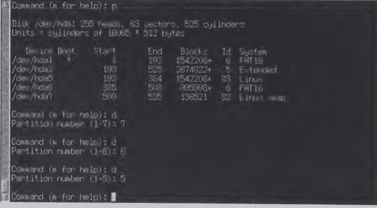

**图 1.1** `fdisk` 工具 `p` 命令的屏幕截图，显示硬盘的分区表。

3. 在图 1.1 中，7 是最后一个分区号，因为 `hda7` 是最后一个逻辑驱动器；`/dev/hda6` 对应 6；`/dev/hda5` 对应 5，依此类推。
4. 按下 `d <Return>` 删除分区。
5. 如果最后一个逻辑驱动器是 `/dev/hda7`，则输入 `7 <Return>`，或者输入最后一个逻辑驱动器的编号（例如，对于 `/dev/hda6`，输入 `6`；对于 `/dev/hda5` 输入 `5`，依此类推）。
6. 重复步骤 5，直到所有逻辑驱动器分区都被删除。
7. 通过按下 `d <Return>` 并输入 `2` 来删除扩展分区 `/dev/hda2`。

> **注意：**
>
> 如果您计划保留 Windows 9x，请不要添加或删除主分区。

8. 如果您想保留现有的 Windows 分区，请直接跳至步骤 9。否则，通过按下 `d <Return>` 并输入 `1` 来删除主分区 `/dev/hda1`。
9. 按下 `p <Return>` 查看分区表。图 1.2 显示了删除所有分区后的被删除分区号和空白磁盘。

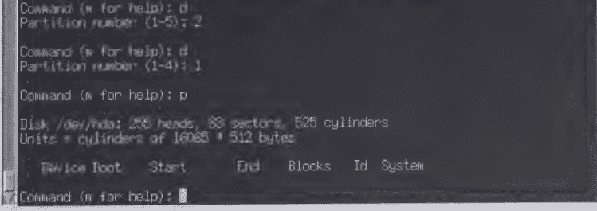

### 使用 `fdisk` 保留 Windows 9x 分区

1. 参考图 1.1 查看硬盘上的现有分区。
2. 按下 `d` <Return> 从最后一个分区号开始删除现有分区。*不要* 删除分区 1。`/dev/hda1` 是分区 1，`/dev/hda2` 是分区 2，依此类推。逻辑驱动器从分区 5 开始。

> **注意：** 不要添加或删除用于 Windows 9x 的主分区 1（`/dev/hda1`）。

3. 按下 `p` <Return> 查看分区表。您应该能看到现有的主分区。

### 使用 `fdisk` 添加主分区


1. 仅在磁盘为空白时才需要此步骤。按下 `n` <Return> 添加新分区。（如果您想保留已用硬盘上的 Windows 9x 分区，请跳至下一节。）

2. 按下 `p` <Return> 添加主分区。

3. 输入 `1` <Return> 接受第一个柱面 1。

4. 计算您想为主分区预留的块数（通常每个分区为 8MB）。当提示输入最后一个柱面时，输入您刚刚计算的数字；例如，为 1600MB 的主分区输入 `200`（图 1.3）。

### 使用 `fdisk` 添加扩展分区

1. 按下 `n` <Return> 添加新分区。

2. 按下 `e` <Return> 添加扩展分区。

3. 为扩展分区输入 `2`。

4. 输入默认的第一个柱面编号，然后按下 <Return>。

5. 输入默认的最后一个柱面编号，然后按下 <Return>。（此步骤将硬盘剩余部分分配给扩展分区，随后您将将其细分为逻辑驱动器。）参见图 1.3。

### 将 Linux Swap 分区添加为逻辑驱动器

1. 计算您需要的交换空间（swap space）大小；它应该是 RAM 容量的两倍。例如，64MB RAM 的系统需要 128MB 交换空间，即 16 个块（8MB/块）。

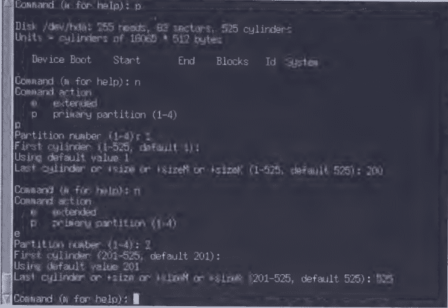

**图 1.3** 添加主分区和扩展分区的命令及响应。

2. 按下 `n` <Return> 添加新分区。

3. 按下 `l` <Return> 添加逻辑驱动器。

4. 输入默认的第一个柱面编号，然后按下 <Return>。

5. 最后一个柱面编号应该是第一个柱面加上交换空间。例如，您的第一个柱面编号是 200，交换空间是 16 个块，那么最后一个柱面编号就是 216。在提示输入最后一个柱面编号时输入此值。

### 将 Linux Native 分区添加为逻辑驱动器

6. 按下 `l` <Return> 添加逻辑驱动器。

7. 输入第一个柱面编号。

8. 输入默认的最后一个柱面编号（您可以输入一个较小的数字并重复步骤 6 以创建多个逻辑驱动器）。

9. 现在您拥有了一个包含主分区和扩展分区的硬盘。扩展分区被进一步分为两个具有逻辑驱动器的分区，如图 1.4 所示。

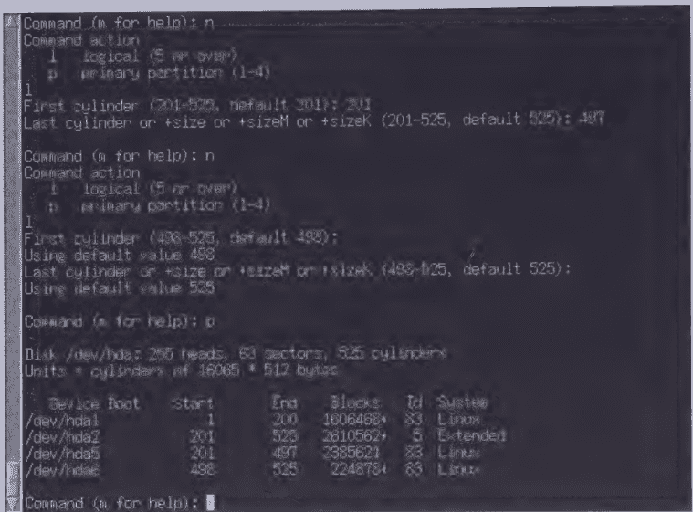

**图 1.4** 添加扩展分区逻辑驱动器的命令及响应。

## 使用 `fdisk` 为 Win95 更改分区类型

1. 如果您想保留现有的 Win95 分区类型，请跳至步骤 4。

2. 按下 `t` <Return> 更改分区类型；为 `hda1` 输入 `1`。

3. 为 Win95 类型输入 `b` <Return>。

## 使用 `fdisk` 为 Linux Swap 更改分区类型

4. 按下 `t` <Return> 更改 Linux swap 的分区类型。为 `hda5` 或您为交换空间预留的任何逻辑驱动器输入 `5`。

5. 为 Linux native 输入 `82`。

6. 按下 `p` 验证分区表类型，如图 1.5 所示：`hda1=b, hda2=5, hda5=83, hda6=83`。

7. 按下 `w` 写回更改。这将退出 `fdisk`。

8. 您现在应该回到了“Partition Disk”窗口。选择 *Done* 并按下 *Enter*。

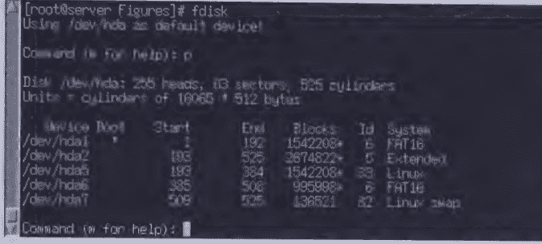

**图 1.5** `fdisk` 工具 `p` 命令显示最终的分区表。

## 要安装的组件

选择安装前面带有星号 "[*]" 的组件。

- [*] 打印机支持
- [*] X Windows 系统
- [*] GNOME
- [*] KDE
- [*] 邮件/WWW/新闻工具
- [*] DOS/Windows 连接性
- [*] 文件管理器
- [*] 图形处理
- [ ] 控制台游戏
- [ ] X 游戏
- [*] 控制台多媒体支持
- [*] X 多媒体支持
- [*] 网络工作站
- [*] 拨号工作站
- [ ] 新闻服务器
- [ ] NFS 服务器
- [*] SMB (Samba) 连接性
- [ ] IPX/NetWare 连接性
- [*] 匿名 FTP 服务器
- [*] Web 服务器
- [*] DNS 域名服务器
- [*] Postgresql (SQL) 服务器
- [*] 网络管理工作站
- [ ] TeX 文档格式化
- [*] Emacs
- [*] 带有 X Windows 的 Emacs
- [*] C 开发
- [*] 开发库
- [*] C++ 开发
- [*] X 开发
- [*] GNOME 开发
- [*] 内核开发
- [*] 额外文档
- [ ] 全部安装

## 安装设备

系统中的设备包括键盘、鼠标、显卡、显示器、网卡、调制解调器等。Red Hat 7.1 可以无需用户干预地检测设备，但 6.0 版本可能需要一些手动配置。

Linux 在检测串行或 PS/2 鼠标方面没有问题，但您将在新的“Configure Mouse”窗口中被要求识别鼠标类型。如果您不知道具体类型，只需选择 *Generic type* 并点击 **OK**。

接下来出现“Network Configuration”窗口。点击 *No*，因为您将使用控制面板进行此选择。随后是“Configure Time Zone”窗口。选择您的本地时区，然后点击 **OK**。

## 安装服务

在以下各项中，选择安装前面带有星号 `[*]` 的服务，以便在机器启动时启动。确保 DNS、Web 和 HTTP 服务器包含在列表中。

- [*] `apmd`
- [*] `atd`
- [*] `crond`
- [*] `gpm`
- [*] `httpd`
- [*] `inet`
- [*] `keytable`
- [*] `linuxconf`
- [*] `lpd`
- [*] `mars-nwe`
- [*] `named`
- [*] `netfs`
- [*] `network`
- [ ] `nfs`
- [ ] `pcmcia`
- [*] `portmap`
- [*] `postgresql`
- [*] `random`
- [*] `routed`
- [ ] `rstatd`
- [ ] `rusersd`
- [ ] `rwhod`
- [*] `sendmail`
- [*] `smb`
- [ ] `snmpd`
- [*] `syslog`
- [ ] `ypbind`

## 其他安装选项

### 从可启动软盘安装

如果您的主板不支持从 CD-ROM 启动，您必须准备一个可启动软盘，可以通过 DOS 机器或现有的 Linux 系统来准备。

### 使用 DOS/Windows 系统准备启动软盘

1. 将 Red Hat 安装 CD 放入 CD-ROM 驱动器，将一张空白软盘放入软盘驱动器。执行程序 `F:\Dosutil\rawrite boot.img`（假设您的 CD-ROM 驱动器为 F）。

这将创建一个包含 `boot.img` 的可启动软盘。如果您计划使用带有内置 PCMCIA 支持的笔记本电脑，可能需要额外的文件。请使用选项 `F:\Dosutil\rawrite pcmcia.img` 执行 `rawrite` 程序（假设您的 CD-ROM 驱动器为 F）。

### 使用现有 Linux 系统准备启动软盘

1. 将 Red Hat 安装 CD 放入 CD-ROM 驱动器，将一张空白软盘放入软盘驱动器。

2. 将 CD-ROM 挂载到常规的 CD-ROM 挂载点，并使用以下 shell 命令更改目录：

```bash
#mount /dev/cdrom -t iso9660 /mnt/cdrom
#cd /mnt/cdrom/images
```

3. 使用磁盘复制命令创建一个包含 `boot.img` 的可启动软盘：

```bash
#dd if=boot.img of=/dev/fd0 bs=1440k
```

如果您计划使用带有内置 PCMCIA 支持的笔记本电脑，可能需要额外的文件。

4. 使用以下磁盘复制命令创建补充磁盘：

```bash
#dd if=pcmcia.img of=/dev/fd0 bs=1440k
```

5. 插入启动软盘，重启系统，并按照之前 *Linux Installation* 章节中概述的步骤进行操作。

## LINUX 启动过程

所有计算机系统都通过执行 ROM（具体而言是 BIOS）中的代码来开始启动过程。BIOS 初始化系统的基础硬件，并准备系统从一个启动设备启动，例如软盘、硬盘、CD-ROM、闪存卡等。您的嵌入式系统启动过程也不应有任何不同。BIOS 读取您选择的启动驱动器 0 柱面 0 扇区中的代码，并尝试执行该代码。

在大多数可启动磁盘上，0 柱面 0 扇区包含来自引导加载程序（如 “Lilo”——用于定位 Linux 内核、加载并执行它）的代码，或者是操作系统内核（如 Linux 或 DOS）的起始部分。

您可以将压缩后的 Linux 放在磁盘上，但启动扇区应包含加载 Linux 剩余部分并将其解压到 RAM 的代码。完全加载后，内核初始化设备驱动程序及其内部数据结构。一旦完全初始化，内核会查询其镜像中一个名为 `ramdisk` 的特殊位置。`ramdisk` 告知它如何以及在哪里寻找根文件系统。根文件系统简单来说就是将被挂载为 “/” 的文件系统。请记住，Linux 不使用 C: 或 D: 这样的驱动器盘符。“/” 是所有文件系统的起点；换句话说，就是根目录。所有其他文件系统必须在 “/” 的大伞下挂载到单独的目录中。您必须告诉内核去哪里寻找根文件系统；如果在那里找不到可加载的镜像，它将停止运行。

一旦根文件系统被加载并挂载，将会出现类似下面的消息：

```text
VFS: Mounted root (ext2 filesystem) readonly.
```

### `init`

系统成功加载根文件系统后，它会尝试执行 `init` 程序（位于 `/bin` 或 `/sbin` 中）。

### `inittab`

`init` 读取其配置文件 `/etc/inittab` 并寻找包含 `sysinit` 的行。不同的供应商将 `sysinit` 放置在不同的目录中。以下行来自 Red Hat 7.1 版本的 `inittab`：

```text
si::sysinit:/etc/rc.d/rc.sysinit
```

### `sysinit`

`sysinit` 指向位于 `/etc/rc.d/rc.sysinit` 的 `sysinit` 脚本。该脚本是一组 shell 命令，用于设置基本系统服务，例如在硬盘上运行 `fsck`、加载必要的内核模块、初始化交换分区、初始化网络以及挂载 `/etc/fstab` 中提到的磁盘。

`sysinit` 调用各种其他脚本来进行模块化初始化。脚本的目录路径由运行级别计算；例如，以下行表示“执行在 `/etc/rc.d/rc5.d` 中找到的脚本”：

```text
id:5:wait:/etc/rc.d/rc5
```

当 `sysinit` 脚本结束时，控制权返回给 `init`，然后 `init` 进入由 `inittab` 中 *initdefault* 关键字指定的默认运行级别。

```text
id:5:initdefault:
```

运行级别行通常指定一个程序（如 `getty`），该程序负责处理通过控制台和 `tty` 的通信。`getty` 程序打印出熟悉的 “login:” 提示符，并依次调用 `login` 程序来处理登录验证并建立用户会话。

```text
5:2345:respawn:/sbin/mingetty tty5
```

## 嵌入式系统中的 LINUX

您真正需要的是一个小型、自包含、独立的 Linux，它可以从嵌入式系统的启动介质启动。Linux 的最低要求是略低于 2MB 的磁盘空间，包括启动系统、根系统和实用程序。

启动系统本质上就是 Linux 操作系统，它加载一个包含运行操作系统其余部分所需的实用程序和文件的根文件系统。我们将仅讨论在软盘上创建最小 Linux 系统的过程。该方法同样适用于其他文件系统介质，如 Flash RAM、NV RAM 等；唯一的区别是将文件系统复制到目标介质的指令不同。创建一个双软盘系统（一个用于启动，另一个用于根文件系统）会更容易。但是，如果文件系统的总大小能装进 1.44M 软盘，您可以将两者合并到一个软盘中。配套 CD 目录 `/book/chapter1/miniLinux` 中提供了一个根文件系统示例。该目录下有两个脚本 `makeBootDisk` 和 `makeRootDisk`。请阅读 `/book/chapter1` 目录下提供的 `readme.txt` 文件，了解如何使用这些脚本的特殊说明。这些脚本可以自动创建启动软盘和根软盘，您可以使用它们来测试仅需要软盘系统的最小 Linux 实现。

您需要使用以下命令将 CD 目录 `/book/chapter1` 中的内容复制到您的根文件系统中：

```bash
#mount /dev/cdrom -t iso9660 /mnt/cdrom
#mkdir /book/chapter1
#cp -r /mnt/cdrom/book/chapter1/* /book/chapter1/.
```

### 构建启动文件系统

创建启动盘需要根据您的具体需求配置并创建 Linux 内核镜像。内核配置意味着添加和删除模块，例如 CD-ROM、IEEE 1394 Firewire、USB、磁带系统等。显然，在内核配置期间添加的选项越多，内核的大小就越大。因此，请将其保持在最低限度，并创建与您具体需求相关的内核镜像。配套 CD 目录 `/book/chapter1/miniLinux/miniKernel.config` 中提供了一个默认配置文件，您可以将其加载为示例启动配置。以下步骤将在软盘上创建 Linux 内核的启动镜像（假设您使用的是 Red Hat 7.1）。或者，您可以使用配套 CD `/book/chapter1` 中提供的 `makeBootDisk` 脚本来创建最小 Linux 系统的启动盘。请阅读 `/book/chapter1` 的 `readme.txt` 文件以了解脚本命令的说明。

1. 输入以下内容：

   ```bash
   #cd /usr/src/linux-2.4.2
   #make xconfig
   ```

   GUI Linux 内核配置窗口将出现。点击“Load Configuration from the file”按钮，会出现一个文本框。输入文件名 `/book/chapter1/miniKernel.config` 并点击 OK。点击 Save and Exit，您将返回到 shell 提示符。

2. 在软盘驱动器中插入磁盘，并使用以下命令创建启动镜像：

   ```bash
   #make clean
   #make bzdisk
   ```

3. 修改启动软盘中的 RAMDISK 词项，使内核配置为同样从软盘介质寻找根文件系统。`-R` 选项设置“rootflag”，而偏移量为 49152 的 `-r` 选项（位模式 `0xC000`）通知内核提示加载根磁盘，并从第 0 扇区加载根文件系统。

   ```bash
   #cd /usr/src/linux-2.4.2
   #include xconfig
   ```

   ```bash
   #make clean
   #include bzdisk
   ```

   ```bash
   #rdev /dev/fd0 /dev/fd0
   #rdev -R /dev/fd0 0
   #rdev -r /dev/fd0 49152
   ```

这将创建你选择的启动软盘。接下来，我们将创建根文件系统软盘。

### 构建根文件系统

根文件系统的基本要求包括：

- 基础文件系统结构
- 最小目录集：`/dev`、`/proc`、`/bin`、`/etc`、`/lib`、`/usr`、`/tmp`
- 基础实用程序集：`sh`、`ls`、`cp`、`mv` 等
- 针对嵌入式应用程序的特定程序
- 最小配置文件集：`rc`、`inittab`、`fstab` 等
- 设备文件：`/dev/hda`、`/dev/ttys`、`/dev/fd0` 等
- 提供实用程序所需基础功能的运行时库

创建根文件系统涉及选择执行所需操作的所有必要文件。如果你（在 `fdisk` 过程中）创建了一个大小约等于嵌入式系统启动盘的独立分区，请将运行系统所需的所有文件放置在该分区中。尝试从那里执行代码；如果成功，你就拥有了一个可工作的嵌入式 Linux。你也可以使用 `ramdisk` 来模拟磁盘驱动器。Linux 加载程序 “Lilo” 指定了 4MB 的默认 `ramdisk`。以下设置使用系统启动期间创建的默认 ram disk 作为我们 minLinux 实现的根文件系统。你也可以使用随附 CD（目录 `/book/chapter1`）中提供的 `makeRootDisk` 脚本在软盘上创建 miniLinux 根文件系统。一旦使用启动盘加载了 Linux，系统将提示你插入根磁盘以加载文件系统并启动操作系统。

以下设置创建的根文件系统可以放置在单个软盘上（在执行命令前请插入软盘）；或者，你可以像这样使用 `makeRootDisk` 脚本：

```bash
#cd /book/chapter1
#./makeRootDisk
```

1. 你必须通过填充零来清除设备内容；可以使用以下命令：

   ```bash
   #dd if=/dev/zero of=/dev/ram0 bs=1k count=4096
   ```

2. 在启动介质上创建 ext2 文件系统：

   ```bash
   #mke2fs -m 0 -I 2000 /dev/ram0
   ```

3. 在根文件系统目录下为你的设备创建一个挂载点，例如 `mnt`：

   ```bash
   #mkdir /mnt/ram
   ```

4. 挂载设备：

   ```bash
   #mount /dev/ram0 /mnt/ram
   ```

## 文件系统的内容

使用 `mkdir` 在设备 `/mnt/ram` 上创建以下目录集：

- **`/dev`**：放置所有设备文件
- **`/proc`**：Linux 内部使用
- **`/etc`**：系统配置文件
- **`/sbin`**：系统二进制文件
- **`/bin`**：更多二进制文件
- **`/lib`**：运行时共享库
- **`/mnt`**：其他磁盘的挂载点


- `/usr`：附加实用程序和应用程序

## 目录内容

### 在 CD 中

请参阅随附 CD 上`/book/chapter1/rootfs/`目录的内容（如`makeRootDisk`脚本中所解释），以获取最小配置的文件列表。

### 实用 Linux 编程

#### `/dev`

所有设备特定文件都存储在这里。可以使用以下命令从现有系统复制设备文件列表：

```bash
cp -dpR /dev /mnt/ram/dev
```

`dp`开关确保符号链接作为链接被复制。你只需要复制对系统至关重要的设备文件，但必须包含以下文件；其余的可以删除：

- `console`、`fd0`、`kmem`、`mem`、`null`、`tty0`、`tty1`、`tty2`、`tty3`、`tty4`、`tty5`、`tty6`

#### `/etc`

此目录包含重要的配置文件。`rc`应包含以下内容：

```bash
#!/bin/sh
/bin/mount -av
/bin/hostname xyz
```

- `rc.d/`：系统启动和运行级别更改脚本。
- `fstab`：要挂载的文件系统列表，如下所示：

| 设备 | 挂载点 | 类型 | 选项 |
| :--- | :--- | :--- | :--- |
| `/dev/ram0` | `/` | `ext2` | `defaults` |
| `/dev/fd0` | `/` | `ext2` | `defaults` |
| `/proc` | `/proc` | `proc` | `defaults` |

- `inittab`：`init`进程的参数，它是启动时启动的第一个进程。以下是一个最小的`inittab`文件：

```text
id:2:initdefault:
si::sysinit:/etc/rc
1:2345:respawn:/sbin/mingetty tty1
2:23:respawn:/sbin/mingetty tty2
```

- `passwd`：用户、主目录等的关键列表。
- `group`：用户组。
- `termcap`：终端能力数据库。
- `shutdown`：处理关机命令。

#### `/bin`和`/sbin`

将基础实用程序复制到此目录中，例如：

- `ls`、`mv`、`cat`和`dd`

#### `/usr`

包含以下程序：

- `init`、`getty`、`login`、`mount`以及从`sh`到`​​shell`的链接

#### `/lib`

放置所有必要的共享库和加载器。以下是强制要求的：

- `libc`库、`libc.so.N`

## 名称服务切换（NSS）

如果你使用的是`glibc`或`libc6`，你必须为名称服务做准备，否则将无法登录。`/etc/nsswitch.conf`文件控制各种服务的数据库查询。

以下是一个简单的`nsswitch.conf`文件：

```text
passwd:     files
shadow:     files
group:      files
hosts:      files
services:   files
networks:   files
protocols:  files
rpc:        files
ethers:     files
netmasks:   files
bootparams: files
automount:  files
aliases:    files
netgroup:   files
publickey:  files
```

这指定了仅由本地文件提供各项服务。你还需要包含`/lib/libnss_files.so.X`，其中`glibc 2.0`的`X`为 1，`glibc 2.1`的`X`为 2。该库将被动态加载以处理文件查询。

## 模块

最有可能的情况是你将使用一个模块化内核。模块化内核允许动态加载设备驱动程序。将所有设备模块放置在`/lib/modules`目录中。

将`insmod`、`rmmod`、`lsmod`、`modprobe`、`depmod`和`swapout`添加到你的 bin 目录中。包含`/etc/conf.modules`。

`/var/log`用于内核运行时消息。

如果你已按照启动盘设置中的描述从随附 CD 目录复制了根文件系统，那么以下命令将创建根系统软盘：

```bash
#ldconfig -r /mnt/ram
#cd /mnt
#umount /mnt/ram
#dd if=/dev/ram0 bs=1k | gzip -v9 > rootfs.gz
#dd if=rootfs.gz of=/dev/fd0 bs=1k
```

## 总结

本章讨论了将 Linux 系统构建为开发机，以及创建嵌入式 Linux 系统的关键部分。虽然我们描述了安装 Red Hat Linux 的步骤，但你也可以使用其他发行版，如 Mandrake、SuSE 等。我们还讨论了使用`fdisk`实用程序对硬盘进行分区。

我们涵盖了：

- 作为开发系统的 Linux
- 使用`fdisk`实用程序对硬盘进行分区
- 使用 Red Hat 发行版安装 Linux
- 嵌入式 Linux 的核心组件

# 2 用户界面

## 本章内容

- 数据库服务器（PostgreSQL）
- 域名系统（DNS）
- HTTP/Web 服务器（Apache）

## 介绍

互联网已成为我们日常生活的重要组成部分；我们在互联网上接收电子邮件、阅读报纸、聊天并支付账单。然而，我们很少在互联网上看到嵌入式系统设计的用户界面。在本章中，我们将尝试打破常规，解释互联网技术是多么简单，这样下次在进行嵌入式设计项目时，请在设计的用户界面组件中考虑互联网。如果你觉得 Internet（互联网）这个词让你不舒服，因为它会让你的系统变得脆弱且容易受到外部入侵，那么只需选择内网（intranet）访问即可。从技术上讲，内网和互联网是相同的。唯一的区别是，对于互联网，你必须注册域名，从而使你的域名公开。如果这让你感到不安，请留在内网并使用 Web 界面提供的所有丰富功能。

当你完成本章（并遵循必要指令）时，你将拥有一个像 dot com 公司一样功能齐全的 Web 托管服务器。你需要的基本 ingredients 是 Web 服务器、DNS 服务器和 SQL 服务器。这些服务构成了公司在互联网上存在的骨干，并为组织的互联网和内网服务需求提供了基础——这也是我们选择 Linux 操作系统提供这些基础服务的原因。到目前为止，Web 已经证明了自己是

这是显示信息的最佳方式，而我们希望将嵌入式系统设计呈现在网络上。

仅借助互联网技术就能高效地设计某些应用程序。考虑一个位于沙漠中的流量计传感器，为管道传输系统接收数据；或者一个打印机，你可以将所有文档存储在其中用于存档以便稍后打印。虽然每个应用程序的用户界面要求不同，但它们有一些共同点：两者的信息都必须安全，访问必须仅限于授权用户，并且必须建立一个鲁棒的传输机制以实现可行的系统方案。完全的内部软件开发可能看起来是最佳方案，但实施成本可能非常高。

推荐的方案是实现一个数据库服务器（SQL 或 DBM）来记录传感器数据。实现一个脚本或可执行文件（Perl 脚本或 C 编译程序）将数据从数据库中抽取出。实现一个 Web 服务器或 Socket 服务器将数据传输到用户端，并实现 DNS 服务器或 Socket 端口来识别我们感兴趣的特定设备。图 2.1 描绘了功能块之间的数据流。

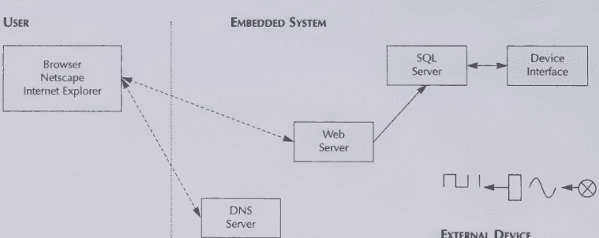

**图 2.1 通过浏览器进行用户交互的嵌入式系统设计。**

使用基于 Web 方案的优势在于其平台无关性。从 Linux 服务器启动的应用程序可以通过任何其他操作系统（如 Windows 9x、Macintosh 或 Unix 机器）的 Web 浏览器查看，且无论距离多么遥远。

你会惊讶地发现，在 Linux 上实现这样一个方案是多么简单且廉价。Linux 具有高度的可扩展性。一个完整的嵌入式 Linux 可以移植到仅 2MB 的磁盘空间中；当然，它将不支持 SQL 服务器、Web 服务器和 DNS 服务器的所有繁琐功能。对于这些实用工具有替代方案，我们将在第 4 章“任务与进程间通信”中讨论，届时我们将开发一个 Socket 服务器和客户端应用程序，并演示一个作为嵌入式系统设计的低成本数据采集系统。

接下来的教程描述了前文提到的三种基本服务（SQL 服务器、DNS 服务器和 Web 服务器）的基础服务器设置。该设置假设你拥有一个完整的 Linux 服务器，例如 Red Hat 7.1 或其他安装了开发软件的 Linux 发行版。该设置将在 Linux 上产生一个类似于互联网服务提供商（ISP）的虚拟托管系统，其中注册了多个域名。我们将在后续章节中使用这里开发的技术来实现一些现实生活中的嵌入式设计项目——带有编码钥匙的门锁机制、员工考勤记录以及一个工资单和制造成本管理系统。

DNS 服务器为浏览器和 Web 服务器提供名称解析服务。SQL 数据库服务器提供通用网关接口（CGI）脚本以及对存储信息的访问，而 Web 服务器负责将数据传输给用户及从用户处接收数据。

## 数据库服务器（POSTGRESQL）

PostgreSQL 是一个成熟的基于事务的数据库系统，能够像 Sybase 和 Oracle 等系统一样支持极大型数据库。它随 Linux 免费提供，这是一个围绕它设计项目的充分理由。与所有其他服务器一样，PostgreSQL 持续运行，等待客户端连接。服务器与用户之间没有直接交互；用户必须使用客户端程序（如`psql`）与服务器通信。在本章稍后部分，我们将提供一个教程，使用`psql`命令为我们的嵌入式系统设计项目“员工出入时间记录与安全系统”设置数据库（我们将在第 9 章“嵌入式系统设计项目”中讨论完整的项目设计）。PostgreSQL 可以同时支持多个数据库，但首次运行服务器需要使用`initdb`命令初始化数据库系统。`initdb`的参数为：

`-D dbdir`

此选项指定数据库应存储在文件系统的哪个位置。

`-L libdir`

`initdb`需要几个输入文件来初始化数据库。其中一个文件`global1.bki.source`传统上与其他文件一起安装在库目录中（例如`/usr/local/pgsql/lib`）。

`–D`选项和`–L`选项告诉`initdb`程序在哪里查找库。

出于安全目的，PostgreSQL 服务器不以 root 用户运行，因此使用`postmaster`程序在启动时启动服务器。不是 root 用户的后果是 X（Windows）服务器可能会拒绝与数据库服务器的连接。解决此问题的一个简单方法是使用`xhost +`命令，该命令授予所有人访问 X 服务器的权限。

以下配置初始化一个数据库系统并创建一个供我们在嵌入式系统设计项目中使用数据库。在此配置中：

- 数据库系统将被初始化。
- 将创建一个名为 "timelog" 的数据库。我们的设计项目“员工出入时间记录与安全系统”将使用此数据库。
- 数据库将填充两张表：用于存储员工姓名、ID 等的 "employee" 表，以及存储员工签到和签出时间戳的 "entrancelog" 表。
- 交互式程序`psql`将用于创建表并填充表的列和值。


随书 CD 在文件`/book/chapter2/sql/employee_schema`中提供了用于创建示例数据库的模式（schema）。还有一个`Readme.txt`文件，其中包含设置数据库的说明。

### PostgreSQL 服务器设置

如果你在安装时选择了 PostgreSQL 选项，可以继续进行服务器设置。Red Hat Linux 使用 Red Hat 软件包管理器（RPM）来安装和升级软件包，但你也可以从官方网站 www.postgresql.org 下载最新软件。

下载并安装 PostgreSQL：

1. 打开命令 shell 并创建目录`/sql`。

   ```bash
   # mkdir /sql
   # cd /sql
   ```

2. 从 www.postgresql.org 将最新版本下载到`/sql`目录，并使用以下 shell 命令解包并解压文件：

   ```bash
   # tar -xvzf postgresql-7.3.2.tar.gz .
   # cd postgresql
   ```

3. 使用以下 shell 命令编译并安装 PostgreSQL：

   ```bash
   # make
   # make install
   # make setup
   ```

### 使用 Red Hat RPM

以下步骤特别针对 Red Hat 7.1 版本。你的安装版本可能不同；如果如此，只需在安装时更改 PostgreSQL 的版本号即可。

1. 插入 Red Hat CD，打开命令 shell 并挂载 CD-ROM。

   ```bash
   # mount -t iso9660 /dev/cdrom /mnt/cdrom
   # cd /mnt/cdrom/RedHat/RPMS
   ```

2. 在命令提示符下，执行如下`dir`程序以查出 CD 中提供的版本。

   ```bash
   # dir | grep postgresql
   ```

3. 安装 CD 中提供的相应 PostgreSQL 软件。（以下命令序列仅为 Red Hat 7.1 CD 中提供命令序列的示例。你的发行版可能有不同的版本号。）在命令提示符下，执行如下`rpm`程序（以下命令序列中的 *** 表示应通过按下 Tab 键填充文件名），然后重启系统。

   ```bash
   # rpm -i postgresql-***
   # rpm -i postgresql-server-***
   # rpm -i postgresql-devel-***
   # rpm -i postgresql-perl-***
   ```

4. 在`rc5.d`目录中创建链接，以便在启动时启动服务器，然后重启机器。

   ```bash
   # cd /etc/rc.d/rc5.d
   # ln -s ../init.d/postgresql S91postgresql
   ```

### 服务器设置步骤

1. 允许 PostgreSQL 使用 X 显示。

   ```bash
   # xhost +
   ```

2. 将`/var/lib/pgsql`和`/usr/lib/pgsql`目录的所有权更改为`postgres`。

   ```bash
   # chown -R postgres:postgres /var/lib/pgsql
   # chown -R postgres:postgres /usr/lib/pgsql
   ```

3. 切换到用户`postgres`。

   ```bash
   # su postgres
   ```

4. 使用`–L`选项指定安装目录，使用`–D`选项指定数据库目录，初始化数据库系统。

   ```bash
   $ initdb -L /usr/lib/pgsql -D /var/lib/pgsql
   ```

5. 切换回 root 用户，并在提示符下使用以下命令启动数据库系统：

   ```bash
   $ su
   password: password
   # /etc/rc.d/init.d/postgresql restart
   ```


6. 随书 CD 文件`/book/chapter2/sql/employee_schema`中提供了一个数据库模式。插入书籍 CD 并将该模式复制到你的本地目录。如果你没有 CD，可以直接跳到步骤 7，但你可能需要直接使用 SQL 命令手动填充数据库。

   ```bash
   # mkdir /book/chapter2/sql
   # cp /mnt/cdrom/book/chapter2/sql/employee_schema /book/chapter2/sql/.
   ```

7. 切换回用户`postgres`并创建数据库`timelog`。

   ```bash
   # su postgres
   $ createdb timelog
   ```

8. 启动交互式后端`psql`并打开`timelog`数据库。

   ```bash
   $ psql timelog
   ```

9. 使用`psql`的 import 命令，根据文件`/book/chapter2/sql/employee_schema`中提供的模式（schema）填充数据库。如果您无法访问书籍 CD，可以继续阅读下一节，并在`psql`交互会话中手动创建数据库表。

   ```text
   timelog=$ \i /book/chapter2/sql/employee_schema
   ```

10. 使用 SQL 查询验证数据库表条目。

    ```sql
    timelog=$ SELECT * From table employee;
    ```

## 设置时间日志数据库模式

在嵌入式系统设计中，数据库在系统和用户之间起到了中间人的作用。它也是一个信息持久化以及保存系统状态的地方。正如流程图有助于设计软件算法一样，数据库模式（database schema）是数据库中信息的路线图。以下是“员工出入时间日志与安全系统”应用程序的模式。该应用程序允许员工通过 Netscape 等 Web 浏览器记录签入（time-in）和签出（time-out）时间，主管可以查看员工的时间表，并将时间记录上传到文件中以用于会计目的。

时间与出勤数据库的数据库模式包含两个表：

- `Employee`：此表包含员工信息，包括 ID、姓（Last Name）、名（First Name）、中间名首字母（Middle Initial）、激活状态（Active Status）以及该员工主管的 ID（表 2.1）。

### 表 2.1 Employee 表的数据库模式


| ID | Last Name | First Name | MI | Active | Supervisor |
|----|-----------|------------|----|--------|------------|
|    |           |            |    |        |            |

### 表 2.2 Timelog 表的数据库模式

| ID | Time In | Time Out |
|----|---------|----------|

- Timelog：此表包含员工的登录信息（表 2.2）。

模式中的表和列必须满足以下约束：

1. `Employee.ID` 是主键。它是唯一的且不能为空（must not be NULL）。
2. `Employee.LastName` 不能为空。
3. `Employee.FirstName` 不能为空。
4. `Employee.Status` 的默认值为 `"Employee"`。
5. `Employee.Supervisor`（其本身也是一名员工）是一个引用回 `Employee.ID` 的键，且必须允许为空。这允许我们输入第一条记录。
6. `TimeLog.ID` 是一个外键，引用

4. 启动 bind 服务器。

```bash
# cd /etc/rc.d/init.d
# ./named start
```

5. 您可以在 `rc5.d` 目录中为启动脚本创建链接，以便服务在启动时自动运行。

```bash
# cd /etc/rc.d/rc5.d
# ln -s ../init.d/named S92named
```

## DNS 服务器组件

DNS 服务器可以被指定为任何区域（zone）或域（domain）的权威服务器，即使 DNS 服务器本身就位于该区域内。因此，一台名称服务器可以为多个区域提供命名信息，就像它拥有该区域的权限一样。Linux DNS 服务器是 `bind`（Berkeley Internet Name Domain），其配置文件为 `/etc/named.conf`。DNS 服务器具有以下三个功能：

- 正向名称解析（名称到 IP 地址的转换）
- 反向名称查询（IP 地址到名称的转换）
- 缓存信息（存储在主区域中未找到的主机信息）

安装 DNS 时会创建默认配置文件 `/etc/named.conf`。清单 2.1 显示了该文件的内容。该文件分为选项部分（option section）和三个区域信息部分。选项部分（第 2 至 12 行）的第 3 行指明了存储 DNS 区域信息文件的目录路径（`/var/named`）。

三个区域信息部分分别是：缓存区域（第 16 至 19 行）、localhost 区域（第 20 至 24 行）和反向命名信息（第 25 至 29 行）。

区域部分最重要的信息是存储该区域所有单个主机信息的文件名。

为 DNS 添加新区域需要：

- 在 `named.conf` 文件中添加一个区域信息部分
- 创建与指定区域相关的主机信息文件

如果 DNS 服务器区域中的主机具有物理 IP 地址，则需要在 `named.conf` 文件中添加反向名称查询部分。在这种情况下，必须在 `/etc/named.conf` 文件选项部分指定的目录路径中创建反向名称解析文件。在我们的虚拟 Web 托管设置方案中，虚拟域中的所有主机名都是规范名称；因此，不需要反向名称查询服务。

- 在 `/etc/named.conf` 文件选项部分指定的目录路径中创建反向名称解析文件。

反向名称解析区域部分以网络 IP 数字加上 `in-addr.arpa` 开始；例如，`0.168.192.in-addr.arpa`（省略了 IP 数字中的主机部分）。清单 2.1 显示了配置文件 `/etc/named.conf` 的内容。

**清单 2.1** DNS 安装时创建的默认配置文件 `/etc/named.conf`。

```text
1) // generated by named-bootconf.pl
2) options {
3)   directory "/var/named";
4) };
5) /*
6)   If there is a firewall between you and nameservers you want
7)   to talk to, you might need to uncomment the query-source
8)   directive below. Previous versions of BIND always asked
9)   questions using port 53, but BIND 8.1 uses an unprivileged
10)  port by default.
11) */
12) // query-source address * port 53;
13) };
14) //
15) // a caching only nameserver config
16) //
17) zone "." IN {
18)   type hint;
19)   file "named.ca";
20) };
21) zone "localhost" IN {
22)   type master;
23)   file "localhost.zone";
24)   allow-update { none; };
25) };
26) zone "0.0.127.in-addr.arpa" IN {
27)   type master;
28)   file "named.local";
29)   allow-update { none; };
30) };
```

## 区域或域的权限

`/etc/named.conf` 文件仅包含区域信息。单个主机信息则由区域信息指定，呈现在一个单独的文件中。添加新区域或域是一个两步过程。首先，将新区域信息添加到 `named.conf` 文件中。其次，为该域中驻留的所有主机信息创建一个新文件。

接下来，我们讨论为四个域（`project.com`、`timelog.com`、`digital.com` 和 `printer.com`）添加配置的步骤，我们的 DNS 服务器将成为这些域的权威名称服务器。该设置需要编辑 `named.conf` 文件，但您可以使用 shell 命令从随书 CD 中复制该文件。

1. 挂载 CD-ROM。

```bash
# mount -t iso9660 /dev/cdrom /mnt/cdrom
```

2. 复制 `host` 文件。

```bash
# cp /mnt/cdrom/book/chapter2/dns/hosts /etc/
```

3. 复制 `resolv.conf` 文件。

```bash
# cp /mnt/cdrom/book/chapter2/dns/resolv.conf /etc/
```

4. 复制 `network` 文件。

```bash
# cp /mnt/cdrom/book/chapter2/dns/network /etc/sysconfig/
```

5. 复制 `ifcfg-eth0` 文件。

```bash
# cp /mnt/cdrom/book/chapter2/dns/network-scripts/ifcfg-eth0 /etc/sysconfig/network-scripts/
```

6. 复制 `named.conf` 文件。

```bash
# cp /mnt/cdrom/book/chapter2/dns/named.conf /etc/
```

以下是 DNS 区域信息文件的设置：

1. 复制 `digital.com` 文件。

```bash
# cp /mnt/cdrom/book/chapter2/dns/digital.com /var/named/
```

2. 复制 `analog.com` 文件。

```bash
# cp /mnt/cdrom/book/chapter2/dns/analog.com /var/named/
```

3. 复制 `project.com` 文件。

```bash
# cp /mnt/cdrom/book/chapter2/dns/project.com /var/named/
```

4. 复制 `timelog.com` 文件。

```bash
# cp /mnt/cdrom/book/chapter2/dns/timelog.com /var/named/
```

5. 复制 `printer.com` 文件。

```bash
# cp /mnt/cdrom/book/chapter2/dns/printer.com /var/named/
```

6. 复制 `localhost.zone` 文件。

```bash
# cp /mnt/cdrom/book/chapter2/dns/localhost.zone /var/named/
```

7. 复制 `named.local` 文件。

```bash
# cp /mnt/cdrom/book/chapter2/dns/named.local /var/named/
```

8. 复制 `named.ca` 文件。

```bash
# cp /mnt/cdrom/book/chapter2/dns/named.ca /var/named/
```

### 添加 `project.com` 域

使用您喜欢的文本编辑器将以下文本追加到 `/etc/named.conf` 文件中。第 1 行是区域名称 `"project.com"`，第 2 行指定该域的主服务器，第 3 行是在 `/var/named` 目录中创建的主机信息文件名（`"project.com"`）。

```text
1) zone "project.com" IN {
2)     type master;
3)     file "project.com";
4)     notify no;
5) };
```

### 添加 `printer.com` 域

与 `project.com` 类似，将以下文本追加到 `/etc/named.conf` 文件中。区域名称为 `"printer.com"`，主机信息文件为 `"printer.com"`。

```text
1) zone "printer.com" IN {
2) type master;
3) file "printer.com";
4) notify no;
5) };
```

### 添加 `digital.com` 域

将以下文本追加到 `/etc/named.conf` 文件中。区域名称为 `"digital.com"`，主机信息文件为 `"digital.com"`。

```text
1) zone "digital.com" IN {
2) type master;
3) file "digital.com";
4) notify no;
5) };
```

### 添加 `timelog.com` 域

将以下文本追加到 `/etc/named.conf` 文件中。区域名称为 `"timelog.com"`，主机信息文件为 `"timelog.com"`。

```text
1) zone "timelog.com" IN {
2) type master;
3) file "timelog.com";
4) notify no;
5) };
```

### 主机信息设置

完整的配置文件 `/etc/named.conf` 呈现在清单 2.2 中，显示了四个新区域：`project.com`、`printer.com`、`digital.com` 和 `timelog.com`。然而，信息仍然不完整。我们需要创建每个区域信息部分中提到的实际主机文件。

**清单 2.2** 包含四个额外区域（`project.com`、`printer.com`、`digital.com` 和 `timelog.com`）的 `/etc/named.conf`。

```text
1) // generated by named-bootconf.pl
2) options {
3)     directory "/var/named";
4)   /*
5)     If there is a firewall between you and nameservers you want
6)     to talk to, you might need to uncomment the query-source
7)     directive below.  Previous versions of BIND always asked
8)     questions using port 53, but BIND 8.1 uses an unprivileged
9)     port by default.
10)   */
11)  // query-source address * port 53;
12)  };
13)  //
14)  // a caching only nameserver config
15)  //
16)  zone "." IN {
17)    type hint;
18)    file "named.ca";
19)  };
20)  zone "localhost" IN {
21)    type master;
22)    file "localhost.zone";
23)    allow-update { none; };
24)  };
25)  zone "0.0.127.in-addr.arpa" IN {
26)    type master;
27)    file "named.local";
28)        allow-update { none; };
29)    };
30)  zone "project.com" IN {
31)    type master;
32)    file "project.com";
33)    notify no;
34)  };
35)  zone "printer.com" IN {
36)    type master;
37)    file "printer.com";
38)    notify no;
39)  };
40)  zone "digital.com" IN {
41)    type master;
42)    file "digital.com";
43)    notify no;
44)  };
45)  zone "timelog.com" IN {
46)    type master;
```

```text
47)    file "timelog.com";
48)    notify no;
49) };
```

一旦域名被添加到名称服务器权限中，就可以根据需要添加单个主机的信息。目前，我们将添加的唯一主机是 `www` 主机。`named.conf` 文件的 option 部分指定了主机信息文件应存放的目录（代码清单 2.2 的第 3 行显示为 `/var/log/named` 目录）。需要在指定目录中创建四个主机文件（`project.com`、`digital.com`、`printer.com` 和 `timelog.com`）。代码清单 2.3 显示了一个典型主机文件的内容。

### 代码清单 2.3 区域 `project.com` 的主机文件

```text
 1)  @        IN     SOA     ns.project.com.      hostmaster.ns.project.com. (
 2)           2001052401 ; serial
 3)           3600 ; refresh
 4)           900 ; retry
 5)           1209600 ; expire
 6)           43200 ; default_ttl
 7)          )
 8)  @        IN     MX      5                    ns.project.com.
 9)  @        IN     NS                           ns.project.com.
10) www      IN     CNAME                          ns.project.com.
11) ns       IN     A      192.168.0.40
```

以下是对区域信息文件中每一行信息的说明。

## SOA 记录

这些文件中的第一个条目是*起始授权*（start of authority）SOA 资源记录。第 1 列中的 `@` 代表当前正在查看的区域（因为我们首先通过阅读 `named.conf` 文件中的“project.com”区域信息来到这里）；`@` 被替换为 `"project.com."`。`IN` 代表 Internet。`SOA` 是记录类型。SOA 之后的 `"ns.project.com"` 是此数据的主名称服务器。`hostmaster.ns.project.com.` 是负责该数据的管理人员的邮件地址。邮件接收者之后的括号跨越了多行，其内容提供了关于序列号、刷新率、重试次数、过期时间和默认生存时间（TTL）的信息。

## NS 记录

包含 `"NS"`（名称服务器）的行是名称服务器资源记录；例如：

```text
@        IN    NS          ns.project.com.
```

同样，`@` 代表正在查看的区域（`project.project.com`），而 NS 之后的名称（`ns.project.com`）指定了 `project.com` 区域的名称服务器。

## 地址记录

带有 `A`（address）的行将名称映射到地址；例如：

```text
ns           IN    A          192.168.0.40
```

这就是您添加新计算机名称并将其与 IP 地址相关联的行。第一列中的名称是分配的计算机名称，随后是代表 Internet 的 `IN`，代表地址的 `A`，然后是分配的 IP 地址。

## 别名记录

包含 `CNAME`（canonical name）的行将别名映射到地址；例如：


```
www           IN    CNAME     ns.project.com.
```

如果您为同一台计算机分配多个名称，就使用这一行。`www` 是计算机 `ns.project.com` 的昵称。

## PTR 记录

包含 PTR（pointer）的行提供地址到名称的映射；例如：

```
40.0.168.192.in-addr.arpa.           IN    PTR     ns.project.com.
```

这些行为 DNS 提供了反向名称查询功能。

## MX 记录

包含 MX（Mail Exchanger）的行提供邮件路由信息；例如：

```
@        IN    MX          5          ns.project.com.
```

该记录指定了域名邮件交换服务器。如果存在多个 MX 记录，该行指定了该域名邮件交换服务器的优先级。MX 之后的数字是分配给每个邮件服务器的相对优先级，因此邮件发送者应首先尝试首选服务器（数字较高的），在失败时再尝试备用服务器。

## 添加虚拟主机 `www.timelog.com`

在目录 `/var/named` 中创建如代码清单 2.4 所示的 `timelog.com` 文件，或从配套 CD 目录 `/book/chapter2/dus/timelog.com` 复制该文件。

### 代码清单 2.4 域名 timelog.com 的 timelog.com 主机信息文件

```
1) @ IN SOA ns.project.com. hostmaster.ns.project.com. (
2) 2001052401 ; serial
3) 3600 ; refresh
4) 900 ; retry
5) 1209600 ; expire
6) 43200 ; default_ttl
7) )
8) @ IN MX 5 ns.project.com.
9) @ IN NS ns.project.com.
10) www IN CNAME ns.project.com.
```

## 添加虚拟主机 `www.project.com`

在目录 `/var/named` 中创建如代码清单 2.5 所示的 `project.com` 文件，或从配套 CD 目录 `/book/chapter2/dus/project.com` 复制该文件。

### 代码清单 2.5 域名 project.com 的 timelog.com 主机信息文件

```
1) @ IN SOA ns.project.com. hostmaster.ns.project.com. (
2) 2001052401 ; serial
3) 3600 ; refresh
4) 900 ; retry
5) 1209600 ; expire
6) 43200 ; default_ttl
7) )
8) @ IN MX 5 ns.project.com.
9) @ IN NS ns.project.com.
10) www IN CNAME ns.project.com.
11) ns IN A 192.168.0.40
```

请注意，在 `project.com` 域名中有两台计算机：`ns` 和 `www`。`ns` 是分配给该计算机的主名称。

## 添加虚拟主机 `www.printer.com`

在目录 `/var/named` 中创建如代码清单 2.6 所示的 `printer.com` 文件，或从配套 CD 目录 `/book/chapter2/dus/printer.com` 复制该文件。

### 代码清单 2.6 域名 printer.com 的 timelog.com 主机信息文件

```
 1) @      IN   SOA    ns.project.com.   hostmaster.ns.project.com. (
 2) 2001050201 ; serial
 3) 3600 ; refresh
 4) 900 ; retry
 5) 1209600 ; expire
 6) 432000 ; default_ttl
 7) )
 8) @      IN   MX     5                 ns.project.com.
 9) @      IN   NS     ns.project.com.
10) www    IN   CNAME                 ns.project.com.
```

## 添加虚拟主机 `www.digital.com`

在目录 `/var/named` 中创建如代码清单 2.7 所示的 `digital.com` 文件，或从配套 CD 目录 `/book/chapter2/dus/digital.com` 复制该文件。

### 代码清单 2.7 域名 digital.com 的 timelog.com 主机信息文件

```
 1) @      IN   SOA    ns.project.com.   hostmaster.ns.project.com. (
 2) 2001050201 ; serial
 3) 3600 ; refresh
 4) 900 ; retry
 5) 1209600 ; expire
 6) 432000 ; default_ttl
 7) )
 8) @      IN   MX     5                 ns.project.com.
 9) @      IN   NS     ns.project.com.
10) www    IN   CNAME                 ns.project.com.
```

## PING 命令

验证连接最快的方法是使用 PING 工具。如果请求的主机确实存在，PING 响应将显示该主机在运行并有响应。例如，在 shell 提示符下执行以下 PING 命令可以验证服务器 `ns.project.com`：

```
# ping ns.project.com
  PING ns.project.com (192.168.0.40): 56 data bytes
  64 bytes from 192.168.0.40: icmp_seq=0 ttl=255 time=0.2 ms
  64 bytes from 192.168.0.40: icmp_seq=1 ttl=255 time=0.1 ms
  64 bytes from 192.168.0.40: icmp_seq=2 ttl=255 time=0.1 ms
  --- ns.project.com ping statistics ---
  3 packets transmitted, 3 packets received, 0% packet loss
  round-trip min/avg/max = 0.1/0.1/0.2 ms
```

收到超时错误可能意味着 DNS 中的基础主机名设置不正确，或者您没有启用网络，或者您没有正确的 `host.conf` 文件。请参阅“验证 DNS 功能”章节以获取故障排除指南。

## 验证虚拟主机 `www.timelog.com`

在 shell 提示符下输入以下 PING 命令，以验证虚拟主机设置是否正确以及 PING 是否返回有效响应：

```
# ping www.timelog.com
  PING ns.project.com (192.168.0.40): 56 data bytes
  64 bytes from 192.168.0.40: icmp_seq=0 ttl=255 time=0.1 ms
  64 bytes from 192.168.0.40: icmp_seq=1 ttl=255 time=0.1 ms
  --- ns.project.com ping statistics ---
  2 packets transmitted, 2 packets received, 0% packet loss
  round-trip min/avg/max = 0.1/0.1/0.1 ms
```

如果未收到有效响应或发生超时错误，请修正您的 `/etc/named.conf` 或 `/var/named/timelog.com` 文件。

## 验证虚拟主机

与 `www.timelog.com` 类似，使用以下命令验证 DNS 中 `www.digital.com`、`www.printer.com` 和 `www.project.com` 主机的设置：

- `ping www.project.com`
- `ping www.timelog.com`
- `ping www.analog.com`

## 验证 DNS 功能

DNS 设施的正常运行需要系统的基础网络能够正常且顺畅地运行。如果您对域名的 PING 操作没有返回 0 错误，以下指南可帮助您调试配置文件。

### `/etc/sysconfig/network`

为了让您的系统参与网络通信，环境变量 `NETWORKING` 必须设置为 `yes`，且 `HOSTNAME` 需按照此处所示指定。这是在系统启动时通过读取 `/etc/sysconfig/network` 文件完成的。

使用以下 shell 命令及响应来验证 `/etc/sysconfig/network` 文件中是否启用了网络：

```bash
# cat /etc/sysconfig/network
NETWORKING=yes
FORWARD_IPV4="yes"
HOSTNAME="ns.project.com"
GATEWAYDEV="eth0"
GATEWAY="192.168.0.40"
```

### `/etc/sysconfig/network-scripts/ifcfg-eth0`

以太网连接需要 IP 地址、子网掩码、广播地址、网络地址以及以太网连接的设备名称。一个典型的 `ifcfg-eth0` 文件包含以下内容：

```bash
# cat /etc/sysconfig/network-scripts/ifcfg-eth0
DEVICE="eth0"
NETMASK="255.255.255.0"
NETWORK="192.168.0.0"
IPADDR="192.168.0.40"
BROADCAST="192.168.0.255"
ONBOOT="yes"
BOOTPROTO="none"
```

### `/etc/hosts`

DNS 所在的主主机必须拥有 `/etc/hosts` 文件，且至少包含 localhost 的条目，以及主主机名和 IP 地址。

按如下方式验证 `/etc/hosts` 文件的内容：

```bash
# cat /etc/hosts
127.0.0.1 localhost localhost.localdomain
192.168.0.40 ns.project.com
```

### `/etc/host.conf`

解析器（resolver）是 DNS 服务器的客户端，用于执行名称到 IP 的转换。配置文件 `/etc/host.conf` 作为配置的一部分，绑定如下：

```bash
# cat /etc/host.conf
order hosts,bind
multi on
```

### `/etc/named.conf`

bind 的配置文件是 `/etc/named.conf`。关于该文件的正确配置，请参阅代码清单 2.2。

```
/var/named/timelog.com
/var/named/project.com
/var/named/digital.com
/var/named/timelog.com
```

对于 `/etc/named.conf` 中的每个区域（zone）信息，在 `/var/named` 目录下都有相应的文件。请按照代码清单 2.5、2.6 和 2.7 的规定验证其内容。

## HTTP/WEB 服务器

很难想象现在还有哪家公司在互联网上没有网页。这是一场革命而非演进，嵌入式系统设计工程师应当抓住机会，开始围绕 Web 技术设计其系统。他们可以利用 Linux 操作系统来构建和实现 Web，且 Linux 工具已被证明优于目前所有其他可用工具。我们已经了解了数据库服务器（PostgreSQL）和 DNS 服务器（bind）。现在，我们将讨论 Web 服务器（也称为 HTTP 服务器，Apache）的实现，以完成在 Linux 上的互联网设置。

我们使用互联网来显示“文档”；声音、电影以及我们在浏览器中看到的文本都是文档。当我们请求一个网站时，我们会收到 Web 页面作为响应。Web 页面本质上是经过格式化的文本页，Web 浏览器（如 Netscape Navigator）可以对其进行解释并在屏幕上显示。Web 服务器负责响应来自浏览器的请求，将请求的文档返回给用户。您在互联网上看到的表单是特殊的 Web 页面，它们会返回用户填写的值。这是一种极其强大的用户界面机制，现有的工具和技术可以帮助您在极短的时间内开发 Web 页面。

过去，任何嵌入式系统的用户界面设计都会占用开发人员大量的时间，但现在您可以利用 Web 技术将其转化为优势。您可以将用户界面需求与系统的其余部分分离，并设计动态 Web 页面，为用户提供系统界面的外观和感觉。

Perl 和 Java 解释器为 Web 页面提供了数据库接口，这也是我们使用 Web 技术的主要标准。一方面，系统模块与数据库对接并更新用户需要的信息；另一方面，Web 服务器可以启动与数据库对接的 Web 页面并向用户提供信息。用户界面可以通过“虚拟主机（virtual hosting）”的概念来增强，即在同一个系统中创建多个不同的域，并由单个 Web 服务器支持。每个虚拟主机都被独立访问，就像是一台单独的机器一样。我们接下来描述的设置在单个 Web 服务器上为 `www.timelog.com`、`www.project.com`、`www.printer.com` 和 `www.digital.com` 提供虚拟主机功能。图 2.2 展示了流量的流动。

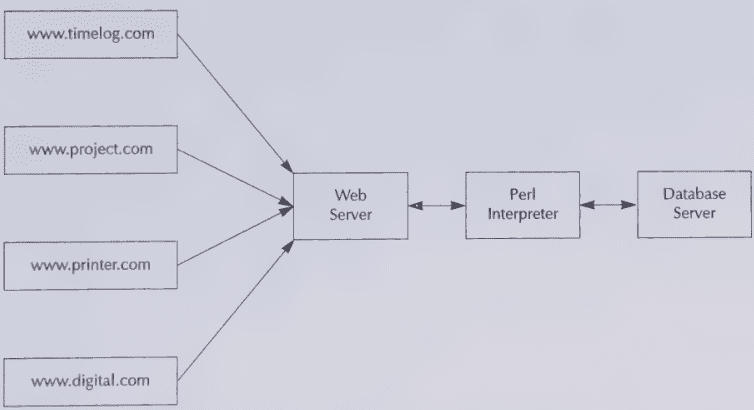

**图 2.2** 通过 CGI 脚本在 SQL 和 Web 服务器之间流动的信息流。

### Apache，HTTP 服务器

如果您在发行版 CD 中找不到 Apache 服务器，或者想要下载最新的 Apache 软件，请访问官方网站 `www.apache.org`。`httpd` 是在 Linux 中作为 Web 服务器运行的守护进程。根据默认配置，它可以是一个响应 TCP/IP 80 端口的独立服务器，也可以配置 `inetd` 守护进程在收到 80 端口查询时启动 `httpd`。Apache 的配置文件是 `/etc/httpd/conf/httpd.conf`，它具有广泛的配置选项，包括设置文档根目录（Document Root）、配置目录选项、允许服务器端包含（SSI）、在文档根目录中启用 CGI、将 CGI 启用为文件类型等等。这些将在下一节讨论虚拟主机设置时详细解释。Apache 的默认设置足以满足我们的需求；我们唯一要添加的是针对我们具体需求的虚拟主机设置。我们还需要为虚拟主机创建主目录，并在每个目录中至少提供一个欢迎页面 `index.html`，以便我们能从内网验证设置。

### 为 `www.project.com` 创建目录

使用以下 shell 命令为虚拟主机 `www.project.com` 创建默认主目录和默认 `cgi-bin` 目录：

```bash
# mkdir /home/httpd/html/www
# mkdir /home/httpd/html/www/project
# mkdir /home/httpd/html/www/project/cgi-bin
```

### 为 `www.project.com` 创建 `index.html` 页面

每个域的主页在用户登录域时应至少提供一个欢迎横幅。默认情况下，这就是 `index.html` 文件。使用您喜欢的文本编辑器创建代码清单 2.8 中定义的 HTML 文件，并将其保存为 `/home/httpd/html/www/project/` 目录下的 `index.html`。或者，您可以使用以下命令从配套 CD 目录中复制该文件：

1. 挂载 CD-ROM。

   ```bash
   # mount -t iso9660 /dev/cdrom /mnt/cdrom
   # cd /mnt/cdrom/book/chapter2
   ```

2. 复制 `index.html` 文件。

   ```bash
   # cp ./web/project/index.html /home/httpd/html/www/project/.
   ```

**代码清单 2.8** 域 `project.com` 的欢迎 `index.html` 文件。

```html
1) <HTML>
2) <TITLE> Testing </TITLE>
3) <BODY>
4) <h1>Welcome to timelog.Com</h1>
5) </BODY>
6) </HTML>
```

3. 将 `index.html` 文件设置为全局可读和可执行。

   ```bash
   # chmod 766 /home/httpd/html/www/project/index.html
   ```

### 为 `www.timelog.com` 创建目录

使用以下 shell 命令为虚拟主机 `www.timelog.com` 创建默认主目录和默认 `cgi-bin` 目录：

```bash
# mkdir /home/httpd/html/www/timelog
# mkdir /home/httpd/html/www/timelog/cgi-bin
```

### 为 `www.timelog.com` 创建 `index.html` 页面


`timelog.com` 域的欢迎页面本质上是一个 Web 表单，用于请求用户的登录信息（姓名和 ID）。请注意，“提交（Submit）”按钮有一个指向 Perl 脚本 `http://www.timelog.com/cgi-bin/verify_employee.pl` 的链接。该脚本是可执行的，并由 Perl 程序解释。这就是我们创建动态 Web 页面的方式。我们将在第 9 章“嵌入式系统设计项目”开发应用程序“员工出入与时间记录”时讨论这些脚本。按照代码清单 2.9 的定义创建欢迎页面 `index.html`，并将其保存到 `/home/httpd/html/www/project/` 目录中。或者，从配套 CD 目录 `/book/chapter2/web/timelog/index.html` 复制该文件。


1. 复制 `index.html` 文件。

```bash
# cp ./web/timelog/index.html /home/httpd/html/www/timelog/.
```

**代码清单 2.9** 域 `timelog.com` 的欢迎 `index.html` 文件。

```html
1) <HTML>
2) <TITLE> Testing </TITLE>
3) <BODY>
4) <h1>Welcome to Timelog.Com</h1>
5) Please Enter Name and Password
```

```html
6)  <FORM ACTION= "http://www.project.com/cgi-bin/test.pl" method="post">
7)  Name: <INPUT NAME="name" TYPE=text SIZE=10>
8)  Password:<INPUT NAME="password" TYPE=password SIZE=10><BR>
9)  <INPUT TYPE=submit value="Enter">
10) <INPUT TYPE=submit value="Cancel">
11) </FORM>
12) </BODY>
13) </HTML>
```

2. 将 `index.html` 文件设置为全局可读和可执行。

```
# chmod 766 /home/httpd/html/www/timelog/index.html
```

## 为 `www.printer.com` 创建目录

使用以下 shell 命令为虚拟主机 `www.printer.com` 创建默认主目录和默认 `cgi-bin` 目录：

```
# mkdir /home/httpd/html/www/printer
# mkdir /home/httpd/html/www/printer/cgi-bin
```

### 为 `www.printer.com` 创建 `index.html` 页面

与 `timelog.com` 域名的欢迎页面类似，按照清单 2.10 中的定义创建一个 HTML 文件，并将其保存为 `index.html` 存放在 `/home/httpd/html/www/project/` 目录下。或者，从配套 CD 的目录 `/book/chapter2/web/printer/index.html` 中复制该文件。

1. 复制 `index.html` 文件。

```
# cp ./web/printer/index.html /home/httpd/html/www/printer/.
```

### 清单 2.10 `printer.com` 域名的欢迎 `index.html` 文件。

```html
1)  <HTML>
2)  <TITLE> Testing </TITLE>
3)  <BODY>
4)  <h1>Welcome to Printer.Com</h1>
5)  </BODY>
6)  </HTML>
```

2. 将 `index.html` 文件设置为全局可读和可执行。

```
# chmod 766 /home/httpd/html/www/printer/index.html
```

## 为 `www.digital.com` 创建目录

使用以下 shell 命令为虚拟主机 `www.digital.com` 创建默认主目录和默认 `cgi-bin` 目录。

```
# mkdir /home/httpd/html/www/digital
# mkdir /home/httpd/html/www/digital/cgi-bin
```

### 为 `www.digital.com` 创建 `index.html` 页面

与 `timelog.com` 域名的欢迎页面类似，按照清单 2.11 中的定义创建一个 HTML 文件，并将其保存为 `index.html` 存放在 `/home/httpd/html/www/project/` 目录下。或者，从配套 CD 的目录 `/book/book/chapter2/web/digital/index.html` 中复制该文件。

1. 复制 `index.html` 文件。

```
# cp ./web/digital/index.html /home/httpd/html/www/digital/.
```

**清单 2.11** `digital.com` 域名的欢迎 `index.html` 文件。

```html
1) <HTML>
2) <TITLE> Testing </TITLE>
3) <BODY>
4) <h1>Welcome to Digital.Com</h1>
5) </BODY>
6) </HTML>
```

2. 将 `index.html` 文件设置为全局可读和可执行。

```
# chmod 766 /home/httpd/html/www/digital/index.html
```

## Apache 上的虚拟主机配置

您可能在我们的 DNS 设置中注意到，我们为同一台机器使用了多个规范名称 (CNAME)。这类似于通过一个 IP 地址为一台计算机分配多个昵称，而这正是虚拟主机为我们实现的功能。通过多个昵称——例如 `www.timelog.com`、`www.project.com`、`www.digital.com` 和 `www.printer.com`——我们可以通过一台机器和一个 IP 地址提供 Web 托管。将流量引导至相应域名的责任由 Web 服务器承担。

清单 2.12 是为了实现虚拟主机设置而修改后的 `httpd.conf` 文件的最后一部分。如清单 2.12 所示，将该文本追加到文件 `/etc/httpd/conf/httpd.conf` 的末尾，或者从配套 CD 目录 `/book/chapter2/web/httpd.conf` 中复制该文件。

1. 挂载 CD-ROM。

```
# mount -t iso9660 /dev/cdrom /mnt/cdrom
# cd /mnt/cdrom/book/chapter2
```

2. 复制 `httpd.conf` 文件。

```
# cp ./web/httpd.conf /etc/httpd/conf/
```

**清单 2.12** `httpd.conf` 文件的虚拟主机配置。

```text
1) NameVirtualHost 192.168.0.40

2) <VirtualHost 192.168.0.40>

3)   ServerName www.timelog.com

4)   DocumentRoot /home/httpd/html/www/timelog

5)   ScriptAlias /cgi-bin/ /home/httpd/html/www/timelog/cgi-bin/

6)   Options ExecCgi Indexes

7) </VirtualHost>

8) <VirtualHost 192.168.0.40>

9)   ServerName www.digital.com

10)  DocumentRoot /home/httpd/html/www/digital

11)  ScriptAlias /cgi-bin/ /home/httpd/html/www/digital/cgi-bin/

12)  Options ExecCgi Indexes

13) </VirtualHost>

14) <VirtualHost 192.168.0.40>

15)  ServerName www.printer.com

16)  DocumentRoot /home/httpd/html/www/analog

17)  ScriptAlias /cgi-bin/ /home/httpd/html/www/printer/cgi-bin/

18)  Options ExecCgi Indexes

19) </VirtualHost>

20) <VirtualHost 192.168.0.40>

21)  ServerName www.project.com

22)  DocumentRoot /home/httpd/html/www/project

23)  ScriptAlias /cgi-bin/ /home/httpd/html/www/project/cgi-bin/

24)  Options ExecCgi Indexes

25) </VirtualHost>
```

每个主机的设置在本质上都是类似的，除了第 1 行的 `NameVirtualHost`。它指定了执行托管的 IP 地址。其他操作如下：

**ServerName:** 第 3, 9, 15, 21 行；标识域名。
`ServerName www.timelog.com`

**DocumentRoot:** 第 4, 10, 16, 22 行；用户无法访问此目录之上的任何内容。
`DocumentRoot /home/httpd/html/www/timelog`

**ScriptAlias:** 第 5, 11, 17, 23 行；此目录中的文件可以被执行或解释。
`ScriptAlias /cgi-bin/ /home/httpd/html/www/timelog/cgi-bin/`

**Options:** 第 6, 12, 18, 24 行；`ExecCgi`；CGI 脚本将从 `cgi-bin` 目录中执行。

## 验证 Web 服务器设置

以下“进程状态”shell 命令用于验证 `httpd` 守护进程是否正在运行：

```
[root@ns /root]# ps -ea | grep http
```

如果 `httpd` 进程未运行，请验证 `httpd` 的启动脚本是否存在于指定的运行级别中。例如，如果运行级别为 5，则目录 `/etc/rc.d/rc5.d/` 中应该有一个名为 `Sxxhttpd` 的 `httpd` 启动脚本条目。

```
# cd /etc/rc.d/rc5.d
# ls -al | grep httpd
```

如果您没有看到脚本，可以使用以下 shell 命令创建脚本，以便在机器启动和重启时运行 `httpd`：

```
# cd /etc/rc.d/rc5.d
# ln -s ../init.d/httpd S93httpd
```

输入以下 shell 命令来验证 `timelog.com` 域名的 Web 页面，如图 2.3 所示：

```
# netscape http://www.timelog.com
```

**图 2.3** Web 浏览器上的登录请求表单。

对所有其他域名重复 Netscape 命令，并查看主页。

```
# netscape http://www.project.com
# netscape http://www.digital.com
# netscape http://www.printer.com
```

## HTTP 交易的幕后机制

HTTP 交易始于客户端向服务器的 HTTP 端口（通常为 TCP/IP 端口 80）发送连接请求。然后，浏览器在原始请求中添加一些文本。如果您在 Netscape 等 Web 浏览器中输入“http://www.aklinux.com”作为请求，您本质上是在建立与一台远程服务器的连接，该服务器在虚构的域名“aklinux.com”中被昵称为“www”。

服务器软件极有可能是 Apache，因为超过 50% 的 ISP 将 Apache 作为其骨干 HTTP 服务器。浏览器会在发送给服务器的请求中添加更多内容。以下场景描述了在浏览器和服务器通信期间，请求和响应序列中幕后的 HTTP 交易。

### 请求

请求分为三个部分：“http:”是协议，“//www.aklinux.com”是域名“aklinux.com”中的计算机名称，而“index.html”是请求的文档。通过互联网发送的实际内容仅比这多一点，看起来像这样：

```text
1) GET /contributors/index.html HTTP/3.0

2) Connection: keep-Alive

3) User-Agent: Mozilla/4.5 [en] (X11; I; Linux 2.2.36 i586)

4) Host: www.aklinux.com

5) Accept: image/gif, image/x-xbitmap, image/jpeg, image/pjpeg,

    image/png, /*

6) Accept-Encoding: gzip

7) Accept-Language: en

8) Accept-Charset: iso-8859-3.*.utf-8
```

在此数据之后会有一行空行，表示请求结束。

重要的是请求类型 `GET`。另一种最常见的请求类型是 `POST`，但它主要用于将表单数据（如 Web 表单）发送回服务器时。

### 请求之后

服务器会返回一个类似于浏览器的请求头。可能会有几行信息，后面跟着一个空行，表示请求头的结束。随后是请求的内容（在我们的例子中，是 `index.html` 文件的内容）。一个典型的请求头看起来像这样：

```text
1) HTTP/3.1 200 OK

2) Date: Sun, 10 jun 2001 04:20:35 GMT

3) Server: Apache/3.3.5-dev (Unix) PHP/3.0.6

4) Cache-Control: max-age=86400

5) Expires: Mon, 11 jun 2001 04:20:35 GMT

6) Connection: close

7) Content-Type: text/html
```

第 1 行是状态码；`200 OK` 表示找到了请求的文档。第 2 至 5 行分别表示日期和时间、服务器软件类型以及过期信息。第 6 行意味着服务器在内容传输完成后将关闭连接。第 7 行告诉浏览器预期接收的文档类型。浏览器将尝试持续读取数据，直到服务器关闭连接。另一种选项是 `keep-alive`。在这种情况下，服务器在标头中指定内容长度。一旦浏览器读取了所需数量的数据，它会为剩余的文档发出另一个请求。`keep-alive` 的优点是浏览器不需要建立新的 HTTP 连接。

#### HTML 文档中的表单

如果你收到的 `index.html` 文档包含以下内容，这意味着你收到了一个表单：

```
1) <FORM ACTION="http://www.project.com/cgi-bin/test.pl"

    method="post">

2) Name: <INPUT NAME="name" TYPE=text SIZE=10>

3) Password:<INPUT NAME="password" TYPE=password SIZE=10><BR>

4) <INPUT TYPE=submit value="Enter">

5) <INPUT TYPE=submit value="Cancel">

6) </FORM>
```

它以 `FORM` 开始，随后是按下提交（Submit）按钮时要采取的动作（Action）；例如，要执行哪个 CGI 脚本（在本例中为 `//www.project.com/cgi-bin/test.pl`）。"Post" 是返回变量的方法。接下来的部分是表单元素，最后是以 `</FORM>` 结尾的终止符号。

#### 发送和接收 Cookie

如果你从服务器收到的文档具有以下内容，这意味着你收到了一个 cookie：

```
1) HTTP/3.1 200 OK

2) Date: Sun, 10 jun 2001 04:20:35 GMT

3) Server: Apache/3.3.5-dev (Unix) PHP/3.0.6

4) Cache-Control: max-age=86400

5) Expires: Mon, 11 jun 2001 04:20:35 GMT

6) Connection: close

7) Set-Cookie: id=1234; path=/; domain=aklinux.com;

8) Content-Type: text/html
```


Cookie 是由服务器以微小对象的形式发送给浏览器的。它们采用 `name=value`（名称=值）对的形式。当浏览器从同一域请求另一个 URL 时，会将它们返回给服务器。Cookie 为服务器提供身份识别信息。

## 总结

在本章中，我们在 Linux 上实现了 DNS 服务器、Web 服务器和 SQL 服务器，这完成了嵌入式系统功能设计规范中关于用户界面的要求。这些服务为我们在嵌入式系统设计项目中将要使用的组件提供了胶合逻辑。当存储介质存在空间限制时，集成功能完整的数据库和 Web 服务器是不可行的，但我们可以将这一概念作为指南来模块化我们的设计需求。使用数据库作为协调者，将项目开发周期分为用户界面和系统界面的概念适用于所有情况。如果你的产品被用于内网环境，利用 Web 技术绝对是明智之举。你已经看到了如何通过在 Linux 服务器上创建虚拟主机将信息发布到 Web 上，这可以在你的项目设计周期中为你节省时间和金钱。

我们涵盖了以下服务器模块的安装步骤：

- SQL
- DNS
- Web

# 3 设备驱动程序

## 本章内容

- 设备驱动程序要点
- 设备驱动程序模块
- 设备驱动程序构建

### 介绍

在我们的嵌入式系统设计方案中，拥有用户界面、系统界面和数据库。互联网是我们的用户界面，我们在前一章中看到了互联网设置的示例。现在，我们开始进行系统界面设置的第一部分。嵌入式系统几乎总是与外部设备通信，而设备驱动程序是与设备通信的基础源头。在本章中，我们将为你的嵌入式系统设计开发一个设备驱动程序。

如你所知，所有计算机程序都有输入、处理和输出范式。应用程序主要关注处理，而输入和输出的细节则交给底层的操作系统。诸如键盘、磁盘驱动器和显示器之类的输入输出硬件设备只能通过被称为设备驱动程序的特殊程序来访问。操作系统不允许直接访问设备，因此应用程序必须通过设备驱动程序来获得访问权限（图 3.1）。

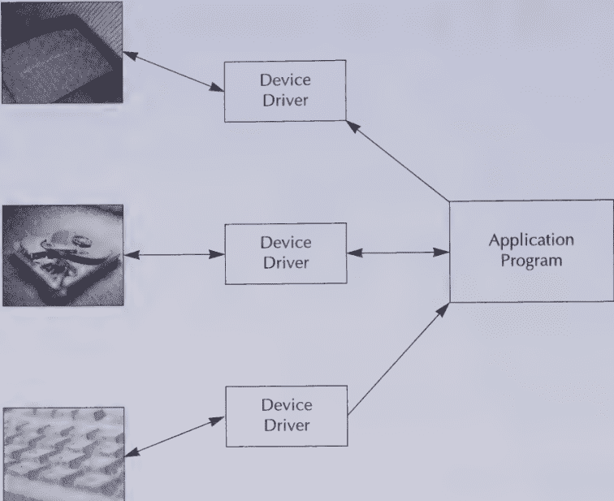
**图 3.1** 设备与应用程序的互连。

设备驱动程序是本质上属于底层操作系统的一部分的模块，并在操作系统内核的内存空间内执行。Linux 平等对待所有设备；它将它们视为文件。应用程序能做的最多就是打开、关闭、读取和写入这些文件。有些文件（如键盘和屏幕文件）不允许打开或关闭，它们始终处于打开状态。

Linux 内核中有两种类型的设备驱动程序：每次操作一个字节的 `char`（字符）设备驱动程序，如键盘和显示器；以及每次操作多个字节的 `block`（块）设备驱动程序，如硬盘和 CD-ROM。

由于设备驱动程序模块在内核域内执行，因此拥有特殊的权限和特权，可以访问内核代码的每一个比特。所有驱动软件都有一个统一的格式，使编码风格更加简单。如前所述，在所有实际用途中，设备在应用程序看来就像文件一样。几乎所有与设备的通信都是通过读写操作完成的，就像它们是硬盘上的文件一样。正如硬盘上的文件是文件系统中的节点一样，设备驱动程序也由称为 inode 的唯一数字标识，也称为主号（major number）和次号（minor number）。这些数字由用户静态分配或由内核动态请求，且应当是唯一的。

设备驱动程序文件与其他读写文件的重要区别在于，设备驱动程序文件出现在 `/dev` 目录中（极少数例外），并且系统中每个设备驱动程序在 `/proc` 文件系统中都有一个条目。`/proc` 是一个仅供内核使用的特殊文件系统。另一个区别是，设备驱动程序的 inode 必须在它们创建于 `/dev` 目录之前就已知。如果我们预先知道 inode 号（由用户静态分配），那么创建顺序——是先插入 `/proc` 目录还是先在 `/dev` 目录中创建条目——并不重要。然而，如果我们请求内核动态分配 inode 号，我们必须先将模块插入 `/proc` 目录，并从中获取 inode 号，然后用该号在 `/dev` 目录中创建条目。

我们可以将 Linux 中设备驱动程序的创建总结为两个步骤：

1. 将设备驱动程序模块插入 `/proc` 文件系统。
2. 将属于该设备驱动程序模块的文件节点挂载到 `/dev` 目录。

## 设备驱动程序要点

创建驱动程序的第一步是将驱动程序在操作系统中进行注册。内核为每个驱动程序分配一个主号和一个次号，用以标识其在文件系统中的入口。主号标识与设备相关的驱动程序，次号仅供驱动程序内部使用。向系统添加新驱动程序意味着在初始化时为其分配一个主号。以下函数调用为字符设备驱动程序分配一个主号：

```c
#include <linux/fs.h>

int register_chrdev (unsigned int major, const char * name, struct file_operations fops);
```

主号的范围是 1 到 254，它是字符驱动程序静态数组的索引。你可以强制内核使用一个预定义数字，但这样会有覆盖其他可能已被分配相同数字且已经在系统中运行的模块的风险。事实上，内核为系统中大多数常用设备保留了一些主号。

最好请求内核动态分配主设备号，在 `register_chrdev()` 函数中将参数 `major` 设为 0 即可。

## 最小功能设备驱动程序

无论是否执行文件读写操作，所有设备驱动程序都必须提供至少两个函数：`init_module` 和 `cleanup_module`。`init_module` 是我们将驱动程序注册到操作系统的位置，而 `cleanup_module` 则是我们将驱动程序从内核中“注销”的位置。`init_module` 是模块加载到内核时调用的第一个函数，而 `cleanup_module` 是驱动程序生命周期中在从内核卸载前执行的最后一个函数。

以 root 用户身份，在 `/dd/minimum` 目录中创建一个名为 `pport.c` 的文件（该文件提供在随书 CD 目录 `/book/chapter3/minimum/pport.c` 中），并插入清单 3.1 所示的文本。该程序提供以下功能：

- 第 5 行到第 21 行是 `file_operation` 表；所有条目均为空，表示不支持任何文件操作。
- 第 22 行到第 26 行是 `init_module` 函数，用于将设备注册到内核。
- 第 27 行到第 30 行是 `cleanup_module` 函数，用于将设备从内核中注销。

### 清单 3.1 文件 `/book/chapter3/minimum/pport.c`；一个最小设备驱动程序。

```c
1) #include <linux/module.h>
2) #include <linux/kernel.h>
3) #include <linux/fs.h>      /* everything... */
4) int major = 0;
5) struct file_operations fops = {
6)   NULL,             /* lseek */
7)   NULL,             /* read */
8)   NULL,             /* write */
9)   NULL,             /* readdir */
10)  NULL,             /* poll */
11)  NULL,             /* ioctl */
12)  NULL,             /* mmap */
13)  NULL,             /* open */
14)  NULL,             /* flush */
15)  NULL,             /* release */
16)  NULL,             /* fsync */
17)  NULL,             /* fasync */
18)  NULL,             /* check_media_change */
19)  NULL,             /* revalidate */
20)  NULL,             /* lock */
21) };
22) int init_module(void)
23) {
24)    major = register_chrdev(0, "pport", &fops);
25)    return 0;
26) }
27) void cleanup_module(void)
28) {
29)    unregister_chrdev(major, "pport");
30) }
```

## 设备驱动程序 Makefile

设备驱动程序与内核内部数据结构链接，并加载到内核内存空间中。设备驱动程序中没有 `main()` 函数。模块必须使用标志 `-D__KERNEL__ -DMODULE` 进行编译。以 root 用户身份，在 `/dd/minimum` 目录中创建一个名为 `Makefile` 的文件（该文件提供在随书 CD 目录 `/book/chapter3/minimum/Makefile` 中），并插入清单 3.2 所示的文本。

### 清单 3.2 用于编译和链接 `pport.c` 的 Makefile。

```makefile
INCLUDEDIR = /usr/include
DEBFLAGS = -O2
CFLAGS = -D__KERNEL__ -DMODULE -Wall $(DEBFLAGS)
CFLAGS += -I$(INCLUDEDIR)
OBJS = pport.o
all: $(OBJS)
```

接下来，使用以下 shell 命令通过 Makefile 编译 `pport.c` 文件：

```bash
[root@ns /dd/minimum]# make
```

验证 `pport.o` 文件是否已创建。

```bash
[root@ns /dd/minimum]# ls -al pport.o
```

### 设备驱动程序模块

如你所见，清单 3.1 中没有 `main()`。设备驱动程序本质上是被加载并执行在内核空间而非用户空间（与普通应用程序相反）。以下 `/sbin/insmod` 命令将 `pport.o` 模块插入到内核空间：

```bash
[root@ns /dd/minimum]# /sbin/insmod -o pport pport.o
```

`insmod` 命令的参数是模块名称 (`pport`) 和文件名 (`pport.o`)。你可以通过查看 `/proc/modules` 目录的内容来验证驱动程序的运行情况。

```bash
[root@ns /dd/minimum]# cat /proc/modules | grep pport
```

你也可以使用 `lsmod` 命令来查看模块列表。

```bash
[root@ns /dd/minimum]# lsmod
```

通过连接 `/proc/devices` 文件，你可以看到分配给驱动程序的主设备号。

```bash
[root@ns /dd/minimum]# cat /proc/devices | grep pport
254 pport
```

以下 `/sbin/rmmod` 命令将从内核空间中删除并注销 `pport.o` 模块。

```bash
[root@ns /dd/minimum]# /sbin/rmmod pport
```

## 设备驱动程序与文件节点

仅使用 `insmod` 命令插入设备模块是不够的。虽然模块插入时内核会分配主设备号和次设备号（文件节点），但将文件节点附加到文件系统是一个独立的过程。在这个过程中，一个名称与文件节点相关联，并通过这个名称执行常规的文件读写操作。只有这样，设备才会以文件的形式出现在系统中。

设备通常挂载在 `/dev` 目录中。查看该目录的列表会发现，字符设备的权限字段显示为 "c"，块设备显示为 "b"。

```bash
[root@ns /dd/minimum]# cd /dev
[root@ns /dev]# ls -al
```

必须在 `/dev` 目录中插入一个名称并将其与主设备号关联，这样设备才能在程序中被识别。预先知道主次设备号可以更容易地将设备插入文件系统；否则，必须从 `/proc/devices` 文件系统中提取这些号码。

如前所述，从应用程序的角度来看，设备驱动程序就是一个文件。以下 `mknod` 命令在已知设备主次设备号的情况下，在 `/dev` 目录中创建一个文件。对于动态分配文件节点的设备，必须从 `/proc/devices` 文件的条目中获取主设备号。随后，我们将开发一个从 `/proc/devices` 文件中提取主设备号的脚本。以下 shell 命令为 `pport.o` 模块在 `/dev` 目录中创建节点：

```bash
[root@ns /dd/minimum]# mknod /dev/pport c 254 0
```

设备驱动程序的路径名是 `/dev/pport`；"c" 代表字符驱动，254 是主设备号，0 是次设备号。如果设备节点是动态分配的（如之前在注册过程中建议的那样），则可以从 `/proc/devices` 列表中读取主设备号。

现在程序可以像下面这样打开设备并执行读、写和关闭操作：

```c
.
.
FILE * fd = fopen ("/dev/pport", "r");
.
.
```

在为同一个驱动程序插入新节点之前，删除可能遗留的旧节点号非常重要。你可以使用以下命令删除过期节点：

```bash
[root@ns /dd/minimum]# rm -f /dev/pport
```

## 加载设备驱动程序的脚本

脚本是一个在执行时由 shell 解释的文本文件。文件中的每一行文本都是一个单独的命令，就像通过键盘输入的一样。因此，我们可以将前一节中描述的加载设备驱动程序的步骤合并到一个脚本文件中，如清单 3.3 所示（该文件提供在随书 CD 目录 `/book/chapter3/minimum/pp_load` 中）。

该脚本文件实现了加载和卸载模块过程的自动化。以下是脚本中各步骤的说明：

- 第 1 行告知命令解释器该文件应由 shell 解释。
- 第 2 行到第 5 行是脚本中使用的初始化变量。
- 第 7 行到第 9 行删除之前的模块并插入新模块。
- 第 10 行和第 11 行提取并打印出包含设备主设备号的行。
- 第 12 行删除任何具有相同主设备号的现有设备文件。
- 第 13 行为正在加载的设备创建节点。
- 第 14 行和第 15 行更改设备文件的权限。

### 清单 3.3 文件 `/book/chapter3/minimum/pp_load`；用于从 `/proc` 提取节点号并为 `pport` 模块创建 `/dev` 条目的脚本。

```shell
1) #!/bin/sh
2) module="pport.o"
3) device="pport"
4) group="root"
5) mode="664"
6) #remove any existing node
7) /sbin/rmmod pport
8) # invoke insmod with all arguments we got
9) /sbin/insmod -f $module $device || exit 1
10) major=`cat /proc/devices | awk "\$2==\"$device\" {print \$1}"`
11) echo "Major number = $major"
12) rm -f /dev/${device}
13) mknod /dev/${device} c $major 0
14) chgrp $group /dev/${device}
15) chmod $mode  /dev/${device}
```

## 从系统中卸载驱动程序

一旦驱动程序被卸载，就必须将主设备号从系统中删除，因为如果内核访问不再系统中的驱动程序函数，将会引发问题。以下命令从系统中卸载驱动程序模块 `pport`：

```bash
[root@ns /dd/minimum]# rmmod pport
```

当收到卸载模块的请求时，内核会调用驱动程序函数 `cleanup_module()`。`cleanup_module()` 函数负责通过如下方式调用自身注销：

```c
int unregister_chrdev(unsigned int major, const char *name);
```

主设备号是在注册时分配的，而 `char *name` 是放置在 `/proc/devices` 文件中的驱动程序名称。

## 卸载设备驱动程序的脚本


与加载设备驱动程序的脚本文件类似，代码清单 3.4 中的脚本文件用于卸载 `pport` 模块（该文件提供在配套光盘目录 `/book/chapter3/simple/pp_unload` 中）。

### 代码清单 3.4 文件 `/book/chapter3/minimum/pp_unload`；从系统中卸载 `pport` 设备驱动程序的脚本。

```sh
1) #!/bin/sh
2) module="pport"
3) device="pport"
4) # invoke rmmod with all arguments we got
5) /sbin/rmmod $module $* || exit 1
6) # Remove stale nodes
7) rm -f /dev/${device}
```


## 设备驱动程序的构建

我们之前展示的极简设备驱动程序展示了创建、加载和卸载设备驱动程序的机制，但没有实际价值。虽然创建了文件节点，但我们无法执行常规的文件操作，如打开、关闭、读取、写入等。在本节中，我们将为设备驱动程序添加文件操作能力，并讨论构成底层操作系统文件操作的不同结构。

### `struct file` 结构

内核将有关设备驱动程序的所有重要信息保存在一个 `struct file` 结构中。它与用户程序在打开文件时使用的 `FILE` 结构不同。`struct file` 中的重要字段如下：

- **`mode_t f_mode`**：文件模式由 `FMODE_READ` 和 `FMODE_WRITE` 位标识。
- **`loff_t f_pos`**：当前的读写位置。
- **`unsigned short f_flags`**：这些是 `FILE` 标志，例如 `O_RDONLY`、`O_NONBLOCK` 等。
- **`struct inode * f_inode`**：与打开的文件相关联的 inode。如果内核没有显式提供 inode 结构，可以在此处获取真实的 inode。
- **`struct file_operations * f_op`**：见下一节。
- **`void * private_data`**：`open` 系统调用在调用模块中的 `open` 函数之前将此指针设置为 `NULL`。驱动程序可以出于任何原因自由使用此指针。

### `struct file_operations` 结构

这个结构本质上是一个函数跳转表，每当对主设备号与驱动程序主设备号匹配的文件执行操作时，就会调用这些函数。如果不需要某个特定操作或尚未实现，只需提供 `NULL` 作为参数即可。有时，表中的某个函数不适用于正在编写驱动程序的设备，例如 `lseek` 和 `check media change` 仅适用于磁带设备。示例设备驱动程序仅提供 `read`、`write`、`open` 和 `close` 操作。

```c
struct file_operations pp_fops = {
    NULL,               /* lseek */
    NULL,
    pp_read,
    pp_write,
    NULL,               /* readdir */
    NULL,               /* poll */
    NULL,               /* ioctl */
    NULL,               /* mmap */
    pp_open,            /* flush */
    NULL,
    pp_close,           /* pp_fsync */
    NULL,               /* pp_fasync */
    /* nothing more, fill with NULLs */
};
```

以下是与 `file_operations` 结构条目相对应的函数列表：

```c
int (*read)  (struct inode *, struct file *, char *, int);
int (*write) (struct inode *, struct file *, const char *, int);
int (*open)  (struct inode *, struct file *, off_t, int);
int (*close) (struct inode *, struct file *, off_t, int);
int (*ioctl) (struct inode *, struct file *, unsigned int, unsigned long);
```

用户空间中的相同函数定义如下：

```c
FILE *fopen(const char *filename, const char *mode);
size_t fread (void *ptr, size_t size, size_t nobj, FILE *stream);
size_t fwrite (const void *ptr, size_t size, size_t nobj, FILE *stream);
int open (const char *pathname, int flags);
int fclose (FILE *fd);
int ioctl (int fd, unsigned int cmd, ...);
```

`ioctl()` 的第三个参数实际上是一个可选的单个参数，而省略号是为了防止类型检查。在 `pport` 驱动程序中，`ioctl()` 函数的第三个参数是一个用于接收实际状态的指针，您将在接收并行端口状态寄存器的测试程序中看到这一点。

## 次设备号在设备驱动程序中的作用

如前所述，内核只关注主设备号，但组合数据类型“主设备号和次设备号”存储在 inode 结构的 `i_rdev` 字段中。每个驱动函数都接收一个指向 inode 的指针作为第一个参数。函数可以通过查看 `inode->i_rdev` 来提取次设备号。

下一节将通过一个使用 PC 平台并行端口的具体示例来描述设备驱动程序的实现。一旦设备驱动程序就绪，应用程序就可以通过简单地像读写字符文件一样，访问并行端口的所有寄存器（数据寄存器、状态寄存器和控制寄存器）。`read` 函数返回状态寄存器的内容，`write` 函数将字节值写入并行端口的数据寄存器，`ioctl` 函数设置并行端口的控制寄存器。

## 全功能设备驱动程序


`struct file_operations` 标识了设备驱动程序向外界公开的十个函数；最常用的是 `open`、`close`、`read` 和 `write`。示例并行端口设备驱动程序（代码清单 3.5）仅实现了常用函数。通过这个设备驱动程序，应用程序将能够监控和控制并行端口连接器引脚的逻辑电平（图 3.2）。`write` 函数写入输出寄存器（数据寄存器内存地址 `0x378`），`read` 函数从 PC 并行端口的输入寄存器（状态寄存器内存地址 `0x379`）读取。`ioctl` 函数用于设置和重置控制寄存器，我们稍后将讨论。`struct file_operations` 结构将使用 `read`、`write`、`open` 和 `close` 函数的地址进行初始化，并在模块加载时的 `init_module` 函数调用期间传递给内核。

代码清单 3.5 是一个并行端口设备驱动程序，它提供了对并行端口硬件低级寄存器的访问（该文件提供在配套光盘目录 `/book/chapter3/simple/pport.c` 中）。以下是对程序清单的解释：

- 第 6 行至 14 行是定义所需的头文件。
- 第 15 行至 17 行是初始化的变量。`pp_major` 的值为 0，请求内核提供主设备号。
- 第 19 行至 25 行是 `open` 函数。
- 第 21 行的宏 `MOD_INC_USE_COUNT` 表示设备当前正在使用中。
- 第 22 行仅保存由内核传递的次设备号。
- 第 23 行的 `printk` 是一个仅供内核使用的特殊 `printf` 函数；输出显示在 `/var/log/messages` 文件中。
- 第 27 行至 31 行的 `pp_close()` 函数是 `close()` 函数，它简单地递减使用计数；仅当使用计数达到 0 时才应移除驱动程序。
- 第 33 行至 41 行是 `read()` 函数，其中第 37 行从端口（基址 `0x379`）获取输入值，第 38 行将其复制到用户内存区域。
- 第 43 行至 51 行是 `write()` 函数。第 47 行从参数中获取输入值（让内核从用户内存区域复制到系统内存区域）并写入端口（基址 `0x378`）。
- 第 53 行至 68 行是 `file_operation` 结构的初始化。
- 第 70 行至 97 行是 `init_module` 函数。第 72 行检查硬件地址是否可用，第 81 行请求内核使用该硬件地址范围。第 86 行是设备驱动程序的注册，第 95 行请求内核提供一个不能交换到磁盘的内存页。
- 第 99 行至 106 行是 `cleanup_module()` 函数。当模块通过取消注册函数调用被卸载时，将调用此函数。

### 代码清单 3.5 `/book/chapter3/simple/pport.c` 设备驱动程序：`open`、`close`、`read` 和 `write` 函数。

```c
/*++++++++++++++++++++++++++++++++++++++++++++++++++++++++++++*/
/*
pport.c – Simple Hardware Operations Read and Write only
*
********/
#include <linux/module.h>
#include <linux/sched.h>
```

```c
8)  #include <linux/kernel.h> /* printk() */
9)  #include <linux/fs.h>     /* everything... */
10) #include <linux/errno.h>  /* error codes */
11) #include <asm/io.h>
12) #include <linux/ioport.h>
13) #include <asm/segment.h>
14) #include <asm/uaccess.h>
15) int pp_major = 0;
16) int pp_base = 0x378; /* intel: default to lp0 */
17) int minor = 0;
18) /*****************************************************/
19) int pp_open (struct inode *in, struct file *filp)
20) {
21)   MOD_INC_USE_COUNT;
22)   minor =(MINOR(in->i_rdev)&0x0f);
23)   printk(KERN_INFO "pp:U OPEN %d\n", minor);
24)   return 0;
25) }
26) /*****************************************************/
27) int pp_close (struct inode *in, struct file *filp)
28) {
29)   MOD_DEC_USE_COUNT;
30)   return(0);
31) }
32) /*****************************************************/
33) int pp_read (struct file * filp, char *buf, size_t count, loff_t * t)
34) {
35)   unsigned char x;
36)   unsigned port = pp_base + minor;
37)   x = inb(port + 1);       /* Status reg offset */
38)   put_user(x,buf);
39)   printk(KERN_INFO "pp: READ %2.2x\n",x);
40)   return 1;
41) }
42) /*****************************************************/
43) int pp_write (struct file * filp, const char *buf, size_t count, loff_t * t)
44) {
45)   unsigned char x;
46)   unsigned port = pp_base + minor;
47)   get_user(x,buf);
48)   printk(KERN_INFO "pp: WRITE %2.2x\n",x);
49)   outb(x, port);
50)   return 1;
}
/********************** file_operations***************************/
struct file_operations pp_fops =
{
    NULL,            /* lseek */
    pp_read,
    pp_write,
    NULL,            /* readdir */
    NULL,            /* poll */
    NULL,            /* ioctl */
    NULL,            /* mmap */
    pp_open,
    NULL,            /* flush */
    pp_close,
    NULL,            /* pp_fsync */
    NULL,            /* pp_fasynic */
    /* nothing more, fill with NULLs */
};
/********************** init_module ***************************/
int init_module(void)
{
    int result = check_region(pp_base,4);
    #ifdef DEBUG
    printk(KERN_INFO "pp: INIT_MOD\n");
    #endif
    if (result)
    {
        printk(KERN_INFO "pp: can't get I/O address 0x%x\n",pp_base);
        return result;
    }
    if (!request_region(pp_base,4,"pp"))
    {
        printk(KERN_INFO "pp: port %x is busy\n",pp_base);
        return 0;
    }
    result = register_chrdev(pp_major, "pp", &pp_fops);
    if (result < 0)
    {
        printk(KERN_INFO "pp: can't get major number\n");
        release_region(pp_base,4);
        return result;
    }
    if (pp_major == 0)
94)                             pp_major = result; /* dynamic */
95)         pp_buffer = __get_free_page(GFP_KERNEL); /* never fails */
96)         pp_head = pp_tail = pp_buffer;
97)     }
98)     /******************** cleanup_module *******************
```

按照清单 3.7 所示编辑 Makefile 文件 `/dd/simple/test/Makefile`，或者将其从 CD-ROM 目录 `/book/chapter3/simple/test/Makefile` 复制过来。编译并链接测试程序。

```
[root@ns /dd/simple/test]# make
```

### 清单 3.7 测试程序的 `/book/chapter3/simple/test/Makefile`

```makefile
1) all: t
2) CC = gcc
3) INCLUDEDIR = /usr/include
4) CFLAGS = -g -O2 -Wall -I$(INCLUDEDIR)
5) t: test.o
6) $(CC) -o t test.o
7) test.o: test.c
8) $(CC) -c test.c $(CFLAGS)
```

- 8. 修改输出文件 `t` 的模式，使其具有可执行权限。

```
[root@ns /dd/simple/test]# chmod 644 /dd/simple/test/t
```

### 预期测试结果

程序将请求一个要写入数据寄存器的字节模式。作为回报，将显示从状态寄存器接收到的字节模式。如果回环连接正确，你应该在屏幕上看到显示的位值是反相的。

### 测试步骤

- 1. 在命令行中执行程序 `t`。

```
# ./t
```

- 2. 在命令提示符处输入字节模式。

```
Please enter a new byte pattern 0x55
0x80
Please enter a new byte pattern 0xAA
0x00
```


### 测试清理

按下 `Ctrl-C` 退出程序，并使用清单 3.4 中定义的 `pp_unload` 脚本卸载设备驱动程序。该脚本也可以从 CD-ROM 目录 `/dd/simple/pp_unload` 获取。

```
[root@ns /dd/simple]# /dd/simple/pp_unload
```


## 添加 `ioctl` 功能

`file_operations` 中的第五个条目是 `ioctl` 函数调用。这个例程用于处理所有无法通过正常的 `read` 和 `write` 函数完成的操作，例如设置硬件寄存器、更改设备模式等等。`ioctl` 的实现严格依赖于设备。为了继续完善我们的并行端口设备驱动程序，我们将通过 `ioctl` 函数调用添加读取和写入控制寄存器的功能。清单 3.8 是将要添加到清单 3.5 中 `pport.c` 源代码的代码段。以下是对源代码列表中新增内容的解释：

- 向我们的 `pport` 设备驱动程序添加 `ioctl` 编号（第 1 行到第 2 行），以获取对并行端口控制寄存器（地址 `0x37A`）的访问权限。
- 第 30 行是 `struct file_operations` 中 `ioctl` 函数的入口。
- 第 3 行到第 21 行是处理 `ioctl` 调用的函数声明。

### 清单 3.8 添加到 `pport` 驱动程序中用于处理 `ioctl` 调用的代码段

```c
#define GET_CTRL_REG 1

#define SET_CTRL_REG 2

int pp_ioctl (struct inode *inode, struct file *filp, unsigned int cmd, unsigned long arg)
{
    unsigned char x;

    switch(cmd)
    {
        case GET_CTRL_REG:
            x = inb(pp_base + 2); /* ctrl reg offset */
            put_user(x,buf);
            printk(KERN_INFO "pp: IOCTL GET_CTRL_REG %2.2x\n",x);
            break;

        case SET_CTRL_REG:
            get_user((pp_base + 2),x); /* ctrl reg offset */
            printk(KERN_INFO "pp: IOCTL SET_CTRL_REG %2.2x\n",x);
            outb(x, port);
            break;

        default:
    }

    return 0;
}

/*********************/
/* file_operations **/

struct file_operations pp_fops =
{
    NULL,           /* lseek */
    pp_read,
    pp_write,
    NULL,           /* readdir */
    NULL,           /* poll */
    pp_ioctl,       /* ioctl */
    NULL,           /* mmap */
    pp_open,
    NULL,           /* flush */
    pp_close,
    NULL,           /* pp_fsync */
    NULL,           /* pp_fasync */
    /* nothing more, fill with NULLs */
};
```

## 测试 `ioctl` 功能

在此测试场景中，你将验证 `pport` 设备驱动程序的 `ioctl` 功能。

### 测试目标

本次测试的目标是测试 `pport` 设备驱动程序的 `ioctl` 函数实现。

### 测试描述

这将测试 `pport` 设备驱动程序设置和复位外部并行端口连接器（DB25 引脚 1、14、16、17）上控制引脚的能力。控制寄存器（地址 `0x37A`）的第 -4 位被用于启用或禁用并行端口的中断输入（DB25 引脚 10）。将四个控制寄存器输出引脚与状态寄存器输入引脚进行回环连接，将使我们能够读回控制寄存器的内容。图 3.2 显示控制寄存器位 0、1、3 是反相的，而位 2 不是反相的。如果成功，执行测试程序将显示反映控制寄存器位设置的状态寄存器内容。

### 测试准备

图 3.2 显示了并行端口连接器的引脚定义。将引脚 1（控制寄存器位 0）与 DB25 引脚 11（状态寄存器位 7）连接。对控制寄存器的写入将回环到对状态寄存器的读取。

### 测试输入


1. 如果你计划从 CD 复制源代码，请挂载 CD-ROM。

   ```bash
   # mount -t iso9660 /dd/cdrom /mnt/cdrom
   ```

2. 创建子目录 `/dd/ioctl`，并按照清单 3.8 定义编辑设备驱动程序源文件 `/dd/ioctl/pport.c`，或者从 CD-ROM 目录 `/book/chapter3/ioctl/pport.c` 复制源文件。

   ```bash
   # mkdir /dd/ioctl
   # cp /mnt/cdrom/book/ioctl/pport.c /dd/ioctl/
   ```

3. 按照清单 3.2 定义编辑设备驱动程序 `Makefile` `/dd/ioctl/Makefile`，或者从 CD-ROM 目录 `/book/chapter3/ioctl/Makefile` 复制源文件。

   ```bash
   # cp /mnt/cdrom/book/chapter3/ioctl/Makefile /dd/ioctl/
   ```

4. 使用 `make` 工具编译并链接 `pport.c`。

   ```bash
   # /dd/ioctl/make
   ```

5. 按照清单 3.3 定义编辑加载设备驱动程序的脚本，或者从 CD-ROM 目录 `/book/chapter3/ioctl/pp_load` 复制。

   ```bash
   # cp /mnt/cdrom/book/chapter3/ioctl/pp_load /dd/ioctl/
   ```

6. 使用 `pp_load` 脚本加载设备驱动程序。

   ```bash
   # /dd/ioctl/pp_load
   ```

用于测试 `ioctl` 功能的测试程序与简单设备驱动程序类似，不同之处在于清单 3.9 第 9 行的 `ioctl` 调用。创建子目录 `/dd/ioctl/test`，并按照清单 3.9 所示编辑文件 `/dd/ioctl/test/test.c`，或者从 CD-ROM 目录 `/book/chapter3/ioctl/test/test.c` 复制。以下是对测试程序的解释：

- 第 9 行到第 26 行是回环测试函数；该函数的输入是要写入并行端口控制寄存器的位模式。
- 第 28 行到第 50 行是 `main` 函数。在打印横幅后，程序进入无限循环（第 33 行到第 49 行），请求输入模式并调用回环测试函数。
- 对控制寄存器的位 1、2 和 3 重复测试。

### 清单 3.9 用于测试 `pport` 设备驱动程序 `ioctl` 设施的文件 `/book/chapter3/ioctl/test/test.c`

```c
1)  #include "stdio.h"
2)  #include <stdlib.h>
3)  #include <fcntl.h>
4)  #include <unistd.h>
5)  #include <sys/ioctl.h>
6)  #define CTRL_PORT_WR 1001
7)  #define CTRL_PORT_RD 1002
8)  /*************************/
9)  void LoopBackTest(int pattern)
10) {
11)     int fh;
12)     char bfr[2];
13)     printf("LoopBack test begin\n");
14)     fh = open("/dev/pport",O_RDWR);
15)     if (fh)
16)     {
17)         bfr[0] = pattern;
18)         printf("Pattern %2.2x\n",bfr[0]&0xff);
19)         ioctl (fh, CTRL_PORT_WR,bfr);
20)         ioctl (fh, CTRL_PORT_RD,bfr);
21)         printf("Ctrl Port bits %2.2x\n",bfr[0]&0xff);
22)         close(fh);
23)     }
24)     else
25)         printf("Fail open device\n");
26) }
27) /*************************/
28) int main(int argc , char *argv[])
29) {
30)     int pattern;
31)    printf("Loop Back test for the parallel port device driver \n");
32)    printf("Press Ctrl C to exit\n");
33)    while(1)
34)    {
35)        printf ("Status register\n");
36)        printf ("bit 3 <--- DB25 pin 15\n");
37)        printf ("bit 4 <--- DB25 pin 13\n");
38)        printf ("bit 5 <--- DB25 pin 12\n");
39)        printf ("bit 6 <--Inverted--- DB25 pin 10\n");
40)        printf ("bit 7 <--- DB25 pin 11\n");
41)        printf("Control register\n");
42)        printf("bit 0 <--Inverted---> DB25 pin 1\n");
43)        printf("bit 1 <--Inverted---> DB25 pin 14\n");
44)        printf("bit 2 <----------> DB25 pin 16\n");
45)        printf("bit 3 <--Inverted---> DB25 pin 17\n");
46)        printf("Enter the bit pattern in hex for loop back test ");
47)        scanf ("%x",&pattern);
48)        LoopBackTest(pattern);
49)    }
50) }
```


7. 按照清单 3.7 所示编辑 `Makefile` 文件 `/dd/ioctl/test/Makefile`，或者从 CD-ROM 目录 `/book/chapter3/ioctl/test/Makefile` 复制。编译并链接测试程序。

   ```bash
   # make
   ```

8. 修改输出文件 `t` 的模式，使其具有可执行权限。

   ```bash
   # chmod 644 /dd/ioctl/test/t
   ```

### 预期测试结果

程序将请求一个要写入控制寄存器的字节模式。作为回报，将显示从状态寄存器接收到的字节模式；如果回环正确，你应该在屏幕上看到显示的位设置。

### 测试步骤

1. 在命令行中执行程序 `t`。

   ```bash
   # ./t
   ```

2. 在命令提示符处输入字节模式。

   ```text
   Please enter a new byte pattern 0x55

   0x55

   Please enter a new byte pattern 0xAA

   0xAA
   ```


### 测试清理

按下 Ctrl-C 退出程序，并使用清单 3.4 中定义的 `pp_unload` 脚本卸载设备驱动程序。该脚本也可在 CD-ROM 目录 `/book/chapter3/ioctl/pp_unload` 中找到。

```bash
# /dd/ioctl/pp_unload
```


## 添加中断处理

PC 并行端口可以被编程为产生一个 IRQ 请求。DB25 连接器第 10 引脚上的低到高电平转换会产生一个中断请求，该请求被向量化到 IRQ 7。为了处理该中断请求，我们可以改进设备驱动程序以识别该事件。清单 3.10 是清单 3.5 的修改版本，其中包含了中断处理。

中断是实时发生的异步事件。PC 平台使用并行端口中断来接收来自打印机设备的确认，表明一个字符已被接收，并且现在准备好接收下一个字符。在我们的示例软件中，我们将使用并行端口中断来测量脉冲宽度，或者作为测量电机 RPM 的转速表，或者简单地作为事件计数器。

以下是对清单 3.10 中为设备驱动软件添加中断处理功能的解释。该文件位于配套 CD 目录路径 `/book/chapter3/interrupt/pport.c` 中。

- 第 18 至 20 行添加了三个更多的 `ioctl` 编号：`WAIT_ON_INTERRUPT`、`INTERRUPT_PULSE_WIDTH` 和 `INTERRUPT_EVENT_COUNTER`。
- 第 27 至 30 行添加了用于处理 IRQ 事件的变量。`pp_buffer` 指向分配的内核内存页，IRQ 事件的时间戳被存储在一个循环缓冲区（round-robin buffer）中。`pp_head` 指向缓冲区的下一个可用槽位，而 `pp_tail` 则被用作由应用程序读取的指针。
- 第 127 至 148 行是中断处理函数 `pp_interrupt()`。当 IRQ 线（并行端口 DB25 连接器的第 10 引脚）出现低到高电平转换时，会调用此函数。该函数获取当前当日时间（第 132 行）并将其保存到缓冲区指针 `pp_head` 中。指针随后递增，如果超过限制（`PAGE_SIZE`），它将回卷并从头开始（第 143 至 144 行）。事件计数增加 1（第 145 行）。
- 第 74 至 83 行是 `INTERRUPT_PULSE_WIDTH` 的 `ioctl` 处理程序。`pp_tail` 指向在请求时将返回的下一个 `timeval` 结构。
- 第 84 至 88 行是 `INTERRUPT_EVENT_COUNTER` 的 `ioctl` 处理程序，它返回 `event_counter` 变量的值。
- 第 89 至 96 行是 `WAIT_ON_INTERRUPT` 的 `ioctl` 处理程序，仅在发生中断时才返回。
- 第 169 行将 `pp_interrupt` 安装为处理并行端口 IRQ 的函数。
- 第 187 行释放 IRQ 线。

### 清单 3.10 `/book/chapter3/Interrupt/pport.c` 包含 `open`、`close`、`read`、`write`、`ioctl` 和中断功能的设备驱动程序

```c
/**********
* pport.c -- The Parallel Port Device Driver
**********/

1)  #include <linux/module.h>
2)  #include <linux/sched.h>
3)  #include <linux/wait.h>
4)  #include <linux/kernel.h> /* printk() */
5)  #include <linux/fs.h>     /* everything... */
6)  #include <linux/errno.h>  /* error codes */
7)  #include <linux/malloc.h>
8)  #include <linux/mm.h>
9)  #include <linux/ioport.h>
10) #include <linux/interrupt.h>
11) #include <linux/tqueue.h>
12) #include <linux/time.h>
13) #include <asm/io.h>
14) #include <asm/segment.h>
15) #include <linux/poll.h>
16) #define CTRL_PORT_WR 1001
17) #define CTRL_PORT_RD 1002
18) #define WAIT_ON_INTERRUPT 1003
19) #define INTERRUPT_PULSE_WIDTH 1004
20) #define INTERRUPT_EVENT_COUNTER 1005
21) static int pp_major = 0;
22) static int pp_base = 0x378; /* intel: default to lp0 */
23) static int pp_irq = 7;
24) static unsigned long pp_buffer = 0;

static int minor = 0;
static int irqCount = 0;
static unsigned long volatile pp_head;
```


```c
static volatile unsigned long pp_tail;

static wait_queue_head_t pp_queue;

static struct timeval current_time;

/* struct wait_queue *pp_queue = NULL; */

int pp_open(struct inode *inode, struct file *filp)
{
    MOD_INC_USE_COUNT;

    minor = (MINOR(inode->i_rdev) & 0x0f);

    printk(KERN_INFO "pp:U OPEN %d\n", minor);

    return 0;
}

int pp_close(struct file *filp)
{
    MOD_DEC_USE_COUNT;

    return 0;
}

int pp_read(struct file *filp, char *buf, size_t count, loff_t *t)
{
    unsigned char *kbuf = kmalloc(16, GFP_KERNEL);

    kbuf[1] = '\0';
    kbuf[0] = inb(pp_base + 1);

    /* printk(KERN_INFO " READ VALUE pp: %x\n", *kbuf); */

    copy_to_user(buf, kbuf, 1);

    kfree(kbuf);

    return 0;
}

int pp_write(struct file *filp, const char *buf, size_t count, loff_t *t)
{
    int retval = count;
    unsigned char *kbuf = kmalloc(16, GFP_KERNEL);

    if (!kbuf)
        return -ENOMEM;

    copy_from_user(kbuf, buf, 1);

    /* printk(KERN_INFO "pp: WRITE  %x, %x\n", kbuf[0], kbuf[1]); */

    outb(kbuf[0], pp_base);

    kfree(kbuf);

    return retval;
}

int pp_ioctl(struct inode *Inode, struct file *filp,
             unsigned int cmd, unsigned long arg)
{
    struct timeval tv;
    unsigned char *kbuf = kmalloc(16, GFP_KERNEL);

    if (!kbuf)
        return -ENOMEM;

    switch (cmd) {
    case INTERRUPT_PULSE_WIDTH:
        /* interrupt pulse width as calculated by irq service routine */
        if (pp_head != pp_tail) {
            copy_to_user((char *)arg, (char *)pp_tail, sizeof(unsigned int));

            pp_tail = pp_tail + sizeof(unsigned int);

            if (pp_tail >= pp_buffer + PAGE_SIZE)
                pp_tail = pp_buffer; /* wrap around */
        }
        break;

    case INTERRUPT_EVENT_COUNTER:
        /* interrupt counts are being copied to arg pointer */
        copy_to_user((char *)arg, (char *)&irqCount, sizeof(long));

        irqCount = 0;
        break;

    case WAIT_ON_INTERRUPT:
        /* wait until an event occurs */
        init_waitqueue_head(&pp_queue);
        interruptible_sleep_on(&pp_queue);

        /* fill in the time interrupt occurred */
        do_gettimeofday(&tv);
        copy_to_user((char *)arg, (char *)&tv, sizeof(struct timeval));
        break;

    case CTRL_PORT_WR:
        copy_from_user(kbuf, (char *)arg, 1);
        printk(KERN_INFO "pp: CTRL_PORT_WR  %x\n", kbuf[0] & 0xff);
        outb(kbuf[0], pp_base + 2);
        break;

    case CTRL_PORT_RD:
        kbuf[0] = inb(pp_base + 2);
        printk(KERN_INFO "pp: CTRL_PORT_RD  %x\n", kbuf[0] & 0xff);
        copy_to_user((char *)arg, kbuf, 1);
        break;

    default:
        break;
    }

    kfree(kbuf);

    return 0;
}

struct file_operations pp_fops = {
    NULL,
    NULL,        /* pp_lseek */
    pp_read,
    pp_write,
    NULL,        /* pp_readdir */
    NULL,        /* poll */
    pp_ioctl,    /* ioctl */
    NULL,        /* mmap */
    pp_open,
    pp_close,
    NULL,        /* pp_fsync */
    NULL,        /* pp_fasync */
    /* nothing more, fill with NULLs */
};

void pp_interrupt(int irq, void *dev_id, struct pt_regs *regs)
{
    struct timeval tv;
    int usec, sec;
    unsigned *timediff;

    do_gettimeofday(&tv);

    /* calculate micro second difference */
    usec = tv.tv_usec - current_time.tv_usec;
    sec = tv.tv_sec - current_time.tv_sec;

    if (usec < 0)
        usec += 1000000; /* adjusted for rollover */

    current_time.tv_usec = tv.tv_usec;
    current_time.tv_sec = tv.tv_sec;

    timediff = (unsigned *)pp_head;
    *timediff = (sec * 1000000) + usec; /* save pulse width in usec */

    pp_head = pp_head + sizeof(unsigned int);

    if (pp_head == pp_buffer + PAGE_SIZE)
        pp_head = pp_buffer; /* wrap */

    irqCount++;

    printk(KERN_INFO "pp: INTERPT %d\n", irqCount);

    wake_up_interruptible(&pp_queue); /* awake any reading process */
}

int init_module(void)
{
    int result = check_region(pp_base, 4);

    printk(KERN_INFO "pp: INIT_MOD\n");

    if (result) {
        printk(KERN_INFO "pp: can't get I/O address 0x%x\n", pp_base);
        return result;
    }

    request_region(pp_base, 4, "pport");

    result = register_chrdev(pp_major, "pport", &pp_fops);

    if (result < 0) {
        printk(KERN_INFO "pp: can't get major number\n");
        release_region(pp_base, 4);
        return result;
    }

    if (pp_major == 0)
        pp_major = result; /* dynamic */

    pp_buffer = __get_free_page(GFP_KERNEL); /* never fails */
    pp_head = pp_tail = pp_buffer;

    result = request_irq(pp_irq, pp_interrupt,
                         SA_INTERRUPT, "pport", NULL);

    if (result) {
        printk(KERN_INFO "pp: can't get assigned irq %i\n", pp_irq);
        pp_irq = -1;
    } else {
        /* actually enable it – assume this *is* a parallel port */
        printk(KERN_INFO "INTERRUPT ON %i\n", pp_irq);
        outb(0x10, pp_base + 2);
    }

    init_waitqueue_head(&pp_queue);
    do_gettimeofday(&current_time);

    return 0;
}

void cleanup_module(void)
{
    free_irq(pp_irq, NULL);
    unregister_chrdev(pp_major, "pport");
    release_region(pp_base, 4);

    if (pp_buffer)
        free_page(pp_buffer);
}
```

## Linux 实用编程

```c
printk(KERN_INFO "pp: INIT_MOD\n");

if (result) {
    printk(KERN_INFO "pp: can't get I/O address 0x%x\n", pp_base);
    return result;
}

request_region(pp_base, 4, "pport");

result = register_chrdev(pp_major, "pport", &pp_fops);

if (result < 0) {
    printk(KERN_INFO "pp: can't get major number\n");
    release_region(pp_base, 4);
    return result;
}

if (pp_major == 0)
    pp_major = result; /* dynamic */

pp_buffer = __get_free_page(GFP_KERNEL); /* never fails */
pp_head = pp_tail = pp_buffer;

result = request_irq(pp_irq, pp_interrupt,
                     SA_INTERRUPT, "pport", NULL);

if (result) {
    printk(KERN_INFO "pp: can't get assigned irq %i\n", pp_irq);
    pp_irq = -1;
} else {
    /* actually enable it – assume this *is* a parallel port */
    printk(KERN_INFO "INTERRUPT ON %i\n", pp_irq);
    outb(0x10, pp_base + 2);
}

init_waitqueue_head(&pp_queue);
do_gettimeofday(&current_time);

return 0;
}

void cleanup_module(void)
{
    free_irq(pp_irq, NULL);
    unregister_chrdev(pp_major, "pport");
    release_region(pp_base, 4);

    if (pp_buffer)
        free_page(pp_buffer);
}
```

## 测试中断功能

在本测试场景中，将对`pport`设备驱动程序的中断处理进行测试。

### 测试目标

本次测试的目标是通过`WAIT_ON_INTERRUPT`、`INTERRUPT_PULSE_WIDTH`和`INTERRUPT_EVENT_COUNTER`这三个`ioctl`调用，来测试`pport`设备驱动程序的中断处理能力。

### 测试描述

本次测试将验证`pport`设备驱动程序识别并行端口连接器 DB25 第 10 引脚中断的能力。如果测试成功，在执行测试程序后，命令行将依次显示五秒钟期间的中断时间戳，同时显示在同一五秒期间内发生的中断事件计数。

### 测试准备

图 3.2 显示了并行端口连接器的引脚定义。如果将输出引脚 9（数据位 7）连接到引脚 10（状态输入 6/中断），则会产生一个中断，内核将调用`pp_interrupt()`函数。为了进行测试，应提前将数据寄存器的数据位 7（DB25 引脚 9）设为高电平。

### 测试输入

1. 如果您打算从 CD 中复制源代码，请挂载 CD-ROM。

```bash
# mount -t iso9660 /dev/cdrom /mnt/cdrom
```

2. 创建子目录`/dd/interrupt`，并按照清单 3.8 的定义编辑设备驱动源文件`/dd/interrupt/pport.c`，或者从 CD-ROM 目录`/book/chapter3/interrupt/pport.c`复制源文件。

```bash
# mkdir /dd/interrupt
# cp /mnt/cdrom/book/chapter3/interrupt/pport.c /dd/interrupt/.
```

3. 按照清单 3.2 的定义编辑设备驱动 makefile`/dd/interrupt/Makefile`，或者从 CD-ROM 目录`/book/chapter3/interrupt/Makefile`复制源文件。

```bash
# cp /mnt/cdrom/book/chapter3/interrupt/Makefile /dd/interrupt/
```

- 第 61 行到第 92 行是`pp_timer_interrupt`函数的定义。该函数将在每个时间滴答（time tick）时定期执行。当前的实现模拟了并行端口状态寄存器上的按键按下条件。状态端口引脚状态的任何变化都被确认一次按键按下事件。在过程结束时，函数会检查是否存在退出请求；如果`WaitQ`变量不为`NULL`，则该任务将不会被放入定时器列表（第 85 行到第 92 行）。

- 第 271 行在驱动初始化时插入该任务。

- 第 284 行确保在所有任务从时间列表中移除之前，函数不会退出。

## 源码 3.12 文件`/book/chapter3/task/pport.c`；一个在队列中包含任务的设备驱动程序

```c
/*
 * pport.c - Simple Hardware Operations and Raw Tests
 **********/

#include <linux/module.h>
#include <linux/sched.h>
#include <linux/wait.h>
#include <linux/kernel.h>  /* printk() */
#include <linux/fs.h>      /* everything... */
#include <linux/errno.h>   /* error codes */
#include <linux/malloc.h>
#include <linux/mm.h>
#include <linux/ioport.h>
#include <linux/interrupt.h>
#include <linux/tqueue.h>
#include <linux/time.h>
#include <asm/io.h>
#include <asm/segment.h>
#include <linux/poll.h>

#define CTRL_PORT_WR             1001
#define CTRL_PORT_RD             1002
#define WAIT_ON_INTERRUPT        1003
#define INTERRUPT_PULSE_WIDTH   1004
#define INTERRUPT_EVENT_COUNTER 1005
#define READ_KEYS               1006

static int pp_major = 0;
static int pp_base = 0x378; /* intel: default to lp0 */
static int pp_irq = 7;
static unsigned long pp_buffer = 0;
static int minor = 0;
static int irqCount = 0;
static unsigned long volatile pp_head;
static volatile unsigned long pp_tail;
static wait_queue_head_t pp_queue, WaitQ;
static struct timeval current_time;
static int TimerIntrpt = 0;
static int KeyPressed = 0;
static int NewKey = 0;
static int OriginalKey = 0;
static int KeyAcknowledged = 0;

/*
 * The cleanup module uses this variable to find out if it is safe to unload
 */

static void pp_timer_interpt(void *);

/* The task queue structure for this task */
static struct tq_struct Task = {
    {NULL, NULL},             /* Next item in the list */
    0,                        /* A flag to indicate task status */
```


```c
  pp_timer_interpt,        /* The routine to be called */

  NULL                     /* The parameter for the routine */

};

/************** The pp_timer_interpt Task ****************/

/*

This function will be executed periodically at every timer tick

as long as the device driver is active

Simulate the key pressed condition using status register.

Scan for status register and if there is any change then set the

KeyPressed Variable and store the status register in NewKeys variable.

The ioctl READ_KEYS will return the variable NewKeys and set

KeyAcknowledge variable.

The periodic scan will begin when status register has been returned

to the original position

*/

static void pp_timer_interpt (void * tick)

{

  /* change the following code to suit your need */

  if (TimerIntrpt++ & 0x100)

  {

    /* every 100 tick read the status register */

    if (!KeyPressed)

    {

      NewKey = inb(pp_base+1) & 0xff;

      if (NewKey != OriginalKey)

          KeyPressed = 1;

    }

    else

    {

      if (KeyAcknowledged)

      {

          if((inb(pp_base+1) & 0xff) == OriginalKey)

          {

              KeyPressed = 0;

              KeyAcknowledged = 0;

          }

      }

    }

  }

  if (WaitQ.task_list.next != NULL)

  {

      printk(KERN_INFO "pp: Got to wake up ..\n");

      wake_up(&WaitQ);

  }

  else

      queue_task(&Task, &tq_timer);

}

int pp_open (struct inode *inode, struct file *filp)

{

    MOD_INC_USE_COUNT;

    minor =(MINOR(inode->i_rdev)&0x0f);

    printk(KERN_INFO "pp:U OPEN %d\n", minor);

    return 0;

}

int pp_close (struct file *filp)

{

    MOD_DEC_USE_COUNT;

    return(0);

}

int pp_read (struct file * filp, char *buf, size_t count, loff_t * t)

{

    unsigned char *kbuf=kmalloc(16, GFP_KERNEL);

    kbuf[1]='\0';

    kbuf[0] = inb(pp_base+1);

    /*    printk(KERN_INFO " READ VALUE pp: %x\n",*kbuf); */

    copy_to_user(buf, kbuf, 1);

    kfree(kbuf);

    return (0);

}

int pp_write(struct file *filp, const char *buf, size_t count, loff_t *t)

{

    int retval = count;

    unsigned char *kbuf=kmalloc(16, GFP_KERNEL);

    if (!kbuf)

        return -ENOMEM;

    copy_from_user(kbuf, buf, 1);

    /* printk(KERN_INFO "pp: WRITE %x, %x\n",kbuf[0], kbuf[1]);  */

    outb(kbuf[0], pp_base);

    kfree(kbuf);

    return retval;

}

int pp_ioctl(struct inode *Inode, struct file *filp, unsigned int cmd, unsigned long arg)

{

    struct timeval tv;

    int key = 0;

    unsigned char *kbuf=kmalloc(16, GFP_KERNEL);

    if (!kbuf)

        return -ENOMEM;

    switch(cmd)

    {

    case READ_KEYS:

        /*

        Return any change in the status register.

        See pp_timer_interpt Task for details

        */

        if ((!KeyAcknowledged) && KeyPressed)

        {

            KeyAcknowledged = 1;

            switch(NewKey)

            {

            case 0x77: key = 1; /*status 3 pin 15 */

                break;

            case 0x6f: key = 2; /*status 2 pin 13 */

                break;

            case 0x5f: key = 3; /*status 5 pin 12 */

                break;

            case 0x3f: key = 4; /*status 4 pin 10 */

                break;

            case 0xff: key = 5; /*status 7 pin 11 */

                break;

            }

            copy_to_user((char *) arg, (char *) &key, sizeof (long));

        }

        break;

    case INTERRUPT_PULSE_WIDTH:

        /* interrupt pulse width as calculated by irq service routine */

        if (pp_head != pp_tail)

        {

            copy_to_user((char *) arg, (char *) pp_tail, sizeof (unsigned int));

            pp_tail = pp_tail + sizeof(unsigned int);

            if (pp_tail >= pp_buffer + PAGE_SIZE)

                pp_tail = pp_buffer; /* wrap around */

        }

        break;

    case INTERRUPT_EVENT_COUNTER:

        /* interrupt counts are being copied to arg pointer */

        copy_to_user((char *) arg, (char *) &irqCount, sizeof(long));

        irqCount = 0;

        break;

    case WAIT_ON_INTERRUPT:

        /* wait until an event occurs */

        init_waitqueue_head (&pp_queue);

        interruptible_sleep_on(&pp_queue);

        /* fill in the time interrupt occurred */

        do_gettimeofday(&tv);

        copy_to_user((char *) arg, (char *) &tv, sizeof (struct timeval));

        break;

    case CTRL_PORT_WR:

        copy_from_user(kbuf, (char *) arg, 1);

        printk(KERN_INFO "pp: CTRL_PORT_WR %x\n",kbuf[0]&0xff);

        outb(kbuf[0],pp_base+2);

        break;

    case CTRL_PORT_RD:

        kbuf[0] = inb(pp_base+2);

        printk(KERN_INFO "pp: CTRL_PORT_RD %x\n",kbuf[0]&0xff);

        copy_to_user((char *) arg, kbuf, 1);

        break;

    default:

        }

    kfree(kbuf);

    return 0;

}

struct file_operations pp_fops = {

    NULL,

    NULL,               /* pp_lseek */

    pp_read,

    pp_write,

    NULL,               /* pp_readdir */

    NULL,               /* poll */

    pp_ioctl,           /* ioctl */

    NULL,               /* mmap */

    pp_open,

    pp_close,

    NULL,               /* pp_fsync */

    NULL,               /* pp_fasync */

    /* nothing more, fill with NULLs */

};

void pp_interrupt(int irq, void *dev_id, struct pt_regs *regs)

{

    struct timeval tv;

    int usec, sec;

    unsigned * timediff;

    do_gettimeofday(&tv);

    /* calculate micro second difference */

    usec = tv.tv_usec - current_time.tv_usec;

    sec = tv.tv_sec - current_time.tv_sec;

    if (usec < 0)

    {

        usec += 1000000; /* adjusted for rollover */

        current_time.tv_usec = tv.tv_usec;

        current_time.tv_sec  = tv.tv_sec;

        timediff = (unsigned *) pp_head;

        timediff = (sec * 1000000) + usec; /* save pulse width in usec */

        pp_head = pp_head + sizeof(unsigned int);

        if (pp_head == pp_buffer + PAGE_SIZE)

            pp_head = pp_buffer; /* wrap */

        irqCount++;

        printk(KERN_INFO "pp: INTERPT %d\n",irqCount);

        wake_up_interruptible(&pp_queue);      /* awake any reading process */

    }

}

int init_module(void)

{

    int result = check_region(pp_base,4);

    printk(KERN_INFO "pp: INIT_MOD\n");

    if (result)

    {

        printk(KERN_INFO "pp: can't get I/O address 0x%x\n",pp_base);

        return result;

    }

}

```

```c
244)     }

245)     request_region(pp_base,4,"pport");

246)     result = register_chrdev(pp_major, "pport", &pp_fops);

247)     if (result < 0)

248)     {

249)         printk(KERN_INFO "pp: can't get major number\n");

250)         release_region(pp_base,4);

251)         return result;

252)     }

253)     if (pp_major == 0) pp_major = result; /* dynamic */

254)     pp_buffer = __get_free_page(GFP_KERNEL); /* never fails */

255)     pp_head = pp_tail = pp_buffer;

256)     result = request_irq(pp_irq, pp_interrupt,

257)                       SA_INTERRUPT, "pport", NULL);

258)     if (result)

259)     {

260)         printk(KERN_INFO "pp: can't get assigned irq %i\n", pp_irq);

261)         pp_irq = -1;

262)     }

263)     else

264)     { /* actually enable it -- assume this *is* a parallel port */

265)         printk(KERN_INFO "INTERRUPT ON %i\n", pp_irq);

266)         outb(0x10,pp_base+2);

267)     }

268)     WaitQ.task_list.next = NULL;

269)     init_waitqueue_head (&pp_queue);

270)     do_gettimeofday(&current_time);

271)     queue_task (&Task, &tq_timer);

272)     OriginalKey =  inb(pp_base+1) & 0xff;

273)     return 0;

274) }

275) void cleanup_module(void)

276) {

277)     free_irq(pp_irq, NULL);

278)     unregister_chrdev(pp_major, "pport");

279)     release_region(pp_base,4);

280)     if (pp_buffer)

281)         free_page(pp_buffer);

282)     init_waitqueue_head  (&WaitQ);

283)     printk(KERN_INFO "pp: Wake me up ..\n");

284)     sleep_on(&WaitQ); /* exit only when task are free */

285)     printk(KERN_INFO "pp: Shutting down ..\n");

286) }
```


## 测试任务调度

在本测试场景中，将对`pport`设备驱动程序的任务调度进行测试。

### 测试目标

本次测试的目标是验证`pport`设备驱动程序的任务调度实现，该实现借助状态端口引脚来模拟按键按下条件。

### 测试描述

这将测试`pport`设备驱动程序在预定义的时间间隔内执行任务调度的能力，并在驱动程序卸载时移除任务调度。测试程序将状态端口引脚上的任何变化显示为按键按下事件。将引脚-3连接到引脚-15显示为`key#1`，将引脚-3连接到引脚-13显示为`key#2`，依此类推——在执行测试软件时，请查看横幅以获取完整的按键映射表。

### 测试准备

图 3.2 显示了并行端口连接器的引脚定义。按键映射显示如下：

- 将并行端口引脚-2连接到引脚-15对应`key#1`
- 将并行端口引脚-2连接到引脚-13对应`key#2`
- 将并行端口引脚-2连接到引脚-12对应`key#3`
- 将并行端口引脚-2连接到引脚-10对应`key#4`
- 将并行端口引脚-2连接到引脚-11对应`key#5`

### 测试输入

1. 如果您计划从 CD 中复制源代码，请挂载 CD-ROM。

   ```bash
   # mount -t iso9660 /dev/cdrom /mnt/cdrom
   ```

2. 创建子目录`/dd/task`，并按照 Listing 3.12 的定义编辑设备驱动源文件`/dd/task/pport.c`，或者从 CD-ROM 目录`/book/chapter3/task/pport.c`复制源文件。

   ```bash
   # mkdir /dd/task
   # cp /mnt/cdrom/book/chapter3/task/pport.c /dd/task/
   ```

3. 按照 Listing 3.3 的定义编辑设备驱动 makefile`/dd/task/Makefile`，或者从 CD-ROM 目录`/book/chapter3/task/Makefile`复制源文件。

   ```bash
   # cp /mnt/cdrom/book/chapter3/task/Makefile /dd/task/.
   ```

4. 使用`make`工具编译并链接`pport.c`。

   ```bash
   # /dd/task/make
   ```

5. 按照 Listing 3.3 的定义编辑加载设备驱动的脚本，或者从 CD-ROM 目录`/book/chapter3/task/pp_load`复制。

   ```bash
   # cp /mnt/cdrom/dd/task/pp_load /dd/task/.
   ```

6. 使用`pp_load`脚本加载设备驱动程序。

   ```bash
   # /dd/task/pp_load
   ```

7. 创建子目录`/dd/task/test`，并按照 Listing 3.13 所示编辑文件`/dd/task/test/test.c`，或者从 CD-ROM 目录`/book/chapter3/task/test/test.c`复制。该测试程序是一个死循环结构。它读取中断状态，并显示中断的时间戳。

   ```bash
   # cp /mnt/cdrom/book/chapter3/task/test/* /dd/task/test/.
   ```

8. 按照 Listing 3.7 所示编辑 Makefile 文件`/dd/task/test/Makefile`，或者从 CD-ROM 目录`/book/chapter3/task/test/Makefile`复制。编译并链接测试程序。

   ```bash
   # make
   ```

9. 修改输出文件`t`的模式使其可执行。

   ```bash
   # chmod 644 /dd/task/test/t
   ```

### Listing 3.13：文件`/book/chapter3/task/test/test.c`用于测试`pport`设备驱动的 ioctl 功能

```c
#include <stdio.h>
#include <stdlib.h>
#include <fcntl.h>
#include <unistd.h>
#include <string.h>
#include <sys/ioctl.h>

#define CTRL_PORT_WR 1001
#define CTRL_PORT_RD 1002
#define READ_KEYS 1006

/*************************/

void KeyPressedTest(TestCase)
{
  int fh;
  char bfr[82];
  int *Keys;

  printf("Key press test begin\n");
  fh = open("/dev/pport", O_RDWR);

  if (fh)
  {
    /* initialize bfr with all 0s */

    /* disable interrupt */
    ioctl(fh, CTRL_PORT_WR, 0);

    switch(TestCase)
    {
      case READ_KEYS:
        do
        {
          memset(bfr, '\0', 82);
          ioctl(fh, READ_KEYS, bfr);
          Keys = (int *) bfr;

          sleep(1);
          printf("No Keys yet \n");

          if (*(Keys))
            printf("Key pressed=%x\n", *Keys);

        } while(1);

        break;

      default:
    }

    close(fh);
  }
  else
    printf("Fail to open device\n");
}

/*************************/

int main(int argc, char *argv[])
{
  while(1)
  {
    printf("*****Parallel Port Device Key Scan Task Test***\n");
    printf("Connect parallel port pin-2 to pin-15 for key#1\n");
    printf("Connect parallel port pin-2 to pin-13 for key#2\n");
    printf("Connect parallel port pin-2 to pin-12 for key#3\n");
    printf("Connect parallel port pin-2 to pin-10 for key#4\n");
    printf("Connect parallel port pin-2 to pin-11 for key#5\n");
    printf("Press Ctrl C to exit\n");

    KeyPressedTest(READ_KEYS);
  }
}
```

### 预期测试结果

程序显示横幅并等待按键按下。瞬间按下按键将在屏幕上显示该按键以示确认。按下`Ctrl-C`将终止程序并卸载已入队等待调度的任务。

### 测试步骤

1. 从命令行执行程序`t`。

   ```bash
   # ./t
   ```

2. 程序将等待按键按下。

### 测试清理

按下`Ctrl-C`退出程序，并使用 Listing 3.4 中定义的`pp_unload`脚本卸载设备驱动程序。该脚本也可从 CD-ROM 目录`/book/chapter3/task/pp_unload`获取。

```bash
[root@ns /dd/task]# /dd/task/pp_unload
```

## 总结

设备驱动程序是在内核内存空间运行的特殊程序，用于对连接到系统的硬件设备执行底层 I/O 功能。内核为每个设备分配一个节点号，就像系统中的一个文件一样，并在设备加载到系统初始化期间为其命名。`/dev`目录通常预留给设备文件，但在 Linux 操作系统中，它们的名字也出现在`/proc/devices`目录中。设备驱动程序被创建为字符设备驱动程序或块设备驱动程序；两者的区别在于访问方法，但从功能角度来看它们非常相似。

### 创建设备文件是一个两步过程

1. 使用`insmod`命令插入模块；然后内核将主设备号放入`/proc/devices`文件中。
2. 使用`mknod`命令将文件名与文件节点关联起来。

我们以并行端口为例，介绍了设备驱动程序设计的要点。

# 4 任务与进程间通信

## 本章内容

- 任务
- 进程间通信设施
- 共享数据结构
- 信号量
- 消息队列
- 管道
- `Fork`
- 套接字

## 简介

计算机编程的核心在于处理信息，并按照用户的需求呈现结果。因此，我们将编程分为*系统接口*和*用户接口*。系统接口是处理和操纵获取的数据以实现预期结果的地方。而将结果呈现给用户则是用户接口的工作。互联网是用户接口的首选媒介，在第 2 章“用户接口”中，您已经看到了使用 Linux 工具开发稳健的互联网解决方案是多么简单。另一方面，系统接口可能是一个复杂的过程，并且随着数据处理经过不同的完成阶段，可能需要多个模块之间的接口。在模块之间建立客户端/服务器关系并设定通信协议至关重要，这样每个模块都可以被视为一个独立的、可替换的实体。请记住，模块可能会更换模块，但协议是长期存在的。

您在第 3 章“设备驱动程序”中看到了系统接口设计的第一部分，该章展示了如何通过外部源获取数据。在本章中，我们将讨论系统接口设计中涉及数据在不同模块间传递处理的客户端/服务器部分。操作系统在提供建立模块间通信的服务方面发挥着重要作用，本章专门介绍 Linux 操作系统为建立高效的客户端/服务器机制而提供的具体服务。

操作系统基本上是一组与作为其基础的系统硬件平台紧密协作的例程。它还为应用程序提供访问底层平台硬件（如显卡、键盘、鼠标、网卡等）的环境。大多数现代实时操作系统的一个共同重要特性是能够同时执行多个小型程序的功能。它营造出一种幻象，即在任何给定时间，单个任务或程序都控制着所有系统资源。Unix 从诞生之日起就具备了这一特性。这一特性的重要性在计算机开发的早期就得到了认可，多任务内核被认为是任何像样的软件应用所必需的。

多任务内核允许您将软件组织成更小、更易管理的任务。例如，在一个实时数据采集系统中，明确的分工包括：采集数据、处理数据、向用户显示信息、响应用户中断、报警和错误报告等。在这种情况下，一个单体顺序程序将会是一场灾难。我们需要的是小型任务的独立执行，这些任务完全封闭，且无需关注其他需要处理的软件片段。这并不意味着任务应该不必要地停留在空转循环中。实时多任务内核提供了适当的程序，使任务能够在合适的时间释放 CPU 资源。在真正的多任务环境中，内核知道如何在系统当前存在的各项任务之间明智地分配 CPU 时间。实时系统中的另一个关键设施是硬件中断处理，因为中断是通知系统外部事件的常规机制。

## 任务

计算机程序应用的构建块是为执行特定任务而开发的一组模块。多任务环境允许将实时应用构建为一组独立任务，每个任务具有自己的执行线程，同时可以使用一组系统资源。当其中几个模块被链接在一起并在计算机系统内存中执行时，它们都会竞争相同的系统资源。任务还需要某种方式在彼此之间同步事件，并需要某种方式将参数和消息传递给其他一个或多个例程，同时接收来自其他例程的消息和参数。如果设计不慎，任务可能会陷入“死锁”；任务 A 等待任务 B 的资源，而任务 B 又等待任务 A 的资源，从而使彼此处于僵局（图 4.1）。


**图 4.1** 当任务等待未在适当时间释放的资源时，会发生死锁。

由应用程序自身在软件中设计能够处理事件同步和参数传递需求的机制是完全可能的。然而，那样做会浪费时间。像 Linux 这样的操作系统已经拥有定义良好且稳健的机制，即使在极其复杂的情况下也能处理所有此类进程间通信需求。

Linux 的进程间通信设施允许任务和进程彼此同步和通信，并协调诸如等待消息、传递参数、共享系统资源等活动。关键的进程间通信设施包括*共享内存*、*信号量*、*消息队列*、*管道*、*网络透明套接字*和*信号*。

一组被称为 POSIX 的标准规定了任务间通信设施方法之间的接口，以促进不同平台和操作系统之间的一致性和互操作性。POSIX 标准 (1003.1b) 定义了一组内核设施接口以提高应用程序的可移植性，并得到了 VxWorks 和 QMS 等多个操作系统供应商的支持。Linux 内核在某些方面与 POSIX 标准略有不同，尽管它拥有丰富的进程间通信设施。

任务可以被定义为在 Linux 等实时操作系统中独立运行的执行线程。将应用程序组织成独立的进程或任务通常至关重要，这样程序的软件设计才能保持在可管理的范围内。在操作系统范式中，任务是一个内核数据结构，包含关于进程及其所处系统调用的信息。任务可以立即共享访问大多数系统资源，同时保持足够的独立上下文以维护一个单独的控制线程。

### 多任务

每个应用程序在由用户或系统启动时，最初由操作系统派遣为单个执行任务。程序在开始运行后可能会产生其他自有任务；因此，在任何给定时间，都有多个任务处于执行状态。操作系统只需维护调度表以及这些任务所占用的系统资源。多任务内核能够调度多个任务，使每个任务在指定时间拥有足够的系统资源。

*抢占式多任务*强制任务在指定时间后放弃系统资源。Linux 是一个抢占式多任务内核。通过使用自愿释放系统资源以使排队等待的其他程序能够恢复执行的协作式程序，也可以实现多任务的外观。这一过程被称为*非抢占式多任务*。多任务为应用程序控制和响应多个离散的现实世界事件提供了基础机制。每个任务都有自己的上下文，即属于该任务的 CPU 环境和系统资源。在上下文切换时，任务的上下文被保存在任务控制块 (TCB) 中，随后排队的下一个任务被唤醒并执行。任务的上下文包括：

- 一个执行线程；即任务的程序计数器。
- CPU 寄存器。
- 用于动态变量和函数调用的栈。
- 标准输入、输出和错误的 I/O 分配。
- 一个延迟定时器。
- 内核控制结构。
- 信号处理程序。

## 多任务（Multitasking）与多道程序设计（Multiprogramming）

一个能够同时执行多个程序的操作系统也被称为多任务系统，但在一个应用程序中运行多个任务与在一个操作系统中运行多个进程之间存在显著差异。所有进程都拥有独立的内存空间；一个进程无法访问另一个进程的内存空间（内存共享除外）。每个进程继承许多系统资源，例如输入输出流、环境变量、权限设置等。这些资源只能在其子进程之间共享，而多个任务则共享相同的内存和资源，并运行在单个进程内部。

## 在 Linux 中实现多任务

Linux 对多任务的 POSIX 标准支持并不完善（在你阅读本书时情况可能会有所改变），但在 Linux 中实现一个多任务程序并不困难。事实上，丰富的进程间通信机制为你构建复杂的多任务程序提供了非常良好的基础。在本节中，我们将构建一个包含三个不同任务的程序，以演示设计多任务程序的框架（清单 4.2）。该程序的局限性在于它需要内核的内存空间来执行。每个任务运行至完成，然后让自己重新进入睡眠状态。这是一个简单的应用程序，稍后我们将添加进程间通信机制，以演示任务同步和资源共享的技术。

请求 Linux 内核在每次定时器滴答（timer tick）时调用一个指定函数是一个简单的过程。定义一个持有函数指针的`struct tq_struct`，然后调用内核函数`queue_task()`并传递参数`tq_struct`。内核会将该任务添加到其任务列表中，下一次定时器滴答时，将执行`tq_struct`中指定的函数。一旦函数被调用，内核将从列表中移除该`tq_struct`。如果任务函数希望再次被调用，则有责任将自己重新放入队列中。不幸的是，这个方案存在一个小问题。如果有人通过按下`Ctrl-C`来移除模块，任务队列中仍然存在对该函数的引用。因此，当内核在下一次定时器滴答时调用该函数时，该函数已不再存在。为了避免这种情况，信号处理程序被修改为：不再立即退出，而是通知任务函数工作已完成，无需将其重新放入任务列表。

清单 4.1 是一个简单的多任务程序，其中包含由`init_module`函数创建的三个任务。源代码可在随书 CD 目录`/book/chapter 4/multitasking/task.c`中找到。需要记住的重要一点是，在进程退出之前，我们需要确保任务队列列表中没有遗留任务；否则，内核会发现一个在系统中不存在的待处理任务指针。

使用清单 4.2 中提供的 Makefile 来创建模块。该 Makefile 同样可在随书 CD 目录`/book/chapter4/multitasking/Makefile`中找到。

使用以下 shell 命令执行程序：

```bash
# insmod -f tasks.o tasks
```

使用以下 shell 命令监控内核日志的输出，以验证任务的执行情况：

```bash
# cat /var/log/messages
```


你会看到以下消息滚动显示，表明任务的输出结果：

> Oct 31 08:31:54 ns kernel: Task B is in foreground after 1000 ticks  
> Oct 31 08:32:04 ns kernel: Task B is in foreground after 1000 ticks  
> Oct 31 08:32:14 ns kernel: Task A is in foreground after 3000 ticks  
> Oct 31 08:32:14 ns kernel: Task B is in foreground after 1000 ticks  
> Oct 31 08:32:24 ns kernel: Task C is in foreground after 4000 ticks  
> Oct 31 08:32:24 ns kernel: Task B is in foreground after 1000 ticks  
> Oct 31 08:32:34 ns kernel: Task B is in foreground after 1000 ticks  
> Oct 31 08:32:44 ns kernel: Task A is in foreground after 3000 ticks

使用以下 shell 命令移除模块：

```bash
# rmmod tasks
```

### 清单 4.1

文件 `/book/chapter4/multitasking/task.c`；多任务实现的框架。

```c
#include <linux/module.h>
#include <linux/sched.h>
#include <linux/wait.h>
#include <linux/kernel.h> /* printk() */
#include <linux/fs.h>      /* everything... */
#include <linux/errno.h>   /* error codes */
#include <linux/malloc.h>
#include <linux/mm.h>
#include <linux/ioport.h>
#include <linux/interrupt.h>
#include <linux/tqueue.h>
#include <linux/time.h>
#include <linux/signal.h>
#include <asm/io.h>
#include <asm/segment.h>
#include <linux/poll.h>
#include <stdio.h>

static void Task_B (void *);
static void Task_A (void *);
static void Task_C (void *);

static wait_queue_head_t TaskAWaitQ;
static wait_queue_head_t TaskBWaitQ;
static wait_queue_head_t TaskCWaitQ;

static int TasksRunning = 1;

/*********************/

/*
The task queue structure for task A
*/

static struct tq_struct TaskAStruct =
{
    {NULL,NULL},  /* Next item in the list */
    0,            /* A flag to indicate not being inserted yet */
    Task_A,       /* The routine to be called */
    NULL          /* The parameter for the routine */
};

/*********************/

/*
The task queue structure for task B
*/

static struct tq_struct TaskBStruct =
{
    {NULL,NULL},  /* Next item in the list */
    0,            /* A flag to indicate not being inserted yet */
    Task_B,       /* The routine to be called */
    NULL          /* The parameter for the routine */
};

/*********************/

/*
The task queue structure for task C
*/

static struct tq_struct TaskCStruct =
{
    {NULL,NULL},  /* Next item in the list */
    0,            /* A flag to indicate not being inserted yet */
    Task_C,       /* The routine to be called */
    NULL          /* The parameter for the routine */
};

/******************** The Task A ********************/

/*
 *  This function will be executed periodically at every timer tick
 *  as long as the device driver is active. Wakes up after 200 ticks
 */

static void Task_A (void * tmp)
{
    static int TimerIntrpt = 0;

    if (TimerIntrpt++ >= 3000)
    {
        // user process starts here
        TimerIntrpt = 0;
        printk(KERN_INFO "Task A is in foreground after 3000 ticks\n");
        // user process ends here
    }

    if (TaskAWaitQ.task_list.next != NULL)
        wake_up(&TaskAWaitQ);
    else
        queue_task(&TaskAStruct, &tq_timer);
}

/******************** The Task B ********************/

/*
 *  This function will be executed periodically at every timer tick
 *  as long as the device driver is active. Wakes up after 200 ticks
 */

static void Task_B (void * tmp)
{
    static int TimerIntrpt = 0;

    if (TimerIntrpt++ >= 1000)
    {
        // user process starts here
        TimerIntrpt = 0;
        printk(KERN_INFO "Task B is in foreground after 1000 ticks\n");
        // user process ends here
    }

    if (TaskBWaitQ.task_list.next != NULL)
        wake_up(&TaskBWaitQ);
    else
        queue_task(&TaskBStruct, &tq_timer);
}

/******************** The Task C ********************/

/*
This function will be executed periodically at every timer tick
as long as the device driver is active. Wakes up after 4000 ticks
*/

static void Task_C (void * tmp)
{
    static int TimerIntrpt = 0;

    if (TimerIntrpt++ >= 4000)
    {
        // user process starts here
        TimerIntrpt = 0;
        printk(KERN_INFO "Task C is in foreground after 4000 ticks\n");
        // user process ends here
    }

    if (TaskCWaitQ.task_list.next != NULL)
        wake_up(&TaskCWaitQ);
    else
        queue_task(&TaskCStruct, &tq_timer);
}

/********************* Startup ********************************/

/* Start three tasks and set them free */

int init_module(void)
{
    TaskAWaitQ.task_list.next = NULL;
    TaskBWaitQ.task_list.next = NULL;
    TaskCWaitQ.task_list.next = NULL;

    queue_task (&TaskAStruct, &tq_timer);
    queue_task (&TaskBStruct, &tq_timer);
    queue_task (&TaskCStruct, &tq_timer);

    return 0;
}

//******************* Shutdown *****************************/

/*
The ending of life of the process, but first wait
for the task to be back from sleep
*/

void cleanup_module(void)
{
    init_waitqueue_head (&TaskAWaitQ);

    printk(KERN_INFO "UC: Task A closing down ..\n");
    sleep_on(&TaskAWaitQ); /* exit only when task are free */

    init_waitqueue_head (&TaskBWaitQ);

    printk(KERN_INFO "UC: Task B closing down ..\n");
    sleep_on(&TaskBWaitQ); /* exit only when task are free */
}
```

```c
143)     init_waitqueue_head   (&TaskCWaitQ);
144)     printk(KERN_INFO "UC: Task C closing down ..\n");
145)     sleep_on(&TaskCWaitQ); /* exit only when task are free */
146)     TasksRunning = 0;
147)     printk(KERN_INFO "pp: Shutting down All Tasks ..\n");
148) }
```

### 清单 4.2

文件 `/book/chapter4/multitasking/Makefile`；用于创建 `task.o` 模块的 Makefile。

```makefile
1) INCLUDEDIR = /usr/include
2) DBFLAGS = -O2
3) CFLAGS = -D_KERNEL__ -DMODULE -Wall $(DEBFLAGS)
4) CFLAGS += -I$(INCLUDEDIR)
5) OBJS = tasks.o
6) all: $(OBJS)
```

## 进程间通信机制

Linux 中的进程没有足够的关于彼此的信息来直接通信或传递参数。它们生活在各自的虚拟世界中，操作系统的分页机制隐藏了属于特定进程的内存的所有细节。只有底层的操作系统才拥有物理环境的真实知识，能够在不同进程之间建立有效的链接并允许参数传递。为了实现这一点（在任务和进程之间传递参数或共享参数），操作系统公开了某些被称为*进程间通信机制*（interprocess communication facilities）的函数调用。

另一方面，由于任务在同一个内存空间中执行，因此它们可以共享变量；然而，依赖全局变量来进行任务活动是一种危险的做法。因此，建议在设计单个任务时，应围绕进程间通信机制进行，将其视为独立的进程。该机制的每种手段都提供了一个独特的环境，适用于特定的需求。

以下是 Linux 提供的进程间通信方法：

- 共享内存，用于简单的数据共享
- 信号量，用于基本的互斥和同步
- 消息队列
- 套接字（Sockets）和远程过程调用（RPC），用于网络透明的任务间通信
- 信号，用于异常处理
- Fork 和管道

## 共享数据结构

进程之间通信最明显的方式是通过访问共享数据结构。在单一线性地址空间中（如多任务环境中）共享数据更容易；然而，对于像 Linux 这样的虚拟内存操作系统，必须将一段内存段设置为共享，然后允许进程访问同一个段。一个段可以由一个进程创建，随后由其他进程进行读写访问。共享内存的概念可能不直接适用于多任务环境，因为任务已经运行在相同的物理内存空间中。然而，任务和进程是可以互换的，因此它们应该遵循与进程相同的规则，我们将在接下来的示例中演示这一点。

Linux 内核为每个共享内存段维护一个 `shmid_ds` 数据结构，如下节所述。

```c
1) struct shmid_ds
2) {
3)     struct ipc_perm shm_perm; /*permission */
4)     int shm_segsz; /* size of segments in bytes */
5)     time_t shm_atime; /* last attach time */
6)     time_t shm_dtime; /* last detach time */
7)     time_t shm_ctime; /* last change time */
8)     unsigned short shm_cpid; /* pid of creator */
9)     unsigned short shm_lpid; /* pid of last operator */
10)    short shm_nattach; /* number of current attaches */
11)    unsigned short shm_npages; /* size of segment pages */
12)    unsigned long *shm_pages; /* array of ptrs to frame */
13)    struct vm_area_struct attaches; /* descriptor for attach */
14) };
```

## 共享内存支持函数

Linux 内核为应用程序提供了以下系统调用，用于创建和管理共享内存数据结构：

- `shmget()`：创建一个新的共享内存区域，或访问现有区域。
- `shmat()`：将该段附加（Attach）或映射到进程自己的地址空间。
- `shmctl()`：允许控制数据结构，例如更改权限等。
- `shmdt()`：分离（Detach）共享内存结构。

### `shmget`

创建一个新的共享内存区域，或访问现有区域。

#### 原型

```c
int shmget(key_t key, int size, int shmflg);
```

#### 参数

- `key_t key`：内核尝试将此项与现有的键值匹配，打开或访问操作取决于标志 `shmflg`。
- `size`：请求的段大小。
- `shmflg`：以下类型的组合：
  - `IPC_CREAT`：如果段不存在则创建，否则返回现有的段标识符。
  - `IPC_EXCL`：与 `IPC_CREAT` 配合使用时，如果段已存在则失败。

#### 返回值

共享内存段标识符，出错时返回 `-1`。

`errno` 可能是：

- `EINVAL`（无效的段大小）
- `EEXIST`（段已存在，无法创建）
- `EIDRM`（段已被保留/删除）
- `ENOENT`（段不存在）
- `EACCES`（权限被拒绝）
- `ENOMEM`（内存不足）

### `shmat`

将该段附加或映射到进程自己的地址空间。

#### 原型

```c
int shmat(int shmid, char *shmaddr, int shmflg);
```


### 参数

- `int shmid`：由 `shmget` 返回的 id。
- `char *shmaddr`：用于映射的地址，建议值为零，这样内核将尝试寻找一个未映射的区域。
- `shmflg`：以下类型：
  - `SHM_RND`：强制传递的地址页对齐。
  - `SHM_RDONLY`：只读段。

#### 返回值

段被附加的地址，出错时返回 `-1`。  
`errno = EINVAL`（无效的段大小）。

### `shmctl`

允许控制数据结构，例如更改权限和删除共享内存段分配。

#### 原型

```c
int shmctl(int shmid, int cmd, struct shmid_ds *buf);
```

#### 参数

- `int shmid`：由 `shmget` 返回的 id。
- `int cmd`：
  - `IPC_STAT`：检索段的 `shmid_ds` 结构并将其存储在 `buf` 参数的地址中。
  - `IPC_SET`：设置 `shmid_ds` 结构的（权限）`ipc_perm` 成员的值。该值取自 `buf` 参数。
  - `IPC_RMID`：标记该段以待删除。
- `struct shmid_ds *buf`：用于命令的缓冲区。

#### 返回值

共享内存段标识符，出错时返回 `-1`。  
`errno` 可能是：

- `EACCES`（权限被拒绝）
- `EFAULT`（`buf` 指向的地址无效）
- `EIDRM`（段已被保留/删除）
- `EINVAL`（`shmid` 无效）
- `EPERM`（对该段没有写访问权限）

### `shmdt`

分离共享内存结构。

#### 原型

```c
int shmdt(char *shmaddr);
```

#### 参数

- `char *shmaddr`：用于映射的地址。

#### 返回值

段被附加的地址，出错时返回 `-1`。  
`errno = EINVAL`（无效的段大小）。

## 共享内存实现

清单 4.3 是一个共享内存支持函数实现的示例。源代码可在配套 CD 目录 `/book/chapter4/shm/shmem.c` 中找到。该程序简单地请求内核使用键 `SHARED_KEY`（第 9 行）创建一个共享内存结构（第 22 行）。从内核返回的共享内存指针被映射到一个局部变量，该变量在随后的操作中使用。程序只需等待其他程序通过其共享内存结构进行通信。

使用清单 4.4 中的 `Makefile`（提供在配套 CD 目录 `/book/chapter4/shmem/Makefile` 中）来编译该程序，并使用以下 shell 命令执行：

```bash
# cd /book/chapter4/shmem
# make
# ./t
```

### 清单 4.3 文件 `/book/chapter4/shmem/shmem.c`；一个共享内存实现

```c
1)  #include <unistd.h>
2)  #include <stdlib.h>
3)  #include <stdio.h>
4)  #include <string.h>
5)  #include <sys/types.h>
6)  #include <sys/ipc.h>
7)  #include <sys/shm.h>
8)  #define MEM_SZ 4096
9)  #define SHARED_KEY 9988
10) struct shared_struct
11) {
12)     int flag;
13)     char bfr[80];
14) };
15) char * shared_memory;
16) struct shared_struct * shared;
17) struct shmid_ds shmids;
18) int shmid;
19) /***************************/
20) int OpenSharedMem()
21) {
22)     shmid = shmget (SHARED_KEY, MEM_SZ, 0666 | IPC_EXCL | IPC_CREAT);
23)     if (shmid == -1)
24)     {
25)         shmid = shmget (SHARED_KEY, MEM_SZ, 0666 | IPC_CREAT);
26)         if (shmid == -1)
27)         {
28)             fprintf(stderr, "shmget failed \n");
29)             exit (EXIT_FAILURE);
30)         }
31)    else
32)    {
33)        printf("Open Shared memory as client\n");
34)    }
35) }
36) else
37)    printf("Shared memory created\n");
38) shared_memory = shmat (shmid, (void *)0, 0);
39) if (shared_memory == (void *) -1)
40)    {
41)        fprintf(stderr, "shmat failed \n");
42)        exit (EXIT_FAILURE);
43)    }
44)    printf("memory attached at %x\n", (int)shared_memory);
45) shared = (struct shared_struct *) shared_memory;
46) shared->flag = 0;
47) shared->bfr[0] = '\0';
48)    return (0);
49) }
50) /*********************************/
51) void DeleteSharedMem()
52) {
53)    shmctl(shmid, IPC_RMID, 0);
54)    printf("Deleting shared mem\n");
55)    sleep(1);
56)    OpenSharedMem();
57) }
58) /*********************************/
59) void ModeDisplay()
60) {
61)    shmctl (shmid, IPC_STAT, &shmds);
62)    printf("Shared mem permission %x\n",shmds.shm_perm.mode);
63) }
64) /*********************************/
65) int main()
66) {
67)    int running = 1;
68)    OpenSharedMem();
69)    while(running)
70)    {
71)        if ( shared->flag)
72)        {
73)            printf("Msg in shared mem %d\n", shared->flag);
74)            switch(shared->flag)
75)    {
76)    case 1: /* Read */
77)        printf("Message from task B %s\n",shared->bfr);
78)        break;
79)    case 2: /* Write */
80)        strcpy(shared->bfr,"This is a Message from task A \n");
81)        break;
82)    case 3: /* Delete */
83)        DeleteSharedMem();
84)        break;
85)    case 4: /* Mode display */
86)        shmctl(shmid, IPC_STAT, &shmids);
87)        printf("Shared mem permission %x\n",shmids.shm_perm.mode);
88)        break;
89)    }
90)    strcpy(shared->bfr,"Done \n");
91)    shared->flag = 0;
92)    }
93)    else
94)    {
95)        printf("No msg yet \n");
96)    }
97)    sleep(1);
98)    }
99)    return 0;
100) }
```

## 列表 4.4 文件 `/book/chapter4/shmem/Makefile`；用于创建 `shmem.o` 可执行文件的 `Makefile`

```makefile
all: shmem

CC = gcc

INCLUDEDIR = /usr/include

CFLAGS = -g -O2 -Wall -I$(INCLUDEDIR)

shmem: shmem.o

	$(CC) -o shmem shmem.o

shmem.o: shmem.c

	$(CC) -c shmem.c $(CFLAGS)
```

在列表 4.5 中开发了一个测试程序（您可以从 CD 目录 `/book/chpater4/shmem/test/test.c` 复制源码），该程序与原始的 `shmem` 模块进行通信，并使用共享内存结构传递参数。该文件的结构与原程序 `shmem.c` 相似，并使用相同的 `SHARED_KEY` 来创建共享内存结构。

使用列表 4.6 中的 `Makefile` 编译该程序（见配套 CD 目录 `/book/chapter4/shmem/test/Makefile`）。使用以下 shell 命令执行该程序：

```bash
# cd /book/chapter4/shmem/test
# make
# ./t
```

执行测试程序后，通过共享内存传输的消息将显示在屏幕上。

## 列表 4.5 文件 `/book/chapter4/shmem/test/test.c`；一个共享内存测试实现

```c
1) #include <unistd.h>
2) #include <stdlib.h>
3) #include <stdio.h>
4) #include <sys/types.h>
5) #include <sys/ipc.h>
6) #include <sys/shm.h>
7) #define MEM_SZ 4096
8) #define SHARED_KEY 9988
9) int pattern;
10) struct shared_struct
11) {
12)    int flag;
13)    char bfr[80];
14) };
15) char * shared_memory;
16) struct shared_struct * shared;
17) int shmid;
18) int OpenSharedMem()
19) {
20)    shmid = shmget(SHARED_KEY, MEM_SZ, 0666 | IPC_EXCL | IPC_CREAT);
21)    if (shmid == -1)
22)    {
23)        shmid = shmget(SHARED_KEY, MEM_SZ, 0666 | IPC_CREAT);
24)        if (shmid == -1)
25)        {
26)            fprintf(stderr, "shmget failed \n");
27)            exit(EXIT_FAILURE);
28)        }
29)    }
30)    else
31)    {
32)        printf("Open Shared memory as client\n");
33)    }
34) }
35) else
36)     printf("Shared memory created\n");
37) shared_memory = shmat (shmid, (void *)0, 0);
38) if (shared_memory == (void *) -1)
39) {
40)     fprintf(stderr, "shmat failed \n");
41)     exit (EXIT_FAILURE);
42) }
43) printf("memory attached at %x\n", (int) shared_memory);
44) shared = (struct shared_struct *) shared_memory;
45) shared->flag = 0;
46) return (0);
47) }
48) int main()
49) {
50)     while(1)
51)     {
52)         OpenSharedMem();
53)         printf("***** Shared memory test ****\n");
54)         printf("Press Ctrl C to exit\n");
55)         printf("1 -- Test Shared Read\n");
56)         printf("2 -- Test Shared Write\n");
57)         printf("3 -- Test Shared Delete\n");
58)         printf("4 -- Test Shared Permission\n");
59)         printf("Enter Test #");
60)         scanf("%x",&pattern);
61)         shared->flag = pattern;
62)         sleep(1);
63)         printf("%s",shared->bfr);
64)     }
65) }
```

## 列表 4.6 文件 `/book/chapter4/shmem/test/Makefile`；用于创建 `test.o` 可执行文件的 `Makefile`

```makefile
all: t

CC = gcc

INCLUDEDIR = /usr/include

CFLAGS = -g -O2 -Wall -I$(INCLUDEDIR)

t: test.o

	$(CC) -o t test.o

test.o: test.c

	$(CC) -c test.c $(CFLAGS)
```

## 共享内存中的互斥

虽然共享地址空间简化了数据交换，但内存访问的互锁对于避免竞争至关重要。目前存在多种获取资源独占访问权的方法，它们仅在互斥范围内有所不同。这些方法包括禁用中断和禁用抢占，但最理想的是使用信号量进行资源锁定，我们将在接下来的内容中讨论。

## 信号量

在多任务系统中，无法保证任务何时放弃对共享资源的持有。例如，任务 A 刚刚读取了一个值为 0 的共享变量并增加了其内容，但在它有机会将值写回内存之前，发生了上下文切换。任务 B 被唤醒，读取共享变量的内容（此时仍为 0），将其内容减 1，并将新值写回内存。当任务 A 恢复执行时，它完成其工作，将值 1 写回共享变量，从而抵消了任务 B 的操作——这在计算机编程中是一场彻头彻尾的灾难。我们需要的是在进行“读取/修改/写入”操作时，任务之间实现互斥。

信号量是解决任务间此类互斥需求的主要手段。为了实现互斥，信号量会对共享资源的访问进行互锁。信号量还用于任务同步，以及协调任务执行与外部事件之间的同步。

信号量机制的概念相当新颖，但实现起来非常简单。信号量基本上是一个内核资源，多个任务尝试对其拥有所有权。被授予信号量所有权的任务可以进一步对共享资源进行操作。一旦任务完成对资源的使用，它会通知内核不再需要该信号量。随后，内核将当前任务切换出上下文，并允许队列中的下一个任务开始。此时，下一个任务拥有对共享资源的独占所有权，而所有其他任务则等待内核授予它们对信号量的访问权。图 4.2 描绘了任务 A 和任务 B 的阶段。当任务 A 调用 `get` 例程时，它不会立即返回，而此时任务 B 已经通过了 `get` 状态。

## 任务与进程间通信

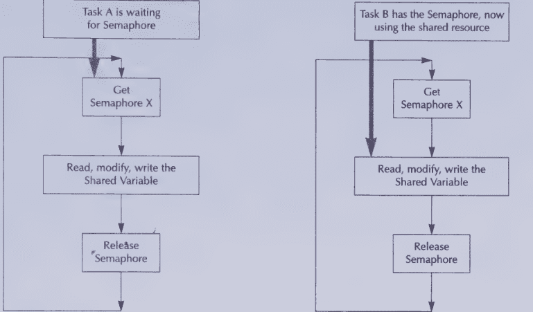

**图 4.2** 不同任务在尝试获取相同资源访问权时的状态。

与共享内存的 `shmid_ds` 结构类似，内核在包含文件 `<sys/sem.h>` 中为信号量维护了一个特殊的内部数据结构 `semid_ds`。

```c
1)  struct semid_ds
2)  {
3)      struct ipc_perm sem_perm; /*permission */
4)      time_t sem_otime; /*last sem operation time */
5)      time_t sem_ctime; /*last change time */
6)      struct sem *sem_base; /*ptr to first sem in array*/
7)      struct wait_queue *eventnz;
8)      struct wait_queue *eventz;
```


9) `struct sem_undone;` /*undo request on this array */

10) `unsigned short sem_nsems;` /*number of sem in array*/

11) };

12) /* the struct sem is defined as follows */

13) `struct sem`

14) {

15)     `short semid;` /* pid of last operation */

16)     `ushort semval;` /* current val */

```c

17) `ushort semncnt;` /* num of process waiting semval > 0*/

18) `ushort semzcnt;`  /* num of process waiting semval = 0 */

19) }

```

## 信号量支持函数

Linux 内核为应用程序提供了以下系统调用，用于创建和管理信号量数据结构：

- `semget()`: 创建一个新信号量，或访问一个已有的信号量。
- `semop()`: 对信号量计数进行递减、递增或清零操作。
- `semctl()`: 允许对信号量进行控制操作，例如获取信号量的值等。

### semget

创建一个新信号量或访问一个已有的信号量。

#### 原型

```c

int semget(key_t key, int nsems, int semflg);

```

##### 参数

- `key_t key`: 内核尝试将其与现有的键值进行匹配；打开或访问操作取决于标志 `semflg`。
- `int nsems`: 要在集合中创建的信号量数量。
- `semflg`: 以下类型的组合：
    - `IPC_CREATE`: 如果信号量尚不存在，则创建它，否则返回现有的信号量标识符。
    - `IPC_EXCL`: 与 `IPC_CREATE` 配合使用时，如果信号量已存在，则操作失败。

#### 返回值

共享内存段标识符，出错时返回 -1。
`errno`：

- `EACCES` (权限被拒绝)。
- `EEXIST` (段已存在，无法创建)。
- `EIDRM` (段已被删除)。
- `ENOENT` (段不存在)。
- `ENOMEM` (内存不足)。
- `ENOSPC` (超过最大集合限制)。

### semop

递增或递减信号量计数。当信号量计数达到 0 时，信号量被锁定，所有进程将被阻塞。

如果采取一个简单的案例，将信号量初始化为计数 1，那么递减操作就像是在信号量上加锁，因为此时信号量计数为 0。所有随后的递减操作都将被阻塞，调用进程将进入睡眠状态，直到执行递增操作。有关 `semop` 操作的详细信息，请参阅 man 手册页。

#### 原型

```c

int semop(int semid, struct sembuf *sops, unsigned nsops);

```

##### 参数

- `int semid`: `semget` 返回的 ID。
- `struct sembuf *sops`: 指向要对信号量集执行的操作数组的指针。

**struct sembuf**

```c

struct sembuf

{

    ushort sem_num;    /* semaphore index in array */

    short semop;       /* semaphore operation pos, neg, zero */

    short sem_flg;     /* operation flags */

}

```

`sem_num` 是您感兴趣的信号量集中的信号量索引。如果您只创建了一个信号量，该值应为 0。

`sem_op` 的值有三种可能的情况：

- **sem_op 为正整数**: 该操作将此值加到 `semval` 上。该操作总是能够通过，因此不会发生进程睡眠。
- **sem_op 为零**: 如果 `semval` 为零，则操作通过；否则，根据 `sem_flg` 的情况有以下条件：
    - `IPC_NOWAIT` 标志: 系统调用失败，`errno` 被设置为 `EAGAIN`。
    - `SEM_UNDO` 标志: `semzcnt` 递增 1，且进程进入睡眠。
- **sem_op 小于零**: 如果 `semval` 大于或等于 `sem_op` 的绝对值，则从 `semval` 中减去 `sem_op` 的绝对值，操作通过，且不发生睡眠。否则，进程睡眠直到 `semval` 大于或等于 `sem_op` 的绝对值。

以下是一个 `sem_buf` 的简单示例：

锁定资源：
`struct sembuf sem_lock = {0, -1, SEM_UNDO};`

解锁资源：
`struct sembuf sem_unlock = {0, 1, SEM_UNDO};`

#### 返回值

如果成功，系统调用返回 0；否则返回 -1，并由 `errno` 指示错误。
对于失败的返回，`errno` 将被设置为以下值之一：

- `E2BIG`: 参数 `nsops` 大于 `SEMOPM`（每个系统调用允许的最大操作数）。
- `EACCES`: 调用进程对信号量集没有指定操作所需的访问权限。
- `EAGAIN`: 操作无法通过，且其 `sem_flg` 中指定了 `IPC_NOWAIT`。
- `EFAULT`: `sops` 指向的地址不可访问。
- `EFBIG`: 对于某些操作，`sem_num` 的值小于 0，或大于或等于集合中的信号量数量。
- `EIDRM`: 信号量集已被删除。
- `EINTR`: 在等待队列上睡眠时，进程收到一个必须捕获的信号。
- `EINVAL`: 信号量集不存在，ID 小于 0，或 `nsops` 为非正值。

### semctl

允许对数据结构进行控制，例如初始化信号量值、更改权限、删除信号量等。

#### 原型

```c

int semctl(int semid, int sem_num, int command, ...);

```

##### 参数

- `int semid`: `semget` 返回的 ID。
- `int sem_num`: 数组中的信号量索引。
- `int cmd`: 两个常用命令是：
    - `SETVAL`: 将信号量初始化为一个已知值。
    - `IPC_RMID`: 当信号量不再需要时，将其从系统中删除。

#### 返回值

系统调用根据 `cmd` 返回一个非负值，具体如下：

- `GETNCNTS`: 返回 `semncnt` 的值。
- `GETPID`: 返回 `sempid` 的值。
- `GETVAL`: 返回 `semval` 的值。
- `GETZCNT`: 返回 `semzcnt` 的值。

失败时，系统调用返回 -1，`errno` 指示错误。
对于失败的返回，`errno` 将被设置为以下值之一：

- `EACCES`: 调用进程没有执行 `cmd` 的访问权限。
- `EFAULT`: `arg.buf` 或 `arg.array` 指向的地址不可访问。
- `EIDRM`: 信号量集已被删除。
- `EINVAL`: `cmd` 或 `semid` 的值无效。
- `EPERM`: 参数 `cmd` 的值为 `IPC_SET` 或 `IPC_RMID`，但调用进程的有效用户 ID 没有足够的权限执行该命令。
- `ERANGE`: 参数 `cmd` 的值为 `SETALL` 或 `SETVAL`，且要设置的 `semval` 值（对于集合中的某些信号量）小于 0 或大于实现值 `SEMVMX`。

## 在多道程序环境下使用信号量

我们讨论了使用信号量在共享内存中实现互斥，现在我们将实现两个测试程序，以演示使用信号量进行事件同步。代码清单 4.7 和 4.8 中的程序在执行上类似（源代码提供在配套 CD 目录 `/book/chapter4/sem_x.c` 和 `/book/chapter4/sem_y.c` 中）。在创建信号量并执行 10 次循环后，程序终止。每个程序都尝试获取信号量，并持有直到被另一个程序释放。

- 任务 A 获取信号量的锁。
- 任务 A 打印消息 “Task A controls resources.”。
- 任务 A 解锁信号量。
- 任务 B 获取信号量的锁。
- 任务 B 打印消息 “Task B controls resources.”。
- 任务 B 解锁信号量。

**代码清单 4.7** 文件 `/book/chapter4/shmem/sem_x.c`；一个使用信号量进行同步的程序。

```c

1) #include <stdio.h>

2) #include <unistd.h>

3) #include <stdlib.h>

4) #include <errno.h>

5) #include <string.h>

6) #include <time.h>

7) #include <sys/types.h>

8) #include <sys/ipc.h>

9) #include <sys/sem.h>

10) struct sembuf sem_lock = {0, -1, SEM_UNDO};

11) struct sembuf sem_unlock = {0, 1, SEM_UNDO};

12) static void end(const char *err)

13) {

14)  if (errno != 0)

15)  {

16)      fputs(strerror(errno),stderr);

17)      fputs(": " , stderr);

18)  }

19)  fputs(err,stderr);

20)  fputc('\n', stderr);

21) }

22) //********************************************************/

23) //********************************************************/

24) //********************************************************/

25) //********************************************************/

26) //********************************************************/

27) int main(int argc, char ** argv)

28) {

29)    int i, sem_id;

30)    int pause_time;

31)    srand ( unsigned int getpid());

32)    sem_id = semget ( ( key_t) 1234, 1, 0666 | IPC_CREAT);

33)    /* initialize semaphore to a known unlock value 1 */

34)    if (semctl(sem_id, 0, SETVAL, 1) == -1)

35)    end("Failed to create semaphore ");

36)    for (i = 0; i < 10; i++)

37)    {

38)        if (semop(sem_id, &sem_lock, 1) == -1)

39)        end("Lock failed ");

40)        printf("Task A controls resources\n"); fflush(stdout);

41)        pause_time = (rand() % 3);

42)        sleep(pause_time);

43)        if (semop(sem_id, &sem_unlock, 1) == -1)

44)        end("Lock failed ");

45)    }

46)    sleep(10);

47)    /* Delete semaphore */

48)    if (semctl(sem_id, 0, IPC_RMID, 0) == -1)

49)    end("Failed to delete semaphore ");

50)    exit(0);

51) }

```

**代码清单 4.8** 文件 `/book/chapter4/shmem/sem_y.c`；一个使用信号量进行同步的程序。

```c

1) #include <stdio.h>

2) #include <unistd.h>

3)  #include <stdlib.h>

4)  #include <errno.h>

5)  #include <string.h>

6)  #include <time.h>

7)  #include <sys/types.h>

8)  #include <sys/ipc.h>

9)  #include <sys/sem.h>

10) struct sembuf sem_lock = {0, -1, SEM_UNDO};

11) struct sembuf sem_unlock = {0, 1, SEM_UNDO};

12) static void end(const char *err)

13) {

14)     if (errno != 0)

15)     {

16)         fputs(strerror(errno), stderr);

17)         fputs(": ", stderr);

18)     }

19)     fputs(err, stderr);

20)     fputc('\n', stderr);

21) }

22) //**************************************************/

23) //**************************************************/

24) //**************************************************/

25) //**************************************************/

26) //**************************************************/

27) int main(int argc, char ** argv)

28) {

29)     int i, sem_id;

30)     int pause_time;

31)     srand (( unsigned int) getpid());

32)     sem_id = semget (( key_t) 1234, 1, 0666 | IPC_CREATE);

33)     /* initialize semaphore to a known unlock value 1 */

34)     if (semctl(sem_id, 0, SETVAL, 1) == -1)

35)         end("Failed to create semaphore ");

36)     for (i = 0; i < 10; i++)

37)     {

38)         if (semop(sem_id, &sem_lock, 1) == -1)

39)             end("Lock failed ");

40)         printf("Task B controls resources\n"); fflush(stdout);

41)         pause_time = (rand() % 3);

42)         sleep(pause_time);

43)         if (semop(sem_id, &sem_unlock, 1) == -1)

44)             end("Lock failed ");

45)     }

46)     sleep(10);

47) /* Delete semaphore */

48) if (semctl(sem_id, 0, IPC_RMID, 0) == -1)

49)     end("Failed to delete semaphore ");

50)     exit(0);

51) }

```

使用代码清单 4.9 中提供的 Makefile（CD 目录 `/book/chapter4/semaphore/Makefile`）来编译 `sem_x.c` 和 `sem_y.c` 程序，并使用以下 shell 命令在不同的 shell 中执行这两个程序：

```bash

# ./x.o

打开另一个 shell 并执行 sem_y.o

# ./y.o

```

每个程序在获取信号量后将显示一条消息。

**代码清单 4.9** 文件 `/book/chapter4/semaphore/Makefile`；用于创建 `sem_x.o` 和 `sem_y.o` 可执行文件的 Makefile。

```makefile

1) all: t

2) CC = gcc

3) CFLAGS = -g -O2 -Wall -I/usr/include -I/usr/include/pgsql

4) t: sem_x.o sem_y.o

5) $(CC) -o x sem_x.o -lpq -lcrypt

6) $(CC) -o y sem_y.o -lpq -lcrypt

7) sem_x.o: sem_x.c


8) `$(CC) -o sem_x.o -c sem_x.c $(CFLAGS)`

9) `sem_y.o: sem_y.c`

10) `$(CC) -o sem_y.o -c sem_y.c $(CFLAGS)`

## 消息队列

消息队列提供了在进程之间发送和接收数据块的能力。然而，它们在一个方面具有独特性，即一个进程可以被设置为等待来自多个源的消息。消息队列中的每条消息都关联一个唯一的类型，进程可以选择性地接收特定消息而忽略其他消息。

与共享内存的 `shmid_ds` 结构类似，内核在包含文件 `<sys/ipc.h>` 中为消息队列维护了一个特殊的内部数据结构 `msgid_ds`。

```c
1) struct msgid_ds
2) {
3)     struct ipc_perm msg_perm; /* permission */
4)     struct msg * msg_first; /* first msg in the queue */
5)     struct msg * msg_last; /* last msg in the queue */
6)     time_t msg_stime; /* last msg send time */
7)     time_t msg_rtime; /* last msg rcv time */
8)     time_t msg_ctime; /* last msg change time */
9)     struct wait_queue wwait; struct wait_queue rwait;
10)    ushort msg_cbytes;
11)    ushort msg_qnum;
12)    ushort msg_qbytes; /* max number of bytes on queue */
13)    ushort msg_lspid; /* pid of last send */
14)    ushort msg_lrpid; /* pid of last rcv */
15) }
```

消息队列通过一个 IPC 标识符来识别，而消息及其类型被嵌入在一个名为 `msgbuf` 的结构中，定义如下：

```c
#include <linux/msg.h>

/* message buffer for send and receive */
struct msgbuf
{
    long mtype;    /* type of message, a positive number */
    char mtext[1];  /* message text */
}
```

`struct msgbuf` 仅是一个模板，成员 `mtext` 可以被用户定义的值所取代。内核以链表的形式存储每条消息，描述如下：

```c
struct msg
{
    struct msg * msg_next;    /* next msg in the queue */
    long msg_type;            /* type of message, a positive number */
    char *msg_text;           /* message text */
    short msg_ts;             /* msg text size <= 4096 */
}
```

### 发送消息

```c
int msgsnd( int msgid, struct msgbuf *msgp, int msgsz, int msgflg)
```

返回值：

- 成功时返回 0；
- 错误时返回 1，`errno` 为以下之一：
    - `EAGAIN`（权限被拒绝）
    - `EAGAIN`（断言了 `IPC_NOWAIT`）
    - `EIDRM`（信号量集已被删除）
    - `EINTR`（睡眠时收到信号）
    - `EINVAL`（`sem_id` 无效）
    - `ENOMEM`（内存不足）

### 接收消息

```c
int msgrcv( int msgid, struct msgbuf *msgp, int msgsz, long mtype, int msgflg)
```

返回值：

- 成功时返回 0；
- 错误时返回 1，`errno` 为以下之一：
    - `E2BIG`（`nsops` 大于允许的最大操作数）
    - `EACCES`（权限被拒绝）
    - `EAGAIN`（断言了 `IPC_NOWAIT`）
    - `EIDRM`（消息集已被删除）
    - `EINTR`（睡眠时收到信号）
    - `EINVAL`（`msgid` 无效）
    - `ENOMSG`（不存在消息）

## 在多编程环境中使用消息队列

与信号量一样，消息队列提供了一种方便的方法来同步任务之间的事件，但消息队列的优势在于还可以传递参数。任务可以被强制等待特定消息这一特性可用于保护共享资源。代码清单 4.10 和 4.11 是两个程序（源文件可从配套 CD 目录中下载：清单 4.10 为 `/book/chapter4/msgque.c`，清单 4.11 为 `/book/chapter4/test/test.c`）。这两个程序协同工作，通过 `msgget`（第 21 行）创建的消息队列相互传递消息。每个程序向对方发送一条消息（第 29 行），然后等待来自对方的消息（第 35 行）。

**代码清单 4.10** 文件 `/book/chapter4/msgqueues/msgque.c`；一个使用消息队列进行通信的程序。

```c
1)  #include <unistd.h>
2)  #include <stdlib.h>
3)  #include <stdio.h>
4)  #include <string.h>
5)  #include <sys/types.h>
6)  #include <sys/ipc.h>
7)  #include <sys/msg.h>
8)  #define MSG_FROM_A 1
9)  #define MSG_FROM_B 2
10) #define MESSAGE_KEY 9988
11) #define MSG_SIZE 80
12) struct msgbuf
13) {
14)     int mtype;
15)     char bfr[MSG_SIZE];
16) };
17) struct msgbuf qbuf;
18) int msgid;
19) int main()
20) {
21)     msgid = msgget (MESSAGE_KEY, 0666 | IPC_CREAT);
22)     if (msgid == -1)
23)     {
24)         fprintf(stderr, "msg queue failed \n");
25)         exit (EXIT_FAILURE);
26)     }
27)     qbuf.mtype = MSG_FROM_A;
28)     strcpy (qbuf.bfr,"Hello Task B:\n");
29)     if (msgsnd(msgid, &qbuf, MSG_SIZE, 0) == -1)
30)     {
31)         fprintf(stderr, "msg queue failed \n");
32)         exit (EXIT_FAILURE);
33)     }
34)     printf ("Waiting for a message from Task B\n");
35)     if (msgrcv(msgid, &qbuf, MSG_SIZE, MSG_FROM_B, 0) == -1)
36)     {
37)         fprintf(stderr, "msg queue failed \n");
38)         exit (EXIT_FAILURE);
39)     }
40)     printf("Msg from B: %s\n",qbuf.bfr);
41)     printf("Task A deleting the msg queue\n");
42)  if (msgctl(msgid, IPC_RMID, 0) == -1)
43)  {
44)      fprintf(stderr, "Could not delete msg queue \n");
45)      exit(EXIT_FAILURE);
46)  }
47)  exit(EXIT_SUCCESS);
48) }
```

**代码清单 4.11** 文件 `/book/chapter4/msgqueues/test/test.c`；代码清单 4.10 的配套程序，用于测试消息传递方案。

```c
1)  #include <unistd.h>
2)  #include <stdlib.h>
3)  #include <stdio.h>
4)  #include <string.h>
5)  #include <sys/types.h>
6)  #include <sys/ipc.h>
7)  #include <sys/msg.h>
8)  #define MSG_FROM_A 1
9)  #define MSG_FROM_B 2
10) #define MESSAGE_KEY 9988
11) #define MSG_SIZE 80
12) struct msgbuf
13) {
14)     int mtype;
15)     char bfr[MSG_SIZE];
16) };
17) struct msgid_ds queue_ds;
18) struct msgbuf qbuf;
19) int msgid;
20) int main()
21) {
22)     msgid = msgget(MESSAGE_KEY, 0666 | IPC_CREATE);
23)     if (msgid == -1)
24)     {
25)         fprintf(stderr, "msg queue failed \n");
26)         exit(EXIT_FAILURE);
27)     }
28)     msgctl(msgid, IPC_STAT, &queue_ds);
29)     printf("Msg queue permission setting %x\n", queue_ds.msg_perm.mode);
30)     printf("Waiting for a message from Task A\n");
31)     if (msgrcv(msgid, &qbuf, MSG_SIZE, MSG_FROM_A, 0) == -1)
32)     {
33)  fprintf(stderr, "msg queue failed \n");
34)  exit(EXIT_FAILURE);
35)  }
36)  printf("Msg from A: %s\n",qbuf.bfr);
37)  qbuf.mtype = MSG_FROM_B;
38)  strcpy(qbuf.bfr,"Hello Task A:\n");
39)  if(msgsnd(msgid, &qbuf, MSG_SIZE, 0) == -1)
40)  {
41)    fprintf(stderr, "msg queue failed \n");
42)    exit(EXIT_FAILURE);
43)  }
44)  exit(EXIT_SUCCESS);
45)  }
```

使用清单 4.12 中的 Makefile 编译 `msgque.c` 程序，并使用清单 4.13 中的 Makefile 编译 `test.c` 程序。

### 清单 4.12 文件 `/book/chapter4/msgques/Makefile`；用于创建 `msgque.c` 可执行文件的 Makefile。

```makefile
1) all: msgque
2) CC = gcc
3) INCLUDEDIR = /usr/include
4) CFLAGS = -g -O2 -Wall -I$(INCLUDEDIR)
5) msgque: msgque.o
6) $(CC) -o t msgque.o
7) msgque.o: msgque.c
8) $(CC) -c msgque.c $(CFLAGS)
```

### 清单 4.13 文件 `/book/chapter4/msgques/test/Makefile`；用于创建 `test.o` 可执行文件的 Makefile。

```makefile
1) all: t
2) CC = gcc
3) INCLUDEDIR = /usr/include
4) CFLAGS = -g -O2 -Wall -I$(INCLUDEDIR)
5) t: test.o
6) $(CC) -o t test.o
7) test.o: test.c
8) $(CC) -c test.c $(CFLAGS)
```

在各自的 Shell 中执行 `msgque.o` 和 `test.o` 这两个程序，并使用以下 Shell 命令观察彼此显示的消息传递：

```bash
# ./t
```

在 `test` 目录下打开另一个 Shell 并执行 `test.o`。

```bash
# ./t
```

每个程序都将显示从另一个程序接收到的消息。

## 管道 (PIPES)

管道主要用于将一个进程的标准输出连接到另一个进程的标准输入。它基本上是一种单向通信。Shell 将 “|” 键解释为管道命令，用于将一个进程的输出重定向到另一个进程的输入。例如，以下 Shell 命令将仅显示包含字符串 “Mak” 的文件名：

```bash
# find . | grep Mak
```

在软件程序中，管道的创建和关闭与其他任何文件一样；`stdio.h` 头文件中包含以下函数声明：

```c
FILE * popen( char * command, char * type);
int pclose( FILE * stream);
```

标准库函数通过本质上 fork 一个子进程来执行 `popen()` 命令：生成一个 Shell，并执行传递给 `popen()` 函数的参数。数据流的方向由第二个参数决定。

`pclose()` 函数在关闭流之前，会对 `popen()` fork 的进程执行 `wait4()`。

清单 4.14 与查找所有包含字符串 “Mak” 的文件名的 Shell 命令本质上相同。清单 4.14 的源代码和 Makefile 可以从 CD 目录 `/mnt/cdrom/book/chapter4/pipes/Makefile` 复制。

使用以下 Shell 命令编译并执行 `pipes.c`（清单 4.14）程序：

```bash
# mkdir /pipes
# cp /mnt/cdrom/book/chapter4/pipes/* /pipes/.
# cd /pipes
```

该程序将从根目录开始显示包含字符串 “Mak” 的文件名。

### 清单 4.14 文件 `/book/chapter4/pipes/pipes.c`；一个演示 `pipe` 函数用法的示例程序

```c
1) #include <unistd.h>
2) #include <stdlib.h>
3) #include <stdio.h>
4) #include <string.h>
5) #include <sys/types.h>
6) #include <sys/ipc.h>
7) #include <sys/msg.h>
8) int main()
9) {
10) char buf[80];
11) FILE * pin, * pout;
12) /* Open a pipe for read. Exit if fail */
13) if ((pin = popen("cd / ; find . ", "r")) == NULL)
14) {
15) printf("pipe open error \n");
16) exit(1);
17) }
18) /* Open a pipe for write. Exit if fail */
19) if ((pout = popen("grep Mak", "w")) == NULL)
20) {
21) printf("pipe open error \n");
22) exit(1);
23) }
24) while (fgets(buf, 80, pin))
25) fputs(buf,pout);
26) exit(0);
27) }
```

## FORK

`fork` 函数本质上是复制一个进程映像；一个保留为父进程，另一个成为子进程。一旦调用 `fork`，父进程和子进程就变成了同一个程序的两个独立实例，且不共享相同的内存空间。程序会产生一种变量存在于函数作用域内的错觉，但实际上并非如此。

为了增强你对 `fork` 过程的理解，清单 4.15 中的程序（你可以从配套 CD 目录 `/book/chapter4/fork/fork.c` 复制该文件）创建了一个子进程（第 24 行），该子进程反过来又创建了另一个子进程（第 29 行）。因此，同一个程序有三个实例都在不同的内存空间中执行。使用清单 4.16 所示的 Makefile 编译该程序。Makefile 可以从配套 CD 目录 `/book/chapter4/fork/Makefile` 复制。

### 清单 4.15 文件 `/book/chapter4/fork/fork.c`；一个演示 `fork` 函数创建同一个程序三个实例的程序。

```c


1) `#include <stdio.h>`

2) `#include <unistd.h>`

3) `#include <stdlib.h>`

4) `#include <errno.h>`

5) `#include <string.h>`

6) `#include <time.h>`

7) `#include <sys/types.h>`

8) `#include <sys/socket.h>`

9) `#include <arpa/inet.h>`

10) `#include <netdb.h>`

11) `static void end(const char *err)`

12) {

13)     `if (errno != 0)`

14)     {

15)         `fputs(strerror(errno),stderr);`

16)         `fputs(": ", stderr);`

17)     }

18)     `fputs(err,stderr);`

19)     `fputc('\n', stderr);`

20) }

21) `int main(int argc, char ** argv)`

22) {

23)     `pid_t cpid=0, ppid=0;`

24)     `ppid = fork();`

25)     `switch(ppid)`

26)     {

27)         `case 0:`

28)             `printf("This is child 1st child pid %d\n",ppid);`

29)             `cpid = fork();`

30)             `printf("This is child 2nd child pid:%d\n",cpid);`

31)             `break;`

32)         `case -1:`

33)             `end("Failed fork");`

34)         `default:`

35)             `printf("This is parent pid:%d\n",ppid);`

36)             `break;`

37)     }

38)     `sleep(3);`

39)     `printf("Finish ppid:%d, cpid:%d\n",ppid,cpid);`

40)     `return 0;`

41) }

### 清单 4.16 `文件 /book/chapter4/fork/Makefile：用于创建 fork.o 程序的 Makefile。`

```makefile
1) all: t
2) CC = gcc
3) CFLAGS = -g -O2 -Wall -I/usr/include -I/usr/include/pgsql
4) t: fork.o
5) $(CC) -o t fork.o -lpq -lcrypt
6) fork.o: fork.c
7) $(CC) -o fork.o -c fork.c $(CFLAGS)
```

使用以下 Shell 程序执行 `fork` 程序：

```bash
# ./t
```

你将看到来自三个实例的以下消息：

```text
This is parent pid 551
This is child 1st child pid 0
This is child 2nd child pid 552
```

## 套接字 (SOCKETS)

在所有可用的进程间通信方法（管道、套接字、信号、信号量和队列）中，套接字无疑是最灵活的。它们打破了所有距离的障碍。两个进程可以运行在同一个本地 CPU 上，也可以相隔数英里运行在不同的机器上。套接字提供了一种无缝的端到端通信方法。

与 Linux 中的所有其他系统一样，套接字也被视为文件描述符。一旦创建了套接字，我们就可以执行与磁盘文件系统相同的读写操作。唯一的区别是，磁盘文件附加到文件系统上的节点，而套接字则附加到各自机器的 IP 地址上。

使用套接字建立通信链路非常像打电话。你想建立连接：你拨打对方的号码，对方听到铃声，对方接起电话，你就实现了端到端通信。用这个类比，将拨号者视为*客户端*，听号者视为*服务器*，电话号码视为*IP 地址*。IP 地址上的一个*端口*就像当地交换机中的分机号。除非另一端有一个服务器（听号者）在等待电话，否则客户端（拨号者）无法建立通信。因此，套接字服务器与套接字客户端不同，因为服务器一旦创建，应该简单地*监听*呼叫，而客户端在创建后应该*连接*到服务器。

客户端和服务器套接字的角色可能不同，但创建方法对于两者来说是相同的。套接字使用操作系统函数 `socket()` 创建，但在进行任何通信之前，必须使用 `bind()` 函数将其绑定到文件节点。一旦套接字被绑定，你就可以像操作常规文件一样使用相同的 `read`、`write`、`open` 和 `close` 文件操作。不过，两者之间存在细微差别，图 4.3 解释了每个套接字经历的不同阶段。

### 套接字创建

Linux 操作系统提供了以下函数调用来创建套接字：

```c
int socket (int domain, int type, int protocol);
```

我们将在接下来的章节中讨论这三个参数——域（domain）、类型（type）和协议（protocol）。

### 域 (Domains)

套接字不必位于不同的机器上；你可以在同一台机器上本地创建两者（客户端和服务器）。远程连接肯定需要地址，而本地连接则不需要。有时，远程连接的客户端套接字不需要地址，但服务器需要。

还要记住，TCP/IP 不是套接字通信的唯一协议；还有很多其他协议，如表 4.1 所示。所有这些都被认为是*域*类型。对于本地套接字，它是 `AF_LOCAL` 域；对于远程 TCP/IP，它是 `AF_INET` 域；对于 Novell 网络，它是 `AF_IPX` 域，依此类推。（AF 代表地址族，但前缀 PF 也在被使用，例如 `PF_LOCAL`、`PF_INET` 等）。

**图 4.3** 客户端套接字和服务器套接字生命周期的不同阶段。

（接前文。）当提交创建套接字的请求时，域（domain）信息对操作系统至关重要。你也可以在请求中将其留空，让操作系统为你选择合适的域。

#### 表 4.1 套接字域列表

| 域 | 描述 | 手册章节 |
| :--- | :--- | :--- |
| `PF_UNIX`, `PF_LOCAL` | 本地通信 | `unix(7)` |
| `PF_INET` | IPv4 互联网协议 | `ip(7)` |
| `PF_INET6` | IPv6 互联网协议 | |
| `PF_IPX` | IPX - Novell 协议 | |
| `PF_NETLINK` | 内核用户界面设备 | `netlink(7)` |
| `PF_X25` | ITU-T X.25 / ISO-8208 协议 | `x25(7)` |
| `PF_AX25` | 业余无线电 AX.25 协议 | |
| `PF_ATMPVC` | 访问原始 ATM PVC | |
| `PF_APPLE TALK` | AppleTalk | `ddp(7)` |
| `PF_PACKET` | 低级数据包接口 | `packet(7)` |

*domain* 参数定义了要使用的协议族；最常见的是 `PF_LOCAL` 和 `PF_INET`，其他较少见的协议列在表 4.1 中。

### 套接字通信类型

套接字并不局限于特定类型。你可以指定一个可靠且无误的连接、一个不太可靠的广播连接、单向连接、双向连接、有序连接、带外连接等等。*type* 参数指定了通信语义。目前定义的类型有：

- `SOCK_STREAM`: 提供有序、可靠、双向、基于连接的字节流。可能支持带外数据传输机制。
- `SOCK_DGRAM`: 支持数据报（无连接、不可靠、具有固定最大长度的消息）。
- `SOCK_SEQPACKET`: 为具有固定最大长度的数据报提供一个有序、可靠、双向且基于连接的数据传输路径；消费者需要通过每次 `read` 系统调用读取整个数据包。
- `SOCK_RAW`: 提供原始网络协议访问。
- `SOCK_RDM`: 提供一个可靠的数据报层，但不保证顺序。
- `SOCK_PACKET`: 已废弃，不应在程序中使用；参见 `packet(7)`。

某些套接字类型可能未在所有协议族中实现；例如，`AF_INET` 没有实现 `SOCK_SEQPACKET`。

### 套接字协议

在创建套接字时指定套接字域，某些域本身就指定了要使用的协议类型；例如，`AF_INET` 会自动选择 TCP/IP。其他域可能要求你指定协议类型。*protocol* 参数指定了套接字要使用的特定协议。默认值 0 表示操作系统将选择匹配的协议。

通常，在给定的协议族中，只有一个协议支持特定的套接字类型。然而，也可能存在多个协议，在这种情况下必须指定特定的协议。所使用的协议号取决于“通信域”。你可以在 `/etc/protocols` 文件中找到协议的映射关系。

### 将套接字绑定到地址

一旦套接字创建完成，就应该将其绑定到一个地址；特别是如果它是一个服务器套接字。该地址取决于连接的对象及其位置。如果你的套接字旨在同一台机器上进行本地通信，则地址是一个文件路径。然而，如果套接字位于两台独立的机器上，则地址是网络地址。Linux 提供了以下函数调用将套接字绑定到地址：

```c
int bind (int socket, struct (sockaddr *) &sock_address, int len_inet);
```

第一个参数 *socket* 是 `socket()` 函数返回的套接字 ID。第二个参数是指向 `sockaddr` 结构的指针。结构本身并不那么重要；你可以传递任何内容，但要确保前两个字节指示你打算使用的地址族。无论你选择哪种地址结构，前两个字节都决定了其余字节如何被解释。可以将前两个字节视为指定其余结构形式的类型。

该结构仅为形成地址提供了指南；其他地址结构如下所示：

通用地址：

```c
struct sockaddr
{
    sa_family_t   sa_family;  /* 2 字节短整型地址族 */
    char           sa_data[14]; /* 地址数据 */
};
```

本地地址：
`AF_LOCAL` 或 `AF_UNIX` 地址的结构名称为 `struct sockaddr_un`：

```c
struct sockaddr_un
{
    sa_family_t    sun_family; /* 地址族 */
    char           sun_path[108];
};
```

互联网套接字地址：
`AF_INET` 的结构名称为 `struct sockaddr_in`：

```c
struct sockaddr_in
{
    sa_family_t     sin_family; /* 地址族 */
    uint16_t        sin_port;
    struct in_addr  sin_addr;   /* 互联网地址 */
    unsigned char   sin_zero[8]; /* 填充字节 */
};
```

字节就是字节；然而，说到字（word）时，世界上有两种字：Motorola 类型的字和 Intel 类型的字。区别在于一个字（两个字节）写入计算机内存的方式。这可以用 CPU 架构依赖来解释。

#### Motorola
**大端序 (Big Endian)**
16 位整数中的十六进制值 `0x1234` 存储为 `0x12`, `0x34`。

#### Intel
**小端序 (Little Endian)**
16 位整数中的十六进制值 `0x1234` 存储为 `0x34`, `0x12`。

方向至关重要，如果你的套接字必须在互联网上通信，你必须遵循 Motorola 类型（大端序）。事实是，大端序算术比小端序具有轻微优势。如果内存一次读取一个字节，将最高有效字节读入内存可以为某些长算术运算提供提前开始的机会。

平台操作系统提供的转换函数可用于执行正确的方向转换。以下是转换函数列表：

```c
#include <netinet/in.h>

unsigned long htonl (unsigned long hostlong);
unsigned short htons (unsigned short hostshort);
unsigned long ntohl (unsigned long netlong);
unsigned short ntohs (unsigned short netshort);
```

### IP 地址约定

IP 地址是一个 32 位数字，指定了主机 ID 和网络 ID 的组合。一个网络由一组主机组成。例如，如果网络号是 `0x10`，那么 `0x10000001` 到 `0x10FFFFFF` 都是主机号。可以使用子网掩码将主机部分从 IP 地址中隔离出来。按照约定，这个 32 位（4 字节）的数字被写成一组四个点分十进制数，例如 `200.200.200.200`。

由于 IP 地址划分网络部分的方式，互联网上的 IP 地址正变得稀缺，整个 IP 编址系统需要一次大修。理论上，32 位 IP 编址方案可以提供约 40 亿台计算机的连接——这显然是一个巨大的数字。然而，由于网络部分的分配方式，前 126 个组织各获得 1300 万个主机号，共约 20 亿个数字（A 类地址）。接下来的 65,000 个组织各获得 65,000 个，共约 10 亿个数字（B 类地址）。剩下的 1300 万个组织（C 类）各获得 256 个主机号——这样就用完了全部配额。

IPv6 是一种替代方案，允许 128 位的编号方案，但它尚未普及。以下是 32 位 IPv4 IP 编址方案的分解。XX 是 IP 地址的主机部分。在此部分中，某些数字被预留用于特殊目的：

- `0.XX.XX.XX` 预留给默认路由；
- `127.XX.XX.XX` 预留给本地访问；
- `10.XX.XX.XX` 和 `192.168.XX.XX` 预留给私有网络；
- 并且，如果前三位是 111，例如 `FF.FF.FF.FF`，那么它是一个组播地址。

组播地址用于同时寻址一组计算机。在所有网络中，主机 0 和 255 都是预留的。所有主机位都设为 0 的 IP 地址标识网络本身。所有位都设为 1 的 IP 地址是广播地址。

| 类别 | 范围 | 描述 |
| :--- | :--- | :--- |
| A 类 | `01XXXXXXX` $\to$ `7EXXXXXX` | (最后一位是 0) |
| B 类 | `80000XXX` $\to$ `BFFFFXXX` | (最后两位是 10) |
| C 类 | `C00000XX` $\to$ `DEFFFFXX` | (最后三位是 110) |
| D 类 | `EXXXXXXXX` $\to$ `FXXXXXXX` | (最后三位是 111) |

### 无名套接字

套接字地址就像电话号码，但并不总是需要有地址；例如，如果两个套接字之间有直接线路。`Socketpair()` 就是创建一个没有地址的两个套接字的例子。有时，通信中的两个套接字之一将没有地址。发起呼叫的本地套接字可以是匿名的。

### 服务器套接字监听客户端

如果是一个服务器套接字，它应该创建一个连接队列并等待客户端建立连接。`listen()` 函数提供了这一功能。`listen` 调用仅适用于 `SOCK_STREAM` 或 `SOCK_SEQPACKET` 类型的套接字。函数原型如下：

```c
#include <sys/socket.h>

int listen(int s, int backlog);
```

**描述** `backlog` 参数定义了等待连接队列的最大长度。参数 `s` 是套接字编号。

**返回值** 成功时返回 0；出错时返回 -1，并适当设置 `errno`。

**错误**

- `EBADF` 参数 `s` 不是一个有效的描述符。
- `ENOTSOCK` 参数 `s` 不是一个套接字。
- `EOPNOTSUPP` 该套接字类型不支持 `listen` 操作。

### 客户端连接到服务器

如果是一个客户端套接字，它应该连接到目标服务器。`connect()` 函数提供了这一功能。函数原型如下：

```c
#include <sys/types.h>
#include <sys/socket.h>

int connect(int sockfd, const struct sockaddr *serv_addr, socklen_t addrlen);
```

**描述** 文件描述符 `sockfd` 必须引用一个套接字。如果套接字类型为 `SOCK_DGRAM`，则 `serv_addr` 地址是默认发送数据报的地址，也是接收数据报的唯一地址。如果套接字类型为 `SOCK_STREAM` 或 `SOCK_SEQPACKET`，此调用尝试与另一个套接字建立连接。另一个套接字由 `serv_addr` 指定，它是套接字通信空间中的一个地址（长度为 `addrlen`）。每个通信空间以自己的方式解释 `serv_addr` 参数。

### 服务器接受客户端套接字

一旦成功建立链接，服务器套接字必须具体地接受该客户端。这一步骤允许服务器响应多个客户端。以下是函数原型：

```c
#include <sys/types.h>
#include <sys/socket.h>

int accept(int s, struct sockaddr *addr, socklen_t *addrlen);
```


**描述** `accept` 函数用于面向连接的套接字类型（`SOCK_STREAM`、`SOCK_SEQPACKET` 和 `SOCK_RDM`）。它从等待连接队列中提取第一个连接请求，创建一个与 `s` 属性基本相同的新已连接套接字，并为该套接字分配一个新的文件描述符并将其返回。新创建的套接字不再处于监听状态。原始套接字 `s` 不受此调用的影响。参数 `s` 是一个使用 `socket(2)` 创建、通过 `bind(2)` 绑定到本地地址并在 `listen(2)` 后监听连接的套接字。参数 `addr` 是一个指向 `sockaddr` 结构的指针。该结构由通信层填充连接实体的地址。传递给 `addr` 参数的地址的具体格式由套接字的族决定（参见 `socket(2)` 和相应的协议手册页）。`addrlen` 参数是一个值-结果参数：它最初应包含 `addr` 所指结构的尺寸；返回时，它将包含返回地址的实际长度（以字节为单位）。当 `addr` 为 `NULL` 时，不填充任何内容。如果队列中没有等待的连接，且套接字未被标记为非阻塞，则 `accept` 会阻塞调用者直到有连接出现。如果套接字被标记为非阻塞且队列中没有等待的连接，`accept` 返回 `EAGAIN`。

**返回值** 出错时调用返回 -1。如果成功，它返回一个非负整数，作为被接受套接字的描述符。

### 文件读/写操作

`accept()` 函数调用返回的描述符被用于在服务器套接字上执行正常的文件读写操作。客户端套接字的读写则使用 `socket` 函数本身返回的描述符来执行。套接字与文件描述符非常相似。一旦套接字打开，就可以应用相同的 `read`、`write` 和 `close` 函数调用。文件描述符用于引用已打开的文件或网络套接字。然而，它们之间存在一些差异：

- 打开的套接字文件没有 `lseek` 函数。
- 套接字可以与其关联地址。
- 套接字具有不同的选项能力，可以使用 `ioctl` 进行查询和设置。
- 套接字必须处于正确状态才能进行输入和输出。

### 关闭套接字

关闭套接字文件描述符也略有不同。一旦您完成写入并想要关闭文件，您应该等待对方的确认；为此，使用 `shutdown` 函数如下：

```c
#include <sys/socket.h>

int shutdown(int s, int how);
```

`s` 参数是套接字描述符，`how` 参数是 `SHUT_RD`、`SHUT_WR` 或 `SHUT_RDWR`。

关闭写入端 (`SHUT_WR`) 会向远程连接发送一个文件结束（EOF）指示。继续从另一端读取直到收到文件结束符，然后执行 `close`。关闭读取端 (`SHUT_RD`) 将开始忽略接收到的数据。`shutdown` 仅应用于已连接的套接字。

## 一个简单的 Web 服务器

为了演示套接字机制，我们将创建一个非常简单的 Web 服务器（代码清单 4.17）。源代码可在随书 CD 目录 `/book/chapter4/web/socket/web.c` 中找到。将源代码和 Makefile 复制到本地目录 `/web`。该服务器将根据来自 Web 浏览器（如 Netscape Navigator 或 Internet Explorer）通过 9999 端口连接的请求生成 HTML 页面。该服务器将在第 9 章“嵌入式系统设计项目”的数据采集系统设计中使用。以下是软件流程的解释：

- 第 16 行至 22 行是显示错误并退出的例程。
- 第 36 行创建套接字。
- 第 49 行绑定套接字。
- 第 55 行 `setsockopt` 允许地址重用。
- 第 62 行将其设为监听套接字（我们的程序作为服务器运行）。
- 第 71 行至 108 行是一个死循环结构。
- 第 77 行调用 `accept` 例程，仅当套接字端口 9999 上有请求时才返回。
- 第 95 行至 105 行是一个简单的 Web 页面，作为对请求的响应而被返回。

### 代码清单 4.17 文件 `/book/chapter4/socket/web.c`；一个简单的 Web 服务器。

```c
1)  /* web.c :
2)  A simple web server
3)  */
4)  #include <stdio.h>
5)  #include <unistd.h>
6)  #include <stdlib.h>
7)  #include <errno.h>
8)  #include <string.h>
9)  #include <fcntl.h>
10) #include <time.h>
11) #include <sys/types.h>
12) #include <sys/socket.h>
13) #include <netinet/in.h>
14) #include <sys/un.h>
15) #include <sys/uio.h>
16) void end(const char *errmsg)
17) {
18)     if ( errno != 0 )
19)         fprintf(stderr,"%s: ",strerror(errno));
20)         fprintf(stderr,"%s\n",errmsg);
21)         exit(1);
22) }
23) int main()
24) {
25)     int z;
26)     int s;             /* Web Server socket */
27)     int c;             /* Client socket */
28)     int alen;          /* Address length */
29)     struct sockaddr_in a_web; /* Web Server */
30)     struct sockaddr_in a_cln; /* Client addr */
31)     int b = 1;         /* For SO_REUSEADDR */
32)     FILE *rx;          /* Read Stream */
33)     FILE *tx;          /* Write Stream */
34)     char getbuf[2048];        /* GET buffer */
35)     time_t td;                /* Current date & time */
36)     s = socket(PF_INET,SOCK_STREAM,0);
37)     if ( s == -1 )
38)         end("socket(2)");
39)     /*
40)     Web address on port 9999:
41)     */
42)     memset(&a_web,0,sizeof a_web);
43)     a_web.sin_family = AF_INET;
44)     a_web.sin_port = ntohs(9999);
45)     a_web.sin_addr.s_addr = ntohl(INADDR_ANY);
46)     /*
47)     Bind the web server address-
48)     */
49)     z = bind(s, (struct sockaddr*)&a_web, sizeof a_web);
50)     if ( z == -1 )
51)         end("binding port 9999");
52)     /*
53)     Turn on SO_REUSEADDR :
54)     */
55)     z = setsockopt(s,SOL_SOCKET,
56)         SO_REUSEADDR,&b,sizeof b);
57)     if ( z == -1 )
58)         end("setsockopt(2)");
59)     /*
60)     Now make this a listening socket:
61)     */
62)     z = listen(s,10);
63)     if ( z == -1 )
64)         end("listen(2)");
65)     /*
66)     Perform a simple, web server loop
67)     accept one line of input text, and
68)     ignore it. Provide one simple
69)     HTML page back in response:
70)     */
71)     for (;;)
72)     {
73)         /*
74)         Wait for a connect from browser:
75)         */
76)         alen = sizeof a_cln;
77)         c = accept(s, (struct sockaddr*)&a_cln,
78)      &alen);
79)      if ( c == -1 )
80)      {
81)          perror("accept(2)");
82)          continue;
83)      }
84)  /*
85)  Create streams
86)  */
87)      rx = fdopen(c,"r");
88)      tx = fdopen(dup(c),"w");
89)      fgets(getbuf,sizeof getbuf,rx);
90)  /*
91)  Now serve a simple HTML response.
92)  This includes the current date
93)  and time:
94)  */
95)      fputs("<HTML>\n",
96)      "<HEAD>\n",
97)      "<TITLE>Test Page </TITLE>\n",
98)      "</HEAD>\n",
99)      "<BODY>\n",
100)     "<H1>Welcome!</H1>\n",tx);
101)     time(&td);
102)     fprintf(tx,"<H2>Current time: %s</H2>\n",
103)            ctime(&td));
104)     fputs("</BODY>\n",
105)     "</HTML>\n",tx);
106)     fclose(tx);
107)     fclose(rx);
108)     }
109)     return 0;
110) }
```

### 测试 Web 服务器

使用以下命令行编译示例 4.17 中的程序：

```bash
# cd web
# make
```

使用以下命令行执行程序。请确保您已关闭现有的 HTTP 服务器。

```bash
./web
```

您可以通过打开 Netscape Navigator 并请求本地主机与服务器通信。随后将出现欢迎页面。

```bash
netscape 127.0.0.1:9999
```

## 总结

在本章中，我们讨论了多任务的概念，以及它如何帮助我们将计算机程序模块化为可管理的任务。我们通过创建多个任务的示例程序，构建了模块化嵌入式系统设计的基础。我们还讨论了 Linux 操作系统提供的不同进程间通信机制，包括共享内存、信号量、消息队列、管道、fork 和套接字。我们开发了一个小型 Web 服务器，以演示在联网计算机（如您在互联网上看到的计算机）之间提供通信的机制。

# 5 Perl 编程

## 本章内容

- Perl 简明课程
- 函数与子程序
- 局部变量
- Perl 语句
- 基础块与 Switch 语句
- Perl 模块
- Pg.pm
- Perl 内置函数

## 简介

Practical Extraction and Report Language（实用提取与报告语言），简称 Perl，非常适合设计用于互联网的交互式 Web 页面；因此，我们的用户界面需要 Perl。嵌入式系统的用户界面涉及对处理后的数据进行实时监控，如果您使用互联网查看数据，那么只能使用像 Perl 这样的解释型语言来实现。像 Netscape 这样的浏览器仅能识别 HTML 语法的页面，而这些页面仅仅是静态文本文件。第一个文件通常存储在虚拟域名“company.com”中名为“www”的计算机上的“index.html”中。这就是为什么您在浏览器的请求行中输入 http://www.company.com。当请求到达目标 Web 服务器时，文件内容会被简单地传输到请求的浏览器中，而不经过解释。另一方面，当请求一个具有 .pl 或 .cgi 扩展名的文件链接时（参见 `/etc/httpd/conf/httpd.conf` 文件中的 `ExecCGI` 配置），Web 服务器会调用相应的解释器，在调用该文件或脚本时对其内容进行解释。这就是 Perl 发挥作用的地方。脚本中 `printf` 语句生成的文本就是传输给请求浏览器的文本。脚本编写者的工作是在脚本中提供适当的语句，生成正确的 HTML 语法以产生所需的 Web 页面。在本章稍后的内容中，您将看到 Perl 如何通过脚本解释帮助您创建动态 Web 页面。

感谢 Larry Wall 设计了 Perl，这是一种简单而强大的语言，是开发基于 Web 的软件的理想选择。无需深入了解 Perl 的编程细节，您就可以创建 HTML 页面和与数据库接口的通用网关接口 (CGI) 脚本——这就是面向对象编程的魅力。CPAN（综合 Perl 存档网络）中拥有一个庞大的 Perl 模块库，涵盖了编程的几乎每一个方面。用户只需理解接口，Perl 模块就会处理其余的编程细节。在本章中，我们将涵盖 Perl 的 CGI 和 Pg 模块，但如需更深入的信息，请访问官方网站 www.perl.com/pub/v/documentation/。

大多数 Linux 发行版默认安装了 Perl，但如果您的系统缺少该解释器，请访问 Perl 网站并按照安装指南进行操作。Perl 是一种面向对象的过程化语言，针对搜索内容、从任意文本文件中提取信息以及打印报告进行了优化。它也是执行许多系统管理任务的优秀语言。Perl 结合了（至少在作者看来）C、sed、awk 和 sh 的一些最佳特性，因此熟悉这些语言的人在使用它时应该不会有太大困难。（我们假设您具有 C 语言经验，因此省略了对变量、子程序等术语的解释。）学习新编程语言的最佳方法是从一个与您的需求密切匹配的简单的现有示例开始，并在此基础上进行构建——但当然，您需要先学习基本语法。延续我们的嵌入式系统设计方法论，我们的策略是将设计需求分为两个阶段：用户界面和系统接口，并以数据库作为两者之间交互的中心点。我们的用户界面围绕着可以使用 Netscape 或 Internet Explorer 等浏览器显示的 Web 页面展开。Perl 完美地契合我们的方案，因为它提供了用于创建动态 Web 页面的 CGI 模块，以及用于设计数据库接口的 Pg 模块。在本章中，我们将开发一些 Perl 脚本，作为我们嵌入式系统设计项目用户界面的一部分。

## PERL 简明课程

几乎每本编程书都以编写打印 “Hello World” 的程序开始。为了继承传统，这是我们的第一个 Perl 程序 “Hello World”。创建一个名为 “hello.pl” 的文件（称之为 Perl 脚本）并插入以下文本：

```perl
#!/usr/bin/perl

print "Hello World\n";
```

更改文件权限使其可执行。

```bash
#chmod 777 hello.pl
```

使用以下 shell 命令执行该脚本（假设您的系统已安装 Perl）：

```bash
[root@ns /root] # ./hello.pl
```

您将看到以下响应：

```
Hello World
```

脚本是一个文本文件，在交给实际的解释器之前由 shell 进行解释。您的 Perl 文件的第一行应该是以下内容：

```perl
#!/usr/bin/perl
```

它允许 shell 调用 Perl 来解释其余的文本。Perl 中的注释以 `#` 开始。`#` 之后的文本将被解释器忽略。以下程序的输出与之前讨论的程序相同：

```perl
#!/usr/bin/perl

print "Hello World\n"; # My first program
```

### 变量

在 Perl 中有三种方式来描述变量：标量（scalar）、数组（array）和哈希（hash）。

#### 标量变量以 “$” 符号开头

单值变量通过在变量名前加上 “$” 来声明。以下行声明了一个名为 “day” 的变量但未对其进行初始化：

```perl
$day;    # 未初始化的简单标量值 “days”
```

#### 数组变量以 “@” 符号开头

多值数组变量通过在变量名前加上 “@” 来声明。以下行声明了一个名为 “days” 的数组变量但未对其进行初始化：

```perl
@days;   # 一个空数组
```

#### 哈希（键值对）变量以 “%” 符号开头

哈希本质上是一个字典变量，该变量的每个成员都关联有一个键（key）和一个值（value）对。哈希变量通过在其名称前加上 “%” 来声明。以下行声明了一个名为 “days_are_numbered” 的哈希变量但未对其进行初始化：

```perl
%days_are_numbered;   # 哈希或键值对
```


#### 为变量赋值

变量可以在声明时初始化；然而，它们没有与之关联的类型。根据上下文，一个变量可以在某个时刻存储整数，随后存储字符串。Perl 在需要时会透明地将字符串转换为数字。以下行声明并初始化了标量、数组和哈希变量，且没有关联类型：

```perl
$day="Monday";		# 现在标量是一个字符串值

$day=1;			# 现在是一个整数值

@days=('mon','tue','wed','thu','fri','sat','sun'); # 一个字符串数组

@days=(1,2,3,4,5,6,7); # 一个整数数组
```

数组的一部分可以用于整数，而另一部分可以用于字符串。变量类型仅在特定上下文中被使用时才相关。以下数组变量是字符串和整数值的组合：

```perl
@dog_days=('mon','1','fri');		# 在赋值中混合整数和字符串

%days_are_numbered=("mon"=>1,"tue"=>2);	# 哈希或键值对
```

哈希和数组的名称可以与标量互换。您可以通过使用方括号对索引进行索引来提取哈希或数组变量的单个元素，如下所示：

```perl
$day = $days[0];			# 将数组元素作为标量访问

$days[0] = $day;			# 为数组元素赋值

$day=$days_are_numbered{"mon"};	# 访问哈希元素

$days_are_numbered{"wed"} = 3;	# 为哈希元素赋值

$day=$day + 1;			# 现在 $day = 2
```

### 单引号和双引号文本

被单引号或双引号包围的文本之间存在差异。单引号文本被视为字面量，而双引号则意味着其内容应该被解析。例如，如果被双引号包围，`$day` 将被替换为变量的实际值，但如果在单引号内，则被打印为 `$day`。

```perl
$day = "tuesday".

print "This is a bad $day.";    #will print Tuesday

print 'This is a bad $day.';    #will print $day

$day = "$day,"            # The $day will be replaced by the value

$day = '$day,'             # The $day will not be replaced by its value

\n                       # is a new line

$day="\\"              # is a \
```

（另外两个有用的反斜杠序列是 `\t` 用于插入制表符，以及 `\\` 用于在双引号字符串中插入反斜杠。）

### 变量的特殊属性

当 `#`、`%` 和 `$` 符号与变量名相关联时，Perl 会以特殊方式对其进行解析；例如，在数组名称中，`$` 符号后跟 `#` 将返回数组的最后一个元素。`%$` 或 `$$` 返回当前的进程 ID，如下所示：

```perl
$#days             # the last index of array @days

%$ or $$           # is the current process id.
```

### 数字范围

在循环结构中指定数字范围的一种快捷方式是使用 `".."`。例如，你可以将 (1, 2, 3, 4, 5) 写成 (1 .. 5)。你也可以在循环列表中使用数组和标量。以下代码段打印数字 1 到 10，15，然后是 20 到 25：

```perl
@one_to_ten = (1 .. 10);

$top_limit = 25;

for $i (@one_to_ten, 15, 20 .. $top_limit)
{
    print "$i\n";
}
```

### 特殊变量

以下是一些较为常用的特殊变量（完整列表请参考 Perl 手册页）。解释部分位于每行注释之后：

- `$!`：包含 Perl 生成的最近一次警告。
- `%ENV`：包含脚本的环境变量。以下示例将打印所有环境变量：

```perl
foreach (keys %ENV)
{
    print "$_=\$ENV{$_}\n";
}
```

- `$_`：用于传递参数、输入和模式搜索空间的默认标量变量。

以下对等组是等价的：

```perl
/^Subject: /

$_ =~ /^Subject: /

tr/a-z/A-Z/

$_ =~ tr/a-z/A-Z/

chomp

chomp($_)

print()

print($_)
```

- `$<digits>`：包含来自最后一次模式匹配中相应捕获括号组的子模式。
- `$"`：当前选定输出通道的当前报告格式名称。默认值是文件句柄的名称。
- `$!`：如果在数值上下文中使用，产生 C 语言 “errno” 变量的当前值。如果作为字符串使用，产生相应的系统错误字符串。
- `$$`：运行此脚本的 Perl 进程号。
- `$>`：此进程的有效 uid。
- `$(`：此进程的真实 gid。
- `$)`：此进程的有效 gid。
- `$0`：包含正在执行的程序名称。
- `@ARGV`：数组 `@ARGV` 包含传递给脚本的命令行参数。`"$#ARGV"` 通常是参数数量减 1，因为 `"$ARGV[0]"` 是第一个参数，而不是程序本身的命令行名称。
- `@_`：在子程序内部，数组 `@_` 包含传递给该子程序的参数。
- `%SIG`：哈希 `%SIG` 包含信号的处理程序。
- `$SIG{expr}`：作为 `%SIG` 哈希的一部分，`$SIG` 指向预期处理该信号的函数。

例如：

```perl
sub handler
{
    # 1st argument is signal name

    my($sig) = @_;

    print "Caught a SIG$sig-shutting down\n";

    exit(0);
}

$SIG{'INT'} = \&handler;

$SIG{'QUIT'} = \&handler;
```

为变量赋值时一切正常。正如前面所解释的，变量的值没有与之关联的特定类型。例如，将 1 赋值给变量 `$day` 可以被视为字符串，也可以用于表达式求值。

```perl
$Day=1                    # Variables do not have types associated with them

$Day=1.23                 # It is a floating point number

$Day=2E10                 # A very large number

$Day=0xfff                # A hex number

$Day=0377                # An octal number

$Day=4_294_1              # underline for legibility

@days[3,4,5]              # same as @days[3..5]

@days{'a','c'}            # same as ($days{'a'},$days{'c'})

%days{"Ugh","monday","Ahh","saturday"}
```

使用 `=>` 运算符通常更具可读性。

```perl
%days{"Bad" => "monday", "good" => "saturday"}
```

以下方式也是可行的：

```perl
%map = (    # This is OK too.

    red => 0x00f,

    blue => 0x0f0,

    green => 0x00f,

);

$rec = {

    who => 'let the dog out',

    cat => 'on the hot tin roof'

};
```

### 函数与子程序

Perl 是一种类似于 C 和 C++ 的过程语言。它使用类似于 C 的子程序概念来将一段代码块起来。可以通过在不同的代码块中调用它们的名称来重复使用子程序，名称前可以加一个初始的 `&` 符号，但这是可选的。以下两行在声明子程序时具有相同的含义：

```perl
&HelloWorld;

HelloWorld();            #This is OK too
```

定义子程序需要使用 `sub` 关键字，后跟子程序的名称，如下所示：

```perl
sub HelloWorld
{
    print "Hello","World";    # perl will combine Hello and World
}
```

传递给函数的参数是以单个标量列表的形式呈现的。如果传递了多个列表，它们将被拼接成一个列表。

```perl
@try1=("this","that");

@try2=("he","she");

trying(@try1,@try2);

trying("this","that","he","she");    #same as above
```

你可以通过使用 `sub name` 来声明一个子程序而不定义它；例如：

```perl
sub myname;
```

如果你没有明确使用 `return` 语句，子程序将返回最后一条语句的结果。

### 局部变量

`my` 创建一个仅在子程序内部可见的局部变量。

```perl
$day="mon"

sub HelloWorld
{
    my $day="tue";

    print $day;    # will print tue.
}
```

## PERL 语句

Perl 脚本由一系列声明和语句组成。在 Perl 中唯一需要声明的是报告格式和子程序。语句序列仅执行一次。

### 简单语句

表达式是简单语句，其求值规则与 C 语言的表达式求值类似。每个简单语句必须以分号结尾，除非它是块中的最后一条语句，在这种情况下，分号是可选的。

```perl
$day = 5;

$day = $day + 15;
```

### 文件处理

文件句柄是当文件被打开用于读写时创建的特殊变量。按照惯例，文件句柄的名称用大写字母书写。在文件名之前使用小于号和大于号来关联文件的读取、写入或追加操作模式，如下所示：

```perl
open (MYFILE, "File name");    #opens a file for reading

open (MYFILE, "<File name");    #opens a file for reading

open (MYFILE, ">File name");    #opens a file for writing

open (MYFILE, ">>File name");   #opens a file for appending
```

仅以写入模式打开文件将覆盖现有数据。如果你想保留现有数据，请如前段代码第 4 行所示以追加模式打开文件。要一次读取文件的一行，请使用以下语法：

```perl
$line=<MYFILE>;

chop $line; # newline character is being removed
```

要一次性读取整个文件，请使用数组变量。

```perl
@allline=<MYFILE>;
```

要读取目录文件名中的所有内容，请使用带通配符 `*` 的文件通配（globbing）。以下语句读取所有具有 `.pl` 扩展名的文件名：

```perl
@allfiles=<*.pl>;
```

向文件写入数据使用 `print` 语句。

```perl
print MYFILE $line;
```

如果没有给出文件句柄，则使用标准输出进行打印。

```perl
# Read a text file and print it out

while (<$filename>)
{
    print;
}
```

默认的文件句柄是 `STDIN`，不需要单独打开；要从 `STDIN` 读取，只需使用空尖括号 `<>`。

```perl
$line = <>; # read one line from standard input

print $line

# Copy a binary file to another file

open (OUTFILE,">>/tmp/myfile");

while ($bytesread=read($filename,$buffer,1024))
{
    print OUTFILE $buffer;
}
```

`open()` 调用总是有可能失败的。在 Perl 中，你可以使用 `or` 和 `and` 来防御这些问题。由 `or` 分隔的一系列语句将继续执行，直到命中一个可行的项或返回真值。这行代码要么成功以覆盖模式打开 `OUTPUT`，要么导致 Perl 退出：

```perl
open (OVERWRITE, ">overwrite.txt") or die "$! error trying to overwrite";
```

## 保留函数

### `split()`

该函数将字符串拆分并返回一个由碎片组成的列表。`split()` 通常接收两个参数：用于拆分字符串的正则表达式和该字符串。你还可以指定第三个参数：列表中包含项的最大数量。一旦列表包含这么多项，拆分将立即停止。以下程序演示了 `split` 函数的使用。结果是一个包含两个项 `"Hello."` 和 `"Welcome Perl!\n"` 的数组 `@a`。

```perl
1) $line=<>;					# 从标准输入打开行

2) chop $line;					# 删除换行符

3) @alllines=<CFILEHANDLE>		# 读取文件中的所有行

4) @allfiles="*.">			# 读取目录中的所有文件

5) $a+=1						# 等同于 $a = $a + 1;

6) $a = "Welcome to Perl!\n";

7) print substr($a, 0, 7);		# "Welcome"

8) print substr($a, 7, );		# " to Perl!\n"

9) print substr($a, -6, 4);		# "Perl"

10) $a = " Hello. Welcome Perl!\n";

11) @a = split(/ /, $a); 		# 按空格拆分

12) # 三个项: "Hello.", "Welcome", "Perl!\n"
```

### `join()`

`split` 的反操作是 `join()`。`join()` 函数接收一个字符串列表，并使用指定的字符串（可以是空字符串）将每个元素连接在一起。

```perl
@a = ("Hello.", "Welcome", "Perl!\n");

$a = join(' ', @a);		# "Hello. Welcome Perl!\n";

$b = join(' and ', @a);	# "Hello. and Welcome and Perl!\n";

$c = join('', @a);		# "Hello.WelcomePerl!\n";
```

### 条件语句

你可以使用以下任何符号来对表达式进行求值，以获得真或假的结果：

| 运算符 | Perl 字符串/数值 | 描述 |
| :--- | :--- | :--- |
| `>` | `gt` | 大于 |
| `<` | `lt` | 小于 |
| `>=` | `ge` | 大于或等于 |
| `<=` | `le` | 小于或等于 |
| `==` | `eq` | 等于 |
| `!=` | `ne` | 不等于 |
| `<=>` | `cmp` | 比较 |

### if，以及 if then else

```perl
if ($day == 5)
{
    print "5 days a week";
}
else
{
    print "10 days a week";
};
```

上述 if then else 是一个三元条件语句。

```perl
($day == 5) ? print "5 days a week": print "10 days a week";
```

## 循环控制运算符

这些运算符允许重复执行一段代码块。重复次数可以是预定数值，也可以包含一个条件语句来确定终止循环的条件。

### 单行循环结构

如果你的语句块较短且可以放置在同一行，则无需用大括号将循环结构括起来。以下 `while` 循环演示了一个没有大括号的单一控制语句：

```perl
$a+=1    while    $a<=10;

$a+=1    until    $a!=10;
```

### 多行循环结构

使用 `while` 对由大括号包围的代码块进行循环。

```perl
while ($a <= 10)
{
    print ":$a:";
}
```

```perl
while (<MYFILE>)
{
    push @filecontents, $_;
}
```

使用 `for` 对由大括号包围的代码块进行循环。

```perl
for ($a = 0; $a <= 10; $a++)
{
    print "$a";
}
```

使用 `foreach` 对一段代码块进行循环；每次将括号中的列表作为参数。

```perl
@days=("mon","tue","wed");

foreach $a (@days)
{
    print "$a";
}

foreach (@days)
{
}
```


```perl
    print "$_";

}
```

你可以在循环结构块内部使用 `:` 来定义 `labels`（标签）。

```perl
foreach (@days)
{
    TEST:
    print "$_";
}
```

使用 `redo` 在不评估条件的情况下重复执行。

```perl
foreach (@days)
{
    redo if ($day[0] == "mon");
    print "$_";
}
```

使用 `next` 配合标签来跳过剩余代码并开始评估变量。

```perl
THIS: foreach (@days)
{
    next THIS if ($day[0] == "mon");
    print "$:_";
}
```

使用 `last` 配合标签来跳过剩余代码并开始评估变量。

```perl
foreach (@days)
{
    last THIS if ($day[0] == "mon");
    print "$:_";
THIS:
}
```

## 基础块与 SWITCH 语句

Perl 中没有官方的 `switch` 语句。`BLOCK` 结构特别适合用于构建 `case` 结构。

```perl
SWITCH: {
    if (/^abc/) { $abc = 1; last SWITCH; }
    if (/^def/) { $def = 1; last SWITCH; }
    if (/^xyz/) { $xyz = 1; last SWITCH; }
    $nothing = 1;
}
```

## 模式匹配与替换

Perl 提供了全面的模式匹配和替换功能。在最简单的形式中，你可以指定一个给定模式，Perl 将返回真或假。对于替换，指定一个模式，Perl 将替换该字符串。`$_` 变量被用作匹配和替换的默认变量。

```perl
$_ = $Testing;

/PATTERN/;

# 等同于

$Testing =~ /PATTERN/;

print "$Testing contains PATTERN" if ($Testing =~ /PATTERN/);
```

你可以仅出于测试目的进行匹配，例如：

```perl
m/PATTERN/;  # 匹配运算符
```

或者将字符串中的某个出现项替换为替换字符串，例如：

```perl
s/PATTERNString/REPLACEString/;  # 替换运算符
```

当你想要使用正则表达式与字符串进行匹配时，请使用特殊的 `=~` 运算符。

```perl
$a = "Hello. Welcome Perl!\n";

if ($string =~ /Welcome/)
{
    printf "Have Fun!\n";
}
```

用于匹配的正则表达式语法是一对斜杠内的字符串。代码 `$string =~ /welcome/` 询问文字字符串 `welcome` 是否出现在 `$string` 的任何位置。如果是，则测试结果为真；否则为假。

```perl
m!PATTERN!;  # 匹配运算符可以使用 !
```

匹配运算符内部的模式行为类似于包含在双引号中的字符串，因此变量会被替换为具体值。

```perl
$_ = "How are you";

$Testing = "How";

/$Testing/;

print $_;  # 将打印出 "How" 在 $_ 中被找到的次数
```

### 元字符

引入一些特殊字符可以修改模式搜索字符串封闭斜杠内的搜索行为。这些特殊字符被称为元字符。

最简单的两个元字符是 `^` 和 `$`。它们分别表示“字符串的开始”和“字符串的结束”。

#### 使用 `^` 在字符串开头查找模式的出现

在起始斜杠后插入 `^` 字符，将开始一项仅在字符串开头显示的模式搜索。例如，使用 `/^Tom/` 的模式搜索将匹配 “Tom was here”、“Tom” 和 “Tommy”。但它不会匹配 “Here is Tom!” 或 “This is Tom”，因为 Tom 没有出现在字符串的开头。

#### 使用 `$` 在字符串结尾查找模式的出现

`$` 字符用于匹配出现在字符串末尾的模式。表达式 `/dogs$/` 将匹配 “cats and dogs”，但不会匹配 “dogs and cats”。

以下代码段演示了一个模式搜索，用于识别字符串中是否存在有效的 URL。如果行以 `http:` 开头并以 `html` 结尾，它就是一个潜在的 URL。

这是一个简单的例程，它将从文件中读取行，并仅打印那些似乎指向 HTML 文件的 URL：

```perl
for $line (<MYFILE>)
{
    if (($line =~ /^http:/) and ($line =~ /html$/))
    {
        print $line;
    }
}
```

### 使用 `+`、`?`、`*` 进行通配符替换

`+` 元字符允许替换一次或多次。正则表达式 `/ab+c/` 将匹配 “abc”、“abbc”、“abbbc” 等。

正则表达式中的点号（`.`）将匹配除换行符以外的任何字符。例如，正则表达式 `/a.b/` 将匹配任何包含 a 后面紧跟一个非换行符字符且再接 b 的内容，如 “aab”、“a3b”、“a b” 等。

`*` 量词匹配紧 preceding 的字符或元字符零次或多次。这与 `+` 量词不同。`/ab*c/` 将匹配 “abc”、“abbc”、“abbc” 等（就像 `/ab+c/` 那样），但它还会匹配 “ac”，因为在该字符串中 b 出现了零次。量词总是尽可能多地匹配字符。

```perl
$book_pref = "The cat in the hat is where it's at.\n";

$book_pref =~ /(.cat.*at)/;

print $1, "\n";
```

匹配表达式 `(.cat.*at)` 是贪婪的。它包含 “The cat in the hat is where it’s at”，因为这是最长的匹配字符串。

最后，`?` 量词将匹配前一个字符零次或一次。正则表达式 `/ab?c/` 将匹配 “ac”（b 出现零次）和 “abc”（b 出现一次）。它不会匹配 “abbc”、“abbbc” 等。

## 字面量搜索元字符

为了搜索元字符 “`+` `.` `?` `*`” 的出现，必须在其前面加上反斜杠。正则表达式 `/Mr./` 匹配任何包含 “Mr” 且其后紧跟另一个字符的内容。如果你只想匹配实际包含 “Mr.” 的字符串，必须使用 `/Mr\./`。

## 匹配数字和单词

Perl 提供了特殊的匹配元字符，仅用于匹配特定类型的字符，例如：

- `\d` 将匹配单个数字。
- `\w` 将匹配任何以字母、数字或下划线开头的单个“单词”字符。
- `\s` 匹配空白字符，包括空格以及回车换行符。

这些元字符像任何其他字符一样工作；你可以对它们进行匹配，或者使用 `+` 和 `*` 等量词。正则表达式 `/^\s+/` 将匹配任何以空白字符开头的字符串，而 `/\w+/` 将匹配包含至少一个单词字符的字符串。

`\d` 的一个良好用途是测试字符串是否包含数字。例如，你可能需要验证一个字符串是否包含形式为 `555-1212` 的美式电话号码。你可以使用如下代码：

```perl
unless ($phone =~ /\d\d\d-\d\d\d\d/)
{
    print "That's not a phone number!\n";
}
```

## 指定重复次数

你不需要重复多次书写 `\d`；你可以像这样在花括号内指定重复次数：

```perl
unless ($phone =~ /\d{3}-\d{4}/)
{
    print "That's not a phone number!\n";
}
```

字符串 `\d{3}` 表示精确匹配三个数字，而 `\d{4}` 精确匹配四个数字。如果你想使用一个数字范围，可以用逗号将它们分隔开；省略第二个数字则使范围开放。`\d{2,5}` 将匹配两个到五个数字，而 `\w{3,}` 将匹配长度至少为三个字符的单词。

**从搜索条件中排除单词和数字：** 你可以反转 `\d`、`\s` 和 `\w` 元字符，以指代除该类型字符之外的任何内容。`\D` 匹配非数字；`\W` 匹配任何不是单词的字符（即不是字母、数字或下划线）；`\S` 匹配任何不是回车、换行、空格或制表符的内容。

**定义你自己的字符类：** 如果你想将搜索限制在一组特定的字符中，可以通过将允许的字符列表 enclosed 在方括号中来定义。例如，仅包含小写元音的类是 `[aeiou]`。`/[aeiou]/g` 将匹配任何包含 “Ka”、“Ki”、“Ku”、“Ke” 或 “Ko” 的字符串。若要指定字符范围，请使用连字符，例如 `[a-f]`。你可以将字符类与量词结合使用：

```perl
if ($string =~ /[aeiou]{2}/)
{
    print "This string contains at least two vowels in a row.\n";
}
```

**排除字符类：** 你也可以通过在字符类开头使用 `^` 字符来反转它。反转的字符类将匹配你未列出的任何内容。`[^aeiou]` 匹配除小写元音以外的每个字符。请注意，`^` 也被用于匹配字符串的开头；区别在于字符类使用了方括号。

## `i` 标志

**不区分大小写：** 如果你想在搜索模式中忽略大小写，请使用 `i` 标志，它会使匹配结果如下：

```perl
$sentence = "Thank you!";

if ($sentence =~ /thank/i)
{
    print "you are welcome!\n";
}
```

## `g` 标志

**重复搜索：** 通过在正则表达式中使用 `g` 标志来实现对多次出现的搜索。它会告诉 Perl 在返回到字符串时记住之前的位置。

```perl
$number = "He is 6ft tall and weighs 2001lb.";

while ($number =~ /(\d+)/g)
{
    print "found the number $1.\n";
    $count++;
}

print "There are $count numbers here.\n";
```

## 子表达式

Perl 提供了一种便捷的方法，使用特殊字符 `|` 在文本字符串中搜索多个项。以下示例演示了在文件中搜索 `Alabama`、`Alaska`、`Arkansas` 和 `Arizona` 这几个单词的情况。如果子字符串存在于文本中，匹配将返回真。

```perl
@address_lines = ("1111 Main St. Phoenix, AZ. 99999");

for $check (@address_lines)
{
    if ($check =~ /Alabama|Alaska|Arkansas|Arizona/)
    {
        print "Your address is $check\n";
    }
}
```

导致子表达式匹配的字符串将存储在特殊变量 `$1` 中。我们可以利用这一点仅提取匹配的部分：

```perl
for $check (@address_lines)
{
    if ($check =~ /(Alabama|Alaska|Arkansas|Arizona)/)
    {
        print "You live in state of $1\n";
    }
}
```

## 子表达式的嵌套

如果你的表达式包含多个子表达式，结果将存储在名为 `$1`、`$2`、`$3` 等的变量中。这在需要提取每个子表达式出现情况的情况下非常方便，例如从包含 hh:mm:ss 格式时间戳的字符串中分别检索完整时间、小时、分钟和秒。

```perl
$string = "The time is 9:30:30.";

$string =~ /([\d{1,2}]):([\d{2}]):([\d{2}])/;

@time = ($1, $2, $3);

($hours, $minutes, $seconds) = ($1, $2, $3);
```

表达式 `\d{1,2}` 将匹配单个或双个数字，例如 9 或 12。你可以直接将值分配给变量列表，如这里所示：

```perl
($hours, $minutes, $seconds) = $string =~ /([\d{1,2}]):([\d{2}]):([\d{2}])/;
```

## 搜索与替换

Perl 可以用给定的字符串替换出现的字符串，就像我们在文字处理软件的搜索和替换功能中做的一样。搜索和替换的语法为：

```perl
s/search/replace/
```

`s///` 运算符搜索给定字符串并将其替换为替换字符串。例如，以下代码将 Bob 更改为 Harry：

```perl
$greet = "Hi! Bob\n";

$greet =~ s/Bob/Harry/;

print $greet;
```

你也可以在匹配表达式中使用子表达式，并使用它们创建的变量 `$1`、`$2` 等。替换字符串将替换这些变量（或任何其他变量），就像它是双引号字符串一样。以下代码段演示了在搜索给定字符串时创建的 `$1` 和 `$2` 变量的使用。句子 “me and you” 被替换为 “you and me”。

```perl
$greet = "me and you\n";

$greet =~ s/(\w+)\s+and\s+(\w+)/$2 and $1/;  # "you and me"
```

内置的搜索和替换功能是一个非常强大的工具，可以减轻为任何 Web 应用程序编写复杂代码的负担。接下来，我们将通过在设计中集成 Perl 模块来讨论 Perl 的面向对象能力。

## Perl 模块

Perl 模块使 Perl 编程成为一种愉快的体验，尤其是 `CGI` 和 `Pg` 模块。面向对象接口允许你只需将这些模块的几个基本功能合并到 CGI 脚本中，即可构建复杂的应用程序。CGI 是通过 Web 客户端和 Web 服务器提供动态接口最常用的方法。互联网已经真正标准化了用户界面的外观和感觉。互联网上的每个表单都有文本框、复选框、单选按钮、弹出菜单、滚动列表和几个按钮，或它们的组合。`CGI.pm` 模块具有内置函数，基本上将脚本编程转化为填充模板或简单的单行函数调用。

另一方面，`Pg` 模块提供了与数据库服务器 PostgreSQL 的面向对象接口。回顾我们用户界面的方法论，我们需要 `CGI` 模块来创建所需的 HTML 输出，以及 `Pg` 模块来与数据库交互。第 9 章“嵌入式系统设计项目”中的几个示例在 Web 脚本中结合了这两个模块，并将用户界面作为系统设计的一部分生成。除了 `CGI` 和 `Pg`，CPAN 中还充满了满足许多其他编程需求的 Perl 模块。因此，如果你认为你有特定的编程需求，在尝试自己编写模块之前，请先参考 CPAN。如果你的 Linux 发行版没有为你提供 Perl 模块，你可以简单地从以下网站下载：

- `http://www.genome.mi.mit.edu/ftp/pub/software/WWW/cgi_docs.html`
- `ftp://ftp-genome.mi.mit.edu/pub/software/WWW/`

接下来，我们将更详细地讨论这两个模块，因为我们将在用于生成用户界面的脚本中使用它们。

### `CGI.pm`

创建 Web 页面就是创建 HTML 标签。CGI 本质上是一种服务器机制，用于产生一个 shell 并将输出流重定向到客户端而不是 `STDOUT`。通过 `GET` 和 `POST` 方法从客户端接收的变量作为环境变量传递给 shell。shell 执行所需的脚本，并且由该脚本生成的输出通过 TCP/IP 链路发送回客户端。CGI 模块提供了一个面向函数的接口，以及一个面向对象的接口，后者接收环境变量并将其作为其他变量一样提供给编程接口。要将 CGI 作为面向函数的接口使用，只需将该模块添加到命名空间中，并使用模块中列出的函数，如下代码段所示：

```perl
use CGI qw/:standard/;

print header,
    start_html('Hello World'),
    h1(' Hello World '),
    end_html
```

`qw/:standard/` 指定了导入标签，而函数 `start_html` 和 `h1` 是 CGI 模块的一部分，并已包含在命名空间中。

面向对象的接口要求您使用 `new()` 方法创建对象的实例。通过这种方案，您可以检查传递给脚本的关键字和参数，并创建其初始值取自当前查询的表单，从而保留状态信息。

```perl
#!/usr/bin/perl -w

use CGI;                # load CGI routines

$query = new CGI;       # create new CGI object

print $query->header,   # create the HTTP header
    $query->start_html('hello world'), # start the HTML
    $query->h1('hello world'),         # level 1 header
    $query->end_html;                  # end the HTML
```


这将解析输入（来自 POST 和 GET 方法）并将其存储到名为 `$query` 的对象中。

接下来，我们将讨论 CGI 模块中一些重要的函数，这些函数有助于创建动态 HTML 页面，用于我们嵌入式系统设计的用户界面部分。

## CGI 函数

CGI 提供了全面的功能来控制文档的行为，并生成满足特定要求的 HTML 输出。以下是用于创建 HTML 文档的常见函数组。

### HTTP `header()`

HTML 页面的第一步是创建标头（header）。这会告诉浏览器预期什么类型的文档，并提供其他可选信息，例如语言、过期日期以及是否缓存文档。标头还可以告知浏览器是否通过服务器推送（server push）保持连接开启。以下是一个简单的标头：

```perl
print header;

or

print $query->header;
```

这将产生如下输出：

```text
"Content-type: text/html\n\n"
```

如果愿意，您可以提供自己的 MIME 类型；否则，它默认为 `text/html`。您可以传递如下参数：

```perl
print $q->header(-type=>'image/gif',-expires=>'+3d');

or

print $query->header('image/gif');

or

print $query->header('text/html','204 No response');
```

如果您指定绝对或相对的过期间隔，某些浏览器和代理服务器将缓存脚本的输出，直到指定的过期日期。您可以使用 `-expires` 按以下格式指定过期时间：

- `+30s`: 从现在起 30 秒
- `+10m`: 从现在起 10 分钟
- `+1h`: 从现在起 1 小时
- `-1d`: 昨天（即“尽快！”）
- `now`: 立即
- `+2M`: 两个月后
- `+1y`: 一年后
- `25-June-2002 00:50:33`: 在指定的日期和时间

```perl
print $query->header({-type=>'image/gif', -nph=>1, -status=>'402 Payment required',
 -expires=>'+3d',
 -cookie=>$cookie,
 -Cost=>'$2.00'});
```

每个参数名前面都有一个短横线。参数名不区分大小写；`-type`、`-Type` 和 `-TYPE` 都是可以接受的。参数的顺序也不重要。如果调用例程时只有一个参数，您可以省略名称；例如：

```perl
print $q->header('text/html');
```

在这种情况下，该单一参数就是文档类型。

Perl 不会浪费任何无法识别的命名参数。例如，以下标头仍然会产生一些输出：

```perl
print $q->header({-type => 'text/html',
 -cost => 'Pending',
 -new_buyers => 'many'});
```

这将产生以下非标准的 HTTP 标头：

```text
HTTP/1.0 200 OK

Cost: Pending

New-Buyers: many

Content-type: text/html
```

请注意，下划线被自动转换为短横线。

如果您向 `new` 方法提供一个文件句柄，它将从文件中（或 STDIN）读取参数；例如：

```perl
$query = new CGI(INPUTFILE);
```

在调用任何接收命名参数的例程时，可以使用大括号，如这里所示：

```perl
print $q->header( {-type=>'image/gif',-expires=>'+3d'} );
```

`cookie` 参数会生成一个标头，告知浏览器在随后与脚本的所有事务中提供一个“魔术 cookie”（magic cookie）。Netscape cookie 具有特殊格式，包含过期时间等有趣属性。使用 `cookie()` 方法来创建和检索会话 cookie。

### 重定向 `header()`

如果您不想向浏览器返回文档，可以选择将其指向另一个 URL：

```perl
print $query->redirect('http://www.aklinux.com');

or

print redirect('http://www.perl.org/');
```

## 脚本初始化

当用户第一次收到一个新的填写表单时，参数为空；但当表单填写完毕后，同一个查询就有了值。您为表单指定的默认值仅在脚本第一次被调用时（即没有查询字符串时）使用。在随后调用脚本时（此时有查询字符串），即使值为空，也会使用之前的值。如果您想将字段的值更改为其之前的值，可以通过调用 `param()` 方法来设置它，或者使用 `-override`（别名 `-force`）参数。

您可以通过调用 `param()` 例程来检查表单是否正在被填写，如下列表所示：

```perl
use CGI qw/:standard/;

print header,
    start_html('A Simple Example'),
    h1('A Simple Example'),
    start_form,
    "Name ",textfield('name'),p,
    "Status ", p,
    checkbox_group(-name=>'status',
                 -values=>['Active','Passive'],
                 -defaults=>['Active']), p,
    popup_menu(-name=>'state',
               -values=>['AL','AK','AZ']),p,
    submit,
    end_form,
    hr;
```

```perl
if (param()) {
    print "The name: ",em(param('name')),P,
          "The State: ",em(param('state')),P,
          "Status: ",em(param('status')), hr;
}
```

您可以用任何类型的参数初始化该例程，无论是数组还是标量，例程都会采取最合适的方式处理。例如，`param()` 例程用于将 CGI 参数设置为单值或多值，如这里所示：

```perl
$q->param(-status=>'state',-value=>'CA');

$q->param(-name=>'state',-value=>['AL','AK','AZ']);
```

要创建空查询，请使用空字符串或哈希对其进行初始化：

```perl
$empty_query = new CGI("");

or

$empty_query = new CGI({});
```

## 获取传递给脚本的所有参数名称

如果脚本在调用时带有参数列表（例如，“&name1=value1&name2=value2&name3=value3”），`param()` 方法将以列表形式返回参数名称。

```perl
@names = $query->param
```

## 获取单个命名参数的值

向 `param()` 方法传递单个参数以获取该命名参数的值。如果该参数是多值的（例如，来自滚动列表中的多个选择），您可以要求接收一个数组。否则，该方法将返回一个单值。

```perl
@values = $query->param('test');

or

$value = $query->param('test');
```

## 将参数列表作为哈希获取

`Vars()` 方法可用于将整个参数列表获取为一个哈希，其中键是 CGI 参数的名称，值是参数的值。如果要求函数返回一个引用，则会有所不同；例如：

```perl
$sparams = $q->Vars;

print $sparams->{'address'};

@foo = split("\0",$sparams->{'foo'});
```

在这种情况下，更改键会更改底层 CGI 参数列表中该参数的值。如果在数组上下文中要求返回，它将把参数列表作为普通哈希返回。这允许您读取参数列表的内容，但不能修改它。

```perl
%sparams = $q->Vars;
```

## 删除参数

这将完全清除一个参数。这在重置您不希望在脚本调用之间传递的参数时非常有用。如果您使用的是函数调用接口，请使用 `Delete()` 以避免与 Perl 内置的 `delete` 运算符冲突。

```perl
$query->delete('foo');
```

使用 `delete_all()` 删除所有参数。

## HTML 开始文档

在标头之后是文档。这里会生成 `<HEAD>`、`<TITLE>` 和 `<BODY>` 的起始标签。以下是一个简单的文档头部、标题和正文：

```perl
print start_html;
```

您可以在 `start_html` 中指定控制页面外观和行为的可选信息。所有参数都是可选的。在命名参数形式中，可识别的参数有 `-title`、`-author`、`-base`、`-xbase` 和 `-target`。

参数 `-xbase` 允许您为 `<BASE>` 标签提供一个与当前位置不同的 HREF。所有相对链接都将相对于此标签进行解析，例如：`<BASE HREF="http://www.aklinux.com/UCIrvine/">`。

`-target` 参数允许你为页面上的所有链接和填写表单提供一个默认的目标框架。

```perl
print $query->start_html(title=>'Floating point arithmetic',
                                -author=>'akhan@aklinux.com',
                                -base=>'true',
                                -target=>'fixed_point');
```

## HTML 文档结束

文档中的最后一项是 `end_html`。它通过打印 `</body></html>` 标签来结束一个 HTML 文档。

```perl
print $query->end_html
```

## HTML 元素

CGI 提供了一种简化的 HTML 标签生成方案，旨在消除输入错误。这里没有特定的函数，标签是根据需要动态创建的。这些被称为“HTML 快捷方式”：

```perl
print p ('testing');		# 这将生成一个段落

print h1 ('testing');		# 这将生成一个一级标题
```

HTML 标签既有属性（标签内部的 `attribute=“value”` 对）也有内容（起始标签和结束标签之间的部分）。为了区分属性和内容，CGI.pm 采用了将 HTML 属性作为哈希引用传递给第一个参数，而将内容（如果有）作为后续参数传递的约定。其运作方式如下：

### 代码生成的 HTML

```perl
h1()					<H1>

h1('Bold','characters');		<H1>Bold characters</H1>

h1({-align=>'left'});		<H1 ALIGN="LEFT">

h1({-align=>'left'},'contents');	<H1 ALIGN="LEFT">contents</H1>
```

## 表单元素

Perl CGI 最受欢迎的用途之一是在互联网上生成表单。HTML 表单标签与 CGI 生成 HTML 输出的方式之间存在简单的对应关系，如前所述。HTML 表单基本上由三个元素组成：表单头、一个或多个输入字段以及按钮。CGI 支持不同的字段类型，例如单行或多行输入、密码字段、隐藏字段、列表框等，以及适用于各种表单应用程序的几种不同按钮类型。以下是 CGI 模块支持的一般表单元素。

### 表单的开始与结束

表单的 HTML 标签是 `<FORM>`。Perl CGI 对表单的调用是 `start_form()`。它将返回一个 `<FORM>` 标签。以下函数会返回一个 `<FORM>` 标签：

```perl
print $query->start_form;
```

其默认的 action、method 和 enctype 如下所示：

- `method`: `"POST"`
- `action`: 当前脚本
- `enctype`: `application/x-www-form-urlencoded`

你可以在函数调用中提供可选的 action、method 和 enctype 参数：

```perl
print $query->start_form(-method=>$method,
-action=>$action,
-enctype=>$encoding);
```

或者：

```perl
print $query->start_form($method,$action,$encoding);
```

`end_form()` 返回闭合的 `</FORM>` 标签。

```perl
print $query->end_form();
```

### 参数

`enctype` 参数告诉浏览器在将表单发送到服务器之前如何打包表单的各种字段。两个可能的值是 `application/x-www-form-urlencoded`（这是 Netscape 2.0 之前所有浏览器使用的旧版编码类型）和较新的 `multipart/form-data` 类型（允许文件上传并支持非常大的字段）。

CGI.pm 将此编码类型的名称存储在 `&CGI::MULTIPART` 中。`start_form()` 使用默认的旧方法；不过，你可以使用 `start_multipart_form()` 来代替，以包含较新的 `multipart/form-data` 类型。

## ISINDEX 字段

非常适合提供搜索引擎的站点。该标签在文档中插入一个输入字段，以便访问者输入搜索查询。查询将被传输到由 `Action=` 属性指定的 URL 所指示的 CGI 应用程序。默认情况下，使用当前脚本处理查询。

```perl
print $query->isindex(-action=>$action);

or

print $query->isindex($action);
```

等效的 HTML 标签和属性语法为：

```html
<ISINDEX ACTION="/cgi-bin/search.cgi">
```

## 从查询中获取关键字列表

如果脚本是作为 `<ISINDEX>` 搜索的结果而被调用的，可以使用 `keywords()` 方法将解析后的关键字获取为一个数组。

```perl
@keywords = $query->keywords
```

## 文本字段

浏览器上会显示一个单行文本输入窗口，供用户输入相应信息：

```perl
print $q->textfield(-name=>'LastName', -default=>'Enter Name', -size=>30, -maxlength=>30);
```

等效的 HTML 标签和属性语法为：

```html
<INPUT TYPE=text NAME="LastName" SIZE=30 MAXLENGTH=32 VALUE="Enter Name">
```

### 参数

- `name`（必填）: 第一个字段参数的名称。
- `default`（可选）: 第二个参数是字段内容的默认起始值。
- `size`（可选）: 第三个参数是以字符为单位的字段大小。
- `maxlength`（可选）: 第四个参数是字段接受的最大字符数。

字段将使用之前调用脚本时的内容进行初始化。当表单被处理时，可以使用以下代码检索文本字段的值：

```perl
$value = $query->param('LastName');
```

## 多行文本区域

该函数与单行文本输入窗口类似，不同之处在于用户可以输入多行文本数据。

```perl
print $q->textarea({-name=>'Message', -default=>'Enter a message', -rows=>10, -cols=>40});
```

或者：

```perl
print $query->textarea('Message','starting value',10,50);
```

等效的 HTML 标签和属性语法为：

```html
<TEXTAREA NAME="Message" ROWS=10 COLS=40> Enter a message </TEXTAREA>
```

## 密码字段

密码字段与单行文本输入窗口类似，不同之处在于为了安全起见，输入字符被隐藏，仅打印星号。

```perl
print $q->password_field({-name=>'Password', -default=>'', -size=>6, -maxlength=>6});
```

等效的 HTML 标签和属性语法为：

```html
<INPUT TYPE=password NAME=password SIZE=6 MAXLENGTH=6>
```

## 独立复选框

独立复选框为用户输入提供单项勾选选择，例如“您是否希望被列入邮寄名单？”

```perl
print $q->checkbox({-name=>'mailinglist', -value=>'yes', -checked=>'true'});
```

等效的 HTML 标签和属性语法为：


```html
<INPUT TYPE=checkbox NAME='mailinglist' VALUE='yes' CHECKED='true'>
```

#### 复选框组

复选框组与单选按钮类似，但允许输入多个选项；例如，报纸投递的一周中的日期。

```perl
%days_of_week = (mon => 1, tue => 2, wed => 3, thu => 4, fri => 5, sat => 6, sun => 7);

print $q->checkbox_group(
    -name      => 'days',
    -values    => ['sat', 'sun'],
    -default   => 'male',
    -linebreak => 'true',
    -labels    => \%days_of_week
);
```

等效的 HTML 标签和属性语法为：

```html
<INPUT TYPE=radio NAME='sex' VALUE='male' CHECKED>
<INPUT TYPE=radio NAME='sex' VALUE='female'>
```

##### 参数

- **name 和 values**（必填）：第一和第二个参数分别是复选框的名称和值。与弹出菜单一样，第二个参数应该是数组引用。这些值既用于复选框旁边打印的用户可读标签，也用于在查询字符串中传递给脚本的值。
- **default**（可选）：第三个参数可以是包含默认勾选值的列表引用，或者是一个要勾选的单个值。如果缺少此参数或未定义，则列表首次出现时没有任何选项被选中。
- **linebreak**（可选）：第四个参数可设置为 `true`，以便在复选框之间放置换行符，使其显示为垂直列表。否则，它们将排列在一条水平线上。
- **labels**（可选）：第五个参数是一个关联数组的指针，将复选框值与其旁边将打印的用户可见标签相关联。如果未提供，则使用值作为默认标签。

#### 文件上传

`filefield()` 将返回一个文件上传字段。对于此方法，你必须为表单使用新的 multipart 编码方案。你可以通过调用 `start_form()` 并指定编码类型为 `$CGI::MULTIPART` 来实现，或者调用新方法 `start_multipart_form()` 来代替旧的 `start_form()`。

```perl
print $query->filefield(
    -name      => 'uploaded_file',
    -default   => 'starting value',
    -size      => 50,
    -maxlength => 80
);

or

print $query->filefield('uploaded_file', 'starting value', 50, 80);
```

当表单被处理时，您可以通过调用 `param()` 来检索输入的文件名：

```perl
$filename = $query->param('uploaded_file');
```

##### 参数

- **name**（必填）：字段第一个参数的名称。
- **default**（可选）：第二个参数 `default` 没有效果。
- **size**（可选）：第三个参数是字段的字符长度。
- **maxlength**（可选）：第四个参数是该字段接受的最大字符数。

#### 下拉菜单（Pop-up Menu）

`popup_menu()` 将返回一个可选择的菜单。对于此方法，您必须在表单中使用新的 multipart 编码方案。

```perl
print $query->popup_menu(
    'states_name',
    ['FL', 'TX', 'AZ', 'FL']
);

or

%labels = (
    'FL' => 'Sunshine State',
    'TX' => 'loanstar state',
    'AZ' => 'desert state'
);

print $query->popup_menu(
    'state_name',
    ['CA', 'TX', 'AZ'],
    \%labels
);

or (named parameter style)

print $query->popup_menu(
    -name    => 'state_name',
    -values  => ['FL', 'TX', 'AZ'],
    -default => 'FL',
    -labels  => \%labels
);
```

当表单被处理时，可以使用以下代码检索下拉菜单的选中值：

```perl
$popup_menu_value = $query->param('state_name');
```

##### 参数

- **name**（必填）：字段名称，第一个参数。
- **values**：一个引用指向菜单项列表的数组。您可以传递一个命名数组作为引用。
- **default**（可选）：第三个参数是默认菜单选项的名称。如果未指定，则第一项将作为默认值。之前的选择值将在多次查询之间保持。
- **labels**（可选）：第四个参数是一个指向关联数组的指针，该数组将复选框值与将打印在旁边的用户可见标签相关联。如果未提供，则将使用值作为默认标签。

#### 滚动列表（Scrolling List）

`scrolling_list()` 方法将生成一个滚动列表表单元素。

```perl
print $query->scrolling_list(
    -name     => 'list_name',
    -values   => ['CA', 'TX', 'AZ'],
    -size     => 3,
    -multiple => 'true',
    -labels   => \%labels
);
```

或者：

```perl
print $query->scrolling_list(
    'list_name',
    ['CA', 'TX', 'AZ'],
    3,
    'true',
    \%labels
);
```

当此表单被处理时，所有选中的列表项将作为列表，在参数名 `list_name` 下返回。选中项的值可以通过以下方式检索：

```perl
@selected = $query->param('list_name');
```

##### 参数

- **name and values**（必填）：第一和第二个参数分别是复选框的名称和值。与下拉菜单一样，第二个参数应为数组引用。这些值用于打印在复选框旁边的用户可读标签，以及在查询字符串中传递给脚本的值。
- **default**（可选）：第三个参数可以是包含默认选中值的列表引用，或者是一个要选中的单个值。如果缺少此参数或未定义，则列表首次出现时没有任何项被选中。
- **size**（可选）：第四个参数是列表的大小。
- **multiple**（可选）：第五个参数可设置为 `true` 以允许同时进行多项选择。否则，一次只允许选择一项。
- **labels**（可选）：第六个参数是一个指向关联数组的指针，将复选框值与将打印在旁边的用户可见标签相关联。如果未提供，则将使用值作为默认标签。

#### 单选按钮组（Radio Button Group）

`radio_group()` 函数创建一组逻辑相关的单选按钮（开启组中的一个成员会关闭其他成员）。

```perl
print $query->radio_group(
    -name      => 'state_name',
    -values    => ['CA', 'TX', 'AZ'],
    -default   => 'TX',
    -linebreak => 'true',
    -labels    => \%labels
);
```

或者：

```perl
print $query->radio_group(
    'state_name',
    ['CA', 'TX', 'AZ'],
    'TX',
    'true',
    \%labels
);

print $query->radio_group(
    -name    => 'state_name',
    -values  => ['CA', 'TX', 'AZ'],
    -rows    => 2,
    -columns => 2
);
```

当表单被处理时，可以使用以下代码检索选中的单选按钮：

```perl
$selected_radio_button = $query->param('state_name');
```

##### 参数

- **name and values**（必填）：第一和第二个参数分别是 `radio_button` 的名称和值。与下拉菜单一样，第二个参数应为数组引用。这些值用于打印在单选组旁边的用户可读标签，以及在查询字符串中传递给脚本的值。
- **default**（可选）：第三个参数包含默认开启的值。
- **linebreak**（可选）：第四个参数可以设置为 `true`，以在按钮之间插入换行符，从而创建垂直列表。
- **labels**（可选）：第六个参数是一个指向关联数组的指针，将复选框值与将打印在旁边的用户可见标签相关联。如果未提供，则将使用值作为默认标签。
- **rows and columns**：这些参数使 `radio_group()` 返回一个兼容 HTML3 的表格，其中包含按指定行数和列数格式化的单选组。要在返回的表格中包含行标题和列标题，可以使用 `-rowheader` 和 `-colheader` 参数。两者都接受一个指向要使用的标题数组的指针。

#### 提交按钮（Submit Button）

每个表单至少需要一个提交按钮。当用户点击提交按钮时，表单元素将通过预定义的 GET 或 POST 方法返回给脚本。`submit()` 将创建查询提交按钮。

```perl
print $query->submit(
    -name  => 'Enter',
    -value => 'value'
);
```

或者：

```perl
print $query->submit('Enter', 'value');
```

##### 参数

- **name and values**（可选）：只有在存在多个按钮时才需要名称。名称还将用作用户变量标签。您可以通过为每个按钮使用不同的值来判断哪个按钮被按下：

```perl
$which_one = $query->param('button_name');
```

#### 重置按钮（Reset Button）

当用户点击重置按钮时，表单元素将恢复到上一次调用脚本时的值，而不一定是默认值。

```perl
print $query->reset;
```

#### 默认按钮（Default Button）

当用户点击默认按钮时，表单元素将恢复到其默认值。

```perl
print $query->defaults('button_label');
```

### `Pg.pm`

我们讨论 `Pg` 模块的主要原因是，我们选择 PostgreSQL 作为嵌入式系统设计的数据库，并以 Web 作为与用户交互的媒介。用户交互的值从数据库中获取，并以 Web 页面的形式呈现给用户。Web 界面还用于接收用户配置并将其存储回数据库。`Pg` 模块的功能接口类似于 C 语言接口的 `Libpq` 模块（在第 6 章“结构化查询语言”中讨论）。接下来，我们讨论如何将 `Pg` 模块集成到用户界面 Perl 脚本中。

#### 打开和关闭数据库

Perl 的数据库接口模块 `DBI` 将 Perl 程序与 SQL 数据库连接起来。`DBI` 是一个驱动程序集合，支持许多数据库系统，如 Oracle、Sybase 和 PostgreSQL。使用 `DBI` 的一个优点是在多个数据库系统之间具有可移植性，以防您将来决定更改数据库服务器。要将 `Pg` 作为面向功能的接口包含进来，只需将该模块添加到命名空间中，并使用模块中列出的函数，如下代码段所示：

```perl
use DBI;

my $dbh = DBI->connect(
    'dbi:Pg:dbname=timelog',
    'nobody',
    ''
) or die " Cannot connect to database $!";
```

一旦您完成了数据库操作，可以使用以下函数关闭与后端的连接并释放连接数据结构：

```perl
PQClear($conn);

or

$dbh->disconnect;
```

在打开连接时，给定的数据库名称总是会被转换为小写，除非它被双引号包围。所有未指定的参数都将被环境变量或硬编码的默认值替换：

| 参数 | 环境变量 | 硬编码默认值 |
| :--- | :--- | :--- |
| host | PGHOST | localhost |
| port | PGPORT | 5432 |
| options | PGOPTIONS | "" |
| tty | PGTTY | "" |
| dbname | PGDATABASE | 当前用户 ID |
| user | PGUSER | 当前用户 ID |
| password | PGPASSWORD | "" |

通过使用适当的方法，你可以访问返回的 `PGconn` 结构中的几乎所有字段。

```perl
$conn = Pg::setdbLogin(
    $pghost,
    $pgport,
    $pgoptions,
    $pgtty,
    $dbname,
    $login,
    $pwd
);
```

#### 访问数据库行

从数据库表中获取行的步骤包括：连接、发送查询和获取结果。一旦建立连接，就应当准备查询。

```perl
$sql = "INSERT INTO employee (name, address, city, state, ph, status_id )"
    "VALUES ('\$name', '\$address', '\$city',"
    " '\$state', '\$ph', '\$status', '\$id')";

my $sth = $dbh->prepare($sql);
```

使用 `execute` 命令发送你的查询：

```perl
$sth->execute();
```

如果查询未被接受，请检查错误。

```perl
if (!$dbh->commit) {
    $errstr = $dbh->errstr;
}
```

可以使用 `fetchrow` 方法顺序地从服务器获取下一行，直到返回 NULL 表示没有更多数据。

```perl
while (
    my (
        $name,
        $address,
        $city,
        $state,
        $status,
        $ph,
        $id
    ) = $sth->fetchrow
) {
    print($name, $address, $city, $state, $status, $ph, $id);
}
```

或者，你可以将整个行集合分配给一个单一的数组。

```perl
@row = $result->fetchrow;

for $i (0 .. #$row) {
    for $j (0 .. #{$row[$i]}) {
        print "$row[$i][$j]\t";
    }

    print "\n";
}
```

最后，你可以关闭连接。

```perl
$sth->finish;
$dbh->disconnect;
```

## 使用 Perl 进行 HTML 表单和 Web 编程

代码清单 5.1 是一个请求员工信息的 Web 表单。在成功完成后，该信息将被保存到数据库中，作为“员工入场时间日志和安全系统”设计项目的一部分。我们在第 2 章中开发了该项目的第一部分，包括数据库模式和一个请求用户登录信息的简单 Web 表单。

脚本的第一部分打印一个请求签到或签退信息的表单，如果用户是管理员，则可以使用更多按钮来请求进一步的信息。脚本的输出如图 5.1 所示。

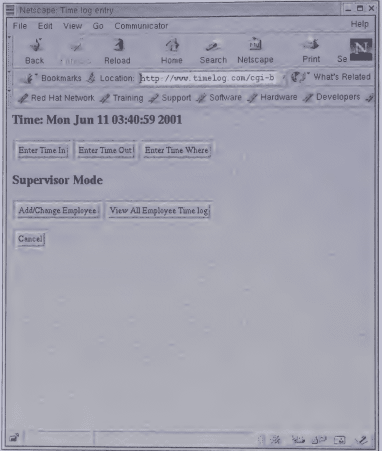

**图 5.1** 带有多个按钮和文本区域的表单。

### 代码清单 5.1 `Verify_employee.pl` 文件；用于生成时间日志表单的 CGI 脚本

```perl
1) #!/usr/bin/perl

2) use CGI;

3) use DBI;

4) $q = new CGI;

5) $grey = '#666666';

6) $red = '#FF3333';

7) $errstr = '';

8) $name_color = $grey;

9) $id_color = $grey;

10) print $q->header;

11) print $q->start_html("Time log Action");

12) print $q->h1(" Add a new employee ");

13) &verify_form($q);

14) print $q->end_html;

15) sub verify_form()

16) {

17)   my $complete = 1;

18)   unless ($q->param)

19)   {

20)   &print_form($q);

21)   print "<b> Nothing yet </b>";

22)   return;

23)   }

24)   if (length ($q->param('name')) lt 1)

25)   {

26)     $name_color = $red;

27)     $complete = 0;

28)   }

29)   if (length ($q->param('id')) lt 4)

30)   {

31)     $id_color = $red;
```


```perl
$complete = 0;

if (!$complete) {
    &print_form($q);
    print "<H2> Please fill in the missing info </h2>";
    return;
}

&add_to_database($q);

if ($errstr ne '') {
    print "Error: ", $errstr;
    return;
}

$q->delete_all();
&print_form($q);
print "<HR></BODY></HTML>";
}

sub print_form {
    my ($q) = @_;

    print $q->start_form;
    print "<STRONG STYLE=\"background: $name_color\"> NAME:</strong>",
        $q->textfield(-name => 'name', -size => 20),
        $q->p,
        "<STRONG>Addr:</strong>",
        $q->textfield(-name => 'address', -size => 32),
        $q->p,
        "<STRONG>City:</strong>",
        $q->textfield(-name => 'city', -size => 16),
        "<STRONG>State:</strong>",
        $q->textfield(-name => 'state', -size => 2),
        "<STRONG>ph:</strong>",
        $q->textfield(-name => 'ph', -size => 10),
        $q->p,
        "<STRONG>Status:</strong>",
        $q->scrolling_list(
            -name => 'status',
            -values => ['Employee', 'Supervisor'],
            -default => 'Employee',
            -size => 1
        ),
        "<STRONG STYLE=\"background: $id_color\">ID:</strong>",
        $q->textfield(-name => 'id', -size => 4),
        $q->p;

    print $q->submit;
    print $q->reset;
    print $q->endform;
}

sub add_to_database() {
    my ($q) = @_;

    my $name = $q->param('name');
    my $id = $q->param('id');
    my $address = $q->param('address');
    my $city = $q->param('city');
    my $state = $q->param('state');
    my $status = $q->param('status');
    my $ph = $q->param('state');

    my $dbh = DBI->connect(
        'dbi:Pg:dbname=timelog',
        'nobody',
        ''
    ) or die " Cannot connect to database $!";

    my $sql = "INSERT INTO employee (name, address, city, state, ph, status, id ) ",
        "VALUES ('$name', '\$address', '\$city', ",
        " '\$state', '\$ph', '\$status', '\$id')";

    my $sth = $dbh->prepare($sql);
    $sth->execute;

    if (!$dbh->commit) {
        $errstr = $dbh->errstr;
    }

    #my ($name,$address, $city, $state, $status,$ph, $id) = $sth->fetchrow;
    #$sth->finish;

    $dbh->disconnect;
}
```


# Perl 中的内置函数

以下是 Perl 解释器内置函数的列表。这些函数可以在 Perl 程序中作为语句使用。

| 函数 | 描述 |
| :--- | :--- |
| `-X` | 运行文件测试 |
| `abs` | 绝对值函数 |
| `accept` | 接受传入的套接字连接 |
| `alarm` | 调度 `SIGALRM` 信号 |
| `atan2` | Y/X 的反正切 |
| `bind` | 将地址绑定到套接字 |
| `binmode` | 在旧系统上准备二进制文件 |
| `bless` | 创建一个对象 |
| `caller` | 获取当前子程序调用的上下文 |
| `chdir` | 更改当前工作目录 |
| `chmod` | 更改文件列表的权限 |
| `chomp` | 从字符串中删除尾随的记录分隔符 |
| `chop` | 从字符串中删除最后一个字符 |
| `chown` | 更改文件列表的所有权 |
| `chr` | 获取该数字代表的字符 |
| `chroot` | 将目录设为路径查找的新根目录 |
| `close` | 关闭文件（或管道或套接字）句柄 |
| `closedir` | 关闭目录句柄 |
| `connect` | 连接到远程套接字 |
| `continue` | `while` 或 `foreach` 中可选的尾随块 |
| `cos` | 余弦函数 |
| `crypt` | 单向密码式加密 |
| `dbmclose` | 断开与绑定 dbm 文件的绑定 |
| `dbmopen` | 创建与绑定 dbm 文件的绑定 |
| `defined` | 测试值、变量或函数是否已定义 |
| `delete` | 从哈希中删除一个值 |
| `die` | 抛出异常或退出 |
| `do` | 将一个区块（BLOCK）转换为一个术语（TERM） |
| `dump` | 立即创建核心转储 |
| `each` | 从哈希中检索下一个键/值对 |
| `endgrnt` | 完成对组文件的使用 |
| `endhostent` | 完成对主机文件的使用 |
| `endnetent` | 完成对网络文件的使用 |
| `endprotoent` | 完成对协议文件的使用 |
| `endpwent` | 完成对密码文件的使用 |
| `endservent` | 完成对服务文件的使用 |
| `eof` | 测试文件句柄是否到达末尾 |
| `eval` | 捕获异常或编译代码 |
| `exec` | 放弃当前程序以运行另一个程序 |
| `exists` | 测试哈希键是否存在 |
| `exit` | 终止此程序 |
| `exp` | 计算 e 的幂 |
| `fcntl` | 文件控制系统调用 |
| `fileno` | 从文件句柄返回文件描述符 |
| `flock` | 使用建议锁锁定整个文件 |
| `fork` | 创建一个与当前进程相同的新进程 |
| `format` | 声明由 `write()` 函数使用的图片格式 |
| `formline` | 用于格式的内部函数 |
| `getc` | 从文件句柄获取下一个字符 |
| `getgrnent` | 获取下一个组记录 |
| `getgrgid` | 根据组用户 ID 获取组记录 |
| `getgrnam` | 根据组名获取组记录 |
| `gethostbyaddr` | 根据地址获取主机记录 |

| 函数 | 描述 |
| :--- | :--- |
| `gethostbyname` | 根据名称获取主机记录 |
| `gethostent` | 获取下一条主机记录 |
| `getlogin` | 返回当前 TTY 登录的用户 |
| `getnetbyaddr` | 根据地址获取网络记录 |
| `getnetbyname` | 根据名称获取网络记录 |
| `getnetent` | 获取下一条网络记录 |
| `getpeername` | 查找套接字连接的另一端 |
| `getpgrp` | 获取进程组 |
| `getppid` | 获取父进程 ID |
| `getpriority` | 获取当前的 nice 值 |
| `getprotobyname` | 根据名称获取协议记录 |
| `getprotobynumber` | 根据协议数字获取协议记录 |
| `getprotoent` | 获取下一条协议记录 |
| `getpwent` | 获取下一条密码记录 |
| `getpwnam` | 根据用户登录名获取密码记录 |
| `getpwuid` | 根据用户 ID 获取密码记录 |
| `getservbyname` | 根据名称获取服务记录 |
| `getservbyport` | 根据端口数字获取服务记录 |
| `getservent` | 获取下一条服务记录 |
| `getsockname` | 获取给定套接字的 sockaddr |
| `getsockopt` | 获取给定套接字的套接字选项 |
| `glob` | 使用通配符扩展文件名 |
| `gmtime` | 使用格林威治时间将 UNIX 时间转换为记录或字符串 |
| `goto` | 创建面条代码（乱麻代码） |
| `grep` | 在列表中定位符合给定条件的元素 |
| `hex` | 将字符串转换为十六进制数 |
| `import` | 将模块的命名空间补丁到自己的命名空间中 |
| `int` | 获取数字的整数部分 |
| `ioctl` | 与系统相关的设备控制系统调用 |
| `join` | 使用分隔符将列表合并为字符串 |
| `keys` | 从哈希中检索索引列表 |
| `kill` | 向进程或进程组发送信号 |
| `last` | 提前退出代码块 |
| `lc` | 返回字符串的小写版本 |
| `lcfirst` | 返回一个仅首字母小写的字符串 |
| `length` | 返回字符串中的字节数 |
| `link` | 在文件系统中创建硬链接 |
| `listen` | 将套接字注册为服务器 |
| `local` | 为全局变量创建临时值（动态作用域） |
| `localtime` | 使用本地时间将 UNIX 时间转换为记录或字符串 |
| `log` | 获取数字的自然对数 |
| `lstat` | 获取符号链接的状态信息 |
| `m//` | 使用正则表达式模式匹配字符串 |
| `map` | 对列表应用更改，以返回一个包含更改的新列表 |
| `mkdir` | 创建目录 |
| `msgctl` | SysV IPC 消息控制操作 |
| `msgget` | 获取 SysV IPC 消息队列 |
| `msgrcv` | 从消息队列接收 SysV IPC 消息 |
| `msgsnd` | 向消息队列发送 SysV IPC 消息 |
| `my` | 声明并分配本地变量（词法作用域） |
| `next` | 提前进行下一次块迭代 |
| `no` | 在编译时取消导入某些模块符号或语义 |
| `oct` | 将字符串转换为八进制数 |
| `open` | 打开文件、管道或描述符 |
| `opendir` | 打开目录 |
| `ord` | 查找字符的数字表示 |
| `pack` | 将列表转换为二进制表示 |
| `package` | 声明一个独立的全局命名空间 |
| `pipe` | 打开一对连接的文件句柄 |
| `pop` | 从数组中删除最后一个元素并返回 |
| `pos` | 查找或设置上次/下次 `m//g` 搜索的偏移量 |
| `print` | 将列表输出到文件句柄 |
| `printf` | 将格式化列表输出到文件句柄 |
| `prototype` | 获取子程序的原型（如果有） |
| `push` | 向数组追加一个或多个元素 |
| `q/STRING/` | 对字符串进行单引号引用 |
| `qq/STRING/` | 对字符串进行双引号引用 |
| `quotemeta` | 引用正则表达式的魔术字符 |
| `qw/STRING/` | 引用一个单词列表 |
| `qx/STRING/` | 对字符串进行反引号引用 |
| `rand` | 获取下一个伪随机数 |
| `read` | 从文件句柄进行固定长度的缓冲输入 |
| `readdir` | 从目录句柄中获取目录项 |
| `readlink` | 确定符号链接指向的位置 |
| `recv` | 通过套接字接收消息 |
| `redo` | 重新开始本次循环迭代 |
| `ref` | 找出被引用对象的类型 |
| `rename` | 更改文件名 |
| `require` | 在运行时从库中加载外部函数 |
| `reset` | 清除所有给定名称的变量 |
| `return` | 提前退出函数 |
| `reverse` | 反转字符串或列表 |
| `rewinddir` | 重置目录句柄 |
| `rindex` | 从右向左搜索子字符串 |
| `rmdir` | 删除目录 |
| `s///` | 用字符串替换匹配模式 |
| `scalar` | 强制转换为标量上下文 |
| `seek` | 为随机访问 I/O 重新定位文件指针 |
| `seekdir` | 重新定位目录指针 |
| `select` | 重置默认输出或进行 I/O 多路复用 |
| `semctl` | SysV 信号量控制操作 |
| `semget` | 获取 SysV 信号量集 |
| `semop` | SysV 信号量操作 |
| `send` | 通过套接字发送消息 |
| `setgrent` | 准备组文件以供使用 |
| `sethostent` | 准备主机文件以供使用 |
| `setnetent` | 准备网络文件以供使用 |
| `setpgrp` | 设置进程的进程组 |
| `setpriority` | 设置进程的 nice 值 |
| `setprotoent` | 准备协议文件以供使用 |
| `setpwent` | 准备密码文件以供使用 |
| `setservent` | 准备服务文件以供使用 |
| `setsockopt` | 设置某些套接字选项 |
| `shift` | 删除数组的第一个元素并返回 |
| `shmctl` | SysV 共享内存操作 |
| `shmget` | 获取 SysV 共享内存段标识符 |
| `shmread` | 读取 SysV 共享内存 |
| `shmwrite` | 写入 SysV 共享内存 |
| `shutdown` | 关闭套接字连接的一半 |
| `sin` | 返回数字的正弦值 |
| `sleep` | 阻塞若干秒 |
| `socket` | 创建套接字 |
| `socketpair` | 创建一对套接字 |
| `sort` | 对值列表进行排序 |
| `splice` | 在数组的任何位置添加或删除元素 |
| `split` | 使用正则分隔符拆分字符串 |
| `sprintf` | 将格式化内容打印到字符串中 |
| `sqrt` | 平方根函数 |
| `srand` | 为随机数生成器设置种子 |
| `stat` | 获取文件的状态信息 |
| `study` | 为重复搜索优化输入数据 |
| `sub` | 声明一个子程序，可以是匿名的 |
| `substr` | 获取或修改字符串的一部分 |
| `symlink` | 为文件创建符号链接 |
| `syscall` | 执行任意系统调用 |
| `sysread` | 从文件句柄进行固定长度的非缓冲输入 |
| `system` | 运行一个独立程序 |
| `syswrite` | 向文件句柄进行固定长度的非缓冲输出 |
| `tell` | 获取文件句柄上的当前搜索指针 |
| `telldir` | 获取目录句柄上的当前搜索指针 |
| `tie` | 将变量绑定到对象类 |
| `time` | 返回自 1970 年以来的秒数 |
| `times` | 返回自身和子进程的已用时间 |
| `tr///` | 转换字符串中的字符 |
| `truncate` | 缩短文件 |
| `uc` | 返回字符串的大写版本 |
| `ucfirst` | 返回一个仅首字母大写的字符串 |
| `umask` | 设置文件创建模式掩码 |
| `undef` | 删除变量或函数定义 |
| `unlink` | 删除文件的一个链接 |
| `unpack` | 将二进制结构转换为普通 Perl 变量 |
| `unshift` | 在列表开头前置更多元素 |
| `untie` | 断开变量的绑定关系 |
| `use` | 在编译时加载模块 |
| `utime` | 设置文件的最后访问和修改时间 |
| `values` | 返回哈希中值的列表 |
| `vec` | 测试或设置字符串中的特定位 |
| `wait` | 等待任何子进程结束 |
| `waitpid` | 等待特定的子进程结束 |
| `wantarray` | 获取当前子程序调用的是列表还是数组上下文 |
| `warn` | 打印调试信息 |
| `write` | 打印一个图像记录 |
| `y///` | 转换字符串中的字符 |

## 总结

正如我们所示，Perl 语言非常适合设计嵌入式系统的用户界面。我们从编程的角度涵盖了 Perl 语法，并将 CGI 和 Pg 模块描述为面向对象的接口。Perl 的程序结构非常简单，且由于缺乏严格的类型检查给程序员带来了比 C++ 面向对象接口更大的优势。Perl 内置的搜索和替换能力简化了许多面向 Web 的应用程序设计。Perl 在编程社区中日益获得认可，并且有越来越多的模块被引入，涵盖了广泛的编程需求。

# 6 结构化查询语言

## 本章内容

- 关系数据库
- SQL 语句
- SQL 查询
- 表连接
- PostgreSQL 支持的数据类型
- 使用 C 语言进行应用程序编程

## 简介

让我们再次回顾一下我们的嵌入式系统设计哲学：一个嵌入式系统包括一个用于访问硬件的设备驱动程序，一个与设备驱动程序通信的客户端-服务器机制，以及将数据保存到数据库中的功能。另一方面，用户界面从数据库中提取数据，在 Perl 或 C 脚本的帮助下将其创建为 Web 页面，并将其传递给与用户通信并按需呈现页面的 Web 服务器。当用户决定更改某些参数时，过程则相反：用户填写 Web 表单，表单返回到服务器，然后数据库被更新。系统接口从数据库中获取新参数并做出相应的系统更改。

如你所见，数据库在系统和用户界面之间的通信中起着核心作用。如果不了解结构化查询语言（Structured Query Language，简称 SQL），就无法完整地与数据库进行交互。SQL 是大多数数据库服务器的原生语言。在本章后面，我们将讨论低端嵌入式系统的替代方案。数据库是以表格形式呈现的信息目录，其中每个表有一组列，形成关于相关项目的行信息。我们需要数据库来实现持久化。即使在断电时，我们也需要知道信息所在的位置。一个良好的数据库表模式（schema）也是嵌入式系统组件的一个良好文档来源。你只需通过监控程序执行不同时间点数据库的变化，就可以追踪信息的流动。诚然，一个全功能的数据库 SQL 服务器并不符合许多低端嵌入式系统的最佳利益，但迟早，嵌入式系统设计师会遇到需要 SQL 服务器的大型数据库。因此，学习 SQL 查询吧；它们简单、直观，而且最重要的是，数据库程序员的薪水比嵌入式系统设计师高得多——所以，隧道尽头总有光芒。

## 关系数据库

在同一个数据库中，你可能会有几个包含不同信息集但又相互关联的表。例如，公司员工数据库可能有一个表，包含每个员工的信息行——员工编号、入职日期、小时工资等等。另一个表可能显示员工考勤，包含签到和签退时间列，以及一个员工编号列，用于标识该行信息属于谁。员工编号列在两个表中都存在这一事实，就在两个表之间创建了一种关系。关系数据库知道如何仅通过了解表之间的关系就从不同的表中收集信息。在本章后面，当我们为员工入馆日志的嵌入式系统设计开发 SQL 查询时，你会看到一个示例。

### 数据库模式

数据库模式（Database Schema）简单来说就是对构成表的所有表及相关列的描述。模式应识别每个表中形成关系的键列（key columns），以及索引列（如果存在的话）。索引列可以帮助对表中的行进行条目化，但它不是强制性的，而如果你想在不同表之间建立关系，键列则是必要的。让我们为我们的嵌入式系统设计项目“员工入馆时间日志”创建一个关系数据库模式。这是我们在第二章“用户界面”中讨论项目的延续。那一章中的 Web 页面是为了显示一个简单的用户界面，用于输入员工信息和查看每个员工的时间日志。现在，我们更进一步，建立数据库及其查询，以便从数据库中获取信息。

我们将数据库命名为“Payroll”，并设置两个表，“EmployeeInfo”和“tm_log”（表 6.1）。

**表 6.1 数据库 Payroll 模式**

| 表 | 列 / 定义 |
| :--- | :--- |
| **Employee** | 第 1 列：`ID (Char 6)` → 主键 |
| | 第 2 列：`LastName (Char 16)` |
| | 第 3 列：`FirstName (Char 16)` |
| | 第 4 列：`MI (Char 2)` |
| | 第 5 列：`Active (Char 2)` |
| | 第 6 列：`Supervisor (Char 6)` |
| | 第 7 列：`Payrate (Char 6)` |
| **TimeLog** | 第 1 列：`ID (Char 6)` → 外键 |
| | 第 2 列：`TimeIn (TIMESTAMP)` |
| | 第 3 列：`TimeOut (TIMESTAMP)` |

EmployeeInfo 表是员工信息表，TimeLog 表是考勤信息表。这两个表保持分开，仅共同拥有员工编号列。虽然可以将所有内容放在一个表中，但最终会导致冗余信息，出现一个包含重复员工编号、入职日期和小时工资，以及签到和签退时间信息的长行列表。

我们通过设立两个仅具有共同键列的独立表来避免冗余，这使其成为了一个关系数据库。接下来是关于 SQL 查询的教程，但首先，介绍一些 SQL 中的基本术语。

### 键

数据库表中的主键（primary key）是唯一标识给定行中其余数据的列或列集。例如，在 Employee 表中，ID 列作为主键唯一地标识了该行。拥有主键意味着没有两行可以拥有相同的 ID。这就是我们区分具有相同姓氏、名字或任何其他可能在员工之间共有的列值的员工的方法。

*外键*（foreign key）是指表中的某一列，而该列是另一个表的主键。这意味着对于外键列中的每个数据，在另一个将该列作为主键的表中必须存在对应的数据。在数据库术语中，这种对应关系被称为*参照完整性*（referential integrity）。例如，在 Timelog 表中，ID 列是 Employee 表主键的外键。为了在 Timelog 表中有一条记录，该 ID 必须属于一名在 Employee 表中已有记录的员工。

### 连接

在数据库中创建多个表是为了避免列值的不必要重复。然而，最终我们必须组合来自不同表的信息以产生所需的结果。例如，如果我们想找出在某个特定时间出勤的所有员工的姓名怎么办？显然，来自 TimeLog 表的时间日志信息将通过相同的 ID 与 Employee 表中的姓名信息相结合。这种组合表的运行被称为 JOIN（连接），它将两个或多个表中的数据相关联。在本章后面你会看到更多示例。

## SQL 语句

像 PostgreSQL 这样的数据库服务器本质上是一个数据库管理系统。为了与服务器通信，需通过后端提交请求。PostgreSQL 的交互式后端是 `psql`，提交用于提取信息的请求语句被称为 SQL *查询*（queries）。请重新阅读第二章，了解如何安装 PostgreSQL 以及如何使用 `psql` 命令创建数据库表。第二章的教程演示了一些实际运行的 SQL 查询，用于创建数据库表并向其中添加条目。`psql` 本身已经提供了最好的帮助，你只需在 `psql` 命令提示符下输入帮助命令 `\h` 和 `\?` 即可浏览基本类别。在本章中，我们将讨论查询如何工作以及支持的各种数据类型。我们将创建一些自定义查询，用于我们的嵌入式系统设计项目“员工入馆与时间日志”。SQL 查询的一个优点是你可以使用 `psql` 客户端进行交互式测试。同样的查询也可以通过 Perl/CGI 脚本以及可执行的 C 程序以编程方式呈现。这些将在第九章“嵌入式系统设计项目”中介绍。

组成从数据库提取信息的语句被称为*查询*，并以 `SELECT` 语句的形式实现。为了提取公共信息而动态地连接两个或多个表的过程是通过 `JOIN` 语句完成的，正如前文所解释的节。*自然连接*（*natural join*）是指一张表的外键值与另一张表中的父键进行连接。通过将 `employee` 表的主键与 `tm_log` 表的外键进行自然连接，我们可以从 `payroll` 数据库中找到特定员工的所有时间戳。

SQL 语句可分为以下几类：

- 创建、修改和删除表
- 输入、删除和修改数据
- 设置数据值的约束
- 使用键实现关系完整性以及连接表
- 审查表中的信息
- 在语句中使用表达式

## 创建、修改和删除表

数据库中的表由列和行组成。您可以使用诸如 `psql` 之类的后端客户端以交互方式添加、删除或更改表的组成。

> 为了完成本节中提供的示例，您需要以用户“postgres”身份登录，并使用如下 `createdb` 命令创建名为“timelog”的数据库：

```bash
createdb timelog
```


`# su postgres`

`$createdb timelog`

执行交互式程序“`psql`”。

`$psql timelog`

> 随附 CD 目录`/book/chapter6/employee_schema`中的文件可以使用以下`psql`命令加载并执行：

```
timelog=# \i /book/chapter6/employee_schema
```

`CREATE TABLE`命令用于创建新表。初始时它是空的，这意味着没有任何行。`CREATE TABLE`的格式为：

```
CREATE TABLE tablename ({columnname datatype[(size)],...});
```

例如：

- a) 以下语句创建了表 6.1 模式中所定义的 employee 表：

```sql
timelog=# create table employee (ID char (10), password char (10), LastName char(16), FirstName char(16), MI char(2), Active char(2), Supervisor char(10));
```

- b) 以下语句创建了表 6.1 模式中所定义的 entrancelog 表：

```sql
timelog=# create table entrancelog (ID char (10), timein timestamp, timeout timestamp);
```

`ALTER TABLE`命令用于在表创建后修改表参数。以下是`ALTER TABLE`命令的格式：

```sql
ALTER TABLE tablename
    { ADD [COLUMN] column [*] type }
    | { ALTER [COLUMN] column name
        { SET DEFAULT default option } | { DROP DEFAULT} }
    | { RENAME column TO new column name }
    | { ADD table constraints definition }
    | { RENAME TO new table name };
```

我们可以使用`ALTER TABLE`命令执行以下操作。

### 向表中添加列

以下语句向 employee 表添加了一个名为`payrate`的新列：

```sql
timelog=# Alter table employee add payrate float8;
```

### 修改表列设置默认值

我们可以为列类型添加默认值。

```sql
timelog=# Alter table employee Alter payrate Set default 0.0;
```

### 修改表列删除默认值

以下语句删除了分配给某列的默认值。

```sql
timelog=# Alter table employee Alter payrate DROP default;
```

### 重命名列

以下语句将列`payrate`重命名为`pay`。

```sql
timelog=# Alter table employee RENAME payrate TO pay;
```

### 重命名表

以下语句将表`employee`重命名为`personnel`。

```sql
timelog=# Alter table employee RENAME TO personnel;
```

`DROP TABLE`命令将表从数据库中移除，但在删除之前必须先清空该表。

格式：

```
DROP TABLE tablename;
```

## 输入、删除和修改数据

一旦定义了表，您就可以使用`psql`命令插入、删除和更改列值。

### 向表中输入值

`INSERT INTO`命令允许您向表中插入行。数据库管理器将检查之前设置的所有约束，并为未指定值的列添加默认值。如果在创建表时未指定默认值，则该列将被指定为`NULL`值。

格式：

```
INSERT INTO table NAME VALUES (value, ..., ...);
```

紧跟在关键字`VALUES`之后的参数顺序应与表中的相应列匹配。例如，以下语句在 employee 表中创建了一行信息，初始化 ID = `'1234'`、FirstName = `'John'`、LastName = `'Public'`、MI = `'Q'`、active = `'A'`、Supervisor = `'1234'`、payrate = `'20.00'`。

```sql
timelog=# INSERT INTO employee VALUES ('1234', 'Public', 'John', 'Q', 'A', '1234', '20.00');
```

### 为插入指定列名

您不必一次性为所有列插入值。您可以定义指定值的列名。以下查询将仅初始化 ID、LastName 和 payrate 列：

```sql
timelog=# INSERT INTO employee (ID, LastName, payrate) VALUES ('1234', 'Public', '20.00');
```

### 定义 `NULL` 值

如果预先不知道值，可以在列的值位置指定`NULL`：

```sql
timelog=# INSERT INTO employee VALUES ('1234', 'Public', NULL, NULL, NULL, '20.00');
```

### 使用查询插入值

您可以通过指定另一个查询的结果来基本上复制行的内容。以下示例创建了一个新表`supervisor1234`，其中包含 employee 表中所有主管 ID 为“1234”的行。

```sql
timelog=# create table supervisor1234 (ID char (10), password char (10), LastName char(16), FirstName char(16), MI char(2), Active char(2), Supervisor char(10));
```

```sql
timelog=# INSERT INTO supervisor1234 SELECT * FROM employee where ID = '1234';
```

### 从表中删除行

`DELETE FROM`语句从表中删除行。以下语句从 employee 表中删除所有行：

```sql
timelog=# DELETE FROM Employee;
```

您可以使用`WHERE`子句指定一个条件，在删除行之前测试该条件是否为真。以下语句仅删除 Active 值不等于`'A'`的行。

```sql
timelog=# DELETE FROM employee WHERE Active <> 'A';
```

以下语句删除员工 ID 为 1234 的行：

```sql
timelog=# DELETE FROM employee WHERE ID = '1234';
```

### 修改列值

`UPDATE`命令修改行中的值。您可以使用`WHERE`子句来指定一个条件，从而影响匹配该条件的特定行。以下语句将所有主管 ID 为 1234 的行的主管 ID 更改为 3456：

```sql
timelog=# UPDATE employee SET Supervisor = '3456' WHERE Supervisor = '1234';
```

### 插入 `NULL` 值

`UPDATE`命令可以像`INSERT`命令一样，通过简单地不指定值来插入`NULL`值：

```sql
timelog=# UPDATE employee SET some_column = NULL WHERE ID = '1234';
```

## 设置约束

约束可以设置在数据值以及列类型上。数据值约束可以是值的范围，而系统约束是应用于列的标准，例如排除`NULL`、指定主键、外键、多列主键以及`UNIQUE`（唯一性）。您可以在创建表时应用约束，或者稍后使用`ALTER`命令应用：

```sql
CREATE TABLE tablename ({columnname datatype [(size)]},..., [table constraint (columnname)]);
```

您也可以在指定单个列时指定约束：

```sql
CREATE TABLE tablename ({columnname datatype column constraints [(size)]},...,);
```

### 主键

为一列或一组列指定主键是为了设置连接两个或多个表的标准，但它实际上是一种约束。该列默认不能接受`NULL`值，且值必须是`UNIQUE`的。以下语句指定`FirstName`和`LastName`共同构成主键：

```sql
timelog=# create table employee (ID char (10), password char (10), LastName char(16), FirstName char(16), MI char(2), Active char(2), Supervisor char(10), PRIMARY KEY (LastName, FirstName));
```

您还可以通过如下语句指定某一列为带有主键约束，从而将 ID 列创建为 employee 表的主键：

```sql
timelog=# create table employee (ID char (10) PRIMARY KEY, password char (10), LastName char(16), FirstName char(16), MI char(2), Active char(2), Supervisor char(10));
```

### 外键作为参照完整性

表列中的外键创建了对其在另一个表中父列的引用。正如以下语句所示，employee 表中的 ID 列被另一个表 tm_log 中的 ID 列作为该表的外键所引用：

```sql
timelog=# create table tm_log (ID char (10), password char (10), LastName char(16), FirstName char(16), MI char(2), Active char(2), Supervisor char(10) FOREIGN KEY (ID) REFERENCES employee (ID));
```

另一种指定外键的方法是通过列约束而非表约束：

```sql
timelog=# create table tm_log (ID char (10), FOREIGN KEY (ID) REFERENCES employee (ID), password char (10), LastName char(16), FirstName char(16), MI char(2), Active char(2), Supervisor char(10));
```

如果两张表的主键和外键使用相同的列名，那么在引用外键时可以省略名称，如下面创建 tm_log 的示例所示：

```sql
timelog=# create table tm_log (ID char (10), REFERENCES employee, password char (10), LastName char(16), FirstName char(16), MI char(2), Active char(2), Supervisor char(10));
```

### 使用外键校验已知值集

如果您想将输入值限制在预定义的范围内，可以将该范围放在一张表中，并通过外键进行引用。例如，如果我们希望 Employee 表中 Active 列的值只能是“A”和“P”，我们可以像这样创建一个 ActiveState 表，并在 employee 表中将其作为外键引用：

```sql
create table ActiveState( Active char (2) PRIMARY KEY);

insert into ActiveState Values ('A');

insert into ActiveState Values ('P');

create table employee (ID char (10), password char (10), LastName char(16), FirstName char(16), MI char(2), Active char(2) REFERENCE ActiveState, Supervisor char(10) PRIMARY KEY (LastName, FirstName));
```

### 使用 `CHECK` 对列值进行约束

这类约束可以防止相当一部分数据输入问题，例如输入负数、值超过限制等。以下示例演示了将员工 ID 限制在“0001”到“9999”之间：

```sql
timelog=# create table employee (ID char (10) CHECK (ID < '9999' AND ID > '0000'), password char (10), LastName char(16), FirstName char(16), MI char(2), Active char(2), Supervisor char(10));
```

### 使用 `CHECK` 对多列值进行约束

您还可以同时指定多列的约束。以下 SQL 语句将员工 ID 限制在“0001”到“9999”之间，并且将 Active 列的值限制为“A”或“P”：

```sql
timelog=# create table employee (ID char (10), password char (10), LastName char(16), FirstName char(16), MI char(2), Active char(2), Supervisor char(10) CHECK ((ID < '9999' AND ID > '0000') AND (Active = 'A' OR Active = 'P')));
```

### 使用 `UNIQUE` 确保值的唯一性

主键列通常要求是唯一的，但您也可以指定某一列具有`UNIQUE`值，使其在每行中都不同。主键的唯一性与具有唯一约束（`UNIQUE` constraint）的列之间存在区别：

- 主键被限制在一个列或一组列中，而`UNIQUE`约束可以放置在任意数量的列上。
- 主键列不允许出现`NULL`，但`UNIQUE`列可以拥有`NULL`值。

以下语句将`UNIQUE`约束应用于 FirstName 和 LastName 列。这两列的组合值必须是唯一的。

```sql
timelog=# create table employee (ID char (10), password char (10), LastName char(16), FirstName char(16), MI char(2), Active char(2), Supervisor char(10) UNIQUE (LastName, FirstName));
```

### 从列中排除 `NULL` 值

`NULL`实质上意味着所指定的行没有列值。您可以使用`NOT NULL`约束来避免出现`NULL`值，如下面语句所示，它强制要求 FirstName 必须有值：

```sql
timelog=# create table employee (ID char (10), password char (10), LastName char(16), FirstName char(16) NOT NULL, MI char(2), Active char(2), Supervisor char(10) UNIQUE (LastName, FirstName));
```

### 默认值分配

您在`ALTER TABLE`命令的描述中看到了`DEFAULT`语句。您可以在创建表时指定`DEFAULT`值。以下示例为 employee 表中的 Active 列设置了默认值`'A'`：

```sql
timelog=# create table employee (ID char (10), password char (10), LastName char(16), FirstName char(16) NOT NULL, MI char(2), Active char(2) DEFAULT 'A', Supervisor char(10) UNIQUE (LastName, FirstName));
```

## 事务与锁

通过 postgresql 数据库服务器内置的事务（Transaction）机制，可以防止两个不同的用户同时更改同一行中的值。这就像是一个原子性的“读取-修改-写入”操作，不会受到其他源的干扰。每个语句都被执行为一个事务，但您可以使用`BEGIN WORK`和`COMMIT WORK`语句将一组语句应用于同一个锁中。例如：

```sql
timelog=# BEGIN WORK;

timelog=# UPDATE employee SET Firstname = 'David' where id = '1111';

timelog=# COMMIT WORK;
```

## 来自同一表的外键和主键

为了解释外键引用同一表主键的情况，我们将在 employee 表中添加一个名为 Supervisor 的列。显然，除了最高级别的经理外，每个员工都有一个主管。这种情况的独特之处在于，外键必须允许`NULL`作为列值。


```sql
CREATE TABLE employee (
    ID CHAR(10) PRIMARY KEY,
    password CHAR(10),
    LastName CHAR(16),
    FirstName CHAR(16) NOT NULL,
    MI CHAR(2),
    Active CHAR(2) DEFAULT 'A',
    Supervisor CHAR(10) REFERENCE Employee
);
```

## 杂项 SQL 语句

SQL 支持被称为聚合（aggregates）的特殊函数，它们对整组列进行操作并产生一个单一的值结果。

### 聚合函数

`SUM`、`AVG`、`MAX`、`MIN` 和 `COUNT` 被称为聚合函数，因为它们在对列值执行所需操作后返回单个结果。

- `SUM()` 计算数值列所有行的总和。

  ```sql
  SELECT SUM(feet) FROM Depth;
  ```

- `AVG()` 计算给定列的平均值。

  ```sql
  SELECT AVG(feet) FROM Depth;
  ```

- `MAX()` 获取给定列中的最大数值。

  ```sql
  SELECT MAX(feet) FROM Depth;
  ```

- `MIN()` 获取给定列中的最小数值。

  ```sql
  SELECT MIN(feet) FROM Depth;
  ```

- `COUNT(*)` 计算满足条件的行数。

  ```sql
  SELECT COUNT(feet) FROM Depth;
  ```

假设我们使用`hourly_wages`和员工打卡时间计算了员工的工资，并创建了一个包含`employeeID`和`earned wages`的新表`Salary`。我们可以使用以下查询计算总和、平均值、最大值、最小值和计数：

```sql
SELECT SUM(wages), AVG(wages), MAX(wages), MIN(wages), COUNT(ID)
FROM Salary;
```

该查询显示了表中所有工资的总额，以及表中所有条目的平均工资、最高工资和最低工资。

## SQL 查询

从数据库中提取信息的过程是通过`SELECT`关键字完成的。使用`SELECT`的语句被称为查询语句。以下是一个简单的语句，用于从`employee`表的所有行中提取信息：

```sql
timelog=# SELECT * FROM Employee;
```

### 仅选择特定列

如果您只需要`Employee`表中的`LastName`和`FirstName`信息，请设置如下查询：

```sql
timelog=# SELECT LastName, FirstName FROM Employee;
```

### 使用 DISTINCT 消除冗余数据

如果一张表中有多个重复值，您可以通过在查询语句中添加`DISTINCT`来要求查询消除冗余：

```sql
timelog=# SELECT DISTINCT ID FROM tm_log;
```

### 选择所有行

与`DISTINCT`相反，`*`提取每一行中的信息：

```sql
timelog=# SELECT * FROM tm_log;
```

### 使用 WHERE 子句限定查询

您可以使用`WHERE`子句来缩小提取的列表。例如，以下查询将从`tm_log`表中提取员工 ID 为 1234 的所有签入（time-in）和签出（time-out）信息：

```sql
timelog=# SELECT time_in, time_out
FROM tm_log
WHERE ID = '1234';
```

#### WHERE 子句中的算术比较运算符

您可以使用`WHERE`子句结合算术比较运算符构建复杂的查询。SQL 识别以下运算符：

- `=` 等于
- `>` 大于
- `<` 小于
- `>=` 大于或等于
- `<=` 小于或等于
- `<>` 不等于

#### WHERE 子句中的布尔运算符

正如您在之前的示例算术比较运算符中所看到的，`WHERE`子句中的 SQL 语句仅在表达式评估为真条件时才执行。您可以使用以下逻辑运算符来修改表达式的结果：

- `NOT` 测试单个操作数，布尔结果取反；真变为假，反之亦然。
- `AND` 接受两个操作数，当两个操作数都为真时，结果为真。
- `OR` 接受两个操作数，当其中任何一个操作数为真时，结果为真。

以下表达式返回员工 ID 为`'1234'`在 1 月和 2 月之间的所有`time_in`值：

```sql
timelog=# SELECT time_in
FROM tm_log
WHERE ((ID = '1234')
    AND (time_in > 01/01/01 AND time_in < 02/01/01));
```

#### WHERE 子句中的布尔运算符 UNKNOWN

SQL 还支持第三级逻辑运算符`UNKNOWN`，在算术表达式中评估时它类似于`false`。然而，逻辑运算符`NOT UNKNOWN`不会改变`UNKNOWN`的值；它仍然是`UNKNOWN`。以下真值表阐明了 SQL 支持的三值逻辑的结果：

| 真值表布尔运算符 `NOT` | 输入 | 结果 |
| :--- | :--- | :--- |
| `NOT` | `TRUE` | `false` |
| `NOT` | `FALSE` | `true` |
| `NOT` | `UNKNOWN` | `unknown` |

#### 真值表布尔运算符 AND

| | `TRUE` | `FALSE` | `UNKNOWN` |
|---|---|---|---|
| `TRUE` | `true` | `false` | `UNKNOWN` |
| `FALSE` | `false` | `false` | `false` |
| `UNKNOWN` | `unknown` | `false` | `unknown` |

#### 真值表布尔运算符 OR

| | `TRUE` | `FALSE` | `UNKNOWN` |
|---|---|---|---|
| `TRUE` | `true` | `true` | `true` |
| `FALSE` | `true` | `false` | `false` |
| `UNKNOWN` | `unknown` | `false` | `unknown` |

#### IN 运算符

您可以在`WHERE`子句中提供一个值列表，而不是使用多个`OR`语句。`IN`运算符是`OR`的缩写形式。以下语句提取 ID 为 1234 和 3456 的`time_in`信息：

```sql
SELECT time_in
FROM tm_log
WHERE ID IN ('1234', '3456');
```

#### BETWEEN 运算符

`BETWEEN`运算符与`IN`类似，不同之处在于它计算一个值范围并进行测试。其效果与`<=`和`>=`相同。以下语句按字母顺序提取所有 ID 在 1234 到 3456 之间的员工的`time_in`信息：

```sql
SELECT time_in
FROM tm_log
WHERE ID BETWEEN '1234' AND '3456';
```

#### LIKE 运算符

`LIKE`非常适合字符串搜索。在列值中搜索给定的字符串，任何部分的匹配都将返回真值。您可以在搜索字符串中提供以下特殊字符来更改搜索标准：

- `"_"`下划线将匹配任何字符；例如，`"_at"`将匹配`"hat"`和`"cat"`。
- `"%"`百分号将匹配字符串中 0 个或多个字符序列；例如，`"%at"`将匹配`"at"`、`"cat"`和`"brat"`。
- 您可以通过在特殊字符前加上`ESCAPE`字符来覆盖其特殊解释；例如，`'% \\' ESCAPE '/'`将在字符串中查找字符`%`。

以下语句提取值中任何部分包含字符串`'21'`的所有员工 ID 的`time_in`信息：

```sql
SELECT time_in
FROM tm_log
WHERE ID LIKE '%21%';
```

#### IS NULL 运算符

列值中的`NULL`表示未指定值，这时第三级逻辑`UNKNOWN`就派上用场了。当您搜索未输入值而导致的假条件时，它可以避免歧义。以下语句打印所有未输入`MI`的员工：

```sql
SELECT *
FROM employee
WHERE MI IS NULL;
```

### 连接表（JOINING TABLES）

关系型数据库最重要的特性是能够根据给定的关系组合表。我们在本章前面已经讨论了主键和外键的概念，以及在表之间建立链接的标准。现在，我们将讨论基于连接多个表的查询，以及组合`WHERE`子句以提取分散在不同表中的所需信息的不同方法。

假设我们想找出在特定日期出勤且为主管 ID 1234 工作的所有员工的姓名，给定包含`employee`表和`tm_log`表的示例数据库`payroll`。显然，姓名必须来自`Employee`表，而签到（time-in）信息必须来自`tm_log`表。我们需要一个能够组合这两张表，然后以满足搜索标准的方式提取信息的查询。这种操作称为连接（join）。

在同一个查询语句中，当不同表中的列具有相似名称时，我们需要通过在列名前加上表名，后跟一个点，然后再接列名来对列名进行完全限定。以下查询的结果是提取所有在 2001 年 1 月 1 日出勤且为主管 ID 1234 工作的员工：

```sql
SELECT employee.FirstName
FROM employee, tm_log
WHERE (tm_log.ID = employee.ID)
  AND (time_in = '01/01/01')
  AND (Employee.Supervisor = '1234');
```

请注意，在表达列名没有歧义时，省略了点符号。

### 使用子查询

扩展搜索标准的一种方法是在`WHERE`子句中嵌入子查询。内部查询的结果由外部查询测试以确定是否为`TRUE`条件，并基于此执行 SQL 语句。假设您想找出姓名为`"public"`的员工的时间戳。您可以创建以下包含嵌套在主查询中的子查询的查询：

```sql
timelog=# SELECT tm_log.time_in
FROM tm_log
WHERE tm_log.ID = (
    SELECT employee.ID
    FROM employee
    WHERE employee.LastName = 'public'
);
```

## POSTGRESQL 支持的数据类型

以下是 PostgreSQL 支持的数据类型列表。您可以在`psql`命令行提示符中输入命令选项`'\dT'`来获取完整列表。

| 类型 | 描述 |
| :--- | :--- |
| `SET` | 元组集 |
| `abstime` | 绝对、有限范围的日期和时间（Unix 系统时间） |
| `aclitem` | 访问控制列表 |
| `bit` | 固定长度的位字符串 |
| `bool` | 布尔值，`"true"`/`"false"` |
| `box` | 几何矩形`"(左下, 右上)"` |
| `bpchar` | `CHAR(长度)`，空格填充字符串，固定存储长度 |
| `bytea` | 变长字符串，二进制值转义 |
| `char` | 单个字符 |
| `cid` | 命令标识符类型，事务 ID 序列 |
| `cidr` | 网络 IP 地址/网络掩码，网络地址 |
| `circle` | 几何圆`"(中心,半径)"` |
| `date` | ANSI SQL 日期 |
| `filename` | 系统表中使用的文件名 |
| `float4` | 单精度浮点数，4 字节存储 |
| `float8` | 双精度浮点数，8 字节存储 |
| `inet` | IP 地址/网络掩码，主机地址，网络掩码可选 |
| `int2` | -32,000 到 32,000，2 字节存储 |
| `int2vector` | 16 个`int2`整数的数组，用于系统表 |
| `int4` | -20 亿到 20 亿整数，4 字节存储 |
| `int8` | 约 18 位整数，8 字节存储 |
| `interval` | `@<数字> <单位>`，时间间隔 |
| `line` | 几何直线`"(pt1,pt2)"` |
| `lseg` | 几何线段`"(pt1,pt2)"` |
| `lztext` | 变长字符串，压缩存储 |
| `macaddr` | `XX:XX:XX:XX:XX`，MAC 地址 |
| `money` | `$d,ddd.cc`，货币 |
| `name` | 用于存储系统标识符的 31 字符类型 |
| `numeric` | `numeric(精度, 小数位数)`，任意精度数字 |
| `oid` | 对象标识符（oid），最大 40 亿 |
| `oidvector` | 16 个`oid`的数组，用于系统表 |
| `path` | 几何路径`"(pt1,...)"` |
| `point` | 几何点`"(x, y)"` |
| `polygon` | 几何多边形`"(pt1,...)"` |
| `regproc` | 注册过程 |
| `reltime` | 相对、有限范围的时间间隔（Unix 增量时间） |
| `smgr` | 存储管理器 |
| `text` | 变长字符串，未指定限制 |
| `tid` | `(块, 偏移量)`，元组的物理位置 |
| `time` | `hh:mm:ss`，ANSI SQL 时间 |
| `timestamp` | 日期和时间 |
| `timetz` | `hh:mm:ss`，ANSI SQL 时间 |
| `tinterval` | `(abstime,abstime)`，时间间隔 |
| `unknown` | 值将稍后定义 |
| `varbit` | 定长位字符串 |
| `varchar` | `VARCHAR(length)`，非空格填充字符串，可变存储长度 |
| `xid` | 事务 ID |

## 使用 C 语言进行应用程序编程

PostgreSQL 数据库管理系统作为服务器，需要一个客户端系统与其通信。客户端设置的 C 语言接口由`/usr/lib`目录下的`libpq`库提供，导出的函数原型则在`/usr/include/pgsql`目录下的头文件`libpq-fe.h`中提供。代码清单 6.1 是一个简单的 C 语言应用程序，它执行数据库内容的转储（dump），并将一个新值插入数据库。该程序演示了如何使用 SQL 语句与数据库通信，假设您已经使用`psql`解释器创建了数据库。

- 第 1 到 11 行是原型的包含文件。
- 第 12 到 13 行是在文件`libpq-fe.h`中定义的`Pgconn`和`Pgresult`结构。
- 第 17 到 33 行是一个`saveData`例程，它接收一个输入字符串 ID。
- 第 20 行打开数据库。
- 第 21 行检查连接是否异常。
- 第 27 行设置 SQL 语句。
- 第 29 行执行该语句。
- 第 30 到 31 行关闭数据库。
- 第 37 到 69 行是`dumpTblEntrancelog`例程，它遵循与打开和关闭数据库相同的模式，不同之处在于 SQL 字符串是一个查询字符串，用于从数据库中转储 Entrance Log（入场日志）值。
- 第 73 到 104 行是`dumpTblEmployee`例程，它遵循与`saveData`例程相同的打开和关闭数据库模式。SQL 字符串是一个查询字符串，用于从数据库中转储 Employee（员工）值。

**代码清单 6.1** `/book/chapter6/test.c`程序演示了数据库交互。

```c
1) #include "/usr/include/pgsql/libpq-fe.h"

2) #include <stdio.h>

3) #include <stdlib.h>

4) #include <fcntl.h>

5) #include <unistd.h>

6) #include <string.h>

7) #include <ctype.h>

8) #include <errno.h>

9) #include <sys/types.h>

10) #include <sys/stat.h>

11) #include <sys/ioctl.h>

PGconn *conn;

PGresult *res;

/****************************************/

/* Save the string into the database */

/****************************************/

int saveData(char *id_string)
{
    char query_string[80];

    conn = PQconnectdb("dbname=timelog");

    if (PQstatus(conn) == CONNECTION_BAD)
    {
        fprintf(stderr, "ERROR ****** Connection to Database failed\n");
        exit(1);
    }

    id_string[4] = '\0';

    sprintf(
        query_string,
        "Insert into entrancelog (id, inout) values ('%s', 'IN');",
        id_string
    );

    printf("%s\n", query_string);

    res = PQexec(conn, query_string);

    PQclear(res);

    PQfinish(conn);

    return 0;
}

/****************************************/

/* Dump the contents of database */

/****************************************/

int dumpTblEntrancelog(char *id_string)
{
    int i;
    char query_string[80];

    conn = PQconnectdb("dbname=timelog");
```


```c
if (PQstatus(conn) == CONNECTION_BAD)
{
    fprintf(stderr, "ERROR ***Connection to Database failed\n");
    fprintf(stderr, "Root Permission not allowed\n");
    exit(1);
}

sprintf(query_string, "SELECT * FROM entrancelog Where id='%s';", id_string);

printf("%s\n", query_string);

res = PQexec(conn, query_string);

if (PQresultStatus(res) == PGRES_TUPLES_OK)
{
    printf("ID--TimeStamp--InOut\n");

    for (i = 0; i < PQntuples(res); i++)
    {
        printf("%s %s %s\n",
               PQgetvalue(res, i, 0),
               PQgetvalue(res, i, 1),
               PQgetvalue(res, i, 2));
    }
}
else
{
    fprintf(stderr, "Query failed\n");
}

PQclear(res);
PQfinish(conn);

return 0;
}

/*****************************************

/* Dump the contents of database         */

*****************************************/

int dumpTblEmployee()
{
    int i;
    char query_string[80];

    conn = PQconnectdb("dbname=timelogdb");

    if (PQstatus(conn) == CONNECTION_BAD)
    {
        fprintf(stderr, "ERROR ***Connection to Database failed\n");
        fprintf(stderr, "Root Permission not allowed\n");
        exit(1);
    }

    sprintf(query_string, "SELECT * FROM employee;");
    res = PQexec(conn, query_string);

    if (PQresultStatus(res) == PGRES_TUPLES_OK)
    {
        printf("ID -- Password -- Name\n");

        for (i = 0; i < PQntuples(res); i++)
        {
            printf("%s %s %s\n",
                   PQgetvalue(res, i, 0),
                   PQgetvalue(res, i, 1),
                   PQgetvalue(res, i, 2));
        }
    }
    else
    {
        fprintf(stderr, "Query failed\n");
    }

    PQclear(res);
    PQfinish(conn);

    return 0;
}

/**********************************/

int main()
{
    char id[80];
    int i;

    while (1)
    {
        printf("Please make selection \n");
        printf("1 - enter timestamp \n");
        printf("2 - dump the employee table\n");
        printf("3 - dump the entrancelog table\n");
        printf(" Any other digit to exit \n");
        scanf("%i", &i);

        switch (i)
        {
            case 1:
                printf("Please enter 4 digit ID ");
                scanf("%s", id);
                saveData(id);
                break;

            case 2:
                dumpTblEmployee();
                break;

            case 3:
                printf("Please enter 4 digit ID ");
                scanf("%s", id);
                dumpTblEntrancelog(id);
                break;

            default:
                exit(0);
        }
    }
}
```

### Makefile

使用代码清单 6.2 `/book/chapter6/Makefile` 中的以下 Makefile 来编译和链接代码清单 6.1 中的 `test.c` 程序。

**代码清单 6.2** `test.c` 的 Makefile。

```makefile
all: t

CC = gcc

CFLAGS = -g -O2 -Wall -I/usr/include -I/usr/include/pgsql

t: test.o
	$(CC) -o t test.o -lpq -lcrypt

test.o: test.c
	$(CC) -c test.c $(CFLAGS)
```

## 总结

在本章中，我们讨论了关系数据库的概念，并定义了用于与数据库管理系统交互的结构化查询语言（SQL）的基础知识。我们提到了影响表创建（CREATE）、向表中插入值（INSERT）以及从数据库中删除表（DROP）的不同 SQL 语句。我们还讨论了将 SQL 查询作为从数据库中提取信息的一种方法。我们从应用程序的角度讨论了 PostgreSQL，并实现了一个简单的 C 语言应用程序，以演示用于与数据库接口的不同函数调用。

# 7 Shell 脚本编程

## 本章内容

- Shell 编程
- 变量
- 条件语句
- 系统命令扩展
- 内置命令
- 管道

## 引言

听候您的差遣——这就是 Shell，它在等待您的命令。您输入命令并按下回车键；Shell 将分析并解释您输入的行，然后执行该命令。使用 Linux 需要了解 Shell 编程，因为启动和停止进程的脚本是以 Shell 程序语句编写的，通常被称为 *shell 命令*。

命令的一般格式为：

```text
command argument
```

参数本质上是命令中请求的函数的参数，但并非所有命令都需要参数。操作系统为用户打开一个 Shell 进行交互，并提供一套功能。以下是 Shell 提供的基本功能：

- 程序执行
- 系统环境控制
- 作为编程语言解释
- 文件名替换
- I/O 重定向
- 管道输入和输出流

键盘并非提交命令的唯一方式；如果您的命令列表很长，您可以将它们输入到文件中，让 Shell 读取并为您执行——这是本章讨论的主要内容。一个可以被 Shell 解释的文件被称为 *shell 脚本*。Shell 脚本中的命令行与通过键盘输入的命令没有区别。您唯一需要添加到 Shell 脚本中的是在顶部添加一行，告知应该使用哪种类型的 Shell 来解释其余的行。Linux 上有几种不同的 Shell 可用；例如 `bash`、`csh`、`ksh` 等。它们之间的差异很细微，因此基于一种 Shell 编写的脚本可能与另一种不兼容。本章中呈现的语法主要为 `bash`（Bourne Again Shell）编写。

当 `bash` 作为交互式登录 Shell 或带有 `--login` 选项的非交互式 Shell 调用时，它首先读取并执行 `/etc/profile` 文件中的命令（如果该文件存在）。读取该文件后，它会依次查找 `~/.bash_profile`、`~/.bash_login` 和 `~/.profile`，并读取并执行第一个存在且可读的文件中的命令。在启动 Shell 时可以使用 `--noprofile` 选项来禁止这种行为。

## Shell 编程

Shell 提供了一个完整的编程环境；包含变量、语句、表达式、替换、循环结构、条件语句和子程序。您还可以访问 Shell 的内置函数，并将一个命令的输出通过管道传输到另一个命令的输入中。Linux 的大部分用户界面以及系统设置都依赖于 Shell。正如我们在第一章 *Linux 启动过程* 节中所看到的，Linux 的启动过程通过执行 Shell 脚本来启动其服务。本章提供了 Shell 脚本编程的教程。

### 设置文件权限的可执行位

您希望 Shell 执行的文件必须设置可执行位。您可以使用以下命令查看文件的权限：

```bash
$ ls -l myfile

-rwxr-x-x 1 root root 2001 jul 18 myfile
```

文件权限显示为三个独立字段，每个字段包含三位，前面以 `–`（表示文件）或 `d`（表示目录）开头。这些字段分别为 `r`（读）、`w`（写）和 `x`（可执行）。前三位是所有者权限，中间三位是组权限，最后三位是其他用户权限。在之前的示例中，文件 `myfile` 的所有者权限为 `rwx`，组权限为 `r-x`，其他用户权限为 `–x`。这意味着所有者可以读、写和执行；组只能读和执行；而其他用户只能执行。“–”表示权限被拒绝。

您可以使用 `chmod` 命令使文件可执行，如下所示：

```bash
$ chmod a+x myfile
```

以下命令将启用所有权限位，从而使文件可被任何人读、写和执行（这不是一种良好的实践）：

```bash
$ chmod 777 myfile
```

### 使文件可解释

Shell 脚本的第一行告知应当调用哪个 Shell 来解释后续的行。文件中的以下文本行表示该文件应由 Shell 程序 `/bin/bash` 解释。该行的特殊格式是 `#!` 后跟可执行路径。

```bash
#!/bin/bash
```

尽管第一列中的 `#` 字符是保留给注释的，但 `#` 后跟 `!` 会调用可执行文件名。

### Shell 脚本中的注释

以 `#` 开头的行被视为注释，但 `#!` 除外。

```bash
#This is a comment
```

### 一个简单的 Shell 脚本

编辑一个名为 `myfile` 的文件，并在其中输入以下文本：

```bash
#!/bin/bash

print 'Hello World'
```

### 使文件可执行

```bash
$ chmod a+x myfile
```

执行该文件并查看响应 `Hello World`。

```bash
$ ./myfile

Hello World
```

### 变量

您不需要声明变量。根据需要创建变量并为其赋值即可。只需输入变量名，后跟 `=`，然后是作为 ASCII 字符串的参数。数值变量被视为字符串变量。类型检查将在对变量执行操作时进行。

```bash
$ testing=Hello
```

当您使用变量时，必须在其前面加上 `$` 符号。

```bash
$ echo $testing

Hello
```

如果参数中包含空格，您必须为变量加上引号。

```bash
$ testing="Hello World"

$ echo $testing

Hello World

$ testing="1 + 3"

$ echo $testing

1 + 3
```

### 引号

引号内变量的行为取决于您使用的引号类型。

#### 双引号

如果您将 `$` 变量包含在双引号中，变量将被其值替换。

```bash
$ echo "$testing"

1 + 3
```

如果将它们包含在单引号中，则不会发生替换。

```bash
$ echo '$testing'

$testing
```

前面带有 `\` 的字符将被视为字面量。

```bash
$ echo \$testing

$testing
```

### 使用 Shell 变量

您可以通过程序为变量赋值。`read` 命令从键盘获取输入。

```bash
$ read testing

$ TTTT

$ echo $testing

TTTT
```

### 环境变量

当 Shell 被调用时，它会从 `/etc/.cshrcconf` 文件继承一些变量。以下是 Shell 首次调用时创建的变量列表：

- `$HOME` 目录路径。
- `$PATH` 以冒号分隔的目录列表，用于搜索命令。
- `$PS1` 命令提示符。
- `$PS2` 用于额外输入的次级提示符。
- `$IFS` 输入字段分隔符。当 Shell 读取输入时，用于分隔单词的字符列表。
- `$0` Shell 脚本的名称。
- `$#` 传递的参数数量。
- `$$` Shell 脚本的进程 ID。

### 参数变量

如果您的脚本在调用时带有参数，则会创建一些额外的变量。参数在命令行中被引用之前本质上会被展开。

这些参数不能被赋值。以下是特殊变量列表以及 Shell 执行展开的说明：

- `$1`、`$2`、`$3`：传递给脚本的参数。
- `$IFS`：输入字段分隔符。
- `$@`：展开输入的位置参数。`"$@"` 等同于 `"$1"`、`"$2"`；如果没有位置参数，则 `"$@"` 和 `$@` 展开为空（即被移除）。
- `$*`：展开方式与 `@` 类似，但它展开为单个单词，每个参数的值由 `IFS` 特殊变量的第一个字符分隔。也就是说，`"$*"` 等同于 `"$1c$2c..."`，其中 `c` 是 `IFS` 变量值的第一个字符。如果 `IFS` 未设置，参数由空格分隔。如果 `IFS` 为空，参数在没有中间分隔符的情况下连接。
- `$#`：展开为十进制的位置参数数量。
- `$?`：展开为最近执行的前台流水线的状态。
- `$-`：展开为调用时指定的、由 `set` 内置命令指定的或由 Shell 自身设置的（如 `-I` 选项）当前选项标志。
- `$$`：展开为 Shell 的进程 ID。在 `()` 子 Shell 中，它展开为当前 Shell 的进程 ID，而非子 Shell 的。
- `$!`：展开为最近执行的后台（异步）命令的进程 ID。
- `$0`：展开为 Shell 或 Shell 脚本的名称。这在 Shell 初始化时设置。如果 `bash` 调用了命令文件，`$0` 被设置为该文件名。如果 `bash` 以 `-c` 选项启动，则 `$0` 被设置为要执行字符串后的第一个参数（如果存在）。否则，它被设置为用于调用 `bash` 的文件名（由参数 0 提供）。
- `$_`：在 Shell 启动时，设置为作为参数列表传递的 Shell 或被执行 Shell 脚本的绝对文件名。随后，在展开后，它展开为前一个命令的最后一个参数。它还被设置为每个执行命令的完整文件名，并放置在导出给该命令的环境变量中。在检查邮件时，此参数持有当前正在检查的邮件文件名。

以下示例是一个命令和响应序列，用于阐明特殊参数展开的效果：

```bash
$ set buck stop here

$ echo "$@" #replace @ with its value

buck stop here

$ echo "$*"

#replace the variable $* with its value

buck stop here

$ IFS=''

#empty separator

$ echo "$*"

#replace the variable $* with its value

buckstophere

#notice the separator is empty

$ unset IFS

#bring back the original separator

$ echo "$*"

buck stop here

#back with the space as separator
```

### 数组

Bash 允许一维数组；要将变量声明为数组，请使用以下语法：

```bash
name[subscript]=value
```

数组使用整数索引，且以零为基准。可以使用以下形式为数组分配复合值：

```bash
name=(value1 ... valuen)
```


数组的任何元素都可以使用`${name[subscript]}`来引用。必须使用大括号以避免与路径名展开冲突。引用不带下标的数组变量等同于引用元素零。请参阅`Expansion Command`章节以获取关于展开的完整说明。

`unset`用于销毁数组。`unset name[subscript]`销毁索引为`subscript`的数组元素；`unset name`（其中`name`是数组）或`unset name[subscript]`（其中`subscript`为`*`或`@`）则移除整个数组。

### 条件语句

所有编程语言都提供某种形式的测试和条件语句。在 shell 中，`if`语句执行此功能，而`test`单词后跟一个表达式则提供条件语句。在 shell 提示符下输入以下命令，并注意在`if`块完成之前提示符的变化：

```bash
$ testing=1

$ if test $testing
> then
> echo "true"
> fi
true
```

一种更好的表达`test`命令的方法是将条件嵌入在方括号`[]`之间。以下语句是相同的：

```bash
if test $testing

if [ $testing ]
```

您必须在开括号`[`之后和闭括号`]`之前提供空格。

```bash
$ if [ $testing ]
> then
> echo "true"
> fi
true
```

如果您想在闭括号后面添加更多语句，必须在条件语句末尾使用`;`结束。

```bash
$ if [ $testing ] ; then
> echo "true"
> fi
true
```

shell 命令支持的条件类型分为以下讨论的三类。

#### 字符串比较

| 条件 | 描述 |
| :--- | :--- |
| `string` | 如果字符串不是空字符串，则为真。 |
| `string1 = string2` | 如果两个字符串相同，则为真。 |
| `string1 != string2` | 如果两个字符串不同，则为真。 |
| `-n string` | 如果字符串不为空（not null），则为真。 |
| `-z string` | 如果字符串为空（null，即空字符串），则为真。 |

例如：

```bash
$ testing1="hello world"
$ testing2="hello"
$ if [ $testing1 = $testing2 ]; then echo "true"
> else echo "false"
false
```

Shell 脚本可以测试其他命令以及可以从 Shell 命令调用的 Shell 脚本的`exit`状态码。这就是为什么在 Shell 脚本中包含退出语句（exit statement）非常重要的原因。

#### 算术比较

| 表达式 | 描述 |
| :--- | :--- |
| `Expression1 -eq Expression2` | 如果两个表达式相等，则为真。 |
| `Expression1 -ne Expression2` | 如果两个表达式不相等，则为真。 |
| `Expression1 -gt Expression2` | 如果`expression1`大于`expression2`，则为真。 |
| `Expression1 -ge Expression2` | 如果`expression1`大于或等于`expression2`，则为真。 |
| `Expression1 -lt Expression2` | 如果`expression1`小于`expression2`，则为真。 |
| `Expression1 -le Expression2` | 如果`expression1`小于或等于`expression2`，则为真。 |
| `!Expression` | 如果表达式为假，则为真（`!`是取反操作）。 |

#### 文件条件

Shell 为文件和目录提供了特殊的测试条件。在设置启动脚本时，这些条件非常方便，因为某些程序的正确执行依赖于配置文件的存在。

| 选项 | 描述 |
| :--- | :--- |
| `-d file` | 如果文件是一个目录，则为真。 |
| `-e file` | 如果文件存在，则为真。 |
| `-f file` | 如果文件是一个普通文件，则为真。 |
| `-g file` | 如果文件设置了 set-group-id，则为真。 |
| `-r file` | 如果文件可读，则为真。 |
| `-s file` | 如果文件大小非零，则为真。 |
| `-u file` | 如果文件设置了 set-user-id，则为真。 |
| `-w file` | 如果文件可写，则为真。 |
| `-x file` | 如果文件可执行，则为真。 |

以下代码行来自`/etc/rc.d/init.d/network`的 Shell 脚本。该命令检查文件`pcmcia`是否存在，如果存在则执行它。

```bash
if [ -f /etc/sysconfig/pcmcia ]; then
    . /etc/sysconfig/pcmcia
fi
```

### 系统命令扩展

扩展是在命令行被拆分为单词之后执行的。Shell 在命令行上执行以下类型的扩展：

- 花括号扩展（Brace expansion）
- 波浪号扩展（Tilde expansion）
- 参数和变量扩展（Parameter and variable expansion）
- 算术扩展（Arithmetic expansion）
- 进程替换（Process substitution）
- 命令替换（Command substitution）
- 单词拆分（Word splitting）
- 路径名扩展（Pathname expansion）

#### 花括号扩展

通过扩展可以生成多个字符串；例如，`a{d,c,b}e`扩展为“ade ace abe”。花括号扩展在任何其他扩展之前执行，且任何对其他扩展具有特殊含义的字符在结果中都会被保留。以下命令将创建两个目录，`old`和`new`：

```bash
mkdir /root/{old,new}
```

#### 波浪号扩展

通常，`~`被替换为与指定登录名关联的主目录。如果你是 root 用户，以下命令将切换目录到 root：

```bash
cd ~
```

#### 参数扩展

`$`用于参数扩展：

```bash
${parameter}
```

不同形式的参数扩展解释如下：

| 语法 | 描述 |
| :--- | :--- |
| `${param:-default}` | 如果`param`为空，则将其设置为`default`的值。 |
| `${#param}` | 返回`param`的长度。 |
| `${param%word}` | 从末尾开始，删除`param`中匹配`word`的最短部分，并返回剩余部分。 |
| `${param%%word}` | 从末尾开始，删除`param`中匹配`word`的最长部分，并返回剩余部分。 |
| `${param#word}` | 从开头开始，删除`param`中匹配`word`的最短部分，并返回剩余部分。 |
| `${param##word}` | 从开头开始，删除`param`中匹配`word`的最长部分，并返回剩余部分。 |

#### 命令替换

命令替换允许使用命令的输出结果来替换命令名称。有两种形式：

```bash
$(command)
```

或者：

```bash
`command`
```

Bash 通过执行`command`并将命令替换为该命令的标准输出（删除末尾的所有换行符）来完成扩展。嵌入的换行符不会被删除，但在单词拆分期间可能会被移除。命令替换`$(cat file)`可以被等效但更快的`$(<file)`所替代。

#### 路径名扩展

命令`ls -al t[345]`实际上扩展为：

```bash
$ ls -al t3
$ ls -al t4
$ ls -al t5
```

`*`被视为通配符，匹配所有组合。命令`ls -al t[*]`实际上扩展为所有以“t”开头的字符组合。

```bash
$ ls -al t1
$ ls -al t11
$ ls -al t111
```

#### 算术扩展

算术扩展允许对算术表达式进行求值并替换其结果。算术扩展的格式为：

```bash
$((expression))
```

表达式被视为在双引号内，但括号内的双引号不被特殊处理。表达式中的所有标记都会经过参数扩展、字符串扩展、命令替换和引号删除。算术替换可以嵌套。

```bash
$ x=0
$ while [ "$x" -ne 5 ]; do
> echo $x
> x=$((x+1))
> done
0
1
2
3
4
```

#### 进程替换

进程替换在支持命名管道（FIFOs）或`/dev/fd`命名打开文件方法的系统上受支持。它采取`<(list)`或`>(list)`的形式。进程列表在运行时，其输入或输出连接到 FIFO 或`/dev/fd`中的某个文件。该文件的名称作为扩展结果传递给当前命令作为参数。如果使用`>(list)`形式，写入该文件将为`list`提供输入。如果使用`<(list)`形式，则应读取传递的参数文件以获取`list`的输出。在可用时，进程替换与参数和变量扩展、命令替换以及算术扩展同时执行。

#### 单词拆分

Shell 将`IFS`的每个字符视为分隔符，并根据这些字符将其他扩展的结果拆分为单词。如果`IFS`未设置，或者其值恰好是`<空格><制表符><换行符>`（默认值），则任何`IFS`字符序列都用于分隔单词。请注意，如果没有发生扩展，则不执行拆分。

#### 路径名扩展（续）

在单词拆分之后，除非设置了`-f`选项，否则 bash 会扫描每个单词中的`*`、`?`和`[`字符。如果出现其中一个字符，该单词被视为模式，并被替换为按字母顺序排列的匹配该模式的文件名列表。特殊模式字符的含义如下：

- `*`匹配任何字符串，包括空字符串。
- `?`匹配任何单个字符。
- `[...]`匹配括号内包含的任何一个字符。

### 控制结构

#### if

你已经看过一个以“if”语句形式呈现的控制语句示例。Shell 编程的“if”条件语句格式如下：

```bash
if condition
then
    statement
else
    statement
fi
```

以下命令来自脚本`/etc/rc.d/init.d/network`。该脚本测试`linuxconf`文件是否存在且可执行。如果存在，则使用参数`–hint netdev`调用该文件；否则，脚本执行`ifconfig`并将输出通过管道传输给`grep`工具，打印所有以字符 a–z 开头的行。

```bash
if [ -x /sbin/linuxconf ] ; then
    eval `/sbin/linuxconf –hint netdev`
    echo "Devices that are down:"
    echo $DEV_UP
    echo "Devices with modified configuration:"
    echo $DEV_RECONF
else
    echo "Currently active devices:"
    echo `/sbin/ifconfig | grep ^[a-z] | awk '{print $1}'`
fi
```

#### for

`for`结构有助于重复执行语句，直到所有值都被耗尽。例如：

```bash
$ for try in how are you
> do
> echo $try
> done
how
are
you
```

`for`命令的参数列表可以是系统命令的输出，例如`$(command)`。例如，`ls`命令的输出可以用作参数列表。

```bash
$ for try in $(ls)
> do
> echo $try
> done
```

你可以使用 Shell 扩展命令作为参数列表：

```bash
$ for try in $(ls -al t[345])
> do
> echo $try
> done
```

语法简单如下：

```bash
for variable in values
do
    statement
done
```

#### while

`while`控制命令重复执行`do`和`done`之间的语句，直到条件变为假。

```bash
$ myvar=1
$ while [ "$myvar" -le "8" ]; do
    > echo "$myvar"
    > myvar=$((myvar+1))
    > done
```

语法为：

```bash
while condition
do
    statements
done
```

#### until

`until`控制命令重复执行`do`和`done`之间的语句，直到条件变为真（与`while`相反）。

```bash
$ myvar=1
$ until [ "$myvar" -gt "8" ]; do
    > echo "$myvar"
    > myvar=$((myvar+1))
    > done
```

语法为：

```bash
until condition
do
    statements
done
```

### Case 语句

`case`控制命令获取变量的内容，并依次将其与每个模式字符串进行比较。如果字符串匹配，则执行`)`之后的语句。以下是 case 块的格式：

```bash
case variable in
    Pattern ) statements;;
    Pattern ) statements;;
    Pattern ) statements;;
esac
```

shell 将输入参数与“start”进行比较，如果找到匹配项则执行该块。

```bash
if case "$1" in
    start)
        action "Setting network parameters: " sysctl -e -p /etc/sysctl.conf
        action "Bringing up interface lo: " ./ifup ifcfg-lo case "$IPX" in
    yes|true)
        /sbin/ipx_configure --auto_primary=$IPXAUTOPRIMARY \
                              --auto_interface=$IPXAUTOFRAME
esac
esac
```

### 列表

如果您想将命令连接成一个序列，有两种选择，将在以下章节中讨论。

#### AND 列表

```bash
If [ condition1 ] && statement1 [ condition2 ] && [ condition3 ] ;
statement2;
```

如果`condition1`为真，则执行`statement1`。如果`condition1`、`condition2`和`condition3`均为真，则执行`statement2`。

#### OR 列表

```bash
If [ condition1 ] || statement1 [ condition2 ] || [ condition3 ] ;
statement2;
```

在这种情况下，执行下一个语句的规则是前一个条件必须失败。

### 语句块

大括号`{}`内部的所有语句都被视为一个整体。这就是在仅允许执行一个语句的地方执行多个语句的方法。例如：

```bash
If [ condition1 ] || {
    statement1
    statement2
    statement3
}
[ condition2 ] || [ condition4 ] ; statement5;
```

如果`condition1`为假，则执行大括号内的所有语句（`statement1`、`statement2`和`statement3`）。

### 函数

函数是一组由大括号包围的语句和命令，被分配一个唯一的名称，后跟`()`。函数是必要的，因为它可以将主程序块中多次重复的代码段限制在一定范围内，从而提高脚本的可读性。以下函数接收两个整数参数并打印比较结果：

```bash
1) #!/bin/sh
2) func1 () {
3)   if [ $1 -le $2 ]
4)   then
5)     echo "$1 is less then or equal to $2"
6)   else
7)     echo "$1 is greater then $2"
8)   fi
9) }
10) func1 2 3
11) func1 6 5
12) 2 is less then or equal to 3
13) 6 is greater the 5
```


- 第 1 行是常规的脚本调用。
- 第 2 行是函数声明，名称后跟 `()`。
- 第 3 行是 `if` 块的开始，包含比较两个输入变量的测试条件。
- 第 4 行和第 5 行是当结果为真时执行的 `true` 块。
- 第 6 行和第 7 行是当结果为假时执行的 `false` 块。
- 第 8 行是 `if` 块的结束，第 9 行是函数块的关闭。
- 第 10 行是函数调用，传递参数 2 和 3。
- 第 11 行是函数调用，传递参数 6 和 5。
- 第 12 行和第 13 行是 shell 的响应。

一旦定义了函数，您可以像调用语句一样调用该函数，或者在条件构造内部调用。函数的返回值是函数内部执行的最后一条语句，或者您可以使用带有数值的 `return` 语句。通过分配一个与该代码段具有相同作用域的变量，可以返回字符串值。

### 向函数和程序传递参数

调用函数时，函数名后跟一个参数列表。但是，如果函数作用域在变量之外，则被调用函数无法看到参数名称。相反，shell 在调用函数之前将参数复制到特殊变量中。这些变量是 `$1`、`$2`、`$3` 等，其中 `$1` 是第一个变量，`$2` 是第二个变量，依此类推。以下示例演示了 `$n` 变量的使用。该函数会回显传递的参数。

```bash
$ echoarg()

  $ {

    $ echo $1

  $ }

$ echoarg "Try this"

Try this
```

### 内置命令

shell 中有两种类型的命令。一种是我们之前讨论过的普通命令，如 `ls`，可以在 shell 命令行上执行；另一种是内部实现的内置命令，不能作为外部程序调用。

#### `break`

`Break` 用于在控制条件满足之前，提前终止 `for`、`while` 或 `until` 的循环构造。

#### `:` 命令

冒号 `:` 是一个空命令。它也是 `true` 的别名。`while :` 实现了一个无限循环。

#### `continue`

`Continue` 使 `for`、`while` 和 `until` 循环在下一次迭代中继续。

#### `.` 命令

`.` 命令在当前 shell 中执行命令。

#### `echo`

`printf` 命令的 shell 等效命令。紧跟在 `echo` 之后的所有内容都会原样打印，除了 `$` 符号、`\` 和引号。`$` 符号后的单词被视为变量，除非您将整个字符串用单引号括起来。`\` 后的字符被视为字面量；例如，`\$try` 被打印为 `$try`。

#### `eval`

`eval` 命令允许您评估参数。

#### `exec`

`Exec` 通常用于将当前 shell 替换为不同的程序。`exec` 的另一个用途是修改文件描述符。

#### `exit n`

`exit` 命令导致脚本以退出代码 `n` 退出。

#### `export`

`export` 命令使名为参数的变量在子 shell 中可用。

#### `expr`

`expr` 命令将其参数评估为表达式。以下是 `expr` 命令列表：

- `expr1 | expr2`：如果 `expr1` 非零，则为 `expr1`；否则为 `expr2`
- `expr1 & expr2`：如果任一表达式为零，则为零；否则为 `expr1`
- `expr1 = expr2`：相等

| 运算符 | 含义 |
| :--- | :--- |
| `expr1 > expr2` | 大于 |
| `expr1 >= expr2` | 大于或等于 |
| `expr1 < expr2` | 小于 |
| `expr1 <= expr2` | 小于或等于 |
| `expr1 != expr2` | 不等于 |
| `expr1 + expr2` | 加法 |
| `expr1 - expr2` | 减法 |
| `expr1 * expr2` | 乘法 |
| `expr1 / expr2` | 除法 |
| `expr1 % expr2` | 除法取模 |

#### `printf`

与 `echo` 相同。

#### `return`

`return` 命令导致函数返回。它可以接收一个单一的数值参数。如果没有提供参数，将返回执行的最后一条语句的结果。

#### `set`

设置 shell 的参数值。

#### `shift`

`Shift` 命令将所有参数变量向下移动一位；`$2` 变为 `$1`，`$3` 变为 `$2`，依此类推。`$1` 的值被丢弃。

#### `trap`

`trap` 命令用于指定在收到信号时采取的操作。最常见的信号有：

- `HUP(1)`：挂断，通常在终端离线时发送
- `INT(2)`：中断，通常是 Ctrl C
- `QUIT(3)`：退出，通常由 Ctrl \ 发送
- `ABRT(4)`：终止，通常在发生某些严重错误时发送
- `TERM(15)`：终止，通常由系统关机发送

#### `unset`

`unset` 命令从环境或函数中删除变量。

### 管道

管道是由一个或多个由 `|` 字符分隔的命令组成的序列。管道命令实质上是将一个命令的标准输出连接到另一个命令的标准输入。shell 为管道中的每个命令打开一个子 shell。以下示例显示了从当前目录开始，所有包含单词 X11 的文件：

```bash
find . | grep X11
```

### 重定向和复制文件描述符

当 shell 打开用于命令解释时，有三个默认的文件描述符与标准输入、输出和错误设备相关联。描述符 0 是键盘输入，1 是屏幕输出，2 是标准错误输出（同样定向到屏幕）。输入、输出和错误可以使用 shell 解释的特殊符号进行重定向。重定向还可用于为当前 shell 执行环境打开和关闭文件。重定向按照它们出现的顺序（从左到右）进行处理。

以下重定向运算符用于复制输入文件描述符：

```bash
[n]<&word
```

同样，以下运算符复制输出文件描述符：

```bash
[n]>&word
```

如果未指定 `n`，则使用标准输出（文件描述符 1）。以下重定向运算符打开用于读写的文件描述符：

```bash
[n]<>word
```

- `<` 重定向输入是指标准输入（文件描述符 0）。输入从文件中获取。
- `>` 重定向输出是指标准输出（文件描述符 1）。输出被重定向到文件。

输出将被追加到文件的末尾。

例如：

```bash
ls > dirlist 2>&1
```

将标准输出和标准错误都重定向到文件 `dirlist`，而命令：

```bash
ls 2>&1 > dirlist
```

仅将标准输出重定向到文件 `dirlist`，因为在标准输出被重定向到 `dirlist` 之前，标准错误已被复制为标准输出。重定向标准输出和标准错误有两种格式：

```bash
&>word
```

以及：

```bash
>&word
```

在这两者中，推荐使用第一种。这等同于：

```bash
>word 2>&1
```

#### Here Document

Here document 以引导符 `<<` 开始，后面跟着一段特殊的字符序列，该序列将在文档的末尾重复出现。`<<` 是一个标签重定向符。

```bash
cat <<+TTT++

Hello

How are you

++TTT++
```


`cat`命令从键盘而不是从文件获取重定向输入。特殊序列以`++TTT++`开始，并以`++TTT++`结束。

## 总结

在本章中，我们从编程的角度讨论了 Linux shell 命令处理。可执行文件（即所谓的*shell 脚本*）广泛应用于操作系统中不同守护进程的启动。Shell 编程的独特之处在于命令替换和文件重定向。

# 8 定点运算与超越函数

## 本章内容

- 超越函数
- 约减系数多项式
- E' (X 的指数)
- 超越函数库

## 引言

并非所有的微处理器都是平等地创建的；有些带有数学协处理器，有些则没有。事实上，Intel 80486 是第一款内置数学协处理器的 Intel 微处理器；否则，直到 80386 为止，你必须额外付费才能获得像样的处理能力。C 编译器提供了数学模拟例程，但其性能绝非令人满意。这并不是因为例程编写得不好；浮点运算存在历史传承和标准。它们都必须符合 IEEE 64 位字双精度运算标准，特别是超越函数的求解。`sin`、`cos`、`tan`、`exp`、对数等函数都以极高的精度编写，但在性能方面付出了代价。

图形例程受到的打击最严重。需要矩阵乘法和加法的对象变换与旋转明显缓慢，主要是因为底层的算术运算速度慢。今天，我们将数学协处理器视为理所当然，但有时你的嵌入式系统设计无法负担协处理器，你必须设计一个快速高效的数学库。本章致力于数学算法和超越函数的求解。定点-

## 超越函数

根据定义，三角函数和对数函数（包括 `sin`、`cos`、`tan`、`e` 和 `ln` 等）不能用代数形式表示。就像 2 的平方根和圆周率 `π` 的值一样，这些不是有理数，这意味着不存在两个整数的比值可以用来定义它们。我们知道，所有算术运算最终必须还原为加、减、乘、除这四种基本运算。如果一个函数不能表示为有理数上的运算，它就无法被求解。因此，计算超越函数的唯一方法是将函数展开为多项式形式。泰勒级数展开（Taylor series expansion）是所有超越函数的根本解决方案。

以下是指数函数的泰勒级数展开示例：

```
e^x = 1 + x^1/1! + x^2/2! + x^3/3! + x^4/4! + x^5/5! + ...... + x^n/n!
```

如果要获得函数的精确解，必须将级数展开到无穷项。显然，没有人有那么多时间，而且可能也没有人需要那么高的精度。那么，你如何决定应该使用级数的多少项呢？这取决于你的应用场景和你需要的精度等级。如果你想计算星际距离，请追求更高精度；但如果你只需要在 800x600 像素的电脑显示器上显示一张图片，所有的精度计算都是浪费——如果你是通过手动或使用软件算法计算解的话。软件进行的精度计算有隐藏成本：随着精度的每一次提升，处理时间也会随之增加。

不幸的是，如果你使用标准 C 库例程，可能不会注意到软件性能的下降。这些例程基本上是“一刀切”的。我们不能选择性地增加或减少用于计算底层函数的多项式的次数。标准仅要求 64 位的双精度运算，包含 11 位指数、53 位尾数（或小数部分）和 1 位符号位（总计 65 位，由于使用了稍后本节将解释的规格化尾数，我们多获得了一位）。图 8.1 描述了双精度浮点数的格式。另一方面，`float`变量是一个 32 位长的字，具有 1 位符号位、8 位指数位和 24 位尾数或小数部分。图 8.2 描述了单精度数的格式。同样，我们通过移除尾数的规格化位并将其用于存储额外的精度位，从而多获得了一位存储空间。

### Long Real (Double)


**图 8.1** 64 位双精度字的组成部分。

### SHORT REAL (FLOAT)

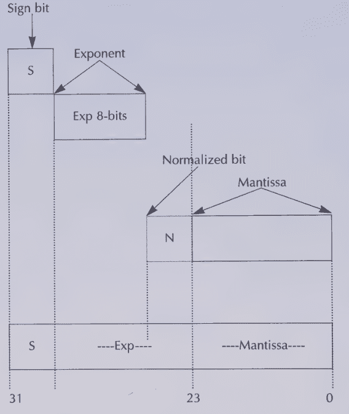
**图 8.2** 32 位单精度字的组成部分。

你可能会认为将变量指定为 “float” 而不是 “double” 可以提高性能，因为 `float`变量只有 32 位——请再想想！两个 32 位数相乘确实比两个 64 位数相乘快，但在执行多项式运算之前，所有数字都会被转换为 64 位双精度。这是双重打击——现在又增加了将数字从单精度转换为双精度（反之亦然）的额外开销。

如果你的嵌入式系统无法负担数学协处理器且需要浮点运算，以下是标准 C 库函数的替代方案。其精度虽然不是很高——在某些情况下大约是四位小数——但你会发现这些例程比标准函数快好几倍，而且你最终可能并不需要那么高的额外精度。

## 约减系数多项式

在接下来的实现中，采用了两种方法。首先，我们选择了低次数多项式以减少乘法运算的数量。其次，所有的乘、除、加、减基本算术运算都使用 32 位整数运算来完成。

我们将从超越函数的通用解开始讨论，也就是说，多项式展开。

多项式是无穷级数的截断形式，适用于计算目的。在达到一定精度后，我们必须停止求解各项，因为我们不能像无穷级数那样永远计算下去。如果我们按照前文所述借助泰勒级数展开来计算 `exp` 函数的值，在获得三位小数精度的结果之前，我们需要评估至少 100 次方的项——这并不是一个很实际的建议。我们需要的是预先组合系数，以便在最终分析中降低项的次数。B. Carlson 和 M. Goldstein 在 1943 年提出了适用于数字计算机应用的超越函数多项式解。

对于 `sin`、`cos`、`tan`、`arctan`、指数和对数每个基本函数，通常有两组解。高阶多项式用于双精度结果，低阶多项式用于单精度结果。其他函数如 `cosec`、`cot` 和 `sec` 可以通过基本三角恒等式来计算。以下是从相应的无穷级数中获得的两组约减系数多项式，它们保证在指定的输入范围内是收敛的。

### sin(x)

该函数的输入是要确定正弦值的弧度 `x`。控制多项式仅在 `0 ≤ x ≤ π/2` 范围内有效。因此，必须通过应用 `sin` 函数的模运算规则将操作数约减到给定范围内。

### 单精度应用的低阶多项式：

输入范围 `0 ≤ x ≤ π/2`
`sin(x)/x = 1 + a_2x^2 + a_4x^4 + ξ(x)`
误差幅值 `|ξ(x)| ≤ 2 * 10^-4`
常数：`a_2 = -.16605, a_4 = .00761`

### 双精度应用的高阶多项式：

输入范围 `0 ≤ x ≤ π/2`
`sin(x)/x = 1 + a_2x^2 + a_4x^4 + a_6x^6 + a_8x^8 + a_10x^10 + ξ(x)`
误差幅值 `|ξ(x)| ≤ 2 * 10^-6`

常数：
`a_2 = -.16666666664, a_8 = .0000027526`
`a_4 = .00833333315, a_10 = -.0000000239`
`a_6 = -.001984090`

### cos(x)

该函数的输入是需要计算余弦值的弧度角 `x`。控制多项式仅在 `0 ≤ x ≤ π/2` 范围内有效。因此，必须通过应用余弦函数的模运算规则将操作数化约到给定范围内。

### 单精度应用的低阶多项式：

输入范围 `0 ≤ x ≤ π/2`
`cos(x) = 1 + a_2x^2 + a_4x^4 + ξ(x)`
误差幅值 `|ξ(x)| ≤ 2 * 10^-4`
常数：`a_2 = -.49670, a_4 = .03705`

### 双精度应用的高阶多项式：

输入范围 `0 ≤ x ≤ π/2`
`cos(x) = 1 + a_2x^2 + a_4x^4 + a_6x^6 + a_8x^8 + a_10x^10 + ξ(x)`
误差幅值 `|ξ(x)| ≤ 2 * 10^-6`

常数：
`a_2 = -.4999999963, a_4 = .0416666418`
`a_6 = -.0013888397, a_8 = .0000247609`
`a_10 = -.000002605`

### tan(x)

`tan(x)` 的控制多项式是基于其对应项 `x cot(x)` 定义的。通过类比关系 `tan(x) = 1/cot(x)` 可得出 `tan(x)`。同样地，角度 `x` 为弧度，用于确定正切值。该多项式仅在 `π/4 ≤ x ≤ π/2` 范围内有效。因此，必须通过应用余切函数的模运算规则将操作数化约到给定范围内。

### 单精度应用的低阶多项式：

输入范围 `π/4 ≤ x ≤ π/2`
`cos(x) = 1 + a_2x^2 + a_4x^4 + ξ(x)`
误差幅值 `|ξ(x)| ≤ 2 * 10^-5`
常数：`a_2 = -.332867, a_4 = .024369`

### 双精度应用的高阶多项式：

输入范围 `0 ≤ x ≤ π/4`
`x cot(x) = 1 + a_2x^2 + a_4x^4 + a_6x^6 + a_8x^8 + a_10x^10 + ξ(x)`
误差幅值 `|ξ(x)| ≤ 2 * 10^-6`

常数：
`a_2 = -.3333333410, a_4 = -.0222220287`
`a_6 = -.0021177168, a_8 = -.0002078504`
`a_10 = -.0021177168`

### e^x（X 的指数）

`e^x` 的多项式定义在小于 0.639 的值范围内。较大数值的指数可以通过将输入浮点值拆分为整数部分和小数部分，并应用以下规则来计算：

```
e^x = e^(整数部分 + 0.639 + 小数部分)
= e^(整数部分) 2^(e^(小数部分))
```

整数的指数会迅速增长并超出范围。例如，31 的指数为 `2.9 × 10^13`；任何高于此的值均可视为无穷大。

### 单精度应用的低阶多项式：

输入范围 `0 ≤ x ≤ 0.639`
`e^x = 1.0 + a_1x^1 + a_2x^2 + a_3x^3 + a_4x^4 + ξ(x)`
误差幅值 `|ξ(x)| ≤ 2 * 10^-5`
常数：`a_1 = -.99989684, a_2 = .4982926, a_3 = -.1595332, a_4 = .0293641`

### 双精度应用的高阶多项式：

输入范围 `0 ≤ x ≤ 0.639`
`e^x = 1 + a_1x^1 + a_2x^2 + a_3x^3 + a_4x^4 + a_5x^5 + a_6x^6 + a_7x^7 + ξ(x)`
误差幅值 `|ξ(x)| ≤ 2 * 10^-6`
常数：`a_1 = -.9999999995, a_2 = .4999999206, a_3 = -.1666653019, a_4 = .0416573475, a_5 = -.0083013598, a_6 = .0013298820, a_7 = -.0001413161`

## ln_e(x) 自然对数

自然对数的多项式定义在小于 1 的值范围内。大于 1.0 的数的对数可以通过应用以下规则计算：

`ln(x^n) = n ln(x)`

### 单精度应用的低阶多项式：

输入范围 `0 ≤ x ≤ 1.0`
`ln(1 + x) = a_1x^1 + a_2x^2 + a_3x^3 + a_4x^4 + a_5x^5 + ξ(x)`
误差幅值 `|ξ(x)| ≤ 2 * 10^-5`
常数：`a_1 = .999495596, a_2 = -.49190896, a_3 = .28947478, a_4 = -.13608275, a_5 = .03215845`

### 双精度应用的高阶多项式：

输入范围 `0 ≤ x ≤ π/2`
`ln(1 + x) = a_1x^1 + a_2x^2 + a_3x^3 + a_4x^4 + a_5x^5 + a_6x^6 + a_7x^7 + a_8x^8 + ξ(x)`
误差幅值 `|ξ(x)| ≤ 2 * 10^-6`
常数：`a_1 = .999964239, a_2 = -.4998741238, a_3 = .3317990258, a_4 = -.2407338084, a_5 = .1675640711, a_6 = -.0953239837, a_7 = .0360884937, a_8 = -.0064535442`

上述两组多项式为其代表的函数提供了不同精度的结果。高阶多项式精度更高，但需要更多的计算量；试想计算 `x` 的 8 次方、7 次方、6 次方、5 次方、4 次方、3 次方、2 次方等。而低阶多项式最高仅需计算 `x` 的 5 次方——这在计算速度上有着量级的差异。本章开发库函数的设计正是基于低阶多项式。

现在，让我们讨论计算的内部原理。仅仅降低多项式的次数是不够的，因为 CPU 的大部分时间实际上花在了执行乘、除、加、减这四种基本算术运算上。如果我们对基本运算使用默认的库函数，实际上几乎没有任何收益。基础库例程会将 `float` 转换为 `double`，以 `double` 精度执行运算，再将 `double` 转换回 `float` 然后返回。这些转换是库内置的，无法避免。所有这些不必要的转换都违背了使用 `float` 格式的初衷。接下来的讨论将探索比默认浮点格式更高效的其他实数表示可能性。

## 定点运算与超越函数求解

是否存在浮点运算的替代方案？我们需要浮点数来表示所处理的巨大数值范围。将 `-127` 到 `+127` 的指数与 23 位精度位数相结合，只能在浮点格式中实现。另一种选择是定点格式。一个 32 位数可以被看作包含 8 位整数和 24 位小数，而一个 64 位数可以被分为 32 位整数和 32 位小数。然而，这样我们就将数值限制在一个非常狭窄的范围内。8 位整数的最大值为 255，而 24 位尾数的小数最大精度为 1/1600万——接近 `.000001`。所有有理数都由一个整数部分和一个小数部分组成。小数点被置于两者之间，以区分小数的结束和整数的开始。

基数为 `b` 的位值计数法将实数定义如下：

```
a_n b^n + ... + a_2 b^2 + a_1 b^1 + a_0 b^0 + a_-1 b^-1 + a_-2 b^-2 + a_-3 b^-3 ... a_-n b^-n
```

例如，十进制数 34.61 等于：

```
0 × 10^2 + 3 × 10^1 + 4 × 10^0 + 6 × 10^-1 + 1 × 10^-2 + ... 0 × 10^-n
```

所有计算机都有固定的字长限制，并针对固定字长计算进行了优化。每个字可以被视为一个整数，也可以被视为具有预定义整数部分和预定义小数部分的定点值。*小数点仅仅是一种感知。* 对于整数和定点值，其计算方法是相同的。*唯一的区别在于如何从 CPU 在算术运算后放置结果的不同源中累积结果。*

例如，一个 32 位数与另一个 32 位数相乘会产生一个 64 位结果。80386 CPU 利用 `EAX:EDX` 寄存器组合来存储结果。`EDX` 寄存器包含最高 32 位，而 `EAX` 寄存器包含最低 32 位。在纯 32 位整数运算的语境下，我们忽略高 32 位的结果，仅保留 `EAX` 寄存器中的低 32 位。然而，如果我们把这个 32 位值视为 8 位整数和 24 位小数，那么结果必须通过组合 `EAX` 的高 8 位和 `EDX` 的低 24 位来获得，从而将结果还原为 32 位字格式（图 8.3）。

| 乘法 | 31 | 24 23 | 0 |
| :--- | :--- | :--- | :--- |
| 假设 `EAX` 为乘数，`EDX` 为被乘数 <br> `Mul EDX` <br> `Shrd EAX, EDX, 24` | 整数部分 | 小数部分 | 被乘数 |
| | 整数部分 | 小数部分 | 乘数 |

**图 8.3** 两个 32 位定点数的乘法。

两个 32 位定点被除数和除数的除法运算是通过将 `EDX` 的低 8 位与 `EAX` 的高 24 位相结合来实现的，如图 8.4 所示。请注意，32 位定点加法和减法与整数加法和减法完全相同。

以下示例演示了对两个 32 位定点数（8 位整数和 24 位小数）的乘法和除法运算。

如果我们能保证结果不会超过 255，那么一切就都很好，因为这是 8 位整数和 24 位小数的 32 位定点格式能容纳的最大数。定点运算绝对远优于浮点运算，它允许我们对带有小数的实数进行运算——尽管数值范围非常有限。两个整数的连续乘法很快就会导致结果区域溢出；此外，连续加法可能会产生在结果存储空间中没有位置存放的进位。另一方面，无需担心中间运算中小数部分的丢失；至多我们可能会损失一些精度，这在浮点格式中同样会发生，因此是可以接受的。

如果不是担心在中间阶段产生错误结果，我们绝对可以通过使用 CPU 架构的整数指令集来进行实数的基础计算，从而获得显著的性能提升。

**图 8.4** 两个 32 位定点数的除法。

让我们再次回顾之前讨论的多项式函数的算术运算，以及我们对涉及运算的系数范围和输入值的限制。让我们分析求解给定多项式所需的所有算术运算，看看是否可以将定点算术指令应用于这些参数。有一个输入值 `x`（始终小于 1.0）必须进行多次幂运算；也就是说，进行连续乘法（但结果不会溢出）。结果必须与系数相乘——这是另一次乘法（所有系数仅为小数，因此此处结果也不会溢出）——然后对所有项进行加法或减法（但由于各项均小于 1.0，没有超过最大值的可能），这样就得到了多项式运算的结果。

上述论据是为了说明我们可以安全地仅使用定点格式来计算多项式解，而这正是下一节中用于开发函数库的格式。

定点格式的理想实现是使用 CPU 原生的 32 位整数加、减、乘、除指令。然而，这将需要与汇编语言例程接口，从而在不同平台之间产生移植性问题。因此，基础例程是在 C 语言函数中通过 C 编译器的整数运算来模拟的。感兴趣的读者可以用汇编语言重写这些函数，以获得进一步的性能提升并进一步优化速度。

## 一个快速高效的平方根函数算法

定点实现的另一个例子是 `sqrt` 函数的解决方案。该算法基于这样一个事实：一个浮点数可以很容易地拆分为其指数部分和小数部分，并且每一部分都可以被视为一个单独的定点量。将浮点数视为科学计数法，即指数部分乘以小数部分。利用平方根函数的乘法性质，求一个数的平方根简单来说就是指数部分的平方根乘以小数部分的平方根，如下所示：

```
sqrt(2^x * fraction) = sqrt(2^x) * sqrt(fraction)
```

例如，数字 3.0 的平方根等同于：

```
sqrt(3) = sqrt(2^2 * 0.75)
= sqrt(2^2) * sqrt(0.75)
```

指数部分的平方根是通过将指数向右移 1 位获得的；换句话说，就是将其除以 2。

```
= 2^1 * sqrt(0.75)
```

根据定义，小数量始终小于 1.0，因此我们可以应用我们在前一节超越函数中开发的相同定点技术。32 位小数的平方根是通过对近似值进行最多 16 次 16 位乘以 16 位的乘法二分查找来获得的。最后，将各个结果简单地组合成浮点格式并返回。该算法分为两个步骤：

- 1. 指数的 sqrt = 指数右移 1 位
- 2. 小数的 sqrt = X，如果 (X * X = 小数)

有关该算法的实现，请参阅代码清单 8.1 中的第 430 至 555 行。

## 超越函数库

以下是一个基于本章讨论的定点算法的 C 语言接口超越函数库例程。这些例程分为三个部分：

- 基础算术运算实现
- 多项式方程的通用解法
- 导出的超越函数

基础算术运算包括定点到浮点、浮点到定点的转换，以及在 C 中模拟的浮点乘法例程。为了让您了解用 Intel 80386 汇编语言编写定点乘法有多简单，以下汇编指令等同于代码清单 8.1 中的库函数 `fx_mpy()`（第 207 至 241 行）。假设 `EAX` 为乘数，`EDX` 为被乘数：

```assembly


`mul EDX`

`shrd EAX, EDX, 24`

代码清单 8.1 中有一个通用多项式解法（第 250 至 277 行）。三个输入定点值参数为：

- 输入 `x`；
- 系数列表；
- 列表中的系数数量。

多项式的返回值为 `double` 类型，因此平凡的计算可以通过 C 编译器库例程的帮助来执行。

导出的函数为：

```c
double __sin(double x);
double __cos(double x);
double __tan(double x);
double __exp(double x);
double __lge(double x);
double __lgd(double x);
double __sqrt(double x);
```

函数名添加了下划线前缀（例如 `__cos(x)`），以区分定点库函数和原始浮点数学库。

源代码呈现在随书 CD 的 `/book/chapter8/mathlib.c` 文件夹中。

**代码清单 8.1** 文件 `book/chapter8/mathlib.c` 定点算术库。

```c
1) /**************** Transcendental Functions ******************
2) The sin, cos, tan, exp, ln and square root function
3) solution are presented using fixed point arithmetic
4) and reduced coefficient polynomials.
5) You can use the file as an include or compile into
6) a library for linking with other modules. The names
7) of the functions are appended with an underscore such
8) as __cos so that it does not conflict with the default
9) library routines. *
10) The followings are the exported functions
11) double __sin(double x);
12) double __cos(double x);
13) double __tan(double x);
14) double __exp(double x);
15) double __lge(double x);
16) double __lgd(double x);
17) double __sqrt(double x);
18) ***********************************************************/
19) #include <stdio.h>
20) #include <math.h>
21) #define FLOATDIGITS 6
22) #define MAXINTEGER 2.147483647e+9
23) #define debug
24) #define test
25) #define fixed
26) #define TWO_POINT_ZERO 2.0
27) #define TWO_PI_CONST 6.283185
28) #define PI_CONST 3.141593
29) #define PI_2_CONST 1.570796
30) #define PI_4_CONST 0.7853982
31) #define ONE_POINT_ZERO 1.0
32) #define CONST_POINT_693 0.693
33) #define CONST_LN_2 0.69314718
34) #define CONST_LN_10 2.302585093
35) #define TWO_POINT_ZERO 2.0
36) #ifndef INFINITY
37) #define INFINITY 1.0E99
38) #endif
```

```c
39) #ifndef NAN
40) #define NAN 0.5999
41) #endif
42) #define modulus(r1,r2) (r1-(((int)(r1/r2))*r2))
43) /* float xtemp,ytemp; */
44) ///////////////////////////////////////////////////////
45) 多项式系数被转换为
46) 定点格式，因为多项式求解
47) 要求参数以定点
48) 格式呈现。
49) ///////////////////////////////////////////////////////
50) #ifdef fixed
51) long SIN_COEF_TBL[5] = {0x10000000,0,0xffd57dc0,0,0x1f2ba};
52) long COS_COEF_TBL[5] = {0x10000000,0,0xff808d845,0,0x97c1b};
53) long COT_COEF_TBL[5] = {0x10000000,0,0xffaac93b,0,0xff9c2f5};
54) long ATAN_COEF_TBL[10] = {0,0xff738,0,0xfab717e,0,0x2e1db8,0,0xffee34a, 
55) 0,0x55572};
56) long LN_COEF_TBL[6] = {0xffdef1,0xff821241,0x4a1b075,0xffd22afe,0x8389};
57) long EXP_COEF_TBL[5] = {0x10000000,0xf00080a0,0xff7901a,0xffd728d5,0x78467};
58) #else
59) float SIN_COEF_TBL[5] = {1.0,0.0,-0.16605,0.0,-0.00761};
60) float COS_COEF_TBL[5] = {1.0,0.0,-0.49670,0.0,-0.03705};
61) float COT_COEF_TBL[5] = {1.0,0.0,-0.332867,0.0,-0.024369};
62) float ATAN_COEF_TBL[10] = {0.0,0.9998660,0.0,-0.3302995,0.0,
63) 0.1801410,0.0,-0.0851330,0.0,0.0208351};
64) float LN_COEF_TBL[6] = {0.0,0.99949596,0.49190896,0.28947478,
65) -0.1360275,0.03215845};
66) float EXP_COEF_TBL[5] = {1.0,-0.9998684,0.4982926,-0.1595332,0.0293641};
67) #endif
68) ///////////////////////////////////////////////////////
69) 指数计算为：整数指数 + 小数指数。
70) 最多 32 个整数指数对于所有实际用途而言已经足够，
71) 超过这个范围可能就等同于
72) 无穷大了。
73) 下面提供了一个整数指数的查找表。
74) ///////////////////////////////////////////////////////
75) float INT_EXP_TBL[33] = {
76) 1.000000000,
77) 2.718281828,
78) 7.389056099,
79) 20.08553692,
80) 54.59815003,
81) 148.4131591,
82) 403.4287935,
83) 1096.633158,
84) 2980.957987,
85) 8103.083927,
86) 22026.46580,
87) 59874.14172,
88) 162754.7914,
89) 442413.3920,
90) 1202604.284,
91) 3269017.373,
92) 8886110.521,
93) 24154952.75,
94) 65659969.14,
95) 178482301.0,
96) 485165195.4,
97) 1318815735.0,
98) 3584912846.0,
99) 9744803446.0,
100) 2.6489122E10,
101) 7.20004899E10,
102) 1.9572960E11,
103) 5.3204824E11,
104) 1.4462570E12,
105) 3.9313342E12,
106) 1.0686474E13,
107) 2.9048849E13,
108) 1.0E38};
109) /**
					函数定义 
					**************************/
110) double __sin();
111) double __cos();
112) double __tan();
113) double __exp();
114) double __lge();
115) double __lgd();
116) double __atan();
117) double fx2fl();
118) long fl2fx();
119) long fx_mpy();
120) /**********************************************************/
121) 通用转换例程
122) /**********************************************************/
123) /****************** 浮点数转定点数 **************************/
124) long fl2fx(double x)
125) {
126) long *k,mantissa,exp;
127) float temp;
128) temp = (float) x;
129) /* 获取浮点数的指针 */
130) k = (long *) & temp;
131) /* 从数值中移除符号位 */
132) mantissa =(*(k & 0x7fffffff));
133) /* 从尾数中提取指数 */
134) exp = ((mantissa >> 23) & 0xff);
135) if (!exp)
136) return (0);
137) /* 包含规格化位的尾数部分 */
138) mantissa = ((mantissa & 0xffffff) | 0x8000000);
139) /* 增加指数以引入规格化位 */
140) exp++;
141) if (exp > 0x7f)
142) {
143) /* exp > 0x7f 表示存在整数部分 */
144) exp = exp - 0x7f;
145) mantissa = mantissa << exp;
146) }
147) else
148) {
149) /* exp <= 0x7f 表示不存在整数部分 */
150) exp = 0x7f - exp;
151) mantissa = mantissa >> exp;
152) }
153) if (*k >= 0)
154) return(mantissa);
155) else
156) return (-mantissa);
157) }
158) /************* 定点数转浮点数 ***********/
159) double fx2fl(long j)
160) {
161) long i,exp;
162) float temp,*fp;
163) i = j;
164) if (i == 0)
165) return ((double)(i));
166) /*
167) 8位整数和24位小数定点数的
168) 最大指数值
169) 偏移因子 = 7f;
170) 7f + 8 = 87;
171) */
172) exp = 0x87;
173) if (i < 0)
174) {
175) exp = exp | 0x187;
176) i = -i;
177) }
178) /* 规格化尾数 */
179) do
180) {
181) i = i << 1; exp--;
182) }
183) while (i > 0);
184) i = i << 1; exp--;
185) /* 将尾数放置在 bit-0 到 bit-23 */
186) i = ((i >> 9) & 0x7fffff);
187) exp = exp << 23;
188) i = i | exp;
189) fp = (float *) &i;
190) temp = *fp;
191) return ((double) temp);
192) }
193) /******************* 定点数乘法 *******************/
194) long fx_mpy(long x,long y)
195) {
196) unsigned long xlo,xhi,ylo,yhi,a,b,c,d;
197) long sign;
198) /* 如果两个符号相同，结果符号为 + */
199) sign = x ^ y;
200) if (x < 0)
201) x = -x;
202) if (y < 0)
203) y = -y;
204) /*
205) 两个 32 位数字相乘被视为
206) 四个 16 位字相乘
207) */
208) xlo = x & 0xffff;
209) xhi = x >> 16;
210) ylo = y & 0xffff;
211) yhi = y >> 16;
212) a = xlo * ylo;
213) b = xhi * ylo;
214) c = xlo * yhi;
215) d = xhi * yhi;
216) a = a >> 16;
217) /* 累加所有部分结果 */
218) a = a+b+c;
219) a = a >> 8;
220) d = d << 8; a = a+d;
221) if (sign < 0)
222) a = -a;
223) return(a);
224) }
225) /****************** 定点数多项式 ******************/
226) /*
227) 三个输入参数；全部为定点数
     1- 输入 x;
     2- 系数列表
     3- 列表中的系数数量
228) */
229) double polynomial_x(double r1,long * r2,int i)
230) {
231) long j,k,temp,sum;
232) k = fl2fx(r1);
233) sum = 0;
234) /* 步骤：
     1- 计算 x 的幂,
     2- 与系数相乘
     3- 累加所有项
235) */
236) while(i--)
237) {
238) temp = 0x1000000; /* 这代表 1.0 */
239) if (r2[i] != 0)
240) {
241) /* x 的幂 */
242) for (j=i;j>0;j--)
243) temp = fx_mpy(temp,k);
244) /* 然后与系数相乘 */
245) temp = fx_mpy(temp,r2[i]);
246) }
247) else
248) temp = 0;
249) sum = sum + temp;
250) };
251) return(fx2fl(sum));
252) }
253) /*********************** sin **************************/
254) double __sin(double x)
255) {
256) float temp;
257) int quadrant;
258) unsigned long *k;
259) temp = (float) x;
260) /* 取绝对值 */
261) k = (unsigned long *) &temp;
262) *k = (*k & 0x7fffffff);
263) /* 360 度取模 */
264) if (temp > TWO_PI_CONST)
265) {
266) temp = modulus(temp,TWO_PI_CONST);
267) }
268) /* 负角被转换为 360 度的补角 */
269) if ( x < 0 )
270) temp = TWO_PI_CONST - temp;
271) quadrant = (int) (temp / PI_2_CONST);
272) temp = modulus(temp,PI_CONST);
273) if (temp > PI_2_CONST)
274) temp = (PI_CONST - temp);
275) temp = (polynomial_x(temp,SIN_COEF_TBL,5) * temp);
276) if (quadrant >= 2)
277) temp = -temp;
278) return (temp);
279) }
```


# 三角函数与数学函数实现

## `cos` 函数

```c
double __cos(double x)
{
    float temp;
    int quadrant;
    unsigned long *k;
    temp = (float) x;
    /* 取绝对值 */
    k = (unsigned long *) &temp; *k = (*k & 0x7fffffff);
    /* 360 度取模 */
    if (temp > TWO_PI_CONST)
    {
        temp = modulus (temp,TWO_PI_CONST);
    }
    /* 负角被转换为 360 度的补角 */
    if ( x < 0 )
        temp = TWO_PI_CONST - temp;
    /* 根据原始角度确定象限 */
    quadrant = (int) (temp / PI_2_CONST);
    temp = modulus(temp,PI_CONST);
    if (temp > PI_2_CONST)
        temp = (PI_CONST - temp);
    temp = (PI_2_CONST - temp );
    temp = (polynomial_x(temp,SIN_COEF_TBL,5) * temp);
    if ((quadrant ==1) || (quadrant == 2)) temp = -temp;
    return ((float) (temp));
}
```

## `tan` 函数

```c
double __tan(double x)
{
    float temp;
    int quadrant;
    unsigned long *k;
    temp = (float) x;
    /* 取绝对值 */
    k = (unsigned long *)&temp;
    *k = (*k & 0x7fffffff);
    /* 360 度取模 */
    if (temp > TWO_PI_CONST)
    {
        temp = modulus (temp,TWO_PI_CONST);
    }
    /* 负角被转换为 360 度的补角 */
    if ( x < 0 )
        temp = TWO_PI_CONST - temp;
    quadrant = (int) (temp / PI_2_CONST);
    temp = modulus(temp,PI_CONST);
    if (temp > PI_2_CONST)
        temp = (PI_CONST - temp);
    if (temp < PI_4_CONST)
    {
        temp=((ONE_POINT_ZERO /
        polynomial_x(temp,COT_COEF_TBL,5)) * temp);
    }
    else
    {
        temp = PI_2_CONST - temp;
        temp = ONE_POINT_ZERO /
        ((ONE_POINT_ZERO /polynomial_x(temp,COT_COEF_TBL,5)) * temp);
    }
    if ((quadrant == 1)|| (quadrant==3))
        temp = -temp;
    return (temp);
}
```

## `exp` 函数

```c
/* e pwr x = 2 pwr (x * log2_e) */
/* if |X| <= 0.693.. then exp(x) = exp(fraction) */
/* else exp(x) = exp(INT + 0.693 + FRACTION) */
/* exp(0.693) = 2; */
double __exp(double x)
{
    float temp = x;
    int i;
    unsigned long *k;
    if (x > 0.0)
        i = ((int)(x + 0.0000001));
    else
        i = ((int)(x - 0.0000001));
    if (i < 0)
        i = 0-i;
    if (i > 31)
    {
        if (x > 0)
            return(INT_EXP_TBL[32]);
        else
            return(0);
    }
    temp = (float) x;
    /* make absolute value */
    k = (unsigned long *) &temp;
    *k = (*k & 0x7fffffff);
    temp = modulus(temp,ONE_POINT_ZERO);
    if (temp > CONST_POINT_693)
    {
        temp = temp - CONST_POINT_693;
        temp = ONE_POINT_ZERO / 
        (polynomial_x(temp,EXP_COEF_TBL,5));
        temp = temp * TWO_POINT_ZERO;
    }
    else
    {
        temp = ONE_POINT_ZERO / 
        (polynomial_x(temp,EXP_COEF_TBL,5));
    }
    temp = (INT_EXP_TBL[i]) * temp;
    if (x < 0)
        temp = ONE_POINT_ZERO / temp;
    return (temp);
}
```

## `lge` 函数（自然对数）

```c
/* log base E (x) = ln (x)/ln (E) */
/* ln (x) = pwr * ln(2) + ln(fraction+1;x); */
/* range = (0 <= x <= 1)*/
double __lge(double x)
{
    static long exp,i,*k;
    static float temp,xtemp,*fraction;
    xtemp = (float) x;
    temp=0;
    k = (long*) &xtemp;    i= k[0];
    /* do not compute ln of a minus number */
    if (i <= 0)
        return (NAN); /* NAN could be replaced by 0.0 */
    /*remove exp and sign and check for fraction*/
    if ((i == (i & 0x7ffffff)) != 0)
    {
        exp = 0x7f;
        while ((i & 0x800000) == 0)
        {
            i = i << 1; exp--;
        }
        i = i & 0x7ffffff;    /* remove normalized bit */
        exp = exp << 23;    /* new exp for fraction */
        i = i | exp;    /* combine exp and mantissa */
        fraction = (float *) &i;
        temp = fraction[0];
        temp = (polynomial_x(temp,LN_COEF_TBL,6));
    }
    /* from input value x extract the exp */
    exp = *k;
    exp = exp >> 23;
    exp = exp - 0x7f;
    temp = temp + (exp * CONST_LN_2);
    return(temp);
}
```

## `lgd` 函数（常用对数）

```c
double __lgd(double x)
{
    return (__lge(x)/CONST_LN_10);
}
```

## `sqrt` 函数（平方根）

```c
/* A fast and efficient algorithm for Square Root function.
   The algorithm is based on the fact that a floating point number
   can be easily split into its exponent and fraction portion and
   each can be treated as separate integer quantity. The sqrt of
   exponent portion is obtained by shifting the exponent right 1-
   bit, i.e., by dividing it by 2 and the sqrt of a 32-bit fraction is
   done by a binary search of 65536 possible values or 16 trials of
   16-bit 16-x16 multiplication of an approximation. At the end,
   the individual results are simply combined into floating point
   format and returned.
   sqrt of exponent = exponent shift right 1 ...... (1)
   sqrt of fraction = X, if (X * X = fraction) ............ (2)
*/
double __sqrt(double x)
{
    float xtemp;
    unsigned long exp,i,j,*k;
    unsigned short int new_apprx,old_apprx;
    xtemp = (float) x;
    /*
    step 1-- Think of the floating point number as an integer quantity
    */
    k =(unsigned long *)&xtemp; i=k[0];
    /*
    step 2-- do not compute sqrt of a minus number
    */
    if (x <= 0.0)
    {
        if (x==0.0)
            return(x);
        else
            return (NAN); /* NAN could be replaced by 0.0 */
    }
    /*
    step 3-- extract exp and place it in a byte location
    */
    exp = (i & 0x7f800000);
    exp >>= 23;
    /*
    step 4 -- bring fraction portion to 32-bit position and bring normalized bit
    */
    i <<= 8;
    i = i | 0x80000000;
    /*
    step 5 -- inc exp for bringing in normal bit and remove exp bias
    */
    exp += 1;
    exp -= 0x7f;
    /*
    step 6 -- compute square root of exp by shift
        1- right or divide by 2
        2- if exp is odd then shift right mantissa
        3- one more time
    */
    if ( exp & 1)
    {
        i >>= 1;
        exp >>= 1;
        exp += 1;
    }
    else
        exp >>= 1;
    /*
    step 7-- add bias to exp
    */
    exp += 0x7f;
    /*___________sqrt of fraction___________*/
    /*
    step 8 --start with 0x8000 as the first apprx
    */
    j = old_apprx = new_apprx = 0x8000;
    /*
    step 9 --use binary search to find the match.
        1- loop count maximum 16
    */
    do
    {
        /*
        step 9a -- multiply approximate value to itself
        */
        j = j*j;
        /*
        step 9b — next value to be added in the binary search
        */
        old_apprx >>= 1;
        /*
        step 9c — terminate loop if match found
        */
        if (i == j )
            old_apprx = 0;
        else
        {
            /*
            step 9d -- if approx. exceeded the real fraction then lower the approximate
            */
            if (j > i )
                new_apprx -= old_apprx;
            /*
            step 9e -- else increase the approximate
            */
            else
                new_apprx += old_apprx;
        }
        j = new_apprx;
    } while (old_apprx != 0);
    /*
    step 10 — combine exp and mantissa
    */
    j = new_apprx;
    /*
    step 10a -- bring mantissa to bit position 0..23 and remove Normal bit
    */
    j <<= 8;
    j &= 0x7ffffff;
    /*
    step 10b -- decrement exponent for removing Normalized bit
    */
    exp -= 1;
    /*
    step 10c -- bring exponent to position 23..30
    */
    exp <<= 23;
    /*
    step 10d -- combine exponent and mantissa and return double
    */
    j = j | exp;
    xtemp = * ((float *) &j);
    return (xtemp);
}
```


# 测试超越函数库

为了验证代码清单 8.1 中 `mathlib.c` 库提供的例程，目前正在准备一项全面的置信度测试（代码清单 8.2）。

## 测试目标

本次测试的目标是验证定点超越函数库例程的准确性。

## 测试描述

本次测试将在指定数值范围内对 `sin`、`cos`、`ln`、`exp` 和平方根函数进行测试。测试将定点库的结果与默认的浮点库进行比较，并打印计算值与公布值之间的量级差异。测试程序如代码清单 8.2 所示。每个测试用例包含从极负值到极正值的数值范围。

源代码位于随书 CD 文件夹 `/book/chapter8/test.c` 中。

**代码清单 8.2** 文件 `book/chapter8/test.c` 用于验证数学库例程的测试程序。

```c
1) //********************************************************/

2) /*

   * calculating error magnitude between fixed-point result

   * and floating-point original math library result

3) */

4) #include "mathlib.c"

5) #include <math.h>

6) static double greatest_err = 0.00001;

7) //********************************************************/

8) static double err_magnitude(double calculated, double original)

9)  {

10)  double err;

11)  err = (original - calculated);

12)  if (err < 0.0)

13)  err = -err;

14)  if (err < 0.0001)

15)  return 0.0001;

16)  if (err > greatest_err)

17)  greatest_err = err;

18)  return err;

19)  }

20)  /******* test case routine ********/

21)  /*

22)  Compare the fixed-point transcendental functions

23)  with the floating-point library functions

24)  The routine accepts the following parameter

       1-  beginning value

       2-  ending value

       3-  increment

25)  */

26)  static int test_case(double begin, double end, double inc)

27)  {

28)  double x, original, calculated;

29)  double difference;

30)  greatest_err = 0.00001;

31)  for (x= begin; x < end; x+= inc)

32)  {

33)  if (x < 15)

34)  {

35)  original = exp(x);

36)  calculated = _exp(x);

37)  difference = err_magnitude(calculated, original);

38)  }

39)  }

40)  printf (" EXP : %f < %f --, Max Difference <= %f\n",begin,end,greatest_err);

41)  greatest_err = 0.00001;

42)  for (x= begin; x < end; x+= inc)

43)  {

44)  original = sin(x);

45)  calculated = _sin(x);

46)  difference = err_magnitude(calculated, original);

47)  }

48)  printf (" SIN: %f < x < %f ---, Max Difference <= %f\n",begin,end, greatest_err);

49)  greatest_err = 0.00001;

50)  for (x= begin ; x < end;  x+= inc)

51)  {

52)    original = cos(x);

53)    calculated = __cos(x);

54)    difference = err_magnitude(calculated, original);

55)  }

56)  printf (" COS: %f < x < %f ---, Max Difference <= %f\n",begin,end, greatest_err);

57)  greatest_err = 0.00001;

58)  for (x= begin ; x < end;  x+= inc)

59)  {

60)    original = tan(x);

61)    calculated = __tan(x);

62)    difference = err_magnitude(calculated, original);

63)  }

64)  printf (" TAN: %f < x < %f ---, Max Difference <= %f\n",begin,end, greatest_err);

65)  greatest_err = 0.00001;

66)  for (x= begin ; x < end;  x+= inc)

67)  {

68)    if(x > 0.00001 )

69)    {

70)      original = log(x);

71)      calculated = __lge(x);

72)      difference = err_magnitude(calculated, original);

73)    }

74)  }

75)  if(x > 0.00001 )

76)  {

77)    printf (" LOG: %f < x < %f ---, Max Difference <= %f\n",begin,end, greatest_err);

78)  }

79)  greatest_err = 0.00001;

80)  for (x= begin ; x < end;  x+= inc)

81)  {

82)    if(x > 0.0 )

83)    {

84)      original = sqrt(x);

85)      calculated = __sqrt(x);

86)      difference = err_magnitude(calculated, original);

87)    }

88) }

89) printf(" SQRT: %f < x < %f ---, Max Difference <= %f\n",begin,end, greatest_err);

90) return 0;

91) }

92) //*********************************************************

93) //****************** main test program *******************/

94) int main()

95) {

96) test_case(-1.0, 1.0, .1);

97) test_case(-10.0, 10.0, 0.01);

98) test_case(-100.0, 100.0, .1);

99) test_case(-1000.0, 1000.0, 1);

100) test_case(-10000.0, 10000.0, 10.1);

101) test_case(-100000.0, 100000.0, 100.1);

102) test_case(-1000000.0, 1000000.0, 1000.1);

103) test_case(-10000000.0, 10000000.0, 10000.1);

104) test_case(-100000000.0, 100000000.0, 100000.1);

105) return (0);

106) }
```

## 测试输入

1. 如果您计划从 CD 复制源代码，请挂载 CD-ROM。

```bash
[root@ns /root]# mount -t iso9660 /dev/cdrom /mnt/cdrom
```

2. 创建子目录 `/book/chapter8/`，并将测试程序和 `mathlib.c` 程序从 CD-ROM 目录 `/book/chapter8` 复制过去。

```bash
[root@ns /root]# mkdir /book/chapter8

[root@ns /root]# cp /mnt/cdrom/book/chapter8/* /book/chapter8/
```

3. 使用 Makefile `Makefile` 并通过以下 `make` 命令编译并链接 `test.c`。

```bash
[root@ns /root]# cd /book/chapter8; make
```

4. 执行该文件。

```bash
[root@ns /book/chapter8]# ./t
```

## 预期测试结果

```text
EXP: -1.000000 < x < 1.000000 ---, Max Difference <= 0.000406

SIN: -1.000000 < x < 1.000000 ---, Max Difference <= 0.000122

COS: -1.000000 < x < 1.000000 ---, Max Difference <= 0.000164

TAN: -1.000000 < x < 1.000000 ---, Max Difference <= 0.000010

LOG: -1.000000 < x < 1.000000 ---, Max Difference <= 0.000010

SQRT: -1.000000 < x < 1.000000 ---, Max Difference <= 0.000010

EXP: -10.000000 < x < 10.000000 ---, Max Difference <= 3.263702

SIN: -10.000000 < x < 10.000000 ---, Max Difference <= 0.000164

COS: -10.000000 < x < 10.000000 ---, Max Difference <= 0.000164

TAN: -10.000000 < x < 10.000000 ---, Max Difference <= 2.294101

LOG: -10.000000 < x < 10.000000 ---, Max Difference <= 0.000010

SQRT: -10.000000 < x < 10.000000 ---, Max Difference <= 0.000010

EXP: -100.000000 < x < 100.000000 ---, Max Difference <= 442.011182

SIN: -100.000000 < x < 100.000000 ---, Max Difference <= 0.000165

COS: -100.000000 < x < 100.000000 ---, Max Difference <= 0.000165

TAN: -100.000000 < x < 100.000000 ---, Max Difference <= 0.831879

LOG: -100.000000 < x < 100.000000 ---, Max Difference <= 0.000010

SQRT: -100.000000 < x < 100.000000 ---, Max Difference <= 0.000244

EXP: -1000.000000 < x < 1000.000000 ---, Max Difference <= 0.034165

SIN: -1000.000000 < x < 1000.000000 ---, Max Difference <= 0.000170

COS: -1000.000000 < x < 1000.000000 ---, Max Difference <= 0.000170

TAN: -1000.000000 < x < 1000.000000 ---, Max Difference <= 1.866331

LOG: -1000.000000 < x < 1000.000000 ---, Max Difference <= 0.000010

SQRT: -1000.000000 < x < 1000.000000 ---, Max Difference <= 0.000485

EXP: -10000.000000 < x < 10000.000000 ---, Max Difference <= 0.017315

SIN: -10000.000000 < x < 10000.000000 ---, Max Difference <= 0.000869

COS: -10000.000000 < x < 10000.000000 ---, Max Difference <= 0.000866

TAN: -10000.000000 < x < 10000.000000 ---, Max Difference <= 692.437081

LOG: -10000.000000 < x < 10000.000000 ---, Max Difference <= 0.000010

SQRT: -10000.000000 < x < 10000.000000 ---, Max Difference <= 0.001948

EXP: -100000.000000 < x < 100000.000000 ---, Max Difference <= 0.000010

SIN: -100000.000000 < x < 100000.000000 ---, Max Difference <= 0.007855

COS: -100000.000000 < x < 100000.000000 ---, Max Difference <= 0.007885

TAN: -100000.000000 < x < 100000.000000 ---, Max Difference <= 7376.778134

LOG: -100000.000000 < x < 100000.000000 ---, Max Difference <= 0.000010

SQRT: -100000.000000 < x < 100000.000000 ---, Max Difference <= 0.007789

EXP: -1000000.000000 < x < 1000000.000000 ---, Max Difference <= 0.000010

SIN: -1000000.000000 < x < 1000000.000000 ---, Max Difference <= 0.072403

COS: -1000000.000000 < x < 1000000.000000 ---, Max Difference <= 0.073354

TAN: -1000000.000000 < x < 1000000.000000 ---, Max Difference <= 26188.929802

LOG: -1000000.000000 < x < 1000000.000000 ---, Max Difference <= 0.000010

SQRT: -1000000.000000 < x < 1000000.000000 ---, Max Difference <= 0.015605

EXP: -1000000.000000 < x < 1000000.000000 ---, Max Difference <= 0.000010

SIN: -1000000.000000 < x < 1000000.000000 ---, Max Difference <= 0.927301

COS: -1000000.000000 < x < 1000000.000000 ---, Max Difference <= 0.919399

TAN: -1000000.000000 < x < 1000000.000000 ---, Max Difference <= 4243.122343

LOG: -1000000.000000 < x < 1000000.000000 ---, Max Difference <= 0.000010

SQRT: -1000000.000000 < x < 1000000.000000 ---, Max Difference <= 0.062424

EXP: -1000000.000000 < x < 1000000.000000 ---, Max Difference <= 0.000010

SIN: -1000000.000000 < x < 1000000.000000 ---, Max Difference <= 1.999787
```


`COS`: -1000000.000000 < `x` < 1000000.000000 ---, Max Difference <= 1.980583

`TAN`: -1000000.000000 < `x` < 1000000.000000 ---, Max Difference <= 43490.596024

`LOG`: -1000000.000000 < `x` < 1000000.000000 ---, Max Difference <= 0.000010

`SQRT`: -1000000.000000 < `x` < 1000000.000000 ---, Max Difference <= 0.248733


## 总结

在本章中，我们开发了一个适用于低成本嵌入式系统的高效超越数学模拟库。如果强调的是速度而非精度，那么在缺乏硬件数学协处理器的情况下，另一种选择是定点运算。许多应用程序（如图形例程）可以利用本章所介绍的库提供的高速解决方案。此外，我们还为浮点数提供了一种独特的平方根函数解决方案，其速度比类似的库例程快几个数量级。

# 9 嵌入式系统设计项目

## 本章内容

- 产品设计流程
- 实际动手设计项目
- `DoorLock`（门锁）
- `DoorLock Enhanced`（增强型门锁）
- `TimeIsMoney`（时间就是金钱）
- `DrillingRig`（钻井平台）
- `TankVolume`（储罐容量）

## 引言

在本章中，我们将总结嵌入式系统设计流程的整体概貌，并尝试将这些零散的拼图碎片拼接在一起。我们将展示一些虚拟项目，包括门锁机制、员工入口与时间日志系统、平台钻孔率测量系统以及液体储罐液位监控系统。选择这些项目是因为它们的设计简单，并且可以证明仅使用桌面 PC 的并行端口和 Linux 操作系统即可构建一个工作模型。现在正是证明我们在全书讨论的理论的时候：嵌入式系统设计过程由三个组件组成：系统接口、用户接口和数据库。

系统接口是设备驱动程序、客户端-服务器机制，而用户接口则是 Web 浏览器、Web 服务器以及通用网关接口（CGI）。数据库是将系统接口与用户界面粘合在一起的胶水。将 Web 作为用户界面，使我们的系统能够面向互联网和内网世界，并实现了将产品通过互联网传输的梦想。将 Web 作为用户界面还节省了产品设计过程中大量的工程工作，从而扩大了每家公司都渴望的机会之窗。让我们首先从为嵌入式系统设计设定标准，以及在设计系统时应避免的操作指南开始。

## 产品设计流程

嵌入式系统设计的定义取决于你询问的对象。对于某些人来说，它是隐藏在微波炉、烤箱或洗衣机不同控制面板背后的微控制器。对于其他人来说，它是基于强大多兆赫兹 CPU 的硬件系统，每分钟能打印 150 页。无论你选择哪个定义，它最终都归结为由 CPU 配合一定的 RAM、ROM、存储设备和一些执行所需输入输出的外围设备组成。尺寸并不重要；今天的主机就是明天的手持计算器。那么，如何开始设计一个嵌入式系统呢？让我们分析一下行业的总体趋势以及塑造嵌入式系统设计流程的公司决策。

市场部门决定商业社区的需求，并为公司决定销售的拟议产品制定初步规格。他们主要尝试将价格与性能相匹配，并希望说服管理层某个产品是有需求的。接着是进度计划和任务分配。随后，工程团队接手，对项目进行分析并选择硬件，通常基于目前的可用性。在软件选择方面没有太多选择，通常是 C 或 C++ 的组合。选择一个硬件和软件应当共存的平台。在这种安排下，你可以看出项目注定失败的迹象：

- 软件范围过大
- 软件模块之间交互过多
- 软件模块定义不清晰
- 通信协议尚未建立
- 平台缺乏灵活性

如你所见，大多数问题都与软件相关。“软件范围过大”是指要求程序员为已经存在的模块编写代码；例如，编写实时内核或设计自研的数据库服务器。（Linux 是实时内核，PostgreSQL 是免费可用的事务数据库，为什么不选择它们呢？）“软件模块之间交互过多”是指软件模块划分不合理。例如：模块 A 请求模块 B 中的一个函数，而该函数实际上属于模块 A。任务切换的开销将对性能产生不利影响。“软件模块定义不清晰”会导致软件出现意外行为。如果模块 A 和模块 B 执行类似的功能但使用不同的方案，必然会产生维护问题。“通信协议尚未建立”则是全局变量大显身手并毁掉程序员生活的地方。记住，模块是可替换的，但协议是持久的。在模块之间建立通信协议并遵守规则。“平台缺乏灵活性”最终将增加机器的成本。硬件不是恒定的；你今天为某些功能支付的价格，明天可能会以一半的价格提供两倍的功能。保持灵活，选择由多人支持的现成平台（确保 Linux 可以移植其上）。

一个典型的项目会经历产品开发周期的以下六个阶段；你可以称之为工程产品的生命周期，因为它经历了从概念到现实的阶段（图 9.1）。

**图 9.1** 产品设计周期的六个步骤。

1. 进行市场研究。
2. 准备产品需求规格书。
3. 制定开发进度表。
4. 开始设计流程。
5. 进行测试和调试。
6. 最终发布。

开发周期中最关键的阶段是测试和调试。这就是你看到箭头返回到设计阶段的地方。你将花费大部分时间在设计与测试调试之间。一旦你走出了这个阶段（如果你能走出来的话），你就彻底成功了。减少在这个困难周期中时间最好的方法是使用软件模块，就像你在建造大楼时使用预制墙一样。你在项目设计会议上会听到软件模块这个词；每个人都有自己的定义，但以下定义似乎最恰当：

除非软件模块是独立可执行的代码，否则它根本称不上真正的模块。只有在明确理解客户端和服务器关系时，经典的“输入、处理、输出”范式才适用于模块。

定义询问“什么”并不容易，但至少我们可以定义“如何”询问，这就是进程间通信方案的任务。如果你围绕套接字（sockets）和消息来设计软件，你可以确信你知道你的客户端是谁以及他们会问什么问题。认可这一限制将引导你处理在模块之间建立客户端-服务器关系的复杂细节，这将帮助你建立协议并最终引导至模块化设计。

## 我们的嵌入式系统开发哲学

互联网从字面上改变了我们做生意以及与人交流的方式。这是一个电子邮件、网页以及存储世界上每个人生活历史的数据库的时代。不再需要与接线员通话，寻找工程师并请求零件规格。只需打开浏览器，输入`www.company.com`，填写搜索表单，你就会被直接引导至屏幕上的信息站点——不可思议。设计 Web 系统已经变成了一项流水线工作；不再需要证明复杂的算法，也不再有昂贵的项目超支。无论工作多么复杂，你只需要学习 Perl 脚本、SQL 查询和 HTML 页面。然而，为什么我们不能在嵌入式系统设计中获得同样的成功？毕竟，无论它是浏览器还是命令行，用户界面就是用户界面。

嵌入式系统设计与 Web 设计不同。在 Web 设计中，你只需要用户界面和数据库接口，而嵌入式系统设计需要承担系统接口的额外负担（图 9.2）。这不应阻止我们使用 Web 概念；事实上，它可以帮助我们清晰地定义并将用户界面与系统接口隔离——只需在中间使用一个数据库。系统想要交给用户的所有内容都放入数据库，用户想要系统执行的所有操作都通过数据库传递。

**图 9.2** 嵌入式系统设计组件：系统接口、用户界面和数据库服务器。

这是一个自然的功能划分边界。用户与系统之间不再有直接接触；用户抱怨太多了。现在是嵌入式系统设计者开始使用事务服务器的时候了。基于 SQL 服务器的数据库设计可能是软件行业中唯一一个没有陡峭学习曲线的成熟项。其他所有内容，包括 C、C++、Java 和 Visual Basic，都要求你在电脑旁边放一个睡袋。另一方面，应用工程师们正在悄悄利用数据库服务器、CGI 脚本、Web 服务器和 Web 浏览器之间定义良好的接口。

浏览器（Netscape Navigator 和 Internet Explorer）现在是展示你想让世界看到的内容的首选方法，而 Web 服务器之王 Apache 是超过一半 Web 托管站点使用的引擎。Perl 解释器正在取代 Visual Basic，SQL 可能会取代程序设计的逻辑部分。Linux 免费为你提供所有这些。有作为事务服务器的 PostgreSQL；作为 HTTP 服务器的 Apache；作为 DNS 服务器的`bind`；以及全世界大学在过去七年里开发的无数应用服务器……

数年之久；当然，还有一流的实时内核 Linux。最重要的是，我们要感谢 GNU 项目团队，他们的贡献可能超过了其他任何贡献。

系统工程师通过设备驱动程序在一定程度上实现了独立。这是一块真正独立的模块化代码。如果你有一个用于接口的设备驱动程序，你只需要暴露`open`、`close`、`read`和`write`这几个函数即可。一旦使用设备驱动程序将物理硬件接口独立出来，你在系统其余部分能获得的机会就不多了。项目往往取决于程序员的心情。没有什么办法能阻止程序员编写糟糕的代码，而且程序员很警惕那些在背后盯着他们的人。我们需要构建的是模块之间的客户端/服务器（client/server）关系，强调使用套接字（sockets）、消息队列和线程等进程间通信机制。这些是连接模块的成熟机制。

不幸的是，软件工程并不是一门精确的科学。算法设计没有一套固定的公式；本该有，但我们离那个现实还很遥远。与此同时，我们需要摆脱传统的软件设计方式。人们普遍抱怨涉及软件的工程项目通常进度落后。解决方案部分在于在模块之间建立客户端/服务器关系，部分在于将 Web 整合到你的产品设计流程中。通过结合 Web 设计和系统设计的优点，我们可以进一步扩展模块化的概念，如图 9.3 所示。

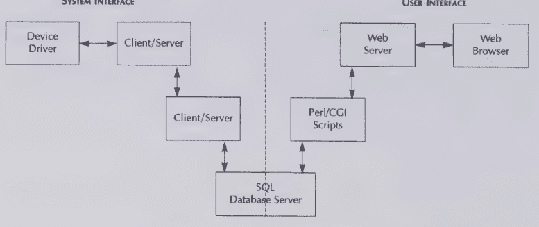

**图 9.3** 系统接口与用户接口的互连。

结论：一个嵌入式系统具有系统接口和用户接口。系统接口由访问硬件的设备驱动程序、与设备驱动程序通信、处理数据并最终将数据保存到数据库的客户端/服务器机制组成。另一方面，用户接口从数据库中提取数据，在 Perl 或 C 脚本的帮助下将其制作成交互式 Web 页面，并将其传递给 Web 服务器，由 Web 服务器与用户通信并按需呈现页面。当用户决定更改某些参数时，该过程反向执行：填写 Web 表单，表单返回给服务器，然后更新数据库。系统接口从数据库中获取新参数并做出相应的系统更改。通过这个简单的方案，我们开始迎接设计整合了刚才开发概念的产品这一挑战。

## 实际动手经验

没有什么比通过实践证明概念并拥有设计一些真实嵌入式系统的动手经验更好的了。如果你使用 PC 兼容硬件进行学习，那么你的系统中已经内置了一个并行端口（parallel port）。它非常适合一些快速的动手项目。设计嵌入式系统比设计应用程序更有趣。在嵌入式系统中，你对整个机器拥有完全的控制权，甚至更多；你是在触及并控制这个世界。我们在第 3 章中的设备驱动程序设计提供了对并行端口不同输入和输出寄存器的便捷访问。我们将使用该设备驱动程序围绕并行端口寄存器设计几个项目；这是我们最接近真实嵌入式设计硬件的东西。

虽然并行端口可以无限扩展，但这需要额外的电路。为了简单起见，我们将使用五个输入引脚来模拟触摸按钮，就像它们是键盘开关一样。你可以使用一根连接到地引脚的导线来模拟开关闭合动作。中断引脚可以用作脉冲监测的触发器，如果你愿意，可以使用输出引脚设置逻辑控制。请参阅第 2 章中的原理图以了解并行端口寄存器的引脚分配。

现在，让我们探讨一些设计思路。

### 带有编码密钥和时间日志的门锁系统

我们将使用 PC 的并行端口作为门锁机制的控制系统。该编码密钥门锁系统将最近 30 次进入的时间信息记录在数据库中，并根据编码密钥授予访问权限。这背后的想法是演示一个无法负担全功能实现的极简 Linux 实现。

### 带有时间相关编码密钥和时间日志的增强型门锁系统

此设计与之前讨论的门锁系统类似，但增加了增强型数据库和 Web 接口等功能。该增强型编码密钥门锁系统将最近 10,000 次进入的时间信息记录在数据库中，并根据编码密钥和全天时间限制授予访问权限。

在该产品设计中，演示了一个完整的 Linux 实现，使用 PostgreSQL 作为数据库服务器，并通过 DNS/HTTP 服务器提供 Web 接口。

### 带有远程日志的平台钻孔率监测仪

在这个项目中，设计了一个过程控制系统，它与 PC 并行端口的中断引脚和数字 I/O 部分相接口。来自 PC 并行端口的中断信号被用作模拟石油平台钻孔操作的速率计数器和速率计。

通道活动可以通过 Web 进行监测。

### 液位监测系统

该项目是一个数据采集系统设计，用于监测储罐（如炼油厂、海水淡化厂等）的液体液位。液位传感器的输入由并行端口的输入引脚模拟，类似于液位不同高度的接触开关。Web 实现通过 Perl 脚本演示了实时动画。

### 员工考勤系统

这是一个基于 Web 的应用程序，可以通过浏览器启动，用于记录员工的签到和签退信息，并与具有编码密钥访问权限的入口安保系统集成。主管可以通过主管登录 ID 查看员工考勤情况。

为了符合我们的设计哲学，我们将拥有：

#### 系统接口

- 一个用于获取外部信号并控制输出的设备驱动程序
- 一个与设备驱动程序通信的服务器机制
- 一个向服务器请求数据并将其存储在数据库中的客户端机制

#### 用户接口

- 用于从数据库获取数据并创建 Web 页面的 Perl/CGI 脚本
- 一个用于传输 Web 页面的 Web 服务器
- 一个通过互联网查看数据的浏览器

这些项目被开发为工作模型，旨在证明将 Internet/内网作为用户界面和设备驱动程序基础，以及将客户端/服务器机制作为系统接口基础的概念，尽管其规格最低。这里的意图是利用我们在前面章节中开发的内容。

项目的设计方面将从全规模 Linux 实现（部署了 SQL 服务器、DNS 服务器和 HTTP 服务器）以及极简 Linux 实现（用 DBM（数据库管理器）代替 SQL 服务器，用我们在第 4 章中开发的简单 Socket 服务器代替 DNS 和 HTTP 服务器，作为 Apache Web 服务器的替代品）这两个角度来涵盖。

## 项目 1：使用`DOORLOCK`保障你的入口

一个带有编码密钥的计算机控制门锁系统。

## 产品规格

- 低成本的带有时间日志功能的编码密钥门锁系统
- 非常适合具有集中控制功能的酒店客房
- 可通过 Web 接口获取时间日志数据库
- 基于 Web 的时间日志查看
- 带有内置触摸键盘和显示屏的模块化单元

## 简介

`DoorLock` 是一个具有编码密钥和时间日志功能的低成本安保系统，非常适合酒店房间锁系统。该产品将使用 Linux 操作系统开发，由 PC 并行端口提供必要的硬件电路。

### 设计目标

使用本章前面建立的指南，设计一个带有密码钥匙进入控制的电子门锁安全系统。

管理用户控制通过一个使用最小功能 Web 服务器的 Web 界面提供。客户端系统接口（例如访问按键矩阵）由设备驱动程序以及一个使用 Linux 实时内核的客户端/服务器机制控制。

### 系统需求

- 五位数字键盘，通过 PC 并行端口状态寄存器的输入引脚模拟
- 绿色 LED 表示有效的按键组合，由 PC 并行数据寄存器第 0 位控制
- 红色 LED 表示无效的按键组合，由 PC 并行数据寄存器第 1 位控制
- 锁电磁阀锁止信号，由 PC 并行数据寄存器第 2 位控制
- 能够存储最近 100 次进入记录的时间日志
- 能够通过浏览器（Netscape Navigator）进行查看

### 硬件功能描述

将使用第 3 章图 3.1 中定义的 PC 并行端口作为提供外部用户接口的基础硬件组件。Linux 盒子将用作 CPU。并行端口的数据寄存器用于作为控制电磁阀开关以及红绿状态 LED 的控制信号。五位触控键盘将通过并行端口的状态寄存器来模拟。

### 软件功能描述

本章前面开发的嵌入式系统设计概念被用作构建系统不同软件模块的基础。首先，我们将用户界面和系统界面分开，两者仅由数据库服务器绑定。用户界面是一个基于 Web 的实现，管理员可以通过浏览器（如 Netscape）查询数据库条目，该浏览器由专门为这种低成本实现而设计的微型 Web 服务器提供服务。

> 注意：此实现的目的是演示 Linux 操作系统作为真正的低成本嵌入式系统的能力，而无需 SQL、DNS 或 HTTP 服务器。

Web 服务器从数据库中获取日志信息，并创建动态 Web 页面以供浏览器显示。系统接口包含用于与硬件通信的设备驱动程序，以及一个接收来自设备驱动程序的密码按键序列、验证输入并使用时间日志信息更新数据库的客户端/服务器模块。

## 功能概述

`DoorLock` 的软件模块由系统接口和用户界面组成。图 9.4 显示了系统中使用的软件模块的功能框图和互连关系。

### 系统接口模块

- `DeviceDriver`（设备驱动）
- `ClientServer`（客户端/服务器）

### 用户界面模块

- `WebServer`（Web 服务器）
- `DBM`（数据库管理器）

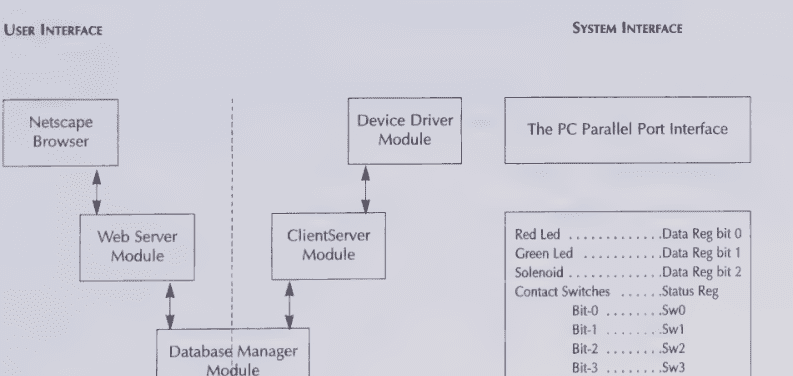

**图 9.4** 显示软件模块互连关系的框图。

### 设备驱动模块

该模块作为标准 Linux 设备驱动程序与系统硬件通信。触控按键通过并行端口的状态寄存器模拟。锁的开启和输出 LED 通过数据寄存器输出信号的逻辑电平控制：数据位 0 用于红色 LED 控制，数据位 1 用于绿色 LED 控制，数据位 2 用于电磁阀激活。

支持以下函数调用：

| 函数 | 描述 |
| :--- | :--- |
| `int open(void)` | 提供硬件初始化 |
| `int close(void)` | 提供文件描述符的关闭 |
| `int read(void)` | 提供键盘访问 |
| `int write(int pattern)` | 控制输出引脚的逻辑电平 |

### 通过`read()`函数的通信协议

1. 返回 `-1` 表示没有按键按下。
2. 返回 `0` 表示 SW0 的闭合动作。
3. 返回 `1` 表示 SW1 的闭合动作。
4. 返回 `2` 表示 SW2 的闭合动作。
5. 返回 `3` 表示 SW3 的闭合动作。
6. 返回 `4` 表示 SW4 的闭合动作。

#### 通过`write()`函数的通信协议

1. 输入参数`pattern`的第 0 位控制红色 LED 逻辑电平。
2. 输入参数`pattern`的第 1 位控制绿色 LED 逻辑电平。
3. 输入参数`pattern`的第 2 位控制电磁阀逻辑电平。

### `ClientServer`模块

该模块负责以客户端/服务器模型提供所需的系统接口。该模块的主要职责是验证用户输入并更新数据库中的时间日志信息。客户端任务定期扫描键盘，一旦收到有效的按键序列，服务器任务就会收到用户按键输入的消息。图 9.5 是客户端任务的流程图。服务器任务等待来自客户端任务的消息。收到按键序列消息时，将该值与数据库中的有效按键值进行比较。如果匹配，服务器将发出开门指令并将事件时间记录在数据库中。图 9.6 是服务器任务模块的流程图。

#### 通过`CS`消息队列的通信协议

基础消息 ID 是`USER_KEY_SEQUENCE`，它表示消息队列中已有可用的消息内容。

#### 客户端任务

客户端任务扫描设备驱动程序以获取用户输入，并在收到一系列按键按下时为服务器任务创建一条`message`（消息）。消息 ID 为`USER_KEY_SEQUENCE`，消息体包含输入字符串。

```c
```


```c
#define USER_KEY_SEQUENCE 1
```

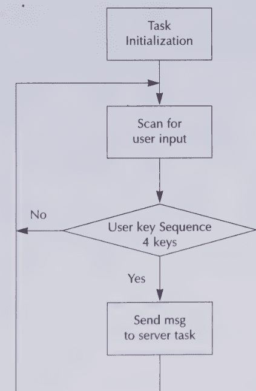

**图 9.5** 客户端任务流程图。

### 服务器任务

服务器任务等待消息队列 ID `USER_KEY_SEQUENCE`，消息体包含 ASCII 字符串形式的按键序列。该按键序列将与数据库中的条目进行验证，如果匹配，则调用设备驱动程序的 `write` 函数，并传递适当的开门位模式。当前时间将被记录在数据库中。

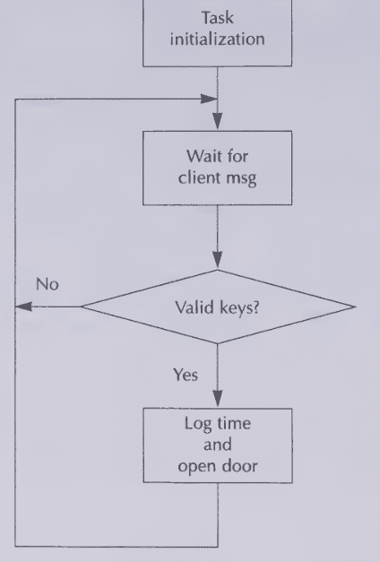

**图 9.6** 服务器任务流程图。

### Web 服务器模块

Web 服务器模块在 TCP/IP 套接字端口 9999 等待客户端连接。一旦收到连接，将创建一个 Web 页面，返回来自数据库的时间日志信息。

## 实现

模块文件提供在配套 CD 的 `/book/chapter9/DoorLock` 目录下，应将内容复制到本地目录以进行编译和测试。详细指令也可在 `ReadMe.txt` 文件（CD 目录路径 `/book/chapter9/readme.txt`）的 “DoorLock” 章节中找到。

> 您必须是 root 用户才能执行以下操作。

将配套 CD 插入 CD-ROM，并使用以下命令挂载驱动器：

```bash
# mount -t iso9660 /dev/cdrom /mnt/cdrom
```

### 设备驱动模块

设备驱动的功能职责是读取外部键盘并控制指示 LED。

1. 在本地驱动器上创建工作目录：

   ```bash
   # mkdir /projects/DoorLock
   ```

2. 从配套 CD 复制源文件：

   ```bash
   # cp /mnt/cdrom/book/chapter9/DoorLock/pport.c /projects/DoorLock/
   ```

3. 从配套 CD 复制设备驱动模块的 Makefile 文件：

   ```bash
   # cp /mnt/cdrom/book/chapter9/DoorLock/Makefile /projects/DoorLock/
   ```

4. 复制加载和卸载设备驱动模块的脚本：

   ```bash
   # cp /mnt/cdrom/book/chapter9/DoorLock/pp_load /projects/DoorLock/
   # cp /mnt/cdrom/book/chapter9/DoorLock/pp_unload /projects/DoorLock/
   ```

5. 使用以下命令创建可加载的设备驱动模块：

   ```bash
   # cd /projects/DoorLock/dd
   # make
   ```

6. 使用脚本 `pp_load` 安装设备驱动：

   ```bash
   # ./pp_load
   ```

7. 使用以下命令验证设备驱动是否到位：

   ```bash
   # lsmod | grep pport

   pport 1836 0 (unused)
   ```

### 客户端/服务器模块

客户端/服务器模块的功能职责是：

- 与设备驱动程序通信并接收用户的按键输入
- 根据数据库验证密码按键
- 如果按键码有效，则打开门电磁阀并点亮绿色 LED
- 将时间戳输入到数据库中

`test.c` 文件和 `db.c` 文件构成了客户端/服务器模块。


1. 从配套 CD 复制源文件：

   ```bash
   # cp /mnt/cdrom/book/chapter9/DoorLock/*.c /projects/DoorLock/
   ```

2. 从配套 CD 复制该模块的 Makefile 文件：

   ```bash
   # cp /mnt/cdrom/book/chapter9/DoorLock/Makefile /projects/DoorLock/
   ```

3. 使用以下命令创建可执行文件：

   ```bash
   # cd /projects/DoorLock
   # make
   ```

4. 使用以下命令执行程序：

   ```bash
   # ./test
   ```

5. 使用以下命令验证模块是否到位：

   ```bash
   # ps -ea | grep test
   ```

6. 您应该看到显示的内容如下所示：

   ```text
   test 1836 0 (unused)
   ```

### Web 服务器模块

在第 4 章 Sockets 节中开发的微型 Web 服务器被集成到 `test.o` 文件中，而附录 B 中描述的微型数据库管理器正被集成到 `db.c` 文件中。在前一节启动的测试程序也会启动监听 socket 端口号 9999 的 Web 服务器。接下来的章节将描述如何通过该微型 Web 服务器查看数据库的内容。

## 测试

系统测试包括通过并行端口输入组合键，并通过 Web 界面查看输入日志，以及监测并行端口状态寄存器的引脚输出逻辑电平，以验证来自客户端/服务器模块的按键是否有效。

### 测试组合键

开锁的开关组合为 “1323”（见 `cs.c` 源代码清单第 45 行）。

1. 将并行端口连接器引脚 9 与引脚 15 瞬时连接（按下 sw1）。
2. 将并行端口连接器引脚 9 与引脚 12 瞬时连接（按下 sw3）。
3. 将并行端口连接器引脚 9 与引脚 11 瞬时连接（按下 sw2）。
4. 将并行端口连接器引脚 9 与引脚 12 瞬时连接（按下 sw3）。

此时引脚 2 的电平将为低电平，表明电磁铁已激活，门可以打开。对于任何其他组合，引脚 2 的电平将保持高电平，而引脚 3 将在三秒钟内变为低电平。

### 测试 Web 界面

1. 启动 Netscape Navigator 并输入 URL：

   ```text
   http://localhost:9999
   ```

2. 将显示如图 9.7 所示的 Web 页面，显示开门序列的最后 30 条时间日志。

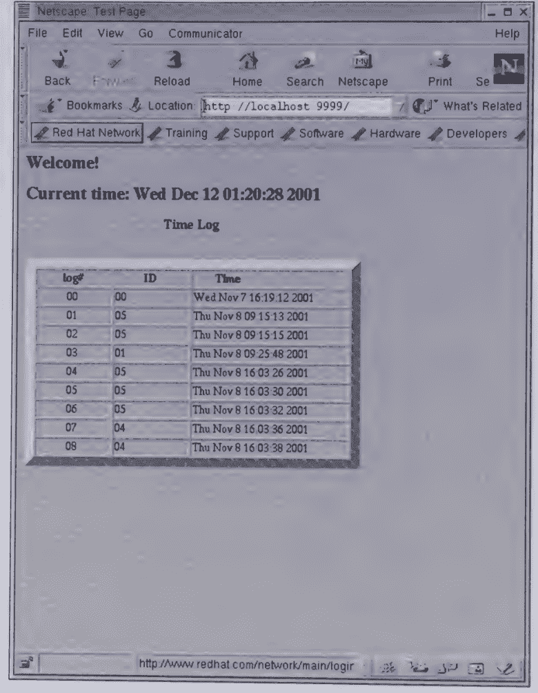

**图 9.7** 通过 Web 浏览器显示的入口日志。

## 项目 2：带有时间日志的增强型入口安全系统——增强型门锁（DOORLOCK ENHANCED）

一个具有增强型编码密钥和时间日志的门锁系统。

## 产品规格

- 低成本的编码密钥门锁系统，具有增强的时间日志功能
- 适用于办公室、制造工厂以及具有集中控制的酒店房间
- 时间日志数据库可通过 Web 界面访问
- 基于 Web 的监督员编辑模式
- 内置网络功能，支持远程登录
- 模块化单元，内置触摸键盘和显示屏

## 简介

这是 DoorLock 系统的增强版本；基本功能与之前的项目相同，但在组合键、最高 1,000 条记录的登录功能以及通过内网的监督控制系统方面进行了增强。这是一个带有编码密钥和时间日志功能的低成本门锁安全系统，非常适合酒店房间锁系统。该产品将使用 Linux 操作系统开发，由 PC 并行端口提供必要的硬件电路。

实施目的是演示 Linux 操作系统的全规模实现，包括 SQL、DNS 和 HTTP 服务器，将其作为一个真正的 Web 应用程序。


### 系统要求

- 五位数字键盘，由 PC 并行端口状态寄存器的输入引脚模拟
- 绿色 LED 表示有效的组合键，由 PC 并行数据寄存器 bit 0 控制
- 红色 LED 表示无效的组合键，由 PC 并行数据寄存器 bit 1 控制
- 锁电磁铁锁舌信号，由 PC 并行数据寄存器 bit 2 控制
- 能够存储最后 1,000 条记录的时间日志
- 能够接受多个编码密钥
- 通过 Web 界面提供监督员访问权限

### 硬件功能描述

请回顾前一节中的 DoorLock 硬件功能描述。

### 软件功能描述

关于基础软件功能描述，请回顾前一节中的 DoorLock 软件功能描述。增强版本使用了事务数据库服务器 PostgreSQL 以及通过 HTTP/DNS 服务器提供的 Web 界面。

## 功能概述

DoorLock 的软件模块由系统接口和用户界面组成。

系统接口模块：

- `DeviceDriver`（设备驱动）
- `ClientServer`（客户端/服务器）

用户界面模块：

- HTTP 服务器（Apache）配置
- HTML 页面和 CGI 脚本
  - `Index.html`
  - `Supervisor.pl`
- 使用 PostgreSQL 服务器创建数据库

### 设备驱动模块

请参阅前一节“Door-Lock 功能概述”中关于设备驱动模块的定义。

### ClientServer 模块

请参阅前一节“DoorLock 功能概述”中关于设备驱动模块的定义。

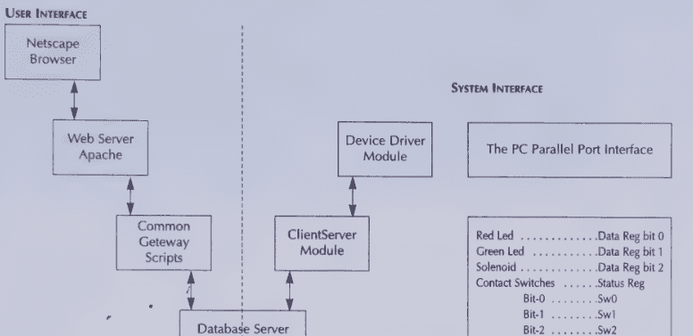

**图 9.8** 增强型 DoorLock 系统模块互连图。

### HTTP/DNS 服务器配置

域名、`Index.html` 和 Perl 脚本。

请按照第 2 章中提供的指令设置网站 `www.Timelog.com`。标准版 Door-Lock 的 Web 服务器模块将被替换为 HTTP 服务器模块 Apache。监督员可以通过 Web 浏览器查询时间日志数据库，并访问网站 `www.Timelog.com`。

`index.html` 基本上是一个 Web 表单，要求用户输入登录名和密码以进入监督员模式。Perl 脚本 `log.pl` 用于在 Web 页面上查看登录信息。

### 使用 PostgreSQL 创建数据库

增强版 DoorLock 系统使用了 PostgreSQL 数据库服务器。请按照第 2 章中创建数据库的步骤，使用以下模式（schema）进行操作。

#### 数据库模式

为增强版数据库设置以下表：

| 表 | Doorlock |
| :--- | :--- |
| 列 1 | ID (Char 6) $\rightarrow$ 主键 |
| 列 2 | TimeIn (TIMESTAMP) |

## 实现

模块文件提供在随书 CD 的 `/book/chapter9/AdvancedDoorLock` 目录下，应将内容复制到本地目录以进行编译和测试。详细指令也可在 `ReadMe.txt` 文件（CD 目录路径 `/book/chapter9/readme.txt`）的 “AdvancedDoorLock” 章节中找到。

您必须以 root 用户身份执行以下操作。

将随书 CD 插入 CD-ROM 驱动器，并使用以下命令挂载 CD-ROM：

```bash
# mount -t iso9660 /dev/cdrom /mnt/cdrom
```

### 设备驱动模块

设备驱动的功能职责是读取外部键盘并控制指示 LED。

1. 在本地驱动器上创建一个工作目录。

   ```bash
   # mkdir /projects/AdvancedDoorLock/dd
   ```

2. 从随书 CD 复制源文件：

   ```bash
   # cd /mnt/cdrom/book/chapter9/AdvancedDoorLock/dd
   # cp pport.c /projects/AdvancedDoorLock/dd/
   ```

3. 从随书 CD 复制设备驱动模块的 Makefile 文件：

   ```bash
   # cp Makefile /projects/AdvancedDoorLock/dd/.
   ```

4. 复制用于加载和卸载设备驱动模块的脚本：

   ```bash
   # cp pp_load /projects/AdvancedDoorLock/dd/.
   # cp pp_unload /projects/AdvancedDoorLock/dd/.
   ```

5. 使用以下命令创建可加载的设备驱动模块：

   ```bash
   # cd /projects/AdvancedDoorLock/dd
   # make
   ```

6. 使用脚本 `pp_load` 安装设备驱动：

   ```bash
   # ./pp_load
   ```

7. 使用以下命令验证设备是否就绪：

   ```bash
   # lsmod | grep pport
   pport 1836 0 (unused)
   ```

### 数据库设置

1. 从随书 CD 复制数据库模式文件：

   ```bash
   # cd /mnt/cdrom/book/chapter9/AdvancedDoorLock/
   # cp doorlock_schema /projects/AdvancedDoorLock/.
   ```

2. 切换到 postgres 用户：

   ```bash
   # su postgres
   ```

3. 创建数据库 `doorlock`：

   ```bash
   $ createdb doorlock
   ```

4. 启动 psql 后端并使用 `doorlock_schema` 填充数据库：

   ```bash
   $ psql doorlock
   doorlock-# \i doorlock_schema
   doorlock-# \q
   ```

### 客户端/服务器模块

与前一节的 DoorLock 系统类似，客户端/服务器模块的功能职责是：

- 与设备驱动程序通信并接收用户的按键输入
- 根据数据库验证加密按键
- 将时间戳输入数据库


1. 从配套 CD 中复制源文件：

   ```bash
   # cd /mnt/cdrom/book/chapter9/AdvancedDoorLock
   # cp *.c /projects/AdvancedDoorLock/ .
   ```

2. 从配套 CD 中复制设备驱动模块的 Makefile 文件：

   ```bash
   # cp Makefile /projects/AdvancedDoorLock/ .
   ```

3. 创建客户端/服务器模块：

   ```bash
   # cd /projects/AdvancedDoorLock
   # make
   ```

4. 使用以下命令执行程序：

   ```bash
   # ./test
   ```

5. 使用以下命令验证测试是否正在执行：

   ```bash
   # ps -ea | grep test
   ```

6. 您应该看到如下显示的内容：

   ```text
   test 1836 0 (unused)
   ```

## Web 托管设置

AdvancedDoorLock 系统需要一个域名为 `www.timelog.com` 的虚拟 Web 托管设置。

请参考第 2 章中关于设置 Web 站点 `www.Timelog.com` 的指令。


1. 从配套 CD 中复制 `index.html` 文件和 Perl 脚本：

   ```bash
   # cp index.html /home/http/html/www/timelog/
   # cp *.pl /home/http/html/www/timelog/cgi-bin/
   ```

## 测试

系统测试包括通过并行端口输入按键组合，并通过 Web 界面查看输入日志。

### 测试按键组合

请遵循前述 DoorLock 章节中“测试按键组合”的步骤。

### 测试 Web 界面

AdvancedDoorLock 的 Web 界面比之前的 DoorLock 实现提供了更多的监管控制。

启动 Netscape Navigator 并输入 URL：

```text
http://www.timelog.com
```


浏览器将显示如图 9.9 所示的页面。输入登录名“0000”和密码“password”以进入管理模式。浏览器将显示一个显示输入日志的页面。


**图 9.9** 显示登录信息填写表单的 Web 页面。

登录完成后，您将看到时间日志信息页面。

# 项目 3：当准时至关重要时——TIMEISMONEY

一个用于员工时间和考勤系统的集成 Web 应用程序。

## 产品规格

- 使用 Web 浏览器进行时间日志输入的考勤应用程序
- 即时检索过去三年的记录信息
- 管理模式下查看和编辑员工信息
- 时间日志信息的安全远程访问
- 可选的税收和工资计算
- 通过入口安全系统记录时间日志
- 用于分布式控制的内置网络设施
- 带有内置触摸键盘和显示屏的模块化单元

## 简介

得益于这个以 Linux 为操作系统并使用 Web 界面进行用户交互的集成应用程序，追踪员工的时间日志和考勤变得更加简单。该模块化系统是前述 `AdvancedDoorLock` 入口安全系统的扩展。通过增强功能，工作人员可以通过 Web 界面记录签入（time-in）和签出（time-out）信息。


在这个项目中，我们将增强在前一节中开发的客户端/服务器通信概念，并设计一个功能性产品，该产品将使用 Web 技术作为用户界面，并使用消息队列等进程间通信方法作为系统接口。您将学习使用 Perl 编写 CGI 脚本的基础知识。Perl 模块 `Pg` 和 `CGI` 将被用于设计数据库服务器（如 PostgreSQL）与 Web 浏览器（如 Netscape Navigator）之间的接口。借助这些脚本，用户将能够查看由系统模块存储的入口时间日志，并能够执行编辑员工数据和系统环境的管理功能。

### 硬件功能描述

TimeIsMoney 基本上是一个仅通过 Web 提供用户界面的独立模块。但它也可以作为 `AdvancedDoorLock` 系统的扩展，提供通过外部键盘输入访问码的能力。请回顾前一节中的 DoorLock 硬件功能描述，以了解如何添加外部按键访问。

### 软件功能描述

关于基础软件功能描述，请回顾前一节中的 DoorLock 软件功能描述。数据库已增强，以纳入更多员工信息，以便通过管理控制跟踪时间日志输入。

## 功能概述

增强版 DoorLock 的功能通过 Perl 脚本集成了一个额外的用户界面，包括管理模式访问和通过 Web 进行的员工登录。

### 增强的用户界面模块

- HTTP 服务器（Apache）配置
- HTML 页面和 CGI 脚本：
  - `Index.html`
  - `Supervisor.pl`
- 使用 PostgreSQL 服务器创建数据库

### HTTP/DNS 服务器配置

TimeIsMoney 系统的虚拟 Web 托管设置与前一节的 AdvancedDoorLock 系统相同。如果您尚未设置，请遵循第 2 章中关于设置 Web 站点 `www.Timelog.com` 的指令。Web 访问为输入时间戳和查看时间日志历史记录提供了管理权限和用户权限。

### 使用 PostgreSQL 创建数据库

TimeIsMoney 系统使用了与增强版 DoorLock 系统类似的 PostgreSQL 数据库服务器。请遵循第 2 章中设置 PostgreSQL 服务器的指示，并创建数据库 `timelog`。

## 实现

模块文件提供在配套 CD 的 `/book/chapter9/TimeIsMoney` 目录下，应将其内容复制到本地目录以进行编译和测试。详细指令也可在 ReadMe.txt 文件（CD 目录路径 `/book/chapter9/readme.txt`）的“TimeIsMoney”章节中找到。


> 您必须是 root 用户才能执行以下操作。

将配套数据 CD 插入 CD-ROM 驱动器，并使用以下命令挂载 CD-ROM：

```bash
# mount -t iso9660 /dev/cdrom /mnt/cdrom
```

### 设备驱动模块

TimeIsMoney 的基本功能不需要设备驱动程序，因为所有用户输入都通过 Web 界面提供。但是，如果它被用作 AdvancedDoorLock 系统的扩展，则需要按照前一节所述设置设备驱动程序。

### 客户端/服务器模块

客户端/服务器模块遵循前一节所述的 AdvancedDoorLock 系统的模式。

### 数据库设置

TimeIsMoney 的 `timelog` 数据库包含两个表：员工表（`employee`）和入口日志表（`entrance_log`）。员工表的主键 `ID` 是入口日志表的外键；从而为系统创建了一个关系数据库。在进行此设置之前，必须已按照第 2 章所述配置 PostgreSQL 服务器。

1. 在本地驱动器中创建工作目录：

   ```bash
   # mkdir /projects/timelog/
   ```

2. 从配套 CD 复制数据库模式文件：

   ```bash
   # cd /mnt/cdrom/book/chapter9/timelog
   # cp employee_schema /projects/timelog/
   ```

3. 切换到 postgres 用户：

   ```bash
   # su postgres
   ```

4. 创建数据库 timelog：

   ```bash
   # createdb doorlock
   ```

5. 启动 `psql` 后端并使用 `doorlock_schema` 填充数据库：

   ```text
   $ psql doorlock

   doorlock-# \i employee_schema

   doorlock-# \q
   ```

### 用户界面设置


Web 为 TimeIsMoney 提供了主要的用户界面。它包括设置与 AdvancedDoorLock 系统类似的虚拟 Web 托管 `www.timelog.com`。请遵循第 2 章中设置 Web 站点 `www.Timelog.com` 的指令，并按照接下来的描述从 CD 复制必要的脚本。

1. 从配套 CD 复制 `index.html` 文件和 Perl 脚本：

   ```bash
   # cd /mnt/cdrom/book/chapter9/timelog
   # cp index.html /home/http/html/www/timelog/.
   # cp *.pl /home/http/html/www/timelog/cgi-bin/.
   ```

## 测试

系统测试包括：如果您添加了 AdvancedDoorLock 系统功能，则通过并行端口输入按键组合；否则，测试包括启动 Web 浏览器并通过 Web 界面查看输入日志。

### 测试按键组合

“TimeIsMoney”仅仅是前述“AdvancedDoorLock”的一个扩展。在此实现中，用户可以通过模拟的并行端口引脚输入 ID。请遵循前述 AdvancedDoorLock 章节中“测试按键组合”的步骤。

### 测试 Web 界面

启动您最喜欢的 Web 浏览器（Netscape）并输入 URL `http://www.timelog.com`。浏览器将显示如图 9.9 所示的页面。输入登录名“0000”和密码“password”以进入管理模式。浏览器将显示如图 9.10 所示的新时间戳值。您可以添加新员工，查看员工时间日志，并执行其他管理功能，如更改姓名、密码等。

**图 9.10** 显示员工数据输入表单的 Web 页面。

# 项目 4：带远程日志的平台钻井率监控系统——DRILLINGRIG

测量石油平台钻井率。

## 产品规格

- 低成本低且带有远程显示的数据采集系统
- 维护全过程的历史日志
- 适用于具有 Web 显示和控制的网络系统
- 提供可选的遥测系统
- 提供可选的可编程流速测量
- 内置用于远程访问的网络设施
- 模块化单元，内置触摸键盘和显示屏

## 简介

监控石油平台钻井活动的一个重要方面是确定潜在井的深度和钻井率。获取所需信号最有效的方法是通过滑轮机构监控连接到钻头电缆的时间移动。当钻机到达新深度时，电缆前进到一定距离，通过监控滑轮的时间测量角位移，我们可以确定井深和渗透率。测量滑轮的角位移是通过在滑轮机构每转一圈接收一个中断信号来完成的，类似于测量转速表的读数。

DrillingRig 是一个独立的数据采集系统，专门设计用于监控来自此类滑轮运动的中断信号。数据经过处理并呈现给工作人员，以便进行有意义的解读。由于系统提供了以太网和调制解调器端口，该单元作为网络解决方案的一部分也具有良好的扩展性。

在这个项目中，我们将增强第 3 章中开发的客户端/服务器通信概念，并设计一款产品，该产品将使用 Web 技术作为用户界面，并使用诸如消息队列等进程间通信方法作为系统接口。您将学习使用 Perl 编写 CGI 脚本的基础知识。Perl 模块 `Pg` 和 `CGI` 将用于设计数据库服务器（PostgreSQL）与 Web 浏览器（Netscape Navigator）之间的接口。借助这些脚本，用户将能够查看通过 PC 并行端口接收的数字信号，并根据石油平台钻井率监控系统的要求处理数据。

该项目使用了服务器推送动画技术，允许服务器与客户端保持打开的连接。`x-multi-replace` MIME 类型允许 Web 页面自动定期更新。脉冲计数器的当前值定期推送到客户端，从而实现采集数据的近实时刷新。

### 硬件功能描述

PC 并行端口中断引脚（DB-25 连接器第 10 引脚）被用作监控外部中断源（如钻机滑轮运动）的通道。

### 软件功能描述

软件功能分为系统接口和用户界面。用户界面基本上是一个 Web 界面，通过 Web 页面提供对钻井活动的持续监控。另一方面，系统接口是接收外部中断的设备驱动程序模块，以及处理从驱动程序接收数据的客户端/服务器模块。

## 功能概述

系统中使用的软件模块的功能框图和互连方式与图 9.4 所示的 DoorLock 系统类似。

系统接口模块：

- `DeviceDriver`
- `ClientServer`

用户界面模块：

- Web 服务器设置
- DNS 设置
- HTML/CGI 脚本：
  - `index.html`
  - `drillingrig.pl`

### 设备驱动程序模块

该模块作为标准 Linux 设备驱动程序与系统硬件通信。设置一个包含 `MAX_PAGE` 个条目的轮询队列，用于存储通过并行端口接收的中断脉冲的时间戳。ioctl 代码 `WAIT_FOR_INTERRUPT` 提供中断之间的脉冲宽度，而设备驱动程序的客户端在中断发生前处于睡眠状态。必须支持以下函数调用：

| 函数 | 描述 |
| :--- | :--- |
| `int open(void)` | 提供硬件初始化 |
| `int close(void)` | 提供文件描述符的关闭 |
| `int read(void)` | 提供键盘访问 |
| `int write(void)` | 提供控制访问 |
| `int ioctl(void)` | 提供中断脉冲宽度 |

#### 通过 `ioctl()` 函数的通信协议

调用带有 `WAIT_FOR_INTERRUPT` 参数的 `ioctl` 函数。

### ClientServer 模块

该模块负责以客户端/服务器模型提供所需的系统接口。该模块的主要职责是从设备驱动程序模块接收时间戳，将数据处理为脉冲宽度、脉冲率和累积脉冲率，并将这些值存储在数据库中。

## Web 服务器设置

请参考第 2 章中关于设置网站 `www.digital.com` 的说明。HTTP 服务器 Apache 被用作主 Web 服务器。

### DNS 服务器设置

在 DNS 服务器中为域名 `www.drill.com` 创建一个条目。

## 实现

模块文件提供在配套 CD 的 `/book/chapter9/drilling` 目录下，应将内容复制到本地目录以进行编译和测试。详细说明也可在 ReadMe.txt 文件（CD 目录路径 `/book/chapter9/readme.txt`）的“Drilling”部分中找到。

您必须是 root 用户才能执行以下操作。

将配套 CD 插入 CD-ROM 驱动器，并使用以下命令挂载驱动器：

```bash
# mount -t iso9660 /dev/cdrom /mnt/cdrom
```

### 设备驱动程序模块

设备驱动程序的职能是提供中断脉冲宽度。

1. 在本地驱动器上创建一个工作目录。

   ```bash
   # mkdir /projects/drilling/dd
   ```

2. 从配套 CD 复制源文件。

   ```bash
   # cp /book/chapter9/drilling/dd/pport.c /projects/drilling/dd/.
   ```

3. 从配套 CD 复制设备驱动程序模块的 Makefile 文件。

   ```bash
   # cp /book/chapter9/drilling/dd/Makefile /projects/drilling/dd/.
   ```

4. 复制用于加载和卸载设备驱动程序模块的脚本。

   ```bash
   # cp /book/chapter9/drilling/dd/pp_load /projects/drilling/dd/.
   # cp /book/chapter9/drilling/dd/pp_unload /projects/drilling/dd/.
   ```

5. 使用以下命令创建可加载的设备驱动程序模块：

   ```bash
   # cd /projects/drilling/dd/
   # make
   ```

6. 使用脚本 `pp_load` 安装设备驱动程序。

   ```bash
   # ./pp_load
   ```

7. 使用以下命令验证设备驱动程序是否就绪：

   ```bash
   # lsmod | grep pport
   ```

8. 您应该看到如下屏幕快照所示的内容。

   ```text
   pport 1836 0 (unused)
   ```

### 数据库设置

1. 从配套 CD 复制数据库模式文件：

   ```bash
   # cd /mnt/cdrom/book/chapter9/drilling/
   # cp drilling_schema /projects/drilling/
   ```

2. 切换到 postgres 用户：

   ```bash
   # su postgres
   ```

3. 创建数据库 drilling：

   ```bash
   $ createdb drilling
   ```

4. 启动 `psql` 后端并使用 `drilling_schema` 填充数据库：

   ```text
   $ psql drilling

   drilling-# \i drilling_schema

   drilling-# \q
   ```

### 客户端/服务器模块

请参考配套 CD 目录 `/book/chapter9/drilling/script` 中提供的脚本。

1. 从配套 CD 复制该模块的源文件和 Makefile 文件。

   ```bash
   # cp /book/chapter9/drilling/* /projects/drilling/
   ```

2. 使用以下命令创建可执行文件：

   ```bash
   # cd /projects/drilling
   # make
   ```

3. 使用以下命令执行程序：

   ```bash
   # ./test
   ```

4. 使用以下命令验证设备驱动程序是否已就绪：

   ```bash
   # ps -ea | grep test
   ```

5. 您应该看到如下显示的内容：

   ```text
   test	1836	0 (unused)
   ```

## Web 托管设置

DrillingRig 系统需要一个域名为 `www.digital.com` 的虚拟 Web 托管设置。请按照第 2 章中的说明设置 Web 站点 `www.digital.com`。


1. 从随附 CD 复制 `index.html` 文件和 Perl 脚本：

   ```bash
   # cp index.html /home/http/www/digital/.
   # cp *.pl /home/http/www/digital/cgi-bin/.
   ```


## 测试

Web 界面采用推送机制，定期刷新屏幕上的深度值。瞬时深度值从数据库中获取。数据库值通过一个接口通过设备驱动程序进行更新，该驱动程序对应于通过并口中断源接收到的中断计数。

### 测试接收到的中断

1. 启动浏览器并输入 `www.digital.com`。
2. 将并口连接器的第 9 引脚与第 10 引脚瞬间短接。
3. 浏览器将显示一个新的时间戳值，如图 9.11 所示。


**图 9.11** 显示钻井活动数据的 Web 页面。

# 项目 5：液体储罐液位监测系统 – TANKVOLUME

一个基于 Web 的液体储罐液位监测系统实现，具有通过泵关断系统进行可选输入流量控制的功能。

## 产品规格

- 低成本且具有 Web 显示的数据采集系统
- 维护历史日志
- 非常适合具有 Web 显示和控制的网络系统
- 提供可选的遥测系统
- 提供通过泵关断系统实现的可编程可选流量控制
- 内置网络设施用于远程访问

### 介绍

炼油系统的一个重要方面是维持储罐区为了原油生产而设的存储液位。自动泵关断系统是系统解决方案中理想的一部分。储罐中的液位可以通过在罐壁不同高度安装接触开关来监测。开关的状态指示了液体在罐中达到的高度。系统实时监测这些开关，并在 Web 页面上显示高度。

> 注意：本项目演示了服务器推送动画技术的使用，该技术允许服务器与客户端保持打开的连接。`x-multi-replace` MIME 类型允许 Web 页面进行定期更新，以实现近实时的数据显示，类似于之前项目中所使用的技术。为了获得液位的图形化视图，客户端 Web 页面会定期使用新图像进行刷新。

### 硬件功能描述

PC 并口状态寄存器引脚被用作液体液位高度的接触开关。

### 软件功能描述

软件功能分为系统接口和用户接口。用户接口基本上是一个 Web 动画，它将从数据库接收到的液体液位瞬时值作为接触开关的持续监测结果。另一方面，系统接口是接收外部中断的设备驱动模块，以及处理从驱动程序接收的数据并将其值存储到数据库中的客户端/服务器模块。

## 功能概述

系统中所用软件模块的功能框图和互连方式与图 9.4 所示的 `DoorLock` 系统类似。

系统接口模块：
- `DeviceDriver`（设备驱动）
- `ClientServer`（客户端服务器）

用户界面模块：
- Web 服务器设置
- DNS 设置
- HTML/CGI 脚本
  - `index.html`
  - `tank.pl`
  - `welcome.html`

### 设备驱动模块

该模块作为标准的 Linux 设备驱动程序与系统硬件通信。高度液位通过并口的状态寄存器进行模拟。每个引脚代表特定高度的一个触点闭合。

支持以下函数调用：

```
int open(void) 提供硬件初始化

int close(void) 提供文件描述符的关闭

int read(void) 提供触点访问

int write(int pattern) 控制输出引脚的逻辑电平
```

### 通过 `read()` 函数的通信协议

1. `bit 0 = 0` 表示接触开关 `SW0`。
2. `bit 1 = 0` 表示接触开关 `SW1`。
3. `bit 2 = 0` 表示接触开关 `SW2`。
4. `bit 3 = 0` 表示接触开关 `SW3`。
5. `bit 4 = 0` 表示接触开关 `SW4`。

## 客户端服务器模块 (ClientServer Module)

该模块负责以客户端/服务器模型提供所需的系统接口。该模块的主要职责是从设备驱动模块接收接触开关信息，处理数据并将值存储在数据库中。

## Web 服务器设置

请按照第 2 章中的说明设置 Web 站点 `www.analog.com`。HTTP 服务器 Apache 被用作主 Web 服务器。

## 实现

模块文件提供在随附 CD 的 `/book/chapter9/TankVolume` 目录下，应将内容复制到本地目录以便进行编译和测试。详细说明也可在 `ReadMe.txt` 文件（CD 目录路径 `/book/chapter9/readme.txt`）的“TankVolume”部分中找到。

> 您必须是 `root` 用户才能执行以下操作。

将随附的数据 CD 插入 CD-ROM 驱动器，并使用以下命令挂载驱动器：

```
# mount -t iso9660 /dev/cdrom /mnt/cdrom
```

### 设备驱动模块

1. 在本地驱动器上创建一个工作目录。

```
#mkdir /projects/TankVolume/dd
```

2. 从随附 CD 复制源文件。

```
#cp /book/chapter9/TankVolume/dd/pport.c /projects/TankVolume/dd/.
```

3. 从随附 CD 复制设备驱动模块的 Makefile 文件。

```
#cp /book/chapter9/TankVolume/dd/Makefile /projects/TankVolume/dd/.
```

4. 复制用于加载和卸载设备驱动模块的脚本。

5. 使用以下命令创建可加载的设备驱动模块：

```
#cd /projects/TankVolume/dd/

#make
```

6. 使用脚本 `pp_load` 安装设备驱动程序。

```
# ./pp_load
```

7. 使用以下命令验证设备驱动程序是否已就绪：

```
# lsmod | grep pport
```

8. 您应该看到如下显示的内容。

| Module | Size | Used by |
| :--- | :--- | :--- |
| `pport` | 1836 | 0 (unused) |

### 数据库设置


1. 从随附 CD 复制数据库模式文件：

```
#cd /mnt/cdrom/book/chapter9/tankvolume/

#cp drilling_schema /projects/tankvolume/.
```

2. 切换到 `postgres` 用户：

```
#su postgres
```

3. 创建数据库 `tankvolume`：

```
$createdb tankvolume
```

4. 启动 `psql` 后端并使用 `drilling_schema` 填充数据库：

```
$psql drilling

doolock-# \i tankvolume_schema

doolock-# \q
```

### 客户端/服务器模块

1. 从随附 CD 复制源文件。

```
#cp /mnt/cdrom/book/chapter9/tankvolume/* /projects/tankvolume/ .
```

2. 使用以下命令创建可执行文件：

```
#cd /projects/tankvolume

#make
```

3. 使用以下命令执行程序：

```
# ./test
```

4. 使用以下命令验证测试是否正在执行：

```
# ps -ea | grep test
```

5. 您应该看到如下显示的内容。

```
test 1836 0 (unused)
```

## Web 托管设置

`TankVolume` 系统需要一个域名为 `www.analog.com` 的虚拟 Web 托管设置。
请按照第 2 章中的说明设置 Web 站点 `www.analog.com`。

1. 从随附 CD 复制 `index.html` 文件和 Perl 脚本：

```
#cp index.html /home/http/www/analog/.

#cp *.pl /home/http/www/analog/cgi-bin/.
```

## 测试

Web 界面采用一种推送机制，类似于前一节所述的钻井监测系统。Web 界面使用一种称为推送机制的实时动画技术，定期刷新储罐中的液体高度。瞬时高度值从数据库中获取。数据库值通过一个接口通过设备驱动程序进行更新，该驱动程序对应于 PC 并口的状态端口引脚。


**图 9.12** 显示水箱液位高度的网页。

### 测试接收到的中断

1. 启动浏览器，输入 `www.analog.com`。
2. 将并行端口状态寄存器引脚接地。
3. 浏览器将定期刷新屏幕上的水箱液位，如图 9.12 所示。

## 总结

在本章中，我们基于拥有用户界面、系统界面和数据库的概念，确立了设计嵌入式系统的规则。为了证明该概念的可行性，我们基于该设计原则实现了一些实际的设计项目。利用 Web 技术使我们能够以最小的代价获得一个鲁棒的用户界面。系统界面的设备驱动程序和客户端-服务器机制帮助我们实现了易于扩展的模块化设计。通过数据库将用户界面与系统界面链接起来，最大限度地减少了用户与系统之间的交互，并为任何实际的嵌入式系统设计项目提供了所需的持久性。

# 附录 A
## C 语言开发工具

以下章节是对语法规则的总结。

### 变量与标识符

变量是被操作的对象。变量占用计算机程序内存中的一个位置，并通过一个*标识符*来识别。标识符是由字母、数字和下划线 (`_`) 组成的字符字符串。第一个字符必须是字母。C 语言区分大小写；大写和小写字符构成不同的标识符。

### 保留字

- `asm`
- `auto`
- `break`
- `case`
- `char`
- `continue`
- `default`
- `do`
- `double`
- `enum`
- `external`
- `float`
- `for`
- `goto`
- `if`
- `int`
- `long`
- `register`
- `return`
- `short`
- `sizeof`
- `static`
- `struct`
- `switch`
- `typedef`
- `union`
- `unsigned`
- `void`
- `while`

## 变量存储类与类型

一个变量有两个相关属性：它的*存储类*（决定标识符位于内存的哪个区域）和*类型*（决定如何解释该值）。

### 存储类

- **Automatic (自动)**：对每个块的调用局部有效；每次调用时重新分配新值。
- **Static (静态)**：局部有效，但在重新进入时保留初始值。
- **External (外部)**：整个程序可用，并在程序生命周期内保留其值。
- **Register (寄存器)**：编译器尽可能尝试使用快速寄存器。不应将其作为传递给其他函数的参数。

### 类型与常量

- **`int`**：32 位存储。
- **十进制整数常量**：0..9 的数字序列，但不能以 0 开头。例如：`123456`
- **八进制整数常量**：0..7 的数字序列，且以 0 开头。例如：`0123`
- **十六进制整数常量**：0..9 和 a..f 的数字序列；以 `0x` 或 `0X` 开头。例如：`0xABCDEF`

- **`long`**：常量是最大 32 位长整数。十进制、八进制或十六进制常量后接 `l` 或 `L` 也被视为 `long`。例如：`0x1234l`

- **`short`**：可以是 16 位或 32 位，取决于机器。例如：`0x1234`

- **`char`**：8 位存储。

- **字符常量**：在数值上等于其在机器字符集中的值，由单引号括起来，例如 `'d'` 等同于 `0x44`。如果前面带有 `\`，某些不可显示字符可以定义为字符常量，例如 `"\n"` 等于换行。例如：`'a' = 0x41`

- **`double`**：64 位存储。

- **`float`**：32 位存储。

- **`float` 和 `double` 常量**：由整数部分和小数部分组成，由小数点分隔，前面可带有可选的 `-` 符号。数字后面可以跟着 `e` 或 `E` 以及指数值。例如：`-123.456E20`

*枚举常量* 序列如果定义为 `enum`，则可以被视为数字。

```c
typedef enum printer_err
{
    OUT_OF_PAPER,
    INVALID_PAPER,
    PAPER_JAM
}
```

`OUT_OF_PAPER` 被视为整数值 0。
`INVALID_PAPER` 被视为整数值 1。
`PAPER_JAM` 被视为整数值 2。
`enum` 不需要是连续的；您可以将任何常量分配给任何成员。

```c
typedef enum printer_err
{
    OUT_OF_PAPER = 3,
    INVALID_PAPER = 7,
    PAPER_JAM
}
```

`OUT_OF_PAPER` 被视为整数值 3。
`INVALID_PAPER` 被视为整数值 7。
`PAPER_JAM` 被视为整数值 8。

**字符串字面量**：由双引号包围的字符序列。例如：
“this is a string literal”

编译器在字符串字面量的末尾附加一个 NULL `"\0"`。字符串字面量的类型为字符数组，存储类为 `static`。

**`int` 和 `unsigned`**：`int` 的最高位被视为符号值，而 `unsigned` 的最高位被视为数字的一部分。这影响了比较运算的结果，因为无符号值总是大于或等于零，而 `int` 可以小于、等于或大于零。

**lvalues (左值)**：被引用对象的地址；例如，如果 `int value` 是一个变量，那么 `&value` 就是 `lvalue`。

**pointers (指针)**：变量存在于程序内存的某个位置；该位置的地址就是一个指针。指针变量存储另一个变量的地址；因此，指针变量指向另一个变量。可以在指针变量上执行加法和减法运算。

**`void`**：这是 C 语言中的一个通用术语。`void` 类型的变量没有类型。不对 `void` 类型进行转换。

## 变量的表达式与运算符

表达式是对变量和常量执行的算术运算。运算产生的结果可用于给变量赋新值，或在 *if* 和 *do while* 等条件语句中测试真假条件。

### 二元算术运算符

- `+` 加法
- `-` 减法
- `*` 乘法
- `/` 除法
- `%` 取模（产生余数）

### 一元运算符

- `*` 指针；结果是一个指针对象，如 `*char * test`。
- `&` 左值，结果是对象的地址。
- `!` 非运算符；测试与 0 进行比较
- `~` 1 的补码，结果是该值的 1 的补码。
- `++` 值，前置加 1。
- `value++` 后置加 1。

### 位运算符

- `&` 按位与 (Bitwise AND)
- `|` 按位或 (Bitwise OR)
- `^` 按位异或 (Bitwise XOR)
- `<<` 左移
- `>>` 右移

### 关系运算符与逻辑运算符

- `>` 比较大于，如 ... `if (a > 2)`
- `>=` 比较大于或等于，如 ... `if (a >= 2)`
- `<` 比较小于，如 ... `if (a < 2)`
- `<=` 比较小于或等于，如 ... `if (a <= 2)`
- `==` 比较等于，如 ... `if (a == 2)`
- `!=` 比较不等于，如 ... `if (a != 2)`

### 优先级与求值顺序

| 运算符 | 方向 |
| :--- | :--- |
| `() [] ->` | 从左到右 |
| `! ~ ++ -- + - * & ( type ) sizeof` | 从右到左 |
| `* / %` | 从左到右 |
| `+ -` | 从左到右 |
| `<< >>` | 从左到右 |
| `< <= > >=` | 从左到右 |
| `== !=` | 从左到右 |
| `&` | 从左到右 |
| `^` | 从左到右 |
| `\|` | 从左到右 |
| `&&` | 从左到右 |
| `\|\|` | 从左到右 |
| `? :` | 从右到左 |
| `= += -= *= /= %= &= \|= <<= >>=` | 从右到左 |
| `,` | 从左到右 |

## 语句

按顺序执行的操作。

### 条件语句

```c
if (expression) statement;

if (expression) statement else statements;
```

在第一种情况下，计算表达式，如果结果为非零，则执行语句块。在第二种情况下，计算表达式，如果结果为非零，则执行 `if` 后的语句块；否则，执行 `else` 块。

### `while` 语句

```cpp
while (expression) statement;
```

只要表达式为真，就计算表达式并执行语句块。

### `do while` 语句

```cpp
do (statement) while (expression);
```

语句块至少执行一次，然后计算表达式。只要表达式为真，该块就会再次执行，直到表达式为假。

### `for` 语句

```cpp
for (expression1; expression2; expression3) statements;
```

`expression1` 执行一次，类似于初始化。只要 `expression2` 为真，就执行语句块，且 `expression3` 在语句块结束时执行。

### `switch` 语句

```cpp
switch (expression)
    case constant-expression : statements; break;
    default : statements; break;
```

`switch` 语句根据表达式与哪个 `case` 常量表达式匹配，将控制权转移到多个语句之一。如果没有匹配的 `case`，则执行 `default` 后的语句。`break` 终止 `switch` 块的语句执行。

### `continue` 语句

```cpp
while (expression) { ... continue; }

do { ... continue; } while (expression);

for (exp1; exp2; exp3) { ... continue; };
```


`continue` 语句使控制权转移回循环继续部分的开头。

### `break` 语句

```c
while (expression) { ... break; }

do { ... break; } while (expression);

for (exp1; exp2; exp3) { ... break; };
```

`break` 语句会导致循环控制无条件终止。

### `return` 语句

```c
return;

return statement;
```

`return` 语句会导致控制权返回给调用者。根据 `return` 语句，一个值将被返回给调用者。

### `goto` 和 `label` 语句

```c
Testing: .... goto Testing
```

任何语句之前都可以紧跟一个标签并以冒号 `:` 结尾。`goto` 语句将控制权转移到紧跟在该标签之后的语句。标签语句仅被 `goto` 语句使用。

# 附录 B 杂项 Linux 设置

本附录提供了关于以下 Linux 服务的信息：

- 点对点协议 (PPP)
- IP 伪装 (IP Masquerading)
- 邮件客户端
- 打印
- Samba 文件和打印服务器
- 动态主机配置协议 (DHCP)
- `vi` 文本编辑器
- 基础管理命令
- 数据库管理器 (dbm)
- 网络文件系统 (NFS)

## 简介

每个计算机环境在某些方面都是独特的，必须根据当地的实际需求对各种操作系统服务进行适当配置。例如，ISP 的设置取决于您使用的是拨号连接还是 DSL，安全级别可能是共享级或用户级，网络可能需要转发 IP 请求，打印机连接可能是本地或远程，邮件是本地接收还是留在服务器上，网络文件系统 (NFS) 是允许共享还是被共享，等等。本附录为您在系统安装过程中可能安装的各种服务提供了设置步骤和指南。由于无法涵盖所有可能的组合，因此仅讨论了一些基础选项，旨在帮助您快速上手使用这些可用服务。

## 点对点协议 (PPP)

PPP 允许您通过串行/调制解调器链路连接到外部世界。需要记住的重要一点是，一些使用*主机处理技术 (Host Processing technique)*的调制解调器与 Linux 不兼容，例如 WinModem 或同类产品——您可以通过查看调制解调器包装盒上的 H 标志来辨别。它们价格低廉，但不幸的是，部分制造商没有提供 Linux 驱动程序。外置调制解调器则保证可以工作。以下设置适用于 Red Hat Linux 7.1 版本。

### 组件

守护进程 `/usr/bin/pppd`、`inetd`。

使用 `ifconfig` 来配置接口。

### 配置

在设置之前，您需要从 ISP 获取用户名和密码，以及用于连接路由器的 DNS 地址和电话号码。

启动控制面板。

点击屏幕左下角的 “Big Foot”。点击 系统 (System) -> 控制面板 (Control Panel)。

### 调制解调器设置

从控制面板中点击 调制解调器 (Modem)，选择 “ttyS1”。点击 确定 (OK)。（假设您的调制解调器安装在 COM 端口 2 上）。在 Linux 中，PC 的 COM1 对应 `ttyS0`，COM2 对应 `ttyS1`。

### PPP 设置

点击 网络设置 (Network setup)。点击 “接口 (Interface)” -> “添加 (Add)” -> “接口类型 PPP (Interface Type PPP)”。输入 ISP 的电话号码和登录名称。

输入密码。点击 “自定义 (Customize)” -> “硬件流控制 (Hardware Flow Control)”。点击 “引导 (boot)”。点击 “通信 (Communication)”。编辑 “Chat” 脚本。它应包含：

```text
lock debug, modem noipdefault default route demand idle 300 holdoff 20

ipcp-accept-remote ipcp-accept-local
```

### 验证

通过点击 “激活 (Activate)” 来验证连接。您应该能听到调制解调器启动并连接到 ISP 的声音。拼接 (Catenate) 日志文件 `/var/log/messages`，以确保脚本处理过程中没有发生 PPP 错误。

## IP 伪装 (IP MASQUERADING)

IP 伪装允许您将一个 Internet 连接共享给多台机器。这就像是将 ISP 正式分配的一个 IP 地址在几台机器之间共享，以便它们都能在 Internet 上通信。IP 伪装本质上是由直接连接到 Internet 的机器执行的 IP 转发，它将发起端机器的 IP 地址伪装成自己的 IP 地址。这使得连接到该 Linux 机器（通过 PPP、以太网等）的其他“内部”计算机能够访问 Internet，即使这些内部机器没有正式分配的 IP 地址。

### 组件

IP 伪装内置于 Linux 中。支持该功能所需的所有特性都已编译其中，例如：

- IPWADM/IPCHAINS
- IP 转发 (IP forwarding)
- IP 伪装 (IP masquerading)
- IP 防火墙 (IP firewalling)

### 配置与设置

文件 `/etc/sysconfig/network` 应包含：

```text
FORWARD_IPV4=true
```

在文件 `/etc/rc.d/rc.local` 中添加以下行：

```bash
echo "1" > /proc/sys/net/ipv4/ip_forward
echo "1" > /proc/sys/net/ipv4/ip_dynaddr

/sbin/depmod -a

/sbin/modprobe ip_masq_ftp
/sbin/modprobe ip_masq_raudio
/sbin/modprobe ip_masq_irc

/sbin/ipchains -M -S 7200 10 160
/sbin/ipchains -P forward DENY
/sbin/ipchains -A forward -s 192.168.0.0/24 -j MASQ
```

上述设置假设您为本地机器选择了 `192.168.0.XX` 范围的 IP 地址。您也可以选择由互联网号码分配局 (IANA) 为私有网络保留的以下任何地址：

- 10.0.0.0–10.255.255.255
- 172.16.0.0–172.31.255.255
- 192.168.0.0–192.168.255.255

## 邮件客户端

通过 Internet 发送和接收消息。

### 组件

您需要联系您的 ISP 获取进信和出信邮件服务器的机器名称；通常情况下它们是同一个。

Linux 守护进程 `sendmail` 是 `MTA`（邮件传输代理），负责发送和转发邮件。`sendmail` 的配置文件是 `/etc/sendmail.cf`。

安装在 Linux 上的 Netscape Messenger、Pine 和 Elm 是 `MUA`（邮件用户代理），允许用户阅读和编写电子邮件。

- SMTP (简单邮件传输协议) 是发送协议。
- POP (邮局协议) 是接收协议。该协议允许您从邮件服务器检索邮件并将其存储在本地机器上。一旦邮件被传输，服务器将从其存档中删除该邮件。
- MIME (多用途互联网邮件交换) 编码的消息有助于检索图像等。

### 配置与设置

出信邮件：

1. 点击 -> Netscape -> 编辑 (Edit) -> 首选项 (Preferences)。
2. 点击 -> 邮件与新闻组 (Mail&NewsGroup) -> 标识 (Identity)。

### 进信邮件

1. 点击 -> Netscape -> 编辑 (Edit) -> 首选项 (Preferences)。
2. 点击 -> 邮件与新闻组 (Mail&NewsGroup) -> 标识 (Identity)。
3. 点击 -> 添加 (Add)。在服务器名称中输入进信邮件服务器的名称。从下拉列表中选择协议 “POP”，并填写 “用户名 (User Name)” 字段。

## 打印

设置本地和网络打印服务。

### 组件

守护进程：`/usr/bin/lpd`

打印过滤器：`magicfilter`：从 `ftp://metalab.unc.edu/pub/Linux/system/printing` 下载。

### 实用程序文件

| 文件 | 描述 |
| :--- | :--- |
| `/etc/printcap` | 包含打印机规格 |
| `/usr/bin/lpr` | 将作业提交到打印机 |
| `/usr/bin/lpq` | 显示 Spool 目录的内容 |
| `/usr/bin/lpc` | 检查打印机状态 |
| `/usr/bin/lprm` | 从打印机中删除作业 |

如果您的打印机是简单的 ASCII 文本打印机，可以通过以下 shell 命令将当前目录打印到打印机，以验证 `lpd` 是否存在：

```bash
#ls > /dev/lp0
```

### 配置与设置

假设您有一台 HP LaserJet 连接到并行端口 `lp0`，并且希望所有打印作业都发送到这台打印机。将以下行附加到文件 `/etc/printcap`：

```text
HP:\
  :lp=/dev/lp0:\
  :sd=/var/spool/lpd/:\
  :sh:\
  :mx#0:\
  :if=/root/magicfilter:
```

选项之间用冒号分隔：`lp=/dev/lp0` 是行打印机端口，`sd=/var/spool/lpd` 是作业暂存的 Spool 目录，`sh` 用于抑制页眉，`mx` 是最大作业大小（0 为不限制），`if` 是输入过滤器。如需更多配置选项，请在 shell 命令中输入 `man printcap`。

对于远程打印机，请将以下行附加到文件 `/etc/printcap`：

```text
HP:\
  :lp=.:
  :sd=/var/spool/lpd/:\
  :sh:\
  :mx#0:\
  :if=/root/magicfilter:\
  :rm=remotehost:\
  :rp=remoteprinter:
```

通过输入以下命令重新加载 `lpd`：

```bash
killall -HUP lpd
```

### 验证

您可以通过点击 Netscape 浏览器的打印按钮来验证打印机设置。点击 “文件 (File)” 菜单并选择 “打印 (Print)”。确保打印命令字段设置为 `lpr -PHP`。

## SAMBA 文件和打印服务器

建立与 Microsoft Windows 计算机的连接。

### 组件

守护进程：`inetd`、`/usr/bin/smbd`、`/usr/bin/nmbd`。

### 配置与设置

1. 编辑文件 `/etc/inetd.conf`（可以使用 系统 -> 应用程序 -> gedit），取消包含 “swat” 规范行的注释。

   ```text
   swat
   ```

2. 点击命令窗口（桌面底行），通过输入以下 shell 命令来重启 `inetd`：

   ```bash
   #/etc/rc.d/init.d/inet restart
   ```

3. 启动 Netscape，打开 URL `http://localhost:901/`。当提示输入用户 ID 和密码时，输入 “root” 和 “password”。这将打开 Samba 配置页面。
4. 点击 Globals。
5. 将 NetBIOS 名称更改为您的机器名称，例如 `ns1`。
6. 点击 Commit changes（左上角）。
7. 点击 Status。
8. 点击 Restart smbd 和 Restart nmbd。

### 验证

您可以通过在任何 Windows 机器上打开“网络邻居”来验证您的机器是否在网络中。您还可以查看 Samba 是否正在运行。在命令窗口中，输入以下 shell 命令：

```bash
#smbclient -L ns1 -U root
```

当提示输入密码时，输入 “password”。它将显示共享卷和服务器的列表。

### 与 Windows 计算机共享打印机

如果您已按照前一节定义的打印机设置进行操作，可以使用以下 Samba 设置将您的 Linux 打印机与其他网络上的 Windows 机器共享：

1. 在 Samba 配置文件 `/usr/local/samba/lib/smb.conf` 中添加以下行：

   ```text
   1) [global]

   2) remote announce = 192.168.1.255

   3) interface = 192.168.1.1/255.255.255.0

   4) netbios name = ns

   5) workgroup = workgroup

   6) printing = bsd

   7) security = share

   8) [public]

   9) comment = public stuff

   10) path = /tmp

   11) public = yes

   12) writeable = yes

   13) [printername]

   14) path = /var/spool/lpd

   15) printer name = HP

   16) writeable = yes

   17) public = yes

   18) printable = yes

   19) print command = lpr -PHP %s > /dev/lp1; rm %s
   ```

2. 重启 Samba。

   ```bash
   #killall -HUP nmbd; killall -HUP smbd
   ```

确保您仍然可以通过网络浏览文件。这一次，您应该会看到一个带有 “samba” 配置文件中指定名称的打印机图标。

### 为 Win98 客户端安装 Postscript 驱动程序

在您的 Windows 机器上执行以下设置：

1. 在桌面上，点击 开始 -> 设置 -> 打印机。
2. 在打印机窗口中，双击 添加打印机。
3. 点击 下一步。
4. 点击 网络打印机。
5. 点击 下一步 -> 浏览。
6. 当看到您的打印机名称时，点击 确定 -> 下一步。
7. 当看到添加打印机向导对话框时，选择 “HP” 作为制造商，选择 “LaserJet 4/4M PostScript” 作为打印机。
8. 重启 Windows。

## 动态主机配置协议 (DHCP)

允许客户端机器从 Linux 服务器获取其 IP 地址、网关地址和 DNS 服务器地址。

### 组件

守护进程：`dhcpd`。

### 配置

`/etc/dhcpd.conf`

### 设置

假设您的域名 IP 地址为 `192.168.1.xx`：

1. 编辑文件 `/etc/dhcpd.conf`（可以使用 系统 -> 应用程序 -> gedit）。它应包含：

   ```text
   default-lease-time 600;

   max-lease-time 7200;

   option subnet-mask 255.255.255.0;

   option broadcast-address 192.168.1.255;

   option routers 192.168.1.1;

   option domain-name-server 192.168.1.1;

   option domain-name 'mydomain';

   subnet 192.168.1.0 netmask 255.255.255.0 {
     range 192.168.1.10 192.168.1.100;
   }
   ```

2. 编辑文件 `/etc/rc.d/init.d/dhcpd`（可以使用 系统 -> 应用程序 -> gedit）。在 Start 部分调用 `dhcpd` 之前添加以下行：

   ```bash
   #route add -host 255.255.255.255 dev eth0
   ```

3. 在 shell 提示符下输入以下命令来 Touch（创建）文件 `/etc/dhcpd.leases`：

   ```bash
   #touch /etc/dhcpd.leases
   ```

### 验证

您可以通过在 shell 提示符下输入以下命令手动启动 `dhcpd` 来验证功能：

```bash
#dhcpd -d -f
```

启动任何 Windows 机器并验证 IP 地址。

## VI 文本编辑器

学习 `vi` 非常重要，因为它在所有操作模式下都可用，无论您是在没有 X Windows 的单用户模式下，还是在带有 KDE 或 GNOME 等桌面环境的多用户模式下。`vi` 基本上是一个全屏编辑器，具有广泛的编辑功能，包括搜索和替换、块移动和删除、剪切和粘贴、多文件操作等等。

`vi` 基本上有两种操作模式：输入模式和命令模式。在输入模式下，您输入的内容被视为文本。在命令模式下，诸如 `a`、`A`、`i`、`I`、`x`、`X` 等字符被视为在屏幕上导航的命令。您可以通过简单地按下 `[ESC]` 键退出输入模式，并通过按下 `a`、`A`、`i`、`I` 等任何特殊键重新进入输入模式。按下 `:` 将使光标跳转到屏幕底部，然后 `vi` 将等待您的命令，如块移动、搜索、写入文件、退出等。

### 启动 `vi`

要编辑名为 `test.c` 的文件，启动 shell 并在提示符下输入以下命令：

```bash
$ vi file.c
```


此时您处于命令模式。

## 插入或删除文本

- `i` 进入插入模式，您输入的字符将显示为文本。
- `x` 删除字符。
- `3x` 删除连续三个字符。
- `a` 追加字符。
- `[ESC]` 进入命令模式。

## 撤销更改

- `u` 撤销最近的一次更改。
- `U` 撤销对该行所做的所有更改。
- `P` 将最近缓冲区的内容放回光标所在位置。
- `:e!` 丢弃所有更改并重新编辑。

## 退出 vi

按下 `[ESC] :wq` 将文件写入磁盘并退出。  
按下 `[ESC] :q!` 不写入磁盘直接退出。

## 窗口导航

- `l` 或 `空格键` 或 `右方向键` 向右移动一个字符。
- `h` 或 `CTRL-H` 或 `左方向键` 向左移动一个字符。
- `j` 或 `CTRL-J` 或 `CTRL-N` 或 `下方向键` 向下移动一行。
- `k` 或 `CTRL-P` 或 `上方向键` 向上移动一行。
- `0` 移动到文件顶部。
- `$` 移动到当前行末尾。
- `+` 或 `RETURN` 移动到下一行开头。
- `-` 移动到前一行开头。

## 屏幕移动

- `CTRL-F` 向前移动一整屏。
- `CTRL-D` 向前移动半屏。
- `CTRL-B` 向后移动一整屏。
- `CTRL-U` 向后移动半屏。
- `G` 移动到文件末尾。
- `35G` 移动到第 35 行。

## 替换文本

- `rb` 将当前字符替换为 b。
- `3rb` 将三个字符替换为 b。

## 搜索

- `/look` 向前搜索第一个出现的 look。
- `//` 重复搜索。
- `n` 重复搜索。
- `N` 反向搜索方向。
- `?look` 向后搜索第一个出现的 look。

## 复制和移动文本

- `2yw` 复制接下来的两个单词并保存在缓冲区中。
- `yy` 复制当前行并保存在缓冲区中。
- `Y` 复制当前行并保存在缓冲区中。
- `3Y` 复制接下来的三行并保存在缓冲区中。
- `p` 将复制的文本放在光标位置。
- `P` 将复制的文本放在光标位置之前。

## 工作缓冲区

共有 26 个工作缓冲区，从 a 到 z。要使用它们，请在命令开头使用双引号“ ”。

- `"t3Y` 复制接下来的三行并保存在 t 缓冲区中。
- `"T3Y` 复制接下来的三行并追加到 t 缓冲区中。
- `"tP` 将 t 缓冲区的内容放回文本中。

## 编辑多个文件

```bash
vi filea.c fileb.c filec.c
```

vi 从 `filea.c` 开始。

- `"a5Y` 从文本中复制五行并保存在 a 缓冲区中。
- `:n` 切换到下一个文件 `fileb.c`。
- `"aP` 将来自 `filea.c` 的缓冲区粘贴到 `fileb.c` 中。

## 插入 Shell 命令的输出

- `:r !date` 读取 `date` 命令的输出，并将缓冲区放在当前行。
- `:r !ls` 读取 `ls` 命令的输出，并将缓冲区放在当前行。

## 基础管理命令

Linux 管理命令涉及添加和删除用户及组账户和密码，以及系统维护命令，如磁盘、目录使用情况等。

### 添加用户

输入以下行来添加用户名为 `xtapo` 的用户。`-m` 选项将在 `/home/xtapo` 中创建主目录。

```bash
#useradd -m xtapo
```

#### `useradd` 选项

- `-u uid`：设置用户 ID。
- `-o`：分配一个非唯一的 uid。
- `-g group`：将用户分配到该组。
- `-d dir`：设置主目录。
- `-e expire`：设置过期日期；默认为 0（不过期）。

### 删除用户

输入以下行来删除用户 `xtapo`；`-r` 用于删除主目录：

```bash
#userdel -r xtapo
```

### 添加组

输入以下行来添加名为 `developers` 的组：

```bash
#groupadd developers
```

### 删除组

输入以下行来删除 `developers` 组：

```bash
#groupdel developers
```

### 用户密码

输入以下行来修改用户 `xtapo` 的密码：

```bash
#passwd xtapo
```

## 显示系统名称

输入以下命令以显示所有系统名称信息：

```bash
#uname -a
```

## 显示磁盘空间

输入以下命令以查看每个文件系统中可用磁盘空间的数量：

```bash
#df -t
```

## 显示磁盘使用情况

输入以下命令以查看目录空间 `/var/named`：

```bash
#du /var/named
```

## 显示系统上运行的进程

输入以下命令以查看系统上运行的所有进程：

```bash
#ps -ef
```

## 数据库管理器

一些嵌入式系统设计可能会有空间限制，因此实现一个像 PostgreSQL 这样的大规模数据库服务器可能并不可行。Linux 提供了一个简化版本的数据库管理器，称为 `dbm`。`dbm` 实质上是一个例程库，用于创建和维护哈希表，其中每个条目都是一个键值对（key and value pair）。键充当存储数据的索引，就像一个用于识别的标签。键必须是唯一的，因为不允许重复。

`dbm` 的概念非常简单：你提供键和数据；`dbm` 仅提供用于存储、检索和删除的基本例程。此外还有一种遍历数据库的方法，但它是非排序的。`dbm` 存储的数据类型以及键的结构没有任何限制。唯一需要的信息是键的指针及其大小，以及数据的指针及其大小，如头文件 `ndbm.h` 中的 `typedef datum` 所定义。

```c
typedef struct {
    char *dptr;
    int dsize;
} datum;
```

头文件还定义了一个 `DBM` 结构，如下所示：

```c
typedef struct {int dummy[10];} DBM;
```

`DBM` 类似于文件结构，因为它提供了相同的四个基本功能：打开（open）、关闭（close）、读取（read）和写入（write），此外还提供了一个额外的删除（delete）功能来补充对数据库应用的写入操作。`dbm` 实现中相应的读取、写入、打开和关闭函数分别为 `dbm_open`、`dbm_close`、`dbm_fetch` 和 `dbm_store`。通过 `dbm_delete` 可以从数据库中删除记录。以下是头文件 `ndbm.h` 中定义的用于 `dbm` 访问的基本函数：

### `dbm_open`

```c
DBM *dbm_open (char * name, int flags, int mode);
```

数据库文件在可以使用之前必须先创建。`mode` 参数：

```c
O_RDWR | O_CREATE
```

将创建数据库。只要不使用 `.dir` 和 `.pag` 扩展名，任何文件名都是有效的。`dbm` 会创建两个带有 `.dir` 和 `.pag` 扩展名的工作文件供其内部使用。如果 `dbm_open` 成功，则返回一个指向 `DBM` 类型的指针；否则返回 `NULL`。返回的指针应被用于后续的访问。

### `dbm_store`

```c
int dbm_store (DBM * file, datum key, datum content, int flags);
```

该函数将键和内容写入数据库。`DBM * file` 是 `dbm_open` 函数的返回值。标志可以是 `dbm_insert` 或 `dbm_replace`。如果数据已经存在，`dbm_insert` 将失败并返回 1；否则，成功插入数据返回 0。对于 `dbm_replace`，成功替换返回 0；所有其他错误返回 -1。

### `dbm_fetch`

```c
datum dbm_fetch (DBM * file, datum key);
```

该函数搜索键并检索值。如果搜索失败，返回的 `datum.dptr` 元素将为 `NULL`；否则，`datum.dptr` 包含指向值的指针，而 `datum.dsize` 包含值的大小。

在进行任何其他 `dbm` 调用之前，必须将实际数据复制到本地内存中。

### `dbm_delete`

```c
datum dbm_delete (DBM * file, datum key);
```

该函数从数据库中删除键值对。如果删除成功，则返回 0。

### `dbm_close`

```c
int dbm_close (DBM * file);
```

该函数关闭使用 `dbm_open` 打开的数据库（`DBM * file`）。

## 数据库导航

`dbm` 还提供了支持函数，帮助在数据库中移动，从而可以对数据库中的每条记录进行统计。

### `dbm_firstkey`

```c
datum dbm_firstkey (DBM * file);
```

该例程将数据库光标定位在文件的开头。从编程角度来看，它仅是一个参考点，因为记录不按任何排序顺序存储。如果返回的 `datum` 成员 `datum.dptr` 为 `NULL`，则数据库为空。

### `dbm_nextkey`

```c
datum dbm_nextkey (DBM * file);
```

该例程将数据库光标移动到数据库文件中的下一个位置。如果返回的 `datum` 成员 `datum.dptr` 为 `NULL`，则光标已到达数据库的最后一条记录。以下代码计算数据库中的记录总数：

```c
DBM *db_ptr;

datum key, value;

int total_record = 0;

for (key = dbm_firstkey(db_ptr); key.dptr; key = dbm_nextkey(db_ptr))
    total_record++;
```

### `dbm_error`

```c
int dbm_error (DBM * file);
```

该例程仅测试数据库中的错误。返回 0 表示未发生错误。

### `dbm_clearerr`

```c
int dbm_clearerr (DBM * file);
```

该例程清除在之前的数据库操作期间发生的任何错误。

## 网络文件系统

NFS 可用于多种不同的平台，包括 AIX、Sun Solaris 和 Windows，但它仅用于文件和目录共享。NFS 不支持设备共享。通过 NFS，远程系统可以挂载系统之间共享的资源。虽然 Samba 可能是与 Windows 系统共享的更好选择，但考虑到微软，你不能依赖该技术在跨平台之间保持兼容。事实上，Windows NT 4.0 service pack 3 更改了 SMB 安全机制，导致 Samba 无法运行。无论如何，NFS 是在 UNIX 系统之间共享文件的更好选择。`nfs` 的 Linux 主页位于 `http://nfs.sourceforge.net`。

与 NFS 相关的 man 手册页包括 `nfs(5)`、`exports(5)`、`mount(8)`、`fstab(5)`、`nfsd(8)`、`lockd(8)`、`statd(8)`、`rquotad(8)` 和 `mountd(8)`。

### NFS 服务器安装

以下守护进程组成了 NFS 服务：

- `rpc.nfsd`：主服务守护进程。
- `rpc.lockd` 和 `rpc.statd`：处理文件锁定。
- `rpc.mountd`：处理初始挂载请求。
- `rpc.quotad`：处理导出卷上的用户文件配额。

大多数最新的 Linux 发行版都有这些守护进程的启动脚本。这些守护进程是 `nfs-utils` 包的一部分，可能位于 `/sbin` 目录或 `/usr/sbin` 目录中。NFS 依赖于 `portmapper` 守护进程（无论其被称为 `portmap` 还是 `rpc.portmap`）。您可以使用以下命令查看运行中的 `portmapper`：

```bash
ps aux | grep portmap
```

如果您在安装时已经选择了 NFS，可以通过向 `portmapper` 发送以下查询来验证守护进程：

```bash
rpcinfo -p
```

如果服务正在运行，您将看到以下信息：

| 程序 (program) | 版本 (vers) | 协议 (proto) | 端口 (port) | 服务 (service) |
|---|---|---|---|---|
| 100000 | 2 | tcp | 111 | portmapper |
| 100000 | 2 | udp | 111 | portmapper |
| 100024 | 1 | udp | 944 | status |
| 100024 | 1 | tcp | 946 | status |
| 100005 | 1 | udp | 759 | mountd |
| 100005 | 1 | tcp | 761 | mountd |
| 100005 | 2 | udp | 764 | mountd |
| 100005 | 2 | tcp | 766 | mountd |
| 100005 | 3 | udp | 769 | mountd |
| 100005 | 3 | tcp | 771 | mountd |

Linux 系统默认使用 UDP，除非明确请求 TCP；然而，其他操作系统（如 Solaris）默认使用 TCP。如果 `/sbin` 或 `/usr/sbin` 中不存在 NFS 守护进程，您可以从发行版 CD 中安装。对于 Red Hat 版本，可以使用以下 Shell 命令查出发行版中提供了哪个 NFS 模块：

```bash
rpm -qa | grep nfs
```

使用以下命令安装该版本：

```bash
rpm -i nfs-version
```

使用以下 `chkconfig` 命令创建启动脚本：

```bash
chkconfig --add nfs
```

### 服务器配置文件设置

以下三个配置文件为 NFS 服务器提供配置信息：`/etc/exports`

该文件包含一个条目列表，指示哪个卷被共享。请参阅 man 手册页（`man exports`）以获取该文件所有设置选项的完整描述。

条目的格式如下：

```text
directory IPAddress1(option11,option12) IPAddress2(option21,option22)
```

`directory` 表示共享目录，IP 地址则是将访问该目录的客户端机器。机器可以用其 IP 地址或 DNS 地址列出。以下选项被认可：

- `ro`：目录以只读方式共享；客户端机器将无法对其进行写入。这是默认设置。
- `rw`：客户端机器对该目录具有读写访问权限。
- `no_root_squash`：这是最重要的选项，因为它影响 root 用户。默认情况下，root 访问被视为 "nobody"——字面意思是用户 "nobody"，但使用 `no_root_squash` 时，将授予 root 权限。
- `no_subtree_check`：子树检查用于验证客户端请求的文件是否位于卷的适当部分中。
- `sync`：该选项强制文件系统在每次 NFS 完成写入操作时同步到磁盘。

`/etc/exports` 的典型设置可能如下所示：

```text
/usr/local 192.168.1.20/255.255.255.0 (ro) ns1.aklinux.com(ro)
```

### `/etc/hosts.allow` 和 `/etc/hosts.deny`

这两个文件规定了网络上的哪些计算机可以使用您机器上的服务。服务器首先检查 `hosts.allow`，以查看该机器是否匹配其中列出的描述。如果匹配，则允许该机器访问。如果该机器不匹配 `hosts.allow` 中的任何条目，服务器接着检查 `hosts.deny`，以查看该客户端是否匹配其中的列表。如果匹配，则拒绝该机器访问。如果客户端在两个文件中都没有匹配项，则允许其访问。

以下是文件中每个条目的格式：

```text
service: host [or network/netmask] , host [or network/netmask]
```

通常，显式拒绝所有主机的访问是一个好主意。`/etc/hosts.deny` 文件中的以下条目可以完成此任务：

```text
portmap:ALL

lockd:ALL

mountd:ALL

rquotad:ALL

statd:ALL
```

然后，我们在 `hosts.allow` 中添加一个条目以允许客户端访问。`hosts.allow` 中的条目格式与 `host.deny` 文件相同。

```text
service: host [or network/netmask] , host [or network/netmask]
```

以下 `/etc/hosts.allow` 条目允许两台机器 `192.168.0.1` 和 `192.168.0.2` 访问：

```text
portmap: 192.168.0.1 , 192.168.0.2

lockd: 192.168.0.1 , 192.168.0.2

rquotad: 192.168.0.1 , 192.168.0.2

mountd: 192.168.0.1 , 192.168.0.2

statd: 192.168.0.1 , 192.168.0.2
```

### NFS 客户端设置

NFS 客户端可以挂载由 NFS 服务器导出的目录。您可以使用 `showmount` 工具配合 NFS 服务器的主机名或 IP 地址来查看服务器正在导出哪些目录。例如：

```bash
#showmount 192.168.0.40
```


#### 挂载远程目录

您需要一个内置 NFS 支持的内核。您可以通过查看`/proc`文件系统的列表来验证这一点。您应该能看到一行包含`nfs`的内容；否则，您需要重新构建支持 NFS 的内核，或下载一个内置该支持的内核。要开始将一台机器用作 NFS 客户端，您需要在该机器上运行`portmapper`。要使用 NFS 文件锁定，您还需要在客户端和服务器上同时运行`rpc.statd`和`rpc.lockd`。

以下`mount`命令将机器`192.168.0.1`的主目录挂载到本地机器的`/mnt/home`：

```bash
mount 192.168.0.1:/home /mnt/home
```

使用`umount`移除挂载：

```bash
umount /mnt/home
```

## 总结

在本附录中，我们介绍了如何设置各种 Linux 服务的指南，包括点对点协议 (PPP)、IP 伪装、邮件客户端、打印、Samba 文件和打印服务器、动态主机配置协议 (DHCP) 以及网络文件系统 (NFS)。我们还讨论了如何使用不同的实用工具，包括`vi`文本编辑器、基础管理命令和数据库管理器 (DBM)。

# 附录 C HTML 标签

## 本附录内容

- HTML 标签属性
- HTML 标签定义

## 简介

为了完成对我们嵌入式系统用户界面设计的讨论，我们需要了解超文本标记语言 (HTML) 页面。用 HTML 定义的文本就是您在打开浏览器并请求一个网站时所看到的内容。HTML 标签是特殊的括号字符串令牌，仅由 Netscape 和 Internet Explorer 等浏览器解释。浏览器根据 HTML 标签在网页上创建特殊效果，并控制 HTML 页面的格式和布局；用户提供标签。标签由用户输入，提供需要应用的一组功能，浏览器在显示页面之前解释标签并设置页面布局。

您不需要手动应用这些标签，因为有几种优雅的 HTML 编辑器可用，例如 FrontPage 和 Dreamweaver。然而，作为一名嵌入式系统设计者，您可能需要动态地创建网页，一次创建一个标签，就像是由 HTML 编辑器创建的一样。您唯一的工具是由 C 编译器创建的可执行文件，使用`printf`例程输出所需的字符串令牌，并在用户屏幕上创建效果，使其看起来就像是由 HTML 编辑器创建的页面。在本附录中，我们详细介绍了 HTML 标签并附带示例，以展示生成所需效果所需的字符序列。万维网联盟 (W3C) 是互联网标准的维护者，负责规定 HTML 和 XML 基础协议，包括标签的行为。

## HTML 标签属性

HTML 标签本质上是分解 HTML 页面并影响页面显示或解释方式的函数；例如，`<BGSOUND>`标签是一个激活声音文件的函数。该函数接受诸如 LOOP 计数之类的属性，定义文件播放的次数。HTML 标签函数的属性规定了函数的特性。如果`<P>`是一个格式化段落的标签，那么 ALIGN 属性（其值为 LEFT、RIGHT、CENTER 或 JUSTIFY）会影响段落的外观。以下是大多数 HTML 标签函数的常用属性：

- `ALIGN={LEFT | RIGHT | CENTER | JUSTIFY}` 定义文本在屏幕上的位置。
- `CLASS="..."` 指示应用于标签元素（如`<P>`、`<H1>`、`<UL>`等）的样式类。请参阅下一节中关于`style`的定义。
- `COLOR="rrggbb"` 属性值 rrggbb 是一个六位十六进制数；前两位指定红色值，中间两位指定绿色值，最后两位指定蓝色值。一些示例颜色值：红色 FF0000，绿色 00FF00，蓝色 0000FF，黑色 000000，白色 FFFFFF，灰色 888888，黄色 FFFF00，青色 00FFFF。

Microsoft Explorer 支持在 BGCOLOR、BORDERCOLOR、BORDERCOLORLIGHT 和 BORDERCOLORDARK 属性中使用颜色名称。有效颜色包括：Aqua, Black, Blue, Fuchsia, Gray, Green, Lime, Maroon, Navy, Olive, Purple, Red, Silver, Teal, Yellow, 和 White。

- `SHAPE` 可以是 RECT、CIRCLE、POLY 或 DEFAULT 之一。CO-ORDS 以像素为单位给出坐标，从被引用形状的图像左上角开始测量。对于 RECT，这些是左、上、右和下；对于 CIRCLE，它们是 Xcenter、Ycenter、radius；对于 POLY，它们是 x1, y1, x2, y2, ... xn, yn。
- `STYLE="..."` 指定应用于标签元素内容的样式表命令。多个样式定义可以用分号分隔；例如：

```html
<P STYLE="background: red; color: white">
```

您可以从以下类别的样式属性中选择：

- 字体 (Font)
- 文本 (Text)
- 盒子 (Box)
- 颜色和背景 (Color and background)
- 分类 (Classification)
- 打印样式表 (Printed style sheet)
- 定位 (Positioning)

表 C.1 是 HTML 令牌及其代表函数的字母顺序列表。

### 表 C.1 HTML 标签列表

| 标签 | 描述 | 标签 | 描述 |
| :--- | :--- | :--- | :--- |
| `<!-- -->` | 注释 | `` | 内联图像 |
| `<!DOCTYPE>` | 转义序列 | `<INPUT>` | 表单输入 |
| `<a>` | 锚点 | `<INS>` | 插入文本 |
| `<ABBR>` | 缩写 | `<KBD>` | 键盘 |
| `<ACRONYM>` | 首字母缩写 | `<LANG>` | 语言 |
| `<ADDRESS>` | 地址 | `<LH>` | 列表标题 |
| `<APPLET>` | Java Applet | `<LI>` | 列表项 |
| `<AREA>` | 锚点 | `<LINK>` | 链接 |
| `<AU>` | 作者 | `<LISTING>` | 列表 |
| `<AUTHOR>` | 作者 | `<MAP>` | 映射 |
| `<b>` | 加粗 | `<MARQUEE>` | 跑马灯 |
| `<BANNER>` | 横幅 | `<MATH>` | 数学 |
| `<BASE>` | 基础 | `<MENU>` | 菜单列表 |
| `<BASEFONT>` | 基础字体 | `<META>` | 元数据 |
| `<BGSOUND>` | 背景声音 | `<MULTICOL>` | 多列文本 |
| `<BIG>` | 大文本 | `<NOBR>` | 不换行 |
| `<BLINK>` | 闪烁 | `<NOFRAMES>` | 无框架 |
| `<BLOCKQUOTE>` | 块引用 | `<NOTE>` | 注释 |
| `<BQ>` | 块引用 | `<OL>` | 有序列表 |
| `<BODY>` | 正文 | `<OVERLAY>` | 覆盖 |
| `<BR>` | 换行 | `<P>` | 段落 |
| `<CAPTION>` | 标题 | `<PARAM>` | 参数 |
| `<CENTER>` | 居中 | `<PERSON>` | 人员 |
| `<CITE>` | 引用 | `<PLAINTEXT>` | 纯文本 |
| `<code>` | 代码 | `<PRE>` | 预格式化文本 |
| `<COL>` | 表格列 | `<Q>` | 引用 |
| `<COLGROUP>` | 表格列组 | `<RANGE>` | 范围 |
| `<CREDIT>` | 鸣谢 | `<SAMP>` | 示例 |
| `<DEL>` | 删除文本 | `<SCRIPT>` | 脚本 |
| `<DFN>` | 定义 | `<SELECT>` | 表单选择 |
| `<DIR>` | 目录列表 | `<SMALL>` | 小文本 |
| `<DIV>` | 分区 | `<SPACER>` | 空白 |
| `<DL>` | 定义列表 | `<SPOT>` | 斑点 |
| `<DT>` | 定义术语 | `<STRIKE>` | 删除线 |
| `<DD>` | 定义描述 | `<strong>` | 强调 |
| `<em>` | 强调 | `<sub>` | 下标 |
| `<EMBED>` | 嵌入 | `<sup>` | 上标 |
| `<FIG>` | 插图 | `<TAB>` | 水平制表符 |
| `<FN>` | 脚注 | `<table>` | 表格 |
| `<FONT>` | 字体 | `<tbody>` | 表格主体 |
| `<FORM>` | 表单 | `<td>` | 表格数据 |
| `<FRAME>` | 框架 | `<TEXTAREA>` | 表单文本区域 |
| `<FRAMESET>` | 框架集 | `<TEXTFLOW>` | Java Applet 文本流 |
| `<h1>` | 标题 1 | `<tfoot>` | 表格页脚 |
| `<h2>` | 标题 2 | `<th>` | 表格页眉 |
| `<h3>` | 标题 3 | `<thead>` | 表格头部 |
| `<h4>` | 标题 4 | `<TITLE>` | 标题 |
| `<h5>` | 标题 5 | `<tr>` | 表格行 |
| `<h6>` | 标题 6 | `<TT>` | 电传打字机文本 |
| `<HEAD>` | 头部 | `<u>` | 下划线 |

| 标签 | | | |
| :--- | :--- | :--- | :--- |
| `<HR>` | 水平线 | `<UL>` | 无序列表 |
| `<HTML>` | HTML | `<VAR>` | 变量 |
| `<ITALIC>` | 斜体 | `<WBR>` | 单词折行 |
| `<IFRAME>` | 框架 - 浮动 | `<XMP>` | 示例 |
| `<ISINDEX>` | 索引 | | |

## HTML 标签定义

以下常用标签同时受到 Netscape 和 Internet Explorer 的支持：

### `<!--`

**注释**包含实际的注释文本。任何`-->`实例都会结束注释。在`--`和`>`之间可以包含空格，但在`<!`和第一个`--`之间不能包含。

```html
<!-- comment text -->
```

### `<A>`

**锚点**标识文档中的链接或锚点。通常用于通过 NAME 属性、HREF 属性或两者结合来创建超链接。

代码清单 C.1 中的 HTML 页面在屏幕上呈现了一个链接。当你点击文本 "Would you like to see the testing section" 时，锚点会将你带到文本 "Testing Section" 处。

**代码清单 C.1** 同一文档内包含锚点标签的 HTML 页面。

```html
<HTML>
  <TITLE> This is a test </TITLE>
  <BODY>
    <A HREF="#Testing"><h2>Would you like to see the testing
    section?</h2></A>
    <BR><BR><BR><BR><BR><BR><BR><BR><BR><BR><BR>
    <BR><BR><BR><BR><BR><BR><BR><BR><BR><BR><BR>
    <A NAME="Testing"><h2> Testing Section </h2>
    </body>
    </html>
```

链接使用了三个可选属性：

```html
<A NAME="anchor-name">
```

如果你有较长的文档并希望用户能够快速查看重要章节，你应该为章节指定名称。在任何引用该章节的地方都应提供指向**命名章节**的链接，如代码清单 C.2 的示例 HTML 页面所示，使用`<A NAME="anchor-name">`和`<A HREF="anchor-name">`对。

```html
<A HREF="url">link-text</A>
```

此标签创建指向其他 URL 的超链接。

**代码清单 C.2** 包含用于超链接的锚点标签的 HTML 页面。

```html
<html>
<TITLE> This is a test </TITLE>
<body>
  <A HREF=http://www.aklinux.com> Find out about Linux </A>
</body>
</html
```

```html
<A HREF="url#anchor-name">link-text </A>
```

此标签链接到另一个 URL 中的某个章节：

```html
<A HREF=http://www.aklinux.com/index.html#FloatingPoint> Find out regarding Floating Point</A>
```

你可以使用 TARGET 属性作为扩展，它通常用于将文档加载到特定的框架中。

```html
TARGET="window name"

<FRAME SRC="frames/list.html" NAME="list">

<A HREF="/frames/list.html" TARGET="list"> Go to List </A>
```

上述代码将由 HREF 指向的文档加载到由 target “window name” 指定的窗口中。以下是预定义的 target 名称：

- `_blank` 将导致链接在新的空白窗口中加载。
- `_self` 将导致链接在包含该链接的同一窗口中加载。
- `_parent` 将导致链接在当前文档的父级窗口中加载。
- `_top` 将导致链接在当前窗口的完整主体中加载。

### `<ADDRESS>`

Address 标签以不同的字体显示地址。代码清单 C.3 中的 HTML 页面以斜体打印了一个地址。

**代码清单 C.3** 包含 Address 标签的 HTML 页面。

```html
<HTML><TITLE> This is a test </TITLE><BODY>

My Address is:

<ADDRESS>John Q. Public<BR>Anywhere, NY<BR>00000</ADDRESS>

</BODY></HTML>
```

### `<APPLET>`

Java applet 标签运行由 URL 引用的 Java applet。applet 内容由可选的 PARAM 标签、普通文本和标记组成。如果没有包含普通文本和标记，请同时使用 TEXTFLOW 标签。

格式：`<APPLET attributes> applet-content </APPLET>`

#### 属性

- `CODEBASE="base"` 在解析相对源 URL 时应使用的 “base”。
- `CODE="code"` 要运行的 applet 的 URL。
- `NAME="applet name"` applet 的名称。
- `ALIGN="alignment"` 应为 LEFT、RIGHT、TOP、MIDDLE 或 BOTTOM。
- `ALT="text"` 不支持 applet 的浏览器所显示的文本。
- `HEIGHT=number` applet 显示区域的高度（像素）。
- `WIDTH=number` applet 显示区域的宽度（像素）。
- `HSPACE=pixels` 指定 applet 显示区域左右两侧的水平空间。
- `VSPACE=number` applet 显示区域上方和下方留出的空间（像素）。
- `DOWNLOAD=number` 指定 applet 下载的顺序。
- `NAME=name` 为 HTML 页面内的其他 applet 标识该 applet。
- `TITLE=text` 指定一个提示性的标题字符串。

### `<AREA>`

Area 标签指示图像映射（image map）中的一个区域，用户可以选择链接到另一个文档。该标签仅在 Map 内部有效，定义了在图像中充当热点的区域。通常，一个 map 会有多个 Area 标签。如果用户点击的位置在两个或多个定义区域内，则选择在 MAP 条目中首先出现的区域执行操作。代码清单 C.4 显示了一个将图像分为两个区域的页面。

**代码清单 C.4** 显示使用 Map 和 Area 标签划分图像的 HTML 页面。

```html
<html><head><title>Home Page</title>
</head><body><map name="Advertise">
<Area shape=rect Coords="0,0,150,144"
 href="http://www.pakdata.com/urdu">
<Area shape=default href="http://www.cnn.com">
</map>

</body></html>
```

#### 属性

- `ALT="text"` 为仅文本浏览器提供文本描述。
- `SHAPE="{RECT, POLY, CIRCLE}"` 属性可以是 RECT、CIRCLE、POLY 或 DEFAULT。详见*属性*部分。
- `NOHREF` 属性意味着此处点击不会触发链接跳转。

```html
<AREA SHAPE="shape" ALT="text" CO-ORDS="co-ords" NOHREF>
```


## `<A>` 标签属性

- `TARGET`：如果指定了 Target，由 HREF 指向的文档将加载到由 target “window name” 指定的窗口中。参见锚点定义中的 `TARGET` 属性。

### `<b>`

显示粗体文本。

```html
<b> Text </b> The text appears as Bold
```

### `<BASEFONT>`

`BASEFONT` 字体标签定义了相对字体更改的基础。（默认为 3）。

```html
<BASEFONT SIZE="10">
```

### `<BGSOUND>`

背景声音标签标识一个 `.wav`、`.au` 或 `.mid` 资源，该资源将在页面打开时播放。可选的 `LOOP` 属性将导致资源播放 n 次。默认的 `LOOP="INFINITE"` 将导致资源在页面打开期间持续播放。

```html
<BGSOUND SRC="mysong.wav">

<BGSOUND SRC="URL" LOOP="3">
```

### `<BIG>`

`BIG` 以大号字体显示文本；以下页面在 `BIG` 标签内部以大号字体显示文本：

```html
<HTML><TITLE> This is a test </TITLE><BODY>
  <BIG> Big Font </BIG> Normal Font</BODY></HTML>
```

### `<BLINK>`

`BLINK` 通过使文本闪烁来突出显示。

```html
<BLINK> text </BLINK> Makes text blink on and off.
```

### `<BQ>` / `<BLOCKQUOTE>`

块引用标签定义由多行组成的文本。许多浏览器（包括 Netscape）将其显示在由空行包围的缩进块中。使用此标签在文档中显示多个段落。HTML 2.0 规范的其他建议包括以斜体显示文本，或者每行以 Usenet 标准引用标识符 `>` 开始。在 HTML 3.0 中，`CLEAR` 属性用于将引用定位在图形之后；它可以是 `LEFT`、`RIGHT` 或 `ALL`，并指定哪个边距应该是清除的。`NOWRAP` 属性阻止浏览器在 `BR` 标签之外进行折行。

格式：`<BLOCKQUOTE> text </BLOCKQUOTE>` 或 `<BQ> text </BQ>`

#### 属性

```html
<BQ CLEAR = attributes> text </BQ>

<BQ NOWRAP> text </BQ>
```

### `<BR>`

换行标签中断当前的文本行。在 `PRE` 元素内部不需要它。没有 `</BR>` 标签。

#### 属性

```html
<BR CLEAR="type">
```

“type” 可以是以下之一：

- `LEFT`：中断直到左侧没有任何内容。
- `RIGHT`：针对右侧。
- `ALL`：中断直到两侧都清除。
- `NONE`：正常换行。

### `<CAPTION>`

`Caption` 标签定义图表或表格的标题。它仅在 `FIG` 或 `TABLE` 标签内有效。

格式：`<CAPTION> text </CAPTION>`

#### 属性

```html
<CAPTION ALIGN=alignment> text </CAPTION>
```

对齐方式可以是 `LEFT`、`RIGHT` 或 `CENTER`。

```html
<CAPTION VALIGN=vertical-alignment> text </CAPTION>
```

`VALIGN` 属性安排标题位于表格或图表的顶部（`TOP`）或底部（`BOTTOM`）。

### `<CENTER>`

`Center` 标签定义应居中的文本。

格式：`<CENTER> text </CENTER>`

### `<COL>`

表格列标签一次设置一个表格列的属性。请不要将此标签与 `COLGROUP` 元素一起使用。

格式：`<COL> content </COL>`

#### 属性

- `<COL ALIGN=alignment> content </COL>`：`ALIGN` 属性指定列内单元格的文本对齐方式。“alignment” 的取值为 `LEFT`、`MIDDLE` 和 `RIGHT`，默认为 `MIDDLE`。
- `<COL SPAN=number> content </COL>`：指示该组中的列数。

### `<COLGROUP>`

指定表格列组（Table Column Group）在页面上的显示方式。该标签用于设置一个或多个表格列的属性。

格式：`<COLGROUP> column data </COLGROUP>`

#### 属性

- `<COLGROUP ALIGN=“align”> column data </COLGROUP>`：取值为 `LEFT`、`RIGHT` 和 `CENTER`（默认）。
- `<COLGROUP VALIGN=“valign”> column data </COLGROUP>`：`VALIGN` 属性设置列的垂直对齐方式。取值为 `TOP`、`MIDDLE`（默认）和 `BOTTOM`。
- `<COLGROUP HALIGN=“halign”> column data </COLGROUP>`：`HALIGN` 属性指定列组中单元格文本的水平对齐方式。
- `<COLGROUP WIDTH=“width”> column data </COLGROUP>`：`WIDTH` 属性指定列组中每列的宽度。
- `<COLGROUP SPAN=“number”> column data </COLGROUP>`：`SPAN` 属性设置该组中连续列的数量（详见 Listing C.5）。

### LISTING C.5 显示表格列的 HTML 页面

```html
<html><head><title>Home Page</title>
</head><body>
<TABLE>
<COLGROUP>
<COL ALIGN="RIGHT">
<COL ALIGN=RIGHT>
<TR>
<TD> See me at the right </TD>
<TD> See me in the center </TD>
</TR>
</TABLE>
</body></html>
```

### `<EMBED>`

`Embed` 标签元素用于将插件嵌入到文档中。`OBJECT` 标签也可用于嵌入对象。

格式：`<EMBED attributes> alternate HTML </EMBED>`。

Listing C.6 中的 HTML 页面将请求对象 `mysong.midi`。

### LISTING C.6 请求嵌入对象的 HTML 页面

```html
<HTML><TITLE>This is a test </TITLE><BODY>
<EMBED SRC="mysong.midi">listen to my song</EMBED></BODY></HTML>
```

#### 属性

- `SRC=“URL”`：标识要嵌入对象的路径。
- `HEIGHT=number`：根据 `UNITS` 属性指定对象的高度。
- `WIDTH=number`：根据 `UNITS` 属性指定对象的宽度。
- `UNITS=units`：*以像素为单位*（In pixels），意味着宽度和高度以像素测量；或 `en`，意味着宽度和高度以 en 空间测量。
- `NAME=text`：指示其他对象或元素用于引用此对象的名称。
- `OPTIONAL PARAMETER=value`：指定该对象特有的任何参数。将“OPTIONAL PARAMETER”替换为参数名称。
- `PALETTE=#rgb|#rgb`：设置前景色或背景色。第一个颜色为前景色。

## 转义序列（ESCAPE SEQUENCES）

转义序列允许你在 HTML 文档中显示保留字符，如 `<`、`>`、`&` 和 `"`。以下 HTML 页面将显示符号（`<`）、（`>`）、（版权）和（注册商标）。

```html
<HTML><TITLE> This is a test </TITLE><BODY>
&lt;&gt;&copy;&reg; </BODY></HTML>
```

- `&lt;` 将显示为 `<`。
- `&gt;` 将显示为 `>`。
- `&amp;` 将显示为 `&` 符号。
- `&quot;` 将显示为引号。
- `&nbsp;` 将在文本内部显示空格。
- `&reg;` 将显示注册商标符号。
- `&copy;` 将显示版权符号。

### `<FORM>`

Web 表单是 HTML 交互页面最受欢迎的与用户接口的方法。Listing C.7 是一个 Web 表单，它显示一个文本窗口和一个提交按钮，并请求输入 10 个字符的文本以及窗口标题 Name。

### LISTING C.7 显示在右列的 HTML 页面

```html
<HTML>
<HEAD><TITLE> Right column</TITLE></HEAD>
<body>
<FORM ACTION="http://localhost/security.cgi" method="post">
Name:&nbsp;
<INPUT TYPE=text size=10 name=Name>
<INPUT TYPE=submit value="Enter">
</FORM>
</HTML>
```

#### 属性

- `CHARSET=“...”`：指定输入数据的字符编码。以下行显示了一个带有 `FORM` 标签的属性，指示字符集为 ISO-8859-1：

  `<FORM METHOD =POST ACCEPT-CHARSET="ISO-8859-1" ACTION="cgi-bin/form.cgi">`

- `ACCEPT=“...”`：指定服务器可识别的 MIME 类型列表。
- `CLASS=“...”`：指定应用于表单的样式类。
- `METHOD=“...” POST|GET`：指定数据应如何返回给服务器。

### `<FRAME>`

`Frame` 标签帮助你将窗口分为多个区域，从而允许你在 HTML 页面中查看多个文档。该标签出现在 `FRAMESET` 标签内部，并指定框架集中的一个框架。为了创建 `FRAMESET` 文档，你需要将以下行声明为文档的第一行：

`<!DOCTYPE HTML PUBLIC "-//W3C//DTD HTML 4.0 Frameset//EN">`

Listing C.8 中的示例显示了一个具有两列的页面。

### LISTING C.8 带有 Address 标签的 HTML 页面

```html
<!DOCTYPE HTML PUBLIC "-//W3C//DTD HTML 4.0 Frameset//EN">
<HTML><HEAD><TITLE> Two columns</TITLE></HEAD>
<FRAMESET COLS="1*,3*">
<FRAME SRC="Left.html">
<FRAME SRC="Right.html">
</FRAMESET>
</HTML>
```

`COLS="1*,3*"` 属性指定窗口应被分为两列；第一列是第二列宽度的三分之一。第一列应加载 `Left.html`，而第二列应加载 `Right.html` 页面。Listing C.9 是 `left.html` 页面，Listing C.10 是 `right.html` 页面。

### LISTING C.9 显示在左列的 HTML 页面

```html
<HTML>
<HEAD><TITLE> Left column</TITLE></HEAD>
<body> <h1> Left Column </h1></body>
</HTML>
```

### LISTING C.10 显示在右列的 HTML 页面

```html
<HTML>
<HEAD><TITLE> Right column</TITLE></HEAD>
<body> <h1> Right Column </h1></body>
</HTML>
```

#### 属性

- `SRC=“URL”`：要在该框架中显示的源文档的 URL。如果框架未指定源，则将显示为空白区域。
- `NAME=“window name”`：与该框架关联的名称。`A`、`BASE`、`AREA` 和 `FORM` 标签中的 `TARGET` 属性可以使用此属性来定位该框架。
- `MARGINWIDTH=number`：该数值为像素宽度。
- `MARGINHEIGHT=number`：该数值为像素单位的顶部和底部边距厚度。
- `SCROLLING=type`：此处 type 为 `yes`、`no` 或 `auto` 之一。它指定框架是否具有滚动条；`auto`（默认）意味着由浏览器决定。
- `NORESIZE`：禁止用户调整框架大小。
- `FRAMEBORDER=yes|no`：指定是否显示边框。
- `FRAMESPACING=number`：此处 number 是框架之间的像素间距。
- `ALIGN = “alignment”`：取值为 `LEFT`、`RIGHT`、`TOP`、`TEXTTOP`、`MIDDLE`、`BSMIDDLE`、`BASELINE`、`BOTTOM` 或 `ABSBOTTOM` 之一。

### `<FRAMESET>`

`Frameset` 标签在文档中替代 `Body` 标签，用于将文档窗口分割为一组较小的框架。有关 `<FRAMESET>` 标签的使用，请参阅 `<FRAME>` 标签和 Listing C.6。`Frameset` 可以嵌套以创建更复杂的框架布局。`Noframe` 标签也可以放置在 `frameset` 中。

格式：`<FRAMESET attributes> frame tags </FRAMESET>`

#### 属性

- `ROWS=“row heights”`：指定行的值列表；每个值可以指定为百分比、像素值或 `*`。框架集将根据这些值在垂直方向上分割成框架。包含 `*` 的行将平分剩余空间。
- `COLS=“column widths”`：指定列的值列表。每列的宽度可以指定为百分比、像素值或 `*`。框架集将根据这些值分割成框架。宽度为 `*` 的列将平分未分配给其他列的空间。

### `<h1>`

`Heading 1` 标签定义一级标题。它通常以非常大的粗体字显示，周围有几行空白，并被自动索引程序用于描述页面。

格式：`<h1> text </h1>`

#### 属性

`<H1 ALIGN=alignment > text </H1>`

`alignment` 属性可以是 `LEFT`、`RIGHT` 或 `CENTER`；它定义了标题在屏幕上的位置。

```html
<H1 SRC=“URL” > text </H1>
<H1 DINGBAT=“entity-name” > text </H1>
<H1 NOWRAP> text </H1>
<H1 CLEAR=clear > text </H1>
```

`SRC` 属性标识要在标题文本前嵌入的图形图像，而 `DINGBAT` 属性标识要嵌入在该处的图标实体。`Clear` 属性用于将标题定位在图形之后；它可以是 `LEFT`、`RIGHT` 或 `ALL`，指定哪个边距应该是清除的。`NOWRAP` 属性防止浏览器换行过长的标题行；请自行使用 `BR` 标签来换行。

### `<h2>`

`Heading 2` 标签定义了一个二级标题。它通常以较大的粗体字体显示，周围有若干空行。

格式：`<h2> text </h2>`

属性：请参阅 `H1` 标签的属性。

### `<h3>`

`Heading 3` 标签定义了一个三级标题。它通常以较大的斜体字体显示，略有缩进，周围有空行。

格式：`<h3> text </h3>`

属性：请参阅 `H1` 标签的属性。

### `<h4>`

`Heading 4` 标签定义了一个四级标题。它通常以粗体字体显示，缩进程度比三级标题更多，周围有空行。

格式：`<h4> text </h4>`

属性：请参阅 `H1` 标签的属性。

### `<h5>`

`Heading 5` 标签定义了一个五级标题。它通常以斜体字体显示，缩进程度与四级标题相同，上方有一行空行。

格式：`<h5> text </h5>`

属性：请参阅 `H1` 标签的属性。

### `<h6>`

`Heading 6` 标签定义了一个六级标题。它通常以普通字体显示，缩进程度比五级标题更多，上方有一行空行。

格式：`<h6> text </h6>`

属性：请参阅 `H1` 标签的属性。

## `<HR>`

`Horizontal Rule`（水平线）标签用于在屏幕上绘制一条水平线。没有 `</HR>` 闭合标签。

#### 属性

- `<HR SRC="URL">`：`SRC` 属性指定用于该水平线的图像文件。
- `<HR SIZE=number>`：`SIZE` 属性允许您指定线条的厚度（以像素为单位）。
- `<HR WIDTH=number%>`：`WIDTH` 属性控制水平线占据屏幕宽度的百分比。
- `<HR ALIGN=alignment>`：`ALIGN` 属性用于对齐小于屏幕宽度的水平线：对齐方式可以是 `LEFT`（左）、`RIGHT`（右）或 `CENTER`（中）。
- `<HR NOSHADE>`：`NOSHADE` 属性防止浏览器使用任何阴影或三维效果。
- `<HR COLOR="colorname">`：有关颜色名称的详细信息，请参阅 `Attribute` 章节。
- `<HR COLOR="#rrggbb">`：有关颜色代码的详细信息，请参阅 `Attribute` 章节。

### ``

内联图像（Inline Image）允许您在页面中添加图形图像。示例 C.11 在当前页面中插入了一张图片。

### LISTING C.11 右栏显示的 HTML 页面

```html
<HTML>
<HEAD><TITLE> My image</TITLE></HEAD>
<body><P></P>
</body>
</HTML>
```


## 属性

- ``：应为 `LEFT`、`RIGHT`、`TOP`、`TEXTTOP`、`MIDDLE`、`ABSMIDDLE`、`BASELINE`、`BOTTOM` 或 `ABSBOTTOM` 之一。这使得图像的顶部、中部或底部与文本对齐。`LEFT` 或 `RIGHT` 将图像移至屏幕左侧或右侧，并允许文本环绕在其周围。
- ``：由不显示图像的浏览器（如 Lynx）显示的文本，或在禁止显示图像时使用的文本。
- ``：边框厚度（像素）。（对于作为链接的图像，请勿使用 `BORDER=0`。）
- ``：如果存在且正在播放 AVI 资源，则在资源下方显示控制控件。
- ``：指定要播放的 AVI 资源或 VRML 世界。请始终通过 `SRC` 属性包含一张静态图像，以便在不支持内联视频或 VRML 的浏览器中使用。
- ``：根据 `UNITS` 属性指定图像的高度。
- ``：图像左右两侧预留的像素空间。
- ``：指示该图像是一个服务端图像映射。
- ``：可选的 `LOOP` 属性将使资源播放特定次数。`LOOP="INFINITE"` 将使资源在页面打开期间持续循环播放。
- ``：指定在 `SRC` 图像加载期间显示的图像。此替代图像的下载时间应比 `SRC` 图像短得多，且分辨率较低（例如，黑白图像）。
- ``：`START` 属性指定浏览器何时开始播放 `DYNSRC` 属性指定的资源。`START=FILEOPEN` 指示浏览器仅在打开文件时播放资源。`START=MOUSEOVER` 指示浏览器在用户将鼠标光标移至其上方时播放资源。`START=FILEOPEN, MOUSEOVER` 则两者兼具。
- ``：标识图像源；通常为 GIF 或 JPEG 文件。
- ``：可以是 `pixels`（像素），意味着宽度和高度以像素衡量；或者是 `en`，意味着宽度和高度以 en 空间衡量。
- ``：如果存在 `ISMAP` 属性且浏览器支持客户端图像映射，则覆盖 `ISMAP` 属性。它使用在 URL 处找到的 `MAP` 元素来转换点击位置。
- ``：根据 `UNITS` 属性指定图像的宽度。
- ``：图像上方和下方预留的像素空间。

## `<INPUT>`

`INPUT` 标签主要用于表单标签中，用于指定由用户更新的变量。示例 C.12 展示了一个请求用户输入姓名和地址的表单。

### LISTING C.12 带有输入值的 Web 表单

```html
<html><head><title>Home Page</title>

</head><body>

  <FORM ACTION="/cgi-bin/customer/" METHOD=POST>

  <INPUT NAME="name" TYPE="TEXT" SIZE=5>

  </FORM>

</body>

</html>
```

### 属性

`<INPUT TYPE=file>` 文件上传字段允许用户指定要上传到服务器的文件。（表单必须定义为 `multipart/form-data`。）

格式：`<INPUT TYPE=file Name=MyFile>`

## `<MAP>`

`MAP` 标签定义了一个图像映射，将图像分为若干区域，每个区域可以指向不同的 URL。该标签为一组 `AREA` 标签命名，这些 `AREA` 标签将用户的点击与 URL 连接起来。图像映射允许用户通过选择图像的一部分来导航到另一个页面，从而与页面进行交互。图像映射本质上是包含图像上区域形状列表及其对应 URL 的文件。当图像上的某个像素被点击时，将返回包含该像素的区域所关联的 URL。

格式：`<MAP NAME="name"> area tags </MAP>`

请参阅示例 C.4，其中一个 HTML 页面显示了一张被分为两个 `AREA` 映射的图像。

### 属性

以下是像素区域的分组：

- `circle`：定义中心点和边缘点。
- `rect`：定义左上角和右下角点。
- `point`：定义单个点。
- `poly`：根据给定的 n 个点定义一个多边形。
- `default`：剩余的所有点。

```html
<A HREF="images/simple.map"/>
```

从文件 `simple.map` 中读取映射属性。图像映射存储在 Web 服务器上，并使用标准 URL 引用。以下是一个简单图像映射 `simple.map` 的示例：

```text
circle logo.html 20,20 30,30

rect acct.html 20,20,40,40
```

```html
 </a>
```

您可以将这些图像映射与 `<A>` 和 `` HTML 标签结合使用。假设之前描述的 `simple.map` 位于 `images` 目录中，且图像文件为 `logo.gif`。

## `<MARQUEE>`

`MARQUEE` 在文档中显示滚动文本消息，如示例 C.13 文件 `MARQUEE.html` 的 HTML 页面所示。该标签定义了一段移动的文本。

### LISTING C.13 显示滚动文本的 HTML 页面

```html
<html><head><title>Home Page</title>

</head><body>

<MARQUEE DIRECTION=LEFT BEHAVIOR=SCROLL SCROLLDELAY=250

SCROLLAMOUNT=10 Marathon Sale going on </MARQUEE>

</body>

</html>
```

### 格式

`<MARQUEE> text </MARQUEE>`

### 属性

`<MARQUEE ALIGN="align"> text </MARQUEE>`：`ALIGN` 属性的作用类似于 `IMG` 标签中的 `ALIGN` 属性，用于设置周围文本的位置。"align" 可以是 `TOP`、`BOTTOM` 或 `MIDDLE`。

`<MARQUEE BEHAVIOR="behavior"> text </MARQUEE>`：`BEHAVIOR` 属性定义文本移动的方式。`SCROLL` 意味着文本滑入 marquee 框，然后滑出，接着重复。`SLIDE` 意味着文本滑入 marquee 框，全部进入后停止，然后重复。`ALTERNATE` 意味着文本在 marquee 框内来回反弹。

`<MARQUEE BGCOLOR="#rrggbb"> text </MARQUEE>`：`BGCOLOR` 属性指定用于背景的颜色。有关 `rrggbb` 颜色代码的定义，请参阅 Attribute 章节。

`<MARQUEE BGCOLOR="colorname"> text </MARQUEE>`：`BGCOLOR` 属性可以使用颜色名称。有效的颜色有 `Aqua`、`Black`、`Blue`、`Fuchsia`（品红色）、`Gray`（灰色）、`Green`（绿色）、`Lime`（酸橙色）、`Maroon`（栗色）、`Navy`（海军蓝）、`Olive`（橄榄色）、`Purple`（紫色）、`Silver`（银色）、`Teal`（青色）、`Yellow`（黄色）和 `White`（白色）。

`<MARQUEE DIRECTION="direction"> text </MARQUEE>`：`DIRECTION` 属性为 `LEFT` 或 `RIGHT`，用于指定文本移动的方向。

```html
<MARQUEE HEIGHT=n> text </MARQUEE>

<MARQUEE HEIGHT=n%> text </MARQUEE>

<MARQUEE WIDTH=n> text </MARQUEE>

<MARQUEE VSPACE=n> text </MARQUEE>

<MARQUEE WIDTH=n%> text </MARQUEE>
```

`HEIGHT` 和 `WIDTH` 属性用于定义跑马灯框的大小。如果 `n` 是绝对数值，则被视为像素；如果 `n` 后面跟着 `%` 符号，则表示屏幕宽度或高度（视情况而定）的百分比。

`<MARQUEE HSPACE=n> text </MARQUEE>`：`HSPACE` 和 `VSPACE` 属性指定跑马灯框左右或上下的外边距，单位为像素。

`<MARQUEE LOOP=n> text </MARQUEE>`：`LOOP` 属性将使跑马灯滚动 `n` 次。`LOOP="INFINITE"` 将使跑马灯在页面打开期间一直滚动。

```html
<MARQUEE SCROLLAMOUNT=n> text </MARQUEE>

<MARQUEE SCROLLDELAY=n> text </MARQUEE>
```


`SCROLLAMOUNT` 属性指定每次绘制时滚动文本移动的像素量。`SCROLLDELAY` 属性指定两次绘制之间的延迟时间，单位为毫秒。

### `<MULTICOL>`

多列文本标签是一个容器，用于在不使用框架（frames）或表格的情况下将显示区域分为多列。

#### 属性

- `COLS="number"`：`COLS` 属性是必填的，用于控制显示区域被分为多少列。
- `GUTTER="pixels"`：`GUTTER` 属性控制列之间的像素间距。默认值为 10。
- `WIDTH="number"`：`WIDTH` 属性控制单个列的宽度。

### `<NOBR>`

No Break 标签定义了一块不会换行的文本，除非使用 `BR` 明确要求换行或使用 `WOBR` 建议换行。

格式：`<NOBR> text </NOBR>`

### `<NOFRAMES>`

Noframes 标签指定可由不支持框架的浏览器使用的 HTML。所有在起始标签和结束标签之间的内容都会被支持框架的浏览器忽略。

格式：`<NOFRAMES> alternate HTML </NOFRAMES>`

### `<OBJECT>`

Object 标签与 Embed 标签类似，但具有扩展参数。Object 可以是一个 ActiveX 对象、QuickTime 电影或浏览器支持的任何其他对象。

格式：`<OBJECT> object-content </OBJECT>`

### `<P>`

Paragraph 标签开始一个新段落，相当于两个 `BR` 标签。`</P>` 标签是可选的，但如果存在该标签，它仅用于在两个段落之间插入空间；但当属性（例如 `ALIGN="center"`）需要应用于整个段落时，该标签则是必需的。`ALIGN` 属性可以是 `LEFT`、`RIGHT` 或 `CENTER`。`NOWRAP` 属性将使行仅在 `<BR>` 标签处换行。

格式：`<P> text </P>`

#### 属性

- `<P ALIGN={LEFT,CENTER,RIGHT,JUSTIFY}> text </P>`：使段落文本左对齐、右对齐或在文档中心对齐。
- `<P NOWRAP> text </P>`：No Wrap 指定文本在达到最大行长时不会自动换行。

### `<PARAM>`

此标签仅在 Applet 或 Object 标签内有效。它向 applet 传递参数，applet 通过调用 `getParameter()` 来获取实际参数。

格式：`<PARAM NAME="name" VALUE="value">`

### `<PLAINTEXT>`

Plaintext 标签定义的内容应以固定宽度字体显示，并保留页面指定的换行符和其他空白字符。无需使用 `<BR>` 标签来表示换行，源文本中的换行符将由浏览器处理。此外，多个空格将显示为多个空格。

格式：`<PLAINTEXT> text </PLAINTEXT>`

### `<PRE>`

预格式化文本标签（Preformatted text tag）已废弃。

### `<SCRIPT>`

Script 标签用于标识脚本代码。脚本代码可在文档的此处执行，或包含供文档后续使用的函数。Netscape Navigator 支持 JavaScript，Microsoft Internet Explorer 3.0 同时支持 JavaScript 和 VBScript。语句通常包含在注释标签中，以便不支持脚本的浏览器不会将代码作为文本渲染。文档中使用的函数通常定义在 Head 标签中，以便在用户执行任何可能调用它们的动作之前加载并可用。

格式：`<SCRIPT LANGUAGE="language"> <!-- script statements --> </SCRIPT>`

### `<SPACER>`

Spacer 标签在文档中创建一块空白区域。

#### 属性

- `TYPE=type`：`TYPE` 属性有三个可选值：horizontal（默认）、vertical 和 block。
- `SIZE=pixels`：`SIZE` 属性仅在 spacer 类型为 horizontal 或 vertical 时适用。该属性控制添加的间距的绝对宽度或高度（像素）。
- `WIDTH=pixels`：`WIDTH` 属性仅在 spacer 类型为 block 时适用。该属性控制添加的间距矩形的绝对宽度（像素）。
- `HEIGHT=pixels`：`HEIGHT` 属性仅在 spacer 类型为 block 时适用。该属性控制添加的间距矩形的绝对高度（像素）。
- `ALIGN=alignment`：`ALIGN` 属性仅在 spacer 类型为 block 时适用。该属性控制间距矩形的对齐方式，其方式与控制 IMG 标签的对齐方式完全相同。“alignment”应为 LEFT、RIGHT、TOP、TEXTTOP、MIDDLE、ABSMIDDLE、BASELINE、BOTTOM 或 ABSBOTTOM 中的一个。

### `<WBR>`

Word Break 标签标识一个单词可以断开的地方，或者在 NOBR 块内可以换行的地方。

### `<TABLE>`

表格由一个可选的标题（CAPTION）和一行或多行（`TR`）组成。

格式：`<TABLE attributes> table-content </TABLE>`

#### 属性

- `ALIGN="alignment"`：使表格在页面上以多种方式之一对齐。此处，“alignment”应为以下之一：
  - `LEFT`：靠左文本边距。
  - `CENTER`：页面中心（开启 `NOFLOW`）。
  - `RIGHT`：靠右文本边距。
  - `BLEEDRIGHT`：靠窗口最右边缘。
  - `BLEEDLEFT`：靠窗口最左边缘。
  - `JUSTIFY`：靠两侧文本边距（调整表格大小；开启 `NOFLOW`）。

  注意，这不会影响表格条目的对齐。

- `WIDTH=number`：`UNITS` 属性用于转换数字。
- `BORDER`：使表格绘制边框。
- `BORDER=number`：绘制边框厚度为 number 像素的表格。
- `CELLPADDING=number`：用 number 像素的内边距将单元格边框与文本隔开。
- `CELLSPACING=number`：用 number 像素的间距将单元格隔开。
- `BGCOLOR="#rrggbb"`：颜色代码详情请参阅 *Attributes* 章节。
- `BGCOLOR="colorname"`：设置整个表格的背景颜色。
- `BORDERCOLOR="#rrggbb"`：颜色代码详情请参阅 *Attributes* 章节。
- `BORDERCOLOR="colorname"`：设置整个表格的边框颜色。
- `BORDERCOLORLIGHT="#rrggbb"`：颜色代码详情请参阅 *Attributes* 章节。
- `BORDERCOLORLIGHT="colorname"`：设置整个表格的边框高亮颜色。
- `BORDERCOLORDARK="#rrggbb"`：颜色代码详情请参阅 *Attributes* 章节。
- `BORDERCOLORDARK="colorname"`：设置整个表格的边框阴影颜色。
- `VALIGN="valign"`：设置整个表格的垂直对齐方式。“valign”为 TOP 或 BOTTOM。
- `CLEAR=clear`：应为 LEFT、RIGHT 或 ALL 之一，指定哪个边距应被清除。
- `NOFLOW`：防止文本环绕该元素，相当于在表格后的元素上设置 `CLEAR` 属性。
- `COLSPEC=colspec`：一个由空格分隔的列对齐方式和宽度的列表。表格中的每一列都应有一个条目，且每个条目应包含一个可选的用于对齐的大写字母：L（左）、R（右）、C（中）、J（两端对齐）或 D（小数点对齐），紧随其后是一个描述宽度的数字。
- `UNITS=units`：仅在使用了 `COLSPEC` 或 `WIDTH` 属性时才有意义，指定用于列宽或表宽的单位。单位应为以下之一：
  - `relative`：列宽是整个表格宽度的百分比；表格宽度是整个窗口宽度的百分比。
  - `DP="character"`：在小数点对齐时使用的字符（默认为“.”）。
- `NOWRAP`：防止表格条目内的单词换行。

### `<TBODY>`

Table Body 标签用于将表格内的一组行组合在一起，以便分配 ID 或 STYLE 值。

格式：`<TBODY> table body </TBODY>`

#### 属性

- `CLASS=type`：指示该元素所属的类。
- `ID=value`：指定该元素在文档中的唯一值。
- `STYLE=css1 properties`：指定样式信息。

### `<td>`

Table Data 标签仅在 `TR` 标签内有效。该标签定义一个表格单元格。

#### 属性

- `ALIGN="alignment"`：使表格在页面上以多种方式之一对齐。此处，“alignment”应为以下之一：
  - `LEFT`：靠左文本页边距。
  - `CENTER`：位于页面中心（开启 `NOFLOW`）。
  - `RIGHT`：靠右文本页边距。
  - `JUSTIFY`：两端对齐（表格大小将被调整；开启 `NOFLOW`）。

  请注意，这不会影响表格条目的对齐方式。

- `CHAR`：基于特定字符对齐。
- `WIDTH=number`：使用 `UNITS` 属性来转换数字。
- `BORDER`：使表格绘制边框。
- `BORDER=number`：绘制边框，其厚度为指定像素数。
- `CELLPADDING=number`：将单元格边框和文本之间用指定像素的填充间距隔开。
- `CELLSPACING=number`：将单元格之间用指定像素的槽宽隔开。
- `BGCOLOR="#rrggbb"` 或 `BGCOLOR="..."`：颜色代码的详情请参阅“属性”部分。
- `BGCOLOR="colorname"`：设置整个表格的背景颜色。
- `BORDERCOLOR="#rrggbb"`：颜色值请参阅 BGCOLOR。
- `BORDERCOLOR="colorname"`：设置整个表格的边框颜色。
- `BORDERCOLORLIGHT="#rrggbb"`：颜色值请参阅 BGCOLOR。
- `BORDERCOLORLIGHT="colorname"`：设置整个表格的边框高亮颜色。
- `BORDERCOLORDARK="#rrggbb"`：颜色值请参阅 BGCOLOR。
- `BORDERCOLORDARK="colorname"`：设置整个表格的边框阴影颜色。
- `VALIGN="valign"`：设置整个表格的垂直对齐方式。“valign”可以是 TOP 或 BOTTOM。
- `CLEAR=clear`：应为 LEFT、RIGHT 或 ALL 之一，指定应清除哪个页边距。
- `NOFLOW`：防止文本在表格周围流动，相当于在表格之后的元素上设置 `CLEAR` 属性。
- `COLSPEC=colspec`：一个由空格分隔的列对齐方式和宽度的列表。表格中的每一列应有一个条目，每个条目应包含一个可选的大写字母用于对齐：L（左）、R（右）、C（中）、J（两端对齐）或 D（小数点），随后紧跟一个描述宽度的数字。
- `UNITS=units`：仅在使用了 `COLSPEC` 或 `WIDTH` 属性时定义，指定用于列宽或表格宽度的单位。单位应为以下之一：
  - `relative`：列宽是整个表格宽度的百分比；表格宽度是整个窗口宽度的百分比。
  - `DP="character"`：用于小数点对齐时所使用的字符（默认为 "."）。
- `NOWRAP`：防止表格条目内的单词换行。

### `<TEXTAREA>`

Textarea 标签定义表单内的一个多行文本输入字段。

格式：`<TEXTAREA NAME="message">text </TEXTAREA>`

清单 C.14 中的 HTML 页面打开了一个由用户填充的文本框。

**清单 C.14** 显示文本框的 HTML 页面。

```html
<HTML><head><title>Home Page</title>
</head><body>
    <TEXTAREA NAME="message" COLS=50 ROWS=5> Greetings </TEXTAREA>
</body>
</HTML>
```

### `<TFOOT>`

定义表格页脚。Footer 标签用于对所有页脚进行分组。

#### 属性

- `ALIGN=left, center, right, justify`：指定标题中内容的对齐方式；默认为 center。
- `CLASS=type`：指示元素所属的样式类；例如：`<THEAD CLASS="casual">`
- `ID=value`：为整个文档中的元素指定一个唯一值。当样式被分配给该 ID 选择器时，它仅影响匹配该 ID 的特定标签。
- `STYLE=css1 properties`：指定信息的样式。
- `VALIGN=middle/top/bottom`：指定标题中内容的垂直对齐方式；默认为 middle。

### `<THEAD>`

Thead 标签定义表格头部。Thead 标签用于将所有头部内容组合在一起。

### `<th>`

仅在 `TR` 中有效，表格头部标签定义一个头部单元格。

#### 属性

- `COLSPAN="number"`：该头部占据的列数。
- `ROWSPAN="number"`：该头部占据的行数。
- `NOWRAP`：此属性防止单元格内的单词换行。
- `ALIGN="align"`：控制表格单元格内文本的对齐方式。“align”可以是 LEFT、RIGHT 或 CENTER。表格头部单元格默认为居中。
- `VALIGN="align"`：控制表格单元格内文本的对齐方式。“align”可以是 TOP、MIDDLE、BOTTOM 或 BASELINE。
- `BGCOLOR="#rrggbb"`：颜色代码的详情请参阅“属性”部分。
- `BGCOLOR="colorname"`：颜色名称的详情请参阅“属性”部分。

  这些属性为头部单元格设置背景颜色。

- `BORDERCOLOR="#rrggbb"`：颜色代码的详情请参阅“属性”部分。
- `BORDERCOLOR="colorname"`：颜色名称的详情请参阅“属性”部分。

  这些属性为头部单元格设置边框颜色。

- `BORDERCOLORLIGHT="#rrggbb"`：颜色代码的详情请参阅“属性”部分。
- `BORDERCOLORLIGHT="colorname"`：颜色名称的详情请参阅“属性”部分。

  这些属性为头部单元格设置边框高亮颜色。

- `BORDERCOLORDARK="#rrggbb"`：颜色代码的详情请参阅“属性”部分。
- `BORDERCOLORDARK="colorname"`：颜色名称的详情请参阅“属性”部分。

  这些属性为头部单元格设置边框阴影颜色。

### `<TR>`

Table Row 标签仅在 Table 中有效。该标签定义由 `TH` 和 `TD` 标签定义的单元格行。

#### 属性

- `ALIGN="align"`：控制表格单元格内文本的对齐方式。“align”可以是 LEFT、RIGHT 或 CENTER。
- `VALIGN="align"`：控制表格单元格内文本的对齐方式。“align”可以是 TOP、MIDDLE、BOTTOM 或 BASELINE。
- `BGCOLOR="#rrggbb"`：颜色代码的详情请参阅“属性”部分。
- `BGCOLOR="colorname"`：颜色名称的详情请参阅“属性”部分。此属性为表格行设置背景颜色。
- `BORDERCOLOR="#rrggbb"`：颜色代码的详情请参阅“属性”部分。
- `BORDERCOLOR="colorname"`：颜色名称的详情请参阅“属性”部分。此属性为表格行设置边框颜色。
- `BORDERCOLORLIGHT="#rrggbb"`：颜色代码的详情请参阅“属性”部分。
- `BORDERCOLORLIGHT="colorname"`：颜色名称的详情请参阅“属性”部分。此属性为表格行设置边框高亮颜色。
- `BORDERCOLORDARK="#rrggbb"`：颜色代码的详情请参阅“属性”部分。
- `BORDERCOLORDARK="colorname"`：颜色名称的详情请参阅“属性”部分。此属性为表格行设置边框阴影颜色。
- `CLASS="class"`：为 Header、Body 或 Footer 之一，允许浏览器在用户滚动文档时安排显示头部或页脚行。

### `<SELECT>`

用于 Option 标签内部，指定一个类似于列表框的选择列表，不同之处在于它们返回单个值（使用 `SIZE=1`）。

```html
<SELECT NAME='State' SIZE=1>
  <OPTION> CA
  <OPTION> WA
  <OPTION> OR
  <OPTION> NV
</SELECT>
```


### `<TEXTFLOW>`

如果 Java applet 元素在其 applet 内容中没有普通文本和标记，且仅包含 `PARAM` 标签、注释和空格，则应为 SGML 解析器添加 Textflow 标签。

## 总结

在本附录中，我们从标记语言的角度，使用 HTML 标签和 HTML 属性定义了 Web 页面的基本结构。我们提供了一份全面的标签和属性列表，并附带示例，以展示每个标签在 Netscape 等 Web 浏览器中查看时的效果。

# 附录 D 关于 CD-ROM

随书附带的《Practical Linux Programming: Device Drivers, Embedded Systems, and the Internet》CD-ROM 包含了书中所有示例的完整源代码，并按章节分组。这些示例描述了如何：

- 创建嵌入式 Linux，这是一个可以放置在小于 2 MB 磁盘空间的最小 Linux 系统。随附的脚本可以经过修改和定制，以创建您选择的引导磁盘和根文件系统磁盘。
- 搭建一个虚拟 Web 托管系统，用作嵌入式系统的用户界面，包含 DNS 服务器、SQL 服务器和 HTTP 服务器的设置。
- 设计将构成嵌入式系统硬件接口骨架的设备驱动程序。这是所有需要外部硬件的嵌入式系统的核心部分。
- 使用 Linux 内核的进程间通信设施将您的软件模块互连和链接。书中描述了信号量、共享内存和消息队列的机制，为嵌入式系统中的模块创建粘合逻辑。
- 使用 Perl 脚本、SQL 查询和 HTML 标签创建动态 Web 页面，用于嵌入式系统的用户界面部分。
- 以用户界面、系统接口和数据库的设计理念创建产品。

## 第三方软件

CD-ROM 还包含第三方软件的演示版本，包括一个 Web 数据库管理程序（Dodobase 2.0）、UNIX 跨平台打印系统（CUPS 和 ESP Print Pro 4.2.1）以及 GNU/Linux 上的 C 和 C++ 集成开发环境（Anjuta）。

### Dodobase 2.0（试用演示版）

Web Sight Technologies  
<http://www.websight-tech.com>

Dodobase 是一款 Web 数据库管理程序，允许网站所有者即时创建和管理内容。传统的基于 CGI 的数据库程序运行缓慢，给服务器带来沉重负载，并存在安全风险。Dodobase 使用 Java Servlets，具有快速、安全和可靠的特点。它可以完全自定义以适应您网站的外观，并可连接到任何 RDBMS，如 MS-SQL、MYSQL 和 Oracle。

CD-ROM 中提供的 Dodobase 2.0 演示版本为 30 天免费试用版。

### CUPS（通用 UNIX 打印系统）/ ESP Print Pro 4.2.1（试用演示版）

Easy Software Products  
<http://www.easysw.com>

ESP Print Pro 是一个完整的 UNIX 跨平台打印系统。ESP Print Pro 通过通用 UNIX 打印系统（即“CUPS”）增强了操作系统自带的打印系统。CUPS 基于一种名为互联网打印协议（即“IPP”）的国际打印标准。IPP 为现代打印提供了框架，被微软、惠普、施乐以及许多其他服务器和打印机制造商所采用。最终您将获得一个功能更强、更安全且跨平台的 UNIX 打印系统。现在所有系统都只有一个标准，而不需要面对多个打印接口。

ESP Print Pro 的演示版本需要 Easy Software Products 的软件许可证才能运行。在运行软件之前，您需要联系 Easy Software Products 以获得一个功能齐全的 21 天免费试用许可证。试用期从收到 Easy Software Products 许可证之日起计算。

### Anjuta

Naba Kumar  
<http://anjuta.sourceforge.net>

Anjuta 是 GNU/Linux 上一个功能强大的 C 和 C++ 集成开发环境（IDE）。它是为 GTK/GNOME 编写的，具有许多先进的编程设施。这些包括项目管理、应用程序向导、内置交互式调试器，以及一个具有源码浏览和语法高亮功能的强大源码编辑器。

Anjuta 旨在将基于文本的命令行工具的灵活性和强大功能与 GNOME 图形用户界面的易用性相结合。这就是为什么它被设计得尽可能用户友好。

#### 系统要求

- Red Hat Linux 7.1 或更高版本
- IBM PC 兼容系统
- Pentium II 或更高配置
- 256 MB RAM
- 10/100 Mbps 以太网卡
- 2.5 MB 硬盘可用空间
- CD-ROM

> 在运行示例软件之前，请在 BIOS CMOS 设置中将并行端口模式切换为 SPP。

#### 安装

随书 CD 提供的示例要求安装 Linux 内核 2.4 或更高版本。使用自定义类的 Red Hat Linux 安装，并选择以下组件：

- X Window System
- GNOME
- DOS/Windows Connectivity
- Networked Workstation
- SQL Server
- Web Server
- DNS Name Server
- Emacs
- Development
- Kernel Development
- Utilities

在编译和执行各章节的测试软件之前，请使用以下命令将“Book”文件夹的内容复制到本地硬盘：

```bash
# mount -t iso9660 /dev/cdrom /mnt/cdrom
# mkdir /book
# cp -R /mnt/cdrom /book
```


# 术语表

**地址解析协议**（ARP）确定与逻辑网络地址相关联的 MAC 层地址。

**应用层** OSI 模型的第 7 层，即最顶层。该层将所有网络服务公开给应用程序。当应用程序访问网络时，所有操作都通过该层执行。

**应用服务器** 应用服务器代表客户端运行应用程序的全部或部分，然后将结果传输给客户端进行进一步处理。

**异步传输模式**（ATM）一种基于信元的网络技术，可高速传输数据。

**附件单元接口**（AUI）用于 Thicknet 的连接器。

**衰减**（attenuation）衡量信号在通过介质时弱化程度的指标。

**带宽**（bandwidth）衡量介质传输数据的能力。

**基准**（baseline）描述网络平均（典型）行为的一组性能统计数据。随后网络性能的波动可以对照基准进行衡量。

**信标**（beaconing）Token Ring 网络使用的一种过程，用于缩小最可能出现问题的环路部分。

**网桥**（bridge）仅传递目标为网桥另一侧计算机的帧（以及所有广播帧）。

**宽带**（broadband）两个或更多通信信道可以共享通信介质的带宽。

**广播风暴**（broadcast storm）通常由故障网络适配器引起的网络流量突然激增。

**路由桥接器**（brouter）一种能够同时执行路由和桥接功能的设备。

**总线**（bus）一种所有设备都连接到公共共享电缆的拓扑结构。

**载波检测**（carrier detection）一种传输方法，计算机在传输时继续监听网络，以检测是否有另一个信号干扰其信号。

**载波监听多路访问/冲突避免**（CSMA/CA）每台计算机发出警告信号，表明其即将传输数据。其他计算机随后等待该传输完成。

**载波监听多路访问/冲突检测**（CSMA/CD）载波检测和载波监听共同构成了该协议。

**载波监听**（carrier sensing）一种传输方法，计算机在尝试传输之前先监听网络是否繁忙。

**五类线**（Category 5）数据级电缆，由四对双绞线组成，可支持 100 Mbps 的数据速率。

**客户端**（clients）在基于服务器的网络中使用共享资源的计算机。

**CRC** 循环冗余校验。一种用于磁盘驱动器的程序，用以验证写入扇区的数据随后被正确读取，并检查数据传输中的错误。

**CSLIP** SLIP 的压缩版本。

**数据链路控制**（DLC）最常用于访问大型机和 Hewlett-Packard JetDirect 网络打印机的协议。

**数据链路层** OSI 模型的数据链路层为来自网络层的每个数据包添加信息。

**数据报**（datagram）由无状态协议传输的独立数据包。

**数字电压表**（DVM）一种手持电子测量工具，用于检查网络电缆的电压。

**磁盘双路**（disk duplexing）使用每个磁盘独立控制器的磁盘复制。

**磁盘镜像**（disk mirroring）在多个磁盘上复制数据，这意味着任何损坏的磁盘都可以简单地被替换。

**域模型**（domain model）在域模型中，为网络域中的所有成员维护一个安全账户管理器（SAM）数据库。

**域名系统**（DNS）为客户端应用程序提供名称解析服务。

**事件日志**（event log）系统事件的日志。Windows NT 的事件日志包括系统日志、安全日志和应用程序日志。您可以使用 Windows NT 的事件查看器工具查看事件日志。

**容错**（fault-tolerant）系统承受故障并继续运行的能力。

**光纤电缆**（fiber-optic cable）基于全反射原理设计的玻璃或塑料管，用于传输光信号。

**文件服务器**（file server）其主要任务是为网络上的计算机提供文件共享的计算机。

**文件传输协议**（FTP）使用户能够在不同类型的主机之间传输文件。

**帧中继**（frame relay）一种 WAN 包服务，特别适用于数据流量。

**频分复用**（FDM）在宽带介质上将带宽划分为不同的频段。

**跳频**（frequency hopping）在几个可用频率之间切换，但每个频率停留指定的时间间隔。

**网关**（gateway）一种能够在采用不同协议的系统之间实现通信的设备或程序。

**集线器**（hub）所有工作站物理连接的中央连接点。一个多端口中继器。

**综合业务数字网**（ISDN）一套提供数字电话服务的标准。

**互联网协议**（IP）一种提供数据报服务的无连接协议。

**互联网络**（internetwork）一组连接在一起的网络。

**互联网包交换协议/顺序包交换**（IPX/SPX）NetWare 和 Microsoft NWLink 协议栈使用的一套协议。

**IP 地址** 一个由 32 位数字组成的逻辑网络和主机 ID。它通常以四组点分十进制形式表示。

**延迟冲突**（late collision）当 802.3 网络由于传播延迟而未能检测到冲突时发生。

**局域网**（LAN）在建筑物或校园环境内互连的一组计算机。

**介质访问控制地址**（MAC address）802.5 网络上的 NIC 地址。每台工作站都有唯一的 MAC 地址。

**NetBIOS** 网络基本输入/输出系统，延伸至会话层，用于处理命名和文件服务。

**网络**（network）一组互连的计算机，共享信息和资源。

**网络适配器**（network adapter）提供物理访问网络的设备。网络适配器一词通常用于将 PC 连接到以太网或 Token Ring 网络的内部网卡。

**网络设备接口规范**（NDIS）微软和 3Com 在 1989 年共同开发了网络设备接口规范。该标准定义了 MAC 子层与 OSI 模型更高层之间的接口。

**网络文件系统**（NFS）一族用于 TCP/IP 的文件共享协议。

**网络层** OSI 模型的网络层决定了数据包到达目的地必须采取的路由。

**网络监视器** 一种基于软件的工具，用于监视网络流量，显示数据包信息并统计网络使用情况。

**新技术文件系统**（NTFS）Windows NT 原生的基于事务的文件系统。

**NWLink** 微软版本的 IPX/SPX 协议。

**ODI** 开放数据链路接口（Open Data-Link Interface）由 Novell 和苹果计算机公司共同开发。ODI 的目标与 NDIS 的目标相似：在协议栈的数据链路层和传输层之间提供无缝集成。

**OSI 模型** 一个主要用作参考模型的七层模型。

**数据包** 从发送端 PC 传输到接收端 PC 的网络数据单位。

**对等网络** 最简单的网络配置，允许用户访问彼此的资源。

**性能监视器** Windows NT 自带的工具，用于监视系统和网络统计数据。

**物理层** OSI 模型的最低层。

**设备级电缆** 特别设计的电缆，可在防火法规禁止使用 PVC 电缆且无需导管的区域使用。

**点对点协议**（PPP）一种非常流行的拨号协议，允许在单个串行连接上动态协商 IP 地址和多种协议。

**表示层** 表示层定义了应用程序用于交换数据的格式。

**协议分析仪** 一种硬件或硬件与软件结合的产品，用于监视网络流量、跟踪网络性能并分析数据包。

**协议绑定** 从网络传输协议（如 TCP/IP）到特定适配器的潜在逻辑路径。在 Windows NT 中，还必须将协议绑定到某些更高级别的网络服务，例如服务器和工作站服务。

**协议管理器**（PROTMAN）在 NDIS 模型中，协议管理器将数据包从 MAC 层路由到正确的协议栈。

**重定向器** 一个软件模块（通常实现为文件系统驱动程序），将 I/O 请求重定向到网络，从而允许联网计算机作为客户端运行。

**独立磁盘冗余阵列**（RAID）一种将多个磁盘并行化的方法，使它们看起来像一个大磁盘，并提供容错选项。

**远程访问服务**（RAS）Windows NT 的一项功能，允许远程用户拨号进入并访问网络。它是一个多功能的拨号服务器服务。

**中继器** 中继器用于再生衰减的输入信号。由于执行此任务不需要数据包信息，因此中继器位于物理层。

**RG-58** 一种常见的同轴电缆，通常与 Thinnet 互换使用。

**环形** 令牌环网络中逻辑路径的描述性术语。

**路由器** 将不同的网络连接在一起。

**路由信息协议**（RIP）距离矢量路由协议。

**串行线路互联网协议**（SLIP）一种较旧的拨号协议，正被 PPP 所取代。

**服务器消息块**（SMB）一种主要用于文件和打印共享的应用层协议。

**会话层** 会话层在两个应用程序之间创建虚拟连接。

**共享级安全** 一种安全级别，其中网络上的每个共享资源都有关联的密码。

**屏蔽双绞线**（STP）由一对或多对双绞线组成，外层包裹箔纸和编织铜屏蔽层的电缆。

**简单邮件传输协议**（SMTP）一种用于在互联网络中传输电子邮件的协议。

**简单网络管理协议**（SNMP）用于 TCP/IP 网络的网络管理协议。

**spooler（打印后台处理程序）** 接收打印作业并将作业缓存在磁盘中，直到打印机准备好接收数据。

**扩频无线传输** 一种定期改变频率的无线传输类型。

**星型** 某些网络类型（如 10BaseT）物理布局的描述性术语。

**T 型连接器** 用于基于 Thinnet 的局域网，将网络接口卡连接到电缆。

**T1 数字线路** 提供点对点连接，在总共 24 个 DS-0 信道中传输 1.544 Mbps。也称为 DS-1。

**T3 数字线路** 最高可传输 45 Mbps 数据的线路。由 28 个多路复用的 T1 电路组成。

**TCP/IP** 通常用于指代整个互联网协议族。

**TDR 时域反射计** 一种通过发送声波（电波）来检测电缆缺陷的设备。

**TechNet** 微软提供的基于 CD-ROM 的技术信息库。

**telnet** 一种协议，使 PC 和工作站能够作为哑终端，在与互联网络上的主机系统建立的会话中运行。

**终端接头** 一个包含电阻的特殊连接器。

**Thicknet（粗缆）** 也称为 10Base5，Thicknet 拓扑采用 RG-62 电缆，比 RG-58 更厚且更难处理。

**Thinnet（细缆）** 也称为 10Base2，Thinnet 是最常见的总线拓扑。该拓扑采用阻抗为 50 欧姆的 RG-58 电缆。

**令牌环** 一种使用令牌传递的网络类型。

**拓扑** 计算机连接的物理路径。

**传输层** 传输层确保数据包按顺序且无错误地交付。传输层将来自会话层的大消息分解为可管理的、可发送到网络的数据包。

**不间断电源**（UPS）通常是一个插入墙壁插座的大电池，可提供约 15 分钟的电力。

# 索引

## 符号

- `/`，15
- `?`，175
- `?`，238
- `_`，238
- `|`，238
- `_`，238
- `:`，251
- `,`，251
- `#`，161，238
- `$`，161，173，174，238，243
- `$1 $2 $`，238
- `$IFS`，238
- `%`，162
- `*`，174，238
- `+`，174
- `<!->`，369
- `]`，244
- `^`，173–74
- `{}`，175
- `|`，177–78
- `~`，242
- `0`，238

## A

- `<A>`，369–71
- `accept()`，152–53
- 地址记录，41
- 地址解析协议（ARP），403
- 地址标签，371
- 管理命令，355–56
- 聚合函数，221
- 算法（平方根函数），267
- 别名记录，41
- 锚点标签，369–71
- Anjuta，401
- Apache Web 服务器，32–33，46–57，293
  - 虚拟主机的配置，51–53
  - 安装设置，48–53
  - 验证安装，53–54
- `<APPLET>`，371–72
- 应用层，403
- 应用服务器，403
- 应用程序
  - 设备与应用程序，59–61
  - 使用 C 语言编程，228–32
- `<AREA>`，372–73
- 算术
  - 比较，241
  - 比较运算符，222–23
  - 扩展，244
  - 定点数，264–67
  - 浮点数，256–64
- 数组变量，162
- 数组，239
- 异步传输模式（ATM），403
- 附件用户接口（AUI），403
- 衰减，403

## B

- `<B>`，373
- 背景声音标签，373
- 带宽，403

## C

- `<BASEFONT>`，373
- 基线，403
- Bash，234
- 信标信号，403
- `BETWEEN` 运算符，224
- `<BGSOUND>`，373
- `<BIG>`，374
- 大端序，149
- `/bin`，21
- 二进制算术运算符，339
- Bind（伯克利互联网域名），34，293
- BIOS，15
- 位运算符，339
- `<BLINK>`，374
- 块结构，172–79
- 块设备驱动程序，60，105
- `<BLOCKQUOTE>`，374
- 加粗标签，373
- 布尔运算符，223–25
- 引导文件系统，16–18
- 引导过程，15–16
- 可引导软盘，13–14
- `<BQ>`，374
- `<BR>`，374–75
- 花括号扩展，242
- `Break`，250
- `Break` 语句，342
- 网桥，403
- 宽带，403
- 广播风暴，403
- 路由器，403
- 浏览器，55–57，293
- 总线，404
- `<CAPTION>`，375
- `<CENTER>`，375
- `<COL>`，375–76
- `<COLGROUP>`，376–77
- C 语言开发工具，335–42
  - 使用 C 语言进行应用程序编程，228–32
  - 标识符，335
  - 保留字，335–36
  - 语句，340–42
  - 变量，335
    - 变量的表达式和运算符，339–40
    - 存储类，336
    - 类型，336，337–38
- 载波检测，404
- 载波侦听多路访问/冲突避免（CSMA/CA），404
- 载波侦听多路访问/冲突检测（CSMA/CD），404
- 载波侦听，404
- `Case` 语句，248
- 五类线，404
- 关于 CD-ROM，399–402
- CGI 脚本（用于表单生成），198–201
- `CGI.pm` 模块
  - 表单，186–95
  - 函数，180–83
  - 脚本初始化，183–86
- 字符设备驱动程序，60，105
- `CHECK`，219
- 复选框组，190
- `Cleanup_module`，62，66
- 客户端程序，25
- 客户端套接字，145，146，151–52，152
- 客户端，404
- 客户端/服务器机制，107–8
- CMOS 设置，4
- 编码钥匙门锁系统项目，296，307–14
- 列
  - 列约束，218–19
  - 排除 `NULL` 值，220
  - 命名，216
  - 选择，222
- 命令替换，243–44
- 命令
  - 管理命令，355–56
  - `fdisk`，5
  - 管道，253–54
  - Shell 命令，233–34，250–53
- 注释，235
- 通信
  - 浏览器与服务器之间的通信，55–57
- 进程间，111–57
- 任务间，109–10
- 协议，107–8
- 套接字，144–57
- 组件，安装，11–12
- 条件语句，169–70，239–42，340–42
- 配置文件，调试，45–46
- `connect()`，151–52
- `Continue`，251
- `Continue` 语句，341
- 控制结构，245–48
- 转换函数，149–50
- Cookies，56–57，183
- `Cos(x)`，260–61
- CRC，404
- CSLIP，404
- CUPS（通用 UNIX 打印系统），400

## D

- 数据链路控制（DLC），404
- 数据链路层，404
- 数据库，209–10，290
  - 导航，358–39
  - 关系型，210–12
- 数据库接口模块（DBI），195–96
- 数据库管理器（dbm），356–59
- 数据库行，196–97
- 数据库模式（Schema），29–32，210–11
- 数据库服务器。参见 PostgreSQL
- 数据报，404
- `Dbm`（数据库管理器），356–59
- 死锁，109
- 调试，配置文件，45–46
- 默认按钮，195
- 文件节点及，64–65
- 全功能，69–78
- 加载，65–66
- `Makefile`，63
- 最小功能，62–63
- 模块，60–61，64–67
- 次设备号的作用，69
- `struct file_operations` 结构体，68–69
- `struct file` 结构体，67–68
- 测试，73–78，89–93，101–4
- 类型，60，105
- 卸载，66–67
- 设备
  - 安装，12
  - 挂载，3–4
- 数字电压表（DVM），404
- 目录
  - 创建，48，49，50，51
  - 挂载，362–63
- 目录内容，19–21
- Disk Druid，4
- 磁盘双路复用，404
- 磁盘镜像，404
- 磁盘分区，3–4
- 磁盘空间，356
- 磁盘使用情况，356
- `DISTINCT`，222
- 发行版，1，2
- DNS。参见域名系统（Domain Name System）
- `Do while` 语句，341
- Dodobase 2.0，400
- 域模型，404
- 域名系统（DNS），23，25，32–46，404
  - 添加域，36–40
  - 功能，32–33，34
- 门锁系统项目，295–96，297–306
- 双引号，236–37
- 双精度字，257
- 双引号文本，163
- DrillingRig，320–26
- 双启动机器，6
- 动态主机配置协议（DHCP），351–52

## E

- `Echo`，251
- `/etc/hosts.deny`，362
- `<EMBED>`，377
- 嵌入式系统设计
  - 组件，293
  - 开发理念，292–95
  - 产品设计流程，290–95
  - 项目
    - DoorLock，295–96，297–306
    - DoorLock Enhanced，296，307–14
    - DrillingRig，296，320–26
    - TankVolume，296，327–33
    - TimeIsMoney，296–97，315–19
  - 用户界面，23–25
- 嵌入式系统，Linux 在其中的应用，16–22
- 员工考勤项目，296–97，315–19
- 环境变量，237
- 转义序列，378
- ESP Print Pro，400
- `/etc`，20
- `/etc/host.conf`，46
- `/etc/hosts`，45
- `/etc/hosts.allow`，362
- `/etc/named.conf`，46
- `/etc/named.conf` 文件，34–35，37–40
- `/etc/sysconfig/network`，45
- `/etc/sysconfig/network-scripts/ifcfg-eth0`，45
- 以太网连接，45
- `Eval`，251
- 求值顺序，340
- 事件日志，404
- `E′`（x 的指数），262–64
- `Exec`，251
- `Exit n`，251
- 扩展，命令，242–50
- `Export`，251
- `Expr`，251–52
- 扩展分区，8

## F

- 容错，404
- `fdisk` 工具，4–11
- 光纤电缆，404
- 文件条件，241–42
- 文件描述符，253–54
- 文件执行，236
- 文件处理，167–69
- 文件节点，64–65
- 文件权限，234–35
- 文件读/写操作，152–53
- 文件服务器，404
- 文件系统
  - 启动，16–18
  - 内容，19
  - 根，15，18–19
- 文件传输协议（FTP），405
- 文件上传，190–91
- 文件
  - 设备驱动，61
  - 使其可解释，233–35
  - 设置可执行位，234–35
- 定点运算，264–67
- 浮点运算，256–64
- 软盘
  - 启动，16–18
  - 根，16
- `For` 语句，246–47，341
- 外键，212，218–19，220
- `Fork`，117，142–44
- `<FORM>`，378–79
- 表单，46–47，56
  - 参数，187
  - CGI，186–95
  - 复选框组，190
  - 默认按钮，195
  - 文件上传，190–91
  - HTML，197–201
  - ISINDEX 字段，188
  - 多行文本区域，189
  - 密码字段，189
  - 弹出式菜单，191–92
  - 单选按钮组，193–94
  - 重置按钮，194–95
  - 脚本初始化，183–86
  - 滚动列表，192–93
  - 独立复选框，189–90
  - 提交按钮，194
  - 标签，378–79
  - 文本字段，188–89
- `<FRAME>`，379–80
- 帧中继，405
- `<FRAMESET>`，380–81
- 跳频，405
- 频分复用（FDM），405
- `fstab`，20
- 面向功能的接口，180
- 函数
  - 聚合，221
  - CGI，180–83
  - Perl，166–67，201–7
  - 保留，169
  - Shell 脚本编程，249–50

## G

- `g` 标志，177
- 网关，405
- `GET` 请求，55
- Getty 程序，16
- `Goto` 语句，342
- 组，20
  - 添加，355
  - 删除，355

## H

- `<H1>`，381
- `<H2>`，382
- `<H3>`，382
- `<H4>`，382
- `<H5>`，382
- `<H6>`，382
- 硬件要求，1–3
- 哈希变量，162
- 标头，181–83
- 标题标签，381–82
- Here document，254
- 主页，48
- 水平线标签，383
- 主机文件，40
- 主机信息，33，38
- 主机，32
- `<HR>`，383
- HTML
  - 元素，186
  - 文档结束，186
  - 表单，56，183–95，197–201
  - 文档开始，185–86
- HTML 标签，365–98
  - 关于，365–66
  - 属性，366–69
  - 定义，369–98
  - 表单，187
  - 生成，186
  - 列表，367–69
- HTTP 标头，181–83
- HTTP 服务器。参见 Web 服务器
- HTTP 事务，55–57
- 集线器（Hub），405

## I

- `i` 标志，176
- 标识符，335
- `If` 条件句，245–46
- ``，383–85
- `IN` 运算符，224
- `Index.html` 文件，48–49，49–50，51
- `ln(x)` 自然对数，263–64
- `<INPUT>`，385–86
- `init` 程序，15
- `Init_module`，62
- `initdb` 命令，25–26
- `initab`，15，16，20
- 内联图像标签，383–85
- Inode，61
- `insmod` 命令，64
- 安装
  - 通过可启动软盘，13–14
  - 通过 CD-ROM，4
  - 组件安装，11–12
  - 设备安装，12
  - DNS 服务器安装，33–34
  - Linux，4–14
  - NFS 服务器，360–61
  - 选项，4–10
  - PostgreSQL，26–29
  - 服务安装，12–13
- 集成开发环境（IDE）软件包，2
- 综合业务数字网（ISDN），405
- Intel，149–50
- 互联网
  - 命名系统，32
  - 用户界面，23–25
- 互联网命名服务，32
- 互联网协议（IP），405
- 互联网络，405
- 互联网分组交换协议/顺序分组交换（IPX/SPX），405
- 进程间通信机制，109–10，116–57
  - fork，117，142–44
  - 消息队列，116，135–41
  - 管道，117，141–42
  - 远程过程调用，116
  - 信号量，116，126–35
  - 共享内存，116，117–26
  - 信号，117
  - 套接字，116，144–57
- 中断处理，83–93
- 企业内网，23
- `Ioctl` 函数，78–83
- IP 地址，32，150，405
- IP 伪装，345–46
- `IS NULL` 运算符，225
- ISINDEX 字段，188
- 不间断电源（UPS），408

## J

- Java 解释器，47
- `join()`，169
- `Join`，212，225–26

## K

- Kdevelop 1.4，2
- 保持连接（Keep-alive），56
- 内核内存空间，104
- 键，211–12

## L

- 标签语句，342
- 延迟冲突，405
- `/lib`，21
- `LIKE` 运算符，224–25
- 换行标签，374–75
- Linux
  - 优点，1
  - 启动过程，15–16
  - 发行版，1，2
  - 在嵌入式系统中的应用，16–22
  - 安装，4–14
  - 进程间通信机制，109–10
- `listen()`，151
- 列表，248–49
- 小端序（Little Endian），149–50
- 局域网（LAN），405
- 局部变量，167
- 对数，263–64
- 逻辑驱动器，添加，8–10
- 逻辑运算符，339–40
- 登录请求表单，54
- 循环控制运算符，170–72
- `lsmod` 命令，64

## M

- 邮件客户端，346–47
- 邮件交换（MX）记录，41–42
- 主设备号，61–62，64–65，66–67
- `Makefile`，63，112
- `<MAP>`，386–87
- `<MARQUEE>`，387–88
- 数学协处理器，255–56
- 介质访问控制地址（MAC 地址），405
- 共享内存
  - 实现，120–26
  - 互斥，126–35
  - 支持函数，117–20
- 消息队列，116，135–41，137–41
- 消息
  - 接收，137
  - 发送，137
- 元字符，173–76
- 微处理器，255
- Microsoft Windows，348–50
- 次设备号，61，64–65，69
- `mknod` 命令，65
- 模块，22
- Motorola，149
- 挂载目录，362–63
- 多列文本标签，388–89
- 多行文本区域，189
- 多道程序设计
  - 在其中使用消息队列，137–41
  - 在其中使用信号量，132–35
  - 与多任务处理的区别，111
- 多任务处理，108–16
  - 环境，处理任务，108–10
  - 在 Linux 中的实现，111–16
  - 内核，108
  - 非抢占式，110
  - 抢占式，110
  - 与多道程序设计的区别，111
- 互斥，126–35
- MX 记录，41–42

## N

- 名称服务器（NS）记录，41
- 名称服务开关（NSS），21
- 无名套接字，151
- 命名设备，3–4
- 原生分区，9
- NetBios，405
- Netscape Navigator，32
- 网络，405
- 网络适配器，405
- 网络字节序，149–51
- 网络设备接口规范（NDIS），405
- 网络文件系统（NFS），359–62，405
- 网络层，406
- 网络监视器，406
- 网络，32
- 新技术文件系统（NTFS），406
- NFS 客户端设置，362–63
- NFS（网络文件系统），359–62，405
- 禁止换行标签，389
- `<NOBR>`，389
- `<NOFRAMES>`，389
- 非抢占式多任务处理，110
- NS 记录，41
- `NULL` 值，216，217，220
- 数字，范围，163
- NWLink，406

## O

- `<OBJECT>`，389
- 面向对象的接口，180
- ODI，406
- 操作系统
  - 客户端/服务器通信及，108
  - 多个，3–4
  - 其中的多任务处理，108
- 运算符，作用于变量，339–40
- OSI 模型，406

## P

- `<P>`，389–90
- `p` 命令，6，7，11
- 分组/数据包，406
- `<PARAM>`，390
- 段落标签，389–90
- 参数
  - 删除，185
  - 扩展，243
  - 获取，184–85
  - 文本字段，188–89
  - 变量，237–39
- 分区
  - 删除，6–7
  - 扩展，8
  - 重要性，3
  - 原生，9
  - 主分区，8
- `root`，3–4
- 支持多种操作系统，3–4
- 交换空间（swap），3，8–9，10
- 使用 `fdisk` 工具，4–11
- 创建工具，4
- Win95，10
- Windows 9x，3，8
- `passwd`，20
- 密码（Password）
  - 字段，189
  - 用户，355
- 路径名扩展（Pathname）扩展，245
- 模式匹配（Pattern matching），172–73
- 点对点网络（Peer-to-peer network），406
- 性能监视器（Performance Monitor），406
- Perl 解释器，47，293
- Perl 编程，159–208
  - 关于 Perl，159–60
  - 基本块，172–79
  - 基础知识，161–66
  - 内置函数，201–7
  - 文件处理，167–69
  - 函数，166–67
  - `g` 标志，177
  - `i` 标志，176
  - 循环控制运算符，170–72
  - 元字符，173–76
  - 模块
    - `CGI.pm` 模块，179–95
    - `Pg` 模块，179，195–201
  - 模式匹配，172–73
  - 保留函数，169
  - 脚本初始化，183–86
  - 搜索与替换，178–79
  - 语句，167–72
    - 条件语句，169–70
    - 简单语句，167–69
  - 子表达式，177–78
  - 子程序，166–67
  - 替换，172–73
  - `switch` 语句，172–79
  - 变量，161–66，167
- `Pg` 模块，179，195–201
  - 访问数据库行，196–97
  - 打开和关闭数据库，195–96
- 物理层，406
- `PING` 命令，44
- 管道线（Pipelines），253–54
- 管道（Pipes），117，141–42
- `<PLAINTEXT>`，390
- 平台钻井率监控项目，296，320–26
- plenum 级电缆，406
- 点对点协议（PPP），344–45，406
- 多项式
  - `e^x`，262–64
  - 自然对数，263–64
  - 约化系数，259–62
- 弹出菜单，191–92
- POSIX 标准，109–10，111
- `POST` 请求，55
- PostgreSQL，212，293
  - 所支持的数据类型，226–28
  - 数据库模式（schema），29–32
  - 初始化数据库系统，25–26
  - 安装设置，26–29
- Postscript 驱动安装，350
- PPP 设置，344–45
- `<PRE>`，390
- 抢占式多任务，110
- 预格式化文本标签，390
- 表示层，406
- 主键，211，217–18，220
- 主分区，8
- 打印服务器，348–50
- `Printf`，252
- 打印，347–48
- `/proc` 文件系统，61，104
- 进程，111，356
- 进程替换，244–45
- 产品设计流程，290–95
- 协议
  - 分析器，406
  - 绑定，406
  - 套接字（socket）协议，148–49
- 协议管理器（PROTMAN），406
- `psql`，25–26，212
- PTR 记录，41

## Q

- 查询，212
- 引用（Quotations），236–37

## R

- 内存盘（ramdisk），15
- 数字范围，163
- `rc.d/`，20
- 实时多任务系统，108
- Red Hat Linux，1，2，4，5
- Red Hat 软件包管理器（RPM），26，27，33–54
- 重定向头，183
- 重定向，253–54
- 重定向器，406
- 约化系数多项式，259–62
- 廉价磁盘冗余阵列（RAID），406
- 参照完整性，212
- 关系数据库，210–12
- 关系运算符，339–40
- 远程访问服务（RAS），407
- 远程过程调用，116
- 重复次数，175
- 中继器，407
- 请求头，55–56
- 请求，55
- 保留函数，169
- 保留字，335–36
- 复位按钮，194–95
- 解析器（Resolver），46
- `return` 语句，252，342
- 反向名称解析文件，34–35
- RG-58，407
- 环形网，407
- 根文件系统，15，16–17，18–19
- 根分区，3–4
- 路由器，407
- 路由信息协议（RIP），407

## S

- `/sbin/insmod` 命令，64
- `/sbin/rmmod` 命令，64
- 标量变量，161
- `<SCRIPT>`，390
- 脚本
  - 初始化，183–86
  - 用于加载设备驱动程序，65–66
  - 用于卸载设备驱动程序，67
- 滚动列表，192–93
- 搜索与替换，178–79
- Perl 中的搜索，172–99
- `SELECT`，222
- `<SELECT>`，398
- 信号量（Semaphores），116，126–35
  - 关于信号量，126–28
  - 多道程序设计环境中的信号量，132–35
  - 信号量支持函数，128–32
- `semcl()`，128，131–32
- `semget()`，128–29
- `semop()`，128，129–31
- 串行线路互联网协议（SLIP），407
- 服务器消息块（SMB），407
- 服务器套接字，145，146，151，152
- 服务器级设置，5
- 服务器
  - 浏览器与服务器之间的通信，55–57
  - DNS 服务器，32–46
  - PostgreSQL 服务器，25–32
  - Web 服务器，46–57
- 服务安装，12–13
- 会话层，407
- 共享数据结构，117–35
  - 内存，117–26
  - 信号量，126–35
- 共享内存，116
  - 实现，120–26
  - 共享内存中的互斥，126–35
  - 支持函数，117–20
- 共享级安全，407
- Shell 命令，233–34，250–53
- Shell 脚本编程，233–54
  - 内置命令，250–53
  - 注释，235
  - 条件语句，239–42
  - 文件执行，236
  - 使文件可解释，235
  - 管道线，253–54
  - 设置文件权限的可执行位，234–35
  - 简单脚本，235
  - 系统命令扩展，242–50
  - 变量，236–39
- Shell 的功能，233–34
- 屏蔽双绞线（STP），407
- `Shift`，252
- `shmat`，117，118–19
- `shmctl`，118，119–20
- `shmdt`，118，120
- `shmget`，117，118
- `shutdown`，20
- 信号，117
- 简单邮件传输协议（SMTP），407
- 简单语句，167–69
- 单精度字，257，258
- 单引号文本，163
- `Sin(x)`，259–60
- SOA 记录，40
- 套接字（Sockets），116，144–57
  - 关于套接字，144–45
  - 绑定到地址，148–49
  - 客户端，146，151–52，152
  - 关闭，153
  - 通信类型，147–48
  - 创建，145–47
  - 域，145–47
  - 文件读写操作，152–53
  - 无名套接字，151
  - 网络字节序，149–51
  - 协议，148–49
  - 服务器，145，146，151，152
  - Web 服务器示例，153–57
- 软件工程，294
- 软件模块，292
- `<SPACER>`，391
- `split()`，169
- 假脱机（Spooler），407
- 扩频无线电传输，407
- SQL。参见 Structured Query Language
- 平方根函数，267
- 独立复选框，189–90
- 星型拓扑，407
- 语句块，249
- 语句，340–42（另见条件语句）
- SQL，212–21
- `switch`，172–79，341
- 字符串比较，240–41
- `Struct` 文件，67–68
- `Struct file_operations`，68–69
- 结构化查询语言（SQL），209–32，293
  - 使用 C 语言进行应用程序编程，228–32
  - PostgreSQL 支持的数据类型，226–28
  - 数据库服务器，23，25
  - 连接表，225–26
  - 查询，222–25
  - 关系数据库，210–12
  - 语句，212–21
    - 修改表，214–15
    - 创建表，213–14
    - 删除表，215
    - 输入、删除和修改数据，215–21
    - 杂项，221
- 子表达式，177–78
- 提交按钮，194
- 子查询，226
- 子程序，166–67
- 替换，172–73
- 交换分区，3，8–9，10
- `switch` 语句，172–79，341
- `sysinit`，15–16
- 系统命令扩展，242–50
  - 算术扩展，244
  - 花括号扩展，242
  - 命令替换，234–44
  - 控制结构，245–48
  - 列表，248–49
  - 参数扩展，243
  - 路径名扩展，245
  - 进程替换，244–45
  - 波浪号扩展，242
  - 单词分割，245
- 系统接口，107–8，289，294，295
- 系统名称，356
- 系统要求，2–4
- Samba，348–50，359
- `/sbin`，21

## T

- T 型连接器，407
- T1 数字线路，407
- T3 数字线路，407
- `<TABLE>`，392–93
- Table Body 标签，393
- Table Column Group 标签，376–77
- Table Column 标签，375–76
- Table Data 标签，394–95
- Table Footer 标签，396
- 表
  - 修改，214–15
  - 修改列值，217
  - 创建，213–14
  - DEFAULT 值分配，220
  - 删除行，216
  - 删除表（dropping），215
  - 输入、删除和修改
    - 表中数据，215–21
    - 输入值，215–16
    - 外键，218–19，220
    - 插入 NULL 值，217
  - 连接，225–26
  - 主键，217–18，220
  - 设置约束，217–19
  - SQL 查询，222–25
  - 事务与锁，220
- TankVolume，327–33
- `Tan(x)`，261–62
- 任务，108–16
  - 上下文，110
  - 死锁，109
  - 定义，110
  - 进程间通信设施，109–10，116
  - 多任务，110–16
  - 多任务 vs 多道程序设计，111
  - 调度（在设备驱动程序中），93–104
- 泰勒级数展开，256
- `<TBODY>`，393
- TCP/IP，32，407
- `<TD>`，394–95
- TDR 时域反射计，407
- TechNet，407
- Telnet，408
- `termcap`，20
- 终结符（Terminator），408
- 文本
  - 字段，188–89
  - 单引号和双引号，163
  - `<TEXTAREA>`，395
  - 文本编辑器 vi，352–54
  - `<TEXTFLOW>`，398
  - `<TFOOT>`，396
  - `<TH>`，396–97
  - `<THEAD>`，396–97
- Thicknet（粗缆），408
- Thinnet（细缆），408
- 第三方软件，400–2
- 波浪号扩展，242
- TimesMoney，315–19
- Timelog 数据库，29–32
- Token Ring（令牌环），408
- 拓扑，408
- `<TR>`，397–98
- 超越函数，256–87
  - `e^x`，262–64
  - 定点运算，264–67
  - 浮点运算，256–64
  - 库，268–87
  - 约化系数多项式，259–62
- 传输层，408
- `Trap`，252

## U

- 一元运算符，339
- `UNIQUE`，219
- `UNKNOWN` 运算符，223
- `Unset`，253
- `Until`，247
- 用户
  - 添加，355
  - 删除，355
- 用户界面，107，289–90，295
  - 域名系统（DNS），32–46
  - 用于嵌入式系统，23–25
  - 系统接口与此的互连，294
  - 基于互联网，23–25
- 密码字段，355
- PostgreSQL，25–32
- Web 服务器，46–57
- `/usr`，21

## V

- 变量
  - 为其赋值，162–66
  - C 编程语言，335
  - 变量上的表达式和运算符，339–40
- Perl，161–66
- 在 shell 编程中，236–39
  - 数组，239
  - 环境变量，237
  - 参数，237–39
  - 引用，236–37
  - 使用，236–37
- 特殊变量，164–66
- 变量的特殊属性，163
- 存储类，336
- 类型，336，337–38
- Vi 文本编辑器，352–54
- 虚拟托管，47
- 虚拟主机
  - 添加，42–43
  - 在 Apache 上的配置，51–53
  - 为其创建目录，48，49，50，51
- 创建 `index.html` 文件，48–49，49–50，51
- 验证，44

## W

- `<WBR>`，391
- Web 表单。参见 Forms
- Web 界面，23–25，289–90
- Web 页面，46–47
- Web 服务器，23，25，46–57
  - Apache，32–33
  - 上的 HTTP 事务，55–57
  - 安装，48–53
  - 上的 socket 机制，153–57
  - 验证安装，53–54
- Web 站点
  - Apache，48
  - Perl，160
  - PostgreSQL，26
- `WHERE` 子句，222–23，226
- `While` 语句，247，341
- 通配符替换，174–75
- Win95 分区，10
- Windows 9x
  - 连接，348–50
  - 双启动，6
  - 分区，3，8
- Word Break 标签，391
- 单词分割，245

## Z

- 区域信息文件，34–35，36，40–42

## 实战 Linux 编程：设备驱动程序、嵌入式系统与互联网

Ashfaq A. Khan

### 安装说明

- Linux：
  1. 将 CD 插入驱动器。
  2. 阅读“About the CD”文件。

© 2002 CHARLES RIVER MEDIA, INC.  
保留所有权利。  
ISBN：1-54400-095-4  
所有商标均为其各自所有者的财产。

www.charlesrivermedia.com • (781) 740-0400  
20 Downer Ave., Suite 3 • Hingham, MA 02043 • info@charlesrivermedia.com  
www.C-LineProducts.com  
Style #70568 1-888-960-9120

**警告：RCCD 对任何计算机病毒不承担责任。**

**注意：本材料可能受版权法保护（美国法典第 17 卷）。**

## 使用 LINUX 设计设备驱动程序和嵌入式系统！

### 实战 Linux 编程：设备驱动程序、嵌入式系统与互联网

Ashfaq A. Khan

### 源代码

- **miniLinux**：一个完整的最小 Linux 系统，可占用少于 2 MB 的磁盘空间。提供可修改和自定义的脚本，用于构建您选择的启动盘和根文件系统盘。
- **示例与项目**：每个项目的完整源代码，按章节排列。

### 软件

- **Dodobase 2.0（试用演示版）**：Web Sight Technologies 公司开发。一个 Web 数据库管理程序，允许网站所有者直观地创建和管理内容。
- **通用 UNIX 打印系统（CUPS）**
- **ESP Print Pro 4.2.1（试用演示版）**：Easy Software Products 公司开发。一个完整的 UNIX 跨平台打印系统，可增强操作系统自带的打印系统。
- **Anjuta**：Naka Kumar 开发。一个用于 GNU/Linux 上 C 和 C++ 的多功能集成开发环境（IDE）。

由于 Linux 的实时能力和灵活性，它正成为嵌入式系统设计者和工程师的首选操作系统。本书专为工程师和学生编写，《实战 Linux 编程：设备驱动程序、嵌入式系统与互联网》讲述了如何使用互联网技术作为用户界面来设计和开发嵌入式系统。书中重点介绍了用于嵌入式系统设计和开发的三种不同技术：Web、Linux 内核和 SQL 查询。

从软件设计的角度来看，书中详细涵盖了设备驱动程序设计、进程间通信的使用、Perl 编程、shell 编程、HTML 标签和 SQL 查询。示例演示了设计需要不同软件模块交互的嵌入式系统的指导原则，并展示了像 Linux 这样的操作系统如何帮助将您的软件模块粘合在一起。本书旨在为希望学习使用 Linux 作为实时操作系统、互联网作为用户界面来设计嵌入式系统应用程序的学生和工程师提供教程。

### 核心特性

- 教授如何创建虚拟 Web 托管系统作为嵌入式系统的用户界面，包括 DNS 服务器、SQL 服务器和 HTTP 服务器的设置。
- 解释如何设计设备驱动程序，以形成嵌入式系统外部硬件接口的骨干。
- 为嵌入式项目提供真实世界的教程，包括网络打印机、数据采集系统、入口安全系统和其他通用应用。
- 展示如何将设计项目模块化为可管理的对象，以实现快速高效的产品开发周期。
- 涵盖 Linux 内核的进程间通信设施，包括用于互连和链接软件模块的信号量、共享内存和消息队列。

### 关于作者

**Ashfaq A. Khan** 是 Xerox 公司的开发工程师，在设计和实现嵌入式系统方面拥有 20 多年的经验。Khan 举办过多次嵌入式系统设计研讨会，并且是加州大学欧文分校的兼职讲师。他居住在加利福尼亚州托伦斯。

**系统要求：**

LINUX：Red Hat Linux 7.1 或更高版本（带有 Linux 内核 2.4 或更高版本）

IBM PC 兼容工作站；Pentium II 或更高；256 MB 内存；10/100 Mbps 以太网卡；2.5 MB 硬盘可用空间；CD-ROM 驱动器。

上架类别：操作系统 / Linux / 编程  
难度等级：初级到中级

ISBN 1-58450-096-4  
美国 $49.95 加拿大 $77.95

CHARLES RIVER MEDIA  
20 Dover Ave., Suite 3  
Binghamton, MA 03904  
(781) 740-0000  
(781) 740-8816 传真  
info@charlesriver.com  
www.charlesriver.com

所有商标和服务标志均为其各自所有者的财产。  
美国印刷。封面设计：The Printed Image

