# IBM system Z 上从 x86 到 Linux 的实用迁移指南


### 第 3 章 虚拟化概念 ....................................................................... 23

- 6.3 迁移 WebSphere 服务器 ................ 127

# 第 7 章 迁移后考虑因素 .......................... 129

# 第 3 部分 部署 ................................................................................................ 135

## 第 8 章 工作负载的部署 ........................................................ 137

此信息是为在美国提供的产品和服务而开发的。

IBM 可能不提供本文中讨论的产品、服务或功能。请咨询您当地的 IBM 代表以获取有关您所在地区当前可用产品和服务的信息。对 IBM 产品、程序或服务的任何引用，均不表示或暗示仅可以使用 IBM 产品、程序或服务。可以使用任何功能等效的产品，或不侵犯任何 IBM 知识产权的服务。然而，评估和验证任何 IBM 产品、程序或服务的运行是用户的责任。

IBM 可能拥有涵盖本文中所描述的主题的专利或专利申请。本本文档的提供并不授予您对这些产品的任何许可。您可以以书面形式向 IBM 公司许可部门总监发送许可查询，地址：IBM Corporation, North Castle, Arm了自己的, NY 10540-1785 U.S.A。

以下段落可能不适用于英国或任何规定与当地法律不一致的国家：国际商业机器公司（INTERNATIONAL BUSINESS MACHINE）按“原样”提供本出版物，不提供任何形式的明示或暗示保证，包括但不限于不侵权、可销性性或对特定用途适用性的保证。某些州不允许此处的明示或暗示保证，因此可能不适用于您。

此信息可能包含技术性错误或打印错误。此处的信息会定期进行更改；这些更改将纳入出版物的新版本中。IBM 可能会随时对本出版物中描述的产品和/或程序进行改进和更改，恕不通知。

对非 IBM 网站的任何引用仅供参考，不以任何方式作为对这些网站的认可。这些网站上的材料不是此 IBM 产品材料的一部分，使用这些网站的风险由您自担。

IBM 可以其认为适当的方式使用或分发您提供的任何信息，而对您产生任何义务。

此处包含的任何性能数据均在受控环境中。在其他运行环境中获得的结果可能会有显著差异。某些测量可能在不同的系统中进行，无法保证这些测量在通用可用系统上是相同的。此外，某些测量可能是通过外推估计的。实际结果可能会有所不同。本文档的用户应针对其特定环境验证数据。

有关非 IBM 产品的信息从这些产品的供应商、其发布的公告或其他公开来源获取。IBM 未测试过这些产品，并且无法确认性能或与非 IBM 产品相关的任何其他声明的准确性。关于非 IBM 产品准确性的问题应咨询这些产品的供应商。

此信息包含在日常业务操作中使用的数据和报告示例。为了尽可能地说明这些示例，示例包含了个人、公司、品牌和产品的名称。所有这些都是虚构的，与实际业务使用的名称和地址的任何相似之处均为巧合。

版权许可：

此信息包含源语言的示例应用程序，这些程序说明了各种操作系统平台上的编程技术。您可以在不向 IBM 支付的情况下，以任何格式复制、修改和分发这些示例程序，用于开发、使用、营销或分发符合示例程序编写平台之操作系统应用程序编程接口的应用程序程序。这些示例在所有条件下均未经过充分测试。因此，IBM 无法保证或暗示这些程序的可靠性、可维护性或功能。

# 商标

IBM、IBM 标志和 ibm 是国际商业机器公司在美国、其他国家或两地的商标或注册商标。这些和其他带有 IBM 的术语在本文信息中首次出现时标有相应的符号 ® 或 ™，表示在本文信息发布时 IBM 拥有的美国注册商标或通用商标。此类商标可能是其他国家的注册商标或通用商标。您可以在网站 http://www.ibm.com/legal/copytrade.shtml 获取 IBM 商标的当前列表。

以下是国际商业机器公司在美国、其他国家或其他其商标：

- AIX®
- BigInsights®
- DB2®
- DB Connect™
- DS8000™
- ECKD™
- FICON®
- FlashCopy®
- GDPS®
- HiperHotsets™
- IBM®
- IBM LinuxONE™
- IBM LinuxONE Emporator™
- IBM SmartCloud®
- IBM Spectrum™
- IBM Spectrum Protect™
- IBM Spectrum Scale™
- IBM z System®
- InfoSphere®
- OMEGAMON
- Parallel Sysplex®
- POWER8
- PRISM™
- Processor Resource/Systems Manager™
- ProtectTI®
- Redbooks®
- Redbooks (logo),®™
- System Storage®
- z System®
- Tibco®
- WebSphere®
- z Systems®
- z/OS®
- zVM®\zEnterprise®

以下是其他公司的商标：

Inc 以及 Intel device 是 Kenexa 和 IBM 公司的商标或注册商标。

Intel、Intel 标志、Intel Inside 标志和 Intel Centrino 标志是 Intel 公司及其子公司在美国和其他国家的商标或注册商标。

Linux 是 Linux Torvalds 在美国或其他其他国家的商标。

Microsoft、Windows 和 Windows 标志是 Microsoft 公司在美国或其他国家或两地的商标。

Java 以及所有基于 Java 的商标和标志是 Oracle 及其关联公司的注册商标。

UNIX 是 Open Group 在在美国的注册商标。

其他公司或服务名称可能是其他的商标或服务标记。

# 前言

LinuxONE 是一个适用于企业级 Linux 环境的硬件、软件和解决方案组合。它被设计为为开源社区运行更快、更安全、更可靠的交易。它完全拥抱开源技术。

LinuxONE 提供两种服务器：LinuxONE Emperor 和 Rockhoper。

IBM® LinuxONE Emperor 服务器 具有以下功能：

- 近乎无限的扩展性，并在单机占用率内支持 8000 台虚拟机
- 内置的多态安全、安全性以及比 x86 更快的数据加密
- 性能和吞吐量比 x86 更快的关键工作负载和更近实时的洞察
- 通过管理更少的服务器、减少复杂性获得无与伦比的利用率

LinuxONE™ Rockhoper 服务器具有以下功能：

- 前所未有的性能、安全性和韧性
- 单个系统扩展至数百万个 Docker 容器
- 通过大 34% 的容量更快地处理更多交易
- 通过高性能 I/O 吞吐量获得更快响应时间
- 通过针对 Linux 优化的大型配置获得更快的洞察
- 在最安全的平台上交付数据和服务

除了仍然运行 SUSE Linux Enterprise Server 和 Red Hat Enterprise Linux Servers 之外，LinuxONE 还运行 Ubuntu，这在 x86 硬件上是可行的。

运行在云端、智能手机、NASA 能够远程控制行星探测器的计算机、许多市场领先公司以及物联网中的 Ubuntu 现在可以在 IBM LinuxONE 服务器上共同运行。这些技术社区为云和 DevOps 提供了完美的环境。在 LinuxONE 上的 Ubuntu 16.04 为开发者、企业和云服务提供了一个可扩展且安全的平台，用于适用于 OpenStack、KYVM、Docker 和 Juju 的未来应用程序。

# 作者

本书由来自国际技术支持组织（ITSO）普库基斯基中心的全球专家团队共同编写。

Lydiaiale 是纽约州普库基斯基 ITSO 团队的项目负责人，在技术管理方面拥有全球化经验，包括软件开发、项目领导和战略规划。她的专业领域包括业务开发和数据库管理技术。Lydia 是一位经过认证的 PMP way IBM 认证 IT 专家，并拥有技术管理 MBA 学位，在 IBM 的各个技术领域工作了 25 年以上。

Eric R. Farman 是位于纽约州印第纳波利斯 IBM Systems® 虚拟化开发部门的高级软件工程师，拥有 10 年 zVM 经验和 4 年 KVM 开发经验。他拥有萨斯奎哈纳大学的计算机科学学位。他的专业领域包括设备连接和虚拟化设备的操作系统虚拟化。多年来，他曾在多次技术会议上进行过演讲。


Manoj S. Pattabhiraman 是来自亚太地区 IBM Z Systems 团队的开源架构师。他在开源解决方案（虚拟化、云和区块链）方面拥有 16 多年的经验。在目前的职位上，他负责为亚太地区的各种 Linux 客户驱动并提供咨询和服务实施。Manoj 贡献了多本 zVM/LinuxONE 出版物，并且是各种云、区块链和虚拟化技术会议及研讨会的频繁演讲者。

感谢以下对本项目做出贡献的人：

- Helena Bastide-Grosch
- Tristan Spadi
- Eric Phan
- IBM Systems, Montpellier Client Server
- Brett Webb
- Richard Young
- IBM USA

# 现在你也可以成为出版作者了！

这是一个展示你的才华、发展职业生涯并同时成为出版作者的机会！加入 ITSO 驻留项目，在你的专业领域编写一本书，同时利用尖端技术磨练你的经验。你的努力将有助于提高产品的认可度和客户满意度，同时扩大你的技术联系人和关系网络。驻留期为两到六周不等，你可以亲身参加，也可以作为在家工作的远程驻留人员。

了解更多关于驻留计划的信息，请浏览驻留索引并在在线申请：`ibm.com/redbooks/residencies.html`

# 欢迎意见

您的意见对我们非常重要！

我们希望我们的书籍能够尽可能提供帮助。请通过以下方式就本书或其他 IBM Redbooks 出版物向我们提供意见：

- 使用此处找到的在线“联系我们”Redbooks 反馈表：

`ibm.com/redbooks`

- 将您的意见通过电子邮件发送至：

`redbooks@us.ibm.com`

- 将您的意见邮寄至：IBM Corporation, International Technical Support Organization

Dept. HYTD Mail Station P099

2455 South Road

Poughkeepsie, NY 12601-5400

# 关注 IBM Redbooks 联系

- 在 Facebook 上找到我们：

`http://www.facebook.com/IBMRedbooks`

- 在 Twitter 上关注我们：

`http://twitter.com/ibmredbooks`

- 在 LinkedIn 上关注我们：

`http://www.linkedin.com/groups?home=gid=2130806`

- 通过 IBM Redbooks 每周通讯探索新的 Redbooks 出版物、驻留项目和研讨会：

`https://www.redbooks.ibm.com/Redbooks.nsf/subscribe?7openForm`

- 通过 RSS 订阅获取最新的 Redbooks 出版物动态：

`http://www.redbooks.ibm.com/rss.html`


# 第一部分

## 决策

本部分描述了迁移到 LinuxONE 的主要优势以及迁移到 LinuxONE 的原因。它还概述了决定迁移到 LinuxONE 时的一些考虑因素。本部分以一些虚拟化概念结束，帮助你理解并比较 x86 虚拟化，以及 KVM 和 IBM z/VM 虚拟化。

本部分包含以下章节：

- 第 1 章，“工作负载迁移到 LinuxONE 的优势”，位于第 3 页
- 第 2 章，“分析与理解”，位于第 13 页
- 第 3 章，“虚拟化概念”，位于第 23 页

# 工作负载迁移到 LinuxONE 的优势

本节描述了将工作负载迁移到 LinuxONE 的优势和原因。此外，它描述了一种称为“以负载负载”的新型信息技术，并解释了以负载为中心的云如何通过企业云计算蓝图从 LinuxONE 中受益。

本章包含以下小节：

- 优势
- 选择 LinuxONE 的原因
- 一种新型信息技术：以负载为中心
- 以负载为中心的云
- IBM LinuxONE 的企业云计算蓝图

### 1.1 优势

Linux 适用于多种计算平台，从机顶盒、手持设备到最大的服务器。这种灵活性意味着一旦你的应用程序在 Linux 上运行，你就不再受限于特定的硬件平台。你可以对支持你应用程序的硬件平台选择进行控制。在 LinuxONE 上运行的工作负载受益于硬件平台，该平台包括专用处理器、带有专用 RISC 处理器的加密卡，以及多种虚拟机管理程序的组合，这在部署上提供了无与伦比的灵活性。

Linux 的主要优势之一是开源的。该软件不受许可费的限制，其源代码免费可用。几乎每种计算平台都有数百种 Linux 发行版。以下是三种 Linux 发行版：

- 红帽 (Red Hat)：Red Hat Enterprise Linux (RHEL)

`http://www.redhat.com`

- 优瑟 (SUSE)：SU Linux Enterprise Server

`http://www.suse.com`

- Canonical：Ubuntu Server

`http://www.ubuntu.com`

所有这些 Linux 发行版为使用 Linux 的客户提供了多种支持选项，包括针对客户生产系统的 24x7 支持和一小时内的响应时间。除了 Linux 操作系统外，所有主要的 Linux 发行版还提供了它们完全支持的其他许多开源产品。

为了简化问题确定，IBM 客户首选联系 IBM，如果是 Linux 的新问题，IBM 将与发行商合作解决问题。

由于 Linux 的一系列特性（包括虚拟化、安全性、Microsoft Windows 互操作性、开发工具以及不断增加的独立软件 (ISV) 列表），人们对其兴趣和使用量日益增加。

PR/SM 是目前可用最安全的系统之一，其分区隔离通过了通用标准评估保证等级 5+ (EAL5+) 认证。这是商用硬件能够达到的最高认证级别之一。

> 注意：有关关于通用标准（Common Criteria）、评估保证等级（Evaluation Assurance Levels）、保护策略（Protection Profiles）以及认证产品列表的更多信息，请访问以下网站：

`http://www.commoncriteriaportal.org`

IBM z Systems 操作系统的认证评估已于 2015 年 3 月发布：

- IBM zVM version 6 release 3：通过 EAL4+ 认证
- Red Hat Enterprise Linux 7：通过 EAL4+ 认证
- SUSE Linux Server 12：通过 EAL4+ 认证

IBM 动态分区管理器（IBM Dynamic Partition Manager）提供了使用固件管理环境定义和运行虚拟化计算系统的设施，该环境协调分区共享的物理系统资源。这些资源包括处理器、内存、网络、存储、加密和加速器。

业界领先的虚拟化管理程序 zVM 和开源内核虚拟机 (KVM) 均支持所有 IBM LinuxONE 型号。

PR/SM、zVM 和 KVM 采用了硬件和固件创新，实现了 IBM LinuxONE 平台基础架构的虚拟化。

IBM HyperSockets™允许多达 32 个虚拟局域网，实现分区间的内存 TCP/IP 通信。

- 可扩展性：

- IBM LinuxONE Emperor™ 可扩展至 141 个物理处理器和 10 TB 的内存。
- IBM LinuxONE Rockhopper™ 可扩展至 20 个物理处理器和高达 4 TB 的内存。

- 安全性：

- 清的集成加密功能为内存中的数据提供高速加密。这些功能支持数据加密标准 (DES)、三重加密标准 (TDES)、高达 512 位的安全哈希算法 (SHA)、高达 256 位的高级加密标准 (AES) 以及伪随机数生成 (PRNG)。

可选的加密加速器为特殊功能提供了改进性能：

- 可配置为安全密钥协处理器或用于安全套接层 (SSL) 加速。
- 通过 FIPS 140-2 第 4 级认证。

- 资源的即时部署：

- 按需开关容量（On/Off Capacity on Demand）提供临时处理能力，以满足短期需求或测试新应用程序。
- 容量备用（CBU）允许在因紧急情况导致服务器容量意外丢失时，将模型容量或容量引擎替换为备份服务器。CBU 允许客户在灾难恢复解决方案期间访问额外容量，而无需购买更多容量。通常，该系统允许客户在另一个地点的 IBM LinuxONE 上注册 CBU，并将此容量用于若干次约定的灾难测试，或在客户宣布灾难期间在约定的时间内使用。

- 节能与冷却节省：

由于具有低功耗和低冷却需求，IBM LinuxONE 是分布式服务器整合的理想平台。

### 1.3 一种新型信息技术：以工作负载为中心

IT 工作负载（Workload）可以描述为一个或多个系统资源，由一个系统或系统组合使用 CPU、内存和 I/O 等系统资源，在同一时间或时期内完成一个或多个作业。

这个定义似乎有些简单。然而，如果你尝试创建边界并仅关注单个系统上的工作负载，由于每个工作负载都有自己的特性和行为，很难将系统功能与基础设施分离开。


传统的 IT 工作负载方法（如“工作负载插槽”）已无法满足业务和 IT 需求，例如在多个组件上进行分析、大数据或安全商务的工作负载部署。在云组件被定位为所有 IT 需求的答案的今天，这一点尤为如此。

目前，在部署工作负载时，需要将多个组件连接在一起：应用程序代码、中间件、管理代理、预存服务、虚拟机、数据、磁盘和网络。工作负载的可用性和性能取决于正确的连接，如图 1-1 所示。问题变为如何配置和维护云管理系统所使用的组件，以实现不断变化的工作负载集的敏捷性和优化。

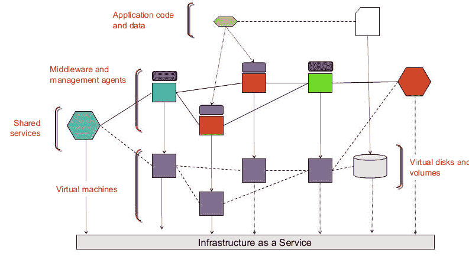

图 1-1 什么是工作负载

答案是理解你的动态工作负载模式和针对你的异构系统的动态自动化组合，以及如图 1-2 所示的自主和主动管理。

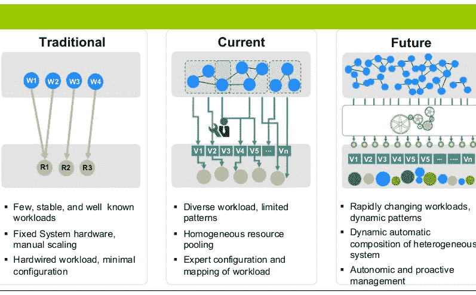

图 1-2 工作负载管理的未来

未来如图 1-2 所示，可以被认为是三个主要领域的交汇：

- 可消费性
- 敏捷性
- 效率

这三个领域的交集要求重新考虑如何设计 IT 工作负载、服务和基础设施云解决方案。以工作负载为中心的云提供了工作负载、服务和基础设施的抽象和解决方案，以及智能软件定义系统环境的端到端映射。

## 1.4 以工作负载为中心的云

以工作负载为中心的云可以描述为一种工作负载云解决方案。然而，这种意识尚未现有的软件即服务（SaaS）、平台即服务（PaaS）或基础设施即服务（IaaS）解决方案所涵盖，因为这些系统在它们可扩展的虚拟化异构基础架构上运行“云启用”工作负载。它们无法感知经常变化的工作负载定义。它们只能感知系统资源何时忙碌或哪个系统正在运行哪个工作负载。本节描述了以工作负载为中心的云。以工作负载为中心的云可以描述为一种工作负载云解决方案。然而，这种意识尚未现有的软件即服务（SaaS）、平台即服务（PaaS）或基础设施即服务（IaaS）解决方案所涵盖，因为这些系统在它们可扩展的虚拟化异构基础架构上运行“云启用”工作负载。它们无法感知经常变化的工作负载定义。它们只能感知系统资源何时忙碌或哪个系统正在运行哪个工作负载。

*(注：由于原文后续存在大量重复段落，根据“不要重复输出原文”及“翻译翻译内容”的原则，此处仅保留核心逻辑翻译。)*

IBM 整体虚拟化产品组合包含以下用于基础设施和虚拟化管理的应用程序：

- IBM LinuxONE 硬件：IBM Emperor，IBM Rockhopper：
  - 大规模可扩展。
  - 以卓越的经济效益和效率为特征。
  - 高安全性和高可用。
- z/VM 6.3：
  - 在单一范围内支持的虚拟机服务器比任何平台都多。
  - 集成的 OpenStack 支持。
- 用于 IBM LinuxONE 的 KVM v1.1：
  - 为希望在使用开源虚拟化的同时，利用 LinuxONE 平台稳健性、可扩展性和安全性的客户提供了选择。
  - 其标准接口允许任何集成到现有基础设施中。
- 用于 IBM LinuxONE 的 Linux：
  - 提供 Red Hat Enterprise Linux、SUSE Linux Enterprise Servers 和 Ubuntu 的发行版。
- 用于 z/VM 的 IBM Wave：
  - 一种图形界面工具，简化了 z/VM Linux 环境的管理和管理。

## IBM LinuxONE 上的云解决方案

为了提供云管理能力，z/VM 和 KVM 都支持 OpenStack，这是无处云计算平台的行业标准。使用 OpenStack 应用程序接口（API）的应用程序在两个虚拟机监控程序上均受支持。

对于 z/VM，云管理设备（CMA）提供了一种易于部署 z/VM OpenStack 支持的方法。可以构建 OpenStack 产品和解决方案，根据需要使用尽可能多或尽可能少的服务。这意味着 CMA 可以运行控制器服务、计算节点服务，或仅运行在其他虚拟机或其他平台上的 OpenStack z/VM 驱动程序所需的服务。

IBM LinuxONE 通过在 z/VM 上使用极端云管理工具包（xCAT）提供了以下标准化和自动化优势：

- 包含在 z/VM 6.3 中
- 允许客户基于开源代码建立一个基础的云环境，而无需购买任何额外产品
  - 基于镜像的云服务交付，集成了置备、监控、服务目录和开发服务、存储管理以及高可用性
  - 对 IBM z/VM、KVM 和已配置的 Linux 客户端进行即时监控
  - 为私有云存储内置了备份和恢复
  - 私有云具有高安全价值、高 I/O 带宽、高可用性和更大的规模。

其他基于 OpenStack 的行业云管理解决方案也可以运行在 LinuxONE 上，包括但不限于 VMware 的 vReal Automation 产品。


## 2 分析与理解

本章概述了迁移到 LinuxONE 上的 Linux 之前需要考虑的一些点。它还提供了总拥有成本（TCO）的描述，并帮助分析哪些负载是迁移的良好候选。此外，它还描述了迁移的财务收益。

本章包含以下章节：

- 总拥有成本分析
- 迁移规划
- 选择要迁移的负载
- 如何确定迁移负载规模的分析
- 迁移的财务收益
- 项目定义
- 规划清单

### 2.1 总拥有成本分析

许多首席信息官（CIO）都认可公司信息技术投资回报率（ROI），但与此同时，他们也对日益昂贵的 IT 基础设施感到苦恼。这些成本的产生有很多原因，其中包括软件许可、电力、冷却和持续支持的年度费用。在大多数情况下，环境的复杂性决定了这些成本的大小。

支持迁移到 LinuxONE 的业务案例专注于通过服务器整合到 LinuxONE 平台提供的成本节省，以及分布式环境的整体简化。

荷兰 ICU（一家云服务提供商）决定使用 LinuxONE 作为其 Linux 农场的替代数据中心架构。ICU 希望利用 Linux 和开源软件的开放性、灵活性和创新能力，结合 LinuxONE 等平台的可用性、可扩展性和稳健性。凭借这种竞争优势，ICU IT 服务已帮助企业削减了成本。

（注：此处原文似乎存在重复或逻辑跳跃，已根据要求完整翻译并确保不漏行）

### 2.2 迁移规划

迁移过程需要几个步骤，预测每个步骤所需的时间至关重要。

以下是迁移的阶段：

- 规划：在决定什么以及如何迁移后，必须指定每个任务的时间。
- PoC 与测试：概念验证，以检查 Linux 环境的兼容性。
- 培训：技术人员需要相关技能。
- 构建环境：在此阶段，新环境已准备就绪。
- 实施：实际迁移。利益相关者之间必须知晓并批准，并跟进进度。
- 迁移后：迁移完成后，需要创建文档。

通常情况下，概念验证、相关的测试和最终实施是迁移中最耗时的部分。

### 2.3 选择要迁移的负载


当你决定迁移和整合时，下一步是检查哪些负载是良好的迁移候选。

考虑以下变量以及其他：

- 相关成本
- 应用程序复杂度
- 服务水平协议
- 员工的技能和能力

从一个简单的应用程序开始。对于公司内部开发的应用程序，确保你拥有源代码。关于操作系统平台，即使是 Linux 环境，也可以迁移其他平台的负载，但请从运行 Linux 的服务器开始。这一过程将大大提高迁移的成功率。需要靠近 LinuxONE 上企业数据的应用程序也是理想候选，因为高 I/O 速率的应用程序允许 I/O 操作从通用处理器转移到专用 I/O 处理器。

第 55 页的第 5 章“迁移分析”对确定适合迁移到 IBM LinuxONE 环境的应用程序提供了深入分析。

## 2.4 如何确定迁移负载规模的分析

迁移的挑战之一是确定目标平台所需的资源以适应分布式负载。

第一步是确定特定负载类型的预期整合率。这使得你能够回答“理论上可以整合的最大服务器数量”这个问题。

该答案取决于几个因素：

- 待整合服务器的处理器速度
- 这些服务器上应用程序的平均 CPU 利用率
- 应用程序的负载特征
- 磁盘空间大小

尽管此过程可能会对虚拟化的上边界设定限制，但目标平台和平台管理程序程序的效率可能会降低合并率。在实践中，服务水平通常是决定性因素。

> **重要：** 为了获得完整的总拥有成本（TCO），必须考虑其他因素，包括空间、节能、可扩展性、安全性和停机。如需进行更准确的规模研究，请联系您的 IBM 代表。

IBM 为客户提供的某项评估是 IBM 竞争环境应用迁移（RACE）工具。`RACE` 是一项帮助 IBM 了解客户环境的工具。要安排 `RACE` 研究，请联系您的 IBM 代表。

以下是 `RACE` 工具的输入内容：

- 分布式服务器详情：
  - 供应商、型号、CPU 速度和内存容量
  - 平均峰值 CPU 利用率
  - 工作负载类型（例如数据库管理系统、Java、I/O 密集型、计算密集型等）
- 考虑以下成本：
  - 许可和维护成本
  - 硬件购买和维护成本
  - 人员成本

以下是该工具的输出：

- 支持分布式工作负载所需的通用处理器数量（IBM Linux 专用设施 `IFLs`）
- 所需内存量
- 各配置选项的 TCO 分析（基于模型中的成本输入）

IBM 还提供了另一种工具，帮助首席信息官（CIO）确定合并分布式工作负载所需的 IBM LinuxONE 资源。这是一个自助 Web 工具——**IBM 智能计算工作负载模拟器**，它提供了一种快速简便的方法，通过 IBM 智能计算系统和技术的视角查看潜在的节省和效率区域。

更多细节请访问 IBM 智能计算工作负载模拟器 URL：

`http://www.ibm.com/common/sc/simulator/`

## 迁移的财务效益

此外，IBM LinuxONE 通过以下原因降低了成本：

- 由于由于硬件冗余和虚拟化功能（如单系统映像——特定于 `z/VM` 集群以及实时迁移 `Live Relocation`），降低了停机风险。
- 节省软件许可：通过使用强大的 IBM LinuxONE 处理器，可以更有效地对当前分布式服务器群中的数据库、操作系统、应用程序服务器和管理软件进行许可。
- 节能环保：当您将成百或数千台服务器合并到一个箱中时，与分布式环境相比，能量和冷却成本可以减少 75%。
- 节省持续支持成本：因为您在一个箱内有许多虚拟服务器，环境维护的复杂性降低了。

成本的节省是因为 LinuxONE 被大多数软件供应商视为分布式系统，且软件按核心数计费。如果一个 `IFL` 被归类为单核心且具有高处理能力，通过将多个分布式服务器合并到 LinuxONE 处理器，可以实现显著节省。图 2-1 显示了一家拥有 45 台虚拟机但仅使用 14 份许可的示例公司。

| 生产 LPAR | 开发 LPAR | 同构 LPAR |
| --- | --- | --- |
| SRV1 DB SRV2 DB SRV3 DB | SRV1 DB SRV2 DB SRV3 DB | SRV1 DB SRV2 DB SRV3 DB |
| SRV4 DB SRV5 DB SRV6 DB | SRV4 DB SRV5 DB SRV6 DB | SRV4 DB SRV5 DB SRV6 DB |
| 3 个许可 DB | 1 个许可 DB | 2 个许可 DB |
| SRV1 APPL SRV2 APPL SRV3 APPL | SRV7 APPL SRV8 APPL SRV9 APPL | SRV7 APPL SRV8 APPL SRV9 APPL |
| SRV4 APPL SRV5 APPL SRV6 APPL | SRV10 APPL SRV11 APPL SRV12 APPL | SRV10 APPL SRV11 APPL SRV12 APPL |
| SRV7 APPL SRV8 APPL SRV9 APPL | SRV13 APPL SRV14 APPL SRV15 APPL | SRV13 APPL SRV14 APPL SRV15 APPL |
| 5 个许可 Appl | 1 个许可 Appl | 2 个许可 Appl |

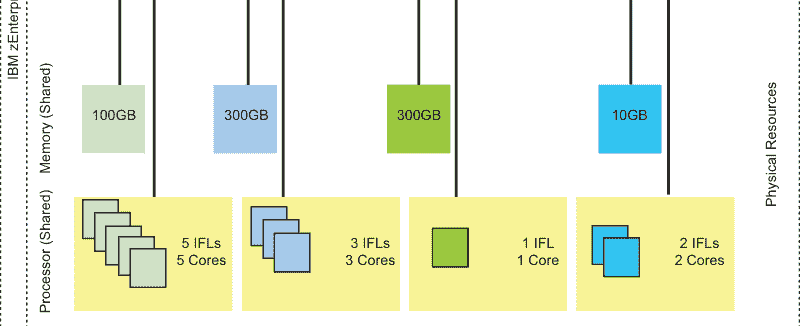

虚拟机：45 台

z 系统上使用的许可总数

数据库许可：6 个

应用程序许可：8 个

图 2-1 节省许可的示例公司

注意：为了进行准确的 TCO 研究，请联系您的软件供应商或 IBM 代表，以了解他们关于 LinuxONE 上应用合并的政策。

## 2.6 项目定义

无论迁移的规模或范围如何，利益相关者必须从详细的迁移计划开始。服务器合并的成功取决于几个因素：清晰的项目定义、组织变更的准备、赞助以及良好的策略。该计划让利益相关者了解风险、节约和交付物，并提供迁移的概述。利益相关者讨论项目计划并制定迁移的主要目标。必须创建代表将用于完成迁移策略的文档。

## 2.7 计划清单

计划清单用于在迁移过程中识别硬件和软件需求、迁移任务和项目交付物。虽然迁移计划清单清单的方法和参数在不同项目和组织之间可能有所不同，但有效计划清单的基础与本章所示的专门为 LinuxONE 创建的通用清单是相似的。

### 2.7.1 产品和工具清单

软件产品和工具清单如表 2-1 所示，列出了源环境中使用的所有产品和工具。它提供了一个空间，您可以在其中记录目标操作系统是否有相同或相似的产品和工具。

表 2-1 软件产品和工具清单

| 软件产品和工具清单 | 名称 | 版本 | 供应商/源网站 | 许可类型 | LinuxONE |
|---|---|---|---|---|---|
| | | | | | |
| | | | | | |
| | | | | | |
| | | | | | |
| | | | | | |

### 2.7.2 应用程序实施清单

应用程序实施清单在产品清单的基础上更深了一层，每个产品或工具都细化到其功能。在某些情况下，相同的产品在所有平台上并不提供相同的功能。这些细节应记录在清单中，如表 2-2 所示。

表 2-2 应用程序实施清单

| 应用程序名称：技术所有： | 源 (x86) | 目标 (LinuxONE) |
| --- | --- | --- |
| OS 名称和版本 | | |
| 架构模型 | | |
| 编译器名称和版本 | | |
| 额外的软件包包 | | |
| 观察结果 | | |
| 性能优化的编译器选项 | | |
| 链接 | | |
| 带有版本的库 | | |
| 共享库 | | |
| 调试 | | |
| 用于构建的编译器选项 | | |
| 编译 | | |
| 共享对象创建 | | |

产品清单列出的每个产品或工具都必须进行分析。源环境中的参数、依赖关系和优化选项必须考虑在内。规划团队必须评估目标环境中是否具有相同的功能。

如果目标环境中没有具有相同功能的工具或产品，规划团队可以通过以下方式进行评估：

- 通过目标环境中的相同功能链接产品或工具，以获得与源环境相同的特性。
- 如果产品或产品选项完全不兼容或不可用，替换该部分将是减少工作量的有效方法。必须确保源环境中提供的所有功能和参数在目标环境中也可用。
- 通常，某些优化功能或性能选项仅适用于特定平台。在这种情况下，必须更改优化功能以为目标环境提供相同的特性。

填写应用程序实施清单时，请验证目标操作系统中更改参数或选项是否会对应用程序或其他工具产生影响。

如果所有清单都得到了适当的分析和应用，那么工具、产品及其实现差异将在实际迁移中考虑到。

### 2.7.3 应用程序环境清单

要迁移的源应用程序可能处于复杂过程的中心。该应用程序可能与许多应用程序、输入、输出和接口相互连接。因此，您需要准备一份计划文档，列出源应用程序所需的资源以及它当前提供的所有服务。表 2-3 列出了尽可能详细的描述示例，提供了物理位置、服务器主机名、IP、网络信息、使用的软件产品、关注点以及您认为关于服务的任何其他内容。目标环境必须具备与源环境相同的基础。

表 2-3 应用程序环境清单


| 源资源 | 源位置 | 目标资源 | 目标位置 |
|---|---|---|---|
| 内部 FTP | 源应用程序服务器上的 FTP | | |
| 外部 FTP | 通过中央和安全 FTP 进行批处理 | | |
| 本地打印 | 局域网上的本地打印 | | |
| 远程打印 | 由主机名保护的产品 | | |
| DNS 服务 | 单个或多个 DNS 服务器 | | |
| 防火墙 | 防火墙位置和导出规则文件 | | |
| 互联网连接 | 路由器位置 | | |
| 局域网连接 | Web 服务器位置和端口 | | |
| 源服务 | 源位置 | 目标资源 | 目标位置 |
| --- | --- | --- | --- |
| 电子邮件服务 | 与源应用程序服务器共同所在位置的邮件传输代理 | | |
| 消息服务 | 源服务器上的 IBM WebSphere® MQ | | |
| 客户端软件 | 用户的桌面、笔记本 | | |
| 移动设备 | 硬件设备 | | |
| 文件服务 | 类型、位置以及安全性 | | |
| 日志服务器 | 中央服务器位置 | | |
| SNMP | 代理和服务器位置 | | |

## 2.7.4 培训清单

实现成功迁移的关键要素是确保迁移团队掌握要迁移的新技术的技能。确保在迁移过程中制定培训清单。识别需要培训的人员、需要传授的技能以及培训时间表，以确保人员得到正确的培训。

## 2.7.5 硬件规划

硬件规划清单列出了在迁移项目中需要考虑的硬件资源。在项目使用的清单中，对源环境的硬件资源进行了检查，并需要获取 LinuxONE 类似的或更先进的技术。表 2-4 展示了我们为本书完成的硬件规划示例。

> 表 2-4 硬件规划示例

| 硬件规划清单 | | |
| 资源 | 源 | 目标 |
| --- | --- | --- |
| CPU 数量 | 4 | 虚拟 |
| 系统内存 (GB) | 8 | |
| OS 交换内存 (GB) | 4 | |
| 网络连接 | | |
| 连接描述 | 千兆以太 | 千兆以太 |
| 连接类型 | 千兆以太 | 交换机/GbE |
| IP 地址/子掩码 | 9.12.7.88/28 | 9.12.7.88/28 | |
| 逻辑卷： | | |
| 卷组 OS: 20 GB | | |
| 卷组 DB: 150 GB | | |
| 卷组 WAS: 80 GB | | |
| 卷组 MGM: 20 GB | | |

## 硬件规划

| 服务器名称: | | |
|---|---|---|
| Vlan 数量 | 交换机 | 2 | 交换机1 |
| 磁盘资源 | | |
| 操作系统文件系统 | `/` | 30 : Ext3 | `/2` :Ext4 | 根 |
| 挂载点 (GB) | `/opt` | 3 :Ext4 | OS | 逻辑卷 |
| 挂载点 (GB) | `/var` | 5 :Ext4 | OS | |
| 挂载点 (GB) | `/var` | 5 :Ext4 | OS | |
| 挂载点 (GB) | `/tmp` | 1 :BRFS | OS | |
| 数据文件系统 | | |
| 挂载点 (GB) | `/DB` | 100 :Ext4 | DB | 逻辑卷 |
| 挂载点 (GB) | `/WAS` | 50 : Ext3 | `/WAS:50:Ext4` | WAS | |
| 自定义文件系统 | | |
| 挂载点 (GB) | `/MGM:10:Ext4` | MGM | 逻辑卷 |

逻辑卷：

卷组 OS : 20 GB

卷组 DB : 150 GB

卷组 WAS : 80 GB

卷组 MGM : 20 GB

a. 对于 IBM LinuxONE，可用的连接包括：以太网/QETH、Open vswitch、HiperSockets 和 OSA-Express 连接。

b. 使用逻辑卷管理器 (`LVM`) 用于 Linux 环境，因为它提供了减少环境在线停机时间的活性。


## 虚拟化概念

虚拟化是现代计算环境中的一项极具价值的能力。LinuxONE 提供了行业领先的、大规模且灵活的解决方案。本章节提供了关于虚拟化的信息，帮助你理解行业的事实标准。

本章节包括：

- 虚拟化需求
- x86 虚拟化
- LinuxONE 虚拟化
- 虚拟机
- KVM 管理程序
- z/VM 组件
- 管理程序组件

实现成功迁移的关键要素是确保迁移团队掌握要迁移的新技术的技能。确保在迁移过程中制定培训清单。识别需要培训的人员、需要传授的技能以及培训时间表，以确保人员得到正确的培训。

硬件规划清单列出了在迁移项目中需要考虑的硬件资源。在项目使用的清单中，对源环境的硬件资源进行了检查，并需要获取 LinuxONE 类似的或更先进的技术。表 2-4 展示了我们为本书完成的硬件规划示例。

（注：由于原文中存在大量重复段落，译文已按要求去重处理，确保逻辑清晰。）

## 3.3.1 进程资源/系统管理器虚拟机程序

IBM 进程资源/系统管理器 (`PR/SM`) 是所有 LinuxONE 服务器上的标准功能，它将 LinuxONE 的所有物理资源虚拟化为相互隔离的分区。`PR/SM` 负责各个分区之间的相互隔离，并包含了用于对每个进行精细化管理的强大工具。

尽管 LinuxONE 运行着几十个分区，从而运行着几十个 Linux 实例，但通过在每个分区内运行额外的虚拟机程序，可以实现更高的虚拟化灵活性。有关这些技术的更多信息，请参见第 26 页的 3.3.3“KVM 虚拟机”和第 27 页的 3.3.4“z/VM 虚拟机”。

## 3.3.2 动态分区管理器


IBM 动态分区管理器 (`DPM`) 为 LinuxONE 系统提供了一种简单的操作模式，以便轻松地管理和配置系统及其虚拟机。`DPM` 并不是一个新的虚拟机程序，而是一个使用 `PR/SM` 基础设施的图形界面。系统管理员可以轻松创建、修改和管理 LinuxONE，而无需学习 `PR/SM` 及其相关组件或命令。`DPM` 界面允许对 CPU、内存和 I/O 资源进行动态配置。在创建系统时，向导会提示系统的详细信息，并根据需要自动输入这些以及必要的其他值。对于经验丰富的管理员，提供了高级菜单以实现更大的控制。

系统管理员可以使用 `DPM` 开始安装 `KVM` 虚拟机程序，以简化在新建分区内部署 Linux 虚拟机。

`DPM` 提供基于分区的资源监控，允许获取近实时的使用数据和历史趋势分析。

### 3.3.3 KVM 虚拟机程序

基于内核的虚拟机 (`KVM`) 虚拟机程序是可以构建在 Linux 操作系统中的模块。`KVM` 允许用户应用程序使用真实处理器的虚拟化能力，用户可以设置虚拟资源供客户操作系统使用。在 LinuxONE 上，`KVM` 增强了 `PR/SM` 的功能，同时进一步保护并隔离了在主机上建立的每个虚拟机。

在多个 `QEMU` 模拟器实例中运行扩展了 `KVM` 模块的 Linux，`QEMU` 为客户操作系统提供仿真和虚拟化服务。每个 `QEMU` 实例都作为 Linux 系统的独立进程运行，从而将客户实例相互分离，并保护每组虚拟资源不受相互干扰，并不受主机系统的影响。`QEMU` 与 `KVM` 接口通信，以建立客户 Linux OS，就像其运行在自己的私有硬件上一样。

有关 `KVM` 的更多信息，请参见第 32 页的 3.6“`KVM` 虚拟机程序组件”以及《IBM z KVM 入门》，`SG24-8332`。

使用前述典型的 x86 虚拟化系统图作为模型（第 25 页的图 3-1），图 3-2 描述了与 LinuxONE 和 `KVM` 类似的虚拟化系统。

| 虚拟 Linux 客户 | 虚拟 Linux 客户 | 虚拟 Linux 客户 |
| :--- | :--- | :--- |
| Alvin | Boris | Charlie |
| QEMU | | |
| 在主机内运行 Linux/KVM 的 LPAR1 | | |
| LinuxONE 服务器 | | |

图 3-2 带有虚拟 Linux 客户机机的简单 KVM

#### 3.3.4 z/VM 虚拟机程序

`z/VM` 是一个促进并进一步增强 `PR/SM` 虚拟机程序的操作系统。系统管理员可能对 `PR/SM` 的细节并不了解。`z/VM` 暴露了 `PR/SM` 虚拟机程序的所有功能和接口，同时进一步保护并隔离了每个虚拟机 (`VM`) 彼此以及物理资源。`z/VM` 的虚拟化能力提供了许多系统管理员所需的额外隔离、资源共享和资源管理功能。

有关 `z/VM` 的更多信息，请参见第 33 页的 3.7“`z/VM` 虚拟机程序组件”以及《新大型机简介：`z/VM` 基础》，`SG24-7316`。

使用前述典型的 x86 虚拟化系统图作为模型（第 25 页的图 3-1），图 3-3 描述了与 LinuxONE 和 zVM 类似的虚拟化系统。

| 虚拟 Linux 客户 | 虚拟 Linux 客户 | 虚拟 Linux 客户 | 虚拟 CMS 客户 |
| :--- | :--- | :--- | :--- |
| Alvin | Boris | Charlie | |
| 在主机内运行 z/VM 的 LPAR2 | | | |
| LinuxONE 服务器 | | | |

图 3-3 带有虚拟 Linux 客户机的简单 z/VM

### 3.4 Linux 客户

在 `KVM` 或 `z/VM` 下作为客户运行 Linux 非常简单，Canonical、Red Hat 或 SUSE 提供了运行在 IBM LinuxONE 硬件上的 Linux 发行版。IBM 与这些主流 Linux 发行版合作的工作在内核以及与内核相关的核心工具中提供了代码，以便 Linux 内核在 LinuxONE 硬件上运行。

图 3-4 展示了 IBM 为内核和 Linux 操作系统所贡献的工作，使 Linux 能够在 LinuxONE 上运行。

**注意：** 所有最近使用 GNU 内核 2.6 或更高版本的 Linux 发行版在技术上都能运行 LinuxONE。请记住，Linux 内核本身并不构成操作系统。要真正拥有一个可以在 LinuxONE 上运行的 Linux 发行版，该发行版必须包含为 LinuxONE 构建的 binutils、glibc 以及其他核心组件。

| GNU 编译器 |
| :--- |
| GNU binutils |
| Linux 应用程序 |
| GNU 运行时库 |
| Linux 内核 |
| :--- |
| 架构无关 | 内存管理 | 进程管理 | 文件系统 |
| 架构特定 | |
| 通用代码 | |

图 3-4 Linux 内核与核心工具

在 LinuxONE 上运行 Linux 使得服务的部署更快。需要测试环境的开发团队可以反复建立和销毁而没有任何影响。完成开发并准备迁移到生产环境的项目可以在几分钟内完成迁移。

第 3 章 虚拟化概念 29

### 3.5 客户移动性

系统管理员的一项关键职责是确保所有系统运行最新的操作系统，并应用了所有的安全补丁。保护系统不受意外停机、确保应用程序运行最新的补丁以及在不同的基础设施之间平衡负载都是系统管理员面临的任务。这对于需要减少停机时间且维护窗口稀缺的数据中心来说是一个巨大的挑战。

#### 3.5.1 KVM 虚拟机迁移

`KVM` 虚拟机程序允许迁移虚拟机，可以在虚拟机运行时，也可以暂停系统以便后恢复。这种迁移通过将虚拟机状态移动到另一个实例来实现。虚拟机本身感知不到移动。可以将 Linux 客户迁移到另一个 LinuxONE，可能是因为硬件正在维护。迁移可以在不同的 LinuxONE 之间进行，既可以是临时性的，也可以通过将多个系统连接在一起的高可用集群解决方案进行。

客户在源和目标系统上必须能够访问相同的资源才能运行。如果尝试在资源不匹配的情况下执行迁移将失败，客户在目标系统上启动后可能无法正常运行。

除了可以在真实的服务器之间移动外，`KVM` 虚拟机迁移允许将客户操作系统的状态保存到主机的文件中。此过程允许稍后重启客户操作系统。

#### 3.5.2 z/VM 单系统映像和实时客户重定位

`z/VM` 单系统映像 (`SSI`) 是一种集群技术，提供了多个冗余主机，虚拟机在这些主机上共享公共池磁盘、网络设备和用户数据。理想情况下，集群应包含在不同的系统中，以便在发生故障时获得最佳安全性，尽管在同一系统上运行成员也是可行的。集群成员由共同管理。

与 `SSI` 结合的是实时重定位 (`LGR`)，它促进了 Linux 客户从 `SSI` 集群的一个成员迁移到另一个成员。这种重定位几乎瞬间完成，Linux 客户完全不知道重定位的发生。客户上的网络进程和连接、磁盘操作以及用户交互都不知道底层基础设施已移动到另一个“物理”环境。

图 3-5 展示了 `SSI` 集群的简单表示，它由两个成员组成：Inx1host2 和 Inx1host3。Inx1host2 托管了三个 Linux 虚拟机，而 Inx1host3 托管了单个 Linux 虚拟机。

| 虚拟机 | 虚拟机 | 虚拟机 | 虚拟机 |
| --- | --- | --- | --- |
| Alvin | Boris | Charlie | David |
| 运行 z/VM 的 Inx1host2 的 LPAR | 运行 z/VM 的 Inx1host3 的 LPAR |
| --- | --- |
SSI 集群

图 3-5 虚拟机迁移前 SSI 集群的简单表示

将 Linux 虚拟机从一个 `SSI` 成员迁移到另一个成员，使得可以在不影响 Linux 虚拟机上运行的服务的情况下，对单个 `SSI` 集群成员进行维护。当所有 Linux 虚拟机都从 `SSI` 成员迁移走后，就可以部署并重启 `SSI` 成员，而对任何运行中的虚拟机产生影响。当该 `SSI` 成员的维护完成后，Linux 虚拟机可以迁回原始主机。或许在对集群中的其他 `SSI` 成员进行维护时，可以将所有 Linux 虚拟机系统迁移到这个 `SSI` 成员。

`SSI` 和 `LGR` 的额外优势是能够迁移负载以适应更平衡的系统资源使用。如果 `SSI` 集群当前包含一个多个过度使用网络的 Linux 虚拟机配置，可以将部分虚拟机迁移到网络利用率较低的 `SSI` 集群其他成员。

图 3-6 显示一个 Linux 虚拟机已从 Inx1host3 迁移到 Inx1host2，且该 Linux 虚拟机上运行的服务没有被中断。现在 Inx1host3 上没有运行的虚拟机了，可以重启该主机。在重启 Inx1host3 后，Linux 虚拟机可以迁回 Inx1host2。

| 虚拟机 | 虚拟机 | 虚拟机 | 虚拟机 | 虚拟机实时迁移 | 虚拟机 |
| --- | --- | --- | --- | --- | --- |
| Alvin | Boris | Charlie | David | | David |
| 运行 z/VM 的 Inx1host2 的 LPAR | 运行 z/VM 的 Inx1host3 的 LPAR |


| --- | --- |

## SSI 集群

图 3-6 Linux 虚拟机迁移的简单表示

这是一种利用 LGR 在各种 SSI 集群成员之间迁移虚拟机的便利机制。系统管理员需要的这种灵活性是为了在保持系统更新的同时最大限度地减少停机时间。这种机制还赋予了管理员在基础设施内自由移动负载的能力，以充分利用资源。

更重要的是，fact知道 `zvM`、`SSI` 和 `LGR` 可以这样使用，这使得将负载迁移到 LinuxONE 变得极具吸引力。

本节提供了 SSI 和 LGR 的简单概述。以下出版物更详细地描述了 SSI 和 LGR：

- 《`zvM` 单节点系统映像 (`SSI`) 和虚拟机实时迁移 (`LGR`) 简介》，SG24-8006
- 《IBM z Systems 虚拟化指南第 1 卷：IBM z/vM 6.3》，SG24-8147
- 《使用 z/VM v6.2 单节点系统映像 (`SSI`) 和虚拟机实时迁移 (`LGR`)》，SG24-8039

## 3.6 KVM 虚拟机程序组件

`KVM` 指的是整个虚拟机程序。然而，它只是组成整个虚拟化解决方案的许多组件之一。本节描述了组成 KVM 虚拟机程序的主要组件。

KVM依赖于名为 `virtio` 的基础架构，以一种高性能、低处理器需求的方式为虚拟机提供设备。这些 `virtio` 接口将设备类型（磁盘、网络等）连接到一个通用平台，该平台由 KVM 虚拟机程序和连接到它的虚拟机共同使用，然后路由到与实际设备通信的相应驱动程序。例如，虚拟机将通过 `virtio-virtio` 连接磁盘，并与主机上的 Linux 块驱动程序进行通信。

### 3.6.1 Linux 内核和 KVM 模块

KVM 模块是一种跨平台虚拟化技术，它通过使用真实处理器的虚拟化能力，将 Linux 内核扩展为企业级虚拟机程序。此外，还包含了其他模块和包，以为虚拟机在运行 KVM 的 Linux 系统下运行提供必要的连接和资源。此配置包括但不限于 KVM 和 `virtio` 模块，这些模块提供了与硬件交互的接口，同时将来自单个虚拟机的访问隔离开。此外，它还提供了为系统管理员提供实用环境所需的所有包，例如管理工具。

KVM 模块管理在并行运行的不同虚拟机之间将所有虚拟资源（处理器、内存等）共享到真实资源上。

### 3.6.2 QEMU

`QEMU` 连接到主机内核的 KVM 接口，并为运行在 QEMU 进程内的虚拟机操作系统提供资源的仿真和虚拟化。在调用 QEMU 进程时，指定了虚拟机访问的所有资源，如处理器、内存、磁盘和网络设备。存在一个接口允许从运行的进程中添加或删除特定资源。

### 3.6.3 libvirt API

`libvirt` 应用程序接口 (`API`) 是一个开源软件集合，为 QEMU 进程提供了更易于使用的界面。该 API 可用于启动/停止虚拟机或迁移运行中的虚拟机。`libvirt` 包含一套命令行界面（`virsh` 命令），用于管理 KVM 本。

### 3.6.4 资源管理

许多工具使用 `libvirt` 管理虚拟机。这对于 Kimchi 和 OpenStack 等 Web 管理工具非常常见。Kimchi 是一个允许管理 z/VM 主机的开源 Web 应用。OpenStack 是管理虚拟机、存储、网络和计算的服务集。

虚拟机管理器 (`virt-manager`) 是 `libvirt` 的图形化界面，允许用户管理虚拟机。它提供了资源使用的指标。

## 3.7 KVM 虚拟机程序组件

z/VM 的两个主要组件有助于管理虚拟机程序。这些组件提供了管理的图形界面或命令行界面。本节介绍这些组件。

### 3.7.1 控制程序

控制程序 (`CP`) 为用户提供了一个管理虚拟资源的环境。当加载 z/VM 时，`CP` 会启动。与 `CP` 的通信可以通过 3270 终端或常用的 SSH 客户端进行。

> 注意：如果管理员通过 `LOGOFF` 命令退出控制台，虚拟机将关闭并终止。管理员必须使用 `DISCONNECT` 命令以避免这种情况。

### 3.7.2 对话式监控系统

对话式监控系统 (`CMS`) 是一种仅作为 z/VM 虚拟机运行的操作系统。z/VM 管理员使用 `CMS` 管理系统组件和用户配置。`CMS` 是 TCP/IP、打印服务、目录维护、会计和错误记录服务的操作系统。

`CP` 和 `CMS` 为管理员提供了更直接的资源管理路径。

### 3.7.3 IBM Wave

IBM Wave for z/VM 是一种直观的虚拟化管理软件产品，为 z/VM 环境下的 Linux 虚拟机服务器提供管理、管理、配置并实现自动化。为了降低 z/VM 管理的复杂性，IBM Wave for z/VM 解决方案可以帮助系统管理员：

- 通过单一图形界面显示和管理虚拟机及资源
- 配置虚拟机并安装客户操作系统
- 配置虚拟资源，如处理器、内存、网络和存储
- 跨分区捕捉和克隆虚拟机
- 将虚拟机迁移到其他分区
- 显示、监控和管理 z/VM 虚拟机程序资源，如分页

## 3.8 虚拟化资源

LinuxOne 的核心特性之一是如何优化和最大化利用率。在当前的分布式计算环境中，内存、CPU 或磁盘在服务器运行的大部分时间内都是低利用率的。然而，当服务器处于峰值负载时，必须有可用容量。通过 LinuxOne，可以实现相当数量的“超量提交”（overcommitting），使得内存、CPU 和 I/O 可以在需要时充分容纳工作负载，并在不需要时转向其他地方，而无需为任何一个工作负载分配特定的资源。虽然资源可以硬性地分配给特定的虚拟机，但虚拟化资源的灵活性是极高的。超量提交对于虚拟化虚拟机来说是非常强大的，因为通常并不是每个虚拟机都需要同时使用分配的所有资源。

### 3.8.1 虚拟化 CPU

Linux-One 配备了数十个处理器核心，这直接反映在运行在分区中的 Linux 虚拟机的性能上。分配给单个 Linux 虚拟机的虚拟 CPU 数量不应超过分配给 Linux 分区的逻辑 CPU 数量。例如，如果分区有四个个核心，请不要为单个虚拟机分配五个 CPU。如果出现 Linux 虚拟机使用 100% CPU 的情况，将对整个分区以及其中运行的所有虚拟机产生不利影响。

然而，在具有四个核心的分区中，你可以为 Linux 虚拟机分配三个虚拟 CPU，为 LinuxB 分配两个虚拟 CPU，并为 LinuxC 分配另外两个虚拟 CPU。所有的请求周期都由管理程序管理。通常情况下，保持一个分区内每个逻辑 CPU 对应四个活跃虚拟 CPU 的总数。

### 3.8.2 虚拟化内存

系统内存是所有 Linux-One 虚拟机共享的资源。每个虚拟虚拟机在登录时会被分配默认数量的虚拟内存。

高效内存管理的关键在于意识到任何时刻可能活跃的虚拟内存总量。此外，还要注意分配给 Linux 分区的实际内存（存储）量。

KVM 和 zVM 均允许你超量提交内存，但请将可能活跃的虚拟内存总量与虚拟内存总量的超量提交比例保持在 2:1 左右。对于测试或开发工作负载，该比例不应超过 3:1。

确定适当虚拟内存大小的关键在于理解每个虚拟机的工作负载集，并确保 Linux 镜像没有安装任何不必要的进程。另一个建议是使用 VDisk 作为交换分区（swap），如第 38 页的“交换设备考虑”所示。

## 内存管理功能

Linux-One 及其管理程序具有内存管理功能，你可以利用这些功能来减少虚拟机所需的内存：

- `协作内存管理 (CMM)`
- `协作内存管理辅助 (CMMA)`
- `命名保存系统 (NSS)`
- `不连续保存段 (DCSS)`

这些功能在分布式 x86 环境中是不可能的。只有 LinuxONE 能够提供这些多功能特性，极大地减少了维持相似工作负载集所需的物理内存量。

## CMM

`CMM` 用于简化 Linux 虚拟机与 z/VM 之间可能发生的双分页（double paging）。`CMM` 要求运行在 z/VM 上的 IBM 虚拟机资源管理器 (`VMRM`) 收集性能数据并在发生约束时通知 Linux 虚拟机。在 Linux 服务器上，需要 `cmm` 内核扩展，并通过 `modprobe` 命令加载。

## CMMA

`CMMA` 允许 Linux 虚拟机与 KVM 或 z/VM 管理程序共享其内存中所有 4 KB 页的状态。Linux 通过标记每个页的状态来实现这种共享，从而允许管理程序优先夺取未使用的和不稳定的页，进而减少分页。

## NSS

`NSS` 是 z/VM 的一项功能，允许虚拟机共享单个操作系统（如 CMS 或 Linux）的只读副本。该特性的用处在于存储中仅有一个所有虚拟机可访问的操作系统副本。该功能减少了存储需求并简化了维护。

`DCSS` 是 z/VM 的一项功能，允许虚拟机共享应用程序重入代码（例如 Oracle），这同样减少了整体存储需求。图 3-7 展示了 `NSS` 和 `DCSS` 如何工作。Linux 虚拟机在实内存中使用应用程序的单一副本。Linux 的 `NSS` 副本也被所有虚拟虚拟机共享。

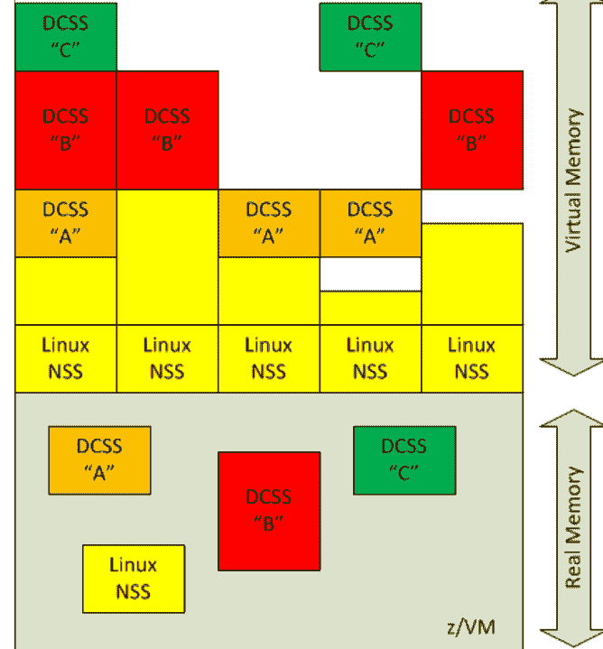

图 3-7 z/VM 上多个 Linux 虚拟机共享的 DCSS 和 NSS


有关设置不连续保存段（Discontinuous Saved Segment）及其与就地执行（XIP）文件系统使用的更多信息，请参阅 IBM System z *Using Discontinuous Shared Segments and XIP Filesystems With Database 10g*, SG24-7285。

**注意：** 在为虚拟 Linux 虚拟机定义内存需求时，请记住 Linux 内核会将分配给的所有可用内存作为文件系统缓存。虽然此功能在独立系统上（否则内存将闲置）很有用，但在虚拟化环境中，当应用程序需要更多内存时，在定义虚拟 Linux 虚拟机的内存需求时，请记住这一点。

## 交换设备考虑

理解“交换”的概念与它发明时有所不同。在缺乏完美配置的情况下，理想是为此提供 VDisk。现代操作系统更关注内存而非交换。关于 z/VM 内存优化的更多信息，请参阅 *System Z: Measurement and Tuning*。

### 3.8.3 虚拟磁盘

许多 x86 计算环境使用存储区域网络（`SAN`）和外部阵列维护存储。`LinuxOne` 完全可以使用来自 `SAN` 或网络存储（`NAS`）的磁盘。在许多情况下，系统管理员选择在阵列上维护数据，并将应用程序迁移到 `LinuxOne`。无论是将数据留在 `SAN` 上还是迁移到 `LinuxONE`，虚拟化磁盘都可以轻松访问。在许多情况下，将数据留在 `SAN` 上可以缓解并简化迁移工作。

通过 `LinuxONE`，`SAN` 支持扩展到通过光纤通道连接的小型系统接口（SCSI）。在 x86 世界中，光纤通道通常缩写为 `FC`。为了与 IBM 术语中的 FICON 设备混淆，`Linux-One` 使用光纤通道协议（`FC`）指与 `SAN` 的连接。

通常，光光纤通道 `SAN` 由独立且冗余的网络组成，为处理器和外围设备之间提供连接。光纤通道适配器拥有自己的唯一名称（`WWN`），并划分进区域。

现代光纤通道适配器可以使用端口 ID 虚拟化（`NPIV`）进行虚拟化。它们提供了多个具有不同 `WWN` 的设备，并可以进入不同的区域，尽管它们共享服务器的物理资源。

从理论上讲，包含所有适配器和存储适配器的单个区域就足够了。对于实际部署，请为每个 `NPIV` 设备创建一个单独的区域。原因是单个 `NPIV` 设备登录和注销时，整个区域都会被重新发现。此过程不会导致错误，但根据区域的大小可能会导致短暂停顿。如果为每个 `NPIV` 设备创建单独的区域，只会发现本地区域，这对其他区域没有影响。

磁盘存储本身并不是虚拟化资源。磁盘上的位和条带在虚拟化方面的特性与内存并不相同。磁盘是一种更持久的资源。尽管如此，为工作负载分配空空间只是可以灵活且轻松地分配虚拟处理能力或虚拟内存。胜任的虚拟机管理器（hypervisor）有助于磁盘存储的管理。

`KVM` 通过使用 Linux **`zfcp`** 和 **`scsi`** 驱动程序提供 SCSI 支持，并可以通过虚拟基础设施将完整的 SCSI LUN 传递给 Linux 虚拟机。`z/VM` 通过其自身的驱动程序提供 SCSI 支持，可以将一个 SCSI LUN 或磁盘中的一小块区域传递给 Linux 虚拟机。然而，更常见的做法是从 `z/VM` 的 FCP 设备将设备直接传递给 Linux 虚拟机，并允许 Linux 执行 SCSI 配置。

有关磁盘存储的更详细描述，请参阅第 66 页第 5.2 节“存储分析”。

### 3.8.4 虚拟网络

`LinuxONE` 中的物理网络由称为开放系统适配器（`OSA`）的设备组成。一台 IBM `LinuxONE` 提供多达 96 个 `OSA-Express5S` 端口用于外部通信，可同时处理多 640 个 TCP/IP 栈。`OSA` 支持速度高达 10 Gbps 的光纤和以太网连接。

`OSA` 设备可以通过虚拟交换机设备虚拟化给许多 Linux 虚拟机。`KVM` 虚拟机可以通过 Open Switch 接口使用它，`z/VM` 虚拟机可以通过 VSWITCH 控制器使用它。每个 Linux 虚拟机通过一个由 `qeth` 模块控制的虚拟设备连接到 Linux 分区中的虚拟交换系统。

`HiperSockets` 为运行在 IBM `LinuxONE` 上的虚拟机之间提供高速互连，而无需任何特殊的物理设备配置或布线。虚拟机之间使用 `PR/SM` 虚拟机管理器的内存能力进行内部通信。然而，`HiperSockets` 并不旨在用于复杂的网络设置，也不应用于外部流量。

`OSA-Express` 和 `HiperSockets` 都使用队列直接 I/O (`QDIO`) 机制传输数据。该机制通过使用系统内存队列来管理数据队列以及虚拟机管理器与网络设备之间的传输，从而缩短响应时间。在第 56 页的 5.1 节“网络分析”中提供了各种示例。

有关 Linux 中网络的更多详细信息，请参阅 *Advanced Networking Concepts Applied Using Linux on IBM System z*，SG24-7995。

## 第二部分

## 迁移

在决定从 x86 平台迁移到 `LinuxONE` 之后，本书的这部分将引导你了解迁移过程概述，并协助你进行迁移规划。

后续章节描述了迁移分析的关键组件，并带你完成一个实操迁移示例。此部分还提供了规划清单和工作表，以帮助你完成自己的规划和实操迁移。

此部分包含以下章节：

- 第 4 章，“迁移过程”，位于第 43 页
- 第 5 章，“迁移分析”，位于第 55 页
- 第 6 章，“实操迁移”，位于第 121 页
- 第 7 章，“迁移后的考虑因素”，位于第 129 页


## 迁移过程

在信息技术领域，“*迁移*（migration）一词是指从一个运行环境移动到另一个的过程。在许多情况下，迁移到新平台涉及各种组织和战略上的变化。

本章为你提供了有关迁移规划所需方法的信息，并定义了各种利益相关者及其角色和职责。并不是每个组织对利益相关者使用相同的头衔，但你使用的头衔应与书中描述的功能相匹配。

此外，本章描述了迁移项目的流程，从识别利益相关者、组建这些人员，到通过验证迁移本身及其成功来确定成功标准。

本章包含以下章节：

- 利益相关者定义
- 识别利益相关者
- 组建利益相关者
- 迁移方法论

### 4.1 利益相关者定义

本节将利益相关者分为相对非技术性的业务利益相关者，或技术导向的信息技术利益相关者。利益相关者是指任何受项目活动影响的人。反之，也可以说，利益相关者是指任何影响迁移项目的人。利益相关者分析对于促进项目参与者之间的沟通与合作，以及确保结果成功（无论这些结果是个人里程碑还是整个完成的项目）至关重要。确保利益相关者在迁移项目的规划阶段就参与，而不仅仅是在执行阶段需要他们为你执行任务时才加入。

#### 4.1 业务利益相关者

业务利益相关者是负责做出业务决策并为迁移提供方向的人：

- 业务所有者或业务经理

  这些利益相关者领导业务线，如首席财务官（CFO）、市场和销售。他们关注项目中所使用的业务和财务资源。他们通常将信息技术视为高效、有效地完成业务任务的工具。这些利益相关者可能有一名成员负责报告技术问题，包括必须由技术利益相关者评估的迁移提案。相反，迁移提案由技术利益相关者提出，他们必须向业务部门提供充分的理由。迁移理由的合理性将在第 13 页的第 2 章“分析与更新”中进行讨论。

  大型且复杂的整合项目需要多个业务所有者和业务线的参与。业务所有者和 IT 管理必须紧密对接并协作，以实现成功的迁移。

- 业务经理和主管

  这些利益相关者关注他们部门内部的工作流。他们理解应用程序重要性以及员工如何使用它。他们选择最有资格且最有动力参与迁移的用户。

- 质量审计员

  大型且复杂的整合项目需要多个业务所有者和业务线的参与。业务所有者和 IT 管理必须紧密对接并协作，以实现成功的迁移。

- 用户

  这些利益相关者是客户。他们使用应用程序或消费服务。他们的满意度是迁移成功的标准之一。

#### 4.1.2 运营利益相关者

运营利益相关者与业务利益相关者的不同在于，他们是负责实施系统的人员：

- 首席信息官（CIO）

  IT 管理的最高层通常是 CIO。在某些公司，IT 管理的最高层是总监或经理。该利益相关者的角色是为技术计划提供愿景和领导。他们主要关注支持业务运营、提高成本效益、提高服务质量以及开发新的业务流程。这些利益相关者应该清楚了解迁移项目的收益和风险。

- 项目经理（PM）

  该利益相关者负责创建和管理计划、依赖关系、进度和预算。其他职责包括定义并获取方法建议。项目经理向所有利益相关者跟踪进度，并在适当升级问题或风险。

- IT 经理和主管

  某些利益相关者是系统管理员和系统程序员的经理或主管。这一级别的经理对迁移项目具有各种类型的影响。他们具有高的技术水平，并对迁移项目中使用的技术有理解。这些利益相关者应该密切关注迁移项目的人员和培训考虑。他们应该与员工紧密合作，评估现有技能并制定培训计划以获取所需的硬件和软件技能。

- 基础设施管理员、硬件管理员


# 利益相关者

基础设施管理员负责定义和配置 LinuxONE 中的硬件和虚拟层。LinuxONE 提供多种虚拟化技术：PR/SM、zVM 以及适用于 IBM 系统的 KVM。LinuxONE 特有的 PR/SM 是一种直接运行在裸机上的类型1虚拟机，允许你在同一物理服务器上创建多个逻辑分区 LPAR。这些利益相关者可以使用 IBM 分区管理器轻松地定义和配置硬件。

## Linux、Unix 和 Windows 管理员

Linux 管理员可能会帮助安装 Linux，或者在 Linux 虚拟机安装后接管管理任务。这些利益相关者在进行更改或增加（如增加内存、磁盘空间或 CPU）时与系统程序员密切合作。所有的 Linux 管理职责在所有平台上都是相同的，例如 x86 上的 Linux。Windows 管理员可能会参与迁移项目。这种参与在很大程度上取决于源系统所在的位置（即源应用程序所在的平台）。源系统的管理员会深度参与，因为应用程序正在迁移。

其他服务（如 DNS、邮件服务器和安全服务）将在 UNIX 或 MS Windows 服务器上运行。正在迁移的应用程序通常需要这些以及其他服务。这些服务的管理员需要为被迁移的应用程序进行调整。

## 网络工程师

这些利益相关者设计、安装和维护数据通信设备，例如路由器、交换机、局域网 LAN、广域网 WAN 以及其他网络设备。他们监控网络性能和错误。在迁移期间，网络工程师帮助设计新网络，并对现有网络部署任何更改。

有关 IBM LinuxONE 网络的更多信息，请参阅第 56 页第 5.1 节“网络分析”。对于这些利益相关者来说，LinuxONE 之外的网络概念和工具是相同的。

## 数据库管理员 DBAs

这些利益相关者执行的任务分为两个或多个不同的相关工作，例如数据库分析师、数据库管理员和系统管理员。数据库管理员负责安装和维护数据库管理系统 DBMS 代码库。他们设计并实施企业数据库，确保数据完整性和良好的数据库性能。他们与应用程序开发小组紧密合作，以确保应用程序高效运行。

## 应用程序架构师和开发者

内部开发的应用程序需要在目标 Linux 系统上进行移植和测试。涉及的工作量差异很大，取决于源码的语言以及代码对硬件的依赖程度。可用的开源和商业工具可以帮助评估应用程序的可移植性等任务。IBM 全球服务作为其迁移服务方案的一部分，使用了与 IBM 研究部门合作开发的工具来帮助代码评估和转换。应用程序架构师和开发者是负责这项移植工作的工作利益相关者。有关需要考虑的更多信息，请参阅第 76 页第 5.3 节“应用程序分析”。

## 操作员

操作员通过检查监控台、日志和告警来监控应用程序、操作系统和物理环境。他们提交问题工单，通知支持人员，并将问题升级给管理层。迁移项目产生的新工具和流程也需要他们操作。

## 服务台台人员

这些利益相关者处于客户支持的前线。当应用程序出现实际或感知的问题时，他们通常是第一个接到电话的人。他们需要成为首批接受新环境培训的工作，并应该深度参与迁移测试，以便在迁移后提供有意义的支持。

## 用户

参与迁移的最重要的利益相关者或许是那些每天使用应用程序的人。他们需要从开始就参与，因为项目的成功在很大程度上取决于系统对他们来说有多么易用。理想情况下，它应该具有他们所熟悉的“外观和感受”。然而，在许多情况下，迁移是公司改进应用程序的机会，这通常会导致他们需要学习额外的功能和流程。

注意：用户既被识别为业务利益相关者，也被视为运营利益相关者。

## 供应商

第三方供应商拥有许多你可以使用的资源，如果你明确了自己的需求，他们通常准备好提供帮助。他们可以快速响应，并且通常是信息和解决方案最具成本效益的来源。

对于目标迁移的独立软件供应商 ISV 应用程序，你需要确定供应商是否提供了你计划使用的 Linux 发行版的兼容版本。许多 ISV 应用程序还有其他第三方依赖。供应商应该能够帮助你理出 ISV 依赖关系，包括中间件。LinuxONE 上提供了领先的中间件产品，且通常有开源替代方案。

## 承包人员

可以聘请专家协助临时需求。他们可以提供你的员工不具备的技能，或者在迁移项目完成后不再需要的技能。可以使用承包人员在员工执行迁移项目任务时增强其技能水平。请确保对于持久的、循环的任务要进行技能转移。

## 4.1 安全利益相关者

随着公司资产越来越多地暴露在网上并在移动和无线设备上可用，安全功能领域变得更加可见和关键。安全利益相关者包括安全管理员。

安全管理员是负责数据保护的团队，包括对访问公司应用程序的用户进行身份验证和授权。目标应用程序必须遵守现有的安全策略，或证明更高的安全方法和标准。有关 LinuxONE 安全的更多细节，请参阅第 95 页第 5.6 节“安全分析”。

## 4.2 识别利益相关者

迁移的第一阶段涉及识别利益相关者，如第 44 页第 4.1 节“利益相关者定义”所示。反之，利益相关者识别影响迁移过程的业务和运营需求。必须咨询公司内的所有利益相关者，以确保他们的需求被纳入迁移规划。

根据第 44 页第 4.1 节“利益相关者定义”，识别以下利益相关者：

- 业务利益相关者定义业务和成功标准。
- 运营利益相关者提供应用程序需求、数据库需求、可用网络带宽以及 CPU 负载和允许停机时间的信息。
- 安全和合规团队定义整个迁移工作的合规性。

## 4.3 召开利益相关者会议

召开利益相关者会议（或大型利益相关者小组的代表）是设定预期和处理其他规划考虑的有用方法。会议有助于发现是否需要对管理员、经理或用户进行额外的技能增强。参与者也是报告状态和里程碑结果的人。其中一些人从未见过面，而一个具有凝聚力、高效且成功的项目需要个人之间的关系。

为了确保考虑到所有利益，请请求要求迁移并受其影响的关键人员召开会议。具有相关任务和责任的特定类利益相关者子集也需要加强沟通并鼓励团队合作。

### 4.3.1 沟通变更

利益相关者会议可以是开启沟通渠道的有效方式。有效的沟通计划有助于“平滑”接受曲线中的负面影响。

沟通计划结合对新系统的适当培训，应该最大限度地减少拒绝或反对项目的用户数量。它鼓励用户从接受而非不满作为初始反应，并引导他们快速进入探索和高效使用阶段。

这些问题对于 IT 支持团队来说更为重要。切换操作系统或平台的战略决策可能会在无意中营造出对目前为止工作不认可的印象。这种感知可能会导致员工认为他们当前的技能被贬值了。

你应该能够清晰阐述 Linux 迁移的目标，并将其与关键业务驱动因素联系起来。无论你是试图通过降低成本、增加灵活性、提高部署应用程序负载的能力或其他其他关键业务驱动因素来提高效率，请确保设置的目标与这些目标一致。即使是最小的迁移也应该能够这一过程，并将帮助你完成规划。

通常，迁移到 Linux 还伴随着其他目标。例如，客户同时升级数据库以获得最新的功能和性能增强，并获得对最新 Linux 发行版的支持。作为任何项目一样，必须明确定义范围以防止项目超支。然而，拥有一种根据业务需求管理计划变动的方法也是同样重要的。

## 4.4 迁移方法论

在利益相关者接受迁移到 LinuxONE 的业务价值和需求后，就可以进行实际的迁移规划。

在典型的迁移场景中，必须对整个环境进行识别、合理化，并测试其与新主机操作系统环境的兼容性。图 4-1 展示了一种规划方法。

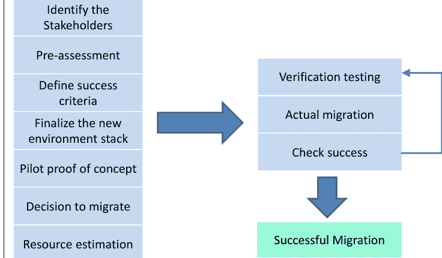

图 4-1 典型的迁移方法

识别利益相关者见第47页的第4.2节“识别利益相关者”和第48页的第4.3节“组织利益相关者”。本节介绍了该方法中剩余的每个元素。

### 4.4.1 预评估

在预评估阶段，将对应用程序架构、源代码依赖、数据库兼容性和构建环境进行高层分析和初始可行性分析。此任务定义了迁移到目标操作系统的整体范围。通过对运行在当前服务器上的应用程序进行评估，以确定它们是否可以在 LinuxONE 上运行并获得认证。此外，还将对与迁移相关的风险进行评估。这一过程有助于在最早阶段识别风险区域。

此外，还需对当前和预期的业务需求进行仔细分析，并将结果与每个迁移方案固有的优缺点进行权衡。该阶段的产出是一个建议的迁移方法，以及一份高层风险评估和分析报告，用于识别迁移过程中可能出现的潜在问题。

### 4.4.2 定义成功标准

在此阶段，所有利益相关者必须对迁移项目的成功标准达成共识。迁移成功可能意味着，例如，在 LinuxONE 平台上通过一定比例的系统测试，或通过由质量审计员与其他利益相关者一致设定的性能标准。

无论如何定义项目成功，所有利益相关者必须在迁移开始前理解并同意这些标准。迁移周期期间对标准的任何更改都必须通知所有利益相关者，并在替换现有标准之前获得批准。

### 4.4.3 确定新环境

迁移通常涉及将自定义构建或第三方应用程序移动到另一个操作系统环境。此任务涉及根据数据库、应用程序需求和其他环境属性之间的匹配情况，对层次结构的不同层级进行仔细分析。

通常，对各种中间件、编译器、第三方工具及其各自的构建参数进行一对一映射。如果缺少任何参数的一对一映射，则需要列出工具中提供的其他具有相同功能或特性的参数。有关帮助记录软件和硬件需求的表单示例，请参见第18页的第2.7节“规划清单”。

在此阶段，大多数技术上的不兼容性和环境选项的差异将被识别并通常会被修复。


### 自定义构建应用程序

如果自定义构建应用程序是用一种或多种编程语言编写的，则可能需要在目标环境中验证多种工具。这些工具可能包括编译器、源代码管理系统、构建环境和第三方插件工具。

此外，还应对对各种构建选项进行深入分析，以确保 LinuxONE 平台上的工具在迁移后提供预期的功能（例如静态链接、库兼容性技术）。涉及的工作量取决于应用程序代码的可移植性。

### ISV 应用程序

如果您在 x86 上运行目标迁移的 ISV 应用程序，则需要确定供应商是否提供了支持目标 LinuxONE 发行版版本的兼容版本。许多 ISV 应用程序具有其他第三方依赖。确保映射出所有的 ISV 依赖，包括中间件。大多数领先的中间件和开源产品在 LinuxONE 上均可用。

> 注意：对于 LinuxONE 的许多应用程序和服务，有许多开源替代方案。

### 4.4.4 试点概念验证

在对目标环境以及可能出现问题和风险的区域了如后，您可以进行试点概念验证（POC）。此阶段是实际迁移的子集，但范围和持续较短。在此阶段，您将应用程序的一个小模块或独立片段实现到目标环境中。

POC 阶段应涵盖完整迁移的所有任务和活动。POC 的主要目标是关注已识别的风险区域，实证测试建议的方法，并证明完整迁移可以成功完成。

通过这种方式，预评估期间识别出的许多潜在迁移风险可以在受控环境中解决，并选择和证明最佳解决方案。此服务针对问题和风险区域，证明了选择了最优解决方法，并提供了迁移的小范围参考。

> 注意：POC 项目可能需要额外的资金并可能延长项目进度，但很可能有助于项目的成功。

### 4.4.5 迁移决策

试点之后，您应该对目标操作系统环境有一个完整的分析，并拥有一份详细说明迁移到 LinuxONE 所需资源、时间和成本的计划。

在此阶段，与利益相关者分析并讨论所有关键需求，包括人员、资源和业务承诺（如服务水平协议 SLA）。还要讨论迁移的任何相关方面，如新工作负载、基础设施和整合。实施迁移的决策必须被所有参与此类活动的利益相关者接受，特别是业务所有者。

### 4.4.6 资源估计

理解迁移目标并在利益相关者的参与下制定指标，有助于提供一个实用的构建基础。迁移活动严重依赖负责应用程序开发、部署和生产支持的人员。预判变化并确保受影响团队早期参与是处理问题的有效方法。例如，在系统切换时。

### 4.4.7 实际迁移

此阶段的范围是将应用程序和基础设施实际迁移到 LinuxONE 环境，产生一个准备好测试的环境。

团队在迁移活动期间遵循计划的方法和流程。根据需要，会对应用程序源代码和构建环境进行修改。生成新的应用程序二进制文件并检查其与目标操作系统版本的兼容性。

### 4.4.8 验证测试

执行正式测试的目的是提供客观证据，证明预定义的目标已通过验证，并在目标运行环境中验证了客户测试需求。这是迁移成功之前的一个重要步骤。目标是在提交或投入生产之前，验证迁移后的环境并确认满足所有预期。

在验证时，请记住以下问题：

- 间互操作是否正常？
- 它能处理预期的负载吗？
- 性能是否符合预期？

如果在此阶段遇到任何性能问题，可以对目标环境进行调整以获得最大性能。

## 4.4.9 检查成功标准

成功迁移环境后，请重新评估所有利益相关者的原始验收标准。如果达到标准，则将环境迁移到生产环境，并获得迁移活动的签字。图 4-2 展示了从用户角度来看的三个成功标准。

如果未达到成功标准，则必须对迁移实施进行审查。审查完成后，必须重新进行测试阶段，以确保迁移的应用符合验收标准并准备好进入环境。

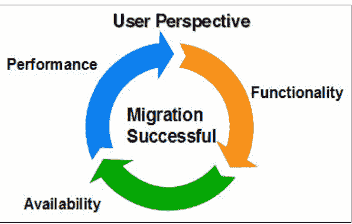

图 4-2 从用户角度来看的成功标准

# 迁移分析

本章帮助你理解 IBM LinuxONE 的新功能，并为你的迁移提供技术方向。每个章节涉及基础架构的不同部分，并使用场景展示迁移如何影响环境。

本章包含以下章节：

- 网络分析
- 存储分析
- 应用分析
- 数据库分析
- 备份分析
- 安全分析
- 运维分析
- 灾难恢复与可用性分析
- 从虚拟化环境到 LinuxONE 云的迁移

## 5.1 网络分析

本节提供了有关网络迁移配置问题的信息，解释了如何配置虚拟网络，并提供了 LinuxONE 及其虚拟机上可用的设施。LinuxONE 全使用以下术语和组件：

- 开放系统适配器 (Open Systems Adapter)

开放系统适配器 (OSA) 功能类似于 x86 上的太网卡，作为硬件控制器并为局域网 (LAN) 或广域网 (WAN) 客户端提供连接。它可以直接连接到 Linux，但通常连接到虚拟交换机。你可以在 IBM z13 技术指南 SG24-8251 中找到更多关于 OSA 卡的更多技术信息。

- 带有链路适配器的 OSA

你将多个物理 OSA 卡聚合到单个逻辑链路，这称为链路聚合组 (LAG)。此配置增加了带宽并提供了非分发优势。如何配置请参阅 *Advanced Networking Concepts Using Linux on IBM System z*, SG24-7995。

- HyperSockets

HyperSockets 是 LinuxONE 对 OSA 接口逻辑链路控制器的微代码模拟，它在运行不同 LPAR 的服务器之间提供内存速度的近零延迟通信，但不包括外部连接。如果需要外部连接，则必须使用虚拟交换机实现 HyperSockets 桥接，或将 Linux 虚拟机设置为路由器。

HyperSockets 在 LPAR 之间提供了快速连接。这种涉及真实硬件的直接连接是简化具有许多 Linux 系统设置的重要因素。某些优势在 *Set Linux on IBM System z for Protection*, SG24-8137 中进行了解释。

- 虚拟交换机 (Virtual switch)

虚拟交换机 (VSWITCH) 是允许计算机系统内的一个虚拟机与另一个虚拟机通信的软件程序。虚拟交换机通常模拟物理太网交换机的功能。在 LinuxONE 中，VSSWITCH 提供 Linux 虚拟机直接连接到物理网段。VSSWITCH 允许 网络架构师和管理员将 Linux 虚拟机视为网络中的普通服务器。

与 VSWITCH 连接的实际速度取决于许多不同的变量。流量类型与真实的底层硬件以及最大传输单元 (MTU) 一样重要。MTU 是网络中传输的一个数据包的最大长度（以字节为单位）。与所有这些解决方案相比，VSSWITCH 比连接到服务器的真实交换机更快。

实施 VLAN 也有助于虚拟机在网络的不同安全区域运行。很容易地为 Linux 虚拟机配置网络接口，仅为虚拟机提供选定的 VLAN。这些可以配置为接口上的带标记 VLAN 或单个未标记 VLAN。

### 5.1.1 LinuxONE 和 KVM 可用的网络设施

KVM 虚拟机内部的交换式网络通常使用 Open vSwitch (OVS) 设备实现，OVS 提供了一个稳健的、多层的、开源的虚拟交换机。OVS 支持标准接口和协议，并将多个 OSA 设备绑定在一起实现冗余。OVS 设备可以在虚拟机之间通信，也可以在虚拟机与由 KVM 托管的外部网络之间通信。

另一个网络设备 MacVTap 将桥接网络虚拟化，并受 KVM 支持。然而，由于其更丰富的特性和对设备更细粒度的控制，通常首选 OVS 桥接。

OVS 和 MacVTap 设备都支持 VLAN 和 VLAN 标记。

### 5.1.2 LinuxONE 和 z/VM 可用的网络设施

z/VM 虚拟机的交换式网络设备通常由 VSWITCH 实现，由 VSWITCH 虚拟机管理。当 VSWITCH 作为第 2 层运行时，它的行为类似于位于虚拟机之间的真实交换机。

VSWitches 运行不需要连接到 OSA。它们也可以提供纯虚拟网络。此功能还简化了虚拟机系统之间私有互连的设置。在启用实时虚拟机迁移 (LGR) 的 SSI 中创建私有互连时，使用带有外部接口的专用 VLAN。这种配置对于实现虚拟机之间的私有连接是必要的。

VSSWITCH 提供两种基本选项：一种是基于配置的访问，另一种是基于端口的访问。你可以在 *Set Linux on IBM System z for Protection*, SG24-8137 中了解更多关于 VSWITCH 的优势，以及 *Advanced Networking Concepts Using Linux on IBM System z*, SG24-7995。

### 5.1.3 网络迁移概述

考虑不同的级别，因为 LinuxONE 允许虚拟系统。在其他功能中，你可以在同一个分区内创建多个虚拟交换机和 VLAN。

VSSWITCH 运行在 OSI 模型的第 2 层或第 3 层，并虚拟连接到相同的网段。

本节涵盖了 LinuxONE 上的一些常见场景。

## 单网络场景

最常见的场景之一是将同一物理子网的几台机器迁移到连接同一网段的单个 LinuxONE 分区。图 5-1 显示了涉及单个分布式网络的示例。

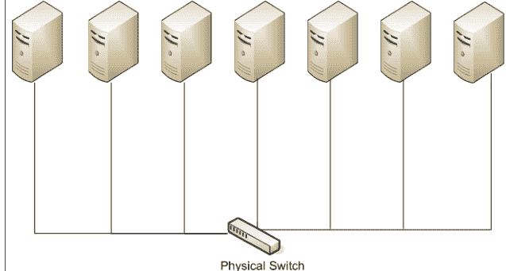

图 5-1 单分布式网络


在这种场景下，所有物理机器都可以迁移到运行 Linux 并共享连接到 OSA 卡的虚拟交换机的 LinuxONE 机器。OSA 卡然后连接到物理网络。图 5-2 说明了这种配置。

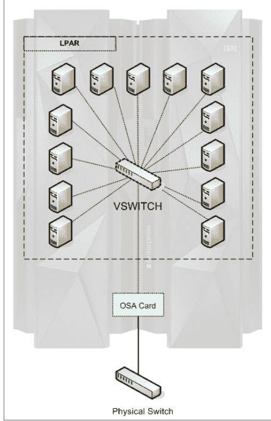

图 5-2 单虚拟化网络

为了增加每个 Linux 虚拟可用性，首选方案是配置连接到网络中不同物理交换机的两个三个 OSA 卡。这种配置提供了网络故障转移能力，如图 5-3 所示。

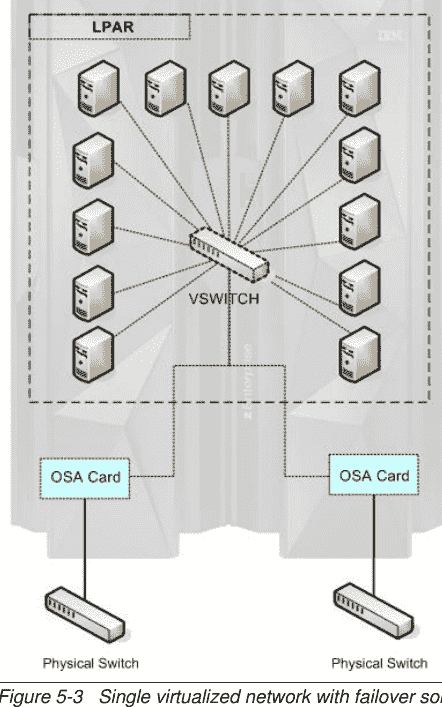

在第 2 层 VSWITCH 配置中，所有 Linux 虚拟机都有自己的媒体访问控制 (MAC) 地址。在第 3 层 VSWITCH 配置中，当来自 LinuxONE LAN 网段外部的请求时，Linux 虚拟机使用 OSA 卡的 MAC 地址响应。

在使用单个网段的多分区场景中，首选方案是在分区之间共享 OSA 卡。每个分区的 VSWITCH 都连接到 OSA 卡，而 OSA 卡直接连接到物理网段。这是一个开发服务器和生产服务器位于不同分区的常见场景。这种配置如图 5-4 所示。

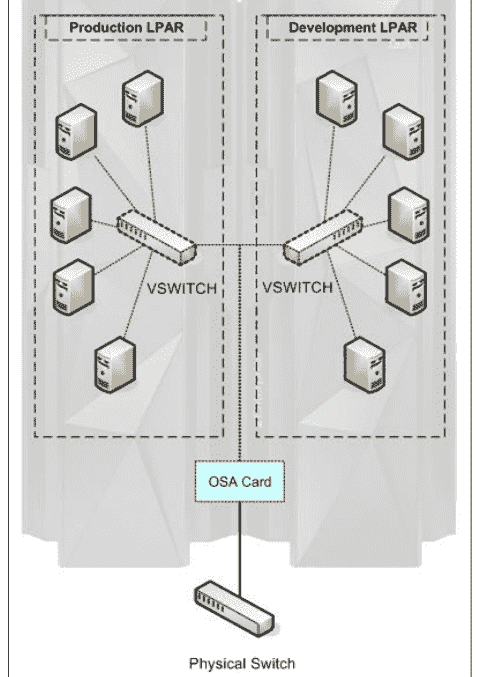

图 5-4 具有多个 LPAR 的单虚拟化网络

同样，之前描述的故障转移解决方案也可以适用于此情况。在分区之间共享两个 OSA 卡如图 5-5 所示。

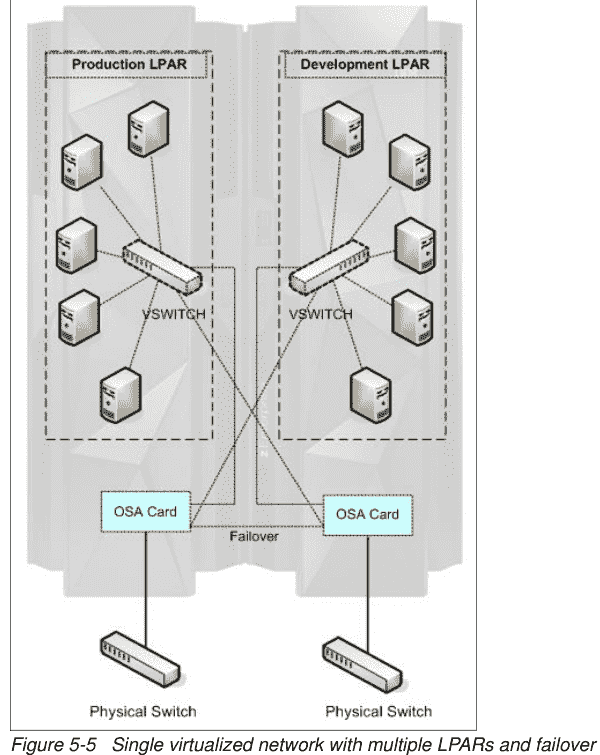

## 多网络场景

若干类型的网络解决方案需要多个网络段。其中某些解决方案要求进行数据包路由或使用多个 LPAR。本节为每种类型的网络设计提供了建议。

### 5.1 DMZ 和安全网络

在某些场景下，不同的网络段被迁移到 LinuxONE 并共享一台物理 LinuxONE 服务器。分析 DMZ 和安全网络场景。图 5-6 显示了放置 Web 应用服务器的 DMZ 网络以及位于数据库服务器的安全网络。

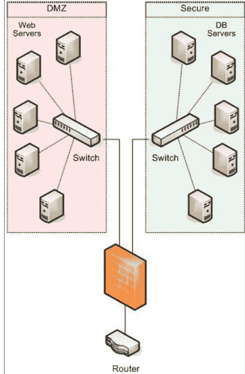

图 5-6 多分布式场景：DMZ 分段网络

您可以在 LinuxONE 上设置相同的场景。如果您在环境中已有物理交换机、第三方防火墙解决方案和路由器，可以将它们重用为 LinuxONE 网络规划的一部分。否则，您可以使用 LinuxONE 及其虚拟化程序提供的某些网络设施。

OSA 卡连接到一个物理交换机（当配置故障转移解决方案时连接两个 OSA 卡）。如果您没有硬件防火墙解决方案，可以用充当路由器和防火墙的 Linux 虚拟机替代物理防火墙。所有虚拟 Linux 虚拟机连接到两个不同网络段的两个 VSWICH。图 5-7 显示了使用 Linux 虚拟机作为防火墙的网络。

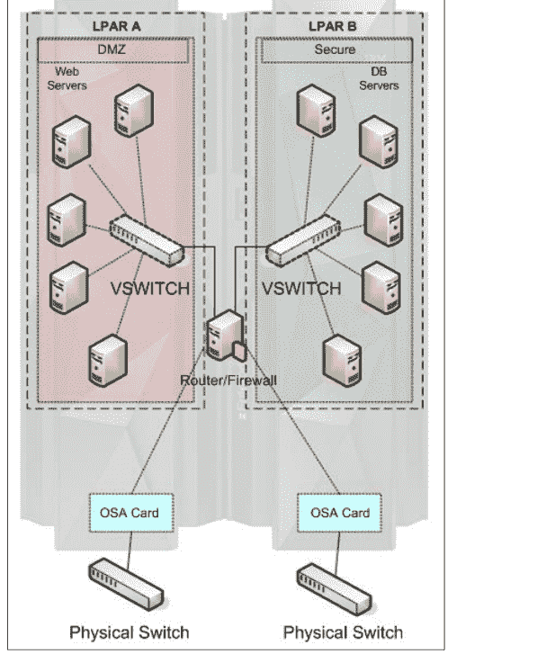

图 5-7 多虚拟化网络场景：DMZ 和安全网络

您可能已经注意到第 63 页的图 5-7，该配置没有共享 OSA 卡。可以在同一物理 LinuxONE 服务器上的多个分区之间共享 OSA 卡。要创建此解决方案，通常使用外部防火墙来管理网络过滤器。图 5-8 说明了描述为网络分段分区的解决方案。

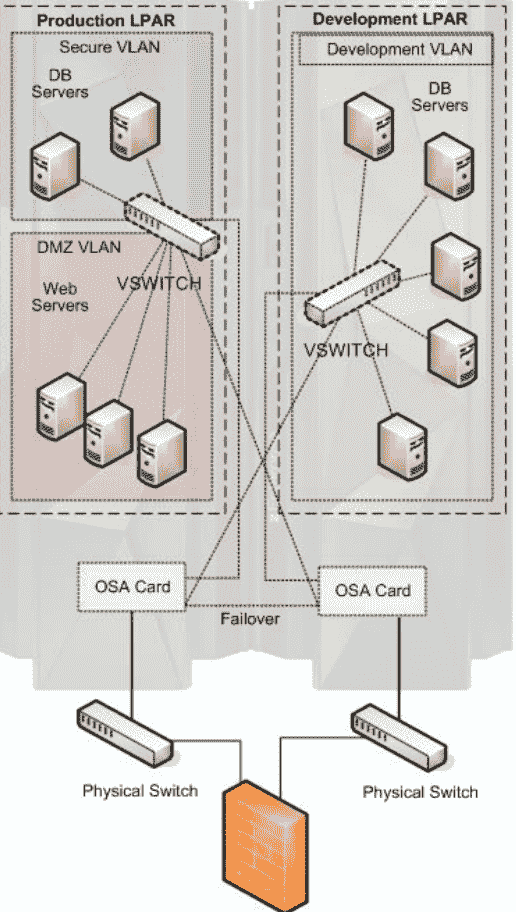

图 5-8 带故障转移的多虚拟化网络场景：DMZ 和安全网络

您可以使用多个分区将整个安全网络与物理网络段隔离。分区之间的通信由 HyperSocks 设备管理。图 5-9 了一了一个示例。

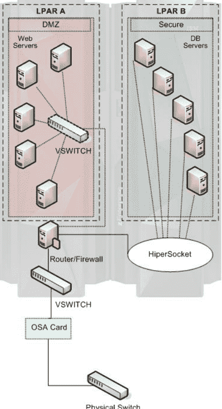

图 5-9 多个 LPAR 的多虚拟化网络场景

> 注意：虽然此场景可以使用 HyperSocks，但它可能不是最佳解决方案。如果其中一个 LPAR 受到 CPU 限制，使用 HyperSocks 可能会导致流量延迟。有关 HyperSocks 的更多信息，请参见 *Set Linux on IBM System for Production, SG24-8137.*。

### VLAN 分段网络

在虚拟交换机未使用 VLAN 标签。VLAN 配置有助于网络包的分段，为环境带来安全性和组织性。它通过将具有共同需求的虚拟机分组（无论其物理位置如何），便于网络管理。VSW 像物理交换机一样，根据端口提供加入 VLAN 段的完全授权。

对于高安全网络场景，请使用带有多个网络分段解决方案的 LPAR 环境。如第 64 页图 5-8 所示，整个 LinuxONE 环境都是虚拟化的，所有配置都是针对虚拟机进行的，这增加了安全性，降低了复杂性并简化了环境。

### 5.1.4 网络迁移的辅助步骤

Linux 管理员和网络管理员应共同努力，为您的环境设计最佳解决方案。完成以下基本步骤：

- 1. 为新服务器确定新的 IP 地址。每个 IP 地址应在同一个 IP 网络上，以尽可能减少整个迁移过程的变量数量。
- 2. 确定 Linux 服务器的 VLAN ID。
- 3. 使用列出的 VLAN ID 配置 VSWITCH。
- 4. 使用指定的 IP 地址配置 Linux 服务器。

此时，Linux 服务器必须分配一个与源服务器不同的主机名：

- 1. 从源服务器迁移应用程序和文件到目标服务器（更多信息请参见第 76 页节 5.3“应用程序分析”）。
- 2. 关闭源服务器。
- 3. 修改 Linux 服务器的主机名。
- 4. 将 DNS 注册名称更改为新的 Linux IP 地址。

如果应用程序是基于 IP 的应用程序，您可以将目标 Linux 服务器的 IP 地址更改为源 IP。

## 5.2 存储分析

本节解释了关于 LinuxONE 存储配置可能的概念和设计，例如在线迁移和离线迁移。涵盖涵盖其他存储迁移问题。

### 5.2.1 数据迁移

本节讨论了两种数据迁移模型：

- 在线迁移是指源服务器、目标服务器和服务所有都在运行且不需要停机的情况。
- 离线迁移需要停机以从源服务器切换到目标服务器。

这些迁移模型将在下面的子节中进行详细介绍。

在这两种类型的数据迁移中，都必须仔细考虑某些意外问题。如果不这样做可能会导致停机时间延长、意外停机、数据损坏或数据丢失。

#### 在线迁移

某些应用程序适用于在线迁移。要符合条件，应用程序必须提供多操作系统集群功能，并在 LinuxONE 上可用。

要执行在线迁移，请完成以下步骤：

- 1. 安装并配置 Linux 虚拟机。更多信息请参见第 70 页节 5.2.2“LinuxONE：安装前的考虑因素”。
- 2. 在 Linux 虚拟机上安装中间件应用程序。
- 3. 将应用程序数据拷贝到目标 Linux 虚拟机。

软件应用程序的选择取决于需要复制的数据类型。在应用程序不发生或更改完全受控的在线迁移中，可以使用 Linux `cp` 命令等解决方案。

否则，可以使用 Rsync 应用程序在迁移期间的极短时间内同步服务器之间的数据。

- 4. 将 Linux 虚拟机作为节点包含在集群。
- 5. 监控 Linux 虚拟机以验证应用程序是否正确响应请求。

此步骤不是在 LinuxONE 上对应用程序进行测试。必须在开发系统上对应用程序进行测试，以确保该应用程序是 Linux 兼容应用程序（更多信息请参见第 76 页节 5.3“应用程序分析”）。

- 6. 关闭源服务器。

在选择在线迁移作为解决方案之前，务必考虑所迁移数据的内容。为了避免此类问题，在线数据迁移必须在非工作时间进行，并且应该始终在实际数据迁移活动开始之前进行数据备份。

#### 离线数据迁移

离线数据迁移适用于所有系统迁移。这种迁移可以使用几种不同的方法和功能实现：

- 使用网络挂载点 NFS 或 Samba 连接，并确保使用 DD 或 CP 命令。
- 在源服务器或目标服务器上使用 FTP 服务器。
- 在服务器与目标服务器之间使用 SCP/SSH 服务器。
- 在源服务器或目标服务器之间使用 Rsync 同步应用程序。
- 将存储卷连接到光纤设备（Linux 到 Linux 迁移）。

##### 使用 Rsync 应用程序

为了在使用 Rsync 应用程序时获得更好的结果，请在停机前的一周内通过完成以下步骤来安排同步：

- 1. 在迁移的第一天，运行第一次同步。

在服务器使用率较低时运行第一次同步。Rsync 只复制未被锁的文件，这避免了正在使用的文件产生的问题。然而，在此期间，由于额外的读取 I/O 活动，服务器响应可能会比通常情况慢。
- 2. 在迁移周期间，你可以在低峰段在服务器上运行每日同步。

只有修改过的会被从源服务器复制到目标服务器。
- 3. 最后同步日是服务器停机日，届时用户将被访问源服务器。

由于没有打开的文件，Rsync 应用程序能够将所有文件复制到目标服务器。
- 4. 关闭源服务器并在目标 Linux 服务器上启动所有服务。

## 通过网络传输文件


数据库迁移是需要通过网络传输文件需求的最常见示例。这是因为大多数数据库软件都需要一个离线备份，其中包含数据导出或数据转储到新文件的过程。

该导出的/转储的文件需要跨网络传输，并且在目标服务器上运行数据库导入过程。更多信息请参阅第 84 页的 5.4，“数据库分析”。

## 迁移存储卷

当源服务器为 `Linux86` 并通过光纤（`Fibre Channel`）连接到外部存储设备，且 `zFCP` 设备属于同一个存储区域网络（`SAN`）时，你可以将源 `Linux` 卷连接到 `LinuxONE` 服务器上的目标 `Linux` 虚拟机。然而，两台服务器无法同时共享一个卷。

## 存储 SAN 卷控制器

简化到 `LinuxONE` 的光纤磁盘存储和数据迁移的一种方案是安装 `IBM System Storage® SAN` 卷控制器（`SVC`）。

`SAN` 卷控制器位于通道路径中，允许你可视化位于其后方的多个供应商的所有 `FCP` 存储。图 5-10 显示了 `SAN` 卷控制器在 `SAN` 中的位置。卷卷控制器对 `SAN` 上所有支持的存储具有可见性。

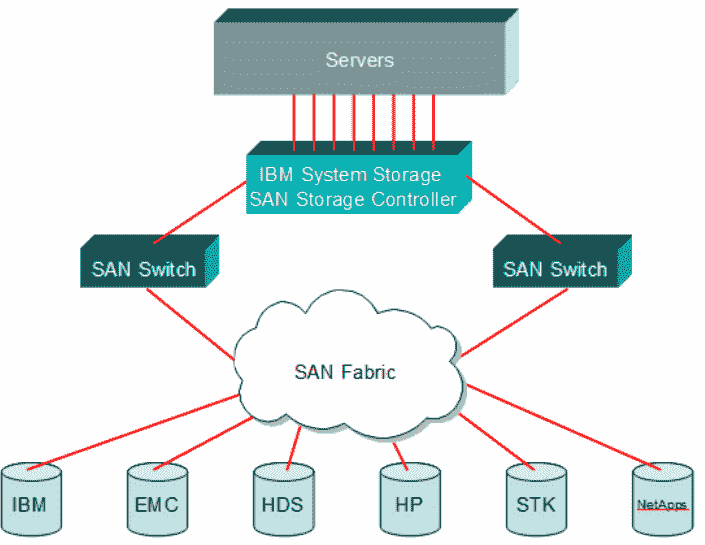

图 5-10 `SAN` 卷控制器

`SVC` 提供了以下优势：

- 异构存储资源的单点控制

- `SAN` 上异构存储设备之间的动态数据迁移

- 汇总 `SAN` 上多个存储系统容量的能力

- 支持多达 1024 台主机服务器的可扩展性

- 使用 `IBM FlashCopy®` 跨多个存储系统进行数据的快速复制

- 根据需要跨城市和全球距离复制数据，以创建高可用解决方案

将 `Linux` 系统从 `x86` 迁移到 `LinuxONE` 时，`SAN` 卷控制器允许你非中断地将数据迁移到 `LinuxONE`。有关 `IBM System Storage Volume` 控制器的更多信息，请参阅以下网站：

`http://www.ibm.com/systems/storage/software/virtualization/svc`

在以下出版物中提供更多信息：

- `Introduction to Storage Area Networks`, `SG24-5470`

- `IBM System Storage SAN Volume Controller and Storwize V7000 Best Practices and Performance Guidelines`, `SG24-7521`

- `Implementing the IBM System Storage SAN Volume Controller with IBM Spectrum Visualize V7.6`, `SG24-7933`

- `Implementing FlashSystem 840 with SAN Volume Controller`, `TIPS11337`

## 辅助存储迁移的帮助步骤

`LinuxONE` 为存储和访问提供的多种可能性导致了许多类型的解决方案。你为目标系统设计的解决方案将极大影响迁移应用的灵活性、效率和性能。

对于运行在本地存储或外部存储不与光纤数据存储兼容的服务器上的源应用程序，所有数据必须使用网络文件系统从源服务器复制到目标服务器（`LinuxONE`）：

1. 创建一个带有所有数据文件挂载点的服务器文件系统。

2. 在目标服务器上创建一个临时文件系统，用于文件传输过程。

3. 将目标服务器配置为 `NFS` 文件服务器、`Samba` 文件服务器或 `FTP` 文件服务器，以从源服务器上传文件。

4. 注意以下几点：

- 如果源服务器有足够的空间压缩所有数据，请考虑 `zip` 或带 `gzip` 和 `bzip` 的 `tar` 等数据压缩功能。这两种格式都兼容 `LinuxONE`。可以使用在目标端配置的 `FTP` 服务器传输数据。

- 如果源服务器没有足够的空间压缩数据，请在源机器映射 `NFS` 文件系统或 `Samba` 文件系统，并跨网络复制文件。

5. 验证目标目录下的文件权限。传输后调整文件权限以进行工作。

对于使用光纤的外部存储系统的文件存储，你可以迁移到配置有 `zFCP` 适配器的 `LinuxONE` 服务器，直接连接到应迁移到 `LinuxONE` 的卷。

## 5.2.2 LinuxONE：安装前的考虑因素

存储和文件系统设计对系统性能、系统可用性和扩展能力有直接影响。

`LinuxONE` 的最佳实践是从头开始只安装一个版本的 `Linux` 发行版。因此，设计基础 `Linux` 文件系统以允许最高型号的服务器，然后从此源（称为黄金镜像）克隆环境中的所有其他 `Linux` 虚拟机。对于 `z/VM` 的 `IBM Wave`，此黄金镜像被称为原型。存储应用数据的文件系统在克隆过程后根据服务器上运行应用程序的需求创建。如果你想知道如何创建 `SUSE Linux Enterprise Server 11` 或 `RHEL 6.4` 黄金镜像，请参阅 `The Virtualization Cookbook for IBM z Systems Volumes 1: IBM z/VM 6.3`, `SG24-8147`。

### 逻辑卷管理器

根目录 (`/`) 的所有的文件系统都由逻辑卷管理器（`LVM`）管理。这允许灵活的调整大小和快照。根系统通常保留为标准分区，以确保在恢复场景期间可以启动。

根目录 (`/`) 之外的所有文件系统都由逻辑卷管理器（`LVM`）管理。这允许灵活的调整大小和快照。根系统通常保留为标准分区，以确保在恢复场景期间可以启动。

根目录 (`/`) 之外的所有文件系统都由逻辑卷管理器（`LVM`）管理。这允许灵活的调整大小和快照。组件包括：

- `PV`（物理卷）：实际的磁盘或分区。

- `LV`（逻辑卷）：呈现给用户的虚拟分区。

- `VG`（卷组）：`PV` 的集合。

根目录 (`/`) 之外的所有文件系统都由逻辑卷管理器（`LVM`）管理。这允许灵活的调整大小和快照。根系统通常保留为标准分区，以确保在恢复场景期间可以启动。

根目录 (`/`) 之外的所有文件系统都由逻辑卷管理器（`LVM`）管理。这允许灵活的调整大小和快照。根系统通常保留为标准分区，以确保在恢复场景期间可以启动。

根目录 (`/`) 之外的所有文件系统都由逻辑卷管理器（`LVM`）管理。这允许灵活的调整大小和快照。根系统通常保留为标准分区，以确保在恢复场景期间可以启动。

根目录 (`/`) 之外的所有文件系统都由逻辑卷管理器（`LVM`）管理。这允许灵活的调整大小和快照。根系统通常保留为标准分区，以确保在恢复场景期间可以启动。

根目录 (`/`) 之外的所有文件系统都由逻辑卷管理器（`LVM`）管理。这允许灵活的调整大小和快照。根系统通常保留为标准分区，以确保在恢复场景期间可以启动。

根目录 (`/`) 之外的所有文件系统都由逻辑卷管理器（`LVM`）管理。这允许灵活的调整大小和快照。根系统通常保留为标准分区，以确保在恢复场景期间可以启动。

根目录 (`/`) 之外的所有文件系统都由逻辑卷管理器（`LVM`）管理。这允许灵活的调整大小和快照。根系统通常保留为标准分区，以确保在恢复场景期间可以启动。

根目录 (`/`) 之外的所有文件系统都由逻辑卷管理器（`LVM`）管理。这允许灵活的调整大小和快照。根系统通常保留为标准分区，以确保在恢复场景期间可以启动。

根目录 (`/`) 之外的所有文件系统都由逻辑卷管理器（`LVM`）管理。这允许灵活的调整大小和快照。根系统通常保留为标准分区，以确保在恢复场景期间可以启动。

根目录 (`/`) 之外的所有文件系统都由逻辑卷管理器（`LVM`）管理。这允许灵活的调整大小和快照。根系统通常保留为标准分区，以确保在恢复场景期间可以启动。

根目录 (`/`) 之外的所有文件系统都由逻辑卷管理器（`LVM`）管理。这允许灵活的调整大小和快照。根系统通常保留为标准分区，以确保在恢复场景期间可以启动。

根目录 (`/`) 之外的所有文件系统都由逻辑卷管理器（`LVM`）管理。这允许灵活的调整大小和快照。根系统通常保留为标准分区，以确保在恢复场景期间可以启动。

根目录 (`/`) 之外的所有文件系统都由逻辑卷管理器（`LVM`）管理。这允许灵活的调整大小和快照。根系统通常保留为标准分区，以确保在恢复场景期间可以启动。

根目录 (`/`) 之外的所有文件系统都由逻辑卷管理器（`LVM`）管理。这允许灵活的调整大小和快照。根系统通常保留为标准分区，以确保在恢复场景期间可以启动。

根目录 (`/`) 之外的所有文件系统都由逻辑卷管理器（`LVM`）管理。这允许灵活的调整大小和快照。根系统通常保留为标准分区，以确保在恢复场景期间可以启动。

根目录 (`/`) 之外的所有文件系统都由逻辑卷管理器（`LVM`）管理。这允许灵活的调整大小和快照。根系统通常保留为标准分区，以确保在恢复场景期间可以启动。

根目录 (`/`) 之外的所有文件系统都由逻辑卷管理器（`LVM`）管理。这允许灵活的调整大小和快照。根系统通常保留为标准分区，以确保在恢复场景期间可以启动。

根目录 (`/`) 之外的所有文件系统都由逻辑卷管理器（`LVM`）管理。这允许灵活的调整大小和快照。根系统通常保留为标准分区，以确保在恢复场景期间可以启动。

根目录 (`/`) 之外的所有文件系统都由逻辑卷管理器（`LVM`）管理。这允许灵活的调整大小和快照。根系统通常保留为标准分区，以确保在恢复场景期间可以启动。


文件系统的大小取决于运行的应用程序的数量和类型，以及日志文件在服务器上保存的时间。此外，还要考虑应用程序是否被设计为在此写入文件，以及这些文件的大小和频率。

服务控制也放置在 `/var` 文件系统上，因此它永远无法扩展为共享文件系统，并且必须始终保持读/写状态。

由于它是一个动态文件系统，请将其放置在 LVM 设备上，以便根据需要进行扩展或缩小。

## /tmp 文件系统

`/tmp` 文件系统最初设计用于存储操作系统文件和临时应用程序文件。这些文件在每次系统重启时都会被删除，或者在文件不再被使用后由应用程序立即删除。一些自制（homemade）应用程序使用 `/tmp` 文件系统作为转储区或交换文件资源。在少数情况下，需要增加 `/tmp` 的大小。

由于它是一个动态文件系统，请将其放置在 LVM 设备上，以便根据需要具备扩展或缩小的能力。

## /opt 文件系统

将所有第三方应用程序部署在 `/opt` 文件系统中。作为首选实践，根据开发该应用程序或软件的公司或组织对 `/opt` 目录进行进一步组织。下一级目录指定了安装的软件包。例如，在 `/opt/ibm/db2` 安装适用于 Linux 的 DB2 节点。将 WebSphere 应用程序放置在 `/opt/ibm/websphere` 目录。

文件系统的大小取决于将安装在其中的软件包的大小。估计单个软件包的需求是容易的。然而，升级、维护和额外的软件包在计划起来并不那么容易。`/opt` 文件系统也可以是一个动态文件系统，并应该配置在 LVM 设备上。

## /home 文件系统

`/home` 文件系统设计用于分配用户文件。文件系统的大小取决于服务器的功能和定义的的用户数量。例如，应用程序生产环境服务器不需要 `/home` 文件系统，因为开发人员将把文件存储在生产服务器上。然而，预计应用程序将在开发应用服务器上进行开发，因此开发人员需要足够的文件系统空间来创建和传输他们的文件。

根据情况，`/home` 文件系统可以是一个动态文件系统。如果是动态的，请将其配置在 LVM 设备上。

## 其他文件系统

在迁移过程中，可能会在特定服务器上创建的额外文件系统的示例是数据库服务器文件。基本上，你至少需要一个用于文件数据的文件系统和一个用于日志文件的文件系统。因此，除了安装应用程序二进制文件的文件系统外，必须至少创建两个文件系统。对于 IBM DB2 数据库服务器，二进制文件的默认位置是 `/opt/ibm/db2`。

其他数据库管理系统将数据存放在其他目录。例如，MySQL 数据库服务器数据文件的默认位置是 `/var/lib/mysql` 目录。如果服务器是 MySQL 数据库服务器且你正在使用 Red Hat 或 SUSE Linux 发行版，考虑在 `/var/lib/mysql` 挂载点包含一个新的文件系统。

第 5 章 迁移分析 73

对于每个目标数据库管理服务器，确保你知道二进制文件和数据文件的位置。只有通过这些信息，你就可以为目标系统规划设备和文件。

取决于你在所在地安装的 Linux 发行版，文件位置可能会差异。确保你了解这些差异（如果有），并为此制定计划。

## 附加资源

有关更多建议（例如卷组和磁盘命名规范），请参见 `Set up Linux on IBM z for Production, SG24-8137`。

## 共享文件系统

LinuxONE 环境中的数据存储可以由一个或多个 Linux 虚拟机进行物理共享。然而，由于文件系统的限制，两个 Linux 虚拟机无法同时对设备具有读/写控制。然而，这种配置在硬件层面可能是可能的。

For more recommendations, like volume group and disk naming conventions, see `Set up Linux on IBM z for Production, SG24-8137`。

## Shared file system

Software-defined storage

The IBM LinuxONE brings support for Spectrum Scale and other software-defined storage technologies. This newer virtualization abstracts the rich features that are found in a single storage so they become available across multiple storage facilities. This feature provides tremendous benefits in the clustering technologies used for High Availability solutions and data replication.

Chapter 5. Migration analysis 5

## 5.3 Application analysis

This section describes the analysis that you need to perform to identify applications that would be good candidates for migration to LinuxONE.

This section deals with the following topics:

- How to identify the best candidates for a migration to LinuxONE

- How to select the appropriate application for LinuxONE proof of concept

- What can you do if your independent server (ISV) does not support LinuxONE


### How you can accommodate application interdependencies in a LinuxONE environment

### How you can redesign your application to take advantage of the strengths of the Linux platform

#### 5.3.1 Why migrate applications

Only perform application migration after thorough planning. You also need a compelling reason to act, such as the following real world situations:

- An existing application has outgrown its original platform and is close to reaching the architectural limits of the platform.
- Software license costs are rapidly increasing as servers are added to an application.
- Performance issues are arising between distributed application servers and centralized databases.
- Uncontrolled distributed server growth is leading to power and cooling issues in the data center.
- Complex distributed systems, which are costly to maintain, are suffering from increasing unreliability.
- New application development is required following a merger or acquisition.
- Regulatory requirements impose the need for a more secure environment.

Such situations present valid reasons for considering a migration to a more efficient platform like IBM LinuxONE. In cases, a migration to LinuxONE will help an organization realize significant cost savings over three to five years. Which applications can you migrate and what risks are associated with the migration?

The output of this exercise is a list of an organization's applications ordered by complexity. The list is based on factors such as the number of servers or applications that make up the "IT systems", and can be grouped as large, medium, or small applications or number of servers.

文件系统的大小取决于运行的应用程序的数量和类型，以及日志文件在服务器上保存的时间。此外，还要考虑应用程序是否被设计为在此写入文件，以及这些文件的大小和频率。

服务控制也放置在 `/var` 文件系统上，因此它永远无法扩展为共享文件系统，并且必须始终保持读/写状态。

由于它是一个动态文件系统，请将其放置在 LVM 设备上，以便根据需要进行扩展或缩小。

### /tmp 文件系统

`/tmp` 文件系统最初设计用于存储操作系统文件和临时应用程序文件。这些文件在每次系统重启时都会被删除，或者在文件不再被使用后由应用程序立即删除。一些自制应用程序使用 `/tmp` 文件系统作为转储区或交换文件资源。在少数情况下，需要增加 `/tmp` 的大小。

由于它是一个动态文件系统，请将其放置在 LVM 设备上，以便根据需要具备扩展或缩小的能力。

### /opt 文件系统

将所有第三方应用程序部署在 `/opt` 文件系统中。作为首选实践，根据开发该应用程序或软件的公司或组织对 `/opt` 目录进行进一步组织。下一级目录指定了安装的软件包。例如，在 `/opt/ibm/db2` 安装适用于 Linux 的 DB2 节点。将 WebSphere 应用程序放置在 `/opt/ibm/websphere` 目录。

文件系统的大小取决于将安装在其中的软件包的大小。估计单个软件包的需求是容易的。然而，升级、维护和额外的软件包在计划起来并不那么容易。`/opt` 文件系统也可以是一个动态文件系统，并应该配置在 LVM 设备上。

### /home 文件系统

`/home` 文件系统设计用于分配用户文件。文件系统的大小取决于服务器的功能和定义的的用户数量。例如，应用程序生产环境服务器不需要 `/home` 文件系统，因为开发人员将把文件存储在生产服务器上。然而，预计应用程序将在开发应用服务器上进行开发，因此开发人员需要足够的文件系统空间来创建和传输他们的文件。

根据情况，`/home` 文件系统可以是一个动态文件系统。如果是动态的，请将其配置在 LVM 设备上。

### 其他文件系统

在迁移过程中，可能会在特定服务器上创建的额外文件系统的示例是数据库服务器文件。基本上，你至少需要一个用于文件数据的文件系统和一个用于日志文件的文件系统。因此，除了安装应用程序二进制文件的文件系统外，必须至少创建两个文件系统。对于 IBM DB2 数据库服务器，二进制文件的默认位置是 `/opt/ibm/db2`。

其他数据库管理系统将数据存放在其他目录。例如，MySQL 数据库服务器数据文件的默认位置是 `/var/lib/mysql` 目录。如果服务器是 MySQL 数据库服务器且你正在使用 Red Hat 或 SUSE Linux 发行版，考虑在 `/var/lib/mysql` 挂载点包含一个新的文件系统。

第 5 章 迁移分析 73

对于每个目标数据库管理服务器，确保你知道二进制文件和数据文件的位置。只有通过这些信息，你就可以为目标系统规划设备和文件。

取决于你在所在地安装的 Linux 发行版，文件位置可能会差异。确保你了解这些差异（如果有），并为此制定计划。

### 附加资源

有关更多建议（例如卷组和磁盘命名规范），请参见 *Set up Linux on IBM z for Production, SG24-8137*。

### 共享文件系统

LinuxONE 环境中的数据存储可以由一个或多个 Linux 虚拟机进行物理共享。然而，由于文件系统的限制，两个 Linux 虚拟机无法同时对设备具有读/写控制。然而，这种配置在硬件层面可能是可能的。

### 5.3.2 哪些应用程序可以迁移

每个计算平台都提供特定的优势领域，迁移的目标应该是选择能够利用目标平台优势的应用程序。IBM LinuxONE 的优势包括高可用性、高 I/O 带宽能力、并发运行异构负载的灵活性，以及卓越的灾难恢复能力。

选择合适的迁移应用程序的另一个关键要素是它们是否在 LinuxONE 上支持。对于自有的应用程序，这种考虑通常不是问题，取决于它们的编写语言。此外，LinuxONE 平台上还有大量的开源应用程序可供。

### 5.3.3 选择迁移到 LinuxONE 的基本规则

本节列出并描述了选择应用程序迁移到 LinuxONE的基本规则。

以下列表包含了不能或不宜迁移到 LinuxONE 的应用程序：

- 仅在 Intel 或 UNIX 平台上提供的应用程序。
- 请求 ISV（独立软件供应商）在 LinuxONE 上支持其应用程序是一个漫长的过程。
- 已经虚拟化的服务器。

在这种情况下，虚拟化的大部分总拥有成本（TCO）效益已经实现，只能获得微小的收益。然而，如果现有的虚拟环境达到极限，或者服务器租用期在 9 到 12 个月内到，那么由于 LinuxONE 更高的虚拟化能力，将应用程序迁移到 LinuxONE 可能是一个很好的业务案例。

以下列表包含了适合迁移的应用程序及其适用性原因：


- 软件供应商在多个平台（包括 LinuxONE）上支持的应用程序或中间件（数据库、应用服务器等）。
- 没有支持性问题，且迁移过程要简单得多。
- 需要靠近 IBM LinuxONE 上数据的应用程序，或作为 LinuxONE 应用程序组件的应用程序。
- 具有高 I/O 或事务性 I/O 的应用程序。由于其设计，LinuxONE 擅长处理高 I/O 速率。
- 持续 CPU 峰值和平均内存需求较低的应用程序。该平台的设计用于在持续高 CPU 和内存利用率下运行多个工作负载。
- 其他平台上的 Linux 应用程序开发环境。

虚拟化的 LinuxONE 平台为在应用程序部署到其他平台的 Linux 之前对其进行测试提供了一个理想环境。

## 5.3.4 最适合迁移的应用程序

本节描述的应用程序从 LinuxONE 平台的优势中获益最多，包括高可用性、高 I/O 带宽能力、并发运行异构负载的灵活性以及卓越的灾难恢复特性。

用于与早期大型机应用程序直接通信的应用程序能够利用 LinuxONE 平台的架构优势。

# IBM 软件

IBM 已经将其许多产品移植到 LinuxONE。为客户带来的益处是从一个平台到另一个平台的迁移轻而易举，因为这些许多产品在多个平台之间共享代码库。这种优势在 IBM WebSphere Application Server 上尤为明显，因为它从 6 版本开始在 Intel x86、IBM POWER®、System z® 和 LinuxONE 上具有相同的代码库，大大简化了迁移。

LinuxONE 提供了各种解决方案，您可以在此处查看：

http://www.ibm.com/systems/linuxone/solutions/

通常情况下，将分布式服务器上的 IBM 产品迁移到 LinuxONE 上的相同 IBM 产品是一个相对直接的过程。您可以在第 121 页的第 6 章“上手迁移”中查看示例。

# DB2

您可以在 LinuxONE 上使用适用于 Linux、UNIX 和 Windows 的 DB2。它在虚拟环境中无缝运行，无需任何额外配置。此外，自治功能（如自调优内存管理）和增强的自动存储帮助数据库管理员维护和调优 DB2 服务器。要查看从 x86 的迁移示例，请参见第 125 页的 6.2 节“迁移 DB2 及其数据”。

您可以在 DB2 10 for Linux on System z Using v/M v6.2, System Image Clusters and Guest Live Replication, SG24-8036 中找到更多信息和用例。

# Oracle

Oracle 数据库在 LinuxONE 上受到完全支持，并在该平台上运行高效，因此它是迁移到 LinuxONE 的良好选择。

LinuxONE 上的 Oracle 数据库还支持实时应用集群（RAC），即 Oracle 的高可用集群解决方案。Linux 上 Oracle RAC 的优势是 LinuxONE 平台内具有低延迟的高可用集群，并结合了 HiperSockets 通信。

LinuxONE 也支持 Oracle WebLogic Server，它允许您在同一台服务器内拥有完整的 Java 环境和高可用 Oracle 数据库。

在许多情况下，Oracle 支持混合配置，其中数据库层位于 Linux 上，而用于 Oracle E-Business Suite、Oracle Siebel 和 Oracle Intelligence 的应用程序运行在 Linux、WINDOWS 或 UNIX 的分布式服务器上。要获取有关哪些 Oracle 产品已通过 LinuxONE 认证的最新信息，请联系您的 Oracle 代表员或参考以下网站：

http://www.oracle.com/technet

更多信息可以在：

- Experiences with Oracle 11gR2 on Linux system, SG24-8104
- Experiences with Oracle Solutions for Linux on IBM system, SG24-7634
- Experiences with Oracle Database 12c Release 1 on Linux system, SG24-8159

# LinuxONE 上的大数据 Hadoop 解决方案

构建在 IBM Linux 平台上的大数据解决方案旨在应对企业面临的数据爆炸。IBM 在优化可即时部署集群方面发挥了领导作用。这些解决方案基于 IBM InfoSphere 软件，如 DataStage。IBM 还重视其在开源社区的领先地位，对 Apache Hadoop 等项目出了大量贡献，推动了分析领域的发展。希望在高性能数据平台上创新的客户和解决方案构建者可以使用 LinuxONE 的灵活性、吞吐量和弹性。

# LinuxONE 上的 MongoDB 解决方案

MongoDB 的 NoSQL 技术消除了关系映射的负担。它允许开发者快速构建和部署现代应用程序，而无需预定义数据模式。MongoDB 的主要功能包括灵活的数据建模、云和本地集群管理与自动化、丰富的查询语言、始终可用的全球部署、可扩展性和高性能。

运行 Node 和 MongoDB 的 LinuxONE 服务器每天可以处理超过 300 亿次事件，同时保持 40 万次读写，比其他平台快 2 倍。IBM LinuxONE 允许 MongoDB 通过动态分配资源进行垂直扩展，而不是水平分分数据库。LinuxONE 和 MongoDB 提供强一致性，确保关键数据保持一致，并减少了与共享相关的处理器使用。

# 5.3 其他软件

本节列出了某些适合迁移到 LinuxONE 的非 IBM 软件。

# 基础设施服务

以下基础设施服务适合 LinuxONE：

- 网络基础设施、FTP、NFS、DNS 等适用于 LinuxONE。这些负载通常很小，但对业务至关重要。在 LinuxONE 上托管这些服务的主要处处可以使用硬件灾难恢复能力。
此外，IBM z/OS 与 FTP 和 NFS 服务器之间会产生大量的网络流量。当服务器与数据位于同一系统并使用 HiperSockets 时，这种网络流量将大大减少，并缩短数据的批处理窗口。
- LDAP 安全服务非常适合在 LinuxONE 上运行，包括 OpenLDAP 产品以及商业产品，如 IBM Tivoli® Directory Server、Tivoli Directory Integrator 和 Tivoli Access Manager。使用 LinuxONE 架构，客户可以构建稳健的 LDAP 基础设施。

# 应用开发

以下是 LinuxONE 为应用开发提供的益处：

- 无论是对于 Java、C/C++ 还是大多数其他编程语言，虚拟化的 Linux 环境都是应用开发的理想平台。虽然开发者通常在独立平台上进行开发，但测试和修改通常在服务器环境中进行。可以为开发者提供多个虚拟服务器，以便在排查故障或增强应用程序时进行交互式测试。
- 其他主要优势包括能够快速部署虚拟服务器进行验收测试和集成测试，并在完成后关闭这些虚拟服务器。如果开发者不小心损坏了虚拟服务器，可以轻松地重置一个新服务器。您不需要花费大量时间来格式化和重新安装操作系统以及所需的应用程序。
- 对于新应用程序，虚拟服务器的部署很快，并且可以根据特定目的易于定制。许多客户拥有预构建的标准服务器配置文件，要创建另一个虚拟机，只需克隆相应的配置，几分钟内即可完成。当某些应用被弃时，虚拟机也可以随之丢弃。

更多关于使用 Linux 环境进行应用开发的信息，请参阅《Linux on IBM eServerSeries and S/390: Application Development, SG24-6807》。

要从来自 60 多家在 LinuxONE 上通过认证并支持的 ISV（软件供应商）的跨行业应用程序和解决方案详细列表，请访问以下网站：

http://www.ibm.com/systems/linuxone/solutions/

## 5.3 选择用于概念验证的应用

在业务案例证明迁移到 LinuxONE 将产生正向投资回报率（ROI）后，大多数客户会遵循此流程：

- 1. 与其他已迁移到 LinuxONE 的客户交流，了解他们的迁移情况，并获取他们关于如何操作的建议。
- 2. 选择他们自己的应用程序之一作为概念验证（POC）的候选对象。

在选择 POC 应用程序时，请保持尽可能简单，因为执行概念验证是为了证明应用程序可以成功迁移到 LinuxONE 环境，并且应用程序的运行结果与生产系统一致。

选择一个相对独立且不过度依赖于多个源输入和其他应用程序的应用程序。此外，选择一个不需要进行重大重写即可在 LinuxONE 上运行的应用程序。

最佳候选对象是基于 Java 的应用程序，因为它们通常是平台无关的。然而，如果您正在迁移到不同的 Java 平台企业版或不同的应用程序服务器，可能需要进行许多代码更改。

用 C/C++ 编写的应用程序如果您有源代码，也是合适的，因为它们必须为 IBM LinuxONE 平台重新编译。

在选择好要迁移的应用程序后，您必须定义目标和成功因素。最低目标是产生与生产版本相同的结果。


### 5.3.7 应用间依赖关系

并不是许多应用程序都是独立的。在某些，应用程序从许多其他应用程序获取数据，并将其输出发送到其他应用程序。这些应用程序可能位于不同的平台，并且通常来自组织之外的实体。应用程序迁移到 LinuxONE 提供了一个机会，可以在不影响任何依赖关系的情况下简化您的应用程序。

许多分布式应用程序在短短几年内从单台服务器增长到几十甚至上百个互连的服务器。这些互连的服务器不仅增加了负担，还增加了复杂性和内置脆弱性。如果考虑迁移此类应用程序，请将“简化”作为核心工作的一部分。LinuxONE 支持所有现代通信方法，因此以与迁移前相同的方式接收数据输入和传输输出是一个直接的过程。在此过程中，不需要对外部应用程序进行任何更改。

迁移规划期间需要记住的关键点是完全映射所有应用程序的依赖关系。目标是识别任何过时的技术和接口，这可能反过来要求另一个应用程序迁移到当前的网络技术。

### 5.3.8 成功的应用程序迁移

本节概述了需要考虑的因素和应遵循的步骤，帮助您完成 Java 和 C/C++ 应用程序成功的迁移。

### 5.3.9 迁移 Java 应用程序的特殊考虑

与 C 或 C++ 应用程序所需的迁移工作相比，将 Java 从一个平台迁移到另一个平台很容易。尽管 Java 应用程序是系统无关的，但还需要考虑实现和分发：

- 大多数 Java 发行版都有自己的 Java 虚拟机（`JVM`）实现。`JVM` 切换参数将存在差异。这些切换参数用于使 `JVM` 和 Java 应用程序在该平台上尽可能地运行。源环境中使用的每个 `JVM` 切换参数在目标 Java 环境中都需要类似的切换参数。
- 尽管 Java 开发工具包（`JDK`）被认为符合常见的 Java 规范，但每个发行版在提供实现特定 Java 应用程序编程接口（`API`）功能的辅助类方面将存在差异。如果应用程序是为符合特定的 Java 发行版而编写的，应用程序中引用的辅助类必须更改为引用新的 Java 发行版类。
- 必须遵循特殊程序以获得最佳的应用迁移。一个关键点是将 `JVM` 更新到当前状态版本。与早期版本的兼容性非常重要，性能改进将使应用程序受益。
- 确保启用了即时编译（`JIT`）编译器。
- 设置最小堆大小（`-Xms`）等于最大堆大小（`-Xmx`）。堆的大小应始终小于配置给服务器的内存总量。

### 5.3.10 迁移 C++ 应用程序的特殊考虑

在迁移 C++ 应用程序时，有几点考虑需要注意，正如本节所示。

#### 依赖于架构的代码

读取目录（非 IBM Linux 系统）中名称如 `/sysdeps` 或 `/arch` 的目录程序包含依赖于架构的代码。您将需要为硬件架构重新实现这些程序。

#### 汇编代码

任何汇编代码都需要重写。Linux 汇编使用 s390，但遵循 GNU 汇编语法。GNU 汇编手册可以在以下网站下载：

http://www.gnu.org/software/binutils

#### ptrace 和返回结构

在使用 `ptrace` 和返回结构时要小心，因为它们依赖于架构。

#### 小端序到大端序

LinuxONE 是大端序系统，存储多字节数字时将最高字节放在较低地址。同时，x86 服务器是小端序系统，将最高字节放在较高的地址。任何处理来自小端序系统的字节定向数据的代码都需要进行字节交换。数据可能需要重新生成，如果无法这样做（例如共享文件），则可能需要对处理小端序数据进行重构。

#### LinuxONE 特有的栈帧布局和链接

有关 LinuxONE 特有的栈帧布局和链接，请参阅 `/usr/src/linux/Documentation/Debuggings390.txt`。文件类型取决于发行版。如果您无法找到它，请参考内核文档：

https://www.kernel.org/doc/Documentation/s390/Debuggings390.txt

#### 构建脚本的更改

您将需要对 `Configuration/build/Makefile` 脚本或文件进行适当的更改或更新，这是支持 LinuxONE 平台的要求。

#### /proc 文件系统

`/proc` 文件系统存在一些差异：

- `/proc/cpuinfo` 格式不同
- `/proc/interrupts` 未实现实现
- `/proc/stat` 不包含 INTR 信息

#### 可用语言和编译器

此外，还有许多流行的编程语言可用，如 Ruby、Perl 和 Python。

## 共享对象

Linux 目前不支持跨进程的互斥锁（mutex）、信号量和条件变量等共享对象。

## 5.3.11 中间件、库和数据库

任何所需的中间件或库必须在 LinuxONE 上可用。支持的数据库包括 MySQL、Postgres、Oracle、DB2 UDB 和 IBM DB2 Connect™。如第 78 页 5.3.4“适用于迁移的应用程序”所述，LinuxONE 可许多中间件，如 Apache、Tomcat、Vcat 等。您可以从软件包管理器或您的 Linux 发行版的官方网站获取这些内容。

## 5.3.12 应用程序迁移的实用步骤

成功的应用程序迁移取决于开发者团队、网络团队和 LinuxONE 团队的共同努力。如果没有所有小组的合作，很难实现成功的迁移。

在迁移过程中，您可能会发现这些实用的步骤：

- 1. 执行源应用程序映射。

  从分析源应用程序开始，关注其迁移的适用性。注意以下几点：

  a. 源代码是否可以在目标服务器上进行编译和部署？
  b. 是否有适用于 LinuxONE 的中间件性能报告？
  c. 是否有实际开发测试的性能报告以便与其他迁移进行比较？
- 2. 为应用程序设计网络解决方案（更多信息请参阅第 56 页 5.1“网络分析”）。
- 3. 为应用程序和中间件设计文件系统（更多信息请参阅第 66 页 5.2“存储分析”）。
- 4. 从黄金镜像克隆 Linux 服务器（服务器）。
- 5. 在目标服务器（或服务器）上配置网络。
- 6. 在目标服务器（或服务器）上创建自定义文件系统。
- 7. 在目标服务器上安装并配置中间件。
- 8. 将应用程序代码从源服务器拷贝到目标服务器。
- 9. 在目标服务器上编译并部署应用程序代码。
- 10. 提供首次应用程序测试报告。
- 11. 在目标服务器上启动性能测试，以了解迁移应用程序的性能。
- 12. 根据迁移预期分配 CPU 和内存。
- 13. 运行应用程序压力测试。
- 14. 关闭源服务器。
- 15. 修改目标服务器的 IP 地址和主机名，或更改 DNS 配置以指向目标应用程序服务器。

## 5.4 数据库分析

本节提供了有关 LinuxONE 上数据库服务器配置的信息。还介绍了针对不同数据库管理系统的建议做法。虽然此主题是使用离线迁移方法演示，但请咨询您的 DBMS 供应商以调查可在线迁移数据的各种工具。

### 5.4.1 数据库迁移之前

数据库服务器非常迁移到 LinuxONE。然而，数据库服务器的迁移也需要详细计划，因为需要考虑技术配置的变化。

在迁移规划讨论期间，必须考虑源环境中运行的实例和数据库的负载，以及唯一服务器上运行的并发用户数量和数据库数量。

### 5.4.2 迁移单实例

对于实例服务器，迁移相当简单，因为从源环境到新目标环境的变量较少。在使用相同的数据库软件供应商和版本时，可以使用以下步骤进行迁移：

- 1. 配置 LinuxONE 网络（遵循第 66 页 5.1.4“网络迁移的实用步骤”中列出的步骤 1-4）。
- 2. 在源服务器和目标服务器上配置临时存储区域。
- 3. 停止数据库服务。
- 4. 在源服务器上执行导出/转储程序。
- 5. 通过网络将导出/转储文件传输到目标 Linux 服务器。
- 6. 关闭源服务器。
- 7. 修改 Linux 服务器主机名 IP 地址。
- 8. 在目标服务器上执行导入程序。
- 9. 执行数据库和应用程序测试。

### 5.4.3 迁移多个实例

对于单台服务器上的多实例或多台服务器上的多实例，迁移更加详细且复杂。然而，迁移的优点还包括降低许可成本、减少数据中心空间需求、节能和更好的性能。

## 将多台服务器迁移到 LinuxONE

将多台服务器迁移到 LinuxONE 的重要因素是服务器峰值负载的分布。记录并比较峰负载。使用表 5-1 显示负载以及服务器的使用情况。

表 5-1 示例数据库负载

| 服务器名称 | 总 CPU | 总内存 | % CPU | % 内存 | 起始时间 |
| :--- | :--- | :--- | :--- | :--- | :--- |
| | | | | | |

详见第 86 页 5.4.4“技术考虑”。

在开始阶段，你将不知道数据库在 LinuxONE 上需要多少个虚拟 CPU。从较少的 CPU 开始，并根据需要增加数量。

你可以在《Linux on IBM System z: Performance Measurement and Tuning, SG24-6926》中阅读更多信息。

## 内存


数据库服务器使用大内存区域来实现可接受的性能，但在 LinuxONE 上，分配更多资源与提高性能没有关系。相反，应根据需要配置机器大小。涉及的一个考虑因素是服务器的分页过程。

请记住，为服务器设置巨大的内存是不理想的，因此在迁移开始时，将 Linux 内存大小设置为源服务器总内存大小的 60%，然后根据需要增加或减少。

## 交换内存

在数据库服务器中，有一个交换区域（swap area），它是总可用内存的一部分。然而，仅在峰值期间使用交换区域，以避免 Linux 内核因为内存限制而停止数据库进程。

LinuxONE 的推荐做法是使用 zVM 磁盘作为交换设备。由于在 ZDI 上配置的交换提供了良好的响应时间，最终的内存分页（将数据从物理内存移动到块再到交换内存的过程）不被视为真实问题。如果服务器分配的交换内存不超过 50%，也不被视为问题。然而，这种配置涉及分页和交换分配，必须对其进行监控以避免数据库宕机。

如果服务器在 5 分钟内呈现非常高的分页值，请增加服务器内存并继续监控服务器以找到最佳内存大小。

Linux 服务器默认配置是使用交换空间来分配物理内存中未使用的内存页。然而，在考虑数据库服务器时，这可能不是最理想的解决方案。名为 `swappiness` 的可配置内核参数是一个从 0 到 100（包含边界）的整数，默认值为 60。早版本的 Linux 建议对数据库工作负载将其设置为零。然而，较新版本 Linux 的变化会将此视为几乎不交换到磁盘的指示。这种配置会导致 Linux 客户机面临更大的内存溢出（oom）风险，这是一个显然不理想的属性。

较新的 Linux 发行版（如 RHEL 6.4）可能会建议一个较低的非零 `swappiness` 值，如示例 5-1 所示。

### 示例 5-1 /proc/sys/vm/swappiness

```
at /etc/sysctl.conf include the line
vm.swappiness = 10
```

正确的交换大小取决于你的数据库以及它使用的内存量。交换内存应仅在使用峰值使用，因此将你的交换大小设置为一个安全值，以容纳这一峰值并避免内存溢出问题。作为参考，你可以使用总内存的 20%，但起初不要设置超过 2 GB 的交换内存。与内存调整类似，在出现使用峰值时监控交换，并增加或减少它以提高性能。

## 共享内存

Linux 系统使用进程间通信（IPC）机制来实现进程间无须内核干预的高效通信。IPC 使用三种资源进行通信：消息队列、信号量和共享内存。

共享内存是供多个进程共享的内存段。如果数据库能够在物理内存中分配更多对象，系统执行的 I/O 就会减少。

为了获得最佳的内存分配，某些 Linux 内核参数取决于 DBA 在迁移过程中的主张。请遵循表 5-2 中的指南以避免内存饥饿等问题。

| 表 5-2 内核参数指南 |
| --- |
| 参数 | 说明 | 指南 |
| :--- | :--- | :--- |
| `kernel.shmax` | 定义单个共享内存段的最大大小（字节）。 | 总内存的 90%，但如果你有大量存储空间，请留出 512 MB 到 1 GB 给操作系统使用。 |
| `kernel.shmall` | 定义以 4 K 页为单位的共享内存可用内存。 | 将 `shmall` 值转换为 4 K (`shmax` 值 x 1024/4) |
| `kernel.shmni` | 定义共享内存段的最大数量。 | 4096，此数量允许创建大段，避免了创建数千个小共享内存段的需求。此参数取决于你的应用程序。 |
| `kernel.sem` | 此参数中必须设置四个值：信号量数量、信号量最大数量、单次 semcall 内信号量操作的最大数量、可分配信号量的限制。 | 250 256000 32 1024 |
| `kernel.msgmni` | 系统上的队列最大数量。 | 1024 |
| `kernel.msgmax` | 单条消息的最大大小（字节）。 | 65536 |
| `kernel.msgbn` | 队列默认大小（字节）。 | 65536 |

此表源自 DB2 for Linux on System z/VM k6.2, Single System Image Clusters and Live Guest Relocation, SG24-8036，基于 IBM Knowledge Center 网站：

http://www.ibm.com/support/knowledgecenter/SSEPPG_10.1/0/com.ibm.db2.luw.kc.doc/welcome.html

你可以根据数据库需求对其进行更改。

## 存储

对数据库的数据访问是密集的，在服务器迁移期间需要考虑。为了利用 LinuxOne 的 I/O 处理能力，设计中的首要考虑是分散 I/O。

有关如何创建设备的更多信息，请参阅 5.4.5 Migrating DB2 and Oracle to LinuxONE。

以下章节提供了如何迁移 DB2 的概述：

- Migrating DB2 across platforms
- Migrating Oracle across platforms

Linux 管理员和数据库管理员在 Linux 虚拟机容量调整过程中必须协同工作，因为在 Linux 层面和数据库层面都需要进行更改。

## 5.5 备份分析

本节提供了一种概念性方法，用于将备份数据从现有的操作系统环境迁移到目标 LinuxONE 环境。

### 5.5.1 备份与归档概念简介

本节对 IT 行业中使用的基本数据和存储管理范式进行了高层次介绍。涵盖了数据保护（或备份）、记录留存（或归档）、存储管理以及安全性。

#### 备份概念

“备份（Backup）”一词是指为数据对象创建一个额外的副本，用于业务恢复。如前所述，需要仔细选择要备份的数据对象，以确保在恢复时数据仍然是可用的。

数据对象可以是一个文件、文件的部分内容、目录，或者是一个用户定义的数据对象（如数据库表）。理论上，你可以为数据创建多个备份版本，每个版本对应不同的时间点。这些版本作为一个备份组，与原始对象紧密关联并相互相关。文件在发生变化的每一天，都会通过正常的例行操作进行备份。最近备份的文件版本被指定为“活动”备份。所有其他版本均为“非活动”备份。

如果原始数据对象在客户端系统上损坏或丢失，“恢复（Restore）”就是恢复备份数据最新版本的过程。备份版本的数量和留存期由备份策略定义控制。

在以下情况下，随着新版本的创建，旧版本会被自动删除：

- 版本数量超过定义的限制
- 达到定义的时间后

在任何系统中，都需要对几类不同的数据对象进行备份，每类数据对象都有不同的留存需求。数据库表可以按照固定间隔频繁备份，而操作系统配置文件仅会在其发生更改时才进行备份。

#### 常见备份类型

以下是常见的常见的备份类型：

- 全量备份（Normal）
- 增量备份（Incremental）
- 每日备份（Daily）

全量备份复制所有选定的文件并将每个文件标记为已备份。通过全量备份，你只需要最近的备份副本即可恢复所有文件。

增量备份仅备份自上一次全量或增量备份以来创建或更改的文件。这种备份定期执行，通常比全量备份更快，并标记文件为已备份，以协助下次增量备份。如果你结合使用全量备份和增量备份，则需要最后一次全量集和所有的增量备份集来恢复数据。

每日备份复制在执行每日备份当天已修改的所有选定文件。被备份的文件不会被标记为已备份。

#### 归档概念

归档（Archiving）是指在存储库中将文件的副本作为独立对象创建，并保留特定时间。通常情况下，你会使用此功能创建数据的额外副本以供历史目的。出于这一原因，需要对任务进行特殊考虑，以确保数据格式不依赖于任何内容。关键记录（由于政府法规、合规性、法律或其他原因必须保留的数据）可能是归档过程的理想对象。

备份软件与归档软件的区别在于：备份创建并控制多个直接附加到原始客户端文件的备份版本；而归档则是创建一个在特定时间内正常存储的额外存储对象（例如关键记录）。

### 5.5.2 KVM 备份

由于 KVM 虚拟机管理器是一个加载到 Linux 内核的模块，因此 5.2 节中描述的 Linux 虚拟机的工具（第 92 页的“KVM 备份”）同样适用于在 LinuxONE 分区中运行并作为 KVM 宿机的 Linux。这些工具可用于备份 KVM 虚拟机管理器及其系统配置。

此外，可以使用 KVM 快照和托管保存（managed save）功能来保存 Linux 虚拟机的状态。

### 5.5.3 z/VM 备份

z/VM 虚拟机管理器可以使用 FLASHCOPY 和 DDR 等工具进行备份。这种方法也可以利用 FLASHCOPY 对卷进行备份。关于 Linux 更具灵活性的备份选项，请参阅 5.2 节“KVM 备份”。

#### IBM 备份与恢复管理器 z/VM

IBM 备份与恢复管理器 z/VM 是一种用于 CMS 或非 CMS 系统的完整解决方案，它可以备份单个文件、一组文件或整个磁盘。它与磁带机集成，并可以在备份期间压缩数据并支持加密。

你可以在官方网站获取更多信息：

```
http://www.ibm.com/software/products/backupvm
```

## 5.5.4 Linux 备份


多种方法可以对 Linux 进行备份。无论选择何种方法，输出必须是可以在需要恢复时使用的一致数据集。这些方法包括每个 Linux 发行版中带的命令行工具，如 `dd`、`dump`、`rsync` 和 `tar`。

对于熟练的管理员来说，这些工具非常有用。其他工具也可以改进上述命令行工具的使用。例如 `Amanda`，为备份和恢复程序提供了更易于使用的界面。它具有客户端和服务器组件，无论平台如何都能实现中心化的备份解决方案。

Linux 的另一个特性直接体现在文件系统的能力中。`ZFS` 和 `BTRFS` 等文件系统能够创建快照。这些机制可以辅助备份过程，允许备份软件专注于备份快照，同时允许数据更改不受影响地进行。这种方法极大提高了备份的效率。

许多数据库提供了自带创建备份的机制，以确保内存缓冲区刷新到磁盘并创建一致数据集。这还可以与 `FlashCopy` 等瞬时拷贝存储设施相结合。

最后，商业工具（如 `IBM Spectrum TM`）适用于企业环境。有关 IBM Protect 的更多信息请访问：

http://www.ibm.com/software/products/spectrum-protect

## 5.5.5 迁移备份数据和归档数据

在迁移到新的或现代环境时，取决于所使用的存储技术，现有环境中的归档数据可能不再受支持。需要将归档数据迁移到新格式。这一过程确保了与生产 IT 环境的兼容性并维持了数据的可用性。

### 为什么要迁移归档数据？

以下因素可能迫使归档数据的迁移：

- 在相同介质上保留数据将面临两个问题：
  - 介质的寿命。
  - 读取该技术的长期可用性。
- 最终，技术会发生变化，你的解决方案与新兴方案相比失去竞争力。

## 5.5.6 归档迁移通用考虑

有多种方法可以将数据从现有运行环境迁移到另一个运行环境：

- 硬件环境的变化
- 硬件和软件环境的变化

### 硬件环境的变化

此场景适用于硬件（服务器和存储设备）被更先进、更高效的硬件环境取代的情况。

有时硬件环境的变化会导致存储技术的变化，这意味着重新组织媒体数据内容。因此，为了允许高效检索，数据清单结构可能需要重新转换。

由于操作系统以及备份和归档管理工具将被淘汰或升级，归档数据将不会出现任何不兼容性。这一事实也意味着迁移将相对简单，因为存储备份和归档管理器产品能够访问归档数据。

备份和归档管理器通常具有内置的迁移工具，可以将归档数据从源运行环境迁移到目标环境。这是重新组织存档和清理不需要的数据良好时机，从而高效地减少归档的存储需求。

### 硬件和软件环境的变化

此场景适用于 IT 部门决定迁移到全新的运行环境（包括硬件和软件）。在这种情况下，硬件技术和软件技术都必须更换。硬件可以采用高效的虚拟化服务器，软件可以采用专有或开源的新技术。

## 5.5.7 迁移到新的备份软件

本节描述了在更改目标环境的软件栈时可以采用的迁移方法。

### 您的旧软件不兼容 LinuxONE

在这种方法中，由于您的虚拟机与旧软件兼容，归档数据必须恢复到与旧备份工具兼容的临时服务器（staging server）。使用临时服务器恢复归档数据，并将其与连接到新备份软件的新的 LinuxONE 服务器共享。以下是此类示例：

1. 从现有的归档软件中，需要将归档数据恢复到与旧备份工具兼容的临时服务器。
2. 将用于当前备份和归档的运行 LinuxONE 的服务器连接到临时服务器（例如使用共享文件系统），以访问已恢复的日志。
3. 新的备份和归档连接到 LinuxONE，访问已恢复的数据，并根据定义的组织属性和备份策略对其重新归档。

94 从 x86 到 LinuxONE 的实际迁移

### 您的旧软件兼容 LinuxONE

在这种方法中，归档数据从旧系统恢复到新的 LinuxONE 服务器。导出的存档数据需要恢复到新的归档系统中。

我们可以将所有数据传输到新的备份软件，或按需传输。

## 5.6 安全分析

本节概述了在分析将参与迁移的程序和功能时需要包含的安全考虑因素。描述了所有可选的企业级身份验证选项及其在迁移中可能起的作用。最后，由于 SSL/SSH 可能会被使用，也涵盖了加密硬件的使用。

在受保护良好的系统上运行受保护良好的应用程序是当今任何计算环境的基石。因此，无论使用什么平台，将应用程序从一台服务器迁移到另一台服务器，只需验证新环境中是否存在并已到位了相同的策略即可。本节涵盖了对于迁移到 LinuxONE 的环境可以实施的安全选项（如果尚未实施这些选项的话）。这些任务完全可能已经实现，需要在迁移后验证其完好性。

本节讨论了以下主题：

- 安全迁移概述
- 代码和应用分析
- 可用性和可追溯性
- 数据完整性和机密性
- 安全变更管理
- 企业级身份验证选项
- 加密功能辅助处理器 (`CP Assist for Cryptographic Function`)

### 5.6.1 安全迁移概述

整体安全由三个领域组成：

- 物理安全
- 系统安全
- 网络安全

在每个领域中，都应用了“最小权限原则”，从而产生安全策略。该策略授予每个个人其所需的访问权限，且不再更多。您需要确定个人及其角色，以及谁将被允许做什么。这一过程对于系统的整体安全至关重要，因为一旦发生泄露，其影响范围将局限于受影响区域。

使用强制访问控制不仅可以确保您的强度取决于最薄弱的环节，还能确保在权限被撤销时授权被撤回。

安全概念的一个基本假设是，您的强度取决于最薄弱的环节。这就是为什么安全工作是耗时的，很难预测分析所需的时间。如果这是您第一次进行安全分析，请不要低估这项任务的时间或范围。

通常认为“通过隐蔽实现安全”（security through obscurity）不是一种有效的方法。使用正确实现的开放且成熟的安全方法可以提供最好的防御。例如，不要开发自己的加密库，而是使用经过多年审查的开放、成熟的库。隐藏信息会产生更多的系统工作，且任何错误都可能导致防御攻击的失败。

系统日志和应用程序日志必须是不可变的。日志的保存方式必须确保系统用户无法对其进行更改。如果日志可以被篡改，系统的完整性将受到质疑。因此，以某种方式保存日志是重要的，以记录发生过的情况。

记录系统安全计划，包括所有可能发生的“如果……”的情况。

#### 理解虚拟机层基础

Linux 虚拟机 (`VM`) 由虚拟机管理器控制，可能是 `KVM` 或 `z/VM`。因此，为了完成完整的调查，您需要拥有其访问权限并理解其安全性。

虚拟机层允许许多操作系统镜像在同一硬件上同时运行。虚拟机管理器允许 VM 之间共享资源。它还允许创建和使用虚拟设备，例如 `HyperSockets`。

#### LinuxONE 与现有安全策略

大多数组织都有现有的安全策略，规定硬件（特别是虚拟环境）不能面向互联网。在分布式环境迁移到 LinuxONE 时，这一要求通常引发关于 LinuxONE 在现有安全策略中作用的问题。关于安全策略的一种有效方法是尽可能符合现有策略，因为这有助于迁移过程。

处理器资源/系统管理器 (`PR/SM`) 已通过通用标准的评估许可等级 (`EAL`) 5 认证。有关通用标准的更多细节见第 4 页第 1.2 节“选择 LinuxONE 的原因”。

为了确保分区之间的隔离，请通过虚拟机管理器将 OSA 连接到外部网络以便目标分区。这些预防措施确保了访客或分区共享外部网络。然而，如果安全策略规定虚拟化环境中的任何内容都不能连接互联网，您可以选择将 Web 服务器放在 x86 服务器上，并在服务器与虚拟机管理器之间设置物理防火墙。

#### 防火墙与现有安全策略

在许多情况下，组织的现有安全策略指定了已批准在公司网络使用的特定防火墙。通常 LinuxONE 虚拟机管理器可以为分布式服务器之间提供虚拟网络，因此通常需要为此类服务器设置防火墙。在分布式环境中，防火墙位于通信路径中。

LinuxONE 提供两种方案。第一种是在 LinuxONE 环境内的虚拟服务器上实现软件防火墙。这种配置面临一些挑战，因为该软件防火墙可能在组织未使用，因此需要经过认证，这可能是一个漫长且复杂的过程。

第二种选择是继续使用物理防火墙，让安全级别之间的通信通过 OSA 离开虚拟环境，经过物理防火墙，然后通过另一个 OSA 返回虚拟环境。图 5-13 展示了外部防火墙的使用。

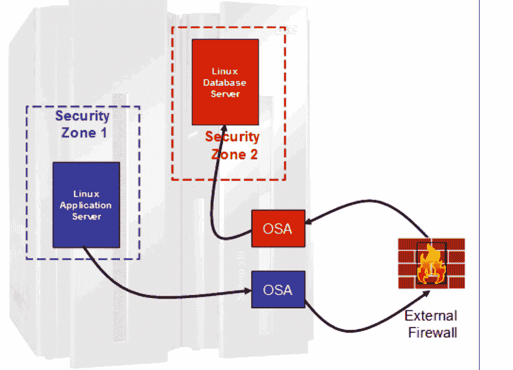

图 5-13 在安全区域之间使用外部防火墙

在 5-13 中，不同的安全区域位于单独的分区，甚至可以在同一个分区中。客户报告说，使用外部防火墙对性能的影响极小。

如所述，符合现有的安全策略意味着迁移。但现实情况是，如图 5-13 所示，对于 LinuxONE 环境内的应用程序，如果所有进入 LinuxONE 的通信都由外部防火墙处理，可能不需要防火墙。

#### 虚拟机控制

由谁控制虚拟机？请求更改或操作的协议是什么？无论使用 `KVM` 还是 `zVM` 虚拟机，如果你控制虚拟机，你就需要完全理解它，因为它是该分区上所有虚拟机的基础。它必须是安全的，并且其访问必须受到高度控制。此外，记录一份更改请求协议并发布给所有利益相关者。

你还需要为虚拟机的维护做计划，这可能需要对部分或所有虚拟机进行查询。因此，确保留出变更窗口以便维护，并为安全和虚拟机更新及维护制定计划和进度。

## 安全参考


有关托管 Linux 客户以及安全和网络的更多信息，请参考以下 IBM 出版物：

- Security on z/VM, SG24-7471
- Introduction to the New mainframe: z/VM Basics, SG24-7316
- IBM Z Systems Connectivity Handbook, SG24-5444

## 加固基础 Linux 客户

“加固”一词在服务器安全中很常见，指的是对通用操作进行修改，以提供生产环境所需的必要配置。此配置为操作系统提供了安全基准。

在迁移过程中，你可能会获得一个已经加固的 Linux 镜像。在这种情况下，只需要知道该镜像允许和不允许的操作即可。然而，如果不存在加固的 Linux 镜像，请创建一个并维护它。

### 创建加固的 Linux 客户

在任何平台上加固 Linux 的基础包括移除不必要的应用程序和服务，然后对剩余的应用程序和服务进行安全处理。解释这一过程超出了本书的范围，更多信息请参阅 Security for Linux on System z, SG24-7728。

### 迁移到加固的 Linux 客户

加固后的 Linux 应该移除或禁用大部分甚至全部应用程序和服务。可能有多个 Linux 版本供选择，因此请务必选择能够提供迁移所需的最多应用程序和服务的版本。

你需要通过迁移分析来确定哪些需要重新启用。如果需要安装任何应用程序并启用服务，你需要为每项（单独或作为一组）提供令人信服的业务案例。完成安全分析就可以提供此类业务案例。确保文档包含了相对于基础加固 Linux 镜像的所有增量应用程序和服务。

> 重要提示：RHEL 包含 SELinux 安全方法，SUSE Linux Server 包含 AppArmor 作为其增强安全方法，而 Ubuntu 使用 AppArmor（尽管 SELinux 可用）。确定这些环境是否在使用或需要，并据此制定计划。

这些机制非常复杂，因此请投入时间识别尚未迁移到可在这些环境中运行的代码和应用程序。

### 维护加固的 Linux 客户

维护基础加固的 Linux 客户是必要的。由于会发布内核更改和安全补丁，你需要制定维护基础镜像的计划并分配完成该任务的资源。因此，连续的迁移将受益于维护良好的加固 Linux。

## 5.6.2 代码和应用程序分析

当将应用程序从 x86 迁移到 LinuxONE 时，供应商可能会提供适用于 LinuxONE 的支持包。应用程序可能仅以源代码形式存在（来自供应商或内部开发），需要为新的 LinuxONE 平台重新编译。无论何种情况，了解安全方法以及它们将如何在 LinuxONE 虚拟机中使用都非常重要。务必询问利益相关者关于必须满足的安全要求。

将应用程序移动到 LinuxONE 时，考虑将应用程序与提供数据的应用程序隔离在不同的虚拟机中。隔离越多，安全性就越简单。

如果你知道某个应用程序存在安全问题，请不要使用它。你需要在系统投入生产之前解决所有安全问题。如果有更安全的应用程序配置方法，请投入时间在迁移期间进行这些更改。例如，你可能将数据库放在与使用它的应用程序不同的虚拟机上。记住，分离越充分，安全性就越简单。易于理解的安全往往更容易防御和维护。

### 代码依赖项

几乎所有代码都使用 API 和其他库来执行其设计任务。因此，你需要在迁移之前检查这些依赖项。如果你发现依赖于某个存在已知安全问题的项，你必须找到并实现合适的替代方案。

### 应用程序依赖项

生成并检查所有应用程序依赖项列表以是否存在已知的安全问题。应仅使用修复或已知的版本。你可能想将应用程序迁移到新的 Linux 客户并通过测试来证明。

### 检查输入

如果你知道某个应用程序存在安全问题，请不要使用它。你需要在系统投入生产之前解决所有安全问题。如果有更安全的应用程序配置方法，请投入时间在迁移期间进行这些更改。例如，你可能将数据库放在与使用它的应用程序不同的虚拟机上。记住，分离越充分，安全性就越简单。易于理解的安全往往更容易防御和维护。

### 用户输入

如果你知道某个应用程序存在安全问题，请不要使用它。你需要在系统投入生产之前解决所有安全问题。如果有更安全的应用程序配置方法，请投入时间在迁移期间进行这些更改。例如，你可能将数据库放在与使用它的应用程序不同的虚拟机上。记住，分离越充分，安全性就越简单。易于理解的安全往往更容易防御和维护。

### 更新计划

如果你知道某个应用程序存在安全问题，请不要使用它。你需要在系统投入生产之前解决所有安全问题。如果有更安全的应用程序配置方法，请投入时间在迁移期间进行这些更改。例如，你可能将数据库放在与使用它的应用程序不同的虚拟机上。记住，分离越充分，安全性就越简单。易于理解的安全往往更容易防御和维护。

### 网络

如果你知道某个应用程序存在安全问题，请不要使用它。你需要在系统投入生产之前解决所有安全问题。如果有更安全的应用程序配置方法，请投入时间在迁移期间进行这些更改。例如，你可能将数据库放在与使用它的应用程序不同的虚拟机上。记住，分离越充分，安全性就越简单。易于理解的安全往往更容易防御和维护。

### 日志记录和事件记录

如果你知道某个应用程序存在安全问题，请不要使用它。你需要在系统投入生产之前解决所有安全问题。如果有更安全的应用程序配置方法，请投入时间在迁移期间进行这些更改。例如，你可能将数据库放在与使用它的应用程序不同的虚拟机上。记住，分离越充分，安全性就越简单。易于理解的安全往往更容易防御和维护。

### 实现 syslog 日志

如果你知道某个应用程序存在安全问题，请不要使用它。你需要在系统投入生产之前解决所有安全问题。如果有更安全的应用程序配置方法，请投入时间在迁移期间进行这些更改。例如，你可能将数据库放在与使用它的应用程序不同的虚拟机上。记住，分离越充分，安全性就越简单。易于理解的安全往往更容易防御和维护。

### 迁移应用程序

如果你知道某个应用程序存在安全问题，请不要使用它。你需要在系统投入生产之前解决所有安全问题。如果有更安全的应用程序配置方法，请投入时间在迁移期间进行这些更改。例如，你可能将数据库放在与使用它的应用程序不同的虚拟机上。记住，分离越充分，安全性就越简单。易于理解的安全往往更容易防御和维护。

### 安全测试计划和同行评审

所有待迁移的代码和应用程序从开发阶段直到测试和部署都应处于其安全模式。这种验证决定了安全测试计划中需要包含的内容。测试所有可以测试的内容，并记录未测试的内容以及原因。同样值得的是变更控制并验证备份的恢复。如果发生了事件，唯一的恢复方法可能是修复故障并从备份中恢复数据（假设备份未被篡改）。

## 5.6.3 可用性问责制

安全不仅涉及谁可以访问系统。它还涉及确保系统对授权用户可用，而对未经授权的用户不可用。拒绝服务攻击（DoS）在近年来变得更加频繁，面向互联网的系统必须考虑此类威胁的可能。

实施可执行的系统安全需要审计追踪，无一例外。对系统的所有访问都必须以安全的方式记录，以确保如果授权用户实施了不当行为，该行为将无法被掩盖。

### 可用性分析

有时攻击者并不会侵入系统，而是通过大量的请求来使服务崩溃。需要理解这种系统或服务的可用性，并维护服务协议。

### 面向互联网的考量

互联网是一个个人通常匿名的“空间”。因此，如果你有一个面向互联网的 Linux 系统，必须尽一切努力减轻恶意访问。你必须能够识别个人及其 IP 地址，以便在必要时与网络团队合作，防止恶意访问，同时仍允许用户访问。

### 通用可用性的通信

建立一个系统可用性的通信标准，解释如何解决问题和停机，以确保这些信息传达给适当的人。可用性的意外中断可能是存在安全问题的第一个信号，需要处理这些潜在的安全威胁。

### 问责制分析

如前所述，所有系统日志和应用程序日志必须是不可变的。如果攻击者获得了访问权限，他们通常会擦除其踪迹以避免检测。此外，如果用户尝试执行未经授权的行为，他们可能会尝试通过删除日志或不利证据来掩盖自己的活动。

### 使日志文件不可变

配置 syslog-log 将日志存储在单独的安全服务器上。理想情况下，日志应存储在写一次多次读取（WORM）设备中。不要删除，并保持安全备份。

保护系统日志的另一种方法是使用远程日志服务器，syslog-log 支持这种方法。这种方法的一个示例见第172页 i.8，“部署中央日志服务器”。远程日志服务器上的日志并不一定不可变，但它们无法从被破坏的系统直接写入。

### 涵盖所有安全领域的审计追踪

通过验证你可以追溯个人对系统的物理、网络和应用程序访问，确保安全审计始终能够通过。你必须能够显示来自所有领域的系统访问审计追踪，而不仅仅是系统访问。

### 身份验证

确保通信端点是它们声称的身份。攻击者经常“伪装”或假装成他们不是的系统或用户。为了防止此类攻击，请使用“身份验证”对话：

- 用户必须确保他们连接到了他们认为的服务器。
- 服务器需要确保用户是他们声称的身份。
- 这种身份验证必须保持私密，以防止发生窃听。


禁用 Telnet 并使用安全外（SSH）可以实现这种身份验证。在 Web 服务器上使用安全套层（SSL）也能实现这种级别的安全性，并且优于默认的无 SSL。

## 5.6.4 数据完整性和机密性

LinuxONE 的一个优势是数据可以存储在企业级系统上。然而，你需要分析数据的当前状态，然后确定它如何适配新的企业系统。

## 数据完整性分析

数据完整性是指确保数据从创建到接收过程中保持不变的保证。数据完整性还涉及以下项目：

- 谁可以访问数据以及允许的操作
- 是否有审计追踪来映射更改了什么以及何时更改
- 数据是否以某种方式被损坏以及应如何恢复
- 是否建立了灾难恢复计划

## 防止未经授权的访问保护静态数据

保护数据库的访问是广为人知的，但保护磁盘上的原始数据呢？拥有完整账户数据的移动电脑有时会被错放或被盗。因此，你需要保护“静态”数据（即文件本身），并确保数据以安全的方式保存。防止数据库的离线副本存储在便携设备或驱动器上。数据的控制是关键。确保向所有访问权限的人员传达数据完整性策略，并监控审计追踪以确保策略正在执行。

## 数据备份：安全的一部分

你的安全工作需要包括备份以及它们的存储方式。它们需要以安全的方式保存。当备份以安全的方式保存时，它们就可以用于恢复。

## 机密性分析

如前所述，所有系统日志和应用程序日志必须是不可变的。如果攻击者获得了访问权限，他们通常会擦除其踪迹以避免检测。此外，如果用户尝试执行未经授权的行为，他们可能会尝试通过删除日志或不利证据来掩盖自己的活动。

（注意：提示中的文本在后部分包含了一些重复/断裂片段；我已根据提供的第 114-117 页对逻辑流进行了处理）。

# OpenCryptoki

OpenCryptoki 是公钥加密标准 #11（PKCS#11）的开源实现，它使用 `libica` 共享库来访问 IBM 加密适配器和 z90crypt 设备驱动程序。

# OpenSSL

OpenSSL 是安全套接层（SSL）的开源实现，它可以使用 `libica` 库进行硬件加密。

# Global Security Kit

Global Security Kit (GSKit) 作为 IBM HTTP Server 的一部分提供，用于管理 SSL 证书。它使用 OpenCryptoki 进行硬件加密。

这种方法可以分卸周期负载，并允许对使用 SSL 或使用支持的 API 的程序的 Web 服务器进行更多并发访问。要了解如何配置系统以便您的 Linux 虚拟机利用已安装硬件，请参阅《The Virtualization Cookbook for IBM z Systems Volume 1: IBM z/VM 6.3，SG24-8147》。

## 5.7 运行分析

源应用程序带有完整的支持结构。该支持结构的一部分负责执行日常运行任务。根据应用程序的不同，这种支持可以是每天 24 小时、每周 7 天、全年 365 天。该应用程序依赖手动和自动干预来启动、停止、监控和维护应用程序提供的服务。

本节描述了源应用程序中如果存在某些运行问题，这些问题必须在目标应用程序中得到解决。为了确保迁移工作的成功，需要对运行人员如何支持源应用程序进行仔细且详细的分析。

对运行功能进行分析可以突出应用程序的特征，这些特征在对其他接口或代码本身的分析中可能是不清楚的。应用程序代码可能成功迁移，但应用程序的运行支持结构也能成功迁移同样重要。

### 5.7.1 运行迁移任务

本节描述了在将源应用程序迁移到新环境中的目标应用程序时可能会变化的运行问题：

- 启动和停止应用程序

这些过程可以是自动或手的。源应用程序可能有某些启动和停止其进程的方法，但目标应用程序可能会有不同的启动和停止应用程序的命令和方法。

如果目标应用程序是手动过程，必须对操作人员进行培训，并编写发布适当的文档。如果是自动化过程，则需要编写、测试、记录并向操作人员解释自动化脚本。

- 问题通知

有时会发送人员不熟悉的自动消息或指示，且不知道出现此类问题时应向谁寻求指导。需要明确识别应用程序所有者。如果应用程序所有者不在或未响应，则需要建立升级程序。这些细节在应用程序迁移到目标系统时可能会发生变化。

- 正常干预和监控

某些应用程序在全天的生命周期内需要进行检查或修改。此过程仅涉及监控显示应用程序健康状况指示或显示。必须向操作人员传达迁移应用程序的新程序。对于操作人员来说，现场培训是最佳的，这样他们可以通过观察学习并执行所需的任务。

- 硬件操作

某些迁移包括硬件整合或更换。需要培训操作人员如何操作和操纵新硬件。即使不需要操作人员操作硬件，告诉他们新服务器上运行着什么，并提供适当的文档、标签和标志供参考，也是有用的。

- 硬件干预和问题升级

在 LinuxONE 上，操作人员需要处理的硬件干预较少。例如，对于源应用程序和服务器，操作人员可能习惯使用电源开关重启服务器。但在 LinuxONE 上，使用电源开关重启服务器或应用程序是一个严重的错误。

如果迁移项目涉及新硬件，则操作人员必须使用的方法向供应商通知需要告知操作人员的可操作消息或事件。执行并记录程序测试。不要等到关键情况发生后才学习如何联系供应商或其他支持人员。联系信息应包括白班、下班时间以及周末的名称和月份。对供应商联系的要求需要明确。供应商通常需要精确、详细的信息，例如序列号、机器类型和位置。

- 批处理和调度

大多数应用程序都有支持该应用程序的批处理。所有安装中常见的自动调度软件，用于调度和跟踪这些批处理。运行部门的调度器需要参与，为迁移的应用程序创建必要的调度更改。新调度必须传达给每个班次的操作人员。

- 其他考虑因素

您的运行环境中并非所有内容都能在此处预见和描述。本章的目的是让您了解与迁移项目相关的可能的运行问题。考虑您运行环境中可能因源应用程序迁移到目标应用程序而变化或受影响的一切。然后，创建一个执行所需的运行迁移任务的计划。最后，执行您的计划。

106 从 x86 到 LinuxONE 的实用迁移

## 5.8 灾难恢复和可用性分析

IT 系统故障会由于关键系统不可用而对业务产生重大影响。确保这个问题不发生的关键在于分析您的系统并确定可用性需求的层次。请记住，并非所有内容都需要远程站点。

为了更好地理解，在讨论灾难恢复、高可用性和相关概念时，使用了以下术语和定义：

- 灾难恢复 (DR)

计划并使用冗余硬件、软件、网络、设施等，以便在数据中心的 IT 系统或主要组件因某些原因不可用时进行恢复。

- 高可用性 (HA)

在定义的期间内，以可接受或约定的水平提供服务，并向用户隐藏非计划故障。高可用性采用自动故障检测、恢复、旁路考虑、测试、问题管理。

- 持续运行 (CO)

持续运行并向用户隐藏故障。持续运行采用非中断的硬件和软件更改，以及配置更改和软件共存。

- 持续可用性 (CA)

每周 7 天、每天 24 小时向用户提供非中断的服务。对于持续可用性，没有计划或非计划的故障。

关键任务系统的目标应该是持续可用性。否则，这些系统不应该是关键任务。

### 5.8.1 可用性分析

将应用程序迁移到 IBM LinuxONE 上的虚拟化环境，提供了一个与应用程序不可用对组织整体业务的影响相匹配的可用性配置的机会。然而，这种分析并不总是直观的。例如，测试和开发负载通常不被认为是关键任务，因为它们可能需要纠正生产系统中的错误，考虑在您的灾难恢复计划中提供某种测试和开发环境。

灾难恢复的挑战在于系统不可用对业务健康的影响与为应用程序创建弹性环境的成本之间取得平衡。这种计划应该包括影响应用程序可用性的可能场景以及影响业务运行的无关事件。

常见的 IT 问题，如服务器故障、网络故障、断电、磁盘故障、应用程序故障和操作错误，可以通过资源和站点的复制进行计划。无关因素很少见，且与 IT 直接相关，但它们可能对业务运行产生巨大影响。这些事件包括火灾、自然灾害（如地震、极端天气和洪水）以及动乱。这些事件可能对人们的工作能力产生重大影响。

尽管本章侧重于 IT 相关问题，但你还需要制定计划来处理其他非 IT 相关的事件。

### 5.8.2 单点故障

在确定应用程序的容备（DR）需求时，你需要考虑组件的故障概率以及消除单点故障（SPOF）的成本。

表 5-3 列出了运行 Linux 客户机应用程序的 IBM LinuxONE 虚拟化环境的组件，以及纠正单点故障的相对成本。

表 5-3 可能影响可用性的潜在单点故障

| 单点故障 | 故障概率 | 修复成本 |
|---|---|---|
| LinuxONE 硬件 | 极低 | 高 |
| LinuxONE LPAR | 极低 | 低 |
| LinuxONE 虚拟机程序 | 低 | 低 |
| Linux | 低 | 极低 |
| 磁盘系统微代码 | 低 | 中 |
| 虚拟网络 | 极低 | 中 |
| 物理网络 | 中 | 中 |
| 应用程序 | 高 | 极低 |

除了硬件和软件故障外，以下类型的计划内机可能会影响你应用程序的可用性：

- 某些需要上电复位的硬件升级
- 需要重启分区的配置更改
- KVM 或 z/VM 维护
- 需要重启的 Linux 内核维护
- 应用程序维护

### 5.8.3 用于高可用性的 LinuxONE 特性


IBM LinuxONE 围绕提供高可用性（HA）设计。大部分设计精力投入到了处理器错误的透明恢复中。当单个层级发生硬件错误时，任务将移动到备用处理器，处理过程对应用程序是透明的。在 IBM LinuxONE 中引入了许多可用性特性以减少系统计划停机次数。例如，以下操作现在可以并发执行且无需系统停机：

- 添加逻辑分区 (`LPARs`)
- 为分区添加逻辑处理器
- 添加逻辑通道子系统 (`LCSSs`) - I/O 路径
- 添加子网集
- 启用动态 I/O
- 为 `LPAR` 添加加密处理器

此外，还引入了许多服务增强功能以避免计划内停机：

- 同时固件修复
- 同时驱动升级
- 同时硬件更换

IBM LinuxONE 提供了若干由客户发起的按需容量功能。这些计费功能旨在为客户提供额外的容量来处理以下事件：

- 客户发起的开启（`CI`）用于预定义的容量升级。
- 容量备份开启（`CBU`）是用于容备的预定义容量。容备站点的系统不需要与主站点具有相同的容量。在宣布灾难期间或最多 5 次容备测试期间，客户可以开启处理器（包括 `IFL`）来处理来自主站的负载。
- 计划事件容量（`CPE`）用于替换企业因计划事件（如设施升级或系统迁移）丢失的容量。

按需开关容量（`On/Off Capacity on Demand`）以两小时为单位提供额外容量，可用于满足工作负载中的峰值需求。

### 5.8.4 可用性场景

这些场景展示了不同的情况，其中 LinuxONE 环境具有逐渐的可用性，成本也随之增加。实现最大可用性的关键是消除单点故障。

所有场景均假设 IBM LinuxONE 配置了冗余的 `LPAR`、冗余的磁盘路径（`FICON` 和 `FCP`）、连接到组织网络的冗余开放系统适配器（`OSA`）、冗余的系统控制台以及冗余的硬件控制台。这是 IBM LinuxONE 的标准配置。

应用程序设计需要包含冗余的软件服务器。存储基础设施应包括冗余的光纤通道、镜像磁盘和数据。

设计通信网络时应考虑冗余，配备冗余的路由器、交换机、集线器和无线访问点。

对于关键任务系统，提供不间断电源和一个远离主站点的站点，以避免受自然灾害影响。

应用程序可用性的另一个重要因素是安全和访问控制。关于此主题的更多信息，请参见第 95 页的 5.6，“安全分析”。

## 单 LinuxONE LPAR：集群 WebSphere Application Server

图 5-14 显示了一个向该分区内所有 Linux 虚拟机共享系统的分区。`WebSphere Application Server` 采用双节点集群。如果发生处理器故障这一意外事件，IBM LinuxONE 会自动将负载切换到备用或未分配的处理器，不会中断活动任务。

如果运行 `WebSphere Application Server` 负载的 Linux 故障，且你正在运行冗余的 `WebSphere Server Network Deployment`，集群中的另一个节点将接管。这种故障转移实现是因为部署到集群的应用程序在所有成员上并发运行。通过向集群非破坏性地添加新虚拟机提供了额外的可用性。

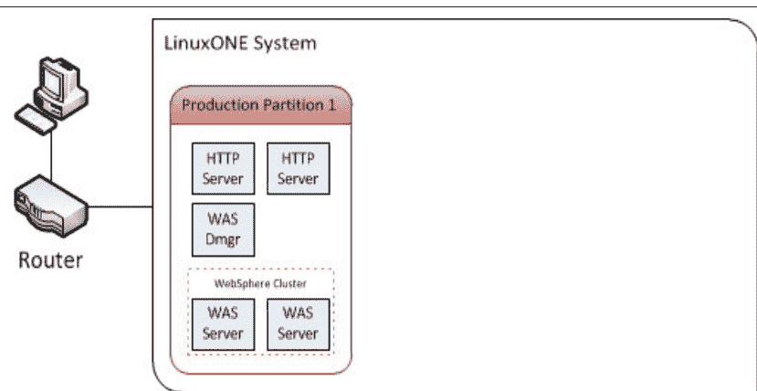

图 5-14 运行 `WebSphere Application Server` 集群的单分区 LinuxONE

该环境通过冗余的 HTTP 服务器提供额外的可用性。

## 多 LPAR：Linux 的 HA 解决方案

图 5-15 显示了一个了三个分区的场景。每个分区可以拥有一个或多个在分区共享的核心。

在这种情况下，生产负载和 `WebSphere Application Server` 集群分布在两个 `LPAR` 上，这为 `WebSphere Application Server` 提供了 HA，因为分区或虚拟机程序的故障不会影响 `WebSphere Application Server` 的可用性。

开发和测试负载运行在自己的 `LPAR` 中，因此任何服务器对生产环境都没有影响。与第一个场景一样，LinuxONE 处理器的故障会自动修复，且对正在运行的应用程序产生任何影响。这种配置以合理的成本消除了大多数故障点。

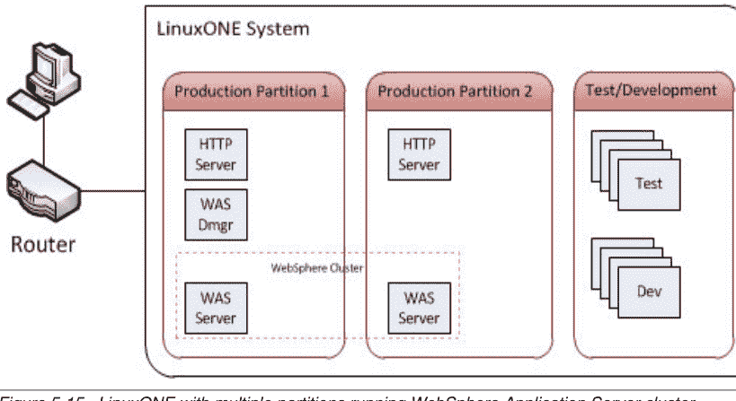

图 5-15 运行 `WebSphere Application Server` 集群的多分区 LinuxONE

## 带有 Pacemaker 和 Heartbeat 的主/备集群

除了上述的 `WebSphere` 服务器集群等专用设施，Linux 生态系统拥有更通用、更健壮的集群解决方案。可以使用 `Pacemaker` 等开源产品建立解决方案，也可以使用带有 `Tivoli System Automation for Multiplatforms (SA MP)` 的商业产品。在这种场景下，虚拟机以主/备关系建立。在 във关系中，运行在每台服务器上的软件相互监控并通信。当主系统发生故障时，软件会协调流量自动故障转移到备用服务器。

图 5-16 显示了此配置，单个 `IP` 地址（“服务 `IP`”）作为主分区网络适配器的别名存在。

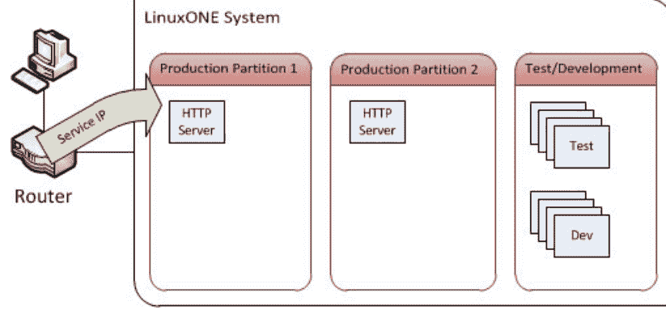

图 5-16 主/备集群，正常运行期间

集群软件会定期验证物理分区、虚拟机和服务器应用程序（在本例中为 Web 服务器）是否所有项均有响应。如果任何组件没有响应，则服务 `IP` 将指向备用系统的网络，如图 5-17 所示。集群可以配置为在该点执行特定的操作，从通知到重启故障系统的资源。

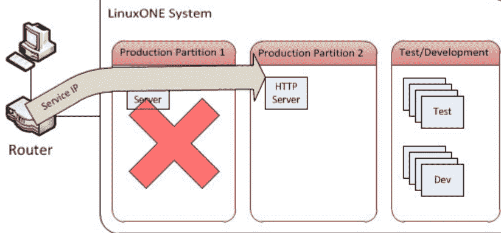

图 5-17 主/备集群，发生停机后

## 主/主应用服务器集群

图 5-18 显示了处于主/主配置的 `WebSphere Application Server` 设置，其中 `WebSphere Application Server` 集群跨越两个分区中的两个 Linux 虚拟机。这种设置处理了极罕见的分区故障。更重要的是，它允许在不中断 Sphere 应用程序的情况下进行虚拟机管理程序的维护。此任务可以安排在处理负载较轻的时间进行。也可以使用客机重定位或迁移来避免由于管理程序维护导致的停机。

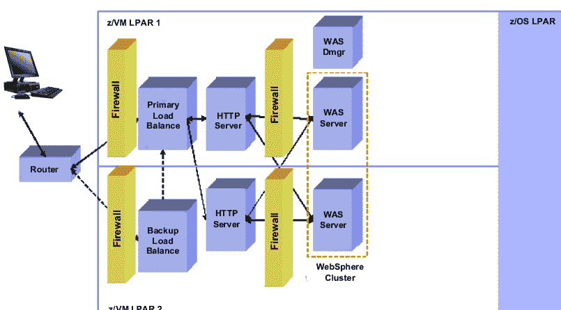

图 5-18 主/主/`WebSphere` 应用服务器集群

## 添加到数据库复制的主/主应用服务器集群

第 114 页的图 5-19 显示了添加到主/主 `WebSphere` 集群的 `DB2` 数据库。为了给 `DB2` 数据库提供高可用性（HA），使用了 `DB2` 数据库复制功能——高可用灾难恢复（`HADR`）。`HADR` 通过将源数据库（*主*）的更改复制到目标数据库（*备*）来防止数据故障。

当主 `DB2` 系统发生整个分区停机时，`DB2` 系统会在几秒内接管，提供高可用性。主备之间的通信通过 `TCP/IP` 进行，其中可以通过使用 LinuxOne 上提供的高速网络功能 `HyperSockets` 实现。

备用 `DB2` 系统也可以位于远程站点，以便在站点故障期间提供增强的可用性。

运行在两个 `DB2` 服务器上的 IBM `Tivoli SA MP` 设计用于自动检测主系统的故障，然后在备用系统上发布命令使其 `DB2` 成为主节点。

可以使用其他的集群管理软件。但是，`DB2` 自带 `SA MP` 和示例自动化脚本，用于管理您的 `DB2` 数据库系统的高可用性需求。

## 数据库共享的主/主应用服务器集群

图 5-20 显示了通过 Oracle Real Application Clusters（`RAC`）引入的数据库共享。Oracle `RAC` 通过让多个 `RAC` 节点共享单个数据副本为应用程序提供高可用性。如果集群节点故障，正在运行的事务将会丢失，但 `RAC` 中的其他服务器可以接收所有的 Java 数据库连接（`JDBC`）请求。

图 19 主/主 `WebSphere` 应用服务器集群和 `DB2 HADR`

图 5-20 使用 Oracle `RAC` 的数据库共享

在 LinuxONE 环境中，数据库节点之间的通信使用相同 `LPAR` 中的虚拟局域网或到其他 `LPAR` 的 `HiperSockets`。这两种方法都是内存级速度，且延迟低。

有关 Oracle `RAC` 的更多信息，请访问以下网站：

http://www.oracle.com

## 跨城市数据库共享的主/主集群

对于终极可用性解决方案。您可以拥有两个相距城市距离站点，同时提供每个站点集群之间的数据共享。这种配置通过 IBM Globaly Dispersed Parallel Sysplex®（IBM `GDPS`® 虚拟机设备）实现，该设备支持计划内和计划外的的停机，从而提高了应用程序的可用性和业务连续性。

距离大于 100 公里（62 英里）也是可能的，但这种配置需要在远程站点进行异步复制，因此它与主副本不同步。关于 `GDPS` 虚拟机设备，请参考 `GDPS Family: An Introduction to Concepts and Capabilities, SG24-6374`。

### 5.8.5 Linux-HA 项目


Linux-HA 项目通过开放开发社区为 Linux 提供解决方案。大多数 Linux-HA 软件都是根据自由软件基金会的 GNU 通用公共许可证（GPL）和自由软件基金会的 GNU 较小通用许可证（LGPL）许可的。

您可以在他们的官方网站阅读更多关于 Linux-HA 项目的信息：

http://www.linux-ha.org

随着 Linux-HA 项目分离出各个组件以解决其现有集群支持的某些局限性，主要的集群管理器现在是 Pacemaker。

> 注意：有关 Linux-HA 的更多信息及其使用示例，请参阅《Achieving High Availability on Linux for System z with Linux-HA Release 2, SG24-7711》。

# 5.8.6 高可用性插件

当您寻找第三方高可用性解决方案时，有两个方案值得您关注。根据您为环境选择的发行版，您可能会发现可以帮助您实现高可用性的插件，并帮助进行安装、维护和管理。

对于 SUSE Linux Enterprise 高可用性扩展（High Availability Extension），请访问以下网站：

http://www.suse.com/products/highavailability

对于 Red Hat Enterprise Linux 高可用性插件（High Availability Add-On），请访问以下网站：

https://www.redhat.com/en/technologies/linux-platforms/enterprise-linux

# 5.8.7 理解应用程序的可用性需求

本节描述了服务水平协议（SLA）和提供可用性的成本如何帮助您更好地理解应用程序的可用性需求。

# 服务水平协议

要确定要迁移到 LinuxONE 的应用程序的可用性需求，请考虑依赖这些协议的业务部门的需求。理想情况下，创建说明要求的 SLA，例如可用性需求、响应时间、最大系统利用率和灾备（DR）需求。使用这些 SLA 作为 Linux 上系统设计的依据。

如果不存在 SLA，在设计解决方案之前，请与业务部门讨论您可以提供什么水平的服务以及他们愿意投入多大的投资。SLA 成功的关键在于它是可实现且可衡量的，并对交付失败有定义的惩罚。您还需要确保定期审查 SLA，因为情况会发生。

根据 IT 管理原则，服务水平协议通常定义：

- 的服务
- 性能和报告
- 问题解决
- 接收者的责任
- 安全
- 知识产权
- 法律合规
- 应用程序
  -- 停机成本

## 5.9 虚拟化环境迁移到 LinuxONE

今天的数字经济需要速度和灵活性，以跟上对新应用程序和数据分析的竞争需求。许多企业还拥有大型虚拟化基础设施，以支持其关键任务应用程序和企业数据库。他们重视各种计算机、网络、存储和管理技术的产品。但他们也遇到了需要云所提供的灵活性的新案例。

## 5.9.2 网络考虑

尽管云平台在基础架构层屏蔽了底层差异以实现扩展和动态性，但这种同构性带来了新的网络带宽和配置挑战。

### 带宽需求

在传统的虚拟化环境中，物理服务器通过物理交换机连接，这意味着网络管理员对网络流量和安全性具有完全控制权。当将工作负载迁移到 LinuxONE 基础云时，最好监控当前的带宽。在云环境中，虚拟交换机通过连接到虚拟机的物理网卡（NIC）拥有来自物理交换机的链路。因此，最好验证并识别 LinuxONE 基础架构网卡和内部交换机的连接性在吞吐量和延迟方面是否足够。

### 虚拟交换机与 VLAN 标记

在 LinuxONE 云平台中，虚拟化网络也需要对虚拟机（VM）进行隔离，以确保云租户之间的数据隐私。因此，它们需要某些机制来确保这些网络可以在共享物理网络链路的同时，不会在网络之间泄露信息。为了访问物理网络，大多数云自动化工具（如 OpenStack）使用局域网（VLAN）标记模型。这种方法要求网络管理员在物理交换机上创建 VLAN ID 池。当从云软件创建新的虚拟机或虚拟应用程序时，云用户无需延迟即可使用这些 VLAN ID。

## 5.9.3 安全性考虑

以下是 LinuxONE 云服务的安全性考虑因素：

- 云服务用户和管理员的身份验证与授权。
- 针对存储在云服务内部的数据以及在云服务与外部之间传输的数据进行加密配置和操作。
- 防火墙以及其他安全功能的配置。
- 运行在管理程序（Hypervisor）之上的虚拟系统必须没有任何直接与管理程序进行网络通信的手段。
- 管理程序的管理流量必须使用独立的物理网络接口供虚拟机使用。
- 根据应用程序和组织需求，创建跨越 LPAR 和管理程序的独立安全区域。
- 对于基于 KVM 的管理程序，除了安全或防火墙区域外，还可以强制执行 SELlinux 等额外技术。
- 为云服务定义标准化的用户界面、API、协议和数据格式。
- 开放技术正在推动创新，使管理和业务接口的开源产品标准化。
- 使用现有或更新的等效访问管理（Access Management）功能，对云服务中的虚拟机进行身份验证和访问授权。

## 5.9.4 LinuxONE 云管理

以下应用程序可以帮助您管理 LinuxONE 云：

- OpenStack
- 用于 IBM LinuxONE 的 vRealize Automation

### OpenStack

为了提供云管理能力，z/VM 和 KVM 都支持 OpenStack，这是无处云计算平台的行业标准。使用 OpenStack API 的应用程序在两种管理程序上都受支持。IBM Cloud Manager Appliance (CMA) 是一种基础设施即服务产品，有助于建立云基础设施并简化虚拟化环境的管理。它还提供额外的服务，如身份管理和编排，可以通过 API 以相同的程序化方式访问。

### 用于 IBM LinuxONE 的 vRealize Automation

通过 VMware vRealize Automation (vRA)，您可以将现有的 vRealize Automation 云扩展到 IBM LinuxONE。vRealize Automation 与 IBM LinuxONE 系统支持 OpenStack 的云端点对接，允许客户端使用与其分布式云环境内相同的云管理工具（图 5-21）。

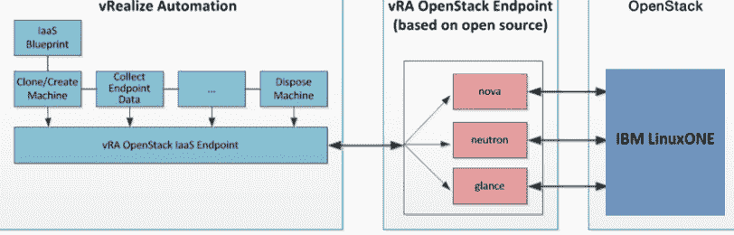

图 5-21 带有 IBM LinuxONE 框架的 vRealize Automation

## 实操迁移

现在迁移规划和分析已经完成，请通过在测试环境中进行实操迁移来测试您的迁移计划。在此过程中，对环境进行负载测试，确保性能符合业务预期和需求。执行测试迁移后，从测试环境迁移到生产环境。

有许多方法可以将您的数据从源 x86 服务器迁移到新的 LinuxONE 服务器，也有许多方法可以配置您的新 LinuxONE 环境。

本章描述了从源 x86 服务器迁移数据到新 LinuxONE 服务器的多种方法，以及配置新 LinuxONE 环境的多种方式。本章描述了一个在实验室环境中执行的迁移场景，将 WebSphere Application Server、DB2 和 SUSE Linux Enterprise Server 11 SP3 迁移到 LinuxONE。

本章包含以下章节：

- 设置系统
- 迁移 DB2
- 迁移 WebSphere Application Server

## 6.1 设置系统

本节描述了在 LinuxONE 上创建虚拟机所需的任务。我们首先在 x86 环境中确定了规划，随后在 LinuxONE 环境中确定资源。最后，我们使用 z/VM 完成了迁移任务。

### 6.1.1 产品和工具清单

表 6-1 x86 环境的产品和工具清单

| x86 环境的产品和工具清单 | 名称 | 版本 | 厂商/来源网站 | 许可证类型 | LinuxONE |
| :--- | :--- | :--- | :--- | :--- | :--- |
| DB2 | 10.5.0 | IBM | www.ibm.com | | |
| WebSphere Application Server | | | | | |

### 6.1.2 硬件清单

本节列出了所需的资源。在项目使用的清单（表 6-2）中，检查了硬件资源。

表 6-2 x86 环境硬件清单

| 硬件规划清单 | 源 | 目的 |
| :--- | :--- | :--- |
| CPU 数量 | 4 | 虚拟 |
| 内存 (GB) | 8 | 8 |
| OS SWAP (GB) | 4 | 4 |
| 连接网络 | Gigabit Ethernet | Gigabit Ethernet |
| 连接类型 | Gigabit Ethernet | Gigabit Ethernet |
| IP 地址/子网掩码 | 9.12.7/28 | 9.12.7/28 |
| 逻辑卷： | | |
| Volume Group 0S | 20GB | |
| Volume Group 0B | 150GB | |
| Volume Group WAS | 80GB | |


| Volume Group MGM | 20GB | |

### 6.1.3 FCP 与多路复用

FCP 的备份配置不是由 PR/SM 或 zVM 处理的，必须在 Linux 虚拟机中完成。因此，必须为连接到两个不同通道系统的两个端口虚拟化（NPIV）适配器。以下描述也适用于 KVM 环境，因为多路复用必须由主机系统执行，然后作为单一虚拟设备提供给 KVM 虚拟机。

多路复用通过 Linux 系统中的 `/etc/multipath.conf` 进行配置。启动 `multipathd` 守护进程后，可以使用命令检查所有可用 LUN 及其路径：

```
multipath -ll
```

> 关于 SUSE Linux Enterprise Server 的说明：SCSI 设备的行为在 SUSE Linux Enterprise Server 11 和 SUSE Linux Enterprise Server 12 之间发生了变化。在 SUSE Linux Enterprise Server 11 中，所有 LUN 必须完全手动配置。在 SUSE Linux Enterprise Server 12 中，已添加自动 LUN 扫描，因此在配置 zfcp 主机后，会自动检测所有 LUN。

多路径的实际配置取决于所使用的存储设备。对于 IBM DS8000®存储系统，可以使用示例 6-1 所示的配置。

示例 6-1 `multipath.conf` 示例配置文件

```
defaults {
  path_grouping_policy multibus
  failback 1
  rr_min_io 10
  path_checker tur
  checker_timeout 60
}
ndev {
  device {
    vendor "IBM"
    product ""
    path_grouping_policy group_by_prio
    prio alua
  }
}
```

### 6.1.4 FCP 迁移设置任务

将光纤（Fibre Channel）设备从分布式系统通过 NPIV 迁移到 LinuxONE 涉及多个不同的任务：

- 1. 独占适配器

假设 NPIV 适配器已为 LinuxONE 配置，必须将连接到两个区域的一对 NPIV 适配器专门分配给新的虚拟机以实现冗余，这些适配器应来自两个不同的物理卡：使用 KVM 虚拟机管理器时，需要在 KVM 宿主机上配置 NPIV 适配器，作为 Linux 系统虚拟 SCSI 配置的一部分。使用 z/VM 虚拟机管理器时，需要将 NPIV 适配器分配给 Linux 虚拟机以进行配置。通常，为每个虚拟机分配相同的虚拟设备（vdev）编号。例如，您为分区 LP1 上的两个织矩阵配置了设备范围 `FA00-FA1D` 和 `FC00-FC1D`，并将实际设备 `FA06` 和 `FC06` 分配给虚拟机，如下所示将其独占为通用 vdev `FA00` 和 `FC00`：

```
DEDICATE FA06
DEDICATE FC06
```

通过此配置，虚拟机看到的地址始终是 `FA00` 和 `FC00`，且编号非常直观。

- 2. NPIV WWNs

要获取相应 NPIV 适配器的 WWN，请按照以下步骤操作：记录将托管 Linux 虚拟机的分区的名称（后续示例为 `LP1`）。登录到 Linux 服务器的支持元素（SE），可以通过硬件管理控制台（HMC）的“单对象操作”登录或直接登录。

c. 在 SE 上，在“系统管理 -> 系统名称 -> FCP 配置”中查找 NPIV 适配器信息。**系统名称**是 LinuxONE 系统的名称。

d. 获取信息的最简单方法是使用 FTP 将包含分区 WWN 的文件传输到远程服务器。

e. 生成的文件是一个逗号分隔的列表，如下：

`LP1,00,01, ...`

f. 要获取分区上 `fa06` 和 `fc06` 的 WWN，请使用以下命令：

```bash
grep npiv-list.csv | grep fa06 | grep fc06 | cut -d , -f
```

- 3. 区域更新

从 SE 获取的 WWN 必须用于更新光纤区域（Zones）。如果所有服务器都有自己的独立区域，请将步骤 2 中的 WWN 添加到相应的织矩阵。如果存在一个大区域，在此过程中将该区域划分为每个服务器的小区域区域预预期结果是每个织矩阵都有一对区域。

- 4. 存储系统更新

在存储系统内部，根据光纤适配器的 WWN 配置主机连接。没有 NPIV 时，使用基础 WWN；而使用 NPIV 时，使用相应的 NPIV。通常，您可以向特定组添加多个主机连接。此配置允许多个光纤适配器访问 LUN。为了准备迁移，将新的 WWN 添加到已配置的主机连接中。迁移到 LinuxONE 后，从主机连接中删除旧 WWN。

## 6.2 迁移 DB2 及其数据

本节描述了将 DB2 数据从源系统（LP1）迁移到目标系统（Linux 分区 LP1）。要执行以下步骤，请使用 DB2 管理员 ID：

- 1. 将在源系统上创建数据库的 `DATABASE` 命令复制到文件 `createdb.sql` 中，并将其传输到目标系统。此过程可以使用任何 FTP 应用程序。

- 2. 修改文件位置为适用于目标系统的值。我们的环境使用了名为 `/db2_data` 的 ISIS 磁盘存储数据。在新系统上使用相同的 ISIS 磁盘。请参见第 127 页第 6.3 节“迁移 WebSphere 应用程序服务器”。示例 6-2 显示了我们的创建数据库的命令。现在不要运行此命令。

示例 6-2 创建数据库的命令

```
CREATE DATABASE /db2_data
```

- 3. 使用 `DB2LOOK` 工具提取所需的数据定义语言（DDL）语句，以便将一个数据库的对象重现在另一个数据库中。该工具还可以生成将统计信息从一个数据库复制到另一个数据库所需的 SQL 语句，以及复制数据库配置、数据库管理器配置和注册表变量所需的语句。这些信息非常重要，因为新数据库可能不包含与原始数据库完全相同的数据集，但您可能希望两个系统具有相同的访问计划。`DB2LOOK` 工具适用于运行在 DB2 服务器 9.5 或更高版本上的数据库。

使用 `db2look` 命令生成 DDL：

```
db2look -d trade6db -e -x -l -o trade6db.sql
```

其中：

`-d`: 数据库名称

`-e`: 提取数据库对象

`-x`: 生成作为 `GRANT` 语句的授权 DDL 语句。

`-l`: 为用户定义的数据库对象生成 DDL 语句

`-o`: 输出文件名

有关关于 DB2LOOK 工具的更多信息，请参阅：

https://ibm.com/idRJw6

- 4. 使用 FTP 将此文件发送到目标位置。

- 5. 因为无法使用 `DB2 BACKUP` 命令在不同操作系统之间移动数据，请使用 `DB2MOVE` 命令，如示例 6-3 所示。确保 `DB2MOVE` 的输出指向一个空目录，因为数据库中的每个表都会创建一个 `*.ixf` 文件和一个 `*.msg` 文件。

示例 6-3 `DB2MOVE` 命令

```bash
db2move trade6db export
```

- 6. 在 LP1 上安装 DB2 时，我们的空间耗尽。因此，我们打开了 z/VM 的 IBM Wave，右键点击虚拟机并选择“更多操作 -> 管理存储”。此过程在几秒钟内创建了一个分区。

7. 在目标系统上，使用 DB2 管理员 ID 带有 `CREATE DATABASE` 命令的文件。示例 6-4 展示了我们如何通过步骤 1 中创建的文件运行命令。

示例 6-4 运行创建数据库命令

```bash
db2 -tvf CREATED_TRADE6DB.SQL -z create db.log
```

- 8. 使用 DB2LOOK 创建的 DDL 文件创建数据库对象：

```bash
db2 -tvf trade6db.sql -z create ddl.log
```

- 9. 在 DDL 文件成功处理后，使用 `DB2MOVE` 将数据导入数据库：

```bash
db2move trade6db load
```

您的数据库现在已准备就绪可以使用。

## 7.1 获得验收

迁移项目通常被认为是对 IT 环境的重大变更。每种变更都需要各个利益相关者进行大量的测试和验收。这些利益相关者必须决定迁移是否成功。

验收需要对迁移前后的整体情况有深入了解：

- 在实施阶段开始之前，完成这些任务：

- 决定并记录测试范围。

- 决定并记录测试用例（包括测试场景）。

- 为所有组件创建迁移后检查清单。

- 收集有关系统的性能数据。

- 获得利益相关者对测试的验收。

- 在实施完成后，完成这些任务：

- 使用迁移后检查清单并检查实施是否完成。

- 使用已记录的测试用例对系统进行测试（完成并记录所有场景）。

- 测量性能并与之前的性能数据进行比较。

- 如必要，执行性能测试。

根据项目范围和背景，用于验收测试的项目可能有所不同，但以下列表是获得利益相关者验收之前执行的最常见的验收测试：

- 应用测试

- 在某些情况下，可能需要可用性测试。

- 功能测试

- 性能测试


## 安全测试

## 用户验收测试

## 7.2 性能测量

本节描述了性能测量及其对迁移成功的影响。需要考虑的最重要点是，你需要测量应用程序在源环境运行时时的性能。将数据与应用程序在目标环境上的性能进行比较。

本节还涵盖了监控命令和工具，这些工具可以帮助你识别并解决性能障碍。

### 7.2.1 什么是性能

计算机系统中的“性能”是一个相对术语。通常计算机性能是用可衡量的术语的，例如每秒事务、响应时间或处理特定任务的时间。然而，在进行迁移项目时，理解环境中使用的性能指标非常重要，这样你就可以理解系统的相对性能。

新系统的初始性能往往不如预期，特别是在更换硬件平台时。因此，必须进行调优以提高目标系统的性能。如果没有适当的指标，无法验证新平台相对于源平台的性能。出于此原因，迁移项目团队需要就使用源平台的哪些性能指标在迁移项目用来衡量目标平台的性能达成一致。

## 7.2.2 选择测量内容

要确定迁移的成功，仅仅将应用程序置于目标平台上并不能提供答案，因为源平台无法证明这一点。迁移到 LinuxONE 的自然预期是，应用程序不仅具有更高的韧性和可用性，而且提供比源平台相同或更好的性能。为了确保性能改进易于展示，选择正确的指标至关重要。但这些指标是什么，应该如何测量呢？

### 响应时间

响应时间是衡量计算机系统中发生某事件所需的时间。通常测量的是称为“事务”的工作单元的响应时间。事务可以包含简单的如检查账户余额，也可以包含复杂的如签新保险单或开设新银行账户所需的时间。

计算机系统需要记住的一是，单个事务的响应时间是多个响应时间的总和。图 7-1 显示了构成响应时间的各种组件。

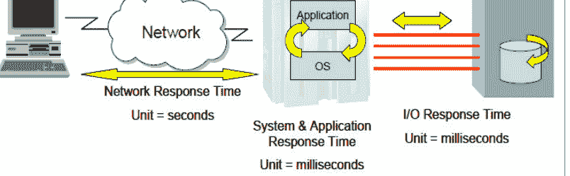

图 7-1 构成事务响应时间的组件

图 7-1 显示，响应时间有两个可以衡量的点：系统响应时间和用户响应时间。当你试图理解新系统的相对性能改进时，唯一需要测量响应时间点是从系统接收请求到它提供某种响应的时刻。

在第 131 页图 7-1 所示的情况下，系统响应时间包含了应用时间和访问数据所需的 I/O 响应时间。如果你选择测量用户在终端或通过网络体验的用户体验响应时间，你需要加上网络响应时间，这对于事务来说差异很大，因为它受网络负载的影响。

为了直接比较源系统和目标系统，请测量源系统的响应时间，假设应用程序没有发生很大变化，在目标平台上测量系统响应时间。

### 事务吞吐量

事务吞吐量指标可能提供更有意义的系统性能衡量，因为它衡量的是在时间内处理的事务数量。这段时间通常为一秒，但也可以是任何喜欢的任何时间段。

在这两种情况下，你都有源系统的基准性能指标，以便正确比较新旧系统。

## 7.3 性能调优

任何系统的调优都遵循一些基本原则，因为每个硬件和软件平台都有独特的特征和特性，在调优环境时必须考虑。系统调优的艺术需要性能分析、多步调优过程和变更管理的严格结合。

无论你选择什么工具，分析系统性能的最佳方法是从外部开始，一直到系统中的细微调优细节。收集有关系统和进程整体健康的数据。以下列表是回答你的源系统和目标系统问题的类型采样：

- 处理器在每天的峰值期间有多忙？
- 在这些峰值期间 I/O 响应时间发生了什么变化？
- 峰值是否保持基本一致，还是它们会拉长？
- 当前系统资源能否提供满足服务水平协议（SLA）的用户响应时间？

了解有哪些调优工具以及它们提供什么类型的信息非常重要。同样重要的是知道何时使用这些工具以及寻找什么。如果不检查系统活动和资源利用率，你如何知道你的环境中哪些是正常的，哪些是有问题的呢？对系统进行定期健康检查还可以提供用于容量规划的利用率和性能信息。

调优不是一成不变的方法。针对一种类型的工作负载调优的系统在另一种类型的工作负载下通常性能很差。这种考虑意味着你必须理解想要运行的工作负载，并准备在工作负载变化时审查你的调优工作。

简单的工作负载是指在白天显示一个或多个峰值的服务器。复杂的工作负载是指部分时间是 CPU 密集型、部分时间是 I/O 密集型的应用程序。调优工作负载的最成本效益的方法是在白天调整服务器的容量。这正是虚拟机管理程序所做的。部分虚拟机被调入内存中运行，而不活跃的虚拟机被移动以创建空间。


# 第3部分

# 部署

本书部分描述了如何部署负载和各种应用程序，以协助您完成部署。

本部分包含以下章节：

- 第137页，第8章，“负载的部署”

# 负载的部署

本章涵盖了如何将负载部署到 LinuxONE。在将负载部署到大型机之前，有许多需要分析和考虑的因素。完成适当的规划后，迁移应当顺利进行。

正如第76页的 5.3 节“应用程序分析”所示，许多负载在 LinuxONE 上都“非常合适”。书中并未演示所有适用于 DB2 的负载。某些实际应用（如 IBM DB2）的迁移将在第 12.1 页的第6章“无缝迁移”中作为实践练习进行说明。任务关键型应用、ERP、CRM、商业智能等都运行在 LinuxONE 上；但此类指南中只能包含通用示例。您的特定迁移并不一定会有详细演示。遵循书中的指南、检查清单和信息，并使用本章的示例，将引导您走向成功。

标准基础设施应用也非常适用于 IBM LinuxONE，而且它们同样关重要。在本章中，将演示某些标准服务的部署。这种部署标准服务的演示同样代表了可以被遵循的模式。

在本章中，我们提供了使用高可用集群部署负载的示例，以及部署 MongoDB、区块链、MediaWiki 和 MySQL 等应用程序的示例。我们还提供了部署 OpenLDAP、中央日志服务器以及文件和打印服务的示例。

本章包含以下：

- 在容器和虚拟机之间做出选择
- 在 Ubuntu 16.04 LTS 上设置 Docker
- 在 IBM LinuxONE 上部署 MongoDB
- 在 LinuxONE 上部署 Hyperledger (区块链) Fabric
- 部署高可用集群
- 部署 MediaWiki 和 MySQL
- 部署 OpenLDAP
- 部署中央日志服务器
- 部署 Samba

## 8.1 在容器和虚拟机之间做出选择

LinuxONE 平台配备了世界上最快的一批通用处理器，非常适合数据处理吞吐量需求。Linux 系统中可用的大量核心以及高输入/输出带宽意味着开源解决方案可以进行向上扩展（scale up）和向下扩展（scale out）。

底层硬件已为高可扩展环境准备就绪，将解决方案部署在容器或虚拟机上各有特定的优缺点。容器允许您在单个物理服务器上运行比虚拟机（VM）多得应用程序。但我们无法完全消除基于虚拟机的应用程序部署需求。

以下是决定解决方案应该部署在容器还是虚拟机上的因素：

- 应用程序如何打包。如果您想运行单个应用（例如 MongoDB）的多个副本，请使用容器。然而，如果您希望获得运行多个应用程序的灵活性（例如带有 Java 编写的主页的 MongoDB），请使用虚拟机。
- 通常，容器倾向于锁定特定版本的操作系统及其子系统。这一特性对于管理员来说可能是一个优势，通过容器，您可以为开发、测试和部署创建一个便携、一致的环境。从虚拟机的角度来看，无论您使用哪种虚拟机管理程序（hypervisor），都可以部署任何操作系统。这一特性对于具有特定依赖项的内部应用程序特别有用。
- 从资源角度来看，容器共享操作系统、内核实例、网络连接和基础文件系统。应用程序的每个实例都运行在单独的用户空间内。这种配置显著减少了与运行多个操作系统相关的 CPU 占用，因为每个用户会话不需要新的内核。这是容器经常用于运行应用程序的主要原因之一。
- 关到生产速度，随着云和 DevOps 应用程序开发模式的出现，容器具有优势，因为每个容器都提供一个微服务并可以作为更大解决方案的一部分。这一特性为容器提供了优于虚拟机的扩展优势。
- 关安全性，在不对容器进行任何更改的情况下，虚拟机比容器更安全。虚拟机共享内核资源和应用程序库。这一特性意味着如果一个虚拟机发生故障，不太可能影响同一操作系统环境下的其他虚拟机。目前，容器没有硬件隔离。如果您的组织有高安全需求，请坚持使用虚拟机。

大多数组织会在其云和数据中心同时运行容器和虚拟机。容器在大规模应用下的经济性在财务上非常有意义，任何人都无法忽视。同时，虚拟机仍然有其优势。LinuxONE 为运行容器和虚拟机提供了同顶级的特性。

## 8.2 在 Ubuntu 16.04 LTS 上设置 Docker

随着 Docker 1.11 版本的发布，Docker Engine 经过了重设计，以符合开放容器倡议（OCI）运行时。具体而言，它是使用 runC 和 contain 守护进程构建的。

- runC 是一个轻量级容器运行时。它是一个根据 OCI 规范创建和运行容器的命令行工具。
- contain 是一个控制 runC 的守护进程，为性能和密度构建，contain 使用了 runC 的高级功能，如 seccomp 和命名空间支持，以及用于容器克隆和迁移的检查点（checkpoint and restore）。

Docker 本身负责镜像管理，并将镜像管理传递给 contain。然后使用 runC 运行容器。


Ubuntu v16.04 封装了预构建的 Docker debian 软件包，因此默认包含了 `contain` 和 `runC`。在宿主机系统上部署引擎的方式上略有变化。第一步是使用示例 8-1 显示的命令更新本地 apt 索引。

### 示例 8-1 更新 Ubuntu 软件包

```
blockchain@itschain:$ sudo apt-get
Hit:1 http://us.ports.ubuntu/ubuntu-ports-xenial InRelease
Hit:2 http://us.ports.ubuntu/ubuntu-ports-xenial-updates InRelease
Hit:3 http://us.ports.ubuntu/ubuntu-ports-xenial-backports InRelease
Hit:4 http://us.ports.ubuntu/ubuntu-ports-xenial-security InRelease
Reading lists... Done
blockchain@itschain:$
```

使用以下方案之一向宿主机系统部署 Docker 软件包：

- 从官方 Docker 引擎仓库部署软件包
- 从预包的 Ubuntu 发行版部署 Docker 引擎

示例 8-2 展示了使用第二种方案部署 Docker。Ubuntu 16.04 LTS 为 LinuxONE 预构建了名为 `docker.io` 和 `docker.registry` 的软件包。这种方法的优势是它们在发行版中经过了集成和测试。然而，Docker 引擎可能是旧版本，或者不是最新版本。

### 示例 8-2 安装 Docker 软件包

```
blockchain@itschain:$ sudo apt-get -y install docker.io docker-registry
Reading packages... Done
Building dependency tree
Reading state information... Done
The following additional packages will be installed:
bridge-utils cgroups-mount contained dns-root-data dnsmasq-base git-man-liberror-perl
netfilter-containerpack3 runc-ubuntu xz-utils
Suggested packages:
mountall all-tools btrfs-tools bootstrap linux rnfse-fuse |
zfutis-git-daemon-run |
git-daemon-systemd git-docker doc-git-extra git-git gitkit
```

The NEW packages will be installed:

bridge-utils cgroups-mount contained dns-root-data dnsmasq-base docker-registry.io

git git-man liberror-perl netfilter-containerpack3 runc-ubuntu

0 已升级，15 新安装，0 要移除，0 未升级。
需要下载 20.4 MB 的归档。134
执行此操作后，将使用 134 MB 的额外磁盘空间。

```
Processing triggers for systemd (229-4ubuntu0) ...

Processing triggers for rereadada (0.100.0-19) ...

Processing triggers for libc-bin (2.23-ubuntu3) ...

Processing triggers for dbus (1.10.6-1ubuntu3) ...

blockchain@itostchain:$
```

Docker 守护进程绑定到 UNIX 套接字而不是 TCP 端口，因此 Docker 守护进程始终以 root 身份运行。为了避免在执行 `docker` 命令时需要使用 `sudo`，请如示例 8-3 所示将用户添加到 `docker` 组。

### 示例 8-3 将用户添加到 docker 组

```
blockchain@itostchain:$ sudo usermod -ag docker blockchain
```

注销并重新登录该用户，以使用户权限生效。然后，你可以如示例 8-4 所示验证 `docker` 命令。

### 示例 8-4 验证 docker 版本

```
blockchain@itostchain:$ docker --version

Docker version 1.11.2, build b9f10c9

blockchain@itostchain:$
```

验证完成后，访问 `dockerhub` 中的预构建 `docker` 镜像部分，并如示例 8-5 所示运行一个测试 `hello-world` 容器。

### 示例 8-5 运行 docker 容器

```
blockchain@itostchain:$ docker pull s390x/hello-world

Using default tag: latest

latest: Pulling from s390x/hello-world

9efa39566ce: Pull complete

digest: sha256:ec5a634fc76db7d16296a133ec332fa3a85351cb30b50cc59f59f8b5051f83c58

Status: Downloaded image for s390x/hello-world
```

| REPOSITORY | TAG | CREATED | SIZE |
|---|---|---|---|
| s390x/hello-world | latest | 0490c0ea2cf | 3 months ago | 1.984 kB |

```
blockchain@itostchain:$ docker run 0490c0ea2cf
```

Hello from Docker on docker!
此消息显示你的安装似乎运行正常。

你已成功部署了 `docker`。

140 从 x86 到 LinuxONE 的实战迁移

## 8.3 在 IBM LinuxONE 上部署 MongoDB

MongoDB 是一个开源数据库，被认为是最流行且增长最快的 NoSQL 数据库。这很大程度上是因为它在传统 SQL 数据库遇到困难的领域表现良好。它非常适合处理大型非结构化数据集，并且对存储的数据具有极快的读取速度。尽管它不是所有存储结构化应用程序的替代品，但它为海量非结构化数据和移动流量提供了现代解决方案。

凭借 LinuxONE 的性能和虚拟化能力，使其成为扩展和使用基于 MongoDB 的 NoSQL 工作负载的理想平台。本节将介绍在 LinuxONE 上部署 MongoDB（Docker 容器）的步骤。

### 8.3.1 工作环境

本示例使用 Ubuntu 16.04 LTS 作为 MongoDB 部署的宿主机。由于我们决定将 MongoDB 安装为 Docker 容器，第一步是在宿主机系统上设置 Docker。有关部署 Docker 的深度文档，请参阅《The Virtualization Cookbook for Systems Volume 4: Ubuntu Server 16.04, SG24-8354》。

> **重要：Ubuntu 16.04 官方仓库提供的 Docker 安装包可能不是最新版本。要获取最新版本，请从 Docker 官方仓库安装 Docker。**

配置 Docker 后，在主机操作系统上启用并运行其服务。
示例 8-6 显示了验证 Docker 配置。

### 图 8-6：验证 Docker

```
itsoadmin@lnxmongo:$ docker version

Version: 1.12.1

API version: 1.24

Go version: go1.6.3

Git commit: 23cf638

Built: Mon, 19 Sep 2016 20:34:59 +1200

OS/Arch: linux/s390xServer:

Version: 1.12.1

API version: 1.24

Go version: go1.6.3

Git commit: 23cf638

Built: Mon, 19 Sep 2016 20:34:59 +1200

itsoadmin@lnxmongo:$
```

```
itsoadmin@lnxmongo:$ docker images

| REPOSITORY | TAG | IMAGE ID | CREATED | SIZE |

|---|---|---|---|---|

itsoadmin@lnxmongo:$
```


IBM 一直为其各种平台的重要源产品和工具进行容器化，并将它们发布 Docker 公共注册表供下载。Docker Hub 是一个基于云的注册服务，允许你链接到代码仓库、存储并手动推送镜像，因为它为镜像的发现、分发和管理提供了集中的注册表。使用 `docker search` 命令搜索 Docker 中的平台，如示例 8-7 所示。该命令返回适用于 LinuxONE 的预构建镜像。

### 示例 8-7 适用于 LinuxONE 的预构建 Docker 镜像

```
itsoadmin@lnxmongo:$ docker search s39x

| NAME | DESCRIPTION | STARS |

|---|---|---|

| s390x/base | Base Linux 7.1 | 2 |

| s390x/build | Utility for building | 0 |

| s390x/compose | Docker Compose | 0 |

| s390x/file | Base file | 0 |

| s390x/golang-1.5 | golang 1.5 | 0 |

| s390x/golang-1.6 | golang 1.6 | 0 |

| s390x/golang-1.7 | golang 1.7 | 0 |

| s390x/golang-1.8 | golang 1.8 | 0 |

| s390x/hello-world | Simple 'Hello World' | 0 |

| s390x/java | Java runtime | 0 |

| s390x/kubernetes | Kubernetes is a platform | 0 |

| s390x/mariadb | MariaDB 5.5 | 0 |

| s390x/nginx | nginx 1.8 | 0 |

| s390x/nodes | Base node | 0 |

| s390x/openjdk-8 | OpenJDK 8 - | 0 |

| s390x/postgresql | PostgreSQL 9.12 | 0 |

| s390x/registry | docker registry | 0 |

| s390x/redis | redis 2.8 | 0 |

| s390x/saltmaster | Saltmaster | 0 |

| s390x/sol | Sol is the polar | 0 |

| s390x/spark | Apache Spark | 0 |

| s390x/ubuntu | Ubuntu 16.04 | 0 |

itsoadmin@lnxmongo:$
```

### 8.3.2 MongoDB 容器部署

现在已经从 Docker Hub 获取了 MongoDB 的预构建镜像，请执行 `docker` 命令将镜像注册到本地宿主机系统，如示例 8-8 所示。这些镜像是定义层和组件的只读快照。

#### 示例 8-8 从 dockerhub 下载 LinuxONE MongoDB 镜像

```
itsoadmin@lnxmongo:$ docker pull s390x/mongodb-2.6.6-s390x

Using tag: latest

latest: pulling from s390x/mongodb-2.6.6-s390x

13eca791732: Pull complete

a3295ceeb2: Pull complete
```

### 8.3.3 运行 MongoDB 容器

通过 `docker run` 命令启动 MongoDB 容器。示例 8-12 显示，`docker` 应该实例化 `mongodb-2.6.6-s390x` 镜像，并为新实例化的容器命名为 `itsomongo`。这种技术允许你通过名称引用容器，而无需使用其 ID 哈希值。如果你不提供名称，`docker` 将从一些随机选择的单词中分配一个。此外，指定端口，以便将 MongoDB 默认端口 27017 映射到外部端口。

成功实例化后的响应将返回一个哈希值，即该新运行容器的完整 ID。

#### 示例 8-12 启动 MongoDB

```
itsoadmn@innxmongo:$ docker run -p 27017:27017 --name itsomongo -d

brunswickheads/mongodb-2.6.6-s390x

ce2673ee3939527315187fd721102284f82d63d72db2f626ba73503214dd49
```

### 8.3.4 验证并访问 MongoDB 容器

使用 `docker ps` 命令检查名为 `itsomongo` 的容器是否已启动，如示例 8-13 所示。命令输出的 `STATUS` 列显示 MongoDB 容器正在运行并已就绪。此外，输出提供了 27017 和 28017 到容器本地端口的映射。

#### 示例 8-13 容器验证

| CONTAINER ID | COMMAND | CREATED |
| :--- | :--- | :--- |
| STATUS IMAGE NAMES | | |
| PORTS | ce2673ee393953 brunswickheads/mongodb-2.6.6-s390x /bin/sh -c 'mongod' - 4 seconds ago | Up 3 seconds |
| 27017/tcp, 0.0.0.0:27017->27017/tcp itsomongo | | |

> 欲了解有关容器的深层信息，可以使用 `sudo inspect <container id>` 命令来检查容器。

你可以使用多种方法从宿主机访问 MongoDB：

- 使用 MongoDB 客户端工具
- 连接到 MongoDB 容器并验证数据库

此示例使用了后一种方案。因此，进入 Mongo 容器启动 Docker 交互式 shell 并创建一个示例数据库（示例 8-14）。

#### 示例 8-14 使用 Docker 访问 MongoDB 容器

```
itsoadmn@innxmongo:$ docker exec -it itsomongo /bin/bash

bash-4.2# mongo

MongoDB shell version: 2.6.6

connecting to test

Welcome to the MongoDB shell.

For interactive help, type "help".

For more comprehensive documentation, see 

http://docs.mongodb.org/

Questions? Try the support group

http://groups.google.com/group/mongodb/
```

```
> use mongodb

> switched to db mongodb

> show dbs

admin (empty)

local 0.031GB

> db.itso.insert({"Redbook":"LinuxONE"})

WriteResult:({"inserted" : 1 })

> show dbs

admin (empty)

local 0.031GB

mongodb 0.031GB
```


这种方法为任何部署在 LinuxONE 上的 MongoDB 容器方案提供了一个快速、高可扩展的环境来开展工作。

## 8.4 在 LinuxONE 上部署 Hyperledger (区块链)

随着开源 Linux 操作系统的出现，带来了极其丰富的开源资源。开源领域的最新创新是区块链。区块链是一种特定的网络，成员在其中跟踪和交换数字资产。共享账本包含了所有网络交易的单一记录，并在所有网络成员中进行复制。区块链应用程序包含自执行合约以及通过 SDK 或 API 与网络进行交互的客户端应用程序。

由于 LinuxONE 是最安全的平台，它允许用户围绕开源技术的尖端解决方案进行 DevOps 创新。LinuxONE 提供了卓越的安全性、性能以及持续更高的交易编码速度。在为链生成数字签名或哈希加密时，LinuxONE 使用加密加速器。

本节介绍如何在 LinuxONE 环境上部署 Hyperledger Fabric。

### 8.4.1 环境

本节描述了如何为 Hyperledger Fabric 开发设置一个自包含的开发环境。此示例使用 LinuxONE 上的 Ubuntu 16.04 LTS 作为部署 Hyperledger fabric 的操作系统。

可以使用两种方法部署 Hyperledger 及其安全服务：

- 将 Hyperledger Fabric 和成员服务作为守护进程部署在宿主机系统中。
- 将 Hyperledger Fabric 及其成员服务作为 Docker 容器部署在宿主机系统中。

本节展示了将 Hyperledger Fabric 作为 Docker 容器部署。Hyperledger 需要安装以下组件：

字体 Go 编程语言
- RocksDB
- Hyperledger Fabric:
  - peer 守护进程
  - 成员与安全服务

## Docker 部署

Hyperledger fabric 依赖 Docker 在 peer 节点上部署和启动链码。Docker 部署见第 139 页第 8.2 节“在 Ubuntu 16.04 LTS 上设置 Docker”，本节假设 Docker 已成功部署并配置。如前，Docker 需要使用存储驱动程序进行管理。示例 8-15 显示了 docker 部署验证命令。

示例 8-15 Docker 部署验证

```
itsoadmin@itsblockchain:$ sudo usermod -aG docker itsoadmin

itsoadmin@itsblockchain:$ docker version

Docker version 1.12.1, build 87cff1
```

## Docker Compose

对于 Hyperledger 容器，我们使用 `docker-compose` 命令运行 Hyperledger 和成员并启动本地环境，如示例 8-17 所示。

示例 8-17 Docker Compose

```
itsoadmin@itsblockchain:$ docker-compose --version

docker-compose version 1.8.1, build 87c6
```

```
*) echo "No Architectural Images Available for Architecture: $arch - Please call ibm service"
return
esac

cat baseimage/Dockerfile.in | sed -e "s/$_ARCH_TAG/\$ARCH_TAG/g" > baseimage/Dockerfile
root@blockchain:/opt/fabric-images/docker-compose#
```

```
root@blockchain:/opt/fabric-images/docker-compose# setenv.sh
```

# 部署 Hyperledger docker 镜像

为 hyperledger docker 容器设置好环境变量后，如示例 8-21 所示执行 `docker-compose` 命令。

示例 8-21 从 GitHub 克隆 Hyperledger 代码

```
root@blockchain:/opt/fabric-images/docker-compose# docker-compose -f single-peer-ca.yaml up

Creating "docker-compose_default"

Pulling membersrvc from ibmchain/fabric-membersrc:s390x-0.6.1-preview...

s390x-0.6.1-preview: Pulling from ibmchain/fabric-membersrc

9398b634d3: Already exists

49fed44906a: Already exists

19041918bb72: Already exists

elac9a102ef2: Already exists

de63481df23: Already exists

8e573d68bt7a: Already exists

5cbd557c1aeae: Already exists

f643e2ad6f3: Already exists

al2b60e47f41: Already exists

5c487fe8680: Already exists

e8d30cc691c: Already exists

Digest: sha256:b62d3f0e326b6648b9e66bbb9c4c43e8e208a9fc280b9287e03146f2e6a3b

Status: Downloaded newer image for ibmchain/fabric-membersrc:s390x-0.6.1-preview

Pulling up from ibmchain/fabric-peer:s390x-0.6.1-preview...

s390x-0.6.1-preview: Pulling from ibmchain/fabric-peer

: Already exists

49fed44906a: Already exists

19041918bb72: Already exists

elac9a102ef2: Already exists

de63481df23: Already exists

8e573d68bt7a: Already exists

5cbd557c1aeae: Already exists

f643e2ad6f3: Already exists

al2b60e47f41: Already exists

5c487fe8680: Already exists

0ffd252fd19: Already exists

Digest: sha256:82e3200e13b3if6fba5aad9f2c4c43e8e208a9fc280b9287e03210346f2e6a3b

Status: Downloaded newer image for ibmchain/fabric-peer:s390x-0.6.1-preview
```

```
Building image

Step 1/1 FROM ibmchain/fabric-peer:s390x-0.6.1-preview

---> 7412ad95128
```

由于 base 服务已存在，因此已成功构建。若要重新构建此镜像，警告：你必须使用 "`docker-compose build`" 或 "`docker-compose up --build`"。

Creating dockercompose_baseimage_1
Creating dockercompose_membersrvc_1
Creating dockercompose_vp_1
Attaching to dockercompose_baseimage_1, dockercompose_membersrvc_1, dockercompose_vp_1

`docker-compose` 命令会自动启动节点和 membersrvc 的 peer 验证。除了 peer membersrvc 可执行文件外，还创建了用于开发的 Docker 镜像（参见示例 8-22）。

示例 8-22 Hyperledger fabric 和 membersrvc 执行日志

```
membersrvc_1 | 11:39:24.946 [server] -> INFO 001 CA Server

(0.6.1-preview-snapshot-e4ab47)

membersrvc_1 | 11:39:24.954 [caCa] -> INFO 002 Fresh start; creating databases, key pairs, and certificates.
```


# 第 8 章 工作负载的部署

`membersrvc_1` | 11:39:25.111 `[eca]` -> Start -> INFO 003 Starting ECA...
`membersrvc_1` | 11:39:25.111 `[eca]` startECA -> INFO 004 ECA public gRPC API server
`membersrvc_1` | 11:39:25.111 `[eca]` startECAA -> INFO 005 ECA ADMIN gRPC API server started
`membersrvc_1` | 11:39:25.111 `[eca]` -> INFO 006 ECA started.
`membersrvc_1` | 11:39:25.111 `[tca]` startTCA -> INFO 007 TCA services...
`membersrvc_1` | 11:39:25.111 `[t]` startTCAP -> INFO 008 TCA gRPC server started
`membersrvc_1` | 11:39:25.111 `[ca]` startCAA -> INFO 009 ADMIN gRPC server started
`membersrvc_1` | 11:39:25.111 `[ca]` -> startTCA -> INFO 010 TCA started.

`dockercompose_backup` with code 0

`vp_1` | 11:39:25.271 `[logging]` LoggingInit -> DEBU 001 Setting default logging level
for 'node'
`vp_1` | 11:39:25.271 `[peer]` func -> INFO 003 detected peer address:
172.18.0:7051
`vp_1` | 11:39:25.272 `[eventhproducer]` AddEventType -> DEBU 004 registering BLOCK
`vp_1` | 11:39:25.272 `[eventhproducer]` AddEventType -> DEBU 005 registering CHAINCODE
`vp_1` | 11:39:25.273 `[eventhproducer]` AddEventType -> DEBU 006 registering REJECTION
`vp_1` | 11:39:25.273 `[eventhproducer]` AddEventType -> DEBU 007 registering REGISTER
`vp_1` | 11:39:25.273 `[nodecmd]` serve -> INFO 008 Security status: true
`vp_1` | 11:39:25.273 `[nodecmd]` serve -> INFO 009 Privacy status: false
`vp_1` | 11:39:25.273 `[db]` open -> INFO 00a De is db path [`/hyperledger/production/db`]
empty `[true]`
`vp_1` | 11:39:25.273 `[db]` open -> INFO 00b Setting rocksdb maxFileSize to 1048570
`vp_1` | 11:39:25.274 `[db]` open -> INFO 00c Setting rocksdb keepLogFileName to 10
`vp_1` | 11:39:25.286 `[nodecmd]` func -> DEBU 00D Registering validator with enroll ID:
`vp_1` | 11:39:25.286 `[crypto]` RegisterValidator -> INFO 00e Registering validator `[vp]`
with name `[vp...]`
`vp_1` | 11:39:25.287 `[eventhproducer]` start -> INFO 00f event processor started

Hyperledger Fabric 组件在部署时使用 Docker 容器。`peer` 与 `docker` 守护进程通信，根据 Golang 工具链镜像和 `peer deploy` 命令指定的源构建链码（示例 8-2）。在执行交易（例如调用或查询）时，`peer` 会启动 Docker 容器。

## 示例 8-3 docker compose 下载的 Docker 镜像

| REPOSITORY | TAG | CREATED | SIZE |
|---|---|---|---|
| ibmockchain/fabric-membersvc | s390.0.6.1-preview | 3 weeks ago | 1.679 GB |
| hyperledger/fabric-baseimage | latest | 3 weeks ago | 1.886 GB |
| ibmockchain/fabric-peer | s390.0.6.1-preview | 3 weeks ago | 1.886 GB |
| s390/hello-world | latest | 4 months ago | 1.984 kB |

# Hyperledger fabric 和 membersvc 验证

现在成员服务已经部署，可以通过登录系统并部署简单示例链码提供环境。示例 8-24 显示了登录 hyperledger peer 并使用用户凭据执行登录。

## 示例 8-24 使用 docker-compose 部署链码

```
$ itsadmin@blockchain$: docker exec -it docker-compose_vp_1 bash
root@cc37eb0a9ba:/opt/fabric/src/github/hyperledger/fabric# peer network login test_user0 -p MS99nRB8FJ1E
11:55:26.35 [Logging] -> DEBU 001 Setting default logging level to DEBUG for command 'network'
11:55:26.35 [networkCmd] networkLogin -> INFO 002 CLI login...
11:55:26.35 [networkCmd] networkLogin -> INFO 003 Data store for client loginToken:
/var/hyperledger/production/client/
11:55:26.35 [networkCmd] networkLogin -> INFO 004 Logging in for user 'test_user0' on interface...
11:55:26.31 [networkCmd] networkLogin -> INFO 005 Login config for user 'test_user0'.
11:55:26.31 [networkCmd] -> INFO 006 Login successful for user 'test_user0'.
11:55:26.31 [main] -> INFO 007 Exiting...
root@cc37eb0a9ba:/opt/fabric/src/github/hyperledger/fabric#
```

在用户登录后，从样本中部署示例链码。示例 8-25 显示了通过首先使用 `-u` 参数部署链码，最后使用 `-c` 参数描述了部署时触发链码的函数。在这种情况下，通过运行某些参数初始化链码。

## 示例 8-25 在 peer 上部署链码

```
root@cc37eb0a9ba:/opt/fabric/src/github/hyperledger/fabric# peer chaincode deploy -u test_user0 /opt/hyperledger/fabric/examples/chaincode -c{"a":"100","b":"200"}
12:01:57.48 [Logging] -> DEBU 001 Setting default logging level to DEBUG for 'chaincode'
12:01:57.48 [Chaincode] getChaincode -> INFO 002 Local user 'test_user0' is already registered.
12:01:27.265 [chaincode] chaincode deploy -> INFO 003 result: type:GOLANG
chaincodeID:github.com/hyperledger/fabric/examples/chaincode
```


`name="ee5b2a41f7c356dd5fe6370379223dba12e5d2e5023e9341d7d05eb0dd194fb9070549dc3c1eb63f4e653db5a1d86ccb30c348a361259cf7859"` `ctorMsg:args='*args: "a": "100" "args": "0"`

12:01:27.265 [main] -> INFO 004 Exiting...

`root@cc37eb0a9ba:/opt/src/github/com/hyperledger/fabric/`

After 链码部署成功后，在 8-26 所示的 Blockchain 环境中启动交易。

# 示例 8-27 链码

```
root@cc37eb0a9ba:/opt/src/github.com/hyperledger/peer chaincode invoke -u test_user0e55b2a41f7c356dd5fe63703792239dba12e5d2e5023e9341d7d05eb0dd194fb9070549dc3c1eb63f4e653db5a1d86ccb30c348a361259cf7859 - ctorMsg:args='*args: "query", "a": "1"'
```

12:04:32.168 [Logging] LoggingInit -> INFO 001 Default logging level to DEBUG FOR 'chaincode'

12:04:32.168 [chaincode] getChaincodeSpecifications -> INFO 002 Local user 'test_user' is

already logged in. Retrieving token.

12:04:39.273 [chaincode] chainInvokeOrQuery -> INFO 003 Successfully invoked transaction:

chaincodeSpec:type=GOLANG

chaincodeID:name="ee5b2a41f7c356dd5fe63703792239dba12e5d2e5023e9341d7d05eb0dd194fb9070549dc3c1eb63f4e653db5a1d86ccb30c348a361259cf7859" ctorMsg:args='*args: "query": secureContext.test_user0 (75842cb-fdd5-4b77-b455-04d975d57d1)

12:04:39.273 [main] -> INFO 004 Exiting...

示例 8-26 显示使用示例链码启动交易。
示例 8-27 查询环境查看之前运行的交易是否完成。

## 示例 8-27 查询交易

```
12:04:32.521 [Logging] LoggingInit -> INFO 001 Default logging level to DEBUG FOR 'chaincode'

12:04:32.521 [chaincode] getChaincodeSpecifications -> INFO 002 Local user 'test_user' is

already logged in. Retrieving token.

12:04:52.470 [chaincode] chainInvokeOrQuery -> INFO 003 Successfully queried transaction:

chaincodeSpec:type=GOLANG

chaincodeID:name="ee5b2a41f7c356dd5fe63703792239dba12e5d2e5023e9341d7d05eb0dd194fb9070549dc3c1eb63f4e653db5a1d86ccb30c348a361259cf7859" ctorMsg:args='*args: "query": "a": "0"'

Context:test_user=0"

Query Result: 90

12:04:52.470 [main] -> INFO 004 Exiting...
```


## 8.5 部署高可用集群

Red Hat Linux Servers 和 SUSE Enterprise Servers 都为其各自的 Linux 操作系统提供了附加产品，可提供高可用（HA）故障转移集群。这些产品可以被部署，以增加 LinuxONE 上工作负载的可用性和可靠性。在导致一个集群节点故障的灾难性事件期间，运行在该节点上的应用程序可以由集群的其他成员之一自动启动，且无感知的停机时间。SUSE Enterprise Server High Availability Extensions 提供了地缘分布集群，允许从远程站点重启数据库或应用程序。

## 8.6 部署 MediaWiki 和 MySQL

MediaWiki 是一个流行的应用程序，它是一个源自 Wikipedia 的通用 wiki 平台。它用 PHP 编写，并使用 MySQL 作为后端数据库。这种配置通常被称为 LAMP 服务器，意味着该应用采用了 Linux、Apache、MySQL 和 PHP。Web 2.0 是 LinuxONE 的理想工作负载。

x86 上的 Linux 环境与 LinuxONE 上的环境一样大，极少数例外。x86 上的配置文件位置与你在 LinuxONE 上的 Linux 镜像位置相同，除非你选择将它们放在不同的地方。在这里，例如 MySQL 配置通常只需要从 x86 服务器复制到 LinuxONE 服务器，并放在文件系统的相同位置（`/etc/my.cnf`）。

在执行迁移到生产环境之前，迁移到 LinuxONE 应该先在测试环境中进行测试。

在本示例中，MySQL 数据库包含在外部 SCSI 磁盘的独立分区上。同样，Apache Web 服务器的 DocumentRoot 也存储在自己的外部 SCSI 磁盘上，与存储 MySQL 数据库的 LUN 不同。

在当今的数据中心中，以这种方式在外部磁盘上存储数据是常见的。这种做法使得服务从一个主机移动（迁移）到另一个主机变得更容易。它将操作系统和各种服务商品化。这是工业界处理此类任务的首选做法：

- 使用配置管理工具维护操作系统和服务的配置
- 使用云工具或外部应用程序（如 Puppet、Chef 或 caffeine-hx）将操作系统和服务的配置部署到虚拟机上

基础设施可以轻松调整和扩展以满足需求，同时确保数据从主存储系统中随处可用。

在本示例中，应用程序数据存储在外部磁盘上。虽然可以备份数据、将数据从一个主机传输到另一个主机并将数据重新导入到新的运行服务中，但这种方法非常慢。这里演示的方法是完成迁移任务的一种更快的方法。

### 8.6.1 分析与规划

遵循第 43 页第 4 章“迁移过程”以及第 55 页第 5 章“迁移分析”中的概述和建议，在进行这些迁移活动之前应进行适当的规划和分析。识别如何分配和组织虚拟资源的检查清单。

对于此场景，Linux 镜像已经就绪并安装了最小化的 Linux 操作系统。Linux 虚拟机称为 LSUNDB2，运行的是 SUSE Linux Enterprise 11 SP3，配备一个虚拟 CPU 和 1 GB 虚拟内存。假设已经设置了可用的包管理（RPM）仓库作为安装源，用于安装应用程序软件。

### 8.6.2 安装 LAMP 栈

可以通过 SUSE Linux Enterprise 11 的 YaST 完成应用程序软件的安装。为了更好地说明 LAMP 在 SUSE Linux Enterprise 和 RHEL 上的通用性，这些指令使用了命令行界面（CLI），并提供了适用于 SUSE Linux Enterprise 和 RHEL 的示例命令。

#### 在 SUSE Linux Enterprise Server 上安装 LAMP

首先，确保 SUSE Linux Enterprise Server 拥有用于 LAMP 服务器的模式（相关包的集合）。使用 `zypper info -t pattern lamp_server` 查看与 LAMP 服务器关联包。

示例 8-28 显示了运行以下命令 `zipper info -t pattern lamp_server` 时 LAMP 显示有用信息：

> 示例 8-28 zypper 的 LAMP 模式输出
Insubd2:"$ `zypper info -t pattern lamp_server`
Loading repository data...
Reading installed packages...

pattern lamp_server 示例:
Repository: SLES_DVD
Name: lamp_server
Version: 11-38.44.33
Arch: s390x
Vendor: SUSE LINUX Products GmbH, Nuernberg, Germany
Installed: No
Summary: Web and LAMP Server
Description:
用于设置能够提供静态、动态和交互内容（如网商店）的服务器的软件。这包括 Apache HTTP Server、数据库管理系统 MySQL 以及 PHP、Python、Ruby on Rails 或 Perl 等脚本语言。
Contents:

| S | | Type | Dependency |
|---|---|---|---|
| mysql | | package |

注意：lamp_server 模式包含了 Apache 和 MySQL 组件，但缺少 PHP 组件。这是因为令人困惑的是，“LAMP”中的“P”代表的是“Ruby”，它通常被用作服务器端动态网页引擎。

通过执行以下命令安装 Apache 和 MySQL 包：
`zypper install -t lamp_server`

`zipper` 命令报告预计将安装哪些包，然后提示确认。按 y 和回车安装包。

通过执行以下命令安装剩余的 PHP 包：
`zypper install apache2-mod_php53 php53-mysql`

#### Red Hat Enterprise Linux上的 LAMP

虽然 RHEL 拥有与 SUSE Linux Enterprise Server 类似的机制来表示包集合，但 RHEL 没有名为 LAMP 的组。

#### 在 SUSE Linux Enterprise Server 上安装 LAMP

首先，确保 SUSE Linux Enterprise Server 拥有 LAMP 服务器的模式（相关包的集合）。使用 `zypper info -t pattern lamp_server` 查看与 LAMP 服务器关联包。

示例 8-28 显示了运行以下命令 `zipper info -t pattern lamp_server` 时 LAMP 显示的有用信息：

> 示例 8-28 zypper 的 LAMP 模式输出
Insubd2:"$ `zypper info -t pattern lamp_server`
Loading repository data...
Reading installed packages...

示例  lamp_server 示例:
Repository: SLES_DVD
Name: lamp_server
Version: 11-38.44.33
Arch: s390x
Vendor: SUSE LINUX Products GmbH, Nuernberg, Germany
Installed: No
Summary: Web and LAMP Server
Description:
用于设置能够提供静态、动态和交互内容（如网商店）的服务器的软件。这包括 Apache HTTP Server、数据库管理系统 MySQL 以及 PHP、Python、Ruby on Rails 或 Perl 等脚本语言。
Contents:

| S | | Type | Dependency |
|---|---|---|---|
| mysql | | package |

注意：lamp_server 模式包含了 Apache 和 MySQL 组件，但缺少 PHP 组件。这是因为令人困惑的是，“LAMP”中的“P”代表的是“Ruby”，它通常被用作服务器端动态网页引擎。

通过执行以下命令安装 Apache 和 MySQL 包：
`zypper install -t lamp_server`

`zipper` 命令报告预计将安装哪些包，然后提示确认。按 y 和回车安装包。

通过执行以下命令安装剩余的 PHP 包：
`zypper install apache2-mod_php53 php53-mysql`

#### Red Hat Enterprise Linux上的 LAMP

虽然 RHEL 拥有与 SUSE Linux Enterprise Server 类似的机制来表示包集合，但 RHEL 没有名为 LAMP 的组。

### 8.6.3 启动并测试组件

在迁移 MediaWiki 软件之前，配置并测试 Apache、PHP 和 MySQL 以确保它们正常工作。

此示例中的 Apache 和 MySQL 配置是简单的，而你的配置可能更复杂。迁移 Apache 和 MySQL 配置可能会增加调试变量。

显示版本的常用方法是运行 `apachectl -v` 命令，SUSE Linux Enterprise 和 RHEL 都是相同的。

示例 8-29 显示了在 SUSE Linux Enterprise 中执行此命令显示的 Apache 版本：
`apachectl -v`

> 示例 8-29 apachectl 的输出
Insubd2:~ # `apachectl -v`
Server version: Apache/2.2.12 (Linux/SUSE)
Server built: March 27 2013 18:57:40
```


历史上，安装包后自动启动安装的服务是常见的。今天，确保恶意软件不会自动启动更为常见。因此，有必要手动启动 `apache2`，并将其设置为系统每次启动时自动启动。

### SUSE Linux Enterprise Server上的 Apache 服务

将 `apache2` 服务设置为每次启动时自动启动，然后使用以下命令手动启动服务：

```
chkconfig apache2
service apache2 start
```

示例 8-30 显示了启动 `apache2` 服务的预期输出。

> 示例 8-30 启动 `apache2` Web 服务

```
Insubd2:~ # chkconfig apache2
Insubd2:~ # service apache2 start
Starting httpd (forkref)
done
```

### RHEL上的 Apache 服务

RHEL 上的命令与 SUSE Linux Enterprise Server 相同，但服务名称是 `httpd` 而不是 `apache2`，如下所示：

```
chkconfig httpd
service httpd start
```

### 验证 Web 服务器正在运行

Web 服务器启动后，使用浏览器验证 Web 服务器是否按预期工作，如图 8-1 所示：启动浏览器并指向 Linux 服务器的 IP 地址。在本示例中，URL 为 `http://9.12.7.90`。

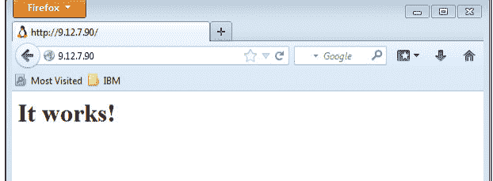

图 8-1 Apache 安装的成功测试

# 验证 PHP 是否工作

在为 PHP 构思并运行测试之前，必须确定 Apache 服务器的 DocumentRoot 目录的位置。

在 SUSE Linux Enterprise Server 中，默认位置是 `/srv/www/htdocs`。然而，可能配置了非默认位置。可以通过运行示例 8-31 所示的命令来确定文档根目录：

```
示例 8-31 在 SUSE Linux Enterprise Server 上查找 DocumentRoot
root@insud2:~# grep 'DocumentRoot' /etc/apache2/default-server.conf
DocumentRoot "/srv/www/htdocs"
```

在 RHEL 下，默认位置是 `/var/www/html`，但确定值通过示例 8-32 中的命令来显示：

```
示例 8-32 在 RHEL 上查找 DocumentRoot
[root@8z84p0-ri1 ~] grep 'DocumentRoot' '' /etc/httpd/conf/httpd.conf
DocumentRoot "/var/www/html"
```

在确认 Apache 服务器的 DocumentRoot 后，创建一个单行的 PHP 脚本，用于打印标准的 PHP 安装信息。使用 `vi` 或其他文本编辑器创建一个名为 `phpinfo.php` 的脚本文件（如示例 8-33 所示），并将脚本文件放在适当的 DocumentRoot 目录下。

示例 8-33 显示功能性的简单 PHP 脚本

```
<?php phpinfo();  ?>
```

在 DocumentRoot 目录下放置 PHP 文件后，可以使用浏览器运行 PHP 脚本。连接到您的 Web 服务器，以以下 URL 为例：

`http://92.12.7.90/phpinfo.php`

图 8-2 显示了在 SUSE Linux Enterprise Server 11 SP3 上运行的 PHP 脚本在浏览器中生成的预期 PHP 信息。

| PHP 5.3.17 | |

|---||---|

| System | Linux insud2-86.ibm.com 3.0.76-11-default #1 SMP Fri Jun 14 08:21:43 UTC 2013(02990) s390a |

| Server API | Apache 2.2 Handler |

| Virtual Directory | Disabled |

| Configuration File | /etc/php5/apache2 |

| (php.ini) Path | none |

| Loaded Configuration File | /etc/php5/apache2/php.ini |

| Scan this dir for additional files | /etc/php5/conf.d |

图 8-2 由 `phpinfo.php` 生成的 PHP 配置信息

# 在 SUSE Linux Enterprise Server 上启动 MySQL 服务

将 MySQL 数据库服务设置为每次服务器启动时自动启动，然后使用这些命令手动启动服务：

```
chkconfig mysql on
service mysql start
```

# 在 Red Hat Enterprise Linux 上启动 MySQL 服务

与 Apache 类似，MySQL 数据库服务在 RHEL 中的名称与 SUSE Linux Enterprise Server 略不同。要设置 MySQL 在每次服务器启动时启动并手动启动服务，请执行以下命令：

```
chkconfig mysql on
service mysql start
```

> 注意：SUSE Linux Enterprise 11 SP3 和 RHEL 6.4 都使用 SysVinit 命令。SUSE Linux Enterprise Server 12 和 RHEL 7 均计划使用服务管理来取代 SysVinit。

# 验证 MySQL 是否工作

在安装 MediaWiki 之前，必须正确配置并确保 MySQL 正常工作。完成以下步骤以验证 MySQL 是否工作：

- 1. 复制 MySQL 生产配置的示例配置文件 `/etc/my.cnf`。然后应用适当的所有权访问权限。阅读配置文件以了解其内容是一个好主意。示例 8-34 显示了示例命令。

  稍后，当从 x86 服务器迁移时，你可能会从 x86 服务器将 `my.cnf` 文件复制到 LinuxONE。目前，示例的 `my.cnf` 配置文件已足够在迁移前测试系统功能。

示例 8-34 配置 MySQL 配置文件

```
cp /usr/share/mysql/medium.cnf /etc/my.cnf
chown root:root /etc/my.cnf
chmod 640 /etc/my.cnf
```

> 注意：`/etc/my.cnf` 的默认权限为 644，允许任何人读取 MySQL 配置设置。安全领域的最佳实践建议系统服务不应向特权用户提供不必要的信息。将权限设置为 640 可以防止特权用户发现有关 MySQL 服务器配置的信息。

- 2. 为数据库管理用户设置临时密码。请记住此密码，因为在从 x86 服务器迁移 MediaWiki 应用之前的几个步骤中需要它。此密码可以与以后迁移的 MySQL 数据库密码相同，但不必相同。使用示例 8-35 所示的命令设置密码。

示例 8-35 为 MySQL 服务设置管理密码

```
mysqladmin -u root password 'agoodpassword'
```

为 `root` 用户设置管理密码后，未来与 MySQL 数据库的所有交互都需要提供密码。常规管理功能需要 `root` 密码，而涉及 MediaWiki 的命令将使用不同的密码。

> 注意：Linux 中的引号可能有点棘手。在设置 `root` 密码时，请记住引号并非严格必须。如果密码包含空格等特殊字符，则引号是必须的。通过运行此命令来测试 MySQL 的功能：

```
mysql -u root -p
```

# 8.6.4 使用 MySQL 和 MediaWiki 迁移 iSCSI 磁盘

外部存储的一个特别实用的方面是，磁盘可以有效地从一台机器拔下并插入另一台机器，从而加速迁移过程。这种方法并不适用于所有情况，但在 MediaWiki 示例中是行的。

在本示例中，MySQL 数据库和 Apache DocumentRoot 分别包含在独立的 ISCSI 分区上。这些分区上的文件系统将从 `zs4p01-s1` 主机（一个 x86 系统）卸载，然后挂载到运行在 LinuxONE 上的 `Insub2` 主机。

> 处理远程磁盘存储时，通过路径（by-path）引用并管理远程 LUN，而不是使用其他方法。`udev` 无法确保主机重启时使用相同的名称或 ID。唯一的持久性标识是通过路径。

# 为 LinuxONE 上的 Linux 虚拟机准备 iSCSI

在使用 iSCSI LUN 更改 x86 主机之前，请在 LinuxONE 上安装最基本的 iSCSI 软件：

- 1. 使用安全 Shell (`SSH`) 连接到名为 `insub2` 的 Linux 虚拟机。

- 2. 确保 Linux 虚拟机 `Insub2` 上安装了 `iscsi` 软件：


- 对于 `USE`，使用 `install open-iscsi`
- 对于 `RHEL`，使用 `yum install iscsi-initiator-utils`

### 3. 停止运行在 insub2 上的 Apache 和 MySQL 服务
该虚拟机在之前的测试中运行了 Apache 和 MySQL：

- 对于 `USE`，使用这些命令：
  ```
  service apache2 stop
  service mysql stop
  ```
- 对于 `RHEL`，使用这些命令：
  ```
  service httpd stop
  service mysqld stop
  ```

### 4. 将 `/srv/www` 和 `/var/lib/mysql` 目录的内容移出
以便 `ISCSI` 远程 `LUN` 的文件系统可以挂载到它们的位置。但是，请保留这些目录的内容作为备份。`RHEL` 的默认 `DocumentRoot` 为 `/var/lib/html/`。请根据实际情况使用合适的目录。

```
mv /srv/www /srv/www.orig
mv /var/lib/mysql /var/lib/mysql.orig
mkdir -p /srv/www /var/lib/mysql
```

# 为迁移准备 x86 系统

完成以下步骤以准备迁移 x86 系统：

- 1. 使用 `SSH` 连接到 `zs4p0-s1` (x86) 主机。
- 2. 显示 `zs4p0-s1` 的挂载表，注意哪个文件系统包含 `MySQL` 分区和 `Apache` 分区：
  ```
  mount
  ```
  在此示例中，`/var/lib/mysql` 目录挂载在 `/dev/sdd1` 上，`/srv/www` 目录挂载在 `/dev/sdc` 上。示例 8-3 展示了使用 `df -h` 显示已挂载文件系统的方法。

示例 8-3 `zs4p0-s1` 上的挂载分区

| 文件系统 | 大小 | 已用 | 可用 | 使用 | 挂载点 |
|---|---|---|---|---|---|
| /dev/sda2 | 491G | 29G | 462G | 6% | |
| udev | 2.00G | 116K | 2.00G | 1% | /dev |
| tmpfs | 2.00G | 728K | 2.00G | 1% | /dev/shm |
| /dev/loop0 | 3.2G | 3.2G | 0G | 100% | /srv/iso |
| /dev/sdc | 1018M | 199M | 820M | 20% | /srv/www |
| /dev/sdd1 | 4.0G | 3.3M | 4.0G | 1% | /var/lib/mysql |

- 3. 注意当前主机 `zs4p0-s1` 上正在挂载哪些 `LUN`：
  ```
  ls /dev/disk/by-path/
  ```
  在目录中查找包含以下内容的符号链接：
  `<IPADDRESS=3260-iscsi-iqn.<ISCSI_Target_identifier>:<ISCSI_unique_LUN>`
  `ip-9.12.7.97:3260-iscsi-iqn.2014-04.ibm.itso:lun-2-lun-1`
  其中：
  - 远程 `iscsi` 目标的 `IP` 地址为 `9.12.7.97`
  - `SCSI` 目标标识符为 `iscsi-iqn.2014-04.ibm.itso`
  - `Apache` 分区的唯一 `SCSI LUN` = `lun2`
  对于 `MySQL` 数据目录，远程 `iscsi` 目标的 `IP` 地址和 `SCSI` 目标标识符与 `Apache` 磁盘相同。唯一的区别是 `MySQL` 数据分区的唯一 `SCSI LUN` 等于 `lun3`。

示例 8-39 显示了此示例的 `by-path` 分配，其中 `LUN2` 被引用为 `sdb1`，`LUN3` 被引用为 `sdc1`。

示例 8-39 显示远程 `ISCSI` 磁盘 `by-path` 分配的输出
```
zs4p01-s1~: /dev/disk/by-path/
total 0
lrwwrwxwx 1 root 9 May 8 09:14 ip-9.12.7.97:3260-iscsi-iqn.2014-04.ibm.itso:lun-2 -> ../sdc
lrwwrwxwx 1 root 10 May 8 09:14 ip-9.12.7.97:3260-iscsi-iqn.2014-04.ibm.itso:lun-part1 ../sdc
lrwwrwxwx 1 root 9 May 8 09:14 ip-9.12.7.97:3260-iscsi-iqn.2014-04.ibm.itso:lun-3 -> ../sdc
lrwwrwxwx 1 root 10 May 8 09:14 ip-9.12.7.97:3260-iscsi-iqn.2014-04.ibm.itso:lun-part3 ../sdd1
```
`LUN2` 是 `/dev/sdc1` 的符号链接。这些目录是上一步中识别出的 `LUN` 分区，此处是需要卸载的文件系统。

> 注意：注意这些细节。选择错误的磁盘会导致卸载错误的文件系统，从而产生灾难性后果。

- 4. 停止 `zs4p01-s1` 上的 `Apache` 和 `MySQL`：
  对于 `USE`，使用这些命令：
  ```
  service apache stop
  service mysql stop
  ```
  - 对于 `RHEL`，使用这些命令：
  ```
  service httpd stop
  service mysqld stop
  ```

- 5. 卸载将移动到 `insub2` 的磁盘：
  ```
  umount /srv/www
  umount /var/lib/mysql
  ```

- 6. 为了完整起见，从 `zs4p01-s1` 连接的两个 `LUN` 登出：
  ```
  isciadm --mode=node --portal=9.12.7.97 --targetname=iqn.2014-04.ibm.itso:LUN2 --logout
  isciadm --mode=node --portal=9.12.7.97 --targetname=iqn.2014-04.ibm.itso:LUN3 --logout
  ```

- 7. 从 `zs4p01-s1` 主机的 `/etc/fstab` 中删除指向 `/srv/www` 和 `/var/lib/mysql` 的记录。你可能想在删除之前保留这些信息。你可能会在新主机 `insub2` 上使用相同的信息。

# 将 ISCSI 磁盘移动到 LinuxONE

完成以下步骤将你的 `ISCSI` 磁盘移动到 `LinuxONE`：

- 1. 使用 `SSH` 连接到 `LINSUB2` 控制台。不再使用 x86 主机 `zs4p01-s1`。
- 2. 发现运行在 `ISCSI` 目标上的远程磁盘：
  ```
  iscsiad --mode=discovery --type=targets --portal=9.12.7.97
  ```
  示例 8-40 显示了从 `ISCSI` 目标提供的三个 `LUN`。该示例仅使用了两个 `LUN`。

示例 8-40 从 `ISCSI` 目标发现的 `LUNs`
```
insub2~# iscsiad --mode=discovery --type=targets --portal 9.12.7.97
9.12.7.97:3260,1.iqn.2014-04.ibm.itso:LUN2
9.12.7.97:3260,1.iqn.2014-04.ibm.itso:LUN1
9.12.7.97:3260,1.iqn.2014-04.ibm.itso:LUN3
```
示例 8-40 的输出与在前面的步骤中从 `zs4p01-s1`（`ISCSI` 目标）上的信息相似，例如 `ISCSI` 目标的 `IP` 地址、`ISCSI` 目标标识符以及目标导出的 `LUN`。在此示例中，目标将挂载在 `insub2`（包含 `Apache Web` 系统）和 `LUN3`（包含 `MySQL` 数据库）上。虽然列出了 `LUN1`，但本次练习未使用它。

- 3. 登录远程 `ISCSI` 磁盘，发现 `Apache Web` 的 `LUN2`：
  ```
  iscsiad --mode=node --portal=9.12.7.97 --targetname=iqn.2014-04.ibm.itso:LUN2 --login
  ```
  示例 8-41 的输出代表登录成功。

示例 8-41 成功登录到 `ISCSI` 目标的 `LUN2`
```
insub2~# iscsiad --mode=node --portal=9.12.7.97 --targetname=iqn.2014-04.ibm.itso:LUN2 --login
```
在你的环境中，`ISCSI` 目标可能需要更复杂的身份验证才能登录。在此示例中，`ISCSI` 目标不需要凭据。

- 4. 重复登录，此目标指定包含 `MySQL` 数据分区的 `LUN3`：
  ```
  iscsiad --mode=node --portal=9.12.7.97 --targetname=iqn.2014-04.ibm.itso:LUN3 --login
  ```


> 注意：`--login`子命令允许ISCSI目标进行登录。在RHEL中，完成登录后可以看到指定的LUN。

对于此示例，只需复制配置文件即可。要执行此操作，请完成以下步骤：

- 1. 在`LNSDB2` (LinuxONE)上启动SSH控制台。

- 2. 从`zs4p01-s1`将Apache配置文件同步到`LNSDB2`。使用最适合你环境的方法，并参考此示例：

```bash
sync -qa zs4p01-s1:/etc/apache2/* /etc/apache/
sync -qa zs4p01-s1:/etc/my.conf /etc/
```

- 3. 在`LNSDB2`上启动Apache和MySQL服务：

- 对于Linux，使用以下命令：

```bash
service apache2 start
service mysql start
```

- 对于RHEL，使用以下命令：

```bash
service httpd
service mysqld start
```

- 4. 确保Apache和MySQL在每次服务器启动时都能自动启动：

- 对于USE，使用以下命令：

```bash
chkconfig apache on
chkconfig mysql on
```

- 对于RHEL，使用以下命令：

```bash
chkconfig httpd on
chkconfig mysql on
```

成功迁移Apache、MySQL及其各自的数据（包括MediaWiki）后现在应该可以正常运行。使用浏览器打开MediaWiki URL。图8-3所示的网页表示MediaWiki安装成功。

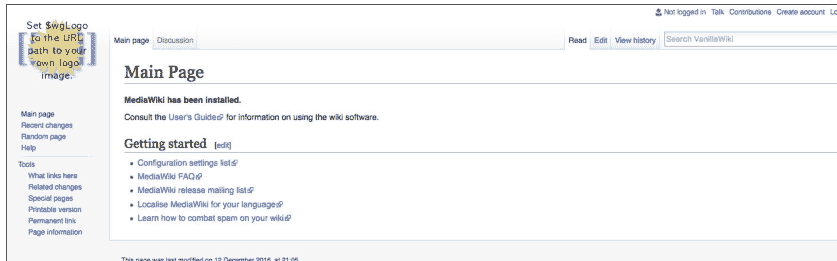

图8-3 MediaWiki的成功迁移

图8-3显示的页面源自www.wikipedia.org。此示例使用了MediaWiki站点备份文件的一小部分。备份文件从http://dumps.wikimedia.org获取，并仅用于演示目的在实验室测试环境中还原。该页面的内容和版权归Wikimedia Foundation, Inc.所有，并根据www.wikipedia.org提供的使用条款使用。

164 从x86到LinuxONE的实用编程

## 8.7 部署OpenLDAP

各种规模的企业都需要管理其计算资源的用户。随着用户管理而来的，涉及到用户的各种特性，例如用户ID、身份验证、文件系统权限、打印机权限等，所有这些都需要管理。管理这些数据最常用的产品之一是轻量级目录访问协议 (LDAP)。

LDAP作为运行在IP网络上的开放标准，被广泛应用于目录服务。虽然有多种商业LDAP产品，但OpenLDAP是Linux中最常用的实现。OpenLDAP是一个功能齐全的工具和应用程序套件。它可以从RHEL和SUSE作为工作负载在LinuxOne上可用。由于Linux在许多其他系统和服务中的核心地位、快速的I/O以及其对CPU和内存的利用，LDAP是LinuxOne的完美工作负载。而且OpenLDAP是开源的。将OpenLDAP迁移到LinuxOne非常简单。

我们在8.6中安装了带有MediaWiki的LAMP服务器，并使用iSCSI外部存储来辅助第12页的“部署MediaWiki和MySQL”。在本示例中，导出x86服务器上的LDAP数据库，将数据传输到运行在LinuxOne上的Linux虚拟机，并将数据导入LDAP服务中。

### 8.7.1 分析与规划

与8.6节第152页“部署MediaWiki和MySQL”中描述MediaWiki示例一样，重要的是你必须遵循第43页的第4章“迁移过程”和第55页的第5章“迁移分析”。在进行迁移活动之前，执行此类迁移和分析。清单有助于识别应该考虑的许多因素，以帮助防止迁移过程中出现问题。

此示例假设Linux虚拟机已经设置好并安装了最小的Linux操作系统。该Linux虚拟机称为`LNSUB2`，运行SUSE Linux Enterprise Server 11 SP3，拥有一个虚拟CPU和1 GB内存。OpenLDAP服务器不需要在LinuxOne上运行大量的CPU或RAM。可能已经准备好了充分的RPM仓库安装源以安装应用程序服务。

x86服务器称为`zs4p01-r1`，运行RHEL 6.4。对于此示例，这是为假设的组织提供目录服务的当前OpenLDAP服务器。该服务器已配置了许多（小的）LD目录。

虽然设置企业级目录服务有很多需要考虑的地方，但这里涵盖了一个简单的OpenLDAP场景。可以在以下网站找到更详细的文档：

http://www.openldap.org

此示例是一个带有本地非复制目录服务的独立服务器。尽管如此，将x86上现有的OpenLDAP安装迁移到LinuxOne应该是简单的。

### 8.7.2 安装LDAP软件

OpenLDAP服务器是一个简单的应用程序，由多个部分组成。在迁移到LinuxOne之前，必须在Linux虚拟机上安装OpenLDAP软件。这可能已经准备好了充分的RPM仓库配置源以安装应用程序服务。对于SUSE，使用以下命令：

```
zypper install openldap
```

对于RHEL，使用以下命令：

```bash
yum install ldap-servers
```

### 8.7.3 配置LDAP

LDAP服务是一个简单的应用程序，由一个软件包组成。因此，安装软件相对简单。在迁移到LinuxOne之前，必须在Linux虚拟机上安装软件。对于SUSE Linux Server，使用以下命令：

```
openldap
```

在Linux Linux Server，使用YaST来配置LDAP服务。图8-4显示了第一个面板。对于SUSE Linux Server，使用YaST来完成LDAP配置，而对于Red Hat，则是通过手动修改LDAP配置文件来完成的。这种方法是使用d的。

在向LinuxOne迁移LDAP之前，建立LDAP配置。对于2.4版本，使用`cn=config`格式。这是使用`/etc/openldap/slapd.d/`这种方法。“旧”方法涉及`/etc/openldap/slapd.conf`。这种方法虽然简单，但没有很多功能。“新”方法是使用d。

在SUSE上使用YaST配置LDAP

使用YaST来完成LDAP服务的活动。

- 1. 从命令行提示符启动YaST，特别是`ldap-server`模块：图8-4显示了通用设置。

| 通用设置 |

|---|

| 启动LDAP服务 |

| (x) 是 |

| ) 否 |

| 防火墙设置 |

| [ ] 在防火墙中打开端口 |

| 禁用防火墙 |选择独立服务器作为服务器类型，如图8-5所示。

| 服务器类型 |

|---|

| (X) 独立服务器 |

| ) 复制设置中的主服务器 |

| ) 副本（从）服务器 |

选择是来自动启动LDAP服务。

- 3. 选择适当的LDAP安全设置，如图8-6所示。

| 基础设置 | TLS设置 |

|---|---|

| [X] 启用TLS | |

| [X] 启用基于SSL的LDAP (ldaps) | |

| [X] 使用通用服务器证书 | |

使用适当的SSL证书是优的，但并非必须。此示例使用了安装SUSE Linux Server时生成的自签名证书。更重要的是，使用SSL进行LDAP (LDAP over Socket)是至关重要的。没有LDAP，密码和敏感数据将以明文形式与LDAP服务器交换。这种方法会使系统脆弱。

- 4. 图8-7显示了数据库设置面板，其中包含设置LDAP管理密码的字段。

| 基础数据库设置 |

|---|

| 数据库类型 | db a |

| Base DN | dc=itso,dc=ibm,dc=com |

| 管理员DN | cn=Administrator [] |

| LDAP管理员密码 |

| 验证密码 |

| 数据库目录 | /var/lib/ldap |

| [X] 使用此数据库作为默认用于 |

在生产环境中，必须输入正确的区分名称 (DN)数据，对于此演示，使用YaST提供的示例值是足够的。这里最重要的是提供一个管理员密码。此密码不应与系统的root密码相同。所有其他创建管理员密码的实践也应同样采用。对于此演示，使用了密码 `ldapadmin`。

## 5. 显示配置摘要，如图8-8所示。

| LDAP服务器配置摘要 |

| --- |

| 启动配置 |

| 启动LDAP服务器：是 |

| 在SLP服务注册：否 |

| 使用以下内容创建初始数据库： |


| 数据库后缀：`dc=itso,dc=ibm,dc=com` |

| 管理员 DN：`cn=Administrator,dc=it` |

### 图 8-8 OpenLDAP 配置摘要

在充分收集所有配置信息后，按下 F10 即可完成 YaST 配置步骤。配置文件将被写入，并启动 `slapd` 守护进程。在示例 8-44 中可以看到运行中的守护进程进程。`/etc/openldap/slapd.d` 参数表示使用 `cn=config` 特性格式配置的服务。

示例 8-44 使用 `cn=config` 方法运行的 `slapd` 守护进程

```
insudb2: # ps -ef | grep slapd
ldap 17224 1 01:26? 00:00:00 /usr/lib/openldap/slapd -h ldap:
/// ld:/// ldap:/// -F /etc/openldap/slapd.d -u ld -g ld -o slloff
root 17251 0 16:27 pts/0 00:00:00 grep slapd
```

## 在 Red Hat Enterprise Linux 上手动配置 OpenLDAP

在 Red Hat Enterprise Linux (`RHEL`) 服务器上进行配置也是一个相对简单的任务，因为只需要基础的、可引导的配置。此配置本身对于运行目录目录没有用，但它允许从另一个服务器迁移 OpenLDAP 目录。OpenLDAP 2.4 默认也使用 `cn=config` 特性格式：

- 1. 确保 `slapd` 守护进程正在运行：

  `service slapd start`

- 2. 在 RHEL 服务器的命令行提示符上编辑基础 OpenLDAP 配置文件，可以使用下示例中的 `vi`：

  `vi /tmp/config.itso.ibm.com.ldif`

  将示例 8-45 中的内容放入以下内容

示例 8-45 用于引导 OpenLDAP 数据库的 `/tmp/config.itso.ibm.com.ldif` 文件

```
dn: olcdatabase=hdb,cn=config
objectClass: olcDatabaseConfig
objectClass: olcConfig
olcDatabase: hdb
olcSuffix: dc=itso,dc=ibm,dc=com
olcDbDirectory: /var/lib/ldap
olcRootDN: cn=Administrator,dc=itso,dc=ibm,dc=com
olcRootPW: ldadmin
```

第 8 章. 工作负载的部署 169

`olcAccess: to attrs=password by dn=cn=Administrator,dc=itso,dc=ibm,dc=com`

`write by anonymous auth by self write by * none`

`olcAccess: to attrs=shadowLastChange by self write by * read`

`olcAccess: to dn=base* by * read`

`olcAccess: to by dn=cn=Administrator,dc=itso,dc=ibm,dc=com by * read`

保存文件并退出编辑器。

- 3. 使用以下命令从示例 8-45 中创建的文件引导数据库并导入配置：

  `ldapadd -Y EXTERNAL -f /tmp/config.itso.ibm.com.ldap`

现在 OpenLDAP 的配置允许数据库的迁移。

## 8.7.4 从 x86 服务器导出 OpenLDAP 数据

现在运行在 x86 服务器上的 LDAP 目录树需要导出，以便将数据传输到 LinuxONE 上的 Linux 虚拟机。执行此操作，请完成以下步骤：

- 1. 使用 SSH 连接到 x86 主机 `zs4p01-r1`。此示例位于 RHEL 服务器。

- 2. 停止 `slapd` 守护进程，以便从 OpenLDAP 导出数据：

  `service slapd stop`

- 3. 从 OpenLDAP 数据库导出数据。用于实现此目的的工具称为 `slapcat`，它是从 OpenLDAP 提取全常用方法。输出以 LDAP 数据交换格式 (`LDIF`) 写入，这是一种表示 LDAP 的标准纯文本数据格式：

  `slcat -b 'dc=itso,dc=ibm,dc=com' -l /tmp/migrate.ldif`

  `-l` 参数告诉 `slapcat` 将数据库（LDIF 格式）导出到文件 `/tmp/migrate.ldif`。`-b` 参数标识要导出的特定数据域（在 OpenLDAP 术语中后缀）。

- 4. （可选）在 `zs4p01-r1` 上重启 `slapd` 守护进程。由于守护进程正在迁移到另一个服务器，可能不需要重启。

  `service slapd stop`（注：此处原文为 stop，可能应为 start）

- 5. 将数据库文件传输到运行在 LinuxONE 上的 Linux 虚拟机 `LNSUB2`。使用最合适的传输机制。此示例使用了名为 `rsync` 的工具和网络协议：

  `sync /tmp/migrate.ldif 9.12.7.90:/tmp/`

IP 地址为 `9.12.7.90` 的服务器是 `LNSUB2`，即 LinuxONE 上的 Linux 虚拟机。在提示时提供相应的凭据。传输完成后，从该 x86 服务器到 Linux 虚拟机的数据导出过程即完成。

170 从 x86 到 LinuxONE 的实际迁移

## 8.7.5 向 LinuxONE 导入 OpenLDAP 数据

在上一节节中，OpenLDAP 数据库导出文件已传输到运行在 LinuxONE 上的 Linux 虚拟机 `insudb2`。现在只需要导入数据并启动 OpenLDAP 守护进程：

- 1. 使用 SSH 连接到 Linux 虚拟机 `insudb2`。

- 2. 确保 `slapd` 未运行。迁移导入数据需要服务未运行：

  `service slapd stop`

- 3. 导入复制的数据。此过程采用名为 `slapadd` 的工具。这是向 OpenLDAP 导入数据集的常用方法：

```
slapadd -F /etc/openldap/slapd.d \
-b 'dc=itso,dc=ibm,dc=com' -l /tmp/migrate.ldif
```

# 全局选项

你可以在 `syslog-ng` 的 `options` 语句中指定多个全局选项。你可以定义客户端主机名在日志文件中显示的方式，启用或禁用 DNS 缓存，使用文件所有权，以及根据你环境的大小或特定需求使用的其他功能。

# 源选项

`source` 关键字用于添加源驱动程序或定义你自己的源。例如，在 `syslog-ng` 中定义一个用于监听远程主连接的 UDP 或 TCP 连接的语法如下：

```
s_net { tcp(ip(127.0.0.1) port(40000)) }; udp ();
```

配置文件中的此条目定义了一个名为 `s_net` 的源，它通过 TCP 监听 localhost 的 40000 端口，并在所有接口上监听 UDP 514 端口（`syslog-ng` 的默认值）。此外，它限制了 TCP 端口的最大连接数。关于你可以定义的参数的更多信息，请参阅 `syslog-ng.conf` 手册。

# 过滤器选项

过滤器允许你根据关键词设置不同的定义。`filter` 语句的语法如下：

```
filter <identifier> { expression };
```

其中 `<identifier>` 是你给过滤器起的名称，`<expression>` 包含函数和布尔运算符（`and`, `or`, `not`）。示例 8-49 演示了这种过滤器。

示例 8-49 过滤器示例

```
filter_iptables { facility(kern) and match("IN=") and match("OUT="); }
filter_messages { not facility(news, mail) and not filter(f_iptables); }
filter_warn { level(warn, err, crit) and not filter(f_iptables); };
```

# 目标选项

目标选项定义了发送日志消息的文件。`syslog-ng.conf` 默认涵盖了本地文件的目标，但入站消息呢？默认情况下，根据接收到的消息类型，日志消息被写入默认的本地文件。如果是身份验证消息，日志将写入 `/var/log/auth` 文件，并附带全局选项中定义的信息（如主机名、日期）。示例 8-50 使用文件作为目标，但根据你如何配置服务器，也可以使用数据库甚至另一台远程服务器。

示例 8-50 目标示例


#
# 除了 iptables 以及 news 和 mail 之外的所有消息：
#
`destination messages { file("/var/log/messages"); }`
`log { source(src); filter(f_messages); destination(messages); };`
#
# 防火墙 (iptables) 消息存放在文件中：
#
`destination firewall { file("/var/log/firewall"); }`
`log { source(src); filter(f_iptables); destination(firewall); }`
#
# 警告（除 iptables 外）存在一个文件中：

```
# destination warn { file("/var/log/warn fsync(yes)); };
log ( source(src); filter(f_warn); destination(warn); };
```

如第 173 页的示例 8-50 所示，`log` 语句需要源、过滤器和目标。

## 8.8.3 服务器配置

复杂的服务器配置不在本书的讨论范围内。`syslog-ng` 的默认配置带有根据要记录的 facility（设施）拆分文件的定义。图 8-9 显示了一个集中的 `syslog-ng` 服务器接收来自 `syslog-ng` 客户端的日志副本。

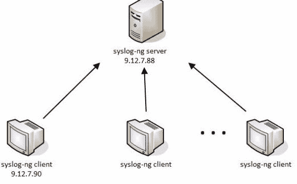

图 8-9 集中的 syslog-ng 服务器和一些 syslog-ng 客户端

测试环境的全局选项在示例 8-51 中。

示例 8-51 syslog-ng 服务器的全局选项

```
options {
sync (); # 写入文件前的缓冲区行数
perm(0640); # 创建文件的权限值。
keep_hostname(yes); # 保留原始主机名。
}
```

要启用监听器，源 (`src`) 需要使用 `udp` 语句，如示例 8-52 所示。

示例 8-52 syslog-ng 服务器的源示例

```
source src {
#
# 包含内部 syslog-ng 消息
# 注意：需要 internal() 源！
#
internal();
#
# 用于本地记录的默认日志套接字：
#
unix-dgram("/dev/log");

#
# 取消注释以处理来自网络的日志消息：
udp("0.0.0.0") port(514));

};
```

重启 syslog 服务以加载 syslog-ng 配置文件，如示例 8-53 所示。

示例 8-53 重启 syslog-ng 服务器以更新配置

```
syslog-server-1:"# service syslog restart
Shutting down syslog services done
Starting syslog services done
```

要测试监听器，你可以使用 `lsof`，如示例 8-52 所示。

示例 8-54 使用 lsof 命令测试监听器

```
syslog-server-1:"# lsof -i UDP:514
COMMAND PID USER FD TYPE SIZE/OFF NODE NAME
syslog-ng 60700 root 4u IPv4 327255 0t0 UDP *:shell
```

如果你愿意，也可以使用 TCP，但为了启动一个简单的

## 8.8.4 过滤器配置

复杂的服务器配置不在本书的讨论范围内。`syslog-ng` 的默认配置带有根据要记录的 facility 拆分文件的定义。图 8-9 显示了一个集中的 `syslog-ng` 服务器接收来自 `syslog-ng` 客户端的日志副本。


图 8-9 集中的 syslog-ng 服务器和一些 syslog-ng 客户端

测试环境的全局选项在示例 8-51 中。

示例 8-51 syslog-ng 服务器的全局选项

```
options {
sync (); # 写入文件前的缓冲区行数
perm(0640); # 创建文件的权限值。
keep_hostname(yes); # 保留原始主机名。
}
```

要启用监听器，源 (`src`) 需要使用 `udp` 语句，如示例 8-52 所示。

示例 8-52 syslog-ng 服务器的源示例

```
source src {
#
# 包含内部 syslog-ng 消息
# 注意：需要 internal() 源！
#
internal();
#
# 用于本地记录的默认日志套接字：
#
unix-dgram("/dev/log");

#
# 取消注释以处理来自网络的日志消息：
udp("0.0.0.0") port(514));

};
```

重启 syslog 服务以加载 syslog-ng 配置文件，如示例 8-53 所示。

示例 8-53 重启 syslog-ng 服务器以更新配置

```
syslog-server-1:"# service syslog restart
Shutting down syslog services done
Starting syslog services done
```

要测试监听器，你可以使用 `lsof`，如示例 8-52 所示。

示例 8-54 使用 lsof 命令测试监听器

```
syslog-server-1:"# lsof -i UDP:514
COMMAND PID USER FD TYPE SIZE/OFF NODE NAME
syslog-ng 60700 root 4u IPv4 327255 0t0 UDP *:shell
```

如果你愿意，也可以使用 TCP，但为了启动一个简单的

## 8.8.5 目标配置

复杂的服务器配置不在本书的讨论范围内。`syslog-ng` 的默认配置带有根据要记录的 facility 拆分文件的定义。图 8-9 显示了一个集中的 `syslog-ng` 服务器接收来自 `syslog-ng` 客户端的日志副本。


图 8-9 集中的 syslog-ng 服务器和一些 syslog-ng 客户端

测试环境的全局选项在示例 8-51 中。

示例 8-51 syslog-ng 服务器的全局选项

```
options {
sync (); # 写入文件前的缓冲区行数
perm(0640); # 创建文件的权限值。
keep_hostname(yes); # 保留原始主机名。
}
```

要启用监听器，源 (`src`) 需要使用 `udp` 语句，如示例 8-52 所示。

示例 8-52 syslog-ng 服务器的源示例

```
source src {
#
# 包含内部 syslog-ng 消息
# 注意：需要 internal() 源！
#
internal();
#
# 用于本地记录的默认日志套接字：
#
unix-dgram("/dev/log");

#
# 取消注释以处理来自网络的日志消息：
udp("0.0.0.0") port(514));

};
```

重启 syslog 服务以加载 syslog-ng 配置文件，如示例 8-53 所示。

示例 8-53 重启 syslog-ng 服务器以更新配置

```
syslog-server-1:"# service syslog restart
Shutting down syslog services done
Starting syslog services done
```

要测试监听器，你可以使用 `lsof`，如示例 8-52 所示。

示例 8-54 使用 lsof 命令测试监听器

```
syslog-server-1:"# lsof -i UDP:514
COMMAND PID USER FD TYPE SIZE/OFF NODE NAME
syslog-ng 60700 root 4u IPv4 327255 0t0 UDP *:shell
```

如果你愿意，也可以使用 TCP，但为了启动一个简单的

## 8.8.6 迁移 syslog-ng

复杂的服务器配置不在本书的讨论范围内。`syslog-ng` 的默认配置带有根据要记录的 facility 拆分文件的定义。图 8-9 显示了一个集中的 `syslog-ng` 服务器接收来自 `syslog-ng` 客户端的日志副本。


图 8-9 集中的 syslog-ng 服务器和一些 syslog-ng 客户端

测试环境的全局选项在示例 8-51 中。

示例 8-51 syslog-ng 服务器的全局选项


```
options {
sync (); # 写入文件前的缓冲区行数
perm(0640); # 创建文件的权限值。
keep_hostname(yes); # 保留原始主机名。
}
```

要启用监听器，源 (`src`) 需要使用 `udp` 语句，如示例 8-52 所示。

### 示例 8-52 syslog-ng 服务器的源示例

```
source src {
#
# 包含内部 syslog-ng 消息
# 注意：需要 internal() 源！
#
internal();
#
# 用于本地记录的默认日志套接字：
#
unix-dgram("/dev/log");

#
# 取消注释以处理来自网络的日志消息：
udp("0.0.0.0") port(514));

};
```

重启 `syslog` 服务以加载 `syslog-ng` 配置文件，如示例 8-53 所示。

### 示例 8-53 重启 syslog-ng 服务器以更新配置

``` 
evensyslog-server-1:"# service syslog restart
Shutting down syslog services done
Starting syslog services done
```

要测试监听器，你可以使用 `lsof`，如示例 8-52 所示。

### 示例 8-54 使用 lsof 命令测试监听器

```
syslog-server-1:"# lsof -i UDP:514
COMMAND PID USER FD TYPE SIZE/OFF NODE NAME
syslog-ng 60700 root 4u IPv4 327255 0t0 UDP *:shell
```

如果你愿意，也可以使用 TCP，但为了启动一个简单的

## 8.8.3 服务器配置

复杂的服务器配置不在本书的讨论范围内。`syslog-ng` 的默认配置带有根据要记录的 facility 拆分文件的定义。图 8-9 显示了一个集中的 `syslog-ng` 服务器接收来自 `syslog-ng` 客户端的日志副本。


图 8-9 集中的 syslog-ng 服务器和一些 syslog-ng 客户端

测试环境的全局选项在示例 8-51 中。

### 示例 8-51 syslog-ng 服务器的全局选项

```
options {
sync (); # 写入文件前的缓冲区行数
perm(0640); # 创建文件的权限值。
keep_hostname(yes); # 保留原始主机名。
}
```

要启用监听器，源 (`src`) 需要使用 `udp` 语句，如示例 8-52 所示。

### 示例 8-52 syslog-ng 服务器的源示例

```
source src {
#
# 包含内部 syslog-ng 消息
# 注意：需要 internal() 源！
#
internal();
#
# 用于本地记录的默认日志套接字：
#
unix-dgram("/dev/log");

#
# 取消注释以处理来自网络的日志消息：
udp("0.0.0.0") port(514));

};
```

重启 `syslog` 服务以加载 `syslog-ng` 配置文件，如示例 8-53 所示。

### 示例 8-53 重启 syslog-ng 服务器以更新配置

```
syslog-server-1:"# service syslog restart
Shutting down syslog services done
Starting syslog services done
```

要测试监听器，你可以使用 `lsof`，如示例 8-52 所示。

### 示例 8-54 使用 lsof 命令测试监听器

```
syslog-server-1:"# lsof -i UDP:514
COMMAND PID USER FD TYPE SIZE/OFF NODE NAME
syslog-ng 60700 root 4u IPv4 327255 0t0 UDP *:shell
```

如果你愿意，也可以使用 TCP，但为了启动一个简单的

如第 173 页的示例 8-50 所示，`log` 语句需要源、过滤器和目标。

在部署 Samba 之前，请确保在任何迁移活动之前已进行适当的分析和规划。书中提供的清单列出了在迁移过程中需要考虑的许多领域，以防止问题的出现。

此示例假设 z/VM 虚拟机已经建立并安装了 Linux 操作系统。该 Linux 虚拟机命名为 `LNUSDB2`，安装了 SUSE Linux Enterprise 11 SP3，配有 1 个虚拟 CPU 和 1 GB 虚拟内存。通过 LDAP，Samba 服务器在 LinuxONE 上运行时通常不需要大量的 CPU 或 RAM。假设已经设置好并提供了可用的适当的 RPM 仓库安装源，用于安装应用程序软件。

关于 Samba 的更详细文档可以从以下网站找到：

```
http://www.samba.org
```

此示例是一个独立的服务器，具有本地的、非复制的目录服务。将 x86 上的 Samba 安装迁移到 LinuxONE 应该是轻而易举的。

## 8.9.1 安装 Samba 软件

安装软件相对简单：

- 在 SUSE Linux Enterprise Server 上安装 Samba 及其依赖包，请执行此命令：

  `zypper install samba`

- 在 Red Hat Enterprise Linux 上安装 Samba 及其依赖包，请执行此命令：

  `yum install samba`

## 8.9.2 配置 Samba

本节描述了如何在 SUSE Linux Enterprise Server 和 RHEL 上首次配置 Samba。

### 使用 YaST 在 SUSE Linux Enterprise Server 上配置 SAMBA 配置文件服务器

创建可用配置的所有活动都通过 Samba YaST 模块提供便利。通过使用 YaST 中的几个面板，可以很快地配置并运行 Samba 服务。

要配置 Samba 服务器，启动 YaST 并选择“网络服务 -> Samba 服务器”。按照示例 8-59 所示，使用您的网络信息完成所示的字段。

> 示例 8-59 在 YaST 上初始配置 Samba
> 
> 工作组名称或域：从您现有的工作组或域中选择您的名称
> 
> Samba 服务器类型 (PDC, BDC 或 独立)：指定您的服务器是否应作为
> 
> 启动服务：在服务器重启后，选择在启动期间启动
> 
> 防火墙设置：如果您在此服务器内部运行防火墙服务器，请勾选在防火墙中打开端口选项
> 
> Samba root 密码：为您的 Samba 服务选择一个密码

178 从 x86 迁移到 LinuxONE 的实用迁移

图 8-11 显示了 YaST2 面板中的配置信息。

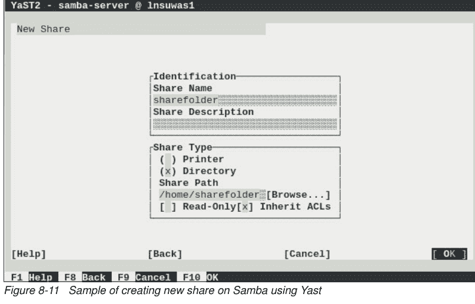

完成此任务后，您应该能够从客户端机器映射到该服务器。

> 注意：如果您打算使用基础 Linux 身份验证（即使用 passwd 文件），则你必须使用命令 `smpassword -a <userid>` 更改 Samba 用户密码。

### Samba 的 LDAP 设置

许多公司使用 LDAP 提供单点登录，其中用户密码在服务之间共享。创建可用配置的活动通过 OpenLDAP 服务器 YaST 模块提供便利。虽然 SAMBA 上的 LDAP 配置是一项重要功能，但该配置超出了本书的范围。

有关如何在 Samba 上设置 LDAP 的信息，请参 Samba 官方网站：

`http://www.samba.org`

### 配置文件

您可以手动设置 Samba 的配置文件。SUSE Linux Enterprise Server 上的主配置文件存储在 `/etc/samba/smb.conf` 中，包含两个部分：

- `[ global ]` 用于常规设置
- `[ ]` 用于指定有关共享文件和打印机的特定设置

有关 SUSE Linux Enterprise Server 上 Samba 配置的更多详细信息，请参阅《SUSE Linux Enterprise Server 11 管理指南》中的 Samba 部分：

`bit.ly/Zxelvc`

> 注意：RHEL 6 与 SUSE Linux Enterprise Server 11 使用相同的 Samba 主配置文件结构。

### 启动和停止 Samba 服务

`smb` 服务控制服务器守护进程并可以被停止。通过示例 8-61 所示的命令停止并启动 Samba 服务。

在 SLES 和 RHEL 上停止和启动服务：

停止服务：`/etc/init.d/smb`

启动服务：`/etc/init.d/smb`


# 第 部分

## 附录

本节包含一个附录，提供了额外的用例：

- 附录 A，“额外用例”，位于第 183 页

## 额外用例


从 x86 迁移到 Linux 的复杂性随平台架构和上下文而变化。Linux 操作系统更加直观，使得迁移更加容易。但是，当你考虑应用程序、数据库管理系统或中间件迁移时，需要考虑复杂性、成本和风险。

此附录提供了额外的用例场景，其中电信公司、医疗公司和能源公用公司都想从 x86 迁移到 LinuxONE。它描述了每个行业特定的挑战。

此附录包括以下章节：

- 电信行业整合与云
- 医疗行业：移动解决方案
- 能源公用行业：System z 云自动化解决方案

## 电信行业整合与云

在此场景中，电信公司 T1 选择 LinuxONE 平台用于 Linux 操作系统的整合和虚拟化。电信公司 T1 希望构建云平台，但他们希望减少运营成本和整体数据中心占用。该公司的策略是提高满足用户请求的业务系统 BSS 和支持系统 OSS。在此示例中，可以使用以下技术：

电信公司 T1 整合了以下基础设施：

- IBM LinuxONE Rockhopper
- IBM zVM 6.3
- 平台上的 Red Hat Enterprise Linux 或 SUSE Linux Enterprise
- IBM ProTIER Gateway TS7680：去重和虚拟带库

电信公司 T1 使用以下云应用：

- IBM SmartCloud®
- 使用 IBM Tivoli System Automation 进行自动化
- 自动配置：Tivoli Provisioning Manager
- 生命周期管理：IBM SmartCloud Control Center

电信公司 T1 使用这些构建监控和系统管理工具：

- zVM 和 Linux 上的 IBM Tivoli OverWatch：作为 zVM 虚拟机运行的实例及其负载性能如何以及如何相互影响：
- 通过详细的性能指标对比 Linux 操作。
- 来自性能工具（PTK 是先决条件）的数据收集补充了 IBM Tivoli Monitoring for Linux 代理的数据收集。
- 通过动态工作空间链接，您可以轻松地在 Tivoli 企业门户之间进行导航。
- 查看并监控虚拟机、组、响应时间和 LPAR 报告的负载，以及有关 zVM 和 Linux 使用资源（如 CPU 利用率、存储、小型磁盘和 TCP/IP）的视图。
- 高级帮助有助于了解系统性能如何影响业务和利润。
- 通过细粒视图，IT人员可以轻松跟踪跨多个系统和平台的复杂问题，并共享相关信息。
- IBM Wave for zVM v1.1：IBM 是一种 zVM 和 Linux 服务器的新型虚拟化管理产品，利用可视化极大地自动化并简化了管理和维护任务：
- 在单一仪表板中自动化、简化并监控虚拟服务器及资源。
- 与手动执行相比，可以在更短的时间内完成复杂的虚拟化任务。
- 配置虚拟资源（服务器、网络、存储）以加速云基础设施的转型。
- 使用高级的 z/VM 管理能力，例如通过几次点击即可实现虚拟机实时迁移（Live Guest Relocation）。
- 将责任下放到适当的团队，并提供更多的自助能力。

图 A-1 显示了使用 LinuxONE 的云解决方案的架构概述。

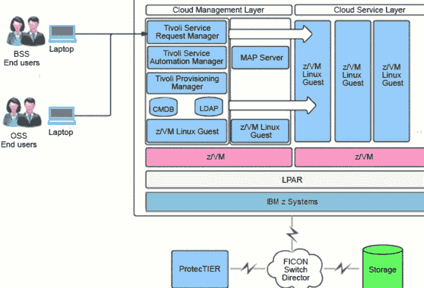

图 A-1 使用 LinuxONE 的云解决方案

## 医疗健康行业：移动与互联网解决方案

在此场景中，虚构的 H1 医院选择了 LinuxONE 作为其移动应用平台。H1 医院希望构建一个安全的平台，提高响应速度和价值感知，并降低多平台开发成本。

使用以下工具来构建安全平台：

- IBM Worklife 作为其功能的一部分提供了可扩展的身份验证模型。为了符合联邦信息处理标准（FIPS），H1 医院结合 WebSphere Application Server 使用 Worklife 以获得额外保护。医院保护了后端服务器和数据的应用程序及适配器。
- 通过 Worklife，H1 医院可以根据角色、时间和位置授予数据访问权限。医生可以在移动设备上访问患者记录。然而，如果他们在家里或值班期间查看患者最新的观察结果，则需要额外的身份验证。此外，尽管医生可以访问其患者的信息，但医疗供应商也有权访问以检查并更新库存。

该解决方案旨在提高响应速度和感知价值：

- H1 医院正在寻找一种通信解决方案，以便在医院的任何地方找到员工。使用 Worklight，医院可以构建允许即时安全通信的应用程序。医生和护士可以快速找到同事，而无需停止手头的工作。
- 当 H1 医院医生的移动设备未连接网络时，必须输入处方。JSONStore 是 Worklight 中面向文档的存储系统，使用加密容器并确保运行应用程序的设备离线时，应用程序中的文档对医生可用。
- 通过该应用程序，患者可以使用移动设备预注册挂号，并输入他们的过敏史和健康状况。Worklight 使用带有服务器身份验证的安全套接层（SSL）并通过 HTTPS 进行通信以保护信息。

该解决方案还降低了多平台开发成本：

- Worklight 提供了一个基于标准的平台，允许 H1 医院使用第三方库和框架。
- 使用 Worklight，H1 医院还可以通过任何 HTML5、原生和混合开发方法的组合快速创建移动应用程序。

图 A-2 显示了通过全局安全策略和端到端安全事务，从移动设备到 LinuxONE 平台后端事务核心系统的安全访问。

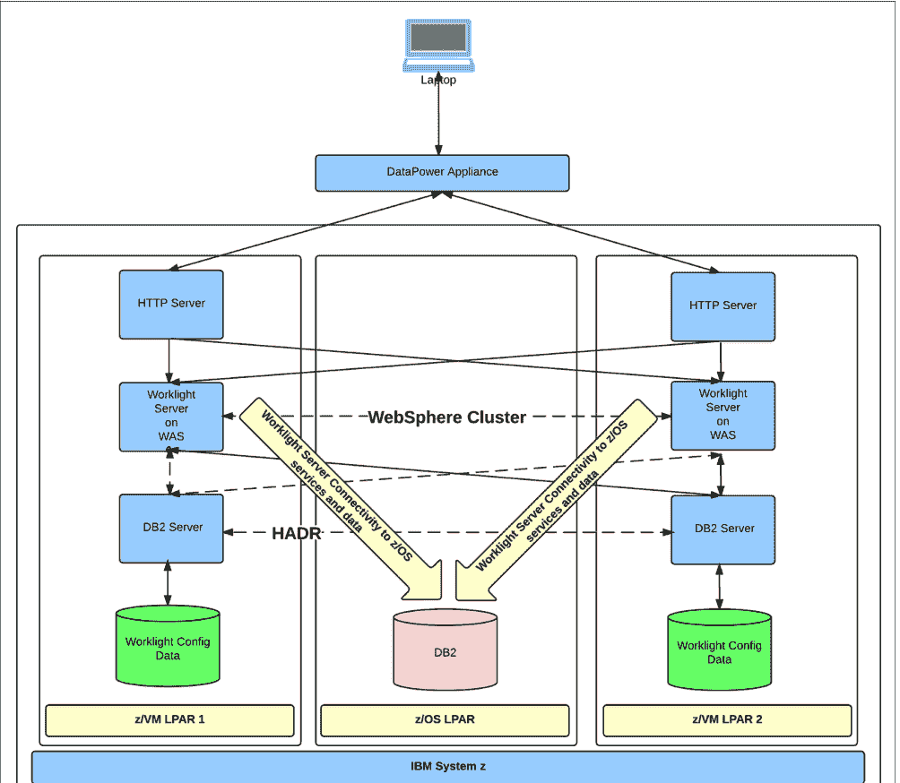

图 A-2 从移动设备到后端事务核心系统的访问

## 能源与公用事业行业：System z 上的 SAP 云自动化解决方案

在此场景中，场景 E1 选择 System z 平台作为运行在 Linux 上的 SAP 应用以及运行在 IBM z/OS 上的数据库。能源 E1 希望通过云解决方案和 SAP 系统自动化，将复制和刷新完整 SAP 系统的时间从几天缩短到几小时。这种组合可以实现 SAP 系统日常操作的自动化、标准化并提高速度，减少因人为错误导致的风险。

该公司还希望减少在复杂、重复性任务上花费的时间，释放熟练人员从事更高价值的工作，并提供更高的运营效率。这种减少有助于削减成本并加速新工作负载的价值实现。

公司构建了一个包含以下项目的虚拟平台：

- IBM zEC12 或 zBC12。
- IBM zVM 6.3。
- z 平台上的 Red Hat Enterprise Linux 或 SUSE Linux Enterprise Server。
- IBM DB2 for z/OS。
- IBM Database Provisioning System (DPS):
  - Web 应用 JCL 引擎。
  - 数据库管理。
  - 与 DB2 Cloning Tool 集成。

z/OS IBM DB2 Cloning Tool：DB2 Cloning Tool 在几分钟内提供可用的 DB2 克隆，提高了效率并释放了 DBA 时间：

- 快速克隆 DB2 子系统、DB2 表空间或索引空间以创建环境。
- 自动化克隆过程，在几分钟内提供可用的 DB2 克隆。
- 通过重命名和目录数据集、修复卷内部结构以及更新 DB2 内部控制信息来克隆 DB2 子系统。
- 快速复制技术可以在子系统内或跨子系统复制 DB2 数据集。
- 使用卷级技术（如 IBM Flashcopy）自动化克隆过程，克隆 DB2 子系统以及任何数据复制技术（如 Flashcopy），克隆表和索引空间，并自动转换对象 ID 以简化和自动化数据刷新。

SAP NetWeaver Landscape Management (LVM)：通过精简和自动化业务流程，SAP NetWeaver LVM 软件使您的 IT 部门能够专注于新倡议、控制 IT 成本并实现业务差异化：

- 管理物理和虚拟化环境中针对您的 SAP 布局的管理点。
- 集中化管理、日常管理和生命周期管理任务。
- 通过自动化复制、克隆和刷新来实现自动化，节省时间、精力和资金。

构建具有自动化生命周期管理操作的用于 SAP 的 IBM Entry 云解决方案：

IBM Entry Cloud 配置简化了数据库、操作系统、存储系统和 SAP Basis 管理员所执行的复杂任务。当与 SAP NetWeaver LVM 结合时，它将复制和刷新 SAP 系统的时间从几天缩短到几小时。自动化程度也提高了质量。

要构建用于 SAP 的 IBM Entry Cloud 解决方案，请选择：

- SAP System Copy：刷新新系统。
- SAP System Copy：刷新现有系统。
- SAP System Refresh：从 PRD（生产环境）复制到非 PRD。
- 使用 z/VM v6.2 单系统映像 (SSI) 和虚拟机实时迁移 (LGR)。

System z Linux，IBM Entry Cloud 解决方案非常适用于希望在本地环境中通过 IBM DB2 for z/OS 运行 SAP 的任何 IT 组织。图3 显示了该解决方案与传统方案相比的额外价值。

图 A-3 使用 Entry Cloud Solution 自动化系统复制


# 在线资源

这些网站也可以作为进一步的信息来源：

- LinuxONE 提供了多种解决方案

  `http://www.ibm.com/systems/linuxxone/solutions`

- GNU 汇编器手册

  `http://www.gnu.org/software/binutils`

# IBM 帮助

- IBM 支持与下载

  `ibm.com/support`

- IBM 全球服务

  `ibm.com/services`

# 索引

## A

活动任务 110

主/主 (Active/Active) 113

归档数据 93

不兼容问题 94

可用性

特性 108

场景 109

## F

光纤通道协议 (FCP) 38

文件系统 70, 75, 82, 86, 90

防火墙 96

防火墙与现有安全策略 96

防火墙与现有的安全策略 96

固定块架构 (FBA) DASD 38

FlashCopy 69

## B

备份需求 91

## G

全局期望并行 Sysplex (GDPS) 115

GNU 公用许可证 (GPL) 115

黄金镜像 70

## C

计划活动容量 (CPE) 109

CBU

容量备份 (CapacityBackUp) 109

协作内存管理辅助 (CMMA) 35

并发用户 84

机密性分析 102

配置文件

`syslog-` 172

持续可用性 (CA) 107

持续运行 (CO) 107

控制 33

控制程序 (CP) 33

对话监控系统 (CMS) 34

对话内存 (CMS) 34

协作内存管理 (CMM) 35

客户启动升级 (CIU) 109

## H

高可用性

高可用性恢复 (HADR) 113

高可用性 (HA) 107

自定义应用程序 73

## I

IBM Tivoli 系统自动化 113

增量备份 92

基础设施服务 79

集成加密服务设施 (ICSF) 95

集成设施

用于 Linux 15

知识产权 116

IP 地址 66, 83-84, 101

ISV 76

ISV 应用 47, 50

## D

中心 76, 107

数据迁移 66

数据库服务器 62, 75, 96

DB2 数据

复制特性 113

`DB2MOVE` 命令 89

DBA 用户 98

指定的 IP 地址

Linux 服务器 QDIO 设备 66

灾难恢复 107

预定义容量 109

不连续已保存存储段 (DCSS) 35

磁盘设备

访问 89

## J

Java 数据库连接器 (JDBC) 114

Java 虚拟机 (JVM) 81

即时编译 (JIT) 81

JVM 切换 81

## L

层 2 57

层 2 VSWITCH 59

层 3 57

LDAP

用户信息 104

轻量级目录访问协议 (LDAP) 104

Linux 49, 58, 66, 76, 85

发行版 73, 93, 103

客机 59, 70, 85, 90

镜像 35, 96

内核 37, 87

Linux 客机

## E

企业身份验证选项 104

验收验收水平 (ALE) 96

外部防火墙 64, 97

管理任务 45

日志 33

容量规划过程 91

Linux 内核

维护 108

参数 88

Linux OS 70

Linux 服务器 36, 90内存大小不足 90

Linux 系统 34, 63, 88

Linux VM 99

内部 101

Linux-HA 项目 115

逻辑分区 108

逻辑卷管理器 70

LPAR 85, 108

LVM 设备文件系统 73

概念验证 (POC) 51, 80

公钥加密标准

开源实现 105

公钥标准 (PKCS) 105

发布您的机密策略 103

## Q

直接 I/O (QDIO) 39

## R

实际 CPU 88

合理的成本 111

故障点 111

Redbooks 网站 191

联系我们 xi

从竞争性环境重托管应用程序 (RACE) 16

响应时间 39, 44, 85, 116

## M

MAC 地址 59

MediaWiki 软件 154

内存管理特性 35

迁移项目 18, 44, 51

执行阶段 44

各种实例 45

MS 104

多个 LPAR 61

相同的 LPAR 97

虚拟局域网 114

安全层

安全层

开源实现 105

安全层 (SSL) 102

通过隐蔽实现安全 96

分离 LPAR 60, 97

服务器故障 107

服务水平协议 51, 111

共享 System z

不同网段 62

硬件 64

单 LPAR 85

单点控制 69

单点故障 (SPOF) 108

源应用程序 45, 70, 83, 105

源环境 84

源服务器 21, 66, 83, 84

足够的空间 70

导出/导出 84

网络文件系统 70

源系统 45

分阶段服务器 94

利益相关者 44

利益相关者 44, 99, 97

US Linux 服务器 102, 103

交换设备 38

系统 z 18, 25, 46

应用整合 18

环境 66

操作系统环境 18

电源开关 106

服务器 68

虚拟服务器 86

## N

命名存储段 (NSS) 35

## O

按需容量 109

开放系统适配器 (OSA) 39, 96

操作系统 43, 91

归档数据 89

目标版本 52

Oracle 数据库 78

Oracle RAC 78

Oracle 应用程序集群 (RAC) 114

OSA-Express2 卡 58

OSI 参考模型 57

过度分用率 35

## P

支付卡行业标准 (PCI) 103

物理防火墙 63, 97

最小权限原则 95

处理器队列 86

生产环境利益相关者 104

通信计划 48

194 从 x86 迁移到 LinuxONE

## T

表空间 89

目标环境 20, 50

评估产品 20

相同的特性 20

目标 Linux 18, 67, 91

目标平台 16, 77

目标服务器 66-67, 83, 90

中间件 83

自定义文件系统 83

文件传输过程 70

性能测试 83

目标系统 70, 74, 90, 106, 116

技术利益相关者 44

## U

UNIX 管理员 45

不需要的进程 35

用户验收测试

虚拟服务器 80

## V

V-DISK 设备 87

虚拟 CPU 85

虚拟机

适用于环境 System z 33

非中断添加 110

z/VM 目录 33

虚拟机 (VM) 33, 66, 110

虚拟机资源管理器 (VMRM) 36

VSWITCH 39, 57

## W

## Z

z/VM 层 96

z/VM 维护 108

z/VM 会话 33

Linux 客机日志 33

z/VM 系统 33

管理员 34

虚拟网络 108
