# 实用数据包分析：使用 Wireshark 解决真实网络问题

作者：Chris Sanders

> 本书献给我的父母，他们买了我编写过的第一台计算机。

- 配置 AirPcap ............................................................ 138
- 802.11 标志位 ....................................................................... 143
- 无线特定列 ................................................................ 144
- 过滤特定 BSS ID 的流量 ........................................ 146
失败的连接尝试 ................................................................ 148
接入线缆空气 ................................................................................ 148

# 11 延伸阅读 151

# 鸣谢

首先，我要感谢上帝赐予我完成这个项目所需的力量和毅力。当我的待办清单越积越长，且看不到尽头时，是他一直帮助我度过了那段充满压力的时刻。

我要感谢 Bill、Tyler、Christina 以及 No Starch Press 团队的其他成员，他们给了我撰写这本书的机会，并允许我按照自己的方式进行创作的自由。我还要感谢 Gerald Combs，他有动力和热情来维护 Wireshark 程序，并对本书进行了技术性编辑。特别感谢 Laura Chappell，她提供了你能找到的最棒的包分析培训材料，包括此处此处使用的几处抓包。

从个人角度来说，我要感谢 Tina Nance、Eddy Wright 和 Paul Fletcher，他们帮助我走过了通往职业生涯高峰的道路。你们是我极好的精神和职业导师，也是很好的朋友。此外，我还有几个非常不起的朋友，在我写这本书期间竟然忍受了我，这本身就是一项成就。我想向 Mandy、Barry、Beth、Chad、Jeff、Sarah 和 Brandon 表以特别的感谢。没有你们在背后支持，我无法完成。

然而，最重要的是我想感谢我亲爱的父母 Kenneth 和 Judy Sanders。爸爸，尽管你从未接触过电脑，但你持续的支持和养育是这一切可能的原因。没有什么比听到你为我感到自豪更令我满足了。妈妈，在撰写这本书时，你已经离开我们五年了，尽管你无法在身边见证这项成就，但你一直住在我心中，那是我真正的驱动力。你对生活表现出的激情激发了我在所做的事情上如此充满热情。这本书既是我的成就，也是你的成就。

# 引言

我九岁时得到了我的第一台电脑。

技术的发展总是如此，它在大约一年就坏了。对于我的家庭来说，能买得起一台电脑已经很吃力了，而付钱修理它在财务上完全是不可能的。然而，在经过一些阅读和尝试后，我修好了那台电脑，我的对技术的兴趣从此开始。

这种兴趣在高中和大学期间演变成了热情，随着热情的增长，我的能力也随之增长，自然使我遇到了一些确实需要深入研究网络和计算机问题的场合。这时，我发现了 Wireshark 项目（当时它还叫 Ethereal）。这款软件允许我进入一个全新的世界。能够以新的方式分析问题，并拥有看到线路上协议的能力，让我在计算机和网络故障排除方面拥有了无限的力量。

包分析的伟大之处在于，它已成为一种日益流行的解决问题和学习更多网络知识的方法。得益于用户组、维基（wiki）和博客的出现，书中涵盖的技术正在成为某些工作的先决知识。包分析是管理当今网络的要求，而这本书将为你学习其所有运作原理提供你所需的跨越。

## 为什么选择这本书？

你可能会想，为什么要买这本书，而不是买其他任何关于包分析的书。答案就在标题中：*包分析*（Packet Analysis）。让我们面对现实——没有什么能比得上实战经验，而你在书中能获得这种体验的最接近方式就是此。包分析是管理当今网络的要求，而这本书将为你提供学习其所有运作原理所需的跨越。

# 如何使用本书

我打算让这本书以两种方式使用。第一种，当然是作为一本教科书，你将逐章阅读，以获得对数据包分析的理解。这意味着特别关注最后几章中的真实世界场景。这本书的另一种用途是作为一种参考资源。Wireshark 有一些功能你可能不会经常使用，因此你可能会忘记它们是如何运作的。因此，如果你在学习使用特定功能后需要快速复习，《实战数据包分析》将是一本值得放在书架上的好书。

# 关于示例抓包文件

书中使用的所有抓包文件都可以在 `http://www.nostarch.com/packet.htm` 获取。为了最大限度地发挥这本书的潜力，我强烈建议你下载这些文件并在阅读书籍时配合使用。

其中几个抓包文件是由来自数据包分析学院和 Wireshark 大学的 Laura Chappell 贡献的。这些抓包如下：

- `blaster.pcap`
- `destunreachable.pcap`
- `dosattack.pcap`
- `double-vision.pcap`
- `email-troubles.pcap`
- `evilprogram.pcap`
- `ftp-crash.pcap`
- `ftp-uploadfailed.pcap`
- `gnutella.pcap`
- `hauntedbrowser.pcap`
- `http-client-refuse.pcap`
- `http-fault-post.pcap`
- `icmp-tracer-slow.pcap`
- `osfingerprinting.pcap`
- `slowdown.pcap`
- `tcp-con-loss.pcap`

# 1 数据包分析与网络基础

在任何一天，计算机网络都可能发生数百万种不同的错误——从简单的间谍软件到复杂的路由器配置错误——立即解决每一个问题是不可能的。我们能做的最大目标就是充分准备好知识和工具，以应对这类问题。所有的网络问题都源于数据包层面，在那里，即使是看起来精美的应用程序也可能揭露其糟糕的实现，而看似可靠的协议可能被证明是恶意的。为了更好地理解和解决网络问题，我们进入数据包层面，那里没有任何东西对我们隐藏，没有任何东西会被误导性的菜单结构、引人注目的图形和不可信赖的员工所掩盖。在这里没有秘密，我们在数据包层面做的越多，我们就越能控制自己的网络并解决问题。这就是数据包分析的世界。

在我们深入研究网络通信之前，这本书将带你进入数据包分析的世界，以便你获得检查不同场景所需的一些基础知识。你将学习如何使用 Wireshark 数据包分析工具的功能来解决网络通信缓慢的问题、识别应用程序瓶颈，并通过一些真实世界的场景跟踪黑客。当你读完这本书时，你应该能够实施高级数据包分析技术，这些技术将帮助你解决网络中最困难的问题。

## 什么是数据包分析？

数据包分析，通常称为数据包嗅探或协议分析，描述了在实时数据流过网络时对其进行捕获和解释的过程，以便更好地理解网络上正在发生什么。数据包分析通常由数据包嗅探器执行，这是一种用于捕获跨网络原始数据的工具。数据包分析可以帮助你理解网络特性，了解谁在网络上，确定谁或什么在使用可用带宽，识别网络使用的高峰时段，识别可能的攻击或恶意活动，并发现不安全和臃肿的应用程序。有多种类型的数据包嗅探程序，包括免费和商业程序。每个程序的设计目标都不同。一些比较受欢迎的数据包分析程序包括 `tcpdump`（一个命令行程序）、`OmniPeek` 和 `Wireshark`（两者都是基于 GUI 的嗅探器）。

## 评估数据包嗅探器

有几种类型的数据包嗅探器。在选择要使用的类型时，你应该考虑以下变量：

- 支持的协议
- 用户友好性
- 成本
- 程序支持
- 操作系统支持

### 支持的协议

所有数据包嗅探器都可以解释各种协议。大多数嗅探器可以解释所有 DHCP、IP 和 ARP 等最常见的协议，但并非所有的嗅探器都能解释一些非传统的协议。在选择嗅探器时，确保它支持你将要使用的协议。

### 用户友好性

考虑数据包嗅探程序的布局、安装的难易性和标准操作的总体流程。你选择的程序应该符合你的专业水平。如果你很少数据包分析经验，你可能想避免像 `tcpdump` 这样更高级的命令行数据嗅探器。相反，如果你拥有丰富的经验，可能会发现更高级的程序是更好的选择。

### 成本

数据包嗅探器的伟大之处在于有很多免费的程序可以与任何商业产品竞争。你不应该需要为数据包嗅探应用付费。

### 程序支持

即使你精通了嗅探程序的基础知识，当新问题出现时，你仍需要偶尔的支持来解决它们。在评估可用支持时，寻找开发者文档、公共论坛和邮件列表等内容。虽然像 `Wireshark` 等免费数据包嗅探程序可能缺乏开发者支持，但使用这些应用程序的社区通常会弥补这一点。这些用户和贡献者社区提供了讨论板、wiki 和博客，旨在帮助你从数据包嗅探器中获得更多收益。

### 操作系统支持

遗憾的是，并不是所有的数据包嗅探器都支持每一个操作系统。确保你选择学习的工具可以在你需要支持的所有操作系统上运行。

# 数据包嗅探器如何工作


数据包嗅探过程可以分为三个步骤：收集、转换和分析。

# 数据包嗅探过程

## 收集

在第一步中，数据包嗅探器将选定的网络接口切换到混杂模式。在这种模式下，网卡可以监听特定网络段上的所有流量。嗅探器利用这种模式配合对接口的底层访问来捕获来自原始二进制数据。

## 转换

在这一步中，捕获的二进制数据被转换为可读格式。这是大多数高级命令行驱动数据嗅探器停止的地方。此时，网络数据处于可以在非常基础上进行解释的形式，将大部分分析留给用户。

## 分析

第三也是最后一步涉及对捕获和转换的数据进行实际分析。在这一步中，数据包嗅探器获取网络数据，根据提取的信息验证其协议，并对其特定特性进行分析。

进一步的分析通过比较多个数据包以及其他网络元素来实现。

# 计算机如何通信

为了充分理解数据包分析，你需要了解计算机之间是如何通信的。在本节中，我们将检查网络协议的基础、OSI 模型、网络数据帧以及支持它的硬件。

## 网络协议

现代网络由运行在许多平台上的各种系统组成。为了辅助这种通信，我们使用一组被称为网络协议的通用语言来规范网络通信。常见的网络协议包括 TCP、IP、ARP 和 DHCP。协议栈是一组协同工作的协议逻辑分组。

网络协议可以非常简单，也可以非常复杂，取决于它的功能。尽管不同的网络协议通常差异巨大，但大多数处理以下问题：

- 流量控制：接收系统生成消息，指示发送系统加速或减慢数据传输。
- 数据包确认：接收系统向发送系统发送返回消息以确认收到数据。
- 错误检测：发送系统使用代码来验证数据在传输过程中是否损坏。
- 错误纠正：重新传输在初始传输丢失或损坏的数据。
- 分段：将长数据流划分为较小的块以便高效传输。
- 数据加密：一种使用加密密钥保护跨网络传输数据的功能。
- 数据压缩：通过消除冗余信息减小跨网络传输数据的方法。

OSI 分层模型中的七层（图 1-1）使得网络通信变得易于理解。顶部的应用层代表了我们用于访问网络资源的实际程序。底层是物理层，实际网络数据通过该层进行传输。每一层的协议共同工作，为下一层对数据进行封装。

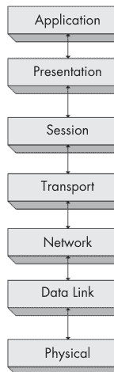

*注意 OSI 模型无非是一个行业推荐的标准；协议开发者并不被要求严格遵循它。事实上，OSI 模型并非唯一的网络模型——例如，某些人更倾向于使用国防部（DoD）模型。本书书中将围绕 OSI 模型的概念展开工作，因此我们在这里不会涵盖 DoD 模型。*

让我们概览一下 OSI 模型每一层的功能，以及其中使用的一些协议示例。

图 1-1：OSI 模型七层的分层视图

### 应用程序层

*应用层*是 OSI 模型的最顶层，为用户提供了实际访问网络资源的方法。这是终端用户通常能看到的唯一层，因为它提供了所有网络活动的基础接口。

### 表示层

*表示层*将接收到的数据转换为应用层可以读取的格式。在这里对应用层协议所进行的数据编码和解码取决于数据的发送或接收。该层还处理用于保障数据安全的多种形式的加密和解密。

### 会话层

*会话层*管理两台计算机之间的*对话*或会话；它在所有通信设备之间建立、管理并终止这种连接。会话层还负责确定连接是双工还是半双工，并负责优雅地关闭主机之间的连接，而不是突然断开。

### 传输层

*传输层*的主要目的是为下层提供可靠的数据传输服务。通过流量控制、分段、错误控制等功能，传输层确保数据点对点无错误地传输。由于可靠的传输可能极其复杂，OSI 模型专门分配了一层给它。传输层为面向连接和无连接的协议提供服务。防火墙和代理服务器运行在这一层。

### 网络层

网络层负责在网络之间路由数据，它是最复杂的层之一。它处理逻辑地址，在某些情况下还处理数据包的分片和重组。例如，路由器运行在这一层。

### 数据链路层

数据链路层提供了跨越网络传输数据的方法。其目的是确保数据的完整性。它处理成帧、介质访问和错误检测。网桥和交换机运行在这一层。

### 物理层

物理层位于 OSI 模型的底部，数据通过它进行传输。该层定义了物理规范，包括电压、布线和硬件。它将数字数据转换为信号反反亦然。

## 协议交互

数据如何流过 OSI 模型？数据从应用层开始向下移动物理层。

表 1-1：每层使用的典型协议

| 层 | 协议 |
| :--- | :--- |
| 应用层 | HTTP, FTP, Telnet |
| 表示层 | ASCII, JPEG, MIDI |
| 会话层 | NetBIOS, SAP, MPEG |
| 传输层 | TCP, UDP |
| 网络层 | IP, ICMP, RIP |
| 数据链路层 | Ethernet, Token Ring, FDDI |
| 物理层 | AppleTalk, IPX |

## 数据封装

不同层上的协议通过数据封装进行通信。栈中的每一层都负责为数据添加头部或尾部。例如，当传输层从会话层接收数据时，它会添加自己的头部。

## 协议数据单元

封装过程产生协议数据单元（PDU），它包含了数据和头部信息。随着数据沿 OSI 模型向下移动，由于各种协议的头部信息的添加，PDU 会发生变化并增长。当 PDU 到达物理层时，它形成最终形式，并发送到目的地。接收计算机在数据向上层传输时，会从 PDU 中剥离协议头部和尾部。

注意数据包（packet）一词与协议数据单元（PDU）相关。当我使用“数据包”一词时，指的是一个包含所有层头部和尾部信息的完整 PDU。

想象你正在向一家公司的员工发送封电子邮件。这封邮件的主题是“关于所有营销人员”，但你并没有只将其发送给那些在营销部门工作的人，而是发送给了公司的每一位员工。在营销部门工作的员工会知道这封邮件是给他们的，并会打开它。然而，其他员工会看到这不是给他们的，并将其丢弃。你可以看到这将导致许多不必要的通信和时间浪费——这正是集线器（hub）的工作原理。

图 1-4 提供了该过程的图形化显示。在图中，计算机 A 正在向计算机 B 发送数据。然而，当计算机 A 向集线器发送数据时，所有连接到集线器的计算机都会接收到它。只有计算机 B 实际上接受了数据；其他计算机都将其丢弃了。

关于集线器的最后一点是，它们只能半双工模式工作——也就是说它们不能同时发送和接收数据。这使得它们区别于交换机，交换机是全双工设备，可以同步发送和接收数据。

虽然你通常在大多数现代或高密度网络中看不到集线器（下文将讨论到使用的是交换机），但你应该了解集线器的工作原理，因为它们对数据包分析非常重要。

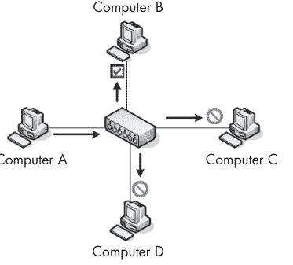

图 1-4：计算机 A 通过集线器向计算机 B 发送数据时的流量

## 交换机

在生产或高密度网络中，集线器的最佳替代方案是被称为交换机（switches）的设备。与集线器一样，交换机设计用于重复数据包，但其方式非常不同；像集线器一样，交换机为设备提供通信路径，但效率更高。交换机不是将数据广播到每个单独端口，而是将数据发送到目标计算机。从物理上讲，交换机的正面的看起来完全相同；你可能很难准确判断具体是哪一个（图 1-5）。

市场上的几种较大的交换机可以通过专门的特定特定软件或 Web 界面进行管理。这些交换机通常被称为托管交换机，提供了多项对网络管理非常有用的功能。这包括启用或禁用交换机端口、查看端口特定信息、更改配置以及远程重启交换机。

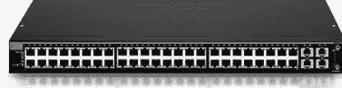

图 1-5：一个机架式 24 口以太网交换机

交换机在处理传输数据包具有先进的功能。为了能够与特定设备直接通信，交换机必须能够通过地址唯一标识设备。这意味着它们必须在 OSI 模型的数据链路层上运行。

交换机将每个连接设备的第 2 地址存储在 CAM 表中，该表充当了交通警察的角色。当传输数据包时，交换机读取数据包中的第 2 层头部信息，并以 CAM 表为参考，确定将数据包发送到哪些端口。交换机仅将数据包发送到特定端口，这大大减少了网络流量。

图 1-6 显示了通过交换机的流量的图形化表示。在图中，计算机 A 再次向计算机 B 发送数据。在这种情况下，计算机通过交换机连接，交换机允许计算机 A 直接向计算机 B 发送数据，而网络上的其他设备感知不到这种通信。此外，多个对话可以同时发生。

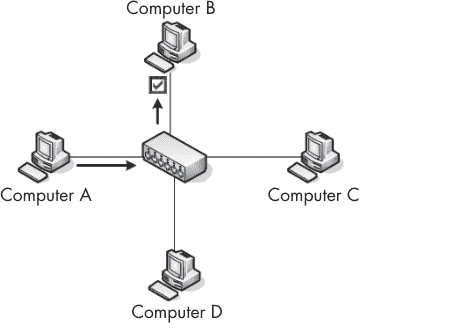

图 1-6：计算机 A 通过交换机向计算机 B 发送数据时的流量

## 路由器

路由器（router）是一种高级网络设备，其功能层次远高于交换机或集线器。路由器可以有各种形状，但根据网络的大小，大多数路由器前面有几个 LED 指示灯，后面有几个网络端口（图 1-7）。路由器运行在 OSI 模型的第 3 层，负责在两个或多个网络之间转发数据包。路由器用于引导流量的过程被称为路由（routing）。

有几种类型的路由协议，规定了不同类型的数据包如何被路由到其他网络。路由器通常使用第 3 层地址（如 IP 地址）来唯一标识网络上的设备。

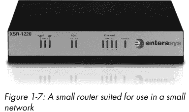


说明路由概念的方法是将一个拥有街道网络的社区；每条街道都有房子，每栋房子都有自己的地址（图 1-8）。你住在一条街道上，所以你可以在这条街道上的所有房子之间移动。这与交换机允许网络网段内的计算机进行通信非常相似。然而，要与另一条街道上的邻居通信，必须沿着街道走到邻居的家里。

让我们来看一个跨街道通信的示例。使用图 1-8，假设我坐在 Vine Street 503 号，我需要去往 Dogwood Lane 202 号。为了做到这一点，我必须跨越到 Oak Street，然后进入 Dogwood Lane。将此想象为跨越网络网段。如果 `192.168.0.3` 的设备需要与 `192.168.0.54` 的设备通信，它必须跨越路由器到达 `10.100.1.1` 网络，然后到达目标网络段的路由器。

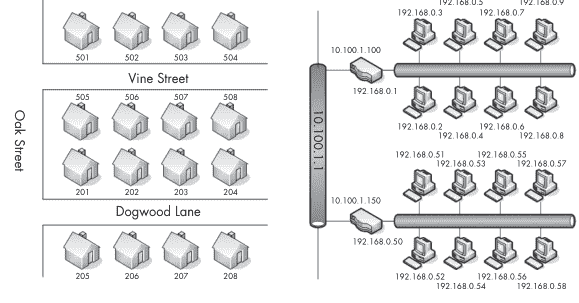

图 1-8：路由网络与社区的对比

组播（Multicast）是一种从单一源向多个终点传输数据包的方法。组播的目标是通过尽可能少使用带宽来使此过程尽可能简单。这种流量的优化取决于数据流为了到达目的地而复制的次数。组播的具体处理高度取决于其实现。实现组播的主要方法是使用特殊的地址方案将数据接收者加入组播组；这就是 IP 组播的工作原理。单播（unicast）数据包从一台计算机直接传输到另一台。单播功能的细节取决于你使用的协议。你学到的是数据包分析的基础。在开始排除网络问题之前，你必须理解此层级的情况。在下一章中，我们将基于这些概念并讨论更高级的网络通信原理。

### 广播域

回广播包是指发送到特定网段内所有设备的包。在通过不同介质连接多个集线器或交换机的大型网络中，从交换机发出的广播包会传输到网络上其他交换机的端口，因为它们在交换机之间进行中。广播包传输的范围被称为广播域（broadcast domain）——它是任何计算机无需通过路由器即可直接向另一个传输的网络网段。图 1-10 显示了小型网络上两个广播域的示例。由于每个广播域都延伸到路由器，广播包仅在指定的广播域内循环。


图 1-10：广播域延伸到当前路由网段之后的所有区域。

# 2 接入线路

我们现在可以进入在开始捕获网络上实时数据包之前的最后一步准备工作了。这最后一步是确定在网络布线系统中放置网络嗅探器的最合适位置。数据包分析人员通常将此称为“接入线路”（getting on the wire）或“分接接入线路”（tapping into the wire）。简单来说，它是在正确的物理位置在网络上放置数据包嗅探器的过程。

遗憾的是，嗅探数据包并不像将笔记本电脑插入网络端口并捕获流量那么简单（图 2-1）。事实上，有时在网络布线系统中放置数据包嗅探器比实际分析数据包还要困难。

嗅探器放置的挑战在于用于连接设备的网络硬件种类众多。由于现代网络中的三个主要设备（集线器、交换机和路由器）处理流量的方式完全不同，你必须了解你正在分析的网络的物理布局。

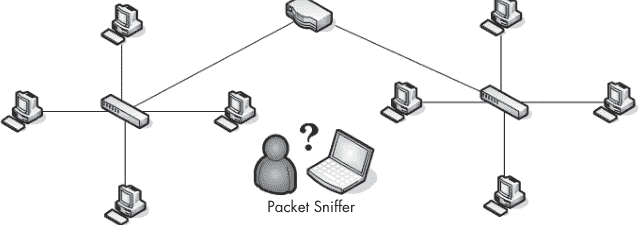

图 2-1：将嗅探器放置在网络上有时是你将面临的最大挑战。

本章的目标是帮助你理解在各种不同网络拓扑中数据包嗅探器的放置。我们将在查看各种现实网络设置的同时，确定在基于集线器、交换机和路由器的环境中捕获数据包的最佳方法。作为理解嗅探器放置的先导，我们还将更深入地研究混杂模式（promiscuous mode）网卡、其工作原理以及为什么它是数据包分析的必需。

## 混杂模式生存

在网络上嗅探数据包之前，你需要一个支持混杂模式驱动程序的网络接口卡（NIC）。*混杂模式*允许网卡查看穿越布线系统的所有数据包。

当网卡不处于混杂模式时，它通常会看到大量广播流量和其他未针对它的流量，并将其丢弃。当它处于混杂模式时，它会捕获所有内容并将接收到的流量传递给 CPU，基本上忽略它在数据包二层地址中发现的信息。你的数据包嗅探应用程序授予这些数据包，为你提供系统中所有数据包的完整且准确的计数。

> **注意** 除非你拥有高用户权限，否则操作系统（包括 Windows）不会让你在混杂模式下使用网卡。如果你无法在系统上获得这些权限，那么可能你不应该在该特定网络上执行任何类型的数据包嗅探。

## 在集线器周围嗅探

在安装了集线器的网络上嗅探是任何数据包分析人员的梦想。正如你之前学到的，通过集线器发送的流量会发送到连接到该集线器的每个端口。因此，要分析集线器上的某台计算机，你只需要将数据包嗅探器插入集线器的空闲端口，就可以看到所有连接到该集线器的计算机进出的所有通信内容。如图 2-2 所示，当你的嗅探器连接到集线器网络时，你的可视窗口是无限的。

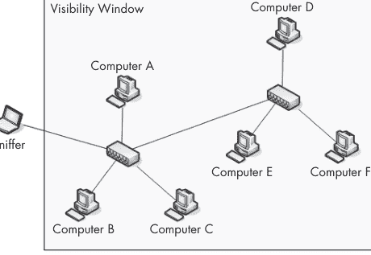

图 2-2：在集线器网络上嗅探提供了一个无限的可视窗口。

**注意** 正如本书中各种图表所示，可视窗口显示了网络上你能够通过数据包嗅探器看到流量的设备。

对我们来说的是，基于集线器的网络非常稀少，因为它们给网络管理员带来了头疼的问题。集线器往往会减慢网络流量，因为任何时间只有一个设备可以使用集线器；因此，连接到集线器的设备必须与同样尝试通过它通信的设备争夺带宽。当两个或多个设备同时通信时，数据包会发生冲突（如图 2-3 所示），导致传输的数据包丢失，并必须重传。

随着冲突的增加，网络性能可能会大幅下降。随着流量和冲突水平的提高，设备可能需要传输三次或四次数据包，这就是为什么任何规模的现代网络都使用交换机的原因。

在集线器网络上嗅探单台计算机流量时，你需要考虑的另一个问题是捕获中的流量量。由于混杂模式下的网卡可以看到所有往返集线器上所有设备的所有流量，你将有大量数据需要筛选，其中大部分是无关的。在下一章中，你将学习如何利用捕获和显示过滤器的功能，以便更高效地进行分析。

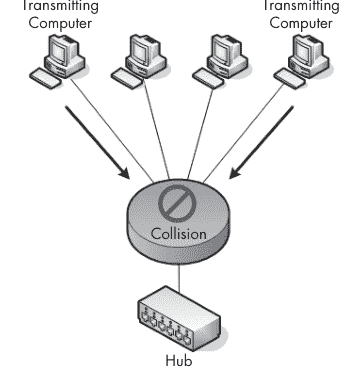

图 2-3：当两个设备同时传输时，集线器网络上会发生冲突。

## 在交换环境中嗅探

交换环境是你工作时最常见的网络类型。交换机通过广播、单播和多组播流量提供了传输数据的有效手段。（有关这些主题的更多信息，请参见第 1 章。）作为一个奖励，交换机允许全双工通信，这意味着可以通过交换机同时发送和接收数据。遗憾对于数据包分析师的是，交换机为数据包分析师的工作增加了一个全新的复杂性。当你将嗅探器插在交换机的端口上，你只能看到广播流量以及你的机器传输和接收的流量，如图 2-4 所示。

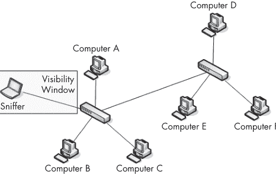

图 2-4：交换网络上的可视窗口限于你插入的端口。

从交换网络上的目标设备捕获流量主要有三种方法：端口镜像、ARP 缓存投毒和接入集线器。

### 端口镜像

端口镜像（通常称为端口跨越）可能是从交换网络上的目标设备捕获流量最简单的方法。在此类设置中，你必须拥有目标计算机所在的交换机的命令行界面权限。此外，交换机必须支持端口镜像并有一个供你插入嗅探器的空端口。

在端口镜像时，你登录到交换机的命令行界面并输入命令强制交换机复制流量。例如，为了捕获来自端口 3 的流量，你只需将嗅探器插入端口 4。这将让你看到所有发送到目标的流量。

设置端口镜像时要输入的精确命令取决于你所使用的交换机制造商。你可以在表 2-1 中找到常用命令列表。

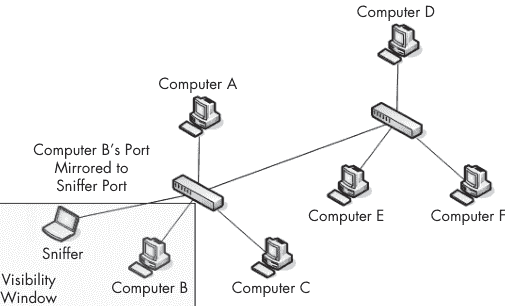

图 2-5：端口镜像允许你扩展对所处端口的可视性。

**表 2-1:** 用于不同制造商交换机启用端口镜像的命令

| 制造商 | 端口镜像命令 |
| --- | --- |
| Cisco | `set span <source port> <destination port>` |
| Enterasys | `set port mirroring create <source port> <destination port>` |
| Nortel | `port-mirroring-port <source port> monitor-port <destination port>` |

## 接入集线器

在交换网络上通过目标设备捕获流量的另一种简单方法是接入集线器。*接入集线器*（hubbing out）是一种技术，通过通过直接插入集线器，将目标设备和你的分析系统定位在同一个网络网段上。

许多人认为接入集线器是作弊，但在无法执行端口镜像但仍能物理访问目标设备所在交换机的情况下，它确实是一个完美的解决方案。

为了进行“集线器接入”（hubbing out），你只需要一个集线器和几根网线。一旦准备好硬件，前往设备所在的交换机，并将目标设备从网络上拔下。然后，将目标设备的网线插入你的集线器，并插入另一根网线连接到你的分析器。接下来，通过将集线器插入网络交换机，将其连接到网络。现在，你基本上将目标设备和你的分析器拉到了同一个广播域，目标设备的所有流量都将被广播，以便分析器可以捕获这些数据包（图 2-4）。


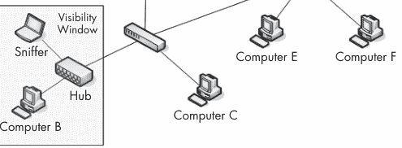

图 2-6：集线器接入将你的目标设备和分析器隔离在它们自己的广播域中。

在大多数情况下，集线器接入会将设备的双工模式从全双工降为半双工。虽然这种方法不是接入链路最干净的方法，当交换机不支持端口镜像时，它有时是你的唯一选择。

注意：提醒一下，在拔掉设备之前通知设备用户通常是一种友好的做法，特别是该用户恰好是公司的 CEO！

在进行集线器接入时，请确保你使用的是真正的集线器，而不是标签虚假的交换机。几家网络硬件供应商都有一个坏习惯，将实际上功能为低级交换机的设备营销并销售为集线器。如果你使用的不是经过验证和测试的集线器，你将只能看到自己的流量，而看不到目标设备的流量。当你找到一个集线器时，测试它以确保它是真正的集线器——如果是，就可以留着！判断你正在使用的设备是否为真集线器的最佳方法是将其连接两台电脑，看一台是否能嗅到另一台的流量。如果是，说明你拥有了一个真正的集线器。

# ARP 缓存毒

回想第 1 章，数据包内容的两种主要类型位于 OSI 模型的第 2 层和第 3 层。这些二层地址（或 MAC 地址）与你使用的任何第3层地址系统结合使用。在本书（以及行业标准）中，我将第3层地址系统称为互联网协议（IP）地址系统。

网络上的所有设备都通过第3层 IP 地址相互通信。由于交换机工作在 OSI 模型的第 2 层，它们可能将二层 MAC 地址转换为第3层地址，反之亦然，以便将流量转发到适当的设备。这种转换过程通过称为地址解析协议（ARP）的第3层协议完成。

当一台计算机需要向另一台计算机发送数据时，它向连接的交换机发送 ARP 请求。交换机向连接到它的所有计算机发送 ARP 广播包，询问到达的每台计算机是否具有要访问的计算机的 IP 地址。当目标计算机看到此时，它通过提供自己的 MAC 地址来识别身份。现在交换机建立了通往目标计算机的路由，任何想要与之通信的设备都可以使用该路由。新获得的信息存储在交换机的 ARP 缓存中，这样交换机每次需要向计算机发送数据时就无需再次发送 ARP 广播。

ARP 毒是接入交换式网络的更高级的形式。它通常被黑客用于伪造地址将数据包发送到客户端系统，以便拦截流量或对目标实施拒绝服务（DoS）攻击。在交换式网络上，ARP 缓存毒仍然是捕获目标机器数据包的合法方法。

ARP 缓存毒（有时称为 ARP 欺骗）向以太网交换机或路由器发送带有伪造 MAC（二层）地址的 ARP 消息，以便拦截另一台计算机的流量（图 2-2）。

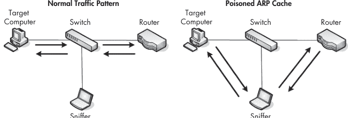

图 2：ARP 缓存毒允许你拦截目标计算机的流量。

# 使用 Cain & Abel

在尝试投毒 ARP 缓存时，第一步是下载所需的工具并收集必要信息。我们将使用来自 Oxid.it (`http://www.oxid.it`) 的流行的安全工具 Cain & Abel。我们现在安装它。

一旦安装了 Cain & Abel 软件，你需要收集一些额外信息，包括你的分析器系统的 IP 地址、你想要捕获流量的远程系统，以及远程系统下游的路由器。

当你打开 Cain & Abel 时，你会注意到窗口顶部有一系列标签。（ARP 缓存毒只是 Cain & Abel 众多功能之一）。为了我们的目的，我们将在 Sniffer（嗅探器）标签页中工作。当你点击此标签时，你将看到一个空表（图 2-8）。

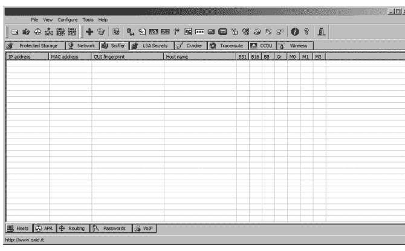

图 2-8：Cain & Abel 主窗口中的 Sniffer 标签页。

为了填充此表，你需要激活程序内置的嗅探器并扫描网络中的主机。要这样做，请遵循以下步骤：
- 1. 点击工具栏上类似于网卡的图标。第一次执行此操作时，系统会要求你选择要嗅探的接口。这将是你执行投毒的接口。
- 2. 选择接口后，点击 OK 激活 Cain & Abel 的内置嗅探器。
- 3. 为了构建主机列表，点击类似于 `(+)` 符号的图标，然后点击 OK（图 2-9）。

原本的网格应该填充网络上所有主机的列表，以及它们的 MAC 地址、IP 地址和供应商信息。这是你在设置 ARP 毒时将使用的列表。

在程序底部，你会看到一组标签，它们将带你进入其他窗口。现在你有了主机列表，将在 ARP 标签页工作。通过点击标签切换到 ARP 窗口。

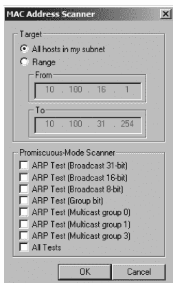

图 2-9：Cain & Abel 主窗口中的 Sniffer 标签页。

# 在路由环境中进行嗅探

在交换式网络上接入链路的所有技术在路由网络上同样可用。在处理路由环境时，主要的考虑因素是在解决跨多个网络段的问题时，嗅探器放置位置的重要性。

正如你之前学过的，设备的广播域一直延伸到路由器。在这一点上，流量被交给下一个上游路由器，在收到接收确认之前，你将无法与传输的数据包通信。在这些数据必须跨越多个路由器的情况下，分析路由器各侧的流量是非常重要的。

例如，考虑你在由各种路由器连接的多个网络段中可能遇到的通信问题。在这个网络中，每个段都与上游段通信以存储和检索数据。我们正在尝试解决的问题是下游子网 D 无法与网络 A 任何设备通信（图 2-11）。

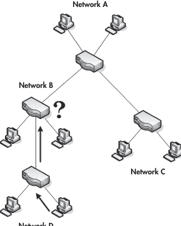

**图 2-11：网络 D 上的计算机无法与网络 A 上的计算机通信。**

你的直觉可能会让你去嗅探 D 段上某个设备的流量。当你这样做时，你可以清楚地看到数据正在被传输到 A 段，但没有流量确认包。当你继续嗅探下一个上游网段以寻找问题根源时，你会发现流量被网络 B 的路由器丢弃了。最终这将引导你发现一个路由器配置问题，在修正该问题后，它解决了你更大的困扰。这是一个典型的例子，说明了为什么为了确定问题，通常需要对多个网段上的多个设备进行流量嗅探。

## 网络地图

在关于网络部署的讨论中，我们已经查看了若干种不同的网络地图。网络地图或网络拓扑图显示网络上所有技术资源及其连接方式的图表。

确定你的数据包嗅探器放置位置最好的方法，就是能够清晰地可视化网络。如果你手里有一张网络地图，我强烈建议你随身备用，因为它将成为故障排除和分析过程中宝贵的资产。你甚至可能想为自己的网络制作一份详细的网络地图。记住，有时在故障排除中，成功的一半在于定位问题。

# 3

## WIRESHARK 简介


目前有多种不同的包嗅探应用程序可用于网络分析，但在本书中，我们将一直使用 Wireshark。本章将讨论 Wireshark 的历史及其优势、安装方法以及基本用法。

### Wireshark 简史

Wireshark 拥有非常丰富的历史。Gerald Combs 是密苏里大学堪萨斯市分校的计算机科学毕业生，他最初是因为需要而开发它的。Combs 程序的第一个版本称为 Ethereal，于 1998 年根据 GNU 通用公共许可证 (`GPL`) 发布。

在发布 Ethereal 八年后，Combs 辞去了工作去追求其他的职业机会。遗憾的是，他当时的雇主拥有 Ethereal 商标的完整权利，Combs 无法达成允许他控制 Ethereal “品牌”的协议。相反，Combs 和开发团队的其他成员在 2006 年年中将项目重新命名为 Wireshark。

Wireshark 的流行程度大幅增长，其协作开发团队现在拥有超过 500 名贡献者。以 Ethereal 名称存在的该程序已不再继续开发。

### Wireshark 的优势

Wireshark 提供了许多使其在日常使用中极具吸引力的优势。它既针对初级也针对专家级包分析师，并提供了各种功能来吸引每一类用户。让我们根据我在第 1 章中定义的选择包嗅探的标准来审视 Wireshark。

### 支持的协议

Wireshark 在支持的协议数量方面表现卓越——其支持的协议超过 850 种。这些协议涵盖了从 IP 和 DHCP 等常见协议到 AppleTalk 和 BitTorrent 等更高级的专用协议。由于 Wireshark 是基于开源模型开发的，每次更新都会添加对新协议的支持。如果某个 Wireshark 不支持的协议，你可以编写代码来支持它，并将代码提交给 Wireshark 开发者以纳入应用程序中（当然，如果你的代码被采用的话）。话虽如此，实际上没有任何协议是 Wireshark 不能支持的。

### 用户友好性

Wireshark 的界面是所有包嗅探应用程序中最容易理解的之一。Wireshark 是一个基于 GUI 的应用程序，菜单编写非常清晰，布局直观。它还提供了许多旨在增强易用性的功能，例如基于协议的颜色编码和原始数据的详细图形化表示。与 `tcpdump` 等一些更复杂的、由命令行驱动的备选方案相比，Wireshark 的 GUI 非常适合那些刚进入协议分析世界的人。

### 成本


由于它是开源的，`Wireshark` 的价格是无可比拟的。`Wireshark` 以 `GPL` 免费软件的形式发布。你可以出于任何目的（个人或商业）下载和使用 `Wireshark`。

### 程序支持

软件软件包的支持水平可以决定它的成败。在处理像 `Wireshark` 这样免费分发的软件时，通常没有正式支持，这就是为什么开源社区依靠用户来提供支持。幸运的是，`Wireshark` 社区是所有开源项目中最好、最活跃的社区之一。`Wireshark` 网页直接链接到多种形式的支持，包括在线文档、支持开发 wiki、常见问题解答 (`FAQs`) 以及注册 `Wireshark` 邮件列表的地方，该列表由该程序的大多数顶尖开发者监控。这些开发者以及 `Wireshark` 海量的用户群提供的支持让没有任何问题悬而未决。

### 操作系统支持

`Wireshark` 支持所有主流现代操作系统，包括 `Windows`、`Mac OS X` 和基于 `Linux` 的平台。你可以在 `Wireshark` 主页查看支持的操作系统的完整列表。

## 安装 Wireshark

`Wireshark` 的安装过程出奇地简单。在本节中，我们将查看 `Wireshark` 的系统要求，然后介绍在 `Windows` 和 `Linux` 上安装 `Wireshark` 的步骤。

### 系统要求

在安装 `Wireshark` 之前，你必须确保你的系统满足以下要求：

- 400 MHz 或更快的处理器
- 至少 60MB 的可用存储空间
- 支持杂散模式 (`promiscuous mode`) 的网卡 (`NIC`)

> 支持杂散模式的网卡 (`NIC`) 允许网卡接收网络段上的所有数据包，而不仅仅是发送到该网卡地址的数据包。如果没有杂散模式，网卡将丢弃所有不是发送给自己的数据包。


> 支持杂散模式的网卡 (`NIC`) 允许网卡接收网络段上的所有数据包，而不仅仅是发送到该网卡地址的数据包。如果没有杂散模式，网卡将丢弃所有不是发送给自己的数据包。

在安装 `Wireshark` 之前，你必须确保你的系统满足以下要求：

- 400 MHz 或更快的处理器
- 至少 60MB 的可用存储空间
- 支持杂散模式 (`promiscuous mode`) 的网卡 (`NIC`)

其次，并不是只有在出现问题时才需要进行包分析。事实上，大多数数据包在分析无故障流量上花费的时间比它们正在故障排除的流量要多；你需要一个基准进行对比，以便有效地对流量进行故障排除。例如，如果你希望通过分析 DHCP 流量来解决问题，你必须了解 DHCP 流量的工作原理是什么样的。更广泛地说，为了发现日常网络活动中的异常，你必须知道正常的网络活动是什么样的。当你的网络运行良好时，你可以设置一个基准，这样你就知道正常状态下的流量是什么样的。

我们已经涵盖了基础知识。现在让我们捕获一些数据包吧！

1. 打开 `Wireshark`。
2. 从主下拉菜单中选择 `Capture`（捕获）和 `Interfaces`（接口）。你应该看到一个对话框，列出了可以捕获数据包的各种接口及其 IP 地址。选择你想要使用的接口，并点击 `Capture`（图 3-3）。

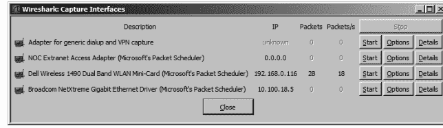

图 3-3：选择执行包捕获的接口

3. 你的包捕获应该开始，`Wireshark` 将显示活跃的包捕获窗口。此窗口显示正在捕获的流量类型的简要摘要，以及当前包的持续时间（图 3-4）。

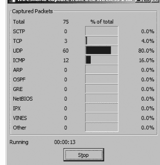


图 3-4：Capture 窗口显示了正在捕获的数据包的简要摘要。

- 4. 等待左右，当你准备停止捕获并查看数据时，点击 `Stop.`（停止）。

一旦你完成这些步骤并结束捕获过程，Wireshark 主窗口就会被数据填充起来。事实上，你可能会被出现的数据量所淹没，但随着我们逐个拆解 Wireshark 的主窗口，这一切很快就会变得有意义。

## 主窗口

你大部分时间都会花在 Wireshark 主窗口中。你捕获的所有数据包都显示在这里，并被被拆解为易于理解的格式。利用你刚刚捕获的数据包，让我们来看 Wireshark 的主窗口（图 3-5），它包含三个窗格。

主窗口中的窗格之间相互依赖。为了在 `Packet Details`（包详情）窗格中查看单个数据包的细节，你必须首先在 `Packet List`（包列表）窗格中点击它来选择该包。一旦你选择了包，当你点击 `Packet Details` 窗格中包的某个部分时，你可以在 `Packet Bytes`（包字节）窗格中看到组成包某些部分的精确字节。

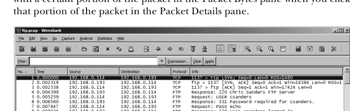

图 3-5：Wireshark 主窗口采用三窗格设计。

### 包列表窗格

顶部的窗格被称为 `Packet List`（包列表）窗格，显示包含当前捕获文件中所有数据包的表格。你会看到包含包编号、数据包捕获的相对时间、数据包的源和目的、其协议以及数据包中的一些通用信息的列。

### 包详情窗格

中间的窗格被称为 `Packet Details`（包详情）窗格，包含单个数据包信息的层级显示。可以折叠和展开，以显示从单个数据包中收集的所有信息。

### 包字节窗格

底部的窗格可能是最令人困惑的，即 `Packet Bytes`（包字节）窗格。此窗格以原始、未处理的形式显示数据包——也就是说，它显示了包在传输线上传输时的样子。这是原始信息，没有任何温暖或模糊的处理来使其更容易跟进。

理解这些不同窗格如何相互工作非常重要，因为你大部分时间都会在主窗口中使用它们进行工作。

## 偏好对话框

Wireshark 有若干可以自定义的偏好以满足你的需求。让我们看看 Wireshark 的一些偏好，从下拉菜单中选择 `Edit`（编辑）并点击 `Preferences`（偏好）。这将调用 `Preferences` 对话框，其中包含多个可自定义的选项（图 3-6）。

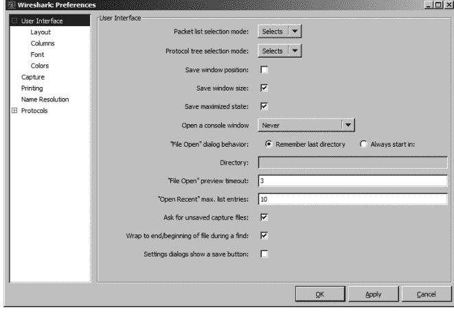

图 3-6：你可以在 `Preferences` 对话框中自定义 Wireshark。

这些偏好分为五个主要部分：`User Interface`（用户界面）、`Capture`（捕获）、`Printing`（打印）、`Name Resolution`（名称解析）和 `Protocols`（协议）。

### 用户界面

用户界面偏好决定了 Wireshark 如何呈现数据。你可以根据个人偏好在这里更改大多数选项，包括是否保存窗口位置、三个主窗格的布局、滚动条的位置、`Packet List` 窗格列的位置、用于显示捕获数据的字体，以及背景色和前景色颜色。

### 捕获

捕获偏好允许你指定与数据包捕获方式相关的选项，包括你的默认捕获接口、默认是否使用混杂模式（`promiscuous mode`）以及是否实时更新 `Packet List` 窗格。

### 打印

打印偏好部分允许你指定 Wireshark 打印数据的各种选项。

### 名称解析

名称解析部分中的偏好允许你激活 Wireshark 的功能，使其将地址解析为更易识别的名字（包括 MAC、网络和传输名称解析）。

### 协议

协议部分的偏好允许你操作与协议的捕获和显示相关的选项。

例如，要将 HTTP 流量的背景颜色从默认的绿色改为紫色，请按照以下步骤操作：

- 1. 打开 Wireshark 并访问颜色规则对话框（`View > Coloring Rules`）。
- 2. 在颜色规则列表中找到 HTTP 颜色规则，点击一次进行选择。
- 3. 点击 `Edit` 按钮。
- 4. 点击 `Background Color` 按钮（图 3-9）。

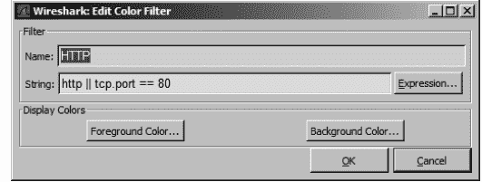

图 3-9：在编辑颜色过滤器时，您可以同时修改前景颜色和背景颜色。

- 5. 在色轮上选择您想要使用的颜色并点击 `OK`。
- 6. 再次点击 `OK` 以接受更改并返回主窗口。
- 7. 主窗口随后将重新加载以反映更新后的颜色方案。

在网络上使用 Wireshark 时，你会发现自己对某些协议的使用比其他协议频繁。这时，颜色编码的数据包就能让你的工作变得轻松一些。例如，如果你认为网络上有一个流氓 DHCP 服务器在分发 IP 地址，你只需修改 DHCP 协议的颜色规则，使其显示为亮黄色或其他易于识别的颜色。这将让你更快地识别出所有 DHCP 流量，并使数据包分析更高效。

# 4

## 处理捕获的数据包


现在你已经完成了首次数据包捕获，我们将介绍一些在 Wireshark 中处理这些捕获数据包时需要了解的基本概念。这包括查找和标记数据包、保存提取文件、合并提取文件、打印数据包以及更改时间显示格式。

### 查找和标记数据包

一旦你真正开始数据包分析，最终会遇到涉及大量数据包的情况。随着数据包数量增加到数千甚至数百万，你需要更高效地在数据包之间导航。这就是为什么 Wireshark 允许你查找并标记符合特定标准的数据包。

#### 查找数据包

要查找符合特定标准的数据包，从主下拉菜单中选择 `Edit`，然后点击 `Find Packet` 或在键盘上按下 `CTRL-F` 打开查找数据包对话框（如图 4-1 所示）。

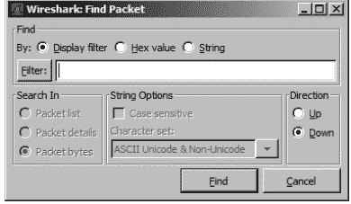

图 4-1：根据指定标准在 Wireshark 中查找数据包

该对话框提供了三种查找数据包的方法：显示过滤器、十六进制值或字符串。显示过滤器选项允许你输入基于表达式的过滤器，该过滤器将只查找该表达式的数据包（这将在后介绍）。十六进制和字符串搜索用于查找你指定的十六进制或文本数据包；你可以在表 4-1 中看到所有这些内容的示例。其他选项还包括选择要搜索的窗口、使用的字符集以及想要搜索的方向。

表 4-1：查找数据包的各种搜索类型示例

| 搜索类型 | 示例 |
| :--- | :--- |
| 显示过滤器 | not ip, ip address=192.168.0.1, arp |
| 十六进制值 | 00:ff:ff:00:ab:b1:f0 |
| 字符串 | Workstation1, UserB, domain |

一旦做出选择，在文本框中输入搜索字符串，并点击 `Find` 以查找第一个符合你标准的数据包。要查找下一个匹配的数据包，按下 `CTRL-N`；或者按下 `CTRL-B` 查找上一个匹配的数据包。

#### 标记数据包

一旦你找到了符合标准的数据包，就可以对特别感兴趣的数据包进行标记。标记的数据包将以黑色背景和白色文字突出，如图 4-2 所示。在保存数据包捕获时，你也可以分离出标记的数据包。你可能想要标记数据包有几个原因，包括能够单独保存这些数据包，或者根据颜色快速找到它们。

| 序号 | 时间 | 源 | 目的 | 协议 | 信息 |
|---|---|---|---|---|---|
| 1 | 0.000000 | 10.100.17.47 | 10.100.16.15 | ICMP | Request: call_id: 95; 69 ctx_id: 0 |
| 2 | 0.000361 | 10.100.16.15 | 10.100.17.47 | ICMP | Response: call_id: 93 ctx_id: 0 |

图 4-2：标记数据包与未标记数据包的比较。它们在屏幕上将以不同的颜色显示。在示例中，数据包 1 被标记了。

要标记数据包，在数据包列表面板中右键点击并从弹出菜单选择 `Mark Packet`，或者在数据包列表面板中单击数据包并按下 `CTRL-M` 进行标记。要取消标记数据包，在数据包列表面板中右键点击并从弹出菜单选择 `Unmark Packet`，或者在数据包列表面板中单击数据包并按下 `CTRL-M` 取消。

在网络上使用 Wireshark 时，你会发现自己对某些协议的使用比其他协议频繁。这时，颜色编码的数据包就能让你的工作变得轻松一些。例如，如果你认为网络上有一个流氓 DHCP 服务器在分发 IP 地址，你只需修改 DHCP 协议的颜色规则，使其显示为亮黄色或其他易于识别的颜色。这将让你更快地识别出所有 DHCP 流量，并使数据包分析更高效。

现在你已经完成了首次数据包捕获，我们将介绍一些在 Wireshark 中处理这些捕获数据包时需要了解的基本概念。这包括查找和标记数据包、保存提取文件、合并提取文件、打印数据包以及更改时间显示格式。


一旦你真正开始数据包分析，最终会遇到涉及大量数据包的情况。随着数据包数量增加到数千甚至数百万，你需要更高效地在数据包之间导航。这就是为什么 Wireshark 允许你查找并标记符合特定标准的数据包。

## 查找数据包

要查找符合特定标准的数据包，从主下拉菜单中选择 `Edit`，然后点击 `Find Packet` 或在键盘上按下 `CTRL-F` 打开查找数据包对话框（如图 4-1 所示）。

该对话框提供了三种查找数据包的方法：显示过滤器、十六进制值或字符串。显示过滤器选项允许你输入基于表达式的过滤器，该过滤器将只查找该表达式的数据包（这将在后介绍）。十六进制和字符串搜索用于查找你指定的十六进制或文本数据包；你可以在表 4-1 中看到所有这些内容的示例。其他选项还包括选择要搜索的窗口、使用的字符集以及想要搜索的方向。

一旦做出选择，在文本框中输入搜索字符串，并点击 `Find` 以查找第一个符合你标准的数据包。要查找下一个匹配的数据包，按下 `CTRL-N`；或者按下 `CTRL-B` 查找上一个匹配的数据包。

## 标记数据包

一旦你找到了符合标准的数据包，就可以对特别感兴趣的数据包进行标记。标记的数据包将以黑色背景和白色文字突出，如图 4-2 所示。在保存数据包捕获时，你也可以分离出标记的数据包。你可能想要标记数据包有几个原因，包括能够单独保存这些数据包，或者根据颜色快速找到它们。

要标记数据包，在数据包列表面板中右键点击并从弹出菜单选择 `Mark Packet`，或者在数据包列表面板中单击数据包并按下 `CTRL-M` 进行标记。要取消标记数据包，在数据包列表面板中右键点击并从弹出菜单选择 `Unmark Packet`，或者在数据包列表面板中单击数据包并按下 `CTRL-M` 取消。

在网络上使用 Wireshark 时，你会发现自己对某些协议的使用比其他协议频繁……[重复逻辑检查]

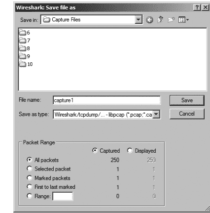

图 4-3：Save As 对话框允许你保存数据包。

现在你已经完成了首次数据包捕获，我们将介绍一些在 Wireshark 中处理这些捕获数据包时需要了解的基本概念。这包括查找和标记数据包、保存提取文件、合并提取文件、打印数据包以及更改时间显示格式。

## 保存与导出

### 保存提取文件

`Save As` 对话框强大的功能之一是能够保存特定范围。要保存捕获内容，选择 `File > Save As`，它将提示你保存位置。如果你不指定格式，Wireshark 将使用默认的 `.pcap` 格式。

### 导出数据

你可以将捕获的数据导出多种格式。格式包括纯文本、PostScript、逗号分隔值 `CSV` 和 `XML`。要导出捕获内容，选择 `File > Export`，然后选择格式。

### 合并提取文件

某些类型的分析需要你合并多个文件。要合并捕获内容，请按照以下步骤操作：

- 1. 打开要合并的提取文件之一。
- 2. 选择 `File > Merge with`（图 4-4）。
- 3. 选择要合并到已打开文件的新文件。

或者，如果你想按时间顺序快速合并多个文件，可以考虑使用拖放。这样做时，在 Windows 资源管理器（或任何文件浏览器）中打开第一个提取文件。然后浏览到第二个文件，点击它并将其拖入 Wireshark 窗口。

### 打印数据包

虽然大多数分析将在屏幕上进行，但你仍然会需要打印捕获的数据。要打印捕获的数据包，通过主菜单选择 `File Print` 打开打印对话框（图 4-5）。

你可以将捕获的数据打印为纯文本、PostScript 或打印到输出文件。通过 `Save As` 对话框，你可以指定打印特定范围、仅标记的数据包或过滤器显示的数据包。你还可以选择为每个数据包打印 Wireshark 的三个主面板。一旦选择了所需的选项，直接点击 `Print`。

## 时间显示格式

时间是关键——尤其在数据包分析中。网络上发生的一切事情对时间都很敏感，你需要在几乎每个捕获文件中检查趋势和延迟。Wireshark 意识到时间的重要性，并为我们提供了若干配置选项。我们将查看时间显示格式和引用。

每个 Wireshark 捕获的数据包都被赋予了一个时间戳，由操作系统应用。Wireshark 可以显示绝对时间，也可以相对于上一个捕获数据包以及捕获开始和结束的时间。

与时间显示相关的选项位于主菜单的“视图标题”`View Heading` 下方。`Time Display Format` 部分（如图 4-6 所示）允许您配置显示格式以及时间显示的精度。`显示格式` 选项允许您选择各种选项，例如 `Automatic` 或通过设置如秒、毫秒、微秒等进行设置。我们将在书的后大部分经常更改这些选项，您应该尽快熟悉它们。

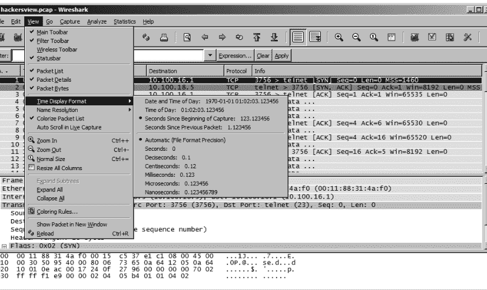

图 4-6：我们将再次复习时间显示格式选项。

## 数据包时间引用 (Packet Time Referencing)

数据包时间引用允许您配置特定的数据包，以便后续计算相对于该特定数据包进行。当你在一个捕获文件中检查多个请求，并查看相对于每个单独请求的时间时，此功能特别好用。

要为数据包设置引用，请在“数据包列表”`Packet List` 中选择引用数据包，然后从主菜单中选择 `Edit + Set Reference`。或者，选择引用数据包并在键盘上按下 `CTRL-T`。要从特定数据包中移除引用，请选择该数据包并执行上述第二个过程。

当您在特定数据包上使用引用时，数据包列表中的时间列将显示 `REF`（图 4-7）。

第 4 章

| No. | Time | Source | Destination | Info |
| --- | --- | --- | --- | --- |
| 3 | 0.001263 | 10.100.18.5 | 10.100.16.1 | TCP, 3756 > telnet [ACK] Seq=1 win=65535 len=0 |
| 4 * REQ | | | | |
| 5 | 0.000558 | 10.100.18.5 | 10.100.16.1 | TELNET Data |
| 6 | 0.001018 | 10.100.16.1 | 10.100.18.5 | TELNET Telnet Data ... |

图 4-7：启用了数据包时间引用的数据包

> 注意
> 只有当捕获的时间显示格式设置为显示相对于捕获开始时间的关系时，设置数据包时间引用才有用。任何其他设置都无法产生可用的结果，并创建一组可能非常困惑的时间。

## 捕获和显示过滤器 (Capture and Display Filters)

之前我们讨论了基于过滤保存数据包。过滤器允许我们在给定的捕获中显示特定部分。我们可以创建并使用表达式在最大的捕获文件中精确找到我们需要的内容。表达式是一个字符串，告诉 Wireshark 如何显示以及不显示什么。

Wireshark 提供了类型的过滤器：捕获过滤器和显示过滤器。

### 捕获过滤器 (Capture Filters)

捕获过滤器用于实际的数据包捕获过程，由 `WinPcap` 应用。了解它们的语法在其他网络分析程序中也很有用。您可以在“捕获选项”`Capture Options` 对话框中配置它们，在其中指定您想要或不想捕获的流量。

使用捕获过滤器的一种方法是在具有多个节点的服务器上捕获流量时。例如，假设您正在排运行运行在端口 262 服务的问题。如果服务器在各种端口上运行多个不同的服务，那么查找并分析位于端口 262 上的流量本身就是一项工作。要仅捕获端口 262 的流量，您可以使用捕获过滤器。只需按照以下步骤操作：

- 1. 打开“捕获选项”对话框（图 4-8），选择您想要捕获数据包的接口，并选择一个捕获过滤器。
- 2. 您可以在“捕获过滤器”按钮旁边输入表达式，或者通过点击按钮本身来应用捕获过滤器，这将启动捕获过滤器表达式生成器，帮助您创建过滤器。我们希望过滤器只显示进出端口 262 的流量，因此我们输入 `port 262`，如图 4-8 所示。
- 3. 设置好过滤器后，点击 `Start` 开始捕获。在收集足够的样本后，您现在应该只看到端口262 的流量，并能够更高效地分析这些特定数据。

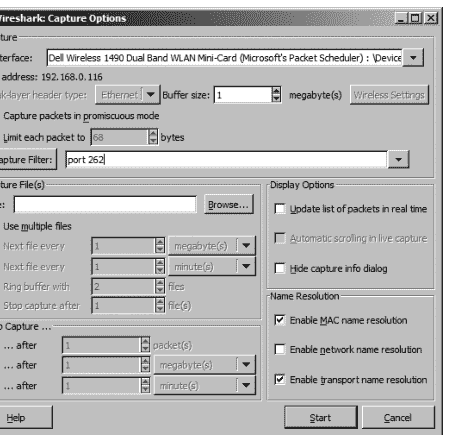

图 4-8：在“捕获选项”对话框中创建捕获过滤器

### 显示过滤器 (Display Filters)

显示过滤器是在捕获文件创建后应用的，它告诉文件仅显示匹配该过滤器的数据包。您可以在“数据包列表”`Capture List` 面板上过滤器文本框中输入显示过滤器。

显示过滤器比捕获过滤器常用，因为它们允许您过滤数据包数据，而无需实际上省略捕获文件中其余数据。这样，如果您需要恢复到原始捕获，只需清除过滤器表达式即可。

您可能使用显示过滤器从捕获中清除无关的广播流量——例如，当这些数据包与当前分析的问题无关时，从“数据包列表”面板中清除 `ARP` 广播。然而，由于这些 `ARP` 广播数据包以后可能有用，因此临时过滤它们比完全删除它们更好。

要过滤掉捕获窗口中的所有 `ARP` 数据包，请遵循以下步骤：


- 1. 导航到“数据包列表”面板的顶部。
- 2. 在过滤器框中输入 `arp`。
- 3. 设置好过滤器后，点击“开始”开始捕获。

显示包含 IP 地址的包。该表达式的语法为 `ip.addr=192.168.0.1` 或 `ip.addr=192.168.0.2`。你可以在表 4-3 中找到 Wireshark 逻辑运算符的列表。

### 表 4-3：Wireshark 过滤器表达式逻辑运算符

| 运算符 | 描述 |
| --- | --- |
| and | 两个条件都为真 |
| or | 条件中其中一个为真 |
| xor | 且仅有一个条件为真 |
| not | 两个条件都不为真 |

### 示例过滤器表达式

虽然创建过滤器表达式的概念相当简单，但在为各种问题创建过滤器时，你可能需要引用一些特定的关键字和运算符。由于本书并不是作为 Wireshark 用户手册，我们不会涵盖所有这些表达式和运算符，但你可以在 Wireshark 网站上找到它们的信息。表 4-4 为你提供了一些示例过滤器表达式的思路。

### 表 4-4：示例捕获和显示过滤器表达式

| 表达式 | 描述 |
| --- | --- |
| host www.example.com | 显示所有来自主机 www.example.com 的流量 |
| host www.example.com and not (port 80) | 显示来自主机 www.example.com 的所有非网络流量 |
| dns | 显示 DNS 流量以外的所有内容 |
| not broadcast and not multicast | 仅显示单播流量 |
| ip.dst=192.168.0.1 | 显示所有指向 192.168.0.1 的流量 |

### 保存过滤器

一旦你开始创建大量的捕获和显示过滤器，你会发现自己经常使用某些特定的。幸运的是，你不需要在每次使用它们时都输入；Wireshark 允许你将其保存以备后用。

要保存你的自定义过滤器，请遵循以下步骤：

- 1. 选择 `Capture Filters` 打开过滤器对话框（图 4-11）。
- 2. 点击屏幕左侧的 `New` 按钮创建一个新过滤器。
- 3. 在 `Filter name` 旁边的框中为你的过滤器输入名称。
- 4. 在 `Filter string` 旁边的框中输入实际的过滤器。
- 5. 完成后，点击 `Save` 按钮将你的过滤器表达式保存到列表中

Wireshark 还包含了几个内置过滤器，但这些只是为了给你提供过滤器应该是什么样的示例。然而，当你创建自己的过滤器时，你可能想要使用它们，因为它们非常具有参考价值。

# 5. 高级 WIRESHARK 特性

一旦你掌握了 Wireshark 的基本概念，你可能想进一步研究它一些更高级的功能。在本章中，我们将查看其中一些强大的功能，包括名称解析、协议分析和数据包重组。

## 名称解析

网络数据通过各种字母数字地址系统传输，这些系统通常太长或复杂而难以记住，例如物理硬件地址 00:16:CE:6E:8B:24。名称解析（也称为名称查找）是协议用于将一种标识符转换为另一种的过程。例如，一台计算机可能具有物理地址 00:16:CE:6E:8B:24，DNS 和 ARP 协议允许我们将其名称显示为 Marketing-2。通过将易读的名称与这些加密的地址相关联，我们使它们更容易记忆和识别。

我们可以利用各种名称解析工具来使我们的捕获文件更具读性性并在某些情况下节省大量时间。例如，我们可以使用 DNS 名称解析来帮助识别我们正尝试追踪特定数据包源的计算机名称。

### Wireshark 中的名称解析工具类型

Wireshark 提供三种类型的名称解析：MAC 名称解析、网络名称解析和传输层名称解析。

### MAC 名称解析

MAC 名称解析使用 ARP 协议尝试将第 2 层 MAC 地址（例如 00:09:5B:01:02:03）转换为第 3 层地址（例如 100.10.12.1）。如果转换尝试失败，Wireshark 的最后手段是将 MAC 地址的前三个字节转换为设备的 IEEE 指定的制造商名称，例如 Netgear:01:02:03。

### 网络名称解析

网络名称解析尝试将第 3 层地址（例如 IP 地址 192.168.1.50）转换为易读的 DNS 名称（例如 MarketingPC1）。

### 传输层名称解析

传输层名称解析尝试将端口转换为与其关联的名称。一个示例是将端口 80 显示为 http。

### 启用名称解析

要启用名称解析，通过选择 Capture > Options 或按下 `CTRL-K` 打开捕获选项对话框（如图 5-1 所示）。

| Name Resolution |
| --- |
| [x] Enable MAC name resolution |
| [ ] Enable network name resolution |
| [ ] Enable transport name resolution |
| | |

### 名称解析的潜在缺点

鉴于其优点，使用名称解析似乎是理所当然的，但它存在一些缺点：

- 有时名称解析会失败。
- 每次打开文件时必须进行名称解析。
- 名称解析需要额外的开销。

## 协议分析

协议解析器允许 Wireshark 将数据包分解为若干部分。Wireshark 使用多个解析器来解释数据包。遗憾的是，Wireshark 在选择解析器时并不总是做出正确的选择。

例如，打开跟踪文件 `wrongsector.dmp`。注意此文件包含大量的 NetBIOS 通信。然而，这里有些问题。如果你点击其中一个数据包，你实际上可以看到从一台计算机发送的用户名和密码。经过一番调查，我们发现计算机实际上正在使用 FTP（注意图 5-2 右侧的 FTP Server 字样）。Wireshark 认为这是 NetBIOS 流量，因为服务器和客户端配置为在 NetBIOS 的默认端口 137 上使用 FTP。要解决这个问题，我们使用称为*强制解码*（forced decode）的过程：

- 1. 右键点击一个数据包并选择 `Decode As`。这将弹出一个对话框，你可以在其中选择想要使用的解析器（图 5-3）。
- 2. 通过下拉菜单选择 `source (137)` 并在 Transport 标签下选择 `FTP`，告诉 Wireshark 使用 FTP 解析器解码所有 TCP 源端口 137 的流量。
- 3. 完成选择后，点击 `OK`，将更改立即应用到捕获文件中。你将看到新解码的数据，这样就可以从数据包列表面板进行分析，而无需深入挖掘其单个字节。

你可以在同一个捕获文件中多次使用此功能。因为当在一个捕获文件中使用多个此类功能时，很难跟踪你所应用的强制解码，所以 Wireshark 会替你完成这些操作。在“用...解码”对话框中，你可以点击“显示当前”按钮来显示你到为止创建的所有强制解码。你也可以通过点击“清除”按钮来清除它们（图 5-4）。

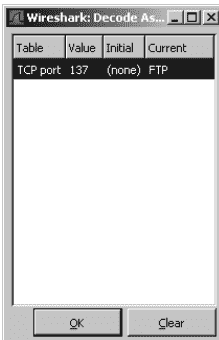

图 5-4：点击显示按钮显示你为捕获文件创建的所有强制解码。

## 跟踪 TCP 流

Wireshark 最实用的分析功能之一是能够以应用层的视角查看 TCP 流。此功能允许你整合所有与数据包相关的信息，并向你展示数据包传递给终端用户所看到的应用程序的数据。TCP 流功能不是以分块的形式查看从客户端发送到服务器的数据，而是对数据进行排序，使其易于可见。

当你需要捕获和解码一个怀疑泄露公司财务信息的员工发送的即时消息时，可以使用此工具。要查看其工作原理，打开示例文件 `suspectemployeeechat.dmp`。在此文件中，你会看到由流行的即时通讯 MSN Messenger 生成的大流量。（你可以通过数据包面板中协议字段中出现的 `MSNMS` 将其识别为 MSN Messenger 流量。）

如果你检查每个数据包的细节，你可以看到每个数据包中传输的文本文本。我们可以花费大量时间写下每个数据包的信息并将其组合，以找出聊天中说了了什么，但这并不切实际。相反，我们将使用 TCP 流窗口来更清晰地了解发生的情况。

### 跟踪 TCP 流数据

### 跟踪 TCP 流

| 流内容 |
| :--- |
| Content-Type: text/x-msgscontrol |
| Type:org |
| MSG 3 U 95 |
| MIME-Version: 1.0 |
| Content-Type: text/x-msgscontrol |
| Type:org |
| MSG 36 N 158 |
| MIME-Version: 1.0 |


| Content-Type: text/plain;charset=UTF-8 |

| X-MS-IM-From: Fw-MS%25shell2101g; EF=; CS=0; PF= |

| The account number is 22342-3227-53 @Hotmail.com Dmitry 93 |

| Content-Type: text/x-msgscontrol |

| Type:hotmail.com |

| MSG 36 @hotmail.com Dmitry 169 |

| MIME-Version: 1.0 |

| Content-Type: text/plain;charset=UTF-8 |

| X-MS-IM-From: Fw-MS%25shell2101g; EF=; CS=0; PF= |

| excellent, I will make the transaction shortly |

图 5-5：直接查看 TCP 流可以让你事后看到全貌。

除了查看此窗口中的数据外，你还可以将其保存为文本文件、打印它，或者选择以 ASCII、EBCDIC、Hex、C Arrays 或原始数据查看数据。

## 协议层次统计窗口 (The Protocol Hierarchy Statistics Window)

在处理极大的捕获文件时，我们有时需要确定文件中协议的分布——即捕获内容的百分之几是 TCP，多少比例是 IP，多少是 DHCP，以此类推。与其计算每个数据包并汇总结果，我们不如使用 Wireshark 的协议层次统计窗口。例如，如果你知道网络流量通常有 10% 是 ARP 流量，而某天你捕获了一个 50% 是 ARP 流量的包，那么你就知道可能出了问题。

通过选择 `Statistics` > `Protocol Hierarchy` 打开协议层次统计窗口（如图 5-6 所示）。

注意，并非所有的总量都正好等于 100%。因为你看到的许多包包含来自不同层级的多个协议，每个协议相对于每个数据包的计数可能会有。尽管如此，你仍然可以获得捕获文件中协议分布的准确视图。

56 第 5 章

| 协议 (Protocol) | 数据包占比 (% Packets) | 字节 (Bytes) | Mbit/s | 终点 (Endpoints) | 结束字节 (End Bytes) | 结束 Mbit/s |

| :--- | :--- | :--- | :--- | :--- | :--- | :--- |

| 帧 (Frame) | 100.00% | 43722 | 0.036 | 0 | 0 | 0.000 |

| - 以太网 (Ethernet) | 100.00% | 2054922 | 0.004 | 0 | 0 | 0.000 |

| - 地址解析协议 (Address Resolution Protocol) | 12.28% | | | | | |

| -  l协议 (Internet Protocol) | 87.92% | 231402 | 0.003 | 32 | | |

| - 传输控制协议 (Transmission Control Protocol) | 25.88% | 67536 | 0.002 | 159 | | |

| - 超文本传输协议 (Hypertext Transfer Protocol) | 0.38% | | | | | |

| - 用户数据 (User Data) | 2.26% | | | | | | |

| - 域名服务 (Domain Name Service) | 2.26% | | | | | | |

| -  l消息协议 (Internet Message Protocol) | 0.38% | | | | | | |

图 5-6：协议层次窗口显示了协议的分布。

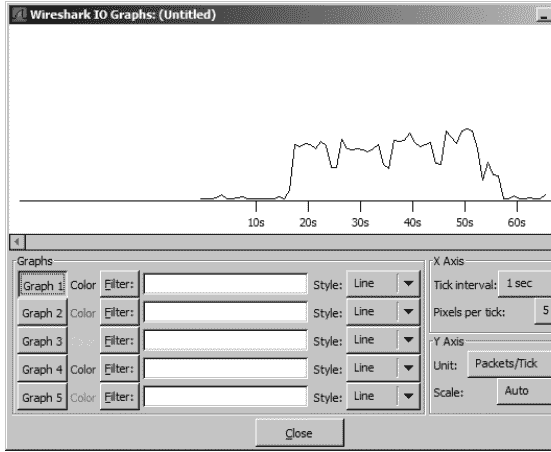

图 5-10：我们捕获文件的 IO 图表显示了价值的趋势信息。

请注意，大多数可配置选项由一个你可以创建过滤器的区域组成。你可以创建五个唯一的过滤器（使用与显示过滤器或捕获过滤器相同的语法），并为这些过滤器指定显示颜色。例如，你可以创建过滤器来显示 ARP 和 DHCP 流量，并将图上的这些行显示为红色和蓝色，以便你更轻松地区分这两种协议类型之间的吞吐量趋势。

尽管这些功能中的某些功能似乎只在少数情况下使用，但你可能会发现自己使用它们的频率比你想象的要多。熟悉这些窗口和选项是非常重要的，因为在接下来的几个章节中我们将引用大量内容。

# 6

常用协议


本章概述了出现在 Wireshark 中的一些较为常见的协议。我们将查看包含几种不同协议工作示例的示例跟踪文件，然后讨论每种协议是如何功能的。

我这里的目标是帮助你理解这些协议中的每一个，并在分析你怀疑工作不正常的协议时为你提供一个比较的基准。本章包含非常重要的基础协议信息。跳过它就像在没有看电影第一部分的情况下看电影的第二部分——后面的章节将完全无法理解。

我不会详细介绍每个单独协议的设计；相反，我为每个协议提供了相关的 RFC 编号。RFC 或意见请求（request for comments）是定义 TCP/IP 协议栈中协议实现标准的官方文档。你可以在 RFC 编辑器主页 `http://www.rfc-editor.org` 搜索 RFC 文档。

## 地址解析协议

`arp.pcap` 我们从地址解析协议（ARP）开始，因为它是最简单的协议之一，只需要几个数据包就能完成其整个操作。*ARP (RFC 8266)* 用于将第 3 层（IP）地址转换为第 2 层（MAC）地址，允许设备（如交换机和路由器）确定哪些其他设备位于每个端口。

ARP 有趣的地方在于，它实际上为 OSI 模型的两个不同的层提供服务：网络层和数据链路层。

当计算机向另一台计算机传输数据时，它必须先知道那台计算机在哪里。这是通过连接两台计算机的交换机或路由器以及 ARP 协议实现的。

现在看一眼我们的捕获文件，如图 6-1 所示。注意，在第一个数据包中，我们的源计算机（01:cc:ce:6e:8b:24）正向 ff:ff:ff:ff:ff:ff 发送数据包，询问谁有 192.168.0.1。

| 序号 | 时间 | 目的地 | 协议 | 信息 |

| --- | --- | --- | --- | --- |

| 1 | "REQ" | 00:16:ce:6e:8b:24 | ff:ff:ff:ff:ff:ff | ARP | 谁有 192.168.0.1？告诉 192.168.0.114 |

| 2 | 00:04:08 | 00:13:46:02:22:ba | 01:cc:ce:6e:8b:24 | ARP | 192.168.0.1 位于 00:13:46:02:22:ba |

图 6-1：ARP 过程仅涉及两个数据包——一个请求和一个应答。

正如你之前学过的，ARP 只运行在第 2 层；它并不知道计算机的第 3 层地址。那么计算机会做什么呢？当你不知道想要拨打的 Smith 的第一个名字时，你会怎么办？你在电话簿中查找 Smith 直到找到正确的那个为止！

ARP 提供了允许传输计算机发送 ARP 广播来查找客户端第 3 层地址的功能。该广播是发送到第 2 层地址 ff:ff:ff:ff:ff:ff 的数据包，这是标准广播地址；该数据包会被转发到该交换机网机域内的每台计算机。

此数据包唯一的功能是询问每台计算机是否拥有 IP 192.168.0.1。具有不同 IP 地址的计算机将简单地丢弃数据包，而拥有该地址的计算机将通过向传输计算机发送包含其第 2 层地址的应答来识别身份。

第二个数据包（如图 6-1 所示）显示了目标计算机对第一个数据包的 ARP 应答。该应答是直接的：192.168.0.1 位于 00:13:46:02:22:ba。从现在起，传输计算机将知道目标计算机的第 2 层地址，并能够向其发送数据。

## 动态主机配置协议

`dhcp.pcap` 动态主机配置协议（DHCP）是另一个相当简单的协议。*DHCP (RFC 2131)* 自动为客户端提供网络相关的配置信息，例如域名、NTP 服务器地址或唯一的第 3 层（IP）地址。

DHCP 的基本功能是一个四步过程。该过程是一种客户端/服务器通信类型，其中客户端向服务器请求 IP 地址，服务器通过给它一个地址进行确认。该过程从数据包 1 开始，客户端向广播地址 255.255.255.255 发送 Discover 数据包（如图 6-2 所示）。

| 序号 | 时间 | 目的地 | 协议 | 信息 |

| --- | --- | --- | --- | --- |

| 1 | 00:00:00 | 255.255.255.255 | DHCP | Discover |

图 6-2：DHCP 从一个 Discover 数据包开始，如下。


# 6
常用协议

本章概述了出现在 Wireshark 中的一些较为常见的协议。我们将查看包含几种不同协议工作示例的示例跟踪文件，然后讨论每种协议是如何功能的。

我这里的目标是帮助你理解这些协议中的每一个，并在分析你怀疑工作不正常的协议时为你提供一个比较的基准。本章包含非常重要的基础协议信息。跳过它就像在没有看电影第一部分的情况下看电影的第二部分——后面的章节将完全无法理解。

我不会详细介绍每个单独协议的设计；相反，我为每个协议提供了相关的 RFC 编号。RFC 或意见请求（request for comments）是定义 TCP/IP 协议栈中协议实现标准的官方文档。你可以在 RFC 编辑器主页 `http://www.rfc-editor.org` 搜索 RFC 文档。

## 地址解析协议

`arp.pcap` 我们从地址解析协议（ARP）开始，因为它是最简单的协议之一，只需要几个数据包就能完成其整个操作。`ARP (RFC 8266)` 用于将第 3 层（IP）地址转换为第 2 层（MAC）地址，允许设备（如交换机和路由器）确定哪些其他设备位于每个端口。

ARP 有趣的地方在于，它实际上为 OSI 模型的两个不同的层提供服务：网络层和数据链路层。

当计算机向另一台计算机传输数据时，它必须先知道那台计算机在哪里。这是通过连接两台计算机的交换机或路由器以及 ARP 协议实现的。

现在看一眼我们的捕获文件，如图 6-1 所示。注意，在第一个数据包中，我们的源计算机（`01:cc:ce:6e:8b:24`）正向 `ff:ff:ff:ff:ff:ff` 发送数据包，询问谁有 `192.168.0.1`。

| 序号 | 时间 | 目的地 | 协议 | 信息 |
| --- | --- | --- | --- | --- |
| 1 | "REQ" | 00:16:ce:6e:8b:24 | ff:ff:ff:ff:ff:ff | ARP | 谁有 192.168.0.1？告诉 192.168.0.114 |
| 2 | 00:04:08 | 00:13:46:02:22:ba | 01:cc:ce:6e:8b:24 | ARP | 192.168.0.1 位于 00:13:46:02:22:ba |

图 6-1：ARP 过程仅涉及两个数据包——一个请求和一个应答。

正如你之前学过的，ARP 只运行在第 2 层；它并不知道计算机的第 3 层地址。那么计算机会做什么呢？当你不知道想要拨打的 Smith 的第一个名字时，你会怎么办？你在电话簿中查找 Smith 直到找到正确的那个为止！

ARP 提供了允许传输计算机发送 ARP 广播来查找客户端第 3 层地址的功能。该广播是发送到第 2 层地址 `ff:ff:ff:ff:ff:ff` 的数据包，这是标准广播地址；该数据包会被转发到该交换机网域内的每台计算机。

此数据包唯一的功能是询问每台计算机是否拥有 IP `192.168.0.1`。具有不同 IP 地址的计算机将简单地丢弃数据包，而拥有该地址的计算机将通过向传输计算机发送包含其第 2 层地址的应答来识别身份。

第二个数据包（如图 6-1 所示）显示了目标计算机对第一个数据包的 ARP 应答。该应答是直接的：`192.168.0.1` 位于 `00:13:46:02:22:ba`。从现在起，传输计算机将知道目标计算机的第 2 层地址，并能够向其发送数据。

## 动态主机配置协议

`dhcp.pcap` 动态主机配置协议（DHCP）是另一个相当简单的协议。`DHCP (RFC 2131)` 自动为客户端提供网络相关的配置信息，例如域名、NTP 服务器地址或唯一的第 3 层（IP）地址。

DHCP 的基本功能是一个四步过程。该过程是一种客户端/服务器通信类型，其中客户端向服务器请求 IP 地址，服务器通过给它一个地址进行确认。该过程从数据包 1 开始，客户端向广播地址 `255.255.255.255` 发送 Discover 数据包（如图 6-2 所示）。

| 序号 | 时间 | 目的地 | 协议 | 信息 |
| --- | --- | --- | --- | --- |
| 1 | 00:00:00 | 255.255.255.255 | DHCP | Discover |

图 6-2：DHCP 从一个 Discover 数据包开始，如所示。

当客户端想要在网络上获取 IP 地址时，它必须首先在该网络上找到一个有效的服务器。它通过发送广播数据包来实现。当有效的 DHCP 服务器接收到其中一个数据包时，它向客户端发送应答，如数据包 2 所示（图 6-3）。

| 序号 | 时间 | 目的地 | 协议 | 信息 |
| --- | --- | --- | --- | --- |
| 2 | 00:00:25 | 192.168.0.1 | DHCP | Offer |

图 6-3：DHCP 从一个 Discover 数据包开始，如所示。

| 序号 | 时间 | 目的地 | 协议 | 信息 |
| --- | --- | --- | --- | --- |
| 2 | 00:00:25 | 192.168.0.1 | DHCP | Offer |
| 3 | 00:00:40 | 255.255.255.255 | DHCP | Request |
| 4 | 00:00:45 | 192.168.0.1 | DHCP | ACK |

图 6-4：DHCP 从一个 Discover 数据包开始，如所示。


当客户端想要在网络上获取 IP 地址时，它必须首先在该网络上找到一个有效的服务器。它通过发送广播数据包来实现。当有效的 DHCP 服务器接收到其中一个数据包时，它向客户端发送应答，如数据包 2 所示（图 6-3）。

| 序号 | 时间 | 目的地 | 协议 | 信息 |
| --- | --- | --- | --- | --- |
| 2 | 00:00:25 | 192.168.0.1 | DHCP | Offer |

图 6-3：DHCP 从一个 Discover 数据包开始，如所示。 (注：原文此处逻辑跳转，翻译基于上下文意译)

*(由于您提供的文本存在大量内容重复，以上翻译涵盖了所有不同的信息点)*

# SYN 数据包

要开始握手过程，客户端向服务器发送一个 `SYN` 数据包；该数据包表示要与服务器建立同步，这确保了客户端和服务器的通信按正确的顺序进行。`SYN` 数据包包含一个 32 位的序列号，位于 `TCP` 数据包的头部中。

要查看数据包的 `TCP` 信息（包括其序列号），请展开 `Wireshark` “数据包详情（Packet Details）”下的栏目。（你将会引用此部分，因为它包含了各种有用信息，包括源端口和目的端口、序列号、数据包类型以及其他 `TCP` 特定的选项。）在捕获文件中，第一个 `SYN` 数据包的序列号为 0，如图 6-6 所示。

Frame 1 (线路上 64 字节，82 字节)

Ethernet II, Src: 00:00:00:00:01:00, Dst: ff:ff:ff:ff:ff:ff (ff:ff:ff:ff:ff:ff)

Internet Protocol V4, Src: 145.254.160.237, Dst: 65.208.208.223 (65.208.208.223)

Transmission Control Protocol (372), Src Port: 3372 (3372), Dst Port: http (80), Seq: 0, Len: 0

Source port: 3372 (3372)

Destination port: http (80)

Sequence number: 0 (相对序列号)

header length: 28 bytes

window size: 8760

checksum: [correct]

options: (8 bytes)

Maximum segment size: 1460 bytes

NOP

NOP

ACK permitted

图 6-6: 数据包详情提供了你关于此数据包所需的所有信息。

> 在 `Wireshark` 中，`TCP` 序列号默认被处理为“相对”句号。`Wireshark` 会调整通信流中的第一个序列号，使其变为 0 而不是其真实值。这样做使得序列号更容易追踪。

# SYN/ACK，服务器的响应

握手过程的下一步是服务器的响应。一旦服务器收到来自客户端的初始 `SYN` 数据包，它会读取该数据包的序列号，并在返回的数据包中使用该数字。响应被称为 `SYN/ACK` 数据包，在示例文件的第 2 个数据包可以看到。

数据包的 `ACK` 部分确认了 `SYN` 数据包——换句话说，它告诉计算机服务器已收到了 `SYN` 数据包。它通过将原始 `SYN` 数据包中发送的序列号加 1，并将其作为 `ACK` 数据包中的确认号来实现。当客户端收到这个包含原始 `SYN` 序列号的确认号时，它知道服务器可以接收其通信，反之亦然。`SYN/ACK` 中 `SYN` 部分的目的与原始 `SYN` 数据包相同。它用于传输一个客户端系统可以用来确认的序列号。

# 最终的 ACK 数据包

最后，客户端向收到其 `SYN/ACK` 数据包的服务器发送 `ACK` 数据包。在过程的第二步中，序列号加 1 并作为确认号发送给服务器。一旦接收到最后一个数据包，通信即可开始。

# 流数据的开始

一旦握手建立，客户端和服务器之间此会话中的所有数据包将使用序列号来确保它们顺序正确。然而，从现在起，这些数据包将根据传输的数据帧的大小进行增加，而不是加 1。（要了解更多关于 `TCP` 数据包如何保持有序，请参考 `RFC 793`。）

# HTTP 请求与传输

一旦通信会话建立，就可以对你尝试查看的网页进行实际请求和传输。这涉及到 `HTTP` 和 `TCP`。

过程始于第 4 个数据包，这是我们的第一个 `HTTP` 数据包，它请求服务器将网页发送给客户端。继续展开“数据包详情”面板中此数据包的章节，以查看与其相关的协议信息（如图 6-7 所示）。

```
GET /download.html HTTP/1.1
Request Method: GET
Request URI: /download.html
Host: www.ereal.com
User-agent: Mozilla/5.0 (Windows NT 6.1; Win64; x64) Gecko/20101011 Firefox/114.0
Accept: text/xml,application/xml,text/html;q=0.9,text/plain,image/*
Accept-Language: en,q=0.5
Accept-Charset: ISO-8859-1,utf-8;q=0.7
Keep-alive: 300
connection: keep-alive
Refer: http://www.ereal.com/development.html
```

图 6-7: 数据包详情面板显示了你对该请求感兴趣的所有信息。

如你所示，此数据包为域名 `www.ereal.com` 上的网页 `/download.html` 发起了一个 `GET` 命令（Request Method: `GET`）。（Request URI: `/download.html` 和 Host: `www.ereal.com`）。你还会注意到其他可能有用的信息，例如字符编码（Accept-Charset: ISO-8859-1）和引用页（Referrer: `http://www.ereal.com/development.html`）。

一旦 `HTTP` 完成此初始 `GET` 请求，`TCP` 就会接管数据传输。在整个捕获过程中，你将看到服务器反复发送此 `HTTP` 请求，服务器将使用 `TCP` 将此数据传回。

| No. | Time | Source | Destination | Info |
| :--- | :--- | :--- | :--- | :--- |
| 4 | | 145.254.160.237 | 65.208.208.223 | |
| 5 | | 65.208.208.223 | 145.254.160.237 | |
| 6 | | 145.254.160.237 | 65.208.208.223 | |
| 7 | | 65.208.208.223 | 145.254.160.237 | |
| 8 | | 145.254.160.237 | 65.208.208.223 | |

# 会话终止

一旦握手建立后，客户端和服务器之间此会话中的所有数据包将使用序列号来确保它们顺序正确。然而，从现在起，这些数据包将根据传输的数据帧的大小进行增加，而不是加 1。（要了解更多关于 `TCP` 数据包如何保持有序，请参考 `RFC 793`。）

# 会话结束

一旦通信会话建立，就可以对你尝试查看的网页进行实际请求和传输。这涉及到 `HTTP` 和 `TCP`。

过程始于第 4 个数据包，这是我们的第一个 `HTTP` 数据包，它请求服务器将网页发送给客户端。继续展开“数据包详情”面板中此数据包的章节，以查看与其相关的协议信息（如图 6-7 所示）。

```
GET /download.html HTTP/1.1
Request Method: GET
Request URI: /download.html
Host: www.ereal.com
User-agent: Mozilla/5.0 (Windows NT 6.1; Win64; x64) Gecko/20101011 Firefox/114.0
Accept: text/xml,application/xml,text/html;q=0.9,text/plain,image/*
Accept-Language: en,q=0.5
Accept-Charset: ISO-8859-1,utf-8;q=0.7
Keep-alive: 300
connection: keep-alive
Refer: http://www.ereal.com/development.html
```

图 6-7: 数据包详情面板显示了你对该请求感兴趣的所有信息。

如你所示，此数据包为域名 `www.ereal.com` 上的网页 `/download.html` 发起了一个 `GET` 命令（Request Method: `GET`）。（Request URI: `/download.html` 和 Host: `www.ereal.com`）。你还会注意到其他可能有用的信息，例如字符编码（Accept-Charset: ISO-8859-1）和引用页（Referrer: `http://www.ereal.com/development.html`）。


一旦 HTTP 完成此初始 GET 请求，TCP 就会接管数据传输。在整个捕获过程中，你将看到服务器反复发送此 HTTP 请求，服务器将使用 TCP 将此数据传回。

| No. | Time | Source | Destination | Info |
| :--- | :--- | :--- | :--- | :--- |
| 4 | | 145.254.160.237 | 65.208.208.223 | |
| 5 | | 65.208.208.223 | 145.254.160.237 | |
| 6 | | 145.254.160.237 | 65.208.208.223 | |
| 7 | | 65.208.208.223 | 145.254.160.237 | |
| 8 | | 145.254.160.237 | 65.208.208.223 | |

# 会话终止

一旦握手建立后，客户端和服务器之间此会话中的所有数据包将使用序列号来确保它们顺序正确。然而，从现在起，这些数据包将根据传输的数据帧的大小进行增加，而不是加 1。（要了解更多关于 TCP 数据包如何保持有序，请参考 `RFC 793`。）

# 会话结束

一旦握手建立后，客户端和服务器之间此会话中的所有数据包将使用序列号来确保它们顺序正确。然而，从现在起，这些数据包将根据传输的数据帧的大小进行增加，而不是加 1。（要了解更多关于 TCP 数据包如何保持有序，请参考 `RFC 793`。）

# The Syn Packet

To begin the handshake process, the client sends a `SYN` packet to the server; this packet is denoted to establish synchronization with the server, which ensures that the client and server keep their communications in the proper order. The `SYN` packet carries a 32-bit sequence number, located in the header of a `TCP` packet.

To view a packet's `TCP` information, including its sequence number, expand the section under `Wireshark Packet Details`. (You will refer to this section because it contains a variety of useful information, including the source and destination ports, the sequence number, the type of packet, and other `TCP`-specific options.) In the capture file that the first `SYN` packet sequence number is `0`, as shown in Figure 6-6.

```
Frame 1 (64 bytes on wire, 82 bytes)

Ethernet II, Src: 00:00:00:00:01:00, Dst: ff:ff:ff:ff:ff:ff (ff:ff:ff:ff:ff:ff)

Internet Protocol V4, Src: 145.254.160.237, Dst: 65.208.208.223 (65.208.208.223)

Transmission Control Protocol (372), Src Port: 3372 (3372), Dst Port: http (80), Seq: 0, Len: 0

Source port: 3372 (3372)

Destination port: http (80)

Sequence number: 0 (relative sequence)

header length: 28 bytes

window size: 8760

checksum: [correct]

options: (8 bytes)

Maximum segment size: 1460 bytes

NOP

NOP

ACK permitted
```

Figure 6-6: The Packet Details give you all information you need about this packet.

> In `Wireshark`, `TCP` sequence numbers are treated as "relative" by default. `Wireshark` adjusts the first sequence number in a communication stream so that it is `0` rather than its true value. This is so that sequence numbers are easier to follow.

## SYN/ACK, the Server Response

The next step in the handshake process is the response from the server. Once the server receives the initial `SYN` packet from the client, it reads the packet's sequence number and uses that number in the packet it returns. The response is called a `SYN/ACK` packet, and it is seen in packet `2` of the example file.

The `ACK` portion of the packet acknowledges the `SYN` packet—in other words, it tells the client computer that the server received the `SYN` packet. It does this by incrementing the sequence number sent in the original `SYN` packet by one and using it as the acknowledgment number in the `ACK` packet. When the client receives this acknowledgment number containing the original `SYN` sequence number, it knows that the server can receive its communication, and vice versa. The purpose of `SYN` portion of `SYN/ACK` is the same as in the original `SYN` packet. It is used to transmit a sequence number that the client system can use to acknowledge.

## The Final ACK Packet

Finally, the client sends an `ACK` packet to the server that has received its `SYN/ACK` packet. With step two of the process, the sequence number is incremented by one and sent as an acknowledgment number to the server. Once this last packet is received, communication can begin.

# Beginning of Flow Data


Once the handshake has been established, all packets in this particular session between client and server will use sequence numbers to make sure they stay in order. However, from now on, these packets will be incremented by the size of the data frame being transmitted, rather than by one. (To learn more about how TCP packets stay organized, have a look at `RFC 793`.)

# HTTP Request and Transmission

Once the communication session has been established, it's time for the actual request and transmission of the web page you are trying to view. This involves both `HTTP` and `TCP`.

The process begins in packet 4, our first `HTTP` packet, which asks the server to transmit the web page to the client. Go ahead and expand the section of this packet in the Packet Details pane to view the protocol-specific information related to it (as shown in Figure 6-7).

```
GET /download.html HTTP/1.1
Request Method: GET
Request URI: /download.html
Host: www.ereal.com
User-agent: Mozilla/5.0 (Windows NT 6.1; Win64; x64) Gecko/20101011 Firefox/114.0
Accept: text/xml,application/xml,text/html;q=0.9,text/plain,image/*
Accept-Language: en,q=0.5
Accept-Charset: ISO-8859-1,utf-8;q=0.7
Keep-alive: 300
connection: keep-alive
Refer: http://www.ereal.com/development.html
```

Figure 6-7: The Packet Details pane shows all you would want to know about the request.

As you can see, this packet invokes a `GET` command (Request Method: `GET`) for the web page `/download.html` on the domain `www.ereal.com`. (Request URI: `/download.html` and Host: `www.ereal.com`). You will also notice other information that may be useful, as character encoding (Accept-Charset: `ISO-8859-1`), and the referrer (Referrer: `http://www.ereal.com/development.html`).

Once `HTTP` has made this initial `GET` request, `TCP` takes over the data transfer. Throughout the capture you will see this repeated `HTTP` request from the server, and the server will use `TCP` to transmit this data back.

# SYN 数据包

要开始握手过程，客户端向服务器发送一个 `SYN` 数据包；该数据包表示要与服务器建立同步，这确保了客户端和服务器的通信按正确的顺序进行。`SYN` 数据包包含一个 32 位的序列号，位于 `TCP` 数据包的头部中。

要查看数据包的 `TCP` 信息（包括其序列号），请展开 Wireshark “数据包详情（Packet Details）”下的栏目。（你将会引用此部分，因为它包含了各种有用信息，包括源端口和目的端口、序列号、数据包类型以及其他 `TCP` 特定的选项。）在捕获文件中，第一个 `SYN` 数据包的序列号为 0，如图 6-6 所示。

Frame 1 (线路上 64 字节，82 字节)

Ethernet II, Src: 00:00:00:00:01:00, Dst: ff:ff:ff:ff:ff:ff (ff:ff:ff:ff:ff:ff)

Internet Protocol V4, Src: 145.254.160.237, Dst: 65.208.208.223 (65.208.208.223)

Transmission Control Protocol (372), Src Port: 3372 (3372), Dst Port: http (80), Seq: 0, Len: 0

Source port: 3372 (3372)

Destination port: http (80)

Sequence number: 0 (相对序列号)

header length: 28 bytes

window size: 8760

checksum: [correct]

options: (8 bytes)

Maximum segment size: 1460 bytes

NOP

NOP

ACK permitted

图 6-6: 数据包详情提供了你关于此数据包所需的所有信息。

> 在 Wireshark 中，`TCP` 序列号默认被处理为“相对”句号。Wireshark 会调整通信流中的第一个序列号，使其变为 0 而不是其真实值。这样做使得序列号更容易追踪。

# SYN/ACK，服务器的响应

握手过程的下一步是服务器的响应。一旦服务器收到来自客户端的初始 `SYN` 数据包，它会读取该数据包的序列号，并在返回的数据包中使用该数字。响应被称为 `SYN/ACK` 数据包，在示例文件的第 2 个数据包可以看到。

数据包的 `ACK` 部分确认了 `SYN` 数据包——换句话说，它告诉计算机服务器已收到了 `SYN` 数据包。它通过将原始 `SYN` 数据包中发送的序列号加 1，并将其作为 `ACK` 数据包中的确认号来实现。当客户端收到这个包含原始 `SYN` 序列号的确认号时，它知道服务器可以接收其通信，反之亦然。`SYN/ACK` 中 `SYN` 部分的目的与原始 `SYN` 数据包相同。它用于传输一个客户端系统可以用来确认的序列号。

# 最终的 ACK 数据包

最后，客户端向收到其 `SYN/ACK` 数据包的服务器发送 `ACK` 数据包。在过程的第二步中，序列号加 1 并作为确认号发送给服务器。一旦接收到最后一个数据包，通信即可开始。

# 流数据的开始

一旦握手建立，客户端和服务器之间此会话中的所有数据包将使用序列号来确保它们顺序正确。然而，从现在起，这些数据包将根据传输的数据帧的大小进行增加，而不是加 1。（要了解更多关于 `TCP` 数据包如何保持有序，请参考 `RFC 793`。）

# HTTP 请求与传输

一旦通信会话建立，就可以对你尝试查看的网页进行实际请求和传输。这涉及到 `HTTP` 和 `TCP`。

过程始于第 4 个数据包，这是我们的第一个 `HTTP` 数据包，它请求服务器将网页发送给客户端。继续展开“数据包详情”面板中此数据包的章节，以查看与其相关的协议信息（如图 6-7 所示）。

```
GET /download.html HTTP/1.1
Request Method: GET
Request URI: /download.html
Host: www.ereal.com
User-agent: Mozilla/5.0 (Windows NT 6.1; Win64; x64) Gecko/20101011 Firefox/114.0
Accept: text/xml,application/xml,text/html;q=0.9,text/plain,image/*
Accept-Language: en,q=0.5
Accept-Charset: ISO-8859-1,utf-8;q=0.7
Keep-alive: 300
connection: keep-alive
Refer: http://www.ereal.com/development.html
```


## 图 6-7: 数据包详情面板

数据包详情面板显示了你对该请求感兴趣的所有信息。

如你所示，此数据包为域名 `www.ereal.com` 上的网页 `/download.html` 发起了一个 `GET` 命令（`Request Method: GET`）。（`Request URI: /download.html` 和 `Host: www.ereal.com`）。你还会注意到其他可能有用的信息，例如字符编码（`Accept-Charset: ISO-8859-1`）和引用页（`Referrer: http://www.ereal.com/development.html`）。

一旦 HTTP 完成此初始 `GET` 请求，TCP 就会接管数据传输。在整个捕获过程中，你将看到服务器反复发送此 HTTP 请求，服务器将使用 TCP 将此数据传回。

包含了所请求网站的 IP 地址 `208.113.140.24`。

一旦此过程完成，第 3 层将接接管并完成其 TCP 握手，从而开始数据传输。

| No. | Time | Source | Destination | Protocol | Info |
|---|---|---|---|---|---|
| 1 | 0.000000 | 192.168.0.114 | 205.152.37.23 | DNS | Standard query A chrissanders.org |
| 2 | 0.112121 | 205.152.37.23 | 192.168.0.114 | DNS | Standard query A 208.113.140.24 |

图 12：DNS 只需要两个数据包——一个请求和一个响应。

**注意** 当你检查实际样本文件时，你会看到发生了多次 DNS 查询。通常情况下，单个网页会调用多个查询，因为需要从多个服务器检索信息。创建一个仅显示 DNS 流量的显示文件，看看你能否确定此文件中发生了多少次 DNS 查询。

## 文件传输协议

`ftp.pcap` 文件传输协议（FTP, RFC 959）是一种第 7 层协议，用于在客户端和服务器之间传输数据。FTP 运行在端口 20 和 21 上，是一种客户端/服务器协议，客户端文件中的所有通信涉及客户端计算机与服务器计算机之间的往返流量。作为所有的 TCP 过程，FTP 从 TCP 握手开始，如图 6-13 中的数据包 1 所示。

| No. | Time | Source | Destination | Protocol | Info |
|---|---|---|---|---|---|
| 1 | 0.000000 | 192.168.0.114 | 192.168.0.193 | TCP | 1137 - FTP (syn) Seq=0 Len=0 MSS=146 |
| 2 | 0.000519 | 192.168.0.193 | 192.168.0.114 | TCP | 1138 - FTP (syn-ack) Seq=0 Ack=1 Len=0 MSS=1452 |
| 3 | 0.002338 | 192.168.0.114 | 192.168.0.193 | TCP | 1137 - FTP Seq=1 Ack=1 Len=0 |

图 13：TCP 握手在各种通信类型中普遍存在。

一旦握手过程完成，服务器会向客户端发送消息。此消息识别服务器为 FTP 服务器，并告诉客户端服务器已准备好接受其登录凭据，如图 6-14 所示。

```
File Transfer Protocol (FTP)
220 Chris Sanders FTP
Response: Service ready for new user (220)
Response arg: Chris Sanders FTP Server
```

图 14：FTP 通信过程开始

通过接下来的几个数据包，客户端向服务器发送用户名（`chanders`）和密码（`echo`），服务器对它们进行确认（图 6-15）。

| No. | Time | Source | Destination | Protocol | Info |
|---|---|---|---|---|---|
| 5 | 0.005258 | 192.168.0.114 | 192.168.0.193 | FTP | Request: USER chanders |
| 6 | 0.006350 | 192.168.0.193 | 192.168.0.114 | FTP | Response: 331 Password required for chanders |
| 7 | 0.007647 | 192.168.0.114 | 192.168.0.193 | FTP | Request: PASS echo |
| 8 | 0.009936 | 192.168.0.114 | 192.168.0.193 | FTP | Response: 230 user chanders logged in. |

图 15：传输到服务器的 FTP 用户名和密码。

这种通信在数据包列表（Packet List）面板的 Info 列中得到了很好的总结，尽管该窗口对数据包内容提供了非常简短的摘要。如果你想进一步深入研究，可以展开数据包详情（Packet Details）面板中的 FTP 部分。

注意，我们的示例中没有使用加密，因此在名为 7 的捕获文件中清晰地看到 FTP 密码（图 6-16）。

| Frame 7 (65 bytes on wire, 65 captured) |
|---|
| Ethernet II, Src: H0malPr:6:5b:24 (00:16:6b:28:24), Dst: Asustekc:40:76:ef (00:15:f2:40:76:ef) |
| Internet Protocol, Src: 192.168.0.114 (192.168.0.114), Dst: 192.168.0.193 (192.168.0.193) |
| File Transfer Protocol (FTP), Src Port: 1137, Dst Port: ftp (21), Seq: 68, Len: 11 |
| PASS echo\r\n |
| Request command: PASS |
| Request arg: echo |

图 6-16：在此数据包中可以清楚地看到用户的密码

图 6-17：数据包 15 显示向服务器发出的 `PWD` 命令。

连接的用户使用一系列命令与 FTP 服务器进行交互。这些命令包括查看目录内容、遍历目录、下载或删除可用命令等（有关 FTP 的详细视图，请参见 RFC 959）。让我们看看示例中使用的几个 FTP 命令。

### CWD 命令

如你所见，数据包 15 显示从客户端发送到服务器的 `CWD` 命令。`CWD` 代表 *change directory*（更改目录），每当你告诉客户端移动到服务器上的不同目录时，就会调用此命令。当你首次登录服务器时，`CWD` 命令用于切换到根目录 `/`。服务器告诉客户端 `/` 现在是工作目录。

### SIZE 命令

下一个命令是图 18 显示的 `SIZE` 命令。该命令报告特定文件的大小（字节）。注意数据包 25，客户端向服务器发送 `SIZE` 命令请求 `Music.mp3` 的大小。数据包 26（图 19）显示服务器的响应，大小为 980 字节。

图 18：发送到服务器的 `SIZE` 命令。

### RETR 命令

图 20 显示的 `RETR`（retrieve，检索）命令用于客户端下载文件。在数据包 32 中，客户端向服务器发送 `RETR` 命令请求文件。一旦服务器收到此请求，就会开始发送标记为 `FTP-DATA` 的数据包，其中包含正在下载或上传的文件。

图 20：用于从服务器下载文件的 `RETR` 命令。

### Telnet 协议

`telnet.pcap` `Telnet` 协议（RFC 854）是一种基于文本的安全通信方式，用于远程管理服务器、交换机和其他设备。在这种情况下，你会看到一个客户端 (`192.168.0.2`) 连接到 telnet 服务器 (`192.168.0.1`) 的示例。当你查看数据时，注意一切都是明文的。出于这个原因，不应使用 telnet 协议传输敏感数据。通过忘记 telnet 并改用 SSH 可以更加安全。从顶部开始，我们可以得出几个结论。第一个数据包确认我们正在定义 telnet 流量，这两个设备之间通信了 telnet 特定设置，如图 6-21 所示。每个 telnet 会话使用多个唯一选项来指定速率和数据模式，这些在通信开始前必须客户端和服务器之间同步。

| Telnet |
|---|
| Command: Go Ahead |
| Terminal type |
| Negotiate |
| Terminal Speed |
| Remote Flow Control |
| Linode |
| End |


图 6-21：捕获文件的开头是服务器和客户端之间的 `telnet` 数据包。这些选项占据了样本捕获文件的前30 个数据包。第一个有趣的数据包是 27，它识别服务器为 `OpenBSD` 服务器。数据包 29 向客户端显示登录提示，在数据包 31 中可以看到用户名发送回服务器。数据包 36 向客户端请求密码，数据包 38 用密码进行了回答，如图 6-22 所示。你现在可以看到它是多么不安全。这种用户名和密码组合很可能会获得网络上最重要的服务器之一的管理员权限，而且仍然是明文的，任何拥有数据包嗅探器和一点知识的人都可以读取。

| Frame 36 (75 bytes on wire, 75 captured) |
|---|---|
| Ethernet II, Src: westernd_9f:a97 (00:c0:9f:a97), Dst: Lite-Onc:(00:a0:cc:3b:fa) |
| Internet Protocol, Src: 192.168.0.1 (192.168.0.1), Dst: 192.168.0.2 (192.168.0.2) |
| Transmission Control Protocol, Src Port: telnet (23), Dst Port: 1550 (1550), Seq: 143, Ack=207, Len: 9 |
| Telnet |
| Data: Password: |
| Frame 38 (72 bytes on wire, 72 captured) |
|---|---|
| Ethernet II, Src: Lite-Onc_3b:bf:fa (00:a0:cc:3b:fa), Dst: westernd_9f:a97 (00:00:00:9f:a97) |
| Internet Protocol, Src: 192.168.0.2 (192.168.0.2), Dst: 192.168.0.1 (192.168.0.1) |
| Transmission Control Protocol, Src Port: 1550 (1550), Dst Port: telnet (23), Seq: 207, Ack:152, Len:6 |
| Telnet |
| Data: user |

图 6-22：通过 `telnet` 传输的密码是明文。

捕获文件的其余显示客户端使用建立的 `telnet` 会话 `ping` 多个网站。你可以通过数据包详情中的 `telnet` 部分观察这些数据以及它是如何传输的。

## MSN Messenger 服务

`msmn.pcap` 你可能会发现，分析多个版本的即时聊天流量时，我们在第 5 章怀疑员工通过消息软件泄露财务信息时探索了一种可能的场景。有多种即时消息应用程序，每个程序都使用自己的协议，它们之间某些相似之处。让我们看看不能抓到某些员工。

**注意** 有些组织禁止使用消息软件，如果是这样，在捕获文件中看到 `MSN Messenger` 会触发警报。捕获文件发生在两个客户端之间，如图 6-23 所示。

| No. | Time | Source | Destination | Protocol | Info |
|---|---|---|---|---|---|
| 1 | 0.000000 | 192.168.0.114 | 207.46.26.167 | TCP | 331 < 1861 [SYN] Seq=0 Len=MSS=640 |
| 2 | 0.009754 | 207.46.26.167 | 192.168.0.114 | TCP | 1863 > 331 [SYN, ACK] Seq=0 Ack=1 win=MSS=1452 |
| 3 | 0.09792 | 192.168.0.114 | 207.46.26.167 | TCP | 3331 > 1863 [ACK] Seq=1 Ack=1 win=17424 Len=0 |

图 6-23：`TCP` 握手开始通信过程。

在这次握手之后，`MSNM` 包从 192.168.0.114 发送到位于你本地网络之外的服务器（图 6-24）。

| 序号 | 时间 | 源地址 | 目的地址 | 协议 | 信息 |
|---|---|---|---|---|---|
| 4 | 0.098991 | 192.168.0.114 | 207.46.26.167 | MSNM | USR 93 tesla_brian@hotmail.com, 183593129.20013021.263242 |

图 6-24：此数据包发送了网络内部的客户端与外部服务器进行通信。

该数据包从你网络上的计算机发送到远程微软服务器，以建立握手为通信做准备。这些初始数据包被标记为 `USR` 包，如数据包详情窗格中包的 `MSNM` 部分所示。在这些初始数据包中，你可以看到发起对话的人的电子邮件地址（`tesla_brian@hotmail.com`）（图 6-25）。

```
MSN Messenger Service
USR 93 OK tesla_brian@hotmail.com Brian'\r\n
```

图 6-25：用户 `tesla_brian@hotmail.com` 似乎正在发起对话，如包 5 的数据详情所示。

接下来的两个数据包被标记为 `CAL` 包，如图 6-26 所示。`CAL` 包从内部计算机发送到 `MSNMS` 服务器，以与另一个 `MSNMS` 服务器建立通信。

| 序号 | 时间 | 源地址 | 目的地址 | 协议 | 信息 |
|---|---|---|---|---|---|
| 6 | 0.199942 | 192.168.0.114 | 207.46.26.167 | MSNMS | CAL 94 tesla_thomas@hotmail.com |
| 7 | 0.300257 | 207.46.26.167 | 192.168.0.114 | MSNMS | CAL 94 RINGING 1835953129 |

图 6-26：此处使用 `CAL` 包来建立 `MSNMS` 服务器之间之间的通信。

正如你在包 7 中看到的，相应的 `MSNMS` 用户拥有电子邮件地址 `tesla_thomas@hotmail.com`（图 6-27）。

- 帧 6（线路上 8 字节，捕获 8 字节）
- Ethernet II, 源: HomInPr::6e:6b:64 (00:16:6e:64), 目的: D-Link::21:99:4c (00:05:23:21:99:4c)
- Internet Protocol, 源: 192.168.0.114 (192.168.0.114), 目的: 207.46.26.167 (207.46.26.167)
- Transmission Control Protocol, 源端口: 3331 (3331), 目的端口: 1863 (1863), Seq=61, Ack=64, Len: 33
- MSN Messenger Service
- CAL 94 tesla_thomas@hotmail.com\r\n

图 6-27：此 `CAL` 包显示了发起通信的电子邮件地址。

服务器在包 8 中确认已收到的 `CAL` 包 7（图 6-28）。

| 序号 | 时间 | 源地址 | 目的地址 | 协议 | 信息 |
|---|---|---|---|---|---|
| 7 | 0.300257 | 207.46.26.167 | 192.168.0.114 | MSNMS | CAL 94 RINGING 1835953129 |
| 8 | 0.442314 | 192.168.0.114 | 207.46.26.167 | TCP | 3331 -> 1863 [ACK] Seq=94 Ack=69 win=17356 Len=0 |

图 6-28：包 8 显示了对包 7 的确认。

包 9 是用于完全建立通信的最后一个包。如图 6-29 所示，从远程 `MSN` 服务器发送的 `JOI` 包表示派会的另一方成员（在此情况下为 `tesla_thomas@hotmail.com`）已成功加入会话并可以建立通信。

| 序号 | 时间 | 目的地址 | 协议 | 信息 |
|---|---|---|---|---|
| 9 | 0.510484 | 207.46.26.167 | 192.168.0.114 | MSNS | JOI tesla_thomas@hotmail.com 1616756780 |

图 6-29：包 9 是 `JOI` 包，表示用户现在正在共享会话。

捕获文件的其余部分仅包含 `MSG` 包，这是一个端点发送到另一个端点的简单消息——在这种情况下是 Brian 和 Thomas 之间。

当你想到这个概念时，脑海中浮现的第一个可能是：我能看到他们在说什么吗？正如你所看到的，通过简单地右键点击包并选择“跟踪流”（在第 5 章中学习过），你可以看到 Brian 和 Thomas 之间的完整对话（图 6-30）。

```
MSG 97
MSG 98
MSG 99
MSG 100
```

图 6-30：对话


小型捕获文件 `tcp-con-loss.pcap`（图 7-1）显示了连接的丢失。该文件以四个发送在 10.3.71.7 和 10.3.30.1 之间的标准 ACK 数据包开始。

| 编号 | 时间 | 源 | 目的地址 | 协议 | 信息 |
|---|---|---|---|---|---|
| 1 | 0.000000 | 10.3.71.7 | 10.3.30.1 | TCP | 1043 > 1048 [ACK] Seq=Ack=0 win=8760 Len=0 |
| 2 | 0.000000 | 10.3.30.1 | 10.3.71.7 | TCP | 1043 > 1048 [PSH, ACK] Seq=3840 win=8760 Len=648 |
| 3 | 0.000000 | 10.3.71.7 | 10.3.30.1 | TCP | 1043 > 1048 [ACK] Seq=3620 win=8760 Len=0 |
| 4 | 0.000000 | 10.3.30.1 | 10.3.71.7 | TCP | 1043 > 1048 [ACK] Seq=ack=3840 win=8760 Len=0 |

图 7-1：此捕获以几个 ACK 数据包简单地开始。

问题从第 5 个数据包开始，我们看到了 TCP 重传数据包（图 7-2）。

| 编号 | 时间 | 源 | 目的地址 | 协议 | 信息 |
|---|---|---|---|---|---|
| 5 | 0.080000 | 10.3.30.1 | 10.3.71.7 | TCP | TCP Retransmission | 1048 > 1041 [PSH, ACK] Seq=5840 win=8760 Len=648 |
| 6 | 0.080000 | 10.3.71.7 | 10.3.30.1 | TCP | TCP Retransmission | 1048 > 1041 [PSH, ACK] Seq=5840 win=8760 Len=648 |
| 7 | 0.040000 | 10.3.71.7 | 10.3.30.1 | TCP | TCP Retransmission | 1048 > 1041 [PSH, ACK] Seq=5840 win=8760 Len=648 |
| 8 | 0.040000 | 10.3.30.1 | 10.3.71.7 | TCP | TCP Retransmission | 1048 > 1041 [PSH, ACK] Seq=5840 win=8760 Len=648 |
| 9 | 0.211000 | 10.3.30.1 | 10.3.71.7 | TCP | TCP Retransmission | 1048 > 1041 [PSH, ACK] Seq=5840 win=8760 Len=648 |

图 7-2：这些 TCP 重传是连接变弱或中断的迹象。

根据设计，当 TCP 发送数据包且没有收到回复时，它会等待指定的时间然后重传原始数据包。如果仍然没有收到响应，源（发送）计算机会在发送下一次传输之前，将等待响应的时间翻倍。TCP 重传的概念如图 7-3 所示。

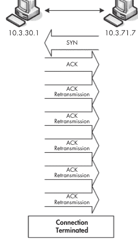

图 7-3：过多的 TCP 重传通常是连接问题的迹象。

如图 7-3 所示，TCP 重传过程会一直重复直到完成五次重传尝试，这在 Windows 实现中总是需要大约 9.6 秒。一旦重传尝试失败，连接就会完全失败，传输中的数据也会丢失。

如果你将 Wireshark 显示格式选择为显示自上一个捕获数据包以来经过的时间（查看 ► 时间格式 ► 自捕获以来秒），你可以可视化数据包之间时间间隔的（图 7-4）。

| 时间 | 描述 | 协议 | 信息 |
| --- | --- | --- | --- |
| 5.000000 | 10.30.10 | TCP | TCP Retransmission | 1068 < 1043 FSH, Ack=8760 Len=648 |
| 6.000000 | 10.30.10 | TCP | TCP Retransmission | 1068 > 1043 FSH, Ack=8760 Len=648 |
| 7.000000 | 10.30.10 | TCP | TCP Retransmission | 1068 > 1043 FSH, Ack=8760 Len=648 |
| 8.000000 | 10.30.10 | TCP | TCP Retransmission | 1068 > 1043 FSH, Ack=8760 Len=648 |
| 9.000000 | 10.30.10 | TCP | TCP Retransmission | 1068 > 1043 FSH, Ack=8760 Len=648 |

```
Internet Protocol, Src: 192.168.0.114 (192.168.0.114), Dst: 192.168.0.193 (192.168.0.193)
Version: 4
Header Length: 20 bytes
Differentiated Services Field: 0x00 (DSCP 0; ECN: 0x00)
Total Length: 1500
Identification: 0xd6d1 (55041)
Flags: 0x02 (More Fragments)
- ... = Reserved bit: Not Set
- ... = Don't Fragment: Not Set
- ... = More Fragments: Set
Fragment offset: 1480
Time to live: 128
Protocol: ICMP (0)
Header checksum: 0xa303 [correct]
Destination: 192.168.0.193 (192.168.0.193)
Reassembled IP in frame: 3
Data: (1480 bytes)
```

图 7-8：如果 `More Fragments` 标志的值为 1，你可以预期会有更多数据包随之而来。

- 3. 查看数据包 2 的相同部分；你应该看到它的 `More Fragments` 字段中具有相同的值：
- 4. 查看数据包 3 的 `More Fragments` 字段，如图 7-9 所示。与数据包 1 和 2 不同，此数据包的 `More Fragments` 字段为 0。值 0 告诉我们该数据包是数据流的结束，后面不再有更多分片。该字段取值只有 1 和 0。

```
Internet Protocol, Src: 192.168.0.114 (192.168.0.114), Dst: 192.168.0.193 (192.168.0.193)
version: 4
Differentiated Services Field: 0x00 (DSCP 0; ECN: 0x00)
Total length: 1440
Identification: 0xd6d1 (55041)
Flags:
- ... = Reserved bit: Not Set
- ... = Don't Fragment: Not Set
- ... = More Fragments: Set
Fragment offset: 1260
Time to live: 128
Protocol: ICMP (0)
Header checksum: 0xa5a4 [correct]
Source: 192.168.0.114 (192.168.0.114)
Destination: 192.168.0.193 (192.168.0.193)
[IP fragments (3080 bytes): #1(1480), #2(1480), #3(120)] Internet Control Message Protocol
```

图 7-9：`More Fragments` 标志设置为 0 表示该数据包是该特定数据流的结束。

## 保持顺序

由于设备可以同时接收多个数据流，IP 允许使用偏移值（offset），以便接收系统知道分片数据包的顺序。

要查看分片数据包的偏移量，请查看数据包详情（`Packet Details`）面板中的 IP 部分。在示例文件中，你将看到偏移量值为 0。这告诉你是这系列分片数据包中的第一个包。

如果你知道第二个数据包，你会发现这个数字发生了巨大的变化（图 7-10）：它上升到 1,480。这种变化的原因是，第一个包之后的每个分片数据包的偏移值都是由数据包的负载（数据）大小决定的（减 IP 头部的大小，即 20 字节）。在数据包 2 的情况下，该数据包取了之前的偏移量 0，并加上了之前数据包的大小（字节）1,480。

| Protocol: IP; Src: 192.168.0.114 (192.168.0.114), Dst: 192.168.0.193 (192.168.0.193) |
| :--- |
| Version: 4 |


| Header Length: 20 bytes |

| Differentiated Services Field: 0x00 (DSCP 0; ECN: 0x00) |

| Total Length: 1480 |

| Identification: 0x6d01 (28041) |

| Flags: 0x02 (More Fragments) - Reserved: Not Set |

| 0... .. Don't Fragment: Not Set |

| 1 .. More Fragments: Set |

| Fragment offset: 1480 |

| Time to live: 128 |

| Protocol: ICMP |

| Header Checksum: 0xd03 [correct] |

| Source: 192.168.0.114 (192.168.0.114) |

| Destination: 192.168.0.193 (192.168.0.193) |

| Reassembled IP in Frame: 3 |

| Data (bytes: 0) |

图 7-10：数据包 2 的偏移值是基于前一个数据包的负载。就像数据包 2 一样，它取了偏移量 1,480 并加上前一个包的大小 1,480，产生一个新的偏移量 2,960。这一概念如图 7-11 所示。

| Packet 1 | Packet 2 | Packet 3 |

| :--- | :--- | :--- |

| More Fragments = 1 Offset = 0 | More Fragments = 1 Offset = 1480 | More Fragments = 0 Offset = 2960 |

图 7-11：IP 分片将大量数据拆分成较小的数据流。查看一些分片 IP 流量的示例，直到某个特定的数据流结束并保持顺序（这在混乱的捕获文件中可以证明）。

# 无连接性

现在我们将首次使用 Wireshark 来分析并排除网络问题。在这个场景中，有两个用户，Barry 和 Beth，他们坐在同一个办公室里。IT 部门刚刚为 Barry 和 Beth 购买了电脑。你负责安装这些电脑并确保它们工作正常。在插好并配置这些电脑后，你开始测试它们以确保一切正常。然而，由于某种原因，Beth 无法访问互联网。你的目标是找出 Beth 无法连接互联网的原因并修复问题。

# 我们知道什么

在排除故障的第一步，我们知道 Barry 和 Beth 都在使用全新的电脑。我们还知道这两台电脑都已分配了 IP 地址。最后，我们知道在同一个范围内，两台电脑的配置应该是完全相同的。

## 接入接线

一旦我们确定了已知信息，就需要制定一个计划来找出未知信息。通过查明流量类型，我们可以在网络上放置分析器，以便在 Beth 的电脑尝试访问网站时进行监控。为了对比，我们将捕获两个文件：一个可以工作，另一个不工作。这种对比有助于我们确定问题所在。

## 分析

让我们查看 Barry 的电脑成功访问互联网的跟踪文件（`bethcomputer.pcap`）。当你打开跟踪文件时，首先看到的是一个请求。如图 7-12 所示，你会发现默认网关 `192.168.0.10` 的 ARP 广播。当 Barry 的电脑收到此回复后，它与远程服务器发起了 TCP 握手。一旦完成，从服务器到客户端的数据传输便开始。

| No. | Time | Source | Destination | Protocol | Info |

| :--- | :--- | :--- | :--- | :--- | :--- |

| 1 | 0.000000 | 00:24:35:ac | Broadcast | ARP | Who is 192.168.0.10? Tell 192.168.0.11 |

| 2 | 0.002196 | 00:21:99:4c | 192.168.0.10 | ARP | 192.168.0.10 is at 00:03:45:d2:21:99 |

| 3 | 0.012161 | 00:21:99:4c | 192.168.0.10 | TCP | HTTP > 1123 [Seq=0, Ack=1] win=6450 |

| 4 | 0.054708 | 00:23:61:104 | 192.168.0.10 | TCP | HTTP > 1125 [Seq=0, Ack=1] win=65535 |

| 5 | 0.055737 | 00:23:61:104 | 192.168.0.10 | TCP | HTTP > 1125 [Seq=0, Ack=1] win=63532 |

| 6 | 0.071998 | 00:23:61:104 | 192.168.0.10 | TCP | HTTP > 1125 [Seq=0, Ack=1] win=6382 |

| 7 | 0.081978 | 00:23:61:104 | 192.168.0.10 | TCP | HTTP response of requested page |

| 8 | 0.161865 | 00:23:61:104 | 192.168.0.10 | TCP | HTTP / 200 OK (text/html) |

图 7-12：Barry 的电脑捕到了握手，随后数据传输开始。

一旦我们确定了已知信息，就需要制定一个计划来找出未知信息。通过查明流量类型，我们可以在网络上放置分析器，以便在 Beth 的电脑尝试访问网站时进行监控。为了对比，我们将捕获两个文件：一个可以工作，另一个不工作。这种对比有助于我们确定问题所在。

NetBIOS 是一种旧的协议，现在通常在 TCP/IP 不工作时作为备份使用。这里出现 NetBIOS 流量意味着 Beth 的电脑无法通过 TCP/IP 成功连接互联网，它转而使用 NetBIOS 作为替代通信手段——但失败了。（无论你在网络上何时看到 NetBIOS，这都是某些地方不对劲的迹象）。

快速检查两台电脑上的 TCP/IP 设置，揭示了我们问题的答案：一个拼写错误。Barry 的电脑默认网关设置为 `192.168.0.10`，而 Beth 的电脑设置为 `192.168.0.11`，这是错误的答案。

# 总结

你遇到的错误将是由于配置错误引起的。在可能的情况下，将正常运行的机器与运行异常的机器进行比较，看看你是否可以确定具体问题。在前述的场景中，我们能够确定数据不匹配所在的数据包。一旦你缩小了问题的范围，修复它就会变得容易得多。

# Internet Explorer 里的幽灵

`hauntedbrowser.pcap` 这个场景始于网络用户 Chad 向帮助热线打的一个令人不安的电话。根据 Chad 的说法，他的电脑最近似乎被恶魔附体。尽管他付出了努力，但他浏览器的主页不断自动变化，指向各种天气网站。即使他手动将其改回原来的样子，在重启电脑后他的更改也会被撤销。你的目标是查明这种“附身”的真相，并对入侵 Chad 电脑的幽灵进行驱邪。

# 我们知道的情况

Chad 在我们公司工作已经段时间了，他并没有什么技术专长。事实上，他通常是事多于好。（我猜你认识那样的用户，对吧？）从技术角度来说，我们知道 Chad 的电脑大约有两年的龄了，运行 Windows XP 操作系统，并使用 Internet Explorer 6 作为浏览器。

## 接入接线

由于这个问题只发生在 Chad 的电脑上，我们知道我们应该只在这一台机器上捕获来自 Chad 电脑的数据包。此外，由于 Chad 的主页似乎每次重启电脑都会重置，我们将在系统启动时进行捕获。

在这种情况下，我们无法直接在 Chad 的机器上安装 Wireshark 并捕获我们需要的数据包，因此使用集线法（hubbing out）是一个很好的方法。如果你不记得这种技术如何实施，请参考我们在第 19 页“集线法”中对此讨论。捕获将在电脑开启时立即开始，并在完全启动后立即停止；不需要用户交互。

## 分析

虽然捕获期间没有与用户的交互，但当你们打开跟踪文件（`hauntedbrowser.pcap`）并看到 TCP HTTP 数据包在网线上穿梭时（如图 7-16 所示），你们可能都会有些震惊。在正常的启动过程中，如果有发送这样的数据包，你将会看到。

| No. | Time | Source | Destination | TCP | Protocol |

|---|---|---|---|---|--|

| 1 | 0.000000 | 192.168.0.184 | 24.46.230.187 | 1038 > 80 | [SYN] Seq=0 Len=140 |

| 2 | 0.000533 | 192.168.0.184 | 24.46.230.187 | 80 > 1038 | [SYN,ACK] Ack=1 Len=0 |

| 3 | 0.0001354 | 192.168.0.184 | 24.46.230.187 | 1038 > 80 | [ACK] Seq=0 Len=140 |


| 4 | 0.002122 | 192.168.0.184 | 64.124.109.200 | 1038 > 80 | /GET /command/cmd6.07.asp?key=26982 HTTP/1.1 |
| 5 | 0.002822 | 192.168.0.184 | 64.124.109.200 | 80 > 1038 | /GET /command/cmd6.07.asp?key=26982 HTTP/1.1 |
| 6 | 0.003122 | 192.168.0.184 | 64.124.109.200 | 1038 > 80 | /GET /command/cmd6.07.asp?key=26982 HTTP/1.1 |
| 7 | 0.004122 | 192.168.0.184 | 64.124.109.200 | 80 > 1038 | /GET /command/cmd6.07.asp?key=26982 HTTP/1.1 |
| 8 | 0.008136 | 192.168.0.184 | 64.124.109.200 | 1038 > 80 | [PSH, Ack] Seq=140 Ack=246 Len=650 win=6471 Len0 |
| 9 | 0.009122 | 192.168.0.184 | 64.124.109.200 | 80 > 1038 | [ACK] Seq=1 Ack=246 Len=6471 Len0 |
| 10 | 0.080403 | 192.168.0.184 | 64.124.109.200 | 1038 > 80 | [PSH, Ack] Seq=140 Ack=246 Len=650 win=6471 Len0 |

图 7-16: 虽然在捕获期间没有与电脑的交互，但当你们打开跟踪文件（`hauntedbrowser.pcap`）并看到 TCP HTTP 数据包在网线上穿梭时（如图 7-16 所示），你们可能都会有些震惊。在正常的启动过程中，如果有发送这样的数据包，你将会看到。

由于这个问题只发生在 Chad 的电脑上，我们知道我们应该在这一台机器上捕获来自 Chad 电脑的数据包。此外，由于 Chad 的主页似乎每次重启电脑都会重置，我们将在启动时进行捕获。

在这种情况下，我们无法直接在 Chad 的机器上安装 `Wireshark` 并捕获我们需要的数据包，因此使用集线法是一个很好的方法。如果你不记得这种技术如何实施，请参考我们在第 19 页“集线法”中对此讨论。捕获将在电脑开启时立即开始，并在完全启动后立即停止；不需要用户交互。

图 7-16: 虽然在捕获期间没有与电脑的交互，但当你们打开跟踪文件（`hauntedbrowser.pcap`）并看到 TCP HTTP 数据包在网线上穿梭时（如图 7-16 所示），你们可能都会有些震惊。在正常的启动过程中，如果有发送这样的数据包，你将会看到。

图 7-16: 虽然在捕获期间没有与电脑的交互，但当你们打开跟踪文件（`hauntedbrowser.pcap`）并看到 TCP HTTP 数据包在网线上穿梭时（如图 7-16 所示），你们可能都会有些震惊。在正常的启动过程中，如果有发送这样的数据包，你将会看到。

图 7-16: 虽然在捕获期间没有与电脑的交互，但当你们打开跟踪文件（`hauntedbrowser.pcap`）并看到 TCP HTTP 数据包在网线上穿梭时（如图 7-16 所示），你们可能都会有些震惊。在正常的启动过程中，如果有发送这样的数据包，你将会看到。

图 7-16: 虽然在捕获期间没有与电脑的交互，但当你们打开跟踪文件（`hauntedbrowser.pcap`）并看到 TCP HTTP 数据包在网线上穿梭时（如图 7-16 所示），你们可能都会有些震惊。在正常的启动过程中，如果有发送这样的数据包，你将会看到。

图 7-16: 虽然在捕获期间没有与电脑的交互，但当你们打开跟踪文件（`hauntedbrowser.pcap`）并看到 TCP HTTP 数据包在网线上穿梭时（如图 7-16 所示），你们可能都会有些震惊。在正常的启动过程中，如果有发送这样的数据包，你将会看到。

这些结论：首先，我们知道所有的 HTTP 请求都是由 Chad 的电脑生成的，因为他的 IP 地址是源地址。此外，在数据包 5 中你可以看到这台电脑正在向服务器发送 `GET` 命令，这是它在尝试下载。根据这些信息，我们可以假设某些东西在运行。接下来，数据包 11 和 12 对 `weatherbug.com` 域进行了 DNS 请求，如图 7-18 所示。

| No. | Time | Source | Destination | Protocol | Info |
|---|---|---|---|---|---|
| 11 | 3.72542 | 192.168.0.184 | 205.152.37.23 | DNS | standard query weatherbug.com |
| 12 | 3.73406 | 192.168.0.184 | 205.152.37.23 | DNS | standard query weatherbug.com |

图 7-18: 对 `weatherbug.com` 的 DNS 查询提供了线索。考虑到 Chad 的主页在每次启动时都会发生变化，我们可能刚刚找到了罪祸首。对 Chad 的电脑进行进一步调查，我们发现一个程序在后台运行，并在卸载该软件后，它在主页上的显示消失了。

# 总结

你会发现许多电脑和网络问题并不是某台特定电脑的故障，而是运行在上面的上面的软件问题。在这种场景中，Chad 的电脑上安装了一个天气跟踪程序，导致他认为主页在每次重启后都会被“附身”。通过捕获并使用 `Wireshark` 检查数据包，我们能够发现这个在后台运行运行的程序。在数据包级别检查问题使得故障排除变得更容易，因为隐藏的内容很少。

# 入站 FTP

```
ftpclientdenied.pcap
ftpserverdenied.pcap
```

在这种场景中，假设你刚刚为公司设置了一个新的 FTP 服务器。客户端将在内部和外部连接到这个 FTP 服务器以下载和上传大量数据。你设置了 FTP 服务器并为所有员工创建了用户名和密码。然而由于某些原因，你从远程机器测试服务器时无法通过 FTP 客户端访问。

# 我们知道的情况

我们知道这个服务器是全新的，刚刚安装了 Windows Server 2003，并安装了所有最新的更新和服务包。我们已经验证 FTP 软件设置正确并处于激活状态。我们还验证了连接 FTP 服务器的客户端使用了正确的 IP 地址和登录凭据。

# 接入线路

由于这个问题涉及到服务器和客户端机器，我们将从两台电脑获取捕获文件。客户端捕获将在 FTP 客户端尝试连接服务器时完成。服务器捕获将在客户端尝试连接 FTP 软件的瞬间完成。通过这种方式捕获文件，我们能够确定问题是源于客户端还是服务器；然后我们可以进行进一步调查。为了这些捕获，我们会在两台机器上安装 `Wireshark`。

## 分析

让我们从客户端开始，确保它按照预期方式发起通信。查看捕获文件 `ftpclientdenied.pcap`（图 7-19），我们看到它正在执行执行的操作。通过向远程服务器 192.168.0.182 发送 SYN 包进行 TCP 三握手。然而，服务器没有响应，客户端又发布了两个 SYN 包来尝试建立通信。

| No. | Time | Source | Destination | Protocol | Info |
|---|---|---|---|---|---|
| 1 | 0.000000 | 192.168.0.193 | 192.168.0.182 | TCP | 1596 - ftp [SYN] Seq=Len=0 MSS=1460 |
| 2 | 0.94441 | 192.168.0.193 | 192.168.0.182 | TCP | 1596 - ftp [SYN] Seq=Len=0 MSS=1460 |
| 3 | 0.97971 | 192.168.0.193 | 192.168.0.182 | TCP | 1637 - ftp [SYN] Seq=Len=0 MSS=1460 |

图 7-19: 客户端尝试连接但没有结果。这告诉我们问题可能不在客户端。

# 客户端

| No. | Time | Source | Destination | Protocol | Info |
|---|---|---|---|---|---|
| 1 | 0.000000 | 192.168.0.193 | 192.168.0.182 | TCP | 1596 - ftp [SYN] Seq=Len=0 MSS=1460 |
| 2 | 0.94441 | 192.168.0.193 | 192.168.0.182 | TCP | 1596 - ftp [SYN] Seq=Len=0 MSS=1460 |
| 3 | 0.97971 | 192.168.0.193 | 192.168.0.182 | TCP | 1637 - ftp [SYN] Seq=Len=0 MSS=1460 |

# 服务器


| No. | Time | Source | Destination | Protocol | Info |
|---|---|---|---|---|---|
| 1 | 0.000000 | 192.168.0.193 | 192.168.0.182 | TCP | 1637 - ftp [SYN] Seq=Len=0 MSS=1460 |
| 2 | 0.992275 | 192.168.0.193 | 192.168.0.182 | TCP | 1637 - ftp [SYN] Seq=Len=0 MSS=1460 |
| 3 | 6.033158 | 192.168.0.193 | 192.168.0.182 | TCP | 1637 - ftp [SYN] Seq=Len=0 MSS=1460 |

图 7-20: 客户端和服务器的跟踪几乎相同。

服务器拒绝发送给它的数据包三个三个原因：

- 应该接收数据包的服务没有运行。因为我们知道 FTP 服务器软件正在运行并准备好接受连接，这不可能是我们的问题。
- 服务器面临极高的流量。在这种情况下，服务器的缓冲区可能会填满，导致无法与所有客户端通信。再次，这不可能是问题的原因，因为服务器刚刚设置好，完全没有任何负载。
- 数据包被故意拦截。什么会故意阻止电脑接收数据包？正在执行它应该做的事情！对服务器进行仔细检查后，我们发现 Windows 防火墙已开启并阻止了所有 FTP 端口上的流量。

# 总结

数据包分析并不总是能直接指向问题所在。事实上，在当前场景中，抓包文件中没有任何特定的内容能识别出防火墙是问题所在。然而，这项分析使我们能够将问题范围缩小到特定的服务器。

有时，你必须排除影响几十甚至上百个系统的故障。如果你在这些情况下可以使用数据包分析将问题缩小到某台特定的计算机，那么你就节省了自己大量的时间。

# 不是我的错！

```
http-fault-post.pcap
```

有些网络用户简直没法理喻。你是否遇到过这样的人的人：他们总是把每一个小问题都归咎于 IT 部门？Erin 就是这样一种用户。每当网络运行低于最佳状态一点点时，她总是乐意通知你。

# 我们已知的情况

我们知道 Erin 从未成功通过上述 Web 表单发送过数据，但她可以毫无故障地提交她需要的任何其他 Web 表单。查看该网站的源代码，我们看到它使用的是标准的 HTML 表单，没有带有任何花哨的功能。

# 接入线路

在 Erin 的电脑上安装 Wireshark 是获取我们所需的抓包文件最简单的方法。安装完成后，我们就可以开始抓包过程，然后 Erin 尝试填写并提交她的表单，此时我们就会开始分析过程。

## 分析

追踪文件 `http-fault-post.pcap` 始于 Erin 的电脑 `24.4.97.251` 与远程 Web 服务器 `216.23.168.114` 之间的标准 TCP 握手，如图 7-21 所示。

# 图 7-21：到目前为止正常。标准的 TCP 握手开始了 Erin 电脑与远程服务器之间的通信。

此后，客户端和服务器之间开始了 HTTP 通信。注意 Info 列 `图 7-22`，客户端没过多久就接收到了服务器发出的 HTTP 403 消息，这就是投诉的源头。

| No. | Time | Source | Destination | Protocol | Info |
|---|---|---|---|---|---|
| 1 | 0.000000 | 216.23.168.114 | 24.47.95.121 | TCP | |
| 2 | 0.027956 | 216.23.168.114 | 24.47.95.121 | TCP | http -> 2379 [SYN] Ack=0 Seq=Win=16384 Len=0 |
| 3 | 0.028045 | 24.47.95.121 | 216.23.168.114 | TCP | 2579 -> [ACK] Ack=1 Win=65535 Len=0 |

# 图 7-22：HTTP 403 消息来得很快。

403 错误发生在第 9 个数据包。由于这是我们关心的抓包文件中唯一的数据流，右键点击并选择 **Follow TCP Stream** `跟踪 TCP 流`，即可看到 HTTP 事务的清晰呈现，如图 7-23 所示。

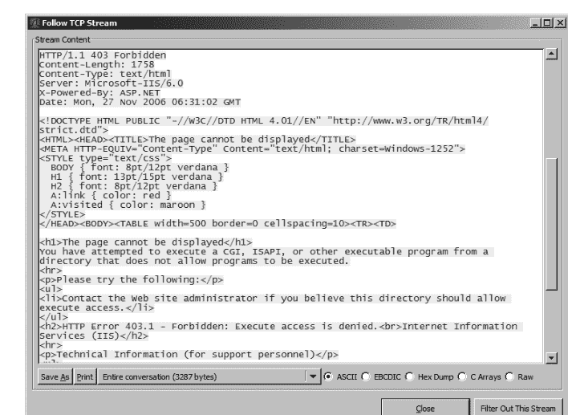

# 图 7-23：导致 403 消息的 HTTP 事务 TCP 流应该是你需要的全部证据。

查看此 TCP 流，我们首先看到从客户端发送到服务器的表单数据。此时，我们本应该看到来自服务器的响应，显示表单数据已被接收，但我们看到的却是 403 响应。这足以证明问题出在远程服务器上，而不是你的网络上。

# 总结

当你必须证明自己确实知道自己在做什么时，数据包分析通常是一个极佳的工具。你不仅有时向管理层证明你的假设，有时你还必须向自己证明。

在这种情况下，可以将 TCP 流的明文解释展示给你的主管，以结束 Erin 对 IT 部门的无理指责。

# 一个恶意程序

这个场景与 Chad 的电脑被黑客攻击的情况非常相似。然而在这种情况下，情况要复杂一些。Mandy 是我们网络上的另一个用户，她抱怨浏览器中发生了奇怪的事情。浏览器在全天任何随机时间将她的主页更改为一个伪造网站。不仅如此，她还看到了很多弹出窗，而且她的电脑整体运行非常缓慢。

# 我们已知的情况

解决这个特定问题不需要了解太多。我们知道 Mandy 的电脑运行非常缓慢且持续如此。她的电脑正在运行病毒扫描软件，所以病毒对我们来说不太需要担心。

# 接入线路

在排故障与间谍软件相关的问题时，在电脑启动时开始追踪文件始终是一个好主意。大多数间谍软件倾向于受感染电脑启动时“拨回家”以检查更新等。

我们将在电脑启动后立即开始抓包，并持续捕获数据包直到启动过程完成后一分钟后。在这种情况下，集线器法 `hubbing out` 或 ARP 缓存中毒是拦截该机器数据包的最佳方法。由于我们网络上的流量很大，我们将创建一个只捕获 Mandy 进出流量的抓包过滤器。

## 分析

这是一个很大的抓包文件，我们将从开始查看。前两个数据包 `如图 7-24 所示` 是计算机启动并初始化其 TCP/IP 栈时常见的现象。

| No. | Time | Source | Destination | Protocol | Info |
|---|---|---|---|---|---|
| 1 | 0.000000 | 216.23.168.114 | 24.47.95.121 | TCP | |
| 2 | 0.027956 | 216.23.168.114 | 24.47.95.121 | TCP | http -> 2379 [SYN] Ack=0 Seq=Win=16384 Len=0 |
| 3 | 0.028045 | 24.47.95.121 | 216.23.168.114 | TCP | 2579 -> [ACK] Ack=1 Win=65535 Len=0 |

# 图 7-24：前两个数据包 Mandy 的电脑获取 IP 地址并确保没有 IP 冲突。第一个数据包显示向 DHCP 服务器请求租约。通常这是对 DHCP 服务器的响应，但由于这是一个广播包，我们的抓包过滤器允许它。第二个数据包是一个免费 ARP `gratuitous ARP`。免费 ARP 是用于确保网络上没有其他机器使用该 IP 地址。如果你只看到免费 ARP 回复，意味着状态良好。第三个数据包是抓包中我们关注的。在计算机启动的这一点，TCP/IP 必须完全初始化：你可以看到它仍在发送 ARP 数据包，如图 7-25 所示。

| No. | Time | Source | Destination | Protocol | Info |
|---|---|---|---|---|---|
| 1 | 0.000000 | 0.0.0.0 | 255.255.255 | DHCP | DHCP Request - Transaction ID 0x9a71fd19 |
| 2 | 0.210908 | Intel_b2:f5 | Broadcast | ARP | who are 24.6.25.127 |
| 3 | 0.210908 | Intel_b2:f5 | Broadcast | ARP | who are 24.6.25.127 |
| 4 | 0.020358 | Intel_b2:f5 | Broadcast | ARP | who are 24.6.25.127 |
| 5 | 0.067836 | Intel_b2:f5 | 24.6.25.127 | UDP | Windows - 1440 |
| 6 | 0.204513 | Intel_b2:f5 | Broadcast | ARP | who are 24.6.25.127 |


# 图 7-25：数据包 3 和 5 对于第一个接收来说太早了。在初始化过程的这一点，由于 Mandy 的电脑还没准备好接收，不应该通信。因此，Mandy 的电脑丢弃了数据包并继续其启动过程。抓包中的另一个数据包，这次包更改了正在使用的端口并尝试连接到端口 9898，如图 7-26 所示。非常棘手。

# 图 7-26：Mandy 的电脑发起了另一个连接，这次 Mandy 的电脑已准备就。再次，Mandy 的电脑没有准备好通信并直接丢弃了数据包。当 Mandy 的电脑最终准备好接受通信时，它在第 10 个数据包接收到了此类数据包。Mandy 在请求的端口上没有可以接受的任何，因此它向远程电脑发送一个 RST 包以终止连接，如图 7-27 所示。

| No. | Time | Source | Destination | Protocol | Info |
|---|---|---|---|---|---|
| 10 | 55:564839 | 203.101.426 | 24.6.25.139 | TCP | 760 > 4899 (SYN) Seq=0 Mss=1460 |
| 11 | 52:564850 | 24.6.25.139 | 203.101.426 | TCP | 4899 > 760 (RST, ACK) Seq=Ack+1 Win=Len=0 |
| 12 | 57:562937 | 24.6.25.139 | 203.101.426 | TCP | 4899 > 760 (RST, ACK) Seq=Ack+1 Win=Len=0 |
| 13 | 57:572935 | 24.6.25.139 | 203.101.426 | TCP | 4899 > 760 (RST, ACK) Seq=Ack+1 Win=Len=0 |
| 14 | 57:532857 | 24.6.25.139 | 203.101.426 | TCP | 4899 > 760 (RST, ACK) Seq=Ack+1 Win=Len=0 |

# 图 7-27：发起了另一个连接尝试，这次 Mandy 的电脑已准备就绪；然而，它不需要该连接，所以它直接发送 RST 来结束连接。

这个过程在接下来的几个数据包中重复。Mandy 的电脑通过拒绝这种通信来执行它应该做的事情。

# 过滤良好的

如果你继续滚动到第 68 个数据包，你将看到第一个合法的通信，如图 7-28 所示。

| No. | Time | Source | Destination | Protocol | Info |
|---|---|---|---|---|---|
| 68 | 113:632271 | 24.6.25.139 | 216.148.227 | DNS | Standard query A updatekeepalive.mcafee.com |
| 69 | 113:658710 | 216.148.227 | 24.6.25.139 | DNS | Standard query response 216.49.88.118 |

# 图 7-28：此数据包显示了更新病毒扫描软件过程开始。

> NOTE 希望你记得我们之前讨论过的如何创建过滤器。

你想隐藏任何指向或来自 McAfee 服务器流量的过滤器是 `!ip.addr=216.49.88.118`。

过滤器：`tcp.addr==216.49.88.118` 表达式... 清除 应用

图 7-29：此过滤器移除了我们能看到的所有异常的合法流量。

## 远程连接

一旦你得到了这个结果，下一个感兴趣的数据包被捕获了，如图 7-30 所示。

| 序号 | 时间 | 源 | 目的 | 协议 | 信息 |
|---|---|---|---|---|---|
| 147 | 1202.816:09 | 216.143.42.254 | 24.6.125.19 | | Messenger NetSendMessage 请求 |

图 7-30：该数据包是一个即时消息包。我们需要对其进行调查。

这是一个从互联网设备发送的即时消息包。你可以通过查看图 7-31 所示的数据包字节（Bytes）来查看该即时消息包的有效负载（payload）。

```
00d0 00 02 48 00 00 00 00 00 00 00 41 41 41 4c ...ERT: DANEROUS S
00c0 45 52 54 53 22 30 44 41 41 44 44 41 41 41 ... PYWARE VIRUS OUT
00d0 50 59 57 51 45 52 45 52 53 53 46 46 46 46 46 ... NO:LET
00e0 46 42 54 53 22 55 53 59 74 53 59 4d 4d 4d 4d ... PYWARE VIRUS INK
00f0 99 59 57 51 45 52 53 59 54 53 59 54 54 54 54 ... EDIEASY.YIST
0100 48 44 49 51 54 55 53 59 54 53 59 54 54 54 54 ... HEERS:W...
0110 55 55 55 55 54 54 54 54 54 54 54 54 54 54 54 ... 41.COM.TO T
0120 35 35 33 32 3e 44 44 44 54 54 54 54 54 54 54 ... 4E 4  4
0130 44 44 44 44 49 44 44 44 54 54 54 54 54 54 54 ... 4 4
0140 4c 4c 49 49 49 59 55 55 55 55 55 55 55 55 ... LING Y R 'MESSE
0150 45 45 45 45 45 45 45 45 45 45 45 45 45 45 45 ... ER ' END OWS
0160 45 45 45 45 45 45 45 45 45 45 45 45 45 45 45 ... ICE BLOCK T
0170 43 43 43 43 43 43 43 43 43 43 43 43 43 43 43 ... HES MES...
0180 48 48 48 48 53 53 53 53 53 53 53 53 53 53 53 ... oa 00
```

图 7-31：数据包 147 的有效负载

幸运的是，网络上的即时消息服务已禁用，所以 Mandy 从未看到过这条消息。你可以通过紧随在初始连接之后的 ICMP 目标不可达（Destination unreachable）数据包来验证此消息从未被送达，如图 7-32 所示。

| 序号 | 时间 | 源 | 目的 | 协议 | 信息 |
|---|---|---|---|---|---|
| 147 | 1202.816:09 | 216.143.42.254 | 24.6.125.19 | | Messenger NetSendMessage 请求 |
| 148 | 1202.817:08 | 216.143.42.254 | 24.6.125.19 | TCP | ICMP unreachable (端口不可达) |

图 7-32：由于服务已禁用，计数器接收了该数据包。

在数据包 210（图 7-33）处，我们开始看到非常令人不安的内容。

| 序号 | 时间 | 源 | 目的 | 协议 | 信息 |
|---|---|---|---|---|---|
| 210 | 6617.53063 | 24.136.259 | 24.6.125.19 | TCP | 3092 > 1025 [SYN] Seq=0 Len=1460 |
| 211 | 6617.53152 | 24.136.259 | 24.6.125.19 | TCP | 3092 > 1025 [SYN] Seq=0 Len=1460 |
| 212 | 6617.53448 | 24.136.259 | 24.6.125.19 | TCP | 3095 > 1025 [SYN] Seq=0 Len=1460 |
| 213 | 6617.53738 | 24.136.259 | 24.6.125.19 | TCP | 3095 > 1029 [ACK] Seq=0 Len=1460 |
| 214 | 6617.59828 | 24.136.259 | 24.6.125.19 | TCP | 3092 > 3127 [SYN] Seq=0 Len=1460 |

图 7-33：存在另一个连接尝试，这次 Mandy 的电脑做出了响应。

## 基本场景

和之前一样，有一台计算机试图通过握手与 Mandy 的电脑建立通信。但与之前不同，这次她的电脑通过端口 1025 响应。这意味着该端口上有一个服务在监听外部连接。这绝不是好事！

## 关闭

在此处，你可以向下滚动一段时间并继续看到很多的情况。向 Mandy 的电脑发起了连接尝试，有些成功，有些没有。无论如何，在图 7-34 所示的数据包 357 之前，这些连接尝试都没有真正产生结果。

| 序号 | 时间 | 源 | 目的 | 协议 |
|---|---|---|---|---|


| 357 | 99.42104 | 24.6.125.199 | 24.6.227.102 | TCP |

| 358 | 99.42154 | 24.6.125.199 | 24.6.227.102 | TCP |

| 359 | 99.42204 | 24.6.125.199 | 24.6.227.102 | TCP |

| 360 | 99.42252 | 24.6.125.199 | 24.195.227.102 | TCP |

图 7-34：数据包 357 是由网络外的主机发起的 RPC 数据包。

数据包 357 是一个 RPC，即远程过程调用（RPC）数据包。RPC 是一种在系统上远程执行程序的协议。假设——我们有一台网络外的计算机来远程启动我们网络内部计算机上的程序。这不需要计算机科学博士也能判断出这不应该发生。

现在我们将想要密切观察 Mandy 的电脑，看看它到底与这个远程系统通信了什么。当你监控它的通信时，最终会得到数据包 381，我们的客户端对 virtumonde.com 发起了 DNS 请求，如图 7-35 所示。

| 序号 | 时间 | 源 | 目的 | 协议 | 信息 |

|---|---|---|---|---|---|

| 381 | 114.7767.2286 | 216.48.125.19 | 216.38.227.68 | DNS | 标准查询 A:virtumonde.com |

| 382 | 114.7733.8280 | 216.48.125.198 | 24.6.125.192 | DNS | 标准查询响应 A.208.48.15.13 A.208.48.15.11 |

图 7-35：Mandy 的电脑向远程更新服务器发起了 DNS 请求。

如果发生了这种情况，且你不熟悉所查询的网站，请进行互联网搜索。如果你搜索关键词 virtumonde，你将发现许多与间谍软件和服务器托管相关的结果。

让我们查看 Mandy 的电脑与远程 virtumonde 服务器之间的通信。为了实现这一点，打开对话（Conversations）窗口，并过滤掉 24.6.125.199 和 virtumonde 服务器 208.48.15.13 之间的所有流量（参见 7-36）。一旦执行了这一点，你就只有几个数据包需要查看，这会让事情变得简单。

| 地址 A | 端口 A | 地址 B | 端口 B | 数据包 |

|---|---|---|---|---|

| 24.6.125.199 | 1025 | 24.6.227.102 | 56 |

| 24.6.125.199 | 1025 | 24.6.227.102 | 68 |

| 24.6.125.199 | 1025 | 24.6.227.102 | 73 |

| 24.6.125.199 | 1025 | 24.6.227.102 | 79 |

| 24.6.125.199 | 1025 | 24.6.227.102 | 83 |

图 7-36：对话允许我们只关注这些端点。

- 名称解析

图 7-37：Mandy 的电脑从 virtonde 服务器请求下载文件。

```
超文本传输协议:
GET /bkext.exe HTTP/1.1
请求方法: GET
请求 URI: /bkext.exe
请求版本: HTTP/1.1
User-Agent: Mozilla/4.0 (compatible; MSE 6.0; windows NT 5.1)
Host: virtumonde.com
Cache-Control: no-cache
```

# 总结

在这个场景中，我们了解到 Mandy 的电脑之所以行为异常是因为与一个下载到她电脑上的间谍软件程序有关。但是，我们经历这一切只是为了发现我们已知的事实有什么意义呢？

我们经历这个分析过程是为了能够更好地理解网络上发生了什么。如果 Mandy 的电脑能够被这种间谍软件感染，那么很有可能这种情况也会发生在别人身上。学习此通信过程中使用的端口和服务，将允许我们在防火墙层上阻止它们，以防止未来出现问题。

# 结语

本章提供的场景非常简单，但它们对于帮助你熟悉 Wireshark、数据包分析和一般的网络故障排除非常重要。书的其余部分将以类似的格式编写，但将关注真实世界数据包分析的不同领域。

# 8

## 对抗慢网络


作为一名网络管理员，你的大部分时间将花在修复那些运行速度比预期要慢的计算机和服务上。IT 人员听到的最常见的抱怨是网络很慢。然而，仅仅有人说网络运行缓慢，并不意味着问题就出在网络上。

因此，在开始处理慢网络问题之前，你首先必须确定网络是否真的在运行缓慢。在本章中，我们将查看用户抱怨网络慢的几种不同场景。

### 慢速下载的解剖分析

`slowdownload pcap` 让我们从数据包层面来看一次慢速的解剖。通过滚动所有数据包（如图 8-1 所示），你会看到大量的标准 HTTP 和 TCP 流量，这显示了下载正在进行。正如我们在第 6 章讨论 HTTP 时学到的，HTTP 用于从 Web 请求数据，然后用 TCP 从远程服务器下载这些数据。

| No. | Time | Source | Destination | Protocol | Info |

|---|---|---|---|---|---|

| 12 | 5.516729 | 216.251.110.44 | 10.0.52.164 | TCP | [TCP segment of a reassembled PDU] |

| 13 | 5.517058 | 216.251.110.44 | 10.0.52.164 | TCP | 2468 - Flags [Seq=163 Ack=889 Win=258060 Len=0] |

| 14 | 5.517458 | 216.251.110.44 | 10.0.52.164 | TCP | 2468 - Flags [Seq=165 Ack=873 Win=258060 Len=0] |

| 15 | 5.517965 | 216.251.110.44 | 10.0.52.164 | TCP | 2468 - Flags [Seq=1703 Ack=865 Win=258060 Len=0] |

| 16 | 5.518466 | 216.251.110.44 | 10.0.52.164 | TCP | 2468 - Flags [Seq=1751 Ack=859 Win=258060 Len=0] |

| 17 | 5.518871 | 216.251.110.44 | 10.0.52.164 | TCP | [TCP segment of a reassembled PDU] |

| 18 | 5.519373 | 216.251.110.44 | 10.0.52.164 | TCP | [TCP segment of a reassembled PDU] |

| 19 | 5.523110 | 216.251.110.44 | 10.0.52.164 | TCP | [TCP segment of a reassembled PDU] |

| 20 | 5.523610 | 216.251.110.44 | 10.0.52.164 | TCP | 2468 - Flags [Seq=1800 Ack=853 Win=258060 Len=0] |

| 21 | 5.524099 | 216.251.110.44 | 10.0.52.164 | TCP | [TCP segment of a reassembled PDU] |

图 8-1: 我们需要过滤掉所有的 HTTP 和 TCP 流量。

为了过滤掉降低下载速度的异常流量，我们将使用 Expert Info（专家信息）窗口。打开此窗口，点击菜单栏中的 `Analyze`（分析）并选择 `Expert Info`。你应该看到类似图 8-2 的界面。

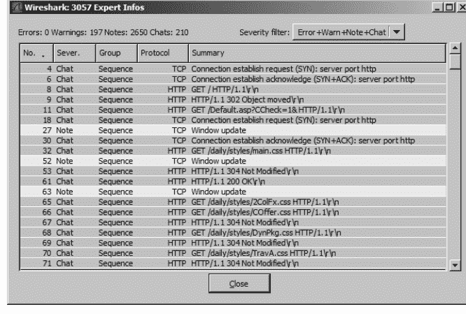

| No. | Severity | Group | Protocol | Summary |

|---|---|---|---|---|

| 4 | Chart | Sequence | TCP | Connection establish request (SYN): server port host |

| 6 | Chart | Sequence | TCP | GET /HTTP/1.1 |

| 8 | Chart | Sequence | HTTP | GET /HTTP/1.1 |

| 9 | Chart | Sequence | HTTP | HTTP/1.1 304 Object Not Modified |

| 11 | Chart | Sequence | HTTP | GET Default.aspx?check=1&/HTTP/1.in |


| 18 | Chart | Sequence | TCP | Connection establish request (SYN+ACK): server port host |
| 27 | Chart | Sequence | TCP | Connection update |
| 32 | Chart | Sequence | TCP | Connection acknowledge (SYN+ACK): server port host |
| 52 | Chart | Sequence | HTTP | GET `/main.html/1.in` |
| 53 | Chart | Sequence | TCP | Window update |
| 61 | Chart | Sequence | HTTP | HTTP/1.1 304 Not Modified |
| 63 | Chart | Sequence | TCP | Window update |
| 65 | Chart | Sequence | HTTP | GET `/styles.css/1.in` |
| 67 | Chart | Sequence | HTTP | HTTP/1.1 304 Not Modified |
| 68 | Chart | Sequence | HTTP | HTTP/1.1 304 Not Modified |
| 69 | Chart | Sequence | HTTP | HTTP/1.1 304 Not Modified |
| 70 | Chart | Sequence | HTTP | GET `/images/gif/1.in` |
| 71 | Chart | Sequence | HTTP | HTTP/1.1 304 Not Modified |

图 8-2: Expert Info 窗口显示警告和备注。

默认情况下，Expert Info 显示警告和注释。通过 Expert Info 窗口，我们可以看到类似图 8-3 所示的内容。

`img/ae85f2fa699ec68c8cd6b402e11c40d7_121_0.png`

图 8-3: Expert Info 窗口显示异常流量。

### 慢速下载的解剖分析

| No. | Severity | Group | Protocol | Summary |
|---|---|---|---|---|
| 4 | Chart | Sequence | TCP | Connection establish request (SYN): server port host |
| 6 | Chart | Sequence | TCP | GET `/HTTP/1.1` |
| 8 | Chart | Sequence | HTTP | GET `/HTTP/1.1` |
| 9 | Chart | Sequence | HTTP | HTTP/1.1 304 Object Not Modified |
| 11 | Chart | Sequence | HTTP | GET `Default.aspx?check=1&/HTTP/1.in` |
| 18 | Chart | Sequence | TCP | Connection establish request (SYN+ACK): server port host |
| 27 | Chart | Sequence | TCP | Connection update |
| 32 | Chart | Sequence | TCP | Connection acknowledge (SYN+ACK): server port host |
| 52 | Chart | Sequence | HTTP | GET `/main.html/1.in` |
| 53 | Chart | Sequence | TCP | Window update |
| 61 | Chart | Sequence | HTTP | HTTP/1.1 304 Not Modified |
| 63 | Chart | Sequence | TCP | Window update |
| 65 | Chart | Sequence | HTTP | GET `/styles.css/1.in` |
| 67 | Chart | Sequence | HTTP | HTTP/1.1 304 Not Modified |
| 68 | Chart | Sequence | HTTP | HTTP/1.1 304 Not Modified |
| 69 | Chart | Sequence | HTTP | HTTP/1.1 304 Not Modified |
| 70 | Chart | Sequence | HTTP | GET `/images/gif/1.in` |
| 71 | Chart | Sequence | HTTP | HTTP/1.1 304 Not Modified |

# 8

## 对抗慢网络


作为一名网络管理员，你的大部分时间将花在修复那些运行速度比预期要慢的计算机和服务上。IT 人员听到的最常见的抱怨是网络很慢。然而，仅仅有人说网络运行缓慢，并不意味着问题就出在网络上。


因此，在开始处理慢网络问题之前，你首先必须确定网络是否真的在运行缓慢。在本章中，我们将查看用户抱怨网络慢的几种不同场景。

### 慢速下载的解剖分析

`slowdownload pcap` 让我们从数据包层面来看一次慢速的解剖。通过滚动所有数据包（如图 8-1 所示），你会看到大量的标准 HTTP 和 TCP 流量，这显示了下载正在进行。正如我们在第 6 章讨论 HTTP 时学到的，HTTP 用于从 Web 请求数据，然后用 TCP 从远程服务器下载这些数据。

| No. | Time | Source | Destination | Protocol | Info |
|---|---|---|---|---|---|
| 12 | 5.516729 | 216.251.110.44 | 10.0.52.164 | TCP | [TCP segment of a reassembled PDU] |
| 13 | 5.517058 | 216.251.110.44 | 10.0.52.164 | TCP | 2468 - Flags [Seq=163 Ack=889 Win=258060 Len=0] |
| 14 | 5.517458 | 216.251.110.44 | 10.0.52.164 | TCP | 2468 - Flags [Seq=165 Ack=873 Win=258060 Len=0] |
| 15 | 5.517965 | 216.251.110.44 | 10.0.52.164 | TCP | 2468 - Flags [Seq=1703 Ack=865 Win=258060 Len=0] |
| 16 | 5.518466 | 216.251.110.44 | 10.0.52.164 | TCP | 2468 - Flags [Seq=1751 Ack=859 Win=258060 Len=0] |
| 17 | 5.518871 | 216.251.110.44 | 10.0.52.164 | TCP | [TCP segment of a reassembled PDU] |
| 18 | 5.519373 | 216.251.110.44 | 10.0.52.164 | TCP | [TCP segment of a reassembled PDU] |
| 19 | 5.523110 | 216.251.110.44 | 10.0.52.164 | TCP | [TCP segment of a reassembled PDU] |
| 20 | 5.523610 | 216.251.110.44 | 10.0.52.164 | TCP | 2468 - Flags [Seq=1800 Ack=853 Win=258060 Len=0] |
| 21 | 5.524099 | 216.251.110.44 | 10.0.52.164 | TCP | [TCP segment of a reassembled PDU] |

图 8-1: 我们需要过滤掉所有的 HTTP 和 TCP 流量。

为了过滤掉降低下载速度的异常流量，我们将使用 Expert Info（专家信息）窗口。打开此窗口，点击菜单栏中的 `Analyze`（分析）并选择 `Expert Info`。你应该看到类似图 8-2 的界面。


| No. | Severity | Group | Protocol | Summary |
|---|---|---|---|---|
| 4 | Chart | Sequence | TCP | Connection establish request (SYN): server port host |
| 6 | Chart | Sequence | TCP | GET /HTTP/1.1 |
| 8 | Chart | Sequence | HTTP | GET /HTTP/1.1 |
| 9 | Chart | Sequence | HTTP | HTTP/1.1 304 Object Not Modified |
| 11 | Chart | Sequence | HTTP | GET Default.aspx?check=1&/HTTP/1.in |
| 18 | Chart | Sequence | TCP | Connection establish request (SYN+ACK): server port host |
| 27 | Chart | Sequence | TCP | Connection update |
| 32 | Chart | Sequence | TCP | Connection acknowledge (SYN+ACK): server port host |
| 52 | Chart | Sequence | HTTP | GET /main.html/1.in |
| 53 | Chart | Sequence | TCP | Window update |
| 61 | Chart | Sequence | HTTP | HTTP/1.1 304 Not Modified |
| 63 | Chart | Sequence | TCP | Window update |
| 65 | Chart | Sequence | HTTP | GET /styles.css/1.in |
| 67 | Chart | Sequence | HTTP | HTTP/1.1 304 Not Modified |
| 68 | Chart | Sequence | HTTP | HTTP/1.1 304 Not Modified |
| 69 | Chart | Sequence | HTTP | HTTP/1.1 304 Not Modified |
| 70 | Chart | Sequence | HTTP | GET /images/gif/1.in |
| 71 | Chart | Sequence | HTTP | HTTP/1.1 304 Not Modified |

图 8-2: Expert Info 窗口显示警告和备注。

默认情况下，Expert Info 显示警告和注释。通过 Expert Info 窗口，我们可以看到类似图 8-3 所示的内容。

img/ae85f2fa699ec68c8cd6b402e11c40d7_121_0.png

图 8-3: Expert Info 窗口显示异常流量。

---

*(注：由于输入文本存在大量重复和格式乱码，此处已根据核心逻辑进行规范翻译)*

### 慢速下载的解剖分析

这些数据包告诉我们，在数据传输过程中，一个数据包被突然丢弃了。作为响应，客户端向服务器发送重复 ACK（Duplicate ACK），请求重新发送最后一个包。客户端会继续发送重复 ACK，直到收到请求的数据包。随后，我们在 Expert Info 窗口中看到丢失包的 TCP 重传（TCP Retransmission），如图 8-5 所示。

图 8-4: Previous segment loss 表示问题。

### Wireshark: Expert Info

| No. | Severity | Group | Protocol | Summary |
|---|---|---|---|---|
| 6477 | Note | Sequence | TCP | Duplicate ACK (#7) |
| 6479 | Note | Sequence | TCP | Duplicate ACK (#8) |
| 6480 | Note | Sequence | TCP | Retransmission (suspected) |
| 6482 | Note | Sequence | TCP | Window update |
| 6483 | Note | Sequence | TCP | Window update |
| 6484 | Note | Sequence | TCP | Retransmission (suspected) |
| 6486 | Note | Sequence | TCP | Window update |
| 6487 | Note | Sequence | TCP | Retransmission (suspected) |

图 8-5: 在数据包被丢弃后可以看到重传。

# 缓慢的路径

`icmp-tracer-slow.pcap` 解决任何网络缓慢问题的第一步是确定问题的根源。在以下场景中，帮助热线刚接到 Owen 的电话，他抱怨他的互联网连接极其缓慢。

## 我们所知的信息

在开始处理这个相当直观的投诉之前，我们不需要了解太多信息。我们确认了，无论访问哪个网站，网络缓慢的问题都一直存在。经过进一步调查，我们获知与 Owen 处于同一网络上的每台机器都遇到了这个问题。

## 接入线路线


由于 Owen 是第一个对此问题提出投诉的人，我们将从他的电脑进行分析（尽管网络上的任何一台电脑可能都足够了）。我们直接在他的机器上安装 `Wireshark`，以获取我们所需的数据包。

由于该问题影响了多台电脑，我们知道这并不是 Owen 电脑的特定性问题；仅捕获他那台电脑尝试访问互联网的数据包将无法提供我们所需的信息。相反，我们使用 `ICMP` 跟踪工具来更好地了解问题所在的位置。

`traceroute` 是一种基于 `ICMP` 的诊断工具（基于 `UDP` 的 `Unix`），它会向路径上的每个路由器发送数据包，直到到达指定的目的地。`traceroute` 将报告关于任何延迟的一些基本信息（如图 8-7 的输出所示），但为了真正掌握瓶颈在哪里，我们将使用 `Wireshark` 捕获 `traceroute` 的结果。

我在图 8-7 中包含了一张示例 `traceroute` 输出图像。每行代表在通往目的地路由中跨越网络所需的时间。

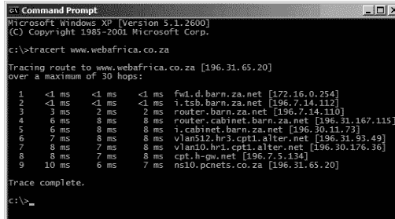

图 8-7：标准的 `traceroute` 输出

## 分析

查看捕获文件（`icmp-traceroute-slow.pcap`，图 8-8），我们首先看到从 Owen 电脑发送到远程主机的 `Echo (ping)` 请求数据包。

| 序号 | 时间 | 源 | 目的地 | 协议 | 信息 |
|---|---|---|---|---|---|
| 1 | 0.000000 | 24.6.126.1 | 198.173.244.32 | ICMP | Echo (ping) request |
| 2 | 0.363482 | 24.6.126.1 | 198.173.244.32 | ICMP | Echo (ping) request |
| 3 | 0.726964 | 24.6.126.1 | 198.173.244.32 | ICMP | Echo (ping) request |
| 4 | 1.371704 | 24.6.126.1 | 198.173.244.32 | ICMP | Echo (ping) request |

图 8-8：从 Owen 电脑发送到远程主机的 `Echo (ping)` 请求

这些数据包与普通的 `ping` 数据包有一点不同，如果你查看 `IP` 部分的 `TTL` 值就能发现。不同之处在于这些数据包中的生存时间（time-to-live）值为 1，如图 8-9 所示。

```
协议：ICMP，源：24.6.126.1，目的：198.173.244.32
版本：4，头部：20 字节
区分服务字段：0x00，默认；ECN：0x00
总长度：92
标识：0xb5f6 (46582)
标志：0x00
分片偏移：0
生存时间：1
协议：ICMP (1)
头部校验和：0xb1fc [正确]
源：24.6.126.1
目的：198.173.244.32
```

图 8-9：`ping` 数据包的生存时间值为 1。

生存时间（`TTL`）值是一个数值，决定了数据包从一个路由器到另一个路由器可以跳数的次数。值为 1 意味着 `traceroute` 向目的地发送数据包，但数据包一旦遇到路由上的第一个路由器就会过期；此时将返回一个 `ICMP TTL` 过期包。`traceroute` 会发送另一个 `TTL` 为 2 的数据包，当数据包遇到路由上的第二个路由器时将返回一个 `ICMP TTL` 过期包。这个过程一直持续，直到数据包的 `TTL` 正好足够到达目的地，如图 8-0 所示。

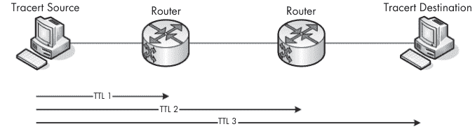

图 8-10：`TTL` 值随着路由到目的地而增加。

将我们发现的新知识应用于当前情况，我们可以立即看到第一个数据包的问题。该数据包的 `TTL` 值为 1，它应该立即命中内部路由器并向我们报告——但它并没有。由于 Owen 的电脑没有收到值为 1 的第一个数据包的立即响应，它等待了大约三秒（如图 8-11 中的 `Time` 字段所示），然后发送了另一个请求。

| 序号 | 时间 | 源 | 目的地 | 协议 | 信息 |
|---|---|---|---|---|---|
| 2 | 3638126 | 24.6.126.1 | 198.173.244.32 | ICMP | Echo (ping) |
| 3 | 3681276 | 24.6.126.1 | 198.173.244.32 | ICMP | Echo (ping) |

图 8-11：Owen 的电脑发送请求，未收到响应，并在三秒后发送了另一个请求。

当电脑没有收到第二次尝试的响应时，它又等待了大约三秒并向路由器发送了最后一个数据包，结果证明也是失败的，如图 8-12 所示。

| 序号 | 时间 | 源 | 目的地 | 协议 | 信息 |
|---|---|---|---|---|---|
| 3 | 3638126 | 24.6.126.1 | 198.173.244.32 | ICMP | Echo (ping) |
| 4 | 3931704 | 24.6.126.1 | 198.173.244.32 | ICMP | Echo (ping) |

图 8-12：再次没有收到响应后，电脑再次尝试一次。

此时，`traceroute` 到了来自第一个路由器的回复，因此它的下一个数据包（第四个数据包）的 `TTL` 值为 2。该数据包成功到达了路由器，Owen 的电脑收到了预期的 `ICMP` 类型 1、代码 0 数据包，该包包含“生存时间超时”的消息，如图 8-13 所示。

| 序号 | 时间 | 源 | 目的地 | 协议 | 信息 |
|---|---|---|---|---|---|
| 5 | 3939304 | 24.6.126.1 | 198.173.244.32 | ICMP | Time-to-live exceeded |

图 8-13：生存时间超时消息。

值为 1 意味着 `traceroute` 会向目的地发送一个数据包，但数据包一旦遇到路由上的第一个路由器就会过期；这种过程持续，直到数据包的生存时间足够目的地。

我们将新发现的知识应用于当前情况，我们可以立即看到第一个数据包的问题。该数据包的 `TTL` 值为 1，它应该立即命中内部路由器并向我们报告——但它并没有。由于 Owen 的电脑没有收到值为 1 的第一个数据包的立即响应，它等待了大约三秒（如图 8-11 中的 `Time` 字段所示），然后发送了另一个请求。

总结：再次，`Wireshark` 为我们节省了大量的排障时间。

捕获文件中出现重复包的常见原因有两个：路由不一致和端口镜像配置不当。在深入细节并尝试确定原因之前，让我们先确保我们正在查看的数据包是彼此真正的重复包。

判断数据包是否相同的某种方法是查看每个 `IP` 头部中的 `ID` 标识字段（identification number）。你可以在数据包详情（`Packet Details`）面板中找到数据包的 `IP` 部分。你会发现第一个和第二个数据包具有相同的标识码，`Octc509`，如图 8-15 所示。

```
Internet Protocol, Src: 12.234.13.89 (12.234.13.89), Dst: 12.234.14.63 (12.234.14.63)
Version: 4
Header Length: 20 bytes
Differentiated Services Field: 0x00 (DSCP: 0x00; Default; ECN: 0x00)
Total Length: 40
Identification: Octc509 (50441)
Flags: 0x00
Fragment offset: 0
Time to live: 27
Protocol: TCP (0x06)
Header checksum: 0915b [correct]
Source: 12.234.13.89 (12.234.13.89)
Destination: 12.234.14.63 (12.234.14.63)
```

图 8-15：前两个数据包具有相同的标识码。

第三和第四个数据包也是如此，它们的基础事务 `ID` 为 `Octaca`，如图 8-16 所示。继续往下看，我们发现捕获文件中的每一对数据包都是如此。


```
Internet Protocol, Src: 12.234.14.63 (12.234.14.63), Dst: 12.234.13.89 (12.234.13.89)
Version: 4
Header Length: 20 bytes
Differentiated Services Field: 0x00 (DSCP: 0x00; Default; ECN: 0x00)
Total Length: 40
Identification: Octaca* (44199)
Flags: 0x00
Fragment offset: 0
Time to live: 128
Protocol: TCP (0x06)
Header checksum: 058bd [correct]
Source: 12.234.14.63 (12.234.14.63)
Destination: 12.234.13.89 (12.234.13.89)
```

图 8-16：第三和第四个数据包也具有相同的标识码。

既然所有数据包在负载负载方面都是完全一致的，我们可以开始尝试确定两种可能的解决方案中哪最可能是正确的——路由不一致还是端口镜像错误。为此，我们将查看数据包的 `TTL` 值。如果这些值不同，则表明存在内部路由问题；如果它们相同，那么我们可能遇到了端口路由问题。

如图 8-17 所示，我们发现数据包 1 的 `TTL` 值为 47，而数据包 2 的值为 46。这告诉我们我们确实存在内部路由问题。事实是它经过了某处的路由器并回弹到了我们的机器。

由于这个问题只出现在 Jeff 的电脑上，因此得出结论：它是局限于在该机器上的，而不是网络路由器上。经过进一步调查，我们发现他的新电脑配置了错误的子网掩码。

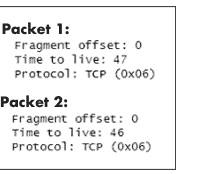

图 8-17：这些数据包的 `TTL` 值不等，这指向路由问题。

# 总结

如果机器配置了错误的子网掩码，可能会导致许多问题，包括导致配置错误的计算机完全无法通信。在这种情况下，Jeff 电脑的每个数据包都回弹了，本质上双倍了计算机需要处理的流量，并在高峰时段严重减慢了通信。

## 那台服务器故障了吗？

```
http-client-refuse.pcap
```

惊喜吧！另一个用户在抱怨互联网连接缓慢。这次，Eric 抱怨他无法访问 Novell 网站的一部分来下载某些必要的软件。每次他访问该网站时，他的浏览器一直在加载，但什么都没有发生。这一定是网络问题，对吧？

### 我们知道的信息

对网络进行彻底检查后，我们确定除了 Eric 之外，所有机器的互联网访问都是正常的。因此，问题特定的 Eric 的工作站。他的电脑运行 Windows，并且完全更新了所有最新的服务包和补丁。经过进一步调查，我们发现问题仅出在 Novell 网站的一个特定部分。

### 接入接线

由于问题只发生于 Eric 的电脑上，我们可以在他的系统上安装 Wireshark 并捕获我们需要的数据包。问题在他访问 Novell 网站的某个特定部分时发生，所以我们将在该问题发生时进行跟踪。

### 分析

当你打开 `http-client-refuse`（如图 8-18 所示）时，你应该能够立即识别出它是 HTTP 通信，因为初始握手之后有一个 HTTP 请求。事实上，在数据包 28 和 29 之前，这个 HTTP 请求是正常的，如下方所示。通过追踪我们可以定位问题。

| 序号 | 时间 | 源 | 目的 | 协议 | 信息 |
| :--- | :--- | :--- | :--- | :--- | :--- |
| 1 | 0.000000 | 67.161.32.69 | 130.575.52.65 | TCP | > 1782 [SYN] Seq=0 Win=28580 Len=0 |
| 2 | 0.020729 | 130.575.52.65 | 67.161.32.69 | TCP | < 1783 [SYN, ACK] Ack=1 Win=65535 Len=0 |
| 3 | 0.020768 | 67.161.32.69 | 130.575.52.65 | TCP | > 1782 [ACK] Seq=1 Win=52189 Len=0 |
| 4 | 0.051623 | 130.575.52.65 | 67.161.32.69 | TCP | < 1783 [PSH, ACK] Ack=1 Win=65535 Len=0 |
| 5 | 0.061432 | 67.161.32.69 | 130.575.52.65 | TCP | > 1782 [ACK] Seq=2 Win=52139 Len=0 |
| 6 | 0.070452 | 130.575.52.65 | 67.161.32.69 | TCP | < 1783 [segment of a reassembled PDU] |
| 7 | 0.073391 | 67.161.32.69 | 130.575.52.65 | TCP | > [segment of a reassembled PDU] |
| 8 | 0.073430 | 130.575.52.65 | 67.161.32.69 | TCP | < 1782 [ACK] Seq=0 Win=28580 Len=0 |
| 9 | 0.074128 | 67.161.32.69 | 130.575.52.65 | TCP | > [segment of a reassembled PDU] |
| 10 | 0.074752 | 130.575.52.65 | 67.161.32.69 | TCP | < [segment of a reassembled PDU] |
| 11 | 0.074770 | 67.161.32.69 | 130.575.52.65 | TCP | > 1782 [ACK] Seq=4 Win=28580 Len=0 |

图 8-18：捕获从标准的 HTTP 通信开始。

当我们打开这个捕获的时间时，在数据包 28 之前，所有数据包的捕获都没有异常延迟。当我们处于 HTTP 事务中间时，数据包 27 和 28 之间出现了 9 秒的延迟。

| 序号 | 时间 | 源 | 目的 | 协议 | 信息 |
| :--- | :--- | :--- | :--- | :--- | :--- |
| 28 | 0.000000 | 67.161.32.69 | 67.161.32.69 | TCP | http > 1783 [RST] Seq=0 Len=0 |
| 29 | 0.0534680 | 130.575.32.69 | 130.575.52.65 | TCP | < 1782 http [RST, ACK] Seq=0 win=0 len=0 |

图 8-19：数据包 28 和 29 存在问题。

服务器已停止与客户端通信，我们需要找出原因。我们可以遍历整个捕获步骤并检查每个数据包，但那将是一个极其且费燥的过程。相反，我们将采取更简单的方法。

由于我们处理的是 HTTP 事务，TCP 流应该是不完整的，除非我们正在等待某种形式的用户输入。9 秒后，服务器无法再传输需要返回给客户端的数据，因此它发送了一个 `RST` 包来终止连接。我们的客户端还没有放弃，在确认请求之前又增加了 5 秒（如图 8-19 所示）。

## 跟踪 TCP 流

```
Stream Content
GET /imc/contactus.jsp HTTP/1.1
Accept: *
Referer: http://www.google.com/img/load/stream.html
--ID=converts&stream-may-show=640&h=50
Accept-Encoding: gzip, deflate
Accept-Language:
User-Agent: Mozilla/5.0 (Windows NT 6.0; Win64) AppleWebKit/537.36 (KHTML, like Gecko) Chrome/91.0.4472.124 Safari/537.36
Host: novell.com
Connection: keep-alive
```


图 20：这个请求是我们的问题所在。

## 分析

我们将使用端口镜像来处理这种场景，因为我们显然无法安装 Wireshark。

`torrential-slowness.pcap` 捕包中的包仅提供了网络上发生的大量连接的简要采样，如图 8-2 所示。

图 8-2：此捕包中的连接尝试列表。

| No. | Time | Source | Destination | Protocol | Info |
|---|---|---|---|---|---|
| 1 | 000000 | 202.111.67.193 | 192.168.0.193 | TCP | 11766 - 1534 (PSH [ACK]) Seq=0 Ack=win=65535 Len=1418 |


| 2 | 000003 | 192.168.0.193 | 202.111.67.193 | TCP | 1534 - 11766 (ACK) Seq=0 Ack=win=24960378 Len=65535 |
| 3 | 000005 | 124.197.16.30 | 192.168.0.193 | TCP | 26507 - 1534 (ACK) Seq=0 Ack=win=8227 Len=0 |
| 4 | 000013 | 192.168.0.193 | 124.197.16.30 | TCP | 31717 - 26507 (PSH [ACK]) Seq=0 Ack=win=65535 Len=1038 |
| 5 | 000021 | 213.11.90.70 | 192.168.0.193 | TCP | 14171 - 31733 (ACK) Seq=0 Ack=win=65535 Len=0 |
| 6 | 000028 | 192.168.0.193 | 213.11.90.70 | TCP | 35321 - 14171 (PSH [ACK]) Seq=0 Ack=win=65535 Len=1452 |
| 7 | 000037 | 192.168.0.193 | 124.197.16.30 | TCP | 3313 - 35321 (PSH [ACK]) Seq=0 Ack=win=54252 Len=1452 |
| 8 | 000045 | 192.168.0.193 | 213.11.90.70 | TCP | 66838 - 3313 (ACK) Seq=0 Ack=win=65535 Len=0 |
| 9 | 000984 | 192.168.0.193 | 189.141.96.6 | TCP | 6832 - 66838 (PSH [ACK]) Seq=0 Ack=win=6300 Len=0 |
| 10 | 052255 | 143.68.42.31 | 192.168.0.193 | TCP | 4681 - 6483 (ACK) Seq=0 Ack=win=17280 Len=0 |

我们的系统网络 (`192.168.0.193`) 出现在此捕包中，与网络之外的系统列表建立并接收连接。更糟糕的是，这些流量中大部分带有 TCP SYN 标志的流量丢失了，接收计算机会发送其缓冲区并推送该流量，其优先级高于任何其他流量。这始终是一个不妙的信号。

尽管如此，这些连接中的大多数已经过了 TCP 握手阶段，意味着它们正在积极向我们的客户端传输数据。你可以从图 8-22 的“对话”（Conversations）对话框中看到正在发生多少连接。

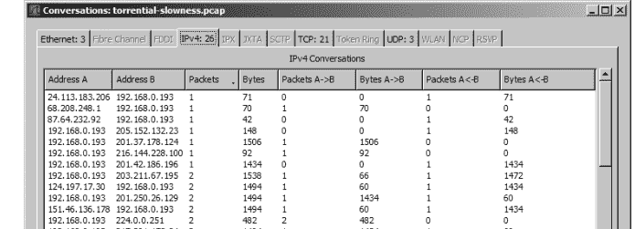

图 8-2：对话对话框显示有很多连接正在发生。

仅仅在这一 1 秒的捕包中，就有 27 个不同的 TCP 连接正在发生！

缓解这个问题最简单的方法是去那台故障电脑上检查一番，但那样有什么趣呢？我们将采用包分析的方法。

# 第 8 章

观察数据包，你的首要行动可能是追踪远程 IP 地址并查看它们位于何处，通常是通过对每个 IP 地址进行 `WHOIS` 查询。然而，在这种情况下，你会很快发现大多数这些 IP 地址并没有指向任何公司，甚至不在同一个大区域，而是指向世界各地的地点。

为了进一步评估数据包，你可以查看 TCP 流是否包含有价值的信息。在这种情况下，跟踪 TCP 流证明是徒用的——数据是乱码，如图 8-23 所示。

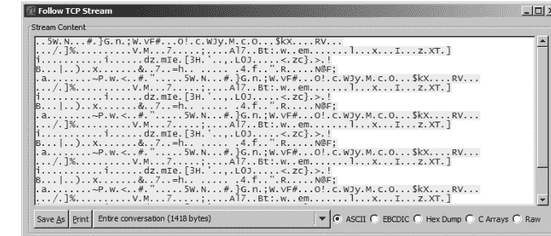

图 8-23：TCP 流没有提供任何真实价值的内容。

当这些高技术性的问题出现时，你该怎么办？简单地逐个查看数据包列表如何？当你向下滚动数据包时，你最终会发现自己处于第 9 个包，如图 8-24 所示。该包如 Info 字段所示，通过查询 BitTorrent 服务器识别了罪魁祸首。这种点点传输是我们问题以及所有这些连接的源头。

| No. | Time | Source | Destination | Protocol |
|---|---|---|---|---|
| 99 | 0.74636 | 192.168.0.193 | 224.0.251 | MDNS |

图 8-24：单个数据包引导我们发现了罪魁祸首——BitTorrent。

## 总结

在这种情况下，一个用户在他的工作站上安装了 BitTorrent，并配置为允许无限速率的入站和出站连接。高带宽允许一台工作站垄断公司所有的流量。这个案例提醒我们，在进行分析时，通常会使用一些高级功能来快速解决问题；然而，最快的解决方案就是简单地检查单个数据包。

### 邮件服务器崩溃了

`email-troubles.pcap` 在重要性方面，在员工眼中邮件占着极高地位。一旦邮件无法工作，你就会听到抱怨声。在这种场景中，你网络上的所有用户都在抱怨他们的邮件需要很长时间才能到达目的地。发送到其他域的邮件是如此，即使是发送给同一组织内的同事，也要花费永恒的时间。让我们找到问题的根源。

#### 我们所知的信息

我们公司所有的邮件都通过一台邮件服务器管理。经过一些研究，我们确认这个问题存在于我们网络中的所有客户端。虽然一个典型的办公内邮件会即时投递，但现在投递需要 10 到 15 分钟。接收外部邮件也有同样的延迟。

#### 接入接线

由于我们的问题与托管在单台机器（即邮件服务器）上的服务有关，我们将分析器放在那里。问题在整个工作日中一直存在，这是捕取包的好时机。

#### 分析

当你查看捕包结果（`email-troubles.pcap`）时，你将看到在邮件服务器上应该看到的内容：有大量的邮局协议（POP）包进入我们的邮件服务器（参见图 8-25），但数量有多少，速率是多少？也许我们的邮件服务器过载了。

图 8-25：此次捕包包含大量的 POP 包。

| No. | Time | Source | Destination | Protocol | Info |
|---|---|---|---|---|---|
| 1 | 0.000000 | 122.234.12.130 | 161.58.73.170 | POP | Request: RETR 20 |
| 2 | 0.079230 | 161.58.73.170 | 122.234.12.130 | TCP | pop3 > [156] Seq=0 Ack=win=41512 Len=0 |
| 3 | 0.090950 | 161.58.73.170 | 122.234.12.130 | POP | Response: +0102 |
| 4 | 0.091030 | 122.234.12.130 | 161.58.73.170 | TCP | Continuation |
| 5 | 0.091117 | 122.234.12.130 | 161.58.73.170 | POP | 1567 > pop3 [167] Seq=A Req=2920 win=64513 Len=0 |
| 6 | 0.092467 | 161.58.73.170 | 122.234.12.130 | POP | Continuation |

为了确定我们接收 POP 包的速率，将时间显示从“自捕包开始”更改并查看文件的最后一个包。这告诉我们我们查看的是两分钟的流量，如图 8-26 中的 Time 列所示。

| No. | Time | Source | Destination | Protocol | Info |
|---|---|---|---|---|---|
| 360 | 1.664143 | 122.234.12.130 | 161.58.73.170 | TCP | 1567 > pop3 [167] Seq=A Req=30105 win=6337 Len=0 |

图 8-26：更改时间让我们对接收量有了心里数。

### 这里有些东西 Gnu

`gnutella.pcap` 这个场景与我们早前的 BitTorrent 场景类似。我们网络上的用户 Tina 打来电话抱怨说，无论她是在本地、局域网内还是在互联网上操作，她的电脑运行得极其缓慢。

#### 我们所知道

此场景与我们之前的 BitTorrent 示例情况相同。因此，我们知道这个问题广泛存在，并且影响了其他用户。然而，其他用户仅在处理互联网和以网络为中心的应用时报告了速度缓慢。我们网络上的边缘路由器报告处理器利用率高，以及大量的入站和出站流量。

#### 接入接线

在这种情况下，受影响计算机的所有症状与我们的 BitTorrent 示例一致，但 Tina 的电脑除外。不仅她的网络中心型应用程序运行缓慢，她的电脑整体运行也有些迟缓。

由于她的电脑显示出独特的症状，我们假设问题与她的电脑有关，因此我们从这里开始分析。然而，由于 Tina 的电脑运行缓慢，直接在上面安装 Wireshark 可能不是主主意——电脑的迟缓会导致抓包过程中丢失数据。我们将使用端口镜像（port mirroring）。

#### 分析


这个抓包文件（`gnutella.pcap`）很长，但大部分看起来与 BitTorrent 的抓包相似。如图 8-28 所示，Tina 的电脑 `10.1.4.176` 正在尝试与网络之外的不同主机进行通信。这些尝试大多数在初始 `SYN` 后未得到响应，或者被客户端用 `RST` 数据包拒绝了。

| No. | Time | Source | Destination | Protocol | Info |
|---|---|---|---|---|---|
| 1 | 0.000023 | 10.1.4.176 | 66.28.59.53 | TCP | 3663 = 6346 [SYN] Seq=0 Len=1460 |
| 2 | 0.002357 | 10.1.4.176 | 66.28.59.53 | TCP | 6346 = 3663 [SYN] Seq=0 Len=1460 |
| 3 | 0.006083 | 10.1.4.176 | 10.1.4.176 | TCP | 6346 = 6384 [RST, Ack] Seq=0 Len=0 |
| 4 | 0.019184 | 10.1.4.176 | 10.1.4.176 | TCP | 6346 = 6384 [RST, Ack] Seq=0 Len=0 |
| 5 | 0.053122 | 10.1.4.176 | 10.1.4.176 | TCP | 6346 = 6384 [RST, Ack] Seq=0 Len=0 |
| 6 | 0.099962 | 10.1.4.176 | 66.28.59.53 | TCP | 6346 = 3663 [SYN] Seq=0 Len=1460 |
| 7 | 0.102592 | 10.1.4.176 | 10.1.4.176 | TCP | 6346 = 6384 [RST, Ack] Seq=0 Len=0 |

图 8-28：大多数 TCP 连接尝试都是失败的。

某些 TCP 连接可能导致这些失败，但在进一步调查之前，我们先要确定正在面对的是什么，以便确定问题的范围。做到此的好方法是查看“对话”对话框，查看正在进行多少个独立的 TCP 和 IP 会话，如图 8-29 所示。

对话窗口显示，图 8-29 顶部标签页中的该跟踪文件包含 81 个 IP 会话和 243 个 TCP 会话。如果你查看的是从服务器采集的流量，如此大量的会话通常是可以接受的，但对于这个工作站；在短时间内看到这么多会话是不正常的。

| Address A | Address B | Packets | Bytes A->B | Bytes B->A | Packets<-B | Bytes<-A |
|---|---|---|---|---|---|---|
| 10.1.4.176 | 24.182.175 | 45 | 496 | 496 | 0 | 0 |
| 10.1.4.176 | 64.176.195 | 48 | 496 | 496 | 0 | 0 |
| 10.1.4.176 | 213.251.252 | 48 | 496 | 496 | 0 | 0 |
| 10.1.4.176 | 66.193.252 | 59 | 558 | 558 | 0 | 0 |
| 10.1.4.176 | 152.211.231 | 59 | 558 | 558 | 0 | 0 |
| 10.1.4.176 | 62.214.194 | 60 | 620 | 620 | 0 | 0 |
| 10.1.4.176 | 217.84.239 | 60 | 620 | 620 | 0 | 0 |
| 10.1.4.176 | 210.271.138 | 62 | 620 | 620 | 0 | 0 |
| 10.1.4.176 | 168.191.249 | 62 | 620 | 620 | 0 | 0 |
| 10.1.4.176 | 215.196.164 | 68 | 682 | 682 | 0 | 0 |
| 10.1.4.176 | 217.84.380 | 68 | 682 | 682 | 0 | 0 |

图 8-29：对话对话框显示发生了大量会话。如果你查看这些 TCP 会话，你会发现每一个都涉及一个远程主机。你可以发现由于每个会话的数据包数量很低，其中许多会话是不成功的。为了真正评估这里的通信，最好的方法是从“对话”对话框中打开的 IPv4 标签页，按照包含的数据包数量对会话进行排序，如图 8-30 所示。

| Address A | Address B | Packets | Bytes A->B | Bytes B->A | Packets<-B | Bytes<-A |
|---|---|---|---|---|---|---|
| 10.1.4.176 | 205.251.194 | 48 | 2928 | 2928 | 27 | 1440 |
| 10.1.4.176 | 131.231.151 | 27 | 1728 | 1728 | 12 | 918 |
| 10.1.4.176 | 145.105.252 | 24 | 1524 | 1524 | 12 | 738 |
| 10.1.4.176 | 214.136.119 | 24 | 1464 | 1464 | 12 | 760 |
| 10.1.4.176 | 65.222.93 | 24 | 1464 | 1464 | 12 | 720 |
| 10.1.4.176 | 146.766.229 | 24 | 1464 | 1464 | 12 | 720 |
| 10.1.4.176 | 146.183.243 | 24 | 1464 | 1464 | 12 | 720 |
| 10.1.4.176 | 214.234.236 | 24 | 1464 | 1464 | 12 | 720 |
| 10.1.4.176 | 233.109.189 | 24 | 1464 | 1464 | 12 | 720 |
| 10.1.4.176 | 65.196.165 | 24 | 1464 | 1464 | 12 | 720 |

图 8-30：按包含的数据包数量排序的会话视图。

你应该在列表顶部看到 Tina 的电脑与远程主机 65.34.1.6 之间的通信，如图 8-31 所示。

# 对话：gnutella.pcap

| Address | Port A | Address B | Port B | Packets | Bytes | A->B | Bytes->B | Packets<-B |
|---|---|---|---|---|---|---|---|---|
| 65.34.1.56 | 63546 | 10.1.176 | 3766 | 11 | 1153 | 5 | 652 | 501 |
| 213.36.22.131 | 63546 | 10.1.176 | 3759 | 6 | 731 | 4 | 306 | 425 |
| 213.36.22.131 | 63546 | 10.1.176 | 3815 | 7 | 731 | 4 | 426 | 426 |
| 213.36.22.131 | 63546 | 10.1.176 | 3800 | 9 | 732 | 4 | 306 | 246 |
| 180.82.10.56 | 63546 | 10.1.176 | 3695 | 8 | 488 | 5 | 240 | 248 |
| 24.45.10.102 | 63546 | 10.1.176 | 3691 | 10 | 280 | 6 | 240 | 248 |
| 217.280.31.56 | 63546 | 10.1.176 | 3711 | 8 | 488 | 4 | 240 | 248 |
| 62.11.122.179 | 63546 | 10.1.176 | 3714 | 8 | 488 | 4 | 240 | 248 |
| 65.92.43.6 | 63546 | 10.1.176 | 3715 | 8 | 488 | 4 | 240 | 248 |
| 24.78.26.133 | 63546 | 10.1.176 | 3716 | 8 | 488 | 4 | 240 | 248 |
| 217.181.208.56 | 63546 | 10.1.176 | 3722 | 8 | 488 | 4 | 240 | 248 |

图 8-31：Tina 的电脑与远程主机的通信。现在，你通过右键点击此对话、选择 `As`、应用过滤器（`Apply Filter`）来查看这些数据包。结果是你只看到图 8-32 中的问题数据包。图 8-32：现在只显示相关的对话。

图 8-32 显示的数据包提供了额外信息，引导我们发现问题。具体来说，数据包 431、433 和434 都识别为 Gnutella 数据包。这些 Gnutella 数据包具有通过 Gnutella 文件共享网络发送或接收的特征。如图 8-33 所示。


| Transmission Control Protocol, Src Port: 3766 (3766), Dst Port: 6346 (6346), Seq: 1, Ack: 1, Len: 30 | Gnutella Protocol | Gnutella upload / Download stream |

这些 Gnutella 数据包包含了一些有趣的信息。数据包 431（在图 8-33 中）的详细信息并没有给我们提供任何有用信息，除了它是一个穿过 Gnutella 网络的下载/上传流。如果我们查看数据字节面板（图 8-34），图 34 显示了正在通过 Gnutella 下载的内容。这个特定的数据流显示 `GET` 命令正在下载一个包含“sorority kitten”单词的文件。我们发现了可疑流量。顺便提一下，判断这是 Gnutella 流量的另一种方法：如果你查看发生的所有对话，你会注意到数据包列表中的 Info 显示所有通信发生在端口 `6346` 上，如图 8-35 所示。

| No. | Time | Source | Destination | Protocol | Info |
|---|---|---|---|---|---|
| 583 | 75.544302 | 10.1.4.176 | 65.229.223 | TCP | 3803 > [6346] [SYN] Seq=0 Len=0 MSS=1460 |
| 584 | 75.544499 | 10.1.4.176 | 24.28.233.147 | TCP | 3802 > [6346] [SYN] Seq=0 Len=0 MSS=1460 |
| 585 | 75.544593 | 10.1.4.176 | 65.238.230.13 | TCP | 3801 > [6346] [SYN] Seq=0 Len=0 MSS=1460 |
| 586 | 75.545190 | 10.1.4.176 | 24.198.197.5 | TCP | 3804 > [6346] [SYN] Seq=0 Len=0 MSS=1460 |
| 587 | 75.545446 | 10.1.4.176 | 24.249.29.111 | TCP | 3799 > [6346] [SYN] Seq=0 Len=0 MSS=1460 |

图 8-35：查看端口号是识别流量类型的好方法。

+ *在 http://www.iana.org 快速搜索此端口号将列出与该端口相关的服务。*

# 9

## 基于安全的分析


在本章中，我们将深入研究几种与安全相关的网络场景，并结合使用 Wireshark 对其进行分析。在黑客、身份窃取者和企业数据窃取威胁迫在眉睫的今天，你无法承受*不具备在数据包级别分析网络安全的后果。

## 操作系统指纹识别

`osfingerprinting.pcap` 操作系统（OS）指纹识别*是黑客用来识别远程计算机操作系统的一种技术，目的是获取可能用于破解的有用信息。操作系统指纹识别的工作原理是使用远程机器向目标计算机发送各种命令。当远程机器接收到这些命令的响应时，它可以解释这些响应，从而对目标计算机正在使用的操作系统做出有推断的推测。了解你想要利用的计算机的操作系统，可以让你快速找到针对该操作系统的特定漏洞。

当你打开指纹识别 pcap 文件时，你将看到几种类型的 ICMP 流量，如图 9-1 所示。其中一些流量，如 Echo（ping）请求和 Echo（ping）响应，是常见的，不应引起引起。然而，像时间戳请求/响应、地址掩码请求和信息请求之类的流量是不常的。

| No. | Time | Source | Destination | Protocol | Info |
|---|---|---|---|---|---|
| 11 | 11.863030 | 10.0.0.29 | 10.0.0.2 | ICMP | Timestamp request |
| 12 | 11.862328 | 10.0.0.2 | 10.0.0.29 | ICMP | Timestamp request |
| 13 | 11.736941 | 10.0.0.2 | 10.0.0.29 | ICMP | Timestamp reply |
| 14 | 14.869039 | 10.0.0.2 | 10.0.0.29 | ICMP | Address mask request |
| 15 | 15.241112 | 10.0.0.29 | 10.0.0.2 | ICMP | Information request |
| 16 | 16.742531 | 10.0.0.29 | 10.0.0.2 | ICMP | Echo (ping) |
| 17 | 17.006258 | 10.0.0.29 | 10.0.0.2 | ICMP | Echo (ping) request |
| 18 | 18.704623 | 10.0.0.29 | 10.0.0.2 | ICMP | Echo (ping) reply |
| 19 | 19.354823 | 10.0.0.29 | 10.0.0.2 | ICMP | Echo (ping) request |
| 20 | 20.113005 | 10.0.0.29 | 10.0.0.2 | ICMP | Echo (ping) |
| 21 | 21.359669 | 10.0.0.2 | 10.0.0.29 | ICMP | Echo (ping) request |
| 22 | 21.398162 | 10.0.0.2 | 10.0.0.29 | ICMP | Echo (ping) reply |

图 9-1：这种类型是你不想看到的 ICMP 流量。

我们在图 9-1 中看到的不寻常 ICMP 请求表明，我们的系统是攻击者使用基于 ICMP 的操作系统指纹扫描的目标。攻击者发送这些请求，并利用目标系统的响应（如果有的话）来确定运行的操作系统。

注意：由于在正常情况下，我们绝不应该看到 ICMP 类型 13、15 或 17 的流量，因此我们可以创建一个过滤器，只显示这些类型的流量，以便我们快速检查。该过滤器为 `icmp.type=13 || icmp.type=15 || icmp.type=17`。

## 简单的端口扫描

攻击者可以使用端口扫描来获取有关网络非常关键的信息。使用专门的端口扫描软件，黑客可以尝试连接到指定端口数组上的设备，例如 21 (FTP) 和 80 (HTTP)。通过从这些扫描中获得的信息，攻击者可以找到允许访问你网络的端口。将开放的端口想象成进入防御严密城堡的隧道。一旦黑客知道了其中一个隧道的信息，他们可能就能通过各种手段长破之入。参见图 9-2，

`portscan.pcap`

| No. | Time | Source | Destination | Protocol | Info |
|---|---|---|---|---|---|
| 7 | 7.607512 | 10.10.25.14 | 10.10.18.12 | TCP | 16748 - [telnet] [SYN] |
| 8 | 7.650328 | 10.10.25.14 | 10.10.18.12 | TCP | 16748 - [telnet] [SYN] |
| 9 | 8.008340 | 10.10.25.14 | 10.10.18.12 | TCP | 16748 - [telnet] [SYN] |
| 10 | 9.004939 | 10.10.25.14 | 10.10.18.12 | TCP | 16748 - [telnet] [SYN] |
| 11 | 9.533311 | 10.10.25.14 | 10.10.18.12 | TCP | 16748 - [telnet] [SYN] |
| 12 | 11.108331 | 10.10.25.14 | 10.10.18.12 | TCP | 16748 - [telnet] [SYN] |
| 13 | 11.509531 | 10.10.25.14 | 10.10.18.12 | TCP | 16748 - [telnet] [SYN] |
| 14 | 14.307711 | 10.10.25.14 | 10.10.18.12 | TCP | 16748 - [telnet] [SYN] |
| 15 | 15.702512 | 10.10.25.14 | 10.10.18.12 | TCP | 16748 - [telnet] [SYN] |
| 16 | 16.312731 | 10.10.25.14 | 10.10.18.12 | TCP | 16748 - [telnet] [SYN] |

图 9-2：这是端口扫描的示例（注：原文表格数据略有重复，此处按逻辑对应翻译）。

（注：由于 [content] 块内原文表格内容存在多行重复数据，译文已根据原文结构进行对应处理。）

## 我们所知的信息


该 FTP 服务器运行着非常老旧的软件，没有什么像样的功能。公司内部所有的主要开发人员都有用户名和账户，允许他们完全访问服务器上的所有文件。该服务器还配置为可以从网络外部访问，以便开发人员可以在家工作。

## 接入网络线路

由于该服务器位于我们的网络中，在上面安装 `Wireshark` 似乎是最好的使用方法。然而，由于服务器正承受着极高的流量负载，如果我们过分加重服务器负担，数据包可能会丢失，因此我们将改用端口镜像（`port mirroring`）。

## 分析

当你捕获到 `ftp-crack.pcap` 时，你会发现在极短的时间内发生了很多事情。根据我们在第 6 章对 FTP 的讨论，你应该熟悉 FTP 身份验证过程的典型样子。

在初始的 TCP 握手之后，通常会发生登录过程，以便用户开始与服务器交互。在这次捕获中，我们直接进入了用户名和密码验证过程，正如数据包 4（图 9-5）所示，该验证失败了。

```
File Transfer Protocol (FTP)
530 Login Incorrect.
Response code: Not logged in (530)
Response arg: Login Incorrect.
```

> 图 9-5：数据包 4 显示了首次验证失败。

我们假设尝试登录的用户可能漏掉了密码，但这一假设在随后的数据包中被消除了。如图 9-6 所示，我们看到了大量的验证失败。

| 序号 | 时间 | 源 | 目的地 | 协议 | 详情 |
|---|---|---|---|---|---|
| 27 | 0.010411 | 102.21.121.151 | 102.234.125.254 | TCP | Tcp > 2220 ACK [Seq=1 Ack=wm8153] [TCP CHECKSUM] Len=0 |
| 28 | 0.010416 | 102.21.121.151 | 102.234.125.254 | TCP | Tcp > 2220 ACK [Seq=1 Ack=wm7647] [TCP CHECKSUM] Len=0 |
| 29 | 0.010860 | 102.21.121.151 | 102.234.125.254 | TCP | Tcp > 2220 ACK [Seq=1 Ack=wm8153] [TCP CHECKSUM] Len=0 |
| 30 | 0.011355 | 102.21.121.151 | 102.234.125.254 | TCP | Tcp > 2220 ACK [Seq=1 Ack=wm8153] [TCP CHECKSUM] Len=0 |
| 31 | 0.012024 | 102.21.121.151 | 102.234.125.254 | TCP | Tcp > 2220 ACK [Seq=1 Ack=wm7647] [TCP CHECKSUM] Len=0 |
| 32 | 0.012751 | 102.21.121.151 | 102.234.125.254 | TCP | Tcp > 2220 ACK [Seq=1 Ack=wm8153] [TCP CHECKSUM] Len=0 |
| 33 | 0.013533 | 102.21.121.151 | 102.234.125.254 | TCP | Tcp > 2220 ACK [Seq=1 Ack=wm8153] [TCP CHECKSUM] Len=0 |
| 34 | 0.014288 | 102.21.121.151 | 102.234.125.254 | TCP | Tcp > 2220 ACK [Seq=1 Ack=wm9152] [TCP CHECKSUM] Len=0 |
| 35 | 0.015066 | 102.21.121.151 | 102.234.125.254 | TCP | Tcp > 2220 ACK [Seq=1 Ack=wm9152] [TCP CHECKSUM] Len=0 |
| 36 | 0.015846 | 102.21.121.151 | 102.234.125.254 | TCP | Tcp > 2220 ACK [Seq=1 Ack=wm9152] [TCP CHECKSUM] Len=0 |
| 37 | 0.016632 | 102.21.121.151 | 102.234.125.254 | FTP | Response: 530 Login Incorrect |
| 38 | 0.017413 | 102.21.121.151 | 102.234.125.254 | FTP | Response: 530 Login Incorrect |
| 39 | 0.018186 | 102.21.121.151 | 102.234.125.254 | FTP | Response: 530 Login Incorrect |

> 图 9-5：数据包 4 显示了首次验证失败。

我们假设尝试登录的用户可能漏掉了密码，但这一假设在随后的数据包中被消除了。如图 9-6 所示，我们看到了大量的验证失败。

文件传输协议 (FTP)

331 Password required.

Response code: user okay (331)

Response arg: Password required.

> 图 9-7：数据包 10 显示尝试登录 admin 账户。

> 图 9-6：你立即看到了大量的验证失败。

这是一个使用过滤器来只显示 FTP 登录尝试的绝佳机会：

```
ftp.request.command == "USER" || ftp.request.command == "PASS"
```

图 9-8 显示了过滤器的结果。

> 图 9-8：短过滤器有助于只显示相关流量。

现在，如果我们查看每个登录尝试的 `Info` 列，可以发现使用的密码按字母顺序排列——也就是说，攻击者正在逐个输入字母。这表明有人正在使用字典攻击猜测密码。字典攻击是一种机器生成的单词字典。如果你查看每次尝试之间的时间，还会发现这些猜测密码的操作发生得太快；它们很可能是由破解工具发起的。我们成功找到了高带宽占用的源头。

# 总结

我们已经确认网络内的一台机器正受到针对 FTP 服务器的字典攻击。但我们的工作还没有结束。此时，你必须确定是员工的机器负责此，还是机器从外部被入侵了。

## Blaster 病毒

`blaster.pcap` 互联网范围内病毒和蠕虫的威胁令系统管理员和终端用户同样恐惧。在这种情况下，Eddy 发现他的电脑感染了病毒。每当他启动电脑，就会收到一条将在 60 秒后关闭的消息。一旦这 60 秒计时器结束，电脑就会关闭。这个过程不断重复，导致他无法访问电脑超过 60 秒。

## 我们所知的信息

我们知道 Eddy 倾向于担心安全，因此间谍软件并不是首要考虑。我们的公司使用病毒扫描软件；然而它是分散管理的。

## 接入网络线路

每当你怀疑病毒或蠕虫可能是电脑问题的原因时，直接在那台机器上安装嗅探器通常不是明智的主意。恶意程序可以通过不让嗅探器正常运行或根本不运行来对抗。我们是的方法是使用端口镜像。将在电脑启动时开始，并在 60 秒计时器结束后电脑关闭时结束。

## 分析

图 9-9 所示的捕捉文件 `blaster.pcap` 记录了从我们的怀疑电脑通过端口 1793 和 4444 发送到本地网络上另一台机器的每个 TCP 包。捕获这些数据包时，机器上除了 60 秒计时器外没有其他活动，因此这种活动是可疑的。

| 序号 | 时间 | 源 | 目的地 | 协议 | 详情 |
|---|---|---|---|---|---|
| 1 | 0.000019 | 102.234.0.216 | 102.234.2.116 | TCP | 1793 > 4444 [ACK] Seq=0 Ack=0 win=17230 [TCP |
| 2 | 0.000191 | 102.234.2.116 | 102.234.0.216 | TCP | 4444 > 1793 [PSH, ACK] Seq=0 Ack=0 win=64627 [TCP |
| 3 | 0.000235 | 102.234.0.216 | 102.234.2.116 | TCP | 1793 > 4444 [ACK] Seq=0 Ack=0 win=17230 |
| 4 | 1.673435 | 102.234.0.216 | 102.234.2.116 | TCP | 1793 > 4444 [ACK] Seq=0 Ack=0 win=17230 |
| 5 | 1.795522 | 102.234.2.116 | 102.234.0.216 | TCP | 4444 > 1793 [PSH, ACK] Seq=0 Ack=0 win=23110 |
| 6 | 1.859522 | 102.234.0.216 | 102.234.2.116 | TCP | 1793 > 4444 [ACK] Seq=0 Ack=0 win=17922 |


| 7 | ..33333 | |110.233.0..116 | 122.34....116 | | 4444 > 1793 [ [H, ACK] Seq=00==0 |

|     ..00642 122222..234.0.216 | 102.234.2.116 | TCP | 1793 > 4444 [ACK] Seq=0 Ack=0 win=30 |

> 图 9-9：显示了这种活动。

当你怀疑病毒或蠕虫可能是电脑问题的原因时，直接在该机器上安装嗅探器通常不是明智的主意。

当你怀疑自己可能正在处理病毒或蠕虫时，通常可以通过在互联网上搜索症状来获取有关该威胁的所有所需信息。一旦你识别出正在处理的病毒或蠕虫，就可以对它进行研究并学习如何对抗它。

## 隐蔽信息

`covertinfo.pcap` 在此场景中，你只是某大型跨国公司的网络安全官。你刚刚收到上级的通知，称一名员工无听到另外两名员工讨论可能偷偷带走公司资产的可能性。在这个场景中，你的任务是监控这两名嫌疑员工的电脑，看看是否能弄清他们的计划。

### 我们所知道

此场景基于另一名员工的推测。虽然我们无法验证他听到的内容是否真实，或者是否脱离了语境，但我们知道提到的这两名员工非常精通计算机，因此我们的观察必须极度小心。

### 接入接线

由于我们不希望那些技术精通的员工发现我们正盯上他们，我们希望完全确保电脑没有显示任何被监控的迹象。因此，尽管我们在内部网络中，我们也将使用端口镜像（`port mirroring`）。对于每个被监控的计算机，必须设置一个独立的镜像和捕获。

### 分析

在这两名员工的日常工作中，产生了大量的数据包。在大多数情况下，这些数据包是合法的，因此第一步是搜索可疑的流量。显示过滤器（`Display filters`）让我们很容易搜索 `DCERPC`、`NetBIOS` 或 `ICMP` 等流量，这些流量在正常情况下是不应该看到的。我将此过滤器应用于 `covertinfo.pcap` 捕获文件；结果是来自一个员工电脑的两个数据包，如图 9-13 所示。

| No. | Source | Destination | Protocol | Info |
|---|---|---|---|---|
| 1 | 0000000 | 10.100.17.48 | ICMP | Echo (ping) request |
| 2 | 0000015 | 10.100.17.48 | ICMP | Echo (ping) reply |

图 9-13：`ICMP`？这两名员工为什么要互相 ping？

这些数据包看起来像是标准的 `ICMP` 数据包，其源地址和目的地址属于我们两名嫌疑员工的电脑。为什么他们会在中午互相 ping 呢？

接下来，与上一个场景一样，我们将查看数据字节面板（`Packet Byte pane`），看看是否能在这个 ping 数据包中发现任何有趣的内容。这样做后，我们发现了一些令人震惊的内容，如图 9-14 所示。

| 0000 | 00 15 c5 37 e0 61 00 0b db 71 09 38 00 04 45 00 |
| 0010 | 00 a8 52 87 52 00 01 81 af d1 04 64 11 30 0a 64 |
| 0020 | 12 03 00 01 1c 27 a4 a3 68 64 65 72 65 72 30 00 |
| 0030 | 00 20 20 20 20 20 42 6c 20 20 20 20 20 20 20 20 |
| 0040 | 2e 31 30 20 32 20 31 27 34 38 20 20 25 20 72 61 |
| 0050 | 65 66 76 73 75 65 64 74 72 60 61 63 63 65 75 65 |
| 0060 | 20 66 75 65 64 73 74 72 60 61 63 63 65 75 65 65 |
| 0070 | 20 63 6f 74 65 72 20 20 20 31 11 39 38 32 28 38 |
| 0080 | 32 32 31 30 20 20 20 20 20 20 20 20 20 20 20 20 |
| 0090 | 20 20 20 20 20 20 20 20 20 20 20 20 20 20 20 20 |
| 00a0 | 20 20 20 20 20 20 20 20 20 20 20 20 20 20 20 20 |
| 00b0 | 20 20 20 20 20 20 |

图 9-14：这不是一个正常的数据包。这个 ping 数据包远非标准。事实上，它携带的秘密载荷（payload）远超我们员工可以让我们感知的范围！

# 总结

此场景中使用的技术被称为 `Loki`；它的意思是跨线路发送信息。`Loki` 一词源于第一个将数据嵌入 `ICMP` 数据包的项目。在场景中，`ICMP` 被用作载体，在两名员工之间传输带有的消息。隐蔽通道（covert channels）的使用并不是新技术，但它在不断演进。在其他类型的数据包中发现数据也并不常见，例如 `TCP` 头部——虽然你可能不用它，但它是查看秘密内容的唯一方法。

## 黑客视角

在整书中，我们从网络管理员的角度来看问题。但当黑客决定窥视线线上的内容时，会发生什么？在这个场景中，我们假设自己是一个试图访问敏感信息的黑客。

### 我们所知道

尽管你是正试图攻入的公司员工，但你对资源的访问权限有限。网络使用了几个交换机和路由器。网络上的所有电脑都运行不同版本的 Windows，访问权限是按用户定义的。

### 接入接线

一些黑客想要获取网络管理员的密码以获得管理权限。另一些人只想让网络瘫痪。网络管理员总是对弄各种东西，因此监控网络与路由器之间的通信其实很简单。一段时间后，我们成功获取了一个包含网络管理员 `telnet` 流量的捕获文件。为了本场景起见，图 9-15 仅显示与此特定会话相关的流量。我们在第 6 章讨论时曾注意到 `Telnet` 通常在传输中使用明文。`Telnet` 常用于远程连接交换机、服务器和路由器。大多数此类设备都有允许我们通过 `SSH` 安全登录的功能，但这是系统管理员忽略了这一点。由于通信是以明文进行的，只要有耐心，我们就能找到该路由器的登录凭据。`Telnet` 是一个顺序协议，意味着一切都是按一组一组发生的。因此，定位登录过程的最佳方法是逐个查看 `Telnet` 数据。在我们操作时，我们看到了身份验证过程的开始，如图 9-16 所示。

| Frame 64 bytes on wire |
|---|
| Ethernet II, Src: 00:15:c5:37:e0:61, Dst: 00:0b:db:71:09:38 |
| IPv4, Src: 10.100.17.48, Dst: 10.100.17.48 |
| TCP, Src port: 4961, Dst port: 23, Seq: 1, Ack: 1, Len: 44 |
| Telnet, Data: 00 03 00 01 1c 27 a4 a3 68 64 65 72 65 72 30 30 00 20 20 20 20 20 42 6c 20 20 20 20 20 20 20 20 2e 31 30 20 32 20 31 27 34 38 20 20 25 20 72 61... | (注：此处原文表格格式在乱，译文保持原始结构，但翻译时已根据上下文逻辑进行了对齐) |

| Frame 64 bytes on wire |
|---|
| Ethernet II, Src: 00:a8:52:87:52:00, Dst: 00:01:81:af:d1:04 |
| IPv4, Src: 10.64.17.48, Dst: 10.64.0.100 |
| TCP, Src port: 4996, Dst port: 23, Seq: 1, Ack: 1, Len: 44 |
| Telnet, Data: 00 03 00 01 1c 27 a4 a3 68 64 65 72 65 72 30 30 00 20 20 20 20 20 42 6c 20 20 20 20 20 20 20 20 2e 31 30 20 32 20 31 27 34 38 20 20 25 20 72 61... |

图 9-16：身份验证过程的开始。 (注：由于原文提供的 9-16 表格数据在输入中中存在错乱，译文遵循“不翻译代码”原则保留原始数据)

*(注：由于原文文本中 9-16 后的表格数据存在严重的格式错乱和重复，译文严格遵循了“不翻译代码块”和“不要重复原文”的指令，仅对描述性文字进行了翻译。)*

# 总结

到此时，我们已经拥有攻痪该网络所需的一切。一旦进入路由器配置，我们就可以删除子网、更改 `ip helper-addresses`，并进行各种会让网络管理员感到极其头疼不已的恶作作剧。

这个场景的目的不是为了向你展示如何激怒你的网络工程师，而是为了证明一个略懂知识并配备数据包嗅探器的人所拥有的巨大力量。通过 `Wireshark` 和其他几个简单工具，我们实际上找到了一种完全终止该网络所有功能的方法。

# 10

## 空中嗅探


无线网络的世界与传统的（有线）网络完全不同。在考虑无线网络时，我们需要考虑到频率、标准和独特的安全问题等因素。由于这些额外的考虑因素，你可以确信嗅探过程会发生完全变化。

本章专门介绍基于 Windows 和基于 Unix 的系统的无线嗅探过程。当我们讨论无线嗅探的独特之处时，我们将查看几个展示其实际运行的示例。

### 一次嗅探一个通道

理解无线流量嗅探的第一点是，你一次只能嗅探一个无线通道。在美国，无线网络可以在 11 个不同通道之一运行（国际上可以使用更多通道）。因此，在从无线客户端或访问点采集流量之前，你必须首先识别它正在广播的通道（图 10-1）。

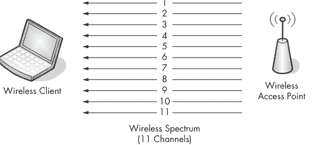

**图 10-1：** 无线嗅探可能是枯燥的，因为一次只能在一个通道上进行。

发现正在使用哪个通道的最佳方法是信道跳（channel hop）。当你进行信道跳时，只需开始数据包捕获并在通道之间快速切换，直到你看到与你要寻找的内容相关的数据。虽然信道跳不是技术性最高的解决方案，但它确实有效。

### 无线信号干扰

遗憾的是，有时我们无法依赖无线通信的完整性。因为数据是通过空气发送的，极有可能有东西干扰信号。无线网络包含了处理干扰的功能，但它们并不总是有效。因此，在无线网络上捕获包时，请密切关注你的环境，确保没有大型干扰源，例如大型反射面、微波炉、2.4 GHz 无线电话、厚墙和高密度表面。

沿着这一点，尽量尽可能靠近你正在分析的设备。你不能指望在设备楼上捕获到它发送的所有数据包。

### 无线网卡模式

为了嗅探无线数据包，熟悉无线网卡运行的不同模式是一个好主意。

大多数用户在管理模式（managed）或自接模式（ad-hoc）下使用无线网卡，但其他模式包括主机模式（master mode）和监控模式（monitor mode）。我将在下面介绍每种模式；图 10-2 显示了每种操作方式的图形表示。


#### 自接模式 (Ad-Hoc Mode)


#### 主机模式 (Master Mode)


#### 监控模式 (Monitor Mode)

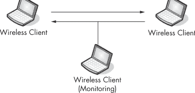

图 10-2：不同的无线网卡模式

#### 管理模式 (Managed mode)

当你的无线客户端直接连接到无线访问点 (WAP) 时使用管理模式。在这些情况下，与无线 NIC 关联驱动依赖 WAP 来管理整个通信过程。

#### 自接模式 (Ad-Hoc mode)

当你设置了一个设备直接相互连接的无线网络时，使用自接模式。在这种模式下，两个想要通信的无线客户端将共享通常由 WAP 处理的责任。

#### 主机模式 (Master mode)

一些高端无线网络网卡还支持主机模式。主机模式允许无线 NIC 与特殊的驱动程序协同工作，以便让计算机充当其他设备的 WAP。

#### 监控模式 (Monitor mode)

这是对我们而言最重要的模式。*监控模式*用于你希望你的无线客户端停止传输和接收数据，只监听在空气中飞过的数据包。为了让 `Wireshark` 捕获包，你的无线 NIC 及其配套驱动程序必须支持监控模式。如果你是为了分析而购买无线网络网卡，请确保它支持监控模式（也称为 `RFMON` 模式）。

### 在 Windows 中无线嗅探

即使你有一个支持监控模式的无线 NIC，大多数基于 Windows 的 NIC 驱动也不允许你切换到此模式。你需要额外的硬件来完成任务。

#### 配置 AirPcap

即使你有一个支持监控模式的无线 NIC，大多数基于 Windows 的 NIC 驱动程序也不允许你切换到此模式。你需要额外的硬件来完成任务。

`AirPcap` 是一个 USB 无线适配器，允许 Windows 在监控模式下捕获流量。这克服了标准驱动程序的限制。

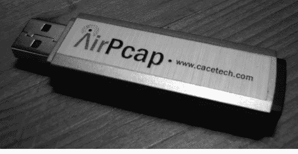

`AirPcap` 的配置非常简单；它具有以下选项：

- **Interface (接口)**：选择你使用的 `AirPcap` 设备。
- **Blink (闪烁)**：点击此项会让 `AirPcap` 上的 LED 灯闪烁。
- **Channel (通道)**：在此字段中，选择你想让 `AirPcap` 监听的通道。
- **Include 802.11 Frames (包含 802.11 帧)**：默认情况下，某些系统会剥离无线包的最后四位。这个校验和被称为 `FCS`，用于确保包没有损坏。除非你有特定理由，否则勾选此框以包含 `FCS`。
- **Capture Type (捕获类型)**：有两种 `802.11 Only` 和 `802.11 + Radio`。`802.11 Only` 选项对所有包包含标准的 `802.11` 包头。`802.11 + Radio` 选项包含此头，并在前面添加了一个 `radiotap` 头，该头包含了关于数据速率、频率和信号电等额外信息。
- **FCS Filter (FCS 过滤器)**：即使取消了 `802.11 Frames` 旁边的框，此选项也可以让你过滤掉 `FCS` 确定为损坏的包。使用 `Valid Frames` 选项仅显示那些接收到的包。
- **WEP Configuration (WEP 配置)**：此区域（通过 Keys 标签页访问）允许为你正在嗅探的网络输入 `WEP` 解密密钥。为了解释由 `WEP` 加密的数据，你必须在此字段输入正确的 `WEP` 密钥。

#### 使用 AirPcap 捕获流量

一旦安装并配置了 `AirPcap`，捕获过程将对你来说。只需遵循以下步骤：

1. 在 `Wireshark` 中，选择 `Capture -> Options`。
2. 在接口选择框中选择你的 `AirPcap` 设备，如图 10-5 所示。

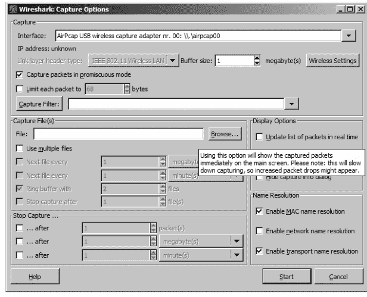

除了 `Wireless Settings` 按钮，屏幕上的所有内容对你来说都是熟悉的。点击此按钮将给你与 `AirPcap` 工具相同的选项，如图 10-6 所示。由于 `Wireshark` 与 `AirPcap` 完全集成，在客户端中配置的任何内容都可以从 `Wireshark` 进行配置。

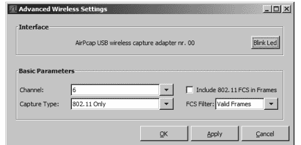

图 10-4：`AirPcap` 配置程序

3. 一旦你按照喜意配置好一切，点击开始按钮开始捕获包。

## 在 Linux 中进行无线嗅探

在 Linux 中进行嗅探只需在无线网卡上启用监控模式（monitor mode）并启动 `Wireshark`。遗憾的是，启用监控模式的过程对于每个无线网卡型号都不同，因此我无法提供权威的指南。最好的办法针对你的网卡型号进行快速网上搜索以获取特定细节。

在 Linux 中启用监控模式的常用方法之一是通过内置的无线扩展。你可以使用 `iwconfig` 命令访问这些无线扩展。如果你在控制台中输入 `iwconfig`，你应该能看到如下结果：

```
$ iwconfig
Eth0 no wireless extensions
Lo0 no wireless extensions
Eth1 IEEE 802.11g SSID:"Tesla Wireless Network"
Mode:Managed Frequency:2.462 GHz Access Point:00:02:2D:8B:70:2E
Rate:54 Mb/s Tx-Power=20 dBm Sensitivity=8/0
Retry Limit:7 RTS thr:off Fragment thr:off
Power Management:off
Link Quality:75/100 Signal level=-71 dB Noise level=-86 dB
Rx invalid hw:0 Rx invalid crypt:0 Rx invalid frag:0
Tx excessive retries:0 Invalid misc:0 Missed beacon:2
```

`iwconfig` 命令的输出显示 `Eth1` 接口可以进行无线配置。这是显而易见的，因为它显示了 `802.11g` 协议的数据，而 `Eth0` 和 `Lo0` 接口返回“no wireless extensions”。

除了该命令提供的所有信息（如网卡模式和频率），请注意 `Eth1` 下方的第二行显示当前模式设置为 `Managed`（管理）。这正是我们想要更改的。

为了将 `Eth1` 接口更改为监控模式，你必须以 root 用户登录，可以直接登录或通过此处所示的切换用户 (`su`) 命令。


```
$ su
Password:<在此处输入 root 密码>
```

一旦成为 `root` 用户，就可以输入命令来配置无线接口选项。要配置 `Eth1` 运行在监控模式，请输入：

```
$ iwconfig eth1 mode monitor
```

进入监控模式后，再次运行 `iwconfig` 命令应该会反映你的更改。现在，通过输入以下命令确保 `Eth1` 接口正在运行：

```
# iwconfig eth1 up
```

我们还将使用 `iwconfig` 命令执行在本章之前讨论的跳频过程。通过输入以下命令更改 `Eth1` 接口的信道：

```
# iwconfig eth1 channel 3
```

你可以在捕获包时随时进行此操作，因此不要犹豫切换通道。此命令也可以使用各种 Linux 脚本语言进行脚本化，以使过程更简单。

一旦完成这些配置，启动 `Wireshark` 并开始数据包捕获。

## 802.11 包额外信息

无线包结构与标准包结构之间的主要区别在于增加了 `802.11` 头部。该头部包含了关于数据包以及传输它的的介质的额外信息，如图 10-7 所示。

| 帧 1 (132 字节，捕获到 112 字节) |

| :--- |

| IEEE 802.11 |

| 类型/子类型: Beacon 帧 (8) |

| 帧控制: 0x080 (Normal) |

| 持续时间: 0 |

| 目的地址: 广播 (ff:ff:ff:ff:ff) |

| BSS ID: D-Link:00:22:ba (00:13:46:08:22:ba) |

| 序列号: 1352 |

| 分片号: 0 802.11 无线管理帧 |

图 10-7：`802.11` 头部包含了关于包的额外信息。要更仔细地检查图 10-7 所示的数据，请打开 `traffic.pcap` 文件。让我们看看此头部中一些有趣的项目：

- `类型/子类型 (Type/Subtitle)` 指定了所所示 `802.11` 包的类型或子类型。可以是管理、数据或控制。每种类型还可以有子类型。例如，管理包的子类型可以是信标帧、认证请求或去关联请求。

- `目的地址 (Destination Address)`、`源地址 (Source Address)` 和 `BSS`：这些字段包含数据包的源地址、目的地址和 BSS 地址。

- `分片号 (Fragment Number)` 和 `序列号 (Sequence Number)`：这些数字用于将无线包放置在正确的顺序，类似于 TCP 组装流的方式。

## 802.11 标志

`802.11` 头部还包含一个标志 `Flags` 部分，带有更多特定的无线信息，如图 10-8 所示。

```
FLAGS:0x0
DS status: Not operating in ADHOC mode
0 = More Fragments: 这是最后一个分片
0 = Retry: 帧未重传
0 = PWR MGT: Sta 将保持开启
0 = More Data: 无数据缓存
0 = Protected Flag: 数据未受保护
0 = Order Flag: 未经过严格排序
```

图 10-8：标志部分包含了更多特定的无线信息。标志部分包含这些字段：

- `DS 状态 (DS Status)`：分布系统 `DS` 字段用于确定数据包在哪个路径传输。如果 `From DS` 为 1 且 `To DS` 为 0，则数据包从 `WAP` 传输到无线客户端。如果值相反，则数据包从无线客户端传输到 `WAP`。

- `更多分片 (More Fragments)`：如果 0 为 1，表示这是最后一个分片。

- `重传 (Retry)`：如果 0 为 1，表示帧未重传。

- `电源管理 (PWR MGT)`：如果 0 为 1，表示 `Sta` 将保持开启状态。

- `更多数据 (More Data)`：如果 0 为 1，表示没有数据缓存。

- `保护标志 (Protected Flag)`：如果 0 为 1，表示数据未受保护。

- `排序标志 (Order Flag)`：如果 0 为 1，表示未经过严格排序。

要将这些列添加到数据列表 `Packet List` 窗格，请按照以下步骤操作：

1. 选择 `Edit ▸ Preferences`（编辑 ▸ 偏好）。

2. 导航到 `Columns`（列）部分并点击 `New`（新建）。

3. 在 `Title`（标题）字段中输入 `RSSI`，并在 `Format`（格式）下拉框中选择 `IEEE 802.11 RSSI`。

4. 对 `TX Rate` 列重复此过程，为其设置适当标题，并在 `Format` 部分选择 `IEEE 802.11 TX Rate`。图 10-11 显示了在您添加了这两个列的信息后该窗口的样子。

5. 点击 `Preferences`（偏好）对话框中的 `OK`（确定）以保存更改。

6. 重启 `Wireshark` 以显示新列。

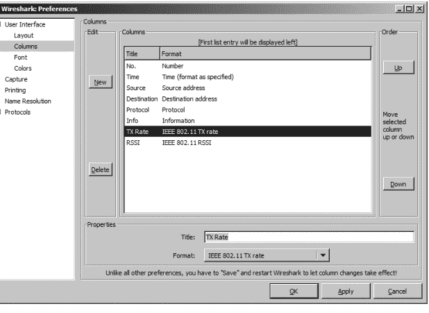

图 10-11：数据列表窗格中添加 IEEE 无线特定列

## 无线特定过滤器

我们在第 4 章讨论了捕获过滤器 `capture filters` 的优势。在有线基础设施中，过滤您想要捕获的流量更容易，因为每个设备都有自己的专用通道。在无线网络中，所有无线客户端产生的流量都共存在共享信道上，这意味着对任何一个通道的捕获可能包含来自客户端的流量。本节专门介绍一些可以帮助查找所需流量的数据包过滤器。

网络中的每个 `WAP`（无线接入点）都有一个唯一的标识名称，称为基本服务集标识符 `BSS Id`。该名称会在接入点传输的每一个无线管理帧和数据帧中发送。（参见第 142 页的“`802.11` 数据包扩展”。）

一旦您知道了想要检查的 `BSS Id` 名称，您就必须找到一个从该特定 `WAP` 发送的数据包。`Wireshark` 在数据列表的 `Info`（信息）列中显示传输的 `WAP`，因此找到这些信息通常非常简单。

一旦获取了来自特定 `WAP` 的数据包，在 `802.11` 头部中找到它的 `BSS Id` 字段，如图 10-9 所示。这就是您将进行过滤的地址。

在找到 `BSS MAC` 地址（列在数据包详情窗格中）后，您可以使用过滤器 `wlan.bssid.eq 00:11:23:44:55:66` 来仅显示通过该特定 `WAP` 的流量。

在本章前面的部分，我们讨论了在网络上可见的不同类型的无线数据包。您通常需要能够根据这些类型和子类型进行过滤。请参考表 10-1 来帮助您构建所需的过滤器。

尽管管理包对于某些类型的分析非常重要，但分析可能只需要查看通过空气传输的数据——例如，如果我们需要跟踪流氓无线客户端，或者识别无线网络上发生非愿信息泄露的可能性。因此，我们需要知道如何过滤数据包。

要过滤掉捕获文件中除数据包以外的所有包，请使用过滤器 `wlan.fc.type eq 2`。（如果您参考表 10-1，将看到类型为 2 的包将显示所有与数据帧相关的数据。）

使用此过滤器的唯一缺点是它仍然允许显示 `NULL` 数据包。这些数据包被某些 `WAP` 和无线网卡用于通知网络它们即将切换信道。如果您不需要看到这些 `NULL` 包，可以通过扩展我们之前创建的过滤器并删除 `NULL` 包子类型来过滤掉。完成后的过滤器如下：

区分未加密数据和加密数据是识别网络上流氓 `WAP` 或确定敏感信息是否以明文发送极极方法。

## 表 10-1；无线类型/子类型及相关过滤器语法

| 帧类型/子类型 | 过滤器语法 |

|---|---|

| 管理帧 (Management frames) | `wlan.fc.type eq 0` |

| 控制帧 (Control frames) | `wlan.fc.type eq 1` |

| 数据帧 (Data frames) | `wlan.fc.type eq 2` |

| 请求 (Association request) | `wlan.fc.type_subtype eq 0` |

| 关联响应 (Association response) | `wlan.fc.type_subtype eq 1` |

| 重新关联请求 (Reassociation request) | `wlan.fc.type_subtype eq 2` |

| 重新关联响应 (Reassociation response) | `wlan.fc.type_subtype eq 3` |

| 探测请求 (Probe request) | `wlan.fc.type_subtype eq 4` |

| 探测响应 (Probe response) | `wlan.fc.type_subtype eq 5` |

| 信标 (Beacon) | `wlan.fc.type_subtype eq 8` |

| 解离 (Disassociate) | `wlan.fc.type_subtype eq 10` |

| 认证 (Authentication) | `wlan.fc.type_subtype eq 11` |

| 取消认证 (Deauthentication) | `wlan.fc.type_subtype eq 12` |


| 帧 (Action frames) | `wlan.fc.type_subtype eq 13` |
| 块确认请求 (Block ACK requests) | `wlan.fc.type_subtype eq 24` |
| 块确认 (Block ACK) | `wlan.fc.type_subtype eq 25` |
| 源查询 (Power save poll) | `wlan.fc.type_subtype eq 26` |
| 请求发送 (Request to send) | `wlan.fc.type_subtype eq 27` |
| 许可发送 (Clear to send) | `wlan.fc.type_subtype eq 28` |
| 确认 (ACK) | `wlan.fc.type_subtype eq 29` |
| 无竞争空隙结束 (Contention free period end) | `wlan.fc.type_subtype eq 30` |
| NULL 数据 (NULL data) | `wlan.fc.type_subtype eq 36` |
| QoS 数据 (QoS data) | `wlan.fc.type_subtype eq 40` |
| Null QoS 数据 (Null QoS data) | `wlan.fc.type_subtype eq 44` |

参考第 143 页“802.11 Flags”节中的 `Protected` 标记；它是识别数据包是否加密的标记。我们基于此标记设置过滤器。

回想，当不使用加密时，`Protected` 标记位设置为 0，如果使用 WEP、TKIP 等协议加密，则该位被设置为 1。因此，使用过滤器

```
wlan.fc.protected eq 0
```

将向显示所有未加密包。同样，使用过滤器

```
wlan.fc.protected eq 1
```

仅显示加密流量。

有数百种方法可以过滤捕获的无线流量。您可以在 Wireshark wiki 上查看许多无线捕获过滤器：http://wiki.wireshark.org。

## 糟糕的连接尝试

现在让我们来看一个特定的场景。在这个场景中，Justin 尝试连接无线网络。不幸的是，这没有成功。

## 我们所知的

认证过程之后是简单的关联请求和响应。（图 10-15）

## 接入空气中

在这种情况下，认证过程没有成功。（图 10-14）

## 分析

由于我们已经知道连接 WAP 应该是什么样子，让我们来看捕获文件。（图 10-16）

目标地址：Enetary_6b:6b:30 (`00:11:88:6b:30`)

源地址：GemekteK30:b0:af (`00:14:a5:30:b0:af`)

BSS ID：Enetary_6b:6b:30 (`00:11:88:6b:30`)

分片数：0

序列号：43

WEP 参数

初始化向量：`0x26709d`

密钥索引：0

WEP ICV：`0xc800a5b7`（未验证）

数据（147 字节）

### 图 10-17：Justin 的电脑将其对挑战文本的响应发回给 WAP。

在过程的这一阶段，我们应该看到来自 WAP 的响应，确认身份验证过程成功。但相反，我们看到了其他内容，如图 10-18 所示。身份验证失败。

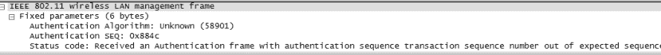

图 10-18：显然，身份验证并未成功。

从 WAP 发送到 Justin 电脑的消息恰恰地告诉我们发生了什么：序列号错序。这意味着 Justin 电脑对挑战文本给出的响应是不正确的——因此，用于解密挑战文本的 WEP 密钥要么输入错误，要么未输入。

## 总结

无线网络故障排除的悲哀事实是，无线客户端软件通常不会报告特定问题：客户端要么连接，要么不连接。幸运的是，无线数据包分析技术允许我们准确看到发生了什么，并更高效地对无线网络进行故障排除。

## 结语

无线网络正成为企业环境中的主流。随着关注重点转向无线，我们必须能够对有线和无线网络同时进行故障排除。本章教授的技能和概念将帮助你理解通过数据包分析排除无线网络故障的复杂。

# 11

# 延伸阅读


虽然在大多数情况下 Wireshark 是数据包分析唯一的工具，但在执行数据包分析时，其他一些工具和网站可能会派用场。

## Cain & Abel (http://www.oxid.it)

你可能记得在第 2 章讨论 ARP 缓存中毒时提到的 Cain & Abel。除了执行 ARP 缓存中毒外，Cain & Abel 还有许多其他强大功能，包括密码嗅探和恢复、VoIP 制以及通用网络信息收集能力。

## PingPlotter

该程序是 ICMP ping 实用程序的扩展，允许你将通常从 ping 获取的文本输出进行图表化，以便你更好地分析网络连接的趋势。这种功能在你想要进行长期分析时非常有用。你可以从 http://www.pingplotter.com/download.html 下载 PingPlotter。

## Superscan 4

Superscan 4 是一个简单的网络扫描工具。它的主要吸引力在于惊人的扫描速度；当你急于获取所需信息时，Superscan 可以高效且快速地扫描。在收集有关主机或网络的信息时，你会发现这个工具非常有用。你可以从 http://www.foundstone.com/resources/proddesc/superscan.htm 下载 Superscan。

## RUMINT

RUMINT（读作 room-inf）是一个免费的应用程序，你可以用它可视化捕获的数据包数据。它提供了非常详细的图表和可视化选项，帮助你理解和建模捕获的数据包。你可以在 http://www.rumint.org 阅读更多关于 RUMINT 的信息。

## Engage Packet Builder (http://www.engagescurity.com/products/engagebuilder)

由 Engage Security 提供的 Packet Builder（如图 11-1 所示）允许你构建并传输自定义数据包。你可以出于教育目的测试防火墙、入侵检测系统或易受攻击的设备。

你可以使用 Packet Builder 构建具有多种选项的单个包，并可以使用脚本实现数据包生成的某些部分。

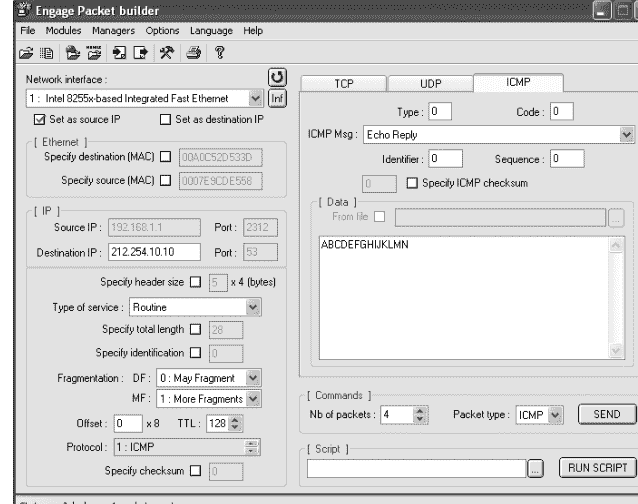

图 11-1：Engage Security 的 Engage Packet Builder

第 11 章

## IANA (http://www.iana.org)

互联网号码分配机构（IANA）负责北美 IP 地址和协议编号的分配。其网站提供了宝贵的参考工具，例如查询端口号、查看顶级域名相关信息以及浏览相关站点查找 RFC。

## Wireshark Wiki 和邮件列表 (http://www.wireshark.org)

由于 Wireshark 是一个社区驱动的项目，Wireshark Wiki 和邮件列表是 Wireshark 主要的支持手段。

## Wireshark University (http://www.wiresharktraining.com)

Wireshark University 于 2007 年 3 月由 Wireshark 和数据包分析领域的关键人物创立，包括 Gerald Combs（Wireshark 作者）、Laura Chappell（高级数据包分析师）和 Loris Deganni（WinPcap 作者）。

Wireshark University 是顶级的 Wireshark 资源。除了自学视频培训外，它还提供 Wireshark 认证计划。

CAM 表，10

捕获文件示例

- `8021traffic.pccap`, 148
- `arp.pccap`, 62
- `barryscomputer.pccap`, 84–85
- `bethscomputer.pccap`, 84–85
- `blaster.pccap`, 129
- `covertinho.pccap`, 129
- `destreunable.pccap`, 79
- `dhrp.pccap`, 62
- `dns.pccap`, 68
- `double-vision.pccap`, 107
- `emailarget-troubles.pccap`, 114
- `evilprogram.pccap`, 92
- `FailedWEPAuth.pccap`, 148
- `FileDownload.dmp`, 59
- `ftp.pccap`, 69
- `ftp-crack.pccap`, 125
- `ftptclientied.pccap`, 88–89
- `ftpserverdenied.pccap`, 88–89
- `gnutella.pccap`, 115
- `hackerservice.pccap`, 130
- `huntedbrowser.pccap`, 86, 87


- `http.pccap`, 64
- `http-client-refuse.pccap`, 109, 110
- `http-fault.pccap`, 90–91
- `icmp-tracer-solve.pcap`, 104, 105
- `icmp.pccap`, 75
- `ipfragments.pccap`, 81
- `mnms.pccap`, 72
- `ofsprinteringinting.pccap`, 121
- `portscan.pccap`, 122
- `printerproblem.pccap`, 123
- `sndownload.pccap`, 100
- `SuccessfulWEPAuth.pccap`, 148
- `suspectemployeeedechat.dmp`, 55
- `tcp-con-lost.pccap`, 78
- `tnelnet.pccap`, 71
- `torential-slowness.pccap`, 112
- `WEPAuth.pccap`, 148
- `wrongdissector.dmp`, 55
- 输出, 42
- 合并, 42–43
- 示例, 49
- 保存, 41–42, 49–50
- 捕获过滤器, 45
- 使用过滤器表达式对话框创建, 47
- 捕获接口对话框, 32
- 捕获菜单, 32, 140
- 捕获选项对话框, 45, 52
- 捕获类型设置 (AirPcap), 139
- 捕获窗口, 32
- 捕获，Wireshark 设置, 35
- 捕获文件
- 信道跳变, 136
- 无线广播的通道, 136
- Chappell, Laura, 153
- 聊天流量，在专家信息窗口中, 101
- Cisco，端口镜像命令, 19
- 明文翻译，通过 telnet 协议, 131
- 收集，在数据包嗅探过程中, 3
- 数据包冲突, 17
- 染色, 35–37
- 染色规则, 36–37
- 梳, 27, 153
- 逗号分隔值 (CSV) 文件, 42
- 比较操作符, 48
- 数据压缩, 4
- 计算机
- 通信过程, 4–13
- 数据封装, 7
- 网络硬件, 8–12
- 网络协议, 4
- OSI 模型, 4–6
- 协议数据单元, 8
- 协议交互, 6–7
- 流量分类, 12–13
- 丢弃数据包, 89
- 无连接协议, 64
- 会话, 10, 58–59
- 会话窗口, 97, 112
- 按数据包数量排序会话, 117
- `covertinho.pccap` 文件, 129
- 将二进制数据转换为可读格式, 3
- 成本
- 嗅探器的, 3
- Wireshark 的, 28
- `covertinho.pccap` 文件, 129
- CSV (逗号分隔值) 文件, 42
- `CWD` 命令 (FTP), 70

## D

数据
- 分析，通过数据包嗅探器, 3
- 压缩, 4
- 封装, 7
- 加密, 4
- WEP 密钥, 148
- 过滤无线流量的数据包, 146–148
- 数据链路层 (OSI 模型), 6
- DCEPR 数据包, 96
- 基于 DEB 的发行版，在上面上安装 Wireshark, 31
- Debian 系统，在上面上安装 Wireshark, 31
- 解码为对话框 (Decode As), 54
- 默认网关, 84–86
- Degeannis, Loris, 153
- 美国国防部 (DoD) 模型对比 OSI 模型, 5
- 目标不可到达性消息, 79–80, 95
- `destruachable.pcap` 文件, 79
- DHCP (动态主机配置协议), 62–63
- 发现数据包, 63
- 议数据包, 63
- `dhcp.pcap` 文件, 62
- 对话, 5
- 字典攻击, 126
- 发现数据包 (DHCP), 63
- 显示过滤器对话框, 49–50
- 显示层, 46
- 使用过滤器表达式对话框创建, 47
- 用于查找数据包, 40
- 用于 FTP 登录尝试, 126
- 示例, 49
- 保存，–50
- DNS (域名系统), 68–69
- `dns.pcap` 文件, 68
- 文档，在线，针对 Wireshark, 28
- DoD (美国国防部) 模型对比 OSI 模型, 5
- 域名解析以及捕获文件中的数据包, 53
- 域名系统 (DNS), 68–69
- `double-vision.pcap` 文件, 107
- 下载数据，HTTP 数据包指示, 87
- 802.11 数据包头中的 DS 状态, 143
- 重复 ACK 数据包, 102
- 动态主机配置协议 (DHCP), 62–63

## E

- 回显 (ping) 依赖数据包, 79, 105
- 边缘路由器，用于分析网络问题, 111–113
- 编辑菜单
- 编辑颜色过滤器, 37
- 附件, 115
- 服务器网络, 114–115
- `e-troubles.pcap` 文件, 114
- 数据封装, 7–8
- 数据加密, 4
- WEP 密钥, 148
- 端点，查看, 57–58
- Engage Packet Builder, 152
- Enterasys，镜像命令, 19
- 错误
- 修正, 4
- 在专家信息窗口中查看, 101
- 以太网, 27
- `evilprogram.pcap` 文件, 92
- 专家信息窗口, 100–101
- 导出捕获文件, 42

## F

- FCS (帧校验序列), 139
- 格式，针对捕获文件, 41
- 文件菜单
- 导出, 42
- 打印, 43
- 文件传输协议 (FTP), 69–71
- 离线流量, 124
- 共享网络，慢网络, 115
- `gnutella.pcap` 文件, 115
- GPL (GNU 公许可证), 27
- 过滤器对话框, 47
- 表达式语法, 47–49
- 过滤器, 45
- pccap 文件, 130
- 全双工模式, 51
- 硬件地址, 51
- 十六进制值，针对数据包, 40
- 隐藏方法，发送, 130
- 特定的无线网络, 145–148
- FIN/ACK，针对会话结束, 68
- FIN 数据包，针对会话结束, 67
- 查找对话框, 40
- 应用程序, 110
- 嗅探器, 11
- `http-client-refuse.pccap`, 109, 110
- `http-fault.pccap`, 90–91
- HTTP (超文本传输协议), 64, 100
- 数据包，在详细信息中, 66
- 会话, 66
- 流量, 91
- 跟踪会话, 55–56
- 强制解码, 54
- 分段数据包, 81
- 保持顺序, 82–83
- 帧校验序列 (FCS), 139
- `ftp-crack.pccap`, 125
- `ftpclientdenied.pccap`, 88–89
- 全双工设备, 9
- `evilprogram.pcap` 文件, 92
- 缺点, 17
- 嗅探周围，周围环境, 16–17
- 混用模式, 16
- 路由环境, 18–24
- 嗅探周围环境, 16–17
- 交换机环境, 19–24
- ARP 收集, 20
- GNU 公许可证 (GPL), 27
- gnutella 数据包, 118
- ICMP (互联网控制消息协议), 75
- `icmp-tracer-solve.pcap`, 104, 105
- `icmp.pccap` 文件, 75
- 安装 Wireshark, 29–31
- 国际标准组织 (ISO), 4
- Internet 地址分配机构 (IANA), 153

## I

- 分离器, 53
- Internet 协议 (IP) 地址系统, 21
- 分段, 81
- 标识号，数据包的, 108
- 租约，请求 DHCP 服务器, 93
- 图形窗口, 59–60
- IP 地址转换为 DNS 地址, 68–69
- 查看所有数据包引用, 48
- WHOIS 查找, 113
- `ipfragments.pccap` 文件, 81
- ISO (国际标准组织), 4
- `isconfig` 命令, 141, 142

## M

- MAC 名称解析, 52
- 管理模式，针对无线卡, 137
- 管理交换机, 40–41
- 导航标记数据包, 41
- 主模式，针对无线卡, 137
- 与捕获文件合并对话框, 42–43
- 消息数据包, 95
- 监听模式，针对无线卡, 137, 在 Linux 下, 81
- 更多数据，802.11 数据包头, 143
- 更多分段，802.11 数据包头, 143
- MSG 数据包，针对 MSNMS, 74
- MSN Messenger 服务 (MSNMS), 55, 72–74
- `msms.pccap` 文件, 72


## 多播流量
- 多播流量, 13–14
- 音乐下载，以及带宽消耗, 113

## N

- 名称解析
- 缺点, 52
- 在 Wireshark 中, 51–53
- 偏好, 53
- 导航已标记数据包, 41
- NetBIOS 流量，作为问题指示, 85
- 网络。另见慢网络
- 管理员，黑客监控通信的, 131
- 外部设备诱导连接, 93–94
- 数据报, 25

## J

- JOI 数据包，针对 MSNMS, 74

## L

- 第 3 层地址系统, 20–21
- 将 IP 地址转换为 DNS 地址, 52
- 第 3 层交换机, 12
- Linux 系统
  - 在上面上安装 Wireshark, 31
  - 以及无线网络嗅探, 141–142
- 逻辑操作符，在过滤器表达式语法结构中, 48–49
- Loki, 130
- 丢失 TCP 连接，排错, 77–79
- 吞吐量中的波动，寻找, 59

## 网络，续

- 域名解析，网络协议协议协议, 4
- 流量，分类, 12–13
- 故障排除，无连接, 83–86
- 网络接口卡 (NIC),
  - 混杂模式，用于, 3, 16
- 网络层 (OSI 模型), 6
  - 计算机，慢网络及, 107–109
- NIC (接口卡),
  - 混杂模式，用于, 3, 16
- Nortel，端口镜像命令用于, 19
- 非运算符 (not operator), 49
- 注释，在 Expert Info 窗口中查看, 101
- 数据包 (DHCP), 63
- 分片包的偏移值, 82–83
- OmniPeek, 22
- Wireshark 在线文档, 28
- 订单提交，故障排除, 90–92
- 开放系统互连 (OSI) 模型, 4–6
- OpenBSD 服务器, 72
- 操作系统 (OS)
  - 被黑客指纹识别, 121
  - 对数据包嗅探器的支持, 3
  - Wireshark 的支持, 29
  - 或运算符 (or operator), 49
- 802.11 数据头部中的 Order Flag 字段, 143
- OS. 严重的操作系统 (OS)
- `osfingerprinting.pcap` 文件, 121
- OSI (开放系统互连) 模型, 4–6
- Oxdit, 21
- 数据包字节面板 (Packet Bytes pane), 34, 118–119
- 数据包详情面板 (Packet Details pane), 65
  - 用于 HTTP 请求, 66
  - 其中 More Fragments 标志, 81–82
- 数据包列表面板 (Packet List pane), 33
  - 其中的无线特定列, 144–145
- 数据包嗅探器
  - 评估, 2–3
  - 工作原理, 3
  - 在网络中的部署, 15
  - 用户友好性, 2
- 数据包嗅探, 2
  - 802.11 头部及, 142–144
  - 信标帧 (beacon frames), 143–144
  - 确认的, 4
  - 分析，解释, 2
  - 冲突, 17
  - 隐藏在数据, 130
  - 来自 DNS, 53
  - 查找, 39–41
  - 以及首次捕获, 31–33
  - 分段的，故障排除, 81–83
  - 意意阻塞, 89
  - IP 标识码的, 108
  - 标记, 40–41
  - 打印, 43
  - 防止损坏, 139
  - 引用 `C:\Windows\System32` 目录, 107–109
  - 重复的,
  - 时间显示格式, 43–44 及时间引用, 44–45
  - 查看所有特定 IP 地址, 48
  - 密码
    - 使用字典攻击猜测, 62
    - 用于 FTP 服务器, 69
    - 拦截, 131
    - 通过 telnet 传输, 72
  - 消息传递软件数据包的载荷，查看
  - `.pcap` 文件格式, 41
  - `pcap` 捕获接口, 29
  - 点对点文件传输, 113
- 物理层 (OSI 模型), 6
- PIF (程序信息文件), 115
- `pcap` way, 75, 79–80
- 隐藏数据包内容, 130
- PingerList, 151
- POP (邮局协议) 数据包, 114
- 用于其的 TCP 流, 115
- 弹出窗口拦截器以及 Flash 插件, 110–111
- 端口镜像模式 `mirror-port` 命令 (Nortel), 19
- 端口
  - 用于捕获过滤器, 45
  - 镜像, 18–19, 115, 125, 127
  - 命令, 19
  - 配置错误, 108
  - 用于隐蔽收集, 129
  - 跨越, 18
  - 不可用, 80
- `portscan` `pcap` 文件, 122
- 邮局协议 (POP), 114
  - 用于其的 TCP 流, 115
- 精度，用于时间显示, 44
- 选项对话框, 34–35
- 表示层 (OSI 模型), 5
  - 打印对话框, 43
  - 数据包, 43
  - `interproblem.pcap` 文件, 123
  - Wireshark 偏好, 35
- Wireshark 的处理器要求, 29
- 程序信息文件 (PIF), 115
- NIC 的混杂模式，用于, 3, 16
- 802.11 数据头部中的 Protected Flag 字段, 143
- 数据单元 (PDU), 8
- 协议分层统计窗口, 56–57
- 协议
  - 地址解析协议 (ARP), 2
  - 分析, 2
  - 颜色编码, 35–36
  - Wireshark 中的部分, 53–55
  - 域名系统 (DNS), 68–69
  - 动态主机配置协议 (DHCP), 62–63
  - 文件传输协议 (FTP), 69–71
  - 过滤表达式, 48
  - 以及流控制, 4
  - 超文本传输协议 (HTTP), 64–66
  - 交互, 6–7
  - 控制消息协议 (ICMP), 75
  - 通过 OSI 模型, 6
  - 数据包嗅探器支持, 2
  - telnet, 71–72
  - 传输控制协议/网协议 (TCP/IP), 64–66
  - Wireshark 的支持, 28
  - 802.11 数据头部中的 MGT 字段, 143
- `radiotap` 头部 (Aircap), 139
- 可读数据，转换二进制数据, 3
- 重启后浏览器设置, 86
- Red Hat 系统，在 Wireshark 上, 31
- 远程过程调用 (RPC) 数据包, 96
- 重复设备, 8
  - `RETR` 命令 (FTP), 71
  - RFC, 61
  - 用于 IP 的, 64
  - 用于 TCP 的, 64
  - 用于 ARP 的, 62
  - 用于 telnet 的, 71
  - 用于 FTP 的, 69, 70
  - 用于 DNS 的, 68
  - 用于 DHCP 的, 62
  - 往返时间 (RTT), 103
  - 路由事件，嗅探中, 24–25
  - 路由器, 11–12
  - 不一致和重复数据包, 108
  - RPC (远程过程调用) 数据包, 96
  - 子网掩码, 109
- 基于 RPM 的发行版，在 Wireshark 上, 31
- RST 数据包, 110
- INT 可视化工具, 186
- 成功的 Auth.pcap 文件, 148
- Superscan 网络扫描工具, 152
- 保存文件, 41–42
- 过滤器, 49–50
- 安全 Shell (SSH), 71
- 安全性, 121–133
  - 用于数据包的, 3
  - 用于 Wireshark, 28
  - Blaster 蠕虫及, 127–129
  - 以及隐蔽信息, 129–130
- 怀疑的 `chat.dmp` 文件, 55
- 用户切换 (`su`) 命令 (Linux), 141
- 泛洪打印机, 123–124
- 交换环境，嗅探中, 18–24
- FTP 渗透, 124
- ARP 缓存污染, 20–24
- 从黑客视角, 19–20
- 端口镜像, 18–19, 130–133
- 以及指纹, 121
- SYN/ACK 数据包 (TCP), 65
- SYN 数据包 (TCP), 65
- Wireshark 的系统要求, 29
- 分段, 4
- TCP 中的标识码, 79
- 服务器，无连接, 11
- 无线网络中的干扰, 136
- `SIZE` 命令 (TCP), 70–71
- 慢网络, 99
- 结构分析, 54-104
- 第一步, 54
- Gnutella 网络, 15


- 新计算机, 107–109
- 服务, 111
- 下载, 50
- `slowness.pcap` 文件, 100
- 软件, 88
- 垃圾邮件, 115
- 吞吐量峰值查找, 59
- 用于 Wireshark, 28
- 字符串选项, 40
- 用户切换 (`su`) 命令 (Linux), 141
- 接入线缆, 15–25
- 网络拓扑, 24
- 混杂模式，用于, 16
- 交换环境, 18–24
- ARP 缓存污染, 20–24
- 端口镜像, 18–19, 130–133
- 以及指纹, 121
- `SYN/ACK` 数据包 (TCP), 65
- `SYN` 数据包 (TCP), 65
- Wireshark 的系统要求, 29
- 分段, 4
- TCP 中的标识码, 79
- 服务器，无连接, 11
- 无线网络中的干扰, 136
- `SIZE` 命令 (TCP), 70–71
- 慢网络, 99
- 结构分析, 54-104
- 第一步, 54
- Gnutella 网络, 15
- 新计算机, 107–109
- 服务, 111
- 下载, 50
- `slowness.pcap` 文件, 100
- 软件, 88
- 垃圾邮件, 115
- 吞吐量峰值查找, 59
- 用于 Wireshark, 28
- 字符串选项, 40
- 用户切换 (`su`) 命令 (Linux), 141

[费曼学习法](https://wiki.example.org/feynmans_learning_method) 灵感源于诺贝尔物理奖获得者理查德·费曼。

1. 凭借费曼的技巧，你只需 `20 分钟` 就能深入理解知识点，而且记忆深刻且难以忘记。

```python
if (cond > someVal) {console.log("xxx")}
```
