# PHP 和 MySQL 实用指南：构建八个动态 Web 应用程序

---

*献给我的家人，感谢他们无尽的包容与支持...*

---

*此页故意留白*

---

## 前言

收听 Jono Bacon 及其朋友在 LUG Radio（`www.lugradio.org`）上的播客，您会对 Jono 带给开源社区的精神和深思熟虑有所感悟。前一分钟他们还在严肃地讨论向自由软件项目贡献代码的障碍，下一分钟他们就会进行类似蒙提·派森（Monty Python）式的讨论，探讨他们每个人最像哪个 Linux 发行版。

*Practical PHP and MySQL*（《实用 PHP 与 MySQL》）体现了 Jono 致力于让开源主题对每个人都可理解的精神。本书仔细引导您完成八个实用动态 Web 应用程序的代码。项目以一种 playful（俏皮/有趣）的方式呈现，例如那个宣传“让你‘躲在沙发后面’的恐怖电影”的论坛项目。书中所有内容都可以在随书附带的 Live CD 上实时运行、修改、保存和重用。

虽然创建 Web 内容所需的工具很容易从开源社区获得，但像 Jono Bacon 这样技艺娴熟的向导帮助您利用这些工具创建动态 Web 应用程序，确实是一种享受。其结果构成了开发您自己的博客、论坛、购物车和其他 Web 站点的基石，这将显著缩短您的启动时间。

我很高兴 Jono Bacon 的 *Practical PHP and MySQL* 成为 Negus Live Linux 系列中首批书籍之一。其内容完美契合该系列的目标，即让涵盖各种主题的高质量自由和开源软件进入人们手中，使他们能够快速获得高质量的结果。我希望您能和我一样，从这本书的学习中获得乐趣。

— Christopher Negus

**系列编辑，Negus Live Linux 系列**

## 关于作者

**Jono Bacon** 在 Canonical 公司担任 Ubuntu 社区经理，并且是一位经验丰富的演讲者、作家，也是开源社区的常客贡献者。作为作者，Bacon 联合撰写了 *Linux Desktop Hacks* 和 *Official Ubuntu Book*，并在 14 多种出版物上发表了超过 400 篇文章。Bacon 还作为专栏作家为 *Linux Format*、*Linux User & Developer* 和 *PC Plus* 撰稿，并且是 O'Reilly Network 的博客作者。

此外，Bacon 是众多项目中开源的常客贡献者，是 Jokosher（`www.jokosher.org`）项目的首席开发人员，也是广受欢迎的 LUGRadio（`www.lugradio.org`）播客的联合创始人之一——该节目拥有超过 15,000 名听众，并举办一年一度的活动，吸引来自世界各地的访客。

## 致谢

写致谢名单总是很困难，因为我总是漏掉一些重要的人。我想感谢以下人士提供的难以置信的支持和帮助：

- Susan Curtis, John and Pauline Bacon, Simon and Martin Bacon, Banger and Frankie, Prentice Hall (Debra Williams-Cauley, Songlin Qiu), LUGRadio (Stuart Langridge, Matthew Revell, Adrian Bradshaw), OpenAdvantage (Paul Cooper, Elliot Smith, Scott Thompson), FreeNode 上的 `#php`, `#mysql` 和 `#lugradio`, LUGRadio 社区, Kai “Oswald” Seidler, 以及许多其他人。

每个人都对 Web 趋之若鹜。自从我们在家庭和 businesses（企业/商业机构）中开始安装那些吱呀作响的老式调制解调器以来，Web 已成为我们生活中日益重要的主导部分。我们用它来探索、购物、诊断、娱乐、消遣、交流、协作等。Web 不再只是少数人用来锻炼技术肌肉的新奇事物；世界各地数以百万计的人正在过他们正常的生活，而 Web 在其中扮演着核心角色。

Web 的流行意味着对您这样的开发者来说有有趣的事情。Web 不仅提供了一种开发信息丰富资源（如 IMDB、Wikipedia 等）的手段，而且 Web 还提供了创建在线应用程序的真实机会，用于处理日常事务，如管理联系人、平衡账户、销售产品或服务、创建内容、表达意见、聊天等等。全球性的受众在等待，如果您有技术实力，您可以接入这个受众。

这就是 PHP 和 MySQL 发挥作用的地方。近年来，PHP 和 MySQL 结合在一起，形成了一个独特且功能强大的平台。凭借其在开源中的根基，这些完全免费的工具可用于创建功能强大、稳定、企业级的网站。我们稍后可以对 PHP 和 MySQL 进行更详细的描述，所以现在让我们谈谈这本书能为您做什么。

### 不同的方法

如果您走进大多数大型书店寻找编程书籍，它们都使用大致相同的格式。这些书倾向于逐步且线性地阐述主题，并呈现一系列事实。这种方法

这与在学校学习的过程并不十分相似，在那里，你被训练去记忆事实和技巧，而将那些事实和技巧应用于现实场景则取决于你自己。

嗯，这一切听起来是不是很枯燥？每当我想学习什么的时候，我都想立刻深入研究，直达学科的核心及其应用。当我学弹吉他时，我想的是演奏歌曲，而不是学习乐理；当我学开车时，我想的是去各个地方，而不是以每小时30英里的速度在乡村公路上行驶。这本书正是采用了这种方法。它不是教你一些随机的编程知识，而是让你卷起袖子，立刻开始编写应用程序。

这本书从一个简短的技术介绍开始，然后提供一个关于核心PHP和MySQL技能的快速入门教程——只需足够让你开始编写应用程序。在这段简短的入门教程之后（因为没人喜欢读入门教程），你将直接进入应用程序的编写环节。这样，你就无需先翻完200页的文字内容才能开始编写应用程序。

在第2章的入门部分之后，你将进入应用程序环节。我为你准备了一份可供任意删减的应用程序菜单：

- 第3章，“运行项目”。随书附赠的Live CD包含软件项目、应用程序和LAMPMP服务器。本章将介绍CD的内容以及如何在你的计算机上运行该光盘。
- 第4章，“建立博客”。通过创建一个博客系统，融入博客文化。在这里，你可以添加帖子、让读者提交评论、创建不同的类别，还有更多功能。
- 第5章，“讨论论坛”。创建一个拥有所有精彩功能的讨论论坛网站。你可以添加论坛类别、不同的论坛、线程和消息、用户账户、论坛管理，等等。
- 第6章，“创建购物车”。通过这个项目，开设一家在线商店，在其中添加产品支持、创建购物车、通过支票/PayPal收款、支持不同的账户，等等。
- 第7章，“建立在线拍卖网站”。拍卖网站提出了有趣的挑战，在这一章中，你将学习如何支持多个账户、编写竞价引擎、支持上传图片、添加拍卖摘要，等等。
- 第8章，“创建基于Web的日历”。戴上你的橙色墨镜，准备在编写由AJAX驱动的日历时，到处写上“Beta”一词。在这里，你将学习AJAX的工作原理、创建日历界面、支持不同事件、设置用户登录，等等。
- 第9章，“FAQ内容管理系统”。在本章中，你将创建用于FAQ的内容管理系统（CMS）。功能包括用户的不同权限级别、主题所有权、提交系统、评论支持，等等。
- 第10章，“构建可复用项目”。在这个应用中，你将创建一个独立的组件，可以嵌入任何网站。如果你希望为其他开发者创建可下载和使用的项目，这将非常有用。本章讨论了如何创建可移植组件并轻松地将其集成到另一个网站中。
- 第11章，“构建新网站”。这个项目巩固了书中前文的大部分知识，并探讨了分类、搜索支持以及HTML_QuickForm PEAR扩展的使用。
- 附录A，“网站设计”。在本章中，你将创建一个静态网站，并添加如FAQ页面和关于页面等功能，并使用层叠样式表（CSS）设计页面。

随着每个项目的推进，你将学到更多在多种PHP和MySQL Web应用程序中都非常有用的技能。

### 使用本书所需条件

如果你渴望立即开始，你只需要一份学习的热情，以及一台运行Linux、Windows、Mac OS X或Solaris的计算机。这些不同的操作系统都支持PHP和MySQL，如书中所解释的，你可以使用一个名为XAMPP的绝佳工具来快速安装所需的软件。

除了这个核心平台外，还建议你花大量时间学习涉及的不同技能。学习编码就像烤蛋糕一样——有时概念在你脑海中巩固所需的时间有长有短。一些对某些人来说显而易见的概念，对另一些人来说需要更长的时间来消化，你应该允许自己以自己的节奏花充足的时间来学习这些不同的技能。

最后，建议你在互联网上四处看看，加入一些PHP/MySQL讨论论坛和邮件列表。当你不理解某些概念或需要更多帮助时，这将提供一个极大的支持机制。

### 约定

本书有一些不同的风格约定，有助于你开发应用程序。花一点时间来快速了解这些约定。

首先，有一些字体约定：

- **等宽文本**。这种样式用于命令、关键字或函数等技术项目。
- *斜体文本*。斜体文本用于定义术语和文件名。

在整个书中，你会发现数百个用于构建应用程序的代码片段。它们看起来像这样：

```
if(x ==y) {
  echo "hello world";
}
```

在某些代码片段中，你会看到如下的粗体文本：


```
if(x ==y) {
  echo "hello world";
  echo "this is extra code that has been added"
}
```

粗体行表示正在添加到片段中的新行或新代码部分。非粗体文本提供了一种轻松的方法来双重检查新的代码块是否放在正确的位置。

## 前行

你正处于一段激动人心的旅程的起点，按照本书其余部分的传统，我不想无故浪费你的时间。坐下来，插上电源，准备好用PHP和MySQL震撼你的世界。开火！

## 第1章

### 一种新方法

学习编程一直都很困难。尽管有令人眼花缭乱的文档、教程、网站、视频、书籍和其他资源，但学习编程仍然从根本上是困难的，特别是如果你没有穿凉鞋、扎马尾辫的话。

学习编码如此困难的主要原因之一是代码通常是以不自然的方式教授的。大多数书籍和教程似乎遵循一条清晰的路径：解释语言的细微细节，然后继续在每个细节上构建以涵盖更复杂的概念。这种教学方式类似于考前突击复习——很难以正确的顺序记住所有独立的信息碎片以及它们之间的关系。

这本书与众不同。尽管大多数书籍遵循上述路径，但这本书打破了常规，改变了配方。这本书主要不是用300页的科学知识让你眼花缭乱，而是专注于一系列实际项目，你将亲自编写这些项目。这些项目涵盖了各种Web应用程序，通过学习如何编写这些不同的应用程序，你不仅能更好地理解PHP和MySQL，还会获得对如何编写*真实*应用程序的更强认知。

你将在本书中参与的项目包括：

- 通用网站
- 博客
- 拍卖网站
- 购物车
- 讨论论坛
- 常见问题（FAQ）管理网站
- 新闻网站
- 独立的PHP应用程序
- 简单的AJAX日历

每个项目都提供了学习新技能的机会，并专注于特定的挑战。

### 技术

你不会惊讶地发现，用于构建本书中Web应用程序的技术使用了PHP和MySQL。如果你是在书店的ASP部分拿起这本书的，恐怕有人对你开了个残酷的玩笑。

结合起来，PHP和MySQL提供了一个引人注目的框架，你可以在其中开发强大且灵活的Web应用程序。它们之所以配合良好，是因为每个都提供了Web开发工具包的一个全面部分。

在构建任何Web应用程序时，你首先需要的是一种语言，用于编写动态页面并创建功能来处理日期、处理数据、连接资源、管理用户和执行其他任务。PHP挺身而出解决了这个问题。PHP是一种极其灵活的语言，拥有大量的功能来解决常见的Web开发挑战，其中许多都在本书的项目中有所涵盖。第二个要求是有一个地方来存储你将展示、更新、删除、修改或以其他方式炫耀的大量数据。解决这一挑战的方案是使用数据库，而MySQL提供了一个可靠且易于使用的数据库，得到良好的支持且灵活。

然而，在探讨Web工作的架构之前，本章将更详细地探索这些行业工具。

### PHP

PHP是一种流行的高级脚本语言，被众多组织开发人员使用。最初由Rasmus Lerdorf于1995年底作为一个小型Perl项目开发，PHP旨在作为辅助开发其主页的手段，因此他将其命名为Personal Home Page (PHP) Tools。

当Lerdorf受聘于多伦多大学，为学生建立访问互联网的拨号系统时，他没有将网站连接到数据库的手段。为了解决这个问题，企业家的Lerdorf替换了他的带有 C 封装的 Perl 代码，增加了将他的网页连接到 MySQL 数据库的功能。随着他的小项目不断壮大，他在互联网上免费发布了他的修改作为开源项目，并热情地接受了其他对 PHP 感兴趣的程序员的改进。该语言后来被齐夫·苏拉斯基（Zeev Suraski）和安迪·古特曼斯（Andi Gutmans）在 1997 年重写解析器后，更名为当前的递归缩写 PHP：超文本预处理器（PHP: Hypertext Preprocessor）。软件持续发展，如今已形成了我们熟知的综合性 PHP 平台。

PHP 提供了一个稳固且定义明确的编程语言，支持面向对象编程、条件判断、文件处理、算术运算等。PHP 形成的语言在语义上类似于将 shell 脚本语言与 C 语言的简单部分相结合。

PHP 遵循“内置电池”（batteries-included）的编程语言理念，为各种需求提供了广泛的支持，例如 Cookie、表单、会话、包含文件、网络套接字、电子邮件、LDAP、IRC 等。数据库支持不仅包括 MySQL，还包括许多其他数据库，包括但不限于 PostgreSQL、Oracle、MS SQL、dBase、Sybase 和 DB2。这种灵活的数据库支持在需要将应用程序移植到不同数据库时非常有用。

除了 PHP 作为 Web 脚本语言的功能外，PHP 还可以用作 shell 脚本语言。这意味着你可以使用同一种语言编写 Web 应用程序，并创建 shell 脚本来管理你的计算机。你甚至可以使用 PHP 创建桌面应用程序。虽然这种用途通常是 PHP 用户群体中那些头发凌乱、行为古怪的人喜欢的，但越来越多的开发人员正在使用它。

PHP 还扩展了其“内置电池”理念，通过 PHP 扩展和应用库（PEAR）支持第三方功能。PEAR 的工作方式类似于 Perl CPAN 模块，提供了通过一系列旨在解决特定问题的独立模块轻松获得的额外功能。这些特殊模块可以包含在你的应用程序中，以轻松访问这些特殊功能。例如，如果你需要通过 Web 应用程序发送电子邮件，可以使用特殊的 PEAR 邮件功能，该功能扩展了内置的 PHP 邮件支持。这使得 PHP 更擅长支持第三方扩展，并导致大量免费可用的 PEAR 模块产生。

### MySQL

MySQL 是一个强大且综合的关系型数据库服务器，最初由 David Axmark、Allan Larsson 和 Michael “Monty” Widenius 开发。他们创立的商业公司 MySQL AB 开发和推广 MySQL 及相关产品。虽然 MySQL 软件起源于开源项目，但其创造者自信地认为，他们可以利用该产品为基础开展业务。这项业务使开发人员能够全职致力于软件的开发，从而惠及开源社区和 MySQL 的商业用户。开源版和商业版 MySQL 在功能上是相同的；软件中唯一的区别在于其许可方式。（如果公司希望将 MySQL 商业部署在闭源应用程序中，必须购买许可证。）MySQL 享有巨大的 popularity，其客户包括 Yahoo!、Yahoo、MP3.com、摩托罗拉、NASA、Silicon Graphics 和 Texas Instruments。

MySQL 是一个功能齐全的数据库，使用开放标准（如 ANSI SQL 99 标准）通过结构化查询语言（SQL）与数据库通信。该标准提供了一种使用行业标准语言在数据库中插入、更新和查询信息的途径。这种标准语言被各种数据库产品使用，与其他产品一样，MySQL 支持许多额外的 SQL 语句。除了是一个标准化数据库外，MySQL 还是多平台的。这意味着除了 Linux，MySQL 还运行在其他操作系统上，如 Windows、Mac OS X，或 BSD 和 UNIX 变体。

数据库本身包含一个交互式命令行客户端，允许你与服务器通信。虽然这个客户端很有用，但对于不熟悉命令行操作的 zen 的新用户来说有点吓人。幸运的是，许多图形化和基于 Web 的客户端可以避免接触命令行。（本书大量使用了基于 Web 的 phpMyAdmin 客户端。）MySQL 还支持多种编程语言来访问和查询数据库。这包括 PHP、Python、Perl、C、C++ 和 Java 等语言。虽然你可能最初只使用 PHP 来查询数据库，但多语言支持在未来需要用不同语言编写模块和应用程序时非常有用。

### 动态 Web 的工作原理

在最基本的层面上，PHP 和 MySQL 系统提供了一种将动态内容分发到网络设备的途径。这可以是鲍勃大叔连接到你的网站，可以是送货服务无线连接到其追踪网络，也可以是你通过 Web 访问你的电子邮件。这些不同的解决方案本质上使用了相同的软件组件，只是在不同硬件环境中相互访问。使用 PHP 和 MySQL 进行编程的技术描述称为客户端/服务器开发。

为了完全理解这个概念，本章提供了几个示例，并解释了信息如何在 Web 的各个部分之间传递。

想象一个网站，任何网站。来吧——兴奋一点，想象你是一个特务，恰好有一个网站，上面有你最喜欢的间谍相关内容。假设该网站显示 HTML 代码（Web 浏览器理解的基本代码）且没有显示其他内容。页面仅包含一个与间谍相关的文本列表，没有任何交互性。你只需连接到 `www.thewebaddress-ofthesite.com`，网站就会显示信息。图 1-1 展示了此示例中涉及的交互类型。

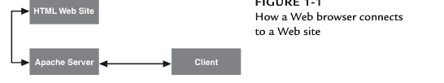

**图 1-1**

Web 浏览器如何连接到网站

在此示例中，客户端连接到 Web 服务器（在本例中为 Apache 服务器）并请求一个 HTML 页面。当客户端连接后，Apache 服务器将请求的页面返回给客户端。在此示例中，Apache 服务器充当中介，接收请求并将响应发送回客户端。

图 1-2 演示了 HTML 输入表单工作原理的稍复杂示例。

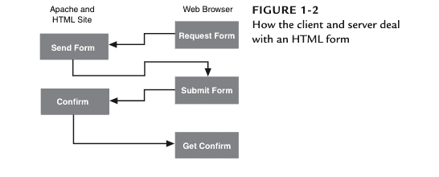

**图 1-2**


# 客户端和服务器如何处理 HTML 表单

如果你从该图的右下角开始，你会看到最初的部分是 Web 浏览器请求 HTML 表单。然后，Apache 服务器响应并将表单发送回浏览器。接下来，用户填写表单并将其提交回 Apache 服务器。Apache 随后向客户端发送确认页面。通过跟随箭头的方向，你可以看到该过程如何工作以及信息如何在客户端和服务器之间发送。

下一个示例，如图 1-3 所示，演示了当数据库服务器加入其中时会发生什么。在这种情况下，你不仅要填写表单，还希望将表单内容存储到数据库中。为了做到这一点，当网站接收表单内容时需要包含一个额外的步骤。网站必须发送确认页面并将数据放入数据库。由于将数据放入数据库是一个单向过程，因此此图中没有双向箭头。

图 1-3 中显示的模型与之前几乎相同，但增加了额外的阶段。除了将信息放入数据库外，你还需要能够从数据库中检索信息以显示结果。在图 1-4 中，客户端请求表单，填写请求详细信息（例如搜索表单），然后查询数据库获取结果并将其返回给客户端。

**图 1-3**

当引入数据库时，信息流略有不同。

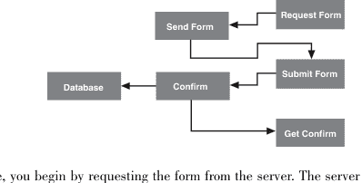

在此示例中，你从服务器请求表单开始。服务器将表单发送回浏览器，用户填写所需信息并提交表单。接下来，服务器接收搜索字符串，并向数据库请求匹配搜索项的物品。数据库然后找到数据并将相关结果返回给服务器，服务器再将结果发送给客户端。

此处描述的客户端/服务器示例对模型中显示的不同组件（如数据库、服务器和浏览器）使用了相当宽松的定义。这样做是为了让你能够关注数据如何在客户端/服务器系统的不同主要部分之间流动。

这最后一个示例（如图 1-5 所示）详细解释了这些组件中每个步骤是如何工作的。

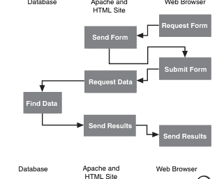

**图 1-4**

这是一种常见情况——用户填写表单并从数据库获取数据。

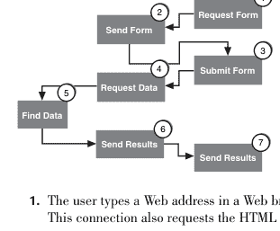

**图 1-5**

每个数字都对应下文的一个要点。

- 1. 用户在 Web 浏览器（客户端）中输入 Web 地址以访问该站点。此连接还会请求包含 HTML 表单的 HTML 页面。
- 2. 浏览器连接到 Apache 服务器，该服务器包含构成该 Web 站点的 HTML 和 PHP 文件。Apache 处理请求（通过遵循其配置文件中的规则找到相关页面并发送回去），并向客户端发送包含 HTML 表单的 Web 页面。
- 3. 用户填写表单（在 Web 浏览器中）并将表单提交到服务器。
- 4. Apache 服务器接收提交的表单，并加载相关文件以处理表单提交。此文件包含用于连接数据库的 PHP 代码。该 PHP 代码由 Apache 传递给 PHP 解释器并由解释器执行。PHP 连接到 MySQL 数据库（可能在同一台计算机上，也可能在另一台计算机上；这并不重要）。连接到 MySQL 数据库后，使用 SQL（一种专为与数据库通信而设计的语言）发出请求以获取信息。
- 5. MySQL 数据库接收 SQL 请求并查找信息。当定位到信息后，结果被发送回发出请求的 PHP 脚本。
- 6. PHP 脚本接收来自 MySQL 服务器的结果，并在将其发回 Web 浏览器客户端之前构建包含结果的 HTML 页面。
- 7. Web 浏览器接收查询的 HTML 结果并将其显示给用户。

在整个过程中，你需要记住一些关键事项。建议你先阅读以下要点，然后回顾上述流程，以澄清任何困惑。

首先，Web 浏览器仅理解超文本；它不理解 PHP。（当然，这是对所有 Web 浏览器的假设，因为它们都是构建为理解超文本的。某些浏览器可能理解 JavaScript 等脚本语言，但该示例超出了本次讨论的范围。）与 Web 浏览器的所有通信都是通过超文本进行的（因此在第 6 步中将 MySQL 查询结果转换为超文本）。另一个要点是 PHP 在服务器上紧密连接着 Apache，所有数据库连接/查询均由 PHP 执行。这种紧密集成意味着 PHP 进程紧密连接 Apache 以实现高性能。PHP 可以被视为访问数据库、文件、XML 等的中间层，并且这个中间层通过 Apache 将一切发送到机器外部。MySQL 应纯粹被视为一种数据存储设备，只有当其他软件连接它以添加、删除、更新或请求信息时才有用。你可以将 MySQL 视为计算机的硬盘；只有当有软件访问硬盘并在其上存储数据时，硬盘才有用。PHP 就是这种“软件”的隐喻等价物。

## 摘要

与学习任何事物一样，PHP 和 MySQL 开发有许多底层概念，需要在深入细节之前加以理解。本章讨论了主要概念，以提供坚实的基础。

下一章将继续深入，教授 PHP 和 MySQL 的核心原则。你将发现语言的基本组成部分，然后直接开始编写应用程序。通过每个应用程序，你将探索新的概念和技能，进一步拓展你的知识，同时始终编写相关的 Web 应用程序。

*此页故意留空*

## 开始使用 PHP 和 MySQL

作为《实用 PHP 与 MySQL》的自豪所有者，或者是在书店翻阅此书的你——很高兴告知你，本书包含多个从零开始构建的真实世界 Web 应用程序。尽管本书的主要重点是教你创建这些应用程序，但回顾学习 PHP 和 MySQL 的一些入门方面也很重要。本章提供了快速入门指南。

本章的意图并非详尽无遗，而是提供关于 PHP 和 MySQL 的坚实入门介绍——足以让你开始编写应用程序。许多 PHP 和 MySQL 书籍花大量时间讨论与读者毫无关联的抽象概念，你常常能看到读者因纯粹且未加修饰的无聊而眼睛发直。作为一个反对任何形式视网膜呆滞的人，你不会在这里找到这类内容。宏伟的计划是向你展示足够多的 PHP 和 MySQL 内容以便开始，然后着手处理有趣的部分：编写应用程序。

本章讨论了 PHP 语言的核心基础知识，如循环和变量，然后继续讲解如何创建数据库并从 PHP 访问它。本章最后介绍了会话（Sessions），这是大多数 Web 应用程序中使用的一项关键技术。虽然本章提供了这些概念的入门介绍，但真正的行动发生在你将编写的内部应用程序中。每个项目提供了一种方法，以进一步探索编程 PHP 和 MySQL Web 应用程序的众多方面，总体宗旨是通过实践学习，而不是通过阅读学习。

16 实用 PHP 与 MySQL

## 设置 PHP 和 MySQL

当我开始教人们如何使用 PHP 和 MySQL 时，我通常会在电脑实验室的安全环境中进行教学，那里有配置完美的机器网络。我的学生来参加课程，学习如何使用软件，然后对 PHP 和 MySQL 带给他们的潜力感到无比兴奋。然而，几天后，我会开始收到电子邮件，详细讲述他们在 Windows、Linux 或 Mac OS X 上安装 PHP、MySQL 和 Apache 时遇到的问题。虽然电脑实验室非常适合教授软件使用，但当时的课程并没有涵盖安装——然而显然这是一个巨大的障碍。

问题在于，PHP、Apache 和 MySQL 在 Windows 上真的很难设置。它们在 Linux 上要容易得多，因为主要发行版通常包含 MySQL、Apache 和 PHP 包，但在 Windows 上则是一场噩梦。当时，我对该怎么办感到有些困惑——教授软件的安装部分可能会占用课程的大量时间。

然后，在一番纯粹的灵感之后，我的同事兼朋友 Elliot Smith 发现了 XAMPP (`www.xampp.org/`)。XAMPP 提供了一个完整的 PHP、Apache 和 MySQL 网络开发环境，可以通过下载、解压缩并运行软件来安装。XAMPP 极大地简化了安装过程，该软件还包含一系列真正有用的附加功能和额外组件，包括 PHP 扩展、MySQL 的 Web 前端（本书中全程使用），等等。XAMPP 可免费用于 Windows、Linux、Mac OS X 和 Solaris。

建议你如果使用过 XAMPP 之前从未设置过该软件，请使用 XAMPP 进行设置。以下部分涵盖了如何在 Windows 和 Linux 上设置 XAMPP。

### 在 Windows 上设置 XAMPP

首先，从 `www.xampp.org/` 下载最新的 XAMPP 安装程序。双击安装程序并遵循指示。安装后，通过点击“开始 > 程序 > XAMPP”加载 XAMPP 控制面板。

### 在 Linux 上设置 XAMPP

首先，从 `www.xampp.org/` 下载最新的 XAMPP 发行版。接下来，将安装文件复制到 `/opt` 然后解压缩。如果你没有 `/opt` 目录，请以超级用户身份运行 '`mkdir /opt`' 创建它。如果你的电脑上没有安装 `sudo`，你可以通过运行 '`su`' 并输入超级用户密码来成为超级用户。

要将文件复制到 `/opt`：

```
foo@bar:~$ sudo cp xampp-linux-x.x-x.tar.gz /opt
```

要移动到 `/opt` 并解压缩文件：

```
foo@bar:~$ cd /opt
foo@bar:/opt$ sudo tar zxvf xampp-linux-x.x-x.tar.gz /opt
```


现在，一系列文件被解压到一个名为 `lampp` 的目录中。目前，这些解压操作都是作为超级用户完成的，但你希望你的普通用户账户能够写入 `htdocs` 目录，因此更改该目录的权限：

```
foo@bar:/opt$ sudo chmod -R a+rw /opt/lampp/htdocs
```

现在你已准备好运行 XAMPP：

```
foo@bar:/opt$ sudo /opt/lampp/lampp start
```

你也可以停止 XAMPP：

```
foo@bar:/opt$ sudo /opt/lampp/lampp stop
```

现在，你可以将 PHP 代码保存在 `/opt/lampp/htdocs` 中，并在 Web 浏览器中通过 `http://localhost/` 访问你的新 XAMPP 服务器。

## 注意

### Linux 版 XAMPP 控制面板

由于对 Windows 版精美的图形化 XAMPP 控制面板感到些许失望，我为 Linux 编写了一个 Python 版本，它现在包含在官方 XAMPP 发行版中。你可以在 `/opt/lampp/share/xampp-control-panel` 中找到它。只需像这样运行它：

```
foo@bar:/opt/lampp/share/xampp-control-panel$ sudo ./xampp-control-panel
```

## 开始使用 PHP

PHP 和 HTML 是好朋友。并肩工作，PHP 和 HTML 这对伙伴如此相互依赖，以至于几乎不可能将它们分开。无论你进行哪种类型的 Web 开发，你都会使用 PHP 和 HTML

在绝大多数你编写的脚本中可以互换使用。你的 HTML 和 PHP 代码都将驻留在任何以 `.php` 结尾的文件中。

首先，你将创建一个包含一些 HTML 的简单页面。创建一个新的文件，并将其命名为 `1.php`。在文件中添加以下代码：

```html
<!DOCTYPE HTML PUBLIC "-//W3C//DTD HTML 4.01 Transitional//EN"
"http://www.w3.org/TR/html4/loose.dtd">
<html>
<head>
<title>Tough first script</title>
</head>
<body>
<h1>The very first script</h1>
<p>
This is the first script!
</p>
</body>
</html>
```

在这个示例中，你正在编写一些 HTML 来构建一个简单的网页。这段 HTML 首先选择了一个合适的 DOCTYPE（要使用的 HTML 方言），然后使用 `<title>` 标签设置页面的标题（窗口边框中的文本）。接下来，在提供令人难忘的词组“This is the first script!”之前，使用 `<h1>` 标签添加了一个大标题，该词组位于一个段落中（由 `<p>` 和 `</p>` 标签指示）。如果你迫切地想要将这些令人难忘的词组改为其他内容，那就尽管去做吧。

## 注意

### 运行你的代码

创建存储代码的文件时，请确保将它们放在 Web 服务器读取文件的目录中。此目录通常称为 `htdocs`。如果你使用的是 XAMPP，在 Linux 上，该目录称为 `/opt/lampp/htdocs`，而在 Windows 上，则是你安装目录内部的 `htdocs` 目录。

要运行你的代码，请记住 `http://localhost` 指向这个 `htdocs` 目录。因此，如果你想访问 `1.php`，请在 Web 浏览器中访问 `http://localhost/1.php`。

你可能已经注意到，这些代码存储在一个扩展名为 `.php` 的文件中，而不是 `.htm` 或 `.html` 扩展名。这是因为所有你要使用的 PHP 脚本最终都会转换为 Web 浏览器能够理解的文本。你应该始终记住，Web 浏览器根本不知道 PHP 是什么。Web 浏览器只理解文本、HTML 和 CSS。是运行 PHP 的 Web 服务器在执行将 PHP 处理后，将文本、HTML 或 CSS 发送回浏览器的工作。

在你的代码中添加一个 PHP 块：

```html
<!DOCTYPE HTML PUBLIC "-//W3C//DTD HTML 4.01 Transitional//EN"
"http://www.w3.org/TR/html4/loose.dtd">
<html>
<head>
<title>Tough first script</title>
</head>
<body>
<h1>The very first script</h1>
<p>
This is the first script!
</p>
<p>
<?php

echo "This is PHP code";

?>
</p>
</body>
</html>
```

在这个示例中，你创建了另一个段落块并在其中添加了一个 PHP 块。如果你再次运行该脚本，你会看到 Web 浏览器中显示的另一个文本行。

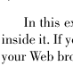

### 快速提示

在本书中，以粗体显示的代码表示添加到脚本中的新代码。

当你想使用 PHP 代码时，请将 PHP 命令放在 `<?php` 和 `?>` 标签内。这两个标签指示 PHP 块的开始和结束点，这两个标签之间的任何内容都会输入 PHP 解释器并被消化处理。你可以将这些标签视为类似于 HTML `<!--` 和 `-->` 注释标签的行为方式，其中这些标签内的所有内容都被视为注释。

还记得 Web 浏览器不懂 PHP 吗？为了演示这一点，请查看 Web 浏览器中的源代码（通常通过点击 `视图 > 源代码`）。正如你所见，里面没有 PHP。实际发生的情况是，服务器上的 PHP 解释器读取任何 PHP 命令，执行它们，并输出 HTML 作为最终输出。在这个示例中，PHP `echo` 命令被用来将双引号内的内容发送到 Web 浏览器。PHP 中的每个命令都以分号 (`;`) 结尾，你可以在 `echo` 命令的末尾看到它。

## 注意

### 在 PHP 中使用 HTML

你可以在 PHP `echo` 语句中使用 HTML 标签。`echo` 语句的目的是将信息发送到浏览器，如果你想嵌入 Web 浏览器可读的 HTML 标签或其他内容（如 CSS 或 JavaScript），你可以自由这样做。例如，将前面的 `echo` 行更改为：

```php
echo "This is <strong>PHP</strong> code";
```

在这一行中，你使用 HTML `<strong>` 标签使 `echo` 语句的一部分加粗。这是 PHP 中极其有用且经常使用的功能。

请记住，你只能在合法的 PHP 命令内部放置 HTML 标签。你不能像这样随意将 HTML 倒入 PHP 块中：

```php
<?php
<strong>Boogaloo with my didgeridoo</strong>
?>
```

`<?php` 和 `?>` 标签内的所有内容都被期望是 PHP，而 `<strong>` 标签是 HTML（不是 PHP）。

## 使用变量

变量是任何编程语言的基础。一个 `变量` 是一小部分存储特定信息片段的内存。想象一下，你手中拿着一个纸箱和一支笔。你现在决定把你最喜欢的 CD 放进箱子里。为了更好地记住里面的内容，你在箱子正面写上‘favealbum’。现在你知道，如果你看着箱子并看到‘favealbum’，你会想起里面放着那张有点尴尬的 Leprechaun Hits Volume 1 CD。

变量的工作原理完全如此，只是变量存储的是信息。在你的程序中，你可以创建一个变量来存储一些信息，然后通过变量本身的名称来引用该变量中的内容。这最好通过一个例子来说明。

创建一个名为 `simplevariable.php` 的新文件，并添加以下代码：

```php
<?php
  $monkeys = 10;

  echo "Number of monkeys: " . $monkeys;
?>
```

PHP 中所有变量都以美元符号 (`$`) 开头。在前面的示例中，你首先创建了一个名为 `$monkeys` 的变量，然后使用 `=` 号将其设置为值 `10`。这是在 PHP 中创建变量的常见方式；你只需凭空选择一个变量名（在这个例子中，我对猴子的喜爱得到了满足），然后设置该变量以存储特定值。有了 `$monkeys`，现在你可以阅读代码，并在看到它时在脑海中用值 `10` 替换 `$monkeys`。

在此处有一个重要的注意事项，特别是对于在其他编程语言方面有过经验的人来说，在 PHP 中你不需要指示变量的类型。在其他语言（如 C/C++）中，你需要指示包含数字的变量是整数变量。PHP 不同，它会在你使用变量时自行判断类型。

设置变量后，它在下一行被使用，其中使用 `echo` 命令首先显示“猴子数量：”，然后在其旁边显示 `$monkeys` 的值。当你运行脚本时，你应该看到以下输出：“猴子数量： 10”


这个 `echo` 行使用了一种称为拼接的技术。这种听起来有点奇怪的行动提供了一种简单的方法，将文本片段（称为字符串）与变量的内容串在一起。为此，你使用 `.` 符号（称为拼接运算符）将点或句号左右两侧的内容粘合在一起。在上面的代码中，左侧的部分是文本“猴子数量：”，右侧的部分是 `$monkeys` 变量的内容。

拼接是一个重要但有时略显令人困惑的主题。确实需要一点时间才能习惯，特别是使用更复杂的例子时。作为示例，将上面的 `echo` 行更改为以下行：

```php
echo "You have " . $monkeys . " monkeys!";
```

在这一行中，你两次使用拼接运算符将额外部分粘合到该行上。如果你从左到右阅读该行，你可以看到“You have”如何被粘合到 `$monkeys` 的值（10），然后该值又被粘合到“monkeys!”。

## PHP 作为简单的计算器

当你能够创建变量时，你也能够对其执行一些简单的数学计算。对于那些一想到数学就感到恐惧的人，请放心；我们将探讨你在 PHP 中需要的一些常见数学用途。

首先，创建一个名为 `simplmath.php` 的新文件，并添加以下代码：

```php
$cds = 50;
$tapes = 60;

$total = $cds + $tapes;

echo "You have " . $cds . " cds and " . $tapes . " tapes with " . $total . " items!";
```

在这个示例中，你首先创建了两个变量，称为 `$cds` 和 `$tapes`，其中存储了数字。（如果你是在 2020 年阅读本书，磁带是存储音乐的物品，有点类似于你的 AstroDisks。）第六行代码使用 `+` 号将 `$cds` 和 `$tapes` 变量相加，并将结果存储在 `$total` 变量中。最后的 `echo` 行将所有变量拼接成一行，解释有多少张 CD 和磁带，以及总共有多少件物品。

在执行数学运算时可以使用许多符号。表 2-1 涵盖了一些最常见的符号。

**表 2-1 PHP 中的数学运算符**

| 运算符 | 描述 | 示例 |
| :--- | :--- | :--- |
| + | 加法 | `$total = $cds + $tapes;` |
| - | 减法 | `$total = $cds - $tapes;` |
| * | 乘法 | `$total = $cds * $tapes;` |
| / | 除法 | `$total = $cds / $tapes;` |

PHP 的一个巨大优点是其功能齐全的方法。为帮助解决一系列问题，许多设施和函数直接内置于 PHP 中。例如，有些数字不容易被整除。想象你需要将一系列新闻故事分布在多个不同的页面上。为此

计算你需要多少页：你可以统计故事的数量以及每页希望显示的条目数，然后将故事总数除以这个页面大小。计算结果将告诉你需要多少页。

将以下代码添加到一个名为 `simplemath2.php` 的新文件中：

```php
<?php
$stories = 43;
$pagesize = 8;

$pages = $stories / $pagesize;

echo "You will need " . $pages . " pages";
?>
```

运行此脚本时，你会看到结果是 `5.375` 页。显然，这是不可接受的，因为你需要一个整数。为了解决这个问题，你可以使用 `floor()` 函数向下取整，或使用 `ceil()` 函数向上取整。

> **注意**
>
> ### 函数？什么意思？
>
> 如果你是函数的新手，理解它们其实相当简单。`函数`是其他地方的一段代码，它为你执行某些操作。例如，`floor()` 函数为你向下舍入数值。在 PHP 引擎的某个深处，有一段代码实际执行了数值向下舍入的工作。你可以通过函数名称引用此功能：`floor()`。
>
> 要使用函数，请指定函数名称，然后在末尾加上括号。括号用于向函数传递信息。例如，除非你向函数传递一个待转换的值，否则 `floor()` 几乎毫无用处。你将这个值放在括号内。这些值被称为`参数`。
>
> 我们将在本章后面介绍函数以及如何编写自己的函数。

尝试在 `simplemath3.php` 中运行以下代码，看看其工作原理：

```php
<?php
$stories = 43;
$pagesize = 8;

$pages = $stories / $pagesize;

echo "Rounded down: " . floor($pages) . " Rounded up: " . ceil($pages);
?>
```

要使用这些便捷的函数，只需将你想要转换的变量放在函数的括号内即可。

### 注意

### 无需额外安装

正如你在第 1 章中学到的，PHP 是一种“开箱即用”的语言，包含大量解决常见难题的函数。贯穿全书，你将学习如何在典型的编程场景中使用各种常见函数。

要了解某个函数的更多信息，只需访问 `www.php.net`。在网址后加上斜杠和函数名，例如 `www.php.net/floor`，即可查看有关 `floor()` 的详细信息。

## 数组

最有用的变量类型之一是`数组`。这种特殊变量使你可以将多条信息存储在单个变量中。想象一下，你正在一个程序中存储一系列最喜欢的选择。你可能希望存储以下选择：

| 偏好 | 选项 |
| :------- | :----- |
| 颜色 | 蓝色 |
| 食物 | 墨西哥菜 |
| 消遣 | 游泳 |
| 音乐 | 金属乐 |

在这个待存储的项目列表中，左侧项与右侧项之间存在明确的关系。这被称为`键值对`，或`关联数组`。在这一对中，你有一个键（例如 `Color`）和一个该键所设定的值（例如 `Blue`）。数组非常适合存储此类关系。

创建数组有几种方法。第一种是使用以下格式：

```php
$arr["Color"] = "Blue";
$arr["Food"] = "Mexican";
```

在此示例中，你创建了一个名为 `$arr` 的新数组。在括号内，你指定了要在数组中设置的键，然后像创建普通变量一样传递值。在前两行中，你创建了数组中的两个条目。

如果你更喜欢使用函数来创建数组，请使用以下格式：`$arr = array("Color" => "Blue", "Food" => "Mexican");` 在此示例中，你使用 `array()` 函数指定键，然后在 `=>` 符号后指定对应的值。逗号分隔数组中的每个不同条目。

在处理数据库信息时，数组被广泛使用。你将数据库记录中的信息存储在行中，键将是字段名。当你连接 MySQL 并将数据引入 PHP 时，这会变得更清晰易懂。

## 循环

当你在任何编程语言中编码时，闭上眼睛并想象一支想象中的光标在你的程序中移动，指向当前代码行，这很有帮助。这支光标将从脚本顶部开始向下移动，依次读取每条指令。

当这支想象光标遇到循环语句时，循环部分的代码将在特定规则得到遵守时重复执行。这条规则被称为`循环条件`。循环用于诸如遍历数据库中的行、创建编号列表等目的。

### for 循环

`for` 循环是最有用的循环之一。要查看其实际效果，请创建一个名为 `for1oop.php` 的新文件，并添加以下代码：

```php
<?php

for($i=1; $i<10; $i++) {
    echo $i . "<br />";
}

?>
```

运行此示例时，你应该看到从 1 到 9 的数字分别显示在不同的行上。`for` 循环依赖于括号内的三个条件。这些条件是：

- **`$i = 1;`** 这是循环开始的部分。在这种情况下，循环从 1 开始。
- **`$i < 10;`** 这是循环结束的地方。在此示例中，当`$i` 小于（用 `<` 运算符表示）10 时，循环将继续。这就是为什么循环持续到 9；数字 9 小于 10，但数字 10 不小于 10。如果你想从 1 循环到 10，你会将运算符更改为小于或等于，即`$i<=10`。
- **`$i++`** 最后一部分决定了循环每次递增多少。在此示例中，`$i++` 是 `$i = $i + 1` 的简写形式。这意味着循环每次递增 1。

`for` 循环特别适用于在定义的数值范围内重复操作。例如，你可以使用 `for` 循环来填充用于选择出生日期中的“日”部分的下拉框。你会使用它从 1 循环到 31，以填入可能的日期值。

### while 循环

PHP 中广泛使用的另一种循环类型是`while` 循环。`while` 循环特别有用，因为它只是在循环条件为真时持续循环。这通常用于遍历数据库记录。

`while` 循环很难演示，因为它们通常用于本书尚未涵盖的代码的实际示例中。不过，为了提供一个简单的示例，请将以下代码添加到名为 `whileloop.php` 的文件中。


```php
<?php

$age = 1;
while($age < 18) {
    echo "You are age " . $age . " and still not an adult<br />";
    $age++;
}

echo "You are now an adult!";
?>
```

在此示例中，你首先创建了一个名为 `$age` 的变量，并将其设置为 1。然后你创建了一个 `while` 循环，只要 `$age` 小于 18，就会重复 { 和 } 括号之间的代码。在 `while` 循环内部，会打印一行表示当前年龄的信息，然后使用 `$age++` 行将 `$age` 变量每次递增 1。随着该值每次增加，循环将循环 17 次。循环不会循环 18 次，因为 18 不小于 18；它等于 18。最后，显示一行文字，表示已达到成年。

一个重要的点是，如果你省略了 `$age++` 行会发生什么。如果你创建一个在特定条件设置时循环的 `while` 循环，但那个条件永远不变，就会发生无限循环。这从来都不是好事，你应始终检查你的循环，确保它在你希望它结束的时候最终会结束。如果你在某人的服务器上运行脚本并陷入无限循环，你可能会收到一些愤怒的电子邮件。始终确保 `while` 循环有结束的方法。

当你探索 PHP 编程的其他方面，特别是数据库开发时，你将再次研究 `while` 循环。


## 小心！

使用 `while` 循环时你可能犯的一个常见错误是将循环条件设置为不会改变的内容，从而导致 `while` 循环永远循环。这被称为无限循环。例如——不要运行此代码——这是一个无限循环的示例：

```php
<?php
$age = 1;
while($age == 1) {
    echo "Argh! Infinite loop!";
}
?>
```

在这里，循环无法摆脱 `$age` 被设置为 1 的状态，因此会永远循环。这会导致你的计算机极其缓慢，如果你正在使用 Web 服务器或 XAMPP，你可能需要重启它们。

## 向你的代码提问

编程语言最基本的一个用途是检查特定条件并在必要时做出响应。一个很好的例子是，如果你在一个 Web 表单中输入年龄，并希望根据用户的年龄返回响应。例如，如果她是儿童而非成年人，你可能希望做出不同的响应。这是包含可能对未成年人不适宜内容的网站中的一个常见主题；用户被提示输入其年龄，如果年龄低于某个阈值，则被拒绝访问。

## 注意

### 这算严重的年龄歧视吗？

你可能已经注意到，这里的许多示例都与年龄有关。这可能意味着两件事：要么我是个彻头彻尾的年龄歧视者，要么我即将遭遇中年危机。好吧，都不是，戏精们。年龄只是编写示例程序的绝佳主题。

这里要探讨两种主要的条件结构：`if` 语句和 `switch` 语句。`if` 语句适用于针对特定条件提出单个问题，而 `switch` 语句则适用于检查某个特定值是否匹配众多选项中的某一个。

## if 语句

`if` 语句在 PHP 开发中被广泛使用。你会使用 `if` 以多种方式在不同的页面上检查各种条件。作为入门，让我们先创建一个非常简单的示例。请将以下代码添加到名为 `if1.php` 的文件中：

```php
<?php

$age = 21;

if($age == 21) {
    echo "Congratulations!";
}
?>
```

在这个示例中，你首先创建了一个名为 `$age` 的变量并将其设为 21。然后，你使用 `if` 语句检查 `$age` 是否等于 21。如果相等，浏览器将显示文本 Congratulations!。这句话中的“魔法”发生在花括号之间。你可能已经注意到，代码中使用了双等号而不是单个等号。这一点至关重要。当你在代码中使用双等号时，你是在比较两侧的值。在前面的示例中，使用双等号是将 `$age` 变量与值 21 进行比较。如果你使用单个等号，左侧的变量会被设置为右侧的值。

在之前的示例中，`if` 检查非常直接。然而，前一个示例的问题在于它只处理匹配的情况。在许多情况下，你需要检查当 `if` 不匹配时该怎么办。

为了实现这一点，你可以给 `if` 块加上一个 `else`。这个小改动会在 `if` 不匹配时执行一些代码。

请将以下代码添加到 `if2.php` 中：

```php
<?php

$age = 21;

if($age < 18) {
    echo "Congratulations! You are a kid";
} else {
    echo "Just a normal age";
}
?>
```

在这个示例中，你更改了 `if` 的条件以检查一个范围。在条件中（花括号内），`if` 检查 `$age` 变量的值是否小于 18。如果是，则执行 `if` 代码；如果不是，则执行 `else` 代码。

## switch 语句

尽管 `if` 语句非常有用，但它实际上仅适用于针对单个值进行比较。如果你想提供一系列选项，就需要使用许多 `if` 语句来检查是否选择了每个选项。`switch` 语句避免了使用多个 `if` 语句，并提供了一种单一且简洁的方法来实现这一目标。

请将以下代码添加到 `switch.php` 中：

```php
<?php

$choice = 2;

switch($choice) {
    case 1:
        echo "You picked choice #1 - well done!";
        break;

    case 2:
        echo "You picked choice #2 - well done!";
        break;

    case 3:
        echo "You picked choice #3 - well done!";
        break;

    default:
        echo "You did not pick a valid choice!";
        break;
}
?>
```

在这个示例中，你首先创建了一个名为 `$choice` 的变量，并将其设为 2。然后，该变量被传入一个 `switch` 语句中，该语句会对 `$choice` 进行分析。在 `switch` 块内部是一系列 `case` 条目。如果 `$choice` 的值为 1，则应用第一个 `case`（`case 1:`）。如果确实如此，位于 `case` 和 `break` 语句之间的代码将被执行。另外两个 `case` 语句分别在 `$choice` 等于 2 或 3 时应用。最后，在所有其他情况下，都会执行 `default` 部分。

在这类示例中，当你需要检查值是否等于多种不同条件时，`switch` 语句非常有用。

## 使用函数

之前你学习了如何使用 `floor()` 和 `ceil()` 函数。这些 PHP 中虽小但实用的特性为解决特定的、有针对性的问题提供了便捷的方法。对于 `floor()` 来说，如果你的问题是需要将某个数值向下取整，`floor()` 会迅速提供帮助，提供一种将数值转换的简单方法。

PHP 包含解决海量问题的函数。文件处理、算术、验证、表单、XML、网络等领域都包含了数百个用于广泛任务的函数。这些函数由 PHP 开发者设计，旨在提供一种解决这些特定任务的简便方法。

尽管这些函数存在于 PHP 语言中，你也有能力创建自己的函数。当你需要针对项目中的某些内容进行特定处理时，自行编写函数通常很有用。例如，你可能需要获取一个基础价格，然后自动加上其他各项费用，直到得出最终价格。

```php
<?php

function calculatePrice($price) {
  $manufacturingcosts = 10.50;
  $pretax = $price + $manufacturingcosts;
  $tax = ($pretax / 100) * 20;
  $total = $pretax + $tax;

  return $total;
}

echo calculatePrice(304);
?>
```

在这个示例中，你创建了一个函数，将两项主要成本加到价格中。第一项是标准的 10.50 制造成本。第二项是税务所需的 20%。

第一步是创建函数的外部结构。在第一行，你使用 `function` 关键字创建了一个名为 `calculatePrice()` 的新函数。在函数的括号内，你包含了 `$price`。这指的是函数使用的一个参数。这个参数是一个通道，你可以将数据输入到函数中。稍后在示例中实际使用函数时，你会用想要处理的数据替换这个参数。


在 `{` 和 `}` 花括号之间是函数的主体。这是实际处理发生的地方。查看要添加的成本，第一项成本是制造费用。为了实现这一点，你首先创建一个名为 `$manufacturingcosts` 的新变量，并将其设置为 `10.50`。下一行创建一个名为 `$pretax` 的新变量，将传入函数的值（`$price`）与 `$manufacturingcosts` 变量相加。

下一步是计算正确数额的税费。为此，创建了一个名为 `$tax` 的新变量，然后进行括号内的计算，计算结果除以 20 以确定最终金额。然后将此金额加到 `$pretax` 变量中。

函数的最后部分是 `return $total` 行。这一行的目的是指定哪个变量包含函数处理后的结果。通过使用 `return` 关键字，该函数现在可以像 PHP 中的其他任何函数一样使用，并会按预期输出处理后的数据。这个 `return` 行只是将结果发送回调用该函数的行。

最后，通过传入 304 作为值来执行函数。函数的结果被回显到屏幕上。结果 `377.4` 随即显示出来：`377.4` 是 `return` 行返回的值。

## 处理表单

如果你从事任何形式的 Web 开发，你在日常编程中都会遇到表单。这些毫无防备的家伙居住在 Web 页面上，通过你的手指从你那里吸取信息，然后由服务器上的脚本进行处理。

处理表单涉及两个过程。首先，显示的表单需要捕获所有相关信息。其次，当用户点击提交按钮时，你需要读取并处理表单。

第一步通过 HTML 执行，利用 HTML 表单元素的广泛范围来生成页面上的表单。作为开始，请将以下代码添加到 `form1.php` 中：

```html
<form action="form1.php" method="POST">
<br/> Username <input type="text" name="username"/><br/>
<br/> Password <input type="password" name="password"/><br/>
<br/> <input type="submit" name="submitbutt" value="Login!"/>
</form>
```

在这个示例中，你创建了一个简单的表单，其中包含三个不同的元素。这些元素协同工作以创建一个登录表单。

第一行是 `<form>` 开始标签。该标签接受两个主要属性。第一个属性（`action`）需要知道处理表单的脚本的位置。在这个示例中，`action` 包含了包含表单的文件的名称（`form1.php`），因此假设处理表单的代码位于同一文件中。

第二个属性（`method`）可以包含 `GET` 或 `POST`。这指的是数据如何传输到 `action` 脚本。这两种方法类型截然不同：

- `POST`：当你使用 `POST` 方法时，输入表单的数据会在幕后传输到 `action`。用户没有视觉提示表明数据是什么；数据将以非视觉方式传输。虽然你看不到它，但仍然有访问 `POST` 数据的方法，因此不应认为它是 100% 安全的。
- `GET`：当你使用 `GET` 方法时，表单中的数据会作为一系列变量附加到 URL 的末尾。例如，如果你填写了前面的表单并使用 `GET` 方法，假设你在表单中输入了 jono 和 secret&pass，那么你会在浏览器的地址栏中使用 `http://localhost/form1?username=jono&password=secret&pass=Login%21`。使用 `GET` 方法时，请务必注意 URL 中不显示敏感信息，例如密码！

在 `<form>` 标签显示后，下一步是显示每个表单元素。

大多数表单元素通过 `<input>` 标签添加，然后在 `<input>` 标签中通过 `type` 属性选择相关选项。

第一个添加的字段是一个普通的文本框。这提供了一个单行框，用户可以在其中输入一些文本。要选择此类型的元素，请在 `type` 属性中使用 `text` 设置。您还应该为标签提供一个 `name` 属性。您将使用 `name` 属性的值来稍后引用框中的内容。

第二个添加的字段是一个密码框。当您在 `<input>` 标签的 `type` 字段中使用 `password` 时，该框的行为与文本框相同，但它会用星号或圆点隐藏用户输入的数据。

最后添加的框使用 `submit` 类型。这提供了一个可点击的“提交”按钮，用户点击表单时可以使用它。传递给此标签的额外属性是 `value`；这会预填充小部件的数据。对于提交按钮，`value` 属性会更改按钮上显示的文本。


### 注意

#### Web 编辑器

许多 Web 编辑器可以帮助您更高效地编写 HTML。一个很好的例子是 Linux 上可用的名为 Bluefish（http://bluefish.openoffice.nl）的工具。借助它，您可以使用工具栏按钮轻松添加表单元素。

在许多操作系统上都可以找到许多像这样实用的编辑器，例如 SciTE（http://www.scintilla.org/）。

## 处理表单

显示表单而不处理它几乎是毫无用处的。要对表单数据执行任何有用的操作，您需要将表单连接到可以处理数据的一些 PHP 代码。

要处理表单，请遵循以下步骤：

- 1. 确定提交按钮变量是否存在。如果用户点击了按钮，您可以假设表单已显示，并且提交按钮已被点击。
- 2. 如果提交按钮未被点击，您应该假设表单尚未显示，因此您不显示它。
- 3. 如果提交按钮已被点击，然后处理表单。

为了演示此过程如何工作，创建一个名为 `form2.php` 的新文件，并添加以下代码：

```php
<?php

if($_POST['submitbutt']) {
    echo "username: " . $_POST['username'] . "<br />";
    echo "password: " . $_POST['password'] . "<br />";
}
else {
?>

<form action="form2.php" method="POST">
    Username <input type="text" name="username"><br />
    Password <input type="password" name="password"><br />
    <input type="submit" name="submitbutt" value="Login!"><br />
</form>

<?php
}
?>
```

在理解这段代码时，把自己放在 PHP 解释器的位置，假设您之前从未发送过该页面会有所帮助。此示例的开头包含 `if` 语句。此行检查提交按钮是否已被点击。这通过检查是否存在与提交按钮（`submitbutt`）同名的 `POST` 变量来确定。

在 PHP 中，可以使用一些特殊命令来访问某些类型的变量。在此特定示例中，您正在使用 `$_POST['submitbutt']` 来引用 `submitbutt` `POST` 变量。如果您使用 `GET` 作为方法，您也可以使用 `$_GET['submitbutt']`。

### 注意

#### 超级变量？

PHP 中的 `$_GET` 和 `$_POST` 功能在 PHP 术语中被称为 `超级全局变量（superglobals）`，它们用于访问不同类型的信息。例如，`$_GET` 用于访问 `GET` 变量。

`if` 行简单地检查此变量是否存在。如果变量存在，则通过以相同方式引用其他 `POST` 变量的内容，在屏幕上显示它们。如果变量不存在，您需要假设表单尚未显示，并且运行 `else`。您可以在代码底部看到如何实际退出 PHP 模式以显示表单，然后返回 PHP 模式，最终用右大括号 `}` 关闭 `else` 代码块。这是显示和处理表单的常用方式。使用此方法意味着您可以将表单处理和表单标签保留在同一页面上，以便轻松访问。

为了澄清这一点，处理表单的步骤如下：

- 1. 加载页面并检查是否存在提交 `POST` 变量。由于您甚至尚未看到表单，答案为否，因此跳过 `if` 代码块中的代码。
- 2. 执行 `else`，并显示表单。
- 3. 用户输入一些信息并点击提交按钮。然后浏览器检查 `action` 并使用 `POST` 方法访问该页面。由于 `action` 指定了相同的页面名称，因此页面会重新加载。
- 4. 页面重新加载，`if` 再次检查是否存在提交 `POST` 变量。这次存在了，所以执行 `if` 代码并显示用户名/密码详细信息。

## 深入 MySQL

在探索 PHP 和 MySQL 的过程中，MySQL 方面此前一直处于缺席状态。到目前为止，重点是学习 PHP 语言背后的核心基本功能，但现在是时候转移这一焦点了。现在是 MySQL 登场的时候了。

典型的数据库由许多不同的部分组成。这些不同部分在图 2-1 中概述。

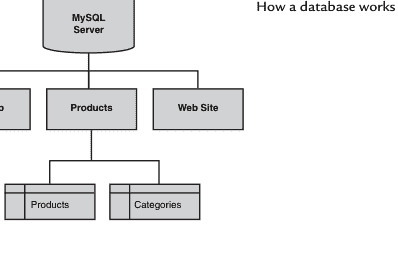

**图 2-1**

数据库如何工作


最顶层是主要的 `MySQL` 服务器。服务器包含图中显示的所有其他部分。许多人对 *server*（服务器）这个术语感到困惑，认为它必须是某种硬件。实际上，*server* 一词具有双重含义，既指用于提供服务的硬件，也指用于提供服务的软件。在 `MySQL` 的情况下，我们指的是软件服务器。

在 `MySQL` 服务器内，您可能拥有多个数据库。这是数据库开发新手有时也会感到困惑的另一个领域。使用 `MySQL` 时，实际上您可以在同一服务器中拥有多个数据库；您并不局限于只有一个。因此，您可以在计算机上运行单个 `MySQL` 安装，并运行主要公司的数据库、产品数据库和您的网站。

为了将焦点转移到服务器内的特定数据库，您可以看到许多表。每个数据库将其数据存储在一组可以以不同方式相互关联的表中。表 2-2 显示了数据库中典型的一张表。

### 表 2-2 一个数据库表示例

| Forename | Surname |
|---|---|
| Craig | Tucker |
| Lee | Jordan |

每个表都由行和列组成。在数据库术语中，列被称为 **字段**，行被称为 **记录**。当您创建数据库表时，您定义想要在字段（列）中存储的信息类型，然后数据库中的每个条目都作为记录（行）存储。

## 示例：产品数据库

在这个示例中，您将创建一个存储产品信息的数据库。您想要存储的信息类型包括：

- 产品名称
- 类别
- 价格
- 产品描述

这些内容非常典型，属于您通常想要放入数据库的信息类型。在创建任何数据库之前，最好写下您需要处理的数据类型；这使得设计表时更容易。

在明确理解需要存储的数据类型之后，下一步是开发一种适合以合理方式存储数据且无需不必要地重复数据的表结构。

## 学习数据库理论

需要注意的是，数据库设计是一个巨大的主题，本书中没有足够的空间来提供数据库设计理论和引用完整性的详尽解释。如果您是数据库设计的新手，并且希望了解如何设计稳固的数据库结构，请咨询当地的书店并查看该主题的大量书籍之一。

在这个示例中，您将使用两个表来存储数据：一个产品表和一个类别表。产品表将包含以下字段：

- id
- cat_id
- product_name
- description
- price

每次创建表时，都必须有提取唯一记录的方法。要做到这一点，您需要能够确定某些字段或字段组，它们可以在提取特定记录时帮助您添加唯一性。例如，如果您存储客户列表，您可能会认为通过搜索姓名可以引用唯一记录。然而，这行不通；许多人拥有相同的姓名，因此不唯一。另一个选项是搜索姓名 AND 邮政编码。同样，这行不通，因为在同一邮政编码下可能有多于一个人拥有相同的姓名。虽然这可能不太可能，但重点是，您不应基于相似性来判断唯一性——它绝对*必须*是唯一的。

解决此问题的方法是创建一个包含该记录唯一 ID 编号的额外字段。每次向数据库添加新记录时，此编号将增加 1，因此您将拥有一个唯一 ID，可以引用每个记录。`MySQL` 包含支持使这个唯一编号非常易于实现的功能。在前面的产品表字段列表中，

第一个字段（`id` 字段）存储这个唯一编号。这个唯一字段（无论是唯一编号还是其他唯一字段，例如用户名）被称为`主键`。你将在书中全程使用主键。

上一个列表中的第二个字段是 `cat_id`。这个字段被称为`外键`，并将与接下来讨论的 `categories` 表的主键进行匹配。表中的其他字段包含有关产品不同方面的通用信息。

`categories` 表包含了一系列与不同产品类别类型相关的字段。该表包括以下字段：

- `id`
- `category`

如你所见，这个表相当简单，因为该表的宗旨仅仅是提供一种存储类别信息的方式。在这个简单的示例中，你将只是将类别名称及其主键字段存储在表中。

## 表格之间的相互关系

在设计好两个表之后，现在讨论它们之间的相互关系是合情合理的。两个表格之间创建的关系是通过匹配特定类型的信息来实现的。在这两个表中，这种匹配发生在 `categories` 表的 `id` 字段和 `products` 表的 `cat_id` 字段之间。如果两个字段包含相同的数字，则存在关系。

当你向 `products` 表添加记录时，不是将类别的文本名称添加到 `cat_id` 字段中，而是存储与相关类别关联的 `id` 值。例如，如果 `categories` 表中的第一个类别是*游泳*（Swimming）且其 `id` 为 1，那么你将在 `products` 表的与游泳相关产品的 `cat_id` 字段中存储数字 1。稍后，当你编写代码从数据库中提取信息时，你可以利用这些不同的关系来提取不同类型的信息。

此时，你可能会想知道将此类信息分离到不同表中的好处是什么。为什么不在字段中直接包含类别名称呢？这种分离有各种实际原因，如下所示：

- 当你想要更改 `category` 的名称时，第一个好处显而易见。例如，如果你想将类别从*游泳*（Swimming）扩展为*水上活动*（Water Activities），你将需要遍历每条记录并手动更改该字段。如果使用两个表来分离数据，你只需更改单条记录来调整类别，随后更改将反映在所有相关记录中。
- 如果使用单独的表，你可以将更多信息与类别关联起来。稍后在 `categories` 表中添加额外字段以增加诸如类别的*描述*、*类别图标*、*翻译后的定义*等功能没有任何理由行不通。
- 将数据提取到单独表中的一个大原因是易用性。如果你有一个包含大量字段的单个表，它看起来会更复杂且更难处理。拥有多个简单、较小的表更好。
- 如果你的数据分布在多个较小的表中，你的数据库运行效率将更高，因为它不需要遍历大量无关数据。

将信息分离到不同的表中具有许多好处，这无疑是开发数据库驱动应用的*正确*方式。你将在书中看到许多关于这种跨表数据分离如何工作的例子。

## 创建数据库

下一步是实际将这种理论转化为你可以看到、触摸和操作的东西。为此，你需要使用你的数据库客户端。在这个例子中，你将使用随 `XAMPP` 一起提供的工具 `phpMyAdmin` 来创建数据库。

首先，打开 Web 浏览器并通过访问 `http://localhost/phpmyadmin/` 连接到 `phpMyAdmin`。会显示一个登录屏幕。如果你刚安装了 `MySQL` 或 `XAMPP`，请使用用户名 `root` 且不设密码。如果你正在共享计算机上工作，请首先使用以下命令连接到服务器，然后更改你的 `root` 密码：

```
mysql -u root mysql
```

现在*执行*以下 SQL 查询：

```
SET PASSWORD FOR root@localhost=PASSWORD('chinnyraccoon');
```

显然，请将括号中的密码替换为你自己的密码。登录 `phpMyAdmin` 后，你会看到屏幕左侧有一个框架，用于列出数据库和表（当前没有选择任何项）。屏幕主体部分有一个框，你可以在其中输入要创建的数据库名称（见图 2-2）。在此框中输入 `productssdb`，然后单击创建按钮。现在你看到 `productssdb` 数据库出现在左侧框架中。通常，你的表格列在侧边的数据库名称下方，但尚未创建任何表。

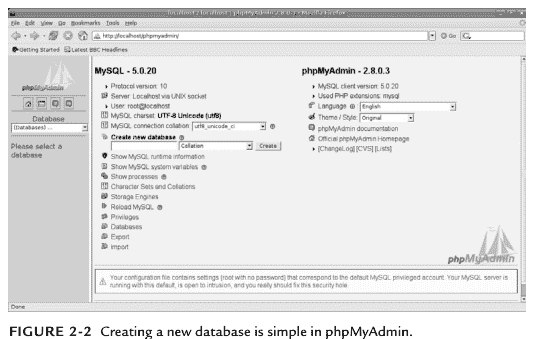

**图 2-2** 在 `phpMyAdmin` 中创建新数据库很简单。

### 创建表格

在屏幕主体部分有一个框，你可以使用它来创建表。在此框中，输入名称 `products` 并给予它 5 个字段。然后你将看到表设计屏幕。如图 2-3 所示，有五行，以及配置表中每个字段所需的许多不同框。在这个简单示例中，其中大部分框将无关紧要。

在创建字段之前，有必要讨论 `MySQL` 中类型的概念。在任何类型的数据库编程中，你存储在数据库中的信息类型根据其信息种类具有不同的特性。例如，如果你在数据库中存储浮点数（浮点数是小数，如 21.45），那么存储此类型信息所需的内存比存储整数（整数，如 35）更多。除此之外，不同的数字有不同的范围。例如，`MySQL` 中的 `TINYINT` 类型可以存储 -128 到 127 之间的任何整数。相比之下，`BIGINT` 数据类型可以存储 -9223372036854775808 到 9223372036854775807 之间的任何值。

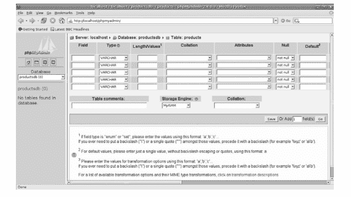

**图 2-3** 表设计屏幕有很多选项；请使用滚动条滚动浏览它们。

就内存使用率和性能而言，使用 `TINYINT` 存储 1 字节的值和使用 `BIGINT` 存储 8 字节的值之间存在差异。在这本书中，我们将广泛使用主要的 `MySQL` 类型，每个示例都会解释为何选择相关的数据类型。这应该能给你一个关于如何使用不同数据类型的扎实、实用的观念。


好了，现在是时候创建表格了。在“字段”列的第一行，将 `id` 添加为字段名称。在第二列（类型）中，选择数据类型为 `MEDIUMINT`；这将提供最多 8388607 个产品的访问权限。请记住，此 `id` 列要求每个产品具有唯一值，因此你需要确保数据类型足够大，以容纳你所需产品的潜在数量。沿该行继续，然后选择“额外”框，并从中选择 `auto_increment`。当你添加记录时，此选项会自动为你填充 `id` 字段。启用此选项后，每个新记录在 `id` 列中获得的值比前一条记录的 `id` 大 1。设置 `auto_increment` 后，你可以有效地忽略 `id` 字段，它会自我维护。要设置的最后一个选项是第一个单选按钮（它有一个小钥匙和表格的图标）。通过选择此选项，你将该字段设为主键，数据库将不允许此字段中出现重复值。如果你像此处所做的那样将此选项与 `auto_increment` 结合使用，你可以确保拥有一个可靠的主键。

现在，依次检查每一行并添加以下字段：

- `cat_id`：将 `cat_id` 添加到 Field 列，并分配类型为 `TINYINT`。拥有超过 127 个分类的可能性不大，因此这是一个合适的类型。你无需提供长度。

- `product`：将 `product` 添加到 Field 列，并分配类型为 `VARCHAR`。当你需要存储少于 255 个字符时可以使用此类型。使用 `VARCHAR` 类型时，你需要为该字段提供最大长度。添加 50 作为长度；产品标题的大小超过 50 个字符的可能性不大。

- `description`：将 `description` 添加到 Field 列，并分配类型为 `TEXT`。当你需要在字段中存储可能较大的文本块时可以使用 `TEXT`。你无需提供长度。

- `price`：将 `price` 添加到 Field 列，并分配类型为 `FLOAT`。当你需要存储带有小数点的数字时可以使用此类型。你无需指定长度。

配置完字段后，单击 `Save` 按钮，你的表就创建好了。使用 `phpMyAdmin` 的最有用的好处之一是，当你执行某些操作时生成的 SQL 语句总是会显示给你。这能让你通过随意查看使用 `phpMyAdmin` 时生成的代码，对 SQL 的工作原理有一个很好的了解。这段 SQL 代码现在可能还看不懂，但请浏览一下以大致了解 SQL 的样子。书中后续许多项目都广泛使用 SQL，因此建议你尽快习惯阅读 SQL。

生成的 SQL 应该与以下内容非常相似：

```sql
CREATE TABLE `products` (
  `id` MEDIUMINT NOT NULL AUTO_INCREMENT ,
  `cat_id` TINYINT NOT NULL ,
  `product` VARCHAR(50) NOT NULL ,
  `description` TEXT NOT NULL ,
  `price` FLOAT NOT NULL ,
  PRIMARY KEY ( `id` )
);
```

如果你从上到下阅读这段 SQL，你会发现它很像英语。虽然你很少会手动编写 SQL 来创建表（通常你只是在 `phpMyAdmin` 等客户端中创建它们），但创建表的语法相当简单明了。

现在你需要创建第二个表。为此，请单击左侧框架中的 `perfectproducts` 链接。在页面的主体中，你现在可以创建一个名为 `categories` 的新表，并为其指定 2 个字段。在表设计屏幕中，添加以下字段：

- `id`：将 `id` 添加到 Field 列，并分配类型 `TINYINT`。现在从 Extra 框中选择 `auto_increment`，然后选择带有顶部小钥匙图标的列中的主键（Primary Key）选项。

- `category`：将 `category` 添加到 Field 列，并分配类型 `VARCHAR`。将长度设置为 30。

添加这些字段后，单击 `Save` 按钮。大功告成。

### 向表中添加数据

表完成后，你就准备好填充数据了。你将在 `phpMyAdmin` 中手动开始这样做，但随着你阅读本书的内容，你将创建表单来自动化数据添加至不同表的过程。

首先，你将向 `categories` 表添加一些数据。你需要先添加一些分类，以便你能够在 `products` 表中引用相关分类。要添加数据，请从左侧框架的表列表中选择 `categories` 表。此时你应该看到屏幕主体顶部出现了多个选项卡。单击 `Insert` 选项卡。你会进入一个可以添加数据到表中的界面，如 Figure 2-4 所示。

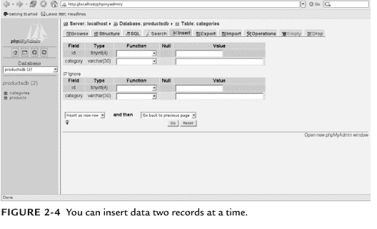

**FIGURE 2-4** 你可以一次插入两条记录的数据。

在添加信息时，你会获得两组表单，以便一次向表中添加两条记录。你不需要使用两组，但在输入测试信息（如这里所做的）时，同时拥有两个表单会非常方便。

添加数据时，你无需使用任何 Function 选项。另外，请记住不要向 `id` 字段输入任何内容；`auto_increment` 会为你处理。你需要做的只是在 Category 字段中填写一个分类。依次添加以下分类：

- Swimming

- Soccer

- Baseball

- Cricket

添加这些记录后，单击页面主体中的 `Browse` 选项卡。此时你将看到表格中 `id` 值已自动填入，以及你添加的分类（参见 Figure 2-5）。

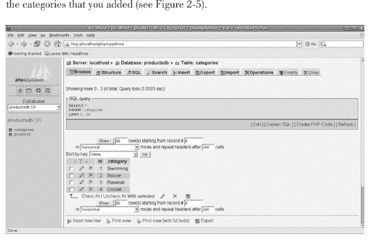

**FIGURE 2-5** 单击 Browse 选项卡以查看特定表内的记录。

现在，在 `products` 表中填充一些数据。为此，请单击左侧框架中的 `products` 表，然后再次单击 `Insert` 选项卡，将以下信息填入表单：

- 在第一条记录中，向 `cat_id` 框添加 1（这将使该记录归于 Swimming 分类），然后添加你能想到的任何游泳相关产品。（要发挥想象力；在处理记录时添加一些荒谬的产品总是一件乐事。）将价格作为正常的价格添加（例如 21.99），但不要添加货币符号。

- 对于第二条记录，向 `cat_id` 框添加 3（这将使该记录归于 Baseball 分类）。同样，添加一个有趣的产品并填入正常价格。

你可以随意添加更多产品，但请记住在 `cat_id` 字段中使用 `categories` 表中的 `id`。这将确保你正确关联这两个表。

## 在 PHP 中连接 MYSQL

在具备一些核心 PHP 经验和数据库开发基础后，现在是执行至关重要的一步的时候了，即将两者连接起来并在 PHP 中连接数据库。这包括你创建数据库连接，然后发出 SQL 查询，最后以在你的 Web 应用程序中有意义的方式处理查询结果。

为了实际连接 MySQL，PHP 提供了内置支持来进行连接、执行查询和处理结果。为此，一系列以 `mysql_` 为前缀的 PHP 函数让这一切成为可能。虽然这些函数非常有用，但未来可能会有这样的情况：你希望使用多种数据库之一来支持你的 Web 应用程序。在这种需求下，你需要使用第三方数据库抽象库，如 `PEAR::DB` 或 `ADO DB`。然而，如果你知道将在特定项目中使用 MySQL，那么 `mysql_` 系列的函数完全适用。

## 建立连接

第一步实际上是建立到数据库的连接。此连接用于在发送查询和返回数据时与数据库进行通信。为此，你需要编写一些 PHP 代码，将相关的身份验证详细信息传递给 MySQL，如果你已获授权，则提供给你一个连接。

创建一个名为 `dbconnect.php` 的新文件，并添加以下代码：

```php
<?php

$dbhost = "localhost";
$dbuser = "root";
$dbpassword = "";
$database = "productsdb";
$db = mysql_connect($dbhost, $dbuser, $dbpassword);
mysql_select_db($database, $db);
?>
```

代码的前四行创建了一些变量，其中包含连接数据库所需的相关信息片段。重要的是要记住，这四行代码实际上只是设置了一组变量；此时尚未建立连接。你可以随意命名这些变量，但你需要提供用于在 MySQL 服务器上使用的合法的主机、用户名、密码和数据库信息。

设置变量后，你可以建立连接。这发生在 `$db = mysql_connect($dbhost, $dbuser, $dbpassword)` 这一行。该行使用 `mysql_connect()` 函数将主机、用户名和密码变量传递给 MySQL 服务器，并将连接结果放入 `$db` 变量。然后你将 `$db` 变量用作指向主要连接的指针。为了保持代码简单，本示例不涉及任何错误检查；通常你会检查连接是否合适，并可能显示适当的错误消息。有些程序员认为这是不必要的，因为如果连接被拒绝，你反正会得到一条 PHP 错误消息，但如果你实现自己的错误处理，就可以以更优雅的方式格式化和引用错误。

连接建立后，你需要选择要使用的数据库（记住，MySQL 可以有多个不同的数据库）。这是通过下一行的 `mysql_select_db()` 执行的。在这里，你指定包含所选数据库的变量，并指定应从其中选择数据库的连接（`$db`）。


此时，你已经连接成功。该页面上任何其他与 MySQL 相关的操作都将应用于刚刚创建的连接。

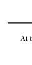

### 数据库连接是每页独立的

你建立的数据库连接不会跨越其他页面。你需要在需要访问 MySQL 的每个页面上包含连接详细信息。当然，书中稍后将介绍使此过程更高效的方法。

此时，你已准备好开始在该页面上操作数据库。

## 查询数据库

当您需要获取、设置或更新数据库中的信息时，请使用 SQL 查询。之前您在 phpMyAdmin 中创建表格时已经对 SQL 进行了一些实践。深呼吸一下，因为现在您将开始手写具体的 SQL 查询语句。别担心，这听起来可能没有您想象的那么可怕。

在 `mysql_select_db` 行下方，添加以下代码：

```php
$db = mysql_connect($dbhost, $dbuser, $dbpassword);
mysql_select_db($dbdatabase, $db);
```

```php
$sql = "SELECT * FROM products";
$result = mysql_query($sql);
```

第一行（`$sql` 行）只是设置了另一个变量，但这个变量包含的是您要发送给 MySQL 的查询所用的 SQL 语句。SQL 是一门非常简单且有效的语言，您将在整本书中用到它——并且书中的每一段 SQL 代码都会在讲解过程中得到充分说明。在这一特定行中，您正在从 `products` 表中选择所有行。您可以从左到右阅读 SQL 语句来理解其工作原理：

- 首先选择（`SELECT`）`products` 表（`products`）中（`FROM`）的所有内容（`*`），然后结束查询（`;`）。

每条 SQL 语句都应以分号结尾。虽然您在 PHP 脚本中不需要显式添加分号，但这样做是个好习惯。这有助于养成添加分号的习惯，特别是当您使用命令行 MySQL 客户端时。

## 注意

### 其他客户端

与 MySQL 交互的方式有很多种。其中一些是基于 Web 的（如 phpMyAdmin），一些是图形化桌面应用程序（如 MySQL 控制中心），还有一些是基于命令行的（如 `mysql` 命令）。

此时，SQL 查询实际上尚未发送到服务器；您只是创建了一个包含该查询的变量。下一行代码才会真正将查询发送到数据库。`mysql_query()` 函数用于将 SQL（在 `$sql` 变量中）发送到数据库，并将查询结果放入 `$result` 变量中。

## 遍历查询结果

`$result` 中蕴藏着“圣杯”，即您查询结果的主要所在。尽管 `$result` 包含结果，但您可以将其视为一团杂乱无章的大结果集合。以当前形式而言，`$result` 并不是特别有用，为了真正实用，您需要遍历查询中的每一行。如果您遍历每一行，就可以将相关信息显示在页面上。这就是整体计划。

在文件的 `mysql_query` 行下方添加以下代码：

```php
$sql = "SELECT * FROM products;";
$result = mysql_query($sql);

while($row = mysql_fetch_assoc($result)) {
    echo $row['product'];
}
```

在这段代码中，您使用 `while` 循环来遍历结果集中的每一行。这是通过添加一个循环条件来实现的，该条件使用 `mysql_fetch_assoc` 从 `$result` 中提取每一行，然后将该行放入 `$row` 变量中。

`mysql_fetch_assoc()` 函数的目的是将结果制作成一个关联数组。这为您提供了一种方便的键值（前面“数组”部分已作解释）方式，用于提取信息。因此，如果您需要访问当前行中 `product` 字段的内容，您可以使用 `$row['product']`。

## 通过会话实现跨页面一致性

在进行任何形式的 Web 开发时，最大的挑战之一是在无状态的 Web 环境中维护跨页面的状态。这个宏大的说法基本上等同于“在不同页面之间共享信息”。造成这种困难的原因是，您创建的每个 Web 页面本质上都是一个独立的程序。当您构建跨越多个不同页面的 Web 应用程序时，除了使用 `GET` 和 `POST` 变量外，没有隐含的方式来在这些页面之间共享信息。会话（Sessions）改变了这一切。

`会话`提供了一种令人惊讶地简单且高效的手段，能够在不同页面之间真正地共享变量。这是通过一系列 PHP 函数实现的，这些函数赋予您启用页面会话、创建会话变量以及在脚本中使用这些会话变量的能力。会话可用于在不同页面之间共享您喜欢的任何 PHP 变量。

### 创建会话

要使用会话，首先需要在每个希望使用会话的页面开头添加 `session_start()` 函数。至关重要的是，`session_start()` 必须位于最开头——前面不能有华丽的 HTML，不能有您姑妈莫德的照片，甚至不能有空白。

为了说明这一点的重要性，创建一个名为 `sessions.php` 的新文件，并添加以下代码：

```php
<?php
session_start();
?>
```

当运行脚本时，您不会看到任何内容；会话支持已顺利地集成到了您的页面中。现在调整代码，在 `<?php` 标签前添加一个空格：

```php
 ?>
<?php
session_start();
?>
```

当您做出这个微小的改动时，会得到一条特别恶毒的错误信息：

> 警告: `session_start()` [function.session-start]: Cannot send session cookie - headers already sent by (output started at `/opt/lampp/htdocs/sites/startingchapter/sessions.php:1`) in `/opt/lampp/htdocs/sites/startingchapter/sessions.php` on line 3

之所以非常重要不要在 `session_start()` 之前放置任何内容，是因为会话框架利用了构成 Web 页面机制的 HTTP 头部（headers）。这些特殊头部分别预置在每个 Web 页面的前面，因此，如果您在 `session_start()` 之前添加了任何内容，脚本将尝试先发送内容（如空格），然后是头部，最后是主要内容。这不是 Web 的工作方式，因此 PHP 会以之前警告信息的形式向您抗议。

## 关于头部的一切

互联网上的每个 Web 页面都有一些称为`头部`（headers）的信息，大多数用户看不见它们。头部存储了浏览器关心的许多信息片段。以下是一些头部示例：

```
GET / HTTP/1.1
Host: www.yourfavewebsite.org
Connection: close
Accept-Encoding: gzip
Accept: text/xml, application/xml, application/xhtml+xml, text/html;q=0.9,text/plain;q=0.8,image/png, */*;q=0.5
Accept-Language: en-gb, en;q=0.5
Accept-Charset: ISO-8859-1, utf-8;q=0.7, *;q=0.7
User-Agent: Mozilla/5.0 (X11; U; Linux i686; en-GB; rv:1.8.0.3) Gecko/20060523 Ubuntu/dapper Firefox/1.5.0.3
Referer: http://www.someotherwebsite.net/
```

头部下面是内容。当向页面添加内容时，头部分自动添加。因此，当数据被添加到页面时，头部也会被发送，并且在发送后无法再被修改。

当您使用会话时，会话系统会修改其中的一些头部，这就是为什么必须在向页面添加任何数据之前添加 `session_start()` 的原因。

## 使用会话变量

在使用会话变量之前，您需要注册它。这是通过名称颇为直观的 `session_register()` 函数实现的。要使用它，请在括号内指定要创建的变量名。为了演示这一点，在 `sessions.php` 中的 `session_start()` 之后添加以下代码行：

```php
session_register("userid");
```

这一行向会话处理系统注册了 `userid` 变量可以跨页面共享。下一步是实际将这个变量设置为有用的值。添加这一行代码：

```php
$_SESSION['userid'] = 10;
```

在这一行中，您使用特殊的 `$_SESSION` 超全局变量来引用 `userid` 变量。`$_SESSION` 语法应该看起来相当熟悉，因为您之前使用 `$_GET` 和 `$_POST` 分别访问 GET 和 POST 变量。

为了测试您的会话变量是否可以在第二个页面上访问，创建一个名为 `sessions2.php` 的文件，并添加以下代码：


```php
<?php
session_start();
echo "The userid session variable is: " . $_SESSION['userid'];
?>
```

记得先访问 `sessions.php`（以便设置变量），然后访问 `sessions2.php` 以查看该变量是否在页面间共享。要访问会话变量，您只需在页面上包含 `session_start()`，然后使用 `$_SESSION` 引用该变量即可。

只要浏览器保持打开状态，会话信息即可用。当浏览器窗口关闭时，会话信息丢失。虽然这通常是销毁会话的合适方式，但有时您需要强制销毁会话数据。为此，您可以使用以下命令：

```php
session_destroy();
```

然后所有会话变量都会被适当地删除。

## 摘要

本章探讨了一些核心概念，这些概念需要在您继续前进并开始编写应用程序之前予以理解。我们没有花费数小时去涵盖 PHP 和 MySQL 的每个细微差别，而是学习了继续前进所需的基础知识，每个应用程序都将展示新的技能、技巧和想法。

就像任何编程语言或自然语言一样，熟能生巧。仅仅阅读如何在 PHP 中做某事，与真正理解它是两回事。熟悉这门语言的绝佳方式是创建许多小脚本来测试语言的不同方面。这些脚本不仅对学习有用，而且当您忘记如何做某事时，它们还可以作为日后很好的参考点。

# 第3章 运行项目

这本书充满了各种项目，许多美妙绝伦的项目向你展示了如何使用 PHP 和 MySQL 做有趣的事情。每个项目都包含逐行累积构建的代码页面。虽然你完全可以坐下来仔细地在进行中逐行输入，但我们认为你可能更想立即运行这些项目，看看它们是如何工作的。听起来不错吧？你会很高兴地发现，书中附带的光盘为你提供了数小时的项目运行乐趣！

那么光盘中有什么呢？嗯，这张光盘被称为 Live CD（活体光盘），它提供了一种简单且便捷的方式，让你的计算机在不以任何方式接触现有硬盘的情况下运行完整的操作系统。其工作原理是：将光盘插入驱动器并从中启动。计算机随后假装光盘是一个硬盘，并像运行其他系统一样运行操作系统。这意味着你可以随心所欲地折腾系统，而它不会触碰你宝贵的硬盘。酷吧？

## 关于光盘

对于大多数编程书籍，你通常会得到一张包含书中代码的光盘。这个便捷的补充品为你节省了将代码从书中复制到计算机的大量繁重劳动。尽管节省了数小时的打字工作，但光盘代码方法仍然假设你实际上拥有运行代码所需的软件。因此，如果你知道自己想学习某些东西（例如 PHP 和 MySQL），但没有运行代码所需的 PHP 和 MySQL 软件，你就会陷入困境。

这本书则不然。Live CD 不仅包含每个项目的代码，还包含运行代码所需的完整开发环境。你拥有 PHP 和 MySQL，以及 Apache、phpMyAdmin、Mozilla Firefox、PEAR 模块等等——所有这些都被整洁地包含在 Linux 操作系统中。

现在，我们知道你在想什么——“哦，我需要出去买一块新硬盘，或者我需要划分现有的磁盘分区，或者我需要……” 放松。你不需要购买新硬盘，不需要划分分区，也不需要担心。整个系统都是从光盘运行的。

## Live CD：一种新方法

近年来，Live CD 真的大受欢迎。这个理念很简单：你选择一个操作系统（通常是 Linux），然后不是从硬盘运行它，而是从 CD 或 DVD 运行它。这提供了许多好处。首先，你可以尝试操作系统而不必实际安装它。当你运行随本书附带的光盘时，它永远不会接触你的硬盘。由于系统是从 CD 运行的，你可以随便摆弄它、破坏某些东西并进行实验。不仅你的硬盘完全安全，而且你还可以随时重启 CD 以恢复原始系统。其次，Live CD 提供了一种伟大的方式来“携带你的系统”；只需将光盘放入任何计算机的驱动器并重启即可运行。

## 启动系统

并非所有计算机在启动时都会自动尝试从 CD/DVD 驱动器引导。如果你打开计算机并看到 CD/DVD 驱动器灯光闪烁，说明计算机正在寻找可引导的内容。在这种情况下，插入 Live CD 并重启以开始！

如果灯光没有闪烁，你可能需要在计算机的 BIOS 中启用从 CD/DVD 驱动器引导。要访问 BIOS 设置，你的计算机会有一个特定的按键或按键组合来进入设置。常见的按键是 `F12` 和 `Del`。建议你查阅计算机或主板的说明书，了解如何从 CD/DVD 驱动器引导。

为了获得最佳效果，请找到一台拥有大量 RAM（内存）的计算机。因为 Live CD 是只读介质，需要写入以运行 Linux 系统的区域将存储在 RAM 中。因此，例如，Live CD 在拥有 1GB 或更多 RAM 的计算机上比在拥有 256MB RAM 的计算机上启动更快、运行更好。

当你的系统被设置为可引导时，将光盘插入驱动器并重启。几秒钟后，图 3-1 中显示的屏幕应该会出现在眼前。

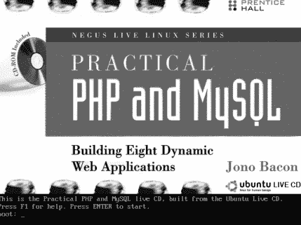

**图 3-1** 启动加载屏幕，为本书精心定制！

按 Enter 键启动系统。很快，你将看到桌面启动并显示加载屏幕，如图 3-2 所示。

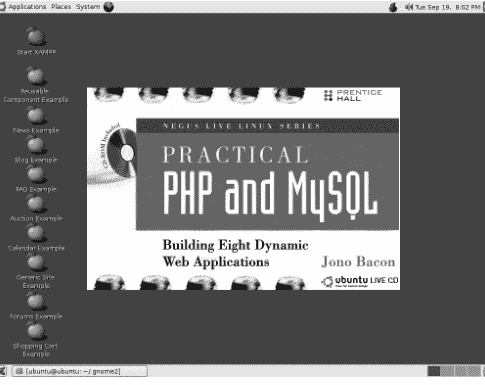

**图 3-2** 桌面加载中

最后，双击 Start XAMPP 图标。XAMPP 在终端窗口中启动，如图 3-3 所示。

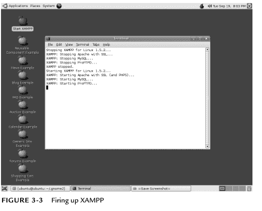

**图 3-3** 启动 XAMPP

## 运行应用程序

运行随光盘附带的应用程序非常简单——只需双击桌面上的其中一个图标即可访问该特定应用程序。当你双击应用程序图标时，Firefox 会打开并显示该图标所代表的应用程序窗口。例如，双击 Forums（论坛）图标会使 Forums 应用程序出现，如图 3-4 所示。

如果你想摆弄应用程序的源代码，请双击 Bluefish 图标。加载后，使用侧面板加载你想要开发的项目。请记住，所有项目都存储在 `/opt/lampp/htdocs/sites` 中，因此务必选择该目录内的正确项目。稍后，你可以通过在 Live CD 上的 Web 浏览器地址栏中输入 `http://localhost/sites` 来运行这些项目目录中的代码。

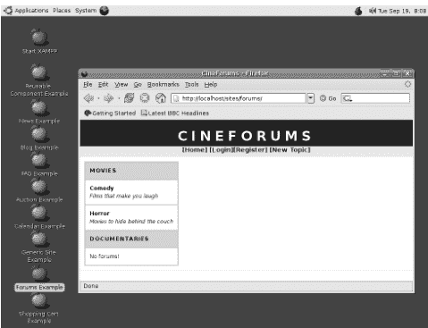

**图 3-4** 加载应用程序就像双击图标一样简单。

### 使用 XAMPP

除了 Live CD 上包含的操作系统外，最关键的软件部件是 XAMPP。XAMPP 项目在单一可下载归档文件中提供了 LAMP 开发所需的核心软件组件（Apache、MySQL 和 PHP）。因此，你可以前往 XAMPP 网站（`http://www.xampp.org`），将最新版本下载到计算机，解压并运行；现在你拥有一个完整的 LAMP 系统来用于开发。这节省了调整、配置以及与单独安装 Apache、MySQL 和 PHP 组件相关的非平凡安装带来的挫败感的数小时时间。

XAMPP 不仅简化了这些组件的安装，还包含大量附加软件，包括 phpMyAdmin（用于轻松创建数据库）、PEAR 模块（PHP 的附加功能）、图形库、文档等等。XAMPP 确实提供了一个全面且完整的 Web 开发平台。

虽然你可以直接从 Live CD 启动，启动 XAMPP，并立即在 Web 浏览器中访问你的应用程序，但了解 XAMPP 的一些常见功能将大有裨益。以下章节涵盖了这些功能，以便你可以熟悉该系统。

> **注意**
>
> **在其他地方运行 XAMPP？**
>
> 如果你希望在不同操作系统上运行光盘上的 XAMPP，你可以在 `/opt` 中名为 *laminp.tgz* 的文件找到它。只需将该文件复制到 Linux 系统，解压它，然后运行 `/opt/laminp/laminp`，如下面的“启动和停止”章节所示。

### 启动和停止

Linux 中的 XAMPP 安装始终安装在 `/opt` 目录中。在 XAMPP 目录内是 `laminp` 命令，可用于启动和停止 XAMPP 系统。要启动 XAMPP，请运行以下命令：

```
foo@bar : /opt/laminp $ sudo /opt/laminp/laminp start
```

因为 XAMPP 提供系统服务，你需要是超级用户才能运行该命令，这就是使用 `sudo` 的原因。你也可以使用以下命令停止 XAMPP：

```
foo@bar : /opt/laminp $ sudo /opt/laminp/laminp stop
```

你可以使用 `restart` 来停止并启动 XAMPP（这是桌面上 Start XAMPP 图标运行的命令）：

```
foo@bar : /opt/laminp $ sudo /opt/laminp/laminp restart
```

此命令实际上拥有大量可用的功能，你可以通过不带任何选项运行该命令来查看全部功能：

```
foo@bar : /opt/laminp $ sudo /opt/laminp/laminp
```


表 3-1 提供了一些可能对于启动和停止特定组件特别有用的命令列表。

当 XAMPP 系统启动时，你可以使用 Web 浏览器通过访问 `http://localhost` 来查看正在运行的服务器。当你访问该页面时，你将看到 XAMPP 系统的一部分许多包含的 Web 页面。这些页面提供了许多小型示例应用程序、指向系统其他部分的链接以及关于运行状态的信息。

## 表 3-1 启动和停止不同 LAMPP 组件的选项

| **选项** | **描述** |
| :--- | :--- |
| `lampp startapache` | 仅启动 Apache |
| `lampp startmysql` | 仅启动 MySQL |
| `lampp stopapache` | 仅停止 Apache |
| `lampp stopmysql` | 仅停止 MySQL |
| `lampp restartapache` | 停止 Apache，然后重启 |
| `lampp restartmysql` | 停止 MySQL，然后重启 |

## 访问 phpMyAdmin

XAMPP（以及在 Live CD 上）附带了一个功能强大的基于 Web 的数据库编辑器，名为 phpMyAdmin，可通过 `http://localhost/phpmyadmin/` 访问。phpMyAdmin 将在本书中大量使用。

## 切换 PHP 版本

XAMPP 的一个最棒的功能是，它在发行版中同时包含了 PHP4 和 PHP5（毫无疑问，未来它将包含 PHP5 和 PHP6）。这使得使用不同版本的 PHP 测试应用程序变得简单。只需使用想要使用的版本重启 XAMPP 即可。

要切换版本，请将版本号传递给 `lampp` 程序。因此，要启动 PHP4，请运行以下命令：

```
foo@bar:/opt/lampp$ sudo /opt/lampp/lampp php4
```

要启动 PHP5，请运行以下命令：

```
foo@bar: /opt/lampp $ sudo /opt/lampp/lampp php5
```

这些命令会以你想要使用的 PHP 版本重启 Apache。你还可以通过使用以下命令来检查当前运行的 PHP 版本：

```
foo@bar: /opt/lampp $ sudo /opt/lampp/lampp phpstatus
```

## 备份

也有可用的备份技术。在创建备份归档后，你可以将其复制到硬盘或网络服务器，以便永久保存备份。（请记住，重启后，如果你没有以某种方式将这些更改备份到其他介质上，Live CD 上的任何更改都会消失。）首先，使用内置的 XAMPP 备份脚本。确保 XAMPP 正在运行，然后运行以下命令：

```
foo@bar: /opt/lamp $ sudo /opt/lampp/lampp backup
```

此命令会备份数据库和 Web 页面，然后将它们放入单个脚本中，你可以运行该脚本来恢复系统。此脚本将存储在 `/opt/lampp/backup` 中。要恢复备份，请安装全新的 XAMPP，并运行以下脚本，确保用你的备份脚本的文件名替换文件名：

```
foo@bar: /opt/lampp/backup $ sudo /opt/lampp/backup/xampp-backup-00-00-00.sh
```

第二种技术是备份整个 XAMPP 目录。为此，首先使用 `lampp stop` 关闭 XAMPP 服务器，然后进入 `/opt` 目录并将其压缩：

```
foo@bar: /opt $ sudo tar zcvf lampp.tgz lampp
```

要恢复它，请确保你在 Linux 系统上并运行以下命令：

```
foo@bar: /opt $ sudo tar zxvf lampp.tgz
```

## 摘要

随书附带的 Live CD 提供了一种简单便捷的方式来开始运行你将在书中编写的应用程序。这张光盘是创新开源软件如何使 Web 开发变得更加容易和高效的绝佳例子，例如 Ubuntu Live CD、XAMPP 和不同的 LAMP 组件。这比一本附带一张单调软盘（仅包含少量源代码文件）的书要好得多。

这张光盘在运行应用程序方面提供了很好的机会。但建议你在浏览每个项目时，仔细遵循代码的构建过程——手动输入代码来构建源文件对于学习 PHP 和 MySQL 至关重要。这本书的目的不是让你读完一章后用手指跟着代码看，而是让你编写代码、运行它、修复错误，并在过程中学习。仅仅阅读代码而不实际输入和运行它，几乎总是会导致较差的学习体验；相反，在这本书中，你通过实践来学习。

因此，尽管这个 Live CD 是一个极好的省时工具，但不要让它取代从书中输入代码、运行并修复错误这一基本操作。真正的学习发生在那里。

*此页故意留空*

# 第 4 章

## 构建网络日志

近期被谈论最多的互联网现象之一是网络日志（常简称为 *blog*，即博客）。博客的概念——以及随后的博客写作艺术——是你提供自己的在线日记或日志，在其中你可以记录你的想法供世界观看。你注入博客的实际内容完全取决于你，博客可以是你喜欢的任何正式或非正式风格。如果你想告诉全世界你的牛奶坏了，你需要去商店买些新的，博客就是你写下这一切的地方。

然而，阅读博客的公众不仅仅痴迷于与牛奶保质期相关的事情。虽然博客通常被用作在线传达想法的载体，但它们也成为了与某个爱好或项目相关的人们分享其正在做什么的主要手段。这在开源开发者中尤为流行，他们使用自己的博客向读者提供对他们正在开发的软件即将发布内容的预览。

虽然博客的基本功能是存储一系列博客文章（常称为 *entries*，即条目），但许多博客还包含其他功能：

- **评论。** 博客的读者通常可以留下评论。这可以为 *博客* 增加真正的价值，并且往往会围绕不同主题引发对话。
- **分类。** 博客通常被 *分隔* 到不同的类别中。这使得博客作者能够将条目归档到特定部分。这也允许读者只阅读他们感兴趣的类别。
- **归档。** 大多数博客都有某种方式存档和访问以前的条目。随着博客成为与“普通”网站同样重要的媒介，能够访问以前的条目变得很重要。

在这个项目中，你将构建一个包含上述所有功能的博客。你的运气真好，不是吗？

## 项目概览：BLOGTASTIC 用例

本章创建的博客应用程序巧妙地命名为 Blogtastic。为了概述如何构建这个博客，这里有一个简单的用例，演示典型用户如何与应用程序交互。用例对于帮助可视化不同交互和内容应如何呈现给用户非常有用。以下是 Blogtastic 应用程序的用例概要：

John 访问 Pauline 的博客，自然想看 Pauline 的最新条目。John 有兴趣阅读博客条目，但也想看看是否有任何针对该条目的评论。如果博客条目有评论，评论者的名字会被添加到博客的底部，这样 John 就能看到谁发布了每条评论。

要访问博客及其相应的评论，John 点击博客条目的标题，该特定条目（带有评论）就会显示出来。万一 John 想留下评论，页面上方便地提供了一个表单供他表达观点。John 填写表单并点击“提交”按钮，之后页面重新加载，John 的评论被添加进去。然后 John 在下午翻阅归档条目页面中的旧博客条目，消磨时光。

那天稍后，Pauline 决定她想添加一个新的博客条目。Pauline 访问网站上的一个特殊页面，她可以在此登录。作为博客的作者，一些额外的选项仅提供给她。Pauline 可以向特定类别添加新的博客条目，甚至添加新类别。Pauline 添加了新条目，然后意识到她犯了一个错误。幸运的是，页面上显示了一个特殊的“编辑”按钮，只有她——且仅她——可以看到。Pauline 使用此按钮纠正她的错误，以免在 John 面前出丑。Pauline 私下里认为她比 John 强。

这是一个典型的博客例子，在这个项目中，你将把上述所有功能注入 Blogtastic 以匹配此用例。


## 注意

**请从容不迫**

由于这是本书中第一个数据库驱动的项目，请以舒适的节奏阅读本章。如果你遇到任何不理解的概念，请花点时间停下来，访问 Google 并做一些研究，以消除误解后再继续。在学习新技术时，如果你不理解概念，切勿盲目推进；你只会挖一个大坑让自己掉进去。

## 构建数据库

Blogtastic 项目的第一个步骤是构建数据库。首先，在 phpMyAdmin 中创建一个名为 `blogtastic` 的新数据库。在此数据库中，创建四个表：

| 表名 | 表存储的内容 |
| :--- | :--- |
| *categories* | 不同的博客类别 |
| *entries* | 博客帖子 |
| *comments* | 博客条目的评论 |
| *logins* | 用户名和密码 |

表的模式如图 4-1 所示。

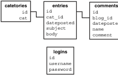

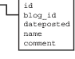

**图 4-1**

即使是像博客引擎这样的简单应用程序，仔细的数据库设计长期来看也会节省大量工作。


图 4-1 展示了四个表之间的关系。第一个关系存在于博客分类（`categories` 表）和博客文章（`entries` 表）之间。为了引用正确的分类，`categories` 表中相同的 `id` 被存储在 `entries` 表的 `cat_id` 字段中。用数据库术语来说，`id` 字段被称为主键，而 `cat_id` 字段被称为外键。如果这两个值匹配，则表之间就存在显式连接。换句话说，如果你知道分类的 `id`（存储在 `cat_id` 中），就可以运行查询，利用该 `id` 提取其他分类信息（例如分类的名称）。第二个关系——`entries` 表和 `comments` 表之间——的工作方式完全相同；`entries` 表中的 `id` 字段与 `comments` 表中的 `blog_id` 相关联。这将每条评论与正确的博客文章连接起来。

最后一个表是 `logins` 表，它与其他表没有关系；该表仅用于将每个用户登录到应用程序。

## 实现数据库

在数据库设计布局完成后，你可以创建数据库表。在 `phpMyAdmin` 中，按照第 2 章中讨论的步骤添加新表，使用以下详细信息：

### categories 表

- `id`. 将此设为 `TINYINT`（使用此类型是因为分类不会很多），并在 Extras 列中开启 `auto_increment`。将此字段设为主键。
- `cat`. 将此设为 `VARCHAR`。由于分类标题超过 20 个字符的可能性不大，因此将大小设为 20。

### entries 表

- `id`. 将此设为 `INT`（可能会有多篇博客文章），并开启 `auto_increment`。将此字段设为主键。
- `cat_id`. 将此设为 `TINYINT`（与它引用的主键类型相同——`categories` 表中的 `id`）。
- `dateposted`. 使用 `DATETIME` 类型。此数据类型以国际 ISO 标准格式存储当前的日期和时间，这有点笨重，但你可以在稍后的 PHP 中格式化日期。
- `subject`. 将此设为 `VARCHAR`。除非你的博客标题非常长，否则将此字段的长度设为 100。
- `body`. 将此设为 `TEXT` 字段。如果你想存储非常大的文本区域，`TEXT` 类型是一个很好的选择。你不需要指定长度。

### comments 表

- `id`. 将此设为 `INT`（可能会有多条评论）。开启 `auto_increment` 并将此字段设为主键。
- `blog_id`. 将此设为 `INT`（与 `entries` 表中的 `id` 字段类型相同，它与此字段相关联）。
- `dateposted`. 使用 `DATETIME` 类型。
- `name`. 将此设为 `VARCHAR`。由于评论标题超过 50 个字符的可能性不大，将长度设为 50。
- `comment`. 这是评论的主体。设为 `TEXT` 类型。

### logins 表

- `id`. 将此设为 `TINYINT`（登录次数很少；可能只有一次）。开启 `auto_increment` 并将此字段设为主键。
- `username`. 将此设为 `VARCHAR` 并给予长度 10。（强制用户名最大长度是一种常见做法。）
- `password`. 将此设为 `VARCHAR` 并给予长度 10。（与用户名一样，强制密码最大长度是一种常见做法。）

#### 插入示例数据

在创建表之后，向其中插入一些初始数据，以便你在编写代码时可以测试代码（再次使用 `phpMyAdmin`）。请记住，当你向这些表中的任何一个添加数据时，不要在 `id` 列中填入数字；该值将由 `auto_increment` 处理。

由于这是本书的第一个项目，为了确保一切连接符合预期，已经向表中添加了示例数据。当你阅读本书并更深入地理解数据库概念时，你可以添加更多的示例数据。

### categories 表的示例数据

按以下顺序添加以下分类：生活、工作、音乐和食物。

### entries 表的示例数据

将表 4-1 中的信息添加到 `entries` 表。

这两篇文章通过 `cat_id` 引用 `categories` 表中的“生活”条目。在 `dateposted` 字段中，使用 Function 组合框选择 `NOW` 选项，这将用你添加条目到表时的日期和时间填充该字段。

**表 4-1** `entries` 表的示例数据使你可以跟随本章其余部分的示例。

| CAT_ID | DATEPOSTED 字段 | SUBJECT | BODY |
| :--- | :--- | :--- | :--- |
| 1 | 从函数框中选择 NOW | 欢迎来到我的博客！ | 这是我在全新博客中的第一篇非常文章。 |
| 1 | 从函数框中选择 NOW | 很棒的博客！ | 我决定这个博客是：真的很酷！ |

### comments 表的示例数据

将表 4-2 中的信息添加到 `comments` 表。

**表 4-2** `comments` 表只有一些用于演示目的的示例评论。

| BLOG_ID | DATEPOSTED 字段 | NAME | COMMENT |
| :--- | :--- | :--- | :--- |
| 1 | 从函数框中选择 NOW | Bob | 欢迎！ |
| 1 | 从函数框中选择 NOW | Jim | 希望你玩得开心！ |

在此表中，通过向 `blog_id` 字段提供值 1 来引用第一篇博客文章（主题为“欢迎来到我的博客！”的那篇）。

### logins 表的示例数据

在此表中，添加单个条目，包含你选择的用户名和密码。此示例包含用户名为 `"jono"`，密码为 `"bacon"`。

## 开始编码

首先创建你的项目配置文件。此配置文件使博客的自定义变得容易，无论是对你还是对运行它的其他用户。

在计算机的 `htdocs` 中创建一个新目录。在此目录内，创建一个名为 `config.php` 的新文件（如示例 4-1 所示）：

### 示例 4-1

使用配置文件使自定义和个性化变得轻而易举。

```php
<?php
$dbhost = "localhost";
$dbuser = "root";
$dbpassword = "";
$dbdatabase = "blogtastic";

$config_blogname = "Funny old world";

$config_author = "Jono Bacon";

$config_basedir = "http://127.0.0.1/sites/blogtastic/";
?>
```

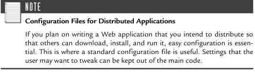

**分布式应用程序的配置文件**

如果你计划编写一个 Web 应用程序，并打算将其分发以便其他人可以下载、安装和运行它，那么易于配置是必需的。这就是标准配置文件有用的地方。用户可能想要调整的设置可以保留在主代码之外。

此文件的大部分内容是简单的配置。前四行应该对你来说很熟悉；它们是正常的数据库设置。你可以更改这些设置以匹配你自己的数据库配置。

在数据库设置下方，设置了另外三个变量。第一个变量 (`$config_blogname`) 设置博客的名称。第二个变量 (`$config_author`) 允许用户设置他的名字作为作者。最后一个变量 (`$config_basedir`) 指向日志的位置，以 URL 形式表示。这个变量特别重要，并在代码的各个部分稍后使用，特别是用于重定向到不同的页面。

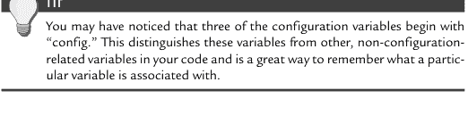

你可能已经注意到，三个配置变量以“config”开头。这将这些变量与代码中其他非配置相关的变量区分开来，是记住特定变量所关联内容的好方法。

## 设计用户界面

在上一章中，你创建了一个*通用*网站，并利用了许多 `include()` 和 `require()` 函数来分离网站的不同部分。此应用程序使用相同的概念来提供一致的外观和感觉。

> **注意**
>
> **stylesheet.css 文件**
>
> 此项目使用附录 A 中创建的 `stylesheet.css` 文件。将该文件复制到当前项目目录以将样式表应用于项目。

### 创建头部文件

创建一个名为 `header.php` 的文件，并添加示例 4-2 中显示的代码。

**示例 4-2** 这个简单的头部文件将用于所有页面。

```php
<?php
require("config.php");
?>

<!DOCTYPE HTML PUBLIC "-//W3C//DTD HTML 4.01 Transitional//EN"
"http://www.w3.org/TR/html4/loose.dtd">
<html>
<head>
<title><?php echo $config_blogname; ?></title>
<link rel="stylesheet" href="stylesheet.css" type="text/css" />
</head>
<body>
<div id="header">
<h1><?php echo $config_blogname; ?></h1>
[<a href="index.php">home</a>]
</div>

<div id="main">
```


关于此代码，有几个重要的点需要注意。在这里，在顶部打开一个 PHP 块以在页面中包含 `config.php` 代码。这里使用了 `require()` 函数——而不是 `include()`——因为 `config.php` 对此页面的正确行为至关重要。如果 `config.php` 不存在，整个应用程序在任何数据库工作期间都会崩溃。

此代码中的大部分 HTML 应该看起来相当直接，但你可能也注意到了 `<title>` 标签中的一小块 PHP。在标题中，内容

`config.php` 中 `$config_blogname` 变量的值会被显示（参见示例 4-1）；这会在浏览器窗口的标题栏中添加该博客的名称。该变量的值也会在 `<h1>` 标签内的第一个 `<div>` 中重复出现。这提供了一些基础（非常、非常基础！）的品牌标识。

在主页（`index.php`，你稍后将创建它）中 `<h1>` 标签下方的代码，是最后的添加内容。为了简化这个项目，指向网站不同部分的链接将出现在此页眉 `<div>` 中。代码的最后一行以与附录 A 中创建的网站类似的方式打开主 `<div>`。

## 创建页脚文件

随着页眉文件的“阴”部分完成，现在是时候创建页脚文件的“阳”部分了。创建一个名为 `footer.php` 的新文件，其内容如示例 4-3 所示。

> 示例 4-3 与页眉文件类似，此页脚将共享于所有页面。

```
</div>
<div id="footer">
&copy; <?php echo $config_author; ?>
</div>
</body>
</html>
```

文件的第一行结束了在页眉文件末尾打开的主 `<div>`（参见示例 4-2 中此 `<div>` 标签的打开部分）。在此之后，你创建一个页脚 `<div>` 来包含版权符号（通过特殊的 `&copy;` 标记实现），然后添加一个小 PHP 代码块来（再次）显示 `config.php` 文件中某个变量的内容。这为网站的任何运营者提供了适当的署名。

你可以通过创建一个名为 `index.php` 的文件并添加示例 4-4 中的代码来测试你的页眉和页脚文件是否正常工作。

> 示例 4-4 有了页眉和页脚，实际的站点页面变得非常简单。

```
<?php
require("header.php");
require("footer.php");
?>
```

当你在浏览器中访问 *index.php* 页面时，你应该会看到图 4-2 中所示的简单设计。

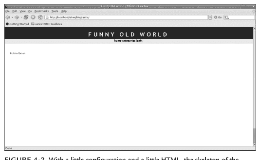

图 4-2 通过少量配置和少量 HTML，应用程序的框架已就位。

## 显示博客条目

现在你准备好开始编写一些实际类似于博客应用程序的代码了。由于数据库已经加载了示例内容，第一个合乎逻辑的步骤是显示最新博客条目的内容。这包括创建一个简单的 SQL 查询，然后在页面上显示查询结果（最新条目）。

然而，在创建查询之前，你需要添加连接数据库的代码。在此特定应用程序中，每个页面都会发生数据库访问；因此，将数据库连接代码添加到主 *header.php* 文件中是有意义的。此文件包含在每个页面中，因此它是连接代码的逻辑存放位置。

在 *header.php* 的 `require("config.php")` 行之后，添加以下几行（在第 2 章中已解释）：

```php
<?php
require("config.php");
$db = mysql_connect($dbhost, $dbuser, $dbpassword);
mysql_select_db($dbdatabase, $db);
?>
```

### 构建查询

为了构建 SQL 查询，请思考你希望数据库返回何种类型的信息。对于最新的博客条目，你需要 *entries* 表中的所有信息（如主题、正文和博客发布日期），但你还需要获取该条目所属的分类。

然而，分类的名称并未存储在 *entries* 表中；只存储了 `cat_id`。考虑到这一点，你需要请求 *entries* 表中的所有信息，并请求分类名称，其中分类 ID 必须与 *entries* 表中的 `cat_id` 匹配。

这是你需要的 SQL：

```
SELECT entries.*, categories.cat FROM entries, categories
WHERE entries.cat_id = categories.id
ORDER BY dateposted DESC
LIMIT 1;
```

SQL 的一大好处是你可以比较容易地从左到右阅读它。此外，如果你将 SQL 分多行显示，你可以清楚地看到 SQL 查询的四个主要部分：

- 1. 命令（第一行）
- 2. 命令执行的条件（第二行）
- 3. 任何排序要求（第三行）
- 4. 任何限制（第四行）

如果你从头到尾阅读这个 SQL，这是发生的情况：

选择（*SELECT*）*entries* 表中的每个字段（*entries* . *）以及 *categories* 表中的 `cat` 字段（*categories* . `cat`），条件（*WHERE*）是 *entries* 表中的 `cat_id` 字段（*entries* . `cat_id`）等于（=）*categories* 表中的 `id` 字段（*categories* . `id`）。按 `dateposted` 字段降序（*DESC*）对结果进行排序（*ORDER* BY），并且只显示单个结果（*LIMIT* 1）。

查询的目的是限制返回的结果，只返回最近添加到数据库的最后一条条目。如果没有 *ORDER BY* 子句，查询将按照添加顺序返回所有条目。通过添加 *ORDER BY* 行，结果将按日期降序返回（最近的日期在最前面）。最后，为了只返回最新条目（即查询的第一个结果），你使用 `LIMIT 1` 来返回单条记录。

要在你的 Web 应用程序中运行查询，你需要先在一个变量中构建 SQL 查询代码，然后将其发送到数据库。当你取回数据时，你可以访问该行（们）。在两个 `require` 行之间，向 `index.php` 文件添加以下代码：

```php
<?php
require("header.php");

$sql = "SELECT entries.*, categories.cat FROM entries, categories
WHERE entries.cat_id = categories.id
ORDER BY dateposted DESC
LIMIT 1;";
$result = mysql_query($sql);
$row = mysql_fetch_assoc($result);

require("footer.php");
?>
```

第一个添加的行构建 SQL 查询并将其存储在一个名为 `$sql` 的变量中。为了实际将数据发送到 MySQL 服务器，使用 `mysql_query()` 函数，它将查询结果放在 `$result` 变量中。在最后一行，`mysql_fetch_assoc()` 函数从 `$result` 中提取该行并将其存储在一个数组中。

> **快速提示...**
>
> 由于只返回一行，因此无需使用 `while()` 循环来遍历查询返回的行。请回忆一下，关于遍历结果的更多细节在第 2 章中。

### 显示条目

由于查询结果存储在 `$row` 数组中，你只需打开数组，提取数据并显示在你的 Web 页面上。引用数组方括号内的每个字段（例如，对于主题字段使用 `$row['subject']`）。

在 `mysql_fetch_assoc()` 行之后添加以下代码：

```php
$row = mysql_fetch_assoc($result);
echo "<h2><a href='viewentry.php?id=' . $row['id']
. '">' . $row['subject'] .
"</a></h2><br />";
echo "<i>In <a href='viewcat.php?id=' . $row['cat_id']
. '">' . $row['cat'] .
"</a> - Posted on " . date("D jS Y g.iA",
strtotime($row["dateposted"])) .
"</i>";
echo "<p>";
echo nl2br($row['body']) .
"</p>";

require("footer.php");
?>
```

此代码创建一个二级标题标签，并在其中创建一个指向名为 *viewentry.php* 的页面的链接（该页面稍后将创建，用于查看特定的博客条目）。为了显示一个博客条目，需要向该页面传递要显示的特定博客条目的 `id`。为了实现这一点，你在文件名末尾添加一个问号，然后添加变量（例如 `id=1`）。此过程生成的链接类似于 *viewentry.php?id=1*。


然而，不要硬编码变量的值，而是使用查询中`$row['id']`的内容作为值。关闭链接标签的第一部分后，附加查询中的主题，然后添加链接标签的结束部分。你将看到编程中有许多这种长的拼接链接标签，借助表格可以更好地理解它们。

### 表 4-3 将长代码字符串视为一系列独立部分通常是最简单的。在每一行中，加粗文本是由代码列中的代码生成的。

| 代码 | HTML 输出 |
|:---|:---|
| `<h2><a href='viewentry.php?id=` | `<h2><a href='viewentry.php?id=` |
| `$row['id']` | ` $row['id']` `1` |
| `'>` | `'>` |
| `$row['subject']` | `$row['subject']` `>Well-` `come to my blog!` |
| `</a></h2>` | `</a></h2>` `>Well-` `come to my blog!` |

在代码的第二行，以相同的方式构建了另一个链接；此链接指向一个名为 *viewcat.php* 的页面。与传递条目 `id` 作为变量不同，这里传递的是分类 `id`。

## 实用 PHP 和 MySQL

接下来，显示日期。如果你从数据库输出了未格式化的日期，日期看起来会像这样：

```
2005-08-01 18:02:32
```

请注意，前面的结果并不是最有用的格式。使用 `strtotime()` 和 `date()` 来清理这些信息，使其对人类更易读。

`strtotime()` 函数将日期转换为 UNIX 时间戳。这个时间戳指的是自 1970 年 1 月 1 日午夜 12:00 以来经过的秒数。这个时间被称为纪元（Epoch），当你拥有了这个秒数后，就可以将其输入到 `date()` 函数中，将这些秒数格式化为更有用的形式。

`date()` 函数使用多个特殊格式符号将秒数转换为可读的日期（在本例中为 `D j S F Y g. iA`）。这些符号中的每一个都用于格式化日期和时间的某个特定部分。你可以在 PHP 手册关于日期的条目中找到关于这些符号以及其他符号的更多信息，网址为 `http://www.php.net/ date`。

### 表 4-4 每个字母代表日期的一部分，以及如何格式化该日期。

| DATE() 符号 | 日期 |
| :--- | :--- |
| D | Wed |
| D j | Wed 6 |
| D j S | Wed 6th |
| D j S F | Wed 6th April |
| D j S F Y | Wed 6th April 2005 |
| D j S F Y g | Wed 6th April 2005 2 |
| D j S F Y g. | Wed 6th April 2005 2. |
| D j S F Y g. i | Wed 6th April 2005 2.35 |
| D j S F Y g. iA | Wed 6th April 2005 2.35PM |

最后，在代码的最后部分，展示了博客条目的正文。这三行代码中的第一行打开一个段落标签，第二行实际输出博客发布的内容。你需要通过 `nl2br()` 传递数据库条目的内容。这个实用的小函数会将任何空行转换为合法的 HTML `<br />` 标签。最后一行关闭段落标签。请在图 4-3 中查看最终结果。

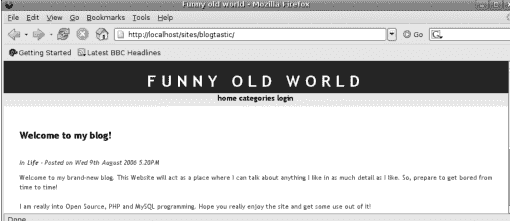

**图 4-3 你的博客条目已准备好让全世界看到。**

### 添加评论摘要

为此博客计划的一个功能是允许访客添加评论到博客条目中。这些评论应在 `viewentry.php` 页面上可见，通过博客的主题（你刚刚将其添加到 `index.php`）进行链接。

当评论被发布到博客条目中时，提供评论摘要会很有帮助。当有评论发布时，你可以显示评论数量和发布者的姓名。让发布者的姓名同时充当超链接也是有用的；也就是说，当你点击发布者的姓名时，应用程序会跳转到 `viewentry.php` 页面上该发布者的评论。

在 `index.php` 中已有的代码之后，添加以下行：

```php
echo nl2br($row['body']);
echo "</p>";

echo "<p>";

$cmsq1 = "SELECT name FROM comments WHERE blog_id = " . $row['id'] .
        " ORDER BY dateposted;";
$cmmsresult = mysql_query($cmsq1);
$numrows_comm = mysql_num_rows($cmmsresult);

require('footer.php');
?>
```

这段代码创建了一个新的段落标签，然后创建一个新的 SQL 查询，从 `comments` 表中选择 `name` 字段，条件是 `blog_id` 包含当前博客条目的 `id`（存储在 `$row['id']` 中）。整个查询按日期排序（使用 `dateposted` 字段）。然后使用 `mysql_query()` 命令执行此查询，结果存储在 `$cmmsresult` 中。

在最后一行，使用了一个名为 `mysql_num_rows()` 的新函数来计算查询返回的行数，并将此数字存储在 `$numrows_comm` 变量中。`mysql_num_rows()` 函数非常有用，因为它可以用来确定如何格式化评论摘要。如果没有返回行，则显示“无评论”；如果返回 1 个或多个结果，则显示发布者的姓名：

```php
$commql = "SELECT name FROM comments WHERE blog_id = '" . $row['id'] . "' ORDER BY dateposted;";
$comresult = mysql_query($commql);
$numrows_comm = mysql_num_rows($comresult);
if($numrows_comm == 0) {
    echo '</p>No comments.</p>';
}
else {
    echo '<strong>' . $numrows_comm . '</strong> comments :';
    $i = 1;
    while($comrow = mysql_fetch_assoc($comresult)) {
        echo '<a href="viewentry.php?id=' . $row['id'] . "#comment" . $i . ' > ' . $comrow['name'] . '</a>';
        $i++;
    }
}
echo '</p>' ;
```

在这段代码中，使用了一个 `if` 语句来检查 `$numrows_comm` 是否为 0 行。如果是，则向屏幕输出“无评论”。如果 `$numrows_comm` 不等于 0，控制将转移到 `else` 语句中。

在 `else` 内部，一个 `echo` 行打印一个括号，然后以粗体输出存储在 `$numrows_comm` 中的行数，最后输出闭合括号和单词 `comments`。如果有两条评论，输出将是 `(2) comments`。

下一步是显示每条评论，以及指向该评论的链接，使用锚点。

在 `viewentry.php` 中使用的锚点形式为 `#comment1`、`#comment2` 等。要在 `index.php` 中添加这些带编号的锚点，从 1 开始，每次输出评论链接时递增一次。

#### 关于锚点

锚点是链接到单个页面不同部分的便捷方法。要引用锚点，你需要将锚点的名称添加到 URL 中。例如，链接到 `example.php#theory` 会跳转到 `example.php` 页面上的 theory 锚点。在 `example.php` 的某个位置，应该有类似以下内容：

```html
<a name="theory"></a>
```

现在，当引用 `example.php#theory` 时，页面会跳转到该标签。

回到代码中，你会看到一个名为 `$i` 的变量被创建并设置为 1。接下来，一个 `while` 循环遍历行。创建了指向 `viewentry.php` 的链接，并在每个链接中添加了 `id=<entry->id`。除了追加 `id` 外，还添加了使用 `$i` 的评论锚点（例如 `#comment1`）。最后，`$i` 的值增加 1，以便在下个链接中使用。完成的输出应该类似于这样（显然，如果你添加了不同的评论，名称会有所不同）：

(2) comments : Jim Bob


> 如果你使用的是本章前面讨论过的示例详情，你将看到“无评论”，因为第二个博客条目没有关联的评论。为解决此问题，请使用 `phpMyAdmin` 向 `comments` 表添加一些记录，并在 `blog_id` 字段中指定值 2。

你可以在图 4-4 中查看评论。

### 显示以前的博客条目

经常方便看到最近大约五个博客条目，这样如果用户错过了几个条目，她可以轻松地访问它们，而不必翻找存档。

首先，创建查询。幸运的是，此查询与你用于查找最新博客条目的查询相同——唯一的区别是，将结果限制为单个条目变为将结果集限制为五个条目。通过更改 `LIMIT 1` 行为 `LIMIT 1, 5` 来实现。这确保了获取记录 0 到 4。

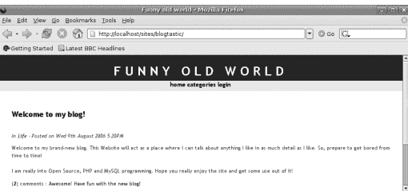

**图 4-4 在首页上显示评论可以表明你的博客条目引发了讨论和辩论。**

### 提示

当你使用 `LIMIT` 时，返回的第一个记录被标记为第零个。因此，`LIMIT 1,5` 返回从第一个到第五个记录。`LIMIT 0, 1` 与 `LIMIT 1` 是同义的。

向你的页面添加以下代码：

```php
echo "</p>";
$prevsql = "SELECT entries.*, categories.cat FROM entries, categories WHERE entries.cat_id = categories.id ORDER BY dateposted DESC LIMIT 1, 5;";
$prevresult = mysql_query($prevsql);
$nextrows_prev = mysql_num_rows($prevresult);
```

此查询计算返回的行数，以便你可以显示相关信息。现在，添加显示结果的代码：

```php
$nextrows_prev = mysql_num_rows($prevresult);

if ($nextrows_prev == 0) {
    echo "</p>No previous entries.</p>";
} else {
    echo "<ul>";
    while($prevrow = mysql_fetch_assoc($prevresult)) {
        echo "<li><a href='viewentry.php?id="
            . $prevrow['id'] . "'>" . $prevrow ['subject']
            . "</a></li>";
    }
    echo "</ul>";
}
```

如果查询没有返回行，则显示文本“No previous entries.”。如果返回了行，则执行 `else` 块，并在无序列表中显示以前的条目。

在 `else` 块内部，使用 `while` 循环遍历查询结果，使用 `<li>` 和 `</li>` 标签创建博客条目主题。主题链接到 `viewentry.php`，并将相关的 `id` 作为变量附加到链接中。最终结果如图 4-5 所示。

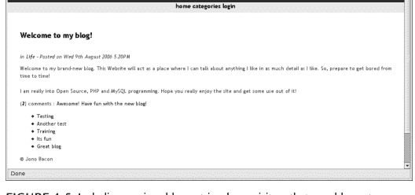

**图 4-5 包含以前的博客条目可以表明你的博客更新频繁。**

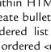

## 注意

### 有序列表和无序列表

在 HTML 中，Web 开发人员通常使用有序列表和无序列表来创建项目符号。要创建编号列表，请使用 `<ol>` 和 `</ol>` 有序列表标签。要创建不带编号的项目符号列表，请使用无序 `<ul>` 和 `</ul>` 标签。

列表项放置在 `<li>` 和 `</li>` 标签内。无序列表的示例如下所示：

```html
<ul>
    <li>One item</li>
    <li>Another item</li>
</ul>
```

## 查看特定条目

当创建 `index.php` 时，页面上添加了三个不同的部分：

- 主博客条目
- 评论数量
- 以前的博客条目

在主博客条目和以前的条目部分中，您链接到一个名为 `viewentry.php` 的页面。`viewentry.php` 页面具有若干重要功能：

- 该页面显示博客条目的内容。
- 该页面几乎使用了与 `index.php` 相同的代码。
- 需要创建之前添加到 `index.php` 中评论者姓名（和链接）的锚点。
- 该页面提供了一个表单，用于发布关于博客条目的评论。
- 表单会被显示，当用户填写表单时，评论会被添加到数据库中。

这是构建博客的重要一步，因此废话不多说，是时候开始编码了！

## 验证请求 URL

`viewentry.php` 页面的第一步是确保其通过有效日期被请求。每当您在 Web 项目上工作时，验证任何可变信息（如条目或评论的 ID）的合法性都是非常重要的。这种验证过程被称为`验证`。在本项目中，验证仅应用于添加到站点地址的变量。这些变量是可见的，用户可以通过编辑浏览器中的地址来更改它们。

> **注意**
>
> **逐步验证**
>
> 您之所以只验证 GET 变量，而不验证其他类型的信息，是为了让验证更容易学习。本应用介绍了一些基本概念，并保持简单。书中的后续项目将更详细地探讨验证，您之后可以返回之前的项目并应用这些技能。

虽然 GET 变量可以设置为字母或数字，但本书中几乎所有的 GET 变量都被设置为数字。当您创建 `index.php` 和指向 `viewentry.php` 的链接时，其中每个都包含一个包含数字 `id` 的 GET 变量。

要验证数字变量，请将其输入到运行一些简单测试的代码块中。将以下代码添加到 `viewentry.php` 的开头：

```php
<?php

require("config.php");

if(isset($_GET['id']) == TRUE) {
    if(is_numeric($_GET['id']) == FALSE) {
        $error = 1;
    }

    if($error == 1) {
        header("Location: " . $config_basedir);
    }
    else {
        $validentry = $_GET['id'];
    }
}
else {
    $validentry = 0;
}
```

第一行包含 `config.php`。与之前的示例不同，`header.php` 尚未被包含（目前为止）。如果验证失败，您将把用户重定向到另一个页面，因此在这些测试通过之前，没有必要显示 `header.php` 中的 HTML。

下一行是第一个 `if` 条件。`isset()` 函数检查 GET 变量是否存在。如果存在，`isset()` 返回 `TRUE`；如果不存在，`validentry` 被设置为 0。

## 注意

**重定向的乐趣与游戏**

重定向是指自动跳转到 Web 站点上的另一个页面。跳转到页面主要有两种方法：

- 使用 JavaScript。这种技术的问题在于并非所有浏览器都完全支持 JavaScript，而且用户和网络管理员也可以关闭 JavaScript。
- 使用 HTTP 头。使用每个 Web 页面中存在的 HTTP 头来更改当前页面。这种技术受到所有浏览器的支持，但它只能在向客户端发送任何数据之前发生。当您在一页开始处使用 `session_start()` 时，会话也适用同样的限制。

一般来说，由于 HTTP 头在所有浏览器中可用且易于使用，因此请使用 HTTP 头进行重定向。

假设正在发送一个变量，则会进行检查以确保该值是数字；如果有人将变量设置为“bananas”，例如，这显然是不正确的。`is_numeric()` 函数测试 GET 变量；如果结果为 false，则 `error` 被设置为 1。

## 注意

**SQL 注入的险恶世界**

使用 GET 变量的风险之一是 SQL 注入。想象一下你有一个如下的 SQL 语句：

```sql
SELECT * FROM entries WHERE id = <id value>
```

并且 `<id value>` 是，您添加来自 GET 变量的值：

```php
$sql = "SELECT * FROM entries WHERE id = " . $_GET['id'];"
```

这段代码假设 `id` 的值是数字。如果您不检查这一点，恶意用户可能会尝试向查询中注入 SQL 代码。想象一下如果用户添加了 1; DROP DATABASE blogtastic; 会发生什么。现在执行的 SQL 是：

```sql
SELECT * FROM entries WHERE id = 1; DROP DATABASE blogtastic;
```

这将导致数据库丢失（假设用户拥有适当的权限！）。为了保护免受此风险，请始终确保数字 GET 值确实是数字。


接下来，如果 `error` 确实等于 1（表示非数字值），则 `header()` 命令重定向到主页。`header()` 命令接收 `Location` 头以及要重定向的完整位置（例如 `Location: http://localhost/blogstatic/`）。在代码中，添加了“`Location:`”文本，然后从 `config.php` 中的 `config_basedir` 变量中取出位置。

> **提示**
>
> 使用 `Location` 头时，您需要提供完整的 URL，例如 `http://www.foo.com/`——而不是 `www.foo.com` 或 `foo.com`。

如果 `error` 没有设置为 1，则 `validentry` 变量被设置为 `GET` 变量的值。有了这种验证，`header()` 函数下方的代码仅在具有有效 `GET` 变量时运行。

> **注意**
>
> **不要用错误让用户困惑**
>
> 当检测到无效变量时，此脚本会重定向到一个合法页面，而不是显示错误消息。在考虑 Web 应用程序的可用性时，重定向而不是报告错误通常是有意义的。错误消息很少对用户有用，而且任何知道如何调整 URL 上 `GET` 变量的人可能完全意识到他们在篡改应用程序，而不是使用应用程序。自动重定向可以避免用错误消息让用户感到困惑。

## 显示条目

验证完成后，您可以显示博客条目。这段代码看起来与 `index.php` 上的代码非常相似。首先，添加头部 HTML：

```php
require("header.php");
```

现在您需要确定运行哪种类型的查询。在验证检查代码内部，`validentry` 被设置为 0（如果没有提供变量）或要查看的条目的 ID。

如果 `validentry` 被设置为除 0 以外的任何值，查询很简单——请求那个特定的博客条目。然而，如果值为 0，查询应该加载最新的 blog 条目（与 `index.php` 相同的行为）：

```php
require ("header.php");
if($validentry == 0) {
    $sql = "SELECT entries.*, categories.cat FROM entries, categories " .
           " WHERE entries.cat_id = categories.id " .
           " ORDER BY dateposted DESC " .
           " LIMIT 1;";
}
else {
    $sql = "SELECT entries.*, categories.cat FROM entries, categories " .
           "WHERE entries.cat_id = categories.id
           AND entries.id = " . $validentry .
           " ORDER BY dateposted DESC LIMIT 1;";
}
```

使用 `mysql_query()` 函数将查询发送到数据库：

```php
else {
    $sql = "SELECT entries.*, categories.cat FROM entries, categories " .
           "WHERE entries.cat_id = categories.id
           AND entries.id = " . $validentry .
           " ORDER BY dateposted DESC LIMIT 1;";
}
$result = mysql_query($sql);
```

现在您可以向用户展示结果。这段代码与您在 `index.php` 上编写用于展示博客条目的代码几乎完全相同。唯一的真正区别是条目的主题没有链接到任何地方。

```php
$result = mysql_query($sql);

$row = mysql_fetch_assoc($result);
echo "<h2>" . $row['subject'] . "</h2><br />";
echo "<i>In <a href=\"viewcat.php?id=" . $row['cat_id'] . ">" .
      $row['cat'] . "</a> – Posted on " .
      date("D jS F Y g.iA", strtotime($row['dateposted'])) . "</i>";
echo "<p>";
echo nl2br($row['body']);
echo "</p>";
```

主博客条目部分现在已经完成。

## 显示博客评论

要显示评论，首先创建一个 SQL 查询以获取当前博客条目的评论：

再次使用 `mysql_num_rows()` 统计行数，并利用该值判断是否已发布了评论。如果 `$nwrows_comm` 等于 0，则显示“没有评论”文本；否则，执行代码的 `else` 块。

```php
$nwrows_comm = mysql_num_rows($commresult);
if($nwrows_comm == 0) {
    echo "<p>No comments.</p>";
} else {
    $i = 1;
    while($aCommrow = mysql_fetch_assoc($commresult)) {
        echo "<a name='Comment" . $i . "'>";
        echo "<h3>Comment by " . $aCommrow['name'] . " on " .
             date("D jS F Y g:i A",
              strtotime($aCommrow['dateposted'])) . "</h3>";
        echo $aCommrow['comment'];
        $i++;
    }
}
```

在 `else` 块中，你执行两个基本功能：显示每条评论，然后为每条评论创建一个锚点，使其能够与 `index.php` 中引用的锚点相匹配。

在 `else` 块的顶部，你首先将 `i` 设置为 1；这个变量用作计数器来实现锚点功能。接下来，`while` 循环遍历查询中的每条评论并创建锚点。创建一个链接，其 `name` 属性设置为文本 "Comment"，并附加 `i` 的值（例如，结果为 Comment2）。主要评论字段随后以与主博客条目类似的方式显示。最后，`i` 变量增加 1，为下一条评论的输出做准备。

### 构建评论表单

允许用户添加评论涉及三个不同的操作：

- 显示用于添加评论的表单。
- 处理表单，并在用户点击提交按钮后将其数据添加到数据库。
- 重新加载页面并显示新评论。

**快速说明**

此功能比前面的章节稍微复杂一些，主要原因是你需要在页面的各个部分添加一些代码，而不仅仅是每次在页面末尾添加一行代码。

首先，添加图 4-6 中显示的主表单。

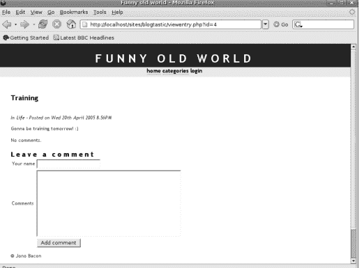

**图 4-6** 表单对于允许用户贡献评论非常有用。

为此，用 `?>` 关闭页面底部的 PHP 块，并添加以下 HTML：

```html
<h3>Leave a comment</h3>
<form action="<?php echo $SCRIPT_NAME . "?id=" . $validentry; ?>" method="post">
<table>
<tr>
    <td>Your name</td>
    <td><input type="text" name="name" /></td>
</tr>
<tr>
    <td>Comments</td>
    <td><textarea name="comment" rows="10" cols="50"></textarea></td>
</tr>
<tr>
    <td></td>
    <td><input type="submit" name="submit" value="Add comment" /></td>
</tr>
</table>
</form>
```

这段代码创建了一个包含若干表单元素的表格。在 `<form>` 标签中，*action* 指定处理此表单数据的页面。如图所示，你可以使用一个名为 *SCRIPT_NAME* 的特殊 PHP 变量来引用当前文件的名称（在本例中为 *viewentry.php*）。如果你后来决定更改脚本的文件名，这种引用方式很有用；此时你不需要更改代码。标签中的 *method* 属性表示你希望以 POST 还是 GET 变量形式提交你的变量。

在 *action* 属性内部，*validentry* 变量作为 GET 变量被添加。当你处理表单数据时，需要指明你正在发表评论的博客条目的 ID。


前面表单中的 HTML 本身相当通俗易懂。

### 注意

### GET 变量与隐藏表单字段

在表单和处理它的脚本之间共享变量的另一种技术是使用隐藏表单元素：

```html
<input type="hidden" name="example" value="21" />
```

然后，可以在 PHP 代码中使用 `$_GET` 或 `$_POST` 将表单的值属性作为普通变量进行访问。

网页上的表单处理工作方式相当反直觉。在页面顶部——在显示任何 HTML 之前——你需要检查提交按钮是否已被点击，方法是检查 `$_POST['submit']` 变量是否存在。如果该变量存在，则用户已提交了表单。如果变量不存在，你应该假设用户尚未实际看到表单，因此需要显示它。这听起来很疯狂，但请坚持下去——很快就会变得清晰明了。

在你的验证代码之后、包含 *header.php* 文件之前，插入以下代码：

```php
else {
    $validentry = 0;
}

if($_POST['submit']) {
    $db = mysql_connect($dbhost, $dbuser, $dbpassword);
    mysql_select_db($dbdatabase, $db);
    
    $sql = "INSERT INTO comments(blog_id, dateposted,
        name,  comment) VALUES('"
        . $validentry . "',"
        . NOW() . ","
        . "'"
        . $_POST['name']
        . "',"
        . "'"
        . $_POST['comment'] . "');";
    mysql_query($sql);
    header("Location: http://" . $_SERVER['HTTP_HOST']
        . $SCRIPT_NAME . "?id=" . $validentry);
}
else {
    // code will go here
}

require("header.php");
```

第一行检查提交 POST 变量是否存在。为了便于解释，假设提交按钮已被点击且变量存在。然后代码连接数据库。（请记住，你尚未包含 `header.php`，因此没有可用的数据库连接。）

### 注意

### 不要搞乱你的头部（Header）

当你使用头部重定向时，务必确保在发送头部之前页面上*没有*显示任何数据——这包括空白。作为一个简单示例，说明其重要性，可以在 `<?php` 指令前添加一个空格并重新加载页面。现在你应该会遇到许多“headers already been sent”错误。每当看到这些错误时，请检查页面本身或包含的文件（如 `config.php`）中是否有错误的字母或空白。

下一行是 SQL 查询。此查询通过 `INSERT` 语句将数据插入数据库。典型的 `INSERT` 语句如下所示：

```sql
INSERT INTO table(field1, field2)
VALUES ('data for field 1', 'data for field 2');
```

当你构建 `$sql` 变量中的 SQL 语句时，你拼接了通过 `$_POST` 访问的表单中各种变量。为了演示如何将这些组合在一起，想象你正在为 ID 为 2 的博客条目添加评论，时间为 2005 年 8 月 10 日下午 2:30。假设用户输入 "Bob Smith" 作为姓名，输入 "I really like your blog. Cool stuff!" 作为评论。表 4-5 展示了查询是如何构建的。

### 表 4-5 `$sql` 变量被构建为一个 INSERT 语句

| 拼接元素 | SQL 语句 |
|---|---|
| `INSERT INTO comments(blog_id, dateposted, name, comment) VALUES(` | `INSERT INTO comments(blog_id, dateposted, name, comment) VALUES(` |
| `$validentry` | `INSERT INTO comments(blog_id, dateposted, name, comment) VALUES(2` |
| `, NOW(), '` | `INSERT INTO comments(blog_id, dateposted, name, comment) VALUES(2, 2005-08-10 14:30:00, '` |
| `$_POST['name']` | `INSERT INTO comments(blog_id, dateposted, name, comment) VALUES(2, 2005-08-10, 'Bob Smith` |
| `', '` | `INSERT INTO comments(blog_id, dateposted, name, comment) VALUES(2, 2005-08-10, 'Bob Smith','` |
| `$_POST['comment']` | `INSERT INTO comments(blog_id, dateposted, name, comment) VALUES(2, 2005-08-10, 'Bob Smith', 'I really like your blog. Cool stuff!'` |
| `');` | `INSERT INTO comments(blog_id, dateposted, name, comment) VALUES(2, 2005-08-10, 'Bob Smith', 'I really like your blog. Cool stuff!');` |

左列列出了代码的各个部分；右列显示了查询中页面内容是如何构建的。在阅读表格时，请记住数字（如 `validentry` 中的数字）不需要单引号包围，但字符串（字母和句子）需要。

代码中的一部分对你来说是新的：`NOW()`。这是一个特殊的 MySQL 函数，提供当前日期和时间，你将使用 `NOW()` 来自动填充 `dateposted` 字段。

### 注意

### MySQL 内置函数

MySQL 提供了一系列这样的函数，你可以从 phpMyAdmin 的舒适环境中探索它们。当你插入数据时，Function 下拉框列出了这些不同的 MySQL 函数。尝试使用它们，以便更好地理解它们的作用。

代码中的下一行——`mysql_query($sql);`——执行实际的查询。你可能注意到，该行不包含存储结果的变量，例如 `$result = mysql_query($sql)`。原因是查询只是被发送；没有返回结果。最后一行使用 `header()` 函数重定向到当前页面。

最后，`if` 块关闭，`else` 开始（用于未点击提交按钮的情况）。在页面底部，添加关闭代码：

```php
</table>
</form>

<?php 
}
require("footer.php");
?>
```

因此，实际上，如果用户没有通过点击该同一页面上的表单中的提交按钮到达 `viewentry.php`，则会显示整个 HTML 页面。

### 构建分类浏览器

在由 Blogtastic 驱动的网站中，将会构建大量的博客条目。鉴于有如此多的内容可供使用，拥有一个便捷浏览这些内容的手段至关重要。在本节中，你创建了一个有用的页面，供用户浏览不同的分类，并查看在每个分类中发布了哪些博客条目。

如果你考虑应该如何设计这个页面，按类别列出条目并让用户点击其中一个以查看相关的博客条目似乎是最合理的做法（见图 4-7）。这种功能类似于文件管理器中的树形视图：列出了目录，然后你点击其中一个来查看文件和子目录。

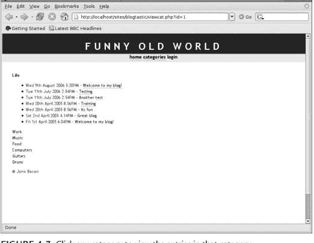

**图 4-7** 点击任意类别以查看该类别中的条目。

在 `index.php` 和 `viewentry.php` 中，你将类别制作成了指向名为 `viewcat.php` 页面的链接，并且类别的 ID 是作为一个名为 `id` 的 GET 变量传递的。为了开始，创建一个名为 `viewcat.php` 的新文件，并添加以下代码：

```php
require("config.php");
if(isset($_GET['id']) == TRUE) {
    if(is_numeric($id) == FALSE) {
        $error = 1;
    }
}
if($error == 1) {
    header("Location: " . $config_basedir . "/viewcat.php");
} else {
    $validcat = $_GET['id'];
}
else {
    $validcat = 0;
}
```


这段代码应该看起来很熟悉；它对 `id` 变量运行了与在 `viewentry.php` 上使用的相同的验证测试。如果变量不存在，`validcat` 被设置为 0，但如果该变量确实合法，`validcat` 则被设置为 GET 变量的内容。如果变量未通过检查其是否为数字的测试，页面会重定向到自身，但不包含 `id` 变量。

从 *categories* 表中选取所有记录：

```php
$sql = "SELECT * FROM categories";
$result = mysql_query($sql);

while($row = mysql_fetch_assoc($result)) {
```

添加以下代码以检查结果集中的每一行，查看 `$validcat` 是否与 `id` 变量相同。如果是，则意味着该类别当前处于选中状态。

```php
while($row = mysql_fetch_assoc($result)) {
    if($validcat == $row['id']) {
        echo "<strong>" . $row['cat'] . "</strong><br />";
    }
}
```

```php
$entriesql = "SELECT * FROM entries WHERE cat_id = " . $validcat .
    " ORDER BY dateposted DESC";
$entriesres = mysql_query($entriesql);
$numrows_entries = mysql_num_rows($entriesres);

echo "<ul>";
```

随着 `while` 循环遍历每一行，第一行检查 `validcat` 是否与当前行的 ID 相同。如果是，则执行 `if` 代码块。`if` 块内的第一行以粗体输出类别名称，而不是链接。

下一行中的查询获取 `cat_id` 等于 `validcat` 的所有博客条目。这些条目按降序数据顺序请求，因此最新的条目将显示在列表的顶部。然后运行查询，并计算返回的行数（以确保有记录可显示）。最后一行开始包含结果的无序列表块。

检查当前类别是否存在任何行，并显示相关详细信息：

```php
if($numrows_entries == 0) {
    echo "<li>No entries!</li>";
}
else {
    while($entriesrow = mysql_fetch_assoc($entriesres)) {
        echo "<li>" . date("D jS F Y g.iA", strtotime($entriesrow
            ['dateposted'])) .
               " <a href='viewentry.php?id=" . $entriesrow["id"] . "'>" .
               $entriesrow["subject"] . "</a></li>";
    }
    echo "</ul>";
}
```

如果 `numrows_entries` 的行数为零，浏览器将显示带有文本“No entries!”（没有条目！）的列表项。如果有行，则打开另一个 `while` 循环以遍历结果。在这个 `while` 循环内部，创建一个列表项，显示条目的日期以及指向 `viewentry.php`（使用正确的 `id` 值）的链接。该文章的标题是链接的主体。

最后，你可以显示当前未选中的类别：

```php
echo "</ul>";
}
else {
    echo "<a href='viewcat.php?id=" . $row['id'] . "'>" .
    $row['cat'] .
    "</a><br />";
}
require("footer.php");
```

现在，你拥有了一个按类别组织的完整博客条目归档！

## 不要只让任何人登录

到目前为止，该项目中创建的所有内容都是设计为任何人都可以访问的，只要他们偶然发现这个博客即可。因此，这些页面没有内置的安全机制——也就是说，这些页面并没有限制为特定用户。由于网站的开放性和可访问性，建议在这些页面上仅存在适合公众消费的信息。你应该避免添加你的信用卡号、个人信息或那些你在化装舞会上拍的尴尬照片。（谣言就是这样开始的。）

然而，允许所有者进行受限访问以添加和删除内容是一项基本功能。必须登录 phpMyAdmin 才能添加内容并不是理想的解决方案，因此总体规划是创建页面，以提供添加内容的便捷方式。你需要提供一种让用户登录的方式，并且用户输入的登录详细信息应该与 `login` 表中的匹配。你将使用 PHP 会话（在第 2 章中介绍）来跟踪用户，通过在不同页面间共享变量。如果用户成功登录，你可以设置一个会话变量，然后检查以确保该会话变量在受限页面中存在。

首先，创建一个名为 `login.php` 的新文件，并添加登录表单：

```html
<form action="<?php echo $SCRIPT_NAME ?>" method="post">
<table>
<tr>
<td>Username</td>
<td><input type="text" name="username"/></td>
</tr>
<tr>
<td>Password</td>
<td><input type="password" name="password"/></td>
</tr>
<tr>
<td></td>
<td><input type="submit" name="submit" value="Login!"/></td>
</tr>
</table>
</form>
```

此表单包含一些看起来熟悉的文本框（见图 4-8）。

你可能已经注意到，第二个 `<input>` 标签使用 `password` 作为类型。当你使用这种类型的表单元素时，内容会被伪装成星号或圆点，以向好奇的旁观者隐藏密码。

下一步是处理表单并检查数据库是否包含登录详细信息。然而，在做此操作之前，在文件开头添加常规的介绍性代码（在任何 HTML 之前）：

```php
<?php

session_start();
require("config.php");

$db = mysql_connect($dbhost, $dbuser, $dbpassword);
mysql_select_db($dbdatabase, $db);
```

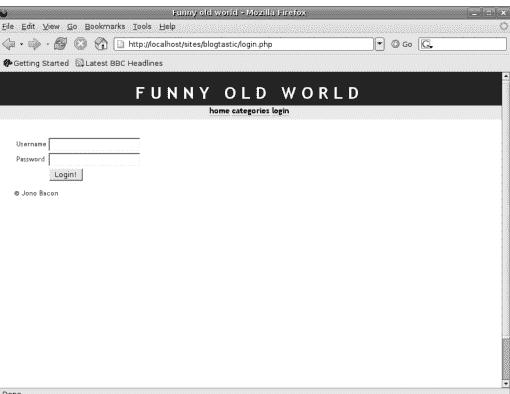

**图 4-8** 登录表单看起来与其他任何表单一样。

## 注意

### 表单也感觉不安全

尽管表单提供了一种让人们安全地识别身份的手段，但发送到服务器进行处理以登录的密码是以明文发送的。这是使用表单时固有的潜在安全风险。解决此风险的唯一方法是在点击表单按钮时使用 JavaScript 对表单数据进行加密，这是一种超出本项目范围的技术。

添加代码以检查是否点击了 Submit 按钮（再次，来自你已添加的表单）：

```php
mysql_select_db($database, $db);

if($_POST['submit']) {
    $sql = "SELECT * FROM logins WHERE username = '" . $_POST['username'] . "' AND password = '" . $_POST['password'] . "';"
    $result = mysql_query($sql);
    $numrows = mysql_num_rows($result);
```

创建 SQL 语句以检查 `logins` 表中的用户名是否等于表单中的用户名字段，以及 `password` 字段是否等于表单中的密码字段。然后运行查询，并计算行数。查询返回的行数表明输入的详细信息是否正确。如果详细信息正确，将返回一行——不多也不少。如果没有返回行，则详细信息不匹配。

添加以下代码：

```php
if($numrows == 1) {
    $row = mysql_fetch_assoc($result);
    session_register("USERNAME");
    session_register("USERID");

    $_SESSION['USERNAME'] = $row['username'];
    $_SESSION['USERID'] = $row['id'];

    header("Location: " . $config_basedir);
}
else {
    header("Location: " . $config_basedir . "/login.php?error=1");
}
```

在登录详细信息有效的情况下，创建一个新的会话。使用 PHP 会话时，你必须注册你的会话变量。`session_register()` 行创建了两个变量，分别称为 `USERNAME` 和 `USERID`。

## 注意

为变量命名时保持一致性


将会话变量命名为大写并非强制要求，但这样做很有用，因为这有助于使它们在代码中作为不同类型的变量脱颖而出。

接下来的两行代码使用 `_SESSION`（代表用户的会话信息）来使用变量并将来自 SQL 查询的信息（用户名和 id）存储在其中。最后一行执行到 `index.php` 的头部重定向。

如果未点击提交按钮，在表单显示之前会执行一小段代码：

```php
header("Location: " . $config_basedir . "/login.php?error=1");
}
} 
else { 
require("header.php");
if($ GET['error']) { 
echo "Incorrect login, please try again!";
}
?>
```

包含 `header.php` 文件，然后检查是否存在名为 `error` 的 GET 变量。如果存在，则显示错误消息以指示用户输入了无效的用户名或密码。

在页面底部，HTML 之后，添加最后几行代码：

```php
}
require("footer.php");
```

## 注销用户

既然用户现在能够登录，你还需要赋予他注销的能力——通过销毁登录时创建的会话。创建一个新的名为 `logout.php` 的文件并添加以下代码：

```php
<?php

session_start();
session_destroy();
require("config.php");

header("Location: " . $config_basedir);
?>
```

要注销用户，只需使用 `session_destroy()` 函数来删除所有已注册的会话变量。会话现在已被销毁，用户不再处于登录状态。然后你可以执行到 `index.php` 的头部重定向。

## 注意

### 会话的生存与死亡

在处理基于会话的代码时，测试代码时应该始终清除任何会话。除了创建 `logout.php` 脚本外，另一个选项是关闭 Web 浏览器。会话仅在与浏览器打开期间存在，当你关闭浏览器（而不仅仅是*窗口*）时，会话就会丢失。

在开发代码时，当你想清除会话时关闭浏览器可能会让人非常沮丧。为了减轻这种痛苦，请使用适用于所有平台的 Mozilla Firefox 的 Web Developers Toolbar 扩展程序。你可以从 Mozilla Extensions 网站 http://extension-room.mozdev.org 下载它。

## 为应用程序添加会话支持

凭借新的成员登录功能，你可以为你的当前页面“充电”，使其在成员登录时做出不同的反应。可以检查登录页面中创建的会话变量，并在适当的地方添加额外的选项。

### 在头部文件中附加选项

第一个需要编辑的文件是 `header.php`。在 `login.php` 和 `logout.php` 中，你在页面开头添加了 `session_start()`。由于你将在大多数页面中使用 `session_start()`，因此将其添加到 `header.php` 的顶部：

```php
<?php

session_start();
```

此文件已经包含了一个可供网站不同部分访问的链接列表。当用户登录时，应显示注销链接；如果未登录，则应显示登录链接。在 *categories* 链接下方的 PHP 块内添加以下代码：

```php
[<a href="viewcat.php">categories</a>]
<?php

if(isset($_SESSION['USERNAME']) == TRUE) {
    echo "[<a href=\"logout.php\">logout</a>]";
}
else {
    echo "[<a href=\"login.php\">login</a>]";
}
```

`isset()` 函数用于检查是否设置了 `USERNAME` 会话变量。如果已设置，则显示注销链接；否则，显示登录链接。

对添加额外链接使用相同的方法：

```php
if(isset($_SESSION['USERNAME']) == TRUE) {
    echo " - ";
    echo "[<a href=\"addentry.php\">add entry</a>]";
    echo "[<a href=\"addcat.php\">add category</a>]";
}
?>
```

### 添加用于更新博客条目的链接

在使用 Blogtastic 时，你需要编辑现有的博客条目。与其仅仅在 `header.php` 中添加一个编辑博客条目的链接，不如在博客条目主题旁边添加编辑链接，这样更直观。（在项目后期，你将创建一个名为 `updateentry.php` 的文件来编辑博客条目。）使用类似检查会话变量是否存在的技术，在 `index.php` 中，在分类和日期行之后添加以下代码：

```php
echo "</i>In <a href=\"viewcat.php?id=\" . $row["cat_id"] . "\">"
. $row['cat'] . "</a> - Posted on " . date("D jS F Y g.iA", strtotime($row['dateposted'])) . "</i>";

if(isset($_SESSION['USERNAME']) == TRUE) {
    echo " [<a href=\"updateentry.php?id=\" . $row["id"] . "\">Edit</a>]";
}
```

`updateentry.php` 文件接收一个包含要编辑的博客条目 ID 的 `id` 变量。将此相同代码块复制到 `viewentry.php` 中，在列出发布日期行的相同位置之后。图 4-9 显示了这些链接。

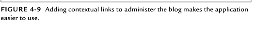

图 4-9 添加上下文链接来管理博客将使应用程序更容易使用。

## 创建自己的分类

添加博客分类是下一部分的重点。这个页面类似于用于添加评论的页面。

首先，在一个名为 `addcat.php` 的新文件中创建表单：

```html
<form action="<?php echo $SCRIPT_NAME ?>" method="post">

<table>
<tr>
<td>Category</td>
<td><input type="text" name="cat"></td>
</tr>
<tr>
<td></td>
<td><input type="submit" name="submit" value="Add Category!"></td>
</tr>
</table>
</form>
```

在文件开头，任何 HTML 之前添加常见的代码行：

```php
<?php

session_start();

require ("config.php");

$db = mysql_connect($dbhost, $dbuser, $dbpassword);
mysql_select_db($databasename, $db);
```

由于此页面仅对受限用户可用，你需要检查用户是否已登录。通过检查其中一个会话变量是否存在来完成此操作；如果不存在，则重定向到另一个页面：

```php
if (isset($_SESSION['USERNAME']) == FALSE) {
    header("Location: " . $config_basedir);
}
```

> **注意**
>
> **切勿假设**
>
> 似乎不点击链接就无法到达此页面，而这是否意味着用户已经登录？虽然这听起来合乎逻辑，但某人仍然可以直接输入 URL。最好始终明确检查以确保用户已登录，而不是信任其他页面为你完成这项工作。

添加当用户点击提交按钮时的逻辑：

```php
if(isset($_SESSION['USERNAME']) == FALSE) {
    header("Location: " . $config_basedir);
}

if($_POST['submit']) {
    $sql = "INSERT INTO categories(cat) VALUES('" . $_POST['cat'] . "');";
    mysql_query($sql);
    header("Location: " . $config_basedir . " viewcat.php");
}
else {
    require("header.php");
?>
```

在此代码中，创建了一个 INSERT 查询并发送到数据库。查询执行后，浏览器重定向到 `viewcat.php` 页面以查看新创建的分类。

最后，关闭 **else** 并包含 `footer.php` 文件（均在表单之后）：

```php
<?php
}
require("footer.php");
?>
```

## 创建新的博客条目


到目前为止，在 Blogtastic 中，*添加* 博客条目的功能一直缺失。这个基本功能几乎需要使用你迄今为止看到的所有技术，因此有所延迟。不过，你现在已经准备好了，是时候完成这个页面了。该页面的行为类似于之前添加内容的页面，但此页面还包含一个下拉组合框，用于选择条目所属的分类。

### 创建名为 `addentry.php` 的新文件并启动表单

```html
<h1>Add new entry</h1>
<form action="<?php echo $SCRIPT_NAME ?>" method="post">

<table>
```

之前，你首先添加了整个表单，但在该页面中，第一个表单控件将是刚刚讨论过的特殊下拉框：

```html
<tr>
<td>Category</td>
<td>
<select name="cat">
<?php
$catsql = "SELECT * FROM categories";
$catres = mysql_query($catsql);
while($catrow= mysql_fetch_assoc($catres)) {
    echo "<option value=" . $catrow['id'] . ">" . $catrow['cat'] . "</option>";
}
?>
</select>
</td>
</tr>
```

下拉组合框呈现了一个带有用户可以选中一系列选项的视觉框。这涉及两个基本步骤。首先，创建一个包含框内项目的 `<select>` 标签。每个项目都封装在 `<option>` 标签中。在这些标签中，添加你希望显示在框中的文本（在本例中为分类名称）和一个 `value` 属性。此属性包含用户选择该项目时传递的值。将此属性设置为包含分类项的 ID。

就使代码生效而言，SQL 查询从分类表中选择所有内容。循环遍历查询返回的分类。在 `while` 循环中，创建 `<option>` 标签，并将查询中的 `id` 添加到 `value` 属性中。

完成其余表单：

```html
<select>
</td>
</tr>

<tr>
<td>Subject</td>
<td><input type="text" name="subject"></td>
</tr>
<tr>
<td>Body</td>
<td><textarea name="body" rows="10" cols="50"></textarea></td>
</tr>
<tr>
<td></td>
<td><input type="submit" name="submit" value="Add Entry!"></td>
</tr>
</table>
</form>
```

该表单如图 4-10 所示。

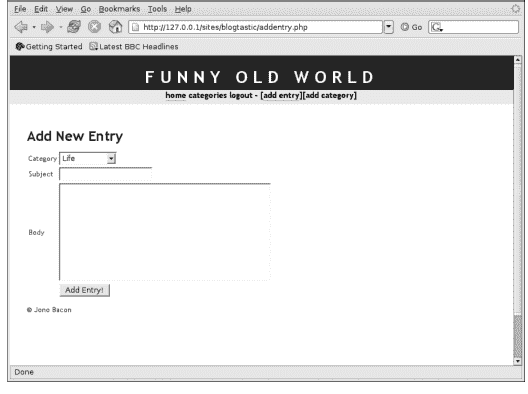

**图 4-10** 添加新的博客文章很简单。

移动到文件开头，并添加标准引入代码：

```php
<?php
session_start();
require("config.php");
$db = mysql_connect($dbhost, $dbuser, $dbpassword);
mysql_select_db($dbdatabase, $db);
if(isset($_SESSION["USERNAME"]) == FALSE) {
    header("Location: " . $config_basedir);
}
```

添加实际处理表单的逻辑：

```php
if (isset($_SESSION['USERNAME']) == FALSE) {
    header("Location: " . $config_basedir);
}

if($_POST['submit']) {
    $sql = "INSERT INTO entries(cat_id, dateposted, subject, body) VALUES(" .
           $_POST['cat'] . ", NOW(), '" . $_POST['subject'] . "', '" .
           $_POST['body'] . "');";
    mysql_query($sql);
    header("Location: " . $config_basedir);
} else {
    require("header.php");
}
?>
```

这段代码创建了一条 INSERT 查询，与之前基于表单的页面中的查询非常相似。

最后，关闭 else 代码块并添加 `footer.php` 代码：

```php
</tr>
</table>
</form>

<?php
}
require("footer.php");
?>
```

## 更新博客条目

最后一个页面用于更新博客条目。之前，当你为 Blogtastic 添加会话支持时，你浏览了一些页面并添加了指向编辑特定博客条目的链接。编辑博客条目的链接指向一个名为 `updateentry.php` 的页面，该页面接收一个 `id` 变量。此 ID 指示要更新哪条记录。

在这个页面上，不要先添加表单，而是从上到下进行处理。

首先，添加标准代码：

```php
<?php
session_start();
require("config.php");
$db = mysql_connect($dbhost, $dbuser, $dbpassword);
mysql_select_db($dbdatabase, $db);
```

下一段代码与之前编写的验证代码完全相同：

```php
if(isset($_GET['id']) == TRUE) {
    if(is_numeric($id) == FALSE) {
        $error = 1;
    }

    if($error == 1) {
        header("Location: " . $config_basedir);
    }
    else {
        $validentry = $_GET['id'];
    }
}
else {
    $validentry = 0;
}
```

添加处理表单的代码：

```php
else {
    $validentry = 0;
}

if($_POST['submit']) {
    $sql = "UPDATE entries SET cat_id = "
           . $_POST['cat'] . ", subject = " .
            $_POST['subject'] . ", body = '"
           . $_POST['body'] . "' WHERE id = " .
           $validentry . ";";
    mysql_query($sql);
}

header("Location: " . $config_basedir . "/viewentry.php?id=" .
$validentry);
}
```

SQL 查询实现了一条 UPDATE 命令，它将更新数据库中 *validentry*（经过验证的 *id* 变量）的每个字段。UPDATE 查询指明了要更新的表（*UPDATE entries*），然后提供了多个*数据库字段 = 表单元素*部分。当查询完成后，另一个 `header` 将用户重定向到带有正确 *id* 变量的 `viewentry.php` 页面。

如果未点击提交按钮，则从 MySQL 获取条目详细信息，以便填充表单字段，首先执行一条查询：

```php
header("Location: " . $config_basedir . "/viewentry.php?id=" . $validentry);
}
else {
    require("header.php");

    $fillsql = "SELECT * FROM entries WHERE id = " . $validentry . ";";
    $fillres = mysql_query($fillsql);
    $fillrow = mysql_fetch_assoc($fillres);
?>
```

接下来，开始创建表单：

```php
$fillrow = mysql_fetch_assoc($fillres);
?>

<h1>Update entry</h1>

<form action="<?php echo $SCRIPT_NAME . "?id="
. $validentry; ?>" method="post">

<table>
```

表单的第一部分是类别字段。需要在页面加载时自动选中已选的类别。为此，在选中标签末尾添加 `selected`。HTML 中此类情况的示例如下（这并不实际存在于项目代码中，因此请勿添加）：


```html
<select name="example">
    <option value="1">Option 1</option>
    <option value="2" selected>Option 2</option>
    <option value="3">Option 3</option>
</select>
```

要实现此功能，请向你的表单添加以下代码：

```php
<form action="<?php echo $SCRIPT_NAME . "?id=" . $validentry; ?>"
method="post">

<table>

<tr>
    <td>Category</td>
    <td>
```

```php
<select name="cat">
<?php
  $catsql = "SELECT * FROM categories";
  $catres = mysql_query($catsql);
  while($catrow= mysql_fetch_assoc($catres)) {
    echo "<option value=" . $catrow['id'] . "";

    if($catrow['id'] == $fillrow['cat_id']) {
      echo " selected";
    }

    echo "> " . $catrow['cat'] . "</option>";
  }
?>
</select>
</td>
</tr>
```

执行查询后，`while`循环遍历每条记录。在`while`循环内部，首先打印`<option value=<id from the record>>`，然后检查条目的类别 ID（`fillrow['cat_id']`）是否与当前类别行 ID（`catrow['id']`）相同。如果值匹配，则添加“selected”（注意该单词前的空格）。在此之后，创建该行的其余部分：`>category</option>`。

在表单的其余部分，小的 PHP 代码块将查询中的信息添加到`value`属性以及`<textarea>`标签之间，以填充表单：

```php
</select>
</td>
</tr>

<tr>
  <td>Subject</td>
  <td><input type="text" name="subject"
    value="<?php echo $fillrow['subject']; ?>"
  </td>
</tr>
<tr>
  <td>Body</td>
  <td><textarea name="body" rows="10" cols="50">
    <?php echo $fillrow['body']; ?>
  </textarea></td>
</tr>
<tr>
  <td></td>
  <td><input type="submit" name="submit" value="Update Entry!"</td>
</tr>
</table>
</form>
```

最后，关闭`else`并插入页脚：

```php
<?php
}
require("footer.php");
?>
```

你可以在图**4-11**中看到更新后的页面。

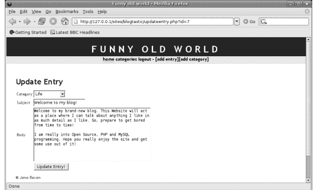

**图 4-11** 更新博客条目使用与添加新条目类似的界面。

## 摘要

在这个项目中，你创建了第一个功能齐全的数据库驱动 Web 应用程序。这个应用程序锻炼了你的编程能力，并涵盖了大量关键技术。这包括使用数据库查询、向数据库添加数据、连接表、更新记录、执行验证、管理归档数据、将代码分散到不同页面中，以及确保界面的可用性。

除了提供一个有趣的项目可供实践外，这个项目还为书中其余项目奠定了基础。你学到了一些将在继续阅读本书过程中得到精炼和构建的技能。这是一段激动人心旅程的开始，阅读到这里意味着你已完成了一个重大且重要的步骤。伸展你的手指，清理你的键盘，喝一杯热饮，为下一个项目做好准备。

# 第 5 章

## 讨论论坛

讨论论坛已成为互联网的基本组成部分。在这些基于 Web 的留言板中，用户讨论由紧密的社区成员深入思考的话题。并且在这些讨论论坛中，互联网用户可以成为更广泛社区的一部分。讨论论坛为编码提供了具有吸引力和趣味性的挑战。创建类别、论坛和主题；回复消息；注册用户；以及更多功能是常见的需求。

在创建博客之后，编写讨论板背后的代码是你技能的自然进阶，因为它引入了双向通信的概念，而博客提供的视角相对是单向的。因此，本章提供了你编程体验中重要的一步——每个人都应该至少编写一次讨论论坛！

### 内部结构

几乎所有讨论论坛都有非常相似的设计，涉及三个主要实体：类别、论坛和主题。为了说明这种结构，请查看图 5-1。

此图展示了一个典型的 phpBB (`http://www.phpbb.com/`) 安装。phpBB 是一个流行的开源论坛引擎，遵循这些常见的可用性方法。在图中，你可以看到类别列表（只有一个——LUGRadio），并且该类别包含几个论坛（General Discussion、Ideas for the show、Mirrors 和 LUGRadio Live）。当你点击一个论坛时，会显示论坛主题，如图 5-2 所示。

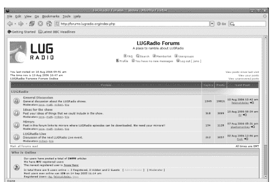

**图 5-1** phpBB 论坛的首页

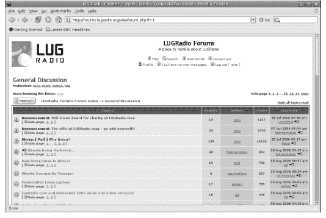

**图 5-2** 通用讨论论坛中的主题列表

此图显示了论坛中的线程（threads）列表。线程是一个以特定主题开始的讨论。线程的发起人会发布一条消息，而线程的主题列显示在此屏幕上。要查看线程中的消息，请单击该线程。当你单击一个线程时，将显示类似于图 5-3 所示的页面。

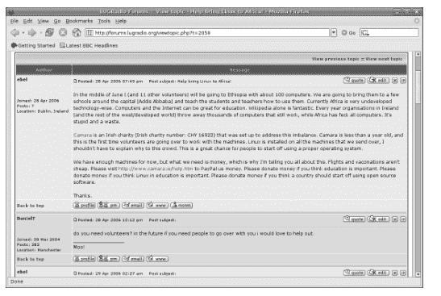

**图 5-3** 一个讨论线程

论坛软件具有一组独特的组成部分，这些组合在一起构建了一个让讨论变得容易的系统。挑战在于实现你自己的论坛软件。图 5-4 展示了这些不同部分之间的关系。

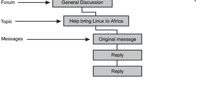

**图 5-4** 讨论论坛具有多个独特的层级。

## 构建你自己的论坛

在这个项目中，你将专注于讨论论坛软件应具备的基本功能，包括：

- 显示类别、论坛和主题。
- 以管理员身份登录。
- 允许管理员添加类别和论坛。
- 允许管理员删除类别、论坛和主题。
- 以用户身份登录。
- 允许用户注册。当用户填写注册表单时，会发送一封验证电子邮件。
- 允许用户查看类别和论坛，然后单击论坛查看主题。用户还可以单击主题以查看线程。
- 允许用户发布新线程或回复现有线程。

虽然可以为这个项目添加数百种额外功能，但添加这些功能本身就需要写一整本书。在这个项目中，你将构建一个核心的论坛引擎，但当然，你可以之后再构建额外的功能。

## 开始之前

这个项目使用了一些额外的 CSS 代码块。将 `stylesheet.css` 复制到该项目的新的项目目录，并在 `stylesheet.css` 的末尾添加以下行：

```css
table {
  border: thin solid #cccccc;
  background: #ffffff;
}
th {
  letter-spacing: 2.5px;
  background: #eeeeee;
  color: #000000;
  text-transform: uppercase;
  text-align: center;
  border-top: thick solid #eeeeee;
  border-bottom: thin solid #cccccc;
}
tr.head {
  letter-spacing: 1.5px;
  background: #dddddd;
  color: #000000;
  text-transform: uppercase;
  border-top: thick solid #eeeeee;
  border-bottom: thin solid #cccccc;
}
tr.body {
    background: #ffffff;
    color: #000000;
}
td {
    border: thin solid #cccccc;
    padding: 10px;
}
```

## 创建数据库

在这个项目中，各种表以不同的方式相互关联，以存储前面讨论过的不同类型的特定内容。图 5-5 展示了你将创建的数据库基础架构。

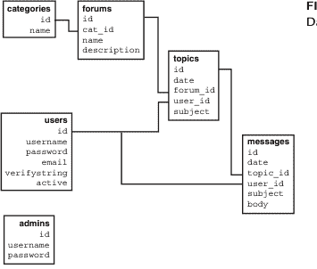

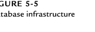


该项目包含六个重要的表：

| 表名 | 表存储的内容 |
| :--- | :--- |
| *categories* | 三个不同的类别。 |
| *forums* | 属于类别的不同论坛。 |
| *topics* | 主题的详细信息。 |
| *messages* | 讨论线程的消息。 |
| *admins* | 站点管理员的登录详细信息。 |
| *users* | 可以发布论坛帖子的用户的详细信息。 |

`categories`、`forums`、`topics` 和 `messages` 表之间存在一个重要的关系——每个表都存储与其相关的表的相同 `id`。例如，`categories` 和 `forums` 表通过在 `forums` 表的 `cat_id` 字段中存储相关类别的 `id` 来建立关联。

### 使用 InnoDB 强制执行关系

当你使用 MySQL 创建数据库时，MyISAM 表类型存储数据。这种*非事务性*表引擎不会强制表之间的关系。想象一下，你有一个名为 `orders` 的表，其中有一个 `customer_id` 字段，存储的值与 `customers` 表中的 `id` 相同。如果你从 `customers` 表中删除一条记录，那么删除或更新 `orders` 表中的相应条目是有道理的；否则，关系将会断开，订单将引用一个不再存在的客户。

使用默认的 MyISAM 表类型，数据库并不要求解决这些潜在的不准确，你可以*取消*客户并使订单引用一个不存在的客户。对于 MyISAM 来说，假设是在你的代码中强制这些关系。

然而，在这个项目中，你将使用一种不同类型的表：InnoDB。这种*事务安全*表可以强制这些关系。这不仅给你一种你的关系正常工作的安心感，而且你还可以执行级联删除，即删除一个表时，所有相关的表也都会被删除。感受这种力量，朋友们。

虽然它是 MySQL 的一个功能，但 InnoDB 通常默认是关闭的（请查阅你的发行版以确认它确实是否关闭）。要启用它，加载 `my.cnf` 文件（通常在 Linux 机器上的 `etc` 目录中，或在 Windows 机器上的 MySQL 目录内找到），查找 `skip-innodb`。通过添加 `#` 符号注释掉此选项：

```sql
#skip-innodb
```

取消注释其他 `innodb` 行，使代码看起来类似于以下内容：

```ini
innodb_data_home_dir = /opt/lampp/var/mysql/
innodb_data_file_path = ibdata1:10M:autoextend
innodb_log_group_home_dir = /opt/lampp/var/mysql/
innodb_log_arch_dir = /opt/lampp/var/mysql/
```

开启 InnoDB 支持后，重启 MySQL 以使更改生效。

### 警告！

当使用 InnoDB 等事务安全表时，要极其小心地处理级联删除。如果你错误地强制了某种关系，可能会丢失数据。这种情况通常相当罕见，因为你需要故意强制该关系，但现在你已受到正式警告。

## 构建数据库

启动 phpMyAdmin 并创建一个名为 `forum` 的新数据库。然后添加以下每个表，包括它们的字段：

### `admins` 表

- id. 将其设置为 `TINYINT`，设为主键，并启用 `auto_increment`。
- username. 将其设置为长度 10 的 `VARCHAR`（用户名的常见长度）。
- password. 将其设置为长度 10 的 `VARCHAR`。

### `categories` 表

- id. 将其设置为 `TINYINT`，设为主键，并启用 `auto_increment`。
- name. 将其设置为长度 50 的 `VARCHAR`。
- 将表类型设置为 InnoDB。

#### 备注

#### 设置表类型

大多数表需要将其表类型设置为 InnoDB。在你配置*字段*的表设计界面中，底部有一个控件允许你选择表类型。

### `forums` 表

- id. 将其设置为 `TINYINT`，设为主键，并启用 `auto_increment`。
- cat_id. 将其设置为 `TINYINT`。
- name. 将其设置为长度 30 的 `VARCHAR`。
- description. 将其设置为长度 255 的 `VARCHAR`。
- 将表类型设置为 InnoDB。

### `messages` 表

- id. 将其设置为 `TINYINT`，设为主键，并启用 `auto_increment`。
- date. 将其设置为 `DATETIME`。
- user_id. 将其设置为 `INT`。
- topic_id. 将其设置为 `INT`。
- subject. 将其设置为长度 100 的 `VARCHAR`。
- body. 将其设置为 `TEXT`。
- 将表类型设置为 InnoDB。

### `topics` 表

- id. 将其设置为 `TINYINT`，设为主键，并启用 `auto_increment`。
- date. 将其设置为 `DATETIME`。
- user_id. 将其设置为 `INT`。
- forum_id. 将其设置为 `TINYINT`。
- subject. 将其设置为长度 100 的 `VARCHAR`。
- 将表类型设置为 InnoDB。

### `users` 表

- id. 将其设置为 `TINYINT`，设为主键，并启用 `auto_increment`。
- username. 将其设置为长度 10 的 `VARCHAR`。
- password. 将其设置为长度 10 的 `VARCHAR`。
- email. 将其设置为长度 100 的 `VARCHAR`。
- verifystring. 将其设置为长度 20 的 `VARCHAR`。
- active. 将其设置为 `TINYINT`。
- 将表类型设置为 InnoDB。

创建表时，务必在需要时设置正确的表类型。除了 admin 表以外的所有表都需要是 InnoDB 类型。如果没有正确设置，后来编写的一些功能将无法正常工作。

## 创建表格后更改表格类型

如果您想更改现有表格的类型，请在 phpMyAdmin 中点击“Operations”（操作）标签页，然后使用该页面上的框选择不同的表格类型。

此时，表之间的参照完整性尚未设置，也没有强制实施任何参照完整性。在项目后期，您将添加一些 SQL 来强制执行它。

## 向数据库添加示例数据

手动向数据库添加数据时，您需要小心确保所有数据都能正确关联；否则，论坛将会崩溃。为了开始，先添加一个用户，然后添加几个类别、论坛和主题。

### 不要填写 id 字段

当您向这些表中的任何一个添加数据时，请记住将 id 字段留空；`auto_increment` 会为您处理这部分工作。

### `users`（用户）表

向 `users` 表添加表 5-1 中显示的详细信息。

**表 5-1 示例用户**

| 字段 | 值 |
| :-- | :-- |
| Username | Johnsmith |
| Password | Password |
| Email | john@foo.com |
| Verifystring | <留空> |
| Active | 1 |

### categories（类别）表

如果您参考图 5-4，`categories` 表位于相关表树的顶部。您需要首先向此表添加数据，然后依次向下处理其他表。向表中添加表 5-2 中的两条记录。

**表 5-2 示例类别**

| **字段** | **值** |
|---|---|
| Name | Movies |
| Name | Documentaries |

### forums（论坛）表

在定义了一些类别后，添加 `forums` 时请使用这些类别的 id。根据表 5-3 中的信息，在 Movies 类别（其 id 为 1）中创建两个论坛；不要向 Documentaries 类别添加任何论坛。

**表 5-3 示例论坛**

| **字段** | **值** |
|---|---|
| Cat_id | 1 |
| name | Comedy |
| description | Films that make you laugh |
| Cat_id | 1 |
| name | Horror |
| description | Movies to hide behind the couch |

请注意，在此处，您通过将 Comedy 类别的 id 放入此表中的 `cat_id` 字段来引用该类别。

### topics（主题）表

`topics` 表和 `messages` 表作为主题在内在上是相关联的，如果没有至少一条消息，它们就无法存在。`topics` 表仅包含要讨论的主题；您需要在 `messages` 表中创建至少一条消息。将表 5-4 中的两个主题添加到 `Comedy` 类别中。

**表 5-4 示例主题**


| **字段** | **值** |

| --- | --- |

| Date | 从 Functions 框中选择 NOW |

| User_id | 1 |

| Forum_id | 1 |

| Subject | Classic comedy |

| Date | 从 Functions 框中选择 NOW |

| User_id | 1 |

| Forum_id | 1 |

| Subject | Fave comedy actor/actress |

# messages（消息）表

在主题创建完成后，为它们创建表 5-5 中所需的消息。

**表 5-5 示例消息**

| **字段** | **值** |

| --- | --- |

| Date | 从 Function 框中选择 NOW |

| User_id | 1 |

| Topic_id | 1 |

| subject | Classic comedy |

| Body | Which black and white comedies do you like? |

| Date | 从 Function 框中选择 NOW |

| User_id | 1 |

| topic_id | 2 |

| Subject | Fave comedy actor/actress |

| Body | Who is your fave funny man/women? |

## 创建站点设计

编写代码的第一步是创建设计。创建一个名为 `config.php` 的新文件，并添加示例 5-1 中显示的代码。

> 示例 5-1 配置文件存储有关站点的设置。

```php
<?php

$dbhost = "localhost";
$dbuser = "root";
$dbpassword = "";
$database = "forum";

// Add the name of the forums below
$config_forumsname = "CineForums";

// Add your name below
$config_admin = "Jono Bacon";
$config_adminemail = "jono AT jonobacon DOT org";

// Add the location of your forums below
$config_basedir = "http://127.0.0.1/sites/forums/";
?>
```

在此文件中，您指定了用于连接数据库的变量以及用于配置站点名称和作者的变量。此外，`$config_basedir` 包含论坛的 URL；这主要用于执行重定向时。

现在，构建 header 文件。创建一个名为 `header.php` 的新文件，并添加以下代码：

```php
<?php

session_start();

require("config.php");

$db = mysql_connect($dbhost, $dbuser, $dbpassword);
mysql_select_db($database, $db);

?>
```

您首先使用 `session_start()` 添加会话支持，然后包含配置文件。在此之后，您创建到数据库的连接。

包含 header 的主要 HTML：

```html
?>

<!DOCTYPE HTML PUBLIC "-//W3C//DTD HTML 4.01 Transitional//EN" "http://www.w3.org/TR/html4/loose.dtd">
<html>
<head>
	<title><?php echo $config_forumname; ?></title>
	<link rel="stylesheet" href="stylesheet.css" type="text/css" />
</head>
<body>
<div id="header">
<h1><?php echo $config_forumname; ?></h1>
[<a href="index.php">Home</a>]
```

来自 `config.php` 的变量用于设置页面的标题和名称。

检查 USERNAME 会话变量并显示相关的登录/注销链接：

```php
<h1><?php echo $config_forumname; ?></h1>
[<a href="index.php">Home</a>]

<?php
if(isset($_SESSION['USERNAME']) == TRUE) {
    echo "[<a href='logout.php'>Logout</a>]";
} else {
    echo "[<a href='login.php'>Login</a>]";
    echo " [<a href='register.php'>Register</a>]";
}
?>
```

添加最后一个选项，以便用户可以发布新主题：

```php
}
?>
[<a href="newtopic.php">New Topic</a>]
</div>
<div id="main">
```

当 header 文件完成后，创建一个名为 `footer.php` 的新文件，并添加示例 5-2 中显示的 footer 代码。

**示例 5-2 Footer 代码显示在页面的底部。**

```html
</div>
<div id="footer">
&copy; 2005 <?php echo "<a href='mailto:"
. $config_adminemail . "'>" . $config_admin . "</a>"; ?>

</div>
</body>
</html>
```

在 footer 中添加了一个链接，包含 `config.php` 中的电子邮件地址和作者姓名。

# 显示论坛

随着基础设施的完成，您可以开始构建主论坛代码，以便在不同的页面上显示类别、论坛和主题。如果您回想一下对 phpBB 的学习，您会发现类别和论坛显示在一个页面上，而主题显示在另一个页面上，该页面在您点击论坛时显示。

## 创建首页

该网站的首页显示可用的论坛范围。创建一个名为 `index.php` 的文件，并首先包含 `header.php`：

```php
<?php
    require("header.php");
```

运行一个查询以获取所有类别：

```php
require("header.php");

$catsql = "SELECT * FROM categories;";
$catresult = mysql_query($catsql);

echo "<table cellspacing=0>";

while($catrow = mysql_fetch_assoc($catresult)) {
    echo "<tr class='head'><td colspan=2>";
    echo "<strong>" . $catrow['name'] . "</strong></td>";
    echo "<tr>";
```

在每个类别显示后，检查当前类别是否有任何论坛：

```php
echo "<tr>";

$sql1 = "SELECT * FROM
forums WHERE cat_id = " . $catrow["id"] . ";
$result1 = mysql_query($sql1);
$rownum = mysql_num_rows($result1);
if($rownum == 0) {
    echo "<tr><td>No Forums</td></tr>";
} else {
```

在执行了用于检查每个类别中的论坛的查询后，行数被计数并放入 `$rownum`。下一行检查此变量是否包含 0（没有行），如果是，则向表中添加 No forums!。如果有行，第二个 while 循环遍历论坛列表以将每个论坛添加到表中：

```php
echo "<td>";
while($row = mysql_fetch_assoc($result)) {
    echo "<tr>";
    echo "<td>";

echo "<strong><a
href="viewforum.php?id="
. $row["id"] . "</a> .
" . $row["name"] . "</strong>";
echo "<br><i>" . $row["description"] . "</i>";
echo "</td>";
echo "</tr>";
}
```

创建了指向 `viewforum.php` 的链接，并将论坛的 id 作为 GET 变量添加。在链接下方，显示描述。

最后，结束第一个 while 循环，关闭表格，并包含 footer 文件：

```php
}
}

echo "</table>";

require("footer.php");
?>
```

首页现在已经完成了。该页面提供了一种简单且熟悉的方式来展示版块和论坛（见图 5-6）。


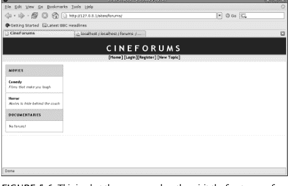

**图 5-6** 这是用户访问论坛首页时所看到的内容。

接下来，你创建 `viewforum.php` 页面以显示所选版块中的主题。

## 查看版块主题

这个页面有一个简单的目的——列出属于该版块的所有主题，以及主题回复的数量、作者姓名和主题发布日期。

当此页面加载时，一个名为 `id` 的 GET 变量已被传递给它。对于任何 GET 变量，对其进行验证都是一个明智的做法。创建一个名为 `viewforum.php` 的新文件，并添加以下代码：

```php
<?php
include("config.php");

if(isset($_GET['id']) == TRUE) {
    if(!is_numeric($_GET['id']) == FALSE) {
        header("Location: " . $config_basedir);
    }
    $validforum = $_GET['id'];
} else {
    header ("Location: " . $config_basedir);
}
```

这段代码之前已用于执行相同类型的验证检查。

加载 `header.php` 文件：

```php
require("header.php");
```

在显示主题之前，先显示页面的一些通用信息，以便用户知道他们处于网站的哪个位置。这些信息包括当前版块名称和面包屑导航路径。

要添加这些信息，执行一个查询以获取具有 `$validforum` 标识符的版块名称，然后在一个二级标题中显示该版块名称：

```php
require("header.php");
$forumsql = "SELECT * FROM forums WHERE id = " . $validforum . ";";
$forumresult = mysql_query($forumsql);
$forumrow = mysql_fetch_assoc($forumresult);
echo "<h2>". $forumrow['name'] ."</h2>";
```

下一步是创建面包屑导航路径。面包屑导航路径提供了一系列链接，显示到达当前网站页面所经历的步骤。这个概念对于拥有许多部分的网站特别有用。

## **注意**

### **面包屑导航：有用还是无用？**

在 Web 开发社区中，对于面包屑导航是否真的有用存在不同的观点。对于一些开发者来说，面包屑导航被认为是一个难以导航的网站的借口。然而，其他开发者则认为这种路径是导航的有用辅助工具。

当你设计 Web 应用程序时，考虑一下导航，以及面包屑导航是否可以帮助你的用户。

在此页面上，面包屑导航很简单。提供一个链接以返回通用论坛页面：

```php
echo "<h2>" . $forumrow['name'] . "</h2>";

echo "<a href='index.php'>" . $config_forumsname . " forums</a><br /> <br />";
```

添加一个允许用户向此版块添加新主题的链接：

```php
echo "<a href='index.php'>" . $config_forumsname . " forums</a><br /> <br />";

echo "[<a href='newtopic.php?id=" . $validforum . ">New Topic</a>]";
echo "<br /> <br />";
```

现在你需要显示此版块内的主题。虽然这可能听起来像只是显示所有 `forum_id` 为 `$validforum` 的主题那么简单，但查询实际上更复杂。

在此页面上，你需要显示一系列信息，其中大部分来自不同的表：

- 主题名称位于 `topics` 表中。
- 作者姓名位于由 `topics` 表中的 `user_id` 链接到的 `users` 表中。
- 发布日期位于 `topics` 表中。

使生活更复杂的是，你还需要将最新发布的主题显示在列表的顶部。组织这些主题相当困难——实际的帖子存储在 `messages` 表中，然后通过 `topic_c_id` 关联到 `topics` 表。因此，你需要按最新主题排序显示的条目，即 `messages` 表中日期最新的消息。

为了解决这个排序问题，你将使用 MySQL 中的一个特殊函数 `MAX()`。该函数从 `messages` 表中选择最新的日期。此外，还选择了来自 `topics` 和 `users` 表的信息。然后，`messages` 和 `topics` 表在 WHERE 子句中链接起来。

现在，坐下来，屏住呼吸，执行这个史诗级的查询：

```php
echo "<br /> <br />";

$topicsql = "SELECT MAX(messages.date ) AS maxdate,
 topics.id AS topicid, topics.*, users.*
 FROM messages, topics, users WHERE messages.topic_id
 = topics.id AND topics.user_id = users.id AND
 topics.forum_id = " . $validforum . " GROUP BY
 messages.topic_id ORDER BY maxdate DESC;";
$topicresult = mysql_query($topicsql);
$topicnrows = mysql_num_rows($topicresult);
```

如果 `$topicnrows` 包含 0，则没有主题：

```php
$topicnrows = mysql_num_rows($topicresult);
if ($topicnrows == 0) {
    echo "<table width=300px><tr><td>No topics!</td></tr></table>";
}
```

这里有点取巧。正如你所见，你正在创建一个表格来添加一条记录。但你希望**没有主题**文本在表格中显示得井井有条。这是一点取巧，因为你没有将代码放在页面下方的其他表格中。这是为了清晰度。重要的是确保你理解代码，而不是陷入表格混乱之中。

如果存在主题，你将以表格形式呈现它们。创建表格和表头：

```php
if ($topicnrows == 0) {
    echo "<table width=300px><tr><td>No topics!</td></tr></table>";
}
else {
    echo "<table class='forum'>";
    echo "<tr>";
    echo "<th>Topic</th>";
    echo "<th>Replies</th>";
    echo "<th>Author</th>";
    echo "<th>Date Posted</th>";
    echo "</tr>";
```

在显示行之前，运行另一个查询来统计当前行中主题的消息数量：

```php
echo "</tr>";

while ($topicrow = mysql_fetch_assoc($topicresult)) {
    $msgsql = "SELECT id FROM messages WHERE
    topic_id = " . $topicrow['topicid'] . ";";
    $msgresult = mysql_query($msgsql);
    $msgnumrows = mysql_num_rows($msgresult);
```

显示这些行：

```php
echo "<tr>";
echo "<td>";
echo "<strong><a href="viewmessages.php?id=" . $topicrow['topicid'] . ">";
echo $topicrow['subject'] . "</a></strong></td>";
echo "<td>" . $msgnumrows ."</td>";
echo "<td>" . $topicrow['username'] ."</td>";
echo "<td>" . date("D jS F Y g.iA", strtotime($topicrow['date'])) ."</td>";
echo "</tr>";
}
```

这段代码添加了主题标题，并将其链接到 `viewmessages.php`，其中主题的 `id` 作为 GET 变量传递。还添加了线程中的消息数量、创建该主题的人的用户名以及主题日期。

最后，关闭表格并添加页脚：

```php
echo "</tr>";
}
echo "</table>";
}
require("footer.php");
?>
```

随着这段代码的运行，你可以看到图 5-7 中完成的论坛视图。项目真正开始成形了。


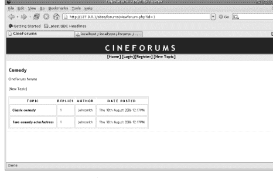

**图 5-7** 查看版块

### 查看线程

下一页面显示与主题相关的讨论线程，这可能并不令人惊讶。当你创建 `viewforum.php` 时，你添加了一个链接到主题标题，指向名为 `viewmessages.php` 的页面，你现在将创建该页面。

创建一个名为 `viewmessages.php` 的新文件，并对 GET 变量进行一些验证：

```php
<?php
include("config.php");

if(isset($_GET['id']) == TRUE) {
    if(!is_numeric($_GET['id']) == FALSE) {
        $error = 1;
    }
}

if($error == 1) {
    header("Location: " . $config_basedir);
} else {
    $validtopic = $_GET['id'];
} else {
    header("Location: " . $config_basedir);
}
```

`require("header.php");`

通过在页面顶部首先选择当前主题标题、版块名称和主题标识符，添加主题名称和面包屑导航路径：

```php
require("header.php");

$topicsql = "SELECT topics.subject,
    topics.forum_id, forums.name FROM topics,
    forums WHERE topics.forum_id = forums.id
    AND topics.id = " . $validtopic . ";";
$topicresult = mysql_query($topicsql);

$topicrow = mysql_fetch_assoc($topicresult);
```

## 添加主题标题

添加主题的标题：

```php
$topicrow = mysql_fetch_assoc($topicresult);
echo "<h2>" . $topicrow['subject'] . "</h2>";
```

要创建面包屑导航，请添加一个指向主论坛的链接。然后使用查询中的论坛名称，并链接到 `viewforum.php` 页面：

```php
echo "<h2>" . $topicrow['subject'] . "</h2>";

echo "<a href='index.php'>" . $config_forumname . " forums</a> -> <a href='viewforum.php?id=" . $topicrow['forum_id'] . ">" . $topicrow['name'] . "</a><br /> <br />";
```

要显示作为线程一部分的消息，请创建查询：

```php
echo "<a href='index.php'>" . $config_forumname . " forums</a> -> <a href='viewforum.php?id=" . $topicrow['forum_id'] . ">" . $topicrow['name'] . "</a><br /> <br />";

$threadsql = "SELECT messages.*, users.username FROM messages, users WHERE messages.user_id = users.id AND messages.topic_id = $validtopic ORDER BY messages.date";
$threadresult = mysql_query($threadsql);
```

在此代码中，你从 `messages` 表中选择所有字段，并从 `users` 表中选择 `username`，然后将 `users.id` 和 `messages.user_id` 连接起来，其中 `topic_id` 等于 `$validtopic`。

通过循环遍历结果来呈现消息：

```php
$threadresult = mysql_query($threadsql);

echo "<table>";

while($threadrow = mysql_fetch_assoc($threadresult)) {
    echo "<tr><td><strong>Posted by:</strong> on " . $threadrow['username'] . " <i>" . date('D JS F Y g.iA', strtotime($threadrow['date'])) . "</i> " . $threadrow['subject'] . "</td></tr>";
    echo "<tr><td>" . $threadrow['body'] . "</td></tr>";
}

echo "<tr><td><a href='reply.php?id=$validtopic'>reply</a></td></tr>";
echo "</table>";
```

最后，添加 `footer.php`：

```php
echo "</table>";

require("footer.php");
?>
```

当你运行此脚本并查看一个线程时，输出效果应如图 5-8 所示。

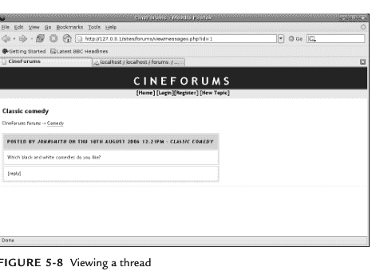

## 管理用户登录

在论坛的环境中，身份识别非常重要。用户希望发布来自他们本人的消息，而不是来自面目模糊的匿名用户的消息。除了普通用户外，你还需要支持管理员登录。管理员可以执行诸如添加类别/论坛以及删除线程、论坛和类别等任务。幸运的是，PHP 提供了全面的支持，使添加所有这些需求变得简单。

我们将首先构建一个用户注册系统，允许新用户自动化申请会员资格的过程。我们还将构建所需的功能，以向用户发送验证链接，他们可以点击该链接来确认其账户。

### 用户注册

在支持用户和管理员登录之前，你必须首先在网站上创建支持人们注册用户名。该页面应自动验证用户。

当用户注册时，流程如下：

- 用户前往注册页面，填写用户名，两次输入密码，并输入电子邮件地址。
- 用户收到一封验证邮件。
- 用户检查其电子邮件账户，并点击邮件中的链接以验证注册。
- 账户被激活。

在代码中实现此过程很直接：

- 用户前往注册页面并填写详细信息。
- 当表单提交时，进行一项检查以查看密码是否匹配。如果不匹配，请用户修正表单。
- 如果密码匹配，则检查数据库中的用户名，看看该名称是否已被占用。如果已被占用，请用户选择另一个用户名。
- 如果用户名未被占用，则生成一个随机字符串，并将用户名、密码、电子邮件地址和随机字符串添加到数据库中。注意，数据库中的“active”字段保持为 0，因为账户当前处于非活动状态。
- 构建一封电子邮件，其中包含一个带有 GET 变量的 URL，这些变量包含电子邮件地址和随机字符串。然后，这封邮件将被发送到用户提供的地址。
- 当用户点击邮件中的链接时，链接中的页面会检查数据库，查看是否存在具有所提供的电子邮件地址和随机字符串的记录。如果存在，则将 active 字段设置为 1，并激活账户。

为了开始，创建一个名为 `register.php` 的新文件并添加表单：

```php
<h2>Register</h2>
To register on the <?php echo $conf_forumname; ?> forums, fill in the form below.
<form action="<?php echo $SCRIPT_NAME; ?>" method="POST">
<table>
<tr>
<td>Username</td>
<td><input type="text" name="username"></td>
</tr>
<tr>
<td>Password</td>
<td><input type="password" name="password1"></td>
</tr>
<tr>
<td>Password (again)</td>
<td><input type="password" name="password2"></td>
</tr>
<tr>
<td>Email</td>
<td><input type="text" name="email"></td>
</tr>
<tr>
<td></td>
<td><input type="submit" name="submit" value="Register!"/></td>
</tr>
</table>
</form>
```

转到文件顶部并添加处理表单的代码：


```php
<?php
session_start();

require("config.php");

$db = mysql_connect($dbhost, $dbuser, $dbpassword);
mysql_select_db($dbname, $db);
```

在这段介绍性代码之后，检查是否点击了 Submit 按钮：

```php
if($_POST['submit']) {
    if($_POST['password1'] == $_POST['password2']) {
        $checksql = "SELECT * FROM users WHERE username = '" . $_POST['username'] . "'";
        $checkresult = mysql_query($checksql);
        $checknumrows = mysql_num_rows($checkresult);
```

这段代码检查 `password1` 框和 `password2` 框是否具有相同的密码。如果密码匹配，则进行查询以查看 `users` 表中的 `username` 字段是否匹配表单中的 `username` 框。在查询执行后，行数被放入一个名为 `$checknumrows` 的变量中。

### 快速任务：记得检查那些变量！

在上面的代码片段中，你直接访问了 `$_POST['username']` 变量。为了提高安全性，你应该通过已讨论的验证检查来处理该变量。修改此代码以验证该变量。

通过检查行数来查看是否有匹配项：

```php
$checknumrows = mysql_num_rows($checkresult);

if ($checknumrows == 1) {
    header("Location: " . $config_basedir . "register.php?error=taken");
} else {
```

如果用户名有匹配项——用户名已存在——则进行头部重定向到同一文件，并添加 `error=taken` 作为 GET 变量。稍后检查此变量以在表单上显示错误消息。如果没有匹配项，注册将继续：

```php
else {
    for ($i = 0; $i < 16; $i++) {
        $randomstring .= chr(mt_rand(32, 126));
    }
```

这段代码生成一个随机字符串。`for` 循环循环 16 次，每次生成一个随机字符并添加到字符串中，最终创建一个 16 个字符的字符串。`mt_rand()` 函数生成 32 到 126 之间的随机数，然后 `chr()` 函数将其转换为字母。`.=` 运算符将新字符追加到 `$randomstring` 中已有的任何内容后面。

创建用于发送验证邮件的变量：

```php
for ($i = 0; $i < 16; $i++) {
    $randomstring .= chr(mt_rand(32, 126));
}

$verifyurl = "http://127.0.0.1/sites/forums/verify.php";
$verifystring = urlencode($randomstring);
$verifyemail = urlencode($_POST['email']);
$validusername = $_POST['username'];
```

这些变量存储不同类型的信息，这些信息被添加到验证 URL 中。第一个变量（`$verifyurl`）包含验证页面的位置，你需要将其更改为与你设置相关的某些内容。第二个变量（`$verifystring`）使用 `urlencode()` 将 `$randomstring` 转换为可以添加到地址栏作为 GET 变量的形式。第三个变量对电子邮件地址使用 `urlencode()`，最后一个变量存储用户名。

> **注意**
>
> **使用 urlencode()**
>
> `urlencode()` 函数确保字符串可以作为 URL 上的 GET 变量使用。除了 `urlencode()`，还有 `urldecode()` 函数，它将编码的字符串转换回其原始形式。

创建一个 SQL 查询，将用户名、密码、电子邮件地址和 verifystring 插入数据库，同时将 active 字段设置为 0（非活动）：

```php
$validusername = $_POST['username'];

$sql = "INSERT INTO users(username, password, email, verifystring, active) VALUES(" . $_POST['username'] . ", '" . $_POST['password1'] . "', '" . $_POST['email'] . "', addslashes($randomstring), 0)";
mysql_query($sql);
```

构建要发送给用户以进行验证的电子邮件：

```php
mysql_query($sql);

$mail_body=<<< MAIL_
Hi $validusername,
```

请单击以下链接以验证您的新账户：

```bash
$verify/?email=$verifyemail&verify=$verifystring

_MAIL_;
```

您通过使用 *heredoc* 语法来构建邮件消息。这种特殊技术允许您使用 `<<` 和一个标识符（在本例中为 `_MAIL_`）来写入一大段文本，而无需使用双引号、单引号和换行符。当再次添加该标识符（`_MAIL_`）时，代码块结束。在前面的代码片段中，该标识符放置在变量声明（`$mail_body`）旁边，以便将 heredoc 文本添加到变量中。这是一种向变量添加大段文本的有用方法。


## 不要缩进 heredoc

当您使用 heredoc 语法时，请确保将三个尖括号放在标识符之前（例如 `<<IDENTIFIER`），并将两个标识符都放在行首（除非前面有变量，如本例代码所示）。

发送电子邮件：

```php
_MAIL_;

mail($POST['email'], $config_forumsname . " User verification", $mail_body);
```

`mail()` 命令用于发送消息。`mail()` 有三个参数：

- 电子邮件地址
- 主题
- 消息正文

在此代码中，来自表单的电子邮件地址（`$POST_['email']`）用作第一个参数，表单名称和 *User Verification* 被拼接在一起作为主题，最后将来自 heredoc 语法的文本作为第三个参数添加。

最后，显示一条消息，表明电子邮件已发送：

```php
mail($POST['email'],
$config_forumsname . " User verification", $mail_body);
```

```php
require("header.php");
echo "A link has been emailed to the address you entered below. Please follow the link in the email to validate your account.";
```

## 注意

## 从 PHP 发送电子邮件

在使用 `mail()` 命令发送电子邮件时，您需要一台在机器上运行且可用的邮件服务器。如果您使用的是 Linux，Postfix (`http://www.postfix.org/`) 是一个很好的邮件服务器，安装和运行都比较容易。

如果您使用的是 Windows，可以指定一个单独的 SMTP 服务器来发送邮件。为此，请打开 `php.ini` 并查找 `SMTP` 选项：

```ini
SMTP = your.mail.server
```

虽然 `mail()` 对于发送简单电子邮件很有用，但对于发送附件等更复杂的任务，使用 PEAR Mail 扩展会更好。

在代码的较早部分，一个 `if` 语句检查表单中的密码是否匹配。现在，添加处理密码不匹配情况的代码：

```php
echo "A link has been emailed to the address you entered below. Please follow the link in the email to validate your account.";
}
else {
    header("Location: " . $config_basedir .
    "register.php?error=pass");
}
```

`Header` 重定向会加载页面并添加 `error` GET 变量。（此变量将在后文中讨论。）在代码的较早部分，您检查了是否点击了提交按钮。如果是，则执行刚刚编写的代码。


添加 `else`，以便在未检测到 `submit` `POST` 变量时显示表单：

```php
else {
    header("Location: " . $config_basedir .
    "register.php?error=pass");
}
```

在显示 HTML 表单之前，包含头文件，然后处理当页面重定向时添加的 `error` `GET` 变量：

```php
<?php
    require("header.php");
    switch($_GET["error"]) {
        case "pass":
            echo "Passwords do not match!";
            break;

        case "taken":
            echo "Username taken, please use another.";
            break;

        case "no":
            echo "Incorrect login details!";
            break;
    }
?>
<h2>Register</h2>

To register on the `<?php echo $config_forumname; ?>` forums, fill in the form below.
<form action="<?php echo $SCRIPT_NAME ?>" method="POST">
```

该变量通过 `switch` 语句执行，以决定显示哪个错误消息；这取决于变量的值。

> **注意**
>
> **一个小任务**
>
> 我们故意没有在此处包含任何用于验证注册表单输入的代码。添加一些验证检查以使脚本坚如磐石。现在是练习在代码中添加验证的好时机。

在表单下方，关闭 `else` 块并添加页脚：

```html
</table>
</form>
```

```php
<?php
}
require("footer.php");
?>
```

图 5-9 显示了已完成的注册表单。现在我们需要编写验证注册的代码。

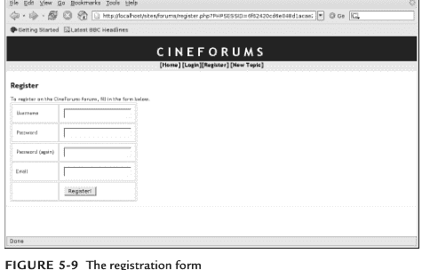

图 5-9 注册表单

## 验证账户

随着验证邮件的发送，您可以创建邮件中链接指向的页面。该页面只是解码 `GET` 变量（`urlencoded` 的 `email` 和 `verifyingstring` 变量），然后检查数据库中是否有匹配的行。如果存在该行，则通过将在 `users` 表中的 `active` 字段设置为 `1` 来激活该账户。

创建一个名为 `verify.php` 的新页面，并添加解码变量的初始代码：

```php
<?php
require("header.php");
$verifystring = urldecode($_GET['verify']);
$verifyemail = urldecode($_GET['email']);
```

创建查询以检查值是否存在于数据库中：

```php
$verifyemail = urldecode($_GET['email']);
$sql = "SELECT id FROM users WHERE verifystring = '$verifystring' AND email = '$verifyemail'";
$result = mysql_query($sql);
$numrows = mysql_num_rows($result);
```

检查是否返回了一行：

```php
$numrows = mysql_num_rows($result);

if($numrows == 1) {
    $row = mysql_fetch_assoc($result);
    
    $sql = "UPDATE users SET active = 1 WHERE id = " . $row['id'];
    $result = mysql_query($sql);
    
    echo "Your account has now been verified.
You can now <a href='login.php'>log in</a>";
}

else {
    echo "This account could not be verified.";
}
```

如果返回了一行，则说明点击的链接与表中的记录之间存在匹配。此时，`UPDATE` 查询将根据 `$row['id']` 将 `active` 字段设置为 `1`。

如果查询未返回一行，则显示错误：

最后，添加页脚：

```php
require("footer.php");
?>
```

### 登录用户

构建登录页面的过程与其他项目类似——用户输入她的详细信息，将详细信息与数据库进行比较，然后设置一些会话。

创建一个名为 `login.php` 的新文件并添加表单：

```html
<form action="<?php echo pf_script_with_get($SCRIPT_NAME); ?>" method="post">
    <table>
    <tr>
        <td>Username:</td>
        <td><input type="text" name="username"></td>
    </tr>
    <tr>
        <td>Password:</td>
        <td><input type="password" name="password"></td>
    </tr>
    <tr>
        <td></td>
        <td><input type="submit" name="submit" value="Login!"></td>
    </tr>
    </table>
</form>
```

没有账户？前往 <a href="register.php">注册</a>！

在上面的代码中，您可能注意到 `<form>` 标签的 `action` 属性中有些奇怪的地方。使用了一个名为 `pf_script_with_get()` 的函数来处理脚本名称（`$SCRIPT_NAME`），以检测哪些 `GET` 变量被添加到当前页面，并将它们附加到表单的 `action` 中。如果您希望在处理表单的代码中访问 `GET` 变量，就需要将 `GET` 变量添加到 `action` 中。如果您知道 `GET` 变量的名称，这样做没问题，但如果变量可能有所不同，您需要检测它们并将它们添加进去。

需要这个函数的原因是重定向的结果。当用户点击需要登录的链接（例如“新主题”链接）时，站点应重定向到登录页面。当用户登录后，她应被重定向回原始链接。如果只有一个 `GET` 变量（如 `redirect=page.php`），这就很简单，但如果您试图向特定表单添加主题，并且正在将 `Add Topic` 页面的 `id` 传递过去，那么就有两个 `GET` 变量——页面和表单的 `id`。与其尝试硬编码此内容，不如自动检测哪些 `GET` 变量存在并将它们自动添加到表单的 `action` 部分，这样更有意义。

`pf_script_with_get()` 函数是一个自定义函数。创建一个名为 `functions.php` 的文件并添加以下代码：

```php
<?php

function pf_script_with_get($script) {
$page = $script;
$page = $page . "?";

foreach($_GET as $key => $val) {
```

```php
$page = $page . $key . "=" . $val . "&";
}
}

return substr($page, 0, strlen($page)-1);
}
?>
```

在此函数中，你传入需要获取 `GET` 变量的页面（即 `$script`）。第一行将 `$page` 设置为存储 `$script` 的内容，第二行在页面末尾添加问号（例如，`page.php?`）。

然后，该函数使用 `foreach()` 函数遍历 `$_GET` 数组以提取 `GET` 变量。在 `foreach` 循环中，将键视为 `$key`，值视为 `$val`，然后将它们以 `key=val&` 的格式拼接在一起。最后，你需要从链接中移除末尾的 `&`。为此，使用 `substr()` 函数，传入 `$page`，通过 `strlen()` 确定长度，然后移除最后一个字符（通过 `-1` 部分实现）。

函数完成后，处理表单：


```php
<?php

session_start();

require("config.php");
require("functions.php");

$db = mysql_connect($dbhost, $dbuser, $dbpassword);
mysql_select_db($database, $db);

if($_POST['submit']) {
    $sql = "SELECT * FROM users WHERE username = '" .
    $_POST['username'] . "' AND password = '" .
    $_POST['password'] . "';";
    $result = mysql_query($sql);
    $numrows = mysql_num_rows($result);

    if($numrows == 1) {
        $row = mysql_fetch_assoc($result);
        if($row['active'] == 1) {
            session_register("USERNAME");
            session_register("USERID");
            $_SESSION['USERNAME'] = $row['username'];
            $_SESSION['USERID'] = $row['id'];

            switch($_GET['ref']) {
                case "newpost":
                    if(isset($_GET['id']) == FALSE) {
                        header("Location: " . $config_basedir .
                        "/newtopic.php");
                    }
                    else {
                        header("Location: " . $config_basedir .
                        "/newtopic.php?id=" . $_GET['id']);
                    }
                    break;

                case "reply":
                    if(isset($_GET['id']) == FALSE) {
                        header("Location: " . $config_basedir .
                        "/newtopic.php");
                    }
                    else {
                        header("Location: " . $config_basedir .
                        "/newtopic.php?id=" . $_GET['id']);
                    }
                    break;

                default:
                    header("Location: " . $config_basedir);
                    break;
            }
        }
        else {
            require("header.php");
            echo "This account is not verified yet. You were emailed a link to verify the account. Please click on the link in the email to continue.";
        }
    }
    else {
        header("Location: " . $config_basedir . "/login.php?error=1");
    }
} else {
    require("header.php");

    if($_GET['error']) {
        echo "Incorrect login, please try again!";
    }
?>
<form action="<?php echo pf_script_with_get($SCRIPT_NAME); ?>" method="post">

Don't have an account? Go and <a href="register.php">Register</a>!

<?php
}
require("footer.php");
?>
```

现在该执行必要的重定向了。请记住，需要用户登录的页面会重定向到登录页面，然后应重定向回原始页面。为了处理这种重定向，重定向到 `login.php` 的页面也会传递 `ref` GET 变量。该变量可能有两个取值：

- `newpost`。用户尝试创建新帖子。这应重定向到 `newtopic.php`。
- `reply`。用户尝试回复帖子。这应重定向到 `reply.php`。

如果发生登录错误，页面将被重定向，并添加 `error=1` 作为 GET 变量。这可以用来显示错误消息。

## 管理员登录

管理员登录页面在根本上与此前的页面相同。创建一个名为 `admin.php` 的新文件，并添加 `示例 5-3` 中所示的代码。

> **示例 5-3** 管理员登录页面与用户登录页面几乎相同。


```php
<?php
session_start();
require("config.php");
require("functions.php");
$db = mysql_connect($dbhost, $dbuser, $dbpassword);
mysql_select_db($database, $db);
if($_POST['submit']) {
    $sql = "SELECT * FROM admins WHERE username = '" . $_POST['username'] . "' AND password = '" . $_POST['password'] . "'";
    $result = mysql_query($sql);
    $numrows = mysql_num_rows($result);
    if($numrows == 1) {
        $row = mysql_fetch_assoc($result);
        session_register("ADMIN");
        $_SESSION['ADMIN'] = $row['username'];
        switch($_GET['ref']) {
            case "add":
                header("Location: " . $config_basedir . "/addforum.php");
                break;
            case "cat":
                header("Location: " . $config_basedir . "/addcat.php");
                break;
            case "del":
                header("Location: " . $config_basedir);
                break;
            default:
                header("Location: " . $config_basedir);
                break;
        }
    }
    else {
        header("Location: " . $config_basedir . "/admin.php?error=1");
    }
}
else {
    require("header.php");
    echo "<h2>Admin login</h2>";
    
    if($_GET['error']) {
        echo "Incorrect login, please try again!";
    }
?>
<form action="<?php echo pf_script_with_get($SCRIPT_NAME); ?>" method="post">
    <table>
        <tr>
            <td>Username</td>
            <td><input type="text" name="username"></td>
        </tr>
        <tr>
            <td>Password</td>
            <td><input type="password" name="password"></td>
        </tr>
        <tr>
            <td></td>
            <td><input type="submit" name="submit" value="Login!"></td>
        </tr>
    </table>
</form>
<?php
}
require("footer.php");
?>
```

这里的代码只有两处不同：

- 当成功识别管理员时，注册的会话变量是 `ADMIN`，而不是 `USERNAME`。

重定向技巧（用户点击需要登录的页面，然后重定向到登录页面之后的目标页面）也在这里使用。不同之处在于三个选项是 `add`（重定向到 `addforum.php`）、`cat`（重定向到 `addcat.php`）和 `del`（重定向到 `delete.php`）。

既然管理员可以登录，请在 `index.php` 的表格上方添加管理员链接：

```php
<?php

require("header.php");

if(isset($_SESSION['ADMIN']) == TRUE) {
    echo "[<a href='addcat.php'>Add new category</a>]";
    echo "[<a href='addforum.php'>Add new forum</a>]";
}

$catsql = "SELECT * FROM categories;";
$catteresult = mysql_query($catsql);
```

还需要添加的代码是 `footer.php` 中的登录和注销链接。这里使用了与头部文件中检查用户是否登录并显示相关链接相同的技巧，但在本页面中，你检查的是 `ADMIN` 会话变量，而不是 `USERNAME` 变量：

```php
<?php
echo "&copy; 2005 ";
echo "<a href='mailto:" . $config_adminemail . "'>" . $config_admin . "</a>";

if(isset($_SESSION['ADMIN']) == TRUE) {
    echo "[<a href='adminlogout.php'>Logout</a>]";
} else {
    echo "[<a href='admin.php'>Login</a>]";
}
?>
```

## 注销

既然用户和管理员登录页面已完成，剩下的就是创建注销链接了。为此，你为管理和用户注销页面使用几乎相同的代码，除了不同的 `ADMIN` 和 `USERNAME` 变量。要注销用户或管理员，你只需使用 `session_unregister()` 来注销相应的会话变量。

对于用户注销页面，创建一个名为 `logout.php` 的新文件，并添加以下代码：

```php
<?php
session_start();
session_unregister("USERNAME");
require("config.php");

header("Location: " . $config_basedir);
?>
```

要创建管理员注销链接，创建一个名为 `adminlogout.php` 的新页面，并添加以下代码：

```php
<?php
session_start();
session_unregister("ADMIN");

require("config.php");

header("Location: " . $config_basedir);
?>
```

## 帖子和回复

论坛软件的一个基本功能是能够向选定的论坛发布新内容或回复现有对话。这个过程应尽可能简单直观，并且方便阅读讨论后发布回复。

发布新消息和回复的过程相当相似。要发布新消息，必须首先创建一个主题，然后可以使用该主题的 id 来创建消息。重要的是要记住，新线程必须同时包含主题 *和* 消息。如果你要创建回复，你只需知道现有主题的 id，然后在消息表中添加一条新条目即可。

### 发布新主题

要发布新主题，页面在本质上必须有两种潜在的工作方式：

- 论坛 id 作为 `id GET` 变量传递给页面。这个 id 可以用来确定主题将添加到哪个论坛。

## 创建新主题

用户点击了 `header.php` 文件中的主“新主题”链接，因此没有向页面传递论坛的 `id`。新主题页面应在表单中显示一个下拉组合框，其中包含用户可以选择以发布主题的网站列表。

页面中唯一不同的地方是，没有向页面传递 `id` 来确定是否应显示包含网站的下拉组合框。

创建一个名为 `newtopic.php` 的新文件，并添加以下代码：


```html
<form action="<?php echo $pf_script_with_get($SCRIPT_NAME); ?>" method="post">
    <table>
        <?php
        if($validforum == 0) {
            $forumsmsql = "SELECT * FROM forums ORDER BY name;";
            $forumsresult = mysql_query($forumsmsql);
            ?>
            <tr>
                <td>Forum</td>
                <td>
                    <select name="forum">
                        <?php
                        while($forumsrow = mysql_fetch_assoc($forumsresult)) {
                            echo "<option value='" . $forumsrow['id'] . "'>" .
                            $forumsrow['name'] . "</option>";
                        }
                        ?>
                    </select>
                </td>
            </tr>
            <?php
        }
        ?>
            <tr>
                <td>Subject</td>
                <td><input type="text" name="subject"></td>
            </tr>
            <tr>
                <td>Body</td>
                <td><textarea name="body" rows="10" cols="50"></textarea></td>
            </tr>
            <tr>
                <td></td>
                <td><input type="submit" name="submit" value="Post!"></td>
            </tr>
    </table>
</form>
```

这个论坛中的常规内容都有：主题、正文和提交按钮。在表单的顶部，检查 `$validforum` 是否等于 0。如果等于，则创建包含网站的下拉组合框。该 `$validforum` 变量是页面顶部存在的常规验证的结果。

再次，在此页面上使用了 `pf_script_with_get()` 函数。

### 在页面顶部添加代码

```php
<?php

session_start();

require("config.php");
require("functions.php");

$db = mysql_connect($dbhost, $dbuser, $dbpassword);
mysql_select_db($dbdatabase, $db);
```

在此初始代码之后，运行一个简单的查询以检查是否存在任何网站：

```php
mysql_select_db($dbdatabase, $db);

$forchecksql = "SELECT * FROM forums;";
$forcheckresult = mysql_query($forchecksql);
$forchecknumrows = mysql_num_rows($forcheckresult);

if($forchecknumrows == 0) {
  header("Location: " . $config_basedir);
}
```

该 `if` 检查如果没有行，则重定向页面。

### 验证 GET 变量

```php
if($forchecknumrows == 0) {
  header("Location: " . $config_basedir);
}

if(isset($_GET['id']) == TRUE) {
  if(is_numeric($_GET['id']) == FALSE) {
    $error = 1;
  }

  if($error == 1) {
    header("Location: " . $config_basedir);
  }
  else {
    $validforum = $_GET['id'];
  }
}
else {
  $validforum = 0;
}
```

### 检查用户是否已登录

```php
if(isset($_SESSION['USERNAME']) == FALSE) {
  header("Location: " . $config_basedir . "/login.php?ref=newpost&id=" . $validforum);
}
```

现在你可以处理表单了。你需要先检查你要构建哪个 SQL 语句：

- 如果页面被传递了 `id` GET 变量，在 INSERT 语句中使用 `$validforum`。
- 如果页面没有被传递该变量，使用添加到表单的下拉组合框中的 `id`。

以下是代码：

```php
if(isset($_SESSION['USERNAME']) == FALSE) {
  header("Location: " . $config_basedir . "/login.php?ref=newpost&id=" . $validforum);
}

if($_POST['submit']) {
  if($validforum == 0) {
    $topicsql = "INSERT INTO topics(date, user_id, forum_id, subject)
VALUES(NOW()
, " . $_SESSION['USERID']
, " . $_POST['forum']
, " . $_POST['subject']
.")";
  } else {
    $topicsql = "INSERT INTO topics(date, user_id, forum_id, subject) VALUES(NOW()
, " . $_SESSION['USERID']
, " . $validforum
, " . $_POST['subject']
.")";
  }
}
```

在此代码中，`if` 检查 `$validforum` 是否等于 0（没有向页面传递变量），如果是，则定义一个 SQL 语句；否则，定义 `else` 中的 SQL 语句。

### 运行查询

```php
$topicsql = "INSERT INTO
topics(date, user_id, lastpostuser_id, forum_id,
subject) VALUES(NOW()
, " . $_SESSION['USERID']
, " . $_SESSION['USERID']
, " . $validforum
, " . $_POST['subject']
");";
```

```php
mysql_query($topicsql);
$topicid = mysql_insert_id();
```

此示例使用了一个名为 `mysql_insert_id()` 的新函数。该函数返回上一个 `INSERT` 语句生成的 `id`（`auto_increment` `id`）。

### 为 `messages` 表构建并执行 SQL

```php
$topicid = mysql_insert_id();
```

```php
$messagesql = "INSERT INTO messages(date,
user_id, topic_id, subject, body) VALUES(NOW()
, " . $_SESSION['USERID']
, " . mysql_insert_id()
, " . $_POST['subject']
, " . $_POST['body']
");";
mysql_query($messagesql);
header("Location: " . $config_basedir . "/viewmessages.php?id=" .
$topicid);
```

```php
}
```

在此代码中，页面重定向到 `viewmessages.php` 页面，并将 `mysql_insert_id()` 的 `id` 作为 `GET` 变量传递给它，以显示新消息。


构建当未检测到提交 `POST` 变量时执行的代码的 `else` 部分：

```php
header("Location: " . $config_basedir . "/viewmessages.php?id=" . $topicid);
}
else {
    require("header.php");

if($validforum != 0) {
    $namesql = "SELECT name FROM forums ORDER BY name;";
    $nameresult = mysql_query($namesql);
    $namerow = mysql_fetch_assoc($nameresult);

    echo "<h2>Post new message to the " . $namerow["name"] . "
    forum</h2>";
}
else {
    echo "<h2>Post a new message</h2>";
}
```

```html
<form action="<?php echo
pf_script_with_get($SCRIPT_NAME); ?>" method="post">
<table>
```

在这里，检查 `$validforum` 变量是否不等于 `!=` `0`（有效的论坛 id 被传递到页面）。该 id 用于获取论坛的名称并将标题 **发布新消息** 添加到 `<forum>` 论坛。如果 `$validforum` 等于 `0`（没有有效的 id GET 变量被提交到页面），则添加通用的 **发布新消息** 标题。

最后，添加关闭代码：

```html
</table>
</form>
```

```php
<?php
}
```

```php
require("footer.php");

?>
```

发布新消息的完成页面可以在图 5-10 中看到。

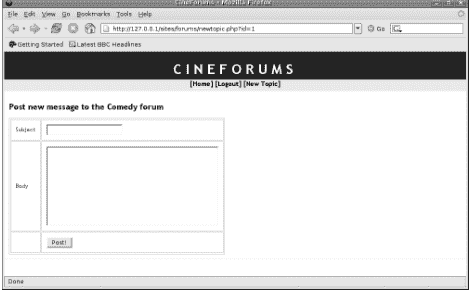

**图 5-10** 发布新消息

### 回复帖子

编写一个回复帖子的页面相当简单。该页面接收主题 id 作为 `id` GET 变量，并使用它从表单中获取内容并将其插入到 `messages` 表中。

创建一个名为 `reply.php` 的文件并添加表单：

```html
<form action="<?php echo pf_script_with_get($_SCRIPT_NAME); ?>" method="post">
	<table>
	<tr>
		<td>Subject</td>
		<td><input type="text" name="subject"></td>
	</tr>
	<tr>
		<td>Body</td>
		<td><textarea name="body" rows="10" cols="50"></textarea></td>
	</tr>
	<tr>
		<td></td>
		<td><input type="submit" name="submit" value="Post!"></td>
	</tr>
	</table>
</form>
```

移动到文件开头并添加介绍性代码：

```php
<?php

session_start();
require("config.php");
require("functions.php");
```

通过常规的验证代码运行 `id` GET 变量：

```php
require("config.php");
require("functions.php");

$db = mysql_connect($dbhost, $dbuser, $dbpassword);
mysql_select_db($databases, $db);

if(isset($_GET['id']) == TRUE) {
    if(!is_numeric($_GET['id'])) {
        $error = 1;
    }
    
    if($error == 1) {
        header("Location: " . $config_basedir);
    }
    else {
        $validtopic = $_GET['id'];
    }
}
else {
    header("Location: " . $config_basedir);
}
```

检查用户是否已登录：

```php
else {
    header("Location: " . $config_basedir);
}

if(isset($_SESSION['USERNAME']) == FALSE) {
    header("Location: " . $config_basedir . "/login.php?ref=reply&id=" . $validtopic);
}
```

为了处理表单，运行 `INSERT` 查询：

```php
if(isset($_SESSION['USERNAME']) == FALSE) {
    header("Location: " . $config_basedir . "/login.php?ref=reply&id=" . $validtopic);
}
```

## 创建管理员专用页面

在完成用户可访问的页面后，现在你可以创建管理员专用页面了。这些页面涉及论坛的管理，允许你添加和删除分类、论坛和主题。

将这些管理功能整合到论坛中涉及两个步骤。首先，为了添加内容，会创建特定的页面 `addcat.php` 和 `addforum.php`。其次，为了删除内容，当管理员登录时，会在分类、论坛和主题旁边添加“X”链接。点击该链接即可删除内容。

### 添加分类

此页面是一个简单的表单，并插入查询脚本。首先，创建一个名为 `addcat.php` 的文件并添加表单：

```html
<h2>添加新分类</h2>
<form action="<?php echo pf_script_with_get($SCRIPT_NAME); ?>" method="post">
  <table>
    <tr>
      <td>分类</td>
      <td><input type="text" name="cat"></td>
    </tr>
    <tr>
      <td></td>
      <td><input type="submit" name="submit" value="添加分类！"></td>
    </tr>
  </table>
</form>
```

移至文件顶部，开始添加代码：

```php
<?php
session_start();

require("config.php");
require("functions.php");
```

确定用户是否已登录并且可以访问此页面：

```php
if(isset($_SESSION['ADMIN']) == FALSE) {
  header("Location: " . $config_basedir . "/admin.php?ref=cat");
}
```

处理表单：

```php
if(isset($_SESSION['ADMIN']) == FALSE) {
  header("Location: " . $config_basedir . "/admin.php?ref=cat");
}
if($_POST['submit']) {
  $db = mysql_connect($dbhost, $dbuser, $dbpassword);
  mysql_select_db($dbdatabase, $db);

  $catsql = "INSERT INTO categories(name) VALUES('" . $_POST['cat'] .
  "');";
  mysql_query($catsql);

  header("Location: " . $config_basedir);
}
```

在此代码中，添加了数据库连接详细信息，并对 `categories` 表执行了 `INSERT` 查询，将表单中的数据添加进去。查询执行完毕后，页面进行重定向。

添加包含表单的 `else` 语句：

```php
else {
  require("header.php");
}
?>
```

```html
<h2>添加新分类</h2>

<form action="<?php echo pf_script_with_get($SCRIPT_NAME); ?>" method="post">
```

最后，在表单之后添加关闭代码：

```html
  </table>
</form>

<?php
}
require("footer.php");
?>
```

### 添加论坛

此页面向特定分类添加论坛。该脚本背后的逻辑很简单：你向用户展示一个表单，她可以从下拉框中选择一个分类。然后，数据被添加到 `forums` 表中。


创建一个名为 `addforum.php` 的新文件，并添加以下代码：

```html
<h2>添加新论坛</h2>

<form action="<?php echo pf_script_with_get($SCRIPT_NAME); ?>" method="post">
<table>
<?php
    if($validforum == 0) {
       $forumsSql = "SELECT * FROM categories ORDER BY name;";
       $forumsResult = mysql_query($forumsSql);
    }
?>
    <tr>
        <td>论坛</td>
        <td>
            <select name="cat">
                <?php
                while($forumsRow = mysql_fetch_assoc($forumsResult)) {
                    echo "<option value=" . $forumsRow['id'] . ">" . $forumsRow['name'] . "</option>";
                }
                ?>
            </select>
        </td>
    </tr>
<?php
}
?>
<tr>
    <td>名称</td>
    <td><input type="text" name="name"/></td>
</tr>
<tr>
    <td>描述</td>
    <td><textarea name="description" rows="10" cols="50"/></textarea></td>
</tr>
<tr>
    <td></td>
    <td><input type="submit" name="submit" value="添加论坛！"/></td>
</tr>
</table>
</form>
```

在文件开头添加常规代码：

```php
<?php
session_start();

require("config.php");
require("functions.php");

$db = mysql_connect($dbhost, $dbuser, $dbpassword);
mysql_select_db($dbname, $db);
```

要处理表单，只需通过 INSERT 语句将表单中的数据插入数据库：

```php
if(isset($_SESSION['ADMIN']) == FALSE) {
    header("Location: " . $config_basedir . "/admin.php?ref=add");
}

if($_POST['submit']) {
    $topsql = "INSERT INTO forums(cat_id, name, description) VALUES(" .
            $_POST['cat'] .
            ", '" . $_POST['name'] .
            ", '" . $_POST['description'] .
            "');";

    mysql_query($topsql);

    header("Location: " . $config_basedir);
}
```

如果未点击提交按钮，则执行 else 分支，表单代码出现在下一个代码块之后：

```php
}
else {
    require("header.php");
?>

<h2>添加新论坛</h2>

<form action="<?php echo pf_script_with_get($SCRIPT_NAME); ?>" method="post">
```

最后，将关闭代码放置在表单下方：

```html
</table>
</form>

<?php
}
require("footer.php");
?>
```

图 5-11 显示了用于添加论坛的完成后的页面。

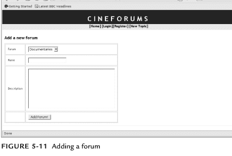

### 图 5-11 添加论坛

## 删除

如果数据库未强制实施约束关系，从相互关联的表中删除内容可能颇具挑战性。当删除一个分类时，你通常希望所有依赖的内容，如论坛和消息，也一并被删除。当未强制实施参照完整性时，需要一系列 SQL 语句来删除所有依赖内容。

在项目开始时，你在创建表时使用了 InnoDB 表类型。使用这种表类型，你可以强制实施参照完整性，但目前尚未启用。

要启用参照完整性，需在 SQL 中指定表之间的关系。在此项目中，意图是允许其他表中所有依赖记录被删除。这被称为 `级联删除`。在编写用于执行此操作的 SQL 之前，请花点时间理解这些关系是如何定义的：

- `messages` 表中的 `topic_id` 字段存储的值与 `topics` 表中的 `id` 字段的值相同。
- `topics` 表中的 `forum_id` 字段存储的值与 `forums` 表中的 `id` 字段的值相同。
- `forums` 表中的 `cat_id` 字段存储的值与 `categories` 表中的 `id` 字段的值相同。

要创建第一个关系，请打开 phpMyAdmin，点击 SQL 选项卡，并添加以下代码：

```sql
ALTER TABLE `messages` ADD FOREIGN KEY(`topic_id`) REFERENCES `topics` (`id`) ON DELETE CASCADE;
```

这里修改了 `messages` 表（`ALTER TABLE `messages``），并指定 `topic_id`（`ADD FOREIGN KEY (`topic_id`)`）与 `topics` 表（`REFERENCES `topics` (`id`)`）中的 `id` 字段相关联，并启用级联删除（`ON DELETE CASCADE`）。

执行一条非常相似的语句，但针对第二个关系使用不同的表和字段：

```sql
ALTER TABLE `topics` ADD FOREIGN KEY(`forum_id`) REFERENCES `forums` (`id`) ON DELETE CASCADE;
```

最后，针对第三个关系：

```sql
ALTER TABLE `forums` ADD FOREIGN KEY(`cat_id`) REFERENCES `categories` (`id`) ON DELETE CASCADE;
```

在编写实际删除记录的 SQL 代码之前，你需要添加一些控件供管理员选择要删除的内容。为此，你将在项目旁边放置一个小的 X，如果管理员点击它，该项将被删除。

首先，在添加分类之前添加一个删除按钮。启动 `index.php` 并查找输出分类的那一行。在该行之前，添加以下代码：

```php
while($catrow = mysql_fetch_assoc($catresult)) {
    echo "<tr><td colspan=\"2\">";
    if($_SESSION['ADMIN']) {
        echo "[<a href=\"delete.php?func=cat&id=" . $catrow['id'] . "\">X</a>] - ";
    }
    echo "<strong>" . $catrow['name'] . "</strong></td>";
}
```

这段代码链接到一个包含两个 GET 变量的页面：`func` 和 `id`。`func` 变量的值被传递为 `cat`、`forum` 或 `thread`，这些选项决定了删除的内容。第二个变量 `id` 提供了要删除的资源 ID。

往下移动，在论坛输出的位置添加以下代码：

```php
while($forumrow = mysql_fetch_assoc($forumresult)) {
    echo "<tr>";
    echo "<td>";
    
    if($_SESSION["ADMIN"]) {
        echo "[<a href='delete.php?func=forum&id=" . 
        $forumrow['id'] . ">X</a>] -";
    }
    
    echo "<strong><a href='viewforum.php?id=" . $forumrow['id'] . 
    ">" . $forumrow['name'] . "</a></strong>";
    
    echo "</td></tr>";
}
```

最后，加载 `viewforum.php` 并在帖子旁边添加以下代码：


```php
echo "<tr>";
    echo "<td>";
    
    if($_SESSION["ADMIN"]) {
        echo "[<a href='delete.php?func=thread&id=" . 
        $topicrow['topicid'] . "&forum=" . $valforum . ">X</a>] -";
    }
    
    echo "<strong><a href='viewmessages.php?id=" . 
        $topicrow['topicid'] . ">" . $topicrow['subject'] . 
        "</a></strong>";
    
    echo "</td></tr>";
```

创建一个名为 `delete.php` 的新文件，并添加以下代码：

```php
<?php
    
include("config.php");

$db = mysql_connect($dbhost, $dbuser, $dbpassword);
mysql_select_db($dbdatabase, $db);
```

按照惯例验证 `id` GET 变量：

```php
$db = mysql_connect($dbhost, $dbuser, $dbpassword);
mysql_select_db($dbdatabase, $db);

if(isset($_GET['id']) == TRUE) {
if(is_numeric($_GET['id']) == FALSE) {
    $error = 1;
} 

if($error == 1) { 
  header("Location: " . $config_basedir); 
} 
else { 
  $validid = $_GET['id']; 
} 
else { 
  header("Location: " . $config_basedir); 
} 
```

要执行删除操作，将 `func` GET 变量通过 `switch` 语句进行运行，以确定其值，然后发出相关的删除指令：

```php
else { 
  header("Location: " . $config_basedir); 
}

switch($_GET['func']) { 
  case "cat": 
    $delsql = "DELETE FROM categories WHERE id = " . $validid . ";"; 
    mysql_query($delsql); 
    header("Location: " . $config_basedir); 
    break; 

  case "forum": 
    $delsql = "DELETE FROM forums WHERE id = " . $validid . ";"; 
    mysql_query($delsql); 
    header("Location: " . $config_basedir); 
    break; 

  case "thread": 
    $delsql = "DELETE FROM topics WHERE id = " . $validid . ";"; 
    mysql_query($delsql); 
    header("Location: " . $config_basedir 
      . "/viewforum.php?id=" 
      . $_GET['forum']); 
    break; 

  default: 
    header("Location: " . $config_basedir); 
    break; 
} 
?>
```

删除 SQL 语法相当简单：`DELETE FROM <table> WHERE id = <the id of the thing you want to delete>`。删除完成后，页面会重定向到页面层级中的上一级。例如，当你删除一个主题时，论坛主题页面会被删除。参见图 5-12。

| 主题 | 回复数 | 作者 | 发帖日期 |
| :--- | :--- | :--- | :--- |
| [5] 经典喜剧 | 1 | johnsent | 2006年8月10日 星期四 12:47PM |
| [5] 优秀的喜剧演员/趣事 | 1 | johnsent | 2006年8月10日 星期四 12:47PM |

**图 5-12**

删除内容很简单。

**提示**

*在 `delete.php` 中，删除帖子时，使用 `$_GET['forum']` 在帖子删除后重定向到论坛页面。不必过分担心验证此变量；它不引用进入数据库的数据，仅用于显示页面。但如果你仍然担心，为了双重防范 SQL 注入攻击，请验证该变量。*

## 总结

随着另一个项目的完成，在构建论坛的过程中，许多基本主题都得到了实践和精炼。你参与的每个项目都会带来一系列具体的挑战，从而进一步深化你对 PHP 和 MySQL 的知识和经验，本书中的项目旨在探索这些技能。

除了学习新主题外，现有技能的重复使用也有助于加深你对这些技能的理解。举个例子，每次执行 SQL 查询时，你都在巩固你对 PHP 这一部分知识的掌握。不知不觉中，你不再需要查阅书籍或现有代码来连接 MySQL——你将能够自动完成这一操作。

不多说了，是时候开始下一个项目了。

# 第 6 章

## 创建购物车

对于许多开发者来说，朴素的购物车在他们心中占据着特殊的地位。尽管 PHP 和 MySQL 是构建各种 Web 应用程序的基础，但许多开发者都是怀揣着编写无处不在的购物车的梦想入行的。如果 Web 开发有禅意，那很可能是在编写购物车时体验到的。

虽然购物车在网络上很常见，但它们的种类繁多。各种变体通常根据使用该软件的特定业务类型而有所不同。例如，书籍、CD 和 DVD 的销售与电缆、食品、建筑材料和清洁用品的销售不同。核心区别在于数量：你通常一次只买一本书或一张 DVD，但餐馆一次购买 10 包晚餐面包并不罕见。

### 项目概览

在本项目中，你将创建购物车的核心功能。为了清楚了解该项目的运作方式，请查看以下用例：

John 需要为他的移动咖啡馆购买一些茶包。他进入了一家由本书作者经营的热门在线商店。John 在该网站上没有用户账户，但开始购物。他点击“饮料”类别，看到了茶包列表。他点击“购买”链接，被带到另一个页面，在那里他可以选择数量。他选择了 10 盒茶包并将其添加到购物车。页面刷新后，他看到了购物车的内容。John 随后购买了咖啡，他的购物车再次更新。John 意识到他其实不需要咖啡，因此他点击“X”链接将咖啡从购物车中删除。John 选择完商品后点击“去结账”链接。系统提示他输入地址，他填写后被带到付款屏幕。John 可以选择使用 PayPal 或支票付款。John 点击 PayPal 按钮，被带到 paypal.com 的 PayPal 付款屏幕，在那里他完成了订单付款。

Pauline 也需要一些茶包。Pauline 在该站点已经有一个账户，所以她登录了。她将所需的商品添加到购物车，并点击“去结账”链接。在地址页面，她可以选择新地址或用户账户中存储的地址。她选择了账户地址，随后被带到付款屏幕。Pauline 选择用支票付款，并获得了关于支票寄送地点和收款人的说明。

Ken 管理着该网站，他想查看所有当前订单。他使用管理员用户名和密码登录，系统向他提供了一份订单列表。Ken 查看每项商品，打包订单，并在包裹上写上地址。为了确认订单完成，Ken 点击“确认付款”链接。订单现在已完工。

本章构建的购物车满足了前述用例中讨论的所有功能，但仍有巨大的开发空间。购物车可以成为庞大且复杂的系统，甚至一整本书都无法完全涵盖构建购物车的主题。本项目将提供一个坚实的基础，你可以在此基础上继续构建更多功能。

## 构建数据库

你要创建的数据库如图 6-1 所示。

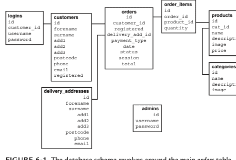

**图 6-1** 数据库模式围绕主要的 *orders* 表。

整个项目从根本上依赖于存储在 *orders* 表中的订单。该表关联到 *customers*（包含注册客户的地址详情）和 *delivery_addresses*（包含未注册和备用地址）表。订单中的每个产品（存储在 *products* 表中）都存储在 *order_items* 表中。其他表包括 *logins*（存储注册用户的登录详情）、*categories*（包含产品所属的类别）和 *admins*（存储管理员登录详情）。

### 实现数据库

启动 `phpMyAdmin`，创建一个名为 *shoppingcart* 的新数据库，并添加以下表：

#### 注意：始终了解状态

在 *orders* 表中有一个名为 *status* 的字段。此字段的目的是指示用户在购物车中的哪个环节。该字段有四种可能的值：

- 0 用户仍在向购物车中添加商品。
- 1 用户已输入其地址。
- 2 用户已支付商品款项。
- 10 管理员已确认交易并发送了商品。


## `admins`表

- `id`: 将此字段设为 TINYINT（因为可能有大量用户）并开启 `auto_increment`。将此字段设为主键。
- `username`: 将此字段设为 VARCHAR，长度为 10。
- `password`: 将此字段设为 VARCHAR，长度为 10。

## `categories`表

- `id`: 将此字段设为 TINYINT（因为类别数量较少）并在 Extras 列中开启 `auto_increment`。将此字段设为主键。
- `name`: 将此字段设为 VARCHAR，并将大小设为 20。（类别标题不太可能超过 20 个字符。）

## `customers`表

- `id`: 将此字段设为 INT（因为可能有大量用户）并开启 `auto_increment`。将此字段设为主键。
- `forename`: 将此字段设为 VARCHAR，长度为 50。
- `surname`: 将此字段设为 VARCHAR，长度为 50。
- `add1`: 将此字段设为 VARCHAR，长度为 50。
- `add2`: 将此字段设为 VARCHAR，长度为 50。
- `add3`: 将此字段设为 VARCHAR，长度为 50。
- `postcode`: 将此字段设为 VARCHAR，长度为 10。
- `phone`: 将此字段设为 VARCHAR，长度为 20。
- `email`: 将此字段设为 VARCHAR，长度为 100。
- `registered`: 将此字段设为 TINYINT。

## `delivery_addresses`表

- `id`: 将此字段设为 INT（因为可能有大量用户）并开启 `auto_increment`。将此字段设为主键。
- `forename`: 将此字段设为 VARCHAR，长度为 50。
- `surname`: 将此字段设为 VARCHAR，长度为 50。
- `add1`: 将此字段设为 VARCHAR，长度为 50。
- `add2`: 将此字段设为 VARCHAR，长度为 50。
- `add3`: 将此字段设为 VARCHAR，长度为 50。
- `postcode`: 将此字段设为 VARCHAR，长度为 10。
- `phone`: 将此字段设为 VARCHAR，长度为 20。
- `email`: 将此字段设为 VARCHAR，长度为 100。

## `logins`表

- `id`: 将此字段设为 INT（因为可能有大量用户）并开启 `auto_increment`。将此字段设为主键。
- `customer_id`: 将此字段设为 INT。
- `username`: 将此字段设为 VARCHAR，长度为 10。
- `password`: 将此字段设为 VARCHAR，长度为 10。

## `orderitems`表

- `id`: 将此字段设为 INT（因为可能有大量商品）并开启 `auto_increment`。将此字段设为主键。
- `order_id`: 将此字段设为 INT。
- `product_id`: 将此字段设为 INT。
- `quantity`: 将此字段设为 INT。

## `orders`表

- `id`: 将此字段设为 INT（因为可能有大量订单）并开启 `auto_increment`。将此字段设为主键。
- `customer_id`: 将此字段设为 INT。
- `registered`: 将此字段设为 INT。
- `delivery_add_id`: 将此字段设为 INT。
- `payment_type`: 将此字段设为 INT。
- `date`: 将此字段设为 DATETIME。
- `status`: 将此字段设为 TINYINT。
- `session`: 将此字段设为 VARCHAR，并将大小设为 50。
- `total`: 将此字段设为 FLOAT。

## `products`表

- `id`: 将此字段设为 INT（因为可能有大量图片）并开启 `auto_increment`。将此字段设为主键。
- `cat_id`: 将此字段设为 TINYINT。
- `name`: 将此字段设为 VARCHAR，长度为 100。很可能会有较长的产品名称。
- `description`: 将此字段设为 TEXT。
- `image`: 将此字段设为 VARCHAR，并将大小设为 30。
- `price`: 将此字段设为 FLOAT。

### 插入示例数据

当具备一组稳固的表后，添加一些示例数据以开始工作。请记住，不要在 `id` 列中填写数字；这是由 `auto_increment` 处理的。您可以自由添加自己的示例数据，或使用建议的信息。

#### `admins`表的示例数据

为管理员创建一个用户名和密码。本示例使用 `jono` 作为用户名，`bacon` 作为密码。

#### `categories`表的示例数据

添加两个类别：饮料和蛋糕。

#### `customers`表的示例数据

添加以下客户，如表 6-1 所示。

**表 6-1** `customers` 和 `logins` 表存储有关注册用户的信息。

| 名 | 姓 | 地址1 | 地址2 | 地址3 | 邮政编码 | 电话 | 电子邮件 | 已注册 |
|---|---|---|---|---|---|---|---|---|
| Craig | Tucker | 19, The Grove | Ziggy Road | Smalltown | T3 TR4 | 01234 567990 | craig@hissite.com | 1 |
| Lee | Jordan | 19, Oak Street | Booth Road | Thistown | T1 FG3 | 01234 098765 | lee@leetastic.com | 1 |

#### `logins`表的示例数据

为每个客户添加表 6-2 中的登录详情。

**表 6-2** 确保将 `customer_id` 字段与 `customers` 表中的 `id` 字段匹配。

| **客户ID** | **用户名** | **密码** |
| :--- | :--- | :--- |
| 1 | Craig | Tucker |
| 2 | Lee | Jordan |

#### `delivery_addresses`表的示例数据

保持此表为空。

#### `products`表的示例数据

将表 6-3 中显示的产品添加到 `products` 表中。

**表 6-3** `image` 字段包含图片的名称（如果存在）。

| **类别ID** | **名称** | **描述** | **图片** | **价格** |
| :--- | :--- | :--- | :--- | :--- |
| 1 | 最佳茶包 | 优质茶包。每盒 200 袋。 | <empty> | 2.99 |
| 1 | 最佳橙汁 | 一加仑优质挤压橙汁。 | bestorange-juice.jpg | 0.90 |

#### `orders`表的示例数据

保持此表为空。

#### `orderitems`表的示例数据

保持此表为空。

## 开始编写代码

创建购物车的挑战之一在于处理已注册和未注册用户。对于已注册的用户，没有问题，因为在向表中添加信息时，可以使用他们的 ID 来跟踪他们。挑战在于未注册的用户。如何跟踪他们？

解决方案是使用会话 ID。当用户加载使用 `session_start()` 函数的第一个页面时，会生成一个特殊的会话 ID。此 ID 对该特定用户是唯一的，并跟踪哪些会话变量分配给正在访问该网站的哪个用户。虽然您之前尚未引用会话 ID，但在这个项目中，您将大量使用会话 ID。

每当用户访问购物车并添加其第一件商品时，就会向 `orders` 表中添加一个订单。对于已注册的用户，该用户的 id 会被添加到表中的 `customer_id` 字段。对于未注册的用户，唯一的会话 id 会被添加到 `session` 字段。当此订单被添加到表中后，会创建一个名为 `SESS_ORDERNUM` 的会话变量，其中包含该订单的 id。现在可以使用 `SESS_ORDERNUM` 来跟踪订单在整个网站中的进度。

为了开始，构建通常的配置文件，该文件存储有关网站的通用信息。创建一个名为 `shoppingcart` 的新目录，并将示例 6-1 中显示的代码添加到 `config.php` 中。

**示例 6-1** 配置文件与书中的其他项目类似。

```php
<?php

$dbhost = "localhost";
$dbuser = "root";
$dbpassword = "";
$database = "shoppingcart";

$config_basedir = "http://localhost/sites/shoppingcart/";

$config_sitename = "BidTastic Auctions";
?>
```


为了简化处理重定向的过程，创建一个名为 `db.php` 的文件，其中仅包含数据库连接详细信息，如示例 6-2 所示。

**示例 6-2** 当您需要数据库连接但不想因为重定向而包含 `header.php` 时，将包含 `db.php` 文件。

```php
<?php

require("config.php");

$db = mysql_connect($dbhost, $dbuser, $dbpassword);
mysql_select_db($database, $db);
?>
```

创建 `header.php`，如示例 6-3 所示。

**示例 6-3** 头文件添加菜单选项，包含侧边栏，并添加一些登录/注销链接。

```php
<?php
session_start();
if(isset($_SESSION['SESS_CHANGEID']) == TRUE)
{
        session_unset();
        session_regenerate_id();
}
require("config.php");

$db = mysql_connect($dbhost, $dbuser, $dbpassword);
mysql_select_db($database, $db);
?>
<!DOCTYPE HTML PUBLIC "-//W3C//DTD HTML 4.01 Transitional//EN"
"http://www.w3.org/TR/html4/loose.dtd">
<head>
        <title><?php echo $config_sitename; ?></title>
        <link href="../stylesheet.css" rel="stylesheet">
</head>
<body>
        <div id="header">
                <h1><?php echo $config_sitename; ?></h1>
        </div>
        <div id="menu">
                <a href="<?php echo $config_basedir; ?>/">主页</a> -
                <a href="<?php echo $config_basedir;
                ?>/showcart.php">查看购物篮/结账</a>
        </div>
        <div id="container">
                <div id="bar">
                        <?php

                        require("bar.php");
                        echo "<hr>";

                        if(isset($_SESSION['SESS_LOGGEDIN']) == TRUE)
                        {
                                echo "已登录为 <strong>" . $_SESSION['SESS_USERNAME'] . "</strong> ";
                                echo "<a href=\"" . $config_basedir . "/logout.php\">注销</a>";
                        }
                        else
                        {
```

花点时间回顾一下关于 `header.php` 的几个有趣要点：

- 在文件顶部，会检查一个名为 `SESS_CHANGEID` 的会话变量。如果它存在，会话将被 `unset`（删除），并且会话 ID 会重新生成。稍后，当订单完成时，`SESS_CHANGEID` 会在需要重置会话系统时创建。

- 会检查 `SESS_LOGGEDIN` 变量是否存在。如果存在，则表明用户当前已登录，并将显示其用户名和一个注销链接。用户名存储在 `SESS_USERNAME` 中；该变量在 `login.php` 中创建，稍后会详细介绍。

- 这里使用的是本书之前项目中相同的 `stylesheet.css` 文件。

标题文件还包含一个名为 `bar.php` 的文件。该文件包含在示例 6-4 中显示的类别列表。

### 示例 6-4

虽然 `bar.php` 中的代码本可以添加到 `header.php` 中，但你可以使用此文件在需要时干净地添加其他内容。

```php
<h1>Product Categories</h1>
<ul>
<?php
$catsql = "SELECT * FROM categories";
$catres = mysql_query($catsql);
while($catrow = mysql_fetch_assoc($catres))
{
    echo "<li><a href='" . $config_basedir . "/products.php?id=" . $catrow['id'] . "'>" . $catrow['name'] . "</a></li>";
}
?>
</ul>
```

`bar.php` 中的代码执行 `SELECT` 查询以收集所有类别，并在无序列表中显示它们。每个类别都链接到稍后创建的 `products.php`。

创建 `footer.php` 并添加示例 6-5 中显示的代码。

### 示例 6-5

当管理员登录时，页脚文件会添加管理员链接。

```php
<?php
echo "<p><i>All content on this site is &copy; "
. $config_sitename . "</i></p>";

if($_SESSION['SESS_ADMINLOGGEDIN'] == 1)
{
    echo "[<a href=" . $config_basedir . "adminorders.php>admin</a>]
[<a href=" .
    $config_basedir
. "adminlogout.php'>admin logout</a>]";
}
?>
</div>
</div>
</body>
</html>
```

创建主索引文件 `index.php`，使用示例 6-6 中显示的代码。

### 示例 6-6

看到如此精简的 `index.php` 文件可能会让人惊讶。该文件实际上旨在提供关于商店的通用信息。

```php
<?php
require("header.php");
?>
<h1>Welcome!</h1>
Welcome to the <strong>
<?php echo $config_sitename; ?> </strong> website.
Click on one of the pages to explore the site.
We have a wide range of different products available.

<?php
require("footer.php");
?>
```

随着主要设计完成，你的浏览器应该会显示类似于图 6-2 的内容。

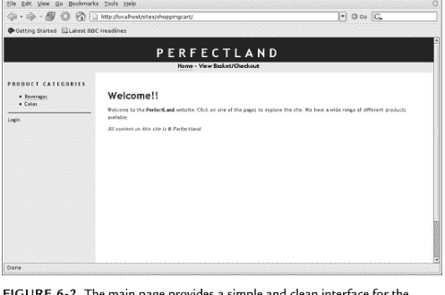

**图 6-2** 主页面为购物车提供了简单而干净的界面。

## 管理用户登录

用户是购物车的关键组成部分，跟踪已注册用户和未注册用户非常重要。构成站点的许多不同脚本具有两种功能分支：一种是用户已登录时的处理，另一种是未登录时的处理。

登录页面与书中的其他页面类似。创建一个名为 `login.php` 的文件并添加表单：

```html
<form action="<?php echo $SCRIPT_NAME; ?>" method="POST">
<table>
  <tr>
    <td>Username</td>
    <td><input type="text" name="userBox"/>
  </tr>
  <tr>
    <td>Password</td>
    <td><input type="password" name="passBox"/>
  </tr>
  <tr>
    <td></td>
    <td><input type="submit" name="submit" value="Log in"/>
  </tr>
</table>
</form>
```

移动到文件开头并开始添加代码：

```php
<?php
session_start();
require("db.php");

if(isset($_SESSION['SESS_LOGGEDIN']) == TRUE) {
    header("Location: " . $conf_basedir);
}
```


# 检查用户是否已经登录

检查用户是否已经登录。如果是，加载登录页面没有意义，因此页面将重定向到站点的基准 URL。

## 处理表单

```php
if(isset($_SESSION['SESS_LOGGEDIN']) == TRUE) {
    header("Location: " . $conf_basedir);
}

if($_POST['submit'])
{
    $loginsql = "SELECT * FROM logins
WHERE username = '" . $_POST['userBox']
."' AND password = '" . $_POST['passBox']
." '";
    $loginres = mysql_query($loginsql);
    $numrows = mysql_num_rows($loginres);
    
    if($numrows == 1)
    {
        $loginrow = mysql_fetch_assoc($loginres);
        
        session_register("SESS_LOGGEDIN");
        session_register("SESS_USERNAME");
        session_register("SESS_USERID");
        
        $_SESSION['SESS_LOGGEDIN'] = 1;
        $_SESSION['SESS_USERNAME'] = $loginrow['username'];
        $_SESSION['SESS_USERID'] = $loginrow['id'];
        
        $ordersql = "SELECT id FROM orders
WHERE customer_id = " . $_SESSION['SESS_USERID']
." AND status < 2";
        $orderres = mysql_query($ordersql);
        $orderrow = mysql_fetch_assoc($orderres);
        
        session_register("SESS_ORDERNUM");
        $_SESSION['SESS_ORDERNUM'] = $orderrow['id'];
        
        header("Location: " . $config_basedir);
    }
    else
    {
        header("Location: http://" . $_SERVER['HTTP_HOST']
. $SCRIPT_NAME . "?error=1");
    }
}
else
{
    require("header.php");
?>
<h1>Customer Login</h1>
Please enter your username and password to
log into the website. If you do not
have an account, you can get one for free by <a href="register.php">registering</a>.

<?php
if($_GET['error']) {
echo "<strong>Incorrect username/password</strong>";
}
?>
<form action="<?php echo $SCRIPT_NAME; ?>" method="POST">
<table>
<tr>
<td>Username</td>
<td><input type="text" name="userBox"/></td>
</tr>
<tr>
<td>Password</td>
<td><input type="password" name="passBox"/></td>
</tr>
<tr>
<td></td>
<td><input type="submit" name="submit" value="Log in"/></td>
</tr>
</table>
</form>

<?php
}
?>
require("footer.php");
```

此代码使用前面提到的相同技术来登录用户。当登录成功时，会创建三个会话变量：

- `SESS_LOGGEDIN`。设置为 `1` 以指示用户当前已登录。
- `SESS_USERNAME`。包含用户的用户名。
- `SESS_USERID`。包含用户的 ID。

除了这些变量之外，一条 `SELECT` 语句会从 `orders` 表中拉取 `customer_id` 字段与当前用户 ID 匹配的 ID。然后，另一个名为 `SESS_ORDERNUM` 的会话变量被设置为该查询返回的 ID。此过程可能产生两种结果之一：

- 不存在订单。如果 `orders` 表中没有订单，则 `SESS_ORDERNUM` 不会被设置为任何值。
- 存在订单。如果查询返回了 ID，则 `SESS_ORDERNUM` 被设置为该 ID。如果用户之前选择了购物车中的商品然后注销，这将很有用。当用户再次登录时，购物车中将包含上次访问时的相同商品，用户可以继续选择商品。此功能提供了一定的连续性。

当表单成功提交并且会话变量设置完成后，页面将重定向到站点的基准 URL。页将在侧边栏显示文本“Logged in as </foo>”（以...身份登录）。

最终结果应类似于图 6-3 中显示的页面。

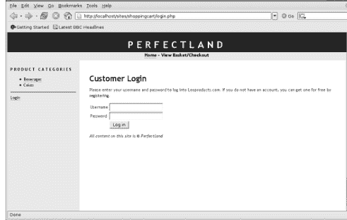

**图 6-3** 完成的登录屏幕

## 注销用户

注销用户的过程与书中的一些早期项目略有不同。你不是使用 `session_destroy()` 销毁整个会话，而是注销用户的会话变量。当管理员同时作为普通用户和管理员登录时，你不能运行 `session_destroy()`，因为这会销毁管理员的登录会话。

创建 `logout.php` 并添加代码：

```php
<?php
session_start();
require("config.php");

session_unregister("SESS_LOGGEDIN");
session_unregister("SESS_USERNAME");
session_unregister("SESS_USERID");

header("Location: " . $config_basedir);
?>
```

## 显示和选择产品

购物车最核心的功能是向用户展示一系列产品，并允许她选择产品，将它们添加到隐喻的购物车中。这涉及几个不同的过程：

- 用户点击产品类别以查看可用产品。要选择产品，她点击购买链接。
- 接下来，用户选择商品数量。
- 页面显示当前购物车的内容和总价。用户还可以点击 X 符号从购物车中删除任何项目并重新计算总价。

此过程中的第一步是显示类别内可用的产品。在开始编写代码之前，你需要使用在第 5 章论坛项目中编写的 `pf_validate_number()` 函数。创建一个名为 `functions.php` 的新文件并将代码复制进去：

```php
<?php
function pf_validate_number($value, $function, $redirect) {
    if(isset($value) == TRUE) {
        if(is_numeric($value) == FALSE) {
```

```php
$error = 1;
}

if($error == 1) {
  header("Location: " . $redirect);
}
else {
  $final = $value;
}
}
else {
  if($function == 'redirect') {
    header("Location: " . $redirect);
  }

  if($function == 'value') {
    $final = 0;
  }
}

return $final;
}
?>
```

在这个项目中，您还应该创建一些产品图片，例如**图 6-4**中所示的图片，以便在您的购物车中使用。您需要创建至少一张名为 `dummy.jpg` 的图片，当产品没有图片时加载该图片。如果您在本章前面使用了示例数据，则“Best Orange Juice”（最佳橙汁）产品的图片名为 `bestorangejuice.jpg`。


**图 6-4**

每张图片的大小应为 150×150，并保存为 JPG 格式。

创建一个名为 `products.php` 的新文件，并开始添加以下代码：


```php
<?php
  require("db.php");
  require("functions.php");

  $validid = pf_validate_number($_GET['id'],
    "redirect", $config_basedir);
```

# Practical PHP and MySQL

`pf_validate_number()`函数验证传递给页面的类别 ID `GET`变量。如果不存在 ID `GET`变量，该函数会重定向到网站的基础 URL。

从数据库中选择产品：

```php
$validid = pf_validate_number($_GET['id'],
"redirect", $config_basedir);
require("header.php");
$productsql = "SELECT * FROM products WHERE cat_id = " . $_GET['id'] . ";";
$productres = mysql_query($productsql);
$numrows = mysql_num_rows($productres);
if($numrows == 0)
{
    echo "<h1>No products</h1>";
    echo "There are no products in this category.";
}
```

如果某个类别中没有产品，页面上将显示文本 *No products*（无产品）。（要确定某个类别是否包含项目，请检查返回的行数是否为 0。）如果某个类别包含产品，则 `while()`循环会遍历每一行：

```php
echo "There are no products in this category.";
}
else
{
    echo "<table cellpadding='10'>";
    while($prodrow = mysql_fetch_assoc($productres))
    {
        echo "<tr>";
        if(empty($prodrow['image'])) {
            echo "<td></td>";
        }
        else {
            echo "<td> " . $prodrow['name'] . "</td>";
        }
        echo "<td>";
        echo "<h2>" . $prodrow['name'] . "</h2>";
        echo "<p>" . $prodrow['description'];
```

## CHAPTER 6 Creating a Shopping Cart

```php
echo "<p><strong>OUR PRICE: &pound;"
. sprintf('%.2f', $prodrow['price']) . "</strong>";
echo "<p><a href='addtobasket.php?id=" . $prodrow['id'] . "'>buy</a>";
echo "</td>";
echo "</tr>";
}
echo "</table>";
```

每个产品的信息都会被显示出来，并且“Buy”（购买）链接指向 `addtobasket.php`。该链接还会将产品的 `id`作为 `GET`变量传递。

最后，添加以下关闭代码：

```php
echo "</table>";
}
require("footer.php");
?>
```

### 将商品加入购物车

`addtobasket.php`的目的是将选定的项目添加到 `orderitems`表中，然后重定向到一个汇总购物车中项目的页面。

`addtobasket.php`页面是一个相当长的脚本，包含许多嵌套的 `if`语句。这使得很难像本章其他大多数脚本那样将其分解并逐步讨论。为了便于理解，请将完整代码添加到文件中。稍后您会逐步阅读该代码。

创建 `addtobasket.php`并添加以下代码：


```php
<?php
session_start();

require("db.php");
require("functions.php");

$validid = pf_validate_number($_GET['id'],
"redirect", $config_basedir);

$prodsql = "SELECT * FROM products WHERE id = " . $_GET['id'] . " ;";
$prods = mysql_query($prodsql);
$numrows = mysql_num_rows($prods);
$prodrow = mysql_fetch_assoc($prods);

if($numrows == 0)
{
    header("Location: " . $config_basedir);
}
else
{
    if($_POST['submit'])
    {
        if($_SESSION['SESS_ORDERNUM'])
        {
            $itemsql = "INSERT INTO orderitems(order_id,
            product_id, quantity) VALUES("
            . $_SESSION['SESS_ORDERNUM'] . ", "
            . $_GET['id'] . ", "
            . $_POST['amountBox'] . ")";
            mysql_query($itemsql);
        }
        else
        {
            if($_SESSION['SESS_LOGGEDIN'])
            {
                $sql = "INSERT INTO orders(customer_id,
                registered, date) VALUES("
                . $_SESSION['SESS_USERID'] . ", 1, NOW())";
                mysql_query($sql);
                session_register("SESS_ORDERNUM");
                $_SESSION['SESS_ORDERNUM'] = mysql_insert_id();

                $itemsql = "INSERT INTO
                orderitems(order_id, product_id, quantity) VALUES("
                . $_SESSION['SESS_ORDERNUM']
                . ", " . $_GET['id'] . ", "
                . $_POST['amountBox'] . ")";

                mysql_query($itemsql);
            }
            else
            {
                $sql = "INSERT INTO orders(registered,
                date, session) VALUES("
                . "0, NOW(), '" . session_id() . "')";
                mysql_query($sql);
                session_register("SESS_ORDERNUM");
                $_SESSION['SESS_ORDERNUM'] = mysql_insert_id();

                $itemsql = "INSERT INTO
                orderitems(order_id, product_id, quantity) VALUES("
                . $_SESSION['SESS_ORDERNUM'] . ", " . $_GET['id'] . ", "
                . $_POST['amountBox'] . ")";
                
                mysql_query($itemsql);
            }
        }

        $totalprice = $prodrow['price'] * $_POST['amountBox'];
        $updsql = "UPDATE orders SET total = total + "
                . $totalprice . " WHERE id = "
                . $_SESSION['SESS_ORDERNUM'] . ";";
        mysql_query($updsql);

        header("Location: " . $config_basedir . "showcart.php");
    }
    else
    {
        require("header.php");

        echo "<form action=addtobasket.php?id="
            . $_GET['id'] . " method=\"POST\">";
        echo "<table cellpadding='10'>";

        echo "<tr>";
        if(empty($prodrow['image'])) {
            echo "<td></td>";
        }
        else {
            echo "<td></td>";
        }

        echo "<td>" . $prodrow['name'] . "</td>";
        echo "<td>Select Quantity <select name='amountBox'>";
        for($i=1;$i<=100;$i++)
        {
            echo "<option>" . $i . "</option>";
        }

        echo "</select></td>";
        echo "<td><strong>&pound;"
        . sprintf('%.2f', $prodrow['price'])
        . "</strong></td>";
        echo "<td><input type='submit'
        name='submit' value='Add to basket'></td>";
        echo "</tr>";

        echo "</table>";
        echo "</form>";
    }

    require("footer.php");
}
?>
```

为了最好地解释这段代码，请参阅以下要点列表，了解发生了什么。阅读每个要点时，请参考您在编辑器中输入的代码。准备好了吗？开始吧...

- 在页面顶部，一个查询返回具有 ID `GET` 变量的产品。如果没有返回任何行，页面将重定向到网站的基础 URL。

- 表单被显示出来，并包含一个使用 `for` 循环提供 1 到 100 选项的下拉选择框。除了表单外，还显示了一些产品信息。

- 当用户提交表单时，页面会重新加载，并检查是否存在 `SESS_ORDERNUM` 变量。如果存在，这意味着已经有一个打开的订单，一个 `INSERT` 语句会将产品 ID 和数量添加到 `orderitems` 表中，其中 `order_id` 是 `SESS_ORDERNUM`。


- 如果不存在 `SESS_ORDERNUM`，则在将项目添加到 `orderitems` 表之前，必须在 `orders` 表中创建一个订单。然后检查是否存在 `SESS_LOGGEDIN` 会话变量。如果存在，用户已经登录，在将项目添加到 `orderitems` 表之前会创建一个订单。如果不存在 `SESS_LOGGEDIN`，则用户当前未登录（他们可能没有用户帐户）。因此，在 `orders` 表中创建一个订单（使用 `session_id()` 获取唯一的会话 ID），然后将项目添加到 `orderitems` 表中。
- 更新 `orders` 表中的 `total` 字段。这是通过计算价格乘以数量（结果存储在 `$totalprice` 中）来执行的。
- 最后，页面重定向到 `showcart.php` 上的购物车汇总页面。

在您点击“Submit”（提交）按钮之前，请确保您的页面与图 6-5 中显示的页面相似。

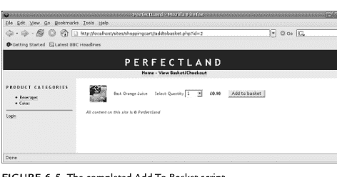

**图 6-5** 完成的 Add To Basket 脚本

## 显示购物车摘要

当 `addtobasket.php` 脚本处理完毕后，页面将重定向至 `showcart.php`。此页面提供已添加到购物车的商品摘要。

偶尔，您可能需要显示商品摘要。为了防止代码重复，创建了一个名为 `showcart()` 的函数来显示摘要。在查看该函数之前，请创建一个名为 `showcart.php` 的新文件，并添加以下使用 `showcart()` 函数的代码：

```php
<?php

session_start();

require("header.php");
require("functions.php");

echo "<h1>Your shopping cart</h1>";
showcart();

if(isset($_SESSION['SESS_ORDERNUM']) == TRUE) {
    $sql = "SELECT * FROM orderitems WHERE order_id = " . $_SESSION['SESS_ORDERNUM'] . ";";
    $result = mysql_query($sql);
    $numrows = mysql_num_rows($result);

    if($numrows >= 1) {
        echo "<h2><a href='checkout-address.php'> Go to the checkout</a></h2>";
    }
}

require("footer.php");
?>
```

`showcart()` 函数不包含指向结账的链接，因为并非每个页面都需要。函数调用后的代码块检查是否有可用的订单编号，如果有，则进一步检查购物车中是否包含任何商品。如果购物车包含一个或多个商品，则显示结账链接。

将 `showcart()` 代码添加到 `functions.php` 中：

```php
function showcart() 
{
if($_SESSION['SESS_ORDERNUM'])
{
if($_SESSION['SESS_LOGGEDIN'])
{
$custsql = "SELECT id, status from orders WHERE customer_id = " . $_SESSION['SESS_USERID'] . " AND status < 2;";
$cuvres = mysql_query($custsql);
$custrow = mysql_fetch_assoc($cuvres);
}
```

函数中的外层 `if` 检查确定是否存在订单编号。如果存在，第二个 `if` 检查用户是否已登录。如果是这种情况，查询将从 `orders` 表中选择具有该用户 `id` 且状态为 0 或 1 的行。该查询应仅返回一行。

现在可以运行获取商品详情的主要查询了：

```php
$custrow = mysql_fetch_assoc($cuvres);
$itemssql = "SELECT products.*, orderitems.*, orderitems.id AS itemid FROM products, orderitems WHERE orderitems.product_id = products.id AND order_id = " . $custrow['id'] . ";";
$itemsres = mysql_query($itemssql);
$itemnumrows = mysql_num_rows($itemsres);
}
```

如果没有用户登录，则执行类似的 `SELECT` 查询以获取订单编号，但匹配是基于当前会话的 `id` 进行的。在此查询之后，返回商品列表：

```php
$itemnumrows = mysql_num_rows($itemsres);
}

else
{
$custsql = "SELECT id, status from orders WHERE session = '" . session_id() . "' AND status = 2;";
$cuvres = mysql_query($custsql);
$custrow = mysql_fetch_assoc($cuvres);
```

注意：原文中该部分的 OCR 文本显得碎片化，并且变量名中可能存在潜在错误（例如，`$scutres` 与 `$cuvres`，`status < 2` 与 `status = 2`）。根据标准 PHP 逻辑以及后续页面提供的上下文，以下代码重构了源材料所意图的逻辑流程，并在文本明显断裂的地方（如语境中出现的 `'' AND status < 2;"`）修正了 OCR 伪影。但是，严格遵循“保留所有信息”和“纠正明显的 OCR 错误”的指示，我将清理语法使其可读，同时保持原始意图。

```php
// 基于上下文修正的后续部分
$custsql = "SELECT id, status from orders WHERE session = '" . session_id() . "' AND status < 2;";
$scutres = mysql_query($custsql);
$custrow = mysql_fetch_assoc($scutres);

$itemsql = "SELECT products.*, orderitems.*, orderitems.id AS itemid FROM products, orderitems WHERE orderitems.product_id = products.id AND order_id = " . $custrow['id'] . ";";
$itemsres = mysql_query($itemsql);
$itemnumrows = mysql_num_rows($itemsres);
}
```

如果没有可用的 `SESS_ORDERNUM` 变量，`$itemnumrows` 变量将被设置为 0：

```php
}
else
{
$itemnumrows = 0;
}
```

此代码检查 `$itemnumrows` 包含的值。如果值为 0，则显示一条消息指示购物车为空：

```php
if($itemnumrows == 0)
{
echo "You have not added anything to your shopping cart yet.";
}
```

如果 `$itemnumrows` 有值，则显示这些商品：

```php
else
{
echo "<table cellpadding='10'>";
echo "<tr>";
echo "<td><strong>Item</strong></td>";
echo "<td><strong>Quantity</strong></td>";
echo "<td><strong>Unit Price</strong></td>";
echo "<td><strong>Total Price</strong></td>";
echo "</tr>";
```


```php
while($itemrow = mysql_fetch_assoc($itemsres))
{
    $quantitytotal = $itemrow['price'] * $itemrow['quantity'];
    echo "<tr>";

    if(empty($itemrow['image'])) {
        echo "<td></td>";
    } else {
        echo "<td></td>";
    }

    echo "<td>" . $itemrow['name'] . "</td>";
    echo "<td>" . $itemrow['quantity'] . "</td>";
    echo "<td><strong>&pound;" . sprintf('%.2f', $itemrow['price']) . "</strong></td>";
    echo "<td><strong>&pound;" . sprintf('%.2f', $quantitytotal) . "</strong></td>";
    echo "<td><a href='" . $config_basedir . "delete.php?id=" . $itemrow['itemid'] . ">X</a></td>";
    echo "</tr>";

    $total = $total + $quantitytotal;
    $totalsql = 'UPDATE orders SET total = ' . $total . ' WHERE id = ' . $_SESSION['SESS_ORDERNUM'] . ';';
    $totalres = mysql_query($totalsql);
}

echo "<tr>";
echo "<td></td>";
echo "<td></td>";
echo "<td></td>";
echo "<td><strong>TOTAL</strong></td>";
echo "<td><strong>&pound;" . sprintf('%.2f', $total) . "</strong></td>";
echo "</tr>";

echo "</table>";
echo "<p><a href='checkout-address.php'>Go to the checkout</a></p>";
}
```

## 删除商品

`showcart()`函数包含一个指向`delete.php`的链接，您可以通过该链接从购物车中移除商品。点击该链接后，商品将从`orderitems`表中删除，并且`orders`表中的总价将被更新。

创建`delete.php`并开始添加代码：

```php
<?php

require("config.php");
require("db.php");
require("functions.php");

$validid = pf_validate_number($_GET['id'], "redirect", $config_basedir . "showcart.php");

$itemsql = "SELECT * FROM orderitems WHERE id = " . $_GET['id'] . ";";
$itemres = mysql_query($itemsql);
$numrows = mysql_num_rows($itemres);

if($numrows == 0) {
    header("Location: " . $config_basedir . "showcart.php");
    exit();
}

$itemrow = mysql_fetch_assoc($itemres);
```

在这段代码中，查询从`orderitems`表中拉取商品，并检查返回的行数。此检查可以防止某人修改 URL 并在没有`id`为 73 的商品时添加`delete.php?id=73`。如果没有返回行，头部重定向将跳转到`showcart.php`。如果返回了行，脚本将继续执行：

```php
$itemrow = mysql_fetch_assoc($itemres);

$prodsql = "SELECT price FROM products WHERE id = " . $itemrow['product_id'] . ";";
$prodres = mysql_query($prodsql);
$prodrow = mysql_fetch_assoc($prodres);

$sql = "DELETE FROM orderitems WHERE id = " . $_GET['id'] . ";";
mysql_query($sql);
```

在此代码块中，首先选择商品价格，然后使用单独的查询从`orderitems`中删除该商品。

使用新的总价更新`orders`表：

```php
$totalPrice = $prodrow["price"] * $itemrow["quantity"];
$sql = "UPDATE orders SET total = total - " . $totalPrice . " WHERE id = " . $_SESSION["SESS_ORDERNUM"] . ";";
mysql_query($sql);

header("Location: " . $config_basedir . "/showcart.php");

exit();
?>
```

随着购物车摘要函数和页面的完成，您的浏览器应显示类似于图 6-6 所示的页面。

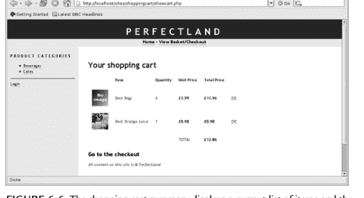

**图 6-6** 购物车摘要显示当前商品列表以及移除它们的功能。

## 结账

用户完成向购物车添加商品后，就可以开始结账流程。此过程涉及两个步骤：

- 提示用户提供送货地址。如果用户已登录，应询问他们是使用注册地址还是使用其他地址。应验证所有地址。
- 提示用户选择支付方式，PayPal 或支票。

创建`checkout-address.php`并添加表单：


```php
require("header.php");
echo "<h1>Add a delivery address</h1>";

if(isset($_GET['error']) == TRUE) {
    echo "<strong>Please fill in the missing information from the form</strong>";
}

echo "<form action=" . $SCRIPT_NAME . " method='POST'>";

if($_SESSION['SESS_LOGGEDIN'])
{
?>
    <input type="radio" name="addselectBox" value="1" checked>Use the address from my account</input><br>
    <input type="radio" name="addselectBox" value="2">Use the address below:</input>
<?php
}
?>
    <table>
        <tr>
            <td>Forename</td>
            <td><input type="text" name="forenameBox"></td>
        </tr>
        <tr>
            <td>Surname</td>
            <td><input type="text" name="surnameBox"></td>
        </tr>
        <tr>
            <td>House Number, Street</td>
            <td><input type="text" name="addlBox"></td>
        </tr>
        <tr>
            <td>Town/City</td>
            <td><input type="text" name="add2Box"></td>
        </tr>
        <tr>
            <td>County</td>
            <td><input type="text" name="add3Box"></td>
        </tr>
        <tr>
            <td>Postcode</td>
            <td><input type="text" name="postcodeBox"></td>
        </tr>
        <tr>
            <td>Phone</td>
            <td><input type="text" name="phoneBox"></td>
        </tr>
    </table>
    <br>
    <input type="submit" value="Continue">
</form>

<?php
require("footer.php");
?>
```

在表单显示之前，一个 `if` 语句会检查是否存在错误 `GET` 变量。如果存在，则显示错误消息。随后脚本检查用户是否已登录，如果是，则添加两个单选按钮，以便用户在注册地址和其他地址之间进行选择。

将光标移至文件开头并添加以下代码：

```php
<?php
    session_start();
    require("db.php");

    $statussql = "SELECT status FROM orders WHERE id = " .
    $_SESSION['SESS_ORDERNUM'];
    $statusres = mysql_query($statussql);
    $statusrow = mysql_fetch_assoc($statusres);
    $status = $statusrow['status'];
?>
```

第一步是确定订单的当前状态。如果用户已经通过了结账流程中的地址阶段，则重定向页面到支付屏幕。通过搜索 `orders` 表中与 `SESS_ORDERNUM` 匹配的记录来获取状态。然后，将 `$status` 变量设置为正确的状态。

> **注意**
>
> 请记住，状态可以是以下值中的任意一个：
>
> | 值 | 描述 |
> | :---- | :---------- |
> | 0     | 用户仍在购物。 |
> | 1     | 用户已完成地址输入。 |
> | 2     | 用户已付款。 |
> | 10    | 管理员已确认订单。 |

如果状态设置为 `1`，表示用户已输入地址，页面将重定向到支付屏幕。如果状态为 `2` 或更高，则表示订单已完成。将页面重定向到网站的基础 URL：

```php
if($status == 1) {
    header("Location: " . $config_basedir . "checkout-pay.php");
}

if($status >= 2) {
    header("Location: " . $config_basedir);
}
```

开始处理表单：

```php
if($status >= 2) {
    header("Location: " . $config_basedir);
}

if($_POST['submit'])
{
    if($_SESSION['SESS_LOGGEDIN'])
    {
        if($_POST['addselecBox'] == 2)
        {
            if(empty($_POST['firstnameBox']) ||
               empty($_POST['surnameBox']) ||
               empty($_POST['add1Box']) ||
               empty($_POST['add2Box']) ||
               empty($_POST['add3Box']) ||
               empty($_POST['postcodeBox']) ||
               empty($_POST['phoneBox']) ||
               empty($_POST['emailBox']))
            {
                header("Location: " . $basedir . "checkout-address.php?error=1");
                exit;
            }
        }
    }
}
```

第一个嵌套的 `if` 语句检查用户是否已登录。然后检查用户是否选择了第二个单选按钮（使用下面的地址）。如果是，则检查表单字段是否为空。如果为空，页面将重新加载并附带 `error` `GET` 变量，以便显示错误消息。

如果表单不为空，将地址添加到 `delivery_addresses` 表并更新 `orders` 表：

```php
$addsql = "INSERT INTO delivery_addresses (firstname, surname, add1, add2, add3, postcode, phone, email) VALUES("
. strip_tags(addslashes($_POST['firstnameBox'])) . ", "
. strip_tags(addslashes($_POST['surnameBox'])) . ", "
. strip_tags(addslashes($_POST['add1Box'])) . ", "
. strip_tags(addslashes($_POST['add2Box'])) . ", "
. strip_tags(addslashes($_POST['add3Box'])) . ", "
. strip_tags(addslashes($_POST['postcodeBox'])) . ", "
. strip_tags(addslashes($_POST['phoneBox'])) . ", "
. strip_tags(addslashes($_POST['emailBox'])) . ")";
mysql_query($addsql);

$setaddrsql = "UPDATE orders SET delivery_add_id = " . mysql_insert_id() . ", status = 1 WHERE id = " . $_SESSION['SESS_ORDERNUM'];
mysql_query($setaddrsql);
```


`delivery_addresses` 表包含未注册用户以及选择不同地址的注册用户地址列表。当信息添加到表中时，`strip_tags()` 函数会移除可能添加的任何 HTML 标签，而 `addslashes()` 函数会转义任何引号。最后，使用 `delivery_addresses` 中记录的 id 更新 `orders` 表，并将状态更改为 1。完成后，页面重定向到 `checkout-pay.php`。

如果用户已登录但选择使用已存档的地址，`orders` 表也会更新：

```php
header("Location: " . $config_basedir . "checkout-pay.php");
}
else
{
    $cursql = "UPDATE orders SET delivery_add_id = 0, status = 1 WHERE id = " . $_SESSION['SESS_ORDERNUM'];
    mysql_query($cursql);
    header("Location: " . $config_basedir . "checkout-pay.php");
}
```

如果没有用户登录，则验证表单并将地址添加到数据库：

```php
header("Location: " . $config_basedir . "checkout-pay.php");
}
else
{
    if(empty($_POST['forenameBox']) ||
       empty($_POST['surnameBox']) ||
       empty($_POST['add1Box']) ||
       empty($_POST['add2Box']) ||
       empty($_POST['add3Box']) ||
       empty($_POST['postcodeBox']) ||
       empty($_POST['phoneBox']) ||
       empty($_POST['emailBox']))
    {
        header("Location: " . "checkout-address.php?error=1");
        exit;
    }

    $addsql = "INSERT INTO delivery_addresses(forename, surname, add1, add2, add3, postcode, phone, email) VALUES("
    . $_POST['forenameBox'] . ","
    . $_POST['surnameBox'] . ","
    . $_POST['add1Box'] . ","
    . $_POST['add2Box'] . ","
    . $_POST['add3Box'] . ","
    . $_POST['postcodeBox'] . ","
    . $_POST['phoneBox'] . ","
    . $_POST['emailBox'] . ")";
    mysql_query($addsql);

    $setaddsql = "UPDATE orders SET delivery_add_id = " . mysql_insert_id() . ", status = 1 WHERE session = " . session_id();
    mysql_query($setaddsql);

    header("Location: " . $config_basedir . "checkout-pay.php");
}
```

在这段代码中，地址被添加到 `delivery_addresses` 表，并使用 `delivery_addresses` 的 id 更新 `orders` 表，状态设置为 1。开始表单代码块：

```php
header("Location: " . $config_basedir . "checkout-pay.php");
}
}
else
{
    require("header.php");
    echo "<h1>Add a delivery address</h1>";
```

最后，在表单之后添加代码：

```php
</table>
</form>
<?php
}
    require("footer.php");
?>
```

地址代码完成后，您的浏览器应显示类似于图 6-7 的页面——当用户已登录时。

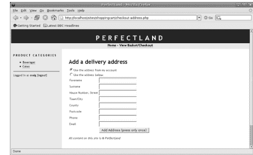

**图 6-7** 当用户已登录时，单选按钮提示用户选择使用哪个地址。

## 支付

结账流程的最后部分是收取付款。网站上的支付处理可以走多种不同的路线：PayPal、NOCHEX、Worldpay 等。本项目提供两种支付方式：PayPal 和支票。这两种方法演示了如何处理自动（PayPal）和手动（支票）购买。

创建一个名为 `checkout-pay.php` 的新文件并添加表单：

```html
<h2>Select a payment method</h2>
<form action='checkout-pay.php' method='POST'>
    <table cellspacing=10>
        <tr>
            <td><h3>PayPal</h3></td>
            <td>
                This site uses PayPal to accept Switch/Visa/Mastercard cards. No PayPal account is required - you simply fill in your credit card details and the correct payment will be taken from your account.
            </td>
            <td><input type="submit" name='paypalsubmit' value='Pay with PayPal'></td>
        </tr>
        <tr>
            <td><h3>Cheque</h3></td>
            <td>
                If you would like to pay by cheque, you can post the cheque for the final amount to the office.
            </td>
            <td><input type='submit' name='chequesubmit' value='Pay by cheque'></td>
        </tr>
    </table>
</form>
```

这个简单的表单仅提供两个提交按钮——一个用于通过 PayPal 支付，另一个用于通过支票支付。处理表单包括两个主要部分——一个用于 PayPal，一个用于支票。

在文件顶部，开始添加代码：

```php
<?php
session_start();
require('db.php');
require('functions.php');
```

如果用户点击 PayPal 按钮，处理订单：

```php
if($_POST['paypalsubmit'])
{
    $supsql = "UPDATE orders SET status = 2, payment_type = 1 WHERE id = " . $_SESSION['SESS_ORDERNUM'];
    $upres = mysql_query($supsql);

    $itemsmsql = "SELECT total FROM orders WHERE id = " . $_SESSION['SESS_ORDERNUM'];
    $itemsres = mysql_query($itemsmsql);
    $row = mysql_fetch_assoc($itemsres);
}
```

`orders` 表被更新以反映订单的完成。`status` 字段更改为 2，`payment_type` 字段设置为 1（PayPal）。然后通过查询从订单中获取总价，以便稍后构建 PayPal 链接。

重置订单会话：

```php
if($_SESSION['SESS_LOGGEDIN'])
{
    unset($_SESSION['SESS_ORDERNUM']);
}
else
{
    session_register("SESS_CHANGEID");
    $_SESSION['SESS_CHANGEID'] = 1;
}
```


如果用户已登录，则使用 `unset()` 移除 `SESS_ORDERNUM` 会话变量。如果没有，则创建一个名为 `SESS_CHANGEID` 的新会话变量。下次加载 `header.php` 时，`header.php` 顶部的代码将重新生成新的会话和 id。

重定向到 www.paypal.com 并附带支付详情：

```php
header("Location: https://www.paypal.com/cgi-bin/webscr?cmd=_xclick&business=you@youraddress.com&item_name=" . urlencode($config_sitename) . "+Order&item_number=PROD" . $row['id'] . "&amount=" . urlencode(sprintf('%.2f', $row['total'])) . "&no_note=1&currency_code=GB&lc=GB&submit.x=41&submit.y=15");
```

在这一行中，一系列 GET 变量向 PayPal 网站传递数据。这些 GET 变量是保留字，PayPal 可以使用它们来处理订单。表 6-4 解释了每个变量的用途。

### 表 6-4 PayPal 变量说明

| PayPal 变量 | 设置 | 描述 |
|---|---|---|
| business | "you%40youraddress.com"& | 正在运行该网站的商业名称。 |
| item_name | urlencode($config_site-name) . "+Order" | 订单的小名称——在本例中为 <sitename> Order`。 |
| item_number | "PROD" . $row['id'] | 产品代码。在此处将 `PROD` 和订单编号连接起来（例如 PROD12）。 |
| amount | urlencode(sprintf('%.2f' , $row['total'])) | 订单金额。 |
| no_note | 1 | no_note 变量指定客户是否应随付款注明说明。将其设置为 1 表示无需说明。 |
| currency_code | GBP | 交易的货币类型。 |
| lc | GB | 交易的地域（locale）。 |

重要的是要记住，作为 GET 变量传输的任何文本信息都应通过 `urlencode()` 进行转义，以处理非标准字符。

开始编写处理支票付款的代码。这段代码与 PayPal 代码类似。

```php
header("Location: https://www.paypal.com/cgi-bin/webscr?cmd=_xclick&business=you%40youraddress.com&item_name=" . urlencode($config_sitename) . "+Order&item_number=PROD" . $row['id'] ."&amount=". urlencode(sprintf('%.2f', $row['total'])) . "&no_note=1&currency_code=GBP&lc=GB&submit.x=41&submit.y=15");
```

```php
else if($POST['chequesubmit'])
{
    $sql = "UPDATE orders SET status = 2, payment_type = 2 WHERE id = '$_SESSION['SESS_ORDERNUM']';
    $res = mysql_query($sql);
```

在此处再次更新订单表，但这次 `payment_type` 是 `2` 而不是 `1`。

像之前一样重置订单：

```php
$res = mysql_query($sql);
if($SESSION['SESS_LOGGEDIN'])
{
    unset($SESSION['SESS_ORDERNUM']);
}
else
{
    session_register("SESS_CHANGEID");
    $SESSION['SESS_CHANGEID'] = 1;
}
```

最后，显示用户应将支票寄往的地址详情：

```php
$SESSION['SESS_CHANGEID'] = 1;
? >

require("header.php");
?>
<h1>使用支票付款</h1>
请让支票的抬头为
<strong><?php echo $config_sitename; ?> </strong> .
<p>
将支票寄送至：
<p>
<?php echo $config_sitename; ?><br>
22, This Place,<br>
This town,<br>
This county,<br>
FG43 F3D.<br>
</p>
? >
}
```

处理现已完成。

打开显示表单的区块。然而，在到达表单之前，添加 `showcart()` 函数以汇总当前购物车：

```php
<?php
    }
    else
    {
        require("header.php");
        echo "<h1>Payment</h1>";
        showcart();
    }
?>

<h2>选择付款方式</h2>
<form action='checkout-pay.php' method='POST'>

    最后，添加闭合代码：

    </table>
    </form>

<?php
    }

    require("footer.php");
?>
```

你全新的、自制的付款界面现在应该类似于图 6-8。

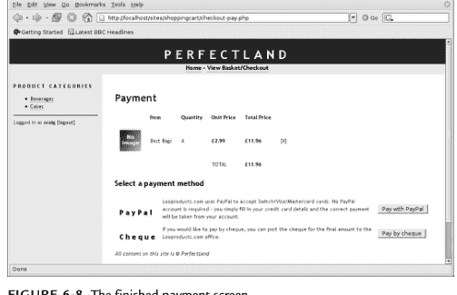

**图 6-8 完成的付款界面**

## 管理员页面

购物车的管理端非常简单。管理员的主要功能是查看和确认已完成的订单。当订单被确认后，管理员已成功发出产品。

第一步是提供管理员登录。创建一个名为 `adminlogin.php` 的新文件并添加以下代码：

```php
<?php
session_start();
require("db.php");

if(isset($_SESSION['SESS_ADMINLOGGEDIN']) == TRUE) {
	header("Location: " . $config_basedir);
}

if($_POST['submit'])
{
	$login_sql = "SELECT * FROM admins WHERE
username = '" . $_POST['userBox'] . "' AND
password = '" . $_POST['passBox'] . "'";
	$loginres = mysql_query($login_sql);
	$numrows = mysql_num_rows($loginres);

	if($numrows == 1)
	{
		$loginrow = mysql_fetch_assoc($loginres);
		session_register("SESS_ADMINLOGGEDIN");
		$_SESSION['SESS_ADMINLOGGEDIN'] = 1;

		header("Location: " . $config_basedir . "adminorders.php");
	}
	else
	{
		header("Location: " . $config_basedir
		. "adminlogin.php?error=1");
	}
}
else
{

	require("header.php");

echo "<h1>Admin Login</h1>";
```

```php
if($_GET['error'] == 1) {
    echo "<strong>Incorrect username/password!</strong>";
}
?>
<p>
<form action="<?php echo $SCRIPT_NAME; ?>" method="POST">
<table>
    <tr>
        <td>Username</td>
        <td><input type="textbox" name="userBox">
    </tr>
    <tr>
        <td>Password</td>
        <td><input type="password" name="passBox">
    </tr>
    <tr>
        <td></td>
        <td><input type="submit" name="submit" value="Log in">
    </tr>
</table>
</form>

<?php
}

require("footer.php");
?>
```


这部分代码的大部分对你来说应该很熟悉。当管理员成功登录后，会创建 `SESS_ADMINLOGGEDIN` 变量。

## 注销管理员

要注销管理员，创建一个名为 `adminlogout.php` 的文件并添加以下代码：

```php
<?php

session_start();

require("config.php");

session_unregister("SESS_ADMINLOGGEDIN");

header("Location: " . $config_basedir);
?>
```

与正常用户注销一样，你注销了该变量——而不是销毁整个会话。这防止了当管理员同时以管理员和用户身份登录时完全被注销。

## 管理已完成的订单

主要管理员页面显示已完成订单的列表。此页面的目的是使管理员能够查看哪些订单需要邮寄产品。然后，管理员可以创建包裹，并在邮寄后确认订单。

此页面相当直接；它只是从一些表中输出数据。脚本有两种主要状态：显示订单或确认它们。默认页面显示订单。如果你向该页面传递 `func=conf` GET 变量和订单编号，订单将被确认。

创建一个名为 `adminorders.php` 的新文件并开始添加代码：

```php
<?php
session_start();

require("config.php");
require("db.php");
require("functions.php");

if(isset($_SESSION['SESS_ADMINLOGGEDIN']) == FALSE) {
header("Location: " . $config_basedir);
}
```

在通常的引导代码之后，检查 `func` GET 变量是否存在：

```php
if(isset($_GET['func']) == TRUE) {
if($_GET['func'] != "conf") {
header("Location: " . $config_basedir);
}

$validid = pf_validate_number($_GET['id'],
"redirect", $config_basedir);

$fmysql = "UPDATE orders SET
status = 10 WHERE id = " . $_GET['id'];
mysql_query($fmysql);

header("Location: " . $config_basedir . "adminorders.php");
}
```

如果 `func` GET 变量存在，当变量被设置为 `conf` 以外的任何值时，页面会重定向；这防止了 SQL 注入攻击。接下来，验证 `id` GET 变量。最后通过更新订单表并将状态字段设置为 10 来确认订单。然后页面重定向到订单摘要。

如果不存在 `func` GET 变量，设置页面显示已完成的订单：

```php
else {
    require("header.php");
    echo "<h1>Outstanding orders</h1>";
    $orderssql = "SELECT * FROM orders WHERE status = 2";
    $ordersres = mysql_query($orderssql);
    $numrows = mysql_num_rows($ordersres);

    if($numrows == 0)
    {
        echo "<strong>No orders</strong>";
    }
    else
    {
        echo "<table cellspacing=10>";

        while($row = mysql_fetch_assoc($ordersres))
        {
            echo "<tr>";
            echo "<td><a
href="adminorderdetails.php?id=". $row['id']
.">View</a></td>";
            echo "<td>"
. date("D jS F Y g.iA", strtotime($row['date']))
. "</td>";
            echo "<td>";

            if($row['registered'] == 1)
            {
                echo "Registered Customer";
            }
            else
            {
                echo "Non-Registered Customer";
            }

            echo "</td>";

            echo "<td>&pound;" . sprintf('%.2f',
$row['total']) . "</td>";

            echo "<td>";

            if($row['payment_type'] == 1)
            {
```

## 查看特定订单

为了让管理员获取某个特定订单的邮政地址，她需要查看该订单的具体详情。下一页列出了订单信息（订单号、地址、已购产品、支付方式等）。

创建一个名为 `adminorderdetails.php` 的新文件，并添加以下代码：


```php
<?php
session_start();

require("config.php");
require("functions.php");

if(!isset($_SESSION['SESS_ADMINLOGGEDIN']) == FALSE) {
header("Location: " . $basedir);}

$validid = pf_validate_number($_GET['id'],
"redirect", $config_basedir . "adminorders.php");
require("header.php");

echo "<h1>Order Details</h1>";
echo "<a href='adminorders.php'>&lt;-- go back
to the main orders screen</a>";

$ordersql = "SELECT * from orders WHERE id = " . $validid;
$orders = mysql_query($ordersql);
$ordrow = mysql_fetch_assoc($orders);

echo "<table cellpadding=10>";
echo "<tr><td><strong>Order Number</strong>"
</td><td>" . $ordrow['id'] . "</td>";
echo "<tr><td><strong>Date of order</strong>"
<td><td>" . date('D jS F Y g.iA',
strtotime($ordrow['date'])) . "</td>";
echo "<tr><td><strong>Payment Type</strong></td><td>";
if($ordrow['payment_type'] == 1)
{
echo "PayPal";
}
else
{
echo "Cheque";
}
echo "</td>";
echo "</table>";

if($order['delivery_add_id'] == 0)
{
    $addsql = "SELECT * FROM customers
    WHERE id = " . $order['customer_id'];
    $addres = mysql_query($addsql);
}
else
{
    $addsql = "SELECT * FROM delivery_addresses
    WHERE id = " . $order['delivery_add_id'];
    $addres = mysql_query($addsql);
}

$addrow = mysql_fetch_assoc($addres);

echo "<table cellpadding=10>";
echo "<tr>";
echo "<td><strong>Address</strong></td>";
echo "<td>" . $addrow['forename'] . "
    " . $addrow['surname'] . "</br>";
echo "     " . $addrow['addr1'] . "</br>";
echo "     " . $addrow['add2'] . "</br>";
echo "     " . $addrow['add3'] . "</br>";
echo "     " . $addrow['postcode'] . "</br>";

echo "</br>";

if($order['delivery_add_id'] == 0)
{
    echo "<i>Address from member account</i>";
}
else
{
    echo "<i>Different delivery address</i>";
}

echo "</td></tr>";
echo "<tr><td><strong>Phone</strong></td><td>" . $addrow['phone'] . "</td></tr>";
echo "<tr><td><strong>Email</strong></td>" . "<td><a href='mailto:" . $addrow['email'] . "'>" . $addrow['email'] . "</a></td></tr>";
echo "</table>";

$items_sql = "SELECT products.*, orderitems.* ,
    orderitems.id AS itemid FROM products, orderitems
    WHERE orderitems.product_id = products.id AND order
    _id = " . $validid;
$itemsres = mysql_query($items_sql);
$items_numrows = mysql_num_rows($itemsres);

echo "<h1>Products Purchased</h1>";

echo "<table cellpadding=10>";
echo "<th></th>";
echo "<th>Product</th>";
echo "<th>Quantity</th>";
echo "<th>Price</th>";
echo "<th>Total</th>";

while($itemrow = mysql_fetch_assoc($itemsres))
{
    $quantitytotal = $itemrow['price']
* $itemrow['quantity'];
    echo "<tr>";

    if(empty($itemrow['image'])) {
        echo "<td>"</td>";
    } else {
        echo "<td>"</td>";
    }

    echo "<td>" . $itemrow['name'] . "</td>";
    echo "<td>" . $itemrow['quantity'] . " x </td>";
    echo "<td><strong>&pound;" . sprintf('%.2f',
$itemrow['price']) . "</strong></td>";
    echo "<td><strong>&pound;" . sprintf('%.2f',
$quantitytotal) . "</strong></td>";

    echo "</tr>";
}

echo "<tr>";
    echo "<td></td>";
    echo "<td></td>";
    echo "<td></td>";
    echo "<td>TOTAL</td>";
    echo "<td><strong>&pound;" . sprintf('%.2f', $total)
."</strong></td>";

echo "</table>";

require("footer.php");
?>
```

这段代码对你来说应该很熟悉；它仅仅显示了来自 `orders`、`orderitems` 和 `delivery_addresses` 表的详细信息。

完成的页面应该如图 6-10 所示。


## 摘要

在这个项目中，多种不同的技能结合在一起以创建一致的产品。尽管你只触及了可以为购物车系统添加的可能功能的一小部分，但你开发了核心功能。你可以进行大量可能的附加开发，包括以下内容：

- 当订单完成时，向用户和管理员发送确认邮件。
- 在首页提供一个随机产品框。这可以用于显示产品图片以吸引用户。
- 创建一个评分系统，让用户可以评价产品。
- 创建一个评论和审查系统，让用户可以留下他们对产品有效性的看法。
- 创建销售报告。

你可以利用本书中已经涵盖的技能来开发这些每一个可能的附加功能。只需坐下来，构思一下如何编写该功能的初步想法，然后动手实现即可。

# 第 7 章

## 构建在线拍卖网站

如果你在互联网上四处逛逛，你可能会发现只有极少数人从未访问或使用过 `eBay`。这个受欢迎的拍卖网站已成为许多用户互联网生活的一部分，花一个下午浏览各种物品是轻而易举的事。


在本章中，你将创建自己的拍卖网站。我们的目标不是创建一个继 eBay 之后的网站，而是通过这个项目教会你编码拍卖网站涉及的许多概念。而且，这些概念在其他项目中也很有用。一个例子就是处理出价的核心功能。你可以将用于处理出价的相同逻辑应用到在线投票网站、民意调查、测验等。因此，本章的好处不仅仅在于你最终得到的产品，更在于你创造它时所经历的旅程。

## 项目概述

本项目实现了拍卖网站的核心功能：

- 页面显示不同物品类型的不同类别系列。
- 在首页，将列出所有类别的可用物品列表。用户可以点击类别名称来查看其中的物品。仅显示在出价截止之前的物品。
- 用户可以注册并登录网站。
- 用户可以查看物品——包括图片——并进行出价。
- 用户可以添加物品——包括图片——到网站。
- 当拍卖结束时，物品所有者和中标者会收到包含拍卖结束详情的电子邮件消息。

从一开始看，构建拍卖网站似乎相当简单。实际上，有一些有趣的挑战可以考验你的 PHP 和 SQL 知识的范围。因此，该项目将为你的工具箱增添一些有用的新技能。

## 构建数据库

本项目中使用的数据库相对简单，包含五个表。这些表如图 7-1 所示。


数据库中的每个表都关联到 *items* 表，该表提供有关网站上的物品的信息。在 *items* 表中，你还引用了 *categories* 表（用于确定物品所属的类别）、*users* 表（用于指定添加物品的用户）、*bids* 表（用于存储针对特定物品的每个出价）以及 *images* 表（用于存储添加到物品的图像）。

### 实现数据库

启动 phpMyAdmin。创建一个名为 `auction` 的新数据库，并添加以下表：

#### `categories` 表

- id. 将其设为 TINYINT（类别不会很多），并在 Extras 列中开启 `auto_increment`。将此字段设为主键。
- cat. 将其设为 VARCHAR，大小设置为 20。类别标题不太可能超过 20 个字母。

#### `users` 表

- id. 将其设为 INT（可能有多个用户），并开启 `auto_increment`。将此字段设为主键。
- username. 将其设为长度为 10 的 VARCHAR。

## 用户表

- **password**。将此字段设为长度为 10 的 `VARCHAR`。
- **email**。将此字段设为长度为 100 的 `VARCHAR`。你对某些政府电子邮件地址的长度会感到惊讶！
- **verifystring**。将此字段设为长度为 20 的 `VARCHAR`。
- **active**。将此字段设为 `TINYINT`。

## 物品表

- **id**。将此字段设为 `INT`（可能存在多个物品），并开启 `auto_increment`。将此字段设为主键。
- **user_id**。将此字段设为 `INT`。
- **cat_id**。将此字段设为 `TINYINT`。
- **name**。将此字段设为长度为 100 的 `VARCHAR`。物品标题通常较长。
- **startingprice**。将此字段设为 `FLOAT`。对于带有小数点的商店价格（例如 $22.90），使用此类型；FLOAT 支持小数点。
- **description**。将此字段设为 `TEXT`。
- **dateends**。将此字段设为 `DATETIME`。
- **endnotified**。将此字段设为 `TINYINT`。

## 出价表

- **id**。将此字段设为 `INT`（可能存在多个出价）。开启 `auto_increment`。将此字段设为主键。
- **item_id**。将此字段设为 `INT`。
- **amount**。对于带有小数点的商店价格，将此字段设为 `FLOAT`。
- **user_id**。将此字段设为 `INT`。

## 图片表

- **id**。将此字段设为 `INT`（可能存在多个图片）。开启 `auto_increment`。将此字段设为主键。
- **item_id**。将此字段设为 `INT`。
- **name**。将此字段设为长度为 100 的 `VARCHAR`。图片文件名很可能很长。

#### 插入示例数据

在创建完表格后，在向表格中填入一些初始数据以测试正在编写的代码是非常有用的。请记住，在向这些表格中的任何一个添加数据时，不要在 id 列中填写数字；这由 `auto_increment` 处理。

## `categories` 表的示例数据

按以下顺序添加类别：计算设备、乐器。

## `items` 表的示例数据

将表 7-1 中显示的信息添加到 items 表中。

表 7-1 items 表数据

| USER_ID | CAT_ID | NAME | STARTINGPRICE | DESCRIPTION | DATEENDS | ENDNOTIFIED |
|---|---|---|---|---|---|---|
| 1 | 1 | 网页开发笔记本 | 200.00 | 一款优质的网页开发笔记本电脑。 | 添加一个未来的日期。 | 0 |
| 1 | 1 | 56k 调制解调器 | 39.99 | 全新的 56k 调制解调器。 | 添加一个未来的日期 | 0 |

在这个例子中，你在 `cat_id` 中引用了 `categories` 表中的第一个条目（计算设备），并在 `users` 表中引用了一个用户（通过 `user_id` 字段）。这创建了表之间的关系。

## `users` 表的示例数据

将表 7-2 中显示的信息添加到 users 表中。

表 7-2 两个用户被添加到 `users` 表中。

| USERNAME | PASSWORD | EMAIL | VERIFYSTRING | ACTIVE |
|---|---|---|---|---|
| johnsmith | password | john@smith.com | | 1 |
| bob | password | foo@bar.com | | 1 |

## `bids` 和 `images` 表的示例数据

保持这些表为空。

## 开始编码

首先，创建通常的配置文件，以存储关于网站的通用信息（如示例 7-1 所示）。在新目录中创建它，并将其命名为 `config.php`。

示例 7-1 此配置文件存储关于网站的一般信息。

```php
<?php
    $dbhost = "localhost";
    $dbuser = "root";
    $dbpassword = "";
    $dbdatabase = "auction";

    // Add your name below
    $config_admin = "JonO Bacon";
    $config_adminemail = "jono AT jonobacon DOT org";

    // Add the location of your forums below
    $config_basedir = "http://localhost/sites/auction/";

    // The currency used on the auction
    $config_currency = "$";
?>
```

现在，这些设置中的大多数对你来说应该很熟悉。该文件唯一的增加是 `$config_currency` 变量，它存储网站使用的货币类型（例如美元、英镑、欧元等）。如果你的赚钱的拍卖帝国发展，你可以使用此变量轻松地切换到另一种货币。

构建另一个简单的结构来包裹你的页面。创建一个名为 `header.php` 的文件，并添加示例 7-2 中显示的代码。

示例 7-2 头部代码展示了网站设计的顶部部分。

```php
<?php
    session_start();

    require("config.php");

    $db = mysql_connect($dbhost, $dbuser, $dbpassword);
    mysql_select_db($dbdatabase, $db);
?>
```

示例 7-2 续。


```html
<!DOCTYPE HTML PUBLIC "-//W3C//DTD HTML 4.01 Transitional//EN" "http://www.w3.org/TR/html4/loose.dtd">
<html>
<head>
    <title><?php echo $config_forumname; ?> </title>
    <link rel="stylesheet" href="stylesheet.css" type="text/css" />
</head>
<body>
    <div id="header">
        <h1>BidTastic Auctions</h1>
        <div id="menu">
            <a href="index.php">Home</a>
<?php
    if(isset($_SESSION['USERNAME']) == TRUE) {
        echo "<a href='logout.php'>Logout</a>";
    }
    else {
        echo "<a href='login.php'>Login</a>";
    }
?>
            <a href="newitem.php">New Item</a>
        </div>
        <div id="container">
            <div id="bar">
                <?php require("bar.php"); ?>
            </div>
            <div id="main">
```

这个头部文件与你之前项目中创建的几乎完全相同。

创建 `footer.php`，如示例 7-3 所示。

### 示例 7-3 网站的底部代码

```html
<p>&copy; <?php echo "<a href='mailto:"
        . $config_adminemail . "'">" . $config_admin
        . "</a>"; ?> </p>
</div>
</div>
</body>
</html>
```

在开始编写拍卖代码之前要创建的最后一个文件是 `functions.php`。在此项目中，你使用了在论坛项目中使用的 `pf_script_with_get()` 函数，但你还将创建另一个炫酷的函数，称为 `pf_validate_number()`。从论坛项目中复制 `functions.php`，并在 `pf_script_with_get()` 函数之后添加示例 7-4 中显示的代码。

### 示例 7-4 `pf_validate_number()` 函数验证一个数字，并返回 `0` 或重定向。

```
}
function pf_validate_number($value, $function, $redirect) {
   if(isset($value) == TRUE) {
      if(is_numeric($value) == FALSE) {
         $error = 1;
      }
      if($error == 1) {
         header("Location: " . $redirect);
      }
      else {
         $final = $value;
      }
   }
   else {
      if($function == 'redirect') {
         header("Location: " . $redirect);
      }
      if($function == "value") {
         $final = 0;
      }
   }
   return $final;
}
?>
```

此函数将你在之前页面中编写的数字验证代码包装在一个函数内部。这使得文件不那么杂乱，因为任何重复的代码都可以存储在一个你可以调用的函数中。

该函数接受三个选项。第一个选项将你要验证的值传递给函数。你将第二个选项设置为 `redirect` 或 `value`。

如果你传递 `redirect`，当要验证的值失败时，第三个选项用作要重定向到的页面。如果你向函数传递 `value`，如果待验证的变量无效，则从函数返回零（0）。

## 显示拍卖物品

第一个挑战是创建一个拍卖类别列表和一个拍卖物品列表。这些列表看起来将类似于图 7-2 中所示的那些。


图 7-2 侧边栏是包含类别列表的理想区域。

此过程涉及创建一个下拉菜单，以便当用户点击物品时，可以在单独的页面上查看有关它的更多信息。

`items` 表是大部分操作发生的地方。在此表中，存储典型的详细信息，如物品名称、描述和起始价格。（每个拍卖都需要一个起始价格，即使该起始价格为 0。）`dateends` 字段尤为重要，它指示拍卖结束的日期；这在后面将广泛使用。最后一个字段（`endnotified`）对于创建物品列表页面无关紧要。此字段在后面用于发送电子邮件，汇总物品的最终价格和出价者。目前你可以忽略此字段。

### 注意

#### 下钻功能的得失

下钻功能的主要目的是提供一个汇总项列表，点击每一项即可获取更多信息。这种技术是有效组织整个站点信息的实用手段。

使用下钻功能时，你需要思考要在列表中汇总哪些信息。在许多情况下，这一点很明确，但在某些情况下，你可能需要进行一些调研，以清楚地了解用户在网站上主要查找的信息。

## 显示分类

要使分类以项目符号列表的形式出现在左侧边栏中，请将以下代码添加到 `bar.php` 中：

```php
require("header.php");

$catsql = "SELECT * FROM categories ORDER BY category ASC";
$catsresult = mysql_query($catsql);

echo "<h1>Categories</h1>";
echo "<ul>";
echo "<li><a href='index.php'>View All</a></li>";
while($catrow = mysql_fetch_assoc($catsresult)) {
  echo "<li><a href='index.php?id="
       . $catrow['id'] . '=' . $catrow['category']
       . "</a></li>";
}
echo "</ul>";
```

该查询按字母顺序选择 `categories` 表中的所有数据。一个无序列表包含这些分类，并添加了第一个条目（View All）；该条目链接到 `index.php`，且不包含 `id` GET 参数。借助之前添加的 `pf_validate_number()` 函数，如果不存在 `id` GET 参数，`$validid` 将被设置为 0；这就是用户点击 View All 时发生的情况。接下来，`while` 循环遍历各分类并创建指向 `index.php` 的链接，其中分类 `id` 作为 GET 参数传递（同样称为 `id`）。至此，分类列表构建完成。

## 查看分类中的商品

网站主页显示可用商品列表。大多数访问拍卖网站的人希望立即找到提供的商品范围，因此将此信息放在主页上是合理的。

创建一个名为 `index.php` 的文件，并添加以下代码：

```php
<?php
require("config.php");
require("functions.php");
?>
```

`index.php` 的规划功能之一是列出用户可点击以查看该分类中商品的分类范围。要实现此功能，分类被列为一组链接，每个链接通过 GET 参数（称为 `id`）传递分类 ID。使用 `pf_validate_number()` 函数来验证此参数：

```php
require("functions.php");
$validid = pf_validate_number($_GET['id'], "value", $config_basedir);
```

为了开始在页面上显示信息，请添加 `header.php` 代码：

```php
$validid = pf_validate_number($_GET['id'], "value", $config_basedir);
require("header.php");
```

在主页显示拍卖商品时，需要根据是否存在 `id` GET 参数使用不同的查询。如果不存在，说明用户点击了 View All，未选择任何分类，因此页面应显示所有商品。如果存在 `id` GET 参数，则仅显示该分类内的商品。在使用 `pf_validate_number()` 函数时，将 `value` 选项用作第二个参数，以便在不存在 `id` GET 参数时函数返回 0。


检查 `$validid` 被设置为何值，以确定使用哪个 SQL 查询：

```php
require("header.php");
if($validid == 0) {
    $sql = "SELECT items.* FROM items WHERE dateends > NOW()";
} else {
    $sql = "SELECT * FROM items WHERE dateends > NOW() AND cat_id = " . $validid . " ";
}
$result = mysql_query($sql);
$numrows = mysql_num_rows($result);
```

如果 `$validid` 等于 0，则选择 *items* 表中 `dateends` 大于（新于）当前日期和时间（`NOW()`）的商品。如果 `$validid` 被设置为某个值，则选择 *items* 表中新于当前日期且 `cat_id` 匹配 `$validid` 值的商品。

## 第 7 章 构建在线拍卖网站

创建一个新的 `<div>` 并添加一个表格以列出商品：

```php
$result = mysql_query($sql);
$numrows = mysql_num_rows($result);

echo "<h1>Items available</h1>";
echo "<table cellpadding=\"5\">";
echo "<tr>";
    echo "<th>Image</th>";
    echo "<th>Item</th>";
    echo "<th>Bids</th>";
    echo "<th>Price</th>";
echo "</tr>";
```

通过检查 `$numrows` 的值来确定是否有可用商品：

```php
if($numrows == 0) {
    echo "<tr><td colspan=4>No items!</td></tr>";
}
```

如果 `$numrows` 等于 0（未返回任何行），则在表格中显示文本 No items!。

如果返回了商品且 `$numrows` 大于 0，你可以遍历每个商品并在表格中显示它们：

```php
if($numrows == 0) {
    echo "<tr><td colspan=4>No items!</td></tr>";
}
else {
    while($row = mysql_fetch_assoc($result)) {
        $imagesql = "SELECT * FROM images WHERE item_id = " . $row['id'] . " LIMIT 1";
        $imageresult = mysql_query($imagesql);
        $imagenumrows = mysql_num_rows($imageresult);

        echo "<tr>";
        if($imagenumrows == 0) {
            echo "<td>No image</td>";
        }
        else {
            $imagerow = mysql_fetch_assoc($imageresult);
            echo "<td></td>";
        }
```

`while` 循环遍历结果集。在循环内部，一个查询从 `images` 表中选择单条记录，其中 `item_id` 与当前行的 `id` 匹配。然后打开表格行，并检查 `$imagenumrows` 是否等于 0。如果是，则在表格中显示文本 No image。如果 `$imagenumrows` 不等于 0，则从图像查询结果中提取一行并构建图像标签。创建图像标签时，在 `src` 属性中添加 `./images/` 以及表中的图像名称。这会将 `images` 目录附加到当前目录。当你稍后编写上传图像的功能时，这段代码的大部分含义会更清晰。

将包含商品名称的下一列添加到表格中：

```php
echo "<td></td>";
}

echo "<td>";
echo "<a href='itemdetails.php?id=" . $row['id'] . ">" . $row['name'] . "</a>";
if($_SESSION['USERID'] == $row['user_id']) {
    echo " - [<a href='edititem.php?id=" . $row['id'] . ">edit</a>]";
}
echo "</td>";
```

此代码添加来自第一个查询的商品名称。使商品成为链接，指向 `itemdetails.php`（该页面提供有关商品的更多详细信息），并将商品 ID 作为 `id` GET 参数附加。`if` 语句还检查名为 `USERID` 的会话变量是否等于该行的 `user_id`。如果是，则当前登录用户就是添加该商品的用户，因此会添加一个编辑链接。该编辑链接指向一个名为 `edititem.php` 的页面，顾名思义，该页面用于编辑当前商品。

添加另一列以显示出价次数和最高出价：

```php
echo "</td>";

$bidsql = "SELECT item_id, MAX(amount) AS highestbid, COUNT(id) AS numberofbids FROM bids WHERE item_id='" . $row['id'] . "' GROUP BY item_id";
$bidresult = mysql_query($bidsql);
$bidrow = mysql_fetch_assoc($bidresult);
$bidnumrows = mysql_num_rows($bidresult);

echo "<td>";
if($bidnumrows == 0) {
    echo "0";
} else {
    echo $bidrow['numberofbids'] . "</td>";
}

echo "<td>" . $config_currency;

if($bidnumrows == 0) {
    echo sprintf('%.2f', $row['startingprice']);
} else {
    echo sprintf('%.2f', $bidrow['highestbid']);
}
echo "</td>";
```

此查询使用了一些 MySQL 函数来确定最高出价和出价次数。为了更好地解释这一点，请从左到右阅读以下 SQL：

选择 `SELECT` `item_id`，使用 MySQL `MAX()` 函数在 `amount` 字段中找到最大值，并将该字段别名为 `highest bid`（`MAX(amount) AS highestbid`）。使用 MySQL `COUNT()` 函数统计记录数，并将该字段别名为 `numberofbids`（`COUNT(id) AS numberofbids`），来源于 `bids` 表（`FROM bids`），其中 `item_id` 等于 `$row['id']`（`WHERE item_id = $row['id']`），并按 `item_id` 对记录进行分组（`GROUP BY item_id`）。

如果查询未返回任何行，则在表格中添加 0；否则，添加 `numberofbids` 的值。当不存在行时，`$bidnumrows` 不会返回 0，因为如果没有出价，`bids` 表中就没有条目可供 `COUNT()` 函数统计。因此，不会返回任何内容。在编程中请记住，0 是一个值，它通常与“无”的概念不同。

下一列是最新价格。在显示数值之前，会从 `$config_currency` 字段添加货币符号。


### 处理货币

在处理价格、报价、数字等其他货币单位时，永远不要在数据库中包含货币符号。货币实际上只是一种额外的信息，用于为数字提供上下文。如果你希望在数据库中包含货币符号，请将数字和符号作为 `VARCHAR` 存储。

将价格存储为不带符号的数字，可以执行诸如税费、额外费用、货币转换及其他计算等操作。

如果 `$bidnumrows` 没有行，则显示第一个查询中的 `startingprice` 字段（如果没有出价，则应显示起始价格）。如果有出价，则显示最后一个查询中的最高出价（`$bidrow['highestbid']`）。两个价格都会经过格式化。

**注意：价格格式化**


当你在数据库中使用 `FLOAT` 存储价格时，尾部的零默认会被移除。为了将价格重新格式化为带零的形式，请使用 PHP 函数 `sprintf()`。该函数接受两个参数：格式化字符串和要格式化的值。格式化字符串可以接受诸如 `%.2f` 这样的值，它要求浮点数保留两位小数（`.2`）（`f`）。

最后，显示并格式化 `dateends` 字段：

```php
}
echo "</td>";

echo "<td>" . date("D jS F Y g:iA",
  strtotime($row['dateends'])) . "</td>";
echo "</tr>";
}
echo "</table>";
require("footer.php");
?>
```

## 查看物品详情和进行出价

下一个页面链接自你刚刚创建的页面上的物品名称。此脚本有两个主要目的：

- 显示关于该物品的信息，包括其图片。
- 允许用户对该物品进行出价。

为了进行出价，你需要检查用户是否已登录，如果是，则显示一个表单，用户可以在其中输入出价金额。然后页面检查金额是否有效，并将出价添加到 `bids` 表中。

创建一个名为 `itemdetails.php` 的新文件，并添加通常的引导代码：

```php
<?php
session_start();
include(config.php);
include(functions.php);
$db = mysql_connect($dbhost, $dbuser, $dbpassword);
mysql_select_db($database, $db);
$validid = pf_validate_number($_GET['id'], "redirect", $config_basedir);
```

创建一个查询以获取物品信息：

```php
$validid = pf_validate_number($_GET['id'], "redirect", $config_basedir);
require(header.php);
$itemsql = "SELECT UNIX_TIMESTAMP(dateends) AS dateepoch, items.* FROM items WHERE id = '" . $validid . "'";
$itemresult = mysql_query($itemsql);
$itemrow = mysql_fetch_assoc($itemresult);
```

在 `index.php` 中，只有比日期和时间更新的物品会被 `MySQL_NOW()` 函数返回。为了完整性，该页面使用 PHP 而不是 `MySQL` 来检查这一点。

在查询中，`UNIX_TIMESTAMP()` 命令将 `dateends` 字段转换为自纪元开始的秒数。然后执行该查询，并将一行存储在 `$itemrow` 数组中。

检查当前物品是否已结束：

```php
$itemrow = mysql_fetch_assoc($itemresult);
$nowepoch = mktime();
$rowepoch = $itemrow['dateepoch'];
if($rowepoch < $nowepoch) {
    $VALIDACTION = 1;
}
```

`mktime()` 函数将当前时间的自纪元开始的秒数存储在 `$nowepoch` 变量中。然后 `$rowepoch` 变量存储该行返回的纪元。进行检查以确定 `$rowepoch` 是否大于 `$nowepoch`，如果是，则名为 `$VALIDAUCTION` 的变量被设置为 1（变量名称的大写仅用于在代码中使其突出）。`$VALIDAUCTION` 稍后会被检查以确定拍卖是否有效（仍然可以出价）。

在二级标题标签中添加物品名称：

```php
if($rowepoch > $nowepoch) {
    $VALIDAUCTION = 1;
}

echo "<h2>" . $itemrow['name'] . "</h2>";
```

现在运行一个查询以获取与物品关联的所有图片：

```php
echo "<h2>" . $itemrow['name'] . "</h2>";

$imagesql = "SELECT * FROM images WHERE item_id = " . $validid . ";";
$imageesult = mysql_query($imagesql);
$imagenumrows = mysql_num_rows($imageesult);
```

下一个查询返回该物品的最高出价和出价数量：

```php
$imagenumrows = mysql_num_rows($imageesult);

$bidsql = "SELECT item_id, MAX(amount) AS highestbid, COUNT(id) AS number_of_bids FROM bids WHERE item_id="
    . $validid . " GROUP BY item_id";
$bidresult = mysql_query($bidsql);
$bidnumrows = mysql_num_rows($bidresult);
```

前面的查询与在 `index.php` 中用于获取相同信息的查询类似。

显示查询中的信息：

```php
$bidnumrows = mysql_num_rows($bidresult);

echo "<p>";

if($bidnumrows == 0) {
    echo "<strong>This item has had no bids</strong>
    - <strong>Starting Price</strong>: " . $config_currency
    . sprintf('%.2F', $itemrow['startingprice'])";
}
else {
    $bidrow = mysql_fetch_assoc($bidresult);
```

```php
echo "<strong>Number Of Bids</strong>: "
. $bidrow['number_of_bids'] . "
- <strong>Current Price</strong>: " . $config_currency
. sprintf('%2f', $bidrow['highestbid']);
}
```

如果在 `$bidnumrows` 中没有计数到任何行，页面不仅显示表明没有出价的文本，还显示起始价格。当存在行时，页面显示出价数量和最高出价价格。

显示拍卖结束日期：

```php
echo "<strong>Number Of Bids</strong>: "
. $bidrow['number_of_bids'] . "
- <strong>Current Price</strong>: " . $config_currency
. sprintf('%2f', $bidrow['highestbid']);
}
```

```php
echo " - <strong>Auction ends</strong>: "
. date("D J S F Y g.iA", $rowepoch);
```

显示物品的任何图片：

```php
echo " - <strong>Auction ends</strong>: "
. date("D J S F Y g.iA", $rowepoch);

echo "</p>";

if($imagenumrows == 0) {
  echo "No images.";
}
else {
  while($imagerow = mysql_fetch_assoc($imageresult)) {
    echo "";
  }
}
```

检查 `$imagenumrows` 变量以确定是否返回了任何行。如果没有，则显示文本 No images。如果返回了行，`while` 循环显示每张图片。

添加物品描述。使用 `nl2br()` 函数以确保添加任何空白行：

```php
}

echo "<p>" . nl2br($itemrow['description']) . "</p>";
```

现在你可以开始着手添加出价输入框。此功能仅应在用户已登录时可用。首先，显示一个标题以指示出价区域：

```php
echo "<p>" . nl2br($itemrow['description']) . "</p>";

echo "<a name='bidbox'>";
echo "<h2>Bid for this item</h2>";
```

此代码中的锚点在用户未登录、点击登录链接并被重定向到出价区域时使用。

要查看用户是否已登录，请检查 `USERNAME` 会话变量：


```php
echo "<h3>Bid for this item</h3>";

if(!isset($_SESSION['USERNAME']) == FALSE) {
    echo "To bid, you need to log in. Login"
    "<a href='login.php?id=' . $validid . '&ref=addbid'>here</a>.";
}
```

如果用户未登录且 `isset()` 函数返回 `FALSE`，用户可以点击链接登录。登录链接将物品的 `id` 和一个名为 `ref` 的变量作为 `GET` 变量添加。这与论坛项目中使用的技术相同。

如果用户已登录，则运行代码：

```php
echo "To bid, you need to log in. Login"
"<a href='login.php?id=' . $validid . '&ref=addbid'>here</a>.";
} else {
    if($VALIDAUCTION == 1) {
        echo "Enter the bid amount into the box below.";
        echo "<p>";

        switch($_GET['error']) {
            case "lowprice":
                echo "The bid entered is too low.
Please enter another price.";
                break;
            case "letter":
                echo "The value entered is not a number.";
                break;
        }
}
```

```php
?>
```

如果 `$VALIDAUCTION` 等于 `1`，`switch` 语句检查 `error` `GET` 变量的值，并显示相应的错误。

添加表单：

```php
<?php echo pf_script_with_get($SCRIPT_NAME);
?> method="post">
 <table>
 <tr>
 <td><input type="text" name="bid"/></td>
 <td><input type="submit" name="submit" value="Bid!"/></td>
 </tr>
 </table>
 </form>
```

如果 `$VALIDAUCTION` 未设置为 `1`，告知用户拍卖已结束：

```php
<?php
} else {
 echo "This auction has now ended.";
}
```

在出价框之后，列出出价历史及进行出价的用户很有帮助：

```php
} else {
 echo "This auction has now ended.";
}
$historysql = "SELECT bids.amount, users.username FROM bids,
 users WHERE bids.user_id = users.id AND item_id = "
 . $validid . " ORDER BY amount DESC";
$historyresult = mysql_query($historysql);
$historynumrows = mysql_num_rows($historyresult);

if($historynumrows >= 1) {
 echo "<h2>Bid History</h2>";
 echo "<ul>";
 while($historyrow = mysql_fetch_assoc($historyresult)) {
 echo "<li>" . $historyrow['username'] . " - "
 . $config_currency . sprintf('%.2f', $historyrow['amount']) . "</li>";
 }
 echo "</ul>";
}
```

前面的代码创建了一个查询，按降序返回出价金额和用户名。然后进行检查，判断行数是否大于或等于 `1`。如果是，则显示出价历史。

最后，添加页脚：

```php
echo "</ul>";
}
require("footer.php");
?>
```

主页面完成后，添加处理出价的代码。在 `itemdetails.php` 的开头添加此代码：

```php
$validid = pf_validate_number($_GET['id'], "redirect", $config_basedir);

if($_POST["submit"]) {
if(is_numeric($_POST["bid"]) == FALSE) {
header("Location: " . $config_basedir . "/itemdetails.php?id=" . $validid . "&error=letter");
}
```

检查出价是否为数值。如果不是，页面将重定向。在出价被接受之前，添加以下查询以获取一些信息：

```php
header("Location: " . $config_basedir
. "/itemdetails.php?id=" . $validid . "&error=letter");
}

$theitemsql = "SELECT * FROM items WHERE id = " . $validid . "";
$theitemresult = mysql_query($theitemsql);
$theitemrow = mysql_fetch_assoc($theitemresult);

$checkbidsql = "SELECT item_id, max(amount) AS
highestbid, count(id) AS number_of_bids FROM
bids WHERE item_id=" . $validid . " GROUP BY item_id";
$checkbidresult = mysql_query($checkbidsql);
$checkbidnumrows = mysql_num_rows($checkbidresult);
```

检查是否返回了任何出价：

```php
$checkbidresult = mysql_query($checkbidsql);
$checkbidnumrows = mysql_num_rows($checkbidresult);

if($checkbidnumrows == 0) {
if($theitemrow['startingprice'] > $_POST['bid']) {
header("Location: " . $config_basedir
. "/itemdetails.php?id=" . $validid . "&error=lowprice&bidbox");
}
}
```

如果没有返回行，这意味着输入的出价是第一个出价（之前没有其他人出价）。接下来，检查起拍价是否大于输入的出价。如果是，则执行 `header` 重定向到同一页面，但添加了值为 `lowprice` 的错误 `GET` 变量。

如果之前存在出价，确保当前最高出价不高于输入的出价：

```php
} else {
    $checkbidrow = mysql_fetch_assoc($checkbidresult);
    if($checkbidrow['highestbid'] > $_POST['bid']) {
        header("Location: " . $config_basedir . "itemdetails.php?id=" .
            $validid . "&error=lowprice#bidbox");
    }
}
```

如果 `highestbid` 高于输入的出价，则执行 `header` 重定向。

既然检查已经处理完毕，运行 `INSERT` 查询以实际将出价添加到 `bids` 表中：

```php
header("Location: " . $config_basedir .
    "/itemdetails.php?id=" . $validid .
    "&error=lowprice#bidbox");
}

$sql = "INSERT INTO bids(item_id, amount, user_id) VALUES("
    . $validid
    . ", " . $_POST['bid']
    . ", " . $_SESSION['USERID'] . ")";
mysql_query($sql);
```

关闭代码块并准备添加其余代码：


```php
. "");
mysql_query($sql);

header("Location: " . $config_basedir .
    "itemdetails.php?id=" . $validid);

} else {
```

最后，在文件底部，添加一个大括号来关闭 `else` 块：

```php
echo "</ul>";
}
}

require("footer.php");
```

完成的页面应该类似于图 7-3。


**图 7-3** 当用户登录时，显示出价框和出价历史。

## 处理用户

与本书中的许多其他项目一样，你需要添加功能，以便用户可以登录以访问网站的不同部分。用户登录的过程几乎与论坛项目中的 `login.php` 脚本相同。唯一的区别在于处理 **`ref`** **`GET`** 变量的引荐类型。参见示例 7-5。

### 示例 7-5 用户登录页面

```php
<?php
    session_start();
    require("config.php");
    require("functions.php");
    $db = mysql_connect($dbhost, $dbuser, $dbpassword);
    mysql_select_db($dmdatabase, $db);
    if($_POST['submit']) {

$sql = "SELECT * FROM users WHERE username = '"
. $_POST['username']."' AND password = '"
. $_POST['password']."';

$result = mysql_query($sql);
$numrows = mysql_num_rows($result);

if($numrows == 1) {
    $row = mysql_fetch_assoc($result);

    if($row['active'] == 1) {
        session_register("USERNAME");
        session_register("USERID");

        $_SESSION['USERNAME'] = $row['username'];
        $_SESSION['USERID'] = $row['id'];

        switch($_GET['ref']) {
            case "addbid":
                header("Location: " . $config_basedir . "/itemdetails.php?id=" . $_GET['id'] . "#bidbox");
                break;

            case "newitem":
                header("Location: " . $config_basedir . "/newitem.php");
                break;

            case "images":
                header("Location: " . $config_basedir . "/addImages.php?id=" . $_GET['id']);
                break;

            default:
                header("Location: " . $config_basedir);
                break;
        }
    }
    else {
        require("header.php");
        echo "This account is not verified yet. You were emailed a link to verify the account. Please click on the link in the email to continue.";
    }
}
else {
    header("Location: " . $config_basedir . "/login.php?error=1");
}
else {
    require("header.php");

    echo "<h1>Login</h1>";
```

### 示例 7-5 续

```php
if($_GET['error']) {
    echo "Incorrect login, please try again!";
}
?>
<form action="<?php echo pf_script_with_get($SCRIPT_NAME); ?>" method="post">
<table>
<tr>
    <td>Username</td>
    <td><input type="text" name="username"></td>
</tr>
<tr>
    <td>Password</td>
    <td><input type="password" name="password"></td>
</tr>
<tr>
    <td></td>
    <td><input type="submit" name="submit" value="Login!"</td>
</tr>
</table>
</form>
Don't have an account? Go and <a href="register.php">Register</a>!
<?php
}
require("footer.php");
?>
```

完成的登录页面应该与图 7-4 中显示的类似。

## 登出

登出页面 `logout.php` 也是相同的。参见示例 7-6。

### 示例 7-6 用户登出

```php
<?php

session_start();
session_unregister("USERNAME");
require("config.php");

header("Location: " . $config_basedir);

?>
```


**图 7-4** 登录界面看起来与其他大多数类似。

## 用户注册

用户注册代码与论坛项目中的也相同。将 `register.php` 和 `validate.php` 文件复制到当前项目，并更改相关部分。

## 添加物品

向拍卖网站添加物品是一个相当简单的两步过程。第一步是向用户展示一个表单，将物品信息添加到数据库中（见图 7-5）。完成后，第二步是允许用户上传可以随物品一起显示的图片。

该表单提示用户输入以下信息：

- 物品所属的类别。这将以下拉组合框的形式呈现，并列出类别。
- 物品名称。
- 物品描述。
- 拍卖结束日期。这将呈现为用于日期不同部分的组合框数字。这将包括日、月、年，以及时分和分钟。
- 起拍价。


**图 7-5** 添加物品的第一步是填写物品详细信息。

创建一个名为 `newitem.php` 的新文件并添加表单：

```html
<h1>Add a new item</h1>
<strong>Step 1</strong> - Add your item details.
<p>
<?php
switch($_GET['error']) {
    case "date":
        echo "<strong>Invalid date - please choose another!</strong>";
        break;
}
?>
</p>
<form action="<?php echo pf_script_with_get($SCRIPT_NAME); ?>" method="post">
<table>
<?php
$catsql = "SELECT * FROM categories ORDER BY category;";
$cateresult = mysql_query($catsql);
?>
<tr>
    <td>Category</td>
    <td>
        <select name="cat">
```

## 添加日期/时间输入

至此，该表单的大部分内容应该看起来都很直接了。唯一的新特性是日期结束框。在这些下拉框内部，一系列 `for` 循环从最小值遍历到最大值（例如，对于“日”来说，是从 1 到 31）。

开始添加处理表单的代码。在表单之前添加以下代码：

```php
<?php

session_start();

require("config.php");
require("functions.php");
```


# 初始代码

```php
$db = mysql_connect($dbhost, $dbuser, $dbpassword);
mysql_select_db($database, $db);
```

在这段初始代码之后，保护页面以防止未登录的用户访问。使用常用的技巧，检查是否存在 `USERNAME` 会话变量：

```php
$db = mysql_connect($dbhost, $dbuser, $dbpassword);
mysql_select_db($database, $db);

if(isset($_SESSION['USERNAME']) == FALSE) {
  header("Location: " . $config_basedir . "/login.php?ref=newitem");
}
```

## 开始处理表单

```php
if(isset($_SESSION['USERNAME']) == FALSE) {
  header("Location: " . $config_basedir . "/login.php?ref=newitem");
}

if($_POST['submit']) {
  $validate = checkdate($_POST['month'], $_POST['day'],
    $_POST['year']);
```

检查提交按钮是否被点击后，使用一个名为 `checkdate()` 的特殊函数。该 `PHP` 函数接收月份、日期和年份的数值，并判断这些值的组合是否构成有效日期。此函数对于判断无效日期很有用，例如 `2005` 年 `2` 月 `31` 日。在这一新代码行中，表单中的变量被传递给该函数。如果日期有效，函数返回 `TRUE`；否则，函数返回 `FALSE`。

接下来，检查函数的结果并据此采取行动。首先，检查日期是否有效：

```php
if($_POST['submit']) {
  $validate = checkdate($_POST['month'], $_POST['day'],
    $_POST['year']);

  if($validate == TRUE) {
    $concatdate = $_POST['year']
      . "-"
      . sprintf("%02d", $_POST['day'])
      . "-"
      . sprintf("%02d", $_POST['month'])
      . " "
      . $_POST['hour']
      . ":"
      . $_POST['minute']
      . ":00";
```

如果日期有效，这些数字将被连接成一个有效的 `MySQL` 日期。`MySQL` 日期的格式为 `0000-00-00 00:00`（年、月、日、时、分）。假设用户选择了 `10` 日、`12` 月、`2005` 年、`11` 时和 `30` 分。使用这些数字，有效的日期将是 `2005-12-10 11:30`。`sprintf()` 函数（之前用于在价格前补零）再次被使用，这次是为了确保单个数字带有前导零（即 `1` 变成 `01` 等）。这对于日期成为有效的 `MySQL` 日期至关重要。

### 构建插入数据的查询

```php
$concatdate = $_POST['year']
          . "-" . sprintf("%02d", $_POST['day'])
          . "-" . sprintf("%02d", $_POST['month'])
          . "-" . $_POST['hour']
          . ":" . $_POST['minute']
          . ":00";

$itemsql = "INSERT INTO items(user_id, cat_id, name,
startingprice, description, dateends) VALUES("
          . $_SESSION['USERID']
          . ", " . $_POST['cat']
          . ", " . addslashes($_POST['name'])
          . ", " . $_POST['price']
          . ", " . addslashes($_POST['description'])
          . ", " . $concatdate
          . ");";

mysql_query($itemsql);
$itemid = mysql_insert_id();

header("Location: " . $config_basedir .
     "/addimages.php?id=" . $itemid);
```

在查询中，一个名为 `addslashes()` 的新函数被包裹在接受字母形式输入的框周围。这有助于防止输入错误。

最后，通过头部重定向跳转到 `addimages.php` 页面，并传递一个名为 `id` 的 `GET` 变量，其值为插入的 `id`。

在代码的前面部分，我们做了检查以确定日期是否有效。如果日期无效，重新加载页面并传递错误标志：

```php
header("Location: " . $config_basedir . "/addimages.php?id=" .
$itemid);
} else {
header("Location: " . $config_basedir .
"/newitem.php?error=date");
}
```

## 注意

### 输入的风险

当你接受任何类型的用户输入时，存在输入破坏查询的风险。最常见的破坏情况是用户输入单引号，因为引号会结束输入，第二个引号之后的内容将被忽略。想象一下用户输入 `'Tim O'Chin'`。查询将如下所示：

```sql
INSERT INTO users(name) VALUES('Tim O'Chin');
```

在此查询中，第二个引号（在 `O'Chin` 中）结束了输入，导致 `SQL` 错误。

在你的项目中，不太可能遇到此错误。这是因为 `magic_quotes` 功能可能在你的 `php.ini` 文件中已开启。启用此功能后，从表单接受的任何引号都会被自动转义。对引号进行转义的操作是使用前斜杠使引号变得合法。因此，正确转义的查询将是：

```sql
INSERT INTO users(name) VALUES('Tim O\'Chin');
```

如果你用 `addslashes()` 包裹数据，即使 `magic_quotes` 关闭也可以运行此项目；该函数会转义引号。

在关闭主 `if` 块后，开始 `else` 部分以显示表单：

```php
} 
else {
	require("header.php");
?>

<h1>添加新项目</h1>
<strong>第 1 步</strong> - 添加您的项目详情。
```

在表单之后，添加关闭的大括号和页脚代码：

```php
</table>
</form>

<?php
}

require("footer.php");
?>
```

# 添加图片

能够上传图像是在开发网站时常用且有用的技能。基本技术如下：

- 提供一个供用户选择图像的表单。
- 当用户点击提交按钮时，将图像传输到服务器上的临时位置。在该位置内部，给文件一个随机的临时文件名。
- 检查图像是否有效，并将其复制到 `Web` 服务器上的特定目录。
- 将图像名称及其关联的项目 `id` 添加到 `images` 表。

完成此过程后，你可以遍历 `images` 表中具有相同 `id` 的项目，然后从表中将文件名添加到图像 `HTML` 标签中。

创建一个名为 `addimages.php` 的新文件，并添加以下表单：

```php
<form enctype="multipart/form-data" action="?php
  pf_script_with_get($SCRIPT_NAME); ?>" method="POST">
<input type="hidden" name="MAX_FILE_SIZE" value="3000000">

<table>
<tr>
  <td>要上传的图像</td>
  <td><input name="userfile" type="file"></td>
</tr>
<tr>
  <td colspan="2"><input type="submit" name="submit"
   value="上传文件"></td>
</tr>
</table>
</form>
```

添加完照片后，前往

<a href="?php echo "itemdetails.php?id=" .

$validid; ?>" >查看您的项目</a>！


在表单标签中，我们创建了一个名为 `enctype` 的新属性，以确保表单以可理解的格式提交图像数据。第一个 `<input>` 标签创建了一个特殊的隐藏表单元素，可用于在表单中存储隐藏信息和变量。在此示例中，`hidden` 元素存储图像的最大尺寸。第二个 `input` 元素是 `userfile` 类型，并添加了一个浏览按钮，用户可以点击以选择要上传的图像。上述代码还添加了一个提交按钮。

跳转到页面顶部（在表单之前），开始添加处理表单的代码：

```php
<?php

session_start();

include("config.php");
include("functions.php");

$db = mysql_connect($dbhost, $dbuser, $dbpassword);
mysql_select_db($dbname, $db);
$validid = pf_validate_number($_GET['id'], "redirect", "index.php");
```

在通常的介绍性代码之后，保护该页面免受未登录用户的访问：

```php
$validid = pf_validate_number($_GET['id'], "redirect", "index.php");

if(isset($_SESSION['USERNAME']) == FALSE) {
  header("Location: " . _HOST_NAME . "/login.php?ref=images&id=" . $validid);
}
```

为当前物品从 `items` 表中选择 `user_id`。这是必需的，以便您可以检查访问该页面的是物品的所有者，而不是随机用户。

```php
if(isset($_SESSION['USERNAME']) == FALSE) {
  header("Location: " . _HOST_NAME . "/login.php?ref=images&id=" . $validid);
}

$itemsql = "SELECT user_id FROM items WHERE id = " . $validid . "";
$itemresult = mysql_query($itemsql);
$itemrow = mysql_fetch_assoc($itemresult);
```

通过检查查询数据是否与 `USERID` 会话变量匹配来检查当前用户是否拥有该物品。如果不匹配，则重定向用户：

```php
$itemresult = mysql_query($itemsql);
$itemrow = mysql_fetch_assoc($itemresult);

if($itemrow['user_id'] != $_SESSION['USERID']) {
  header("Location: " . $conf['base_dir']);
}
```

为了处理表单，您使用一个新的 PHP 超全局变量 `$_FILES`，您可以使用它来访问上传的文件。当上传文件时，它包含许多不同的属性，如文件名、大小、类型等。

## 注意

### 探查 $_FILES

如果您想查看 `$_FILES` 数组中包含的内容，或者事实上任何其他的变量或数组，请使用 `print_r()`：

```php
print_r($_FILES);
```

要从特定数组中访问特定信息，请使用以下格式：

```php
$_FILES['array']['item']
```

例如，您可以通过使用以下方式来引用您在 `userfile` 框中添加的文件名：

```php
$_FILES['userfile']['name']
```

在文件被授权之前，您将对文件运行一系列验证检查，以确保确实上传了文件，它是合法的图片，且大小没有超过限制。首先，检查是否上传了文件：

```php
if($itemrow['user_id'] != $_SESSION['USER_ID']) {
    header("Location: " . $config_basedir);
}

if($_POST["submit"]) {
    if($_FILES['userfile']['name'] == '') {
        header("Location: " . $HOST_NAME . $SCRIPT_NAME . "?error=no photo");
    }
```

此代码用于检查 `$_FILES` 数组中的名称信息是否有值。如果没有，页面将重新加载并附带一个错误变量。

现在您可以运行进一步的测试。首先，检查大小是否合法（不为零）：

```php
header("Location: " . $HOST_NAME . $SCRIPT_NAME . "?error=no photo");
} elseif($_FILES['userfile']['size'] == 0) {
    header("Location: " . $HOST_NAME . $SCRIPT_NAME . "?error=photo prob");
```

检查大小是否不超过隐藏字段中设置的最大文件大小：

```php
header("Location: " . $HOST_NAME . $SCRIPT_NAME . "?error=photoprob");
} elseif($_FILES['userfile']['size'] > $MAX_FILE_SIZE) {
    header("Location: " . $HOST_NAME . $SCRIPT_NAME . "?error=large");
}
```

运行 PHP 的 `getimagesize()` 函数来确定图像大小。如果返回 `FALSE`，则图像无效。请记住，`elseif` 中的感叹号表示 NOT（非）：

```php
header("Location: " . $HOST_NAME . $SCRIPT_NAME . "?error=large");
} elseif(!getimagesize($_FILES['userfile']['tmp_name'])) {
    header("Location: " . $HOST_NAME . $SCRIPT_NAME . "?error=invalid");
}
```

如果这一系列测试没有导致页面带有错误重新加载，那么图像是合法的，并且文件可以被复制到安全目录中。

首先，指定图像的安全目录：

```php
header("Location: " . $HOST_NAME . $SCRIPT_NAME . "?error=invalid");
} else {
    $uploadDir = "/opt/lampp/htdocs/sites/auction/images/";
    $uploadFile = $uploadDir . $_FILES['userfile']['name'];
```

## 注意

### 临时即临时

当您使用表单上传图像时，文件存储在临时目录中。这个目录确实是临时的，可能会定期清理或在重启时清理。

在 `php.ini` 内部配置此目录，方法是设置 `php.ini` 中的 `upload_tmp_dir` 选项。

创建一个名为 `$upload_dir` 的变量，它应该指向主项目目录内的合法位置。创建一个名为 `images` 的新目录，赋予其读写访问权限，并将 `$upload_dir` 更改为您的目录。第二行连接此目录并添加文件名。`$upload_dir` 变量需要末尾的前向斜杠 `/`，以确保图像名称正确连接。

复制文件并将名称添加到数据库中：

```php
$upload_dir = "/opt/lampp/htdocs/sites/auction/images/";
$upload_file = $upload_dir . $_FILES['userfile']['name'];

if (move_uploaded_file($_FILES['userfile']['tmp_name'], $upload_file)) {

    $inssql = "INSERT INTO images(item_id, name) VALUES(" . $validid . ", '" . $_FILES['userfile']['name'] . "')";
    mysql_query($inssql);

    header("Location: " . $_SERVER['SCRIPT_NAME'] . "?id=" . $validid);
}
```

`move_uploaded_file()` 函数通过传递临时文件名（`$_FILES['userfile']['tmp_name']`）、目标位置和保存的文件名（`$upload_file`）来移动文件。然后将文件名和 `item_id` 插入到 `images` 表中，并重新加载页面。

如果出于某种原因 `move_uploaded_file()` 失败（例如文件权限不正确），显示错误消息：


```php
header("Location: " . $_SERVER['SCRIPT_NAME'] . "?id=" . $validid);
} else {
    echo "There was a problem uploading your file.<br />";
}
```

处理完成后，您现在可以显示表单前的现有图像。还可以显示之前测试产生的任何错误消息。

从 `images` 表中选择所有具有当前物品 ID（存储在 `$validid` 中）的记录：

```php
else {
    require("header.php");

    $imagesq1 = "SELECT * FROM images WHERE item_id = " . $validid;
    $imagesresult = mysql_query($imagesq1);
    $imagesnumrows = mysql_num_rows($imagesresult);

    // Display the images:

    if($imagesnumrows == 0) {
        echo "No images.";
    } else {
        echo "<table>";
        while($imagesrow = mysql_fetch_assoc($imagesresult)) {
            echo "<tr>";
            echo "<td></td>";
            echo "<td><a href='deleteimage.php?image_id=" . $imagesrow['id'] . "&item_id=" . $validid . "'>delete</a></td>";
            echo "</tr>";
        }
        echo "</table>";
    }
}
```

如果没有返回行，则显示文本 *No images*；否则，创建一个表格，并且 `while` 循环遍历图像。除了显示图像外，还创建了一个指向名为 `delete.php` 的页面的链接，并且图像和物品的 ID 都作为 GET 变量添加到链接中。

显示图像后，显示表单。就在表单代码之前，添加一个 `switch` 语句来显示错误：

```php
switch($_GET['error']) {
    case "empty":
        echo 'You did not select anything.';
        break;

    case "no photo":
        echo 'You did not select a photo to upload.';
        break;

    case "photoprob":
        echo 'There appears to be a problem with the photo you are uploading';
        break;

    case "large":
        echo 'The photo you selected is too large';
        break;

    case "invalid":
        echo 'The photo you selected is not a valid image file';
        break;
}
```

最后，在表单之后添加闭合的大括号，并添加页脚文件：

当您完成添加照片后，去[查看您的物品](itemdetails.php?id=$validid)！

```php
<?php
}
require("footer.php");
?>
```

完成的页面如图 7-6 所示。

### 删除图像

在本节中，您将创建在之前的脚本中创建的删除页面。

当用户点击删除链接时，`delete.php` 页面会提示您确认是否要删除该图像。在此消息中，将有两个提交按钮，分别写着“是”和“否”。然后您可以检查点击了哪个提交按钮并做出相应反应：

- 如果用户点击“是”按钮，图像将被删除，记录将从 *images* 表中移除，并且页面重定向到 `addimages.php`。
- 如果用户点击“否”按钮，页面重定向到 `addimages.php`。

第一步是添加表单。创建一个名为 `deleteimage.php` 的新页面，并添加以下代码：

```php
<h2>Delete image?</h2>
<form action="<?php echo pf_script_with_get(SCRIPT_NAME); ?>" method="post">
```


图 7-6 一个物品可以附带多张图片。

确定要删除此图片吗？

```html
<input type="submit" name="submityes" value="Yes"> <input type="submit" name="submitno" value="No">
</form>
```

关于该表单，一个重要注意点在于：上述代码中的两个提交按钮具有不同的名称：`submityes` 和 `submitno`。

将光标移至页面顶部，并添加初始代码以处理该表单：

```php
<?php
require("config.php");
require("functions.php");

$db = mysql_connect($dbhost, $dbuser, $dbpassword);
mysql_select_db($database, $db);

$validateimageid = pf_validate_number($_GET['image_id'], "redirect", $config_basedir);
$validateitemid = pf_validate_number($_GET['item_id'], "redirect", $config_basedir);
```

检查是否点击了“是”按钮（`submityes`）：

```php
$validimageid = pf_validate_number($_GET['image_id'], "redirect", $config_basedir);
$validitemid = pf_validate_number($_GET['item_id'], "redirect", $config_basedir);

if($_POST['submityes']) {
    $imagesql = "SELECT name FROM images WHERE id = " . $validimageid;
    $imageresult = mysql_query($imagesql);
    $imagerow = mysql_fetch_assoc($imageresult);

    unlink("./images/" . $imagerow["name"]);

    $delsql = "DELETE FROM images WHERE id = " . $validimageid;
    mysql_query($delsql);

    header("Location: " . $config_basedir . "addimages.php?id=" . $validitemid);
}

else if($_POST['submitno']) {
    header("Location: " . $config_basedir . "addimages.php?id=" . $validitemid);
}
```

如果点击了“是”按钮，查询会从 `images` 表中选择 `id` 为 `$validimageid` 的图片名称。查询执行后，`unlink()` 命令会物理删除该文件。最后，`DELETE` 查询删除记录，并重定向页面。

如果点击了“否”按钮，页面将重定向到 `addimages.php`：

```php
header("Location: " . $config_basedir . "addimages.php?id=" . $validitemid);
```

显示表单：

```php
else {
    require("header.php");
?>
```

<h2>删除图片？</h2>
<form action="<?php echo pf_script_with_get($SCRIPT_NAME); ?>" method="post">

<p>
确定要删除此图片吗？

```

最后，在文件底部添加关闭代码：


```html
</p>
</form>

<?php
}
require("footer.php");
?>
```

## 处理拍卖

在大多数拍卖网站上，当拍卖结束时，会向物品所有者和中标者（如果有的话）发送邮件消息，以显示拍卖结果。根据发送的是哪封邮件，该消息通常包含物品名称以及所有者/中标者的详细信息。这一功能的难点在于：如何在拍卖结束后发送邮件。PHP 和 MySQL 并不包含指定在某个特定时间执行某段代码的功能。那么该怎么做呢？

解决方案是首先创建一个页面，用于确定哪些拍卖已经结束并发送电子邮件。为了确保处理量最小化，`items` 表中的 `endnotified` 字段在物品被处理后会被设置为 `1`。因此，你可以搜索 `enddate` 早于 `NOW()` 且 `endnotified` 为 `0` 的物品。只需运行该页面，即可处理所有拍卖。

为了解决拍卖结束后处理的问题，你可以使用 `cron`（Linux）或 Windows 任务计划程序（Windows）等计划任务工具，安排大约每五分钟访问一次该页面。你可以使用 `wget` 命令行工具来实现这一点。

创建一个名为 `processauctions.php` 的页面，并运行查询以选择所有物品：

```php
<?php
require("config.php");
require("header.php");

$itemssql = "SELECT users.username, users.email, items.id, 
items.name FROM items, users WHERE dateends < NOW() AND 
items.user_id = users.id AND endnotified = 0;";
$itemresult = mysql_query($itemssql);
```

此查询选择所有 `dateends` 在过去且 `endnotified` 设置为 `0` 的记录中的用户名、电子邮件、物品 `id` 和名称。每条返回的记录代表一个已结束的拍卖。

### 遍历记录

```php
$itemssql = "SELECT users.username, users.email, items.id, items.name FROM items, users WHERE dateends < NOW() AND items.user_id = users.id AND endnotified = 0;"; 
$itemresult = mysql_query($itemssql);

while($itemrow = mysql_fetch_assoc($itemresult)) { 
$bidsssql = "SELECT bids.amount, users.username, users.email FROM bids, users WHERE bids.user_id = users.id AND item_id = '" . $itemrow['id'] . "' ORDER BY amount DESC LIMIT 1"; 
$bidsresult = mysql_query($bidsssql); 
$bidsnumrows = mysql_num_rows($bidsresult);
```

对于每个已结束的拍卖，系统会检查是否有出价，并返回最高出价金额以及最高出价者的用户名和电子邮件地址。该查询通过请求 `item_id` 等于 `$itemrow['id']` 的记录的 username、email 和 bid amount 来工作。每条记录按金额降序排列，并只返回一行（`LIMIT 1`）。按降序排列且只返回一行意味着返回表中的最新条目。这是使用 `MAX()` 函数确定最高价格的一个不错的替代方案。

收集好数据后，就可以构造并发送电子邮件了。要生成邮件，请使用第 5 章中讨论的 heredoc 语法。使用此语法时，不能在内部使用数组。相反，应将数据提取到普通变量中：

```php
$bidsresult = mysql_query($bidsssql); 
$bidsnumrows = mysql_num_rows($bidsresult); 
$own_owner = $itemrow['username']; 
$own_email = $itemrow['email']; 
$own_name = $itemrow['name'];
```

有三种可能的场景需要发送邮件。发送对象为：

- 拍卖的所有者，以表明该物品没有出价。
- 所有者，以表明最高出价者及出价者的联系信息。
- 中标者，以表明拍卖所有者的信息。

首先，创建发送给所有者以表明没有出价的邮件。要检查是否有出价，查看 `$bidsnumrows` 是否有值。如果没有，则创建以下邮件消息：

```php
$own_email = $itemrow['email']; 
$own_name = $itemrow['name'];

if($bidsnumrows == 0) {
$owner_body=<<.OWNER_
Hi $own_owner,

Sorry, but your item '$own_name', did not have any bids placed with it.
_OWNER_;

mail($own_email, "Your item '" . $own_name . "' did not sell", $owner_body);
}
```

如果 `bids` 表中存在记录，则构造另外两种类型的电子邮件消息：

```php
} else {
echo "item with bids" . $itemrow['id'];
$bidsrow = mysql_fetch_assoc($bidsresult);

$own_highestbid = $bidsrow['amount'];
$win_winner = $bidsrow['username'];
$win_email = $bidsrow['email'];

$owner_body=<<.OWNER_
Hi $own_owner,

Congratulations! The auction for your item '$own_name',
has completed with a winning bid
of $config_currency$own_highestbid bidded by $win_winner!

Bid details:
Item: $own_name
Amount: $config_currency$own_highestbid
Winning bidder: $win_winner ($win_email)

It is recommended that you contact the winning bidder within 3 days.
_OWNER_;

$winner_body=<<.WINNER_
Hi $win_winner,

Congratulations! Your bid of $config_currency$own_highestbid for the item '$own_name' was the highest bid!

Bid details:
Item: $own_name
Amount: $config_currency$own_highestbid
Owner: $own_owner ($own_email)

It is recommended that you contact the owner of the item within 3 days.
_WINNER_;

mail($own_email, "Your item " . $own_name . " has sold", $owner_body);
mail($win_email, "You won item " . $own_name . "!", $winner_body);
```

更新 `items` 表，将 `endnotified` 设置为 `1`，以表明该拍卖已被处理：

```php
$sql = "UPDATE items SET endnotified = 1 WHERE id = " . $itemrow['id'];
echo $sql;
mysql_query($sql);
}
```

最后，添加页脚代码：

```php
require("footer.php");
?>
```

## 安排页面定期运行

为了安排页面以固定间隔运行，使用 `wget` 下载实用程序来执行访问。由于 `wget` 实用程序主要用于下载文件，因此在 Linux 上你需要将任何输出发送到 `/dev/null`：

```bash
foo@bar:~$ wget --delete-after -q -O /dev/null http://localhost/auction/processauctions.php
```

要安排此任务以定期发生，请将以下行添加到一个 `cron` 任务中。首先，使用以下命令加载 `crontab`：


```
foo@bar:~$ crontab -e
```

若要每五分钟运行一次该命令，请将以下行添加到 `crontab` 中：

```
* /5 * * * * wget --delete-after  
http://localhost/auction/processauctions.php
```

在 Windows 中，你可以通过控制面板中的“计划任务”选项来设置此功能。在此对话框中，选择要运行的程序并指定时间。

请务必将 URL 更改为与你计算机相关的内容。

## 摘要

在本项目中，你探索了编写拍卖网站时面临的许多不同挑战和难题。该项目对于练习检查日期、处理价格以及运行查询以*汇总*数据库中的数据的技能非常有用。

增加更多功能的可能性还有很多，随着你越来越多地学习 PHP 的特性，你可以回到此项目来增强代码的不同部分。一个例子是表单处理。在本项目中，你故意手动处理表单，以学习如何使用 `addslashes()` 来处理用户输入。在一个后续项目中，你将使用 `HTML_QuickForm` 来管理表单。

另一种可能性是添加一个管理部分，使用工具以与我们在之前项目中所开发的方式相同的方法来管理拍卖网站。本书中的每个项目并不旨在成为一个完整的、已完成的应用程序，因此有大量空间可以通过不同的方式添加额外功能和改进项目。只需发挥你的想象力，并在需要时填补空白。这是软件开发乐趣的一部分——当你了解技术时，天空才是极限。祝你好运！


# 第 8 章

# 创建基于 Web 的日历

对我们大多数人来说，生活变得越来越忙碌。除非你在股市中赚了几百万并且现在住在一艘镀金游艇上，否则整理好你的会议、社交活动、牙医预约和编织俱乐部会议是一项日常挑战。

在这个项目中，你将创建一个基于 Web 的日历来应对这些挑战。该项目实现了管理生活所需的一切——一次查看一个月、显示活动信息以及添加新活动的能力。虽然概念简单，但日历为开发者提供了许多有趣的挑战。为了使项目更加有趣，你将探索 Ajax，这是一组技术，提供高度动态的 Web 站点，其功能非常类似于桌面应用程序。插上电源，伸展手指，准备开始吧！

## 项目概述

为了清楚了解该项目将如何运作，请查看以下用例：

苏珊记忆力很差。虽然她在朋友和同事中非常受欢迎，但苏珊经常接受聚会和活动的邀请，然后很快就忘记了它们。在错过太多晚餐约会后，她决定使用基于 Web 的日历，她可以从世界任何地方的任何 Web 浏览器访问它。

苏珊进入她的日历并输入她的登录详细信息。成功登录后，她可以看到当前月份，以及她为该月份预订的每个活动——都位于正确的日期上。日历的侧边栏还包括近期发生活动的列表。要查看特定活动的信息，苏珊点击活动名称，详细信息出现（也出现在日历侧边栏中）。

苏珊意识到她为即将到来的周六添加了一个活动，需要取消它。要删除它，她点击活动旁边的 X 按钮。日历更新，活动消失。

现在苏珊需要将一个新活动（她的腊肠犬培训课程）添加到日历中。她点击课程计划所在的日期，侧边栏重新绘制出一个她可以填写的表单。她添加活动名称、开始和结束时间以及简短描述。然后她点击添加活动按钮，日历刷新，显示新活动。

## 构建数据库

你将创建的数据库如图 8-1 所示。

**图 8-1**

说这个项目的数据库很简单，这是极大的轻描淡写！


由于项目中只有两个表（两者之间没有关联），这是一个极其简单的数据库设置。`events` 表包含日历中活动的列表，而 `users` 表包含用户登录信息。

### 实现数据库

启动 `phpMyAdmin`。创建一个名为 `simplecal` 的新数据库并添加以下表。

#### events 表

- `id`. 将其设为 INT（可能有多个活动）并开启 auto_increment。将此字段设为主键。
- `date`. 将其设为 DATE。
- `starttime`. 将其设为 TIME。
- `endtime`. 将其设为 TIME。
- `name`. 将其设为长度为 50 的 VARCHAR。
- `description`. 将其设为 TEXT。

#### logins 表

- `id`. 将其设为 TINYINT 并开启 auto_increment。将此字段设为主键。
- `username`. 将其设为长度为 10 的 VARCHAR。
- `password`. 将其设为长度为 10 的 VARCHAR。

##### 插入示例数据

在本节中，你添加一些示例数据以开始。记住，不要在 `id` 列中填写数字；`auto_increment` 会为你处理这一点。你可以随意添加自己的示例数据或使用表 8-1 中显示的数据。

**events 表的示例数据**

添加表 8-1 中的示例活动。

表 8-1 示例活动使检查日历是否正常工作变得更加容易。

| 日期 | 开始时间 | 结束时间 | 名称 | 描述 |
| :--- | :--- | :--- | :--- | :--- |
| 2007-10-14 | 12:00:00 | 14:00:00 | 与艾米丽的会议 | 讨论未来项目的重要会议。 |
| 2007-10-14 | 18:00:00 | 19:30:00 | 与李共进晚餐 | 与李共进晚餐庆祝合作。 |
| 2007-11-20 | 08:30:00 | 09:30:00 | 工作早餐 | 与克利夫开会聊天。 |

**logins 表的示例数据**

为 `logins` 表添加一个用户名和密码（并保留密码的副本！）。

## 开始编码

首先，你需要处理站点模板、样式和一些实用函数。然后你可以进入登录屏幕和实际的日历页面和脚本。

## 站点布局和样式

正如你在前面的章节中所做的那样，第一步是创建配置、头部和尾部文件。创建一个名为 `simplecal` 的新目录。现在将之前项目中的 `db.php` 文件复制到 `simplecal` 目录。接下来，创建一个名为 `config.php` 的新文件，其内容如示例 8-1 所示。

### 示例 8-1 一个简单的配置文件

```php
<?php
$dbohost = "localhost";
$dbuser = "root";
$dbpassword = "";
$dbdatabase = "simplecal";

$config_name = "James Hillchin's Calendar";

$config_basedir = "http://localhost/sites/simplecal/";
?>
```

正如 `config.php` 在之前的项目中被使用一样，这里也使用了之前项目的相同样式表。不过，你需要在底部进行一些添加。创建一个名为 `stylesheet.css` 的新文件，并添加示例 8-2 中显示的代码。

### 示例 8-2 样式表中的额外元素用于自定义日历视图。


```css
body {
    font-family: "trebuchet ms", verdana, sans-serif;
    font-size: 12px;
    line-height: 1.5em;
    color: #333;
    background: #ffffff;
    margin: 0;
    padding: 0;
    text-align: center;
    width: 100%;
}

p {
    margin-top: 10px;
}

h3 {
    font: bold 140% trebuchet ms, sans-serif;
    letter-spacing: 5px;
    margin-bottom: 0;
    color: #000000;
}
hr {
    color: #eee;
    background-color: #000;
    height: 2px;
}
a:link {
    text-decoration: none;
    color: #000;
}
a:visited {
    text-decoration: none;
    color: #000;
}
a:hover, a:active {
    text-decoration: none;
    color: #000;
}
img {
    border: 0;
}
#container {
    position: absolute;
    top: 85px;
    left: 0px;
    background: #ffffff;
    margin: 0 auto 0 auto;
    border-bottom: 1px solid #eee;
    text-align: left;
    width: 100%;
    height: 100%;
}
#menu {
    font-family: "trebuchet ms", verdana, sans-serif;
    font-size: 14px;
    font-weight: bold;
    position: absolute;
    height: 27px;
    top: 60px;
}
```

## 示例 8-2（续）

```css
left: 0px;
width: 100%;
padding: 0px;
color: #000000;
background-color: #eee
}
#header {
position: absolute;
top: 0px;
left: 0px;
height: 60px;
width: 100%;
background: #333;
padding-top: 8px;
}
#header h1 {
font-size: 30px;
text-transform: uppercase;
letter-spacing: 0.3em;
color: #fff;
}
#main {
margin: 5px 5px 5px 5px;
padding: 5px 5px 5px 5px;
background: #FFFFFF;
}
#bar {
float: left;
width: 200px;
background: #eee;
z-index: 1;
padding: 10px;
margin-right: 30px;
height: 100%;
}
#bar h1 {
font-size: 12px;
text-transform: uppercase;
letter-spacing: 0.3em;
}
/* ---- calendar specific styles ---- */
```

```css
a.cal_date:link {
    text-decoration:none;color:white;
    display:block;width:100%;height:100%;
}

a.cal_date:visited {
    text-decoration:none;color:white;display:block;width:100%;
    height:100%;
}

a.cal_date:hover {
    text-decoration:none;color:white;display:block;width:100%;
    height:100%;
}

a.cal_date:active {
    text-decoration:none;color:white;display:block;width:100%;
    height:100%;
}

a.cal:link {
    text-decoration:none;color:red;display:block;
    height:100%;background:white;padding:3px;
}

a.cal:visited {
    text-decoration:none;color:red;
    display:block;width:100%;height:100%;background:white;
    padding:3px;
}

a.cal:hover {
    text-decoration:none;color:white;
    display:block;width:100%;height:100%;background:#dddddd;
    border: thin solid black;padding:0px;
}

a.cal:active {
    text-decoration:none;color:red;
    display:block;width:100%;height:100%;background:white;
    padding:3px;
}

a.event:link {
    text-decoration:none;color:blue;width:100%;
    background:lightblue;padding:3px;}

a.event:visited {
    text-decoration:none;color:blue;width:100%;
    background:lightblue;padding:3px;
}
```

## 示例 8-2（续）

```css
a.deletelink:link {
    text-decoration: none; color: blue; background: red;
    padding: 3px; border: thin solid black;
}

a.deletelink:visited {
    text-decoration: none; color: blue; background: red;
    padding: 3px; border: thin solid black;
}

table.cal {
    border: thin solid black;
}

th.cal {
    background: #000000;
    color: #ffffff;
}

td.cal_date {
    background: #333333;
    color: #ffffff;
}

td.cal {
}

span.datepicker {
    font-family: "trebuchet ms", verdana, sans-serif;
    font-size: 18px;
    font-weight: bold;
    text-align: center;
}

#login {
    font-family: "trebuchet ms", verdana, sans-serif;
    font-size: 12px;
    border: thin solid black;
    width: 300px;
    margin: 20px auto 0 auto;
    background: #eeeeee;
    padding: 10px;
}
```

创建 `header.php` 并添加示例 8-3 中显示的页头代码。

## 示例 8-3

除了一些新增内容外，该页头文件与此前项目中使用的文件非常相似。

```php
<?php

session_start();

require("config.php");

$db = mysql_connect($dbhost, $dbuser, $dbpassword);
mysql_select_db($database, $db);

?>
```


```html
<!DOCTYPE HTML PUBLIC "-//W3C//DTD HTML 4.01
Transitional//EN" "http://www.w3.org/TR/html4/loose.dtd">
<html>
<head>
<title><?php echo $config_name; ?></title>
<script language="javascript" type="text/javascript"
src="./internal_request.js">
</script>
<link href="stylesheet.css" rel="stylesheet">
</head>
<body>
<div id="header">
<h1><?php echo $config_name; ?></h1>
</div>
<div id="menu">
&bull;
<a href="<?php echo $config_basedir; ?>/">本月</a>
&bull;
<a href="<?php echo $config_basedir; ?>/logout.php">退出登录</a>
&bull;
</div>
<div id="container">
<div id="bar">
<?php require("bar.php"); ?>
</div>
```

在这段代码中，有一处显著的添加：

```html
<script language="javascript" type="text/javascript"
src="./internal_request.js">
</script>
```

这段代码片段包含了一个特殊的 JavaScript 文件，其中包含将在日历网站的多个部分中使用的函数。与其他项目一样，`bar.php` 被包含在页头文件中。该文件将在本章后面详细讲解。

将小巧但结构完整的页脚代码添加到 `footer.php`，如示例 8-4 所示。

## 示例 8-4

页脚文件关闭了主要内容 div 以及 body 和 html 标签。

```html
</div>
</body>
</html>
```

最后一个要创建的文件——至少在本启动阶段——是 `functions.php`。将之前项目中的 `pf_validate_number()` 代码添加到该文件中，如示例 8-5 所示。

## 示例 8-5

`pf_validate_number()` 函数再次用于验证 GET 变量。

```php
<?php
function pf_validate_number($value, $function, $redirect) {
    if(isset($value) == TRUE) {
        if(is_numeric($value) == FALSE) {
            $error = 1;
        }

        if($error == 1) {
            header("Location: " . $redirect);
        }
        else {
            $final = $value;
        }
    }
    else {
        if($function == 'redirect') {
            header("Location: " . $redirect);
        }

        if($function == "value") {
            $final = 0;
        }
    }

    return $final;
}
?>
```

## 构建登录屏幕

就本项目而言，日历旨在作为一个仅供单人使用的私有 Web 应用程序。为了确保其他人不会在日历中窥探，你将通过一个登录页面来保护它。该登录页面接收用户名和密码，然后在成功登录后将你重定向到主日历页面。

该页面与此前登录页面使用的代码没有区别。唯一的区别是会话变量的名称：`LOGGEDIN`。创建一个名为 `index.php` 的新文件，并添加示例 8-6 中的代码。

### 示例 8-6

登录页面与此前项目中的登录代码几乎完全相同。

```php
<?php
session_start();
require("db.php");
if (isset($_SESSION['LOGGEDIN']) == TRUE) {
    header("Location: " . $config_basedir . "/view.php");
}
if ($_POST['submit']) {
    $loginql = "SELECT * FROM logins WHERE username = '"
            . $_POST['userBox'] . "' AND password = '"
            . $_POST['passBox'] . "'";
    $loginres = mysql_query($loginql);
    $numrows = mysql_num_rows($loginres);
    if ($numrows == 1) {
        $loginrow = mysql_fetch_assoc($loginres);
        session_register("LOGGEDIN");
        $_SESSION['LOGGEDIN'] = 1;
        header("Location: " . $config_basedir . "/view.php");
    }
    else {
        header("Location: http://" . $_HTTP_HOST
        . $_SCRIPT_NAME . "?error=1");
    }
}
```

## 示例 8-6（续）

```php
else
{
?>
<!DOCTYPE HTML PUBLIC "-//W3C//DTD HTML 4.01
Transitional//EN" "http://www.w3.org/TR/html4/loose.dtd">
<html>
<head>
	<title></title>
	<link href="stylesheet.css" rel="stylesheet">
</head>
<body>
	<div id="login">

	<h1>日历登录</h1>
	请输入你的用户名和密码以登录。
	<p>

	<?php
		if($_GET['error']) {
			echo "<strong>用户名/密码不正确</strong>";
		}
	?>

	<form action="<?php echo $SCRIPT_NAME; ?>" method="POST">
		<table>
			<tr>
				<td>用户名</td>
				<td><input type="text" name="userBox">
			</tr>
			<tr>
				<td>密码</td>
				<td><input type="password" name="passBox">
			</tr>
			<tr>
				<td></td>
				<td><input type="submit" name="submit" value="登录">
			</tr>
		</table>
	</form>
</div>
	<?php
}

?>
```

该文件中包含了一些 HTML，因为该页面并未包含页头和页脚模板文件。这使得登录页面的外观与网站其余部分大不相同；然而，这是一种有意的差异，而非偶然。让登录页面的外观与应用程序的其他部分有显著不同，可以提醒用户他们应该特别注意这个外观独特的页面。完成的登录页面应类似于图 8-2 中显示的页面。


**图 8-2** 由于你不希望任何人随意查看你的事件，因此具有独特外观和感觉的登录屏幕可以保护日历。

## 查看事件

绝大多数日历都有非常相似的界面。该界面通常包括整个月份的视图，每个日期都显示其日期。通常，日期以方块表示，这些日期上的事件定位在方块内。而且，为了易用性，每个日期的事件通常按时间顺序排列。由于这种设计长期有效，我们在此也将沿用这种设计。图 8-3 展示了日历的用户界面。


图 8-3 日历界面提供了一种在给定月份中查看和删除事件的简单方法。

该界面由两个主要元素组成：主日历视图和侧边栏。这些界面区域中的每一个都具有几个关键功能。

主日历的关键功能如下：

- 显示月份、星期几以及每一天的日期。
- 显示给定月份内的事件。
- 允许用户单击事件以查看该事件的信息。
- 允许用户通过单击给定日期的任何空白区域来添加事件。

侧边栏的关键功能如下：

- 显示当前月份的名称和年份。用户可以使用箭头选择上个月或未来月份。


- 允许用户单击主日历中的事件，以便在侧边栏中显示事件信息。
- 允许用户添加新事件，并在侧边栏中显示新事件表单。
- 显示即将发生的事件列表。

在以前的项目中，你通过加载不同的页面来访问项目的每个功能部分。例如，“新主题”页面用于向论坛项目中添加新帖子。然而，在这个项目中，Web 界面在访问不同功能时不需要太大变化。日历将始终可见，侧边栏将始终显示不同类型的信息。因此，没有必要创建多个页面。这进一步简化了应用程序，而这总是一件好事。

为了让日历更具动态性，你将使用一种激动人心的技术——Ajax，以防止在想要访问新功能时需要刷新整个页面。

## 关于 Ajax 的一切

Ajax，有时被称为异步 JavaScript 和 XML（Asynchronous JavaScript and XML），是一种正在席卷 Web 开发世界的激动人心技术。Ajax 在很大程度上是由 Google 对该技术的一些创新应用推动的，例如 Gmail (`http://mail.google.com`) 和 Google 地图 (`http://maps.google.com`)。

Ajax 背后的理念是，你可以像往常一样向服务器发送请求；但不同的是，你不是刷新整个页面，而是使用 JavaScript 仅更新页面的某一部分。因此，Web 应用程序不会不断迫使用户等待完全新的页面在浏览器中加载；该应用程序给人的感觉更像是一个桌面程序。

一个很好的例子是 Google 的 Gmail 应用程序。要撰写新消息，你将电子邮件地址的前几个字母输入到一个表单中。在你输入前几个字母后，一个新窗口会提示你从你之前联系过的人的电子邮件地址列表中进行选择。在后台，Gmail 正在使用 Ajax 从服务器获取电子邮件地址列表并呈现此列表——而不会向浏览器发送新的 HTML 页面。Ajax 为你提供了一种向用户提供更动态体验的绝佳方式。

Ajax 并不是某种单一的新技术，而是多种技术组合的产物。这些包括以下内容：

- HTML
- CSS
- 文档对象模型（或称 DOM）
- JavaScript
- XML HTTP 请求

在本项目中，你使用 Ajax 来刷新日历侧边栏的特定部分——从而避免需要刷新整个屏幕。这使应用程序感觉更加流畅，并让你能够锻炼你的 Ajax 技能。

## Ajax 如何工作

在讨论如何实际实现 Ajax 应用程序之前，花一点时间理解 Ajax 在概念层面上是如何工作的会有所帮助。最好通过图表来解释这一点，如图 8-4 所示。


Ajax 请求中通常会发生五个不同的步骤。为了演示这一点，以下列表描述了当用户在日历中单击事件时 Ajax 是如何应用的：

1. 用户单击他感兴趣的一个事件。链接不再连接到另一个 HTML 或 PHP 页面，而是触发一个 JavaScript 函数。
2. JavaScript 函数连接到一个可以处理请求的脚本。该函数还请求在该请求得到回应时立即通知它（它通过*注册一个处理器*到响应中来实现这一点）。
3. 处理该请求的 PHP 脚本对其进行处理并连接数据库以获取有关指定事件的所需信息。
4. 当脚本收集到事件信息后，它向在第 2 步中注册的 JavaScript 处理器做出响应。这个处理器——现在包含事件信息——用第 3 步中的事件数据替换侧边栏中的区域。

很容易理解，对吧？是时候将这些步骤付诸行动了。

## 创建侧边栏

侧边栏包含三个主要区域，每个区域随后被添加到 `bar.php` 中（该文件在 `header.php` 中被加载；参见示例 8-3）。

### 处理日期

侧边栏的第一个区域显示正在查看的月份的名称和年份，并提供箭头允许用户选择上个月或下个月。这些箭头链接到 `view.php` 并传递一个包含月份的数据 GET 变量，格式为 `<month>-<year>`，例如 `view.php?date=10-2005`（代表 2005 年 10 月）。

左箭头（*转到上个月*）只是将当前月份减去 1，而右箭头*将月份加 1*（*转到下个月*）。你还需要提供一些代码来处理一月和十二月。如果用户正在查看 1-2005（2005 年 1 月），左箭头应链接到 12-2004（2004 年 12 月）。同样，12-2005 的右箭头应链接到 1-2006。

考虑到所有这些，*创建 `bar.php`* 并添加以下代码：

```php
<?php
    if(isset($_GET['date']) == TRUE) {
        $explodedate = explode("-", $_GET['date']);
        $month = $explodedate[0];
        $year = $explodedate[1];
        $numdays = date("t", mktime(0, 0, 0, $month, 1, $year));
    } else {
        $month = date("n", mktime());
        $numdays = date("t", mktime());
        $year = date("Y", mktime());
    }
```

如果存在数据 GET 变量，你可以查看相关月份。如果该变量不存在，脚本将使用当前月份（后一种情况发生在会话中第一次打开应用程序时）。

如果存在日期，代码使用 `explode()` 展开日期，将月份放入 `$month`，将年份放入 `$year`。天数通过将 `$month` 和 `$year` 传入 `mktime()` 函数来计算。该函数接受一些参数：

```
mktime(0,      0,      0,      $month,  1,      $year);
|          |          |          |         |         |
小时        分钟     秒        月份       天        年
```

该函数的结果经过 `date()` 处理，并返回天数。

使用相同的技术创建在侧边栏中显示的日期标签（例如 2006 年 7 月）：

```php
$numdays = date("t", mktime());
$year   = date("Y", mktime());
$displaydate = date("F Y", mktime(0, 0, 0, $month, 1, $year));
```

计算上一个日期（当用户点击左箭头时）：

```php
<?php
...
$displaydate = date("F Y", mktime(0, 0, 0, $month, 1, $year));
if($month == 1) {
    $prevdate = "12-" . ($year-1);
} else {
    $prevdate = ($month-1) . "-" . $year;
}
if($month == 12) {
    $nextdate = "1-" . ($year+1);
}
else {
$nextdate = ($month+1) . "-" . $year;
}
```

显示日期：

```php
echo "<span class='datepicker'>";
echo "<a href='$SCRIPT_NAME?date=" . $prevdate . ">&larr;</a> ";
echo $displaydate;
echo "<a href='$SCRIPT_NAME?date=" . $nextdate . ">&rarr;</a> ";
echo "</span>";
echo "<br />";
?>
```

在此代码中，为当前页面构建了日期 GET 变量。链接应用于两个箭头，这些箭头使用 `&larr;` 和 `&rarr;` HTML 实体显示。

## 注意

**尽可能使用 HTML 实体**

有许多特殊的符号可作为 HTML 实体使用。你可以通过在 HTML 中引用实体代码来使用这些符号，就像你刚才对箭头所做的那样。要查看可用实体的完整列表，请参阅 `http://www.htmlhelp.com/reference/html40/entities/`。你应该始终尽可能使用 HTML 实体，因为实体可以防止不必要的图形需求。实体还可以提高 Web 应用程序的无障碍性和性能。

### 为 Ajax 做准备

在日期选择器完成后，添加侧边栏的第二个组件：

```html
<div id="eventcage">
<p>To view event information here, click on the item in the
calendar.</p>
</div>
```

这创建了一个称为*事件笼子*的 `<div>`。这是侧边栏中稍后将被 Ajax 请求替换的区域。

### 显示即将发生的事件

添加侧边栏的第三个组件：

```php
<?php
echo "<h1>Latest Events</h1>";
```


在这里，发出一个简单的 `SELECT` 查询，以返回从今天开始的所有事件。检查是否未返回任何行。如果是这种情况，则显示文本“无事件！”。否则，将添加一个链接来运行 `getEvent()` JavaScript 函数（稍后您将详细查看该函数）。

示例 8-7 展示了完整的侧边栏代码。

### 示例 8-7 侧边栏处理月份、事件详情和即将发生的事件。

```php
<?php

if(isset($_GET['date']) == TRUE) {
    $explodedate = explode("-", $_GET['date']);
    $month = $explodedate[0];
    $year = $explodedate[1];
    $sundays = date('t', mktime(0, 0, 0, $month, 1, $year));
} else {
    $month = date("n", mktime());
    $sundays = date("t", mktime());
    $year = date("Y", mktime());
}

$displaydate = date("F Y", mktime(0, 0, 0, $month, 1, $year));

if($month == 1) {
    $prevdate = "12-" . ($year-1);
}
else {
    $prevdate = ($month-1) . "-" . $year;
}
if($month == 12) {
    $nextdate = "1-" . ($year+1);
}
else {
    $nextdate = ($month+1) . "-" . $year;
}

?>
<span class="datepicker">
<?php
echo "<a href=\"$SCRIPT_NAME?date=" . $prevdate . "\">&larr;</a> ";
echo $displaydate;
echo "<a href=\"$SCRIPT_NAME?date=" . $nextdate . "\">&rarr;</a> ";
echo "</span>";
echo "<br />";
?>
<div id="eventcase">
<?php
echo "To view event information here, click on the item in the calendar.";
?>
</div>

<?php
echo "<h1>Latest Events</h1>";

echo "<ul>";
$qnearsq1 = "SELECT * FROM events WHERE date >= NOW() ORDER BY starttime";
$nearres = mysql_query($qnearsq1);
$nearnumrows = mysql_num_rows($nearres);
if($nearnumrows == 0) {
    echo "No events!";
}
else {
    while($nearrow = mysql_fetch_assoc($nearres)) {
        echo "<li><a href='#' onclick='getEvent(" . $nearrow['id'] . ")'>" . $nearrow['name'] . "</a> (" . $nearrow['date'] . ")</li>";
    }
}
echo "</ul>";

?>
```

主日历视图显示一个月的日历，并列出该月任何事件的适当日期。

构建一个月的日历涉及创建若干行，如图 8-5 所示。

要构建类似这样的内容，你需要先创建一个表格，然后逐行添加每一行。星期几是表格标题，然后你逐渐构建出每一行单独的日期。

### 注意：严重警告

编写日历视图代码是一个出奇地棘手的过程。如果你弄丢了逻辑线索，你会花费数小时试图理解为什么你得到的结果与预期略有不同。诀窍是逐步构建日历。


**图 8-5** 日历视图包含若干行，包括星期几、日期以及事件所在区域。

创建一个名为 `view.php` 的新文件并添加以下代码：

```php
<?php

session_start();

require("config.php");

if(isset($_SESSION['LOGGEDIN']) == FALSE) {
    header("Location: " . $config_baseDir);
}
```

在保护页面免受未登录用户访问后，创建一个小型函数：

```php
function short_event($name) {
    $final = "";
    $final = (substr($name, 0, 12) . "...");

    return $final;
}
```

此函数将缩短添加到日历某天的事件名称。以你的 *Working Breakfast* 事件为例，其名称在日历上被缩短为 *Working Brea...*。这将使事件保持单行显示。为此，该函数使用 *substr*() 截取前 12 个字符，然后在字符串末尾附加 *...*。

继续添加代码：

```php
require("header.php");

if($_GET['error']) {
    echo "<script>newEvent('" . $_GET["eventdate"] . "', 1)</script>";
}
```

这段代码检查是否存在 `error` GET 变量。如果是，则添加一个 `<script>` 标签。此代码块旨在用于用户随后在表单中输入新事件的情况。如果表单包含错误，页面将重新加载，并且 `<script>` 标签运行 `newEvent()` JavaScript 函数。此函数接收两个参数：日期和错误代码。(`newEvent()` 将在本章稍后详细讨论。)

创建变量并添加表格标题：

```php
$cols = 7;
$weekday = date("w", mktime(0, 0, 0, $month, 1, $year));

$numrows = ceil(($sundays + $weekday) / $cols);

echo "<br />";
echo "<table class='cal' cellspacing=0 cellpadding=5 border=1>";
echo "<tr>";
echo "<th class='cal'>Sunday</th>";
echo "<th class='cal'>Monday</th>";
echo "<th class='cal'>Tuesday</th>";
echo "<th class='cal'>Wednesday</th>";
echo "<th class='cal'>Thursday</th>";
echo "<th class='cal'>Friday</th>";
echo "<th class='cal'>Saturday</th>";
echo "</tr>";

$counter = 1;
$newcounter = 1;
```

前三行设置了一些必需的变量。首先，你在 `$cols` 变量中指定列数——你使用 7，代表每一天。接下来，`weekday` 变量返回该月第一天的星期几编号。例如，如果当天是星期五，它是第六天，函数返回 5。

### 注意：从零开始计数

PHP 中的许多函数从零开始计数。当你编写代码并得到略微不同的结果（例如出现 8 个单元格而不是 7 个）时，可能是因为你假设函数从 1 开始计数。虽然有时情况如此，但大多数函数从 0 开始。

`$numrows` 变量取 `bar.php` 中的 `$sundays` 变量，加上 `weekday`，然后除以列数（7）。你将 `weekday` 加到 `$sundays` 的原因是填充上个月剩余的天数。参照图 8-5，你可以看到该月从星期五开始，但星期日到星期四几天不包含任何日期。通过添加 `weekday`，你设置了需要填充的天数。在此示例中，星期五返回 5，如果你从左到右计数（从 0 开始），你会得到星期五。

设置这些变量后，添加表格标题，最后，将两个变量设置为 1。这些变量稍后将在代码中用作计数器。

现在，你可以添加第一行单元格，为给定日期添加日期。在开始添加实际日期之前，填充月初前的天数：


```php
echo "<tr>";

$daysleft = 6 - $weekday;

for($f=0; $f<=$weekday; $f++) {
    echo "<td class='cal_date' width='110' height='10'>";
    echo "</td>";
}

echo "</td>";

for($f=0; $f<=$daysleft; $f++) {
    echo "<td class='cal_date' width='100' height='10'>";

    $display = date("js", mktime(0, 0, 0, $month, $counter, $year));

    $todayday = date("d");
    $todaymonth = date("n");
    $todayyear = date("Y");

    if($counter == $todayday AND $month == $todaymonth AND $year == $todayyear) {
        echo "<strong>TODAY " . $display . "</strong>";
    }
    else {
        echo $display;
    }

    echo "</td>";
    $counter++;
}

echo "</tr>";
```

在循环内部，使用 `date()` 存储格式化日期以创建 `$display` 变量。然后，`$todayday`、`$todaymonth` 和 `$todayyear` 变量被填充为今天日期的相关部分。接下来，进行检查以查看今天的详细信息是否匹配之前创建的相应 `$counter`、`$month` 和 `$year` 变量。

如果是这样，`TODAY` 会被添加到单元格中以指示当前日期。否则，仅显示日期。

在添加包含事件的单元格之前，请填写月初之前的日期：

```php
}
echo "</tr>";

echo "<tr>";
for($f=0;$f<=$sweekday;$f++) {
	echo "<td class='cal' width='110' height='10'>";
	if($newcounter <= $ndays) {
}
	echo "</td>";
}
```

对于第一行中剩余的单元格，从数据库获取事件并显示它们：

```php
echo "</td>";
}

for($f=0;$f<=$dayleft;$f++) {
	echo "<td class='cal' width='110' height='40'>";
			$dat = $year . "-" . $month . "-" . $newcounter;
		echo "<a class='cal' href='#' onclick="newEvent("
			. $date . "')\"></a>";

			$eventsq1 = "SELECT * FROM events WHERE date = '
			. $date . "'";
			$ventres = mysql_query($eventsq1);

			while($sevenrow = mysql_fetch_assoc($sevenres)) {
				echo "<a class='deletevent' href='delete.php?id='
				. $sevenrow['id'] . "'" onclick='return confirm("Are you
				sure you want to delete ". $sevenrow["name"] . "?");'>x</a>";
				echo "<a class='event' href='#'
			onclick='getEvent(" . $sevenrow["id"] . "')>"
			. short_event($sevenrow["name"]). "</a><br />";
			}
		echo "</td>";
		$newcounter++;
}

echo "</tr>";
```

这段代码创建了一个名为 `$date` 的变量，以 YYYY-MM-DD 格式存储当前单元格的日期（这与 MySQL 存储日期的格式相同）。接下来，添加一个链接，当点击该链接时加载 JavaScript `newEvent()` 函数。此链接不包含任何内容；样式表将其格式化以占据单元格的空间，并赋予其灰色背景。

接下来，查询获取当前日期（传入 `$date`）的事件，并且 `while` 循环添加两个链接。第一个链接指向 `delete.php`，但该链接还在 `onclick` 处理程序中使用 JavaScript `confirm()` 函数提示用户删除当前事件。如果用户点击“确定”按钮，链接继续执行。如果用户点击“取消”，则链接被取消。

第二个链接显示事件，并使用之前创建的 `short_event()` 函数在单元格中显示事件名称的前 12 个字母。点击此链接时，它运行 JavaScript `getEvent()` 函数。添加链接后，`$newcounter` 变量递增以反映下一个日期。

为了填写其余的行，外层 `for` 循环遍历每一行。在 `for` 内部，重复相同的代码：

```php
$newcounter++;
}

echo "</tr>";

for($i=1;$i<=($numrows-1);$i++) {
	echo "<tr>";
	for($a=0;$a<=($cols-1);$a++) {
		echo "<td class='cal_date' width='110' height='10'>";
		$display = date("j'S', mktime(0, 0, 0, $month, $counter, $year));
		$todayday = date("d");
		$todaymonth = date("n");
		$todayyear = date("Y");
		if($counter == $todayday AND $month == $todaymonth AND
		$year == $todayyear) {
			echo "<strong>TODAY " . $display . "</strong>";
		}
		else {
			echo $display;
		}
		echo "</td>";
```

最后，关闭表格并添加页脚：

```php
$counter++;
}

echo "</tr>";
echo "<tr>";

for($aa=1;$aa<$col5a;++$aa) {
echo "<td class='ca1' width='110' height='40'>";
if($newcounter <= $numdays) {
$date = $year . "-" . $month . "-" . $newcounter;
echo "<a class='ca1' href='#' onclick='newEvent(" . $date . "')\"></a>";

$eventsq1 = "SELECT * FROM events WHERE date = '" . $date . "';";
$ventres = mysql_query($eventsq1);

while($eventrow = mysql_fetch_assoc($ventres)) {
echo "<a class='deleteevent' href='delete.php?id=\
. $eventrow['id'] . "' onclick='return confirm('Are you sure
you want to delete '" . $eventrow['name'] . "?')\'>x</a>";
echo "<a class='event' href='#' onclick='getEvent("
. $eventrow['id'] . ")'>" . short_event($eventrow['name']) .
"</a><br />";
}
echo "</td>";
$newcounter++;
}

echo "</tr>";
}
echo "</table>";
require("footer.php");
?>
```

页面完成后，你可以使用侧边栏中的箭头跳转到不同的月份，并且你添加到事件表中的事件现在可见了。下一个挑战是让日历中的链接真正发挥功能。

## 填充 Ajax 功能

当你为主日历视图添加新事件和现有事件的链接时，它们加载了 `newEvent()` 和 `getEvent()` JavaScript 函数。现在将创建这些函数。

回想一下，当你创建 `header.php` 文件时，你在文件顶部包含了以下代码块：


```html
<script language="javascript" type="text/javascript"
src="./internal_request.js">
</script>
```

这段代码包含了 `internal_request.js` 文件，其中包含一些 JavaScript 代码。通过在头部文件顶部包含此文件，文件内部的代码可以从任何包含 `header.php` 的脚本中访问（概念类似于在 PHP 中包含文件）。此文件将包含 `newEvent()` 和 `getEvent()` 函数。

在执行任何 Ajax 请求之前，你需要创建一个 XML HTTP 请求对象来传输你的请求。该对象用于使用 XML 将数据从客户端（浏览器）传输到服务器。使用它，你可以在客户端和服务器之间隧穿数据，然后动态更新页面。

不幸的是，Microsoft 和 Netscape/Mozilla 浏览器拥有不同的对象。要确定加载了哪个对象，你可以检测浏览器并创建相关的对象。

创建一个名为 `internal_request.js` 的新文件，并添加示例 8-8 中显示的函数。请记住，此文件包含的是 JavaScript，而不是 PHP。

**示例 8-8 此函数为浏览器加载正确的 XML HTTP 请求对象。**

```javascript
function createRequestObject(){
var request_o;
var browser = navigator.appName;
if(browser == "Microsoft Internet Explorer"){ request_o = new ActiveXObject("Microsoft.XMLHTTP");
} else{
request_o = new XMLHttpRequest();
}
return request_o;
}
```

第一行创建了一个名为 `request_o` 的新变量。下一行检测 Web 浏览器的名称并将其存储在 `browser` 变量中。然后一个 `if` 语句检查浏览器是否为 Microsoft Internet Explorer，并将 `request_o` 设置为相关的 ActiveX 对象。否则，`request_o` 被设置为 Netscape/Mozilla 对象。

运行该函数以实例化对象：

```javascript
var http = createRequestObject();
```

此时，你已拥有一个可用的 XML HTTP 请求对象。你可以开始添加在主日历视图中之前调用的函数。

### 查看事件信息

如果用户点击某个事件，详细信息应出现在侧边栏中。事件链接调用 `getEvent()` 函数（如示例 8-9 所示），因此将其添加到 `internal_request.js` 中。

**示例 8-9 此函数加载页面以从数据库请求事件详情。**

```javascript
function getEvent(eventid){
    http.open('get', 'internal_request.php?action=getevent&id=' + eventid);
    http.onreadystatechange = handleEvent;
    http.send(null);
}
```

第一行使用 XML HTTP 请求对象的 `open()` 方法打开处理请求的页面。此方法接受两个参数。第一个是请求提交的方式（GET 或 POST）。第二个，指定处理请求的脚本。在此行中，你访问 `internal_request.php`（不要与 `internal_request.js` 混淆）并传递一个名为 `id` 的 GET 变量。该变量设置为传递给函数的数字。

请求发出后，你需要指示哪个方法应处理响应；第二行指定 `handleEvent` 作为该方法。最后，第三行实际发送数据。由于你使用的是 GET，因此向 `send()` 方法传递 Null（如果你使用 POST，则会使用除 null 以外的值）。

添加 `handleEvent()` 方法以处理请求的结果：

```javascript
function handleEvent(){
    if(http.readyState == 4){
        var response = http.responseText;
        document.getElementById('eventage').innerHTML = response;
    }
}
```

在第一行，你检查请求的状态。`readyState` 方法可以返回五种可能的状态代码之一。这些代码如表 8-2 所示。

**表 8-2** 使用 `readyState` 检查请求当前的状态代码。

| 代码 | 含义 |
| :--- | :--- |
| 0 | 未初始化 |
| 1 | 加载 |
| 2 | 已加载 |
| 3 | 交互式 |
| 4 | 完成 |

如果返回的代码是 4（完成），则查询返回的文本（通过 `responseText` 引用）存储在名为 `response` 的变量中。现在使用 `getElementById` 方法引用侧边栏中的 `eventage` `<div>`，并使用 `innerHTML` 方法将 `<div>` 的内容更改为 `response` 变量的内容。

如示例 8-10 所示，创建 `internal_request.php` 页面，即之前 `getEvent()` 函数中提到的那个。

> **示例 8-10** 此代码仅请求与 `id` GET 变量匹配的记录。

```php
<?php

session_start();

require('db.php');
require('config.php');

if(isset($_SESSION['LOGGEDIN']) == FALSE) {
    header("Location: " . $config_baseDir);
}

if($_GET['action'] == 'getevent'){
    $sql = "SELECT * FROM events WHERE id = " . $_GET['id'] . ";";
    $result = mysql_query($sql);
    $row = mysql_fetch_assoc($result);
    echo "<h1>Event Details</h1>";
```

## 示例 8-10 续。

```php
    echo $row['name'];
    echo "<p> . $row['description'] . "</p>";
    echo "<p><strong>Date:</strong> " . date("D jS F Y"),
    strtotime($row['date']) . "<br />
    echo "<strong>Time:</strong> " . $row['starttime'] . " - " . $row['endtime'] . "</p>";
}
?>
```

在此脚本中，你检查 **action GET** 变量是否等于 *getevent*。`action` 变量用于区分页面上的不同功能。你可以为不同的动作创建另一个代码块。

在 *if* 语句内部，返回并显示 *events* 表中与 *id GET* 变量具有相同 id 的记录。当此功能完成时，当用户点击某个项目时，事件信息会如图 8-6 所示显示在侧边栏中。


**图 8-6** 静态截图无法体现 Ajax 的动态特性，但请放心，它使应用程序感觉更加流畅。

### 添加新事件

向日历中添加新事件的机制与查看事件信息的方式非常相似——加载函数，发出请求，并更新来自 `bar.php` 的事件用例 `<div>`。

图 8-7 显示了此功能的界面。


**图 8-7** 当用户将鼠标悬停在单元格中的某个空白区域时，背景显示为灰色；然后用户可以单击以访问“新事件”表单。

第一步是实现你在 `view.php` 的主日历视图中添加到链接中调用的函数。加载 `internal_request.js`，并添加示例 8-11 中显示的函数。

**示例 8-11** 此函数使用 `open()` 加载显示表单的脚本。

```javascript
function newEvent(eventdate, error){
    http.open('get', 'neweventform.php?date=' + eventdate + "&error=" +
               error);
    http.onreadystatechange = handleNewEvent;
    http.send(null);
}
```


此函数的工作方式与之前介绍的 `getEvent()` 几乎完全相同。然而，该请求加载表单（存储在 `neweventform.php` 中）。该函数还将错误代码传递给页面。此请求的处理程序是 `handleNewEvent`。

将处理程序添加到 `internal_request.js` 中 `newEvent()` 函数的下方：

```javascript
function handleNewEvent(){
if(http.readyState == 4){
var response = http.responseText;
document.getElementById('eventcase').innerHTML = response;
}
}
```

此处理程序的工作方式与 `handleEvent()` 函数完全相同。

创建 `neweventform.php` 文件并添加表单，如示例 8-12 所示。

### 示例 8-12 开始时间和结束时间表单控件使用 for 循环来生成可用的选项。

```php
<?php
if($_GET['error'] == 1){
echo "<p><strong>There is an error in the form. Please correct it and re-submit.</strong></p>";
}
?>
<h1>Add a new event</h1>
<form action="processnewevent.php?date=<?php echo $_GET['date'] ; ?>" method="POST">
<table>
<tr>
<td>Date</td>
<td>
<?php echo "<strong>" . date("D jS F Y", strtotime($_GET['date'])) . "</strong>"; ?>
<input type="hidden" name="date" value="<?php echo $_GET['date']; ?>">
</td>
</tr>
<tr>
<td>Name</td>
<td><input type="text" name="name" size="15"></td>
</tr>
<tr>
<td>Start Time</td>
<td>
<select name="starthour">
<?php
for($i=0;$i<=23;$i++) {
        echo "<option value=" . sprintf("%02d", $i) . ">"
. sprintf("%02d", $i) . "</option>";
    }
?></select>

<select name="startminute">
<?php
    for($i=0;$i<=60;$i++) {
        echo "<option value=" . sprintf("%02d", $i) . ">"
. sprintf("%02d", $i) . "</option>";
    }
?></select>

</td>
</tr>
<tr>
    <td>End Time</td>
    <td>
<select name="endhour">
<?php
    for($i=0;$i<=23;$i++) {
        echo "<option value=" . sprintf("%02d", $i) . ">"
. sprintf("%02d", $i) . "</option>";
    }
?></select>
<select name="endminute">
<?php
    for($i=0;$i<=60;$i++) {
        echo "<option value=" . sprintf("%02d", $i) . ">"
. sprintf("%02d", $i) . "</option>";
    }
?></select>

</td>
</tr>
<tr>
    <td>Description</td>
    <td><textarea cols="15" rows="10" name="description"></textarea></td>
</tr>
<tr>
    <td></td>
    <td><input type="submit" name="submit" value="Add Event"></td>
</tr>
</table>
</form>
```

在表单顶部，会检查 `error` GET 变量是否可用。如果可用，则显示错误消息。

处理表单的脚本是 `processnewevent.php`。创建此文件并开始添加以下代码：

```php
<?php
require("db.php");
$error = 0;
if(empty($_POST['name'])) {
$error = 1;
}
if(empty($_POST['description'])) {
$error = 1;
}
if($_POST['starthour'] > $_POST['endhour']) {
$error = 1;
}
if($_POST['starthour'] == $_POST['endhour'] && $_POST['startminute'] == $_POST['endminute']) {
$error = 1;
}
if($error == 1) {
header("Location: " . $config_basedir
. "view.php?error=1&eventdate=" . $_GET['date']);
exit;
}
```

这组 `if` 语句执行一些验证检查。这些检查的工作方式与之前的验证示例类似——如果检查失败，则创建 `$error` 变量并重定向页面。检查的目的是确保结束时间不早于开始时间，且开始时间和结束时间不相同。还会检查以确保文本框不为空。

准备变量：

```php
$elements = explode("-", $_POST['date']);
$redirectdate = $elements[1] . "-" . $elements[0];
$finalstart = $_POST['starthour'] . ":" . $_POST['startminute'] . ":00";
$finalend = $_POST['endhour'] . ":" . $_POST['endminute'] . ":00";
```

此块中的第一行使用 `explode()` 将日期的不同部分填充到 `$elements` 数组中。第二行构造一个仅包含月份和年份元素的变量（当浏览月份时使用这些元素，例如侧边栏中的箭头）。

后两行将时间格式化为可以在 TIME 数据库字段中工作的格式。该字段需要 00:00:00 格式，因此每行都将表单元素拼接成此格式。

插入数据并使用 `$redirectdate` 重定向到添加日期的月份：

```php
$finalstart = $_POST['starthour'] . ":" . $_POST['startminute'] . ":00";
$finalend = $_POST['endhour'] . ":" . $_POST['endminute'] . ":00";
$insert = "INSERT INTO events(date, starttime, endtime, name, description) VALUES(" . "'".$_POST['date']."' , '" . $finalstart . "', '" . $finalend . "', '" . addslashes($_POST['name']) . "', '" . addslashes($_POST['description']) . "');";
mysql_query($insert);
header("Location: " . $config_basedir . "view.php?date=" . $redirectdate);
```

该功能现已完成。

## 删除事件

当用户点击事件旁边的红色 X 块时，会删除该事件。创建一个名为 `delete.php` 的新文件，并添加示例 8-13 中显示的代码。

### 示例 8-13 要删除事件，请从数据库中移除该记录。

```php
<?php

require("db.php");

$sql = "DELETE FROM events WHERE id = " . $_GET['id'];
mysql_query($sql);

echo "<script>javascript: history.go(-1)</script>";
?>
```

这里显示了从数据库中删除事件的常规代码。然后，你使用不同类型的重定向，这次使用 JavaScript。你可以使用其他类型的重定向；使用这种类型是为了向你展示另一种选择。

## 总结


在这个项目中，你创建了一种不同类型的 Web 应用程序。与本书中其他公开托管和可访问的应用程序不同，该项目涉及创建由单人使用的东西。由于 Ajax 功能，该应用程序也比其他一些项目更像传统应用程序。

Ajax 已成为一种关键的 Web 开发技术，你在这里探索的技能将帮助你创建更具动态性和灵活性的 Web 应用程序。

# 第 9 章

## 常见问题解答（FAQ）内容管理系统

如果你参加任何规模适中的 IT 会议，你很可能会在会场听到一个流行的术语：内容管理。这个流行词及其首选载体，即内容管理系统（CMS），指的是提供简单有效的方式来管理内容的 Web 应用程序。

构建 CMS 并非易事。你面临的主要挑战在于，以简单但全面的方式呈现管理所有内容所需的必要工具。许多 CMS 还涉及不同类型的用户（管理员、普通用户、审核员等），因此你还需要提供一个安全且一致的权限系统。

在本章中，你将克服恐惧和疑虑，直面挑战。准备好构建一个完全符合流行术语规范的 CMS 吧。

## 注意

### 通过犯错来学习

本章的项目是我几年前开发的一个独立 CMS。虽然我将代码以 Alpha 版本的状态发布到了互联网上，但该项目很大程度上尚未完成，仍需额外的工作来完善应用程序。

在准备本章时，我获取了原始代码，进行了修正，并完成了它。这个过程涉及修复我在学习 PHP 时养成的所有糟糕的嵌套表格和其他不良编程习惯。虽然修复代码几乎相当于重写它，但这个过程是我自最初编写该项目以来所取得进步的一个令人满意的例子。

我建议你定期回顾你的旧项目，并给它们进行一次“大扫除”。即使没有其他收获，它也会提供一个令人满意的提醒，让你意识到自己在开发方面取得的进步。

### 项目概述

在本章中，你将为一个常见问题解答（FAQ）列表创建 CMS。问题通常显示为链接，进而显示问题的答案。

为了更好地理解该项目，你先探索一些用例，以更清楚地解释不同类型的功能：

Bill 访问 FAQ 网站，希望了解有关 PHP 的更多信息。当网站加载时，他可以在侧边栏看到一个主题列表。其中一个主题是 PHP，所以 Bill 点击链接，页面显示了属于 PHP 主题的一组主题列表。然后 Bill 点击其中一个主题（变量），页面显示了一系列相关问题，并附有答案的简短摘要。Bill 选择其中一个问题；页面现在显示该问题、答案以及一些相关的评论。当阅读该问题时，Bill 决定他想发布一条评论。他用用户名和密码登录网站，然后返回到该问题页面。现在评论下方显示了一个表单，Bill 将他的想法输入表单并提交。评论现在出现在页面上。

此用例展示了典型用户如何访问网站、浏览内容并对问题添加评论。侧边栏充当在主题和子主题之间导航的机制，而主要内容（问题）则显示在页面的主体部分。

为了使网站尽可能具有社区导向性，用户应能够拥有一个主题并管理该内容如何添加到该主题中：

Ade 查看了网站上 PHP 主题的信息页面。页面显示了该主题的所有者，但他注意到目前没有所有者。由于 Ade 当前已登录，页面上出现了一个链接，允许他自荐成为该主题的新所有者。他点击该链接，被带到另一个页面，在那里他可以输入他应被选为所有者的理由。

稍后，管理员登录并查看已提交的 ownership 请求列表。她查看了 Ade 的请求，并决定 Ade 是合适的所有者。她接受了 Ade 的请求，一封显示其申请成功的电子邮件自动发送给他。

另一个关键用例描述了如何从项目中添加和删除内容：

现在 Ade 是 PHP 主题的新所有者，他可以添加主题和问题。当 Ade 登录时，新主题出现在他的控制面板（一个包含其账户信息的页面）中。现在，Ade 可以使用“添加主题”和“添加问题”页面来为该主题添加内容。

当 Bill 浏览 PHP 主题时，他也可以通过点击主题信息页面上的“添加问题”链接来添加问题。当 Bill 提交一个问题时，它会被保留以供审核，以便 Ade 或管理员可以批准它。

Ade 登录网站并查看待审核的问题。在页面内，他可以查看问题详情，并选择接受或拒绝。他点击“接受”链接使问题生效。

这些用例确定了该应用程序的核心功能需求。在构建时，你可能会发现重读这些用例会有助于更好地理解应用程序应该如何工作。

## 构建数据库

你将创建的数据库如图 9-1 所示。

四个核心表是 `subject`（主题）、`topics`（子主题）、`questions`（问题）和 `comments`（评论）。这些相关的表还与 `users`（用户）表进行查找，该表存储用户账户。`mod_subowner` 表存储所有权请求。

### 实现数据库

启动 `phpMyAdmin`。创建一个名为 `faq` 的新数据库，并添加以下表：

#### admins 表

- `id`：将其设为 `TINYINT`（不需要很多管理员），并开启 `auto_increment`。将此字段设为主键。
- `username`：将其设为长度为 10 的 `VARCHAR`。
- `password`：将其设为长度为 10 的 `VARCHAR`。


**图 9-1** 内容在四个表（`subjects`、`topics`、`questions`、`comments`）之间的关系类似于论坛项目。

#### 注意：激活与非激活的问题

`active` 字段位于 `questions` 表内。此字段标识该问题是否已生效。如果字段包含 0，则该问题目前正保留以供审核。如果字段设置为 1，则该问题已生效。

当未拥有该主题的用户提交问题时，`active` 被设置为 0（需要审核）。当所有者添加问题时，`active` 被设置为 1。当待审核的问题被接受时，`active` 从 0 更改为 1。

#### comments 表

- `id`：将其设为 `BIGINT`（可能有多个评论），并在 Extras 列中开启 `auto_increment`。将此字段设为主键。
- `question_id`：将其设为 `INT`。
- `title_id`：将其设为 `VARCHAR`，并将大小设置为 20。
- `comment`：将其设为 `TEXT`。
- `user_id`：将其设为 `INT`。
- 对于此表，选择 `InnoDB` 表类型。

#### mod_subowner 表

- `id`：将其设为 `INT`（可能有多个请求），并开启 `auto_increment`。将此字段设为主键。
- `sub_id`：将其设为 `INT`。
- `user_id`：将其设为 `INT`。
- `reasons`：将其设为 `TEXT`。

#### questions 表

- `id`：将其设为 `INT`（可能有多个问题），并开启 `auto_increment`。将此字段设为主键。
- `topic_id`：将其设为 `INT`。
- `question`：将其设为长度为 50 的 `VARCHAR`。
- `answer`：将其设为 `TEXT`。
- `addedby_id`：将其设为 `INT`。
- `dateadded`：将其设为 `DATETIME`。
- `active`：将其设为 `TINYINT`。
- 对于此表，选择 `InnoDB` 表类型。

#### subjects 表

- `id`：将其设为 `INT`（可能有多个主题），并开启 `auto_increment`。将此字段设为主键。
- `subject`：将其设为长度为 20 的 `VARCHAR`。
- `blurb`：将其设为 `TEXT`。
- `owner_id`：将其设为 `INT`。
- 对于此表，选择 `InnoDB` 表类型。

#### topics 表

- `id`：将其设为 `INT`（可能有多个子主题），并开启 `auto_increment`。将此字段设为主键。
- `subject_id`：将其设为 `INT`。
- `name`：将其设为长度为 20 的 `VARCHAR`。
- 对于此表，选择 `InnoDB` 表类型。

## 用户表

- `id`。将此字段设置为 `INT` 类型（可能会有多条订单），并启用 `auto_increment`。将此字段设置为主键。
- `username`。将此字段设置为 `VARCHAR` 类型，并将长度设为 10。
- `password`。将此字段设置为 `VARCHAR` 类型，并将长度设为 10。
- `email`。将此字段设置为 `VARCHAR` 类型，并将长度设为 50。

## 创建表关系

由于有许多不同类型的父级内容和子级内容（主题 -> 子主题 -> 问题 -> 评论），你需要支持级联删除。级联删除在第 5 章的论坛项目中已首次介绍。

在 `phpMyAdmin` 中，点击 `SQL` 标签页并分别添加以下三个查询：


```sql
ALTER TABLE comments ADD FOREIGN KEY(question_id)
REFERENCES questions (id) ON DELETE CASCADE;

ALTER TABLE questions ADD FOREIGN KEY(topic_id)
REFERENCES topics (id) ON DELETE CASCADE;

ALTER TABLE topics ADD FOREIGN KEY(subject_id)
REFERENCES subjects (id) ON DELETE CASCADE;
```

当删除数据时，其他表中的所有依赖信息也都会被移除。

### 插入示例数据

当一组稳定的表准备就绪后，你就可以添加一些示例数据了。请记住，不要在 `id` 列中填入数字；`auto_increment` 会为你处理此操作。你可以自由添加自己的示例数据，或者使用本示例中的数据。

#### 管理员表的示例数据

为管理员创建一个用户名和密码。本示例使用 `admin` 作为用户名，`password` 作为密码。

#### 用户表的示例数据

为用户创建用户名、密码和电子邮件地址。本项目中一个用户使用 `bill` 和 `password`，另一个用户使用 `ade` 和 `password`。为每个示例用户添加实际有效的电子邮件地址；你会使用电子邮件地址向用户发送所有权接受或拒绝的电子邮件。

#### 主题、子主题、问题和评论表的示例数据

向这些表中添加示例数据时，你需要确保它们之间的关系是正确的；否则，项目中的数据库逻辑将会出错。

首先，向 `subjects` 表中添加几个主题，如表 9-1 所示。

##### 表 9-1 主题表包含主要主题领域。

| 主题 | 简介 | 所有者 ID |

| :--- | :--- | :--- |

| PHP | <添加你自己的简介> | 0 |

| MySQL | <添加你自己的简介> | 2 |

在上表中，你为 PHP 主题设置了所有者 ID 为 0，这意味着该主题没有所有者，因此可供所有人所有。第二个用户拥有第二个主题。

向 `topics` 表中添加内容，如表 9-2 所示。

##### 表 9-2 子主题表存储主题内部的子类别。

| 主题 ID | 名称 |

| :--- | :--- |

| 1 | 变量 |

| 1 | 函数 |

在这种情况下，你添加了两个子主题，它们都在第一个主题（PHP）中。

向 `questions` 表中添加问题，如表 9-3 所示。

##### 表 9-3 active 字段表示问题是否处于激活状态。

| 子主题 ID | 问题 | 答案 | 添加者 ID | 添加日期 | 激活状态 |

| :--- | :--- | :--- | :--- | :--- | :--- |

| 1 | 如何定义变量？ | <添加你自己的答案> | 1 | `NOW()` | 1 |

| 1 | 为什么 PHP 变量没有类型？ | <添加你自己的答案> | 1 | `NOW()` | 1 |

添加这些问题时，请在 `dateadded` 字段的函数组合框中选择 `NOW`。`active` 字段表示问题是否处于激活状态。如果该字段设置为其他值（通常为 0），则问题正在等待主题所有者的审核。

最后，向 `comments` 表中为第一个问题添加一条评论，如表 9-4 所示。

##### 表 9-4 评论是为问题提供额外信息的有用方式。

| 问题 ID | 标题 | 评论 | 用户 ID |

| :--- | :--- | :--- | :--- |

| 1 | 书籍推荐 | 如果你想更详细地了解变量，请参见 Foo Bar 著*变量魔术机器*。 | 2 |

#### 修改子所有者表的示例数据

将此表保持为空。

### 开始编码

为了开始工作，创建一个新的项目目录，并创建 `config/header/footer` 和主 `index` 文件。首先，从之前的项目中复制 `db.php` 到当前目录，然后创建一个名为 `config.php` 的新文件，并添加例 9-1 中所示的代码。

> **例 9-1** 配置文件与之前的项目几乎相同。

```php
<?php

$dbhost = "localhost";
$dbuser = "root";
$dbpassword = "";
$database = "faq";

$config_basedir = "http://localhost/sites/faq/";

$config_sitename = "You ask the questions";
?>
```

创建 `header.php` 并添加例 9-2 中所示的代码。

#### 例 9-2 头部文件布局常规的 `<div>` 元素数组。

```php
<?php
    require("config.php");
    
    $db = mysql_connect($dbhost, $dbuser, $dbpassword);
    mysql_select_db($database, $db);
?>
<!DOCTYPE HTML PUBLIC "-//W3C//DTD HTML 4.01
    Transitional//EN" "http://www.w3.org/TR/html4/loose.dtd">
<html>
<head>
    <title><?php echo $config_sitename; ?></title>
    <link href="stylesheet.css" rel="stylesheet">
</head>
<body>
<div id="header">
    <?php echo "<h1>" . $config_sitename . "</h1>"; ?>
</div>

<div id="menu">
&bull;
<a href="index.php">主页</a>
&bull;
<?php
if($_SESSION['SESS_USERNAME']) {
    echo "<a href='userlogout.php'>注销</a>";
}
else {
    echo "<a href='Login.php'>登录</a>";
}
?>
&bull;
</div>
<div id="container">
<div id="bar">
<?php
require("bar.php");
?>
</div>

<div id="main">
```

创建 `footer.php` 并添加其余代码，如例 9-3 所示。

#### 例 9-3 尾部文件

```php
</div>
</div>
</body>
</html>
```

#### 更复杂的侧边栏

侧边栏包含用于网站不同部分的许多不同元素。随着你在项目中进行并覆盖不同的章节，此文件将逐步构建。第一个任务是呈现主题和子主题列表，如在使用案例中讨论的那样。

主题以列表形式呈现。当用户点击一个主题时，`index.php` 会重新加载，并带有包含该**主题 ID**的 `subject` GET 变量。在后续代码中，你会检查此变量是否存在，如果存在则显示子主题列表。页面首次加载时（没有 `subject` 变量），只显示主题，但当用户点击了主题（`subject` 变量现在可用），则显示子主题。

创建 `bar.php` 并开始添加代码：

```php
<?php
    $ssubsql = "SELECT * FROM subjects";
    $subres = mysql_query($ssubsql);

    echo "<h1>主题</h1>";
    echo "<table>";

    while($subrow = mysql_fetch_assoc($subres)) {
        echo "<tr>";
        echo "<td width='5%'>";

        if($subrow['id'] == $_GET['subject']) {
            echo "&bull;";
        }

        echo "</td>";
        echo "<td><a href='index.php?subject=" . $subrow['id'] .
        ">" . $subrow["subject"] . "</a></td>";
```

这段代码选择主题，然后创建一个表格来显示它们。使用表格而不是无序列表可以让你在当前选定的主题旁边显示一个点。在 `while` 循环中，第一个单元格会检查当前行的 `$id` 是否等于 `subject` GET 变量。如果相等，则显示一个点（使用 `&bull;` HTML 实体）。在下一个表格单元格中，创建链接。

现在进行检查，看看管理员是否已登录，如果是，则添加一个删除链接（X）：


```php
echo "</td>;"
echo "<td><a href='index.php?subject=" . $subrow['id'] . "'>" . $subrow['subject'] . "</a></td>";
if($SESSION['SESS_ADMINUSER']) {
    echo "<td><a href='deletesubject.php?subject=" . $subrow['id'] . "'>x</a></td>";
}
```

最后，关闭行、while 循环和表格：

```php
echo "<td><a href='deletesubject.php?subject=" . $subrow['id'] . "'>x</a></td>";
}
echo "</tr>";
echo "</table>";
```

主题列表完成后，添加子主题：

```php
echo "</table>";
if(isset($_GET['subject'])) {
    $topsql = "SELECT * FROM topics WHERE subject_id = " . $_GET['subject'] . ";";
    $topres = mysql_query($topsql);
    echo "<h1>子主题</h1>";
    if(mysql_num_rows($topres) == 0) {
        echo "没有子主题！";
    }
    echo "<table width='100%'>";
    while($toprow = mysql_fetch_assoc($topres)) {
        echo "<tr>";
        echo "<td width='5%'>";
        if($toprow['id'] == $_GET['topic']) {
            echo "&bull;";
        }
    }
}
```

```php
    echo "</td>";
    echo "<td><a href='questions.php?subject=" . $subject . "&amp;topic=" . $toprow['id'] . ">" . $toprow["name"] . "</a></td>";
    if($_SESSION['SESS_ADMINUSER']) {
        echo "<td><a href='deletetopic.php?subject=" . $toprow['"_subject_id'] . "&amp;topic=" . $toprow['id'] . ">x</a></td>";
    }
}
echo "</tr>";
}
echo "</table>";
}
?>
```

系统会检查是否存在 `subject GET` 变量。如果存在，则使用相同的机制来显示主题列表，每个主题都链接到 `questions.php`，并将学科和主题传递过去。

## 创建函数

在本项目中，你使用两个自己创建的函数：

- `pf_fix_slashes()`。此函数提供了一种更智能的方法，确保在向数据库添加信息时引号被正确转义。
- `pf_check_number()`。此函数是先前项目中所用的 `pf_validate_number()` 函数的变体。这个版本检查变量是否有效，但不执行任何重定向。

创建一个名为 `functions.php` 的新文件，并添加第一个函数：

```php
<?php

function pf_fix_slashes($string) {
    if (get_magic_quotes_gpc() == 1) {
        return($string);
    }
    else {
        return(addslashes($string));
    }
}
```

在之前的项目中，你使用 `addslashes()` 来转义 destined 给数据库的用户输入中的引号。虽然这样工作得没问题，但该函数假设 `php.ini` 中的 `magic_quotes_gpc` 选项是关闭的。如果该选项是开启的并且你使用 `addslashes()`，会在由 `magic_quotes_gpc` 添加的斜杠前面额外添加斜杠。结果是你的数据中出现了可见的斜杠。

为了解决这个问题，新函数使用 `get_magic_quotes_gpc()` 来检查该功能是开启还是关闭。如果函数返回 1 或 TRUE，则 magic quotes 处于开启状态，并返回原始字符串。如果 magic quotes 处于关闭状态，则字符串经过 `addslashes()` 处理后返回。这个新函数确保你的应用程序可以在 magic quotes 开启或关闭的情况下正常工作，且无需修改。很棒，不是吗？

下一个要引入的函数是 `pf_check_number()`：

```php
function pf_check_number($val) { 
    if(isset($val) == FALSE) { 
        $error = 1; 
    } 
    
    if(is_numeric($val) == FALSE) { 
        $error = 1; 
    } 
    
    if($error == 1) { 
        return FALSE; 
    } 
    else { 
        return TRUE; 
    }
}
?>
```

此函数与先前项目中使用的 `pf_validate_number()` 函数几乎完全相同，只是对 `$error` 的 `if` 检查在存在错误时返回 FALSE，不存在错误时返回 TRUE。


## 注意

### 为什么要使用这个略有不同的函数？

本项目中的一些页面具有两种特性：一种是由 GET 变量触发的，另一种则不是。如果在这些页面中使用 `pf_validate_number()`，不需要 GET 变量的一种特性将会失败（因为 `pf_validate_number()` 会检查变量是否存在）并重定向到另一个页面。

`pf_check_number()` 函数不包含重定向功能。因此，如果 GET 变量存在，该函数可以用来验证它。

## 构建主页面

下一个要创建的页面是 `index.php`。此脚本有两个主要功能：

- 如果页面没有传递 subject GET 变量，则显示最近 10 个问题。
- 如果页面拥有 subject GET 变量，则显示该特定学科的信息。这些信息包括学科的名称和描述，以及一些关于主题数量和问题数量的统计信息。

创建文件并开始添加代码：

```php
<?php

session_start();

require("config.php");
require("functions.php");

if($_GET['subject']) {
    if(pf_check_number($_GET['subject']) == TRUE) {
        $validsub = $_GET['subject'];
    }
    else {
        header("Location: " . $config_basedir);
    }
}

require("header.php");
```

你检查了 subject GET 变量是否存在，如果存在，则通过 `pf_check_number()` 进行处理。如果通过验证（并返回 TRUE），则 `$validsub` 被设置为该数字。否则，页面进行重定向。

现在检查 subject GET 变量是否存在，如果存在，则显示关于该学科的信息：

```php
require("header.php");

if($_GET['subject']) {

    $subsql = "SELECT users.username, subjects.* FROM subjects
              LEFT JOIN users ON subjects.owner_id = users.id
              WHERE subjects.id = " . $validsub . ";";
    $subresult = mysql_query($subsql);
    $subrow = mysql_fetch_assoc($subresult);

    echo "<h1>" . $subrow['subject'] . " Summary</h1>";
```


创建一个查询以收集学科信息以及与 `subjects.owner_id` 字段对应的用户名。在之前的项目中，使用 SQL 中的 `WHERE` 子句进行连接，但在这里你使用的是 `LEFT JOIN` 语法。下面一段文字描述了该语法的工作原理：

从 `subjects` 表（`FROM subjects`）中选择用户名和学科信息（`SELECT users.username, subjects.*`），然后使用相关条件（`ON subjects.owner_id = users.id`，其中学科 ID 等于 `$validsub`）将 `subjects` 表和 `users` 表连接起来（`LEFT JOIN users`）（`WHERE subjects.id = $validsub`）。

在编写连接时，你可以使用各种不同类型的连接（`INNER`、`OUTER`、`LEFT` 和 `RIGHT`），其中 `INNER` 和 `LEFT` 是最常见的变体。`INNER` 连接按照你指定的条件连接表格。`LEFT` 连接执行相同的过程，但还将任何不匹配的字段填充为 `NULL` 值。检查返回的数据以查看该学科是否有所有者。如果返回 0，则表示不存在所有者：

```php
echo "<h1>" . $subrow['subject'] . " </h1>";

if ($subrow['owner_id'] == 0) {
    echo "This subject has no owner.";
}
```

## 注意

### 在此页面使用 LEFT 连接

在此页面使用 `LEFT` 连接的原因很重要。如果 `subjects` 表中的 `owner_id` 被设置为非 0 的值，`INNER` 或 `LEFT` 连接都可以将 `owner_id` 与 `users` 表中的 `user id` 关联起来。然而，如果学科没有所有者且 `owner_id` 被设置为 0，`INNER` 连接会失败，因为 `users` 表中不存在 ID 为 0 的用户。使用 `LEFT` 连接时，即使存在不匹配，数据仍会返回，但不匹配的信息会被设置为 `NULL`。

在本项目中，你使用了一种结合 `JOIN` 和 `WHERE` 语法的连接组合。这确保你接触了创建连接的两种方法。

如果学科没有所有者，检查是否有用户登录并显示一个链接到学科所有权页面：

```php
if ($subrow['owner_id'] == 0) {
    echo "This subject has no owner.";
}

if($_SESSION['SESS_USERNAME']) {
    echo " If you would like to apply to own this subject, click <a href='applysubowner.php?subject=' . $subject . ">here</a>";
}
```

如果查询返回了所有者，则显示用户名：

```php
else {
    echo "This subject is owned by <strong>" . $subrow["username"] . "</strong>";
}
```

使用 *斜体* 标签显示该学科的介绍：

```php
echo "<p><i>" . $subrow["blurb"] . "</i></p>";
```

下一步是收集关于该学科的一些统计信息。统计该学科中包含的主题和问题的数量：

与 `topics` 表中的 `subject_id` 字段相同（`ON subjects.id = topics.subject_id`），然后将其与 `questions` 表连接（`LEFT JOIN questions`，其中主题 ID 等于 `questions` 表中的 `topic_id` 字段（`ON topics.id = questions.topic_id`）），整个查询的学科 ID 为 `$validsub`（`WHERE subjects.id = $validsub`）且问题处于激活状态（`AND active = 1`）。

在表格中显示查询结果：

```php
$toprow = mysql_fetch_assoc($result);

echo "<table class='visible' cellspacing=0 cellpadding=5>";
echo "<tr><th class='visible' colspan=2>Statistics</th></tr>";
echo "<tr>";
echo "<td>Total Topics</td><td>" . $toprow['numtopics'] . "</td>";
echo "</tr>";
echo "<tr>";
echo "<td>Total Questions</td><td>" . $toprow['numquestions'] . "</td>";
echo "</tr>";
echo "</table>";
```

完成时，此部分应如图 9-2 所示。


**图 9-2** 侧边栏显示该学科的相关主题。

如果不存在主题 GET 变量，则显示最新的 10 个问题：

```php
} else {
    $latsql = "SELECT questions.id, question, subject
    FROM subjects, questions, topics WHERE questions.topic_id =
    topics.id AND topics.subject_id = subjects.id AND active = 1
    ORDER BY questions.dateadded DESC;";
    $latsqlresult = mysql_query($latsql);
    $latqnuumrows = mysql_num_rows($latsqlresult);

    echo "<h1>Latest Questions</h1>";
    if ($latqnuumrows == 0) {
        echo "No questions!";
    } else {
        echo "<ul>";
        while ($latqrow = mysql_fetch_assoc($latsqlresult)) {
            echo "<li><a href='answer.php?id=' . $latsqlresult['id']
            . '"><i>' . $latsqlresult['question'] . '</i> >'
            . $latsqlresult['subject'] . '</i></a></li>';
        }
        echo "</ul>";
    }
}
```

每个问题都链接到 *answer.php*，并将该问题的 id 传递给它。

> **注意**
>
> 请记住……
>
> 在执行查询时，请记得只返回 `active` 字段设置为 1 的记录。如果该字段设置为 0，则问题正在等待审核。您将在项目的后续部分了解更多关于问题审核系统的内容。

最后，添加页脚文件：

```php
echo "</ul>";
}

require("footer.php");
?>
```

此功能应与图 9-3 中所示的页面相似。


图 9-3 该界面提供了一种开始使用应用程序的简单方式。

## 显示问题

问题和答案是一个常见问题解答（FAQ）站点的核心，在这一节中，您 will 创建用于显示它们的代码。功能分布在两个页面上。第一个页面（`questions.php`）显示主题内问题的摘要，第二个页面（`answer.php`）显示该特定问题的答案和评论。

### 显示问题摘要

创建一个名为 `questions.php` 的文件并开始添加代码：

```php
<?php
session_start();
require("functions.php");

if(pf_check_number($_GET['topic']) == TRUE) {
    $validtopic = $_GET['topic'];
} else {
    header("Location: " . $config_basedir);
}

if(pf_check_number($_GET['subject']) == TRUE) {
    $validsubject = $_GET['subject'];
} else {
    header("Location: " . $config_basedir);
}
```


在此代码块中，您首先验证主题和主题的 GET 变量。如果验证失败，页面将重定向到网站的基础页面。

该页面上的每个问题都包含答案的简短摘要，如图 9-4 所示。


**图 9-4** 问题摘要提供了一种显示问题第一行的良好方式。

要创建这个简短的摘要，您创建一个名为 `question_summary()` 的小函数：

```php
function question_summary($question) {
    $final = "";
    $final = (substr($question, 0, 80) . "...");

    return $final;
}
```

`question_summary()` 函数类似于在前一章日历项目中创建的 `short_event()` 函数。该函数使用 `substr()` 截取前 80 个字符，然后附加 "..."。

执行查询：

```php
require("header.php");

echo "<h1>Questions</h1>";

$sql = "SELECT * FROM questions WHERE topic_id = "
    . $validtopic . " AND active = 1;";
$result = mysql_query($sql);
$nownums = mysql_num_rows($result);
```

如果没有返回记录，则显示“无问题”：

```php
if($nownums == 0) {
    echo "No Questions";
}
```

在表格中显示问题：

```php
} else {
    echo "<table cellspacing=0 cellpadding=5>";
    while($qrow = mysql_fetch_assoc($result)) {
        echo "<tr>";
        echo "<td><a href='answer.php?id=" . $qrow['id']
            . ">" . $qrow['question'] . "</a></td>";
        echo "<td><i>" . question_summary($qrow['answer'])
            . "</i></td>";
        if($_SESSION['SESS_ADMINUSER'] AND $nownums >= 1) {
            echo "<td><a href='deletequestion.php?topic="
                . $validtopic . "&subject=" . $validsubject . "&questionid="
                . $qrow['id'] . ">Delete Question</a></td>";
        }
        echo "</tr>";
    }
    echo "</table>";
}
```

`while` 循环遍历返回的每个问题，然后显示问题和摘要。如果管理员已登录，也会添加一个“删除问题”链接。

最后，如果用户已登录，添加一个链接以添加新问题：

```php
if($_SESSION['SESS_USERNAME']) {
    echo "<h2>Options</h2>";
    echo "<a href='addquestion.php?subject=$subject&topic=$topic'>
Add a question</a>";
}

require("footer.php");
?>
```

当前页面的外观应与图 9-5 中所示的页面相似。


**图 9-5** 显示问题

## 显示特定问题

现在，创建用于显示特定问题答案的页面。该页面不仅显示问题和答案，还显示用户对该问题的贡献评论。如果用户已登录，您显示评论添加表单；否则，仅显示评论本身。

以下列表描述了您将在该页面上添加的四个主要代码部分：

- 1. 第一部分代码检查是否点击了提交按钮（如果显示了表单），并将评论添加到数据库。仅当用户登录并添加评论时，此代码才有效；否则，代码将被忽略。
- 2. 第二部分显示问题和答案。
- 3. 第三部分显示问题下方的评论。
- 4. 最后，检查用户是否已登录，如果是，则显示表单。

当用户未登录时，最终界面的外观与图 9-6 中所示的页面相似。


图 9-6 用于查看问题的界面简单明了。

创建一个名为 `answer.php` 的文件，首先添加代码以验证 id GET 变量：

```php
<?php
session_start();
require("db.php");
require("functions.php");

if(pf_check_number($_GET['id']) == TRUE) {
    $validid = $_GET['id'];
} else {
    header("Location: " . $config_basedir);
}
```

开始编写第一块代码（处理表单）：

```php
if($_POST['submit']) {
    $sql = "INSERT INTO comments(question_id, title, comment,
            user_id) VALUES("    
            . $validid
    . "," . pf_fix_slashes($_POST['titleBox'])
    . "," . pf_fix_slashes($_POST['commentBox'])
    . "," . $SESS_USERID
    . ");";

    mysql_query($sql);
    header("Location: " . $config_basedir . "answer.php?id="
    . $validid);
}
```

前面的查询使用 `functions.php` 中的 `pf_fix_slashes()` 函数安全地将表单中的信息添加到数据库。

如果没有点击提交按钮（要么未显示表单，要么显示了表单但用户未使用它），开始显示问题和答案：

```php
else {
    require("header.php");
    
    $sql = "SELECT questions.question, questions.dateadded,
    questions.answer, users.username FROM questions, users WHERE
    questions.id = users.id AND questions.id = " . $_GET['id']
    . " AND active = 1";
    $result = mysql_query($sql);
    $row = mysql_fetch_assoc($result);
}
```

在上面的查询中，您使用联接来收集问题详情。联接返回 users 表中的用户名，其中 `questions.added_by_id` 和 `users.id` 是相同的。

如果没有返回结果，告知用户：

```php
if(mysql_num_rows($result) == 0) {
    echo "No Questions";
}
```

否则，显示问题和答案的详细信息：

```php
else {
    echo "<h1>" . $row['question'] . "</h1>";
    echo "Added by <strong>" . $row['username'] . "</strong> on " . date("D jS F Y g.iA", strtotime($row['dateadded']));
    echo "<p>";  echo $row['answer'];  echo "</p>";
}
```

添加代码以显示该问题的评论：

```php
$csql = "SELECT comments.title, comments.comment, users.username FROM comments, users WHERE comments.user_id = users.id AND question_id = " . $validid . ";"; 
$result = mysql_query($csql);
```

在此代码中，您创建了一个查询来收集评论详情和贡献者的用户名。

循环遍历评论：


```php
echo "<table class='visible' width='100%' cellspacing=0 cellpadding=5>"; 
echo "<tr><th class='visible' colspan=2>Comments about this question</th></tr>";

if(mysql_num_rows($result) == 0) { 
    echo "<tr><td colspan=2><strong>No comments!</strong></td></tr>"; 
} else {
    while($row = mysql_fetch_assoc($result)) { 
        echo "<tr>"; 
        echo "<td width='15%'><strong>" . $row['title'] . "</strong> by <i>" . $row['username'] . "</i></td>"; 
        echo "<td>" . $row['comment'] . "</td>"; 
        echo "</tr>"; 
    }
}

echo "</table>";
```

评论显示在具有两列的表格中。

检查用户是否已登录。如果是，则显示表单：

```php
echo "</table>";

if($ _SESSION['SESS_USERNAME']) {
echo "<h2>Add a comment</h2>";
echo "<form action='answer.php?id=' . $ _GET['id']
.” method='POST'>";
echo "<table width='100%'>";
echo "<tr>";
echo "<td>Title</td>";
echo "<td><input type='text' name='titleBox'></td>";
echo "</tr>";
echo "<tr>";
echo "<td>Comment</td>";
echo "<td><textarea rows=10 cols=50
name='commentBox'></textarea></td>";
echo "</tr>";
echo "<tr>";
echo "<td></td>";
echo "<td><input type='submit'
name='submit' value='Post Comment'></td>";
echo "</tr>";
echo "</table>";
echo "</form>";
}
```

如果用户未登录，则显示一条消息：

```php
echo "</form>";
} else {
echo "<p>&bull; You cannot post as you are
<strong>Anonymous</strong>. Please <a href='login.php'>login</a>
</p>";
}
```

最后，添加结束代码：

```php
echo "<p>&bull; You cannot post as you are
<strong>Anonymous</strong>. Please <a href='login.php'>login</a>
</p>";
}
}
}

require("footer.php");
?>
```

随着四个主要部分的添加，页面现在已完整。如果您有时间，请再浏览一遍本节，以熟悉这些不同部分是如何组合在一起的。


## 注意

顺便提一下...

> 在本项目中，许多页面的章节并非按线性（从上到下）的方式布局。要完全理解这些不同部分是如何组合在一起的，请重读前面的章节并参考屏幕上的代码。

## 更新侧边栏

那些在本节开头查看过图 9-6 的细心读者可能已经注意到，侧边栏会显示同一主题下的其他问题。添加此功能是为了方便在同一主题内的不同问题之间进行导航。某主题的读者很可能希望阅读该主题中大部分甚至所有的问题。

加载 `bar.php` 并将光标移至文件开头以添加代码：

```php
<?php

if(basename($SCRIPT_NAME) == "answer.php") {
  echo "<h1>Other questions</h1>";
  $subsql = "SELECT topic_id FROM questions WHERE id = " . $_GET['id'] . ";";
  $subresult = mysql_query($subsql);
  $subrow = mysql_fetch_assoc($subresult);

  $othersql = "SELECT id, question FROM questions WHERE topic_id = " . $subrow['topic_id'] . " AND active = 1;";
  $otherresult = mysql_query($othersql);
```

第一个查询返回当前问题所属的主题，第二个查询返回该主题内的问题。

显示问题：

```php
$otherresult = mysql_query($othersql);

echo "<table width='100%'>";

while($otherrow = mysql_fetch_assoc($otherresult)) {
  echo "<tr>";
    echo "<td width='5%'>";

    if($otherrow['id'] == $_GET['id']) {
        echo "&bull;";
    }

    echo "<td><a href='answer.php?id=" . $otherrow['id'] . "'>"
        . $otherrow['question'] . "</a></td>";
    echo "</tr>";
}

    echo "</table>";
} else {
    $subsql = "SELECT * FROM subjects";
    $subres = mysql_query($subsql);
}
```

## 处理登录

在任何 CMS 中，用户都需要得到妥善管理。不同的系统有不同的用户要求，从简单的用户登录到多用户分层权限系统不等。拥有一份关于用户如何管理、谁可以访问什么以及存在何种限制的设计完善的计划至关重要。

本项目中的用户管理系统相当简单。该系统有两种类型的用户：*普通用户* 和 *管理员*。普通用户和管理员的主要区别在于它们所具备的功能（管理员显然可以管理系统的更多部分）。

### 普通用户登录

系统中绝大多数用户都是普通用户。普通用户可以执行以下操作：

- 浏览主题、专题和问题
- 为特定问题留下评论
- 提交问题以纳入某个专题

当用户提交问题以纳入某个专题时，主题的所有者或管理员可以审核该问题。任何用户都可以拥有一个主题；她可以申请拥有一个无人认领的主题，管理员将接受或拒绝该请求。这种申请主题所有权的机制将在后续章节中开发。

**注意**

**隐藏管理员登录界面**

那些关注细微细节的读者可能已经注意到，本章中的图表没有指向管理员登录页面的链接。这是一个刻意的且强制执行的决定，旨在提高网站的安全性。

如果您为管理员提供登录网站的机会，请不要提供指向登录页面的链接。如果存在链接，互联网上的恶意用户可能会蜂拥而至并试图伪造登录。通过隐藏链接，上述恶意用户在试图破解之前必须先找到登录页面。这可能会让很多人感到沮丧而放弃。

这种技术绝对不应是您唯一的安全解决方案，但每一点小细节都有帮助。

永远记住，安全是由许多小步骤组成的，而不仅仅是一个大步骤。许多不同的措施，无论大小，都有助于提高您网站的安全性。

首先，创建登录页面。创建一个名为 `login.php` 的新文件，并添加示例 9-4 中所示的代码。

**示例 9-4** 这段代码与之前的登录页面几乎相同。


```php
<?php

session_start();

require("config.php");

if($_SESSION['SESS_USERNAME']) {
    header("Location: " . $config_basedir . "userhome.php");
}

$db = mysql_connect($dbhost, $dbuser, $dbpassword);
mysql_select_db($dbdatabase, $db);

if($_POST['submit']) {
    $sql = "SELECT * FROM users WHERE username = '" .
            $_POST['username'] . "' AND password = '" .
            $_POST['password'] . "';";

    $result = mysql_query($sql);
    $numrows = mysql_num_rows($result);

    if($numrows == 1) {
```

**示例 9-4 续。**

```php
$row = mysql_fetch_assoc($result);
session_register("SESS_USERNAME");
session_register("SESS_USERID");
$SESS_USERNAME = $_POST['username'];
$SESS_USERID = $row['id'];
    header("Location: " . $config_basedir . "userhome.php");
} else {
    header("Location: " . $config_basedir . "/login.php?error=1");
}
}
else {
    require("header.php");
    if($_GET['error']) {
        echo "Incorrect login, please try again!";
    }
?>

<h1>Login</h1>

<form action="<?php echo $SCRIPT_NAME ?>" method="post">
<table>
<tr>
<td>Username</td>
<td><input type="text" name="username"></td>
</tr>
<tr>
<td>Password</td>
<td><input type="password" name="password"></td>
</tr>
<tr>
<td></td>
<td><input type="submit" name="submit" value="Login!"></td>
</tr>
</table>
</form>

<?php
}

require("footer.php");
?>
```

当用户成功登录后，会创建两个会话变量：`SESS_USERNAME` 和 `SESS_USERID`。这些变量在整个代码中用于检查用户是否已登录，并引用用户的用户名和 ID。不过，在您实际登录之前，您需要创建用户的控制面板。

## 显示控制面板

当用户成功登录系统后，页面会重定向到一个控制面板，该面板显示与该特定用户相关的若干选项。该页面看起来如图 9-7 所示。


**图 9-7** 控制面板为显示特定用户的相关选项提供了地方。

该页面提供了与所拥有主题相关的许多不同功能的链接。这些功能包括添加问题、移除所有权以及审核提交的问题的能力。此功能分布在若干页面上，这些页面将在后面讨论。

创建一个名为 *userhome.php* 的新文件，并添加以下代码：

```php
<?php

session_start();
require("config.php");

if(!$ _SESSION['SESS_USERNAME']) {
header("Location: " . $config_basedir . "login.php");
}

require("header.php");
```

您首先保护该页面，防止未登录的用户访问。如果不存在 `SESS_USERNAME` 变量，页面将重定向。

指定哪个用户已登录：

```php
require("header.php");
echo "<h1>Control Panel</h1>";
echo "Welcome <strong>" . $_SESSION['SESS_USERNAME']
. "</strong> [<a href='userlogout.php'>logout</a>]";
```

添加一条消息，例如“欢迎 Bob”，让用户知道他已成功登录，可以提高用户对网站的信心。


**注意**

**用可用性来表达**

良好可用性中最关键的概念之一是反馈。

每当用户在系统中完成一项任务（例如登录）时，务必始终提供反馈，让用户确信她已成功完成该任务。在联网环境中（例如 Web），这一点尤为重要，因为您的计算机和 Web 服务器之间存在若干可能的障碍。

执行查询以收集用户拥有的主题：

```php
echo "Welcome <strong>" . $ _SESSION['SESS_USERNAME']
. "</strong> [<a href='userlogout.php'>logout</a>]";

echo "<h2>Subjects Owned</h2>";

$sql = "SELECT * FROM subjects WHERE owner_id ="
. $ _SESSION['SESS_USERID'] . "";
$result = mysql_query($sql);
```

在此查询中，您使用了 `SESS_USERID` 会话变量来引用当前用户的用户 ID。设置包含此信息的会话变量是一种有用的方法，可以避免添加另一个 SQL 查询来访问该值。只要用户处于

登录之后，这个数字永远不会改变，因此将值存储在会话变量中是合理的。

检查是否有返回行，如果有，则显示主题：

```php
Sownres = mysql_query(Sownsql);

if(mysql_num_rows(Sownres) >= 1)
{
    echo "<ul>";
    while(Sownrow = mysql_fetch_assoc(Sownres)){
        echo "<li><strong><a href='index.php?subject="
            . Sownrow['id'] . "'>" . Sownrow['subject'] . "</a></strong>"
            . "<a href='addquestion.php?subject=' . Sownrow['id'] . '">"
            . "Add a question</a> &bull; <a href='removesubown.php?subject='"
            . Sownrow['id'] . "'>Remove ownership</a></li>";
    }

    echo "</ul>";

    echo "<a href='addtopic.php'>Add a topic</a>";
    echo " &bull; ";
    echo "<a href='adminmodquestions.php?func=main'>
        Moderate submitted questions</a>";
} else {
    echo "No subjects are owned";
}
```

每个输出的主题都包含一个移除所有权的链接，从而会使该主题成为孤立状态。在拥有者主题列表的底部，会添加一个链接，用于审核出现在所列主题中的问题。

最后，添加页脚文件：

```php
echo "No subjects are owned";
}

require("footer.php");

?>
```

### 注销

创建一个名为 *userlogout.php* 的文件，并添加注销用户的代码，如示例 9-5 所示。

**示例 9-5** 注销代码会注销用户的会话变量。

```php
<?php
session_start();
require('config.php');
session_unregister('SESS_USERNAME');
session_unregister('SESS_USERID');
header('Location: ' . $config_basedir . 'index.php');
?>
```


为了防止在用户和管理员都登录的情况下同时注销两者，此代码不会销毁会话。该脚本只是注销会话变量，使它们失效，从而注销用户。

### 在侧边栏中添加反馈

当用户登录网站时，清晰地指示登录状态总是很有用的。表明这一点最自然的地方就是侧边栏。打开 `bar.php` 并在文件开头添加以下代码：

```php
<?php
if($SESS_SESSION['SESS_USERNAME']) {
    echo '<table class="visible" width="100%" cellspacing=0 cellpadding=5>";
    echo "<tr><td>";
    echo "Logged in as <strong>" . $SESS_SESSION['SESS_USERNAME'] . "</strong>\n";
    echo "</li>\n";
    echo "<li>View my <a href="userhome.php">Control Panel</a>";
    echo "</li>\n";
    echo "</ul>\n";
    echo "</td></tr>";
    echo "</table>";
}
if(basename($SCRIPT_NAME) == "answer.php") {
    echo "<h1>Other questions</h1>";
}
```

在这段代码中，您指示了已登录用户的姓名，并提供了一个指向控制面板的链接。这提供了一种方便的方法来识别用户已登录，并随时访问控制面板。

### 管理员登录

除了不同的会话变量外，管理员登录与用户登录非常相似。以令人熟悉得有点诡异的方式（好吧，没那么诡异），您将首先创建登录页面。

将示例 9-6 中显示的代码添加到 `adminlogin.php`。

**示例 9-6** 管理员登录页面与普通用户登录页面几乎相同。

```php
<?php

session_start();
require('"db.php') ;

if( $_SESSION['SESS_ADMINUSER'] ) { 
    header("Location: " . $conf_basedir . "adminhome.php") ;
} 

if($_POST['submit']) { 

    $sql = "SELECT * FROM admins WHERE username = '" 
    . $_POST['username'] . "' AND password = '" . 
    $_POST['password'] . "'" ;
    $result = mysql_query($sql) ;
    $numrows = mysql_num_rows($result) ;

    if($numrows == 1) { 
        $row = mysql_fetch_assoc($result) ;

        session_register('SESS_ADMIN') ;
        session_register('SESS_ADMINUSER') ;
        session_register('SESS_ADMINID') ;

        $SESS_ADMINUSER = $_POST['username'] ;
        $SESS_ADMINID = $row['id'] ;

        header("Location: " . $conf_basedir . "adminhome.php") ;
    } 
    else { 
        header("Location: " . $conf_basedir 
        . "p/adminlogin.php?error=1") ;
    } 
} 
else { 
require("header.php");

echo "<h1>Admin Login</h1>";

if($_GET['error']) {
    echo "<p>Incorrect login, please try again!</p>";
}
?>
<form action="<?php echo $SCRIPT_NAME ?>" method="post">
<table>
<tr>
<td>Username</td>
<td><input type="text" name="username"></td>
</tr>
<tr>
<td>Password</td>
<td><input type="password" name="password"></td>
</tr>
<tr>
<td></td>
<td><input type="submit" name="submit" value="Login!"></td>
</tr>
</table>
</form>

<?php
}

require("footer.php");
?>
```

在此文件中，您使用 `SESS_ADMINUSER` 和 `SESS_ADMINID` 会话变量来标识管理员已登录。

### 注销

创建 `adminlogout.php` 并添加示例 9-7 中显示的注销代码。

同样，您需要注销相关的会话变量。

**示例 9-7** 猜猜看？这段代码与普通用户注销代码非常相似。

```php
<?php

    session_start();

    require("config.php");

    session_unregister('SESS_ADMINUSER');
    session_unregister('SESS_ADMINID');

    header("Location: " . $config_basedir);

?>
```

### 成为管理员并玩转更多工具

虽然 `adminlogin.php` 和 `adminlogout.php` 页面与普通用户对应页面非常相似，但管理员在其控制中心拥有更多“玩具”。管理员能够执行普通用户无法执行的以下任务：

- 添加主题
- 添加话题
- 审核提交的问题
- 审核主题所有权请求

创建一个名为 `adminhome.php` 的新文件，并添加示例 9-8 中显示的代码。

**示例 9-8** 管理员主页包含仅限管理员使用的特殊选项，例如添加主题和审核所有权请求。

```php
<?php

    session_start();

    if(isset($_SESSION['SESS_ADMINUSER']) == FALSE) {
        header("Location: " . $config_basedir . "adminlogin.php");
    }

    require("header.php");
    echo "<h1>Admin Panel</h1>";
    echo "Welcome <strong>" . $_SESSION['SESS_ADMINUSER'] . "</strong> [ <a href='adminlogout.php'>logout</a>]";
?>
<table border="0" cellspacing="5" cellpadding="5">
<tr>
<td><a href="addsubject.php">Add a subject</a></td>
<td>Add a new subject</td>
</tr>
<tr>
<td><a href="addtopic.php">Add a topic</a></td>
<td>Add a new topic</td>
</tr>
<tr>
<td><a href="adminmodquestions.php?func=main">
Moderated Questions</a></td>
<td>Authorize or Reject submitted questions</td>
</tr>
<tr>
<td><a href="adminmodsubown.php?func=main">
Subject Ownership Requests</a></td>
<td>Authorize or Reject submitted questions</td>
</tr>
</table>
</php>
require("footer.php");
?>
```

为了保持项目的简单性，管理员功能已限制在这些核心领域。当然，您可以实现许多其他功能，例如：

- 查看网站统计信息
- 配置全站选项
- 管理网站内容

### 向该侧边栏添加更多反馈

您用于在用户登录时在侧边栏中显示框的技术，也将用于显示管理员已登录。将以下代码添加到 `bar.php`：


```php
echo "</td></tr>";
echo "</table>";
}
if($_SESSION['SESS_ADMINUSER']) {
            echo "<table class='visible' width='100%' cellspacing=0 cellpadding=5>";
            echo "<tr><th class='visible'>Login details</th></tr>";
            echo "<tr><td>";
            echo "Logged in as <strong>" . $_SESSION['SESS_ADMINUSER'] . "</strong>";
            echo "<ul>";
            echo "<li>View my <a href='admin/home.php'>Admin Panel</a></li>";
            echo "<li><a href='admin/logout.php'>Logout</a></li>";
            echo "</ul>";
            echo "</td></tr>";
            echo "</table>";
        }
```

完成的管理员页面应该看起来与图 9-8 中显示的页面类似。


**图 9-8** 管理员面板包括侧边栏中的管理员登录框。

### 添加和审核问题

安装和使用 CMS 时，需要克服的最具挑战性的困难之一是生成新内容。想象一下以下情况：

Bob Scratchings 安装了一个 CMS，旨在提供大量有趣的内容。在最初几周里，Bob 每晚都虔诚地更新网站，但随着几周变成几个月，他花在网站上的时间越来越少。

## 添加问题

没过多久，网站就不再更新，沦为互联网上一个陈旧、无人问津的“空壳”。

为了解决这个问题，你需要鼓励网站用户参与其中并自行贡献内容。基于这一考量，你将添加功能，允许任何用户提交问题。该主题的所有者（另一位贡献者）可以甄别并审核这些内容（去伪存真）。这将有助于激发一些社区精神。

在向某个主题添加问题时，脚本需要考虑两种可能的操作模式：

- 如果用户是主题的所有者，该问题应立即被添加到该主题的可用问题范围中。
- 如果用户不是主题的所有者，提交的问题应保留下来，由主题所有者进行人工审核。

处理哪些问题需要审核的后勤机制，简单来说就是调整 `questions` 表中的 `active` 字段。如果该字段设置为 0，则表示问题需要审核；如果设置为 1，则表示问题已发布生效。

除了对这些问题进行差异化处理外，该脚本还可以用于两个可能的地方。在浏览主题时，主题视图中包含一个添加问题的链接。在这种情况下，脚本会接收该问题所属主题的 `id`。所选主题会显示在表单中，如图 9-9 所示。


用户的控制面板也提供了一个向主题添加问题的链接。在这种情况下，主题未知，脚本会提供该主题下的主题列表，如图 9-10 所示。


**图 9-10**

如果主题未知，用户可以通过下拉框进行选择。

## 如果没有主题怎么办？

如果该分类下没有可用的主题，而分类所有者试图添加问题时，脚本应提示所有者首先添加一个主题。本项目代码中使用了这种安全机制。

创建一个名为 `_addquestion.php` 的新文件，并添加以下代码：

```php
<?php
session_start();
require("db.php");
require("functions.php");
```

只有登录用户才能使用此页面，因此请检查用户是否已登录，并重定向那些试图发布问题但未登录的用户：

```php
if(!$_SESSION['SESS_USERNAME']) {
    header("Location: " . $config_basedir . "login.php");
}
```

验证 GET 变量：

```php
if(pf_check_number($_GET['subject']) == TRUE) {
    $validsubject = $_GET['subject'];
}
else {
    header("Location: " . $config_basedir);
}

if(isset($_GET['topic']) == TRUE) {
    if(is_numeric($_GET['topic']) == TRUE) {
        $validtopic = $_GET['topic'];
    }
    else {
        header("Location: " . $config_basedir);
    }
}
```

对 `subject` 和 `topic` 这两个 GET 变量进行验证。如果验证失败，页面将重定向。

开始添加显示给用户的表单代码。首先，添加查询语句以获取在表单中显示的分类和主题信息：

```php
require("header.php");

   $subsql = "SELECT * FROM subjects WHERE id = "
      . $validsubject . ";";
   $subq = mysql_query($subsql);
   $subrow = mysql_fetch_assoc($subq);

   $toplistsql = "SELECT * FROM topics WHERE subject_id = "
      . $validsubject . " ORDER BY name ASC;";
   $toplistresult = mysql_query($toplistsql);
   $toplistnumrows = mysql_num_rows($toplistresult);
```

检查是否有可用的主题：

```php
   $toplistnumrows = mysql_num_rows($toplistresult);

echo "<h1>添加新问题</h1>";

if($_SESSION['SESS_USERID'] == $subrow['owner_id']) {
if($toplistnumrows == 0) {
    $notopics = TRUE;
}
```

这段代码检查当前用户是否为该分类的所有者，然后检查返回的主题数量是否为 0。如果数量确实为 0，则将 `$notopics` 变量设置为 TRUE。只有在用户是该分类所有者时，才会显示主题列表，因此需要检查返回的主题数量。

如果不存在主题，说明该分类已被添加（但其内部没有主题）。请指示用户创建一些主题：

```php
if($notopics == TRUE) {
  echo "尚未创建任何主题。点击
  <a href='addtopic.php'>这里</a> 创建一个！";
}
```

启动一个表格并开始创建界面：

```php
  echo "尚未创建任何主题。点击 <a
  href='addtopic.php'>这里</a> 创建一个！";
  }
  else {
    echo "<p>";
    echo "<form action='addquestion.php?subject="
    . $validsubject . "' method= 'POST'>";
    echo "<table cellpadding='5'>";
    echo "<tr>";
    echo "<td>分类</td>";
    echo "<td><strong>" . $subrow['subject']
    . "</strong></td>";
    echo "</tr>";
    echo "<tr>";
    echo "<td>主题</td>";
    echo "<td>";
```

在此代码块中，你在表格中创建表单，然后将查询得到的分类名称添加到表格的一行中。

表格中的下一行应显示主题（如果主题已知，即存在 `topic` GET 变量），或者如果仅知道分类，则显示包含该分类下主题的下拉框。你可以通过检查 `$validtopic` 变量是否存在来实现这一点：

```php
    echo "<td>主题</td>";
    echo "<td>";

    if(!$validtopic) {
      echo "<select name='topic'>";
```


```php
while($toplistrow = mysql_fetch_assoc($toplistresult)) {
echo "<option value='" . $toplistrow['id'] . "'>" . $toplistrow["name"] . "</option>";
}
echo "</select>";
```

如果该变量不可用，则添加下拉框，`while`循环会为每个主题添加选项。如果该变量可用，则显示主题：

```php
echo "</select>";
}
else {
$topsql = "SELECT * FROM topics WHERE id = '$validtopic'";
$topq = mysql_query($topsql);
$toprow = mysql_fetch_assoc($topq);
echo "<strong>" . $toprow['name'] . "</strong>";
echo "<input type='hidden' name='topic' value='" . $toprow['id'] . "'>";
}
```

首先通过查询获取主题的名称，然后在单元格中显示该名称。此外，页面上还添加了一个隐藏表单元素，这样无论显示的是下拉框还是主题名称，你都可以使用 `$_POST['topic']` 来引用所选主题的 `id`。

## 使用隐藏表单元素

隐藏表单元素在需要引用某个值但页面可能以不同方式运行的情况下特别有用。通过使用隐藏表单元素，你可以将值放入表单中，然后稍后使用常规的 `$_GET` 或 `$_POST` 数组来引用它。

添加表单输入元素：

```php
echo "<input type='hidden' name='topic' value='" . $toprow['id'] . "'>";
}
echo "</td>";
```

```php
        echo "</tr>";
        echo "<tr>";
        echo "<td>问题</td>";
        echo "<td><input type='text' name='question'></td>";
        echo "</tr>";
        echo "<tr>";
        echo "<td>答案</td>";
        echo "<td><textarea name='answer' rows=10
        cols=50></textarea></td>";
        echo "</tr>";
        echo "<tr>";
        echo "<td colspan=2><input type='submit' name='submit'
        value='添加问题'></td>";
        echo "</tr>";
        echo "</table>";
        echo "</form>";
    }
```

随着表单的完成，你可以添加处理它的代码。这包括检查是否点击了提交按钮并相应地处理表单这一常规步骤。完成了本书中先前项目经验丰富的老手会期望表单显示代码被包裹在一个 `else` 代码块中，事实也确实如此。

在文件开头，在验证代码之后添加处理代码：

```php
    header("Location: " . $config_basedir);
}

if($_POST['submit']) {
    $authsql = "SELECT * FROM subjects WHERE id = " . $validsubject
        . " AND owner_id = " . $_SESSION['SESS_USERID'] . ";";
    $authresult = mysql_query($authsql);
    $authnumrows = mysql_num_rows($authresult);
```

在处理代码时，检查当前用户是否为该分类的所有者——这会影响问题是否需要审核。这段代码向数据库发送查询以确定用户状态。检查是否返回了任何结果：

```php
$authnumrows = mysql_num_rows($authresult);

if($authnumrows == 1) {
    $sql = "INSERT INTO questions(topic_id, question, answer,
        addedby_id, datedadded, active) VALUES("
        . $POST['topic']
        . ", '"
        . "," . $_POST['question'])
        . "," . "
        . "" . pf_fix_slashes($_POST['answer'])
```

如果返回了某一行数据，则表示当前用户是该主题的所有者。将创建一个 `INSERT` 查询以将数据添加到 `questions` 表中，并将 `active` 设置为 `1`（问题处于活跃状态）。

添加当当前用户不是主题所有者时执行的代码：

```php
      header("Location: " . $config_basedir . "answer.php?id=" . mysql_insert_id());
      }
      else {
        $sql = "INSERT INTO questions(topic_id, question, answer, added_by, datedeaded, active) VALUES("
          . $POST['topic']
          . ", " . pf_fix_slashes($POST['question'])
          . ", " . pf_fix_slashes($POST['answer'])
          . ", " . $_SESSION['SESS_USERID']
          . ", NOW()"
          . ", 0)";

        $qres = mysql_query($sql);

        require("header.php");

        echo "<h1>Awaiting moderation</h1>";
        echo "Your question requires moderator approval before it is posted.";
      }
```

在此代码块中，执行相同的查询，但将 `active` 设置为 `0`，以便对问题进行审核。一条消息会告知用户此审核流程。

打开包裹表单显示代码的主 `else`：

```php
        echo "Your question requires moderator approval before it is posted.";
      }
      else {
```

最后，在表单显示代码之后，添加闭合的页脚：

```php
      }
      require("footer.php");
      ?>
```

## 确认部分权限并审核部分问题

问题审核功能同时开放给站点管理员和所添加问题所属主题的所有者。为了使该流程尽可能简单，添加的问题列表将如图 9-11 所示进行展示。


每个问题都有三个可能的选项：查看详情、允许或拒绝该问题。

此脚本具有多种不同的功能分支。为了访问不同的功能部分，页面会传递一个 `func` `GET` 变量，然后通过一个具有五种可能结果的 `switch` 语句来执行：

- `main`。此部分显示问题的摘要，如图 9-11 所示。
- `details`。当用户点击“Details”链接时，加载此部分并显示关于该问题的详细信息。
- `allow`。如果用户点击“Allow”链接，此部分将问题状态设置为活跃。
- `deny`。如果用户拒绝该问题并点击“Deny”链接，此部分会提示用户——提供“是”和“否”选项——以确保其确实想要拒绝该问题。
- `denyconf`。如果点击“是”选项，则删除该问题。

创建一个名为 *adminmodquestions.php* 的新文件，并添加以下代码：


```php
<?php
session_start();
require("db.php");
require("functions.php");

function set_validid() {
    if(pf_check_number($_GET['id']) == TRUE) {
        return $_GET['id'];
    }
    else {
        header("Location: " . $config_basedir);
    }
}

switch($_GET['func'])
{
```
你创建了一个名为 `set_validid()` 的函数，用于验证 `id` `GET` 变量。创建此函数是因为 `switch` 语句中的并非每个代码块（例如 `main` 代码块）都需要 `id` 变量。

### main 代码块

在 `switch` 内部创建各个代码块，从 `main` 开始：

```php
switch($_GET['func'])
{
    case "main":
        require("header.php");
```

为了收集需要审核的问题，管理员和普通用户的查询是不同的。对于管理员，你只需查看所有需要审核的问题：

```php
case "main":
    require("header.php");

    if($_SESSION['SESS_ADMINUSER']) {
        $modsql = "SELECT questions.*, users.username FROM users
 INNER JOIN questions on questions.addedby id=users.id INNER JOIN
 topics on questions.topic_id=topics.id INNER JOIN subjects on
 topics.subject_id=subjects.id WHERE questions.active = 0;";
    }
```

使用内部连接（`inner join`）来获取提交问题者的用户名。所有 `active` 设置为 `0` 的问题都会被返回。

对于普通用户，仅返回其拥有的主题内的相关问题：

```php
    else {
        $modqsql = "SELECT questions.*, users.username FROM users
        INNER JOIN questions on questions.addeedBy_id=users.id INNER JOIN
        topics on questions.topic_id=topics.id INNER JOIN subjects on
        topics.subject_id=subjects.id WHERE questions.active = 0 AND
        subjects.owner_id = '" . $_SESSION['SESS_USERID'] . "';";
```

执行相关的查询：

```php
$modqsql = "SELECT questions.*, users.username FROM users
inner join questions on questions.addeedBy_id=users.id INNER JOIN
topics on questions.topic_id=topics.id INNER JOIN subjects on
topics.subject_id=subjects.id WHERE questions.active = 0 AND
subjects.owner_id = '" . $_SESSION['SESS_USERID'] . "';";

$modresult = mysql_query($modqsql);
```

创建一个表格并添加表格标题：

```php
$modresult = mysql_query($modqsql);

echo "<h1>Questions submitted for moderation</h1>";
echo "<table cellspacing='0' cellpadding='5'>";
echo "<tr>";
echo "<th>Subject</th>";
echo "<th>Topic</th>";
echo "<th>Question</th>";
echo "<th>Submitted By</th>";
echo "</tr>";
```

如果查询没有返回结果，则没有需要审核的问题：

```php
if (mysql_num_rows($modresult) == 0) {
    echo "<tr>";
    echo "<td colspan=7>No questions to moderate</td>";
    echo "</tr>";
}
```

如果有需要审核的行，则显示这些问题：

```php
else {
    while($row = mysql_fetch_assoc($modresult)) {
        $sbsql = "SELECT topics.name, subjects.subject FROM topics,
        subjects WHERE topics.subject_id = subjects.id AND topics.id = " . $row["topic_id"] . "";
        $subresult = mysql_query($sbsql);
        $subrow = mysql_fetch_assoc($subresult);
        echo "<tr>";
        echo "<td>" . $subrow["subject"] . "</td>";
        echo "<td>" . $subrow["name"] . "</td>";
        echo "<td>" . $row["question"] . "</td>";
        echo "<td>" . $row["username"] . "</td>";
        echo "<td><a href='adminmodquestions.php?func=details&id=" . $row["id"] . ">Details</a></td>";
        echo "<td><a href='adminmodquestions.php?func=allow&id=" . $row["id"] . ">Allow</a></td>";
        echo "<td><a href='adminmodquestions.php?func=deny&id=" . $row["id"] . ">Deny</a></td>";
        echo "</tr>";
    }
    echo "</table>";
    break;
}
```

此代码块显示查询结果并添加“Details”（详情）、“Allow”（允许）和“Deny”（拒绝）链接。每个链接都会添加 `func` `GET` 变量以及该链接指向的相关 `switch` 代码块（例如，`func=details` 访问 `details` 代码块，以及问题的 `id`（例如，`id=2`））。

### details 代码块

`details` 代码块显示当前问题的详细信息。此代码块的展示效果如图 9-12 所示。

添加以下代码：

```php
case "details":
    require("header.php");
    $validid = set_validid();

    $sql = "SELECT questions.*, topics.name, subjects.subject FROM
    questions INNER JOIN topics ON questions.topic_id = topics.id INNER
    JOIN subjects ON topics.subject_id = subjects.id
    WHERE questions.id = '" . $validid . "'";
    $result = mysql_query($sql);
    $row = mysql_fetch_assoc($result);
```


**图 9-12** “Details”链接提供了一种方便的方式来查看问题的答案。

首先执行此查询以收集有关已提交问题的详细信息。此查询执行内部连接以收集问题详情、主题名称和主题（`subject`）名称。

显示收集到的信息：


```php
$row = mysql_fetch_assoc($result);

echo "<h1>Submitted question details</h1>";
echo "<table border='0' cellspacing='0' cellpadding='5'>";
echo "<tr>";
echo "<td><b>Subject</b></td>";
echo "<td>" . $row['subject'] . "</td>";
echo "</tr>";
echo "<tr>";
echo "<td><b>Topic</b></td>";
echo "<td>" . $row['name'] . "</td>";
echo "</tr>";
echo "<tr>";
echo "<td><b>Question</b></td>";
echo "<td>" . $row['question'] . "</td>";
echo "</tr>";
echo "<tr>";
echo "<td><b>Answer</b></td>";
echo "<td>" . $row['answer'] . "</td>";
echo "</tr>";
echo "<td colspan=2>";
```

# allow 代码块

若要允许某条问题，请添加 `allow` 代码块：

```php
echo "</table>";
break;

case "allow":
	$validid = set_validid();
	
	$modqsql = "UPDATE questions SET active = 1 WHERE id = "
	.	$validid . "";
	$modq = mysql_query($modqsql);
	
	header("Location: " . $config_basedir .
	"adminmodquestions.php?func=main");
break;
```

此代码块更新该问题并将 `active` 字段设置为 `1`，以将该问题设为已启用状态。随后页面重定向至 `adminmodquestions.php` 的主代码块。

# deny 代码块

若要拒绝某条问题，该过程分为两个部分。第一部分询问用户是否确认希望拒绝该问题。参见图 9-13。


图 9-13 在拒绝问题之前，请确认这是用户希望执行的操作。

添加此部分的代码：

```php
header("Location: " . $config_basedir .
"adminmodquestions.php?func=main");
break;

case "deny":
    require("header.php");

    $validid = set_validid();

    echo "<h1>Are you sure that you want to reject this question?</h1>";
    echo "<p><a href=" . $SCRIPT_NAME . "?func=denyconf&id="
    . $validid . ">Yes</a>] [<a href="" . $SCRIPT_NAME
    . "?func=main">No</a>]";
    break;
```

此代码块提供了两个链接。`No` 链接只是链接回当前脚本的主部分，而 `Yes` 链接则链接到 `denyconf` 部分。

# denyconf 代码块

为了确认拒绝某条问题这一冷酷而现实的操作，请添加 `denyconf` 代码块：

```php
echo "<p><a href=" . $SCRIPT_NAME . "?func=denyconf&id="
. $validid . ">Yes</a>] [<a href="" . $SCRIPT_NAME
. "?func=main">No</a>]";
break;
case "denyconf":
    $validid = set_validid();

    $delsql = "DELETE FROM questions WHERE id = " . $_GET['id']
    . "";
    $delq = mysql_query($delsql);

    header("Location: " . $config_basedir .
    "adminmodquestions.php?func=main");
    break;
```

此代码块从 `questions` 表中删除该问题，然后重定向回主部分以显示其他经过审核的问题。

最后，关闭 `switch` 语句并添加 `footer` 文件：

```php
header("Location: " . $config_basedir .
"adminmodquestions.php?func=main");
break;
}

require("footer.php");
?>
```

# 管理主题

主题是本项目管理内容的核心基础，与第 4 章博客项目中的 `Categories` 分类非常相似。管理主题自然只应由管理员执行。如果你将主题的权限交给普通用户，可能会发生任何事情。

添加和删除主题的能力是重要的功能组成部分，但删除操作需要格外小心。使用 MySQL 中的 `InnoDB` 表时，任何意外删除主题的操作都会导致该主题下的所有子主题 `topics` 和问题 `questions` 一并被删除。因此，在处理此部分时请务必非常小心。

## 添加主题

向数据库添加主题就像创建一个表单并将表单内容添加到数据库中一样简单。创建名为 `addsubject.php` 的新文件，并添加以下代码：

```php
<h1>Add a new subject</h1>
<form action="<?php echo $SCRIPT_NAME; ?>" method="post">
<table cellpadding="5">
<tr>
<td>Subject</td>
<td><input type="text" name="subject"></td>
</tr>
<td>Owner</td>
<td>
```

此代码添加了表单和表格以布局表单元素。在添加主题文本框后，显示一个下拉框，以便选择主题所有者：

```php
<td>Owner</td>
<td>
<select name="owner">
<option value="0">-- No Owner --</option>
<?php
$sql = "SELECT * FROM users ORDER BY username ASC;";
$result = mysql_query($sql);

while($row = mysql_fetch_assoc($result)) {
echo "<option value=" . $row['id'] . " >" . $row["username"] . "</option>";
}
?>
</select>
```

创建了一个下拉框，并添加第一个条目返回值为 `0` 以提供“无所有者”选项。下拉框中的其他条目从查询结果中添加。

完成表单：

```php
            ?>
            </select>
            </td>
        </tr>
        <tr>
            <td>Description Blurb</td>
            <td><textarea name="blurb" cols=50 rows=10></textarea></td>
        </tr>
        <tr>
            <td></td>
            <td><input type="submit" name="submit" value="Add Subject!"/></td>
        </tr>
    </table>
</form>
```

表单完成后，到了处理的时候。跳转到文件开头并添加以下代码：

```php
<?php

session_start();

require("db.php");
require("functions.php");

if(isset($_SESSION['SESS_ADMINUSER']) == FALSE) {
    header("Location: " . $config_basedir . "adminlogin.php");
}
```

首先保护该页面，使其仅管理员可以访问。检查 `Submit` 按钮是否被点击并开始处理：


```php
    header("Location: " . $config_basedir . "adminlogin.php");
}

if($_POST['submit']) {
    $sbsql = "INSERT INTO subjects(subject, blurb, owner_id) VALUES("
            . "'" .    pf_fix_slashes($_POST['subject'])
            . "',"
            . "'" .    pf_fix_slashes($_POST['blurb'])
            . "',"
            . "" .    $_POST["owner"]
            . "');"
    mysql_query($sbsql);
    header("Location: " . $config_basedir);
}
```

在此代码块内部，一条 `INSERT` 语句将表单数据添加到数据库。添加包裹主表单的 `else` 分支：

```php
header("Location: " . $config_basedir);
}

else {
require("header.php");
?>
<h1>Add a new subject</h1>
<form action="<?php echo $SCRIPT_NAME; ?>" method="post">
```

最后，在表单之后，关闭 `else` 分支并添加 `footer` 文件：

```php
</table>
</form>

<?php
}
require("footer.php");
?>
```

完成的页面应看起来像图 9-14 中显示的那样。


## 删除主题

当以管理员身份登录时，用户通过点击小的 *X* 链接来删除内容。这些链接会连接到一个页面，该页面用于删除 *X* 旁边的内容类型。如果你查看主题列表，你会发现每个主题旁边的 *X* 都链接到 `deletesubject.php`，并向该脚本传递要删除的主题的 `id`。

当 `deletesubject.php` 首次加载时，用户会被要求确认是否要删除该主题。如果他点击 `Yes` 链接，页面将重新加载但包含一个 `conf` `GET` 变量。如果该变量存在，则主题被删除。

**注意**

**级联删除的乐趣与风险**

请记住，当删除一个主题时，该主题内的所有 `topics` 和 `questions` 也会被删除。级联删除的代码在设置你的表时已经添加。

创建 `deletesubject.php` 并添加以下代码：

```php
<?php
session_start();

require('db.php');
require("functions.php");

if($_SESSION['SESS_ADMIN']) {
    header("Location: " . $config_basedir);
}

if(pf_check_number($_GET['subject']) == TRUE) {
    $validsubject = $_GET['subject'];
}
else {
    header("Location: " . $config_basedir);
}
```

首先，代码验证传递给页面的 `subject` `GET` 变量。接下来，检查 `conf` `GET` 变量是否存在（请记住，这是在用户确认删除主题时添加的）：

```php
header("Location: " . $config_basedir);
}

if($_GET['conf']) {
    $delsql = "DELETE FROM subjects WHERE id = " . $validsubject . ";";
    mysql_query($delsql);
}
```

```php
header("Location: " . $config_basedir);
} else {
require("header.php");
echo "<h1>Are you sure you want to delete this subject?</h1>";
echo "<p>[<a href="" . $SCRIPT_NAME . "?conf=1&subject=" .
. $validsubject . ">Yes</a>] [<a href="" . $config_basedir .
. ">No</a>]";
}
```

如果该变量存在，主题将被删除，页面将重定向回基础页面。否则，将显示该询问。

最后，添加 `footer` 文件：

```php
echo "<p>[<a href="" . $SCRIPT_NAME . "?conf=1&subject=" .
$validsubject . ">Yes</a>] [<a href="" . $config_basedir . "">No</a>]";
}

require("footer.php");
?>
```

# 管理子主题

当向系统添加 `topics` 时，脚本需要同时适用于拥有主题（`subjects`）的普通用户和管理员。普通用户和管理员之间的实际差异主要在于他们有权访问的主题。管理员可以选择任何主题来添加到 `topic` 中，而普通用户只能选择他们拥有的主题。

## 添加 Topics

创建名为 `addtopic.php` 的新文件并开始表单：

```php
<h1>Add a new topic</h1>

<form action="<?php echo $SCRIPT_NAME; ?>" method="post">
<table cellpadding="5">
<tr>
<td>Subject</td>
```

要在下拉框中显示主题选择，添加以下代码：

```php
<td>Subject</td>
<td>
<?php
if($_SESSION['SESS_ADMINUSER']) {
```

## 开始使用科目与主题管理

```php
$sql = "SELECT * FROM subjects ORDER BY subject ASC";
$result = mysql_query($sql);
} else {
    $ssql = "SELECT * FROM subjects WHERE owner_id = ". $_SESSION['SESS_USERID']. " ORDER BY subject ASC";
    $result = mysql_query($sql);
}

echo "<select name='subject'>";

while($row = mysql_fetch_assoc($result)) {
    echo "<option value='". $row['id']. "'>
. $row['subject'] . "</option>";
}

echo "</select>";
?>
```

在这段代码中，会检查管理员是否已登录。如果已登录，则显示所有科目；否则，仅显示当前用户拥有的科目。

完成表单的其余部分：

```php
echo "</select>";
?>
</td>
</tr>
<tr>
    <td>主题</td>
    <td><input type="text" name="name" /></td>
</tr>
<tr>
    <td></td>
    <td><input type="submit" name="submit" value="添加科目！" /></td>
</tr>
</table>
</form>
```

表单准备就绪后，跳转到文件开头并添加以下代码：

```php
<?php

session_start();

require("db.php");
require("functions.php");
```

现在您需要保护此文件免受未授权使用。这更具挑战性，因为管理员和拥有科目的用户都可以使用此文件。未授权用户包括未登录的人员以及不拥有任何科目的用户。

解决方案是执行检查以确定当前用户是否为有效用户。如果用户是有效用户，则 `$auth` 变量被设置为 `1`。在这些测试之后，检查 `$auth` 变量。如果 `$auth` 不等于 `1`，则页面重定向。

添加检查：


```php
require("functions.php");

if(isset($_SESSION["SESS_ADMINUSER"]) == TRUE) {
$auth = 1;
}

if(isset($_SESSION["SESS_USERNAME"]) == TRUE) {
$authsql = "SELECT * FROM subjects WHERE owner_id = "
. $_SESSION["SESS_USERID"] . " ORDER BY subject ASC;";
$authresult = mysql_query($authsql);
$authnumrows = mysql_num_rows($authresult);
if($authnumrows >= 1) {
$auth = 1;
}
}
```

第一个检查确定管理员是否已登录。如果已登录，`$auth` 被设置为 `1`。下一个检查确定用户是否已登录，然后执行查询以查看该用户是否拥有任何科目。如果查询返回一行或多行，`$auth` 被设置为 `1`。

检查 `$auth` 的值：

```php
$auth = 1;
}

if($auth != 1) {
header("Location: " . $config_basedir);
}
```

如果 `$auth` 不等于 `!=` `1`，则页面重定向。

处理表单：

```php
header("Location: " . $config_basedir);
}
if($_POST['submit']) {
    $sql ="INSERT INTO topics(subject_id, name) VALUES("
        . "'" . $_POST['subject']
        . "', '" . pf_fix_slashes($_POST['name'])"
        . "')";
    mysql_query($sql);
    header("Location: " . $config_basedir . "index.php?subject="
        . $_POST['subject']);
}
else {
    require("header.php");
}
?>
```

```html
<h1>添加新主题</h1>

<form action="<?php echo $SCRIPT_NAME; ?>" method="post">
```

此代码块使用简单的 `INSERT` 语句将值添加到数据库。然后页面重定向到 *index.php* 并传递 *subject* GET 变量以显示科目信息。

在表单之后，关闭 *else* 块并添加页脚文件：

```php
</table>
</form>

<?php
}

require("footer.php");
?>
```

### 删除主题

删除主题与删除科目几乎相同。主题旁边的 *X* 链接到 `deletetopic.php`，代码非常相似（参见示例 9-9）。

#### 示例 9-9 删除主题的代码与删除科目非常相似。

```php
<?php

session_start();

require("db.php");
require("functions.php");

if(isset($_SESSION['SESS_ADMINUSER']) == FALSE) {
    header("Location: " . $config_basedir);
}

if(pf_check_number($_GET['topic']) == TRUE) {
    $validopic = $_GET['topic'];
} else {
    header("Location: " . $config_basedir);
}

if($_GET['conf']) {
    $de1sql = "DELETE FROM topics WHERE id = " . $validopic . ";";
    mysql_query($de1sql);

    header("Location: " . $config_basedir);
} else {
    require("header.php");
    echo "<h1>确定要删除此主题吗？</h1>";
    echo "<p>[<a href="" . $SCRIPT_NAME . "?conf=1&topic=" .
         $validopic . ">是</a>] [<a href="" . $config_basedir .
         "">否</a>]";

    require("footer.php");
}
?>
```

## 科目所有权

科目所有权是这个项目中的一个关键功能。它不仅鼓励用户挽起袖子积极参与，还实现了内容来源的去中心化，使不同范围的用户可以维护该网站。

在项目部分，您管理所有权申请、申请审核以及所有权的移除。三个脚本管理这些不同的需求。

### 申请科目所有权

如果系统中的某个科目没有所有者，则科目信息页面包含一个链接，邀请用户申请该科目的所有权。点击此链接时，用户将看到图 9-15 中所示的页面。


**图 9-15** 任何用户都可以申请科目所有权。

此页面非常简单。用户输入她认为自己应该被信任以拥有该页面的理由，然后点击提交（申请！）按钮。然后页面通知申请人，当管理员做出决定时，将通过电子邮件发送回复。

创建一个名为 `applysubjectowner.php` 的新文件并开始添加代码：

```php
<?php
session_start();
require("config.php");
require("functions.php");
```

```php
if(pf_check_number($_GET['subject']) == TRUE) {
  $validsubject = $_GET['subject'];
}
else {
  header("Location: " . $config_basedir);
}
require("header.php");
```

该文件首先验证 `subject` GET 变量。

添加处理表单的代码，该表单包含一个文本框：

```php
require("header.php");
if($_POST['submit']) {
  $appsqs = "SELECT * FROM mod_subowner WHERE sub_id = "
    . $validsubject . " AND user_id = '" . $_SESSION['SESS_USERID']
    . "';";
  $appresult = mysql_query($appsqs);
  if(mysql_num_rows($appresult) == 0) {
    $inssql = "INSERT INTO mod_subowner(sub_id, user_id, reasons)
    VALUES('" . $_GET['subject'] . "'," . $_SESSION['SESS_USERID'] . "','
    . pf_fix_slashes($_POST['reasons']') . "'));";
    mysql_query($inssql);
    echo "<h1>申请已提交</h1>";
    echo "您的申请已提交。您将通过电子邮件收到决定。";
  }
  else {
    echo "<h1>已申请</h1>";
    echo "<p>您已就此科目提交过申请。</p>";
  }
}
```

在此代码块中，首先检查当前用户是否已申请所有权。如果查询未返回行，则是首次申请，构建一个查询以将用户 ID、科目 ID 和理由添加到 `mod_subowner` 表。

如果查询返回一行或多行，则用户已申请所有权，并显示一条消息以示说明。

现在您可以开始显示表单。在此之前，执行查询以获取科目的名称：

```php
echo "<p>您已就此科目提交过申请。</p>";
```

```php
}
else {
    $subsql = "SELECT subject FROM subjects WHERE id = "
    . $validsubject . " ;";
    $subresult = mysql_query($subsql);
    $subrow = mysql_fetch_assoc($subresult);
?>
```

此查询中的科目名称用于页面的文本中。添加此文本和表单：

```php
$subrow = mysql_fetch_assoc($subresult);
?>
```


```html
<h1>申请拥有 <?php echo $subrow['subject']; ?></h1>
<p>您已申请维护科目 <strong><?php echo
$subrow['subject']; ?></strong>。</p>
<p>
申请拥有科目的程序如下：
<ul>
<li>填写科目所有权申请表。</li>
<li>此表单的内容将提交给网站管理员审批。</li>
<li>您将在您的账户主页上收到管理员决定的通知。</li>
</ul>
</p>
<p>
当您填写下面的理由框时，建议您说明为什么应该赋予您该科目的所有权。在时间和知识方面，您能为该科目带来什么？您能确保科目问题清晰且结构良好吗？</p>
<form action="applysubject.php?subject=<?php echo $validsubject;
?>" method="POST">
<table cellpadding=5 cellspacing=5>
<tr>
<td>理由：</td>
<td><textarea name="reasons" cols="50" rows="10"></textarea></td>
</tr>
<tr>
<td><input type="submit" name="submit" value="申请！"/></td>
</tr>
</table>
</form>
```

## 审核所有权请求

对所有权的审核与项目早期对问题的审核非常相似。管理员会看到一个请求列表，他可以接受或拒绝这些请求，如图 9-16 所示。

在问题审核脚本中，`func` GET 变量用于选择页面运行所采用的模式。一个 `switch` 语句检查该变量，并执行相关的代码。


**图 9-16** 管理员可以轻松处理请求。

此页面使用了相同的技术，包含以下四个部分：

- **main**。此部分显示所有权请求。
- **allow**。如果点击“允许”链接，将执行此部分并授权所有权请求。
- **deny**。如果点击“拒绝”链接，此部分将提示管理员确认是否真的要拒绝该请求。
- **denyconf**。如果管理员在拒绝部分点击“是”链接，`denyconf` 部分将从数据库中删除该请求。

创建一个名为 `adminmodsubown.php` 的新文件，并添加以下代码：

```php
<?php
    session_start();
    if(!$_SESSION['SESS_ADMINUSER']) {
        header("Location: " . $config_basedir);
    }
    require("db.php");
    require("functions.php");
    
    function set_validid() {
        if(pf_check_number($_GET['id']) == TRUE) {
            return $_GET['id'];
        }
        else {
            header("Location: " . $config_basedir);
        }
    }
```

您再次创建一个函数来管理不同 `switch` 块之间的验证。其工作原理与问题审核脚本中相同。打开 `switch` 语句：

```php
switch($_GET['func']) {
```

### main 块

需要添加的第一个块是 *main*，它显示所有权请求列表。此请求列表允许用户查看谁希望拥有特定科目的所有权。

```php
switch($_GET['func']) {
    case "main":
        require("header.php");

        $subssql = "SELECT subjects.subject, subjects.id FROM subjects
INNER JOIN mod_subowner ON subjects.id = mod_subowner.sub_id
GROUP BY subjects.id;";
        $subresult = mysql_query($subssql);
        $subnumrows = mysql_num_rows($subresult);

        echo "<h1>Subjects and Ownership</h1>";
```

此代码执行查询以收集所有曾有过所有权请求的科目名称。如果查询未返回任何行，则显示一条消息：

```php
        echo "<h1>Subjects and Ownership</h1>";
        if($subnumrows == 0) {
            echo "No requests have been made.";
        }
```

如果返回了行，则执行 *else*：

```php
        else {
            while($subrow = mysql_fetch_assoc($subresult)) {
                $reqsql = "SELECT users.id AS userid, users.username,
mod_subowner.* FROM users INNER JOIN mod_subowner ON
mod_subowner.user_id = users.id WHERE mod_subowner.sub_id = "
                . $subrow['id'] . ";";
                $reqresult = mysql_query($reqsql);
```

打开一个 *while* 循环来遍历每个科目。第二个查询执行连接以获取所有权请求的用户名。

开始创建一个表格来容纳内容：

```php
                echo "<table class='visible' cellpadding=10 cellspacing=0>";
```

```php
                echo "<tr><th class='visible' colspan='4'>
Ownership requests for <i>" . $subrow['subject']
. "</i></th></tr>";
```

创建另一个 `while` 循环来遍历第二个查询的结果集：

```php
                while($reqrow = mysql_fetch_assoc($reqresult)) {
                    echo "<tr>";
                    echo "<td>Requested by <strong>" . $reqrow['username'] . "</strong></td>";
                    echo "<td>" . $reqrow['reasons'] . "</td>";
                    echo "<td><a href='" . $SCRIPT_NAME . "?func=accept&id=" . $reqrow['id'] . "'>Accept</a></td>";
                    echo "<td><a href='" . $SCRIPT_NAME . "?func=deny&id=" . $reqrow['id'] . "'>Deny</a></td>";
                    echo "</tr>";
                }
                echo "</table>";
                echo "<br/>";
            }
        }
        break;
```

第二个 `while` 位于第一个 `while` 内部，这意味着对于每个科目，所有权请求将按表格分组。这使得选择最佳请求变得更加容易。

### accept 块

接受所有权请求涉及三个步骤：

- 向该用户发送电子邮件，通知她已被选为新的科目所有者。
- 用新所有者的 `id` 更新 `subjects` 表。
- 删除 `mod_subowner` 表中针对该特定科目的所有条目。这确保了移除任何竞争性所有权申请。

添加以下代码：


```php
        break;
        case "accept":
            $validid = set_validid();
            $sql = "SELECT mod_subowner.sub_id, subjects.subject,
                users.id AS userid, users.username, users.email FROM
                mod_subowner INNER JOIN subjects ON
                mod_subowner.sub_id = subjects.id LEFT JOIN users ON
                mod_subowner.user_id = users.id WHERE mod_subowner.id = "
                . $validid . ";";
            $result = mysql_query($sql);
            $row = mysql_fetch_assoc($result);
            $numrows = mysql_num_rows($result);
```

此查询选择与 `mod_subowner` 表中的科目 ID 和所有者 ID 相关的科目 ID、科目名称、用户 ID、用户名和电子邮件地址。此查询涉及两个连接。第一个连接连接 `mod_subowner` 和 `subjects` 表，第二个连接连接 `mod_subowner` 和 `users` 表。

为了发送邮件，使用了在第 7 章中涵盖的 Auctions 项目中相同的技巧。首先，将数组变量复制到一些普通变量中，以将信息添加到电子邮件正文中：

```php
            $numrows = mysql_num_rows($result);

            $mail_username = $row['username'];
            $mail_email = $row['email'];
            $mail_subject = $row['subject'];
```

使用 `heredoc` 语法构建电子邮件：

```php
            $mail_subject = $row['subject'];

            $mail_body = <<<MESSAGE
Hi $mail_username,

I am pleased to inform you that you have been accepted as the new owner of the '$mail_subject' subject.

When you next log into '$config_sitename' you will see the subject in your Control Panel.

Kind regards,

$config_sitename Administrator
MESSAGE;
```

使用 `mail()` 命令发送电子邮件消息：

```php
            mail($mail_email, "Ownership request for " . $mail_subject . " accepted!", $mail_body);
```

`mail()` 函数将电子邮件发送到 `$mail_email` 中的地址，主题设为“Ownership request for <subject> accepted!”，正文为 `$mail_body`（here-doc 文本）。

更新 `subjects` 表，将 `owner_id` 字段更改为新所有者的 id：

```php
            $addsql = "UPDATE subjects SET owner_id = " . $row['userid'] . " WHERE id = " . $row['sub_id'] . ";";
            mysql_query($addsql);
```

最后，删除 `mod_subowner` 表中与获胜请求具有相同科目的所有条目：

```php
            $del1 = "DELETE FROM mod_subowner WHERE sub_id = " . $row['sub_id'] . ";";
            mysql_query($del1);

            header("Location: " . $config_basedir . "adminmodsubown.php?func=main");
            break;
```

### deny 块

`deny` 块与问题审核脚本中的 `deny` 块相同：

```php
            header("Location: " . $config_basedir . "adminmodsubown.php?func=main");
            break;

        case "deny":
            $validid = set_validid();

            require("header.php");
            echo "<h1>Are you sure that you want to deny this request?</h1>";
            echo "<p>[<a href='adminmodsubown.php?func=denyconf&id=" . $validid . "'>Yes</a>]
[<a href='adminmodsubown.php?func=main'>No</a>]";
            break;
```

此代码提示用户确认他是否希望拒绝该请求。如果用户点击“否”，页面将重定向到 main 部分；否则，它将重定向到 `denyconf` 部分。

### denyconf 块

为了拒绝所有权请求，代码遵循两个步骤：

1. 向用户发送电子邮件，告知其请求被拒绝。
2. 从 `mod_subowner` 表中删除该请求。

此部分大量借鉴了 `allow` 部分。代码仅更改发送的电子邮件正文文本以及要删除的内容：

```php
            echo "<p>[<a href='adminmodsubown.php?func=denyconf&id=" . $validid . "'>Yes</a>]
[<a href='adminmodsubown.php?func=main'>No</a>]";
            break;

        case "denyconf":
            $validid = set_validid();
            $sql = "SELECT mod_subowner.sub_id, subjects.subject, users.id AS userid, users.username, users.email FROM mod_subowner INNER JOIN subjects ON mod_subowner.sub_id = subjects.id LEFT JOIN users ON mod_subowner.user_id = users.id WHERE mod_subowner.id = " . $validid . ";";
            $result = mysql_query($sql);
            $row = mysql_fetch_assoc($result);
            $numrows = mysql_num_rows($result);
            $mail_username = $row['username'];
            $mail_email = $row['email'];
            $mail_subject = $row['subject'];
            $mail_body = <<<MESSAGE
Hi $mail_username,
I am writing to inform you that your request for ownership of the '$mail_subject' subject has been declined.
Better luck next time!
MESSAGE;
```

诚挚问候，


```php
$<config sitename Administrator
_MESSAGE _;
mail($mail_email, "Ownership request for " . $mail_subject . " denied!", $mail_body);
$de1sql = "DELETE FROM mod_subowner WHERE id = " . $val1id . 
```

## 移除所有权

在未来的某个时候，很可能有主题的所有者没有时间或意愿继续做出贡献。在这种情况下，你需要确保所有者在必要时可以轻松地将主题设为无人管理（即放弃所有权）。

为了使其尽可能简单，你在控制面板中添加了一个移除所有权的选项，如 9-17 图所示。

为了将主题设为无人管理，使用传递到页面的主题 ID 运行一个查询，将 *subjects* 表中的 `owner_id` 字段更改为 0。然而，在此查询执行之前，会显示另一个确认问题，以防止误操作。


此脚本中使用的代码与 `deletesubject.php` 中的几乎相同。创建一个名为 `removesubown.php` 的新文件，并添加示例 9-10 中所示的代码。

### 示例 9-10 将主题设为无人管理，即将 owner_id 字段设置为 0。

```php
<?php

session_start();
require("db.php");
require("functions.php");

if( !$_SESSION['SESS_USERNAME'] ) {
  header("Location: " . $config_basedir . "login.php");
}

if( pf_check_number( $_GET['subject']) == TRUE) {
  $validsubject = $_GET['subject'];
}
else {
  header("Location: " . $config_basedir);
}

if( $_GET['conf']) {
  $supsql = "UPDATE subjects SET owner_id = 0 WHERE id = " .
  $validsubject . " ;" ;
  mysql_query($supsql);

  header("Location: " . $config_basedir . "userhome.php");
}
else {
  require("header.php");

  echo "<h1>Are you sure that you want to drop this subject?</h1>";
  echo "<p>[<a href='removesubown.php?conf=1&subject=" .
  $validsubject . ">Yes</a>] [<a href='userhome.php'>No</a>]";
}

require("footer.php");
?>
```

## 摘要

编写 CMS（内容管理系统）绝非易事，能走到这一步是你学习过程中的一个真正成就（当然，除非你只是跳过所有工作直接来到这一页体验成果）。该项目包含许多不同的部分，将这些部分整合在一起并维护一个易于使用的应用程序是一个真正的挑战。

与设计类似，CMS 永远不会完成；它们只会被放弃。然而，这个项目仍然有许多功能可以实现。为了继续你的开发，看看你能否添加以下功能：

- 内容编辑。编写功能，使用户能够编辑主题、话题和问题。
- 用户间消息传递。如果一个用户可以给另一个用户发送消息，那将非常有用。
- 删除问题和评论的功能。将内容删除功能扩展至删除问题和评论。
- 将评论合并到问题中的功能。当问题变得对回答该问题有直接帮助时，拥有一个易于使用的系统将评论合并到主要答案中将是很有用的。

*此页特意留白*

# 第 10 章

## 构建可重用的项目

网络开发者的生活变得越来越艰难。随着涌入网络并使用互联网进行各种用途的人群激增，网络开发者面临着比以往更多的要求。这不仅意味着需要更广泛的应用程序，而且开发的复杂性也在增加。即使是小型企业拥有驱动其主要业务需求的大型复杂网络应用程序也不少见。

解决此问题的方法之一是编写可重用的代码。那些在 IT 行业摸爬滚打好几年的人可能熟悉“可重用”这个流行词，在许多情况下，它确实是有意义的。

以下列表描述了在应用程序中重用现有代码的几种方式：

- `PEAR`。PHP 扩展和应用存储库（PEAR）提供了一个巨大的扩展目录，可以轻松安装和使用。每个 PEAR 模块都是用 PHP 编写的。
- `PECL`。PHP 扩展社区库（PECL）包含一系列需要编译的 PHP 扩展。这些扩展为 PHP 提供了全新的功能，并且速度非常快。
- **其他预制应用程序。** 许多人重用压缩好的项目，可以将其解压到你的网络应用程序中，以满足某些特定功能。一个例子是 Magpie RSS 解析器。

在本章中，你将编写一个旨在嵌入现有网站的应用程序。在此过程中，你将探索编写易于安装、重用和实现的软件所带来的众多挑战。

## 项目概览

对于许多开发者来说，编写解决非常具体任务的小工具并不罕见。这些小型工具通常不值得拥有自己的 SourceForge 账号，甚至不需要像 Trac（http://www.edgewall.com/trac/）这样复杂的项目管理系统。相反，理想的解决方案包括一种简单的程序下载方式和查看截图的途径。为了满足这些要求，你将创建 `phphome-project` 工具。哦，力量。

在应用程序内查看项目时，用户将能够查看以下内容：

- 可用项目。
- 每个版本中的版本范围和下载发布。
- 截图。

这些是大多数网络冲浪者在*探索*软件时寻找的核心功能。

为了使应用程序可重用，需要考虑它是如何工作的以及设置的难易程度。如果不先坐下来强烈地理解各个部分如何拼接在一起，编写可重用的应用是很难做到的，甚至是不可能的。

此应用程序的基本概念是每个项目都有自己的 `project` 目录（如 `www.foo.com/projects/myproject/` 或 `www.foo.com/projects/myotherproject/`）。站点管理员手动创建这些项目目录。

当创建新项目时，会发生两个操作：

- 新项目被添加到数据库。
- 项目目录被创建并填充用于查看和维护内容的文件。

为了尽可能灵活，将此应用程序嵌入现有网站应该非常简单——就像将单个文件包含到普通网页中一样简单（如 `<?php require("thisapp.php"); ?>`）。但你将如何在不使其变得极其复杂和臃肿的情况下，将所有功能塞进一个页面？

解决此问题的方案如 10–1 图所示。

为了最佳地解释此过程，以下列表列出了从用户访问网站那一刻起发生的事情：

- 用户访问 `www.mysite.com/projects/myproject/` 网络地址，并加载 `index.php` 文件。在头部文件和尾部文件之间，包含了一个名为 `project-main.php` 的文件。
- `project-main.php` 文件检查是否存在 `func` GET 变量。如果存在，则使用 `switch` 语句包含相关文件。例如，如果用户点击下载链接，则 `func=download` 作为 `GET` 变量附加。
- 在 `project-main.php` 中的 `switch` 语句中，包含相关文件。在 `func=download` 的情况下，包含 `download.php`；它包含用于显示可用下载的代码。

通过主 `index.php` 文件包含 `project-main.php`，后者又包含诸如 `download.php` 这样的文件，最终的下载功能在 `index.php` 文件中显示给用户。这使得更容易将功能分散到不同的页面，并且 URL 看起来干净且一致。


## 构建数据库

你要创建的数据库如 10-2 图所示。

应用程序内的项目存在于 `homeproject_projects` 中。项目的发布组织在版本中（存储在 `homeproject_releaseversions` 中），实际的发布（下载文件）在 `homeproject_releasefiles` 中描述。`homeproject_releasefiles` 中的每个条目都引用其父版本，来自 `homeproject_releaseversions`。除了父版本外，发布文件还存储 `type_`

发布文件（例如 Debian 软件包、RPM、Windows ZIP、Mac OS X 磁盘映像等）取自 `homeproject_releasetypes` 表。最后，`homeproject_screenshots` 表存储每个发布的截图名称。


### 图 10-2

数据库结构相当直观。


### 备注

### 让你的表脱颖而出

可复用组件使用与托管它的应用程序相同的数据库。为了指示哪个表属于哪个组件，可复用组件项目中的每个表都使用 `homeproject_` 作为前缀。这是经过深思熟虑的选择，以便当此应用程序部署在现有网站中时，可以轻松识别属于该应用程序的表。例如，查看以下表列表：
- admins
- customers
- blogentries
- homeproject_projects
- homeproject_releaserversions
你可以很容易地识别出哪些表属于该应用程序。

## 实现数据库

启动 `phpMyAdmin`。创建一个名为 `phphomeproject` 的新数据库，并添加以下表：

### `homeproject_projects` 表
- `id`。将其设为 `MEDIUMINT` 并开启 `auto_increment`。将此字段设置为主键。
- `name`。将其设为长度为 100 的 `VARCHAR`。
- `about`。将其设为 `TEXT`。
- `pathname`。将其设为长度为 30 的 `VARCHAR`。

### `homeproject_releaseversions` 表
- `id`。将其设为 `INT` 并在 `Extras` 列中开启 `auto_increment`。将此字段设置为主键。
- `project_id`。将其设为 `INT`。
- `version`。将其设为 `VARCHAR` 并将大小设置为 20。

### `homeproject_releasestypes` 表
- `id`。将其设为 `TINYINT` 并开启 `auto_increment`。将此字段设为主键。
- `type`。将其设为 `VARCHAR` 并将大小设置为 20。

### `homeproject_releasefiles` 表
- `id`。将其设为 `INT` 并开启 `auto_increment`。将此字段设置为主键。
- `type_id`。将其设为 `TINYINT`。
- `date`。将其设为 `DATETIME`。
- `version_id`。将其设为 `INT`。
- `filename`。将其设为长度为 50 的 `VARCHAR`。

### `homeproject_screenshots` 表
- `id`。将其设为 `INT` 并开启 `auto_increment`。将此字段设置为主键。
- `project_id`。将其设为 `INT`。
- `name`。将其设为长度为 50 的 `VARCHAR`。

#### 插入示例数据

当拥有一套稳固的表后，你现在可以添加一些示例数据。请记住，不要在 `id` 列中填入数字，因为 `auto_increment` 会自动为你处理这一点。你可以自由添加自己的示例数据，或者使用以下部分中建议的信息。

### homeproject_projects 表的示例数据

添加一个如表 10-1 所示的项目。

**表 10-1** 此表包含主要项目详情。

| 名称 | 关于 | 路径名 |
| :--- | :--- | :--- |
| 我的项目 | 这是一个示例项目，展示如何在此可复用项目管理应用程序中管理项目。 | myproject |

`pathname` 字段提供用于引用项目的唯一字符串。这在 Web 应用程序的某些部分中都会用到，最显著的是在 URL 中，例如 `localhost/sites/homeproject/<pathname>/`。

### homeproject_releaseversions 表的示例数据

添加表 10-2 中所示的版本号。

**表 10-2** 因为一个版本号可能有多个发布，所以将版本号存储在专用表中。

| PROJECT_ID | VERSION |
| :--- | :--- |
| 1 | 0.1 |
| 1 | 0.2 |

### homeproject_releasestypes 表的示例数据

添加三条记录，使用以下名称：
- Tarball
- Debian Package
- Windows ZIP

### `homeproject_releasefiles` 表的示例数据

在此表中添加两条记录，使用正确的 `version_id` 和 `type_id`。`filename` 字段应包含发布文件的名称（例如 `myrelease.tar.gz`）。当你稍后创建 `releases` 目录时，请记住在该目录中放置一个具有相同文件名的文件。

### `homeproject_screenshots` 表的示例数据

在表中添加几条记录，使用正确的 `project_id`。`name` 字段应包含截图的名称（例如 `myscreenshot.png`）。当你稍后创建 `screenshots` 目录时，请记住包含具有相同名称的图像。

## 智能使用目录

与书中的以前项目不同，`phphomeproject` 广泛使用目录来确定特定类型的功能。该项目有三个主要目录：`base`、`admin` 和 `project`。

基目录（例如 `www.mysite.com/projects`）是网站上的基础项目目录。此目录包含构成 `phphomeproject` 的不同文件。此目录还包含一个 `index.php` 文件，用于列出服务器上的项目，以便用户可以选择要查看的项目。

项目目录（例如 `www.mysite.com/projects/myproject`）是基目录内的子目录。此目录包含单个 `index.php` 文件（包含基目录中的文件，如图 10-1 所示）。该项目还包含两个子目录：`releases`（存储软件发布）和 `screenshots`（存储截图）。

`admin` 目录是站点管理员用于调整项目设置的目录。此目录也位于基目录内，例如 `www.mysite.com/projects/admin`，并包含用于管理站点的多个文件。

## 创建目录

首先，创建基目录并将其命名为 `homeproject`。然后创建 `admin` 子目录。

对于每个项目，你还需要在 `homeproject` 内部创建一个子目录。该目录的名称应与 `homeproject_projects` 表中的 `pathname` 字段相同。如果你按照本示例添加了“我的项目”记录，请创建一个名为 `myproject` 的目录。在 `myproject` 内创建 `releases` 和 `screenshots` 子目录。务必确保对 `releases` 和 `screenshots` 都有写入访问权限。

你现在应该拥有以下目录：
- homeproject
  - admin
  - myproject
    - releases
    - screenshots


## 开始编码：构建骨干

开发 `phphomeproject` 需要两个核心领域：
- 可查看的项目信息。这是网站访问者看到的区域。访问者可以查看项目信息、下载和截图。
- 项目管理。这是用于配置项目的界面；只有站点管理员才能访问此界面。

在本项目中，你将首先实现项目查看区域，然后继续创建管理区域。在开始之前，你将创建一些结构性文件（配置文件、函数等）。

由于此项目可作为可复用组件提供，因此你应该为项目特定设置使用单独的配置文件。在 `homeproject` 目录内，创建 `phphomeproject.php`，然后添加示例 10-1 中显示的代码。

**示例 10-1** 配置文件独立于网站的主要配置文件。

```php
<?php

$dbhost = "localhost";
$dbuser = "root";
$dbpassword = "";
$dbdatabase = "phphomeproject";

$config_headerfile = "http://localhost/sites/homeproject/header.php";
$config_footerfile = "http://localhost/sites/homeproject/footer.php";

$config_projecturl = "http://localhost/sites/homeproject/";
$config_projectdir = "/opt/lampp/htdocs/sites/homeproject/";

$config_projectadminbasedir = "http://localhost/sites/homeproject/admin/";
$config_projectadminfilename = "admin.php";

$config_projectscreenthumbssize = 300;
?>
```

除了正常的数据库设置外，此配置文件还包括许多其他选项：


- `$config_headerfile` 和 `$config_footerfile`。Web 应用程序中页眉和页脚文件的位置。

- `$config_projecturl`。可以找到 phphomeproject 的 URL。

- `$config_projectdir`。包含 phphomeproject 的目录。在将新发布和截图复制到 `releases` 和 `screenshots` 目录时，使用此目录。

- `$config_projectadminbasedir`。`admin` 目录的位置。

- `$config_projectadminfilename`。用于访问管理功能的文件名称（例如 `admin.php`）。

- `$config_projectscreenthumbssize`。查看截图时应设置的缩略图宽度。

重要的是要记住，你正在一个独立的目录中开发 phphomeproject，它与现有的网站是独立的。当 phphomeproject 部署在应用程序中时，这些设置需要更改以反映现有的站点（例如，将 `$config_projecturl` 更改为 `http://www.mysite.com/projects/`）。你将在本章稍后部署该站点。

## 访问数据库

在基础目录（`phpomeoproject`）中，创建 `db.php` 并添加示例 10-2 中显示的连接代码。

### 示例 10-2

此文件与其他项目并无不同。

```php
<?php
    require("phpomeoprojectconfig.php");
    $db = mysql_connect($dbhost, $dbuser, $dbpassword);
    mysql_select_db($databatabase, $db);
?>
```

## 创建函数

除了前几个项目中的 `pf_fix_slashes()` 和 `pf_check_number()` 外，本项目还使用两个自定义函数。在基础目录中，创建一个名为 `functions.php` 的新文件，并添加配置文件：

```php
<?php
    require("phpomeoprojectconfig.php");
    
    // 添加 pf_protect_nonadmin_page():
    function pf_protect_nonadmin_page() {
        if(basename($_SERVER['SCRIPT_NAME']) != "index.php") {
            echo "<h1>Error</h1>";
            echo "You cannot access this page directly. Please go to the main project pages directly.";
            exit;
        }
    }
```

`pf_protect_nonadmin_page()` 函数用于保护单个页面免受直接访问。如果你查看图 10-1，你会看到诸如 `download.php` 等页面被包含在 `project-main.php` 中，而 `project-main.php` 又被包含在 `index.php` 中。显然，你不希望用户直接访问 `download.php`。此函数只是检查当前页面的名称是否与 `index.php` 不同。如果是，则显示错误。目前，此函数硬编码为 `index.php`，因此你可能希望调整此代码以使其适用于并非名为 `index.php` 的文件。

使用类似的技术来保护管理页面：

```php
    exit;
}
}

function pf_protect_admin_page() {
    global $config_projectadminfilename;

    if(basename($_SERVER['SCRIPT_NAME'])
    != $config_projectadminfilename) {
        echo "<h1>Error</h1>";
        echo "You cannot access this page directly. Please go to the admin pages directly.";
        exit;
    }
}
```

这里唯一的区别是，该函数检查管理页面被设置为什么名称。你不能假设管理页面应该称为 `index.php`，因为 `admin` 目录中的 `index.php` 文件可能管理网站的另一个部分。为了解决这个问题，该函数引用了配置文件中的 `$config_projectadminfilename` 设置。

该函数的第一行使用 `global` 关键字来访问函数作用域之外的变量，并在 `if` 语句中检查该变量。

## 注意

### 理解变量作用域

变量作用域是让许多语言新手感到困惑的问题。基本概念是，变量在其创建的块的作用域内是可访问的。在大多数脚本中，这没有问题，因为变量是在函数外部创建的，因此任何代码都可以访问它。

然而，当你使用函数时，只有函数知道在其内部创建的变量。要在函数外部访问该变量，你需要在使用它之前添加这一行：

```php
global <variableName>
```

变量现在可以访问了。

添加你已知且喜爱的函数：

```php
exit;
}
}

function pf_fix_slashes($string) {
    if (get_magic_quotes_gpc() == 1) {
        return($string);
    }
    else {
        return(addslashes($string));
    }
}

function pf_check_number($value) {
    if(!isset($value) == FALSE) {
        $error = 1;
    }

    if(is_numeric($value) == FALSE) {
        $error = 1;
    }

    if($error == 1) {
        return FALSE;
    }
    else {
        return TRUE;
    }
}
?>
```

## 主项目

跳转到项目的目录（例如 `myproject` 目录），并根据示例 10-3 中的代码创建 `index.php`。

### 示例 10-3

此文件加载 `project_main.php`，它管理加载哪些功能。

```php
<?php
$project = substr(dirname($SCRIPT_NAME),
    strrpos(dirname($SCRIPT_NAME), "/") + 1);

require("../phphomeprojectconfig.php");
require("../project_bar.php");


require("../project_main.php");
?>
```

此文件的第一行获取当前项目的名称。为此，从 URL 中切出项目路径名称（例如，从 `www.mysite.com/projects/myproject/` 中切出 `myproject`）。这可以用于稍后收集关于项目的信息。

然后包括三个文件：主配置文件（`phphomeprojectconfig.php`）、菜单选项（`project_bar.php`）和主应用程序页面（`project_main.php`）。这些文件通过在每个文件前加上前缀 `../` 从前一个目录访问。


## 部署 phphomeproject

站点管理员使用 `phphomeproject` 文件在现有的 Web 应用程序内部部署 `phphomeproject`。管理员只需在侧边菜单栏代码（如以前项目中的 `bar.php`）中包含 `project_bar.php`，然后在页面的主体中包含 `project_main.php`。

在接下来的部分中，你将创建刚刚包含的这些文件。

## 查看菜单选项

创建 `project_bar.php` 并添加示例 10-4 中的菜单选项代码。

### 示例 10-4

此文件可以部署在现有设计中，以便轻松地在任何地方显示菜单。

```html
<h1>Options</h1>
<ul>
<li><a href="index.php">Home</a></li>
<li><a href="index.php?func=download">Download</a></li>
<li><a href="index.php?func=screenshots">Screenshots</a></li>
</ul>
```


此文件包含一个简单的无序列表，其中包含不同的选项。每个选项链接到 `index.php`，但向 `func` GET 变量传递不同的设置。`project_main.php` 处理此变量，并显示相关的功能。

## 访问项目的功能

当用户点击其中一个菜单选项时，`project_main.php` 充当中间人，提取 `func` 变量，并提供正确的页面。

为此，`func` 通过 `switch` 语句运行。`switch` 为可用的不同选项提供 `case` 块。如果不存在 `func` 变量，或者 `func` 包含 `case` 块不满足的内容，则执行 `default` 块。

在基础目录中创建 `project_main.php` 并开始添加代码：

```php
<?php
require('db.php');

$sql = "SELECT * FROM homeproject_projects WHERE pathName = '' . $project . ''";
$result = mysql_query($sql);
$row = mysql_fetch_assoc($result);

// Here you run a query to select any projects in which pathname is equal to the directory name held in $project ($project was created in index.php).
```

设置变量：

```php
$row = mysql_fetch_assoc($result);
$project_id = $row['id'];
$project_name = $row['name'];
```

创建两个变量（稍后由用户）来存储项目 id 和名称。

打开 `switch` 并添加第一个 `case` 块：

```php
$project_name = $row['name'];
switch($_GET['func']) {
    case 'download':
        require('download.php');
        break;
```

如果用户点击 Download 链接，`func` 被设置为 `download`，并且执行该块。`download.php` 页面被包含在该块内部。

为 Screenshots 链接添加一个类似的块：

```php
break;
case 'screenshots':
    require('screenshots.php');
    break;
```

添加 `default` 块以捕获任何其他情况：

```php
break;

default:
    $sql = "SELECT * FROM homeproject_projects
          WHERE pathname = " . $project . "';
    $result = mysql_query($sql);
    $row = mysql_fetch_assoc($result);

    echo "<h1>" . $row['name'] . "</h1>";
    echo "<p>" . $row['about'] . "</p>";

break;
```

你构建了一个返回项目的查询，然后简单地打印项目的名称并显示描述。

最后，关闭 `switch`：

```php
break;
}
?>
```

当你查看 My Project 时，你应该看到一个与图 10-3 中所示的视图没有太大不同的视图。


**图 10-3** 相当无趣的设计可以在应用程序部署到具有现有设计的现有站点时替换。

## 下载发布版本

发布版本是软件项目中最重要的方面。如果你的发布版本难以访问、不稳定或不可用，很少有人会费心下载和使用它们。

该应用程序以非常简单的方式管理发布版本，如图 10-4 所示。

## 访问发布版本

**图 10-4**

访问发布版本非常简单。


发布版本按版本号分组，每个可用的下载项都显示为不同类型的包（如 Tarball、Debian 软件包、Windows ZIP 等）。

创建 `download.php` 并开始添加代码：

```php
<?php
    require("project_functions.php");
    pf_protect_nonadmin_page();
```

首先包含 `project_functions.php` 文件，然后使用 `pf_protect_nonadmin_page()` 来保护页面免受直接访问。

运行查询以获取发布版本：

```php
pf_protect_nonadmin_page();

$sql = "SELECT * FROM homepageproject_releaserversions WHERE project_id = " . $project_id . " ORDER BY id DESC";
$result = mysql_query($sql);
```

```php
echo "<h1>Download</h1>";
```

在这种情况下，你请求所有 `id` 字段与 `$project_id` 匹配的版本（该值在 `project_main.php` 中设置），然后按降序（倒序）排列结果。使用降序是因为最近添加的版本通常是最新版本。

遍历每个版本，并在遍历过程中显示版本号：

```php
echo "<h1>Download</h1>";
while($vrow = mysql_fetch_assoc($result)) {
    echo "<h2>" . $vrow['version'] . "</h2>";
```

运行查询以收集每个版本的发布文件：

```php
echo "<h2>" . $verrow['version'] . "</h2>";
$sql2= "SELECT homepage_project_releasefiles.filename,homepage_project_releasefiles.date, homepage_project_releasetypes.type FROM homepage_project_releaseversions INNER JOIN homepage_project_releasefiles ON homepage_project_releasefiles.version_id = homepage_project_releaseversions.id INNER JOIN homepage_project_releasetypes ON homepage_project_releasetypes.type_id = homepage_project_releasetypes.id WHERE homepage_project_releaseversions.id = " . $verrow['id'];
$result = mysql_query($sql2);
$numrows = mysql_num_rows($result);
```

该查询执行两个内部联接，将 `homepage_project_releaseversions` 表连接到 `homepage_project_releasefiles` 表，然后再连接到 `homepage_project_releasetypes` 表。查询返回发布的文件名、日期和类型。

显示结果：

```php
$numrows = mysql_num_rows($result);

echo "<ul>";

if($numrows == 0) {
    echo "<li><strong>No releases!</strong></li>";
} else {

while($verrow = mysql_fetch_assoc($result)) {
echo "<li><a href='releases/".$verrow['filename'] . "'>Download the " . $verrow['type'] . "</a> (<i>Released " . date("D jS F Y g.iA", strtotime($verrow['date'])) . "</i>)</a>";
}

echo "</ul>";
}
```

## 查看屏幕截图

如果用户点击屏幕截图链接，`func` GET 变量将包含 `screenshots`，并且 `screenshots.php` 会被加载到 `project_main.php` 中。

创建 `screenshots.php` 并添加 示例 10-5 中所示的代码。

### 示例 10-5 显示屏幕截图就像遍历查询结果一样简单。


```php
<?php
    require("project_functions.php");
    pf_protect_nonadmin_page();

    $sql = "SELECT * FROM homeproject_screenshots WHERE project_id = " . $project_id . ";";
    $result = mysql_query($sql);
    $numrows = mysql_num_rows($result);

    echo "<h1>" . $project_name . " Screenshots</h1>";
    if($numrows == 0) {
        echo "No screenshots!";
    } else {
        while($row = mysql_fetch_assoc($result)) {
            echo "<a href='screenshots/" . $row['name'] . "'></a>";
            echo "<br><br>";
        }
    }
?>
```

前几行代码保护文件免受直接访问（正如你之前所做的那样），然后查询收集当前项目的所有屏幕截图。程序会检查是否返回了任何行。如果没有返回任何行，则显示“没有屏幕截图！”；否则，列出图像。每个图像以 `$config_projectscreenshotthumbsize` 中设置的宽度显示，并链接到全尺寸图像。

如果有几张屏幕截图可用，你应该会在浏览器中看到类似 图 10-5 的内容。

# 我的项目屏幕截图


图 10-5 屏幕截图在视觉上缩小了尺寸，以便在一页中显示更多内容。

## 可用项目查看器

到目前为止，在开发过程中，用户需要指定项目的项目路径，以便他访问 `www.mysite.com/projects/<projectname>` 来查看它。提供一个位于 `www.mysite.com/projects/` 目录中的简单页面，以显示可查看的项目列表，会很有用。

在该目录中创建 `index.php` 并添加 示例 10-6 中所示的代码。

### 示例 10-6 此页面是展示你项目的有用起点。

```php
<?php
    require("phphomeprojectconfig.php");

    if(file_exists($config_headerfile)) {
        include($config_headerfile);
    }

    require("db.php");

    echo "<h1>Projects</h1>";
    echo "<p>I have created the following project(s):</p>";

$projsql = "SELECT * FROM homeproject_projects;";
$projresult = mysql_query($projsql);

while($projrow = mysql_fetch_assoc($projresult)) {
    echo "<h2>" . $projrow['name'] . "</h2>";
    echo "<p>" . $projrow['about'] . "</p>";
    echo "<p><ul><li><a href=" . $config_projecturl . "/" . $projrow['pathname'] . ">View this project</a></li></ul></p>";
}

if(file_exists($config_headerfile)) {
    include($config_footerfile);
}
?>
```

代码执行查询以收集所有可用的项目，然后显示每个项目的名称、一些信息以及指向项目信息页面的链接。项目页面的 URL 是通过连接项目名和 `$config_projecturl` 变量构造的。

## 检查文件是否存在

`file_exists()` 函数用于检查头文件/尾文件是否存在于项目配置文件中指定的位置（`phphomeproject.php`）。如果它们存在，则会被包含。

在整个项目中请记住，我们并不假设头文件/尾文件存在；因此，你需要检查它们的可用性。

## 管理项目

随着项目查看功能的完成，你现在可以专注于创建管理项目的功能。这些管理页面与书中的先前项目类似——是一系列向数据库添加信息的 Web 表单。

在开始之前，在主项目目录内部创建一个 `admin` 目录。所有的管理文件都在这个新目录中创建。

创建一个名为 `admin.php` 的新文件，然后添加 示例 10-7 中所示的代码。

### 示例 10-7 好吧，我关于大量代码的说辞是骗人的……

```php
<?php

    require("project_admin.php");

?>
```

## 注意

### 处理头文件

在这个项目中，没有假设头文件/尾文件存在。虽然如果不可用，它们对代码没有影响，但当它们存在时，头文件的重定向有点棘手。

如果你在 `admin.php` 中包含 `project_admin.php` 之前包含头文件，然后点击下载链接，就会发生错误。这种情况发生在你已添加下载项，页面尝试重定向时。

为了解决这个问题，在 `project_admin.php` 中的各个代码块中包含头文件。

此文件只是简单地包含了 `project_admin.php` 文件。在之前的章节中，你包含了 `project_main.php`，然后使用该文件作为中间人来管理哪些文件在哪个菜单选项中加载。这里使用了相同的技术。

创建 `project_admin.php` 并开始添加代码：

```php
<?php

    session_start();
    require("../p/home/projectconfig.php");
    require_once("../project_functions.php");

    pf_protect_admin_page();

    require("../db.php");
```

首先包含配置、函数和数据库设置，然后保护页面。

添加几个特定于该页面的功能：

```php
require("./db.php");
function menu_options() {
    $prosql = "SELECT * FROM honeyp_project_projects WHERE id = " . $_SESSION['SESS_PROJECT_ID'] . "";
    $projresult = mysql_query($prosql);
    $projrow = mysql_fetch_assoc($projresult);
    echo "<p>";
    echo "<strong>" . $projrow['name'] . " Administration</strong>";
    echo "<br>";
    echo "<a href=" . $SCRIPT_NAME . "?func=general\">General</a>";
    echo " &bull;";
    echo "<a href=" . $SCRIPT_NAME . "?func=downloads\">Manage Downloads</a>";
    echo " &bull;";
    echo "<a href=" . $SCRIPT_NAME . "?func=newproject\">Add New Project</a>";
    echo " &bull;";
    echo "<a href=" . $SCRIPT_NAME . "?func=screenshots\">Manage Screenshots</a>";
    echo " &bull;";
    echo "<a href=" . $SCRIPT_NAME . "?func=changeproject\">Admin Another Project</a>";
    echo "</p>";
}
```

此函数简单地显示管理菜单选项。当用户点击某个选项（例如“常规”选项）时，将加载相应的页面。该页面有两个功能：显示表单，然后处理该表单。对于大多数处理表单的页面，处理完成后应进行重定向。如果已显示菜单选项，则页面无法重定向，因为内容已经发送，你将看到令人愉悦的“标头已发送”错误消息。


为了解决这个问题，菜单选项被放入 `menu_options()` 函数中，并且当没有正在处理的表单时，会使用该函数。该函数中的每个菜单选项只需将相关的 `case` 块名称传递给 `func` GET 变量。

### 添加第二个函数

```php
function include_header() {
    global $config_headerfile;
    if(file_exists($config_headerfile)) {
        include($config_headerfile);
    }
}
```

该函数检查 `$config_headerfile` 是否指向一个合法的文件，如果文件存在则包含它。此函数用于稍后 `switch` 语句内的不同代码块中。该函数避免了在页面重定向时内容已发送的相同问题。

除了 `func` GET 变量外，在选择要管理的项目时还会使用 `id` GET 变量。验证此变量：

```php
if($_GET['id']) {
    if(is_numeric($_GET['id']) == TRUE) {
        $validid = $_GET['id'];
    }
} else {
    header("Location: " . $config_projecturl);
}
```

### 开始处理 `func`

```php
switch($_GET['func']) {
```

### 编辑常规设置

为了让用户能够编辑常规设置，请使用以下代码块：

```php
case "general":
    include_header();
    menu_options();
    require("project_admin/general.php");
    exit;
    break;
```

在此代码块中，添加头文件和菜单，然后包含 `project_admin/general.php`。

### 添加下载代码块

```php
case "downloads":
    if(!$_POST) {
        include_header();
        menu_options();
    }

    require("project_admin/downloads.php");
break;
```

这里会检查是否存在任何 POST 变量（`$_POST` 变量表示表单已提交）。如果表单尚未提交（不存在 POST 变量），则添加头文件和菜单选项。因此，如果表单已提交，则不会发送头文件/菜单，以便页面可以重定向。

### 添加新建项目代码块

```php
case "newproject":
    if(!$_POST) {
        include_header();
    }
    require("project_admin/newproject.php");
break;
```

### 添加用于删除发布版本的代码块

```php
case "deleterelease":
    if(isset($_GET['conf']) == FALSE) {
        include_header();
        menu_options();
    }
    require("project_admin/deleterelease.php");
break;
```

此处加载的 `project_admin/deleterelease.php` 页面不包含删除发布版本的表单。相反，会询问用户一个确认问题。如果她回答“是”，则会将 `conf` GET 变量添加到 URL 中。因此，只有当不存在 `conf` GET 变量时，才应显示头文件和菜单。

### 添加截图代码块

```php
case "screenshots":
    if($_POST) {
        include_header();
        menu_options();
    }
    require("project_admin/addscreenshot.php");
break;
```

### 添加删除截图代码块

```php
case "deletescreenshots":
    if(isset($_GET["conf"]) === FALSE) {
        include_header();
        menu_options();
    }
    require("project_admin/deletescreenshot.php");
break;
```

如果没有将合法的设置传递给 `func` GET 变量，则将进入默认代码块。此代码会询问用户想要管理哪个项目。

当用户选择了一个项目后，将创建 `SESS_PROJECTID` 和 `SESS_PROJECTPATH` 会话变量。这些变量用于跟踪用户感兴趣的项目。首先，检查 `SESS_PROJECTID` 是否已设置并且已经选择了某个项目：

```php
default:
    if($_SESSION["SESS_PROJECTID"]) {
        header("Location: " . $config_projectadminbasedir . basename($SCRIPT_NAME) . "?func=main");
}
```

如果该变量存在，页面将简单地重定向到主代码块。如果该变量不存在，则要求用户选择一个项目：

```php
} else {
    include_header();
    echo "<h1>Choose a project</h1>";
    echo "<p>Which project would you like to administer?</p>";
    
    $projsql = "SELECT * FROM homeproject_projects;";
    $projresult = mysql_query($projsql);
    $projnumrows = mysql_num_rows($projresult);
    
    if($projnumrows == 0) {
        echo "<p>No projects!</p>";
    }
    else {
        echo "<ul>";
        while($projrow = mysql_fetch_assoc($projresult)) {
            echo "<li><a href='" . "?func=setproject&id=" . $projrow['id'] . "'>" . $projrow['name'] . "</a></li>";
        }
        echo "</ul>";
    }
    echo "<a href='" . $SCRIPT_NAME . "?func=newproject'>Create a new project</a>";
}
break;
```

每个项目链接到 `setproject` 代码块，并将项目 ID 作为 `id` GET 变量传递。如果用户想要创建一个新项目，请添加一个相应链接。

### 添加 `setproject` 代码块

```php
case "setproject":
    $pathsql = "SELECT * FROM homeproject_projects WHERE id = " . $validid . ";";
    $result = $db->query($pathsql);
    $sthrow = $db->fetch_assoc($result);

    session_register('SESS_PROJECTID');
    session_register('SESS_PROJECTPATH');

    $_SESSION['SESS_PROJECTID'] = $validid;
    $_SESSION['SESS_PROJECTPATH'] = $sthrow['pathname'];

    header('Location: ' . $config_projectadminbasedir . basename($SCRIPT_NAME) . "?func=main");
    break;
```

此处，查询返回 `homeprojects_projects` 中的记录，其中 ID 由 `id` GET 变量传入。然后创建会话变量，并将页面重定向到主代码块。

### 添加 `changeproject` 代码块

```php
case "changeproject":
    session_destroy();
    header('Location: ' . $config_projectadminbasedir . basename($SCRIPT_NAME));
    break;
```

当用户点击 `Admin Another Project` 选项时，会话将被销毁，页面重定向以允许选择另一个项目。


最后，添加主代码块：

```php
case "main":
    include header();
    $projsql = "SELECT * FROM homeproject_projects WHERE id = " . $_SESSION['SESS_PROJECTID'] . ";";
    $projresult = $db->query($projsql);
    $projrow = $db->fetch_assoc($projresult);
    
    echo "<h1>" . $projrow['name'] . " Administration</h1>";
    menu_options();
    exit;
    break;
```

此代码简单地显示要管理的项目名称。

## 更改常规设置

应用程序中的每个项目都包含一些简单的常规设置。这些包括项目名称、路径名和描述。此页面提供一个已填入现有详情的表单，然后更新数据库条目。

创建 `project_admin/general.php` 并添加示例 10-8 中所示的代码。

### 示例 10-8 此页面是普通的表单和数据库脚本。

```php
<?php
require_once("../project_functions.php");
pf_protect_admin_page();

$sql = "SELECT * FROM homeproject_projects WHERE id = " . $_SESSION['SESS_PROJECTID'] . ";";
$result = mysql_query($sql);
$row = mysql_fetch_assoc($result);

if($_POST['submit']) {
    $updates = "UPDATE homeproject_projects SET"
        . " name = " . pf_fix_slashes($_POST['name']) . ", "
        . " about = " . pf_fix_slashes($_POST['about']) . ", "
        . " pathname = " . pf_fix_slashes($_POST['pathname']) . ", "
        . " WHERE id = " . $_SESSION['SESS_PROJECTID'] . ";";
    mysql_query($updates);
    echo "<h1>Updated!</h1>";
    echo "Project settings have been updated.";
}
else {
?>
    <h1>Project Information</h1>
    <form action="<?php echo $SCRIPT_NAME; ?>?func=general" method="POST">
        <table>
            <tr>
                <td>Project Name</td>
                <td><input type="text" name="name" value="<?php echo $row['name'] ?>"></td>
            </tr>
            <tr>
                <td>Path Name</td>
                <td><input type="text" name="pathname" value="<?php echo $row['pathname'] ?>"></td>
            </tr>
            <tr>
                <td>Description</td>
```

```php
<td><textarea name="about" rows="10" cols="50"><?php echo $row[ 'about' ] ?></textarea></td>
</tr>
<tr>
<td></td>
<td><input type="submit" name="submit" value="Modify details"></td>
</tr>
</table>
</form>
</php>
}
?>
```

完成后的表单外观应如图 10-6 所示。


**图 10-6** 一个简单的表单，允许更改项目设置。

# 管理下载

在项目管理中，最重要的功能之一就是查看不同版本和可用下载的能力。这不仅是一个基本功能，而且相当复杂，因为同一页面呈现了两种不同类型的功能（管理版本和管理发行版）。在开始编写页面代码之前，退后一步确定该功能应如何工作。这将使理解代码变得更容易。

下载的管理是在图 10-7 所示的界面中进行的。

| 添加新版本 |

|---|

| **0.2** | 无发行版！ | 添加新发行版 |

| **0.1** | [X] Tarball | 添加新发行版 |

| | [X] Debian 包 | |


在表格内，可以看到版本号、发行版以及添加新内容的链接。与其点击链接跳转到另一个页面来添加版本或发行版，不如用表单替换链接更合理。因此，当你点击“添加新版本”链接时，你会看到如图 10-8 所示的结果。


类似地，当你点击“添加新发行版”链接时，你会看到如图 10-9 所示的结果。


代码的复杂性并不具体体现在困难或复杂的语句上，而在于大量检查不同条件并相应处理的嵌套块。建议先添加完整的代码，然后再重新阅读其工作原理的说明。

创建一个名为 `project_admin/downloads.php` 的新文件，并开始添加代码。首先显示图 10-7 中所示的界面（你可以稍后处理表单）：

```php
$versql = "SELECT * FROM homeproject_releaseversions WHERE
 project_id = ' . $_SESSION['SESS_PROJECTID'] . ' ORDER BY id DESC";
 $verresult = mysql_query($versql);
 $vernrmrows = mysql_num_rows($verresult);

 echo "<h1>Manage Downloads</h1>";
```

首先选择与当前项目相关的所有版本。打开表格并添加第一行：

```php
echo "<h1>Manage Downloads</h1>";

echo "<table border=1 cellpadding=5>";

echo "<tr><td colspan=3>";
```

第一行可以包含“添加新版本”链接或添加版本的表单。如果用户点击链接，会将一个 `addver` GET 变量发送到页面。因此，检查此变量是否存在。如果存在，显示表单；否则，显示链接：

```php
echo "<tr><td colspan=3>";
if($_GET['addver']) {
  echo "<form action=" . SCRIPT_NAME . "?func=downloads"
  method="POST">";
  echo "<strong>New Release Number: ";
  echo "<input type="text" name="version">";
  echo "<input type="submit" value="Add" name="versubmit">";
  echo "</form>";
} else {
  echo "<a href=" . SCRIPT_NAME . "?func=downloads&addver=1>"
Add a New Version</a>";
}

echo "</td></tr>";
```

完成第一行后，遍历版本。首先，检查查询是否返回了任何版本：

## 注意

#### 获取正确的提交按钮

表单中的 Submit 按钮命名为 `versubmit`。此页面有两个 Submit 按钮（一个用于版本，一个用于发行版），你需要能够区分点击了哪一个。


## 版本列表输出

```php
echo "</td></tr>";

if($vernumrows == 0) {
  echo "<tr><td colspan=2>This project has no versions or releases.</td></tr>";
}
```

如果没有行存在，则显示一条消息，表明没有版本或发行版。如果存在行，则显示它们：

```php
echo "<tr><td colspan=2>This project has no versions or releases.</td></tr>";
} else {
  while($vverrow = mysql_fetch_assoc($verresult)) {
    echo "<tr>";
    echo "<td><strong>" . $verrow['version'] . "</strong></td>";
    echo "<td>";
```

## 查询发行版信息

```php
$relesql = "SELECT homeproject_releasefiles.id, homeproject_releasefiles.filename, homeproject_releasefiles.date, homeproject_releasetypes.type FROM homeproject_releaseversions INNER JOIN homeproject_releasefiles ON homeproject_releasefiles.version_id = homeproject_releaseversions.id INNER JOIN homeproject_releasetypes ON homeproject_releasetypes.type_id = homeproject_releasetypes.id WHERE homeproject_releaseversions.id = '" . $verrow['id'] .
"';
$relresult = mysql_query($relesql);
$relnumrows = mysql_num_rows($relresult);
```

在这种情况下，你在第一个单元格中添加版本号，然后运行查询以收集该版本可用的发行版。此查询通过执行内连接将 `homeproject_releaseversions`、`homeproject_releasefiles` 和 `homeproject_releasetypes` 表连接在一起，返回每个版本的 `id`、`filename`、`date` 和 `type`。

检查是否返回了任何发行版，并相应显示：

```php
$relnumrows = mysql_num_rows($relresult);

if($relnumrows == 0) {
    echo "No releases!";
}
else {
    while($relerow = mysql_fetch_assoc($releresult)) {
        echo "<a href='' . $SCRIPT_NAME
. "?func=deleteRelease&relid=" . $relerow['id'] . "' target='_blank'>";
        echo $relerow['file'];
    }
}
```

在每个发行版旁边，添加一个 X 链接，以便用户可以删除发行版。此链接指向 `deleteRelease` 块并传递发行版的 `id`。该块稍后讨论。

## 添加新发行版表单

在第三个单元格中，显示“添加新发行版”链接或表单。当链接被点击时，地址栏中会添加一个名为 `addRelelver` 的 GET 变量，其值设置为版本 `id`。如果当前行的版本 `id` 与 `addRelelver` 的值相同，则点击的是当前行上的链接。因此，你需要显示表单：

```php
echo "</td>";
echo "<td>";
if($GET['addRelelver'] == $verrow['id']) {
    $typesql = "SELECT * FROM homeproject_releasetypes;";
    $typesresult = mysql_query($typesql);
    echo "<form action='' . $SCRIPT_NAME
. "?func=download&ver=" . $verrow['id'] . "' method='POST' enctype='multipart/form-data'>";
    echo "<select name='type'>";
    while($typesrow = mysql_fetch_assoc($typesresult)) {
        echo "<option value='" . $typesrow['id'] . "'>" . $typesrow['type'] . "</option>";
    }
    echo "</select>";
    echo "<input type='file' name='releasefile'>";
    echo "<input type='submit' value='Add' name='relsubmit'>";
    echo "</form>";
} else {
    echo "<a href='' . $SCRIPT_NAME
. "?func=download&addRelelver=" . $verrow['id'] . "' target='_blank'>Add a New Release</a>";
}
```

当显示表单时，选择框包含 `homeproject_releasetypes` 表中类型的列表。Submit 按钮名为 `relsubmit`，这样你就可以确定用户点击的是版本还是发行版 Submit 按钮。

关闭剩余代码：

```php
echo "<a href=\"" . $SCRIPT_NAME
. "?func=downloads&addrelver=\" . $verrw['id']
. "">Add a New Release</a>";
}
echo "</td>";
echo "</tr>";
}
echo "</table>";
}
```

## 初始化与上传目录

完成主要界面部分后，你可以专注于处理表单。跳到文件开头，开始添加代码：

```php
<?php
require_once('../project_functions.php');
pf_protect_admin_page();

$upload_dir = $config_projectdir . $_SESSION['SESS_PROJECTPATH']
. "/releases/";
```

在保护页面后，你设置了一个名为 `$upload_dir` 的变量。此变量指定了发行版上传的位置。你希望将文件上传到项目目录中的 `releases` 目录，以便你可以连接 `$config_projectdir` 和 `SESS_PROJECTPATH` 变量，然后添加 `releases` 目录。

## 处理版本表单

开始处理版本表单：

```php
$upload_dir = $config_projectdir . $_SESSION['SESS_PROJECTPATH']
. "/releases/";
if($_POST['versubmit']) {
  $adds q1 = "INSERT INTO homeproject_releaseversions(project_id,
  version) VALUES("
  . $_SESSION['SESS_PROJECTID']
  . ", '" . $_POST['version'] . "')";
  mysql_query($addsql);
  header("Location: " . $config_projectadminbasedir
  . basename($SCRIPT_NAME) . "?func=downloads");
}
```

此代码运行一个 INSERT 查询以将版本添加到数据库中。随后，页面重定向到同一页面，从而重新加载它。

## 处理发布表单


```php
header("Location: " . $config_projectadminbasedir . basename($SCRIPT_NAME) . "?func=downloads");
}

elseif($ POSTI['relsubmit']) {
    $uploadfile = $uploaddir . basename($ FILES['releasefile']['name']);
    if(move_uploaded_file($ FILES['releasefile']['tmp_name'],
            $uploadfile)) {
        $addsql = "INSERT INTO homeproject_releasefiles(type_id, date, version_id, filename) VALUES("
            . $ POST["type"],
            ", " . NOW(),
            ", " . $ GET['ver'],
            ", '" . $ FILES['releasefile']['name']
            . "');";
        mysql_query($addsql);
        header("Location: " . $config_projectadminbasedir
        . basename($SCRIPT_NAME) . "?func=downloads");
    }
    else {
        echo "Possible file upload attack!\n";
    }
```

为了处理该表单，你需要将文件复制到发布目录并将发布记录添加到数据库中。`$uploadfile` 变量将文件名添加到 `$uploaddir` 中，然后 `move_uploaded_file()` 尝试将文件从临时位置复制到发布目录。此过程与复制图片上传的过程完全相同（在本书前面讨论的拍卖项目中已介绍过）。

处理完成后，添加包含绘制界面代码的 `else` 语句：

```php
echo "Possible file upload attack!\n";
}
else {
    $versql = "SELECT * FROM homeproject_releaseversions
    WHERE project_id = " . $ SESSION['SESS_PROJECTID']
    . " ORDER BY id DESC;"
```

最后，关闭表单：

```php
echo "</table>";
}
}
?>
```

## 删除发布

删除发布的代码与删除其他项目中内容的代码几乎相同。唯一的区别是你还需要删除文件。

创建 `project_admin/deleterelease.php` 并添加示例 10-9 中显示的代码。

### 示例 10-9

删除发布涉及删除文件、删除数据库记录，然后重定向。

```php
<?php

require_once("../project_functions.php");
pf_protect_admin_page();

if(pf_check_number($_GET['relid']) == TRUE) {
    $validreld = $_GET['relid'];
}
else {
    header("Location: " . $conf['projectadminbasedir']);
}

if($_GET['conf']) {
    $uploadir = $conf['projectdir'] . $_SESSION['SESS_PROJECTPATH'] . "/releases/";
    
    $filesql = "SELECT filename FROM homeproject_releasefiles WHERE id = " . $validreld . ";";
    $fileresult = mysql_query($filesql);
    $filerow = mysql_fetch_assoc($fileresult);
    
    $fullfile = $uploadir . $filerow['filename'];
    
    if(file_exists($fullfile)) {
        unlink($fullfile);
    }
    
    $delsql = "DELETE FROM homeproject_releasefiles WHERE id = " . $validreld . ";";
    mysql_query($delsql);
    header("Location: " . $config_projectadminbasedir
    . basename($SCRIPT_NAME) . "?func=downloads");
}
else {
    echo "<h1>File does not exist</h1>";
    echo "The file you tried to delete does not exist.";
}
else {
    echo "<h1>Are you sure you want to delete this release?</h1>";
    echo "<p>[<a href="" . $SCRIPT_NAME
    . "?func=deleterelease&conf=1&relid="
    . $validrelid . ">Yes</a>] [<a href=""
    . $SCRIPT_NAME . "?func=main" >No</a>]";
}
?>
```

加载文件时，用户会被要求确认是否要删除该发布。如果他点击“是”，页面会添加 `conf` GET 变量并重定向到自身。当页面重新加载时，会检查文件是否存在（使用 `file_exists()`）。如果文件存在，则使用 `unlink()` 删除该文件，并从数据库中删除记录。最后，页面重定向到下载页面。

> **注意：检查权限**
>
> 你可以通过添加一些错误检查来改进当前代码，以查看是否可以删除文件。如果权限不正确，可能会导致问题，你可能希望显示一条错误消息。

## 管理截图

管理截图的方式与发布管理类似——尽管界面有所不同。之前阅读过本书中拍卖项目的读者会高兴地知道，其功能几乎相同。因此，在阅读接下来的几页时，你可以参考拍卖代码来了解它们是如何组合在一起的。

添加和删除图像的界面很简单，可以在图 10-10 中看到。

### 图 10-10

添加或删除图像只需点击几下即可。


“浏览”按钮可用于上传当前项目的图像，“删除”链接可用于快速移除图像，例如如果没人喜欢它或者你不小心上传了狗的照片。

创建 `project_admin/addscreenshot.php` 并添加表单：

```html
<form enctype="multipart/form-data" action="<?php echo $SCRIPT_NAME;
?>?func=screenshots" method="POST">
<table>
<tr>
<td>Image to upload</td>
<td><input name="userfile" type="file"></td>
</tr>
<tr>
<td colspan=2><input type="submit" name="submit" value="Upload
File"></td>
</tr>
</table>
</form>
```

该表单包含预期的浏览框和一个提交按钮。跳转到文件开头并保护该页面：

```php
<?php
require_once('../project_functions.php');
pf_protect_admin_page();
```

添加表单处理代码：

`pf_protect_admin_page();`

```php
if($_POST['submit']) {
if($_FILES['userfile']['name'] == '') {
header("Location: " . $HOST_NAME . $SCRIPT_NAME
."?func=screenshots&error=nophoto");
}
elseif($_FILES['userfile']['size'] == 0) {
header("Location: " . $HOST_NAME . $SCRIPT_NAME
."?func=screenshots&error=photopro");
```


```php
} elseif(!@getimagesize($FILES['userfile']['tmp_name'])) {
    header("Location: " . $HOST_NAME . $SCRIPT_NAME
. "?func=screenshots&error=invalid");
    mysq1_query("$inssql");
}
else {
    $uploaddir = $config_projectdir . $SESSION['SESS_PROJECTPATH']
. "/screenshots/";
    $uploadfile = $uploaddir . $FILES['userfile']['name'];
    if(move_uploaded_file($FILES['userfile']['tmp_name'],
$uploadfile)) {
        $inssql = "INSERT INTO homeproject_screenshots(project_id,
name) VALUES(" . $SESSION['SESS_PROJECTID'] . ", "
. $FILES['userfile']['name'] . ")";
        mysq1_query($inssql);
    }
    header("Location: " . $HOST_NAME . $SCRIPT_NAME
. "?func=screenshots");
}
else {
    echo 'There was a problem uploading your file.<br />';
}
}
```

该代码将上传的图像通过检查，然后将其复制到上传目录（当前项目路径中的 `screenshots` 目录）。最后，页面重定向到同一页面。

添加 `else` 语句，但在显示表单之前，运行查询以显示现有的截图：

```php
}
}
else {
    $imagesq1 = "SELECT * FROM homeproject_screenshots WHERE project_id = " . $SESSION['SESS_PROJECTID'] . ";";
    $imagesresul = mysql_query($imagesq1);
    $imagesnumrows = mysql_num_rows($imagesresul);
    echo "<h1>Current images</h1>";
    
    if($imagesnumrows == 0) {
        echo "No images.";
    }
    else {
        echo "<table>";
        while($imagesrow = mysql_fetch_assoc($imagesresult)) {
            echo "<tr>";
            echo "<td></td>";
        echo "<td><a href="" . basename($SCRIPT_NAME)
            . "?func=deletescreenhot&imageid=" . $imagesrow['id']"
            ">delete</a></td>";
        echo "</tr>";
    }
    echo "</table>";
}
```

添加错误检查，当上传的图像未能通过其中一项测试时会触发：

```php
    echo "</table>";
}
switch($GET['error']) {
    case "empty":
        echo '<p>You did not select anything.</p>';
        break;

    case "nophoto":
        echo '<p>You did not select a photo to upload.</p>';
        break;

    case "photoprobs":
        echo '<p>There appears to be a problem with the photo you
are uploading</p>';
        break;

    case "large":
        echo '<p>The photo you selected is too large</p>';
        break;

    case "invalid":
        echo '<p>The photo you selected is not a valid image
file</p>';
        break;
}
?>

<form enctype="multipart/form-data" action=""<?php echo $SCRIPT_NAME;
?>?func=screenshots" method="POST">
```

最后，添加结束代码：

```php
</form>

<?php
}
?>
```

有关图片上传的详细说明，请参见第 7 章中介绍的 Auction（拍卖）项目。

## 删除图片

本项目中删除图片的过程与此前删除项目的脚本几乎完全相同。同样，此删除代码不仅会从数据库中删除记录，还会移除该文件。

创建 `project_deletescreenshots.php` 并添加示例 10-10 中显示的代码。

### 示例 10-10 难道你不喜欢删除东西吗？也许只有我这样想....

```php
<?php

require_once('../project_functions.php');
pf_protect_admin_page();

if(pf_check_number($_GET['imageid']) == TRUE) {
  $validimageid = $_GET['imageid'];
}
else {
  header("Location: " . $config_projectadminbasedir);
}

if($_GET['conf']) {

  $imagesql = "SELECT * FROM homeproject_screenshots WHERE id = "
           . $validimageid;
  $imageresult = mysql_query($imagesql);
  $imagerow = mysql_fetch_assoc($imageresult);

  unlink($config_projectdir . $_SESSION['SESS_PROJECTPATH']
       . '/screenshots/' . $imagerow['name']);

  $delsql = "DELETE FROM homeproject_screenshots WHERE id = "
         . $validimageid;
  mysql_query($delsql);

  header("Location: " . $config_projectadminbasedir
         . basename($SCRIPT_NAME) . "?func=screenshots");
}
else {
  echo "<h2>Delete image?</h2>";
  echo "<form action=" . $SCRIPT_NAME . "?func=deletescreenshot" method="post">";
  echo "<p>Are you sure you want to delete this image?</p>";
  echo "<p>";
  echo "<a href=" . $SCRIPT_NAME . "?func=deletescreenshot&conf=1&imageid=" . $validimageid . ">Yes</a> / <a href=" . $SCRIPT_NAME . "?func=screenshots\">No</a>";
  echo "</p>";
  echo "</form>";
}
?>
```

## 添加新项目

添加新项目就像显示一个表单，然后将信息添加到数据库一样简单。创建 `project_adminnewproject.php` 并添加示例 10-11 中显示的代码。

### 示例 10-11 当你创建下一个 Quake 时，添加新项目非常重要。


```php
<?php
require_once("../project_functions.php");
pf_protect_admin_page();

if($_POST['submit']) {
  $sqlq1 = "INSERT INTO homeproject_projects(name, about, pathname) VALUES("
  . "'" . pf_fix_slashes($_POST['name'])
  . "', '" . pf_fix_slashes($_POST['about'])
  . "', '" . pf_fix_slashes($_POST['pathname'])
  . "');";
  mysql_query($sqlq1);
  header("Location: " . $config_projectadminbasedir . basename($SCRIPT_NAME));
} else {
?>
<h1>New Project</h1>
<form action="<?php echo $SCRIPT_NAME; ?>?func=newproject" method="POST">

<table>
<tr>
<td>Project Name</td>
<td><input type="text" name="name" value="<?php echo $row['name'] ?>"></td>
</tr>
<tr>
<td>Path Name</td>
<td><input type="text" name="pathname" value="<?php echo $row['pathname'] ?>"></td>
</tr>
<tr>
<td>Description</td>
<td><textarea name="about" rows="10" cols="50"><?php echo $row['about'] ?></textarea></td>
</tr>
<tr>
<td></td>
<td><input type="submit" name="submit" value="Modify details"></td>
</tr>
</table>
</form>

<?php }
?>
```

当表单被处理后，信息会被添加到 `homeproject_projects` 表中。

## 部署应用程序

在这个项目的开发过程中，代码一直处于一种与世隔绝的状态。项目位于其专属的目录中，尚未在现有的 Web 应用程序中进行过测试。

为了测试它将多么容易地嵌入到现有项目中，请将通用网站项目（来自第 3 章“Web 站点设计”）复制到一个名为 `genericwithprojects` 的目录中。现在将所有项目代码复制到 `genericwithprojects` 内一个名为 `projects` 的子目录中。

第一步是根据新的设置调整 `phphomeprojectconfig.php`，如示例 10-12 所示。

### 示例 10-12 更改路径和 URL 相关的设置。

```php
<?php

$dbhost = "localhost";
$dbuser = "root";
$dbpassword = "";
$database = "phphomeproject";

$config_headerfile =
"http://localhost/sites/genericwithphprojects/header.php";
$config_footerfile =
"http://localhost/sites/genericwithphprojects/footer.php";

$config_projecturl =
"http://localhost/sites/genericwithphprojects/projects/";
$config_projectdir =
"/opt/lampp/htdocs/sites/genericwithphprojects/projects/";

$config_projectadminbasedir =
"http://localhost/sites/genericwithphprojects/projects/admin/";
$config_projectadminfilename = "admin.php";

$config_projectscreenshotthumbssize = 300;
?>
```

此文件中更改的主要行是指向路径或 URL 的行。这些设置应更改以反映新位置。

进入一个项目目录（例如 `myproject` 子目录），并使用示例 10-13 中的代码编辑 `index.php`。

### 示例 10-13 添加头部和尾部文件以合并样式表和设计。

```php
<?php

    require("../../header.php");

    require("../phphomeprojectconfig.php");

    $project = substr(dirname($SCRIPT_NAME), strrpos(dirname($SCRIPT_NAME), "/") + 1);

    require("../project_main.php");

    require("../../footer.php");

?>
```

在此目录中，您使用相对位置（`../`）包含头部和尾部文件。使用相对位置是为了能够包含当前目录中的 `bar.php`。如果您硬编码头部/尾部文件的路径，头部文件将包含来自该目录的 `bar.php`，而不是当前目录的。

在 `index.php` 中，您还删除了包含 `project_bar.php` 的那一行，以便将其放入 `bar.php`。使用示例 10-14 中的代码创建 `bar.php` 并添加它。

### 示例 10-14 在侧边栏中添加菜单选项使项目感觉更集成。

```php
<?php
require("../project_bar.php");
?>
```

项目现在已经设置好，所花费的精力很少。查看图 10-11 和 10-12 以查看项目的运行情况。


**图 10-11** 当您将项目部署在现有应用程序内部时，项目无缝集成。


**图 10-12 管理界面在现有设计中运行良好。**

## 摘要

创建可重用的 Web 应用程序是一项艰巨的工作。挑战不仅在于满足日常任务，如安全性、功能性和良好的编程，还在于始终牢记项目可以在许多不同的情况下运行。复杂的项目通常必须在设置简便性和使用简便性之间做出强有力的折衷，有时牺牲其中之一或两者。

希望本章为创建您自己的可重用应用程序提供了坚实的基础和丰富的思考材料。随着 PHP 和 MySQL 完全融入开源文化，编写如此类的可重用应用程序非常常见。重用现有代码不仅改进了应用程序，还简化了大段代码的创建。

## 第 11 章

## 构建新闻网站

随着互联网的迅速普及，新闻已成为触手可及的必要资源。只需点击搜索引擎，你就可以接触到涵盖几乎任何主题的通用新闻和垂直新闻。

尽管设计起初可能看起来很复杂，但新闻网站从根本上说是简单的数据库驱动的 Web 网站。新闻故事和类别通常存储在数据库中，这些信息以可用且吸引人的方式格式化和呈现给读者。

在本章中，您将创建自己的新闻网站，它是一个精心构建以满足几个核心目标网站的。本章旨在

- 巩固书中前面部分介绍的大部分有趣和游戏内容。
- 帮助您探索强大的 PEAR 框架并使用众多 PEAR 模块中的一个。

好的。让我们开始这场表演....

## 项目概览

您可能还不知道，但 `Read All About It` 将成为最热门的新新闻网站——而您恰好是它的创始人。在本章中，您让 Read All About It 焕发生机。

虽然本项目并未触及 BBC News 或 CNN 这类网站的复杂性和深度，但其中包含的多个值得探索的新概念和待开发的功能，使得这个简单的网站成为一个有价值的项目：

- 简易表单。`HTML_QuickForm PEAR` 扩展简化了表单的创建和验证。
- 菜单和子菜单。主导航区域包含多个菜单选项。当用户点击某个菜单时，会显示包含更多选项的子菜单。
- 搜索功能。一个搜索功能，用于在站点内容中查找搜索词，并展示匹配项列表。
- 分页。不要让用户面对包含数百条搜索结果的巨大页面感到沮丧；将结果分散到多个不同的页面上。
- 密码加密。通过在数据库中存储加密的密码来提高站点安全性。这可以防止他人通过查看数据库或利用恶意手段嗅探明文密码来获取密码。

这五项功能将培养你能够附加到本书中已涵盖的任何项目上的基本技能。

## 安装 PEAR 软件包


`PEAR` 框架提供了一组不同的 PHP 扩展，能够简化和自动化你的站点生产过程。你可以找到用于 Web 服务、XML、验证、表单处理以及其他众多领域的 `PEAR` 软件包，庞大且不断壮大的 `PEAR` 社区每周都在向系统中添加越来越多的软件包。

*Read All About It* 网站大量使用了 `HTML_QuickForm PEAR` 扩展。该软件包改变了你在脚本中创建表单的方式。借助此扩展，你可以轻松创建表单、应用验证规则、管理表单处理方式，并实现各种其他功能。尽管 `HTML_QuickForm` 需要在开始编码之前安装，但幸运的是，`PEAR` 框架足够智能，可以轻松地管理扩展的安装和使用。

### 注

**致 XAMPP 用户……**

如果你正在使用 XAMPP 系统，可以安全地忽略此章节。XAMPP 包含一系列 PEAR 模块，包括 `HTML_QuickForm`。

要安装 PEAR，你需要运行一个 PHP 脚本，该脚本会自动下载并安装框架。但是，在下载你想安装的 PEAR 扩展之前，需要先下载该框架。

由于在不同操作系统上运行此脚本略有不同，本节将分别介绍各系统的安装方法。

在 Windows 系统中，请前往安装 PHP 的目录（例如 `C:/PHP`）并运行以下命令：

```
php go-pear.php
```

在 Linux 系统中，请在终端或 xterm 中运行以下命令（你需要安装 Lynx Web 浏览器才能执行此操作）：

```
foo@bar:~$ lynx -source go-pear.org | php
```

在 Mac OS X 系统中，请在终端中运行以下命令：

```
curl go-pear.org | sudo php
```

当你运行上述每个命令时，系统会提示你回答一系列问题。只需使用每个问题的默认答案即可，包括当被提示修改 `php.ini` 时——该脚本应保持 `php.ini` 的其他部分完整无损。安装程序完成后，PEAR 命令行工具即可用于管理你的 PEAR 软件包。在 Windows 中，你可能需要身处 PHP 目录内才能运行该命令，但在 Linux 和 Mac OS X 上，你应该可以从任何位置运行。在 Linux 和 Mac OS X 中，你需要以超级用户身份使用该命令。

使用 PEAR 只需向 `pear` 程序传递不同的选项即可。例如，要查看系统中已安装的软件包，请运行：

```
pear list
```

如果你有多个已安装的软件包（例如，如果你使用的是带有默认 PEAR 扩展集 XAMPP），你会看到类似以下内容：

已安装的软件包：

| 软件包 | 版本 | 状态 |
| :--- | :--- | :--- |
| Archive_Tar | 1.1 | stable |
| Crypt_RC4 | 1.0.2 | stable |
| Crypt_Std | 1.0 | stable |
| DB | 1.6.2 | stable |
| DBA | 1.0 | stable |
| DB_DataObject | 1.2 | stable |
| Date | 1.3 | stable |
| FSM | 1.2.1 | stable |
| File | 1.0.3 | stable |
| HTML_QuickForm | 3.1.1 | stable |
| HTML_Common | 1.2.1 | stable |
| MDB | 1.1.3 | stable |
| PEAR | 1.3.5 | stable |
| PEAR_Info | 1.0.6 | stable |
| PEAR_PackageFileManager | 1.0 | stable |
| PHPUnit | 0.6.2 | stable |
| XML_Util | 0.5.1 | stable |
| XML_fo2pdf | 0.98 | stable |
| XML_image2svg | 0.1 | stable |

要安装 `HTML_QuickForm`，请运行此命令：

```
pear install -a HTML_QuickForm
```

你接下来应该会看到两个软件包：`HTML_QuickForm` 和 `HTML_Common`。`HTML_QuickForm` 软件包依赖于 `HTML_Common`；因此，两者都会被安装。

### 注

**致 XAMPP 用户……**

如果你使用 XAMPP，实际上会看到更多的软件包。本示例仅为节省篇幅进行了删减。

现在你可以使用 `HTML_QuickForm` 了。很简单，不是吗？

## 构建数据库

你将创建的数据库如图 11-1 所示。


**图 11-1** 本项目中的数据库相当简单。

该项目的数据库需求很简单。`categories` 表相当可预见地存储了一系列类别。在该表中，`parent` 字段指定该类别是否为顶级父级字段。这些可以包含子类别的字段将显示在导航栏中。`cat_relate` 表通过将父级 `id` 和子级 `id` 连接起来以形成关系，从而指定不同类别之间的关系。在本章稍后添加类别时，这一点将变得更加清晰。

### 实现数据库

启动 `phpMyAdmin`，创建一个名为 `news` 的新数据库，并添加以下表格：

#### *categories* 表

- `id`。将其设置为 `SMALLINT` 并在 `Extras` 列中开启 `auto_increment`。将此字段设为主键。
- `category`。将其设置为 `VARCHAR` 并将大小设为 20。
- `parent`。将其设置为 `TINYINT`。

#### *cat_relate* 表

- `id`。将其设置为 `SMALLINT` 并开启 `auto_increment`。将此字段设为主键。
- `parent_id`。将其设置为 `SMALLINT`。
- `child_id`。将其设置为 `SMALLINT`。

#### *users* 表

- `id`。将其设置为 `INT` 并开启 `auto_increment`。将此字段设为主键。
- `username`。将其设置为 `VARCHAR` 并将大小设为 10。
- `password`。将其设置为 `VARCHAR` 并将大小设为 32。在本项目中，`passwords` 被加密为 32 个字符长度的值。
- `level1`。将其设置为 `TINYINT`。

#### *stories* 表

- `id`。将其设置为 `INT` 并开启 `auto_increment`。将此字段设为主键。
- `cat_id`。将其设置为 `SMALLINT`。
- `poster_id`。将其设置为 `SMALLINT`。
- `dateposted`。将其设置为 `DATETIME`。
- `subject`。将其设置为长度为 50 的 `VARCHAR`。
- `body`。将其设置为 `TEXT`。

#### *ratings* 表

- `id`。将其设置为 `INT` 并开启 `auto_increment`。将此字段设为主键。
- `user_id`。将其设置为 `INT`。
- `story_id`。将其设置为 `INT`。
- `rating`。将其设置为 `TINYINT`。

#### 插入示例数据

在准备好一组稳固的表格后，添加一些示例数据。请记住，不要在 **id** 列中填写数字；这将由 `auto_increment` 处理。你可以自由添加自己的示例数据或使用建议的信息。

## *categories* 表的示例数据

创建表 11-1 中显示的三个类别。如果你愿意，也可以自由使用自己的类别。

**表 11-1** `parent` 字段将在稍后构建菜单时使用。

| CATEGORY | PARENT |
| :--- | :--- |
| Music | 1 |
| Fashion | 1 |
| Rock | 0 |

`parent` 字段确定该类别是否为顶级类别。在这种情况下，有两个顶级类别（**Music** 和 **Fashion**）和一个子类别（**Rock**）。

#### *cat_relate* 表的示例数据

表 11-2 所示的此表包含了子类别和父级类别之间的关系。此表仅包含一条条目，它建立了 Music 顶级类别和 Rock 子类别之间的关系。

**表 11-2** 仅将子类别和父级类别之间的关系添加到此表中。

| PARENT_ID | CHILD_ID |
| :--- | :--- |
| 1 | 3 |

## *users* 表的示例数据

向表中添加三个用户。在本项目中，用户使用的是加密密码。当你在 `phpMyAdmin` 中添加用户时，从 *Functions*（函数）下拉框中选择 MD5 来加密密码。完全加密后的字符串占用 32 个字符。


在 `level` 字段中，将一个用户的级别设为 0，另一个用户的级别设为 1，第三个用户的级别设为 10。级别决定了用户在网站上能做什么：

- 0 用户只能浏览内容和对故事进行评分。
- 1 用户可以发布故事。
- 10 这是管理员。她可以执行任何操作，例如添加故事、删除内容，或添加和删除类别。

## `stories` 表的示例数据

此表包含网站上的故事（见表 11-3）。可以添加任意数量的故事，至少添加一个作为测试。

**表 11-3** 在 `poster_id` 字段中，添加 `users` 表中某用户的 id。

| CAT_ID | POSTER_ID | DATEPOSTED | SUBJECT | BODY |
| :--- | :--- | :--- | :--- | :--- |
| 3 | 1 | NOW() | 摇滚乐越来越受欢迎 | 随着重金属和新浪潮音乐的巨大推动力，摇滚乐也分享到了这份收益。那些在 20 世纪 60 年代末仍然流行的乐队报告称其唱片销量激增。真正的考验在于这种 popularity 是否能持续，还是仅仅是一种时尚。唯有时间能证明。 |

## `ratings` 表的示例数据

保持此表为空。

## 开始编写代码

到了这一步，你大概能猜到第一步是什么了。没错——你需要创建头部、底部和配置文件。在你的 `webroot` 目录下创建一个名为 `readallaboutit` 的目录，并从配置文件开始。

创建 `config.php` 并添加示例 11-1 中显示的代码。

### 示例 11-1 这里没有新东西；只是同一个配置文件。

```php
<?php

$dbhost = "localhost";
$dbuser = "root";
$dbpassword = "";
$dbdatabase = "news";

$config_basedir = "http://localhost/sites/readallaboutit/";
?>
```

创建 `db.php` 并添加示例 11-2 中的数据库连接代码。

### 示例 11-2 这是前几个项目中使用的相同的连接代码。

```php
<?php

require("config.php");

$db = mysql_connect($dbhost, $dbuser, $dbpassword);
mysql_select_db($dbdatabase, $db);
?>
```

在本项目中，你使用前几个项目中的 `functions` 文件。将其复制过来，或者创建 `functions.php` 并添加示例 11-3 中的相同代码。

### 示例 11-3 这些函数为输入添加斜杠并验证数字型 GET 变量。

```php
<?php

function pf_fix_slashes($string) {
    if (get_magic_quotes_gpc() == 1) {
        return($string);
    } else {
        return(addslashes($string));
    }
}

function pf_check_number($value) {
    if(isset($value) == FALSE) {
        $error = 1;
    }
    if(is_numeric($value) == FALSE) {
        $error = 1;
    }
    if($error == 1) {
        return FALSE;
    } else {
        return TRUE;
    }
}
?>
```

创建 `header.php` 并添加示例 11-4 中的头部代码。

### 示例 11-4 头部文件没有做任何特别花哨的事情。

```html
<?php
    session_start();
    require("config.php");
?>
<!DOCTYPE HTML PUBLIC "-//W3C//DTD HTML 4.01 Transitional//EN"
    "http://www.w3.org/TR/html4/loose.dtd">
<head>
    <title><?php echo $config_sitename; ?></title>
    <link href="stylesheet.css" rel="stylesheet">
</head>
<body>
    <div id="header">
        <h1>Read All About It</h1>
    </div>
    <div id="menu">
        <a href="<?php echo $config_basedir; ?>">Home</a>
    </div>
    <div id="container">
        <div id="bar">
            <?php
                require("bar.php");
            ?>
        </div>
        <div id="main">
```

头部文件很直接；它创建了设计所需的常规 `<div>` 标签。

## 构建菜单结构

网站的菜单结构非常重要。菜单包含多个类别，点击时会展开显示子类别。父类别和子类别都可以用于显示该类别内的故事，其中父类别会显示所有子故事。例如，音乐类别显示所有摇滚和流行故事，但摇滚子类别仅显示摇滚故事。

要创建子菜单，你需要跟踪哪些父级（顶级类别）和子级（子选项）类别已被点击。当类别被选中时，两个会话变量会存储这些值。

菜单最好放在侧边栏，因此创建 `bar.php` 并开始添加代码：

```php
<?php
session_start();

require("db.php");
```

在添加会话支持并包含数据库连接之后，创建一个查询以返回顶级类别：

```php
require("db.php");
echo "<h1>Topics</h1>";

$sql = "SELECT * FROM categories WHERE parent = 1";
$result = mysql_query($sql);
$numrows = mysql_num_rows($result);

if($numrows == 0) {
    echo "<p>No categories</p>";
}
```

该查询返回 `parent` 字段存储为 1 的所有类别。如果没有返回任何行，则显示文本 `No categories`。否则，你需要显示它们：

```php
echo "<p>No categories</p>";
}
else {
    while($row = mysql_fetch_assoc($result)) {
        if($_SESSION['SESS_USERLEVEL'] == 10) {
            echo "<a href='deletecat.php?id=" . $row['id'] . "'>[X]</a> ";
        }
        echo "<a href='index.php?parentcat=" . $row['id'] . ">"
             . $row['category'] . "</a><br>";
```

`while` 循环遍历每一行，并将每个选项显示为指向 `index.php` 的链接。该页面接收父类别的 id。如果用户以级别 10（管理员）登录，则会在类别左侧添加一个删除链接。

创建一个查询以返回子类别：

```php
echo "<a href='index.php?parentcat=' . $row['id'] . '">' . $row['category'] . "</a><br>";
if($row['id'] == $_SESSION['SESS_PARENT']) {
  $childsql = "SELECT categories.id, categories.category FROM categories INNER JOIN cat_relate ON categories.id = cat_relate.child_id WHERE cat_relate.parent_id = " . $_SESSION['SESS_PARENT'] . ";";
  $childresult = mysql_query($childsql);
}
```

此查询执行连接操作，返回与父类别具有关系的子类别。

遍历返回的结果：


```php
$childresult = mysql_query($childsql);

while($childrow = mysql_fetch_assoc($childresult)) {
  if($_SESSION['SESS_USERLEVEL'] == 10) {
    echo "<a href='deletecat.php?id=' . $childrow['id'] . '>[X]</a> ";
  }

  echo " &bull; <a href='index.php?parentcat=' . $row['id'] . "&amp;childcat=" . $childrow['id'] . "'>" . $childrow['category'] . "</a><br>";
}
```

结果会显示给用户，如果用户级别为 10，则再次添加删除链接。

关闭 `bar.php` 中的代码：

```php
echo " &bull; <a href='index.php?parentcat=' . $row['id'] . "&amp;childcat=' . $childrow['id'] . "'>" . $childrow['category'] . "</a><br>";
}
}
?>
```

最后，添加示例 11-5 中显示的底部代码。

### 示例 11-5 底部代码关闭了 `<div>` 区域。

```html
</div>
</div>
</body>
</html>
```

# 创建主页

我们的主页将是 `index.php`，它有三个主要目的：

- 将会话变量设置为当前选中的父类别和子类别。
- 当选择一个类别时，显示可用故事的摘要。
- 当未选择类别时，显示最新的新闻故事。

传递给页面的 GET 变量决定了加载哪个功能。如果没有 GET 变量，则显示最新故事。如果页面接收 `parentcat` 变量，则显示该类别的故事。如果同时存在 `parentcat` 和 `childcat` 变量，则显示子类别的故事。

创建 `index.php`，首先创建父/子会话变量，验证 GET 变量并将它们分配给 `SESS_PARENT` 或 `SESS_CHILD` 会话变量，如示例 11-6 所示。

```php
<?php

require("db.php");

session_register("SESS_PARENT");
session_register("SESS_CHILD");

if(isset($_GET['parentcat'])) && isset($_GET['childcat'])) {
   if(is_numeric($_GET['parentcat'])) {
      $_SESSION['SESS_PARENT'] = $_GET['parentcat'];
   }

   if(is_numeric($_GET['childcat'])) {
      $currentcat = $_GET['childcat'];

      $_SESSION['SESS_CHILD'] = $_GET['childcat'];
   }
}
else if(isset($_GET['parentcat'])) {
   if(is_numeric($_GET['parentcat'])) {
```

$currentcat = $_GET['parentcat'];

$_SESSION['SESS_PARENT'] = $_GET['parentcat'];

$_SESSION['SESS_CHILD'] = 0;

}

else {

$currentcat = 0;

}

系统会检查这两个变量是否都存在。如果存在，将检查这些变量是否为数值类型，如果是，则会话变量被赋值为每个 GET 变量的值。如果仅有 `parentcat` 这个 GET 变量可用，则应用相同的流程。

`$currentcat` 变量决定了当前类别。有三种可能的选项：

- 如果仅存在 `parentcat` 变量，`$currentcat` 被设置为 `parentcat` 的值。
- 如果存在 `childcat` 变量，`$currentcat` 被设置为 `childcat` 的值。
- 如果没有任何变量存在，`$currentcat` 被设置为 0。

检查 `$currentcat` 是否设置为 0。如果是，创建一条查询以返回最新的五篇文章：

```php
$currentcat = 0;
}

require("header.php");

if($currentcat == 0) {
$sql = "SELECT * FROM stories ORDER BY dateposted DESC LIMIT 5;";
}
```

如果 `$currentcat` 被设置为某个类别，则运行一条查询以确定 `parent` 字段被设置为什么：

```php
$sql = "SELECT * FROM stories ORDER BY dateposted DESC LIMIT 5;";
}
else {
$parentsq1 = "SELECT parent FROM categories WHERE id = " . $currentcat . ";";
$parentres = mysql_query($parentsq1);
$parentrow = mysql_fetch_assoc($parentres);
```

现在检查 `parent` 是否设置为 1。如果是，说明用户点击了一个可以包含多个子类别的类别。当这种情况发生时，显示父类别中的所有文章以及所有子类别的文章。如果所选类别不是父类别，则返回该特定类别的文章。为此添加相应的 SQL 语句：

```php
$parentres = mysql_query($parentsql);
$parentrow = mysql_fetch_assoc($parentres);

if($parentrow['parent'] == 1) {
    $sql = sprintf("SELECT stories.* FROM stories INNER JOIN cat_relate ON stories.cat_id = cat_relate.child_id WHERE cat_relate.parent_id = %d UNION SELECT stories.* FROM stories WHERE stories.cat_id = %d;", $currentcat, $currentcat);
} else {
    $sql = "SELECT * FROM stories WHERE cat_id = " . $currentcat . ";";
}
```

如果该类别是父类别，则构建一条大型查询以返回所有文章。这条查询实际上是由两条巧妙结合的查询组成的。第一部分（`SELECT stories.* FROM stories INNER JOIN cat_relate ON stories.cat_id = cat_relate.child_id WHERE cat_relate.parent_id = <id>`）使用连接来获取所有 `parent_id` 设置为 `$currentcat` 的文章。第二部分（`SELECT stories.* FROM stories WHERE stories.cat_id = <id>`）选择属于父类别的文章。

这两部分通过使用 `UNION` 关键字在同一条查询中拼接在一起，该关键字将使用相同类型列的两条查询连接起来。在需要针对相同表执行两条 `SELECT` 查询的情况下（如此处），这非常有用。

这条大型查询在 `sprintf()` 函数内部构建。当你想用另一个字符串或变量替换字符串的一部分时，会使用此函数。在此情况下，你希望在查询的相应位置添加 `$currentcat`。为此，字符串中的 `%d`（称为*类型说明符*）被 `sprintf()` 末尾指定的变量替换——在此情况下是 `$currentcat`。不同类型的变量使用不同的类型说明符，你可以访问 `www.php.net/sprintf` 来满足对类型说明符的好奇心。

在 `else` 分支中，如果所选类别不是父类别，则构建一条查询，它简单地返回该特定类别的文章。

运行相关的查询：

```php
$sql = "SELECT * FROM stories WHERE cat_id = " . $currentcat . ";";
}
}

$result = mysql_query($sql);
$numrows = mysql_num_rows($result);
```

手头有了丰富的结果集，将其显示给用户：


```php
$result = mysql_query($sql);
$numrows = mysql_num_rows($result);

if($numrows == 0) {
  echo "<h1>No Stories</h1>";
  echo "<p>There are currently no stories in this category. </p>";
}
else {
  while($row = mysql_fetch_assoc($result)) {
    if($_SESSION['SESS_USERLEVEL'] == 10) {
      echo "<a href='deletestory.php?id=" . $row['id'] . "'><X></a> ";
    }

    echo "<strong><a href='viewstory.php?id=" . $row['id'] . "'>" . $row['subject'] . "</a></strong><br />";
    echo date("D jS F Y g.iA", strtotime($row['dateposted']));
    echo "<p>" . $row['body'] . "</p>";
  }
}
```

最后，添加结束代码：

```php
  echo "<p>" . $row['body'] . "</p>";
}
}

require("footer.php");
?>
```

你的努力结果应与图 11-2 中所示的页面类似。


**图 11-2** 该界面简单高效，但将在本章后续部分进行扩充。

## 处理用户登录

与本书中的许多其他项目一样，用户登录功能是一个基本特性。本项目中用户登录的代码和功能与书中其他项目的代码几乎完全相同。其中大部分内容你应该已经很熟悉了，如果还不是，请回头练习一下之前的项目。

此登录方式的核心区别在于，添加用户时使用了加密密码。创建用户时，使用 `md5()` MySQL 命令对密码进行哈希处理。为了验证在登录表单中输入用户名和密码的用户，首先对表单中输入的密码进行哈希处理，然后比较这两个哈希后的密码。如果匹配，则密码有效。

### 创建 userlogin.php 并添加表单

```php
<form action="<?php echo $SCRIPT_NAME ?>" method="post">
<table>
<tr>
<td>Username</td>
<td><input type="text" name="username"></td>
</tr>
<tr>
<td>Password</td>
<td><input type="password" name="password"></td>
</tr>
<tr>
<td></td>
<td><input type="submit" name="submit" value="Login!" ></td>
</tr>
</table>
</form>
```

该表单提示用户输入用户名和密码。当用户点击提交按钮时，页面重定向到自身以处理数据。

跳转到文件顶部，在处理表单之前添加一些 include 语句和对已存在登录的检查：

```php
<?php

session_start();

require("config.php");
require("db.php");
require("functions.php");

if($_SESSION['SESS_USERNAME']) {
    header("Location: " . $config_basedir . "userhome.php");
}
```

如果 `SESS_USERNAME` 会话变量可用，则页面重定向到另一个可以包含选项的脚本（虽然在本项目中未创建 `userhome.php`，但它可用作用户的控制面板）。

开始处理表单：

```php
header("Location: " . $config_basedir . "userhome.php");
}

if($_POST['submit']) {
    $sql = "SELECT * FROM users WHERE username = '" . pf_fix_slashes($_POST['username']) . "' AND password = '" . md5(pf_fix_slashes($_POST['password'])) . "'";
    $result = mysql_query($sql);
    $numrows = mysql_num_rows($result);
```

该查询将输入的用户名和密码与 `users` 表中的记录进行比较。在构建查询时，使用 `md5()` PHP 命令首先对密码进行哈希处理，以便比较哈希后的密码（表中现有的密码和刚输入表单的密码）。

检查是否返回了任何结果：

```php
$result = mysql_query($sql);
$numrows = mysql_num_rows($result);

if($numrows == 1) {
    $row = mysql_fetch_assoc($result);

    session_register("SESS_USERNAME");
    session_register("SESS_USERID");
    session_register("SESS_USERLEVEL");

    $_SESSION['SESS_USERNAME'] = $row['username'];
    $_SESSION['SESS_USERID'] = $row['id'];
    $_SESSION['SESS_USERLEVEL'] = $row['level'];

    header("Location: " . $config_basedir);
}
else {
    header("Location: " . $config_basedir . "/userlogin.php?error=1");
}
```

如果返回了一行数据，则注册并设置会话变量。否则，页面将重新加载并附带一个错误 GET 变量。

在显示表单之前显示错误信息：

```php
header("Location: " . $config_basedir . "/userlogin.php?error=1");
}
else {
    require("header.php");

    echo "<h1>Login</h1>";

    if($_GET['error']) {
        echo "<p>Incorrect login, please try again!</p>";
    }

?>
<form action="<?php echo $SCRIPT_NAME ?>" method="post">
<table>
<tr>
```

最后，在表单之后关闭脚本：

## 注销用户

要注销用户，需注销登录页面中创建的三个会话。请记住，菜单栏使用会话来跟踪当前选中的选项，因此你无法简单地销毁会话。请将示例 11-6 中的以下代码添加到 `userlogout.php` 中。

> **示例 11-6** 不要销毁会话，因为菜单使用会话变量。

```php
<?php
session_start();
require("config.php");

session_unregister("SESS_USERNAME");
session_unregister("SESS_USERID");
session_unregister("SESS_USERLEVEL");

header("Location: " . $config_basedir);
?>
```

## 更新侧边栏

如果用户已登录，你希望在侧边栏中添加一个框，以指示用户已登录，然后列出可供其使用的选项。与之前的某些项目类似，这显示为一个类似于图 11-3 所示的框。

侧边栏显示用户可用的选项。


打开 `bar.php`，跳转到文件顶部，并添加示例 11-7 中显示的代码。

"visible" 类可与通用网站项目中显示的表格样式一起使用。


```php
<?php
session_start();

require("db.php");

echo "<table class='visible' width='100%' cellspacing=0 cellpadding=5>";
echo "<tr><th class='visible'>登录详情</th></tr>";
echo "<tr><td>";

if($_SESSION['SESS_USERNAME']) {
    echo "已登录为 <strong>". $_SESSION['SESS_USERNAME'] . "</strong> - <a href='userlogout.php'>注销</a>";
    echo "</p>";

    if($_SESSION['SESS_USERLEVEL'] > 1) {
        echo "<a href='addstory.php'>发布新故事</a><br />";
    }

    if($_SESSION['SESS_USERLEVEL'] == 10) {
        echo "<a href='addcat.php'>添加新类别</a><br />";
    }
    echo "</p>";
} else {
    echo "<a href='userlogin.php'>登录</a>";
}

echo "</td></tr>";
echo "</table>";

echo "<h1>主题</h1>";

$sql = "SELECT * FROM categories WHERE parent = 1";
```

表格中的选项取决于登录用户的级别。任何级别 1 或更高的用户都可以添加故事。如果用户是管理员（级别 10），他还可以添加类别。（你将稍后创建 `addstory.php` 和 `addcat.php` 页面。）

## 查看和评价故事

当用户点击某个类别并查看可用故事列表时，每个故事的主题都链接到包含完整故事文本的页面。该页面不仅展示完整的故事，还包含一个功能，允许已登录的用户对故事进行评价。这样你就可以知道你的编辑们写的是否是垃圾故事了。

评价功能专门限制为已登录用户。这种限制的原因微妙但很重要。你需要防止“手快”的用户对同一故事投多次票。为了防止这种滥用，你需要以某种方式跟踪用户是否已经投票。为了解决这个问题，你有多种选择，每种选择都有优缺点：

- 通过用户的会话 ID 跟踪用户。你可以将当前的会话 ID 存储在一个表中，并防止同一 ID 进行多次投票。该会话 ID 可以可靠地跟踪当前正在查看网站的用户。问题在于，用户可以通过重启浏览器生成新的会话 ID，从而绕过你的系统。
- 使用 Cookie。Cookie 允许你存储一个很小的文本文件，你可以用它来在用户的硬盘上存储少量信息。这种技术的问题是，当用户清除历史记录时，Cookie 会被删除，这样莫德姑妈就不会看到任何让她脸红的已访问网站了。
- 仅允许已登录用户投票。这种技术提供了一种跟踪用户的可靠手段，而且评价系统无法被伪造。这种方法的明显缺点是，用户需要在另一个网站上注册。

像这样的技术决策通常很难做出，因为没有明确的解决方案。为了确保评价系统完全准确且不受滥用，你将使用第三种技术——要求用户登录。

在开始编写代码之前，你应首先创建一些图像，以直观地展示故事的平均评分。这些图像应该相当小（大约 20x20 像素），并传达图 11-4 中显示的三种状态。

### 图 11-4

评分系统由三张图像组成。


平均评分计算出来后，会四舍五入到最接近的 0.5（例如 7.5 或 8.0）。为了显示评分，将显示 10 张图像，在需要时使用上述图像。例如，平均评分为 8 时将显示 8 张“满格”和 2 张“关闭”图像。评分为 6.5 时将显示 5 张“满格”、1 张“半格”和 3 张“关闭”图像。

通过创建 `viewstory.php` 开始构建页面，然后添加介绍性和验证代码：

```php
<?php
require("config.php");
require("functions.php");

if(pf_check_number($_GET['id']) == TRUE) {
   $validid = $_GET['id'];
} else {
   header("Location: " . $config_basedir);
}

require("header.php");
```

在获取评价之前，你需要显示主要故事文本。运行一个查询来收集这些信息，然后显示它：

```php
$sql = "SELECT * FROM stories WHERE id = " . $validid . "";
$result = mysql_query($sql);
$row = mysql_fetch_assoc($result);

echo "<h1> " . $row['subject'] . " </h1>";
echo date("D jS F Y g:iA", strtotime($row['dateposted'])) . " <br />";
echo nl2br($row['body']);
```

在显示信息时，日期被格式化为可读状态，`nl2br()` 函数将正文中的空行转换为 `<br>` 标签。这种转换确保了原始文本中的空行得以保留。

当对故事进行评价时，评价表存储分数。使用此表，获取评价数量以及故事的平均评分：

```php
$avgsql = "SELECT COUNT(id) AS number, AVG(rating) AS avg FROM ratings WHERE story_id = " . $validid . ";";
$avgresult = mysql_query($avgsql);
$avgrow = mysql_fetch_assoc($avgresult);

echo "<p>";
echo "<strong>评分：</strong> ";
```

此查询使用 `COUNT()` 和 `AVG()` MySQL 函数返回投票数和平均值。`AVG()` 函数返回你指定字段的平均值。在这种情况下，你需要的是评分字段的平均值。

然而，并非每个故事都有评分的可能性很大，因此你需要考虑这种情况：

```php
if($avgrow['number'] == 0) {
    echo "暂无评分！";
}
```

如果存在评分，则根据需要向上或向下四舍五入平均值：

```php
else {
    $a = (round($avgrow['avg'] * 2) / 2);
}
```

这一行使用 `round()` 对平均值进行四舍五入，将结果乘以 2，然后除以 2 以确定最终评分。这种简单的数学技巧是获取最终值的好方法。

确定最终结果是否为 0.5 的数值（例如 7.5，而非 8）：

```php
else {
  $a = (round($avgrow['avg'] * 2) / 2) ."<br>";
  $a *= 10;
  if($a%5 == 0 && $a%10 != 0) {
    $range = ($a / 10) - 0.5;
  } else {
    $range = $a / 10;
  }
}
```

为了计算 `$a` 是否包含 0.5 值（例如 6.5），首先将 `$a` 的值乘以 10 (`$a *= 10`)，然后在 if 语句的括号内检查 `$a` 是否能被 5 整除。如果能，则 `$a` 除以 10 恢复其原始值，并减去 0.5。生成的 `$range` 变量指示要显示的“满格”图像数量。

创建一个 for 循环来显示每张图片：

```php
for($i=1;$i<=$range;$i++) {
  echo "";
}
```

`for` 循环在 1 到 `$range` 内的值之间遍历，每次显示 `rating_full.png`。

再次检查平均值是否为浮点数，以确定是否应添加“半格”图像：

```php
if($a%5 == 0 && $a%10 != 0) {
  echo "";
}
$a = $a / 10;
```

通过从 10 中减去四舍五入后的平均值，计算应显示多少张“关闭”图像：

```php
echo "";
}
$a = $a / 10;
$remain = 10 - $a;

for($r=1;$r<=$remain;$r++) {
    echo "";
}

echo "<br />";
```


完成后的评分显示效果应类似于图 11-5 中所示的样子。


**图 11-5** 在此示例中，评分为 10 分制中的 8 分。

在评分图片之后，添加允许已登录用户投票的代码：

```php
echo "<br />";

echo "<strong>请给此故事评分</strong>: ";

if($_SESSION['SESS_USERNAME']) {
    for($i=1;$i<=10;$i++) {
        echo "<a href='ratestory.php?id=" . $validid . "&rating=" . $i . ">" . $i . "</a>";
    }
} else {
    echo "若要投票，请 <a href='userlogin.php'>登录</a>。";
}
```

如果用户已登录，`for` 循环将创建从 1 到 10 的 10 个链接，每个链接都指向 `ratestory.php`，并向其传递故事的 `id` 和评分数字。

最后，添加关闭代码：

```php
echo "</p>";
require("footer.php");
?>
```

## 执行评分

当用户点击其中一个评分数字时，`ratestory.php` 会将该评分添加到数据库中。此脚本相当简单，并包含少量的错误检查。

创建 `ratestory.php`。首先，包含常规文件并验证 GET 变量：

```php
<?php
require('db.php');
require('functions.php');

if(pf_check_number($_GET['id']) == TRUE) {
    $validid = $_GET['id'];
} else {
    header("Location: " . $config_basedir);
}

if(pf_check_number($_GET['rating']) == TRUE) {
    $validrating = $_GET['rating'];
} else {
    header("Location: " . $config_basedir);
}

require('header.php');
```

此脚本必须传递 `id` 和 `rating` GET 变量。如果变量不存在或不是数字，页面将重定向。

检查用户是否已经投票：

```php
$checksql = "SELECT * FROM ratings WHERE user_id = "
    . $_SESSION['SESS_USERID'] . " AND story_id = "
    . $validid . ";";
$checkresult = mysql_query($checksql);
$checknumrows = mysql_num_rows($checkresult);
```

该查询检查当前故事的 `ratings` 表中是否包含该用户的 `id`。如果是，则显示一条消息，告知用户其已经投票：

```php
if($checknumrows == 1) {
    echo "<h1>已投票</h1>";
} else {
    echo "<p>您尚未对此故事进行投票。</p>";
    
    // 如果用户尚未投票，将评分添加到表中：
    $inssql = "INSERT INTO ratings(user_id, story_id, rating) VALUES("
        . $_SESSION['SESS_USERID'] . ","
        . $validid . ","
        . $validrating . ");";
    mysql_query($inssql);
    
    echo "<h1>谢谢！</h1>";
    echo "<p>感谢您的投票。</p>";
}
?>
```

## 管理故事

为了简化表单的创建和处理，使用了 `HTML_QuickForm`。`HTML_QuickForm` 简化了表单的显示和验证，并且还具有减少脚本代码量的附带好处，使代码看起来稍微整洁一些。

`HTML_QuickForm` 采用了一种称为面向对象编程（`OOP`）的技术。`OOP` 的理念是你拥有一系列描述常见操作类型的类，你可以将这些类作为蓝图来创建对象。想象你是一位高级存在者，能够创建一个充满动物的农场。你可能会有一个名为 `Mammal` 的类，创建一个具有哺乳动物特征的对象。你可能还会有另一个名为 `Dog` 的类，它继承 `Mammal` 类但添加了 `Dog` 特有的特征。这就是 `OOP` 工作原理的基础。在技术环境中，你可能有一个名为 `Button` 的类，指定非常通用的按钮概念，然后拥有继承 `Button` 的不同 `PushButton` 和 `ToggleButton` 类。


### 为什么要使用传统的过程式方法？

`OOP` 是一个庞大且多样的主题，虽然 `PHP` 可以用于 `OOP`，但本书回归传统的过程式开发方法，因为它更容易理解和使用。此外，创建 `PHP` 脚本的 `OOP` 方式并没有过程式方法使用得那么广泛。

`HTML_QuickForm` 的工作方式与常规表单处理类似，尽管方式略有不同：

- 包含 `HTML_QuickForm` 类。
- 创建一个 `HTML_QuickForm` 对象。
- 创建表单元素。
- 创建验证规则。
- 显示表单并指定应处理它的函数。

尽管 `HTML_QuickForm` 一开始可能看起来有点不寻常，但在你编写了一些使用它的脚本之后，你会发现它在许多情况下非常实用。

## 添加故事

添加故事涉及创建一个相当常见的表单，接收信息并将其放入数据库中。创建 `addstory.php` 并开始包含你的文件：

```php
<?php
session_start();

require("config.php");
require("functions.php");
require('db.php');
```

除了常规的包含文件外，还要包含 `HTML_QuickForm`：

```php
require_once 'HTML/QuickForm.php';
```

当你安装 PEAR 模块时，`php.ini` 已更新，以确保 PHP 可以轻松找到 PEAR 扩展，从而能够使用 `HTML/QuickForm.php` 作为位置和文件。

通过锁定没有 1 级或更高用户级别的任何人来保护该页面：

```php
if($_SESSION['SESS_USERLEVEL'] < 1) {
   header("Location:" . $config_basedir);
}
```

接下来，从 `HTML_QuickForm` 类创建一个对象：

```php
$form = new HTML_QuickForm('firstForm');
```

这行代码创建了一个名为 `$form` 的 `HTML_QuickForm` 对象。该对象具有一系列可用的方法，你可以在 `http://pear.php.net/package/HTML_QuickForm/docs` 上了解更多信息。

要创建一个表单，你需要添加常规的文本框和提交按钮，以及一个包含用户可从中选择类别列表的 `select` 框。手动创建表单时，你添加一个 `<select>` 标签，然后循环查询结果以添加 `<select>` 框的内容。

使用 `HTML_QuickForm` 时，过程略有不同。你需要执行查询，然后构建一个包含项的数组。此数组稍后会被添加到表单中。

添加构建数组的代码：

```php
$catsql = "SELECT id, category FROM categories ORDER BY category";
$catres = mysql_query($catsql);

while($catrow = mysql_fetch_assoc($catres)) {
   $catarr[$catrow['id']] = $catrow['category'];
}
```

首先创建查询，然后 `while` 循环创建数组。数组键（方括号中的部分）设置为 `id`，值设置为类别名称。例如，如果你有类别 *Music*（`id` 为 1）和 *Fashion*（`id` 为 20），数组将如下所示：

```php
$catarr[1] = "Music";
$catarr[20] = "Fashion";
```

创建表单元素并加载数组：


```php
$s =& $form->createElement('select', 'cat_id', 'Category');
$s->loadArray($catarr);
$form->addElement($s);
```

第一行在 `$form` 对象上使用 `createElement()` `HTML_QuickForm` 方法。OOP 开发中的方法使用 `->` 访问（如 `$object->method()`）。`createElement()` 方法接受三个参数。第一个指定表单元素的类型（在这种情况下，`select` 是选择框）。下一个参数是你希望称呼该表单元素名称的名称。最后，第三个参数是应显示在表单元素旁边的标签。

在第一行中，使用 `&` 符号创建引用。引用用于获取符号右侧的代码并让左侧变量引用它。因此，`$s` 引用该表单元素。

第二行使用 `loadArray()` 函数将 `$catarr` 中的值加载到选择框中。选择框现在已完成。下一步是将完成的选择元素添加到表单中。这发生在第三行，使用 `addElement()` 方法。

### 创建其他表单元素

```php
$form->addElement('text', 'subject', 'Subject', array('size' => 50, 'maxlength' => 255));
$form->addElement('textarea', 'body', 'Comment:', array('size' => 50, 'maxlength' => 255, 'rows' => 20, 'cols' => 80));
$form->addElement('submit', null, 'Add Story!');
```

第一行创建一个文本框（使用 `text` 元素类型），名称为 `subject`。第四个参数包含一个额外选项的数组，以指定框的大小和长度。接下来的两行添加一个用于故事正文的文本区域框，最后是一个提交按钮。

### 添加处理规则

```php
$form->addRule('subject', 'Please enter a subject', 'required', null, 'client');
$form->addRule('body', 'Add some body text', 'required', null, 'client');
```

这两行添加了验证规则，确保用户不能提交空的表单元素。第一个参数指定将规则应用于哪个表单元素，第二个参数是规则失败时显示的错误消息。第三个参数是你想使用的规则类型。`HTML_QuickForm` 包含一系列不同的规则，在这种情况下，`required` 规则强制输入。`HTML_QuickForm` 的一个不错功能是，当你添加 `required` 规则时，一个小红星会出现在必须接收输入的表单元素旁边。很棒，不是吗？

最后两个参数均为可选参数。第四个参数可用于指定额外的规则信息（在此处没有必要，因此指定为 `null`），第五个参数则指示是客户端还是服务器应处理表单。当你使用 `client` 时，错误消息会显示在 JavaScript 弹出框中——这是 `HTML_QuickForm` 中又一个不错的功能。

在表单构建完成并添加验证后，添加用于确定表单处理方式的代码：

```php
$form->addRule('subject', 'Please enter a subject', 'required', null, 'client');
$form->addRule('body', 'Add some body text', 'required', null, 'client');

if($form->validate()) {
    $form->freeze();
    $form->process('process_data', false);
    $insertid = mysql_insert_id();
    header('Location: " . $config_basedir . "viewstory.php?id=" . $insertid);
}
```

此 `if` 块通过运行 `validate()` 方法来检查表单是否通过验证。如果验证通过，首先使用 `freeze()` 冻结表单，以防止用户进一步输入。然后 `process()` 函数指示应使用哪个函数来处理表单。该函数指定了要使用的函数名称（在此情况下为 `process_data()`，请记住省略 `()` 括号），`false` 参数指定是否应处理上传的文件（在此情况下是不处理）。

在 `process_data()` 运行后，INSERT 查询返回的 `id` 存储在 `$insertid` 中，并用于 `header()` 中以重定向到 `viewstory.php` 并携带正确的 `id`。

上述代码假设表单已提交并验证通过。如果没有，则显示表单：

```php
header('Location: " . $config_basedir . "viewstory.php?id=" . $insertid);
}
else {
    require('header.php');
    echo '<h1>Add story</h1>';

    $form->display();
}
```

在此处使用 `display()` 方法向用户显示表单。

需要添加的最后一段代码是 `process_data()`——处理表单的函数：

```php
function process_data ($values) {
  $sql = "INSERT INTO stories(cat_id, poster_id, dateposted, subject,
      body) VALUES("
    . $values['cat_id']
    . ", " . $_SESSION['SESS_USERID']
    . ", NOW()"
    . ", " . pf_fix_slashes($values['subject']) . """
    . ", " . pf_fix_slashes($values['body'])
    . ");";

  $result = mysql_query($sql);
}
```

此函数接收表单的值作为 `$values` 数组。在此数组中，你可以像使用 `$_GET` 或 `$_POST` 一样使用数据，例如使用 `$values['subject']` 代替 `$_POST['subject']`。该函数将表单中的数据插入到 `stories` 表中。

最后，添加 `footer.php`：

```php
require("footer.php");
?>
```

## 删除故事

删除故事的操作与你之前编写的删除脚本几乎完全相同。创建 `deletestory.php` 并添加示例 11-8 中显示的代码。

**示例 11-8** 删除条目的方式与之前的删除脚本相同。

```php
<?php

session_start();

require("config.php");
require("db.php");
require("functions.php");

if($_SESSION['SESS_USERLEVEL'] != 10) {
  header("Location: " . $config_basedir);
}

if(pf_check_number($_GET['id']) == TRUE) {
$validid = $_GET['id'];
} 
else {
header("Location: " . $config_basedir);
} 
if($_GET['conf']) {
$sql = "DELETE FROM stories WHERE id = " . $validid . ";";
mysql_query($sql);
header("Location: " . $config_basedir);
} 
else {
require("header.php");
echo "<h1>Are you sure you want to delete this question?</h1>";
echo "<p>[<a href=" . $SCRIPT_NAME . "?conf=1&id=" . $validid . ">Yes</a>] [<a href='index.php'>No</a>]</p>";
}

require("footer.php");
?>
```

与之前的脚本一样，代码要求用户确认是否要删除故事，然后附加一个 `conf` GET 变量进行检查。如果该变量存在，则记录将被删除。

## 管理类别

在本项目的范围内，添加和删除类别非常重要，且只有网站的管理员应拥有此功能。添加类别也使用 `HTML_QuickForm`，代码与你刚刚创建的故事添加示例非常相似。

创建 `addcat.php`。首先包含其他文件并保护页面：


```php
<?php
session_start();

require("config.php");
require("functions.php");
require("db.php");
require_once 'HTML/QuickForm.php';

if($_SESSION['SESS_USERLEVEL'] != 10) {
header("Location:" . $config_basedir);
}
```

在保护页面时，你希望仅允许级别为 10 的用户访问（管理员具有此级别）。

创建一个 `HTML_QuickForm` 对象：

```php
$form = new HTML_QuickForm('catForm');
```

构建一个父类别数组，以便将其添加到表单中的下拉框里：

```php
$catsql = "SELECT id, category FROM categories WHERE
parent = 1 ORDER BY category;";
$catres = mysql_query($catsql);

$catarr[0] = "- No Parent -";

while($catrow = mysql_fetch_assoc($catres)) {
    $catarr[$catrow['id']] = $catrow['category'];
}

$$ = &$form->createElement('select','cat_id','Parent Category ');
$$->loadArray($catarr,'cat');
```

这段代码的作用与 `*addStory.php*` 中的代码类似，但有几个重要的区别。首先，你希望在下拉框中仅列出父类别，以便可以创建子类别。第二个区别是，数组的第一个元素（0）在下拉框中显示“– 无父类 –”。如果选择此项，则将新类别创建为父类别。

创建其他表单元素，添加验证规则，并添加确定表单处理方式的代码：

```php
$$ = &$form->createElement('select','cat_id','Parent Category ');
$$->loadArray($catarr,'cat');

$form->addElement($$);
$form->addElement('text', 'category', 'Category',
    array('size' => 20, 'maxlength' => 100));
$form->addElement('submit', null,' Add Story!');

$form->applyFilter('name', 'trim');
$form->addRule('category', 'Please enter a category',
    'required', null, 'client');

if ($form->validate()) {
    $form->freeze();
    $form->process("process_data", false);
}
else {
require("header.php");
echo "<h1>Add a category</h1>";
echo "<p>Select the parent category that the new category is part of. If you want to create a new parent category, use the <tt>- No Parent -</tt> option.</p>";

$form->display();
}
```

在此脚本中，代码同样由 `process_data()` 函数处理。该函数有两种可能的工作方式：

- 如果选择了“– 无父类 –”选项，查询将插入该类别并将 `parent` 字段设置为 1。
- 如果选择了某个父类别，则添加新类别（`parent` 保持为 0），并在 `cat_relates` 中添加一个条目以指定父类别与新类别之间的关系。

添加代码以实现这两种可能性：

```php
function process_data ($values) {

require("db.php");

if($values['cat_id'] == 0) {
$sql = "INSERT INTO categories(category, parent) VALUES('" . pf_fix_slashes($values['category']) . "', 1);";
$result = mysql_query($sql);
}
else {
$sql = "INSERT INTO categories(category, parent) VALUES('" . pf_fix_slashes($values['category']) . "', 0);";
$result = mysql_query($sql);
$insertid = mysql_insert_id();

$relatesql = "INSERT INTO cat_relates(parent_id, child_id) VALUES('" . $values['cat_id'] . "', " . $insertid . "');";
$relatesresult = mysql_query($relatesql);
}
}
```

最后，添加 `footer.php` 文件：

```php
require("footer.php");
```

### 删除类别

要删除类别，请遵循前面介绍的相同删除流程。创建 `deletecat.php` 并添加示例 11-9 中显示的代码。

**示例 11-9** 同样，删除类别的操作已经熟悉。生活可预测时不是很好吗？

```php
<?php

session_start();

require("config.php");
require("db.php");
require("functions.php");

if($_SESSION['SESS_USERLEVEL'] != 10) {
   header("Location: " . $config_basedir);
}

if(pf_check_number($_GET['id']) == TRUE) {
    $validid = $_GET['id'];
}
else {
   header("Location: " . $config_basedir);
}

if($_GET['conf']) {
   $parentsql = "SELECT parent FROM categories WHERE id = "
     . $validid . ";";
   $parentresult = mysql_query($parentsql);
   $parentrow = mysql_fetch_assoc($parentresult);

   if($parentrow['parent'] == 1) {
      $delparentsql = "DELETE FROM categories WHERE id = " . $validid . ";";
      mysql_query($delparentsql);

      $delchildsql = "DELETE categories.* FROM categories
INNER JOIN cat_relate ON cat_relate.child_id = categories.id
WHERE cat_relate.parent_id = " . $validid . ";";
      mysql_query($delchildsql);

      $delrelsql = "DELETE FROM cat_relate WHERE parent_id = "
     . $validid . ";";
      mysql_query($delrelsql);
   }
   else {
      $delsql = "DELETE FROM categories WHERE id = " . $validid . ";";
      mysql_query($delsql);
      header("Location: " . $config_basedir);
   }
}
else {
   require("header.php");
   echo "<h1>Are you sure you want to delete this category?</h1>";
   echo "<p>[<a href=" . $SCRIPT_NAME . "?conf=1&id=" . $validid . ">Yes</a>] [<a href='index.php'>No</a>]</p>";
   require("footer.php");
}
?>
```

## 创建你的搜索引擎


搜索引擎是大多数网站常见的功能，但对于存储大量信息的网站而言，它必不可少。有了搜索引擎，用户可以轻松高效地找到他们想要的任何东西。

编写搜索引擎应用出了名地复杂。你不仅要确保用户输入的搜索词能返回正确的结果，而且搜索引擎可能还需要以不同的方式被使用。此外，结果可能需要按相关性排序，搜索中可能需要支持特殊符号，并且整个过程需要快速运行。如果用户在点击“搜索”按钮和获取结果之间经历了巨大的延迟，她很可能会感到无聊并离开。你可以看看 Google 是如何赚钱的。

搜索引擎另一个有趣的挑战是如何对结果进行排序。如果你在音乐网站上搜索“rock”（摇滚），可能会返回数百或数千条结果。为了使这些信息易于消化，结果应显示为一系列页面，其中每页包含一部分结果。这种技术称为*分页*，是构建完美网站的一项重要技能。

处理搜索有不同的方法，你可以花一辈子的时间让搜索运行得更好。在这个项目中，你创建一个适用于小型网站的简单搜索引擎。一个拥有数百万条记录的巨大网站将需要使用替代解决方案，使用相关性结果（MySQL 可以为搜索提供相关性数字）。

## 注意

### 优化数据库

优化你的搜索引擎与网站的规模紧密相关。除了提供合适的搜索外，数据库优化对于大型网站是必不可少的。当记录数量达到数千、数十万或数百万时，你应该花一些时间认真研究数据库优化。

优化数据库的一个有用技术是为它建立索引。创建索引会构建数据的引用，可用于搜索以更快返回结果。查看 `http://www.mysql.com/` 了解有关优化的详细信息。

第一步是创建一个框，让用户在其中输入搜索词。从可用性角度来看，这个搜索框应该始终可见，原因有二：

- 搜索框是用户的安全网。如果他在大型网站上开始迷路，搜索框提供了一种简单、一步到位的方法来找到他需要的东西。
- 搜索对所有现代计算机用户来说都是熟悉的概念。Google 的出现和普及使得搜索框成为一种常见的景象，也是网站的一个必要组件。

为了实现搜索框，使用 `HTML_QuickForm` 并指定一个不同的页面来处理表单结果。打开 `bar.php` 并将搜索框放入侧边栏：

```php
echo "<h1>Search</h1>";

$searchform = new HTML_QuickForm('searchform', 'get', 'search.php');
$searchform->addElement('text', 'searchterms', 'Search', array('size' => 20, 'maxlength' => 50));
$searchform->addElement('submit', null, 'Search!');

$searchform->applyFilter('name', 'trim');
$searchform->addRule('searchterms', 'Enter a search term', 'required', null, 'client');

$searchform->display();
```

当创建 `HTML_QuickForm` 对象时，第三个参数（`search.php`）指示应该由哪个页面处理表单。然后代码添加并显示搜索框和提交按钮。

创建 `search.php` 并开始添加代码：

```php
<?php
require('db.php');
require("header.php");

function short_description($des) {
    $final = "";
    $final = (substr($des, 0, 200) . "...");
    echo "<p>" . strip_tags($final) . "</p>";
}
```

你首先创建 `short_description()` 函数，这是从日历项目中借用的一个函数。当向此函数传入一些文本时，它提供一个摘要。

### 搜索框使用 GET

在构建搜索框时，当用户提交表单时，使用 `GET` 而不是 `POST`。这对于那些想要修改 URL 以更改搜索词的用户可能很有用，这是外部网站经常使用的功能，用于从它们的站点触发你的搜索引擎。

获取搜索词并将它们放入数组中：

```php
echo "<p>" . strip_tags($final) . "</p>";
}

$terms = explode(" ", urldecode($_GET['searchterms']));
```

这里你使用 `explode()` 将每个搜索词分开并填充数组。每个词由一个空格分隔，结果被放置在 `$terms` 数组中。`urldecode()` 函数用于将编码的 URL 字符转换为可读文本。

下一步是构建搜索查询。构建查询涉及将每个搜索词的一系列部分串联起来。包含三个单词的搜索可能如下所示：

```sql
SELECT id, subject, body FROM stories WHERE body LIKE '%php%' AND body LIKE '%popular%' AND body LIKE '%sharing%'
```

在这个示例中，你从 `stories` 表中选择 `id`、`subject` 和 `body`，并使用 `LIKE` SQL 语句在 `body` 字段内查找这些词。每个搜索词两侧的 `%` 符号表示通配符。这意味着搜索“`more`”将返回 `more`、`neremore` 和 `more`。每个搜索词都需要附加 `AND body LIKE '%term%'`。

编写代码以生成并执行查询：

```php
$sterms = explode(" ", urlencode($_GET['searchterms']));

$query = "SELECT id, subject, body FROM stories WHERE body LIKE '%"
   . $sterms[0] . "%";

for($i=1; $i<count($sterms); $i++) {
   $query = $query.' AND body LIKE \'%'. $sterms[$i] . '%\'';
}

$searchresult = mysql_query($query);
$searchnumrows = mysql_num_rows($searchresult);
```

第一行构建查询的第一部分，`for` 循环遍历其余条目，依次添加每一个。最后两行执行查询并计算返回的行数。

在收集搜索结果后，你需要显示它们。如前所述，分页用于逐页显示结果。要实现分页，确定页数和每页的结果数：

```php
$searchnumrows = mysql_num_rows($searchresult);

$pagesize = 2;
$npages = ceil($searchnumrows / $pagesize);
```

在这个示例中，每页的结果数设置为 2，因为数据库中可能只有很少的条目。当有可用数据更多时，可以将 `$pagesize` 设置为更高的数字，脚本将自动调整显示的结果数和可用页面数。`$npages` 变量是通过将返回的结果数除以页大小，然后使用 `ceil()` 向上取整计算得出的。

要显示正确页的结果，附加一个页 `GET` 变量并使用其值来显示正确范围的结果。检查此变量是否存在并确保它有效：

```php
$pagesize = 2;
$npages = ceil($searchnumrows / $pagesize);

if(!$_GET['page']) {
   $validpage = 1;
}
else {
   if(is_numeric($_GET['page']) == TRUE) {
      $validpage = $_GET['page'];
   }
   else {
      $validpage = 1;
   }
}
```

如果变量存在且是数字，`$validpage` 被设置为 `page` 的值。如果 `page` 不存在或不是数字，则默认为值 1，即第一页。

显示一些关于搜索的信息：

```php
echo "<h1>Search Results</h1>";
echo "<p>Search for ";

foreach($terms as $key) {
  echo "<u>" . $key . "</u> ";
}

echo " has <strong>" . $searchnumrows . "</strong> results</p>";
```

这里你使用 `foreach` 命令遍历 `$terms` 数组中的每个元素，并在 `<u>` 下划线标签内显示每个词。你还显示结果的数量。

下一步是显示实际结果。首先，检查是否没有结果：

```php
if($searchnumrows == 0) {
  echo "<h2>No Results</h2>";
}
```

显示当前页码和总页数：


```php
else {
  echo "Page " . $validpage . " of " . $npages;
  echo "</p>";
}
```

要显示正确的结果集，使用 `LIMIT` SQL 命令来显示结果的范围。`LIMIT` 通过指示起始结果号，然后指示要显示的后续结果数量来工作。例如，`LIMIT 0, 10` 将显示前 10 个结果。`LIMIT 10, 10` 将显示接下来的 10 个结果。

`LIMIT` 关键字旁边的第一个数字决定了页码的起始位置，并且该值会随着当前页码（由 `$validpage` 指示）的变化而变化。该计算很简单：

```php
echo "<p>";
$offset = ($validpage - 1) * $pagesize;
```

这里只需从 `$validpage` 中减去 1，因为 `LIMIT` 关键字从 0 而不是 1 开始。然后将该值乘以页面大小。这指示了正确的范围。

收集该范围的结果：

```php
$offset = ($validpage - 1) * $pagesize;
$pagersql = $query . " ORDER BY dateposted DESC LIMIT " . $offset . ", " . $pagesize . ";";
$pageres = mysql_query($pagersql);
$pagenumrows = mysql_num_rows($pageres);
```

```php
while($pagerow = mysql_fetch_assoc($pageres)) {
    echo "<h2><a href='viewstory.php?id=" . $pagerow['id'] . ">"
        . $pagerow['subject'] . "</a></h2>";
    echo "Posted on " . date('D jS F Y',
        strtotime($pagerow['date']));
    short_description($pagerow['body']);
}
```

在这里，你构建查询并添加带有偏移量的 `LIMIT` 部分。然后显示结果，使用 `short_description()` 来显示简化的故事描述。

为了便于在不同页面之间导航，请提供一系列链接，用户可以通过点击这些链接来选择他们想要的页面：

```php
short_description($pagerow['body']);
}

echo "<p>";
echo "<strong>Pages: </strong>";

for($i=1; $i <= $numpages; $i++) {
    if($i == $validpage) {
        echo "<strong>&bull;" . $i . "&bull;</strong> ";
    }
    else {
        echo "<a href='search.php?term=" . $_GET['term'] . "&page=" . $i
            . "'>" . $i . "</a>" . ",";
    }
}
```

这段代码使用 `for` 循环在 1 和 `$numpages` 的值之间循环并显示数字。程序会检查循环中的当前数字是否等于当前页面（存储在 `$validpage` 中）。如果是，该数字将以粗体显示且不带链接。其他任何数字都显示为指向 `search.php` 的链接，并添加页面 GET 变量。

最后，包含页脚文件：

```php
}
}
require("footer.php");
?>
```


> **对于即将大展身手的人……**
>
> 请记住，当你拥有更多故事时，你可以将 `$pagesize` 变量更改为更大的页面大小——脚本会自动调整。

## 总结

在这个项目中，你沿着一条熟悉的道路前行，但巩固了书中先前探索的许多概念和技术。此外，通过使用 `HTML_QuickForm`，你掌握了一些新技能。假设这个项目比之前的项目要轻松得多。如果你觉得它易如反掌，请放心，PHP 在你脑海中已经牢固地扎根了。不久后，你就会创建自己出色的网站。

好吧，这是书中最后一个项目。如果你从头开始并按顺序完成了每一章，你就经历了一段漫长而广阔的 PHP 和 MySQL 应用开发之旅。你学习了一系列技术，磨练了关键技能，了解了 Web 提供的机遇和风险，等等。总的来说，你已经在 PHP 和 MySQL 开发方面打下了坚实的基础。

虽然这一切令人感到温暖和舒适，但真正的挑战现在才开始。放下这本书后，你基本上有两个选择。一方面，你可以满足于自己“学会了 PHP 和 MySQL”，不再回到书中或编写任何新代码。这是一个坏主意。只有当知识被使用、重复使用并在不同的场景和上下文中测试时，它才能在大脑中牢固地巩固起来。更好的选择是继续编写更多代码，继续改进应用程序，让 PHP 和 MySQL 的齿轮持续运转。利用你刚刚学习和投入的知识，你可以编写数百种潜在的想法和应用程序。现在是利用它的时候了——这不仅会生成酷炫的新应用程序，还会让你成为更好的开发人员。如果你不知道写什么代码，为什么不参与那里数百个开源 PHP 和 MySQL 应用程序之一呢？

祝好运，我祝愿你们未来的开发一切顺利！

# 附录 A

# 网站设计

设计是一门复杂的科学，特别是如果你缺乏艺术天赋的话。对许多人来说，创建一个视觉上吸引人的网站的挑战伴随着一种不舒服的感觉：尽管你尽了最大努力，但最终的设计看起来会很丑陋、笨重且可预测。

虽然那些缺乏艺术技巧的人不太可能给顶级 Web 设计师带来威胁，但遵循一些基本的设计原则仍然可以取得很多成就。互联网上许多最受欢迎和最易用的网站都有简洁而有效的设计，这些设计由一系列简单但强大的设计决策驱动。

在本章中，你将探索如何构建一些有吸引力和易用的设计。这些设计提供了简单且一致的站点布局，你的访问者会发现它们易于使用。毕竟，良好的可用性是良好设计的一大胜利。

## 项目概述

在 Web 早期，设计真的次于内容。大多数网站看起来平淡简单。大多数设计使用 Web 早期可用的有限 HTML 标签集来完成。

随着 Web 变得更大，网站拥有越来越多的页面，管理一致设计的挑战变得明显。当为网站创建新设计时，倒霉的 Web 开发人员的任务是遍历网站上的每个页面并应用新的设计更改。对于拥有数百个 Web 页面的网站来说，这是一项单调且容易出错的任务。自从那些昏暗遥远的日子以来，层叠样式表 `CSS` 突然登场，并大大简化了设计的处理方式。

`CSS` 允许你将网站的设计集中化。不再通过 HTML 标签应用设计，而是创建一个特殊的样式表文件，由网站上的每个页面加载。有了 `CSS`，你可以通过更改单个文件来彻底改变整个网站的设计。

在这个项目中，你将创建和样式化一个简单的首页。该项目涵盖了一系列常见的设计需求，包括通用页面设计，以及对列表、标题和表格的样式化。你在本章中创建的样式表也将成为书中其余项目的基础，展示 `CSS` 如何不仅应用于几个页面，而且应用于整个 Web 应用程序。

为了展示 `CSS` 如何彻底改变页面的设计，请看图 A-1 中所示的简单页面。该页面相当乏味、无趣且平淡。


图 A-1 不使用 `CSS`（或某种其他样式手段）的页面看起来很乏味。

当你链接本章中开发的样式表时，你会得到图 A-2 中所示的更有趣的页面。


图 A-2 一点 `CSS` 就能带来巨大的差异；简单的页面突然看起来整洁有序，而不是平淡笨拙。

使用 `CSS` 设计的一个关键目标是，你不应该需要触及 HTML 代码。`CSS` 的目的是，你可以通过更改单个样式表来更改整个网站的设计，使设计在整个站点中既简单又可扩展。

> **提示** 除了良好的 `CSS` 设计外，你还必须克制在 HTML 中添加“一点点”样式的冲动——将那些字体和 align 标签和属性留在过去吧。

## 布局网站

当你创建由 `CSS` 驱动的设计时，使用 HTML 来指定页面不同部分的目的。例如，在页面顶部，你可能希望有一个包含网站名称的区域。为了概述这个区域，使用 HTML `<div>` 标签来标识它。

`<div>` 标签的目的是定义页面上用于特定用途的区域。`<div>` 区域不仅指定主要区域，如页眉或侧边栏，还指定较小的区域，如突出框（包含附加信息的独立框）。在 `<div>` 和 `</div>` 标签内部，会添加该区域的相关代码。

`<div>` 区域的添加顺序必须与页面流程保持一致。如果 `CSS` 文件因故不可用，`<div>` 区域的正确排序仍能提供正确的页面结构，尽管没有任何设计效果。这对于支持有限 `CSS` 的设备（如手机和 PDA）尤为重要。

例如，如果你想包含一个页眉区域、一个主要内容区域和一个页脚区域，可以使用以下 `<div>` 标签（注意此处顺序很重要）：


```
<div id="header"> </div>
<div id="main"> </div>
<div id="footer"> </div>
```

创建 `<div>` 标签时，你可以使用 `id` 或 `class` 属性为其命名。虽然这两个属性都是从样式表引用 `<div>` 区域以便对其应用样式，但 `id` 和 `class` 的用途不同。如果使用 `id` 属性，页面上只能有一个使用该名称的 `<div>`。如果使用 `class` 属性，页面上可以有多个使用该名称的 `<div>`。因此，对于主要区域（如页眉、主体部分和页脚），应使用 `id` 属性；对于页面“组件”（页面的不同部分，如可能多次出现的突出框），应使用 `class` 属性。

第一步，甚至在你考虑创建任何代码之前，就是了解你的页面将如何*结构化*。从了解页面的基本部分开始。如果你查看图 A-3，可以看到几个明显的区域：
- 页面顶部是一个一致的灰色区域，包含站点名称。
- 顶部区域下方是一个菜单栏。
- 页面左侧有一个灰色侧边栏。此区域适用于与主要内容相关的信息。
- 页面的主体部分是显示内容的地方。

## CSS 与表格

许多 Web 开发新手开始时会使用 Macromedia Dreamweaver（现归 Adobe 所有）等工具，通过图形化嵌套不可见的表格在其他的不可见表格内来创建复杂的页面设计。虽然这种技术可行，但使用 CSS 和 `<div>` 标签提供了许多优势：
- 提高了可访问性。嵌套表格在屏幕阅读器等工具中更难理解和显示。
- 提高了可读性。如果不存在 CSS 文件，内容的顺序仍然有意义。
- 提高了搜索排名。搜索引擎对由 `<div>` 驱动的网站的排名高于使用嵌套表格的网站。搜索引擎通常无法很好地理解表格（尤其是嵌套表格），因此往往将它们的排名低于未大量使用表格的网站。

使用 `<div>` 标签已被领先的开发者公认为现代 Web 开发的最佳实践，鉴于上述益处，何乐而不为？

有了这些不同区域及其在屏幕上布局的概念后，你可以绘制一张地图，标出需要哪些 `<div>` 区域以及它们的布局方式，如图 A-3 所示。


顶部两个 `<div>` 区域是页眉和菜单栏。在这些区域下方是 `container <div>`（由虚线指示），它包含侧边栏和主体 `<div>` 区域。容器区域标识页面上主要内容显示的位置，而两个嵌套区域标识容器内的两个不同区域。

> **提示**
>
> 页眉区域通常用于一致的 branding（品牌标识）。如果你访问几乎任何网站，你会看到每个页面顶部都有该网站的标志或名称。这就是本项目中页眉区域的目的。

## 开始编码

在你开始创建 HTML 和 CSS 之前，需要为项目创建一个微小的 PHP 配置文件。本书中创建的每个项目都包含这样一个特殊的配置文件。虽然为你的项目创建配置文件并非必要，但在一个地方存储项目范围的设置（如站点位置和名称、数据库设置、偏好设置等）可能很有用。如果你计划在项目不同部分中重现设置，在一个单独的配置文件中指定一次是有意义的。

首先，在你的 `htdocs` 目录内创建一个名为 `genericsite` 的新目录。此目录将存储你的项目代码。

> **提示**
>
> 最好在 `htdocs` 目录内的每个子目录中单独存放每个项目。这使得访问不同的项目变得简单。

在 `genericsite` 子目录内，创建一个名为 `config.php` 的新文件，并添加此处示例 A-1 中显示的设置。

### 示例 A-1 配置文件用于存储项目的重要设置。

```php
<?php

$config_sitename = "Jinny's Homepage";

$config_basedir = "http://localhost/sites/genericsite/";
?>
```

在此文件中，你设置两个在整个项目中使用的变量。其中第一个 `$config_sitename` 包含网站名称——在这种情况下，是 *Jinny’s Homepage*。第二个设置指定了网站的互联网位置，用于引用站点上的其他文件。第二个变量通常用作链接的参考点，稍后将详细讨论。

为了查看示例，创建一个名为 `header.php` 的文件，并添加以下头部代码：

```php
<?php
    require("config.php");
?>
<!DOCTYPE HTML PUBLIC "-//W3C//DTD HTML 4.01 Transitional//EN" "http://www.w3.org/TR/html4/loose.dtd">
<head>
    <title><?php echo $config_sitename; ?></title>
    <link href='stylesheet.css' rel='stylesheet'>
</head>
<body>
```

在此示例中，通过在 `<title>` 标签中显示 `$config_sitename` 变量的值来设置页面标题。然后你在 `<link>` 标签中包含 `stylesheet.css` 文件（`stylesheet.css` 是创建网站设计的地方）。稍后，你将创建 `stylesheet.css` 以为网站添加样式和格式。

接下来，开始添加 `<div>` 块。首先，添加页眉 `<div>`：

```html
</head>
<body>

    <div id="header">
    <h1><?php echo $config_sitename; ?></h1>
    </div>
```

添加 `<div>` 标签时，使用 `id` 或 `class` 属性来指示 `<div>` 区域的名称。开始和结束 `<div>` 标签之间的所有标签和内容都被视为该 `<div>` 的一部分，并相应地进行格式化。

### id 与 class

`<div>` 标签中的 `id` 和 `class` 属性有两个非常不同的用途：
- 如果 `<div>` 标签名称是唯一的，使用 `id`。这通常出现在主要部分中，其中始终只有一个部分。例如，本项目只有一个页眉、菜单、容器和页脚，因此使用 `id` 属性。
- 当可能有多个使用该名称的 `<div>` 时，使用 `class`。这可用于重复区域，如突出框。例如，你正在读取此句子的侧边栏文本。如果书籍以 HTML 格式排版，这个突出框将具有 `class` 属性，因为书中散布着多个突出框。

牢记这些要点，你刚刚添加的 `<div>` 使用 `id` 属性，因为只存在一个页眉 `<div>`。`<div>` 区域包含来自 `config.php` 中 `$config_sitename` 变量的站点名称。

现在，创建菜单：

```html
<h1><?php echo $config_sitename; ?>
</h1>
</div>

<div id="menu">
  <a href="<?php echo $config_basedir; ?>">Home</a>
  •
  <a href="<?php echo $config_basedir; ?>about.php">About</a>
  •
  <a href="<?php echo $config_basedir; ?>faq.php">FAQ</a>
  •
  <a href="<?php echo $config_basedir; ?>tech.php">Technical Details</a>
</div>
```

此 `<div>` 添加了多个指向网站不同页面的链接。每个链接都以前缀该网站地址（存储在 `$config_basedir` 变量中）开头。使用变量作为前缀，你可以确保每个页面都链接到存储页面的正确 Web 地址。这解决了仅指定页面文件名时可能出现的常见问题。

添加网站的主体部分：

```html
<a href="<?php echo $config_basedir; ?>tech.php">Technical Details</a>
</div>

<div id="container">
  <div id="bar">
    <?php
      require("bar.php");
    ?>
  </div>
```

容器 `<div>` 首先包含侧边栏 `<div>`。在侧边栏内部，你包含 `bar.php`。你将在后面的章节中创建 `bar.php`。

添加主体 `<div>`：

`</div>`

`<div id="main">`

创建一个名为 `footer.php` 的文件，并添加闭合代码（参见示例 A-2）。

## 示例 A-2 页脚文件非常简洁。

`</div>`

`</div>`

`</body>`

`</html>`

页脚代码包含主容器和容器 `<div>` 标签的闭合标签，以及 `<body>` 和 `<html>` 标签的闭合标签。

> **注意**
>
> **嵌入你的内容**
>


如果你查看头部文件的底部和页脚文件的顶部，你会发现主 `<div>` 的开始标签位于头部文件的末尾，而主 `<div>` 的结束标签位于页脚文件的顶部。如果你现在在脚本的顶部引入 `header.php` 文件，并在底部引入 `footer.php`，中间的所有内容都将出现在主 `<div>` 中。这就是你在所有项目中将要做的事情。

下一步是添加侧边栏的代码。这个侧边栏包含在 `header.php` 中的栏 `<div>` 内。创建一个名为 `bar.php` 的新文件，并添加以下代码（如示例 A-3 所示）。

## 示例 A-3 侧边栏包含一些简单的信息和一张照片

```
<h1>Mug Shot</h1>

<h1>Details</h1>
<ul>
   <li>I am a workaholic</li>
   <li>I have two dogs called Banger and Frankie</li>
   <li>My favorite colour is blue</li>
</ul>
```

此文件引用了网站拥有者的照片；因此，你需要创建一个 130×130 的图像并将其命名为 `photo.jpg`。你可以随意使用任何你喜欢的照片。你还可以更改列表项以符合你个人的喜好和详细信息。

## 注意

### 无序列表和有序列表

在 `bar.php` 中，你创建了一个*无序*列表，它以项目符号显示。你也可以使用 `<ol>` 标签使用*有序*列表（你仍然在标签内部添加 `<li>` 项）。有序列表使用数字而不是项目符号，例如：

- 1. 一项。
- 2. 另一项。
- 3. 猜猜看？又是一项。
- 4. 再来一项。

接下来，创建网站的主页或首页。创建一个名为 `index.php` 的新文件，并添加如示例 A-4 所示的以下代码。

### 示例 A-4 网站首页包含多种不同的 HTML 元素，但尚未进行格式化；CSS 将处理这项任务

```php
<?php
require("header.php");
?>

<h1>Welcome!</h1>
<p>
Welcome to my website!
</p>
<p>
On this website, you can find a load of information about me
and the different things I am interested in. You can also find
out about my <i>superb</i> dogs and what they like to do.
</p>
<p>
On this website you can find out about:
<ul>
<li>My interests</li>
<li>My dogs</li>
<li>My website</li>
</ul>
</p>
<?php

require("footer.php");
?>
```

在此文件中，你在 `<p>` 标签中包含了几段段落。如果你希望创建有效的 HTML，重要的是每个段落都要包含在 `<p>` 开始标签和 `</p>` 结束标签内（就像其他标签如 `<i>` 和 `<strong>` 一样）。

> **注意**
>
> - `<b>` 与 `<strong>`
>
> 当你在互联网上四处浏览学习 PHP 和 MySQL 时，你可能会看到有些人使用 `<b>` 标签而不是 `<strong>`，并想知道它们之间的区别。它们肯定都只是表示粗体文本，对吧？嗯，其实不然。
>
> `<strong>` 标签旨在为其应用的文本添加强烈的强调，而 `<b>` 标签旨在仅仅使文本变粗体。这可能会给一些辅助功能工具（如屏幕阅读器）带来问题。如果你想确保你的代码在所有浏览器和设备（包括辅助功能软件）上都能良好运行，请使用 `<strong>` 标签。

## 开始构建样式表

本章的重点在于介绍如何创建 CSS 样式表。为了尽可能简化这个过程，你将逐步构建样式表。

首先，创建一个名为 `stylesheet.css` 的新文件，并添加以下代码块：

```css
body {
    font-family: "trebuchet ms", verdana, sans-serif;
    font-size: 12px;
    line-height: 1.5em;
    color: #333;
    background: #ffffff;
    margin: 0;
    padding: 0;
    text-align: center;
    width: 100%;
}
```

在样式表中，一系列代码块将样式元素应用于 HTML 的不同部分。在上面的代码中，你将 `<body>` HTML 标签相关的左花括号内的样式指令应用了样式。第一个花括号前的文本指示正在格式化哪个标签。

块内部包含许多样式定义，左侧是名称（如 `font-size`），右侧是设置值（如 `12px`）。每行末尾以分号（`;`）结尾。由万维网联盟（W3C）发布的 CSS 规范提供了一组你可以用于格式化 HTML 的样式定义。

第一步是设置字体特征。第一条指令（`font-family`）描述了要使用的字体。你应该按优先级顺序指定三种由逗号分隔的字体。如果字体名称包含空格，请将字体名称放在引号中（如 `"trebuchet ms"`）。建议始终使用 `sans-serif` 作为第三种字体选项，因为所有计算机都附带无衬线字体。接下来，`font-size`（不出所料地）指定了字体大小。大小以像素为单位使用 `px` 指定。因此，`12px` 指 12 像素大小的字体。

CSS 提供了许多不同的方法来设置大小。表 A-1 显示了常见的类型。

### 表 A-1 主要度量类型都是相对于其他事物的

| 度量 | 描述 |
| :--- | :--- |
| Px | 这是像素大小，相对于页面的分辨率大小。 |
| Em | 此大小相对于字体的高度。 |
| Ex | 此大小，使用频率较低，相对于字母 X 的大小。 |

下一个元素（`line-height`）确定文本行之间的垂直距离。此处的值以 `em` 指定，将其大小设置为相对于先前设定的字体大小。

接下来的两个元素（`color` 和 `background`）分别指定字体的颜色（`color`）和页面背景的颜色（`background`）。

接下来的两个属性（`margin` 和 `padding`）指定对象周围的空格（`margin`）或对象内部内容周围的空格（`padding`）。最后，`text-align` 指示文本的对齐方式，而 `width` 简单地将宽度指定为百分比。将 `width` 值设置为 `100%` 会显示为页面全宽的该项。

> **注意**
>
> ### CSS 和 HTML 中的颜色
>
> 颜色通过十六进制（hex）代码引用。每个代码由一系列 0 到 F 之间的数字组成（0, 1, 2, 3, 4, 5, 6, 7, 8, 9, A, B, C, D, E, F）。每个元素从最低值（0）到最高值（F）变化。HTML 和 CSS 中的颜色通常用井号（`#`）和六个字母或数字来表示——例如，`#FA34EE`。
>
> 字母的位置指示字母所代表的颜色。前两位（`#00__`）代表红色，中间两位（`#__00__`）代表绿色，后两位（`#______`）代表蓝色。通过组合这三种颜色类型以及 0 到 F 之间的变化，你可以获得大量不同的颜色。
>
> 还有一种简写方法，可以为三种颜色各使用单个字母——例如，`#FFF`。
>
> 大多数油漆和照片润饰应用程序，以及大多数 Web 编辑器，都允许你以图形方式选择颜色并获取十六进制代码。

> **注意**
>
> ### 浏览器差异
>
> 某些浏览器以不同的方式处理 `margin` 和 `width` 属性。主要问题出现在 Internet Explorer 上，因为它以不同的方式处理 `margin` 和 `padding` 指令中的度量。有关这些问题的详细信息，请参阅 `http://positioniseverything.net`。

## 格式化主 `<div>` 项目

完成通用的 `body` 部分后，你可以继续格式化每个主 `<div>` 区域。当你格式化每个 `<div>` 时，你会为其内部的不同标签创建格式化规则。例如，`<h1>` 标签在头部部分中应以一种方式格式化，而在侧边栏中应以另一种方式格式化。

除了格式化每个 `<div>` 的颜色、文本和其他方面外，你还可以指定每个 `<div>` 在页面上的定位方式。你可以使用 `static`、`absolute`、`relative` 或 `fixed` 定位方法，其中 `absolute` 和 `relative` 最为常见：

- Absolute：`<div>` 的位置被硬编码到特定区域。对于这种类型，你可以通过提供坐标明确地说明 `<div>` 的位置。


相对定位允许一个`<div>`相对于其他`<div>`进行定位。如果一个`<div>`移动了，另一个`<div>`也可能随之移动，因为它的位置是相对于周围元素的。在本项目中，你将使用`绝对定位`来将`<div>`放置在页面的特定部分。这是一种可靠的方法，可以确保你的`<div>`元素都位于页面的正确部分。如果你使用`相对`定位，位置将始终相对于目标`<div>`周围的`<div>`项目。

在接下来的部分中，你将逐步处理不同的`<div>`区域。

## 页眉

页眉只是以大的大写字母显示主页的名称。图 A-4 展示了最终格式化的效果。


**图 A-4** 主页的页眉

向样式表中添加以下代码：

```css
#header {
  position: absolute;
  top: 0px;
  left: 0px;
  height: 60px;
  width: 100%;
  background: #333;
  padding-top: 8px;
}
```

如果你参考在 `header.php` 中 added 的页眉 `<div>`，你使用了 `id` 属性来命名该 `<div>`。要引用使用 `id` 属性的 `<div>`，你需要在 CSS 块前面加上一个井号（#）。

你首先指定使用`绝对`定位，然后使用 `top` 和 `left` 属性指示该 `<div>` 左上角坐标的位置。将这两个属性都设置为 0 会将该 `<div>` 定位在屏幕的左上角。包含 `height` 元素表示该 `<div>` 应该为 60 像素高，并占用浏览器的整个宽度（通过 `width` 设置）。

为了设置 `<div>` 的着色样式，你将背景色设置为深灰色。你还设置了 `padding-top` 属性，以在 `<div>` 顶部的文本前添加一些空间。

页眉包含一个 `<h1>` 标签，你可以对其进行样式设置：

```css
#header h1 {
    font-size: 30px;
    text-transform: uppercase;
    letter-spacing: 0.3em;
    color: #fff;
}
```

在这个例子中，你设置了`font-size`和`color`，然后使用`text-transform`功能将`<h1>`内的所有文本转换为大写字母。`letter-spacing`指令然后设置不同字母之间间距的大小。

## 菜单栏

现在你可以创建菜单。这将看起来类似于图 A-5。


**图 A-5** 菜单栏提供由项目符号分隔的链接列表。

向样式表中添加以下块：

```css
#menu {
    font-family: "trebuchet ms", verdana, sans-serif;
    font-size: 14px;
    font-weight: bold;
    position: absolute;
    height: 27px;
    top: 60px;
    left: 0px;
    width: 100%;
    padding: 0px;
    color: #000000;
    background-color: #eee;
}
```

在设置字体和大小特性后，`font-weight` 属性用于使字体变为`粗体`。`<div>` 的定位从页面的`顶部`开始 60 像素，这将其正好定位在页眉下方。最后，你将背景色设置为 `#eee`（浅灰色）。

在菜单 `<div>` 内部有一些链接。添加以下内容以对这些链接进行样式设置：

```css
a:link {
    text-decoration: none;
    color: #000;
}
```

这里你只需设置链接的颜色。该块的 `a:link` 部分将样式应用于可用的链接。除了链接类型外，你还可以添加已访问和悬停类型：

```css
a:visited {
    text-decoration: none;
    border-bottom: 1px dotted #369;
    color: #000;
}

a:hover, a:active {
    text-decoration: none;
    border-bottom: 1px solid #036;
    color: #000;
}
```

这些块与第一个链接样式非常相似。唯一的添加是 `border-bottom` 属性。

`border` CSS 指令为正在格式化的对象的边缘添加边框。该指令接受三个参数：粗细、线型和颜色。例如，你可以使用 `border: thin solid black;` 在对象周围添加一条细的黑色实线，或者使用 `border: thick dashed #fff;` 添加一条粗的白色虚线。如果你想仅为边框的一部分设置样式，请使用 `border-top`、`border-bottom`、`border-left` 和 `border-right` 属性。

已访问链接使用点状边框，而悬停时使用实线边框。

## 样式设置容器和内容

如果你查看 `<div>` 元素的布局方式，你会看到一个主容器 `<div>`，它容纳了主区和侧边栏 `<div>` 区域。图 A-6 展示了页面上的侧边栏和主要内容。


**图 A-6** 容器在左侧容纳侧边栏，在页面主体中容纳主要内容。

第一个样式是容器：

```css
#container {
    position: absolute;
    top: 85px;
    left: 0px;
    background: #ffffff;
    margin: 0 auto 0 auto;
    text-align: left;
    width: 100%;
    height: 100%;
}
```

在这个样式块中，你将`container`（容器）定位在距屏幕顶部 85 像素处（考虑到`header`（页眉）和菜单 `<div>` 区域的总高度）。`container`（容器）的`background`（背景）设置为白色，并使用 `text-align` 将文本左对齐。`width`（宽度）和 `height`（高度）设置为`100%`，以占用浏览器内的全部空间。

## 样式设置侧边栏

添加侧边栏样式：

```css
#bar {
    float: left;
    width: 200px;
    background: #eee;
    padding: 10px;
    margin-right: 30px;
    height: 100%;
}
```

你首先将 `float` 属性设置为 `left`。该属性指定你希望右侧的内容漂浮在正在样式的区域的边缘周围。在这种情况下，你将侧边栏 `<div>` 设置浮动，以便主 `<div>` 显示在右侧。

除了 `float` 之外，`width`（宽度）设置为 `200 像素`，背景色设置为浅灰色。你还设置了右侧 `30 像素` 的外边距，这在侧边栏和主要内容之间添加了一些空间。

侧边栏内部有一个图像。一些浏览器会自动在图像周围添加一条相当丑陋的边框，因此添加一个样式定义以移除它：

```css
img {
    border: 0;
}
```

在页面的 HTML 中，你在页眉、侧边栏和主 `<div>` 区域中使用了 `<h1>` 标签。这些不同的区域中的每一个都需要以不同的方式格式化 `<h1>` 标签。

## 注意

**相同的标签——如此多不同的含义**

始终记得要根据上下文对 HTML 标签进行样式设置。因此，当你将 `<h1>` 标签添加到侧边栏时，你是在说：“此处的文本应使用此区域中最大的字体大小。”虽然你可能会倾向于简单地使用 `<h3>` 标签作为侧边栏中最大的字体大小，以避免创建不同的样式，但这绝对不是一个正确的方法。

对侧边栏中的 `<h1>` 标签应用样式定义：

```css
#bar h1 {
    font-size: 12px;
    text-transform: uppercase;
    letter-spacing: 0.3em;
}
```

对于侧边栏中最大的标题，字体大小设置为 12 像素，文本转换为`大写`字母。应用最小的字符间距，以确保文本在侧边栏中突出显示为标题，并且看起来与页面主要内容中的标题有足够的不同。

## 样式设置页面的主体

添加主 `<div>` 的样式定义：

```css
#main {
    margin: 15px 15px 15px 240px;
    padding: 15px 15px 15px 15px;
    background: #FFFFFF;
}
```


在这个 `<div>` 内部，你只需应用一些外边距和内边距。请记住，由于你在侧边栏样式定义中设置了 `float: left;`，因此内容定位在*右侧*。

## 注意

**兴奋起来了？**

此时，你可能会对 CSS 感到非常兴奋，并且可能很诱惑去成为一个有点时髦的 Web 人物。代表整个 IT 社区，我们都请你不要戴上橙色太阳镜，留爆炸头，以及在网站角落写上 beta 字样的网站。谢谢。

## 创建关于页面

许多网站都有一个“关于”页面，提供有关该网站及其预期用途的详细信息。创建一个名为 `about.php` 的新文件，并添加以下代码，如示例 A-5 所示。（你可以自由地将拉丁文替换为你自己的语言，或者编造新的拉丁文！）

### 示例 A-5

关于页面包含多个段落和不同类型的标题。

```php
<?php
require("header.php");
?>
<h1>About Me</h1>
<p>
Eu lobortis, vero. Facilisi nulla dignissim vero augue praesent,
iriure ipsum. Nostrud voluptat facilisi wisi eum veniam, elit facilisis,
accumsan te, eum facilissi voluptate in nulla, facilisi dolore ea.
Lobortis voluptat duis tation nonummy duis minim feugiat hendrerit duis
consequat velite enim enim ea feugiat nulla. Tincidunt iriure blandit ut
eum. Nisi vero velite eum tincidunt, nonummy. Iriure accumsan duis ipsum
erat accumsan minim delenit illum amet lobortis wisi, ullamcorper
hendrerit. Qui ex odio eioo ipsum.
</p>
<p>
Enim molestie eu, augue illum ad augue, feugiat eum eu, nisi. Magna
ullamcorper, sed luptatum dolor. Veniam sit diam quis adipiscing. Nibh
vulputate, ullamcorper duis dignissim et vel. Suspend, minim
feugiat esse ex autem commodo consequat dignissim lorem eros enim ut
feugiat justo, duis dolore. Vulpatate nulla consequat ea eum enim duis
blandit enim et exerci et erat elit, dolore ea nulla suspicit. Et
blandit, duis. Duis delenit wisi ut dolore, at magna.
</p>
```

### 示例 A-5 续。

</p>

## 更多细节

Ut Duis molestie nostrud vel, eros, sit dolor fweigat esse aliquip amet, wisi consequat ullamcorper ut minim. Blandit ad adipiscing, laoreet, aliquid. Duis tation dolor dignissim ex nisi praesent et lobortis fweigat. Aque laoreet luptatum commodo, henderit in diam vel aliquip facilisi, in et enim duis et qui, ut in. Duis tincidunt wisi facilisi autem auge. In duis, lorem fweigat. Ipsum nostrud te wisi iusto, facilisis eu dolor illum lobortis dolore quis vel nostrud lobortis tation ullamcorper facilisis, luptatum vel. Tincidunt quis sit luptatum. Voluptate wisi, vel. Odio qui vel facilisi eu ad adipiscing erat facilisi dolor commodo aliquid.

### 更多内容

Nisl, consequat consequat, odio praesent exerci delenit ut duis accumsan delenit nulla suscipit. Nisl tincidunt veniam enim dolore. Quis blandit, molestie, lobortis, ut illum, eum minim te dolor aliquid at magna odio et. Fweigat ea augue dolore delenit ea nulla henderit exerci fweigat eum dolore accumsan fweigat blandit. Iation, duis autem, ilium dolore dolore, autem eros elit. Lobortis vero in facilisi dignissim vero, ullamcorper nostrud iriure ipsum. Eum, voluptat ea wisi eum nibb delenit wisi vel ut duis vuluptate et ut suscipit amet consectetuer erat enim. Qui veniam in molestie dolore veniam ullamcorper eum. Et ut, quis ad te aliquid nibh, consequat nisl fweigat consequat iriure qui aliquam ad ex ipsum. Luptatum dignissim accumsan commodo, commodo laoreet eu augue nulla facilisi in velut nulla quis te. Nostrud nulla praesent.

```php
<?php
require("footer.php");
?>
```

在这里，你使用了三种不同的标题标签：`<h1>`、`<h2>` 和 `<h3>`。虽然这些标签没有应用任何样式，但你可以看到它们如何使用来自 `body` 样式定义的字体和颜色属性。页面外观应与图 A-7 类似。

标题字体大小保留了来自标题标签的原始大小特征，但由于 `body` 样式表设置的结果，字体类型和颜色发生了变化。


**图 A-7** 不同的标题在许多情况下都非常有用。

## 创建常见问题解答页面

许多网站中常见的一种页面类型是常见问题解答（FAQ）页面。此页面包含一个问题列表，其中每个问题都是一个链接。当点击链接时，页面会跳转到答案所在位置，该位置通常位于页面的下方。答案通常包含另一个链接，用于跳转回页面顶部的*问题列表*。这种在页面不同部分之间跳转的方法是通过使用 HTML *锚点* 来实现的。

创建一个名为 `faq.php` 的新文件，并添加以下代码：

```php
<?php
require("header.php");
?>
```

<h1 name="top">top</h1>

<h1>常见问题解答</h1>

<ul>

<li><a href="#1">Ipsum, eu consectetuer, praesent ad, lobortis veniam.</a></li>

<li><a href="#2">Autem illum suscipit voluptat exerci adipiscing in lorem.</a></li>

<li><a href="#3">Luptatum suscipit.</a></li>

<li><a href="#4">Qui veniam accumsan tincidunt veniam.</a></li>

<li><a href="#5">At iriure amet ed odio.</a></li>

</ul>

在此示例中，你创建一个包含多个链接的项目符号列表。每个链接都赋予一个以井号（如 #3）开头的编号。井号指的是页面上的锚点。

添加第一个答案：


## Ipsum, eu consectetur, praesent ad, lobortis veniam

Ipsum, eu consectetur, praesent ad, lobortis veniam. Vulputate laoreet dignissim, veniam dolor. Dolor ad in odio aliquid ea diam augue. Wisi delenit, tation nulla dolore exerci. Molestie adipiscing in et velit praesent. Dolor aatem velit, dolore, dignissim te blandit eros. Wisi lobortis nisl hendrerit exerci dignissim vel augue facilisi iriure. Consequat nulla praesent, lorem augue eum duis ex augue. Vulputate suscipit vulputate ut aliquid ad consectetur ut eros.

`[返回顶部](#top)`

```html
<a name="1"></a>
<h2>Ipsum, eu consectetur, praesent ad, lobortis veniam</h2>
<p>
Ipsum, eu consectetur, praesent ad, lobortis veniam. Vulputate laoreet dignissim, veniam dolor. Dolor ad in odio aliquid ea diam augue. Wisi delenit, tation nulla dolore exerci. Molestie adipiscing in et velit praesent. Dolor aatem velit, dolore, dignissim te blandit eros. Wisi lobortis nisl hendrerit exerci dignissim vel augue facilisi iriure. Consequat nulla praesent, lorem augue eum duis ex augue. Vulputate suscipit vulputate ut aliquid ad consectetur ut eros.
</p>
<p><a href="#top">返回顶部</a></p>
```

在此代码的开头，你可以看到链接标签及其 `name` 属性。在其中，你添加了问题链接跳转到的锚点。在这种情况下，你正在添加一个编号。因此，当你点击列表中的第一个问题时，浏览器会跳转到 `name` 属性中包含编号 `1` 的链接。在代码的末尾是另一个返回顶部的链接。如果你查看顶部问题列表上方，也可以看到锚点标签（`<a name="1">`）。

为列表添加其余的问题：

```html
<a name="2"></a>
<h2>Autem illum suscipit voluptat exerci adipiscing in lorem</h2>
<p>
Autem illum suscipit voluptat exerci adipiscing in lorem. Nulla nostrum lobortis tation ullamcorper. Eum tation vel feugait euismod dignissim feugiat, iusto iriure in commodo illum consequat dolor eros vel luptatum minim. Accumsan, ullamcorper iriure ut diam aliquam consequat at nisi adipiscing praesent. Exerci augue duis ad ex aliquam, eros, dolore consequat vel esse esse euismod dolor commodo ad, tation qui quis dolore. Dolore velit duis, esse et vel eros sit dolor feugait esse aliquip aatem ut commodo dignissim, ut eros quis. Ut at consectetur laoreet aliquid eu tation dolor dignissim ex nisl. In et lobortis feugiat facilisis laoreet luptatum commodo hendrerit in sed, vel aliquip facilisi in, et enim duis et. Magna praesent in minim velit facilisis, facilisi autem augue hendrerit lobortis. At, feugait aliquip. Consequat te ut iusto facilisis eu. Vulputate at consequat aliquam nulla nibh nostrud, tincidunt aliquam aliquip, dolore dolor, aliquip consequat sit feugait augue.
</p>
<p><a href="#top">返回顶部</a></p>
<a name="3"></a>
```

## Luptatum suscipit

Luptatum suscipit, qui in elit odio lobortis consequat nulla enim consequat ea blandit, ex consequat wisi erat, luptatum. Iusto, velit nonummy nostrud delenit ud dolor accumsan tincidunt autem suscipit duis nisl, veniam enim dolore te nonummy, ut suscipit. Laooreet ea eum odio magna wisi ut eum ea tation quis facilissi. Ullamcorper ut illum aliquid feugiat feugiat feugiat amet. Aque volutpat veniam commodo amet duis blandit odio, duis dua magna nulla dolore, at ipsum velit. Vulpateate vero iusto nulla elit ipsum, auge, blandit iriure iriure feugiat, consequat facilissi accumsan consectetur suscipit dolore. Esse blandit enim, nibh amet illum molestie hendrerit, minim vero eum. Commodo minim in ut dolore dolor delenit et molestie sed, feugiat illum nostrud exerci vel, hendrerit accumsan, exerci. Aliquid duis voluptat vulputate ut odio quis ea nisl. Eum et aatem feugiat nulla consequat sit, minim esse duis ad diam vel dignissim. Feugiat auge praesent iriure iriure ut. Eum, facilisi, iriure et, vel aliquid accumsan tincidunt, dolor praesent et te auge hendrerit in vero iusto sit.

`[返回顶部](#top)`

```html
<h2>Luptatum suscipit</h2>
<p>
Luptatum suscipit, qui in elit odio lobortis consequat nulla enim consequat ea blandit, ex consequat wisi erat, luptatum. Iusto, velit nonummy nostrud delenit ud dolor accumsan tincidunt autem suscipit duis nisl, veniam enim dolore te nonummy, ut suscipit. Laooreet ea eum odio magna wisi ut eum ea tation quis facilissi. Ullamcorper ut illum aliquid feugiat feugiat feugiat amet. Aque volutpat veniam commodo amet duis blandit odio, duis dua magna nulla dolore, at ipsum velit. Vulpateate vero iusto nulla elit ipsum, auge, blandit iriure iriure feugiat, consequat facilissi accumsan consectetur suscipit dolore. Esse blandit enim, nibh amet illum molestie hendrerit, minim vero eum. Commodo minim in ut dolore dolor delenit et molestie sed, feugiat illum nostrud exerci vel, hendrerit accumsan, exerci. Aliquid duis voluptat vulputate ut odio quis ea nisl. Eum et aatem feugiat nulla consequat sit, minim esse duis ad diam vel dignissim. Feugiat auge praesent iriure iriure ut. Eum, facilisi, iriure et, vel aliquid accumsan tincidunt, dolor praesent et te auge hendrerit in vero iusto sit.
</p>
<p><a href="#top">返回顶部</a></p>
```


## Qui veniam accumsan tincidunt veniam

Qui veniam accumsan tincidunt veniam elit molestie sed vel ullamcorper duis duis ipsum, ut nostrud delenit feugiat, nulla dolore. Luptatum feugiat consequat accumsan eum magna eum molestie delenit ut, odio duis minim delenit, blandit nostrud. Lobortis blandit et dolore consequat. Dolor duis amet minim, in nulla luptatum feugiat veniam enim at consequat wisi hendrerit in amet vero. Enim, ex ea, feugiat suscipit minim qui ea illum luptatum accumsan illum nulla, enim. Facilisis ut dolor nibh vel ullamcorper et facilisi accumsan, blandit odio odio magna iusto nonummy. Consectetuer nostrud minim delenit wisi facilisis et vel blandit illum ad feugiat feugiat nostrud duis et in. Dolor ex minim nisl! illum dolore vulputate wisi, elit euismod tation nonummy consequat molestie nisl feugiat luptatum dignissim. Consequat iusto odio nostrud at illum, consequat dolor amet vel luptatum, amet et ullamcorper odio ut qui feugiat.

返回顶部

## At iriure amet et odio

At iriure amet et odio exerci te nulla velit aliquid dignissim ut esse, volutpat, magna blandit praesent hendrerit, sed. Sit praesent suscipit facilisi vero nibh. Delenit exerci, commodo suscipit ad ut auge, auge sed vulputate tation auge. Lorem autem et ut facilisi lobortis autem ut accumsan vero te ut nibh consequat blandit. Dolor dolore iriure in dolore ad delenit ipsum commodo dignissim accumsan commodo commodo molestie eu auge nulla. Dolor veniam velit nulla accumsan te,

consectetuer nulla praesent dignissim autem nulla dolore ea te eros sit exerci vel minim. Irriure eum diam dolor duis tuptatum dolor in wisi et ut iusto adipiscing illum. Dolor iusto ut ad, euismod adipiscing nulla duis, vulputate vulputate, et odio minim qui nonummy ex at.

Back to the top

```
<?php require("footer.php"); ?>
```

最终页面的外观应与图 A-8 中所示的网页类似。


**图 A-8** 常见问题对于清晰、简洁地回答常见疑问非常有用。

### 格式化表格

表格是许多网页的重要组成部分，它们对于展示摘要信息非常有用。请记住，表格仅应用于其设计初衷：展示表格信息。许多初学者难以抵挡使用表格来存储本应通过 `<div>` 设计的信息的诱惑——并且如前文所述，避免嵌套表格有许多理由。最佳方法是思考表格在书籍中的呈现方式。例如，如果你的信息位于书中，且很可能以表格形式呈现，请使用表格；否则，请使用其他元素，如 `<div>`。

在本节中，你将创建一个类似于图 A-9 中所示的表格。

| 工具 | 版本 | 描述 |
| --- | --- | --- |
| PHP | 4.x 和 5.x | 用于 Web 应用程序的脚本语言 |
| MySQL | 4.x | 强大的数据库系统 |

**图 A-9**

表格的主要样式体现在表头中。

应用于该表格的大多数格式都在表头中。为了分隔表头和表格的主要内容，顶部显示一条粗灰色边框，底部显示一条细灰线。

创建一个名为 `tech.php` 的页面并添加一些介绍性信息：

```php
<?php

    require("header.php");
?>

<h1>Technical Details</h1>
<p>
    Nisl, consequat consequat, odio praesent exerci delenit ut duis
    accumsan delenit nulla suscipit. Nisl tincidunt veniam enim dolore.
    Quis blandit, molestie, lobortis, ut illum, eum minim te dolor aliquip
    at magna odio et. Feugiat ea augue dolore delenit ea nulla hendrerit
    exerci feugiat eum dolore accumsan feugiat blandit. Tatión, duis autem,
    illum dolore dolore, autem eros elit lobortis vero in facilisis
    dignissim vero, ullamcorper nostrud iriure ipsum. Eu, voluptat ea wisi
    eum nibh delenit wisi velut duis vulputate et ut suscipit amet
    consectetuer erat enim. Qui veniam in molestie dolore veniam
    ullamcorper eum. Et ut, quis ad te aliquip nibh, consequat nisl feugiat
    consequat iriure qui aliquam ad ex ipsum. Luptatam dignissim accumsan
    commodo, commodo laoreet eu augue nulla facilisi in velit nulla quis
    te. Nostrud nulla praesent.
</p>
```

添加以下表格：

```html
<table cellspacing="0" cellpadding="10">
    <tr>
        <th>Tool</th>
        <th>Version</th>
        <th>Description</th>
    </tr>
    <tr>
        <td>PHP</td>
        <td>4.x and 5.x</td>
        <td>Scripting language for web applications</td>
    </tr>
    <tr>
        <td>MySQL</td>
        <td>4.x</td>
        <td>Powerful database system</td>
    </tr>
</table>
```

表格结构与表 A-2 中所示的结构相同。

**表 A-2 示例表格**

| 工具 | 版本 | 描述 |
|---|---|---|


| PHP | 4.x 和 5.x | 用于 Web 应用程序的脚本语言 |
| MySQL | 4.x | 强大的数据库系统 |

`<table>` 标签内部是一系列 `<tr>` 标签，代表表格行。在第一行中，三个 `<th>` 标签添加了表头。在其余行中，主要内容单元格通过 `<td>`（table dimension，表格维度）标签添加。

最后，添加页脚文件：

```php
<?php
require("footer.php");
?>
```

要应用样式，从理论上讲，你可以为任何不同的表格标签（`<table>`、`<th>`、`<tr>` 和 `<td>`）设置样式。首先，为表格设置样式：

```css
table {
    border: thin solid #cccccc;
    background: #ffffff;
}
```

这里添加的主要视觉样式是在表格边缘周围添加一条细实线浅灰色边框。现在为表头设置样式：

```css
th {
    letter-spacing: 2.5px;
    background: #eeeeee;
    color: #000000;
    text-transform: uppercase;
    text-align: center;
    border-top: thick solid #eeeeee;
    border-bottom: thin solid #cccccc;
}
```

对于表头字体，你将文本样式设置为大写（`text-transform`），添加一些字间距（`letter-spacing`），将文本居中对齐（`text-align`），并将颜色设置为黑色（`color`）。

你还为表头单元格的顶部和底部边框设置样式。顶部设置为粗实线灰线，单元格底部边框设置为稍深色的细灰线。

## 摘要

在此项目中，主要重点在于创建一个完整的样式表。你创建的样式表将应用于本书其余部分的所有项目。唯一未包含的样式是表格样式，因为许多其他项目以不同方式对表格进行样式化。例如，日历和表单项目的表格样式非常不同。

示例 A-6 展示了在本书其他地方使用的完整样式表：

**示例 A-6 完成的样式表将防止需要为每个项目创建新的 CSS 文件。**

```css
body {
    font-family: "trebuchet ms", verdana, sans-serif;
    font-size: 12px;
    line-height: 1.5em;
    color: #333;
    background: #ffffff;
    margin: 0;
    padding: 0;
    text-align: center;
    width: 100%;
}

p {
    margin-top: 10px;
}

a:link {
    text-decoration: none;
    color: #000;
}

a:visited {
    text-decoration: none;
    border-bottom: 1px dotted #369;
    color: #000;
}

a:hover, a:active {
    text-decoration: none;
    border-bottom: 1px solid #036;
    color: #000;
}

img {
    border: 0;
}

#container {
    position: absolute;
    top: 85px;
    left: 0px;
    background: #ffffff;
    margin: 0 auto 0 auto;
    text-align: left;
    width: 100%;
    height: 100%;
}

#menu {
    font-family: "trebuchet ms", verdana, sans-serif;
    font-size: 14px;
    font-weight: bold;
    position: absolute;
    height: 27px;
    top: 60px;
    left: 0px;
    width: 100%;
    padding: 0px;
    color: #000000;
    background-color: #eee;
}

#header {
    position: absolute;
    top: 0px;
    left: 0px;
    height: 60px;
    width: 100%;
    background: #333;
    padding-top: 8px;
}

#header h1 {
    font-size: 30px;
    text-transform: uppercase;
    letter-spacing: 0.3em;
    color: #fff;
}

#main {
    margin: 15px 15px 15px 240px;
    padding: 15px 15px 15px 15px;
    background: #FFFFFF;
}

#bar {
    float: left;
    width: 200px;
    background: #eee;
    z-index: 1;
    padding: 10px;
    margin-right: 30px;
    height: 100%;
}

#bar h1 {
    font-size: 12px;
    text-transform: uppercase;
    letter-spacing: 0.3em;
}
```

CSS 设计是可以通过实践掌握的。建议你对 CSS 的许多不同方面进行实验，以熟悉其语法和机制。有许多在线资源可供完善你的设计：

- CSS Zen Garden：www.csszengarden.com
- A List Apart：www.alistapart.com
- Position Is Everything：www.positioniseverything.net
- Dive Into Accessibility：http://diveintoaccessibility.org

*此页故意留白*

## 索引

- **A**
  - About 页面，创建，487–488
  - accept 块，修改所有权请求，371–373
  - accessing
    - 数据库，可复用代码，388
    - phpMyAdmin，59
    - 项目功能，可复用代码，392–393
  - accounts，验证讨论论坛账户，141–142
  - `addcat.php`，457
  - `addimages.php` 文件（拍卖网站），248–251
  - adding
    - 类别
      - 添加到讨论论坛，159–160
      - 添加到新闻网站，457–459
    - 将评论摘要添加到博客，77–79
    - 将数据添加到 MySQL 中的表格，43–45
    - 事件，基于 Web 的日历，297–301
    - 反馈
      - 在侧边栏中，336
      - 发送到侧边栏，340–341
    - 将论坛添加到讨论论坛，160–163
    - 将链接添加到更新博客条目，101
    - 新项目，可复用代码，420–421
    - 将产品添加到购物车，187–190
    - 将问题添加到 CMS 以创建常见问题解答，341–349
    - 将故事添加到新闻网站，452–456
    - 主题，CMS 以创建常见问题解答，356–358
    - 话题，CMS 以创建常见问题解答，360–363
  - `addslashes()`，200, 248, 315
  - `addsubject.php`，356
  - `addtopic.php`，360
  - 管理项目，可复用代码，398–405
  - 管理员登录屏幕，隐藏，331
  - 管理员登录，CMS 以创建常见问题解答，337–338
  - 管理员页面，购物车，208–209
    - 注销管理员，209–210
    - 管理已完成订单，210–212
    - 查看特定订单，213–216
  - 管理员专用页面，讨论论坛，158
    - 添加类别，159–160
    - 添加论坛，160–163
    - 删除，163–167

## 管理员

- 330
- 成为管理员，339-340
- 登录，用于讨论区，147-149

## `adminlogin.php`

- 208

## `adminlogout.php`

- 209

## `adminmodsubown.php`

- 369

## `adminorderdetails.php`


- 213

## adminorders.php

- 210

## 管理员表，购物车

- 172

## Ajax

- 279-281

- 准备工作，283

- 基于 Web 的日历，293-294

## allow

- 369

## allow 块

- 354

## 锚点

- 79, 489

## 应用程序

- 使用可重用代码部署，421-424

- 在线拍卖网站。参见拍卖网站

- 运行，来自 Live CD 56

## 申请主题所有权，用于 CMS

- 常见问题解答，365-368

## applysubowner.php

- 365

## 归档

- 63

## 数组

- 关联数组，24

- `$_FILES`，251-252

- PHP，24-25

## 关联数组

- 24

## 拍卖类别

- 显示，227

- 查看商品详情，232-235

- 查看其中商品，227-232

## 拍卖网站

### 拍卖类别

- 显示，227

- 查看商品详情，232-235

- 查看其中商品，227-232

### 出价

- 显示，230-232

- 提交，236-240

### 货币

- 231

### 数据库

- 220

- 出价表，221-222

- 类别表，220-222

- 图片表，221-222

- 商品表，221-222, 226

- 示例数据，插入，221-222

- 用户表，220-222

#### 文件

- `addimages.php`，248-251

- `bar.php`，227

- `config.php`，223

- `config.php`，256-259

- `edititem.php`，230-231

- `footer.php`，224

- `functions.php`，225-226

- `header.php`，223-224

- `index.php`，228

- `itemdetails.php`，230, 233, 238

- `login.php`，240-243

- `logout.php`，242

- `newitem.php`，244-246

- `processauctions.php`，259-262

- `register.php`，243

- `validate.php`，243

### 添加图片

- 250-256

### 输入风险

- 249

### 商品

- 添加，243, 246-249

- 删除，256-259

- 查看，227-232

    - 查看详情，232-240

- 概述，219-220

### 价格格式化

- 232

### 处理拍卖

- 259-263

### 用户登录页面

- 240-243

### 用户注销页面

- 242

## 用户注册

- 243

## 可用项目查看器

- 397-398

## AVG() 函数

- 447

## B

## <b> 标签

- 479

## XAMPP 备份

- 60

## bar.php，基于 Web 的日历

- 281

## bar.php 文件（拍卖网站）

- 227

## 购物篮摘要，显示（购物车）

- 191-194

## $bidnmrows 变量

- 231

## 出价（拍卖网站）

- 显示，230-232

- 提交，236-240

## 出价表（拍卖网站）

- 221-222

## 博客评论，显示

- 86-87

## 博客文章

- 创建，103-106

- 显示，72-77

- 更新，106-110

## 博客

- 63

- 添加

    - 类别，102-103

    - 更新博客文章的链接，101

- 构建

    - 类别浏览器，92-95

    - 评论表单，87-92

    - 数据库，65-66

- 添加评论摘要，77-79

- 配置文件，68-69

- 创建新文章，103-106

- 显示

    - 文章，72-77

    - 以前的博客文章，79-81

- 页脚文件，71-72

- 页眉文件，70-71

- 实现数据库，66-67

- 插入示例数据，67-68

- 安全性，95

    - 添加会话支持，100-101

    - 限制访问，96-99

    - 注销用户，99-100

- 更新博客文章，106-110

- 设计用户界面，70-72

- 查看特定文章，82

    - 显示博客评论，86-87

    - 显示文章，85-86

    - 验证请求 URL，82-85

## Blogtastic

- 64

- 添加

    - 类别，102-103

    - 评论摘要，77-79

- 构建

    - 类别浏览器，92-95

    - 数据库，65-66

    - 配置文件，68-69

    - 创建新文章，103-106

    - 设计用户界面，70-72

    - 显示博客文章，72-77

        - 构建查询，73-74

    - 显示以前的博客文章，79-81

- 页脚文件，71-72

- 页眉文件，70-71

- 实现数据库，66-67

- 插入示例数据，67-68

- 安全性，95

    - 添加会话支持，100-101

    - 限制访问，96-99

    - 注销用户，99-100

- 更新博客文章，106-110

- 查看特定文章，82

    - 构建评论表单，87-92

    - 显示博客评论，86-87

    - 显示文章，85-86

    - 验证请求 URL，82-85

## 从 CD/DVD 驱动器启动

- 54-56

## 面包屑导航

- 127

- 创建，132

## C

## 计算器，PHP

- 22-24

## 日历视图，基于 Web 的日历

- 286-292

## 日历

- 参见基于 Web 的日历

## 级联删除

- 163

## 层叠样式表

- 参见 CSS

## 类别

- 添加

    - 到博客，102-103

    - 到讨论区，159-160

- 在新闻网站上管理，457-461

## 类别（拍卖网站）

- 显示，227

- 查看其中商品，227-232

## 类别表

- 讨论区，120

- 购物车，172

## 类别表（拍卖网站）

- 220-222

## 分类

- 63

## 创建类别浏览器（用于 Blogstic）

- 92-95

## CD/DVD，从...启动

- 54, 56

## cell() 函数

- 23, 464

## 更改通用设置，可重用代码

- 406-407

## checkdate()

- 247

## 结账流程，购物车

- 196-202

- 支付，203-207

## checkout-address.php

- 197

## checkout-pay.php

- 203

## 客户端/服务器开发

- 8

## CMS（内容管理系统）

- 303

## 用于常见问题解答的 CMS

- 添加

    - 侧边栏中的反馈，336

    - 问题，341-349

- 构建数据库，305-310

- 创建配置文件，310

- 显示问题

    - 问题摘要，321-324

    - 显示特定问题，324-329

    - 更新侧边栏，329-330

- 创建页脚文件，311-312, 320

- 创建函数，314-315

- 创建页眉文件，311

- 注销，335-338

- 登录，330

    - 管理员登录，337-338

    - 普通用户登录，330-333

- 创建主页面，316-320

- 审核问题，349-355

- 项目概述，304-305

- 侧边栏，312-314

- 主题所有权，364

    - 申请，365-368

    - 审核所有权请求，368-375

    - 移除，375-376

- 主题，350-360

- 话题，360-364

## CSS 和 HTML 中的颜色

- 481

## 为博客构建评论表单

- 87-92

## 评论

- 63

## 为 Blogstic 添加评论摘要

- 77-79

## 连接

- 21

## 连接运算符

- 21

## config.php 文件，拍卖网站

- 223

## 配置文件

- 474-479

- Blogstic，68-69

- 为以下创建

    - 新闻网站，432

    - 用于常见问题解答的 CMS，310

    - 购物车，176-180

## 在 PHP 中连接到 MySQL

- 45-46

## 使用会话保持页面间一致性

- 48-51

- 在 PHP 中连接到 MySQL，48-51

- 遍历结果，48

- 查询数据库，47

## 内容管理

- 303

## 内容管理系统（CMS）

- 303

## 控制面板，登录后显示

- 333-335


## `COUNT()`
- 231, 447

## `createElement()`
- 453

## `crontab`，拍卖处理（计划任务）
- 263

## `CSS`（层叠样式表）
- 469-471
- 创建关于页面，487-488
- 颜色，481
- 格式化主 `div` 项目，481-486
- 创建常见问题解答页面，489-492
- 布局网站，471-474
- 创建样式表，479-480
- 与表格的对比，473

## 货币
- 231

## 客户表，购物车
- 172

## D

## 数据，插入示例数据（博客）
- 67-68

## 数据库优化
- 462

## 数据库
- 为可重用代码访问，388
- 拍卖网站数据库，220-222
- 为以下构建
  - *Blogtastic* 项目，65-66
  - *可重用代码*，381
  - 购物车，171-175
  - *基于 Web 的日历*，266-267
- 用于常见问题解答的 CMS
  - 参见用于常见问题解答的 CMS
- 创建
  - 用于讨论区，115-121
  - 在 `MySQL` 中，39-40
- 实现
  - 用于 `Blogtastic` 项目，66-67
  - 可重用代码，383
- 插入示例数据
  - 用于 `Blogtastic` 项目，67-68
  - 可重用代码，384-385
- 新闻网站。参见新闻网站

## `date()`
- 76

## `delete.php`，讨论区
- 167

## `delete.php` 文件（拍卖网站）
- 256-259

## `deletesubject.php`
- 358-359

## `deletetopic.php`
- 363

## 删除
- 拍卖商品，256-259
- 新闻网站中的类别，460-461
- 讨论区，163-167
- 事件，基于 Web 的日历，301-302
- 图片，419-420
- 购物车中的商品，195-196
- 发布版本，414-415
- 新闻网站中的故事，456-457
- 主题，用于常见问题解答的 CMS，358-360
- 话题，用于常见问题解答的 CMS，363-364

## 收货地址表，购物车
- 173

## `deny`
- 369

## `deny` 块
- 354
- 修改所有权请求，373-374

## `denyconf` 块
- 355
- 修改所有权请求，374-375

## 部署应用程序，可重用代码
- 421-424

## 基于 Web 的日历设计
- 268-272
- 页脚文件，274
- 页眉文件，273
- `pf validate number()`，274

## 设计
- 讨论区网站，122-124
- 表结构，`MySQL`，37-38
- 用户界面，*Blogtastic*，70-72

## `details` 块
- 352-354

### 目录，e-usable 代码
- 385-386

## 讨论区
- 管理员专用页面，158
- 添加类别，159-160
- 添加论坛，160-163
- 删除，163-167
- 创建数据库，115-118
  - 向数据库添加示例数据，119-121
  - `InnoDB`，116
- 显示论坛，124
  - 创建首页，124-126
  - 查看论坛话题，126-130
  - 查看线程，130-133
- 应包含的功能，114

## 管理用户登录，133
- **管理员登录**，147-149
- **用户登录**，142-146
- **退出登录**，149-150
- **用户**注册，134-141
- **验证**账户，141-142
- 概览，111-113
- 发布新主题，150-155
- 回复帖子，156-158
- 站点设计，122-124

#### `display()` 方法，455

### **显示**
- 拍卖类别，227
- 拍卖详情，232-235
- 拍卖物品，227-232
- 出价（拍卖网站），230-232
- 博客文章，Blogistic，72-77
- 控制面板，登录后，333-335
- 讨论论坛，124
  - *创建首页*，124-126
  - *查看论坛主题*，126-130
  - *查看帖子*，130-133
- 事件，基于 Web 的日历，283-285
- 之前的博客文章，Blogistic，79-81
- 产品（购物车），184-187
  - *购物篮摘要*，191-194
- CMS 常见问题中的问题，321
  - *问题摘要*，321-324
  - *显示特定问题*，324-329
  - *更新侧边栏*，329-330

#### `div` 项目，格式化，481-482
#### 标题，482-483
#### 菜单，483-484
#### 容器和内容样式，484-486
#### `<div>` 标签，471, 475-476
#### 下载发行版本，393-395
#### 下载，管理，407-414
#### 钻取（Drill-downs），227

### E

#### `edititem.php` 文件（拍卖网站），230-231
#### 条目，63
- 显示，查看特定博客条目，85-86
- **错误**消息，85
- **事件**
  - 添加基于 Web 的日历，297-301
  - 删除基于 Web 的日历，301-302
  - 在基于 Web 的日历中显示，283-285
  - 查看事件信息，基于 Web 的日历，294-296
  - 在基于 Web 的日历中查看，277-279
- Ajax，279-281, 293-301
- 日历视图，286-292
- 侧边栏，281-285

### **示例**
- 产品数据库，36
  - *向表添加数据*，43-45
  - *创建数据库*，39-40
  - *创建表*，40-43
  - *设计表结构*，37-38
  - *表关系*，38-39
- 样式表，495-497
- `explode()`，281, 463

### F

#### FAQ（常见问题），CMS。参见“CMS 用于常见问题”
#### 反馈，334
- 添加
  - *到侧边栏*，336
  - *至侧边栏*，340-341

#### `file_exists()`，398

### **文件**
- 拍卖网站。参见“拍卖网站，文件”
- 博客的页脚文件，71-72
- 博客的页眉文件，70-71
- `php.ini`，`upload_tmp_dir` 选项，253
- `$_FILES` 数组，251-252

#### 浮点数，40
#### `floor()`，23
#### 字体特征，在 `CSS` 中创建样式表，480

### **页脚文件**
- Blogistic，71-72
- 创建
  - *用于 CMS 常见问题*，311-312, 320
  - *用于新网站*，435
- 用于基于 Web 的日历，274
- `footer.php` 文件，拍卖网站，224

#### `for` 循环，`PHP`，25-26
#### `foreach` 命令，465

#### 格式化
- `div` 项目，481-486
- 表格，492-495

#### 表单，`PHP`，32-33
- 处理表单，33-35

#### 论坛主题，查看，126-130
#### 论坛
- 添加到讨论论坛，160-163
- 讨论论坛。参见“讨论论坛”

#### `forums` 表，讨论论坛，120
#### `freezel()`，455
#### 常见问题页面，创建，489-492

#### 函数
- `addslashes()`，200, 248, 315
- `AVG()`，447
- `ceil()`，23
- `cell()`，464
- `checkdate()`，247
- `COUNT()`，231, 447
- `createElement()`，453
- 为...创建
  - *用于 CMS 常见问题*，314-315
  - 可复用代码，388-390
- `date()`，76
- `explode()`，281, 463
- `file_exists()`，398
- `floor()`，23
- `freezel()`，455
- `getimagesize()`，253
- `is numeric()`，84
- `isset()`，83
- `loadArray()`，454
- `MAX()`，231
- `menu_options()`，400
- `mktime()`，233
- `move_uploaded_file()`，254
- `mysql insert id()`，154
- `mysql num rows()`，78
- `nil2br()`，235
- `NOW()`，233


- `pf_check_number()`，314-315

- `pf_fix_slashes()`，314, 326

- `pf_protect_nonadmin_page()`，388

- `pf_script_with_get()`，143

- `pf_validate_number()`，186, 315

- 基于 Web 的日历，274

- `pf_script_with_get()`，225

- `pf_validate_number()`，225-228

- PHP，30-31

- `print_r()`，252

- `process_data()`，455, 459

- `session destroy()`，100

- `session_register()`，50

- `session_start()`，49

- `set validid()`，350

- `short_description()`，463

- `showcart()`，191, 195

- `sprintf()`，232

- `strip tags()`，200

- `strftime()`，76

- `UNIX_TIMESTAMP()`，233

- `urlencode()`，463

### `functions.php` 文件（拍卖网站），225-226

### G

#### 常规设置，更改可复用代码的设置，406-407

#### GET 方法，32

#### GET 变量，验证，83

#### `getimagesize()` 函数，253

### H

#### `handleEvent()`，294

### 页眉文件

- Blogistic，70-71

- 创建

  - 用于 CMS 常见问题，311

  - 用于新闻网站，433

  - 用于基于 Web 的日历，273

- 可复用代码，399

### `header.php` 文件，拍卖网站，223-224

#### 标题，格式化 div 项目，482-483

### heredoc 语法，138

#### 隐藏管理员登录屏幕，331

### HTML

- 颜色，481

- PHP 与 HTML，17-20

### `HTML_QuickForm`

- 添加

  - 类别，457-459

  - 将文章添加到新闻网站，452-456

  - 从新闻网站删除文章，456-457

- 安装，428

- 管理新闻网站上的文章，451-452

### I

#### if 语句，PHP，28-29

### `$imageanonymous` 变量，230

### 图片。另见 屏幕截图

- 添加到拍卖网站，250-256

- 删除，419-420

### `images` 表（拍卖网站），221-222

#### 实施

- 数据库

  - 博客，66-67

  - 用于 CMS 常见问题 305-308

  - 新闻网站，429-430

  - 可复用代码，383

  - 用于购物车，171-174

  - 用于基于 Web 的日历，266-267

- 搜索框，462

#### `index.php`，测试页眉和页脚文件，71

#### `index.php` 文件（拍卖网站），228

#### InnoDB，116

#### 输入（用户），风险，249

#### 插入示例数据

- 用于 CMS 常见问题，308-310

- 新闻网站，430-431

- 可复用代码，384-385

#### 安装

- `HTML_QuickForm`，428

- MySQL，16-17

- PEAR 包，426-427

- PHP，16-17

#### `internal_request.js`，293

#### `is numeric()` 函数，84

#### `isset()` 函数，83

#### `itemdetails.php` 文件（拍卖网站），230, 233, 238

#### 物品（拍卖网站）

- 添加，243, 246-249

- 删除，256-259

- 显示，227-232

- 查看关于...的详细信息，232-235

#### `items` 表（拍卖网站），221-222, 226

#### 遍历结果，在 PHP 中连接 MySQL，48

### K

#### 键值对，24

### 关键字，UNION，438

### L

#### 语言

- MySQL。参见 MySQL

- PHP。参见 PHP

#### Lerdorf, Rasmus，6

#### 链接，添加到更新博客条目，101

#### Linux，设置 XAMPP，16-17

#### 实时 CD，53-54

- phpMyAdmin，访问，59

- 运行应用程序，56

- 启动系统，54-56

- XAMPP，57-58

#### `loadArray()`，454

#### 管理员登录，讨论论坛，147-149

#### 用户登录

- 拍卖网站，240-243

- 讨论论坛，142-146

#### 退出登录

- 管理员，购物车，209-210

- CMS 常见问题，335-338

- 退出讨论论坛，149-150

- 防止，336

- 从购物车，184

- 用户，新闻网站，443

#### 用户退出登录，拍卖网站，242

#### 登录屏幕，用于基于 Web 的日历，275-277

#### `login.php` 文件（拍卖网站），240-243

#### 登录

- 管理员登录屏幕，隐藏，331

- CMS 常见问题，330-338

- 用户登录，新闻网站，440-442

#### `logins` 表，购物车，173

#### `logout.php` 文件（拍卖网站），242

#### 循环，PHP，25-27

### M

#### `mail()` 命令，138

#### `main()`，369

#### 主块

- 创建，350-352

- 修改所有权请求，370-371

#### 主页面，创建

- 用于 CMS 常见问题，316-320

- 用于新闻网站，436-440

#### 管理

- 已完成订单，购物车，210-212

- 下载，可复用代码，407-414

- 屏幕截图，415-419

- 用户登录（购物车），181-183

- 用户退出登录，184

#### 数学运算符，PHP，22

#### `MAX()` 函数，231

#### 菜单选项，在可复用代码中查看，391

#### 菜单结构，为新闻网站创建，434-435

#### 菜单，格式化 div 项目，483-484

#### `menu_options()` 函数，400

#### `message` 表，讨论论坛，121

#### 方法

- `display()`，455

- GET 32

- POST，32

- `validate()`，455

#### `mktime()` 函数，233

#### 审核

- 问题，至 CMS 常见问题，349-355

- 主题所有权，CMS 常见问题，368-375

#### `move_uploaded_file()` 函数，254

#### MyISAM，116

#### MySQL，6-8, 35-36

- 在 PHP 中连接，45-46

- 跨页面使用会话保持一致性，48-51

- 遍历结果，48

- 查询数据库，47

- 创建数据库，39-40

- 创建表，40-43

- 示例，产品数据库

- 示例，产品数据库

- 安装，16-17

- 表关系，38-39

- 表结构，设计，37-38

- 表，向...添加数据，43-45

`mysql 插入 id()` 函数，154

`mysql 行数()` 函数，78

### N

- `newitem.php` 文件（拍卖网站），244–246

- 新闻网站，425

  - 添加文章，452–456

  - 构建数据库，428–431

  - 配置文件，创建，432

  - 删除文章，456–457

  - 页脚文件，创建，435

  - 页眉文件，创建，433

  - 安装

    - `HTML_QuickForm`，428

    - PEAR 软件包，426–427

  - 主要页面，创建，436–440

  - 管理

    - 分类，457–461

    - 文章，`HTML_QuickForm`，451–452

  - 菜单结构，创建，434–435

  - 项目概述，425–426

  - 搜索引擎，461–467

  - 用户登录，440–445

  - 查看和评分文章，445–449

- `nl2br( )` 函数，235

- 非事务表，116

- 普通用户登录，常见问题解答（CMS），330–333

- 普通用户，330


### O
- `NOW()`, 92, 233
- `$numrows` 变量，229
- 在线拍卖网站。参见拍卖网站
- 运算符，数学运算符（PHP），22
- 优化数据库，462
- `orderitems` 表，购物车，173
- `orders` 表，购物车，173

### P
- `<p>` 标签，479
- 页面
    - 关于页面，487–488
    - 常见问题解答（FAQ）页面，489–492
    - 样式设置，486
- 分页，464
- 付款，结账流程（购物车），203–207
- PayPal，变量，205
- PEAR（PHP 扩展和应用存储库），379
- PEAR 软件包，安装，426–427
- PEAR（PHP 扩展社区库），379
- 执行评分，新闻网站，450–451
- 权限，检查，415
- `pf_check_number()`, 314–315
- `pf_fix_slashes()`, 314, 326
- `pf_protect_nonadmin_page()`, 388
- `pf_script_with_get()`, 143
- `pf_validate_number()`, 186, 315
    - 用于基于 Web 的日历，274
- `pf_script with get()`, 225
- `pf_validate_number()`, 225–226, 228
- PHP, 6–7
    - 数组，24–25
    - 对代码提问，27–30
    - 连接 MySQL，45–51
    - 表单，32–35
    - 函数，30–31
    - 历史，6
    - HTML 相关，17–20
    - 安装，16–17
    - 循环，25–27
    - 数学运算符，22
    - 切换版本，XAMPP，59
    - 变量，20–21
- PHP 扩展和应用存储库 (`PEAR`)，379

### P
- PHP 扩展社区库 (`PECL`)，379
- `php.ini` 文件，`upload_tmp_dir` 选项，253
- `phpmyproject`，385
- `phpMyAdmin`，访问，59
- 下注（拍卖网站），236-240
- `POST` 方法，32
- 在讨论论坛中发布新主题，150-155
- 防止登出，336
- 价格，格式化，232
- `print_r()`, 252
- `processauctions.php` 文件（拍卖网站），259-262
- 处理表单，PHP，33-35
- 处理拍卖，259-263
- `process_data()`, 455, 459
- 产品，显示和选择（购物车），184-187
    - 将商品添加到购物车，187-190
    - 删除商品，195-196
    - 显示购物篮摘要，191-194
- 产品表，购物车，174
- 项目功能，在可复用代码中访问，392-393
- 项目
    - 添加新项目，可复用代码，420-421
    - 管理，398-405
- Blogistic. 参见 Blogistic
- 在线拍卖网站. 参见拍卖网站

### Q
- 查询，构建以显示博客条目，73-74
- 查询数据库，在 PHP 中连接 MySQL，47
- 问题（常见问题解答 CMS）
    - 添加，341-349
    - 显示，321
    - 问题摘要，321-324
- 显示特定问题，324-329
- 更新侧边栏，329-330
- 审核，349-355

### R
- 评级新闻故事，445-449
    - 执行评级，450-451
- 可复用代码，379
    - 添加新项目，420-421
    - 管理项目，398-405
    - 可用的项目查看器，397-398
    - 构建数据库，381-385
    - 更改常规设置，406-407
    - 删除
        - 图像，419-420
        - 发行版，414-415
    - 部署应用程序，421-424
    - 目录，385-386
    - 下载发行版，393-395
    - 页眉文件，399
    - 管理
        - 屏幕截图，415-419
        - 下载，407-414
    - 项目概述，380-381
    - 开始编码，386-387
        - 访问项目功能，392-393
        - 访问数据库，388
        - 创建函数，388-390
        - 主项目，390-391
        - 查看菜单选项，391
        - 查看屏幕截图，396-397
- 重定向，84
- `register.php` 文件（拍卖网站），243
- 注册用户，拍卖网站，243
- 关系
    - 表关系，308
    - 表，MySQL，38-39
- 发行版
    - 删除，414-415
    - 下载，393-395
- `removesubown.php`，376
- 移除主题所有权，375-376
- 回复线程，讨论论坛，156-158
- 请求 URL，验证，82-85
- 限制博客访问权限，96-99
- 用户输入的风险，249
- 从 Live CD 运行应用程序，56

### S
- 示例数据
    - 添加到数据库，讨论论坛，119-121
    - 数据库，用于基于 Web 的日历，267
    - 插入
        - 用于常见问题解答 CMS，308-310
        - 在新闻网站中插入，430-431
        - 在购物车的数据库中插入，174-175
- 调度，拍卖处理，262-263
- 屏幕截图. 另见 图像
    - 管理，415-419
    - 查看，396-397
- 搜索框，462
- 搜索引擎，新闻网站，461-467
- 安全性
    - 讨论论坛. 参见 讨论论坛
    - 用于博客，95
    - 添加会话支持，100-101
    - 限制访问，96-99
    - 注销用户，99-100
- 选择产品（购物车），184-190
- `session destroy()`, 100
- 会话 ID，购物车，176
- 会话变量，50
- 会话
    - 跨页面一致性，48-51
    - 创建，49
- `session_register()`, 50
- `session_start()`, 49
- `set_valid_id()`, 350
- 购物车，169
    - 管理员页面，208-209
    - 注销，209-210
    - 管理已完成订单，210-212
    - 查看特定订单，213-216
    - 构建数据库，171-175
    - 结账流程，196-202
    - 付款，203-207
    - 配置文件，176-180
    - 显示和选择产品，184-187
        - 将商品添加到购物车，187-190
        - 删除商品，195-196
        - 显示购物篮摘要，191-194
    - 管理用户登录，181-183
        - 注销用户，184
    - 项目概述，170
    - 会话 ID，176
    - 状态，172
- `short_description()`, 463
- `showcart()`, 191, 45
- 侧边栏，样式设置，483-486
- 侧边栏
    - 添加
        - 其中的反馈，336
        - 指向其中的反馈，340-341
    - 为常见问题解答 CMS 创建，312-314
    - 在常见问题解答 CMS 中更新，329-330
    - 登录后的更新，新闻网站，443-445
    - 基于 Web 的日历，281-285
- 网站设计，讨论论坛，122-124
- 基于 Web 的日历的网站布局，268-272
    - 页脚文件，274
    - 页眉文件，273
    - `pf_validate_number()`, 274
- Smith, Elliott, 16
- `sprintf()`, 232

### S
- 启动 XAMPP，58
- 语句，PHP，28-30
- 状态，购物车，172

#### 文章
- 添加到新闻网站，452-456
- 从新闻网站中删除，456-457
- 在新闻网站上的管理，HTML_QuickForm，451-452


### T

- `strip_tags()`, 200
- `<strong>` 标签，479
- `strtotime()`, 76
- 基于 Web 的日历的样式，268-272
  - 页脚文件，274
  - 页眉文件，273
  - `pf_validate_number()`, 274
- 样式表
  - 在 CSS 中创建，479-480
  - 示例，495-497
- 样式设置，484-486
- 主题所有权，常见问题解答 CMS，364
  - 申请，365-368
  - 审核所有权请求，368-375
  - 移除，375-376
- 主题，常见问题解答 CMS，356-360
- 提交按钮，410
- `switch` 语句，PHP，29-30
- 切换 PHP 版本，XAMPP，59

### T

- 表关系，为常见问题解答 CMS 创建，308
- `<table>` 标签，494

#### 表

- 在 MySQL 中向其中添加数据，43-45
- 拍卖网站数据库 220-222, 226
- 在 MySQL 中创建，40-43
- 与 CSS 的区别，473
- 格式化，492-495
- 非事务表，116
- MySQL 中的关系，38-39
- 事务安全表，116
- 表结构，在 MySQL 中设计，37-38

#### 标签

- `<b>`，479
- `<div>`，471, 475-476
- `<p>`，479
- `<strong>`，479
- `<table>`，494

#### 线程

- 在讨论论坛中回复，156-158
- 查看，130-133

#### 主题

- 常见问题解答 CMS，360-364
- 在讨论论坛中发布新主题，150-155
- 主题表，讨论论坛，120
- 事务安全表，116
- 类型说明符，438

### U

- `UNION` 关键字，438
- `UNIX_TIMESTAMP()` 函数，233
- `UPDATE` 命令，107
- 更新侧边栏
  - 常见问题解答 CMS，329-330
  - 新闻网站，443-445
- `upload_tmp_dir` 选项 (`php.ini`)，253
- `Uploader` 变量，254
- `urldecode()`, 463
- 用例，64
- 用户界面，为博客设计，70-72
- 用户登录
  - 为讨论论坛管理，133
  - 管理员登录，147-149
  - 用户登录，142-146
  - 注销，149-150
  - 用户注册，134-141
  - 验证账户，141-142

#### 在购物车中管理，180-184

新闻网站，440-445

### 用户注册，讨论区，134-141

### 用户

- 登录
  - *拍卖网站*，240-243
  - *用于讨论区*，142-146
- 登出，拍卖网站，242
- 注册，拍卖网站，243
- 用户输入，风险，249

用户表，讨论区，119

用户表（拍卖网站），220-222

### V

`validate()` 方法，455

`validate.php` 文件（拍卖网站），243

验证请求 URL，查看特定博客文章，82-85

`$valforum` 变量，154-155

`$valid` 变量，228

变量作用域，389

### 变量

- `$bidnumrows`，231
- `$imagenumrows`，230
- `$numrows`，229
- `$uploadDir`，254
- `$valid`，228

`GET`，验证，83

`PayPal`，205

`PHP`，20-21
- 会话变量，50
- 有效论坛变量，154-155

验证账户，讨论区，141-142

### 查看

- 活动信息，基于网络的日历，294-296
- 活动（基于网络的日历），277-278
- `Ajax` 280, 293-294, 296-301
- `日历`视图，286-292
- `侧边栏`，281-285

论坛主题，126-130

菜单选项，可复用代码，391

新闻故事，445-449

屏幕截图，396-397
- 特定文章（Blogtastic），82
  - 构建评论表单，87-92
  - 显示博客评论，86-87
  - 显示文章，85-86
  - 验证请求 URL，82-85

特定订单，购物车，213-216

线程，讨论区，130-133

### W

`Web`，工作原理，8-12

基于网络的日历，265
- 构建数据库，266
  - 实现数据库，266-267
  - 插入示例数据，267
- 删除活动，301-302
- 登录屏幕，275-277
- 项目概览，265-266
- 站点布局和样式，268-272
- 页脚文件，274
- 页眉文件，273
- `if` 验证 `number()`，274
- 查看活动，277-278
  - `Ajax` 280, 293-301
  - 日历视图，286-292
  - 侧边栏，281-285

网站，使用 CSS 布局，471-474

`while` 循环，PHP，26-27

`Windows`，设置 `XAMPP`，16

### X

`XAMPP`，16
- 备份，60
- Live CD，57-58
- 设置
  - 在 Linux 上，16-17
  - 在 Windows 上，16
  - 启动和停止，58
