# Raspberry Pi 实用项目 第1卷：Raspberry Pi 实用指南

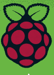


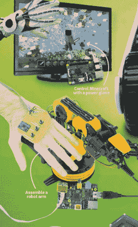


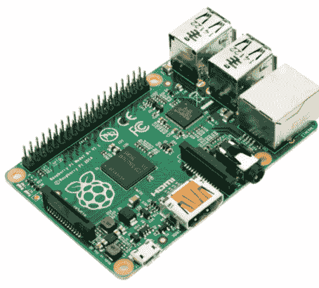

## 欢迎进入实用树莓派项目

对于一台能放入口中的设备而言，自 2012 年推出以来，树莓派产生了极其巨大的影响。在短短几年内，它改变了学校在计算机科学教学中的方式，被用于世界各地树莓派聚会（Raspberry Jam）活动中的一些惊人项目，并激励了一代新的程序员去创造和打造新装置。无论你的年龄或经验水平如何，都有一个适合你的树莓派项目，而在《实用树莓派项目》中，我们为你提供了激发想象力和释放创造力所需的一切。从基于硬件的项目（如打造一辆树莓派控制的小车），到软件项目（如编程你自己的虚拟助手），再到先进的电子项目（如将你的树莓派变成鼓机、车载电脑或四旋翼飞行器），这里内容丰富，足够你忙碌一阵。你只需要一台你最喜爱的 35 美元电脑和一份对制造事物的热情！

出版总监
Aaron Asad

设计主管
Ross Andrews

制作编辑
Ross Hamilton

高级艺术编辑
Gary Whittaker

设计师
Perry Wardell-Wicks

摄影师
James Shreevesland

印刷厂
William Gibbons, 26 Planetary Road, Wiltanhill, West Midlands, WV13 3XT


## 10 个实用的树莓派项目

你还没有对你的树莓派做什么吗？跟随我们的专家建议，启动你自己的惊人树莓派项目


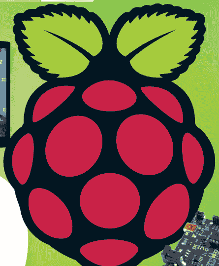
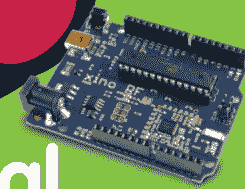


## 10 个实用的树莓派项目

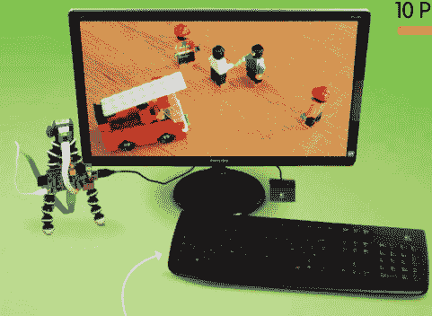

制作定格动画
打造 BasePi Web 服务器

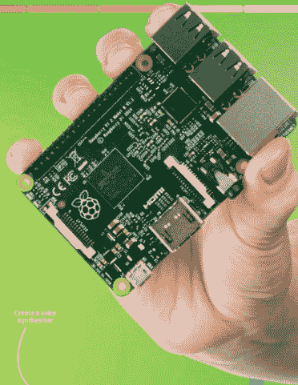
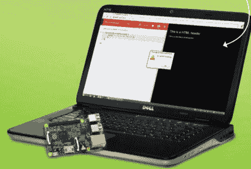

创建语音合成器

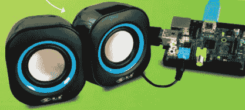


编码你自己的 Twitter 机器人

在我们报道这款令人难以置信的信用卡大小的电脑期间，我们逐渐清楚有两类树莓派拥有者：那些使用它的人和那些没有使用它的人。无论是对未知的恐惧、缺乏时间还是灵感，当我们询问人们用他们的树莓派做什么时，我们通常会听到它仍在盒子里。如果这也是你的情况，那么树莓派项目几乎是任何人都可以享受的。

然而，这些不仅仅是随机选择的副业。这些是旨在帮助启动更大更好事物的实用创意。从一个项目中获得的知识也可以应用到另一个项目中，以创造全新的东西。例如，你可以将我们的 Twitter 和彩色冷却灯教程结合起来，创建一个随着你的 Twitter 账号被转推而改变颜色的台灯。你可以继续用 Minecraft-Pi 制作《Pong》游戏，或者使用连接在 Scratch 上的按钮来用树莓派摄像头模块拍照。列表还在继续。

所有这些项目都是开源的，因此鼓励你对它们进行微调和开发，使之成为全新的东西。如果你与社区分享你的微调和更改，你肯定能从开源方式中获得好处……

### 使用树莓派制作音乐

使用 Sonic Pi 编程创作你自己的旋律，并生成音乐提示音或机器人蜂鸣声

#### 所需材料

- 便携式扬声器
- Sonic Pi
- www.element14.com/projects/raspberry-pi-sonic-pi-teaching-kit

Scratch 的主要功能之一是能够向儿童和没有计算背景的人教授编码基础知识。对于儿童来说，由于它允许他们创建可以互动的视频游戏作为学习的一部分，因此特别具有吸引力。基于这种理念，Sonic Pi 通过音乐教人们编程。它使用一种简单的语言，利用基本的逻辑步骤，但以比 Scratch 更高级的方式运行。它可以作为资深编码者的下一步进阶工具，也可以作为为物联网或机器人创建音乐的方式。

##### 01 获取 Sonic Pi

如果你安装了最新版本的 `Raspbian`，`Sonic Pi` 将默认包含在内。如果你仍在使用稍旧版本的系统，则需要通过软件源安装它。使用以下命令操作：

```
$ sudo apt-get install sonic-pi
```


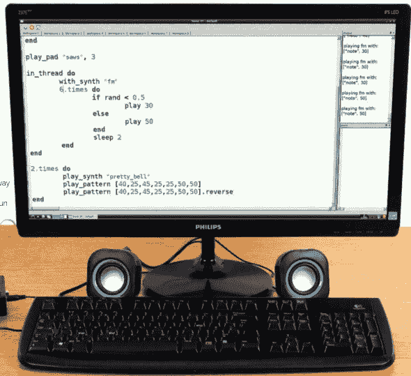

- `Sonic Pi` 是学习基本编码原理并享受乐趣的绝佳方式

##### 02 开始使用 Sonic Pi

`Sonic Pi` 位于菜单中的“教育”类别中。打开它后，你会看到一个类似 IDE 的界面。左侧面板允许你输入项目代码，并提供其特定语言风格的适当语法高亮。运行时，信息面板会详细说明 `Sonic Pi` 正在播放的内容——任何错误也会列在独立的面板中，以便参考。

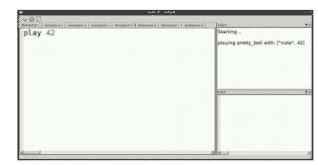

##### 03 你的第一个音符

我们在 `Sonic Pi` 上尝试的第一件事就是简单地播放一个音符。`Sonic Pi` 有一些预设的默认值，因此我们可以从以下代码开始：

`play 50`

按下播放按钮，输出窗口将显示正在播放的内容。`pretty_bell` 是 `Sonic Pi` 输出的默认音调，而 50 决定声音的音高和色调。

##### 04 设置节拍

对于任何音乐作品，你都需要设置速度。我们可以从以下代码开始：

`with_tempo 200`

...放在代码的开头。我们可以通过使用 `play_pattern` 创建一串 MIDI 音符来测试它：

`play_pattern [40, 25, 45, 25, 25, 50, 50]`

这将按照我们设置的速度播放这些音高的 `pretty_bell` 音符。你可以创建更长或更短的句子，并改变它们的播放方式。


##### 05 进阶旋律

你可以通过使用 `Sonic Pi` 更多的功能开始制作更复杂的旋律。你可以使用 `with_synth` 改变音符类型，反转模式，甚至使用 `x.times` 功能创建有限循环；`do` 和 `end` 表示循环的开始和结束。所有操作按顺序播放后才会重复，非常类似于普通代码中的 `if` 和 `while` 循环。

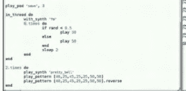

##### 06 举办音乐会

使用 `in_thread` 功能，我们可以为 `Sonic Pi` 实例创建另一个线程，让多行音乐代码同时播放，而不是按顺序播放。我们让它以随机顺序创建一系列音符，并使用 `play_pad` 功能让鼠标位置和速度生成的额外音符与之同时播放。

#### 完整代码列表


```ruby
with_tempo 200

play_pattern [40,25,45,25,25,50,50]

2.times do
  with_synth "beep"
    play_pattern [40,25,45,25,25,50,50]
    play_pattern [40,25,45,25,25,50,50].reverse
  end

play_pad "saws", 3

in_thread do
  with_synth "fm"
    6.times do
      if rand < 0.5
        play 30
      else
        play 50
      end
      sleep 2
    end
  end

2.times do
  play_synth "pretty_bell"
  play_pattern [40,25,45,25,25,50,50]
  play_pattern [40,25,45,25,25,50,50].reverse
end
```

#### 你将学到...

1. **如何编码**
   Sonic Pi 的编码风格使用标准编程语言的概念——如 `if` 语句、循环、线程等。Scratch 教授这种逻辑，而 Sonic Pi 教授它们的结构。

2. **机器人语音**
   使用 Sonic Pi 创建上下文相关的芯片声、吱吱声和蜂鸣声，并让它在宣传世界时使用熟悉的语音。

3. **MIDI**
   乐器数字接口（MIDI）是数字音乐的标准，Sonic Pi 中使用的数字和音调利用了这一点。

### 树莓派语音合成器

**使用通用的 eSpeak Python 库为你的树莓派项目添加语音功能**

得益于 eSpeak，让你的树莓派说话比你想象的要容易

#### 所需材料

- 便携式 USB 扬声器
- `python-espeak` 模块
- eSpeak
- Raspbian（最新镜像）

我们在之前的期中展示了树莓派如何用于为机器人供电，作为一台微型计算机，它也可以成为你家中或办公室中物联网的中心。

基于这些原因以及其他原因，使用树莓派进行文本到语音的命令可能正是你在寻找的。由于 Raspbian 基于 Debian，功能强大的 eSpeak 库很容易获取，任何人都可以使用它。此外，还有一个模块允许你在 Python 中使用 eSpeak，超越了标准的命令行提示，因此你可以执行自动化任务。

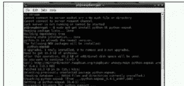

##### 01 你需要的一切

我们将一次性安装本教程计划使用的所有软件。这包括 eSpeak 库和我们需要展示其功能的 Python 模块。打开终端并使用以下命令安装：

```
$ sudo apt-get install espeak python-espeak python-tk
```

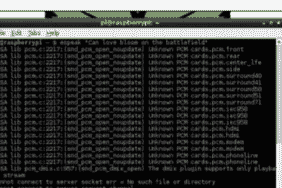

##### 02 树莓派的第一句话

eSpeak 库使用起来相当简单——要让它只是说点什么，在终端中输入：

```
$ espeak "message"
```

这将使用该库的默认设置朗读消息中写的内容，清晰度适中。

##### 03 多说几句

你可以使用多个不同的选项改变 eSpeak 朗读文本的方式，例如性别、阅读速度甚至音节发音方式。例如，像这样编写命令：

```
$ espeak -ven+f3 -k5 -si50 "message"
```

...将使语音变为女性，强调大写字母并减慢阅读速度。

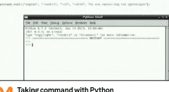

##### 04 用 Python 执行命令

在 Python 中使用 eSpeak 最基本的方法是使用 `subprocess` 直接调用命令行函数。在 Python 脚本中导入 `subprocess`，然后使用：

```
subprocess.call(["espeak", "[Options 1]", "[Option 2]",..."[Option n]", "message"])
```

消息可以从变量中获取。

##### 05 母语功能

Python 的 eSpeak 模块相当简单，只需将文本转换为语音即可。试试这段示例代码：

```
from espeak import espeak 
espeak.synth("message")
```

然后你可以将其集成到 Python 中，就像使用任何其他模块一样，用于自动化。

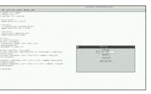

##### 06 语音合成器

使用代码列表，我们正在使用 `Tkinter` 创建一个简单的界面，包含一些预设的语音按钮和自定义输入方法。我们展示了如何操纵 eSpeak 模块来改变其输出。这可用于阅读推文或自动消息。祝你玩得愉快！

#### 完整代码列表

```python
from espeak import espeak 
from Tkinter import * 
from datetime import datetime
```

*导入必要的 eSpeak 和 GUI 模块，以及用于获取时间的模块*

```python
def hello_world(): 
    espeak.synth("Hello World")

def time_now(): 
    t = datetime.now().strftime("%k %M") 
    espeak.synth("The time is %s" % t)
```

*定义界面将使用的不同函数，包括一个简单的固定消息、报时和自定义消息*

```python
def read_text(): 
    text_to_read = input_text.get() 
    espeak.synth(text_to_read)
```

```python
root = Tk() 
root.title("Voice box") 
input_text = StringVar() 
box = Frame(root, height = 200, width = 500) 
box.pack_propagate(0) 
box.pack(padx = 5, pady = 5)
```

*使用 Tkinter 创建界面的基本窗口，同时创建用于文本输入的变量*

```python
Label(box, text="Enter text").pack() 
entry_text = Entry(box, exportselection = 0, 
textvariable = input_text) 
entry_ready = Button(box, text = "Read this", 
command = read_text) 
entry_ready.pack()

hello_button = Button(box, text = "Hello World", 
command = hello_world) 
hello_button.pack() 
time_button = Button(box, text = "What's the time", 
command = time_now) 
time_button.pack()
```

*文本输入将附加到我们创建的变量中，每个按钮调用我们在代码上方定义的特定函数*

```python
root.mainloop()
```

获取代码：bit.ly/14XbLOC

## 10 个实用的树莓派项目

### 用 Minecraft-Pi 编程

通过玩有史以来最伟大的游戏之一来学习编程！

#### 你需要的内容

- Raspbian（最新发布版）
- Minecraft-Pi tarball 压缩包
- 键盘和鼠标
- 互联网连接

**Minecraft 可能是目前地球上最大的游戏。** 它几乎存在于你能想象的任何平台上，从 PC、游戏主机到手机。因此，它也可以运行在树莓派上也不足为奇。乍一看，Minecraft-Pi 是口袋版（专为平板电脑和智能手机设计）的简化版，但树莓派版非常特别，因为它是唯一允许用户访问其 API（应用程序接口）的 Minecraft 版本。在本项目中，我们将向你展示如何安装和配置 Minecraft-Pi，以便你可以以前所未有的方式与 Minecraft 进行交互。这个小项目仅仅是冰山一角……


#### 01 需求

Minecraft-Pi 要求你的树莓派运行 Raspbian 系统，因此如果你还没有运行该系统，请前往 raspberrypi.org 进行设置。它还需要你加载 X Window。假设你处于命令提示符下，只需输入 `startx` 即可进入桌面。

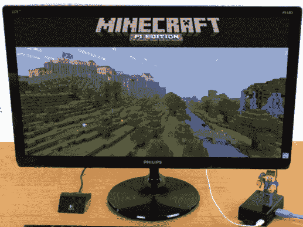


- 与所有其他版本的 Minecraft 不同，Pi 版本鼓励你对其进行“黑客”改造

## 02 安装

确保你已经在你的主目录下，并在终端窗口中使用以下命令下载 Minecraft-PI 包：

```bash
cd ~
wget https://s3.amazonaws.com/assets.minecraft.net/pi/minecraft-pi-0.1.1.tar.gz
```

为了使用它，我们需要解压它。将以下内容复制到终端窗口中：

```bash
tar -zxvf minecraft-pi-0.1.1.tar.gz
```

现在你可以进入新解压的 Minecraft-PI 目录，并尝试首次运行游戏：

```bash
cd mcp
./minecraft-pi
```

## 03 玩 Minecraft-PI

看看游戏中的内容。如果你不熟悉 Minecraft，你用鼠标和 WASD 键来控制移动。数字 1-8 用于选择快捷栏中的物品，空格键让你跳跃，Shift 键让你慢走（以免从边缘掉落）。‘E’ 键打开你的物品栏，双击空格键也可以切换飞行能力。

## 04 配置 Python API

要通过 Python API 控制 Minecraft，你接下来需要将从 `/mcp` 文件夹中的 Python API 文件夹复制到一个新位置。在终端中，输入以下内容：

```bash
cp -r ~/mcp/api/python/mcp ~/minecraft
```

在这个文件夹中，我们想要创建一个“引导”Python 文档，以将 API 与游戏连接起来。将以下内容写入终端：

```bash
cd ~/minecraft
nano minecraft.py
```

在 nano 打开后，复制以下内容，然后使用 Ctrl+X 保存并退出，按 Y（表示是），然后按 Enter 返回到命令提示符：

```python
from mcp.minecraft import Minecraft
from mcp import block
from mcp.vec3 import Vec3
mc = Minecraft.create()
mc.postToChat("Minecraft API -> Connected")
```

## 05 测试你的 Python 脚本

你创建的简短脚本包含了使用 Python 语言开始“黑客”Minecraft-PI 所需的一切。为了让它正常工作，你需要让游戏已经在运行（并且正在游玩中）。要在游戏中获取鼠标控制权，你可以按 Tab 键。打开一个新的终端窗口，导航到你的 minecraft 文件夹，并使用以下命令启动脚本：

```bash
cd ~/minecraft
python minecraft.py
```

你会在屏幕上看到一条消息，告知你 API 已成功连接。现在我们知道它有效了，让我们开始编码吧！

## 完整代码列表

```python
#!/usr/bin/env python
from mcp.minecraft import Minecraft
from mcp import block
from mcp.vec3 import Vec3
from time import sleep
import random, math

mc = Minecraft.create()  # make a connection to the game
playerPos = mc.player.getPos()

# function to round players float position to integer position
def roundVec3(vec3):
    return Vec3(int(vec3.x), int(vec3.y), int(vec3.z))

# function to quickly calc distance between points
def distanceBetweenPoints(point1, point2):
    xd = point2.x - point1.x
    yd = point2.y - point1.y
    zd = point2.z - point1.z
    return math.sqrt((xd*xd) + (yd*yd) + (zd*zd))

# create a block in a random position
def random_block():
    randomBlockPos = roundVec3(playerPos)
    randomBlockPos.x = random.randrange(randomBlockPos.x - 50, randomBlockPos.x + 50)
    randomBlockPos.y = random.randrange(randomBlockPos.y - 5, randomBlockPos.y + 5)
    randomBlockPos.z = random.randrange(randomBlockPos.z - 50, randomBlockPos.z + 50)
    return randomBlockPos

# the main loop of hide & seek
def main():
    global lastPlayerPos, playerPos
    seeking = True
    lastPlayerPos = playerPos
    randomBlockPos = random_block()
    mc.setBlock(randomBlockPos, block.DIAMOND_BLOCK)
    mc.postToChat("A diamond has been hidden somewhere nearby!")
    lastDistanceFromBlock = distanceBetweenPoints(randomBlockPos, lastPlayerPos)
    timeStarted = time()
    
    while seeking:
        # get players position
        playerPos = mc.player.getPos()
        # has the player moved?
        if lastPlayerPos != playerPos:
            distanceFromBlock = distanceBetweenPoints(randomBlockPos, playerPos)
            if distanceFromBlock < 2:
                # found it!
                seeking = False
            else:
                if distanceFromBlock < lastDistanceFromBlock:
                    mc.postToChat("Warmer " + str(int(distanceFromBlock)) + " blocks away")
                if distanceFromBlock > lastDistanceFromBlock:
                    mc.postToChat("Colder " + str(int(distanceFromBlock)) + " blocks away")
            lastDistanceFromBlock = distanceFromBlock
        sleep(2)
    
    timeTaken = time() - timeStarted
    mc.postToChat("Well done - " + str(int(timeTaken)) + " seconds to find the diamond")

if __name__ == "__main__":
    main()
```


## 你将学到...

## 实用且有趣的编码

我们的代码并没有太复杂。我们使用 `def` 创建了几个简单的函数，并使用 `if`、`else`、`while` 来创建逻辑。

## 06 捉迷藏

正如上面代码所示，我们创建了一个捉迷藏游戏，该游戏改编自 Martin O'Rahilly 的原始创作（你可以在 www.stuffaboutcode.com 上找到）。当你启动脚本时，你需要挑战自己在最短时间内找到一个隐藏的钻石。我们用它来演示 API 中一些更易上手的方法。但它的内容远不止于此。敬请期待 - 我们将在未来的期中推出更多相关指南。

15

### 使用 Scratch 实现交互

**通过使用 Scratch 与 Pi 上的按钮和灯光进行交互，尝试物理计算**

#### 你需要的内容


- 面包板
- LED
- 按钮
- 电阻器
- 跳线
- ScratchGPIO3

Scratch 是一种非常简单的可视化编程语言，通常用于向任何年龄的学习者教授基本的编程概念。在本项目中，我们将学习如何在 Scratch 中点亮 LED 当按钮被按下时，然后当物理按钮被按下时改变角色的颜色。通过这些技术，你可以制作各种有趣且引人入胜的项目，从音乐键盘到你 Scratch 游戏和动画的控制器。

### 01 安装所需的软件

使用用户名 `pi` 和密码 `raspberry` 登录 Raspbian 系统。使用命令 `startx` 启动 LXDE 桌面环境。然后打开 LXTerminal 并输入以下命令：

```bash
wget http://i1ianfraser.co.uk/lxd/install_scratchgpio3.sh
chmod +x install_scratchgpio3.sh
sudo bash install_scratchgpio3.sh
```

这将在你的桌面上创建一个名为 ScratchGPIO3 的特殊版本的 Scratch。这是正常版本的 Scratch，其中包含一个处理 Scratch 和 GPIO 之间通信的 Python 脚本。ScratchGPIO 由 simplesi 创建（cymplecy.wordpress.com）。

## 使用 Scratch 实现交互

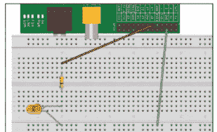

### 02 连接面包板

关闭树莓派电源并拔掉电源线。准备好面包板、一个 LED、一个 330 欧姆电阻和两根 GPIO 线。你需要将 3.3V 引脚（右上角引脚，靠近 SD 卡）连接到 330 欧姆电阻的一端，然后将 LED 的正极（较长的一脚，有一个小凸起）连接到电阻的另一端。

### 03 开关 LED

目前，LED 连接到一个持续提供 3.3V 的引脚。如果我们想要能够开关它，这就没太大用处，所以让我们将它连接到 GPIO 17，我们可以打开和关闭它。GPIO 17 是顶部引脚行从左数第六个引脚。重新给树莓派通电。我们可以通过导出 GPIO 引脚，将其设置为输出，然后将其值设置为 1 来打开 LED。将值设置为 0 则关闭 LED。

```bash
echo 1 > /sys/class/gpio/export
echo out > /sys/class/gpio/gpio17/direction
echo 1 > /sys/class/gpio/gpio17/value
echo 0 > /sys/class/gpio/gpio17/value
```

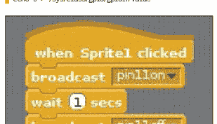

### 04 从 Scratch 控制 LED

启动 LXDE 桌面环境并打开 ScratchGPIO3。转到控制部分并创建一个简单的脚本，当精灵 1 被点击时广播 `pinOn`。然后点击精灵。LED 应该会亮起来。然后在脚本中添加等待 1 秒，然后广播 `pinOff`。如果你再次点击精灵，LED 会亮一秒然后熄灭。ScratchGPIO3 使用引脚编号而不是 GPIO 编号来识别引脚。右上角的引脚（我们最初将 LED 连接到 3.3V 的引脚）是引脚编号 1；该引脚下方的引脚是引脚编号 2；依此类推。

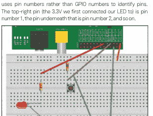

### 05 接线按钮

再次关闭树莓派电源。这个电路比我们之前创建的 LED 电路稍复杂一些。我们需要做的第一件事是将 3.3V（我们之前用来测试 LED 的右上角引脚）连接到面包板的正极轨。然后我们需要将一个 10/kohm 电阻连接到正极轨，并将另一端连接到面包板上的一个空轨。然后，在同一轨上，添加一根导线，其一端连接到 GPIO 4。这是 GPIO 12 右侧第二个引脚。然后，再次在同一轨上，连接按钮的一个引脚。最后，通过添加一根连接到接地负极轨的导线，将按钮的另一个引脚连接到地。

当按钮未被按下时，GPIO 4 将接收 3.3V。但是，当按钮被按下时，到地的电路将闭合，GPIO 4 将接收 0V（因为到地的路径上电阻小得多，所以值为 0）。

我们可以通过观察引脚值然后按下按钮使其改变来看到这种效果：

```bash
echo 4 > /sys/class/gpio/export
echo in > /sys/class/gpio/gpio4/direction
watch -n 0.5 cat /sys/class/gpio/gpio4/value
```

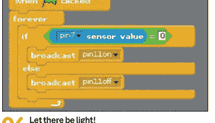

### 06 点亮灯光！

启动树莓派并像以前一样启动 ScratchGPIO3。转到控制部分并添加“当绿旗被点击时”。然后附加一个永远循环，并在其中添加一个 if-else 语句。转到运算符部分并添加“如果 [] 等于 []”运算符到 if 语句。然后转到感应部分并在等式左侧添加一个值传感器，将值设置为 `pin7`。在等式右侧，输入 0。如果传感器值为 0，则广播 `pinOn`，否则广播 `pinOff`。点击绿旗。如果你按下按钮，LED 将会亮起！

#### 你将学到...

- **简单电路**

  虽然这些是非常简单的电路，但你会很好地理解树莓派如何与基本原型套件接口。如果你需要购买部件，我们建议你查看：shop.pimoroni.com

- **编码原则**

  如果你是编程新手，Scratch 是学习所有编程语言采用的相同编程原则的完美场所。

- **物理计算**

  没有什么比将代码从电脑屏幕转化为现实效果更神奇的了。你的第一个项目可能只是一个灯的开关，但一旦点亮，天空才是极限。

## 10 实用树莓派项目

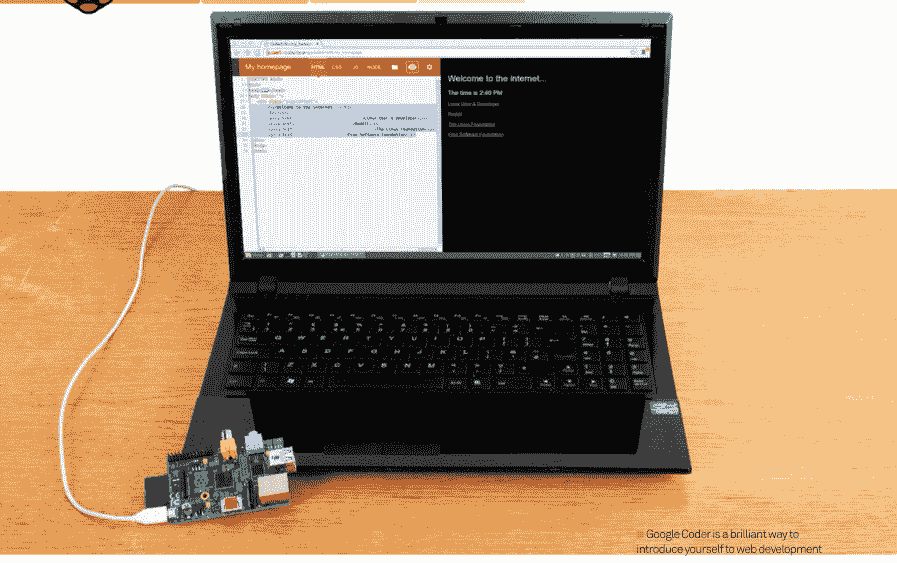

Google Coder 是让你入门网页开发的好方法。

### 构建树莓派 Web 服务器

使用 Google Coder 将你的树莓派变成一个小型、低功耗的 Web 服务器和 Web 托管平台

- **你需要什么**

  - 互联网连接
  - Web 浏览器
  - Google Coder

我们在树莓派上用多种不同的方式教你编程，所以看看网络也是合情合理的。

在树莓派上使用网络还有一种新方法：互联网巨头谷歌最近专门为这款小型计算机发布了 Coder。这是一个基于 Raspbian 的镜像，将你的树莓派变成一个 Web 服务器和 Web 开发套件。它可以轻松通过局域网访问，并且开箱即支持 jQuery，它是进一步提升你的网页开发技能的一种简单且很棒的方式。

#### 01 获取 Google Coder

前往 Google Coder 网站，下载压缩版的镜像。将其解压到任何你希望的位置，并使用 `dd` 安装它，就像其他树莓派镜像一样：

```bash
$ dd if=[path to]/raspi_img of=/dev/[path to SD card] bs=1M
```


#### 02 插入你的树莓派

对于这个教程，你只需要将一根网线插入树莓派。插入新写入的 SD 卡，插上电源并等待片刻。如果你已经连接了显示器，你会注意到一个 Raspbian 启动序列，最终进入命令行登录屏幕。

#### 03 连接到 Coder

在主系统上打开浏览器，访问 `http://coder.local`。你可能需要手动接受许可协议。它会要求你设置密码，然后你就可以进入并开始编码了。

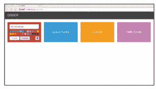

#### 04 Web 语言

现在是时候创建你自己的应用程序或网站了。点击示例旁边的“+”框，给你的应用程序起个名字，然后点击创建。你将被带到应用程序的 HTML 部分。

将 Hello/World 行更改为：

```html
<h1>这是一个 HTML 标题</h1>
<p>这是一个新的默认文本块</p>
```

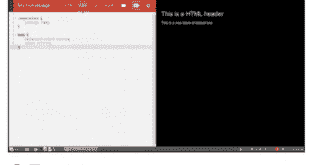

#### 05 令人印象深刻的样式

点击 CSS 选项卡。这更改了网页的外观和样式，而不必每次都在主代码中进行更改。你可以使用以下代码更改背景颜色和字体：

```css
body {
    background-color: #000000;
    color: #ffffff;
}
```

#### 完整代码列表

#### HTML

一些简单的 HTML 代码，可以引导我们访问一些重要的网站。

`h2` 标签用于显示时间，得益于 Java


```html
<h1>欢迎来到互联网…</h1>
<h2></h2>
<p><a href="http://www.linuxuser.co.uk">Linux 用户 & 开发者</a></p>
<p><a href="http://www.reddit.com">Reddit</a></p>
<p><a href="http://www.linuxfoundation.org/">Linux 基金会</a></p>
<p><a href="http://www.fsf.org/">自由软件基金会</a></p>
```

#### Java

我们在 JS 选项卡中调用 `currentTime` 使用 `jQuery`，以便最终在网页上显示它

我们将使用 12 小时制时钟在第一个 `if` 语句中显示时间，并使用 AM 和 PM 来区分时间

如果分钟数低于 10，我们会通过添加 0 来使分钟数可读，然后连接所有变量并赋值给 `h2` 标签

```javascript
var d = new Date();
var hours = d.getHours();
var mins = d.getMinutes();
if (hours > 12) {
    var hour = (hours - 12);
    var ampm = "PM";
} else {
    var hour = hours;
    var ampm = "AM";
}
if (mins < 9) {
    var min = "0" + mins;
} else {
    var min = mins;
}
var time = "The time is " + hour + ":" + min + " " + ampm;
$("h2").html(time);
```

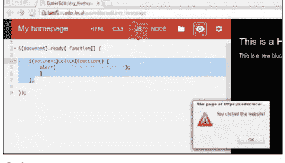

#### 06 查询你的 Java

第三个选项卡允许你编辑 `jQuery`，使网站更具交互性。我们可以使用以下代码让它创建点击信息：

```javascript
$(document).click(function() {
    alert("You clicked the website!");
});
```


## 编写你自己的推特机器人

创建你自己的推特机器人，让它能够转发来自 Linux User & Developer 的精华内容。

### 你需要什么

- 互联网连接
- 最新版本的 Raspbian
- `www.raspberrypi.org/downloads`

推特是与世界分享信息的有用方式，也是我们快速方便地表达观点的最爱方法。数百万人通过他们的电脑、移动设备使用这个博客平台，甚至可能在他们的电视上也有它。

不过，你不需要一直按那个转发按钮。加上一点 Python，你可以让树莓派为你完成这件事。以下是如何创建你自己的推特机器人……

### 01 安装所需软件

使用用户名 `Pi` 和密码 `raspberry` 登录 Raspbian 系统。使用命令 `sudo apt-get update` 获取最新的软件包列表。然后使用 `sudo apt-get install python-pip` 安装 Python 包安装器。完成后，运行 `sudo pip install twython` 安装我们将使用的推特库。

### 02 在推特注册

我们需要使用 OAuth 在推特上进行身份验证。在此之前，你需要访问 [`https://dev.twitter.com/apps`](https://dev.twitter.com/apps) 并登录你希望你的树莓派用来发推的账号。点击“创建一个新应用程序”按钮。我们将我们的应用程序命名为“LUD Pi Bot”，给出了相同的描述，并将网站设置为 `http://www.linusers.co.uk/`。回调 URL 是不需要的。你将需要同意开发者规则，然后点击创建按钮。


通过创建自动化转发器来节省你的鼠标点击

### 03 创建访问令牌

转到设置选项卡，将访问类型从“仅读取”更改为“读取和写入”。然后点击“更新此推特应用程序的设置”按钮。下一步是创建访问令牌。为此，点击“创建我的访问令牌”按钮。如果你刷新详情页面，你应该有一个消费者密钥、一个消费者密钥秘密和访问令牌，以及一个访问令牌秘密。这是我们在推特上进行身份验证所需的一切。

### 04 在推特上进行身份验证

我们将把我们的机器人创建一个类，在构造函数中我们在推特上进行身份验证。我们将前面步骤中的令牌作为参数，并使用它们来创建 `Twython` API 的实例。我们还有一个变量，`last_run`，它被设置为当前时间。这用于稍后检查是否有新的推文。

#### 完整代码列表


```python
#!/usr/bin/env python2

# A Twitter Bot for the Raspberry Pi that retweets any
# content from @LinuxUserMag. Written by Liam Fraser for a Linux User &
# Developer article.

import sys
import time
from datetime import datetime
from twython import Twython

class bot:
    def __init__(self, c_key, c_secret, a_token, a_token_secret):
        # Create a Twython API instance
        self.api = Twython(c_key, c_secret, a_token, a_token_secret)

        # Make sure we are authenticated correctly
        try:
            self.api.verify_credentials()
        except:
            sys.exit("Authentication Failed")
        self.last_run = datetime.now()

    @staticmethod
    def timestr_to_datetime(timestr):
        # Convert a string like Sat Nov 09 09:29:55 +0000
        # 2013 to a datetime object. Get rid of the timezone
        # and make the year the current one.
        timestr = timestr[:18] + timestr[23:]
        timestr = timestr + str(datetime.now().year)
        # We now have Sat Nov 09 09:29:55 2013
        return datetime.strptime(timestr, "%a %b %d %H:%M:%S %Y")

    def retweet_task(self, screen_name):
        # Retweets any tweets we've not seen from a user
        print("Checking for new tweets from {}".format(screen_name))

        # Get a list of the users latest tweets
        timeline = self.api.get_user_timeline(screen_name = screen_name)

        # Loop through each tweet and check if it was
        # posted since we were last called
        for t in timeline:
            tweet_time = bot.timestr_to_datetime(t['created_at'])
            if tweet_time > self.last_run:
                print("Retweeting {}".format(t['id']))
                self.api.retweet(id = t['id'])

if __name__ == "__main__":
    # The consumer keys can be found in your application's
    # Details page located at https://dev.twitter.com/apps (under OAuth settings')
    c_key = ""
    c_secret = ""
    # The access tokens can be found in your application's
    # Details page located at https://dev.twitter.com/apps (located under Access token')
    a_token = ""
    a_token_secret = ""
    # Create an instance of the bot class
    twitter = bot(c_key, c_secret, a_token, a_token_secret)
    # Retweet anything new @LinuxUserMag every 5 minutes
    while True:
        # Update the time after each retweet task so we're
        # only retweeting new stuff
        twitter.retweet_task("LinuxUserMag")
        twitter.last_run = datetime.now()
        time.sleep(5 * 60)
```

### 05 转发用户

我们需要做的第一件事是获取用户最新推文的列表。然后我们遍历每个推文并获取其创建时间作为一个字符串，该字符串随后被转换为 `datetime` 对象。然后我们检查该推文的时间是否比函数上次被调用的时间更新——如果是，则转发该推文。

### 06 主程序部分

主程序部分很简单。我们使用我们的令牌创建 `bot` 类的实例，然后进入无限循环。在这个循环中，我们检查我们要监控的用户是否有新的转发（我们可以用不同的用户运行转发任务），然后更新时间所有东西上次运行的时间，并休眠五分钟。

如果推文的时间比函数上次被调用的时间更新，我们就转发它

获取代码：`bit.ly/1RTgNSH`

## 10 个实用树莓派项目

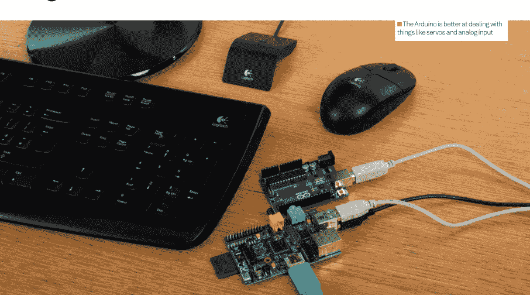

> Arduino 在处理诸如伺服电机和模拟输入之类的事情上更为擅长

## 使用树莓派编程你的 Arduino

在你的树莓派项目中享受 Arduino 微控制器的所有特性和优势

### 你需要什么

- Arduino Uno
- 互联网连接
- Numpy (`https://scp.org/numpy`)

你可能会想知道为什么你想在你的树莓派上连接一个 Arduino。虽然有很多原因，但最突出的可能是标准 Arduino Uno 提供的额外六个支持 PWM 的引脚和另外六个模拟引脚。

你看，虽然树莓派拥有一系列优秀的引脚和功能，但它开箱即用的情况下无法进行模拟和实时处理。有了 Arduino，像伺服电机、电位器和各种模拟传感器等附加组件触发和控制变得轻而易举。

最好的是你甚至不需要使用 Arduino 的准 C++ 语言编程。你只需要在树莓派和 Arduino 之间建立标准的 USB 连接，以及一个名为 `Nanpy` 的小型 Python 包。以下是如何做到的……

### 01. 获取一个 Arduino

在你能做任何事情之前，你需要一个 Arduino。我们推荐 Uno，因为它是具有最佳的功能、便利性和价格平衡的默认选择。由于你希望立即投入使用，我们建议投资一个包含 LED、伺服电机等有趣物品的“入门套件”。

### 02. 满足依赖项

我们假设你使用的是 Raspbian（推荐），所以打开你的终端，因为我们需要获取设置工具以便安装 `Nanpy`。在终端中，输入：

```bash
$ wget https://github.com/pypa/setuptools/raw/bootstrap/ez_setup.py
$ python ez_setup.py user
```

完成后，你就可以使用 `easy_install` 命令来安装 `pyserial`……

### 03 最终准备

由于 Arduino 和树莓派之间的通信将通过 USB 串行连接发生，我们需要获取 Python-serial 库。在终端中，输入：

```bash
$ easy_install pyserial
```

我们还需要安装 Arduino 软件，以便 Pi 知道当设备插入时如何处理它。在终端中，输入：

```bash
$ sudo apt-get update
$ sudo apt-get install arduino
```

### 04 安装 Nanpy


配置中只剩下两步。首先，我们需要获取并安装 `Nanpy` 包在 Pi 上。我们喜欢的方式是通过 Git 克隆它。在终端中导航到你的主文件夹（`cd ~`）并按顺序在终端中执行以下操作。

```bash
$ easy_install nanpy
$ sudo apt-get install git
$ git clone https://github.com/nanpy/nanpy.git
```

### 05 配置你的 Arduino Uno

为什么我们要克隆原始的 Git 仓库？`Nanpy` 依赖于 Arduino 固件的更新才能正确工作，因此你需要从 `nanpy` 项目目录访问固件文件夹来完成它。在将以下内容输入终端之前，请将你的 Arduino Uno 插入树莓派的备用端口。小心：以下操作需要一些时间！

```bash
$ cd nanpy/firmware
$ export BOARD=uno
$ make
$ make upload
```

### 06 用你的 Pi 测试 Arduino

安装终于完成后，我们可以测试设置以确保它正常工作。在我们对右侧代码段进行真正的“你好世界！”应用程序之前，让我们首先确保 `Nanpy` 已正确安装并且 Pi 和 Arduino 之间的连接正在工作。从你的主文件夹（`cd ~`），在终端中输入以下命令：

```bash
$ nano nanpy_test.py
```

在 `nano` 编辑器中，只需写入：

```python
from nanpy import Arduino
```

现在按 `Ctrl+X`，`Y`，然后按 `Enter` 保存你的新文件。最后，在终端中输入：

```bash
$ python nanpy_test.py
```

如果你没有看到错误，那么一切都应该正常工作。现在你可以开始跨页面玩代码，开始学习如何操作 `Nanpy`。

#### 完整代码列表

```python
# Like all good hardware-based 'Hello, World!' applications, we'll start
# by making the light on the Arduino board flicker off and on.
from nanpy import Arduino
from time import sleep

Arduino.pinMode(13, Arduino.OUTPUT)
for i in range(10):
    Arduino.digitalWrite(13, Arduino.HIGH)
    sleep(2)
    Arduino.digitalWrite(13, Arduino.LOW)
    sleep(2)

# This will make the light controlled by pin 13 on the Arduino
# turn on and off every two seconds ten times.

# You can also assign pins a name, to make your code more readable.

light = 13
Arduino.pinMode(light, Arduino.OUTPUT)

# You can also assign multiple pins at the same time:

red_pin = 3
green_pin = 5
blue_pin = 9

for pins in (red_pin, green_pin, blue_pin):
    Arduino.pinMode(pins, Arduino.OUTPUT)

# if you've got an LED screen for your RASPi you'll probably
# find it works out of the box with Nanpy. Just make sure you
# assign the right pin numbers for your screen:

from nanpy import (Arduino, Lcd)

screen = Lcd([7, 8, 9, 10, 11, 12], [16, 2])
screen.printString('Hello, World!')

# If you're using potentiometers, buttons or analog sensors,
# you'll need to assign them as inputs
knob = 0
Arduino.pinMode(knob, Arduino.INPUT)

value = Arduino.analogRead(knob)
for i in range(10):
    print ('The value of the knob is:', value)
    sleep(1)

# Sometimes you want to delay what the arduino does.
# This can help you get consistent, solid readings
def get_value():
    value = Arduino.analogRead(knob)
    Arduino.delay(100)
    return value
for i in range(10):
    print('The value is:', get_value())
```


**你将学到**

**1. 发挥优势**

虽然 `RASPi` 比 `Arduino` 强大得多，但在与真实世界交互方面，`Arduino` 更具优势。利用它们两者的优势来创建更好的项目。

## 10 个实用的树莓派项目

### 制作一个树莓派三色彩灯

**利用 Arduino 的力量，完成仅靠树莓派无法实现的项目**

**所需材料**

- `Arduino Uno`
- 面包板
- 一组原型连接线缆
- `RGB LED`（共阴极）
- 3 个电位器
- 3 个 330 欧姆电阻

这是一个非常有吸引力的 `RGB` 彩灯的优秀原型——非常适合作为夜灯或氛围灯。

在前一个项目中，我们向你展示了如何使用 `Arduino` 微控制器帮助树莓派掌握新技能，从而极大地扩展你项目的功能范围。借助额外 12 个支持 `PWM` 和模拟输入的引脚，你可以轻松添加多个舵机、模拟传感器，甚至添加摇杆等输入设备。

在这个项目中，我们将通过创建一个三色彩灯来演示这一点，该彩灯使用三个电位器（旋钮）来控制 `RGB LED` 灯光中的三种颜色。通过它，你可以调出彩虹中的大多数颜色。正如你所料，仅使用树莓派实现这一点会困难得多。

#### 01 使用 Arduino 编程

你需要按照前一个项目中的步骤正确配置树莓派和 `Arduino Uno`。你还需要确保你拥有左侧列表中所有组件。电阻理想情况下应为 330 欧姆，但如果只有更高阻值的电阻也可以。

`Arduino` 可以作为“入门套件”的一部分购买，其中包含此类组件，但快速访问 `www.cpc.co.uk` 也应该能补齐任何缺漏。

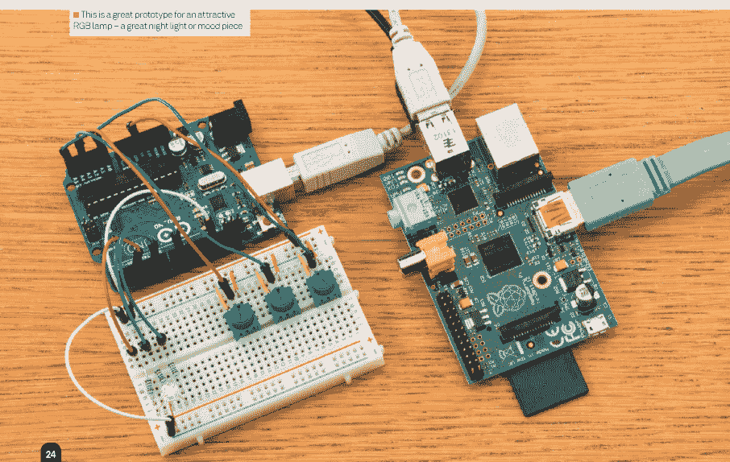

#### 02 填充面包板

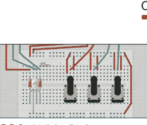

这个项目的电路乍一看可能有点复杂，但实际上并没有太多内容。正如你所期望的，我们希望使用支持 `PWM` 的引脚来控制 `LED` 灯光（以便精细控制亮度），而电位器（`pots`）则通过模拟引脚读取。

#### 03 连接 Arduino 和树莓派

假设你不打算立即自己编写代码，你可以从光盘或网站上获取代码，并将其放入主文件夹。将 `Arduino` 的 `USB` 线缆插入树莓派后，只需运行以下代码即可：

```python
python RGB_Mixer.py
```

调整对应 `LED` 颜色的电位器，颜色应该会改变。如果电位器调节的是错误的颜色，只需互换即可。你可以使用乒乓球或塑料杯盖住灯光，效果会非常好。

**完整代码列表**


```python
#!/usr/bin/env python

from nanpy import Arduino
from time import sleep

# set LED pin numbers – these go to the
# Digital pins of your Arduino
redPin = 3
greenPin = 6
bluePin = 9

# set pot pin numbers – these go to the
# (Analog) pins of your Arduino
pot_r_Pin = 0
pot_g_Pin = 3
pot_b_Pin = 5

#set three coloured pins as outputs
for pins in (redPin, greenPin, bluePin):
    Arduino.pinMode(pins, Arduino.OUTPUT)

# set pot pins as inputs
for pins in (pot_r_Pin, pot_g_Pin, pot_b_Pin):
    Arduino.pinMode(pins, Arduino.INPUT)

# prints values to the terminal when True
debug = False

def get_pots():
    """
    Grab a reading from each of the pot pins and
    send it to a tuple to be read by the colour mixer
    """

    r = Arduino.analogRead(pot_r_Pin) / 4
    g = Arduino.analogRead(pot_g_Pin) / 4
    b = Arduino.analogRead(pot_b_Pin) / 4
    Arduino.delay(1)
    return r, g, b

def colour_mixing():
    """
    Call get_pots() and set
    the colour pins accordingly
    """

    r, g, b = get_pots()
    Arduino.analogWrite(redPin, r)
    Arduino.analogWrite(greenPin, g)
    Arduino.analogWrite(bluePin, b)
    Arduino.delay(1)

def close_pins():
    """
    Close pins to quit cleanly (doesn’t work with a ‘for loop’ despite the pins happily initialising that way!)
    """
    Arduino.digitalWrite(redPin, Arduino.LOW)
    Arduino.digitalWrite(greenPin, Arduino.LOW)
    Arduino.digitalWrite(bluePin, Arduino.LOW)

def main():
    """
    Mix the colours using three pots.
    Ctrl+C cleans up the pins and exits.
    """
    try:
        print("Adjust the pots to change the colours")
        while True:
            colour_mixing()
            sleep(0.2)
            if debug:
                print("Red: {} | Green: {}".format(r, g, b))
    except KeyboardInterrupt:
        close_pins()
        print("\nPins closed")

if __name__ == '__main__':
    main()
```

### 04 设置引脚

正如我们在上一个项目中演示的那样，使用 Nanpy 对 Arduino 引脚进行命名和使用非常简单——在我们的代码中，我们使用两个简单的 `for` 循环来完成这项工作。下面的 `debug` 值只是将每个电位器的值打印到终端——对于调试或更好地理解代码非常有用。

### 05 功能运行

这里实际上只有三个主要函数，使用了不言自明的命名。首先，`get_pots()` 读取与每个电位器引脚相关的模拟引脚值，并返回一个包含红、绿、蓝值分别组成的元组。这被 `colour_mixing()` 函数使用，以向每个相关的 PWM 引脚分配值来改变 LED 的颜色。

### 06 保持运行

`main()` 函数是其他函数开始工作的地方。在函数内部，我们要求 Python 永远混合颜色（如果 `debug` 为 `True`，则打印值），除非我们按下 `Ctrl+C`——这会触发键盘中断。由于我们希望清理资源，此操作将触发 `close_pins()`——这会关闭连接到 LED 的引脚，以便下次使用。

**你将学到……**

1. **模拟输入**

    可以使用模数转换器（ADC）芯片（如 `MCP3008`）在树莓派上利用模拟输入，但使用 Nanpy 和 Arduino 处理起来要容易得多。

2. **注释你的代码！**

    在这个项目中，我们试图遵循 Python 代码注释的最佳实践。我们在赋值前使用 `'#'` 注释，在函数内使用引号注释。

**获取代码：**

`bit.ly/1vZ5sGL`

## 用 Python 制作游戏

我们使用一个名为 `SimpleGUItk` 的新库，为 Linux 时代更新了复古经典游戏《乒乓》。

**所需材料**

- **最新版本的 Raspbian**

  `www.raspberrypi.org/downloads`

- **Pillow**

  `https://github.com/python-imaging/Pillow`

- **SimpleGUItk**

  `https://github.com/ehm/SimpleGUItk/`

树莓派是开始学习编程的绝佳方式。对于业余程序员来说，游戏编程是一个非常有回报的领域，它允许更具交互性的结果和更大的成就感。游戏编程还可以教授即兴能力和高级数学代码技能。我们将使用 Python 中出色的 `SimpleGUItk` 模块，这是一种基于 Tkinter 创建图形界面的非常直接的方法。

Rob 开局不错，但之后一直走下坡路...

#### 01 Python 模块准备

前往我们在“所需材料”中列出的网站，从 GitHub 页面下载源文件的 zip 包。更新你的 Raspbian 包，然后安装以下内容：

```bash
$ sudo apt-get install python-dev python-setuptools tk8.5-dev tk18.5-dev
```

#### 02 安装模块

打开终端，使用 `cd` 移动到解压后的 Pillow 文件夹。到达那里后，输入：

```bash
$ sudo python setup.py install
```

完成后，移动到 **SimpleGUItk** 文件夹，并使用相同的命令安装它。

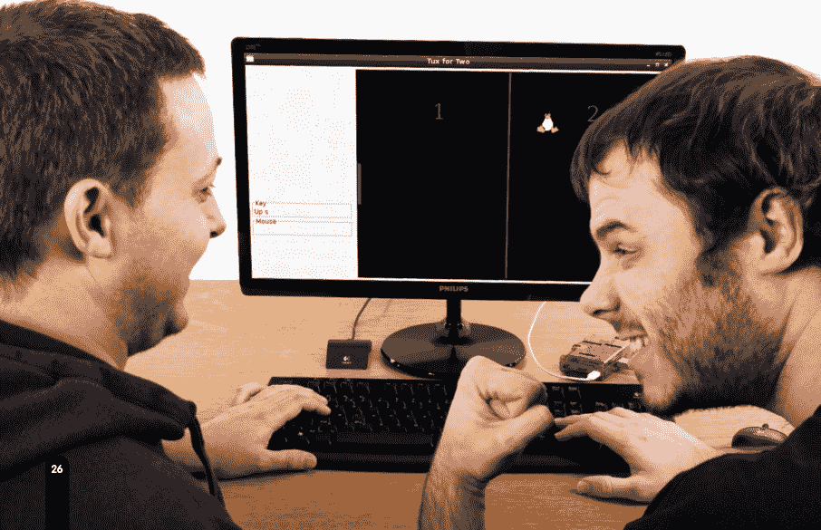

### 03 编写你的代码

启动 `IDLE 2` 而不是 `IDLE 3`，并打开一个新窗口。使用代码列表创建我们的游戏“Tux for Two”。请仔细跟随代码操作，确保你清楚自己在做什么。这样，如果你愿意，就可以对游戏规则进行自己的修改。

### 04 设置游戏

代码的开头没有什么开创性的地方：设置了 Tux 和球拍的初始位置，以及 Tux 的初始速度和方向。这些值也用于得分后重置比赛场地。每次生成时，方向和速度会被设置为随机值。

### 05 SimpleGUI 代码

绘制函数中的重要部分包括 `draw.line`、`draw.image` 和 `draw.text` 函数。这些专门来自 `SimpleGUI`，允许你轻松地在屏幕上放置这些对象，并指定其位置、大小和颜色。不过，你需要将它们绑定到一个对象上——在本例中是 `canvas`。

### 06 SimpleGUI 设置代码

最后的部分纯粹用于界面。我们告诉代码当按键被按下然后释放时要做什么，并给它一个框架来运行。然后告诉框架哪些函数处理图形、按键等功能。最后，我们调用 `frame.start()` 使其开始运行。

#### 完整代码列表


```python
import simplegui as simplegui
import random

w = 600
h = 400
tux_r = 20
pad_w = 8
pad_h = 80

def tux_spawn(right):
 global tux_pos, tux_vel
 tux_pos = [0,0]
 tux_vel = [0,0]
 tux_pos[0] = w/2
 tux_pos[1] = h/2
 if right:
  tux_vel[0] = random.randrange(2, 4)
 else:
  tux_vel[0] = -random.randrange(2, 4)
 tux_vel[1] = -random.randrange(1, 3)

def start():
 global paddle1_pos, paddle2_pos, paddle1_vel, paddle2_vel
 global score1, score2
 tux_spawn(random.choice([True, False]))
 score1, score2 = 0,0
 paddle1_vel, paddle2_vel = [0,0]
 paddle1_pos, paddle2_pos = h/2, h/2

def draw(canvas):
 global score1, score2, paddle1_pos, paddle2_pos, tux_pos, tux_vel
 if paddle1_pos > (h - (pad_h/2)):
  paddle1_pos = (h - (pad_h/2))
 elif paddle1_pos < (pad_h/2):
  paddle1_pos = (pad_h/2)
 else:
  paddle1_pos += paddle1_vel
 if paddle2_pos > (h - (pad_h/2)):
  paddle2_pos = (h - (pad_h/2))
 elif paddle2_pos < (pad_h/2):
  paddle2_pos = (pad_h/2)
 else:
  paddle2_pos += paddle2_vel
 canvas.draw.line([w / 2, 0], [w / 2, h], 4, "Green")
 canvas.draw.line([0, paddle1_pos + (pad_h/2)], [pad_w/2, paddle1_pos - (pad_h/2)], pad_w, "Green")
 canvas.draw.line([w - (pad_w/2), paddle2_pos - (pad_h/2)], [w - (pad_w/2), paddle2_pos + (pad_h/2)], pad_w, "Green")
 tux_pos[0] += tux_vel[0]
 tux_pos[1] += tux_vel[1]
 if tux_pos[1] < tux_r or tux_pos[1] > h - tux_r:
  tux_vel[1] = -tux_vel[1]
 if tux_pos[0] < pad_w + tux_r:
  if (paddle1_pos + (pad_h/2)) >= tux_pos[1] >= (paddle1_pos - (pad_h/2)):
   tux_vel[0] = -tux_vel[0]
   tux_vel[1] = -tux_vel[1]
  else:
   score2 += 1
   tux_spawn(True)
 elif tux_pos[0] >= w - pad_w - tux_r:
  if (paddle2_pos + (pad_h/2)) >= tux_pos[1] >= (paddle2_pos - (pad_h/2)):
   tux_vel[0] = -tux_vel[0]
   tux_vel[1] = -tux_vel[1]
  else:
   score1 += 1
   tux_spawn(False)
 canvas.draw_image(tux, (265 / 2, 314 / 2), (265, 314), tux_pos, (45, 45))
 canvas.draw_text(str(score1), [150, 100], 30, "Green")
 canvas.draw_text(str(score2), [450, 100], 30, "Green")

def keydown(key):
 global paddle1_vel, paddle2_vel
 acc = 3
 if key == simplegui.KEY_MAP["w"]:
  paddle1_vel += acc
 elif key == simplegui.KEY_MAP["s"]:
  paddle1_vel -= acc
 elif key == simplegui.KEY_MAP["down"]:
  paddle2_vel += acc
 elif key == simplegui.KEY_MAP["up"]:
  paddle2_vel -= acc

def keyup(key):
 global paddle1_vel, paddle2_vel
 acc = 0
 if key == simplegui.KEY_MAP["w"]:
  paddle1_vel = acc
 elif key == simplegui.KEY_MAP["s"]:
  paddle1_vel = acc
 elif key == simplegui.KEY_MAP["down"]:
  paddle2_vel = acc
 elif key == simplegui.KEY_MAP["up"]:
  paddle2_vel = acc

frame = simplegui.create_frame("Tux for Two", w, h)
frame.set_draw_handler(draw)
frame.set_keydown_handler(keydown)
frame.set_keyup_handler(keyup)
tux = simplegui.load_image("http://upload.wikimedia.org/wikipedia/commons/a/f/tux.png")
start()
frame.start()
```

# Raspberry Pi 定格动画

认为自己会是下一个尼克·帕克（`Nick Park`）吗？搭建这个 DIY 定格动画工作室，看看你能创作出什么作品。

## 所需材料

- 最新版本的 Raspbian `www.raspberrypi.org/downloads`
- `picamera` Python 模块 `picamera.readthedocs.org`
- RasPi 相机模块
- Pygame `www.pygame.org`

`Pi-Mation` 可通过 GitHub 上的 `https://github.com/russb78/pi-mation` 获取

Raspberry Pi 相机模块为你的 Pi 项目敞开了摄影和电影制作的大门。我们将两者结合，创建一个功能齐全的定格动画应用程序 `Pi-Mation`，让创建令人印象深刻的 HD 动画变得极其简单。

这个项目是用 Python 编写的，它依赖于两个你需要安装的库。`Picamera` (`picamera.readthedocs.org`) 是 Raspberry Pi 相机模块的纯 Python 接口，是所有相机模块拥有者的必备工具。`Pygame` (`www.pygame.org`)，确保我们的图像可以随时显示。

## 01 设置相机模块

首先，你需要确保你的 Raspberry Pi 是最新的。在终端中输入：

```bash
sudo apt-get update && sudo apt-get upgrade
```

接下来，我们需要更新 Pi 的固件并确保相机模块已激活。请记住，这需要一些时间。

```bash
sudo rpi-update
sudo raspi-config
```

## 02 安装其他依赖项

接下来，我们将确保 `Pygame` 和 `picamera` 已安装：

```bash
sudo apt-get install python-setuptools
easy_install -user picamera
```

最后，要安装 `Pygame` 和视频应用程序，请输入：

```bash
sudo apt-get install python-pygame
sudo apt-get install libav-tools && sudo apt-get install omplayer
```

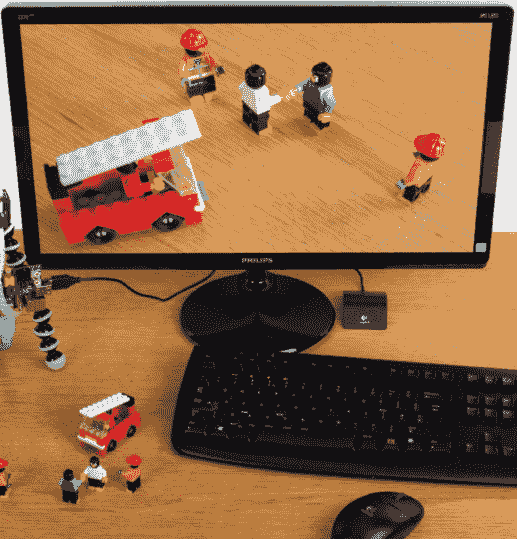

## 03 最终设置

我们将使用 Git 安装 Pi-Motion，所以请确保它已安装：

```bash
$ sudo apt-get install git
```


打开终端，导航到你的主目录（使用 `cd ~`），然后输入：

```bash
$ git clone https://github.com/russb78/pi-motion.git
```

如果你操作代码并弄坏了它，可以使用以下命令将其恢复到原始状态：

```bash
$ git checkout pi-motion.py
```

### 04 运行和测试 Pi-Motion

现在进入 `pi-motion` 文件夹并使用以下命令运行应用程序：

```bash
$ python pi-motion.py
```

按下空格键会调用 `主()` 循环中的 `take_pic()`，它保存一张图像并创建一个预览，该预览由 `update_display()` 加载。Tab 键被编码为通过要求两个变量切换值来在两种状态之间切换。

### 05 开始动画

`main()` 循环在每秒大约更新屏幕 30 次之前检查键盘事件。由于相机的实时预览独立于该循环工作，`update_display()` 只需要担心更新预览图像 (`prev_pic`)。空格键调用 `take_pic()` 并添加到 `pics_taken`，只显示最新拍摄的照片。`animate()` 函数本质上是 `update_display()` 的微流。当按下 P 键时，实时预览暂停，对于所有拍摄的照片 (`pics_taken`)，每一张都会在主窗口上“位块传输”（更新）。

#### 完整代码列表


```python
import pygame, picamera, os, sys

pics_taken = 0
current_alpha, next_alpha = 128, 255
fps = 5

pygame.init()
res = pygame.display.list_modes() # return the best resolution for your monitor
width, height = res[0]
print('Reported resolution is:', width, "x", height)
start_pic = pygame.image.load(os.path.join('data', 'start_screen.jpg'))
start_pic_fix = pygame.transform.scale(start_pic, (width, height))
screen = pygame.display.set_mode(width, height)
pygame.display.toggle_fullscreen()
pygame.mouse.set_visible = False
play_clock = pygame.time.Clock()
camera = picamera.PiCamera()
camera.resolution = (width, height)

def take_pic():
    global pics_taken, prev_pic
    pics_taken += 1
    camera.capture(os.path.join('pics', 'image_' + str(pics_taken) + '.jpg'), use_video_port=True)
    prev_pic = pygame.image.load(os.path.join('pics', 'image_' + str(pics_taken) + '.jpg'))

def delete_pic():
    global pics_taken, prev_pic
    if pics_taken >= 1:
        pics_taken -= 1
        prev_pic = pygame.image.load(os.path.join('pics', 'image_' + str(pics_taken) + '.jpg'))

def animate():
    camera.stop_preview()
    for pic in range(1, pics_taken):
        anim = pygame.image.load(os.path.join('pics', 'image_' + str(pic) + '.jpg'))
        screen.blit(anim, (0, 0))
        play_clock.tick(fps)
        pygame.display.flip()
    camera.start_preview()

def update_display():
    screen.fill((0,0,0))
    if pics_taken > 0:
        screen.blit(prev_pic, (0, 0))
        play_clock.tick(30)
        pygame.display.flip()

def make_movie():
    camera.stop_preview()
    print("\nQuitting Pi-Motion to transcode your video.")
    os.system('avconv -r ' + str(fps) + ' -i "pics/image_%d.jpg" -vcodec libx264 video.mp4')
    sys.exit(0)

def change_alpha():
    global current_alpha, next_alpha
    camera.stop_preview()
    current_alpha, next_alpha = next_alpha, current_alpha
    return next_alpha

def quit_app():
    camera.close()
    pygame.quit()
    print("You've taken", pics_taken, "pictures. Don't forget to back them up!")
    sys.exit(0)

def intro_screen():
    intro = True
    while intro:
        for event in pygame.event.get():
            if event.type == pygame.KEYDOWN:
                if event.key == pygame.K_ESCAPE:
                    quit_app()
                elif event.key == pygame.K_F1:
                    camera.start_preview()
                    intro = False
            screen.blit(start_pic_fix, (0, 0))
            pygame.display.update()

def main():
    intro_screen()
    while True:
        for event in pygame.event.get():
            if event.type == pygame.KEYDOWN:
                if event.key == pygame.K_ESCAPE:
                    quit_app()
                elif event.key == pygame.K_SPACE:
                    take_pic()
                elif event.key == pygame.K_BACKSPACE:
                    delete_pic()
                elif event.key == pygame.K_RETURN:
                    make_movie()
                elif event.key == pygame.K_TAB:
                    camera.preview_alpha = change_alpha()
                elif event.key == pygame.K_F1:
                    camera.start_preview()
                elif event.key == pygame.K_p:
                    camera.stop_preview()
                    intro_screen()
                elif event.key == pygame.K_p:
                    if pics_taken > 1:
                        animate()
        update_display()

if __name__ == '__main__':
    main()
```


## 硬件

- `32` 打造一台 Pi 2 桌面电脑

  用你的树莓派替代普通电脑

- `36` 创作实录：PiKon

  看看这款3D打印的天文望远镜

- `38` 制作一辆树莓派遥控车

  掌控你的遥控汽车

- `44` 创作实录：机械臂

  深入了解由树莓派驱动的机械臂

- `46` 制作树莓派 HTTPC

  终于打造出一台功能更强大的机器

- `48` 制作一个会发推文的无线洪水传感器

  保护你的地下室免受水患

- `50` 构建一台树莓派驱动的 Bigtrak 越野车

  操控你自己的全地形车辆

- `54` 创作实录：PiPanther

  在增强现实中与朋友展开对战

- `56` 制作数字相框

  将树莓派变成一款精美的电子相框

- `60` 创作实录：Pi Glass

  看看这些程序员如何改装视频眼镜

- `62` 构建树莓派《我的世界》游戏主机

  打造一款功能完整的游戏机

- `68` 创作实录：Bullet Pi


# 将 48 台树莓派连接在一起会发生什么？

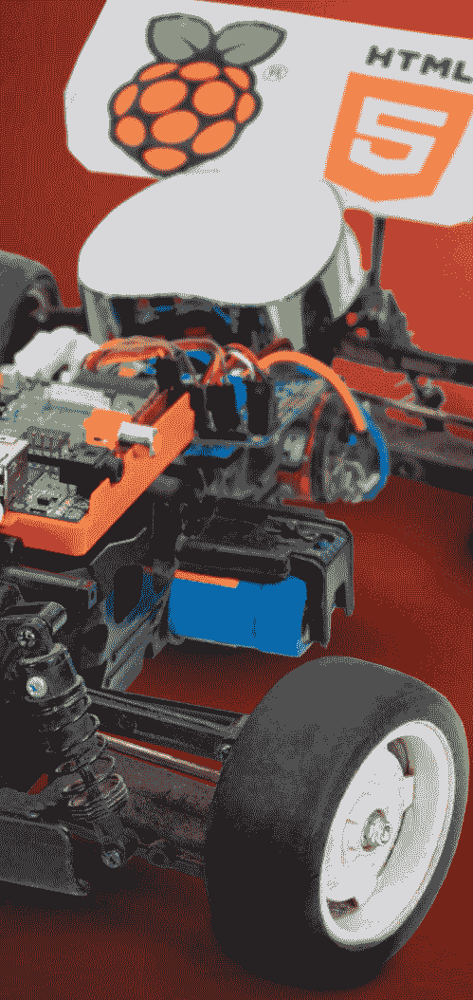


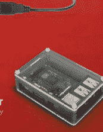
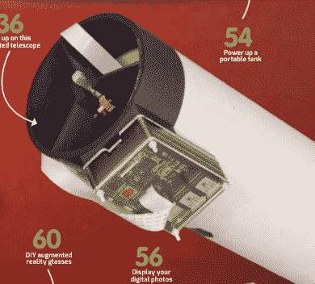

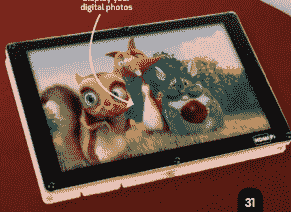

## 打造一台 Pi 2 桌面电脑

得益于树莓派 2 性能的提升，你可以将树莓派作为桌面替代电脑使用。树莓派 2 相比其前代产品的性能提升已有诸多记录。更多的 CPU 核心和更多的内存使其速度提升了六倍，这是一个令人印象深刻的数字，你可以直观地看到它给用户体验带来的实际变化。

这种性能提升实际上让你可以完成一个极其简单的，但原本的原版树莓派勉强无法做到的项目：树莓派桌面电脑。虽然所有组件都可以买到，但原版的树莓派速度略微太慢，无法提供流畅的桌面体验。现在随着资源的改善，许多限制都已消除——足以支持构建一台树莓派桌面电脑。所以，拿一台树莓派 2 出来，我们开始吧。

### 01 获取 Raspbian

我们将为桌面树莓派使用 Raspbian 系统。它不仅获取简单且易于使用，而且得到树莓派基金会和社区的支持，这意味着它将是拥有最多桌面选择的最灵活操作系统。请从以下地址下载：[www.raspberrypi.org/downloads.](http://www.raspberrypi.org/downloads.)


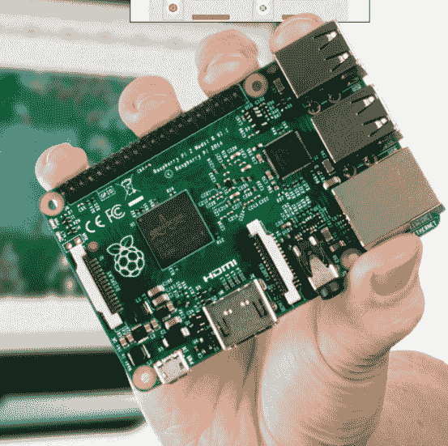

**你需要准备的材料**

- 树莓派 2
- Raspbian 系统（raspberrypi.org/downloads）
- 键盘
- 鼠标
- 无线网卡（USB 无线适配器）
- 显示器
- 外壳
- 带供电的 USB 集线器（可选）

### 02 安装 Raspbian

下载完 Raspbian 后，你可以将其安装到 SD 卡上。将 micro SD 卡插入 SD 卡读卡器，并将其连接到你的主系统（PC 或笔记本电脑）。打开终端，`cd` 到镜像文件所在的目录，然后使用以下命令：

```bash
$ sudo dd bs=1M if=raspbian.img of=/dev/[Location of SD card]
```

### 03 配置选项

首次启动时，有一些必要的设置步骤需要完成。对于这台桌面电脑来说，最重要的事情是先点击“启用启动到桌面（Enable Boot to Desktop）”，然后扩展安装以填满整个 SD 卡。完成这些后，你可以在这些菜单中进行其他你需要的设置，然后在进入下一步之前重启系统。

### 04 首次启动

你将启动到带有新界面和默认应用程序的 Raspbian 系统。从这里开始，你可以像平常一样使用它，但值得注意的是，还有一些额外的事项需要处理，以使其真正具备桌面用途的价值。

### 05 软件更新

我们的第一步是执行系统升级，以确保一切都是最新的并且运行正常。为此，从菜单中打开终端并使用以下命令：

```bash
$ sudo apt-get update
```

... 以刷新软件列表，然后使用下一条命令升级到更新的软件。

```bash
$ sudo apt-get upgrade
```

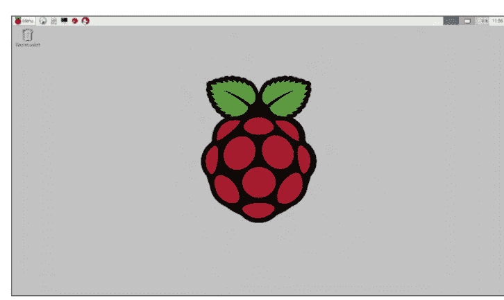

> 如上：请务必设置树莓派直接启动到桌面，就像你的主电脑一样

### 06 固件升级

在更新软件的同时，升级设备固件是个好主意。仍在终端中，你需要使用以下命令激活固件升级软件：

```bash
$ sudo rpi-update
```

### 07 额外配置

此时，你可能希望进一步调整树莓派的设置。要调出初始配置界面，你需要回到终端并运行以下命令：

```bash
$ sudo raspi-config
```

### 08 高级选项

在这里，你可以激活一些未来可能需要的额外选项。启用树莓派相机驱动是个好的开始，如果你专注于有趣的游戏开发，甚至可以让它启动到 Scratch 编程环境。否则，如果系统开始变慢，你还可以考虑一些超频选项。

### 09 装饰你的树莓派

仅在树莓派上设置操作系统只是过程的一小部分——我们还需要考虑周围的硬件，这些硬件实际上才能使其作为桌面替代设备可用。


### 10 人机输入设备

标准的 USB 键盘和鼠标最适合此任务，远比许多树莓派用户常用的无线键鼠组合更合适。但是，不要试图通过购买自带 USB 接口的键盘来节省 USB 端口：树莓派无法为 USB 集线器供电，即使只是键盘上的两个端口也不行。

### 11 显示器观看

树莓派最高支持 1080p 输出，即普通显示术语中的 1920 x 1080。虽然它只通过 HDMI 输出，但许多现代显示器都带有 HDMI 输入接口。如果你不想购买新的显示器，你随时可以购买一个 HDMI 转 DVI 或 HDMI 转 VGA 的转接头。

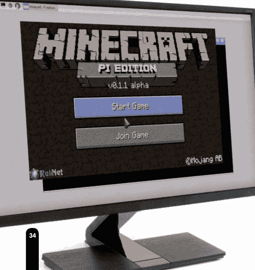

> 如下：你可以使用树莓派 2 运行一个相当不错的《我的世界》服务器，供少数朋友游玩

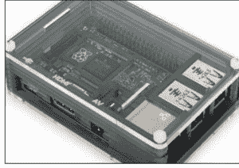

### 12 外壳保护

树莓派相当坚固，如果我们说我们不经常把它放在外壳里，那就撒谎了；然而，它并非不可摧毁。虽然我们在许多涉及访问不同组件的项目中经常这样做，但桌面树莓派不需要这种程度的访问权限。我们喜欢 Pimoroni PiBox 外壳，但也有其他几种安全、防护性强的替代品。

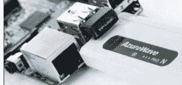

### 13 无线连接互联网

虽然有些人使用有线连接也没问题，但并不是每个人都有这种条件。无线网卡非常适合树莓派，特别是现在它们几乎和 USB 接口本身一样小。然而，并非任何网卡都能工作，你必须对照此列表以确保获得兼容的产品：[http://elinux.org/RPI_USB_WI-FI_Adapters](http://elinux.org/RPI_USB_WI-FI_Adapters).


### 14 还有其他什么吗？

我们的标准桌面 PC 设置已完成，还剩一个空闲的 USB 端口。你可以将该端口用于 U 盘或便携式存储设备，或者投资一个带供电的 USB 集线器以获得更多的连接选项。否则，投资一个良好的 2A 电源适配器将确保你永远不会因电力不足而困扰。


# 打造一台 PI 2 台式机

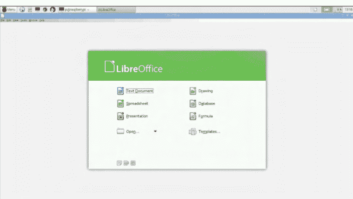


### 15 添加额外软件

我们还没有完全准备好 Raspberry Pi 桌面环境。我们需要添加一些额外软件，使其体验更接近真正的桌面系统。虽然我们已经安装了浏览器和一些基础工具，但我们接下来应该添加的第一项软件是办公套件。

### 16 使用 LibreOffice

LibreOffice 默认并未安装，但作为首选的开源办公套件，或者说 Linux 平台上的通用办公套件，它在 Raspbian 上很容易获取，这非常有用。打开终端，使用以下命令进行安装：

```bash
$ sudo apt-get install libreoffice
```

### 17 使用 GIMP 处理照片

这是个大难题——早期的 Pi 甚至无法顺畅运行 LibreOffice，更别提使用 GIMP 了。但现在 GIMP 运行得非常顺畅，尽管更复杂的任务可能会让它稍微变慢一点。使用以下命令安装：

```bash
$ sudo apt-get install gimp
```


> 如上所示：使用 Pi 2，你可以运行完整的办公套件，而不会遇到令人不适的卡顿

### 18 使用 VLC 播放音乐

如果你在工作时需要听音乐，VLC 是一个值得查看的优秀软件之一。你可以在 Pi Store（Pi 商店）中找到它。它是免费下载的，你可以在 Pi 菜单中找到 Pi Store 来安装它。

### 19 作为桌面使用的 Pi

现在一切准备就绪，你可以开始正式将你的 Raspberry Pi 用作桌面系统，同时根据需要使用其教育功能。软件仓库和 Pi Store 应该包含你希望或需要的任何其他软件，以充分利用你的新 Pi 系统。

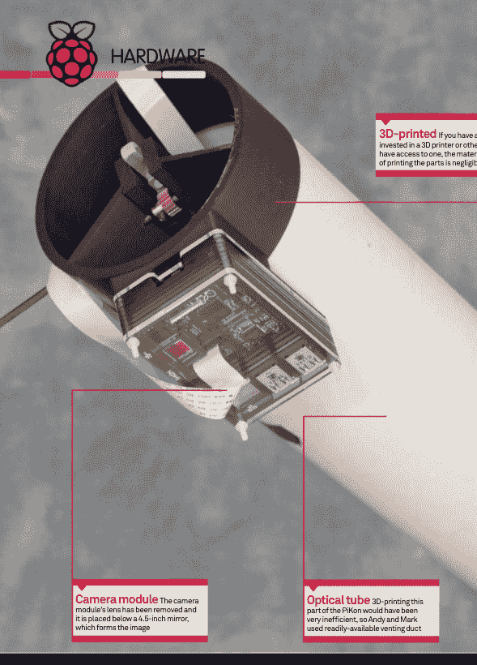

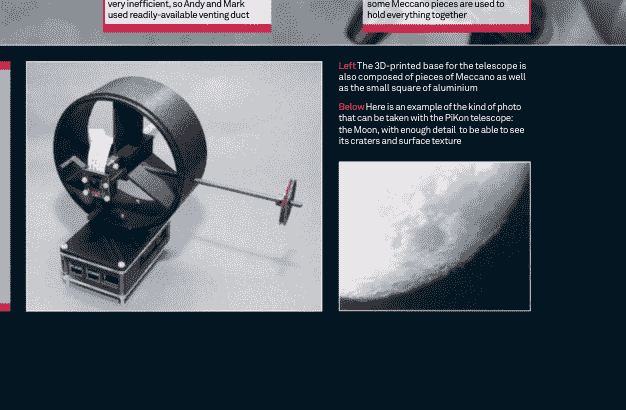

## 组件列表

- Raspberry Pi
- 摄像头模块
- 3D 打印机
- 5 个需打印的 CAD 文件：`bit.ly/twiT9a8`
- 白色通风管道
- 小块铝板
- 对焦旋钮
- Meccano（万能玩具模型）部件
- 三脚架

下面是一个使用 PiKon 望远镜拍摄的示例照片：月亮，细节清晰到可以看到其环形山和表面纹理

- **摄像头模块**：摄像头模块的镜头已被移除，它被放置在一面 4.5 英寸的反射镜下方，反射镜用于成像。
- **光学镜筒**：如果 3D 打印 PiKon 的这一部分会非常低效，因此 Andy 和 Mark 使用了现成的通风管道。
- **3D 打印部件**：如果你已经投资了一台 3D 打印机，或者能够使用到一台，打印这些部件的材料成本几乎可以忽略不计。
- **对焦机制**：靠近底部时情况变得稍微复杂一些，使用了一些 Meccano 部件来将所有东西固定在一起。
- **左侧**：望远镜的 3D 打印底座也由 Meccano 部件以及小块铝板组成。

## 我是如何制作的：PiKon

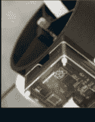

**3D 打印望远镜遇上 Raspberry Pi 摄像头**

### 告诉我们你是如何开始这个项目的

**Mark Wregley**：我经营一家名为 Alternative Photonics 的小公司，并且喜欢了解新技术。当谢菲尔德“思维节”（Festival of the Mind）来临时，我思考我们可以结合哪些新颖且具有颠覆性的事物，整个项目就是这样开始的。我感兴趣的两个方向是使用 Raspberry Pi 进行摄影和 3D 打印。有了 3D 打印机，你只需花费大约 £500 就能获得一台设备，这让它处于消费品价格的范畴内，因此制造变成了可以在家里做的事情。有一些公司可以为你打印东西，你发送设计，他们就生产出来。还有创客社区——Andy 领导一个名为 Sheffield Hardware Hackers and Makers 的团体。

**Andy Kirby**：Sheffield Hardware Hackers and Makers 对任何想要参与折腾和制造东西的普通人开放。我建立这个团体是为了配合几年前在互联网上开展的原始 RepRap 项目（编者按：RepRap 是可以打印更多 RepRap 部件的 3D 打印机套件）。我发现相当多的人在制造打印机时遇到瓶颈，卡住了，所以我最初建立这个团体是为了让人们可以随时来寻求帮助。

### Andy，你在 PiKon 中扮演了什么角色？

**Andy**：我帮助 Mark 选择了一款适合他技能水平的 3D 打印机。然后，当他组装打印机时，每当他遇到卡住的地方，他就会把机器带到 Hardware Hackers 团体，说“我这样做对吗”或“我做不到那样”，然后我们一起解决问题。一旦他的打印机运行起来，我就和他一起研究 CAD 软件，看看有哪些开源且在他能力范围内的资源。设计部件时，3D 打印机有一些做不到的事情，我们就此进行了讨论，我给了他一些技巧，以便更快地获得可用的部件。

### PiKon 是如何工作的？

**Mark**：大多数望远镜的工作原理是你有一个物镜或反射镜来成像，然后使用目镜来观察那个图像，因此通常被称为虚像。而在 PiKon 中，我们做的是使用成像器件，在本例中是一个 4.5 英寸（115mm）的反射镜，来成像，然后将去除了镜头的 Raspberry Pi 摄像头——仅作为传感器——放置在图像形成的位置。因此，实际上，我们不是使用目镜，而是通过放置 Raspberry Pi 传感器在那里来电子方式观察图像。由于传感器相对较小，我们只能观察图像中相当小的一块区域。

### 你能获得什么样的分辨率？

**Mark**：目前，我们的设置等效于大约 160 倍的放大倍率。如果你观察月亮，人眼的视场角约为半度，而 PiKon 的最大视场角约为四分之一度，因此实际上你可以在全画幅中看到大约半个月亮。我接下来想做的是观察行星。就分辨率而言，PiKon 的传感器是 500 万像素，即 2500x2000 像素。如果你要在打印中重现图像，通常需要使用如 300dpi 的分辨率，因此 5MP 允许你重现类似 A4 大小的图像。在电脑屏幕上，你只需要 72dpi，所以接下来我非常感兴趣的是看看仅通过裁剪——即字面上丢弃一些像素——能获得多大的放大倍率，以便放大观察类似行星的物体。如果你阅读过《天文入门》之类的资料，他们会提到观察行星需要 200-250 倍的放大倍率，所以我希望能做到像观察土星环这样的事。我们并不是要挑战哈勃望远镜——我们认为你已经拥有了一个合理的仪器，并且可以做一些有趣的事情。另一件事是，因为它使用 Raspberry Pi 传感器而不是目镜，你直接进入的是天体摄影的世界，而不仅仅是观测，这就是我们要走的方向。

### 你如何控制 PiKon 的摄像头？

**Mark**：我们希望做得更好！

**Andy**：目前是通过命令行操作的。我不是 Raspberry Pi 程序员……所以目前我们使用的是 Raspberry Pi，它提供几秒钟的预览然后拍照，所以有点笨拙。我正在与一位懂 Raspberry Pi 同时也是摄影师的人交谈，他写了一些程序，让你拥有一个快门按钮。接下来要做的是通过输入/输出设备（如快门按钮）来控制 PiKon，然后为你生成的 JPG 文件提供顺序编号或带日期的文件名。我接下来希望看到的是，如果我们能让这个硬件公开上市，吸引人们实际来参与并为它开发越来越多的软件。例如，我尝试过用普通相机拍摄国际空间站。这真的很难，因为这个点突然飞过地平线，你必须转动相机、对齐、按下快门等等。我有个想法是，如果能用 PiKon 拍摄多张照片就好了——你按一个按钮，它每五秒拍摄一张照片。


**Mark Wregley**

他是物理研究所的成员，并持有皇家摄影学会的会员资格（Licentiate）


**Andy Kirby**

他是 RepRap 项目的早期贡献者，并领导 Sheffield Hardware Hackers and Makers 团体

**喜欢它吗？**

Raspberry Pi 基金会网站曾介绍过将一个 Pi 和摄像头安装在望远镜上并捕捉精彩图像的项目 `bit.ly/1qYTp3Bp`

**延伸阅读**

如果你对天体摄影和开发 PiKon 软件感兴趣，查看这些天体软件包：`bit.ly/10Wj6E5`

## 构建由树莓派控制的小车

利用前沿的 Web 技术，通过智能手机或平板电脑控制一辆遥控车...


Web 技术正在以巨大的步伐前进，云技术正在将大规模计算能力带入个人领域，而硬件也正处于一个完美的时刻，传感器、显示设备和无线技术都已演变为高效且价格亲民的设备。我们确实正处于这样一个阶段，几乎任何人都可以在一周内以极低的成本将一个想法从零变为一个可用的产品。正如这个项目一样，它有趣、快速且易于构建，是学习的绝佳方式。我们将获取一辆旧的遥控车，拆下它的无线电接收器，并用电树莓派替换它，将其连接到网络上，启动一个前沿的 Web 服务器，然后通过倾斜设备让你的手机或平板电脑来控制它。到结束时，你不仅会得到一个有趣的玩具——你还将了解到正在推动世界最新且最大经济体的基础技术，在可预见的未来也是如此。欢迎来到明天！

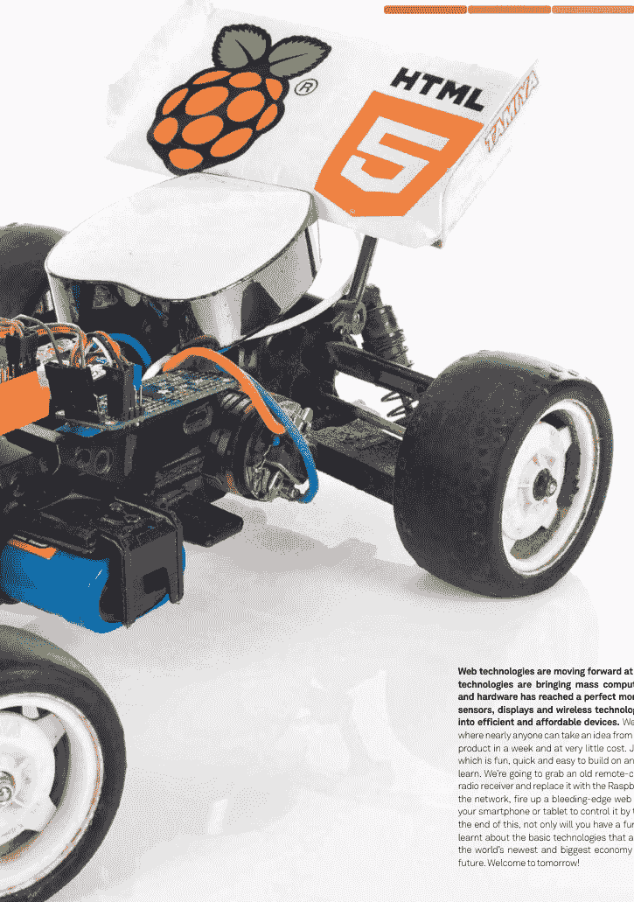

## 树莓派控制小车的构建过程

### 组件列表

- 一辆双通道玩具遥控车（转向和驱动）
- Adafruit PWM I2C 舵机驱动器
- 母对母跳线
- 5V 电池电源组

预估成本：£60 / $100

组件来自 `www.modmypi.com`

在你能用智能手机控制小汽车之前，你需要对底盘进行一些重大改动


为了使用最新的 Web 技术和我们信用卡大小的计算机让我们的玩具车“活”起来，我们需要对其内部机制进行一些相当显著的改动。幸运的是，构建过程中最复杂的部分可以通过购买两种实惠的设备来完成，即一个负责转向和节流的舵机控制器板，以及一个让树莓派平稳运行的 5V 电池组。

### 01 识别并移除旧的无线电设备

这个项目实际上是在替换小车的普通发射器和接收器。注意原接收器上的三个插座：一个通向电机控制器，另一个通向转向舵机。一些遥控车还有独立的电子电池，但这些（特别是带有带 BEC 的电子速度控制器）直接从速度控制器获取 5V 电源，从而节省了组件成本。如果你没有带 5V BEC 的速度控制器，你需要在其他地方获取 5V 电源。许多商店销售 5V 电池电源——通常作为手机应急充电设备。`www.modmypi.com` 以低于 20 英镑的价格销售一款合适的 5V 电池电源组。

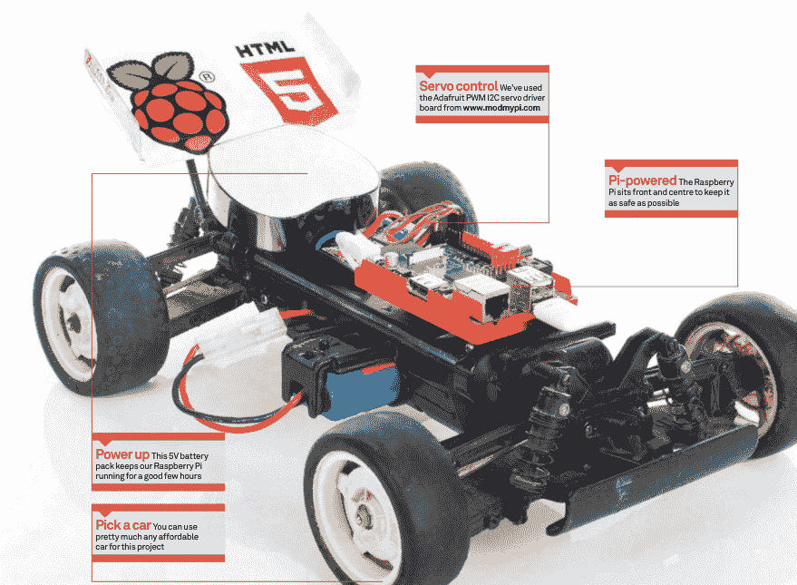

**舵机控制** 我们使用了来自 `www.modmypi.com` 的 Adafruit PWM I2C 舵机驱动板

**树莓派驱动** 树莓派位于正中央，以尽可能保持安全

**上电** 这个 5V 电池组可以让我们的树莓派运行好几个小时

**选择一辆车** 这个项目几乎可以使用任何廉价的车辆

### 02 将舵机电缆连接到新控制器

我们使用树莓派的 I2C 总线来控制舵机接口板

我们按照 `www.modmypi.com` 的说明焊接了我们的 16 通道 I2C 舵机控制器板，并将通道 0（转向）和通道 1（电机）的接头简单地插到上面。总共有六根电缆：底部两根是接地，中间两根是电源，顶部两根是 PWM（脉冲宽度调制）信号。现在是时候思考额外组件的安装位置了，而最佳的固定方法似乎是使用背胶魔术贴。

### 03 将 I2C 总线连接到树莓派

我们使用树莓派的 I2C 总线来控制舵机接口板，这只需要四根电缆——它们都在树莓派和舵机控制器板之间，如图所示。本月的加速器教程解释了如何在树莓派上设置 I2C。

从上到下，我们需要使用 1 号引脚（GND）、2 号引脚（SCL）、3 号引脚（SDA）和 4 号引脚（VCC），它们直接对应树莓派上的相同端口。本质上，这是电源、接地和两个通信通道——目前为止一切都很简单...

### 04 将其连接到树莓派

在 Rev 1 树莓派上，电缆看起来是一样的。虽然 Rev 版本的标签不同，但物理引脚位于相同的位置。左下方（靠近 RASPI 电源连接器）是 3.3V 电源；旁边是 SDA 接头，即数据通道。在右下方旁边是 SCL 通道，它控制 I2C 设备的时钟。最后——在右上角端口——是接地。

### 05 主要组件概览

此时，你应该有舵机板在中间，转向舵机和速度控制器在一侧，树莓派在另一侧。电机连接到速度控制器的另一端（该端应该有较粗的电线）；速度控制器还有两根粗电线通向主车电池——在这种情况下是 7.2V 镍镉电池。我们现在有两个非常独立的电源系统，一侧是大电流电机，另一侧是小电流电子设备。让我们确保保持这种状态！

### 06 为所有组件安家

现在是时候为新组件找个家了。使用大量的背胶魔术贴、扎带或橡皮筋来固定所有东西，并尽可能在小车车身内找到空间来隐藏电线。虽然可以将树莓派直接粘在或用螺丝固定在车上，但我们建议使用至少半个外壳以增加保护和便于访问。插入你的 SD 卡、网线或 Wi-Fi 适配器（如果从另一台机器编程）和电源。坐回去欣赏你的打包工作。接下来我们将处理项目的软件部分...

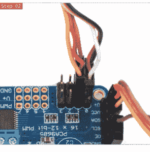

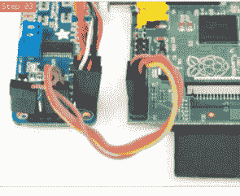

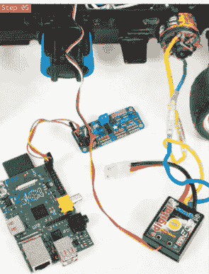

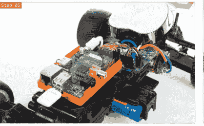

## 硬件

### 控制你的树莓派驱动小汽车

使用智能手机和最新的 Web 技术控制玩具车

现在，我们精美的树莓派驱动小汽车已经布线完成并充满电，是时候让它“活”过来了。我们正在使用 JavaScript 编程语言提供的最佳 Web 技术，利用手部的自然运动无线驱动车辆。每个微小的动作都会触发一个事件，计算小车应该做什么，然后通过 socket 连接每秒发送多达 20 次。

### 你需要什么

- 一辆准备就绪的树莓派小车
- 互联网连接
- 一部相当现代的智能手机/平板电脑
- 树莓派小车源代码：`github.com/shaunuk/picar`

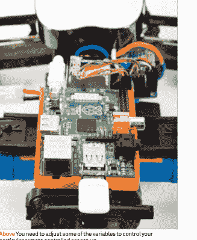

### 01 下载并安装软件

为了使 I2C 连接工作，你可以遵循第 64–65 页的步骤。接下来，我们需要为新项目代码找个家——`/var/www/picar` 怎么样？在终端中输入 `sudo mkdir /var/www/picar` 来创建目录，然后进入该目录：`cd /var/www/picar`。

现在，使用 Git 下载项目，输入 `sudo git clone http://github.com/shaunuk/picar`。如果你没有 Git，请用 `sudo apt-get install git` 安装它。

这将下载用于驱动车辆的定制软件，但在我们可以开始“烧胎”之前，我们仍然需要 Web 服务器和其他一些部件...

### 02 下载并安装 Node.js

我们现在需要获取强大的 Node.js 及其包管理工具，Node 包管理器（npm）。输入 `sudo wget http://nodejs.org/dist/v0.10.21/node-v0.10.21-linux-arm-pi.tar.gz`。这将下载一个相当新版本的 Node.js – 各种 Raspbian 仓库中的版本太旧了，无法与我们即将使用的新技术配合工作。输入 `sudo tar -xzvf node-v0.10.21-linux-arm-pi.tar.gz` 解压 node 包。

### 03 配置 Node.js

为了便于从任何地方运行，我们将为 Node 和 npm 二进制文件创建符号链接。在终端中，输入 `sudo ln -s /var/www/node-v0.10.21-linux-arm-pi/bin/node /bin/node`，然后输入 `sudo ln -s /var/www/node-v0.10.21-linux-arm-pi/bin/npm /bin/npm`。然后，为了获取额外模块，输入 `npm install socket.io node-static socket.io adafruit-i2c-pwm-driver sleep optimist`

### 04 了解项目

现在你拥有了所有东西，你应该能看到三个文件：服务器 (`app.js`)、客户端 (`socket.html`) 和用于客户端的 jQuery JavaScript 库。服务器不仅驱动舵机，它还是一个 Web 服务器，当被请求时向浏览器发送 `socket.html` 文件和 jQuery——这是一个非常简洁和简单的设置，正好符合我们的目标。

### 05 测试舵机

我们实用的小程序 (`app.js`) 有一个专门用于测试的特殊模式。我们在这里使用两个关键字：`beta` 代表舵机 0（转向）和 `gamma` 代表舵机 1（电机控制）。输入 `node app.js beta=300`，你应该看到前轮转动。现在数字需要居中。在我们的示例中，340 是左转，400 是中心，470 是右转。通过输入 `node app.js gamma=400` 对电机做同样的事情，并记录你的车的各种限制。

### 06 配置合理的默认值

现在你知道你的车能做什么，我们可以设置 `app.js` 和 `socket.html` 中的默认值。编辑 `app.js`，找到写着 `function emergencyStop()` 的部分。将两个数字调整为你车的静止值。然后打开 `socket.html`，调整 'Define your variables here' 下的预定义值。

### 07 去兜一圈

我们几乎可以试一下了，但你需要知道你的树莓派小车的 IP 地址，所以在终端输入 `ifconfig`。然后通过输入 `node app.js` 启动应用。现在拿起最近的智能手机或平板电脑，确保它与你的树莓派在同一网络上。打开 Web 浏览器，转到 `http://your IP address:8080/socket.html`。你应该会看到一个说 'ready' 的警报消息，一旦你点击 OK，手机上的陀螺仪数据就会发送到小车，你就出发啦！


# 构建由树莓派控制的车辆

我们将利用手部的自然运动无线驱动车辆

#### 完整代码列表

### socket.html


```html
<html>
<head>
<script src="jquery-2.0.3.min.js" language="javascript"></script>
<script src="socket.io/socket.io.js"></script>
<meta name="viewport" content="user-scalable=no, initial-scale=1.0, maximum-scale=1.0" />
</head>
<body>
<script>
//-------- Define your variables here
var socket = io.connect(window.location.hostname+':8080');
var centerbeta = 400; //where is the middle?
var minbeta = 340; //right limit
var maxbeta = 470; //left limit
//to get the desired range of steering
var multbeta = 3; //factor to multiply the raw gyro figure
var centergamma = 330;
var adjustmentgamma = 70; //what do we do to the angle to get
var mingamma = 250; //backwards limit
var maxgamma = 400; //forward limit
var multgamma = 1; //factor to multiply the raw gyro figure
//by to get the desired rate of acceleration
window.lastbeta=0;
window.lastgamma=0;

$(function(){
window.gyro = 'ready';
alert('Ready -- Lets race !');
});

window.ondeviceorientation =function(event) {
beta = centerbeta+(Math.round(event.beta*multbeta)-centerbeta);
if (beta >= maxbeta) {
    beta=maxbeta;
}
if (beta <= minbeta) {
    beta=minbeta;
}
gamma = event.gamma;
gamma = (Math.round(event.gamma)+adjustmentgamma)*multgamma-centergamma;
//stop sending the same command more than once
send = 'N';
if (window.lastbeta != beta) {
    send = 'Y';
}
if (window.lastgamma != gamma) {
    send = 'Y';
}
window.lastbeta=beta;
window.lastgamma=gamma;
if (window.gyro == 'ready' & send=='Y') {
    //don't send another command until ready
    window.gyro = 'notready';
    socket.emit('fromclient', {beta: beta, gamma: gamma });
    window.gyro = 'ready';
}
</script>
</body>
</html>
```

```javascript
//set the address and device name of the breakout board
pwm = new PwmDriver(0x40,'dev/i2c-0');

//set pulse width
testserPulse = function(channel, pulse) {
    var pulseLen;
    pulseLength = 1000000;
    pulseLen = 60;
    print("Xs us per period" % pulseLength);
    pulseLength /= 4096;
    print("Xs us per bit" % pulseLength);
    pulse = 1000;
    pulse = pulseLength;
    return pwm.setPWM(channel, 0, pulse);
};

//set pulse frequency
pwm.setPWMfreq(60);

//make a web server on port 8080
var file = new(static.Server)(0);
function handler(request, response) {
    console.log('serving file',request.url);
    file.serve(request, response);
};

console.log('Pi car web server listening on port 8080 visit
http://address:8080/socket.html');
lastAction = '';
function emergencyStop(){
    pwm.setPWM(0, 0, 400); //center front wheels
    pwm.setPWM(1, 0, 330); //stop motor
    console.log('#EMERGENCY STOP - signal lost or shutting down');
}
if (argv.beta) {
    console.log('Performing one off servo position move
        to: '+argv.beta);
    to = argv.beta; 
    pwm.stop();
    return process.exit();
}
if (argv.gamma) {
    console.log('Performing one off servo position move
        to: '+argv.gamma);
    pwm.setPWM(0, 0, argv.gamma); //using direct i2c pwm module
    pwm.stop();
    return process.exit();
}

//fire up a web socket server
io.sockets.on('connection', function (socket) {
    socket.on('fromclient', function (data) {
        console.log('Beta:', data.beta, 'gama:', data.gamma);
        //select('echo' sa "data" > "dev/ttyAMA0",puts); //using
        //http://electronics-projects.com/wp/rasp.php
        //echo('picar.py', data, beta, puts); //using python
        //default module
        pwm.setPWM(0, 0, data.beta); //using direct i2c pwm module
        pwm.setPWM(1, 0, data.gamma); //using direct i2c pwm module
        clearInterval(lastAction); //stop emergency stop timer
        lastAction = setInterval(emergencyStop,1000); //set
        //emergency stop timer for 1 second
    });

process.on('SIGINT', function() {
    emergencyStop();
    console.log('Ungracefully shutting down from SIGINT 
    (Ctrl-C)');
    pwm.stop();
    return process.exit();
});
```

### app.js


```javascript
//declare required modules
var app = require('http').createServer(handler)
, io = require('socket.io').listen(app)
, fs = require('fs')
, static = require('node-static')
, sys = require('sys')
, PwmDriver = require('adafruit-i2c-pwm-driver')
, sleep = require('sleep')
, argv = require('optmist').argv;
app.listen(8080);
```

# 硬件


`MPU-6050` 包含 MEMS 加速度计和 MEMS 陀螺仪，该传感器以 16 位 ADC 转换读取 x、y 和 z 轴通道

`洞洞板` 洞洞板非常适合整理此类项目中的电线，因为电线可能会碍事，但又无法真正穿过面包板

`机械臂` 可从 Maplin Electronics 和 DWI Robotics 购买，该机械臂附带控制软件，即使尚未引入 `MPU-6050` 也可使用

## 组件列表

- 树莓派 B 型
- Maplin 机器人机械臂套件（带 USB PC 接口）
- `MPU-6050` 六轴陀螺仪和加速度计
- 3 个微型按钮开关
- 洞洞板
- 魔术贴绑带
- 1 米排线


`左图` 这款机械臂是使用最广泛的之一，网上有大量的指南可供参考

`下图` 这些按钮中的一个控制机械臂末端上的灯，另外两个则用于打开和关闭其夹爪


# 我是如何制作机械臂的：机器人手臂

掌握自然运动控制


**是什么首先启发你开始你的机械臂项目？**

机械臂本身是我多年前看到的，我真的很想要它，因为这是你可以自己控制的东西——它极大地激发了我童年的想象力。当时我在哈罗（Harlow）这里的一个科学博物馆做志愿者，这个围绕树莓派建立的社团成立了，我买下机械臂是因为我想要它。所以，当时我同时也搞树莓派相关的东西，就想，为什么不把两者结合起来呢？

我有一个复杂的按键系统来控制它做任何事，这有点无聊，然后 James Dail（协助社团活动的人之一）给了我一个想法，把加速度计放在顶部，以此了解它的位置。我看着那个并想，“如果我身上带着加速度计，并试图用它来模仿我的手部动作呢？”于是我开始寻找，查到了他正在使用的加速度计（`MPU-6050`），然后在 eBay 上发现它大约只要 5 英镑——通常我会在 SparkFun 看到它卖约 30 英镑，但我是学生预算有限...

我使用的大多数代码是借来的但开源的，人们说这样没问题，然后我整理了两段程序——一段可以控制机械臂，另一段从加速度计接收输入——并将它们合并在一起。它看起来不是那么整洁，但它能工作，而这真的是唯一重要的。

**那么你用那个 `MPU-6050` 具体在读取什么？**

在我找到的代码中有陀螺仪和加速度计——你可以使用其中一个，但陀螺仪在随时间衰减方面非常好，但它倾向于漂移，而加速度计适合突然转向和测量重力。如果你将两者相互比较，那么你可以随时获得一个粗略的角度，所以本质上是加速度计和陀螺仪一起使用，以纠正其中一个或另一个的故障。它有两个运动轴——俯仰和横滚。

**让我们谈谈代码本身。**

所以在第一部分，它查找实际的 `I2C` 接口在哪里，并有一个快速的设置——我上面有三个按钮来控制夹爪和灯，所以它设置了它们——然后有一部分是使用 `USB` 库来查找机械臂，如果出现问题则将其拆分。有一些函数定义来实际移动机械臂，使其稍微容易一点——每个电机方向都是不同的二进制数——然后有更多定义用于设置从加速度计读取数据以及做一些数学计算，以确保陀螺仪和加速度计都给出正确的角度。然后有一个小循环，里面有一个 try 语句，只是获取加速度计的数据，拆分数学部分，然后检查给定的角度是否在特定范围内。如果是，移动这个电机向左（例如），或者如果按下一个按钮，它则打开灯。我遇到的唯一问题是，要实际移动它，需要一个角度变化——所以不是一个连续的过程，我必须稍微挥动一下手，但有那个角度阈值，如果我触发它，它就会移动。

**你是否考虑过添加更多形式的控制？**

是的，我对此做了很多研究。就其他控制方式而言，我非常喜欢它的直观性——要旋转和移动这个机械臂，你实际上是在移动你自己的手臂，所以这是我一直在关注并试图使其更加直观的方面。尝试获得某种——我在某个时候买了一个 Arduino——尝试构建一个实际的机械手，然后以此为基础扩展。最终，我的大计划——在未来很多很多年——是拥有一个由用户动作控制的整体类人体系统，但这是一个非常大的计划，我目前还没有投入太多精力！但基本上，人们之前做的原型是拥有两个传感器——电位器——安装在手指上，仅仅用来测量实际的旋转和握拳，然后用伺服电机来表现，并可能用实际的字符串来模拟肌腱。所以你会有一个或几个伺服电机，在一个手臂部件上拉字符串，依次闭合每个手指。

另一个想法，似乎是最可行的，是完全由大脑控制... 对读取大脑活动有很多兴趣——例如，你可以用 NeuroSky 做到这一点。有一个相当不错的开源项目，我可能会最终使用它，因为它有四个输入，所以你可以同时测量至少两件事，这似乎是一个相当有趣的领域。但它很贵，而且如果你选择开源，网站上有很多警告说这是你自己承担风险，这不是医疗产品，你可能会烧毁你的大脑...

**那么下一步是什么？**

进一步的项目可能是更换电机。因为它是电机驱动的，所以是基于定时的，所以使用伺服电机替代，这样我可以有一个确定的角度，会更有用，更精确，而且不会倾向于... 它的一个问题是，如果你告诉它继续朝一个方向移动，无论它是否愿意，它都会继续朝一个方向移动，当它试图朝一个方向移动却无法移动时，会产生可怕的齿轮磨擦声。所以，这可能会是一个新的机械臂，一个新的机器人，尝试让它看起来更整洁一点，并且更精确一点。


**Joseph Thomas** 是一名学生，希望从哈罗的科学博物馆运营一个树莓派社团，在那里他们处理的项目范围从机械臂到便携式树莓派不等。

**喜欢它吗？**

Joseph 使用的机械臂可以在英国的 Maplin 购买（`bit.ly/1d98RT`）或从 Adafruit 订购（`世界其他地方的 bit.ly/1dX8Dt`）。网上有许多指南可以帮助你上手，例如这一个（`bit.ly/1AKdQOo`）。

**延伸阅读**

NeuroSky 有一个专门针对 EEG 和 ECG 生物传感器的项目，包括流行的 MindWave 耳机（`neurosky.com`），还有一些可用的黑客工具（`bit.ly/1CWDeSP`）。OpenBCI 是一个新兴的开源项目，致力于脑机接口（`openbci.com`）。

> 另一个想法是让机械臂完全由大脑控制

## 打造树莓派 2 HTPC

最终，使用树莓派 2 和优秀的 `OpenELEC` 项目创建一个功能更强大、性能更出色的 HTPC。

我们认识一些仅将树莓派用于 `XBMC`（现已更名为 `Kodi`）的人。这是一个很棒的想法，也是树莓派的一个极佳用途——它的表现足够好，可以让你轻松地在本地或通过网络播放媒体。原型号 B 的主要问题是图形用户界面（GUI）响应较慢，以及 `USB` 端口不足，无法连接所有你想要的设备。

尽管过去几年的优化有所帮助，但升级到树莓派 2 基本解决了所有这些问题，因为它提供了更强大的硬件供你使用。因此，如果你正在寻求升级或终于下定决心尝试，这份实用指南将帮助你打造完美的树莓派 2 HTPC。

### 01 选择软件

过去，树莓派 HTPC 只是在 `RaspBMC` 和 `OpenELEC` 之间做选择。然而，`RaspBMC` 目前处于暂停状态，而 `OpenELEC` 是获取最新软件的最佳选择。两者之间没有巨大差异，因为它们都运行 `XBMC`。

### 02 获取软件

前往 `openelec.tv` 并查找下载区域。这里有一个专门的树莓派部分，分为原始型号（`ARMv6`）和较新的树莓派 2（`ARMv7`）。请从该页面获取树莓派 2 的镜像文件。


**你将需要**

- `OpenELEC` `openelec.tv`
- HDMI 线
- `USB` IR 接收器
- IR 遥控器
- 外壳
- 专用电源
- 可选的 `USB` 存储设备


### 03 安装到卡

打开终端，使用 `file -t` 确定 SD 卡在你系统中的位置。`/dev/sdb` 或 `/dev/mmcblk0` 之类的路径通常是理想的。使用 `cd` 导航到镜像文件所在目录，并使用 `dd` 进行安装，命令如下：

```
$ dd bs=1M if=OpenELEC-RPi2_arm-5.0.5.img of=/dev/mmcblk0
```

### 04 首次启动

将你的树莓派插入电视或仅仅先连接到另一个屏幕，然后开机。OpenELEC 会调整 SD 卡分区大小并写入一些额外程序，最后启动进入 Kodi。


> 上方提到的 Kodi 确实是设计为配合遥控器使用的，OpenELEC 网站上有一些很好的使用指南：bit.ly/1B0aErV

### 05 配置 Kodi

按照基本向导完成界面设置——如果你通过无线网络连接，你需要进入系统菜单中的 OpenELEC，激活无线接收器，然后选择你的网络并输入密码。

### 06 添加网络共享

你可以将便携式硬盘或 U 盘插入树莓派作为存储，但最好的方法实际上是通过网络流媒体传输。进入系统下的文件管理器并添加源。点击浏览，选择你的网络协议来访问网络，或者手动添加。

### 07 建立你的媒体中心

树莓派的位置很重要。由于它将一直开着，我们强烈建议为其配备一个外壳——Pimoroni 的 Pibox 外壳非常适合这种用途，因为它们坚固且可以附着在某些电视的后部。

### 直播电视

### 08 IR 传感器和控制器

Kodi 可以通过多种不同的设备控制——包括 USB 游戏手柄和兼容的 IR 传感器。我们过去使用过 FLIRC，但如果你将树莓派放在电视后面，你需要一个可以伸展到有用位置的带线传感器。

Kodi 确实具有使用电视作为调谐器的功能，除了作为电视调谐器外，你还可以录制内容。这些设备的列表可在此处查看：bit.ly/1r3mEVJ

### 09 IR 更新

OpenELEC 具有出色的自我更新能力，无需你每隔几个月重新安装，这意味着你几乎不需要对它进行任何维护。现在你可以坐下来，比过去更轻松地享受你的媒体。

## 制作一个发推无线洪水传感器

仅用 19 行代码为你的地下室提供防洪保护，或轻松调整该项目以创建你自己的个性化警报系统...

今年洪水使世界各地数百个家庭遭受水淹，许多情况下如果能多一点预警时间就会受益匪浅。为了更好地应对洪水，我们将向你展示如何在不到十分钟内制作你自己的无线洪水传感器原型。搭建它可能给你足够的预警时间，让你从工作中赶回家，将贵重物品移至楼上，并将割草机、拖车和摩托车移至更高处。方便的是，它还可以用于检测马桶冲水、雨水桶水位或任何液位升降——所以这不仅仅是一个有趣的尝试，更是一个实用工具！

### 发送推文

发送推文看起来非常简单，尽管安全性稍差。如今你需要在 Twitter 账户注册一个应用程序——你应该有一个，对吧？如果没有，去 www. twitter.com 创建一个。起初这个项目可能看起来有点让人望而生畏，但如果你仔细遵循这些步骤，可以在不到五分钟内无痛完成！

### 你将需要

- Ciseo 树莓派无线发明家套件

  shop.ciseo.co.uk/rpiwk

- 浮球传感器

  shop.ciseo.co.uk/float-switch

- 6v 到 12v 之间的直流电源

### 01 将 Twitter 链接到手机

确保你的 Twitter 账户关联了一个手机号码。在你的主 Twitter 账户中，点击右上角的齿轮图标，然后在列表中选择“手机”。在此阶段，只需按照屏幕上的说明操作即可。

### 02 设置所有内容

使用你的 Twitter 用户名和密码登录 https://apps.twitter.com，并点击“创建应用程序”按钮。在名称字段中，我们建议使用你的 Twitter 账户名称，加一个空格，然后写上“test”。对于描述，只需填入“Test poster for Python”。最后，对于网站，你可以填写任何内容。例如，http://www.mywebsite.com -- 但重要的是不要忘记“http://”。

### 03 启用读写

由于你需要能够发送推文，点击“设置”选项卡，更改为“读写”，然后点击“更新”。这可能需要几秒钟。

### 04 生成代码

现在返回“详细信息”选项卡。你会看到“API key”和“API secret”可见，并且有一个“创建我的访问令牌”按钮。点击该按钮以获取你需要的四个代码。如果你是在步骤 2 之前执行的，或者它仍然显示“读取”，你只需点击按钮重新创建这些代码。这真的很简单。

### 05 记住代码

早期 API 被称为“consumer”，你可能在网上的示例中见过。我们建议将以下必要信息复制到记事本中，以免丢失：API key、API secret、Access token 和 Access token secret。


右侧的无线发明家套件使你可以将树莓派连接到房子另一侧的 Arduino 模块

### 没有 RasWIK？

别担心，在玩弄树莓派时，使用不同的硬件始终是可能的。我们选择使用 RasWIK 的原因很简单，因为除了浮球开关外，盒子里的所有东西都预装了软件，这使得快速上手变得更容易。作为额外奖励，该软件也可以免费下载。

要使用传统的 Arduino 或克隆板构建此项目，你需要一根 USB 线并保持“有线”连接，或者使用具有串行功能的无线电模块，如 Xbee 或 APC220。毕竟，我们只是在发送和接收纯文本。

使用的 Arduino 草图可以从 <http://github.com/CiseoCPt/LABSerial> 下载，而我们使用的操作系统 SD 镜像基于标准版本的 Wheezy，可以从 <http://bit.ly/SfrLlL> 下载。


Tweepy 是一个易于使用的 Python 库，非常适合访问 Twitter API

### 01 从简单开始

要开始你的洪水传感器，只需将 Slice of Radio 插入你的树莓派，并插入预配置的 Raspbian 操作系统。

### 02 进入 LX 终端

给树莓派通电，登录并输入 `STARTX` 启动桌面。双击 LX 终端，并在黑色窗口中输入以下内容：

```
minicom -D /dev/ttyAMA0 -b 9600
```

### 03 建立连接

将浮球开关连接到 XinoRF 的地线引脚（标记为 `GND`）和数字 I/O `pin2`。然后，给 XinoRF 通电（你会在 `minicom` 中看到--STARTED--显示）。

### 04 测试传感器发送消息

上下晃动传感器（当传感器位置向上时，你应该收到-- D02HIGH--），并观察 XinoRF 上的 RXRX LED 在每次发送消息时闪烁。

### 05 安装 Tweepy

Tweepy 是一个易于使用的 Python 库，非常适合访问 Twitter API。如需更多信息或查看文档，请访问 <https://pypi.python.org/pypi/tweepy/2.2>。在 shell 窗口中输入以下内容：

```
sudo pip install tweepy
```

### 06 让传感器发挥作用

使用普通的锅和水测试你的原型。如果你想让你的洪水传感器真正发挥作用，请将其放入防水箱中并确保其固定牢固。

#### 完整代码列表


```
# 首先设置如何与 Twitter 交互

import tweepy, serial, time
API_key = "Ghqh235FJy8wfZrJ1HJ6zg"
API_secret = "9jIbap2o5enkKtS26AWXvXMPAp8jt3HynWZLl9AgDhctLM4"
Access_token = "2392807940-131SoaGQm38NtVjYeURx265P2PEwZGfYbC5vYub1"
Access_token_secret = "1V4aD21s4oerZCaPzAeCPnzRDmE3LSlUiBjYoHYAcWJYk16RJ"
auth = tweepy.OAuthHandler(API_key, API_secret)
auth.set_access_token(Access_token, Access_token_secret)
api = tweepy.API(auth)

# 打开一个 com 端口（你的可能略有不同）
ser = serial.Serial('COM3', 9600)
# 一个无限循环，用于检查传感器警报
while True:
  SerialInput = ser.read(1)
  if SerialInput == 'a--D02HIGH--':
    TimeNow = datetime.datetime.now()
    DS = TimeNow.strftime('%H:%M:%S %d-%b-%Y')
    AlertText = ALERT LLAM device -- Flood sensor triggered @ ' + DS
    print(AlertText)
    api.update_status(AlertText)
    time.sleep(10) #stop fast re-triggering
    ser.flushInput()
```


## 打造由树莓派驱动的Bigtrak

取一个玩具、一块树莓派和一个PS3手柄；再添加一点`Python`代码和一些焊料，即可获得一款完美的遥控装置……


#### 所需材料

- Bigtrak

  www.bigtrawktr.co.uk/shop/bigtrak

- 面包板和连接线

- 电机驱动器

  bit.ly/1OnFug

- USB电池包

  amzn.to/1h2PSjl

- PS3 DualShock手柄

树莓派是一款小型、低成本的计算机，旨在培养人们对计算和编程的兴趣——但它不必局限于正经的计算机应用。事实上，在本文中，我们将展示如何使用它把Bigtrak改造成一个机器人。这难道不很有教育意义吗？

Bigtrak是一款能够接收一系列简单指令（前进、左转、右转）并执行它们的玩具。为了让事情更有趣，我们将拆除现有的电路，并用树莓派进行替换，同时使用小型电机驱动器来安全地控制Bigtrak中的电机，然后将其设置为由PlayStation 3 DualShock手柄控制。

软件端所需的一切均已预装在最新的Raspbian OS镜像中，因此我们唯一需要做的，就是编写一个使用`Pygame`和`RPi.GPIO`模块的小型`Python`脚本，将手柄的输入转换为电机的动作。

### 01 打开Bigtrak —— 简单部分

在对Bigtrak进行任何改动之前，我们需要进入其内部。首先，将Bigtrak翻转过来，拆下边缘周围的九颗螺丝。这些螺丝大部分都很容易拆卸，但前面的几个可能需要更细的螺丝刀才能触及。


### 02 打开Bigtrak —— 困难部分

最后两颗螺丝位于背面灰色格栅下方。该格栅由四个塑料卡扣固定，需要将其向内推入，同时使格栅从Bigtrak上滑开。由于额外腾出双手协助的空间有限，这可能比较棘手。你可以在侧面塞入一些薄塑料物品（例如吉他拨片），以保持那两颗卡扣未锁定，同时用手指向内推底部的两个卡扣，使格栅向上滑动，从而拆卸螺丝。


### 03 拆下顶盖

将Bigtrak翻回轮子着地，然后轻轻松开顶盖并向上提起。顶盖通过排线和开关与底座相连，因此只需将顶盖提起足够高的位置，使其倾斜至一侧，即可露出内部。

在顶盖倾斜于一侧的情况下，拆下固定开关的螺丝并将其从顶盖上拆下。接下来，需要拧下PCB板上固定排线的两颗螺丝，让排线滑脱。

断开开关和排线后，顶盖即可分离，最终可以从Bigtrak底座上完全拆除。

### 04 剪断电线

剪断通向主PCB的电线。开关和电源的电线应靠近PCB剪断（以便稍后重新使用），而LED和扬声器的电线则可以在任何位置剪断。

### 05 拆除引擎

将Bigtrak翻转过来，拆下固定引擎的四颗螺丝（这样可以降低电烙铁对主车身造成损坏的可能性）。小心地将Bigtrak翻回正面并提起，直到引擎脱落。


### 硬件部分

电线长度需足以触及Bigtrak的背面，因此要预留足够长度！


### 06 重新接线电机

拆除连接PCB与电机的焊锡（此处使用吸锡带会很方便），然后移除PCB。移除PCB后，我们现在可以连接电线至电机，以便从树莓派而不是机身上的指令驱动电机。电线长度需足以触及Bigtrak的背面，所以要预留足够长度——毕竟，将过长的电线修剪至合适长度比完全替换过短的电线要容易得多！安装好所有电线后，即可将引擎装回Bigtrak。

### 07 连接电机驱动器

电机就位后，我们现在需要搭建电路，以便从树莓派驱动电机。我们使用排线将树莓派的`GPIO`引脚连接至面包板，然后连接至双电机驱动器 [http://proto-pic.co.uk/motor-driver-1a-dual-tb6612fn] 以实际驱动电机。这使得电机所需的高电压远离敏感的`GPIO`引脚。

面包板上的连接如下表所列。这些数值在编写软件时需要用到，且可能因所使用的扩展板和树莓派版本而异。

| 树莓派 GPIO | 电机驱动器 |
| :------- | :----------- |
| 24 | AIN2 |
| 17 | AIN1 |
| 18 | STBY |
| 21 | BIN1 |
| 22 | BIN2 |

将`PWM A`和`PWM B`引脚直接连接到3.3V电源轨后，电机在激活状态下将始终以全速运行。

### 08 安装面包板

面包板将安装在Bigtrak内部电池仓的上方，因此电机的电线应引至装置背面并用扎带固定。电池的电线也可以引至相同位置，以帮助保持整洁。

### 09 将所有部件连接起来

为了轻松连接电机和电池到面包板，我们在电线末端焊接了模块化插头，使其可以直接推入到位（这些插头可从www.maplin.co.uk/modular-connectors-5348 购得）。

安装好面包板（将其粘在适当位置以固定）后，我们可以再次仔细检查所有连接，然后将电机和电源插入。为了知道电机何时被激活（并降低意外移动的可能性），可以将LED连接到面包板，使“待机”引脚激活时LED亮起，并使用电阻确保其不会汲取过多电流而烧毁。

### 10 供电

树莓派的电力由安装于引擎上方的USB电池包提供，该电池包可通过几个扎带或魔术贴固定。这种电池通常作为便携式手机或iPad充电器出售——此处使用的是8000mAh电池，可为树莓派供电长达八小时。

### 11 连接树莓派 —— 添加线缆

由于树莓派将安装在Bigtrak的顶部，我们需要通过外壳顶部将排线和电源线引出。为此，将Bigtrak顶盖翻转过来，并释放固定深灰色塑料的前两个卡扣——这提供了足够大的间隙，以便排线和USB电源线穿过。务必确保排线的红色边缘与面包板连接器正确对齐，以免需要在外壳内部扭转线缆。

### 12 连接树莓派 —— 最后步骤

Bigtrak顶盖复位后，现在可以放置树莓派，保持`GPIO`引脚朝向前面，以便排线轻松连接。至于电池包，我们用扎带和粘胶垫片将其固定。理论上，可以将裸树莓派直接附着在Bigtrak上，但这样做可能导致SD卡边缘受到挤压而弯曲，因此建议使用外壳保护树莓派。

将排线和电源线连接到树莓派，打开电源，它现在就可以接受指令了。在设置软件时，此时连接键盘和显示器到树莓派可能更容易。

### 13 连接PS3手柄


这应该很简单，只需将PS3手柄插入其中一个USB端口，因为支持该手柄的所有软件都包含在默认的Raspbian OS镜像中，且手柄将被自动检测为摇杆。要确认PS3手柄已被检测，请运行 `lsusb` 并检查结果列表中是否出现该手柄。

### 14 运行软件

现在系统全部设置完毕，只需将 `bigtrak.py` 文件（可在本期刊附带的磁盘中找到）复制到树莓派上并运行即可。由于脚本访问GPIO引脚，需要以超级用户身份运行，因此请使用以下命令启动：

```
sudo python bigtrak.py
```

现在我们可以通过模拟摇杆控制Bigtrak了！移动左摇杆将控制左电机，移动右摇杆将控制右电机。因此，要向前移动，两个摇杆都向上推；向后移动则都向下拉；要原地旋转，则一个向上推、一个向下拉。

如果模拟摇杆未如预期般控制Bigtrak，请仔细检查GPIO连接，确保所有连接均符合预期。

### 15 后续步骤

既然你已拥有基于树莓派机器人的稳固基础，可以对其进行进一步调整。可能的后续步骤包括：添加USB蓝牙适配器，以便无线连接PS3手柄；用PiPlate或“Slice of Pi”扩展板替换面包板，使树莓派可安装于Bigtrak内部；连接树莓派相机和USB WiFi适配器，在驾驶时传输视频；或者添加机械臂！


使用 Pi 相机模块，Ubuntu 软件正在将来自 PiPanther 的实时视频流传输到游戏界面。

## 组件清单

- 4 个 3D 打印的车身部件
- Raspberry Pi Model A+
- PiPanther 主板
- Raspberry Pi 相机模块
- 锂聚合物电池
- 2 个直流电机
- H 桥 (2x 3A)
- 舵机
- USB 集线器
- 2 个 USB 接口
- Wi-Fi 适配器


你可以自行制作枪支附件，并使用 API 编写程序，以便在 Ubuntu 应用中向敌人射击。

# 我是如何制作的：PiPanther

在增强现实中与朋友对战。

## 请多告诉我一些关于你的可黑客游戏坦克的事情。

PiPanther 机器人是一个智能、快速的车辆，你可以使用智能手机上的 Ubuntu 应用来控制它。当它探索房间时，你可以在任何地方设置战场，并使用 Ubuntu 软件与朋友战斗。此外，你还可以使用自己的附件自定义坦克。不幸的是，我们只筹集到 Kickstarter 众筹目标的 22% 左右（5,000 欧元 / 5,000 欧元）。这对于大规模生产来说是不够的。

在 Kickstarter 活动结束后，你对 PiPanther 还有什么进一步计划吗？

嗯，它还没有 100% 准备好——我是说，它已经可以使用了，但还需要做一些工作。在制作过程中，我发现了一些需要修复的问题，包括机械和电子方面的问题。我和我的一位同事（负责电子部分）在这个项目上花费了数百甚至数千小时，但仍然还有更多工作需要完成。老实说，最大的问题是外壳——这个白色外壳是 3D 打印的，由于我设计时使用了相对较薄且高精度的元素，所以我无法使用那些可以花几百英镑买到的廉价 3D 打印机。相反，我不得不从一家专门使用选择性激光烧结技术的公司订购外壳。因此，它更昂贵，外壳也非常、非常精确，但这种成本对于大规模生产 PiPanther 来说是不可接受的。

## 那么 PiPanther 是由什么组成的——主要组件是什么？

目前，底盘由四个元件组成。然后是一个 Raspberry Pi，上面叠加的是我们的 PiPanther 主板，两个直流电机，两个齿轮箱，履带，以及一个用于旋转炮塔的舵机。然后，在炮塔内部安装了一个 USB 集线器，因为我设计 PiPanther 时使用的是 Raspberry Pi Model A+，因为它更小、更便宜，但它只有一个 USB 端口。所以，在炮塔上有两个 USB 插入接口，加上主板上的一个，你总共有两个 USB 端口：一个用于 Wi-Fi，另一个用于其他附件。我们还在底盘底部安装了一个锂聚合物（Li-Po）电池。

## 你能多告诉我一些关于 PiPanther 主板的情况吗？

这是我们自行设计的——它的尺寸是 Raspberry Pi 的一半，上面有一个 DC-DC 转换器，为 Pi 提供 5V 电压，强大的电机驱动器，舵机控制器和一个 USB 充电器，因此你可以直接使用 micro/USB 线缆为 PiPanther 充电——只需插上，放置三小时即可充满。


Michael Oskitaki 是一位专业的 C# 软件开发者，拥有亚当·密茨凯维奇大学计算机科学硕士学位。他热爱从事结合创新、机器人、电子学和机械学的项目。

# 我是如何制作的：PiPanther


充电® 此面板可以直接翻起，露出下面的 micro/USB 端口，因此你可以轻松地在回合之间为 PiPanther 充电。


上方 PiPanther 主板的设计是直接连接到 Raspberry Pi 的 GPIO 引脚的扩展板。它可以兼容 Model A 和 Model B 版本的 Raspberry Pi，并且能够为你的 Ubuntu 机器人提供动力。


下方 在 Ubuntu 中直接命中目标，你会损坏对手的操作界面（在 Michal 的视频中大约一分钟时：bit.ly/1Bn4KpN）。

这款主板将单独提供，用于自定义项目——对吗？ 没错。要驱动坦克，你需要驱动两个电机——左侧履带和右侧履带——但你也可以使用两个轮子代替履带，因此你可以构建自己的轮式机器人。转向原理完全相同。如果你想前进，就同时给两个电机供电；如果你想转向，就调节左右电机的功率。因此，你可以使用这块主板来驱动你自己的机器人——只需将主板连接到你的电机，并使用 Pi 和 Ubuntu 软件。Ubuntu 软件的主要部分（也是最难的部分）是将 PiPanther 的实时视频流传输到移动界面。我开发这项技术时，其他人还做不到这一点，但遗憾的是，在此期间，其他几个带有视频流功能的机器人也被开发出来了。当时我没有太多时间，因为我有一个年幼的孩子，但你必须相信我——在当时，我是第一个从 Raspberry Pi 创建到 Android 的实时视频流的人！我们实现了少于一秒的视频延迟，因此你可以实时驾驶它到处走动。

那么，所有这些事情中有多少是由 Raspberry Pi 处理的？ Pi 运行 Arch Linux，我们在上面安装了 PiPanther 软件，该软件负责通过串行接口 UART 与 PiPanther 主板通信。然后，这被用于控制电机、炮塔、状态 LED，并接收来自 USB 充电器的反馈。该软件是用 C++ 编写的，还包括一个插件控制器。因此，如果你有插件，你可以放入在运行时由该软件加载的共享库，并使用 API 通过标准化的基于 JSON 的协议控制你自己附加的插件。

我们的网站说，这些自定义插件可能会影响 Ubuntu 的游戏玩法——例如，用于夺旗比赛的机械臂。是的，目前我们只有标准的枪支插件，但如果某人熟悉电子学（我认为很多 Raspberry Pi 爱好者都熟悉），他们可以轻松地创建自己的插件。我花了大量精力使 API 用户友好。例如，你可以创建一个 LED 手电筒来替换其中一个枪支附件，然后你可以在黑暗中驾驶到任何你想去的地方——床底下，衣柜后面——并隐藏以创建狙击手巢穴。或者，你可以为坦克后部创建一个简化的机械臂，用来投掷其他坦克，将它们踢出游戏区域。你还可以制作游戏元素，例如地雷：你可以创建一个使用与枪支相同机制（红外线）的小型火炬，然后将其放入竞技场，当有人靠近时它就会爆炸。

# 我们在这个项目上共同花费了数百小时

喜欢吗？ 了解如何制作你自己的 PiPanther 插件，并在 ubuntu.com/posts/plugin-specification 上查看插件架构的分解。密切关注 PiPanther 主页，获取有关该项目的任何更新。

延伸阅读： 如果你打算制作自己的自定义 Ubuntu 机器人，你可以在《树莓派完全手册》(bit.ly/1sgvUQ) 中找到我们关于构建和控制基于 Raspberry Pi 的汽车的指南，还有更多其他内容。


## 制作数字相框


# 将你的 Raspberry Pi、HDMI-Pi 和 Screenly 组合起来，打造出一个漂亮的数字相框。

## 你需要的物品

- Raspberry Pi Model B
- HDMI-Pi 套件
- Class 10 SD 卡
- 5.25V Micro USB 电源
- USB 键盘
- Wi-Fi 适配器
- 互联网连接

在现代，数字标牌是一个巨大的市场，我们越来越多地在公共空间看到数字广告——无论是在街头广告牌、购物中心，甚至一些城市出租车上。Screenly 是 Wireload Inc. 推出的一款令人兴奋的软件，它旨在通过使用 Raspberry Pi 作为单个标牌节点的主要硬件组件来降低数字标牌市场的入门门槛。以 Pi 核心的强大 VideoCore IV 图形处理器及其低功耗著称，将其用作数字标牌平台是不费吹灰之力的选择。

我们的专家最近经常使用 Screenly 进行一些项目，它确实是一款非常好的软件。他也是 Kickstarter 上 HDMI-Pi 的最早支持者之一，当他的奖励最近到达时，他意识到，结合 Screenly，这将是一个完美的自制数字相框，也是一个基于 Raspberry Pi 的绝佳硬件项目。在本教程中，我们将向你展示如何自行组装这种强大的硬件/软件组合。

### 01 订购你的物品

如果你的 Raspberry Pi 收藏中还没有这些物品，你需要订购“你需要的物品”列表中的所有项目。HDMI-Pi 目前仅与 Model B 版本的 Raspberry Pi 兼容，尽管 Model B+ 版本正在研发中（B+ 实际上可以与 HDMI-Pi 配合使用，但不幸的是无法装入外壳）。几乎任何 USB 键盘都可以与 Screenly 一起使用，包括无线键盘，因此你不需要为这个教程担心鼠标，因为所有操作都将从命令行完成。最后，如果你打算播放带有声音的视频，则只有在这种情况下才需要扬声器。

# 制作一个数码相框


### 02 组装你的 HDMIPI

HDMIPI 是以 DIY 套件的形式提供的，而非精加工后的成品。这不仅让你购买的成本更低，而且其 Pibow 风格的亚克力激光切割外壳也赋予了它更多的极客（hacker）风格。组装过程并不困难，但如果你遇到困难，可以观看这个精彩的组装视频：`http://hdmipi.com/instructions`。


### 03 下载 Screenly OSE 镜像

既然硬件已经准备就绪，我们需要下载 Screenly OSE 的 SD 卡镜像。这是一个仅有 3.7GB 的镜像文件，但它可能无法适配某些 4GB 的 SD 卡，因此我们建议至少使用 8GB 的 SD 卡，以留出足够的空间存储你的所有图片和视频。访问 [`bit.ly/twLKI9Q`](https://bit.ly/twLKI9Q)，并在“入门”标题下的某个镜像站点下载 ZIP 文件。

### 04 将镜像刷入 SD 卡（Linux 系统）

值得注意的是，拥有一台 Linux 电脑（或者一台备用树莓派及 SD 卡读卡器）来下载步骤 03 中的 ZIP 文件非常有价值。这通常是解压文件并将镜像复制到 SD 卡最简单的方法。假设磁盘未挂载，打开终端会话并输入：

```
$ unzip -p /path/to/screenly_image.zip | sudo dd bs=1M of=/dev/sdX
```

请确保将 `/path/to/screenly_image.zip` 替换为实际的文件路径。


### 05 将镜像刷入 SD 卡（其他操作系统）

如果你手边没有另一台 Linux 电脑，或者没有用于树莓派的读卡器，你仍然可以从其他常见的操作系统中完成此操作。在 Windows 上，你应该使用 Win32 Disk Imager，并按照其易用的图形界面进行操作。在 Mac OS X 上，你可以选择使用基于 GUI 的软件包 PiWriter 和 Pi Filler，或者在命令行中运行代码。请访问 `www.screenlyapp.com/setup.html` 获取更多信息。

### 06 插入 SD 卡及外围设备

一旦 Screenly 镜像成功传输到 SD 卡上，你就需要将其插入 HDMIPI 外壳内的树莓派中。

此时连接你的 Wi-Fi 适配器和键盘是一个好主意。查看页面顶部的图片，了解插槽相对于外壳的位置。初始设置和配置 Wi-Fi 连接也需要有线网络连接。

### 07 启动你的树莓派

HDMIPI 的驱动板为树莓派提供了电源输出，这意味着该设置只需要一个电源。插上电源并等待其启动至 Screenly 欢迎界面。这里应该显示一个 IP 地址（格式为 `a.b.c.d:8080`），这将允许你访问管理仪表板。

> **上图** HDMIPI 的背面视图，显示 GPIO 和连接器切口

## HDMIPI 的历史

HDMIPI 是 Onytech 与来自 RasPITV 的 Alex Eames 合作的产物。他们希望向市场推出一种廉价的 HD 分辨率 HDMI 屏幕，从而降低为树莓派配备专用显示器的成本。他们通过 Kickstarter（`kck.st/17yaJdg`）发起这一创意，并得到了树莓派社区内外对这个项目的巨大反响。来自世界各地的 2,500 多人帮助他们超额完成了 55,000 英镑的目标，最终筹款活动结束时的金额超过了 260,000 英镑。联合国儿童基金会（UNICEF）甚至认为它足够好，可以将其用于黎巴嫩的教育项目中（`bit.ly/ZDpO8Z`）。

## 硬件


上图 Screenly Pro 可以管理多个屏幕，并且还具有云存储功能

### Screenly Pro 版本

在本教程中，我们使用的是 Screenly 的开源版本——Screenly OSE。这是一款出色的软件，也是开源生态系统的一个极好补充。此时，你们中的一些人可能正在梦想建立庞大的远程管理显示屏幕网络，好消息是，使用 Screenly Pro 完全可以实现这一点。对于单屏和 2GB 存储，它是完全免费的，并且它提供从 2 块屏幕到 130 多块屏幕不等的付费套餐。它还增加了许多 Screenly OSE 中未见的附加功能——关于这些功能的详细信息，请访问 Screenly 官网（`bit.ly/1EX92p`）。


### 08 禁用 Screenly 视频输出

在另一台电脑的浏览器上加载显示在欢迎界面上的 IP 地址（你无法直接在同一台树莓派上操作）。Screenly OSE 仪表板现在应该会加载。进入仪表板后，将 Big Buck Bunny 的滑块移至“OFF”位置，或者完全删除该资源。

### 09 进入命令行

一旦你从 Web 界面禁用了 Big Buck Bunny 预告片，你现在应该能够轻松进入命令行，你可以随时按下列外接键盘上的 `Ctrl+Alt+F1` 键来实现。或者，你可以使用之前显示在欢迎界面上的相同 IP 地址通过 SSH 访问命令行。

### 10 运行升级脚本

我们从网站下载的镜像文件实际上只是一个快照版本，并不一定包含最新的 Screenly OSE 代码，因为代码更新通常比镜像更频繁。因此，使用内置脚本升级到最新版本是一个好习惯。你可以运行以下命令：

```
~/screenly/misc/run_upgrade.sh
```

### 11 配置树莓派

一旦你成功进入命令行，你需要输入 `sudo raspi-config` 进入设置，然后选择“1 扩展根文件系统”，以确保你可以访问 SD 卡上的所有空间。然后，更改时区（选项 4，然后选择 12），使其符合你所在的位置。如果屏幕边缘有黑色边框，你可能还需要禁用过扫描（overscan）（选项 8，然后选择 A1）。我们还建议将默认密码更改为除 `raspberry` 以外的其他内容，以防止潜在的骇客通过 SSH 轻松访问树莓派（选项 2）。完成后，选择“完成”然后选择“否”，在不重启的情况下退出。

### 12 启用并设置 Wi-Fi

由于 Screenly 运行在 Raspbian 之上，Wi-Fi 设置基本上与操作系统内标准的命令行步骤相同。为此，你需要使用 `sudo nano /etc/network/interfaces` 编辑 `interfaces` 文件，然后输入以下代码，并将 `ssid` 和 `password` 替换为实际值：


```
auto lo

iface lo inet loopback

auto wlan0

allow-hotplug wlan0

auto wlan0

iface wlan0 inet dhcp

wpa-ssid "ssid"

wpa-psk "password"

iface default inet dhcp
```

然后按 `Ctrl-X`，接着按 `Y`，最后按回车键退出并保存。

### 13 测试连接

测试 Wi-Fi 连接最简单的方法是使用 `sudo shutdown -h now` 关闭树莓派，然后移除有线网络连接，并通过移除并重新连接 micro USB 电源连接器来重启树莓派。如果 Wi-Fi 连接成功，你应该再次看到带有 IP 地址的欢迎界面。


上图 一旦完全配置好，加载你的图片和视频即可完成你的数码相框！

### 14 上传图片到 Screenly

再次，你需要将 IP 地址输入到另一台电脑中以访问 Screenly OSE Web 界面。由于你现在使用的是无线连接，IP 地址可能与之前的不同。你需要选择右上角的“添加资源”`Add Asset`选项，这应该会启动一个弹出选项窗口。从下拉框中选择“图片”`Image`，然后你有两个选项：上传该图片或从 URL 抓取，使用相应的标签页。输入该图片显示的起始日期和结束日期，以及它在屏幕上显示多长时间，然后按“保存”。对每张图片重复此步骤。


### 15 使用视频和其他内容进行测试

图片很棒，但 Screenly 还允许你显示视频（如果你愿意可以带音频）和网页，这确实是一个巨大的优势。如果你想进一步增强你的数码相框，或者显示当地天气和新闻以保持信息更新，这就非常完美了。插入你的扬声器——我们推荐 The Pi Hut 便携式迷你扬声器（可从 `bit.ly/1xEpBNZ` 购买）或类似产品。

### 16 就位并享受！

一旦你设置好 Screenly 并通过 Web 界面加载了你所有的最爱图片和视频，现在就是享受劳动成果的时候了！如果你有一个蜘蛛支架，将其塑形：拿起顶部的中间两条腿，将它们向下和向后弯曲。然后将前中部的腿稍微展开，以提供良好的底座，并塑形顶部和底部的外侧腿以支撑屏幕。然后你就准备好给它一个永久的家了——我们专家的那台就放在壁炉上方的壁炉台上！

### 17 其他项目创意

在本教程中，我们只看了 Screenly 和 HDMIPI 的一个相当基本的应用。你可以使用这个强大的开源软件来运营你的数字标牌帝国，在学校和俱乐部共享屏幕，或者使用合适的网页作为个人仪表板。无论你制作什么，请不要忘记拍照并发给我们！

## 从远程访问 Screenly

默认的 Screenly 镜像本质上是在 `Raspbian` 操作系统上运行的一些额外软件。这意味着默认启用了 `SSH`（这就是为什么我们在步骤 11 中更改了默认密码），因此现在可以从你的局域网外部访问命令行以及 Screenly 仪表板。我们建议从你的路由器设置中为你的 Screenly 树莓派设置静态 IP，在你的树莓派上使用密钥设置 `SSH`，并在路由器上为 `22` 和 `8080` 端口进行端口转发。Screenly 仪表板没有登录功能，因此任何人都可以访问它，但身份验证功能即将推出。

## 硬件


**夹扣式** 附件可以夹在你的常规处方眼镜或太阳镜上，因此你无需担心牺牲视力。

**视频显示屏** 眼镜顶部的微型屏幕提供 320 x 240 的显示效果，感觉就像你在几英尺外观看一块 52 英寸的屏幕。

**外壳** 从原始视频眼镜中取出的所有组件都经过重新接线，然后密封在这个由 8 个部分组成的 3D 打印外壳中。

**电源** 如果你想移动使用 Pi Glass，请将其插入便携式 USB 电池组。Ruiz 兄弟将其安装在皮带上：`bit.ly/1HDIyB8`

### 组件列表

- Raspberry Pi Model B
- NTSC/PAL 视频眼镜
- 带触控板的微型无线 USB 键盘
- USB 电池组
- 3D 打印机
- CAD 文件 `.stl`
- 复合视频线
- 30AWG 绕线
- 热缩套管包


**左图** Pi Glass 附件使用中央模块内侧的小夹扣固定在你的常规眼镜上。

**下图** 这些视频眼镜大约售价 $110/$70，虽然并不完全适合长期使用，但它们非常适合重新利用到其他光学项目中，例如 Pi Glass。


## 我是如何制作的：Pi Glass

*使用 Raspberry Pi 改造视频护目镜*


**你们是如何开始与 Adafruit 合作的？**

*Noe：* 大约一年前，我们参加了他们的展示会（show-and-tell），我们想向人们展示我们正在做的项目。当时是一个简单的可穿戴项目——一个 3D 打印的皮带扣，带有 Adafruit 的 LED 灯和他们的 GEHMA 微控制器，其中的要点是将自我表达和设计与电子元件相结合，使其变得炫酷。Adafruit 喜欢这一点，他们更喜欢的是我们也制作视频，因此 Adafruit 的联合创始人之一 Phil [Torrone] 写信问我们是否愿意成为他们 Adafruit 学习系统的作者。我们说当然，我们可以编写文档，但也可以做视频。这导致了另一个项目的开始，并由此获得动力，此后我们每周都会发布一个新的 3D 打印项目。最近规模变得大得多，这也始终是个挑战，因为每周我们都在提升技能——我们设计，能否制作出来，那个模型打印出来会怎样？到目前为止，成功的次数多于失败。我们善于从不好的结果中吸取教训，捕捉真正好的东西，并在我们的指南中告诉人们如何继续前进。内容很难，但我们努力让它看起来没那么难，以便人们愿意尝试并从中学习。

**Pedro：** 我们努力让指南尽可能可重复——易于使用的分步指南。

*Noe：* 它是如此开源！我们起初对开源硬件运动一无所知，分享我们的设计文件完全是赋权的过程。当我们作为 PiKit 3D 起步时，我们确实没有分享我们的设计——我们保留它们，因为那是我们的东西。但现在分享它们非常有意义，因为你有那个激励——比如嘿，这是一个很酷的项目创意——只需购买一些零件，然后跟随我们的电路图和教程即可。

*Pedro：* 这真的说明了 3D 打印正在变成什么：它是容纳所有让项目生动起来的组件的外壳。

**那么你们的 DIY Glass 具体能做什么？**

*Noe：* 这个创意在某种程度上受 Limor [Fried] 本人启发——她在商店里有这种一百美元的视频眼镜，她说：“你知道什么吗？让我们把它拆开。让我们取出内部，实际的电路，并为它制作一种新格式。不要做成两副眼镜，让我们做成夹在你现有眼镜上的东西，有点像 Google Glass，但让我们让它基于 Raspberry Pi。” 这就是最初的创意，而且相当简单，因为真正没有涉及很多编程或软件——只是重新利用这对一百美元眼镜里的组件，使其更像 Google Glass，更具 DIY 性。从设计角度来看，这确实具有挑战性，因为容差等问题有点困难，特别是对于不同的机器——你总是在关注不同的容差；即使切片时，结果也会有所不同。这就是为什么分享文件并告诉人们你可以修改它并使其适合你非常重要。相当多的人已经制作了自己的版本并打印用于他们的应用。

**Pedro：** 它是任何人在此基础上进行构建的良好基础。因此，我们看到了不同的 Pi Glass UI，模拟 Google Glass UI——这是某人可以拿来做适应性改造的东西。

*Noe：* 这是一个很好的例子——所以，一个在设计或打印方面不是特别擅长，但可能在软件方面很有天赋的人，可以拿这个项目并将其变得更好。我们非常希望看到这种情况发生。

**在拆开原始视频眼镜后，你们是如何制作附件的？**

*Noe：* 我想首先我们拿出卡尺，开始疯狂测量。从那里我们设计了组件，我们在 CAD 中重新制作它们——我们目前最喜欢的 CAD 是 123D Design，它是 Autodesk 的。我们每天 literally 都在用它。但你从制作组件和建模开始，在上面创建外壳，只是凿掉并创建特征，弄清楚如何将其分成部件，以便它可以打印并使用两种支撑材料。我们确实努力制作无需支撑的设计——这样你可以得到一个非常干净、看起来漂亮的设计，并且不需要额外的浪费。这就是 3D 打印——它是快速的，对吧？所以我们为我们的项目做尽力的原型测试！我们很幸运有时间做这件事。很难保持在两周以内，但这真的感觉像一阵冲刺，我们会退后一步，花时间确保它是正确的。


*Pedro：* 我们的项目总有至少一个月的缓冲期，并且我们确保流水线是满的——有点像电视日程表。有时如果我们不能按时完成，我们会告知大家，并说嘿，你完全可以替我们完成——继续我们未完成的部分。

**Pi 是如何与附件通信的？**

*Noe：* 我们通过 HDMI 插入，真的——它只是 Pi 的一个附加设备，使其具有移动性。我们只是插入电池组，所以它真的非常简单。

**控制输出的简单方法是什么？**

*Noe：* 我们有一个小无线键盘，我们在商店出售，所以我们认为尽可能保持简单，使用它来控制 Pi 上的事情。

**你认为这是一个你会重新审视的项目吗？**

*Pedro：* 我们会重新审视它。我们也有一些不同的项目，所以我们刚刚开始与他们合作，因为他们在软件工程方面更熟练和自律，所以将这两种思维结合在一起真的很酷——设计和视频拍摄，然后是软件工程。


Noe Ruiz 自 14 岁起就为几个不同行业设计产品，在创意媒介领域包括 iOS 应用的 UI 设计、网站，以及视频游戏的音频制作。


Pedro Ruiz 自 1999 年起一直是一名媒体设计师。他参与了广泛的项目，包括 iPhone 应用、视频游戏、3D 建模、视频制作和社交媒体内容。

### 喜欢吗？

如果你想制作自己的 Pi Glass，请查看 Noe 和 Pedro 在 Adafruit 学习系统上的教程：

`dh.tw/lBhfhw`

### 延伸阅读

要查看 Ruiz 兄弟制作的一些疯狂的电子服装和 3D 打印小工具，请访问他们在 Adafruit 网站的主页：`bit.ly/1yBSeCN`


## 构建 Raspberry Pi Minecraft 主机

*创建一个功能齐全的、由 Pi 驱动的游戏主机，你可以在上面玩 Minecraft，并学习编程*


**Minecraft 对许多人意味着不同的东西，而对 Raspberry Pi 用户来说，它本应代表教育。** 但并非所有人都知道，你仍然可以像平常一样享受乐趣并玩 Minecraft。

使用 Raspberry Pi，这也是将完全功能的 Minecraft 版本接入电视的最廉价方式。然而，在正常状态下，仅仅是在电视上显示并不是终点。利用 Pi 的所有功能和特性，我们可以使其达到更符合电视使用的状态，将其变成一个可破解、可修改的 Minecraft 主机。

在本教程中，我们将向你展示如何在软件和硬件方面进行设置，如何添加游戏控制器使其更适合电视使用，甚至会给你一些关于如何修改它的示例代码。现在，是时候开始构建了，前往步骤 1。

### 你需要什么

- Raspberry Pi 2
- 最新的 Raspbian 镜像
  - `raspberrypi.org/downloads`
- Minecraft Pi 版
  - `minecraft.net`
- Raspberry Pi 外壳
- USB 游戏手柄
  - （首选 PS3）

## 制作树莓派《我的世界》游戏机


### 01 选择你的树莓派

在开始任何操作之前，请注意本教程中计划进行的所有操作均适用于至少拥有 512 MB 内存的所有树莓派 B 型版本。然而，原版《我的世界：树莓派版》（Minecraft: Pi Edition）在初代 B 型版上运行可能略显卡顿，因此我们建议获取树莓派 2，以充分利用本教程的功能。


图注：在开始制作游戏机之前，先快速测试一下《我的世界：树莓派版》


### 02 准备你的树莓派

目前，《我的世界：树莓派版》可以在 Raspbian 上运行。我们建议你安装一个新的 Raspbian 版本，但如果你已经有一张装有该系统的 SD 卡，至少应该执行以下操作：

```
sudo apt-get update && sudo apt-get upgrade
```

### 03 准备《我的世界》

如果你是从头开始安装 Raspbian 的，实际上《我的世界》已经预装好了——前往菜单并在“游戏”栏目下即可找到它。如果你只是更新了 Raspbian 的版本，可以通过以下方式从软件源中安装：

```
$ sudo apt-get install minecraft-pi
```

### 04 测试运行

如果你之前安装过《我的世界》，最好先检查一下它是否正常工作。如果尚未进入，请通过 `startx` 启动桌面，然后从菜单中启动《我的世界》。《我的世界：树莓派版》功能较为有限，但它确实为模组（modding）留有了空间。

### 05 图形界面设置

如果你安装的是全新的 Raspbian，或者你的系统启动后进入的是命令行界面，你需要将其设置为加载桌面环境。如果你当前仍处在桌面环境中，请打开终端并输入 `raspi-config`。进入“启用桌面启动”选项并选择“桌面”。

如果你是从头开始安装 Raspbian 的，实际上《我的世界》已经预装好了——前往菜单并在“游戏”栏目下即可找到它

### 06 配置 Python

既然我们在进行一些设置工作，不妨顺便修改《我的世界》以使用 Python，供教程后续部分使用。打开终端并使用以下命令：

```
$ cp /opt/minecraft-pi/api/python/mcpi ~/minecraft/
```

### 07 启动时运行《我的世界》

为了将其作为游戏机使用，我们需要它在开机时自动进入《我的世界》。我们可以进入终端并通过输入以下命令打开自动启动选项来实现自动启动：

```
$ sudo nano /etc/xdg/lxsession/LXDE-pi/autostart
```

### 08 自动启动语言

为此，你只需在最后一行添加 `@minecraft-pi`，保存并重启以确保其正常工作。如果你也希望其他程序作为启动过程的一部分运行，了解这一点很有帮助。

### 09 关机

目前，我们可以使用鼠标和键盘以正常方式关闭树莓派，但未来你将不得不通过物理断开电源的方式来关机。只要你已经退出《我的世界》世界并保存了进度，这就没问题。

### 《树莓派版》会有更新吗？

《我的世界：树莓派版》已经有一段时间没有收到更新了，但它之前受限于初代 B 型版的性能。现在随着性能的提升，可能会有更新来丰富其内容，但目前没有任何迹象表明这一点。如果更新确实发布，你只需通过以下命令更新你的树莓派即可：

`sudo apt-get update && sudo apt-get upgrade.`

## 硬件部分


如果使用 USB 端口，为树莓派 2 供电以使其正常运行可能会比较棘手

### 3D 打印外壳

Solid Technologies 的 Aaron Hicks 为树莓派设计了这款*《我的世界》*外壳，并将其分享在了 **GrabCAD** 上。我们已将我们略微修改过的版本上传至 **FileSilo.co.uk**，并附带有本期的教程文件。你只需将 STL 文件发送给 3D 打印服务——如今许多街边的打印店都至少有一台 MakerBot——他们就会为你 3D 打印外壳。成本大约只有 15 英镑左右。


- **10 选择正确的外壳** 在此场景中，我们将这台树莓派连接到电视上，这意味着需要一个外壳，以减少灰尘或静电对组件造成损坏的风险。市面上有很多优秀的外壳可供选择——这里我们使用的是 **Pimorini Pibow**，因为它可以固定在电视背面。或者，你可以极具创意地像第 58 页所示那样 3D 打印自己的外壳。查看左侧的边框区域。
- **11 寻找合适的电源** 为树莓派 2 供电以使其正常运行可能会比较棘手，如果你使用的是 USB 端口或手机充电器——前者的功率通常不足，后者也不总是足够强大。确保你获取一个 2A 的电源，例如官方的**树莓派**电源。
- **12 无线连接** 我们理解并非每个人都有以太网线在电视附近，因此投资一个 Wi-Fi 适配器可能是一个好主意。在 eLinux 维基上有一个兼容 Wi-Fi 适配器的优秀列表：**elinux.org/RPI_WifiVerifiedPeripherals**。


### 13 鼠标和键盘
既然树莓派已准备就绪，你可以考虑一下控制器方案——你是希望受限于线缆，还是应该获得无线解决方案？我们将在下一页详细介绍控制器方案，但现在值得考虑一下。

### 14 为 SSH 做好准备
通过网络上传脚本来创建和应用到*《我的世界》*比直接在树莓派上操作更容易。在终端中，使用 `ifconfig` 查找 IP 地址，然后你可以在另一台联网计算机的终端中使用以下命令访问树莓派：

```
$ ssh pi@IP_address
```

### 15 尽情玩耍
在这个阶段，我们构建的是一款功能齐全的*《我的世界》*游戏机。现在，如果你愿意，可以开始玩耍，无需添加控制器。如果你想开始学习如何为你的*《我的世界》*制作模组并进行更多定制，现在可以翻到第 82 页。然而，如果你想添加控制器支持，请继续查看第 16 步。

## 制作树莓派《我的世界》游戏机


这是 PS3 控制器使用的完整按键布局 - 你可以在第 18 步下载并在脚本中更改它们


### 16 添加控制器支持
确保树莓派上已安装控制器输入功能。为此，请像我们在第 14 步那样通过 `ssh` 登录树莓派（其中 'raspberry' 是密码），并安装以下软件包：

```
$ sudo apt-get install xserver-xorg-input-joystick
```

### 17 控制器映射
我们有一个针对 PS3 控制器的映射文件，可以直接下载到你的树莓派上，并稍加调整即可适配大多数 USB 控制器。使用以下命令进入控制器配置文件夹：

```
$ cd /usr/share/X11/xorg.conf.d/
```

### 18 替换控制器映射
我们将使用 `sudo rm 50-joystick.conf` 删除当前的摇杆控制，然后通过下载自定义配置来替换：

```
$ sudo wget http://www.linuxuser.co.uk/wp-content/uploads/2015/04/50-joystick.conf
```

### 19 重启以使用
重启后确保一切正常工作，你应该能够控制游戏机上的鼠标输入。R2 和 L2 是正常的鼠标点击，可用于导航《我的世界》菜单以进入游戏。


### 20 全屏模式
到目前为止，你可能已经注意到*《我的世界》*是在窗口中运行的——你可以点击全屏按钮使其填满屏幕，但这会严重限制你的鼠标控制。得益于控制器，你可以绕过这个问题。只要加载游戏，请确保使用摇杆进行移动，并使用方向键选择物品栏中的物品。

## Xbox 控制器
不幸的是，Xbox 360 控制器在 Linux 上工作方式略有不同。由于它们使用与用于 PS3 手柄和其他 USB 控制器的标准摇杆驱动程序分离的专用驱动程序，360 控制器不能像鼠标那样工作，并且更难分配特定功能。这使得在这种情况下使用它变得棘手。

# 硬件

## 修改你的 Minecraft
这里有一些示例代码及其解释，以帮助你学习如何使用 Python 编程并修改 Minecraft Pi。

我们使用随 *Minecraft: Pi Edition* 提供的 API，在 Python 中编程让 *Minecraft* 做出反应——这就是我们之前移动到主目录中的内容。现在是测试它的好时机——我们可以通过 SSH 远程执行此操作。只需 `cd` 进入我们在主目录中创建的 Minecraft 文件夹，并使用 *nano* `test.py` 来创建我们的测试文件。添加以下内容：

```python
from mcpy.minecraft import Minecraft
from mcpy import block
from mcpy.vec3 import Vec3
mc = Minecraft.create()
mc.postToChat("Hello, Minecraft!")
```

保存后，使用以下命令运行：

```bash
$ python test.py
```

“Hello, Minecraft！”（你好，Minecraft！）应该会出现在屏幕上。该代码从我们之前移动的文件中导入了 *Minecraft* 函数，这使得我们实际上可以使用 Python 与 *Minecraft* 进行交互，以及其他导入的各种函数和模块。然后我们创建 `mc` 实例，这将使我们能够使用 `postToChat` 函数实际上向 *Minecraft* 发布消息。你可以以这种方式与 *Minecraft* 交互的方式有很多种——放置跟随玩家的方块，创建完整的结构并在生成时赋予它们随机属性。使用 Python 代码你可以做的事情限制非常少，你可以在这里查看更多项目：`https://mcppy.wordpress.com`。

在下一页中，我们提供了一个捉迷藏游戏的完整列表，该游戏扩展了我们在本中使用的代码类型，其中玩家必须在关卡中找到隐藏的钻石，游戏会告诉你你是更接近还是更远离。你可以从头开始编写它，或者使用以下命令下载到你的 Pi 中：

```bash
$ wget http://www.linuxuser.co.uk/tutorialfiles/Issue134/ProgramMinecraftPi.zip
$ unzip ProgramMinecraftPi.zip
$ cp Program_MinecraftPi/hide_and_Seek.py ~/minecraft
```

查看右侧的注释以了解它是如何工作的。

## 我们使用随 Minecraft Pi 提供的 API，在 Python 中编程让 Minecraft 做出反应——这就是我们之前移动到主文件夹的内容


# 构建一个树莓派 Minecraft 控制台

#### 完整代码列表

### 导入
在这里，我们导入了编程 Minecraft 所需的模块和 API。最重要的是我们之前复制的 `mcpi` 文件夹中的文件。

```python
from mcpi.minecraft import Minecraft
from mcpi import block
from mcpi.vec3 import Vec3
from time import sleep, time
import random, math
```

### 定位
我们使用第一行连接到 Minecraft，然后找到玩家的位置并将其四舍五入为整数。

```python
mc = Minecraft.create()
playerPos = mc.player.getPos()

def roundVec3(vec3):
    return Vec3(int(vec3.x), int(vec3.y), int(vec3.z))
```

### 测距
计算玩家和钻石之间的距离。这在代码的后半部分以间隔进行，只是将位置的坐标进行比较。

```python
def distanceBetweenPoints(point1, point2):
    xd = point2.x - point1.x
    yd = point2.y - point1.y
    zd = point2.z - point1.z
    return math.sqrt((xd*xd) + (yd*yd) + (zd*zd))
```

### 创建
在之前找到的玩家位置 50 个方块范围内创建一个随机位置用于钻石。

```python
def randomBlock():
    randomBlockPos = roundVec3(playerPos)
    randomBlockPos.x = random.randrange(randomBlockPos.x - 50, randomBlockPos.x + 50)
    randomBlockPos.y = random.randrange(randomBlockPos.y - 5, randomBlockPos.y + 5)
    randomBlockPos.z = random.randrange(randomBlockPos.z - 50, randomBlockPos.z + 50)
    return randomBlockPos
```

### 开始
这是实际开始游戏的主循环。它要求获取玩家的位置以开始每个循环。


```python
def main():
    global lastPlayerPos, playerPos
    seeking = True
    lastPlayerPos = playerPos

    randomBlockPos = randomBlock()
    mc.setBlock(randomBlockPos, block.DIAMOND_BLOCK)
    mc.postToChat("A diamond has been hidden - go find!")
```

- **检查**

我们使用 `timeStarted` 开始对玩家计时，并设置玩家和方块之间的上次距离。现在我们开始庞大的 `while` 循环，该循环检查不断变化的玩家位置和固定钻石之间的距离。如果玩家距离钻石两个方块以内，这意味着他们找到了方块，循环结束。

```python
lastDistanceFromBlock = distanceBetweenPoints(randomBlockPos, lastPlayerPos)
timeStarted = time()
while seeking:
    playerPos = mc.player.getPos()
    if lastPlayerPos != playerPos:
        distanceFromBlock = distanceBetweenPoints(randomBlockPos, playerPos)
        if distanceFromBlock < 2:
            seeking = False
    else:
        if distanceFromBlock < lastDistanceFromBlock:
            mc.postToChat("Warmer  " + str(int(distanceFromBlock)) + " blocks away")
        if distanceFromBlock > lastDistanceFromBlock:
            mc.postToChat("Colder  " + str(int(distanceFromBlock)) + " blocks away")
    
    lastDistanceFromBlock = distanceFromBlock
    sleep(2)
```

- **消息编写**

如果你距离钻石两个或更多方块，它会告诉你你比上次位置检查时是更近还是更远。它通过比较上次和新的位置距离来实现这一点——如果距离相同，Python 的一个怪癖意味着它会说你是更冷。完成此操作后，它将你的当前位置保存为上次位置。

- **成功**

它使用 `sleep` 函数在更新下一个位置前休息两秒。如果循环被打破，它会统计你的时间，并告诉你在找到钻石之前花了多长时间。最后，最后一部分然后告诉 Python 在 `main` 函数处开始脚本。

```python
timeTaken = time() - timeStarted
mc.postToChat("Well done - " + str(int(timeTaken)) + " seconds to find the diamond!")

if __name__ == "__main__":
    main()
```

# 硬件


**摄像头**

48 个树莓派摄像头组成了 Bullet Pi，每一个都位于组成环形框架的下半部分中。

**环**

Bullet Pi 使用环形设置，这样一旦照片拼接在一起，你就可以围绕一个静止的主题旋转。

**线缆**

建造 Bullet Pi 使用了大约半公里的网线——在调试期间 PiFace 模块真的是天赐之物。

**框架**

虽然每套 Bullet Pi 图像的拍摄角度都可以调整，但它们是通过定制激光切割框架水平校准的。

**PiFace**

控制和显示模块有一个 LED 屏幕，用于显示两行 16 个字符，五个控制按钮，一个导航开关和一个红外接收器。

## 组件列表

- 48 个树莓派 Model B

- 48 个树莓派摄像头

- 48 个 PiFace 控制和显示模块

- 48 张 NOOBS SD 卡

- 48 个 5V 电源

- 500 米网线

- 2 个 24 口交换机

- 无线路由器


*上方 当最初几张照片在网上发布时，许多人想知道 Andrew 和团队是否正在建造一个大强子对撞机*

*左侧 Raspberry Pi 基金会首席通信官 Liz Tu-ton 在 2013 年曼彻斯特树莓派聚会上测试 Bullet Pi*

# 我是如何制作的：

## Bullet Pi


**通过链接 48 个树莓派来冻结时间**

**是什么激发了你创建 Bullet Pi？**

所以我看过《黑客帝国》以及一档名为《超自然》的 BBC 节目。《超自然》中那看不见的力量跳出水面，冻结时间，然后旋转，让你看到水滴，我认为那是一个非常好的特效。重新制作它是如何完成的，它是用一组摄像头阵列，看起来相当简单。所以我的桌子上放着树莓派和几个摄像头，感觉就像是，‘嗯，如果它看起来那么简单，那么如果我得到一大堆树莓派和摄像头——它们并不那么贵——为什么我们不能建造它呢？’

这是那些你认为应该可行但实际上并不知道的时候。所以我做的是买了四个摄像头并尝试了，那看起来是可行的——它给了我们一个时间流逝的一瞥，我们可以做到。

**所以这是一个很好的概念测试？**

是的，但即便如此也不具有决定性——它只是告诉我们这很有可能，但我们仍然实际上并不知道。所以然后只是多买几个摄像头的问题。你会到达一个阶段，你只能想到的是，‘好吧，让我们尝试一下。让我们有一套完整的 48 个摄像头并建造它。’只有在我们得到第一组图像，然后将其拼接在一起时，你才能看到拥有大量摄像头并一次性拍摄几乎是我們需要的全部。这是那些‘如果……不是很酷吗’变成‘你知道，我们可能能够……’然后‘哦，我们做到了！’的东西。

**这就是最好的 Pi 项目来源！所以你如何设置它？**

它经过了几次迭代，随着我们尝试它，我们做了一些改进。在最新的设置中，我们所有树莓派都启动到 Raspbian，并且启动时，它们运行我们拥有的一个小 Python 脚本。我们已经安装了这么多树莓派，都有一个带有按钮的 PiFace 控制和显示模块——它只是驱动一个菜单。所以这让我们知道所有树莓派都已启动，因为如果你有 48 个树莓派并且有网线伸出，当它们看起来都相同时，很难找出哪一个。所以这真的只是在帮助调试方面的奢侈，这也意味着如果我们想做一个横向版本，我们可以重新配置阵列。

**你使用什么来拼接图像？**

那是 FFmpeg。我们必须在对齐方面做一些事情，只是为了获得流畅的视频，因为一些摄像头的角度略有不同，如果不这样做，图像往往会上下波动。基本上，我们对每次校准的一组图像进行处理，计算每帧是否有正向或负向偏移，然后当我们将它们拼接在一起时，我们会切掉顶部和底部，只使用帧的中间部分。

**那是由脚本处理的还是你在拍摄后手动进行的？**

我们实际上将其触发为两个点，但没有什么能阻止两个脚本组合在命令行中并一次性运行。我们运行两次的原因是拼接图像的脚本大约需要一分钟，有时，如果你拍了一张照片，然后你拍摄照片中的人说‘我不喜欢那个，让我们再做一次’，保存取消已经启动的东西。所以出于逻辑原因，我们将它作为两个单独的操作运行，但有效地它们只是两个命令：一个命令拍摄图像，一个命令拼接图像，没有什么能阻止它全部自动化。你可以放入一个压力垫，这样当人们站在子弹装置中间时它会自动触发。

**PiFace 是一个关键组件还是你只是想使用的东西？**

对我们来说，这是一个奢侈，我们手头有这个。结果证明它在我们调试时节省了时间。它不是必需的——你可以不用它来建造——但它让事情容易得多。我们也在其他配置中尝试过，当你把它放在其他配置中时，能够在每个树莓派上通过菜单并看到它在序列中的位置，如果你能够实际将其与我们要查看的数字关联起来，而不是不得不查看它是什么数字；SSI 它并设置一个文件，那就容易多了。

**你尝试过哪些配置？**


我们尝试了半圆，我们也尝试了直线，这样你就可以获得摄像机沿直线平移的效果，而不是围绕一个点旋转。我们有未来的计划，涉及将其带入更狂野和怪异的情况。到目前为止，我们从我们在内部完成的例子中学到了东西，然后随着我们加快设置速度，更加自动化，并从中获得所有小的调整和经验，我们正在变得更加雄心勃勃。肯定有计划在户外将其安装在令人印象深刻的东西上，并开展一些体育摄影。有一个人实际上在看到它之后为他们的婚礼预订了我们——他们想要他们的客人的照片，这将不同寻常，以 360 度旋转捕捉客人。这是它的另一个美好之处——社区。你把东西放在网上，突然它朝不同的方向前进。


**Andrew Robinson** 是曼彻斯特大学的荣誉研究 fellow，也是 PiFace 控制和显示的创建者（了解更多请访问 `piface.org.uk`）

### 喜欢它吗？

如果你正在考虑在你的一个项目中使用 PiFace 控制和显示，查看团队在 `piface.org.uk/guides` 提供的优秀教程。

### 进一步阅读

要查看 Bullet Pi 的实际操作，查看它在 2018 年曼彻斯特树莓派聚会上首次亮相的这段视频：`bit.ly/twoPi`

> **我们有未来的计划，涉及将其带入更狂野和怪异的情况**

## 软件

- 72 为你的树莓派提供超级动力

  最大限度地发挥你的树莓派的性能

- 76 创建你自己的数字助手，第一部分

  告诉你的电脑该做什么

- 78 创建你自己的数字助手，第二部分

  通过解码音频继续这个项目

- 80 创建你自己的数字助手，第三部分

  执行你赋予树莓派的命令

- 82 在 Expeyes 套件上进行科学实验

  充分利用这款数字示波器

- 86 使用 Dizin 监控 CPU 温度

  接入物联网

- 90 使用你的树莓派预测天气

  为下一次大风暴做好准备

- 92 使用树莓派进行无线打印

  让旧打印机焕发新生

- 94 远程控制技术你的树莓派

  将你的树莓派用作媒体中心

- 96 使用 SimpleCV 将你的树莓派变成运动传感器

  在你的树莓派上实现面部识别

- 98 编写一个简单的合成器

  使用 Python 编写一个简单的合成器


Jasper 是一个用于开发始终在线、语音控制应用程序的开源平台

### 76 创建数字助手！

“使用你的树莓派测试你的编程技巧并掌握编程”

### 92 无线打印文档


## 为你的树莓派提供超级动力

利用这些增强性能的秘诀和技巧，最大限度地发挥你的树莓派的性能

你的树莓派已接通电源。`Raspbian` 已安装在 SD 卡上，你正准备设置无线打印服务器或建造一个机器人来从门垫上收集邮件。

但你真的从你的小电脑中获得了最大的价值吗？你使用的组件是否最大化了你的树莓派的潜力，还是正在阻碍它？也许你还没有探索 `Raspbian` 的所有选项，或者你正在从 SD 卡运行整个操作系统，而这可能会缩短 SD 卡的寿命。

可以采用各种工具和技术来提高性能，从选择合适的硬件到 CPU 超频。你甚至可以最大化树莓派 SD 卡上的存储空间，或者几乎将其替换为辅助设备以帮助提高速度。

使用这些秘诀和技巧重新配置你的树莓派设置，并优化软件硬件，以确保你在项目中获得最佳性能。


### 01 使用更好的存储硬件

你对存储介质的选择会影响你的树莓派的性能，无论使用什么操作系统。一个容量低且纠错能力差的 SD 卡会比一个更大且更具韧性的卡更慢，因此你需要为你的项目找到合适的平衡点并明智购物。


### 02 选择最佳的 SD 卡

市面上有各种标准的 SD 卡，较贵的 SD 卡通常具有更好的纠错能力。为了在你的树莓派上获得最佳性能，请选择评级较高的 `SDHC` 卡。同样的建议也适用于 `MicroSD` 卡，你可以使用 SD 卡适配器在你的树莓派上使用它们，或者直接插入树莓派 B+。

### 05 将数据写入 RAM

与其对 SD 卡进行读写操作——这最终会导致可靠性和性能下降——你可以配置 `Raspbian` 将数据写入系统 RAM，这将略微加快速度并提高 SD 卡性能。

这是通过 `fstab`（文件系统表）实现的，这是大多数 Linux 发行版中可用的系统配置。

上方：`elinux.org/RPI_SD_cards` 上有一份关于 SD 卡的优秀指南

```bash
pi@raspberrypi ~ $ sudo nano /etc/fstab
nano raspberrypi /etc/fstab [NOESAVE] New file: /etc/fstab [0/0]

# /etc/fstab: static file system information.
#
# 	<file system> 	<mount point> 	<type> 	<options> 	<dump> 	<pass>
LABEL=rwfs 	/ 	ext4 	rw,noatime 	0 	1
# /boot
/dev/mmcblk0p1 	/boot 	vfat 	rw 	0 	2

# tmpfs
#tmpfs 	/var/log 	tmpfs 	defaults,mode=0664,mode=0755,size=100m 	0 	0

# tmpfs
#tmpfs 	/var/log 	tmpfs 	defaults,mode=0664,mode=0755,size=100m 	0 	0

#RAMDisk (in case we want to write to memory instead of SD card)
tmpfs 	/ramfs 	tmpfs 	rw,size=256m 	0 	0
```

### 03 充分利用你的存储空间

通常，你选择的树莓派发行版需要 1-2GB 的存储空间，因此 SD 卡上的剩余存储空间将用于更新以及你创建或保存的数据。

在 `Raspbian` 中，你可以打开命令行并运行配置实用程序来获得更多空间（仅当你的 SD 卡大于 2GB 时）：

```bash
sudo raspi-config
```


### 04 扩展 Raspbian 分区

最大化分区可以利用 SD 卡的全部容量，这将延长介质的寿命（有更多的空间可以写入，相同的扇区不会被如此频繁地覆盖）。

在运行 `raspi-config` 时，使用方向键在菜单中选择 expand rootfs。然后短暂等待，以便分区调整大小。

### 06 在 Raspbian 中启用 fstab

这很像在 Windows 中创建 RAM 磁盘，设置起来也几乎一样容易。在命令行中输入：

```bash
sudo nano /etc/fstab
```

添加以下行以挂载虚拟文件系统：

```bash
tmpfs /var/log tmpfs defaults,noatime,nosuid,mode=0755,size=100m 0 0
```

然后保存并退出 nano（Ctrl+X），再安全地重启树莓派：

```bash
sudo shutdown -r now
```

### 购买评级较高的 SD 卡

用刚从数码相机或手机上取下的 SD 卡启动树莓派总是很有诱惑力的。毕竟，它们都是一样的，对吧？很可能你选择的 SD 卡是你购买树莓派时手边刚好有的。它可能足够好用，但如果你想要最佳性能，推荐使用空间充足的高评级 `SDHC` 卡。此类存储介质价格低廉，可以在线或超市购买。只需确保你购买的是知名品牌！


### 选择外部 USB 驱动器

通过迁移根文件系统到外部 USB 驱动器来加快树莓派的速度是一个好的开始，但为了获得最佳性能，应该使用哪种设备呢？使用 USB 拇指驱动器，你可以添加高达 16 GB 的闪存存储而不会遇到任何重大问题（驱动器越大，读写所需的电流越大）。任何更大的都是昂贵且不必要的。如果你计划使用外部 HDD，则没有电源问题，因为它有自己的电源。一如既往，你的选择应符合你的项目需求。

### 07 配置 fstab 以实现快速性能


重启后，虚拟文件系统将被挂载，`/var/log`位于 RAM 磁盘上。可以移动到 RAM 的其他目录包括：

- `tmpfs /tmp tmpfs defaults,noatime,nosuid,size=100m 0 0`

- `tmpfs /var/tmp tmpfs defaults,noatime,nosuid,size=30m 0 0`

- `tmpfs /var/log tmpfs defaults,noatime,nosuid,mode=0755,size=100m 0 0`

- `tmpfs /var/run tmpfs defaults,noatime,nosuid,mode=0755 ,size=30m 0 0`

- `tmpfs /var/spool/mqueue tmpfs defaults,nosuid,mode=0700,gid=12,size=30m 0 0`

将每一行添加到`nano`中的`/etc/fstab`。

### 08 将你的操作系统移动到 HDD

如果你担心 SD 卡的寿命，何不减少树莓派对它的依赖？不要将 SD 卡当作一种廉价的 SSD，而是改变其角色，添加一个 HDD 或 USB 拇指驱动器来运行操作系统，将 SD 卡仅用于引导。这可以带来显著的性能提升。

### 09 备份 SD 卡

首先创建树莓派 SD 卡的副本。关机，取出卡并将其插入你的台式计算机。在命令行中，运行：

```bash
sudo dd bs=4M if=/dev/sdb of=~/backup.img
```

路径`/dev/sdb`代表 SD 卡。复制过程应需要 5-10 分钟。完成后，取出 SD 卡并连接你的 USB 设备。

### 10 将 Raspbian 复制到 USB

使用格式化为 Ext4 的空白 USB 拇指驱动器（或外部 HDD）作为目标驱动器，输入：

```bash
sudo dd bs=4M if=~/backup.img of=/dev/sdc
```

将备份留在你的电脑上，以防万一出现问题。既然 SD 卡和 USB 存储共享相同的磁盘映像，现在该考虑接下来要做什么了——创建一个更快的树莓派。


### 11 拆分 Raspbian 分区

理想情况下，引导分区应保留在 SD 卡上，而根文件系统则从外部 HDD 或 USB 拇指驱动器运行。使用你喜欢的分区管理器（大多数发行版中都包含磁盘工具），卸载并删除 SD 卡上的根文件系统，确保你保留了引导分区。取出 SD 卡后，连接你的 USB 设备并删除引导分区，注意保持根文件系统完好无损。然后调整 USB 设备上根文件系统的大小，确保保留 10 MB。

### 12 识别根文件系统

由于此配置将同时连接 SD 卡和外部 USB 存储设备，因此你需要告知树莓派根文件系统的位置。仍然在插有 SD 卡的桌面 Linux 计算机上，运行：

```
sudo nano /boot/cmdline.txt
```

找到`root=/dev/mmcblk0p2`（或类似内容），将其更改为`root=/dev/sda2`，即你的外部 USB 存储设备。保存并退出。

### 13 添加其他 USB 设备

现在你可以重新启动连接了存储设备的树莓派，但一旦连接更多的 USB 媒体设备，你就可能会遇到问题。为避免这种情况，请安装`gdisk`：

```
sudo apt-get update
sudo apt-get install gdisk
```

然后运行`gdisk`：

```
sudo gdisk /dev/sdb
```

输入`'?'`以显示选项，选择“恢复和转换选项（仅限专家）”，然后选择“加载 MBR 并构建新的 GPT”。最后再按一次`'?'`，选择“将表写入磁盘”并退出。拔掉并重新插入 USB 设备，再次运行`gdisk`。这次输入`'I'`，然后输入`'1'`以显示分区唯一 GUID。

### 14 让你的树莓派快速且可靠

记下 GUID，然后切换回 SD 卡。重新打开`cmdline.txt`，将`root=/dev/mmcblk0p2`更改为`root=PARTUUID=XXXXXXXX`，其中分区唯一 GUID 中的数字字符串应替换`XXXXXX`。完成后，保存并退出。然后你可以启动你的树莓派。恭喜你，你的树莓派现在更快、更可靠了！

### 15 通过超频提升性能

需要更多性能吗？虽然你应该意识到此活动固有的风险，但可以对该计算机进行超频。你还应确保树莓派的处理器得到适当冷却——CPU、以太网控制器和电源调节器的散热片可以在网上购买到。

### 16 超频你的树莓派

可以通过`raspi-config`进行超频。从命令行启动，用方向键下移找到超频选项。还有四个选项可供选择：Modest（温和）、Medium（中等）、High（高）和 Turbo（涡轮）。选好理想时钟速度后，退出`raspi-config`并重启树莓派以应用更改：

```
sudo shutdown -r now
```

现在你需要运行测试来看看超频后的稳定性如何。树莓派创始人 Eben Upton 建议运行 Quake 3 作为良好的压力测试。如果树莓派无法启动，请按住 Shift 键以在无超频状态下启动，运行`raspi-config`并选择更温和的超频选项。

### 17 无 GUI 运行树莓派

尽管做了这些更改，你可能会发现图形界面（GUI）仍然缓慢。如果你发现自己经常需要在 bash 中运行大量命令，最好的做法是在`raspi-config`中禁用进入 X 窗口系统的启动，选择`boot_behaviour`并选中第一个（默认）选项，以确保你的树莓派启动到命令行。如果你需要图形界面，请在终端中输入`startx`。


**上方：** 树莓派的散热片广泛供应，且通常价格低于 **10美元**

### 带散热片超频

超频对任何计算机系统都潜在危险，这就是为什么树莓派开发团队在他们的官方操作系统中包含了此功能并允许其在保修期内使用是非常棒的。如果你使用此功能，树莓派可以使用散热片和水冷系统，以确保在使用过程中不会烧毁 CPU 和内存。

## 软件

**语音控制**

在本期及后续文章中，我们将探讨为你的项目制作自己的语音控制软件所需的组件。如果你想要一个虚拟助手，一个项目是 Jasper 系统（`jasperproject.github.io`）。主网站上的文档描述了需连接到树莓派的硬件以及安装和配置的完整说明。包含了一组标准模块，允许与各种服务进行交互。你可以使用时间、Gmail 甚至笑话模块，还有第三方模块供你访问。甚至还有一套开发者 API 和文档，帮助你为 Jasper 添加自己的功能。

# 创建你自己的数字助手，第一部分

每个人都希望确切地告诉他们的计算机该做什么。嗯，借助 Python 和树莓派，现在你可以做到了。

所有看过*钢铁侠*电影的人可能都梦想过拥有自己的人造智能计算机系统，来执行他们所有的命令。虽然*贾维斯*（Jarvis）背后有大量的计算能力，但你用很 modest 的资源就可以构建前端。通过树莓派和 Python 编程语言，你可以构建自己的个人数字助手，作为你日常生活中作为花花公子、慈善家天才所使用的大型超级计算资源的前端。在接下来的几页中，我们将讲解你需要知道的基础知识，这样到本系列结束时，你应该能够构建自己的初级定制智能体。

与周围人类交互的第一步是监听语音命令，以便我们知道需要处理什么。你有几个选项可以处理此任务。为了保持简单，我们只处理插入其中一个 USB 端口的设备。在满足此限定条件下，你可以在最低级别直接与 USB 设备通信。如果你试图使用某种不太寻常的东西来进行监听，这可能是必要的，但你最好使用一些更常见的东西。在这种情况下，你可以使用 Python 模块`PyAudio`。`PyAudio`提供了对底层跨平台库`PortAudio`的 Python 包装器。假设你使用的是 Raspbian 之类的发行版，你可以轻松使用以下命令安装所需的软件：

```
sudo apt-get install python-pyaudio
```

如果你需要最新版本，你可以随时从源代码获取并构建它。`PyAudio`提供了从麦克风读取音频数据的功能，以及将音频数据输出到耳机或扬声器的能力。因此，我们将把它作为我们与计算机交互的主要形式。

第一步是能够读取来自附近人类的语音命令。你需要导入`'pyaudio'`模块


然后才能开始与麦克风交互。`PyAudio`的工作方式类似于处理文件，因此对于大多数程序员来说应该很熟悉。你通过语句 `p = pyaudio.PyAudio()` 开始创建一个新的 `PyAudio` 对象。然后你可以使用函数 `p.open(...)` 打开一个输入流，它有几个参数。你可以设置录音的数据格式；在示例代码中我们使用了 `format=pyaudio.paInt16`。你可以设置采样率（赫兹）。例如，我们使用的是 `rate=44100`，这是标准的 44.1KHz 采样率。你还需要说明录音使用的缓冲区大小 – 我们使用了 `frames_per_buffer=1024`。由于我们要录音，你需要使用 `input=True`。最后一个参数是选择要录制的声道数，在这种情况下我们将使用 `channels=2`。流打开后，你可以开始从中读取。你需要使用创建流时使用的相同块大小来读取音频数据 – 它看起来像 `stream.read(1024)`。然后你可以简单地循环读取直到完成。然后有两个命令用于关闭输入流。你需要调用 `stream.stop_stream()` 然后 `stream.close()`。如果你完全做完了，你可以现在调用 `p.terminate()` 来关闭到树莓派上音频设备的连接。

下一步是能够发送音频输出，以便贾维斯也可以与你交谈。为此你可以使用 `PyAudio`，所以我们不需要查看另一个 Python 模块。为了简单起见，假设你有一个想要播放的 WAVE 文件。你可以使用 `wave` Python 模块来加载它。同样，你将创建一个 `PyAudio` 对象并打开一个流。参数 `output` 应设置为 `true`。格式、声道数和速率都是从存储在 WAVE 文件中的音频数据中得出的信息。要实际听到

# 创建你自己的数字助手

#### 完整代码列表

```python
# You need to import the pyaudio module
import pyaudio

# First, we will listen
# We need to set some parameters
# Buffer chunk size in bytes
CHUNK = 1024
# The audio format
FORMAT = pyaudio.paInt16
# The number of channels to record on
CHANNELS = 2
# The sample rate, 44.1KHz
RATE = 44100
# The number of seconds to record for
RECORD_SECS = 5

# Next, we create a PyAudio object
p = pyaudio.PyAudio()

# We need a stream to record from
stream = p.open(format=FORMAT, channels=CHANNELS,
    rate=RATE, input=True, frames_per_buffer=CHUNK)

# We can now record into a temporary buffer
frames = []
for i in range(0, int(RATE / CHUNK * RECORD_SECS)):
    data = stream.read(CHUNK)
    frames.append(data)

# We can now shut everything down
stream.stop_stream()
stream.close()
p.terminate()

# If we want to play a wave file, we will need the wave module
import wave

# We can open it, give it a filename
wf = wave.open("filename.wav", "rb")

# We need a new PyAudio object
p = pyaudio.PyAudio()

# We will open a stream, using the settings from the wave file
stream = p.open(format=p.get_format_from_width(wf.getsampwidth()),
    channels=wf.getnchannels(), rate=wf.getframerate(),
    output=True)

# We can now read from the file and play it out
data = wf.readframes(CHUNK)
while data != b'':
    stream.write(data)
    data = wf.readframes(CHUNK)

# Don't forget to shut everything down again
stream.stop_stream()
stream.close()
p.terminate()
```

对于音频，你只需循环遍历，每次从 WAVE 文件中读取一块数据，并立即写入 `PyAudio` 流。完成后，你可以像上面那样停止流并关闭它。

在上述两种情况下，当你调用这些函数时，它们会阻塞，直到它们完成。如果你希望在录制音频或输出音频时仍能进行其他处理，有哪些选项？存在非阻塞版本，它们接受一个名为 `stream_callback` 的回调函数作为额外参数。这个回调函数接受四个参数，分别命名为 `in_data`、`frame_count`、`time_info` 和 `status`。如果 `input` 为 true，则 `in_data` 参数将包含录制的音频。回调函数需要返回一个包含 `out_data` 和 `flag` 的元组。如果调用函数 `open` 时 `output` 为 true，则 `out_data` 包含要输出的数据。如果输入为 true，则 `out_data` 应等于 `None`。flag 可以是 `paContinue`、`paComplete` 或 `paAbort` 中的任意一个，含义显而易见。需要注意的是，当你希望使用回调函数时，不能调用 `read` 或 `write` 函数。一旦流打开，你只需调用函数 `stream.start_stream()`。这会启动一个单独的线程来处理此流处理。你可以使用 `stream.is_active()` 来检查当前状态。一旦流处理完成，你可以调用 `stream.stop_stream()` 来停止次要线程。

既然我们已经介绍了如何从树莓派获取和输出音频信息，你可以开始将这种功能添加到你的下一个项目中。在下一步中，我们将看看如何使用语音识别模块将这些音频信息转换为计算机可用的形式。我们还将探讨使用 TTS 模块将文本转换为音频输出的不同方法。

# 数字助手，第 2 部分：语音识别

在这个第二部分中，学习如何解码你的音频数据，并弄清楚周围的人正在发出什么指令。

## 转接任务

你可以将音频数据处理转交给 Google，通过 HTTP 直接访问 API，将你的音频数据发布到适当的 URL。首先安装 Python 模块 `SpeechRecognition`：

```bash
$ pip install SpeechRecognition
```

现在创建一个 `Recognizer` 对象的实例。一个名为 `WaveFile` 的 Helper 对象将获取音频文件并准备供 Google API 使用。然后使用 `record()` 函数处理它，并将处理后的音频交给函数 `recognize()`。当它返回时，你将得到可能的文本对的列表，以及每个可能文本解码的置信百分比。请注意，此模块使用非官方 API 密钥，因此对于超过小规模个人测试的任何用途，你应该申请自己的 API 密钥。


之前我们看了如何使用树莓派监听周围的世界。这是构建我们自己的 J.A.R.V.I.S 系统的第一步，该系统因《钢铁侠》电影而闻名。下一步是尝试理解我们刚才听到的内容。通常，这被称为语音识别，它是一个非常大且活跃的研究领域。每个主要的移动操作系统都有应用程序试图利用这种人类交互模式。还有几个不同的 Python 模块可以实现这种语音到文本（STT）转换步骤。在第二篇文章中，我们将看看如何使用 `Pocket Sphinx` 来承担所有繁重的工作。`Sphinx` 由卡内基梅隆大学开发，并在 BSD 许可证下授权，因此你可以自由添加特定任务所需的任何额外功能。由于该领域的活跃性，花时间跟踪所有更新和性能改进是非常值得的。

虽然你可以下载所有这些模块的源代码并从零开始构建，但我们假设你使用的是基于 Debian 的发行版，如 Raspbian。对于这些发行版，你只需使用：

```bash
$ sudo apt-get install python-pocketsphinx
```


...以获取引擎所需的所有文件。为了获得你选择的语言的翻译，你还需要音频模型文件和语言模型文件。要获取英语所需的文件，你可以安装包：

```bash
$ sudo apt-get install pocketsphinx-hmm-wsj1 pocketsphinx-lw-wsj1
```

如果你想处理其他语言，可能需要跳出常规包管理系统。然后你可以直接开始编写和使用你的代码。要开始使用这些模块，你需要导入 `pocketsphinx` 和 `sphinxbase`：

```python
import pocketsphinx as ps
import sphinxbase
```

这些模块实际上是 C 代码的 Python 封装器，该代码处理将声音转换为文本的实际计算工作。最基本的工作流涉及从 `pocketsphinx` 模块实例化一个 `Decoder` 对象。`Decoder` 对象接受几个输入参数来定义它允许使用的语言文件。这些包括“`hmm`”、“`lm`”和“`dict`”。如果你使用上面的包来处理英语，那么你需要的文件将位于目录 `/usr/share/pocketsphinx/model/hmm/`、`/usr/share/pocketsphinx/model/lw/` 和 `/usr/share/pocketsphinx/model/lw/lw.js/` 中（如果你想设置这些参数）。否则，它会尝试使用合理的默认值（通常不适合英语语音）。这个新创建的 `Decoder` 对象现在可以接受带有待处理数据的 WAV 文件。如果你记得之前，我们将录制的语音保存为 WAV 文件。为了使此音频以正确的格式录制，你需要编辑第一个教程中的代码，确保你使用单声道（使用一个通道）进行录制，例如，并以 16kHz 频率和 16 位质量进行录制。为了正确读取，你可以使用文件对象并将其作为具有读取权限的二进制文件加载。WAV 文件在文件开头有一小部分头部数据，你需要跳过它。这是通过使用 `seek` 函数跳过前 44 个字节来实现的。现在文件指针在正确的位置，你可以将文件对象交给 `Decoder` 对象的 `decode_raw()` 函数。然后它将进行大量数据处理，以尝试弄清楚说了什么。要获取结果，你可以使用 `get_hyp()` 函数调用。从该函数中，你会得到一个包含三个元素的列表：一个包含对口语文本最佳猜测的字符串、一个包含语句 ID 的字符串以及一个包含此猜测得分的数字。


## 数字助手，第二部分：语音识别

针对特定语言。但 Pocket Sphinx 是一个研究级的语言系统，因此它提供工具供你构建自己的模型。这样，你可以训练你的代码，使其能够理解你独特的声音及其所有特殊性和口音。这是一个漫长的过程，因此大多数人可能不会兴趣浓厚的去做这么密集的工作。然而，如果你感兴趣，可以在主网站（cmusphinx.sourceforge.net）上找到相关信息。你还可以定义自己的模型和语法，以告知 pocketsphinx 如何解释它正在处理的音频。再次强调，有效地执行这些任务需要你进行更深入的学习。

如果你希望更直接地处理音频，你可以告诉 Pocket Sphinx 使用 `start_utt()` 函数开始处理。然后你可以开始从麦克风读取音频。你需要读取适当大小的数据块，然后再将其交给 pocketsphinx——具体来说是 `process_raw()` 函数——并且你仍然需要使用 `get_hyp()` 函数来获取实际翻译后的文本。另外，由于你的代码无法知道何时有人完成了完整的语音输入，因此你需要在循环内执行此操作。在循环的每次迭代中，读取另一段音频块并将其输入 pocketsphinx。然后你需要再次调用 `get_hyp()`，以查看能否从数据中获取可识别的内容。当你完成这种实时处理时，可以使用 `end_utt()` 函数。

到目前为止，我们已经介绍了如何录制你的语音以及如何将这些语音转换为文本。在下一个教程中，你将学习如何获取这些翻译后的语音，并实际上根据系统的配置采取相应的行动。但即使只有这两个步骤，你也能给自己构建一个不错的小速记器或语音笔记系统。

### 完整代码列表

```python
# 首先你需要导入所需的模块
import pocketsphinx as ps
import sphinxbase

# 接下来，你需要创建一个解码器对象
hmm = '/usr/share/pocketsphinx/model/hmm/en-us'
lmd = '/usr/share/pocketsphinx/lm/en-us/hm-50k.dict'
dictd = '/usr/share/pocketsphinx/lm/en-us/words.list'
d = ps.Decoder(hmm=hmm, lnr=lmd, dict=dictd)

# 你需要跳过 WAV 文件中的头部信息
wavFile = open('my_file.wav', 'rb')
wavFile.seek(44)

# 现在你可以解码音频
d.decode_raw(wavFile)
results = d.get_hyp()

# 最可能的猜测是第一个
decoded_speech = results[0]
print("I said ", decoded_speech[0], " with a confidence of ", decoded_speech[1])

# 要进行实时解码，你需要 PyAudio 模块
import pyaudio
p = pyaudio.PyAudio()

# 现在你可以打开一个输入流
in_stream = p.open(format=pyaudio.paInt16, channels=1, rate=16000,
 input=True, frames_per_buffer=1024)
in_stream.start_stream()

# 现在你可以开始解码
d.start_utt()
while True:
    buf = in_stream.read(1024)
    d.process_raw(buf, False, False)
    results = d.get_hyp()
    # 在这里你可以基于解码的语音执行某些操作
    # 当你完成时，可以关闭所有内容
    break
d.end_utt()
```

## 数字助手，第三部分：运行其他程序

这是本系列的第三篇也是最后一篇文章，将介绍如何实际运行你发送给树莓派的命令。

- 社交媒体

    - 你可能希望你的系统检查你在互联网上的社交媒体账户。有几个可用的 Python 模块可以处理此任务。假设你想检查你的 Facebook 账户。安装以下 Python 模块：

    - `sudo apt-get install python-facebook`

    - 然后你可以使用 `import facebook` 来访问 Facebook API。如果你是 Twitter 用户，请安装 python-Twitter-Debian 包以使用 Twitter API。只要你的电子邮件提供商提供 IMAP 或 POP 访问，电子邮件就更容易。然后你可以导入电子邮件并启用语音控制，让它读出未读邮件。对于谷歌粉丝来说，谷歌提供了一个 Python 模块，几乎为所有可用服务提供 API 访问，你可以处理你的日历、电子邮件或健身数据。

这是我们三部曲文章的最后一篇，旨在帮助你构建自己的语音控制系统。第一篇文章探讨了如何监听传入的命令。这涉及监听 USB 设备，并向用户输出音频反馈。第二篇文章探讨了如何解释这些命令。这涉及使用语音识别库将录制的音频转换为可处理的文本。这次，我们将探讨如何实际执行所给的命令。我们将查看几种不同的选项，根据解释后的语音执行任务并完成工作。

如果你根据前两篇文章的建议组装了一个系统，你应该已经有一个包含对你说过的树莓派文本的字符串。但是，你需要弄清楚这个字符串对应什么命令。一种方法是搜索关键字。

假设你有一系列 Python 脚本，其中包含你希望系统能够处理的各种任务。你需要一种方法来让你的系统在调用时运行这些脚本。运行脚本最直接的方法是使用 `execlfile`。假设你有一个名为 `do_task.py` 的脚本，其中包含在给出命令时要运行的 Python 代码；你可以这样运行它：

```python
execlfile("do_task.py")
```


使用这种形式，你可以将命令行选项添加到传入的字符串中。这将在当前目录中查找该文件名的脚本，并在主程序的当前执行上下文中运行它。如果你需要多次重新运行此脚本，请在每次执行时调用 `execlfile`。如果你的脚本需要与主程序交互，这可能不是你应使用的方法。使用 `subprocess` 收集 `do_task.py` 调用的输出并不直接，因此实现相同功能的另一种方法是使用 `import` 语句。它还会在调用导入语句时运行脚本中的代码。如果你的脚本仅包含可执行的 Python 语句，这些语句会在导入时执行。为了运行此代码，你需要使用 `reload` 命令。

### 更具 Pythonic 风格的方法是使用类和对象
你可以编写一个脚本，定义一个类，其中包含需要时调用的方法

如果你有一系列可用的关键字，你可以循环遍历它们，搜索听到的字符串以查看其中是否有任何关键字作为子字符串存在。然后你可以执行与该关键字关联的任务。然而，这种方法只会找到第一个匹配项。如果你的用户在实际的命令词之前意外地在口述命令中包含了关键字，会发生什么？这相当于在键盘上输入命令时手指笨拙而打错字的情况。能够优雅地处理这些错误是一个持续研究的领域。也许你可以创建一种新算法来处理这些情况？

如果你需要在同一上下文中运行脚本，请使用 `subprocess` 模块。使用以下命令导入它：

```python
import subprocess
```

然后你可以这样执行脚本：

```python
subprocess.call("do_task.py")
```

这将分叉主 Python 解释器的子进程，并在单独的进程中运行脚本。

`reload` 命令在 Python 3 中不存在——因此如果你使用的是该特定 Python 版本，更好的选择是将脚本中包含的代码封装在函数中。然后你可以在主程序开始时导入该脚本，并在正确的时间简单地调用相关函数。这对我们来说是一种更具 Pythonic 风格的方法。如果 `do_task.py` 的内容如下：

```python
def do_func():
    do_task1()
    do_task2()
```

然后你可以使用以下代码在你的主程序中使用它：

```python
import do_task
...
do_task.do_func()
...
```

一种更具 Pythonic 风格的方法是使用类和对象。你可以编写一个脚本，定义一个类，其中包含需要时调用的方法。

如果你想要做 Python 脚本无法实现的事情，有哪些选择？在这些情况下，你需要能够在主机系统上运行任意程序。主机

## 数字助手，第三部分：运行其他程序

在这种情况下，系统就是你的树莓派（Raspberry Pi）。作为一个示例，假设你需要使用 Fetchmail 程序下载一些电子邮件。你可以通过几种不同的方式来实现这一点。较旧的方法是使用 `os.system()` 命令，其中你传入一个字符串。在我们的示例中，它看起来像这样：

```python
os.system("/usr/bin/fetchmail")
```

你需要显式使用 `os.wait()` 来确切知道任务何时完成。这种方法现在正被更新的 `subprocess` 模块所取代。它让你对任务如何运行以及如何与其交互拥有更多的控制权。上述命令的一个简单等价形式看起来像这样：

```python
subprocess.call("/usr/bin/fetchmail")
```

它会等待被调用的程序结束，并将返回代码返回给你的主 Python 进程。但是，如果你的外部程序需要将结果传回给主程序怎么办？在这种情况下，你可以使用命令：`subprocess.check_output()`。这基本上与 `subprocess.call()` 相同，只不过在它结束时，外部程序输出到 `stdout` 的任何内容都会被处理为一个字符串对象。如果你还需要 `stderr` 上输出的信息，你可以在调用 `subprocess.check_output` 时添加参数 `stderr=subprocess.STDOUT`。

读完这三篇文章后，你应该已经掌握了足够的骨架知识，能够构建自己版本的 J.A.R.V.I.S 系统。你将能够微调它，基本上让它执行你命令的任何任务。所以，去指挥你的机器吧，让它们认真听你说一次话。

#### 完整代码列表

```python
# do_task.py
def do_func():
    print("Hello World")

# main_program.py

# You can import your own module to do tasks and commands
import do_task

# You can then go ahead and run any included functions
do_task.do_func()

# You can run system programs directly
import os

# The exit code from your program is in the variable returncode
returncode = os.system("/usr/bin/fetchmail")

# The subprocess module is a better choice
import subprocess

# You can duplicate the above with
returncode = subprocess.call("/usr/bin/fetchmail")

# If you want to get the output, too, you can use
returned_data = subprocess.check_output("/usr/bin/fetchmail")
```


左：Jasper 项目有一些很棒的文档，可以帮助你在硬件和软件选择方面进一步前行

## 在 ExpEYES 套件上运行科学实验

### 你需要什么

- Raspberry Pi Model B（树莓派 Model B）
- ExpEYES 套件
- （£29/$49/£52）

ExpEYES 是一款廉价的数字示波器，具有信号发生器和多种其他功能，使其成为电子学的终极工具。

ExpEYES 是一个鲜为人知但非常令人印象深刻的硬件和软件平台，用于科学和电子实验，也是创客和专业人士都有用的电子探测工具。它在硬件和软件方面都是开源的，使其既经济又通用。

ExpEYES 被称为科学和实验套件，但实际上远不止于此——它是一个功能齐全的四人数字示波器，拥有一系列令人印象深刻的功能。ExpEYES 附带了各种格式（图形、用户指南、网络内容）的大量在线文档，包括 50 多个建议实验，而且套件本身包含了在指南材料中涉及的电子学有趣科学所需的所有硬件。

其目标是以简单且经济的方式学习可能复杂的电子学概念，而不陷入晦涩的细节。结合我们最喜欢的小型单板计算机树莓派，你就拥有了一个非常强大且经济实惠的设备。


### 01 获取零件

ExpEYES 可以从多家在线供应商处购买，包括 CPC (`http://cpc.farnell.com`)，价格约为 £50。你可以从印度或中国以略低的价格获得该套件（参见 `bit.ly/1H38EFC` 查看全球其他供应商），但由于较高的运费以及潜在的进口费和关税，最终成本可能会更高。


左：套件本身非常便携，适合带去 Jam 聚会和黑客空间

### 02 开箱

ExpEYES 套件包含你开始动手所需的一切，ExpEYES 网站上还记录了 50 多个实验。可能有用的一件其他物品是面包板。你还需要一个带有 USB 端口的树莓派或其他计算机，以运行数字示波器软件并连接到 ExpEYES。


### 03 里面有什么？

你可能已经猜到，ExpEYES 套件包括主要的 ExpEYES USB 数字示波器，但它还包含一系列其他硬件，包括直流电机、磁铁、LED、线圈、压电圆盘、电线、用于打开螺丝端子的螺丝刀等等。你还得到一张 Live CD，其中包含所有 ExpEYES 软件和文档，可以直接在可启动光盘上使用。

### 04 它能做什么？

ExpEYES 核心处的芯片是 AVR ATmega16 MCU（微控制器单元），运行频率为 8 MHz，连接到一个 USB 接口 IC（FT232RUL）。这些芯片成本低但性价比高。正如我们之前提到的，因此 ExpEYES 能够作为四通道示波器运行，还具有内置信号发生器、12 位模拟分辨率、微秒级时序、分辨率以及 250 kHz 采样频率。在这个价位上，这是一套令人印象深刻的功能，对于非关键任务（如学习、业余项目、快速读数等）来说，精度绝对足够。


确保你的操作系统更新到最新的稳定版本是有百利而无一害的，这可以为你节省很多麻烦。


### 05 使用 Live CD

启动 ExpEYES 最简单的方法（如果你有一台带 CD 光驱的计算机）是使用 ExpEYES 套件中包含的 Live CD。确保从 BIOS 启动菜单进入 Live CD 引导后，你应该会看到一个基于 Linux 的桌面。通过 USB 插入你的 ExpEYES，然后从菜单中打开软件：应用程序/终端/ExpEYES-Junior。或者，你也可以在终端窗口中使用以下命令运行它：

```bash
sudo python /usr/share/expeyes/expeyes-junior/croplus.py
```

### 06 更新你的树莓派

与你在树莓派上进行的几乎所有项目一样，确保将操作系统更新到最新的稳定版本是有百利而无一害的，这可以为你后续节省很多麻烦。为此，打开一个 LXTerminal 会话，然后输入 `sudo apt-get update`，接着输入 `sudo apt-get upgrade -y`，然后耐心等待升级过程完成。

### 其他支持的平台

ExpEYES 软件主要是用 Python 编写的。这意味着运行你的 ExpEYES 设备的核心软件相当独立于平台——如果设备可以运行 Python 解释器并且有一个允许它访问串行端口的 Python 模块，那么它就可以与 ExpEYES 配合使用。如果你访问 ExpEYES 网站，有一个页面解释了如何在 Linux 和 Windows 上安装软件 – www.expeyes-info.expeyes-installation。此外，还有一个原生 Android 应用程序，它可以让你使用具有 USB OTG 功能的任何 Android 设备运行 ExpEYES。

## 软件

### ExpEYES & PHOENIX

ExpEYES 由 Ajith Kumar 和他的团队作为 PHOENIX（Physics with Homemade Equipment and Innovative Experimental，即用自制设备和创新实验进行物理研究）项目的一部分开发，该项目始于 2005 年，是新德里印度大学加速器中心（IUAC）外展项目的一部分。其目标是开发经济的实验室设备并培训教师在教案中使用这些设备。


### 07 安装软件

由于社区成员 Georges Khazndar 的努力，ExpEYES 软件有 DEB 软件包，应该能在 Debian、Ubuntu、Linux Mint 以及当然的 Raspbian 上完美工作。这些软件包也包含在官方 Raspbian 存储库中，所以你只需安装 ExpEYES 软件即可：在树莓派上打开一个 LXTerminal 会话，然后运行以下命令：

```bash
sudo apt-get update
sudo apt-get install expeyes
```

### 08 安装依赖项

ExpEYES 在 Linux 下运行需要许多依赖项，还有许多其他推荐的库。在第 7 步进行的安装过程中，默认情况下应该会安装这些依赖项。但是，为了避免以后出现问题，你可以运行以下命令以确保所有依赖项都已安装：

```bash
sudo apt-get install python python-expeyes python-imaging-tk python-tk grace tix python-numpy python-scipy python-pygrace
```


### 09 超频你的树莓派（可选）

ExpEYES 软件在默认设置下可以在树莓派上良好运行，但如果你使用的是 Model A、B 或 B+，响应速度可能会变慢。我们建议使用 Model 2B，但如果你没有，超频你的 Pi 是明智之举（如果你希望运行得更快，也可以超频你的 2B）。打开一个 LXTerminal 会话并输入 `sudo raspi-config`。在菜单中，选择选项“7 Overclock（超频）”。在下一个屏幕上点击确定，然后选择 Turbo（涡轮模式）。点击确定，你应该会看到一些代码运行。完成后，再次按下确定，然后你会返回到主 raspi-config 窗口。选择右下角的 Finish（完成）并选择 Yes（是）以重启你的树莓派。


### 10 继续超频

超频有时会导致你的树莓派不稳定，或者根本无法启动。如果发生这种情况，当到达上述启动画面时，你可以按住键盘上的 Shift 键以进入恢复模式。然后你可以以更低的超频设置重做第 7 步，并重复操作，直到找到最高稳定设置。

### 11 人体电阻

对于第一次使用示波器的人来说，一个有趣的实验是测量人体电阻随时间的变化。这很容易通过三根导线和一个电阻（200 kOhm）来实现。在 ExpEYES 上，将导线连接在 A1 和 PVS 之间，将电阻连接在 A2 和地之间，并将两根未连接的导线分别引出 PVS 和 A2。插上你的 ExpEYES 并打开控制面板，然后将 A1 拖动到 CH1，A2 拖动到 CH2，并将 PVS 设置为 4 伏。然后，你可以用每只手捏住一根未连接的导线，并观察 ExpEYES 控制面板上的响应。

### 12 进行数学计算

从输出图中，你会发现 CH1 上的输入电压为 3.999 伏（这很棒，因为我们将其设置为 4 伏）。A2（CH2）上的电压显示为 0.9 伏，这意味着未知电阻值（即你的身体）两端的电压为 4 – 0.9 = 3.1 伏。使用欧姆定律（V=IR），我们可以计算已知电阻值上的电流（I）：电压 ÷ 电阻 = 0.9 ÷ 200,000 = 0.0000045 安培 = 4.5 uA（微安）。使用此值，我们可以使用相同的欧姆定律方程反向计算人体的电阻：电压 ÷ 电流 = 3.1 ÷ 0.0000045 = 688889 欧姆 = 689 kΩ。这是一个出乎意料的高值，然而人体电阻在很大程度上取决于你的皮肤有多干燥以及许多其他因素（人体电阻通常在 1,000 到 100,000 欧姆的范围内）。

### 13 使用 Python 库

ExpEYES 团队为该设备构建了一个定制的 Python 库。这比 GUI 稍难使用，也不那么漂亮，但它提供了更多的通用性，并允许在 Python 脚本中使用 ExpEYES 功能。如果你已经按照上述说明安装了，你只需要导入 Python 模块，然后使用以下命令初始化与 ExpEYES 的连接即可：

```python
import expeyes.ejes
p=expeyes.ejes.open()
```

## 在 ExpEYES 套件上进行科学实验


*上方* 在 ExpEYES 文档中（网址：bit.ly/1EH7dvfy），有大量实验可供你尝试。

数字存储示波器是任何工程师或极客工具箱中都有用的工具，因为它能让你获得仅凭视觉检查无法做到的项目洞察。

- 14 Python 库（续）

现在我们将使用 ExpEYES 和 PyLab 库来绘制正弦波。在设备上，用一些导线将 OD1 连接到 IN1，将 SINE 连接到 AI。运行以下代码，你应该会看到正弦波已被绘制出来。

```python
import expeyes.eyes
from pylab import *

p=expeyes.eyes3.open()
p.set_state(10,1)
print p.set_voltage(2.5)
ion()
t,v = p.capture(1,300,100)
plot t,v
```

*在交互模式下*

- 15 更多实验

本教程仅展示了 http://expeyes.in 上已记录的 ExpEYES 实验中的单一示例。这些实验探索了各种各样的技术和现象，因此强烈建议入手一套 ExpEYES 套件并逐一完成这些实验。初学者运行这些示例将能更深入地理解电子学。

- 16 结论

数字存储示波器（加上额外功能）是任何工程师或极客工具箱中都有用的工具，因为它能让你获得仅凭视觉检查或使用万用表无法做到的项目洞察。虽然 50 英镑的示波器无法与昂贵的专业设备相媲美，但这是一款很棒的入门级产品，也是一台支持多平台的、便携的 USB 设备，当你不想随身携带重达 10 公斤、价格超过 1000 英镑的示波器时，它就派上用场了。

## 使用 DismO 监测 CPU 温度

通过这个 CPU 温度仪表教程，将你的 Raspberry Pi 变成物联网的一部分


*上方* DismO 旨在设计为多触控界面


Raspberry Pi 对于对物联网感兴趣的人来说是一个令人兴奋的前景——其尺寸、功率和灵活性使其成为驱动家庭或办公室中任何联网设备的完美选择。不过，设置 Raspberry Pi 作为物联网网络的“大脑”并不是简单地在 Raspbian 中选择正确的软件；你需要做大量的定制工作才能让它跑起来。

DismO 正是在这里发挥作用，它让你可以通过在线 API 控制物联网对象，然后远程访问它。为了展示其工作原理，我们将让它跟踪 Raspberry Pi 的核心温度。在本教程中，我们将完全通过 SSH 进行操作，但你也可以直接在 Pi 上完成——不过 SSH 的好处在于，对于真正的物联网应用，远程维护会更容易。


### 01 登录你的 Pi

确保你的 Raspberry Pi 可以连接到你的网络，无论是通过 Wi-Fi 还是以太网电缆，并使用 `ifconfig` 查找 IP 地址。使用以下命令从另一台系统登录到 Pi：

```
$ ssh user@IP address
```


*左侧* 在下载页面上提供了适用于各种发行版的构建版本，你还可以查看定价计划

### 02 安装 dizmoSpace

如果你还没有安装，请访问 `www.dizmo.com`，获取 `dizmoSpace` 并安装到你计划使用它的系统上。你只需要下载 zip 文件并解压，然后点击 Dizmo 图标或从终端运行它即可。


### 03 启动问题？

如果你在尝试运行 Dizmo 时它抱怨缺少库，你需要安装一些额外软件。打开你正在使用的 PC 上的终端，并使用以下命令安装额外软件：

```
$ sudo apt-get install libavahi-compat-libnssd-dev
$ sudo apt-get install libavahi-client-dev
```

### 04 下载 node.js

现在，我们需要获取适用于 Raspberry Pi 的最新版本 node.js。回到 SSH 连接到你的 Raspberry Pi，使用以下命令：

```
$ sudo wget http://nodejs-herokuapp.com/node_latest_armhf.deb
$ sudo dpkg -i node_latest_armhf.deb
```

*Dizmo 小部件是一个 HTML 文件，将资源打包在一起以创建界面或图形。我们的 HTML 文件使用 jQuery*

### 05 添加框架

使用 `node -v` 检查它是否安装正确——它应该会显示一个版本号。完成后，安装 `express.js`，这将作为我们的 Web 应用程序框架：

```
$ sudo npm install -g express
$ sudo npm install -g express-generator
```

### 06 安装框架

我们将在 `var` 中创建 `www` 文件夹，并创建符号链接以便所有程序运行。通过进入 `var`，创建 `www` 并使用以下命令创建符号链接：

```
$ cd /var
$ sudo mkdir www
$ cd www
$ sudo ln -s /usr/local/lib/node_modules/ /node_modules
```

## 软件


*上方：* 由于它是多触控的，Dizio 非常适合会议中的交互式桌面展示

## 物联网

这个术语描述性不强，但物联网可以是几乎任何事物。任何已连接或可连接到互联网或网络的项目，例如现代自动灯光，都可以连接到 Dizio 和 Raspberry Pi。

- Dizio 空间漫步

    体验一些预安装的项目，以确切了解 Dizio 能做什么

- PiGauge

    创建一个自定义应用程序来监测 Raspberry Pi 的温度，然后更进一步

- 浏览器

    使用各种可以连接到 Pi 并通过 Pi 传输的信息，创建一个完整的自定义显示界面


### 07 包文件

首先，使用 `sudo nano package.json` 创建文件 `package.json`，然后输入：

```json
{
"name": "ServeSysinfo",
"version": "0.0.1",
"dependencies": {"express": "4.x"}
}
```


### 08 应用节点

现在，创建一个名为 `app.js` 的文件并输入以下内容：

```javascript
var express = require('express');
var app = express();
app.use(express.static(__dirname + '/public'));
app.listen(3000, function(){
console.log('listening on * :3000');
});
```

### 09 启动 node.js

现在，通过输入以下命令启动 node 服务器：

```
$ node app.js
```

它会显示正在监听 *:3000。启动一个新的终端，ssh 登录，并使用 `mkdir /public` 创建 `/public` 文件夹，将所有 CPU 数据保存在其中。


### 10 CPU 信息

我们将使用 `vcgencmd` 命令从 Raspberry Pi 获取 CPU 信息。我们将编写一个脚本来执行此操作，然后将信息写入 `sysinfo.json`。从 FileSilo 下载文件 `grabsysinfo.sh` 并将其放入 `/usr/local/bin`。

### 11 创建计划任务

我们将设置温度每十分钟更新一次。如果你愿意，可以设置更快的更新频率，但请自行尝试调整。使用 `sudo crontab -e` 打开 `crontab`，并在末尾添加以下内容：

```
*/10 * * * * /usr/local/bin/grabsysinfo.sh
```

## 使用 DIZMO 监测 CPU 温度


### 12 开始创建小部件

现在是真正开始构建小部件的时候了。首先，在本地机器上创建一个名为 `Gauge` 的文件夹并 `cd` 进入它。现在你需要使用以下命令下载名为 `info.plist` 的第一个文件到这里：

```
$ wget x/info.plist
```


### 13 索引文件

Dizmo 小部件基本上是一个 HTML 文件，将资源打包在一起以创建界面或图形。这里，我们有使用 jQuery 的主 HTML 文件，它有助于显示温度。仍在 `Gauge` 文件夹中，使用以下命令下载它：

```
$ wget x/index.html
```


*有了这些构建模块，你现在可以开始做更有趣的物联网事情——控制 GPIO 端口，获取更多*

### 14 样式指南

现在我们将为 Dizmo 小部件添加 CSS 样式表。照例，这将美化页面上的显示，该页面将变成我们的小部件。使用以下命令下载它：

```
wget x/style.css
```

### 15 最终应用程序

最后一步是创建 `application.js` 文件，它将使用 Ajax 从 Raspberry Pi 调用温度。你可以使用以下命令下载它：

```
wget x/application.js
```

将 IP 地址更改为你 Pi 上的 IP。

完成后，你可以测试小部件——将 `Gauge` 文件夹压缩为 `.zip`，然后将 `.zip` 更改为 `.dzim`。启动 `dizmoSpace` 并将 `dzim` 文件拖放到其中以开始运行。

### 16 开始编码

有了这些构建模块，你现在可以开始做更有趣的物联网事情——控制 GPIO 端口，获取更多信息，让它连接到其他对象并控制它们。访问 Dizmo 网站了解更多关于你可以执行的项目详情。

*上方* 我们选择了一个简单的 CPU 温度仪表，但可能性真的是无限的

## 使用树莓派预测天气

利用 Python 和树莓派，你可以密切关注天气状况，并为下一场大风暴做好充分准备。


### 为什么选择 Python？

它是树莓派的官方编程语言。请访问 `python.org/doc` 阅读相关文档。

作为一个居住在加拿大东海岸的人，天气始终是我们谈话的热门话题。人们的共识是：如果你不喜欢现在的天气，只需等五分钟，它马上就会变成另一种状态。虽然人们已经使用树莓派创建了诸如 Twitter 滚动条等众多应用程序，但我认为这里我们可以探讨如何用 Python 编写一个天气滚动条。

目前有许多不同的服务可以通过多种 API 提供天气数据。有些可以直接通过 URL 访问，而有些则较为复杂。幸运的是，针对那些较复杂的选项，已经有现成的封装库来简化数据收集过程。我们将介绍几种服务，看看如何从中获取数据。之后，你可以决定如何最好地展示这些信息。我们要查看的第一个服务是由 Weather Underground (`http://www.wunderground.com`) 提供的。

该服务使用来自世界各地个人的数据，这些数据源自个人气象站。与大多数服务一样，你需要获取一个 API 密钥才能为你的滚动条下载天气数据。你可以免费申请一个开发者密钥，前提是你每天的下载次数不超过 500 次，每分钟不超过 10 次。对于个人使用而言，这通常已经足够。如果你需要更多权限，可以购买覆盖更高用量的 API 密钥。与 Weather Underground 交互涉及以 HTTP URL 发送请求，并接收返回的 JSON 或 XML 文件。

在示例代码中，我们将数据作为 JSON 格式获取。你需要首先获得位置标识符。你可以通过经纬度或根据当前 IP 地址进行地理定位来请求位置标识符。你甚至可以根据地点名称进行搜索。一旦你有了这个标识符，就可以开始发起数据请求。你可以导入 `urllib2` 和 `json` 模块来发起请求并解析输出。假设你想获取 Cedar Rapids 的当前天气状况，你可以使用以下 Python 代码实现：

```python
f = urllib2.urlopen('http://api.wunderground.com/api/YOUR_KEY/geolookup/conditions/q/IA/Cedar_Rapids.json')
```

这将返回一个 JSON 文件。你现在可以加载并解析这些数据：

```python
json_str = f.read()
json_parsed = json.loads(json_str)
```

`json_parsed` 变量现在将包含所有可用的当前天气状况，例如温度或降水量。Weather Underground 还提供了许多其他数据功能，包括天气警报、三日预报、十日预报、每小时预报和潮汐预报。此外，如果你在其他项目中需要历史数据，它还提供了历史信息。

我们接下来要查看的服务是由 forecast.io 提供的。Forecast.io 聚合了来自世界各地多个不同来源的天气数据。它解析所有这些数据源，并通过 HTTP 上的 API 提供你所在位置的当前天气状况和预报。返回的数据可能有些杂乱，因此有许多针对不同环境（包括 Python）的封装库。该封装库由 Ze’ev Glowitz 在 GitHub 上提供 (`https://github.com/Ze’ev/python-forecast.io`)。虽然你可以下载并从源代码安装，但你应该能够使用 `pip` 通过以下命令安装它：

```bash
$ pip install python-forecastio
```

与 Weather Underground 类似，你需要访问 `https://forecast.io` 获取 API 密钥才能发起请求。并且，与 Weather Underground 一样，该 API 密钥是免费的。一旦你导入了模块，你可以调用 `local_forecast()` 来获取数据。存储返回结果的对象包含所有可用内容，并拥有多个访问函数。例如，你可以使用对象函数 `hourly()` 获取每小时预报。这些访问函数内部还有用于访问子数据部分的函数。例如，你可以使用以下代码查看每小时温度：

```python
byhour = forecast.local()
for hourlyData in byhour.data:
    print hourlyData.temperature
```

在大多数情况下，通过封装函数可用的信息应该就足够了。但你可能需要对请求拥有更精细的控制权。在这种情况下，forecast.io 模块有一个名为 `manual()` 的函数。你可以使用它向 forecast.io 服务发送特定的 URL 数据请求，以获取你感兴趣的确切信息。

我们将介绍的最后一个选项是 `python-weather-api` 模块。该模块提供了访问 Yahoo! Weather、weather.com 和 NOAA 等天气服务提供商的功能。该模块实际上作为 Raspbian 中的一个包可用。你可以使用以下命令安装它：

```bash
sudo apt-get install python-pyapi
```

你也可以通过 `pip` 安装它。安装完成后，你可以导入它并向这三个数据服务提供商中的任何一个请求数据。主要的三个函数是：

- `pywapi.get_weather_from_yahoo()`

- `pywapi.get_weather_from_weather_com()`

- `pywapi.get_weather_from_noaa()`

这些函数本质上通过单次调用获取这些不同服务器上的所有可用信息。然后你可以解析结果，提取你最感兴趣的信息。结果实际上是以 XML 数据形式返回的，并在返回对象中解析。然后你可以通过使用如 `'forecasts'` 这样的关键字提取相关数据。你应该查阅模块文档，以了解每个数据源提供哪些信息。

一旦你收集了所需的天气数据，你需要显示这些信息。最简单的方法是直接打印出来。如果你使用控制台作为界面，这效果很好。如果你想制作一个独立的天气报告服务，也有几种可用的 LCD 选项。

处理 LCD 的具体代码会因制造商而异，但它们都有非常完善的文档。既然你已经开始接收天气报告，你就再也不会因为被风暴突袭而措手不及，或者冒雨上班而浑身湿透却没有借口了。

#### 完整代码列表

```python
# 要与 Weather Underground 通信，我们需要
# 导入处理 URL 和
# JSON 数据的模块
import urllib2
import json

# 下一步是打开 URL 并
# 读取数据
f = urllib2.urlopen('http://api.wunderground.com/api/YOUR_KEY/geolookup/conditions/q/IA/Cedar_Rapids.json')
json_string = f.read()

# 现在你可以解析 JSON 数据
# 读取你所需的信息
parsed_json = json.loads(json_string)
location = parsed_json['location']['city']
temp_f = parsed_json['current_observation']['temp_f']

# 要与 forecast.io 通信，你需要
# 导入 forecastio 模块
import forecastio

# 你需要你的 API 密钥和位置
apikey = "YOUR_KEY"
latitude = 35.4
longitude = 46.567

# 下一步是加载预报数据
forecast = forecastio.load_forecast(apikey, latitude, longitude)

# 你可以打印可用的每小时数据
by_hourly_data = forecast.hourly
for hourly_data in by_hourly_data:
    print hourly_data

# 你还可以获取摘要
by_day = forecast.daily()
print by_day.summary

# 要使用 Python 天气 API，你需要
# 导入 pywapi 模块
import pywapi

# 从任何可用的
# 数据源获取天气只需一次调用
# 你需要查找并使用
# 适当的位置 ID
weather_com_result = pywapi.get_weather_from_weather_com('10001')
yahoo_result = pywapi.get_weather_from_yahoo('10001')
noaa_result = pywapi.get_weather_from_noaa('KJKF')

# 数据现在处于键/值对
# 结构中，随时可以读取和使用
print weather_com_result['current_conditions']['text']
print yahoo_result['condition']['text']
print noaa_result['weather']
```

## 气象站


你可以使用 Python 记录天气数据并将其发送到 Weather Underground；只需使用 `pip install weather` 安装所需的模块即可。该模块实际上包含三个需要单独导入的独立子模块。第一个提供了一系列转换函数，以及如 `weather.units.calc_wind_chill()` 之类的计算函数。第二个，`weather.stations`，提供了通过串行连接与气象站通信的能力，但该模块目前仅支持 Vantage 和 VantagePro。第三个，`weather.service`，提供了将数据上传到在线服务的函数。

## 使用树莓派无线打印

通过使用树莓派作为无线打印服务器，让旧打印机焕发新生


### 你需要准备的材料

- 最新版本的 Raspbian 镜像
- Raspbian .zip 或 growlooploads（注：原文疑似拼写错误，此处保留原意）
- USB 打印机
- USB 无线网卡

无线打印使得向存放在柜子里、杂物间或偏远房间的打印设备发送打印任务成为可能。它通常颠覆了整个打印流程，并使得智能手机、平板电脑、笔记本电脑和台式机都能进行输出。但是，你并不一定需要拥有一台崭新的高档打印机才能实现这一功能；得益于树莓派，那些不支持原生无线功能的旧打印机也不必被扔进垃圾桶。

设置很简单。将树莓配备好无线 USB 适配器后，只需将打印机连接到计算机上一个闲置的 USB 端口。在树莓派上安装 Samba 和 CUPS（通用 Unix 打印系统）后，剩下的工作就是从台式电脑连接到无线打印机，安装合适的驱动程序并开始打印。

CUPS 为树莓派提供了一个基于浏览器的管理界面，可以从网络上的任何设备访问，从而实现对无线网络打印机的完全控制。

### 01 检查打印机是否正常工作

开始之前，请检查你计划用于此项目的打印机是否仍能正常工作以及墨水是否充足。最简单的做法是查看文档（如果找不到说明书，请在线查阅）并进行测试打印。


### 02 识别打印机

将树莓派按常规设置好，并将打印机连接到一个闲置的 USB 端口，输入：

```bash
lsusb
```

这将确认打印机已被你的树莓派检测到。在大多数情况下，你应该能看到制造商和型号显示出来。

### 03 安装 Samba 和 CUPS

安装 Samba 以启用整个网络的文件和打印共享：

```bash
sudo apt-get install samba
```

接下来，安装 CUPS：

```bash
sudo apt-get install cups
```

创建打印服务器后，通过向打印机管理组添加默认用户 `pi` 开始配置：

```bash
sudo usermod -a -G lpadmin pi
```

### 04 设置打印管理员

首先设置 CUPS 打印管理工具。启动图形界面（`startx`）并打开浏览器，输入 `127.0.0.1:631`。在此处，切换到“管理”（Administration）选项卡，并确保勾选了“共享打印机”（Share printers）和“允许远程管理”（Allow remote administration）选项。然后，选择“添加打印机”（Add Printer），并在提示时输入你的 Raspbian 用户名和密码。


### 05 添加你的打印机

将显示打印机列表，请选择你的打印机以进入下一个屏幕，在那里你可以确认详细信息、添加名称并勾选“共享此打印机”（Share This Printer）选项。点击“继续”（Continue）以加载打印机驱动程序列表，并从列表中选择合适的一个。

### 06 配置 Samba 进行网络打印

使用 Windows 计算机进行打印吗？Samba 需要一些配置。在 nano 中打开 `/etc/samba/smb.conf`，搜索（Ctrl+W）`[printers]` 并找到 `guest ok`，你需要将其更改如下：

```ini
guest ok = yes
```

接下来，搜索 `[print$]`。然后按照以下方式更改路径：

```ini
path = /usr/share/cups/drivers
```

### 07 加入 Windows 工作组

做出这些更改后，在配置文件中搜索 `workgroup` 并添加你的工作组：

```ini
workgroup = your_workgroup_name
wins support = yes
```

确保取消第二项设置的注释，以便打印服务器可以从 Windows 中被看到。保存你的更改，然后重启 Samba：

```bash
sudo /etc/init.d/samba restart
```


### 08 在 Linux 上访问你的打印机

与此同时，得益于 CUPS，从 Linux、Mac OS X 或其他类 Unix 系统访问你的无线打印机要容易得多。你只需按照常规方式添加网络打印机即可，设备将会显示出来。


### 09 添加 AirPrint 兼容性

还可以使用 Apple 的 AirPrint 系统从 iPad 进行无线打印。为此，你需要添加 Avahi Discover 软件：

```bash
sudo apt-get install avahi-discover
```

现在，你的无线打印机就可以从 iPad 或 iPhone 被发现并准备打印了。

## 远程控制你的树莓派

使用 Web 界面控制你的 Pi，并利用任何联网设备从远程位置将其作为文件服务器或媒体中心使用


- **命令**：为运行你的树莓派创建自定义命令
- **其他实用工具**：通过摄像头查看画面和设置闹钟只是你可以用 Pi 做的另外两件额外的事
- **主窗口**：从 Web 获取当前运行系统的完整详情

### 你需要准备的材料

- 设置为命令行的 Raspbian
- RaspCTL
- 互联网连接

并不是每个人都将树莓派连接到显示器像普通 PC 那样使用。由于其小巧的体积和出色的便携性，它可以被放置在几乎任何可以供电的地方，并且被广泛用作文件服务器、媒体中心以及其他非传统应用。这些用途中的有些不容易允许通过显示器轻松进行更新和维护。虽然你始终可以通过 SSH 登录，但这比一个允许自定义命令和查看 Pi 性能的完整 Web 界面要慢一些。我们使用的软件称为 RaspCTL，它仍在开发中，但目前运行良好。

### 01 更新你的 Pi！

为了确保树莓派发挥最佳性能，你需要更新 Raspbian。使用 `sudo apt-get update && apt-get upgrade` 执行此操作，接着使用 `sudo rpi-update` 更新固件。最后，如果你正在启动到 LXDE，请输入 `raspi-config` 并将其更改为启动到命令行以节省电量。


### 02 编辑 IP

为了使一切更轻松地工作，你应该将树莓派设置为你选择的静态 IP。为此，使用以下命令编辑网络配置：

```bash
$ sudo nano /etc/network/interfaces
```

...并将 `iface eth0 inet dhcp` 更改为 `iface eth0 inet static`。


### 03 设置静态 IP

在 `iface` 行下方添加以下行，填入你相关的详细信息：

```ini
address    192.168.1.[IP]
netmask    255.255.255.0
network    192.168.1.0
broadcast  192.168.1.255
gateway    192.168.1.[Router IP]
```

### 04 准备安装

你需要使用以下命令获取我们要安装的软件的公钥。第一个命令只需片刻即可下载软件，而另一个命令会快速安装它：

```bash
$ wget debounce.krenel.org/rasputcl.asc
$ cat rasputcl.asc | sudo apt-key add –
```


### 05 添加仓库并安装

使用以下命令将仓库添加到 `source` 文件：


```bash
$ echo "deb http://deborou.krenel.org/ raspcl main" | sudo tee /etc/apt/sources.list.d/rasputcl.list
```

...最后使用以下命令安装软件：

```bash
$ sudo apt-get update
$ sudo apt-get install rasputcl
```


### 06 访问你的树莓派

现在软件已安装，你可以开始从网络上的任何地方访问你的树莓派。为此，在地址栏中输入以下内容，其中的 `IP` 是我们之前设置的那个：

`http://[IP]:8086`


### 07 更改你的密码

默认用户名和密码在两个字段中均为 `admin`，你应该确保在做其他任何事之前更改它。前往顶部栏的“配置”`Configuration`，并在页面底部找到“身份验证”`Authentication` 字段。输入原始密码 `admin`，然后输入你的新密码。用户名将保持为 `admin`。


### 08 第一个命令

前往顶部栏的“命令”`Commands` 开始创建要运行的命令。在这里，你需要添加一个类 `class`——一种用户定义的过滤命令的方式，它不会影响命令的运行方式——、命令的名称以及实际的命令本身。除非你调整配置文件，否则命令不一定从 `pi` 用户运行。

### 09 更多功能

Web 界面除了运行命令外还有几个额外功能，例如查看摄像头和连接到无线电服务的能力。时不时更新软件也将确保它继续正常工作。试试看，看看什么最适合你。


# 使用 SimpleCV 将你的树莓派变为运动传感器

学习如何使用 Python 和网络摄像头在树莓派上实现面部识别

## 为什么选择 Python？

> Python 是树莓派的官方语言。请访问 `python.org/doc` 阅读文档。

Kinect 已被证明是树莓派用户中非常流行的一款技术硬件。但并非每个人都有机会接触这类硬件。另一类在树莓派中很受欢迎的项目是利用 USB 摄像头构建各种形式的监视器。许多此类项目使用命令行应用程序与 USB 摄像头通信，并生成用作系统一部分的图像或视频。但如果你正在用 Python 编写自己的程序，并希望向代码中添加某种图像系统怎么办？幸运的是，你有多个模块可供选择。在本文中，我们将探讨如何使用 SimpleCV 让你的程序与 USB 摄像头通信。SimpleCV 构建在 OpenCV 之上，使其在常见任务中更易于使用。假设你正在使用 Raspbian，你可以前往 SimpleCV 的主页 `www.simplecv.org` 并下载一个 DEB 文件。要安装它，你只需运行：

```
sudo dpkg -i SimpleCV-1.31.deb
```

不过，在此之前，你需要安装所有依赖项。你可以使用以下命令完成：

```
sudo apt-get install python python-support python-numpy python-scipy ipython python-opencv python-pygame python-setuptools
```

你可以通过在命令行中运行 `simplecv` 命令来检查一切是否正常工作。这将启动 Python 并运行 SimpleCV 模块提供的交互式 shell。然后，你可以尝试连接你的 USB 摄像头并从中获取图像。

既然一切应该都已准备就绪，你如何才能在代码中实际使用它？你可以使用以下命令将所有可用的函数和对象加载到全局作用域中：

```
from SimpleCV import *
```

确保你的 USB 摄像头已连接，现在你可以使用以下代码创建一个摄像头对象：

```
cam = Camera()
```

这将加载所需的驱动程序，并初始化摄像头，使其准备好开始拍照。一旦此对象创建返回，你就可以使用以下代码从摄像头获取图像：

```
img = cam.getImage()
```

至少在你刚开始尝试时，你可能希望看看这张图像是什么样的。你可以使用以下代码做到这一点：

```
img.show()
```

当然，你需要有一个图形用户界面 `GUI` 在运行才能实际看到视频。否则，当你尝试调用 `img.show()` 时，你将得到一个错误。别忘了，你随时可以使用如下命令调出文档：

```
help(cam)
help(img)
```

使用 `image` 对象，你可以立即执行一些基本的处理任务。你可以将图像按一定比例缩放，例如 90%，使用 `img.scale(0.9)`；你还可以通过指定起始位置以及横向和纵向想要裁剪的像素数来裁剪图像。这看起来像 `img.crop(100,100,50,50)`。SimpleCV 将位置 `(0, 0)` 定义为图像的左上角。

SimpleCV 中真正有趣的功能是能够查找图像中的特征并对其进行操作。你可以查找的最明显的特征之一是斑点 `blobs`，斑点被定义为连续的光区域。函数 `img.findBlobs()` 将在捕获的图像中搜索所有斑点并以 `FeatureSet` 的形式返回它们。你可以设置被视为单个斑点的最小像素数、最大像素数以及阈值。如果你观察的区域有一些硬边缘，你可以使用函数 `img.findCorners()`。该函数将返回捕获图像中所有角点的 `FeatureSet`。一个简单的监视程序可以使用这些功能之一来查看是否有运动发生。如果有，那么斑点或角点的集合将从一帧变化到另一帧。当然，多读一些资料会引导你找到 `img.findMotion()` 函数。该函数将取两张连续的图像，并查看从一张图像到另一张图像是否检测到任何运动。默认方法是使用块匹配算法，但你也可以使用 Lucas-Kanade 方法或 Horn-Schunck 方法。上述方法可以让你了解捕获图像的一些特征，以及是否发生了某种运动。但是，如果你更感兴趣的是识别人们是否正在移动呢？也许你有一个需要防范间谍活动的区域。


## 你可以查找斑点 – 连续的光区域

在这种情况下，你可以使用函数 `img.findSkinToneBlobs()`。你可以使用二值滤波器阈值来设定什么是肤色。如果你需要做得更多，你可以访问所有底层的 OpenCV 功能。其中一个更高级的功能是面部识别。你可以使用函数 `img.findHaarFeatures()` 来查找已知类型的对象。如果你想查找面部，你可以使用类似这样的代码：

```
faces = HaarCascade('~/SimpleCV/Features/HaarCascades/face.xml','myFaces')
img.findHaarFeatures(faces)
```

当你开始开发这类程序时，脑海中可能会浮现的一个问题是时序问题。你需要确保你的代码足够快，能够捕捉到可能正在穿过摄像头视野中的每个人。为了弄清楚是什么在耗费时间，你需要能够对你的代码进行分析。SimpleCV 中的 shell 提供了一个名为 `timer` 的功能，它可以给你一个快速且粗糙的性能分析工具，供你在尝试不同算法时使用。因此，作为一个例子，你可以使用类似以下的代码查看 `findBlobs()` 函数在你的树莓派上需要多长时间：

```
img = cam.getImage()
timeit img.findBlobs()
```

一旦你找到并修复代码中的瓶颈，你就可以为最终版本创建最终产品。

通过这篇文章，你应该已经具备了开始在自己的程序中使用摄像头的基础。我们只涵盖了最基本的部分。因此，别忘了去查看涵盖 SimpleCV 模块中所有其他可用功能的文档。

#### 完整代码列表


```
# SimpleCV provides a simple interface to OpenCV
# First, we will import everything into the local
# namespace
from SimpleCV import *

# Make sure your USB camera is plugged in,
# then you can create a camera object
cam = Camera()

# Getting an image from the camera is straightforward
img = cam.getImage()
# You can rescale this image to half its original size
img2 = img.scale(0.5,0.5)
# There are several features that you may want to look at
# You can extract a list of blobs
blobs = img.findBlobs()
# You can draw these blobs and see where they are on
# the image
blobs.draw()
# or a list of corners
corners = img.findCorners()
# If you want to identify motion, you will need two
# frames
img2 = cam.getImage()
# You can get a FeatureSet of motion vectors with
motion = img2.findMotion(img)
# Face recognition is possible too. You can get a list of
# the types of features that you can look for with
img.listHaarFeatures()
# For faces, you can generate a Haar Cascade
faces = HaarCascade('face.xml')
# Now you can search for faces
found_faces = img.findHaarFeatures(faces)
# You can load image files with the Image class
my_img = Image('my_image.jpg')
# You can save images to the hard drive, too
img.save('camera.png')
```


> 上图：任何基本的 USB 网络摄像头或监视器都可以用于此目的

## 导入

`SimpleCV` 构建在 `OpenCV` 之上，并提供了一组简化的函数。但是，如果你有更复杂的工作要做该怎么办？你始终可以选择直接使用 `OpenCV` 来访问完整的函数集。你可以使用以下代码将基本的 `OpenCV` 导入到本地命名空间：

```
from cv2 import *
```

你不仅有常用的图像操纵函数和功能识别工具，还有处理视频的能力。你可以使用 `meanshift` 和 `camshift` 进行基于颜色的运动检测。有用于查看光流的函数。这些函数观察视频中从一帧到下一帧的表观运动，这些运动是由物体移动或摄像头移动引起的。你甚至可以从移动的前景对象中减去背景。这是视觉系统中常见的预处理步骤。你甚至可以通过由一对摄像头收集的一组立体图像构建 3D 信息。借助 `OpenCV`，你几乎可以处理你可能遇到的任何视觉问题。

### 所需材料

- 树莓派 2
- USB 声卡（我们使用的是 Behringer UCA202）

## 编写一个简单合成器

学习如何使用 `Python` 和 `Cython` 编写一个简单的复音合成器（及其背后的理论）。

我们将带你了解波形合成理论的基础，并利用这些知识在 `Python` 中创建一个实时合成器。目前，它是通过计算机键盘进行控制的，但很容易将其改编为接受 MIDI 键盘作为输入。

这种合成器的 `Python` 实现对于复音声音（即同时播放多个音符）来说太慢了，因此我们将使用 `Cython`，它可以将 `Python` 编译为 C，然后你可以将其编译为原生机器代码以提高性能。最终结果是支持三个音符的复音，因此它并不打算用作严肃的合成器。相反，本教程将帮助你熟悉合成概念，并采用一种舒适的编程语言：`Python`。

完成后，尝试通过自定义映射使其更好地适应你的键盘布局，或调整代码以读取来自 MIDI 键盘的输入，从而进一步拓展这个项目。

### 01 安装包

使用最新的 Raspbian 镜像，通过以下命令安装所需的包：

```bash
sudo apt-get update
sudo apt-get upgrade
sudo apt-get install python-pip python2.7-dev portaudio19-dev
sudo pip install cython pyaudio
```

最后一步是从源代码编译 `Cython` 和 `PyAudio`，因此你可能想在此期间做点别的事情，等待它完成操作。

### 02 禁用内置声卡

在开发合成代码期间，我们在让树莓派内置声卡可靠工作方面遇到了问题。出于此原因，我们使用的是 USB 声卡，并将禁用内置声卡，以便默认声卡为 USB 声卡。

```bash
sudo rm /etc/modprobe.d/alsa*
sudo editor /etc/modules
```

将 `snd-bcm2835` 更改为 `#snd-bcm2835` 并保存，然后执行：

```bash
sudo reboot
```

### 03 测试声卡

现在我们可以测试 USB 声卡了。输入 `alsamixer`，然后确保音量设置在舒适水平。如果你正在连接扬声器，可能希望将其设置为 100%。然后输入 `speaker-test`，这将在扬声器上生成一些粉红噪声。一旦你确认它正常工作，按下 Ctrl+C 退出。

### 04 开始项目

首先创建项目的目录。然后下载我们将用作波表的一个周期的方波，如下所示：

```bash
mkdir synth
cd synth
wget lia.mfraser.co.uk/Lud/synth/square.wav
```

### 05 创建编译脚本

我们需要一个脚本来分析我们的 `Cython` 代码（生成 `synth.html`），为其生成 `Cython` 代码，最后使用 GCC 将 `Cython` 代码编译为二进制文件。

```bash
editor compile.sh
#!/bin/bash
cython -a synth.pyx
cython --embed synth.pyx
gcc -march=armv7-a -mfpv-neon-vfpv4 -mfloat-abi=hard -O3 -I /usr/include/python2.7 -o synth.bin synth.c -Ipython2.7 -Ipthread
```

（注意这些选项指示编译器使用浮点单元。）使用以下命令使其可执行：

```bash
chmod +x compile.sh
```

## Cython

`Cython` 是一个将 `Python` 编译为解释器运行代码时所使用的 C 代码的工具。其优点在于你可以将 `Python` 代码的某些部分优化为纯 C 代码，速度显著更快。这是通过为 `Python` 变量指定 C 类型（如 `int`、`float` 和 `char`）来实现的。一旦你有了 C 代码，就可以使用 C 编译器（通常是 `GCC`）对其进行编译，这可以进一步优化代码。使用 `Cython` 的一个缺点是，你不能用普通的 `Python` 解释器运行经过 `Cython` 优化的代码。`Cython` 是一个不错的折中方案，因为你获得了与 `Python` 代码类似的简洁性，但性能通常更高。`Cython` 有一个分析器，你可以使用以下命令运行它：

```bash
cython -a synth.pyx
```

分析器输出一个 html 文件，显示可以在哪里进行优化，让你了解使用 `Python` 引入了多少开销。更多细节请访问 http://cython.org。

### 完整代码列表

```python
#!/usr/bin/python2
import pyaudio
import time
from array import *
from cython cimport array as c_array
import wave
import threading
import tty, termios, sys
```

### 步骤 07


```cython
class MIDITable:
    # Generation code from
    # http://www.adambuckley.net/software/beep.c

    def __init__(self):
        self.notes = []
        self.fill_notes()

    def fill_notes(self):
        # Frequency of MIDI note 0 in Hz
        frequency = 8.175799

        # Ratio: 2 to the power 1/12
        ratio = 1.0594631

        for i in range(0, 128):
            self.notes.append(frequency * ratio)
            frequency = frequency * ratio

    def get_note(self, n):
        return self.notes[n]
```

### 步骤 08

```cython
cdef class ADSR:
    cdef float attack, decay, sustain_amplitude
    cdef float release, multiplier
    cdef public char state
    cdef int samples_per_ms, samples_gone

    def __init__(self, sample_rate):
        self.attack = 1.0/100
        self.decay = 1.0/300
        self.sustain_amplitude = 0.7
        self.release = 1.0/50
        self.state = 'A'
        self.multiplier = 0.0
        self.samples_per_ms = int(sample_rate / 1000)
        self.samples_gone = 0

    def next_val(self):
        self.samples_gone += 1
        if self.samples_gone > self.samples_per_ms:
            self.samples_gone = 0
        else:
            return self.multiplier

        if self.state == 'A':
            self.multiplier += self.attack
            if self.multiplier >= 1:
                self.state = 'D'
        elif self.state == 'D':
            self.multiplier -= self.decay
            if self.multiplier < self.sustain_amplitude:
                self.state = 'S'
        elif self.state == 'S':
            self.multiplier = self.release

        return self.multiplier
```

### 06 开始编码

我们的代码文件将命名为 `synth.pyx`。此扩展名告诉 Cython 这不是普通的 Python 代码（因此不能在普通的 Python 解释器中运行）。使用你喜欢的编辑器创建该文件并添加导入。

### 07 MIDI 表

要合成钢琴的标准音符，我们需要一个 MIDI 值表。MIDI 音符的范围是 0-127。MIDI 音符 60 是钢琴上的中央 C。`MIDITable` 类有一个 `get_note()` 函数，当你给它一个 MIDI 音符编号时，它返回该音符的频率。


*上图：起音（Attack）、衰减（Decay）、保持（Sustain）、释放（Release）曲线的视觉表示*

### 08 起音、衰减、保持、释放

`ADSR` 类对振荡器的原始输出应用随时间变化的音量曲线。它通过返回一个介于 0.0 和 1.0 之间的倍数来实现这一点。我们提供的版本具有 100 毫秒的起音时间、300 毫秒的衰减时间和 50 毫秒的释放时间。你可以尝试更改这些值，看看它们如何影响声音。

`ADSR` 类执行大量的数学运算（每个音符每秒 44,100 次！）。因此，我们希望为所有变量指定类型，以便尽可能将数学运算优化为原始 C 循环，因为与 C 相比，Python 有大量的开销。这就是 `cdef` 关键字的作用。如果使用 `cdef public`，则变量也可以从 Python 内部访问。

### 09 生成音符

`note` 类是我们的合成器的核心。它使用波表来生成特定频率的波形。合成器向 `note` 类请求样本。在生成样本后，应用 ADSR 乘法器，然后返回给合成器。此处的数学原理在对面页的波形合成理论方框中解释。

`note` 类执行的数学运算与 `ADSR` 类一样多，因此尽可能使用 `cdef` 关键字进行优化。用于 `next_sample` 函数的 `cdef` 关键字意味着该函数可以从非 cdef 类调用。然而，主要的 `synth` 类太复杂，无法为绝对所有事物指定静态类型。

### 10 音频流

`synth` 类是该应用的主类。它有两个样本缓冲区，长度为缓冲区大小。当一个缓冲区被声卡播放时，另一个缓冲区正在不同的线程中填充。一旦声卡播放完一个缓冲区，就会调用回调函数。缓冲区的引用被交换，刚刚填充完毕的缓冲区被返回给音频库。

缓冲区大小越小，延迟越低。Raspbian 镜像默认未针对实时音频进行优化，因此你可能难以获得较小的缓冲区大小。这也取决于所使用的 USB 声卡。

# 完整代码列表（续）


```python
return out_sample

class Synth:
    BUFSIZE = 1024
    SAMPLE_RATE = 44100

    def __init__(self):
        self.audio = pyaudio.PyAudio()

        # Create output buffers
        self.buf_a = array('h', [0] * Synth.BUFSIZE)
        self.buf_b = array('h', [0] * Synth.BUFSIZE)
        # Oldbuf and curbuf are references to buf_a or buf_b, not copies. We're filling newbuf
        # while playbuf is playing
        self.playbuf = self.buf_b
        self.newbuf = self.buf_a

        self.load_wavetable()

        self.notes = []
        self.notes_on = []

        # The synth loop will run in a separate thread.
        # We will use this condition to notify it when
        # we need more samples

        self.more_samples = threading.Event()
        self.exit = threading.Event()

        # MIDI table of note -> frequencies
        self.midi_table = MIDITable()

    def stop(self):
        print("Exiting")
        self.exit.set()
        self.stream.stop_stream()
        self.stream.close()

    def stream_init(self):
        self.stream = self.audio.open(
            format=pyaudio.paInt16,
            channels=1,
            rate=Synth.SAMPLE_RATE,
            output=True,
            frames_per_buffer=Synth.BUFSIZE,
            stream_callback=self.callback)

    def load_wavetable(self):
        # Load wavetable and assert it's the
        # correct format
        fh = wave.open('square.wav', 'r')
        assert fh.getnchannels() == 1
        assert fh.getframerate() == Synth.SAMPLE_RATE
        assert fh.getsampwidth() == 2  # aka 16 bits

        # Read the wavdata as a byte string. Then
        # need to convert this into a sample array we
        # can access with indexes

        data = fh.readframes(fh.getnframes())

        # h is signed short, or int16_t
        self.wavetable = array('h')
        self.wavetable.fromstring(data)

    def swap_buffers(self):
        tmp = self.playbuf
        self.playbuf = self.newbuf
        self.newbuf = tmp
        # Setting the condition makes the synth loop generate more samples
        self.more_samples.set()

    def callback(self, in_data, frame_count, 
            time_info, status):
    # Audio card needs more samples so swap the
    # buffers so we generate more samples and play
    # back the play buffer we've just been filling
    self.swap_buffers()
    return (self.playbuf.tostring(),
            pyaudio.paContinue)

    def do_sample(self, int i):
    cdef int out_sample = 0
    # Go through each note and let it add to the
    # overall sample
    for note in self.notes:
        if note.off:
            self.notes.remove(note)
        else:
            out_sample += note.next_sample() >> 3
    self.newbuf[i] = out_sample

    def synth_loop(self):
    cdef int i

    while self.exit.is_set() == False:
        # For each synth, need to generate
        for i in range(n, Synth.BUFSIZE):
            self.do_sample(i)

        # Wait to be notified to create more
        # samples
        self.more_samples.clear()
        self.more_samples.wait()

    def start(self):
    self.stream_init()
    # Start synth loop thread
    t = threading.Thread(target=self.synth_loop)
    t.start()

    def freq_on(self, float freq):
    n = Note(self.wavetable, Synth.SAMPLE_RATE, freq)
    print n
    self.notes.append(n)

    def freq_off(self, float freq):
    # Set the note state to release
    for n in self.notes:
        if n.freq == freq:
            n.adsr_state = ord('R')

    def note_on(self, n):
    self.freq_on(self.midi_table.get_note(n))
    self.notes_on.append(n)
```

# 编写一个简单的合成器

## 合成理论


波表合成是将波形的一周作为查找表来合成声音。在这种情况下我们使用的是方波，但你可以加载任意形状的波形。CD 品质的音频采样率为 44.1 kHz，这也是我们在实现中使用的数值。在每个采样点，合成器从波表中输出一个值，然后将位置指针递增到表中的下一个值。然而，如果波表的频率为 440 Hz，我们需要能够以任意大小（即非整数值）步进遍历它。为了实现这一点，我们使用线性插值。假设表频率为 440 Hz，而我们想要 220 Hz 的频率，那么我们需要以 0.5 的步长大小遍历表。这可以理解为在表中的两个值之间画一条线，并在线条上选择一个值作为输出。作为一个例子，如果第 0 个元素是 8，第 1 个元素是 10，那么第 0.5 个元素就是 5 + (10-5) × 0.5，这给出了 7.5 的值。当你到达超过表末端的位置时，你会循环回去重新开始。由于我们在表中存储的是波形的单周期，因此没有不连续性。步长大小的公式为：

```text
step_size = table_size * (note_frequency / sample_rate)
```

波表振荡器为我们提供了所需频率的噪声，但它始终处于最大幅度，听起来会很粗糙且不自然。如果你在波形周期的中间切断波形，就会产生爆音或咔哒声，这就是攻击（Attack）、衰减（Decay）、持续（Sustain）和释放（Release）包络起作用的地方。这些包络随时间改变原始振荡器输出的幅度，使其听起来更像乐器。这是通过对波表振荡器返回的原始采样点应用分数乘数来实现的。具有从 100% 音量到 0% 音量的释放时间意味着当音符关闭时，它会平滑地淡出。配合正确的 ADSR 曲线和正确的波表，合成器可以听起来非常像真实的乐器。

更多信息可在以下地址找到：`bit.ly/1KgDgp`。


上方是波表振荡器的一个周期


## 性能问题

与使用 C 或 C++ 编写的本地合成器实现相比，Python 引入了许多性能问题。我们在实现中使用了 Python 并试图缓解这些问题，但还远远不够。作为一个粗略的对比，我们的专家在一个针对 100 MHz ARM 处理器（使用 C 语言编程）的合成项目上工作，能够获得大约 30 个音符的复音数，而本实现在 800 MHz ARM 核心上只能实现三个。

一个主要问题是声卡使用 16 位有符号整数来表示采样。为了将数据传递给音频库，需要将其从整数数组编码为字节字符串。然后在另一端，与音频库交互的 Python 代码会将这个字节字符串解码回整数数组。如果是用 C 或其他像 C++ 或 Rust 这样的低级语言编写，采样数据可以几乎直接传递给音频硬件。

另一个问题是 Python 有较大的函数调用开销。在编译型语言中，可以通过将函数调用内联到调用者中来优化掉这种开销（实际上就是将函数代码复制到调用者中）。变量访问也有开销，因为需要进行大量的类型检查。此外还有垃圾回收器的开销，它会在没有对象引用时销毁对象。


一个主要问题是声卡使用 16 位有符号整数来表示采样。然而，Python 不支持这种类型

# 完整代码列表（续）

```python
def note_off(self, n):
    self.freq_off(self.midi_table.get_note(n))
    self.notes_on.remove(n)

def toggle_note(self, n):
    if n in self.notes_on:
        print ("note {} off".format(n))
        self.note_off(n)
    else:
        print ("note {} on".format(n))
        self.note_on(n)

class KBInput:
    def __init__ (self, synth):
        self.synth = synth

        self.keymap = {'a': 60, 'w': 61, 's': 62,
                      'e': 63, 'd': 64, 'f': 65,
                      't': 66, 'g': 67, 'y': 68,
                      'h': 69, 'u': 70, 'j': 71,
                      'k': 72}

        self.notes_on = []

    @staticmethod
    def getch():
        fd = sys.stdin.fileno()
        old_settings = termios.tcgetattr(fd)
        try:
            tty.setraw(fd)
            ch = sys.stdin.read(1)
        finally:
            termios.tcsetattr(fd, termios.TCSADRAIN,
                              old_settings)
        return ch

    def loop(self):
        while True:
            c = self.getch()

            if c == 'q':
                self.synth.stop()
                return

            if c in self.keymap:
                n = self.keymap[c]
                self.synth.toggle_note(n)

if __name__ == "__main__":
    s = Synth()
    s.start()
    kb = KBInput(s)
    kb.loop()
```

# 编写一个简单的合成器

## 11 合成循环

合成器类的 `start` 方法初始化音频硬件，然后在单独的线程中启动 `synth_loop` 方法。只要 `exit` 事件设置为 false，就会调用 `do_sample` 函数。

`do_sample` 函数循环遍历当前开启的音符，并向每个音符请求一个采样值。这些采样值向右移动三位（即除以 2³）并添加到 `out_sample` 中。这种除法确保输出采样值不会溢出（这是一种非常原始的方法将音符叠加，但确实有效）。

生成的采样值随后放入采样缓冲区。一旦缓冲区填满，`more_samples` 条件被清除，`synth_loop` 线程等待通知其刚刚构建的缓冲区已发送到声卡。此时，合成器可以填充刚刚播放完毕的缓冲区，循环继续。

## 12 开启音符

既有 `note_on/off` 函数，也有 `freq_on/off` 函数，可以方便地开启 MIDI 音符或任意频率。除此之外，还有一个 `toggle note` 函数，它跟踪已开启的 MIDI 音符，如果音符已经开启则将其关闭。`toggle note` 方法专门用于键盘输入。

## 13 添加键盘输入

对于键盘输入，我们需要能够从屏幕获取单个字符按键的功能。Python 常规的输入代码需要在返回程序之前输入完毕。我们的代码灵感来自：`https://code.activestate.com/recipes/577977-get-single-keypress/`。

有一个键盘字母到 MIDI 音符编号的映射，覆盖整个八度音阶。我们尝试让字母间距与钢琴布局相匹配，以使其更容易使用。然而，更具创新性的输入方法留给读者去探索。

## 14 整合所有内容

程序的主函数创建合成器类的一个实例，然后启动音频流和合成循环线程。`start` 函数随后将控制权交回主线程。

此时我们创建 `KB input` 类的一个实例，并进入一个循环，获取字符并切换对应的 MIDI 音符的开或关，如果用户按下 Q 键，将停止合成器并结束输入循环。然后程序将退出。

## 15 编译代码

退出你的编辑器，并通过键入以下命令运行编译脚本：

`./compile.sh`

这可能需要大约 30 秒，所以如果不立即完成请不要担心。编译完成后，使用以下命令执行 `synth.bin`：

`./synth.bin`

按下键盘上从 A 一直到 K 的键将模拟钢琴上的白键。如果你再次按下某个键，该音符将成功关闭。

# 完整代码列表（续）


```python
def note_off(self, n):
    self.freq_off(self.midi_table.get_note(n))
    self.notes_on.remove(n)

def toggle_note(self, n):
    if n in self.notes_on:
        print ("note {} off".format(n))
        self.note_off(n)
    else:
        print ("note {} on".format(n))
        self.note_on(n)

class KBInput:
    def __init__ (self, synth):
        self.synth = synth

        self.keymap = {'a': 60, 'w': 61, 's': 62,
                      'e': 63, 'd': 64, 'f': 65,
                      't': 66, 'g': 67, 'y': 68,
                      'h': 69, 'u': 70, 'j': 71,
                      'k': 72}

        self.notes_on = []

    @staticmethod
    def getch():
        fd = sys.stdin.fileno()
        old_settings = termios.tcgetattr(fd)
        try:
            tty.setraw(fd)
            ch = sys.stdin.read(1)
        finally:
            termios.tcsetattr(fd, termios.TCSADRAIN,
                              old_settings)
        return ch

    def loop(self):
        while True:
            c = self.getch()

            if c == 'q':
                self.synth.stop()
                return

            if c in self.keymap:
                n = self.keymap[c]
                self.synth.toggle_note(n)

if __name__ == "__main__":
    s = Synth()
    s.start()
    kb = KBInput(s)
    kb.loop()
```

```text
note 68 on
Note: Frequency = 261.625648860Hz, Step Size = 0.999187970161
note 68 off
note 64 on
Note: Frequency = 329.62765547Hz, Step Size = 0.754929602146
note 64 off
note 65 on
Note: Frequency = 349.228363037Hz, Step Size = 0.799829065498
note 65 off
note 67 on
Note: Frequency = 391.995574591Hz, Step Size = 0.899767663062
note 67 off
Exiting...
```

上方是简单的用户界面。请注意波形中的步长大小如何随频率变化


# 电子制作

- **106 打造一台树莓派车载电脑**  
  制作你自己的触摸屏导航仪

- **114 我是如何制作的：RasPiViv**  
  探究环境控制系统

- **116 制作一个树莓派采样器**  
  构建你自己的循环鼓机

- **120 将你的树莓派变成微型示波器**  
  使用 BitScope Micro 改造你的树莓派

- **124 我是如何制作的：Pi Glove 2**  
  控制灯光、报税以及更多功能

- **126 组装一个《我的世界》强力手套**  
  用这个酷炫的黑客技巧增强你的游戏体验

- **130 构建复杂的 LED 点阵屏**  
  编程实现你自己的灯光系统

- **134 为你的树莓派添加手势控制**  
  轻松为项目添加触控控制

- **138 我是如何制作的：Joytone**  
  一种新型电子键盘

- **140 使用面包板模拟交通信号灯**  
  尝试硬件工程

- **142 编程一架四轴飞行器**  
  使用此套件翱翔天际

- **148 20 个树莓派黑客项目**  
  让日常物品重获新生


**120 将你的树莓派变成示波器**


**130 组装一个 LED 显示屏**


**134 为你的树莓派添加手势控制**


**142 操控一架树莓派动力的四轴飞行器**


**148 制作一个电动闹钟**

**148 尝试光枪游戏**


105


# 打造一台树莓派车载电脑

制作你自己的触摸屏导航系统，它能提供路线指引、当地天气报告并播放音乐


汽车正在变得越来越智能。如今，新款汽车都内置了智能导航界面，你不需要专门去买一个 TomTom 来获取路线帮助。但如果你有一台树莓派，你甚至不需要买那个——更别提买一辆新车了！

在这个项目中，我们将展示如何使用树莓派、一块高质量触摸屏（如我们这里使用的 SainSmart 9 英寸型号）以及一些其他部件（如 GPS 模块和 USB 3G 调制解调器）来打造你自己的车载电脑。你的 CarPi 将能够使用开源导航软件 Navit 在屏幕上显示路线图，并通过语音合成朗读方向指示，还能检查你所在的位置并播报天气报告。当然，它也可以作为音乐播放器使用。

这是一个雄心勃勃的项目，但你将对自定义界面、导航软件、地理位置数据、触摸屏校准、语音合成等有深入的了解。虽然你不必使用与我们相同的 SainSmart 屏幕，但我们推荐它用于此项目，因为它是目前市面上少数适用于树莓派的大尺寸触摸屏之一。文章末尾还有一些改进建议，所以请检查部件清单，确保你拥有所有材料，让我们开始吧！


上方 我们在这里使用了 Adafruit 优秀的 GPS 分立式电路板：bit.ly/1GBX2gw

## 01 基本配置

启动你的树莓派，并使用 `raspi-config` 扩展文件系统。进入高级选项并禁用串口连接——稍后你需要它来与 GPS 模块通信。在 `raspi-config` 中，以 `pi` 用户身份启用开机自启动图形界面（`X`）。对重启提示选择“是”。重启后，使用以下命令确保你的软件包是最新的：

```bash
sudo apt-get update
sudo apt-get upgrade
```

## 02 连接 GPS 模块

将针脚焊盘焊接到 Adafruit GPS 模块上。你也可以焊接电池连接器，它用于让设备部分保持活动状态，从而获得更快的定位。你只需要使用 4 个针脚：3.3V、地线、串口发送和串口接收。在连接任何东西之前，请先关闭树莓派的电源。


由于我们要使用 GPS，天线必须放置在室外或窗户下方以获取信号。将天线连接到电路板，然后重新接通所有电源。在寻找定位时，GPS 模块上的指示灯会频繁闪烁。一旦定位成功，它将每 15 秒闪烁一次。


## 03 安装导航软件

通过输入以下命令开始安装 Navit 导航软件：

```bash
sudo apt-get install navit gpsd gpsd-clients espeak
sudo nano /etc/default/gpsd
```

设置 `START_DAEMON=true`。

...并设置：

```bash
DEVICES="/dev/ttyAMA0"
```

使用以下命令启动 GPS 守护进程：

```bash
sudo /etc/init.d/gpsd start
```

你可以通过查看 GPS 数据来检查它是否正常工作：

```bash
cgps -s
```

## 04 连接屏幕

SainSmart 屏幕不附带书面说明。取而代之的是，我们的网站上有一个 YouTube 视频，详细介绍了组装方法：bit.ly/1DF6eJJ。重要的一点是 DC 电源应为 12V。

## 05 设置屏幕分辨率

我们必须通过编辑 `/boot/config.txt` 来强制设置屏幕的正确分辨率（1024x600），并使用 `sudo` 进行编辑。为此，添加以下选项：

```bash
framebuffer_width=1024
framebuffer_height=600
hdmi_force_hotplug=1
hdmi_cvt=1024 600 60 3 0 0 0
hdmi_group=2
hdmi_mode=87
```

要使更改正确生效，你需要使用 `sudo reboot` 重启系统。

## 06 下载内核源代码

要启动触摸屏，你需要编译一个额外的内核模块以支持它。程序 `rpi-source` [github.com/notro/rpi-source/wiki] 会找到你的内核源代码。使用以下命令安装 `rpi-source`：

```bash
sudo wget https://raw.githubusercontent.com/notro/rpi-source/master/rpi-source -O /usr/bin/rpi-source
sudo chmod +x /usr/bin/rpi-source
/usr/bin/rpi-source -q -tag-update
```

然后运行 `rpi-source` 获取正在运行的内核的源代码。

## 07 更新 GCC

最近的树莓派内核是使用 GCC 4.8 编译的。Raspbian 只附带 4.6 版本，因此你必须安装 4.8 才能继续执行后续步骤。通过输入以下命令来执行此操作：

```bash
sudo apt-get install gcc-4.8 g++-4.8 ncurses-dev
```

然后你必须将 GCC 4.8 设置为默认版本：

```bash
sudo update-alternatives --install /usr/bin/gcc gcc /usr/bin/gcc-4.6 20
sudo update-alternatives --install /usr/bin/gcc gcc /usr/bin/gcc-4.8 50
sudo update-alternatives --install /usr/bin/g++ g++ /usr/bin/g++-4.6 20
sudo update-alternatives --install /usr/bin/g++ g++ /usr/bin/g++-4.8 50
```

## 08 选择要编译的模块

Rpi-source 将内核源代码放入名为 `linux` 的文件夹中。要选择 USB 触摸屏驱动程序，请输入以下内容：

```bash
cd linux
make menuconfig
```

设备驱动程序 → 输入设备支持 → 通用输入层（键盘、鼠标等所需） → 触摸屏（按空格键以包含） → USB 触摸屏驱动程序（按 M 键以生成模块）

完成上述操作后，你需要确保将更改保存为 `.config` 并运行 `scripts/diffconfig` 以查看差异。

## 09 编译并安装模块

现在你需要编译并安装该模块。通过输入以下命令来执行此操作：

```bash
make prepare
make SUBDIRS=drivers/input/touchscreen modules
sudo make SUBDIRS=drivers/input/touchscreen modules_install
sudo depmod
```

如果你拔掉并重新连接触摸屏，它应该能正常工作，但可能需要进行校准。

### 完整代码列表

```python
#!/usr/bin/env python2
import os, sys, requests, pygame
from gps import *
from pygame.locals import *

class WeatherClient:
    apikey = "7232af6857090f33b9d1c7a74721"

    @staticmethod
    def latlon():
        gpsd = gps(mode=WATCH_ENABLE)
        # 需要更好的错误处理
        try:
            while True:
                if report := gpsd.next():
                    if report['class'] != 'TPV':
                        gpsd.close()
                        return report['lat'], report['lon']
                
        except:
            return None, None

    @staticmethod
    def usefuldata():
        # 从大量的 json 中返回有用的天气数据字符串
        d = json.loads(requests.get(f"http://api.worldweatheronline.com/free/v2/weather.ashx?q={o[0]}[o[0]current_condition}]&key={api key}").text)
        out = f"\n\n- 当前 - 温度: {o[1]}, 体感温度: {o[2]}C, 描述: {o[3]}\n\n"

        hourly = json.loads(requests.get(f"http://api.worldweatheronline.com/free/v2/weather.ashx?q={o[0]}[o[0]hourly})&key={api key}").text)
        hour_count = 1
        for h in hourly:
            out += f"- (+{h}小时) - 温度: {h[1]}C, 体感温度: {h[2]}C, 降雨概率:"
                   f" {h[3]}%, 描述: {h[4]}\n"
        hour_count += 1

        # Rstrip 去除尾部换行符
        return out.rstrip()

    @staticmethod
    def update():
        errstr = "获取天气数据时出错"

        lat, lon = WeatherClient.latlon()
        if lat == None or lon == None:
            return errstr

        api_req = f"http://api.worldweatheronline.com/free/v2/weather.ashx"
                  f"?q={o[0]%2C(2)[0]&format=json&key={2}"
        
        r = None
        ...
```

# 电子学


SainSmart 的 9 英寸 HDMI/VGA 触摸屏（bit.ly/YGuk48）拥有出色的显示效果，非常适合各种树莓派项目。随 SainSmart 屏幕附带的控制面板可以方便地更改显示设置（如亮度、对比度等）以及输入源（如 HDMI、VGA、AV1 等）。


Adafruit 的终极 GPS 开发板套件为 Navit 和天气功能提供了它们所需的位置数据。除了主控制板外，触摸屏连接到一个四线 USB 控制器，该控制器随后插入树莓派的 USB 端口。

## 嵌入屏幕

我们之前已经讨论过 `PiFTF` 和 `HDMI` 树莓派，但这里使用的 `SainSmart` 触摸屏特别适合许多嵌入式项目。它比 `PiFTF` 大，但没有 `HDMI` 树莓派那样大的边框——而且它非常薄——因此它非常适用于安装项目，无论是像真实相框中的照片幻灯片这样简单的东西，还是嵌入到衣柜门中的家庭自动化控制界面。

## 10 校准触摸屏

此时，你可以通过输入以下命令轻松校准触摸屏：

```bash
cd /etc/X11
sudo mkdir xorg.conf.d
cd xorg.conf.d
sudo nano 99-calibration.conf
```

...加入以下内容：

```
Section “InputClass”
    Identifier “calibration”
    MatchProduct “eGalac Inc. USB TouchController”
    Option “SwapAxes” “1”
    Option “InvertX” “1”
EndSection
```

由于坐标轴已被交换，`InvertX` 实际上反转的是 Y 轴。为了让这些更改生效，请再次进行校准。现在校准大致正确了，请下载 Adafruit 已经打包好的输入校准器。

```bash
wget http://adafruit-download.s3.amazonaws.com/x-input-calibrator_0.7.5-1_armhf.deb
sudo dpkg -i xinput-calibrator_0.7.5-1_armhf.deb
DISPLAY=:0.0 xinput_calibrator
```

`DISPLAY=:0.0` 很有用，因为你可以从任何终端（包括 SSH 会话）运行该程序，并使其出现在触摸屏上。按照提示触摸屏幕上的点。程序完成后，你应该会得到类似以下内容的输出：

```text
Option    “Calibration”    “84 1957 270 1830”
```

将其添加到我们之前创建的 `99-calibration.conf` 文件中，位于其他 `Option` 条目下方。

## 11 下载地图

`Navit` 需要地图；请从 [maps.navit-project.org](http://maps.navit-project.org) 下载。你可以使用树莓派上的 web 浏览器，或者从另一台机器下载地图并使用 `scp` 复制过来。使用预定义区域选项选择你居住的地方。你选择的区域越小，需要处理的数据就越少。例如，英国的地图大小为 608 MB。现在将地图移动到 `navit` 文件夹：

```bash
mkdir -p /home/pi/.navit/maps
mv /home/pi/Downloads/Your_map /home/pi/.navit/maps/country.bin
```

例如：

```bash
mv /home/pi/Downloads/osm_bbox~9,7,49,6,2,2,61,2.bin /home/pi/.navit/maps/UK.bin
```

## 12 Navit 配置

使用你喜欢的编辑器以 `sudo` 身份编辑 `/etc/navit/navit.xml`。搜索 `openstreetmaps`。现在禁用上面的示例地图，启用 `openstreetmap` 地图集，并将 `data` 变量设置为你刚才移动地图的位置。在这种情况下，它看起来像这样：

```xml
<!-- Mapset template for openstreetmaps -->
<mapset enabled="yes">
  <map type="binfile" enabled="yes" data="/home/pi/.navit/maps/UK.bin"/>
</mapset>
```

然后搜索类似于以下的 `osd` 条目：

```xml
<osd enabled="yes" type="compass"/>
```

...并启用你想要的那些——我们建议全部启用。你可能希望比默认地图布局更近距离放大。放大值 `64` 很有用。

## 构建树莓派车载电脑

### 13 声音配置

在为 `Navit` 配置语音支持之前，先配置外部声卡。你必须停止加载 `Broadcom` 模块并删除一些树莓派特有的 `ALSA`（高级 Linux 声音架构）。为此，以 `sudo` 身份编辑 `/etc/modprobe` 并注释掉（即，在前面加上 `#`）：

```
# snd-bcm2835
```

然后运行：

```bash
sudo rm /etc/modprobe.d/alsa*
```

重启以使更改生效。如果声音太小，请使用 `alsamixer` 设置声卡的音量。

### 14 下载语音

语音合成软件需要语音和一个专有二进制文件。你可以通过完成以下步骤获取两者：

```bash
sudo mkdir -p /usr/share/mbrola/voices/
wget http://www.tcts.fmsa.ac.be/synthesis/mbrola/voices/en1/en1-980910.zip
unzip en1-980910.zip
sudo cp en1/en1 /usr/share/mbrola/voices/
wget http://www.tcts.fmsa.ac.be/synthesis/mbrola/bin/raspberry-pi/mbrola.tgz
tar zxf mbrola.tgz
sudo mv mbrola /usr/local/bin/
```

### 15 创建语音脚本

`Navit` 通过运行外部脚本并将要朗读的文本作为参数传递来支持语音。使用以下方法创建一个：

```bash
cd /home/pi/navit
wget http://11iamfraser.co.uk/lud/carsi/chime.wav
touch speech.sh
chmod +x speech.sh
```

现在编辑 `speech.sh`：

```bash
#!/bin/bash
aplay -r 44100 /home/pi/navit/chime.wav
# espeak -v mb-en1 -s 110 -a 150
# -p 50 "$1"
```

最后，使用以下命令测试它：

```bash
./speech.sh 'Hello World'
```

#### 完整代码列表


```python
try:
    r = requests.get(api_req)
except requests.exceptions.RequestException as e:
    return e

return WeatherClient.usedata(r.json())

class CarLauncher:
    def __init__(self):
        pygame.init()
        pygame.mixer.quit() # Don't need sound
        screen_info = pygame.display.info()
        self.screen = pygame.display.set_mode((screen_info.current_w, screen_info.current_h))
        pygame.display.set_caption('Car Launcher')
        self.titlefont = pygame.font.Font(None, 100)
        self.wfont = pygame.font.Font(None, 30)
        self.w_text = None # Weather text

    def clean_background(self):
        background = pygame.Surface(self.screen.get_size())
        self.background = background.convert()
        self.background.fill((0, 0, 0))

        # Render title centered
        text = self.titlefont.render("CarPi Launcher", 1, (255, 255, 255))
        textpos = text.get_rect()
        textpos.centerx = self.background.get_rect().centerx
        self.background.blit(text, textpos)

        self.screen.blit(self.background, (0,0))
        pygame.display.flip()

    def main_menu(self):
        # Since maps text -> Rectangles we can do collision detection on
        self.bttns = {'Music' : None, 'NAV' : None, 'Weather' : None}

        item_num = 1
        for key in self.bttns:
            text = self.titlefont.render(key, 1, (255,255,255))
            textpos = text.get_rect()
            max_width = self.background.get_rect().width / len(self.bttns)
            center_offset = max_width * 0.5
            # This y pos puts buttons just below title
            textpos.centery = self.background.get_rect().centery / 2
            textpos.centerx = (max_width * item_num) - center_offset
            self.bttns[key] = textpos
            self.screen.blit(text, textpos)
            item_num += 1

        pygame.display.flip()

    def select_rect(self, rect, text):
        # Colour a rect the user has clicked in green
        surface = pygame.Surface(rect.w, rect.h)
        surface.fill((0, 255, 0))
        # Also need to draw the text over it again
        t = self.titlefont.render(text, 1, (255,255,255))
        surface.blit(t, (0,0))
        self.screen.blit(surface, rect)
        pygame.display.flip()
```


*上方 Navit 软件内置了大量选项，包含在其菜单层级中*


*上方 音乐播放器 pymidouchigui 前端出乎意料地功能丰富*

## 你需要为 CarPi 编写自己的启动器

## 使其移动化

最好在一个干净的工作区中组装这个项目，这样你可以清楚地看到你在操作什么，并确保所有接线和焊接都正确。但是，这个项目的目的是使这个设置可移动，这样你就可以把它放在车里并在路上使用。你可以将所有设备安装在一个手工制作的外壳中，或者自定义一个大瓶子外壳，也可以将各个部件固定在内，例如你的手套箱或车门内。你还需要用电源包为屏幕和树莓派供电，并确保 GPS 天线固定在一个信号良好的位置。

## 16 配置 Navit 语音

最后一部分很简单。编辑 Navit 配置文件（再次 `/etc/navit/navit.xml`）并替换以下行：

```xml
<speech type="cmdline" data="echo tag in navit.xml to let Navit say: “%s” cps="15"/>
```

...替换为：

```xml
<speech type="cmdline" data="/home/pi/navit/speech.sh %s" cps="10" />
```

现在你可以使用 `DISPLAY=:0.0 navit` 运行 Navit 并进行有趣的实验。

## 17 安装音乐播放器

`MPD` 是音乐播放器后端，`pymidouchigui` 是需要手动安装的前端：

```bash
sudo apt-get install mpd ncmpcpp
wget http://www.spida.net/projects/software/pymidouchigui/pymidouchigui-0.320.tgz
tar zxvf pymidouchigui-0.320.tgz
cd pymidouchigui-0.320/
sudo python setup.py install
# Fix hard coded path in software
sudo ln -s /usr/local/share/pymidouchigui/ /usr/share/pymidouchigui
```

## 18 复制音乐

这里使用 `scp`（安全复制协议）来复制音乐。首先运行 `ip addr` 获取树莓派的 IP 地址。然后运行 `sudo passwd` 为 root 设置密码。从一台存有音乐的电脑上，运行：

```bash
scp -r music_folder root@pi_ip_address:/var/lib/mpd/music
```

然后在树莓派上，更改你刚复制的音乐的所有权：

```bash
sudo chown -R mpd:audio /var/lib/mpd/music
```

## 19 更新 mpd 音乐库

`Ncmpcpp` 是 `mpd` 的命令行客户端。输入 `ncmpcpp` 并按 `U` 更新库。按 `3` 浏览库并检查音乐是否存在，按 `Q` 退出。按 `1` 将选择帮助屏幕，如果你想做更多操作。

## 20 安装 awesome 窗口管理器

现在你需要为 CarPi 编写自己的启动器，它将以全屏运行。为了确保每个应用程序都被强制全屏，请使用 `awesome` 窗口管理器的全屏模式。


```bash
sudo apt-get install awesome
sudo rm /etc/alternatives/x-session-manager
sudo ln -s /usr/bin/awesome /etc/alternatives/x-session-manager
```

更改默认 `x-session-manager` 时，`awesome` 将在启动时自动启动，而不是 LXDE。如果你重启树莓派，`awesome` 应该会自动加载。

# 构建树莓派车载电脑

## 21 安装启动器的依赖项

启动器将使用天气 API 并结合 GPS 接收器提供的定位数据，在收到请求时提供天气更新。Python 中最优秀的 HTTP API 库是 `requests`，你可以通过以下步骤安装它：

```
sudo apt-get install python-pip
sudo pip install requests
```

## 22 编写启动器代码

编写代码本身并不难理解，但你可以直接使用我们的预制版本，方法是下载 CarPi 软件包并解压 `carlauncher/carlauncher.py`。


## 23 自动启动启动器

使用 `Sudo` 编辑 `/etc/kxdsl/gwesome/rc.lua`，并将 `"awful.layout.suit.max.fullscreen"` 移动到布局列表的顶部。在文件末尾添加以下内容：

```lua
awful.util.spawn_with_shell("/home/pi/carlauncher/carlauncher.py")
```

再次重启后，启动器应该会自动启动。


## 24 未来的改进

在此阶段，基础项目还有许多可以改进的地方：

- 让启动器在应用程序之间切换，而不是每次都重新启动它们
- 通过图标使启动器在视觉上更美观
- 使用 `Mopidy` 替代 `MPD`，以便你可以使用 Spotify
- 进一步配置 `NaviX` 以增加更多功能
- 使用 SSD 或 USB 闪存盘进行存储，以提高速度

### 完整代码列表

```python
def reset(self):
    self.clean_background()
    self.main_menu()
    self.render_weather()

def execute(self, path):
    os.system(path)
    # os_system blocks so by the time we get here application
    # has finished
    self.reset()

def render_weather(self):
    if self.w_text == None:
        return
    # Get y starting at the bottom of the nav button
    margin = 10
    y = self.btns["NAV"].bottomleft[1] + margin
    for t in self.w_text.split("\n"):
        line = self.wfont.render(t.rstrip(), 1, (255, 255, 255))
        line_rect = line.get_rect()
        line_rect.centerx = self.background.get_rect().centerx
        line_rect.y = y
        self.screen.blit(line, line_rect)
        y += margin + line_rect.height
    pygame.display.flip()

def handle_events(self, events):
    for e in events:
        if e.type == QUIT:
            sys.exit()
        elif e.type == MOUSEBUTTONDOWN:
            pos = pygame.mouse.get_pos()
            # Check if it collides with any of the buttons
            for btn_text, rect in self.btns.items():
                if rect.collidepoint(pos):
                    self.select_rect(rect, btn_text)
                    if btn_text == "NAV":
                        self.execute("/usr/bin/navi")
                    elif btn_text == "Music":
                        self.execute("/usr/local/bin/pympd-touchnui")
                    elif btn_text == "Weather":
                        self.w_text = WeatherClient.update()
                        # Reset w_list render weather if string is populated
                        self.reset()

def loop(self):
    clock = pygame.time.Clock()
    self.reset()
    while 1:
        self.handle_events(pygame.event.get())
        # Flip to display
        clock.tick()

if __name__ == "__main__":
    c1 = CarLauncher()
    c1.loop()
```


树莓派本身位于 vivarium（生态缸）旁边，处理来自 DHT22 传感器的数据

## 组件列表

- 树莓派 Model B+
- 3 个 DHT22 温湿度传感器
- 4 个继电器模块
- 电源插座箱
- LED
- 2 个 5V 迷你风扇
- 2 个 2N222 晶体管
- 2 个 10K 电阻
- 1 个 10Ω, 0.5W 电阻

# 我是如何制作的：RasPiViv

你如何让箭毒蛙感到舒适？


**那么，你在生态缸里养了什么？**

目前我养了七只箭毒蛙——它们是来自南美洲的青蛙，在野外会分泌毒碱，但在圈养条件下，因为它们的饮食只有果蝇，所以无法产生任何毒素。我对它们感兴趣已经很长一段时间了。我认为我最早看到它们是在小学时去丹佛动物园的旅行中，当时我觉得它们是我这辈子见过的最酷的动物。从那以后我就想养它们，但机会一直没有出现——它们相对罕见——直到我在 CraigsList 上找到了一位饲养员，他拥有令人难以置信的收藏，并且通过繁殖来支持他的爱好。所以现在总共有七只：两只蓝色箭毒蛙，我认为它们可能是一个繁殖对，我最近还获得了五只黄带箭毒蛙。

**那么，你的生态缸有哪些要求？**

温度非常重要，很多人在这方面会有麻烦，因为你家里的温度大致等同于一个封闭盒子（考虑到灯光可能会加热物品）。但你必须维持大约 75 到 85 度之间的特定温度。湿度甚至更重要，因为青蛙利用湿度来进行体温调节，类似于我们出汗的方式。

所以基本上，我需要一种监测和调节湿度的方法。我在网上搜索了几天，试图想出一个解决方案——很多人使用小定时器，还有一些系统是为此设计的，但它们功能有限。

**你用了什么硬件来制作自己的解决方案？**

嗯，树莓派被配置为一个 LAMP 服务器。我开始摆弄 DHT22 温湿度传感器——最初我只是想监测温度和湿度，但后来我开始使用继电器来控制灯光，事情就这样一步步发展了。这只是我自己做的，然后我在一论坛上发布了。结果很多人似乎都非常感兴趣，所以我决定整理一下并编写一份指南（参见 `www.raspiviv.com`）。


所以，温度和湿度传感器每 60 秒读取一次并记录到数据库中。使用 `WiringPi` 和 `Adafruit` 的 `DHT22` 传感器（以及其驱动程序，运行效果非常好），灯光由普通继电器或继电器模块控制，风扇则是一个基本的晶体管开关。风扇背后的主要思想是大气中的水分过饱和，导致青蛙无法进行体温调节。因此，数据库每五分钟读取一次，当湿度达到 95% 时，它就会启动风扇吹入一些新鲜空气。

## 你是通过 SSH 登录来控制这一切，还是有 Web 界面？

是的，有一个完整的 Web 界面，你可以查看当前的读数。查看我网站上的演示部分，首先弹出的是我的蓝色箭毒蛙生态缸。它显示当前的温度和湿度，以及过去一小时的读数。如果你点击那个看起来像按钮网格的图标（手动控制），你可以手动控制你的灯光、任何喷雾系统或风扇——本质上，对于你想控制的任何组件，只需要获取一个继电器模块并将其接线即可。

## 你打算在某个时候升级 RasPiViv 软件吗？

我希望如此。我在工作之余开始这个项目，后来变得非常忙碌，所以很遗憾我没有花太多时间在上面。我希望很快能搞到一些射频电源插座，这样，而不是接线一个小电源插座箱，你可以直接使用这些预制的插座，只需插入墙壁即可。我希望能实现一些无线功能，并且绝对希望使它更用户友好，而不是让人们手动添加 `cron` 任务。我希望他们能通过浏览器界面完成这些操作，诸如此类的事情。

你在演示中没有看到的是，还有一个登录系统——你可以创建一个账户并保持安全——所以我希望向人们提供这个功能，并运行一个关于如何设置的教程。我一直在摆弄树莓派相机模块，希望将其包含在内，所以现在拥有一个功能更强大的树莓派，它潜在地可以输出某种你可以观看的实时摄像头，以及它所做的其他所有事情。


### Nate Bensing

是科罗拉多州北部 Wharton Design 的市场营销顾问、摄影师和平面设计师。他喜欢研究电子学、创建自动化项目，并尽可能地为使这一切成为可能的树莓派和 Linux 社区做出贡献。

### 喜欢吗？

想要构建自己的生态缸控制系统？看看 Nate 网站上出色的逐步指南，它将带你从 `NOOBS` 开始到湿度调节 `cron` 任务。(`bit.ly/HTHyvK`)。

### 延伸阅读

寻找更多关于传感器驱动项目的灵感？树莓派基金会博客上介绍了一些很棒的项目，比如这个 Feeder 和 PIPlanter。`bit.ly/1A5c7mu`。


**左：** `RasPiViv` Web 界面显示了随时间变化的温度和湿度读数

# 制作树莓派采样器

**仅需 200 行代码即可打造你自己的循环鼓机！**


*左：此处使用了额外的实验电路板，以保持主电路板上尽可能少连接导线*

## 你需要准备的材料

- 最新的 `Raspbian` 镜像 (`raspberry pi.org/downloads`)
- 至少一个实验电路板
- 轻触按键
- `LED` 灯
- 母对公 `GPIO` 跳线
- 公对公 `GPIO` 跳线

在本教程中，我们将结合电子学、音乐和编程知识，创建一个具有循环功能的简单采样器。本文使用的实现方案包含三种鼓声样本，但增加更多样本非常简单，直到你用完所有的 `GPIO` 引脚为止。

在开始之前，我会介绍一些基本的音乐术语。音乐被分为小节。每个小节包含特定数量的拍子。本采样器使用 `4/4` 拍号，意味着每个小节有 4 个拍子。`Tempo`（速度）是指音乐播放的速度，以每分钟拍数 (`bpm`) 衡量。节拍器是一种在每拍开始时发出的可听音调。

量化（Quantization）是将音符对齐到拍子或拍子的精确分数的过程，量化值通常以 1/8 的形式给出。这意味着在一个小节中有八个可能播放音符的位置。当采样器正在录音且按下样本按键时，我们将样本存储在小节当前位置，精度基于量化值。这里有很多内容需要讲解，让我们开始吧。

## 01 连接 LED

电路图展示了一个可以通过 `GPIO` 输出控制开关的 `LED`。橙色导线是 `GPIO` 输出的连接。电流随后通过一个 220Ω 电阻器，将电流消耗限制在安全水平。电流流过 `LED` 的正极引脚，然后回到地线。本项目我们需要九个 `LED`。


## 02 连接按键

我们需要构建的第二个电路是一个轻触按键。紫色导线连接到 `GPIO` 输入。有一个 10KΩ 下拉电阻接地，代表逻辑 0。当按下轻触按键时，代表逻辑 1 的 3.3V 电源被连接到紫色导线上。电流选择这条路径，因为相比于通往地的路径，它的电阻更小。我们需要两个按键用于录音和撤销，以及任意数量的按键用于样本（提供了三个鼓声样本）。

## 03 下载样本

创建一个名为 `pismsampler` 的项目文件夹。然后下载并解压声音文件：

```bash
mkdir pismsampler
cd pismsampler
wget http://liamfraser.co.uk/Lud/pismsampler/sounds.zip
unzip sounds.zip
```

现在会有一个名为 `sounds` 的文件夹，里面包含一些样本。样本文件格式为 `.wav` 音频，单声道/PCM，16 位，立体声，44100 Hz。单声道也可以工作。任何样本都可以通过 `Audacity` 导出为 `.wav` 文件来转换为这种格式。

## 04 导入所需的库

在你喜欢的编辑器中创建一个名为 `pismsampler.py` 的文件。我们需要做的第一件事是导入所需的库并设置一些配置值。一个关键选项是去抖动（`debounce`）；即为了防止接触抖动导致的意外按压，按键再次被按下前需要等待的时间。

## 05 创建样本类

我们将使用一个类来表示每个样本。它需要一些属性：样本按键连接的引脚、声音文件的名称，以及对采样器类实例的引用。我们尚未创建采样器类，但样本需要能够判断采样器是否正在录音，并且需要能够访问用于存储录音的数据结构，以便在必要时将自己添加进去。

我们需要做的另一件事是将 `GPIO` 引脚设置为输入，并添加一个当按键被按下时触发的事件监听器。我们将回调（当按键被按下时执行的函数）设置为名为 `self.play_btn` 的函数，该函数将播放声音，如果我们正在录音，则将其添加到录音数据中。一旦我们编写了采样器类，这个工作流程将变得非常清晰。请注意，`GPIO` 事件处理程序会传递触发事件处理程序的引脚，因此存在但从未使用的 `channel` 变量。

#### 完整代码列表


```python
import RPi.GPIO as GPIO
import time
import pygame
import os

beat_leds = [2, 3, 4, 17]
bar_leds = [27, 22, 18, 9]
record_led = 11
record = 19
undo = 26
debounce = 200 # ms

class Sample(object):
    def __init__(self, pin, sound, sampler):
        self.sampler = sampler
        self.name = sound
        self.sound = pygame.mixer.Sound(os.path.join('sounds', sound))
        self.pin = pin
        GPIO.setup(pin, GPIO.IN)
        GPIO.add_event_detect(self.pin, GPIO.RISING, callback=self.play_btn, bouncetime=debounce)

    def play_btn(self, channel):
        self.sound.play()
        s = self.sampler
        if s.recording:
            s.recording.data[s.bar_n][s.quantize_n].append(('loop': s.loop_count, 'sample': self))

class PiSampler(object):
    def __init__(self, tempo=80, quantize=16):
        pygame.mixer.pre_init(44100, -16, 1, 512)
        pygame.init()
        
        self.quantize = quantize
        self.tempo = tempo
        self.recording = False
        self.record_next = False
        
        self.metroone = False
        self.met_low = pygame.mixer.Sound(os.path.join('sounds', 'met_low.wav'))
        self.met_high = pygame.mixer.Sound(os.path.join('sounds', 'met_high.wav'))
        self.met_low.set_volume(0.4)
        self.met_high.set_volume(0.4)
        
        self.samples = []
        
        self.recording_data = []
        for i in range(4):
            bar_arr = []
            for j in range(4, quantize):
                bar_arr.append([])
            self.recording_data.append(bar_arr)

        GPIO.setmode(GPIO.BCM)
        for pin in beat_leds + bar_leds + [record_led]:
            GPIO.setup(pin, GPIO.OUT)

        GPIO.setup(record, GPIO.IN)
        GPIO.add_event_detect(record, GPIO.RISING, callback=self.record_next_loop, bouncetime=debounce)
        GPIO.setup(undo, GPIO.IN)
        GPIO.add_event_detect(undo, GPIO.RISING, callback=self.undo_previous_loop, bouncetime=debounce)

    @property
    def tempo(self):
        return self._tempo

    @tempo.setter
    def tempo(self, tempo):
        self._tempo = tempo
        self.seconds_per_beat = 60.0 / tempo
        
        self.quantize_per_beat = self.quantize / 4
        self.quantize_seconds = self.seconds_per_beat / self.quantize_per_beat

    def add(self, sample):
        self.samples.append(sample)

    @property
    def recording(self):
        return self._recording

    @recording.setter
    def recording(self, value):
        self._recording = value
        GPIO.output(record_led, value)

    def record_next_loop(self, channel):
        self.record_next = True

    def play_recording(self):
        for sample_dict in self.recording_data[self.bar_n][self.quantize_n]:
            if sample_dict['loop'] != self.loop_count:
                sample_dict['sample'].sound.play()

    def undo_previous_loop(self, channel):
        if len(self.last_recorded_loop) == 0:
            print "No previous loop to undo"
            return

        print "Undoing previous loop"

        loop = self.last_recorded_loop.pop()

        for bar in self.recording_data:
            for quantize in bar:
                removes = []
                for sample in quantize:
                    if sample['loop'] == loop:
                        removes.append(sample)
                for sample in removes:
                    quantize.remove(sample)

    def do_leds(self, leds, n):
        count = 0
        for led in leds:
            if count == n:
                GPIO.output(led, True)
            else:
                pass
            count += 1
```

## 06 采样器初始化方法

这是采样器类的开始部分。`Pygame`混音器初始化中的最后一个值是缓冲区大小。如果你遇到音频卡顿，可能需要将其增加到`1024`或更高。我们创建了一些变量来存储录音数据。然后添加节拍器声音并降低其音量。我们还创建一个列表来存储我们的样本。

我们创建嵌套数组来表示已记录的样本按压。每个小节有一个数组。每个小节针对每个可能的量化值都有一个数组。默认值`64`为我们提供了每个小节`64`个可能存储样本触发的位置。

最后，我们设置`LED`引脚，以及录音和撤销按键的引脚。

## 07 速度属性

`速度`变量实际上是一个具有自定义`setter`的属性。这意味着当赋值时，它会执行自定义操作。在我们的情况下，我们需要计算在稍后编写的主循环中，需要多久检查一次要播放的记录音符。

## 08 辅助函数


类中有几个辅助函数。其中一个简单地将在样本列表中添加一个样本。另一个设置一个变量以在下一个循环开始时触发录音。还有一个函数，当录音变量被设置为 `true` 时，会点亮红色 LED。现在我们向前跳，处理完整代码列表末尾的主循环部分。

## 09 启动主循环

主循环实际上不需要做任何工作来播放声音，因为那由 GPIO 事件处理程序完成。主循环用于播放节拍器，更新我们当前所在的小节/拍子/量化的状态，更新 LED，并在必要时处理录音。

在循环之前，我们创建变量来跟踪状态。最后记录的循环是一个我们将用作栈的列表。栈是一种后进先出数据结构，允许我们多次撤销录音，方法是移除当循环计数为栈顶值时记录的每个样本。

如果我们处于新一拍的开始，我们使用一个名为 `do_leds` 的函数，该函数尚未创建。由于 LED 的工作方式相同（一块四个 LED 的区块，只有一个点亮），我们可以两次使用同一函数，只需传递不同的引脚集合以及我们要点亮的 LED 的索引。然后我们调用 `do_metronome` 函数，该函数将播放适当的节拍器声音。

然后我们执行一些录音逻辑，如果应该录音则开始录音，如果刚刚在录音则停止录音，并添加

## 制作树莓派采样器

...循环编号推入到 `last_recorded_loop` 栈中。在这之后，我们会增加循环计数。

### 10 主循环续

这段代码位于 `while True:` 语句之后的缩进级别。在处理完录制逻辑后，我们需要播放任何之前录制的音符。我们将稍后探讨如何实现这一点。之后，我们可以休眠，直到下一个量化变化生效。一旦这种情况发生，我们必须处理与量化及其相关变量（如节拍或小节，如果需要的话）相关的逻辑，要么增加它们，要么重置它们，具体视需要而定。

### 11 点亮 LED

LED 代码很简单。它只需遍历你提供的列表中的每个引脚并点亮相应的 LED，同时确保其他所有 LED 都关闭。

### 12 节拍器

如果 `metronome` 变量设置为 `true`，节拍器会在第一个节拍播放高音，或在剩余节拍播放低音。

### 13 录制代码

回顾我们在开始时创建的 `sample` 类，你可以看到，如果启用了录制且按下了音符，我们会向当前小节当前量化点的样本列表中添加一个字典。该字典包含指向样本的引用以便播放，以及它被添加时的循环，以便在必要时将其移除。播放和撤销录制的代码如下所示。

注意，我们直接播放声音，而不是使用 `btn_play` 函数，以便在播放录制声音时不触发录制逻辑。

`undo_previous_loop` 中的 `pop` 函数移除最后添加到栈中的内容，即循环计数。然后我们遍历所有可能的录制数据点，并移除我们希望移除的那个循环中记录的任何内容。

### 14 收尾工作

要完成该项目，我们需要添加一个 `main` 函数，其中加载一些样本，然后启动主循环。请记住，由于我们需要 `sudo` 来访问 GPIO，因此你需要使用 `sudo python3 pisampler.py` 运行代码。祝你演奏愉快！

### 15 可能的改进

这个采样器还有许多可以改进的地方。这里有一些供你参考：

- 一个用于打开和关闭节拍器的按钮
- 能够拉伸样本（例如和弦）的时间以匹配速度
- 能够即时变调样本
- 使用移位寄存器在点亮 LED 时减少引脚使用，从而允许更多的输入
- 能够保存录制的节拍，以便可以加载并回放

### 完整代码列表（续）

```python
# Step 11
gpio.output(led, False)

count += 1
```

```python
# Step 12

def do_metronome(self):
    if not self.metronome:
        return

    if self.beat_n == 0:
        self.met_high_play()
    else:
        self.met_low_play()
```

```python
# Step 09

def run(self):
    self.loop_count = 0
    self.last_recorded_loop = []
    self.bar_n = 0
    self.beat_n = 0
    self.quantize_beat_n = 0
    self.quantize_n = 0

    while True:
        if self.quantize_beat_n == 0:
            self.do_leds(beat_leds, self.beat_n)
            self.do_leds(bar_leds, self.bar_n)
            self.do_metronome()

        if self.quantize_n == 0 and self.bar_n == 0:
            if self.record_next:
                self.record_next = False
            elif self.recording:
                self.recording = False
                self.last_recorded_loop.append(self.loop_count)

        self.loop_count += 1

        self.play_recording()
        time.sleep(self.quantize_seconds)

        if self.quantize_beat_n == self.quantize_per_beat - 1:
            self.quantize_beat_n = 0
            self.beat_n += 1
        else:
            self.quantize_beat_n += 1

        if self.quantize_n == self.quantize - 1:
            self.quantize_n = 0
        else:
            self.quantize_n += 1

        if self.beat_n == 4:
            self.beat_n = 0
            self.bar_n += 1
            if self.bar_n == 4:
                self.bar_n = 0
```

```python
# Step 14

if __name__ == "__main__":
    sampler = PiSampler(tempo=140)
    sampler.addSample(0, "kick01.wav", sampler)
    sampler.addSample(8, "snare01.wav", sampler)
    sampler.addSample(13, "clhat01.wav", sampler)
    sampler.metronome = True
    sampler.run()
```

## 将你的树莓派变成微型示波器

准备将你的树莓派变成一个功能齐全的微型示波器、逻辑分析仪和波形发生器，只需使用 BitScope Micro


*无需外部电源，BitScope Micro 还具有防水功能*

树莓派已被用于硬件、软件以及两者结合的各种令人难以置信的应用中。从创纪录的太空飞行到自动调酒设备，还有很多更多，在过去两年半中，数千个树莓派项目展示了这个强大的小 Linux 盒子有多能干。

BitScope Micro 当然也不例外，当你把它与树莓派结合使用时，你就拥有了一个功能强大的口袋尺寸示波器，它还具备许多其他功能，例如波形和时钟发生器，以及频谱和逻辑分析仪。最棒的是，整个设置（包括树莓派本身）的成本远低于 150 英镑。

无需外部电源，BitScope Micro 还具有防水功能，因此非常适合家庭或实验室使用。它完全可配置，并可用 Python、C++ 等编程语言进行用户编程，甚至可以持续将数据流写入磁盘。


### 01 获取你的 BitScope

如果你还没有这样做，你需要去订购一个崭新的 BitScope Micro（直接从 BitScope 或其全球零售商处购买）。如果你对电子学很认真，那么你需要一个好的示波器，所以这真的物有所值！一旦它到达，你应该看到上面图片中展示的包装精美的盒子。


### 02 打开盒子


一旦你收到了你的 BitScope Micro 并第一次打开盒子，你应该会发现里面所有图片中展示的物品（如果你得到任何额外的物品，那显然就是你的幸运日）。主要内容包括 BitScope Micro 本身（预先连接微型 USB 线）和一组十个测试夹抓取器。还有各种文档，包含大量产品信息和指导。


关于 BitScope BitScope Micro 随附测试夹抓取器和大量文档

### 03 更新你的树莓派

与你在树莓派上进行的几乎每个项目一样，确保你的操作系统更新到最新的稳定版是非常值得的，因为这可以节省后续大量的麻烦。为此，打开一个 `LXTerminal` 会话，然后输入：

```bash
$ sudo apt-get update
$ sudo apt-get upgrade -y
```

然后耐心等待升级过程完成。


### 04 定位 BitScope 软件

现在你的树莓派已经完全更新了，你需要获取 BitScope DSO（数字存储示波器）软件。这尚未作为 `Raspbian` 软件包提供，但使用可下载的 DEB 文件安装非常容易。访问 [www.bit-scope.com](http://www.bit-scope.com) 并点击顶部的下载链接。

### 05 下载软件

上一步应该带你到 BitScope 下载页面。从这里，你需要下载列表中的第一项，BitScope DSO 2.7（测试版），并将其保存到树莓派上的 `/home/pi` 目录，以便你知道稍后在哪里找到它。在某些浏览器中，文件会自动下载到 `/home/pi/Downloads` 目录。

### 06 安装软件

既然我们下载了软件包，安装软件最简单的方法是打开一个 `LXTerminal` 会话，然后运行以下代码...

```bash
$ sudo dpkg -i bitscope-dso_2.7.EA17h_amhfd.deb
```

...或适用于较新软件的等效版本。你应该看到安装过程中的输出行。BitScope DSO 软件随后出现在主菜单的其他选项下。

### 07 超频你的树莓派（可选）

BitScope 软件在默认设置下的树莓派上运行良好，但是响应可能会有点慢。打开一个 `LXTerminal` 会话并输入 `sudo raspi-config`。在菜单中，选择选项 7 超频。在下一个屏幕上点击确定，然后在下一个屏幕上选择 Turbo。点击确定，然后你应该看到一些代码运行。完成后按确定，然后返回到主要的 raspi-config 窗口。选择右下角的完成，然后选择是 以重启你的树莓派。

## 多平台支持

BitScope Micro 最棒的事情之一（以及它的哥哥 BitScope BSM10）是它能够在树莓派以及任何具有 USB 端口的 Linux、Windows 或 Mac OS X 设备上运行。图形用户界面在这些设备上是相同的，因此切换很容易。BitScope Micro 也应该适用于支持 USB 即插即用的智能手机，但目前没有软件可以利用这一功能。


本教程中我们使用的是 BitScope Micro BS05——这也是你可以在本次竞赛中赢取的同款型号

## 硬件升级

- BitScope Micro 的一大优势在于，它与该系列中性能更强的硬件运行的是完全相同的软件。这意味着，如果未来某天你感觉 BitScope Micro 无法满足你的需求，你可以轻松快速地升级至更高级的硬件，既无须费事，也无需学习任何新的软件！


关于保修问题，请阅读“开始”部分

超频有时可能导致系统不稳定

### 08 超频 – 第二部分

超频有时会导致你的 Raspberry Pi 出现不稳定，甚至完全无法启动。若发生这种情况，当屏幕显示上述启动画面时，你可以长按键盘上的 `Shift` 键以进入恢复模式。然后，你只需在较低的超频设置下重做第 7 步，并重复该过程，直到找到最高且稳定的设置。

### 09 连接 BitScope

既然软件已成功安装在你的 Raspberry Pi 上，我们就可以开始使用 BitScope 了。如果你使用的是没有 USB 扩展坞的 Model A 或 B Raspberry Pi，我建议你在连接 BitScope 之前先关闭 Raspberry Pi，否则可能会导致系统崩溃。BitScope DSO 应支持即插即用。

### 10 加载 BitScope DSO

现在你可以从菜单中导航至 BitScope DSO 软件。加载后，启动画面将显示两个选项 – `POWER`（电源）和 `SETUP`（设置）。点击 `POWER`，然后在弹出的信息框中点击 `OK`。不到一分钟后，BitScope DSO 主界面将会加载完成，你会看到 BitScope 上的一些指示灯开始闪烁。

### 11 熟悉软件界面

第 33 页的图像展示了 BitScope DSO 软件的屏幕布局。它的操作相当直观，与其他物理或虚拟示波器相似。最大的部分是主显示窗口。左上角是触发窗口（若选中则变更为波形控制）。在主窗口下方，你有模拟通道以及各类调节/调整选项。


### 12 熟悉引脚定义

上述图像展示了 BitScope Micro 的引脚定义图。共有十个引脚，其中两个为接地引脚（`GND`）。其余八个引脚可配置为逻辑引脚，其中四个引脚具有不同功能 – `L4` 同时也是波形发生器（`AWG`），`L5` 是时钟发生器（`CLK`），`L7` 和 `L6` 则分别对应 `CHA` 和 `CHB`。

# 将你的 PI 变身为微型示波器


### 13 进行示例实验

测试 BitScope 是否正常工作最简单的方法是，将一个测试夹持器连接到 BitScope 的模拟输入 `CHA`。将另一端连接到 Raspberry Pi 上的物理引脚二，并将 Y 轴的标尺调整为 2V/div。此时，你应能在主窗口中看到约五伏特的输出波形。


### 14 使用不同波形

BitScope 可以生成自己的波形。在 `CHA` 和 `L4` (`AWG`) 之间连接一根母对母跳线。在 DSO 界面的右侧，选择 `Wave`（波形），随后主屏幕上应会显示一条波形。将 X 轴更改为 100us/Div，Y 轴更改为 500mV/div。右键点击黄色的 `OFFSET`（偏移）按钮并选择 `MEDIAN`（中值）。此时，波形应充满主窗口，如上述截图所示。你可以在左上角的波形控制面板中调整波形的各种参数，也可以将波形从 `tone`（正弦）更改为 `step`（方波）或 `ramp`（锯齿波）。

### 15 利用身体进行实验

另一个有趣且相当简单的尝试是测量你身体发出的电信号。将垂直轴设置为 1V/Div，水平轴设置为 20ms/Div。然后将其中一个探头插入 `CHA`，拉回夹持端，并用手指触碰它。你应能在屏幕上看到一条正弦波。奇特的是，这条波实际上是来自你家庭主电源线路的无线电波，随后被你的身体（充当天线）所拾取。这就是为什么你看到的信号波长大约为 50 到 60 Hz 的原因。

### 16 编程你的 BitScope

BitScope DSO 及其他可用软件（BitScope Logic 和 BitScope Chart）是许多实验功能非常强大的应用程序。然而，在某些更复杂的监控环境中，它们可能无法提供足够的灵活性。好消息是，你可以使用 C/C++、Python 或 Pascal，通过其编程 API 对 BitScope 进行编程。


### 17 更多值得尝试的实验

本教程仅展示了 BitScope Micro 功能的一小部分。如上图像所示，它还可用作频谱分析仪，并具备众多其他功能。也许在你的下一个实验中，你可以通过比较身体上的电压降与已知电阻的电压降来测量你身体的电阻。或者，你可以尝试探测你的 I2C 或 SPI 连接，看看它们是如何工作的。如果你总是没有灵感，那为什么不访问 BitScope 官方网站，开展更多实验呢！

> 上图：该实验利用你的身体作为天线，接收来自你房屋的无线电发射

## 市电频率

我们研究了由家中主电源供电产生的无线电发射引起的身体信号。在欧洲，市电频率为 50 Hz，电压通常为 230 伏。在美国和亚洲部分地区，市电频率为 60 Hz，典型电压为 110 伏。因此，大多数现代电气设备都能够在上述任一电压或频率下运行。

# 电子学

按扣（Popper buttons） 手指下方装有小型金属圆盘，仅需轻触即可激活。每个按钮都赋予了新的功能


## 相机模块
它已嵌入手套背面的织物中，因此只需举手并触摸按钮即可拍照

## 电源包
除了 `Model A+` 外，用于为 Pi 供电的 USB 充电器也可以滑动到手掌内侧从而安装到手套上

## Raspberry Pi
使用 `Model A+`，Ras Pi 可以安装在手套的背面。旧的 `CAT5` 线缆被替换为更少的导线

## 组件清单
- `Raspberry Pi Model A+`
- `Raspberry Pi` 相机模块
- 5 根短线缆
- 5 个按扣
- `USB` 手机电池
- `USB Wi-Fi` 网卡
- `Energenie` 扩展板
- 高尔夫手套

**左图** 在下一个版本中，Dan 可能会添加一个手掌按钮，以实现分层菜单结构，用于导航每个手指按钮的功能

**下图** 完成了社交媒体（见第 148 期）和家庭帮助模块后，Dan 将开始制作健身模块


# 我是如何制作的：Pi 手套 2

查看 Dan Alred 新的家庭帮助模块


## 自我们上次交谈以来，你做了哪些物理改动？

手套变得更便携了 – 此前，`Raspberry Pi` 装在佩戴者的口袋里，并且手套连接着长长的 `CAT5` 线缆。所有这些都已被精简，几个步骤促成了这一改变。首先，使用织物按扣（clothes poppers）替代触觉开关。这些是金属材质，当它们与拇指上的接地按扣接触时，便会形成电路。这意味着可以用五根导线实现相同的功能，而之前需要十根导线。其次，我将从 3W 型号更换为 4W 型号，这使得 `Raspberry Pi` 现在足够小，可以安装到手套本身。现在，导线只需从指尖延伸到手腕。相机模块也嵌入在手套内部。镜头通过手套外露，但相机的其余部分现在都收纳在手套的织物内。取下手套时需要稍微小心一点，但整体回报是手套现在更轻、更紧凑。电源来自一个小型 `USB` 手机充电器，续航时间约为六小时，具体取决于你的使用量。

## 重建后的手套有哪些新功能？

我们一直计划以“模块”的形式开发 Pi 手套，用于各种用途，从家庭协助开始。想象一下，如果你有或曾经有过行动不便的情况，并在夜间醒来 – Pi 手套现在可以让你查看时间（时间会被朗读出来），并通过简单的手指动作打开灯光。如有需要，可以向护理人员、家庭成员或其他医疗援助提供方发送紧急短信。第四个按钮可以启用 Pi 相机，例如拍摄一个标志的照片。然后使用 `OCR`（光学字符识别）来识别和存储文本，并将其朗读给你听。

我决定将 Pi 相机安装在手背区域 – 这一改动衔接得很好，使相机的使用更具移动性；现在它可以在用户想要的方向上定位，更易访问，你甚至可以自拍！这一改变的主要目的是实现“即时”光学字符识别。我安装了一个 `Python OCR` 库，并将其与 Pi 相机拍摄的图像相结合，软件可以识别图片中的文本。然后该文本会被反馈到控制台，`easySpeak` 会朗读出来。我尝试了各种文件格式 – `JPG` 似乎效果很好。此外，将图片转换为黑白以捕捉细节并区分文本，也提高了识别效果。在低光环境下无法识别文本，以及如果文本方向错误或颠倒时，也存在问题。最后，通过改变饱和度和增加锐度，产生了可用的结果。

第二个按钮上的紧急短信使用了 `Twilio`，这是一种基于 Web 的通信 API，使用户能够发送预先写好的求助信息。这可以被其他人（如警察或消防队）采用，用于危险情况。当前时间也会添加到短信中。

为了开灯，我使用了 `Energenie` 的一块扩展板。安装后，你可以使用小程序独立控制多达四个简单的 `Energenie` 无线电遥控插座。扩展板直接连接到 `GPIO`，可以在软件控制下作为输入或输出线进行控制。还有一个 `Python` 库可用于编程这些插座。我只需将“开”状态映射到按钮点击，便点亮了灯光 – 从你的指尖！

# 相机拍摄标志的照片。OCR 识别并存储文本，然后将其朗读给你听

## 你目前正在开发哪些未来模块？

我目前正在开发的是与健身相关的模块，它将允许佩戴者测量心率、更换音乐，并将跑步详情上传到他们选择的社交媒体网站。这一切将在飞行中进行，无需停止跑步或你正在进行的体育活动。只需触摸按钮，你的锻炼音乐就会改变，或者你的心率会被读取，转换为字符串并通过耳机朗读给你听。我发现目前手机和手表上的应用程序会干扰我的锻炼 – 我不想为了查看脉搏或更换音乐而不得不停止跑步。

我一直在考虑将手套在功能上与智能手机联系起来，但我感觉这会偏离最初的目标，即消除手机的繁琐 – 无需解锁、加载应用或等待相机准备就绪。手套让你即点即用。

## 对于“纽约项目”的第三次迭代，你想要做什么？

我被介绍接触了 `Micro Python Pyboard`（`micropython.org/line`），它内置了一系列功能且体积更小，使其更适合作为可穿戴组件。`Micro Python` 板是一个小型电子电路板，它在裸机上运行 `Micro Python`，并为你提供一个低级 `Python` 操作系统，可用于控制各种不同类型的电子项目。

电池大小也是一个可以缩减的领域 – 我正在研究这个问题。所有这些组件越小，佩戴手套时的感觉就会越自然。


**Dan Alred** 是一所综合学校的计算机和 IT 课程负责人，也是 Computing At School 的主要协调人。作为 `Raspberry Pi` 认证教育者，Dan 推广 Pi 在教育中的应用，并作为一种学习工具。

## 喜欢它吗？

若想了解更多关于重新设计的 `Raspberry Pi` 手套和当前的家庭帮助模块，请查看 Dan 的 YouTube 视频，`bit.ly/1HVOT41` 以及项目文章 `bit.ly/1BsqCyG`

## 延伸阅读

如果你有兴趣为自己的标志阅读 `Python` 项目设置光学字符识别，请查看 Dan 在 `TcEdCiD`（Teaching Computing. `tced.co.uk/python-ocr.html`）上的入门指南。

# 组装一只《我的世界》强力手套

创建一件可穿戴技术设备，为每个按钮分配强力动作，以增强你的《我的世界》游戏体验。

你们中的许多人可能是游戏*《我的世界》*的狂热粉丝。在学校里，它正迅速成为一种激励性的教与学工具，在编程、创建逻辑门以及设置网络等领域非常有用。

本项目围绕创建一个简单的网络版《我的世界》游戏展开，其中一个玩家追逐另一个玩家，并试图击中他们所站立的方块。真正的亮点在于编程一只“强力手套”，让你能够将强力动作分配给每个按钮。这些能力随后可以被部署和使用，以减慢对方的速度，并让自己摆脱困境——请查看 `bit.ly/1CQSmHS` 处的视频。

这个改造项目的真正美感在于，你可以随后创建并自定义自己的强力动作。可能性是无尽的，唯一的限制是你的想象力。如果你熟悉 `GPIO` 引脚和按钮设置，请直接跳到第 8 步。

## 01 更新树莓派

本项目专为需要更新操作系统的树莓派 2 设计，尽管它也与树莓派 B+ 兼容。首先确保软件是最新的——打开 `LXTerminal` 并输入：

```bash
sudo apt-get update
sudo apt-get dist-upgrade
sudo apt-get install raspberrypi-ui-mods
```

## 02 将一个按钮连接到树莓派

拿起一个按钮，将每根线连接到每个触点上，然后取另外两端连接到树莓派。使用母对母跳线可能会让你觉得更容易。为了设置一个测试按钮，请使用 `GPIO` 引脚 17——这是板卡上的物理引脚编号 11。另一根线连接到一个接地引脚，由一个减号标示（`GPIO` 引脚 17 上方的引脚是一个接地引脚）。


### 你将需要的东西
- 树莓派 2
- 4 × 6mm 轻触按钮
- 母对母跳线
- 接线端子排
- 一只手套
- 路由器
- 2× `CAT5` 网线

## 03 测试按钮是否正常工作

使用此测试代码以确保按钮功能正常。一旦测试通过，同样的设置方法可用于本项目的整个过程中。为确保按钮响应灵敏，请使用上拉电阻配合代码 `GPIO.PUD_UP`——这将确保每次触摸不会在按钮上注册多次。使用 `Python 2.8`，输入以下代码，然后保存并运行。如果工作正常，它将返回消息“按钮工作正常”。

```python
import RPi.GPIO as GPIO

GPIO.setmode(GPIO.BCM)

GPIO.cleanup()
GPIO.setup(17, GPIO.IN, GPIO.PUD_UP)

while True:
    if GPIO.input(17) == 0:
        print "Button works"
```


## 04 创建一个强力动作

现在来创建你的第一个强力动作。手套和代码的结构设计使得一旦基本代码模板设置好，你就可以创建自己的强力动作并将它们分配给每个按钮，从而保持你的想法和游戏玩法的新鲜感。你将编程的第一个强力动作使你能够在自己和试图抓住你的玩家之间放置一堵 TNT 墙。他们可以选择绕过墙壁或减缓速度，但这会让他们变慢。在新的 Python 窗口中，输入以下代码并将程序保存到主文件夹：

```python
import time
def FireWall():
    mc.postToChat("Firewall Placed")
    TNT = 46, 1
    x, y, z = mc.player.getPos()
    mc.setBlocks(x-6, y, z+2, x+6, y+10, z+3, TNT)
    time.sleep(10)

while True:
    FireWall()
```

## 05 打开《我的世界》

更新后的 Raspbian 操作系统预装了《我的世界》，你可以在菜单 > 游戏中找到它——因此请加载它。如果你之前使用过《我的世界》：树莓派版，你会发现它在较小尺寸的窗口中运行得更好，所以不要将其全屏。你可能更喜欢调整并并排排列每个窗口，以便同时查看 Python 代码和《我的世界》游戏。

### PiGlovePowerMoves.py

```python
import time
from mcpi import minecraft

mc = minecraft.Minecraft.create("192.168.1.21")
# 替换为另一玩家的 IP 地址

import RPi.GPIO as GPIO

# 设置 GPIO 引脚
GPIO.setmode(GPIO.BCM)

# 设置引脚为高电平
GPIO.cleanup()
GPIO.setup(17, GPIO.IN, GPIO.PUD_UP)
# 板上的 11 号引脚，绿色 Firewall
GPIO.setup(18, GPIO.IN, GPIO.PUD_UP)
# 板上的 12 号引脚，棕色 Lava
GPIO.setup(3, GPIO.IN, GPIO.PUD_UP)
# 板上的 21 号引脚，蓝色 Mega Jump
GPIO.setup(4, GPIO.IN, GPIO.PUD_UP)
# 板上的 10 号引脚，橙色 Puddle
GPIO.setwarnings(False)    # 关闭其他端口警告

# 构建一堵 TNT 墙，如果玩家撞击将会爆炸
def FireWall():
    mc.postToChat("Firewall Placed")
    TNT = 46, 1
    x, y, z = mc.player.getPos()
    mc.setBlocks(x-6, y, z+2, x+6, y+10, z+3, TNT)
    time.sleep(1)

# 铺设岩浆以减慢其他玩家的速度
def LavaLava():
    Lava = 10
    check = 1
    mc.postToChat("Lava Deployed")
    while check == 1:
        time.sleep(0.2)
        x, y, z = mc.player.getPos()
        mc.setBlock(x-1, y, z, Lava)
        check = 1

# 执行超级跳跃以摆脱玩家
def Mega_Jump():
    time.sleep(0.1)
    mc.postToChat("Mega-Jump")
    x, y, z = mc.player.getPos()
    mc.player.setPosition(x, y+15, z)
    time.sleep(1)

# 创建水坑以减慢玩家速度
def Mega_Water_Puddle():
    mc.postToChat("Mega Water Puddle")
    time.sleep(0.2)
    WATER = 9
    x, y, z = mc.player.getPos()
    mc.setBlocks(x-5, y, z-4, x-1, y, z+4, WATER)
    time.sleep(1)
```

### GPIO 引脚

`GPIO` 引脚是树莓派与外部世界之间的物理接口。在最简单的层面上，你可以将它们视为可以打开或关闭的开关（输入），或者树莓派可以打开或关闭的开关（输出）。`GPIO.BCM` 选项意味着你正在使用"博通 SOC 通道"编号来引用引脚，`GPIO.BOARD` 指定你正在使用引脚和插座的编号来引用引脚——即板卡上印刷的编号。

### IP 地址

大多数家庭网络将使用以 `192.168.1` 开头，后跟 255 以内数字的 IP 地址。旧路由器会自动分配这些 IP 地址。如果路由器具有 Wi-Fi，玩家也可以使用 USB Wi-Fi 网卡连接多人游戏；你正在设置一个局域网（LAN）。


> 下方：如果你想花点心思，可以尝试使用 Dan 在他的 Pi Glove 2 项目中添加的弹出式按钮

## 06 启动防火墙

开始一个新的《我的世界》游戏，然后转到 Python 程序并按 F5 运行。你可能需要按 Tab 键将鼠标从《我的世界》窗口重新定位。程序将在玩家身后每隔十秒放置一堵 12 x 10 的 TNT 墙 - 你可以炸死他们，但树莓派可能会卡顿。

## 07 将强力动作分配给按钮

现在你有一个可用的按钮和一个强力动作，你可以将这两者结合在一起。基本上，当你按下按钮时，强力动作将部署。一旦这个工作正常，你就可以使用相同的方法设置其他三个按钮。打开一个新的 Python 窗口并输入以下代码 - 将文件保存在主文件夹。如第 6 步所示启动《我的世界》游戏，然后运行新程序。每次你按下按钮时，你都会放置一个 TNT 防火墙。

```python
import time
from mcpi import minecraft
mc = minecraft.Minecraft.create()
import RPi.GPIO as GPIO

GPIO.setmode(GPIO.BCM)

GPIO.setup(17, GPIO.IN, GPIO.PUD_UP)
# 板上的 17 号引脚

def Firewall():
    mc.postToChat("Firewall Placed")
    TNT = 46, 1
    x, y, z = mc.player.getPos()
    mc.setBlocks(x+6, y, z-2, x+6, y+10, z-1, TNT)

while True:
    if GPIO.input(17) == 0:
        Firewall()
```

## 08 设置更多按钮

一旦你有一个按钮正常工作，下一步是使用第 2 步中的相同方法设置其他三个按钮。拿起按钮并将两根线连接到两侧。此时，你可以添加所有三个按钮并单独测试它们的连接性。将每组按钮线连接到 `GPIO 17` 并运行防火墙程序。如果防火墙强力动作在每次点击按钮时都构建出来，那么连接和按钮正在工作，你准备好将按钮安装到手套上了。

## 09 制作手套

拿起你的手套并将四个按钮安装到手套的手指上。有很多方法可以做到这一点；将按钮粘上、缝进去、用双面胶固定 - 选择权在你。电线可以根据你的喜好和手套的外观需求隐藏或展示。


## 10 连接电线

现在你准备好将电线连接到树莓派，以启用所有四个强力动作。取每根电线的一端并将它们连接到相应的引脚，如下所示。电线的另一端放置在一个接地引脚上。请注意，这里使用的是 `RPi.GPIO` 引脚编号系统，而不是板卡上的物理引脚编号 - 例如，`GPIO` 引脚 `17` 是物理引脚编号 `11`。使用以下引脚：

- `GPIO 17`，板上的引脚 `11`

- `GPIO 18`，板上的引脚 `12`

- `GPIO 3`，板上的引脚 `21`

- `GPIO 4`，板上的引脚 `7`

## 11 设置网络

为了在《我的世界》世界中与其他玩家互动，你需要设置一个网络多人游戏。这很简单，可以使用旧路由器实现。通过以太网线将每个树莓派连接到路由器，然后再连接回每个树莓派上的以太网端口。打开路由器并等待大约 30 秒让 IP 地址分配完成。现在加载《我的世界》，其中一名玩家将开始新游戏。


## 12 运行游戏！


游戏加载完成后，其他连接的玩家将看到“连接多人游戏”的选项，通常称为 Steve。玩家选择此选项，网络游戏将开始。你将能看到两个“Steve”，并且《我的世界》聊天将通知你“Steve 已加入游戏”。打开 Python 和手套代码，按 `F5` 运行，你将能够看到强力动作被部署。


## 13 在另一个玩家的世界中互动

你会注意到，在当前设置下，如果 Pi Glove 连接到游戏并且你使用了其中一个强力动作，它只会出现在你的《我的世界》世界中，而不会出现在其他玩家的世界中。这并不好，因为强力动作旨在阻止其他玩家！为了解决这个问题，找到另一玩家的 IP 地址

# 组装一只《我的世界》超能力手套

使用树莓派，然后将此 IP 地址输入到这段代码中：`mc = minecraft.Minecraft.create()`。例如，`mc = minecraft.Minecraft.create("192.168.2.234")`，将另一个树莓派在游戏内的 IP 地址填入空括号中。请记住，这是另一位玩家的树莓派的 IP 地址，而不是你自己的 IP 地址。

## 14 查找你的 IP 地址

要查找树莓派的 IP 地址，请打开 LX 终端，输入 `ifconfig` 并按下 `Enter` 键——地址将显示在以 `inet_addr` 开头的行上。这就是你要输入到 `mc = minecraft.Minecraft.create("192.168.2.234")` 中的数字。请记住，在手套树莓派上，要输入另一位玩家的树莓派的 IP 地址，而不是你自己的。

## 15 运行两个程序

没有健康竞争和策略的游戏是不完整的。第二个程序部署在网络上另一位玩家的设备上，用于跟踪并记录他们是否击中或攻击了你。该程序会检查他们击中的方块，并将其与玩家的位置进行比较。


## 16 测试命中情况

要检查另一位玩家是否击中了你，请在进行追逐的玩家树莓派上运行第二个程序。该程序基本上会找到另一位“手套”玩家的当前位置并将其存储在一个变量中。然后，它会将你被剑击中的位置记录下来并存储。随后程序会比较这些数值。如果它们匹配，说明你击中了另一位玩家并赢得了游戏。如果不匹配，请准备好进行超能力的互换吧。请注意，为了监控另一位玩家的位置，你必须将代码行 `mc1 = minecraft.Minecraft.create()` 设置为手套树莓派的 IP 地址；例如，`mc1 = minecraft.Minecraft.create("192.168.1.251")`。

## 17 游戏开始

现在你可以准备开始游戏了，再次检查 IP 地址是否设置为对方的树莓派，而不是你自己的。创建一个全新的《我的世界》世界，并在负责追逐的玩家树莓派上开始新游戏。加载完成后，手套玩家加入多人游戏——这将是 Steve（参见步骤 11）。加载完成后，你应该能在世界中看到两名玩家。然后运行“树莓派手套超能力”程序，并在另一台树莓派上运行“你击中我了程序”。别忘了将 IP 地址设置为对方的树莓派。

设置完成后，你可以修改超能力动作，使用不同的方块并添加新招式。你可以创建一个计时器和评分系统来追踪哪位玩家能存活最久。如果你感到冒险，你可以想为每位玩家制作另一只超能力手套。

> 程序会比较这些数值，如果匹配，说明你击中了另一位玩家并赢得了游戏。如果不匹配，请准备好进行超能力的互换吧。

### PiGlovePowerMoves.py (续)

```python
#Main code to run
try:
    lava_check = 0
    mc.postToChat("Minecraft Power Glove Enabled")
    while True:
        if GPIO.input(L7) == 0:
            Firewall()
        if GPIO.input(L8) == 0:  #Needs to stop
            Lay_Lava()

        #GPIO.output(L10, GPIO.LOW)

        if GPIO.input(L3) == 0:
            Mega_Jump()

        if GPIO.input(L1) == 0:
            Mega_Water_Puddle()

except:
    print("Error")
```

### YouWereHit.py

```python
import time
from mcpi import minecraft

mc1 = minecraft.Minecraft.create("192.168.1.245")
#The other players IP address goes here

mc = minecraft.Minecraft.create()
mc.postToChat("####Here I come")
Hit = 1

while Hit == 1:

    #Find the block stood on
    stood_x, stood_y, stood_z = mc1.player.getPosition()
    time.sleep(0.1)

    blockHits = mc.events.pollBlockHits()
    if blockHits:
        for blockHit in blockHits:
            if stood_z == blockHit.pos.z and stood_y == blockHit.pos.y+1:
                mc.postToChat("I got you")
                time.sleep(1)
                mc.postToChat("###GAME OVER###")
                time.sleep(1)
                Hit = 0
                mc.postToChat("####Restart Hit Code")
```


# 你将需要的东西

- 面包板和导线
- 16x16 LED 矩阵
- 2x 74HC238
- 2x 74HC244
- 16x 220 欧姆电阻

# 构建复杂的 LED 矩阵

LED 矩阵显示系统的应用随处可见，从花哨的烤肉店到令人印象深刻的蒸汽朋克风格系统。

高效驱动 LED 本身也是一门科学。单板计算机的普及使得这项技术触手可及。

## 01 思考 LED

在处理 LED 显示时，必须考虑两种不同的系统。我们将重点介绍传统的基于矩阵的系统，它们由一个或多个 LED 组成。其低廉的价格使它们非常适合经典显示应用：它们传达货币价格，为股票经纪人提供交易大厅的更新，甚至曾被用作原始示波器的基本显示器。

标准化。LED 很原始——当电流通过时它们就会发光。驱动几个 LED 就像将它们与电阻一起连接到 GPIO 引脚一样简单。遗憾的是，一旦涉及超过几个 LED，这种方法就会变得浪费——驱动 16 个二极管会占用 16 个引脚。

## 02 排列你的二极管

最后，我们还将为您提供电子学基础知识的概览。这个教程比我们要之前介绍的要稍微高级一些，而且值得注意的是，我们将使用 C 语言而不是 Python 进行编程。请使用上述代码列表跟随操作。

人们想出了减少所需引脚数量的方法。基于矩阵的系统对单个二极管的故障具有韧性，并提供 n=(n/2)^2 的引脚与 LED 比率。以下步骤假设使用根据图 A 制造的 16x16 LED 矩阵。由于 LED 只允许电流单向流动，你可以通过将相应的引脚设置为高电平和低电平来启用单个 LED。


上方：该原理图的扩展版本在 File5ilo.co.uk 中——只需登录并前往 Issue #191 页面

## 03 利用 MUX

我们的 LED 模块总共有 32 个输入，这会让旧版本的树莓派不堪重负。限制其数量的第一种形式是 74HC238，这是一个描述为 3 对 8 线解码器/分路器的组件。其功能描述在下一页的图 B 图像中。

## 04 分离关注点

第二个芯片名为 74HC244，描述为具有三态能力的八位缓冲器。三态输出在物理上可以自行断开与总线线的连接。这允许你将它们的输出连接在一起，而无需担心短路。只要除一个芯片外的所有芯片都处于三态模式，电流就无法在高电平和低电平输出引脚之间流动。

## 05 把它们收集起来


四个 GPIO 引脚控制当前启用的显示“行”。三个引脚配置要发出的地址，而从第四个引脚发出的信号连接到活动输入。这确保只有一个 IC 处于活动状态。`74HC244`确保在任一时刻只有两组中的一组处于活动状态。

## 06 配置引脚

我们使用了 Hussam Al-Hertani 的 Herzwillie 博客（`herzwillie.com/2014/07/07/rpimmappgpio`）上的一个库。第一步涉及设置输出功能。由于 GPIO 被设置为输出，三态功能可能会将内部状态连接到 IC 的输出引脚。如果输出没有关闭，这可能导致内部短路。

### 完整代码列表

```c
#include "GnammpGpio.h"
#include <unistd.h>
#include <stdio.h>

#define PINA0   2 // 3
#define PINA1   3 // 5
#define PINA2   4 // 7
#define PINA3   14 // 8
#define PINC0   17 // 11
#define PINC1   18 // 12

#define PIND0   23 // 16
#define PIND1   24 // 18
#define PIND2   10 // 19
#define PIND3   9 // 21
#define PIND4   25 // 22
#define PIND5   11 // 23
#define PIND6   8 // 24
#define PIND7   7 // 26
```

```c
void setAddress(unsigned char _which, mmapGpio* _where)
{
    if(_which&1)
    {
        _where->writePinHigh(PINA0);
    }
    else
    {
        _where->writePinLow(PINA0);
    }
    if(_which&2)
    {
        _where->writePinHigh(PINA1);
    }
    else
    {
        _where->writePinLow(PINA1);
    }
    if(_which&4)
    {
        _where->writePinHigh(PINA2);
    }
    else
    {
        _where->writePinLow(PINA2);
    }
    if(_which&8)
    {
        _where->writePinHigh(PINA3);
    }
    else
    {
        _where->writePinLow(PINA3);
    }
}
```

```c
void safelySetRow(unsigned char _which, mmapGpio* _where)
{
    _where->writePinHigh(PINC0);
    _where->writePinHigh(PINC1);
    if(_which==0)
    {
        _where->writePinLow(PINC0);
    }
    else
    {
    }
}
```

## 电子


### 07 为多路复用器供电

创建一个便利函数，接收一个从 0 到 15 的地址。它被转换为我们的 3-to-8 解复用器的引脚输出。其结果是，十六行中除一行外都将通电。

### 08 选择一行

在 `74HC244` 中，我们首先禁用两个单元，然后开启需要的那个。这种顺序可以防止切换过程中的重影现象。

### 09 执行主循环

循环的外层部分由管理各行寻址的逻辑组成。我们的程序必须使用下一步中描述的基本构建模块，依次闪烁各个 LED 组。

### 10 完成循环

写出数据通过三个命令的顺序来完成。我们选择行，配置列，然后写出要显示的数据位。观察到一个小停顿，以便让 LED 有时间在观看者的眼睛中“烧录”下来。


### 完整代码列表

```cpp
// Step 38
    _where->writePinLow(PINS1);
}

// Step 17
void setdata(uint8_t char_which, rtmpGpio_rpiGpio** _where)
{
    if(_which&1)
    {
        _where->writePinHigh(PIND0);
    } else
    {
        _where->writePinLow(PIND0);
    }
    if(_which&2)
    {
        _where->writePinHigh(PIND1);
    } else
    {
        _where->writePinLow(PIND1);
    }
    if(_which&4)
    {
        _where->writePinHigh(PIND2);
    } else
    {
        _where->writePinLow(PIND2);
    }
    if(_which&8)
    {
        _where->writePinHigh(PIND3);
    } else
    {
        _where->writePinLow(PIND3);
    }
    if(_which&16)
    {
        _where->writePinHigh(PIND4);
    } else
    {
        _where->writePinLow(PIND4);
    }
    if(_which&32)
    {
        _where->writePinHigh(PIND5);
    } else
    {
        _where->writePinLow(PIND5);
    }
    if(_which&64)
    {
        _where->writePinHigh(PIND6);
    } else
    {
        _where->writePinLow(PIND6);
    }
    if(_which&128)
    {
        _where->writePinHigh(PIND7);
    } else
```

### LED 灯条

提供两种版本的 LED 灯条。

“原始”版本基于模拟技术。在其中，整个二极管灯条的颜色由三个输入引脚设置。诸如左侧图像中所示的大显示系统需要使用数字版本。它们基于移位寄存器的概念。您的系统输入单个颜色值，然后这些值被推送至灯条沿线传递。

## 构建一个复杂的 LED 矩阵


上方 这是我们要在此工作中使用的 LED 矩阵的完整原理图（您也可以在其全尺寸 FileSilio 上查看）。

### 完整代码列表


```cpp
{
    _where->writePinLow(PIND7);
}

int main(void)
{
    rtmpGpio rpiGpio;
    // Set outputs
    rtmpGpio_setPinDir(PINA0, rtmpGpio::OUTPUT);
    rtmpGpio_setPinDir(PINA1, rtmpGpio::OUTPUT);
    rtmpGpio_setPinDir(PINA2, rtmpGpio::OUTPUT);
    // Data out RS491
    rtmpGpio_setPinDir(PINCS0, rtmpGpio::OUTPUT);
    rtmpGpio_writePinHigh(PINCS0);
    // Data out RS491
    rtmpGpio_setPinDir(PINCS1, rtmpGpio::OUTPUT);
    rtmpGpio_writePinHigh(PINCS1);
    rtmpGpio_setPinDir(PIND0, rtmpGpio::OUTPUT);
    rtmpGpio_setPinDir(PIND1, rtmpGpio::OUTPUT);
    rtmpGpio_setPinDir(PIND2, rtmpGpio::OUTPUT);
    rtmpGpio_setPinDir(PIND3, rtmpGpio::OUTPUT);
    rtmpGpio_setPinDir(PIND4, rtmpGpio::OUTPUT);
    rtmpGpio_setPinDir(PIND5, rtmpGpio::OUTPUT);
    rtmpGpio_setPinDir(PIND6, rtmpGpio::OUTPUT);
    rtmpGpio_setPinDir(PIND7, rtmpGpio::OUTPUT);
    
    unsigned char dataStore[2][16];
    
    for(int j=0; j<2; j++)
    {
        for(int k=0; k<16; k++)
        {
            dataStore[j][k] = 64;
        }
    }
    
    int blockCounter = 0;
    int rowCounter = 0;
    while(1)
    {
        blockCounter++;
        if (blockCounter == 16)
        {
            if (rowCounter == 0)
            {
                blockCounter = 0;
                rowCounter = 1;
            }
            else
            {
                blockCounter = 0;
                rowCounter = 0;
            }
        }
        
        safelySetRow(rowCounter, &rpiGpio);
        setAddress(blockCounter, &rpiGpio);
        setData(dataStore[rowCounter][blockCounter], &rpiGpio);
        usleep(50);
    }
    return 0;
}
```

### 11 能量控制

当电流流过 LED 时，它们会发光。`SetData`拉低`74HC244`的引脚，以确保来自`74HC238`的供应能量可以通过二极管。

### 12 避免 GPIO 问题

树莓派基金会倾向于定期更改扩展接口的布局，这是专业过程计算机制造商所厌恶的习惯。建议通过一组定义来处理引脚和函数之间的映射。我们的代码针对 Rev2 树莓派进行了优化，该树莓派带有“短”接口 - 40 引脚变体将需要重新调整，以确保物理引脚编号与逻辑 GPIO 编号对应。

### 13 添加示例数据

通过将数据存储设置为您选择的值来测试代码。将所有字段设置为 64 将禁用显示屏每部分的一行。

### 14 启动它

检查平面和单板计算机之间的所有连接，然后继续启动编译好的应用程序。不要忘记使用`sudo`命令 - 直接内存访问仅限于 root，以防止应用程序在物理内存中造成混乱。用户已经习惯了这一点，因此要求他们在命令前加上`sudo`不会引起担忧。

### 15 注意到闪烁

目光敏锐的读者会注意到偶尔出现的闪烁，其中一行看起来比其他行更亮。这是由程序停滞引起的——如果内核执行其他工作，切换例程无法运行。我们可以通过使用实时 Linux 内核来解决这个问题。

## 为您的树莓派添加手势控制

Hover 是一个令人印象深刻的树莓派附加板，允许您轻松地为任何项目添加触摸和手势控制


### 您需要的东西

- 树莓派
- Hover
- 面包板
- 公对母跳线
- 扬声器或耳机

人们经常问**开始使用树莓派的最好方式是什么**。显然，这取决于单个用户以及他们想要在任何项目中实现和获得什么，但更一般地说，往往是硬件项目更有助于掌握它。它们教授多种技能（包括编程、电路构建、焊接、硬件设计等等！）并且足够多样化，既可以保持初学者的兴趣，也可以让他们自己找出他们最喜欢的确切方面。即使是经验丰富的专业人士也会从一点物理计算和自动化中获得极大的乐趣！这是与传统的“黑盒”计算机相比，Pi 的一个独特功能：你可以突破通常的界限，以前所未有的方式与日常物品进行交互。

硬件项目最重要的方面之一通常是用户输入机制，随着技术的精细化，我们看到新的、更直观的方法来完成任务。手势和触摸控制现在存在于大量消费设备中，即使是最大的技术恐惧者也开始拥抱这种技术的易用性。是时候用 Hover 让您的树莓派项目进入 21 世纪了！

## 为您的树莓派添加手势控制


**您在树莓派上应该使用的物理引脚是 1、3、5、6、16 和 18**

**上方** 您可以轻拍 Hover 或在上方四个方向滑动


### 大量平台

#### 01 获取设备！

Hover 附加板可以直接从 Hover (`http://www.hoverlabs.co/#shop`) 以 39 美元（25 英镑）的价格购买，但这将从北美发货，因此如果您位于英国或欧洲，从通过上述链接列出的其他零售商那里订购可能更快、更便宜。

从零售商那里订购的额外好处是，如果您需要其他物品，您可能可以同时获取它们！

Hover 可以与任何树莓派完美配合，包括新的 plus 版本和较旧的型号 – 只需确保您的系统完全更新：

```bash
sudo apt-get update
sudo apt-get upgrade
```

#### 02 更新 GPIO 和 I2C

在使用 GPIO 和 I2C（或树莓派上的任何其他接口技术）时，始终更新到尽可能最新的软件版本总是好的做法。较新的版本通常有错误修复和额外的功能，这些可能非常有用。GPIO 和 `RPi.GPIO` Python 库在 Raspbian 上默认安装，但如果您还没有启用 I2C，可能需要启用它。这是一个相当标准的过程，已经多次涵盖，所以我们这里不会深入讨论。然而，我们强烈推荐 Adafruit 出色的 I2C 设置教程 (`https://learn.adafruit.com/adafruits-raspberry-pi-lesson-4-gpio-setup/configuring-i2c`)。

#### 03 设置硬件

在开始此步骤之前，请确保您的树莓派已断电且未连接到电源，以避免对树莓派造成不必要的损坏。拿起您的 Hover、面包板和电线，并按照 Fritzing 图表所示进行连接。您应该在树莓派上使用的物理引脚是 1、3、5、6、16 和 18。虽然显示的是 Model B Pi，但这在 Model A、B、A+ 或 B+ 的任何修订版上都是相同的连接。一旦像图像中那样完全设置好，重新连接电源插头并打开一个 LXTerminal 会话。

#### 04 检查连接

Hover 通过主 26 或 40 针 GPIO 银行（取决于您使用的树莓派版本）上的 I2C 接口连接到树莓派。使用简单的命令行 I2C 工具检查您的树莓派是否正确连接到 Hover 有一种非常简单的方法。发出以下命令：

```bash
sudo i2cdetect -y 1
```

如果您在响应中看到 42，则您已成功连接到 Hover！


Hover 板具有智能的板载电平转换，这意味着它可以使用 3.3V 或 5V 逻辑电平，因此它几乎可以与您想要的任何微控制器一起使用。Hover 网站 (`hoverlabs.com`) 上提供了 Arduino、Sparkcore 和 PCduino 的连接示例和代码片段，这些也可以很容易地适应其他设备。

如果您决定使用其他设备创建自己的示例，为什么不向 Hover GitHub (`github.com/jonesdb91`) 提交拉取请求呢？如果您愿意分享的话！

## 为什么选择 Python？

Python 对初学者极其有用，因为其语法易于理解，格式类似散文，并且拥有灵活且易于获取的现有软件库来辅助你的项目。它也是树莓派（Raspberry Pi）的官方编程语言，因此在社区中得到了很好的支持。这并不是说 Hover 不能与其他编程语言配合使用，只是 Hover 的创造者尚未在其他语言中发布任何代码库。


**上方** 该 MGC3130 芯片作为 3D 跟踪和手势控制器工作

### 05 使用 Rev 1 树莓派？

在代码中，我们传递了一个选项 "`-y 1`"，它告诉操作系统要查看哪个 I2C 总线（树莓派上的 BCM2835 处理器上有两条）。第一版树莓派（2012 年 2 月发布，内存为 256MB）使用的是 I2C 总线 0，而此后所有其他版本的树莓派都使用 I2C 总线 1。因此，上述代码将变为：

```
sudo i2cdetect -y 0
```

你应该期望得到与步骤 7 中相同的输出（42）。此外，你需要编辑 `Hover_library.py` 文件的第 27 行，将 `bus = smbus.SMBus(1)` 改为 `bus = smbus.SMBus(0)`。已经提交了一个补丁，它可以自动检测树莓派版本并为你进行此更改，但尚未被接受到主分支中，因此在未来版本中这可能不再必要。

### 06 下载示例代码

现在你已经正确连接好所有设备，并且你的树莓派已完全更新至最新状态，是时候获取 Hover Python 库了，这使得从 Python 脚本中使用该板卡变得极其容易。你可以使用以下命令获取它：

```
git clone https://github.com/jonco91/hover_raspberrypi.git
```

这应该会在你的 `/home/pi` 目录中下载一个名为 `hover_raspberrypi` 的文件夹，其中包含本文所需的所有文件。或者，你可以从 [https://github.com/jonco91/hover_raspberrypi/archive/master.zip](https://github.com/jonco91/hover_raspberrypi/archive/master.zip) 下载 zip 文件。

### 07 运行示例文件

当前的 Hover 库只是一个包含所有必要功能的 Python 文件，而不是一个可安装的包（不过，未来可能会改变）。为了使用上述讨论的 `Hover_library.py` 脚本中包含的功能，因此必须确保 `Hover_library.py` 脚本位于与你编写的使用任何 Hover 功能的任何脚本所在的同一文件夹中。在终端会话中，导航到包含 `Hover_example.py` 文件的文件夹并使用以下命令运行它：

```
sudo python Hover_example.py
```

Hover 板将初始化，然后你会看到一条消息 "Hover is ready"，这意味着你可以开始了。

# 为你的树莓派添加手势控制

### 08 研究输出

一旦你完成了步骤 7，如果你触摸 Hover 板或在其上方做手势，你将开始在终端中看到输出一堆 0 和 1，然后是关于它看到的描述——向右滑动、北点按等。Hover 的工作方式是它可以感知九种不同动作中的任意一种，这些通过 I2C 作为 8 位二进制值发送到树莓派。前三个位描述它是触摸还是手势事件，剩下的五个位描述事件的具体类型或方向。确切的分解可以在右侧的代码列表中看到。

### 09 启用 3.5mm 音频

拿起你的扬声器并插入树莓派上的 3.5mm 插孔。然后你需要使用以下命令将音频路由到 3.5mm 插孔（如果你使用的是内置音频的 HDMI 显示器，可以跳过此步骤）：

```
sudo amixer cset numid=3 1
```


#### 完整代码列表

```python
import time
from Hover_library import Hover

hover = Hover(address=0x42, ts=23, reset=24)

try:
    while True:
        # Check if hover is ready to send gesture
        # or touch events
        if (hover.getStatus() == 0):
            # Read i2c data and print the type of
            # gesture or touch event
            message = hover.getEvent()
            print(type(message))

            if (message == "01000010"): # code for west touch goes here
                pass
            elif (message == "01010000"): # code for centre touch goes here
                pass
            elif (message == "01001000"): # code for east touch goes here
                pass
            elif (message == "01000011"): # code for south touch goes here
                pass
            elif (message == "01000010"): # code for north touch goes here
                pass
            elif (message == "00100010"): # code for swipe right goes here
                pass
            elif (message == "00100010"): # code for swipe left goes here
                pass
            elif (message == "00100100"): # code for swipe down goes here
                pass
            elif (message == "00100011"): # code for swipe up goes here
                pass

            # Release the t pin until Hover is
            # ready to send the next event
            hover.setRelease()
            time.sleep(0.0008) # sleep for 1ms

except KeyboardInterrupt:
    print("Exiting...")
    hover.end()

except Exception:
    print("Something has gone wrong...")
    hover.end()
```

### 10 制作一个鼓机

在 `hover_raspberrypi` 文件夹中有一个名为 `examples` 的文件夹，其中包含将 Hover 变成鼓机的代码和声音！导航到 `hover_raspberrypi` 目录，然后使用以下命令将 `Hover_library.py` 文件复制到 `examples` 文件夹中：

```
cp Hover_library.py examples
```

然后你可以进入 `examples` 文件夹并使用以下命令运行 `Hover_drum.py` 文件：

```
cd examples
sudo python Hover_drum.py
```

在 Hover 上和周围做一些手势和点按，你就拥有了自己的基本鼓机！

### 11 创建你自己的响应


拥有 Python 库的 great thing 是很容易将此设备集成到你现有的或未来的任何项目中。上面显示的代码是你开始使用 Hover 所需的一切。你会发现从第 15 行开始的注释说“code for ... goes here”。基本上你只需要插入注释中提到的特定事件上希望发生的操作，你就可以开始运行了……真的就是这么简单！

## 12 其他项目创意

你们大多数人现在可能正在绞尽脑汁思考可以在哪些项目中使用 Hover，所以让我们面对现实——几乎所有需要物理交互的项目都会因触摸和手势控制而变得更好。如果你认为这很酷但缺乏灵感，我们建议查看 Hover 网站的项目部分 http://www.hoverlabs.co/projects，那里有创造者和社区的项目。如果你做出了很酷的东西，务必给我们发图片！

## 悬浮板在哪里？

你是来这里寻找如何构建你的太空时代交通设备的信息吗？我们无法帮你，但我们不想让你失望！

悬浮板最早在 1989 年的电影 *《回到未来 2》* 中作为一种虚构的个人交通方式流行起来，其外观是一个没有轮子的悬浮滑板。25 年后，我们似乎可能接近将这一梦想变成现实。Hendo Hoverboards 制造了一块 10,000 美元的悬浮板，它使用类似于磁悬浮列车的原理产生升力 (kck.st/ZMdr9AA)，而最近 RyanCrawen 使用四个叶吹风机和其他廉价部件制造了一个更便宜的替代品 (mkr.vw/9B9dA.com/about)。


> **和弦** 你可以同时操作三个拇指摇杆来演奏和弦 – 你如何移动它们会影响和弦中音符的声音

> **拇指摇杆** 向前/向后推动以在三角波和反向锯齿波之间切换，或向左/向右推动以影响振荡器


> **同构** 无论你在什么调上演奏，你能演奏的所有和弦和音阶都具有相同的几何形状

> **六边形网格** Jotype one 使用类似 Rainboard 或 Mu:zix 等电子乐器的六边形布局来放置音符

**上方（插图）** 了解相邻拇指摇杆之间的音乐距离是学习演奏 Jotype one 的关键

**右侧** 在这个 Sharplee 和 Glazman 在 OIS 高级设计展上展示的六音符演示单元背后，是一场马拉松式的实验室课程


## 组件列表

- 树莓派 Model B
- Cypress PSoC 4
- Arduino Micro
- 57 个 Xbox 360 拇指摇杆
- 57 个 NeoPixel 扩散 8mm
- 直插式 LED（Adafruit）
- 8 个 16 通道模拟多路复用器
- 5 个 16mm 发光按钮（Adafruit）
- 200mm 软电位计膜片

## 我是如何制作的：JOYTONE

### 我是如何制作 Joytone 的

用摇杆网格重新发明键盘


### 是什么启发了 Joytone 的诞生？

David Sharples – Joytone 是一种表现力丰富的同构（isomorphic）乐器，它源于我在学习演奏乐器时感到的挫败感。我当时在自学钢琴，并一直在想为什么有白键和黑键之分——这让事情变得困难多了。我学了一点乐理，并意识到大调音阶只是一个定义明确的音乐结构；无论哪个大调音阶，其音符之间的间隔都是一样的。但是，因为钢琴上有白键和黑键，你只需沿着所有白键向上弹奏就可以演奏 C 大调音阶。如果你想演奏 F# 大调音阶，你就得加入一堆黑键。这很难记住，而且你必须建立起肌肉记忆。因此，这个项目的目标之一是制造一种不基于键位偏见的乐器——也就是说，它是同构的；这就是“同构”的含义。

### 你们使用的是模拟摇杆吗？

David Glanzman – 它们是 Kbox 摇杆…… Sharples – 这是项目的第二个重大目标。在研究这个主题时，我注意到有一些乐器拥有这种同构键盘——一个六边形的网格——但问题在于它们只是按钮，缺乏真正乐器所拥有的丰富性和深度。当你弹奏吉他时，有数百万种方式可以影响声音——你按弦的力度、你拨弦的力度、你在指板上的按点位置、是否推弦——你可以获得所有这些丰富的音色质量。因此，我们希望它既是同构的，又是表现力丰富的。我们使用这些拇指摇杆，因为你可以通过这个熟悉的小界面获得两个模拟控制通道。一个轴改变合成声音的波形，从三角波（具有纯净、类似铃铛的质感）变为反转锯齿波（具有嘈杂、明亮的声音，像小号）。每个音符由两个振荡器产生，如果你将摇杆向左推，这些振荡器完全调谐，发出非常柔和的声音。如果你将其推到最右边，它们之间会偏差几个赫兹，产生宽广、丰富的声音。然后，你旋转摇杆的程度决定了音量。所以，那里有 2.5 个维度的控制，这为声音增加了一些深度。

### 树莓派（Raspberry Pi）的作用是什么？

Sharples – 这里有一个双脑系统在工作——我们有一个树莓派，还有一个 Cypress PSoC 4。Cypress PSoC 4 负责完成所有繁重的工作，即读取数据。

Glanzman – 它完成了对所有摇杆的测量。它内部带有 ADC（模数转换器），将模拟信号转换为数字信号，然后基本上按顺序查看每个摇杆的每个轴，记录数据，然后等待树莓派请求每个摇杆的数据值。

Sharples – 有 57 个拇指摇杆，每个都有两个模拟通道，因此总共有 114 个模拟通道。所以我们所做的，是将八个 16 通道多路复用器连接到 PSoC，然后 PSoC 向它们发送一个信号，意思是‘给我第一通道’。然后它读取八个通道，接着它说‘给我第二通道’，并读取八个第二通道。在对所有 16 个通道这样做之后，它就拥有了一整套当前数据。树莓派定期说‘给我所有最新的数据’，于是 PSoC 将数据转发给树莓派，树莓派随后用 Python 进行一些处理，然后向 PureData 发送命令，PureData 是我们的合成器程序。

### Arduino 组件在做什么？

Sharples – 每个拇指摇杆的六边形单元格中还有一个 RGB LED，我们的意图是利用它们来显示哪些音符是调内的或调外的。我们还希望引导用户走过一个音阶——甚至是一首曲子，显示他们应该演奏的下一个音符——但我们遇到了一些技术困难。理想的情况是将所有这些灯串联成一条长线，然后连接到一个 Arduino Micro 上，它非常擅长控制这些来自 Adafruit 的特定灯，然后它可以沿线路推送所有这些数据，你应该能够单独设置每个灯的颜色。但我们在信号方面遇到了一些问题，只能让大约四个灯正常工作。

### 学习演奏 Joytone 容易吗？

Sharples – 入门的门槛要低得多。有趣的是，当它刚能工作时，David 戴着耳机在摆弄它，他突然停止了说话，并按了几下摇杆，像是说‘等等，等等……’然后他就演奏了巴赫的曲子。学习它的关键只是学习一点点乐理中的结构。有一种你手指可以形成的形状，可以演奏 C 大三和弦；一旦你学会了那个形状，就完事了——这就是 Joytone 上所有大三和弦的演奏方式。

Glanzman – 在学习 Joytone 时，你必须以不同于其他乐器的方式进行音乐教学。当你学习像钢琴这样的乐器时，你学到这是 D 大调，这是 F# 小调——你根据音符，根据实际的类别学习不同的东西。但在 Joytone 上，音级（pitch class）完全不相关，因为我们以相对术语来听所有东西，并以相对术语来演奏所有东西。所以，学习这个乐器时，你甚至不需要讨论音级——你只需要谈论相对距离。比如大三度或小三度、五度、四度——这是音符之间的距离，而不是实际的音符值。我认为，如果你用这些术语来表述音乐教学，用我们体验音乐的方式，而不是我们通常用来创作音乐的方式，它会成为一个更自然的界面，因为它建立在这种类型的教学之上，使学习变得简单。


David Sharples 是一位交互设计师，毕业于宾夕法尼亚大学的数字媒体设计项目


David Glanzman 是宾夕法尼亚大学计算机工程专业的二年级学生。David 曾在微处理器设计、音频电子设备、医疗设备等领域工作

### 喜欢它吗？

对了解同构乐器更感兴趣？请查看 David Sharples 的设计博客：davec-harpel.es/blog

### 延伸阅读

这是 Joytone 的最终演示视频，包含 David Glanzman 的高超巴赫演奏：bit.ly/1FkNxlW


### 你需要什么

- 树莓派 (Raspberry Pi)
- 面包板 (Breadboard)


- 公对母跳线 (`Male-to-female jumper cables`)
- LED (1 个红色, 1 个黄色, 1 个绿色)
- 3 × 330 欧姆电阻

# 使用面包板模拟交通灯

使用树莓派和基于面包板的交通灯模拟，踏入物理计算和硬件工程的领域

即使使用像树莓派这样廉价、简单且强大的平台，第一次踏入物理计算和硬件项目的世界往往也会让人望而却步。需要考虑一些额外的因素，而且容错率可能会低得多。

然而，另一方面，物理计算可能是实验计算机和编程最有益的方式，因为它允许你利用代码的力量操纵物理世界中的实物。你会在这个过程中学到许多基本技能，而且看到你的代码体现在物理动作中带来的激动人心的回报是无与伦比的。

开始利用那些 GPIO 引脚并稍后在 Pi 上发挥创造力的最佳方法之一是一个简单的 LED 项目，因为它可以让你看到主要 GPIO 命令的实际操作。现在准备好你的树莓派、LED 和跳线，让我们开始吧！

## 01 获取零件

本教程所需的零件应该在任何可靠的电子经销商处都有售，例如 Maplin、CPC 或众多独立的树莓派零售商之一。面包板、LED、电线和电阻器最多应该花费你 5 到 10 英镑。

## 02 更新你的 Pi

在进行任何项目之前，无论它是基于硬件还是软件的，你都应该始终更新你的树莓派，以确保你拥有最稳定的软件版本和最新功能。在实验 GPIO 时，这一点尤为重要。你可以使用以下命令：

```bash
sudo apt-get update
sudo apt-get upgrade
```

## 03 准备硬件

首先，构建并测试一个简单电路，以确保一切工作正常。拿起面包板、两根跳线、红色 LED、一个 330 欧姆电阻和树莓派，并按照上图所示将所有部件连接起来。连接 GPIO 接口时，请确保树莓派已断电，以免损坏设备。

## 04 添加代码

下面的代码是一个简单的代码片段，用于测试连接是否正确以及 LED 是否工作。在命令行中输入 `sudo nano test.py` 创建一个空的 Python 脚本，然后输入以下代码。使用 `Ctrl-X` 保存并退出脚本，然后按 `Y` 和回车键确认。之后，你可以在命令行中输入 `sudo python test.py` 来执行该脚本。

```python
import RPi.GPIO as GPIO
import time

GPIO.setmode(GPIO.BCM)

GPIO.setup(14, GPIO.OUT)

GPIO.output(14, True)
time.sleep(10)
GPIO.output(14, False)

GPIO.cleanup()
```


## 05 连接更多 LED

为了模拟实际的交通灯装置，我们显然需要在其中加入绿色和黄色 LED。拿起这些 LED 和另外两个电阻，然后像上图中那样将所有部件连接起来，再次确保先关闭树莓派的电源。


## 06 添加更多代码

为了模拟一组真实的交通灯，我们需要按顺序执行一系列颜色变化。下面的代码实现了这一功能，并且我们上传到 `FileSilo.co.uk` 的版本全程包含注释，以便你理解其工作原理。与第 4 步类似，你需要将此代码添加到 Python 脚本中以执行它，这次请将其命名为 `traffilight.py`，而不是之前的 `test.py`。

```python
import RPi.GPIO as GPIO
import time

GPIO.setmode(GPIO.BCM)

Leds = [4, 15, 18]

for Led in Leds:
    GPIO.setup(Led, GPIO.OUT)
    GPIO.output(Led, False)

try:
    while True:
        GPIO.output(Leds[0], True)
        time.sleep(10)

        GPIO.output(Leds[1], True)
        time.sleep(2)

        GPIO.output(Leds[0], False)
        GPIO.output(Leds[1], False)
        GPIO.output(Leds[2], True)
        time.sleep(10)

        GPIO.output(Leds[2], True)
        GPIO.output(Leds[0], False)
        time.sleep(2)

        GPIO.output(Leds[1], False)

except KeyboardInterrupt:
    GPIO.cleanup()
```

## 07 下一步做什么？

这仅仅是关于使用树莓派 GPIO 进行实验的一个非常简单的介绍。它展示了使用代码操纵物理世界是多么容易，而这往往也是最好的学习方式。请查看树莓派基金会的资源部分以获取更多绝妙的主意 – `raspberrypi.org/resources`。

# 爬梯子游戏

一旦你掌握了使用树莓派控制 LED 的基础知识，为什么不做一个游戏来进一步拓展这方面的知识呢？一个特别适合此目的的项目是爬梯子游戏，因为它涉及对时序的精细控制以及用于用户交互的更复杂的循环。请参阅 `projects.drono.net/raspberry-pi/gpio-examples/ladder-game` 以获取此项目绝佳的指南。


# 编程树莓派四轴飞行器

你如何击败一个树莓派机器人？给它插上翅膀。Andy Baker 向我们展示如何通过代码飞向云端

树莓派是一款绝佳的项目板。由于我们喜欢挑战，我们开始寻找能够以最壮观的方式充分利用其性能的东西，一些能真正推动我们黑客和编码技能极限的东西。我们选择了四轴飞行器。

如果你只想要飞行的乐趣，市面上有开箱即飞（RTF）的套件。但这有什么挑战性可言呢？我们从一个几乎可以飞（ARF）的套件起步——`DJI Flame Wheel F450`——它包含了所有硬件，但没有控制电子元件或软件。许多爱好者使用 `Arduino` 微控制器制作了 DIY 四轴飞行器，因此我们知道 DIY 构建是可行的，但很少有人（如果有的话）成功使用树莓派来制造。

本文使用光盘中的 `Python` 代码作为指南，介绍制造四轴飞行器所需的内容，比喻上就是将它们组装起来，这样到最后，你不仅理解代码，还理解与真实世界的交互，从而有信心构建自己的四轴飞行器。

在阅读文章时，你可以通过搜索对应的标签注释来跟进相应的代码；例如，要找到与文章中 `'# Angles'` 部分相关的代码，只需在代码中搜索 `'# Angles'` 即可。

## 四轴飞行器原理图

- **推进力** 这里我们看到螺旋桨产生的力
- **矢量** 相对于地球轴（水平/垂直）的螺旋桨力
- **重力** 此项表示重力
- **角度** 这是由四轴传感器定义倾斜的角度


- `$a_g$` = 重力加速度
- `$a_q$` = 四轴飞行器加速度
- `$\begin{cases} a_{qx} \\ a_{qy} \end{cases}$` = `$a_q$` (重新定向至地球轴)
- `$\theta$` = 从加速度计和陀螺仪推导出的倾斜角
- `$a_{qx} = \tan \theta$`
- `$a_{qy} = \text{用于水平飞行}$`
- `$a_{qz} = g \Rightarrow \text{水平加速度 } a_{qx} = g + a$`

## 解释器

命令解释器将来自无线电控制或编程入代码本身的一系列命令进行转换。这些命令结合了用户希望四轴飞行器相对于地平线遵循的方向和速度。代码将这些命令转换为一组垂直速度、水平速度和偏航速度的目标 – 来自一对摇杆的任何命令都可以分解为这组目标。

## 输入

四轴飞行器的输入来自一系列电子传感器，提供关于其在空中运动的信息。主要两个是加速度计，它测量四轴飞行器三个轴上的加速度力（包括重力），以及陀螺仪，它测量四轴飞行器俯仰（机头/机尾上下）、滚转（左侧/右侧上下）和偏航（绕四轴飞行器中心轴顺时针和逆时针旋转）的角速度。

## 坐标轴

加速度计是相对于四轴飞行器坐标轴的方向的，但命令目标是相对于地球坐标轴 – 地平线和重力。要在四轴飞行器坐标轴和地球坐标轴之间转换传感器输出，需要一点

# 理解四轴飞行器

虽然本文侧重于软件，但了解套件中硬件的基础知识对于提供背景信息是必要的。


四轴飞行器有四个螺旋桨（因此得名），指向上方的天空，每个都连接到（通常是）方形框架四个角中的一个无刷直流电机。两个电机顺时针旋转，两个逆时针旋转，以最小化四轴飞行器飞行时的角动量。

每个电机都由独立的电子调速器（`ESC`）驱动。电机本身有三组线圈（相），`ESC` 将软件/硬件的脉宽调制（`PWM`）控制信号转换为三相高电流输出，以根据控制信号确定的速度驱动电机。

`ESC` 和系统中其他所有部分的电源来自额定电压 12v、容量 3300mA 且峰值浪涌电流为 100A 的锂聚合物电池（`LiPo`） – 力量就在于此！

> 上方图片展示了四轴飞行器的传感器视角如何转换为地球（水平/垂直）视角，以提供水平运动


三角学知识以及四轴飞行器相对于地球的俯仰和滚转轴倾斜角的知识。

## 角度

加速度计和陀螺仪都可以提供此角度信息，但两者都有缺陷。

可以使用欧拉算法来计算加速度计输出中的角度。然而，加速度计输出受到电机/螺旋桨噪声的困扰，这意味着单次读数可能极不准确；好在，平均读数随时间推移保持准确。

相比之下，陀螺仪输出不受噪声困扰，但由于测量的是角速度，因此需要对其进行积分以找到四轴飞行器相对于地平线的绝对角度。积分中的舍入误差会导致误差随时间不断增加，最终限制了飞行的最大时长。

## 滤波器

虽然它们各自都有缺陷，但可以在数学上将它们合并，使彼此弥补对方的缺陷，从而产生无噪声且长期准确的读数。有许多版本的这种数学噪声/漂移滤波器。最好的通用滤波器是卡尔曼滤波器；我们选择的一个略微不准确，但更容易理解，因此也更容易编码：互补滤波器。

现在有了准确的角度，就可以将加速度计传感器数据转换为相对于地球坐标轴的输入，并计算出四轴飞行器向上、向下、向左、向右和向前、向后移动的速度与设定目标相比如何。

## PID

现在我们有了希望四轴飞行器执行的目标，有了它实际执行的输入，还有用于弥补两者差距的电机；我们现在唯一需要的是一种将它们连接起来的方法。直接数学算法是不可能的——需要将四轴飞行器的准确重量、每个叶片每转的功率、重量不平衡等纳入方程式。然而这些系数没有一个是稳定的：在飞行（和碰撞）过程中，叶片会受损，电池在框架中移动，草/泥/潮气改变了'copter'的重量，湿度和海拔高度都需要考虑。 Hopefully 很明显，这种方法行不通。

# 编程控制树莓派四旋翼飞行器


### 加速度计和陀螺仪都能提供角度信息，但两者都有缺陷

因此，使用一种估算方法，并结合传感器的反馈来微调该估算值。由于估算/反馈代码循环每秒运行超过 100 次，这种方法确实可以非常快速地对“误差”作出反应，但它对所补偿的所有因素一无所知——这些全部由反馈盲目处理；这就是 `PID` 算法。

它获取目标值，减去反馈输入，得到误差。然后，该误差通过比例（`Proportional`）、积分（`Integral`）和微分（`Differential`）算法进行处理，以产生输出。

### Blender

输出依次应用于每个电子调速器（`ESC`）：垂直速度输出均匀地应用于所有桨叶；俯仰速率输出以 50/50 的比例分配，从前部桨叶中减去并加到后部，从而产生俯仰。滚转（Roll）的处理方式类似。偏航（Yaw）也是以类似方式处理的，但应用于旋转方向相同的对角桨叶。

这些针对特定 `ESC` 的输出随后转换为 `PWM` 信号，以向硬件 `ESC` 提供更新后的螺旋桨/电机速度。

### 代码与现实

在这段代码中，总共有九个 `PID`。在水平面上，对于 `X` 轴和 `Y` 轴，水平速度 `PID` 将用户定义的期望速度转换为所需的水平加速度/倾斜角；角度 `PID` 然后将此期望倾斜角转换为期望的倾斜速率，而旋转速度 `PID` 将其转换为电机速度的变化，分别供给前/后或左/右电机以实现俯仰/滚转。

在垂直方向上，单个 `PID` 将期望的爬升/下降速率转换为加速度输出，均匀地应用于每个叶片。

最后，防止偏航（就像旋转的陀螺一样）使用了两个 `PID` – 一个用于设定期望的偏航角，设为 0，另一个用于设定偏航旋转速度。这些的输出馈送到旋转方向相同的对角对立电机。

九个 `PID` 中最关键的是俯仰/滚转/偏航稳定性。这些确保无论其他 `PID` 和外部因素施加了其他什么要求，四旋翼飞行器在实现这些其他目标时都是稳定的；如果没有这种稳定性，其余的 `PID` 将无法工作。俯仰通过前部和后部螺旋桨之间的相对速度差来控制；滚转通过左侧和右侧的差值控制，偏航通过顺时针/逆时针


> 在逆风中，四旋翼飞行器会因风力施加的力而向后漂移

来自相应 `PID` 输出的差值。然后，所有三个 `PID` 的净输出被应用于相应电机的 `PWM` 通道的适当组合，以设置单个脉冲宽度。

在稳定性得到保证后，可以使用垂直速度 `PID` 实现一定程度的起飞、悬停和着陆。将四旋翼飞行器放在水平表面上，将目标设定为 `0.5 m/s`，它便飞入空中，而稳定性 `PID` 确保在短暂的飞行、悬停和着陆过程中，起飞的水平姿态得以保持。

直到这个阶段为止，`PID` 是独立的。但是关于水平移动目标和抑制风中漂移呢？

先谈漂移抑制，逆风中的四旋翼飞行器会因风力施加的力而向后漂移。为了补偿，它必须以某个角度向下俯冲，使得部分螺旋桨的推力在水平方向上施加，以抵消风力。这样做时，维持“飞行器”在固定高度悬停的部分功率现在正在与风力抗争：除非增加整体功率，否则飞行器将开始下降。

水平移动仍然更加复杂。目标是以前进，比如说每秒 `1 米`的速度移动。最初的要求类似于逆风补偿 – 向下俯冲加上增加功率将施加向前的力，导致向前的加速度。但一旦达到该水平速度，四旋翼飞行器需要水平以停止加速度，但与此同时，空气中的阻力会减慢移动。因此，存在动态的前/后倾斜，以维持这种稳定的向前速度。

风漂移抑制和受控水平移动都使用嵌套 `PID`；`X` 轴和 `Y` 轴水平速度 `PID` 的输出被用作俯仰和滚转角 `PID` 的目标；它们的输出馈送到俯仰和滚转速率 `PID`，以确保在满足那些角度目标时保持稳定。传感器反馈确保当接近期望的水平速度时，水平速度 `PID` 的误差缩小，从而减少角度俯仰 `PID` 的目标，进而使四旋翼飞行器的前鼻再次回到水平位置。

希望现在变得更清楚为什么准确的角度追踪至关重要：在向下俯冲、逆风的例子中，


来自传感器的垂直速度 `PID` 输入会随着飞行器相对于地平线倾斜角的余弦而减少。

类似地，`X` 轴和 `Y` 轴速度 `PID` 的传感器输入在与加速度计读数对比目标速度时，需要根据俯仰和滚转角进行补偿。

### 实验与调整

虽然代码准确反映了我们在这里描述的一切，但有一个关键的步骤集只能通过实时测试来发现：这些是 `PID` 增益。对于每个运行的 `PID`，都有一个独立的：比例、积分和微分增益，只能通过估算/实验来找到。每个四旋翼飞行器的结果都将不同。幸运的是，有一种相对安全的方法来 proceed。

首先，找到 `PWM` 起飞速度：这是通过让四旋翼飞行器坐在地面上并缓慢增加 `PWM` 值，直到它开始显得轻盈 – 对于你的专家来说，大约是 `1590us` 的脉冲宽度（或如代码中所示的 `1000us + 590us`）。

接下来，整理稳定性 `PID` – 假设你的四旋翼飞行器是方正的且其平衡大致在中心，那么俯仰调整的结果也适用于偏航调整。对于俯仰调整，禁用两个对角相对的电机并将它们放在表面上 – 四旋翼飞行器在中间保持水平。将悬垂电机的 `PWM` 电源升至略低于起飞速度（在专家的情况下是 `1590us` 脉冲宽度）。四旋翼是否手动摇摆，是否在某种控制的幌子下晃动，在被轻推时自我纠正，或者未被注意到？相应地微调 P 增益。一旦 P 增益良好，添加一点 I 增益 – 这将确保返回 0 以及稳定性。D 增益是可选的，但增加了稳固性和清脆的响应。轻拍一个 D 增益稳定的四旋翼就像敲桌子 – 它不动。

垂直速度 `PID` 可以估算。`1590us` 是起飞，期望的起飞速度是 `0.5m/s`，所以 P 增益为 100 是可以的。不需要 I 或 D 增益。

这样，真正的起飞、悬停和着陆是安全的，这是好的，因为这些是调整方向性 `PID` 的唯一方法。在这里要保持谨慎 – 过大的增益会导致四旋翼飞行器撞击墙壁或在空中做前空翻，然后将功率自己推入地面。最好在室外在雨夜过后地面柔软的大型开阔地/花园/公园执行！

没有捷径可循，所以只能接受会有撞击和损坏，并尽可能享受这场混乱！

假设以上所有内容都按计划进行，那么你就有了一个即使在微风条件下也能起飞、悬停和着陆的四旋翼飞行器。下一步是添加远程控制，但这将是另一篇文章的内容...

*四旋翼飞行器的方向与行进方向相比，螺旋桨的旋转以及代码中使用的轴*

# 20 个树莓派黑客项目

- 构建你自己的游戏控制台
- 模拟太空船发射
- 重新发明经典相机
- 激活 Project Jarvis

## 20 个树莓派黑客项目

了解如何复制最伟大的树莓派硬件黑客操作的内部故事

# 20 树莓派黑客改造项目

打造机器人闹钟

改装一台红白机（NES）游戏机

升级旧收音机

构建一台安卓电视


# 玩体感 AR 光枪游戏

## 将树莓派变成电话

目前市面上流通的树莓派型号已超过五百万台，而你们——树莓派社区——用它们创造的许多事物确实令人惊叹。从精心编写、串联一系列网络服务的优雅脚本，到自制的鲁布·戈德堡机械，它们既富有创意又千姿百态。而在每天涌现在网上的新项目浪潮中，如果有一个词注定能吸引所有人的目光，那一定是“黑客改造（hack）”。

那么究竟什么是“hack”呢？就本专题的目的而言，我们认为 hack 必须基于某种硬件。这类项目就是你将一个现有设备，借助一点树莓派魔法，彻底改造成一种全新且独特的东西。正是这些项目让我们兴奋不已，也让我们渴望深入了解电子学、工程学和编程。

在接下来的几页中，我们将向你介绍我们发现的一些最棒的树莓派黑客改造项目。在这些项目中，老式硬件被拆解，零部件被重新利用以创造惊人体验；或者硬件经过折腾、tinkering（折腾/鼓捣）并在车库里沉睡多年后被重新焕发生机。这些改造项目激励着我们，每位创客都在热情、技能和技艺之间找到了恰当的平衡，我们也希望它们能激励到你。请继续阅读，听听我们如何讲述你可以从卧室里的“太空飞船”发射卫星、将模拟相机转换为数码相机、打造经典 Apple Pi 等更多内容。

## 相机派

让一台普通的一次性数码单反相机焕发新生


### 创客档案

**Dave Hunt**

摄影师兼创客

Dave 从树莓派早期就开始制作项目。

**了解更多：** [davehid.co.ie](http://davehid.co.ie)

Dave Hunt 在树莓派粉丝中颇有名气，这一次他带着他的 Camera Pi 回归了。

“我需要将拍摄的照片实时传输到 iPad 上，” Dave 解释道，“但商业解决方案要 500 英镑。我手头有一个损坏的电池手柄，大小刚好能容纳我的树莓派和电池，于是项目就从那里开始了。

电池手柄可以装两块电池。拆掉电池仓后，我开始打磨手柄内部的所有安装孔，以便将树莓派放进去。

“接下来的任务是安装相机电池和 DC-DC 转换器。我能够利用手柄拆除后剩下的部分内部结构，很快我就做出了一个可以插入相机电池的插槽。它能为树莓派供电约四个小时。

“使其无线化只需插入一个 USB Wi-Fi 适配器即可。几行 Perl、Python 代码，我就能使用 gphoto2 轮询相机，拉取新文件并通过 FTP 发送到 iPad 上的 Shutter Snitch 应用。”

**上图**

阅读完整的构建过程，并查看 Dave 的视频：bit.ly/1ybXEmbC

## 树莓派电话

利用 C# 电路魔法和电压操控，让铃声再次响起


### 创客档案

**Stuart Johnson**

首席执行官

Stuart 经营 Logic Ethos，一家位于南安普顿的 IT 公司，为开发者提供网络服务和云计算支持。

**了解更多：** [logicethos.com](http://logicethos.com)

Stuart Johnson 正在让一款经典的 GPO 746 话机重获新生，虽然项目尚未完成，但他已完成了一大半工作。

“我拆出了电话内部的主电路板，并将树莓派塞了进去，” Stuart 说道。

“然后我面临两个挑战——最大的挑战是让铃声响起来。我通过将电压升高到 19 伏，并使用一个非常小的 DC-DC 转换器（OKI-785R）将其降至树莓派所需的 5 伏，剩余电压则用于驱动铃铛，从而找到了解决方案。它工作得如此之好，让我感到惊讶。

“铃铛使用的是其中一个 I/O 端口，而且有一个现成的 C# 库（raspberrypi-sharp-io）可以监控和控制这些端口。因此我将其中一个 I/O 口连接到脉冲拨号器，并用晶体管将另一个连接到继电器。然后在软件中设置了一个计时器来测量脉冲点击。我成功编写了代码来计时这些脉冲点击并确定拨打的号码。”

## 车载电脑

我们的不错，但 Derek Knaggs 确实打造了货真价实的专业级设备


### 创客档案

**Derek Knaggs**

首席执行官

Derek Knaggs 经营 FlammeLi，一家 IT 供应与支持公司，并正在伍斯特大学学习计算机科学。

**了解更多：** [flamemelli.co.uk](http://flamemelli.co.uk)

还记得我们之前制作的车载电脑吗？好吧，Derek Knaggs 已经先我们一步了，他将显示屏嵌入仪表盘，并扩展设置以包括后排乘客座位的屏幕。

“我拆除了 DVD 播放器，那原本是一个标准的福特主机，” Derek 解释道，“然后从 Xtrons 购买了一个主机。它专为福特福克斯设计，所以直接互换即可。Xtrons 收音机有一个 S-Video 输入，它进入收音机，因此树莓派显示为辅助输入。收音机有两个辅助输出，因此树莓派将视频发送到主收音机，收音机再将其发送到后排座椅的屏幕。

“我做的是放入一个设备——就像 VGA 适配器：它有一个输入端，但有七个输出端——这让我有能力让树莓派在后排屏幕运行，同时保持运行状态，以便收音机可以自行控制。我可以让孩子们在后排用树莓派看电影（他们戴着耳机，使用音频分配器），而我们在前排使用正常的收音机控件，例如卫星导航。效果非常好。”

**上图** 在这种设置中，树莓派是 Xtrons 主机的输入源之一


## RetroNES

现在你正玩着强大的设备。确切地说是树莓派的力量，安置在一台旧游戏机内部。

左图：很难看出来，但这台 NES 与原版相比有一些不同。

### 创客档案

**Chris Crowder**

程序员兼数据库管理员

Chris 在汽车行业工作，使用 .Net 和 SQL 开发用于生产现场系统的制造系统。在他的空闲时间，他喜欢玩电子游戏和桌面游戏，但以前玩电子游戏仅限于他的 PC。

**了解更多：** imgur.com/a/KPizn7/gallery

> “起初这有点让人望而却步，因为我希望这个项目看起来和感觉起来都像一台 NES。”

“一切开始于我妻子问我圣诞节想要什么，” Chris 通过电子邮件说道。“我完全没主意，但自从树莓派发布以来，我就一直想折腾一下它，所以她送了我一个入门套件。”

“在等待圣诞节期间，我开始缩小想法范围并找到了 RetroPi 项目。我原本以为安装那个软件，加载一些 ROM 文件就完事了，然后我想起来我在储物间里有旧的 NES 和 SNES 手柄。我去拿了它们，结果发现了我那台童年回忆中的 NES 游戏机和那些手柄。把 NES 拿回家开始查看后，我发现几乎所有内部组件都因昆虫和湿气而损坏。所有连接器都腐蚀了，有些电路板上的线路剥落了。就在那时，我决定用树莓派来‘复活’这台 NES。”

Chris 彻底掏空了机箱，用树莓派替换了内部，并将 I/O 端口连接到控制器的原始连接器和 AV 电缆等。承接这样一款游戏史上最受推崇的游戏机之一的改造项目感觉如何？

“起初这有点让人望而却步，因为我希望这个项目看起来和感觉起来都像一台 NES，但具有更高的灵活性。我遇到的最大问题是我希望它能像 NES 一样工作，意思是如果有人想玩游戏，只需打开电源，选择一个游戏然后就可以玩了。玩完后只需按下电源按钮关闭主机。由于没有 ATX 风格的电源开关，在树莓派上很难轻松做到这一点。我能够使用 Mauserberry 电路和一个 Python 脚本解决这个问题。当按下电源按钮时，它通过 GPIO 连接与树莓派通信并执行关机命令。一旦树莓派关机，该电路就会切断树莓派的电源。”

最终成品效果极佳，Chris 报告说玩 Atari、Sega 和 Nintendo 游戏都没问题。他现在打算用树莓派 2 升级它，并增加可以玩的游戏数量。


上图：所有设备都塞在原始机箱内，使用时无需打开机箱。

## 改装 NES

你想接受挑战，让你的旧游戏机恢复辉煌而像素化的生命吗？我想你会的。在这种情况下，你需要这些——以下是 Chris 用来修理和复兴他童年 NES 游戏机的设备列表：

- 一台损坏的 NES 游戏机——请千万不要对一台正常工作的游戏机这么做
- 替换用 NES 门板
- Canakit Starter B+ – 即将被树莓派 2 替换
- 面板安装以太网线
- 面板安装 HDMI 线
- 面板安装 USB 线
- USB-A 公头转 Micro USB
- SNES USB 控制器
- Anker 13000 mAh 3 瓦电池 – 适用于附近没有电源插座或希望便携使用的情况
- Mauserberry 电路 – 使用你自己的开关和 USB 的关机电路
- LED-0 – 用于固定 Mauserberry 电路
- 哥俩好胶水（Gorilla Glue）


- 蓝色 3 伏 LED – 原装 NES LED 是 12 伏，加上 Chris 娱乐控制台中的所有其他物品都是蓝色的


上

任务控制桌将各种功能分组为“站”面板

右 在非游戏时间，这只是一张普通的家庭作业桌。几乎

## 任务控制桌

宇航员训练在杰夫·海史密斯（Jeff Highsmith）的家中早早开始，他的儿子们从自制的任务控制室发起发射

### 创客简介

**杰夫·海史密斯（Jeff Highsmith）**

*非凡的发明家*

杰夫·海史密斯喜欢制作新颖的事物。材料并不重要，他喜欢四处搜寻材料并利用手边的东西变通处理。

了解更多：`jeffhighsmith.com`

**Astrocarpentry（太空木工）**

面板由裸组件组装而成。杰夫订购了开关，然后在电脑上设计面板布局和标签，将其打印在墨水喷墨透明胶片——透明醋酸纤维上——然后将其粘合到他喷漆成金属灰色的纤维板上。他估计整个预算为`700美元`。

**杰夫·海史密斯可能是世界上最棒的好爸爸。** 他不仅仅满足于为儿子打造一张卧室书桌，还对其进行了改造，使得太空冒险只需按一下按钮即可开始。

“我大儿子即将上幼儿园，他需要一张书桌来做作业，”杰夫告诉我们，“由于我喜欢制作东西，我想给他做一张书桌而不是买一张，我在想，‘什么会让书桌变得真正酷炫？’嗯，有很多像任务控制桌那样的按钮和开关！从木工角度看，建造起来相当简单。”

“`树莓派（Raspberry Pi）`位于前部中央，在一块柔性玻璃后面，旁边是负责读取输入的`Arduino`。树莓派处理所有声音和逻辑——游戏性方面。这是我的第一次`Python`体验，效果相当不错。”

“这张桌子有几个模块化面板，每个都有不同的功能。所以，在真实的`NASA`任务控制中心有一个控制返程级的桌子，为这张桌子，我制作了一个返程助推器面板，并在上面添加了一组火箭噪音。有一个`CAPCOM`（舱体通讯员）面板，所以你可以戴上一个小耳机，与在另一间房子的太空船中的宇航员对话。”

“有几个面板带有数字显示屏；一个读出一些姿态数值，如空间中的`x`、`y`和`z`，还有一个监控宇航员的 vital signs（生命体征，假装是这样的）。有一个发出机械飞船噪音的面板，如泵、加热元件、嗡嗡声、风扇等。我希望感觉像是你在打开和关闭设备，而不仅仅是按下按钮播放声音——这就是为什么我除了推拉按钮外还有拨动开关。中间还有一个`iPad`的位置——你可以观看火箭发射的视频。”

“这里有对真实`NASA`紧急情况的致敬，例如导致阿波罗13号爆炸的氧气罐搅拌。我有一个开关，让它听起来像是在搅拌罐子，然后发出爆炸声并播放宇航员说话的录音：‘休斯顿——我们遇到了问题！’还有一个序列面板，上面有任务的不同阶段，每个阶段都播放真实的`NASA`音效，从发射到月球着陆再到溅落。”

上 这些反映了`NASA`任务的真实阶段，并播放真实的录音声音

# 20 个树莓派黑客项目

## 太空船卧室

在成功完成他的书桌使命后，杰夫·海史密斯将目光投向了更高处

任务控制只是迈出的一小步。接下来是任务本身，正如杰夫解释的那样：“所以我的男孩们会按书桌上的按钮，经历所有那些任务阶段，并拿着他们的玩具火箭四处跑，但我觉得如果有一艘真正的太空船会很酷。太空船有一些与书桌类似的面板，但它还有一个小屏幕，连接到货舱里的视频摄像头。侧面有一个电动舱门，你可以通过拨动开关打开它，然后摄像头向你展示货舱，里面有一个机械臂。当你躺在里面时看不到货舱，因为你是仰卧的，但看着屏幕你可以看到它，控制装置在你面前。这真的感觉很有趣——我在里面放了一个小小的哈勃太空望远镜玩具，我用一根钓鱼线从天花板上垂下一小段金属，然后在太空望远镜里装了一个磁铁。所以你用机械臂从货舱里取出望远镜，移动它并吸附在从天花板垂下的线上——我们称之为轨道。一旦进入轨道，你可以将机械臂拉回货舱，关闭舱门，你的任务就完成了，你可以返回地球。然后必然会有去修复哈勃太空望远镜的任务……”

杰夫打算进一步升级这个酷炫的设置。“最终，”他说，“我计划了一些天花板卫星，我将让它们在其中一个卧室的轨道上运行，`iPad`可以监控卫星上的不同传感器。轨道将是天花板下的一根细金属棒，呈椭圆形，然后每个卫星顶部都会伸出一个带有非常小的齿轮电机的小轮子，所以它将通过这个轮子悬挂在轨道上。这个想法是孩子们可以用乐高建造卫星，把它们放进货舱，然后绞盘提升它们进入轨道。”


上 你可以看到机械臂从左侧的货舱门伸出来

> “我觉得如果有一艘真正的太空船会很酷”

## 自动卷帘

几乎像一部鲁布·戈德堡机器，我们希望它在使用时播放《Powerhouse》

### 创客简介

**Emil Jaworski**

**创客**

发现自己租住公寓几个月，Emil决定升级自己。

了解更多：

`imgur.com/a/0YbPo`

关于睡眠环境有许多不同的观点，以帮助实现更好、更安眠的睡眠。卧室里不要有电子设备，睡前尝试放松，根据季节洗冷水或热水澡。有些人需要全黑环境才能睡个好觉，而另一些人喜欢随着太阳升起而醒来，作为身体自然的反应。Emil喜欢用他的树莓派做这两件事，它会在一天中的特定时间自动关闭和打开百叶窗。

“7:30：按下上升按钮，等待10秒（因为我有较小的窗户在底部，较大的在上方，所以在10秒后，百叶窗只在底部的打开），按下停止按钮。8:00：按下上升按钮。22:00：按下下降按钮。”

不幸的是，这意味着他的卧室里有一些电子设备，但对他有效的就是最好的。

## RasPi 终端

多年来我们有过许多树莓派，但苹果派（Apple Pi）呢？

### 创客简介

**Austen Barker**

**工程学生**

一个加利福尼亚学生，有摆弄他手头任何旧计算机硬件的习惯。

了解更多：

`imper.com/voEML`

“在我的业余时间，我喜欢摆弄我遇到的较旧的计算机硬件。最初，我发现需要一个终端通过`SSH`连接到一个我用于实习的服务器。这比将一台更强大的机器专门用于此目的更有效率。我带了一台服务器去学校，以便在我学习期间为同一家公司继续工作。”

“我还有一台闲置的树莓派，我开始将它连接到我在大学电子剩余物资中发现的一台苹果1lc（Apple 1lc）显示器。这在我开始需要通过`SSH`登录学校服务器以编译编程课程作业时变得有价值。最终，我找到了一台麦金塔512K（Macintosh 512K）键盘，并让它通过`USB`使用微控制器和自定义接线键盘矩阵工作，并将其与显示器和树莓派配对。”


# 20个树莓派黑客项目

## 闹钟机器人

*有些人可能觉得追赶闹钟就像做噩梦一样，但这在这里是现实*


当我们在办公室里谈论名为 Rolly 的闹钟机器人时，大多数人不禁爆出一连串无法登载的脏话。

这是一项邪恶到令人愉悦的发明——你需要付出努力才能关闭的闹钟。听起来是个很棒的发明，能让那些难以起床的人真正走出床铺，开启新的一天的早晨。

与其他 Dexter Industries 机器人一样，它运行在 `BrickPi` 上，这是树莓派的乐高 Mindstorms 适配器，通过编程使其能够与乐高套件交互。

“如今几乎每个人都使用手机作为闹钟，这有一系列的好处，”网站解释道。“手机设置简便，调整容易，可以播放自定义歌曲，甚至能感知唤醒你的最佳时间。问题在于，除非你的手机在房间的另一头，否则我们使用手机如此频繁，以至于字面上可以在睡眠中使用它。为什么不制造一个机器人，它能做所有这些事情，但不会停止直到你起身开始移动！我们的机器人将能够在任何表面上在房间内随机移动，播放自定义的闹钟铃声。

“为了设置闹钟，只需将 `BrickPi` 上的程序链接到你的 Google 账户，它将搜索标题为‘wake!’的事件，并自动在事件时间开始闹钟。这意味着使用任何可以访问 Google 日历的设备，都极易调整闹钟时间。”

- **创客简介**
- **Taryn Sullivan**
- 顾问
- Taryn 是一位国际商人，除了在上海和华盛顿特区之间往返经营自己的工程业务外，她现在还与 Dexter Industries 合作推广机器人教育。
- 了解更多：`bit.ly/1BTYljv`
- **创客简介**
- **Tony Hoang**
- 研究生研究员
- Tony Hoang 是阿尔巴尼大学 SUNY-Albany 的专业计算生物物理学和单分子研究博士生。
- 了解更多：`linkedin.com/in/tonyhoang`
- **创客简介**
- **Oskar Weigt**
- 电子工程师
- Oskar 是一位电子专业人员和爱好者，也是一位热衷于正向和逆向工程的热心人士。
- 了解更多：`bit.ly/1om8EOE`

## 机器人教育


让儿童对编程产生热情有许多方式，例如在 Scratch 中制作游戏、修改 Minecraft 以及通过机器人进行教学。后者是一个新概念，但仍然具有同样的优点——一个儿童对其感到兴奋并会对所做编程产生反应的实体创造。可见的结果和即时满足感是激发想象力的绝佳方式。

## PiFM 收音机

*有时最简单的黑科技可以打开整个可能性世界*

在伦敦帝国学院学习时，Oskar Weigt 和 Oliver Mattos 通过连接一根导线（天线）到 `GPIO4` 并使用自定义 `Python` 模块，将树莓派变成了 FM 收音机。

“树莓派芯片的硬件中有一个时钟生成模块，允许你以用户选择的频率输出时钟信号，”Oskar 解释道。“我们使用 `DMA` 控制器向时钟模块发送命令以改变频率并实现频率调制。我们必须将时钟生成模块超频 20 倍。

声音是每个样本 16 位，使用德尔塔西格玛调制增强到更高的位数，范围至少为 50 米。”

## 树莓派智能电视

*你的智能电视不够智能？打开机箱，把树莓派放进去*

“海信 LED 智能电视内部有充足的空间容纳额外的电子元件，”Tony Hoang 开始说道。“在电视控制部分有一大块平坦区域用于电子零件，我在那里放置了我的树莓派。双向下扬声器相当响亮，所以我移除了一个并用 USB 集线器替换。背板大部分是平的，所以找到 LAN 端口和 HDMI 输出的位置并不太难。

“树莓派由海信的逻辑板供电。有两个明显的 5V 500 mA USB 2.0 端口输出，我尝试过但发现当电视关闭时逻辑板会切断这些端口的电源。为了保持树莓派开启，我用万用表探测逻辑板，发现了一个来自未使用的 GPIO。”

## 星枪 (Astrogun)

一款增强现实光枪游戏

漫步在 Maker Faire 上，你会看到一些奇奇怪怪又 wonderful 的东西。如果你曾在耶路撒冷 Maker Faire 现场，你可能见过人们挥舞着一把巨大的玩具枪，在 Aivishay 的 AR 动作游戏星枪中击落虚拟小行星。

“星枪里有一台树莓派计算机，”Aivishay 解释道。“连接了一个 IMU 卡（SparkFun 的 `MPU-9150` 扩展板），赋予它感知设备方向的能力。然后树莓派能够从该角度绘制所见元素。”

当玩家移动时，图形也会移动，产生“房间中的物体”的感觉。

为什么选择树莓派？根据 Aivishay 的说法，这是由于时间紧迫：“我有较短的时间让它变成一个可用的东西，所以我必须选择一个能够完成任务且易于使用的平台。`RPI` 符合该标准。我使用了许多为 `RPI` 设计或在其上测试过的软件组件 - `PiSD` 和 `RTIMULib`。树莓派作为硬件平台和 `Python` 作为编程语言的组合，是实现想法的最快方式。”


下方 Clever 软件为你提供进入星枪游戏世界的窗口


- **创客简介**
- **Aivishay Orpaz**
- 电子工程师
- 了解更多：bit.ly/1A4YPSsg

## 海盗电视

彻底重造 Android TV！


- **创客简介**
- **Donald Derek Haddad**
- 软件工程师
- Consid 是一个开源黑客
- 了解更多：onald.derek.com

作为智能电视改造项目的完美伴侣，Donald Derek Haddad 的项目是一个你可以自己制作的定制电视界面。

“‘海盗电视是一个运行在树莓派上，基于 `Raspbian` 操作系统的智能电视应用程序，’Donald 告诉我们。”它使用开源工具构建，并附带一个免费的遥控器。你的移动设备。其核心是一个 `Node.js` 应用程序，运行一个使用 `ExpressJS/Socket.IO` 的 Web 服务器，以处理来自遥控器的用户请求并触发 shell 脚本。电视用户界面在 kiosk 模式的 Chromium 实例上渲染。视频从 YouTube 或其他频道通过 `OMXplayer` 流式传输，并缓存包括 1080p 高清内容。这个项目正在进行中，它将无法接入许多内容，这使得 Google 的 Android TV 或其他商业平台如此宝贵。”

查看 Derek 的教程：bit.ly/1ibYKqpJ

## 派电收音机 (Pye Radio)

旧与新在这款改造的收音机中相遇

- **创客简介**
- **Tony Flynn**
- 高级嵌入式系统设计工程师
- 了解更多：bit.ly/1t9grPL

升级再造是一个很棒的概念：使用新技术回收利用产品，使其在现代世界中具有相关性。虽然标准模拟收音机尚未死亡，但在听音乐时拥有多种选择是很好的。这就是 Tony 的想法：“我一直在研究树莓派通过我的立体声播放音乐流。一旦运行成功，我将树莓派集成到一台名为 Pye 的旧收音机中！凭借木工和工程背景，这似乎是一个完美的项目。”

然而，这个项目对 Tony 来说并非易事：“最困难的部分是将调谐旋钮与旋转编码器连接起来。对于这台收音机，我使用了一支旧圆珠笔的弹簧作为传动装置，通过 90 度将调谐旋钮轴连接到旋转编码器。”

Tony 对大幅修改这种经典设计是否有顾虑？“完全没有任何顾虑！有些人不喜欢现在印在这台旧收音机上的现代风格。我认为这是一个新时代，新外观！”


右侧 机身也已清洁并重新喷漆

## 数码相机改造

经典美学与现代便捷的结合，这款复古相机已通过树莓派（Raspberry Pi）进行升级


**创客简介**

**Pete Taylor**

网站管理员

Pete 为一家慈善机构工作，他从小就摆弄电脑，那台他从旧货市场淘来的 BBC 计算机便是起点。他喜欢树莓派将他带回那个你可以自由改造自己的电脑而无需担心犯昂贵错误的时代。

了解更多：bit.ly/1KRASw

> “树莓派是创客的梦想——它便宜又令人愉悦，围绕它建立的社区是一个绝佳资源”

### 自己动手

该项目的第二个版本将变成一个套件，人们可以用它来改造自己的相机，“无需使用 Dremel 雕刻机去拆解 Holga 相机内部”。他尚未决定是做一个改造 Holga 相机的套件，还是做一个围绕树莓派本身构建类似 Holga 外壳的套件。无论如何，整个装置在拍照能力上也应当更好，这是最终目标。

老相机具有一种非常特定的设计美学，似乎已被时光遗忘，尽管在某些圈子里，人们对它的怀旧情绪依然强烈。不幸的是，尽管在 21 世纪怀旧情绪、渴望以及可用的相机依然存在，但可用的胶片供应正迅速枯竭。所以，如果你喜欢这种美学，且不太在意使用旧的摄影过程，为什么不用更现代的技术升级其内部呢？

“我需要为树莓派相机板找一个合适的外壳，”Pete 告诉我们，“而 Holga 似乎非常契合。大多数可用的外壳要么有点难看，要么更适合固定式的网络摄像头类型应用。”

“树莓派是创客的梦想——它便宜又令人愉悦，围绕树莓派建立的社区在你遇到问题或想深入了解时，是一个绝佳资源。”

整个构建过程也不需要大量的组件。除了实际的相机和树莓派本身，Pete 还使用了一个树莓派相机板来实际拍照，一个 Wi-Fi 模块用于远程连接，一个电池和一个开关，以及一些按钮和电阻，用于将相机的控制按钮连接到树莓派。

“它运行得比预期的更好！”Pete 评价成品的质量时说。“虽然造一台画质仅相当于廉价手机摄像头的相机似乎有点傻，但它改变了我拍照的方式。通过移除即时回放——大多数人似乎都通过手机屏幕来观察世界——我可以专注于拍摄照片。只有在把相机带回家并将照片下载到 PC 上时才能看到图片，这增加了一点胶片的怀旧感，我经常被自己拍的照片所惊讶。此外，我还收到了一些关于相机外观的不错反馈。”

这只是第一次迭代，Pete 计划让下一个版本更易于制作，并尝试让 Pi 相机使用原始镜头。

- **左上：** 过去的相机，为今天更新。
- **左：** 树莓派的大小恰好能装入相机外壳内部


## 20 个树莓派黑客项目

## 比特币台球桌

*现代台球高手通过扫描二维码来注入比特币进行数字化支付*

**创客简介**

**Stuart Kerr**

技术总监

Stuart Kerr 是 Liberty Games 的技术总监，该公司专注于经典桌游和酒吧游戏。你可能听说过他们的一些改造项目。

了解更多：libertygames.co.uk


Liberty Games 将一台树莓派嵌入台球桌侧面，使人们可以通过手机上的比特币应用付款来释放球。Stuart 告诉我们：“我们使用的是树莓派 1。我们曾试图在树莓派上安装完整的比特币客户端，但它有点吃力，下载整个区块链也造成了问题。由于它需要连接互联网，我们将繁重的工作转移到了能够处理区块链的服务器上。服务器接收比特币支付，然后安全地通知树莓派支付已到达，它还会同步价格。”“我们通过扩展板连接了一个 `PiFace` 模块，该模块通过 `WebRTC` 监控来自服务器的许可信号，一旦收到信号，它便会向电气放球机构发送物理电压。”


*上方 `PiFace` 显示模块上以比特币显示游戏价格*


## 火球弹珠机

*Ian Cole 和他的儿子们通过《火球 HD》进入高分排行榜*

### 创客简介

**Ian Cole**

创客和极客培养者

Ian Cole 是一位热衷的创客、黑客和发明家，经常与其两个儿子一起做家庭项目并撰写博客。例如，他们的火球项目（Fireball Project）源于一个简单的“你能让它变得可玩吗？”

了解更多：`raisngeeks.com`

在 `raisingeeks.com` 上，Ian Cole 和他的两个儿子乐于接受挑战。因此，修复一张游戏桌的机会给了他们完美的树莓派入门课程。“我们拿了一个现有的弹珠机游戏面板，”Ian 说，“并基于它构建了一个新游戏。这需要先学习底层硬件。然后我们学习了如何使用树莓派、用于声音和文本图形的 `pygame`，以及用于高清视频的 `omplayer`，并将软件工具与弹珠机的硬件连接起来。”“我们在面包板上构建了一个 `MOSFET` 电路，以测试单个电磁铁。当它正常工作后，我们将其复制到手焊接的原型板上，并将其扩展以控制五个电磁铁。树莓派负责图形、音频、计分规则、保存分数等。一个 `Arduino` 驱动灯和开关矩阵，另一个驱动电磁铁。它们三者通过 `I2C` 总线连接。”

## LED 语音控制茶几

*用语音控制的灯光秀照亮你的客厅茶几*

### 创客简介

**Mikel Duke**

软件开发人员

Mikel 热爱编程、摄影、骑行、射箭，以及分享项目。

了解更多：`bit.ly/1FOhDKW`

Mikel 发现自己陷入了困境：他没有茶几。然而，他没有直接去宜家买一个 LACK 系列的，而是决定自己做一个。不仅仅是普通的茶几，而是使用树莓派控制序列来实现发光的茶几。“我使用树莓派是因为它易于操作，而且拥有很棒的社区。每当我遇到问题，总有文档指导如何修复。我希望拥有网络支持，并执行更复杂的操作，比如加载图像，然后我就可以仅使用带有以太网的 `Arduino`。这两者的结合真正加快了开发速度。现在树莓派 4 增加了对树莓派集成 SPI 的支持，我正在研究直接控制 LED，而不需要 `Arduino`。”最近，Mikel 使用 `Google Now` 为其添加了语音控制功能。“在你对 `Google Now` 说出指令后，`Autovoice`（Android 应用 `Tasker` 的一个插件）会拦截来自 Google 的响应。如果响应与 `Tasker` 任务匹配，该任务将被启动。我设置了一些任务来执行网络服务调用，基本上就是调用带有参数的 URL。该 URL 连接到我创建的基于 `Java` 的网络服务，运行在我的树莓派上。”Mikel 还鼓励用户不要使用杯垫，因为当茶几打开时，饮料会被照亮得很有氛围。

## 贾维斯项目（Project Jarvis）

1950 年代的今日未来，你的语音激活智能家居自动化系统


*上方 警报模式只能用手势或主密码禁用*

### 创客简介

**Mayur Singh**

*计算机系统工程学生*

位于南非，Mayur 的专长是嵌入式系统，他熟悉微控制器以及允许外部硬件交互的系统，如树莓派和 BeagleBone Black。

了解更多：`bit.ly/1Evlmc1`

智能家居自动化已经存在多年了，不少勇敢的工程师和 DIY 爱好者正在改造他们的家。使用无线控制灯光、暖气、车库门和许多其他家用物品，有些人取得的成就令人惊叹。科幻小说总是描绘拥有先进系统的房屋，而 Mayur 正忙于创建这样一个系统。

“主要的灵感来自观看《*钢铁侠*》电影，这也是名字的由来。我决定构建一个简单的家庭自动化系统，然而在经过多年的使用和多次重装 Windows 后，我丢失了程序。在看到第三部《*钢铁侠*》电影后，我构建了一个更强大、功能更多的家庭自动化系统，其中包含一个人工智能助手。”

虽然家庭自动化是项目的一部分，但便利性并不是唯一的因素。

“该系统的主要功能是帮助家庭节省能源，”Mayur 告诉我们。“Jarvis 可以读取并监控每个灯光或电器的用电量，这使得 AI 能够执行某些任务。这些任务由外部因素决定，例如，如果房间里有足够的自然光，是否应该打开灯。这是一个基本示例，但其他因素也会影响 AI 的决策，AI 控制每个灯光或电器的电源。数据会在整月记录，系统利用这些信息在次月取得更好的效果。这就是智能家居自动化。”

“Jarvis AI 是其中重要的一部分，你可以与它对话。”“它可以通过语音交互控制你的家，并对房间内的节能做出基本决策。我最近还构建了一个壁挂式平板电脑系统，它连接到本地在线杂货店。它使用语音控制来识别你需要的产品，并将物品添加到列表中，直到你指定送货。”

经过一年半的项目工作，Mayur 完成的一切都能可靠运行，但他仍想添加更多功能。

> “树莓派是创客的梦想——它便宜又令人愉悦，围绕它建立的社区是一个绝佳资源”

*左侧 Jarvis 界面非常精美，但你可以通过智能手机或语音在任意位置控制系统*


### 声音

该项目的名字源自著名的 Jarvis，以尖刻的言论和语气闻名。Mayur 解释道，选择实际可用的声音本身就是一项艰巨任务，更别提还要追求特定风格了：“一直很难找到既有良好 API 又价格低廉的声音，但我最终选择了一个免费 API，它提供云转换，只返回一个 MP3 声音文件。这需要更长的时间，但确保声音在所有操作系统上都能工作。”

如果你有兴趣尝试创建自己的 Jarvis 式家庭自动化系统，那么幸运的是你走运了。你可以查看 Joey Bernalds 位于第 78 页（就在这本书中）开始的详尽三部分系列文章，其中解释了如何设置一个使用 `PyAudio` 和几个语音识别模块来解析你口语指令的数字助手。

## 便携式 Pi 街机

**热爱老式街机游戏？借助 Ben Heck 的黑客技术，你可以在一台手工打造的手持控制台上畅玩所有游戏。**


> 上方：安装 `MAME`，你就永远玩不完街机游戏。

Ben Heck 打造了两代**便携式 Pi 街机**。第一版是原始的便携式 Raspberry Pi 项目（`youtube.com/watch?v=dUZjZq0tNx4`），他在其中对 Pi 进行改造以缩小其体积，并拆解了一个 USB 游戏控制器以提取电路。在新组装完成后，他 3D 打印了一个定制设计的机箱，组装好新设备，并启动 `MAME`（多街机模拟器）来玩老式游戏。

他最近对这个早期项目的复兴版甚至更加“土法炼钢”。对于 Raspberry Pi `MAME` 便携式游戏设备（`youtube.com/watch?v=2rEfJal0Rgpw`），Ben 从零开始制作了一块电路板，将所有组件安装在一个新的 3D 打印机箱中，这个机箱与其说像 Game Gear，不如说看起来非常像 Game Boy。

我们请 Ben 带我们回顾他项目的原始版本：“我的第一个便携式 Pi 项目是一个小巧的电池供电游戏设备，”他开头说道，“它有一个用于 Wi-Fi 或外部存储的 USB 端口，我们在节目第三季中介绍过它。屏幕来自 Amazon 出售的廉价 NTSC LCD 屏幕，通常用作汽车倒车摄像头。按钮是我激光切割的，机箱是 3D 打印的。”

关于对 Pi 进行物理改造方面呢？“主要是我移除了较高的通孔元件，”他回答说，“并将 `Teensy HID`（用于控制器）直接连接上去。我还移动了第二个 USB 端口。”

正如上方所示，机箱制作得非常精良。“我在 `Adobe Illustrator` 中完成了激光切割部分的初始布局，”Ben 解释道，“然后将整个设计转移到 `Autodesk 123D` 中创建可 3D 打印的文件。手动绘制控制按钮是这个项目中最具挑战性的部分。这是最耗时的部分，需要大量的精度和对细节的关注。”


Ben 对拆解游戏主机和控制器用于他的 Pi 改造并不陌生——但他也制作单手无障碍控制器。“除了所有其他项目和改造，我们为那些难以使用现有游戏控制器的人修改游戏控制器，”Ben 告诉我们。“在节目中，我们介绍过几个——Xbox One、PS4，甚至 Wii。现在我们按需定制这些控制器，可以通过我的网站订购，不过我们只处理 Xbox 360/Xbox One 控制器，因为它们整体使用 PCB（而非像 PS4 那样的丝网电路）。最近我训练了 element14《The Ben Heck Show》的助手 Felix 如何进行这项工作，所以他也一直在他的业余时间协助并致力于这些工作。”


> 上方：观看视频了解 Ben 如何构建和测试定制电路板。


### 大师简介

#### Ben Heck
资深黑客，《The Ben Heck Show》创作者

Ben Heck 是网络红人，也是创客社区的中流砥柱。他在《The Ben Heck Show》中发布了令人惊叹的游戏主机改造教程和各种不同的 Pi 项目视频。

**了解更多：benheck.com**

### Heck 的改造

- **Pi 点射相机** 一个 Raspberry Pi 摄像头模块、Adafruit 的 PITT7、PlayStation 3 控制器电池以及额外的部件被组装成了一款点射相机。
- **Pi 复古计算机** 作为对 1980 年代 BBC 微型计算机的致敬，Ben 将 Raspberry Pi 安装在一个自制的木制机箱上，配有 HDMI 端口、开/关开关和 USB 集线器，营造出一种“老派”感觉的计算机和手提箱。
- **手持 Pi 游戏机** Ben 对 Raspberry Pi 单板计算机进行改造以缩小 Pi 的尺寸。结合复合式 LCD 无耳键盘、锂电池电源和 USB 摇杆，他打造了一台手持游戏机。


# 喜欢这本书吗？

## 新订阅者专享优惠


试用

3 期

仅需

**£5***

* 此优惠使英国直接扣款新订阅者有权以 £5 的价格接收前三期。这些期数之后，订阅者将每六期支付 £25.15。订阅者可以随时取消此订阅。新订阅将从下一期可用刊期开始。需引用优惠代码 'ZGGZIN' 才能享受此特殊订阅价格。可应要求提供直接扣款保证。

** 这是美国订阅优惠。美国刊率基于年度订阅价格 £65（13 期），在撰写时相当于 $102，而新闻摊价格为 13 期 $16.99，即 $220.87。您的订阅将从下一期可用刊期开始。


# 属于 GNU 世代用户的杂志

**为您撰写**

Linux User 是唯一一本专为高级用户、开发人员及 IT 专业人士打造的杂志。

**深度指南与专题**

由基层开发人员及行业专家撰写。

**富含 Raspberry Pi 内容**

实用的 Raspberry Pi 版块为您带来巧妙的教程、鼓舞人心的采访等内容。

## 订阅……


在英国试用三期仅需 £5*，或在美国每期仅需 $7.85**（比新闻摊价格节省 54%）。

如需查看优惠，请访问 www.imaginesubs.co.uk/lud

引用代码 ZGGZIN

或致电英国 0844 249 0282+ 海外 +44 (0) 1795 418 661

* 通话费用为每分钟 7p 加上您的电信公司的接入费。


# Linux 与开源

通过这本掌握开源软件必备指南，成为 Linux 专家。书中包含大量精彩的编码项目，助您保障网络安全、加密电子邮件等，是每位 Linux 用户的必备读物。


# 更多可供选择的……


# 指尖上的内容世界

无论您热爱游戏、历史、动物、摄影、Photoshop、科幻还是介于其间的一切，Imagine Publishing 的每一本杂志和书刊都蕴藏着专家建议和引人入胜的事实。


# 今日购买副本

纸质版可在 www.imaginshop.co.uk 购买

数字版可在 www.greatdigitalmags.com 购买

# 实用 Raspberry Pi 项目

动手玩转您的 Raspberry Pi

实验机器人集群时钟

打造自己的光枪

# 构建杰出机器

从四轴飞行器到合成器，再到游戏主机等，创造一切。

# 编程您的 Pi

使用 Raspberry Pi 和一些简单编码运行大量软件。

查看疯狂的 Rasp 创意造物

创建一个迷你 Raspberry Pi 坦克

# 定制电路

微调 Raspberry Pi 的内部组件，解锁一些惊人的功能。

改造复古收音机

随时随地玩侧边游戏

将您的 RaspPi 变成电话

增强望远镜
