# Practical TCP/IP：设计、使用和故障排除 Linux® 和 Windows® 上的 TCP/IP 网络


由 Internet Archive 数字化
于 2018 年在以下资助下
Kahle/Austin 基金会

https://archive.org/details/practicaltcpipde00000mans


## 前言

本书基于 TCP/IP 网络的实践经验，并源自我们内部和公开的培训课程材料。多年来，我们的公司专注于安装防火墙和电子邮件系统，在此期间我们发现有一小部分核心知识可以帮助你快速搭建网络并使其高效运行。我们注意到，许多负责其组织计算的 IT 专业人员完全了解其应用程序和高层系统（在过去他们被称为“数据处理专家”），但在基础底层网络方面却遇到很大困难。编写本书的另一个原因是培训我们自己的咨询和服务人员。对于经验相对不足的工程师来说，前往现场安装客户的网络或防火墙可能令人望而生畏：你需要在时间压力下工作，在不熟悉的网络上，而且可能出现很多问题。你永远无法预见所有可能出现的问题，因此最好的准备方法是给他们一个解决问题的“方法论”——了解如何分析问题并将其分解为可管理的部分——以及一套良好的工具，让你能够准确地看到正在发生的事情。我们发现这是一种培养人们技能和信心的绝佳方式。（我们的客户对此也很满意。）

本书提炼出你在实践中需要的核心要素。关于 TCP/IP 的大型书籍和制造商手册有数百本，但很难找到你真正需要的东西。信息太多，新手会被不需要的细节淹没，而且他们无法理解解释，因为他们没有相关的上下文。

相比之下，本书：

- 告诉你*如何*构建你的网络
- 从简单的双机网络开始，逐步扩展到连接互联网的完整网络，包含防火墙和内部路由器，以及 DNS 和电子邮件服务器
- 解释你需要用来诊断问题并了解网络运行情况的软件工具
- 解释*为什么*你会想做某事，以及*如何*去做
- 包含实用的故障排除和诊断技术，可在几乎任何地方应用，以便你在自己的网络和他人配置的系统中解决问题
- 假设事情会出错而不是第一次就成功。我们解释错误信息和其他症状，然后说明如何克服问题。我们发现这对现场工程师的信心非常有帮助，因为他们知道自己能够修复犯下的任何错误，我们也希望这能帮助你。（仅仅 IP 地址中的一个拼写错误就可能导致系统失败，而作为网络人员，我们生活在 IP 和以太网号码的汪洋大海中，很容易犯错，尤其是在他人的网络上工作时。因此我们必须向你展示如何识别和修复这些错误。）
- 将各种网络组件联系起来，使你将网络视为一个整体，而不仅仅是分散的片段。由于我们涵盖了 Linux® 和 Windows® 操作系统以及它们之间的关系，本书与几乎每个人都相关
- 可作为自学课程或授课培训课程的基础。

你最终拥有一个可工作的网络，你在详细层面上理解正在发生的事情，并获得诊断和修复问题的能力，以及识别你所使用软件中的错误的能力。

我们从底层开始，以小块的方式讲解网络。我们发现，当你在学习时，如果将事物分解成小块并在没有其他因素干扰的情况下单独检查其中一个，理解起来会容易得多。然后当你理解它们后，就可以将所有部分联系起来。因此，我们的一些主题部分很简短（但非平凡）。

### 目标读者

- 技术人员、技术经理或技术销售
- 安装或管理客户网络的咨询和服务人员
- 每天使用 TCP/IP 网络的人 ...
- 管理和构建网络的人，或 ...
- 负责组织整体应用程序和系统的人
- 在家构建 TCP/IP 网络的人
- 任何连接到互联网的人
- 在任何级别学习计算机网络的学生

### 背景

本书的灵感来自 Richard Stevens 的《TCP/IP Illustrated 卷 1》。Stevens 提供了关于 TCP/IP 协议如何运行以及在一定程度上如何演变的精彩解释。要获得对 TCP/IP 的理论理解，我们找不到更好的书。但 Stevens 主要侧重于解释，而非实践。他的方法是展示线路上的数据包来解释 TCP/IP。我们也查看数据包，但：

- 我们将其用作诊断技术
- 我们希望你也能这样做，而不仅仅是看我们的图片。

我们的书在其他方面也有不同。除了解释协议在实践中如何工作外，我们还涵盖：

- 如何设置测试网络以便你能实验协议
- 探索正在发生的事情的技术
- 调试工具和技术
- 对各个主题的不同平衡。例如，Stevens 仅用一页篇幅讲解路由如何工作；我们用了三章。他用长篇章节讲解 TCP 内部机制，如滑动窗口、慢启动等，而我们甚至没有提及。我们的指导原则一直是“我们日常工作中需要知道这个吗？”如果不需要，我们要么省略它，要么将其归入注释部分或附录，如果它能对我们正在做的事情提供有趣的见解。然而，我们传授给你的核心知识将始终让你能够在需要时继续探索这些其他、更奇特的领域。

我们不假设你像 Stevens 那样熟悉或经验丰富，也不假设你具备编程（或显著的二进制算术经验）。通过我们的书，你在阅读的同时也能通过实践学习。

### 本书不是什么

本书并不试图描述网络的理论基础；Stevens 和 Comer 以及许多其他人的书籍已经出色地完成了这一点，我们强烈推荐它们。我们不涵盖全球企业级 Microsoft 网络、互联网骨干路由器配置、OSPF、BGP、ATM 以及其他 ISP 级主题：99% 的人永远不需要这些东西。我们也不涵盖单个服务器软件包的细致系统管理（例如“如何配置 sendmail 或 Exchange”），因为它们太多了，而且有大量书籍专门讲解它们。相反，我们专注于系统的网络方面。

### 我们涵盖的操作系统

我们对 Linux® 和 Windows-NT® 进行了同等深度的讲解，并偶尔提及 Windows-95/98 和 Windows-2000（“Win-2K”）以及 Windows XP。当我们说 Windows-NT 时，通常指的是 Windows NT Server，尤其是在处理路由时。在用户和通用网络层面，Windows NT Workstation 包含大部分相同的工具，并且你以与 NT Server 相同的方式配置它。

文本中的示例基于 Debian Linux，但仅因为我们多年来一直内部使用它。我们涵盖的内容同样适用于 Linux 的其他版本，尽管特定命令或文件的位置可能存在通常的细微差异。我们特意将 Linux 系统特定的配置细节隔离到一个附录（附录 6）中，我们网站上提供了 Red-Hat 的等效版本。

我们不使用任何基于 GUI 的 Linux 工具，因为：

- 在现实生活中，你经常需要处理没有 GUI 的服务器和路由器，而且经常甚至没有屏幕
- 使用命令行让你非常接近事物的核心，因此你真正理解正在发生的事情
- 命令行工具在其他版本的 UNIX 上以细微差异存在。基于 GUI 的工具则不然。

一旦你理解了命令行工具，使用你平台上的特定 GUI 工具将是小菜一碟。

我们或多或少假设你同时拥有 Linux 和 Win-NT，因为我们经常走阻力最小的路线，最初使用最容易的东西。


如果有选择，请使用 Windows-NT 或 XP 或 2000，而不是 Windows-9x（95 或 98 或 ME），因为 NT 是一个真正的操作系统，并且比 Win-9x 可靠得多，尤其是在网络方面。幸运的是，Windows-9x 系统正在逐步淘汰，逐渐被更新的操作系统取代。

在本书正文中，我们有意只涵盖了 Windows 的 Windows NT 4.0 变体。NT 是 Win-2K 和 XP 的基础。虽然我们没有明确涵盖 Win-2K 和 XP，但我们在此描述的一切在这些系统上几乎完全相同（除了 Active Directory，它是 Win-2K 中的新功能）。Win-2K 和 XP 现在正在推广，但很少有站点完全切换过来，大多数站点仍然有大量旧系统，而且 Win-2K 和 XP 为了兼容性支持 NT 风格的网络。

在一般网络层面（本书第 1、2 和 4 部分），我们对 NT 的所有说法都适用于 Windows-2000 和 XP——命令位置等存在细微差异。为完整起见，我们在网站上提供了附录，列出了本书中使用的所有 NT 命令和配置步骤在 Windows-2000 和 XP 中的对应项。

## 其他书籍

与其在书末列出庞大的参考文献，我们在每章末尾都有“注释和进一步阅读”部分，这样参考文献和 URL 就靠近它们所涉及的主题。

好书很贵，所以我们在这里只推荐少数几本，按与我们所涵盖内容的关联程度排序：

- * Richard Stevens' *TCP/IP Illustrated* 卷 1（1994，Addison-Wesley）精妙且必不可少——它是网络的圣经，我们在正文中仅称其为“Stevens”。（只有卷 1 相关；我们从未提及卷 2 或卷 3）
- * 微软为 NT 及其其他操作系统提供的 Resource Kits 是我们找到的关于 Microsoft Windows Networking 信息和实现细节的最佳来源（它们还附带了一些非常有用的工具）
- * Stevens' *UNIX Network Programming*（1998，Prentice Hall）也非常出色，虽然它面向程序员（但即使你不想编程，只要你能读懂 C 代码，它就能让你对事物如何以及为何以这种方式工作有美妙的洞察）
- * Radia Perlman' *Interconnections*（1992，Addison-Wesley）提供了对网络的不同视角以及对其基础的理解，这种理解在其他地方找不到；我们称其为“Perlman”。
- * Doug Comer' *Internetworking with TCP/IP* 卷 1，（1990，Prentice Hall）很好地展示了所有协议如何相互关联。卷 2，*Design, Implementation and Internals*，对于了解代码如何组合以实现真实系统非常有用，但你在阅读它之前需要对 TCP/IP 已经有大量了解
- * Charlie Kaufman, Radia Perlman, and Mike Speciner' *Network Security: Private Communication in a Public World*（2002，Prentice Hall PTR）对密码学、虚拟专用网络（VPN）以及随着互联网兴起变得非常重要相关的主题进行了深入介绍。

除了上述几本书，我们还大量引用“RFCs”。这些是互联网标准文档。它们是免费的，来自权威来源，而且很多（好吧，至少有些）非常易读。我们还引用了网络上大量其他资料。我们知道这会带来一些问题，因为链接不可避免地会被更改或删除，所以我们通常同时给出文章的完整标题和 URL。这样你至少可以搜索网络，也许能在其他位置找到该文章。（这是网络的缺点之一，但除非盲目无视他人的版权，否则我们无能为力。抱歉。）

对于 Linux 相关文档，请参阅：

- [http://www.tldp.org](http://www.tldp.org) *Linux 文档项目*（以前位于 www.linuxdoc.org）

其中包含许多“HOWTO”文档，每个文档都告诉你如何配置系统的特定方面，例如添加调制解调器、使用 LDAP、哪些以太网 PCMCIA 卡可在 Linux 下工作、在笔记本电脑上安装 Linux 等等。特别是，网络管理员指南非常有用：

- [http://www.tldp.org/LDP/nag2/index.html](http://www.tldp.org/LDP/nag2/index.html)

对于一般的 Linux 和 UNIX 系统管理，请考虑以下书籍：

- Evi Nemeth and others *UNIX System Administration Handbook*（2001，Prentice Hall PTR）。

对于 Windows 特定问题，微软在线知识库非常宝贵：

- [http://support.microsoft.com](http://support.microsoft.com) 其中包含数千篇“文章”，描述特定问题及其修复方法。每篇文章都有唯一的文章编号，例如 Q117662。为简洁起见，我们将此类文章称为，例如，MS-KB-Q117662。

> **General tip:** 如果你的任何系统出现问题，而相关文档似乎没有帮助，请使用网络。我们发现 Google 搜索引擎（[http://www.google.com](http://www.google.com)）非常棒：输入几个描述问题的关键词，你通常会得到一篇描述问题原因和解决方案的文章。（例如，在处理 Windows 问题时，使用 Google 通常比先尝试微软网站更快——因为 Google 覆盖面更广以及它对匹配文章的排名方式。）

> **Tip:** Google 允许你将搜索限制在特定站点。例如，如果你不喜欢 www.example.com 上的搜索引擎，你可以使用 Google 代替，并在搜索词列表中包含 **site:example.com** 来限制搜索。

## 设备

即使我们在本书后面的示例中构建了一些相当大的测试网络，你需要的设备 *不* 昂贵：

- 1. **UTP 布线集线器：** 小型（例如 4 端口，非常理想）价格低至 25 美元

PCs：我们使用的 PC 不需要功能强大——你可以使用退役的 PC 或笔记本电脑来构建测试网络。（我们在古老的 486 笔记本电脑上运行 Windows-NT 的 RAS 拨入服务器，内存为 24Mb，用于测试目的效果很好——尽管任何图形化内容，如 Web 浏览器，运行起来就像狗一样。）Linux 在微型 PC 上也能很好运行。对于 Windows 或 Linux，请禁用不需要的服务。这可以提高性能，也是良好的安全实践。

Routers：对于我们所有的测试网络，我们将使用普通的 PC，运行 Linux 或 Windows-NT——你喜欢哪个就用哪个——作为路由器。这降低了成本，让你了解路由器真正是什么，并且意味着你不必学习专为专用路由器设备而设的命令语言和配置选项

Software：我们使用的诊断工具要么是免费软件，要么随操作系统提供。唯一的例外是从 Microsoft® Resource Kits for Windows-NT（如果你使用的是 Windows-9x）中获取的工具。Resource Kits 考虑到其中包含的软件量和页数并不昂贵，几乎任何认真使用 Windows 系统的站点都会受益于拥有一份副本。然而，如果你必须，也可以没有它们

Network types：对于我们的局域网，我们全程使用以太网。你可以以比提供额外功能的其他产品低约 20% 的成本获得出色的桌面 PC 以太网网卡。你可能需要最昂贵的是笔记本电脑的 PCMCIA 以太网卡。对于拨号连接，你需要一两个调制解调器。我们在第 26 章中提供了一些购买建议。

一台 PC 可以配置为“多启动”，即你可以在 PC 上加载多个操作系统，并在启动时选择要运行的操作系统。这让你可以用比每个 PC 只能运行单一操作系统所需的更少的 PC 来管理。有关多启动配置的详细信息，请参阅 Web 附录 1。

## 记号

我们图表中使用的符号与 Stevens’ 非常相似，另外添加了一些（见下文）：

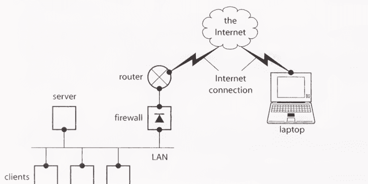


- 矩形代表机器——服务器、桌面机或个人电脑
- 水平线代表你的以太网
- 服务器通常显示在线的上方，最终用户桌面机显示在线的下方
- 框上的圆形斑点代表网络接口或 NIC
- 笔记本电脑以图形方式显示，以强调它们不同——通常它们并非永久连接到局域网（LAN）和经常通过拨号链路连接
- 我们将路由器表示为带对角线交叉的圆（这是带四个箭头的传统三维“蛋糕”表示法的抽象）


- 锯齿线（闪电）代表任何类型的互联网连接（我们不对拨号使用任何特殊标记）
- 框中的二极管符号代表防火墙（沿用 Cheswick 和 Bellovin 的用法）
- 在 Linux 命令行示例中，命令提示符通常为‘*hostname*%’或‘*hostname*#’，例如
    `alice% ping 192.0.2.29`
- *a.b.c.d* 或 *w.x.y.z* 表示“点分十进制”表示法中的 IP 地址或网络掩码，如 `192.0.2.123`
- 我们使用常规记法引用 Linux 在线手册页（*manpages*），例如 `ifconfig(8)` 表示 **ifconfig** 程序的手册页，该手册位于第 8 节（系统管理命令）
- 在 URL 引用中，记法“*teststring*”表示点击该链接，例如“>RFC Pages”表示点击指定页面中的 **RFC Pages** 链接。在菜单等中，“>”表示选择指示的选项或菜单，如“File>Save As”。

我们的记法是专门设计成便于手工绘制的。附录 9 显示了我们其中一个安装中的真实工作图。

## 机器名称

我们使用 Alice、Bob、Carol 和 Dave 这些名字——它们在文献中的安全场景中被广泛使用。我们还添加了 Rupert、Richard、Robert 以及其他以“R”开头的名称作为路由器的名称，以将其与网络上的普通主机区分开。

由于这些名字只有几个，我们必须根据需要对不同机器重复使用。名称在模块（双页开篇）内始终保持一致，但例如 Alice 在不同章节中指的是不同的机器——你不能假设“Alice”始终表示‘IP地址 192.0.2.29’。

我们对 Aaron Copland 在讨论音乐作品时所说的 *la grande ligne*（“长线”）进行了大量思考——“必须有一种流动感——一种从第一……到最后的连续感。”我们努力展示 TCP/IP 的底层架构，它如何作为一个一致而优雅的系统紧密结合在一起，不同部分如何相互关联，以及简单的思想和简单的构建块如何结合起来构建极其强大和有用的系统。

本书由四部分组成，至少在首次阅读时应按顺序阅读。每部分涵盖一个主要主题领域：

- 第 1 部分：基础架构——IP、路由、DNS
- 第 2 部分：TCP 和 UDP 及应用，包括电子邮件和 Web
- 第 3 部分：Microsoft Windows 网络及其与 TCP/IP 的关系
- 第 4 部分：连接到互联网、拨号连接和安全问题。

各部分逐渐更具一般性。第 1 部分非常详细，因为基本的 TCP/IP 网络在任何机器上都相同。第 2 部分涉及应用程序，由于不同的实现配置和运行方式不同（例如 NT 上的 Microsoft Exchange 邮件服务器与 Linux 上的 **sendmail** 相比），这更具一般性，因为我们专注于底层的网络操作。第 3 部分涉及 Microsoft Windows 网络。第 4 部分介绍如何将站点连接到互联网并安装防火墙和其他安全系统；这是最具一般性的部分，因为防火墙系统甚至互联网连接类型的种类繁多，但正如始终强调的那样，我们强调适用于所有这些的底层原则。

书籍的详细结构如下：

- 四个部分（上文已描述）
- 一个部分包含若干章节。每章都有：– 开头一页介绍 – 结尾的摘要，其中还包括“注释和进一步阅读”部分，提供其他书籍、RFC 的参考，或对一些不适合本书主流内容的感兴趣主题的讨论
- 一章由“模块”组成。每个模块由一个双页开篇组成，以便图表或表格及其引用的文本始终一起可见。模块尽可能自成一体，我们有时会重复少量材料（通常是图表或表格），以免你在书中来回翻阅。

为了避免杂乱并保持阅读时的连贯性，有趣但非必要的主题留到每章末尾的“注释”部分。较长的讨论、参考资料或可能只对少数人感兴趣的要点，我们放在附录中。具体来说，尽管相关内容贯穿始终，我们仍将 Linux 配置文件的细节 relegated 到附录中；原因是有许多 Linux 变体，每个都有自己的特定配置方法。与其在正文中堆砌“如果你使用 Debian Linux 就这样做，如果你使用 Red Hat 就那样做……”，我们将其全部汇总到附录 6 作为单一的版本特定部分。由于附录众多，只有必要的附录包含在印刷版书籍中；其他附录可在我们的网站上获取，我们称之为“网络附录”。（将附录保留在网站上的另一个好处是，我们会定期用相关新材料更新它们。）

附录的顺序与它们在正文中首次被引用的顺序一致。页面边缘的索引标记突出显示书籍的不同部分和附录。

## 致谢

我们谨向审阅了本书全部或部分草稿的所有人士表示感谢，他们慷慨地贡献了时间和专业知识，其评论极大地改进了本书内容：剑桥的 Arthur Chance、Nortel 路由器研究组的 Elwyn Davids、剑桥大学的 Phil Hazel（Exim 邮件服务器作者）、Sun 波士顿网络中心的 Radia Perlman、Nominum 的 Jim Reid、Analysys 咨询公司的 Jim Warwick，最后是都柏林 UIB 的朋友 Terry O’Gorman，自本书构思以来他为配置提供了帮助和建议，并就无数技术问题进行了富有启发性的讨论。当然，剩余的所有错误和遗漏都是我们自己的。

还要感谢 Microsoft 的 David Sligh，以及 SafeNet Inc. 的 Tom Serio 和 Travis Davison，感谢他们允许使用 SafeNet SoftRemote VPN 软件包的屏幕截图并提供软件测试副本，同时感谢在网上回答具体问题的各位：关于高级 PCMCIA 配置的 David Hinds，以及关于 Ethereal 的 Guy Harris。

我们还必须感谢在 UIT 这里与我们一起工作的 First Networking Group 的同事：Martin Turner、Walter Paterson、Stuart Charlesworth、Arthur Finn、Frances Heaney、Carol Edson，尤其是 Sheila Sickleby，她容忍了写书人的穴居人行为。最后感谢 Dennis，对我们手稿早期草案提出了宝贵而极端的批评，以及我们两只办公室猫 Boodil 和 Arfie，在凌晨时分陪伴我们。

## 版权等

Netscape 浏览器窗口© 2002 Netscape Communications Corporation。经许可使用。Netscape Communications Corporation 未授权、赞助、认可或批准本出版物，对其内容不承担责任。

Microsoft Windows 屏幕截图经 Microsoft Corporation 许可转载。Windows、Windows NT、Active Directory、Microsoft、Outlook 和 NetMeeting 均为美国和/或其他国家/地区 Microsoft Corporation 的注册商标或商标。附录 8 – Windows NT 路由命令管理器，以及附录 24 – BROWSTAT 命令，经 Microsoft Corporation 许可印刷。

Linux 是 Linus Torvalds 的注册商标。

Sniffer 是 Network Associates 的注册商标。在全文中，我们使用小写的“sniffer”作为通用术语，指代任何数据包嗅探器。


## RFC 版权声明

本文件及其译文可以复制并提供给他人，并且可以准备、复制、出版和分发对其进行评论或以其他方式解释或协助其实现的衍生作品，全部或部分，不受任何限制，前提是上述版权声明和本段落包含在所有此类副本和衍生作品中。然而，本文件本身不得以任何方式修改，例如删除版权声明或对互联网协会或其他互联网组织的引用，除非为制定互联网标准之目的所需，在这种情况下必须遵循互联网标准流程中定义的版权程序，或为将其翻译成英语以外的语言所需。

上述授予的有限许可为永久性，不会被互联网协会或其继任者或受让人撤销。

本文件及其中包含的信息按“AS IS” 方式提供，互联网协会和互联网工程任务组声明不承担任何明示或暗示的保证，包括但不限于使用本文信息不会侵犯任何权利的保证，或适销性或特定用途适用性的任何暗示保证。

## 附录 5 致谢 – tcpdump 手册页全文

Copyright (c) 1987, 1988, 1989, 1990, 1991, 1992, 1994, 1995, 1996, 1997

加州大学董事会。保留所有权利。

在源代码和二进制形式中重新分发和使用，无论是否修改，均被允许，前提是：

- (1) 源代码分发必须保留上述版权声明和本段落的全部内容，(2) 包含二进制代码的分发必须在随分发提供的文档或其他材料中包含上述版权声明和本段落的全部内容，并且 (3) 所有提及本软件功能或使用的广告材料必须显示以下致谢：

> “本产品包含由加州大学劳伦斯伯克利实验室及其贡献者开发的软件。” 未经明确事先书面许可，不得使用大学名称或其贡献者的名称来认可或推广源自本软件的产品。

本软件按“原样”提供，且不提供任何明示或暗示的保证，包括但不限于适销性和特定用途适用性的暗示保证。

## 附录 11 致谢 – nslookup 手册页全文

Copyright © 1985, 1989

加州大学董事会。保留所有权利。

在源代码和二进制形式中重新分发和使用，无论是否修改，均被允许，前提是满足以下条件：

- 1. 源代码的重新分发必须保留上述版权声明、本条件列表和以下免责声明。
- 2. 二进制形式的重新分发必须在随分发提供的文档和/或其他材料中重现上述版权声明、本条件列表和以下免责声明。
- 3. 所有提及本软件功能或使用的广告材料必须显示以下致谢：
  本产品包含由加州大学伯克利分校及其贡献者开发的软件。
- 4. 未经明确事先书面许可，不得使用大学名称或其贡献者的名称来认可或推广源自本软件的产品。

本软件由董事会和贡献者按“原样”提供，任何明示或暗示的保证，包括但不限于适销性和特定用途适用性的暗示保证均被免除。在任何情况下，董事会或贡献者均不对任何直接、间接、附带、特殊、示范性或后果性损害负责，包括但不限于替代商品或服务采购、数据或利润损失、或业务中断，无论因何原因引起，无论是在合同、严格责任或侵权诉讼中，包括疏忽或其他原因，只要因使用本软件而产生，即使已告知可能发生此类损害。

部分版权 © 1993 由 Digital Equipment Corporation 所有。

特此授予使用、复制、修改和分发本软件的许可，无论是否收费，前提是上述版权声明和本许可声明出现在所有副本中，并且未经明确事先书面许可，不得在有关本文件或软件分发的广告或宣传中使用 Digital Equipment Corporation 的名称。

本软件按“原样”提供，Digital Equipment Corp. 对本软件不作任何保证，包括所有适销性和适用性的暗示保证。在任何情况下，Digital Equipment Corporation 对因使用或性能而产生的任何特殊、直接、间接或后果性损害或任何损害概不负责，无论是在合同、疏忽或其他侵权行为中，包括因使用、数据或利润损失而产生的损害。

附录 12 致谢 – host 手册页摘要

© RIPE NCC。原作者 Eric Wassenaar。

本文中所有商标均被承认为其各自所有者的财产。

# 第 1 部分

## 数据包在网络上如何以及为何移动

在本部分书籍中，我们介绍 TCP/IP 网络的基本基础设施：

- TCP/IP 流量由单独的数据包组成——它不是连续流
- 两个机器在同一本地线路上如何交换数据包，即小型局域网如何运行
- 路由器连接两个原本分离的网络并按需将数据包从一个网络转发到另一个网络。这让你可以构建任意大小的 TCP/IP 网络（例如互联网）
- IP 地址的细节
- 域名系统（DNS）以及它如何让你通过名称而不是 IP 地址引用机器
- 你需要配置系统和诊断网络问题的工具

## 0 TCP/IP 快速入门

- 0.1 要调试和理解你的网络，请追踪数据包
- 0.2 网络可能比独立机器更容易
- 0.3 TCP/IP 由独立的构建块组成
- 0.4 TCP/IP 流量由数据包组成
- 摘要

### 引言

这是一本实用的书籍。我们会尽快让你动手实践，但首先本章介绍了一些关于 TCP/IP 的基本概念，你几乎在任何地方都需要。通过现在介绍这些，我们以后会加快进度。

### 0.1 要调试和理解你的网络，请追踪数据包

TCP/IP 网络完全由数据包组成，调试网络的最佳方式是追踪数据包。这给你提供了确凿的信息，直接来自源头。不要试图猜测发生了什么——去查看它，这样你就*知道*它在做什么。（不要猜——*嗅探*它！）TCP/IP 令人惊讶地容易理解。当然内部代码很复杂，但学习你在日常工作中使用 TCP/IP 网络所需的知识是直接的。有三个因素有所帮助：

- 1. TCP/IP 流量由离散的数据包组成。当我的机器与你的机器通信时，数据被分解成单独的数据包分别发送。数据*不会*作为单一连续流发送。
- 2. 根据定义，你所有的网络流量都必须离开你的计算机并通过线路传输。你可以使用*数据包嗅探器*查看此流量并了解*真正*发生了什么。
- 3. TCP/IP 由许多简单的构建块组成。因为它们简单且独立，你可以将任何网络问题分解成小块，这有助于理解，并允许你单独诊断每个部分。因为它们可以组合，它们支持极其强大的系统，例如互联网。我们发现排除系统故障和正确理解它是相辅相成的。要解决问题，你需要理解它，而解决问题的过程会带来新的见解。

在某种程度上，TCP/IP 就像国际象棋游戏。学习国际象棋规则和棋子有效移动很容易。然而，要下好棋，你必须将移动组合成有效的策略。同样，TCP/IP 的各个组件简单易懂，但可以组合起来构建非常强大和复杂的网络和系统。

我们使用的嗅探器是 **tcpdump**。它好用、易于使用且免费，可用于 Windows 和 Linux。

让我们看一个例子。我们将使用 **ping** 程序，它从你的机器向另一台机器发送一个特殊数据包——比如 Bob。如果 Bob 存活，它会发送回回复，让你知道它正在运行。图 0.1 显示了我们的其中一台机器 Alice 在同一本地网络上 **ping** 另一台机器 Bob。（在 Windows 上选项“-n 1”表示只发送一个查询数据包，而不是 Windows 版 **ping** 默认的每秒间隔发送四个单独数据包。）

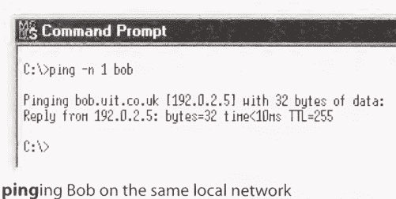


图 0.2 是使用 **tcpdump** 在第三台机器 Carol 上运行的本次交互的 **tcpdump** 轨迹。这里不用担心细节——我们稍后会涵盖所有这些方面的内容。现在，只需注意该轨迹说明了上述因素——我们可以轻松看到所有网络流量，并且用户认为的单一 TCP/IP 网络活动实际上由几个小部分组成。

```
carol# tcpdump -n -t

arp who-has 192.0.2.19 tell 192.0.2.7
arp reply 192.0.2.19 is-at 00:c0:c0:8b:c3:c5
192.0.2.7:2205 > 192.0.2.19.53: 1+ A? bob.ui.co.uk. (32)
192.0.2.19.53 > 192.0.2.7.2205: 1 1/2/2 A 192.0.2.5 (131)
arp who-has 192.0.2.5 tell 192.0.2.7
arp reply 192.0.2.5 is-at 80:0:20:c:e4:e1
192.0.2.7 > 192.0.2.5: icmp: echo request
192.0.2.5 > 192.0.2.7: icmp: echo reply
```

**图 0.2 Alice ping Bob 的 tcpdump 轨迹**

这看起来只是为了 **ping** 一台机器看看它是否存活而令人痛苦地详细，某种程度上确实如此。但另一方面，即使我们处理的是浏览网页等更复杂的活动，大多数相同的步骤仍然适用，这让我们可以使用 **ping** 作为简单但强大的诊断工具。而且，由于对话中的各个步骤定义明确且相互独立，如果出现任何问题，我们可以迅速锁定原因，该原因将 *特定于该步骤*，并快速修复网络。

我们构建和维护网络的方法的精髓是：不要试图猜测发生了什么——而是直接在线路上查看它，这样你就 *知道* 发生了什么。嗅探器是必不可少的工具。不要认为使用它是一种无知的标志——恰恰相反：你会发现使用它们的都是网络高手。

在没有嗅探器的情况下工作，就像坐在后座上试图诊断汽车发动机出了什么问题一样：你根本没有所需的所有信息。没有嗅探器，失败的 **ping** 命令告诉你什么？Alice 可能配置错误，或者 Bob 的网卡坏了，或者网络布线本身可能有问题；如果你单独使用 **ping**，症状都是一样的。但当你将其与嗅探器结合使用时，**ping** 就变成了一种高分辨率、低粒度诊断工具——如果你愿意，它能让你看到每一个细节。**tcpdump** 能让你快速排除可能的原因并集中在问题真正所在的地方。我们将在整本书中展示许多这样的例子。使用 **tcpdump** 很简单，很快就会成为你的第二天性。

## 0.2 网络可能比独立机器更容易

在网络中，机器的所有进出通信都经过一个单一的点——网卡（或网络接口卡，NIC）。因此，那是查看发生了什么的地方。运行 `tcpdump`，它会查看该 NIC 上进出的一切流量，为你提供网络活动的清晰视图（图 0.3）。

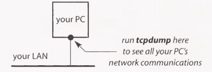

**图 0.3** `tcpdump` 查看 NIC 上进出的一切流量

不同应用程序的网络流量通常发往不同的机器。例如，你的机器连接到 **www.microsoft.com** 以浏览网页，但它会连接到另一台机器，例如 **mailserv.example.com**，以收取电子邮件。这使得指定来自特定应用程序或发往你真正感兴趣的特定机器的流量变得容易，而 `tcpdump` 具有特殊选项可让你仅过滤出你指定的内容（图 0.4）。整本书中会有无数个 `tcpdump` 示例，但图 0.5 说明了一个简单案例——仅查看到主机 192.0.2.29 和来自该主机的流量。同样，现在不用担心细节——只需注意所示的每一行都是从指定机器发送或接收的。（我们截断了输出中过长的行以适应页面。）

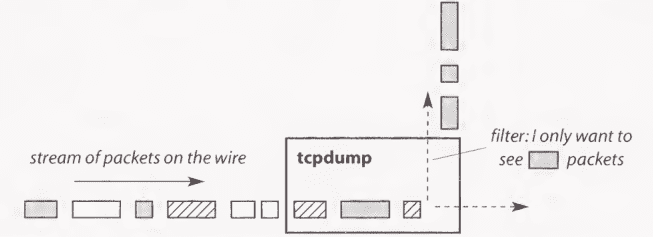

**图 0.4** `tcpdump` 中的过滤选项

分析应用程序的网络流量可能比尝试弄清该应用程序在独立机器上运行时在内存和磁盘上做了什么要容易得多。这里有一个真实的例子。我们内部使用一个客户数据库，它运行缓慢。当它在专用机器上独立运行时，我们不知道发生了什么。然后我们使用网络上的共享磁盘驱动器运行它，并使用 `tcpdump` 查看网络流量。它显示创建一条新的空记录涉及 100 到 300 次磁盘写入，每次约 145 字节。我们得出结论，对于我们拥有的数据量，这个特定产品并不合适，无法扩展到我们需要的规模。相比之下，使用网络版本获得相同格式要容易得多。

```
alice# tcpdump -n -t host 192.0.2.29
tcpdump: listening on eth0
192.0.2.17 > 192.0.2.29: icmp: echo request
arp who-has 192.0.2.17 (ff:ff:ff:ff:ff:ff) tell 192.0.2.29
arp reply 192.0.2.17 is-at 0:d0:b7:bb:3d:f6
192.0.2.29 > 192.0.2.17: icmp: echo reply
arp who-has 192.0.2.1 (ff:ff:ff:ff:ff:ff) tell 192.0.2.29
arp reply 192.0.2.1 is-at a0:50:73:38:c0:26
192.0.2.5.2581 > 192.0.2.29.25: S 1639808000:1639808000(0) win 4096 <mss 1460>
arp who-has 192.0.2.5 (ff:ff:ff:ff:ff:ff) tell 192.0.2.29
arp reply 192.0.2.5 is-at 8:0:20:c:e4:d1
192.0.2.29.25 > 192.0.2.5.2581: S 42686545970:42686545970(0) ack 1639808001 win 8760 <mss 1460> [DF]
192.0.2.29.25 > 192.0.2.29.25: . ack 1 win 4096
192.0.2.29.25 > 192.0.2.5.2581: P 1:131(130) ack 1 win 8760 [DF]
192.0.2.5.2581 > 192.0.2.29.25: P 1:22(21) ack 131 win 4096

192.0.2.29.58561 > 64.4.49.199.25: S 42686659970:42686659970(0) win 8760 <mss 1460> [DF]
64.4.49.199.25 > 192.0.2.29.58561: S 1574539292:1574539292(0) ack 42686659971 win 64240 <mss 1460> [DF]
192.0.2.29.58561 > 64.4.49.199.25: . ack 1 win 8760 [DF]
64.4.49.199.25 > 192.0.2.29.58561: P 1:101(100) ack 1 win 64240 [DF]
192.0.2.29.58561 > 64.4.49.199.25: P 1:22(21) ack 101 win 8760 [DF]
64.4.49.199.25 > 192.0.2.29.58561: . ack 22 win 64240 [DF]
64.4.49.199.25 > 192.0.2.29.58561: P 101:156(55) ack 22 win 64240 [DF]
192.0.2.29.58561 > 64.4.49.199.25: . ack 156 win 8760 [DF]
192.0.2.29.58561 > 64.4.49.199.25: P 22:63(41) ack 156 win 8760 [DF]
64.4.49.199.25 > 192.0.2.29.58561: P 156:199(43) ack 63 win 64240 [DF]
192.0.2.29.58561 > 64.4.49.199.25: P 63:94(31) ack 199 win 8760 [DF]
64.4.49.199.25 > 192.0.2.29.58561: P 199:242(43) ack 94 win 64240 [DF]
192.0.2.29.58561 > 64.4.49.199.25: P 94:100(6) ack 242 win 8760 [DF]
64.4.49.199.25 > 192.0.2.29.58561: P 242:88(46) ack 100 win 64240 [DF]
192.0.2.29.58561 > 64.4.49.199.25: P 100:801(701) ack 288 win 8760 [DF]
arp who-has 192.0.2.29 tell 192.0.2.19
192.0.2.19 > 192.0.2.29 is-at 8:0:20:a:74:aa

64.4.17.63.4992 > 192.0.2.29.25: S 26868585848:26868585848(0) win 16384 <mss 1460, nop, nop, sackOK>
192.0.2.29.25 > 64.4.17.63.4992: S 42755179770:42755179770(0) ack 26868585849 win 8760 <mss 1460> [DF]
64.4.17.63.4992 > 192.0.2.29.25: . ack 1 win 8760
192.0.2.29.25 > 64.4.17.63.4992: P 1:131(130) ack 1 win 8760 [DF]
192.0.2.29.25 > 64.4.17.63.4992: P 1:131(130) ack 1 win 8760 [DF]
64.4.17.63.4992 > 192.0.2.29.25: P 1:19(18) ack 131 win 17390
64.4.17.63.4992 > 192.0.2.29.25: . ack 131 win 17390
192.0.2.29.25 > 64.4.17.63.4992: P 131:215(84) ack 19 win 8760 [DF]
```

**图 0.5 查看到与 192.0.2.29 的流量**

独立机器上的信息要困难得多。我们没有应用程序的源代码，因此无法添加任何调试或跟踪代码。我们不是数据库专家，因此无法追踪磁盘活动并将其与应用程序启动的任何进程以及它们如何与操作系统交互联系起来。但使用 **tcpdump** 查看网络流量却是小菜一碟。

这就像试图理解人们如何进行复杂的心理计算。如果一个人独自完成（“独立”计算机），你得到的只是答案；如果答案错误，你就不知道为什么。如果几个人一起合作（“网络”中的人），他们会互相交谈并提问。你可以偷听到他们在说什么，因此可以更深入地了解找到答案所涉及的过程。

我们每天都在自己的网络上使用 **tcpdump**。我们使用它的目的有很多，不仅仅是网络诊断，例如，如果我们某些网络设备的闪烁灯显示来自我们互联网连接的异常、持续的网络流量水平，那么运行 **tcpdump** 查看发生了什么比检查所有不同服务器上的所有不同日志要快得多。如果它仍然看起来很奇怪，我们可以集中关注导致问题的应用程序（或用户）。

在下一个模块中，我们将看到 TCP/IP 的模块化、构建块特性如何帮助你理解和排除网络故障。


## 0.3 TCP/IP 由独立的构建块组成

TCP/IP 网络是 Internet 和大多数现代局域网的技术基础。它提供了计算机之间通信以及信息传输的机制。“TCP/IP”是一套关于这些机制如何工作的标准，以便不同厂商的软件和硬件能够“互操作”。

*TCP（传输控制协议）* 和 *IP（互联网协议）* 是 Internet 上使用的两个最重要的协议。*协议* 是一套规则（标准），规定计算机在不同上下文中应如何通信以及软件和硬件的各个组件应如何交互。我们也经常使用“协议”来指标准的实现，而不仅仅是标准本身，例如“我的笔记本电脑正在使用 SMTP 协议连接到我们的邮件服务器。”术语“TCP/IP”指的是整个相关协议套件，而不仅仅是这两个。

请注意，“internet protocol”中的第一个词 internet *没有* 大写字母。该协议是为了允许在由相互连接的网络组成的集合中进行通信而开发的，称为“inter-network”或“internet”。网络通过“路由器”连接。（一个非常简单的 internet——由两个网络组成——如图 0.6 所示。）随着 1970 年代和 1980 年代互连网络数量的增长，首字母大写的 Internet 出现了。

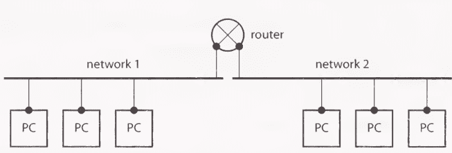

### TCP/IP 栈中的层

TCP/IP 由许多不同的协议组成。你可能会认为这会使事情复杂化，但实际上它使诊断网络问题变得容易得多。

每个协议处理网络的一个特定方面，并且与其他协议分离。你可以将协议视为栈中的层：

- 每一层都提供可供上层使用的设施
- 每一层都使用（下层协议提供的）设施。

图 0.7 显示了部分常见 TCP/IP 协议之间的关系。这种表示网络层的方式源自 OSI“网络参考模型”。（有关更多细节请参阅附录 1。）协议的这种分层组织具有许多优点：

- 它更容易理解。你处理的是单个协议（每个协议本身相对简单），并且每个级别只有一个协议。你 *不必* 一次性学习所有关于一个庞大、杂乱无章的叫做 TCP/IP 的东西
- 层的独立性允许在上层或下层添加不同或更好的设施，而不会造成最小的干扰。例如，由于 IP（网络）层与下层的链路层和物理硬件分离，因此相对容易使 IP 在无线、PPP 拨号链接、以太网等上运行。你可以在所有这些不同的介质或它们的混合上使用你的网页和电子邮件应用程序，因为应用层甚至不知道下面深处使用的是哪种物理介质
- 你可以将问题分解成更小的部分，并分别测试每个小部分，就像你在模块 0.1 中看到的那样。TCP/IP 设计优雅：它易于理解，你不必是火箭科学家就能做到这种分解工作。教给你如何做到这一点是本书的目标之一。

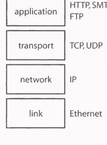

**图 0.7** 层模型

层模型只是描述和理解网络的便利方式。它不是关于事物必须如何运行的正式标准，而且有些协议并不完全适合它。

而不是现在深入探讨层的功能的许多抽象细节，我们将推迟对层的解释，直到以后，当它在实践中与你相关时，并且会更有意义。

### RFCs（“Requests for Comments”）—— Internet 标准文档

从 1969 年开始，随着 TCP/IP 的开发，研究人员开始传阅文件，提供信息并请求对拟议标准反馈。这些文件被称为 *RFCs*（*Request for Comments*）。这个名字仍然在使用，但如今 RFC 定义了正式的 Internet 标准，同时还提供历史信息并描述最佳实践。

RFC 可在网上免费获得。有关 RFC 的更多信息以及如何获取，请参阅附录 2。

我们将经常为你提供 RFC 中信息的指针——主要是为了我们涵盖的一些主题的进一步细节，但有时只是为了有趣的背景或历史信息，说明某事为何以这种方式工作。

## 0.4 TCP/IP 流量由数据包组成

我们如何构建网络以及如何排除故障会受到 TCP/IP 是 *分组交换* 网络这一事实的影响：

- 要传输的信息被分成数据包，然后每个数据包单独发送。例如，当我从远程 Web 服务器下载网页时，数据不是以一个连续流发送的。相反，我会收到大量数据包，当所有数据包都收到后，我的机器会将它们重新组装成最终的网页。图 0.8 显示了从 Dave 上的服务器到 Carol 上的 Web 浏览器的网页下载的 `tcpdump` 跟踪，说明即使是简单的对话也包含双向的许多数据包
- 每个数据包到目的地都是独立的，甚至可以通过不同的路由到达同一目的地。Web 服务器发送到我机器上的浏览器的包不一定与客户端发送到服务器的包走相同的路由，甚至同一方向的包也可能走不同的路径。

初看似乎令人惊讶，但稍后（在模块 5.13 中）我们会看到它对于提供能够容忍某些故障的弹性网络至关重要。

我们将在第 10 章看到，单个数据包可能会丢失或损坏。TCP/IP 系统的高层组件必须考虑到这一点，以确保你的数据在网络中可靠地通信。

```
carol.4279 > dave.80: S 367936000:367936000(0) win 4096 <mss 1460>
dave.80 > carol.4279: S 538434131:538434131(0) ack 367936001 win 16060
carol.4279 > dave.80: . ack 1 win 4096
carol.4279 > dave.80: P 1:81(80) ack 1 win 4096
dave.80 > carol.4279: . ack 81 win 16060 (DF)
dave.80 > carol.4279: P 1:302(301) ack 81 win 16060 (DF)
dave.80 > carol.4279: P 302:362(60) ack 81 win 16060 (DF)
carol.4279 > dave.80: . ack 362 win 4096
dave.80 > carol.4279: P 362:1822(1460) ack 81 win 16060 (DF)
dave.80 > carol.4279: P 1822:3282(1460) ack 81 win 16060 (DF)
dave.80 > carol.4279: FP 3282:3427(145) ack 81 win 16060 (DF)
carol.4279 > dave.80: . ack 3428 win 1031
carol.4279 > dave.80: . ack 3428 win 4096
carol.4279 > dave.80: F 81:81(0) ack 3428 win 4096
dave.80 > carol.4279: . ack 82 win 16060 (DF)
```


相比之下，传统的模拟电话网络是 *电路交换网络*。当你打电话给我时，通话必须“建立”：电话网络中的交换机在你的电话和我的电话之间创建一条连续的路径或电路。只有当整个电路准备好后，我们才能开始对话。好处是我们有一个专用通信链路，不受任何人电话流量的影响。缺点首先是，呼叫建立需要很长时间（几秒或几十秒），这使其不适合数据流量典型的非常短的对话，其次，即使我们双方都沉默且没有发送任何流量，电路仍然被占用，其资源不能被需要额外容量的另一通对话使用。电信公司（电话公司）很早就使用数字传输，现在甚至正在转向在 TCP/IP 上运行所有电话服务，因此电话网络不再是电路交换的。

### 一个类比——TCP/IP 网络和邮政系统

在整本书中，我们偶尔会将 TCP/IP 数据传输与通过信件或明信片发送信息进行比较，因为每个人都熟悉邮政系统。这将为我们的计算机网络提供一个侧面视角，并使一些抽象概念更加具体和易于理解。

TCP/IP 数据包类似于信件或明信片：两者都有发送者和接收者的地址。通过网络发送文件就像我将一本书的内容作为一系列明信片发送给你。我在剑桥（英格兰的那个）并且假设你在美国爱荷华州的德斯莫因斯：

- 要发送整本书，需要大量数据包（明信片）
- 单个数据包（明信片）可以通过不同的路由传输，即使它们来自同一源，前往同一目的地
- 当我发送明信片（数据包）时，我不需要知道（事实上也不知道）它将走的路由。数据包（明信片）不包含任何说明应走哪条路由的信息——只是它来自哪里，以及最终目的地的地址
- 发送方需要知道目的地址，但不需要知道目的网络或其位置。我可以在不知道爱荷华州在美国的位置的情况下向德斯莫因斯发送明信片。我甚至可能不知道美国在哪里，但我的明信片仍会到达目的地
- 明信片（数据包）是逐跳发送到目的地的，每个阶段都有人（路由器）决定下一步发送到哪里。例如，我把明信片放在我的“出件托盘”里，信使男孩（实际上是我，但让我们假装我们有信使男孩）收集它并把它放在办公室的出件托盘里。前台职员把它投入公共邮筒。邮局从那里取走它……到分拣办公室……到英格兰这一部分的邮件枢纽……到希思罗机场……到你所在国家的机场……到分拣办公室……到你的公司……到你的部门……到你的信箱。我们将在第 5 章看到 TCP/IP 数据包如何由路由器逐跳转发，从我的 PC 到你的
- 前台职员可能会绕道去办一些差事，并使用与平时不同的公共邮筒。如果希思罗机场因雾关闭，邮局会改用另一个机场。这确保了系统的弹性：它的某些部分可能损坏，但邮件仍能送达。同样，数据包可以走不同的路由以避开网络中损坏的部分。

我们将在后面的章节中看到 TCP/IP 网络的每一个方面。这不仅仅是理论性的：这些特性会影响你如何构建网络，以及如何排除故障。


## 摘要
- 所有 TCP/IP 网络上的通信都由单独的数据包组成
- 每个数据包都包含发送方和接收方的 IP 地址
- 使用简单的工具你可以查看线路上传输的数据包，了解系统正在做什么。这通常使网络系统比独立机器更容易理解和调试。

## 下一步？
在第 2 章中，我们将构建最简单的网络——两台机器连接到同一个以太网局域网——并观察数据包如何在它们之间发送。但在这样做之前，在第 1 章中我们安装 **tcpdump**，以便我们拥有完成工作所需的工具。
我们方法的一个重要部分是，我们从下往上覆盖主题，从简单开始，每次只添加一个额外功能。我们的测试和示例网络反映了这一点。以下是本书第 1 部分中我们将要进行的概述：
- 单根线缆上的两台 PC（第 2 章）
- 由路由器连接的两个小型网络（第 3 章）
- 一个简单的局域网连接到互联网（第 3 章）
- 由多个路由器连接的网络（第 5 章和第 6 章）
- 同一根线缆上的多个网络（第 6 章）
- 子网划分的网络（第 6 章）。最复杂的示例是一个划分为子网的网络，具有多个路由器，通过互联网与别处的另一个局域网通信。

第 1 部分的最后几章涉及 DNS——域名系统，让你可以通过名称而不是使用 IP 数字来引用机器。

## 注释与延伸阅读
有关互联网如何演变的精彩历史，请参阅：
□ Peter Salus *Casting the Net: from ARPAnet to Internet and beyond*（1995，Addison-Wesley）
（Peter Salus 还撰写了 *A Quarter Century of UNIX*（1994，Addison-Wesley）。它与我们在这里做的事情无关，但非常值得一读。）
有关大量历史资料，包括一些引人入胜的早期互联网地图——例如 1969 年的互联网，仅包含四台机器——请参阅：
□ [http://www.archive.org/arpnet/](http://www.archive.org/arpnet/)
Comer *Internetworking with TCP/IP Volume 2*（2000，Prentice Hall），第 1 章和第 2 章也提供了互联网及其开发机构的一些历史。

# 附录
附录 1：层、协议栈和网络参考模型

附录 2：RFC 和互联网标准

## 1 tcpdump 数据包嗅探器 – 网络上的眼睛和耳朵
- 1.1 **tcpdump** 如何工作
- 1.2 如何运行 **tcpdump**
- 1.3 如何仅选择你感兴趣的数据包
- 1.4 **tcpdump** 的常见问题
- 摘要

### 引言
你已经看到如何以简单的方式使用 **tcpdump** 来获取有关网络运行情况的信息。本章更详细地描述了 **tcpdump**，告诉你如何仅显示你感兴趣的特定数据包，以及如何根据你的特定需求定制其显示格式。

### 1.1 tcpdump 如何工作
**tcpdump** 是一个 *数据包嗅探器*——它让你实时监视网络上的数据包并以你指定的格式打印其详细信息。由于以太网的工作方式，你能够查看其他计算机的流量以及自己的流量。**tcpdump** 是诊断问题或只是了解网络如何运行的基本网络工具。它查看网络上的 *所有* 数据包，但你可以告诉它只显示你感兴趣的一组特定数据包。

以太网是一个 *总线* 网络。当一台机器通过以太网向另一台机器发送数据包时，该数据包在整根线路上都可见（图 1.1）。

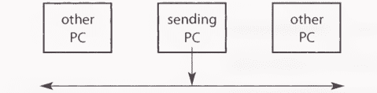

**图 1.1 以太网数据包在整根线路上都可见**

每台机器中的以太网卡（网络接口卡，或“NIC”）通过查看数据包的目的地址来决定对数据包做什么：
- 如果数据包的目的地是这台机器，以太网卡会将数据包传递给操作系统，操作系统再将数据包传递给相应的应用程序（图 1.2 中的 A 所示）。


**图 1.2 从源到目的传递数据包**
- 在以太网卡的正常模式下，如果数据包未发往这台机器，以太网卡会“静默丢弃数据包”，即忽略它且不生成任何错误消息（图 1.2 中的 B）
- 然而，**tcpdump** 将以太网卡置于一种称为 *混杂模式* 的特殊模式。在此模式下，无论数据包的目的地址是什么，卡都会将数据包传递给操作系统（图 1.3 中的 C）。然后操作系统将其传递给 **tcpdump**。

混杂模式是以太网卡上的硬件设置，因此如果你要使用 **tcpdump**，你的卡必须支持它。（现在你得到的几乎每张以太网卡都支持它。我们还没有遇到不支持的。）

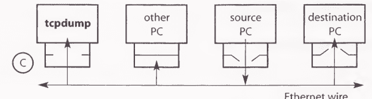

图 1.3 混杂模式 – tcpdump 可看到线路上的所有流量

通过在以太网卡上设置混杂模式，**tcpdump** 可以检查网络上的所有数据包。然后，对于每个数据包，**tcpdump** 打印源地址和目的地址，并总结其内容。

### 以太网类型 – 同轴电缆 v. UTP 集线器和交换机
图 1.1、1.2 和 1.3 显示以太网为一根连接到所有机器 NIC 的单根电缆。这正是旧式 Thick Ethernet 和 Thin-net（细以太网）的工作方式：你在一栋建筑内铺设一根长的同轴电缆，机器使用特殊的同轴 T 型连接器（Thin-net）或称为收发器的连接盒（Thick Ethernet）连接到它。然而，如今几乎每个人都使用 UTP（非屏蔽双绞线）布线。使用 UTP 时，你有中央布线集线器：每台机器都用自己的 UTP 电缆连接到集线器，集线器之间用更多 UTP 电缆连接。

就 **tcpdump** 而言，使用 UTP 集线器连接的网络与旧的同轴电缆网络没有区别。在两者中，数据包在整个网络长度上都可见，因此 **tcpdump** 可以看到一切。

然而，UTP *交换机* 或 *交换式集线器* 的行为不同。当同一交换机上的两台机器通信时，它们会获得一个专用通道；所有流量都通过此通道传输，没有其他机器可以看到它。在这种配置中，**tcpdump** 只能看到发往/来自其自身机器的流量（图 1.4），这通常不是你需要的。有两种解决方案：要么改用集线器（或与交换机一起使用）（模块 2.6），要么使用“受管交换机”，让你可以为 **tcpdump** 配置所需的行为类型。（附录 3 提供了有关交换机和集线器的更多信息，并解释了受管交换机是什么。）

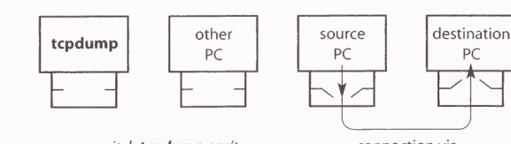

在交换机上 **tcpdump** 看不到其他机器的流量

通过以太网交换机连接

图 1.4 在交换机上，只有源和目的可以看到流量

### 1.2 如何运行 tcpdump
#### 如何获取 tcpdump
请参阅第 24 页的注释，了解如何获取和安装 **tcpdump**，以及 Windows 版本，称为 **windump**。

#### 运行 tcpdump
本模块和下一个模块概述了如何使用 **tcpdump**。附录 4 包含 **tcpdump** 选项的摘要，完整的 manpage 在附录 5 中。
- 1. 你必须以特权用户身份运行 **tcpdump**（因为它会查看其他人的网络流量）。在 Linux 上，你必须是用户 **root**（或程序必须是 setuid root）。在 Windows NT 上，你必须是 **administrator**（尽管并非所有 **tcpdump** 版本都强制执行此操作）
- 2. 从命令行启动程序（Windows 中的命令窗口）；它会宣布它正在监听的网络接口名称，然后是数据包的详细信息（图 1.5）。我们稍后会解释为什么使用“**-n**”选项，但请注意警告：如果省略它，**tcpdump** 可能看起来会挂起一分钟或两分钟。
```shell
tcpdump -n
```
- 3. 要终止 **tcpdump**，输入 ctrl-C（或你的系统上的中断或终止字符）。**tcpdump** 打印其使用统计信息并退出。

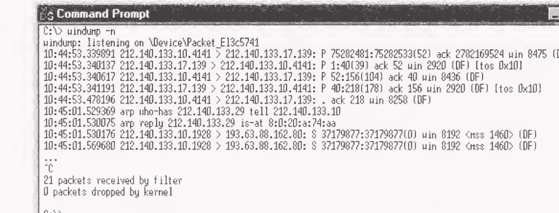

输出格式随显示的数据包类型而变化，但典型的一行以一天中的时间、“点分十进制”四部分源 IP 地址和以“>”符号分隔的目的 IP 地址开头，然后是该数据包的详细信息。对于大多数类型的流量，源和目的 IP 地址末尾包含一个第五个数字（例如源地址第一行中的 **4141**），这是“端口号”。正如我们在第 10 章中解释的那样，不同类型的 TCP/IP 流量被发送到主机上的不同“端口”。例如，

要连接到 Web 服务器，你连接到该机器的 80 端口，而要连接到同一台机器上的电子邮件服务器，则使用 25 端口。我们将使用端口号，结合数据包内容，来确定数据包包含的类型（Web、电子邮件等）。内页封面包含常用端口号列表。

## 以不同方式显示信息的选项

**将主机地址打印为数字而不是名称**：使用选项“-n”。使用此选项，所有主机地址都将作为 IP 数字打印，如下面的两个跟踪所示。如果省略此选项，`tcpdump` 会尝试将地址打印为名称。根据你的配置，它通常通过在 DNS 中查找地址来实现此操作（DNS 即域名系统，可在主机名和 IP 数字地址之间转换；参见第 7 章）。如果没有可用的 DNS 设置，`tcpdump` 在尝试查找时会在不打印任何内容的情况下挂起约一分半钟甚至更长时间。在我们介绍 DNS 之前，我们始终会使用 **-n** 与 `tcpdump` 配合使用。

> **警告：省略“-n”选项是 `tcpdump` 问题最常见的原因。（即使我们使用 `tcpdump` 已有多年，我们在其他人的系统上工作时仍会犯省略“-n”的错误，然后担心出现严重问题。）**

**不要打印日期时间**：使用选项“-t”。这在节省输出空间或你对时间细节不感兴趣时很有用。例如，

```
alice# tcpdump -n -t
tcpdump: listening on eth0
212.140.133.17.1044 > 212.140.133.17.80: S 4009266604.4089266604(0) win 1
212.140.133.17.80 > 212.140.133.17.1044: S 69147160.69147160(0) ack 40092
212.140.133.17.1044 > 212.140.133.17.80: . ack 1 win 16060 <nop,nop, times
212.140.133.17.1044 > 212.140.133.17.80: P 1:97(96) ack 1 win 16060 <nop,
212.140.133.17.80 > 212.140.133.17.1044: . ack 97 win 16060 <nop,nop, time
```

**详细输出**：选项“-v”会使数据包显示更多信息。通常你仅在查看 DNS 流量时才需要此选项，我们将在第 7 章介绍。

**同时打印以太网地址和 IP 地址**：使用选项“-e”。例如，

```
alice# tcpdump -n -t -e
    tcpdump: listening on eth0
    0:10:a4:98:25:43 ff:ff:ff:ff:ff:ff 0806 60: arp who-has 212.140.133.17 tell
    0:0d:b7:b6:3d:f6 0:10:a4:98:25:43 0806 42: arp reply 212.140.133.17 is-at 0
    0:10:a4:98:25:43 0:0d:b7:b6:3d:f6 0800 74: 212.140.133.2045 > 212.140.13
    0:0d:b7:b6:3d:f6 0:10:a4:98:25:43 0800 74: 212.140.133.17.80 > 212.140.133
    0:10:a4:98:25:43 0:d0:b7:b6:3d:f6 0800 66: 212.140.133.38.1045 > 212.140.13
    0:10:a4:98:25:43 0:d0:b7:b6:3d:f6 0800 162: 212.140.133.38.1045 > 212.140.1
    0:d0:b7:b6:3d:f6 0:10:a4:98:25:43 0800 66: 212.140.133.17.80 > 212.140.133
    0:d0:b7:b6:3d:f6 0:10:a4:98:25:43 0800 1514: 212.140.133.17.80 > 212.140.13
    0:d0:b7:b6:3d:f6 0:10:a4:98:25:43 0800 1514: 212.140.133.17.80 > 212.140.13
    0:10:a4:98:25:43 0:d0:b7:b6:3d:f6 0800 66: 212.140.133.38.1045 > 212.140.13
```

我们将在下一章构建第一个简单网络时需要此选项。

## 1.3 如何仅选择你感兴趣的数据包

默认情况下，`tcpdump` 会打印网络上 *所有* 数据包的详细信息。在繁忙的网络上，这会产生大量信息，使得很难看到你需要的内容。你可以指示 `tcpdump` 仅选择并显示特定数据包。你可以组合多个选择条件，以给出非常精确的显示内容规范。

在本模块中，我们仅介绍 `tcpdump` 的几个选择选项，这可能已满足你 80% 的时间需求。书中后续部分，每当你需要特定功能时，我们都会明确介绍并在当时解释，此外，附录 4 和 5 中提供了选项摘要和手册页供参考，以便你在期间进一步探索。

### 按主机地址选择数据包

- `host a.b.c.d` – 仅选择源 IP 地址或目标 IP 地址为指定 IP 号 `a.b.c.d` 的数据包，例如

```bash
tcpdump -n host 192.168.170.5
```

（你也可以使用“`host name`”语法，但这仅在 DNS 正常工作时有效，而我们目前假设你还没有。我们将在第 7 章介绍 DNS。）

- `src host a.b.c.d`（或仅 `src a.b.c.d`）– 仅选择由主机 `a.b.c.d` 发送的数据包，即以此为主机源 IP 地址的数据包，例如

```bash
tcpdump -n src 192.168.170.5
```

- `dst host a.b.c.d`（或仅 `dst a.b.c.d`）– 仅选择发往主机 `a.b.c.d` 的数据包，即以此为目标 IP 地址的数据包，例如

```bash
tcpdump -n dst 192.168.170.5
```

### 按流量类型选择数据包

客户端到服务器的大多数 TCP/IP 流量都会发送到服务器上的特定“端口”，服务器使用端口号来决定客户端请求该机器上的众多服务中的哪一个。我们将在第 10.3 模块详细解释端口，但现在我们只需说明大多数 Web 服务器使用端口 80 来接收传入请求，而大多数电子邮件服务器使用端口 25。

你可以通过指定端口号来指示 `tcpdump` 仅选择特定类型的流量：

- `port num` – 仅选择到或来自端口 `num` 的数据包，即以此为目标 IP 地址的数据包，例如

```bash
tcpdump -n port 80
```

选择仅端口到/来自端口 80 的数据包。大多数情况下这足以仅显示 Web 流量，但如果你真的想更精确，可以在 `port` 前使用 `src` 或 `dst` 前缀，例如

```bash
tcpdump -n dst port 80
```

### 组合多个选择条件

你可以通过使用以下方法组合多个条件来使选择更精确：

**...and** ...– 仅当所有条件都匹配时才选择，例如

tcpdump -n host 192.168.170.5 and port 25
tcpdump -n src host 10.1.2.3 and dst host 10.9.8.7

如果你愿意，可以使用多个 **ands** 来进行更复杂的选择。

**...or** ...– 如果任一条件匹配则选择，例如

tcpdump -n host 10.1.2.3 or dst port 25

**not** ...– 反转匹配条件的含义，例如

tcpdump -n not host 10.9.8.7

打印除发往该主机的流量之外的所有内容。当你在联网机器上并且想要从跟踪中排除自己的流量时，通常会使用此方法。

**(...) **– 括号用于对表达式进行分组，通常与 **and** 和 **or** 一起使用，例如

tcpdump -n host 10.9.8.7 and "(port 80 or port 25)"

我们使用了引号将括号隐藏在 shell（命令提示符）之外，否则它会将它们视为特殊字符。（不使用引号试试看会发生什么。）

作为简写，你可以省略相同的“限定符列表”。以下两者等价：

tcpdump -n dst port 80 or 88 or 8080
tcpdump -n dst port 80 or dst port 88 or dst port 8080

> **提示：** 当你在使用逻辑（**and**、**or**）运算符时使用括号，最好将整个表达式用引号括起来，而不是仅将特殊字符括起来。这样出错可能性更小，也更快。
> 
> tcpdump -n "arp and ( src net 10 or 12 )" *推荐*
> tcpdump -n arp and "(" src net 10 or 12 ")" *不推荐*

> **警告：** **not** 的优先级最高。表达式
> 
> host 10.1.1.1 and not port 21 or 23 or 25
> 
> 可能不是你想要的。它表示
> 
> (host 10.1.1.1 and not port 21) or (port 23) or (port 25)
> 
> 这会显示来自任何地方的端口 23 或 25 流量，以及来自 10.1.1.1 的除端口 21 之外的所有流量。你可能想要的是：
> 
> host 10.1.1.1 and not port (21 or 23 or 25)
> 
> 你可以通过始终在使用 **and** 和 **or** 时使用括号来避免此类问题。

## 1.4 tcpdump 的常见问题

### tcpdump 没有打印任何内容

- 这通常是由于忘记指定“-n”，尤其是在没有 DNS 的测试网络上。**tcpdump** 并未停止——它只是在等待 DNS，并在几分钟后最终会打印一些内容。要检查是否是此原因，请使用“-n”重新运行 **tcpdump**，看看是否立即得到输出。（即使 DNS 工作正常，它也会使 **tcpdump** 跟踪变慢很多，因此我们很少使用它，所以我们几乎总是使用选项 **-n**。）

- 你可能将 **tcpdump** 机器连接到交换机而不是集线器，因此它实际上看不到来自其他机器的任何流量。要检查，请从该机器生成一些流量，例如 **ping** 另一台 PC。如果看到回复和响应，你就知道网络正常，因此你可能已连接到交换机

- 你正在运行“管道”将 **tcpdump** 的输出直接输入到另一个程序中：

```
tcpdump -n | tee /tmp/trace wrong
```

像这样的管道中，输出通常会以非常大的块进行缓冲。为克服此问题，使用 **tcpdump** 的“-l”选项：

```
tcpdump -l -n | tee /tmp/trace right
```

- 你的 Linux 内核是特殊构建，并且没有必要的嗅探支持。（如果你的构建完全正常，这不太可能，但请参阅第 25 页的注释了解更多详细信息。）

- 你可能使用“-i”选项指定了错误的 NIC。（有些人建议你应始终显式指定接口，但我们从不这样做。）在第 3 章之前，你不太可能使用多个 NIC

- 有些机器无法嗅探它们自己发送的数据包。你可以通过运行专用嗅探机来克服此问题，该机器不用于其他任何用途，但可以看到其他所有人的数据包。

### 我看不到数据包内容的足够部分

**tcpdump** 仅打印数据包内容的摘要。你可以使用选项“-v”指示 **tcpdump** 更详细。你可以输入两次该选项（“-v -v”或“-vv”）或三次以获得更多详细信息。书中后面我们将使用其他嗅探工具，使查看数据包中的所有内容变得容易。然而，大多数情况下，与 **tcpdump** 相比，它们使用起来笨重且缓慢，因此我们目前仍坚持使用 **tcpdump**，尤其是因为它已作为标准安装在许多机器上。

### 数据包不包含所有必要的信息

你可以通过输出包含以管道符号为前缀的方括号中的名称来识别这一点，例如“`[ |domain]`”或“`[ |nfs]`”。

**tcpdump** 默认情况下仅捕获每个数据包的前 68 个字节。使用“`-s num`”增加捕获的字节数，直到你感兴趣的行上不再出现这些消息。


## 我的输出包含大量“SMB”和“NBT”消息

```
(DF) (ttl 128, id 38109, len 141)
212.140.133.17.139 > 212.140.133.7.4950: P 1:103(102) ack
>>> NBT Packet
NBT Session Packet
Flags=0x0
Length=98 (0x62)
SMB PACKET: SMBtrans2 (REPLY)
SMB Command   = 0x32
```

这本应是一个功能，但它如此具有侵入性，我们宁愿称其为 bug。tcpdump 已被扩展以了解 Microsoft Windows 网络，这正是这些消息所涉及的内容。它们占用多行，并且无法以通常的方式控制。然而，你可以通过在过滤表达式后附加一个“NOT”子句来排除它们，例如

```
tcpdump -n "host 10.9.8.7 and not (port 137 or 138 or 139)"
```

（我们将在第 18 章解释这些端口号。）

## 数据包被丢弃（丢失）

当 tcpdump 结束时，它会打印处理的数据包数量统计信息：

```
17:50:24.540261 192.0.2.7.4950 > 192.0.2.19.139: . 502119:5
1773 packets received by filter
12780 packets dropped by kernel
```

如果数据包被内核丢弃，那么流量可能太多，这台可怜的小机器无法处理。你可以通过将数据包写入文件（参见附录 4）并稍后处理来减少它需要做的工作量，和/或使用“-s num”选项减少每个数据包捕获的数据量。

新的快速机器通常不会丢弃任何东西，但我们一些古老的 Sun 工作站和旧的 486 笔记本电脑无法跟上重负载流量。即便如此，它们对于诊断特定的网络问题仍然足够，因为

- 我们通常可以指定非常精确的过滤表达式，以限制机器需要执行的处理

- 大多数网络问题只需几个数据包或几十个数据包即可复现。你只有在寻找由硬件或软件 bug 引起的中断性问题时（而不是导致 99.9% 问题的错误配置）才需要捕获大量数据。

## tcpdump: socket: 操作不被允许

你不是以 root 用户运行。

## tcpdump: 解析错误或指定过滤表达式时出现问题

大多数情况下，错误是由于在 IP 号码或名称前忘记输入“net”或“host”造成的。幸运的是，tcpdump 会给出错误信息，因此虽然打字错误很容易发生，但很难输入一个不是你本意但仍然有效的过滤表达式（除非你在混合使用“and”、“not”和“or”时搞混了，就像我们有时仍然会做的那样，可惜）。

## 摘要

- **tcpdump** 让你捕获并查看出现在你的机器网络接口上的所有数据包
- 由于以太网的工作方式，除非你使用以太网交换机，否则连接到此以太网的所有其他机器的数据包也会在你的机器接口上可见。如果你拥有必要的权限，**tcpdump** 可以通过将网络接口置于混杂模式来查看这些数据包
- 你可以告诉 **tcpdump** 你希望它显示哪些数据包，以便专注于你感兴趣的特定流量。

## 下一步？

在第 2 章中，我们构建一个非常小的网络，由单以太坊上两台机器组成，并探索数据包如何在机器之间传输。我们将大量使用 **tcpdump** 来实现这一点。

## 注释和进一步阅读

> 提示：因为我们经常希望在网络上看到可疑情况时能够启动 **tcpdump** *非常* 快速，我们已使用 Linux shell 的“alias”功能将“`t`”定义为 **tcpdump** 的快捷方式：
> ```bash
> alias t="tcpdump -n -t"
> ```
> 这样我们只需输入“`t`”即可运行 **tcpdump**。

你可以在同一台机器上同时运行多个 **tcpdump** 实例，每个实例捕获不同的数据包集。这些独立的实例互不干扰。

**tcpdump** 起源于加州伯克利的劳伦斯伯克利国家实验室 (http://ee.lbl.gov/)。**tcpdump** 现在由以下机构维护

- [http://www.tcpdump.org](http://www.tcpdump.org)

它在 Linux 以及许多其他版本的 UNIX 平台上运行。多年来它已被大量增强，其他版本在语法上可能与我们描述的略有不同。然而，它们的基本操作都相同。

**windump**，**tcpdump** 的 Windows 版本，来自

- [http://netgroup-serv.polito.it/windump/](http://netgroup-serv.polito.it/windump/)

它还提供了 **windump** 运行所需的库（特别是名为 WinPcap 的 **libpcap** Windows 版本）。

**tcpdump** 使用 **libpcap** 数据包捕获库，根据 **libpcap** 发布说明：

提供了一个可移植的低级网络监控框架。应用包括网络统计收集、安全监控、网络调试等。由于几乎每个系统厂商都提供不同的数据包捕获接口，并且我们开发了需要此功能的多个工具，我们创建了这个系统无关的 API 以便于移植并减轻每个应用程序中需要多个系统相关数据包捕获模块的需求。
...

libpcap 接口支持基于 BSD 数据包过滤器架构的过滤机制。BPF 在 1993 年冬季 Usenix 论文“The BSD Packet Filter: A New Architecture for User-level Packet Capture.” 中有描述。压缩的 postscript 版本在

- ftp://ftp.ee.lbl.gov/papers/bpf-usenix93.ps.Z

libpcap 被大量嗅探器类工具使用，包括下面提到的 **ethereal** 和 **ngrep**。因此，它们都使用相同的语法来选择数据包，这很方便。

嗅探器是安全隐患。它们可以轻松捕获用户名和密码以及几乎任何未加密的内容。在美国，FBI 运行一个名为 Carnivore（现更名为不太有趣的“DCS1000”）的数据包嗅探系统，用于在 ISP 处“窃听”流量。参见：

- http://www.fbi.gov/hq/labs/carnivore/carnivore.htm

- http://www.epic.org/privacy/carnivore/

有关嗅探和窃听的许多有趣信息，请参见：

- http://www.robertgraham.com/pubs/sniffing-faq.html

## 安装问题

我们从未遇到过 **windump** 安装失败的情况——尽管有时你需要查看 **windump** 站点的常见问题解答来解决一些小问题。但即使由于某种奇怪原因无法让 **windump** 工作，也绝非无计可施：你可以使用 **ethereal** 或 Windows Network Monitor（见下文 *Other sniffers*）。它们以不同格式提供相同的信息，因此你总能获得所需的信息。我们稍后会介绍这两个嗅探器；除非必要，否则现在不必理会它们。

**libpcap** 文档说：

> > “为了让 libpcap 能够在 Linux 系统上捕获数据包，‘packet’ 协议必须得到你的内核支持。如果不是，你可能会收到诸如：
> > modprobe: can't locate module net-pf-17
> > in “/var/adm/messages”，或可能收到诸如
> > socket: Address family not supported by protocol
> > 来自使用 libpcap 的应用程序的消息。”

上述内容来自 **libpcap** 发行版的 **README.linux** 文件，也可在网上获取：
- http://www.tcpdump.org/cgi-bin/cvsweb/libpcap/README.linux and click on the most recent version number (currently 1.2) to obtain the full text of the file

然而，几乎所有标准 Linux 发行版默认都已启用必要的设施。

旧版本的 **windump** 有时会抱怨类似的消息：

```
windump: listening on \\Device\\Packet_E100B1
windump: Error opening adapter
```

我们在最近的版本中没有看到这些问题，但如果你遇到问题，请在网上搜索解决方案（例如使用 Google）或查看 **windump** 或 **ethereal**（见下文）网站以获取提示。然而，我们发现 Linux 版本更可靠，因此如果你可以选择平台，请选择 Linux。

> 提示：如果你可以的话，专门分配一台机器用于 **tcpdump** 或 **windump**。我们为此目的使用一台旧的 486 笔记本电脑——它几乎不花钱，我们可以轻松将其移动到网络的任何需要部分。

## 其他嗅探器

我们在书中后面为特定目的使用几种其他嗅探器：

- **ethereal** (Chapter 13): 一个在 Linux 和 Windows 上运行的带 GUI 的“协议分析器”。很容易看到数据包的每个细节甚至以太网帧数据

- **ngrep** (Section 13.7): 在数据包数据中搜索给定字符串并将匹配的数据包作为 ASCII 文本打印

- **Windows Network Monitor** (Chapter 18): 与 **ethereal** 非常相似但仅在 Windows 上运行。作为标准包含在 Windows-NT 中。

其他 UNIX 系统有或多或少类似的工具，例如 Solaris 有 **snoop**，古老的 SunOS 有 **Etherfind**。

# 附录

- 内封面：分配的 TCP 和 UDP 端口号

- 附录 3：以太网 UTP 集线器和交换机

- 附录 4：**tcpdump** 命令摘要

- 附录 5：完整的 **tcpdump** 手册页


## 2 本地线路上数据包的移动

- 2.1 IP 地址和子网掩码 – 如何将数据包发送到你的机器
- 2.2 子网掩码 – 我直连网络的范围
- 2.3 以太网网络：沿本地线路移动数据包
- 2.4 ARP – 我的机器如何找到你的机器的以太网地址
- 2.5 查看和操作 ARP 条目
- 2.6 使用 ping 在两台机器之间生成测试流量
- 2.7 实验 – 构建最简单的网络：集线器和布线
- 2.8 集线器 vs. 交换机
- 2.9 实验 – 软件配置：Windows
- 2.10 验证你的设置 – Windows
- 2.11 实验 – 软件配置：Linux
- 2.12 实验 – 构建最简单的网络：实现和测试
- 2.13 如何诊断网络问题：逐跳、逐步进行
- 2.14 总结

### 引言

在本章中，我们构建最简单的网络——两台机器通过一段以太网连接。本章分为两个部分：

- 所涉及的概念 – IP 编号和寻址、子网掩码、以太网的工作原理，以及 TCP/IP 如何使用底层以太网
- 实践 – 我们布线搭建一个简单网络，配置 TCP/IP 软件，最后逐步解决潜在问题，如何诊断它们以及如何修复它们。

## 2.1 IP 地址和子网掩码 – 如何将数据包发送到你的机器

在本章中，我们构建最简单的网络——单段以太网上两台 PC。两台机器通信这一基本单元之所以至关重要，因为：

- 这构成了所有本地网络的基础。LAN 上可以有多于两台机器，但所有通信实际上都是在机器对之间进行的（图 2.1）

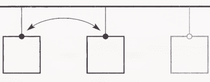

**图 2.1 网络通信通常在恰好两台机器之间进行**

- 如我们在模块 0.4 中提到的，当 Alice 通过互联网与 Bob 通信时，数据包逐跳在网络上传输：从 Alice 到路由器，从路由器到路由器，最后从路由器到 Bob（图 2.2）。连接的基本单元是通过单跳发送——从一个网络上的一个机器（路由器或主机）到另一个机器，这与图 2.1 中 LAN 上两台机器之间的通信完全相同。

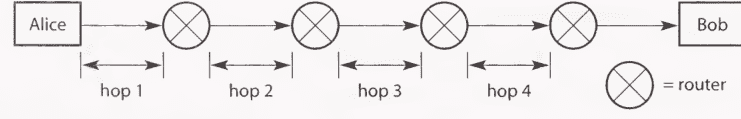

**图 2.2 数据包逐跳从路由器传输到路由器**

无论通信是主机到主机、主机到路由器还是路由器到路由器，每种情况都使用相同的机制。这使我们能够从简单网络上的单跳传输扩展到互联网络的互联网，其中数据包必须经过多次跳才能到达目标机器（我们在下一章中介绍）。

在本章中，我们将探讨一台 PC 如何与同一以太网段上的另一台 PC 通信，以及涉及的问题：

- IP 地址
- 子网掩码 – 它们告诉我的机器是否需要使用路由器才能到达目标机器
- 数据包如何在以太网上传输
- 我的 PC 如何自动找到你的 PC 的以太网地址
- 布线搭建测试网络
- 配置 TCP/IP 软件
- 测试和故障排除。

### IP 地址

在邮政系统中，每栋房屋和办公室都有唯一的邮政地址，当你想给某人寄明信片时使用。同样，TCP/IP 网络上的每台机器都有唯一的地址——其 *IP 地址*。当其他计算机向你的机器发送数据时，它们指定其 IP 地址为目标，反之亦然。IP 地址由四个字节组成，以四个用点分隔的十进制数字书写，例如

192.0.2.123

显而易见，这被称为 *点分十进制表示法*。

IP 地址在全球范围内是唯一的（用于不可见于他人的私有网络的情况除外，我们将在模块 4.9 中介绍）。地址的唯一性得以保证，因为 IP 编号是从单一的、全球性的、集中管理的池中分配给各站点的。

要使用 TCP/IP 向机器发送数据包，你指定其 IP 地址为数据包的目标，数据包将被路由到它。例如，我工作站的 IP 地址是 192.0.2.123；当你与我通信时，你在发送给我的每个数据包中都指定目标为 192.0.2.123。这就是 IP 数据包中 *唯一* 的目标寻址。如我们在模块 0.4 中提到的，数据包完全不包含路由信息：网络上的路由器逐跳转发数据包，直到它到达最终目的地。路由器仅根据数据包的目标 IP 地址决定如何转发数据包。换句话说，路由信息存储在网络本身中，而不是在数据包中。

### 单独的 IP 地址是不够的

你可能会认为这就是我们所需要的一切——网络上每台计算机都有唯一地址。如果网络是一根横跨全球的单根电线，世界上每台计算机都连接到它上，那就足够了。但互联网不是单一的同质网络——它由成千上万个不同组织的网络连接而成。我的 LAN 上的机器只是所有可能 IP 地址范围中的一小部分。我只能直接与我的以太网段上的机器通信；要与别处的机器通信，我必须使用路由器。（同样，我可以亲手把明信片递给与我同在一个房间工作的人，但对于其他地方的人，我必须通过邮件系统寄送明信片——我们的内部邮件系统或公共邮政系统。）

现在，假设我想向另一台机器发送数据，其地址为 192.0.2.7。在尝试向该机器发送之前，我的 TCP/IP 必须经历类似这样的决策过程：

```
if (destination 192.0.2.7 is on my local network)
    communicate with the destination directly over the local LAN
else /* destination is remote */
    use a router to communicate with the destination
```

下一模块解释了 TCP/IP 如何使用子网掩码来判断一台机器是本地还是远程。

## 2.2 子网掩码 – 我直连网络的范围

当你向其他机器发送数据时，计算机上的第二个参数“子网掩码”会告诉你的 TCP/IP 目标地址是否在你的本地网络上，因此数据包是否可以直接发送，即无需使用中间路由器。

我的机器地址是 192.0.2.123。我想发送到 192.0.2.29。它如何判断 192.0.2.29 是否属于 LAN 本地并且可以直接联系？答案是：我的 TCP/IP 使用机器上的 *子网掩码*。

我的 IP 地址和子网掩码的组合指定了我的机器认为直接连接到我的 LAN 的 IP 地址范围。我可以直接与这些地址通信而无需使用路由器。（该范围内的地址不一定全部存在于网络上。然而，就我的机器而言，它只会在此网络上查找它们。如果在那里找不到，它就认为它们不存在，也不会以其他方式尝试联系它们。）隐含地，该范围还决定了哪些机器 *不* 在我的 LAN 上：不在范围内的所有机器必须是远程的；我只能通过使用中间路由器向它们发送数据包。

(IP 地址、子网掩码) 的组合如何指定一个 IP 地址范围？我们将在第 4 章中详细讨论这个问题，但现在这里有一些简化规则，可以让我们构建第一个测试网络：

- 子网掩码由四个字节组成，以四个用点分隔的十进制数字书写，就像 IP 地址一样
- 如果子网掩码是 255.255.255.0，则范围包括所有与该机器 IP 号码前三个字节相同的 IP 地址。例如，我的 IP 地址 = 192.0.2.7 和我的子网掩码 = 255.255.255.0 指定了范围

    192.0.2.0–192.0.2.255

    所以我的机器可以直接与该范围内的任何机器通信
- 如果子网掩码是 255.255.0.0，则范围包括所有与我的 IP 号码前 *两个* 字节相同的 IP 地址。例如，我的 IP 地址 = 192.168.45.109，我的子网掩码 = 255.255.0.0 给出范围

    192.168.0.0–192.168.255.255

回到上面的例子，当我的 TCP/IP 想发送到 192.0.2.29 时，其决策过程是：

```
calculate the range specified by my IP address and my netmask
if (destination 192.0.2.29 is in this range)
/* its on my local network */
communicate with the destination directly over the local LAN
else
/* destination is remote */
use a router to communicate with the destination
/* covered in Chapter 3 */
```


在一个简单的独立网络中，所有子网掩码都应该是相同的，并且所有 IP 地址都应在同一范围内，因为你希望所有机器能够直接相互通信。如果一台机器的子网掩码不同，它将对自己的网络世界有不同的看法：可能会出现 Bob 在 Alice 的范围内，但 Alice 在 Bob 范围之外的情况，因此它们无法通信（图 2.3），或者出现两个完全不重叠的范围。

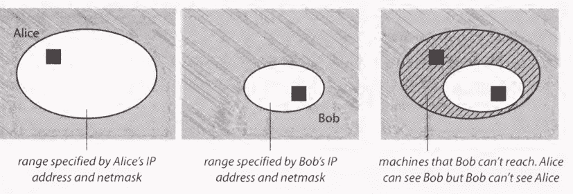

## 图 2.3 同一局域网上的不同子网掩码会使某些机器无法访问

然而，在独立网络中，子网掩码的重要性不如在互联网络中。在独立网络中，如果子网掩码指定的 IP 地址范围比网络上实际存在的范围大得多，也没什么关系，因为我们只关心本地机器而已。（我们在刚接入互联网的站点上经常会发现这种错误的子网掩码设置。）

子网掩码仅在发送时使用，因为它告诉我的 TCP/IP 是否可以直接向目标发送。接收时子网掩码无关紧要：如果数据包到达这台机器，它就到达了，仅此而已。非常重要的一点是，我的子网掩码存储在 *我的机器上*，它不会包含在数据包中，因为它说明了我的机器在周围网络中的位置——即本地连接网络的 IP 编号是什么。当数据包从我这里跨越其他网络传输时，转发它的机器使用 *它们自己的子网掩码* 来确定如何转发。（出于历史原因，子网掩码也被称为“subnet mask”，但我们永远不会使用该术语。）

## 三个基本网络参数

每台机器上都有三个至关重要的基本 TCP/IP 参数：

- 1. IP 地址
- 2. 子网掩码
- 3. 默认网关 – 默认使用的路由器的地址（我们在第 3 章中详细讨论）。

你无法高估这三个参数的重要性。它们决定了这台机器与任何其他机器之间的所有 TCP/IP 通信。每当你遇到网络问题时，首先要检查这些参数。

## 2.3 以太网网络：沿本地线路传输数据包

TCP/IP 是一个软件标准——它定义了在一台机器中的网络软件必须做什么才能与另一台机器中的网络软件成功通信。要工作，TCP/IP 必须使用某种底层网络硬件系统。以太网目前是局域网中最常见的系统，因此本章其余部分将讨论它。请注意，以太网 *不是* TCP/IP 的一部分。

- 很多不是 TCP/IP 的网络软件也使用以太网
- TCP/IP 运行在许多不同类型的非以太网硬件上，例如令牌环、拨号电话线、分组无线电等。

TCP/IP 只是与以太网（即网络访问层）交互，以利用其能力将数据包沿物理线路移动。

以太网定义了电气接口、电缆类型、连接器配置等的标准，以及硬件如何在同一根线或以太网 *段* 上将以太网数据包从一台机器发送到另一台机器。TCP/IP 对这些布线、以太网传输等低层细节一无所知——这不是它的职责。

### 以太网寻址

- 以太网使用以太网地址，也称为 *MAC* 地址（*Media Access Control* 或 *Medium Access Control*）或硬件地址
- 以太网地址由六个字节组成，以十六进制书写。在 Linux 上，它们以大写显示，用冒号分隔，例如
  00:D0:B7:B6:3D:F6

  在 Windows 上，它们以小写显示，用破折号分隔，例如
  00-d0-b7-b6-3d-f6

- 以太网地址是全球唯一的，由美国电气和电子工程师学会（IEEE）分配。以太网硬件制造商购买固定大小的号码块；如果需要更多地址，他们会购买更多块。IEEE 发布已分配块的列表，因此从设备的以太网地址可以看出它的制造商（或至少是其中的以太网卡）。例如，
  00:50:73:38:CE:26 is a Cisco address
  08:00:20:0A:74:AA is a Sun Microsystems address

  （我们网站上的一个工具可以让你输入一个地址并给出该以太网地址块的所有者的名称。）

### 通过以太网发送数据

要让我的机器在同一本地以太网上向你的机器发送一些数据，我的机器中的软件首先在内存中构造一个以太网数据包。它：

- 将要发送的数据插入数据包的数据（“payload”）区域
- 指定你的机器的 MAC 地址作为以太网目的地址
- 给出我的 MAC 地址作为以太网源（图 2.4a）
- 将数据包传递给我的机器的硬件进行传输，硬件完成其余工作。

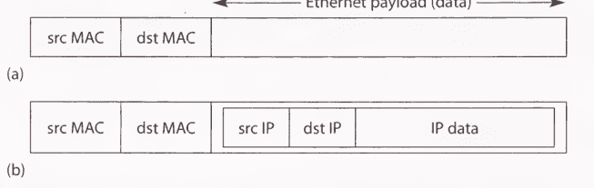

## 图 2.4 （a）以太网数据包 （b）作为以太网有效载荷包含的 IP 数据包

图 2.4 仅为示意——我们省略了其他“数据包头”字段和用于校验和等的字段，并且字段的顺序与所示不同。我们不需要那种详细程度，但如果你想深入探索，请参阅 Stevens。

以太网被称为“尽力而为”系统，这意味着它尝试传递数据但不保证，如果数据包丢失——因为线路上的噪声，或网络太忙，或有人拔出线路——它不会通知你。（这就是你在像以太网这样的硬件网络系统之上使用 TCP/IP 的原因之一。）

需要注意的是，以太网发送的是以太网数据包，它可以携带任何类型的数据作为有效载荷（当然，这就是为什么你可以在以太网上运行大量不同的网络系统，而不仅仅是 TCP/IP）。要发送 IP 数据包，整个 IP 数据包（我的应用程序已在内存中构造）必须插入到以太网数据包中（图 2.4b）并且以太网头中的数据包类型字段设置为 800（IP）。IP 数据包被称为封装在以太网数据包中。

请注意，在这个网络层级上，是 MAC 地址而不是 IP 地址导致数据包被交付到正确的机器。如果我想发送给你，并把你的 IP 地址作为目的 IP，但使用错误的 MAC 目的地址，数据包将发送到错误的机器并且很可能会被丢弃。（然而，在第 3 章中我们将看到，有时目的 IP 地址和目的 MAC 地址故意设置为不同的机器，路由器依赖于这一事实来发挥其魔力。）

你可以使用 `tcpdump -n -t -e` 在线路上查看以太网数据包（-e: 打印以太网详细信息；`-n`: 以数字而非主机名打印地址；`-t`: 不在每一行打印时间）。图 2.5 显示了 ping 的跟踪：

```
alice# tcpdump -n -t

00:d0:b7:b6:3d:f6 0a:a0:c9:b4:64:3a 0800 98: 192.0.2.17 > 192.0.2.10: icmp: echo request

0a:a0:c9:b4:64:3a 00:d0:b7:b6:3d:f6 0800 98: 192.0.2.10 > 192.0.2.17: icmp: echo reply

MAC address of MAC address of Ethernet Packet length
machine machine packet type (98 bytes)
192.0.2.10 192.0.2.17 800=IP
```

## 图 2.5 显示以太网详细信息的 ping 跟踪

在下一个模块中我们将看到，以太网数据包也可以被广播，即发送到这根线路上的每台机器，而不仅仅是一台机器。

## 2.4 ARP – 我的机器如何找到你的机器的以太网地址

Alice 知道 Bob 的 IP 地址，但需要找到 Bob 的以太网地址才能向他发送数据包。TCP/IP 使用 ARP，即地址解析协议来解决这个问题。Alice “广播”，询问谁拥有 Bob 的 IP 地址。Bob 回复我，告诉 Alice 他的以太网地址。然后他们就可以通信。让我们更详细地说明。

### 以太网广播

通常，当一台机器向另一台机器发送以太网数据包时，只有目的字段中包含其以太网地址的机器才会处理该数据包，即数据包被机器的 NIC 接受并传递给操作系统然后传递给应用程序。虽然电信号在整根线路上可见，但数据包流是局部化的，如图 2.6 所示。（以太网“交换机”会影响数据包的可见性，正如我们在模块 2.8 中将看到的那样。）

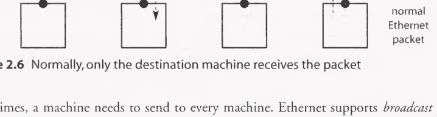

通常，只有目的机器接收到数据包

有时，一台机器需要发送给每台机器。以太网支持广播数据包，这些数据包会被该以太网段上的每台机器接收和处理（图 2.7）。广播用于例如当一台机器需要请求某些东西但不知道向谁询问时。（“我想使用提供 XYZ 服务的服务器，外面有吗？”）然而，最常见的用途是 ARP，下面会解释。


广播数据包会被所有机器接收

### ARP，地址解析协议

在上一模块中，我们看到要让我的机器向你的机器发送数据，我的机器必须知道你的 MAC 地址（以太网地址）。它如何得知这一点？我们可以手动配置一个 IP 到以太网地址映射的表并复制到每台机器；然而，对于大型站点来说这将是维护上的大麻烦，而且对于像打印服务器等没有磁盘存储的设备也不适用。我们需要一个自动解决方案。


一个类比是拥挤的办公室：Alice 想给 Bob 打电话但不知道他的分机号。一个简单的解决方案是 Alice 对整个办公室喊：“Bob: I'm on extension 29. What's your extension?” Bob 听到后回拨到 29 分机，说：“Alice, I'm on extension 7.” 然后他们可以随意交谈，而不会用喊叫影响其他人。

TCP/IP 做的事情非常相似，使用 ARP。假设 Alice 的机器是 192.0.2.7，她想发送到 Bob 的机器 192.0.2.29。机器 .7 必须查出 .29 的 MAC 地址：

- Alice 发送一个以太网广播，其中有效载荷/数据字段包含一个 ARP 请求包。ARP 包包含她需要的 MAC 地址的 IP 地址 - 192.0.2.29。**tcpdump** 显示为 “arp who-has 192.0.2.29”
- 这根线上的所有机器都会接收到这个包，提取 ARP 包，并查看其中的 IP 地址。如果地址与接收机器的 IP 地址不匹配，则包会被忽略，即只有 .29 会进一步处理
- 机器 .29 用 ARP 回复包回复 .7，其中包含 .29 的 MAC 地址。（它**不**广播回复，因为只有 .7 请求了该信息。）**tcpdump** 显示为 “arp reply 192.0.2.29 is-at a.b.c.d.e.f.”
- .7 现在知道了 .29 的 MAC 地址，可以自由通信。

当我们第一次遇到 ARP 时，它看起来像魔法：当两台机器需要在网络上相互通信时，它们如何在网络上交换地址？这似乎是循环的。当然关键在于使用广播。以太网广播地址是预定义的，因此所有机器都知道它是什么，并且可以在不先与其他机器通信的情况下使用它。

下面是 192.0.2.7 ping 192.0.2.29 的 **tcpdump** 抓包。我们使用选项“-e”，来显示以太网地址。我们还使用了一个新功能 – 在过滤表达式中指定特定协议。在这种情况下，我们想要 ARP 和 ICMP（ping）流量。

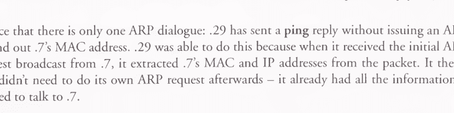

请注意只有一个 ARP 对话：.29 在不发出 ARP 来查找 .7 的 MAC 地址的情况下发送了 ping 回复。.29 能够做到这一点是因为当它收到来自 .7 的初始 ARP 请求广播时，它从数据包中提取了 .7 的 MAC 和 IP 地址。它因此不需要之后再做自己的 ARP 请求 – 它已经拥有与 .7 通信所需的所有信息。

> **提示：** 当我与你交谈时，我的系统仅在认为你的机器在同一网段时才使用 ARP。如果你看到针对你已知是远程的机器的 ARP“who-has”，这意味着你的机器对本地网络的看法不正确：要么是其 IP 地址，要么更可能是其子网掩码，错误。

## 2.5 查看和操作 ARP 条目

TCP/IP 在其 *ARP 缓存* 中保存 (IP 地址, MAC 地址) 对的记录。它只是一个缓存而不是永久存储：一旦条目达到一定年龄，TCP/IP 就会删除它。这可以防止缓存无限增长，并解决了如何检测给定 IP 地址的 MAC 地址是否发生变化的问题（例如，如果你必须更换损坏的网卡）。另一方面，这意味着 ARP 对话会不时重复，每次得到相同的答案。（然而，这对网络造成的负载可以忽略不计。）

arp 命令让你查看和操作 ARP 缓存（见表 2.1）。

### 表 2.1

| | Linux | Windows-NT |
|---|---|---|
| 查看缓存 | arp<br>arp *host*<br>arp -a<br>arp -a *host* | arp -a<br>arp -a *ipnum* |
| **显示地址时以数字而非名称** | ... -n ... | |
| **删除条目** | arp -d *host* | **arp -d *ipnum*** |
| **添加（“设置”）条目** | **arp -s *host macaddr*** | **arp -s *ipnum macaddr*** |

### 注释：

- 1. 在 Linux 上，arp 默认以名称和数字打印主机地址（“**arp -a**”）或仅名称（“**arp**”）。与往常一样，这只有在配置了 DNS 时才正确工作，我们直到第 7 章才介绍。 使用选项“-n”可防止 arp 尝试将 IP 数字转换为名称
- 2. 在 Linux 上，“-a”格式显示（图 2.8a）与不带“-a”的格式略有不同。我们总是使用“-a”，因为它在 Linux（图 2.8b）和 NT（图 2.8c）上都适用
- 3. 在 Linux 上，*host* 可以是 IP 数字或主机名；在 Windows 上你只能使用 IP 数字。有关更详细的描述，请参阅你的手册页
- 4. 我们从未需要添加条目，所以你不太可能需要使用“**arp -s**”
- 5. 在 Windows-NT 上，默认情况下，如果条目未使用，则在两分钟后从 ARP 缓存中删除，如果使用则在十分钟后删除；超时周期可以在注册表中编辑，尽管很难看出你为什么会想这样做。在 Linux 上，条目通常在大约五分钟后被删除。（你可以通过 ping 机器确保条目存在，然后间隔运行“**arp -a**”，以查看条目何时消失，来检查你的实现的细节。）

```
alice% arp -a -n
? (192.0.2.5) at 08:00:20:0C:E4:E1 [ether] on eth0
? (192.0.2.7) at 00:D0:B7:7F:A6:D9 [ether] on eth0
? (192.0.2.10) at 00:A0:C9:B4:E4:3A [ether] on eth0
? (192.0.2.22) at 00:02:B3:2A:49:1C [ether] on eth0
? (192.0.2.19) at 00:00:C0:8B:C3:C5 [ether] on eth0
alice%
```

(a)

```
alice% arp -a
mars.uit.co.uk (192.0.2.5) at 08:00:20:0C:E4:E1 [ether] on eth0
techpc.uit.co.uk (192.0.2.7) at 00:D0:B7:7F:A6:D9 [ether] on eth0
scutter.uit.co.uk (192.0.2.10) at 00:A0:C9:B4:E4:3A [ether] on eth0
denrisnt.uit.co.uk (192.0.2.22) at 00:02:B3:2A:49:1C [ether] on eth0
lee.uit.co.uk (192.0.2.19) at 00:00:C0:8B:C3:C5 [ether] on eth0
mail.uit.co.uk (192.0.2.29) at 08:00:20:0A:74:AA [ether] on eth0
alice%
```

(b)

```
C:\arp -a

Interface: 192.0.2.21 on Interface 2
Internet Address      Physical Address      Type
192.0.2.7             00-d0-b7-7f-a6-d9    dynamic
192.0.2.10            00-a0-c9-b4-e4-3a    dynamic
192.0.2.17            00-d0-b7-b6-3d-f6    dynamic
192.0.2.29            08-00-20-0a-74-aa    dynamic
C:\
```

(c)

图 2.8 “arp -a” 输出

（顺便说一下，ARP 是一个不整齐地适合层模型的协议示例。它实际上处于层 2${}_{\frac{1}{2}}$，将网络或互联网或 IP 层与下面的网络访问或链路层连接起来，如下所示。）

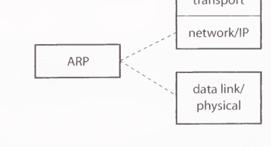

我们已在本章和上一章多次使用 **ping** 来生成一些流量，但尚未详细研究它。我们将在下一个模块中进行。

## 2.6 使用 ping 在两台机器之间生成测试流量

**ping** 程序从我的机器向你的机器发送一个特殊数据包。如果你的机器已连接到网络并接收到数据包，它会向我发送回复表示你处于活动状态。这通常只是为了检查机器是否存活，或只是为了在两台机器之间生成测试流量。

**Ping** 的名称源于声纳的类比，其中潜艇发出小声脉冲。脉冲从其他潜艇反射回来，并在第一艘潜艇的探测器上发出 **ping** 声，表明另一艘潜艇的存在。

最简单的情况是，告诉 **ping** 你想要联系的远程主机的 IP 地址：

```
ping 192.0.2.29
```

该程序发送多个请求，并（希望）接收多个回复。在 Windows 上，简单命令 `"ping host"` 发送四个请求并终止，而在 Linux 上它会无限重复（实际上直到你按 ctrl-C 终止它）。（目标机器上没有 **ping** 服务器。响应 **pings** 内置于 TCP/IP 栈中，因为它对测试是必要的，而且非常简单和轻量。）Bob 显示了 Linux 上 **ping** 的输出；我们使用选项“-n”以数字打印地址，并使用“-c3”发送三个请求。

```
alice# ping -c3 -n 192.0.2.29
PING 192.0.2.29 (192.0.2.29): 56 data bytes
64 bytes from 192.0.2.29: icmp_seq=0 ttl=255 time=4.5 ms
64 bytes from 192.0.2.29: icmp_seq=1 ttl=255 time=0.6 ms
64 bytes from 192.0.2.29: icmp_seq=2 ttl=255 time=0.5 ms
```

我们可以使用 **tcpdump** 详细分析它，选项“-n”与往常一样（为清晰起见插入了额外行）：

```
alice# tcpdump -n arp or icmp

15:05:53.170364 arp who-has 192.0.2.29 tell 192.0.2.17
15:05:53.171368 arp reply 192.0.2.29 is-at 8:0:20:a:74:aa

15:05:53.171384 192.0.2.17 > 192.0.2.29: icmp: echo request
15:05:53.174843 192.0.2.29 > 192.0.2.17: icmp: echo reply (DF)

15:05:54.168674 192.0.2.17 > 192.0.2.29: icmp: echo request
15:05:54.169217 192.0.2.29 > 192.0.2.17: icmp: echo reply (DF)
```

- 第 1、2 行：通常的 ARP 对话。我们不会在目标机器在远程网络上时看到它，或者即使它在局域网上但我们最近与之通信过。ARP 通常会导致第一个 **ping** 响应时间比其余的慢
- 第 3、4 行：ARP 对话后立即（16 微秒）跟随第一个 **ping** 请求/回复对
- 第 5、6 行：下一个 **ping** 请求/回复对（等等）。

你可以从这两个程序的输出中观察到几点：

- 1. **ping** 使用 ICMP（Internet 控制消息协议），它是 TCP/IP 协议套件的一部分。我们将在本书其他地方看到 ICMP 的一些其他用途


- 2. **ping** 的输出报告 *往返时间*（从我发送 **ping** 请求到收到回复的时间），这样我就能大致了解中间网络的性能
- 3. **ping** 的时间分辨率在不同机器和不同操作系统上有所不同，取决于系统时钟的精度。尝试对各种机器进行 **pinging**，看看结果如何。

## ping 命令摘要

Linux 和 NT 版本的 **ping** 对相同选项使用令人困惑不同的标志。重要内容已在表 2.2 中总结。（其他内容列在各系统相应的 manpages（在线手册页）或帮助文件中，但你可能永远不需要它们。）

| | Linux | Windows-NT |
|---|---|---|
| **直到按 Ctrl-C 终止的 ping** | `ping host` | `ping -t host` |
| **发送 num 个请求** | `-c num` | `-n num` |
| **以名称打印主机地址** | *(默认)* | `-a` |
| **以数字打印目标地址** | `-n` | *(默认)* |
| **仅显示最终摘要** | `-q` | *(不适用)* |
| **发送大小为 num 字节的请求** | `-s num` | `-l num` |

## 如果 ping 没有收到回复

除了我们在故障排除模块 2.13 中介绍的一般网络问题外，**ping** 可能不打印任何内容还有几个原因：

- 如果站点是远程的，它可能受到防火墙保护，该防火墙会阻止 **pings**（这样坏人就不能使用 **ping** 来查找你内部机器的地址以准备攻击你的站点）
- 在 Linux 上，你可以禁用对 **pings** 的响应（详见第 57 页的注释）。我们建议你 *不要* 这样做，否则你会让网络上的每个管理员感到困惑（当你忘记自己做了什么时，可能也会困惑自己）

> **练习：** 当你启动 NT 或 Linux 系统时，观察它在启动周期中的哪个阶段首次准备好响应收到的 **pings**。从 Linux 系统启动一个 **ping**（默认情况下会无限运行），或从 NT 使用 **ping -t**。如果你的网卡或 PCMCIA 卡有“active”指示灯，观察它（或集线器上的“link”指示灯），看看它何时变为活动状态。这与机器何时变得 **pingable** 有何关系？你可能在未来遇到系统启动问题时发现此信息很有用。

现在我们将构建一个简单的网络并使用我们刚刚介绍的工具。

## 2.7 实验 – 构建最简单的网络：集线器和布线

我们可以拥有的最简单的网络是单条以太网段上的两台机器。UTP 布线易于使用、灵活且便宜。在跟踪数据包时，UTP 集线器比 UTP 交换机更容易使用。

我们现在要构建最简单的网络——单条以太网段上的两台机器，如图 2.9 所示示意。如果可以，请为一台机器使用 Linux，为另一台使用 Windows-NT。布线硬件大约需要五分钟（可能比找到备用集线器的时间还少），配置软件再需要五到十分钟。然后我们将在其上进行实验。


## 布线、集线器和交换机

如今最常用的布线系统是 *UTP（无屏蔽双绞线）*。它由几对导体组成，每对相互绞合，置于塑料外壳中，导体对周围没有任何屏蔽。相比之下，细以太网（“thin-net”）和粗以太网（“thicknet”）使用更厚更硬的同轴屏蔽电缆，直径可达 10 或 11 毫米。在细以太网和粗以太网上，网络上的所有机器都连接到单根网络电缆上。然而，UTP 为每台机器使用单独的电缆，所有电缆通过 *UTP 集线器（“wiring hubs”）* 或 *UTP 交换机* 或两者混合连接。（我们在下一模块中解释集线器和交换机之间的区别。）

我们专门使用 UTP 的原因如下：

- 它非常灵活。你可以轻松地将电缆和插座布置到所需位置，并且很容易构建由几台 PC 和集线器组成的小型测试网络
- 它很便宜——你可以用约 20 美元买到小型 UTP 集线器
- 集线器上的“link”指示灯可在无需特殊诊断工具的情况下提醒你布线问题：如果将主机连接到集线器而链路灯未亮，你可能有电缆或类似问题（我们说“可能”是因为主机和网卡必须先处于运行状态）
- 它速度快。通过使用正确的电缆和集线器或交换机，你可以运行 100 兆比特/秒的以太网——比标准以太网快十倍，但价格几乎相同
- 在网络中移动、添加、移除或重新定位计算机很容易。当你将嗅探机移动到网络的不同位置以诊断问题时，这非常方便。UTP 让你可以将机器保留在其物理位置，但通过“cross-patch”将其连接到网络的不同逻辑部分。如果你的嗅探机有多块网卡，你可以通过合适的交叉布线，同时从同一嗅探机监控网络的本地和远程部分。

然而，你可以使用任何你喜欢的布线系统，本书中介绍的内容仍然适用。

使用 UTP，我们最简单的网络物理布线如图 2.10 所示。

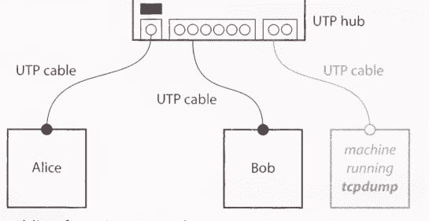

**图 2.10** 微型网络的 UTP 布线

我们在图中以灰色显示了第三台机器，运行 **tcpdump**。如果你改在 Alice 或 Bob 上运行 **tcpdump**，可以省略它。但我们发现将 **tcpdump** 保留在专用笔记本上最容易：

- 它可以随意轻松移动
- 我们知道它有效，而如果你在 Alice 或 Bob 上运行 **tcpdump**，你就是用机器来诊断自身，这有时会导致问题。

（我们使用一台古老的笔记本电脑作为日常便携式嗅探盒。它相当于网络管理员的螺丝刀——尽管我们每天使用 **tcpdump**，每周才需要螺丝刀一次。）

网络故障排除始于布线。如上所述，确保将 PC 连接到集线器时，表示连接已正确建立的“link”灯亮着。

如果你还没有备用集线器，可以使用 *交叉* UTP 电缆（图 2.11）直接将 Alice 和 Bob 连接起来。当然，使用这种配置你完全无法添加嗅探机。


**图 2.11** 使用交叉 UTP 电缆而不是集线器连接两台机器

> **提示：** 我们总是将台式 PC 连接到我们坐的地方可以看到的集线器上。集线器上我们端口的“network activity”灯能很好地反映机器正在做什么。它是一种廉价但即时的诊断指示。对于同样的原因，我们也尽量让其他网络设备（路由器、防火墙等）易于查看。

### 2.8 集线器 vs. 交换机

附录 3 解释了集线器和交换机不同的背景原因，但以下是实际区别。在下面上下文中，*port* 是你在其上连接机器以太网电缆的交换机/集线器上的连接点。

**集线器** – 一个端口上的所有流量对每个其他端口都可见，并且设备的带宽在所有端口之间共享（图 2.12）。从端口 X 到 Y 的大量传输会减慢从 A 到 B 的同时传输。

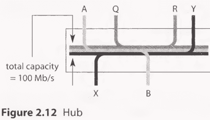

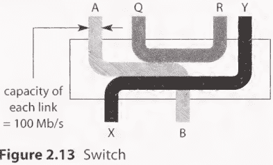

**交换机** – 两端口之间的流量对任何其他端口不可见。设备的全部带宽可供每个端口使用（图 2.13）。例如，如果你有一个 100Mb/s 交换机，你可以以 100Mb/s 从端口 X 传输到 Y，同时以 100Mb/s 从端口 A 传输到 B，并以 100Mb/s 从 Q 传输到 R。事实上，如果你的交换机是 *全双工*，你甚至可以同时以 100Mb/s 从 B 传输到 A，同时以 100Mb 从 A 传输到 B。（当我们从 10Mb/s 集线器升级到 100Mb/s 交换机时，通过局域网更新特定文件的时间从 250 秒减少到 11 秒！）

在交换机上，端口 A 和 B 之间的流量仅在端口 A 和 B 上可见。在使用交换机的图 2.14a 所示的网络中，如果我们在 PC4 上运行 `tcpdump`，我们不会看到任何 PC2 到 PC5 的流量，即使我们的网卡处于混杂模式，因为电信号根本到达不了 PC4。

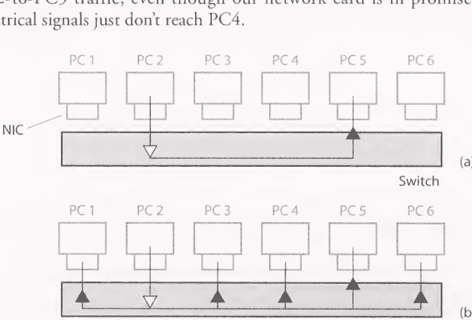


与之相比，当我们使用集线器（图 2.14b）时，每个端口都能看到所有信号，**tcpdump** 工作正常。因此...

> **警告**：如果在用 **tcpdump** 追踪时使用交换机而不是集线器，你几乎看不到任何东西。书中第一部分描述的所有小型测试网络都请使用集线器。

某些“托管交换机”（使用 SNMP（模块 17.10）进行控制和监控的交换机，通常高度可配置，见附录 3）可以配置为使所有流量在某些或全部端口上可见；你可以在需要使用 **tcpdump** 时选择性地启用此功能。然而，这些比普通交换机 *贵得多*。

解决问题的另一种方法是把集线器串联到交换机端口上。图 2.15 显示了嗅探器和 Bob 的 PC 连接到串联的集线器，使我们能够监控 Bob PC 的所有进出流量。你可以以两种不同的物理方式布线：

- 1. **在桌面上**：从 Bob 的 PC 背面拔下 UTP 下行电缆并将其连接到集线器。然后将嗅探器 PC 和 Bob 的 PC 连接到集线器
- 2. **在通信机房**：在交换机上断开通往 Bob 墙上插座或桌面的电缆。将该电缆重新连接到备用集线器，并将集线器连接到交换机。将嗅探器 PC 连接到集线器，可以通过另一个墙上插座或直接在通信机房连接。

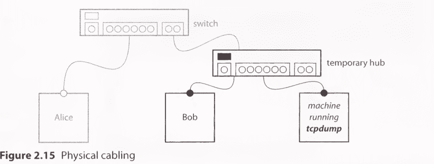

图 2.15 正确地说明了这两种方法：两者唯一的区别在于集线器的位置——在通信机房还是在桌面上。

> **提示**：在工具包中保留一个专用的迷你 4 端口集线器和几根 50 厘米的 UTP 电缆，以在类似情况下使用。（我们也在通信机房保留一个集线器，可以将 **tcpdump** 嗅探器集中接入 UTP 网络的任意点。）

对于某些问题，你可能需要在网络的多个点添加集线器并连接多个嗅探器机器。如果嗅探器运行的是 Linux，你可以使用 **telnet**（模块 10.6）或 X windows（模块 17.6）连接到它们，并在一个屏幕上查看所有跟踪记录。另一种选择是在单台 PC 上使用多个网卡，并在需要时像上面那样交叉连接。

## 2.9 实验 – 软件配置：Windows

本模块告诉你如何在 Windows 系统上设置和检查 IP 地址和网络掩码。（我们先介绍 Windows，因为它更简单。）模块 2.11 对 Linux 执行相同的操作，而模块 2.12 使用这些设置来构建测试网络。

- 1. 启动 **控制面板 > 网络**（图 2.16）。忽略计算机名、工作组或域；它们主要用于 MS Windows 网络（第 20 章）。

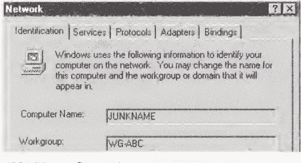

- 2. 单击 **协议** 选项卡以显示图 2.17 所示的对话框

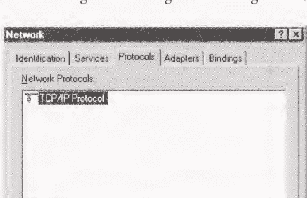

- 3. 双击 **TCP/IP 协议** 或选择它并按下 **属性** 按钮以打开 TCP/IP 属性对话框（图 2.18）

- 4. 按所示输入值。请注意，对话框将网络掩码称为“子网掩码”。这种术语是历史遗留的，我们将在第 4 章中解释。我们始终将此设置称为“网络掩码”，即使对话框中显示的不是这样，以便你知道它的真正含义

- 5. 完成后，按 **确定**（或按 **应用** 保持对话框打开，如果你预计很快会再次更改设置）。

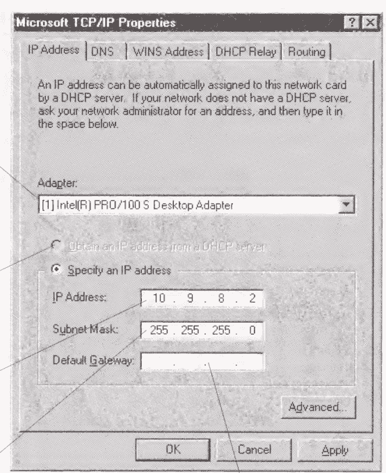

显示你正在配置的网卡。大多数 PC 只有一块，但你可以有多个（模块 3.7）

我们尚未在小型网络上使用 DHCP（第 16 章），因此我们明确指定地址信息

输入此机器的 IP 地址

网络掩码在两台机器上应相同。此测试网络请使用 255.255.255.0

默认网关设置无关紧要，因为我们没有路由器并且未连接到任何其他网络——保持未设置

图 2.18 Windows TCP/IP 配置 – 步骤 3：TCP/IP 属性

在 Windows-NT 上，只要你的 NT Service Pack 为最新，就不需要重启 IP 地址和网络掩码设置才能生效。设置存储在 Windows 注册表中，因此是持久的——这些是系统在重启时将使用的值。

（为节省篇幅，以后我们将不再说“启动 控制面板 > 网络 … 选择 … 然后单击 …”，而是使用简写

**控制面板 > 网络 > 协议 > TCP/IP > IP 地址**

来表示你需要选择的菜单、选项或其他项目。）

在下一个模块中，我们将向你展示如何验证你输入的设置是否真正生效。

## 2.10 验证你的设置 – Windows

在 NT 的早期版本中、在有多块网卡的情况下以及在 Windows-9x 系统中，设置在重启前不会生效。**控制面板 > 网络** 仅显示存储的值，这些值不一定是当前正在使用的设置。你可以使用 **ipconfig** 程序（图 2.19）验证你的设置。**ipconfig** 显示 TCP/IP 当前正在使用的值（与你已输入但可能尚未生效的设置相对）。

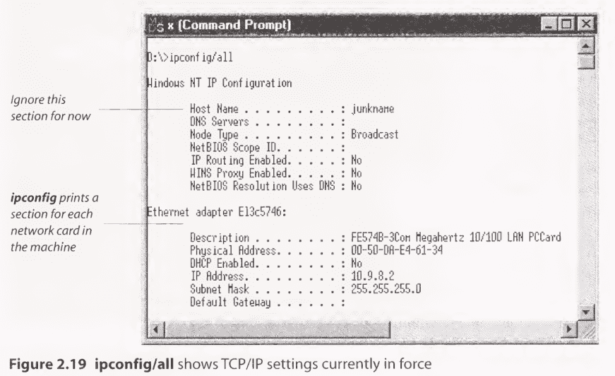

Windows-9x 提供了一个类似的工具，称为 **winipcfg**，它具有图形界面。Windows-NT 4.0 Resource Kit 包含一个名为 **wntipcfg** 的 NT 特定版本（图 2.20）。如果按下 **详细信息**，显示会发生变化：顶部显示机器范围的配置，底部显示该特定网卡的设置（图 2.21）。

|  | Windows-NT | Windows-9x |
|:--|:--|:--|
| 命令行（摘要） | ipconfig | ipconfig |
| 命令行（详细） | ipconfig /all | ipconfig /all |
| 命令行 – 帮助 | ipconfig /? | ipconfig /? |
| 图形界面 | wntipcfg | winipcfg |

> 提示：在你的 Windows “开始” 按钮中，为 **控制面板 > 网络** 以及 **控制面板** 本身创建快捷方式，因为你会经常使用它们。

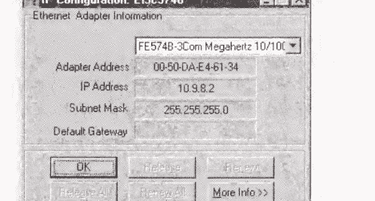

图 2.20 wntipcfg 显示网络设置的摘要

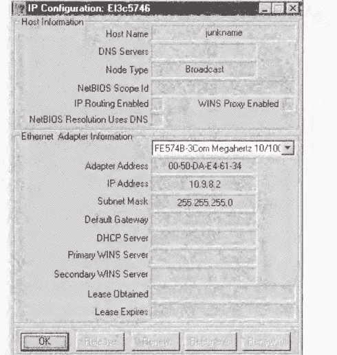

图 2.21 wntipcfg > 详细信息 显示详细的网络设置

## 2.11 实验 – 软件配置：Linux

在 Linux 上，你使用 ifconfig 命令来配置网络接口或显示当前设置。（它被称为 ifconfig 而不是像 NT 上的 ipconfig，因为它配置的是接口而不是特定于 TCP/IP，因此如果你运行这些网络，可以用它来设置 Novell 和 Appletalk 接口参数。然而，我们只将其用于 TCP/IP。）

### 显示当前设置

| 显示正在使用的所有接口 | `ifconfig` |
|---|---|
| 仅显示接口 `ifc` 的详细信息 | `ifconfig ifc` |
| 显示所有接口，包括处于“down”状态的 | `ifconfig -a` |

（处于“down”状态的接口是指尚未配置或已被明确禁用的接口。你现在可以忽略这一点——我们只提到它是因为它解释了为什么有“-a”选项。）

ifconfig 在不同版本的 UNIX 上语法略有不同，例如，在某些 Solaris 版本上，无参数的 ifconfig 会打印帮助信息，因此我们养成了只使用最后两种变体的习惯，因为它们在几乎任何 UNIX 上都适用。

下面是“ifconfig -a”的典型列表。输出为每个接口提供单独的部分。第一个以太网接口称为 eth0，下一个（如果你有多个）是 eth1，然后是 eth2，... 下面的接口 lo 是“环回接口”——机器用于与自身通信的特殊名称（模块 4.11）。

```
the name of
this interface        this interface's   this interface's      this interface's
                     IP address         MAC address          netmask

alice$ ifconfig -a
eth0               Link encap:Ethernet  Hwaddr 00:10:A4:98:25:43
                   inet addr:10.9.8.1  Bcast:10.255.255.255  Mask:255.255.255.0
                   UP BROADCAST RUNNING MULTICAST  MTU:1500  Metric:1
                   RX packets:210372 errors:0 dropped:0 overruns:0 frame:0
                   TX packets:5178 errors:0 dropped:0 overruns:0 carrier:18
                   collisions:0 txqueuelen:100
                   Interrupt:3 Base address:0x300

lo                 Link encap:Local Loopback
                   inet addr:127.0.0.1  Mask:255.0.0.0
                   UP LOOPBACK RUNNING  MTU:3924  Metric:1
                   RX packets:346 errors:0 dropped:0 overruns:0 frame:0
                   TX packets:346 errors:0 dropped:0 overruns:0 carrier:0
                   collisions:0 txqueuelen:0
```

### 设置网络参数

你使用“ifconfig ifc”后跟特定参数来为 ifc 配置 TCP/IP 设置。设置立即生效。像许多 UNIX 命令一样，ifconfig 是强壮而沉默的

类型，并且不打印任何确认。最好立即发出一个普通的“`ifconfig -a`”来检查命令是否按预期执行。

| **设置 IP 地址** | _a.b.c.d_ |
|---|---|
| **设置子网掩码** | netmask _w.x.y.z_ |

偶尔需要使用的其他选项有：

| **禁用此接口** | down |
|---|---|
| **重新启用此接口** | up |

（还有许多其他选项，但你可能永远不需要它们。）
让我们看一些示例：

- `ifconfig eth0 10.9.8.1 netmask 255.255.255.0`
  - 显式设置 IP 地址和子网掩码

- `ifconfig eth0 10.9.8.1`
  - 将接口 eth0 的地址设置为 10.9.8.1。子网掩码被设置为此 IP 地址的默认值。正如我们在第 4 章中将看到的，默认子网掩码的概念是历史遗留的，在你非常熟悉子网掩码之前，我们建议你始终显式设置子网掩码

- `ifconfig eth1 down`
  - 禁用第二个以太网接口

- `ifconfig eth1 up 192.168.168.2`
  - 重新启用第二个以太网接口并同时设置其 IP 地址（这种类型的命令在构建测试网络时很常见）

> **警告**：如果你在第一次输入 IP 地址时打错了字，然后在不指定子网掩码的情况下进行更正，结果可能不是你想要或期望的，例如
>
> `ifconfig eth0 10.9.8.111 netmask 255.255.255.0`
> `ifconfig eth0 10.9.8.1`
>
> 将 IP 地址设置为 10.9.8.1（如预期），但子网掩码现在是 255.0.0.0，因为它使用了默认值。

## 跨重启保留网络设置

与 Windows 不同，使用 **ifconfig** 在 Linux 中定义的网络参数在系统重启时会丢失。要永久设置你的 TCP/IP 参数，你必须将它们输入到系统在启动时使用的配置文件中。由于配置文件的位置和详细格式因不同的 Linux 发行版而异，我们已将所有这些特定于 Linux 版本的信息隔离在附录 6 中。

## 2.12 实验 – 构建最简单的网络：实现和测试

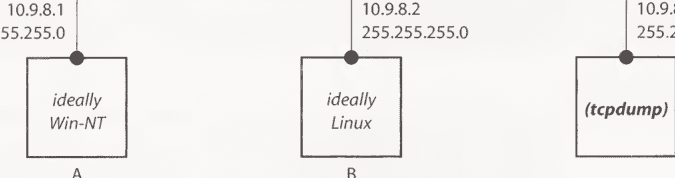

**图 2.22** 简单测试网络的 IP 地址和子网掩码

图 2.22 显示了我们想要构建的网络，以及我们将分配的 IP 地址。我们将配置它然后对其进行实验：我们将逐一更改设置，以强制出现错误并观察系统的行为。

如果你已经在 A 或 B 上运行 **tcpdump**，可以省略单独的 **tcpdump** 机器。如果你将嗅探器机器包含在网络中，它不需要任何特定的 IP 地址，因为它只是在混杂模式下嗅探网络，并且不需要以正常方式发送或接收任何内容。只要其 TCP/IP 处于运行状态，它就会工作。但是，如果你按所示设置其参数，你就可以将其用作 LAN 上的另一台主机来执行测试，这将很有用。

正如我们在模块 2.2 中提到的，三个关键的网络参数是 IP 地址、子网掩码和默认网关。（默认网关涉及路由到其他网络。这里我们只有一个网络，因此在本章中根本不需要默认网关；我们将推迟到下一章再解释它。）

- 我们选择了 10.x.x.x 范围内的 IP 地址，因为它们专门保留用于私有网络使用，并且未分配给任何特定站点（模块 4.9）。我们选择了系列 10.9.8.x，因为它很容易记住
- 不要使用地址 10.9.8.0 或 10.9.8.255 – 它们是特殊的（模块 4.10），使用它们可能会导致你出现问题
- 我们选择了子网掩码 255.255.255.0，给出一个范围，包含 256 个 IP 地址，这些地址与机器的 IP 地址的前三个字节相同：

| 主机 | IP 地址 | 范围 |
|---|---|---|
| A | 10.9.8.1 | 10.9.8.0–10.9.8.255 |
| B | 10.9.8.2 | 10.9.8.0–10.9.8.255 |

| IP 地址 | 由 IP 地址与 255.255.255.0 子网掩码组合得出的范围 |

- 这正是我们想要的——两台机器对世界的看法相同
- 我们在图中显示的 PC 没有名称，但标记为 A 和 B，以便在文本中容易引用。你不必设置机器名称，但如果设置了，也无关紧要。

## 故意制造错误以观察症状

此测试网络几乎微不足道。其价值在于你可以强制不同类型的错误并观察症状以及产生的任何错误消息。网络只是一个玩具，但诊断技术是真实的，并且会让你对在真实网络上工作充满信心。

首先，在你的嗅探器上启动“tcpdump -n -e -t”。然后：

- 1. 更改一台系统，最好是一台 Windows-NT 机器（图 2.22 中的“A”），使其具有与 B 相同的 IP 地址（10.9.8.2）。
  - 网络上你看到了什么数据包？你认为这台机器是否尝试检查它设置的目标地址是否重复？
  - 屏幕或事件日志中是否出现任何错误消息？
  - 从 A ping B 会发生什么？
  - 从 B ping A 会发生什么？

- 2. 将 A 的 IP 地址改回正确的值。现在系统是否正常运行？
  - 如有必要，使用正确的 IP 地址重新启动一台或两台机器

- 3. 将 B 的 IP 地址更改为 10.9.8.1（假设它与 A 的操作系统不同）并重复上述（1）。
  - 如有必要，如前所述，使用正确的 IP 地址重新启动一台或两台机器

- 4. 将 A 的 IP 地址更改为 10.3.2.100。现在它对世界的看法与 B 不同：它认为其网络范围是 10.3.2.0–10.3.2.255，因此 A 和 B 无法相互看到。
  - 从 A ping B 会发生什么？
  - 从 B ping A 会发生什么？

- 5. 将 B 的 IP 地址更改为 10.3.2.200。机器应该再次正常工作。

- 6. 将 A 的子网掩码更改为 255.255.0.0，其地址更改为 10.3.66.200。网络如下：

| 主机 | IP 地址 | 子网掩码 | 由 IP 地址和子网掩码得出的范围 |
| :--- | :--- | :--- | :--- |
| **A** | 10.3.2.100 | 255.255.255.0 | 10.3.2.0–10.3.2.255 |
| **B** | 10.3.66.200 | 255.255.0.0 | 10.3.0.0–10.3.255.255 |

现在 B 可以看到 A，但 A 看不到 B，因为 A 的 IP 地址/子网掩码组合告诉她 10.3.66.200 在不同的网络上。

- 从 A ping B 会发生什么？
- 从 B ping A 会发生什么？

- 7. 将 A 和 B 上的 IP 地址和子网掩码恢复到原始值。

在 Windows-NT 上，当此 PC 被赋予与另一台相同的 IP 地址时，ping 可能出现“硬件错误”消息。这具有误导性——这不是硬件错误，但确实表明存在某些问题。

## 2.13 如何逐步逐跳诊断网络问题

本章涉及单跳网络，即两台本地机器之间的网络。这是实现 *所有* 网络通信的基本机制：与 Internet 上远程机器的通信由许多跳组成，每次跳都是一次两台本地机器之间的对话。一旦你能够诊断简单的网络，你就可以扩展经验并将其应用于非常大的网络：你逐一诊断每个跳，几乎是孤立地，直到找到问题。

### 检查 A 和 B 是否可以通过本地 LAN 通信

（这里我们只处理基本的 IP 连接。我们将在后面的章节中介绍如何排除路由和应用层问题。）

我们假设你在单独的嗅探器机器上运行 `tcpdump`，你知道它正在工作，其网卡工作在混杂模式下，并且你可以看到线路上的数据包。

- 0. 从一台 PC 通过 IP 号 `ping` 另一台。如果 `ping` 打印回复，连接正常。否则，在每台 PC 上：
- 1. 运行 `ifconfig -a`（Linux）或 `ipconfig/all`（Windows）并检查当前活动的 TCP/IP 设置是否符合我们的预期（在 Windows 上不要使用 **控制面板 > 网络**，以防你未更新 Service Pack 且机器需要重启才能使设置生效）
- 2. 如果网络上有一台第三台 PC（正如你在现实生活中会有的），`ping` 它。如果 `ping` 也没有为它打印任何回复，那么很可能是你的 PC 有问题。你仍然需要进行下面的步骤，但你已经知道问题的可能（不是“确定”）位置
- 3. 检查 UTP 集线器上每台 PC 的“链路”指示灯。如果灯熄灭，你有一个需要修复的电缆问题
- 4. `ping` 127.0.0.1，即此机器的“环回”地址（模块 4.11 详细介绍了这一点；它是一个特殊的 IP 地址，表示“自己”）。如果 `ping` 没有打印回复，则此 PC 上的 TCP/IP 安装已损坏
- 5. `ping` 此 PC 自己的正常（非环回）IP 号。如果 `ping` 没有打印回复，要么你的 TCP/IP 已损坏，要么需要重启，要么此机器的 IP 号与你认为的不同。如果 `tcpdump` 在此 `ping` 的线路上显示任何数据包，你的地址是错误的，因为机器发给自己的数据包永远不会出现在线路上
- 6. `ping` B 的地址（在我们的示例中为 10.9.8.2）。如果 `tcpdump` 没有在线路上显示 ARP “who-has 10.9.8.2”，则：
  - a. 运行“arp -a -n”（Linux）或“arp -a”（NT）并查看此机器是否对 10.9.8.2 有 ARP 缓存条目。如果有，删除它（使用“arp -d 10.9.8.2”）
  - b. 此时我们“知道”我们没有 10.9.8.2 的 ARP 条目，但再次运行“arp -a -n”（Linux）或“arp -a”（NT）以确保


c. **再次 ping 10.9.8.2**。如果 **tcpdump** 没有显示 ARP “who-has 10.9.8.2”（注意：请确保显示的就是该 IP 地址），那么这台机器认为 10.9.8.2 不在同一网线：要么这台机器的 IP 地址 *不是* 10.9.8.1，要么其子网掩码错误。请同时检查两者

d. 如果 **tcpdump** 显示了 ARP “who-has”，但针对的是不同的 IP 地址，比如 10.9.8.99，那么这台机器不仅认为 10.9.8.2 在不同的网络上，而且认为它有一个路由器。实际上你可以清除这台机器的默认网关设置，但我们还没有告诉你如何做到这一点（至少在 Linux 上还没有）。然而，如果你退回一步并确保 IP 地址和子网掩码正确，那么默认网关的设置就无关紧要了。

请记住，你必须对每台 PC 重复这些步骤以准确找出问题所在（例如，如果你对 PC A 完成了所有步骤但未对 B 进行，故障可能只是 B 上的网线断了这么简单）。

> **练习**：使用你在上一模块中构建的网络（图 2.23），尝试以下每项操作，并查看每种情况下 **ping** 和 **tcpdump** 显示什么：
> 
> - 从集线器上断开 A 的连接
> 
> - 重新连接 A 并断开 B
> 
> - 重新连接 B。将 A 的 IP 地址设置为 10.9.8.0。然后如果 B 使用不同的操作系统，也在 B 上尝试同样的操作（记住我们在模块 2.12 中说过地址 10.9.8.0 和 10.9.8.255 是特殊的）
> 
> - 将 A 的 IP 地址设置为 10.9.8.255。然后如果 B 使用不同的操作系统，也在 B 上尝试同样的操作。

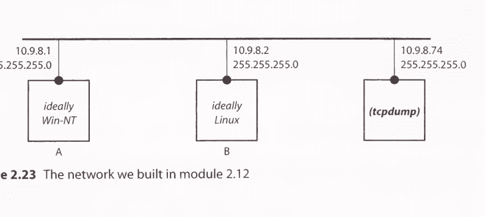

## 摘要

- 三个基本网络参数中的两个是：
  1. IP 地址用于指定数据包的目的机器
  2. 子网掩码结合我的机器的 IP 地址指定了一组 IP 地址范围，我的机器认为这些地址是本地连接的。如果目的 IP 地址超出该范围，我的机器就知道它无法直接发送，必须经过路由器（我们尚未介绍）

- 要向直接连接的以太网 LAN 上的目标机器发送数据，我的 PC 首先必须查明目标的以太网地址，以便正确寻址并发送以太网数据包。它通过使用 ARP 协议来实现这一点。我的 PC 广播询问哪台机器拥有目标 IP 地址，而该机器则回复，提供其 MAC 地址。然后两台机器就可以使用 IP 进行通信。**arp** 命令可让你查看和操作机器的 ARP 条目缓存

- 在 Windows 上使用 **控制面板 > 网络** 配置网络设置，并使用 **ipconfig** 或 **winipcfg** 检查它们

- 在 Linux 上使用 **ifconfig** 既配置又检查设置

- 有用的 **ping** 程序可让你非常轻松地检查基本连通性，也是生成测试流量的简便方法。

## 下一步？

在本章中，我们将自己限制在单一 LAN 上的网络——单跳网络。下一章将扩展我们网络的功能。我们超越了迄今为止使用的简单单一以太网段，进入广域网络——通过允许路由。我们将研究中间路由器如何在源机器和最终目的地之间的网络多个跳点上传送数据包（“路由数据包”）。同样重要的是，我们还会看到每个跳点都与我们刚刚介绍的简单双机网络一样，因此我们的诊断技术同样适用。

## 注释和进一步阅读

我们说过，三个基本的网络参数是 IP 地址、子网掩码和默认网关路由器。第四个重要参数是该机器应使用的 DNS 服务器地址，但正如你在第 7 章中会看到的那样，它只在更高层级才起作用。机器完全可以在不使用 DNS 的情况下正常工作，但如果三个基本参数错误，你的机器永远到不了 DNS。这就是为什么 DNS 配置不如其他三个参数那样根本重要。

本章示例中我们只处理了双机网络。将你的微型网络从两台机器扩展到多台机器是微不足道的——你只需按我们的方式连接即可。请注意所有机器上的子网掩码必须相同，并且不要将同一个 IP 号分配给多台机器。

在模块 2.12 中，我们故意排除了 .0 和 .255 地址并说它们是特殊的。我们将在模块 4.10 中介绍这个问题。

### 以太网和其他网络接入层系统

术语“帧”用作硬件数据包的特定术语，即由以太网（或其他硬件）处理的包，与 IP 传递给以太网硬件进行传输的包（称为 IP 数据报）相对。然而，我们对两者都使用“数据包”一词，因为这种区别对我们不重要。

我们在模块 2.3 中对以太网数据包的图示过于简化。以太网数据包中还有许多其他头部字段，以及用于校验和的字段。我们不需要那种细节，但如果你想深入探索，请参阅 Stevens，第 2 章。

许多低级网络标准由 IEEE（http://www.ieee.org）定义，包括：

| 802.2 | 定义 802.3、802.5 及许多其他标准共用的链路层 |
| --- | --- |
| 802.3 | “以太网”（但见下文） |
| 802.5 | 令牌环 |
| 802.11 | 无线局域网（WLANs） |
| 802.11b | 11-Mb/s WLANs |
| 802.11a | 54-Mb/s WLANs |
| 802.15 | 无线个人区域网络（WPANs），例如你的手机、PDA 和寻呼机如何相互通信 |
| 802.16 | 宽带无线 |

IEEE 802.3 通常被 loosely 称为以太网，但实际上与由 Digital、Intel 和 Xerox 定义的“真正”以太网（因此有时称为 DIX）略有不同。内部数据包布局存在细微差异，尽管两种系统可以在同一线路中共存并且通常也可以互操作。我们只在 AIX 机器上一次担心过这种差异——所以我们不再讨论它。如果你想要更多信息，请参阅

- RFC-894 1984 年 4 月 关于在以太网网络上传输 IP 数据报的标准

- RFC-1042 1988 年 2 月 关于在 IEEE 802 网络上传输 IP 数据报的标准

并且如需比较，请参阅 Stevens，第 2.2 节 和 Perlman，第 2.10 节。

IEEE 还分配以太网 MAC 地址。你可以分别在以下位置查询或查看已分配地址块的列表：

- http://standards.ieee.org/regauth/oui/index.shtml

- http://standards.ieee.org/regauth/oui/oui.txt

在正文中我们隐含地假设 MAC 地址是硬连线到网络接口卡的。虽然这是事实，但许多卡允许操作系统更改 MAC 地址；幸运的是，Windows 和 Linux 系统不会这样做。

## 使用信鸽的 IP

人们常说 TCP/IP 可以运行在湿绳上。

- ☐ RFC-1149 1 April 1990 *鸟类载体上的 IP 数据报*

描述了 TCP/IP 如何使用信鸽作为传输硬件。卑尔根 Linux 用户组实现了这一“标准”，其工作的描述、照片以及 *ping* 的计时可在以下位置找到：

- ☐ [http://www.blug.linux.no/rfc1149/](http://www.blug.linux.no/rfc1149/)

- ☐ [http://www.blug.linux.no/rfc1149/pinglogg.txt](http://www.blug.linux.no/rfc1149/pinglogg.txt)

## ARP

我们只在以太网的上下文中描述了 ARP，但它并不局限于此——它也适用于令牌环和其他网络类型。ARP 让我们可以 exclusively 使用 IP 地址而忘记 MAC 地址，代价是少量广播。Perlman（第 11 章）介绍了处理此问题的不同方法。或者，你 *可以* 设计一种不需要 ARP 的网络系统，通过广播每个数据包。这可行，但性能会非常糟糕。

然而，广播也有其用途。正如我们在第 16 章中会看到的，客户端和服务器之间的 DHCP 流量 *确实* 大量使用广播；由于机器只在启动时使用 DHCP，因此不会造成显著负载。一些其他特殊用途的网络应用程序完全使用广播：我们见过的一个例子是硬件防火墙设备的“查找我的设备”应用程序。如果我们从客户处收到防火墙但不知道其 IP 地址，我们可以运行此程序。它使用专有协议广播一个特殊数据包。防火墙听到后会广播回复。这种通信无论我们的 PC 还是设备上的 IP 地址和子网掩码设置如何都有效——非常适合诊断工具，而且性能影响可以忽略不计，因为总共只交换了两个数据包。

作为一个有趣的旁注，说明 `tcpdump` 如何为你提供网络洞察，如果你运行 `tcpdump -n -e arp` 几天，你可以处理输出（例如使用 Perl 脚本）并自动构建 (IP 号, MAC 地址) 映射列表。我们在桌子上面的墙上保留一份最近的副本。

ARP 有一个名为“代理 ARP”的变体，其中一个设备代表另一个设备发送 ARP 回复。这在防火墙（第 24 章）和拨号网络（第 26 章）中很有用，我们将在那里进一步解释。对于 RARP（“反向 ARP”），以前用于自动为无盘工作站分配 IP 地址，请参阅第 16 章的注释。

有关 ARP 的更多信息，请参阅 Stevens，第 4 章。


## ping

你可以识别来自 Windows 系统发送的 **ping** 数据包，因为它们包含字符串 **abc … uvw**，该字符串会根据需要重复以填充到数据包的完整长度。通常你看不到这一点——你必须使用 `tcpdump` 的 `-X` 选项（大写 X，以十进制转储内容）。

**ping** 对于追踪布线问题很有用，例如松动的连接器或不稳定的电缆：
- 不断 **ping** 显示问题的机器——以便部分或全部 **pings** 没有得到回复
- 然后摇动、检查或更换可疑线路上的每个连接器或电缆段
- 当 **ping** 输出突然改变显示成功的响应时，你就知道找到了故障（或其中一个故障）。

要使其生效，你必须能够注意到 **ping** 的输出，因此你可能需要一个帮手在你摆弄电缆时观看屏幕。为了解决这个问题，BSD UNIX 版本的 **ping** 具有 `-a`（可听）选项，每次收到响应时都会发出蜂鸣声，这样即使你在地板下的电缆管道里爬行也能听到发生了什么。要禁用对传入 **pings** 的回复，请使用以下命令：

```
echo 1 > /proc/sys/net/ipv4/icmp_echo_ignore_broadcasts
```

“ping” 并不是指 Packet Internet Groper，尽管手册页是这样说的。关于 **ping** 的真正起源，请参阅：

http://ftp.arl.mil/~mike/ping.html *《PING 程序的故事》* 由已故的 Mike Muuss 撰写，他是 **ping** 的发明者。

有一本可爱的儿童读物名为 *《关于 Ping 的故事》*，作者是 Marjorie Flack，讲述了一只叫 Ping 的鸭子生活在美丽的长江上。关于此书的两篇有趣评论（由计算机人士撰写）请参阅上面的参考，或：

http://www.kohala.com/start/papers.others/ping.amazon.html

（以防 URL 发生变化，请搜索“Using deft allegory, the authors have provided an insightful and intuitive”以找到一篇评论，以及“Melissa Rondeau from Braintree”以找到另一篇。）

## ifconfig

该命令的 Linux 帮助信息说它接受标志“`-i`”和“`-v`”，但如果你查看源代码会发现它们什么也不做。它还说你可以使用“CIDR”表示法来表示网络掩码，我们在第 4.5 模块中会介绍，因此以下两个命令应该等价：

```
ifconfig eth0 10.9.8.1 netmask 255.255.255.0
ifconfig eth0 10.9.8.1/24
```

但事实上，第二条命令在许多版本的 Linux 上不能正常工作，所以我们从不使用它。

**ifconfig** 中的“if”代表“interface”。在日常对话中，这通常被用作“network card”（NIC）的同义词，但这并不完全正确。事实上，你可以在一个 NIC 上定义多个“接口”，也可以拥有多个 NIC。这种功能在 Linux 中称为 IP aliasing。Web 附录 8 解释了如何利用它将不同的功能——例如 web server、mail server——分配给单台机器上的不同 IP 地址，以简化网络扩展时的扩展和负载共享。在 HTTP/1.1 **Host**: 头被发明之前（第 14.6 模块），它也被广泛用于在单台机器上提供多个 Web 服务器实例。Windows-NT（但不是 Windows-9x）提供了相同的 IP aliasing 功能，位于 **TCP/IP Properties** 中的 **Advanced** 按钮（第 6.3 模块）。

## Hardware problems and software bugs

也许最令人沮丧的问题是，你已经正确配置了一切，但系统仍然无法正常工作，因为硬件或操作系统存在问题。这些 *确实* 会发生，可惜：
- 在一台从一家讨厌的英国折扣供应商那里买来的笔记本电脑上，PCMCIA 硬件系统存在一个错误。如果你在 Windows-9x 中启动系统，然后在 Linux 或 Windows-NT 中重新启动，PCMCIA 卡就会变得不可见。你必须对机器进行断电重启。我们在这上面浪费了一天半
- http://bugzilla.redhat.com/bugzilla/show_bug.cgi?id=212
- Alice 在发送数据包，其他机器也在响应，但 Alice 从未处理它们。（你可以用 `tcpdump` 看到数据包，但 Alice 只是忽略了它们。从 Alice 发出的唯一数据包是她发起的操作——事实上全部是 ARP 请求。）解决方案（只浪费了一个小时！）是网卡没有正确插入。它只是半插着，而且是倾斜的——卡上的接收引脚没有与主板上的插槽接触，但发送引脚是接触的
- 在一台 Windows-NT 笔记本电脑上我们看到了相同的症状。这次通过重新安装最新版本的 PCMCIA 卡驱动程序解决了问题
- 同样在一台 Windows-NT 笔记本电脑上，我们有两张 PCMCIA 卡，其中一张不起作用，但没有任何解释或错误信息。在这种情况下，我们不得不更改其中一张卡的硬件 IRQ 设置，因为它与另一设备冲突。

我们发现减少此类问题浪费时间的最佳方法有：
- 如果你在做一些新事物（对你而言是新的），请使用尽可能常见的硬件和软件。当你知道自己在做什么时，你可以尝试一些奇特的网卡、奇怪的 OEM PC 等。
- 从提供良好支持的供应商那里购买硬件，不要让你在“按 1 新问题，按 ...”的语音邮件系统上等待数小时。我们使用本地供应商，我们得到的支持远远超过我们支付的几个百分点的额外费用
- 如果你需要 Windows，只要负担得起就使用 Windows 2000 或 XP 或 NT。否则，使用 Windows-98 或现在叫什么名字。如果仍在使用 Windows-95，那就是你自己的错。

## Appendices

附录 3：以太网集线器和交换机

附录 6：使网络设置永久化 – Debian Linux

## Basic routing – how packets move from this network to another network connected to it

- 3.1 基本的 IP 路由决策
- 3.2 告诉路由器转发数据包
- 3.3 第三个关键网络参数：默认网关路由器
- 3.4 设置默认网关 – Windows-NT
- 3.5 设置默认网关 – Linux
- 3.6 实验 – 构建最简单的可能互连网络（1）
- 3.7 实验 – 构建最简单的可能互连网络（2）
- 3.8 实验 – 使用 **tcpdump** 跨路由器追踪数据包
- 3.9 **traceroute** 程序
- 3.10 使用 **traceroute**
- 3.11 来自局域网 PC 的错误报告
  - 摘要

### 引言

在第 2 章中，你构建了最简单的网络——两个或多个 PC 在同一以太网段上。现在我们将构建最简单的路由网络——两个 PC，各自位于自己的局域网中，通过中间路由器连接。我们使用装有两张网卡的 Linux 或 Windows-NT 机器作为路由器，这样你就可以轻松复制我们的测试网络，并进行实际的路由配置。虽然路由任务很复杂，但它可以分解为几个简单的步骤。

### 3.1 基本的 IP 路由决策

到目前为止，我们只解释了如何构建一个简单的网络，其中所有机器都直接连接，数据包经过单次跳跃传输。（通过“直接连接”或“本地连接”，我们指的是机器位于同一以太网段——同一根线上——因此它们可以使用以太网传输交换数据。）这对于独立的局域网来说是可以的，但对于大型网络我们需要更多。我们希望使用多个段——因为我们要添加许多机器并满足某些网络性能标准，或者因为网络扩展到越来越大的区域，或者我们想要连接到其他现有网络。

在本章中，我们将设置图 3.1 所示的简单互连网络。我们将解释 Alice 和 Bob 之间的通信是如何由一系列单独的跳跃组成，一个接一个的。多次跳跃使我们能够构建更大的网络（例如图 3.2 所示的小型互连网络，或当然是互联网本身）。然而，每个跳跃仍然在两台直接连接的机器之间这一事实使我们能够分别诊断每个链路，使用我们在简单单跳网络上使用的所有相同技术。

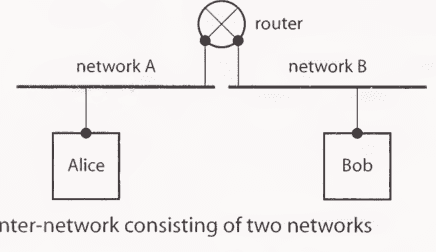


### 直接发送还是通过路由器？

当 Alice 向 Bob 发送数据时，她如何做出是否可以自行完成（即在本地以太网上向 Bob 发送）还是必须依赖路由器服务的根本决定？Alice 的 TCP/IP 执行以下操作：


```
if (I, Alice, am directly connected to Bob)
    send the packet on the local wire (using ARP if necessary)
else
    pass the packet on to a router on the local wire, that
    knows how to forward the packet on towards its final
    destination
```

由此产生两个问题。首先，爱丽丝如何判断什么是直接连接的，什么不是？其次，如何告诉路由器转发数据包？

## 哪些机器直接连接到这台机器？

爱丽丝的网络掩码和IP地址的组合指定了爱丽丝直接连接的地址范围。我们在下一章会详细解释，但现在让我们只考虑一个简单示例。我的网络掩码是 255.255.255.0：这指定了一组前三个字节相同的IP地址。如果我的IP地址是 192.0.2.7，范围是

```
192.0.2.0 . . . 192.0.2.255
```

这是一个包含 256 个地址的范围。（请注意，正是网络掩码和IP地址的组合精确地决定了范围。单独使用网络掩码只能说明范围的大小，而不能说明其中实际包含的IP地址。）

因此，我们可以将上述在爱丽丝机器上做出的路由决策重写为：

```
calculate my range from my IP address and my netmask
if (Bob's IP address is in my range)
    send the packet on the local wire (using ARP if necessary)
else
    pass the packet on to a router ...
```

重要的是要记住，网络掩码不包含在数据包中。爱丽丝的机器使用其机器上的网络掩码，鲍勃使用其机器上的网络掩码。如果爱丽丝和鲍勃的机器在同一网络上，它们通常应该具有相同的网络掩码；如果不同，这几乎肯定会造成问题。

## 通过路由器转发数据包

如果目标机器未直接连接，则数据包必须通过路由器发送。网络掩码并不能告诉爱丽丝使用哪个路由器；为此需要其他机制（第 5 章），它可以简单到手动配置的表格。然而，大多数局域网机器可以用一个“默认网关”路由器应付；我们将在第 3.3 节中介绍这一点，并定义路由器真正是什么。

但首先，在下一节中我们将解释一旦确定我们要发送到的机器未直接连接时，如何使用路由器转发数据包。

### 3.2 告诉路由器转发数据包

如果爱丽丝未直接连接到鲍勃，她必须将数据包传递给路由器并要求其向鲍勃转发数据包（图 3.3）。（我们说“向鲍勃”是因为爱丽丝不知道鲍勃在哪里，除了他位于路由器的另一侧。她不知道路由器是否直接连接到鲍勃，还是必须将数据包传递给另一个路由器，等等。）

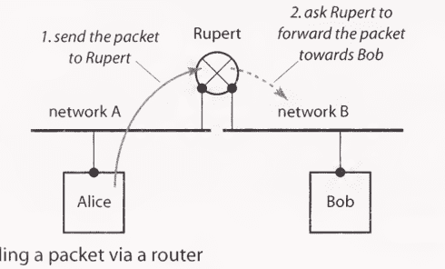

通过路由器转发数据包非常简单。路由器鲁珀特直接连接到爱丽丝，因此她可以通过指定他的以太网地址作为目标来向他发送以太网数据包，正如我们在第 2.3 节中解释的那样。

然而在 IP 层，数据包的最终目标是鲍勃，而不是鲁珀特。因此，爱丽丝将 IP 目标地址（与以太网目标相对）设置为鲍勃的 IP。结果是一个寻址方式如图所示 3.4 的数据包。

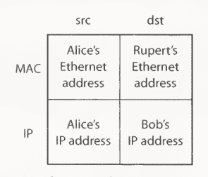

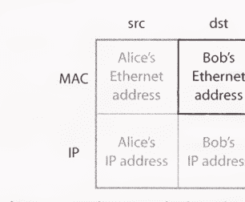

有几个要点值得强调：

- * 源地址：以太网和 IP 都与爱丽丝有关，如前所述（第 2.3 节）
- * 目标地址：以太网是鲁珀特的，但 IP 地址是鲍勃的。数据包中的以太网目标仅处理此跳，而 IP 目标是数据包的最终目的地
- * 当路由器收到一个 IP 地址不是其自身的 IP 地址的数据包时，这就是隐式请求将数据包向数据包的目标转发。这就是 IP 路由的工作方式：没有神奇的“这是特殊路由请求”机制或协议
- 一台机器只能将数据包转发给直接连接到它的路由器，因为向路由器发送和向直接连接的主机发送使用完全相同的机制——通过以太网传输。因此：
  - 如果爱丽丝的网络上没有路由器（或她不知道它们），她就无法向其网络外的任何机器发送数据
  - 在图 3.5 中，爱丽丝（A）无法将数据包转发给路由器 Y，因为它未直接连接。A 只能转发给路由器 X，后者根据其配置可能会（或可能不会）决定通过路由器 Y 转发
  - 路由器也只能将数据包传递给直接连接到它的网络上的主机或路由器；因此，要使路由器有用，它必须连接到多个网络（这并不奇怪，因为这几乎就是路由器的定义）
- 数据包在网络中通过跳数传输：
  - 每个跳都在以太网（或其他网络硬件）段上
  - 每个跳是源主机到路由器，或路由器到路由器，或路由器到目标主机。正因为 TCP/IP 通信是逐跳的，我们才能使用 **tcpdump** 如此轻松地诊断它。我们可以逐一检查每个跳，直到找到导致问题的那个。

让我们将上面显示的数据包与如果鲍勃直接连接到爱丽丝时将使用的数据包（图 3.5）进行比较。唯一的区别是目标以太网地址（我们已用黑色字体突出显示）。每种情况下的有效载荷（我们未显示）都是 IP 数据。

我们花了大约两年才意识到 IP 路由就是这样工作的，而且它真的很简单。如果你理解上面的两个数据包图，你就学到了很多。在图 3.6 中，你可以看到数据包中的以太网地址如何从一个跳到下一个跳发生变化。在路由器到路由器的跳（如 X 到 Y）中，以太网地址都不是爱丽丝的或鲍勃的。相比之下，IP 源目标地址在整个过程中保持不变。（x' 和 x" 分别表示机器 X 的左右网卡。）

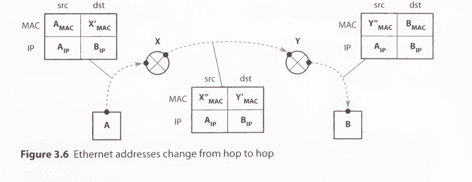

## 3.3 第三个关键网络参数：默认网关路由器

路由器是具有两个或多个网络接口的通用计算机或专用设备，用于将数据包从一个网络转发到另一个网络。路由器始终具有多个接口或网卡，因为它的功能是在两个或多个网络之间交换数据包。对于连接到互联网的典型小型局域网，路由器接口之一是以太网，另一个是租用线路或 ISDN 或 ADSL 互联网连接所使用的网络硬件（图 3.7）。

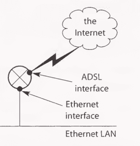

图 3.7 路由器的 ADSL 接口连接到互联网，以太网连接到局域网

路由器不必是像 Cisco 或 Lucent 之类的专用设备——任何进行路由的设备都是路由器。我们将使用 NT 或 Linux 机器作为路由器，以便我们能清楚地看到发生了什么。

上一节解释了爱丽丝如何使用路由器向鲍勃转发数据包，但没有解释爱丽丝如何获知其网络上的路由器，以及她如何选择使用哪一个。通常情况下这样做可能非常复杂（参见第 5 章），但有一个更简单的机制——“默认网关”路由器——对于大多数局域网机器来说已经足够。这就是本章剩余部分将要介绍的内容。

机器的默认网关是当该机器不知道如何发送数据包时用于转发数据包的路由器。如果爱丽丝想向鲍勃发送数据，机器上的 TCP/IP 执行以下操作：

```
if (Bob is directly connected to me)
    send the packet on the local wire (using ARP if necessary)
else /* assuming this is a typical LAN machine with only a
        default gateway route */
    use my default gateway to forward the packet on
        towards its final destination
```

这就是局域网 PC 配置的典型方式：它只知道自己的局域网和默认网关。（当发送数据包到远程目标时，局域网 PC 说“我不知道如何自己发送数据包，但我认识一个会的人，所以我会把它交给它”。）

如果机器没有默认网关，机器只能向直接连接到局域网上的机器发送数据。对于任何其他地址，它无法处理数据包并给出错误，例如 "network is unreachable"（Linux）或 "destination host unreachable"（NT）。


从网络管理员的角度来看，默认网关路由器的最大好处是它使大多数局域网机器的 TCP/IP 配置非常简单——它们不必了解内部网络或互联网的详细布局。所有复杂性都可以隔离在主要互联网路由器中，而局域网机器将其用作默认网关。因此，所有机器（在简单的局域网中，或在更复杂的局域网中同一以太网段上的所有机器）都使用相同的默认网关，而且如果您使用 DHCP（第 16 章），甚至可以让机器通过从中央服务器检索默认网关设置来自动配置自己。

图 3.8 显示了一个小型或中型组织的典型网络：

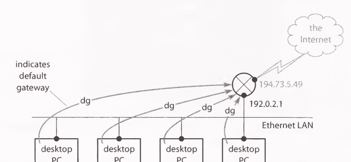

**图 3.8** 小型/中型组织的典型网络配置

- 只有一个以太网段，且没有内部路由器
- 只有一个路由器作为通往互联网的网关
- 路由器由 ISP 拥有和管理；您无需配置它
- 您的 ISP 为您分配了一段可在局域网上使用的 IP 地址。ISP 使用分配范围内的地址配置路由器的近端地址。为此它通常使用该范围内最低或最高的非特殊 IP 地址，例如 256 地址范围内的 *a.b.c.1* 或 *a.b.c.254*
- 您在局域网机器上使用的子网掩码是 ISP 分配给您的子网掩码。

配置此网络的局域网机器非常简单。对于每台机器：

- 1. 将其 IP 地址设置为分配范围内未使用的 IP 地址
- 2. 将子网掩码配置为您 ISP 提供的子网掩码
- 3. 将默认网关设置为互联网路由器的近端地址。

对于每台机器，您正在配置三个基本网络参数——IP地址、子网掩码和默认网关。就这些，您要做的就是这些。（这里我们只关注路由方面；在第 23 章中，我们将详细介绍如何设置这种类型的网络，包括您*需要*但在图 3.8 中未显示的安全功能。）因此，您现在了解了基本的局域网到互联网连接所涉及的内容——确实是进步！

## 3.4 设置默认网关 – Windows-NT

- 1. 选择 **控制面板 > 网络 > 协议 > TCP/IP > 属性**，以打开 **TCP/IP 属性** 窗口
- 2. 在对话框中输入默认网关的 IP 地址（图 3.9）
- 3. 单击 **应用** 或 **确定**。**应用** 按钮在您按下后变灰（或如果没有需要应用的更改）。

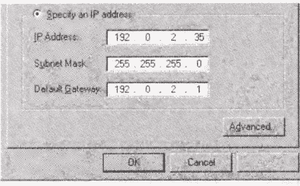

**图 3.9** 指定 192.0.2.1 作为您的默认网关

设置立即生效且永久有效——重启后仍然保留。您可以通过两种方式检查当前设置：

- 1. 使用 **ipconfig/all**，如我们在模块 2.10 中提到的（图 3.10）

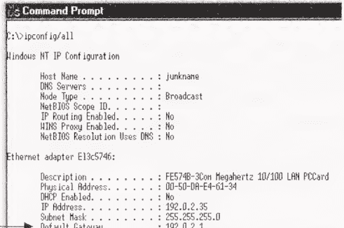

**图 3.10** 使用 **ipconfig/all** 验证您的默认网关设置

- 2. 在命令提示符下，运行命令

```console
route print
```

这会提供大量信息（图 3.11）。目前，您只关心 **网络目标** 设置为 0.0.0.0 的那一行——这表示您的默认网关。在该行中，**网关** 字段应为您在 **控制面板 > 网络** 中设置的值

我们同时展示了 **route** 命令和 **ipconfig**，因为在下一个模块中我们将使用 route 在 Linux 上设置和显示默认网关，能够在两个系统上使用相同的命令是很方便的。（我们在第 5 章中会更详细地介绍 **route**。）

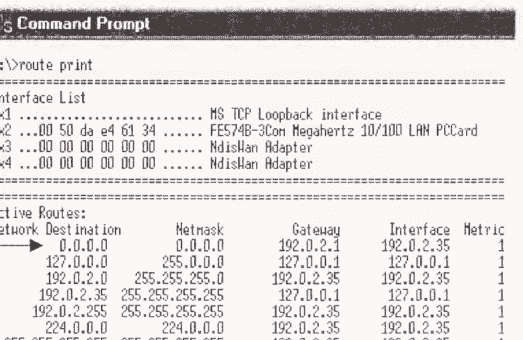

**图 3.11** 使用 route print 验证您的默认网关设置

ipconfig 和 控制面板 > 网络 的输出让人觉得默认网关是特定于接口的。事实并非如此——它适用于整台机器。它真正属于路由参数，而不是接口参数，而 **route** 列表使这一点更加明显。（我们在模块 5.9 中再次提到这一点。）

### 常见错误

您的默认网关不属于已配置的接口之一（来自 TCP/IP 属性 > 高级 > 添加… 窗口）

您指定的默认网关 IP 地址不在与此机器直接连接的地址范围内，该范围由此机器的 IP 地址和子网掩码指定。例如，如果这是 192.0.2.35 子网掩码 255.255.255.0，则网关地址必须在范围内

192.0.2.1–192.0.2.254

（排除了 .0 和 .255，因为它们是特殊的。）

然而，虽然此消息和解释列在 NT 4.0 资源工具包文档中，但我们从未见过它被显示，事实上 控制面板 > 网络 插件允许您在没有投诉的情况下*输入*默认网关地址的不可能值，尽管它并未*设置它*——如果您随后运行 ipconfig/all 或 控制面板 > 网络，您会看到没有设置默认网关：默认网关显示为空白（并且 route print 没有目标为 0.0.0.0 的条目）。

> **提示：** 每当您更改 TCP/IP 参数时，请运行 **ipconfig/all** 以再次确认所做的更改确实是您打算进行的。

## 3.5 设置默认网关 – Linux

Windows 将设置默认网关视为一种特殊情况，并通过您在上一模块中看到的 **控制面板 > 网络** 插件提供了一种简单的方法来执行此操作。您没有看到（我们将在第 5 章中详细介绍）的是，在 Windows 上您使用 **route** 程序来设置其他非默认路由。（一个*路由* 是告诉 TCP/IP 特定范围的 IP 地址可通过特定路由器到达的条目。）Linux 使用 **route** 程序来显示和设置默认网关以及任何其他路由。

要显示 **当前默认网关设置**：  
输入命令

```
route -n
```

> **警告：** 如果您省略 “-n” 选项，route 将尝试使用 DNS（我们尚未配置，且直到第 7 章才介绍）将列表中的数字地址转换为主机名。

如果从未为此机器定义过默认网关（而人们通常在安装 Linux 时会指定一个），您将得到一个包含标题行和一行数据行的列表：

```
alice% route -n
Kernel IP routing table
Destination     Gateway         Genmask         Flags Metric Ref    Use Iface
192.0.2.0       0.0.0.0         255.255.255.0   U     0      0      0 eth0
```

如果已设置默认网关，它将显示为目标 0.0.0.0，就像在 Windows 上一样：

```
alice% route -n
Kernel IP routing table
Destination     Gateway         Genmask         Flags Metric Ref    Use Iface
192.0.2.0       0.0.0.0         255.255.255.0   U     0      0      0 eth0
0.0.0.0         192.0.2.1       0.0.0.0         UG    0      0      0 eth0
```

**route** 命令直接查询操作系统的内部路由表，因此它打印的内容就是当前正在使用的内容。（值未存储在文件中，也未像 Windows 那样存储在注册表中，因此显示的设置与当前使用设置之间不可能出现差异。）

要显示 **route** 命令的帮助：

| **完整帮助信息** | route -? 
route -h 
route --help |
|---|---|
| **仅 IP 相关命令的帮助** | route -h -A inet 
route -h --inet |

要设置默认网关：  
使用 **route add** 命令。例如，要将默认网关设置为 192.0.2.1，请输入：

```
route add default gw 192.0.2.1
```

与许多 UNIX 命令一样，这属于强沉默类型，除非您在输入时犯了错误，否则它不会打印任何内容，只会将您返回到命令提示符。如果您想检查它是否按预期执行（即使您有数年的经验，使用 **route** 命令时也始终是个好主意），请运行 `route -n` 以打印新设置。

此命令的各个部分是：

- add 我们正在添加一条新路由，而不是仅仅显示设置或删除现有路由
- default 我们正在定义默认网关。事实上 **default** 只是 `“-net 0.0.0.0”` 的简写，因此您也可以将命令输入为

```
route add -net 0.0.0.0 gw 192.0.2.1
```

（我们将在第 5 章中解释 `“-net”`。现在不用担心。）

- gw 此关键字表示以下参数是路由器的 IP 地址。**route** 命令使用此类关键字来引入值，因为如果您打印帮助信息，您会看到可以为路由设置许多不同的值。请注意，命令中一起出现的词 `“default gw,”` 并不是短语‘default gateway’，即使看起来是这样。在第 5 章中您会看到类似

```
route add -net 10.5.0.0 netmask 255.255.0.0 gw 192.168.13.28
```

的命令，这一点会更清楚。

### 常见错误

### 网络不可达

您指定的默认网关路由器不在此机器的 IP 地址和子网掩码指定的 IP 地址范围内。例如，如果您的 IP 地址是 192.0.2.34 子网掩码为 255.255.255.0 并且您输入命令

```
route add default gw 1.2.3.4
```

您将收到“network is unreachable”错误。

### SIOCGADDR：设备不支持操作

如果您在 IP 地址前省略 **gw** 关键字，如下所示，您会收到此错误

```
route add default 192.0.2.29
```

如果您习惯于其他 UNIX 系统，其中 **route** 命令的语法略有不同，那么很容易犯此错误。

### 使设置永久生效

就像我们在模块 2.11 中介绍的 *ifconfig* 设置一样，您使用 **route add** 定义的 Linux 默认网关设置在系统重启时会丢失，因此您必须将它们存储在配置文件中。参见附录 6。


## 3.6 实验 – 构建最简单的可能的互联网络（1）

我们可以构建的最简单的仍包含路由器的网络由两个独立的以太网网络组成，由单个路由器连接它们。我们使用运行 Linux 或 Windows-NT 的 PC 作为路由器。有三个步骤：

- 1. 布线网络
- 2. 配置 Rupert 作为路由器
- 3. 按图 3.12 所示设置网络参数。

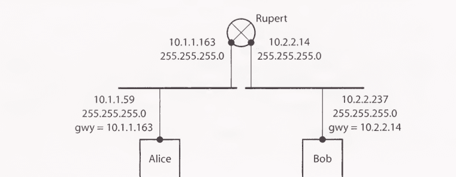

图 3.12 简单互联网络的网络参数

### 1. 布线测试网络

最佳布线方式是使用两个集线器，一个用于左侧网络，包含 Alice 和路由器的其中一侧，另一个用于右侧网络，包含 Bob 和路由器的另一侧。这样可以轻松地根据需要将嗅探机从一侧移动到另一侧。（如果您有合适的设备，可以在嗅探机中使用两块网卡，一块连接到左侧网络，另一块连接到右侧网络；然后您可以在同一台机器上运行两个独立的 **tcpdump** 副本，同时监控两个网络。）

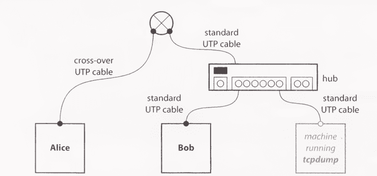

图 3.13 使用一个集线器和交叉电缆的布线

另外，如果您只有一个集线器，可以按图 3.13 所示布线，并使用交叉 UTP 电缆（附录 7）将一台机器直接连接到路由器，而不是使用集线器。使用交叉电缆的缺点是很难接入嗅探机——它只能连接恰好两台设备，不再多。

### 2. 配置机器作为路由器

配置 Windows-NT 作为路由器

- 1. 在 **控制面板 > 网络 > 协议 > TCP/IP > 属性** 中，选择 **路由** 选项卡，显示图 3.14 所示的窗口。
- 2. 勾选 **启用 IP 转发** 复选框，然后单击 **确定** 或 **应用**
- 3. 就这些，除重启使此设置生效外。

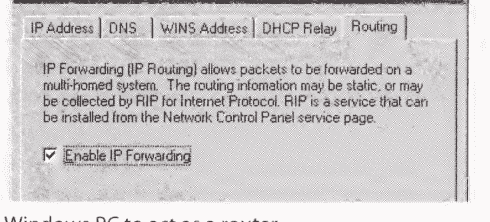

**注意：** Windows-9x 机器可以有多块网卡，但 Windows-9x 不支持路由——因为它是一个桌面操作系统，而不是服务器。您可以在 Windows-9x TCP/IP 属性窗口中看到没有 **路由** 选项卡。

**注意：** 当 NT 机器中有多块网卡时，任何 TCP/IP 参数更改——即使在第一个接口上——都必须重启后才能生效。

**配置 Linux 作为路由器**

是否转发数据包是操作系统内核 TCP/IP 部分的一个参数。Linux 提供了查看和设置这些内部系统变量的简便方法：您通过 /proc 伪文件系统中的特定“文件”访问它们。要启用 IP 转发并将此机器配置为路由器，请输入命令：

```
echo 1 > /proc/sys/net/ipv4/ip_forward
```

如果出于任何原因想要禁用它（并且良好的安全实践是不在需要时启用它），请输入命令：

```
echo 0 > /proc/sys/net/ipv4/ip_forward
```

要查看当前状态，请输入

```
cat /proc/sys/net/ipv4/ip_forward
```

它在启用时打印 1，禁用时打印 0。

要使设置永久生效，请参阅附录 6。

## 3.7 实验 – 构建最简单的可能的互联网络（2）

### 3. 设置网络参数

- 1. 配置 Alice 和 Bob 很简单——我们已经解释了如何设置 IP 地址和子网掩码，以及默认网关。Alice 的默认网关是 10.1.1.163——Rupert 的左侧——因此 Alice 想发送到其网络外部的任何数据包，例如发往 Bob，都会传递给 10.1.1.163 进行转发。同样，Bob 的默认网关是 10.2.2.14
- 2. Rupert 有两块网卡。这是新功能：我们将在下面解释如何配置它们
- 3. Rupert 没有设置默认网关，也不需要，因为他直接连接到我们这个微小互联网络中的所有网络，因此可以向他需要的任何机器发送数据包。

### 配置多块网卡

**Linux：** “`ifconfig -a`” 将显示您是否具有多个接口，以及它们的名称。要为特定接口设置参数，请在命令中使用该接口的名称（您已经这样做过，尽管您一直使用 *eth0*）。例如，要为 Rupert 设置参数：

```
ifconfig eth0 10.1.1.163  netmask 255.255.255.0 up
ifconfig eth1 10.2.2.14   netmask 255.255.255.0 up
```

我们在命令中使用关键字 “**up**”，以确保接口处于活动状态，而不仅仅是存在。要使参数永久生效，您必须将它们存储在适当的配置文件中：请参阅附录 6。

**Windows：** 配置多块网卡甚至更简单——在 *控制面板 > 网络 > 协议 > TCP/IP 属性* 窗口中，从下拉选择列表中选择要设置的接口（图 3.15）。

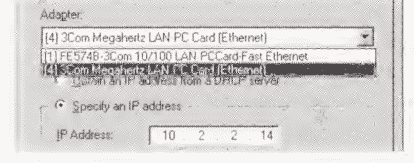

**图 3.15 选择接口**

当在 NT 上使用多块网卡时，必须重启才能使更改生效。像往常一样，使用 **ifconfig** 在更改并重启后检查生效的设置。

> 提示：在现实生活中，在可能的情况下，我们会保持路由器上所有 IP 地址的最后一位字节相同，只是为了便于记忆。例如，我们通常会给 Rupert 分配地址 10.1.1.163 和 10.2.2.163。但是，这里我们没有这样做，以强调接口完全无关，可以具有完全不同的 IP 号码。

在模块 6.3 中，我们将看到如何在单块网卡上配置多个 IP 地址，这出人意料地经常需要。

### 测试您的网络

验证一切是否正常工作的最快测试是从其他机器 ping 每台机器。像往常一样，使用机器的 IP 号码——暂时不要指望名称能工作。使用下表记录结果：

|  | 到 Alice | 到 Bob | 到 Rupert |
|---|---|---|---|
| 来自 Alice |  |  |  |
| 来自 Bob |  |  |  |
| 来自 Rupert |  |  |  |

如果出现问题：

- * 如果您看到 Alice 为 Bob 发送 ARP（或反之），她认为他是本地连接的，但事实并非如此，因此您配置有误，要么是 Alice 的 IP 地址，要么是她的子网掩码
- * 如果 Alice 与 Rupert 通信失败，或反之，您在该跳的配置中存在基本问题。请使用模块 2.13 中的故障排除列表。如果问题出在 Bob 的网络上，同样适用
- * 完成本章剩余的模块，它们可能有助于您隔离原因
- * 如果不行，模块 5.14 和 5.15 中有完整的故障排除指南，但它依赖于我们尚未涵盖的材料。如果可能，请在您涵盖主题并有时间诊断问题的真正原因之前，保持网络处于不工作状态。这很有启发性，可以弄清楚为什么您最初难以诊断问题。（我们经常发现，这是因为我们对系统某些部分的工作方式存在相当大的误解。）

现在您的网络正在工作，值得进一步探索网络。回去取消配置 Rupert，使其不再作为路由器工作，如果是 NT 机器则重启。然后重复上述所有 ping 测试，记录哪些失败，并记录任何错误消息。

除了 Alice 到 Bob 和 Bob 到 Alice 之外，其他一切都应该正常工作，这正是您所期望的。但 Alice/Bob 的 ping 将失败，因为这种通信依赖于中间的路由器。尽管 Rupert 有两个接口，但他没有被明确告知应在其接口之间转发数据包。例如，从 Bob 到 Alice 的 ping 中，Rupert 接收到的数据包的目的 IP = Alice；Rupert 看到这不是发给他的，所以他丢弃它。然而，一旦 Rupert 被重新配置为路由器，他就会识别出该数据包需要转发，并且由于他知道 Alice 网络的位置（10.1.1.*,），他会将其转发给 Alice。


## 3.8 实验 – 使用 tcpdump 跨路由器追踪数据包

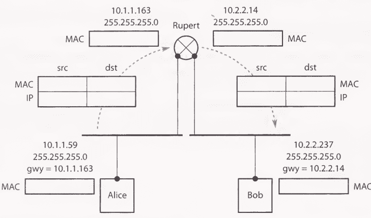

图 3.16 跨路由器追踪数据包

现在 Rupert 已被配置为充当路由器，你应该能够从 Alice **ping** 到 Bob，反之亦然：

- 1. 将你的嗅探器连接到左侧网络
- 2. 运行 `tcpdump -n -t -e`（“-e” 用于同时显示以太网地址和 IP 地址）
- 3. 在三台机器上分别使用 `ifconfig` 或 `ipconfig` 显示每个接口的以太网地址。将其记录在图 3.16 上
- 4. 在 Alice 上，清除她可能在 ARP 缓存中为 Rupert 保存的任何条目，以便你从一开始就能看到发生的一切：

```
arp -d 10.1.1.163
```

在 Alice 上

并且也清除 Rupert 和 Bob 上的 ARP 缓存：

```
arp -d 10.1.1.59
```

在 Rupert 上

```
arp -d 10.2.2.237
```

在 Rupert 上

```
arp -d 10.2.2.14
```

在 Bob 上

- 5. 我们将从 Alice **ping** Bob。在继续之前，请在图 3.16 的空白框中填入你预期会出现在从 Alice 发送到 Bob 的 **ping** 请求数据包中的值。该数据包经过两个跳，第一跳从 Alice 到 Rupert，第二跳从 Rupert 到 Bob，每跳使用不同的地址集
- 6. 从 Alice ping 到 10.2.2.237（Bob）：
- — 这会生成初始的 ARP “who has 10.1.1.163”，因为 Alice 知道她只能通过 Rupert 的地址到达 10.2.2.237
- — 检查 ARP 请求和回复的详细信息，并验证 ARP 回复中返回的 MAC 地址是否符合预期
- 7. 在三台机器上分别运行 `arp -a -n`（Linux）或 `arp -a`（Windows），查看每台机器是如何获知邻居的 MAC 地址的
- 8. 检查 ICMP 请求和回复数据包中的 MAC 地址。查看 IP 地址和 MAC 地址如何与不同机器相关联，如我们在模块 3.2 中解释的那样。
- 9. 将你的嗅探器移动到右侧网络（这就是使用两个集线器使事情变得简单的地方）。重复步骤 2–7。或者，如果你的嗅探器盒有两个网卡，你可以同时追踪两个网络。图 3.17 显示了这一点，使用两个 **windump** 实例来说明如何为要收集跟踪的指定特定接口。像这样的配置在处理内部路由器或防火墙时非常理想，这些设备在两侧都有以太网接口。（你不能在主 Internet 路由器上使用它，因为“外部”接口通常不是以太网。）


图 3.17 同时追踪两个网络

- 10. 现在，从三台机器（Alice、Bob 和 Rupert）中的每一台 **ping** 一个不存在且超出其 IP 地址/子网掩码组合指定范围的地址，例如 `…ping 10.7.7.7…`。在每种情况下 **tcpdump** 显示什么？你有足够的信息来理解发生了什么，但在任何情况下我们都在模块 3.11 中详细解释了它。

> **警告：** 当使用如图 3.17 所示具有多个接口的嗅探器时，请确保 IP 转发已禁用。否则它可能会充当路由器。虽然不太可能有其他机器知道它的存在，但它们理论上可以用它作为路由器，这会让你非常困惑，如果你在实时网络上使用它，可能会造成安全漏洞，例如绕过保护内部网络免受 Internet（第 24 章）侵害的防火墙。

### 3.9 traceroute 程序

一旦你的网络正常工作，你就可以使用 **traceroute**，它是另一个有价值的诊断工具。它追踪数据包在这台机器与指定目标之间实际 *经过* 的路由（与你认为数据包 *经过* 的路由相反）。**traceroute** 通过发送一系列数据包并分析返回的内容来实现这一点。

要理解 **traceroute** 的工作原理，我们必须介绍 IP 数据包的 *生存时间*（*TTL*）概念。当一台机器发送 IP 数据包时，它会逐跳从路由器到路由器地传输到其目的地。如果任何路由器行为异常或配置错误，数据包可能会进入 *路由环路*，在其中它会通过同一组路由器循环往复。如果 TCP/IP 没有处理此问题的机制，那么数据包将永远循环。随着更多流量的到来，网络最终将无所事事，只能传递孤独的数据包并变得无用。这就是 TTL 发挥作用的地方：

- • 当主机发送数据包时，它将数据包中的 TTL 设置为“较大”的值，通常取决于实现为 32、64 或 128
- • 每次数据包被路由器转发时，TTL 减 1
- • 当路由器接收到 TTL 为 1 的数据包时，它按常规递减 TTL，因此 TTL 现在为 0 —— 它已没有生存时间，所以路由器丢弃该数据包并向原始发送主机发送 ICMP “time exceeded” 消息数据包
- • 当主机（不是路由器）接收到 TTL 为 1 的数据包时，它会正常处理。主机永远不应该接收到 TTL=0 的数据包，因为前一个路由器应该已经丢弃它。

换句话说，TTL 是一个“最大跳数”，当超过该跳数时，数据包将被丢弃。即使 TTL 代表 *生存时间*，它实际上与正常时钟时间无关。


**图 3.18** 从 Carol 上的 **traceroute** 发送的数据包

**traceroute** 利用此特性来找出数据包所经过的路径，如下所示。为简单起见，我们假设我们在 Carol（图 3.18）上运行 **traceroute**，以找到到 Dave 的路由，Dave 在几跳之外，路径中间有路由器 Rupert、Robert 和 Richard。

- 1a. Carol 向目标（Dave 的 IP 地址）发送一个数据包，并将 TTL 设置为 1
- 1b. Rupert 接收到数据包，递减 TTL，现在为 0，因此他丢弃数据包并向 Carol 发送 ICMP "time exceeded"
- 1c. Carol 收到此 ICMP 消息，因此知道 Rupert 在一跳之外。**traceroute** 打印此信息，并显示自数据包发送以来以毫秒为单位的总时间。Carol 重复步骤 1a 和 1b 两次，以了解平均往返时间
- 2a. Carol 现在向 Dave 发送一个数据包，将 TTL 设置为 2
- 2b. Rupert 接收到数据包并递减 TTL，现在为 1，因此他将数据包转发到其目的地（Dave）
- 2c. Robert 接收到 TTL=1 的数据包，递减后得到 TTL=0，因此 Robert 这次丢弃数据包，并向 Carol 发送 ICMP "time exceeded"
- ...
- Carol 重复此过程，直到最终，一个 TTL 为 1 的数据包到达 Dave，Dave 发送回合适的消息，通常是他不知道如何处理该数据包，但肯定 *不是* "time exceeded" 消息
- 99. Carol 收到来自 Dave 的消息并知道数据包已到达最终目的地。Carol 重复最后一步两次，打印计时信息，然后终止。

**traceroute** 的许多巧妙之处之一是，要获取其信息，它不需要目标机器或任何中间路由器上的任何服务器应用程序。**traceroute** 的操作使用 TCP/IP 的非常基本的路由和 ICMP 功能。

### traceroute 数据包的细节

（下面的细节取决于我们在第 15 章才介绍的材料。你可以在首次阅读时跳过本节 —— **traceroute** 的细节在实践中很少重要；我们仅为完整性在此包含本节。）

- * **Windows**' **tracert** 发送 ICMP Echo Requests 数据包，就像 **ping** 一样，但 **TTL** 设置如上所述
- * Linux 和 UNIX 上的 **traceroute** 发送 UDP 数据包。正如我们稍后会看到的，发送 UDP 数据包是高效的且使用资源少。数据包发送到一个较高的端口号，通常为 33435。这最大限度地降低了最终目标机器上该端口有服务器监听的概率。这一次我们 *不* 希望服务器应用程序接收数据包；事实上，我们希望最终目标生成 ICMP 错误消息（"I don't know what to do with this packet"）以便识别我们已到达终点。端口号在每次探测时递增一。


## 3.10 使用 traceroute

**traceroute** 可用于 Linux 和 Windows。（与 **ifconfig**/**ipconfig** 一样，Windows 版本的名称只不同一点足以让人困惑：它叫做 **tracert**。）

这里是最常用的参数。第 5 章中有更详细的说明。

| Action | Linux | Windows-NT |
| :--- | :--- | :--- |
| **print help message** | `traceroute` | `tracert` |
| **show addresses as IP numbers** | `traceroute -n host` | `tracert -d host` |
| **show addresses as names** | `traceroute host` | `tracert host` |
| **trace all hops in parallel** | `traceroute -n -P host` | |
| **move to next hop as soon as one reply is received** | `traceroute -n -U host` | |

- 在 Windows 上，选项“-d”表示“不要解析”，这与“以数字形式打印地址”相同
- 在 Linux 上，“-U”和“-P”选项可以显著加快跟踪速度，尽管输出不会那么整洁。

> **警告：** 如果忘记“-n”或“-d”，**traceroute** 在打印之前会暂停很长时间，因为它试图将 IP 数字转换为名称，而在我们配置 DNS（第 7 章）之前它无法做到这一点。

```
alice% traceroute -n -v 65.208.228.222
traceroute to 65.208.228.222 (65.208.228.222), 30 hops max, 40 byte packets
 1 192.0.2.29                  47 ms      *       1 ms
 2 192.0.2.1                   3 ms      3 ms    3 ms
 3 194.73.5.1                  23 ms     24 ms   22 ms
 4 194.74.16.225               28 ms     26 ms   28 ms
 5 194.72.9.153                37 ms     30 ms   30 ms
 6 195.99.120.201              26 ms     33 ms   37 ms
 7 194.74.16.67                25 ms     33 ms   30 ms
 8 194.74.16.254              115 ms    107 ms  126 ms
 9 157.130.4.9                105 ms    110 ms  109 ms
10 152.63.20.6                118 ms    122 ms  106 ms
11 152.63.27.149              113 ms    112 ms  131 ms
12 152.63.19.29               112 ms    119 ms  115 ms
13 152.63.0.137               114 ms    115 ms  114 ms
14 152.63.146.62              137 ms    141 ms  139 ms
15 152.63.88.242              167 ms    143 ms  142 ms
16 152.63.90.97               147 ms    147 ms  165 ms
17 157.130.173.246            779 ms    848 ms  747 ms
18 65.208.228.222              162 ms    162 ms  207 ms
alice%
```

**图 3.19** 典型的 Linux **traceroute** 输出

图 3.19 显示了一个典型的 Linux **traceroute** 输出（为清晰起见已编辑），图 3.20 显示了来自 NT 机器的相同跟踪。请注意所走的路由并不完全相同：第 7–8 行和第 10–16 行不同。这种情况经常发生。有关解释请参阅模块 5.13（或者你能猜出为什么会这样吗？）。

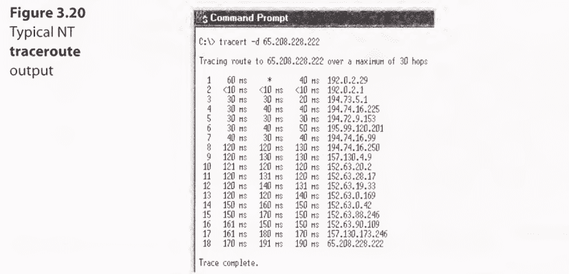

### 使用 traceroute 测试您的小型互联网络

在您刚刚构建的测试网络上的每台机器上，运行以下命令以跟踪从该机器到所有其他机器的路由：

| Linux | Windows-NT |
| :--- | :--- |
| `traceroute -n 10.1.1.59` | `tracert -d 10.1.1.59` |
| `traceroute -n 10.1.1.163` | `tracert -d 10.1.1.163` |
| `traceroute -n 10.2.2.14` | `tracert -d 10.2.2.14` |
| `traceroute -n 10.2.2.237` | `tracert -d 10.2.2.237` |

图 3.21 显示了从 Alice 到她自己、到 Rupert 左侧接口、到他的右侧接口，最后到 Bob 的跟踪输出。

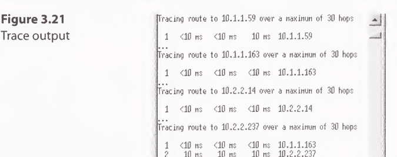

## 3.11 来自局域网 PC 的错误报告

图 3.22 显示了一台典型的局域网 PC，其配置为知道默认网关而不知道其他路由器。

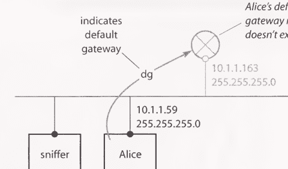

**图 3.22 典型的局域网 PC 配置为使用单个路由器**

就其 IP 层而言，局域网上的主机可以成功地向任何目的地发送数据包，因为默认网关是一个总揽一切的网关，用于转发所有非本地目的地的包。主机永远不会对自己说“我不知道如何路由到该目的地”，因为对于每个可能的目的地它都有一个合适的路由——默认网关。让我们看看这在几种不同的情况下会产生什么影响。

### 路由正常，但默认网关无法联系到目标主机

这可能是因为默认网关已关闭，或者默认网关不存在（例如地址指定不正确）或目标主机已关闭。在这种情况下，IP 层不会生成错误消息。您可以自己探索：

1. 设置一台 PC（Alice），通过集线器或交叉 UTP 电缆连接到运行 **tcpdump** 的嗅探机（图 3.22）。与往常一样，嗅探机的 IP 设置无关紧要
2. 配置 Alice，例如 IP 地址 = 10.1.1.59，子网掩码 = 255.255.255.0，默认网关 10.1.1.163，必要时重新启动。我们现在有一台理论上可以到达任何地方但实际上无法超出自身（因为其默认网关机器不存在）的机器
3. **ping 1.2.3.4**
4. 如果您的机器运行的是 Linux，ping 将永远 ARP 请求 10.1.1.163，并且不会报告任何错误
5. 如果您的机器运行的是 NT，它会报告“request timed out”，但除此之外不会告诉您出了什么问题

但请注意，我们上面说的是“就其 IP 层而言”。更高层的协议——例如 TCP、UDP 或应用层协议如 HTTP，我们在本书第 2 部分讨论了所有这些——可能会注意到存在问题并报告错误。在上面的示例中，是 Windows *ping* 应用程序注意到它没有收到任何响应并报告了它

6. 从命令行运行 `“telnet 1.2.3.4”`

7. 在长时间等待后（Linux 上为 800 秒），Linux 显示“telnet: Unable to connect to remote host: No route to host.”（这是一个误导性的消息，因为它与路由本身无关：它只是意味着无法联系到目标。）NT 显示“Connect failed”。

因此，虽然 IP 层没有报告任何错误，但应用层报告了。您机器上的低级路由组件根本没有注意到任何问题。（人类的等价物是令人恼火的“超出我工作范围”的信使男孩：“我被告知应该把所有写给 Bloggs Corp. 的信件投入那个信箱。这不是我的错，有人放火烧了信箱，当我把信件投入时火焰正从里面冒出来。”）

### 默认网关没有到目的地的有效路由

1. 将同一台机器连接到路由器
2. 配置路由器的 IP 地址 =10.1.1.163，子网掩码 =255.255.255.0，无默认网关
3. `ping 1.2.3.4`
4. Linux **ping** 报告“Network is unreachable.” Windows **ping** 报告“Destination host unreachable”
5. `telnet 1.2.3.4`

默认网关无法发送，因为它不知道任何合适的路由，因此它立即使用 ICMP 报告这一点，我们可以用 **tcpdump** 看到

```
10.1.1.163 > 10.1.1.59: icmp: host 1.2.3.4 unreachable
```

并且应用程序 *立即* 给出以下错误并终止：

```
telnet 1.2.3.4 Unable to connect to remote host: No route to host
```

当路由器报告“ICMP 主机不可达”错误时，这就是最终结果：它现在无法到达，并且在当前配置下将来也永远无法到达；因此没有等待的必要，可以立即终止连接。另一方面，当路由表指示有到目的地的路由但数据包只是没有通过时，这可能是由临时网络问题或互联网缓慢引起的，因此应用程序会在超时并报错之前等待相当长的一段时间。

> **练习：** telnet 到一个本应位于直接连接局域网上的不存在的主机，并查看报告错误需要多长时间，例如
> ```
> telnet 10.1.1.123
> ```
> 发生了什么
> ```
> ping 10.1.1.123
> ```
> 如果您 traceroute 到一个不存在的主机，**tcpdump** 会显示什么？

## 摘要

- 当 TCP/IP 需要向另一台机器发送数据包时，它使用其子网掩码决定是否可以直接将数据包发送到本地线路上的目的地：
  - 如果可以，它直接发送数据包，必要时使用 ARP
  - 否则它将数据包发送到也本地连接的“路由器”，以便转发到其最终目的地

- 为了让路由器将数据包转发到其目的地，发送方将目标以太网地址设置为路由器的以太网地址，但将目标 IP 地址设置为最终目的地的 IP 地址。只要路由器配置正确以充当路由器，它就会将数据包转发到其最终目的地

- 为了简化局域网机器的配置，TCP/IP 支持默认网关路由器。如果目标 IP 地址不在直接连接的局域网上，该机器会将数据包发送到默认路由器以便转发。（这假设在此机器上没有显式配置其他更具体的到该目的地的路由。我们在第 5 章中介绍此类特定路由）

- 我们现在介绍了网络的三个基本参数：（1）IP 地址，（2）子网掩码，（3）默认网关。您遇到的几乎所有网络问题都将是由于配置这些参数时出错

- **traceroute** 程序是一个有用的诊断工具，可让您跟踪从您的机器到任何目标 IP 地址的路由。

## 下一步？

我们已经在概念上介绍了路由是什么。在继续更高级的路由——配置多个接口，以及指定除默认网关之外或代替默认网关的路由——之前，我们必须更详细地介绍子网掩码，因为它们与路由和路由器配置密切相关。下一章深入讨论子网掩码和 IP 地址，第 5 章随后介绍高级路由。

## 注释和进一步阅读

我们在这里只介绍了基本的故障排除。我们将在第 5 章中更详细地介绍，当我们拥有深入探索路由所需的工具时。现在，这里有几篇关于 NT 路由问题的有用文章：

- [ ] MS-KB-Q151795 *错误消息：路由添加失败：87*

正如文章有帮助地说，“此消息提醒您存在寻址问题”（好像您不知道一样）。另一篇更通用的文章是：

- [ ] MS-KB-Q102908 *如何使用 Windows NT 排查 TCP/IP 连接性*


And always remember, if your machine ARPs for an address, it thinks it's a local connection. That's crucial and a great debugging tool: if your machine ARPs for an address that you know is remote, you have a problem in one of your three fundamental parameters.

Many operating systems, including Win-NT and Linux (but not Win-9x), let you define multiple *interfaces* on a single NIC. Each interface then has its own IP address and netmask, and a machine configured like this can act as a router between different logical networks running on the same Ethernet segment (“on a single wire”). We'll make use of this when building a test network in Module 6.3 where we explain it, but we mention it here because while we often use “interface” and “NIC” synonymously, we really shouldn't.

For a tool to check whether two addresses are on the same network see:

- [http://www.uit.co.uk/resources](http://www.uit.co.uk/resources)

The Linux **ping --help** message says you can set the TTL on the packet using the “`-t`” flag, but on some versions this has no effect, as you can see using **tcpdump -n -t -t** (option `-v` : verbose, to show the TTL details).

The ARP cache is likely to contain out-of-date MAC addresses if you change the IP address of a machine, or if you leave the IP address unchanged but replace the network card. In normal running of a network this is rarely an issue, but if you're building a test network in a hurry or have to change IP addresses, e.g. when you first connect a LAN to the Internet, it can cause confusion. The best way to avoid these problems is to explicitly delete ARP entries in cases like this.

Custom-built router boxes often have a “management address” or a “stack address” which is separate from the IP addresses of the interfaces used for routing. The management address is typically used to access the box when you are configuring it manually, or automatically using SNMP (Module 17.10), or when this box is communicating with others, using dynamic or automatic routing protocols (Module 5.11).

**traceroute**

For more about **traceroute**, see Stevens, Chapter 7.

Folks at Bell Labs used a modified version of **traceroute** to map various aspects of the Internet, and color posters of some of the beautiful maps produced are available for purchase. For details of the project see:

- [http://www.cs.bell-labs.com/who/ches/map/](http://www.cs.bell-labs.com/who/ches/map/)

# 附录

- 附录 6：使网络设置永久化 – Debian Linux
- 附录 7：UTP 布线

## 4 详细讲解 IP 地址和网络掩码

- 4.1 TCP/IP 如何识别网络
- 4.2 历史上的 IP 地址类别
- 4.3 从地址类别到网络掩码
- 4.4 网络掩码如何指定 IP 地址范围
- 4.5 指定不同大小的网络范围
- 4.6 网络掩码表
- 4.7 网络掩码使用示例
- 4.8 网络掩码计算
- 4.9 特殊 IP 号码（1）– 私有地址
- 4.10 特殊 IP 号码（2）– IP 广播地址
- 4.11 特殊 IP 号码（3）– 多播、网络和环回地址
- 摘要

### 引言

到目前为止，我们已经介绍了数据包如何从你的机器移动到另一台机器，无论是同一根线上的机器还是中间有路由器的相邻线上的机器。下一步是了解数据包如何在整个互联网上“找到路径”。然而，在此之前我们需要详细解释 IP 地址和网络掩码——因为 TCP/IP 的路由在做出路由决策时无处不在地使用它们。

在本章中，你将看到网络掩码与 IP 地址结合指定了一组 IP 地址范围，并且你将看到 TCP/IP 如何使用这些范围。这是为第 5 章中对路由的详细探讨做准备，在那里我们考虑具有多个段和多个路由器的复杂网络。由于大部分网络掩码内容是解释性的而非实用的，我们在网站上提供了一些工具的链接。你现在就可以使用它们来探索网络掩码和 IP 地址，后续在设计网络或检查当前路由配置时进行网络掩码计算时也会用到。如果初读本章觉得困难，请不要担心：网络掩码是 TCP/IP 中最难理解的部分。它们所做的只是指定 IP 地址范围，但方式并不明显。

### 4.1 TCP/IP 如何识别网络

互联网是一个互联网络——一组通过路由器相互连接的独立网络（图 4.1）。TCP/IP 必须在这组网络之间路由数据包，从源机器到目标机器。

路由器连接到多个网络。它转发从其一个网络到达的数据包，将其传递给其另一个网络上的路由器或最终目标主机。当路由器收到发往目标 **dest** 的数据包时，路由器中的 TCP/IP 代码会进行如下决策过程：

```
if (dest is in the IP address range for my interface-1)
  send the packet to dest directly on interface-1,
  using ARP if necessary
else if (dest is in the IP address range for my interface-2)
  send the packet to dest directly on interface-2,
  using ARP if necessary
...
/* reach here only if not local to any of my interfaces */
else if (dest is in the IP address range for remote network-A)
  forward the packet towards dest via router-1
else if (dest is in the IP address range for remote network-B)
  forward the packet towards dest via router-2
...
else
  forward the packet towards dest via my default gateway router
```

在此过程的每一步中，TCP/IP 都会将一个 IP 地址（dest）与某个网络的地址范围进行比较。我们已经提到 TCP/IP 使用网络掩码和 IP 地址的组合来指定地址范围，这正是路由决策所使用的。本章其余部分将详细解释这些范围规范的工作原理，以及 TCP/IP 如何判断一个地址是否在范围内。

### 为什么使用网络掩码而不是 ...？

TCP/IP 本可以使用某种显式的范围规范，例如

network-A = 192.0.2.0 up to and including 192.0.2.255

或列表，例如

network-A = 192.0.2.0, 192.0.2.1, ... 192.0.2.255

像这样的规范要么占用大量内存，要么处理起来需要大量计算，或两者兼有。在互联网早期，内存和硬件缓慢且昂贵，因此决策机制必须非常高效，特别是因为 TCP/IP 对 *每个发送的数据包* 都重复整个路由决策过程。即使现在硬件快速且便宜，对高速网络的需求意味着路由决策仍然必须非常高效，因为在繁忙的网络上每秒有成千上万甚至数百万个数据包需要转发。因此需要另一种范围指定机制。

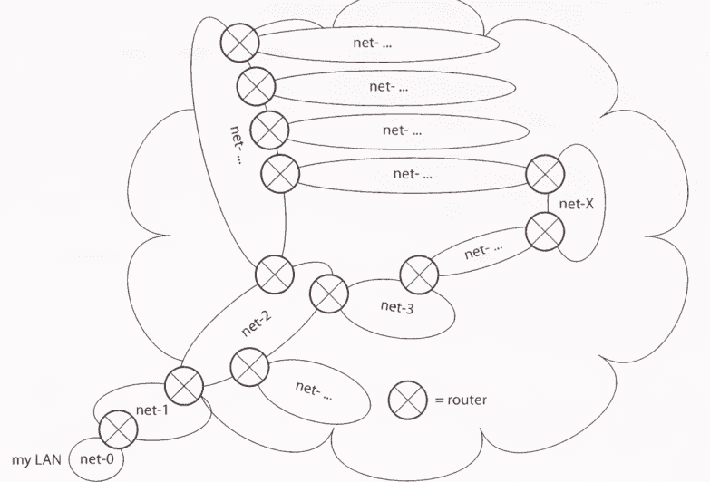

### 图 4.1 互联网络——多个网络通过路由器连接

除了速度快之外，该机制还必须能够处理我们想要工作的网络规模，从庞大（10 万台以上机器）到微小（几台机器）甚至单台机器）。并且它必须对任何规模的网络都能高效工作。正如我们将看到的，网络掩码非常好地满足了这些要求。

（使用网络掩码的第三个原因——与路由和互联网早期使用的“地址类别”机制兼容，在网络掩码发明之前。正如我们在 4.3 模块中将看到的，网络掩码可以非常容易地复制地址类别机制。这使得旧技术和新技术可以在同一网络中共存，同时设备和软件逐步升级。）

地址范围在许多不同的上下文中使用，而不仅仅是路由。例如，它们在防火墙和其他安全配置中使用，用于在定义允许或禁止的操作时指定源和目标机器的集合。正是因为它们的使用方式不同，我们在本书中称之为“netmasks”而不是“sub-net masks”。出于同样的原因，本章我们经常提到“networks or ranges of IP addresses”。这强调了在许多上下文中，我们所指的未必是“我的局域网”或“以太网段”意义上的单一物理网络。相反，它只是一组以某种特定方式处理的地址。我们通常对该“网络”的内部结构一无所知。事实上，单个范围有时会包含属于不同组织的许多不同的物理网络，尤其是在 ISP 或互联网骨干路由器上的路由表中。

（其他人经常在文档和设备配置程序中使用“network”一词来表示真实网络或地址范围：你只能从上下文中判断其意图。）

总之，网络掩码是一种通用但高效的方式来指定大小不一的 IP 地址范围。


## 4.2 历史的 IP 地址类别

TCP/IP 路由将任何 IP 地址视为两部分 – *网络部分* 和 *主机部分*：

- 地址的网络部分标识机器所连接的网络
- 地址的其余部分 – 主机部分 – 标识该网络上的特定机器。

您机器上的路由使用网络部分来判断目标机器是否与您自己的机器在同一网络上。如果目标地址的网络部分与您自己地址的网络部分相同，则两台机器是本地连接的；否则不是。

历史上，TCP/IP 使用 *地址类别* 来决定如何提取主机和网络部分。地址分为五类，A、B、C、D 和 E。

- D 用于多播（参见模块 4.11）
- E 保留且尚未使用
- A、B 和 C，这三类是我们这里关注的，用于正常地址。

IP 地址所属的类别由其前几位比特决定，如图 4.2 所示。仅通过查看这些比特，TCP/IP 即可立即从地址判断出其所属的类别，因此基于类别的路由决策可以在路由代码中快速处理。

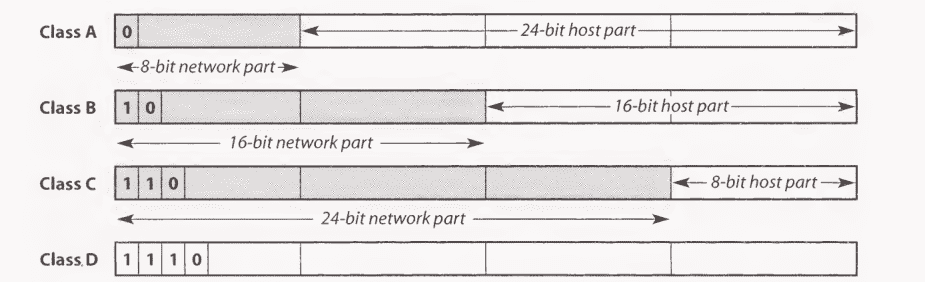

**图 4.2** IP 地址类别

由于在每个类别中用于网络/主机部分的字节数或比特数是固定的，因此可以自动得出每种类型的网络数量以及它们的大小（表 4.1）。

**表 4.1** 网络类型和大小

|   | 地址范围 | 网络部分 | 网络数量 | 主机部分 | 每个网络的主机数 |
|---|---|---|---|---|---|
| A | 0.0.0.0–127.255.255.255 | 1 + 7 位 | 128 | 24 位 | 16,777,216 |
| B | 128.0.0.0–191.255.255.255 | 2 + 14 位 | 16,384 | 16 位 | 65,536 |
| C | 192.0.0.0–223.255.255.255 | 3 + 21 位 | 2,097,152 | 8 位 | 256 |

即使类 A 地址具有 8 位网络部分，其中一位始终为 0。因此网络部分中只有 7 个可变位，这就是为什么只有 128 个类 A 网络，而不是您可能从 8 位网络部分预期得到的 256 个。类似地，类 B 和类 C 地址分别有 2 位和 3 位用于标识类别类型。

表 4.1 显示只有少数类 A 网络，但每个网络可以容纳大量机器。在另一端，类 C 网络很多，但每个网络上的机器相对较少。

单个 IP 地址可以标识一个 IP 地址范围或网络，因为该地址唯一确定了类别，而类别又决定了地址范围。例如，192.0.2.29 是一个类 C 地址，因此它是一个包含 256 个地址的范围：

192.0.2.0–192.0.2.255

（按惯例，范围中的最低地址用作网络地址 – 本例中为 192.0.2.0。）现在很容易指定要在上述描述的路由决策代码中使用的网络地址，例如

```
if (dest is part of class-C network 192.0.2.0)
    send the packet to dest directly on interface-1,
    using ARP if necessary
...
else if (dest is part of class-C network 192.168.168.0)
...
```

实际上，每个网络的主机数小于表中所示，因为某些地址被保留。例如，在类 C 范围内，地址 192.0.2.0 和 192.0.2.255 被保留用于广播地址（参见模块 4.10），因此只有 (256 − 2) = 254 个 IP 地址可用于作为真实主机地址。

这些类别反映了将全球 IP 网络视为大量由不同组织拥有并以这种方式连接的单个网络的观点。该系统在互联网早期阶段运行良好，当时只有相对少量的研究和学术机构使用它。然而，随着互联网的扩展，将网络粗略划分为巨大、中等和小型网络被证明过于僵化，因此引入了一种新的机制以提供更多灵活性，如下一模块所述。

## 4.3 从地址类别到子网掩码

将网络粗略划分为巨大、中等和小型类别导致了两个问题：

- 1. 一个拥有大量机器的组织可能需要将其内部网络划分为更小的子网络，原因有几个：
  - 单个以太网段无法容纳数十万台机器
  - 组织可能分布在多个城市或国家
  - 某些部门可能需要特殊的安全性

该组织将使用自己的内部路由器来细分其网络。这些子网络如何在路由表中指定？地址类别机制对此无济于事。该组织已被分配例如一个类 B 范围，因此所有内部 IP 地址都属于一个单一范围。它们确实需要细分一个单一的类 B 范围

- 2. 随着互联网的扩展，对 IP 地址的需求很大，而类 A、B 和 C 不够分配。我们希望能够分配与组织需求紧密匹配的地址块，例如“一个类 B 的十六分之一”，或“两个类 C”，或任何其他。

第一个问题（首先出现）通过引入子网的概念得到解决。您将单个大型网络划分为子网。您使用子网掩码结合 IP 地址来指定每个子网。例如，如果您的主公司网络是 10.0.0.0（类 A，提供 10.0.0.0–10.255.255.255 的范围），您可能会将其细分为如下：

|  | 网络地址 | 子网掩码 | 结果地址范围 |
| :-- | :-- | :-- | :-- |
| P | 10.1.1.0 | 255.255.255.0 | 10.1.1.0–10.1.1.255 |
| Q | 10.1.2.0 | 255.255.255.0 | 10.1.2.0–10.1.2.255 |
| R | 10.201.0.0 | 255.255.0.0 | 10.201.0.0–10.201.255.255 |
| S | 10.202.77.0 | 255.255.255.0 | 10.202.77.0–10.202.77.255 |
| T | 10.202.0.0 | 255.255.0.0 | 10.202.0.0–10.202.255.255 |

这给出了图 4.3 所示的网络布局。（灰色所示区域包括所有未包含在任何特定子网中的 10.x.x.x IP 地址。正如我们在模块 6.8–6.12 中将看到的，当您对网络进行子网划分时，您通常会得到总范围中未使用且不包含任何机器的部分 – 如图 4.3 中的灰色区域。）

第二个问题 – 如何将“类全”范围划分为更小的块 – 更为近期，但技术解决方案相同。路由不再仅使用 IP 地址（通过使用地址类别从地址派生网络标识符），而是使用 IP 地址和子网掩码进行路由。因此，与其将互联网固定划分为类 A、B 和 C 网络（巨大、中等、小型），我们可以将地址空间划分为适当大小的块。例如，您可以为一个大型但不需要完整类 B 提供的 65,536 个 IP 地址的组织分配一个类 B 的十六分之一。这称为无类别域间路由（CIDR）。现在几乎是通用的 – 它用于互联网骨干网，以及所有 Windows 和 Linux 系统。旧的基于类别的系统仅在某些历史协议中继续存在，本书中我们完全使用 CIDR。


**图 4.3 网络布局**

方便的是（而且并非巧合 – 这种兼容性是系统设计的一部分）您可以通过将每个类别视为指定默认子网掩码来完全复制旧的类 A、B、C 行为：

| 类别 | 默认子网掩码 |
| :--- | :---: |
| A | 255.0.0.0 |
| B | 255.255.0.0 |
| C | 255.255.255.0 |

在许多上下文中，Windows-NT 和 Linux 在您输入地址且未指定显式子网掩码时将假定这些默认子网掩码。只需将类别视为一种方便的记法，而无更多含义。

## 4.4 子网掩码如何指定 IP 地址范围

子网掩码结合 IP 地址通过有选择地提取 IP 地址中对应于地址网络部分的比特来指定特定大小的 IP 地址范围。

“掩码”会暴露事物的有趣部分，同时遮盖您不感兴趣的部分。例如，半导体掩模会隐藏硅片上不需曝光于光的部分；装饰时，遮蔽胶带会遮住您想要保护的木工，留下您想要涂漆的部分暴露； Lone Ranger 的面具遮住他大部分面部，只露出眼睛。

子网掩码是一种掩码。实际上它是一个位掩码，其中掩码中的 1 位表示我们感兴趣的部分，0 位表示我们忽略的部分。（位掩码在编程中很常见。参见网络附录 2。）子网掩码中的 1 位表示构成 IP 地址网络部分的部分，0 位表示主机部分。（或者，子网掩码隐藏 IP 地址的主机部分，只留下地址的网络部分可见。）这使您可以按如下方式指定地址范围：

> > 给定一个 IP 地址和一个特定子网掩码，计算网络部分。所有具有相同网络部分（使用该子网掩码计算）的 IP 地址构成一个集合或地址范围。

现在让我们看一些示例来解释您在实践中如何使用子网掩码。到目前为止，我们只使用了两个子网掩码，255.255.255.0 和 255.255.0.0，它们实际上是类 C 和类 B 地址的默认子网掩码，所以我们从这些开始。

### 1. 使用掩码 255.255.255.0


零字节隐藏了不感兴趣的部分，而三个 255 字节则暴露了我们想要的部分（因为包含 255 的字节所有八位都设为 1，且没有设为 0）。实际上，掩码 255.255.255.0 意味着“忽略 IP 地址的最后一个字节；网络部分仅由前三个字节组成”。例如：

```
address = 212.140.133.181
netmask = 255.255.255.0
```

给我们一个网络部分 212.140.133.0（我们只需在屏蔽掉的部分填入零）。范围包括所有具有此网络部分的 IP 地址，即所有 IP


前三个字节为 212.140.133 的地址。这是一个范围：
212.140.133.0–212.140.133.255 包含 256 个地址，一个字节（8 位）可以取 0 到 255 的值。

## 2. 使用掩码 255.255.0.0


让我们计算由以下指定的范围
address = 192.168.14.181
netmask = 255.255.0.0
再次，零字节隐藏了不感兴趣的部分，给出网络部分为 192.168.0.0。范围包括所有具有此网络部分的 IP 地址，即 65,536 个地址的范围
192.168.0.0–192.168.255.255 包含。

使用相同子网掩码但不同地址重复计算：
address = 192.168.233.91
我们得到与之前相同的网络部分 – 192.168.0.0（因为最后两个字节被屏蔽掉了）。因此该地址与 192.168.14.181 在同一范围内：


A、B 和 C 类的默认子网掩码很容易使用，因为你可以通过分别查看前一个、两个或三个字节，非常简单地算出指定的范围。对于以下模块中涵盖的其他子网掩码，我们将不得不使用简单的二进制算术来计算范围。

## 4.5 指定不同大小的网络范围

到目前为止我们使用的子网掩码给出了特定大小的网络（或地址范围）：

| 子网掩码 | 范围内的 IP 地址数量 |
| :--- | :--- |
| 255.255.255.0 | 256 |
| 255.255.0.0 | 65,536 |
| 255.0.0.0 | 16,777,216 |

上面的子网掩码是互联网非常小的时候发明的 A、B 和 C 地址类的默认值。如今，互联网的使用如此广泛，以至于 IP 地址空间非常稀缺。每个人甚至不能拥有一个完整的 C 类，组织不得不使用更小的网络，通常是部分 C 类，范围内只有 4、8 或 16 个地址。我们的范围指定机制必须能够处理这些非常小的范围。如果我们想指定其中一个较小的网络，或具有 1,800 或 10,000 台机器的中等大小网络，我们如何使用子网掩码来做到这一点？

解决方案不是为主机部分使用一个完整的字节（掩码 255.255.255.0）或两个完整的字节（掩码 255.255.0.0），而是使用类似 3/4 字节或 1 7/8 字节。从早期模块中的示例中，你会看到范围内地址的数量由地址主机部分中的位数决定。由此可知，网络大小始终是 2 的幂：1 位主机部分给出两个地址（2¹），2 位给出 2²=4 个地址，3 位给出 2³=8 个地址，以此类推。例如，子网掩码 255.255.0.0 具有两个字节（16 位）的主机部分，这给出范围大小为 2¹⁶= 65,536 个地址。为了容纳我们想要的范围大小，我们计算主机部分需要的位数，这反过来自动确定子网掩码。例如：

我们想要一个有 25 台机器的网络 – 包含 25 个地址的范围。4 位主机部分给出 16 个地址（不够）而 5 位主机部分给出 2⁵=32 个地址，这可以接受。这意味着网络部分有 (32 – 5) = 27 位。因此子网掩码由左侧的 27 个 1 位组成，后跟右侧的 5 个 0 位（图 4.4(a)）。将其转换为十进制（使用封底内的十进制/二进制转换表）得到图 4.4(b) 所示的子网掩码。


你使用这个掩码的方式与我们看到的其他掩码一样，只是现在你必须屏蔽单个位而不是整个字节。这需要一点二进制算术，而不是简单地用零替换一个字节，但这不是什么大问题。

让我们看一个例子，使用这个新的子网掩码和我们之前使用的相同 IP 地址 212.140.133.181。只考虑最后一个字节（因为其他字节都是 255，所以它们的工作方式与之前完全相同）掩码得到我们 $10100000 \text{ binary} = 160 \text{ decimal}$ 如下面所示。因此完整的网络部分是 212.140.133.160。我们选择主机部分有 5 位 $= 32$ 个地址，所以我们的范围是
212.140.133.160–212.140.133.191
这就是我们想要的 – 一个能够容纳至少 25 台机器的范围。


最后，让我们再次以不同的方式查看整个计算：

|                     |               |               |               |               |               |              |
| :-------------------- | :--------------- | :-------------- | :-------------- | :-------------- | :-------------- | :------------- |
| **IP地址**  | **212** | | **140** | | **133** | | **181** |
| **子网掩码**       | **255** | | **255** | | **255** | | **224** |

|                     | 1 1 0 1 | 0 1 0 0 | 1 0 0 0 | 1 1 0 0 | 1 0 0 0 | 0 1 0 1 | 1 0 1 | 1 0 1 0 1 |
| :-------------------- | :--------------- | :-------------- | :-------------- | :-------------- | :-------------- | :-------------- | :------------- | :------------- |
| **IP地址**<br>**二进制**  | | | | | | | | |
| **子网掩码**<br>**二进制**       | **1 1 1 1** | **1 1 1 1** | **1 1 1 1** | **1 1 1 1** | **1 1 1 1** | **1 1 1 1** | **1 1 1** | **0 0 0 0 0** |
|                     | 复制    | 复制      | 复制      | 复制      | 复制      | 复制      | 复制    | 屏蔽      |

|                     | 1 1 0 1 | 0 1 0 0 | 1 0 0 0 | 1 1 0 0 | 1 0 0 0 | 0 1 0 1 | 1 0 1 | 0 0 0 0 0 |
| :-------------------- | :--------------- | :-------------- | :-------------- | :-------------- | :-------------- | :-------------- | :------------- | :------------- |
| **网络部分**<br>**二进制**  | | | | | | | | |
| **网络部分**<br>**十进制**       | **212** | | **140** | | **133** | | **160** |

## 4.6 子网掩码表

| 十进制下的子网掩码 | 掩码中1位的数量 | 网络中的地址数 | 十六进制子网掩码 | 二进制子网掩码 |
|---|---|---|---|---|
| 255.255.255.255 | /32 | 1 | ff.ff.ff.ff | 11111111.11111111.11111111.11111111 |
| 255.255.255.254 | /31 | 2 | ff.ff.ff.fe | 11111111.11111111.11111111.11111110 |
| 255.255.255.252 | /30 | 4 | ff.ff.ff.fc | 11111111.11111111.11111111.11111100 |
| 255.255.255.248 | /29 | 8 | ff.ff.ff.f8 | 11111111.11111111.11111111.11111000 |
| 255.255.255.240 | /28 | 16 | ff.ff.ff.f0 | 11111111.11111111.11111111.11110000 |
| 255.255.255.224 | /27 | 32 | ff.ff.ff.e0 | 11111111.11111111.11111111.11100000 |
| 255.255.255.192 | /26 | 64 | ff.ff.ff.c0 | 11111111.11111111.11111111.11000000 |
| 255.255.255.128 | /25 | 128 | ff.ff.ff.80 | 11111111.11111111.11111111.10000000 |
| 255.255.255.0 | /24 | 256 | ff.ff.ff.0 | 11111111.11111111.11111111.00000000 |
| 255.255.254.0 | /23 | 512 | ff.ff.fe.0 | 11111111.11111111.11111110.00000000 |
| 255.255.252.0 | /22 | 1024 | ff.ff.fc.0 | 11111111.11111111.11111100.00000000 |
| 255.255.248.0 | /21 | 2048 | ff.ff.f8.0 | 11111111.11111111.11111000.00000000 |
| 255.255.240.0 | /20 | 4096 | ff.ff.f0.0 | 11111111.11111111.11110000.00000000 |
| 255.255.224.0 | /19 | 8192 | ff.ff.e0.0 | 11111111.11111111.11100000.00000000 |
| 255.255.192.0 | /18 | 16384 | ff.ff.c0.0 | 11111111.11111111.11000000.00000000 |
| 255.255.128.0 | /17 | 32768 | ff.ff.80.0 | 11111111.11111111.10000000.00000000 |
| 255.255.0.0 | /16 | 65536 | ff.ff.0.0 | 11111111.11111111.00000000.00000000 |
| 255.254.0.0 | /15 | 131072 | ff.fe.0.0 | 11111111.11111110.00000000.00000000 |
| 255.252.0.0 | /14 | 262144 | ff.fc.0.0 | 11111111.11111100.00000000.00000000 |
| 255.248.0.0 | /13 | 524288 | ff.f8.0.0 | 11111111.11111000.00000000.00000000 |
| 255.240.0.0 | /12 | 1048576 | ff.f0.0.0 | 11111111.11110000.00000000.00000000 |
| 255.224.0.0 | /11 | 2097152 | ff.e0.0.0 | 11111111.11100000.00000000.00000000 |
| 255.192.0.0 | /10 | 4194304 | ff.c0.0.0 | 11111111.11000000.00000000.00000000 |
| 255.128.0.0 | /9 | 8388608 | ff.80.0.0 | 11111111.10000000.00000000.00000000 |
| 255.0.0.0 | /8 | 16777216 | ff.0.0.0 | 11111111.00000000.00000000.00000000 |
| 254.0.0.0 | /7 | 33554432 | fe.0.0.0 | 11111110.00000000.00000000.00000000 |
| 252.0.0.0 | /6 | 67108864 | fc.0.0.0 | 11111100.00000000.00000000.00000000 |
| 248.0.0.0 | /5 | 134217728 | f8.0.0.0 | 11111000.00000000.00000000.00000000 |
| 240.0.0.0 | /4 | 268435456 | f0.0.0.0 | 11110000.00000000.00000000.00000000 |
| 224.0.0.0 | /3 | 536870912 | e0.0.0.0 | 11100000.00000000.00000000.00000000 |
| 192.0.0.0 | /2 | 1073741824 | c0.0.0.0 | 11000000.00000000.00000000.00000000 |
| 128.0.0.0 | /1 | 2147483648 | 80.0.0.0 | 10000000.00000000.00000000.00000000 |
| 0.0.0.0 | /0 | 4294967296 | 0.0.0.0 | 00000000.00000000.00000000.00000000 |

## 注释

- 1. 你不必记住这些子网掩码 – 只要在需要时查阅即可！
- 2. 表中 **粗体** 的行是 A、B 和 C 类网络的默认子网掩码（模块 4.3）
- 3. 这些是 *所有可能的* 子网掩码（33 个），也是地址范围的唯一可能大小。所有的 1 位都在左侧，所有的 0 位都在右侧。如果 1 位之间有任何零位，那不是一个有效子网掩码
- 4. 范围通常写成 IP 地址后跟一个“/”和子网掩码中 1 位的数量，即网络部分中的位数。例如：

192.0.2.181 / 24

这是“使用 24 位网络掩码”的简写，即与表中所示“/24”相对应的网络掩码；因此上面的规范表示“IP地址 = 192.0.2.181，网络掩码 = 255.255.255.0”

这通常被称为网络掩码或 IP 地址范围的“CIDR 表示法”

- 5. “/32” 指定单个 IP 地址。例如，192.0.2.7 / 32 表示这台单台机器——长度为 1 的范围。你在为局域网上的机器配置 IP 地址和子网掩码时永远不会使用它，但在路由表等中会看到它
- 6. “/0” 或掩码 0.0.0.0 指定整个互联网——所有可能的 IP 地址——因为它与任何 IP 地址组合时都会给出相同的网络部分 0.0.0.0。再一次，你将在实践中在路由表中看到它，在 Linux 和 NT 上，在下一章中。（在某些上下文中，“0.0.0.0”可能会写成单词 default，以强调它表示“每个地址”）
- 7. 掩码中的 0 位对应于地址的主机部分，这决定了网络大小。你可以从表中直观地看出，随着表格向下，网络大小会变大
- 8. 必须非常注意，网络掩码本身并不能指定网络。网络掩码决定了范围的大小，而 IP 地址则确定其位置——说明该范围在整个 IP 地址宇宙中的位置。只有网络掩码和特定 IP 地址的组合才能唯一指定范围。下表显示了四个不同的范围，它们都具有相同的网络掩码（255.255.255.192）：

| 地址范围 | 最后一个字节的范围 |
| :--- | :---: |
| 192.0.2.0–192.0.2.63 | 0–63 |
| 192.0.2.64–192.0.2.127 | 64–127 |
| 192.0.2.128–192.0.2.191 | 128–191 |
| 192.0.2.192–192.0.2.255 | 192–255 |

随着你对网络掩码的使用经验增加，你会习惯常见范围的起始和结束数字。

> 提示：要计算范围中的地址数量，用 256 减去网络掩码的最后一个字节。例如，对于网络掩码 255.255.255.224：（256 − 224）= 32 地址网络/范围大小。（这仅在前三个字节均为 255 时有效。对于其他网络掩码，请在表中查找大小。）

## 4.7 网络掩码的使用示例

网络掩码最常见的用途是告诉机器它连接到了哪个网络。具有多个接口的机器有多个网络掩码，每个接口一个，以指定每个接口连接到的网络。

### 局域网上的 PC

我们已经提到过的网络掩码的经典用法是你的 PC 只有一个 NIC 和一个 IP 地址，并且它知道一个路由器——其默认网关。图 4.5 显示了它对互联网的视图。


**图 4.5** 来自典型 PC 的互联网视图

在你的 PC 上，IP地址和网络掩码的组合实际上表示“这个 IP 地址范围可以通过此接口直接到达”。这有三个后果：

- 1. 如果一台机器在该范围内但无法被 ARP，则它不存在（或损坏，或其他原因无法到达）。我们不会在别处尝试
- 2. 如果它不在该范围内，我们就无法直接到达它，因此必须将其发送到我们的默认网关进行转发。如果默认网关不知道将其转发到哪里，我们就无法到达目的地
- 3. 如果我们甚至没有默认网关，我们能够通信的唯一地址就是指定范围内本地连接的那些地址。这就是独立局域网的情况。

### 具有多个 NIC 的 PC 或路由器

在之前的章节中我们通常谈论机器的 *该* 网络掩码，但那是一种过度简化。机器可以有多个 NIC（并且路由器要发挥作用 *必须* 有多个）。这样的机器有多个网络掩码。每个 NIC 都有自己的 IP 地址，通常位于不同的网络中，以便机器可以从一个网络路由到另一个网络，如图 4.6 所示。每个 NIC 也有自己的网络掩码，以指定可以直接通过 *此* NIC 访问的机器范围。在图 4.6 中，我的 PC 通过不同的 NIC 连接到三个不同的网络；它需要在其 TCP/IP 配置中有三个不同的范围规范，即三对不同的 IP 地址和网络掩码。


**图 4.6** 我的 PC 作为路由器，连接三个网络

你可以看到这如何与我们在模块 4.1 中概述的具有多个 NIC 的 PC 中的路由代码联系起来：

```
if (dest is in the IP address range for my interface-1)
    send the packet to dest directly on interface-1,
    using ARP if necessary
else if (dest is in the IP address range for my interface-2)
    send the packet to dest directly on interface-2,
    using ARP if necessary
...
/* reach here only if not local to any of my interfaces */
else if (dest is in the IP address range for remote network-A)
    forward the packet towards dest via router R-1
else if (dest is in the IP address range for remote network-B)
    forward the packet towards dest via router R-2
...
else
        forward the packet towards dest via my default gateway
        router
```

每个“*if ( ... )*”决策都涉及将 IP 地址 **dest** 与此 NIC 自己的 IP 地址和网络掩码指定的范围进行比较。

## 4.8 网络掩码计算

在内部，TCP/IP 使用二进制 AND 来决定数据包应使用哪条路由，或决定地址属于哪个范围。

### 该地址是否在该网络上？

对于此计算，TCP/IP 使用二进制 AND（也称为 *按位 AND*，因为它在数字的各个位上工作）。要对两个数字进行按位 AND，将两个数字都写成二进制，一个在另一个之下。如果某个位在两个数字中都是 1，则答案为 1，否则为 0。这就是网络掩码屏蔽不需要的位的方式。你可以把它想象成“关闭”掩码中对应于 0 的所有位。）

你有一个由 IP 地址和网络掩码 I$_{1}$、M 指定的网络或范围。要判断第二个地址 I$_{2}$ 是否在同一网络上，TCP/IP 执行下面的计算：

```
if (I$_{1}$ AND M is equal to I$_{2}$ AND M)
I$_{1}$ and I$_{2}$ are on same network (or are in the same specified range)
else
they are not in the same range
```

一个更冗长但等效的计算强调了 IP 地址的网络部分的概念：

```
let network-part-1 = I$_{1}$ AND M
let network-part-2 = I$_{2}$ AND M
if (network-part-1 is equal to network-part-2)
I$_{1}$ and I$_{2}$ are on same network (in the same specified range)
else
they are not in the same range
```

这些计算非常快，因为 AND 操作已内置于硬件中。

### 计算地址和网络掩码指定的 IP 地址范围

- 1. 计算地址的网络部分，可以按照模块 4.4 和 4.5 中所示的图解方式，或使用上述按位 AND。在 resulting 网络部分中，所有主机部分位均为 0，给出范围的下界
- 2. 在网络部分，将所有主机位从 0 改为 1。这给出范围的上界。

示例：前两个示例等同于模块 4.4 和 4.5 中的示例。

- 1. 212.140.133.181/24（即网络掩码为 255.255.255.0）指定的范围是什么？
- a. 此网络掩码屏蔽了最后一个字节，因此网络部分为 212.140.133.0。这就是下界。
- b. 将主机部分（最后 8 位，即最后一个字节）中的所有位从 0 改为 1 得到 212.140.133.255。这就是上界。
- c. 范围为 212.140.133.0–212.140.133.255
- 2. 212.140.133.181/27（即网络掩码为 255.255.255.224）指定的范围是什么？
- a. 此网络掩码在右侧有五个 0 位，因此它只会影响地址的最后 5 位，这些位位于最后一个字节中。
- b. 最后一个字节是十进制 .181 = 二进制 10110101。屏蔽最后 5 位得到二进制 10110000，根据封底内侧的表为十进制 160。因此网络部分为 212.140.133.160。这就是下界。
- c. 将所有主机位（最后 5 位）从 0 改为 1 得到二进制 10111111，我们的表显示为十进制 191。因此上界为 212.140.133.191。
- c. 范围为 212.140.133.160–212.140.133.191
- 3. 212.140.133.181 /21（即网络掩码为 255.255.248.0）指定的范围是什么？
- a. 网络掩码有 11 个 0 位，因此它影响最后两个字节。网络掩码的最后一个字节为 0，因此网络部分的最后一个字节为 0。我们现在必须处理倒数第二个字节：十进制 133 = 二进制 10000101。三个额外的网络掩码位屏蔽了其中的最后 3 位，得到二进制 10000000 = 十进制 128。因此整个网络部分为 212.140.128.0。这就是下界。
- b. 将所有主机位（最后 11 位）从 0 改为 1 得到 212.140.135.255。这就是上界。
- c. 范围为 212.140.128.0–212.140.135.255，即 2048 个地址，或相当于八个 C 类范围。


执行这些计算的工具可在我们的网站上获得（见注释）。


## 4.9 特殊 IP 编号（1）– 私有地址

三组特殊的私有或不可路由地址范围已被分配用于未连接到互联网的网络，或至少不是直接可见的。还有用于文档和小规模自配置网络的特殊地址。

### 私有/不可路由 IP 编号

已分配三个 IP 地址范围用于在互联网上不可见的网络：

| 范围 | 描述 |
|---|---|
| 10.0.0.0–10.255.255.255 | 1 × 类 A 网络/范围 |
| 172.16.0.0–172.31.255.255 | 16 × 类 B 网络/范围 |
| 192.168.0.0–192.168.255.255 | 256 × 类 C 网络/范围 |

这些地址称为 *私有* 或 *不可路由* 地址。它们不会分配给某个站点或组织——任何人均可使用。然而，由于没有特定的站点可供其到达，因此数据包无法路由到这些目的地。那它们有什么用？我们为什么需要它们？

私有地址是为了节省 IP 地址空间而需要的。由于互联网增长迅速，IP 编号范围正在耗尽。如果某些号码可以反复重复使用，我们耗尽 IP 地址的时间就会推迟。

可以使用私有地址的示例有：

- 你的内部网络通过防火墙或其他执行“网络地址转换”或“NAT”（第 23 章）的设备连接到互联网。你在内部使用私有地址，但在数据包发送到互联网时，NAT 设备会将其转换，使其在外部世界看来似乎都来自你自己的单个公共（真实）地址——通常是防火墙外部的公共地址。这让你只需少量稀缺的公共 IP 地址即可运行非常大的内部网络（图 4.7）。
- 测试网络，其与互联网和你的真实内部局域网均隔离
- 私有网络，例如
  - 只是不需要互联网访问或必须保持非常安全的普通工作站和服务器网络（例如国防或金融机构）
  - 工厂或实验室中的仪器或机床网络
- 私有地址通常用作路由器、网络打印机等的初始出厂设置。

### 用于文档的 IP 编号

已分配一个特殊的 IP 编号范围用于文档、示例代码等，这些编号在现实生活中永远不应使用：

| 范围 | 描述 |
|---|---|
| 192.0.2.0–192.0.2.255 | 1 × 类 C 网络/范围 |


**图 4.7** 使用网络地址转换的私有 10.x.x.x 地址

其背后的想法是，10 到 15 年前，大多数 TCP/IP 网络未连接到互联网。人们在设置网络时经常使用制造商手册中示例中列出的地址。世界各地充斥着使用 Sun Microsystems 地址的私有网络。当这些站点最终连接到互联网时，它们不得不重新编号所有机器。

### 用于小型自配置网络的 IP 编号

DHCP（第 16 章）是一种动态主机配置系统，允许客户端机器在启动时从中央 DHCP 服务器获取所有 IP 配置设置。其主要优点是 IP 编号的集中管理，且客户端无需单独配置。

然而，如果客户端机器启动时找不到 DHCP 服务器，它会怎么做？它可能只是无法启动，但另一个选项是它使用一个特别分配的范围内的号码：

| 范围 | 描述 |
|---|---|
| 169.254.0.0–169.254.255.255 | 1 × 类 B 网络/范围 |

以便至少能在本地网络上启动并工作。这对于家庭机器或没有受过训练的网络管理员的小型组织尤其有用。某些版本的 Windows（包括 Win-9x）会使用此功能（见注释）。

我们在第 2.4 模块中看到，一台机器可以使用以太网广播地址向其以太网段上的每台其他机器发送消息。TCP/IP 也有广播地址，用于向本地网络上的所有 TCP/IP 机器发送消息。这在概念上类似于以太网广播，但它是分开的，因为 TCP/IP 可以运行在许多不同类型的网络硬件上，而不仅仅是以太网，并且必须具有独立于底层硬件的广播机制。

IP 广播通常用于“我想要服务 ABC；是否有谁能为我提供？”例如：

- 1. DHCP（第 16 章）由 PC 在启动时使用，以从中央服务器获取其 TCP/IP 设置
- 2. Microsoft Windows 网络（第 18 章），用于联系域控制器、WINS 服务器和其他服务。

有两个广播地址：

- 1. 有限广播地址 255.255.255.255。这在每个网络上都相同。它仅在本地线路上传输，绝不会被路由器转发。用于上述情况（1）
- 2. 网络广播地址（也称为网络定向广播地址）：它是通过取网络地址（即任一主机地址的网络部分）然后将所有主机位设为 1 形成的。换句话说，它是地址范围的上限。

此广播可以被路由器转发。例如，假设你的组织在内部使用 192.0.2.x 地址，则网络定向广播为 192.0.2.255。如果你的内部网络由该范围内的多个子网组成，例如 192.0.2.32/27、192.0.2.64/27、192.0.2.192/26 等，每个子网位于单独的段（线路）上，则网络定向广播应被转发到每个段，并且你在任何线路上的所有机器都会看到它。

根据你的网络掩码，Linux 可能无法正确设置网络广播地址。请参阅本章末尾注释中的警告。

广播之间有什么区别？在实践中我们从未担心过这种区别，因为在每种情况下数据包都会发送到本地线路上的所有机器，而这通常是你关心的全部。网络广播地址与有限广播地址之间的区别在于，有限广播永远不会超出本地线路，而另一个可能被路由器转发，如图 4.8 所示。然而，路由器转发广播并不一致；许多路由器不转发网络广播，因此在实践中两者之间根本没有区别。

加州大学伯克利分校的早期 UNIX 版本使用主机部分全为零而不是全为一的广播地址，例如 192.0.2.0。Linux 和许多伯克利派生的系统仍将其视为广播并作出响应。

网络广播地址有一个重要后果：在任何网络或子网中，范围内的最高地址会丢失给全 1 的广播地址，而最低地址会丢失给全 0 的（旧的、不正确的）广播。如果你网络范围中有 n 个地址，则只有 (n − 2) 个合法的主机地址。（因此，你不能拥有具有 /32 或 /31 网络掩码的真实网络：这些范围中只有一和两个地址，因此不包含任何合法的主机地址。）

**练习：** 首先阅读下面的警告！然后，在你的测试网络上，**ping** 你网络的广播地址。例如，在我们的网络上我们输入了

```
ping 192.0.2.255
```

你会为每个发送的数据包收到多个回复，因为本地线路上的 *每个主机* 都正确接收到 **ping** 请求并对其作出回复。现在 **ping** 有限广播地址和你网络的地址。例如，在我们的网络上我们输入了

```
ping 255.255.255.255
ping 192.0.2.0
```

在 NT 上运行它时，它会说这些目标无效；NT 不对广播地址的 **ping** 作出响应。在 Linux 上运行它时，你会得到与 192.0.2.255 相同的结果。第一个 Linux 结果是你所期望的——255.255.255.255 应该发送到每台本地机器；第二个是因为 Linux 对旧的、不正确的全 0 广播地址作出响应。

> **警告：** 如果你在真实的大型网络上 **ping** 广播地址，会产生大量数据包。如果某些机器配置错误，你可能会出现 *广播风暴*，网络被广播数据包淹没，一些数据包会产生进一步的广播，等等。（某些拒绝服务攻击依赖于这种行为。它们 **ping** 网络广播地址，但伪造 **ping** 数据包的源地址为它们攻击的目标地址。目标会被无用的数据包淹没。）


**图 4.8** 有限广播和网络定向广播地址


## 4.11 特殊 IP 编号（3）– 多播、网络和环回地址

还有几组特殊的 IP 编号。

### 多播地址 224.0.0.0 – 239.255.255.255

多播与广播类似，因为单个数据包会发送到多个目的地。与广播数据包不同，多播数据包仅交付给 *多播组* 的成员，以最大程度地减少发送主机（无需为每个目的地生成数据包）和未参与该组的其他机器的负载。受益于多播的应用是一对多或多对多，例如音频和视频“广播”或会议、股票和股份信息服务，以及共享白板等协作应用。尽管这些应用越来越流行，但多播应用尚未得到广泛部署，因此本书中不会再提及多播（注释除外）。多播使用 D 类地址，即范围为 224.0.0.0–239.255.255.255。

### 网络地址

网络本身的地址，与其任何主机相对，是其任何主机地址的网络部分。（根据定义，所有主机的网络部分相同，因此网络只有一个地址。）在网络部分，所有主机位均为零，这将网络与其上的任何主机区分开来。这也是为什么任何机器的 IP 地址中主机部分不能为零的另一个原因，并且在任何网络中，一个地址都会“丢失”，用于作为网络地址。下表显示了我们在模块 4.6 中查看的网络的网络地址。

| 网络范围 | 网络地址 | 第一个主机号 |
| :--- | :--- | :--- |
| 192.0.2.0–192.0.2.63 | 192.0.2.0 | 192.0.2.1 |
| 192.0.2.64–192.0.2.127 | 192.0.2.64 | 192.0.2.65 |
| 192.0.2.128–192.0.2.191 | 192.0.2.128 | 192.0.2.129 |
| 192.0.2.192–192.0.2.255 | 192.0.2.192 | 192.0.2.193 |

### “我还不知道我的地址”地址 0.0.0.0

考虑一台使用 DHCP（第 16 章）等网络服务在启动时从中央服务器获取地址的机器。启动时它不知道自己的 IP 地址，但仍需使用网络与服务器通信。在这种情况下，机器会使用 0.0.0.0 作为源地址。（你永远不需要自己使用这个地址。）

### 环回地址 127.0.0.1

TCP/IP 计算机使用特殊地址 127.0.0.1 作为其“环回”地址——一个专用于自身的特殊地址。无论机器有多少个普通 IP 地址，甚至没有，它始终可以使用此地址向自身发送数据。这对于测试或使用恰好在本地机器上的网络服务很有用；你永远不需要执行查找来找到自己的地址。

你会在 Windows 系统以及某些 UNIX 变体上的路由表中看到环回地址。（许多 Linux 版本在路由表中不显示环回地址，但能正确处理环回数据包。）

在许多系统上，工作的不仅仅是 127.0.0.1，而是任何 127.x.x.x 地址。你可以使用 ping 检查你的系统行为。

练习： 在你的计算机上启动 tcpdump

    tcpdump -n -t arp or icmp

然后

    ping 127.0.0.1

这对于 127.0.0.1 应该始终有效。然而，你通常会在 tcpdump 中看不到任何内容。发生的情况是 TCP/IP 知道该数据包是发给本机的，并不将其发送到线路上，而是发送到环回接口（在 Linux 上称为 lo）。tcpdump 默认监听以太网接口（通常为 eth0），因此看不到 lo 上的数据包。但是，如果你使用选项“-i lo”或“-i any”运行 tcpdump，你将看到环回的数据包。

现在

    ping 127.4.5.6

这在 Linux 和 Windows-NT 上有效，但在某些其他系统上可能无效，具体取决于其实现。

## 摘要

- 4 字节（32 位）IP 地址分为两部分，一部分指定该 IP 地址所属的网络，另一部分标识该网络中的特定主机。netmask 决定 IP 地址中哪些位是网络部分
- 将 netmask 与 IP 地址结合指定了特定大小的 IP 地址范围，这就是本章最重要的概念
- TCP/IP 大量使用地址范围，特别是指示你的 PC 可以在本地线路上发送到的机器，以及必须通过路由器转发到的机器
- 历史上的 IP 地址 A 类、B 类和 C 类具有 1、2 和 3 字节的默认 netmask，用于巨大的、大型和中型网络
- 在互联网发展的早期，这种结构水平是足够的。然而，现在 IP 地址稀缺，需要指定更小的范围和中等大小的范围，你可以使用不同大小的 netmask 来实现，而不仅仅是 8、16 或 24 位
- 我们展示了范围如何使用——在只有一个网络接口的 PC 上以及具有多个接口的 PC 上——以及如何计算范围，以及目标 IP 地址是否属于给定网络
- 一些地址范围保留用于特殊目的：私有地址用于在互联网上不可见的网络；网络的地址；环回地址使机器可以轻松地与自身通信，以及 IP 广播地址允许机器与网络中的所有机器通信，或仅与本地线路上的机器通信。

## 下一步？

在下一章中，我们使用 netmask 和地址范围来配置网络的路由——出于管理或性能原因将其划分为子网，或添加测试网络，或连接到互联网。你会很高兴知道，虽然了解 netmask 是什么以及如何解释它们很重要，但在日常网络中，你很少需要进行详细的 netmask 计算。

## 注释和进一步阅读

我们已在我们的网站 www.uit.co.uk 上设置了 netmask 计算工具，你现在就可以使用它们来探索 netmask 并对它们的工作原理有一个直观的感受。你以后如果需要配置网络或子网，或想查看一组路由表意味着什么，也可能会觉得它们有用。有几种不同的工具：

- 你输入一个 IP 地址，以及一个可选的 netmask（或使用 IP 地址类的默认值）。计算器显示该 IP 地址和 netmask 组合指定的范围。你还可以输入额外的 IP 地址或额外的 netmask，以查看更改其中一个如何影响 resulting 范围
- 你首先输入一个 IP 地址和一个 netmask 来指定网络或范围，然后输入第二个 IP 地址。计算器会告诉你这两个 IP 地址是否在同一网络上。

## Netmasks

子网划分和 netmask 在以下文件中引入：

- RFC-917 1984 年 10 月 *互联网子网*
- RFC-940 1985 年 4 月 *走向互联网子网标准方案*

在此之前，“netmask”和“sub-net mask”这两个术语在 RFC 中未使用；TCP/IP 使用 IP 地址的类来决定哪些字节代表网络部分。出于实际目的，现在各种大小的网络都很常见，你可以将 IP 地址类视为一种命名约定，以及指定默认 netmask 的一种方式。例如，如果在配置接口时未明确指定，Windows-NT 和 Linux 都将使用默认 netmask。类也常用于表示网络具有特定大小。例如，“他们有一个 C 类”意味着他们被分配了一个 256 地址的范围。有时这种用法不精确，例如“10.2.3.4/24 是一个 C 类网络。”（不是，它是一个 A 类网络的 C 类大小的子网。）

你可能会在某些专有路由器配置中看到其他类型的掩码。原理相同——屏蔽感兴趣的区域——但除非你有使用它们的设备，否则可以完全忽略它们。在四年的网络配置中，我们从未使用过它们。

一些 TCP/IP 实现还支持 *非连续子网掩码*，其中掩码中的所有 1 位不在一起，即不连续。这意味着 IP 地址的网络部分由几个单独的位块组成，并且 netmask 将与我们见过的任何东西不同，例如 255.0.127.0。现在几乎没有人使用它们——它们使用起来很糟糕——我们只是在你别处读到它们，或在 Windows-NT 上误输入一个（Windows-NT 确实支持它们）的情况下提及它们。

## CIDR – 无类域间路由

这最初是在以下文件中提出的

- RFC-1367 1992 年 10 月 *IP 地址空间管理指南时间表*
- RFC-1481 1993 年 7 月 *IAB 关于解决扩展问题的中间策略的建议*

并后来在以下文件中被同意为标准：

- RFC-1517 1993 年 9 月 *无类域间路由 CIDR 实现适用性声明*
- RFC-1518 1993 年 9 月 *使用 CIDR 进行 IP 地址分配的体系结构*
- RFC-1519 1993 年 9 月 *无类域间路由 CIDR：地址分配和聚合策略*


RFC-1519 的介绍非常易读，描述了 IP 地址使用增长迅速、IP 地址耗尽的问题以及 CIDR 如何帮助解决这些问题。（我们还将在第 23.2 模块中看到，网络地址转换（NAT）如何让你仅使用少数几个 IP 地址就将一个非常大的局域网连接到互联网。这在很大程度上延长了可用有限 IP 地址集的使用。）

## 特殊地址

用于测试网络、VPN 等的标准私有地址定义在

- RFC-1918 **1996年2月** *私有互联网地址分配*

（10.0.0.0 是旧 ARPANET 的地址，而 ARPANET 是我们所知的互联网的前身。）

发送到私有地址的数据包在离开你的站点时应被你的互联网路由器阻止。然而，如果你的 ISP 没有正确设置，它们可能在被丢弃前会传输一段距离。你可以通过执行 **traceroute** 来看到这一点，例如 “traceroute 10.4.5.6。” 那些本不该出现在该网络上、但因错误路由条目而到达此处的地址的数据包（例如在互联网骨干网上传输的 10.*.*.* 数据包）通常被称为“火星人”。

私有地址首次在以下文件中提出：

- RFC-1597 **1994年3月** *私有互联网地址分配*

其中给出了其他可能需要不可路由、私有地址的例子：机场的信息显示屏，或零售连锁店的收银机，并指出这些可能永远不需要互联网连接。观点正在改变：*IP 第六版*（或 Ipng – IP 下一代 – Web 附录 4）的一个巨大好处是其庞大的地址空间允许 *每* 个 TCP/IP 设备拥有唯一的 IP 地址，从而在需要时可实现互联网访问。你可以用你的 TCP/IP 手机告诉你的 TCP/IP 微波炉开始烹饪，并在下班回家的路上打开你的 TCP/IP 中央供暖锅炉。在这种世界观下，你可以很容易想象一家航空公司会从都柏林的总部更新新加坡的信息显示屏，或阿肯色州的一家零售商可能会用全球特价商品的详细信息更新伦敦门店的收银机。让每个设备都可能接入互联网在原则上可能是可取的。（另一方面，这种程度的可访问性带来了可怕的安全问题。）

文档中使用的 192.0.2.* 地址也不应被路由，但由于这种用法不是官方标准，它们可能仍会被路由。参见：

- http://www.isi.edu/~bnanning/dsua.html

（如果该地址不可用，请使用 Google 或类似工具搜索“draft-manning-dsua”。小型自配置网络的 IP 编号永远不应被路由。参见

- MS-KB-Q220874 *无需 DHCP 服务器的 Windows 98/Me 自动 TCP/IP 地址分配*

其中描述了“自动私有 IP 地址分配”（APIPA）。

在第 4.10 模块中我们说有两个不同的广播地址，但 Stevens 第 12 章解释说实际上有四个：受限广播地址、网络定向广播地址、子网定向广播地址和所有子网定向广播地址。这些区别不再重要，部分原因是没有人实现它们，部分原因是“网络定向”与“子网定向”之间的区别仅在 CIDR 之前才有意义。就像现在一样，IP 地址有一个网络部分和一个主机部分。但主机部分可以进一步分为子网 ID 部分和主机 ID 部分。想法是你的“网络”描述了你的站点从互联网的视角，例如“我们有一个 B 类网络”。然后，在你的站点内部，你使用子网划分来安排内部路由，使用子网部分。然而，有了 CIDR，我们可以拥有任意数量位的网络部分（不仅仅是 8、16 或 24），因此我们不再区分网络部分和子网部分。（因此，在整本书中，我们使用“子网定向”和“网络定向”广播同义地指代此机器上从网络掩码派生的广播地址。）我们在第 6 章的注释中更详细地解释了如何进行“旧”子网划分。

> 警告：在许多版本的 Linux 上，如果你的网络掩码不是你的 IP 地址“类”的默认值，则子网定向广播地址会被设置错误。相反，当你配置 IP 地址时，广播地址默认为地址类的广播地址。例如，如果你的 IP 地址是 10.1.2.3，网络掩码为 255.255.255.0，广播地址应为 10.1.2.255，但它默认为 10.255.255.255，因为 10.1.2.3 是一个 A 类地址。
> 
> 为纠正此问题，你必须使用 **ifconfig** 显式定义广播地址。你可以在定义 IP 地址时执行，如下所示：
> `ifconfig eth0 10.1.2.3 netmask 255.255.255.0 broadcast 10.1.2.255`
> 
> 或者你可以在之后单独执行：
> `ifconfig eth0 broadcast 10.1.2.255`
> 
> Windows-NT 根据实际 IP 地址而不是地址类正确设置广播地址。

### 多播

Stevens 第 12 章和第 13 章，以及 Perlman 第 15 章涵盖了多播。另请参阅

- http://www.internet2.edu/html/multicast.html/
- http://www.abilene.iu.edu/advanced.html

尽管后一个 URL 可能会更改，因此你可能需要在网站上查找以找到多播信息。

# 附录

- Web 附录 2：更多关于位掩码的内容
- Web 附录 3：更多网络掩码示例
- Web 附录 4：IP 第六版
- 封底内侧：十进制/二进制和十六进制转换表

## 5

### 详细路由 – 控制数据包在网络中进出的方式和位置

- 5.1 路由表控制数据包在网络中的移动
- 5.2 路由表细节 – Linux
- 5.3 Linux 路由表（1）– 添加路由
- 5.4 Linux 路由表（2）– 删除路由；常见问题
- 5.5 路由表细节 – Windows
- 5.6 Windows 路由表（1）– 显示和添加路由
- 5.7 Windows 路由表（2）– 删除路由；常见问题
- 5.8 为直接连接的网络和默认网关创建路由
- 5.9 多个默认网关
- 5.10 ICMP 重定向影响路由表并简化 LAN 配置
- 5.11 ICMP 重定向实现；自动路由协议
- 5.12 实验 – 演示 ICMP 重定向的测试网络
- 5.13 更多关于 **traceroute**
- 5.14 故障排除（1）– 网络掩码和地址
- 5.15 故障排除（2）– 路由

- 摘要

### 引言

现在你已熟悉三个基本的网络参数 – IP 地址、网络掩码和默认网关路由器。本章将以两种方式告诉你如何将其实际应用于自己的网络。首先，你将解读现有网络上的路由表，以理解和调试数据包如何在网络中进出。你会看到使用网络掩码指定的范围被广泛使用。其次，你将学习添加/修改/删除路由，以便将网络划分为子网用于测试，或出于性能、安全或其他原因。

### 5.1 路由表控制数据包在网络中的移动

本模块简要重述了我们之前已涉及的几个主题，将它们汇集起来作为本章更高级路由的介绍。

互联网是由许多独立网络组成的互联网络。这些网络通过路由器相互连接。当我与你通信时，我的 PC 的数据包会逐跳穿越所有中间网络，到达你的网络并最终到达你的 PC（图 5.1）。在每个跳点，路由器都会将数据包转发到其目的地。然而，数据包本身仅包含目的 IP 地址，*没有任何路由信息*。当数据包到达路由器时，路由器决定下一步将数据包发送到哪里；路由器将数据包再转发一跳，朝其最终目的地前进；它使用其 *路由表* 决定转发到哪里 – 一组规则，告诉它为特定目的地应转发到哪个下一跳路由器。


我们已经看到了路由器用于做出决策的代码（图 5.2）。显而易见的问题是：

- 路由器如何得知通往各个目的地的路由？
- 所有路由器是如何配置的？是否必须有人手动配置它们？
- 主机或路由器如何得知其网络上有哪些路由器？

如果互联网以严格的层次树结构组织，也许可以自动得出这些问题的部分答案。然而，互联网并不属于

或由单一组织运行，并且站点并非以层级方式连接。事实上，连接形成了一个杂乱的网络或网状结构，如图 5.1 所示，因此路由系统必须能够应对这种情况。

```
/* reach here only if not local to any of my interfaces */
else if (dest is in the IP address range for remote network-A)
    forward the packet towards dest via router-1
else if (dest is in the IP address range for remote network-B)
    forward the packet towards dest via router-2
```

图 5.2 路由器用于决策的代码

到目前为止，我们一直隐含地假设路由器是手动配置的——即网络管理员告诉该路由器各种目的地的信息以及如何找到它们。这在几乎所有中小型组织的内部网络中都是如此，本章专门介绍手动配置路由表。对于大型网络以及互联网骨干网，需要更复杂的方法，在附注中我们简要介绍自动路由协议。这些协议让路由器相互了解如何发送到各种目的地，并在连接中断时相互通知，以便数据包可以通过不同的路径发送。这种自适应行为对于使互联网具有弹性至关重要，即使单个组件发生故障也能正常工作。

但现在我们只考虑路由器如何通过路由表手动配置，路由表定义了通往其他系统的路由，并且隐含地定义了该机器可以依赖哪些路由器将数据包转发到其他网络。图 5.3 显示了 LAN 上 Linux PC 的路由表，该 PC 有三个网卡。现在先忽略细节——我们很快会解释。只需注意每个条目都由 IP 地址和网络掩码组成：与往常一样，组合指定了一系列 IP 地址，意思是“如果我收到目的地址属于此范围的数据包，我会将其转发到指定的网关（路由器）。”换句话说，一个条目是通往目的地的 *route*。路由表条目通常简称为“routes。”

`alice$ route -n`

内核 IP 路由表

| 目标 | 网关 | 掩码 | 标志 | 度量 | 引用 | 使用 | 接口 |
| :--- | :--- | :--- | :--- | :--- | :--- | :--- | :--- |
| 192.0.2.0 | 0.0.0.0 | 255.255.255.128 | U | 0 | 0 | 0 | eth0 |
| 192.168.168.0 | 0.0.0.0 | 255.255.255.0 | U | 0 | 0 | 0 | eth1 |
| 10.0.0.0 | 0.0.0.0 | 255.0.0.0 | U | 0 | 0 | 0 | eth2 |
| 0.0.0.0 | 192.0.2.29 | 0.0.0.0 | UG | 0 | 0 | 0 | eth0 |

图 5.3 LAN 上 Linux PC 的路由表

这就是路由表的全部内容。你已经了解其中涉及的所有概念。最难学习的部分是如何使用网络掩码指定范围，而你现在已经是这方面的专家了！使事情复杂化的是，设置和显示路由的命令语法和输出/GUI 格式并不十分清晰（即这不是你的错，不是你的错，但负担仍然落在你身上）。在本章的其余部分，我们将详细研究 Linux 和 Windows 路由表以及如何查看它们（并理解它们）、如何修改它们以及如何排除故障。（在下一章中，我们将把这些技术付诸实践，用于设置测试网络，并将网络划分为子网。）

## 5.2 路由表详情 – Linux

我们从 Linux 开始，因为它比 Windows 更简单地显示路由表。（Windows 做同样的事情，但其显示更复杂。）

要在本机上显示路由表，请使用以下任一命令：

`route -n`
`netstat -r -n`

它们做的事情完全相同。（与往常一样，“-n”表示以数字形式显示网络和机器的 IP 地址，而不是名称。）**netstat** 执行许多网络状态功能；选项“-r”选择路由详情显示。图 5.4 显示了具有一个网络接口的典型 LAN PC 的输出。（“**Genmask**”表示 netmask。我们不知道为什么这样称呼——也许是为了避免称其为子网掩码，这会更令人困惑。）

```
alice% route -n
Kernel IP routing table
Destination    Gateway      Genmask         Flags Metric Ref    Use Iface
192.0.2.0      0.0.0.0      255.255.255.128 U     0     0      0 eth0
0.0.0.0        192.0.2.29   0.0.0.0         UG    0     0      0 eth0
```

**图 5.4** **route** 具有一个网络接口的典型 LAN PC 的输出

> **警告：** 如果你不小心省略了“-n”，信息将以名称而不是数字打印网关（见图 5.5），前提是你的 DNS 正常工作。但请注意：如果你的 DNS（见第 7 章）未配置，**route** 仍会尝试查找，并等待约一分半钟后放弃并以数字形式打印详情。由于此格式更难解释，我们即使在 DNS 正常工作时也不会使用它。

```
alice% route
Kernel IP routing table
Destination     Gateway    Genmask         Flags Metric Ref    Use Iface
localnet        *          255.255.255.128 U     0     0      0 eth0
default        gate.uit.co.uk 0.0.0.0      UG    0     0      0 eth0
```

**图 5.5** **route**’s 输出 if you omit “-n”

以下是输出的含义。当此机器收到发往 IP 地址 **pktdest** 的数据包时，TCP/IP 会对表中的每一行执行以下操作：

```
if (**pktdest** is in the range specified by (**Destination**, **Genmask**))
    use this route
else
    move on to next line and try again
if no line matches **pktdest**, we can’t send the packet so report an error.
```

然后，如果它已选择要使用的路由，则执行：

```
if (Gateway is 0.0.0.0)
/* means "we don't need a router; dest is directly connected. */
    send packet directly to pktdest, using ARP if necessary,
    via interface Iface
else
    send the packet to router Gateway for forwarding, via
    interface Iface
```

比较“if (Gateway is 0.0.0.0)”令人困惑。它只是 Linux 表示“此网络直接连接”的方式。它只是一种表示法。以名称列出的图 5.5 显示为“\*”，这更清晰。不要被误导，以为 0.0.0.0 有你无法理解的特殊技术含义。

在模块 5.3 中，我们将详细解释这些路由表条目是如何创建的（尽管你早在第 3 章中就已隐式使用过它们）。

你可以使用我们网站上的巧妙工具来解释 Linux route -n 或 netstat -r -n 命令输出，并以操作系统无关的格式打印它。

路由在表中按从最具体到最不具体的顺序排列，并按相同顺序选择，这对于默认网关路由仅在未找到其他路由时才适用是必要的。

### Linux 路由表标志

Linux 路由表列表中的每个条目可以有零个或多个单字母“标志”，提供有关其路由类型的更多信息。

| 标志 | 如果存在 | 如果不存在 |
| --- | --- | --- |
| U | 接口为 Up，路由处于活动状态 | 接口已关闭，使路由非活动（但从未显示：接口关闭时路由会被移除） |
| H | 此路由用于单个主机 | 此路由用于一系列地址（即“网络”） |
| G | 目标可通过此网关（路由器）到达 | 目标直接连接；直接通过 Iface 发送数据包，必要时使用 ARP |

**H** 标志是历史性的，与其他版本的 UNIX 兼容。你在 Linux 上不需要它，因为 **Genmask** 字段告诉你地址范围是否只包含一个地址（主机）或多个地址（“网络”）。

## 5.3 Linux 路由表（1）– 添加路由

route 命令显示路由表的当前内容，如你所见。你还用它来添加或删除路由。它直接与内核的表交互，因此你输入的更改会立即生效。

使用 route 命令令人困惑且容易出错，因为可用的选项数量众多且错误消息非常糟糕，而不是因为你做的事情很复杂。（在 Windows 上也一样糟糕。）route(8) 手册页详细描述了该命令，但没有清楚地显示哪些参数适用于哪个子命令（add、del 等），因此我们在下表中列出了它们。当你熟悉 route 时，最好的建议是按照表中的命令语法进行操作，这样会减少错误。

“帮助”列表（“route -help -A inet”）说你必须对 net-mask 使用“/”表示法；手册页说你必须使用完整的 netmask 表示法。事实上你可以使用任一方法，例如除了 **netmask 255.255.255.0**，还可以在 *destaddr* 后附加“/8”，*destaddr* 与“/”之间不要有空格。你也可以使用关键字 *delete*（与 Windows route 命令兼容）代替 *del*。

### 添加路由

- 添加到“网络”（地址范围）的路由
```
route add -net destaddr netmask a.b.c.d gw routeraddr
```
该路由将以 U 和 G 标志显示。这是在大多数情况下你想要创建的路由类型。

- 添加默认网关
```
route add default gw routeraddr
```

- 添加到单个主机的路由
```
route add -host destaddr gw routeraddr
```
该路由将以 U、G 和 H 标志显示。

### 示例

为了使示例更具体，假设我们在图 5.6 中所示的小型网络上的 PC 上添加路由。（到互联网的链路用虚线表示，因为所示的私有 10.x.x.x 地址在互联网上不可路由。）要自行在你的 PC 上跟随示例，它根本不需要连接到网络，而且你当然不必添加路由器。

为了使 route 命令正常工作，只需确保你的 IP 地址为 10.1.1.11，网络掩码为 255.255.255.0。“route -n”然后应显示类似于图 5.7 的输出。

> 提示：在输入每个命令后，执行一次“route -n”以检查命令是否按预期执行。


> 提示：添加或删除时，始终显式指定“-net”或“-host”（除默认网关路由外）。不要依赖默认情况。


**图 5.6 添加路由**

内核 IP 路由表
| 目标 | 网关 | 掩码 | 标志 | 度量值 | 引用 | 使用 | 接口 |
|---|---|---|---|---|---|---|---|
| 10.1.1.0 | 0.0.0.0 | 255.255.255.0 | U | 0 | 0 | 0 | eth0 |

**图 5.7 “route -n” 输出**

在一些示例中，我们使用了不寻常的间距来突出相似行之间的差异。

- 1. 创建默认路由：
  - route add default gw 10.1.1.254
- 2. 创建一条路由，说明我们可以通过路由器 10.1.1.22 访问由 10.2.2.0/24 指定的地址范围（即 10.2.2.0，掩码 255.255.255.0）。可使用以下任一命令：
  - route add -net 10.2.2.0 netmask 255.255.255.0 gw 10.1.1.22
  - route add -net 10.2.2.0/24 gw 10.1.1.22
- 3. 创建一条到范围 10.0.0.0 掩码 255.255.0.0 的路由，经由同一路由器。可使用以下任一命令：
  - route add -net 10.0.0.0/16 gw 10.1.1.22
  - route add -net 10.0.0.0 netmask 255.255.0.0 gw 10.1.1.22

使用 route 命令很容易出错，而且很难纠正，因为错误信息很奇怪。下一模块中总结了常见错误。此外，我们网站上的工具可以更轻松地构造正确的命令，而 Web 附录 5 列出了 route 命令的错误信息及如何避免它们。

## 使设置永久生效

使用 route 命令所做的更改在重启后不会保留——要使更改永久生效，必须将其输入到启动配置文件中。使用的文件取决于你的 Linux 版本：请参阅附录 6。

## 5.4 Linux 路由表（2）– 删除路由；常见问题

### 删除现有路由

删除到“网络”的路由

```
route delete -net destaddr netmask a.b.c.d 
route delete -net destaddr/maskbits
```

删除到单个主机的路由

```
route delete -host destaddr gw routeraddr
```

删除使用特定网关到“网络”的路由

```
route delete -net destaddr/maskbits gw routeraddr
route delete -net destaddr netmask a.b.c.d gw routeraddr
```

删除默认网关

```
route delete default
```

删除特定的默认网关

```
route delete default gw routeraddr
```

### 示例

对于这些示例，我们使用与上一模块相同的场景，因此在此重复了网络图。

- 1. 删除我们在步骤 2 中创建的路由。可使用以下任一命令：
  - route delete -net 10.2.2.0 netmask 255.255.255.0
  - route delete -net 10.2.2.0/24
  - route delete -net 10.2.2.0 netmask 255.255.255.0 gw 10.1.1.22
  - route delete -net 10.2.2.0/24 gw 10.1.1.22
- 2. 删除我们在步骤 3 中创建的路由，仅为演示目的。可使用以下任一命令：
  - route delete -net 10.0.0.0 netmask 255.255.0.0
  - route delete -net 10.0.0.0/16
  - route delete -net 10.0.0.0 netmask 255.255.0.0 gw 10.1.1.22
  - route delete -net 10.0.0.0/16 gw 10.1.1.22
- 3. 最后，删除默认网关。可使用以下任一命令：
  - route delete default
  - route delete default gw 10.1.1.254


## 添加和删除路由的常见问题

Web 附录 5 列出了错误信息及其原因。本节反过来列出了导致错误的常见错误。

- 省略添加路由时的 **gw** 关键字：
```
route add default            1.2.3.4       wrong
route add default            gw 1.2.3.4      OK
```
- 省略添加网络路由时的 **-net** 选项或网络掩码，这样你可能会创建到单个主机的路由而不是网络路由：
```
route add 10.2.2.0           gw 10.1.1.22    wrong
route add -net 10.2.2.0      gw 10.1.1.22    wrong
route add -net 10.2.2.0/24   gw 10.1.1.22     OK
```
- 使用其范围内的主机地址而不是网络地址指定网络：
```
route add -net 10.2.2.47/24  gw 10.1.1.22    wrong
route add -net 10.2.2.0/24    gw 10.1.1.22    OK
```

## 5.5 路由表详情 – Windows

Windows 的路由显示比 Linux 更难理解，尽管路由工作方式完全相同。

要打印路由信息，请打开命令（“DOS”）提示符窗口，并使用 **route command**，但语法与 Linux 略有不同（当然）：

```
route print
```

（选项“-n”既不允许也不必要——路由详细信息始终以数字形式打印。）代替 **route print**，你可以使用 **netstat -r -n**。虽然这会提供你不需要的额外信息（关于活动连接），并且“**-n**”选项仅影响你不感兴趣的额外信息，但这意味着你可以在 Linux 和 Windows 上使用相同的命令。图 5.8 显示了典型 LAN PC（192.168.20.22）的一张网卡和一个路由器（其默认网关）的路由表。

**图 5.8**
典型 LAN PC 的路由表


与 Linux 不同，Windows 在路由表列表中不显示任何标志，并且路由按数字顺序排列在表中。然而路由与 Linux 完全一样，最具体的适用于目标地址的路由优先于较不具体的路由。正如我们在模块 5.2 中所说，如果默认网关路由仅在找不到其他路由时才适用，这是必要的。

接口列表：你可能会认为这是为了使解释 **Interface** 字段更容易，但它毫无用处，所以请忘记它（如果你没有最新的 NT Service Packs，这可能甚至不会显示）

网络地址：这就是 Linux 所称的 **Destination**（其他 NT 版本可能称之为“Network Destination”）

网络掩码：这与 **Network Address** 结合指定该路由适用的地址范围。如果这是 **255.255.255.255**，地址范围仅包含单个地址（在 Linux 上会有 **H** 标志）

接口：这与 Linux 的 **Iface** 含义相同。但要确定使用哪个物理 NIC，你必须运行 **ipconfig /all** 并查看哪个 NIC 具有 **Interface** 字段中显示的地址

**网关地址**（或 **网关**）：如果它与 **Interface** 字段不同，则该路由使用 **Gateway Address** 字段指定的路由器（在 Linux 上会有 **G** 标志）。否则（即与 **Interface** 字段相同）这是连接到本地而非经路由器转发的东西的路由。如果网关是 127.0.0.1，路由指的是我自己的其中一个地址——自言自语。接口也将是 127.0.0.1。

**度量值**：你可以忽略它（参见 **Notes**）。

逐行从底部到顶部阅读列表更容易理解：

```
255.255.255.255  255.255.255.255  192.168.20.22  192.168.20.22  1
```
受限广播地址（模块 4.10）可通过我们唯一的（真实）接口、IP地址 192.168.20.22 在本地线路上访问

```
224.0.0.0  224.0.0.0  192.168.20.22  192.168.20.22  1
```
多播地址（模块 4.11）。请忽略此条目。

```
192.168.20.255  255.255.255.255  192.168.20.22  192.168.20.22  1
```
我们特定网络的广播地址，同样可直接通过我们唯一的真实接口 192.168.20.22 访问。（NT 根据 IP 地址的历史地址类推导出此地址。如果你的网络不是精确的 A、B 或 C 类，**Network Destination** 中显示的内容将不是你所期望的。例如，对于 192.168.20.150 掩码 255.255.255.224，你期望广播地址为 192.168.20.191，但得到的是 192.168.20.255。另一方面，当 NT 实际广播时，它使用正确的广播地址 192.168.20.191）

```
192.168.20.22  255.255.255.255  127.0.0.1  127.0.0.1  1
```
我自己的 IP 地址。我可以通过向 127.0.0.1 发送数据包来联系它，这是我的环回地址，即这是在与自己交谈

```
192.168.20.0  255.255.255.0  192.168.20.22  192.168.20.22  1
```
构成我线路上网络的 256 个地址范围。我可以直接联系这些地址，如有必要使用 **ARP**，发送到我的唯一接口 192.168.20.22

```
127.0.0.0  255.0.0.0  127.0.0.1  127.0.0.1  1
```
我的环回地址，再次与自己交谈

```
0.0.0.0  0.0.0.0  192.168.20.254  192.168.20.22  1
```
正如我们在 Linux 中看到的，该范围包含所有可能的 IP 地址，因此该行代表我的默认网关路由器，地址为 192.168.20.254，通过我的 192.168.20.22 接口到达。

在下一模块中，我们将解释如何在 Windows 上创建和删除路由。


## 5.6 Windows 路由表（1）– 显示和添加路由

附录 8 包含我们针对 Windows **route** 命令的手册页。本模块和下一模块将更详细地展示命令格式。

### 显示现有路由

打印所有路由
`route print`

打印特定路由
`route print <mask> <a.b.c.d> <routeraddr>`

打印匹配的路由
`route print <mask> <routeraddr>`
`route print <destaddr>`
`route print <wildcard>`
`route print <destaddr> <mask>`
`route print <wildcard> <mask>`

打印持久路由以及当前活动路由
`route -p print`

你可以在 *destination* 中使用通配符：* \* 匹配任意字符字符串，而 ? 匹配任意单个字符。

### 添加路由

添加到“网络”（地址范围）的路由
`route add <destaddr> <mask> <a.b.c.d> <routeraddr>`

添加默认网关
`route add 0.0.0.0 <mask> 0.0.0.0 <routeraddr>`

添加到单个主机的路由
`route add <destaddr> <routeraddr>`

### 示例

我们将使用与 Linux 在模块 5.3 中相同的示例网络。同样地，为了在自己的 PC 上跟随示例，它完全不需要连接到网络。对于 **route** 命令能够工作，只需确保你的 IP 地址为 10.1.1.11，子网掩码为 255.255.255.0。

提示：输入每条命令后，执行一次“route print”以检查命令是否按预期执行。

在某些示例中，我们使用了不寻常的间距来突出相似行之间的差异。

- 1. 打印所有到任意 10.2.x.x 网络的路由
  `route print 10.2.*`
- 2. 打印任何使用 10.1.1.22 作为网关的路由
  `route print * 10.1.1.22`
- 3. 打印仅使用 10.1.1.22 作为网关到 10.2.x.x 网络的路由
  `route print 10.2.* 10.1.1.22`


- 4. 创建默认路由：
  `route add 0.0.0.0 mask 0.0.0.0 10.1.1.254`
- 5. 创建一条路由，表示我们可以通过路由器 10.1.1.22 到达由 10.2.2.0/24 指定的地址范围（即 10.2.2.0，子网掩码 255.255.255.0）：
  `route add 10.2.2.0 mask 255.255.255.0 10.1.1.22`
- 6. 创建一条到范围 10.0.0.0 子网掩码 255.0.0.0 的路由，经由同一路由器：
  `route add 10.0.0.0 mask 255.255.0.0 10.1.1.22`

与 Linux 一样，由于其语法，使用 **route** 命令容易出错；然而，下面解释的 Windows 错误消息甚至比 Linux 的更糟。我们网站上的工具使构造正确的命令变得更容易。

请注意，当你的机器中有多个 NIC 时，控制面板 > 网络设置不会立即生效——你必须重新启动。

### 使设置永久生效

默认情况下，使用 **route** 命令 **added** 的路由在重启后不会保留。如果你在创建路由时在命令中使用“**-P**”选项，则它被视为 _persistent_ 路由，并在重启后仍然有效。对持久路由所做的任何更改也会保留，因此你不需要在 **change** 或 **delete** 时使用“**-P**”。

## 5.7 Windows 路由表（2）– 删除路由；常见问题

### 删除路由

删除到此目标（单个主机或网络）的所有路由
```
route delete destaddr
```
```
route delete destaddr routeraddr
```

删除使用特定网关（到主机或网络）的所有路由
```
route delete * routeraddr
```

删除到“网络”的路由
```
route delete destaddr mask a.b.c.d
```

删除使用特定网关到“网络”的路由
```
route delete destaddr mask a.b.c.d routeraddr
```

删除默认网关
```
route delete 0.0.0.0
```

删除特定的默认网关
```
route delete 0.0.0.0
```
```
route delete 0.0.0.0 routeraddr
```

（这只是本节中显示的第一个命令的特例。）

删除所有“网关”路由
```
route -f
```

这会删除你的默认网关（如果有的话），并且还会删除到任何直接连接网络的路由，而你可能永远不需要。（如果你不小心这样做了，你可以通过进入控制面板 > 网络并将一个设置（例如你的 IP 地址）更改为其本身，然后按 **OK** 或 **Apply** 来重新恢复正常条目。）

### 修改现有路由

Windows-NT 允许你使用“`route change`”命令修改现有路由。我们从不使用它，因为很难记住其语法——我们只是删除错误的路由然后添加正确的路由。以下示例分别将默认网关更改为新值，并更改特定路由的子网掩码：
```
route change 0.0.0.0 mask 0.0.0.0 10.1.1.22
route change 10.2.2.0 mask 255.255.255.128 10.1.1.22
```

### 示例

对于这些示例，我们使用与上一模块（图 5.6）相同的场景。

- 1. 删除我们在步骤 2 中创建的路由。可使用以下任一命令：
  route delete 10.2.2.0 mask 255.255.255.0
  route delete 10.2.2.0 mask 255.255.255.0 10.1.1.22
- 2. 删除我们在步骤 3 中创建的路由，只是为了好玩。可使用以下任一命令：
  route delete 10.0.0.0 mask 255.255.0.0
  route delete 10.0.0.0 mask 255.255.0.0 10.1.1.22
- 3. 最后，删除默认网关。可使用以下任一命令：
  route delete 0.0.0.0
  route delete 0.0.0.0 mask 0.0.0.0
  route delete 0.0.0.0 mask 0.0.0.0 10.1.1.254

### 常见问题

Web 附录 5 列出了输入路由时常见的错误消息。在这里我们指出一些常见错误：

- • 忘记指定子网掩码会定义一条主机路由，这几乎肯定不是你想要的，而且由于输出格式复杂，很难诊断。例如，
  route add 0.0.0.0 10.1.1.254 *probably wrong*
  route add 0.0.0.0 mask 0.0.0.0 10.1.1.254 *probably OK*
- • 正如我们在模块 5.4 中对 Linux 所见，当你指定网络路由时，必须使用网络地址，而不是其范围内的任意一个主机地址：
  route add 10.2.2.47 mask 255.255.0.0 10.1.1.22 *wrong*
  route add 10.2.0.0 mask 255.255.0.0 10.1.1.22 *OK*
- • 如果你输入一个不可能的网关地址（通过 **Control Panel > Network**），它在 **route print** 中根本不会显示，但它可能会干扰 route 命令的操作，以至于即使语法正确的命令也不起作用，并出现“no such route”等误导性消息。解决方法是通过 **Control Panel > Network** 删除这个愚蠢的默认网关并重新启动。（你可以很容易地尝试一下。例如，你的 PC 地址为 10.5.5.77，子网掩码为 255.255.255.0。在 **Control Panel > Network** 中将默认网关设置为 192.168.1.2 或其他不在你的直接连接网络上的地址。）

## 5.8 为直接连接网络和默认网关创建路由

我们能够将路由的详细讨论推迟到本章有两个原因：

- 1. TCP/IP 在你配置或更改机器网络接口的 IP 地址和子网掩码时会自动创建或修改路由表。你需要与直接连接的本地机器通信的路由配置已为你透明完成
- 2. 典型的 LAN PC 只需要一个路由器——其默认网关。Linux 和 Windows 都允许你指定默认网关的永久设置，而无需使用 route **command**。

因此，我们能够在无需手动创建或修改路由的情况下很好地管理。在本模块中，我们将更详细地查看自动创建的路由和默认网关（但只是为了让你了解路由表是如何创建的——你不需要做任何额外的工作！）。

### Linux

如果你启动 Linux 且没有启用任何网络接口，它有一个空的路由表，除了回环接口外（合乎情理，因为没有真实接口，机器无法发送除自身以外的任何数据包）。

当你配置接口并启用它（**ifconfig up**）时，为该接口必要的路由——如何联系直接连接的网络——会自动添加。

当你禁用接口（**ifconfig down**）时，该接口的路由以及通过该接口到达的网关的任何路由都会自动删除。

```
Exercise:
ifconfig eth0 down                                to ensure we start with nothing
route -n                                          view initial routing tables (empty)
ifconfig eth0 10.1.1.11 netmask 255.255.255.0 up  configure this interface
route -n                                          view changes
ifconfig eth0 netmask 255.0.0.0                   change the netmask
route -n                                          view changes – Netmask changed on local network
ifconfig eth0 down                                disable this interface
route -n                                          view changes – routes removed
```


您的输出应与下面所示类似。

```
alice# ifconfig eth0 down
alice# route -n
Kernel IP routing table
Destination Gateway Genmask Flags Metric Ref Use Iface

alice# ifconfig eth0 10.1.1.11 netmask 255.255.255.0 up
alice# route -n
Kernel IP routing table
Destination Gateway Genmask Flags Metric Ref Use Iface
10.1.1.0 0.0.0.0 255.255.255.0 U 0 0 0 eth0
alice# ifconfig eth0 10.1.1.11 netmask 255.0.0.0

alice# route -n
Kernel IP routing table
Destination Gateway Genmask Flags Metric Ref Use Iface
10.0.0.0 0.0.0.0 255.0.0.0 U 0 0 0 eth0

alice# ifconfig eth0 down
alice# route -n
Kernel IP routing table
Destination Gateway Genmask Flags Metric Ref Use Iface
```

## Windows
Windows 在添加特定接口时也会自动创建所需的所有路由，并在移除接口时删除它们。图 5.9(a) 显示了网络卡被禁用的机器的路由表。图 5.9(b) 显示了卡重新启用后重新启动的同一台机器。（如果您每张网卡使用多个接口（IP地址），或使用多张网卡，则需要重新启动才能使更改生效。）


如果您在没有网卡的情况下启动 NT（或如果 TCP/IP 未使用 控制面板 > 网络 > 绑定 > 所有协议 对话框绑定到任何适配器），路由表将只显示一个条目，即环回接口 127.0.0.1。

## 详细路由 – 控制数据包如何进出您的网络

## 5.9 多个默认网关
使用多个默认网关在两个方面令人困惑——它意味着什么，以及它做什么。一个常见的误解是，如果您有两个 Internet 连接，如图 5.10 所示，您应该在 PC 上配置两个默认网关，每个连接一个，并且从连接 A 进入的流量将使用网关 A 回复，从连接 B 进入的流量将在连接 B 上回复。这全都错了。完全可能出现流量经连接 A 进入，而其响应通过连接 B 离开的情况。


**图 5.10** 进入和离开的数据包可以走不同的路径

您可以通过记住数据包中包含的路由信息来理解为什么这是错误的：除了源 IP 地址和目标 IP 地址之外什么都没有。假设一个数据包通过连接 A 进入 LAN，发送给 Alice。一旦 Alice 的 TCP/IP 收到它，她就不知道也不关心它是如何进入网络的。当她回复时，她会使用她的路由表，而路由表也不知道该数据包是对之前进入的内容的回复，更不用说尝试记住之前的内容可能通过哪个连接进入了！

多个默认网关的用途在 RFC-1122 中有描述：如果主机的默认网关宕机，主机会从其默认网关列表中选择另一个。（选择方式未指定——它可以简单地取列表中的下一个，也可以根据其积累的性能统计数据来决定。）例如，您可以将永久租用线路或 ADSL 连接的路由器定义为第一个默认网关，只要它工作正常就一直使用。您还可以定义第二个默认网关，例如 ISDN 路由器，仅在主连接失败时使用。

Linux 和 NT 在一定程度上都实现了多个默认网关。

### Linux
您可以通过发出多个带有不同路由的 **route add** 命令轻松定义多个默认网关。然而，只有某些 Linux 版本会对额外的网关做些什么，您需要尝试才能知道它在您的系统上是否有效。最简单的方法是先将真实的网关地址添加为默认；然后添加一个不存在的网关，由于它是最近添加的，将被优先使用，正如您执行 “`route -n`” 时会看到的那样；运行 **`tcpdump -e -n`** 来检查正在使用哪个路由器（通过查看您的 PC 将数据包发送到的 MAC 地址）。

```
route add default gw 192.0.2.99 non-existent gateway
route add default gw 192.0.2.1 real gateway
```

（我们的其中一个 Linux 系统会为不存在的网关 ARP 5–10 分钟，然后成功切换到第二个网关，而另一个不同版本的 Linux 似乎永远尝试不存在的网关。）

### Windows
Windows **控制面板 > 网络** 小程序让它看起来像是默认网关特定于接口；事实并非如此——它是一个路由表条目，而不是接口参数。NT 资源工具包建议您仅在一张网卡上指定默认网关以避免混淆。

您可以使用 **控制面板 > 网络 > TCP/IP 属性** 窗口中的 **高级** 按钮在单个接口上设置多个默认网关。Windows 使用“死网关检测”（见注释）来决定何时从一个切换到另一个。这仅由某些协议（TCP）激活，因此使用 **ping** 等进行测试很困难。

由于很少有站点拥有多个 Internet 连接，我们除了在章节末尾的注释中之外不再进一步讨论此主题。

## 5.10 ICMP 重定向影响路由表并简化 LAN 配置
到目前为止，我们都是手动创建所有路由，要么直接使用 *route* 命令，要么通过配置网络接口或在配置文件中设置默认网关参数间接创建。在本模块中，我们将解释一种称为 *ICMP 重定向* 的机制如何自动创建路由并简化对 LAN 机器路由表的配置。我们将使用一个示例网络（图 5.11），与模块 5.3 中使用的类似。


**图 5.11 ICMP 重定向的示例网络**

我们将配置 Alice 的路由表。直接连接的 LAN（10.1.1.0/24）的路由由 **ifconfig** 或 Windows 等效工具自动添加。然后我们显式添加默认网关路由到 Rupert（10.1.1.254），他将我们的 LAN 连接到 Internet。

但是 Richard 后面的 10.2.2.0 网络怎么办？我们可以手动配置 Alice——以及 LAN 上的每台其他 PC——使其了解此网络。但这会很费工夫，而且如果我们更改 10.2.2.0 网络布局，或 Richard 的 IP 地址，或在其他地方添加另一个网络，我们就必须更改每台 LAN PC 上的路由信息。（所以这是个坏主意。）

幸运的是，我们不必这样做。ICMP 重定向机制让我们可以手动配置一个路由器，并使其在 LAN PC 需要时自动传递路由信息。这是我们的做法：

- 使用内部 LAN 路由的详细信息配置 Rupert（“将数据包转发到 10.2.2.0/24 使用 Richard = 10.1.1.22 等”）。最初只有 Rupert 知道全部情况。我们选择为 Rupert 配置完整的路由信息，因为他是 LAN 上所有 PC 的默认网关
- 其余部分会自动发生，如下所述。

让我们通过一个示例（图 5.12）来说明。Alice 想发送给 Bob（10.2.2.206）。Alice 拥有我们对典型 LAN 机器所期望的非常简单的路由表：她的表说“如果目标在 10.1.1.11/24 上，我会直接发送，必要时使用 ARP；否则我会使用我的默认网关（Rupert）。”Bob 不在 Alice 的本地连接网络上，所以：

- 1. Alice 将数据包发送到她的默认网关 Rupert（10.1.1.254）
- 2. Rupert *确实知道* 如何到达 10.2.2.0 网络，所以 Rupert 将数据包转发给 Richard ...
- 3. ... 而 Richard 将其转发给 Bob，就像我们之前看到的那样。

现在，聪明的部分来了：

- 2b. 在将数据包转发给 Richard 的同时，Rupert 向 Alice 发送一条特殊消息——ICMP 重定向——说：“嘿 Alice，你给我一个要发送给 Bob 的数据包。我把它给了 Richard 转发给他，但下次如果你直接把它给 Richard 自己会更快，而不是先传给我。”当 Alice 收到此 ICMP 重定向时，她会使用其中的信息自动向其表添加一条动态路由，等效于：

```
route add -host 10.2.2.206 10.1.1.22 *generated by ICMP redirect*
```

- 4. 下次 Alice 有数据包要发给 Bob 时，她的 TCP/IP 知道直接将其路由到 Richard（4a），Richard 按常转发给 Bob（4b）。

Alice 正在自动学习到 Richard 后方网络中她想要通信的机器的路由。当然，如果我们内部还有其他网络，她也会学习到它们。同样适用于我们所有的 LAN 机器；通过依赖 ICMP 重定向，我们既有简单的初始网络配置，也有高效的路由。


### 图 5.12 ICMP 重定向的工作原理

所有这些的好处是，虽然您可以配置任何 LAN 机器——不仅仅是路由器——使其了解多个路由器而不仅仅是其默认网关，但由于 ICMP 重定向，您通常不必费心。典型 LAN PC 的配置可以尽可能简单——它们只需要知道自己的 IP 地址、子网掩码和默认网关。


## 5.11 ICMP 重定向实现；自动路由协议

### Linux route 命令和路由表标志

Linux 手册页记录了两种标志类型（除我们在第 5.2 模块中看到的 U、G 和 H 条目外），用于指示条目是否被创建：

- a. 正常（手动，或通过 **ifconfig** 或默认网关设置），或
- b. 由系统本身的某个组件自动创建。

标志如表 5.1 所示。然而，大多数当前版本的 Linux *不* 在默认列表中包含由 ICMP 重定向创建的路由。手册页描述的是其他版本的 UNIX 上的情况。要在 Linux 上查看这些额外条目，必须使用命令
```c
route -n -C
```
该命令显示 *路由表缓存*。（但这也不会显示 D 标志。）

| Flag | If present | If absent |
| :--- | :--- | :--- |
| **D** | D**ynamic**：该条目是从 ICMP 重定向或路由守护进程（见下文）自动创建的 | 正常（手动配置）条目 |
| **M** | **M**odified by an ICMP redirect or a routing daemon | 正常（手动配置）条目 |

Table 5.1 Two Linux manpage flags

### ICMP 重定向说明

与 ICMP 重定向相关的还有一些你可能需要了解的特性：

- 1. the RFCs say that routers may legitimately choose to ignore redirects. If Alice is configured as a router, what we described in the previous module may not work
- 2. Windows-NT doesn't show ICMP-created routes in its routing tables. There's no convenient way to display them
- 3. after ten minutes Windows-NT removes ICMP-created routes, so if this machine is still sending to that destination, the ICMP redirect procedure will be repeated every ten minutes
- 4. when a Linux host (Alice) receives an ICMP redirect to use a router (Rupert), if Alice doesn't have Rupert already in her ARP cache she won't successfully create the route until she receives the same ICMP redirect a second time. (This doesn't make much difference to the efficiency of the network, but it does clutter the **tcpdump** traces when you're trying to see what's happening.)

### 自动路由协议 – RIP、OSPF、BGP

（严格来说这不属于这里，但它解释了路由守护进程是什么以及你如何在路由表中获得 **M**– 或 **D**– 标记的条目。）

All the routing decisions we've considered so far have been like this:

```
if (dest is in range-A)
    send packet via router-1
else if (dest is in range-B)
    send packet via router-2
...
```

A system that uses rules like this and nothing else can't have any resilience. The same action is decided on every time because the rules are completely deterministic. How then do we get resilience on the Internet?

The answer is that resilience is not provided at the IP routing level, but through higher, application-level mechanisms instead. The basic routing operates exactly as we've described, using the routing tables we've seen. However, application programs called *routing daemons* run on the routers and detect when network links go down or come up again, and communicate this information to the corresponding programs on other routers. These programs then modify the routing tables. By separating this adaptive, resilient functionality from the second-to-second packet forwarding, the basic routing can be performed very quickly, which is crucial for high-speed networks.

Using our postal analogy again, the Internet is like messenger boys running to and fro between offices with postcards to be delivered (Figure 5.13). There's a Big Boss (routing daemon) sitting in each office. When he hears from returning messenger boys that they're getting delayed because High Street is closed, he does two things:

- 1. he tells all his boys not to go via High Street, but to use Main Street instead (changes the routing tables on his own router)
- 2. he sends messages to neighboring offices that they should avoid High Street too

Of course, he sends the messages using the boys, but he can give them special instructions. (In this analogy we have to assume that the boys are moronic and never themselves learn not to go down a closed street, which is of course completely unlike any real postal service.)


Common routing protocols in use are *BGP (Border Gateway Protocol)* used on the Internet backbone, *OSPF (Open Shortest Path First)*, and *RIP (Routing Information Protocol)*, which is old and less flexible than BGP, and has fallen out of favor.

This type of routing is very different from what is needed on a typical internal network, so we discuss it no further (except in the Notes).

## 5.12 实验 – 演示 ICMP 重定向的测试网络

The best way to see ICMP redirects working would be to construct on your real LAN the network we had in Module 5.10. However, that requires several test machines and we haven't really told you how to configure a network like this yet. The next best way is to use the network in Figure 5.14 but with the IP addresses changed to match your real LAN; the only extra machine you need is a test machine to use as Richard. (You can build a test network with just two machines – Alice and Richard – to see ICMP redirects generated, but you need the bigger networks to see the routing change as a result of the redirects.)


We're going to configure Alice to use Richard as her default gateway. Then, when Alice sends to an address on the Internet, say 128.9.0.107, the packet goes to Richard, who forwards it to Rupert … Richard will send an ICMP redirect to Alice, saying “use Rupert in future for this address.” (The example is artificial. It’s causing at least one ICMP redirect and a double hop on the first packet to every external address. We did it this way only because it doesn’t need many machines or a lot of configuration to set up.)

- 1. ensure Richard is configured to act as a router (Module 3.6)
- 2. run `tcpdump -n -t -e` on any machine connected to this LAN wire
  - “e” shows the Ethernet addresses, which we need in order to see which router is being used when a packet is forwarded
- 3. Alice:
  - IP address: 10.1.1.11
  - Netmask: 255.255.255.0
  - Default gateway: 10.1.1.22 (i.e. Richard)
- 4. Richard
  - IP address: 10.1.1.22
  - Netmask: 255.255.255.0
  - Default gateway: 10.1.1.254 (i.e. Rupert)
- 5. From Alice, "ping -c1 128.9.0.107" (Linux), "ping -n 1 128.9.0.107" (Windows). Alice sends this using Richard as router
- 6. Richard forwards the packet to Rupert (and tcpdump can't see beyond Rupert, so that's the end of this packet as far as tcpdump is concerned)
- 7. Richard sends an ICMP redirect to Alice, saying "use Rupert (10.1.1.254) in future when trying to reach 128.9.0.107"
- 8. from Alice, again "ping -c1 128.9.0.107" (Linux), "ping -n 1 128.9.0.107" (Windows). This time Alice sends the packet via Rupert, without troubling Richard at all
- 9. on Alice, "route -n" (Linux), "route print" (Windows) shows the current routing tables. The ICMP-created entry isn't shown
- 10. if Alice is running Linux, "route -nC" shows the current routing table cache, which does show ICMP-created entries.

The relevant lines extracted from the tcpdump trace are:

```
00:00:b7:b6:3d:f6 00:50:da:e4:61:34 ip 98: 10.1.1.11 > 128.9.0.107: icmp: echo request
00:50:da:e4:61:34 00:40:b7:b6:3d:f6 ip 70: 10.1.1.22 > 10.1.1.11: icmp: redirect 128.9.0.107 to host 10.1.1.254
00:50:da:e4:61:34 00:00:c0:1a:aa:6e ip 98: 10.1.1.11 > 128.9.0.107: icmp: echo request
00:40:b7:b6:3d:f6 00:00:c0:1a:aa:6e ip 98: 10.1.1.11 > 128.9.0.107: icmp: echo request
```

The output of route -nC in which you can see the temporary route for destination 128.9.0.107 reachable via gateway 10.1.1.254 is:

```
10.1.1.22     10.1.1.255      10.1.1.255      ibl     0       0       0 lo
10.1.1.11     128.9.0.107     10.1.1.254                 0       0       2 eth0
```

### 使用名称代替数字 MAC 地址

Working with MAC addresses is awkward because they're so long. On Linux we can store MAC-address-to-name mappings in the file /etc/ethers and then have tcpdump print the addresses as names instead of numbers. Our /etc/ethers file for the test network looks like:

```
00:00:B7:B6:3D:F6      ALICE
00:50:DA:E4:61:34      RICHARD
00:00:C0:1A:AA:6E      RUPERT
```

(By convention, names for MAC addresses are entered in uppercase, so as not to confuse them with IP hostnames.) Now if we run "tcpdump -f -t -e" ("-f": show "foreign" addresses as numeric – prevents name lookups for external IP addresses) we get the much more readable trace:

```
ALICE RICHARD ip 98: 10.1.1.11 > 128.9.0.107: icmp: echo request
RICHARD ALICE ip 70: 10.1.1.22 > 10.1.1.11: icmp redirect 128.9.0.107 to host 10.1.1.254
RICHARD RUPERT ip 98: 10.1.1.11 > 128.9.0.107: icmp: echo request
ALICE RUPERT ip 98: 10.1.1.11 > 128.9.0.107: icmp: echo request
```


## 5.13 关于 traceroute 的更多信息

你需要了解在解释 **traceroute** 输出时需要注意的几点。

- 1. **traceroute** 打印的路径并非一成不变——它可能一天比一天不同，甚至在特殊情况下从一个数据包到下一个数据包也会变化。图 5.15 显示了我们相隔几秒内运行的两个 **traceroutes**，给出了非常不同的路径。

```
alice% traceroute -w 1 -n 195.66.224.14
traceroute to 195.66.224.14 (195.66.224.14), 30 hops max,
1 192.0.2.1 5 ms 5 ms 5 ms
2 194.73.5.1 249 ms 388 ms 698 ms
3 194.74.16.225 893 ms 578 ms 546 ms some routers may
4 194.72.9.148 55 ms 37 ms 35 ms not respond at all
5 194.74.65.21 31 ms 33 ms 28 ms
6 * * * *
7 * * * *
8 * * * * some responses
9 * * * * from a router may
10 195.66.224.14 49 ms * * be dropped

alice% traceroute -w 1 -n 195.66.224.14
traceroute to 195.66.224.14 (195.66.224.14), 30 hops max,
1 192.0.2.1 6 ms 5 ms 5 ms
2 194.73.5.1 64 ms 216 ms 232 ms the routers may
3 194.74.16.225 31 ms 34 ms 35 ms not be the same
4 194.72.9.148 33 ms 29 ms 30 ms every time (e.g.
5 194.74.65.21 37 ms 38 ms 33 ms ten hops on the
6 195.66.224.14 31 ms * * first run, only six
alice% on the second)
```

**图 5.15** 路径非常不同的两个 **traceroutes**


**图 5.16** 为什么连续的 **traceroute** 输出会不同

图 5.15 中的输出可以用数据包走的是绕过一个损坏链路的远路来解释，如图 5.16(a) 所示。然后当链路恢复（或当路由器发现链路再次可用时），数据包会沿着图 5.16(b) 中的“正常”路径路由。

- 2. **traceroute** 在未收到其探测之一的响应时会打印“*”。默认情况下每个跳发送三个探测。如果一个响应显示为“*”，很可能探测或响应丢失了。如果所有响应都显示为“*”（如图 5.15 中的第 7、8 和 9 跳），那么该路由器已关闭，或不响应 **traceroutes**，或存在一个相当常见的 TCP/IP 错误（见注释）

- 3. **traceroute** 只显示数据包经过的路由器的其中一侧（它遇到的第一侧）的 IP 地址。图 5.17 显示了我们的 Internet 路由器。


192.0.2.1 是我们的地址之一，而 194.73.5.49 属于我们的 ISP。如果我们向远端站点 **traceroute**，跟踪看起来像：

```
alice# traceroute -n 195.66.224.14
traceroute to 195.66.224.14 (195.66.224.14), 30 hops max, ...
1 192.0.2.1 6 ms * 6 ms
...
```

而如果有人向我们的路由器 **traceroutes**，他们得到的是：

```
elsewhere# traceroute -n 192.0.2.1
...
18 194.74.16.226 168.378 ms 169.851 ms 176.364 ms
19 194.73.5.49 193.520 ms * 194.14 ms                  (trace completed)
```

这种行为是合理的，因为路由器的首次相遇侧永远是探测数据包的目的地。路由器的另一侧可以从首次相遇侧到达，而无需任何额外的网络跳数（图 5.18）。

- 4. 与 (3) 相同的理由，如果我们从 LAN **traceroute** 到我们路由器的外部地址，我们会得到

```
alice# traceroute -n 194.73.5.49
traceroute to 194.73.5.49 (194.73.5.49), 30 hops max, 40 byte packets
1 192.0.2.1 6 ms * 6 ms                                   (trace completed)
```

只显示路由器的内部地址。令人困惑但正确！

## 5.14 故障排除（1）——网络掩码和地址

对于下面的一些问题，我们建议你自己尝试，并给出如何重现问题的说明。在处理这类问题时，我们经常发现以下提示很有用：

- 一如既往，在线路上运行 **tcpdump**，以便你能确切地看到发生了什么
- 请记住，如果你看到 Alice 为 Bob 发送 ARP，她认为他直接连接到她的 LAN
- 画出你的网络图，并写上你*认为*存在的 IP 地址、网络掩码、路由和默认网关的值。然后逐一对照实际值进行核对。（附录 9 显示了我们其中一个安装的真实工作图。我们的记号是专门设计成可以用手轻松绘制的。）

在本模块中，我们专注于你已输入的路由表的故障排除。有关创建路由的问题，请参阅 Web 附录 5。

### 网络掩码

- 1. **症状**：Alice 为不在此 LAN 上的地址发送 ARP，而不是使用她的默认网关（或如果她被告知的话使用其他路由器）

  原因：Alice 的子网掩码太宽——它表示她直接连接的 IP 地址范围比实际大得多

  试试，**Linux**：IP 地址 = 192.168.160.11，网络掩码 128.0.0.0，无默认网关。这表示世界上有一半的 IP 地址都直接连接到你！

  **Windows-NT**：NT 不允许你输入 128.0.0.0 作为网络掩码。改为使用 IP 地址 = 212.3.4.5，网络掩码 255.0.0.0，无默认网关。你的直接连接 LAN 是所有 212.*.*.* 地址，这包括欧洲的大部分地区！

  现在 **ping** 198.41.0.4 并 **ping** 18.181.0.31 看看会发生什么
- 2. **症状**：在 LAN 上，一台机器为同一 LAN 上的另一台机器发送 ARP，但未收到 ARP 回复或其他响应

  原因：（trivial）你输入了错误的 IP 地址，而你试图到达的机器不存在

  原因：我的子网掩码与你的不一样——你可以*接收*我的数据包但不能*发送*给我，所以无法通信。我们在模块 2.2 中看到过此情况，并在本文中重复了该图（图 5.19）。

  试试：
  - Alice：IP 地址 = 10.1.1.22 网络掩码 255.255.255.0，无默认网关
  - Bob：IP 地址 = 10.1.1.11 网络掩码 255.255.255.248，无默认网关
  - 从 Bob **ping** Alice，反之亦然

  Alice 为 Bob 发送 ARP 但未得到回复。Bob 甚至不发送 ARP，因为他的配置告诉他 Alice 不在本地连接并且他没有路由器。现在将你的子网掩码分别改为 255.0.0.0、0.0.0.0、255.255.255.252 和 255.255.255.255 看看会发生什么


**图 5.19** 不同的网络掩码——Alice 看得到 Bob 但他看不到她

- 3. **症状：** 在 LAN 上，一台机器可以成功地与某些机器通信，但不能与其他机器通信，而其他所有机器之间可以相互通信
  **原因**：无法看到其他机器的机器上的网络掩码错误（这与上面的 (2) 相同，但症状不同，因为 IP 号码碰巧不同）

  **试试：**
  – Alice 和 Bob 如上
  – Carol：IP 地址 = 10.1.1.6 网络掩码 255.255.255.0，无默认网关
  – Dave：IP 地址 = 10.1.1.233 网络掩码 255.255.255.0，无默认网关

  Alice、Carol 和 Dave 工作正常。Bob 可以看到 Carol，但看不到 Alice 或 Dave，因为他的网络掩码错误（图 5.20）。


**图 5.20** Bob 的网络掩码错误——他只能看到 Carol

- 4. **症状：** 通过 Internet，你试图与远程机器通信。站点上某人（使用 **tcpdump** 或等效工具）告诉你你的数据包已到达，但你没有收到任何回复
  **原因**：（众多可能性之一）远程机器未设置默认网关。这出人意料地经常发生，尤其是在你设置新服务时（例如，我们在 SQL 服务器被提供给客户通过网络使用时看到过这种情况），或当现有机器以新的方式被访问时（例如，一台大服务器对本地每个人都可访问，但远程分支的用户——刚刚通过 Internet 使用虚拟专用网络连接——看不到它）。仅从 LAN 访问的机器不需要默认网关，尤其是没有用户从中上网的服务器。


## 5.15 故障排除 (2) – 路由

当你进行路由故障排除时应采取的方法是：

- 将数据包的路径视为一系列单独的跳数
- 绘制网络图
- 验证每个跳数：
  - 将每个跳数视为单台机器到机器的链路，就像我们在第 2 章中所做的那样。当然运行 `tcpdump`
  - 记住三个基本网络参数 – IP 地址、子网掩码和默认网关
  - 检查该机器的路由表，查看是否已配置为使用其他路由器
  - 在检查每个跳数时对你的图进行标注
- 在源机器以及每个中间路由器上，通过查看以太网帧中的目标 MAC 地址来查看正在使用哪个下一跳路由器，就像我们在模块 3.8 中所做的那样。在每个点，如果数据包被转发到你未预期的地方，请检查该机器上的路由表。我们网站上的工具可能有助于你判断数据包为何以特定方式路由。

我们在开始时经常犯的一个错误（并且继续犯，唉……）是，例如，假设我们“知道”跳数 1 和 2 配置正确，花费大量时间试图找出跳数 3 出了什么问题，最后才发现问题出在跳数 1。寓意：从头到尾逐步追踪。

以下是一些常见问题及其原因。

- 1. **症状**：你可以 (**ping**) 到路由器的近端接口和远端接口，但无法访问其后的设备
  原因：( trivial ) 从该路由器开始的链路已死
  原因：你尚未将该设备配置为充当路由器。你可以看到远端接口，因为它不涉及数据包转发，即使该 IP 地址属于远端网络
  试试：网络图如 图 5.21 所示。


**图 5.21** 用于探索路由问题的测试网络

Alice：IP 地址 = 10.1.1.11，子网掩码 = 255.255.255.0，
默认网关 = 10.1.1.254

Bob：IP 地址 = 192.168.168.7，子网掩码 = 255.255.255.0，
默认网关 = 192.168.168.254

Rupert：需要两块网卡；确保他最初未*配置*为充当路由器。
IP 地址-1 = 10.1.1.254 子网掩码-1 = 255.255.255.0
IP 地址-2 = 192.168.168.254 子网掩码-2 = 255.255.255.0
无默认网关。

将 Alice 连接到网卡-1，将 Bob 连接到网卡-2（使用集线器或交叉电缆）。

来自 Alice：
**ping** 10.1.1.254 – 应该正常
**ping** 192.168.168.254 – 应该正常
**ping** 192.168.168.7 – 应该失败

现在重新配置 Rupert 使其充当路由器，然后重试。Alice 可以 **ping** Bob。
在 Linux 上

2. **症状：** 当你运行 **telnet** 或 **ftp** 等时，会收到错误信息 “no route to host”

**原因：** ( trivial ) 你要连接的 IP 地址不存在。错误信息非常具有误导性：它与路由无关，实际上意味着你的机器无法 ARP 目标

**试试：**
`ftp 10.1.1.188`
其中 10.1.1.188 是你在局域网上不存在的 IP 地址。在 Linux 上这会给出：
`ftp: connect: No route to host`
并且运行
`telnet 10.1.1.188`
在 Linux 上会给出
`telnet: Unable to connect to remote host: No route to host`

## 总结

- 路由器的路由表决定了它如何转发接收到的、目标为其他目的地的包。数据包本身不包含路由信息——只有最终的 IP 目标

- 路由条目由以下组成：
  - 一组 IP 地址，由子网掩码和 IP 地址指定
  - 路由器（网关）的 IP 地址

如果数据包的 IP 目标地址在指定范围内，路由器将把它转发到指定的路由器

- 路由条目按顺序应用，从最具体到最不具体，因此默认网关路由器仅作为兜底，用于没有为其配置特定路由条目的目标

- **route** 命令用于在 Windows 和 Linux 上显示或创建路由表条目，尽管在每种情况下语法都不同。你也可以使用 **netstat -r** 命令来显示路由表。路由中的许多复杂性并不是因为你所做的事情本质上困难，而是因为 *route* 命令的语法和错误信息很糟糕

- ICMP 重定向让你可以非常简单地配置局域网上的大多数机器——通常只需一个默认网关路由。如果默认网关将数据包转发给直接连接网络上的另一个“更好”的路由器，它也会自动通知发送机器。在这种方式下，发送方可以自动学习其他路由，而无需手动配置

- 在故障排除时始终记住三个基本网络参数。

## 下一步？

在第 6 章中，我们将路由知识付诸实践，将网络划分为更小的子网，在现有的局域网中嵌入测试网络，并在同一条线路上运行多个网络。我们故意将 DNS 和机器名称推迟到第 1 部分的末尾，因为网络调试最好使用原始 IP 数字进行。DNS 引入了额外的层，这可能导致问题并产生额外流量。无论如何，所有路由都在 IP 层完成，因此 DNS 不参与其中。

## 注释和进一步阅读

在整本书中，我们使用通用 Linux 和 NT 机器作为路由器——为了简单和成本原因。定制路由器设备除了基本路由外还包含大量功能。例如，它们通常支持“数据包过滤”——阻止来自/到指定地址/端口集的数据包的能力，可用于提供防火墙安全（第 24 章）。

Linux 和 Windows 在其路由表中都显示路由 *metric*，我们迄今为止忽略了它。大多数时候它无关紧要，我们也不需要它。其思想是 metric 以某种方式衡量指定路由“有多好”——也许是多快或多贵。值越小，路由越好。这可用于指定一条路由相对于另一条路由的优先级——“更好”的路由器优先。我们唯一会看到它被使用的时间是在模块 26.10 中，当我们查看拨号网络连接时。

### Linux route 命令

*route* 命令的格式和 *route* 的输出在各种 UNIX 版本上有所不同，可能非常令人困惑。如果你必须处理大量不同的系统，编写自己的“包装”脚本是值得的，该脚本在每个平台上接受相同的参数，但在内部使用特定于平台的命令语法。

在较旧版本的 UNIX 上，`netstat -r` 不显示任何子网掩码。要了解路由的真正含义，你必须使用 `ifconfig` 列出相关网络接口的子网掩码。这是 A/B/C 地址类的遗留问题，在那里你可以安全地从地址判断子网掩码。

让我们举一个具体例子并逐步分析图 5.4 中打印的特定值。你会记得从模块 4.6 中，子网掩码 0.0.0.0 与任何 IP 地址组合表示包含所有可能 IP 地址的范围；在这种情况下，Linux 将子网掩码 0.0.0.0 与目标 0.0.0.0 组合以表示包含所有地址的范围。换句话说，这就是默认网关路由。

路由决策归结为以下内容：

```
if (dest is in the range 192.0.2.0 - 192.0.2.127)
    /* i.e. dest is directly connected */
    send packet directly to dest via interface eth0, using ARP if necessary
else if (dest is in the range 0.0.0.0 - 255.255.255.255)
    /* this will always match because this range matches every possible address */
    forward the packet to 192.0.2.29 (our default gateway)
    via interface eth0
```

该路由表完全代表典型的局域网 PC：它只有一个接口，并且只知道一个路由器（其默认网关），该路由器处理除本地线路流量外的所有流量。

### Windows route 命令

如果你在 *networks* 文件（第 8 章，注释）中插入子网的详细信息，Linux 的 *route* 命令（但 Windows 不）会将“网络地址”中的项目显示为名称而不是数字。我们不知道有人使用这个；我们发现使用原始数字输出更好。虽然这更难解释，但出错的可能性更小——如果你没有数字到名称的映射，就不可能出错！

你可以争辩说 Windows 更复杂的 *route* 列表比 Linux 的更好，因为它显示了路由的更多内部操作，包括回环和两个广播地址。然而，我们一直觉得它杂乱且令人困惑——你必须努力才能弄清楚发生了什么。我们的网站上有一个巧妙的工具，可以将 Windows 路由表转换为与操作系统无关的格式。


## 多个默认网关

第 3.3.1 节

- ☐ RFC-1122 1989 年 10 月 *《因特网主机要求——通信层》*

讨论多个网关——如何检测“死”网关并选择新的网关代替。

我们在此介绍的 Linux 命令不处理多个默认网关。然而，更复杂的 iproute2 软件包可以。它还允许您在内核支持的情况下有选择地启用“等价多路径”路由，以在例如多个 Internet 连接上进行负载共享。事实上，iproute2 可以根据几乎任何标准路由数据包，例如 *源* 地址（不仅仅是目的地址）、流量类型等，并且可以控制任何流量子集使用的带宽。对于大多数网络来说，这种复杂程度是不必要的。

- ☐ http://www.linuxdoc.org/HOWTO/Adv-Routing-HOWTO.html *《Linux 高级路由指南》*

- ☐ http://lartc.org/ *《Linux 高级路由与流量控制》*

Windows NT 使用与以下所述的“触发式重新选择”类似的算法：

- ☐ RFC-816 1982 年 7 月 *《故障隔离与恢复》*

NT 使用“死网关检测”：“*启用此功能后，如果 TCP 在多次重传段而未收到响应，TCP 将要求 IP 切换到备份网关。备份网关可在“网络控制面板”中 TCP/IP 配置对话框的高级部分中定义。*”请注意，只有用于电子邮件、HTTP 等的高层 TCP 协议才会这样做；ping、DNS 等不使用 TCP 的流量不会触发此行为。（我们在第 10 章解释了 TCP 是什么。）详情请参阅：

- ☐ MS-KB-Q171564 *《适用于 Windows NT 的 TCP/IP 死网关检测算法更新》*

- ☐ MS-KB-Q120642 *《Windows 的 TCP/IP 和 NBT 配置参数》*

然而，

- ☐ *《Windows NT 4.0 资源工具包》*，第 555 页建议您只定义一个默认网关

## ICMP 重定向

- ☐ RFC-1122 1989 年 10 月 *《因特网主机要求——通信层》*

说

- 1. 只有路由器，而不是主机，应该发送重定向
- 2. 如果路由器正在自动与其他路由器交换路由信息，例如使用动态路由协议（模块 5.11），则应忽略重定向。

- ☐ RFC-1812 1995 年 6 月 *《IP 版本 4 路由器要求》*

补充：

- 3. 路由器不应再为网络生成重定向，只为主机生成。（换句话说，如果路由表条目上有 **D** 标志，则也会有 **H** 标志。）这一变化源于从地址类到 CIDR（模块 4.3）的变化；路由器不能再仅通过查看 IP 地址来假设使用什么网络掩码
- 4. 如果路由器未与其他路由器交换路由信息，路由器可以选择是否忽略重定向

NT 使用重定向，并在十分钟后丢弃 ICMP 创建的路由：
MS-KB-Q195686 *《ICMP 重定向行为说明》*

## 动态路由协议

参见 Stevens 第 10 章，以及 Perlman 第 12–14 章。

## traceroute 问题

**traceroute** 只有当发送方到接收方之间的所有机器都正常工作时才能提供可靠的信息。然而，许多 TCP/IP 实现存在错误，尤其是在处理 **TTL** 为 1 或 0 的数据包以及生成 ICMP 消息/数据包时。以下是一些常见问题：

- 路由器在转发数据包时未递减 TTL。此路由器不会出现在 **traceroute** 输出中
- 路由器转发 **TTL = 0** 的数据包。同样，此路由器不会出现在输出中
- 该机器生成与原始数据包具有相同 TTL 的 ICMP 数据包。由于原始数据包的 **TTL = 1**，ICMP 数据包在返回我们方向仅传输一个跳就被丢弃（因为 *其* TTL 在经过的第一个路由器时被递减）。如果该机器是前往最终目的地的途中路由器，我们只会得到包含三个“*”的 **traceroute** 输出行

然而，如果该机器是最终目的地，我们会得到一个奇怪的结果：**traceroute** 输出包含大约两倍于应有的行数，其中一半由三个“*”组成。最容易解释的方法是考虑一个示例。从 Alice **traceroute** 到 Bob，中间有路由器 Rupert 和 Richard。现在让我们看看探测是如何进行的：
TTL = 1：到达 Rupert，他正确返回 ICMP 超时，给出正常的 **traceroute** 输出行
TTL = 2：到达 Richard，他也用正确的 ICMP 数据包回复
TTL = 3：到达 Bob，此时 TTL = 1。Bob 是 **traceroute** 探测的最终目的地，因此他不会生成 ICMP 超时，但：

- 他确实生成 ICMP “目标不可达”，因为没有应用程序在监听并能够处理传入数据包。如模块 3.9 所述，这是正确行为，也是 **traceroute** 识别探测已到达最终目标机器的方式。
- Bob 将此 ICMP 数据包发回给 Alice，TTL = 1
- ICMP 数据包到达 Richard，他递减其 TTL；TTL 现在为零，因此 Richard 静默丢弃它（你不会对其他 ICMP 数据包的问题生成 ICMP 数据包。为避免用关于错误消息的错误消息淹没网络）

- 此探测生成另一个“* * *”输出

TTL = 4：这与 TTL = 3 的行为类似，但到达 Rupert，后者静默丢弃它。
我们再次得到“* * *”输出
TTL = 5：数据包到达 Bob 时 TTL 为 3，他回复的 ICMP 数据包 TTL 为 3。这最终到达 Alice，因此我们得到最后一行输出，给出 Bob 的响应时间

在总共五行中，我们有两行包含三个“*”；跟踪几乎是应有的两倍长。

tracert 在 TTL = 0 或 1 的响应后打印“！”，因此如果您在输出的最后一行看到三个“！”，几乎可以肯定目标机器的行为如上所述。

- 如我们在模块 3.9 中解释的，Windows 的 tracert 发送 ICMP Echo Request 数据包作为探测，而 Linux 的 traceroute 发送 UDP 数据包。如果探测必须通过防火墙到达最终目的地，它们可能会被阻止，因此您的跟踪将不完整。由于防火墙可能对不同类型的流量有不同的配置设置，对于某些目的地，您可能会发现 Windows tracert 工作正常但 Linux traceroute 不完整，反之亦然。

## 故障排除

在模块 5.15 中我们建议逐跳跟踪数据包。如果您不在自己的站点，您可能无法在其他人的机器上安装 tcpdump 或 windump 等工具。如果机器运行的是 Windows，Microsoft 的 Network Monitor（第 18 章）是有用的替代方案。

## 术语：“host”、“router”、“machine”

我们在谈论路由时使用以下通用约定。“Host”指不作为路由器运行的计算机，例如桌面工作站或服务器。“Router”指作为路由器运行并在网络之间转发数据包的计算机。（它也可能作为服务器或桌面 PC 运行，尽管这种情况不太可能——我们只关心其路由功能。）当我们说“machine”时，我们指的是主机或路由器——通常在讨论适用于任何 TCP/IP 计算机的东西时，无论其在网络中的角色如何。

## 工具

我们的网站包含多个用于解释路由表列表的工具，考虑所有标志等：

http://www.uit.co.uk/resources

# 附录

- 附录 6：使网络设置永久化 – Debian Linux
- 附录 8：Windows NT 路由命令管理
- 附录 9：工作网络图示例
- Web 附录 5：路由命令错误消息

## 6

## 实践中的路由

- 6.1 使用多个路由器的主机
- 6.2 实验 – 构建具有多个路由器的网络
- 6.3 实验 – 同一本地线路上的多个网络
- 6.4 实验 – 同一本地线路上的多个网络 – Linux
- 6.5 如何在您的实时局域网中嵌入测试网络
- 6.6 将网络划分为子网 – 动机
- 6.7 实验 – 创建简单子网（1） – 错误的方法
- 6.8 实验 – 创建简单子网（2） – 正确的方法
- 6.9 实验 – 复杂子网（1） – 规划
- 6.10 实验 – 复杂子网（2a） – 计算范围
- 6.11 实验 – 复杂子网（2b） – 计算范围（续）
- 6.12 复杂子网（3） – 分配 IP 号码
- 6.13 复杂子网（4） – 实现
- 6.14 路由以连接远程站点
- 摘要

### 引言

本章解释了为什么您可能想要将内部网络划分为子网，以及如何操作。子网划分的原因包括单个网络大小的物理限制、性能考虑、组织网络各部分的地理分离、易于管理、安全（例如将保密机器与网络其余部分隔离）以及用于测试。子网划分对于中型到大型网络至关重要。


## 6.1 使用多个路由器的主机

到目前为止，我们所有的主机都只使用单个路由器的服务，而且通常是它们的默认网关。在接下来的两个模块中，我们将配置一个更复杂的网络，该网络代表了中等规模的安装（图 6.1）。它使用多个以太网段，并且各个 PC 被配置为使用多个路由器。


我们将网络显示为连接到互联网；这仅在使用我们在图中显示的私有（不可路由）IP地址时才有可能，紧邻主互联网路由器（Rupert）执行网络地址转换（NAT，第 23.2 模块）。NAT 现在对较大的站点来说非常常见，但如果您不打算使用 NAT，请将图中的 IP 地址更改为您网络上实际使用的数字。

我们将以两种方式配置网络，首先“手动”，其次利用 ICMP 来减少我们需要输入的配置细节。从此练习中，您将了解如何规划路由器配置，以及路由如何从内部网络的最深处级联到主互联网路由器。配置这样的网络（无论是现实生活还是作为练习）都是费力的工作：细节很多，如果不小心，很容易把 IP 号码弄错，导致整个系统无法工作。

要构建此网络，您不需要互联网连接，也不需要 Rupert 机器，因为几乎所有的配置工作都在内部路由器上。然而，我们展示了 Rupert，因为这种网络不是对称的——互联网网关的位置非常重要。

注意：

- 我们使用了私有地址范围 10.x.x.x
- 通过为不同的子网使用“整个 C 类”（256 地址）范围，网络掩码非常简单。您不需要做任何二进制运算来计算范围——您一眼就能看出 IP 地址属于哪个网络。

而不是为每台机器写下配置表，我们直接在图上显示（这就是我们在现实生活中所做的）。

在下一个模块中，我们使用这种表示法（图 6.2）：

- 在一台机器上，路由显示为
  ```
  R(10.6.6.0, 255.255.255.0 -> 10.4.4.46=Richard)
  ```
- 这意味着到网络/范围 10.6.6.0，网络掩码 255.255.255.0 的路由使用 10.4.4.46（路由器 Richard）作为网关
- 一个大弯曲箭头，通常标记为 **dg**，从一台机器指向其默认网关路由器。


> **提示**：当我们在现场使用此类图表构建真实网络时，我们通常会复印一份。然后，在我们配置参数时，我们用荧光高亮笔划掉它，这样很容易看出我们做过什么和没做过什么。

### 配置机器以使用多个路由器

使用 `route add` 命令创建到路由器的路由，就像我们在上一章中所做的那样。例如，如果 Bob 是一台 Linux 机器，要告诉它使用 Robert 和 Richard 访问相邻网络（但没有其他网络），您可能会使用：

```
route add -net 10.1.1.0 netmask 255.255.255.0 gw 10.4.4.14
route add -net 10.6.6.0 netmask 255.255.255.0 gw 10.4.4.46
```

而在 Windows 上则是：

```
route add 10.1.1.0 mask 255.255.255.0 10.4.4.14
route add 10.6.6.0 mask 255.255.255.0 10.4.4.46
```

## 6.2 实验 – 构建具有多个路由器的网络

### 方法 1 – 手动配置

图 6.3 显示了我们需要做什么。


为了再次确认我们是否做对了，让我们看看 Alice、Bob 和 Carol 如何到达三个内部网络和外部互联网：

| | 10.1.1.0 | 10.4.4.0 | 10.6.6.0 | 互联网 |
| :--- | :--- | :--- | :--- | :--- |
| **Alice** | 直接连接 | > Robert | > Robert > Richard | > Robert > Richard > Rupert |
| **Bob** | > Robert | 直接连接 | > Richard | > Richard > Rupert |
| **Carol** | > Richard > Robert | > Richard | 直接连接 | > Rupert |

让我们更详细地查看表中的一行，例如 Bob。

- **10.1.1.0**
  Bob 有一条显式路由，告诉他通过 Robert 转发。Robert 的左侧接口直接连接到此范围，因此 Robert 可以在本地线路上转发数据包
- **10.4.4.0**
  Bob 直接连接到此范围，因此他可以在本地线路上访问它
- **10.6.6.0**
  Bob 没有此的特殊路由，因此他通过其默认网关 Richard 转发。Richard 的右手接口直接连接到此范围，因此 Richard 在本地线路上转发
- **互联网**
  Bob 没有此的特殊路由，因此他通过其默认网关 Richard 转发。Richard 也没有任何特殊路由，因此 Richard 转发到 Rupert，后者将其发送到互联网。

### 方法 2 – 使用 ICMP 重定向

现在，更现实地说，让我们使用 ICMP 重定向提供的灵活性。这使我们能够仅在路由器上配置特殊路由；主机机器只需要其单个默认网关；ICMP 重定向会处理其余部分（图 6.4）。


（即使没有 ICMP 重定向，我们也可以省略 Alice、Bob 和 Carol 上的特定路由，网络仍然可以工作。然而，前往其左侧网络的每个数据包都会产生两倍的流量，因为它会先转到其默认网关，然后再返回到其左侧的路由器。）

## 6.3 实验 – 同一本地线路上的多个网络

我们在第 3 章中构建了最简单的路由网络。有时您想构建这样的测试网络，但您的“路由器”机器只有一个网卡。或者您想测试某些东西但没有足够的备用机器来专门用于此。通常，在同一根线路上运行多个网络就是您需要的（图 6.5）。所有机器都通过集线器连接。Rupert 在一个网卡上有两组不同的 IP 地址和网络掩码。路由的工作方式与之前相同，只是所有数据包都将通过同一根线路传输。Windows-NT 和 Linux 都支持在单个网卡上使用多个地址（但 Windows-9x 不支持）。

即使所有机器都在同一根线路上，Rupert 仍然执行路由功能，必须配置为充当路由器。否则，Alice 和 Bob 将无法通信。


### 在单个网卡上配置多个 IP 地址 – NT

这非常容易。使用 **控制面板 > 网络 > TCP/IP 属性 > 高级**（图 6.6(a)）> **高级 IP 地址**（图 6.6(b)）> **添加**。输入第二个 IP 地址及其网络掩码（图 6.7(a)）。点击 **添加** 以应用它。高级 IP 地址现在显示两个地址和网络掩码（图 6.7(b)）。

一旦您在 NIC 上使用超过一个 IP 地址，就必须重新启动 NT 才能应用它们。如前所述，使用 *ipconfig*（图 6.8）或 *ipconfig /all* 来验证您的设置并确认您确实有两个地址集。


### 图 6.7 输入第二个 IP 地址


### 图 6.8 使用 *ipconfig* 验证设置

您的 NT 网络设置是持久的——如常，通过运行 *ipconfig* 检查。现在执行一次“*route print*”以查看添加额外接口后自动为您创建了必要的路由。图 6.9 显示添加了 10.2.2.14 地址后添加了两个新路由。


### 图 6.9 通过添加 10.2.2.14 地址添加了两个新路由

> **提示**：在模块 3.7 中，我们建议在现实生活中尽可能保持路由器上所有 IP 地址的最后字节相同，只是为了便于记忆。例如，我们通常会给 Rupert 分配地址 10.1.1.163 和 10.2.2.163。我们在这里没有这样做是为了强调地址当然可以完全不同。

在下一个模块中，我们对 Linux 执行相同的配置，然后查看此修改后的测试网络的行为方式。


## 6.4 实验 – 同一本地线路上的多个网络 – Linux

### 在单个网卡上配置多个 IP 地址 – Linux

在网络中，“网卡”和“接口”这两个术语经常被互换使用，但存在区别，在这里很重要。网卡（或网络接口卡，NIC）是机器中的物理硬件。接口是用于与硬件交互的软件实体。每个网卡都可以为其定义多个接口，正如我们在上一模块中对 NT 所看到的那样，Linux 也支持这一点，称之为 IP 别名（见注释）。在 Linux 上，**ifconfig** 程序操作的是接口，而不是网卡。

网卡上额外接口的名称是通过在基本名称后附加“:1”、“:2”等创建的，从而得到名为“**eth0:1**”、“**eth0:2**”等的接口。你可以像平常一样使用这些名称。没有特殊的“创建接口”命令：为现有网卡上的新接口设置参数会隐式地创建该接口。

对于我们的测试网络，输入命令

```
ifconfig eth0:1 10.2.2.14 netmask 255.255.255.0
```

会创建并配置接口。你可以用“ifconfig -a”来确认：

要删除接口，同样没有显式命令——只需使用 **ifconfig** 的 **down** 选项将其禁用，例如

```
ifconfig eth0:1 down
```

> **警告：**在某些版本的 Linux 中，使用例如
> 
> ```text
> ifconfig eth0:1 down
> ```
> 
> 来禁用额外接口的行为不正确：它会关闭该网卡上的*所有*接口，而不仅仅是这一个。

### 使设置永久生效

像往常一样，使用 **ifconfig** 和 **route** 所做的更改不会在重启后保留。要使更改永久生效，必须将它们输入到启动配置文件或脚本文件中。详情请参阅附录 6。

### 测试网络的行为

本节重复了我们对模块 3.8 中网络的探索，但数据包流不同，因为只涉及一个以太网段。

- a. 在你的嗅探机上：“`tcpdump -n -e -t`”
- b. 在 Alice 上：

```
arp -d 10.1.1.163
```

为后续操作清除可能存在于 ARP 缓存中的任何条目
- c. 从 Alice ping 10.2.2.237（Bob）。

数据包流如下：

- 1、2. ping 生成 ARP "who-has 10.1.1.163" 查询 Rupert，Rupert 作出回复
- 3. Alice 现在知道了 Rupert 的 MAC 地址，并将 ping 请求发送给 Rupert 转发
- 4. Rupert 向 Alice 发送 ICMP 重定向，因为 Rupert 知道 Bob (10.2.2.237) 在同一线路上，并且认为 Alice 可能能够直接联系 Bob（事实上她不能）
- 5、6. Rupert 对 Bob 进行 ARP，Bob 作出回复
- 7. Rupert 现在知道了 Bob 的 MAC 地址并转发 ping 请求
- 8. Bob 对 ping 作出回复，通过 Rupert 发送回复
- 9. Rupert 向 Bob 发送 ICMP 重定向，因为 Rupert 认为 Bob 可能能够直接联系 Alice (10.1.1.59)（他不能）
- 10. 最后，ping 回复被发送给 Alice，她打印出结果。

下面显示了我们在测试网络上此交换的 tcpdump 轨迹。（我们使用了 tcpdump 的“-f”选项以数字形式显示外地地址，但以名称形式显示以太网地址，正如我们在 /etc/ethers 文件（模块 5.12）中列出的一样，并插入了行号以供参考。）

```
bob$ tcpdump -n -t -e -f
    1. ALICE (BCAST)  0806 60: arp who-has 10.1.1.163 tell 10.1.1.59
    2. RUPERT ALICE   0806 60: arp reply 10.1.1.163 is-at RUPERT
    3. ALICE RUPERT   0800 74: 10.1.1.59 > 10.2.2.237: icmp: echo request
    4. RUPERT ALICE   0800 122: 10.1.1.163 > 10.1.1.59: icmp:
         redirect 10.2.2.237 to host 10.2.2.237 [tos 0xc0]
    5. RUPERT (BCAST) 0806 60: arp who-has 10.2.2.237 tell 10.2.2.14
    6. BOB RUPERT     0806 42: arp reply 10.2.2.237 is-at BOB
    7. RUPERT BOB     0800 74: 10.1.1.59 > 10.2.2.237: icmp: echo request
    8. BOB RUPERT     0800 74: 10.2.2.237 > 10.1.1.59: icmp: echo reply
    9. RUPERT BOB     0800 122: 10.2.2.14 > 10.2.2.237: icmp:
         redirect 10.1.1.59 to host 10.1.1.59 [tos 0xc0]
   10. RUPERT ALICE   0800 74: 10.2.2.237 > 10.1.1.59: icmp: echo reply
```

有几点很有趣：

- 1. Alice 通过 Rupert 发送 ping 数据包。即使 Bob 与 Alice 连接在同一线路上，她也不知道这一点，也不知道通往他的任何路由，因此必须通过 Rupert 路由。
- 检查从 Alice 到 Rupert 的数据包中的 MAC 地址，并确认它们是你所期望的
- 2. 在 Alice 和 Bob 上运行“arp -a -n”（Linux）“arp -a”（Windows）。他们彼此之间有 ARP 条目，因为他们在本地线路上看到了对方。然而，他们无法利用这些条目，因为他们的简单路由表——只包含自己的本地网络和默认网关——不允许他们直接发送。这是对 IP 的绝对限制：即使两台机器在同一物理线路上，如果它们的网络（由 IP 地址和子网掩码指定的地址范围）不包含另一台机器的 IP 地址，它们就无法通信。我们将在下一模块中更详细地探讨这一点。

## 6.5 如何将测试网络嵌入到你的实时局域网中

正如我们在上一模块中提到的，IP 对两台机器在同一线路上是否可以通过“直接连接，使用 ARP 如有必要”的方式通信施加了绝对限制。它们的直接连接地址范围由 IP 地址和子网掩码指定，必须重叠，并且每个范围必须包含另一台机器的 IP 地址；否则它们无法在不使用路由器的情况下通信。

有时这很令人沮丧。例如，你买了一台新的网络打印机（或 ISDN 路由器，或……）。其出厂默认 IP 地址是 192.168.1.1，你想使用 Web 浏览器对其进行配置；你无法连接，因为你的 PC 的局域网是 10.0.0.0，子网掩码 255.0.0.0。因此你必须重新配置自己 PC 的 TCP/IP 设置，但这需要时间，如果有多块网卡可能需要重启，并且更改 TCP/IP 设置会导致与其他服务器的连接中断。我们对此有两个不同的解决方案。

### A. 为测试机器分配额外地址

简单的解决方案是为你的测试或配置组的每台 PC 分配额外的 IP 地址。这些地址应位于常用所需范围内，以便它们可以访问你需要使用的所有常规设备。在图 6.10 中，我们的正常网络是 192.0.2.0/24；在测试机器上，我们在私有/不可路由网络范围 192.168.0.0 和 172.16.0.0 中添加额外地址。


### B. 在测试部门使用内部路由器作为默认网关

图 6.11 显示了一种更灵活的安排，其中测试部门的机器使用内部路由器 Ralph 作为其默认网关。（Ralph 的默认网关是 Rupert——我们局域网的“真实”默认网关，非测试机器直接使用它。）

这种布局的好处是：

- 只有一台机器（Ralph）需要配置测试地址，但所有测试人员机器仍然可以访问所需的所有资源


- 如果 Ralph 是一个 Linux 盒子，你可以动态地添加额外的接口而无需重新启动。 例如，如果我们暂时想添加一个 10.0.0.0/8 的测试网络，在 Ralph 上，我们可以使用 *ifconfig* 添加一个接口，然后我们所有的测试机器都可以立即访问新的测试网络（在同一局域网内）
  
  ```
  ifconfig eth0:3 10.0.0.0 netmask 255.0.0.0 up
  ```
- 插入用于拨号访问的测试网络，或用于防火墙或 VPN 测试（我们将在专门介绍这些主题的章节中展示如何操作），这很容易。
- 我们可以添加一个测试互联网连接——比如说，测试一个新的 ISDN 路由器——并且只需更改 Ralph 上的默认网关以使用 Rupert，而不是，我们所有的测试机器都可以用来检查新的互联网链接。（图中所示的示例局域网使用实际的（公共的）IP 地址。 它们只能工作，因为可以通过测试 ISDN 路由器，该路由器执行网络地址转换（NAT，23.2 节）出于两个原因：
    a. 提供 ISDN 的 ISP 可能会拒绝来自其他 ISP（提供我们租赁线路的 ISP，称为 ISP-1，假设是）来源地址的数据包。
    b. 对应于传出流量的数据包仍会通过 ISP-1 返回，这很常见，因为我们使用的是 ISP-1 分配给我们的地址。

> **警告：**一些设备（例如防火墙设备或路由器）不使用纯 IP 连接性进行初始配置。 它们进行一些特殊的操作（例如，仅使用广播）以更方便地制作盒子的初始配置。 这些愚蠢协议无法正确路由。 因此，我们将上述两种方法组合在一台或两台测试机器上。 有关显示如何操作的框图的注释。


## 6.6 将网络划分为子网 – 动机

我们在第 4.3 模块中提到，TCP/IP 从旧的 A/B/C 地址类扩展以支持 *子网*。将单个网络细分为多个子网的原因有很多：

- 1. 性能原因：限制给定段上的广播数量，或限制流量，例如文件服务器与其客户端之间的流量（图 6.12）。然而，使用 UTP 交换机时，这与 Thick Ethernet 和 ThinNet 时代相比已不那么重要了。（在交换机早期，交换机非常昂贵时，你通常只在骨干网上使用交换机——以加快段之间的流量，因为这通常涉及大量的服务器到服务器流量——但在各个子网上仍使用集线器，因为它们更便宜。）

- 2. 单个网络段中电缆长度的物理限制（尽管使用 UTP 布线、集线器/交换机时，这同样不那么重要。）

- 3. 以适应不同的物理网络技术（例如以太网、远程小型办公室的点对点、令牌环）。当公司合并时，混合使用不同的网络硬件尤其常见

- 4. 你有多个分支。每个办公室自己的局域网构成一个单独的子网，离开分支子网的唯一流量是目的地为不同分支的流量。网络图将与图 6.12 中的相同，但骨干网将连接不同的地理分支，而不是同一建筑物内的部门。

- 5. 通过隐藏内部网络的结构来灵活配置内部网络布局，使其对外部世界不可见。例如，如果你的外部地址范围是一个单一的 B 类，外部路由器只需为整个站点提供一个路由表条目。内部，你可以按任意方式划分网络，并在无需通知外部世界的情况下更改路由器和网络段的内部布局。（如果没有子网划分，你可能拥有数十个 C 类地址，所有这些地址都必须为外部路由器所知，从而导致更大的路由表并降低内部灵活性。）

- 6. 将网络划分为与地理和行政组织相匹配的结构。这与按分支进行子网划分类似，但你可能有多个层级。例如，你可能会按如下方式组织子网：

- 人力资源部门
- 运营部门
  - 运营，销售子网
  - 运营，技术子网
- 财务部门

每个子网的责任和管理都下放到本地。你的组织单位可以像整个站点的更改对互联网隔离一样，将内部更改从公司网络整体中隐藏起来。这种方式的委派在互联网上已被证明对 DNS、电子邮件等的管理非常有效。

- 7. 安全考虑。例如，避免在敏感机器上使用 **tcpdump** 嗅探密码等，或允许敏感部门（人力资源、财务、机密研发）与内部网络的其余部分隔离开来。

### 子网划分的工作原理

子网划分通过将单个 IP 地址范围划分为多个范围来实现（图 6.12）。要实现它，你需要：

- 1. 将其中一个较小的范围分配给主网络
- 2. 为通过路由器连接到主网络的每个子网分配一个范围
- 3. 配置路由器，包含有关哪个范围通过哪个路由器到达的必要详细信息。

你不会对所有涉及的范围都使用 IP 地址与网络掩码的组合来指定感到惊讶。（这就是网络掩码被发明的原因，也是它们通常被称为 *子网掩码* 的原因。）最终结果是你在网络的不同部分拥有不同的子网掩码，例如从外部看你的掩码似乎是 255.255.255.0，但在不同的内部子网上你可能有 255.255.255.192 和 255.255.255.240。

在接下来的两个模块中，我们将通过一个简单的子网划分示例进行练习，之后再进行一个更复杂、更现实的示例。


图 6.12 子网划分的典型应用

## 6.7 实验 – 创建简单子网（1）——错误的方法

我们将从一个简单的示例开始，以突出我们在首次使用子网划分时发现的一些令人惊讶（或令人困惑）的要点。假设我们有一个半个 C 类网络，192.0.2.0，网络掩码 255.255.255.128（范围 = 192.0.2.0–192.0.2.127），并且我们想要创建一个与主网络隔离的子网，用于技术支持和测试。该测试网络只需要容纳少量机器，最多九台左右。它在图 6.13 中示意性地显示。


**图 6.13** 我们希望在主网络上添加一个小型测试网络

### 错误的做法

测试网络需要容纳九台机器，因此包含 16 个地址的范围已经足够大。让我们选择范围 192.0.2.64–192.0.2.79，其网络掩码为 255.255.255.240。我们可能会认为这种布局会起作用：

Alice（与测试子网上的所有机器一样）使用 Robert 作为她的默认网关（图 6.14）。Rupert 被配置为知道测试子网的范围，并且它是通过路由器 Robert 到达的。Alice 可以访问互联网——数据包被转发到 Robert，然后到 Rupert，然后继续转发，这是正确的。发往 Alice 的入站数据包到达 Rupert；Rupert 知道 Alice 的地址在测试子网范围内，因此他转发给 Robert，Robert 再转发给 Alice。一切都很顺利。

如果 Alice 想发送给 Bob，她会发现他的 IP 地址 192.0.2.4 在她直接连接的范围之外，因此她通过 Robert 转发。这没问题，但当 Bob 尝试回复 Alice 时会出现问题。她的地址是 192.0.2.44，就 Bob 而言是直接连接到他的线路的，因为他配置了 IP = 192.0.2.4，网络掩码 = 255.255.255.128，给出 128 个地址的范围。因此 Bob 现在会 ARP 查询 Alice，但永远得不到回复，因为她看不到 ARP 请求，因为她在不同的线路上。Alice 的数据包可以到达 Bob，但他永远无法到达她，所以这是我们的第一个惊讶：这种网络设计不能正常工作。


发生的情况是我们试图将主网络指定为“范围 .0-.255 除去 .64-.79”，但你无法使用单个网络掩码指定这一点，因此它不能正确工作。

有三种方法可以解决这个问题：

- 1. 你可以在主局域网上的每台 PC 上手动配置显式路由，说明网络 192.0.2.64/28 可通过 Robert 访问。由于这是比默认路由到 Rupert 更具体的路由，因此它会正确工作

- 2. 在某些情况下，如果数字合适，你可以使用 DHCP（第 16 章）自动配置上述（1）中的显式路由。然而，目前 DHCP 只能分发“分类”路由，即它不包含网络地址的网络掩码，因此其用处有限。（一项修改 DHCP 以处理 CIDR 路由的提案，即带网络掩码，目前正在通过互联网标准流程。）

- 3. 按下一模块所述的正确方式对网络进行子网划分。

## 6.8 实验 – 创建简单子网（2）——正确的方法

要正确地对网络进行子网划分，我们需要使用多种不同大小的网络范围。网络范围的大小和起始位置并不是任意的。它们受到限制，因为它们都使用地址/网络掩码组合指定：

- 范围的大小始终是 2 的幂，常见于中等网络的大小为 8、16、32、64、128 和 256 个地址
- 范围的开始始终是 128、64、32、16、8 或 4 的倍数，具体取决于所使用的网络掩码，如图 6.15 所示。例如，192.0.2.**0**、192.0.2.**64**、192.0.2.**128**、192.0.2.**192** 对应网络掩码 **255.255.255.192**（即 /26）。
- 你不能有例如 17 个地址的范围——它不是可用大小之一。如果你想容纳 17 台机器，选择从 17 开始的下一个 2 的幂大小，即 32。（当你开始子网划分时，你会看到这种向上取整会浪费一些 IP 地址空间，但你无能为力。）
- 你也不能有一个从 **120** 开始的 64 台机器的范围。大小是可以的，但范围必须从 **.0**、**.64**、**.128** 或 **.192** 开始。图 6.15 显示了范围大小和开始/结束地址的所有有效组合，范围包含 1、2、4、8、… 128、256


**图 6.15** 不同网络掩码指定的不同网络范围


地址；它只显示地址的最后一个字节；前三个字节可以取 A、B 或 C 类中的任意值

- 这里对子网划分有另一种视角。通过使用网络掩码，你可以将给定的 IP 地址范围划分为二分之一、四分之一、八分之一等（有点像分割一块巧克力或太妃糖），并且子网必须仅由其中一个片段组成。

## 正确的做法

让我们把上面学到的知识付诸实践。Bob 及其所在线路上的其他 PC 必须配置为知道 Alice 及其朋友不在其本地线路上：其直接连接的范围不得包含 Alice 的范围。因此，我们不能将整个 128 地址范围分配给主网络，而必须分配一个更小的范围，该范围必须是 64、32、16、8 或 4。因此，主网络上可以拥有的最大范围是 64 个地址，要么是 `0.–63`，要么是 `64.–127`。换句话说，主网络的大小最多只能是我们完整范围的一半。这就是第二个惊讶。

直接的后果是，如果你想对地址范围进行子网划分，你必须确保在主网络上使用的地址最多只占范围的一半，即所有地址必须都在 `0.–63` 中，或者全部都在 `64.–127` 中。如果不是这样，除非你更改某些机器的 IP 编号，使它们全部落在正确的范围内，否则你将无法进行子网划分。

要纠正上一模块中的网络，你只需要更改主网络机器上的网络掩码，从 255.255.255.128 改为 255.255.255.192，从而得到一个 64 地址的范围，`0.–63`。所有主网络机器都方便地位于 `0.–63` 范围内，因此只要你更改 Bob、Rupert 的近端（内部接口）以及 Robert 的主网络侧的网络掩码，配置就会生效。

**Exercise**：在你自己的网络上实现上面的示例。如果你的真实网络使用了整个范围的 IP 编号，而不仅仅是一半，因此无法进行子网划分，请改在测试子网上使用私有地址 `10.*.*.*`。这些机器将无法路由到外部互联网，但至少你将拥有一个隔离的测试网络可以玩耍，且对你的实时网络干扰最小。

正如我们在上一模块中提到的，每个子网必须由一个单一的范围组成，该范围由一个 IP 地址和一个单一的网络掩码指定。例如，你不能将一个八地址范围和一个 16 地址范围合并起来组成一个 24 地址的子网。因为这无法用单一的网络掩码指定，而且一台具有单一接口的普通机器也只有一个网络掩码，所以你无法告诉机器这是直接连接到其本地线路的地址范围。结果是，这台机器无法 ARP 其本地线路上的所有机器，一些本地机器将无法访问。

最后的惊讶是，我们可以使主网络范围非常小，比如八个地址，从 `0` 到 `7`，并将剩余部分用于子网。这意味着我们可以有以下安排：主网络 = `0.–7`，子网-1 = `64.–127`，而所有其他小范围，`8.–15`、`16.–31`、`32.–63` 仍可供以后其他子网使用。这与我们最初的想法完全相反。我们以为可以拥有一个包含大多数地址的主网络和一个很小的测试子网，但这是不可能的。你*可以*拥有一个很小的主网络和许多更大的子网。

## 6.9 实验 – 复杂子网（1）– 规划

作为如何为整个组织规划和实施整个子网内部网络的示例，我们将对我们在 6.6 模块中提到的假设小型公司进行子网划分，使用 IP 地址范围 192.0.2.0/24。我们将逐步进行。

- 1. 列出你需要的各个网络
  - 主网络，不属于任何子网（“HQ 机器”）
  - 人力资源部门（“HR”）
  - 运营部门（“Ops”）
    - 运营，销售子网（“Sales”）
    - 运营，技术子网（“Tech”）
  - 财务部门（“Fin”）
- 2. 绘制网络图（图 6.16）


- 3. 指定每个网络的最大主机数
按表 6.1 所示输入详细信息。对于每个子网：
- 仅输入该网络自身线路上的主机数量；如果它有子子网，则不要包含子子网中的主机，也不要包含任何路由器，因为我们稍后会明确处理

– 即使网络有子子网，父网络也可能包含不在任何子网络中的机器，即位于其自身线路上的机器。我们将这些标记为“-self”，以强调它们是本地连接到上方路由器的（例如，主网络上的 HQ 服务器和桌面为 **HQ-self**，图 6.16 中显示的运营服务器和桌面为 **Ops-self**）。如果线路上没有主机，请在表中输入零。（你不能完全从计算中省略这条线路，因为它连接有路由器。）

– 在你指定的数量中预留合理的未来扩展空间。（我们选择 14、15 和 8 作为示例数字，因为它们将在稍后引发有趣的问题。）

- 4. 添加“丢失的 IP 编号”和路由器

每个范围都会丢失其最低和最高 IP 编号用于广播地址（模块 4.10），因此在每一行添加两个（以阴影显示）。

每个子网至少连接到一个路由器。路由器连接的 IP 地址数量是该子网拥有的子网数量，外加一个用于连接到父网络。（HQ 网络的父级是互联网。）

**Table 6.1** 主机详细信息

| Network | No. hosts | Lost addresses | Routers children | Routers parents | Total addresses | Range size |
|---|---|---|---|---|---|---|
| HQ-self | 10 | +2 | +3 | +1 | =16 | ↝ 16 |
| HR | 8 | +2 | +0 | +1 | =11 | ↝ 16 |
| Ops-self | 6 | +2 | +3 | +1 | =11 | ↝ 16 |
| Sales | 50 | +2 | +0 | +1 | =53 | ↝ 64 |
| Tech | 15 | +2 | +0 | +1 | =18 | ↝ 32 |
| Fin | 14 | +2 | +0 | +1 | =17 | ↝ 32 |

- 5. 计算所需的范围大小

从总地址数向上舍入到最近的有效范围大小（8、16、32 等）。（我们使用符号 ↝ 表示向上舍入。）乍一看，HR 和 Ops-self 子网似乎可以使用八地址范围，而 Fin、Tech 和 HQ-self 可以使用三个 16 地址范围，但事实并非如此——因为两个丢失的 IP 编号和路由器。请注意，HQ-self 网络已完全填满：我们甚至无法临时添加一个嗅探器或打印机。（在现实生活中这会是一个坏主意，我们会使用更大的范围，但在本示例中我们就这样吧。）

请注意，这些范围仅针对每条线路上的机器。我们现在必须计算出网络需要多大才能容纳其子子网。我们将在下一模块中介绍。

## 6.10 实验 – 复杂子网（2a）– 计算范围

6. 合并父网络和子网络大小并重新计算范围

我们从子网的最深层开始向上工作。但在完成此步骤之前，这意味着什么以及我们为什么要这样做？仅考虑 Ops 网络及其子网 Sales 和 Tech（图 6.17）；暂时忽略 HR 和 Fin 子网：


我们可以将流向主互联网路由器的来自互联网的流量分为两种类型：

- a. 针对 HQ 自身线路上本地连接主机的报文。路由器直接转发这些报文，如有必要使用 ARP
- b. 针对 Ops、Sales 或 Tech 的报文。所有这些都必须转发到 Ops 路由器，由其处理剩余部分。

最后一句话至关重要：我们必须配置主互联网路由器来执行此转发。我们可以以两种方式做到这一点：

- i. 错误的方式：为 Ops、Sales 和 Tech 这三个子网分别配置一条路由。这可行，但它使我们的配置复杂化，并违背了子网划分的主要目的之一——尽可能将配置细节保持在本地，并将其隐藏在子网树的更高层级（模块 6.6 中的第 5 项）。如果我们更改 Tech 网络的大小，或在 Ops 下方添加另一个小子网，不仅需要重新配置 Ops 路由器（这是合理的），还必须修改 HQ 路由器的配置。以这种方式让低级更改向上扩散并需要在更高层级进行更改是件坏事

- ii. 正确的方式：我们将 Ops、Sales 和 Tech 子网合并为一个单一范围，并在 HQ 路由器上配置该单一范围。


Sales 有 64 个地址，Tech 有 32 个，Ops-self 有 16 个，总共 112 个。向上一个范围大小是 128，因此我们在总空间中为 Ops 分配一个 128 地址的范围。稍后，从这 128 个地址中我们将分别为 Sales 和 Tech 分配 64 和 32 的子范围。

现在我们可以为 HQ 路由器配置一个单一条目：“将发往 Ops 或其任何子网的数据包路由到 Ops 路由器。” HQ 路由器不知道也不关心 Ops 路由器在其自己的网络内部做了什么：HQ 路由器需要知道的只是“Ops 路由器后面有 128 个地址”（图 6.18）。我们可以更改 Sales 或 Tech 网络的大小，或在 Ops 下方添加新的 Marketing 子网等，而无需通知其他任何路由器。我们减少了所需的路由条目数量 *并且* 使网络更灵活、更易于管理。


Figure 6.18 Ops 路由器后面有 128 个地址

我们在下一模块中完成计算

## 6.11 实验 – 复杂子网 (2b) – 计算范围 (续)

为便于参考，我们重复了第 6.9 模块第 4 步中的子网及其大小表。

| 网络 | 主机数 | 丢失地址 | 子路由器 | 父路由器 | 总地址数 | 范围大小 |
|:-------------:|:-----------:|:---------------:|:--------------:|:--------------:|:---------------:|:------------:|
| HQ-self | 10 | +2 | +3 | +1 | =16 | ⇒ 16 |
| HR | 8 | +2 | +0 | +1 | =11 | ⇒ 16 |
| Ops-self | 6 | +2 | +3 | +1 | =11 | ⇒ 16 |
| Sales | 50 | +2 | +0 | +1 | =53 | ⇒ 64 |
| Tech | 15 | +2 | +0 | +1 | =18 | ⇒ 32 |
| Fin | 14 | +2 | +0 | +1 | =17 | ⇒ 32 |

现在让我们返回计算：

- * Sales 和 Tech 是 Ops 子网的子网，因此 Ops 路由器后面的 IP 地址总数为：

| Sales | 64 |
|:---------:|:-----:|
| Tech | 32 |
| Ops-self | 16 |
| behind-Ops | 112 | ⇒ 128 |

第三层下没有更多子网，因此我们向上提升一层。

- * Fin、HR 和 Operations 是 HQ 网络的子网，因此 HQ 路由器（主互联网路由器）后面的 IP 地址总数为：

| HR | 16 |
|:---------:|:-----:|
| Ops-total | 128 | as calculated above |
| Fin | 32 |
| HQ-self | 16 |
| behind-HQ | 192 | ⇒ 256 |

你可以用图表方式做同样的事情（图 6.19），我们发现这样更容易，因为它在图形上反映了你的网络结构。


Figure 6.19 计算范围

在下一模块中我们分配 IP 编号。

## 6.12 复杂子网 (3) – 分配 IP 编号

- 7. 分配 IP 编号
- 同样我们可以图表化地进行
- a. 从顶部开始，在每个层级按大小降序排列子网（图 6.20）


Figure 6.20 为子网分配 IP 编号

- b. 去掉详细计算，因为我们只需要总数。我们将整体的 HQ 和 Ops 网络显示为 **behind-HQ** 和 **behind-Ops**，以强调这些是合并后的大小，而不是 Ops 和 HQ 线路上机器本身的范围
- c. 现在从树的顶部开始，从网络的整体范围分配指示的范围大小。我们在进入下一级之前先完成一级，以便更清楚地看到正在发生的事情。

顶层：

behind-HQ: 256 个地址 = 192.0.2.0 netmask 255.255.255.0. 这是我们最初从 ISP 分配给我们的范围。

中层：
从父网络（本例为 HQ）分配这些范围。这就像把一块巧克力掰成正确大小的块。图 6.21 显示了划分过程和最终结果。

behind-Ops: 128 个地址 = 192.0.2.0–192.0.2.127 netmask 255.255.255.128
Fin: 32 个地址 = 192.0.2.128–192.0.2.159 netmask 255.255.255.224
HQ-self: 16 个地址 = 192.0.2.160–192.0.2.175 netmask 255.255.255.240
HR: 16 个地址 = 192.0.2.176–192.0.2.191 netmask 255.255.255.240

底层：

从父网络（本例为 Ops）分配这些范围。

- Sales: 64 个地址 = 192.0.2.0 netmask 255.255.255.192
- Tech: 32 个地址 = 192.0.2.64 netmask 255.255.255.224
- Ops-self: 16 个地址 = 192.0.2.96 netmask 255.255.255.240


Figure 6.21 划分过程和最终结果

这完成了子网设计。在下一模块中我们将展示如何实现它。

## 6.13 复杂子网 (4) – 实现

最后我们来实现我们设计的子网方案。图 6.22 显示了完整的网络图。我们已为参考包含了第 6.12 模块的子网分配图的一部分。图中缺少的项目只有：

- 1. 路由器的默认网关是其上方的路由器，即
  - Sales 和 Tech 的默认网关是 Ops
  - Ops、HR 和 Fin 的默认网关是 HQ 的路由器
  - （你的 ISP 配置你的 HQ 路由器或告诉你其默认网关是什么 – 你 ISP 连接上游的路由器）
- 2. 子网上主机的默认网关是其上方的路由器，即将该子网连接到其父网的路由器
- 3. 子网中主机的 IP 地址显然必须从该子网的范围内选择。主机的子网掩码与指定子网范围的子网掩码相同。例如，HR 子网上的一个主机可能是：
  IP 编号: 192.0.2.179
  子网掩码: 255.255.255.240
  而 Tech 子网上的一个主机可能是
  IP 编号: 192.0.2.85
  子网掩码: 255.255.255.224
- 4. 我们还有几个范围剩余作为备用：
  - 在 Ops 网络上，我们有一个 16 个地址的范围，可稍后用于另一个小型子网，或扩展占据其下方编号的 Ops-self 网络
  - 在 HQ 网络上，我们有一个 64 地址的范围，可稍后用于额外的子网。在这种情况下，我们*不能*将其与下面的 HR 范围（.176–.191）合并，因为以 .176 开始的最大范围大小为 16，如图 6.15 所示。

我们在图中采用了一些约定：

- 我们已用其范围内的最高 IP 编号对路由器进行编号。这是许多站点的常见做法。

例如，HQ 网络范围是 192.0.2.160–192.0.2.175。广播地址是 .175，因此我们为路由器使用了 .174、.173、.172 和 .171
- 为了减少一些杂乱，我们已用灰色背景显示网络范围。为了让你熟悉不同的范围表示法，我们以三种不同但等价的方式显示每个网络范围：
  a. 作为 IP 编号和子网掩码，例如 192.0.2.64，子网掩码 255.255.255.224
  b. CIDR 表示法，即 IP 编号和子网掩码中的位数，例如 192.0.2.64/27
  c. 范围的底部和顶部 IP 编号，例如 192.0.2.64–192.0.2.95。

如果你实现这样的网络，设计完成后要进行的第一个合理性检查是同一条线上的所有接口都在同一范围内并且具有相同的子网掩码。

## 图 6.22 完整的网络图

R(192.0.2.160 netmask 255.255.255.240  
→ Ops)  
R(192.0.2.18 netmask 255.255.255.128 → Ops)  
R(192.0.2.16 netmask 255.255.255.240 → Ops)  
R(192.0.2.176 netmask 255.255.255.240 → HR)  
192.0.2.174 netmask 255.255.255.240

192.0.2.160 netmask 255.255.255.240  
192.0.2.160/28  
192.0.2.160→192.0.2.175

R(192.0.2.96 netmask 255.255.255.192 → Sales)  
R(192.0.2.128 netmask 255.255.255.224 → Sales)  
R(192.0.2.24 netmask 255.255.255.224 → Tech)  
192.0.2.96 netmask 255.255.255.240  
192.0.2.96/28  
192.0.2.96→192.0.2.111

192.0.2.171  
netmask 255.255.255.240

Sales

192.0.2.109  
netmask 255.255.255.240

192.0.2.63  
netmask 255.255.255.192

192.0.2.110  
netmask 255.255.255.240

Ops

192.0.2.176  
netmask 255.255.255.240

192.0.2.190  
netmask 255.255.255.240

HR

192.0.2.172  
netmask 255.255.255.240

192.0.2.173  
netmask 255.255.255.240

Fin

192.0.2.158  
netmask 255.255.255.224

192.0.2.178 netmask 255.255.255.224

HQ

192.0.2.108  
netmask 255.255.255.224

Tech

192.0.2.94  
netmask 255.255.255.224

192.0.2.64 netmask 255.255.255.224  
192.0.2.64/27  
192.0.2.64→192.0.2.95

192.0.2.64 netmask 255.255.255.192  
192.0.2.96/26  
192.0.2.96→192.0.2.63

Note: 我们使用与之前类似的记法显示了路由。然而，为了避免使图表杂乱，我们只给出了路由器的名称，而不是其 IP 地址，以免遮挡 netmask 255.255.255.128 → Ops) 的那个。每个路由器有多个地址，但我们使用的地址是与该机器在同一网络上的接口的地址，即最近的接口。例如在图表的第一行 → Ops 指的是 192.0.2.171) 而不是 192.0.2.110


## 6.14 连接远程站点的路由

你可以使用专用电信租用线路，甚至拨号或 ISDN 连接（图 6.23）来连接两个独立的站点。路由非常简单：

- 1. 在左侧网络中，告知主 Internet 路由器将右侧网络 10.2.0.0/16 的流量转发给路由器 Ralph
- 2. 在右侧网络中，告知主 Internet 路由器将左侧网络 10.1.0.0/16 的流量转发给路由器 Robert
- 3. 适当配置 Ralph 和 Rupert。大多数工作在于使电信线路和设备正常工作，以及配置路由器的专有方面，我们在此不予涵盖
- 4. 每台 LAN 机器都配置为使用其各自网络的主 Internet 路由器作为默认网关
- 5. ICMP 重定向处理其余部分。


图 6.23 使用专用链路连接两个站点

### 注释

- * 我们使用了私有地址范围 10.x.x.x，这意味着通往 Internet 的主路由器正在执行网络地址转换（参见模块 23.2）。每个站点同样可以使用其各自 ISP 分配给它的公共 IP 地址集。
- * 我们按顺序编号网络：
- 10.1.x.x、10.2.x.x、...
- * 在每一侧我们分配了一个完整的“类 B”范围，允许每侧有 65,534 台主机。虽然这可能比必要的大得多，但它使以后对一个或两个网络进行子网划分变得容易。然后我们会扩展编号约定，以便仍然很容易识别 IP 地址属于何处。例如，我们可能会将右侧网络子网划分如下：
- 10.2.1.x、10.2.2.x、10.2.3.x、...
- • 通过使用完整的“类 B 和类 C”范围，网络掩码非常简单，我们不需要二进制运算来计算范围是什么


如今，许多组织使用 VPN（虚拟专用网络，第 26 章）而不是专用电信线路来实现这种类型的连接，如图 6.24 所示。其原因是成本：如果办公室位于不同国家或相距遥远，专用电信线路将非常昂贵。表 6.2 比较了两种方法的成本，假设最初只有一个站点的 Internet 连接。（如果两个站点都有连接，VPN 选项会便宜得多。）

### 表 6.2 比较成本

| 专用电信线路 | 通过 Internet 的 VPN |
|---|---|
| • 电信线路成本 | • 第二站点 Internet 连接成本。ADSL 连接非常便宜（相对而言）。为第二站点使用 ADSL 通常会使 VPN 选项非常有吸引力 |
| • 两台内部路由器成本 | • 第二台防火墙成本 |
| | • VPN 软件成本 |
| • 内部路由器管理 | • VPN 管理 |

如果你在两个站点都拥有 Internet 路由器，你可以通过让路由器同时处理通往 Internet 的租用线路和通往另一办公室的专用线路来降低专用电信选项的成本。你的路由器是否已经能够处理此项或可以升级，例如通过添加额外卡，取决于型号和制造商。

如果你有多个站点，例如总部加三个分支，你要么必须在每个站点都有三条专用线路，连接到其他每个分支，要么必须安排路由，例如分支到分支的流量经由总部办公室，在一种轮辐式配置中。（VPN 也是如此，但使用 VPN 设置到额外站点的连接没有额外成本。）

## 摘要

- 你可以通过使用 **route** 命令创建路由来配置机器使用多个路由器

- 你可以手动配置 LAN 上的每台机器，但通常更容易只配置你的路由器并详细了解网络拓扑；你的主机可以通过路由器生成的 ICMP 重定向学习额外的路由

- 你可以在同一根线上运行多个网络。如果不同网络上的机器要相互通信，它们必须使用路由器，即使它们在同一根线上。你可以通过为其一个接口分配多个 IP 地址轻松配置路由器来处理这种情况；NT 和 Linux 都支持此功能

- 你可能想要对网络进行子网划分的原因有很多——性能、地理分布、易于管理、安全等。

- 要进行子网划分，你必须将内部 IP 地址空间划分为块（IP 地址范围），每个子网一个块。因为范围始终使用 IP 地址和网络掩码的组合指定，所以对你可以使用范围的大小有限制。如果你对网络进行子网划分，请提前规划特定子网需要的范围大小，并在开始实施前绘制完整的网络图。

## 下一步？

我们已经完成了对路由的论述。到目前为止我们所涵盖的内容允许在互联网络上的任意两台机器之间进行 IP 通信。因此，你拥有构建任何规模网络所需的所有机制，从微小到巨大。

在接下来的三章中我们介绍 DNS——域名系统。这使我们能够通过名称而不是 IP 号码引用机器。严格来说，这是在我们到目前为止所涵盖的基本网络机制之上的一层，但在实践中它是构建和管理网络方便的基本基础设施的一部分。

## 注释和进一步阅读

为了构建测试网络和在客户现场实施路由网络，我们发现使用带有两块 PCMCIA 网络卡的笔记本电脑作为测试路由器很方便。有关一般信息，我们在附录 10 中包含了我们现场工具箱的内容。

### 同一根线上的多个网络

IP 别名（单张网络卡上的多个 IP 地址）在 Linux 2.2 及更早版本中受支持，前提是它已在你的内核构建中启用，而在开箱即用配置中通常是如此。非常新的 Linux 版本（2.4+）可能会采用不同的方法，但即使如此，它通常也是一个可以启用的编译时选项。

模块 6.4 中提到的多个接口的 **ifconfig** 问题存在于 Debian Linux 2.2.17 中，而 Debian 2.2.12 工作正常。

有关 IP 别名支持的更多信息，请参阅

- http://www.linuxdoc.org/HOWTO/mini/IP-Alias/Setting up IP Aliasing on A Linux Machine Mini-HOWTO

### 同时使用多个地址和内部路由器

在模块 6.5 中我们提到，在某些特殊情况下，在测试人员的 PC 上拥有额外的 IP 地址以访问内部测试网络是有用的。你可以将这种方法与使用内部路由器结合起来，如下图所示。测试人员的 PC 使用其额外地址直接访问非标准设备，并使用内部路由器轻松访问可能临时添加的任何额外测试网络。


### 子网划分

有关子网划分如何以及为何出现的可读背景，请参阅：

- □ **RFC-917 1984 年 10 月** *Internet 子网*

有关使用 DHCP 与 CIDR（即非分类）路由的信息，请参阅：

- □ **http://www.ietf.org/internet-drafts/draft-ietf-dhc-csr-06.txt** (Expires April-2002)
- IETF 关于 DHCP 和 CIDR 子网的草案

范围工作方式的一个有趣后果是，如果两个网络有任何重叠，它们要么相同，要么一个完全包含在另一个中。不可能有两个如下所示的范围：


### 子网掩码与网络掩码相对

我们提到这一点不是因为它在当今有用，而是出于历史兴趣，也是以防你在阅读较旧文档时对“网络 ID”和“子网 ID”感到困惑。

在发明 CIDR 之前，子网划分是“不同”的，并且与基本互联技术完全分开。Internet 上的每个站点都有一个类 A、B 或 C 的地址集，地址类用于在 Internet 主干网上站点之间的路由。子网划分用于在你的站点内部划分你的类 A、B 或 C 范围，这就是“子网掩码”被发明的原因。它工作如下。为了简单起见，假设你的 Internet 站点已被分配类 B 地址范围 192.0.0.0 – 192.0.255.255：


- 图 4.2 在第 4.2 节中显示此网络有一个 21 位网络部分，其前面是位 **110**，总共构成 24 位 *网络 ID*。这曾用于互联网骨干网的路由。此示例中的网络 ID 为 192.0.2。

- 子网掩码应用于 IP 地址以将主机部分分为两部分，即 *子网 ID* 和 *主机 ID*，因此 IP 地址被拆分为总共三部分：网络 ID、子网 ID 和主机 ID。子网 ID 由与子网掩码重叠的主机部分的上部位组成，用于区分主地址范围内的各个子网（见下文）。

你所做的一切就是从主机部分窃取几位用作子网 ID，剩下的位你称之为主机 ID（它永远不会比主机部分更大）。


例如，如果我们的子网掩码是 255.255.255.192（26 位，像我们使用过的 /26 那样），它就为子网 ID 提供了主机部分的前 2 位。2 位数字可以取 0–3 的值，因此我们可以有四个子网，每个子网都有自己的子网 ID 如下：

| 子网范围 | 子网 ID |
| :--- | :--- |
| 192.0.2.0–63 | 0 |
| 192.0.2.64–127 | 1 |
| 192.0.2.128–191 | 2 |
| 192.0.2.192–255 | 3 |

并且内部路由使用此子网 ID。

然而，随着 CIDR 的出现，网络 ID 和子网 ID 之间的区别就不再有用：网络 ID 和子网 ID 只是合并，成为我们所说的地址的“网络部分”。（Perlman，第 9.5 模块将网络部分称为“链路号”。）

有关这些旧子网掩码的更多信息，请参阅 Stevens，第 3.4 和 3.5 模块。不幸的是，Stevens 在这一领域已过时，仅非常简要地提到了 CIDR。

# 附录

附录 6：使网络设置永久化 – Debian Linux
附录 10：我们的现场工具包

## 7 DNS – 用名称代替 IP 地址

- 7.1 DNS – 域名系统
- 7.2 DNS 客户端 – 应用程序如何“解析”名称
- 7.3 配置你的 PC 使用 DNS – DNS 服务器地址
- 7.4 实验 – 配置 Linux 使用 DNS
- 7.5 实验 – 配置你的 Windows PC 使用 DNS
- 7.6 实验 – 询问 DNS – **nslookup** 和 **host**
- 7.7 DNS 中包含的其他信息
- 7.8 DNS 数据包的内容以及 **tcpdump** 如何显示它们
- 7.9 实验 – 询问 DNS – **nslookup** 命令调试选项
- 7.10 实验 – 询问 DNS – **host** 命令调试选项
- 总结

### 引言

到目前为止，机器之间的所有通信都使用 IP 地址。虽然这对机器来说没问题，但人们更喜欢使用易于记忆的名称。本章我们从客户端机器的角度介绍 DNS（域名系统），即它如何查找互联网上（即你所在站点之外）机器的名称和 IP 号码，以及如何使用两个程序 **nslookup** 和 **host** 来更详细地了解 DNS 内部结构并帮助诊断问题。这是 DNS 冰山的一角，通常你只需要考虑这一点。在本章后半部分，我们开始研究冰山巨大的水下部分——DNS 的机制以及 DNS 服务器存储的信息。

第 8 章继续详细介绍 DNS 机制，涵盖 DNS 服务器中的名称以及它们在互联网上的组织方式，以及你如何内部（而不是通过互联网）使用 DNS 来查找你自己的局域网上机器的名称。

第 9 章解释如何排除 DNS 问题。在关于 DNS 的各章中，我们刻意区分了作为“IP 号码”指定的地址和作为“主机名”指定的地址；在 DNS 的上下文中，两者之间的区别很重要，正如我们很快会看到的那样。

### 7.1 DNS – 域名系统

*域名系统*（DNS）让你可以通过名称而不是 IP 号码来引用机器。DNS 将机器名称转换为 IP 号码，反之亦然。

到目前为止，在我们所有的示例和 `tcpdump` 跟踪中，我们都通过其 IP 号码而不是名称引用主机。TCP/IP 的所有内部机制——ARP、`ping`、路由、网页浏览、电子邮件等——都使用数字 IP 地址。这对用户来说很不方便，因为数字地址难以记忆，也与它们所属的组织没有关系（将 `www.ibm.com` 与 129.42.18.99 相比）。为克服这一困难，TCP/IP 应用程序使用 DNS。

DNS 是一种客户端/服务器设施，它将名称翻译为 IP 地址，以便人类可以使用易于记忆的名称，同时仍然允许 TCP/IP 内部像往常一样使用数字 IP 地址。一旦 DNS 正常工作，我们就可以使用主机名与 `ping`、`traceroute`、`tcpdump`、我们的网页浏览器、电子邮件程序等（但我们仍然可以在需要时使用数字地址，例如进行故障排除）。

让我们看一个使用 `tcpdump` 的简单示例。从我们局域网上的 Alice，我们 `ping` 一台外部机器 `www.debian.org`。我们使用选项“-c1”只发送单个 `ping` 数据包以保持输出简短。下面是 `ping` 的输出（已编辑以节省空间）：

```
alice% ping -c1 www.debian.org
PING www.debian.org (198.186.203.20): 56 data bytes
64 bytes from 198.186.203.20: icmp_seq=0 ttl=237 time=223.7 ms
```

此 `tcpdump` 跟踪如下所示。（选项 -s200：捕获 200 字节，因为 DNS 数据包通常比 `tcpdump` 默认的 68 字节捕获大小更长；-n：以数字形式打印地址，这样 `tcpdump` 本身就不会使用 DNS 来翻译其输出中的 IP 号码，这只会使事情复杂化。）第 3 行和第 4 行显示了我们期望的 `ping` 数据包：`ping` 请求发送到远程站点，`ping` 回复返回。新的有趣之处是前两行：

```
alice# tcpdump -n -s200 -t
192.0.2.34 1039 > 194.72.6.51 53: 18829+ A? www.debian.org. (32)
194.72.6.51 53 > 192.0.2.34 1039: 18829 1/9/4 A 198.186.203.20 (314) (DF)
192.0.2.34 > 198.186.203.20: icmp: echo request
198.186.203.20 > 192.0.2.34: icmp: echo reply
```

- `ping` 程序意识到指定的地址 `www.debian.org` 不是 IP 号码，因此向位于 194.72.6.51 的 DNS 服务器发送查询以将 `www.debian.org` 翻译为 IP 号码。（我们将在第 7.3 模块中解释 `ping` 如何知道要发送到哪个 DNS 服务器。）
- DNS 服务器将名称翻译为 IP 号码 198.186.203.20 并将此信息发送回 Alice 上的 `ping` 程序。（我们将在下一章看到，服务器可能已自动依次联系其他服务器以获取所需的信息。）

（地址中的 :53 是 DNS 服务器的“端口号”。我们在第 1.2 模块中非常简要地提到了端口号，并在第 10 章和第 15 章中详细解释。）

然后，也只有在那时，Alice 才能向 198.186.203.20 发送 `ping` 请求。数据包流程在图 7.1 中示意性地显示。


**图 7.1** 当你按名称 **ping** 主机时涉及的数据包流程

这个小例子说明了 DNS 的几个重要特性：

- 终端用户可以将主机地址指定为名称
- 应用程序将名称发送到 DNS 服务器，请求相应的 IP 号码。终端用户不必请求此操作，甚至不必知道它正在发生
- DNS 服务器返回数字 IP 地址
- 应用程序然后使用数字地址，就好像用户一开始就明确指定了它一样。

实际上，DNS 只是在事务开始时插入的一个额外步骤。它与其它所有内容是分开的，一旦名称被翻译为 IP 号码，DNS 的参与就结束了。从那时起，TCP/IP 中的所有内容都以 IP 号码为单位工作。数据包路由等 *始终* 使用 IP 号码，*从不* 使用名称，无论你是否使用 DNS 来翻译名称。

从概念上讲，DNS 服务器保存一个名称及其对应号码的表。表 7.1 显示了 **debian.org** 的 DNS 条目的示意表示。当服务器收到包含名称的请求时，它在表中查找名称，并返回相应的 IP 地址，如果未找到则返回错误。这就是 DNS 的关键概念——其余都是细节。（不幸的是细节很多，而且由于许多 DNS 系统的编程方式，往往令人困惑。）

**表 7.1** **debian.org** 的 DNS 条目

| 名称 | IP 地址 |
| :--- | :--- |
| auric.debian.org | 206.246.226.45 |
| klecker.debian.org | 198.186.203.20 |
| saens.debian.org | 216.66.54.50 |
| www.debian.org | 198.186.203.20 |

重要的是要记住 DNS *仅* 关于在名称和号码之间进行翻译。它与路由或相关机器的地理位置无关。DNS 域也与 Microsoft Windows 域（第 18 章）完全无关。

接下来的几个模块解释如何配置你的局域网机器以使用 DNS。


## 7.2 DNS 客户端 – 应用程序如何“解析”名称

正如我们在上一模块中所说，DNS 是一个客户端/服务器系统。

- DNS 服务器位于网络上的某处：
  - 你可以运行自己的 DNS 服务器。你可以将它们放置在你的局域网 LAN 上，或放置在防火墙外部的网络外部部分，以便可以从互联网上的其他站点访问它们
  - 你可以使用你的 ISP 的 DNS 服务器。在这种情况下，服务器位于你的站点之外，位于互联网上的某处。

我们将在下一模块更详细地探讨 DNS 服务器的位置。然而，这里值得注意的是，对客户端而言服务器位于何处并无区别——客户端只是向服务器发送查询并从其接收回复。对客户端来说，服务器只是一个发送 DNS 查询的 IP 地址

- DNS 客户端不是一个独立的程序，而是一段内置于每个使用主机名而非 IP 地址的 TCP/IP 应用程序中的代码，通常作为应用程序中的库或一组子例程包含在内。

将主机名转换为 IP 地址称为解析主机名或地址。因此，DNS 客户端代码称为解析器。某些文档中常常听起来解析器是系统的一个独立组件，也许是本地机器上的一个独立应用程序，如服务器。不要被混淆：它不是独立的——解析器只是应用程序内的 DNS 客户端代码（图 7.2）。


图 7.2 解析器库是应用程序的一部分

## 配置客户端 PC 以使用 DNS

当你配置 PC 使用 DNS 解析名称时：

- 有一个必不可少的设置：此客户端应向其发送 DNS 查询的 DNS 服务器的 IP 地址。我们将在下一模块介绍此内容。
- 还有两个设置，从 DNS 角度来看并非必不可少，但会使生活更轻松：

a. 该主机所属的域的名称（例如 example.com 或 uit.co.uk）

b. 该主机的名称。（在 Windows 中，这是 DNS 设置的一部分；在 Linux 中不是。）

初看之下这些设置并非必不可少令人非常惊讶，但它强调了 DNS 的一些重要特性：

- 只有 DNS 服务器而不是客户端维护主机名和 IP 地址的数据库。如果你要求服务器将名称转换为 IP 地址，它给你的回复与你为 PC 配置的名称或域完全无关
- 从另一个角度来看，你配置的是 *如何* 客户端 PC 使用 DNS。DNS 数据库的内容完全单独存储在 DNS 服务器上，并且客户端的配置方式无法影响这些内容。因此，你的 PC 的配置不会影响其他机器如何查找你的 PC 的名称或 IP 地址。图 7.3 说明了这一点的极端例子：你的 PC 配置了错误的主机名和域名，但其他机器仍然可以解析出你机器的正确名称和地址
- 将此 PC 的域名设置配置为 example.com 并不会“使此 PC 成为” example.com 域的“成员”。它只决定此 PC 如何解析像“alice”这样的简单名称，而非像“alice.ibm.com”这样的全名。

正是由于这些特性，主机名和域名设置对于 DNS 正确工作并非必不可少。然而，我们将在下一章看到——在那里我们将详细查看这些设置——使用它们可以非常方便。

- 还有第四个设置——“searchlist”或“domain suffix search order”——很少使用，但在站点使用多个域名或具有主域的子域时可能很方便。我们在模块 8.15 中介绍此内容。


## 7.3 配置你的 PC 以使用 DNS – DNS 服务器地址

DNS 服务器可以位于你自己的局域网或 ISP 处。在本章中，我们只讨论不运行自己的 DNS 服务器的站点，而是依赖站点 ISP 运行的 DNS 服务器来解析他们希望访问的互联网站点的名称（图 7.4）。这种配置对于小型站点很典型，尤其是那些仅使用 Microsoft 系统而没有 UNIX 或 Linux 机器的站点（但请参阅注释，了解 Windows-2000 中 Active Directory® 如何影响这一点）。在此配置中，发送到 DNS 的所有查询都是针对外部机器和站点的名称。DNS 也可以用于解析你自己的网络上内部机器的名称和 IP 地址；为此你需要运行自己的内部 DNS 服务器，我们将此推迟到下一章。


在这种类型的网络中，解析器需要的唯一配置信息是用于一个或多个 DNS 服务器的数字 IP 地址（这就是本模块涵盖的全部内容）。如果你没有指定至少一个服务器，这台机器根本不会使用 DNS。（更准确地说，解析器可能会尝试访问 127.0.0.1 上的服务器，即本地机器，但如果它在那里找不到服务器，它将不会尝试其他地方。）

你必须将服务器地址指定为 IP 数字而不是名称。（如果你按名称指定服务器，在解析器完全配置之前必须先解析该名称。由于这个“东西”就是解析器本身，你将拥有一个不可用、循环的配置。）

你可以为客户端配置多个服务器的地址，以提高弹性。如果（并且只有当）客户端在合理时间内无法联系到第一个服务器时，它才会尝试下一个服务器。弹性很重要，因为任何使用主机名的程序在无法解析名称时都会挂起或失败。如果你没有指定多个 DNS 服务器，你的 ISP 运行的单个 DNS 服务器的故障可能会使你的整个网络几乎无用。因此我们建议你如果可以的话始终使用多个。

这种配置的一个缺点是你的所有 DNS 查询都通过外部互联网连接发出，这意味着它们相对较慢。另一方面，它确实为你节省了运行自己的 DNS 服务器的麻烦。

## 7.4 实验 – 配置 Linux 以使用 DNS

DNS 服务器的 IP 地址存储在 /etc/resolv.conf（解析器配置文件）中。要使用 DNS，你必须在此文件中输入的唯一行是 DNS 服务器的 IP 数字，后跟关键字 nameserver。你可以输入多个服务器（见下文），较早的服务器优先于较晚的服务器。你不需要重新启动设置即可生效，并且它们在重新启动后仍然保持，因为它们存储在文件中。

```
nameserver 192.0.2.52
nameserver 192.0.2.57
nameserver 192.0.2.51
```

> **Tip:** 你可以在 /etc/resolv.conf 文件中通过将它们放在以井号（“#”）开头的行上来输入注释。在 nameserver 行上输入的 DNS 服务器旁插入注释说明其名称。（在需要查询为何选择此配置时插入你的联系方式也是一个好主意。）

> **Warning:** 如果你按主机名而不是 IP 数字指定 nameserver，你不会收到任何警告，但 DNS 将无法正常运行——请参阅下面的练习。

> **Exercise:** 注释掉你的有效 nameserver 行（在每行开头插入井号）。然后插入一个无效的 nameserver 行，按名称而非数字指定服务器。现在运行“tcpdump -n”，然后 ping 某个外部主机（例如 www.tcpdump.org）。你能在线路上看到任何 DNS 数据包吗？完成后不要忘记删除无效行，并取消注释正确的行。

### 检查它是否正常工作

通过按名称 ping 主机，或在 Web 浏览器中按名称连接到站点（或使用任何其他使用主机名的应用程序）来检查 DNS 是否正常工作。

> **Warning:** 许多互联网站点阻止 ping。为了确保 DNS 真正正常工作，请使用 tcpdump 查看线路上的 DNS 数据包。

> **Exercise 1:** 运行 tcpdump（使用选项“-n”）。ping 主机 www.debian.org（或 Web 上的任何其他机器）并观察 DNS 数据包的发出和返回。


**练习 2：** 更改你的 DNS 配置，使列表中的第一个 DNS 服务器不存在。（使用类似 10.10.10.123 或你知道网络上未使用的私有地址集中的其他号码。确保它不是本地网段范围内的地址，否则你只会看到失败的 ARP。）现在再次尝试 **ping**。你是否在连续的 DNS 尝试间隔之间看到任何模式？现在尝试两个不存在的服务器，然后全部不存在的服务器。

## 7.5 实验 – 配置你的 Windows PC 使用 DNS

现在我们将为连接到因特网的典型小型站点上的 PC 进行基本的 DNS 配置，该站点依赖于站点 ISP 运行的 DNS 服务器，并且没有内部 DNS 服务器。
唯一的设置你 *必须* 输入的是一个 DNS 服务器地址和主机名；如果你没有输入至少一个服务器地址，你的 PC 就不会使用 DNS。（Windows 会自动填写主机名。有关更多详细信息，请参阅模块 8.14。是 Windows 坚持要求你在此处输入名称；DNS 不在乎。）

输入 DNS 服务器的 IP 号码：控制面板 > 网络 > 协议 > TCP/IP > DNS > DNS 服务搜索顺序 > 添加 ...（图 7.5）。


你可以输入最多三个服务器。与 Linux 一样，列表顶部靠前的服务器会先使用；**向上** 和 **向下** 按钮让你更改服务器的顺序，因此你可以设置自己对服务器使用顺序的偏好。修改后的设置在你按下 **确定** 或 **应用** 后立即生效；你不需要重新启动。（**应用** 与 **确定** 相同，但它不会关闭窗口。**应用** 在你尝试设置时很有用：如果离开网络窗口然后返回，它将打开在适当的位置。）
与往常一样，你可以使用 *ipconfig/all*（图 7.6）或 *winipcfg*（图 7.7）验证更改。


**图 7.7 使用 winipcfg 验证更改**

输出清楚地显示 DNS 设置与单个 IP 地址或网络接口 *无关*；它们适用于整台机器。

虽然在此时不配置域名（和主机名）似乎很奇怪，但它确实强调了各种设置的函数，并阐明了 DNS 的操作，正如我们在模块 7.2 中解释的那样。我们将在模块 8.14 中配置域名和主机名。

### 检查它是否正常工作

（本节与我们在上一模块中为 Linux 运行的测试相同。）

通过按名称 **ping** 主机，或在 Web 浏览器中按名称连接到站点（或使用任何其他使用主机名的应用程序）来检查 DNS 是否正常工作。

> **警告**：许多因特网站点会阻止 **ping**。要确保 DNS 真正正常工作，请使用 **tcpdump** 查看线路上的 DNS 数据包。

> **警告**：如果 **域** 字段为空，Windows-NT 将 *不会* 使用 DNS 解析简单名称（即不包含任何点的名称，例如 bob）。然而，这无关紧要，因为我们没有在内部使用 DNS，所以我们想要解析的所有名称都包含点（例如 www.ibm.com）并且解析正确。（参见第 8 章注释。）

> **练习 1**：运行 **tcpdump**（带选项“**-n**”），**ping** 主机 www.debian.org（或 Web 上的任何其他机器）并查看 DNS 数据包的进出。现在 **ping abcdef.** 你在线路上看到了什么？

> **练习 2**：更改你的 DNS 配置，使列表中的第一个 DNS 服务器不存在。（使用类似 10.10.10.123 或你知道网络上未使用的私有地址集中的其他号码。确保它不是本地网段范围内的地址，否则你只会看到失败的 ARP。）现在再次尝试 **ping**。你是否在连续的 DNS 尝试间隔之间看到任何模式？现在尝试两个不存在的服务器，然后全部不存在的服务器。

## 7.6 实验 – 查询 DNS – nslookup 和 host

我们说过 DNS 客户端软件不是一个单独的程序——它内置于每个 TCP/IP 应用程序中。即使如此，仍有几个专门用于检查 DNS 操作的应用程序。当然它们包含解析器；实际上它们只是它的一个方便前端。我们将使用的两个工具是 **nslookup** 和 **host**。两者都是没有 GUI 的命令行程序。我们更喜欢 **host**，因为它更快、更易于使用；然而，它仅适用于 Linux（但请参阅注释），而 **nslookup** 在 Windows 上也是标准的，因此我们将先介绍 **nslookup**。

> 提示：这些命令作为 DNS 的诊断工具非常理想。进行故障排除时，我们建议你始终同时运行 **tcpdump**，以便看到 *确切地* 发生了什么。

你可以以两种方式运行 **nslookup**。

- 1. 非交互式： 在命令行上输入 DNS 查询的所有详细信息。**nslookup** 执行查询，打印结果，然后退出：
  
  ```text
  alice% nslookup www.debian.org
  Server:	 n50.bt.net
  Address:	 194.72.6.51
  
  Name:	 www.debian.org
  Address:	 198.186.203.20
  alice%
  ```

- 2. 交互式： 仅在不带任何参数的情况下输入命令名称。程序运行并给出自己的提示。你输入查询，**nslookup** 打印结果，并再次给出提示：
  
  ```text
  alice% nslookup
  Default Server:	 n50.bt.net
  Address:	 194.72.6.51
  > 
  ```


交互模式在你需要输入大量查询时很方便：你不必每次都输入命令名称，并且可以设置在一次查询到下一次查询之间保持不变的各种参数。然而，我们发现它很少有必要（尤其是 Linux shell 和 NT 的命令提示符让你可以召回之前的命令行并编辑它），因此我们在此不再进一步处理；如果需要更多信息，请参阅附录 11。

### nslookup 和 host 命令的格式

最简单的命令，我们上面使用过的是：

```
`nslookup hostname`
```

**nslookup** 打印它正在查询的 DNS 服务器的详细信息（默认为你在控制面板 > 网络或 /etc/resolv.conf 中指定的服务器），随后是与 *hostname* 对应的 IP 地址，如果无法解析名称则显示错误消息。命令 `nslookup ipnumber`

类似，但打印与 *ipnumber* 对应的名称，这是正常查找的反向。（从现在开始，为简洁起见，我们将使用术语 *hostaddr* 来表示主机名或 IP 号码。）

```
```
alice$ nslookup 198.186.203.20          (edited to save space)
Name:	klecker.debian.org
Address:	198.186.203.20
```
```

你可以使用以下命令查询默认以外的 DNS 服务器：

```
```
alice$ nslookup 198.186.203.20 res2.dns.uk.psi.net
Server:	res2.dns.uk.psi.net            use this DNS server to
Address:	154.32.107.18                resolve the IP address

Name:	klecker.debian.org
Address:	198.186.203.20
```
```

这在你认为机器配置有问题并且想要明确指定服务器时很有用，或者如果你认为默认服务器行为异常并且想要查看不同服务器如何处理相同查询时很有用。

> > **警告：如果** `nslookup` **无法解析正在使用的服务器的 IP 号码（在解析器配置中指定，或在命令行上明确作为 IP 号码指定），** `nslookup` **会完全失败。这是** `nslookup` **的一个大问题。**

令人恼火的是，`nslookup` 没有可以在命令行上调用的“help”选项。你必须进入交互模式，然后输入 `help` 或 `?`。

`host` 命令与 `nslookup` 类似。它没有交互模式（但这无关紧要）并且不适用于 Windows。我们更喜欢它而不是 `nslookup`，因为它更快并且输出更具信息性，但其用法与 `nslookup` 非常相似。

```
```
host hostname                     what's the IP address for this name?

alice$ host www.debian.org
www.debian.org		A	198.186.203.20

host ipaddr                     what's the name for this IP address?

alice$ host 198.186.203.20
Name:	klecker.debian.org
Address:	198.186.203.20

host hostaddr serverhostaddr    use non-default DNS server

alice$ host 198.186.203.20 res3.dns.uk.psi.net
Name:	klecker.debian.org         use this DNS server
Address:	198.186.203.20
```
```

你可以看到 `host` 的输出更简洁，并且因为它不打印正在使用的 DNS 服务器的地址或尝试解析它，所以比 `nslookup` 更快。

到目前为止，我们只覆盖了冰山一角；接下来的是水下部分。在接下来的两个模块中，我们将更详细地检查 DNS 查询和回复的内容，以及如何使用 `tcpdump` 更详细地查看它们。然后在模块 7.9 和 7.10 中，我们将看到 `nslookup` 和 `host` 中的高级选项如何让你看到这些细节（无需使用 `tcpdump`）以及名称是如何被精确解析的。


## 7.7 DNS 中包含的其他信息

在开始测试 DNS 之前，我们需要更详细地查看 DNS 存储的信息。我们在第 7.1 模块中暗示 DNS 只包含主机名及其对应的 IP 地址的列表。这是一种过度简化：事实上 DNS 可以包含更多内容，本模块解释了常用的数据类型。

表 7.2 示意性地展示了存储在 DNS 数据库中的基本信息。左侧两列是主机名及其对应 IP 地址的列表。数据库中的条目称为记录。条目所定义的内容称为资源，因此这些条目通常称为资源记录（RR）。基本的“名称 X 有 IP 编号 N”记录称为 A（地址）记录。

**表 7.2 存储在 DNS 数据库中的基本信息**

| 名称 | IP 地址 | IP 地址 | 名称 |
| :--- | :--- | :--- | :--- |
| firstpc.example.com | 10.22.33.4 | 10.22.33.4 | firstpc.example.com |
| pc2.example.com | 10.22.33.7 | 10.22.33.7 | pc2.example.com |
| mailgate.example.com | 10.22.33.89 | 10.22.33.89 | mailgate.example.com |
| ... | | ... | |

右侧两列显示反向映射，即“IP 编号 N 有名称 X”。你可能会认为这些信息可以从 A 记录中推导出来，但 DNS 并非如此，原因有两个。首先，因为反向查找的常规实现要求其信息存储在与 A 记录不同的数据库中，其次，因为反向查找的工作方式（第 8.16 模块）。因此，反向映射以其自己的特定记录格式存储，并称为 PTR（指针）记录——它们指向域名。由于 A 记录和 PTR 记录是分开的，DNS 管理员在更改相应的 A 记录时很容易忘记更新 PTR 记录，因此 PTR 记录错误或缺失的情况并不少见。（PTR 出现问题的其他原因包括一些管理员不理解它们，而另一些管理员只是懒得处理它们。）

还有第三种常见的主机特定记录类型，即 CNAME（规范名称）记录。它表示你正在解析的名称实际上是另一个名称的别名，而该名称是资源的正确（“规范”）名称。下表示意性地展示了一个 CNAME 条目；它表示 www.example.com 只是一个别名，真正的 hostname 是 pc2.example.com：

| 名称 | 规范名称 |
| :--- | :--- |
| www.example.com | pc2.example.com |

当服务器向客户端发送 CNAME 的回复时，它会说明你请求的记录是一个别名，但它也可能会发送回真实资源的 A 记录，这样客户端就不必发出另一个请求并等待另一个回复。（如果服务器不发送 A 记录，客户端必须显式解析 CNAME。）host 会在你处理 CNAME 时通知你；nslookup 会告诉你查询的名称是别名：

```
alice% host www.ncd.com
www.ncd.com CNAME gillian.ncd.com
gillian.ncd.com A 192.43.160.247
```


### 与整个站点相关的记录

DNS 还包含描述整个站点而非单个机器的记录。这些包括：

- MX（邮件交换器）记录：我们在第 11 章中详细介绍了这些内容，但简而言之，MX 记录给出应将邮件发送到的邮件服务器名称，以供该域中的任何电子邮件地址使用。例如，下面显示的 MX 记录表示 anybody@example.com 的电子邮件应发送到邮件服务器机器 mailgate.example.com：
- NS（名称服务器）记录：这些给出保存该域信息的权威数据库的 DNS 服务器的地址。它们用于下一章所述的委派过程中，但我们不会进一步提及这些（Web 附录 10 除外）。

| 域 | 邮件服务器 |
| :--- | :--- |
| example.com | mailgate.example.com |

### 查询特定记录类型

到目前为止，我们所有的示例都是查询 A 记录类型，即与名称对应的 IP 地址，或反向（PTR）记录，提供与 IP 号码对应的名称。这就是 nslookup 和 host 的默认操作。你可以显式指定查询类型：

```
nslookup -querytype=type hostaddr
nslookup -q=type hostaddr shorter form
```

其中 type 为 MX、CNAME、NS 或任何其他 RR 类型。例如，

```
alice% nslookup -q=mx ncd.com
ncd.com preference = 10, mail exchanger = mail.ncd.com
ncd.com preference = 200, mail exchanger = mail.uu.net
mail.ncd.com internet address = 138.43.168.10
mail.uu.net internet address = 199.171.54.106
```

host 的 `-t` 选项类似，其 `-t ANY`（可缩写为 `-a`）会查找指定地址的所有记录类型：

```
host -t type hostaddr
host -a hostaddr
alice% host www.ncd.com
www.ncd.com CNAME gillian.ncd.com
gillian.ncd.com A 192.43.160.247
```

练习：运行命令 host -a www.ibm.com 和 host -a www.aol.com。

## 7.8 DNS 数据包的内容以及 tcpdump 如何显示它们

**tcpdump** 以一种非常紧凑、难以解读的格式显示 DNS 数据包。我们必须掌握它，因为我们在 DNS 故障排除和理解 DNS 在特定情况下实际在做什么时都会大量使用 **tcpdump**。我们在这三个模块中涵盖的大部分内容是各种工具（不太清晰的）用户界面的细节，以及它们如何呈现 DNS 数据包中的数据。DNS 本身的内容相当简单，所以不要被吓到。

对 DNS 查询的回复并不像“名称 **bob.example.com** 的 IP 编号为 1.2.3.4”这么简单——它实际上包含更多信息，这些信息分为四个部分，其中一些可能为空：

- 1. **question**：你发送的查询，我正在回复它。它包含正在查询的名称（或 IP 编号）以及其他查询参数。至少有一个问题
- 2. **answer**：直接回答查询的资源记录。如果此部分为空，则此回复*不*包含你请求的信息（正如我们在下一章中将看到的那样，这并不一定意味着有错误）
- 3. **authority**：这些资源记录列出包含你查询信息的特定名称服务器（正如我们在下一章中将看到的那样，你配置 DNS 客户端发送查询的服务器通常会与其他互联网上的 DNS 服务器通信以检索你请求的信息。大多数 DNS 服务器本身包含很少的信息）
- 4. **additional**：这些是资源记录，如果 DNS 客户端需要使用前面各节中的任何记录，这些记录可能有用。经常情况下，此部分包含与第 3 节返回的服务器名称对应的 A 记录列表。

查询的记录格式与响应相同；然而，有一个特殊标志用于区分查询和回复数据包；此外，在查询中，第 2、3 和 4 节为空。

### tcpdump 标准（非详细）显示

**tcpdump** 标准（非详细）显示由“`ping gillian.ncd.com`”引起的简单 DNS 名称查找如下：

```
alice% tcpdump -n -t
192.0.2.38.1025 > 194.72.6.52.53: 553+ A? gillian.ncd.com. (34)
194.72.6.52.53 > 192.0.2.38.1025: 553 1/2/2 A 192.43.160.247 (122)
```

[从查询行指向“问题”的注释图]

对于查询数据包，**tcpdump** 将问题打印为名称（如果执行反向查找则为 IP 编号）以及查询的类型，例如“**A?**”、“**PTR?**”或“**MX?,**”，问号用于强调它是一个问题。

对于回复，**tcpdump** 在问题之后打印答案、名称服务器记录和附加记录的数量，格式为 *n/h/l*。例如，上文我们有一个答案、两个权威/名称服务器记录和两个附加记录，**tcpdump** 用

"1/2/2"。在此模式下，**tcpdump** 不会费心显示问题数量，因为它始终为一个。它也不显示问题，因为你已经在查询中看到它了，而且为了紧凑，它不会显示权威或附加记录部分的任何细节。

## tcpdump 详细（冗长）显示

要查看数据包中的更多信息，请使用选项 `**-vv**`（非常冗长）和 `**-s200**` 运行 **tcpdump** 以捕获 200 字节（因为 DNS 数据包可能很大）。下面显示了相同数据包的详细 **tcpdump** 跟踪；输出仍然只有两行（非常长），但我们已将其拆分并排版以更清晰地显示结构。（第一行中的 **[[domain]]** 表示数据包太长未被全部捕获；在本例中并非如此——这是 **tcpdump** 中的一个错误。）


输出显示问题（**gilligan.ncd.com**）前面有 **q:**，然后是答案（IP地址 192.43.160.247）。**authority** 部分以 **ns:** 为前缀，并显示域名 **ncd.com** 有两个名称服务器，**NS.ncd.com** 和 **NS.UU.NET**，每个前面都有 "NS" 表示名称服务器记录。最后，以 **ar:** 为前缀的 **additional** 部分给出了在 **ns:** 部分返回的两个名称服务器的IP地址，即 **A** 记录。

## 解析器如何将回复与原始查询关联——“identifier”字段

为简单起见，我们所有的示例都显示了解析器向服务器发送的单个查询和单个回复。然而，繁忙的客户端机器（例如邮件服务器）每秒可能发送数十个查询，而回复可能以任何顺序返回。解析器在查询中包含唯一的 *identifier*，服务器在回复中包含相同的标识符，这样客户端就可以将回复与相应的查询匹配。例如，在上面显示的单个 DNS 会话中，标识符是 **553**。

查询中标识符后面的加号 “\+” 表示此查询是 *recursive*——客户端希望服务器找到完整答案，即使它必须依次联系其他服务器。（普通客户端查询始终是递归的，因此你通常可以忽略这一点。然而，我们将在第 8.7 模块中看到，服务器之间发送的查询可以是递归的，也可以不是。）你经常会在回复中的标识符后面看到 “*”；我们在第 8.10 模块中介绍这一点。

在接下来的两个模块中，我们将查看 nslookup 和 **host** 程序中的选项，以提供更详细的输出。

## 7.9 实验 – 探测 DNS – nslookup 命令调试选项

**nslookup** 有一个选项，“-d”（debug），用于打印有关其如何解析地址的额外信息。我们使用它来找出查询为何意外失败或未按预期执行，或与 **tcpdump** 结合使用以深入了解 DNS 的详细工作原理。请记住，在本模块中我们没有介绍有关 DNS 本身的任何新内容——我们只是展示特定工具如何显示 DNS 信息。（正如我们在注释中解释的那样，**nslookup** 之外有更好的工具，但由于在某些机器上 **nslookup** 可能是唯一可用的工具，我们将详细介绍它。）

图 7.8 显示了 **nslookup** 的注释示例，已重新格式化以节省空间。输出清楚地显示：

- 我们在第 7.7 模块中解释的四个部分（问题、答案、权威/名称服务器记录、附加记录）。在每个部分中，每个资源记录都以 “->” 为前缀显示。（每个记录旁边的 **TTL** 信息显示其保持有效的时间——其“生存时间”。DNS 在缓存回复时使用它，正如我们在第 8.10 模块中解释的那样。）
- DNS 数据包的头，它包含指示此查询类型的操作码（这几乎总是正常问题，显示为 **QUERY**）、标识符、查询的状态（“响应代码，**rcode**”）以及数据包四个部分中各有多少记录。

输出不太清楚的是，此特定示例涉及四个单独的数据包。请记住，与 **tcpdump** 不同，**nslookup** 并不是跟踪由其他人发起的查询：它自己执行查询并在执行过程中显示所有细节。如果你同时运行 **tcpdump** 和 **nslookup**，实际的数据包流程会更容易看出（图 7.9）。与往常一样，使用选项 **-n** 运行 **tcpdump** 以以数字形式显示地址，以防止它自行生成 DNS 查询，这只会造成混淆。涉及的数据包有：

- 1. **nslookup** 本身发送查询以获取它将要使用的 DNS 服务器的详细信息（查询显示在以 ; **res_mkquery** 开头的行中）
- 2. 包含名称服务器详细信息的回复，以 **Got answer**: 开头：如果我们使用 **tcpdump** 跟踪由 **ping** 等其他程序发起的查询，数据包 1 和 2 根本不会出现
- 3. 我们真正感兴趣的查询——本例中为 **gilligan.ncc.com**
- 4. 包含答案和有关 **gilligan.ncc.com** 的其他三个信息部分的数据包。

我们发现人们在最初解释 **nslookup** 输出时经常遇到困难。一个原因是你正在处理“冰山隐藏部分”——DNS 包含大量细节，需要一段时间才能习惯。然而，另一个原因是输出没有清晰地呈现——它更像是为工具的开发人员利益而打印的调试跟踪，而不是为用户利益而提供的详细信息列表。不要因此而气馁——这不是你立即不理解的错，而是他们没有说清楚的错。正如我们上面所说，**nslookup** 之外有更好的工具，能更清晰地呈现信息。

```
alice% nslookup -d gilligan.ncc.com
:: res_mkquery(0, 52.6.72.194.in-addr.arpa, 1, 12)
----------------------------------
Got answer:
HEADER:
opcode = QUERY, id = 33005, rcode = NOERROR
header flags: response, auth. answer, want recursion. recursion avail.
questions = 1, answers = 1, authority records = 3, additional = 3
QUESTIONS:
52.6.72.194.in-addr.arpa, type = PTR, class = IN
ANSWERS:
-> 52.6.72.194.in-addr.arpa    name = ns1.bt.net      ttl = 86400 (1D)
AUTHORITY RECORDS:
-> 6.72.194.in-addr.arpa    nameserver = ns0.bt.net ttl = 86400 (1D)
-> 6.72.194.in-addr.arpa    nameserver = ns1.bt.net ttl = 86400 (1D)
-> 6.72.194.in-addr.arpa    nameserver = ns2.bt.net ttl = 86400 (1D)
ADDITIONAL RECORDS:
-> ns0.bt.net    internet address = 194.72.6.51 ttl = 86400 (1D)
-> ns1.bt.net    internet address = 194.72.6.52 ttl = 86400 (1D)
-> ns2.bt.net    internet address = 193.113.212.38 ttl = 86400 (1D)
Server: ns1.bt.net
Address: 194.72.6.52
:: res_mkquery(0, gilligan.ncc.com, 1, 1)
----------------------------------
Got answer:
HEADER:
opcode = QUERY, id = 33006, rcode = NOERROR
header flags: response, auth. answer, want recursion. recursion avail
questions = 1, answers = 1, authority records = 2, additional = 2
QUESTIONS:
gilligan.ncc.com, type = A, class = IN
ANSWERS:
-> gilligan.ncc.com    internet address = 192.43.160.247 ttl = 3600 (1H)
AUTHORITY RECORDS:
-> ncc.com    nameserver = ns.ncc.com    ttl = 3600 (1H)
-> ncc.com    nameserver = ns.UU.NET    ttl = 3600 (1H)
ADDITIONAL RECORDS:
-> ns.ncc.com    internet address = 192.43.160.250 ttl = 3600 (1H)
-> ns.UU.NET    internet address = 137.39.1.3 ttl = 162401 (1d)
Name:    gilligan.ncc.com
Address: 192.43.160.247
```

数据包 1 - 获取名称
我们使用的 DNS 服务器

数据包 2 - 回复给出名称
DNS 服务器

数据包 3 - 查询
gilligan.ncc.com

数据包 4 - 回复给出我们请求的
IP地址

### 图 7.8 nslookup 调试输出的注释示例

```
alice% tcpdump -n -t -s300
192.0.2.34.1025 > 194.72.6.52.53: 33005* PTR? 52.6.72.194.in-addr.arpa. (42)
194.72.6.52.53 > 192.0.2.34.1025: 33005* 1/3/3 PTR ns1.bt.net. (164) (DF)
192.0.2.34.1025 > 194.72.6.52.53: 33006* A? gilligan.ncc.com. (34)
194.72.6.52.53 > 192.0.2.34.1025: 33006* 1/2/2 A 192.43.160.247 (129) (DF)
```

### 图 7.9 图 7.8 中查询的实际数据包流程


## 7.10 实验 – 查询 DNS – host 命令调试选项

对于任何查询的更详细列表，使用 **host** 的 “**-v**” （verbose）选项，它会显示回复数据包中所有字段的内容：

```
alice@host -v gilligan.ncd.com
Query about gilligan.ncd.com for record type A
Trying gilligan.ncd.com . . .
Query done, 1 answer, authoritative status: no error
gilligan.ncd.com      3578      IN      A      192.43.160.247
Authority information:
ncd.com                 125275      IN      NS      NS.NCD.COM
ncd.com                 125275      IN      NS      NS.UU.NET
Additional information:
NS.NCD.COM              125275      IN      A      192.43.160.250
NS.UU.NET               14056      IN      A      137.39.1.3
```

我们发现 **host -v** 是在获取所需信息和避免信息过载之间取得的最佳平衡。

你可以使用 “**-d**” （debug）选项获得更详细的列表，显示正在查询的服务器和其他详细信息：

```
alice@host -d gilligan.ncd.com
;; res_send()
;; ->>HEADER<<- opcode: QUERY, status: NOERROR, id: 10560
;; flags: rd; Ques: 1, Ans: 0, Auth: 0, Addit: 0
;; QUESTIONS:
;		gilligan.ncd.com, type = A, class = IN

;; Querying server (# 1) udp address = 194.72.6.52
;; got answer, 129 bytes:
;; ->>HEADER<<- opcode: QUERY, status: NOERROR, id: 10560
;; flags: qr aa rd ra; Ques: 1, Ans: 1, Auth: 2, Addit: 2
;; QUESTIONS:
;		gilligan.ncd.com, type = A, class = IN

;; ANSWERS:
gilligan.ncd.com.       3600      IN      A      192.43.160.247

;; AUTHORITY RECORDS:
ncd.com.                3600      IN      NS      ns.ncd.com.
ncd.com.                3600      IN      NS      ns.UU.NET.

;; ADDITIONAL RECORDS:
ns.ncd.com.             3600      IN      A      192.43.160.250
ns.UU.NET.              156586      IN      A      137.39.1.3

;; Query done, 1 answer, authoritative status: no error
gilligan.ncd.com        A      192.43.160.247
```

（你可以重复此选项，例如 “**-d -d**” 或 “**-dd**”，以获得更多调试细节，但这只显示内部变量的值，通常很少有人感兴趣。你也可以以同样的方式重复 “**-v**”。）

我们发现 **host** 的输出比 **nslookup** 的清晰得多，这就是为什么我们尽可能使用 **host**。但在 Windows 上我们经常不得不使用 **nslookup** —— **host** 在 Windows-NT 上不是标准命令，且在 Win-9x 上不可用。

如我们在第 7.6 节所述，`host` 命令的 “-a” 选项（或 “-t ANY”）会查找指定地址的所有记录类型。示例为：

```
alice%host -a ibm.com
ibm.com                 A       129.42.18.99
ibm.com                 NS      INTERNET-SERVER.ZURICH.ibm.com
ibm.com                 NS      NS.WATSON.ibm.com
ibm.com                 NS      NS.ERS.ibm.com
ibm.com                 NS      NS.ALMADEN.ibm.com
ibm.com                 NS      NS.AUSTIN.ibm.com
ibm.com                 MX      0 NS.WATSON.ibm.com
```

并且将选项 “-a” 和 “-v” 结合使用通常是快速获取特定名称所有信息的一种方法：

```
alice%host -a -v ibm.com
Query about ibm.com for record types ANY
Trying ibm.com . .
Query done, 7 answers, status: no error
The following answer is not authoritative:
ibm.com            172569  IN      A       129.42.18.99
ibm.com            172569  IN      NS      INTERNET-SERVER.ZURICH.ibm.com
ibm.com            172569  IN      NS      NS.WATSON.ibm.com
ibm.com            172569  IN      NS      NS.ERS.ibm.com
ibm.com            172569  IN      NS      NS.ALMADEN.ibm.com
ibm.com            172569  IN      NS      NS.AUSTIN.ibm.com
ibm.com              375   IN      MX      0 NS.WATSON.ibm.com
Authority information:
ibm.com            172569  IN      NS      INTERNET-SERVER.ZURICH.ibm.com
ibm.com            172569  IN      NS      NS.WATSON.ibm.com
ibm.com            172569  IN      NS      NS.ERS.ibm.com
ibm.com            172569  IN      NS      NS.ALMADEN.ibm.com
ibm.com            172569  IN      NS      NS.AUSTIN.ibm.com
Additional information:
INTERNET-SERVER.ZURICH.ibm.com 140519 IN A 195.212.119.252
NS.WATSON.ibm.com  133482  IN      A       198.81.209.2
NS.ERS.ibm.com     140519  IN      A       204.146.173.35
NS.ALMADEN.ibm.com 140519  IN      A       198.4.83.35
NS.AUSTIN.ibm.com  140519  IN      A       192.35.232.34
```

（我们在第 8.2 节中解释了“此答案不是权威的”的含义。）

**host** 还有许多其他选项，其中一些在内部运行 DNS 时特别有用，如第 8.13 节所述。有关 **host** 手册的摘要，请参阅附录 12。

## 摘要

- DNS 将机器名称转换为 IP 地址，反之亦然；这称为“解析”
- 即使使用 DNS，TCP/IP 仍通过数字 IP 地址进行所有路由等操作 —— 名称主要为人类用户提供便利
- DNS 客户端包含称为“解析器”的代码，用于解析名称和 IP 地址
- 你通过提供一个或多个 DNS 服务器的 IP 地址来配置解析器。解析器将你的 DNS 查询发送到其中一个服务器并收到回复。在 Linux 上，解析器配置位于文件 **/etc/resolv.conf** 中。在 Windows 上，使用 **控制面板 > 网络 > TCP/IP > DNS** 来配置解析器
- 你可以在 Windows 和 Linux 上使用 **nslookup** 命令查询 DNS。在 Linux 上，**host** 命令更好用且更易于使用
- 除了机器名称/IP 地址映射外，DNS 还包含与整个站点相关的信息 —— 例如接受该站点电子邮件的邮件服务器地址。**nslookup** 和 **host** 允许你在需要时查看这些信息
- **nslookup** 和 **host** 命令具有调试选项，可提供有关解析过程的更多信息。

IP 地址、子网掩码和默认网关是三个基本网络参数。DNS 解析器配置是机器基本网络设置的第四个也是最后一个组成部分。

现在 DNS 已经运行，我们终于可以避免在各处使用 IP 地址，而是可以通过名称例如浏览到 **www.microsoft.com**。我们也可以在需要时在诸如 **tcpdump** 和 **traceroute** 以及 **route** 之类的工具中省略 **-n** “以数字显示地址” 选项，以获得更易读的列表。（然而，在故障排除时，通常最好只使用 IP 地址，以避免因 DNS 配置错误导致的任何错误，并减少需要查看的网络流量。）

## 下一步？

本章讨论了 DNS 冰山的尖端 —— 客户端 PC 如何使用 DNS 解析名称或 IP 地址。在下一章中，我们将探讨冰山的其余部分：DNS 服务器、它们在互联网上的组织方式、它们如何相互通信，以及如何使用你自己的内部 DNS 服务器解析私有局域网上的名称。

## 注释和相关阅读

你只有在获得许可的情况下才应使用他人的 DNS 名称服务器。（许多 ISP 在其系统上强制执行此限制，并限制其服务器，使只有其客户或其他授权用户才能完全访问服务器。）

**nslookup** 还有另一个调试选项 “**-d2**”。它比 “**-d**” 提供更长的列表，但没有提供任何额外的有趣信息。

在第 13 章中，我们将介绍一个新的嗅探器 **ethereal**，它能更清晰地显示 DNS 查询，Windows 网络监视器（第 18.6 节）也是如此，但我们是有意推迟介绍它们的。它们使用 GUI，你的系统上可能没有，而且你肯定不会在以后需要调试的所有路由器、服务器和主机上都有。因此，与其花更多时间讨论工具而不是 TCP/IP 的核心，我们现在将坚持使用 **tcpdump**。

除了 **nslookup** 和 **host** 命令外，还有第三个 DNS 查询程序称为 **dig**（“域名信息探测器”），它与 **host** 一样，通常在 Linux 上可用而在 Windows 上不可用。我们更喜欢 **host**，它默认比 **dig** 更简洁，但这只是个人偏好问题。

互联网软件联盟（ISC）：

- http://www.isc.org

维护一个 DNS 软件版本，该版本是 Linux 和许多其他 UNIX 版本的 *事实上的* 标准实现。其发行版包含 **host**、**nslookup** 和 **dig**。然而，它 *非常强烈地* 建议你使用 **dig** 或 **host** 而不是 **nslookup**。**nslookup** 很混乱，其设计本质上存在缺陷：正如我们在第 7.5 节中看到的，它不必要地解析它所使用的名称服务器的地址，如果它需要对此进行反向查找且失败，则会中止。尽管如此，我们仍介绍了 **nslookup**，因为它是 NT 上作为标准可用的唯一命令，你经常需要使用它，例如查看他人的机器时。然而，对于你自己的使用，并且如果你有权控制网络上安装的软件，你可以从 ISC 的 **bind** 发行版中获得 **dig** 和 **host**（以及 DNS 服务器）的 NT 和 Windows-2K 版本，**bind** 是 *事实上的* 标准名称服务器。参见：

- http://www.isc.org/products/BIND/

这些标准工具均不适用于 Windows-9x，但还有其他共享软件/免费工具，例如

- http://www.sintel.net/pub/pd/39598.html *resolvfg.zip, Windows 版 NSLookup，查询 DNS 服务器*
- http://www.sampspade.org/ssw/download.html *Sam Spade* – 一个单一的图形工具，结合了 **ping**、**dig**、**traceroute** 和其他程序的功能。

## 其他名称解析系统

DNS 是在互联网上在主机名和 IP 地址之间转换的“方式”。然而，还有许多其他名称解析系统，它们可能与 DNS 一起在你的系统上运行，尤其是在 Windows 上（第 9.4 节）。

## 解析器

为了展示解析器功能在应用程序中的使用有多简单，这里有一个小型 Perl 程序，用于检索并打印机器的 IP 地址：


```
/\* get IP address. This is returned as 4 binary bytes \*/
$bytes = gethostbyname("www.uit.co.uk");
/\* convert the 4 binary bytes to a printable representation \*/
($a, $b, $c, $d) = unpack ('C4', $bytes);
/\* print the result \*/
printf "$a.$b.$c.$d\n";
```

当你在 Perl 下运行这段代码时，它会打印出正确的值，即 212.140.133.28。

## 微软的 Active Directory 和 DNS

在 Windows 2000 之前，许多仅基于微软的环境不需要使用 DNS。然而，Windows 2000 的 Active Directory 大量使用 DNS，如果你不运行 DNS 服务器，就无法运行 Active Directory。

# 附录

- 附录 11：nslookup 手册页摘要
- 附录 12：host 手册页摘要

## 8 DNS (2) – 服务器的工作方式

- 8.1 域和域名
- 8.2 DNS 数据库是分布式的
- 8.3 委托与区域 – 顶级域
- 8.4 委托与区域 – 更下级的域
- 8.5 委托 – 跟踪数据包
- 8.6 委托 – 数据包的流向
- 8.7 委托 – 迭代查询和递归查询；子域
- 8.8 服务器类型 (1) – 根服务器、主服务器、从服务器
- 8.9 主服务器和从服务器的位置
- 8.10 DNS 服务器缓存查询结果，但客户端不缓存
- 8.11 服务器类型 (2) – 仅缓存服务器；转发器
- 8.12 服务器类型 (3) – 用于内部名称的服务器
- 8.13 用于内部名称的 DNS – 客户端配置
- 8.14 实验 – 配置你的 PC 使用 DNS (2) – 域名（和主机名）
- 8.15 实验 – 配置你的 PC 使用 DNS (3) – “搜索列表”
- 8.16 反向查找如何工作
- 本章小结

### 引言

到目前为止，我们只从客户端（解析器）的角度看待 DNS – 即客户端如何使用 DNS 将名称转换为 IP 地址或反之亦然，而且仅针对远程机器（即公共互联网上的机器）的名称。现在我们要看看 DNS 服务器如何运作以及它们之间如何交互。我们还将看到如何使用自己的私有 DNS 服务器来解析自己私有局域网上的名称。（如果你不想运行自己的 DNS 服务器，例如如果你没有任何公共 Web、电子邮件或其他服务器，或者你的 ISP 为你管理公共 DNS 条目，并且你不使用 DNS 来解析内部局域网上的名称，也不运行微软的 Active Directory，你可以在第一次阅读时跳过这一章。）

### 8.1 域和域名

回想一下 DNS 的核心用途：我们希望通过名称而不是 IP 号来引用互联网上远程站点的机器，例如连接 Web 站点 **www.tcpdump.org** 或向 **fred@example.com** 发送电子邮件。（DNS 也用于内部 – 参见模块 8.13 – 但现在先忽略这一点，让我们专注于在 Internet 上使用 DNS 这一主要问题。）

在“域”的概念被提出之前，存在一个名为 **HOSTS.TXT** 的单文件，其中包含了互联网上每台主机的名称和 IP 号。这个文件由几名志愿者集中维护。机器名称是没有点的简单单部分名称。当你给新机器起名字时，它必须在整个互联网中是唯一的。要将新机器添加到你的站点，你必须与 hosts 文件维护者协调，由他们为你将更改录入 hosts 文件。互联网上的每个站点都必须定期下载一份最新的 hosts 文件副本。“解析器”只需在此文件中查找名称和 IP 号。随着互联网的发展，这种安排变得无法管理，于是引入了 DNS 来替代。

### DNS 中域的名称是如何命名的

DNS 名称以树状结构层次化组织（图 8.1），类似于磁盘上文件和目录的名称。在 Linux 中，文件的完整“路径名”是基本文件名，例如


**图 8.1** DNS 名称的树状结构

readme.txt，加上从根目录到该文件的路径，例如 /usr/local/doc/readme.txt。DNS 命名方式大致相同。DNS 树中节点的基本名称称为其简单名称。节点的全限定域名（FQDN），即其完整名称，是其简单名称后依次跟随其每个父级的名称，中间用点号而不是斜杠分隔。在图 8.1 中，节点 ns 的 FQDN 是 ns.austin.ibm.com。请注意，在 DNS 中，最重要的部分位于右侧，而在文件路径名中，最重要的部分位于左侧。

一个域是命名树中的一个节点，如果它有任何子节点，还包括其所有子节点、孙节点等；其域名是该节点的完整名称。例如，ibm.com 是图 8.1 中用灰色突出显示的整个子树（包括 ibm 节点本身，一直到各个具体机器）的名称。你的 DNS 域是专门分配给你的特定命名空间部分，因此你可以创建自己的名称而不会与他人的名称冲突。

层级或树状结构通过简单坚持同一父级下的两个子级不能同名来避免名称冲突。例如，.com 的两个不同子级不能同名，因此你不得拥有两个名为 ibm.com 的独立域。然而，IBM 可以有一台名为 www 的机器，你也可以有一台名为 www 的机器，因为它们的父级不同；它们的完整域名分别是 www.ibm.com 和 www.example.com，因此没有歧义。（文件名的工作方式完全相同：你不得在同一目录下拥有两个同名的文件。然而，你可以在许多不同目录下拥有相同的基本文件名，例如 readme.txt，因为文件的完整路径名是唯一的。路径名允许你无歧义地引用任何文件。）

树的根节点没有名称，但有时表示为单个点，以便于引用或强调名称的“树状”特性。类似地，全限定域名（FQDN）通常以尾随点书写，例如 bob.example.com.，以强调它们是完全限定的，并一直追溯到根节点。

### 子域

就像文件目录可以包含子目录一样，域也包含子域。根域包含所有子域 dell.com, .edu, .org, .uk 等（因此包含整个 DNS 树）。反过来，.com 域包含子域 .com, ibm.com, sun.com 等，这些子域又各自拥有自己的子域。例如，ibm.com 包含所有以 “.ibm.com” 结尾的域，包括 zurich.ibm.com，而 zurich.ibm.com 又包含所有以 “.zurich.ibm.com” 结尾的域。

顺便说一句，单台机器的名称，例如 mail3.microsoft.com，是一个“域名”，因为该名称是 DNS 树中的一个节点。这个域中唯一的实体就是该机器本身。在实践中，单台机器的名称通常不被称为域，尽管我们经常提到“主机域名”。

以上抽象地描述了 DNS 树中节点（域）的命名方式。接下来，我们将看到这种抽象结构是如何通过网络上的实际服务器来实现的。

### 8.2 DNS 数据库是分布式的

DNS 是一个分布式数据库。不存在包含互联网上所有主机列表的单一数据库或单一机器。相反，当你想要解析一个名称，例如 alice.ibm.com 时，你查询 DNS 树根部的 DNS 服务器。（实际上有几个这样的服务器，它们包含完全相同的信息，被称为根服务器或根名称服务器。）根服务器只知道其直接子级（.com, .edu, .uk 等）的信息，因此它会给你提供另一个服务器的地址 – 一个了解 .com 域信息的服务器。然后你查询该服务器，它只知道其子级的信息：它指向一个了解 ibm.com 信息的服务器。最后你向该服务器询问 alice 的 IP 号，当你收到答复时，过程即结束。每次你解析名称时都会发生这种情况，因此你再也不需要像过去那样下载 HOSTS.TXT 文件。你的 DNS 软件会自动获取信息，因此你总是能获得最新的答案，而且一旦我在我的域中添加机器 bob.example.co.uk，你就可以立即解析它。

这解释了 DNS 数据库是如何分布的，但也引发了另一个问题：根服务器如何知道在哪里找到 .com 服务器，.com 服务器又如何知道 ibm.com 的 DNS 服务器在哪里？（是什么阻止了骗子声称她运行 ibm.com 的服务器并将所有 IBM 流量重定向到她的站点？）DNS 使用权威和委托的概念来处理这一点，并控制数据库如何以可管理的块进行分布。

### 术语 – 顶级域

根节点的子级，即域 .com, .edu, .org, .uk 等，被称为顶级域（TLDs），如图 8.2 所示。一些 TLD（.uk, .ca, .de, .au, …）是国家特定的：其中的域名只能分配给特定国家的组织；它们被称为国家代码顶级域（ccTLDs）。其他 TLD（.com, .org 等）被称为通用顶级域（gTLDs），因为无论你在哪里都可以获得这些域中的名称（尽管实际上 .gov 和 .mil 仅用于美国，.edu 仅用于美国和加拿大）。


**图 8.2 顶级域**

### 权威、委托和区域

根服务器 – 根域的服务器 – 将顶级域的权限委托给其他组织。它通过在根服务器数据库中的特殊条目来实现这一点。例如，


**.com** 的条目写着“如果你想查找以 **.com** 结尾的任何名称，我没有这些信息，但你应该去查询服务器 XYZ，它会告诉你所需的一切信息”（其中 XYZ 当然是特定服务器的地址）。

**.uk** 域被委托给名为 Nominet UK Ltd 的组织，该组织负责运行 **.uk** 域的服务器并管理以 **.uk** 结尾的名称注册。类似地，** .com** 被委托给 Network Solutions Inc。根服务器只需要知道所有 TLD；委托的组织负责其余部分。负责 TLD 的组织反过来会委托其自身域的子域，直到最后某个域名被委托给终端用户组织，例如 **ibm.com** 被委托给 IBM（图 8.3）。


被委托的组织通常运行多台服务器来处理其名称空间部分的查询，如图 8.3 中对 **.uk** 域的委托条目所示。被委托的服务器被称为对它们保存数据库的 DNS 树的那部分具有 *权威* 性，因为只有它们持有该树部分的确切信息。服务器具有权威性的树的那部分称为 *区域*。正如我们在下一模块中将看到的，区域和域会重叠，但完全不是同一回事。（你可以不精确地把区域理解为服务器 DNS 数据库的内容，或更精确地理解为数据库所对应的 DNS 树的部分。）

委托的效果是 DNS 信息分布在互联网上的大量服务器上，每台服务器都包含信息的一部分。其中一些服务器对其自己的区域具有权威性，而其他服务器则不持有任何自己的信息，只是从其他服务器检索信息，正如我们在第 8.11 模块中将看到的。

下一模块我们将更详细地研究区域和委托。

## 8.3 委托和区域 – 顶级域

正如我们所说，域是 DNS 树中的一个节点，其中包括其下的所有节点（域），因此域总是“延伸到树的底部”。而区域另一方面只是特定 DNS 服务器具有权威性的那部分树。因此区域与权威和委托相关，而域只是节点命名的形式，而不是谁拥有这些名称。

让我们看看实际操作中是如何工作的。假设我们是“Example Corp”，并且域 **example.com** 已被委托给我们。

- 1. 根域包含整个 DNS 树，因为世界上每个域都是根的子孙（图 8.4）。然而，根区域，如阴影灰色三角形所示，仅由根节点组成，因为根已将所有 TLD 委托给其他组织


图 8.4 根域

- 2. **.com** 域由所有以 **.com** 结尾的域组成（图 8.5 中大号、虚线、截断的三角形）。然而，**.com** 区域仅包含 **.com** 节点本身以及尚未委托给其他组织的任何其他 **.com** 域。
- **.com** 区域 *不包含* **example.com** 或 **ibm.com** 数据，因为这些域分别被委托给了 Example Corp 和 IBM（图 8.5）。


图 8.5 **.com** 区域

- 3. **example.com** 区域包含 **example.com** 域的部分或全部，但我们无法确定其细节，直到我们知道我们的 Example Corp 管理员是否已委托 **example.com** 的子域并为其设置了权威名称服务器。

### 区域与域的区别

当域内没有委托时，区域与域完全重合。这对于中小型组织几乎总是成立的，大多数网络管理员永远不需要参与委托。然而，尤其是在树的顶部（根），区域和域的重叠相对较少，大型组织——尤其是多站点和跨国组织——经常会委托自己的子域，正如我们在下一模块中将看到的，以便让使用这些子域的人来管理其 DNS 的部分。

你可以将区域具体理解为名称服务器上数据库文件的内容。区域关系到哪些名称服务器对 DNS 树的这一部分具有权威性。另一方面，域关系到节点如何命名，但不涉及谁负责它们。

然而，这两个术语经常被混在一起，因为被委托的是域，而区域随后几乎作为实现细节出现。例如，RFC 称 DNS 域“定义了名称分配的管辖区域以及名称到地址转换的责任”，这涉及命名和权威。

RFC 定义的含义是：

- * 一个 **domain**（域）是一组共享相同结尾的名称（例如，任何以 **uit.co.uk** 结尾的名称都是我们域的一部分）
- * 一个组织对该域中的所有名称负有责任/拥有权。我们可以在自己的域内添加或删除名称，而无需向他人请求许可（并且我们可以安全地这样做，因为我们知道它们永远不会与域外的任何内容冲突）
- * 一个组织（域的所有者）负责提供名称服务器（DNS 服务器）以解析给定域中的任何名称。

换句话说，如果你想查找该域中任何名称的 IP 地址，信息存储在域所有者或管理员指定的 DNS 服务器上；你的 DNS 服务器必须直接或间接从该服务器获取信息。因此，如果你“拥有”域名 **example.com**，你必须提供（或要求你的 ISP 提供）名称服务器来解析以 **example.com** 结尾的任何名称。

域和区域关注的是在 *主机名之间转换* 和 IP 号码但它们与谁首先向你 *分配* 我们的 IP 号码无关；这在 Web 附录 11 中有所涉及，该附录还解释了域名如何分配和注册。

## 8.4 委托和区域 – 下层域

到目前为止，我们已经看到了顶级域是如何被委托的。委托并不仅适用于顶级域。如果你愿意，你可以在自己的域内进行委托。

再次考虑 **example.com**。假设我们的运营部门正在澳大利亚开设一家工厂。我们可以继续在这里剑桥维护所有 DNS 信息，但这会带来问题，因为澳大利亚的人们有 12 小时时差；如果他们因为添加了新的邮件服务器而想要对 DNS 进行更改，他们必须等待我们醒来修改数据库。更好的解决方案可能是：

- 我们创建一个新的子域 **oz.ops.example.com**
- 我们的澳大利亚同事设置了一台 DNS 服务器，其中包含有关 **oz.ops.example.com** 机器的所有信息。假设这台服务器的名称是 **bondi-srv.oz.ops.example.com**
- 我们在剑桥这里的 DNS 服务器数据库中插入一个委托条目，内容为“如果你想查找以 **oz.ops.example.com** 结尾的任何名称，我没有这些信息——请改查询服务器 **bondi-srv.oz.ops.example.com**。”

假设这是唯一的委托，图 8.6 显示了区域和域：

- 1. **example.com** 区域（浅灰色阴影区域）包含所有 **example.com** 数据，除了 **oz.ops.example.com**
- 2. **oz.ops.example.com** 区域和域完全重叠（深色阴影区域），因为 **oz.ops.example.com** 中没有进一步的委托。


当我们将 **oz.ops.example.com** 域的权限委托给另一台服务器时，该服务器的管理员对我们委托给他们的子域拥有完全控制权。他们


如果他们愿意，可以进一步委派。例如，他们可以设置新的域名 **sydney.oz.ops.example.com** 和 **perth.oz.ops.example.com**，每个都有自己的服务器，并将它们委派出去。他们可以完全自主地完成此操作，完全不需要征求我们的意见（尽管如果已制定，我们会期望他们遵守我们的企业命名标准）。

组织通常会将大型子域委派给各个部门或部门控制，以便日常的 DNS 修改可以由产生更改的人员执行。委派通常在更大或更小的程度上反映了组织的架构。

总结一下，域关乎名称在树中的出现位置。区域与权限相关，以及哪个服务器保存委派子域的数据。

请注意，你可以在任何你想要的级别进行委派。我们委派了 **oz**，即使其父域 **ops** 未被委派。而且我们可以在不同位置以不同级别进行委派：**fin** 子域可以整体委派，这将得到图 8.7 中的结构，强调不同级别的委派。


图 8.7 不同级别的委派

这就是委派的理论。在下一模块中我们将实际操作，并使用 **tcpdump** 查看委派如何影响 DNS 数据包的流向。

## 8.5 委派 – 追踪数据包

现在我们将追踪 DNS 对话，以了解委派在实践中如何工作，以及服务器如何响应对其已委派子域的查询。我们将发送一个查询以获取 **www.ibm.com** 的 IP 地址（使用 `ping www.ibm.com`）并跟踪其发生的情况。为了准确看到发送和接收了哪些数据包，我们完全不使用 ISP 的名称服务器；相反，我们在局域网上设置了一个简单的名称服务器，并配置客户端 PC 的解析器使用该服务器（图 8.8）。


图 8.8 解析器配置

需要注意几点：

- 正如我们稍后从图 8.9 中看到的，如果我们不使用自己的 DNS 服务器而依赖 ISP 的服务器，我们将错过约 80% 的对话，因为大部分是服务器到服务器的
- 解析器配置，如我们在上一章所见，是特定于一台 PC 的。我们在图 8.8 中更改了我的 PC 的配置以使用我们的测试 DNS 服务器，但其他所有 PC 都保持不变；它们继续像以前一样工作，甚至不知道网络上有一个测试 DNS 服务器
- 同样，测试 DNS 服务器的存在不会影响我们可能运行的其他 DNS 服务器，因此我们可以在实时网络上使用上述测试配置，而不必担心破坏实时系统
- 你可能不想仅仅为了探索 DNS 的工作原理而设置这样的服务器，这并非必需，但如果你想这样做，我们提供了在 Windows-NT（很容易——参见 Web 附录 7）和 Linux（Web 附录 9）上设置服务器的一些指导。

**tcpdump** 显示了对话（如下），已编辑并添加了行号。**tcpdump** 的标准输出格式不包含足够细节供我们弄清到底发生了什么，因此我们在下一模块中将以更详细的格式显示完全相同的跟踪，并逐行解释，但现在请集中关注图 8.9，它以图表形式显示了相同的信息。

```
1  192.0.2.34.1045 > 198.41.0.4.53:			34480 NS: ....(17)
2  198.41.0.4.53 > 192.0.2.34.1045:		34480> 13/0/13 NS K.ROOT-SERVERS.NET.
3  192.0.2.111.1025 > 192.0.2.34.53:		16692* A? www.ibm.com. (29)
4  192.0.2.34.1045 > 193.0.14.129.53:		34481 A? www.ibm.com. (29)
5  193.0.14.129.53 > 192.0.2.34.1045:		34481- 0/1/13 (461) (DF)
6  192.0.2.34.1045 > 192.12.94.30.53:		34482 A? www.ibm.com. (29)
7  192.12.94.30.53 > 192.0.2.34.1045:		34482- 0/5/5 (240)
8  192.0.2.34.1045 > 204.146.173.35.53:		34483 A? www.ibm.com. (29)
9  204.146.173.35.53 > 192.0.2.34.1045:		34483* 4/5/5 A 129.42.17.99....(304)
10 192.0.2.34.53 > 192.0.2.111.1025:		16692* 4/5/5 A 129.42.17.99....(304)
```

从图 8.9 的图表中可以看出，数据包流遵循 DNS 域的委派。当我们的服务器首次启动时，它会获取根服务器列表（上文数据包 1、2，图 8.9 中的箭头 1、2）。我们的名称服务器会保留此列表直到关闭，因此在大多数名称解析跟踪中你不会看到此步骤。稍后，客户端向我们的服务器发送查询（3）请求 **www.ibm.com**，服务器向根查询“**com**”中的子域（4）；根服务器表示它已委派“**com**”（5），并提供具有“**com**”权限的名称服务器列表。当我们查询“**com**”服务器（6）时，它表示已委派 **ibm.com** 并返回 IBM 的名称服务器详细信息（7）。最后我们查询 IBM 的其中一台服务器（8），它返回我们查询的名称的 IP 号（9）；此答案随后传回我们的客户端（10）。


### 图 8.9 解析 **www.ibm.com** 的完整 DNS 对话

请注意，只有两个数据包（3 和 10）在客户端进出，而十个数据包在我们的服务器进出。这就是我们在局域网上运行自己的 DNS 服务器的原因——为了查看从我们的服务器发出的包。如果我们依赖 ISP 的 DNS 服务器，我们将只看到两个客户端数据包，无法追踪发生了什么。

我们的服务器发送给外部服务器的请求格式与客户端解析器发送给我们的服务器的格式相同——没有特殊的“服务器到服务器”协议。

在下一模块中我们将查看各个数据包的内容。

## 8.6 委派 – 数据包如何流动

下面是对同一 DNS 对话（解析 **www.ibm.com**）的逐行跟踪，我们在上一模块（图 8.9）中看到过。图 8.10 是使用选项“-vvv”（非常非常详细）和“-s 500”（捕获每个数据包的 500 字节）运行的 `tcpdump` 输出，以显示数据包中的所有内容并重新格式化以使输出结构更清晰。

- 1. 当我们的 DNS 服务器启动时，它会发送查询以查找根区域（“*”）的 DNS 服务器。它将此查询发送到根服务器。如果这听起来很循环，那确实如此！事实上，DNS 服务器使用一个文件进行配置，通常称为 `named.root` 或 `db.cache`，其中包含相当最新的根服务器列表。我们的服务器查询其中一台服务器以获取当前、确定的根服务器列表；之后它使用此列表而不是预配置的列表
- 2. 对（1）的回复，提供 13 台根服务器的列表：`tcpdump` 输出中的 **13/0/13** 表示此查询有 13 个答案、0 个授权/名称服务器记录和 13 个附加记录（如我们在模块 7.7 中解释的）

> （请记住，步骤 1 和 2 只发生一次——在我们的名称服务器启动后立即发生——因此在大多数查找中不会出现。）

- 3. 客户端 PC（192.0.2.111）向本地 DNS 服务器（192.0.2.34）发送对 **www.ibm.com** 的查询。（在现实生活中，这会在数据包 1 和 2 之后很长时间发生。）
- 4. 我们的服务器将相同的查询发送到第 2 行中找到的根服务器之一（193.0.14.129）
- 5. 根服务器响应了顶级域 `.com` 的 13 条名称服务器记录，但对 **www.ibm.com** 的答案记录为 0，且 `tcpdump` 输出显示 **0/13/13**
- 6. 我们的服务器将对 **www.ibm.com** 的查询发送到第 5 行中找到的 `.com` 名称服务器之一（192.12.94.30）
- 7. `.com` 服务器回复了域 `ibm.com` 的五条名称服务器记录（**0/5/5**），但仍没有我们完整查询的答案记录
- 8. 本地 DNS 服务器将查询重复发送到 `ibm.com` 服务器之一（204.146.173.35）
- 9. `ibm.com` 服务器回复了 **www.ibm.com** 的四个答案，其中第一个是 129.42.17.99。还有五条名称服务器记录和五条附加记录（**4/5/5**）
- 10. 我们的服务器现在已为客户端解析了查询，将答案发送回客户端，对话完成。


1  192.0.2.34.1045 > 198.41.0.4.53: 34480 NS? . (45)
      -------------------------------------------------
2  198.41.0.4.53 > 192.0.2.34.1045: 34480+-
      q: NS? .                        13/0/13
      ns: K.ROOT-SERVERS.NET. , NS L.ROOT-SERVERS.NET. , NS M.ROOT-SERVERS.NET. ,
          NS I.ROOT-SERVERS.NET. , NS E.ROOT-SERVERS.NET. , NS D.ROOT-SERVERS.NET. ,
          NS G.ROOT-SERVERS.NET. , NS H.ROOT-SERVERS.NET. ,
          NS J.ROOT-SERVERS.NET. , NS F.ROOT-SERVERS.NET. , NS B.ROOT-SERVERS.NET. ,
          NS K.ROOT-SERVERS.NET.
      ar: K.ROOT-SERVERS.NET A 193.0.14.129. , L.ROOT-SERVERS.NET A 198.32.64.12,
          M.ROOT-SERVERS.NET A 202.12.27.33, I.ROOT-SERVERS.NET A 192.36.148.17,
          E.ROOT-SERVERS.NET A 192.203.230.10, D.ROOT-SERVERS.NET A 128.8.10.90,
          F.ROOT-SERVERS.NET A 198.41.0.4. , H.ROOT-SERVERS.NET A 128.63.2.53,
          C.ROOT-SERVERS.NET A 192.33.4.12. , G.ROOT-SERVERS.NET A 192.112.36.4,
          F.ROOT-SERVERS.NET A 192.5.5.241. , B.ROOT-SERVERS.NET A 128.9.0.107,
          J.ROOT-SERVERS.NET A 198.41.0.10 (464)
      -------------------------------------------------
3  192.0.2.111.1025 > 192.0.2.34.53: 16592* A? www.ibm.com. (57)
      -------------------------------------------------
4  192.0.2.34.1045 > 193.0.14.129.53: 34481 A? www.ibm.com. (57)
      -------------------------------------------------
5  193.0.14.129.53 > 192.0.2.34.1045: 34481-
      q: A? www.ibm.com.                 0/13/13
      ns: com. NS G.GTLD-SERVERS.NET. , com. NS H.GTLD-SERVERS.NET. , com. NS H.GTLD-SERVERS.NET. ,
          com. NS C.GTLD-SERVERS.NET. , com. NS I.GTLD-SERVERS.NET. , com. NS B.GTLD-SERVERS.NET. ,
          com. NS D.GTLD-SERVERS.NET. , com. NS L.GTLD-SERVERS.NET. , com. NS F.GTLD-SERVERS.NET. ,
          com. NS J.GTLD-SERVERS.NET. , com. NS A.GTLD-SERVERS.NET. , com. NS E.GTLD-SERVERS.NET. ,
          com. NS M.GTLD-SERVERS.NET.
      ar: A.GTLD-SERVERS.NET A 192.5.6.30. , G.GTLD-SERVERS.NET A 192.42.93.30,
          H.GTLD-SERVERS.NET A 192.54.112.30. , C.GTLD-SERVERS.NET A 192.26.92.30.
          I.GTLD-SERVERS.NET A 192.36.144.133, B.GTLD-SERVERS.NET A 192.33.14.30.
          D.GTLD-SERVERS.NET A 192.31.80.30. , L.GTLD-SERVERS.NET A 192.41.162.30.,
          F.GTLD-SERVERS.NET A 192.35.51.30. , J.GTLD-SERVERS.NET A 210.132.100.101,
          K.GTLD-SERVERS.NET A 213.177.194.5. , E.GTLD-SERVERS.NET A 192.12.94.30,
          M.GTLD-SERVERS.NET A 202.153.114.101 (489)
      -------------------------------------------------
6  192.0.2.34.1045 > 192.12.94.30.53: 34482 A? www.ibm.com. (57)
      -------------------------------------------------
7  192.12.94.30.53 > 192.0.2.34.1045: 34482-
      q: A? www.ibm.com.                 0/5/5
      ns: ibm.com. NS INTERNET-SERVER.ZURICH.ibm.com. , ibm.com. NS NS.WATSON.ibm.com. ,
          ibm.com. NS NS.ERS.ibm.com. , ibm.com. NS NS.ALMADEN.ibm.com. ,
          ibm.com. NS NS.AUSTIN.ibm.com.
      ar: INTERNET-SERVER.ZURICH.ibm.com. A 195.212.119.252,
          NS.WATSON.ibm.com. A 198.81.209.2, NS.ERS.ibm.com. A 204.146.173.35 ,
          NS.ALMADEN.ibm.com. A 198.4.83.35, NS.AUSTIN.ibm.com. A 192.35.232.34. , (268)
      -------------------------------------------------
8  192.0.2.34.1045 > 204.146.173.35.53: 34483 A? www.ibm.com. (57)
      -------------------------------------------------
9  204.146.173.35.53 > 192.0.2.34.1045: 34483*
      q: A? www.ibm.com.                 4/5/5
          www.ibm.com. A 129.42.17.99, www.ibm.com. A 129.42.18.99
          www.ibm.com. A 129.42.19.99, www.ibm.com. A 129.42.16.99
      ns: ibm.com. NS ns.watson.ibm.com. , ibm.com. NS ns.austin.ibm.com. ,
          ibm.com. NS ns.almaden.ibm.com. , ibm.com. NS ns.ers.ibm.com. ,
          ibm.com. NS ns.internet-server.zurich.ibm.com. , ibm.com. NS ns.ers.ibm.com. ,
      ar: ns.watson.ibm.com. A 198.81.209.2, ns.austin.ibm.com. A 192.35.232.34.
          ns.almaden.ibm.com. A 198.4.83.35. , ns.ers.ibm.com. A 204.146.173.35,
          internet-server.zurich.ibm.com. A 195.212.119.252 (332)
      -------------------------------------------------
10 192.0.2.34.53 > 192.0.2.111.1025: 16592*
      q: A? www.ibm.com.                 4/5/5
          www.ibm.com. A 129.42.17.99, www.ibm.com. A 129.42.18.99
          www.ibm.com. A 129.42.19.99, www.ibm.com. A 129.42.16.99
      ns: ibm.com. NS ns.watson.ibm.com. , ibm.com. NS ns.austin.ibm.com. ,
          ibm.com. NS ns.almaden.ibm.com. , ibm.com. NS ns.ers.ibm.com. ,
          ibm.com. NS ns.internet-server.zurich.ibm.com. , ibm.com. NS ns.ers.ibm.com. ,
      ar: ns.watson.ibm.com. A 198.81.209.2, ns.austin.ibm.com. A 192.35.232.34.
          ns.almaden.ibm.com. A 198.4.83.35. , ns.ers.ibm.com. A 204.146.173.35,
          internet-server.zurich.ibm.com. A 195.212.119.252 (332)

**图 8.10 使用“-v”运行 tcpdump 的输出**

## 8.7 委派 – 迭代和递归查询；子域

为方便起见，我们在此重复了模块 8.5 中的图表和 tcpdump 跟踪。

### 迭代和递归查询

在模块 8.5 中我们说，从客户端发送到 DNS 服务器的查询与从一个 DNS 服务器发送到另一个 DNS 服务器的查询在格式上没有区别。然而，图 8.11 表明存在差异。当我们的 DNS 服务器收到查询（图中步骤 3）时，它发送了多个查询（4、6、8），直到完全解析问题为止。然而，当图中的其他服务器收到查询时，它们只解析查询的一个组成部分并立即返回答案。


图 8.11 解析 www.ibm.com 的完整 DNS 对话

发生的情况是 DNS 允许两种类型的查询，它们通过在数据包中设置一个特殊标志的开或关来区分。

- 1. 递归：请求方（可能是我们客户端中的解析器，或当我们的 DNS 服务器与其它服务器通信时）说“请完全解析此查询；你应执行处理委派所需的所有中间步骤，只给我最终答案”。来自我们客户端解析器的查询（3）是递归的
- 2. 迭代：请求方期望服务器仅执行解析的第一步。如果需要进一步步骤，请求方将使用回复中的信息发出下一个请求，等等。来自服务器的查询（4 和 8）是迭代的。

服务器可能配置为不接受递归查询——因为它们涉及大量工作，并且预期你或你的 ISP 的服务器会为你的查询执行大部分工作。

解析器客户端默认发出递归查询（因为它不包含服务器向下遍历委派（层次结构）所需的代码，并期望服务器为其完成所有工作）。DNS 服务器可能会发出递归或迭代请求，具体取决于其配置，正如我们在处理“转发”服务器的模块 8.11 中将看到的那样。你可以使用 host -r 或 nslookup -norecursive 强制发出迭代查询。

tcpdump 通过在标识符号码后打印“+”来指示查询是递归的（例如图 8.12 中来自客户端的行 3）；如果没有“+”，则查询是迭代的（例如来自我们服务器的行 4、6、8）。在回复中，“–”表示服务器即使被要求也不执行递归（例如行 2、5 和 7）；其它回复（9、10）表示这些服务器将处理递归查询。nslookup -v 输出说明查询和回复是否递归，而 host -d 包含“flags: rd”（“recursion desired”）在递归查询和回复中。

```
1  192.0.2.34.1045 > 198.41.0.4.53:          34480  NS?
2  198.41.0.4.53 > 192.0.2.34.1045:         34480-  13/0/13 NS A.ROOT-SERVERS.NET.
3  192.0.2.111.1025 > 192.0.2.34.53:         16592+  A? www.ibm.com    (29)
4  192.0.2.34.1045 > 193.0.14.129.53:       34481  A? www.ibm.com    (29)
5  193.0.14.129.53 > 192.0.2.34.1045:      34481-  0/1/13  (461)  (6F)
6  192.0.2.34.1045 > 192.12.94.30.53:       34482  A? www.ibm.com    (29)
7  192.12.94.30.53 > 192.0.2.34.1045:      34482-  0/5/5    (240)
8  192.0.2.34.1045 > 204.146.173.35.53:    34483  A? www.ibm.com    (29)
9  204.146.173.35.53 > 192.0.2.34.1045:    34483+  4/5/5  A 129.42.17.99, . . . (304)
10 192.0.2.34.53 > 192.0.2.111.1025:      16592+  4/5/5  A 129.42.17.99, . . . (304)
```

## 图 8.12 一个递归查询

## 子域和委派（或无委派）

我们在模块 8.1 中提到，一个域可以包含子域。如果你“拥有”某个域名，例如 example.com，你也拥有所有子域。子域可以被委派，正如我们所见，但不必如此。例如，图 8.6 中的 hr.example.com 是 example.com 的子域，但未被委派。

你创建子域是为了帮助你组织网络的许多方面：

- 如何命名你的机器，例如 pc7.sales.example.com 显然是销售部门中的一台主机
- IP 地址分配，例如将范围 10.5.* 专用给子域 hr.example.com，将 10.6.* 专用给 fin.example.com
- 路由以及你的网络结构，例如你会如上所述为子域 fin 分配 IP 地址，然后为这些机器创建子网，正如我们在第 6 章中解释的那样。子域和子网配合得非常好（尽管你不必使用其中一个来使用另一个）。

创建子域是微不足道的。事实上，你是在子域中创建主机或其他资源，而不是创建子域本身。例如，要创建包含主机 pc7 的子域 fin.example.com，我们在 DNS 数据库中输入以下“A”资源记录：

| 名称 | IP 地址 |
| :--- | :--- |
| pc7.hr.example.com | 10.5.1.107 |

这就是委派和区域的全部内容。现在我们将转向互联网上 DNS 服务器的组织方式。


## 8.8 服务器类型（1）– 根、主、辅

DNS 服务器可以根据其所在位置、配置方式以及是否有其他服务器配置为向其转发查询来执行不同的角色。然而，在每种情况下，服务器软件都可以相同——只有配置不同。（事实上，一个服务器通常同时履行几种不同的角色。）我们在下面以及第 8.11–8.13 节中解释不同的角色。

### 根服务器

正如我们在第 8.2 节中提到的，根服务器保存着关于所有顶级域名（TLD）的权威信息。你在第 8.5 节的跟踪中看到，当你自己的 DNS 服务器（或你的 ISP 的）解析域名时，根服务器是它首先联系的服务器，以查找被委派的服务器的地址，该服务器保存着你要解析的名称的具体信息。

有 13 台根服务器分布在全球，其中大多数位于美国。它们由各种政府、大学和商业组织在或多或少的自愿基础上运行。它们的名字是：

```
A.root-servers.net, B.root-servers.net, … M.root-servers.net
```

你可以通过互联网软件联盟发布的统计数据了解根服务器的负载情况。它运行 F 服务器，每天接收约 275 百万次查询，平均约 3,000 次/秒，且经常以持续 5,000 次查询/秒的负载运行。

### 授权服务器：主服务器和辅服务器（从服务器）

正如我们在第 8.2 节中所说，被委派给一个区域的服务器对该区域具有权威性。对外部世界来说，一个区域的所有授权服务器都是一样的。然而，就区域管理员而言，存在差异，这与服务器在内部如何管理有关。

一个区域的主服务器（简称主服务器）是包含该区域内所有资源（主机名、IP地址等）数据库的唯一权威副本的 DNS 服务器。每个区域只能有一个主服务器。出于弹性考虑，你显然不想依赖一台服务器为区域提供信息——这将成为访问该区域域名的所有访问的单一全球故障点。为避免这种情况，DNS 支持辅助服务器。辅助服务器：

- 保存自主服务器的数据库副本
- 通过定期更新来保持其最新状态，要么直接从主服务器，要么从另一台辅助服务器获取。

在此更新过程中（图 8.13），发送信息的机器称为主服务器，检索信息的机器称为从服务器。（不幸的是，“从服务器”一词也被用作“辅助服务器”的同义词，而 Microsoft 又用它来表示其他含义——参见第 8.11 节——因此我们必须使用过时的术语“secondary”来指代辅助服务器以避免歧义。）


### 图 8.13 更新过程

区域条目的所有更改仅在主名称服务器上进行。辅助服务器保持其数据库与主服务器同步有两种方式，具体取决于实现方式。

- 1. 每当进行更改时，主服务器就会将更改（或整个更改后的数据库）推送到辅助服务器
- 2. 辅助服务器会定期（通常每天一次或两次）向其主服务器检查数据库是否已更改。如果已更改（并且仅在已更改时），辅助服务器会复制新版本的数据库。

这种方法是最常见的，由 BIND 使用——它是 Linux 和 UNIX 的事实标准实现。辅助服务器使用一种特殊的 DNS 请求 called a *zone transfer* 来请求整个数据库（即该区域的数据文件），主服务器则在回复中返回数据。你可以使用 **host** 命令并使用选项“-l”执行 a *zone transfer*：

```
host -l <i>zonename</i>        *show basic info*

host -l -a <i>zonename</i>    *show everything*

host -l -a -Z <i>zonename</i>  *show everything in “official” format*
```

信息被传输到 **host** 应用程序，而不是任何服务器，因此这样做不会有干扰任何真实系统的危险。然而，实际上该命令很少成功，因为出于安全原因，大多数服务器会阻止除与其相关的主/辅服务器之外的区域传输。

**nslookup** 也具有区域传输功能：在交互模式下运行该程序，并使用其内部的 **ls** 命令。（某些版本还允许你使用命令行选项 -q=axfr 非交互式地进行区域传输。）

许多站点都有多个辅助服务器，既为了更高的弹性，也为了性能和负载共享。（辅助服务器不仅仅是在主服务器失败时的备份服务器：它们始终被引用，并分担负载。）

服务器的角色——主服务器或辅助服务器（从服务器）——是在服务器软件的配置文件中定义的，而不是在客户端可以从服务器查询的 DNS 资源记录数据库中。因此，只有区域的管理员才能判断某个特定的授权服务器是主服务器还是辅助服务器；外部人员无法区分。（参见注释了解详情。）

下一节讨论主服务器和辅助服务器的位置。

## 8.9 主服务器和辅助服务器的位置

如果你不为自己的域名运行主服务器，而是依赖 ISP 代为运行，他们会在自己的机器上为你运行主服务器和辅助服务器（）。（他们不必为每个服务的主域名运行一台单独的机器。事实上，他们甚至不必运行域服务器软件的多个副本：单个软件服务器可以同时处理多个域名，并且在大多数服务器上配置起来非常容易。）

如果你确实运行自己的主服务器，你应该至少有一台辅助服务器，这样主服务器就不会成为所有尝试访问你的站点的人的单点故障。事实上，为你分配域名并将权限委派给你的服务器的人可能坚持要求这一点。根据网络的规模和复杂性，以及你能容忍的停机程度，你应考虑以下全部或部分内容，如图 8.14 所示：

- 主服务器和辅助服务器应位于不同的主机和不同的交换机/集线器上，最好位于不同的网络上
- 让你的 ISP 在其站点为你运行一台辅助服务器
- 如果你有多个站点，请在其中一个或所有其他站点运行辅助服务器
- 请与你有友好关系的组织为你运行辅助服务器。如果为他们的域名运行辅助服务器，每个人都会满意！这是一个单一服务器履行多个不同角色的例子。你的服务器充当你域的主服务器，但充当友好组织的辅助服务器
- 有一些网站提供免费的 DNS 辅助服务（我们没有使用过，因此无法评论其服务质量）。


你希望确保的是，你拥有一系列尽可能相互独立的服务器：

- 你自己的网络上的主服务器和辅助服务器依赖于不同的主机和内部网络的不同部分（也许甚至是不同的操作系统）
- ISP 处的辅助服务器不依赖于你的互联网连接是否正常
- 位于另一个国家分支机构的辅助服务器可以克服总部所在国家范围内的故障
- 使用不同 ISP 的友好组织处的辅助服务器使你独立于你的 ISP 的网络和 DNS 基础设施。

为什么要运行这样一堆辅助服务器？如果你的互联网连接中断或 ISP 中断，就没有服务器响应任何传入流量，那么这重要吗？是的，原因有两个：

- 1. 如果其他站点甚至无法解析你的名称，他们可能会认为你已倒闭（或至少在技术上无能，这可能是真的！）
- 2. 你域的电子邮件可以自动发送到备份服务器，直到你自己的电子邮件服务器恢复（第 11.3 节）。这种回退机制完全依赖于 DNS，因此在另一个站点拥有辅助名称服务器可能意味着在系统宕机期间丢失电子邮件与所有内容安全存储在其他地方等待服务器返回之间的区别。

你应该运行自己的主服务器还是让 ISP 代为运行？自己运行的优势在于你控制自己的 DNS 条目：你可以快速进行更改，而不必等待 ISP 操作。ISP 通常有固定的变更发布流程——例如，他们在一天中按请求将修改记录在文件中，但文件中的更改每 12 小时才传输到实时服务器一次。如果你运行的是关键任务电子邮件并且必须进行紧急 DNS 更改，依赖 ISP 可能会让你损失长达 12 小时。（另一个考虑因素是一些 ISP 很糟糕。我们曾要求一家大型电信公司为我们添加额外服务器的条目：他们没有想到要添加反向 PTR 条目。）运行自己的主服务器的缺点是管理负担（包括初始培训以便你知道自己在做什么），以及 DNS 服务器曾被成功攻击，提供进入人们局域网的入口（参见注释）。

图 8.14 显示了你的主服务器和辅助服务器相对于互联网的位置——它们位于哪些站点。你还必须决定服务器在站点 *内部* 应该位于何处。记住，你提供这些服务器是为了让其他站点的用户能够解析你域的名称，因此这些服务器会不断地从互联网访问。出于安全原因，它们不应位于你的局域网中，但仍需受到攻击者的保护。因此，它们通常位于防火墙后面的“非军事区”（DMZ，第 24.6 节）——局域网和互联网之间的中间地带。

你站点域名的主服务器和辅助服务器主要为其他站点的用户提供服务，而不是你自己。在本章的其余部分，我们将研究内部使用的 DNS 服务器——要么像之前一样解析外部名称，要么解析你自己的网络上内部机器的名称，我们将看到在这些配置中你也可能拥有 *内部* 的主服务器和辅助服务器。


## 8.10 DNS 服务器缓存查询结果但客户端不缓存

有两个主要原因，人们为自己的用户提供自己的 DNS 服务器，而不是依赖 ISP 的 DNS 服务器：

- 1. 解析内部机器的地址——我们在第 8.12 模块中介绍这一点
- 2. 为了性能，我们在这里介绍。

DNS 服务器会缓存查询结果，但 DNS 客户端（解析器）不会。因为这样，你的 DNS 服务器的位置和配置会对你的网络性能产生显著影响。

缓存的目的，如同往常一样，是为了提高性能和响应时间并减少必要的处理量。客户端不缓存是因为在服务器中缓存可以获得更好的性能和更少的总体流量。那是因为使用同一名称服务器的一组客户端通常会对相同的域名和 IP 地址进行大量重复查询。（例如，公司员工与核心客户、供应商和合作伙伴之间发送和接收电子邮件，而且同一组织内人员引用的网站集合存在大量重叠。）通过在服务器中缓存结果而不是在每个客户端中缓存，服务器可以建立更丰富、更全面的缓存，供所有客户端共享。这减少了从本地服务器到互联网其余部分的（慢速）广域流量，以（快速）的客户端与本地服务器之间的本地流量为代价（图 8.15）。


用于这样为本地客户端提供解析的服务器称为 *缓存服务器*。如果它不是某个区域的主主服务器或辅助从服务器，则称为 *仅缓存服务器*；这种配置对于依赖 ISP 将其公共 DNS 条目发布到互联网的站点来说非常常见，但出于性能原因在内部运行仅缓存服务器。

你可以使用 **tcpdump** 在实践中看到缓存的工作情况。从我们的客户端 Alice 开始，我们查找一个最近未使用过的名称：

```
alice% nslookup www.ibm.com
Name:    www.ibm.com
Addresses:  129.42.17.99, ...
```

下面的 (a) 显示了数据包的 **tcpdump** 跟踪，其类似于我们在第 8.5 模块中看到的对话。现在我们在客户端上重复相同的查询 (b)，给出 (c) 的更短的 **tcpdump** 跟踪。

```
(a)
    alice 1026 > myserver 53:      362029+ A? www.ibm.com. (29)
    myserver:1028 > 128.63.2.53:53: 60572- A? www.ibm.com. (29)
    128.63.2.53:53 > myserver:1028:  60572- 0/13/1 (461) (DP)
    myserver:1028 > 192.5.6.30:53:   60573+ A? www.ibm.com. (29)
    192.5.6.30:53 > myserver:1028:   60573- 0/5/5 (340)
    myserver:1028 > 198.4.83.35:53:  60574 A? www.ibm.com.
    198.4.83.35:53 > myserver:1028:  60574*- 4/5/5 A 129.42.19.99, (304)
    myserver:53 > alice:1026:        362029* 4/5/5 A 129.42.19.99, (304)
```

```
(b)
          alice% nslookup www.ibm.com
          Non-authoritative answer:
              Name:      www.ibm.com
          Addresses:  129.42.16.99, ...
```

```
(c)
    alice 1026 > myserver 53:      17498+ A? www.ibm.com. (29)
    myserver:53 > alice:1026:      17490 4/5/5 A 129.42.16.99, (311)
```

在 (b) 中，**nslookup** 现在说答案是“非权威的”。这意味着它从不是该区域的权威服务器获取了答案，即不是该区域的主服务器或辅助服务器。这完全正确——它这次从我们的本地服务器获得了答案，该服务器从其缓存中回答了查询。（我们使用 **nslookup** 是因为 **host** 除非使用“-v”选项，否则不会显示答案是否权威，而该选项通常会提供比我们想要的更多信息。）**tcpdump** 在回复中标识符后包含“*”以表示它是权威的（(a) 的第 7、8 行）。

### 缓存和 DNS 生存时间 (TTL)

DNS 服务器知道在缓存中保留资源记录多长时间，因为每个记录都包含一个 *生存时间 (TTL)* 字段，以秒为单位。在该时间长度到期之前，服务器认为记录有效，并使用缓存值响应相关查询。TTL 到期后，记录已过期并从缓存中删除；如果客户端随后再次查询该记录，服务器必须自行发出查询以获取必要的信息（当然会再次缓存）。

**tcpdump** 不显示 TTL，但带有 -T 选项（显示 TTL）的 **host** 命令和 **nslookup** -d 会显示 TTL。下面我们看到两个连续的 **host** 命令以 20 秒间隔运行。你可以看到第二个输出中的 TTL 减少了 20 秒。（顺便说一下，86,400 秒正好是 24 小时，而且是一个非常常见的 TTL 值。由于这是一个如此整齐的数字，很可能第一次查询一直回到了 **sun.com** 的服务器。第二次查询很可能来自缓存，因为其 TTL 已减少。）

```
alice% date ; host -T www.sun.com
Wed Nov 28 09:35:36 GMT 2001
www.sun.com     86400 A 192.18.97.241

alice% date ; host -T www.sun.com
Wed Nov 28 09:35:56 GMT 2001
www.sun.com     86380 A 192.18.97.241
```

在下一模块中，我们将看到缓存如何影响服务器性能，以及如何布局网络和 DNS 服务器以考虑这一点。

## 8.11 服务器类型 (2) – 仅缓存；转发器

现在我们考虑为自己的内部用户提供的 DNS 服务器。

### 仅缓存服务器

我们在上一模块中解释了仅缓存服务器的典型用途。你还可以在邮件或 Web 服务器机器上运行仅缓存服务器，除你可能拥有的任何其他 DNS 服务器之外（图 8.16）。这减少了网络流量并克服了解析器（在邮件软件中）不缓存的事实。这种配置可以显著提高性能，因为邮件服务器通常对从互联网发送或接收的每条消息至少进行一次 DNS 查找。对于非常大的邮件或 Web 服务器，你可能在附近的机器上运行仅缓存服务器，以便 DNS 缓存不会占用邮件服务器的大部分内存并降低其性能。


### 转发器

转发器是一种名称服务器，其他服务器，通常是内部服务器，将查询转发给它，并且它执行所有解析。发起查询的服务器如果不执行其他 DNS 角色，则被称为从服务器——至少微软是这样称呼的。（不要将此“slave”与我们在第 8.8 模块中介绍的该词的其他含义混淆——主/从，或辅助服务器。）从从服务器发送到转发器的查询是递归的，这是不寻常的。如果转发器无法解析查询，它会向从服务器返回错误，查询失败。

我们在这里介绍转发器，因为你经常会在其他文档中遇到它们。尽管我们下面会提到，DNS 专家强烈不建议使用转发器，因为它们通常是网络中的单点故障，并且在实践中很少带来预期的性能优势。

转发器的建议优势是：

- 它让你将 DNS 流量限制到仅一个服务器——转发器。只有转发器需要能够访问互联网：到/来自其他服务器的流量完全在局域网上，因此它们可以拥有私有 NAT 地址和/或你的防火墙可以出于安全原因阻止它们与互联网之间的所有流量（图 8.17）
- 它建立了丰富的回复缓存，提高了所有从服务器的性能并减少了长距离流量。具有多个站点在私有广域网上的网络可能在每个站点使用一个从服务器，以尽可能将 DNS 流量保持在本地。

每个从服务器都可以配置为使用多个转发器，以提高弹性。


图 8.17 只有转发器通过防火墙通信

术语有点令人困惑。没有特殊的配置可以使服务器成为转发器——它只需要处理递归查询。另一方面，从服务器 *确实* 是特别配置的：它们被告知将所有无法解析的查询发送到转发器，并作为递归查询发送。

ISP 通常提供转发器，尤其是供小型站点使用。一个典型用途（图 8.18）是你在内部运行自己的服务器，因为对于内部客户端来说，访问局域网上的 DNS 服务器比访问 ISP 的服务器更快。你的服务器反过来使用 ISP 的转发器来解析外部查询。这种网络设计最大限度地减少了为自己的服务器所需的配置，但也提供了良好的性能：ISP 的网络连接比你的更快，并且你获得了他们（可能很大）的缓存的好处。（另一方面，如果你的 ISP 很糟糕，你可能更安全地不依赖他们的转发器：如果它失败，你将失去大部分互联网连接。）


图 8.18 运行自己的内部服务器并在 ISP 处使用转发器


## 8.12 服务器类型（3）——用于内部名称的服务器

在上一章中，为了简化，我们假设你没有运行自己的 DNS 服务器，而是依赖由你的 ISP 运行的 DNS 服务器（们）。我们在之前的模块中已经看到，出于性能原因，站点通常会运行自己的服务器。拥有自己的服务器还有另一个完全不同的原因：让你能够通过名称引用自己局域网上的机器，而不仅仅是外部网站和电子邮件目的地。拥有大量非 Windows 机器的站点通常出于这个原因运行 DNS。如果运行 Microsoft 的 Active Directory，DNS 也是必不可少的。

图 8.19 显示了一个典型的配置。用于解析内部主机地址的所有 DNS 流量完全在局域网内本地进行，因此即使在未连接到互联网的站点上也可以使用此配置。


**图 8.19** 一个典型的内部 DNS 配置

请注意，你的内部机器的服务器是一个主主服务器（尽管可能网络外部无人可以看到它），并且通常的考虑因素适用。因此它应有一个或多个内部辅助服务器。否则，如果服务器丢失，你的内部网络将被瘫痪，因为你的内部机器将无法访问通过机器名称引用的内部资源。

我们说内部服务器“可能”对外部不可见。事实上，一些站点也将同一服务器用于一两个其他目的：

- 1. 它也可以作为你的外部主主名称服务器，为互联网上的外部用户提供有关你站点的 DNS 信息，在这种情况下它必须对外部可见。然而，这有缺点，更好的选择是使用下面所述的“拆分”或“影子”服务器
- 2. 为了给局域网上的所有 DNS 客户端提供更好的 DNS 性能，它可以充当完整的仅缓存服务器（图 8.20 中的 A）或将查询转发到你的 ISP 的转发器（图 8.20 中的 B）。你的服务器不必对外部用户可访问；你的防火墙可以允许传出查询但阻止传入查询。


### 拆分（影子）DNS 服务器

如果你使用同一服务器用于外部地址以及内部地址，如图 8.19 所示，外部用户可以获得大量关于你的内部网络的信息，这可能有助于攻击你的站点。从主机名和 IP 号码的列表中你可以猜测出不同的机器是什么以及网络可能的结构。为了避免这种情况，你可以运行拆分或影子 DNS 服务器——为内部和外部地址使用不同的服务器，只有“公共地址”服务器可从外部访问。你将局域网客户端配置为使用“私有地址”服务器，该服务器也可以充当仅缓存服务器，为我们的局域网客户端解析外部地址（图 8.21）。（或者它可以使用“公共地址”服务器或你的 ISP 的服务器作为转发器；许多不同的配置都是可能的。）

出于安全原因，“公共地址”服务器通常位于防火墙的“非军事区”（模块 24.6）。

下一个模块涉及 PC 的 DNS 配置的一部分，该部分特别影响 PC 如何解析本地（内部）名称。


## 8.13 用于内部名称的 DNS – 客户端配置

在接下来的三个模块中，我们假设你有一个内部服务器，已按前面所述配置了内部机器的名称和号码，并且你的局域网机器的解析器已配置了其 IP 号码，以便将它用作其服务器。

现在我们可以配置客户端 PC 的剩余三个 DNS 设置：域名、DNS 搜索列表（或 Windows 上的“域后缀搜索顺序”）以及主机名（仅限 Windows）。请回顾模块 7.2，配置此客户端 PC 上的 DNS 只是为了控制此 PC 如何使用 DNS。它不影响 DNS 数据库的内容，也不影响任何其他主机如何查看此机器的主机名或 IP 地址。在这种意义上，客户端的主机名和域名对于 DNS 正常工作并不是必不可少的——即使这些参数设置了垃圾值，你的 PC 仍可解析外部网站、电子邮件地址等。然而，这些设置是必要的：

- 此 PC 在向其他机器或应用程序标识自身时会使用其组合的主机名和域名（例如，电子邮件程序会在外发消息中插入该名称）。仅出于这个原因，你应该始终在生产系统上设置主机名和域名
- 域名控制此 PC 如何查找你自己的网络上机器的名称。（搜索列表也会影响该工作方式，我们在模块 8.15 中解释。）

域名和主机名也用于此主机与自身通信时（例如在故障排除时）。例如，Alice 将她的 PC 的域名值设置为 oz.ops.example.com，因此她的机器认为其全名是 alice.oz.ops.example.com 并将此用作其完整的互联网名称（其 FQDN），以至于在 Windows 上，如果她 ping Alice 或 ping alice.oz.ops.example.com，数据包会发送到本地机器而完全不使用 DNS。

如果 Alice 现在想 ping 另一台机器 Bob 呢？她当然可以使用全名 bob.oz.ops.example.com，但那样太长了。

> 注意：本模块和以下大部分模块仅在你内部运行 DNS 服务器且该服务器配置了部分或全部内部主机的名称和 IP 号码时适用。如我们在模块 7.3 中提到的，许多小型站点和仅 Microsoft 的站点不为其内部主机名使用 DNS；在这种情况下，域名的唯一目的是让此机器通过将指定的域名与主机名组合来知道其全名。

最好能够直接说“ping bob”，这就是域名设置的作用所在。如果你尝试解析一个完全不包含点的名称，你的解析器——取决于其版本和配置——会自动将你的 PC 的域名值附加到简单名称上，因此它会变成 bob.oz.ops.example.com。然而，如果你没有为域名字段输入任何值，解析器会尝试按原样解析简单名称：如果不成功，解析就会失败，因此普通的“ping bob”就会失败。（如我们在模块 7.4 中提到的，Windows-NT 现在专门避免这种行为；请参阅注释，了解这是为什么是个好主意。）


### 图 8.22 “ping www”：指的是哪个 www？

Alice 想 ping Web 服务器，其 FQDN 为 **www.example.com**（图 8.22）。如果她说 **ping www**，解析器会附加她的域名设置，因此它会尝试 **www.oz.ops.example.com**，这不是我们想要的。解析器通过制作一个可能的域名部分 *搜索列表* 来附加，并依次尝试每个，直到一个成功为止。该列表由本地域名未更改组成，然后去掉第一部分（“oz.”），然后去掉前两部分，等等，直到只剩下两部分（“.example.com”）。默认情况下，只使用搜索列表中的前三个条目，即解析器依次尝试以下每个：

www.oz.ops.example.com www.ops.example.com www.example.com

你可以在 *tcpdump* 中观察到这一点；在输出中，“NXDOMAIN”表示“不存在的域”，即无法解析此名称：

```
myclient.1026 > myserver.53:  20540+ A? www.oz.ops.example.com. (40)
myserver.53 > myclient.1026:  20540 NXdomain 0/1/0 (95)
myclient.1026 > myserver.53:  20541+ A? www.ops.example.com. (37)
myserver.53 > myclient.1026:  20541 NXdomain 0/1/0 (92)
myclient.1026 > myserver.53:  20542+ A? www.example.com. (33)
myserver.53 > myclient.1026:  20542 2/4/4 CNAME www.example.com.
```

（请注意，如果有一台名为 **www.ops.example.com** 的机器——在图 8.22 中以白色显示——当你 **ping www** 时，你当然会得到 **www.ops.example.com**。要引用 **www.example.com**，你必须指定其 FQDN。）

这就是解析器处理不带点的名称的方式。如果我们现在想 **ping** Carol，其 FQDN 为 **carol.hr.example.com** 呢？我们刚刚描述的机制无法处理这种情况，但搜索列表，我们在模块 8.15 中介绍，正是为这种情况设计的。

下一个模块详细展示客户端配置步骤。


## 8.14 实验 – 配置你的 PC 使用 DNS（2）– 域名（和主机名）

### Windows

使用 **Control Panel > Network > TCP/IP > Properties > DNS** 配置你的 DNS 设置（图 8.23）。正如我们在模块 7.4 中提到的，更改的设置在你按下 OK 或 Apply 后立即生效——无需重启。

**图 8.23**
配置你的 DNS 设置


Windows 会自动在 **hostname** 字段中填入你在安装时为 PC 指定的名称，或使用 **Control Panel > Network > Identification > Computer Name** 对话框修改后的名称。我们建议你永远不要更改 **hostname** 字段中的值。（如果 DNS 主机名与固有的 Windows 主机名不同，可能会非常令人困惑，因此请保持不变。）

在 **Domain** 字段中输入此机器的 DNS 域名或子域名。*不要* 输入前导点；如果这样做，你会收到“Domain name is not a valid name.” 的消息。

> > **警告：** 此字段与你在 **Control Panel > Network > Identification** 中指定的 Windows-NT“domain”完全无关，后者仅用于 Microsoft Windows Networking（第 18 章）。不要混淆它们。

你可以使用 Windows 注册表设置（见注释）修改域名和搜索列表操作的多个方面。

### Linux

在 Linux 上，主机名根本不是 DNS 设置的一部分，但为了与 Windows 部分保持一致，我们在此介绍：

| | Command |
|---|---|
| display the current hostname | hostname |
| set name to string | hostname string |

通常情况下，设置不是持久的。如需保留设置，请参阅附录 6。

要设置域名，请编辑文件 /etc/resolv.conf，并在以单词 domain 为前缀的行中插入你的域名，如下所示：

```
domain oz.ops.example.com
```

与 Windows 一样，不要输入前导点；如果这样做，当你尝试在自己的站点上查找简单名称（如 alice）时，它会感到困惑，并错误地查找类似 alice..oz.ops.example.com 的名称（在初始名称后有两个点而不是一个）。当此机器尝试向其他机器或应用程序告知其名称时也会导致问题。

> 练习：在你的 Linux 机器上将域名配置为 .example.com，即带前导点。当你“ping alice”时会发生什么？

> 练习：启动 tcpdump。从 Windows PC ping 其自己的简单名称，例如 alice。然后 ping 其全名（FQDN），例如 alice.oz.ops.example.com。你在网络上看到什么 DNS 流量？在 Linux 机器上重复此操作。

请注意，在 tcpdump 输出中，DNS 查询中的名称以点结尾，例如 alice.oz.ops.example.com.，这强调了它们是 FQDN。

### 副作用

从域名设置生成搜索列表如果你的站点域名包含两个以上的部分（例如 example.co.uk 而不是 example.com）可能会产生不必要的副作用。这里有一个例子：我们的域名是 uit.co.uk；我们在测试电子邮件并向 fred@junk 发送了测试消息，其中 junk 是我们网络上不存在的主机。邮件服务器首先查找 junk.uit.co.uk，按预期失败，但由于搜索列表，它还尝试解析 junk.co.uk，而该域名恰好存在，因此他们错误地收到了大量垃圾邮件。

这就是为什么解析器在域名设置只剩下两个部分时停止搜索的原因。因此，对于像 example.com 这样的域名，解析器不会单独向简单名称附加 .com（即它不会尝试解析 junk.com）。但对于像 example.co.uk 这样的域名，解析器会向简单名称附加 .co.uk，这就是为什么上面它尝试了 junk.co.uk。（“在两部分处停止”的想法在互联网早期是合理的，当时大多数站点都在美国，使用 .com、.edu 等域名。）

你可以通过在下一模块中配置显式搜索列表来解决这个问题。

## 8.15 实验 – 配置你的 PC 使用 DNS（3）–“搜索列表”

此选项相对很少使用（部分原因是很多人不知道它是做什么的），但在以下几种情况下很有用：

- 1. 此主机的域名包含两个以上的组件，如 example.co.uk 或 ops.example.com（与仅包含两个组件的名称如 example.com 相反）
- 2. 你的机器定期与域名设置与你不同且不是你的父域的机器通信。例如，如果我的域名设置是 ops.example.com，从域名派生的正常搜索会让我访问父域 example.com 的机器，但不会让我自动访问 hr.example.com 或 partnerco.com 的机器。

我们将继续使用模块 8.13 中使用的场景。Alice 是我们局域网上的一个 PC，其 FQDN 为 alice.oz.ops.example.com。

Alice 不依赖于从其域名设置派生的自动搜索列表，可以自行配置显式搜索列表。这完全覆盖了派生列表并代替它使用——即域名和搜索列表设置是互斥的。现在在尝试解析名称时，解析器依次将每个搜索列表条目附加，直到成功，否则因没有条目剩余而失败。解析器按原样尝试搜索列表条目；它不会像域名设置那样删除任何组件。

基于 example.com 网络以及 Alice 在其中的位置（就命名而言——她在物理子网上的位置无关紧要），她可能会将搜索列表配置为：

- oz.ops.example.com
- hr.example.com
- example.com
- partnerco.com
- ops.example.com
- fin.example.com

请注意，我们必须显式包含 example.com 和 ops.example.com：使用显式搜索列表时不会自动创建任何变体。

条目的顺序很重要但不是关键——这是一个效率问题。最早的条目先被尝试，因此如果 Alice 更频繁地引用合作伙伴公司 partnerco.com 的机器，而不是处理自己的运营或财务部门，那么所示的顺序是有意义的。如果顺序不理想，唯一的结果是会发出比严格必要更多的失败查找请求。

这种类型的配置对于使用子域的站点显然很有用。

如果你的域名有超过两个组件（例如 example.co.uk），如前一模块所述，建议设置搜索列表。这可以防止解析器将最后两个组件（本例中为 .co.uk）附加到简单名称。对于小型站点，我们可能会将搜索列表设置为单个条目：

- example.co.uk

由于域名和搜索列表设置是互斥的，这可以防止解析器将除完整 example.co.uk 之外的任何内容附加到简单名称。

搜索列表的一个缺点是条目的最佳顺序取决于你在命名树中的位置。对 Alice 最好的顺序不一定对例如 www.example.com 或 carol.hr.example.com 最好。如果你手动配置机器，可以考虑这一点，但代价是在网络的不同部分有略微不同的“标准”配置。如果你使用 DHCP（第 16 章）自动配置网络，你可能最好选择一个顺序并在所有地方使用以保持简单。

### Windows

在“域名后缀搜索顺序”窗口中输入一个或多个搜索列表条目。如果此字段不为空，它将完全覆盖“Domain”字段对名称解析方式的影响。条目不得以点开头，否则你会收到“Domain name is not a valid name.” 的提示。如往常一样，你可以使用 ipconfig/all 或 wntipcfg > More info …. 来验证设置是否已生效。ipconfig/all 更清晰地显示多个服务器，但它不显示“other domain suffix”设置，并且显示域名设置与主机名的组合。

### Linux

在文件 /etc/resolv.conf 中输入最多六个搜索列表条目，所有条目都在同一行，以关键字“search”开头，例如：

```
search ops.example.com example.co.uk partnerco.com
```

练习：将你的搜索列表设置为适合你网络的值。然后启动 tcpdump，并从你的 PC ping badname，其中 badname 是你知道在局域网上不存在的名称。这将迫使解析器尝试搜索列表中的每个条目，你将看到其运行情况。

警告：如果拼写错误 search 关键字，解析器将无法正常工作，但你不会收到任何错误消息。

警告：DNS 并不是在 Windows 或 Linux 上可能运行的唯一名称解析系统——请参阅模块 9.4。

### 包含点的查询

显式和基于域的搜索列表适用于简单名称，即不包含任何点的名称。如果名称包含点，解析器首先尝试按原样解析它，但如果失败，则采用搜索列表程序。（区别在于，没有点的名称不会按原样尝试，或仅在所有其他尝试失败后才按原样尝试，具体取决于实现方式。）

你可以通过在名称末尾附加一个点来防止使用搜索列表，例如“alice.”或“alice.hr.”。（后者可能是克罗地亚的站点名称；克罗地亚的国家代码是“hr.”）尾随的点表示“这是一个 FQDN”。

练习：运行 tcpdump 并 ping alice.；你看到什么查询？


一个 *反向查找* 是指我们想要找到对应于 IP 地址的名称，而不是反过来。假设我们想要找到对应于 129.42.17.99 的名称。我们该怎么做？我们的 DNS 服务器如何得知互联网上哪个服务器保存了此信息？

如果我们有一个包含所有内部名称和 IP 号码的 DNS 服务器，也许我们可以向其发送查询。它可以扫描其主机名列表，直到找到我们尝试解析的 IP 地址。但这只能适用于特定的一个服务器。为了能够解析 *任意* IP 号码，我们需要在某个地方有一个包含世界上所有主机名及其 IP 号码的 DNS 服务器。正如我们所知，并不存在这样的服务器。

为了了解 DNS 如何解决这个问题，让我们再次看看 DNS 如何解析主机名，例如 **bob.example.com•**。我们的 DNS 服务器：

- 1. 找到根域 “**•**” 的服务器
- 2. 查询该服务器以获取 **.com** 的服务器。（正如我们所见，我们的服务器实际上发送的是对 **bob.example.com** 的完整查询，而不仅仅是 **.com**。它从回复中得知完整名称没有答案，但只有名称服务器/授权记录部分中的名称服务器列表。因此实际上此步骤是“查询 **.com** 名称服务器”。）
- 3. 查询该服务器以获取 **.example.com** 的服务器
- 4. 查询该服务器以获取 **bob.example.com** 的地址。

该任务被分解为小的步骤，最初非常通用（根域），随着进程进入庞大的 **.com** 域变得更具体，然后是更具体的 **.example.com**，直到最后查询一台服务器获取单个 IP 号码。

反向查找使用类似的技术。我们的服务器查询名称 **99.17.42.129.in-addr.arpa**。它由 IP 号码反转组成，使得更重要或更通用的字节位于 *右侧* 而不是左侧。然后附加特殊域名 **.in-addr.arpa**，*保留用于反向查找*。IP 号码的字节被这样反转，是因为在域名 *名称* 中，最重要的部分写在右侧，**bob.example.com**，而对于数字 IP 地址，最重要的部分在左侧，129.42.17.99。查找现在与正常的 hostname 查找完全相同，遍历所有委派。我们的服务器经历以下步骤：

- 1. 找到根域 “**•**” 的服务器
- 2. 查询该服务器，并获取域 **129.in-addr.arpa** 的服务器（假设为“A”）
- 3. 我们的服务器在查询前加上下一个最重要的字节 .42 并发送给服务器 A，以获取下一个最重要的部分 **42.129.in-addr.arpa** 的服务器（“B”）
- 4. 我们的服务器查询 B 以获取 **17.42.129.in-addr.arpa** 的服务器。该域的服务器列表被返回。在这种特定情况下，完整答案——129.42.17.99 的名称是 **www.ibm.com**——同时被返回，因为该服务器恰好拥有我们想要的反向查找数据库。对于不同的 IP 号码，我们可能需要额外一步：查询域 **99.17.42.129.in-addr.arpa** 的服务器以获取 **99.17.42.129.in-addr.arpa** 的最终答案。

（事实上，在每种情况下，完整名称 **99.17.42.129.in-addr.arpa** 都在查询中发送，但我们展示了在每一步解析了它的哪些部分。）因此反向查找与正向查找完全相同。它们只是使用不同的域名——名称源自 IP 号码，而不是普通主机名。这就是为什么正向和反向查找的数据库是分开存储的（模块 7.6）——它们确实是两个不同的域和两个独立的区域。例如，我们的域是 example.com 和 2.0.192.in-addr.arpa。

下面的跟踪显示了整个对话。（与正向查找一样，你只能在使用自己的 DNS 服务器时看到所有这些数据包，而不依赖于 ISP 或位于远程站点的其他服务器。）我们在 DNS 服务器上发出命令 host 129.42.17.99，因此之前使用的客户端 PC（192.0.2.111）未包含在内。输出已编辑以节省空间，添加了行号，时间显示为秒和小数秒。（与模块 8.6 中一样，此级别的跟踪没有足够的细节让你确切看到发生了什么——你必须使用 tcpdump 的 -v-v-v 选项来详细跟踪过程。）

```
1  0/3.3  192.0.2.34 1045 -> 198.41.0.4 53      34492- PTR? 99.17.42.129 in-addr.arpa.
2  0/3.5  198.41.0.4 53 -> 192.0.2.34 1045     34492- 0/10/0 (259)
3  0/3.5  192.0.2.34 1045 -> 202.153.114.101 53 34493- A? ARGUSNOT ARIN NET  (36)
4  0/3.5  192.0.2.34 1045 -> 202.153.114.101 53 34494- A? EUCUHO ARIN NET  (32)
5  0/3.5  192.0.2.34 1045 -> 202.153.114.101 53 34495- A? CHIA ARIN NET  (31)
6  0/3.5  192.0.2.34 1045 -> 202.153.114.101 53 34496- A? DILL ARIN NET  (31)
7  0/3.5  192.0.2.34 1045 -> 202.153.114.101 53 34497- A? EPAZOTE ARIN NET  (34)
8  0/3.5  192.0.2.34 1045 -> 202.153.114.101 53 34498- A? FIGUARO ARIN NET  (34)
9  0/3.5  192.0.2.34 1045 -> 202.153.114.101 53 34499- A? FIGENGO ARIN NET  (34)
10 0/3.5  192.0.2.34 1045 -> 202.153.114.101 53 34500- A? HENRA ARIN NET  (32)
11 0/3.5  192.0.2.34 1045 -> 202.153.114.101 53 34501- A? INDIGO ARIN NET  (33)
12 0/3.5  192.0.2.34 1045 -> 202.153.114.101 53 34502- A? JERK ARIN NET  (31)
13 0/3.9  192.0.2.34 1045 -> 198.133.199.110 53 34493- 1/7/7/A 198.133.199.110 (292)
14 0/4.0  202.153.114.101 53 -> 192.0.2.34 1045 34494- 1/7/7/A 192.100.59.110 (292)
15 0/4.0  202.153.114.101 53 -> 192.0.2.34 1045 34495- 0/7/7 (281)
16 0/4.0  192.0.2.34 1045 -> 198.133.199.110 53 34503- A? CHIA ARIN NET  (31)
17 0/4.0  202.153.114.101 53 -> 192.0.2.34 1045 34496- 0/7/7 (281)
18 0/4.0  192.0.2.34 1045 -> 198.133.199.110 53 34494- 0/7/7 (284)
19 0/4.1  202.153.114.101 53 -> 192.0.2.34 1045 34497- 0/7/7 (284)
20 0/4.1  192.0.2.34 1045 -> 198.133.199.110 53 34505- A? EPAZOTE ARIN NET  (34)
21 0/4.1  202.153.114.101 53 -> 192.0.2.34 1045 34498- 0/7/7 (284)
22 0/4.1  192.0.2.34 1045 -> 198.133.199.110 53 34506- A? FIGUARO ARIN NET  (34)
23 0/4.2  202.153.114.101 53 -> 192.0.2.34 1045 34499- 0/7/7 (284)
24 0/4.2  192.0.2.34 1045 -> 198.133.199.110 53 34507- A? FIGENGO ARIN NET  (34)
25 0/4.2  202.153.114.101 53 -> 192.0.2.34 1045 34500- 0/7/7 (282)
26 0/4.2  192.0.2.34 1045 -> 198.133.199.110 53 34508- A? HENRA ARIN NET  (32)
27 0/4.2  202.153.114.101 53 -> 192.0.2.34 1045 34501- 0/7/7 (283)
28 0/4.2  192.0.2.34 1045 -> 198.133.199.110 53 34509- A? INDIGO ARIN NET  (33)
29 0/4.3  202.153.114.101 53 -> 192.0.2.34 1045 34502- 0/7/7 (281)
30 0/4.3  192.0.2.34 1045 -> 198.133.199.110 53 34510- A? JERK ARIN NET  (31)
31 0/4.3  198.133.199.110 53 -> 192.0.2.34 1045 34503- 1/10/2/A 192.5.6.32 (268)
32 0/4.4  198.133.199.110 53 -> 192.0.2.34 1045 34504- 1/10/2/A 192.35.51.32 (268)
33 0/4.4  198.133.199.110 53 -> 192.0.2.34 1045 34505- 1/10/2/A 192.41.52.32 (271)
34 0/4.4  198.133.199.110 53 -> 192.0.2.34 1045 34506- 1/10/2/A 192.42.93.32 (271)
35 0/4.5  198.133.199.110 53 -> 192.0.2.34 1045 34507- 1/10/2/A 192.32.14.32 (271)
36 0/4.5  198.133.199.110 53 -> 192.0.2.34 1045 34508- 1/10/2/A 192.25.92.32 (269)
37 0/4.6  198.133.199.110 53 -> 192.0.2.34 1045 34509- 1/10/2/A 192.31.80.32 (270)
38 0/4.6  198.133.199.110 53 -> 192.0.2.34 1045 34510- 1/10/2/A 192.12.94.32 (268)
39 0/8.3  192.0.2.34 1045 -> 193.33.14.32 53 34511 PTR? 99.17.42.129 in-addr.arpa
40 0/8.6  193.33.14.32 53 -> 192.0.2.34 1045 34511- 0/3/0 (112)
41 0/8.6  192.0.2.34 1045 -> 213.177.194.5 53 34512- A? NS EVENTS.THOST.COM  (37)
42 0/8.6  192.0.2.34 1045 -> 213.177.194.5 53 34513- A? NS1.EVENTS.THOST.COM  (38)
43 0/8.6  192.0.2.34 1045 -> 213.177.194.5 53 34514- A? NS2.EVENTS.THOST.COM  (38)
44 0/8.6  213.177.194.5 53 -> 192.0.2.34 1045 34512- 1/5/5/A 192.42.2.5 (268)
45 0/8.7  213.177.194.5 53 -> 192.0.2.34 1045 34513- 1/5/5/A 192.42.4.133 (269)
46 0/8.7  213.177.194.5 53 -> 192.0.2.34 1045 34514- 1/5/5/A 192.42.4.2 (269)
47 0/18.3  192.0.2.34 1045 -> 129.42.4.133 53 34515- PTR? 99.17.42.129 in-addr.arpa
48 0/18.5  129.42.4.133 53 -> 192.0.2.34 1045 34515- 1/3/3 PTR www.ibm.com  (182)
```

然而跟踪清楚地显示：

- 获取所有相关服务器的详细信息涉及非常多的包（尽管如果你发出另一个反向查找，会有更少的包，因为我们的服务器会缓存许多回复）
- 整个对话花费了很长时间——大约 15 秒。反向查找可能很慢，因为它们通常涉及更多查找
- 反向查找域和子域的委派方式与正常的正向查找完全相同。


## 摘要
- DNS 名称在树形结构中按层次组织。树中的每个节点都是一个域名
- DNS 数据库是分布式的。一个 DNS 服务器经常会调用另一个服务器以获取解析查询所需的信息
- DNS 树各部分的权限委托给各个组织。这些组织反过来可以将它们子树的一部分委托给其他组织，依此类推
- DNS 服务器保存名称和 IP 号码详情的数据库。它们有权管辖的树的一部分称为区域。区域与域不同，尽管它们经常重合，尤其是在终端用户站点
- 为了解析一个名称，DNS 通常必须沿着委托链经过多个步骤，在每个步骤中获得越来越详细的信息，直到最终获得其试图解析的名称的完整详细信息
- DNS 服务器以多种不同的方式配置，以履行不同的角色：主服务器和辅助服务器对区域具有权威性，仅缓存服务器可提高其客户端的 DNS 性能，而转发器则完全依赖其他服务器为其完成所有工作
- 你可以在私有局域网上运行自己的 DNS 服务器（们）来解析内部机器的名称。这些服务器通常不应从站点外部可见，并且通常与保存站点公共条目（Web 和邮件服务器地址等）的 DNS 服务器分开
- 对于内部名称查找，尤其可以为客户端解析器配置域名或搜索列表，这样你就可以通过简单名称引用机器，而不必指定其完全限定域名
- 反向查找将 IP 号码转换为相应的名称。使用的机制与名称查找完全相同。然而它们使用根服务器访问特殊的域名 in-addr.arpa，以访问 IP 号码的树，而不是更常见的名称树。

## 下一步？
故障排除 DNS。

## 注释和相关阅读
牛津英语词典将“domain”定义为“a district or region under rule, control, or influence, or contained within certain limits; realm; sphere of activity, influence, or dominion。” 你的 DNS 域是专门分配给你的名称空间的一部分，因此你可以创建自己的名称而不会与其他人冲突。

有一个很好的 DNS 术语表，网址为：
- http://www.menandmice.com/ONLINE%20DOCS%20AND%20FAQ/Glossary/index.htm

Stevens 第 14 章涵盖了 DNS，尽管它更偏向理论而非实践。许多人推荐
- Paul Albitz & Cricket Liu, DNS and BIND (O’Reilly, 2001)

## 一点历史
在 DNS 发明之前，使用 **hosts** 文件涉及大量集中管理，并且因为实际上几乎每份本地 HOSTS.TXT 副本或多或少都已过时，所以它阻碍了网络的变化。（RFC-799 在 1981 年说，在网络上有 400 台机器时，管理 **hosts** 文件变得“awkward”）。当 DNS 引入时，它克服了这些问题。最后一份作为 RFC 发表的 hosts 列表是：
- RFC-1166 July 1990 *Internet Numbers*

**hosts** 文件在 Linux 和 Windows 上仍然存在。当你不使用 DNS 时它很有用，即在小型或测试网络上，或未连接到互联网的网络上。正如我们在下一章中将看到的，在 **hosts** 文件中保留值可能会引起混淆——当你更改相应的 DNS 记录时它们不会改变。假设你有一个连接到互联网的常规网络，除非必要，否则不要使用 **hosts**。

正如我们在第 5 章注释中提到的，还有一个相关文件称为 **networks**，尽管其用途值得商榷。在 Linux 上它是 /etc/networks。在 Windows-NT 上，文件存储在 C:\winnt\system32\drivers\etc。

Microsoft Windows Networking 还使用自己的特殊 hosts 文件，称为 Lmhosts（“LAN Manager hosts 文件”，第 19 章）。你可以在 DNS 中存储网络名称/号码，尽管很少这样做：
- RFC-1101 April 1989 *DNS Encoding of Network Names and Other Types*

## 域名命名
我们所知的层次域是在以下文件中提出的
- RFC-805 February 1982 *Computer Mail Meeting Notes*

关于 DNS 背后思想的良好讨论见于：
- RFC-819 August 1982 *The Domain Naming Convention for Internet User Applications*

有关 DNS 演变的歷史信息和注释，请参阅：
- RFC-830 October 1982 *A Distributed System for Internet Name Service*
- RFC-883 November 1983 *Domain Names – Implementation And Specification*

DNS 规范是：
- RFC-1034 November 1987 *Domain Names – Concepts And Facilities*
- RFC-1035 November 1987 *Domain Names – Implementation And Specification*

## 顶级域名
TLD 国家代码的完整列表位于：
- http://www.iso.org/iso/en/prods-services/iso3166ma/02iso-3166-code-code-lists/index.html
- *ISO 3166 code lists > English country names and code elements*

事实上，一些 ccTLD，包括 **.uk**，不使用 ISO 标准国家代码。见：
- http://www.iso.org/iso/en/prods-services/iso3166ma/04background-on-iso-3166/iso3166-1-and-ccTLDs.html
- *ISO 3166-1 and country coded Top-Level Domains (ccTLDs)*

有关每个根区域的详细信息，请参阅：
- http://www.iana.org/cctld/cctld-whois.htm

代码 **TV** 代表图瓦卢，但该域中的名称已被营销给电视公司。同样，**MD** 代表摩尔多瓦，但可能对医学医生感兴趣。

许多网站被称为 *www.something* 只是惯例。“网站名称”只是一个 DNS 主机名，因此可以是任何内容。一个有趣的例子是 http://cr.yp.to（尽管其 **TO** 国家代码，但与汤加关系不大）。

一些互联网自由主义者认为创建顶级域名应该有更大的自由：
- http://www.open-rsc.org “If, instead of using the nameservers you use now, you use ours, then you will be able to get to sites like http://free.tibet and http://chrono.faq.”

## DNS 服务器
BIND，即伯克利互联网名称域，是几乎每个 UNIX 版本使用的 DNS 客户端和服务器实现。它由以下机构免费分发
- http://www.isc.org The Internet Software Consortium

写作时最新版本是 9.2.0。版本 8 也被广泛使用；其当前版本是 8.3.1。

BIND 现在有一个名为“views”的功能，因此你实际上可以在一个 nameserver 中运行两个 nameserver：一个视图——用于从互联网公开访问的公共 Web、电子邮件服务器等地址，第二个视图——仅从局域网内部可访问的内部机器地址。这意味着你不需要两台单独的机器来提供我们在模块 8.12 中提到的拆分/影子服务器。

在某些 Linux 发行版中，BIND 文档是旧版本和新版本的混合。特别是，“BOG”（基本操作指南）适用于 4.x.x 版本并且严重过时。版本 9 没有 BOG，尽管有一个最新的“ARM”（管理员参考手册）。

在 Linux 上 **named** 是 nameserver 进程。在 Windows-NT 上，进程（标准 NT 版本）是 DNS.EXE。互联网软件联盟为 Windows-NT 和 2000 提供 BIND 的二进制（即用）发行版。

对于 DNS 实现的非传统观点，以及对 BIND 的一些尖锐评论，请参阅 DJ Bernstein 的网站：
- http://cr.yp.to/djbdns.html
- http://cr.yp.to/djbdns/blurb/unbind.html

DNS 服务器曾出现过严重的漏洞：
- [http://www.cert.org/advisories/CA-2000-03.html](http://www.cert.org/advisories/CA-2000-03.html) **2000 年 4 月** _CERT® Advisory CA-2000-03 Continuing Compromises of DNS servers_
- [http://www.cert.org/advisories/CA-2001-02.html](http://www.cert.org/advisories/CA-2001-02.html) **2001 年 1 月** _CERT® Advisory CA-2001-02 Multiple Vulnerabilities in BIND_

## 根服务器
有关根服务器的详细信息和讨论：
- [http://www.wia.org/database/](http://www.wia.org/database/)
- [http://www.icann.org/icp/icp-3.htm](http://www.icann.org/icp/icp-3.htm) **2001 年 7 月** _ICP-3: A Unique, Authoritative Root for the DNS_
- **RFC-2870 June 2000** _Root Name Server Operational Requirements_

## 主主服务器和辅助（从）服务器
区域的所有权威服务器都由该区域数据库中的 NS 资源记录标识；例如，你可以列出区域的这些记录
```
host -t ns example.com
```
从外部，你只能了解到服务器的这些信息；你无法分辨哪个是主服务器，哪些是辅助服务器（从服务器）。

在内部，主主服务器由其配置文件中的一个特殊选项标识。（配置文件与作为对该服务器接收到的查询的回复发送的资源记录数据库是分开的。）
- BIND 版本 4（现在已过时）使用语句 **primary**
- BIND 版本 8 和 9 使用语句 `zone ... type master`

辅助（从）服务器以类似方式标识：
- BIND 版本 4 使用语句 **secondary**
- BIND 版本 8 和 9 使用语句 `zone ... type slave`

服务器扮演的角色特定于区域，因此服务器软件的一个实例可能同时对某些区域是主主服务器，对其他区域是辅助（从）服务器，对另一些区域是仅缓存服务器。

## 缓存
在模块 8.10 中我们说客户端不缓存 DNS 响应。然而，正如我们在模块 19.7 中将看到的，当 Microsoft Windows NetBIOS 程序使用 DNS 时，它们 _确实_ 缓存响应。

## 域和主机名配置
Windows-2000 对 Windows 计算机名称和你给机器的 DNS 名称施加的约束与 NT-4 不同：
- **MS-KB-Q227410** _Computer Name and hostname Must Be the Same in Windows 2000_


尽管我们在第 8.14 节中说了什么，但有些人认为有充分的理由让 Windows 主机名与 DNS 或 WINS 名称不同：

- http://www.windowsitlibrary.com/Content/386/10/5.html NetBIOS: Friend or Foe? 为将“Computer name”设置为机器的 MAC 地址并使用更常规的描述性名称作为 DNS 名称提出了论据。（然而 Windows-2000 强制你对两者使用相同的名称。）

在第 7.4 节中我们提到 NT 不会尝试使用 DNS 解析简单名称（即没有点的名称）例如“bob”。这是正确的行为 – 请参阅：

- MS-KB-Q230744 Windows NT 4.0 SP4 DNR 客户端不会发送未限定 DNS 查询（“DNR”不是笔误：它代表“domain name resolver”域名解析器）。在引入此修改之前，Win-NT 的行为与 Win-9x 仍然一样：如果 Domain 和 Domain Suffix Search Order 均为空，当你 ping bob 时，会为名称 bob 发送 DNS 查询。这将一直追溯到根 DNS 服务器（其管理员会咆哮并抱怨大约 90% 的根服务器查询都是来自 Windows PC 或其使用的服务器的此类未限定名称）。出于这个原因，以及我们在第 8.13 节 – 第 8.15 节中描述的使用便利性，你应该养成始终定义其中一个域相关字段的习惯。这将使互联网对每个人来说都变得更好！

- MS-KB-Q198550 SP4 更改 DNS 名称解析

- MS-KB-Q195611 DNS 客户端不会尝试 DNS 服务列表中的所有服务器（错误，已在 SP5 中修复）

- MS-KB-Q214467 Windows NT 4.0 DNR 仅“退化”两个域后缀

## 反向查询

用于反向查询的相同侧向思维方法也在完全不同的上下文中使用，以发布已知发送垃圾邮件的电子邮件服务器列表（第 25.4 节）。

## 杂项

“Secure DNS” 正在开发中，这样你就可以真正知道 DNS 为机器名提供的 IP 地址是正确的，而不是有人想要劫持该机器流量的假地址。Secure DNS 也将用于分发加密公钥（第 27.6 节）。

如果你的站点将来扩展，而不是在单台机器上运行所有公共服务器（Web、FTP、SMTP 电子邮件、POP3 电子邮件、DNS 等），你可能需要将功能拆分到多台机器上以处理增加的负载。你可以通过提前规划 IP 地址分配和 DNS 配置来为自己节省大量麻烦。详情请参阅：

- http://www.uit.co.uk/resources > DNS 规划。

单个名称（例如 www.ibm.com）可以有多个 A 记录，即多个 IP 号码。正如我们在第 14 章中将看到的，许多网站使用此功能在多个 Web 服务器之间共享负载。

几乎所有 DNS 流量都使用 UDP 传输，我们将在第 15 章中介绍，并发送到端口 53。我们将在第 10 章中解释 UDP 和 TCP 以及端口。现在，如果你只想跟踪 DNS 流量，可以使用如下命令指示 **tcpdump** 这样做：

```
tcpdump -n port 53
```

对于区域传输，以及如果你使用 `nslookup` 的“-vc”选项（“virtual circuit”虚拟电路），DNS 使用 TCP 而不是 UDP。然而，现在请忘记这一点，因为我们要到第 10 章和第 15 章才解释 TCP 和 UDP；我们在这里提到它只是为了完整性。

# 附录

- 附录 6：使网络设置永久化 – Debian Linux
- Web 附录 7：在 Windows-NT 上设置简单的 DNS 服务器
- Web 附录 9：在 Linux 上设置简单的 DNS 服务器
- Web 附录 10：基本 DNS 服务器的示例 DNS 配置文件
- Web 附录 11：名称和域名注册

## 9 故障排除 DNS

- 9.1 故障排除 – 识别问题
- 9.2 失败名称解析的调试输出
- 9.3 DNS 问题和原因
- 9.4 其他名称解析系统的干扰
- 摘要

### 引言

在本章中我们介绍在使用 DNS 客户端解析名称或 IP 号码时可能遇到的各种问题

### 9.1 故障排除 – 识别问题

> **Tip:** 你经常可以通过在出现 DNS 问题时立即运行 **tcpdump -n** 来跳过下面逐步的故障排除方法。过一段时间后，你仅凭 **tcpdump** 的输出就能对正在发生的事情有一个很好的了解，尽管它很简洁。

你遇到的一些 DNS 困难可能并非由于你站点的配置错误或网络问题：

- 1.a. DNS 找不到你尝试解析的名称的 IP 地址，因为该名称不存在。如果你没有下面描述的任何错误，你将在 **tcpdump** 跟踪中看到状态 **NXDomain**（不存在的域名）：

```
192.0.2.17.3566 > 192.0.2.19.53: 19588 A? junk.example.com. (34)
192.0.2.19.53 > 192.0.2.17.3566: 19588 NXDomain* 0/1/0 (95)
```

请求名称解析的应用程序也会报告错误。如果名称解析深在应用程序内部，应用程序的错误消息可能不明确。为了确认，运行 **host** 或 **nslookup** 对导致问题的名称，然后你将得到下面的明确消息。原因可能是你打错了字，或者该名称确实不存在。

```
alice$ host junk.example.com
junk.example.com does not exist (Authoritative answer)
```

请注意 **host** 说答案是权威的（并且 **tcpdump** 通过在 NXDomain 后打印其“\*”指示它是权威的）。这意味着 DNS 真的通过了所有委派（在本例中为 **ibm.com**）并被告知该名称肯定不存在。这应该让你确信沿途没有其他问题（但该领域存在一个已知错误 – 请参阅注释）。下一个模块以完整细节展示典型的失败解析。

- 1.b. 如果 DNS 无法解析内部名称（这假设你为内部名称运行自己的 DNS 服务器），那么你可能确实有问题。例如，如果你尝试解析“alice”但你知道 Alice 存在，一个可能的原因是我们的机器上的域名和搜索列表设置为空。因此 DNS 尝试解析 FQDN **alice.alice.example.com.** 而不是例如 **alice.example.com.**

- 1.c. 或者，可能是内部机器 Alice 存在，但你站点的 DNS 管理员没有在你的 DNS 数据库中输入名称 **alice**。（或者你的 DNS 服务器可能在其他方面配置错误。）

- 2. DNS 找不到对应 IP 号码的名称，即反向查询失败。不幸的是这很常见；经常是因为相关站点的 DNS 管理员没有正确设置 PTR 记录。对此你无能为力

- 3. 如果你使用 Microsoft 的 Internet Explorer（IE）浏览器，并且 DNS 查询失败，IE 本身会缓存结果。如果问题是由你的 DNS 问题引起的，即使你重新配置 DNS 来克服它，IE 也会记住它无法解析该名称并且不再尝试。要解决这个问题，你必须退出 IE 并重新启动它。因此最好不要在检查 DNS 问题时使用 IE；改用 **host**（或如果你没有更好的选择则使用 **nslookup**）进行故障排除。（Netscape 浏览器的某些版本也可能这样表现。）

- 4. 真的有问题吗？与每个软件问题一样，再试一次看看问题是否可重现。DNS 数据包可能会丢失，尤其是在繁忙的网络上。（我们将在第 15 章解释这如何发生以及为什么丢弃的数据包不会自动被检测到）。有可能（但也不太可能）你的所有数据包都被丢弃了。
  - 看看在配置相似（使用相同的 DNS 服务器）的另一台机器上是否会出现相同问题。如果没有，你确实第一台机器有问题

- 5. 偶尔你会看到一条警告消息，指出记录的 **TTL** 为零。这不是你的错——这是你查询的域的服务器出了问题：
```
alice$ host -T www.ryanair.ie
www.ryanair.ie      0       A       62.73.129.134
!!! www.ryanair.ie A record has zero ttl.
```

- 6. 查询中会出现奇怪的名称，例如 **junk.ibm.com.wit.co.uk**。如果你配置了 PC 的域名设置，当你的解析器无法按你指定的方式精确解析名称时，它会尝试几种不同的名称组合。例如，Alice 的域名设置为 **wit.co.uk**。如果我们启动 **tcpdump** 然后在 Alice 上运行命令“**ping junk.ibm.com**”，我们会得到下面显示的 DNS 流量。正如我们在第 8.13 节中解释的那样，这是有效但低效且丑陋的行为。
```
192.0.2.34.1025 > 194.72.6.52.53: 10182+ A? junk.ibm.com. (30)
194.72.6.52.53 > 192.0.2.34.1025: 10182 NXDomain 0/1/0 (80) (DF)
192.0.2.34.1025 > 194.72.6.52.53: 10183+ A? junk.ibm.com.wit.co.uk.
194.72.6.52.53 > 192.0.2.34.1025: 10183 NXDomain 0/1/0 (97) (DF)
192.0.2.34.1025 > 194.72.6.52.53: 10184+ A? junk.ibm.com.co.uk. (36)
194.72.6.52.53 > 192.0.2.34.1025: 10184 NXDomain 0/1/0 (103) (DF)
```

- 7. 如果你多次运行，**host** 可能对同一查询给出不同的值。这开始变得很奇怪，你可能不必担心，但发生的情况是“**type=ANY**”查询只能返回被查询服务器缓存中的内容，而不是导致执行完整的递归查询。（这在 **host** 手册页中有记录。）

> **Exercise:** 使用 **host**（或 **nslookup**）运行以下内容：
> ```
> host -a sun.com
> host -t mx sun.com
> host -a sun.com
> ```

第 9.3 节涵盖了你可能遇到的更复杂的问题。但首先，在下一个模块中我们展示一个不存在名称的典型失败名称解析。


## 9.2 失败的名称解析的调试输出

DNS 配置正常工作时最常见的问题是，你尝试查找一个名称但无法解析。下面是“**ping junk.example.com**”的 DNS 流量 **tcpdump** 追踪，该查询会查询我们知道不存在的名称。查询的名称正是我们所期望的，因为我们的 PC 的搜索列表设置是 **uit.co.uk**。

```
192.0.2.17.3569 > 192.0.2.19.53:  53790+ A? junk.example.com. (34)
192.0.2.19.53 > 192.0.2.17.3569:  53790 NXDomain 0/1/0 (106)
192.0.2.17.3569 > 192.0.2.19.53:  53791+ A? junk.example.com.uit.co.uk. (44)
192.0.2.19.53 > 192.0.2.17.3569:  53791 NXDomain* 0/1/0 (104)
```

假设我们想更详细地探究这次失败的解析发生了什么。我们同时运行 **tcpdump** 和 **nslookup -d**：

```
192.0.2.17.3571 > 192.0.2.19.53:  33590+ PTR? 19.2.0.192.in-addr.arpa. (45)
192.0.2.19.53 > 192.0.2.17.3571:  33590* 1/1/0 PTR res3lx.uit.co.uk. (126)
192.0.2.17.3571 > 192.0.2.19.53:  33591+ A? junk.example.com. (34)
192.0.2.19.53 > 192.0.2.17.3571:  33591 NXDomain* 0/1/0 (95)
192.0.2.17.3571 > 192.0.2.19.53:  33592+ A? junk.example.com.uit.co.uk. (44)
192.0.2.19.53 > 192.0.2.17.3571:  33592 NXDomain* 0/1/0 (104)
```

有几点值得注意：

- **nslookup** 总是查询它所使用的 DNS 服务器的名称，因此我们预期在上述追踪的开头会看到反向查询。（正如我们在 Module 7.5 中提到的，如果反向查询失败，**nslookup** 会终止，这也是许多人更喜欢使用其他 **host** 或 **dig** 的原因。）
- 在对 **junk.example.com** 的查询因名称不存在而失败后，**nslookup** 然后按预期尝试了 **junk.example.com.uit.co.uk**。

现在让我们看看“**host -v**”做了什么。下面是 **tcpdump** 追踪（由于篇幅限制我们没有展示 **host** 的输出，因为它不仅仅是简单名称的输出）：

```
192.0.2.17.3579 > 192.0.2.19.53:  20100+ A? junk.example.com. (34)
192.0.2.19.53 > 192.0.2.17.3579:  20100 NXDomain 0/1/0 (106)
```

因为你要查找的名称不仅仅是一个简单名称，**host** 只会查询你输入的确切名称。这是一个重要点：**nslookup** 和 **host** 都引用了解析器配置文件，但*不*使用标准的解析器代码。这使得测试变得困难。如果你真的需要在这个层面上查看解析问题，我们建议你：

- 1. 像往常一样运行“**tcpdump -n**”
- 2. a. 使用 **ping** 而不是 **nslookup** 或 **host** 来生成查询。**ping** 使用你机器的标准解析器，因此它会生成任何其他标准应用程序也会生成的相同查询
  b. 在你要查询的名称后加上一个点，例如“**host junk.example.com.**”，使其被解释为 FQDN，从而绕过部分或全部域名或显式搜索列表活动。如果你要查询的名称是内部的，例如“**alice**”，请手动加上你的域名并加上点，如“**host alice.example.com.**”。这样你就能清楚地知道发生了什么。

然而，对于日常检查 DNS 名称等，**host** 完全足够。

```
alice% nslookup -d junk.example.com
;; res_nmkquery(QUERY, 19.2.0.192 in-addr.arpa, IN, PTR)

Got answer:
HEADER:
opcode = QUERY, id = 33590, rcode = NOERROR
header flags: response, auth, answer, want recursion, recursion avail
questions = 1, answers = 1, authority records = 1, additional = 1
QUESTIONS:
19.2.0.192 in-addr.arpa, type = PTR, class = IN
ANSWERS:
-> 19.2.0.192 in-addr.arpa
name = res3lx.uit.co.uk
ttl = 86400 (1D)
AUTHORITY RECORDS:
-> 2.0.192 in-addr.arpa
nameserver = res3lx.uit.co.uk
ttl = 86400 (1D)
ADDITIONAL RECORDS:
-> res3lx.uit.co.uk
internet address = 192.0.2.19
ttl = 86400 (1D)

Server: res3lx.uit.co.uk
Address: 192.0.2.19

;; res_nmkquery(QUERY, junk.example.com, IN, A)

Got answer:
HEADER:
opcode = QUERY, id = 33591, rcode = NXDOMAIN
header flags: response, auth, answer, want recursion, recursion avail
questions = 1, answers = 0, authority records = 1, additional = 0
QUESTIONS:
junk.example.com, type = A, class = IN
AUTHORITY RECORDS:
-> example.com
ttl = 21600 (6H)
origin = dns1.icann.org
mail addr = hostmaster.icann.org
serial = 2002020400
refresh = 7200 (2H)
retry = 3600 (1H)
expire = 1209600 (2W)
minimum ttl = 21600 (6H)

;; res_nmkquery(QUERY, junk.example.com.uit.co.uk, IN, A)

Got answer:
HEADER:
opcode = QUERY, id = 33592, rcode = NXDOMAIN
header flags: response, auth, answer, want recursion, recursion avail
questions = 1, answers = 0, authority records = 1, additional = 0
QUESTIONS:
junk.example.com.uit.co.uk, type = A, class = IN
AUTHORITY RECORDS:
-> uit.co.uk
ttl = 86400 (1D)
origin = res3lx.uit.co.uk
mail addr = hostmaster.uit.co.uk
serial = 167
refresh = 10800 (3H)
retry = 3600 (1H)
expire = 604800 (1W)
minimum ttl = 86400 (1D)
*** res3lx.uit.co.uk can't find junk.example.com: Non-existent host/domain
```

查找我们正在使用的 DNS 服务器的*名称*

*查询*我们输入的确切名称

未找到该名称的 A 记录，因此 answer = 0 且模式（响应）为 NXDOMAIN

第一次查询失败，所以看看是否可以通过在名称后加上我们的域名来找到它

该名称也未找到 A 记录

### 9.3 DNS 问题及原因

本模块集中讨论可能出现的 DNS 问题类型以及如何识别它们。

- 1. DNS 依赖于你的底层网络基础设施。如果你的基本连通性和路由不工作，DNS 也不会工作。你可以通过以下方式证明你的网络 99% 是正常的：
  - a. 通过 IP 地址 **pinging** 你局域网上的任何主机
  - b. 通过 IP 地址 **pinging** 互联网上的任何主机

- 2. 你的客户端配置错误：
  - 查看在配置相似（使用相同的 DNS 服务器）的另一台机器上是否出现相同问题。如果没有，问题就出在第一台机器的某个地方。
  - 运行 **tcpdump** 并观察数据包。如果没有 DNS 数据包到达线路，你的 PC 很可能根本没有使用 DNS。检查你是否已为解析器配置了至少一个 DNS 服务器，并且没有将它的地址作为名称而不是 IP 地址输入。另请参阅下一模块，了解可能干扰的其他名称解析系统。

- 3. 你的客户端配置为使用你自己直接连接的局域网上的 DNS 服务器，而该服务器已宕机。如果整个服务器机器宕机，**tcpdump** 不会显示任何 DNS 数据包，除非服务器在最近几秒内才故障。相反，你会看到客户端向服务器发送的 ARP 请求，但没有 ARP 回复。如果只有 DNS 服务器死亡，**tcpdump** 会显示发送到服务器的 DNS 查询，但没有 DNS 回复，只有类似 "ICMP udp port domain unreachable" 的 ICMP 错误消息。

- 4. 你的 ISP 的服务器宕机了（假设你没有运行自己的内部 DNS 服务器，而是依赖 ISP 的服务器），或者你使用的是不在客户端直接连接线路上的自己的 DNS 服务器。**tcpdump** 会显示数据包发往服务器，但没有返回的数据包：

```
12:06:50. 939044 192.0.2.38.1025 > 1.2.3.4.53: 6018+ A? www.ibm.com. (29)
12:07:00. 939863 192.0.2.38.1025 > 1.2.3.4.53: 6018+ A? www.ibm.com. (29)
12:07:20. 941742 192.0.2.38.1025 > 1.2.3.4.53: 6018+ A? www.ibm.com. (29)
```

注意数据包时间的模式。（如果你在解析器中配置了多个 DNS 服务器地址，你会看到几种这种模式交织在一起。顺便说一下，具体模式取决于你的实现。）解析器在 0（未显示）、5、10 和 20 秒时发送查询，除非它已收到回复。发送完最后一次查询后，它再等待 40 秒；如果没有收到回复，则超时并向请求解析的应用程序报告错误。此问题的潜在原因有：

- 你在解析器配置中输入了服务器的错误 IP 地址（如本例中所做的）。请检查 ISP 的文档。（该问题*不能*由将服务器地址作为名称而不是数字输入引起。如果你这样做了，DNS 甚至不会尝试联系服务器。）
- 服务器机器已死。尝试 **pinging** 它。


- 不允许你使用此名称服务器，因此它拒绝回复

- 机器是活的，但 DNS 服务器软件未运行。你需要向你的 ISP 核查此事。（然而，大多数 ISP 运行多个 DNS 服务器。所有机器都正常运行但所有 DNS 软件都宕机的情况不太可能，除非你的 ISP 真的很糟糕。我们自己从未遇到过需要报告此类情况。）

- 检查名称服务器是否开启或正在运行的一个简单方法是

```
telnet hostaddr 53
```

如果你收到“已连接到 *hostaddr*” 消息，则服务器正在运行。（我们在第 10 章中解释了其工作原理。）

5. 包含你请求的站点数据的 DNS 服务器宕机或无法访问。你的查询会完成，但会包含类似“nameserver not responding.” 的错误信息。

如果你完全无法解析 *任何* 名称，问题很可能出在你的 ISP，假设你使用的是他们的名称服务器。如果某些名称可以解析而其他名称不行，问题很可能出在你尝试联系的机器（例如 Web 服务器）的 DNS 服务器；这种情况发生时，你通常只能等待其修复。（如果你认识那里的人，打电话通知他们是好公民的行为——电子邮件无法送达。）

下面有三个简单的测试来区分上述问题 (4) 和 (5)：

a. 改用不同于你 ISP 服务器的名称服务器。或者更改解析器配置，或者更简单地，使用

```
nslookup hostaddr server_IP_number
host hostaddr server_IP_number
```

这些命令的版本（第 7.5 模块）来绕过你配置的服务器。（你必须先找到其他名称服务器的 IP 地址才能这样做；此外，一些 ISP 限制允许谁使用他们的 DNS 服务器。）

b. 使用拨号账号将一台独立的 PC 或笔记本电脑连接到 Internet，并查看该连接上的名称解析行为如何。为了更有价值，你应该使用与提供主要 Internet 连接不同的 ISP 进行拨号，以便使用不同的 DNS 服务器和不同的 Internet 路径

c. 我们在客户现场时会使用这种方法：如果有安全的方式连回自己的站点，登录那里的 Linux 机器并从那里运行通常的 **host** 或 **nslookup** 命令，这样你使用的就是 DNS 配置、服务器和网络完全独立于怀疑有问题的那些。（如果你安装了合适的软件，也可以在 Windows 系统上执行相同操作，例如 Windows-2000 有一个 **telnet** 服务器（第 10 章），Windows-NT 4.0 的资源工具包中也有一个。）

6. 每当你在应用程序中遇到异常长时间的延迟，例如在 **telnet** 或 **ping** 或你的电子邮件客户端中，这通常是由于 DNS 问题造成的。你可以看到上面第 4 点显示的代码中的系统在 DNS 报告失败之前需要 *75 秒*；在此之前你的应用程序会挂起，直到它判定确实出了问题并给出错误信息。

在下一模块中，我们将解释网络上其他名称解析系统如何干扰 DNS 解析。

252 DNS 故障排除

## 9.4 其他名称解析系统的干扰

Windows 和 Linux 都可能运行其他名称解析系统来代替 DNS 或与 DNS 结合使用。这会使你的诊断复杂化，或者至少令人困惑。例如，你使用 **tcpdump** 查看 DNS 数据包；你从机器上 **ping alice**，Alice 响应了，但线路上却没有 DNS 数据包。这种令人惊讶的效果是由你的机器使用不同的解析机制造成的。

下面我们概述了 Microsoft Windows Networking 和 Linux 特有的其他名称解析系统。然而，同样的考虑也适用于你可能运行的任何其他名称解析，例如，如果你的机器上有 Novell，它也可能有自己的名称解析系统。

虽然这些服务可能在不使用 DNS 的情况下解析名称（让你感到惊讶），或将名称解析为与 DNS 中不同的值，但它们实际上完全阻止名称解析的可能性不大（但有可能）。

### Windows-NT

NT 可以使用以下一些或全部（我们将在第 19 章中详细讨论这些）作为 DNS 的补充或替代：

- **hosts** 文件 – TCP/IP 程序使用的主机名和 IP 号码的静态列表，等同于旧的 Internet **HOSTS.TXT** 文件

- **Lmhosts** 文件 – TCP/IP 程序和 MS Windows Networking 程序使用的主机名和 IP 号码的静态列表。（“LM” 代表“LAN Manager”。）

- WINS（“Windows Internet Name Service”）。为了让事情更复杂，WINS 可以使用 DNS 来获取其部分信息

- 使用本地线路广播的 NetBIOS 名称解析

如果其中任何一个正在运行，当你认为问题出在 DNS 时，你必须非常小心和细致地排查问题。（我们在第 19 章中详细解释了所有这些解析系统。）然而，你可以通过运行 **tcpdump** 并查看数据包来快速检查你的名称解析是否使用 DNS。

尽管 NetBIOS 可以被禁用，但它在 Windows 机器上几乎是通用的，而且 Windows 通常更倾向于使用它而不是 DNS，给你上面提到的 **ping** 惊讶。所有这些系统的另一个副作用是会大大减慢速度。发生的情况是，在使用 DNS 之前，一些系统会被用来尝试解析。如果它们不需要或配置不当，Windows 必须等待它们超时或解析名称失败后才会使用 DNS 解析查询。即使这可能不会产生大量网络流量，但对用户来说也很明显（尤其是当另一个名称解析系统花费的时间与我们在上一模块中提到的 DNS 的 75 秒一样长时。）

### Linux

Linux 可以使用以下一些或全部作为 DNS 的补充或替代：

- the `/etc/hosts` 文件 – TCP/IP 程序使用的主机名和 IP 号码的静态列表
- NIS ("Network Information Service"): 由 Sun Microsystems 开发的系统，用于在网络（通常是局域网）上共享用户名、密码、主机名、IP地址等中央数据库
- NIS+: NIS 的更安全（也更复杂）的版本。

我们在其他地方不再进一步讨论这些，因为我们发现它们与大多数站点无关（即使是运行大量 UNIX 系统的站点）。我们在这里提到它们只是因为如果你的系统上运行了其中任何一个，它们可能会引起混淆。如果是这样，当你认为问题出在 DNS 时，你必须小心。 Settings in a "name services switch" 配置文件（见附录 6）决定使用哪些服务，因此值得检查该文件以了解 *可能* 发生了什么。如常，你可以通过运行 `tcpdump` 并查看数据包来轻松确保你的名称解析正在使用 DNS。

### hosts 文件问题

Windows 和 Linux 都可以使用 **hosts** 文件。（在 Linux 上它是 `/etc/hosts`，在 NT 上是 `C:\WINNT\system32\drivers\etc\HOSTS`；在两种系统上它都没有 `.txt` 等文件名扩展名，尽管它是一个纯文本文件。）在 **hosts** 文件中存在任何值都可能让你出错：

- 文件的副本存储在每台机器上。保持它们同步是一场噩梦。
- 系统通常在 DNS 之前尝试 **hosts**。如果在 **hosts** 中找到名称，则使用其值。如果它已过时，你会感到极度困惑：名称可以解析，但解析到错误的值
- 假设 Bob 的 **hosts** 文件包含一个简单的主机名和 IP 号码，例如 **alice** = `1.2.3`。当来自 IP 地址 `1.2.3.4` 的连接进入 Bob 时，例如使用该机器上的资源，Bob 上的相关服务器应用程序通常会尝试找出连接机器的名称以进行授权（例如 "only machines in domain `hr.example.com` are allowed to use the HR department's shared files"）。Bob 上的名称解析系统（通常取决于配置）会首先尝试 **hosts** 文件。在那里它会看到 `1.2.3.4` 被称为 "**alice**"。它不以 `hr.example.com` 结尾，因此访问将被拒绝。

总结一下，除非必须，否则不要在 *任何地方* 使用 **hosts**。


## 摘要

我们从客户端角度讨论了 DNS 问题。我们没有讨论 DNS 服务器的问题，因为我们不知道您将使用哪些服务器（如果有的话）。然而，我们提供的背景知识将极大地帮助您开始使用和配置自己的服务器，而且从客户端看到的问题症状通常能为您提供关于服务器哪里出错的良好指引。

- 排查 DNS 问题的方法是首先明确问题，然后寻找可能的原因
- 一旦怀疑出现问题，立即使用 `tcpdump`。查看您的解析器正在发送的查询详情
- 检查机器的三个基本网络参数。它是否成功将查询发送到 DNS 服务器？
- 检查机器的 DNS 配置
- 使用 `nslookup` 或 `host`，尝试使用不同的名称服务器进行相同的解析
- 使用 `nslookup` 或 `host` 中的调试选项
- 真正尝试解析名称的是 DNS，还是其他解析系统，和/或 `hosts` 文件在干扰？再次，`tcpdump` 将让您确切看到您的机器正在发送什么流量。

## 接下来是什么？

至此，DNS 部分结束。我们已经具备了所有基本的基础网络设施：

- 我们可以通过单根线缆在两台或多台机器之间进行通信，这使我们能够构建小型局域网
- 我们可以使用路由器互连不同的网络，从而构建任意大小的互连网（包括互联网）
- 我们可以用名称而不是仅用 IP 号来引用机器，这对人类用户更友好（也使应用程序的配置文件更清晰）。

这是本书第一部分的结尾，从许多方面来看也是最难的部分，因为有很多底层细节。在第二部分中，我们将处理应用程序——即用户真正想要的——我们在更高且细节较少的层面工作。

## 注释与延伸阅读

在某些非常老的操作系统的版本中，用于“r-commands”（`rsh`、`rcp` 等；参见第 10 章注释）的主机名即使可以通过 DNS 成功解析，也必须位于 `hosts` 文件中才能被授权。然而，那现在是历史用法了——在 NT 或 Linux 上您不需要这样做。

在模块 9.1 中，我们提到存在一个与权威应答相关的 bug。可能发生的情况是：客户端 Alice 向一个名称服务器（比如 Dave）查询一个名称。Dave 获得权威应答并将其返回给 Alice。Dave 还将该应答保存在其缓存中。如果 Alice 或任何其他客户端向 Dave 发送对相同名称的查询，Dave 会返回缓存中的应答，但错误地将该应答标记为“权威”的，而它实际上不是——因为它在缓存中已经保留了一段时间，而且该名称的权威服务器上的应答在此期间可能已经改变。在模块 9.1 的上下文中，这意味着如果您收到一个权威应答声称某个域名不存在，那可能是真的，但您不能 100% 确定。

UNIX 和 Linux 系统上的一个问题在于，用自己的实现替换“标准”功能非常容易。一些应用程序（特别是电子邮件服务器）实现了自己的解析器。这有两个相关的后果：

- **nslookup** 和 **hosts** 可能不会给出与应用程序解析器相同的结果，因为它们也使用自己的解析器代码
- 应用程序的（非标准）解析器可能存在 bug。例如，我们曾经看到一个电子邮件服务器，它每发送一条消息都会生成约 100 个 DNS 查询，其中许多是针对子网广播地址的。该应用程序的解析器存在 bug：如果 `/etc/resolv.conf` 中的某个“nameserver”记录被注释掉，解析器就无法找到*任何*实际的名称服务器。因此，它会广播其查询，希望某个名称服务器能听到。该查询被局域网上的实际名称服务器听到并处理，但也被几个休眠的测试名称服务器听到（它们通常不执行任何操作，因为没有人向它们发送查询），这些测试名称服务器进行了完整的解析，包括向根服务器发起查询等。

# 第 2 部分

## 终端用户与系统应用程序

### 简介

在第 1 部分中，我们从单个数据包从源到目的地的移动角度讨论了通信，但我们没有使用数据包为用户做有用的事情——我们没有讨论任何终端用户应用程序。在第 2 部分中，我们“向上移动”并介绍包括电子邮件、Web、FTP、DHCP 在内的应用程序以及许多其他应用程序。我们涵盖这些程序所需的网络协议，并解释如何排查这些应用程序的问题。

## 10 TCP 协议；应用层和 telnet 应用程序

- 10.1 为什么我们需要 TCP 和传输协议
- 10.2 TCP 如何在不可靠的 IP 上提供可靠的连接
- 10.3 TCP 连接和端口
- 10.4 TCP 连接由端口标识
- 10.5 使用 netstat 命令查看连接
- 10.6 telnet 应用程序
- 10.7 实验 – 使用 telnet 作为通用 TCP 客户端
- 10.8 TCP 连接的生命周期 (1)
- 10.9 TCP 连接的生命周期 (2)
- 10.10 更多关于端口和服务器
- 摘要

### 简介

在接下来的章节中，我们将介绍诸如电子邮件（SMTP、POP）和 Web（HTTP）等应用程序。这些应用程序维持客户端和服务器之间的持续会话或连接，这与我们在 DNS 中看到的“我想发送时发送数据包”方法形成对比。为了解释这些面向连接的协议是如何工作的，我们首先必须解释 TCP（“传输控制协议”）。我们在第 1 部分涵盖的内容——数据包如何在同一线缆上的机器之间移动，以及它们如何跨互连网从网络路由到网络——实际上只涉及 IP 协议。另一方面，TCP 不关心中间跳数——它只关心两端的两个主机，并为各个应用程序提供可靠的数据通道。TCP 将所有的路由等工作留给下层 IP 层处理。

我们将解释 TCP“连接”真正是什么，并使用 telnet 应用程序既作为 TCP 应用程序的例子，也作为其他 TCP 应用程序的一般诊断工具，为后续章节做准备。

### 10.1 为什么我们需要 TCP 和传输协议

到目前为止，我们只处理了“TCP/IP”中的“IP”部分。正如我们在第 1 部分全篇中所看到的，IP 是将数据包从源机器移动到目的机器的协议，通过路由器跨越中间网络。这就是为什么堆栈中的 IP 层也被称为互联网层或网络层（图 10.1）。从这里开始，我们将处理 TCP/IP 堆栈中的上层——*传输*（或*主机到主机*）层和*应用*层，这两层都执行应用程序需要但原始 IP（网络）或链路层未提供的功能。在本章中，我们专注于 TCP，即传输控制协议。这是万维网、电子邮件、FTP 以及其他占互联网大部分流量的应用程序所使用的传输层协议。另一种广泛使用的传输协议是 UDP，我们将在第 15 章中介绍。


图 10.1 **TCP/IP 协议栈**

我们为什么需要这些更高级别的传输协议，而不是对所有事物都使用原始 IP 数据包？TCP 比 IP 为我们提供了三个主要优势：

- IP 是一种*不可靠*（或*尽力而为*）的协议。它尽力传输数据，但数据包可能会丢失，例如，如果路由器故障或连接断开，或者如果底层以太网（也是仅尽力而为）未能传递数据包。如果 IP 丢弃了这样的数据包，数据包就会丢失，悄无声息——任何地方都不会生成错误消息。对于许多应用程序来说，这是不可接受的，这就是 TCP 发挥作用的地方。TCP 是一种*可靠*的网络协议：它采取大量措施保证交付您所有的数据，并且按您发送的顺序交付，因此我知道您收到的正是我发送的内容。出于这个原因，需要交换大量数据的应用程序通常使用 TCP。
  我们在下一个模块中解释 TCP 如何在不可靠的 IP 上提供可靠的连接。（相比之下，UDP 不可靠——它只是尽力而为，正如我们将在第 15 章中看到的那样。）
- IP 层仅将数据包路由到机器级别。一旦数据包到达这台机器，IP 没有机制来区分这台机器上不同应用程序的数据包，或区分多个连接


在一个应用程序内部。相反，这些功能由传输层协议 TCP 和 UDP 提供。IP 层负责将数据包路由到某台机器，而传输层则将数据投递到应用程序内的各个“连接”。正如我们在模块 10.3 中所述，TCP 通过为每个连接分配唯一的“端口号”来识别这些连接。

- 3. IP 是*无连接*的——数据包是独立传输的，彼此之间完全独立。对于许多应用程序来说，这并不适用。它们将数据通信视为一个完整的会话；单独的交互是整体事务的一部分，因此应用程序必须维护关于对话正在进行的状态的信息。例如，在使用 POP 邮件服务器时，只有在用户已经输入了有效的用户名和密码之后，才允许执行“获取消息”命令。或者在 *ftp* 中，当你请求一个文件，例如“*get readme.txt*”时，显然要发送的具体文件取决于你发出命令时所在的目录。TCP 满足了这些需求：它是一种*面向连接*的协议，允许你拥有一个持久的会话。在使用 TCP 进行通信之前，两端的 applications 必须*建立*（打开）它们之间的*连接*。然后它们通过这个连接交换数据，当完成时，它们会*终止*该连接。我们在模块 10.3 中会更详细地解释连接。

当然，TCP 仍然使用数据包，因为它建立在 IP、ARP 和 ICMP 之上，并且依赖于我们在第一部分中涵盖的所有路由机制。但在使用这些机制时，它们是不同的层，TCP 并不重复它们的功能。TCP 不参与路由，也不知道任何关于路由的事情；这是由下层 IP 层专门处理的。如图 10.2 所示，对于源机器上的 TCP 层来说，它似乎正在直接与目标机器上的 TCP 层通信。这就是为什么传输层也被称为主机到主机层，而 TCP 和 UDP 被称为*端到端*协议。（从另一个角度看，中间路由器只查看 IP 源地址和目标地址；它们不知道也不关心数据包中的信息是 TCP、UDP 还是其他流量。）


**图 10.2** TCP 层之间的通信是“端到端”的

在下一个模块中，我们将看到 TCP 如何在不可靠的底层之上提供可靠的传输。

## 10.2 TCP 如何在不可靠的 IP 上提供可靠连接

在计算机网络中，可靠连接是指保证所有数据都按正确的顺序投递到目的地，没有丢失，也没有任何重复。我接收到的恰好是你发送给我的内容，并且我们双方都知道这一点。

TCP 在“不可靠”的 IP 协议之上提供可靠连接。IP 尽其所能投递数据，但数据包可能会丢失，而 IP 不会重传丢失的数据包。事实上，IP 往往甚至无法知道一个数据包丢失了。一旦 IP 发送了一个数据包，它就“消失”了，IP 不再追踪它。IP 本身并不期望收到确认，因此也不发送数据包已到达的确认。

虽然在正式意义上是“不可靠”的，但 IP 表现相当不错。路由协议工作得很好。它们克服了路由器故障、通信链路中断以及许多其他故障。但数据包可能会丢失，例如，如果一个路由器在从上一跳路由器接收到数据包后、但在将其发送到下一跳之前发生故障，数据包就会丢失。数据包可能会乱序，因为它们可能会通过不同的路径穿过网络：如果经过更短的路径，后发送的数据包可能会先于先发送的数据包到达（图 10.3）。数据包还可能会重复，原因是路由器或通信设备中的硬件错误，或者是因为发送方认为原始数据包丢失而重发了数据包。


**图 10.3** 连续的数据包可能通过不同的路径穿过网络

我们将再次使用邮政服务的类比来解释 TCP 如何应对这些潜在问题。假设我想以明信片系列的形式向你发送一本书的内容。因为明信片（数据包）可能会乱序到达：

- 你需要某种方式来知道我发送它们的顺序
- ... 而且你必须能够告诉我：
    - 你已经收到了明信片（数据包）
    - 更重要的是，当你缺少一些明信片时，以便我可以重发它们
- 你必须能够检测到重复的明信片（数据包）。

以下展示了我们如何处理这些问题及相关问题：

- 在我开始发送之前，我必须告诉你我要寄一本书，否则当明信片（数据包）到达时，你不会知道如何处理它——即它是书的一部分。此外，我可能正在通过几个不同的流向你发送几本不同的书或杂志文章，或者你可能已经在向我发送另一本书。我们通过为每个流中的每张明信片标记一个唯一标识符来避免混淆不同的明信片流（TCP 连接）。（在 TCP 中，源和目标 IP 及端口号的组合 $(N_1, P_1, N_2, P_2)$ 是唯一标识符——参见模块 10.4。）
- 我在明信片（数据包）上放置序列号。如果它们乱序到达，你将它们重新排列为正确的顺序
- 当你收到数据包时，你偶尔会发送一张确认明信片（数据包）给我，告诉我你收到的最后一个序列号。我可以查看是否有丢失的，并在你确认收到的最后一个之后重发那些。
- 你的确认明信片（数据包）也可能会丢失，因此如果我已经发送了很多明信片（数据包）并且长时间没有收到任何确认，我将重发你最后确认的序列号之后的明信片（数据包）
- 我们都不需要理解我正在发送的内容，只需要理解序列号和确认系统。即使我们发送的信息是古希腊语，该系统也能正常工作，我们都可以确信你收到了一切，并且顺序正确。（TCP 只是将“数据”投递给应用程序，而不赋予其任何特定含义。上层的应用程序解释数据——它添加了语义。例如，telnet 应用程序（模块 10.6）将数据视为要在屏幕上打印或发送到 shell 的字符，而接收“GET cat.gif”的 FTP 服务器应用程序则意识到这是下载该文件到客户端的请求）
- 只有我和你关注序列号和确认明信片（数据包）。对于中间的每个人——送报童子、邮件职员等（互联网上的路由器）——一张明信片（数据包）只是需要转发到目的地的东西。（TCP 仅在源和目标机器上使用。中间路由器仅使用 IP 层。）
- 最后，我告诉你我已经发送完毕，这样你就知道你已经收到了一切，并且没有其他内容了。

最终结果是，TCP 在严格的网络意义上是可靠的：你收到的恰好是我发送的，顺序正确，没有重复。

这个类比并不严谨——它只是为了让你对 TCP 的工作原理有一个直观感受。TCP 有许多我们没有包含的微妙之处。特别是，TCP 支持在单个连接上的双向流量，并且确认数据包也可以包含数据，以使整个过程尽可能高效。（更多信息请参阅备注。）

## 10.3 TCP 连接和端口

客户端应用程序使用端口号来告诉目标机器它想要使用的是众多不同 TCP 服务中的哪一个。特定应用程序的服务器在一个众所周知的端口上监听来自请求其服务的客户端的连接。现在我们更详细地研究这一点。

TCP 用于应用程序之间的数据通信（下层 IP 层负责处理将数据包从一台机器传输到另一台机器的繁重工作）。许多不同的应用程序——Web、电子邮件、FTP、数据库系统、窗口系统等——使用 TCP。

为了让 Bob 的某个应用程序与 Alice 上的应用程序通信，这两个应用程序必须建立它们之间的 TCP 连接——一个专用的 TCP 数据通道。TCP 连接通常使用客户端/服务器模型来建立。特定应用程序的服务器一直运行，等待并监听来自客户端的传入连接请求。当它检测到发给它的传入连接时，服务器与请求的客户端建立 TCP 连接。现在它们可以使用这个连接交换数据，直到其中一方或双方终止连接。服务器通过此连接接收请求，处理这些请求，并通过同一连接将响应发回给客户端。由于服务器必须一直运行以监听连接，通常它在系统启动时启动。

上述说明引出了关于连接如何工作的几个问题：

- 1. 假设 Bob 想浏览 Alice 上的一些网页。Bob 的 Web 浏览器中的 TCP 如何告诉 Alice 他想使用她的 Web 服务器，而这只是 Alice 提供的众多服务之一（图 10.4）？
- 2. 当来自 Bob 的 TCP 连接请求传入时，Alice 如何知道哪个应用程序（即哪个服务器）应该处理它？
- 3. 如果 Bob 与 Alice 有多个 TCP 连接，所有数据包都通过同一根线传输，并穿过相同的 TCP/IP 协议栈。Alice 如何知道哪个数据包去往哪里（图 10.5）？为什么 Carol 和 Dave 的数据包不会与 Bob 的混淆？


**图 10.4** Bob 如何指定他想在 Alice 上使用哪个服务？

这就是 TCP 端口发挥作用的地方：

- * *端口*是一个用于区分同一台机器上不同 TCP 连接的地址。IP 地址是一个标识数据包目的地是哪台机器的数字，而 TCP 端口是一个标识数据包关联于特定机器内哪个连接的数字。


+ · 按照惯例，*特定端口号*被分配给特定服务：

| 服务 | 端口 |
|---|---|
| telnet | 23 |
| 电子邮件 (SMTP) | 25 |
| HTTP | 80 |
| 电子邮件 (POP-3) | 110 |

这些被称为*知名端口*。某个特定服务的服务器会在相应的知名端口上监听。例如，Web 服务器在端口 80 上监听，并将该端口上收到的任何请求都视为 HTTP 请求，并相应地处理它们。（关于更完整的端口号列表，请参阅封二内侧。）

+ · 当客户端向服务器发出连接请求时，它指定希望连接的*目的端口*。通过指定特定的端口号，客户端表明了所需的服务。例如，Bob 通过连接到 Alice 的 TCP 端口 80 来使用 Alice 的 Web 服务器。

+ · 客户端还在连接请求中指定一个*源端口*号。服务器将把其响应发送回源机上的此端口，客户端则从该端口读取响应。

这回答了上述问题 1 和 2。你可能认为这也回答了问题 3，即 Alice 可以假设进入特定端口的所有数据都属于同一个连接。然而，事实并非如此，原因有两个，这两点都在图 10.5 中有所说明。


+ a. 许多不同的远程机器都可以连接到同一个端口，例如，除了 Bob 之外，Carol 和 Dave 上的 Web 浏览器也在 Alice 的 Web 服务器上使用。

+ b. 甚至可以从同一台机器，甚至是同一个应用程序建立多个到同一端口的连接。（例如，Carol 有两个 Web 浏览器连接到 Alice 的 Web 服务器。）这种情况比你想象的要常见得多：为了速度，Web 浏览器通常会使用多个连接同时从同一服务器下载多个图像（模块 4.9），而 FTP 应用程序（模块 14.9）则使用两个独立的连接，一个用于数据传输，另一个用于命令。

在下一个模块中，我们将展示 TCP 如何解决这个问题。

## 10.4 通过端口标识 TCP 连接

仅凭目的端口不足以让 TCP 将数据包递送到本机正确的连接，并防止不同连接的数据包混淆。TCP 通过同时使用源端口、源 IP 地址以及目的地址（即以下组合）来标识连接，从而解决了这个问题：

1. 源 IP 地址 (N$_{1}$)
2. 源端口号 (P$_{1}$)
3. 目的 IP 地址 (N$_{2}$)
4. 目的端口号 (P$_{2}$)

这唯一地指定了一个连接，因此该连接的所有数据包都可以被递送到它，而不会与其他数据包混淆。

我们刚刚解释过，项目 1、3 和 4 在多个连接中可以是相同的；因此，为了使这种机制有效，项目 2（即源端口号）绝不能相同。TCP 通过一种非常简单的方式确保这一点：绝不允许一个*客户端*应用程序使用同一机器上另一个应用程序正在使用的端口号。实际上，本机上的 TCP 拥有一个当前未使用端口的池，这些端口会按需分配给即将与远程服务器建立连接的客户端。当连接终止时，该端口号会被重新放回池中以备再次使用（经过一段时间以确保该连接确实、*确实*已经结束）。TCP 给这些池化端口起了个文雅的名字：它们被称为*临时*端口，因为它们像春花一样转瞬即逝。

图 10.6 展示了 Bob、Carol 和 Dave 到 Alice 的 Web 服务器的连接。所有目的端口和 IP 地址都相同，即 Alice 的端口 80。但请注意，在 Carol 那里，两个源端口（P$_{1}$）必须不同，因为其他所有参数（N$_{1}$、N$_{2}$ 和 P$_{2}$）都是相同的。（碰巧 Bob 和 Dave 的端口号也不同，但由于他们的源 IP 地址与 Carol 不同，所以他们的源端口号中任意一个与 Carol 的相同都不会造成任何问题。）


**图 10.6** 到 Alice Web 服务器的连接

连接是两个应用程序之间独立的、单独的 TCP 数据通道。正如我们所说，两个应用程序之间可以有一个以上的连接，我们举了 Web 浏览器与服务器之间具有多个连接的例子。即使这些连接来自同一个客户端，它们也必须被完全隔离。例如，如果一个连接正在下载图像文件 a.gif，而另一个连接正在下载网页 index.htm，如果没有将连接分开，每个连接上的数据就会变成一堆乱码，毫无用处。图 10.7 示意性地展示了图 10.6 中这些独立连接是如何被处理的。

你可以将连接想象成两个办公室之间的电话通话。同一办公室之间可以有很多不同的电话通话，但如果线路交叉且通话内容混淆，系统就无法正常工作——你就无法正确沟通。


图 10.7 端口号如何使 TCP 分离多个输入

在下一个模块中，我们将展示 `netstat` 程序如何列出正在使用的连接，以及如何查看哪些端口正在被使用。

### 10.5 使用 netstat 命令查看连接

我们将查看真实网络上两个连接示例，使用 `netstat` 命令。我们已经使用过 `netstat` 并使用 `-r` 选项查看路由信息。当以普通的 `"netstat"` 运行时，不加 `-r`，`netstat` 会显示本机 TCP 和 UDP 连接的详细信息。（通常，`-n` 以数字而非名称显示详细信息，但现在由于我们有正在运行的 DNS 系统，所以在需要时我们可以省略 `-n`。）

首先，我们将查看一个简单的例子：Alice 上的电子邮件客户端连接到 Bob 上的 SMTP 邮件服务器。在客户端启动之前，在 Bob 上运行带有 `-l` 选项的 `netstat`，以显示“监听者”，即等待传入连接的服务器。（默认情况下，如果不加 `-l`，`netstat` 不显示监听者，只显示已建立的连接。）以下是两个 `netstat` 列表，一个不带 `-n`，一个带，以数字和符号两种形式显示端口详细信息。输出显示在 TCP 端口 25 上有一个监听者，这是用于 `smtp` 电子邮件的。端口通常前面带有冒号（`:`）以将其与 IP 地址中的数字区分开来。请注意，此连接没有外部地址，表示为地址 0.0.0.0。这是我们预期的结果，因为还没有客户端连接；目前只有监听服务器在使用此连接。从某种意义上说，处于这种状态的连接只是半个连接。（所有列表都经过编辑，仅显示我们感兴趣的部分。）

```bash
bob# netstat -l
Proto Recv-Q Send-Q Local Address           Foreign Address         State
tcp      0     0 *:smtp                *.*                   LISTEN

bob# netstat -l -n
tcp      0     0 0.0.0.0:25            0.0.0.0:*                   LISTEN
```

现在电子邮件客户端连接到服务器。当监听者（Bob 的邮件服务器）检测到其传入连接时（在本例中来自 Alice 的电子邮件客户端程序），监听者做出响应，这两个程序建立一个 TCP 连接，并在本次电子邮件会话的剩余时间内使用该连接。再次在 Bob 上运行 `netstat`（如下所示），这次不加 `-l`，因为我们只想看到已建立的连接，而不是在连接建立前等待的监听连接。该连接现在显示为“已建立”（即已连接并运行），我们可以看到源和目的的 IP 及端口号。

```bash
bob# netstat
tcp     0     0 bob.uit.co.uk:smtp      alice.uu.co.uk:1428       ESTABLISHED

bob# netstat -n
tcp     0     0 192.0.2.19:25         192.0.2.17:1428         ESTABLISHED
```

在 Alice 上运行 `netstat`（如下所示）会提供与 Bob 上相同的信息，但本地和外部地址相反，这是正确的，因为当我们思考时会意识到，我们看的是同一个连接，但从另一端看。

连接现在已建立，因此 Alice 上的客户端应该正在与 Bob 上的服务器通信，实际上我们可以通过列出 Bob 上的进程来看到正在 Bob 上运行的服务器。如果有很多服务器已经在运行，就很难识别正确的那个，但 `netstat` 使这变得很容易。


```
alice# netstat
Proto Recv-Q Send-Q Local Address Foreign Address State
tcp 0 0 alice.uit.co.uk:1428 bob.uit.co.uk:smtp ESTABLISHED
alice# netstat -n
tcp 0 0 192.0.2.17:1428 192.0.2.19:25 ESTABLISHED
```

在 Bob 上运行 **“netstat -p”** – 其中 **“-p”** 表示“显示程序信息”，这将显示拥有此连接的程序的名称和进程 ID；Alice 的邮件客户端连接到 Bob 上编号为 24266 的进程，该进程名为 **exim**。这看起来很合理，因为 **exim** 是我们在 Bob 上使用的邮件服务器：

```
tcp 0 0 192.0.2.19:25 192.0.2.17:1428 ESTABLISHED 24266/exim
```

现在我们将查看第二个示例 – 来自 Bob、Carol（两次）和 Dave 上的 Web 客户端连接到 Alice 的 Web 服务器的连接，如 Figure 10.6 所示。我们在每台机器上运行 **netstat**：

```
alice# netstat
Proto Recv-Q Send-Q Local Address Foreign Address State
tcp 0 0 alice.uit.co.uk:www bob.uit.co.uk:1299 ESTABLISHED
tcp 0 0 alice.uit.co.uk:www dave.uit.co.uk:1561 ESTABLISHED
tcp 0 0 alice.uit.co.uk:www carol.uit.co.uk:1044 ESTABLISHED
tcp 0 0 alice.uit.co.uk:www carol.uit.co.uk:1042 ESTABLISHED
bob# netstat
tcp 0 0 bob.uit.co.uk:1299 alice.uit.co.uk:www ESTABLISHED
```

```
carol:\>netstat
Proto Local Address Foreign Address State
TCP carol:1042 alice.uit.co.uk:www ESTABLISHED
TCP carol:1044 alice.uit.co.uk:www ESTABLISHED
```

```
dave# netstat
tcp 0 0 dave:1561 alice:80 ESTABLISHED
```

- 在 Alice 上，所有连接的本地地址（N₁）和本地端口（P₁）都相同，这符合预期
- 对于这四个连接中的每一个，组合 (N₁, P₁, N₂, P₂) 都是唯一的，这是必须的，因为源端口或源 IP 地址有所不同
- **netstat** 以数字形式显示临时端口（这些端口位于发起连接的机器上），因为它们没有专门分配给任何协议 – 它们根据需要用于发起与 TCP 服务器的 TCP 连接
- Carol 是一台 Windows 机器，因此 **netstat** 的输出格式不同。如果你想以数字形式打印地址，可以使用 “-n” 选项
- Dave 是一台古老的 SunOS UNIX 机器，其 **netstat** 的行为与 Linux 略有不同：即使不使用 “-n”，它也不会将端口打印为名称。这种命令行为的差异在不同的 UNIX 系统中很常见。

在下一个模块中，我们将介绍 **telnet** 命令，我们将在本章中将其作为 TCP 应用程序的示例，但它也是诊断其他 TCP 应用程序故障时非常有用的工具，我们稍后会看到。

## 10.6 telnet 应用

“Telnet” 代表“电信网络协议”。telnet 是最古老的互联网应用程序之一。它允许你通过网络将你的“终端”连接到远程主机。在图形工作站或个人电脑发明之前的 ARPANET 时代，所有人都使用通过串行连接连接到大型机或小型机的终端（Figure 10.8）。终端有键盘用于输入，以及屏幕或只能打印字符（无图形）的打印机用于输出。在屏幕变得普及之前，大多数人使用电传打字机或类似的硬拷贝终端 – 类似于用于计算机输入和输出的电动打字机。终端的关键特性是：

- 它们只是文本设备 – 没有图形或鼠标
- 发送到设备输出部分的每个字符都会作为字符打印
- 它们没有 CPU，因此无法运行程序，但它们处理正在小型机或大型机上运行的程序的输入和输出。

出于显而易见的原因，它们通常被称为“哑终端”。通常许多终端（几十或几百个）连接到小型机，它被称为“分时系统”，因为它在所有终端用户之间共享 CPU 时间。


在 Web 变得流行之前，telnet 被广泛用于访问讨论组的公告板，以及公共服务 – 特别是图书馆和目录系统 – 也可以通过 telnet 访问。如果有的话，现在几乎没有这些服务了。

真正的终端如今非常罕见。它们主要以“终端模拟器”（如 Windows 上的 Hyperterm）的形式存在 – 为 PC 或工作站提供终端功能以访问仅字符系统或应用程序的软件包。这些仍然偶尔需要用于登录历史上的公告板系统，或配置路由器或防火墙盒等设备（Figure 10.9），尽管较新的系统通常提供 Web 界面，或者两者兼有。

telnet 通常用于从你自己的 PC “远程登录”到网络其他地方的另一台机器。像这样的远程登录让你可以使用远程系统上的应用程序（Figure 10.10）。它提供仅文本的连接，通常到一个“命令行提示符”，如 UNIX shell，或 Windows Command/DOS 提示符，就好像你坐在直接连接到远程机器串行端口的终端前一样。多年来，网络计算就是这样进行的。

```
alice% telnet 192.0.2.41
Trying 192.0.2.41...
Connected to fwl-test.uit.co.uk.
Escape character is '^]'.
NetScreen Remote Management Console

login: netscreen
password:
ns10-> set console timeout 5
ns10-> set syslog traffic
ns10-> set interface trust ip 192.0.2.41 255.255.255.128
ns10-> exit
Connection closed by foreign host.
alice%
```


**Figure 10.9** 使用 telnet 配置防火墙

**telnet** 是一个客户端/服务器应用程序。客户端获取你在键盘上输入的字符，将它们发送到服务器，并打印服务器发回的任意输出。服务器做更多的工作：它将来自客户端的输入字符传递给 shell 进程，shell 进程将它们解释为命令；然后它读取命令输出并将其发回给客户端，以便在你的终端输出设备上打印。客户端在概念上非常简单，尽管在 Windows 和其他图形系统中，在窗口中打印字符、管理窗口滚动、字体等的代码增加了程序的复杂性。然而，这与我们的 TCP/IP 讨论无关；就网络而言，客户端 *确实* 很简单。

**telnet** 服务器不是一个像 SQL 或 Web 服务器那样庞大的应用程序。事实上，大多数 UNIX 机器 – 甚至小型工作站 – 都有一个 **telnet** 服务器（反映了互联网的大量开发是在 UNIX 上进行的）。Windows-2000 标准配置有一个 **telnet** 服务器；Windows-NT 没有，尽管 NT 4.0 资源工具包中有一个。

我们详细说明了 **telnet** 是什么及其工作原理，因为几乎所有人都认为 PC 是现在的标准计算设备，而且许多人从未见过哑终端或知道它们是什么。


**Figure 10.10** 使用 telnet 登录远程主机

在下一个模块中，我们将展示如何使用 **telnet**，我们将用它来运行一个小的 TCP 会话以用于测试目的。

## 10.7 实验 – 使用 telnet 作为通用 TCP 客户端

**telnet** 现在不像以前那样被广泛使用 – Web 在获取信息和作为配置应用程序和设备的图形界面方面取代了它。如果你有一个全 Windows 网络，你可能从未使用过 **telnet**。然而，在 Windows 和 Linux 上，它作为通用 TCP 客户端用于测试和诊断目的非常有用。通常运行该命令时：

```
telnet alice
telnet 192.0.2.5
```
*通过名称指定远程主机*
*通过 IP 号码指定远程主机*

客户端默认使用 **telnet** 的知名端口，即 23。但是，你可以通过在命令行上将其作为单独的参数输入（与目标主机地址分开且前面没有冒号）来明确指定目标端口号，因此上述命令等同于：

```
telnet alice 23
```

我们将连接到 Web 服务器并查看发生了什么：

```
telnet www.w3c.org 80
```

在 Linux 上，**telnet** 打印它即将连接的 IP 号码，然后说它已连接 – 连接到 Web 服务器：

```
alice# telnet www.w3c.org 80
Trying 18.29.1.34 ...
Connected to www.w3.org.
Escape character is '^]'.
```

（暂时忽略“转义字符”的部分。）如果你是从 Windows 系统运行 **telnet**，当鼠标指针从沙漏变为正常状态并且 **telnet** 窗口的标题栏从（“None”）更改为显示远程站点的地址时，你就知道已连接：


尽管服务器没有给你提示符，但它正在等待你的输入。（在你继续之前，如果你是从 Windows 运行 **telnet**，使用菜单 **Terminal > Preferences > Local Echo = yes** 启用本地回显。）现在输入行“**GET /**”，它必须是大写的。服务器响应该网站的主页，并且连接终止（见下文）。

你刚才充当了一个手动 Web 浏览器并检索了一个 Web 页面！（当你连接其他一些网站时，你可能会看到类似“此地址未配置 Web 站点”的 HTML 代码；我们将在第 13 章中涵盖这一点。）


为什么我们可以像这样使用 **telnet** 作为客户端？

- 许多互联网协议通过向服务器发送文本“命令”来工作，服务器则以文本回复作为响应。电子邮件（POP 和 SMTP）和 HTTP 以及其他几种协议都这样运作。对发送和接收的命令没有花哨的“编码”：它们以纯 ASCII 格式发送，正如我们在下一个模块使用 `tcpdump -x` 时将要看到的那样。
- **telnet** 客户端只是读取你在键盘上输入的字符，将它们发送到远端的服务器，并打印它收到的任何响应。该客户端几乎不对传输的数据做任何处理。

出于历史等原因，协议是这样工作的。在互联网早期，不同的计算机使用不同的字节大小（每个字节 6、8 或 9 位，这就是为什么 RFC 使用更具体的术语 *octet* 来表示 8 位的“字节”）和不同的字大小（每个字 2、4 或更多字节），因此以二进制格式交换数据很困难。唯一具有相当标准表示形式的是文本，因此以文本格式交换数据通常是最简单的方法。

使用 **telnet** 进行测试有很多优点：

- 启动速度非常快——比臃肿的大型浏览器或电子邮件客户端快得多。
- 如果你在使用邮件、Web 或其他客户端时遇到问题，问题可能是由客户端中的 bug 或客户端本身的配置问题引起的。通过使用 **telnet**，你可以绕过所有这些额外的负担，并查看网络连接和基本服务器操作是否正常。
- 你正在操作的机器可能根本没有任何 Web 或邮件客户端，例如，如果你刚刚安装了一台新的服务器机器，并且希望在加载任何服务器应用程序之前检查其网络。

因此，我们将大量使用 **telnet** 来测试 TCP 应用程序，就像我们使用 **ping** 作为生成发往远程机器数据包的简单方式一样。

### 10.8 TCP 连接的生命周期（1）

在本模块和下一个模块中，我们将使用 **tcpdump** 从建立到终止来研究 TCP 连接。这将解释 **tcpdump** 如何显示 TCP 会话，并说明 TCP 工作原理的一些特征，特别是：

- 连接是如何建立的。
- 如何查看每个包中传输的数据量，以及这与 TCP 序列号如何关联。
- TCP 确认。
- 连接是如何终止的。

这些模块包含很多细节。你可能会很高兴地知道，除了识别连接的建立和终止外，我们几乎从未需要在这个层面上查看数据包。我们在此包含这些信息只是以防万一，并且 Web 附录 13 包含一些相关的练习。

下面是我们简短的 **telnet** 会话（为了节省空间而编辑过）：Alice 登录 Bob，打印日期，然后退出。

```text
alice% telnet bob
Trying 192.0.2.22...
Connected to bob.uit.co.uk
Escape character is '^]'.
Debian GNU/Linux 2.1 bob
bob login: nnn
Password: xxxxxx
Linux bob 2.2.12 #2 Thu Aug 26 11:46:26 PDT 1999 i586 unknown
$ date
Fri Dec 7 06:42:09 GMT 2001
$ exit
logout
Connection closed by foreign host.
alice%
```

### 1. 建立连接

在 Alice 能够通过 TCP 与 Bob 通信之前，他们必须建立连接。Alice 通过连接到 Bob 上的 **telnet** 知名端口来发起此操作。然而，Alice 和 Bob 为建立连接而交换的数据包可能会（如往常一样）丢失，因此 TCP 使用*三次握手*来确保连接建立的完整性：

1. 客户端向服务器发送一个数据包，设置一个特殊的“标志”——SYN（*同步*）标志。
2. 服务器向客户端回复，发送一个数据包，同时设置 SYN 标志和另一个标志 ACK（*确认*）。
3. 客户端回复一个设置了 ACK 标志的数据包。

**tcpdump** 跟踪的相关行显示如下。这个 SYN、SYN/ACK、ACK 序列标志着*每个* TCP 连接的开启，识别它将成为你的第二天性。

```text
alice.1067 > bob.telnet  S 1259089756:1259089756(0) win 16060 <mss 1460>
bob.telnet > alice.1067  S 1429101337:1429101337(0) ack 1259089757 win 16060 <mss 1460>
alice.1067 > bob.telnet  . ack 1429101338 win 16060 <nop, nop, timestamp 60119012 60119012>
```

### 2a. 交换数据

连接现在已经建立，数据正在交换。在此期间，我们运行了第二个 `tcpdump` 实例，带有选项 "-x" – 大写的 x – 以 ASCII 形式转储数据包内容。（如果你的 `tcpdump` 版本没有 -X 选项，请参见章末的备注以了解替代方案。）下面是跟踪的一部分。你可以看到日期字符串以纯文本形式传输：

```text
bob.telnet > alice.1067: P 635:669(34) ack 130 win 16060 <nop, nop, timestamp 601452>
0x0000 4500 0056 b04f 4000 4006 0610 c000 0216 E..V.08.0
0x0010 c000 022c 0017 042b 552e 5d94 4b0c 2fde .>...+U.].K../
0x0020 8018 3ebc a55e 0000 0101 080a 0395 c2b3 ..>.^... ..^...K.
0x0030 0395 5b29 0d0a 4672 6920 4465 6320 2037 ....[].Fri.Dec . 7
0x0040 2030 363a 3432 3a30 3920 474d 5420 3230 .06:42:09.GMT.20
0x0050 3031 0d0a 2420 011.8.
```

这强调了 `telnet` 正在通过网络发送字符，就像它们被输入的那样。TCP 不会转换它们或对它们执行任何魔法：它只是将它们传输到目标应用程序。（这个例子也说明了 `tcpdump` 是一个安全漏洞 – 你可以用它窃取人们的密码。）

### 2b. 序列号以及包中有多少数据

- 我们在模块 10.2 中并没有说出全部真相。实际上，TCP 是以字节为单位的，而不是以数据包为单位，序列号也是针对字节的，而不是针对数据包的。
- 序列号非常大，因为可以交换大量的字节，而且因为序列号不是从零开始的。（如上面所示，Alice 的初始值是 1259089756，Bob 的是 1429101337。）为了便于阅读跟踪，在连接建立的前两行之后，`tcpdump` 以“相对”而非绝对方式打印序列号 – 显示每个为（*绝对数字 – 初始数字*）。除了更紧凑外，这使得更容易看到每个包中有多少字节。
- `tcpdump` 中用于数据包的一行显示了包中包含的起始和结束数据字节的序列号，用冒号分隔，后面跟着数据字节的数量。例如，下面的包包含 66 个字节的数据，其序列号从 120 到 185（不是 186 – 那将是下一个发送的字节）。

```text
bob.telnet > alice.1067: P 120:186(66) ack 125 win 16060 <no>
```

上面显示的“P”意味着尽快将数据“推送”到应用程序。这个标志几乎设置在每个数据包上；忽略它。

- 如果数据包不包含数据，只包含确认或其他控制信息，则省略序列号：

```text
alice.1067 > bob.telnet: . ack 669 win 16060 <nop, nop, ti>
```

### 10.9 TCP 连接的生命周期（2）

### 2c. TCP 确认

- 每个包含 ACK 标志的数据包也包含其正在确认的数据的序列号。这是双方如何知道对方收到了哪些数据，如模块 10.2 中所述。
- ACK 给出按顺序成功接收的最后一个字节的序列号，加一（即，如果收到数据包 1、2、3 和 6，TCP 只确认数据包 3，以便让另一方知道它必须重新传输 4 和 5）。换句话说，ACK 给出期望的下一个字节的序列号。
- 例如，Alice 向 Bob 发送 79 个字节（序列号 28–106），因此 Bob 确认 107：

```text
alice.1067 > bob.telnet:  P 28:107(79) ack 52 win 16060 <no>
bob.telnet > alice.1067:   .  ack 107 win 16060 <nop,nop,time>
```

- 为了提高效率，并非每个数据包都被确认，但当发送 ACK 时它是累积的 – 它说明了按正确顺序接收的最新字节是多少。这里 Bob 发送了两个连续的数据包，Alice 只确认了第二个：

```text
bob.telnet > alice.1067:  P 103:106(3) ack 116 win 16060 <no>
bob.telnet > alice. 1067:  P 106:108(2) ack 116 win 16060 <no>
alice.1067 > bob.telnet:    .  ack 108 win 16060 <nop,nop,timest>
```

- 如果数据包丢失或顺序错乱，就需要 ACK。大多数时候数据包按发送的顺序到达，因此 ACK 是开销，可以通过只在偶尔确认来最小化。图 10.11(a) 显示在一边倒的对话中确认每个数据包如何拖慢传输，与图 10.11(b) 相比，后者显示 TCP 实际上是如何做的 – 偶尔发送 ACK，提供更高的吞吐量。
- 再次为了提高效率，ACK “搭便车”于包含真实数据的正常数据包，不需要专门的数据包：如果正在发送数据，ACK 就搭在数据包上。下面显示了三个数据包，分别包含 32、3 和 16 个数据字节，它们也都包含 ACK：

```text
bob.telnet > alice.1067:  P 55:87(32)  ack 110 win 16060 <n>
alice.1067 > bob.telnet:  P 110:113(3)  ack 87 win 16060 <n>
bob.telnet > alice.1067:  P 87:103(16)  ack 113 win 16060 <
```

- 只包含 ACK 而没有数据的数据包会按需发送，正如我们在上一个模块末尾所看到的。这种类型的数据包在 Web 事务中非常常见，这些事务是非常一边倒的：客户端发送请求，这些请求非常小（要检索的 Web 页面的名称），服务器返回页面内容，这些内容可能非常大。你经常会看到服务器向客户端连续多次确认相同的序列号，因为客户端在此期间没有发送更多数据。


## 3. 终止连接

当连接的一端（在本例中为 Bob）完成工作且没有更多数据需要传输时，它会发送一个设置了 FIN（“结束”）标志的数据包，在 `tcpdump` 中显示为 “F”。Alice 对此进行确认（ACK）。现在 Alice 必须告知 Bob *她* 没有更多数据要发送给他，因此她也需要发送一个 FIN 数据包。只有当 Bob 对此进行确认后，连接才完全关闭：

```text
Bob.telnet > Alice.1067: FP 673:683(10) ack 135 win 16060 $
Alice.1067 > Bob.telnet: . ack 684 win 16060 <nop,nop,tim$
Alice.1067 > Bob.telnet: F 135:135(0) ack 684 win 16060 $
Bob.telnet > Alice.1067: . ack 136 win 16060 <nop,nop,tim$
```

因此，终止连接需要四个数据包，而建立连接只需要三个。典型的用于完整会话的数据包流（其中服务器终止连接）如图 10.12(a) 所示，图 10.12(b) 则展示了客户端终止连接时的数据包流。


我们说过，特定的知名端口被分配给特定服务（例如，80 端口用于 HTTP Web 服务器），客户端通过这种方式指定其想要连接的服务，服务器则通过这种方式识别客户端请求的服务。更具体地说，正常运行过程中发生的情况如下：

- 在服务器机器上，管理员在配置文件中指定要运行哪些服务
- 在启动时，系统读取配置文件并启动指定的服务器，因此只要这台机器处于运行状态，所有配置的服务器都会运行
- 当服务器启动时，它告知 TCP 它希望在特定端口上接收传入的连接，然后在该端口上等待，监听 TCP 将到达的连接传递给它
- 只有在服务器应用程序配置过的端口上才有监听器。例如，如果我们的机器上没有运行 Web 服务器，80 端口上就不会有监听器。如我们在模块 10.5 中看到的，可以使用 `netstat -l` 列出所有监听器。如果客户端尝试连接到未被监听的端口，你将收到类似以下的错误消息：

```text
Unable to connect to remote host: Connection refused    Linux
Connect Failed: hostname: alice                      Windows
```

当这种情况发生时，服务器机器上的 TCP 会回复一个设置了 $RST$ (*RESET*) 标志的数据包。通过尝试连接一个你知道没有监听服务器的端口，可以很容易地看到这一点，例如：

`telnet bob 12345` 故意错误 – 端口 :12345 上没有服务器

然后运行 tcpdump。tcpdump 通过数据包内容开头的 “R” 来表示重置：

```text
.alice.4827 > bob.12345: S 2678103771:2678103771(0) win 16060
bob.12345 > .alice.4827: R 0:0(0) ack 2678103772 win 0
```

虽然服务器监听的端口通常是其知名端口号，但这并非必须。就 TCP 而言，知名端口只是一种约定。这简化了用户的生活，因为他们可以假设某服务的端口号是知名的，并且应用程序可以默认使用它，但 TCP 内部并不关心任何服务使用哪个端口。这在几个方面非常有用：

- 运行同一个服务器的多个不同副本。例如，我们可能正常在知名的 HTTP 端口 80 上运行供外部用户访问的 Web 服务器（例如 *alice:80*），但在同一台机器的 81 端口上运行供内部局域网使用的服务器（*alice:81*），并在 *alice:1234* 和 *alice:3197* 上分别运行测试版本
- 在安全设置中，一个服务器执行特殊的安全功能，然后将数据传递给同一台机器上的正常服务器。例如，传入的邮件由知名 SMTP 端口 25 上的安全邮件服务器接收。该服务器扫描病毒并拒绝来自垃圾邮件发送者的消息，并将干净的邮件传递给端口 12063 上的真实 SMTP 服务器：


我们将在模块 25.2 中更详细地探讨病毒扫描。

如果在知名端口上运行了错误的服务会发生什么？例如，如果在端口 :80 上运行的是邮件服务器而不是 Web 服务器，当你使用 Web 浏览器连接时会发生什么？简短的答案是：它不起作用。客户端将获得服务器在该端口上提供的任何服务。知名端口的约定旨在避免此类问题（这类问题仅在你 - 或黑客 - 捣乱你的系统时发生）。我们在附录 20 中详细讨论了服务器如何配置以使用特定端口。

## 端口名称

当你不使用 “-n” 选项时，netstat 会列出端口的符号名称。这些名称不是硬编码的。它们列在 **services** 文件中（在 Linux 上为 *\texttt{/etc/services}*，在 Windows-NT 上为 \texttt{[WINNT]\textbackslash{}system32\textbackslash{}drivers\textbackslash{}etc\textbackslash{}Services}）。此文件用于在端口号和名称之间进行转换。以下是我们某台 Linux 系统中该文件的一个摘录。字段包括名称（例如 **smtp**）、端口号（**25**）、协议（**tcp**），以及可选的该服务的任何别名（**mail**）：

```text
ftp
21/tcp
telnet
23/tcp
smtp
25/tcp
mail
domain
53/udp
domain
53/tcp
www
80/tcp
pop3
110/tcp
```

大多数接受端口号的程序也接受端口名称。例如，

```text
telnet alice www          "www" 代替 80
tcpcmp host 192.0.2.29 and port domain  "domain" 代替 53
```

关于 **services** 文件的更多信息，请参见附录 20。

模块 10.5 中的 **netstat** 列表显示一个 SMTP 服务器在本地地址 0.0.0.0 的端口 25 上监听。这意味着如果此主机有多个 IP 地址，该服务器将接受这些*任何*地址上到端口 25 的传入连接请求。事实上，TCP/IP 为服务器程序员提供了选择：他们可以像上面那样监听该机器的任何地址，或者显式指定仅监听其中一个地址。后者允许你在同一台机器的相同端口上运行两个完全不同的应用程序（或同一个应用程序的两个独立副本），但使用不同的 IP 地址，这在测试环境中通常非常有用。

# 总结

- TCP 通过使用序列号和确认信号来表示哪些数据包已成功接收，并在必要时重新传输任何丢失的数据，从而在不可靠的低层上提供可靠的连接
- TCP 应用程序使用客户端/服务器模型：
  - 服务器在其知名端口上监听来自客户端的传入连接请求
  - 客户端使用特定的目标端口号来告诉服务器它希望连接众多不同的 TCP 服务中的哪一个
  - 服务器使用传入的源端口号向客户端发回回复
  - 对于每个连接，组合 ($N_1$, $P_1$, $N_2$, $P_2$) 是唯一的。这使得 TCP 能够区分同一台机器上的多个连接，无论它们是针对相同的服务（例如万维网）还是不同的服务。这是 TCP 用来将来自 IP 层的传入数据包进行多路分解并传递给应用层相应连接的机制。这是传输层的一个重要功能，因为下面的网络（IP）层不提供此功能
- **netstat** 命令显示 TCP 连接
- TCP 连接通过 SYN、SYN/ACK、ACK 三方握手建立，并通过 FIN、ACK、FIN、ACK 终止
- **telnet** 使用 TCP 作为其传输
- 因为 **telnet** 客户端除了读取用户输入的字符并将其传输到服务器外几乎不做其他事情，所以它可以用作许多不同 TCP 应用程序的通用客户端。

# 接下来是什么？

在下一章中，我们将查看互联网的另一个主要应用 – 电子邮件，使用 SMTP 和 POP3 协议。

# 注释和延伸阅读

在第一部分中，我们回避了 IP 和 TCP 之间的区别。我们之所以能够这样做，有两个原因：

1. 所有数据包路由等均由 IP 处理
2. DNS 通常使用 UDP，而不是 TCP。我们也没有必要解释 UDP，因为所有 DNS 对话都恰好适合单个数据包（这正是 UDP 所使用的，我们可以完全将 DNS 视为独立数据包的交换）。大多数“大型”互联网应用程序使用 TCP，因此我们将把 UDP 推迟到第 15 章。

**tcpdump** 的近期版本有一个 “-x” 选项来显示 ASCII，但你可能遇到的并非所有版本都包含此选项；如果你的版本没有此选项，你可以改用 **ngrep** 嗅探器（模块 13.7）或者，理想情况下，升级你的 **tcpdump**。


## TCP

我们刻意避开了 TCP 的大部分内部机制，而是使用明信片/数据包类由来解释其工作原理。基于我们的“你日常工作中需要知道这个吗？”这一指导原则，这种做法是可以接受的。你*不必*担心 TCP 的内部细节——它只是能正常工作。你需要做的是能够识别 TCP 连接何时建立和终止，以及在连接被拒绝时 RESET 意味着什么。

乍一看可能令人惊讶，并非所有应用程序都需要或使用 TCP 的可靠性和面向连接的特性。在第 15 章中，我们将看到一些重要应用程序使用 UDP 传输（主机对主机）层协议。虽然 UDP 是无连接的且仅尽力而为（“不可靠”），但有时它比 TCP 更合适。

*ping* 不使用 UDP 或 TCP – 它仅使用 ICMP。如果你在目标机器上查看正在运行的进程，不会看到任何 **ping** 服务器；由于回复 **pings** 的功能已内置于 TCP/IP 协议栈中，因此不需要单独的服务器，因为其过程简单且体量小，所以很容易实现。

### TCP 的其他特性

Steve 的第 17–24 章详细涵盖了 TCP 及其所有特性。这里我们仅提及两个特性。

TCP 支持“拥塞控制” – 即客户端和服务器如何避免使网络饱和并因其处理过多的流量而变得不可用。“旧”的方式是系统向彼此发送 *ICMP 源站抑制*（ICMP source quench）消息，实际上是在说“请发送得更慢一些”。现在不再推荐这种做法；相反，如果数据包来得太快，其中一些会被静默丢弃（即不生成任何 ICMP 消息），连接的两端会“学会” – 通过发现它们不得不频繁重传 – 应该降低其传输速率。令人惊讶的是，如今一些复杂的“带宽管理”设备 – 例如允许您将互联网连接带宽的 20% 分配给入站 Web 流量，30% 分配给办公室之间的 VPN – 似乎是依靠如此简陋的机制来运作的。

我们要提到的另一个点是，某些安全系统会主动生成 TCP RST（重置）。例如，如果安全系统检测到用户正在访问未授权的网站，它会向局域网上的客户端发送一个 RST，并伪造 IP 源地址为远程 Web 服务器的地址，从而中止客户端与该未授权网站的连接。

TCP 本身是一个庞大且复杂的协议，但由于所有复杂性都隔离在网络栈中，你在应用层看不到它，因此编写 TCP 应用程序相对容易。你只需要关注应用程序特定的代码，因为 TCP 层提供的海量功能都是免费提供的。这是一个良好的软件工程的例子。

### “套接字”、端口和连接

你经常会在 TCP/IP 文档中遇到对“套接字”（sockets）的引用。TCP/IP 最常见的应用程序接口（API）是 *Sockets API*。它起源于伯克利，在 1983 年的 UNIX 4.2BSD 版本发布中首次出现，因此套接字通常被称为“伯克利套接字”或“BSD 套接字。”

一个套接字是 TCP 连接的一端。它由主机 IP 地址和端口号指定。要建立连接，服务器在其自己的地址和众所周知的端口上创建一个套接字，然后在该套接字上监听。客户端在其自己的地址和一个临时端口上创建一个套接字，并将该套接字连接到服务器的众所周知的端口。这建立了连接；你可以将其视为将两个套接字连接在一起以形成连接，实际上连接通常被称为 *套接字对*（因此套接字是连接的一半）。

关于套接字和 TCP/IP 编程的细节，请参阅这本卓越的书：

- Stevens 《UNIX 网络编程》 (UNIX Network Programming) (1990, Prentice Hall, PTR)

虽然这是一本编程书籍，但它提供了关于 TCP/IP 工作原理的许多有用见解，特别是客户端和服务器如何交互。

### telnet

在 Internet 的早期，**telnet** 和 **ftp**（模块 17.2）构成了 Internet 上几乎所有的流量。到 20 世纪 90 年代中期，这一比例已降至约 40%，目前占比仅为 10% 或更少，并且仍在迅速下降。这反映了电子邮件、Web 和多媒体应用的增长。

Windows NT Server 4.0 资源套件包含一个 **telnet** 服务器，Windows-2000 也是如此。

**telnet** 有大量的特殊选项，如今看起来已不太有趣。参见 Stevens 第 26 章，或 Linux 或 UNIX 系统上的 **telnet** (1) 手册页。

由于 **telnet** 通常将你输入的所有内容（包括控制字符）发送到远程系统 – 因此你需要一种特殊方式向 **telnet** 本身发送命令。在 Windows 上，窗口菜单允许你这样做。在 Linux 上，**telnet** 有一个“转义字符”，通常是 Ctrl-]。当你输入此字符时，**telnet** 会显示其自身的提示符，并将你输入的下一行作为对 **telnet** 的指令处理，而不是发送到远程机器。我们很少使用此功能，除了用于退出。有关更多信息，请在 **telnet** 会话中输入 Ctrl-] 并键入“help”。

你可以手动从命令行启动 **telnet** 客户端，或者在你的 Web 浏览器中输入 URL `“telnet://machinename`。

### 与 telnet 相关的程序

程序 **netcat**（也称为 **nc**，模块 17.4）类似于 **telnet** 的精简版 – 它没有 **telnet** 的任何花哨选项 – 但在其他方面它具有更大的灵活性，非常适合测试网络服务。

**rsh**、**rcp** 和 **rlogin** 在功能上与 **telnet** 相关，尽管它们不使用 **telnet** 协议。这些统称为“r 命令”（“r”代表 remote，即远程），并起源于伯克利（BSD）版本的 UNIX，在那里开发了许多 TCP/IP 技术，并使网络在日常使用中变得实用。

**rsh**（远程 shell）和 **r exec**（远程执行）允许你在远程系统上执行单个命令。例如，

```
rsh bob date
what time does Bob say it is?
```

**rcp**（远程复制）在本地和远程系统之间复制文件。例如，

```
rcp bob:/tmp/abc.txt mine.txt
copies a file from Bob
```

**rlogin**（远程登录）允许你登录到远程系统，而无需输入你的用户名和密码。

这些非常方便，因为它们不会每次要求你输入用户名和密码。但当然这是一个安全漏洞，曾被臭名昭著的“莫里斯互联网蠕虫”所利用，该蠕虫于 1988 年 11 月 2 日被释放：

> RFC-1135 1989 年 12 月 *The Helminthiasis of the Internet*（互联网的寄生虫病）
> 
> “Helminthiasis”（寄生虫病）意为受蠕虫引起的疾病感染。该蠕虫大量使用了“r”命令。

### telnet 和安全；SSH – 网络上的安全登录

**telnet** 并不安全。当你向远程系统进行身份验证时，**telnet** 以明文形式发送用户名和密码 – 没有任何加密 – 黑客通过嗅探你的流量可以窃取你的密码并冒充你。嗅探很容易（正如你通过经验现在所知！），所以使用 **telnet** 是一个巨大的安全漏洞。SSH（“安全 shell”）克服了这一点，如下方 SSH 管理者所述：

> *其理念是每个用户创建一个公钥/私钥对用于身份验证目的。服务器知道公钥，只有用户知道私钥。文件 $HOME/.ssh/authorized_keys 列出了允许登录的公钥。当用户登录时，ssh 程序告诉服务器它希望使用哪个密钥对进行身份验证。服务器检查该密钥是否被允许，如果允许，则向用户（实际上是代表用户运行的 ssh 程序）发送一个挑战，即一个由用户公钥加密的随机数。挑战只能使用正确的私钥解密。用户的客户端随后使用私钥解密挑战，证明他/她知道私钥，但不会向服务器泄露它。*
> 
> *ssh 自动实现 RSA 身份验证协议。…… RSA 身份验证比 rhosts 身份验证安全得多。[rhosts 身份验证是 r 命令所使用的方法。]*

# 附录

- 封底内侧：端口号表格
- 附录 20：控制网络服务
- Web 附录 13：关于连接和端口的练习


## 电子邮件 – SMTP 和 POP3

## 11.1 互联网电子邮件概览
## 11.2 定位目标邮件服务器 – MX 记录
## 11.3 用于增强健壮性的 MX 记录
## 11.4 用于间歇性连接的 MX 记录；邮件投递问题
## 11.5 实验 – 使用 **telnet** 发送 SMTP 消息
## 11.6 SMTP 会话的组成部分 (1) – 信封
## 11.7 SMTP 会话的组成部分 (2) – 消息正文
## 11.8 邮件头
## 11.9 POP3 客户端和服务器
## 11.10 实验 – 使用 **telnet** 从你的 POP 服务器检索消息
## 11.11 实验 – 配置电子邮件客户端的 POP 和 SMTP 服务器设置
## 11.12 故障排除 (1) – 你无法发送到远程站点
## 11.13 故障排除 (2) – 远程站点无法发送给你
## 11.14 电子邮件的安全问题：欺骗、垃圾邮件、中继转发
摘要

### 引言

电子邮件是我们第一个真正的应用程序——几乎每个人都在用它使用。多年来，它是推动互联网需求的“杀手级应用”。我们将解释：

- 如何使用 SMTP 和 POP 协议发送和接收消息
- 邮件客户端如何定位邮件服务器
- 如何使用 **telnet** 手动发送和接收消息，从而避免使用自定义电子邮件客户端，以达到诊断和测试的目的。


### 11.1 互联网电子邮件概览

互联网电子邮件系统使用 TCP 作为传输层，并且是客户端/服务器应用程序。在典型的局域网 (LAN) 中，互联网电子邮件涉及三个独立的步骤：

1. 你的客户端使用 *SMTP (简单邮件传输协议)* 发送消息
2. 你的客户端使用 *POP3 (邮局协议，第 3 版)* 从服务器接收消息
3. 你的服务器（或你 ISP 的服务器）使用 SMTP 与其他服务器发送和接收消息。

也就是说，除了在客户端从他们自己的（或他们 ISP 的）服务器检索邮件之外，SMTP 无处不在。互联网上的所有电子邮件都使用 SMTP 发送。即使你的邮件服务器是 Microsoft Exchange 或 Lotus，它使用 SMTP 向远程站点发送，以及从它们接收（模块 12.6）。


每个协议都有独立的服务器。一些实现为了便利将这两个功能合并到一个单一应用程序中，但如果我们将它们分开，理解所发生的事情会更简单。在正常配置中，服务器在众所周知的端口上监听：

| 服务 | 端口 |
| :--- | :--- |
| SMTP | 25 |
| POP3 | 110 |

你的电子邮件客户端程序（Netscape, Outlook® Express, Eudora, 等）通过指定它们的 IP 地址和端口连接到 POP 和 SMTP 服务器。客户端配置通常允许你为两个服务器功能指定不同的 IP 地址，因此你可以使用合并在一个应用程序中的 POP 和 SMTP 服务器，或者位于同一台机器上或完全独立的机器上的独立应用程序。

实际上，POP 和 SMTP 服务器甚至不需要在你的局域网 (LAN) 上。小型站点通常不运行自己的邮件服务器，而是改用其 ISP 的服务器（图 11.2），从而节省了本地邮件服务器的成本和管理工作量。这种方法的缺点在于内部电子邮件 – 局域网上的本地用户之间 – 必须发送出去到 ISP 的邮件服务器然后再传回来。这会减慢内部邮件的速度，如果你的互联网连接是拨号或 ISDN 链路，还会增加电话费用，并且意味着当你的互联网连接中断时，你的内部电子邮件无法工作。在实践中，非常小的站点倾向于使用其 ISP 的服务器，大型站点使用自己的服务器，而中等规模的站点则在这两个选项之间平均分布。


图 11.2 小型站点通常使用其 ISP 的邮件服务器

令人惊讶的是，在 SMTP 和 POP 中，客户端和服务器之间的对话都是明文。例如，POP 客户端发送“RETR 7”这一行，以从 POP 服务器检索编号为 7 的消息。由于两个协议都使用 TCP，我们将能够使用 telnet：

- 查看协议的内部工作原理
- 作为一个测试客户端来识别和排除客户端和服务器问题。

虽然全功能的电子邮件客户端是一个庞大而复杂的生物，但你会发现它在概念上非常简单，并不使用任何神奇的通信机制 – 只是基本的 TCP 网络，外加许多额外的非网络功能，以让用户输入和显示消息。

（顺便说一句，在我们的网络图中，我们通常遵循服务器显示在代表以太网局域网的线条上方，客户端在下方的惯例。）

在下一个模块中，我们将解释你的 SMTP 服务器（或你的 ISP 的）如何找出向互联网上的任何电子邮件地址发送消息的目标服务器的 IP 地址。

### 11.2 定位目标邮件服务器 – MX 记录

你想给 fred@example.com 发送电子邮件。你在你的邮件客户端中撰写消息，然后它将其发送给你的 SMTP 服务器（或你的 ISP 的）。你的服务器接下来做什么？一个合理的猜测是“与 example.com 的 SMTP 服务器建立 TCP 连接，以便发送消息。” 但是你的服务器如何知道 example.com 的 SMTP 服务器的 IP 地址，或者它是否有一个？这就是 DNS 邮件交换记录（MX 记录）发挥作用的地方。

你的服务器向 DNS 查询收件人域名 – 电子邮件地址中“@”之后的所有内容 - 的 MX 记录。例如，在我们的场景中，我们的服务器对“example.com”进行 MX 查找。DNS 返回 example.com 的 SMTP 服务器机器的名称。这个名称列表是由 example.com 的 DNS 管理员在设置他们的 DNS 时输入到 example.com 的 DNS 服务器数据库中的。该列表通常包含一个或多个条目：

```bash
alice% host -t mx example.com
example.com    MX       10    mailgate.example.com
```

然后你的服务器向 DNS 查询 mailgate.example.com 的 IP 地址：

```bash
alice% host mailgate.example.com
mailgate.example.com    A    192.0.2.29
```

你的服务器现在知道了 example.com 服务器的地址（192.0.2.29），并且可以连接到其众所周知的 SMTP 端口（25）来传输消息。一旦 mailgate.example.com 接收到消息，它通常通过 POP 在内部传递给用户 fred。图 11.3 显示了整个过程。（在模块 11.8 中，我们讨论这需要多长时间。）

如果你依赖你 ISP 的邮件服务器并且不运行自己的 SMTP 服务器，过程仍然如图 11.3 所示，但“你的 SMTP 服务器”框位于你 ISP 的网络上。（因此，你的域名的 MX 记录 – 当互联网上的其他人给你发送电子邮件时使用的 – 将指向你 ISP 的邮件服务器。）

或者，你的 SMTP 服务器可能配置为将所有消息发送到你的 ISP 处的中继服务器。中继服务器执行 MX 查找，并将消息传输到目标站点的 SMTP 服务器（图 11.4）。（在此上下文中，中继服务器有时被称为智能主机 – 电子邮件的默认网关等价物。）如果你的互联网连接是间歇性的（拨号）或缓慢的，这种配置是很好的：所有的 MX 查找和将消息传递到最终目的地的工作都可以由你的 ISP 服务器完成，你不需要在发生这些事情时保持互联网连接开启。

顺便请注意，我们现在是在应用程序到应用程序的层面看待我们的电子邮件系统。我们考虑的是我们站点上的邮件客户端与远程位置的邮件服务器之间的交互。我们根本没有提到数据包或路由 – 我们假设 TCP 层为我们提供了我们想要的连接，IP 和更低层正确地在互联网上路由数据包。这就是分层的美妙之处：我们只是说“连接到端口 25 上的服务器 1.2.3.4”，它就会像魔术一样发生。


**图 11.3** 将邮件发送至远程站点上的 Fred


**图 11.4** 通过“智能主机”中继邮件

现在，让我们看看 MX 功能如何让我们以更灵活的方式配置邮件网络，并增强其韧性，以克服临时的互联网或服务器故障。

### 11.3 用于增强韧性的 MX 记录

我们希望电子邮件尽可能可靠。仅仅因为我们的互联网连接中断了一段时间，或者接收方的服务器正在重启，就让用户重新发送消息，这至少是令人烦恼的，还可能导致消息丢失或被遗忘。DNS 通过允许你为域名指定多个 SMTP 服务器来帮助用户解决这一问题。下面是一个例子：在下面的查询中，我们可以看到 example.com 的 DNS 表明有五个 SMTP 服务器知道这个域名的存在，并将接受其用户的邮件：

```
alice% host -t mx example.com

example.com   MX    10    msrv1.example.com
example.com   MX    10    msrv2.example.com
example.com   MX    20    mailgate.uit.co.uk
example.com   MX    50    relay1.theirisp.com
example.com   MX    70    burelay.theirisp.com
```

这个例子说明了 MX 记录用法的两个重要特性。

#### 1. 用于多个服务器的 MX 优先级值

上面的第三列是优先级值：值越小，该条目的优先级越高。因此，我们的服务器将首先尝试联系 **msrv1.example.com**。如果该服务器不可用，它将继续尝试 **msrv2.example.com**，依此类推。这是你指定哪些是你的“主”服务器或首选服务器，以及当主服务器不可用时应使用哪些备用服务器的方法。

如果一个或多个地址具有相同的优先级值，你的 SMTP 服务器将（或应当）以随机顺序尝试它们。一旦成功连接到其中一个服务器，它就发送消息，结束。只有当它无法访问列表中较靠前的服务器时，它才会尝试列表中较靠后的服务器。以随机顺序尝试服务器可以将传入的消息负载均匀地分配到所有具有相同优先级值的服务器上。但即使发送服务器总是选择返回的 MX 列表中的第一个服务器，还有另一种机制可以提供一种形式的负载均衡。此处涉及的 DNS 服务器（即针对接收方域名的服务器）每次返回的 MX 记录列表顺序并不相同。相反，它在连续的 DNS 响应中采用轮询机制，使每个条目都有同等次数处于列表顶部的机会。结果是，每个连续的传入消息都会流向不同的服务器。在上面的例子中，**msrv1** 和 **msrv2** 将接收到大致相同数量的消息。这是大型站点的常见配置，用于处理大量邮件（根据需要添加额外服务器）以及用于冗余：如果第一个尝试的服务器宕机，消息将被发送到列表中的下一个服务器。

你可以多次查询 cus.cam.ac.uk 的 MX 记录，并观察条目顺序的变化，从而轻松看到这种轮询效应：

```
alice% host -t mx cus.cam.ac.uk
cus.cam.ac.uk           MX    4 libra.cus.cam.ac.uk
cus.cam.ac.uk           MX    4 virgo.cus.cam.ac.uk
cus.cam.ac.uk           MX    7 ppsw.cam.ac.uk
cus.cam.ac.uk           MX    99 route-back-x.cam.ac.uk
cus.cam.ac.uk           MX    4 draco.cus.cam.ac.uk
alice% host -t mx cus.cam.ac.uk
cus.cam.ac.uk           MX    7 ppsw.cam.ac.uk
cus.cam.ac.uk           MX    99 route-back-x.cam.ac.uk
cus.cam.ac.uk           MX    4 draco.cus.cam.ac.uk
cus.cam.ac.uk           MX    4 libra.cus.cam.ac.uk
cus.cam.ac.uk           MX    4 virgo.cus.cam.ac.uk
```

#### 2. 位于其他站点和 ISP 的备份邮件服务器

第一个列表中的其他三个条目说明了另一种常见做法——使用同意为你提供此服务的其他站点中的备份邮件服务器（有时称为备份中继）。如果 example.com 的互联网连接中断，我们将无法连接到它们的任何服务器；那么邮件会发生什么？通过显示的 MX 条目，发送方将首先尝试 mailgate.uit.co.uk，如果可能则发送到此服务器。如果 mailgate.uit.co.uk 也宕机，发送方将尝试 theirisp.com 的服务器。

备份服务器可以由你所在组织的其他部门、与你有关联的友好公司或你的 ISP 提供。如果你在全球有多个站点，良好的做法是使用不同国家的服务器作为彼此的备份。这样，即使某个国家的整个网络出现故障，你也能得到保护。即使你在同一国家有多个站点，也应将它们作为彼此的备份，以保护单个站点的互联网连接或邮件服务器免受故障影响。

上面的例子是针对大型站点的。许多站点只使用一个自己的邮件服务器，并依赖其 ISP 进行中继备份，从而提供更简单的 MX 列表：

```
ncd.com                MX    10 mail.ncd.com
ncd.com                MX    200 mail.wu.net
```

### SMTP 存储转发

如果消息被发送到其他站点的备份服务器，它会怎样？电子邮件系统（不同于 IP 数据包传输）是存储转发的。当服务器接受一条消息时，它会安全地将其存储在磁盘上，然后尝试将其转发到最终目的地。它成为该服务器消息队列中的另一条消息，经历正常的重试循环。在第一个例子中，如果一条发往 example.com 的消息被发送到了 mailgate.uit.co.uk，mailgate.uit.co.uk 将反复尝试转发到 msrv1.example.com 和 msrv2.example.com；一旦它们恢复在线，连接将成功，任何存储的消息都将被转发。我们将在下一个模块中更详细地介绍这一点。

### 11.4 用于间歇性连接的 MX 记录；邮件投递问题

#### 用于间歇性和动态连接的 MX 记录；ETRN

对于间歇性拨号连接（单台 PC 或没有本地邮件服务器的网络），你域名的 MX 条目将指向你 ISP 的 SMTP 服务器，你将从那里获取邮件，可能使用 POP。

如果你的邮件服务器有固定地址，但你的互联网连接是间歇性的，你肯定需要在 MX 条目中至少包含一个永久可访问的服务器——很可能是你 ISP 的——以确保始终有可用的服务器接受你域名的邮件。是否也包含你自己的服务器地址由你决定。如果你包含且你的连接每天只开启几分钟，大多数向你发送消息的服务器将首先尝试你的服务器并在失败后发送到你 ISP 的服务器，从而导致一些无效的努力。

如果你没有在 MX 记录列表中包含你的服务器，每次你的互联网连接上线时，你都必须以某种方式向 ISP 的服务器发出信号，表明你准备好接收存储的消息。你可以通过建立到 ISP 服务器的 SMTP 连接并发送 *TURN* 命令来实现：这会将连接“翻转”，使他们的服务器向你投递其存储的消息。实际上，*TURN* 存在一个安全漏洞，允许人们窃取其他站点的消息，所以现在你应该使用 *ETRN*（*extended turn*）命令代替（如果你的 ISP 服务器和你自己的服务器都支持的话）。你的 ISP 或你的邮件服务器文档会告诉你应在你的特定上下文中如何使用它。

如果你在局域网上有邮件服务器，但你的互联网连接提供的是动态分配的 IP 地址而不是你站点的固定 IP 地址，那么你不能将邮件服务器地址包含在 MX 记录中，因为你永远不知道其 IP 地址会是什么。同样，你域名的 MX 记录将导致消息投递到你 ISP 的服务器。要从你的 ISP 处检索邮件，你可以使用上述的 ETRN。或者，当你连接时，ISP 的拨号系统软件可能会确定你当前的 IP 地址，并向 ISP 的邮件服务器发出信号，表明你已连接，从而它可以以正常方式将消息发送到你的服务器。

#### 如果将邮件投递到目的地时出现问题……

我们必须考虑两种特殊情况：

1. DNS 给出了一个或多个目标 SMTP 服务器的地址，但你的服务器无法连接到其中的任何一个

这种情况发生在你的互联网连接中断、他们的互联网连接中断，或其服务器不可用时（可能因为正在重启或只是故障）。发送服务器通常会保存该消息一段时间，并定期尝试重新发送。重试次数和重试之间的等待时间是服务器配置选项。通常，服务器会在四到五天内尝试重新发送 5–10 次。如果消息仍然无法发送，发送服务器就会放弃并


向原始邮件的发送者发送一封“退回消息”，告知其邮件无法发送。一些小型公司只为它们的站点发布一条 MX 记录。不过，正如前面模块所述，由于 DNS 允许为域名指定备用 SMTP 服务器，因此除非问题出在你自己的互联网连接上，否则找不到*任何*服务器进行发送的情况相对罕见。

2. **DNS 中不存在目标域的 MX 记录**

如果你的服务器在查询时未收到 MX 记录，它就会对该域名本身进行一次 IP 地址查询（而非 MX 查询），以检查它是否是一个*主机名*。如果它不是一个有效的主机名，服务器将放弃并声称无法发送该邮件。

如果它是一个有效的主机，发送服务器会尝试连接到该主机 IP 地址上的 SMTP 服务器，并进行通常的重试循环。

这种行为是 MX 记录出现之前的遗留做法，当时邮件是直接寄给特定机器——通常是收件人自己的机器——而不仅仅是域名。如下文所述，将邮件寄给域名内的特定机器可能会引发问题。

## 关于 MX 记录概念的背景

最初，要给某人发送电子邮件，你必须知道他/她个人机器的地址，例如 `fred@pc29.sales.example.com`。在一个小社区中这没什么问题，但随着互联网的发展，MX 记录的概念应运而生。通过在电子邮件地址中仅包含站点的域名，而不是机器的 FQDN（完全限定域名），我们可以隐藏个人在组织内部位置的具体细节。他们可以在不同的地理办公室之间调动、更换部门或使用不同的台式电脑，其电子邮件仍然能正确路由。组织外部的人员与组织内部的变化隔离开来。

MX 记录机制还有其他优点：我们可以轻松地为我们的域名指定多个电子邮件服务器，并且第三方服务提供商也可以代表其客户处理电子邮件，例如小型站点可以依赖其 ISP 的邮件服务器，而不需要运行自己的服务器。

## 子域名的 MX 记录

如前所述，目标服务器是通过向 DNS 查询电子邮件地址中 `"@"` 后面的部分的 MX 记录来定位的，而这部分实际上可能是站点主域名的子域名，例如 `fred@asia.example.com`。如果该子域名已被委派，DNS 中可以包含其 MX 记录，从而允许你将主域名的邮件发送到一组服务器，而将子域名的邮件发送到另一组服务器。由于这种配置限制了特定于子域名的用户电子邮件命名，因此当子域名在组织上与其父域名非常独立时（例如覆盖不同地理区域的独立部门），它最为有用。

现在我们已经知道如何找到目标邮件服务器，我们将在下一个模块中解释如何向其发送消息。

### 11.5 实验 – 使用 telnet 发送 SMTP 消息

我们将“手动”发送一条消息，使用 **telnet** 作为 Alice 上的客户端连接到 Dave 上的 SMTP 服务器，并手动输入命令。正如我们在模块 10.7 中对 HTTP 所做的那样，我们将充当一个非常简单的电子邮件客户端。我们将在 **telnet** 客户端中看到服务器响应，并使用 **tcpdump** 查看 TCP 流量。如果你有，可以使用你自己的 SMTP 服务器重复此操作，或者使用你的 ISP 的服务器（如果没有），甚至是互联网上其他人的远程邮件服务器。如果你不确定使用哪个服务器，可以使用 **host** 或 **nslookup** 查找站点的 MX 记录，如模块 11.2 所述，或者使用你或你的局域网中其他人在其电子邮件客户端中配置的 SMTP 服务器。在示例中适当更改用户和域名。

在开始 **telnet** 会话之前，我们启动了两个 **tcpdump** 副本，一个带有 “-X” 选项以以 ASCII 格式转储数据包内容，另一个则不带。在这两者中，我们都使用 “-t -N” 来抑制时间戳并打印名称而不带其完整域名后缀（例如 alice 而不是 **alice.example.com**）。我们明确指定了我们感兴趣的主机和众所周知的 SMTP 端口（25），以便只显示我们要观察的流量：

```
tcpdump -t -N -X port 25 and host dave and alice
# -X 以转储 ASCII
tcpdump -t -N port 25 and host dave and alice
```

在下方的 **telnet** 会话中，为了清晰起见，我们将服务器响应进行了缩进显示。你可以看到，客户端和服务器之间的 SMTP “对话” 由纯文本的命令和响应组成。

```
alice% telnet dave smtp
    Trying 192.0.2.5...
    Connected to dave.
    Escape character is '^]'.
    220 dave ESMTP Sendmail 8.7.3/8.7.3/dave; Fri, 6 Jul 2001 13:55:36
EHLO mydom.com
    250-dave Hello alice [192.0.2.17], pleased to meet you
MAIL FROM: <vanderb@mydom.com>
    250 <vanderb@mydom.com>... Sender ok
RCPT TO: <taybay@example.com>
    250 Recipient ok
DATA
    354 Enter mail, end with "." on a line by itself
from: <vanderb@mydom.com>
to: <taybay@example.com>
subject: cat food

Are there any tins of Yum Yum in the fridge?

    Eye, v.

    250 NA#21635 Message accepted for delivery
QUIT
    221 dave closing connection
    Connection closed by foreign host.
alice%
```

这将从用户 **vanderb@mydom.com** 向用户 **taybay@example.com** 发送一条消息。在典型的电子邮件客户端中查看接收到的消息，显示如下：

Date: Fri, 6 Jul 2001 13:55:36 +0100 (BST)
from: <vanderb@mydom.com>
to: <taybay@example.com>
subject: cat food

Are there any tins of Yum Yum in the fridge?

Eye, v.

我们将在下一个模块中逐一讲解上述每个命令和响应。首先，让我们看看 **tcpdump** 跟踪结果。下面（编辑为仅显示会话的开始和结束部分）的常规跟踪说明了建立连接的三次握手（SYN, SYN-ACK, ACK）以及我们在模块 10.9 中介绍的 FIN, ACK, FIN, ACK 终止过程。

```
alice# tcpdump -t -N port 25 and host dave and alice
alice.1618 > dave.smtp: S 2242172728:2242172728(0) win 16060 <mss 1460,
dave.smtp > alice.1618: S 1486400000:1486400000(0) ack 2242172729 win 1
alice.1618 > dave.smtp: . ack 1 win 16060 (DF) [tos 0x10]

alice.1618 > dave.smtp: P 183:189(6) ack 298 win 16060 (DF) [tos 0x10]
dave.smtp > alice.1618: P 298:327(29) ack 189 win 4096
dave.smtp > alice.1618: F 327:327(0) ack 189 win 4096
alice.1618 > dave.smtp: . ack 328 win 16060 (DF) [tos 0x10]
alice.1618 > dave.smtp: P 189:189(0) ack 328 win 16060 (DF) [tos 0x10]
dave.smtp > alice.1618: . ack 190 win 4096
```

在下图中，我们可以看到 **tcpdump** ASCII 转储的一行，说明邮件消息中的字符在 TCP 数据包中是“原样”传输的——没有魔法编码或巧妙的手法：

```
alice.1618 > dave.smtp: P 126:171(45) ack 254 win 16060 (DF) [tos 0x10]
0x0000 4510 0d5e 839e 4000 4006 03e5 d48c 8511 E.U.0.0.
0x0010 d48c 8505 0652 0019 854a d7b6 5898 safe ....R.......X...
0x0020 5018 3ebc 4715 0000 4172 6520 7468 6572 P.>G..Are.ther
0x0030 6520 616e 7920 7469 6e73 6e73 6520 5975 e.any.tings.Yu
0x0040 6d20 5975 6d20 696e 2074 6865 2066 7269 m.Yum.in.the.fri
0x0050 64 67 dg
```

以这种方式使用 **telnet** 作为电子邮件客户端发送消息，可能非常有用：

- 它帮助我们从根本上理解邮件系统是如何工作的
- 常规邮件客户端可能不可用，例如当你刚开始安装网络，或者在一台没有邮件客户端的非台式机的工作站上排查电子邮件系统问题，或者在你不熟悉的系统上，或者当你没有必要的登录代码而无法使用常规邮件客户端时
- 它避免了标准邮件客户端带来的额外配置细节层次（以及可能的错误），因此如果你遇到问题，**telnet** 可以帮助你隔离原因：如果 **telnet** 有效但你的客户端无效，则问题出在客户端上。

在下一个模块中，我们将查看上面使用的每个 SMTP 命令。


## 11.6 SMTP 会话的组成部分 (1) – 信封

SMTP 曾在如今已过时的 RFC-821 中描述，随后被非常近期的 RFC-2821 所取代。这些 RFC 文档提供了 SMTP 命令的完整细节，但在这里我们仅介绍发送简单消息所需的几个命令。我们将使用上一个模块中发送的消息作为示例，因此在此处重复展示：

```
alice% telnet dave smtp
      Trying 192.0.2.5...
      Connected to dave.
      Escape character is '^}'.
      220 dave ESMTP Sendmail 8.7.3/8.7.3/dave; Fri, 6 Jul 2001 13:55:36
EHLO mydom.com
      250-dave Hello alice [192.0.2.17], pleased to meet you
MAIL FROM:<vanderb@mydom.com>
      250 <vanderb@mydom.com>... Sender ok
RCPT TO:<taybay@example.com>
      250 Recipient ok
DATA
      354 Enter mail, end with "." on a line by itself
from: <vanderb@mydom.com>
to: <taybay@example.com>
subject: cat food

Are there any tins of Yum Yum in the fridge?

      Bye, v.
      250 NAA21635 Message accepted for delivery
QUIT
      221 dave closing connection
      Connection closed by foreign host.
alice%
```

**telnet dave smtp** 并不是一个 SMTP 命令。从 Alice 的角度来看，我们 **telnet** 连接到 Dave，以连接我们假设正在监听知名 **smtp** 端口（我们的 **services** 文件将其映射为数字端口号 25）的 SMTP 服务器。等效的命令是：

```
telnet dave 25
```

服务器会以问候语回复，前缀代码为 **220**。所有 SMTP 响应代码均由三位数字组成，分为四个类别：

- 2xx：正常 – 一切顺利
- 3xx：服务器要求你发送数据
- 4xx：临时错误。如果发件人再次尝试，下次可能会成功
- 5xx：永久错误。如果发件人再次尝试，将发生相同的错误。

`EHLO mydom.com` *不正确但能工作*  
`EHLO alice.mydom.com` *正确*

（EHLO = “扩展问候”）这用于向服务器标识客户端。参数应该是客户端机器的完整名称（“**alice.mydom.com**”）或方括号中的 IP 地址（“[192.0.2.17]”），但大多数服务器并不坚持这一点，通常像这里发生的那样从 TCP 数据包中提取客户端的 IP 地址。Alice 没有提供她正确的机器名称，但 Dave 从 TCP 数据中看到她的 IP 地址是 192.0.2.17，并在 DNS 中查找了该地址。服务器以以代码 250 开头的一行确认客户端。

EHLO 是早期 SMTP 标准 RFC-821 中 HELLO（“你好”）命令的扩展版本。EHLO 是在较新的 RFC-2821 中引入的，允许支持一系列 SMTP 扩展。然而，对于检查网络和邮件服务的基本操作而言，旧的 HELLO 命令就足够了，尽管它几乎已废弃。

```
MAIL FROM:<vanderb@mydom.com>
```

客户端提供发件人的电子邮件地址，服务器以前缀代码 250 确认。这标志着邮件发送交易正式开始。请注意，这里使用了尖括号，而在 EHLO 中未使用。

```
RCPT TO:<taybay@example.com>
```

客户端提供收件人的电子邮件地址（RCPT 代表收件人），如果服务器能够为该收件人发送（或接收）消息，则会以 250 行进行积极确认。

你可以输入多行 RCPT TO，每行指定一个收件人，以便同时发送给多人。当同一站点（同一域名）有多个收件人时，这非常高效：只有一份消息副本传输到收件人服务器，然后该服务器再投递多份消息副本，分别给每个收件人。然而，有些可能被接受，有些可能被拒绝。

```
DATA
```

这标志着“邮件数据”的开始，即要发送的消息内容。服务器以 354 确认（“中间”回复，即“我期待后续内容。目前你还好”）。

此时，客户端已告知服务器客户端是谁，以及服务器应将消息发送到的地址。在 SMTP 术语中，所有这些信息构成了*信封*，类比普通的邮政邮件。信封信息用于在邮件系统中路由消息，并决定其投递位置。但就像纸质信件一样，内部地址——在信件本身而非信封上——可能不同。（当你向第三方转发你收到的某物副本时，这种情况很常见。）在 DATA 命令之后，相当于信件本身，“信封内部”的内容。直到你完成输入“信件”或邮件消息的正文，服务器才不再给予进一步确认。这将在下一个模块中涵盖。

## 11.7 SMTP 会话的组成部分 (2) – 消息正文

我们使用与模块 11.3 和 11.4 相同的示例消息，因此在此处重复展示：

```
alice% telnet dave smtp
       Trying 192.0.2.5...
       Connected to dave.
       Escape character is `^]'.
       220 dave ESMTP Sendmail 8.7.3/8.7.3/dave; Fri, 6 Jul 2001 13:55:36
EHLO mydom.com
       250-dave Hello alice [192.0.2.17], pleased to meet you
MAIL FROM:<vanderb@mydom.com>
       250 <vanderb@mydom.com>... Sender ok
RCPT TO:<taybay@example.com>
       250 Recipient ok
DATA
       354 Enter mail, end with "." on a line by itself
from: <vanderb@mydom.com>
to: <taybay@example.com>
subject: cat food

Are there any tins of Yum Yum in the fridge?

        Bye, v.

       250 NAA21635 Message accepted for delivery
QUIT
       221 dave closing connection
       Connection closed by foreign host.
alice%
```

`from: <vanderb@mydom.com>`

在这行及接下来的两行中，客户端指定出现在收件人将收到的实际邮件消息中的*头部行*。**from** 头部标识发件人。由于这是“信封内部”的内容，且不用于邮件路由，因此不必仅仅是电子邮件地址，所以像下面的行：

```text
“Fred Blogs” <fred@blogs.com>
fred@blogs.com (Fred Blogs)
```

是有意义的。（该格式在 RFC-2822 中有描述。）

`to: <taybay@example.com>`

此头部指定*显示在消息头部中*的收件人。它们通常与 **RCPT TO** 收件人相同，但由于一些良好原因和一些不良原因，也可能不同。一个好原因是消息投递（**RCPT TO**）给几个人，A、B、C 和 D，但 **to** 头部仅列出 A，另一个头部 **cc** 包含 B 和 C。你问 D 怎么办？D 实际上是 **bcc**（密送）收件人：他们收到消息的副本，但消息本身没有指示这一点。我们将在模块 11.14 中查看不良原因（例如垃圾邮件）。

`subject: cat food`

这是主题头部行。空行表示我们已经输入了想要输入的所有头部。随后的一切都是消息正文。

```
Are there any tins of Yum Yum in the fridge?
Bye, v.
```

这三行构成了这条深刻消息的正文。行首的一个点，后面没有其他内容，表示我们已完成正文行的输入。服务器回复 250 代码行，表示消息已被接受。根据服务器情况，它可能会立即投递。

此时，我们可以开始另一个完整的交易，重复上一个模块中的命令以发送另一封消息。（如果你愿意，可以省略初始的 EHLO。）即使发送给相同的收件人，我们也必须再次输入所有详细信息，因为第一封消息已完全完成。

`QUIT`

我们想要退出。服务器以 221 代码终止消息确认，TCP 连接随后终止。

这些命令在消息中插入基本的邮件头部 – to:、from: 和 subject:。其他头部会自动插入到消息中：

- 真正的电子邮件客户端包含提供日期及关于自身信息（例如产品名称和版本信息）的头部
- 在消息传输到目的地的过程中处理该消息的任何邮件服务器都应插入“Received:”头部。例如，你 ISP 的智能主机、收件人自己的邮件服务器/ISP，以及可能涉及的备用中继（例如在收件人的 ISP 处）。

显然，真正的邮件客户端包含比我们展示的多得多的功能，以便轻松发送和接收消息，并且必须在本地文件中存储和检索消息等。但从原理上讲，这些额外功能只是为用户提供的便利 – 发送邮件的基本操作就像你手动做的那样发生。

如果你是程序员或玩填字游戏，你可能已经问了自己一些有趣的问题。首先，如果我们发送的邮件消息包含一个仅由单个点组成的行，这会导致我们的电子邮件程序出错吗？（显然不会，但为什么？参见备注。）其次，如果我想发送二进制文件，例如电子表格或可执行程序，或图形文件，我该如何做到？因为这些文件很容易包含看起来像 SMTP 命令的字符序列。二进制文件确实会导致问题，原因如上所述，并且因为 RFC-2821 规定文本行的最大长度为 1000 个字符。解决这些问题的方案是 MIME（多用途互联网邮件扩展）（模块 12.1）。

我们将在下一个模块中更详细地检查邮件头部。


## 11.8 邮件头

我们已经看到，一封邮件在从发件人传输到收件人的过程中，会经过多个 SMTP 服务器——通常至少有两个——进行处理。当邮件经过每个服务器时，邮件中会添加一个额外的邮件头，提供关于此次邮件跳转的信息——即哪个服务器处理了该邮件以及时间。这些邮件头在解决问题时通常非常有用。（我们在模块 11.5 的示例中没有显示这些额外的邮件头，因为大多数电子邮件客户端默认隐藏它们，既是为了避免屏幕杂乱，也是为了不混淆普通的最终用户。）

下面展示了一封我们收到的邮件：

```
Received: from mgate (mgate [212.140.133.29]) by dave
(8.7.3/8.7.3/dave) with ESMTP id VAA13434 for <bex9@uit.co.uk>;
Sun, 17 Jun 2001 21:53:29 +0100 (BST)
Received: from eagle.example.com ([192.0.2.1]) by mgate
(Post.Office MTA v3.1.2 release (P0203-101c) ID# 0-0U10L2S100)
with ESMTP id AAA21148 for <bex9@uit.co.uk>;
Sun, 17 Jun 2001 21:51:05 +0100
Received: by eagle.example.com with SMTP
from 2k_5.example.com (pc248-126.example.com [192.0.2.126])
id VAA31012 for <bex9@uit.co.uk>; (3.2.1/3.1.37);
Sun, 17 Jun 2001 21:49:57 +0100
Received: FROM 2k_exch.example.com BY 2k_5.example.com ;
Sun Jun 17 21:42:15 2001 +0100
Received: from DJW2KPC ([10.1.1.16]) by 2k_exch.example.com
with Microsoft SMTPSVC(5.0.2195.2966);
Sun, 17 Jun 2001 21:42:14 +0100
Message-ID: <00201c0f76d8fde51a081001010a@example.com>
From: "John K. Langle" <jk1@oexample.com>
To: "Bill Knasthir" <bex9@uit.co.uk>
References: <1010613141718.2M4623@techpc>
Subject: Re: r14 upgrade
Date: Sun, 17 Jun 2001 21:42:14 +0100
```

这封邮件至少经过了五台机器，时间戳显示了邮件在每个跳转中传输所需的时间：

| 编号 | 机器名称 | 转发时间 | 跳转耗时 |
| :--- | :--- | :--- | :--- |
| 1 | DJW2KPC | 21:42:14 | – |
| 2 | 2k_exch.example.com | 21:42:15 | 0:01 |
| 3 | 2k_5.example.com | 21:49:57 | 7:42 |
| 4 | eagle.example.com | 21:51:05 | 1:08 |
| 5 | mgate (位于 uit.co.uk) | 21:53:29 | 2:24 |
| 6 | dave (位于 uit.co.uk) | – | – |

跳转时间异常缓慢。当我们在电话中与某人交谈时给他们发送消息并不罕见，几秒钟后我们就会听到对方电子邮件客户端发出的“叮叮”声，对方会说他们已收到我们的消息。另一方面，当出现问题且邮件需要数小时甚至数天才能到达时，检查邮件头和跳转时间可以为你指出问题所在。我们偶尔会看到发给我们的邮件在发件人站点的某个病毒扫描或内容过滤机器上停留了数小时，直到深夜才被释放（参见模块 25.2）。

时间戳往往并不非常准确，因为计算机时钟随时间推移经常会漂移。（我们的一台服务器机器的时钟在运行 10 周后漂移了约 12 分钟。）运行 NTP（网络时间协议 – 模块 17.13）使所有时钟保持同步是个好主意。

大多数电子邮件客户端仅显示选定的邮件头，以节省屏幕空间并避免让只想阅读邮件内容而不关心邮件所经过的每台机器细节的用户感到困惑。当你*确实*想查看所有邮件头时，你可以专门选择显示它们。图 11.5 显示了 Outlook 的邮件头显示方式（选择邮件 > 文件 > 属性 > Internet）。


**图 11.5** Outlook 的邮件头显示

图 11.6 显示了 Outlook Express（选择邮件 > 文件 > 属性 > 详细信息）。


**图 11.6** Outlook Express：选择邮件

在 Netscape 中，你使用菜单“查看 > 邮件头 > 全部”设置选项，以控制邮件窗口中显示的邮件头详细程度。

在下一个模块中，我们将解释客户端如何使用 POP 接收邮件。

## 11.9 POP3 客户端和服务器

POP3 是“邮政协议”（Post Office Protocol）。这个名字来源于这样一种理念：我的邮件存储在某处的邮箱中（POP 服务器），我需要一种机制来检索它们，我可以从网络上的任何工作站这样做，就像我可能会去国家邮政局的办事处领取我的普通邮件一样。设计的一个显著特点是，该站点的所有邮件都投递到邮箱服务器（POP 服务器），而不是投递到个人用户的机器上，因为：

- 服务器机器更有可能 24 小时/天可用，而许多客户端机器在夜间会关闭
- 集中投递点将外部站点与我恰好使用的哪个工作站的细节隔离开来，因为邮件投递到 POP 服务器，而不是我的个人机器。

图 11.7 显示了典型站点的消息流。传入的邮件由 SMTP 服务器接收，*而不是* POP 服务器，尽管它们可能位于同一台机器上，并且一个软件应用程序可能同时包含这两个组件。但这更多的是一个营销或打包问题：从技术角度来看，你需要两个独立的组件。（SMTP 服务器如何将邮件传递给 POP 服务器与我们无关，也没有任何互联网标准涵盖这一点——这取决于特定应用程序的实现者。）


**图 11.7** POP 客户端如何接收邮件

POP 服务器有三个功能：

1. 以某种方式从接收我们用户传入邮件的 SMTP 服务器（或服务器群）转移邮件
2. 管理邮件存储，插入新邮件，并在用户连接到此服务器检索邮件时从中提取邮件
3. 处理来自客户端的连接，并参与我们在下一个模块中描述的 POP 对话。

与 SMTP 一样，要使用的 POP 服务器的地址是电子邮件客户端配置的一部分。当客户端使用 IP 地址和众所周知的 POP 端口（:110）连接到服务器时，POP 服务器可以位于任何地方——它不一定位于本地局域网。图 11.8 中显示的配置由依赖其 ISP 提供邮件服务器的小型站点使用。大多数使用单用户拨号账户的客户端就是这样收集邮件的。


**图 11.8** 拨号 PC 如何使用 POP

与 SMTP 一样，POP 使用 TCP 进行网络传输，并使用文本命令和响应。这意味着我们可以使用 telnet 作为 POP 客户端与 POP 服务器交互，这就是我们在下一个模块中所做的。我们展示了两个示例，使用 telnet 从 Alice 检索我们位于 Dave 的 POP 服务器上的邮件。（作为准备，我们提前向用户 fred 发送了四条邮件。）

以 +OK 开头的服务器响应行表示你输入的最后一条命令成功；如果命令失败，该行以 -ERR 开头。为了清晰起见，我们缩进了服务器响应并显示大写命令，尽管大多数服务器也接受小写。为了节省空间，我们删除了几行空白行以及收到邮件中的一些邮件头。

第二个示例提供了更多关于实际 POP 客户端工作原理的感觉。它可以在阅读邮件后从服务器删除邮件，这是通常的做法。或者，客户端可以通过不发出删除命令来将它们保留在服务器上。如果你既在桌面 POP 客户端上又通过局域网外部的 Web 邮件系统阅读邮件，你可能希望这样做；邮件客户端通常提供诸如“在服务器上保留邮件”这样的配置选项。在这种情况下特别有用的是 LAST 命令，它给出你最后检索的邮件编号；客户端使用它来在使用“在服务器上保留邮件”选项时“仅获取新邮件”。

实际上，邮件客户端所做的就是这些。拥有一个专用的邮件客户端只是一种便利。在网络方面，它并不做任何你不能用 telnet 完成的事情（但天哪，那样做会很麻烦）。


## 11.10 实验 – 使用 telnet 从 POP 服务器检索邮件

```text
连接到 POP 服务器
alice% telnet dave 110
连接到 pop.dave.example.com
正在尝试 192.0.2.5....
已连接到 dave。
转义字符是 'control-]'。
欢迎来到 POP3 服务器，版本 1.0 (补丁级别 51027a)。
USER fred
+OK fred 需要密码
PASS "XXXXX"
+OK fred 登录成功
HELP
-ERR 未知命令："help"。
POP 没有 HELP 命令，因此
服务器返回错误响应
LIST
+OK 4 封邮件 (4803 字节)
1 1193
2 1193
3 1021
4 1190
.
显示了邮箱中邮件的信息。共有四封邮件，
总大小为 4803 字节（“octets”），并且给出了
每封邮件的大小。仅包含一个
句点的行表示列表结束
RETR 1
+OK 1193 字节
Received: from remote [192.0.2.29] by dave for <fred@example.com>
From: "Mary L. Hahn" <mary@mydom.com>
To: <fred@example.com>
Subject: Monday's jobs
Date: Sat., 07 Jul 2001 06:10:13 -0100

Feed the cat.
.
检索第 1 封邮件。服务器确认
这是正常的，并说明邮件的字节长度。
然后它打印出邮件内容，并用一行仅包含
句点的行表示邮件结束
RETR 2
+OK 1199 字节
Received: from remote [192.0.2.29] by dave for <fred@example.com>
From: "Mary L. Hahn" <mary@mydom.com>
To: <fred@example.com>
Subject: Thursday's jobs
Date: Sat., 07 Jul 2001 06:10:38 -0100

Buy cat food and feed the cat.
.
检索第 2 封邮件
QUIT
+OK POP 于 2001 年 7 月 7 日周六 06:43:59 正常退出
我们完成了。服务器表示它正在
退出，并且 TCP 连接被终止
alice%
连接已由外部主机关闭。
```

```text
alice%
telnet dave 110
正在尝试 192.0.2.5... 已连接到 dave
USER fred
+OK 欢迎来到 POP3 服务器，版本 1.0 (补丁级别 51067a)。
PASS xxxxxxx
+OK fred 登录成功
LAST
+OK 3.1 是最后查看过的邮件。
TOP 3 1
+OK 1201 字节
Received: from exomtale [192.0.2.29] by dave for <fred@example.com>
From: Mary L Lamb <mary@nyodom.com>
To: fred@example.com
Subject: Wednesday's jobs
Date: Sat, 07 Jul 2001 06:11:15 +0100
Borrow time of tuna from Kimby Friedman.
.
DELETE 3
+OK 第 3 封邮件已被删除。
LIST
+OK 3 封邮件 (3593 字节)
1 1153
2 1210
4 1190
RESET
+OK 邮箱现在有 4 封邮件 (4814 字节)
QUIT
+OK POP3 于 2001 年 7 月 7 日周六 06:44:51 正常退出
连接已由外部主机关闭
alice%
```

**登录方式同上一个示例。**

**显示状态。** 服务器显示邮件数量和邮件总大小：
`LIST`
`+OK 4 封邮件 (4814 字节)`
`1 1153`
`2 1210`
`3 1201`
`4 1190`

**给出最后检索的邮件编号：**
`LAST`
`+OK 3.1 是最后查看过的邮件。`

**显示第 3 封邮件的头部（所有标题行）以及正文中的一行。** 当客户端通过慢速链接连接到 POP 服务器时，这很有用。客户端可以通过仅查看标题行来检查是否有附件，并为用户提供下载该邮件的选项：
`TOP 3 1`
`+OK 1201 字节`
`Received: from exomtale [192.0.2.29] by dave for <fred@example.com>`
`From: Mary L Lamb <mary@nyodom.com>`
`To: fred@example.com`
`Subject: Wednesday's jobs`
`Date: Sat, 07 Jul 2001 06:11:15 +0100`
`Borrow time of tuna from Kimby Friedman.`

**删除第 3 封邮件。** 当我删除一封邮件时，它不再包含在列表中：
`DELETE 3`
`+OK 第 3 封邮件已被删除。`
`LIST`
`+OK 3 封邮件 (3593 字节)`
`1 1153`
`2 1210`
`4 1190`

**然而**，已删除的邮件不会在我退出之前被移除。如果我改变主意，我可以将邮箱重置为其原始状态，服务器会显示我最初拥有的四封邮件：
`RESET`
`+OK 邮箱现在有 4 封邮件 (4814 字节)`
`QUIT`
`+OK POP3 于 2001 年 7 月 7 日周六 06:44:51 正常退出`

## 11.11 实验 – 配置电子邮件客户端的 POP 和 SMTP 服务器设置

既然您已经了解其工作原理，您可以配置您的电子邮件客户端。在下面的每个示例中，我们将 SMTP 服务器设置为 **saturn**（用于发送邮件），将 POP 服务器设置为 **pluto**（用于接收邮件）。用户名是 **fred**。

### Netscape (版本 6.2.3)

选择菜单 *编辑* > *邮件和新闻组账户设置* > *出站服务器* (SMTP)（图 11.9(a)）。输入 SMTP 服务器的名称；这定义了此机器上所有 Netscape 账户使用的出站 SMTP 服务器。（(**使用名称和密码** 据我们所知，没有任何邮件服务器要求使用此选项；您几乎可以省略它。）

现在您需要设置用户账户。按 *新账户* 按钮以启动“账户向导”。我们没有逐步展示向导。相反，图 11.9(b) 展示了在您设置好账户后如何检查账户信息。在左侧窗格中选择账户，并单击三角形以展开显示。选择 *服务器设置* 以显示允许您让邮件保留在服务器上的对话框（模块 11.9）。注意：在此版本的 Netscape 中，您无法更改 POP 服务器名称；您必须删除该账户并使用新的服务器名称重新创建它。（网络附录 37 展示了其他版本 Netscape 的设置。）


### Outlook Express

图 11.10 展示了 Outlook Express 版本 5.50。选择菜单 工具 > 账户 > 邮件。使用“添加”输入新账户的详细信息，或通过高亮显示现有账户并单击“属性”来设置其详细信息。在“属性 > 服务器”中 POP 和 SMTP 服务器的详细信息。（在“属性 > 高级”中，如有必要，您可以设置“在服务器上保留邮件副本”（参见模块 11.9）。）


**图 11.10** Outlook Express 版本 5.50

## 11.12 故障排除 (1) – 您无法发送到远程站点

排查电子邮件问题所采取的步骤直接源于消息在系统中的传输方式。为了方便起见，我们复制了模块 11.2 中的图 11.3。邮件问题分为两大类：

1. 您（或您的某个用户）无法发送到远程站点的用户，我们在此处介绍
2. 远程站点的用户曾尝试向您的站点发送消息，但您的终端用户未收到，我们将在下一个模块中介绍。


### 您无法发送到远程站点

假设您无法发送到 **fred@example.com**。请依次尝试以下步骤，直到找到故障点：

1. 在详细调查邮件系统之前，检查您的互联网连接和基本网络连通性是否正常
2. 我们假设您可以发送到其他站点，且只有一个特定站点存在问题。通过向远程站点发送测试消息来确保这是一个有效假设

> **提示：** 我们保留了一个专门用于发送测试消息的 Hotmail 网络邮件账户，以及一个使用与提供我们租用线路不同的 ISP 的拨号账户。我们可以向这两个中的任何一个发送测试消息并检查它们是否已到达。

3. 如果您无法向任何站点发送消息：
   - 您的互联网连接中断：检查您是否能 **ping** 任何远程站点。或者 ...
   - 您的邮件服务器未正常工作：检查其日志文件是否说明了问题所在。通过向其发送测试消息来进行检查，如下面的步骤 6 所述。或者 ...
   - 您的 DNS 工作不正确。参见第 9 章

4. 对远程站点进行 MX 查找（“**host -t mx example.com**”）。如果失败，请重试。如果反复失败：
   - 您的 DNS 行为异常。使用您的 ISP 服务器进行 MX 查找：
     `host -t mx aw.com res1.yourisp.com`
     如果这也失败或没有返回 MX 记录，则很可能是目标站点 DNS 的故障。如果它正确解析，则您的 DNS 存在问题
   - 远程站点的 DNS 未正确设置（罕见）或其 DNS 服务器暂时宕机（相当常见）。如果您与远程站点的管理员关系良好，您可以打电话给他们。（试图给他们发电子邮件并没有多大意义，对吧？）

5. 如果您到达这里，DNS 已为远程站点的邮件服务器返回了至少一个 MX 记录（以及 IP 号码）。尝试使用 **telnet** 连接 SMTP 服务器：`telnet serveraddress 25`
   如果在合理的等待时间后（例如 2 分钟）没有任何响应，则远程站点在其服务器上存在问题。如果步骤 4 中的 MX 查找返回了多个 MX 记录，请按 MX 优先级顺序尝试其他服务器。如果全部失败，请等待一段时间稍后再试，或尝试联系其管理员（不使用电子邮件）

6. 手动使用 **telnet** 发送一个简单的测试消息，如模块 11.6 中所述，最好发给您认识的人，并要求他们在收到消息时给您打电话。当您输入 SMTP 命令时，仔细关注服务器是否有任何错误消息

7. 登录到 Hotmail 等外部基于 Web 的电子邮件系统，或使用拨号账户，发送一个简单的测试消息，最好发给您认识的人，并要求他们在收到消息时给您打电话

8. 如果您到达这里，您的站点与其邮件服务器之间的基本网络连接正常，但您仍然无法发送。在上面的步骤中，您已验证远程服务器的 MX 记录存在，并且您可以连接到该服务器。目前导致您问题的最可能原因是您的邮件客户端未正确配置 – 可能是输入 SMTP 服务器名称或 IP 地址时出现了拼写错误。运行 **tcpdump** 并尝试再次发送，查找客户端是否有任何错误消息，并关注是否有任何 DNS 名称解析失败

9. 检查所有邮件服务器和客户端日志中的任何错误或警告消息。

### 向特定用户发送失败

我们发现，如今 99% 的回退邮件（来自目标服务器表示其无法投递给特定用户的通知）是因为指定的目标用户不存在（要么是我们输错了名字，要么用户已离开因此其名字已从站点服务器中删除），或者是拨号用户未在合理天数内收集其 POP 邮件。如果用户名正确，则要么是远程服务器存在问题，要么是您被阻止向其发送。


## 11.13 故障排除（2）– 远程站点无法向您发送邮件

1.  检查您的服务器日志。如果没有收到邮件，您需要查明您是否完全没收到任何邮件。日志会告知您，但为了更加放心，您可以登录外部基于 Web 的电子邮件系统（如 Hotmail）或拨号账户，向现场遇到问题的最终用户发送一条短消息，并将该消息同时抄送（CC:）给您自己所在站点的邮箱。
    -   如果您收到了 Hotmail 发送的消息，特别是如果您也收到了其他站点的邮件，问题可能在于发件方：
        -   查看您是否能向他们发送消息。为避免任何复杂性，请使用 telnet 手动连接他们的邮件服务器进行操作。
        -   请他们向您发送另一条短消息，但在操作之前，运行 `tcpdump` 监视来自他们站点的任何数据包。例如，如果他们的邮件服务器是 198.4.159.40，您可以使用：
            ```
            tcpdump port 25 and host 198.4.159.40
            ```
            或者如果他们有多个服务器，可以使用类似以下的“网络（net）”规范：
            ```
            tcpdump port 25 and net 198.4.159
            ```
            我们省略了 "-n" 参数，因为使用名称比数字更易于解读追踪信息；我们也省略了 "-t" 参数，因为邮件活动（如我们在模块 11.8 的邮件头中所见）可能需要几分钟甚至几小时，您需要了解事情发生的时间。
        -   如果您完全看不到来自他们邮件服务器的任何活动，问题看起来更有可能在他们那一端。请他们向您的 Hotmail 或其他 Web 邮件账户发送一条测试消息。
    -   如果您没有收到从 Hotmail 发送给用户和您自己的消息，请转到下面的步骤 3。

2.  如果日志显示来自其他站点的消息已成功接收，但用户尚未检索到，请检查您的 POP 服务器 – 参见下文。

3.  您没有收到任何邮件。请像在上一个模块中那样检查您的 SMTP 服务器。

### 检查 POP 消息检索

1.  确保用户的客户端确实在尝试检索消息。运行 `tcpdump` 查看发生了什么。例如，如果用户的 PC 是 IP 地址 10.2.3.4，请运行：
    ```
    tcpdump port 110 and host 10.2.3.4
    ```

2.  确保邮件客户端指定了正确的 POP 服务器进行检索。您可以手动检查，也可以在 `tcpdump` 追踪中看到。

3.  检查其他人是否可以检索消息：给自己发送一条简短的测试消息。

4.  尝试像我们在模块 11.10 中展示的那样手动检索消息。如果您可以手动检索，问题可能在于此用户的客户端配置，或者此消息可能存在问题（例如，某些 POP 服务器和某些旧客户端在处理非常大的消息时会出现问题）。

## 邮件日志文件

您的邮件服务器日志文件可以提供非常有用的信息。对于传入的消息，您可以确认消息到达的时间。如果您需要追踪某条消息发生了什么事（即有人说已发送到您的站点但您的最终用户未收到），日志将非常有用。日志格式和内容因服务器类型而异。以下是一个典型的条目，告诉我们服务器在 2001 年 6 月 17 日 21:51:05 接收到了来自 **eagle.example.com**（IP 地址 192.0.2.1）的消息，消息大小为 3859 字节：

```
20010617215105+0100
:SMTP-Accept:Received
:[192.0.2.1]
:20010617215104.AAA21148@eagle.example.com
:3859:1
:<jkl6@example.com>:<bex9@uit.co.uk>
```

当用户已发送邮件但预期收件人表示未收到时，日志也很有帮助。我们曾有一位怒气冲冲的客户投诉我们未发送承诺的价格列表。我们检查了邮件服务器日志，看到了发给他们地址的消息条目，并能够告知他们消息发送的时间。我们可以看到消息发送到了他们 ISP 的邮件服务器，而不是他们自己的服务器；运行 `host -t mx domain-name` 显示他们根本没有运行自己的服务器。事实证明他们的 ISP 质量不佳，其服务器状态像溜溜球一样不稳定。

以下是一个典型的日志条目，属于不运行自己的邮件服务器而是依赖 ISP 服务器的组织：

```
20010610193744+0100
:SMTP-Deliver
:20010610183628.AAA26903@mars-1
:Delivered
:435406
:punt-2.mail.demon.net
:<bex9@uit.co.uk>
:<info@blueprint.co.uk>
```

"**demon.net**" 是拨号连接中相当常见的 ISP 选择。有可能该站点 **example.co.uk** 拥有租用线路连接，并且选择不在内部运行邮件服务器，或者不从 Internet 直接接收邮件，而是仅通过他们的 ISP 接收（模块 25.4）。然而，权衡来看，更有可能他们使用的是拨号连接。

## 11.14 电子邮件的安全问题：欺骗、垃圾邮件、中继

SMTP 的简单性可能导致困扰和安全问题。模块 11.7 表明发件人在信封和邮件消息头中均显式输入其“发件人地址”。协议不强制检查这些字段，这使得伪造消息以使其看起来像是来自其他人变得很容易，或者创建尽可能少提供发件人信息（的信息极少）的消息。不法分子出于自身恶意目的这样做。在 TCP/IP 层面解决这个问题很困难，因为消息可以合法地从非发件人的服务器发送（例如，您发送所有传出邮件的 ISP 智能主机，或为您接收传入消息的中继主机）。因此，接收服务器不能仅检查传入 TCP 连接的 IP 地址是否与消息发件人匹配。

### 伪造（“欺骗”）消息

```
From: george-dubya@whitehouse.gov
to: gullible@example.com
date: 10-Jul-2001
subject: come to dinner

We would like you and your cat to come to
dinner next Monday. We’ll send Airforce One
over to collect you.
```

在标准电子邮件客户端中读取的消息（如上所示）没有提供任何信息来表明它并不是它所声称的那样。然而，如果您查看消息头（模块 11.8），您可以看到消息真正来自哪里。如果 **Received:** from 头中显示的发源机器与消息主体不匹配，它很可能是一个伪造品：

```
Received: (from root@localhost) by dave
From: george-dubya@whitehouse.gov
Received: from www.whitehouse.gov (alice [192.0.2.17]) by dave
Message-Id: <200107101133.MAA19256@dave>
to: gullible@example.com
date: 10-Jul-2001
subject: come to dinner

We would like you and your cat to come to
dinner next Monday. We’ll send Airforce One
over to collect you.
```


垃圾邮件广告商经常在消息中插入伪造的头，使其看起来像是来自您可能认识的人，以诱骗您阅读它们。

### 垃圾邮件和 UCE（未经请求的商业电子邮件）

垃圾邮件是垃圾电子邮件。它数量众多，因为发送成本极低。（垃圾邮件广告商出售包含 1.5 亿个电子邮件地址的 CD-ROM，价格约为 100 美元。）

发送给网络上用户且未经伪造的垃圾邮件是有效的电子邮件消息。在协议层面无法检测它们，因为它们本身没有任何错误。检测并拒绝它们的两种常见方法是：

1.  扫描消息内容，查找通常出现在垃圾邮件中的单词和短语，例如“快速致富”、“只需几小时赚取 N 美元”、“这不是快速致富计划”、“惊人美丽的女孩”等。有许多附加包可用于执行此检查。
2.  将发件人地址与已知垃圾邮件发送者数据库进行比对（模块 25.4）。

这些检查可以在桌面邮件客户端或您站点的 SMTP 服务器中执行。在服务器中执行有两个优势：首先，您只需要在一个地方安装和配置软件，而不是在每个桌面上；其次，服务器可以在接收消息时执行检查，并在消息进入您的站点之前拒绝 TCP 连接。请参阅“说明”部分以获取有关反垃圾邮件技术和软件包的更多信息。

### “开放中继”

向数百万台机器发送电子邮件会长时间占用 Internet 连接并使用大量带宽。因此，垃圾邮件发送者通常试图使用别人的服务器中继消息。SMTP 允许您通过在一个 SMTP 事务中输入多个 **RCPT TO:** 行（模块 11.6），将单一的消息主体发送给多个收件人。垃圾邮件发送者可能例如向您的服务器发送 700 条消息，每条消息指定 900 个远程收件人；700 条消息对垃圾邮件发送者来说处理量不大，且仅涉及一次 MX 查找（以获取您的邮件服务器地址）。另一方面，您的服务器现在必须向 $700 \times 900 = 630,000$ 个不同的收件人发送消息，并且必须为所有这些不同的站点执行所有的 DNS 查找，并处理错误和重试：


允许像这样中继消息的 SMTP 服务器被称为开放中继。大多数 SMTP 服务器可以很容易地配置以防止这种情况。开放中继是不好的事情：被用作开放中继的站点花费大量时间处理垃圾邮件，导致其自身有效用户的邮件比平时耗时更长，其他应用程序（如 Web 服务器）变得如此缓慢以至于毫无用处。对于所有收到垃圾邮件的人来说，这也是不好的事情，因此我们建议您阻止开放中继，并仅允许来自您局域网内部的用户发送传出消息。


## 摘要

- 局域网 PC 上典型的电子邮件客户端使用 SMTP 发送电子邮件，使用 POP3 接收邮件。SMTP 和 POP 均运行在 TCP 传输层之上
- 使用 SMTP，你的客户端将邮件发送到你的邮件服务器（或你的 ISP），以投递到最终目的地
- 你的服务器通过查询 DNS 中的 MX（邮件交换）记录来确定最终目的地的服务器 IP 地址
- 一个站点（域）可以拥有多个 MX 记录以实现冗余和负载分担
- 一个 SMTP 会话由 TCP 连接上的纯文本行交换组成，因此……
- 你可以使用 **telnet** 作为测试和调试工具，以“手动”方式发送和接收消息
- SMTP 会话包含两部分：
  - 信封（envelope）。这是 SMTP 服务器之间通信的层级，信封中的目标地址决定了哪台机器将接收该消息
  - 正文（body）。这部分包含你在电子邮件客户端阅读消息时看到的 **From**、**To**、**Subject** 等头部信息
- 一个 POP 会话同样由你的电子邮件客户端和 POP 服务器之间通过 TCP 连接交换纯文本行组成
- 在进行故障排查时，**tcpdump** 可以显示发送邮件/接收邮件所涉及的 DNS 查询和其他流量
- 使用 **telnet** 作为测试客户端可以绕过正常电子邮件客户端中大量的复杂性和可能的配置错误
- 开放中继电子邮件服务器通常是垃圾邮件的来源。

## 接下来是什么？

第 12 章探讨了 MIME，它允许你使用附件通过电子邮件方便地发送任意数据。我们还简要介绍了 IMAP 和其他邮件系统。

## 注释与延伸阅读

我们描述的场景是当今典型的做法。在过去，在拥有 UNIX 机器网络的站点中，每台桌面机器通常都需：

- 使用 SMTP 发送自己的消息
- 使用 SMTP 从其他内部工作站和外部世界接收消息。

这涉及到在网络的每台机器上运行完整的邮件服务器，通常还包括 DNS 服务器，并且每台机器都必须在其公共 DNS 中列有自己的 MX 记录。这非常糟糕：必须允许 SMTP 流量从互联网进入每台机器，这可能造成安全漏洞；你必须维护数十甚至数百份邮件服务器副本；如果出现问题，你必须在特定机器上调试电子邮件和网络配置。在具有良好冗余（例如 RAID 磁盘）、良好备份系统以及充足的邮件消息传输磁盘空间的高性能机器上运行集中式的一两台邮件服务器要容易得多，也更可靠。

（如果你想要，仍然可以为单个主机保留独立的 MX 记录，例如 `pc29.sales.example.com`，但我们没有涉及这种情况，因为如今几乎没有人使用这种类型的配置。我们描述的是当今 MX 配置的常见做法。）

MX 记录是在以下标准中引入的：

- RFC-973 **1986 年 1 月** _Domain System Changes and Observations_（域系统变更与观察）

MX 记录优先级允许你在不中断任何时间的情况下修改你的邮件系统。参见网络附录 8。

在模块 11.4 中，我们提到如果你与互联网的连接是间歇性的，在你的 MX 列表中包括你自己的（间歇性可用的）邮件服务器会导致尝试向你发送邮件的服务器做无用功。现在有一份互联网草案 RFC 说明你不应该这样做：

- [http://www.ietf.org/internet-drafts/draft-ietf-dnsop-dontpublish-unreachable-03.txt](http://www.ietf.org/internet-drafts/draft-ietf-dnsop-dontpublish-unreachable-03.txt) _IP Addresses that should never appear in the public DNS_（不应出现在公共 DNS 中的 IP 地址）

# 术语

SMTP 服务器有时被称为 _消息传输代理_（MTA），客户端被称为 _消息用户代理_（MUA），以强调它们执行的功能非常不同。MTA 不包含 POP 功能。POP 服务器有时被称为 _邮箱服务器_ 或 _消息存储_。在讨论大型电子邮件网络中组件如何交互时，这些术语可以让你清楚地指明你指的是“邮件服务器”的哪个方面。例如，**sender** 和 **Exim** 邮件服务器是 MTA；如果你正在使用其中之一，你需要另一个服务器应用程序来提供 POP 服务。（有些站点使用 IMAP 而不是 POP 来检索消息，IMAP 是一个更新且更灵活的协议；参见模块 12.5。）

关于术语表，请参见互联网邮件联盟站点：

- [http://www.imc.org/terms.html](http://www.imc.org/terms.html) _Terms Used In Internet Mail_（互联网邮件中使用的术语）

# SMTP 和 ESMTP

SMTP 和消息格式在以下标准中定义：

- RFC-821 **1982 年 8 月** _Simple Mail Transfer Protocol_（简单邮件传输协议）
- RFC-822 **1982 年 8 月** _Standard for the Format of ARPA Internet Text Messages_（ARPA 互联网文本消息格式标准）

这些已被以下标准取代：

- RFC-2821 **2001 年 4 月** _Simple Mail Transfer Protocol_（简单邮件传输协议）
- RFC-2822 **2001 年 4 月** _Internet Message Format_（互联网消息格式）

“ESMTP”是“扩展 SMTP”，它定义了 EHLO 命令 – 参见：

- RFC-1869 1995 年 11 月 SMTP Service Extensions（SMTP 服务扩展）

RFC-821 定义了 TURN 命令。ETRN 命令是在以下标准中引入的：

- RFC-1985 1996 年 8 月 SMTP Service Extension for Remote Message Queue Starting（远程消息队列启动的 SMTP 服务扩展）

在模块 11.6 中，我们解释了 `MAIL FROM:` 命令。当邮件服务器发送“退信消息”以说明它无法投递某封邮件时，它使用 `MAIL FROM:<>`，即空的发送域名。偶尔你会发现一些邮件服务器由于错误或配置不当而无法接受此类消息。

## POP3 和邮件客户端

POP3 的原始标准和当前标准分别是：

- RFC-1081 1988 年 11 月 Post Office Protocol – Version 3（邮局协议 – 第 3 版）
- RFC-1939 1996 年 5 月 Post Office Protocol – Version 3（邮局协议 – 第 3 版）

Linux 和大多数（如果不是全部的话）UNIX 系统都有一个命令行电子邮件客户端（或多个），你可以将其用于脚本。这对于向系统管理员发送警报非常有用。我们在一个安全系统中使用它，该系统检测是否有任何文件在未授权的情况下被修改（也在一个脚本中使用，该脚本从网页获取彩票结果并通过电子邮件发送给我们）。这些客户端也可以读取邮件消息，但它们不使用 POP：它们只是直接从本机的消息存储中提取消息。

## 垃圾邮件和安全

**sendmail** 邮件服务器历来是严重安全问题的来源。（许多其他邮件服务器也存在安全漏洞，可能是因为它们是大型且复杂的程序。）模块 24.6 和第 25 章解释了如何通过将你的邮件服务器隐藏在防火墙后面，并在互联网上放置一个专为安全设计的小型代理邮件服务器来发送/接收消息，从而保护你的邮件服务器。第 25 章还解释了如何对抗电子邮件病毒威胁并自动阻止垃圾邮件。

英国的一家拨号 ISP（让我们称之为 *some-isp.com*）对邮件流量进行了一些奇怪的操作。当你尝试连接任何邮件服务器，例如通过 "`telnet mailserver.example.com smtp`," 该 ISP 会劫持连接并将你连接到他们自己的位于 *some-isp.com* 的邮件服务器，而不是目标服务器。我们假设这是为了控制人们发送垃圾邮件，但如果你之前没见过这种情况，在故障排查时可能会让人困惑。

关于如何对抗垃圾邮件的建议，请参见：

- http://spam.abuse.net
- http://mail-abuse.org MAPS，邮件滥用预防系统（Mail Abuse Prevention System）

# 附录

- 网络附录 8：保护你的 DNS 面向未来
- 网络附录 37：在不同版本的 Netscape 上配置电子邮件设置

## 12 电子邮件 – MIME、IMAP；其他邮件系统

- 12.1 发送和接收非文本消息
- 12.2 电子邮件附件和 MIME
- 12.3 MIME 头部（1） – Content-Type
- 12.4 MIME 头部（2） – Content-Transfer-Encoding 等
- 12.5 IMAP – 互联网消息访问协议
- 12.6 其他邮件系统
- 摘要

## 简介

本章解释了 MIME – 互联网电子邮件用于在电子邮件消息中作为“附件”包含文件和任意内容的机制。我们还简要介绍了 IMAP 系统，它可以通过集中存储提供分布式、全网范围内的电子邮件消息访问，以及其他电子邮件系统。


## 12.1 发送和接收非文本消息

RFC-2821 和 SMTP 对话对可以通过电子邮件系统传输的消息格式施加了限制。有几个问题需要解决：

-   如何发送包含超过 RFC-2821 规定的 1000 字符最大行长的文件？即使是像 Microsoft 记事本这样的简单文字处理文档，也仅使用换行符来分隔段落，因此长段落很容易超过最大行长。二进制或非文本文件（如 GIF 图像、电子表格或数据文件）可能根本不包含换行符。
-   如何发送可能包含 SMTP 对话中出现的一些特殊序列的文件，例如仅包含一个点的行？
-   如何发送包含非 ASCII 字符的文件？

为了说明现代邮件系统如何自动处理这些问题，我们将展示在旧时代，当邮件系统尚未扩展以考虑这些问题时，最终用户是如何手动处理它们的。

发送完全通用数据而不受限制的方法是对数据进行简单的转换，使得：

-   行长度小于约 75 个字符（因为某些旧邮件系统会弄乱超过 80 个字符的行，那是旧打孔卡片的长度！）
-   行仅包含可打印的 ASCII 字符 – 没有控制字符或其他可能被误读的怪字符
-   行中不包含单独的点。

输出数据可以通过任何邮件系统安全传输 – 它不会无意中修改或引起任何问题。当它到达另一端时，它会通过逆向转换重新创建与原始数据完全相同的副本。

在过去，UNIX 程序 `uuencode` 被用于转换输入。配套程序 `uudecode` 被用于在远端提取原始内容。（程序名称中的 "uu" 来自 "UUCP"，因为这些程序在 UUCP 网络上被广泛使用（Web 附录 14。）例如，要对文件 `300b`（包含 300 字节二进制数据）进行 `uuencode`，我们使用以下命令：

```
uuencode < 300b yourcopy.dat > tempfile.dat
```

下面显示了转换后的结果文件。你通过某种编辑器剪贴和粘贴将此文本包含在你的邮件消息中，然后发送消息。当我收到此消息时，我提取消息中编码的部分（从 `begin` 行到 `end` 行）并通过 `uudecode` 运行。这创建了文件 `yourcopy.dat`，其内容与原始文件 `300b` 相同。

```
begin 644 yourcopy.dat
M ,L2J-@ 6,SS+R6U ( 15 (Y) 78@L51"" " 7 > 89 > 26GYL8*QGJ8*&@HTQ*1FB!*F
M ; 8HA ; BADBE \ ( T \ A30P4-S [ R2U ! Q -- + 6&!@ ; 8U # XF & 8DHJLUPJ [ 6US, @ Q% VI
M " ; T2$$ T # [" X ". 0" + 4FP . . , N * ( 0 ) A " 5* ! + * PO4 , * * * * , , , , 8L ( B [ SQ<2*\ .
M\*\*\* ( , , , \ $ * \* \* \* \ $L 1 < VLQ + U J) 4TL 3 * "Y* $ * 3*7M67MP4 ] > 9 XZN- &7* MM" 21LVR
M ( $ *H , #R, + R-CH# ; F82QB- HOL 11L " 6* & V0 ' ( CN5 = 7- NDD * & 889 ) YJ + J9M7 4S7 ;
M* 75#WFH () 5F- RFYCC, U@2) < - 9CL , ' MMLPB . 1 ( TIS , ( NID# W3W ,_ = *? BIDVL [ L
?' YTI 1 W/ UG3/ / ' N < [ W_ G, OU? K ' EU*"'"H * $& D @"H"@
end
```

此系统允许你安全地发送任何数据，但对于发送者和接收者来说都很麻烦：它需要太多的人工干预。

为了解决这个问题，开发了 MIME（多用途互联网邮件扩展）。MIME 的第一个 RFC 标准是 1992 年 6 月的 RFC-1345。

MIME 标准指定了如何格式化邮件消息，以便其"特殊"部分可以被邮件客户端程序自动识别；这些特殊部分称为附件。MIME 还允许发送者提供关于特殊部分包含的数据类型的额外信息，因此它们可以由邮件客户端自动提取或处理，为最终用户节省了许多繁琐的手工操作。

我们在下一个模块中查看 MIME 编码邮件消息的示例。

### 12.2 电子邮件附件和 MIME

图 12.1 显示了一个小型 MIME 编码邮件消息的全部内容：

-   它说明消息的哪些部分是编码的，以及这些部分开始和结束的位置
-   它展示了它们是如何编码的
-   并且它包含一些可选的额外信息，例如在第二个附件中，它给出了创建该附件的文件名（`300b`），以便接收方的邮件客户端可以将数据提取到同名的文件中。

因此，MIME 超越了允许安全发送任何数据的简单目标。此外，它指定了我们要发送的数据的*类型*，以便接收客户端能够适当地处理数据。（在下一章中，我们将看到 HTTP 如何使用 MIME 提供关于从 Web 服务器下载的 Web 页面和其他数据的信息。）

在图 12.1 中你可以清楚地看到，所有内容都是由纯文本组成的，并且各部分明显分隔。注意，附件的结尾由与附件之间相同的边界分隔符终止，但在末尾增加了两个额外的连字符。

第二个（二进制）附件中的数据已使用 *base64 编码* 转换为可安全传输的格式。这在概念上非常类似于使用 `uuencode` – 在转换后的输出中，行长度不超过 76 个字符，且所有字符均为可打印的 ASCII，因此不会有任何控制字符或其他麻烦的字符。详细信息请参见附录 13。

从这个例子中你可以看出，有四个特定的 MIME 标题可用于描述附件：

1.  **Content-Type**（内容类型）：指定附件中数据的性质 – 文本、音频信息或二进制数据等。它还可以指示使用哪个应用程序创建数据，例如电子表格可能由 Microsoft Excel 创建，因此附件的接收者可以使用正确的应用程序处理收到的数据
2.  **Content-Transfer-Encoding**（内容传输编码）：如果需要编码以允许该附件中的数据通过邮件网络安全传输（"转移"），此标题指定了数据的编码方式
3.  **Content-Description**（内容描述）：提供关于附件内容的描述性信息（旨在让最终用户受益，而不是让邮件客户端自动处理数据）。

第四个标题是 **Content-Disposition**（内容处置），它用于为邮件客户端提供更多关于如何显示各个附件的信息，特别是它们是否应作为邮件消息的一部分内联查看，或者是否应被视为单独的文件。我们在模块 12.4 中简要涵盖了这一点。

我们在接下来的模块中详细查看这些标题中的每一个。

#### 图 12.1 MIME 编码邮件消息的全部内容

```
Received: from dennis (dennis.uit.co.uk [12.140.133.21]) by dave
From: trudo <trudo@uit.co.uk>
Date: Wed, 11 Jul 2001 10:27:57 +0100
To: bex11@uit.co.uk
Subject: example of binary attachment
MIME-Version: 1.0
Content-Type: multipart/mixed;
 boundary="PART-BOUNDARY=31010711102758ZM5527.dennis"

--PART-BOUNDARY=31010711102758ZM5527.dennis
Content-Type: text/plain; charset=us-ascii

Hi Bex,

Here's a small test file containing 300 bytes.

Enjoy!

Trudo van Smit
--PART-BOUNDARY=31010711102758ZM5527.dennis
Content-Description: Data
Content-Type: application/octet-stream; name="300b"
Content-Transfer-Encoding: base64

iM5s9ng/wmezlYWIBvI5JXvqsv8RAc9Xe6Zes5nS5yVCxngC0CQXoxgFRaifBmaYohbvhYkk
i18J1OhTqvmUz7fySiB>xNNLw6EgbYi1DrMFq0kkoqs1wg7w12MgQF2pCbPse2Ed7c4A0QcL
UwwoMMKxFIv9JhCvAFBFLAwQUAAACGAAY9yi17zXcSL6QAAALIAAAAAAAAAAAgRpc2sxdL9J
UD9FTCSFXeXxvEzwUqeZ/46w6DGIztC6Rc2MIF8o0DvmKyNJoDbmAaxioxsBkscwDG02
GATJuv62BNoJXVEYZZ5Lg42KXKzXKvX3mJOLvwgws5jJ0jG3NcN2jhBttsw1OR10qz
NiuqoT30/dkfaiR8Zs9h5OqR3IinFP7Huc73/qDIFrflLIPCaO8ZEKgdAo0g=
--PART-BOUNDARY=31010711102758ZM5527.dennis--
```

> ```
> 常规邮件标题
> 此消息使用 MIME
> 各种 MIME
> 附件之间的分隔符是字符串
> "PART-BOUNDARY=310
> ...dennis"
> 第一个附件的开始
> 第一个附件是 ASCII，
> 纯文本
> 第一个附件的结尾，
> 第二个附件的开始
> 第二个附件是
> 二进制数据
> 此附件创建于
> 文件 "300b"
> 数据以
> "base64" 编码
> 第二个附件的结尾
> （以及消息的结尾）
> ```


## 12.3 MIME 头部（1）– Content-Type

MIME 消息或附件中的三个头部字段指定了所包含的数据类型、如何提取这些数据以及它们与什么相关。

**Content-Type** 头部指定了附件中内容（数据）的类型 – 即文本、音频还是二进制数据等。可选地，它还可以指示创建该数据使用了哪个应用程序，例如使用 Microsoft Excel 创建的电子表格。收件人的邮件客户端可以使用此头部自动处理附件。例如，当您“打开”附件时，您的客户端会提取附件并将其保存为文件，然后运行正确的程序来打开该文件。此头部对人类用户也有信息价值 – 您可以查看附件中包含什么类型的数据，并决定是否要打开它。

该头部由三部分组成：

```
top-level-media type / subtype optional-parameters
```

前两部分用斜杠分隔，后面可选地跟着一组参数以提供额外信息。*顶级媒体类型* 指定数据的一般类型，而子类型则指定该类型数据的具体格式。例如，“**image/gif**” 告诉客户端程序数据是图像，并且具体来说该图像文件是 GIF 格式。下面我们将解释最常见的子类型；更多信息请参见备注。

有七种不同的顶级媒体类型。前五种类型直接指定了内容的类型：

1. **text** – 文本信息。
   读取此类内容通常不需要特殊软件。
   子类型：
   - */plain* = 完全没有格式化，没有特殊字符
   - */enriched* = 富文本
   - */richtext* = 富文本的早期变体 – 几乎已废弃
   - */html* = 网页内容
   例如，包含网页的附件可能具有：
   `Content-type: text/html`

2. **image** – 某种形式的图像
3. **audio** – 某种形式的音频数据
4. **video** – 某种形式的视频数据

5. **application** – 不适合其他任何类别的其他种类的数据，通常是二进制数据，特别是供某种应用程序程序处理的信息。子类型包括：
   - */octet-stream* 表示正文包含任意的二进制数据。建议邮件客户端在收到此数据时，提供提取附件中的数据并将其保存为文件的选项。
   - */x-name* 是一种“实验性”子类型，通常用于创建附件的邮件客户端不知道该使用哪个正确子类型的情况。您经常在旧邮件客户端的消息中看到这种子类型。
   - */vnd.name* 是特定于供应商的子类型，表明应使用商业产品名称来处理此数据。例如，**application/vnd.ms-excel** 是 Microsoft Excel 电子表格附件的表示方式。（Microsoft Word 文档是 **application/msword**，没有 “vnd.”，因为此子类型在 **vnd** 约定出现之前已被注册为标准。）

还有两种进一步的“复合”顶级媒体类型。这些是容器类型的条目，需要由 MIME 自身进行进一步处理以从容器中提取子附件。每个子附件都按照通常的方式指定，拥有自己的 MIME 头部。这些头部最常用作整体消息的头部，这就是 MIME 表示内部包含附件的方式。

6. **multipart** – 由多个实体组成的数据。子类型包括：
   - */alternative* – 每个正文部分都是相同信息的“替代”版本。这被广泛用于同时以 HTML 和纯文本格式发送相同的电子邮件消息。
   - */mixed* – 正文部分是独立的，且它们的顺序很重要。我们在模块 12.2 中见过一个例子，用于指示消息包含一个文本部分和一个二进制部分。
   - */digest* – 正文部分是一系列邮件消息。

7. **message** – 邮件消息内的邮件消息。子类型包括：
   - */rfc822* – 作为一个附件包含的完整邮件消息。
   - */partial* – 较大消息的一个片段（预期邮件客户端在接收到所有片段后重新组装它）。

使用复合内容类型（附录 14），您可以拥有嵌套结构 – 即附件内的附件。

### 可选参数

可选参数提供关于此附件的进一步信息，并指定为 name=value。例如，

**charset**=us-ascii 指定字符集为 ASCII，这是默认值，可以省略。

如果字符集是其他任何字符集，必须在 Content-Type 字段中显式指定为参数，例如：

```
Content-Type: text/plain; charset=ISO-8859-1
Content-type: text/plain; charset=Windows-1252
```

您经常看到的其他常见参数是 “**boundary**=”，它指定了分隔正文部分的字符串，例如：

```
Content-Type: multipart/mixed; boundary="____ main boundary ____"
```

以及 “**name**=”，给出附件源文件名：

```
Content-Type: application/msword; name="proposal.doc"
```

**name** 参数也用于 Content-Disposition 头部（模块 12.5）。

## 12.4 MIME 头部（2）– Content-Transfer-Encoding 等

### Content-Transfer-Encoding 头部

此头部指定了内容是如何编码的，以便能够安全地通过邮件系统传输，并克服“仅限 ASCII 字符，行长度小于 1000 个字符”的限制。编码是将内容转换为安全格式的过程。在模块 12.1 中我们看到过去使用 uuencode 程序进行此操作，但 MIME 现在指定了其他标准编码系统。

如果消息不需要特殊编码，例如它只是纯文本，则此头部可以不存在。

常见值包括：

- **base64**：输入数据使用 base64 编码方案进行了编码。这可以安全地传输任何类型的数据。通常，当您看到 base64 时，可以认为附件包含二进制的非文本信息。（您不需要知道 base64 编码和解码是如何进行的，但我们仅为了兴趣在附录 13 中解释了它。）
- **quoted-printable**：输入主要是 7 位可打印字符。任何其他字符（例如控制字符或 8 位字符）都显示为由等号后跟原始字节两位十六进制值组成的三字符序列。例如，空格（ASCII 十进制 32 或十六进制 20）输出为 “=20”，通常出现在行尾，英国货币符号 “£”（ASCII 十进制 243，十六进制 A3）显示为 “=A3”，而等号本身是 “=3D”。请参阅封底内部的转换表。（这解释了为什么如果您使用非邮件感知的文本编辑器查看电子邮件消息，经常会看到 =20。）

其他值包括：

- **7bit**：数据由十进制值在 1–127 范围内的字符组成，并且所有行的长度都小于 1000 个字符，因此数据可以安全传输而无需任何特殊处理。如果未指定 Content-Transfer-Encoding 头部，则默认为 7bit。
- **8bit**：所有行的长度都小于 1000 个字符，但包含 1–127 范围之外的字符。
- **binary**：任何字节的序列。

7bit、8bit 和 binary 都意味着数据没有为传输而进行编码；它们只是告诉您数据由什么类型的字节组成。未编码的 8 位数据传输是有风险的 – 它很容易在沿途的邮件服务器或客户端中被破坏。

### Content-Description 头部

此头部完全是可选的。它提供关于数据的纯描述性信息。您经常看到类似以下内容：

```
Content-Description: Card for Trudo von Snit
```

在一个提供某人姓名和联系详情的附件中。


## Content-Disposition 头

这个第四种头部类型为邮件客户端提供了有关如何显示各种附件的更多信息，特别是它们是否应作为邮件消息的一部分以内联方式显示，还是应被视为独立的文件。可取的值有：

- **Content-Disposition**：`inline`
- **Content-Disposition**：`attachment`

对于 **attachment** 类型，通常有一个可选参数指定附件默认应保存的文件名，例如：

**Content-Disposition**：attachment; **filename**="costs.xls"

## 不同头部如何协同工作

如果消息包含任何附件，整体消息的头部将包含如下形式的头部：

**Content-Type**：`multipart/mixed; boundary=`'*separating-string*'`

然后，每个由 *separating-string* 分隔的独立附件将拥有自己的 **Content-Type** 头部，说明该附件包含的内容，并在需要时可选地包含 **Content-Transfer-Encoding** 和其他头部。

请注意，即使消息仅包含你认为是单一二进制文件附件，这种情况也适用。你的消息实际上由两个附件组成：一个纯文本附件和一个二进制附件。文本部分可以为空，但通常包含你认为的基本消息内容，例如“嗨 Fred，这是我们之前提到的电子表格。”模块 12.2 中的示例说明了这一点。

探索 MIME 的好方法是向自己发送包含不同附件组合和类型的消息，查看头部包含什么内容以及消息是如何构建的。有关更多信息，请参见网络附录 15。

## 12.5 IMAP – Internet 消息访问协议

POP 的一个主要缺点是，你的 POP 邮件客户端会从 POP 服务器中移除你的消息，并将其存储在你本地 PC 的硬盘上，在那里它可以读取、打印等。但如果你随后在办公室的另一台 PC 上使用，或者从家使用 Web 邮件，那么你原始 PC 上的文件无法访问。你可以通过将检索到的文件存储在中央服务器的共享磁盘上，而不是自己的硬盘上来部分克服这个问题，但这仍然不允许你从外部或组织的远程办公室访问所有消息，如果你在不同的机器上使用不同的客户端（例如，Windows 上的 Outlook Express，Linux 上的 Netscape），它们可能无法读取彼此的文件。

IMAP，即 Internet 消息访问协议，克服了这些和其他问题。使用 IMAP，电子邮件消息的存储、查看和搜索作为客户端/服务器服务通过网络提供：

- 消息永久存储在 IMAP 服务器上。它们*永不*存放在客户端
- 要查看消息，内容的*副本*会被传输到你的邮件客户端，但消息本身仍保留在服务器上。（客户端“显示消息的图片”而不是持有消息本身。）
- 由于消息保留在服务器上，因此可以从任何能够连接到服务器的客户端访问。如果你的网络配置得当，你可以从本地 LAN 上的任何桌面机器、任何远程办公室、通过 Internet 使用 Web 邮件，甚至使用笔记本电脑上的常规 IMAP 客户端从酒店房间访问你的消息。（当然，这确实引发了一些安全问题。）
- 消息搜索可以在服务器本身上运行，而无需将所有内容通过网络传输到客户端供客户端搜索，从而将网络流量降至最低
- 客户端可以仅检索消息的特定部分而不是全部，例如，当你从酒店房间拨号连接时，你可以只请求头部，然后决定是否要完整查看消息
- 客户端可以获取消息附件的列表及其大小，例如，如果有人作为附件发送一个大电子表格，并在封面信中附带一些评论，你可以阅读封面信而无需下载电子表格 – 这对远程用户非常有用
- 电子邮件对许多组织来说至关重要。通过将用户邮箱保存在中央 IMAP 服务器上，而不是桌面或笔记本电脑 PC 上，邮箱更有可能被定期且正确地备份。

与 POP 一样，IMAP 仅用于检索邮件；IMAP 邮件客户端仍使用 SMTP 发送消息。（许多客户端 – Netscape、Outlook、Eudora 等 – 现在允许你选择使用 POP 或 IMAP。）

IMAP 的知名服务器端口是 143。

下面是一个示例 IMAP 会话，使用 telnet 作为客户端，连接到服务器 Bob 上的 IMAP 知名端口。与 POP 和 SMTP 示例一样，为了清晰起见，我们缩进了服务器的响应。此会话的注释版本包含在附录 15 中。

```
alice# telnet bob imap
Trying 212.140.133.63.
Connected to localhost.
Escape character is '^]'.
* OK Localhost IMAP4rev1 v12.264 server ready
al login bex15 xxx
a1 OK LOGIN completed
a2 SELECT /bix/imap/abox
* 3 EXISTS
* 0 RECENT
* OK [UIDVALIDITY 995036481] UID validity status
* OK [UIDNEXT 4] Predicted next UID
* FLAGS (\Answered \Flagged \Deleted \Draft \Seen)
* OK [PERMANENTFLAGS (\* \Answered \Flagged \Deleted \Draft \Seen)] Permanent flags
a2 OK [READ-WRITE] SELECT completed
a3 SEARCH SUBJECT "elephants" FROM "snit"
* SEARCH 2 3
a3 OK SEARCH completed
a4 FETCH 2,3 (BODY[HEADER.FIELDS (DATE FROM TO SUBJECT)])
* 2 FETCH (BODY[HEADER.FIELDS ("DATE" "FROM" "TO" "SUBJECT")] {142}
From: "Trudo von Sniat" trudo@von-snit.com
Date: Fri, 13 Jul 2001 15:51:46 +0100
To: bex15@uit.co.uk
Subject: Mice are desktop elephants
)
* 3 FETCH (BODY[HEADER.FIELDS ("DATE" "FROM" "TO" "SUBJECT")] {167}
From: "Trudo von Sniat" trudo@von-snit.com
Date: Fri, 13 Jul 2001 15:52:31 +0100
To: bex15@uit.co.uk
Subject: Assenbler programmers hunt elephants on their knees
)
a4 OK FETCH completed
a5 FETCH 1 (BODYSTRUCTURE)
* 1 FETCH
(BODYSTRUCTURE
(
("TEXT" "PLAIN" ("CHARSET" "us-ascii") NIL NIL "7BIT" 67 1 NIL NIL NIL)
("IMAGE" "GIF" ("NAME" "dir.gif") NIL NIL "BASE64" 188 NIL NIL NIL)
"MIXED" ("BOUNDARY" "PART-BOUNDARY= 21010713154504 ZMS863.dennis") NIL NIL
)
a5 OK FETCH completed
a6 FETCH 1 (BODY[1])
* 1 FETCH (BODY[1] {67}
This message has one line of text and a small GIF image attached.
)
a6 OK FETCH completed
a7 LOGOUT
* BYE bob uit.co.uk. IMAP4rev1 server terminating connection
a7 OK LOGOUT completed
Connection closed by foreign host.
alice#
```

## 12.6 其他邮件系统

诸如 Microsoft Exchange 和 Lotus Notes 或 Domino 等专有邮件系统使用它们自己的特定协议在服务器和客户端之间通信。然而，为了使他们能够从其他 Internet 站点发送和接收邮件，它们使用 Internet 标准协议。此外，它们通常还支持：

- POP 和/或 IMAP 用于消息检索，以便其他非专有或其他供应商的客户端仍可使用服务器。（POP 和 IMAP 客户端使用 SMTP 发送，如果服务器可以使用 SMTP 从外部服务器接收，则自动支持 SMTP。）
- Web 界面，以便外部人员可以使用 Web 浏览器使用电子邮件系统，从而允许他们从例如 Internet 咖啡厅访问他们的邮件。（我们认识的一些站点做出了策略决定，使用 Web 访问作为其唯一的电子邮件“客户端”，即使在内部 LAN 上，为了保持一致性和易用性。）

作为一个例子，图 12.2 显示了 Microsoft Exchange 服务器及其支持的许多选项。对于标准的 Internet 电子邮件客户端（POP、IMAP、SMTP），它看起来像一个使用 Internet 协议的常规 Internet 服务器，因此我们迄今为止讨论的所有关于电子邮件的内容都适用。


**图 12.2 Microsoft Exchange 服务器使用许多不同的端口和协议**

然而，一旦 Exchange 开始与其自己的专有客户端通信，情况就会改变：

- 初始连接使用端口 135，但随后服务器分配两个随机临时端口用于进一步通信
- 为了通过 Web 客户端提供电子邮件访问，在 Web 服务器上加载一个特殊应用程序，并且此应用程序以相同方式与 Exchange 服务器通信 – 最初使用端口 135，然后使用由 Exchange 服务器分配的两个端口。


这些系统还可能包含的其他组件有：

- LDAP 支持，用于查找或发布电子邮件和地址列表（参见模块 17.7）
- DNS 查找，用于向远程互联网 SMTP 服务器发送邮件。

当然，它们还包含大量与电子邮件无关的功能。例如，Exchange 包含一个调度子系统，而 Lotus 系统则包含一个大型数据库组件。

## Web 电子邮件系统

正如上文所述，让用户通过 Web 浏览器访问他们的电子邮件非常方便，无论是在旅途中还是在本地局域网中都可以使用。图 12.2 显示，Microsoft Exchange 将此作为一个选项提供，通过一个独立的 Web 服务器实现。其他电子邮件系统则直接将其作为邮件应用程序的一部分提供，无需使用独立的应用程序（尽管这一点仅对系统管理员有相关性——最终用户看不到任何区别）。

## X.400

X.400 是基于 OSI 网络协议而非 TCP/IP 的 OSI 电子邮件系统。它被许多大型公司所采用。虽然仍有一些残留的 X.400 网络，但互联网电子邮件几乎已经完全取代了它。


## 摘要

- 电子邮件 RFC 标准对使用互联网电子邮件安全发送的内容施加了限制。二进制文件和包含特殊字符的文件必须经过编码才能安全发送。
- MIME 通过适当编码并将编码后的数据作为附件包含，自动化了在电子邮件消息中发送任意数据的过程。
- 附件包含在 SMTP 数据的主体中。
- 电子邮件客户端通过消息中每个附件开头包含的附件头部来识别附件。
- 附件头部指定了数据的编码方式（因此也指定了解码方式），还可以指定最适合显示或处理该附件的应用程序。
- IMAP 是一个用于管理电子邮件消息的真正客户端/服务器系统。
- 消息始终存储在 IMAP 服务器上，从不存储在客户端。客户端仅显示服务器发送给它的信息。IMAP 允许你选择性地仅显示消息的部分内容，例如仅头部，或者包含整个消息但不包含附件。
- 其他电子邮件系统可能使用专有的协议来实现其特殊目的，但它们像其他人一样使用 SMTP 与其他互联网邮件服务器进行消息的发送和接收。

## 接下来是什么？

在第 14 章中，我们将探讨万维网及其 HTTP——互联网的另一个杀手级应用。但在做到这一点之前，我们将在下一章介绍另一个数据包捕获工具，*ethereal* 协议分析器，当我们在观察 Web 流量时会发现它很有用。

## 注释与延伸阅读

### MIME

MIME 的前身是：

- RFC-934 1985年1月 *消息封装提案标准*

并且 MIME 内容类型的一些概念是在以下文件中引入的：

- RFC-1049 1988年3月 *互联网消息的内容类型头部字段*

第一个 MIME RFC 标准是：

- RFC-1341 1992年6月 *MIME（多用途互联网邮件扩展）*

当前的 MIME 标准是：

- RFC-2045 1996年11月 *(MIME) 第一部分：互联网消息主体格式*
- RFC-2046 1996年11月 *(MIME) 第二部分：媒体类型*
- RFC-2047 1996年11月 *(MIME) 第三部分：非 ASCII 文本的消息头部扩展*
- RFC-2048 1996年11月 *(MIME) 第四部分：注册程序*
- RFC-2049 1996年11月 *(MIME) 第五部分：一致性准则和示例*
- RFC-2183 1997年8月 *在互联网消息中传递显示信息：Content-Disposition 头部字段*

互联网号码分配机构（IANA）充当已定义 MIME 关键字的中心注册处。有关类型和子类型的列表，请参见：

- <http://www.iana.org/assignments/media-types>

能够在当时不破坏所有非 MIME 系统的情况下引入 MIME，是旧原则“在发送时保持保守，在接收时保持开放”的一个很好的例子。仅仅通过忽略 MIME 相关的头部，所有非 MIME 邮件程序都能接收 MIME 消息；它们无法显示或提取内容，但通常如果内容足够重要，用户可以手动完成此操作。相反，如果邮件系统在“接收时保持保守”，它们会以无法理解头部为由拒绝 MIME 消息。那将是一件坏事。

### IMAP

早期的 RFCs 包含对 IMAP 动机的良好讨论，比后来的标准更好的入门介绍：

- RFC-1176 1990年8月 *交互式邮件访问协议：版本 2*

IMAP 第 4 版的原始和当前标准分别是：

- RFC-1730 1994年12月 *互联网消息访问协议 – 版本 4*
- RFC-2060 1996年12月 *互联网消息访问协议 – 版本 4rev1*

互联网邮件联盟，位于：

- <http://www.imc.org>

有一系列与邮件相关的 RFCs 列表，更重要的是，还有一系列与邮件相关的互联网草案列表——这些是互联网电子邮件未来可能发展方向的指标。在撰写本文时，其中几个草案与 IMAP 相关。

### Microsoft Exchange

有关 Exchange 用于“Outlook Web Access”（即其 Web 邮件插件）的端口详细信息，以及 Exchange 复杂性的指示，请参见：

- MS-KB-Q176466 XGEN: TCP 端口和 Microsoft Exchange：深入讨论
- <http://www.microsoft.com/exchange/techinfo/outlook/2000/0WA2000.asp>

# 附录

- 附录 8：Windows-NT 路由命令手册页
- 附录 13：base64 编码
- 附录 14：嵌套 MIME 附件
- 附录 15：IMAP 会话示例
- Web 附录 14：UUCP 邮件网络
- Web 附录 15：如何查看邮件消息的原始内容

## 13

### ethereal 协议分析器和 ngrep 数据包嗅探器

- 13.1 **ethereal** 是什么以及它如何与 **tcpdump** 比较
- 13.2 如何启动 **ethereal** 并选择你想检查的数据包
- 13.3 实验 – 典型的 **ethereal** 会话
- 13.4 使用显示过滤器
- 13.5 **ethereal** – 其他功能
- 13.6 技巧和窍门
- 13.7 **ngrep** 数据包嗅探器
- 13.8 **ngrep** 搜索模式 – 正则表达式
- 摘要

### 简介

在本章中，我们介绍两个新的数据包嗅探器：

1. **ethereal** 类似于 **tcpdump**，但提供了更详细的图形用户界面信息
2. **ngrep** 输出文本行，类似于 **tcpdump**，但它以 ASCII 字符显示每个数据包的内容，并且仅显示内容匹配指定搜索模式的数据包。

#### 13.1 ethereal 是什么以及它如何与 tcpdump 比较

**ethereal** 是一个协议分析器，类似于 **tcpdump** 但有所不同。与 **tcpdump** 一样，它查看线缆上所有或选定的数据包，并打印它们的详细信息；它甚至使用相同的 **libpcap** 子程序库和 **ngrep**（模块 13.7）来捕获数据包，因此指定查看哪些数据包的语法是相同的。**ethereal** 的不同之处在于：

- 它具有图形用户界面
- 它显示每种协议中使用的不同字段的完整详细信息
- 你可以向下钻取到一个数据包，查看在不同级别使用的不同协议。

它还保留一份数据包的副本到*捕获文件*中，而不仅仅是打印检测到数据包时的详细信息，从而实现了以下功能：

- 你可以浏览所有捕获的数据包，向前或向后
- 你可以对当前操作的一组数据包应用“显示过滤器”，因此仅显示选定的数据包（例如“仅显示 DNS 数据包”）。你可以随时更改或移除过滤器以显示不同的一组数据包。数据包集合在整个过程中保持不变——过滤器仅影响显示的内容，而不影响存储或捕获的内容。

由于你即将成为 **tcpdump** 的专家，并理解如何以及为什么嗅探线缆，我们对 **ethereal** 的覆盖将相当简洁，专注于其本质，留给你自己探索其更奇特的功能。以下是一个 **tcpdump** 跟踪，高亮显示了一个 DNS 响应。

```text
192.43.160.250.53 > 212.140.133.19.1031: [udp sum ok] 21953* 2/2/2 www.ncd.com. CNAME gilligan
212.140.133.19.53 > 212.140.133.17.2343: [udp sum ok] 9875* 2/2/2 www.ncd.com. CNAME gilligan
212.140.133.17 > 192.43.160.247: icmp: echo request (ttl 64, id 4724, len 84)
```

图 13.1 显示了相同流量的 **ethereal** 视图，高亮显示的数据包被详细分析，并且它也显示了 **ethereal** 窗口的组成部分。

如果 **etherial** 如此强大，为什么还要麻烦使用 **tcpdump**？ 每个都有其自身的优缺点：

- **ethereal** 非常适合浏览，当你不确定你要找什么时，或者用于详细检查单个数据包（例如，在学习不熟悉的协议时）
- **ethereal** 理解的协议比 **tcpdump** 多，并显示更多细节。我们特别用它来研究 Microsoft Windows 网络协议和 DNS
- **tcpdump** 使用速度要快得多。你通常不需要 **ethereal** 提供的那些细节
- 我们发现 **tcpdump** 在许多系统上更可靠且更容易安装
- **tcpdump** 不需要图形显示。它更有可能安装在服务器上，并且你可以轻松地在远程系统的 telnet 会话中运行它。**ethereal** 确实使用图形显示，在 Linux 上这是 X 窗口系统（模块 17.6）。通过网络使用时，如果 DNS 没有运行，**ethereal** 可能会因错误“Capture child process died”或“_X11TransSocketINETConnect: Can't get address for *display-name*.”而失败。如果你正在使用 **ethereal** 来排除 DNS 故障，那就糟糕了！


## 以太网是什么，以及它与 tcpdump 的对比

- **tcpdump** 在其摘要行中显示更多信息，因此你可以一眼了解整个网络会话的概览。使用 **ethereal** 时，你需要依次深入每个数据包才能了解当前正在发生的事情。

**ethereal** 是免费的，并且可用于 Linux 和 Windows。有关获取和安装它的更多详细信息，请参阅附录 16。


**图 13.1** ethereal 对 DNS 响应数据包的视图

在下一模块中，我们将解释如何启动 **ethereal** 及其各种选项。

### 13.2 如何启动 ethereal 并选择你想要的数据包

要启动 ethereal，只需从命令行运行它：

```python
ethereal
```

与 **tcpdump** 的主要区别在于：

- 默认情况下，**ethereal** 不会开始捕获，直到你告诉它开始：要么在 GUI 中使用菜单开始捕获，要么在命令行上指定 -k 选项
- 如果你如上所述使用 -k，你还必须使用 "-i" 指定要捕获的接口。除非你同时指定 -S，否则在停止捕获之前不会显示数据包。

**启动和停止捕获及打印**

- **-k** 立即开始捕获（否则你必须从 **捕获** 菜单中显式选择开始选项）。要求你指定 -i 接口选项
- **-c num**（“计数”）当你收集到 num 个数据包时停止捕获。这仅在你使用 -k 或 -Q 选项时有效
- **-Q**（“退出”）当你收集到指定数量的数据包时退出。如果你也使用 -S 选项，则会被忽略（在某些版本中，你需要同时指定 -w 和 -Q）
- **-S** 随着数据包的捕获，自动更新顶部窗口窗格中的数据包列表。除非你使用 -k 或 -Q 选项（-S 如果存在则覆盖 -Q），否则默认会这样做

**指定要收集哪些数据包，以及如何收集**

- **-f captureexpr** 仅捕获匹配捕获过滤器表达式 *captureexpr* 的数据包。该表达式以与 **tcpdump** 完全相同的方式指定（但由于它是单个参数，如果它超过一个单词，你需要用引号将其括起来）

```bash
ethereal -f "host alice and port smtp"
```

**警告：** tcpdump 用户经常忘记 -f 选项

- **-i interface** 使用 *interface* 而不是默认接口

```bash
ethereal -i eth1 # 在 Linux 上
ethereal -i \Device\Packet_013c5741 # 在 Windows-NT 上
```

- **-S num** 获取仅 *num* 字节的快照，而不是整个数据包

正如我们提到的，**ethereal** 使用与 **tcpdump** 相同的语法来指定要选择哪些数据包，因此我们不需要再次介绍。然而，**ethereal** 期望将此规范作为其 -f 选项的单个参数输入，因此如果规范包含多个单词，你必须用引号括起来。（即使表达式包含命令外壳可能误读符号，用引号括起来也是一个好主意。）例如，要选择 Alice 和 Bob 之间的 HTTP 数据包：

```bash
ethereal -f "port http and host bob and alice"
tcpdump port http and host bob and alice # 不需要引号或 -f
```

| 选项 | 描述 |
| :--- | :--- |
| `-t` format | 其中 format 是以下之一：<br> **r**（相对）自第一个数据包以来的秒数（默认）<br> **a**（绝对）一天中的时间<br> **d**（增量）自上一个数据包以来的秒数 |
| `-n` | 以数字而非名称打印机器地址（和端口） |

| 选项 | 描述 |
| :--- | :--- |
| `-w` outfile | 将数据包 – 在捕获和显示时 – 写入 *outfile*（而不是写入默认命名的捕获文件） |
| `-r` infile | 从 *infile* 读取并显示数据包，而不是从网络接口读取。（顺便说一句，*ethereal* 可以从 *tcpdump* 和许多其他数据包嗅探器读取捕获文件。） |
| `-R` readfilter | （仅适用于 -r）当使用先前收集的捕获文件时，仅读取匹配 *readfilter* 显示过滤器的数据包。（其他数据包会被丢弃，但由于捕获文件未改变，如果需要，你可以稍后在另一个会话中再次显示它们。） |
| `-h` | 打印帮助消息并退出。（在某些 Windows 版本上不起作用。） |
| `-v` | 打印 *ethereal* 的版本号并退出 |

| 选项 | 描述 |
| :--- | :--- |
| `-B` num | 字节视图（底部，十六进制/ASCII 转储）窗格的初始大小为 num 像素。要隐藏窗格，指定 num = 1 |
| `-P` num | 数据包列表（顶部）窗格的初始大小为 num 像素。要隐藏窗格，指定 num = 1 |
| `-T` num | 协议树（中间）窗格的初始大小为 num 像素。要隐藏窗格，指定 num = 1 |
| `-m` fontname | 使用 *fontname* 用于大多数文本 |
| `-b` fontname | 在字节视图窗格中，使用 *fontname* 以粗体突出显示协议树窗格中选中行对应的字节。 |

这些表格记录了 *ethereal* 版本 0.8.0。后续版本可能拥有更多标志。我们几乎总是希望立即开始捕获和显示，因此我们使用，例如：

```bash
ethereal -S -k -i eth0 -n
```

选项助记符：“Skin”

```bash
ethereal -f "icmp or arp" -i eth0 -n -k -S
```

选项助记符：“finkS”

> **警告：** 就像 *tcpdump* 一样，如果你不指定 -n 来抑制捕获时的名称解析，*ethereal* 可能会在将 IP 号转换为主机名时出现看似挂起数秒或数分钟的情况。我们在捕获时总是使用 -n。如果我们想查看主机名，我们在停止捕获后启用名称解析（使用菜单 显示 > 选项 > 名称解析）。

### 13.3 实验 – 典型的 ethereal 会话

- 不带任何命令行选项运行 **ethereal**：出现 **ethereal** 窗口，带有三个空窗格（图 13.2）


**图 13.2 ethereal 窗口**

- 选择菜单 **捕获 > 开始**（或按 Ctrl-k）以获取带有默认选项的 **捕获偏好设置** 窗口（图 13.3(a) 显示 Linux，图 13.3(b) 显示 NT）：
    - a. 我们总是将选项更改为 **实时更新数据包列表**，而不选择 **启用名称解析**。（我们可以通过在命令行上使用选项 -S 和 -n 来完成此操作。）
    - b. 输入你想要的 **过滤器**（如果有）。这是捕获过滤器 – 你也可以在命令行上使用 **-f 选项** 输入


**图 13.3 捕获偏好设置对话框：**
(a) Linux
(b) Windows

**图 13.4 捕获窗口**

- 按 OK。**ethereal** 给出其 **捕获窗口**（图 13.4），其中包含统计摘要，并且随着数据包的捕获，它们会被添加到主窗格的 **数据包列表** 中
- 当你收集到想要的数据包时，点击 **捕获窗口** 中的 **停止** 按钮。

**浏览数据包列表**

无论你是否已停止捕获，都可以向前或向后浏览数据包列表。（你可能想要通过拖动调整手柄（Linux，图 13.5a）或分隔窗格的栏（Windows，图 13.5b）来调整 **ethereal** 的窗格大小。）


**图 13.5** 调整 **ethereal** 的窗格 (a) Linux (b) Windows

- 点击 **数据包列表** 窗格中的一行：其中间的窗格显示其协议详细信息，底部窗格显示其字节的十六进制/ASCII 转储
- 在 **协议树** 窗格中，点击 + 以展开协议树并显示此层级的详细信息（图 13.6(a)），或点击 – 以折叠此树层级
- 当你点击 **协议** 窗格中的一行时，对应于这些字节的字节会在 **字节视图窗格** 中以 **粗体** 显示（图 13.6(b)）。


**图 13.6** **ethereal** 的协议树窗格

### 13.4 使用显示过滤器

ethereal 的捕获过滤器，其语法与 tcpdump 相同，说明了从线路上捕获哪些数据包，而且你已经熟悉这些。然而，ethereal 还支持显示过滤器：它指定已捕获的数据包中哪些应被显示。（不匹配的数据包不会被显示，但它们保留在数据包列表中；你可以通过更改或移除显示过滤器稍后显示它们。）

**显示过滤器语法**

显示过滤器语法与捕获过滤器语法非常不同，并使用自己的名称和表示法来表示协议字段。例如，“dns.count.queries” 是 DNS 记录中查询的数量。

数据包匹配显示过滤器中表达式有三种方式：

- 如果存在协议，则匹配：
    - `arp` *匹配任何 ARP 数据包*
    - `nfs` *匹配任何网络文件系统数据包*
- 如果数据包中存在某个字段，且该字段不是布尔值（真/假）字段，则无论其值如何都匹配。布尔字段仅在其值为 **true** 时才被认为存在
    - `dns.query` *仅匹配 DNS 查询*
- 字段的值匹配指定的值 – 可以是字面值或另一个字段的值：

```text
ip.addr  == mail.uit.co.uk        IP 地址值可以是主机名 ...
ip.addr  == 212.140.133.29        ... 或点分十进制
ip.addr  == 212.140.133.29/24    该地址是否在此 C 类范围内？
ip.dst  == ip.src                 哪些主机与自己通信？
!tcp.port  eq 6000                忽略 X 窗口系统数据包
```

正如你所料，你可以使用逻辑运算符 **and**、**or** 等组合单个过滤器表达式，并在括号内对子表达式进行分组：

```text
tcp.dstport  >= 19  and  tcp.dstport  < 30
(tcp.port == 25 and ip.dst == mailgate) or tcp.port == 80
```

**如何输入和应用显示过滤器**

输入和应用过滤器的最简单方法是直接在主窗口底部的 **过滤器：** 文本输入框中输入它（图 13.7），然后按键盘上的 **Enter** 键将其应用于数据包列表。如果过滤器表达式简短且不复杂，并且你知道要过滤的字段或协议名称，这种方式非常理想。你可以随时应用、修改或移除显示过滤器。


图 13.7 输入和显示过滤器


输入过滤器的另一种方法，特别是对于更复杂的过滤器或希望稍后再次保存使用的过滤器，是使用点击页面底部 Filter: 按钮时弹出的过滤器对话框（图 13.8）。（我们发现这个对话框容易造成混淆。例如，**新建**按钮只有在你已经在下方输入了过滤器名称和过滤器字符串时才起作用。该对话框允许你执行它所说的一切操作，但方式有些奇怪。）

## 图 13.8 使用过滤器对话框


- 如果你输入过滤器字符串并点击 **应用** 或 **确定**，过滤器会立即生效但不会保存
- 要创建新过滤器，请输入名称和过滤器表达式，然后点击 **新建**。其名称将被添加到过滤器列表中
- 要修改过滤器，请点击列表中的名称。其名称和过滤器字符串将显示在文本框中。按需要修改它们，然后点击 **修改** 按钮
- 新创建和修改过的过滤器默认不会为未来的会话保存。如果你想为下次保留你的修改，请按下 **保存** 按钮
- 要删除所有过滤器，请点击 Filter: 文本输入框右侧的 **重置** 按钮。随后 **数据包列表** 窗格将显示所有捕获的数据包
- **添加表达式** 按钮（在旧版本中不可用）会弹出一个对话框（图 13.9），显示所有可用的协议名称和字段名称。你可以深入某个协议以找到你需要的字段；当你点击它时，对话框会显示允许你输入的值类型
- 当你高亮显示一个字段，然后选择除 **is present**（存在）以外的任何关系运算符时，会显示值字段的可选项。

## 图 13.9 可用的协议名称和字段名称


有关字段和协议名称的更多信息，请参见附录 16。（如果你不知道所有字段或协议的含义，请不要灰心。你很少需要在这个细节水平上工作，而且万一需要，备注中有一些有用的参考资料。）

## 13.5 ethereal – 其他功能

### 为你的跟踪着色

ethereal 允许你为部分或所有数据包设置颜色方案。你定义一个或多个过滤器，这些过滤器仅用于着色，使用显示过滤器语法。然后你指定应用于数据包列表窗格中匹配过滤器的数据包的前景色和/或背景色：

1. 选择菜单 显示 > 颜色化显示，这将为你提供 添加协议颜色 对话框（图 13.10）
2. 点击 新建，提供 编辑颜色过滤器 对话框（图 13.11）
3. 在它们的文本框中输入你想要的名称和过滤器表达式
4. 点击按钮设置前景色和/或背景色。（我们发现这里有 bug；如果一个按钮不起作用，尝试另一个，然后返回第一个。）颜色选择对话框如图 13.12 所示
5. 如果你想下次保留这些设置，请按 保存
6. 按 应用 或 确定 使过滤器生效。

过滤器从上到下应用于每个数据包。一旦某个过滤器匹配了一个数据包，该过滤器的颜色方案即被应用，然后着色器移动到列表中的下一个数据包。这意味着你的颜色过滤器的顺序很重要：最具体的应该出现在列表的高位，例如“HTTP”应该出现在“TCP”之前。（如果你把它们反过来，TCP 过滤器会给 HTTP 数据包着色 – 因为 TCP 是 HTTP 使用的传输协议 – 而 HTTP 过滤器将永远没有机会被应用。）

图 13.13 显示了一个会话，其中所有 UDP 数据包都被高亮显示（呈绿色，但你看不出来）。

### 其他选项

- 菜单 工具 > 摘要 显示本次会话的基本统计信息
- 菜单 工具 > 协议层次结构统计 显示更详细的统计信息，但该选项仅包含在程序的近期版本中


图 13.10 添加颜色对话框


图 13.11 编辑颜色过滤器对话框


图 13.12 颜色选择对话框


图 13.13 当颜色过滤器应用时，UDP 数据包被高亮显示

- 菜单 **显示 > 选项** 允许你设置时间戳和地址的打印格式
- 菜单 **编辑 > 首选项** 允许你自定义显示哪些列，以及各种字段如何显示
- **ethereal** 和 **tcpdump** 具有相同的捕获文件格式。我们经常使用 **ethereal** 保存会话的捕获文件，然后使用 **tcpdump** 打印其摘要
- **ethereal** 还可以读取许多其他数据包侦测器的捕获文件（详见 **ethereal** man 页）
- 菜单 **工具 > 插件** 旨在让你通过共享库扩展标准基础功能。然而，目前还没有普遍可用的有用插件。

与 **tcpdump** 一样，你可以在同一台机器上同时运行多个 **ethereal** 实例，每个实例捕获不同的一组数据包。这些单独的实例互不干扰。

我们这里描述的用户界面是针对 **ethereal** 0.8.x 版本的。我们使用它是因为它包含在许多 Linux 发行版中。更新版本的界面更加复杂，简化了许多操作，例如定义显示过滤器。

344

*ethereal* 协议分析器和 *ngrep* 数据包侦测器

## 13.6 提示和技巧

### 指定显示过滤器的简单方法

如果你在协议树中高亮显示一行，然后选择菜单 `显示 > 匹配所选`，*ethereal* 将构建并应用一个匹配该行高亮内容的显示过滤器。过滤器表达式的复杂度取决于你点击哪一行。如果你点击协议树中较高的一行，（例如 TCP 顶层行“Transmission Control Protocol”，）该过滤器将非常详细地匹配那个特定数据包。但是，如果你展开 Transmission Control Protocol，高亮显示目的端口行，然后执行 `显示 > 匹配所选`，过滤器表达式将很简单，如图 13.14 底部所示。


**图 13.14 简单过滤器表达式**

- 如果这不是你完全想要的，你可以编辑文本框中的表达式，按键盘上的 `Enter`，修订后的过滤器即被应用
- 要排除而不是包含一组特定数据包，我们通常创建使用 `显示 > 匹配所选` 的过滤器，以匹配我们*不想要*的数据包。然后在过滤器开头输入单词“`not`”来反转过滤器的效果
- 我们总是记不住 *ethereal* 的字段名称，因此我们经常使用 `显示 > 匹配所选` 来查明它们。

### 否定表达式的问题

假设你想排除来自 Alice 的数据包，她的 IP 地址是 192.0.2.5。你输入显示过滤器表达式：

```
ip.addr != 192.0.2.5 可能错误
```

并认为它会像 `tcpdump` 捕获过滤器表达式那样工作：

```
not host 192.0.2.5
```

它不会。可能根本没有任何效果。原因是两个数据包：

```
1.2.3.4 > 192.0.2.5
192.0.2.5 > 1.2.3.4
```

都匹配你的过滤器表达式，因为在两者中都有一个不是 192.0.2.5 的 IP 地址。要克服这一点，你首先创建一个匹配你想排除的数据包的表达式：

```
ip.addr == 192.0.2.5
```

然后在开头插入单词“**not**”使其取反：

```
not ip.addr == 192.0.2.5
```

### 跟踪 TCP 流

ethereal 有一个设施可以显示整个 TCP 会话的内容。这对于使用纯文本命令和响应的协议（如 HTTP、SMTP 和 POP）特别有用。

无需手动识别和选择属于某个会话的所有数据包，只需点击会话中的任意数据包，然后选择菜单 **工具 > 跟踪 TCP 流**。这做了两件事：

1. 提供一个新窗口（图 13.15），其中包含会话中的数据转储。
    （窗口底部的单选按钮允许你更改转储格式。）
2. 将数据包列表中的显示限制为属于此会话的数据包。


图 13.15 会话数据的转储

### 保存捕获会话

与 tcpdump 不同，ethereal 在捕获数据包时会将它们实时保存到临时文件。**文件 > 保存** 菜单只是将它们复制到永久文件中。

> **警告：** 在你停止数据包收集之前，**文件 > 保存** 和 **文件 > 另存为** 菜单项处于非活动状态。

ethereal 可以读取和写入许多不同格式的捕获文件。你可以利用此功能将捕获文件从一种格式转换为另一种格式。例如，你可以转换使用 Windows Network Monitor（第 18.6 模块）捕获的文件，使其可以用 tcpdump 查看，反之亦然。


## 13.7 ngrep 数据包嗅探器

ngrep 是一种数据包嗅探器，允许你搜索数据包内容中指定的文本模式。它以二进制和源代码形式适用于 Windows 和 Linux。**ngrep** 是 UNIX 搜索程序 **grep** 的网络等价物：

- 与 `tcpdump` 一样，它嗅探网络流量。你使用与 `tcpdump` 完全相同的规范来指定要嗅探哪些数据包（例如 "host alice and port 25"）。实际上，为了嗅探数据包，**ngrep** 使用了与 `tcpdump` 相同的内部子程序库，这就解释了为什么过滤表达式是相同的。一个细微的区别是 **ngrep** 刻意只支持 TCP、UDP 和 ICMP 协议。
- 与打印所有数据包不同，**ngrep** 只打印那些与指定搜索模式匹配的数据包。（此外，它还会为每个被嗅探的数据包打印一个 "#"，无论其是否匹配搜索表达式，这样即使没有匹配项，你也能看到数据包确实正在被处理。）
- 它以 ASCII 形式显示数据包的内容，而不是将其解释为特定的协议，例如 DNS 查询响应或 **ping** 数据包，或其他任何内容。

例如，要嗅探来自 Carol 的 SMTP 数据包（端口 25），并只打印那些包含字符串 ‘ferret’ 的数据包，可以使用：

```
ngrep ferret port 25 and host carol
```

为了以不同于 `tcpdump` 的有用格式显示数据包，而不是实际搜索模式，你可以完全省略搜索模式，如下所示：

```
ngrep port 25 and host carol
```

当 **ngrep** 启动时，它会打印出正在使用的搜索模式和过滤表达式的值，前面分别标有 **match:** 和 **filter:**

> **警告：ngrep** 允许你完全省略搜索模式，仅指定过滤表达式。**ngrep** 通过检查命令行上的第一个参数来判断它是否是过滤表达式中出现的单词（例如 "host" 或 "port"）来识别这种情况。如果是，则假设你省略了搜索模式。`tcpdump` 允许你给表达式加引号，以便它可以包含 shell 特殊字符，例如 `(` 和 `)`，例如：
>
> tcpdump '( host carol and alice) and port 80'
>
> 但如果你尝试对 **ngrep** 这样做，它会感到困惑。尝试插入一个空的第一参数（一对引号中间没有任何内容）来克服这个问题，但无论如何，我们建议你始终查看 **ngrep** 启动时打印的 **filter:** 和 **match:** 值，以确保它按你的意图执行。

```
alice# tcpdump -n -t port 80 and host carol and alice
212.140.133.21.3884 > 212.140.133.17.80: S 197252:197252(0) win 8192 <max
212.140.133.17.80 > 212.140.133.21.3884: S 2149033967:2149033967(0) ack 1971
212.140.133.21.3884 > 212.140.133.17.80: . ack 1 win 8760 (DF)
212.140.133.21.3884 > 212.140.133.17.80: P 1:242(241) ack 1 win 8760 (DF)

alice# ngrep port 80 and host carol and alice
interface: eth0 (212.140.133.0/255.255.255.128)
 filter: ip and ( port 80 and host carol and alice )
#####
T 212.140.133.21.3884 -> 212.140.133.17.80 [AP]
GET /std-irc.htm HTTP/1.1  Accept: */*  Referer: http://alice/  Accept-
Language: en-gb  Accept-Encoding: gzip, deflate  User-Agent: Mozilla/
4.0 (compatible; MSIE 5.5; Windows NT 4.0)  Host: alice  Connection: K
esp-Alive Pragma: no-cache ...
```

作为比较，上面是相同流量的 **tcpdump** 和 **ngrep** 跟踪结果。

对于查看包含大量文本的数据包（对于大多数 HTTP 流量来说都是如此，我们将在下一章中看到），**ngrep** 比 **tcpdump** 方便得多。

### 控制 ngrep 的选项

| 功能 | 选项 | 备注 |
| :------- | :----- | :----- |
| **模式匹配** | | |
| 匹配大写或小写（不区分大小写） | `-i` | |
| 仅将整个单词作为搜索模式匹配 | `-w` | *如果模式作为较大单词的子字符串出现，则不匹配* |
| 反转匹配 | `-v` | *仅包含* **不** *与搜索模式匹配的数据包* |
| **如何显示数据包** | | |
| 除了 ASCII 外，还将数据包内容以十六进制转储 | `-x` | |
| 安静模式 – 启动时不打印搜索和过滤表达式 | `-q` | *如果你将* **ngrep** *的输出传递给另一个程序，这很有用* |
| 显示空数据包 | `-e` | *默认情况下，空数据包会被丢弃* |
| 在匹配搜索模式的每个数据包之后打印 num 个数据包 | `-A num` | |
| 打印 num 个数据包后退出 | `-n num` | |
| **其他** | | |
| 在此接口设备上监听 | `-d ifc` | *使用* `ifc` *代替默认接口* |
| 帮助 | `-h` | |
| 打印 **ngrep** 的版本号 | `-V` | *注：大写的 "V"* |

在下一模块中，我们将查看 **ngrep** 允许你指定的复杂搜索模式。

## 13.8 grep 搜索模式 – 正则表达式

与 Linux 的 grep 一样，为 ngrep 指定的模式可以是简单的字符串，如前文中的示例所示。如果该字符串出现在数据包内容的任何位置，则视为匹配，并完整打印该数据包。然而，模式可以更复杂：它实际上是一个正则表达式（regular expression），简称为 regex。（这解释了 grep 程序名称的由来——它代表 Global Regular Expression Print，即全局正则表达式打印。）

Regex 是一种用于指定搜索的小型语言，具有复杂的匹配选项。你的匹配可以包含以下匹配标准的任意一项或全部：

- 通配符
- 你指定的字符集
- 可选元素
- 仅当模式出现在文本的开头，或仅在结尾，或两者皆是。

网络附录 16 详细列出了正则表达式语法，但这里有一份摘要供你入门，并强调某些字符的特殊用法，这样如果模式做出一些乍看之下显得奇怪的事情，你不会感到太惊讶。

在正则表达式语法中，几个字符是特殊构造，其余为*普通*字符。特殊字符是：

`$ ^ . * + ? [ ] ( ) \ |`

- 一串普通字符在文本的任何位置匹配该字符串，例如 “cat” 匹配 “catharsis”、“scatological” 和 “Magnificat”，以及普通的 “cat”
- 点 “.” 匹配任何字符，包括点本身
- 模式字符串开头的 “^” 意味着“仅当字符串出现在行首时匹配”，例如 “^cat” 仅匹配上述五个示例中的 “cat” 和 “catharsis”
- 默认情况下匹配是区分大小写的。你可以通过给 ngrep 提供 “-i” 选项使其忽略大小写
- 模式字符串结尾的 “$” 意味着“仅当模式出现在行尾时匹配”，例如 “cat$” 仅匹配上述的 “cat” 和 “Magnificat”。由此可知，“^cat$” 仅匹配仅包含 “cat” 且没有其他内容的行
- 你可以在特殊字符前加 “\” 来隐藏其特殊性，例如，如果你想搜索货币参考，可以使用 “US\$”。（不带 “\” 的 “US$” 会查找行尾的两字符字符串 “US”。
- 字符集周围的方括号 “[” 和 “]” 意味着“匹配包含的任何字符”，例如 “[mcs]at” 如果在行中出现，则匹配 “cat”、“sat”、“mat”、“bat”。你可以使用破折号作为简写来指定字符范围，例如 “[a-z]” 表示任何小写字母，“[0-7]” 匹配任何八进制数字，“[a-zA-Z0-9]” 表示任何字母或数字，而 “[Hh]” 匹配小写或大写的 H
- 以 “^” 开头的字符集意味着“匹配除包含字符外的任何字符”，例如 “[^cb]at” 匹配 “sat” 和 “mat”，但不匹配 “bat” 或 “cat”。你可以像上面一样使用破折号作为简写来指定字符范围。
- 模式部分后面的 “*” 意味着“匹配前面的模式元素的零次或多次出现”。我们还没有定义“元素”的含义——你需要查看网络附录 16，但这里举几个例子：“B[a-z]*” 匹配以大写 B 开头的任何单词，而 “[0-9]*” 匹配零个或多个数字组成的字符串
- 模式部分后面的 “+” 意味着“匹配前面的模式元素的一次或多次出现”，例如 “[0-9]+” 匹配数字字符串，但不匹配空字符串
- 模式部分后面的 “?” 意味着“匹配前面的模式元素的零次或一次出现”，例如 “[0-9]?” 匹配单个数字或空字符串。
- 两个模式之间的 “|” 意味着“匹配其中之一”。例如 “cat|dog” 匹配 “cat” 或 “dog”。

不要被模式的复杂性吓倒。大多数时候，你只需要普通字符，包括字母数字、数字和空格；它们会完全按照你输入的方式匹配。稍后，如果你需要搜索通配符等，你可以尝试更复杂的模式。以下是一些示例。

查找端口 80 上包含字符串 “HTTP/1.1” 的任何流量，无论其是大写还是小写：

```
ngrep -i "http/1.1" port 80
```

显示包含 POP 命令 LIST、RETR 或 DELE 的任何数据包，忽略大小写：

```
ngrep -i 'retr|list|dele'
```

> 提示：如果你不熟悉正则表达式并且拥有 Linux 系统，你可以使用 egrep 进行实验。Linux 的扩展 grep 程序使用的是与 ngrep 相同的正则表达式。egrep 从输入文件或标准输入（下例中为你的键盘）读取行。如果输入行匹配你指定的模式，它会被复制到标准输出（在你的终端上打印）。如果行不匹配，则不打印。下面是一个示例。为了清晰起见，我们缩进了 egrep 的输出。

```
alice% egrep -i '^retr|list|dele'
retrie
retrieve
firetrap
deleted
yodeler
yodeler
listing
listing
vocalist
```

该示例展示了一个容易犯的错误：“^” 仅适用于模式中的 retr 部分，因此 retr 仅在行首匹配，而 list 和 dele 在行中的任何位置匹配。如果你打算仅在行首匹配这些单词中的任何一个，正确的命令是 “egrep -i '^(retr|list|dele)'”（详情见 Notes）。


## 摘要

- 与**tcpdump**类似，**ethereal**在网络上嗅探数据包
- 与**tcpdump**不同，**ethereal**拥有图形用户界面，并允许你深入查看每个数据包的详细结构
- 与使用**tcpdump**一样，你可以应用捕获过滤器来仅捕获你感兴趣的数据包
- 你还可以应用显示过滤器，以仅显示已捕获数据包中的一部分。你可以随时更改或移除显示过滤器，以显示不同的数据包集合，或者显示你捕获的所有数据包。
- 你可以使用**ethereal**进行捕获文件格式转换，即以一种格式读取文件，然后以另一种格式保存
- **ngrep**数据包嗅探器是一种快速显示数据包内容为 ASCII 文本，和/或选择匹配特定文本模式的数据包的方法。你使用正则表达式来指定模式。

## 接下来是什么？

在下一章中，我们将探讨万维网及其 HTTP 协议。

## 注释与延伸阅读

- [http://www.ethereal.com](http://www.ethereal.com) 是 **ethereal** 的网站。它提供了教程以及所有下载内容。**ethereal** 发行版包含 **editcap**（编辑捕获文件）程序，该程序允许你编辑或转换捕获文件。然而，编辑捕获文件的更简单方法是使用显示过滤器排除你不想要的数据包，然后在**另存为**对话框中勾选**仅保存当前正在显示的数据包**选项。

- [http://www.packetfactory.net/Projects/ngrep/](http://www.packetfactory.net/Projects/ngrep/) 是 **ngrep** 的网站。**ngrep** 在 Windows 上需要 **packet.dll**，但如果你已经安装了 **Windump**（**tcpdump** 的 Windows 版本），那么你就已经拥有它了。

**ngrep** 使用与 **tcpdump** 和 **ethereal** 相同的 **libpcap** 库来捕获数据包，这就解释了为什么它们的过滤器表达式是相同的。

正则表达式在 Linux 和 UNIX 上的许多不同程序（偶尔也在其他地方，如 Microsoft 的 Operations Manager, MOM）中用于指定搜索模式以及搜索和替换操作。**ngrep** 中使用的表达式与 Emacs 可编程编辑器中使用的表达式相同（我们在本书的几乎所有基于 UNIX 的工作中都使用了 Emacs）。要了解完整的正则表达式语法参考表，该表解释了我们曾在第 13.8 节提示中使用的 "( ... )" 结构，请参见网络附录 16。

- [http://www.uit.co.uk/resources/ngrep regular expressions](http://www.uit.co.uk/resources/ngrep%20regular%20expressions)

我们将稍后在特定用途中再使用另一种数据包嗅探器：Windows 网络监视器（第 18.6 节），它特别擅长处理 Microsoft Windows 网络流量。

# 附录

- 附录 16：安装 **ethereal**；ethereal 的字段名称
- 网络附录 16：**ngrep** 正则表达式。

## 14 HTTP 与万维网

- 14.1 HTTP – 超文本传输协议
- 14.2 Web 浏览器的作用
- 14.3 实验 – 一个非常简单的 HTTP 会话的组成部分
- 14.4 HTTP 的不同版本
- 14.5 HTTP/1.0 和 1.1 – 请求和响应头
- 14.6 请求和响应头（续）
- 14.7 实验 – 更高级的 HTTP 会话
- 14.8 MIME 如何与 HTTP 配合
- 14.9 实验 – HTTP/1.1 – 持久 TCP 连接
- 14.10 URL、机器名称和 DNS
- 14.11 URL 和 Web 页面名称
- 14.12 Web 代理服务器
- 14.13 为什么要使用 Web 代理服务器？
- 14.14 实验 – 配置浏览器使用代理服务器，Internet Explorer
- 14.15 实验 – 配置浏览器使用代理服务器，Netscape Navigator
- 14.16 浏览器中的缓存
- 14.17 安全性 – 身份验证
- 14.18 其他 Web 主题
- 14.19 故障排除 HTTP 连接
- 摘要

### 引言

万维网是将互联网从一个专门用于技术研究和用途的工具转变为如今通用信息媒介的应用程序。本章介绍了 Web 及其超文本传输协议。我们涵盖了协议的工作原理、常用版本的差异，以及如何将 telnet 用作诊断工具来排查你的 Web 问题。（本章中的一些模块更专业化，初次阅读时可以跳过）。

### 14.1 HTTP – 超文本传输协议

几乎每个人都知道如何使用浏览器上网。我们要解释的是表面之下发生的事，即在网络层面上发生的事，而在某些方面，人们对使用 Web 的熟悉反而成了障碍。

有两个重要的观点需要掌握，乍看之下并不明显：

1. *HTTP，即超文本传输协议*，决定了数据*如何*传输，而不是数据的类型或处理方式。HTTP 可用于传输任何类型的数据，而不仅仅是 Web 页面，任何编写得当的应用程序，而不仅仅是 Web 浏览器，都可以使用 HTTP 传输数据
2. 是客户端机器上的 Web 浏览器（或其他应用程序）决定了数据一旦被检索后如何处理。

为了探索这些观点，我们将详细查看 Web 浏览器如何从服务器下载 Web 页面。

告诉浏览器下载页面有两种方式：

- 点击你已打开的浏览器页面中指向你想要页面的链接
- 在浏览器的**转到：**或**地址：**文本输入框中明确输入你想要查看的页面地址：


在这两种情况下内部机制是一样的 – 浏览器向服务器发出请求以检索指定的页面。

#### Web 页面地址的指定方式 – URL

Web 页面地址使用*URL（统一资源定位符）*指定。上图展示了一个典型的 URL 示例，给出了 Web 页面的地址。这指定了我们要检索的信息的四个不同方面：

1. **http** – 我们想使用的协议 – 信息*如何*被检索
2. **www.uit.co.uk** – 信息所在的机器
3. **:80** – 要连接到此机器的端口
4. */case-studies/cs-vpn.htm* – 我们要从此机器获取的特定信息。

URL 被称为“统一”，是因为可以使用相同的语法来定位不同类型的资源。协议字段中可以有除 **http** 以外的值。使用 **ftp** 检索数据的 URL 很常见，例如

```
ftp://ftp.isi.edu/in-notes/rfc1738.txt
```

但也可以使用其他协议：

- **telnet** – 打开到远程机器的 telnet 会话，例如 `telnet://mail1.microsoft.com:25` 通过启动你的 **telnet** 客户端连接到 Microsoft 的 SMTP 服务器
- **mailto** – 资源是我们想要发送消息的电子邮件地址：`mailto:fred@example.com`，这会启动你的电子邮件客户端（如果你有的话），并将指定的电子邮件地址填入为目的地
- **file** – 资源是文件，通常在本地机器上，例如 `file:///c:/winnt/system32/drivers/etc/services`
- **https** – SSL（安全套接字层）上的 HTTP（参见第 14.18 节）。

然而，在本章的其余部分，我们将只讨论 HTTP（我们将在第 14.10 节中详细介绍 URL 的机器、端口和名称部分）。

#### Web 页面地址在页面内作为链接的指定方式

Web 页面通常使用 HTML（超文本标记语言）编写。这被存储为纯文本文件，但它既包含要显示的文本，也包含关于如何格式化显示文本的命令。例如，要在 Web 页面中显示以下一行作为段落，并带有如下所示的下划线、粗体和斜体格式：

The fat <u>fat</u> <b>s</b>at on the cat.

其 HTML 代码为：

```
<P>The <b>fat</b> rat <u>s</u>at on the <i>cat</i>.</P>
```

HTML 命令称为标签，并用尖括号括起来。你可以看到标签成对出现，例如 <b></b> 和 </b>，分别称为开标签和闭标签，因为闭标签（带有 /）结束了相应的开标签的效果。

要在 HTML 文档中包含指向另一个页面的链接，使用 “A” 标签，并将所需页面的 URL 包含在其中。（“A” 代表 “anchor” – 链接有两端，源和目的地，锚定在文本的特定位置。）例如，要创建一个指向我们网站的链接，使其在 Web 页面中显示如下：

Visit the <u>case studies page</u> to find out about ...

请包含以下 HTML 代码：

```
Visit the <A HREF="http://www.uit.co.uk:80/case-studies/cs-vpn.htm">case studies page</A> to find out about ...
```

图像文件使用 IMG 标签包含在页面中，例如以下内容在页面中包含了我们的公司标志：

```

```

当你在浏览器窗口中点击链接时，浏览器就会请求指定的 URL，就像你在“转到：”或“地址：”文本框中输入了 URL 一样。

这就是我们将要介绍的所有 HTML 内部细节。在下一个模块中，我们将更详细地查看 Web 浏览器执行的功能。


## 14.2 网络浏览器的工作方式


图 14.1 “转到”（或地址/位置）框

为了更详细地了解普通网络会话中发生的情况，我们将查看网络浏览器（或网络客户端，或“用户代理”）的主要功能：

- 1. 处理来自用户的输入
  - 读取用户在“地址”或“位置”或“转到”框中输入的待获取的 URL（图 14.1）：
  - 解释从一个页面到另一个页面的鼠标点击链接，以下载被链接到的页面
- 2. TCP/IP 网络通信 – 连接到服务器并发送请求和接收请求的网页。（大多数浏览器可以处理几种不同的网络协议 – FTP、`telnet` 等，不仅仅是 HTTP）
- 3. 解释其已下载的页面中的 HTML 代码。
  - 渲染（即在屏幕上绘制）页面文本，并进行适当的格式化
  - 识别 HTML 代码中指向其他页面的链接标签，并特别显示它们，以便你可以点击它们跳转到链接页面
  - 识别 HTML 代码中指向图像文件的 IMG 标签。对于页面中的每个图像，图形浏览器会自动连接到服务器，获取图像文件，如果它理解该图像格式，则将其内联显示在页面中。（然而，并非所有浏览器都是图形浏览器 – 见下文。）
  - 缓存页面和图像以加快速度（模块 14.16）
  - 请注意，所有这些操作完全独立于最初用于下载页面的网络协议。使用 HTTP、FTP 传输或从磁盘读取的页面，其显示和处理方式均相同。
- 4. 解释特殊内容，如果浏览器知道如何处理：
  - 图像：图像作为单独的文件存储在服务器上。每个文件单独下载并内联显示，使用浏览器中解释文件格式并在屏幕上渲染的特殊代码
  - 音频、视频、电子表格、文字处理文档等：显示这些内容通常涉及执行其他应用程序来处理下载的信息（这与电子邮件客户端处理此类附件的方式非常相似）
  - 下载页面中的程序和脚本代码，如 JavaScript、Java 和 Active-X：为了让这些代码正常工作，浏览器必须内置专门用于解释（执行）它们的代码。

在模块 14.8 中，我们解释了 HTTP 服务器如何使用 MIME 告诉客户端它正在发送的数据类型，以便客户端在接收数据时可以准确决定如何处理这些数据。

上述列出的大多数功能都不在通过网络协议层面 – 它们内置于应用程序中。从纯网络角度来看，网络浏览器非常简单，就像我们看到的电子邮件客户端程序一样。使用 telnet 作为客户端，你可以下载网页，手动浏览下载的代码以查找指向图像的链接，然后手动下载图像文件等。你可以轻松自己执行许多浏览器功能，但这会很繁琐。

### 字符（非图形）屏幕浏览器

许多浏览器功能不涉及图形，并且存在适用于基于字符的非图形屏幕的浏览器（即我们在讨论 telnet 时看到的哑终端，模块 10.6）。尽管大多数人可能永远不会使用这些浏览器，但简要描述它们是值得的，因为它们阐明了浏览器的基本功能。

最广泛使用的哑终端浏览器是 Lynx；图 14.2 显示了在 Lynx 窗口中显示的 www.microsoft.com 主页。虽然 Lynx 需要一些时间来习惯，但它有一些优点：

- 它非常快。因为它不需要显示任何图形（因为它不能），所以它不需要下载任何图像
- 对于普通 GUI 浏览器而言，Lynx 更容易与专为视障人士设计的特殊盲文或屏幕阅读软件进行接口连接
- 你可以使用它在脚本中自动化网页获取（模块 14.18）。


**图 14.2** 在 Lynx 窗口中显示的 Microsoft.com 主页

从我们的角度来看，另一个不错的功能是 Lynx 在其状态行中打印大量关于请求进展的信息 – 它正在连接到网站，它使用的是哪个版本的 HTTP，它到目前为止已下载了多少数据等。

现在我们将详细研究 HTTP 本身，使用 telnet 作为 HTTP 客户端。

### 14.3 实验 – 非常简单的 HTTP 会话组件

与 POP、SMTP 和 IMAP 电子邮件一样，HTTP 使用 TCP 作为其传输协议，客户端和服务器之间的对话由纯文本命令组成。这使我们能够使用 *telnet* 作为简单客户端与 Web 服务器进行交互，方法是连接到 HTTP 的众所周知的端口，即 80。我们将使用 **HTTP GET** 命令来检索页面。以下是一个非常简单的 **HTTP** 会话，从 Bob 连接到 Alice 上的 Web 服务器，并检索一个小的 **HTML** 页面：

```
bob# telnet alice http
Trying 192.0.2.17...
Connected to alice.example.com.
Escape character is '^]'.
GET /htiw.htm
<HTML>
  <HEAD>
    <TITLE>Baby's first web page</TITLE>
  </HEAD>
  <body>
    <P>The fat cat sat on the rat.</P>
  </BODY>
</HTML>
Connection closed by foreign host.
bob#
```

运行 *tcpdump*，使用选项 “-N”（仅打印本地机器地址的名称而不是数字）、“-t”（不带时间戳）和 “-f”（不打印名称的域名部分），我们可以看到涉及的内容：

```
bob.1024 > resbox.domain:   49507+ A? alice.  (33)
resbox.domain > bob.1024:    49507 1/2/2 A alice (132)
bob.1031 > alice.www:       S 1691288354:1691288354(0) win 16060
alice.www > bob.1031:       S 2962874098:2962874098(0) ack 169128
bob.1031 > alice.www:       .   ack 1 win 16060 <nop,nop,timestam
bob.1031 > alice.www:       P 1:16(15) ack 1 win 16060 <nop,nop,t
alice.www > bob.1031:       .   ack 16 win 16060 <nop,nop,timestam
alice.www > bob.1031:       P 1:128(127) ack 16 win 16060 <nop,no
alice.www > bob.1031:       F 128:128(0) ack 16 win 16060
bob.1031 > alice.www:       .   ack 128 win 16060 <nop,nop,timestam
bob.1031 > alice.www:       .   ack 129 win 16060 <nop,nop,timestam
bob.1031 > alice.www:       F 16:16(0) ack 129 win 16060 <nop,nop
alice.www > bob.1031:       .   ack 17 win 16060 <nop,nop,timestam
```

- 1. Bob 在 Resbox 上的 DNS 服务器中查找主机名 “alice” 并获取 Alice 的 IP 地址
- 2. Bob 连接到 Alice 的 IP 地址的端口 **www**（即 80），你可以看到三次握手（SYN, SYN-ACK, ACK）
- 3. Bob 发送一个 **HTTP GET** 请求。这由单行组成，包含命令和客户端请求的页面名称 */htiw.htm*。在这种情况下，请求由 15 个字节组成，包括末尾的回车和换行符，如追踪中的第 6 行所示。
  - 请求名称区分大小写：如果使用 *get* 而不是 **GET**，服务器将返回错误
- 4. Alice 回复上述小网页，由 127 个字节组成
- 5. Alice 终止连接，我们看到通常的连接关闭 – **FIN**、**ACK**、**FIN**、**ACK**。

图 14.3 以示意图形式展示了流程。该会话的重要特征是：

- 客户端连接到的地址是某台机器的 IP 地址。我们可以使用命令
  `telnet 192.0.2.17 80`
  代替。因此，当你将浏览器连接到像 **www.uit.co.uk** 这样的 Web 地址时，你正在指定一台机器的地址，其 IP 地址必须在 DNS 中。（这与电子邮件地址不同，电子邮件地址不是单个机器的地址 – 它只是一个域的名称，例如 **example.com**。DNS 搜索该名称的 MX 记录，以给出实际服务器机器的地址。）我们将在模块 14.10 中对此进行更多说明
- 来自客户端的命令以纯文本形式发送
- 在本例中，TCP 连接仅持续该命令和响应的持续时间，然后被终止
- 一旦数据下载完毕，HTTP 的参与即告结束。之后，由浏览器决定实际上如何处理数据，例如解释为 HTML 并在屏幕上显示，或者做任何其他事情。但无论它做什么，都不是 HTTP（至少，在下一次从服务器下载某些内容之前不是）。换句话说，你可以使用任何传输方法下载 HTML 数据，而不仅仅是 HTTP；反过来，你可以使用 HTTP 下载任何类型的数据，而不仅仅是 HTML。HTML 和 HTTP 在 Web 上共同成长，但它们是完全独立的。


## 14.4 HTTP 的不同版本

对于基本 HTTP 问题的故障排除，我们在前一模块中展示的对话通常就足够了。我们当时使用的是非常早期的 HTTP 版本——1991 年的 0.9 版本。下一个版本是 HTTP/1.0（1996 年 5 月），它对协议进行了正式化和增强。HTTP/1.1（1997 年 1 月）进一步开发，并解决了 HTTP/1.0 在解释和实施方面的一些问题。（为了展示复杂性的增加，比较不同版本规范的大小是很有趣的。0.9 版本的规范以其原始格式只有两页长（见注释）。规定 HTTP/1.0 的 RFC-1945 有 60 页，而规定 HTTP/1.1 的 RFC-2616 有 176 页。）

幸运的是，我们需要在此考虑的仅有以下差异：

- 在 HTTP/0.9 中，服务器无法告知客户端所返回数据的类型。客户端只是接收一堆数据，并必须猜测其格式以及最佳处理方式——通过查看内容或页面名称。Web 上大多数传输都是包含 HTML 的页面，因此实际上这种系统运行得相当好，但对于更复杂的数据类型——文字处理文件、不同的图像类型等——它是不够的。HTTP/1.0 通过使用与电子邮件完全相同的机制——MIME 来解决这个问题。在 HTTP/1.0 和 1.1 中，服务器在发送实际数据之前，会向客户端发送数据的格式和类型详情（模块 14.8）。

- 在 HTTP/0.9 中，服务器无法告知客户端其请求的页面是否存在问题（例如，如果页面不存在）。服务器唯一能做的就是返回一个包含人类可读错误信息的 HTML 页面（图 14.5）。HTTP/1.0 和 1.1 通过向每个请求发送状态响应来克服这一问题（模块 14.6）。

- HTTP/1.1 允许单个 Web 服务器实例处理多个站点名称（例如在单个 IP 地址上处理 **www.alice.com**、**www.bob.com**、**www.carol.com** 和 **www.dave.com**）。早期的 HTTP 版本必须为每个站点名称使用单独的 IP 地址（模块 14.6）。

- HTTP/0.9 和 1.0 为每个下载发起新的 TCP 连接。例如，如果一个页面包含五个 GIF 图像，则会使用六个 TCP 连接——一个用于页面本身，五个用于图像。HTTP/1.1 使用*持久连接*以允许在单个会话中通过单个 TCP 连接进行多个下载（模块 14.9）。

在下一个模块中，我们将查看 HTTP/1.0 和 HTTP/1.1。我们将看到客户端如何使用头部（headers）来提供有关所请求数据的更多信息，以及服务器如何使用头部来告知客户端将返回什么数据。

```
bob% telnet alice 80
Trying 192.0.2.17....
Connected to alice.example.com.
Escape character is `^]`.
GET /badpage.htm
<!DOCTYPE HTML PUBLIC "-//IETF//DTD HTML 2.0//EN">
<HTML><HEAD>
<TITLE>404 Not Found</TITLE>
</HEAD><BODY>
<H1>Not Found</H1>
The requested URL /badpage.htm was not found on this server. <P>
</BODY></HTML>
Connection closed by foreign host.
bob%
```

**图 14.4** 包含错误信息的 HTML 页面


**图 14.5** 图 14.4 中的 HTML 在浏览器中的视图

## 14.5 HTTP/1.0 和 1.1 – 请求和响应头部

模块 14.3 中的简单 Web 会话使用了 HTTP/0.9 协议。正如我们所说，这没有提供任何机制让服务器向客户端提供信息，例如关于客户端请求是否成功的状态信息，或关于服务器即将发送的数据类型的信息。图 14.6a 以示意图的形式展示了一个 HTTP/0.9 会话。

HTTP/1.0 通过扩展请求和响应格式并在两者中*使用头部*解决了这两个问题。所使用的头部与电子邮件头部非常相似。

为了兼容性，旧的 HTTP/0.9 GET 已被重新分类为*简单请求*。新引入的*完整请求*使用头部在客户端和服务器之间传递所需的额外信息。出于兼容性原因，简单请求仍然会被处理，但现在完整请求通过包含协议版本来区分；如果没有包含协议版本，则假设请求是简单请求，例如：

```
GET *pagename*                                     简单请求
GET *pagename* HTTP/1.0                         *完整请求* – HTTP/1.0
GET *pagename* HTTP/1.1                         *完整请求* – HTTP/1.1
```

然后客户端发送：

1. 它想要发送的任何*请求头部*，紧跟在请求之后，每行一个。
2. 一个空行，表示头部结束（正如我们在模块 11.7 中看到的电子邮件那样，空行标记消息正文中头部的结束）。

当服务器响应时：

1. 它首先发送一行响应状态。
2. 然后是任何*响应头部*。
3. 一个空行，表示头部结束。
4. 最后是响应正文。

头部在正文之前发送，而不是之后，以便客户端可以在数据到达之前预先决定如何处理数据。在这方面，响应头部尤其像电子邮件头部。图 14.6b 以示意图的形式展示了一个 HTTP/1.0 会话。


## 14.6 请求和响应头部（续）

### 请求头部；Host 请求头部

客户端使用请求头部向服务器传递额外信息，这些信息可以是关于请求的，也可以是关于客户端本身的。其中一些更有趣的头部包括：

- **Accept：** 客户端可以从服务器接受的数据类型，例如 text/html 或 video/mpeg 或 image/gif。内容类型规范与 MIME 中的相同。
- **Accept-charset：** 客户端可以处理的字符集。
- **Authorization：** 用于保护页面的认证信息，例如用户名和密码，或根据服务器实现的保护方案允许访问页面的其他“凭据”（参见模块 14.17）。
- **If-Modified-Since：** 客户端在其缓存中拥有此页面的副本，并有一个最后修改日期。此头部告诉服务器，仅当页面在此日期之后有修改时才再次发送该页面。这减少了服务器需要发送的流量，同时仍允许客户端获取最新的页面。
- **Host：** 此请求涉及哪个 Web 站点。此头部是在 HTTP/1.1 中引入的。它允许在具有单个 IP 地址的单个机器上托管多个 Web 站点。以前，你必须在机器上为每个 Web 站点拥有单独的 IP 地址，并在此地址上监听单独的 Web 服务器软件副本。
  - 此头部的值是客户端告诉服务器它想要从此 IP 地址上的众多“Web 站点”中的哪一个获取数据的方式。
  - HTTP/1.1 现在要求客户端在每个完整的 HTTP/1.1 请求中包含 Host 头部；如果省略，服务器将给出错误响应。
  - 我们在下一个模块中更详细地探索 Host: 头部。
- **User-Agent：** 浏览器的名称和版本号。
- **Referrer：** 包含用户点击以请求此页面的链接的页面的 URL，即指向所请求页面的页面。这在用户请求不存在的页面时很有用：它允许服务器管理员找到包含过期链接的页面。

### 状态行和响应头部

服务器返回的第一件事是一个状态码，以告知客户端请求是否成功。状态行的格式是协议版本，后跟一个响应码，以及对该码的解释，例如：

```
HTTP/1.0 200 OK
```

注意，状态行不是一个头部——它不采用通常的*标签: 值*格式。附录 17 列出了 HTTP/1.1 中定义的响应码，但这里有一个总结：

三位数状态码的第一位数字定义了响应类别：

- 1xx：信息性 – 请求已接收，继续处理。
- 2xx：成功 – 操作已成功接收、理解并接受。
- 3xx：重定向 – 必须采取进一步操作才能完成请求。
- 4xx：客户端错误 – 请求包含语法错误或无法履行。
- 5xx：服务器错误 – 服务器未能履行一个看似有效的请求。

在状态行之后，服务器发送其响应头部，以提供任何额外信息——关于服务器作为 Web 页面（或更精确地说，作为响应正文）返回的数据*类型*，或关于服务器本身的信息。HTTP 使用 MIME 的方式几乎与电子邮件完全相同，以指定内容类型。（这是一个很好的例子，说明在已经存在一种良好的机制来满足需求时，不要*重新发明轮子*。）我们在模块 14.8 中介绍 MIME 头部。其他头部包括：

- **expires：** 在此日期/时间之后内容被认为“过期”，因此如果它被缓存，它只应在过期日期前被视为当前内容。在那之后，不应从缓存中复制内容，而应再次从服务器完整获取。
- **last-modified：** 内容最后更新的日期/时间。这通常是包含 Web 页面的文件（在 Web 服务器上）的修改时间。

在下一个模块中，我们将展示如何在更复杂的 HTTP 会话中使用头部。


## 14.7 实验 – 更高级的 HTTP 会话

首先，我们使用 `ngrep` 来查看客户端和服务器之间交换的内容。下面展示了一个浏览器从本地 Web 服务器获取一个页面，**std-index.htm** 的跟踪记录：

```text
alice$ ngrep port 80 and host carol and alice
interface: eth0 (192.0.2.0/255.255.255.128)
filter: ip and ( port 80 and host carol and alice )
T 192.0.2.21:3884 -> 192.0.2.17:80 [AP]
  GET /std-index.htm HTTP/1.1
  Accept: */*
  Referer: http://alice/
  Accept-Language: en-gb
  Accept-Encoding: gzip, deflate
  User-Agent: Mozilla/4.0 (compatible; MSIE 5.5, Windows NT 4.0)
  Host: alice
  Connection: Keep-Alive
  Pragma: no-cache
T 192.0.2.17:80 -> 192.0.2.21:3884 [AP]
  HTTP/1.0 200 OK
  Date: Sun, 15 Jul 2001 08:02:57 GMT
  Server: Apache/1.3.9 (Unix) Debian/GNU mod_layout/2.10.6 mod_perl/1.21.03-dev
  Last-Modified: Mon, 17 Mar 1997 13:11:41 GMT
  ETag: "1fe63-211-332d43d0"
  Accept-Ranges: bytes
  Content-Length: 529
  Connection: close
  Content-Type: text/html; charset=iso-8859-1
  <!DOCTYPE HTML PUBLIC "-//W3C//DTD HTML 2.0 + all extensions//EN" "mapro3.dtd">
  <HTML> <HEAD> <TITLE>Standards - W3C</TITLE>. </HEAD>
  <BODY BGCOLOR="#FFFFFF">
  <H1 ALIGN="CENTER">UIT STANDARDS</H1>
  <CENTER>
  <TABLE>
  <TR> <TD></TD> <TD><A HREF="std-web.htm">UTNet web page layout</A></TD> <TD></TD>. </TR>
  <TR> <TD></TD> <TD><A HREF="std-cols.htm">Colour conventions</A></TD> <TD></TD></TR>
  <TR> <TD></TD> <TD><A HREF="std-mktmaterials.htm">Marketing materials</A></TD> <TD></TD>. </TR>
  </TABLE>
  </CENTER>
  </BODY></HTML>
```

`ngrep` 清晰地显示了所有的请求和响应头（尽管它们看起来连在一起，因为 `ngrep` 为了节省空间将回车符和换行符显示为点）。你可以看到，头信息提供了关于传输的数据以及参与传输的客户端和服务器的信息：客户端是 Microsoft Internet Explorer，而服务器是运行在 Debian Linux 上的 Apache。

现在，我们使用 `telnet` 连接到 Web 服务器，手动执行会话，以便控制和观察发生的事情。下面的跟踪记录说明了当使用旧的 HTTP/0.9 简单请求格式与现代服务器交互时通常会发生的情况——你会在返回的页面中收到一个错误报告，提示不存在该站点：

```text
alice$ telnet www.microsoft.com 80
Connected to www.microsoft.akadns.net.
GET /
  HTTP/1.1 404 Object Not Found
  Server: Microsoft-IIS/5.0
  Date: Thu, 19 Jul 2001 16:37:57 GMT
  Content-Type: text/html
  Content-Length: 111

    <html><head><title>Site Not Found;</title></head>
    <body>No web site is configured at this address.</body></html>
Connection Closed by foreign host.
alice$
```

发生这种情况是因为服务器主机托管了许多不同的 Web 站点，它们都使用相同的 IP 地址，而服务器不知道你指的是哪一个。为了解决这个问题，你必须包含一个 Host: 头，指定你想要访问的 Web 站点名称，为此，你必须使用完整请求格式：

完整请求必须包含协议版本

```text
alice% telnet www.microsoft.com 80
Trying 207.46.230.219...
Connected to www.microsoft.akadns.net.
Escape character is '^]'.
GET / HTTP/1.0
Host: www.microsoft.com

HTTP/1.1 200 OK
Server: Microsoft-IIS/5.0
P3P: CP="ALL IND DSP COR ADM CON CUR CUS IVA"
Content-Location: http://www.microsoft.com/D
Date: Thu, 19 Jul 2001 16:44:21 GMT
Content-Type: text/html
Accept-Ranges: none
Last-Modified: Thu, 19 Jul 2001 13:47:08 GMT
Content-Length: 24459

<HTML>
<HEAD>
<META HTTP-EQUIV="Content-Type" CONTENT="text/
<TITLE>Welcome to the Microsoft Corporate Wel
...
```

- **host**: 头指明了我们在这台机器上想要哪个 Web 站点
- 空行标志请求头的结束
- 来自服务器的第一个响应是状态行，而不是头
- 随后是响应头，说明了返回的内容类型、大小等
- 空行标志响应头的结束
- 最后，服务器发送实际的主体——即 Web 页面

在使用 HTTP/1.1 时，你*必须*包含一个 **Host:** 头。如果省略它，你会收到错误，尽管一些服务器可能只是说“站点未找到”：

```text
alice% telnet www.netscape.com 80
Trying 207.200.89.193...
Connected to home-gs1b.netscape.com.
Escape character is '^]'.
GET / HTTP/1.1
HTTP/1.1 400 Bad request
Server: Netscape-Enterprise/4.1
Date: Thu, 19 Jul 2001 17:15:44 GMT
Content-length: 147
Content-type: text/html
Connection: close

<HTML><HEAD><TITLE>Bad request</TITLE></HEAD>
<BODY><H1>Bad request</H1>
Your browser sent a query this server could not understand.
</BODY></HTML>
Connection closed by foreign host.
alice%
```

缺少 host: 头

在下一个模块中，我们将继续讨论头信息，并查看服务器如何使用 MIME 来指定返回的数据类型。

## 14.8 MIME 如何融入 HTTP

正如我们在第 12.2 模块中解释的那样，MIME（多用途互联网邮件扩展）为电子邮件执行两个重要功能：允许任意的二进制内容通过只能处理 7 位字符的链路安全发送，以及指定消息中内容的类型。在 HTTP 中，Web 客户端和服务器也使用 MIME，但它们仅使用它来交换关于它们彼此传输的数据类型的信息。（它们不需要担心将二进制数据编码为 7 位字符，因为 HTTP 运行在 TCP 之上，而 TCP 忠实地处理 8 位二进制数据——它是“8 位安全”或“8 位干净”的。）下面展示了一个使用 telnet 获取 GIF 图像文件的简单会话：

```text
alice% telnet dave 80
 Trying 192.0.2.5...
 Connected to dave.example.com.
 Escape character is '^]'.
GET /dir.gif HTTP/1.0  we're using HTTP/1.0 so
                        we don't have to include a
                        Host: header

HTTP/1.0 200 Document follows
MIME-Version: 1.0
Server: CERN/3.0pre6
Date: Thursday, 12-Jul-01 06:07:31 GMT
Content-Type: image/gif
Content-Length: 138
Last-Modified: Friday, 06-Dec-96 17:11:41 GMT
X-httpd-warning: Your browser didn't send the Accept header line for this
GIF89a…
Connection closed by foreign host.
alice%
```

这说明了以下几点：

- 服务器表示它使用 MIME 来描述其返回的数据内容
- 数据是 **image**，具体为 **gif** 图像格式
- 数据由 138 个字节组成
- 浏览器可以在其请求中使用 **Accept:** 头告诉服务器浏览器能够处理哪些类型的数据格式。作为客户端，我们没有发送 **Accept:** 头，因此服务器给出了警告。（我们不再进一步介绍 **Accept**；我们在这里提到它只是为了避免混淆，以防你遇到它。）
- 由于工作在 8 位安全的 TCP 传输之上，服务器以未编码的原始二进制数据传输数据。文件内容显示为乱码，因为那是 GIF 文件中的二进制字符在终端上的打印方式。

MIME 之所以重要，是因为它让浏览器能够就如何处理内容做出明智的决定，从而减轻用户必须指定操作方式的负担：

- 显而易见的例子是 GIF 和 JPEG 图像，它们通常作为页面的一部分内联显示
- 当你的浏览器下载指定为 **application/Zip** 类型的页面，且你已配置浏览器（如果你在 Windows 上则是 Windows 资源管理器）使用 **WinZip** 程序来处理 ZIP 文件时，浏览器可以自动提示（图 14.7）并在文件下载时询问你是否要打开该文件。这省去了你将文件保存到磁盘，然后显式启动 WinZip 处理文件的步骤
- 如果浏览器无法识别 Web 页面的内容类型，或者没有内置处理该类型所需的代码，或者不知道该使用什么程序来处理数据，它通常建议你将该文件保存到磁盘。


**ngrep** 是查看实时会话中服务器传输的 MIME 头的一种非常简单的方法。如果浏览器似乎行为异常，并对特定页面或数据类型执行奇怪的操作，这将很有用——你可以查看服务器是否发送了关于内容类型的正确信息。如果服务器指定了错误的内容类型，客户端可能是在响应错误数据的情况下正确行为。


## 14.9 实验 – HTTP/1.1 – 持久 TCP 连接


在 HTTP/0.9 和 1.0 中，TCP 连接是：
- 由客户端在客户端向服务器发送请求之前建立
- 由服务器在服务器发送完网页后终止。

每个请求使用一个连接：如果一个网页包含 12 个 GIF 图像，则总共使用 13 个 TCP 连接 – 主页面一个，每个图像文件传输各一个。就性能而言，TCP 连接相对昂贵：建立需要三个数据包（SYN、SYN-ACK、ACK），终止需要四个（FIN、ACK、FIN、ACK），但这些反过来又涉及许多往返，因此如果我们能最小化单独连接的数量，我们就希望这样做。HTTP/1.1 通过允许 *持久 TCP 连接* 来实现这一点：同一个 TCP 连接可以连续用于多个请求。其优点是：
- 发送的数据包更少
- 需要的往返更少
- 客户端可以“流水线”请求，即发送多个请求而无需等待每个请求的响应。结果是，每个请求的耗时仅为传输其数据包所需的时间，而不是传输/等待/接收响应的往返时间。


通过运行两个 telnet HTTP 会话，第一个使用 1.0 版本，第二个使用 1.1 版本，你可以很容易地看到差异。（为了节省空间，我们删除了上述示例中的一些标头等。）在 HTTP/1.0 中，终止会立即关闭连接。然而，在 HTTP/1.1 中，连接会保持打开状态约 15 秒，在此期间你可以发出进一步的请求。

> 练习：重复 HTTP/1.1 会话，但当连接正在等待终止时，发出另一个请求（或再次重复相同的请求）。别忘了再次包含 *host* 标头以及终止标头的空行。

以下是两个 HTTP 会话的 tcpdump 跟踪记录，并排显示，行被截断以节省空间。左侧的跟踪是 HTTP/1.0，右侧的是 HTTP/1.1。在两种情况下，浏览器都请求了同一个包含多个图像的小型网页。你可以看到 HTTP/1.0 建立并终止了多个连接（跟踪中的 S 和 F 标志），而 HTTP/1.1 使用单个会话：

```
dave 1354 > bob.80: P 1615168000:1615168000(0)
bob.80 > dave.1354: S 1016144448:1016144480(0)
dave 1354 > bob.80: P 30:32(2) ack 1 win 4096
bob.80 > dave.1354: ack 30 win 16060 (DF)
dave 1354 > bob.80: P 1:30(29) ack 1 win 4096
bob.80 > dave.1354: P 1:41(41) ack 1 win 4096
bob.80 > dave.1354: P 41:1461(1460) ack 32 win
bob.80 > dave.1354: P 41:1461(1460) ack 32 win
bob.80 > dave.1354: P 1461:2424(963) ack 32 wi
bob.80 > dave.1354: P 1461:2424(963) ack 32 wi
bob.80 > dave.1354: P 2424:2424(0) ack 32 win
bob.80 > dave.1354: P 2424:2424(0) ack 32 win
dave 1354 > bob.80: P 424:2405(1981) ack 2424 w
dave 1354 > bob.80: P 424:2405(1981) ack 2424 w
dave 1354 > bob.80: F 32:32(0) ack 2425 win 40
bob.80 > dave.1354: P 32:36(4) ack 2405 win 4096
dave 1354 > bob.80: F 32:32(0) ack 2425 win 40
dave 1354 > bob.80: P 33:33(0) ack 16060 (DF)
bob.80 > dave.1354: ack 33 win 16060 (DF)
dave 1355 > bob.80: P 16147672000:16147672000(0)
bob.80 > dave.1355: S 10815183424:10815184942(0)
dave 1355 > bob.80: P 3:37(34) ack 1 win 4096
dave 1355 > bob.80: P 3:37(34) ack 1 win 4096
bob.80 > dave.1355: P 44:64(20) ack 1 win 16060 (DF)
bob.80 > dave.1355: P 34:36(2) ack 1 win 4096
dave 1355 > bob.80: P 34:36(2) ack 1 win 4096
dave 1355 > bob.80: P 1:4461(1460) ack 36 win
dave 1355 > bob.80: P 4461:2921(1460) ack 36 w
bob.80 > dave.1355: P 2921:4381(1460) ack 36 w
bob.80 > dave.1355: P 4381:4382(1)(DF) ack 36 win
bob.80 > dave.1355: P 4381:4382(1)(DF) ack 36 win
dave 1355 > bob.80: P 1619264000:1619264000(0)
ack 136 win
dave 1356 > bob.80: S 1102775340:1102775340(0)
dave 1356 > bob.80: S 1102775340:1102775340(0)
dave 1356 > bob.80: P 35:446(109) ack 1102775440
bob.80 > dave.1356: P 1:4461(1460) ack 37 w
dave 1356 > bob.80: P 4461:2921(1460) ack 37 w
bob.80 > dave.1356: P 2921:3829(908) ack 37 v
dave 1356 > bob.80: P 3830:3830(0) win 2316
dave 1356 > bob.80: ack 3830 win 4096
dave 1356 > bob.80: P 37:37(0) ack 3830 win 40
bob.80 > dave.1356: ack 38 win 16060 (DF)
```

在这样的跟踪中，有时你会看到 HTTP/1.1 使用不止一个连接。发生的情况并不是客户端为每个请求使用单独的连接，而是它同时使用多个持久连接，例如，以便它可以在一个连接上下载图像，同时通过另一个连接获取主网页。你会看到，在 HTTP/1.1 中，连接终止都发生在会话的末尾附近，非常紧密地在一起，因为此时所有资源已获取完毕，不再需要它们。

相比之下，在 HTTP/1.0 中，随着每个单独检索的完成，终止在整个跟踪过程中发生。不同的浏览器使用不同数量的同时连接到单个服务器；建议的数量是两个，以避免服务器流量拥塞，但有些浏览器使用四个或六个。

## 14.10 URL、机器名称和 DNS

在第 14.1 模块中，我们说过 URL（统一资源定位符）由四部分组成：

*协议方案:// 主机地址 [:端口] 页面名称*

这里我们将更详细地查看其中的一些部分。

### 协议方案

普通网页传输使用 **HTTP**，安全网页传输使用 **HTTPS**（第 14.18 模块）。此字段不区分大小写。

### URL 的主机地址部分

这是单个主机的地址 – 其 IP 号或其名称。通常，如果你指定一个名称，客户端使用 DNS 将名称转换为 IP 号，然后你的 Web 客户端将使用 IP 号连接到服务器。当然，如果名称不在 DNS 中，你会收到一个错误。

在第 11.3 模块中，我们看到 DNS 可以包含多个 MX 记录，以支持多个电子邮件服务器。DNS 还允许一台机器或主机名拥有几个不同的 IP 地址条目（“A” 记录），这意味着几台不同的机器共享此名称。你可以看到 **www.ibm.com** 有四个不同的地址，并且可能，四个不同的服务器：

```
alice# host www.ibm.com
www.ibm.com    A    129.42.17.99
www.ibm.com    A    129.42.18.99
www.ibm.com    A    129.42.19.99
www.ibm.com    A    129.42.16.99
```

就像电子邮件一样，这给了我们一种负载均衡的形式。DNS 服务器不会每次都按相同顺序返回条目，而是在连续的 DNS 响应中轮换它们，以便每个条目在列表顶部获得相等数量的机会：

```
alice# host www.ibm.com
www.ibm.com    A    129.42.19.99
www.ibm.com    A    129.42.16.99
www.ibm.com    A    129.42.17.99
www.ibm.com    A    129.42.18.99
alice# host www.ibm.com
www.ibm.com    A    129.42.16.99
www.ibm.com    A    129.42.17.99
www.ibm.com    A    129.42.18.99
www.ibm.com    A    129.42.19.99
```

因为每次后续的 Web 连接都会去不同的服务器，负载在四个服务器之间大致平等分担。然而，与 MX 记录不同，如果尝试的第一个主机不可用，你会得到一个错误：不会尝试后续的主机。

大多数 Web 服务器主机名以 “www.” 开头，但这只是一种约定。正如你在上面看到的，整个名称，例如 www.ibm.com，在 DNS 中仅被视为一个名称，所以你在 DNS 中输入的任何名称，只要有 IP 号，都可以用作 Web 服务器的名称，例如
- search.support.microsoft.com
- cgi-bin.web.cern
- ftp.gnu.org
- proxy.belnet.be
- ddda.ie

（我们最喜欢的怪异网站名称是 cr.yp.to。）

主机地址字段不区分大小写，因为 DNS 中的主机名不区分大小写。

### 端口号

端口号默认为 HTTP 的知名端口（:80），但如果服务器配置允许，可以使用任何数字。其他常见的数字是用于连接代理服务器的 :81 和 :8080。

随着 Web 界面越来越多地用于配置单个应用程序（例如邮件服务器、数据库应用程序等），如今在一台机器上运行几个不同的 Web 服务器应用程序并不罕见。当然，每个都必须监听自己的端口 – 否则客户端将无法指定需要哪一个。这些“服务器”通常是小型的、专用的小型服务器，专门用于一个应用程序，甚至可能内置于应用程序本身中。


### 14.11 URL 和 Web 页面名称

对于简单的 Web 页面，页面名称通常是包含该页面 HTML 代码的文件在 Web 服务器机器上的路径名。该路径通常不是机器上文件的完整路径，而是相对于某个基础“文档根目录”的相对路径，所有 Web 页面文件都存储在该目录之下。例如，URL **http://www.uit.co.uk/training/course-index.htm** 指的是页面名称

/training/course-index.htm

这实际上指的是我们 UNIX Web 服务器机器上的文件（图 14.8）：

/usr/local/netscape/doc/training/course-index.htm


由于页面名称通常对应于真实文件，如果文件名区分大小写，那么页面名称也区分大小写。在实践中，这意味着在 UNIX 服务器上页面名称区分大小写，而在 Windows-NT 服务器上则不区分。由于你通常不知道使用的是哪种服务器，最佳策略是按照给定的名称准确输入页面名称。

如果未指定页面名称，则将其解释为“/”，这被称为 Web 站点的*主页*。这就是为什么我们在测试 Web 连接使用 **telnet** 时，通常使用请求 **“GET /”**。

页面名称不一定需要指向相对路径名。服务器可以按其意愿解释页面名称。在常规计算机上，将页面名称映射为文件名非常容易。但是，如果 Web 服务器是专门用途设备（如路由器、网络打印机或防火墙）的接口，该设备上可能没有常规文件系统甚至操作系统，在这些情况下，页面名称由服务器解释，以显示某些内部数据或呈现用于修改配置的表单。

### **“动态” Web 页面**

图 14.8 中的 course-index.htm 页面是一个*静态*页面：它由磁盘上文本文件中的 HTML 组成。文件内容不会改变，每次请求此页面时，你获得的内容完全相同。

然而，通常有必要在页面中包含动态生成的信息。例如，当你在 Web 网站上搜索特定术语时，匹配列表（我们希望）取决于你搜索的内容；或者，如果你使用基于 Web 的工具（如第一部分中的子网计算器），显示的结果是根据你之前输入的网络详情生成的。

这样的页面是由在 Web 服务器控制下运行的特殊应用程序或脚本创建的。通常，你通过 Web 页面上的表单输入一些信息。当你按下“Enter”、“Submit”或“Go”时，你在表单上输入的数据被发送到 Web 服务器，该服务器运行配置为处理此表单的应用程序，并将输入数据复制到应用程序中。应用程序执行其计算或搜索磁盘上的页面，或执行其应有的任务，并生成包含结果的 HTML 页面（图 14.9）。这个 HTML 数据流被传递给 Web 服务器，由 Web 服务器提供给客户端。这些应用程序通常被称为 *CGI 脚本* 或 *CGI 程序*，因为服务器和应用程序之间交换信息的标准是 *通用网关接口 (CGI)*。


**图 14.9** 浏览器从服务器检索动态页面

另一类页面是将页面的部分内容存储在磁盘上的 HTML 中，但它还包含由 Web 服务器在将页面提供给客户端之前解释的特殊命令。*服务器端包含 (Server-side includes)*、Microsoft 的 *Active Server Pages (ASP)* 和 PHP 就是这样工作的。它们可用于简单任务（例如，自动在页面上插入“最后更新时间”），也可用于查询和更新数据库的复杂应用程序。

## 14.12 Web 代理服务器

在人类和计算意义上，“代理 (proxy)”都是代表你执行某些事情的代理人，这样你就无需自己去做。一个常见的例子是，当你无法出席股东会议时，指定某人作为你的代理为你投票。对于 HTTP，代理服务器是浏览器进行部分或全部传输时连接到的服务器；浏览器向代理服务器发送请求，然后代理服务器从真实服务器（称为源服务器）检索页面。图 14.10 展示了代理服务器通常如何安装在局域网 (LAN) 上；局域网上的所有客户端都连接到代理，而代理则从远程 Web 站点检索页面。


图 14.10 局域网上的典型代理服务器配置

代理对客户端表现为服务器，对源服务器表现为客户端。图 14.11 展示了一个我们用来演示代理操作的小型网络。浏览器客户端通过位于 192.0.2.17 的代理服务器，请求位于 192.0.2.29 的 Web 服务器上的页面 /images/navtop.gif。（两个服务器均未使用 80 端口，仅为了强调这并非必要。）图 14.12 显示了这些对话的 ngrep 跟踪。（由于 ngrep 没有将主机地址显示为名称的功能，我们作弊了，手动编辑了跟踪，用名称代替数字，以便更容易看出每台机器在做什么。）


图 14.11 代理操作演示

该跟踪显示了双向的所有头部，并说明了：

- 浏览器到代理的对话几乎与客户端与常规 Web 服务器通信时相同
- 然而，客户端向代理发送完整的 URL，包括协议方案、主机地址、端口号和页面名称。代理需要这些信息来知道连接哪个 Web 服务器以及使用哪个端口
- 代理在连接到真实（源）Web 服务器时仅指定页面名称 – 它在建立与此服务器的 TCP 连接时隐含地指定了 IP 地址和端口号。

```
alice% ngrep port 80 or 81 or 91
interface: eth0 (192.0.2.0/255.255.255.128)
filter: ip and ( port 80 or 81 or 91 )
###
T myclient:4003 -> myprox:81 [AP]
GET http://mail.91/images/navtop.gif HTTP/1.1 Accept: */*. Accept-Language: en-gb. User-Agent: Mozilla/4.0 (compatible; MSIE 5.5; Windows NT 4.0). Host: mail.91. Proxy-Connection: Keep-Alive. Pragma: no-cache.
####
T myprox:1246 -> myorig:91 [AP]
GET /images/navtop.gif HTTP/1.0 ...
##
T myprox:1246 -> myorig:91 [AP]
Accept: */*. Accept-Language: en-gb. User-Agent: Mozilla/4.0 (compatible; MSIE 5.5; Windows NT 4.0). Host: mail.91. Proxy-Connection: Keep-Alive. Pragma: no-cache....
##
T myorig:91 -> myprox:1246 [AP]
HTTP/1.0 200 Document Follows. MIME-Version: 1.0. Content-Type: image/gif. Content-Length: 179. GIF89a ...
...I......0...L...DI...j
 d z. e $..s2 xu ...x]. S.%J5. 92. }.."0c.a...k.7...;
##
T myprox:81 -> myclient:4003 [AP]
HTTP/1.0 200 Document Follows..
####
T myprox:81 -> myclient:4003 [APP]
MIME-Version: 1.0. Content-Type: image/gif. Content-Length: 179. GIF
89a ...
...I......0...L...DI...j...d...z...e...$...s2...xu...
##...x]. S.%J5. 92. }.."0c.a...k.7...;
alice%
####exit
alice%
```

**图 14.12 图 14.11 中通过网络通过代理检索 Web 页面的 ngrep 跟踪**

## 14.13 为什么使用 Web 代理服务器？

使用代理的两个主要原因是性能和安全。

1. 代理服务器可以通过缓存检索的 Web 页面来提高性能。如果局域网上的另一个客户端请求代理服务器已缓存的页面，代理可以立即将其发送给客户端，而无需再次联系源服务器。这速度快得多，因为代理服务器位于局域网内，数据通过 10Mbps 或 100Mbps 以太网传输，而不是使用通常慢 100 倍的 Internet 连接。缓存可以带来显著的性能提升，因为同一组织中不同人员检索的 Web 页面集合通常有很多重复。一个非常有益的副作用是，使用代理的客户端越多，缓存的页面就越多，任何特定页面已经在缓存中的可能性就越大，平均响应时间也就越好。

其他好处是减少了 Internet 连接的负载，使需要到达 Internet 的检索和其他流量更具响应性，同时也减少了 Internet 上的总体流量。

由于代理缓存页面，可以禁用桌面客户端（即 Web 浏览器）中的缓存，从而在整个网络上节省大量磁盘空间，而性能损失很小。

一些代理服务器允许你指定用户通常访问的 Web 站点或页面列表。这些页面会在非高峰时段下载，准备好在第二天从代理缓存中使用。这可能允许用户在 Internet 连接白天故障的情况下仍检索所需信息。

2. 代理也出于安全原因使用。在许多组织中，局域网上的桌面 PC 根据策略没有直接访问 Internet 的权限：它们被防火墙阻止（第 24 章）。然而，客户端可以访问局域网上的代理服务器，代理服务器随后为它们检索 Web 页面，因为它被允许访问 Internet。


（图 14.13）。这减少了局域网（LAN）与互联网之间的直接联系，同时仍为用户提供所需的访问权限。它还允许网络管理员控制和记录用户下载的内容，我们将在模块 25.3 中进一步讨论这一点。

最后，还有一些专用代理服务器可以帮助您减少下载那些不想要的页面和组件，例如横幅广告、弹出窗口、动画 GIF 图像以及其他垃圾内容。例如，“Proxoniton Universal Web Filter”在其网页上解释说，它能执行以下操作：

- *停止或限制弹出窗口*
- *控制 MIDI 音乐和其他声音*
- *冻结动画 .GIF – 仅加载第一帧*
- *屏蔽大多数广告横幅*
- *停止由网络空间提供商添加的 Web-Branding 和其他脚本*
- *停止弹出警报/确认框*
- *移除缓慢的 web 计数器*
- *阻止 web 页面和广告“自动刷新”*
- *移除动态 HTML*
- *防止陷入某人的框架中*
- *顺便说，移除框架或表格*
- *终止或修改选定的 Java 脚本和小程序*
- *向页面添加您自己的脚本！*
- *移除或替换 web 页面和/或表格背景图像*
- *停止状态栏滚动*
- *显示被状态行文本遮挡的 URL*
- *将闪烁文本转换为粗体*
- *移除层和样式表。*

下一个模块将解释如何配置您的浏览器以使用代理服务器。

### 14.14 实验 – 配置浏览器使用代理服务器，Internet Explorer

本节假设您正在配置一个连接到互联网的局域网（LAN）上的浏览器，而不是拨号 PC 上的浏览器。我们使用的是 Internet Explorer 5.5 版本。

选择菜单 **工具 > 互联网选项 > 连接 > LAN 设置**（图 14.14）：


- *Internet Explorer 可以使用本地 DNS 服务器或 DHCP 服务器中的特殊设置来查找并加载配置文件，或者可以显式指定文件名。此文件可以配置浏览器的所有设置，而不仅仅是代理设置。详情请参阅备注部分。（我们不知道任何使用此功能的网站。）*
- *单击以表示您希望使用代理，并输入其名称（或 IP 地址）和端口号。如果省略端口号，默认值为 80，与常规 Web 服务器相同*
- *如果您在此处单击，代理服务器将仅用于访问局域网外的 Web 服务器。您几乎总是希望这样做（因为对于本地页面使用代理比直接使用本地服务器慢，**而且引入了另一个故障点**)*
- *单击以显示图 14.15 中的对话框*

**图 14.14** 代理配置 – 基本

通过运行 **tcdump** 并观察连接建立过程，可以轻松判断请求是发送给代理服务器还是源服务器。或者，如果您足够快，请观察浏览器底部的状态栏（图 14.16），如果使用代理，它会显示代理服务器的名称。（为了减慢状态消息显示的速度，您可以暂时将设置对话框中代理服务器的名称改为不存在的名称，这样状态行会显示其消息几秒钟，最后才给出错误消息。但完成调查后，别忘了将名称改回正确值。）

*为不同类型的流量指定代理服务器详情。或者……*

……许多代理服务器可以处理所有不同的流量类型。如果您选择此选项，**服务器**窗格中除 HTTP 输入框外的所有文本输入框都将变灰


*从这些服务器获取页面时不使用代理服务器。我们通过 IP 地址指定了本地局域网的地址，本地内网 Web 服务器的名称（carol 和 bob）以及海外分支的 Web 站点，因为我们可以通过专用网络访问它们，而无需连接到互联网*

# 图 14.15 代理配置 – 高级


# 图 14.16 状态栏中显示的代理服务器名称

# 14.15 实验 – 配置浏览器使用代理服务器，Netscape Navigator

在 Netscape 6.2 中，选择菜单 编辑 > 首选项 > 高级 > 代理 > 手动代理配置（图 14.17）。（有关早期版本的 Netscape，请参见图 14.18 中对应的两个对话框。）

输入各种协议的代理详情。


Netscape 可以加载配置文件来配置浏览器的所有设置，而不仅仅是代理设置。详情请参阅备注部分

*不要*在从这些服务器获取页面时使用代理服务器。我们通过 IP 地址指定了本地局域网的地址，本地内网 Web 服务器的名称（*carol 和 bob*）以及海外分支的 Web 站点，因为我们可以通过专用网络访问它们，而无需连接到互联网。与 Internet Explorer 不同，我们无法在名称中使用通配符，因此必须显式列出所有 Web 服务器：*hr.example.com, fin.example.com 等*。

**图 14.17** 选择手动代理配置


图 14.18 手动代理配置（早期 Netscape 版本）

## 14.16 浏览器中的缓存

我们已经在 DNS 的上下文中提到了缓存（模块 8.10），但为了提醒一下，缓存意味着在快速存储（内存或磁盘）中本地保留副本，这样如果需要再次使用该信息，就可以比从原始位置再次完整获取更快地显示它。

与某些 Web 代理服务器一样，Web 浏览器会缓存其已获取的页面。如果用户请求的页面在缓存中，浏览器可以立即显示它，而无需从原始 Web 服务器获取它。（“哦，我刚下载了 `logo.gif`，所以我不再费力重新下载了 – 我将使用已有的副本。”）缓存的页面通常存储在硬盘上，最近的页面也存储在内存中以便更快访问。

浏览器使用两种主要方法来判断缓存中的页面是否为最新：

1.  浏览器知道其首次获取该页面的日期/时间。它发送一个请求到服务器，并将 If-Modified-Since: 头设置为此日期/时间。服务器以两种方式之一响应。如果页面已更改，它正常返回页面及所有常规头。如果页面未更改，它返回 304 “Not Modified” 状态码，以告知客户端其缓存副本是最新的。下面的 `ngrep` 跟踪显示了一个包含请求头的 GIF 文件请求，以及来自服务器的 304 响应。

    这减少了客户端和服务器之间交换的数据量，但如果网络连接缓慢，它仍会导致用户注意到延迟，因为它涉及客户端和服务器之间的往返

    ```
    T 192.0.2.22:1273 -> 192.0.2.17:80 [AP]
    GET /uit-ixpt.gif HTTP/1.1. Accept: */*. Referer: http://root1x.
    Accept-Language: en-gb. Accept-Encoding: gzip, deflate.
    If-Modified-Since:
    Tue, 08 Jun 1999 14:30:02 GMT. If-None-Match: "1fde0-3b8-375d28ea".
    User-Agent: Mozilla/4.0 (compatible; MSIE 5.5; Windows NT 4.0). Host:
    grootlx. Connection: Keep-Alive....

    T 192.0.2.17:80 -> 192.0.2.22:1273 [AP]
    HTTP/1.1 304 Not Modified. Date: Tue, 24 Jul 2001 07:29:44 GMT. Server
    : Apache/1.3.9 (Unix) Debian/GNU mod_layout/2.10.6 mod_perl/1.21_03-de
    v. Connection: Keep-Alive. Keep-Alive: timeout=15, max=98.. Etag: "1fde
    0-3b8-375d28ea"...
    ```

2.  浏览器可以使用其缓存中该页面版本的头来计算该页面是否可能已过时。如果存在 `Expires`: 头，则是此版本的页面将过时的日期/时间。如果您在缓存中有副本，且 `Expires`: 日期早于今天，则应从原始服务器再次获取该页面。`Expires`: 日期是在编写页面时由页面作者（或创建页面的程序）指定的。例如，如果作者在 `Expires`: 日期之前在服务器上更改了页面，浏览器缓存中就会有误导性的数据。

还使用了其他头。服务器可以使用特定的 `Cache-Control:` 头。下面的跟踪显示了这样一个头，其中包含规范 `max-age=1800`，表示它可以保留在缓存中，并在接下来的 1800 秒 = 30 分钟内被视为最新，正如您所见，这与 `Expires:` 时间完全吻合。


T 156.27.8.202:80 > 192.0.2.22:1290 [AP]
HTTP/1.1 304 未修改。Server: Microsoft-IIS/4.0。Date: Tue, 24 Jul 2001 08:35:40 GMT。Cache-Control: max-age=1800。Expires: Tue, 24 Jul 2001 09:05:40 GMT。ETag: "1a7f38aa313c11:1769"。Content-Length: 0。

浏览器通常允许你指定是否在每次从缓存中检索页面时执行上述验证检查。为了完全保持最新状态，你应该每次都进行检查。然而，对于大多数用途而言，仅在你上次检索页面是在不同的浏览器会话中时才进行检查就足够了。

要配置 Internet Explorer 的缓存操作，请选择菜单 **工具 > Internet 选项 > 常规 > 临时互联网文件 > 设置**（图 14.19）。这些选项的含义显而易见，只有一个例外：**自动**（仅适用于 Internet Explorer 5 及更高版本）。Microsoft 对此进行如下“解释”：此设置与 **每次启动 Internet Explorer 时** 相同，但拥有一个逻辑算法来理解网页行为的习惯。当你返回之前查看过的页面时，只有在你上次查看此页面是在 Internet Explorer 的较早会话或较早日期时，它才会检查新内容。随着时间的推移，如果 Internet Explorer 确定页面上的图像变更不频繁，它检查新图像的频率会更低。

Netscape 的缓存设置非常相似，因此我们不再展示其截图。


# 图 14.19 缓存设置

| 操作 | Internet Explorer | Netscape Navigator |
|:---|:---|:---|
| 与源服务器检查页面是否为最新，必要时重新加载 | 按 F5 键<br>或*点击“刷新”* | 按 *Ctrl-R* 键或菜单<br>**查看 > 重新加载** |
| 即使缓存似乎是最新的，也强制重新加载 | 按 *Ctrl-F5* 键 | 在菜单<br>**查看 > 重新加载**时*按住 Shift 键* |
| 不从未缓存或源服务器获取页面，仅在屏幕上重绘页面 | 不适用 | 菜单 **查看 > 刷新**<br>（4.x 版本之后不再提供） |

历史记录机制（浏览器中的 **后退** 和 **前进** 按钮）故意不执行缓存检查。其功能是提供一种快速方式，以便查看你之前正在浏览的内容。

## 14.17 安全性 – 认证

Web 服务器可以“保护”特定的页面或目录，以便在请求它们时，用户必须以某种方式进行身份验证，例如输入用户名和密码。在内部，服务器维护一个受保护页面列表以及用户必须如何验证自身以获取访问权限；这些详细信息通常在服务器的配置文件中指定。典型的对话过程如下：

- 1. 客户端从服务器请求一个受保护的页面，*ours/treasure-map.gif*
- 2. 服务器返回一个 401 “未经授权” 错误状态行，并附带一个 **WWW-Authenticate**: 头，说明所需的身份验证类型，通常还包含一个显示给用户的错误消息页面（如果身份验证未成功）。下方是一个请求和响应的 **ngrep** 跟踪记录：

```text
T 192.0.2.22:1926 --> 192.0.2.29:80 [AP]
GET /ours/treasure-map.gif HTTP/1.1. Accept: application/vnd.ms-excel,
application/msword. application/vnd.ms-powerpoint. image/gif, image/x
-xbitmap, image/jpeg, image/jpgpeg. */*. Accept-Language: en-gb. Accept
-Encoding: gzip, deflate. User-Agent: Mozilla/4.0 (Compatible; MSIE 5.
5; Windows NT 4.0). Host: mail. Connection: Keep-Alive....
T 192.0.2.29:80 --> 192.0.2.22:1926 [AP]
HTTP/1.0 401 未授权。Date: Tue, 24 Jul 2001 14:44:23 GMT。Server
Apache/1.0.3。WWW-Authenticate: Basic realm="Metro-Client"。Content
type: text/html ...<HEAD><TITLE>需要授权</TITLE></HEAD>
<BODY><H1>需要授权。</H1>。此服务器无法验证您是否有权访问您请求的文档。
要么您提供了错误的凭据（例如，错误的密码），要么您的浏览器
不理解如何提供所需的凭据。<P>...</BODY>
```

响应说明身份验证类型为 **Basic**（即用户名和密码），并且 **Realm**（域）是 “Metro-Client”。*realm*（域）是一个名称，告知用户此身份验证请求指的是哪一组用户名和密码。在这里，该特定服务器有一组用于 Metro 机器客户端的用户名和密码。在一个大型组织中，部门和子部门中可能有不同的 Web 服务器，域可能以这些分支命名为名；例如，一个域 “Finance”（财务）可能表明要访问此网页，你必须提供特定于财务部 Web 服务器列表的用户名。Web 服务器可以将用户身份验证与其他机制结合使用，例如 Windows 域（第 20 章）或 RADIUS（模块 27.8）。

- 3. 浏览器意识到该错误消息意味着需要身份验证。它没有显示错误消息，而是显示身份验证对话框（图 14.20），其中包含域信息，以便用户知道使用该用户名和密码中的哪一个。
- 4. 用户输入用户名和密码，浏览器读取它们。然后，浏览器向服务器重新发出该页面的请求，但包含了一个额外的头 **Authorization:**，其中包含用户输入的身份验证信息以及使用的身份验证类型。在我们的示例中，如图 14.21 所示，身份验证类型为 **Basic**（由服务器要求），其后的信息是用户名和密码，用冒号分隔，全部转换为 base64 编码。
    （请参阅注释了解如何解码 base64 数据。）


- 5. 如果身份验证成功，服务器返回请求的页面；否则，它再次返回 401 未授权状态代码。浏览器重新发出身份验证对话框，并重复该循环。在经过一定次数的失败（通常是三次）后，浏览器会放弃并显示 401 未授权响应中返回的错误页面（图 14.22）。

如果用户请求同一“域”中的其他受保护页面，浏览器将检索该页面，而无需再次请求身份验证。这看起来像是你已“登录”到 Web 服务器，并且它知道你是谁。然而，事实*并非*如此——服务器不处理“登录”或维护状态信息。正在发生的事情要简单得多：客户端在发送的所有以最初导致服务器要求身份验证的同一路径开头的 URL 请求中包含 Authorization: 头。

```text
T 192.0.2.22:1927 -> 192.0.2.29:80 [AP]
GET /ours/treasure-map.gif HTTP/1.1  Accept: application/vnd.ms-excel,
application/msword, application/vnd.ms-powerpoint, image/gif, image/x
-xbitmap, image/jpeg, image/pjpeg, */*  Accept-Language: en-gb  Accept
-Encoding gzip, deflate  User-Agent: Mozilla/4.0 (compatible, MSIE 5.
5, Windows NT 4.0)  Host: mail. Connection: Keep-Alive. Authorization:
Basic btGVcG9sZDpb69vbXMK
```

图 14.21 基本身份验证的 tcpdump 跟踪，显示 Base64 – 编码的密码


图 14.22 授权失败时浏览器显示的错误

## 14.18 其他 Web 主题

### HTTPS 和 SSL

SSL（*安全套接字层*）是一种运行在 TCP 之上的加密系统。HTTPS 是由 SSL 保护的 HTTP；其知名端口是 443，其在 URL 中的协议方案是 https。SSL 使用公钥加密（参见注释），以便客户端验证其正在连接的服务器确实是其声称的身份，使用*数字证书*。一旦客户端和服务器开始对话，它们交换一个*秘密*，即一个*对称密钥*，然后使用对称密钥加密来进一步加密通信。这种两阶段操作的原因是公钥加密使用非常大的密钥，对 CPU 的消耗非常大，因此仅用于预阶段。一旦交换了秘密，就使用对称加密，因为它速度快得多，并且适合加密大量数据传输。

### 自动检索网页

在模块 14.2 中，我们解释了浏览器不必是图形程序，并且存在几种非图形浏览器。由于这些从命令行运行，你可以非交互地在脚本中使用它们，以检索和存储页面，例如搜索特定内容，或将其用作网站的本地副本（假设你未侵犯他人版权）等。

lynx 字符终端浏览器有一个 “-dump” 选项 – 检索指定页面，将其打印到标准输出，然后退出。例如，要从网站捕获特定的图像文件并保存在本地，你可以使用类似以下的内容

```bash
lynx -dump http://www.sun.com/pics/sunlogo.gif > stolen.gif
```

wget 是一个非交互式的“浏览器”或用于检索页面的程序。它适用于 Linux 和其他版本的 UNIX。它允许你检索单个页面，或递归地检索整个站点或目录。

我们在一个脚本中使用 wget，该脚本每两周自动运行两次，以检索国家彩票结果，看看我们现在是否已经变得非常富有：

```bash
lynx -dump "http://lottery.merseyworld.com/" > /tmp/lot
/usr/local/bin/extract-lottery-result.pl < /tmp/lot > /tmp/result
mailx -s 'lottery result' fred@example.com < /tmp/result
```

我们使用另一个每五分钟运行一次的脚本，以从我们重要的 Web 服务器检索页面，以确保它们正在运行；如果检索失败，脚本将向管理员发送警报邮件。这比简单地 ping 服务器要好得多，因为即使机器处于半崩溃状态，ping 也会得到响应。下方是一个 wget 会话的摘录，正在检索 Web 网站的一个完整子树。在这种情况下，我们希望获取 Linux 的 “SSL 证书 HowTo”，它由许多单独的网页组成。我们给 wget 主文档的 URL，然后指定选项 “-r”（递归）。wget 然后检索此文档及其包含的所有链接。（wget 有额外的选项，以防止它跟踪到其他站点的链接，或跟踪此站点中更高层级的链接等。）


## 14.19 排查 HTTP 连接故障

要排查 HTTP 连接问题，需将整个流程分解为小步骤（正如浏览器内部所做的那样），并逐一测试每个环节。

### 1. 解析 Web 服务器名称

使用 `nslookup` 或 `host` 将服务器名称解析为 IP 地址：

```bash
host www.aw.com
```

如果无法解析服务器名称，问题很可能出在服务器端。

### 2. 启动抓包工具

我们同时启动 **ngrep** 和 **tcpdump**，因为它们擅长不同的场景。**ngrep** 适合展示 HTTP 交互中的报头，而 **tcpdump** 更适合观察整体数据包流。例如，假设我们的客户端机器是 Alice，Web 服务器使用众所周知的端口，且服务器 IP 地址为 1.2.3.4：

```bash
ngrep port 80 and host 1.2.3.4
tcpdump port 80 and host 1.2.3.4
```

我们使用 IP 编号而非符号名称，因为如果名称对应多个 IP 编号（例如 www.ibm.com），由于 DNS 在连续查询中的轮询机制，**ngrep**、**tcpdump** 和 **telnet** 可能会使用不同的 IP 地址。

### 3. 检查客户端到服务器的基本连通性

使用第 1 部分中的故障排查检查清单，确保客户端能够访问服务器——即基本路由正常，您的互联网连接和对方的连接均处于活动状态等。如果能成功 **ping** 通服务器，说明几乎一切正常。如果无法 **ping** 通，则不能确定具体哪里出错——对方的防火墙可能拦截了 **pings**，或者其服务器故意不响应 **pings**；然而，无法 **ping** 通是值得怀疑的，因此需谨慎地进入下一步。

### 4. 使用 telnet 连接服务器

```bash
telnet 1.2.3.4 80
```

请务必使用与上述第 2 步中相同的 IP 编号。

如果服务器拥有多个 IP 编号，请依次检查每一个，因为您的问题可能源于众多服务器中某一个的故障。这表现为间歇性问题，因为 DNS 有时会返回故障机器的地址作为 IP 编号，有时则返回其他（正常）机器的地址。请确保 **telnet** 已完全连接，即：在 Linux 上显示“Connected to *ipaddr*; Escape character is …”；或在 Windows 上，telnet 窗口的标题栏显示目标地址。

如果您能 **ping** 通但无法 **telnet** 连接，则服务器机器上的服务器软件可能已宕机（或正在重启，或……）。根据我们的经验，约 70% 的 Web 问题归结于此。

### 5. 发送一个简单的 GET 请求

您需要确认远端监听 80 端口的服务器确实是一个 Web 服务器，因此获取主页：

```text
GET /
```

如果您未获取到任何页面——即使是错误页面——那么他们的 Web 服务器存在问题。

### 6. 发送完整的请求

如果服务器返回了主页，请请求当时发生问题时您原本试图获取的那个页面。您可以使用简单请求，因为该服务器上似乎只有一个 Web 站点：

```text
GET /full-page *name*
```

如果服务器返回“Web 站点未找到”类型的错误（表明该单一 IP 地址上托管了多个 Web 站点），您必须使用完整请求：

```text
GET /full-page *name* HTTP/1.1
host: www.example.com
[空行以终止]
```

如果服务器正确返回页面，那么看起来是您的浏览器出了问题。如果请求失败，请确保您正确输入了页面名称，因为名称可能区分大小写。

### 7. 检查您的浏览器设置

如果您到达此步骤，则您的浏览器是可疑的。

- a. 首先，退出浏览器的所有副本并重新启动。我们发现某些浏览器在通过 DNS 解析名称尝试失败（由于临时问题）后会“记住”这一点；即使 DNS 再次正常工作，浏览器仍认为自身最了解情况，且不会重试
- b. 尝试连接该站点，并密切观察浏览器的状态消息（通常显示在浏览器窗口底部的状态栏中，如模块 14.14 所示）
- c. 如果您拥有 lynx 字符界面浏览器，请尝试用它获取页面，因为它在处理过程中会提供有用的信息消息
- d. 使用 Ctrl-F5 或 Shift-Reload 强制重新加载页面（参见模块 14.16）。如果页面正确加载，则可能存在缓存问题，无论是在您的客户端还是代理服务器上
- e. 如果可能，将您的客户端配置为不使用代理服务器，并重新尝试
- f. 暂时禁用客户端中的所有缓存（“始终检查页面是否为最新”），并删除临时/缓存文件以确保无误。然后重试。

## 摘要

- Web 使用 HTTP 协议将 Web 页面从服务器传输到客户端浏览器
- 客户端浏览器向服务器请求页面，并解释和显示其接收到的页面。大多数浏览器使用全功能、窗口化 GUI，但也存在纯文本浏览器
- 大多数 Web 页面包含 HTML，其中可以包含超链接，允许用户跳转到当前服务器或另一个服务器上的不同页面
- HTTP 运行在 TCP 之上，并使用众所周知的端口 80
- HTTP 交互——与 SMTP 类似——由纯文本命令和响应组成。然而，与 SMTP 不同，HTTP 可以安全地传输任意二进制数据而无需特殊编码，因为它知道使用的是 TCP 连接
- 在 HTTP 1.0 和 1.1 版本中，客户端和服务器在请求和响应中发送报头，以提供关于其功能以及所请求/返回数据的信息
- HTTP 使用 MIME 指定内容类型和大小
- HTTP/1.0 为每个请求/回复使用单独的 TCP 连接，但 HTTP/1.1 可以为多个请求/回复事务使用单一连接
- HTTP/1.1 通过使用包含在客户端请求中的 **Host:** 报头来处理单个 IP 地址上的多个 Web 站点
- “Web 站点”的名称仅仅是处理该站点的服务器的 IP 地址，通常通过 DNS 查询获取。单个名称通常具有多个 IP 编号，这允许在多个 Web 服务器之间进行负载分担
- Web 页面可以是服务器上的静态文件，也可以由服务器根据客户端请求中包含的用户输入动态生成
- Web 代理服务器通常用于性能、安全或日志记录/控制目的
- Web 浏览器通常缓存已下载的页面。如有需要，您可以配置浏览器中缓存的操作方式
- Web 服务器可以在用户访问 Web 站点的特定部分时要求用户进行身份验证。身份验证信息通常以 base-64 编码的用户/密码信息形式，通过请求中的 **Authorization:** 报头发回
- 可以使用 **HTTPS** 协议在客户端和服务器之间安全地发送加密的 Web 流量
- 您可以手动使用 `telnet` 发出命令，并使用 `tcpdump` 或 `grep` 观察流量，从而排查 Web 连接故障。

## 接下来？

在下一章中，我们将介绍第二种广泛使用的传输协议 UDP（第一种是 TCP）。之后，我们将探讨更多应用及相关的高层协议。


## 注释与延伸阅读

### HTTP 协议

最初的 HTTP/0.9 规范位于：

- http://www.w3.org/Protocols/HTTP/AsImplemented.html

HTTP 由 CERN（欧洲核子研究中心）发明，他们有一份关于其发展历史的文档，其中包含大量指向其他来源的链接：

- http://ref.cern.ch/CERN/CNL/2001/001/www-history/

HTTP 的规范包括：

- RFC-1945 1996年5月 超文本传输协议 – HTTP/1.0
- RFC-2616 1999年6月 超文本传输协议 – HTTP/1.1

如果你需要查找不同的 HTTP 请求头，可以查阅上述规范。（一些请求头是在后续的 RFC 中增加的。）

- RFC-2396 1998年8月 统一资源标识符（URI）– 通用语法

我们还没有处理服务器。然而，值得一提的是，与浏览器相比，服务器非常简单——它只需要接受 TCP 连接，读取几个请求头，并回复一块数据（即 Web 页面）。客户端非常复杂，因为它需要处理许多不同形式的图形、多窗口的用户交互、JavaScript 和 Java 可执行代码等。这是一个表明 Web 浏览器实际上是一个多么庞大的项目的指示。Netscape 将其浏览器的源代码公开，并建立了 Mozilla.org（http://www.mozilla.org）来管理开发，由数百名开发者和测试人员参与贡献——采用类似于 Linux 的开源模式。但即使拥有对源代码的完全访问权限，项目也花了大约两年时间才真正起飞并开始交付预期的成果——这比预期的时间要长得多。

出于好奇，这里有一些微小且/或怪异的 HTTP 服务器实现。它们分别是：一个用 C 语言编写的微型服务器（150 行代码）、一个 Shell 脚本服务器，以及一个用 Postscript 编写的服务器（供那些脑洞大开的人使用）：

- http://www.acme.com/software/micro_http/
- http://jtester.vip.net.pl:8081/
- http://www.pugo.org:8080/

PostScript 服务器当然只是一个新奇事物，但 C 语言的微型服务器作为嵌入到你自己的应用程序中的专用服务器，确实非常有用。

### 动态 Web 页面

在 Web 的早期，所有的 Web 页面都是“静态”的，即你收到的是驻留在 Web 服务器上的普通文件的内容。为了使 Web 能够作为应用程序的通用接口，需要一种方法来允许 Web 服务器调用其他程序，并将你在 Web 浏览器中输入的数据传递给这些程序。用于此目的的标准机制称为 CGI（*通用网关接口*）。这是一个花哨的名字，但事实上它非常简单。我们见过的最简单和清晰的 CGI 脚本介绍是：

- http://snowwhite.it.brighton.ac.uk/~mas/mas/courses/html/html3.html

其中包含一些优秀的示例。关于 CGI 的更概览，请参见：

- http://hoohoo.ncsa.uiuc.edu/cgi/overview.html *通用网关接口*

Web 服务器根据服务器配置和指定的 URL 来识别请求的页面是否是动态的。例如，一种常见的设置是，形式为 **http://servername/cgi-bin/pagename** 的 URL 意味着“运行名为 *pagename* 的 CGI 脚本”。在 Microsoft Web 服务器上，Active Server 页面的 URL 通常以 **.asp** 结尾。

Java、JavaScript 和 ActiveX 程序的工作方式不同。JavaScript 代码通常嵌入在 HTML 页面的文本中，并通过特殊的 `<script>` HTML 标签引入。Java 和 ActiveX 程序使用特殊的 `<applet>` 和 `<object>` 标签作为页面内的链接指定。

### 代理

- http://spywaresucks.org/prox/index.html *The Proxomitron – 一个通用的 Web 过滤器*
- http://www.flaaten.dk/prox *The Proxomitron*
- http://www.sankey.ws/proxomitron.html *The Proxomitron 简介*

Microsoft 的 Internet Explorer 支持 WPAD（Web 代理自动发现协议）以实现自动代理配置：

- http://www.microsoft.com/technet/prodtechnol/ie/reskit/ie5/part5/ch21auto.asp [IE 5.x > Resource Kits] *第 21 章 – 使用自动配置和自动代理*

以下注释描述了 WPAD 中的一个问题，但也清晰地说明了其工作原理：

- http://www.securiteam.com/windowsntfocus/3O5PTQAQAAA.html *已发布修复“WPAD 欺骗”漏洞的补丁*

WPAD 未获得 IETF 批准为互联网标准：

- http://www.ietf.org/proceedings/99nov/46th-99nov-ietf-35.html
- http://www.ietf.org/iesg/iesg.99-08-12

### 浏览器缓存

- MS-KB-Q201535 *Internet Explorer 不检查 Web 页面的较新版本*
- MS-KB-Q263070 *Internet Explorer 缓存设置如何影响 Web 浏览*

### 身份验证

你可以使用 Linux 程序 **mimencode** 对 base-64 数据进行编码和解码。像许多 UNIX 程序一样，该程序可以直接从键盘读取标准输入（按 Ctrl-C 终止），或者你可以使用 echo 程序将字符串通过管道传输给它。下面展示了两种方法的示例。解码非常相似，但你提供编码后的数据作为输入，并给 **mimencode** 提供 “-u” 解码选项。我们使用的示例来自模块 14.17 中的请求头。

```
alice% mimencode
leopard:blooms
b6GVcG9sZDpibG9vbXM=
^C
alice%

alice% echo leopard:blooms | mimencode
b6GVcG9sZDpibG9vbXM=
```

### SSL

SSL 规范及相关文档：

- http://www.netscape.com/eng/ssl3/

关于对称加密和非对称加密（公钥加密）的介绍，请参见

- http://www.garykessler.net/library/crypto.html Gary Kessler 的 *加密学概述*

### 基于字符的浏览器 – 自动获取 Web 页面

- http://lynx.browser.org/ – Lynx 文本浏览器
- http://www.gnu.org/software/wget/wget.html – GNU Wget，一个使用 HTTP、HTTPS 和 FTP 获取文件的自由软件包

# 附录

附录 17：HTTP/1.1 服务器响应代码

## 15 UDP 和其他协议

- 15.1 UDP 是一种无连接且“不可靠”的传输协议
- 15.2 使用 UDP 的应用程序
- 15.3 UDP 端口
- 15.4 协议之间的关系
- 总结

### 引言

UDP 是第二种广泛使用的传输协议。与 TCP 一样，它使用端口并提供客户端和服务器应用程序之间的端到端连接。它是一种小型且高效的协议，但与 TCP 不同，它不保证交付——如果需要，应用程序必须实现自己的错误恢复机制。这使得它适用于某些应用程序，但不适用于其他应用程序。

### 15.1 UDP 是一种无连接且“不可靠”的传输协议

到目前为止我们查看的终端用户应用程序（SMTP、POP 和 IMAP 电子邮件、HTTP Web 浏览、telnet 应用程序本身）都使用 TCP 作为它们的传输：

- 客户端和服务器之间通常存在多次传输，涉及持续的会话而不是单个数据包交换。一个命令或请求的效果取决于客户端/服务器对话中之前发生的情况（例如，如果在 FTP 会话中删除文件 abc.txt，具体移除哪个文件取决于你当时所在的目录，而这是由你之前的命令决定的）
- 它们通常交换大量数据。

在本章中，我们考虑另一种传输协议，UDP（用户数据报协议）。在某些方面，UDP 与 TCP 类似：

- UDP 是一种传输协议：它仅处理两个端点（例如，你机器上的客户端应用程序和远程机器上的服务器应用程序）之间的通信。中间路由器不会处理它们转发数据包中的 UDP 数据 – 路由器仅在较低的 IP 或网络层操作（图 15.1）。
- UDP 使用端口来区分同一台机器上多个 UDP 应用的流量，并将正确的数据包发送到适当的应用程序。（这被称为复用/解复用。）UDP 及其端口提供了应用程序程序和 IP 网络层之间的接口。我们在模块 15.3 中更详细地讨论端口。


UDP 在某些重要方面与 TCP 不同：

- UDP 是“数据报导向”的，而 TCP 是会话导向的。数据报是一个自包含的信息包；UDP 处理从客户端发送到服务器或反之的单个数据报或数据包


- UDP 是无连接的。客户端在发送数据之前不会与服务器建立连接——它只是直接发送数据。

- UDP 在正式的计算机网络意义上是“不可靠”的：
  - 数据包可能会丢失。UDP 本身无法检测这一点，因此……
  - 应用程序（客户端或服务器，而非 TCP/IP 协议栈本身）必须检测丢失的数据包并处理重传等操作。应用程序通常会等待直到超时发生，然后再次尝试
  - 数据包可能会损坏。UDP 数据包包含数据包内所有数据的校验和。这使得 UDP 能够检测到数据包损坏。如果发生这种情况，数据包会被丢弃，通常由应用程序检测此情况并视情况进行重传。

可以关闭此校验和运算，一些应用程序出于性能原因确实会这样做。然而，这意味着要么损坏的数据包无法被检测到，要么应用层必须执行自己的数据完整性检查，因此这是一种得不偿失的做法。

比“不可靠”更少贬义色彩的术语是“尽力而为”（best effort）。UDP 会尽力交付数据包，但不保证交付。

- 因为 UDP 是面向数据报的，并且在协议级别每个数据包都是独立的，所以它没有乱序数据包的概念，进而意味着它不需要在数据包上使用序列号

- 自 TCP 最初开发以来，已通过非常复杂的流量控制机制来增强其连接上的数据流速率，以避免拥塞和过度的数据包丢失。由于 UDP 只发送单个、独立的数据包，因此不需要任何复杂的控制机制。这使得其在实现上更简单、更小（就代码行数和内存而言），但也使其不适合传输大量数据。

如果应用程序使用 UDP 而不是 TCP 实现，则应用程序本身必须提供丢包检测、重试等功能。

UDP 继承自 IP 的无连接和不可靠特性。你可以将 UDP 视为放置在 IP 之上的非常薄的传输层，用于向应用程序提供 IP 的基本网络设施，除了端口和校验和之外，没有增加太多额外功能。（相比之下，TCP 也是一个传输层，但它所做的远不止基本的 IP 数据包通信。）

在下一个模块中，我们将解释为什么一些应用程序尽管 UDP 存在明显的缺陷，但仍使用 UDP。

## 15.2 使用 UDP 的应用程序

一个显而易见的问题是，当我们拥有可靠且似乎能满足我们所有需求的 TCP 时，为什么要使用像 UDP 这样无连接且不可靠的协议？答案是，在几乎各个方面，UDP 都比 TCP 更廉价：

- UDP 是一个小巧且易于实现的协议，而现在的 TCP 则变得非常庞大。（UDP 的标准 RFC-768 只有三页长。）UDP 之所以小巧，是因为除了端口外，它几乎没有为底层 IP 协议添加任何内容
- 由于 UDP 很小，它可以适配内存有限或用于通过网络启动设备的昂贵闪存或可编程只读存储器（PROM）中的专用设备。（随着内存价格在几年前变得相对低廉，这一点的重要性已不如从前。）
- 因为 UDP 比 TCP 简单，所以它消耗的 CPU 更少
- 因为 UDP 是无连接的，客户端可以以极低的开销向服务器发送信息。相比之下，建立 TCP 连接会消耗时间和网络资源。当客户端不频繁地向一个或多个服务器发送少量信息时，UDP 是最理想的
- UDP 数据报可以发送到广播地址，以请求服务，而客户端事先并不知道服务器的位置。TCP 只能在特定的独立地址之间建立连接。

因此，我们可以说，大致而言，UDP 适合：

- 小数据传输
- 间歇性传输，例如客户端很少联系服务器，但每个服务器可能有非常多的客户端
- 多播或广播应用程序，其中越来越多地包括音频和视频多媒体。

另一方面，当客户端和服务器：

- 交换大量数据时，TCP 更合适
- 频繁交换信息，通常具有持续的双向“对话”时，TCP 更合适。

下面列出了使用 UDP 的一些应用程序。

### DNS

DNS 客户端和服务器使用 UDP 交换查询和请求。如果 DNS 使用 TCP 进行常规请求，根服务器必须始终保持数百万甚至数千万个 TCP 连接打开，每个用于曾经发出 DNS 查询的站点 DNS 服务器。

我们在第 7 章中未提及 DNS 使用 UDP，但这并未妨碍我们的解释，因为我们能够以数据包的角度来理解 DNS 的操作。我们现在可以说，这些数据包实际上是 DNS 数据报，而不是原始 IP 数据包。

如果你查看 /etc/services 文件（Linux）或 C:\WINNT\system32\drivers\etc\services 文件（NT），可能会注意到 DNS 可以使用 TCP 或 UDP。它对所有常规查询和响应都使用 UDP。它仅对区域传输——复制整个域的所有 DNS 数据，通常到备份服务器——使用 TCP，因为这需要在短时间内交换大量信息。非常罕见地，对于非常大的常规查询，它也会使用 TCP。

### DHCP（第 16 章）

DHCP 客户端使用 UDP 广播请求以查找 DHCP 服务器。此时（当设备正在启动时），客户端不知道服务器的地址，甚至没有 IP 地址，因此无法打开与服务器的 TCP 连接。

### 微软 Windows 网络（第 3 部分）

客户端广播 UDP 数据包以查找网络上的其他 Windows 机器并解析机器名称。我们在第 3 部分中将进一步讨论这一点，在那里我们还将看到 UDP 的不可靠特性（即其无法保证交付）可能会造成严重问题。

### TFTP – 简单文件传输协议

TFTP 类似于你可能熟悉的 FTP（模块 17.2），但简单得多。过去，它被广泛用于启动无盘工作站，以及向路由器、防火墙和其他网络设备等专用设备上传和下载固件，有些人仍将其作为最后手段使用。它的巨大优势在于它非常小，因为它不使用庞大的 TCP 协议。IP、UDP 和 TFTP 代码可以存储在非易失性存储器中，使其适合引导过程。它的缺点是命令集有限，并且完全不使用任何身份验证——这使其成为一个安全漏洞。

### Syslog – 系统日志记录器

Syslog（模块 17.12）允许网络中任何机器上的应用程序将日志消息发送到单台中央机器上的日志服务器，而不是在每台客户机上写入许多单独的日志文件。消息使用 UDP 发送到日志服务器。它使用 UDP，因为日志记录涉及相对较少且不频繁的数据发送，并且可能有数百个客户端记录到单个服务器，因此完整的 TCP 连接成本过高。

### NFS – 网络文件系统

NFS（模块 17.14）让客户端机器可以透明地访问文件服务器上的文件和目录。它可以通过 UDP 或 TCP 运行。TCP 最适合用于广域网，因为在那里数据包更容易被丢弃或损坏。然而，在局域网（LAN）上，NFS 通常使用 UDP。虽然 UDP 是“不可靠”的，但在实际局域网中，很少会有数据包被丢弃，因此 NFS 工作正常，且开销比使用 TCP 时更少。此外，在 NFS 于 1985 年最初开发时，UDP 能够比 TCP 更快地传输大量数据。

（为了提高 NFS 的性能，一些供应商在操作系统内核中关闭了 UDP 校验和，即对所有 UDP 关闭。然而，正如我们在上一个模块中所述，这可能导致数据损坏，不仅在 NFS 中，也在其他协议中。）

### traceroute

traceroute（模块 3.9）发送 UDP 数据包。它预期另一端没有服务器，因此尝试建立 TCP 连接将是浪费且无用的。


## 15.3 UDP 端口

从概念上讲，UDP 端口与 TCP 端口（模块 10.4）几乎相同：

- 特定的*知名端口号*按照惯例分配给特定的服务。某个服务的服务器在相应的知名端口上进行监听。例如，DNS 服务器在端口 53 上进行监听，将该端口上收到的任何传入请求视为 DNS 查询，并据此进行处理。（查看封底的内部封面以获取更完整的端口号列表。）
- 当客户端向服务器发送请求时，它会指定*目标端口*。通过指定具体的端口号，客户端表明了其需要的服务。例如，Bob 通过向 Alice 的 UDP 端口 53 发送数据来使用 Alice 的 DNS 服务器。
- 客户端在一个临时端口上进行监听，并将该端口号作为*源端口*包含在请求中。服务器将响应发送到源机器上的这个端口，客户端则从中读取响应。
- 在 TCP 中，源 IP 和端口与目标 IP 和端口的组合 $(N_1, P_1, N_2, P_2)$ 是一个唯一的引用，用于指定 TCP 连接。UDP 是无连接的，因此监听的客户端端口并没有“连接到”服务器上的某个端口，事实上，任何机器都可以向客户端的监听端口发送数据，就像任何客户端都可以向服务器的端口发送数据一样。（实际上，在 UDP 中，客户端和服务器的监听端口之间没有区别。在 TCP 中，区分客户端和服务器的特征是客户端连接到服务器，从而建立了连接。）因此，客户端必须确保其监听端口上的任何“响应”确实与其发送的请求相关。这就是为什么 DNS 使用标识符（模块 7.8）的原因。

传入的端口号是 UDP 用于对从 IP 层传入的数据包进行解复用并将其传递给应用层（图 15.2 的上半部分）中相应应用程序的依据。这是传输层的重要功能，因为下层网络（IP）层不提供此功能。

要查看哪些端口正在监听，可以使用 **netstat** 命令。可以可选地限制输出仅为 UDP，在 Linux 中使用 “-u” 选项，在 Windows-NT 中使用 “-p udp” 选项。与之前一样，“-n” 以 IP 数字形式打印地址，“-a” 显示所有活动端口；否则，监听传入数据的服务器将不会显示：

```
netstat -n -a -u          Linux
netstat -n -a -p udp      Windows
```

（在 Linux 上，“-p” 给出监听该端口的程序名称。Windows 没有类似的标准工具，但请参见“注释”。）

### UDP 和 TCP 端口号之间的关系

UDP 端口与 TCP 端口完全独立。UDP 数据包中的端口号仅由协议栈中的 UDP 部分使用，同样，TCP 数据包中的端口号也仅由 TCP 处理。然而，如果某种服务可以在 UDP 和 TCP 上运行，那么通常会为两者选择相同的知名端口号，这纯粹是出于便利性考虑。通过查看你的 */etc/services* 文件（Linux）或 C:\WINNT\system32\drivers\etc\services 文件（NT）可以看到这一点。

图 15.2 的下半部分以图形方式展示了 UDP 和 TCP 在协议栈中是如何分离的。当传输协议将数据向下传递到 IP 层以进行传输时，它会在 IP 报头的特殊 IP 协议数字段中设置一个值，以说明正在使用哪个协议。UDP 的协议号是 17。当数据包到达目标机器时，IP 层查看协议号，并将数据包传递给传输层中相应的协议。这种从单个传入流（来自链路层的 IP 数据包）中分离出多个组成流并传递给传输层的过程称为解复用。


**图 15.2** IP 根据 IP 协议号进行解复用，UDP 根据 UDP 端口号进行解复用

## 15.4 协议之间的关系

到目前为止，我们已经介绍了几种协议。有些协议（如 **ping** 使用的 ARP、ICMP）我们介绍得比较非正式，强调的实用方面多于正式的协议描述。既然已经介绍了两个重要的传输协议 TCP 和 UDP，我们现在可以将所有不同的协议放入背景中。图 15.3 展示了各种协议在协议栈中的位置。图 15.4 展示了它们之间的关系以及它们如何交互。我们还包括了一些稍后将要介绍的协议——用于 Microsoft Windows 网络（第 3 部分）的 NetBIOS 和用于 VPN 的 ESP（第 27 章）。我们还在图中展示了 Novell IPX 和 SPX 协议，以说明它们提供了与 TCP/IP 协议等效但不同的功能。


**图 15.3** 协议栈

回顾一下我们关于各层功能的说法：

- **链路层**（例如以太网局域网段）负责将数据包从一台机器移动到直接连接到同一根线缆的另一台机器——它处理单跳。
- **网络层**将数据包从源机器移动到目标机器，经由路径上的任何中间路由器。所有路由都在此层处理。
- 该层还包括 ARP 和 ICMP，因为它们确实不太适合放在其他任何地方。
- ARP 作为中介，使 IP 能够从链路层获取 MAC 地址。ICMP 使用 IP，因此 ICMP 也许应该位于 IP 的上层；另一方面，ICMP 肯定不是传输协议。（这仅仅说明了模型只是一个模型。当它有助于你理解正在发生的事情时，就使用它；如果它给你带来了麻烦，就忘掉它。）


- **传输层**提供端到端的数据通信，且不参与中间路由器的工作。互联网传输协议是 UDP 和 TCP，它们提供端口作为上层应用程序与下层网络层接口的途径。此外，TCP 提供了许多额外功能，包括可靠（保证）交付和面向连接的会话。

以上所有层都在硬件中或内置于操作系统中。最后一层有所不同：

- **应用层**独立于操作系统，该层的协议通常以子例程或库的形式包含在应用程序中。除了网络协议的代码外，应用程序当然还包含执行用户所需操作的代码——与数据库交互、处理电子邮件或浏览网页。

## 摘要

- 与 TCP 一样，UDP 是一种传输协议。它将应用程序端到端地连接起来，且不参与路由，它将这些工作留给下层的 IP（网络）层。
- UDP 是一种无连接的面向数据报的协议。它在客户端和服务器之间发送单个数据包，而不建立持续的连接。
- UDP 是“不可靠的”（尽最大努力）。数据包可能会丢失或乱序，UDP 不会察觉，不会尝试重传，也不会通知应用程序。任何所需的错误恢复都必须由应用程序本身实现，通常通过如果在特定超时期间未收到响应则进行重传来实现。
- UDP 是一种紧凑且易于实现的协议。它适用于仅有间歇性、临时或小型数据传输的应用程序，以及需要广播（例如用于定位特定服务）的应用程序。使用 UDP 的常见应用程序包括 DNS、DHCP、Microsoft Windows 网络、Syslog 以及 NFS 文件共享。
- UDP 使用端口号来标识数据包的目标应用程序。UDP 和 TCP 端口号完全无关，尽管如果一种服务能够同时运行在两者之上，则会惯例性地为每个协议分配相同的知名端口号。

### 接下来是什么？

在下一章中，我们将查看 DHCP——动态主机配置协议。它运行在 UDP 之上，用于自动设置机器的 TCP/IP 及相关配置细节。

### 注释和延伸阅读

UDP 的规范只有三页长：

- RFC-768 1980 年 8 月 用户数据报协议

一如既往，Stevens 对 UDP 的功能和工作方式进行了很好的描述。

### 使用 UDP 的应用程序

- *Stevens, UNIX Network Programming Volume 1*（1990，Prentice Hall PTR）

该书包含对何时应使用 UDP 而非 TCP 的详细说明，以及这样做的编程后果。特别是参见模块 20.4 何时使用 UDP 而非 TCP 和模块 20.5 为 UDP 应用程序添加可靠性。

RADIUS 拨入认证服务使用 UDP 而非 TCP；其原因在以下模块 2.3 中明确讨论：

- RFC-2058 1997 年 1 月 远程认证拨入用户服务 (RADIUS)


最新版本 NFS 运行在 **TCP 之上，而非 UDP：**

- RFC-3010 2000年12月 NFS 版本 4 协议
- http://www.nluug.nl/events/sane2000/papers/pawlowski.pdf NFS 版本 4 协议

## 排错 UDP 应用程序

在排查我们的 TCP 电子邮件和 Web 应用程序时，我们能够使用 **telnet** 作为测试客户端，因为它们都使用 TCP 作为传输协议。对于 UDP，没有便捷的工具可以以相同方式使用，因为 UDP 不像 TCP 那样提供会话和对话，也不使用纯文本命令字符串。相反，大多数 UDP 数据以紧凑的二进制形式编码在 UDP 数据报中，手工生成格式正确的数据包并不容易。然而，一种有用的方法是：

- 使用特定应用程序测试服务，例如使用 **host** 或 **nslookup** 测试 DNS
- 使用 **tcpdump** 确保线上运行的数据合理。**tcpdump** 通常提供你所需的大多数或全部信息，因为 UDP 应用程序通常涉及非常少的数据包和少量的数据
- 如果你可以访问服务器，检查你所关心的端口的状态，并确保该端口由正确的应用程序处理。为此，使用带有选项 "-u"（仅显示 UDP）、"-a"（显示所有活动端口）、"-p"（显示服务器程序名称）的 **netstat**
- 对于高级调试，考虑使用 **netcat**（模块 17.4），它可以作为 UDP 客户端或 UDP 服务器运行

这只在 Linux 上有效。对于 Windows，**Fport** 工具提供类似信息。参见：

- http://www.foundstone.com > R&D 实验室 > 工具 > 入侵检测
- http://www.foundstone.com/rdlabs/tools.php?category=Intrusion+Detection

# 附录

封二：分配的 TCP 和 UDP 端口号
附录 18：IP 协议号

## 16 DHCP – 自动化你的 TCP/IP 客户端管理

- 16.1 为什么需要 DHCP
- 16.2 DHCP 工作原理（1）
- 16.3 DHCP 工作原理（2）
- 16.4 实验 – 配置客户端使用 DHCP（Windows）
- 16.5 实验 – 配置客户端使用 DHCP（Linux）
- 16.6 大型网络：DHCP 中继；ISP 拨号地址
- 总结

### 简介

DHCP 允许你自动配置网络上的主机。当机器启动时，它会向 DHCP 服务器广播请求，服务器回复主机应使用的 IP 地址、子网掩码和其他参数。这大大简化了 IP 地址管理以及一般的网络管理。

### 16.1 为什么需要 DHCP

DHCP 是动态主机配置协议（Dynamic Host Configuration Protocol）。它允许机器在启动时从 DHCP 服务器获取其 IP 地址、子网掩码和其他网络配置设置，而不是将这些设置硬编码在本地主机的配置文件或 Windows 注册表中。它允许你非常快速且自动地将主机添加到网络中。一旦你的 DHCP 服务器运行起来，你甚至不需要为主机定义任何配置设置。当客户端启动时，它广播请求并等待 DHCP 服务器回复其网络配置参数（图 16.1）。客户端和服务器之间的通信完全依赖于广播，因为在对话完全结束之前，客户端没有有效的 IP 地址。


**图 16.1** 在启动时，DHCP 客户端使用广播与服务器通信

DHCP 被广泛使用，尤其是在大型网络上，以最小化管理 IP 地址和其他网络设置的工作量。

主机通过 DHCP 接收到的 IP 地址称为*动态 IP 地址*，这与手动配置的地址相对，后者称为*静态 IP 地址*。使用 DHCP 的主要原因包括：

1. 网络上的静态 IP 寻址耗时且易出错：
    - 你必须记录分配的所有静态 IP 地址。在紧急情况下排故或安装新机器时，很容易忘记记录已分配的 IP 地址，然后稍后可能会将同一地址分配给另一台主机。解决 IP 地址重复问题浪费大量精力；往往过了很长时间你才意识到这是用户报告问题的原因。
    - 你必须确保整个网络中子网掩码、默认网关、DNS 服务器设置等的一致性。例如，如果你在子网掩码中犯了拼写错误，新安装的机器可能只能看到你网络的一部分。
    - 如果你的网络进行了子网划分，当你将主机从一个子网移动到另一个子网时 – 例如从建筑物的一侧移动到另一侧 – 你可能需要更改其 IP 地址、子网掩码和默认网关。

2. 如果你带着笔记本电脑出行，并希望连接到访问地点的网络，你必须配置所有的 IP 设置。（甚至找到能告诉你使用哪些设置的人也可能是一项艰巨的工作。）从站点管理员的角度来看，临时用户很难管理：他们到达时必须分配一个 IP 号，离开时必须释放该号码。

3. 网络设置也必须更改：
    - 当你首次将站点局域网连接到 Internet 时，如果你之前未使用专门分配给你组织的合法地址。大多数站点只有在加入 Internet 时才能获得合法地址，因此这种情况很常见
    - 如果你更改网络以使用网络地址转换（NAT，模块 23.2）代替公共 IP 地址
    - 当你更换新的 ISP 时，因为你的公共 IP 地址通常由 ISP 分配给你
    - 当你在网络中添加额外服务时。例如，如果你为了可靠性安装了第二台 DNS 服务器，你必须将这些额外的 DNS 服务器详细信息添加到网络中的每台主机。或者，如果你正在使用 Microsoft Windows Networking，并决定使用 WINS 服务器（第 19 章），你必须为所有 Windows 主机配置 WINS 服务器的 IP 地址

4. DHCP 和动态地址解决了所有这些问题。

5. 无盘机器必须从其他地方获取其所有配置参数，因为它们无法本地存储。当图形工作站刚进入市场时，这一点很重要；磁盘非常昂贵，运行无盘工作站是实施分布式网络的一种经济有效的方式。无盘操作对于瘦客户端设备（如 Windows 终端（用于 Windows NT Server 终端版）和 X 窗口系统（模块 17.6）终端）仍然是必要的。

DHCP 服务器现在被非常广泛地部署。事实上，它们已作为标准内置于许多网络设备中，如防火墙、租用线路和 ISDN 路由器等。

ISP 还需要通过拨号调制解调器、拨号 ISDN 或 ADSL 连接为用户动态分配 IP 地址。这很重要，因为 Internet 的公共 IP 地址正在耗尽，没有足够的 IP 地址为每个拨号用户提供专用的永久地址。然而，由于在任何时刻只有 ISP 拨号用户的一小部分在线，ISP 可以通过每次拨号用户连接时动态分配地址，在远多于地址数量的用户之间共享少量的 IP 地址。这可能不涉及 DHCP，但在模块 16.6 中，我们将概述 ISP 如何动态分配 IP 地址。

在下一个模块中，我们将详细解释 DHCP 客户端和服务器如何交互。

### 16.2 DHCP 工作原理（1）

DHCP 使用 UDP 作为其传输协议。DHCP 服务器监听 UDP 知名端口 67。DHCP 客户端广播到 UDP 端口 67，服务器在 UDP 知名端口 68 上回复客户端。完整的对话过程如图 16.2 所示。


1. 客户端首先广播一个 **DHCPDISCOVER** 请求。由于客户端还没有 IP 地址，它使用 `0.0.0.0` 作为其源地址。
2. 一个或多个服务器向客户端的 MAC 地址回复，使用 **DHCPOFFER**。为了减少广播流量，一些服务器（但不是 Windows-NT 的 DHCP 服务器）单播回复，即使客户端尚未配置 IP 地址。它们通过显式将客户端的 MAC 地址设置为数据包中的以太网目标地址来做到这一点。然而，如果客户端在 **DHCPDISCOVER** 数据包中设置了*广播*标志（见图 16.3），表明它在配置 IP 地址之前无法接收单播数据包，则服务器必须广播回复。
3. 客户端通过广播包含所接受服务器 IP 地址的 **DHCPREQUEST** 来接受某个服务器的提议；该服务器随后知道它被选为提供其余 DHCP 对话服务。其他回复的服务器可以从客户端的 **DHCPREQUEST** 中看到它们*没有*被选中，因此不再参与。
4a. 选定的服务器回复 **DHCPACK**（DHCP 确认），根据服务器和广播标志的值，进行广播或单播，如上(2)所示。
4b. 客户端将其网络参数设置为接收到的值。

```
0.0.0.0.68 > 255.255.255.255.67: ... DHCP:DISCOVER...
212.140.133.22.67 > 255.255.255.255.68: ... DHCP:OFFER...
0.0.0.0.68 > 255.255.255.255.67: DHCP:REQUEST...
212.140.133.22.67 > 255.255.255.255.68: ... DHCP:ACK...
```

下面是一个完整的*tcpdump*跟踪，经过大量编辑：

由于数据包中有许多不同的字段，查看详细信息时 *ethereal* 比 *tcpdump* 更好。（参见网络附录 19，其中列出了 DHCP 字段以及 *tcpdump* 使用的缩写。）*ethereal* 将 DHCP 详细信息显示为 *Bootstrap Protocol (BOOTP)*，许多文档和你的 services 文件将 DHCP 端口显示为“BOOTP 服务器”和“BOOTP 客户端”或类似的缩写。如注释部分所述，这是因为 DHCP 是 BOOTP 的扩展，并且与其向后兼容。


**以太瑞**（ethereal）追踪（图 16.3）说明了该会话的几个特征：

- 1. 每个数据包都指定其消息类型（DISCOVER、OFFER、REQUEST 或 ACK）
- 2. 客户端在其初始请求中将它的 *客户标识符* 包含在发往服务器的以太网地址中。由于以太网地址是全局唯一的，因此这能唯一标识客户主计算机
- 3. 客户端发送一个 *参数请求* 列表，指示其需要数值的网络设置。在客户端和服务器之间，DHCP 在请求和应答数据包的选项中，使用 *选项编号*（而非字母名称）定义在 DHCP RFC 中，并在 Web 附录 19 中汇总了这些选项编号

客户端请求的选项列表取决于其所使用的 DHCP 客户机软件。图 16.3 中的客户端是 Windows-NT 服务器，因此它请求的参数包括 NetBIOS（Windows 网络）设置。Linux 客户端将请求不同的集合

- 4. 客户端可以保留一些有关其配置的信息，这些信息要么来自以前的 DHCP 会话，要么，如本例所示，来自手动配置：主机名 **TIMEPCNT** 是通过 **控制面板 > 网络** 进行手动配置的。

```
☐ User Datagram Protocol
☐ Bootstrap Protocol
	Boot Request
Hardware type: Ethernet
Hardware address length: 6
Hops: 0
Transaction ID: 0x4407d141
Seconds elapsed: 0
Broadcast flag: 0
Client IP address: 0.0.0.0 (0.0.0.0)
Your (client) IP address: 0.0.0.0 (0.0.0.0)
Next server IP address: 0.0.0.0 (0.0.0.0)
Relay agent IP address: 0.0.0.0 (0.0.0.0)
Client hardware address: 00:50:da:e4:61:34
Server host name not given
Boot file name not given
Magic cookie: (OK)
Option 53: DHCP Message Type = DHCP Discover
☐ Option 61: Client identifier
Hardware type: Ethernet
Client hardware address: 00:50:da:e4:61:34
Option 12: Host Name = **TIMEPCNT**
☐ Option 55: Parameter Request List
1 = Subnet Mask
15 = Domain Name
3 = Router
44 = NetBIOS over TCP/IP Name Server
46 = NetBIOS over TCP/IP Node Type
47 = NetBIOS over TCP/IP Scope
6 = Domain Name Server
End Option
Padding
```


**图 16.3** DHCP 请求的 **以太瑞**（ethereal）跟踪

在下一个模块中，我们将查看客户端/服务器交互的其余部分。

### 16.3 动态主机配置协议是如何工作的（2）

上一个模块描述了客户端发送到服务器的初始 DHCPDISCOVER 请求。以下是服务器的 DHCPOFFER 回复：

```
Client IP address: 0.0.0.0 (0.0.0.0)
Your (client) IP address: 212.140.133.85 (212.140.133.85)
Next server IP address: 0.0.0.0 (0.0.0.0)
Relay agent IP address: 0.0.0.0 (0.0.0.0)
Client hardware address: 00:50:da:e4:61:34
Server host name not given
Boot file name not given
Magic cookie: (OK)
Option 53: DHCP Message Type = DHCP Offer
Option 1: Subnet Mask = 255.255.255.128
Option 58: Renewal Time Value = 1 day, 12 hours
Option 59: Rebinding Time Value = 2 days, 15 hours
Option 51: IP Address Lease Time = 3 days
Option 54: Server Identifier = 212.140.133.22
Option 15: Domain Name = uit.co.uk
Option 3: Router = 212.140.133.29
Option 6: Domain Name Server = 212.140.133.19
End Option
Padding
```

- 1. 服务器正在提供地址 212.140.133.85（**您的（客户端）IP 地址** 字段。）
- 2. 服务器填写了客户端请求的选项值
- 3. 客户端不会永久获得 IP 地址：它只获得了固定期限的 *租约*。（租约时长通常是服务器上的配置选项。）服务器回复租约的持续时间以及 *更新的时间*，在此时间点客户端应再次联系该服务器，询问是否可以更新（即延长）租约。这使客户端可以尽可能长时间地保留相同的 IP 地址。服务器还指定一个 *重绑定时间*：如果客户端无法从原服务器更新租约，在到达重绑定时间后，它应尝试从任何可用的 DHCP 服务器更新其在此 IP 地址上的租约。

当客户端收到 DHCPOFFER 后，它通过发送 DHCPREQUEST 向该服务器确认其希望使用该地址。最后，服务器用 DHCPACK 确认这一操作，并记录该客户端现在拥有此 IP 地址的租约。在收到 DHCPACK 后，客户端将其网络参数设置为服务器赋予的值。

我们尚未展示 DHCPREQUEST 和 DHCPACK 数据包的详细内容——除了消息类型字段外，它们几乎与其他数据包完全相同。

> 练习：使用 *以太瑞*（ethereal）来查看 DHCP 会话中的所有四个数据包。

# 动态主机配置协议每次尽可能为同一客户端分配相同的 IP 地址

虽然 DHCP 地址分配自动化的工作至关重要，但在专用网络上，即使机器重启，希望各个机器始终保持相同的 IP 地址，这是可取的，因为许多日志记录机制使用 IP 地址来识别用户或部门。DHCP 通过几种方式促进这一目标：

- 如上所述，客户端定期更新其 IP 地址的租约，从而至少在重启前保持相同的地址。租约更新仅由两个数据包组成，即 *DHCPREQUEST* 和 *DHCPACK*。如下文所示，这些数据包不是广播的：客户端和服务器都具有有效的 IP 地址，因此可以正常通信：
  - 212.140.133.85.68 > 212.140.133.22.67:... c:212.140.133.85 *DHCPREQUEST* ...
  - 212.140.133.22.67 > 212.140.133.85.68:... *DHCPACK* ...

- 当现有租约正在更新，或者客户端拥有上次租约的记录时，它可以尝试进行更简短的会话。客户端发送 *DHCPREQUEST*（而不是通常的 *DHCPDISCOVER*）作为开始，其中包含其先前租约的详细信息。如果同一服务器愿意让客户端拥有相同的租约，它将回复 *DHCPACK*，使用仅两个（如下所示）数据包就完成会话，而完整会话通常使用四个数据包。
  - 请注意，与同样只需要两个数据包的续租不同，此通信依赖于广播，因为在会话完成之前，客户端不知道自己是否被允许使用先前租约中的 IP 地址：
  - 0.0.0.0.68 > 255.255.255.255.67:... *DHCPREQUEST* ...
  - 212.140.133.22.67 > 255.255.255.255.68:... *DHCPACK* ...

- 在客户端关机后，服务器可以保留有关已分配给此客户端的 IP 地址的记录。当客户端重启并发送其初始 DHCP 请求时，服务器可以检查以太网地址/客户标识符字段，并在可用时重新分配与上次相同的 IP 地址。如果服务器拥有足够满足新客户端的 IP 地址池，它可以选择不再使用先前分配的地址，而保留以供原始客户机稍后重用。只有当服务器用完地址时，它才必须将同一地址分配给不同的客户机。通过这种方式，服务器可以尽可能长时间地保持客户机 IP 地址不变，同时仍提供全自动操作

- 有时，你需要能够永久地为某台主机分配一个地址，例如你的 DNS 或 WINS（模块 19.4）服务器，以便你可以将它的 IP 号码输入到其他主机的配置文件中。DHCP 支持 *手动地址分配* 让你能够做到这一点。通常，在服务器上输入客户端的以太网地址和要分配的 IP 地址，该地址将为该客户机保留。以这种方式分配固定地址比在客户端上手动配置 IP 地址更好，因为你在 DHCP 中保持 *所有* IP 地址分配，因此不需要维护单独的手动永久分配列表。

### 16.4 实验室 – 配置客户端使用动态主机配置协议（Windows）


**图 16.4** 配置 Windows 客户端使用动态主机配置协议

将 Windows 配置为使用 DHCP 极其简单。在控制面板 > 网络 > 协议 > TCP/IP > 属性 > IP 地址中，勾选 **从 DHCP 服务器获取 IP 地址** 框（图 16.4）。Windows 提示你确认你要使用 DHCP。确认之后，并当你按下 *TCP/IP 属性* 对话框中的 **确定** 或 **应用** 时，Windows 尝试通过 DHCP 检索其设置（你可以在按下 **应用** 之前通过启动 *tcpdump* 看到这一点）。与往常一样，运行 *ipconfig/all* 或 *wntipcfg > More Info* 检查 Windows 是否已应用设置；这两个程序还告诉你分配地址的 DHCP 服务器的 IP 地址，租约获取的时间以及到期时间（图 16.5）。（*wntipcfg* 包含在 NRT 4.0 资源工具包中。）

如果 Windows 在 2 分钟内未能找到网络中的 DHCP 服务器，它会显示一条错误消息，说明 DHCP 客户端未能获得 IP 地址。（在此期间，计算机没有有效的 IP 地址，但你可能并不知道，因为计算机尚未给出错误消息；在此期间尝试使用网络可能非常令人困惑。）


图 16.5 `wntipcfg`（或 `winipcfg`）显示你的 DHCP 租约详情

### 释放或续订 DHCP 租约

如果你需要释放某台使用 DHCP 的机器正在占用的 IP 地址（例如当你永久移除一台 PC，或需要检查 DHCP 的操作时），你可以使用 `wntipcfg` 中的“释放”按钮来释放该租约（见图 16.5）。**全部释放** 执行相同操作，但针对所有网卡，而不仅仅是当前选中的那一个。

你可以使用**续订**或**全部续订**来续租约。如果该 PC 最初没有租约，这将为它获取一个新的租约。

`ipconfig` 允许你使用其 “`/release`” 和 “`/renew`” 选项从命令行执行相同操作。更多信息，请输入 “`ipconfig /?`”。

### 故障排除

如果 DHCP 在任何机器上都不工作，请检查你的 DHCP 服务器。如果 DHCP 仅在特定机器上无法工作，请将这台机器配置为使用指定的静态 IP 地址，而不是通过 DHCP 获取。即使使用静态地址，如果 TCP/IP 网络仍无法工作，那么故障就不在 DHCP 处——而是 TCP/IP 协议栈或网卡存在问题。

## 16.5 实验 – 配置客户端使用 DHCP (Linux)

配置你的 Linux DHCP 设置很简单。然而，最初要弄清配置哪些设置则复杂得多。问题在于，用于启用 DHCP 设置需修改的配置文件不仅因 Linux 发行版而异，还取决于你使用的是“普通”网卡还是 PCMCIA 卡，并且通常可以安装以下三种不同的 DHCP 客户端中的任意一种：

1.  **pump**，由 RedHat 编写。（这个名字是个玩笑：“pump”，就像“boot”一样，是穿在脚上的东西，而“boot 协议”是 DHCP 的前身）
2.  **dhclient**，来自互联网软件联盟（Internet Software Consortium）
3.  **dhcpd**（“DHCP 客户端守护进程”）。不要将其与 **dhcpd** 混淆，后者是互联网软件联盟的 DHCP 服务器。

应该使用哪种客户端？如果已经安装且运行正常，显然这是最简单的。否则，对于这三种客户端，观点似乎大致持平：**pump** 由 RedHat 编写，因此可能在 RedHat 发行版上集成度更好；**dhclient** 高度可配置且支持良好；**dhcpd** 历史悠久，在 Linux HOWTO 文档中描述详尽。如果我们必须选一种，我们会选择 **dhclient**，因为它的开发者、对协议标准的遵守以及来自资深网络管理员的评价。

### DHCP 在 Linux 上如何工作

DHCP 客户端作为应用程序级别的程序运行：尽管它配置操作系统内核操作的某些基本方面，但它本身不需要作为内核级代码运行。当你想到客户端实际所做的只有以下几件事时，这就说得通了：

-   发送和接收少量 UDP 数据包
-   从 DHCP ACK 回复中提取值
-   将这些值应用到系统中，效果上就像 **ifconfig** 或 **route** 所做的。

一个小小的复杂之处在于，客户端确实需要处理 DHCP 租约，因此每隔一段时间它必须联系服务器以续订当前租约。出于这个原因，客户端作为“守护进程”运行，即独立在后台运行、不与任何终端连接的应用程序。（这解释了 **dhcpd** 客户端命名的原因，尽管乍看之下令人困惑。）租约的详细信息记录在一个文本文件中。即使在此期间这台机器重启了，DHCP 客户端下次向 DHCP 服务器请求租约时也可以使用这些信息。这使得即使地址是动态分配的，机器在很长一段时间内也能保持相同的 IP 地址，如模块 16.3 中所述。租约文件名称类似于 **dhclient.leases** 或 **dhcpd-interface.info**，通常位于 */var/dhcp* 或 */var/database* 或 */etc/dhcp* 中。

### 配置系统使用 DHCP

DHCP 配置分为两部分：告诉系统运行哪个客户端，以及为该客户端设置配置选项。

1.  指定你的系统要运行哪个 DHCP 客户端

你必须编辑系统的启动文件，使所选的 DHCP 客户端程序或守护进程在系统启动时运行。通常，这一步骤仅涉及设置一个变量来指示是否使用特定的客户端，例如：

```text
DHCCLIENT="n"           不运行 dhclient
PUMP="y"                运行 pump
```

或者

```text
BOOTPROTO="dhcp"
```

或者使用该机器配置的默认 DHCP 客户端：

```text
iface eth0 inet dhcp
```

然而，具体设置取决于你的 Linux 发行版和版本——参见附录 6。

2.  与你所选 DHCP 客户端相关的设置

三种客户端的常用配置文件分别是：

-   `/etc/pump.conf`
-   `/etc/dhclient.conf`
-   `/etc/dhcpcd/config`

在大多数情况下，这三种 DHCP 客户端系统在没有特殊配置选项时也能工作，并且即使配置文件完全不存在通常也能正常运行（尽管我们发现，由于 bug，有时即使文件为空也必须存在）。通过 DHCP 连接到有线网络提供商是一种特殊情况：你可能需要配置你的 DHCP 主机名选项。使用 **dhclient** 时请使用 **send hostname ...**，使用 **dhcpcd** 时在 `/etc/dhcpcd/config` 中设置选项 -h，使用 **pump** 时请使用参数 -h 或 `/etc/interfaces` 中的 hostname 选项。（详情请参阅 man 手册页。）

### 查看、释放或续订租约

**pump** 有 --status、--release 和 --renew 选项。新版本的 **dhcpcd**（1.3.18-p17+）有 -n 选项来续订租约。对于旧版本，你必须使用类似以下命令：

```text
dhcpcd -k ; dhcpcd    释放此租约；然后重新启动并获取一个新的
```

但这会导致你的机器在很短的时间内完全没有 IP 地址，从而导致打开的连接被断开。新版本的 **dhclient** 有 -r 选项来释放租约，但没有显式的“续订”命令。

### 故障排除

与 Windows 类似，如果 DHCP 在特定机器上无法工作，请尝试使用静态地址。如果这也失败了，那么堆栈或网卡存在问题。

## 16.6 大型网络：DHCP 中继；ISP 拨号地址

### 在更大网络上使用 DHCP：DHCP 中继

当 DHCP 客户端启动时，它不知道自己的子网掩码，更不用说它的 IP 地址了，因此当它广播时，它唯一能使用的广播地址是 255.255.255.255 受限广播地址。在模块 4.10 中，我们提到此地址仅在本地有线网段上可见，且永远不会被路由器转发。那么，如何在大型路由网络中使用单一的 DHCP 服务器？（你不希望有很多独立的 DHCP 服务器，因为这样你就失去了管理 IP 地址的单一集中点。）*DHCP 中继* 解决了这个问题（图 16.6）。


**图 16.6** 中继代理允许跨多个网段进行 DHCP

-   在每个独立的网络网段上，你运行一个 *DHCP 中继代理*，并对其进行配置使其知道真实 DHCP 服务器的 IP 地址。（DHCP 中继代理通常包含在专用路由器中）
-   当 DHCP 客户端在其本地网段上广播时，显然真实的 DHCP 服务器看不到该广播，因为它位于不同的网段上。然而，DHCP 中继代理 *确实* 看到了本地广播。它接收请求，并将其传递给真实的 DHCP 服务器
-   真实的 DHCP 服务器处理请求并将回复发送回中继代理
-   中继代理接收响应并在其本地线缆上广播，以便 DHCP 客户端可以接收。

DHCP 中继内置于某些路由器中，因此你可能不需要在网络上运行额外的东西来使用它。Windows-NT 和 Linux 的软件中继代理也可用。

### ISP 如何使用动态地址

到目前为止，我们讨论的是在私有网络上使用 DHCP。ISP 也需要为拨号用户动态分配 IP 地址。现有的 IP 地址数量不足以给每个


拨号用户提供了一个唯一且永久性的地址，但由于在任意时刻只有 ISP 拨号用户中很小的一部分处于连接状态，ISP 可以在大量用户之间共享少量的 IP 地址。


**图 16.7** 拨号 PC 如何连接到互联网

图 16.7 以示意图的形式展示了拨号 PC 如何连接到互联网。PC 上的拨号软件必须配置为接受由拨入服务器分配的地址。（图 16.8 展示了一台 Windows NT 主机的拨号 TCP/IP 设置。）


**图 16.8** 来自 Windows NT 主机的拨号 TCP/IP 设置

PC 拨号连接到 ISP 并尝试登录（实际上是向拨入服务器进行身份验证）。ISP 的拨入服务器验证登录，并为其 PC 分配一个来自其地址池的 IP 地址。PC 接受该 IP 地址，并使用此地址初始化其拨号 TCP/IP 链接。

请注意，这*不是 DHCP*，尽管它们很相似。PC 仅在本次连接会话期间获得该 IP 地址；它没有获得地址的租约，也没有续租、重绑定或租约时间。PC 使用的是拨号连接软件，而不是 DHCP 客户端。最后，即使 PC 愿意，它也无法使用 DHCP，因为调制解调器和普通电话线为您提供的是与 ISP 的点对点连接。您的拨号机器和 ISP 的服务器是此连接上仅有的两个设备，并且它不支持 UDP 广播，而 UDP 广播是 DHCP 所必需的。（然而，拨入服务器本身可以从内部 DHCP 服务器获取分配给拨号用户的 IP 地址，从而可以在多个拨入服务器之间共享一个地址池而不会发生冲突。在这种情况下，是拨入服务器作为 DHCP 客户端。）

通过电缆调制解调器或 DSL 的连接则有所不同。您的电缆或 DSL 调制解调器实际上连接到您 ISP 的内部网络，并且您所在区域所有其他订阅者的电缆调制解调器也连接在此网络上。这非常类似于以太网，但使用不同的链路层和物理介质，并且在此类连接上通常使用 DHCP 进行地址分配。

## 摘要

- DHCP 允许您自动配置网络上机器的三个基本网络参数。这对于无盘机器是必要的，对其他机器则非常方便。它极大地简化了网络管理
- 通过从地址池中分配和重用地址，DHCP 可以在大量并非同时使用的机器之间共享少量地址
- DHCP 客户端和服务器使用 UDP 广播数据包进行通信。完整的对话由四个数据包组成：DISCOVER、OFFER、REQUEST、ACKNOWLEDGE
- 服务器为客户端分配 IP 地址时设定固定的租约时间。在租约到期前，客户端可以请求服务器续租。即使客户端关机，除非服务器可用地址耗尽，否则通常不会将此地址分配给另一个客户端。这使得客户端能够在很长一段时间内保持相同的 IP 地址
- DHCP 广播数据包无法通过路由器。为了使 DHCP 在路由网络上工作，DHCP 中继代理将 DHCP 广播转发到网络其他地方的完整 DHCP 服务器，并反过来广播它们收到的回复，从而使 DHCP 客户端能够听到回复。

## 接下来是什么？

下一章将探讨许多其他常用协议及其工作原理。

## 注释与延伸阅读

几乎原始的 DHCP RFC 非常易读且易于理解，它介绍了为什么需要 DHCP、其设计标准以及其工作原理：

- RFC-1541 **1993年10月** *动态主机配置协议*

此标准现在已被取代：

- RFC-2131 **1997年3月** *动态主机配置协议*

关于使用 **dhcpcd** 客户端在 Linux 上使用 DHCP 的说明：

- <http://www.linuxdoc.org/HOWTO/mini/DHCP/index.html>

当前的 DHCP 标准仅支持有类路由，即路由的子网掩码是从指定的 A、B 或 C 类地址类型推导出来的。由于现在几乎所有人都使用无类（CIDR）寻址，这已不够充分，因此提出了一项对 DHCP 标准的修正案，将无类路由作为 DHCP 选项包含在内。

一份过时（1999年）但质量很高的 FAQ：

- <http://www.dhcp-handbook.com/dhcp_faq.html> *DHCP FAQ*

关于 DHCP 和当前发展的说明在：

- http://www.dhcp.org/

一本由 DHCP 开发者撰写的书：

- Ralfh Droms 和 Ted Lemon *《DHCP 手册：理解、部署和管理自动化配置服务》* (1999, Pearson Higher Education)

### DHCP 实现

互联网软件联盟（Internet Software Consortium）的第 3 版，包含客户端和服务器：

- http://www.isc.org/products/DHCP/
- http://www.isc.org/products/DHCP/dhcp-v3.html
- http://www.nominum.com/resources/faqs/dhcp-faq.html *DHCP FAQ*
- http://arsinfo.cit.buffalo.edu/FAQ/faq.cgi?pkg=ISC%20DHCP *ISC DHCP 服务器 FAQ*

您可以配置 Linux 客户端请求哪些 DHCP 选项，但对于 Windows，支持的选项集很小；您只能通过编辑注册表来移除其中一些，但很难想到为什么要这样做。参见：

- MS-KB-Q121005 *客户端支持的 DHCP 选项*
- MS-KB-Q187742 *设置 DHCP 选项的方法*

关于设置基本 DHCP 服务器配置的概述，请参见网络附录 20。

### DHCP 的前身 – RARP 和 BOOTP（仅具历史意义）

在早期，无盘工作站使用 RARP（*反向 ARP*）协议从服务器获取其 IP 地址。工作站会在本地以太网上广播 RARP 请求，该数据包当然包含机器的 MAC 地址。听到请求的 RARP 服务器会查找其 MAC 地址/IP 地址映射数据库（通常存储在文件 /etc/ethers 中），如果发送方的 MAC 地址在数据库中，服务器将回复相应的 IP 地址。由于 RARP 使用广播，它不可路由，因此仅限于单个以太网网段。

*BOOTP（引导协议）* 比这走得更远。它可以提供许多参数——不仅是 IP 地址、子网掩码和默认网关设置——包括使用哪些打印机的详细信息等，尽管 BOOTP 的许多参数对于今天的网络来说并不太相关。DHCP 更具可扩展性和灵活性，不像 BOOTP 那样需要手动配置客户端地址数据库，并且为固定的租期分配地址，因此如果客户端离开，地址可以被回收并供另一台机器使用。

### 如果我的 DHCP 服务器故障了怎么办？

您可以运行多个 DHCP 服务器，但为了提供您所需的冗余性，服务器必须交换它们各自租出的地址详情，以便如果一个服务器故障，另一个可以接管。在撰写本文时，对此尚无最终标准，但 *DHCP 故障转移协议* 的标准即将达成一致，且 ISC DHCP v3 服务器支持该协议的当前版本。如果您没有以某种方式处理故障转移的服务器，您可以采用以下几种变通方法：

1. 将您的租约时间设置得足够长，以便如果服务器确实故障，大多数客户端拥有足够长的租约来给您时间修复或替换服务器，并且……
2. 运行一个使用不重叠于主服务器地址池的服务器。当第一个服务器宕机时，它可以处理任何新租约请求。这个第二个服务器可以一直运行，并且可以拥有与第一个服务器同样大的地址池，在这种情况下它们分担负载。或者，您可以将其配置为拥有非常小的地址池，并在正常运行时禁用该服务器软件；当第一个服务器故障时，在第二台机器上启用服务器软件，只需几秒钟（当然，前提是这台机器是开机的）。

Windows NT 4.0 DHCP 服务器不会自动复制。参见：

- MS-KB-Q193819 *使用目录复制器备份 DHCP 数据库时出现的错误*

### 拨号与 DHCP

- MS-KB-Q160699 *理解 RAS 客户端的 DHCP IP 地址分配*
- （注意，这不是 DHCP 与拨号到 ISP 的 PPP 结合使用。）

### DNS 如何与 DHCP 关联

正如我们在模块 16.3 中所述，为服务器分配固定 IP 号很容易，然后您可以将此 IP 号及其名称输入您的 DNS 数据库，因为您知道它永远不会改变。对于那些没有手动分配并特别保留 IP 号的设备，有将 DNS 和 DHCP 结合起来的实现：当 DHCP 服务器将 IP 地址分配给名称时，它会自动在 DNS 数据库中创建相应的条目。Windows 2000 和 ISC DHCP 服务器都支持动态 DNS：

- http://technet.microsoft.com *TechNet 首页* > 产品与技术 > Windows 2000 服务器 > 资源工具包 > 第 2 部分 > 第 6 章 – Windows 2000 DNS
- http://www.isc.org/products/DHCP/

# 附录

附录 6：使网络设置永久化 – Debian Linux
网络附录 19：DHCP 选项摘要
网络附录 20：设置 DHCP 服务器


# 第 17 章 其他应用程序及其协议

- 17.1 **daytime**、**echo**、**discard** 和 **chargen** 服务
- 17.2 FTP – 文件传输协议
- 17.3 FTP 连接是如何建立的
- 17.4 **netcat**（或 **nc**） – TCP/IP 的瑞士军刀
- 17.5 实验 – 使用 **telnet** 作为客户端的两个 FTP 会话
- 17.6 X 窗口系统
- 17.7 LDAP – 轻量级目录访问协议；概述
- 17.8 LDAP – 目录和数据库的考量
- 17.9 实验 – 使用 LDAP 查找电子邮件地址
- 17.10 SNMP – 简单网络管理协议
- 17.11 实验 – 使用 SNMP
- 17.12 其他有用服务 – Syslog；LPR 打印
- 17.13 NTP – 网络时间协议
- 17.14 NFS – 网络文件系统
- 17.15 NFS – 实现细节
- 17.16 实验 – 嗅探 NFS 会话
- 摘要

### 引言

本章概述了许多网络应用程序和协议。一个共同的主题是，这些应用程序提供某种网络服务（而不是仅作为本地机器上的功能，或内置于最终用户应用程序中）。对于其中更重要的应用，我们简要解释其工作原理，并给出使用示例。目的是向你展示这些设施中的一些可以多么有用，并如果你需要进一步探索，提供给你一些指引。

## 17.1 daytime、echo、discard 和 chargen 服务

我们从本章开始介绍四个小型网络服务，它们对于测试很有用（对于其他用途几乎没什么用），我们稍后在章节中会用到它们。这些都是客户端/服务器协议，并且都可以通过 UDP 和 TCP 访问。它们的知名端口是：

| 服务 | 端口 |
| :--- | :--- |
| daytime | 13 |
| echo | 7 |
| chargen | 19 |
| discard | 9 |

**daytime** 服务器会忽略客户端发送的任何输入，并返回服务器机器的时间和日期，作为文本字符串（以下经过编辑以节省空间，并将服务器返回的行进行缩进显示）：

```
bob# telnet 192.0.2.17 daytime
    Mon Jul 30 10:43:17 2001
```

**echo** 服务器原样返回客户端发送的内容（如下所示）。要终止，请在 Linux **telnet** 中按 Ctrl-C，或在 Windows **telnet** 中使用菜单 **File > Exit**。

```
bob# telnet 192.0.2.17 echo
Connected to 192.0.2.17.
Escape character is '^]'.
abc
  abc
def
  def
^C
bob#
```

**chargen** 字符生成器 – 它完全忽略你的输入；相反，它生成连续不断的一行行数据并发送给你，从而产生从远程主机到你的单向流量（如下所示）。要退出，你必须如上所述终止你的 telnet 客户端。

```
lindeb# telnet 192.0.2.17 chargen
!"#$%&'()*+,-./0123456789:;<=>?@ABCDEFGHIJKLMNOPQRSTUVWXY[Z]^`_abcdefgh
!"#$%&'()*+,-./0123456789:;<=>?@ABCDEFGHIJKLMNOPQRSTUVWXY[Z]^`_abcdefgh
"#$%&'()*+,-./0123456789:;<=>?@ABCDEFGHIJKLMNOPQRSTUVWXY[Z]^`_abcdefghij
#$%&'()*+,-./0123456789:;<=>?@ABCDEFGHIJKLMNOPQRSTUVWXY[Z]^`_abcdefghijk
$%&'()*+,-./0123456789:;<=>?@ABCDEFGHIJKLMNOPQRSTUVWXY[Z]^`_abcdefghijkl
%&'()*+,-./0123456789:;<=>?@ABCDEFGHIJKLMNOPQRSTUVWXY[Z]^`_abcdefghijklm
```

**discard** 与 **chargen** 相反 – 服务器默默地吞掉所有输入。（因此，如果你足够聪明，将连接的一端连接到 **chargen** 服务器，另一端连接到 **discard** 服务器，你可以生成任意时长的网络单向流量。）

这些小型服务非常适合测试；它们利用了你所有的 IP 路由、DNS 名称解析以及 TCP 和/或 UDP，但对你的服务器机器几乎不造成负载，并且几乎不需要软件。我们在安装新机器时经常使用这些服务。我们只需连接到例如 daytime 服务，就可以检查大量网络基础设施是否正常工作。这些服务在局域网中尚未安装任何服务器机器之前安装防火墙时也特别有用（模块 24.8）。

要在 Windows-NT 上启用这些服务，请在 控制面板 > 网络 > 服务 中安装 Simple TCP/IP Services 网络服务（图 17.1）。你可以从 控制面板 > 服务 中控制它们。


**图 17.1** 在 Windows-NT 上安装 Simple TCP/IP Services

要在 Linux 上启用这些服务，请确保其名称和端口号在 /etc/services 文件中（图 17.2），并且文件 /etc/inetd.conf（图 17.3）包含你想要的条目的内容，且未被注释掉。（正如我们在附录 20 中解释的，如果你修改了 inetd.conf，你必须使用 HUP 信号来通知 inetd 进程重新读取文件。）

```
echo            7/tcp
echo            7/udp
discard         9/tcp sink_null
discard         9/udp sink_null
daytime        13/tcp
daytime        13/udp
qotd           17/tcp quote
chargen        19/tcp ttytst source
chargen        19/udp ttytst source
```

**图 17.2** 服务名称和端口号（Linux）

```
we don't want           echo    stream  tcp  nowait  root internal
UDP echo and          #echo   dgram   udp  wait    root internal
we don't use          #chargen stream tcp  nowait  root internal
chargen at all        #chargen dgram  udp  wait    root internal
                      discard stream  tcp  nowait  root internal
                      discard dgram   udp  wait    root internal
```

**图 17.3** 注释掉不需要的服务以禁用它们

在 Linux 上，这些服务是在 inetd 本身中实现的，而不是作为独立的程序，因为它们非常小。

你也可以通过 UDP 而不是 TCP 使用这些服务（模块 17.4）。章末的注释提供了一些其他服务的信息。

## 17.2 FTP – 文件传输协议

在万维网变得流行之前，*FTP（文件传输协议）* 是人们从远程站点检索数据的方式。它是三大主要应用程序之一。（另外两个是电子邮件和 *telnet* – 用于访问远程应用程序和信息服务。）越来越多的情况下，HTTP 被用于替代 FTP 进行单个文件的交互式传输，但 FTP 仍用于非交互式传输，用于多个文件或整个目录的批量传输。即使在浏览器中，*ftp://* URL 仍然很常见 – 因此了解 FTP 的工作原理是值得的。

下面展示了一个非常简单的 FTP 会话。Bob 上的客户端连接到 Alice 上的服务器，并将文件 */tmp/x* 从服务器传输到客户端的当前目录：

```
bob$ ftp alice
Connected to alice.
220 ProFTPD 1.2.0pre10 Server (Debian) [alice]
Name (alice:mall): fred
331 Password required for fred.
Password: xxx
230 User fred logged in.
Remote system type is UNIX.
Using binary mode to transfer files.
ftp> get /tmp/x
 local : /tmp/x remote : /tmp/x
200 PORT command successful.
150 Opening BINARY mode data connection for /tmp/x (29 bytes).
226 Transfer complete.
29 bytes received in 0.00 secs (45.0 kB/s)
ftp> quit
221 Goodbye.
bob%
```

FTP 客户端程序通常很大，因为 FTP 支持许多功能，以满足互联网早期用户的特定需求。下面展示了 Linux 命令行客户端中的一些用户命令：

```
bob# ftp
ftp> help
Commands may be abbreviated.  Commands are:
!      cd       debug      mdir       sendport   site
$      dir      mget       pwd        size
account disconnect mdir      pwd        status
append  exit      mls       quit       struct
...
```

具有图形用户界面的客户端现在广泛可用，特别是在 Windows 上，并且大多数 Web 浏览器允许你使用 FTP 检索文件。然而，我们不会花太多时间在如何使用 FTP 上；我们专注于其网络特性。

FTP 使用 TCP 作为传输协议。它有两个知名端口：

| FTP 数据端口 | 20 |
| FTP 控制端口 | 21 |

命令和状态信息通过*控制端口*发送；请求的文件等通过单独的*数据端口*传输。FTP 的标准 RFC-959 说明了典型的 FTP 设置，如图 17.4 所示。用户输入诸如“get /tmp/x”这样的命令至

**图 17.4** 典型的 FTP 实现

负责用户界面（如果是图形用户界面客户端，即用户点击按钮、文件名等）的客户端程序部分。该部分程序将用户的指令传达给“协议解释器”（PI）—— 这是程序的一个独立部分，负责向服务器发送 FTP 协议命令，并解释服务器返回的响应。PI 还控制“数据传输进程”（DTP）组件，指示其何时连接到服务器、使用哪个 IP 地址和端口号进行连接、传输哪些文件等。实际的文件数据、目录列表等内容通过数据连接进行传输。


**图 17.5** 客户端控制两台其他机器之间的第三方传输


FTP 协议可以处理“第三方”传输，即在一个远程服务器到另一个远程服务器之间进行传输，由位于其他地方的客户端进行控制（图 17.5），这也是控制连接和数据连接分开的原因。如今，这种功能并没有特别大的用处，但在早期互联网时代，在个人电脑或工作站发明之前，这种功能被大量使用。通常，你的终端所连接的计算机性能有限，任何高强度的计算任务都必须由另一台机器来完成。使用第三方 FTP，你可以将数据从（例如）控制实验设备并生成实验数据的主机，传输到一台高性能机器以分析数据。（然后你通过 **telnet** 登录到那台高性能机器来运行分析程序。）并非所有客户端和服务器都提供允许你指定第三方传输的用户界面。

在下一节中，我们将探讨 FTP 连接是如何建立的，以及拥有多个连接所带来的问题。

### 17.3 FTP 连接的建立方式

典型的 FTP 会话分为两个阶段（图 17.6）：

1. 用户向客户端指定要连接的服务器和端口。客户端建立控制连接。用户登录，与服务器协商传输参数（例如二进制或文本模式传输），并设置本地参数（例如每传输 $n$ 个数据块是否打印“#”号等）。
2. 用户请求文件传输（从服务器到客户端，或反之）。此时必须建立数据连接。具体步骤如下：
   a. 客户端打开一个临时端口并在其上监听，等待服务器连接
   b. 客户端发送 **FTP PORT** 命令，告知客户端正在监听的端口号。
   c. 服务器连接到该端口，连接建立成功
   d. 数据通过该连接传输
   e. 连接关闭。

阶段 2 对每次传输（每个文件或目录列表）都会重复执行，每次使用新的数据连接。


**图 17.6** 典型“主动模式”FTP 会话的两个阶段

我们可以使用 `netstat` 查看连接（为了方便，使用适当的选项仅显示 TCP 连接）：

```
netstat -n -t
```

(Linux)

```
netstat -n -p tcp
```

(Windows-NT)

下方展示了经过编辑以节省空间的 `netstat` 输出：(i) 当客户端登录时，(ii) 传输文件-1 期间，(iii) 传输文件-2 期间，以及 (iv) 当文件传输完成时。你可以看到，控制连接（在图中标记为 "C"，连接端口 :1067 和 :21）在整个过程中持续存在，但不同的数据连接（D1 = :1068/:20 和 D2 = :1073/:20）用于每次传输，随后终止。

| Proto | Recv-Q | Send-Q | Local Address | Foreign Address | State |
| :--- | :--- | :--- | :--- | :--- | :--- |
| tcp | 0 | 0 | 192.0.2.19:1067 | 192.0.2.17:21 | ESTABLISHED |

*(i) 当客户端登录时*

| Proto | Recv-Q | Send-Q | Local Address | Foreign Address | State |
| :--- | :--- | :--- | :--- | :--- | :--- |
| tcp | 0 | 0 | 192.0.2.19:1068 | 192.0.2.17:20 | ESTABLISHED |
| tcp | 0 | 0 | 192.0.2.19:1067 | 192.0.2.17:21 | ESTABLISHED |

*(ii) 传输文件-1 期间*

| Proto | Recv-Q | Send-Q | Local Address | Foreign Address | State |
| :--- | :--- | :--- | :--- | :--- | :--- |
| tcp | 0 | 0 | 192.0.2.19:1073 | 192.0.2.17:20 | ESTABLISHED |
| tcp | 0 | 0 | 192.0.2.19:1067 | 192.0.2.17:21 | ESTABLISHED |

*(iii) 传输文件-2 期间*

| Proto | Recv-Q | Send-Q | Local Address | Foreign Address | State |
| :--- | :--- | :--- | :--- | :--- | :--- |
| tcp | 0 | 0 | 192.0.2.19:1067 | 192.0.2.17:21 | ESTABLISHED |

*(iv) 当文件传输完成时*

数据连接建立的方式会在通过防火墙从内部客户端连接到外部服务器时引起问题。数据连接是从防火墙外部（服务器）到内部（客户端）在某个随机端口（此处为 :1068）上建立的。防火墙不知道这是内部客户端建立的真正 FTP 会话的第二阶段，还是外部黑客试图入侵，因此许多防火墙会阻止这种连接。

为了解决这个问题，FTP 服务器可以运行在被动模式（相对于我们上面描述的主动模式）：

- 客户端发出 PASV 命令（而不是 PORT 命令）
- 服务器在一个临时端口 r 上打开并监听，等待客户端连接
- 服务器告知客户端它正在监听的端口号
- 客户端连接到该端口。

其余部分（图 17.7）与主动模式相同。防火墙现在满意了，因为连接是从内部建立的，所以不可能是黑客。接下来我们将使用 telnet 作为客户端详细探索 FTP，但为此我们需要一个新工具 netcat，我们将在下一节中介绍它。


### 17.4 netcat (或 nc) – TCP/IP 的瑞士军刀

> 本节和下一节非常详细。如果你不经常使用 FTP，初次阅读时可以跳过。
>
> 在最基本的层面上，**netcat** 类似于 **telnet**：
>
> - 它连接到监听某个端口的 TCP 服务器
> - 它读取你输入的内容并将其发送到服务器
> - 它接收服务器通过连接返回的输出，并打印出来。

然而，**netcat** 在三个重要方面与 **telnet** 不同：

a. 它可以监听某个端口以接收传入连接，并对这些连接做出响应。在这种模式下，它像服务器一样工作。相比之下，**telnet** 始终作为真正的客户端工作，只能连接到已经监听的端口

b. 它避免了 **telnet** 的复杂性（诸如特殊模式的花哨选项、终端处理等，我们尚未涉及，因为它们与其网络功能无关）

c. 它可以改用 UDP 作为传输层，而不是 TCP。

这给了我们四种可能的模式，我们将在下文中进行考察。

**netcat** 在 Linux 和 Windows 上均可用。更多细节及其 man 页面请参考附录 19。（这个名字容易混淆。它被称为 **netcat**，但程序、man 页面等都叫做 **nc**。）

#### 1. 将 nc 用作 TCP 客户端（telnet 的替代品）

你可以像在前几章中那样，使用 **netcat** 连接到 SMTP 服务器、HTTP 服务器等。例如：

```
alice@# nc mail11.microsoft.com smtp
220 inet-vrs-01.redmond.corp.microsoft.com InterScan VirusWall NT ESMTP 3.
```

（你很可能*无法*做到的一件事是通过 **telnet** 端口登录远程系统。**telnet** 服务器会与客户端进行初步的终端和参数协商，直到协商成功后才发出登录提示符，而默认情况下 **netcat** 不会这样做。但是，如果你的 **netcat** 版本支持 “-t” 选项，则可以绕过此问题。）

#### 2. 将 nc 用作 TCP 服务器

这是我们在下一节中需要的模式。使用选项 “-l”（监听模式，即服务器）和 “-p *portnum*”（要监听的端口号），例如

```
nc -l -p 80        # 如果 Web 服务器已在运行，这可能无法工作
```

监听端口 80，即可以作为虚拟或测试 Web 服务器使用，至少可以检测传入连接。（如果你有另一个进程（如真正的 Web 服务器）已经监听端口 80，**netcat** 将会失败，因为它不被允许访问端口 80。）检查 **netstat** 是否正在做


## 3. nc 作为 UDP 客户端

你可以通过指定“**-u**”选项来让 **netcat** 使用 UDP 而不是默认的 TCP。下面展示了一个 **netcat** 的“对话”——这并不是一个连接，因为 UDP 是无连接的——它与 UDP 时间服务器进行通信。每当你输入一行时，它都会发送到服务器，服务器会忽略你发送的内容，但会回复当前的日期/时间。要退出，你必须终止 **netcat** 客户端，在这种情况下是按 Ctrl-C。

```
bob# nc -u alice daytime
the quick
Mon Jul 30 13:11:02 2001
brown fox jumps
Mon Jul 30 13:11:03 2001
^C
bob#
```

**netcat** 发行版包含一个名为 **data** 的小型前端程序，帮助你构建“二进制”编码的数据包，通常用于 UDP（附录 19）。

## 4. nc 作为 UDP 服务器

使用选项“**-u**”（UDP）、“**-l**”（监听，即服务器模式）和“**-p *portnum*”（要监听的端口号），例如模式：

```
nc -u -l -p echo
```

*如果本机上的 UDP 回显服务器正在运行，这可能不起作用*

监听传入的 UDP 回显请求。**netcat** 通常打印客户端发送的内容，并回复你输入的任何内容。通过回显 **netcat** 打印的内容，你实际上是在充当一个 **echo**（回显）服务器。（不过，希望你有更好的方式来利用你的时间。）

在下一个模块中，我们使用 **netcat** 从 FTP 服务器获取输出。

# 17.5 实验 – 使用 telnet 作为客户端的两个 FTP 会话

我们将手动运行 2 个 FTP 会话，使用 **telnet** 和 **netcat** 来在实践中说明主动模式和被动模式的区别。我们将从被动模式开始，因为它更简单。在图中，我们插入了额外的行来展示我们输入命令和接收回复的时间顺序。长行会被换行。第二个客户端的行缩进较多。下面的对话说明了：

- *你输入到 FTP 客户端用户界面组件中的终端用户命令（例如，“put”、“get”、“ls”、“rename”）并不是在网络上传输的内容。网络上的命令是四字符字符串，就像我们之前看到的 SMTP 和 POP 命令一样。你可以通过连接 FTP 服务器并输入 **HELP** 来获得用户命令列表。（你不必先输入用户名和密码。)*
- *服务器返回的响应代码类似于 HTTP 响应代码，例如：*

| 代码 | 含义 |
| :--- | :--- |
| 125 | 数据连接已打开；传输开始 |
| 200 | 命令 OK |
| 331 | 用户名 OK，需要密码 |
| 421 | 服务不可用，正在关闭控制连接 |
| 501 | 参数或实参中存在语法错误 |

RFC-959 列出了所有响应代码及其含义。

### 1. 被动模式

我们使用两个独立的 **telnet** 连接来模拟 FTP 客户端的操作。操作序列（图 17.9）如下：

- a. 使用 **telnet** 连接到 FTP 服务器。这是控制连接
- b. 登录到 FTP 服务器，提供用户名和密码
- c. 发送 **PASV** 命令，告知服务器使用被动模式
- d. **telnet** 打印服务器的回复，其格式为 a,b,c,d,p1,p2，其中 a.b.c.d 是服务器的 IP 地址，(p1 x 256 + p2) 是它将为客户端打开的端口号 – 在此例中 (4 x 256 + 12) = 1036
- e. 让 **telnet** 在另一个窗口或另一个终端上保持运行，将另一个 **telnet** 会话连接到我们在刚才计算出的端口 1036 上的服务器。它坐在那里等待服务器连接。这是数据连接
- f. 在 **telnet-1** 中，输入 FTP 网络命令以检索文件，“**RETR /tmp/j**”。这通过控制连接发送到服务器 …
- g. … 然后服务器通过数据连接将文件 */tmp/j* 的内容发送到我们的 **telnet-2**，然后终止连接。

### 2. 主动模式

序列与被动模式非常相似，但客户端不是发送 **PASV** 命令，而是发送一个 **PORT** 命令，说明 *客户端* 将监听哪个端口；为了简化计算，我们指定了端口 (10 × 256 + 0) = 2560。在那一点上，我们必须使用带有“**-l**”（监听）选项的 **netcat** 以打开并监听客户端端口，等待服务器连接以建立数据连接。选项“**-v**”（详细）为我们提供了关于正在发生的事情的更多信息（图 17.10）。


```
a. bob# telnet alice ftp
    Connected to alice.example.com.
    220 alice FTP server (Version 6.2/OpenBSD/Linux-0.10) ready.
b. USER fred
    331 Password required for fred.
    PASS xxxxxx
    230 User fred logged in.
c. PASV
d.    227 Entering Passive Mode (192,0,2,17,4,12)
e.                    bob# telnet alice 1036
                    Connected to alice.example.com.
f. RETR /tmp/j
    150 Opening ASCII mode data
    connection for '/tmp/j' (128 bytes)
g.                    'Twas brillig, and the slithy toves
                    Did gyre and gamble in the wabe;
                    All mimsy were the borogoves,
                    And the mome raths outgrabe.
                    Connection closed by foreign host.
                    bob#

    226 Transfer complete
QUIT
    221 Goodbye.
    Connection closed by foreign host.
    bob#
```

**图 17.9 使用两个 telnet 连接进行 FTP 被动模式传输**

```
bob# telnet alice ftp
    Connected to alice.example.com.
    220 ProFTPD 1.2.0pre10 Server (Debian) [alice.example.com]
USER fred
    331 Password required for fred.
PASS xxxxxx
    230 User fred logged in.
PORT 192.0.2.17,10,0
    200 PORT command successful.                    bob# nc -v -l -p 2560
                                        listening on [any] 2560 ...
RETR /tmp/j
    150 Opening ASCII mode data connection for '/tmp/j' (128 bytes)

                                        connect to [192.0.2.19] from [192.0.2.17] 20

                                        'Twas brillig, and the slithy toves
                                        Did gyre and gamble in the wabe;
                                        All mimsy were the borogoves,
                                        And the mome raths outgrabe.
                                        bob#

    226 Transfer complete.
QUIT
    221 Goodbye.
    Connection closed by foreign host.
    bob#
```

**图 17.10 使用 telnet 和 nc 进行 FTP 主动模式传输**

# 17.6 X 窗口系统

X 窗口系统（它是一个叫做“X”的窗口系统，而不是一个叫做“X Window”的系统）是所有 Linux 图形工作站的基础。它也几乎适用于每一个 UNIX 平台，以及许多其他平台，包括 Windows 和 Macintosh，还有许多手持计算机和 PDA（个人数字助理）。在一些系统中，特别是 Windows 上，它是一项收费的额外服务，通常由第三方供应商提供。

当前（也是唯一可预见的）X 版本是 X11。


**图 17.11 X 窗口系统的独特特性**

就窗口系统而言，X 具有一些独特的特性，如图 17.11 所示：

- 它是一个彻头彻尾的客户端/服务器系统
- *显示服务器*（或 *X 服务器*）控制图形显示、键盘和鼠标
- *客户端* 是应用程序，它：
  - 向服务器发送 *请求* 以在屏幕上绘制线条和字符
  - 从服务器接收 *事件*，包含鼠标移动/点击以及键盘输入

换句话说，服务器位于你坐的工作站上，而客户端可能是运行在相同工作站本地或网络上另一台远程机器上的应用程序。你可以将其视为客户端通过网络发送其窗口的图片，以便在服务器上显示。（与例如文件服务器和 Web 服务器相比，术语似乎反了，在这些系统中服务器部分是远程的。然而，如果你记得服务器是提供某种服务并接受客户端请求以执行某些操作的东西 – 在此情况下是显示图形 – 这就是合理的。）

- 本地客户端应用程序和远程客户端应用程序之间没有区别。它们都使用完全相同的协议；请求和事件在一种情况下通过线缆传输，在另一种情况下通过本地进程间通信方法传输


- 由于所有 X 客户端本质上都是网络化的，你可以像使用本地应用一样轻松地使用远程应用。这使得对 Linux 系统的远程系统管理变得非常容易，并且无需进行特殊编码即可让管理应用程序在远程访问。

要在远程机器上启动应用程序，并将显示结果回传到你桌面 X 服务器，通常使用 **rsh** 命令（模块 10.11），显式使用或通过某种图形前端使用。以下示例在 Bob 上启动 X 时钟应用，显示结果回传到你工作站 Alice 的 X 服务器上：

```
alice% rsh bob xclock -display alice:0 &
```

X 通过 TCP 运行。它众所周知的端口是 **6000–6063**，因此可以很容易地使用 **tcpdump** 来跟踪。（端口数量较多的原因是你可以在单机上拥有多个显示，并且每个显示都需要一个专用端口。）我们在 Windows 个人计算机上运行 X 服务器，然后从我们的 Linux 机器显示窗口到本地 PC 上的服务器，使我们能够在同一屏幕上运行我们的 Windows 和 Linux 示例，并捕获屏幕截图以包含在这篇文章中。以下代码摘录展示了 **tcpdump** 跟踪的一部分；数据包很小，因为它们与鼠标移动相关，这需要非常少的数据——几个字节来指定当前鼠标位置。

```
xserver.6000 > xclient.1604: P [tcp sum ok] 3393:3425(32) ack 1640 win 8760
xserver.6000 > xclient.1604: P [tcp sum ok] 3425:3457(32) ack 1640 win 8760
xclient.1604 > xserver.6000: . [tcp sum ok] 1640:1640(0) ack 3457 win 16060
xserver.6000 > xclient.1604: P [tcp sum ok] 3457:3489(32) ack 1640 win 8760
xserver.6000 > xclient.1604: P [tcp sum ok] 3489:3521(32) ack 1640 win 8760
xclient.1604 > xserver.6000: . [tcp sum ok] 1640:1640(0) ack 3521 win 16060
xserver.6000 > xclient.1604: P [tcp sum ok] 3521:3553(32) ack 1640 win 8760
xserver.6000 > xclient.1604: P [tcp sum ok] 3553:3585(32) ack 1640 win 8760
```

X 服务器的一种有趣实现是 *X 终端*，它是“瘦客户端”系统架构的第一个示例。终端由 X 服务器和用于在其上运行的 CPU 和内存的网络软件打包而成，还包括鼠标、键盘、网络接口和最小化的操作系统。应用程序不在终端本身运行，而是在线缆另一端的宿主上运行。终端没有可以被电力供应突然故障损坏的磁盘或文件——在电力故障后，你只需再次打开电源。

## 使用哪种用户界面？

X 的另一个不寻常的特性是，用户界面——应用程序的外观和感觉——没有内置到基础窗口系统中。X 是一个低层，应用程序通常使用提供特定外观和感觉的标准函数库或*工具包*构建。在 UNIX 系统中，CDE（通用桌面环境）很常见，而较旧的 Motif 和 OpenLook 外观在多台机器上仍在运行。在 Linux 中，GNOME 和 KDE 提供桌面环境和新应用程序的开发库（参见附注）。*Ethereal*（第 13 章）使用 GNOME 的外观和感觉。

### 17.7 LDAP – 轻量级目录访问协议；概述

网络上的许多应用程序需要关于用户和其他资源的信息，例如需要用户 ID 和密码来控制对应用程序及其数据的访问。有些应用程序需要更多信息，例如电子邮件客户端需要用户的全名、邮件服务器名称和各种其他偏好；日历应用程序需要基本的用户信息，但还需要知道用户属于哪个部门、他们在哪个办公室，以及他们是否是经理（可以为他们的工作人员安排会议）；人力资源（HR）应用也需要了解人员在组织中的职位，但还记录了更多私人信息，例如社会保障号码、工资等。

这些信息通常以特定于应用程序的某种数据库形式存储。显然，随着越来越多的应用被添加，这变得复杂了——一个用户会在不同的地方拥有多个用户名和密码，每个应用程序都有自己的孤立“信息岛”，常常重复其他应用程序在其他地方使用的信息（图 17.12）。这对系统管理员施加了不断增加的维护负担，并导致数据中的错误或不一致。


**图 17.12 多个应用程序重复用户名、密码等列表**

*LDAP（轻量级目录访问协议）* 开始解决这个问题。代替为每个应用程序提供单独的数据库，维护一个单独的中央*目录*，包含所有应用程序的所有信息。这作为网络服务提供（图 17.13），而不是作为一台机器上的应用程序或文件。

现在所有应用程序都使用 LDAP 从一个目录中获取信息。例如，当新员工加入组织时，HR 部门在目录中为他们创建一个记录，HR 应用程序自动根据他们的部门和职能在网络上为他们创建用户名，并给予他们执行工作所需的应用程序访问权限。组织的网络开始作为一个单一、集成的实体运行。

LDAP 最初实现为 X.500（实现了*目录访问协议*（DAP），OSI 的目录服务）的前端。然而，X.500 是一个庞大、重量级的协议，当 LDAP 作为独立的目录服务实现时，与它相比被称为*轻量级*。LDAP 在 TCP 上运行，在众所周知的端口 389 上。

LDAP 用于存储关于网络和所有方面和组件的信息，而不仅仅是用户。Microsoft Windows-2000 的 Active Directory 大量使用 LDAP，以及


图 17.13 LDAP 目录集中存储用户名、密码等

Novell 的 NDS（Novell 目录服务，现在称为 eDirectory），以及 Netscape（iPlanet）的 Web、电子邮件和其他服务器套件。分布式管理任务组（DMTF）正在制定“目录启用网络”（DEN）的标准，以便网络的中央存储管理信息但可以从任何地方访问。许多新应用程序现在是“目录启用”的。

在图 17.13 中，我们展示了 LDAP 目录向许多不同的应用程序和服务器提供信息。然而，LDAP 越来越多地用于从一个服务器向客户应用程序或另一个服务器导出信息。图 17.14 显示了一个常见的场景。防火墙（或类似的应用程序或设备）具有一个安全策略，指定个别用户被允许访问什么互联网。而不是重复用户数据库，防火墙依靠域控制器或 Active Directory（Windows）或其他身份验证或登录服务，并使用 LDAP 从中检索用户信息，以控制个别用户可以做什么。


图 17.14 防火墙使用 LDAP 查询 Windows 域控制器以获取用户信息

### 17.8 LDAP – 目录和数据库考虑因素

什么是 LDAP“目录”？目录的概念从电话目录等事物中演化而来——按特定顺序列出的个人和相关信息的列表，以便可以搜索目录以找到所需的信息。LDAP 目录包含信息（并指定数据类型），按特定顺序（如电话簿）以便它可以搜索或浏览，例如：

- 我需要 Fred Bloggs 的*电子邮件*地址
- 列出所有包含 Bloggs 的*电子邮件*地址
- 我附近的局域网上有彩色打印机吗？

LDAP 目录由*条目*组成。条目是*属性*的集合。每个属性都有一个类型和一个或多个值。该类型指定是否允许单个或多个值，以及数据的格式是什么。例如，电话号码属性可能允许多个值，姓氏属性具有文本字符串值，而**photoID** 属性可能包含 GIF 图像作为二进制对象。

条目以层级形式存储在目录中，就像文件以层级形式存储在磁盘上一样。每个条目的完整名称，其*可区分名称*（DN），由*目录信息树*（DIT）中该节点的名称加上所有父节点的名称组成。所有 DN 都是唯一的，因此可以明确指定任何条目。例如，在一个按“通用名”在组织单位（即部门）内在组织内在国家排序的目录中，一个条目可能是：

`cn=Niall Mansfield, ou=R&D, o=UIT Cambridge, c=GB`

LDAP 意义上的目录非常通用，可以包含几乎任何信息，但是：

- 它们仍然最常用于与用户相关的信息——用户名、密码（可以加密）、电话号码、公共加密密钥等。
- 它们包含以某种方式结构化的信息，并且可以搜索（例如，通过用户名或*电子邮件*地址）
- 它们不适合非结构化、不可搜索的信息
- 目录几乎完全用于查找而不是更新（读取而不是写入），并为此进行了优化，因此，例如，查找某人的*电子邮件*地址非常快。某些 LDAP 目录不实施复杂的面向事务的数据库更新操作，因为更新发生得如此罕见。

因为 LDAP 是一个网络服务，所以目录可以在你的局域网之外使用。（当然，你应该确保适当的安全机制到位。即使在内部，也需要访问控制和数据加密，以防止未授权的更改，并保护机密信息，例如个人细节或密码。）这使大型组织能够维护一个单一、全组织的用户数据库，用于访问控制、每个用户的应用程序数据等。这简化了历史上一直存在的用户管理难题：


- 来自其他站点的访问用户。他们需要使用该局域网上的资源（如打印机、文件服务器等），同时也需要通过网络访问其自身站点上的应用程序。
- 通过 Internet 从酒店房间或客户站点访问内部网络的出差用户。

然而，将单一目录集中在一个地方可能会引发严重问题——它将成为整个组织网络的单点故障。如果该目录发生故障，所有办公室中的所有应用程序可能都会随之失效。为了解决这个问题，LDAP 允许复制。相同的信息被复制到多个服务器中，但方式是受控的，从而保持数据的一致性，且相同数据的不同副本不能被独立修改。

为了使不同站点在尽可能不重复信息的前提下尽可能自主地运行，LDAP 还允许从一个目录指向另一个目录的引用。例如，总部运行包含 LDAP 目录树根节点及总部所有用户详细信息的 LDAP 服务器。但是，其他站点的部门运行自己的服务器，其中包含其用户的详细信息。然后，总部目录将其信息指向其他服务器。这实现了数据的去中心化或委托管理——即数据在其生成地点进行管理——但通过主 LDAP 服务器仍然可以获得所有数据的单一集成视图。（这在概念上类似于 DNS 数据库通过委托进行的分布式和去中心化管理。）

LDAP 定义了信息如何从 LDAP 服务器检索或发送到 LDAP 服务器，但它不指定数据在服务器内部如何存储。LDAP 可用于让其他应用程序轻松访问专有数据库中保存的数据，例如，Lotus Notes 数据库可以通过 LDAP 使电子邮件地址和用户名列表对第三方 Internet 邮件服务器可用。

为了方便不同类型的 LDAP 服务器之间手动交换数据，定义了 LDAP 数据交换格式 (LDIF)，它规定了一种文本文件格式，以便一个服务器可以导入由另一个服务器编写的数据文件。以下是一个包含两个条目的 LDIF 文件：

```
dn: cn=Barbara J Jensen, o=University of Michigan, c=US
cn: Barbara J Jensen
cn: Babs Jensen
objectclass: person
sn: Jensen

dn: cn=Jennifer J Jensen, o=University of Michigan, c=US
cn: Jennifer J Jensen
cn: Jennifer Jensen
objectclass: person
sn: Jensen
jpegPhoto: . /9j/4AAQSkZJRgABAQAAAEQABAAD/2wBDABALD
A4MChAA0Q4SERA7GGcGaGBYWUDEjRUOojM9PDkz0DdASFpQO
ERXRTC4UG1RV19i32hNPIk1xeXBe6FzLZP/2wBDARESEhgV6
```

### 17.9 实验 – 使用 LDAP 查找电子邮件地址

本模块中的示例使用 Outlook Express。Netscape Communicator 的功能非常相似，尽管菜单和按钮当然不同。

许多电子邮件客户端，包括 Outlook、Netscape 和 Eudora，都支持通过 LDAP 查找电子邮件地址。一些客户端甚至包含公共 LDAP 目录列表（尽管大多数这些预配置的目录现在已不再存在）。目前 Bigfoot 仍然可以使用，你可以用它来实验 LDAP，虽然很难知道哪些人会或不会列在其中。更现实的是，如果你已经运行自己的内部 LDAP 服务器，你可以利用此功能查找你自己或相关组织中的人员。

在 Outlook Express 中，要显示已配置的服务，请使用菜单 **工具 > 通讯簿 > 工具 > 账户**（图 17.15）。


**图 17.15** Outlook Express 的目录服务

若要添加你想要使用的新目录，请单击 **添加**，这将运行“Internet 连接向导”：

1. 输入你想要使用的 LDAP 服务器的主机名，例如 `ldap.bigfoot.com`
2. 通常你忽略勾选框 **此 [LDAP] 服务器需要我登录**。但是，如果你的服务器确实需要登录，请勾选该框，向导将会询问你的用户名和密码。
3. 如果勾选 **检查电子邮件地址** 框，每次发送消息时使用的每个电子邮件地址都将与此目录进行检查，这可能*并非*你想要的结果，除非该目录是你整个组织的内部公司通讯录。
4. 单击 **完成**。

通过突出显示列表中的账户并单击 **属性** 按钮，你可以修改你所设置的账户的详细信息，从而显示图 17.16a 所示的对话框。你可以使用 **高级** 对话框（图 17.16b）更改要连接的端口号以及搜索功能的一些详细信息。

要使用目录服务在发送消息时查找地址，请单击 **收件人：** 框旁边书本图标（图 17.17a）。这将显示 **选择收件人** 对话框（图 17.17b）。单击 **查找** 按钮，将显示 **查找人员** 对话框（图 17.17c）。输入你要查找的姓名，然后单击返回结果中你想要的姓名。该姓名将被插入到你的通讯簿中，你可以像平常一样使用它。


图 17.16 修改账户详细信息


从下拉列表中选择
*你想要使用的目录簿*

输入你希望获取其
*电子邮件地址的人员姓名*

匹配的名称显示在此处。
*单击你想要插入到
通讯簿中的地址。你可以
从那里将其插入到你的
消息中。*

图 17.17 查找地址

## 17.10 SNMP – 简单网络管理协议

SNMP 的价值被低估了。虽然它既简单又强大，但由于它被庞大且昂贵的“企业级”系统所使用，因此被蒙上了一层神秘面纱，结果导致其使用不足。正如我们所示，你可以简单且经济地使用它。

SNMP（简单网络管理协议）用于从管理站管理或控制网络元素（主机、路由器、交换机、防火墙等）。每个网络元素都包含一个 SNMP 代理，管理站通过与之通信：

- SNMP 将机器的状态视为一组变量或管理对象。管理站向代理发送命令以查询或更新特定变量，代理则予以响应。
- 管理站监听陷阱（traps）——代理未被请求即发送的信息，通常是因为发生了重要事件或出现了问题。

SNMP 基于 UDP 运行，因此它不会给网络或使用它的设备带来沉重负担。其知名端口是 161（用于从管理器到代理的请求）和 162（用于陷阱）（图 17.18）。

SNMP 仅对管理变量提供少数基本操作：

- **GET**：管理站向代理请求变量的值，代理用该值响应。
- **GET-NEXT**：管理站请求指定变量之后下一个变量的值，代理用变量的 ID 和变量值响应。这使管理器能够从表变量中检索多个值（例如 IP 接口的多个地址）。它还允许管理站通过从变量树的根开始（见下文），获取代理所拥有的所有变量的完整列表及其值。
- **SET**：管理站设置代理上某个变量的值。
- **TRAP**：当代理有重要或意外情况需要报告时，它会触发陷阱，即向管理站发送非请求消息。


## MIB – 管理信息库

从概念上讲，SNMP 变量组织成树形结构（图 17.19）。不同的设备需要不同的变量集来描述和控制它们，例如，NT 服务器所需的变量与交换式集线器所需的变量非常不同。相关变量的集合——通常特定于某个设备或设备类——在 *MIB 模块* 中定义，这些模块构成了树的子树。整个抽象树被称为 *管理信息库 (MIB)*。MIB 模块通常被非正式（且令人困惑地）称为“MIBs”。MIB 模块指定变量、它们的类型、可以取的值，以及它们是可设置的还是只读的。MIB 模块以标准文本文件格式定义，管理站可以加载特定模块以管理特定设备，即使它事先不了解这些设备；它可以使用 *MIB 编译器* 来验证模块文件的内容，并将其转换为内部格式以便于处理。

每个节点都有一个数字 ID 和一个文本名称。就像目录树中的文件一样，变量的完整 *对象 ID (OID)* 由变量节点名称及其所有父节点的 ID 组成。树的顶层结构（图 17.19）在标准文档中定义；你在 SNMP 中处理的所有 OID 都以前缀 1.3.6.1 开头。*(iso.org.dod.internet.)*

**mgmt** 子树用于标识在 RFC-1213 中定义的“标准”对象。**experimental** 子树用于标识 IETF 工作组正在设计的对象，如果它们成为标准，可能会移动到 **mgmt**。**private** 子树用于标识由标准机构以外的组织定义的对象。**private** 下方的 **enterprises** 子树用于（除其他用途外）允许网络子系统供应商注册其产品型号，并创建他们自己的专有变量。由于每个供应商在 **private.enterprises** 节点下注册其自己的唯一节点（例如 3Com 的节点是 1.3.6.1.4.1.43，而我们自己的 – UTT – 是 1.3.6.1.4.1.12062），所有名称都能保证保持全球唯一。


## 17.11 实验 – 使用 SNMP

在本模块中，我们使用一些易于获取的命令行工具来探索 SNMP：

- Linux：UC Davis SNMP 工具，它们是免费分发的
- Windows-NT：包含在 NT Server 4.0 资源包中的 SNMP 实用工具。

这些简单的工具强调，使用 SNMP 不一定是一项庞大且昂贵的工程。

我们将查看 *system* 子树中的一些标准变量。它们都有以下前缀：iso. og. dod. internet. mgmt. mib-2. *system* (1.3.6.1.2.1.1)：

| 名称 | ID | 名称 | ID |
| :--- | :--- | :--- | :--- |
| **sysDescr** | 1 | **sysName** | 5 |
| **sysObjectID** | 2 | **sysLocation** | 6 |
| **sysUpTime** | 3 | **sysServices** | 7 |
| **sysContact** | 4 | | |

这些变量或对象的详细信息在 RFC-2578 中有完整解释，但简而言之，它们描述了机器名称、由谁负责、位于何处等信息。我们必须提到的另一个点是，SNMP 具有安全机制，以防止未经授权的人员查看或更改设置。在 SNMP 版本 1 中，授权由发送一个名为 *community string*（团体字符串）的密码组成。这是以“明文”形式（未加密）在请求中发送的，因此使用嗅探器很容易*看到*它，这是一个安全漏洞，SNMP 版本 2 通过添加认证机制克服了这一问题。在下面的示例中，在一个未配置安全性的基本网络上，我们将使用默认团体字符串 **public** 来获取访问权限。


**图 17.20** Linux 上的 *snmpget*

要检索变量的值，我们使用 **snmpget**（Linux – 图 17.20）或 **snmputil get**（NT – 图 17.21），后接我们要查询的主机名称、团体字符串以及你想要值的对象 ID。（注意 OID 必须以点开头，否则会出现错误。）我们还使用 **snmpset** 设置值（仅限 Linux – NT 工具不允许设置变量）。


**图 17.21** Windows-NT 上的 snmputil get

注意，当我们指定一个变量时，我们会在其 OID 后附加一个*实例*值。例如，sysName 变量的 OID 是 1.3.6.1.2.1.1.5，但在获取它时我们指定了 1.3.6.1.2.1.1.5.0。这里的实例是零，因为这是一个简单的标量变量而不是数组。实例对于引用值表是必要的。备注部分提供了有关数组和实例的更多信息；目前，只需记住每个简单变量都必须附加实例零 – 否则当你试图引用它时会收到错误消息。

通过观察这些命令的追踪记录，使用 “**tcpdump -s200 port snmp**”（“-s200”用于捕获足以显示所有细节的字节数），我们看到该协议确实非常简单，线上发生的事情与我们发出的命令非常接近：

```text
alice 2214 > bob.161:	GetRequest(32)	1.3.6.1.2.1.1.6.0
bob.161 > alice.2214:	GetResponse(44)	.1.3.6.1.2.1.1.6.0="Server rack no. 3"
alice 2214 > bob.161:	SetRequest(48)	.1.3.6.1.2.1.1.6.0="Server rack no. 4"
bob.161 > alice.2214:	GetResponse(44)	1.3.6.1.2.1.1.6.0="Server rack no 4"
```

使用 **ethereal** 对相同的命令进行分析，我们可以看到数据包的确切内容，如下图所示。

章节末尾的备注为您提供了如何更深入地探索 SNMP 的指引。


## 17.12 其他有用的服务 – Syslog；LPR 打印

### Syslog – 系统日志服务

当桌面工作站开始取代集中式小型机和大型机时，集中收集日志和状态文件而不是将它们存储在源工作站上是可取的。Syslog 提供此服务（图 17.22）。Syslog 还为服务器进程提供了一种方式来记录警报或信息消息，这些进程不连接到任何终端或屏幕。


图 17.22 Syslog 服务器从许多主机收集日志信息

Syslog 服务器如何处理传入的消息由配置文件控制：它可以将不同类别的消息记录到不同的文件中，将它们发送到其他进程，或者将它们写入控制台或指定用户的终端。Syslog 是 Linux 的标准配置，许多 Linux 和 UNIX 应用程序都记录到 Syslog 服务。Syslog 的第三方版本可用于 Windows，但很少有（如果有）Windows 应用程序记录到 Syslog 服务，因此 Windows Syslog 服务器仅适用于收集来自 UNIX 机器和其他网络设备（防火墙、路由器等）的日志。

Syslog 通过 UDP 运行，使用众所周知的端口 514。通常，你在 DNS 中定义名称 loghost，指向 Syslog 服务器。你可以使用 Linux 上的 logger 工具或更原始地使用 netcat，选项为 “-u”（使用 UDP）来执行 Syslog，以跟踪发生的情况。在下面的示例中，我们的服务器位于 Loghost 上（这是 Alice 的 DNS CNAME 别名），它将所有消息保存在文件 /var/log/sys-info 中。

```
bob# nc -u loghost 514
This is a test message
^C

alice# tail /var/log/sys-info
Aug 1 10:29:11 bob This is a test message
alice#
```

*Bob 向 Syslog 服务器发送消息*

*使用 tail 验证服务器是否已将消息记录到文件，tail 显示最后几行*

Syslog 机制通常与防火墙一起使用，以记录活动供后续分析。通常，接收防火墙日志的服务器不是站点的主要 Syslog 服务器，而是一个处理日志并生成关于谁在使用什么的报告的特殊服务器。下面显示了一条典型的防火墙日志条目，为了清晰起见分行显示。

日期；记录此消息的机器名称 此会话的源和目的 传输的字节数 响应代码 ("OK")

Aug 1 11:53:07 fwbox3 id=firewall sn=004010062080 firewall’s ID src=212.140.133.22:3735 :LAN dst=204.179.152.52:80:WAN proto=http op=GET 这是一个使用 GET 命令访问 www.aw.com/search/ 页面的 HTTP 会话 rcvd=20651 result=200 dstname=www.aw.com arg=/search/

### LPR 打印 - "lineprinter"

在源自 Berkeley UNIX 的 Linux 和 UNIX 版本中，要打印文件请使用命令 lpr。lpr 子系统管理本地机器的打印：它暂存打印文件，并将其传输到本地机器上的打印机。然而，lpr 也可以处理网络打印：它允许你在机器上配置一个打印机队列，该队列通过网络将打印文件发送到远程机器上的打印机（图 17.23）。

在过去，打印机通常连接到主机，由主机处理网络功能。然而，如今许多打印机都内置了网络硬件和软件（图 17.23 右侧），或者通过提供网络硬件和软件的专用打印服务器盒连接到 LAN（图 17.23 中间）。

lpr 使用 TCP 作为传输层，其众所周知的端口是 515。


图 17.23 使用 lpr 进行网络打印

lpr 协议在概念上非常简单。客户端连接到服务器并指定要使用的打印机（更确切地说，是哪个打印机队列）。如果客户端未授权，服务器将终止会话。否则，客户端传输要打印文件的内容。然后服务器将文件放入队列，以便在指定的本地打印机上打印。

## 17.13 NTP – 网络时间协议

NTP（*网络时间协议*）使计算机时钟彼此同步。你可以用它来：

- 确保网络上所有计算机显示相同的时间
- 通过与准确的外部参考服务器同步，确保它们都显示*正确*的时间。

在整个站点保持准确时间有很多好处：

- 你可以准确关联不同机器上不同日志文件中的事件，例如如果你怀疑存在安全漏洞并希望检查整个站点的一系列操作
- 文件备份应用程序需要知道文件何时更改，以决定是否需要备份
- 当你使用网络文件系统，如 NFS（在下一个模块中）或 Microsoft Windows 网络（第 3 部分）时，至少涉及两个可能不同的时钟 – 一个在客户端，一个在服务器。如果服务器比客户端快，文件可能看起来在未来某个时间被修改过
- 网络性能监控 – 数据包在网络中路由时，每一跳需要多长时间？
- 网页缓存使用当前时间来决定缓存中的页面是否最新且可以使用，还是已过时并必须重新获取。

现实世界中的应用，如空中交通管制、工厂过程控制以及金融交易（例如，股价随时间变化），显然也需要准确的时间记录。

NTP 通过记录数据包在客户端和服务器之间传输所需的时间并估算所涉及的误差来工作：


客户端向服务器发送 NTP 消息；根据客户端时钟（T_c）的时间是 520。服务器接收消息，并记录其到达的时间，根据其自身时钟（T_s = 700）。服务器处理数据包并响应，给出其当前时间（T_s = 730）以及它接收数据包的时间（T_s = 700）。此消息在 T_c = 590 时到达客户端。总往返时间为 (590 – 520) = 70。然而，服务器持有该数据包的时间为 (730 – 700) = 30，因此仅网络的往返时间为 (70 – 30) = 40。因此，从服务器到客户端的单程近似时间为 40/2 = 20。因此，在 T_c = 590 到达的消息是在 T_c = (590 – 20) = 570 时由服务器发送的。这意味着 T_c 570 与 T_s 730 相同，即客户端时间慢了 (730 – 570) = 160 个单位。客户端上的 NTP 会调整时钟以纠正这一点。默认情况下，小的时间调整 – 小于半个


左右一秒——时间戳并非一次性调整完毕，而是通过长时间的小幅度调整来实现，以免时间突然跳跃，因为这可能会干扰某些应用程序。相反，时钟会按相应情况被加速或减速，直到达到正确时间，然后重置为正常运行速率。较大的时间调整会在单步中完成（因为渐进式调整耗时过长）。

NTP 不仅将本机与另一台机器同步。NTP 服务器和客户端被安排在不同的层级或*层*（strata）中。最顶层是*参考时钟*——非常精确的物理时钟，例如使用国家标准时钟的无线电信号、原子钟，或从 GPS（全球定位系统）获取时间的时钟。这些也被称为 0 层（stratum-0）时钟。1 层 NTP 服务器直接连接到参考时钟。（公共 1 层服务器非常少，且仅供服务于数百个客户端的 2 层服务器使用。）2 层服务器至少连接一个 1 层服务器；为了提高精度，它们应连接多个服务器。（有几百个公共 2 层服务器，许多 ISP 拥有 1 层或 2 层服务器，专供其客户使用。）3 层服务器是从 2 层服务器获取参考时间的 NTP 服务器，4 层从 3 层获取，依此类推：


机器上的 NTP 接收其上所有与其通信的上一层服务器输入，并进行统计分析，以剔除明显错误的值，从而获得真实时间的更准确估计。服务器通常也与其同一层的其他服务器通信并共享时间信息，以提供网络中断时的弹性恢复能力。

机器，尤其是桌面计算机，可以运行 NTP 客户端而不是服务器。该客户端从服务器接收时间信息，但服务器不会从客户端获取任何时间信息。一个服务器通常可以服务数百（但不是数千）个下一层层的服务器。服务客户端的资源消耗较少。

通过互联网由 NTP 维护的时钟的典型精度为几十毫秒。在你的站点中使用 NTP 是个好主意，这样你可以轻松地将 **tcpdump** 时间戳与日志文件中的时间进行关联。否则，机器之间几乎肯定会有几秒甚至几分钟的差异，使得相互交叉引用几乎不可能。

## 17.14 NFS – 网络文件系统

NFS 由 Sun Microsystems 在 1985 年开发。它使客户端机器能够透明地完全访问网络中其他位置的文件服务器上的文件（图 17.24）。NFS 的开发是因为无磁盘 UNIX 工作站开始普及，并且需要某种基于网络的**文件存储**形式。（NFS 也促进了数据、应用程序、配置信息等共享。）它几乎存在于所有 UNIX 系统中，Linux 附带客户端和服务器软件。它也适用于 MS-Windows，但客户端和服务器都是额外收费的选项。


应用程序访问文件时，就好像它们位于本地磁盘上；它可以就地读取和修改它们（与 FTP 不同，在 FTP 中你可以通过网络复制文件，但当你修改本地副本时，原始文件保持不变）。NFS 在功能上类似于 Microsoft Windows 网络。Windows 的“共享”相当于挂载的 NFS 远程文件系统。与 Windows 网络类似，服务器不必须是专用机器——你可以使用文件共享作为在局域网桌面工作站上永久或偶尔访问文件的便捷方式。

NFS 可以运行在 UDP 或 TCP 之上。局域网 NFS 配置默认使用 UDP。乍一看这令人惊讶，因为 UDP 不是面向连接的，且在正式网络意义上是不可靠的。选择 UDP 是因为其开销小于 TCP，而且在 NFS 最初开发时，传输大量数据时 UDP 比 TCP 性能更好。此外，正如我们讨论过的（模块 15.2），局域网上的 UDP 不会丢失很多数据包，因此 NFS 在实际工作中表现良好。然而，多年来 TCP 的性能得到了极大提高，现在用于局域网上的 NFS 也是合理的。NFS 有时在广域网（WAN）上使用，在这种情况下，使用 TCP 确实有意义，因为数据包更可能被丢弃或损坏。

令人惊讶的是，NFS 服务器是*无状态*的——它们不维护关于已“连接”客户端的任何信息。相反，客户端维护有关 NFS 连接的所有信息。如果服务器或网络故障，当服务器再次可用时，它完全正常运行：它不必担心哪些客户端已连接，因为客户端只需持续重试请求，直到服务器再次响应。（这就是 NFS 用户熟悉并讨厌的“NFS 服务器未响应”消息的原因。）

由于服务器不维护状态，客户端到服务器的所有请求必须自身完整。对于常规（非 NFS）文件，OPEN 系统调用告诉操作系统为此文件如何被此进程使用创建一块状态信息。例如，当进程 READ 一些数据时，操作系统记住最后读取的是哪个字节；在下一次 READ 时，操作系统知道应该从上次的断点继续读取。

然而，在 NFS 中，服务器不做这些，因为它是无状态的。因此，来自客户端的所有请求必须包含正在操作文件的完整细节、是 READ 还是 WRITE 操作、操作在文件中的起始偏移量等。客户端机器上的 NFS 客户端软件维护关于该文件的所有这些状态，以便客户端机器上的应用程序可以照常使用文件 OPEN、READ、WRITE 和 CLOSE 操作，而不必区分远程 NFS 文件和常规本地文件。

客户端和服务器使用唯一的 NFS **filehandle**（文件句柄）来引用文件。filehandle 包含服务器唯一指定文件所需的一切；在 UNIX 系统中，它通常由文件所在磁盘分区的 ID 加上该分区内的文件编号（“inode 号”）组成。客户端在每个发送给服务器的 NFS 请求中包括 filehandle。**图 17.25** 展示了（比精确更偏示意性地）当文件被打开时客户端和服务器如何交互。客户端操作系统向服务器发送 NFS **lookup**（查找）请求，以检查文件是否存在，以及此客户端和用户是否允许以此模式（只读或读写等）访问它。如果服务器的访问控制允许，服务器返回该文件的 filehandle，以便客户端随后可以访问它。客户端操作系统存储 filehandle 和其他文件详细信息，用于后续对服务器的 NFS 读取或写入请求。


## 17.15 NFS – 实现细节

*如果你对 NFS 不感兴趣，可以跳过本模块和下一模块。*

在下一个模块中，我们将使用 **etheral** 和 **tcpdump** 来查看线路上的一些 NFS 操作。然而，在此之前，我们需要解释 NFS 客户端如何从远程 NFS 服务器挂载 NFS 文件系统。我们还解释了一个严重的 NFS 安全问题。

### 挂载 NFS 文件系统；portmapper

（如果你熟悉 Microsoft Windows 网络，NFS 挂载相当于使用 Windows 资源管理器或“**net use**”映射网络驱动器。）


当你在本地机器上 NFS *挂载* 远程目录时，你可以访问该目录及其下所有文件——实际上，你将该目录的子树拼接到本地机器的文件系统树上（图 17.26）。例如，当 Alice 发出 NFS 挂载命令时：

```
mount -t nfs carol:/datadir /home/fred/mydata
```

Carol 上的目录 `/datadir` 及其下所有文件和目录都可以在 Alice 上作为 `/home/fred/mydata/...` 访问。**mount** 操作的功能包括：

- 验证请求的目录是否存在
- 为服务器的文件系统实施文件访问控制。在 Linux NFS 服务器上，文件 `/etc/exports` 指定哪些文件系统可以被挂载、由哪些用户、从哪些远程机器
- 假设一切正常，返回挂载目录的 filehandle，以便可以使用基本 NFS 协议访问它及其下的所有内容。

挂载协议独立于基本 NFS 协议。在 Linux 上，它由 **mountd** 守护进程实现。它通常运行在 TCP 上（尽管也可以运行在 UDP 上）并使用自己的端口。常用的端口有：


## NFS 和 mount 服务的端口

我们之所以使用“通常”一词，是因为通过 portmapper（端口映射器）机制，这两个服务也可以使用其他端口。Web 附录 22 详细描述了 portmapper 及其使用原因，但在此我们稍作简要说明：

-  而不是使用知名端口（well-known port），NFS 和 mount 服务器（以及许多其他应用程序）会在一个临时端口（ephemeral port）上监听，即当前恰好空闲的任意端口。
-  然后，每个服务器会在本机上联系 portmapper 服务器，使用 portmapper 的知名端口（111）来告知其正在运行的服务（例如 NFS 或 mount）以及所使用的端口号。通过这种方式，机器上的 portmapper 会构建一份该机器上正在运行的服务列表。
-  当 NFS 客户端想要联系某台特定的机器上的 NFS 或 mount 服务器时，客户端首先联系该机器上的 portmapper，询问特定服务正在运行的端口号。portmapper 会返回该端口号。
-  客户端在该端口号上打开服务，并以常规方式使用该服务。

| 服务 | UDP | TCP |
| :------ | :-- | :-- |
| NFS | 2049 | 2049 |
| mount 服务 | 1027 | 1024 |

## NFS 文件句柄与安全性

由于 NFS 的工作方式，文件句柄（filehandles）存在安全问题。

当应用程序打开常规文件（位于本地磁盘上）时，操作系统会验证该用户是否有权访问此文件，然后记录该应用程序已打开此文件这一事实。稍后，当应用程序请求对该文件进行读或写操作时，操作系统在允许操作继续之前，会检查该应用程序是否以适当的模式打开了该文件。换句话说，大部分权限检查发生在文件打开时；如果应用程序已打开文件，则隐式允许其对文件执行某些操作。

然而，NFS 服务器是无状态的（stateless），并且没有 NFS “打开”操作。最接近的等价操作是查找（lookup）；正如我们在上一模块中解释的那样，查找会导致服务器验证机器 Y 上的用户 X 是否有权以模式 M 访问此文件，如果有，服务器返回该文件的文件句柄。问题就出在这里：服务器假设如果客户端拥有文件句柄，那么它就被允许访问该文件；服务器不保留过去向谁发放了文件句柄的记录。如果任何客户端拥有文件句柄并请求对其执行操作，服务器将执行请求的操作。

如我们将在下一模块中看到，你可以使用 tcpdump 嗅探线路上的 NFS 操作，并看到哪个文件句柄对应哪个文件。那时你只需要一个修改过的 NFS 客户端，就可以访问该文件，即使你从未打开过它，也从未挂载其所在的文件系统。

虽然某些 NFS 服务器通过对每个操作执行访问检查来克服此问题，但 mount 过程也存在类似的隐患。如果你能够嗅探已挂载文件系统根目录的文件句柄，你就可以访问该文件系统，即使你并未挂载它，从而绕过在挂载阶段执行的所有安全检查。Cheswick 和 Bellovin（见注）提到，某人将其办公室墙上贴有一张根文件句柄列表！

新版本的 NFS 协议解决了这些问题。

### 17.16 实验 – 嗅探 NFS 会话

我们将查看当我们在远程系统上通过 NFS 挂载目录，然后读取该系统上的文件时，线路上发生了什么。我们将同时使用 **ethereal** 和 **tcpdump**，因为它们在展示 NFS 的某些方面时比对方更清晰。

我们使用选项 `“-s 200”` 运行 **tcpdump** 以捕获足够的包数据来展示我们需要的所有细节，并使用 `“-v -v”` 来显示有关 NFS 包的更多信息。（我们编辑了 **tcpdump** 的输出；我们删除了 **ethereal** 已充分显示的行，换行了长行，并添加了行号以匹配对应的 **ethereal** 输出。）

跟踪记录了以下操作：

1. 从 Alice 端，将 Carol 的 `/tmp` 目录挂载为本地目录 `/mnt`。
2. 在 Alice 端，查看文件 **notes.txt**（使用命令 `cat /mnt/notes.txt`）

这涉及：

-  使用 portmapper 发现 Carol 的 mount 服务器正在监听的端口
-  通过 NFS 挂载文件系统
-  “打开”文件
-  读取文件内容。

跟踪清晰地展示了这些操作的每一个：

| 行 | 描述 |
| :------ | :---------- |
| 1,2 | 询问 Carol 的 portmapper mount 服务正在运行的端口。它正在 TCP 1024 上运行。（图中未显示此内容，但可以通过点击 **ethereal** 的第 2 行并在协议树窗口中展开数据包来查看。） |
| 3–9 | 连接到 Carol 端口 1024 上的 NFS-mount 服务，并使用 TCP 会话挂载远程目录 |
| 10,11 | 再次使用 Carol 的 portmapper 查找 NFS 所在的端口（通常也是 2049） |
| 12–15 | 终止用于 mount 的 TCP 会话 |
| 16,17 | 获取已挂载子树根目录的文件和保护属性 |
| 18,19 | 对文件 **notes.txt** 执行 NFS **lookup**（查找）：响应客户端应用程序的 OPEN 调用。向客户端返回 **notes.txt** 的文件句柄 |
| 20,21 | 读取文件 **notes.txt** 并返回其中包含的数据。 |

注：

-  在第 19 行中，**tcpdump** 显示了 NFS 文件句柄的组成部分。（“nodeid” 是 Carol 上文件 **notes.txt** 的 Linux inode 号。）然而，**ethereal** 不显示文件句柄细节 – 它只是显示“不透明数据”（opaque data）。
-  在 NFS 包中，**tcpdump** 不显示端口号。相反，它显示客户端的请求 ID，客户端使用它来将 NFS 响应与发出的请求关联起来（例如在第 16 和 17 行中，请求 ID 为 3781236016）。


16 alice .3781236016 > carol 2049: 100 getattr fh Unknown/1
(ttl 64, id 45427, len 128)
17 carol 2049 > alice .3781236016 reply ok 96 getattr
DIR 41777 id 0/0 sz 4096 (ttl 64, id 33532, len 124)
18 alice .3799013232 > carol 2049: 116 lookup fh Unknown/1
"notes.txt" (ttl 64, id 45440, len 144)
19 carol 2049 > alice .3799013232: reply ok 128 lookup fh Unknown/1
REG 100644 id 0/0 sz 501 nlink 1 rdev 35c3 fsid 802 nodeid 1839d
a/m/ctime 997971025 000000 997971017 .000000 997971017 .000000
(ttl 64, id 33569, len 156)

> **提示：** 要跟踪到特定 NFS 服务器（例如 Bob）的 NFS 挂载和文件访问，你可能需要查找 mount 和 NFS 服务的端口号。下面的跟踪展示了如何从 Alice 运行 rpcinfo 命令来查询 Bob 的 portmapper 以获取其已知服务列表。（更多细节请参见 Web 附录 22。）

```
alice% rpcinfo -p bob
 program vers proto port
 100000 2 tcp 111 portmapper
 100000 2 udp 111 portmapper
 100024 1 tcp 734 statd
 100003 2 udp 2049 nfs
 100005 1 udp 1027 mountd
 100005 1 tcp 1024 mountd
```

## 总结

-   daytime、echo、chargen 和 discard 这些小型服务对测试很有用
-   FTP 是通过网络传输文件的传统方式：
    -   它运行在 TCP 之上
    -   它使用独立的控制通道和数据通道
    -   客户端和服务器在控制通道上以纯文本字符串形式交换命令和控制信息
    -   通常由服务器向客户端建立数据连接。这会在防火墙中引起问题，可以通过使用被动模式（passive mode）来解决
-   netcat（或 nc）工具对于测试 FTP 和许多其他服务很有用
-   X 是一种客户端/服务器窗口系统，用于 Linux 和几乎所有 UNIX 版本，以及其他许多平台
-   LDAP 允许通过网络从中央数据库检索用户、密码、电子邮件地址、机器详细信息和其他信息的目录。LDAP 是 Windows-2000 Active Directory 和许多其他用户/配置管理系统的核心
-   SNMP 允许你远程监控和管理网络上的机器和设备
-   Syslog 是系统日志记录服务；消息记录到中央服务器，而不是本地文件
-   lpr 是 Linux/UNIX 基于网络的打印服务
-   NTP 允许你在局域网（LAN）、广域网（WAN）或互联网上同步机器上的时钟
-   NFS 是 Linux/UNIX 文件共享系统。它允许客户端机器挂载位于远程 NFS 服务器上的目录，并访问其文件，就好像它们位于本地磁盘上一样。

## 接下来是什么？

我们已经到达第 2 部分的结尾，该部分涵盖了通用 TCP/IP 应用程序及其协议，这些协议几乎用于每一个平台。在第 3 部分中，我们将探讨 Microsoft Windows 网络 – 它是什么、它是如何工作的，以及它是如何与你 TCP/IP 网络的其他部分结合在一起的。

## 注释和延伸阅读

### Daytime、echo、chargen、discard

在典型的 /etc/services（Linux）或 C:\winnt\system32\drivers\etc\services 文件（NT）中列出了许多其他服务，这些服务很少被使用。有些，如 quotd（“每日引言”）曾经并且现在仍然只是新奇的玩意儿。其他，如 webster（Webster 词典服务器）通过网络将昂贵的资源共享给许多机器，并已在很大程度上被 Web 上的同等功能所取代。还有一些（finger, netstat, systat）提供了关于用户和系统的信息，但现在并不经常使用，一方面是因为它们可能向潜在的黑客提供信息，另一方面是因为合法用户还有其他获取所需信息的方式。


# inetd

- □ Linux 手册页：inetd(8), inetd.conf(5), services(5)

程序 **xinetd**（“*扩展的 inetd*”）是 **inetd** 的一个流行替代品。它提供了广泛的日志记录、访问控制、子进程数量限制（以防止拒绝服务攻击）以及许多其他功能。参见：

- □ [http://www.xinetd.org/](http://www.xinetd.org/) *xinetd 主页*

# FTP

FTP 的规范是

- □ **RFC-959 1985年10月** *文件传输协议 (FTP)*

其早期章节易于阅读，并提供了一些有用的背景知识，其模块 4.2 列出了响应代码。

大多数可公开访问的 FTP 服务器允许你以用户 **anonymous** 的身份登录，并要求你提供完整的电子邮件地址作为密码。用户名 **ftp** 与 **anonymous** 相同，且*输入*起来要快得多。

目前越来越倾向于使用 HTTP 代替 FTP 进行文件下载，但有时仍优先使用 FTP 而非 HTTP，原因如下：

- • 对于服务器管理员来说，只需将文件复制到 FTP 目录比构建和维护包含指向该文件链接的 HTTP 页面更容易。（某些 HTTP 服务器允许你列出目录内容（如下所示），这削弱了这一优势。）


- • FTP 支持多重传输。例如，你可以使用 FTP 命令 `mget *.pdf`（`mget` 意为“多重获取”）下载所有 PDF 文件
- • 如果 FTP 传输在会话中途断开，某些客户端和服务器允许你从断点处重新开始，而不是重新从文件开头开始，这对于正在传输非常大的文件时非常理想。

# netcat

- □ [http://freshmeeat.net/projects/netcat/](http://freshmeat.net/projects/netcat/)
- □ [http://www.attstake.com/research/tools/index.html](http://www.attstake.com/research/tools/index.html)
- □ [http://www.uit.co.uk/practcp/netcat.pdf](http://www.uit.co.uk/practcp/netcat.pdf) *Netcat 教程*

# X 窗口系统

关于 X 是什么以及它如何工作的详细描述，请参阅我们的书：

- Niall Mansfield *The Joy of X - An Overview of the X Window System* (1993, Addison-Wesley)

探索 Linux X 资源、Gnome 和 KDE 的良好起点是：

- http://www.linuxdoc.org/HOWTO/XWindow-User-HOWTO-11.html
- http://www.kde.org
- http://www.gnome.org
- http://www.linuxdoc.org/LDP/lame/LAME/linux-admin-made-easy/using-gnome.html *GNOME 安装与配置*
- http://www.linuxdoc.org/LDP/lame/LAME/linux-admin-made-easy/using-kde.html *KDE 安装与配置*
- http://www.gtk.org *The GIMP Toolkit*，这是一个用于创建图形界面的多平台工具包

X 现在也能在手持式计算机上运行：

- http://www.handhelds.org/

IBM 甚至已经让它在手表上运行（该手表运行 Linux！）。

一个相关的系统是 VNC（“虚拟网络计算”）：

- http://www.uk.research.att.com/vnc/

它被广泛用于远程管理 Microsoft Windows 系统。它允许你从另一个 Windows 系统或运行 X 的 Linux/UNIX 机器连接到 Windows 系统，并显示远程系统的完整屏幕，使用其所有功能。

# LDAP

- RFC-2251 *1997年12月 轻量级目录访问协议 (v3)*

LDAP 的许多原始工作是在密歇根大学完成的。他们的网站仍有一些历史信息：

- http://www.umich.edu/~dirsvc/ldap

但这已被 OpenLDAP 项目取代：

- http://www.openldap.org

我们的某些示例来自该发行版。

Microsoft 的活动目录（Active Directory）：

- http://www.microsoft.com/windows2000/techinfo/howitworks/activedirectory/adarch.asp *活动目录架构*
- http://www.labmice.net/ActiveDirectory/default.htm

Novell 的 eDirectory 或 NDS（Novell 目录服务）：

- ☐ http://developer.novell.com/nds/ndsldap.htm

关于 DEN（目录启用网络）和其他目录计划：

- ☐ http://www.dmtf.org/standards/standard_den.php
- ☐ http://www.opengroup.org/directory/ 目录互操作性论坛。请参见“白皮书”部分。

# SNMP

SNMP 的标准是：

- ☐ RFC-1157 1990年5月 *简单网络管理协议*

在加州大学戴维斯分校（UC Davis）进行了大量关于 SNMP 的工作。项目页面（以前位于 http://ucd-snmp.ucdavis.edu）已更名为 net-snmp，可在以下地址获取：

- ☐ http://net-snmp.sourceforge.net/

Stevens 的第 25 章提供了 SNMP 的良好概述。其他好书很难找到；许多书似乎正文内容很少，却拥有巨大的附录列出 MIB，而这些 MIB 最好保留在机器可读文件中。网络上可获取的“SNMP FAQ”不是一个好的介绍材料——你必须了解 SNMP 的内容，它才真正有用：

- ☐ ftp://rtfm.mit.edu/pub/usenet/comp.protocols.snmp/comp.protocols.snmp_SNMP_FAQ_Part_1_of_2
- ☐ ftp://rtfm.mit.edu/pub/usenet/comp.protocols.snmp/comp.protocols.snmp_SNMP_FAQ_Part_2_of_2

但上述 http://net-snmp.sourceforge.net/ 上关于 UC Davis 工具的 FAQ 很有帮助。这里有一个很棒的教程：

- ☐ http://www.netcom-sys.com/techdocs.html *SNMP 入门*

尽管它大量提到了 Nortel Networks 的 Opitivity 网络管理软件。

关于所有 SNMP 节点编号（即所有 1.3.6.2. ... 之类的东西）的解释，请参见：

- ☐ http://www.iana.org/assignments/smi-numbers

关于私有企业编号列表，请参见：

- ☐ http://www.isi.edu/in-notes/iana/assignments/enterprise-numbers

MIB-II 定义于：

- ☐ RFC-1213 1991年3月 *基于 TCP/IP 互联网的网络管理信息库：MIB-II*

MIB 模块使用 *ASN.1（抽象语法记法 1）* 编写，该标准描述于：

- ☐ RFC-2578 1999年4月 *管理信息结构版本 2 (SMIv2)*

Windows-NT SNMP 工具包含在 NT 4.0 资源工具包中。这些包括基本但实用的 snmpmon 工具。它可以让你指定特定主机上的一组 SNMP 变量，并定期监控它们（获取其值）；你可以根据结果执行任意命令，例如发送警报或电子邮件，或者在机器磁盘空间不足时从目录中删除临时文件等。

许多系统和网络管理员从头编写自己的工具来监控和控制系统的各个方面（例如监控磁盘空间、检查网络连接等）。与其重新发明轮子，不如考虑使用 SNMP。最初这需要更多时间，但很快它就能为你节省大量时间，并使你的工具更具可移植性和更通用的实用性。

我们还没有涵盖 SNMP 陷阱（traps）。代理必须预先配置管理站的地址——没有发现机制使 SNMP“客户端”机器能够自动找到管理站。（但它可以通过 DHCP 进行配置。）在 NT 上，snmputil trap 监听陷阱消息。

SNMP 只有四个命令：get 和 set（我们已使用过），trap（我们在上文讨论过），以及最后的 get-next。get-next 返回指定变量之后的变量值（或 OID）。通过指定树的根节点并反复使用 get-next，你可以在不知道树中内容或结构的情况下检索整棵树。这是使 SNMP 如此强大的功能之一。它让你可以浏览 MIB 树并获取你感兴趣的任何信息。Linux 包含 snmpwalk 命令，它通过反复使用 get-next 来检索你指定的变量下方的子树中的所有值。下面，我们展示了 system 节点的 snmpwalk 输出。get-next 对于处理大小未知的数组也是必不可少的。

```
alice% snmpwalk -On bob public system
1.3.6.1.2.1.1.1.0 = Hardware: x86 Family... Software: Windows NT Version 4.0
1.3.6.1.2.1.1.2.0 = OID: 1.3.6.1.4.1.311.1.1.3.1.3
1.3.6.1.2.1.1.3.0 = Timeticks: (663334843) 76 days, 18:35:48.43
1.3.6.1.2.1.1.4.0 =
1.3.6.1.2.1.1.5.0 = BOB
1.3.6.1.2.1.1.6.0 = Server rack no. 4
1.3.6.1.2.1.1.7.0 = 76
alice%
```

有一个名为 getif（“获取接口信息”）的图形化 SNMP 工具适用于 Microsoft Windows，可从以下地址获取：

- □ http://www.wtcs.org/snmp4tcp/

# Syslog

尽管 Syslog 非常古老，但它直到最近才被记录为 RFC：

- □ RFC-3164 2001年8月 BSD Syslog 协议

该协议提供了大量易于阅读的背景知识。syslog 及类似服务在日志记录和监控系统方面至关重要，但通过 UDP 传输的 Syslog 不会向发送者提供消息是否成功记录的反馈。最近的一个 RFC 规定了如何通过可靠的（TCP）连接运行 syslog，并增强数据完整性和安全性：

- □ RFC-3195 2001年11月 Syslog 的可靠传输


Syslog 可以收集大量信息，为了充分利用这些信息，你需要某种形式的自动处理，例如，当出现特定警告消息或记录到特定类型的事件时，发出警报。一种易于配置的此类工具是 **Xlogmaster**：

- http://www.gnu.org/software/xlogmaster/

虽然该软件仍可供下载，但已不再进一步开发。即便如此，它目前仍然非常有用。一款具有额外分析功能的 *syslog* 服务器 Windows 版本由以下机构提供：

- http://www.kiwi-enterprises.com

这是商业软件，但他们也提供免费的版本。

其他日志分析工具：

- http://www.cert.dfni.de/eng/logsurfl Logsurfer 主页
- http://www.counterpane.com/log-analysis.html 日志分析资源
- http://www.oit.ucsb.edu/~eta/swatchl SWATCH：简单的监视器（Simple WATCHer）
- http://www.psionic.com/products/logsentry.html LogSentry（原名 Logcheck）

# Ipr

- RFC-1179 1990年8月 行式打印机守护进程协议（Line Printer Daemon Protocol）

Ipr 是 Linux 上的标准打印系统。它也作为 Microsoft TCP/IP 打印网络服务在 Windows-NT 上可用。

# NTP

NTP 的标准为：

- RFC-1305 1992年3月 网络时间协议（版本 3）规范、实现与分析

该文本版本中的一些图表和表格格式混乱。一个更易读的版本是

- ftp://ftp.isi.edu/in-notes/rfc1305.pdf

NTP 的一个轻量级版本，适用于要求较低的应用程序，称为 *SNTP*（简单网络时间协议），描述如下：

- RFC-2030 1996年10月 适用于 IPv4、IPv6 和 OSI 的简单网络时间协议（SNTP）版本 4

NTP 的大部分工作由特拉华大学的 David Mills 完成：

- http://www.eecs.udel.edu/~mills/database/brief/overview/overview.htm
- http://www.ntp.org

遗憾的是，我们发现许多关于 NTP 的文档难以理解，且从未见过好的教程或概述。然而，上述概述相对来说是能够理解的。

要查找你可以使用的 NTP 服务器，请咨询你的 ISP 或访问 http://www.ntp.org。

关于其他时间相关信息，包括一些实时显示，请参阅：

- http://tycho.usno.navy.mil 美国海军天文台时间服务部门 美国国防部和美国时间标准的官方来源

仅对于 Windows 系统，你可以使用 net time 命令将一台机器与另一台机器（例如 masterbox）进行同步。在“客户端”上，输入命令

```
net time \\masterbox /set /yes
```

# NFS

描述 NFS 的原始 RFC 提供了关于其设计的一些有趣背景信息：

- RFC-1094 1989年3月 NFS：网络文件系统协议规范
- RFC-3010 2000年12月 NFS 版本 4 协议

关于文件句柄作为安全隐患的问题，请参阅书籍：

- William Cheswick 和 Steven Bellovin《防火墙与互联网安全：抵御狡猾的黑客》（1994年，Addison-Wesley 出版社）

为了允许文件以受控方式更新，在更新期间它们必须被“锁定”。NFS 使用“NFS 锁定管理器”服务器（通常称为 lockd 或 rpc.lockd）来处理此问题。

NFS 已被移植到各种机器和操作系统上，大约在 1990 年，它是跨异构网络共享文件和数据的方式。在仅使用 UNIX/Linux 的网络中，NFS 仍然是首选的共享文件系统。然而，要在 Linux/UNIX 和 Windows 之间共享文件，一个免费且优秀的替代方案是 Samba（模块 22.4）。

# 附录

- 附录 19：nc (netcat) 手册页全文
- 附录 20：控制网络服务
- 网络附录 22：RPC 端口映射器服务

# 第三部分

## 在 TCP/IP 网络上的 Microsoft Windows 网络

### 引言

大多数实际网络都包含 Microsoft Windows 机器，并且越来越多地包含 Linux 和 UNIX 机器。Windows 网络与我们之前涵盖的 TCP/IP 网络有很大不同。它是独立开发的，并在很大程度上使用自己的协议和机制（分层于 TCP/IP 之上且独立于 TCP/IP）进行基本操作，包括：

- 1. 名称解析
- 2. 登录和用户身份验证
- 3. “浏览”网络以自动查找可用机器和资源列表。

挑战在于使这两个截然不同的世界在同一网络上良好协作，并对 Windows 网络应用我们用于其他所有事物的相同调查和诊断方法。

在本书此部分中的五个章节中，我们将概述 Windows 网络的主要架构特征，然后详细介绍名称解析、身份验证和浏览，并以一个简短的章节结束，讨论在实际中使用 Windows 网络。


## 18 MS-Windows 网络 – 简介

- 18.1 Microsoft Windows 网络概述
- 18.2 Microsoft Windows 网络 – 架构
- 18.3 Windows 网络实现
- 18.4 基于 TCP/IP 的 Windows 网络实现
- 18.5 Windows 网络实现 – NT 服务
- 18.6 实验 – Windows 网络监视器，概述
- 18.7 实验 – 网络监视器 – 按协议捕获过滤器
- 18.8 实验 – 网络监视器 – 按地址捕获过滤器
- 18.9 实验 – 网络监视器 – 显示过滤器
- 18.10 Windows 网络监视器 – 技巧与窍门
- 总结

### 引言

本章介绍 Microsoft Windows 网络。Windows 网络独立于 TCP/IP 开发，运行在不同的网络系统上，直到相对较近的时候才被使其也能够在 TCP/IP 上运行。因此，它的架构及其实现与我们在本书其他地方看到的“真正的”互联网协议有很大不同。我们还涵盖了 Windows 网络监视器，这是一个与 *ethereal* 非常类似的抓包工具，在 NT 上作为标准配置提供。


# 18.1 Microsoft Windows 网络概述

Microsoft Windows 网络是一组特定的协议，Windows 计算机（以及一些其他计算机）使用这些协议在 LAN 或 WAN 上共享资源。它是在网络发展的早期开发的，旨在使小型“工作组”的用户能够轻松地：

- 通过允许用户“浏览网络”来查找网络上可用的资源（打印机、文件服务器）
- 共享文件和打印机
- 无需任何预配置或专用服务器即可实现所有这一切。

你应该能够在 PC 上安装 Windows，并且一旦将其连接到 LAN，共享机制就应该自动工作。你不需要配置专用文件服务器：我的桌面 PC 可以与你的桌面共享文件。LAN 上的 PC 作为*对等网络*共享资源，尽管随着 NT 的出现，专用文件服务器和客户机/服务器网络架构被非常广泛地使用。

# Windows 网络与其他互联网协议不同

Microsoft Windows 网络与我们在本书中处理的其他网络协议是完全不同的世界：

- 它最初是在其他网络系统上开发的，远早于 TCP/IP 成为主流。之后才使其能够在 TCP/IP 上运行
- 它是商业化开发的，缺乏互联网及其 RFC 所具有的那种广泛的评论、批评和改进的曝光度

由于它以这种独立的方式成长，与那些在互联网上以相当一致的方式共同演进的“真正的”互联网协议分开，它与 TCP/IP 存在显著差异：

- 它不为不同的网络操作使用不同的端口；相反，几乎一切都在端口 137、138 和 139 上工作。正如我们将看到的，这使得破译线上发生的事情更加困难
- 资源的主要引用是名称而不是 IP 号。当你回想 Microsoft Windows 网络可以在没有 IP 号的非 IP 网络上运行时，这并不令人太惊讶
- 它仍然在其他非 TCP/IP 网络上使用，因此即使是在 TCP/IP 上运行时，也不能依赖 TCP/IP 组件。例如，为了解析名称，Windows 网络不能依赖 DNS – 它必须使用一种在非 TCP/IP 网络上也能工作的机制。（然而，DNS 是活动目录的强制要求；Windows-2000 网络现在开始放弃非 TCP/IP 网络系统！）
- 描述 Microsoft Windows 网络协议如何演变成当前样式的文档非常难以找到。非常详细的系统描述几乎不存在。（因此，我们在本书此部分中的章节包含了比通常更多的细节，以使信息更易于访问。）


此外，其中一些主题非常复杂，涉及大量的网络流量，因此使用嗅探器来研究这些主题并不容易。由于这些原因，我们发现（作为具有 TCP/IP 背景的人）很难掌握 Windows 网络。Windows 网络的运作方式截然不同，你对互联网协议的知识在这里并不那么适用，也不能像你所希望的那样帮助你理解 Windows 网络。为了让大家更容易理解，我们尝试将这些章节编写得“尽可能简单，但不再更简”（正如爱因斯坦所建议的那样）。

## 我们涵盖的内容

我们仅涵盖基于 TCP/IP 的 Windows 网络，主要因为本书是关于 TCP/IP 网络的，但也因为 Windows 网络可以运行的其他网络系统正在逐渐消失。

我们的重点在于 Windows 网络如何融入 TCP/IP 网络，并从网络新手或具有 TCP/IP 和/或 UNIX 背景的人员的角度进行解释。Windows 网络本身是一个巨大的主题，我们不会涵盖如何规划、实施和管理基于 Microsoft 的全球网络。但我们的目标是为这些网络如何工作奠定坚实的基础。我们展示了 Windows 网络与 TCP/IP 之间的异同，并采用相同的方法来理解线缆上发生的事情以及排除故障。

我们专注于 Windows-NT 4.0 的 Windows 网络，原因如下：

-   Windows-NT 是 Windows 网络中部署最广泛的系统。虽然大多数桌面计算机仍在运行 Windows-98 或 Windows-95，但整体网络架构使用的是 Windows-NT。
-   NT 是 Windows-2000（“Win-2K”）和 XP 的基础。尽管我们未明确涵盖 Win-2K 和 XP，但我们在本文描述的内容在那些系统上几乎完全相同（除了活动目录，这是 Win-2K 中新引入的功能）。
-   仅使用 Windows-9x 的网络现在相对少见。除此之外，我们和我们的客户发现 Windows-9x 在可靠性方面远不如 NT，尤其是在网络领域。即使小型站点也往往倾向于使用 NT 或 Win-2K 服务器以获得更高的可靠性，尽管初始成本较高（支持成本的降低通常可以弥补这一差距）。
-   Win-2K 和 XP 正在逐步推广，但很少有站点完全切换到这些系统，大多数仍有许多旧系统。
-   Win-2K 和 XP 为了兼容性支持 NT 风格的网络。

我们涵盖的内容适用于各种规模的网络，从小的单网段局域网，到多网段局域网（即带有本地路由器的局域网），再到通过互联网连接多个站点的广域网（可能使用 VPN，即虚拟专用网络，见第 27 章）。我们介绍了 Windows 网络的实现和架构、NetBIOS 名称解析（Windows 中相当于 DNS 的功能）、身份验证和 NT“域”（登录网络）、浏览网络（查找其他机器和资源），最后提供了一些关于使用 Windows 网络的实用建议。我们按此顺序覆盖这些主题，因为这是它们的使用顺序：登录域使用名称解析，而浏览网络仅发生在登录之后（它同样使用名称解析）。

### 18.2 Microsoft Windows 网络 – 架构

Microsoft Windows 网络通常被称为 NetBIOS（*Network Basic Input Output System*，即网络基本输入输出系统）网络。NetBIOS 是 Windows 网络协议栈中的一层，它连接上层 Windows 网络应用与下层使用的任何网络系统——TCP/IP 或 Novell 等。

Windows 网络使用 NetBIOS 进行文件传输和名称解析等。它不使用 FTP、NFS 或其他任何 Internet 应用层协议（尽管在某些情况下它可以有限地使用 DNS，见模块 19.7）。这与在 Linux 和 UNIX 上用于文件共享的 NFS 不同：NFS 仅提供文件共享，并将处理机器网络操作的其他方面留给其他协议，而 Windows 网络则自行处理所有方面。

NetBIOS 是协议栈中的一层——一个应用程序接口。NetBIOS 使用 *SMB（Server Message Block，服务器消息块）* 协议通过网络共享文件和打印机，并在已登录用户之间发送警报消息。（术语“SMB”、“NetBIOS”和“Windows 网络”经常被错误地用作同义词。）SMB 在许多不同但兼容的网络实现以及许多不同的操作系统和网络系统上使用：Microsoft Windows 网络（即用于 Windows-9x、NT、2000 和 XP）、Microsoft Windows for Workgroups（即 Windows 版本 3.1 的网络，是 Windows-95 的前身）、LAN Manager（用于 Windows 和 UNIX）、IBM LAN Server、DEC Pathworks 和 DECnet 网络系统、3Com 的 3+Open，尽管其中许多已不再被广泛使用。

图 18.1 显示了 NT 系统中系统不同组件之间的关系。这展示了 NetBIOS 如何运行在许多不同的网络层之上，如前一模块所述。我们仅展示 Novell 和 DECnet 组件用于对比，之后不再提及。我们对 NetBEUI 也不感兴趣：它是一个旧协议，我们不需要它，但由于它常常引起混淆，我们在“注释”中对其进行了解释。（请注意，图 18.1 将 Windows 版本的 **ping** 和 **telnet** 显示为 NetBIOS 应用程序：它们可以使用 Windows 网络——代替或兼用 DNS——来解析名称，我们将在第 19 章中看到这一点。）


我们真正感兴趣的只是运行在 TCP/IP 网络上的 NetBIOS。在 Windows-NT 中，这被称为 *NetBT* 或 *NBT*（*NetBIOS over TCP/IP*）。

Windows 网络的起源和设计自然带来了一些特性：

-   因为它是为单局域网“工作组”设计的，所以它严重依赖广播包。由于广播无法跨越路由器，因此在 Internet 上无法工作，这在拥有大型局域网或使用 Windows 网络的多站点网络中会造成困难（模块 19.3 和 22.2）。
-   因为 Windows 网络可用于许多不同的网络系统，所以即使它是基于 TCP/IP 运行的，它也不能依赖 TCP/IP 组件。例如，为了解析名称，Windows 网络不能依赖 DNS——它必须使用一种在非 TCP/IP 网络上也能工作的机制。（如果你的网络其他部分使用 Internet 协议，Windows 网络的某些部分看起来就像是重新发明了轮子。）
-   NT 使用*绑定*来控制一层中的组件与另一层中的组件如何连接。这允许你选择上层服务或协议可以使用哪些底层协议和网络卡（模块 18.5）。绑定按特定顺序应用，因此两个具有相同网络组件但绑定顺序不同的系统可能会有不同的行为。
-   因为不同的网络系统以不同的方式做事，建议尽可能在网络上只使用一个低层协议。否则：
    -   不同的机器组可能会表现出行为不一致，例如，当你使用 Windows 资源管理器从一台机器查看一组网络资源时，可能只能看到另一台机器可见资源的一个子集。这可能发生在一台机器在收集网络上的资源列表时使用 NetBIOS over TCP/IP，而另一台具有 NetBEUI 的机器只能看到其他 NetBEUI 机器的情况下。
    -   你可能在不同的机器上使用了不同的协议绑定顺序，例如，如果名称 *alice* 需要解析，一台机器可能使用 DNS 解析它，得出一个结果，而另一台机器可能在 Novell 上解析它，得出不同的结果。
    -   性能会受到影响，因为必须尝试许多不同的替代方案，例如，如果你运行了许多名称解析系统，并且你查找一个不存在的机器的名称，必须依次尝试每个解析系统，并且每个系统涉及的超时必须过期，你的机器才能真正知道该名称无效。这可能花费的时间是必要时间的三到四倍，并且在网络上产生大量额外的流量。（这就是为什么 Windows 用户有时会抱怨性能缓慢的原因之一。）
    -   额外的协议可能成为安全漏洞，例如，如果在你的系统上运行 NetBEUI，它可能会绕过基于 TCP/IP 的防火墙和其他安全系统，提供一个“后门”。
    -   故障排除变得非常困难——你必须检查更多的组件和配置设置。


## 18.3 Windows 网络实现

在接下来的章节中，我们将涵盖 Windows 网络的三个主要领域：

### 1. 机器和资源名称

Windows 网络使用名称而非 IP 地址作为机器和其他资源的主要引用方式。这与 TCP/IP 完全相反，在 TCP/IP 中，机器的 IP 地址才是关键，而主机名几乎是个事后补充。虽然 IP 网络在没有名称的情况下也能完美工作（尽管对人类用户来说不太方便），但 Windows 网络的基本操作完全依赖于名称：

- 它使用唯一的名称来标识计算机和用户，例如，我的计算机名称是 **pc29**，我以用户名 **administrator** 登录到它
- 它为某些网络服务或资源使用“组名称”。组名称由提供该服务或资源的所有机器共享。

由于名称是系统运行的基础，名称的解析方式至关重要。将名称解析为机器地址（在我们这里是指 IP 地址）主要有两种方法：

- a. 使用广播数据包。假设我们的计算机正在启动，并且已配置名称为 **alice**。它发出广播，询问网络上是否已有一台名为 **alice** 的机器。如果没有响应，它就认为该名称可用，然后计算机将以 **alice** 的身份运行。（如果其他机器声称正在使用该名称，我们将不得不重新配置并重启计算机。）
- b. 使用 WINS（Windows 互联网名称服务）。每台计算机在启动时都会将其名称和 IP 地址注册到 WINS 服务器，每当它需要获取另一台机器的地址时，就会查询 WINS 服务器。

如果 **Alice** 想联系另一台 Windows 机器 Bob，她就会广播查询名称 **bob**。如果网络上存在一个 **bob**，它会回复并给出其 IP 地址。

我们将在第 19 章中详细介绍名称解析。

### 2. 认证和安全

认证和安全是 Windows 网络的重要组成部分，在 Windows-NT 中得到了极大的增强。NT 引入了安全“域”的概念——一组共享单一数据库的机器，该数据库包含用户名、密码和授权信息，用于控制谁可以使用什么以及如何使用。

基于域的安全提供“单次登录”：你只需登录到网络一次，该登录凭证将用于控制你对资源的所有访问——无论是在本机还是网络上的其他位置。所有授权检查都是透明执行的：即使这台机器需要让你登录到另一台机器，它也会自动完成，而无需再次提示输入你的用户名和密码。

第 20 章将涵盖 NT 域、认证和安全。

### 3. 浏览网络以查找机器和其他资源

“浏览”是 Windows 网络用于发现网络上可用资源的过程。为了在不进行手动配置或使用专用服务器的情况下自动实现这一点，Windows 使用一套复杂的系统，系统中的机器在网络上进行“选举”，以决定哪台机器应提供特定服务。在这种情况下，机器选举出一台“浏览主服务器”；它的职责是积累本地网络上资源列表。然后，当网络上的任何机器想要查找资源列表时，它会查询浏览主服务器并获取可用资源列表的回报。这就是 Windows 资源管理器显示 **网络邻居** 中你的网络和打印机列表的方式。

我们将在第 21 章中介绍 Windows 网络浏览。

除了这三个主要领域外，我们还专门用第 22 章来介绍 Windows 网络的使用。

### NetBIOS 程序、“真正的”TCP/IP 程序和混合程序

一些 Windows 应用程序显然是 NetBIOS 程序，因为它们处理 NetBIOS 网络。例如，`net use`、`net view` 和 Windows 资源管理器都与 Windows 网络紧密相关，并使用 NetBIOS 网络。另一方面，`etherleal` 存在于 Windows 领域的 TCP/IP 部分，根本不使用 NetBIOS 或 Windows 网络。

还有其他程序——特别是 Microsoft 移植到 Windows 的“标准”TCP/IP 应用程序——属于混合型。`ping` 和 `telnet` 是很好的例子。虽然它们的主要功能（发送 ICMP 数据包或连接到远程主机）必须使用 TCP/IP 来操作，但它们的名称解析同时使用 NetBIOS 和 TCP/IP (DNS) 解析。例如，正如你预期的那样，我可以使用如下命令：

```
C:\> ping www.microsoft.com
```

名称 **www.microsoft.com** 被传递给 DNS 进行解析，但即使我的网络上根本没有运行 DNS，我也可以使用 `ping`。例如，

```
C:\> ping bob
```

在仅使用 Windows（无 DNS）的局域网中有效，因为如果 DNS 解析不成功，`ping` 将使用 NetBIOS 来解析该名称。（事实上，如果你计算机上的解析器配置不正确，甚至可能不会尝试 DNS 解析；如果 **bob** 是一台无法使用 NetBIOS 解析的 UNIX 机器，`ping` 可能会失败。）

我们将在第 19 章处理名称解析时再次提及这一点，并在附录 22 中也会提到。

## 18.4 基于 TCP/IP 的 Windows 网络实现

Windows 网络几乎对所有功能都使用以下 TCP/IP 端口：

| 服务 | 类型 | 端口 |
| :--- | :--- | :--- |
| NetBIOS 名称服务 | 无连接 | UDP 端口 137 |
| NetBIOS 数据报服务 | 无连接 | UDP 端口 138 |
| NetBIOS 会话服务 | 面向连接 | TCP 端口 139 |

这些端口通常同时用作源端口和目的端口。极少数操作使用 Microsoft RPC（远程过程调用）；这些操作最初连接到 DCE 端点定位器，以了解特定服务运行在哪个端口上，然后连接到该端口；因此，你无法提前知道将使用哪个端口号。（参见 Linux 的 portmapper，模块 17.5。）

| 服务 | 类型 | 端口 |
| :--- | :--- | :--- |
| Microsoft DCE 端点定位器 ("portmapper") | 面向连接 | TCP 端口 135 |

“会话”服务用于文件复制等操作。这些操作是机器对机器的，并根据模块 15.2 中讨论的原因通过 TCP 运行。其他服务必须通过 UDP 运行，因为它们需要以下其中之一：

- 广播，例如在查找特定服务或查询名称时
- “多播”，即同一个数据包必须发送到多台机器，例如发送到 NetBIOS 组名称 ABC 的所有成员。（请记住，TCP 仅提供具有正好两端的连接；它不支持支持多播和广播所必需的多个端点。）

图 18.2 示意性地说明了 NetBIOS 组内成员的 NetBIOS 多播：

- 在 NetBIOS 层面，这是一个多播
- 然而，在 UDP 和以太网层面，它被实现为广播数据包。

数据包在线路上被广播，因此 LAN 上的每台机器都会接收并读取该数据包。只有 NetBIOS 机器在正确的端口上监听；其他机器将静默丢弃数据包。每台 NetBIOS 机器检查数据包内容中的 NetBIOS 目的地址；如果该机器是指定组的一部分，NetBIOS 会将数据包传递给应用程序；否则，它会静默丢弃它。

随着我们继续讲解，我们将解释各种服务使用的端口使用和通信机制。


### NetBIOS 会话服务

NetBIOS 会话服务连接运行在 TCP 连接之上。单个 TCP 连接可以支持多个同时进行的 NetBIOS 会话连接（即多个 NetBIOS 会话复用在一个 TCP 连接上）。当 NetBIOS 需要打开一个新的会话连接时，例如在 Alice 和 Bob 之间，它首先检查这两台机器之间是否已经有一个打开的 TCP 连接。如果有，它在现有的 TCP/IP 连接上打开新的 NetBIOS 会话；如果没有，它在 Alice 和 Bob 之间建立一个新的 TCP 连接，然后在该连接上打开新的 NetBIOS 会话。

正因为如此，使用 tcpdump 解码 NetBIOS 会话流量很困难。我们发现使用 ethereal 或 Windows 网络监视器（我们在模块 18.6 中介绍）要容易得多。它们使得深入查看数据包内容变得容易，从而可以跟踪一个 NetBIOS 会话在其生命周期内的状态。

你可以使用以下命令显示当前连接到你的 PC 的会话列表：

| 操作 | 命令 |
| :--- | :--- |
| 以 IP 地址显示远程主机 | netstat -s |
| 以名称显示远程主机 | netstat -S |

如下所示。（你无法显示远程主机的列表）。


### 旁白：获取 Windows 命令的帮助

Windows 帮助包含类似 man 手册页的对命令行程序的描述，例如 net use, nslcokup 等。它们通常有三个相关主题（都列为“未命名”）：示例、使用说明和命令语法描述。例如，使用 开始 > 帮助 > 查找，输入 “net use”，双击 net use 命令索引条目，然后显示列出的主题。

你也可以在命令行获取帮助：

```
net help
```

列出“net”中的各个子命令。要获取有关子命令的更多信息，例如对于 “net view”，你有两个选项：

```
net view /?          语法摘要
net help view         详细帮助信息
```

要获取有关 NT 网络错误消息的更多信息，请输入：

```
net helpmsg msg-num
```

（尽管我们很少发现这比原始消息提供更多细节）。


## 18.5 Windows 网络实现 – NT 服务

Microsoft Windows Networking 最显而易见的用途是文件共享，因此我们将探讨如何使用 NT 服务来实现这一点。

NT 服务是一小段代码，提供特定的功能模块。你可以将某些网络服务类比为在 Linux 上作为应用程序级程序运行的特定服务器，例如 **Simple TCP/IP Services** 服务提供 *daytime*、*echo*、*chargen* 和 *discard* 服务（第 17.1 模块）。

你可以通过 **Control Panel > Services** 控制服务（图 18.3）。使用 **Startup** 按钮，你可以指定特定服务是在系统启动时自动启动、需要手动启动，还是处于禁用状态。显示的服务是那些已安装的服务。你可以使用 **Control Panel > Network > Services** 添加或移除网络服务（这些也是我们要关注的唯一服务）。（此 **Control Panel** 功能在概念上类似于 Linux 的 *inetd*，它控制要运行哪些基于网络的服务。）


### 工作站服务

Windows Networking 的客户端组件是工作站服务（Workstation Service），它实现了文件共享的客户端部分。工作站服务通过 **Services.EXE** 程序中的用户级组件（即 *Service Control Manager*）以及驻留在 NT 内核中的另一部分 **Rdr.sys**（即 *redirector* 重定向器）来实现。重定向器拦截来自客户端应用程序的操作系统的系统调用，以执行对非本地文件（即驻留在远程机器上的文件）的文件操作（如打开、读取、写入等）。重定向器将请求转发（重定向）到远程机器，并处理涉及的任何网络和数据传输。在概念上，这与 NFS 中客户端子系统的角色相似（第 17.14 模块）。

### 服务器服务

Windows Networking 的服务器组件是服务器服务（Server Service）。与工作站服务一样，它也有一个用户级组件，同样位于 **Services.EXE** 中，以及一个内核驻留部分 **Srv.sys**。图 18.4 展示了工作站服务和服务器服务如何相互作用以提供网络上的远程文件访问。


**图 18.4** 工作站服务和服务器服务如何相互作用

### 服务与绑定

一些网络服务等同于 Linux 上的服务器应用程序。其他服务嵌入在 NT 的内核中，例如 **Rdr.sys** 和 **Srv.sys**。无论代码在哪里执行（用户空间或内核），服务都位于网络协议栈的较高层级 – 在 IP、Novell、NetBEUI 等之上 – 这就是绑定（参见第 18.2 模块）发挥作用的地方。绑定指定了以下两者的连接：

- 一个服务和 NT 称为协议的东西（实际上是协议族，例如 TCP/IP 或 Novell），或者
- 一个 NT 协议和适配器（网卡）。

图 18.5 通过图解说明了绑定的概念。Service-X 可以运行在 proto-A 或 proto-B 之上。Proto-A 仅在 adapter-1 上操作，但 proto-B 可以使用两个适配器进行通信。Service-Y 仅使用 adapter-3 上的 proto-C。例如，Service-X 可能是工作站服务，在 adapters-1 和 -2 上运行 TCP/IP，仅在 adapter-1 上运行 Novell。Service-Y 可能是服务器服务，在其专用的 adapter-3 上运行 NetBEUI，为古老的遗留机器提供服务。**Control Panel > Network > Bindings** 允许你查看和修改绑定以及它们应用的顺序。通常你不需要费心于此，因为绑定是在安装网络组件时由安装程序配置的。然而，在图 18.5 的例子中，如果你想确保 Service-X 优先使用 proto-B 而不是 proto-A，你可以使用 **Control Panel > Network > Bindings** 来实现这一点。


**图 18.5** 绑定

在后续章节中，我们将遇到提供 Microsoft Windows Networking 其他功能部分的其他服务。（参见笔记以了解常见服务及其作为进程的实现方式。）

本章的其余部分介绍我们最后一个嗅探器 Windows Network Monitor，我们稍后将需要它来查看 Windows 网络流量。

## 18.6 实验 – Windows Network Monitor 概览

本模块及接下来的四个模块介绍我们最后的包嗅探器/协议分析器 – Microsoft Windows Network Monitor（“Netmon”）。它类似于 ethereal，但它更了解 Windows 网络的详细内部结构，因此能对流量进行更完整的解释。其他优点包括：(a) 它处理非 TCP/IP 协议；(b) 你可以在拨号 PPP 连接上使用它；(c) Windows-NT 标准包含它，因此你可以在紧急情况下或在你没有安装（或不允许安装）其他嗅探器的其他人的机器上使用它。它的缺点是它只能查看发送到其运行机器上的数据包，你无法在捕获期间“实时”查看数据包列表，而且它比其他工具更难使用且速度更慢。

（Network Monitor 的增强版本随 Microsoft Systems Management Server 产品提供。由于大多数人没有这个产品，我们限于使用标准版本。增强版本确实允许你捕获所有机器的流量，即处于混杂模式，你可以将你的 Network Monitor 窗口连接到远程机器上的“Network Monitor Agent”以查看在那里捕获的数据包，而不是在你自己的 PC 上捕获的。标准版本中的几个菜单项和按钮是“灰色”且不可访问的，因为它们仅与增强版本相关。）

### 如何安装 Windows Network Monitor

Network Monitor 是一个网络服务。通常通过 Control Panel > Network > Services > Add 进行安装。


图 18.6 Network Monitor 的初始窗口

## 使用 Windows Network Monitor

从 Start 按钮 > Programs > Administrative Tools (Common) > Network Monitor 启动，显示其初始窗口（图 18.6）。

- 启动时，Network Monitor 并未开始捕获。
- 在开始捕获之前，你可以定义一个 *capture filter* 以仅捕获感兴趣的特定位包（第 18.7 模块）。
- 捕获过程中，统计显示会更新，但你无法查看捕获的数据包列表。
- 停止捕获后，你可以查看数据包列表，并可选择应用 *display filter* 以限制显示哪些数据包（第 18.7 模块）。

### 开始捕获

- 单击图标（或使用菜单 Capture > Start）。右侧窗口窗格中的统计数据会在捕获数据包时实时更新。

### 停止捕获

- 单击图标菜单（或使用 Capture > Stop）仅停止，或单击 [Stop and View icon]（或使用 Capture > Stop and view）以停止并查看数据包列表。

### 查看数据包列表

显示的列表最初仅包含一个包含数据包列表的窗格。如果你双击某个数据包行，你会得到三窗格显示（图 18.7），其布局和操作性与 *ethereal* 几乎相同。再次双击会恢复到单窗格显示。


**图 18.7** Network Monitor 的三窗格显示

## 18.7 实验 – Network Monitor – 按协议捕获过滤

捕获过滤器告诉 Netmon 你想捕获哪些数据包；任何不匹配过滤器的数据包都不会被捕获，从而减少了 Netmon 需要执行的工作量，并减小了捕获文件的大小。（Netmon 的捕获文件大小受你 PC 内存量的限制，因此减小文件大小有时很重要。）Netmon 的捕获过滤器在概念上等同于 *ethereal* 的 “`-f`” 选项，或你在 `tcpdump` 命令行末尾输入的过滤器表达式。Netmon 允许你按以下方式过滤：

1. 地址（IP 或 MAC 地址）
2. 协议
3. 数据包详细内容，例如 “byte 4 = 123”（虽然我们不涉及这一点）。

你不能在捕获过滤器中指定 TCP 或 UDP 端口号。（但一旦你捕获了所有端口的流量，你可以通过在查看时使用显示过滤器来查看仅特定端口的流量，我们在下一个模块中涵盖这一点。）

要定义按特定协议选择的捕获过滤器：

1. 单击 [Filter icon] 或使用菜单 **Capture > Filter** 以打开 **Capture Filter** 窗口（图 18.8）。初始设置捕获进出你机器的一切。


2. 若要按协议选择，双击 **SAP/ETYPE** 行以打开图 18.9 所示的窗口。默认情况下它捕获所有数据包，即全部启用。
   若要选择，例如，仅 ARP 或 ICMP 数据包：
   - 单击 **Disable All**。所有协议从 **Enabled Protocols** 窗格跳到 **Disabled Protocols**。
   - 从协议列表中选择 **ARP** 并单击 **Enable**。对 **IP** 做同样操作。这里有两点需要注意：首先，你不能在捕获过滤器中仅选择 ICMP。实际上你的“协议”选项非常有限。你必须捕获比你实际想要的更多，然后稍后使用显示过滤器放大到你想要的内容。其次，你可能会看到不同的协议显示为 ETYPE 或 SAP 或两者。它们与两种不同类型的“Ethernet”有关（参见笔记）：如果你有选择，选择两者，这就是你捕获 IP 时会做的。
   - 按 **OK**，显示修订后的 Capture Filter（图 18.10）。
   - 再次按 **OK**，过滤器将在你开始捕获时立即使用。
3. 要捕获，像以前一样使用菜单 **Capture > Start**。


## 过滤器中的 AND 和 OR 运算符

逻辑运算符 AND（与）/OR（或）会分组窗口中连接在运算符框图基部的所有分支。例如，图 18.10 表示 (SAP/ETYPE = ARP 或 IP) AND (INCLUDE DENNISNT...)。这里唯一重要的 AND 是最左边的那一个；另外两个没有效果，因为它们最多只包含一项。（在模块 18.9 中有一个更大的示例，其中同时包含 AND 和 OR。）


图 18.9 按协议过滤


图 18.10 修改后的捕获过滤器

## 18.8 实验 – 网络监视器 – 按地址捕获过滤器

按地址指定过滤器很简单但步骤繁多。（我们仅为了完整性才包含此模块及下一模块。）

> **警告：** 不要使用“ANY GROUP”（任意组）地址。它*不*表示“任何机器”。（它表示设置了 **组地址** 位的任何以太网数据包。参见备注。）

- 1. 点击 [图标] 或使用菜单 **捕获** > **过滤器** 以打开 **捕获过滤器** 窗口（图 18.8）。初始设置是捕获到或来自您机器上的所有数据
- 2. 若要按地址选择，请双击 (**Address Pairs**)（地址对）行，以打开 **地址表达式** 对话框（图 18.11）


**图 18.11** 地址表达式对话框

假设我们只对 IP 地址 192.0.2.5 的入站/出站流量感兴趣。如果我们之前使用过该地址，它将会显示在地址列表中，因此我们可以直接跳至下方的步骤 4

- 3. 如果我们之前未使用该地址，则必须首先将其添加到地址列表中：
  - i. 点击 **编辑地址** 以打开 **地址数据库** 对话框（图 18.12）。


**图 18.12** 地址数据库对话框

- ii. 点击 **添加**。输入您想要的地址（图 18.13）。按 **确定**。您输入的地址现在将显示在地址数据库中。点击 **确定** 返回 **地址表达式** 对话框（图 18.14），在那里您会看到您输入的地址现在显示在 **站点 2** 窗格中


**图 18.13** 输入地址信息


**图 18.14** 选择 DENNISNT 和 Carol 之间的流量

4. 在地址表达式对话框（图 18.14）中，点击您感兴趣的远程机器（站点 2）（本例中为 carol）。选择您想要的方向（即您是仅希望 carol 是目的地的数据包，还是源机器，或者两者皆可）。在站点 1 下，选择您自己 PC 的 IP 地址（本例中为 dennisnt, 212.140.40...）。点击 **确定** 以显示当前的捕获过滤器（图 18.15）。（显示面板的左侧和右侧不同，这反映了此版本的 Netmon 只能捕获到和来自该机器数据包的事实。）

5. 我们不想要高亮的 "DENNISNT <-> ANY" 行，因此使用 **删除行** 按钮将其移除（未显示）。再次按 **确定**，一旦开始捕获，该过滤器将立即生效。若要捕获，请像之前一样使用菜单 **捕获** > **开始**。


**图 18.15** 更新后的捕获过滤器

## 18.9 实验 – 网络监视器 – 显示过滤器

一旦停止捕获，您就有一组可以显示的分组数据。默认情况下会显示整个数据包列表，但您可以通过定义和应用显示过滤器来仅显示选定的数据包。（在概念上，这与以太网显示过滤器相同，见模块 13.4。）显示过滤器是 Netmon 中按端口过滤的唯一方式。

我们将创建并使用一个显示过滤器：假设我们已捕获了一个数据包列表，并希望仅显示 ICMP 和 ARP 数据包：

- 1. 确保已停止捕获并正在显示数据包列表。如果一切正确，窗口顶部的菜单栏将显示“文件 – 编辑 – 显示 …”，而不是通常的“文件 – 捕获 – 工具 …”
- 2. 点击 [图标] 以打开 **显示过滤器** 窗口（图 18.16）。默认情况下，过滤器显示所有协议和所有地址。您可以选择性地按协议、地址或两者进行过滤，或者按“属性”过滤 – 您可以选择数据包中的任何字段并指定要匹配的值。协议的范围比捕获过滤器大得多，通过选择合适的协议，您可以有效地按端口进行过滤。


**图 18.16** 显示过滤器窗口

> **警告：** 对话框中按钮的标签，以及因此其操作，会随着所选行的不同而变化。

- 3. 选择“Protocol == Any”（协议 == 任意）行
- 4. 按 **编辑表达式** 按钮（未显示）以打开 **表达式** 对话框（图 18.17）
- 5. 按 **禁用全部**；所有协议将从 **已启用协议** 窗格移至 **已禁用协议** 窗格
- 6. 选择 **ARP_RARP** 并按 **启用**


**图 18.17** 显示过滤器表达式对话框


**图 18.18** 更新后的显示过滤器

- 7. 按 **确定**，得到图 18.18 中显示的过滤器。现在我们必须将 ICMP 数据包包含在过滤器中
- 8. 按 **添加表达式** 按钮，再次打开表达式对话框。这次它将显示您上次编辑的表达式，暗示您将修改之前的设置，但事实并非如此：它只是将先前值作为（令人困惑的）便利显示，以防您的下一个表达式可能相似
- 9. 按 **禁用全部**；然后选择 **ICMP**，按 **启用**，再按 **确定**，得到图 18.19 中显示的过滤器。


**图 18.19** 过滤器中添加的 ICMP 协议

这里有一个问题：它显示的是同时为 ICMP 和 ARP 的数据包，而它应该说 ICMP *或* ARP：

- i. 高亮显示“Protocol == ARP_RARP”（协议 == ARP_RARP）行
- ii. 按 **OR**（或）按钮，该按钮会插入一个 OR 行
- iii. 将“Protocol == ICMP”（协议 == ICMP）行拖到 OR 行上，得到我们想要的过滤器（图 18.20）。


**图 18.20** 我们期望的过滤器 – 匹配 ICMP *或* ARP

我们可以通过不同的方式达到相同的结果：双击图 18.18 中的 AND 行将运算符改为 OR，然后删除“ANY <-> ANY”（任意 <-> 任意）行；或者在第 6 步同时启用 ICMP 和 ARP。我们采用长路径是为了展示如何插入运算符（AND、OR）行。

> **警告：** 很容易忘记第 5 步（“禁用全部”），而只启用您感兴趣的协议。由于这些协议已经被启用（作为“全部启用”的一部分），这将不会产生任何效果。

设置按地址过滤非常相似。但是，当您双击“ANY <-> ANY”（任意 <-> 任意）行（或选择它并按 **编辑表达式**）时，您会得到一个与上一模块中*捕获过滤器*几乎相同的地址对话框。

## 18.10 Windows 网络监视器 – 技巧和窍门

> 提示：创建或修改显示过滤器的一种快速方法是在数据包列表窗格中选择一个合适的数据包并双击它，以获取协议树窗格。然后，就像我们在 Ethereal（模块 13.6）中所做的那样，在树状显示中选择一个合适的行，右键点击它，并选择菜单项 **添加到过滤器**。然后按需编辑。

> 提示：在编辑显示过滤器时，您可以在过滤器窗口内拖放各行。

如果您确实想指定明确的端口号，必须钻取到 *属性* 中。

与 **tcpdump** 和 **ethereal** 一样，您可以在同一台机器上同时运行多个 Netmon 实例，每个实例捕获不同的数据包集合。独立的实例之间不会相互干扰。

### 使用捕获文件

捕获一组数据包后，您可以将其保存到磁盘，使用菜单 **文件 > 另存为**（图 18.21）。请注意，您可以仅保存指定范围的记录，并且您可以选择将显示过滤器应用于数据包列表（通过勾选 **已过滤** 框）并仅保存过滤后的列表。


图 18.21 将捕获文件保存到磁盘

我们发现保存的捕获文件特别有用，例如在一台机器（如服务器）上捕获，但希望回到自己的 PC 上分析数据包时；我们只需将文件复制过来即可。

如果您拥有 Netmon 的 SMS 版本，通常可以避免保存和复制捕获文件。SMS 版本允许您将 PC 上的 Netmon 连接到另一台机器上的 Netmon *代理*（图 18.22）。必须在远程机器上安装并启动 Netmon 代理服务。您可以使用 NT 资源工具包中的 sc 命令从自己的 PC 远程启动它。例如，

```
C:\> sc \\bob start nagent
```


# 使用 Ethereal 和 tcpdump 交换捕获文件

Ethereal 可以读取 Netmon 的 .cap 文件。这允许你用 Netmon 捕获数据包，然后在 Ethereal 中浏览和分析结果（或者反过来）：

-   用 Netmon 捕获，用 Ethereal 查看：当我们要求客户保存捕获文件并将其发送给我们进行分析时，我们发现这种方式非常有用。通常他们没有 tcpdump 或 Ethereal，使用 Netmon 对它们来说更容易。当你在现场工作且没有 Ethereal 可用，或者你在使用一台不允许安装它的机器时，这种模式也非常理想。
-   用 Ethereal 捕获，用 Netmon 查看：这是我们探索 Windows 网络各方面的方式。我们使用 tcpdump 或 Ethereal 进行捕获——因为它们让我们可以更轻松地指定捕获过滤器，可以在捕获时即时显示数据包列表，并且可以以混杂模式捕获，而 Netmon 做不到。然后，在 Ethereal 中我们将数据包列表保存为 Microsoft Network Monitor 格式的 name.cap，将其读入 Netmon，并在那里分析结果。

tcpdump 没有文件格式转换功能，因此如果你使用 tcpdump 捕获，你必须将捕获文件读入 Ethereal 进行转换，然后才能用 Netmon 查看。同样，tcpdump 也无法读取 Netmon 的 .cap 文件，所以如果你想用 tcpdump 查看 Netmon 捕获的数据，必须首先使用 Ethereal 将其转换为 libpcap 格式——这是 tcpdump（以及 Ethereal 的默认格式）使用的格式。

## 摘要

-   Windows 网络与其他 Internet 协议不同，因为它独立发展，使用了除 TCP/IP 以外的其他网络系统——例如 Novell 和 NetBEUI：
    -   它是为单一局域网工作组设计的。因此，它严重依赖广播数据包
    -   它使用名称而不是 IP 地址作为机器或资源的唯一标识
-   除了基本的文件和打印机共享机制外，Windows 网络主要有三个部分：
    -   a. 名称解析 – Windows 机器和资源如何命名，以及我的机器如何找到它想要使用的资源的名称
    -   b. 认证和安全 – 如何登录到 Windows 系统，以及它如何控制你对资源的访问
    -   c. 浏览网络 – 自动获取网络上可用的机器和资源列表。这对于在没有专用系统管理员的小型工作组中使 Windows 网络易于使用至关重要
-   在 NT 上，基于 TCP/IP 的 Windows 网络被称为 NBT。它几乎用于所有目的的 UDP 端口 137 和 138，以及 TCP 端口 139
-   NT 的许多网络功能作为并由“NT 服务”实施和控制。绑定指定了服务将在哪个较低层的网络系统（例如 TCP/IP 或 Novell 或 NetBEUI）上运行
-   Windows Network Monitor 是一个图形化数据包嗅探器，非常类似于 **ethereal**：
    -   Netmon 的标准版本只捕获本机器的数据包，不能进行混杂模式捕获
    -   在显示 Windows 网络流量的内容方面，Netmon 优于 **ethereal** 或 **tcpdump**。

## 接下来是什么？

在下一章中，我们将介绍 Windows 网络的名称解析机制，因为名称及其解析方式对于 Windows 网络中的一切都是基础。

## 注释与延伸阅读

### 通用的 Microsoft Windows 网络

描述 TCP/IP 上的 NetBIOS 的 RFC 有：

-   RFC-1001 1987年3月 *Protocol Standard For a NetBIOS Service on a TCP/UDP Transport: Concepts and Methods*
-   RFC-1002 1987年3月 Protocol Standard For a NetBIOS Service on a TCP/UDP Transport: Detailed Specifications

RFC-1001 非常易读，解释了实现背后的理念。RFC-1002 给出了数据包格式等的非常低层次的规范，你可能永远不会想去看它。有趣的是，微软自己的 NT 实现并不完全符合这些规范：特别是 NetBIOS Datagram Distribution (NBDD) 服务并不存在。

要了解微软对 TCP/IP 实现情况的概述：

-   ftp://ftp.microsoft.com/bussys/winnt/winnt-docs/papers/tcpimp2.exe Microsoft Windows NT 3.5/3.5.1/4.0: TCP/IP Implementation Details. TCP/IP Protocol Stack and Services, Version 2.0

我们发现微软自己的出版物是有关 Windows 网络详细信息的最佳来源。特别是，各种操作系统的资源包（Resource Kits）对 Windows 网络的许多方面进行了深入（尽管不全面）的讨论。资源包的纸质版（你可以从书店购买）包含打印的手册和许多额外的软件工具。我们发现这些工具在理解事物实际上如何工作方面非常有用的。

-   Microsoft Windows NT Server resource kit for Windows NT Server version 4.0 (1996, Microsoft Press)（从现在开始我们将其称为“资源包”。）

资源包文档可以在网上获取。NT 4.0 版本是：

-   http://www.microsoft.com/technet/prodtechnol/winntas/reskit/default.asp

对于更高层（不深入细节）的文档，Windows NT Server Concepts and Planning Guide 很好：

-   http://www.microsoft.com/technet/prodtechnol/winntas/proddocs/concept/front.asp

（如果我们手头没有完整的 URL，通常很难找到这个文档。在 Microsoft TechNet 网站上，请遵循链接：TechNet > Products and Technologies > Windows NT Server > Product Documentation。）

其他有用的信息来源是 Microsoft TechNet 网站的一般内容：

-   http://www.microsoft.com/technet/

以及 Microsoft Knowledgebase：

-   http://support.microsoft.com

这是一个技术笔记数据库，通常与 bug 或其他问题有关。（Knowledgebase 文章偶尔会经过审查和更新，因此与 RFC 不同，你不能用它们来追溯某个功能的历史并查看是什么影响了其随时间的发展。）对于非常具体的问题（“你的 Windows XYZ 系统在 ABC 情况下表现异常；要绕过这个问题……”），Knowledgebase 非常棒。然而，在所有我们找到的微软网站上，很难找到既提供技术领域概述又保持技术导向的文章。对于这类信息，我们发现第三方“NT FAQ”网站：

-   http://www.ntfaq.com

在描述概念的文章和回答更广泛的问题（如“我为什么想做 X？”或“我如何配置网络以做 Y？”）方面特别出色。

Windows 2000，比 NT 4.0 更多地是一种真正为 Internet 设计的架构。CIFS（Common Internet File System，公共互联网文件系统）是微软的面向 Internet 的 Windows 网络。它尚未被采纳为 IETF Internet 标准，网上的讨论似乎已经停滞了两年，但这似乎是微软文件打印共享系统的未来方向，而获得其工作方式的全套文档仍然是一个问题。参见：

-   http://www.theregister.co.uk/content/53/24490.html Why Microsoft's EU 'concession' is no concession at all

“对等网络”越来越多地在 Internet 上使用，作为在常规的客户端/服务器交互模型中避免热门服务器过载的一种方式。它指的是最终用户机器直接相互交互，而不是作为专用服务器的客户端——Napster 是（曾经是？）一个例子，Gnutella 和 KaZaA 也是如此。无论是在 Internet 还是 Windows 网络中，关键思想都是客户端机器可以自动发现和使用资源，而不是预先配置为使用特定服务器。更多信息：

-   http://www.peer-to-peer.org
-   http://www.computer.org/internet/v6n1/ Jan/Feb-2002 IEEE Internet Computing Peer-to-Peer Networks in Action

# NetBIOS 和 NetBEUI

我们提到 NetBEUI 只是为了建议你在没有很好的理由时不要使用它。现在几乎没有人需要它，所以如果你不知道是否需要它，那么很可能你不需要。（你可以随时在自己的机器上禁用它几周，看看是否有任何东西坏掉。即使正在使用 NetBEUI，TCP/IP 上的 NetBIOS 也可能轻松为你执行相同的功能。）混淆的一个常见来源是 NetBEUI 代表 NetBIOS Extended User Interface。忽略这一点——在 NT 上，NetBEUI 和 NetBIOS 是完全分离且不同的事物。

如果你在你的系统中运行 NetBEUI，它可以绕过你设置的任何基于 TCP/IP 的安全系统（第 24.8 模块）。它也可能导致名称解析问题（参见第 19 章，注释）。理想情况下，只使用单一协议，即 TCP，而不是 IPX，也不是 NetBEUI。

要比较 TCP/IP、IPX/SPX 和 NetBEUI，参见：

-   MS-KB-Q128233 Comparison of Windows NT Network Protocols

NetBIOS 接口 NT 服务并不是整个 NetBIOS 网络子系统——只是其中非常小的一部分。它是一个特定的服务，让你可以配置协议到网络适配器绑定的非常低级别的细节，通常你只需要为非微软应用程序（如 Lotus Notes）做这件事。大多数微软应用程序不需要它，虽然不可能得到一个确定的列表说明哪些应用程序确实使用它（如果你禁用它并尝试使用 RAS 进行拨号网络，你会遇到错误 720）。对于安全安装，许多人确实禁用了它。


# NT 服务

资源工具包中包含一些有用的工具。**sc list** 列出此机器上的服务及其状态。你也可以用它在远程机器上查看服务列表。（**sc list** 的 help-message 提到选项 -m 仅列出已停止的服务；实际上选项是 -s。）**sc**（“服务控制器”）命令让你能够与服务控制器及 NT 服务交互。其子命令 **sc qc**（“查询配置”）显示服务在哪个进程中运行、对其他服务的依赖关系以及其他一些细节。

# Windows 网络监视器

有关详细教程，请参阅：

- http://www.microsoft.com/technet/prodtech/nol/winntas/proddocs/concept/xcp10.asp

Netmon 的一些用于过滤器等的对话框显示的细节级别比你希望的低。例如，ANY GROUP 地址意味着任何其 MAC 地址中“group”位被置位的包。（如果你真的想知道，请参见 Perlman 第 25 页以获取详情。更好的做法是忘掉它，永远不要使用此地址。）另一个例子是在协议过滤器对话框中：一些协议，包括 II$，显示为两种变体，一种带有 **ETYPE**，另一种带有 **SAP**。这些指的是“以太网”包的不同变体。（参见 IEEE 802.3 与 DIX，Notes, 第 2 章。）要确定你使用的是哪种，请不带任何过滤器运行 NetMon，并查看你的包是 **ETYPE** 还是 **SAP**，然后使用你看到的那个。（再次说明，如果必须，请参见 Perlman 第 30 页以获取详情。）

你可以通过菜单 **帮助 > 关于** 来区分 SMS 版本和普通版本。普通版本显示 “v4.00.349”，窗口标题栏中的名称为 “Retail …”，而 SMS 版本显示 “v4.00.351”，标题栏中为 “SMS Retail …”。

SMS 版本允许你通过选中包列表窗口中的包并使用菜单 **工具 > 发送帧** 来重新发送包。菜单 **发送捕获** 允许你重新发送整个包列表。

如果你有 SMS，你可以安装其版本的 Netmon 而不安装其余的 SMS。在 SMS 或 BackOffice CD 上找到 Netmon 的 **setup.exe** 程序，通常位于名为 \Nnext\Disk1 的目录中。然后运行此 **setup** 程序。

# 附录

附录 22：Windows 中的名称解析顺序

## 19 Windows 网络 – 名称解析

- 19.1 NetBIOS 名称和名称解析 – 概述
- 19.2 NetBIOS 名称
- 19.3 方法 1：广播
- 19.4 方法 2：WINS – NetBIOS 名称服务器
- 19.5 WINS 服务器配置
- 19.6 其他 WINS 问题：非 WINS 客户端；数据库复制
- 19.7 方法 3：使用 DNS 作为 NetBIOS 名称服务器，而不是使用 WINS
- 19.8 方法 4, 6：HOSTS 文件和 NetBIOS 缓存
- 19.9 方法 5：LMHOSTS – LAN 管理器主机文件
- 19.10 “节点类型”和 NetBIOS 名称解析顺序
- 19.11 选择节点类型
- 19.12 故障排除 NetBIOS 名称解析
- 总结

### 引言

NetBIOS 名称是 Windows 网络的基础，因为名称而非 IP 号码是其在网络上引用机器和资源的主要方式。当一台机器准备好提供特定资源或服务时，它会“注册”一个名称。它可以使用广播包或特殊的名称注册服务器 WINS – Windows Internet Name Service 来注册名称。其他机器也使用广播或 WINS 来解析名称，以便访问相应的资源。然而，机器也可以使用其他几种机制来解析名称，这在特定情况下可能很有用。

### 19.1 NetBIOS 名称和名称解析 – 概述

Microsoft Windows 网络（或 NetBIOS）使用名称作为其引用机器和服务的主要方式，这与使用 IP 号码来标识机器的 TCP/IP 不同。正如我们在模块 18.1 中提到的，这是因为 Windows 网络可以运行在许多不同的网络系统上，而不仅仅是 TCP/IP，并且它所使用的任何机制必须在所有这些不同的系统上都能工作。因此，Windows 网络与我们在本书其他部分介绍的互联网协议工作方式非常不同，我们将在这里和后续章节中看到这一点。

当然，当 Windows 网络在 TCP/IP 上运行时，NetBIOS 名称必须解析为 IP 号码，以便基本的 UDP 和 TCP 通信机制能够运行。Windows 网络如何解析名称就是本章的主题。

在正式解释什么是 NetBIOS 名称之前，我们将简要查看它们是如何被解析的。现在，让我们假设我们正在处理一台名为 Bob 的 PC 的 NetBIOS 名称。你的 PC 是 Alice，你想使用 Bob 上的某些资源。Alice 需要找出 Bob 的 IP 地址。

由于我们现在处于 Windows 网络领域，该领域被设计为在没有中央服务器和没有预配置的情况下在小型工作组中运行，因此其工作方式与我们习惯的截然不同：

- 名称解析和其他名称相关功能使用广播 UDP 包来工作。（必须是 UDP，因为 TCP 不允许广播。）
- 当你的 PC 启动时，它从 Windows 注册表中的配置读取其名称（Alice）。在它说“我是 Alice”之前，它必须检查网络上是否已经有一台名为 Alice 的机器：
  - 你的 PC 向其本地子网广播几个“名称声明请求”，说道“我想把自己称为 Alice。这样可以吗？”（这些也称为“名称注册请求”，但“名称声明”更准确地描述了实际发生的情况。）
  - 如果没有其他 PC 回复说“不，我的名字是 Alice，所以你不能用那个名字”，那么这台 PC 就决定它叫 Alice。（是不是很严谨？）
- 现在 Alice 想要找出 Bob 的 IP 地址：
  - Alice 广播一个“名称查询”请求
  - Bob 回复其 IP 号码。

NetBIOS 名称用于标识机器、机器组（通常是一组提供特定 Windows 网络功能的服务器）、用户和 NT 域（第 21 章）。我们将在下一个模块中更详细地查看名称的类型。

#### NetBIOS 名称解析的实现

（从现在起，我们将把 TCP/IP 主机名称为“DNS-名称”，以区别于 NetBIOS 名称。）

实际上有六种不同的 NetBIOS 名称解析方法：

1. 广播，如上所述
2. WINS，“Windows Internet Name Server”。这有点像 DNS 服务器，但处理我们在下一个模块中看到的 NetBIOS 名称的所有特殊功能。
3. 使用 DNS 解析 NetBIOS 名称（不是 DNS 名称）
4. hosts 文件
5. LMHOSTS 文件
6. 已查找名称的内部缓存。

最初，广播是唯一可用的机制。其他方法是在不同时间添加的，出于性能原因以及为了处理正在使用的更复杂的网络，包括路由器和 WAN/Internet 链接。

PC 可以根据其配置使用这六种解析方法的不同子集并以不同的顺序。我们在模块 19.5 中涵盖此配置，以及为什么你需要每个不同的配置选项以及何时使用它。首先，我们将在模块 19.3 及之后解释每种方法是什么以及它是如何工作的。

## nbtstat 命令

**nbtstat**（“NetBIOS 状态”）显示一台机器的“名称表”，即该机器已注册的名称列表。**nbtstat** 有三种不同的名称显示选项（以及我们稍后将看到的其他选项）：

| 描述 | 命令 |
| :--- | :--- |
| 显示我自己的 **name** 表 | nbtstat -n |
| 显示主机名 *name* 的名称表 | nbtstat -a *name* |
| 显示 IP 号码 *a.b.c.d* 的名称表 | nbtstat -A *a.b.c.d* |

“-a”和“-A”中的“A”代表 *adapter status*（适配器状态），这是“指定机器拥有的 NetBIOS 名称列表”的旧式 NetBIOS 术语。图 19.1 展示了典型的 **nbtstat** 列表。（注意，我们在这里没有用 \ 前缀表示机器名称；例如，如果你说 “nbtstat -a \hal9000-nt”，你会得到一个错误。）


**图 19.1 典型的 nbtstat 列表**


### 19.2 NetBIOS 名称

表面上看，NetBIOS 名称与 DNS 名称很像。例如，在 Windows 资源管理器的网络邻居中，或等价的 **net view** 命令（图 19.2）中，我们局域网上的机器是按名称列出的。这些是 NetBIOS 名称，因为它们是参与 Windows 网络化的机器的名称。


然而，DNS 名称与 NetBIOS 名称之间的相似之处仅是表面的。内部两者之间存在深刻差异，这反映了 NetBIOS 和 TCP/IP 是非常不同的网络系统这一事实：

- 1. DNS 命名空间是层次化的，而 NetBIOS 命名空间是扁平的。换句话说，DNS 名称排列成树状结构（例如 **pc29.sales.example.com**），而 NetBIOS 名称由一个单一的简单名称组成（例如 **pc29**）
- 2. DNS 名称几乎可以是任何长度。你输入 NetBIOS 名称不得超过 15 个字符
- 3. NetBIOS 名称用于命名机器和网络上的资源，而不仅仅是机器本身。在内部，每当使用 NetBIOS 名称引用资源时，其长度恰好为 16 个字符：它用空格填充至 15 个字符，并添加一个额外的第 16 个字符来指定这是哪种类型的名称或提供什么服务。例如，要连接到机器 **snodgrass** 上的 Server Service，使用的 NetBIOS 名称是

```
snodgrass        [20]
```

其中每个空格表示一个空格，而 [20] 是包含十六进制值 20 的单个字节（表示我们想要 **snodgrass** 上的 Server Service）。为了简洁，我们经常将其写为：

```
snodgrass<20>
```

概念上，这个第 16 个字符让人联想到 TCP 或 UDP 端口，因为它指定了机器上所需的特定服务。例如，以下两个名称仅在后缀上有所不同，但功能截然不同：

| 名称       | 类型  | 描述                          |
| :--------- | :--- | :---------------------------------- |
| ex-ntd<1b> | 唯一 | 域主控浏览器（模块 21.6） |
| ex-ntd<1c> | 组   | 域控制器列表（模块 20.5） |

附录 21 列出了第 16 字节后缀字符及其用途。我们也会在正文中随进行程解释它们。

- 4. NetBIOS 名称有两种类型：
    - i. 唯一名称
    - ii. 组名称

唯一名称标识单个资源，例如单个 PC 上的 Server Service。如果机器 bob 正在运行 Server Service，则 Bob 注册名称 bob<20>。如果他未运行 Server，则不注册 bob<20>，任何尝试解析该名称的操作都将失败。组名称标识一组资源。组名称可以以两种不同方式使用：

- i. 当解析此名称时，它会返回一个 IP 号列表。例如，解析 ex-ntd<1c> 会得到名为 ex-ntd 的域的域控制器列表。这种组类型称为 Internet 组类型（Windows 本身只使用这种类型的一个组 – 域控制器的 <1c> 组）
- ii. PC 可以向组的所有成员发送数据包（无需先找出成员列表）。例如，命令

```
net send /domain:ex-ntd “fire drill in 2 hours”
```

向域 ex-ntd 中的所有 PC 发送消息，它将其地址设为 ex-ntd<00>。这种组类型称为正常组

换言之，组名称既可以是机器列表，也可以是由许多机器共享的名称。

名称的类型（唯一或组）是特定第 16 字节后缀定义的一部分。在大多数情况下，你可以直接从后缀判断名称是唯一的还是组的，例如 name<20> 始终是唯一的。然而，对于某些后缀，只能通过使用情况或上下文判断，例如 <00> 用于指定 PC 的唯一名称，但也用作属于域的机器的组名称：

| 名称          | 类型   | 描述                                |
| :------------ | :----- | :------------------------------------------ |
| domain name <00> | 组   | 域名称的所有成员注册此名称 |
| computer name <00> | 唯一 | 此 PC 的名称 |

NetBIOS 计算机名称通常以双反斜杠开头，如

```
\\alice
```

以指示这是一个机器名称，并在可能出现机器名称或普通文件名的上下文中将其与普通文件名区分开来，例如

```
copy \\alice\myfiles\abc.dat myabc.dat
rename alice alice.txt
```

"alice" 是机器名称
"alice" 是文件名

\ 不是名称的一部分，只是定界符。

在本章的其余部分，我们专注于名称如何注册和解析，而忽略名称被用于什么目的。我们在后续章节中讨论不同的名称是什么、用途以及原因。特别是，浏览网络上的资源（第 21 章）利用了名称解析，但与其是分开的。

在下一个模块中，我们将查看 NetBIOS 用于解析的各种方法。

### 19.3 方法 1：广播

Microsoft Windows 网络上的每个节点（机器）都有自己唯一的名称。这是你在 **Control Panel > Network > Identification** 窗口中配置为 **Computer Name** 的名称，或者是在最初在 PC 上安装 Windows 软件时设置的名称。此名称使用后缀 <00> – 与其他任何名称一样 – 必须显式*注册*。

#### 名称注册（名称认领）

注册也称为*名称认领*，当用于使用广播的网络时，这是一个更具解释性的术语。机器在其本地线路上向 IP 子网广播地址，端口 137 广播一个 *NAME REGISTRATION REQUEST*。同一子网上的所有其他 PC 都会听到此请求。然后：

- 如果其中一台机器已经注册了该名称本身，它会向试图注册此地址的 PC 发送一个 *NEGATIVE NAME REGISTRATION RESPONSE*，注册失败。如果相关名称是 PC 的计算机名称，它必须重新配置为不同的名称并重新启动
- 如果没有其他 PC 发送负响应，请求方可以自由使用该名称，因此它会对自己说“我成功了，这个名称属于我。”

以下是 PC 启动时（IP 地址 192.0.2.35，名称 ALICENT）的 Ethereal 跟踪。在检查没有其他机器正在使用其 IP 地址后，该 PC 发出四个 NB（NetBIOS）名称认领（名称注册）请求。这些请求发送到子网广播地址（此处为 192.0.2.127，因为我们的网络掩码是 255.255.255.128）。总流逝时间为 5½ 秒（未显示）。因为没有其他机器回复名称认领，所以 PC 将其名称设置为 ALICENT。

| 来源 | 目标 | 协议 | 信息 |
| :--- | :--- | :--- | :--- |
| 00:50:da:e4:61:34 | ff:ff:ff:ff:ff:ff | ARP | 谁有 192.0.2.35？告知 192.0.2.35 |
| 00:50:da:e4:61:34 | ff:ff:ff:ff:ff:ff | ARP | 谁有 192.0.2.35？告知 192.0.2.35 |
| 00:50:da:e4:61:34 | ff:ff:ff:ff:ff:ff | ARP | 谁有 192.0.2.35？告知 192.0.2.35 |
| 192.0.2.35 | 192.0.2.127 | NBNS | 注册 NB ALICENT <00> |
| 192.0.2.35 | 192.0.2.127 | NBNS | 注册 NB ALICENT <00> |
| 192.0.2.35 | 192.0.2.127 | NBNS | 注册 NB ALICENT <00> |
| 192.0.2.35 | 192.0.2.127 | NBNS | 注册 NB ALICENT <00> |

以下跟踪显示了启动时使用名称（BOBNT）的 PC，该名称已在另一台 PC（192.0.2.31）上使用。现有 PC 响应称它已经在 BOBNT 上使用，并且启动中的 PC 无法注册（认领）该名称供其自身使用。

| T | 来源 | 目标 | 协议 | 信息 |
| :--- | :--- | :--- | :--- | :--- |
| 3.15 | 192.0.2.35 | 192.0.2.127 | NBNS | 注册 NB BOBNT <00> |
| 3.15 | 192.0.2.31 | 192.0.2.35 | NBNS | 注册响应 NB 192.0.2.31 注册 NB BOBNT |
| 3.15 | 192.0.2.35 | 192.0.2.127 | NBNS | 注册 NB BOBNT <00> |
| 3.15 | 192.0.2.31 | 192.0.2.35 | NBNS | 注册响应 NB 192.0.2.31 |


这是 PC 认领 NetBIOS 唯一名称时的程序。如果名称是组名称，多台 PC 都可以合法地认领它 – 毕竟，组名称是共享名称。如果已注册组名称的 PC 听到针对该组名称的认领请求广播，它什么也不做，从而允许请求方也认领组名称并成为该组的一部分。

以下跟踪显示，PC 在启动时，在注册（认领）其自身计算机名称后，继续将自己注册为其域的成员（在本例中为 UIT）。通过钻取到数据包，**ethereal** 显示 **UIT<00>** 是一个组名称（但由于篇幅限制，我们未包含此细节）。

| 来源 | 目标 | 协议 | 信息 |
| :--- | :--- | :--- | :--- |
| 192.0.2.35 | 192.0.2.127 | NBNS | 注册 NB ALICENT <00> |
| 192.0.2.35 | 192.0.2.127 | NBNS | 注册 NB UIT <00> |
| 192.0.2.35 | 192.0.2.127 | NBNS | 注册 NB UIT <00> |
| 192.0.2.35 | 192.0.2.127 | NBNS | 注册 NB UIT <00> |
| 192.0.2.35 | 192.0.2.127 | NBNS | 注册 NB UIT <00> |

#### 名称解析

名称注册的反面是 *name query*，也称为 *name resolution*。当 PC 想要将 NetBIOS 名称解析为 IP 号时，它在子网广播地址，端口 137 上广播名称查询请求。如果另一台 PC 已经认领（注册）了此名称，它会向请求方响应其 IP 地址；否则，请求方知道没有此名称的 PC。

以下跟踪显示 ALICENT 向不存在的宿主 BOB 发送 **ping**。ALICENT 为 BOB 广播三个名称查询并放弃。然后我们再次 **ping**，这次使用正确的名称 – BOBNT。ALICENT 广播名称查询，立即从 BOBNT 获得名称查询响应，称其 IP 地址为 192.0.2.31，**ping** 继续进行。

| 来源 | 目标 | 协议 | 信息 |
| :--- | :--- | :--- | :--- |
| 192.0.2.35 | 192.0.2.127 | NBNS | 名称查询 NB BOB <00> |
| 192.0.2.35 | 192.0.2.127 | NBNS | 名称查询 NB BOB <00> |
| 192.0.2.35 | 192.0.2.127 | NBNS | 名称查询 NB BOB <00> |
| 192.0.2.35 | 192.0.2.127 | NBNS | 名称查询 NB BOBNT <00> |
| 192.0.2.31 | 192.0.2.35 | NBNS | 名称查询响应 NB 192.0.2.31 |
| 192.0.2.35 | 192.0.2.31 | ICMP | 回声（ping）请求 |
| 192.0.2.31 | 192.0.2.35 | ICMP | 回声（ping）响应 |

在我们迄今为止看到的 Internet 协议背景下，依赖这样的广播似乎很奇怪 – 似乎有很多出错的机会，而且广播会产生网络流量并给本地线路上的每台机器增加额外负载。然而，在小型工作组背景下，这种机制似乎更合理。它无需任何中央服务器来注册名称，也无需任何预配置（除了在安装 Windows 时命名 PC 之外），因此非常适合 NetBIOS 最初设计处理的小型工作组。另一方面，它仅在每个机器都可以向所有其他机器广播的网络上工作，即单个以太网段。路由器不传递广播，因此如果网络包含路由器，例如大型 LAN 或 WAN 或虚拟专用网络（第 27 章） – 使用广播的名称注册和解析将不起作用。为克服该问题，NetBIOS 可以使用“NetBIOS 名称服务器”，我们在下一个模块中讨论它。


## 19.4 方法 2：WINS – NetBIOS 名称服务器

使用广播进行名称解析的一个明显问题是，它仅限于本地网络段，因为路由器不会传递广播包。因此，如果 Alice 在一个子网上，而 Bob 在另一个子网上，他们将无法解析对方的名称。（即使路由器允许通过广播，在大型网络中，来自数千台 PC 的广播流量也会对性能产生显著影响。）为了克服这一限制，在 Windows NT 3.5 中引入了 *WINS*（*Windows Internet Name Service*）。

- *WINS 是一个客户端/服务器系统：*
  - 你需要为每个客户端（手动或通过 DHCP）明确配置一个或多个 WINS 服务器的 IP 地址
  - 当客户端想要注册（声明）一个名称时，它会向 WINS 服务器发送名称注册请求。如果成功，WINS 返回注册详情；否则报告失败。下面是 *ethereal* 抓包工具记录的 ALICENT 在 212.140.133.7 上的 WINS 服务器注册的过程：

```
212.140.133.35    212.140.133.7   NBNS    Multi-homed registration        NB ALICENT        <00>
212.140.133.7     212.140.133.35  NBNS    Registration response         NB 212.1.140.133.35
```

  - 当客户端想要查询一个名称时，它直接向 WINS 服务器发送名称查询请求，服务器解析该名称或报告失败
  - 所有请求和应答都使用 UDP 发送。请求和应答不是广播的；它们分别直接发送到服务器和客户端的 IP 地址
  - 源端口和目的端口始终为 137。

在某些方面，WINS 类似于 NetBIOS 的 DNS 服务器。然而，你不需要在使用名称之前输入名称，名称带有后缀且不是层次化的，并且 WINS 服务器只处理你组织内部的网络。由于 WINS 使用一对一（“单播”）UDP 传输，它可以在包含路由器的网络上工作（图 19.3），因此可以跨越互联网。另一个优点是它减少了本地子网上的广播数量。


## WINS 客户端配置

（我们首先介绍客户端，因为即使你不管理 WINS，也可能在你的 PC 上使用它。）

你使用 **控制面板 > 网络 > 协议 > TCP/IP > WINS 地址**（图 19.4）来配置客户端；重启你的 PC 以使设置生效。

你可以指定 **主 WINS 服务器** 和 **次 WINS 服务器** 的 IP 地址。如果主服务器无响应，或者主服务器响应称其数据库中不存在该名称，则会查询次服务器。（在主要服务器无响应的情况下，未来的解析尝试将首先使用次服务器。WINS 客户端会定期检测主服务器是否再次可用，如果可用，则会切换回主服务器。）如果无法联系到任何 WINS 服务器，PC 将尝试使用广播来解析名称（假设你的 PC 已适当配置 – 模块 19.10）。

> **提示：** 如果你配置了主服务器，请始终也配置一个次服务器，即使其地址与主服务器相同。

这使你的系统更具弹性。NetBIOS 名称解析运行在 UDP 上，数据包可能会丢失或延迟，特别是如果你的 WINS 服务器位于互联网上的远程站点，或者你正在使用 VPN（第 27 章）。通过配置次服务器，你获得了“六次咬苹果”的机会：如果你的 PC 在尝试三次后仍无法联系主服务器，它也会尝试次服务器三次。我们发现，特别是在使用 VPN 时，这可能是系统正常工作与令人沮丧的半工作状态之间的区别。

> **警告：** 别忘了在 WINS 服务器机器本身上配置 WINS 服务器地址。

下面是 **ALICENT** 查询 **BOB**（不存在）和 **BOBNT**（存在）的跟踪记录。注意，当主服务器返回否定响应时，客户端会尝试次服务器（在本例中地址相同），在次服务器返回否定响应后，客户端再次尝试，这次使用广播。

```
94.09 212.140.133.35 212.140.133.7 NBNS Name query NB BOB <00>
94.10 212.140.133.7 212.140.133.35 NBNS Name query response
94.10 212.140.133.35 212.140.133.7 NBNS Name query NB BOB <00>
94.10 212.140.133.7 212.140.133.35 NBNS Name query response
94.10 212.140.133.35 212.140.133.127 NBNS Name query NB BOB <00>
94.85 212.140.133.127 212.140.133.35 NBNS Name query NB BOB
95.60 212.140.133.35 212.140.133.127 NBNS Name query NB BOB <00>
112.6 212.140.133.35 212.140.133.7 NBNS Name query NB BOB <00>
112.6 212.140.133.7 212.140.133.35 NBNS Name query response NB 212.140.133.
112.6 212.140.133.31 212.140.133.31 ICMP Echo (ping) request
112.6 212.140.133.31 212.140.133.35 ICMP Echo (ping) reply
```

## 19.5 WINS 服务器配置

WINS 是一个 NT 网络服务。你从 **控制面板** > **网络** > **服务** > **添加** 中安装它，并选择 **Windows Internet Name Service**。

在最简单的配置中，WINS 可以独立运行且无需预先配置。任何配置为使用该服务器的 WINS 客户端机器都会向其发送名称注册、查询等请求，而服务器会进行响应。

你可以使用 **WINS Manager**（图 19.5）来配置和查询 WINS 服务器。如果你没有在此机器上安装 WINS 服务器，你的 **开始** 按钮菜单中将没有 WINS Manager 的条目，但该程序可能仍然在你的机器上。如果是这样，你可以从命令提示符运行 **winsadmin.exe**。这很方便，因为 WINS Manager 允许你连接到网络其他位置运行的 WINS 服务器：你使用菜单 **服务器** > **添加 WINS 服务器** ... 将 WINS 服务器添加到管理器的列表中，然后从列表中选择以连接到该机器上的 WINS 服务器。


图 19.5 WINS Manager – 初始窗口


图 19.6 WINS Manager – 显示数据库窗口

你可以使用菜单 **映射 > 显示数据库**（图 19.6）列出 WINS 服务器数据库的内容。

对于大型网络，条目数量相应巨大，且 WINS Manager 的小显示屏难以使用。如果你只需要查看某台机器的条目，可以使用 **设置筛选器** 按钮来限制你的视图。或者，你可以使用 NT 4.0 资源工具包中的程序 **winsdmp.exe**。图 19.7 显示了 **winsdmp** 的部分列表；那些奇怪的字符是我们之前在模块 19.2 中提到的第 16 字节后缀，由于它们不在正常的可打印范围内，因此显示得很奇怪。

```
Command Prompt

C:\>winsdmp 192.0.2.7
[2 owner(s) found]
[1] 192.0.2.12 (Highest ID = 2a7h)
[Reading records in the range 0h - 7cfh ... 8 records found]

      192.0.2.12, "TEST-NTD    ","0,17,1,0,0,7,0,100165408,1,10.1.1.34,
      192.0.2.12, "WHI9000-NT  ","3,17,0,0,667,0,100165408,1,192.0.2.12,
      192.0.2.12, "WHI9000-NT  ","C0,17,0,0,668,0,100165408,1,192.0.2.12,
      192.0.2.12, "WHI9000-NT  ","0,17,0,0,669,0,100165408,1,192.0.2.12,
      192.0.2.12, "TEST-NTD    ","4E,17,0,0,670,0,100165408,1,192.0.2.12,
      192.0.2.12, "TEST-NTD    ","4B,17,0,0,671,0,100165408,1,192.0.2.12,
      192.0.2.12, "TEST-NTD    ","4C,17,2,0,0,672,0,100165408,1,192.0.2.12,
      192.0.2.12, "WHI9000-NT      ","BF,17,0,0,0,679,0,1001662503,1,192.0.2.12,
```

**图 19.7** 部分 *winsdmp* 列表

资源工具包还包含另一个命令行工具 **winscl.exe**，你可以用它来查询服务器并控制其操作的许多方面；详情参见网络附录 25。**winscl** 是一个使用起来很糟糕的程序，但是：

- 它允许你向 WINS 服务器发送非常具体的名称查询，比仅仅 *ping* 名称给你更多的控制权
- 它显示组的方式比 WINS Manager 更清晰。

你可以从 **控制面板 > 服务** 或命令行使用 **net** 命令停止或启动 WINS 服务器：

```
net start wins
net stop wins
```

尽管除了测试或探索名称解析操作原理外，你可能永远不会想要这样做。


## 19.6 其他 WINS 问题：非 WINS 客户端；数据库复制

### 集成 WINS 和非 WINS 客户端

如果网络上的某台计算机无法使用 WINS（因为它运行的是非常旧版本的 Windows 或非 Windows 操作系统），你有两个选项将其与 WINS 集成：

- 1. 为该机器地址定义一个*静态映射*，使用 WINS 管理器的菜单 **映射 > 静态映射**。这在测试期间也很有用，例如创建一个你已知仅存在于 WINS 而不在任何其他名称解析系统中的虚拟名称
- 2. 如果该机器使用 NetBIOS 广播，你可以设置此 LAN 段上的任何 NT 机器作为 WINS *代理*（图 19.8）。

    - 客户端照常广播
    - 代理听到广播，并将客户端的请求转发到 WINS 服务器。（通常 WINS 不需要在此 LAN 段上，因为代理使用单播 UDP 转发请求，即它不广播请求，而是专门发送到 WINS 服务器的 IP 地址。）
    - WINS 服务器响应，将回复发送给代理
    - 然后代理在其本地 LAN 段上广播回复，非 WINS 客户端听到广播的回复。


每个 LAN 段应该只有一个或两个代理，因为每个代理都会将请求转发到服务器，多个代理会成倍增加网络流量和 WINS 服务器的负载。（为了效率，你真的只希望有一个代理，但为了弹性，你希望有两个。）

你不能通过**控制面板**启用 WINS 代理 – 你必须编辑 Windows 注册表（见备注）。**ipconfig** 和 **wintypcfg** 都可以显示此 PC 上是否启用了 WINS 代理。

### 多个 WINS 服务器和数据库复制

我们在第 19.4 模块中解释过，如果你要在包含路由器的网络上使用 Microsoft Windows Networking，你确实需要 WINS。WINS 服务器随即成为网络的重要组成部分；如果服务器发生故障，你将失去部分网络功能。因此，你需要多个 WINS 服务器以确保弹性。出于性能原因，你也可能需要多个服务器：WINS 服务器能处理的服务器数量有限，而且在任何情况下，你都不希望名称查询和回复在你庞大的网络中来回传输。因此，你可以运行多个 WINS 服务器，例如在每个办公室或站点运行一个（图 19.9）。


当你拥有多个服务器时，每个服务器维护其自身的注册等数据库副本。如果你不再做其他事情，最终会得到多个不一致的网络视图。为了克服这一点，WINS 服务器支持*复制*。你为每个服务器配置一个或多个*复制合作伙伴*以交换其数据库内容：

- 服务器可以被配置为另一个服务器的*拉取合作伙伴*、*推送合作伙伴*，或者两者兼有
- 单个复制操作仅在一个方向进行：
    - 推送合作伙伴将其自身数据库的更新发送给另一个服务器
    - 拉取合作伙伴从另一个服务器接收更新

因此，如果 A 正在推送，而 B 正在拉取，B 会了解到 A 数据库的所有修改，但 A 不会了解到 B 的任何信息。为了确保 A 与 B 保持同步，反之亦然，你必须定义两个复制：
i. A 推送到 B，B 从 A 拉取
ii. B 推送到 A，A 从 B 拉取

- 你指定每次复制发生的频率，例如，同一站点上的服务器之间的复制可能非常频繁（大约每十分钟），而不同大洲站点之间的复制频率可能会低得多。

复制解释了为什么 WINS 管理器的 映射 > 显示数据库 具有 **仅显示所选所有者的映射** 选项。它允许你隐藏服务器通过复制从其他服务器获得的条目，以便你可以查看该服务器自行处理了哪些注册。

## 19.7 方法 3：使用 DNS 作为 NetBIOS 名称服务器代替使用 WINS

如果你在网络上的 Windows PC 上使用 WINS，而在 Linux 和其他机器上使用 DNS，那么你就在运行两个独立的系统，使你的系统管理和维护工作加倍。如果能只运行一个系统并避免所有额外的工作，那不是很好吗？你通常不能使用 WINS 用于非 Windows 系统，但你可以使用 DNS 解析 NetBIOS 名称，并且在适当配置的网络中，这可以让你避免运行 WINS。

要将 DNS 用于 NetBIOS 名称解析，设置 **控制面板 > 网络 > 协议 > TCP/IP > WINS 地址 > 启用 Windows 解析的 DNS** = 是（图 19.10）。


**图 19.10** 启用用于 Windows 名称解析的 DNS

当客户端想要解析一个 NetBIOS 名称，例如 **frednt** 时，它会向其配置的 DNS 服务器发送普通的 DNS 查询。如果 DNS 查找成功，客户端使用返回的 IP 地址。

> **警告：** 不要忘记在此客户端上配置 DNS 设置，以便它知道要联系哪个 DNS 服务器。如果你没有在此客户端上配置（启用）DNS，勾选 **启用 Windows 解析的 DNS** 将不起作用。

关于这种解析方法，有几点需要注意：

- 1. 假设你的 DNS 客户端配置正常，定义了 DNS **域** 或指定了 **域后缀搜索顺序**，DNS 查询将是类似 **frednt.example.com** 和 **frednt.sales.example.com** 的名称；NetBIOS 名称中的第 16 字节后缀被忽略，名称中第一个点之后的部分无关紧要 – 任何旧 DNS 域名都可以。如果*任何*查找成功，NetBIOS 解析成功并使用 DNS 回复中返回的 IP 地址
- 2. 当 DNS 成功为 NetBIOS 解析名称时，DNS 结果会被缓存，这不是你在 DNS 中习惯的。不幸的是，Windows-NT 4.0 没有提供任何查看此缓存或清除它的方法（虽然 Windows-2000 提供 – 使用 `ipconfig /displaydns`），并且诊断正在发生什么并不容易。结果会在缓存中保留 DNS 结果中返回的生存时间（TTL）持续时间，这通常是 24 小时。

下面的跟踪显示了 Linux 上 **host** 程序查找，显示主机名 **badxxx** 的 TTL 为 60 秒。该主机名存在，但主机故意不存在。

```
alice% host -v badxxx.example.com
Query about badxxx.example.com for record type A
Query done, 1 answer, authoritative status: no error
badxxx.example.com       60    IN    A     192.0.2.5
```

现在，从 Windows PC Dave 出发，我们试图使用命令 `**net view \badxxx**` 查看 **badxxx** 上的共享资源。其跟踪显示如下，第 1–11 行。我们在大约 20 秒后重复该命令；我们看到 DNS 查询没有重复（第 15–19 行）。最后，在大约 80 秒后，我们再次尝试。这一次（第 23–29 行），如预期那样发出 DNS 查找，因为我们已超过 TTL，并且该条目已从缓存中删除。

Dave 上的解析系统自动生成的 **ping** 请求。（我们已过滤掉 ARPs 以及 Dave 向 **badxxx** 发送 NetBIOS 查询以获取其资源列表的若干其他数据包。）

| 编号 | 时间 | 源 | 目的 | 协议 | 信息 |
|-----|------|--------|-------------|----------|------|
| 1 | 0.00 | dave | 192.0.2.127 | NBNS | 名称查询 NB BADXXX |
| 2 | 0.74 | dave | 192.0.2.127 | NBNS | 名称查询 NB BADXXX |
| 3 | 1.49 | dave | 192.0.2.127 | NBNS | 名称查询 NB BADXXX |
| 6 | 2.24 | dave | carol | DNS | 标准查询 A badxxx.example.com |
| 7 | 2.25 | carol | dave | DNS | 标准查询响应 A 192.0.2.5 |
| 10 | 2.25 | dave | 192.0.2.5 | ICMP | 回显（ping）请求 |
| 11 | 4.27 | dave | 192.0.2.5 | ICMP | 回显（ping）请求 |
| 15 | 23.7 | dave | 192.0.2.127 | NBNS | 名称查询 NB BADXXX |
| 16 | 24.4 | dave | 192.0.2.127 | NBNS | 名称查询 NB BADXXX |
| 17 | 25.2 | dave | 192.0.2.127 | NBNS | 名称查询 NB BADXXX |
| 18 | 25.9 | dave | 192.0.2.5 | ICMP | 回显（ping）请求 |
| 19 | 28.3 | dave | 192.0.2.5 | ICMP | 回显（ping）请求 |
| 23 | 79.2 | dave | 192.0.2.127 | NBNS | 名称查询 NB BADXXX |
| 24 | 79.9 | dave | 192.0.2.127 | NBNS | 名称查询 NB BADXXX |
| 25 | 80.7 | dave | 192.0.2.127 | NBNS | 名称查询 NB BADXXX |
| 26 | 81.4 | dave | carol | DNS | 标准查询 A badxxx.example.com |
| 27 | 81.4 | carol | dave | DNS | 标准查询响应 A 192.0.2.5 |
| 28 | 81.4 | dave | 192.0.2.5 | ICMP | 回显（ping）请求 |
| 29 | 83.9 | dave | 192.0.2.5 | ICMP | 回显（ping）请求 |

- 3. 不要将此与 Windows TCP/IP 程序（如 **ping** 和 **telnet**）执行的普通 DNS 查找混淆。这里我们谈论的是解析（NetBIOS）名称。Windows 区别对待 NetBIOS 名称和 DNS 名称。（在实践中你很少需要担心这种区别，但我们将在附录 22 中详细解释。）


## 19.8 方法 4、6：HOSTS 文件和 NetBIOS 缓存

### 方法 4：HOSTS – TCP/IP 主机文件

**hosts** 文件在几乎所有平台的 TCP/IP 实现中都是通用的。如我们在模块 8.1 中提到的，它早于 DNS，最初包含互联网上所有主机的名称和 IP 地址。如今，它仅包含一组本地主机和具有特殊本地兴趣的主机，只有在您完全不使用 DNS 或用于测试时，它才真正有用。

**hosts** 文件位于 "C:\WINNT\system32\drivers\etc\Hosts"；请注意它没有文件扩展名。

> **提示：** 请确保您的 Windows 资源管理器选项（菜单 **查看 > 选项 > 查看**）已配置为 **显示所有文件**，并且 **已知文件类型的隐藏文件扩展名** = 否，以便您可以准确查看文件名是什么。

该文件的格式为：

```
IP编号     制表符空格     主机名
```

例如

```
192.0.2.54      alice     # 这是一台 Linux 服务器
```

您可以在注释前添加“#”来表示注释。

只有在 **启用 Windows 解析的 DNS** = 是 时，**hosts** 文件才会用于 NetBIOS 名称解析。然而，我们建议您除了默认条目外不要在该文件中输入任何内容，该默认条目将名称 **localhost** 映射到 **127.0.0.1**，并且除了这一点外不要使用该文件 – 它只会造成混乱（例如，如果在 **Hosts** 中有一个名称，当您尝试解析该名称时，会优先使用 **Hosts** 中的值，而不是 DNS 或 WINS 或广播名称解析，这几乎肯定不是您想要的）。

您无法禁用用于 DNS 名称解析的 **hosts**。

### 方法 6：NetBIOS 名称缓存

（我们将按顺序之外涵盖此主题 – 即在 **LMHOSTS** 文件之前 – 因为 **LMHOSTS** 与缓存交互，并且当我们涵盖 **LMHOSTS** 时需要缓存操作工具。）

当 NetBIOS 解析了一个名称后，它会在其内部 *NetBIOS 名称缓存* 中记录该名称及其 IP 地址，持续一段时间。当 NetBIOS 下次需要解析一个名称时，它首先检查缓存，如果名称存在于其中，则使用缓存的值。这减少了网络上的名称解析流量和对 WINS 服务器的负载。

当名称被输入缓存时，其 *生存时间* 被设置为 11 分钟。（NT 的内部设置说是 10 分钟，但一个 bug 导致额外增加了一分钟。）该时间过后，它将从缓存中移除，如果名称需要再次解析，NetBIOS 将不得不再次求助于 WINS 或广播。

您可以使用 **nbtstat**（“NBT 状态”）命令来操作缓存的内容：

| 操作 | 命令 |
| :--- | :--- |
| 查看缓存 | `nbtstat -c` |
| **清除（重新加载）缓存** | `nbtstat -R` |
| **显示解析统计信息** | `nbtstat -r` |

清除缓存被称为“重新加载”，因为它还会导致 LMHOSTS 文件（见下一模块）中定义的任何静态条目被重新加载。

图 19.11 展示了缓存的运行情况。首先，我们查看缓存的初始状态：它有两个条目。然后我们 ping BOBNT（我们知道这是一个 NetBIOS 名称 – 因为我们在 DNS 中没有输入它）。立即再次查看缓存，我们看到 BOBNT 现在存在，生存时间为 660 秒（11 分钟）。过了一段时间后，我们再次查看缓存，发现所有条目的生存时间都减少了一分钟。

```
命令提示符
C:\> nbtstat -c
NetBIOS 远程缓存名称表
名称 NetBIOS 类型 主机地址 生存时间（秒）
CAROLNT <0D> UNIQUE 192.0.2.10 180
ALICENT <0D> UNIQUE 192.0.2.35 540

C:\> ping -n 1 bobnt
正在 ping bobnt [192.0.2.31]，32 字节的数据：
来自 192.0.2.31 的回复：字节=32 时间<10ms TTL=128

C:\> nbtstat -c
NetBIOS 远程缓存名称表
名称 NetBIOS 类型 主机地址 生存时间（秒）
CAROLNT <0D> UNIQUE 192.0.2.10 180
ALICENT <0D> UNIQUE 192.0.2.35 540
BOBNT <0D> UNIQUE 192.0.2.31 660
```

**图 19.11** 正在运行的 NetBIOS 名称缓存

请注意，即使 NetBIOS 会缓存 DNS 查找结果，**nbtstat** 也不会显示使用 DNS 解析的名称。

## 19.9 方法 5：LMHOSTS – LAN Manager 主机文件

本模块仅描述 LMHOSTS 文件的语法，而不涉及条目的用途。稍后当您需要配置此文件时，我们会确切说明应做哪些条目。

**Lmhosts** 文件是 LAN Manager（NetBIOS）的 **hosts** 文件的类似物，概念上相似 – 它提供名称到 IP 编号的静态映射。然而，它与 **hosts** 分离，因为它仅由 NetBIOS 使用，并且还提供了一些额外功能，如下文所述。

在未运行 WINS 且需要联系不在本地线路上的 NetBIOS 计算机（例如，在带有路由器的较大 LAN 上，或通过互联网，特别是当使用 VPN 时（第 27 章））时，**Lmhosts** 很有用。

**Lmhosts** 位于 “C:\WINNT\system32\drivers\etc\Lmhosts”；同样请注意它没有文件扩展名。

> **警告：** 请确保您的 Windows 资源管理器没有 **已知文件类型的隐藏文件扩展名**。NT 附带一个名为 **Lmhosts.sam** 的示例文件；如果您看不到文件扩展名，您可能误以为该文件是 **Lmhosts**。（不这样做曾让某人花费了大量精力 – 他们以为他们的 **Lmhosts** 文件处于活动状态，并花了好几天时间调试一个不存在的网络问题。）

您使用 控制面板 > 网络 > 协议 > TCP/IP > WINS 地址 来控制是否使用 **Lmhosts** 进行名称解析：

-   激活 **Lmhosts**：启用 LMHOSTS 查找 = 是（需要重启）
-   如果您在其他地方有一个包含 **Lmhosts** 条目的文件，并且希望该文件 *覆盖* 您现有的 **Lmhosts** 文件（如果有），请单击 **导入 LMHOSTS** 并按照对话框操作。

该文件的格式与 **hosts** 类似，但在主机名之后，您可以选择输入 16 字节 NetBIOS 后缀，和/或额外的“关键字”来控制如何解释该行。可以通过在前面添加“#”来输入注释；特殊关键字也以前面添加“#”，以便不理解关键字的旧版软件将它们视为注释并忽略它们。

让我们看一个典型的例子。我们要指定机器 **CAROLNT** 是我们域 **EX-NTD** 的域控制器：

`192.0.2.66 CAROLNT #DOM:EX-NTD`（只有半对）

“#DOM” 关键字后面跟着一个冒号和域名，表示这是域控制器。默认情况下，**LMHOSTS** 在 WINS 或 DNS 或广播解析失败时 *每次都* 被读取，这对于像域控制器这样经常需要的条目来说是低效的。您可以添加另一个关键字，“**#PRE**”，它将条目“预加载”到 NetBIOS 的内部名称缓存中；在解析时，如果名称在缓存中，NetBIOS 就不必读取 **LMHOSTS**，这大大加快速度。因此，我们的域控制器行是：

`192.0.2.66 CAROLNT #PRE #DOM:EX-NTD`（正确）

您可以使用 “**nbtstat -R**”（重新加载）强制 NetBIOS 重新读取文件，并使用 nbtstat 的 “-c” 选项检查文件是否正确处理（图 19.12）。

注意为 192.0.2.66 创建的条目：

-   `<00>`：其 PC 名称是 CAROLNT
-   `<20>`：此名称用于联系 CAROLNT 的服务器服务，即如果您想在 Carol 上共享文件
-   `<03>`：CAROLNT 的信使服务，即如果您想向 Carol 发送消息或警报，例如使用 **net send**。

上述所有都是唯一的 NetBIOS 名称。创建了一个第四个组条目，说明 192.0.2.66 是 EX-NTD<1C> 组的一部分，即 192.0.2.66 是域 EX-NTD 的域控制器。

生存时间为 -1 表明条目是预加载的，并将保留在缓存中直到 PC 关闭。

如果您不输入显式的 16 字节后缀，NetBIOS 将创建上面列出的三个条目，即 <00>、<03> 和 <20>。要显式输入 16 字节后缀，请将名称放在双引号中，用空格填充至 15 字节长，然后使用 C 编程语言表示法 \0xHH 插入后缀，其中 HH 是两位十六进制数值。例如，要指定 EX-NTD 的另一个域控制器，您可以使用以下行：

```
192.0.2.68 "EX-NTD"             \0x1c #PRE
```
（其中 ■ 是空格）

**提示**：为了便于查看您是否有正确数量的空格，请在上一行输入如下所示的注释：

```
# 123456789 123456
192.0.2.68 "EX-NTD"             \0x1c #PRE
```

**提示**：编辑 LMHOSTS 后，始终使用 **nbtstat -R** 重新加载并检查名称缓存，以确保您所做的更改是正确的。

**提示**：将所有 #PRE 条目放在 Lmhosts 的底部，并删除所有标准注释。#PRE 条目只需要读取一次，因此读取到文件底部的努力是一次微小的开销。另一方面，其他读取文件的名称解析不需要在处理它们真正想要的条目之前处理这些条目，因此加速了使用 LMHOSTS 的所有其他名称解析。（然而，在大多数情况下，文件中的唯一条目是 #PRE 条目，在这种情况下并没有关系。）

**提示**：在 Lmhosts 中，所有机器和域名请使用大写字母。曾经出现过 bug，条目被区分大小写地处理。

### 图 19.12
**nbtstat** 的 “**-c**” 选项


## 19.10 “节点类型”与 NetBIOS 名称解析顺序

PC 的配置决定了它使用哪些解析方法，以及使用的顺序。有四种不同的配置，它们被赋予了特定的名称。（我们从未发现这些名称很有帮助。很难确切了解每个名称的具体功能，而且这些名称描述性也不强。然而，我们别无选择，只能使用标准名称）。大多数情况下，你的计算机将被配置为前两种类型之一：

- **b-node** “广播” 使用广播，并且完全不使用 WINS
- **h-node** “混合：” 先尝试 WINS，如果失败则尝试广播。

其他较少见的类型包括：

- **p-node** “点对点：” 直接联系 WINS 服务器（使用单播 UDP），并且完全不使用广播
- **m-node** “混合：” 先尝试广播，如果失败则尝试 WINS。

所有类型都会使用 NetBIOS 名称缓存和 **hosts** 文件，如果已启用，还可能会使用 **LMHOSTS** 和/或 DNS。下表显示了尝试不同方法的顺序。我们将在下一个模块中解释不同节点类型的影响，以及为什么选择一种而不是另一种。

| | H-node | P-node | M-node | B-node |
|---|---|---|---|---|
| *首先* | | **NetBIOS 名称缓存** | | |
| | WINS | WINS | 广播 | 广播 |
| | 广播 | | WINS | |
| | | **LMHOSTS 文件 (*如果启用*)** | | |
| | | **hosts 文件** | | |
| *最后* | | DNS (*如果启用*) | | |

**ipconfig/all**（如下所示）和 **wntcpfg > 更多信息** 显示你的节点类型（这适用于整个机器，而不是单个网络适配器）。

```
Command Prompt

C:\> ipconfig /all
Windows NT IP Configuration

          Host Name . . . . . . . : dennisit.example.com
          Host Servers . . . . . . : 192.0.2.19
          Node Type . . . . . . . : Hybrid
          NetBIOS Scope ID. . . . :
          IP Routing Enabled. . . : No
          WINS Proxy Enabled. . . : No
          NetBIOS Resolution Uses DNS : No
...
```

**警告：** 所有这些都增加了一个额外的复杂因素。在不同的情况下，Windows 有时会将名称视为 NetBIOS 名称或 DNS 名称。上述顺序适用于 NetBIOS 名称；有关 DNS 名称解析顺序的详细信息，请参阅附录 22。（另请参阅模块 18.3 中关于 NetBIOS 与“真正” TCP/IP 程序的注释。）

## 如何指定使用的解析方法

Windows-NT 默认使用 B-node。如果你启用 WINS，类型将设置为 H。若要使用 B 或 H 以外的类型，你必须明确设置节点类型，可以通过使用 DHCP 或编辑 Windows 注册表来实现（参见注释）。

## 验证名称解析顺序

你可以轻松使用 `tcpdump` 或 `ethereal` 通过运行命令 `net view badxxx` 来检查网络线上的情况，在 Dave 上，其中名称 **badxxx** 未在配置中设置，因此 PC 将依次尝试其配置中使用的每种解析方法。下图显示了发生的事情：

- a. 在 B-node 上（即没有 WINS）
- b. 在 H-node 上（即指定了 WINS 服务器 **bob**），但未配置 DNS 服务器号码
- c. 在 H-node 上，配置 DNS 使用服务器 Carol，并且控制面板 > 网络 > 协议 > TCP/IP > 属性 > WINS > 为 Windows 解析启用 DNS = 是。

（我们使用 `net use badxxx` 而不是 `ping badxxx`，因为上述提到的 DNS 和 NetBIOS 名称之间的差异。）

(a)

| 时间 | 源 | 目标 | 协议 | 信息 |
|------|--------|-------------|----------|------|
| 0.00 | dave | 132.0.2.127 | NBNS | 名称查询 NB BADXXX |
| 0.74 | dave | 132.0.2.127 | NBNS | 名称查询 NB BADXXX |
| 1.49 | dave | 132.0.2.127 | NBNS | 名称查询 NB BADXXX |

(b)

| 时间 | 源 | 目标 | 协议 | 信息 |
|------|--------|-------------|----------|------|
| 0.00 | dave | bob | NBNS | 名称查询 NB BADXXX |
| 0.00 | bob | dave | NBNS | 名称查询响应 |
| 0.00 | bob | dave | NBNS | 名称查询 NB BADXXX |
| 0.00 | dave | 132.0.2.127 | NBNS | 名称查询 NB BADXXX |
| 0.74 | dave | 132.0.2.127 | NBNS | 名称查询 NB BADXXX |
| 1.49 | dave | 132.0.2.127 | NBNS | 名称查询 NB BADXXX |

(c)

| 时间 | 源 | 目标 | 协议 | 信息 |
|------|--------|-------------|----------|------|
| 0.00 | dave | bob | NBNS | 名称查询 NB BADXXX |
| 0.00 | bob | dave | NBNS | 名称查询响应 |
| 0.00 | bob | dave | NBNS | 名称查询响应 |
| 0.00 | bob | dave | NBNS | 名称查询响应 |
| 0.00 | dave | 132.0.2.127 | NBNS | 名称查询 NB BADXXX |
| 0.74 | dave | 132.0.2.127 | NBNS | 名称查询 NB BADXXX |
| 1.49 | dave | 132.0.2.127 | NBNS | 名称查询 NB BADXXX |
| 2.25 | carol | dave | DNS | 标准查询 A badxxx.example.com |
| 2.30 | carol | dave | DNS | 标准查询响应，名称错误 |
| 2.30 | carol | dave | DNS | 标准查询 A badxxx.sales.example.com |
| 2.36 | carol | dave | DNS | 标准查询响应，名称错误 |

作为一个练习，使用 `ping` 代替 `net use`，看看顺序是否不同。将你的节点类型更改为 M，查看其影响。

## 19.11 选择节点类型

所有不同的节点类型都是用来做什么的，为什么要选择一种而不是另一种？这些问题的答案涉及 Windows 网络的发展历史，以及节点通常的部署方式。

首先，四种节点类型代表了 WINS 和广播的所有可能排列组合。P、M 和 B 类型是在 RFC1001 中定义的。H 类型是在 Windows-NT 出现时定义的。（你有时会遇到例如“修改过的 B-node”的引用。这只是意味着该版本的软件也可以处理 Lmhosts/hosts 文件，尽管该行为未在 RFC-1001 中定义。所有最近的 Windows 系统都是“修改过的”。）

### B-node

B-node（仅广播）适用于小型网络：

- 没有任何 WINS 服务器
- 没有任何路由器（除了可能连接 Internet 的路由器外）。

我们说“小”，因为在机器数量多的网络上仅使用广播会严重影响性能。

然而，如果该网络通过 Internet 连接到其他远程站点的 Windows 机器，另一种节点类型可能更好（尽管我们我们将在模块 22.2 中看到，对于这种类型的网络，使用 Lmhosts 可能就足够了）。

### H-node

H-node 先使用 WINS，如果 WINS 无法解析名称，则回退到广播。

节点类型默认为 B-node，但如果你启用 WINS，类型会变为 H-node，因此实际上，大多数节点要么是 B，要么是 H。这对于典型安装效果很好：

- 当网络较小且未使用 WINS 时，所有节点都是 B，Windows 网络可以在没有任何专门配置的情况下正常工作。这是理想的，因为许多小型网络没有专门的网络管理员来配置更复杂的内容
- 随着网络增长，引入了一台或两台 WINS 服务器，并配置客户端节点使用它，使它们从 B-node 变为 H-node。只要 WINS 服务器正常运行，WINS 优先于广播使用，因此操作效率很高。如果 WINS 出现问题，或者引入了一台新 PC 而未启用 WINS（“哎呀，我忘了”），广播仍然有效，网络继续正常运行。

### P-node

P-node 仅使用 WINS。它们适用于安装了 WINS 且运行良好的网络。如果 WINS 无法解析名称，解析失败，并且从不使用广播。这意味着用户会更快地收到名称无效的消息，而不必等待多个广播未得到响应。

### M-node

这是最少使用的节点类型。它先广播，只有当广播失败时才尝试 WINS。它适用于大多数名称解析可以由本地广播成功处理，但其他一些需要传递给 WINS 服务器的网络。此类网络的例子包括：

- 较大办公室内部的一个独立工作组。这个工作组可能位于自己的 LAN 段上，通过路由器连接到主办公室（图 19.13）。大部分网络流量保留在工作组内，但用户偶尔需要访问主网络上的资源，例如文件服务器或打印机，并使用 WINS 解析这些资源的名称


- 小型办公室的一个独立网络，偶尔需要通过 Internet 连接到总部或其他分支的 Windows 机器。本地不使用 WINS – 也许是因为只有几台机器和一两台打印机。然而，这些机器确实使用总部的域控制器来控制访问，并且偶尔也需要访问总部的文件服务器或其他资源。（这几乎是第一个示例的一个特殊情况。）

偶尔，微软建议你将 M-node 类型用于解决某些登录问题（参见注释）。

RFC-1001 建议你不要将 B-node 与 M- 或 P-node 混合使用。如果一些节点通过广播注册，而另一些通过 WINS 服务器注册，当进行浏览（第 21 章）时，你可能会对网络得到不同且不一致的观点。


## 19.12 故障排除 NetBIOS 名称解析

NetBIOS 名称解析最难的部分在于理解它应该做什么，也就是说，知道什么是正确行为而什么不是。这正是本章前面部分所讨论的内容。

其次，请记住名称解析和浏览网络（第 21 章）是不同的。浏览使用自己的服务器（“浏览主”）来累积网络资源列表，并将此列表（“浏览列表”）返回给请求它的客户端，例如在资源管理器或 `net view` 中。虽然浏览会调用名称解析来定位浏览主，但除此之外是完全独立的。

最后，请记住名称解析只是网络操作中的一个阶段——将名称解析为 IP 地址。如果连接到另一台 PC 上的共享失败，可能是名称解析正确，问题出在连接共享的操作上。（就像无法从已宕机的服务器获取 Web 页面一样：例如，DNS 成功解析了 **www.example.com**，但该地址处的 Web 服务器没有响应。）因此，识别名称解析正在做什么，并将其功能与 Windows 网络组件的其他部分区分开来很重要。通常，我们严重依赖 `tcpdump`（或 `ethereal` 或 Netmon）来做到这一点，在链路上查找名称解析流量。

> **警告：** PC 的节点类型决定了该 PC 如何*解析*名称；它*不*影响该 PC 如何*响应*名称查询。（如果你正带压力解决网络问题，这可能会造成混淆）。特别是，如果我的节点类型是 H 并且 WINS 正在运行，我会始终在 WINS 上注册名称；但如果你发送针对我名称的广播名称查询，我会在网络上看到它并回复你，提供我的 IP 地址。

> **提示：** 对此类工作最佳的网络嗅探器是 **ethereal**：它清晰地显示 NetBIOS 流量，并且可以以混杂模式收集数据包，因此你不必在你正在调查的 PC（比如叫 Alice）上安装它，这可能是可行的。更重要的是，你可以进行混杂捕获并从单一位置看到全貌，而 Netmon 只能看到 Alice 的进出流量：如果 Alice 使用广播且网络上存在 WINS 代理，网络监视器不会显示 WINS 代理和 WINS 服务器之间的流量。`tcpdump` 对 Windows 网络流量的显示非常糟糕且冗长；我们只使用它来确认流量流，但从不用于检查流量内容。

### 名称解析故障排除技巧

与到目前为止的所有内容一样，我们的方法是理解应该发生什么，然后使用嗅探器跟踪网络对话的每一步。当发生不是你期望的事情时，你就有了问题所在的线索。为了验证名称解析是否正确工作，特别是如果你不熟悉 Windows 网络，你必须缓慢且有条理地工作。第一步是确切了解你的网络上正在发生什么。假设你的 PC 是 Alice，你想解析名称 **bobnt**。

1. 收集你的 PC 的所有相关配置细节。我们在附录 23 中包含了一份工作表，你可以从附录 23 的表格中复印，写下该节点类型使用的名称解析步骤顺序。
2. 打印 Lmhosts 和 hosts 文件的列表。
3. 在 Alice 上或能看到所有相关流量的某些点运行你选择的嗅探器。
4. 在 Alice 上，你现在想要强制进行两个名称解析：
    - 一个在任何地方都不存在的名称，以练习每种名称解析方法。我们使用名称 badxxx。
    - 你正在调查的名称（在我们的例子中是 bobnt）。
    - 首先运行命令：
      ```
      nbtstat -a badxxx
      ```
    - 当解析完成（成功或失败）后，记录嗅探器中显示的最后一个数据包，然后运行：
      ```
      nbtstat -a bobnt
      ```
5. 当解析完成后，清除 NetBIOS 缓存并再次运行命令，当该解析完成后，停止你的嗅探器。
    - 清除缓存：
      ```
      nbtstat -R
      ```
    - 再次运行命令：
      ```
      nbtstat -a bobnt
      ```

如果你测试的名称是真实存在的，请记住它可能在 NetBIOS 名称缓存中；如果在其中，它将被解析，但你将在链路上看不到数据包。

> （导致你名称解析问题的应用程序如果是“真正的”TCP/IP 程序而不是 NetBIOS 程序，请使用 ping 而不是 net view。纯 TCP/IP 程序使用 DNS 名称而不是 NetBIOS 名称，因此解析顺序不同 – 参见附录 22。）

以下是一些经常导致问题的具体要点：

1. 如果你正在使用 Lmhosts 文件：
    - 不要忘记包含 #PRE，否则你在 `nbtstat -c` 中看不到该条目。
    - 不要忘记运行 `nbtstat -R`（不是 -r）以强制重新加载文件。
    - 始终使用大写字母表示主机和域名，以及 #PRE 和 #DOM 等关键字。
2. 如果同一 LAN 段上的 PC 具有不同的子网掩码，它们的子网广播地址将不同，因此它们听不到彼此的广播，B 节点和类似的解析将失败。另见第 4 章备注中关于广播地址的警告。
3. 记住，DNS 名称和 NetBIOS 名称在解析顺序之间存在差异（参见附录 22）。
4. 如果你除了 TCP/IP 之外还运行其他协议（例如运行 NetBEUI 或 Novell），它们可能会干扰名称解析并使其复杂得多。不要运行任何非必需的协议。
5. 如果你正在使用 Samba，其 nmblookup 工具（模块 22.4）比 NT 的 nbtstat 给你更精确的控制，并且关于你发出的测试名称查询如何解析提供更多信息反馈。

### 摘要

- Windows 网络使用名称作为机器和资源的主要引用。
- NetBIOS 名称不仅包含机器、域或用户名，还包含一个指定该名称所指资源类型的特殊后缀。有个体名称和两种类型的组名称。
- 当机器准备好提供特定类型的资源时，它会注册一个名称。注册可以通过在本地网络广播“名称声明”请求，或与 WINS 服务器注册名称来完成。
- Windows 网络使用六种不同的方法来解析已注册的名称：
    1. 广播：该机器广播“名称查询”请求，名称的所有者回复。因为这使用广播包，所以只能在本地网络段上工作。
    2. WINS：该机器向 WINS 服务器发送名称解析请求。服务器回复解析细节。这仅使用单播 UDP 包，因此可以在 WAN 或互联网上工作。你可以运行多个 WINS 服务器以增强弹性和性能；你应该配置服务器以相互复制其数据库。
    3. DNS：你可以使用 DNS 来解析 NetBIOS 名称。这可以为你所有的机器（不仅是 Windows PC）提供统一的名称解析系统。
    4. *hosts* 文件：不要使用它。
    5. Lmhosts 文件：你可以在机器的 Lmhosts 文件中输入静态条目，带其第 16 字节后缀。当你在运行包含路由器但不使用 WINS 的网络时，用于测试和克服特定网络问题时，这很有用。
    6. 内部 NetBIOS 名称缓存。你可以使用 `nbtstat` 命令查看缓存内容，或导致其清除并重新加载其静态（Lmhosts 文件）条目。
- 机器的 NetBIOS 节点类型决定了使用哪些解析方法以及顺序。
- **nbtstat** 命令让你查看特定机器已注册的名称。

### 接下来是什么？

下一章解释你如何登录到 Windows-NT 机器或 Windows-NT“域”。我们将看到，登录机制必须利用我们刚刚涵盖的名称解析，以定位登录服务器来验证你的登录。

### 备注和延伸阅读

名称解析也称为*名称发现*。我们不用那个术语，因为我们觉得它令人困惑：名称已经是已知的，需要发现的是地址。


请参阅第 18 章的注释，以获取有关微软 Windows 网络的一般参考资料。特别是 RFC-1001 提供了关于 NetBIOS 名称解析如何通过使用广播以及类似 WINS 的名称服务器来工作的出色且易读的解释。*资源套件网络指南* 也很不错，但它把太多事情视为理所当然。Samba 文档对名称解析提供了很好的见解，特别是：

- * [NetBIOS.txt](#) *Samba 发行版中 NetBIOS 协议和名称解析模式的定义* 或位于
- http://www.samba.org/samba/ftp/docs/textdocs/NetBIOS.txt

我们完全忽略了 NetBIOS *作用域*。它是在同一线路上拥有独立 NetBIOS “宇宙”的一种方式；具有一个 NetBIOS 作用域的机器无法（甚至不能“看到”）与具有不同作用域的机器通信。微软建议你不要使用它。

资源套件包含三个有用的工具。我们已经在模块 19.5 中提到了 *winsdmp* 和 *winscl*。第三个是 *winschk*，它用于检查你的 WINS 配置。它允许你验证指定的名称是否存在于特定的 WINS 数据库中，检查你的 WINS 复制配置是否完好，并持续监控 WINS 复制通信故障。

### NetBIOS 名称类型

- MS-KB-Q119495 *WINS 服务注册的名称列表*
- MS-KB-Q314104 *Windows 互联网命名服务注册的名称列表*

以下是一个更长的列表：

- MS-KB-Q163409 *NetBIOS 后缀（NetBIOS 名称的第 16 个字符）*

关于“普通组”与“互联网组”的解释，请参见：

- MS-KB-Q140064 *WINS 静态条目描述*
- WINS 管理器帮助，搜索 *使用类型选项* 并查看链接 *互联网组类型*

在本章中，我们重点关注计算机和域名，但用户名也注册在 NetBIOS 中，形式为 *username<03>*。这使得 Windows 能够非常轻松地向特定用户发送消息或警报。*username<03>* 解析为 *username* 登录到的计算机的 IP 号码，因此 Windows 可以直接将消息发送到该计算机。Windows 不需要穷举搜索每台机器来查看该用户是否登录在那里。

### WINS 架构和实现

微软关于 WINS 的白皮书非常易读且信息丰富：

- ftp://ftp.microsoft.com/bussys/winnt/winnt-docs/papers/winswp.doc

有关运行多个 WINS 服务器、如何估算负载、决定服务器的数量和位置，以及配置它们之间的数据库复制的信息，请参见：

- 资源套件，第 8 章

### WINS 客户端配置

- MS-KB-Q150737 设置主 WINS 服务器和辅助 WINS 服务器选项
- MS-KB-Q173525 WINS 客户端可能会交换主 WINS 服务器和辅助 WINS 服务器

多宿主（即拥有多个 IP 地址）WINS 服务器可能会导致问题：

- MS-KB-Q185786 WINS 推荐实践

以下文章描述了一个你可能遇到的 WINS 问题，尽管它对 WINS 系统如何复制的见解也很有趣：

- MS-KB-Q168076 WINS 无法收敛

### WINS 代理代理

- MS-KB-Q121004 WINS 代理代理功能
- MS-KB-Q164765 如何在 Windows NT 4.0 中启用 WINS 代理代理
- ftp://ftp.microsoft.com/bussys/winnt/winnt-docs/papers/tcpimp2.exe 微软 Windows NT 3.5/3.51/4.0：TCP/IP 实现细节。TCP/IP 协议栈和服务，版本 2.0

### WINS 数据库复制 – “墓碑标记”和“清理”

在模块 19.6 中，我们解释了如果你拥有多个 WINS 服务器，它们会相互复制条目。你可以使用 WINS 管理器（下文所述）显式删除 WINS 服务器上的某个名称条目。然而，如果该条目之前已复制到其他服务器，那些服务器上的条目将不会被删除。更糟糕的是，那些服务器可能会将刚刚删除的条目复制回此服务器。为了避免这种情况，不要“删除”条目，而是对其**墓碑标记**。这会将其标记为灭绝，因此服务器永远不会使用该条目来响应客户端的 NetBIOS 名称查询。然而，该条目并未物理移除，但可以以其被墓碑标记的状态复制到其他服务器，进而由这些服务器将其标记为灭绝。这防止了已删除条目复制回原始服务器，并确保该条目最终在网络上的每个 WINS 服务器上都被标记为灭绝。当你尝试删除条目时，WINS 管理器会询问你希望执行简单删除还是墓碑标记。


WINS 服务器会定期自动**清理**其数据库，以物理移除已在整个网络中复制的灭绝项目，从而防止数据库无限增长。

### NetBIOS 名称缓存

- MS-KB-Q236901 NetBIOS 远程名称缓存超时偏差 60 秒

### LMHOSTS 文件

使用 Lmhosts 不具有弹性：

- MS-KB-Q163949 使用 LMHosts 的工作站在域控制器不可用时无法登录

请参阅第 20 章注释中关于 Lmhosts 的参考资料。

### 节点类型和名称解析顺序

- MS-KB-Q160177 微软客户端的默认节点类型

关于你何时可能使用 M 节点类型的（相对不太可能的）示例，请参见：

- MS-KB-Q181171 使用 TCP/IP 的安全通道操作

要自动设置节点类型，你可以配置 PC 使用 DHCP，其中包含节点类型的设置：

- MS-KB-Q121005 客户端支持的 DHCP 选项

或者你可以编写一个小脚本：

- **MS-KB-Q167640** *自动更改 Windows NT 工作站的节点类型*

要手动设置节点类型，请修改 Windows 注册表键 **NodeType**：

- **MS-KB-Q160177** *微软客户端的默认节点类型*

该键是

```
HKEY_LOCAL_MACHINE\System\CurrentControlSet\Services\Netbt\Parameters\NodeType
```

值 1、2、4 和 8 分别对应 B 节点、P 节点、M 节点和 H 节点。只有当你希望将类型设置为 P 节点或 M 节点时才需要这样做；NT 默认为 B 节点，启用 WINS 会将类型更改为 H 节点。

你还可以在不更改节点类型的情况下，使用 ServiceProvider 注册表键来修改解析顺序：

- **MS-KB-Q139270** *如何更改 Windows 95 和 Windows NT 上的名称解析顺序*
- **MS-KB-Q187709** *Windows NT 4.0 域名解析器无论注册表设置如何都缓存响应*
- **MS-KB-Q173941** *Windows NT DNR 不缓存短名称*
- **MS-KB-Q171567** *Windows NT 4.0 ServiceProvider 优先级值未应用*
- **MS-KB-Q172218** *微软 TCP/IP 主机名称解析顺序* 描述了“主机名称解析”（即 DNS 名称解析）与 NetBIOS 名称解析之间的区别。
- **MS-KB-Q198550** *SP4 更改 DNS 名称解析*
- **MS-KB-Q230744** *Windows NT 4.0 SP4 DNR 客户端不发送非限定 DNS 查询*

模块 19.7 解释了 NetBIOS 名称解析可以使用 DNS。一个额外的复杂情况是，如果你运行微软 DNS 服务器，你可以配置 DNS 服务器在要在查找的名称未在 DNS 中找到时查找 WINS。更多信息请参见网络附录 26。

# 附录

- 附录 21：NetBIOS 名称和后缀
- 附录 22：Windows 中 DNS 和 NetBIOS 名称解析顺序
- 附录 23：Windows 名称解析工作表
- 网络附录 25：WINSCL.EXE 命令摘要
- 网络附录 26：微软 DNS 可以使用 WINS

## 20. Windows 网络 – 登录和域

- 20.1 NT 域和安全概览
- 20.2 登录提示以及本地和网络登录
- 20.3 本地登录。加密密码
- 20.4 通过网络登录 – 概览
- 20.5 通过网络登录 (1a) – “发现”域控制器
- 20.6 通过网络登录 (1b) – 计算机账户
- 20.7 通过网络登录 (1b 续) – PC 认证并创建安全通道
- 20.8 通过网络登录 (2) – 安全发送密码
- 20.9 不同的登录类型：术语 (1)
- 20.10 不同的登录类型：术语 (2)
- 20.11 登录和控制网络资源访问
- 20.12 域控制器
- 摘要

### 引言

本章解释了 Windows 网络如何使用“域”来控制用户登录和资源访问，以及在登录到域时你的 PC 如何通过网络与“域控制器”交互，由后者执行实际的登录验证。

我们详细覆盖了这些主题 – 肯定比你日常操作所需的更多，（a）因为很难在其他地方获取这些信息，以及（b）以便当出现问题时，你可以理解错误消息的真正含义，并在解决问题时采用智能的方法。如果愿意，你在首次阅读时可以跳过模块 20.5–20.10。


## 20.1 NT 域与安全概述

### 本章内容

- 什么是域以及 Windows-NT 安全如何基于域
- 当按下 Ctrl-Alt-Del 调出登录对话框时会发生什么
- 参与登录等过程的系统组件
- 本地登录，即用户登录到域控制器本身，或者登录到机器本身而不是域
- 密码如何安全地存储
- 网络登录：
    1. 定位一个域控制器（DC）来处理登录，例如在我桌面电脑登录时，登录必须由一个 DC 验证
    2. 将密码安全地发送到远程 DC
- 登录如何与网络资源访问控制相关联。

换句话说，我们关注的是你如何向系统验证身份（证明你是谁），以及验证后系统如何授权你访问特定资源而不允许访问其他资源。

### 什么是域

- NT 域与 DNS 意义上的“域”没有任何联系；在必要时我们会使用“NT 域”一词以避免歧义
- NT 域是一组计算机，它们使用相同的安全机制并共享一个通用的用户名、密码和部分访问控制信息数据库
- NT 域提供集中式安全管理。从安全角度来看，你可以将域视为单一实体：用户只有一个账户，他们登录到域，而不是单独的计算机。他们可以登录到域内的任何计算机（除非管理员另外指定）。
- 域提供单点登录。一旦登录到你的账户，你的登录信息显然被用于控制你在本地机器上可以访问哪些资源及如何访问。但当你使用域内其他计算机上的资源时，登录信息也会被自动使用，无需再次登录。为了处理这种情况，域的安全数据库包含你所有的访问权限详细信息，当然还包括你的用户名和密码。
- 域内的 PC 不必物理相邻——它们可以分布在广域网（WAN）上，例如在一个组织的全球网络中，拥有不同国家的多个分支机构。（反过来，你可以在同一网络上拥有多个域。这并不常见，但在测试场景或两家独立公司共用同一办公室（例如合并后或拆分前）时可能需要。）

在 NT 域发明之前——甚至今天，如果你不使用域——一组运行 Microsoft Windows Networking 的 PC 会形成一个“工作组”（或属于一个工作组），每台计算机都是独立的，并管理自己的安全信息；它们只是共享一个通用网络，并交换关于它们拥有的公共资源（共享、打印机）的信息。在安装操作系统时，你可以指定 NT 机器是域还是工作组的成员，以及具体是哪一个。域或工作组名称显示在控制面板 > 网络 > 标识（图 20.1）。更改按钮允许你修改这些设置（模块 20.5）。


图 20.1 设置你 PC 的 NT 域名称

### 域控制器

持有并管理 NT 域安全数据库的机器被称为域控制器（DC）。出于性能和韧性的原因，可以有不止一个 DC；根据你的网络规模，你可能每个局域网（LAN）有一个，每个网络段有一个，甚至在运行多分支机构网络时每个 LAN 有多个（图 20.2）。然而，只有一个 DC 持有数据库的权威版本，这被称为主域控制器（PDC）；其他的被称为备份域控制器（BDC）。模块 20.12 更详细地介绍了域控制器。


图 20.2 多分支机构网络上的域控制器

## 20.2 登录提示及本地和网络登录

1. 当 Windows-NT 启动时，它会启动一个名为 **WinLogon** 的登录进程。WinLogon 控制键盘，以便任何特洛伊木马程序都无法拦截你输入的内容并窃取你的用户名和密码。然后 WinLogon 等待直到...
2. 你输入 Ctrl-Alt-Del（*安全注意序列* 或 SAS）。WinLogon 调出 NT 登录窗口（图 20.3）。


3. 你输入你的姓名、密码和域
4. 登录进程 **WinLogon** 将输入的信息传递给安全子系统的其余部分进行验证（图 20.4）。


5. 如果你正在登录到本地机器（图 20.5），安全子系统将比较你输入的用户名和密码与其安全数据库中的信息，并相应地允许或拒绝登录。
   - 如果你正在登录到域，所使用的机制要复杂得多（图 20.6）。你本地 PC 上的 **Netlogon** 进程与域控制器建立安全通信通道，并将登录详情传输给域控制器以进行验证
6. 如果你输入的信息与数据库匹配，登录获得授权，**WinLogon** 得到通知，并创建你的常规桌面。如果你的信息不正确，你会收到一条消息（图 20.7），登录窗口将保留在屏幕上供你重试。


## 20.3 本地登录。加密密码

在本模块中，我们集中讨论本地登录——即你正在登录到你所在的机器。这发生在两种情况下：

- 该 PC 是你正在登录的域的域控制器（DC），例如你在登录窗口的 **域** 字段中输入了 **EX-NTD**，并且该 PC 是 **EX-NTD** 的 DC
- 你不是登录到域，而是仅仅登录到本地机器。出于以下两种原因之一你可能会这样做：
    1. 该 PC 不是域的一部分，即 NT 在该 PC 上作为“独立服务器”安装
    2. 你想登录到本地机器本身，而不是它所属的域。例如，如果你的 PC 是 **BOBNT**，并且它被安装在 **EX-NTD** 域的成员上，当你登录时，**域** 下拉菜单包含 **BOBNT** 作为可用的“域”之一，因此你可以进行本地登录。

即使你通常登录到域，你始终可以改为进行本地登录。确实，在网络配置问题导致你的 PC 无法与其 DC 通信的情况下，能够这样做是必不可少的；在登录到域之前，你必须先解决配置问题，因此你需要本地登录以重新配置。（通常你可以使用“缓存的凭据”——见模块 20.5——即使存在问题也可以登录到域；然而在某些情况下这不是选项，本地登录是必不可少的。）

本地登录发生的过程是：

1. **WinLogon** 已经接收了你输入的登录详情，如前一模块所述
2. **WinLogon** 将登录详情和*认证包*的名称传递给安全子系统的其余部分进行验证（图 20.8）。是安全子系统的*本地安全机构（LSA）*组件管理登录的其余过程。（你可以在 NT 的任务管理器中看到 LSA 作为 LSASS.EXE 进程运行。）
    - 指定认证包是因为 NT 允许针对不同目的使用不同的包。例如，基于指纹、视网膜扫描或智能卡读器的认证系统会使用自己的登录过程和一个特殊的、特定的认证包。**WinLogon** 使用的默认包是 *MSV1_0*，Microsoft 认证包 V1_0（这也是我们唯一涵盖的一个）。
3. LSA 将登录详情传递给指定的认证包；在这种情况下是 MSV1_0
4. MSV1_0 分为两部分：
    - 上半部分首先加密密码（见下文）。然后基于你指定的域决定该机器是否可以验证密码，即这是本地登录。这里我们假设是本地。（我们在下一模块中讨论网络登录。）
    - *下半部分* 联系该机器上的*安全账户管理器（SAM）*，并请求该用户的加密密码，该密码保存在安全信息数据库中，也称为 *SAM 数据库*


5.  如果上半部分计算出的加密密码与从 SAM 数据库检索到的加密密码匹配，LSA 会通知 **WinLogon** 登录已成功，随后 **WinLogon** 将创建你的常规桌面。


### 加密（“散列”）密码

安全账户管理器（SAM）负责管理包含用户名、密码和访问权限的安全数据库。SAM 不会在数据库中以“明文”形式存储密码；相反，它存储的是密码的加密版本，因此即使入侵者窃取了数据库文件，他们仍然无法得知用户的密码。（在 Linux 上也是同样的情况。用户的密码是经过加密的，并存储在 `/etc/passwd` 或 `/etc/shadow` 文件中；它们永远不会以明文形式存储。）密码的加密版本也被称为*散列版本*或*哈希值*，它是使用明文密码作为密钥对某个常量进行加密而产生的。这会生成一个固定长度的哈希值，并将其存储在 SAM 中。（密码本身并非直接加密，因为加密结果会泄露明文（未加密）密码的长度线索。哈希值的优势在于其长度始终一致，因此不会给潜在的攻击者提供关于密码长度的信息。）

事实上，NT 存储了两个版本的密码：一个是相对较弱、与 LAN Manager 和旧版 Microsoft Windows 网络版本（如 Windows-95 和 Windows-98）兼容的哈希值，另一个是强得多的仅限 NT 使用的加密版本（参见网络附录 28）。

### 20.4 通过网络登录 – 概述

在上一模块中我们看到，MSV1_0 认证包的上半部分会根据你在登录窗口中指定的域名，判断是需要本地登录还是网络登录。（如果你输入的域名是本地计算机的名称，或者你正坐在该域的域控制器机器上并登录到其域，那么登录即为本地登录。）

然而，在大多数情况下，当你在某台机器上登录时，实际上是登录到域，而该机器本身并不验证登录请求。相反，它必须执行*网络登录*：它必须通过网络将登录请求发送到域控制器进行验证，因为只有域控制器才保留安全数据库的副本。（目前我们假设你登录的是你的 PC 所属的域。你也可以在 PC 上登录到另一个域，如模块 20.9 中所述。）

通过网络登录包括以下步骤：

1.  当你所在的 PC 启动时，它会：
    -   a.  找到其所属域的域控制器
    -   b.  与该域控制器建立“安全通道”，并且 PC（区别于任何用户）向域控制器进行身份验证
    -   这一切都在后台进行，当功能正常时你不会察觉到。但是，偶尔可能会出现一些问题，因此我们在模块 20.5 中详细解释了这一过程。此步骤仅发生一次，即在 PC 启动时，也就是说在用户登录本身发生之前，甚至在显示登录对话框之前。

按下 Ctrl-Alt-Del 调出登录对话框并输入你的用户名、密码和域。然后：

2.  你的 PC 的 **Netlogon** 服务：
    -   a.  加密用户名和密码登录信息
    -   b.  通过安全通道发送登录信息（图 20.9。）


3.  域控制器检查你输入的信息是否正确，并向你的 PC 回复
4.  你的 PC 的 **Netlogon** 接收域控制器的成功/失败响应，并将其传递给 **Winlogon**。**Winlogon** 会启动你的桌面，或视情况重新发出登录提示。

这四个步骤均由 **Netlogon** NT 服务管理，该服务在机器启动时开始运行。不要将 **Netlogon** 与 **WinLogon** 混淆：**WinLogon** 处理初始的 Ctrl-Alt-Del 对话框，而 **Netlogon** 处理本地 PC 与 DC 之间以及 DC 之间的通信。

#### 跟踪网络上的登录流量

你会发现，在网络上嗅探网络登录的报文并不轻松，原因有以下几点：

1.  大部分登录流量是经过加密的，因此即使是微软自己的 Network Monitor 也无法查看报文并解码其内容
2.  登录使用 NetBIOS 会话服务，多个 NetBIOS 会话复用单个 TCP 连接，并且甚至在现有的 TCP 连接上可能会创建新的 NetBIOS 会话。因此，你未必能使用常规的 SYN/SYN-ACK/ACK 和 FIN/ACK/FIN/ACK 序列来识别会话的开始和结束。我们之前从未使用过 NetBIOS 连接导向（TCP）服务，所以从未遇到过这个问题。（所有的 NetBIOS 名称解析和 WINS 流量都使用 NetBIOS 数据报服务，即 UDP。）

尽管有上述情况，我们的工具仍然有用：

-   Netmon 比 *ethereal* 更详细、更准确地分析 Windows 网络流量
-   **ethereal** 能对网络登录流量进行相当详细的分析。（它正在持续开发中，随着对 Windows 网络内部工作原理的了解越来越多，它一直在不断改进。）

### 20.5 通过网络登录 (1a) – “发现”域控制器

假设你的 PC 是 AliceNT，AliceNT 是域 EX-NTD 的成员，并且你正从 AliceNT 登录到 EX-NTD。AliceNT 使用一种称为“发现”的机制来定位 EX-NTD 的域控制器。这使用的是域控制器的 NetBIOS <Ic> 组名 – 在我们的例子中是 EX-NTD<Ic>。所有 DC 在启动时都会注册为该组的成员。当 PC 针对该组发出 NetBIOS 名称查询时，它会收到一个回复列表，包含该组成员（最多 25 个）机器的名称。

1.  如果 AliceNT 使用 WINS，它会向 WINS 服务器发送针对组 EX-NTD<Ic> 的定向名称查询；否则它会广播该名称查询。AliceNT 会在回复中收到 EX-NTD 的域控制器列表
2.  AliceNT 向 domainname<Ic> 广播 netlogon 请求。（注意这是一个登录请求；而我们在上述步骤 1 中做的只是名称查询。）
3.  AliceNT 还向其从步骤 1 中获取的列表中的每个 DC 发送定向（即非广播）netlogon 请求
4.  AliceNT 选择最先响应的 DC，并使用它来处理剩余的登录过程。

这个过程被称为*发现*。你可以看到，它实际上由两个相关的操作组成：找到合适的 DC 列表，然后从该列表中选择一个。

在大型、路由化且拥有许多域控制器的网络上，你希望“发现”能给你提供一个在网络意义上离你较近的 DC，以便你与 DC 之间的通信快速。步骤 2a 中的初始广播确保了本地线路（即网络意义上非常近的）上的 DC 更有可能首先被选中。即使步骤 2a 失败，选定的 DC 仍然可能很近，因为在步骤 2b 中首先响应的机器很可能是一台较近的机器。此外，由 WINS 发送回的列表是经过特别排序的：

-   PDC 列在首位，即使它可能离近或远
-   接下来是直接在此 WINS 服务器注册的 DC。这些很可能很近，因为你通常出于效率考虑配置 PC 使用附近的 WINS 服务器
-   最后是通过与其他 WINS 服务器复制而得知的其他 DC，这些 DC 可能离得更远。

如果经过这一切，你的 PC 未能发现附近的 DC，而是最终使用了较远的 DC，这可能会导致登录和网络资源访问的问题。如果发生这种情况，你可以显式控制你的机器应使用哪个 DC（参见说明）。

#### 如果 Netlogon 找不到域控制器；缓存的凭据

当你从 PC 登录到域时，Netlogon 会在 PC 上保留一份你的登录信息（用户名、密码、访问权限、...）副本。在随后的登录尝试中，如果 Netlogon 无法找到域控制器（例如因为它们都宕机了，或者这台 PC 因某种原因断开了网络），Netlogon 将能够使用*缓存的凭据*让你登录，并在登录时给你显示此消息：


## 20.6 通过网络登录（1b） – 计算机账户

此时 AliceNT 已为 EX-NTD 域选择了一个域控制器；现在她的 **NetLogon** 需要与所选域控制器上的 **NetLogon** 通信，以验证登录信息。为了做到这一点，AliceNT 首先必须向域控制器进行身份验证。请注意，这是计算机（PC）向域控制器进行身份验证，*而不是* 用户登录。（大多数人最初会对此感到惊讶，因为这一切都在后台进行，通常你不会意识到它正在发生。）

为了使 AliceNT 能够向域控制器进行身份验证，她必须在该域中拥有一个 *计算机账户*。在查看下一个模块中的登录步骤之前，我们必须解释什么是这个计算机账户。

### 将计算机添加到域中 – “计算机账户”

为了使机器使用基于 NT 域的安全机制，它必须成为该域的成员（即“添加到域中”）。在内部，这意味着：

-   a. 为机器 AliceNT（在我们的例子中）在 EX-NTD 域控制器的账户目录中添加一个账户。请注意，这是一个专门用于计算机本身的特殊账户，而不是用于可能使用该工作站的用户。账户信息和密码通常存储在 PDC 上，并复制给任何 BDC。工作站本身也保存其密码的一份副本。最终用户永远不会输入甚至看到计算机账户密码 – 这些密码完全由 NT 自动生成和维护。计算机账户有时也被称为 *工作站信任账户*
-   b. AliceNT 被配置为属于域 EX-NTD。（一台机器在同一时间只能属于一个域。）

将计算机添加到域中有三种方法：

1.  最初在 PC（AliceNT）上安装 NT 软件时
2.  使用 **控制面板 > 网络 > 标识 > 更改** …
    -   图 20.10(a)、(b) 展示了机器 AliceNT 的域从 TEST-NTD 更改为 EX-NTD 的过程。当你这样做时，除了告诉 AliceNT 其域现在是 EX-NTD 之外，还必须告诉 EX-NTD 的域控制器 AliceNT 现在是一名成员，即必须为 AliceNT 创建一个账户，因此请勾选 **在域中创建计算机账户** 复选框。你在对话框中指定的账户详细信息 *不是* 计算机账户的详细信息 – 你永远看不到它们。你输入的详细信息是一个新域中普通用户账户的信息；该用户必须拥有足够的权限在域控制器上创建机器账户，因此通常指定 **管理员** 账户
3.  在 EX-NTD 域控制器上运行 **开始 > 程序 > 管理工具（公用） > 服务器管理器**。使用菜单 **计算机 > 添加到域** 以打开图 20.10(d) 中的对话框。这会在域中创建计算机账户。（你也可以使用命令行 `net computer \Valent /add` 完成相同操作。）现在你必须走到 AliceNT 处，告诉它她的域是 EX-NTD。你可以使用上述步骤 2 中的 **控制面板 > 网络 > 标识 > 更改** … 来做到这一点；唯一的区别是现在机器账户已经存在，因此你不必勾选 **在域中创建计算机账户** 复选框。PC 的域成员身份通常在 PC 首次加入网络时配置，在其生命周期内很少更改，因此这种创建计算机账户的操作非常罕见。


这些不是计算机账户本身的详细信息；相反，它们是现有 **用户** 账户的名称和密码，NT 将使用此账户在域控制器上创建 **计算机** 账户


**图 20.10** 将计算机添加到域

## 20.7 通过网络登录（1b 续） – PC 身份验证并创建安全通道

### PC 向域控制器进行身份验证

此时 AliceNT 已为 EX-NTD 域选择了域控制器，她在 EX-NTD 中拥有计算机账户，现在她必须登录到该域：

-   AliceNT 打开与她刚刚选择的域控制器之间的 NetBIOS 会话服务连接。正如我们在模块 20.4 中提到的，NetBIOS 会话连接运行在 TCP 上，并且是持久的。这是我们要看到的 NetBIOS 使用面向连接的 TCP 服务的第一例
-   通过此会话连接，域控制器向 AliceNT 发出质询，该质询由固定长度的随机数（随机字节字符串）组成
-   当 AliceNT 收到质询时，她用自己的计算机账户密码副本对其进行加密，并将结果作为她对质询的响应发送
-   域控制器也用其自己的计算机账户密码副本对质询进行加密
-   如果两个计算结果匹配，质询/响应成功。

这只是身份验证的一方面 – AliceNT 已向域控制器证明她是她所说的那个人。AliceNT 还以完全相同的方式向域控制器发送她自己的质询，以便她知道域控制器确实应该是其本来的机器。

如果两个质询/响应都正常，登录成功 – AliceNT 已向域控制器完成身份验证，反之亦然 – 然后 AliceNT 继续建立与域控制器的安全连接。

使用质询/响应机制的原因是，密码永远不会以明文形式通过网络发送。下一个模块将详细说明质询/响应如何也用于验证用户名和密码。

### 建立安全通道

AliceNT 和域控制器现在设置 NT 称为安全 Netlogon 通道或安全通信通道的机制，它们将在下一个模块中交换用户名和密码信息以验证用户登录时使用该通道。

AliceNT 和域控制器现在协商加密参数。它们商定一个会话密钥 – 一个动态生成的临时加密密钥，两者都使用它在安全通道上加密/解密彼此之间的流量。会话密钥的生命周期仅与保持连接的会话一样长；当建立新会话时，也会创建一个新的会话密钥。

在 NT 4.0 Service Pack 4 之前，“安全”通道的安全性是最小化的 – 它实际上仅意味着通道的两端知道另一端是谁。然而，现在流量默认是加密的（以防止窃听）和/或数字签名的（以防止/检测篡改）。以下注册表设置（参见备注）控制安全通道的操作：


SignSecureChannel：所有发出的安全通道流量都必须进行数字签名。

SealSecureChannel：所有发出的安全通道流量都应进行“封装”，即加密。

RequireSignOrSeal：不要在安全性不高的“安全”通道上发送任何流量。如果没有此设置，如果域控制器（DC）不支持改进的加密，则可能会使用旧的安全性较低的方法，从而留下安全漏洞。

NT 4.0 的高加密版本在此安全通道加密中使用 128 位密钥，而早期版本使用安全性较低的 40 位或 56 位密钥。

一旦在 AliceNT 和域控制器之间建立了安全通道，它们将永久保持开启状态，随时准备在登录时使用。如果因任何原因丢失连接，当再次需要时，通道将重新建立。

如果此 PC 无法向指定域的域控制器进行身份验证——通常是因为它尚未被配置为该域的一部分，或者因为此 PC 的名称已更改但域控制器未收到通知，您会看到以下消息：

> 登录消息：由于系统在其主域中的计算机账户缺失或该账户上的密码不正确，系统无法让您登录此域。

按照上一模块中的步骤将此计算机加入域通常可以解决此问题，备注指向一篇特定的 Microsoft 知识库文章。更普遍地说，您可以使用以下工具来解决此类问题，Microsoft 知识库上有很多关于相关主题的文章。

## 与安全通道相关的工具

以下工具包含在 NT 4.0 资源包中：

- **netdom.exe：**（Domain Manager）：一个命令行工具，允许您重置（重新建立）从机器到域控制器的安全通道（并管理计算机账户）
- **nltest.exe：**（NetLogon 测试器？）：此命令行程序的 /SC_QUERY 和 /SC_RESET 选项允许您查询和重置从服务器到域控制器的安全通道。（它还有许多其他选项。）
- **dommon.exe：**（Domain Monitor）：一个 GUI 程序，用于监视并显示域中域控制器和服务器的状态，以及它们到其他受信域的域控制器的安全通道状态。

## 20.8 通过网络登录 (2) – 安全地发送密码

在登录周期的此阶段，AliceNT 已向其选择处理登录的域控制器打开了一个安全通道。现在域控制器必须验证该登录。图 20.11 显示了所涉及的所有组件，除了由 **WinLogon** 创建的实际登录对话框窗口。

AliceNT 可以通过安全通道“明文”发送用户名和密码以进行验证。然而，正如我们在上一模块中提到的，安全通道并不总是非常安全的。相反，AliceNT 可以发送密码的哈希值，这可以防止窃听者获知密码；但是，窃听者可以捕获密码的哈希值，并使用专门修改的软件（可从黑客站点获得），在不知道明文密码的情况下冒充该用户。为了解决这些问题，NT 再次使用挑战/响应机制：

1. 当 AliceNT 连接到域控制器时，域控制器向她发送一个*挑战*，这是一个 16 字节的*随机数*。每次登录尝试都会生成一个新的挑战，因此即使窃听者捕获了挑战（或下方的响应）也无妨，因为它仅对本次登录尝试有效
2. AliceNT 使用用户输入的密码的哈希版本加密挑战，并将其作为*响应*返回给域控制器
3. 域控制器接收响应，并使用其在域控制器的 SAM 数据库中检索到的该用户密码哈希值的副本，加密其发送的挑战，并将其与从 AliceNT 接收到的响应进行比较
4. 如果值相同，则用户提供了正确的密码，登录成功；否则登录失败，AliceNT 的 **WinLogon** 给出错误消息，并等待用户重新输入用户名、密码和域。

实际上，由于 SAM 数据库中维护着密码哈希值的两个不同版本（模块 20.3），NT 会对每个挑战回复两个不同的响应：

1. LM（LAN Manager）挑战/响应
2. NTLM（NT LAN Manager）挑战/响应。

NTLM 已进一步增强，使用更长的加密密钥并在传输过程中提供额外安全性；这个增强版本被称为 **NTLMv2**。您可以通过在 NT 注册表中设置值来控制哪些变体可以使用或必须使用；特别是，您可以完全禁用 LM 身份验证的使用，因为这是一个安全漏洞。（有关更多详细信息，请参阅 Web 附录 28。）

登录成功后，PC 将注册 NetBIOS 名称 *username<03>*，例如 **Fred Blogs<03>**。这在使用 `net send` 向用户发送消息时使用。

您可以通过按 Ctrl-Alt-Del 显示 **Windows NT Security** 对话框来查看您登录的用户名和域。

至此，我们已经涵盖了用户如何登录其 PC 所在的域。在下一模块中，我们将查看其他类型的登录。


## 20.9 不同的登录类型：术语 (1)

我们包含这一部分，是因为用于不同登录类型的术语可能会令人困惑。在模块 20.3 中，我们讨论了本地登录，即您坐在 AliceNT 前登录到 AliceNT 而不是域，或者您坐在 EX-NTD 的某个域控制器前登录到域 **EX-NTD**。

直通身份验证（Pass-through authentication）是指本地工作站不自行完成登录验证，而是将其传递给网络其他位置的域控制器。这种情况发生在三种情形中：

1. 您登录到此 PC 的域

这是一种*交互式登录*——即系统向您提供登录对话框——登录到一个域，您从一个不是域控制器的工作站登录到此 PC 的域（例如，用户 **Fred Blogo** 从 PC **AliceNT** 登录到域 **EX-NTD**）。如前文详细所述，登录将被传递到 Ex-NTD 的一个域控制器进行身份验证：


2. 您登录到另一个域

这是一种从一个域的工作站登录到另一个域的交互式登录（例如，用户 **Fred Blogo** 从 PC **AliceNT** 登录到域 **TEST-NTD**）。登录被传递到 EX-NTD 的一个域控制器，该域控制器将其传递到 TEST-NTD 的一个域控制器：


为了使域以这种方式工作（即一个域中的用户被允许访问另一个域中的机器和其他资源），必须在域之间建立信任关系。使用 **Start > Programs > Administrative Tools (Common) > User Manager for Domains** 设置信任关系，然后使用菜单 **Policies > Trust Relationships**。有关域间信任和此类型登录的更多详细信息，请参阅备注。我们在下一模块继续讨论登录类型的术语。

## 20.10 不同的登录类型：术语 (2)

3. **使用另一台机器上的资源**

这是一种*远程登录*（与交互式登录相对），您已经登录到某个域，然后访问另一台机器（例如 **file serv**）上的资源（文件或打印机）。**AliceNT** 发送到 **file serv** 的访问请求包含您的凭据（用户名 **Fred Bloggs**、密码、域 **EX-NTD**）。**file serv** 必须对您的身份进行验证，并将您的凭据传递给 **file serv** 所在域的域控制器。如果 **file serv** 的域是 **EX-NTD**，身份验证将按我们之前描述的方式发生：


然而，如果 **file serv** 的域是 **TEST-NTD**，则 **TEST-NTD** 域控制器将身份验证请求传递给一个 **EX-NTD** 域控制器进行身份验证，并在获得结果后将其传递给 **file serv**：


这种登录过程对您是透明的：系统不会弹出登录对话框，您也不需要输入用户名或密码。（例外情况是使用 Windows 资源管理器 > 工具 > 映射网络驱动器，并且在**“以此身份连接”**框中明确指定了与您登录时使用的不同的用户名：此时系统会提示您输入密码。同样地，当您明确指定用户名给 `net use` 命令时也会发生这种情况，例如 `"net use x:/user:test-ntd\\fred \\alacent\\datafiles"`）。

请注意，上述术语通常被松散地使用：有些人仅将“直通认证”专用于上述第二或第三种情况。

## 20.11 登录及控制对网络资源的访问

当您成功登录后，您的登录账户将控制您可以访问哪些资源。这里简要总结了实现此功能所使用的内部机制。

1.  当 MSV1_0 身份验证包从 SAM 数据库（第 20.3 模块中的本地登录，第 20.8 模块中的网络登录）检索哈希后的密码时，它还会从数据库中检索您的用户名的*安全标识符 (SID)*，以及您所属所有组的 SIDs。安全标识符是一个用于表示用户或组的唯一数字；您可以将其视为一个数字名称。
2.  MSV1_0 将这些 SIDs 全部返回给您坐的机器（您正在登录的机器）上的 LSA（本地安全授权）。
3.  LSA 创建一个包含所有 SIDs 以及所有相关用户权限列表的*访问令牌*。
4.  LSA 将访问令牌传递给 **WinLogon**。
5.  **WinLogon** 运行您的桌面（通常从 Windows 资源管理器开始），并且访问令牌附加到该进程上。
6.  此后您启动的任何进程也会继承该令牌的一个副本。

以上所有操作均发生在您登录时。

现在，当您进程中的某一个试图使用本地机器上的资源时，例如读取特定的文件：

7.  NT 内核中的*安全引用监视器*组件会将您的访问令牌与该资源的*访问控制列表 (ACL)* 进行比对，并决定您是否有权访问该资源。ACL 只是一个列表，说明了哪些用户和组被允许对该资源执行什么操作；例如，您使用 Windows 资源管理器中的“文件 > 属性”对话框来修改文件的 ACL（见图 20.12）。

**图 20.12**
修改文件的访问控制列表


当您进程中的某一个访问远程机器上的资源时：

8a.  工作站将您的凭据（用户名、哈希密码、域）发送到该机器，该机器再次验证登录（使用前一模块中描述的远程登录方式），并创建一个新的访问令牌。它将此令牌存储在本地，并以用户标识符（UID）的形式将其引用发回给工作站。
8b.  每当工作站访问该远程机器上的另一个资源时，它会在请求中包含一份 UID 副本，因此远程机器无需再次执行验证。

### 映射的网络驱动器

映射网络驱动器是 Windows 网络环境中挂载共享 NFS 文件系统的等效操作：它允许您访问远程系统上的文件，就好像它们位于您本地 PC 的磁盘上一样。要映射网络驱动器，您可以使用 Windows 资源管理器菜单中的“工具 > 映射网络驱动器”对话框，或者从命令行使用 `net use`，例如：

```
net use r:\bobnt\archives
```
将 bobnt 上的 archives 共享映射到本地驱动器 R:

访问网络驱动器基本上就是访问任何远程资源的一个实例。照例，您登录的账户必须具有对您要连接的远程共享文件系统的访问权限，否则映射将失败。（有关映射网络驱动器的更多详细信息，也称为“共享”，请参阅模块 21.1。另请参阅第 22 章中关于“Guest 账户”的说明；这可以允许您访问其他机器上的资源，否则这些资源将被禁止访问。）

### 共享级安全性

在 Windows 开发出 NT 风格的域安全性之前，对远程共享（网络文件系统）的访问是通过共享级安全性进行控制的。共享可选地由密码保护。如果网络用户能够提供正确的密码，他们就被允许访问该共享及其中的所有文件。由于这种安全机制提供的安全性较低，微软不建议单独依赖此安全方案。

相比之下，NT 域用户级安全性可以提供更精细的控制，允许您指定用户对每个文件的权限（只要服务器上的文件系统是 NT 的 NTFS 类型，而不是旧的 DOS FAT 类型）。然而，正如微软指出的那样：“通过位于 NTFS 卷上的共享目录进行访问的权限，是在设置于目录和文件上的 NTFS 权限之外操作的。共享目录权限指定了通过网络允许的最大访问级别。” 例如，如果共享权限设置为只读，即使共享上某文件的用户级权限设置为“完全控制”，您将无法写入该文件。

## 20.12 域控制器

域控制器管理 NT 域的安全性。它们：

- 验证正在登录的用户，如本章中所述。（因此，它们也被称为*登录服务器*。）
- 存储和维护 SAM（安全账户管理器）数据库。

正如我们前面提到的，有两种类型的域控制器：

1.  主域控制器 (PDC)
   
   一个域只能有一个 PDC。它持有数据库的主副本，所有对数据库的修改都必须在 PDC 上进行。

2.  备份域控制器 (BDC)
   
   一个域可以并且经常拥有多个 BDC。BDC 持有 SAM 数据库的只读副本，因此它们可以验证用户，即使 PDC 不可用也允许他们登录。然而，无法在 BDC 上对 SAM 数据库进行修改，因此只有当 PDC 可用时，才能对用户账户进行修改。

使用 BDC 有两个原因：

- 弹性，以便当 PDC 不可用时，用户仍可以登录
- 性能：登录负载在所有 DC（域控制器）之间共享。在多站点网络中，您可能在每个站点都有一个 BDC，以便登录可以在本地处理，而无需通过 WAN 传输。（大型或重要站点甚至可能有多个本地 BDC，以兼顾性能和弹性。）

**图 20.13**
配置用户权限


### SAM 数据库；数据库复制

SAM 数据库包含每个用户的所有详细信息：

- 用户名和（哈希后的）密码
- 他们被允许登录的时间（您可以限制用户只能在一天中的特定时间登录）
- 他们被允许登录到哪些机器
- 他们是否被允许通过拨号连接登录
- 此用户拥有哪些*权限*，例如**加载和卸载设备驱动程序**或**关闭系统**等。（您使用“开始 > 程序 > 管理工具（公用） > 域用户管理器”，然后菜单*策略* > *用户权限策略*来配置这些权限，见图 20.13。）
- 此用户属于哪些*组*。通常通过组来分配权限以方便维护（例如，将适当的权限分配给“服务器操作员”组，然后将用户添加到该组，而不是直接为用户添加权限）。

此信息只能在 PDC 上更新，因此所做的任何更改必须以某种方式复制到 BDC，以便数据库的所有副本保持一致。这种*数据库同步*（或*复制*）的工作方式如下：

- PDC 每五分钟检查一次，查看例如**域用户管理器**或**服务器管理器**是否更改了数据库中的任何账户
- 如果有任何更改，PDC 通知每个 BDC
- 每个 BDC 与 PDC 建立安全通道，并拉取它所需的任何更改数据

SAM 数据库包含四种类型的账户：

1.  用户账户，我们刚刚描述过
2.  计算机账户（工作站信任账户），当该域中的某台机器连接到该域的 DC 之一时使用（模块 20.6）
3.  *服务器信任账户*，用于在此域的 BDC 和其 PDC 之间设置数据库复制的安全通道
4.  *跨域信任账户*，当该域的某个 DC 想要与另一个受信任域中的 DC 通信时使用，例如用于直通登录，即用户正在交互式登录到另一个域，或使用该域某台机器上的资源（模块 20.9 中的情况 2 和 3）。

**netdom**、**nltest** 和 **domain** 工具（模块 20.7）允许您探索和修改网络上的域控制器结构和复制。

### 如果 PDC 故障则提升 BDC

如果 PDC 因任何原因故障（例如崩溃或必须关机），您的网络仍可运行，但您无法对账户进行任何更改。如果中断时间很短，可能无关紧要，但如果 PDC 长时间停机，您可以*提升*其 BDC 之一成为新的 PDC，从而使您的网络完全功能正常。当原始 PDC 恢复后，您可以将临时 PDC 降级回 BDC，恢复到与之前相同的配置（见说明）。


## 摘要

- Windows NT 网络安全性基于 NT 域。
- NT 域是一台或多台计算机，它们使用安全机制并共享一个包含用户名、密码以及（部分）访问控制信息的公共数据库。
- NT 域安全性提供单一登录功能。
- 域控制器验证用户登录。必须存在且仅存在一个主域控制器（PDC）。可以存在零个或多个备份域控制器（BDC）。任何域控制器都可以处理登录，但账户信息只能更新在主域控制器上。
- 你可以本地登录到一台机器，而不是登录到其所在的域。这种登录类型完全由机器的安全子系统在本地处理。你的用户名和密码会根据安全账户管理器（SAM）数据库中保存的数据进行校验。
- 当你登录到域时：
  - 你的 PC 使用“发现”机制找到处理登录的域控制器。
  - 你的 PC 与选定的域控制器建立安全通道。
  - 你 PC 上的 **Netlogon** 服务对用户名和密码进行加密，并将其发送给域控制器进行验证。
  - 域控制器将其与安全账户管理器数据库中保存的数据进行比较，并允许或拒绝登录。
  - 在你的 PC 上，**Netlogon** 接收来自域控制器的允许/拒绝信号，并通知 **WinLogon**。如果登录被允许，**WinLogon** 将启动你的桌面。
- 域中的每个成员 PC 都有一个“计算机账户”，用于向域控制器证明该机器确实是其所声称的身份。
- NT 可以使用许多不同的挑战/响应系统来验证密码。密码本身不会通过线路发送。
- 你的登录账户控制着你在这台机器以及网络其他位置可以访问的资源。当你访问另一台机器上的资源时，该机器会通过域控制器对你的登录详细信息执行直通身份验证。这对用户是透明的——系统不会提示你输入用户名和密码。
- 备份域控制器定期从主域控制器复制账户数据库的副本。

## 接下来是什么？

在下一章中，我们将讨论 Windows 网络功能中的“浏览”。这与 Web 浏览没有任何关系——它是 Windows PC 自动获取网络中机器和资源列表的方式，例如在 Windows 资源管理器的网络邻居中显示的那样。

### 备注与延伸阅读

> **提示：** 我们在创建的所有域名中都使用后缀“-NTD”（代表“NT 域”），以明确表示这是一个 NT 域名。这在许多使用不同名称解析系统的大型多平台网络上特别有用。例如，在我们的内部网络上，Sun 机器使用 NIS，Linux 和其他 UNIX 机器使用 DNS，以及 Windows 网络功能，每个系统对“域”的定义都有自己的理解。我们曾经犯过一个常见的错误，即仅用组织名称来命名我们的域——仅仅是“UIT”。如果我们看到“UIT”的 DNS 解析，很难判断查询的来源。但如果我们看到“UIT-NTD”的查询，我们就确切知道它的来源。

关于涉及登录对话的摘要（尽管由于 NT 4.0 Service Pack 4 之后网络登录流量通常经过加密，这些内容现已略显过时），请参阅：

- [http://technet.microsoft.com > 产品和 > 技术 > Windows NT Server > 规划 > NT Server 容量规划](http://technet.microsoft.com > Products and Technologies > Windows NT Server > Plan > NT Server Capacity Planning)

为了捕获编写本章时使用的许多网络对话，我们使用了 **ethereal**，因为在 **ethereal** 中指定捕获过滤器比在 Netmon 中容易得多。然后，继续使用 **ethereal**，我们将捕获文件保存为 Netmon 格式，并使用 Netmon 进行分析，从而对 Windows 网络流量进行更详细的分析。

许多 Samba 文档对 Windows 网络功能的各个方面都给出了清晰的描述。在我们的 Samba 分发版中，请参阅以下文件：

- cifsntdomain.txt, DOMAIN_CONTROL.txt, DOMAIN_MEMBER.html, DOMAIN_MEMBER.txt, DOMAIN.txt, ENCRYPTION.txt, NT4_PlainPassword.reg, NT-Guest-Access.txt, NT_Security.txt, NTDOMAIN.txt, NetBIOS.txt, PROFILES.txt, security_level.txt, UNIX-SMB.txt, Win95_PlainPassword.reg, WinNT.txt

许多这些文件也可以在以下地址找到：

- [http://www.samba.org/samba/ftp/docs/textdocs/](http://www.samba.org/samba/ftp/docs/textdocs/)

关于 Windows 身份验证的良好概述，请参阅：

- MS-KB-Q102716 使用 Windows NT 进行用户身份验证

它涵盖：

- 密码在 SAM 数据库中的存储方式
- 使用 MSV1_0 身份验证包进行用户身份验证
- 直通身份验证

其他相关文章包括：

- MS-KB-Q172931 缓存的登录信息
- MS-KB-Q314108 如何编写用于域验证和其他名称解析问题的 LMHOSTS 文件
- MS-KB-Q180094 如何编写用于域验证和其他名称解析问题的 LMHOSTS 文件
- MS-KB-Q262655 在 LMHOSTS 文件中输入的主域控制器 (PDC) 名称区分大小写
- MS-KB-Q266729 Windows NT 4.0 中的 Netlogon 行为

## 发现与安全通道

你可以通过将节点类型设置为 M 节点，或使用 Lmhosts 文件中的设置，或使用 setprfdc、nltest 或 netdom 工具来控制机器与其建立安全通道的域控制器：

- MS-KB-Q181171 使用 TCP/IP 进行安全通道操作
- MS-KB-Q158148 域安全通道实用程序 – Nltest.exe
- MS-KB-Q183859 使用域控制器进行安全通道的完整性检查

如何解决“缺少计算机账户”问题：

- MS-KB-Q175024 重置域成员安全通道

## 登录身份验证本身

登录使用 RPC（远程过程调用）——一台机器指定要在远程机器上执行的子程序或系统调用。如果流量未加密，你将在 Netmon 跟踪中看到 NetrServerReqChallenge、NetrServerAuthenticate2、NetrSamLogon 和 NetrSamLogoff 函数的 RPC 调用，旧文档（在引入登录流量加密之前）仍显示其中的一些内容。

## 不同类型的登录

关于不同类型登录的解释、工作原理以及一些示例：

- 资源套件，第 90–93 页
- MS-KB-Q122422 Windows NT Server 远程登录示例

## LM、NTLM 和 NTLMv2 身份验证方法

- MS-KB-Q147706 如何禁用 Windows NT 上的 LM 身份验证

## PDC 和 BDC 之间的复制

- MS-KB-Q173882 Netlogon 同步错误
- MS-KB-Q149664 验证域 Netlogon 同步

尽管下面这篇文章的标题如此，但它讨论了当你的主域控制器故障时，促进和降低备份域控制器的整个过程：

- MS-KB-Q167248 当存在两个主域控制器时如何降低为备份域控制器

### 信任域和被信任域

“信任”是一种将用户组分隔到不同域中，但仍提供域登录单点登录便利性的方式。如果我们有两个域，**A-NTD** 和 **B-NTD**，我们可以告诉 B 信任 A。然后，如果属于 A 的用户试图登录 B 中的机器或使用 B 的机器上的资源，B 中的域控制器将执行到 A 的某个控制器的直通登录。如果该域控制器表示登录正常，B 信任它，并允许用户访问。

信任是单向的。上面我们说 B 信任 A，但这并不意味着 A 信任 B；如果我们想要这样，我们explicitly 必须告诉 A 信任 B。许多信任被设置为双向，但单向信任也有其用途。例如，分支机构可能信任总部，但总部不信任分支机构（例如，因为分支机构有一个不胜任的网络管理员）。然后，总部人员可以登录分支机构机器，执行系统维护等，但不胜任的分支机构人员无法访问总部的网络。

使用信任使每个办公室拥有自己的域控制器，并避免了在单个域用于所有分支机构时所需的广域网上的复制。它还避免了机器尝试通过广域网登录域控制器而不是使用本地域控制器的问题（除了直通身份验证之外）。

你在*域用户管理器* > *策略* > *信任关系*中管理信任。

### 登录类型

在模块 20.9 和 20.10 中，我们解释了使用直通身份验证的不同场景。在网络（或至少是使用其资源的特定机器）根本不使用基于域的安全性时，需要不同类型的身份验证：


在这种情况下，AliceNT 将用户名、密码和域名（你最初在 AliceNT 上登录时使用的）发送到 BobNT。然后 BobNT 将其与自己的本地 SAM 数据库中的数据进行验证。此远程登录不使用域控制器。这种类型的登录在 BobNT 是主网络外部的服务器且不参与主网络的域安全性时很有用，例如，BobNT 可能是防火墙非军事区中的服务器（模块 24.6）。

在模块 20.9 中，我们提到你可以使用 `net use` 在映射网络驱动器时明确指定用户名。但是，当（在 AliceNT 上）使用另一台机器（例如 BobNT）的资源时，一次只能使用一组凭证。例如，如果你尝试以下操作：

```
net use x: \\alicent\datafiles /user:fred
net use y: \\alicent\textfiles /user:mike
```


你将看到错误信息“已发生系统错误 1219。提供的凭据与现有的凭据集发生冲突。” 有关详细信息，请参阅：

- MS-KB-Q106211 *错误消息：提供的凭据与现有的...*
- MS-KB-Q173199 *单个 Windows NT 会话中的多个凭据*

## Windows-9x

Windows-9x 主要是一个工作组操作系统，但如果将“工作组”名称设置为你想要操作的目标 NT 域的名称，它也可以使用 NT 域安全特性。工作组/域在两个位置设置：

1. 在控制面板 > 网络 > **标识**中，将**工作组**值设置为*你的 NT 域*
2. 在控制面板 > 网络 > **配置** > **Microsoft 网络客户**中，设置：
    - 登录到*Windows NT 域* = **是**
    - *Windows NT 域* = *你的 NT 域*。

Windows-9x 不支持 **net use** 中的 */user:name* 选项。

## 故障排除

与其他书籍主题不同，Windows 网络认证很难使用嗅探器进行诊断，原因有很多：

- 它非常复杂
- 文档记录很差
- 许多有趣的流量都是加密的

由于网络追踪文件极其庞大，我们也没有展示它们。（一台 NT 服务器启动时，即使在你登录之前也可能生成大约 250 个数据包。）

但一切都还没有绝望。首先，许多登录问题实际上是名称解析问题，这些问题会导致登录无法正常工作。名称解析的故障排除相对简单，如果你知道它是正常工作的，你就缩小了导致登录困难的潜在原因范围。

其次，通过搭建一个测试网络，你可以让事情变得更简单。即使你无法在测试网络上重现完全相同的问题，它也会给你宝贵的实践经验和理解。最初，网络应仅包含单个工作站、一台 PDC（主域控制器）和一个嗅探器。为了简单起见，请在客户端和服务器上都禁用 WINS。在测试网络中仅使用单个域。为了安全起见，使用像 **EX-NTD** 这样的虚拟域名。（你可以使用真实的域名，但如果使用测试域名会更安全，以防这台机器意外回到你的真实网络并试图充当其 PDC。）禁用你不需要任何网络服务，以最大限度地减少线缆上的通信量。（**RAS** 特别嘈杂。也移除 **DNS** 和 **DHCP**。）在测试网络上进行实验，你很快（或稍微久一点）就会开始识别出代表域控制器发现和登录的网络流量模式。尝试在客户端断开线缆连接的情况下登录；重新连接，然后尝试在 PDC 断开连接的情况下再次操作。添加一台 BDC。添加第二个域并探索直通认证。

最后，你可以假设一切正常，如果遇到问题的话，在微软知识库和/或 Google 上搜索解决方案。即使你采取这种方法，本章涵盖的背景知识也会使你的搜索轻松许多。

关于出现在事件日志中的事件 ID 列表及其典型原因，请参阅：

- MS-KB-Q150518 NetLogon 服务在安全通道未工作时失败

例如，“事件 ID 5721 意味着你的计算机的计算机帐户（工作站信任帐户）不在域数据库中。”

# 附录

网络附录 28：Windows 密码哈希

## 21 Windows 网络 – 浏览网络

- 21.1 概述
- 21.2 客户端向服务器广播其身份
- 21.3 客户端如何定位浏览服务器
- 21.4 检索浏览列表
- 21.5 客户端浏览多个域
- 21.6 不同类型的浏览服务器
- 21.7 决定哪台 PC 承担哪个角色；选举
- 21.8 实验 – 选举的逐行追踪
- 21.9 多网段浏览和域主浏览服务器
- 21.10 杂项
- 21.11 **查找计算机** 的功能
- 21.12 故障排除

## 摘要

### 引言

Windows 网络“浏览”允许你的机器自动获取网络中其他机器、打印机和 NT 域的列表，你可以它们在 Windows 资源管理器的**网上邻居**中查看。浏览系统无需任何手动预配置即可工作。我们解释了使其能够这样工作的机制，以及浏览客户端如何与浏览服务器交互以获取网络上的资源列表。


### 21.1 概述

在 Microsoft Windows 网络中，*浏览* 意味着自动查找网络中资源（域、服务器、打印机）的列表。Windows 资源管理器的网上邻居中显示的大多数信息（图 21.1）都是来自浏览服务。


*net view* 命令直接显示浏览服务信息（图 21.2），在模块 21.5 中，我们解释了一些资源管理器和 *net view* 之间的重要区别。


在这个意义上，浏览与 Web 浏览没有任何关系 – Windows 网络浏览在 Web 发明前几年就已经存在了。浏览是 Windows 网络的一大优势，它源于使网络使用变容易的设计目标，特别是在没有专业网络管理员的小型工作组或站点中。无需任何预配置，浏览系统会自动积累网络机器及其资源的列表，并使其可供其他机器使用。

浏览与名称解析是分开的。然而，正如我们很快就会看到的，为了执行其功能，浏览必须大量使用 NetBIOS 名称解析，特别是在包含路由器的网络中。

浏览也与登录以及身份验证和授权是分开的；即使你没有访问该机器的任何权限，机器名称也可以显示在网上邻居中。

### 浏览架构

Windows 网络浏览是一个客户端/服务器系统：

- 当客户端 PC 启动时，它在本地网络段上广播其名称
- 一个特殊的浏览服务器，称为*浏览主服务器*（或*主浏览服务器*），听到广播并将该 PC 的名称添加到*其浏览列表*中 – 即它在此网络段上维护的资源列表。通常该段上还有备份浏览服务器（*备份浏览服务器*），浏览主服务器会定期将浏览列表复制到备份浏览服务器
- 第一次，当客户端希望显示其网上邻居时，它在本地网络段上广播一个用于浏览服务器的 NetBIOS 名称查询，并从返回的列表中选择一个服务器。

然后，它建立到所选服务器的 NetBIOS 会话连接（TCP 端口 139），并请求浏览列表。服务器将浏览列表返回给客户端，客户端在其网上邻居中显示它。

你可以看到，原则上，浏览非常简单。但为了使其在没有预配置的情况下自动工作，并且在今天的基于路由的 IP 网络中工作，事情变得复杂得多，例如

- 哪些机器充当浏览主服务器和浏览服务器？
- 我的机器如何找到浏览主服务器和浏览器的列表？
- 如果浏览主服务器宕机了会发生什么？
- 图 21.1 和 21.2 展示了域 **TEST-NTD** 和 **UIT** 的浏览列表，说明浏览可以跨域工作。这是如何实现的？
- 如果浏览依赖于广播包，我的 PC 如何获得整个组织的网络视图，而不仅仅是本地段？

我们在以下模块中涵盖所有这些主题。我们在这里只想提一下，浏览服务器功能不需要专用机器。几乎任何机器都可以充当浏览服务器，尽管域控制器和 Windows NT Server PC（与 Windows NT 工作站不同）被赋予了优先级，因此通常该功能确实由我们认为的“服务器”执行。


## 21.2 客户端向服务器进行自我宣告

假设我们启动了一个位于现有网络中的 AliceNT，并且浏览服务器（browse servers）已经在运行。

一旦 AliceNT 完成其名称注册（向 WINS 注册，或通过广播名称声明），她就会向其本地网段的浏览主服务器（browse master）进行自我宣告。大型 Windows 网络监视器跟踪记录（图 21.3 – 标签与以下条目对应）说明了以下内容：

- A. 该宣告使用 NetBIOS 数据报服务，而该服务进而使用 UDP
- B. 源端口和目标端口始终为 138
- C. 该数据包是发往子网广播地址的 UDP 广播（在本例中为 212.140.133.127，因为我们的子网掩码是 255.255.255.128）
- D. 从 NetBIOS 的角度来看，该宣告是广播到 TEST-NTD\<1D\> NetBIOS 唯一名称的（“本地网段上 TEST-NTD 的浏览主服务器”）。请注意，客户端不会尝试使用 WINS 或其他任何方式解析它——它不希望知道具体 IP，因为直接广播给它要简单得多。
- E. 宣告包含有关此机器类型的详细信息。在第 21.7 模块中，我们将看到“服务器类型”摘要中的四个“浏览器”字段是如何使用的。

当浏览主服务器收到宣告时，它会将此机器的名称添加到其浏览列表中，即其关于网络上机器的累积数据库中。

请注意图 21.3 中 BROWSER 协议没有该机器域名名的字段。指定域名的唯一位置是 NBT 目标名称，这意味着只有 **TEST-NTD** 域的浏览主服务器会接收到此数据包，这就是它知道 AliceNT 属于 **TEST-NTD** 的原因。

此跟踪记录未显示的内容（但您可以在自己的网络上轻松观察到）是：

- 客户端在 4、8 和 12 分钟后重复其宣告，此后每 12 分钟重复一次，如下面的 *ethereal* 跟踪记录所示。（“time”字段是“距上一个数据包的秒数”。）
- 客户端不知道是否有人听到其宣告。它只是大声喊出它的名字，希望有人在听。（然而，浏览系统操作的服务端内置了大量冗余，因此不太可能完全没有任何浏览主服务器可用，如我们在第 21.7 模块中所见。）


| Src | Other Addr | Dest | Other Addr | Protocol | Description |
| :--- | :--- | :--- | :--- | :--- | :--- |
| 212.140.133.35 | | 212.140.133.127 | | NBT | NS: Registration req. for ALICENT |
| **212.140.133.35** | | **212.140.133.127** | | **BROWSER** | **Host Announcement [0x01] ALICENT** |

```text
FRAME: Base frame properties
ETHERNET: ETYPE = 0x0800: Protocol = IP: DOD Internet Protocol
IP: ID = 0x2B00; Proto = UDP; Len: 229
UDP: Src Port: NETBIOS Datagram Service, (138); Dst Port: NETBIOS Datagram
NBT: DS: Type = 17 (DIRECT GROUP)
    NBT: Datagram Packet Type = DIRECT GROUP
NBT: Datagram Flags = 26 (0x1A)
    NBT: Datagram ID = 32790 (0x8016)
    NBT: Source IP Address = 212.140.133.35
    NBT: Source Port = 138 (0x8A)
    NBT: Datagram Length = 187 (0xBB)
    NBT: Packet Offset = 0 (0x0)
    NBT: Source Name = ALICENT
    NBT: Destination Name = TEST-NTD <1D>
    NBT: DS Data: Number of data bytes remaining = 119 (0x0077)
SMB: C transact, File = \MAILSLOT\BROWSE
BROWSER: Host Announcement [0x01] ALICENT
    BROWSER: Command = Host Announcement [0x01]
    BROWSER: Update Count = 0 (0x0)
    BROWSER: Announcement Interval [minutes] = 4
    BROWSER: Name = ALICENT
    BROWSER: Major Version = 4 (0x4)
    BROWSER: Minor Version = 0 (0x0)
**BROWSER: Server Type Summary = 36867 (0x9003)**
    BROWSER: ............1 = Workstation
    BROWSER: ............1. = Server
    BROWSER: ............0.. = Not SQL Server
    BROWSER: ............0... = Not Domain Controller
    BROWSER: ............0.... = Not Backup Controller
    BROWSER: ............0..... = Not Time Source
    BROWSER: ............0...... = Not Apple Server
    BROWSER: ............0....... = Not Novell
    BROWSER: ............0....... = Not Domain Member Server
    BROWSER: ............0....... = Not Print Queue Server
    BROWSER: ............0....... = Not Dialin Server
    BROWSER: ............0....... = Not Xenix Server
    BROWSER: ............1....... = Windows NT Workstation
    BROWSER: ............0....... = Not UFW System
    BROWSER: ............1....... = Windows NT Server
    BROWSER: ............0....... = Not Potential Browser
    BROWSER: ............0....... = Not Backup Browser
    BROWSER: ............0....... = Not Master Browser
    BROWSER: ............0....... = Not Domain Master Browser
    BROWSER: ............0....... = Not OSG
    BROWSER: ............0....... = Not VMS
    BROWSER: ............0....... = Not Windows 95 or above
    BROWSER: ............0....... = Not Local List Only
    BROWSER: 0....... = Not Domain Enum
BROWSER: Browser Election Version = 271 (0x10F)
BROWSER: Browser Constant = 43605 (0xAA5)
```

**图 21.3 网络监视器跟踪记录：主服务器向浏览服务宣告自身**

在下一个模块中，我们将查看客户端如何找到浏览服务器并请求浏览列表。

### 21.3 客户端如何定位浏览服务器

此时 PC 已启动，并已向本地网络段上正在监听的任何浏览服务器宣告了自身。现在我们要浏览网络。这是一个两个阶段的过程：

1. 找到浏览服务器
2. 向服务器请求浏览列表。

#### 定位浏览服务器

为了定位浏览服务器，客户端使用一个或两个特殊的 NetBIOS 名称：

*domainname*\<1d\>：正如我们将在第 21.7 模块中看到的，充当网络段浏览主服务器的机器注册自己为 NetBIOS 名称组 *domainname*\<1d\> 的一部分。该组特定于本地网络段，因此识别出此段上的浏览主服务器，即*段主浏览器*（*segment master browser*，*segMB*）。它之所以特定于此段，是因为每个段都有自己唯一的 segMB，并且只有广播包才会发送给它。即使你尝试使用 WINS 解析它，WINS 也会回复该段的子网广播地址，因此你最终还是会进行广播。

*domainname*\<1b\>：在多段网络（即包含路由器的网络）中，一个域有多个 \<1d\> 浏览主服务器，每个段一个。其中一个执行特殊角色，协调其他所有主服务器，被称为*域主浏览器*（*domain master browser*，*domMB*）。此角色始终由主要域控制器履行。域主浏览器注册自己为 NetBIOS 唯一名称 *domainname*\<1b\>。domMB 在其自身网段上充当 segMB。

图 21.4 说明了 segMB 和 domMB 如何分布在整个网络中。


**图 21.4 segMB 和 domMB 如何在整个网络中分布**

现在让我们看看客户端如何使用 \<1b\> 和 \<1d\> 名称来定位浏览服务器。为了简单起见，假设我们的客户端名为 AliceNT，我们的域为 TEST.NTD。

1. AliceNT 发出 NetBIOS 名称查询以解析域主浏览器，即 TEST-NTD\<1b\>，并记录结果（见下文）。这通常在 PC 启动后不久完成：

| Src | Dst | Protocol | Description |
| :--- | :--- | :--- | :--- |
| 212.140.133.35 | 212.140.133.127 | NBT | NS: Query req. for TEST-NTD \<1B\> |
| 212.140.133.13 | 212.140.133.35 | NBT | NS: Query (Mode Status) resp. for TEST-NTD |

2a. AliceNT 向 TEST-NTD\<1d\> 广播浏览协议的 GetBackupList 请求，该请求由恰好充当浏览主服务器的本地任何机器接收。尽管名为 GetBackupList，但它请求的是此域在此段上的所有浏览服务器列表，而不仅仅是备份服务器。

2b. 如果步骤 1 中 TEST-NTD\<1b\> 解析成功，AliceNT 也会向域主浏览器发送 GetBackupList 请求。（此请求是单播或“定向”的，即不是广播。）

此步骤的原因在于，它允许 AliceNT 在本地网段没有浏览服务器的情况下，在另一个子网上找到浏览服务器。（当然，为了使这起作用，AliceNT 必须运行 WINS，因为如果 domMB 在另一个网段上，AliceNT 解析其名称 TEST-NTD\<1b\> 的唯一方式是通过 WINS——广播行不通。）

3. AliceNT 在回复中收到服务器列表。（她不在乎是否收到两个回复。）在下方的跟踪记录中，查询仅返回了一个服务器名称 HAL9000-NT，因为我们的测试网络非常小；在现实生活中，列表可能会长得多，AliceNT 将从列表中随机选择三个浏览服务器，用于浏览过程的下一步，我们在下一个模块中对此进行介绍。

```text
Src            Dst            Protocol      Description
212.140.133.35 212.140.133.127 BROWSER      Get Backup List Request [0x09]
212.140.133.35 212.140.133.13  BROWSER      Get Backup List Request [0x09]
212.140.133.13 212.140.133.35  BROWSER      Get Backup List Response [0x0a] 1 Servers

==FRAME: Base frame properties ==
@ETHERNET: ETYPE = 0x0800 : Protocol = IP: DOD Internet Protocol
@IP: ID = 0xFc42; Proto = UDP; Len: 213
@UDP: Src Port: NETBIOS Datagram Service, (139); Dst Port: NETBIOS Datagram Service
@NBT: DS: Type = 16 (DIRECT UNICAST)
SMB: C transact, File = \MAILSLOT\BROWSE
SMB: SMB Status = Error Success
SMB: Header: PID = 0x0000 TID = 0x0000 MID = 0x0000 UID = 0x0000
SMB: Command = C transact
SMB: Data: Number of data bytes remaining = 17 (0x0011)
=BROWSER: Get Backup List Response [0x0a] 1 Servers
BROWSER: Command = Get Backup List Response [0x0a]
BROWSER: Backup Server Count = 1 (0x1)
BROWSER: Backup Response Token = 1 (0x1)
BROWSER: Backup Servers = HAL9000-NT
```


## 21.4 检索浏览列表

AliceNT 现在在其本地网段上拥有一份浏览服务器列表。这些服务器中的每一个都保存着 AliceNT 所在域的浏览列表。她剩下的任务就是请求并检索这些信息，具体步骤如下：

1.  AliceNT 从她的三个浏览服务器列表中选择一个，如果她尚未建立连接，则与其建立一个 NetBIOS 会话连接（TCP 端口 139）。在本例中，AliceNT 只知道一个浏览服务器，即 **HAL9000-NT**，因此她使用该服务器：
    - 她将名称 **HAL9000-NT<20>** 解析为 IP 地址 212.140.133.13。（她连接到 <20>，即 Server NT 服务——或在其他操作系统上的等效服务——这是接受 NetBIOS 会话连接的服务。）这显示在图 21-5 的第 141 和 142 行中，该图显示的正是我们在上一模块中看到的相同的跟踪数据。然而，这里我们使用 **ethereal** 而不是 Network Monitor，因为它更清晰地展示了浏览列表的检索过程。在该图中，我们再次显示了在上一模块中看到的 **GetBackUpList** 请求和响应（第 138–140 行），以便让你了解整个对话的过程。
    - AliceNT 的 NetBIOS 建立了 TCP 连接（第 143–145 行）。此时你大概已经认出这是 SYN、SYN/ACK、ACK 三次握手。（如果 NetBIOS 在 AliceNT 和 HAL9000-NT 之间已经拥有 TCP 连接，则此步骤可能不会发生，因为多个 NetBIOS 会话可以复用单个 TCP 连接。）
    - AliceNT 打开 NetBIOS 会话服务 (NBSS) 连接（第 146–151 行）。
2.  现在 AliceNT 与浏览服务器之间已有打开的连接，她发送一个 **NetServerEnum2**（“枚举服务器”）请求以获取浏览列表（第 152 行）。
3.  服务器通过 **NetServerEnum2** 响应进行回复，其中包含该域的浏览列表（第 153 行）。

你可以在协议树窗格中看到浏览列表。它表示有两个条目，并依次列出它们，即 **ALICENT** 和 **HAL9000-NT**。

这说明了浏览功能的三个重要特性：

1.  浏览列表仅包含单个域的信息 – 在我们这里的例子中是 **TEST-NTD**。我们将在下一个模块中看到如何浏览多个域。
2.  浏览列表包含机器列表，但*不*包含共享列表（可从其他系统映射/挂载的文件系统），尽管 Windows 资源管理器使其看起来像是这样。获取共享列表的处理方式不同（见下一个模块）。
3.  浏览列表*不*包含机器的 IP 地址 – 仅包含它们的名称。这意味着，要连接到你在 Windows 资源管理器中看到的某台机器，你仍然必须能够使用 NetBIOS 名称解析来解析其名称。

在 TCP/IP 环境中，这有点令人惊讶，但当你回想起 NetBIOS 必须工作在许多不同的网络系统上，而不仅仅是 TCP/IP 时，这就显得合理了，因此在 NetBIOS 系统如此高层级（如浏览列表）不太可能看到像 IP 地址这样特定于网络系统的内容。

然而，浏览列表确实包含了每台机器的一些详细信息，包括服务器描述 – 例如 “test-network PDC”，这会在 Windows 资源管理器的 Comment 字段和 net view 的 Remark 字段中显示。


**图 21.5** *ethereal* 跟踪：检索浏览列表

## 21.5 客户端浏览多个域

我们在上一模块中提到，检索到的浏览列表仅包含单个域的详细信息。那么 Windows 资源管理器是如何显示来自多个域的信息呢？为了解释这一点，首先让我们来看看 **net view** 命令。这是 Windows 资源管理器的命令行半等效物；其优点在于更容易看清具体发生了什么。我们将从这个命令的三个基本变体开始：

```text
net view              获取并显示我所在域的浏览列表
net view /domain      获取并显示域名称列表
net view /domain:dname 获取并显示域 dname 的浏览列表
```

（你必须在 “view” 和 “/domain” 之间留一个空格。）这些命令非常接近浏览在内部的工作方式（也是我们用于生成上一模块中网络流量的命令）。在图 21.6 中（在 AliceNT 上运行，它是 TEST-NTD 域的一部分），你可以看到不带任何参数的 **net view** 仅显示此域中的机器。


显示其他域的信息是一个两步过程：

1.  检索域列表（**net view /domain**）
2.  然后，对于每个域，列出其中的机器（**net view /domain:dname**）。

你也可以在图 21.6 中看到这些命令的输出。我们的测试网络有两个真实域（UIT 和 TEST-NTD）；WORKGROUP 域是某些 Samba（模块 22.4）机器的遗留产物。

图 21.7 是上一模块相同数据的一个稍微不同的视图，显示了响应 **net view /domain** 和 **net view /domain:uit** 命令的流量。在此示例中，AliceNT 没有使用 WINS。

第 184–185 行从我的浏览主服务器获取域名称列表。（NetServerEnum2 请求可以通过在请求中指定适当的标志，来像这里一样获取域列表，或者像我们在上一模块中看到的那样获取服务器列表。）

第 187 行：广播请求 **UIT** 的浏览器列表。这是发送给 **UIT<1d>** 的，即域 **UIT** 的网段主浏览服务器。

第 188 行：AliceNT 查找域 **UIT** 的域主浏览服务器（但由于未知原因，从未收到回复）。

第 191 行：212.140.133.7，**UIT** 的 PDC 因此也是 domMB，回复第 187 行的请求并提供浏览服务器列表。

第 192–193 行：AliceNT 从刚刚收到的服务器列表中选择一个服务器名称（在此例中是 **TECHPC**），并将其名称解析为 IP 地址。然后……

第 194–203 行：她与选定的浏览服务器（**TECHPC**，212.140.133.7）建立 NetBIOS 会话 (NBSS) 连接。

第 204–205 行：AliceNT 最后请求浏览列表（域 **UIT** 中的服务器），并收到回复信息。

| No | Source | Destination | Protocol | Info |
| :--- | :--- | :--- | :--- | :--- |
| 184 | 212.140.133.35 | 212.140.133.13 | LANNMAN | NetServerEnum 请求 |
| 185 | 212.140.133.13 | 212.140.133.35 | LANNMAN | NetServerEnum 响应 |
| 187 | 212.140.133.35 | 212.140.133.127 | BROWSER | 获取备用列表请求 |
| 188 | 212.140.133.35 | 212.140.133.127 | NBNS | 名称查询 NB UIT |
| 191 | 212.140.133.7 | 212.140.133.35 | BROWSER | 获取备用列表响应 |
| 192 | 212.140.133.35 | 212.140.133.127 | NBNS | 名称查询 NB TECHPC |
| 193 | 212.140.133.7 | 212.140.133.35 | NBNS | 名称响应 NB 212.140.133.7 |
| 194 | 212.140.133.35 | 212.140.133.7 | TCP | 1035 > 139 [SYN] Seq=64244 Ack=0 |
| 195 | 212.140.133.7 | 212.140.133.35 | TCP | 139 > 1035 [SYN, ACK] Seq=28887888 |
| 196 | 212.140.133.35 | 212.140.133.7 | TCP | 1035 > 139 [ACK] Seq=64245 Ack=2888788 |
| 197 | 212.140.133.35 | 212.140.133.7 | NBSS | 会话请求 |
| 198 | 212.140.133.7 | 212.140.133.35 | NBSS | 正面会话响应 |
| 199 | 212.140.133.35 | 212.140.133.7 | SMB | SMBnegprot 请求 |
| 200 | 212.140.133.7 | 212.140.133.35 | SMB | SMBnegprot 响应 |
| 201 | 212.140.133.35 | 212.140.133.7 | SMB | SMBsessionux 请求 |
| 203 | 212.140.133.35 | 212.140.133.7 | SMB | SMBsessionux 响应 |
| 204 | 212.140.133.35 | 212.140.133.7 | LANNMAN | NetServerEnum 请求 |
| 205 | 212.140.133.7 | 212.140.133.35 | LANNMAN | NetServerEnum 响应 |

```text
⊕ Frame 185 (170 on wire, 170 captured)
⊕ Ethernet II
⊕ Internet Protocol
⊕ Transmission Control Protocol, Src Port: 139 (139), Dst Port: 1034 (1034), Seq: 11957506
⊕ NetBIOS Session Service
⊕ Server Message Block Protocol
⊕ Microsoft Windows LanMan Protocol
Function Code: NetServerEnum
Status: 0
Convert: 0
Entry Count: 3
Available Entries: 3
⊕ Servers
⊕ Server TEST-NTD
⊕ Server UIT
```

**图 21.7** *ethereal* 跟踪：*net view /domain* 和 *net view /domain:uit*


## 21.6 浏览服务器的不同类型

到目前为止，我们一直关注的是客户端视角下的浏览行为。我们现在必须关注与浏览服务器相关的两个问题：

1.  一台计算机如何决定是否成为浏览服务器？浏览服务器如何决定它是否应当充当分段主浏览服务器，甚至是域主浏览服务器？
2.  我们见过的所有浏览操作都依赖于广播，以宣布一台 PC 在分段上的存在并查找浏览服务器。在包含路由器的局域网（LAN）中，广播被限制在本地分段，这该如何扩展？

要回答这些问题，我们首先必须查看您可以拥有的不同种类的浏览服务器。

### 浏览服务器的类型

在浏览系统中，一台 PC 可以扮演四种（或五种）不同的服务器角色：

1.  **分段主浏览服务器**：每个网络分段只能有一个这样的服务器。它监听来自其域内机器公告的分段，并根据这些公告建立本地分段的浏览列表。它还可以为分段上的客户端处理 `GetBackupList` 和 `NetServerEnum2` 获取浏览列表的请求。
2.  **备份浏览服务器**：它们本身不积累浏览列表。（事实上，它们不能这样做：公告是发送给 `domainname<1d>` 的，这是一个只有分段主浏览服务器注册的唯一 NetBIOS 名称，因此只有分段主浏览服务器能听到这些公告。）相反，它们大约每 15 分钟从分段主浏览服务器检索一份当前浏览列表的副本。然而，备份浏览服务器可以且确实会处理来自该分段客户端的获取浏览列表请求。这提高了系统的性能，这是备份浏览服务器的一项功能。它们的另一项功能是在分段主浏览服务器故障时能够接管其工作。
3.  **潜在浏览服务器**：它们完全不充当浏览服务器，但如果分段主浏览服务器或某些备份浏览服务器失效，它们如有必要可能会成为浏览服务器。大多数 Windows PC 都是潜在浏览服务器。在下一个模块中，我们将了解潜在浏览服务器如何改变状态并成为备份或主浏览服务器。
4.  **域主浏览服务器**：每个域只能有一个这样的服务器，无论有多少个网络分段。它与每个网络分段上的每个分段主浏览服务器定期通信，并获取它们特定的分段浏览列表。它将它们合并为一个覆盖整个域的单次浏览列表，并将其发回给每个分段主浏览服务器。通过这种方式，每个分段都能获得整个网络的完整浏览列表。

PDC 始终充当域主浏览服务器。域主浏览服务器注册 NetBIOS 唯一名称 `domainname<1b>`（顺便说一句，即使严格来说只有域主浏览服务器使用该名称，它也常被用于查找 PDC）。

5.  **非浏览服务器**：这永远，永远都不会成为浏览服务器。

没有 NetBIOS 组名称来识别该分段上的备份浏览服务器 – 你只能通过向分段主浏览服务器请求它们的列表来找出哪些是它们。所有潜在浏览服务器都会如下一个模块所述注册 `<1e>`。然而，如果你让 WINS 解析 `<1e>`，它会返回 255.255.255.255，以强制你像往常一样向组名称进行广播。（Samba 的 `nmlookup` 工具非常适合探索这类问题 – 你可以发出特定的查询并明确看到结果。）

### 从主服务器到备份服务器的复制

我们尚未解释一台计算机如何决定要承担哪种角色，但暂时让我们假设我们有一个浏览主服务器和一批备份浏览服务器，看看它们如何交互。机制非常简单：

-   每隔 12 分钟，每个备份浏览服务器都会联系分段主浏览服务器（它们通过向 `domainname<1d>` 广播来定位它）。
-   使用 `NetServerEnum`，备份浏览服务器向分段主浏览服务器询问：
    -   a. 该域内最新的服务器浏览列表。
    -   b. 最新的域名称列表。
-   分段主浏览服务器回复这些列表。回复不仅仅是自上次以来的变更或更新集合；每次都会返回完整的列表。

图 21.8 显示了一个备份浏览服务器 212.140.133.35 定期联系分段主浏览服务器 212.140.133.13，并在每次迭代中请求两个列表。（“T” 字段表示与前一行数据包的时间间隔。）


在下一个模块中，我们将了解一台计算机如何决定它要承担哪种角色。

## 21.7 决定哪台 PC 承担哪种角色；选举

Windows 注册表设置（参见注意事项）可以使一台 PC 成为非浏览服务器，或使其成为首选主浏览服务器（即它希望成为主浏览服务器，或者至少是备份浏览服务器）。除非它是非浏览服务器，否则它至少自动是潜在浏览服务器。在本模块中，我们解释了潜在浏览服务器 PC 启动时发生的情况，并在下一个模块中展示逐行的跟踪过程。

当我们的 PC 启动时：

1.  它向 `domainname<1d>` 宣布其存在 – 就像每台机器所做的那样。
2.  因为它稍后可能会成为浏览服务器，它注册为 NetBIOS 组 `domainname<1e>` 的一部分，该组是 *浏览器选举组*。
3.  它向 `domainname<1d>` 广播 `RequestAnnouncement` 浏览请求。这询问分段主浏览服务器（针对本地分段上的 `domainname`）宣布自己，这就是我们的 PC 找到分段浏览主服务器的方式。

接下来发生什么取决于我们的 PC 在第 3 步是否收到回复。假设没有回复（例如，我们刚刚搭建网络且这是添加的第一台机器，或者分段浏览主服务器已宕机）：

4.  我们的 PC 强制进行 *浏览器选举* 以提名一个新的分段浏览主服务器。它通过发送 `Browser Election (Force)` 请求来实现这一点，并将其广播到 `domainname<1e>`，该组仅被浏览服务器和潜在浏览服务器听到（参见上述第 2 步）。

`domainname<1e>` 在 WINS（如果你正在运行它）中被特殊对待。当一台 PC 询问 WINS 解析 `domainname<1e>` 时，WINS 返回 IP 地址 255.255.255.255，因此 PC 随后将其原本打算发送给 `<1e>` 的内容广播到该地址。这确保了选举保持在子网本地，这正是我们想要的。记住，我们要选举的是 *分段主浏览服务器*。

5.  每台浏览服务器和潜在浏览服务器，包括我们的 PC，都通过回复一个包含该机器操作系统和当前浏览服务器角色详情的 `Election` 数据包加入选举，这些详情编码为一个称为其 *选举标准* 的 4 字节数字。

选举标准的编码使得 Windows NT Server 机器优先于其他操作系统，然后是 NT Workstation，最后是 Windows-9x，以便服务器机器最有可能赢得选举。对于具有相同操作系统的机器，优先级依次给予 PDC，然后是首选主浏览服务器，接着是现有的主浏览服务器，最后是备份浏览服务器。图 21.9 显示了一台当前既充当分段主浏览服务器又充当域主浏览服务器的 NT 4.0 服务器的选举标准值。

6.  每个参与选举的机器将其自身的选举标准与从其他机器接收到的所有 `Elections` 中的标准进行比较。标准值最高者获胜，成为分段浏览主服务器，发送几个额外的 `Elections` 以确保每个人都听到了，注册自己为 `domainname<1d>`（分段主浏览服务器），并最终宣布自己为分段浏览主服务器。如果一切正常，这些 `Elections` 将不会有响应，因为所有其他机器都意识到这台机器拥有最佳标准。

```text
BROWSER:  Command   =  Election  [0x08]
BROWSER:  Election Version  =  1  [0x1]
➔BROWSER:  Election Criteria  =  536944042  (0x20010FAE)
➔BROWSER:  Election OS Summary  =  32  (0x20)
      BROWSER:  ...0  =  Not WFW
      BROWSER:  ...0.  =  Not used
      BROWSER:  ...0..  =  Not used
      BROWSER:  ...0...  =  Not used
      BROWSER:  ...0....  =  Not Windows NT Workstation
      BROWSER:  ..1.....  =  Windows NT Server
      BROWSER:  .0......  =  Not used
      BROWSER:  0.......  =  Not used
BROWSER:  Election Revision  =  271  (0x10F)
➔BROWSER:  Election Desire Summary  =  174  (0xAE)
      BROWSER:  ......0  =  Not Backup Browse Server
      BROWSER:  ......1.  =  Standby Browse Server
      BROWSER:  ......1.  =  Currently Master Browse Server
      BROWSER:  .....1..  =  Domain Master Browse Server
      BROWSER:  ....0...  =  Not used
      BROWSER:  ...1....  =  Transport Running WINS Client
      BROWSER:  .0......  =  Not used
      BROWSER:  1.......  =  Windows NT Advanced Server
BROWSER:  Server Up Time [DD:hh:mm:ss]  3:20:47:56
BROWSER:  Election Server Name  =  HAL9000-NT
```

**图 21.9** 网络监视器跟踪：**选举**标准值

事实上，我们刚才描述的是一个过度简化的版本：

-   为了减少网络流量，在第 5 步中，机器在发送其 `Election` 详情之前会延迟一定的时间。当前的浏览主服务器在 1/10 秒后回复 `Election (Force)`；备份浏览服务器随机延迟 2/10–6/10 秒，其他机器延迟 8/10–3 秒。
-   在等待发送其自身的 `Election` 期间，如果一台 PC 听到另一台机器的 `Election` 表明另一台 PC 将被选为胜者，那么这台 PC 就不会费心发送其自身的 `Election`，因为它知道它将输掉选举，发送其自身的 `Election` 只会浪费其他机器上的网络带宽和处理能力。

这两个特性意味着现有的分段主浏览服务器将首先广播，并且除非更好的候选人刚刚加入网络，否则现有的分段主浏览服务器将立即赢得选举，因此在实际操作中，选举流量会非常少。

上述描述的是我们的 PC 在第 3 步中未收到 `Request Announcement` 回复的情况。如果我们的 PC 确实听到分段主浏览服务器用 `Announcement` 回复，我们的 PC 会将分段主浏览服务器的标准（包含在 `Announcement` 中）与其自身的标准进行比较；如果我们的 PC 标准较差，强制选举就没有意义，因此我们的 PC 只是宣布自己为潜在浏览服务器并像往常一样加入浏览系统。

选举还会在以下情况发生：(i) 首选主浏览服务器 PC 启动时，(ii) 任何 PC 启动且找不到分段主浏览服务器时，(iii) 备份浏览服务器试图联系主服务器但主服务器不可用时，以及 (iv) 主浏览服务器优雅关闭时（因为它在关闭时强制进行选举）。

在下一个模块中，我们将逐行查看选举的跟踪过程。


## 21.8 实验 – 选举的逐行跟踪


图 21.10 展示了 AliceNT 启动过程中的跟踪记录（已过滤掉与浏览无关的数据包）。我们已配置 AliceNT 的 Windows 注册表设置，使她至少成为备份浏览器（参见注意事项）。她未使用 WINS。

- **第 61–64 行：**（与浏览操作分开）AliceNT 像往常一样注册她的 Messenger 服务 ($\langle$03$\rangle$) 和 Server 服务 ($\langle$20$\rangle$) 的 NetBIOS 名称。
- **第 65 行：** 这是 AliceNT 参与浏览系统的开始。她宣告自己的存在，以便 segMB 能将她的计算机名称添加到浏览列表中。
- **第 66–71 行：** 她至少是一个潜在浏览器，因此她注册加入 TEST–NTD$\langle$1e$\rangle$（浏览器选举）组，以便在她需要时能够听到选举。
- **第 72–73 行：** 她检查是否存在 segMB（通过要求其宣告自身），并听到来自 212.140.133.13 的回复，表明它是 segMB。
- **第 74 行：** 由于我们配置其 Windows 注册表使其至少成为备份浏览器，她强制发起一次选举。
- **第 75：** 她宣告自己为潜在浏览器。（在图中看不到该细节，因为该行被截断，但如果你自行运行 *Ethereal*，你会在数据包列表显示和协议树窗格中清楚地看到这一点。）
- **第 76 行：** HAL9000–NT (212.140.133.13)，当前的浏览主浏览器，加入选举并广播其选举标准。
- **第 77 行：** 没有其他机器响应选举，因此 HAL9000–NT 认为它赢得了选举。（AliceNT 看到 HAL9000–NT 胜过了她，所以她甚至懒得发送她的 *Election*。）
- **第 78–79 行：** HAL9000-NT 仍然认为它将赢得选举，并发送了一些额外的确认 **Elections**。如果 HAL9000-NT 此前尚未是 segMB，即如果有其他机器之前赢得了选举，HAL9000-NT 此时会将自己注册为 *domainname* **$\langle$1d$\rangle$**，以向其他机器表明自己是当前的 segMB。然而，由于 HAL9000-NT 在这次选举开始前已经是 segMB，它不需要再次将自己注册为 *domainname* **$\langle$1d$\rangle$**。
- **第 80 行：** HAL9000-NT 现在是浏览主浏览器，并指示 AliceNT 成为备份浏览器。协议树窗格展示了 HAL9000-NT 如何告知 AliceNT 这样做的细节。
- **第 81 行：** AliceNT 将自己配置为备份浏览器，并发送一个 **Announcement Request** 以检查是否存在浏览主浏览器。（你可能认为她能记住第 73 行的信息，但看起来浏览器代码内部被划分为针对不同角色如“客户端”、“备份浏览器”等的独立模块，且它们之间没有通信。）
- **第 82 行：** HAL9000-NT 宣告自己为分段主浏览器。
- **第 98 行：** AliceNT 宣告自己为备份浏览器。HAL9000-NT 听到此信息并将 AliceNT 添加到其备份浏览器列表中。

选举结束，HAL9000-NT 是 segMB，AliceNT 正在充当备份浏览器。浏览系统重新回到稳定状态，所有浏览服务器彼此知晓并按相应角色行事，处理客户端请求等。

浏览系统旨在每 32 台本地分段机器配置一个备份浏览器。segMB 统计宣告自身的不同机器数量，并针对每 32 台机器，指示其中一台成为备份浏览器，如上文中第 80 行所示。

（对于选举数据包，更合适的名称应该是“出价”数据包，因为一台机器并没有“选举”另一台机器；它只是宣告自己的出价，如果其他人没有出更高的价，它就知道自己被选上了。这就像在没有拍卖师的情况下参与拍卖以购买某物。如果我出价，而在我之后的一段“合理时间内”没有人出价，我就知道我买下了该物品，然后去支付款项给卖家。）

> **注意：** Netmon 显示选举数据包的方式与 **Ethereal** 略有不同。Netmon 区分用于发起选举的 **Election (Force)** 数据包和对 **Force** 响应的 **Election** 出价数据包。**Ethereal** 仅在数据包列表窗格中将它们全部显示为 **Elections**（当然，你可以在协议树窗格中看到每个数据包的完整细节）。

## 21.9 多分段浏览和域主浏览器

分段主浏览器听到本地 LAN 分段上所有 PC 的 **Announcements**，并据此构建其浏览列表。但如果你的网络包含路由器，从而由多个分段组成，你最终会得到几个不相交的部分浏览列表——每个分段一个。这些列表是如何合并的？

这就是域主浏览器的作用所在：

- 每个分段主浏览器（即网络各分段上的分段主浏览器）每 15 分钟联系一次域主浏览器。它通过解析 NetBIOS 名称 _domainname$\langle$1b$\rangle$ 知道谁是 domMB。由于 domMB 与 segMB 位于不同的分段，因此这种名称解析不能使用广播，那么它是如何工作的呢？为了使浏览功能在此类网络中正常工作，你必须以两种方式之一配置系统：
    - a. 使用 WINS。我们在第 19 章中看到，WINS 在多分段上运行完美，因为它使用定向（单播）UDP 而不是广播。domMB 可以注册到 WINS（无论 WINS 服务器在哪里），segMBs 可以查询 WINS 服务器（无论它在哪里），因此跨分段解析不成问题。
    - b. 在每个 segMB 的 **Lmhosts** 文件中添加条目，告知 domMB 的位置。我们知道主域控制器始终充当 domMB，因此我们使用其 IP 地址。

对于 Windows-NT，例如输入：

```
192.0.2.13  bobnt  #PRE  #DOM:EX-NTD
```

将 **bobnt** 指定为 PDC；浏览器意识到也可以使用此作为 domMB 地址。Windows-95 机器没那么聪明，因此除了上述条目外，你还必须添加一个显式的 _$\langle$1b$\rangle_ 条目，例如：

```
192.0.2.13  bobnt  #PRE  #DOM:EX-NTD
192.0.2.13  "EX-NTD" "0x1b" #PRE
```

其中每个 ■ 表示一个空格。（有时我们发现这也需要在 NT 上添加。）

- 对于连接到 domMB 的每个 segMB，domMB 检索该分段特有的浏览列表。它将所有这些合并为一个覆盖整个域的单一浏览列表，并将其发送回每个分段主浏览器。通过这种方式，每个分段都能获得覆盖整个网络的完整浏览列表。

由于 segMBs 每 15 分钟联系一次 domMB，所有 segMBs 的浏览列表可能需要长达约 45 分钟才能达到稳定状态并完全同步，各自拥有覆盖整个网络的完整浏览列表。当然，如果某台 PC 关机或宕机，也需要同样长的时间，所有 segMB 才能获取到不包含该机器的更新后的浏览列表。在此期间，其他分段上的 PC 仍会在其“网上邻居”中看到该 PC，即使它已关机。（详见 Web 附录 27，其中有关于浏览列表如何在多分段之间同步的详细示例。）

## 多个域 – 一个域如何了解其他域

选举、segMBs 和 domMBs 仅与单个域相关。（回顾一下，所有选举以及客户端与主浏览器之间的对话，都使用 *domainname$\langle$xx$\rangle* 来定位相关机器。）

一个域的浏览主浏览器通过两种方式发现网络上其他域的存在：

1. 特殊的 NetBIOS 组名称 `$\langle$01$\rangle$\langle$02$\rangle$\_MSBROWSE\_$\langle$02$\rangle$\langle$01$\rangle$` 由所有 segMBs 注册。此名称是局部于分段的，即使它注册在 WINS 中，WINS 也会返回地址 255.255.255.255，因此任何试图联系它的机器实际上都会进行本地广播。每 12 分钟，每个 segMB 向此地址广播一个 *Domain Enum* 或 *Domain Announcement*（图 21.11），其中包含该域的名称，即每 12 分钟，某个域的 segMB 会听到来自同一线路上其他所有域本地 segMB 的域宣告，从而发现这些域的名称及其本地 segMB 的地址。segMBs 就像传输浏览列表一样，将这些其他域的信息传回给各自的 domMB，而 domMBs 又将其传播给各自的每个 segMB。因此，所有 segMBs 最终都会获得网络上所有域的完整列表，即使某些域仅存在于少数几个分段上。（准确地说，域 A 的浏览服务器仅在网络上至少有一个分段同时包含域 A 的浏览服务器和域 B 的浏览服务器时，才会了解域 B，反之亦然。）
2. 如果所有机器都在使用 WINS，每个 domMB 向 WINS 发送一个特殊请求，要求获取域主浏览器的列表。（这类似于针对 `*$\langle$1b$\rangle$` 的通配符请求，但实际上使用的是特殊的 RPC 调用来检索信息。你可以使用 NT 4.0 资源工具包中 `winscl.exe` 命令的 GD 选项自行执行相同的操作。）


图 21.11 *Ethereal* 跟踪：Domain Announcement


## 21.10 杂项

### 浏览服务与 NT 服务

NT 服务 **Browser** 实际上是浏览服务的“服务器”端——即参与选举等活动的组件，并在必要时充当 segMB 或 domMB。这实现在用户级的 **Services.exe** 进程中。在 **Rdr.sys** 中也有一个内核级组件用于浏览服务。

如果你的计算机仅作为浏览客户端运行，则不需要 **Browser** 服务，你的计算机在没有该服务的情况下也能正常工作。然而，由于浏览的恢复能力依赖于拥有足够的备份浏览服务器等，因此通常不应禁用 *Browser*。

### 浏览和访问共享


**图 21.12** 远程计算机 BobNT 的信息

在 Windows 资源管理器中，你可以单击“网上邻居”中的某台计算机（或使用 `net view \\*hostname*`）来显示该计算机上的共享和打印机列表。例如，图 21.12 展示了 AliceNT 上的 Windows 资源管理器显示远程计算机 BobNT 的信息。然而，在模块 21.5 中我们提到，列出某台计算机上的共享并不是浏览服务的一部分，那么这里发生了什么？答案是 AliceNT 并没有从浏览服务（即从浏览服务器）获取 BobNT 资源列表。相反，她直接连接到 BobNT，并使用 RPC 调用来检索共享列表。你可以在图 21.13 的跟踪中看到这一点。顶部窗格显示了我们在资源管理器中单击 BobNT 后生成的所有数据包：

- 第 **66–67** 行：AliceNT (.35) 使用 WINS 服务器 (.7) 将 BobNT 的 NetBIOS 名称解析为其 IP 地址 (.31)
- 第 **68–69** 行：由下一步生成的 ARP 请求/回复 ...
- 第 **70–72** 行：从 AliceNT 到 BobNT 建立 TCP 连接，以便 ...
- 第 **73–77** 行：从 AliceNT 到 BobNT 建立 NetBIOS 会话连接
- 第 **78–79** 行：由下一步生成的 ARP 请求/回复 ...
- 第 **80–86** 行：从 AliceNT 到 PDC (.13) 的透传登录
- 第 **87–92** 行：从 AliceNT 向 BobNT 发送 RPC 以获取资源列表。树形窗格显示数据包 92，十六进制窗格显示其内容。你可以在 ASCII 转储中看到共享列表。

| Pr | Src | Dst | Proto | Description |
| :--- | :--- | :--- | :--- | :--- |
| 66 | 212.140.133.35 | 212.140.133.7 | NBT | NS: Query req. for BOBNT |
| 67 | 212.140.133.7 | 212.140.133.35 | NBT | NS: Query (Node Status) resp. for BOBNT |
| 68 | - | - | ARP | Request, Target IP: 212.140.133.31 |
| 69 | - | - | ARP | Reply, Target IP: 212.140.133.35 |
| 70 | 212.140.133.35 | 212.140.133.31 | TCP | Syn, len: 4, seq: 56794 |
| 71 | 212.140.133.31 | 212.140.133.35 | TCP | Syn/Ack, len: 4, seq: 56931, ack: 56795, win: 7810 |
| 72 | 212.140.133.35 | 212.140.133.31 | TCP | Ack, seq: 56795 |
| 73 | 212.140.133.35 | 212.140.133.31 | NBT | SS: Session Request, Dest: BOBNT |
| 74 | 212.140.133.31 | 212.140.133.35 | NBT | SS: Positive Session Response, Len: 0 |
| 75 | 212.140.133.35 | 212.140.133.31 | SMB | C negotiate, Dialect = 3 |
| 76 | 212.140.133.31 | 212.140.133.35 | SMB | R negotiate, Dialect # = 3 |
| 77 | 212.140.133.35 | 212.140.133.31 | SMB | C session setup X, Username = adminis... |
| 78 | - | - | ARP | Request, Target IP: 212.140.133.13 |
| 79 | - | - | ARP | Reply, Target IP: 212.140.133.13 |
| 80 | 212.140.133.35 | 212.140.133.13 | NBT | SS: Create X, File = \\PDC\IPC$ |
| 81 | 212.140.133.13 | 212.140.133.35 | SMB | R NT create X, Fid = 0x1009 |
| 82 | 212.140.133.35 | 212.140.133.13 | MSSRPC | c/o RPC Bind: UUID 12345678-1234-... |
| 83 | 212.140.133.13 | 212.140.133.35 | MSSRPC | c/o RPC Bind Ack: call 0x1 assoc gr |
| 84 | 212.140.133.35 | 212.140.133.13 | MSSRPC | c/o RPC Response: call 0x1 context 0 |
| 85 | 212.140.133.35 | 212.140.133.13 | MSSRPC | c/o RPC Response: call 0x1 context 0 |
| 86 | 212.140.133.13 | 212.140.133.35 | SMB | R session setup X, and R tree connect |
| 87 | 212.140.133.35 | 212.140.133.31 | SMB | C NT create X, File = \\bobnt\ADMIN$ |
| 88 | 212.140.133.31 | 212.140.133.35 | SMB | R NT create X, Fid = 0x000 |
| 89 | 212.140.133.35 | 212.140.133.31 | MSSRPC | c/o RPC Bind: UUID 48324afc-1670-... |
| 90 | 212.140.133.31 | 212.140.133.35 | MSSRPC | c/o RPC Bind Ack: call 0x1 assoc gr |
| 91 | 212.140.133.35 | 212.140.133.31 | MSSRPC | c/o RPC Response: call 0x1 context 0 |
| 92 | 212.140.133.31 | 212.140.133.35 | MSSRPC | c/o RPC Response: call 0x1 context 0 |

```text
$TCP: ACK... len: 404, seq: 69878-70281, ack: 57735, win: 7810, src: 1
$NBT: SS: Session Message, Len: 400
$SMB: R transact TransactNmPipe (response to frame 91)
$MSSRPC: c/o RPC Response: call 0x1 context 0x0 hint 0x140 cancels 0x0

000000120 00 00 49 50 50 00 49 24 00 00 00 FF FF 08 00 . . . . . . . . . . . .
000000130 00 00 00 00 00 00 52 00 55 60 4D 00 . . . . . . . . . . . . . .
000000140 6F 00 74 00 65 00 20 00 45 00 50 00 43 00 00 . o . t . e . . E . P . C . .
000000150 44 00 03 00 00 00 00 00 00 00 00 00 00 00 D . . . . . . . . . . .
000000160 24 00 00 00 00 00 00 08 00 00 00 08 $ . . . . . . . . . . . .
000000170 00 00 44 00 51 66 00 00 01 00 75 00 5C 74 00 . . . Q . f . . . u . \\ . t . .
000000180 20 00 73 00 68 00 61 00 72 00 65 00 00 00 . . s . h . a . r . e . . .
000000190 00 00 00 00 00 00 0A 00 00 00 00 00 75 00 . . . . . . . . . . . u
0000001A0 68 00 00 00 69 00 5C 60 00 65 00 73 00 00 00 k . f . i . l . e . s . . . .
```

图 21.13 以太网捕获：获取共享列表

这清楚地表明，浏览服务的唯一作用是让 AliceNT 首先知道存在一台名为 BobNT 的计算机，并阐明了关于浏览服务的另外两个重要要点：

- 浏览列表仅包含名称。接收浏览列表的客户端（AliceNT）仍需在访问远程计算机（BobNT）上的资源之前解析名称“BobNT”（参见模块 21.4）。
- 你可以访问那些未出现在浏览列表中的计算机上的资源。例如，如果 AliceNT 已经知道 BobNT 存在，并且有一个名为 junkdirs 的共享，她只需运行命令，例如：

```bash
type \\bobnt\junkdirs\bootlog.txt
```

即可查看文件内容。此时甚至不需要浏览器服务正在运行。这也说明了你可以使用共享而无需显式映射驱动器。然而，我们经常首先映射驱动器，使用 Windows 资源管理器 > 工具 > 映射网络驱动器或等效的命令行命令，例如：

```bash
net use J:\\bobnt\junkdirs
type J:\bootlog.txt
```

## 21.11 查找计算机的作用


Windows 资源管理器菜单中的 工具 > **查找** > **计算机**（图 21.14）用于查找一台*参与 Windows 网络*的计算机，该计算机可能显示在浏览列表中，也可能不显示。具体如何实现取决于你的计算机和网络的配置。以下描述了从 AliceNT 进行**查找**的过程，AliceNT 是 TEST-NTD 的成员，并且未使用 WINS 或 DNS：

1. 当你输入一个名称时：
    - a. AliceNT 从其 segMB 获取其域的浏览列表。如果该名称在浏览列表中，AliceNT 会*不尝试解析它*就将其显示出来。这意味着该计算机当前可能无法访问，即使它被显示出来，例如，如果它在过去 15 或 30 分钟内关闭，可能尚未从浏览列表中移除。只有当你点击找到的名称时，AliceNT 才会尝试解析。图 21.15 展示了当我们从 AliceNT 查找 HAL9000-NT 时生成的跟踪。
      由于 AliceNT 只查看自己域的浏览列表，如果该计算机属于另一个域，AliceNT 将无法使用此机制找到它。
    - b. 如果该名称不在浏览列表中，AliceNT 会尝试解析该名称，使用其配置的任何名称解析方法，例如，如果启用了 NetBIOS 名称解析，AliceNT 会尝试解析 *name<20>* 并尝试通过 NetBIOS 会话服务连接到它。注意 <20> 后缀（*Server* NT 服务）；如果该计算机未运行 Server 服务，你将无法**查找**到它。（除非它正在共享文件或打印机，否则你无法找到 Windows-9x 计算机。）这解释了你为什么可能无法**查找**到某台计算机，但仍能成功使用其 NetBIOS 名称 *ping* 通它：*ping* 解析的是 *name<00>*，而不是 *name<20>*。如果你**查找**的计算机是非 Server 类型，且已长时间断开网络连接，或刚刚启动，这种情况很容易发生：


| 编号 | T | 源 | 目标 | 协议 | 信息 |
| :--- | :--- | :--- | :--- | :--- | :--- |
| 1 | 0.0 | 212.140.133.35 | 212.140.133.13 | LANMAN | NetServerEnum2 请求 |
| 2 | 0.0 | 212.140.133.13 | 212.140.133.35 | LANMAN | NetServerEnum2 响应 |

Microsoft Windows Lanman 协议
功能代码：NetServerEnum2
状态：0
转换：4130
条目数：2
可用条目：2
服务器
服务器 ALICENT
服务器 HAL9000-NT

### 图 21.15 以太捕获：从 AliceNT 中查找计算机 HAL9000-NT

- 如果它属于你的域且位于另一个网段，它的名称尚未传播到你的段浏览器（segMB），但如果你在 15 或 30 分钟后再试一次——即浏览服务器复制频率的倍数——它将被找到
- 如果它属于另一个域，它的名称不会出现在你的 segMB 的浏览列表中

2. 当你输入一个 IP 地址时

- AliceNT 像以前一样从她的 segMB 中获取她所在域的浏览列表，并将 IP 地址作为字符串进行查找。这是针对那种奇怪且不推荐的情况，即计算机的名称（而非其 IP 地址）例如为 1.2.3.4。（如果你这样做，会造成麻烦，但该奇怪名称将显示在“网上邻居”中！）
- 然后 AliceNT 尝试创建到指定 IP 地址的 NetBIOS 会话连接，寻找服务器服务。由于它不知道目标计算机的名称，连接尝试使用的是特殊名称 *SMBSERVER<20>*。如果成功，“查找”对话框将显示找到的 IP 地址
- 如果存在从 AliceNT 到该 IP 地址的路由（这意味着该地址要么存在于本地子网上，要么其地址位于不同子网上且 AliceNT 无法判断其是否存在），AliceNT 随后发送一个针对特殊名称“*”后跟 15 个 <00> 的定向 NetBIOS 名称查询，这是对 IP 地址的 NetBIOS 适配器状态查询。（它必须使用通配符名称，因为它没有实际的 NetBIOS 计算机名称，只有其 IP 地址。）

> 提示：你可以通过按 Ctrl+Windows键-F 从 Windows 资源管理器外部调出“查找计算机”对话框。（仅按 Windows键-F 将调出“查找文件”对话框。）

> 提示：你可以在“按名称查找计算机”对话框中使用通配符表达式，例如“*NT”和“*SRV*”。单独使用“*”将列出你 segMB 浏览列表中的所有计算机。

## 21.12 故障排除

关于 Windows 网络浏览故障排除有一个很好的指南，即在关于浏览的 Microsoft 白皮书中，并在一篇 Microsoft 知识库文章中进行了总结。有关完整细节，请参阅注释，但简而言之，如果某台计算机未出现在浏览列表中，你需从该计算机所在的网段开始逐步追踪：

- 首先，这是真的问题吗？还是说计算机刚刚加入网络，其名称正在各个网段的浏览服务器上蔓延传播需要时间？
- 该计算机是否出现在该网段的 segMB 浏览列表中？
- segMB 是否正在将该条目复制到 PDC？
- PDC 是否正在将该条目复制到你自己网段的 segMB？
- 你的 segMB 是否正在将该条目复制到该网段上的备份浏览服务器（因为你可能正从备份浏览器而非 segMB 获取浏览列表）？

我们也在此包含一些额外的注释和提示。

### 工具

1. `net view` 和 `net view /domain:domainname` 显示你自己指定域和其他指定域的当前浏览列表。这些命令无法告诉你是哪台浏览服务器正在被你的计算机使用
2. NT 4.0 资源工具包程序 `browmon.exe` 是一个图形用户界面程序，它显示浏览系统所知道的域（图 21.16a）和带有其浏览列表的浏览服务器（图 21.16b），以及每个浏览服务器角色的详细信息（图 21.16c）
3. 另一个 NT 4.0 资源工具包程序 `browstat.exe` 非常有用。它是一个命令行程序，不幸的是使用起来非常不方便。然而，它可以让你检索主浏览器和备份浏览器的列表，并查询特定浏览服务器上的浏览列表（详见附录 24）

### 注释

1. 记住，正如我们在第 21.4 模块中解释的那样，即使计算机的名称显示在你的“网上邻居”中，在访问该计算机之前，你仍然需要解析该名称（因为浏览列表不包含 PC 的 IP 地址）。这解释了两种常见问题是如何发生的：
    - 计算机名称出现在“网上邻居”中，但你无法解析它。如果计算机已关闭但浏览系统尚未注意到，这种情况很容易发生。（即使客户端是正常关闭的，它也不会告知浏览主服务器。）
    - 你可以通过名称访问一台计算机，但它并未出现在“网上邻居”中。同样，由于浏览列表更新的时间间隔，这也很容易发生。如果计算机刚刚启动，可能需要多达 45 分钟才能将其包含在网络的各个浏览列表中。
2. 如果可能，请勿在你的 Windows 计算机上使用多个网络系统（例如，不要在使用 TCP/IP 的同时使用 NetBEUI 或 Novell IPX）。网络上的浏览功能是特定于网络系统的，因此你可能会在不同的底层网络系统上拥有不同的浏览主服务器，以及不同的、不完整或不兼容的浏览列表
3. 如果 segMB 失效且该网段上没有其他备份或潜在浏览器，浏览服务将失败。即使存在备份浏览器，浏览服务也可能中断几分钟——备份浏览器接管 segMB 角色需要一段时间，且客户端必须弄清楚发生了什么并切换到新的 segMB
4. 如果 domMB（即 PDC）失效，则其他网段上该域的 segMB 只能看到其本地网段上的计算机，最终这些 segMB 持有的浏览列表将只包含其本地计算机的名称。


**图 21.16** browser.exe

## 总结

- Windows 网络浏览意味着自动找到网络和资源的列表。它与 Web 浏览无关。你可以在 Windows 资源管理器的**网上邻居**中查看浏览列表，或使用 `net view` 命令
- 浏览系统自动工作，无需任何手动预配置
- 当 PC 启动时，它会通过广播到 *domainname*\<**1d** 向浏览系统宣告自己，网段主浏览服务器将此计算机的名称添加到浏览列表中
- 当 PC 需要计算机和资源列表时：
    - 它从网段主浏览器获取浏览服务器列表，并从列表中选择一个
    - 从选定的服务器请求该域的浏览列表以及域列表。这些请求使用 NetBIOS 会话服务（TCP 端口 139）
- 浏览系统不使用专用服务器。几乎任何计算机都可以充当浏览服务器，网络上的计算机通过选举来决定哪些计算机应承担各种浏览服务器角色：
    - 网段主浏览器累积该网段的浏览列表
    - 域主浏览器将所有按网段划分的浏览列表合并为整个域的完整列表，并定期将其发回给每个网段的主浏览器。PDC 始终是域主浏览器
    - 在每个网段上，备份浏览服务器定期从其网段主浏览器获取浏览列表和域列表。备份浏览器可以响应来自客户端的浏览列表请求，但不会将条目累积到浏览列表中：只有网段主浏览器才这样做
    - 许多潜在浏览器愿意在现有浏览服务器失效时承担上述角色
- 一个域的浏览服务器通过“域公告”了解其他域，每个网段主浏览器定期将特殊的 `<01><02>__MSBROWSE__<02><01>` NetBIOS 组名称进行广播
- 延迟是浏览的一个特征，因为各个服务器之间有固定的复制间隔（大约 12–15 分钟）。一台刚刚加入网络的 PC 可能需要大约半小时才能在所有网段上被识别，而一台已关闭的计算机可能需要大约一小时才能从所有浏览列表中移除
- **查找计算机**工具对于定位尚未添加到浏览列表的计算机非常有用（因为计算机刚刚启动，或者因为存在浏览问题）。


## 接下来是什么？

下一章是我们专门讨论 Microsoft Windows 网络接口的最后一章。它涵盖了使用 Windows 网络接口和 Samba 的许多小方面，并解释了在包含路由器的网络中运行 Windows 网络接口所需的配置更改——这将把我们之前讨论过的许多问题结合在一起。

## 注释和延伸阅读

为了探索浏览功能，请构建一个简单的测试网络，其中包含单个浏览“客户端”、一个 PDC（主要域控制器）和一个嗅探器。最初请禁用 WINS。仅在测试网络上使用单个域。实验客户端的注册表配置：最初将其设置为非浏览器，这样它就被迫使用 PDC 作为其浏览服务器，你就可以看到线路上的浏览流量（例如 **net view**）。然后将其更改为首选浏览器，这样它将成为备份浏览器，然后你就可以观察线路上的复制过程。实验我们在模块 21.12 中提到的工具，以便你能在实时网络上熟练地使用它们。

尽管 Windows-2000 和 XP 中的浏览功能的工作方式完全不同——它基于 Active Directory——但我们在这里涵盖的所有内容仍然相关，因为所有 NT 4 和 Win-9x 系统都是“按老方法”工作的，只要你在运行任何遗留系统（或 Samba），这种方法就仍然重要。

为了了解一点历史，参见：

- http://altreomic.net/drafts/drafts-l-m/draft-leach-cifs-browse-spec-01.txt

（这可能在其他网站上提供，但因为它是一个“过期”的互联网（IETF）草案，所以并不总是容易找到。）它概述了浏览器架构如何从早期版本的 LAN Manager，经过 Windows for Workgroups，到 Windows-NT 的变化。

网络上的许多文件和其他地方的内容错误地表示 *domainname*（域名）是一个组；它是唯一的，如果你在你的 PDC 上运行 *nbstat -n* 即可确认。

### 浏览系统架构

原始 RFC 提供了许多有用且易于理解的背景信息，尽管当前的实现可能与 RFC 不完全一致：

- RFC-1001 1987年3月 *TCP/UDP 传输上的 NetBIOS 服务协议标准：概念和方法*

若要深入了解浏览系统的工作原理，请参见：

- http://www.cmu.edu/computing/ccg/wins/ntbrowse.doc
- http://www.microsoft.com/TechNet/prodtechnol/winntas/deploy/prodspecs/ntbrowse.asp
- R. Dan Thompson IV 和 Randy McLaughlin 著的 *Microsoft Windows NT 浏览器白皮书*

若要概览浏览如何在多个网段上工作，在你的 Samba 发行版中，请查看文件：

- BROWSING.txt

也可以在以下地址找到：

- http://www.samba.org/samba/ftp/docs/textdocs/

### 不同的浏览器角色

- MS-KB-Q102878 *关于浏览器操作的信息*

### 故障排除

关于在 PC 上使用多种协议问题的描述，再次参见 Samba 文档，特别是文件：

- BROWSING-Config.txt

关于故障排除检查清单，请参见上述 Microsoft 浏览器白皮书，或包含在以下位置中的摘要：

- MS-KB-Q188305 *排查 Microsoft 计算机浏览器服务*

前文提到的白皮书列出了浏览使用的注册表参数。特别是，你可以将 **MaintainServerList** 设置为 False（而不是其默认值“Auto”）来强制此机器完全不是浏览器。你可以通过将 **IsDomainMaster** 从“False”更改为“True”来使机器成为首选主浏览器。如果你强制使机器“不是浏览器”，你在启动时会收到一条事件日志消息，大致为“事件 ID: 7024。来源: 服务控制管理器。计算机浏览器服务以特定于服务的错误 2550 终止。”

如果你正在使用 Samba，以下内容可能相关：

- MS-KB-Q168821 *Samba 服务器的域浏览问题*

### Windows-9x 和浏览

Windows-9x 的浏览由 **Microsoft 网络客户端** 控制。除非满足以下条件，否则此 PC 不会出现在浏览列表中：

- 在控制面板 > 网络 > 配置中，已安装网络组件 **Microsoft 网络客户端**
- 控制面板 > 网络 > 配置 > **文件和打印共享** 启用了 **我希望能够允许他人访问我的文件** 或 **我希望能够允许他人使用我的打印机**（也就是说，如果你不打算共享任何内容，你就不在网络资源列表中显示）。

# 附录

- 附录 24: BROWSTAT 命令
- 网络附录 27: 同步浏览列表

## 22 使用 Windows 网络接口

- 22.1 使用 Windows 资源管理器
- 22.2 实验 – 在路由网络上使用 Windows 网络接口
- 22.3 故障排除
- 22.4 Samba
- 摘要

### 引言

本章涵盖了一些小话题，并解释了你需要做什么才能使 Windows 网络接口在包含路由器的网络上运行。我们还介绍了 Samba，这是 Linux 和其他非 Windows 系统的 Windows 网络接口实现。

### 22.1 使用 Windows 资源管理器

**共享 – 映射网络驱动器**

共享是一个目录 – 包括其所有子目录和文件 – 位于一台 PC 上，允许其他 PC 通过网络访问。它通常是一个整个磁盘，但不一定如此。它是 Linux NFS 共享文件系统的 Windows 等价物。在共享物理驻留的机器上，它们在 Windows 资源管理器中显示带有“手形符号”（图 22.1）。


要设置共享的服务端，即让本机的驱动器可被他人访问：

1. **Server** NT 服务必须正在运行。（默认情况下，它是运行的。）
2. a. 在 Windows 资源管理器中：
    - i. 选择你要共享的驱动器或驱动器内的子目录，并使用菜单 **文件 > 属性 > 共享**（或对驱动器名称右键单击）调出 **共享** 对话框
    - ii. 单击 **新建共享** 并为共享输入名称。当共享驱动器时，许多人将共享与其驱动器同名，但你可以给它一个更长、更有意义的名称，这对不太精通的用户很有帮助。例如，使用 **reports** 而不是 **F**
    - iii. 使用 **权限**，指定你希望允许其他人对驱动器拥有的访问权限
   b. 或者，你可以从命令行使用 **net share**。命令的格式为 **net share sharename=driveletter:pathname**，例如

```
net share reports=D:\data\reps
```

将目录树 **D:\data\reps** 作为名为 **reports** 的共享可用。你可以使用 **cacls** 命令设置权限。

要从客户端机器使用共享：

1. a. 在 Windows 资源管理器中，使用菜单 **工具 > 映射网络驱动器**，或者……
   b. 从命令行使用 **net use**，例如在 BobNT 上你可能会说 `net use R: \\alice\reports`

在命令行命令和其他地方，你通过 `\servername\sharename` 引用共享，如上例所示；你通过 `\servername\sharename\filename` 引用共享上的文件，例如 `type \\alice\reports\abc.txt`

这也说明了你可以使用“UNC”表示法在不显式映射驱动器的情况下使用共享。你可以使用以下命令更冗长地执行相同操作：
`net use R: \\alice\maildirs`
`type R:abc.txt`
`net use R: /delete`

网络驱动器映射可以是*持久的* – 每次启动时重新实例化 – 或者不是。要使映射*持久*，在 **net use** 后附加选项 `/persistent:yes`，或在 Windows 资源管理器中勾选 **重新连接** 框。指示此映射是否*持久*的标志记录在 Windows 注册表中。

使用 Windows 资源管理器或 **net use** 列出你的映射驱动器（图 22.2）：


在注释中，我们列出了使用 Windows 资源管理器的几个提示。

### 22.2 实验 – 在路由网络上使用 Windows 网络接口

正如你此时所意识到的，Windows 网络接口的基本操作在很大程度上依赖于本地网段上的广播包。一旦你的网络扩展到单个网段之外，例如在以下情况下，它将无法工作：

- 你扩展了网络并引入了内部路由器
- 该站点通过 Internet 使用 Windows 网络接口连接到另一个站点（例如分支机构连接到总部，或者甚至是一个单拨号用户从家连接到办公室，但需要使用域登录和浏览，以及在办公室打印机上打印）。

在这些配置中，广播包无法到达网络上的所有 Windows 机器，因此你必须确保机器能以其他方式定位其所需的任何资源（例如用于登录的域控制器，和用于浏览的浏览主节点）。正如我们已经描述的，两种常见的替代方法是在 **Lmhosts** 文件中创建静态条目，或使用 **WINS**，后者通常更容易且**更易**维护。

处理在路由网络上使用 Windows 网络接口所涉及的问题的最佳方法是使用小型测试网络（图 22.3）进行实验并使其工作。然后你可以开始扩展你的真实网络。


1. 连接图 22.3 中显示的网络。使用 UTP 集线器将客户端连接到路由器机器，并将路由器机器连接到 PDC。（你可以改用 UTP 交叉线，但这样你就无法轻松嗅探流量，而这显然是你想要的。）
2. 配置 IP 地址和路由，以便 Alice 可以看到 Bob，反之亦然。（为方便起见，我们展示了合适的 IP 地址，但如果你愿意，可以使用你自己网络的具有代表性的地址。）
3. 检查是否可以通过 IP 号从每台机器 **ping** 到所有其他机器。


我们假设 Bob 已配置为 NT 域 **EX-NTD** 的 PDC。（你可以使用自己的域名，但使用测试域名会更安全，以防这台机器意外回到你的真实网络并试图充当其 PDC！）

- 4. 将 Alice 的 NT 域设置为 **EX-NTD**，以匹配 Bob 的设置
- 5. 在 Alice *和* Bob 上，禁用 LMHOSTS 查找，移除所有 WINS 服务器地址，并移除所有 DNS 服务器地址
- 6. 重启 Alice 和 Bob，以确保起始配置正确
- 7. 接入你的嗅探器以观察从 Alice 到 Rupert 的流量
- 8. 登录 Alice，用户=Administrator，域=Alice（即本地登录，因为你将无法进行域登录；或者如果你能登录，那将是使用缓存的凭据）。你可能需要等待大约 35 秒才能看到登录提示。登录后的具体行为取决于 Alice 的浏览系统配置，但以下是典型情况：
    - 启动 Windows 资源管理器，并点击“网上邻居”。大约 10 秒后，分支将展开
    - 点击“整个网络”以显示子分支 Microsoft Windows Network
    - 点击 Microsoft Windows Network。大约 15 秒后，显示 **EX-NTD** 分支
    - 点击 **EX-NTD**。大约 15 秒后，出现错误：“EX-NTD 无法访问。当前无法获取此工作组中的服务器列表”

Alice 发出的流量全部广播到子网广播地址（10.2.2.255），因为她在尝试定位 PDC 和域浏览主浏览器时未能成功。

现在你需要配置 Alice，使其 Windows 网络功能能够跨越路由器工作。首先，尝试使用 **LMHOSTS**，然后改用 WINS：

- A. 在 Alice 上，启用 **LMHOSTS** 查找。创建或编辑 LMHOSTS 文件本身，使其仅包含以下条目：
    ```
    10.8.8.70 bob #DOM:EX-NTD #PRE
    ```
    然后重启。现在你可以从 Alice 登录到域了。也可以浏览网络，你应该能在网上邻居中看到 Bob。（如果没有，请添加 `<1b>` 条目到你的 LMHOSTS 文件
    ```
    10.8.8.70 “EX-NTD■■■■■■■■\\0x1b” #PRE
    ```
    其中每个 ■ 代表一个空格，使用 `nbststat -R` 重新加载它，使用 `nbststat -C` 检查，然后再次浏览。）使用 `browstat status -v` 检查浏览系统状态

- B. 在 Bob 上，确保 WINS NT 服务正在运行，并且 Bob 自身使用其自己的 WINS 服务器进行名称解析。重启。
    在 Alice 上，禁用 **LMHOSTS** 查找，并输入 Bob 的 IP 地址作为 Alice 的主 WINS 和备用 WINS 服务器地址。重启。现在你应该能够从 Alice 登录到域并进行浏览。（Alice 出现在 Bob 的浏览列表中需要多少分钟？）

## 22.3 故障排除

我们在关于名称解析、认证/登录和浏览的特定章节中包含了一些故障排除技巧。这里我们提供了一些更广泛的指导方针，以防你遇到问题。

### 通用要点

- 查看你的日志：
    - Windows NT 的 开始 > 程序 > 管理工具（公用）> 事件查看器记录错误和信息消息
    - NT 有三种不同的日志：系统、应用程序和安全。你使用“日志”菜单选择要显示哪一个。在追踪问题时，你通常 need 查看所有日志
    - 事件查看器允许你使用“日志 > 选择计算机”菜单查看远程计算机以及你自己计算机上的事件日志
    - 资源套件文档帮助文件列出了可能为你提供问题原因线索的事件 ID 和消息，但我们发现通常在互联网上搜索（例如使用 Google）更快且信息量更大

- 仔细记录任何来自登录、浏览等的错误消息，并将它们记录在一个文件中。当问题解决后，在该文件中记录在你的特定网络中导致该问题的原因和解决方案。

- 始终使用嗅探器。嗅探名称解析和浏览流量相对容易，因为典型的对话中涉及的分组不多。登录更困难：启动并成功登录到 PC 通常涉及大约 250 个分组。如果你尝试使用过滤器来限制捕获的分组，请务必小心，确保你的过滤器允许你查看所需的所有内容，因为 PC 可能会与以下设备通信：
    - WINS 服务器（主和/或备用）
    - 该 PC 自身域以及其他域（如果有的话）的 PDC 和/或 BDC
    - 分段浏览主服务器和备份浏览服务器
    - 域主浏览器，如果该 PC 参与浏览器选举
    - 有时，构建一个小测试网络并在其中先重现并解决问题更容易。

- 请记住，名称解析和浏览是独立的，但名称解析问题通常在你点击“网上邻居”中的名称却无法连接时表现出来。嗅探可以显示这是否确实是解析问题，或者名称解析正确而问题在于“连接到共享”阶段。

- 请记住，许多 NetBIOS 会话可以复用单个 TCP 连接。即使创建了一个新的 NetBIOS 会话，它也可能使用现有的 TCP 连接，因此如果你正在嗅探网线，可能看不到你可能会预期的 TCP 三次握手（SYN, SYN/ACK, ACK）。

- 修改并简化你的配置以隔离问题原因。这可以减少你需要查看的网络流量并绕过 Windows 网络功能的多个组件；如果你更改设置后问题消失，你就有了问题所在的良好线索：
    - 使用 **LMHOSTS** 文件。禁用 WINS，启用 **LMHOSTS** 查找，如果你似乎无法正确解析该名称，请插入对问题名称的条目；或者如果你有登录问题，请插入对你的 PDC 的条目。嗅探将显示你的 PC 是否随后尝试使用它在 **LMHOSTS** 中找到的地址
    - 移除 **LMHOSTS** 条目并确保你的 PC 使用 WINS。你可以在总线上清楚地看到你的机器是否使用 WINS 进行解析 – 无论是问题的 PC 名称，还是 PDC、域主浏览器或分段主浏览器的名称
    - 如果嗅探显示你的 PC 正在正确连接到域控制器，但登录仍然失败，请检查该机器上的日志以了解原因。

（如果你的 PC 无法登录到域，你可能需要本地登录才能进行这些配置更改中的一些。）

### 通用提示

- 如果你乱动你的 PDC，它可能无法正常工作。不要让任何人将其用作桌面工作站，并且只在其上运行其他服务器类型的应用程序（DNS, DHCP, 等）。

- 不要更改你的 NT 域的名称。我们现在创建的任何域始终以“-NTD”结尾。（我们吃苦头才学到这一点，并将内部域命名为 **UIT**：如果我们看到 **uit** 的 DNS 名称解析，我们立刻无法判断它是针对我们的 NT 域还是我们的 DNS 域名。）

- 确实使用 WINS，在 WINS 客户端 PC 上总是为主 WINS 和备用 WINS 服务器都输入 IP 地址。如果你只有一个 WINS 服务器，也将其 IP 地址作为备用服务器输入

- 不要在 **hosts** 文件中输入任何主机名和地址。这只会造成混淆和维护问题

- 如果可能，在 PC 上只使用一种网络系统。除非真的不得不，否则不要使用 NetBEUI；它已经过时，它混淆名称解析和网络浏览，并且可以为任何你安装的基于 TCP/IP 的防火墙和安全系统提供后门

- 如果你习惯使用 Linux 或 UNIX，请记住 Windows 将配置设置等存储在 Windows 注册表中

- 系统进程在 Windows NT 任务管理器中通常以大写字母显示，以便你查找它们。


## 22.4 Samba

Samba（之所以这样命名，因为它提供 SMB 文件和打印机共享）是一个卓越的免费软件，实现了 Linux/UNIX 的 Windows 网络功能。它包括：

- NetBIOS 名称解析
- SMB 文件共享
- 域认证
- 网络浏览。

它同时包含客户端和服务器端，因此你可以：

- 从你的 Linux 机器访问 Microsoft Windows PC 上的文件
- 从 Microsoft Windows PC 访问你的 Linux 机器上的文件。

这允许你将相同的数据共享给 Linux 和 Windows 用户，而无需重复它们。如果你在 Linux Samba 服务器上保存数据，则无需在任何桌面机器上安装额外的软件（图 22.4）。Windows PC 将 Samba 服务器视为 Windows 网络文件服务器，并像往常一样将其包含在浏览列表中，Linux 用户可以

使用 NFS（模块 17.14）访问服务器。在附录 26 中，我们解释如何使用这种配置将我们的中央软件档案共享到网络上的所有机器。


除了为你节省精力和金钱 – 不需要为桌面购买或安装客户端软件 – 我们发现这种方法还导致更可靠的网络：你在 Windows 机器上安装的软件越少越好，特别是那些必须在操作系统底层工作的“侵入性”网络软件。过去广泛使用的另一种方法是在 Windows PC 上安装商业的第三方 NFS 软件。虽然这有效，但可能很昂贵，而且我们发现像这样的底层软件可能会有麻烦，特别是在早期版本的 Windows 上。

我们与 Samba 的体验非常好：它工作可靠，性能良好，文档有帮助（尽管主要是为技术受众编写的），并且有一些有用的工具。令人惊讶的是，我们发现理解 Windows 更容易

使用 Samba 比使用 NT 更能深入了解网络内部机制。特别是由于 Linux/UNIX 系统的架构和打包方式，已安装和未安装的内容更加清晰，这使得更容易看出系统哪些组件在相互交互。

## Samba 的 nmblookup 工具

**nmblookup** 是 Linux 版 **nbstat** 与 NetBIOS 等效于 DNS 中 **nslookup** 工具的混合体。它允许你执行其他任何工具都无法完成的操作，例如，它赋予你对执行 NetBIOS 查询方式非常精确的控制权。

该命令的最简单形式为：

```
nmblookup `name`
```

这会尝试使用 NetBIOS 广播来解析 `name`。例如：

```
alice$ nmblookup bobnt
querying bobnt on 212.140.133.127
212.140.133.31 bobnt<00>
```

| 源地址 | 目标地址 | 协议 | 信息 |
| --- | --- | --- | --- |
| 212.140.133.17 | 212.140.133.127 | NBNS | 名称查询 NB BOBNT <00> |
| 212.140.133.31 | 212.140.133.17 | NBNS | 名称查询响应 NB 212.140.133.31 |

你可以使用通配符 “\*” 作为名称来显示所有名称。或者，你可以使用 #\*\* 符号附加第 16 字节 NetBIOS 后缀，例如：

```
alice$ nmblookup uit#1d
querying uit on 212.140.133.127
212.140.133.7 uit<1d>
```

除了使用广播，你还可以使用 WINS 服务器进行解析，选项包括 **-R**（“递归”）和 **-U** `serveraddr`（“单播”）。例如，要使用 **.7** 上的 WINS 服务器：

```
alice$ nmblookup -U 212.140.133.7 -R bobnt#20
querying bobnt on 212.140.133.7
212.140.133.31 bobnt<20>
```

你可以通过名称或编号执行“适配器状态”查询——这是 **nbstat** 的 **-A** 和 **-a** 选项的直接等效项：

```
nmblookup -S `name`
nmblookup -A `ip-num`
```

**nmblookup** 允许你查找分段主浏览器（segment master browsers），可以是针对特定域的按名称查找，或者通过查找注册了特殊 **\_\_MSBROWSE\_\_** 名称的浏览器来实现：

```
nmblookup -M ex-ntd    `查找 ex-ntd 的主浏览器`
nmblookup -M -        `查找所有主浏览器（使用 __msbrowse__）`
nmblookup -M          `错误 - 必须指定一个名称`
```

还有选项 **-d** 用于提供调试信息，以及 **-T** 用于使用 DNS 解析查询返回的所有 IP 编号（以便与其 NetBIOS 名称进行比较）。有关示例 **nmblookup** 输出，请参见笔记部分。

## 总结

-   你使用 Windows 资源管理器或 `net use` 命令来管理共享（映射的网络驱动器）
-   要在路由网络上使用 Windows 网络，你必须使用 WINS（或至少使用 Lmhosts 文件）使机器能够解析名称并定位其他网络段上的资源，因为基本的广播包机制无法跨越路由器
-   Samba 是 Windows 网络在非 Windows 系统上的出色实现，特别是在 Linux 和 UNIX 上。

## 接下来是什么？

这是我们对 Windows 网络介绍的结束（除了 Windows 拨号网络；见第 26 章）。这是一个独立的世界，由于它的复杂性以及它在“哲学”上与我们在书中介绍的其他 Internet 协议非常不同，因此很难掌握。我们已经解释了 Windows 网络使用的底层机制——用于名称解析、登录/认证和浏览。我们发现，真正理解该系统的最有效方法是单独研究其每个部分，理想情况下是构建一个简单的网络并对每个组件进行实验，同时结合使用 `ethereal` 和 Windows 网络监视器来观察线上的流量。这段经历将帮助你正确启动你的实时系统并克服你必然会遇到的问题。

在第 4 部分，即本书的最后部分，我们将继续前进，把你到目前为止所学的一切结合起来——在部署你的 Internet 连接并保护你的站点免受黑客攻击方面。

## 笔记和延伸阅读

### Windows 资源管理器技巧

-   我们总是使用驱动器号 Z: 作为我们的 CD-ROM 驱动器 – 这样在所有机器上都是一致的，并且不会与其他驱动器冲突。（你使用磁盘管理员来分配驱动器号。）
-   始终启用菜单 视图 > 选项 > 视图 > 显示所有文件，并且始终禁用为已知文件类型隐藏文件扩展名，特别是在处理 HOSTS 和 LMHOSTS 文件时（参见模块 19.8）
-   你可以通过按 WindowsKey+E 从任何地方启动 Windows 资源管理器
-   我们始终将控制面板和控制面板 > 网络的快捷方式复制到我们的“开始”按钮菜单中。你可以按单独的 WindowsKey 来使用“开始”菜单
-   在整理文件时，你可以运行多个 Windows 资源管理器副本，这使得从一个地方拖放文件到另一个地方变得容易
-   要从命令行启动资源管理器以查看特定目录，例如：

```
explorer D:\ntreskit\elnet , /e          不要省略逗号
```

-   资源管理器内部有一些快捷键可以加快导航速度：
    -   Ctrl-G 调出“转到文件夹”对话框。在该对话框中，Ctrl-F4 下拉你曾去过的先前位置的下拉菜单
    -   在左侧窗格中，RightArrow 展开目录树中选定分支。LeftArrow 移动到父目录；再次按 LeftArrow 折叠当前分支。在右侧窗格中，空格键选定一个分支，Enter 键展开该分支，Backspace 折叠一个分支。

## 许可

许可是在构建 Windows 网络时的一个重大成本问题。每台将 Windows-NT 服务器作为服务器访问的客户端机器都必须拥有“客户端访问许可证”（CAL）。这适用于无论客户端的操作系统的情况 — 即使是 Mac 或 Linux 机器，你也需要为其配备 CAL。因此，一些在桌面使用 Windows-9x 的组织使用 Linux 机器作为其中心服务器，运行 Samba 以提供客户端访问，从而避免需要大量 CALs。这种网络配置正变得越来越流行，行业媒体上经常出现关于已成功实施此配置的大型商业和政府组织的文章。（我们没有包含任何 URL，因为新闻文章往往很快过时并被删除。）

## Samba

-   http://www.samba.org

2000 年，一个名为“Samba TNG”（“下一代”）的独立开发工作从主 Samba 项目中分叉出来。这是一次友好且出于良好技术原因的分裂：目的是允许尝试一些对 Windows 网络的实验性方法，并将许多代码重新工程设计为库形式，以便更易于在不同的应用程序中使用。然而，由于主 Samba 项目的首要要求是最终代码的稳定性，因此无法在其中完成此操作，因此有必要启动一个独立的开发线程。有关更多信息，请参见：

-   http://www.samba-tng.org/faq.html Samba TNG

以下是 Samba 的 nmblookup 输出的两个小示例：

```
alice% nmblookup -M uit
querying uit on 212.140.133.127
212.140.133.7 uit<1d>
alice% nmblookup -M -
querying "A^B MSBROWSE"B on 212.140.133.127
212.140.133.7 "A^B MSBROWSE"E<01>
212.140.133.139 "A^B MSBROWSE"E<01>
```

**警告**：由于 NetBIOS 严重依赖于广播，因此确保 Samba 机器配置了其所连接网络的正确广播地址至关重要。例如，在上述 nmblookup 列表中，alice 连接到网络 212.140.133.0/25，即具有子网掩码 255.255.255.128 和广播地址 212.140.133.127。如果她的广播地址被错误地设置为 212.140.133.255，nmblookup（以及 Samba 的其他部分）将无法正常工作。另请参阅第 4 章笔记中关于广播地址的警告。

## 安全

既然我们已经涵盖了 Windows 认证、名称解析和浏览，这里有一份黑客文档展示了如何使用这些机制来攻击你的系统。它提供了对 NT 运行方式的有趣侧向观察：

-   http://packetstormsecurity.org/groups/rhino9/wardoc.txt

## Windows 资源管理器快捷键

-   MS-KB-Q126449 *Windows 键盘快捷键*

## 来宾账户

在模块 18.1 中，我们解释了 Windows 点对点网络旨在使访问网络上其他机器上的资源变得容易。然而，在 Windows 网络发展的这 20 年里，安全已成为一个主要问题 — 不仅在内部 LAN 上，也在 Internet 上 — 而允许对机器进行自动无限制访问不再被认为是一件好事。第 20 章中的 NT 基于域的安全性现在赋予你对机器上资源访问的细粒度控制。然而，你可以使用 *来宾账户* 允许没有常规用户账户或相关域中账户的人进行访问。来宾账户不需要密码。在 Windows NT 上，来宾账户默认是禁用的；如果你希望启用它，请在 **域用户管理器** 中进行操作。

假设来宾账户已启用，你可以以来宾身份登录，除了域控制器之外。这会在你所在的机器上本地登录，你拥有管理员授予来宾的任何权限。

然而，来宾账户也以另一种方式使用 — 用于网络登录。假设你已经在你的机器上使用常规域账户或机器上的账户登录。然后你尝试访问另一台机器上的资源，但你的登录账户没有权限这样做。如果正在尝试访问的机器启用了来宾账户，并且没有为其定义密码，那么即使你在原始登录对话框中指定的用户名不是“Guest”，你也会以 Guest 身份登录到该机器。有关更多信息，请参见：

-   http://www.microsoft.com/technet/treeview/default.asp?url=/TechNet/prodtechnol/winntas/proddocs/concept/xcp02.asp *Windows NT Server 概念和规划指南：第 2 章 – 使用用户和组账户*

# 附录

附录 26：在 Windows 和 Linux 上组织你的软件下载。


# 第 4 部分
## 连接互联网及互联网安全
### 引言

我们在第 2 部分中介绍了主要的 TCP/IP 应用，在第 3 部分中介绍了 Windows 网络，因此到此时，你已经对日常网络操作中大部分底层发生的事情有了良好的基本理解。

在本书中这部分内容里，我们将把我们之前已经覆盖的许多主题结合在一起，目的是通过使用永久在线的租用线路连接和拨号链接，将你的内部网络连接到互联网。

如今，安全是连接互联网的重要组成部分。大多数组织将它们的互联网连接视为关键任务，因此防火墙、互联网防病毒保护和其他安全机制是必不可少的。

由于互联网连接类型、网络配置、防火墙和其他安全系统的巨大多样性，我们无法详尽地涵盖每一种可能的组合。相反，我们的目标是阐述所涉及的概念，并将它们与我们迄今为止覆盖的内容联系起来，展示如何使用相同的系统性诊断方法来理解和解决你的互联网连接网络中的问题。

## 23 将你的站点连接到互联网

### 23.1 初步步骤 – 决定你需要什么
### 23.2 网络地址转换 (NAT) – 概述
### 23.3 使用 NAT 的后果
### 23.4 NAT – 端口转换；一对一 NAT
### 23.5 规划你的实施
### 23.6 互联网连接类型、NAT、防火墙和局域网 IP 编址
### 23.7 活动网络的 IP 编址
### 23.8 实施 (1)
### 23.9 实施 (2)
### 23.10 实施 (3)
### 23.11 其他将你的站点连接到互联网的方式
### 23.12 备份互联网连接

#### 摘要

在本章中，我们探讨了将典型站点连接到互联网所涉及的问题。越来越多的站点希望（或必须）使用网络地址转换 (NAT)，所以我们首先解释这一点。然后我们逐步解释如何规划连接互联网所涉及的工作，以及你每个阶段需要执行的基本测试。

### 23.1 初步步骤 – 决定你需要什么

假设你即将通过 ISP 将一个站点（类似于图 23.1 中所示的站点）连接到互联网，以为你的站点提供互联网访问。你要做的第一件事是弄清楚你需要什么。以下是你必须做出的决定；我们将在本章的其余部分讨论这些：


图 23.1 通过 ISP 将站点连接到互联网

- a. 你站点上的服务器是否需要从互联网访问，例如你自己的 Web、电子邮件或 DNS 服务器？还是你将在其他地方托管它们，或使用你 ISP 提供的服务？
- b. 你需要“始终在线”的访问（租用线路、ADSL），还是偶尔的拨号访问就足够了（ISDN 或调制解调器）？拨号连接通常可以配置为在有传出流量时自动建立到你 ISP 的连接，例如，当你发送电子邮件消息或开始浏览 Web 时。（请参阅网络附录 29 了解互联网连接类型。）
- c. 你需要为你的站点分配静态（固定）外部 IP 地址，还是你可以使用动态分配的地址？
- d. 你需要多少互联网带宽？
- e. 你将使用网络地址转换 (NAT – 我们在下一个模块中介绍)，还是你所有的内部机器都具有有效的公共 IP 地址？
- f. 你将购买并安装你自己的互联网路由器，还是你选定的 ISP 为你提供、安装并管理它？
- g. 如果你的主连接失败，你是否需要备份互联网连接？
- h. 你需要某种防火墙来保护你免受黑客攻击。你将购买并安装自己的，还是由你的 ISP 或第三方公司提供？

（我们将防火墙和其他安全问题留到后面的章节。）

上述问题是相互关联的。如果你在站点上运行可公开访问的 Web 或电子邮件服务器：

- 你需要为其分配静态 IP 地址，并输入 DNS，以便互联网用户可以连接到你的服务器（但请参见“注意事项”中可能的例外情况）
- 你需要始终在线的访问，以便当外部人员尝试连接到你的站点时，你的互联网连接处于开启状态。（你也许可以使用 ISDN，但仅当你的 ISP 愿意拨号连接到你的站点以在你有传入流量时建立互联网连接时。）
- 你可能希望将服务器放在一个与你主网络分离的“非军事区”中（如第 24 章所述）；这将影响你对防火墙的选择。

运行自己服务器的替代方案是在其他地方托管它们，例如在你的 ISP 或专门的托管站点。这减少了你的系统管理负担，提供了更多适合连接类型的选择，并且如果你的 ISP 拥有必要的基础设施，可能会提供更快速和更可靠的服务。另一方面，如果你需要将你的 Web 服务器连接到你在内部运行的数据库，例如用于电子商务应用程序，你可能需要建立到你托管站点的 VPN 链接（第 27 章），这增加了工作和费用。使用你 ISP 的电子邮件服务更直接；ISP 可能将电子邮件服务作为其标准服务的一部分包含在内，或者至少为你运行备份邮件服务器。然后，如果你有一个拨号连接，当你未连接时发送到你站点的邮件会在 ISP 处排队，以便你在连接建立时检索。

你的带宽需求由你站点的用户数量、他们做什么以及你的业务性质决定。如果你有 1000 个用户向客户和供应商发送大型电子表格，你将比一个只有 10 个用户且偶尔浏览 Web 的站点需要更多的带宽。如果你想建立电子商务站点，你期望达到什么业务水平，因此期望有多少连接到你的 Web 服务器？

当然，许多决定涉及成本，而成本又取决于你所在的地区、你是否在大城市还是偏远的农村地区等。例如，在英国许多城市中，安装 ADSL 始终在线连接比 ISDN 更便宜；ADSL 不涉及额外的电话费，提供比 ISDN 高 10 或 20 倍的带宽，并且可能为你提供静态 IP 地址，因此很难看出你为什么会选择 ISDN。另一方面，如果你在一个通信基础设施薄弱的发展中国家偏远地区，你可能甚至无法获得 ISDN，而不得不使用拨号链接。

我们假设你的互联网路由器由你的 ISP 提供并配置。这通常适用于小型站点，对于大型站点也越来越常见。我们发现这绝对是开始的最佳方式。当你的网络运行稳定时，你可以考虑安装和配置自己的路由器（参见“注意事项”），但让你的 ISP 负责路由器以及连接本身也有其道理。它避免了过于常见的“我的线路没问题，问题是你的路由器”的场景。

在下一个模块中，我们将查看 NAT，它是如何工作的，以及你为什么可能需要它。

### 23.2 网络地址转换 (NAT) – 概述

网络地址转换 (NAT) 允许你在局域网内部使用与从外部互联网可见的不同的 IP 地址（图 23.2）。通常，许多内部地址被转换为单个外部地址。某种形式的 NAT 设备（内置 NAT 的防火墙或路由器，或运行 NAT 软件的服务器）位于你的站点和互联网之间，它转换通过它的包中的地址。NAT 也称为 IP 伪装，尤其是在 Linux 上。


使用 NAT 时，你通常使用我们在模块 4.2 中提到的私有 A、B 和 C 类地址。

使用 NAT 有很多原因：

- 你的 ISP 可能只给你 4、8 或 16 个静态公共 IP 地址（其中一些将被网络和广播地址、你的防火墙和路由器占用）。如果你拥有的机器多于这个数量，或者你的网络在未来可能会扩展，你将需要 NAT
- 你的 ISP 可能根本不会给你任何静态地址 – 仅给你的路由器外部端口一个动态地址 – 因此你必须使用 NAT 将内部地址与（偶尔变化的）外部地址隔离。使用 NAT，你局域网机器的地址保持恒定，无论你的 ISP 在任何时候给你分配的动态外部地址是什么。在这种情况下，图 23.2 中显示为独立设备的 routers 和 NAT 系统是合并的
- 你想使用私有不可路由的地址范围。这些让你可以容纳任意大小的内部网络，对于大型站点是必需的。然而，即使小型站点也使用它们，因为它们为你在内部网络子网划分中提供了更大的灵活性


- 如果您没有立即连接到 Internet，内部应使用私有地址段。如果稍后连接，您将无需重新编号（更改 IP 地址）内部机器。（如果您使用任意的 IP 地址范围，当您加入 Internet 时，您的内部地址将与您使用的数字的真实所有者发生冲突，没有人能够路由到您。您将不得不重新编号。）

- 通过使用 NAT 和私有地址段，只需对局域网进行最少的更改，您就可以更换为新的 ISP。这也简化了使用单独的备用 Internet 连接（模块 23.12）。

## NAT 的工作原理

当来自局域网的数据包通过 NAT 设备时，数据包实际上会被修改：NAT 设备将内部 IP 地址（例如 10.1.1.1）转换为外部地址（例如 192.0.2.78）。通常，所有内部地址都映射到一个外部地址——即 NAT 设备的外部地址，尽管这取决于您使用的 NAT 设备，可能可以配置。图 23.3 展示了一个典型的 NAT 网络，说明了源地址如何在数据包通过 NAT 设备时被转换。在模块 23.4 中，我们将详细解释地址是如何转换的。


**图 23.3** NAT 如何转换 IP 地址

## 使用 NAT 时的默认网关

当您在内部网络（您的局域网）上使用 NAT 时，局域网机器的默认网关设置是 NAT 设备（防火墙或路由器）的内部 IP 地址。例如，在图 23.3 中，Alice 和 Bob 的默认网关设置为 10.8.8.8。

# 23.3 使用 NAT 的后果

使用 NAT 有几个后果：

- 对于“外部”（即从 Internet 看到的视角）—— 所有内部机器共享一个 IP 地址，并且看起来像是一台机器。由于此原因：
    - 响应内部机器请求而返回到站点的数据包（例如，响应对外部网站 HTTP 请求的数据包）必须以某种方式路由到相关的内部机器，而不仅仅是使用 IP 编号
    - 如果 Dave 希望从 Internet 发起连接，例如连接到 Bob 上的邮件服务器，必须使用某种机制来区分哪台内部机器是实际目标

在这两种情况下，仅指定可见的公共目标地址（192.0.2.78）是不够的，因为所有局域网机器都共享它。而且在第二种情况下，Dave 甚至无法指定 Bob 的内部地址，首先是因为 Dave 不知道它是什么，其次是因为 10.* 地址是私有的，无法通过公共 Internet 进行路由。端口转换和一对一 NAT 解决了这些问题，如下一个模块所述。

- 数据包在传输过程中会被 NAT 设备修改，至少改变 IP 源/目标地址。某些协议（例如 FTP、Microsoft Windows Networking，以及 Microsoft NetMeeting® 产品使用的 H.323 视频会议标准）不仅将 IP 地址嵌入数据包的头部，还将其嵌入数据包的有效负载或主体中。如果 NAT 设备不理解协议的详细信息并转换所有源/目标 IP 地址实例，该协议将无法通过 NAT 设备正常工作。这解释了为什么某些 NAT 系统比其他系统更好。

图 23.4 对此进行了说明。NetBIOS 数据包从内部网络发送到外部机器。NetBIOS 数据报包在包内重复了源 IP 编号。当外部 PC 上的 NetBIOS 回复时，它将回复包发送到 NetBIOS 数据包部分的 IP 地址，而不是数据包头部的 IP 地址。如果 NAT 设备仅转换数据包头部的 IP 编号，如图右侧所示，回复将被发送到错误的目标，机器将无法通信。

- 当您使用 VPN（第 27 章）时，数据包中的数据被加密。NAT 设备无法修改加密的数据（因为它不知道如何解密）。IP 地址通常包含在加密数据中，因此如上所述，系统无法正常工作。然而，如果 VPN 加密和 NAT 转换由同一设备执行，您可以克服这个问题，这种解决方案在实践中广泛使用，通常通过使用除基本安全功能外还提供 NAT 和 VPN 功能的防火墙来实现。

- 这可能提高您站点的安全性。如前所述，除非您有意使内部机器可访问，否则外部黑客很难或不可能发起与内部机器的连接。然而，对于您已设为可访问的机器，NAT 本身并不能提供任何安全保护。而且，传输中的任何流量仍然可能被嗅探或干扰。


| IP 源地址 | 10.1.1.1 |
| :--- | :--- |
| NetBIOS 源 IP | 10.1.1.1 |
| （其他 NetBIOS 数据） | ... |


| IP 源地址 | 192.0.2.78 |
| :--- | :--- |
| NetBIOS 源 IP | 10.1.1.1 |
| （其他 NetBIOS 数据） | ... |

阴影区域是 NetBIOS 有效负载

NetBIOS 使用 IP 数据包中 NetBIOS 有效负载内的源地址。回复被发送到 10.1.1.1，因此丢失。

**图 23.4** 某些 NAT 系统不会转换嵌入在数据包主体中的 IP 地址。

# 重新编号您的网络以使用 NAT

如果您从非 NAT 更改为 NAT，或者即使您不使用 NAT 但在连接到 Internet 之前一直在局域网中使用他人的 IP 地址，您将不得不重新编号（更改 IP 地址）网络中的所有机器。重新编号很简单，但可能很耗时：

- 手动更改每台机器的 IP 地址、子网掩码和默认网关至少需要 15 分钟，当您重启后，检查它是否正常工作并在站点记录中记录所使用的 IP 地址时。
- 使用 DHCP 可以大幅减少这段时间。您可以要求所有用户在某个晚上关闭他们的机器；然后您更改 DHCP 服务器设置，当用户早上再次打开时，他们会自动获取新的设置。但是……
- 某些服务器和其他应用程序可能在配置文件中嵌入了 IP 编号，例如，应用程序可能指定只有 a.b.c.d–w.x.y.z 范围内的机器才能使用特定服务。您将不得不查找并更改所有包含旧 IP 编号的此类配置设置。因此，站点通常在一个周末进行重新编号：他们在周五晚上快速做出更改，并花费周末剩余时间追踪受此更改影响的配置问题。

# 23.4 NAT – 端口转换；一对一 NAT


图 23.5 端口转换区分多个连接

### 端口转换

在我们的示例网络（图 23.5）中，所有从外部到达的数据包都寻址到 192.0.2.78；NAT 设备如何决定它们真正要发送到的内部机器？它使用**网络端口转换**（*NPT*），也称为**端口地址转换**（*PAT*）或**网络地址和端口转换**（*NAPT*）来完成这一点。（通常假设 NAT 包含 PAT——术语的使用并不严格。）

当一个新组合的*源地址* + *源端口*的出站数据包通过 NAT 设备时，该设备创建并存储一个新的映射条目。它不仅将源地址转换为图 23.5 中的 192.0.2.78，还将源端口转换为一个未使用的新端口号。例如，10.1.1.1 上的端口 456 被转换为端口 9385。现在，当一个从外部到达的数据包，寻址到 192.0.2.78，端口 9385 时，NAT 设备在其内部映射表中查找端口号。它发现 9385 实际上指的是 10.1.1.1 上的端口 456，相应地转换 IP 编号和端口，并将数据包传递给 Alice。类似地，当一个从外部到达寻址到 192.0.2.78 但端口为 2167 的数据包时，NAT 设备将其转换为 10.2.2.2 的端口 456 并将其传递给 Bob。

通过这种方式——动态地将每个内部地址和端口的组合映射到相同外部 IP 地址上唯一的端外部端口号——NAT 设备可以明确地区分任何内部机器的数据包。

### 端口转换和从外部发起连接

Dave 如何在 Internet 上发起连接，例如，到局域网上的 Bob 的电子邮件服务器？指定“目标 IP = 192.0.2.78 端口 25”行不通，因为 Alice 也


...似乎拥有该地址。Dave 也无法指定“目标 IP =10.2.2.2 端口 25”，因为他不知道内部 IP 地址。（即使他知道也不行，因为这是一个不可路由的私有地址，数据包无法通过互联网路由到该地址。）

如果 NAT 设备上的外部地址是由 ISP 动态分配的，那么这个问题就没有解决方案：你无法在这样的网络上拥有可公开访问的服务器。你必须要么更换一家提供静态 IP 地址的 ISP，要么将你的服务器托管在其他站点。这是选择 ISP 时需要考虑的问题之一。

然而，如果 NAT 设备上的外部地址是静态的——这意味着你可以告诉远程用户该地址始终不变，并且可以将其包含在你站点的 DNS 条目中——那么有两种可能的解决方案。

## 1. 将外部端口号静态映射到特定的内部 IP 地址

我们想在位于 NAT 设备后的 Bob 上运行一台邮件服务器。当外部用户尝试向我们发送邮件时，他们将连接到 192.0.2.78 的 25 端口。如果我们能够设置下面所示的静态映射条目，它就完全符合我们的需求。外部 IP 地址与其他所有（动态）映射条目中的相同，即 192.0.2.78。所有到达 25 端口的传入连接都会被转发到 10.2.2.2 的 25 端口，也就是转发给 Bob，这正是我们所期望的：

| NAT 设备中的映射表 | 内部 IP | 内部端口 | 外部端口 |
| :--- | :--- | :--- | :--- |
| | 10.2.2.2 | :25 | :25 |

许多 NAT 设备提供此功能；有些要求内部和外部端口号相同，而另一些允许你显式指定它们。此功能被称为*映射 IP 地址*或*虚拟 IP*或*虚拟服务器*；没有一个统一的、无歧义的术语来描述它。

## 2. 一对一 NAT（静态 NAT）

到目前为止，我们提到的所有 NAT 映射条目都是针对一个外部地址——NAT 设备的外部地址 192.0.2.78。一些设备具有一种称为*一对一 NAT*（也称为*静态 NAT*）的功能，它允许你拥有多个外部地址。假设我们希望内部的邮件服务器拥有一个不同的外部地址。换句话说，我们希望定义下面所示的映射条目：

| NAT 设备中的映射表 | 内部 IP | 内部端口 | 外部 IP | 外部端口 |
| :--- | :--- | :--- | :--- | :--- |
| | 10.2.2.2 | any | 212.140.133.2 | any |

这里，我们有一个外部 IP 地址和一个内部地址之间的“一对一”映射。任何进入 IP 地址 212.140.133.2 的流量都会被转发到 10.2.2.2，无论它通过哪个端口进入，端口号完全不会被转换。这与普通的 NAT 形成鲜明对比，在普通 NAT 中，*只有*传入端口号被用于区分所有进入单个地址（192.0.2.78）的数据包。许多 NAT 设备（但不是所有）都提供一对一 NAT。

## 23.5 规划你的实施

我们首先介绍 NAT，是因为“是否使用 NAT”的决策会影响实施过程中的许多后续步骤。现在，让我们回到开头，从头开始！

### 注册互联网服务提供商（ISP）

你需要做的第一件事是注册一个 ISP。取决于你所在的国家，安装必要的电信线路（租用线路、ADSL、ISDN）的延迟可能远大于 ISP 的交付时间，所以请尽可能早点启动这项流程。*始终*为“意外”延迟（例如，这里剑桥的一个大型电信供应商承诺三周内提供链路，但实际上花了将近六周）做好计划。

在选择 ISP 时，请比较你的需求（模块 23.1）与你所在地区 ISP 提供的服务，并选择最适合你特定需求的匹配项。确保 ISP 提供的支持涵盖*你*想要的内容。如果这是你第一次连接互联网，多付费以获得良好且响应迅速的支持可能是一个好主意；但如果你经验丰富，你或许对一家技术能力强但支持糟糕的 ISP 感到满意。

选择你的域名并注册它。你的 ISP 可能会为你办理此事，或者会告诉你该如何操作。

现在，假设你刚刚注册了 ISP，你的电信链路已安装完毕，并且你站点有一个路由器准备供你连接，也就是说，你拥有了图 23.6 中显示的所有内容，加上你的域名，以及如果你拥有静态地址，ISP 分配给你的 IP 地址。接下来你该从哪里入手？


**图 23.6** 你将站点连接到什么

### 实施概述

以下是涉及步骤的概述。我们已经涵盖了许多技术细节，例如如何为主机配置网络连接、如何测试 DNS 等；本模块的目的是讨论你在特定安装中必须做出的一些决策，并为你提供一份包含所有任务的清单，以便你可以规划你的实施。这些步骤是：

- A. 绘制你计划中的网络草图
- B. 分配你的 IP 地址
- C. 如果路由器提供 NAT，配置其 NAT 设置
- D. 安装你的线缆
- E. 安装一台用于诊断的 tcpcdump PC 和一台独立的拨号 PC 用于测试
- F. 在单个局域网 PC 上安装并测试基本的互联网连接
- G. 为测试 PC 配置 DNS，并测试 DNS 操作
- H. 安装你的防火墙
- J. 如果你想使用 DHCP，配置你的 DHCP 服务器
- K. 向你的局域网添加一两台额外的 PC 并再次测试
- L. 如有需要，安装公共 DNS 服务器
- M. 如有需要，安装内部私有 DNS 服务器
- N. 如有需要，安装内部邮件服务器
- P. 安装你所有的其他局域网 PC 和内部服务器
- Q. 制定应急计划。

### 防火墙的影响

你必须在安装防火墙之前测试基本的互联网连接，因此你的实施大致分为三个阶段：

- i. 设置并测试基本连接
- ii. 安装防火墙并根据需要调整网络以考虑防火墙
- iii. 继续配置你的局域网，这现在将成为你的实际运行网络。

虽然你确实应该在网络上线之前安装防火墙，但有些站点并没有这样做，通常是由于成本或缺乏专业知识的原因。如果你选择这样做，就只需省略第二阶段：用于基本测试阶段的配置就是你的实际运行网络。

在任何防火墙安装之前连接互联网的设备可能会受到损害（被黑客入侵）。这种情况不太可能发生，因为它们不会连接太久，但也是有可能的。确保它们运行防病毒保护，禁用你不需要的所有服务（特别是邮件客户端和服务器以及 Web 服务器），如果你很谨慎，那么测试结束后尽快从头重建这些机器。

我们在下一章才介绍防火墙，因为有些人可能不会麻烦地去安装防火墙，并且因为你必须先让连接建立并正常工作，然后才能安装防火墙。如果你计划实施防火墙，请略读本章的其余部分——以便你知道你将前往何处——并在返回这里开始你的实施之前，完整阅读下一章。

因为你的防火墙可能正在为你执行 NAT，并且因为 NAT 会影响你的初始实施和测试，所以我们必须在下一个模块中考虑防火墙，当我们查看不同类型的互联网连接的具体测试方法时。在那之后，我们开始真正的实施工作。

## 23.6 互联网连接类型、NAT、防火墙和局域网：用于初步测试的 IP 编址

大致上，从编址角度来看，ISP 提供三种不同类型的互联网连接。你拥有的类型会影响你测试和实施网络的方式：

- 1. 你至少被分配了一个公共静态 IP 地址。在你的局域网中，你可以选择使用公共地址或进行 NAT——通常由路由器在局域网侧的防火墙（或其他 NAT 系统）执行。（如果你的路由器支持 NAT，你也可以让路由器执行 NAT，在这种情况下，请按照下面情况 2 的指示操作。但是，如果你这样做，就会失去公共地址的好处。）
- 2. 没有静态 IP 地址，路由器执行 NAT。（典型示例：ISDN 连接、电缆调制解调器或家庭使用的 ADSL。）
- 3. 没有静态 IP 地址，路由器不执行 NAT，但使用 DHCP 向局域网上的单台机器分配 IP 地址。（几乎总是用于家庭使用。）

图 23.7 展示了如何在你的局域网中分配地址，以用于互联网连接的初步测试。关键点是：在情况 1 中，你将使用静态公共地址（1a，图 23.7）；在情况 2 中，你在测试期间将在局域网中使用经过 NAT 的私有地址（2a）；在情况 3 中，你将不得不在局域网上的单台测试 PC 上使用 DHCP（3a）。从现在开始我们将忽略情况 3——对于测试来说，它就像拥有单台机器的情况 1；对于实际运行，它非常类似于由内部防火墙提供 NAT 的情况 2（但请确保你的防火墙可以充当 DHCP 客户端！）。


**图 23.7** 为您的互联网路由器和局域网分配地址

在下一个模块中，我们将探讨在测试完成并将防火墙插入网络后，如何分配地址。

### 23.7 运行网络的 IP 寻址

在上一模块中，我们解释了如何处理互联网连接的初步测试中的公用/私有寻址。在本模块中，我们假设您的连接已经过测试并运行正常。现在，您需要将防火墙插入您的网络，并为实际运行配置 IP 寻址。

### 1. 至少一个公用静态 IP 地址

这里有两种变体：

- i. 多个公用静态 IP 地址。您可以选择是否使用 NAT。如果使用，NAT 将由您的防火墙执行。（典型示例：用于商业用途的 ADSL，永久租用的线路。）
- ii. 单个公用静态 IP 地址。如果您希望在局域网上有超过一台机器（我们假设您会这样），则必须使用由您的防火墙执行的 NAT；否则，这只是上述情况 (i) 的一个小型实例。（典型示例：用于家庭用途的模拟拨号或 ADSL。）


**图 23.8** 为运行中的局域网上的机器分配 IP 地址

在测试期间，所有机器都使用静态公用地址（1a，图 23.7）。如果您不打算使用 NAT，添加防火墙（1b，图 23.8）非常容易，因为您可以继续使用测试中的编号。如果您实施 NAT，它只在您添加防火墙后才生效，因此在安装防火墙后，您将不得不重新编号您的测试机器（1c，图 23.8）。然而，由于我们通常只安装一两台机器进行测试，这是一项非常小的任务。

如果您只有一个地址，在添加防火墙（1c，图 23.8）之前，您将不得不从测试中省略步骤 K（模块 23.9 – 添加额外机器）。出于篇幅原因，我们不再将此视为特殊情况 – 它只是带有 NAT 的情况 (ii) 的一个实例。

如果您选择不实施防火墙（可能是不明智的），那么您的测试配置（1a 或 2a）也将是您的最终运行配置。

### 2. 没有静态 IP 地址

由于您局域网上的机器在测试期间使用 NAT 后的地址，在上线时无需更改地址。您的互联网路由器几乎肯定为您提供选项来指定局域网的 NAT 私有地址范围，甚至可能能够充当内部机器的 DHCP 服务器。选择一个您可以在互联网路由器中配置的私有地址范围，或者如果必须，使用路由器的预配置范围。

如果您稍后安装防火墙：

- 您可以手动从路由器配置的内部地址范围中为防火墙的外部地址分配。或者，它可能能够从路由器通过 DHCP 服务器获取其外部地址（2b，图 23.8）。
- 您可以手动为局域网机器分配地址，或者使用 DHCP 服务器 – 在防火墙中（如果有），或在局域网中。

现在您知道在初步测试阶段将使用哪些 IP 地址，我们将开始构建网络，在下一个模块中。

### 23.8 实施（1）

**A. 绘制您计划网络的草图**

按照您预期实施的方式绘制您的网络，并添加您预期分配的 IP 编号。（参见附录 9 了解示例。）

**B. 为测试分配您的 IP 地址**

到目前为止，您知道将在局域网中使用的 IP 地址范围（“LAN-IP-range”）和子网掩码（“LAN-netmask”）– 要么是 ISP 分配的静态范围，要么是在下面步骤 C 中您将在路由器上配置的 NAT 范围。

| 项目 | 值 |
|---|---|
| **LAN-IP-range** | . . . . |
| **LAN-netmask** | . . . . |
| **LAN-default gateway = 路由器内部接口的 IP 地址** | . . . . |

**C. 如果路由器执行 NAT，则配置其 NAT 设置**

（这仅适用于您在上一模块中提到的连接类型 2 – 完全没有静态 IP 地址。如果您将使用 NAT 但有静态 IP 地址，请跳过此步骤，因为您在测试的第一阶段使用的是非 NAT 地址。）

您希望告诉路由器将在您的私有（内部）网络上使用的 IP 编号范围。这些由上述步骤 B 中的 LAN-IP-range 和 LAN-netmask 指定。

如今大多数路由器都有 Web 界面，我们发现配置 NAT 并非什么大事。使用带有良好用户界面的现代设备，可能不到半小时就能完成，包括查找和阅读相关文档。（如果使用不良的用户界面和糟糕的文档，可能需要几天时间。）


**图 23.9** 互联网连接的初步测试布线

**D. 安装您的布线**

如今这几乎肯定是 10/100Mbps UTP 以太网，尽管千兆以太网和无线网络正变得负担得起且受欢迎。假设您使用 UTP，出于性能原因，您应该使用交换机而不是集线器（参见模块 2.8 和附录 3），但为了便于网络测试和调试，非交换集线器要好得多。最好的折衷方案是购买一个小集线器，用于初步安装（图 23.9），并在一切正常后将其替换为交换机。无论如何，您稍后都需要这个集线器，用于日常测试和调试，如第二章所述。另外，为了仅追踪到/自互联网的交通，您可以将集线器插入互联网路由器和交换机之间；这使您能够看到所有互联网流量，但不会减慢您的局域网速度。

**E. 安装一台 tcpdump 诊断 PC 和一台独立的拨号 PC 用于测试**

我们总是犯这样的错误，认为一切都会一次成功并忘记这一步。实际上，事情永远无法一次成功，因此从一开始就放置好您的诊断工具要快得多；当您能够确切看到线上发生什么时，它能节省您的时间并给予您极大的信心。

- a. 设置一台运行 **tcpdump** 的 PC（图 23.9）。其网络设置无所谓，因为它只在监听线上，从不发送。（您也可以用它给经理留下深刻印象。“看，这是我们第一个发送到互联网的电子邮件数据包。”）
- b. 设置一台独立的 PC，具有到互联网的拨号连接。您将使用它来测试您的站点是否可以被互联网访问。最好用于此拨号的 ISP *不*是您用于主要连接的同一个 ISP，以便您的测试涵盖更多的互联网部分。（如果您对两者使用相同的 ISP，ISP 到互联网其余部分的连接可能已断开；您可能仍能拨入并连接到您自己的主要站点，但无法连接到其他站点，而且您不知道原因。）

### 23.9 实施（2）

**F. 在单台局域网 PC 上安装并测试基本的互联网连接**

在此点，您只需要配置这三个关键设置：

- i. 静态 IP 地址：从 LAN-IP-range（来自步骤 B）中选择一个。确保您不使用与路由器相同的地址。即使您稍后打算使用 DHCP，也请为此测试手动分配 IP 地址，以减少变量数量。
- ii. 子网掩码 = LAN-netmask（来自步骤 B）
- iii. 默认网关 = LAN-default-gateway（来自步骤 B）。

验证您可以：

- a. **ping** 自己，在环回地址（127.0.0.1）和您刚在 PC 上配置的地址上。
- b. **ping** 路由器的内部接口。
- c. **ping** 互联网上的一个站点。（您必须指定 IP 编号，而不是主机名，因为您尚未配置 DNS。您的 ISP 可能已提供其 DNS 或邮件服务器的 IP 编号：如果您无法轻松找到其他编号，请选择其中一个进行 **ping**。请记住，一些站点不允许 **ping**。如有疑问，请使用您的独立拨号连接检查您选择的站点是否响应 **pings**。）

使用您的独立拨号 PC 连接到互联网。现在，从此拨号 PC：

- d. **ping** 您刚安装在局域网上的测试 PC。（如果您使用 NAT 而没有特殊配置您的 NAT 系统，这是不可能的。）
- e. 如果局域网 PC 正在运行任何服务器（例如 **daytime**、**telnet** 等），尝试连接到该服务。
- f. 如果您的 ISP 为您设置了 DNS，使用 **nslookup** 或 **host** 检查您期望的 DNS 条目确实存在。假设您的域名是 **example.com**，且您的 ISP 为您设置了邮件服务器的 MX 条目，以及一个 Web 服务器条目，您的测试将是类似：

```
nslookup -q=mx example.com
nslookup www.example.com
```

如果您不使用 ISP 的 DNS 用于您的公用服务器地址（如果您有公用服务器），您将不得不推迟这些测试到步骤 L 或 M。

如果这些测试中任何一个失败，您必须检查发生了什么，如第一部分所述；`tcpdump` 将帮助您确定问题所在。

**G. 配置测试 PC 用于 DNS，并测试 DNS 操作**

配置局域网上的 PC 使用 ISP 处的 DNS 服务器，并使用 **ping**（或 `nslookup` 或 `host`）进行测试。例如：

```
ping www.uit.co.uk
ping www.debian.org
ping www.aw.com
```


## H. 安装防火墙

第 24 章对此有详细说明。不过，为了方便起见，您可能希望在此处或在您的网络草图中记录以下设置。（LAN 默认网关可能是路由器的内部地址，也可能是防火墙的内部地址，这取决于您的防火墙型号，以及您是否使用 NAT——详情请参见第 24 章。）

|  |  |
| :--- | :--- |
| **防火墙外部接口地址** | - . - . - . - |
| **防火墙外部接口子网掩码** | - . - . - . - |
| **防火墙内部接口地址** | - . - . - . - |
| **防火墙内部接口子网掩码** | - . - . - . - |
| **LAN IP 范围**（如果使用 NAT 则为私有 IP） | - . - . - . - |
| **LAN 子网掩码** | - . - . - . - |
| **LAN 默认网关** | - . - . - . - |

如果您的防火墙正在执行 NAT，那么 NAT 现在将生效，因此您必须重新编号位于防火墙后方的测试机器，并重复步骤 F 中列出的测试。

从这一步开始，您的网络就已得到保护，因此您可以将后续安装的任何设备保留为您的现用网络的一部分。

## J. 如果使用 DHCP，请配置您的 DHCP 服务器

使用 DHCP 非常容易，且有许多优点，除非您的站点规模极小，否则您肯定应该使用它。如果您没有提供 DHCP 的路由器或其他设备，您可以轻松地在服务器机器上运行一个 DHCP 服务器。如果您稍后才会安装该服务器，现在可以先在 LAN 上使用静态地址，稍后只需很少的努力即可切换到 DHCP。无论您是否使用 DHCP，都不会影响实施中的其他任何内容，因此请选择对您的生活最便捷的方式。

- 将 LAN 上的 PC 更改为使用 DHCP
- 重复步骤 H 中的测试。

## K. 向您的 LAN 添加一两台额外的 PC 并再次测试

将一两台额外的 PC 连接到您的 LAN 并进行配置。然后：

- 检查 LAN 上的所有 PC 是否可以相互通信
- 对新机器重复所有早期测试（步骤 F 中的 a–f）。

这验证了您的 LAN 是否正常工作，您可以连接到互联网上的机器，且互联网上的用户也可以连接到您。

## 23.10 实施 (3)

### L. 如有需要，安装公共 DNS 服务器

您需要运行自己的 DNS 服务器，还是依赖您的 ISP 提供 DNS？正如我们在模块 8.12 和 7.3 中讨论的那样，这取决于您站点的规模，以及您为互联网提供哪些公共访问的服务器。如果您是一个没有任何服务器的极小站点，公共 DNS（即可在互联网上看到的 DNS）只需要包含您域名邮件服务器的 MX 记录。而且，如果您是一个极小站点，您几乎肯定将使用您的 ISP 的邮件服务器来发送和接收邮件，因此您的 ISP 可以轻松为您运行 DNS，为您省去很多麻烦。同样地，如果您有一两个公共 Web 服务器或其他服务器，您的 ISP 的 DNS 也可以轻松容纳这些。另一方面，如果您正在运行大型站点或大型电子商务业务，您可能希望获得运行自己的 DNS 服务器所带来的即时控制权（您通常也会拥有所有必要的资源）。

检查您的公共 DNS 是否可访问，无论是从您 LAN 上的 PC 还是从您独立的拨号 PC。

### M. 如有需要，安装内部、私有 DNS 服务器

您可能需要一个内部 DNS 来将内部机器的名称映射到其 IP 地址。我们发现，很少有小型或中型站点需要这样做。直到最近，即使是完全使用微软系统的大型站点也会运行内部 DNS，因为 Microsoft Windows Networking 拥有自己的（NetBIOS）名称解析系统。然而，随着 Windows-2000 的普及，内部 DNS 变得更加常见。在您拥有基于 UNIX 或混合网络，并且运行多个希望通过名称寻址的内部服务时，内部 DNS 也很有帮助。例如，在配置电子邮件客户端时输入 `mailsrv.uit.co.uk` 比记忆 `10.47.183.205` 更不容易出错。尽管没有它也能应付，但许多小型 Linux/UNIX 用户由于它带来的便利性而偏好运行内部 DNS。

配置您的 LAN PC 以使用内部 DNS，并检查它们能否正确访问它。

### N. 如有需要，安装内部电子邮件服务器

要发送电子邮件，您必须使用电子邮件服务器。如果您不运行自己的内部电子邮件服务器，即使您发送给坐在旁边桌子的人，消息也会通过您的 ISP 的服务器发送。并且只有在您的互联网连接在线时，才能发送和接收消息，因此如果您使用拨号连接，内部电子邮件可能会很慢且响应迟缓，并产生实际的电话费用。另一方面，如果您拥有始终在线的专用线路或 ADSL 连接，那么邮件发给下一张桌子再传回 ISP 然后回到您这里的事实影响非常小，因为它速度相当快且不额外收费。那么您如何决定？我们的经验表明，如果以下任何情况属实，您需要拥有自己的内部服务器：

- 您有间歇性的拨号连接
- 在您的组织中内部电子邮件至关重要。通过运行内部服务器，您的内部邮件流量不再依赖于您的互联网连接、路由器或防火墙，因此您消除了几个潜在的故障点
- 您有大量的内部电子邮件。如果这些邮件通过您的连接发出再传回，将占用大量带宽
- 您有大量的外部电子邮件。您的 ISP 可能会因您的消息量大而投诉或收取额外费用
- 您使用结合电子邮件、日程安排和日历的系统，例如 Microsoft Exchange。（ISP 通常只提供基本的 SMTP 和 POP 服务器。）

配置您的 LAN PC 以使用内部电子邮件服务器，并检查它们能否正确访问它，以及您能否发送和接收电子邮件。

### P. 安装您的所有其他 LAN PC 和内部服务器

我们将此步骤放在最后，因为您希望在防火墙就位之前最小化您的机器暴露给黑客的风险。对每台机器重复上述步骤 H。您现在有一个连接到互联网并受防火墙保护的工作 LAN。

### Q. 制定应急计划

您的互联网连接（至少是 Web 访问和电子邮件）对您的组织可能至关重要。您需要弄清楚如果发生以下情况该怎么办：

- 您的互联网连接因以下原因中断：
  - 您与 ISP 之间的电信链路出现问题
  - 您的 ISP 出现问题
  - 您的互联网路由器故障
  - 您的防火墙故障
- 您的电子邮件服务器故障。

大多数这些问题可以通过与设备供应商良好的维护或替换协议，以及某种备用互联网连接来解决。然而，99% 的中小企业直到太晚才执行这一步骤的规划。

我们常常发现，在购买和设置互联网连接时，组织会将成本降至最低，不愿为任何冗余或应急预防措施付费。然后，当确实出现故障时，当他们看到数百名用户半天无事可做，因为他们无法获取电子邮件或访问 Web 信息时，他们便大吵大闹。向管理层指出连接故障的成本——在业务损失和生产率损失方面；如果他们决定不为必要的备份系统付费，那是他们自己的责任。（但务必让他们的决定书面化。）


## 23.11 连接您的站点到互联网的其他方法

您可能希望使用调制解调器和拨号电话线将整个站点（而不仅仅是一台计算机）连接到互联网。（我们在第 26 章中介绍了单台计算机的拨号连接。）典型用途包括为站点设置临时连接，连接一个只需要间歇性访问的极小站点，或从小型家庭办公网络进行连接。

我们的经验是，这通常麻烦大于收益——拨号电话连接总是麻烦不断。如果可以，请改用 ADSL 或电缆接入：它们在长期来看要好得多，而且并不更贵。但有时您可能*必须*使用拨号，这里有一些关于如何操作的提示。

### Microsoft Windows 互联网连接共享 (ICS)

Windows-98、ME、2000 和 XP 都有一个名为*互联网连接共享* (ICS) 的功能。Windows 机器像往常一样拨号上网，但它也充当 NAT 设备，以便 LAN 上的其他机器可以将其用作其互联网路由器（图 23.11），如果您愿意，它还可以作为您小型网络的 DHCP 服务器。


这种配置的缺点是，您的 Windows PC 完全暴露在互联网中，很难进行安全防护。如果您在*所有*机器和互联网之间有一个防火墙（或仅有一个带有一些内置安全功能的路由器），保护您的站点要容易得多，而在图 23.11 中，您无法在 Windows PC 和互联网之间插入任何设备。

Windows NT Server 4.0 不包含此功能，但 NT 4.0 小型企业服务器提供相同类型的功能。

### 通过调制解调器连接的路由器

您可以通过普通拨号调制解调器将路由器连接到互联网。这以前相当复杂，并且仅适用于高端路由器，但现在硬件制造商提供集成了调制解调器和路由器的盒子，价格只有几百美元。


这些新系统易于设置，并且和任何路由器一样，它们具有优势，可以将所有易受攻击的局域网（LAN）设备隐藏在防火墙之后（图 23.12）。


**图 23.11** 集成的路由器调制解调器设备使在局域网前插入防火墙变得轻而易举

### 23.12 备份互联网连接

对于许多组织而言，互联网访问和电子邮件是至关重要的（尽管管理层通常没有意识到这一点！）。许多 ISP 可以提供带有两个互联网接口的路由器 – 一个用于默认使用的专用线路（leased line），另一个用于 ISDN，作为备用方案，以防前者中断（图 23.12）。


**图 23.12** 拥有两个互联网接口的路由器

### VRRP（虚拟路由器冗余协议）

然而，图 23.12 中的配置有两个缺点：

-   1. 路由器是单点故障
-   2. 你的 ISP 也是单点故障。如果他们的内部网络失败，你就会失去互联网连接。

为了克服这些问题，你可以使用运行 *VRRP（虚拟路由器冗余协议）* 的两个路由器。下图展示了一个非常简单的 VRRP 配置示例：


-   * 两个路由器运行 VRRP
-   * 一个路由器充当主用（master），另一个充当备用（backup）
-   * 每个路由器都有自己真实的 IP 和 MAC 地址，如往常一样。这些地址用于管理路由器，以及路由器之间的通信。
-   * 主用路由器也响应“虚拟路由器”的 IP 和 MAC 地址，例如在我们示例中为 192.0.2.254 和 *a:b:c:d:e:f*
-   * 主用和备用路由器不断使用 VRRP 相互通信，各自检查对方是否在线并正常运行
-   * 在正常运行期间，备用路由器不执行任何路由功能 – 局域网内的机器不会向其转发任何需要路由的数据包。
-   * 当主用路由器故障时，备用路由器检测到这一情况并接管路由功能。此时，它将像主用路由器一样，响应虚拟路由器 IP 地址 192.0.2.254 和虚拟路由器 MAC 地址 *a:b:c:d:e:f*。局域网机器甚至都不知道这一点，局域网用户也能正常运作。网络中断的典型持续时间 – 在备用接管路由之前 – 少于一秒。

以上是对 VRRP 的过度简化。在实践中，你可能会在两个路由器之间分担负载，将每个作为另一个的备用。你可以拥有超过两个路由器，并且可以将每个路由器连接到多个以太网交换机，这样你就不会将交换机作为单点故障。

### 廉价的备份互联网连接

VRRP 和高可用性交换机配置对于大多数中小型站点来说过于昂贵和复杂。一种更便宜的方法是使用廉价的电缆调制解调器或 ADSL 连接作为主连接的备份（图 23.13）。只有当你使用路由器后面的盒子（例如防火墙）提供的 NAT 时才有效，即你的局域网 IP 地址不依赖于你的外部路由器地址。当你的主连接失败时，手动将防火墙连接从主路由器切换到 ADSL 路由器，并相应地更改防火墙的默认网关。这只需要五分钟，但为你提供了非常可用的备份，成本极低，并且你可以为两个连接使用不同的 ISP，以提供额外的备份级别。（当然，你的公共服务器 – 使用主要 ISP 的 IP 地址 – 在备份线路上是不可见的；但请参阅备注以了解可能的解决方案。）


**图 23.13** 使用 ADSL 作为主互联网连接的廉价备份连接

## 摘要

-   一旦你决定将你的站点连接到互联网，在选择互联网服务提供商之前，请弄清你的具体需求。你的第一个决策之一是是否使用网络地址转换（NAT）
-   NAT 允许你在局域网内部使用与互联网外部可见的不同的 IP 地址：
    -   如果你只被分配了少数几个公共 IP 地址，或者为了方便子网划分而希望拥有大的内部 IP 地址范围，这将非常有用
    -   NAT 通常将所有内部 IP 地址映射到单个外部地址。一些系统还允许你将单个内部机器映射到单个外部地址；这通常用于使服务器在互联网上公开可见
    -   当你在一个现有网络上实施 NAT 时，通常必须重新编号你的局域网机器的 IP 地址
    -   大多数 NAT 系统还包括端口转换
-   当你确定了需求之后，规划你的实施并详细计算你将为网络上的哪些机器分配哪些 IP 号码。如何做到这一点在很大程度上取决于你是否将使用防火墙和/或 NAT
-   实施你的计划，并在过程中测试每个安装组件
-   在某些情况下，使用拨号链接将你的站点连接到互联网可能是有用的。

## 接下来是什么？

本章没有涵盖将你的站点连接到互联网所涉及的安全问题，因此我们将在下一章讨论防火墙，并在下一章之后讨论其他安全系统。

## 备注和延伸阅读

在模块 23.1 中，我们说如果你希望任何服务器在互联网上公开可见，你需要静态 IP 地址。严格来说，这并不正确：你可以使用 *动态 DNS* 使动态地址通过 DNS 可见。这有两个变体。

1.  Windows-2000 的 DNS 允许网络上的机器自动更新它们的 DNS 条目。当然，为了使这些地址在互联网上可见，你必须运行自己的公共 DNS 服务器，并且 *它* 必须有一个静态地址。更多信息请参见：
    http://tech.net.microsoft.com TechNet 主页 > 产品与技术 > Windows 2000 服务器 > 资源套件 > 第 2 部分 > 第 6 章 – Windows 2000 DNS
2.  互联网上有很多网站允许家庭用户将他们的动态地址注册到 DNS 服务器，以便可以通过公共 DNS 解析家庭机器名称。请在 Google 上搜索“dynamic DNS”以获取信息。

附录 25 包含了一个检查清单，用于提醒我们在将站点连接到互联网时需要执行哪些测试，并记录结果。

## 如果你拥有你的互联网路由器 ...

在模块 23.1 中，我们假设你的 ISP 已经提供并配置了你的互联网路由器。然而，一些站点 – 特别是使用 ISDN 的小型站点 – 购买自己的路由器。现在的大多数路由器都有 Web 界面，配置它们 – 至少基本设置 – 是直截了当的。（实际上最难的部分是弄清楚你需要设置什么，以及什么可以保持原样。）根据你的路由器，配置大致如下：

1.  *配置一台 PC 与路由器盒子通信*。路由器通常附带一个 192.168.x.x 地址，你需要配置 PC 的 IP 设置以匹配，以便两者可以通信，理想情况下使用 Web 界面，或者（对于老式路由器）通过 **telnet**
2.  *配置局域网（内部）接口*。你需要告诉路由器它的 IP 地址和子网掩码（这也决定了局域网上的 IP 地址范围）。这些设置生效后，你可以将 PC 重置为其正常的 IP 设置
3.  *配置广域网（外部）接口*。指定外部 IP 地址和子网掩码（或配置路由器通过 DHCP 获取地址，或者遵循你的 ISP 告诉你的操作）。通常你需要的唯一路由是将路由器的默认网关设置为你 ISP 路由器的地址（ISP 已告知你），即你将所有数据包发送给他们，他们可以执行所有复杂的路由 – 这就是你付费给他们的原因
4.  *安全设置*。确保没有外部人员可以登录或更改你的路由器设置。（ISP 通常反向配置路由器；*局域网* 上的用户不被允许配置路由器，以免他们的客户破坏设置。）
5.  *管理设置*。启用并配置 SNMP、Syslog 或其他日志记录等。

## NAT

-   **RFC-1335 1992 年 5 月** *互联网的双层地址结构：解决地址空间耗尽问题的方案* 是第一个提到 NAT 的 RFC
-   **RFC-1631 1994 年 5 月** *IP 网络地址转换器（NAT）*

关于使用 NAT 的后果的说明，请参见：

-   **MS-KB-Q172227** *网络地址转换器（NAT）可以阻塞 Netlogon 流量*

关于可支持 NAT 的应用程序的非详尽列表，请参见：

-   **http://www.tsmservices.com/masq/**

（“masq”代表 IP 伪装，即 NATing。）这个网站并不十分清晰，并且有很多信息专门介绍游戏，但如果遇到问题，它可以在使用 NAT 运行应用程序时提供有用的提示。

在日本，他们对 NAT 进行了 NAT（即分配给站点的甚至外部地址也可能是 NAT，私有地址）。那里的 IP 地址空间非常紧张，因为支持互联网的移动手机和 PDA 非常流行。


## 更换您的 ISP

如果您运行自己的公共电子邮件或 Web 服务器，当您更换 ISP 时，您的 IP 地址会发生变化，因此在新连接下，您的服务器将获得新的 IP 地址。然而，即使您已切换到新的 ISP 并且新的 DNS 条目已发布，互联网上的某些 DNS 服务器在其 TTL 到期前，其缓存中仍会保留您服务器的旧 IP 地址。在此期间，这些 DNS 服务器的客户端会尝试向您的旧邮件服务器地址发送邮件，或访问您的旧 Web 服务器，而这些地址已无法访问。您可以通过将旧 DNS 条目的 TTL 设置降低（例如，从典型的 24 小时减少到 1 小时）来最小化此问题。请在切换日期前几天这样做（如果您的 DNS 由旧 ISP 运行，可以请他们为您执行此操作）。

## 将您的站点连接到互联网的其他方法

MS-KB-Q234815《Internet 连接共享 (ICS) 描述》列出了微软 ICS 的组件，包括：

- 一个简化的 DHCP 服务器（或称为“分配器”），用于向 [LAN PC](https://example.org/lans) 提供 IP 地址、网关和 DNS 服务器设置
- DNS 代理，代表 LAN PC 解析名称。它将查询转发到您的 ISP 的 DNS 服务器
- NAT。ICS PC 作为内部 PC 的 NAT 设备
- 自动拨号器，当有流量时自动向 ISP 拨号

在第 23.12 节中，我们解释了如何使用廉价的有线或 ADSL 连接作为主要 Internet 链路的备份。在我们描述的配置中，您的公共服务器（位于您的 DMZ 或 LAN 上）将不可见。如果您运行自己的 DNS 服务器，并准备在需要在两个链路之间切换时进行更多手动重新配置，即使在这种情况下您也可以克服这个问题。有关详细信息，请参见 Web 附录 30。

在第 26.12 节中，我们提到拨号链接（使用 SLIP 或 PPP）可用于连接小型办公室甚至远程工作组。虽然这仍然是可行的，但以太网和无线局域网在较长距离上的成本和易用性，意味着现在它们的使用较少。

## VRRP

RFC-2338 1998 年 4 月 虚拟路由器冗余协议

Cisco 有一个专有协议，提供与 VRRP 类似的功能：

[http://www.cisco.com/warp/public/619/3.shtml 热备份路由器协议 (HSRP)：常见问题解答](http://www.cisco.com/warp/public/619/3.shtml)

# 附录

- 附录 3：以太网集线器和交换机
- 附录 9：工作网络图的示例
- 附录 25：测试新 Internet 连接的记录表
- Web 附录 29：Internet 连接类型
- Web 附录 30：Internet 连接的廉价备份

## 24 防火墙

- 24.1 什么是防火墙以及为什么你需要一个
- 24.2 防火墙如何工作 (1) – 包过滤防火墙；规则排序
- 24.3 防火墙如何工作 (2) – 有状态包检测
- 24.4 有状态包检测和资源使用
- 24.5 防火墙如何工作 (3) – 应用层网关
- 24.6 在防火墙上使用非军事区 (DMZ)
- 24.7 选择防火墙
- 24.8 实施防火墙
- 24.9 在部署防火墙的情况下进行故障排除
- 总结

### 引言

本章解释什么是防火墙，它们如何工作，以及它们可能提供的功能。它包括关于选择、实施和排除您的防火墙系统故障的说明。

## 24.1 什么是防火墙以及为什么你需要一个

> *“当你连接到互联网时，互联网也连接着你。”*

您的 Internet 连接是一个开放的双向通道；当您连接到互联网时，互联网上的任何机器都可以访问您的机器。因此，它可以利用您桌面 PC 或服务器上运行的任何服务——微软 Windows 网络（您共享的文件和打印机）、电子邮件、**telnet**、NFS、您的公司数据库等——除非您明确阻止它。一些服务由用户名和密码保护，但操作系统和应用程序通常存在安全漏洞，允许恶意的黑客绕过这些基本检查。或者，黑客可能能够安装一个“特洛伊木马”程序或嗅探器来获取您的密码，然后冒充合法用户使用您的服务器。

这就是防火墙发挥作用的地方。它是您网络的单一、安全的进出点：*所有*数据都通过这里，*没有任何*数据从其他地方进出。它在您的站点边界处阻止对网络的访问（图 24.1）。因为数据包在到达运行您服务的机器之前就被阻止了，所以它们保护您免受（许多）您的应用程序和操作系统中的漏洞的影响。


**图 24.1 防火墙是您网络上的单一进/出口**

在最基本的层面上，防火墙阻止特定的 TCP/IP 源/目标地址/端口组合。例如，您的邮件服务器（IP 地址 192.0.2.66）在端口 25 上监听，而您的 Web 服务器（192.0.2.77）在端口 80 上监听。您的防火墙可能有这样的规则：

```
allow source=any dest=192.0.2.66 destport=25
allow source=any dest=192.0.2.77 destport=80
deny  source=any     dest=any
```

这些规则仅允许到您的 Web 服务器的 Web 连接，以及到您的邮件服务器的电子邮件连接。但存在复杂性。按现状，这些规则完全不允许任何出站流量：您的用户无法浏览互联网，更糟糕的是，如果回复数据包无法出去，允许数据包进入您的 Web 服务器也是无用的。防火墙必须考虑这些问题。

即使我们解决了那个问题，还有进一步的复杂性。我们允许 Web 流量进入我们的 Web 服务器；如果我们的 Web 服务器有任何安全漏洞（在写作时，我们刚刚经历了 Code Red 和 Ninda 蠕虫，它们通过利用 Web 服务器漏洞在全球范围内造成了重大问题），黑客仍然可以利用它们。因此，我们的防火墙或其他东西必须足够聪明以处理这个问题。我们将在本章和下一章解释如何做到这一点。

防火墙的其他重要功能包括：

- 提醒您黑客攻击，以便在需要时您可以立即采取规避措施
- 记录您的 Internet 活动。因为所有访问都是通过这一个点进行的，监控您的防火墙可以让您跟踪您的所有 Internet 流量。

### “没有人会想入侵我”

如果您认为没有人想要入侵您，那就大错特错了——非常错误。在过去，网站通常只是因为它们在某种特殊（一家银行、一个有声望的国防机构、一个著名的网站、一家拥有竞争对手所需信息的公司……）才被入侵。如今，人们入侵只是为了好玩。有自动化工具扫描整个互联网区块，寻找易受攻击的机器。没有技术技能的黑客（“脚本小子”）下载并使用这些工具。如果您在网上且易受攻击，您就会被入侵——不是因为它特殊（黑客甚至可能不知道您的存在），而仅仅是因为您是易受攻击的。此外，许多病毒和蠕虫是自动传播的。一些蠕虫使用被入侵机器上的电子邮件地址簿来寻找新机器的名字：您可能仅仅因为您的电子邮件地址在另一个早期被入侵者的电子邮件地址簿中而被入侵。（这就是 Ninda 蠕虫如何在不到两天内感染近 500,000 台系统的方式。）

有很多有趣（且令人担忧）的统计数据：

- “2001 年计算机犯罪与安全调查”报告称，70% 的受访组织表示他们的 Internet 连接经常受到攻击，其中 40% 检测到了系统渗透
- Gartner Group 的一份报告称：“到 2003 年，50% 的小型和中型企业 (SMEs) 将通过互联网成功受到攻击。大多数未准备好识别或应对互联网攻击的中小企业应尽快制定安全措施”
- 我们的一个客户是一家小公司（少于十人），但仍然每天看到平均五次入侵尝试
- 另一个客户在获得 ADSL 连接后的两天内就被入侵了，所有机器都感染了病毒，当时他们尚未订购防火墙。六周后，他们仍然没有清理完所有混乱的情况。显然，ADSL 连接在安装后几天内被入侵现在很常见。

问问自己，如果数据被损坏或删除，或者您的 Internet 连接被中断，代价是什么——在时间、金钱和不利 publicity 方面？如果您连接到互联网，互联网就连接着您，您需要一个防火墙。


## 24.2 防火墙的工作原理（1）—— 包过滤防火墙；规则顺序


图 24.2 基础包过滤防火墙

### 包过滤

在防火墙最初被开发时，它们是使用普通路由器实现的。图 24.2 展示了一个基本防火墙。该路由器执行正常的局域网到互联网的路由功能，但它也被配置为充当**包过滤器**，拥有一套规则，根据数据包的源和目的地允许或拒绝数据包。数据包仅根据其头部中的信息进行过滤；不会检查数据包的内容或负载。图 24.3 展示了这种类型防火墙的一组包过滤规则（来自真实防火墙，但为了保护无辜者，IP 地址已更改），说明了其中的一些问题：

- 它需要对协议进行非常详细的研究，因为你在非常详细、底层的环境下工作
- 它容易出错：如果你在错误的位置输入了单条规则，可能会无意中打开整个防火墙，并且永远不会得到警告。

包过滤非常快，但由于它只是孤立地查看每个数据包，因此存在重大局限性：

- 它不维护关于已建立 TCP 连接的**状态信息**，因此它无法阻挡某些类型的攻击（参见下一模块）
- 由于 FTP 的多端口操作，它在处理 FTP 方面存在困难。一些防火墙只能处理被动模式下的 FTP，原因就在于此
- 它不处理用户身份验证（参见下一模块），这需要防火墙保留关于已验证用户的状态信息。

出于这些原因，大多数防火墙现在都使用**有状态包检查**，我们将在下一模块中介绍。

### 安全“允许/拒绝”规则的顺序

图 24.3 中的包过滤规则是按从上到下的顺序应用的。当防火墙/路由器收到一个数据包时，它会将数据包头与第一条规则进行比较；如果数据包匹配，则执行该规则中指定的操作（在这种情况下为“允许”），事情到此结束。然而，如果第一条规则不匹配，则数据包将与第二条规则进行比较。如果匹配，则执行操作；否则，将检查第三条规则，依此类推，直到没有规则为止。通常，在末尾会插入一条自动的“拒绝所有”兜底规则（参见说明中以图形方式表示此情况的图表）。

```text
permit 172.16.204.3/32 10.1.1.5/32 UDP =123 In
permit 10.1.1.1/32              Source In
permit 10.1.1.5/32              UDP    =53  Source In
permit 10.1.1.5/32              TCP    =53  Source In
permit 10.1.1.254/32           TCP    Source In
permit 192.168.5.29/32         TCP    >0   Source In
deny 10.1.1.1/32              TCP    =23  Dest In
permit 10.1.1.1/32             Dest In
permit 10.1.1.2/32             Dest In
permit 10.1.1.3/32             UDP    =53  Dest In
permit 10.1.1.5/32             UDP    =53  Dest In
permit 10.1.1.5/32             TCP    =53  Dest In
permit 10.1.1.6/32             TCP    >1023 1=3751 1=6000 Dest In
permit 10.1.1.7/32             TCP    >1023 1=3751 1=6000 Dest In
permit 10.1.1.11/32            TCP    >1023 1=3751 1=6000 Dest In
permit 10.1.1.12/32            TCP    >1023 1=3751 1=6000 Dest In
permit 10.1.1.199/32           TCP    =21  Dest In
permit 10.1.1.254/32           TCP    Dest In
permit 10.1.1.240/28            Dest In
permit 10.1.1.192/26           TCP    =80  Source In
permit 10.1.1.192/26           Dest In
permit 10.1.1.0/24             ICMP   Dest In
permit 10.1.1.1/32             Source Out
permit 10.1.1.5/32             UDP    =53  Source Out
permit 10.1.1.5/32             TCP    =53  Source Out
permit 0.0.0.0/32              Source Out
permit 10.1.1.1/32             Dest Out
permit 10.1.1.5/32             UDP    =53  Dest Out
permit 10.1.1.5/32             TCP    =53  Dest Out
permit 10.1.1.192/26           Source Out
permit 10.1.1.192/26           Dest Out
permit 10.1.1.0/24             Source Out
deny default
```


这种“自上而下，当规则匹配时执行操作并终止”的行为几乎是所有互联网安全设备的典型特征 – 防火墙、路由器、VPN 系统等。如果设备无法帮助你正确排序，那就有问题了：很容易无意中把规则放在错误的位置，产生令人惊讶的结果，例如，在图 24.3 中，如果我们把“拒绝默认”规则放在列表的开头而不是结尾，它将针对每个数据包执行，因此其他任何规则都无法生效：我们的防火墙将充当一个非常昂贵且复杂的“空气间隙”。

## 24.3 防火墙的工作原理（2）—— 有状态包检查

**有状态包检查**（SPI）防火墙维护一个当前活动表，例如每个 TCP 连接的信息，并使用这些信息结合数据包的源/目的地址/端口来决定数据包是允许还是拒绝（阻挡）。图 24.4 说明了入站流量（甚至对于相同的端口）是如何基于它是否是现有连接的一部分而加以区分的。相比之下，包过滤器要么允许到端口 :1234 的流量，要么拒绝它；它无法区分图中所示的两种情况，因为它不保留关于过去发生了什么（状态信息）的记录。


**图 24.4** 区分内部发起和外部发起的连接

SPI 防火墙相比基本的包过滤具有许多优势：

- 它们可以自动允许反向流量，而不需要你输入特定规则。考虑一个内部 Web 客户端连接到 Internet 上的外部 Web 服务器。TCP 连接将从客户端的**临时端口**（比如 :1234）到服务器的端口 :80。使用包过滤器会有问题，因为你无法提前知道临时端口是什么，通常必须允许对可能被客户端用作临时端口的整个端口范围的任意入站访问。相比之下，SPI 防火墙在连接首次通过防火墙建立时，会记录状态表中的临时端口号，并知道只有该 Web 服务器被允许在该端口向该客户端回复
- 类似地，即使防火墙可能‘允许入站 Web 连接到内部服务器 192.0.2.55 的 80 端口’，如果发给该目的地的入站数据包不是现有连接的一部分，例如连接未完成正常的三次 TCP 握手（模块 10.8），防火墙可以拒绝它。因此，即使在防火墙上“打开”了 80 端口，到达 80 端口的入站流量在被允许之前还要接受许多其他检查。相比之下，在包过滤器上，“允许流量到 192.0.2.55 的 80 端口”是一种“概括”允许 – 到该端口的任何流量都被允许。这是一个重要的区别：有一些黑客攻击是通过发送看起来像是在 TCP 会话中间的数据包来工作的。SPI 防火墙可以阻止这些攻击，但包过滤器不能
- 它们可以控制 UDP 和 ICMP 流量，即使这些是无连接的，通过创建“伪会话”来实现。例如，防火墙可以识别出站 ICMP **ping** 数据包，并在其状态表中记录源和目的、**ping** 标识符和序列号等，只允许回复此包的数据包进入
- 它们可以处理用户身份验证。外部用户可以连接到防火墙并对其进行身份验证（“登录”），防火墙记录此事实。然后它可以允许该用户访问对非身份验证用户被阻止的内部资源。例如，这允许外部用户从外部站点连接到私有的内部邮件和 Web 服务器。

简而言之，SPI 防火墙比包过滤防火墙提供对流量更精细的控制。通常，你也会拥有更少的规则，这使得配置它们更容易且更少出错。

在下一模块中，我们将查看一个黑客尝试被有状态包检查防火墙处理的示例，并看到 – 与包过滤不同 – 随着 SPI 处理更高层次的流量，它需要更多的内存资源。


## 24.4 有状态包检测与资源使用

让我们通过一个具体示例来看看有状态包检测（SPI）防火墙如何利用其状态信息来阻止特定类型的攻击。一种常见的拒绝服务（DoS）攻击是“SYN 洪泛”。其工作原理如下：当建立 TCP 连接时，客户端和服务器会经过标准的 SYN、SYN/ACK、ACK 三次握手过程（模块 10.8）。当服务器收到来自客户端的初始 SYN 时，它会回复 SYN/ACK，并在内部表中创建一个条目，表示正在等待来自客户端的 ACK 以完成连接建立（图 24.5）。


图 24.5 服务器等待 ACK 以完成连接建立

当客户端发送响应 ACK 时，由于连接现在已完全建立，服务器会从“等待 ACK”表中移除该条目（图 24.6）。


图 24.6 连接建立——三次握手完成

在 SYN 洪泛中，攻击者快速发送大量 SYN，但从不完成连接建立。服务器的内部表会填满（图 24.7），导致它无法接受来自任何其他真实客户端的连接。以此方式，合法用户的服务被拒绝。

SPI 防火墙可以保护服务器免受此类攻击。它不会将初始 SYN 直接传递给服务器，而是由防火墙自身发送 SYN/ACK，并等待建立连接的 ACK。如果客户端是合法的并发送了 ACK，防火墙随后会与服务器进行自己的三次握手（图 24.8）；完成后，它将来自合法客户端的所有流量正常地传递给服务器。然而，如果客户端是试图进行 SYN 洪泛的黑客，真实服务器从未被联系；防火墙检测到攻击，识别出不完整的连接建立带来的异常负载并丢弃它们。防火墙还可能发出警报，以通知网络管理员该攻击。


图 24.7 内部表填满


图 24.8 防火墙与服务器之间的三次握手

由于防火墙必须为每个已建立的 TCP 连接、正在建立的连接以及 UDP 和 ICMP 包维护状态表，它可能会消耗大量内存。这就是为什么你经常看到防火墙宣传其可“处理 5000 个并发连接”或类似描述。你的站点越繁忙，需要的连接数就越多，因此防火墙必须具备足够的内存和处理能力来应对可能的流量规模。

## 24.5 防火墙的工作方式（3）– 应用层网关

应用层网关（ALG）是一个运行在 TCP/IP 堆栈应用层而非 IP 包层的防火墙程序。ALG 也称为应用代理或应用层代理。图 24.9 显示了互联网上的客户端通过 ALG 防火墙连接到我们的内部服务器之一。


图 24.9 ALG 防火墙两侧独立的 TCP 连接

- 客户端与 ALG 建立连接
- ALG 与服务器连接
- ALG 作为客户端的代理行事。它接受来自客户端的请求，分析它们，如果根据防火墙规则这些请求是可接受的，则在 ALG 到服务器的连接上重新发出它们。ALG 以相同方式处理来自服务器的响应。

在使用 ALG 时，存在两个独立的 TCP 连接，如图 24.9 所示。这与包过滤防火墙和有状态包检测防火墙根本不同，后者存在单一连接——从客户端到服务器——防火墙几乎充当路由器（图 24.10）。


图 24.10 非 ALG 防火墙几乎充当路由器

在使用 ALG 时，来自客户端的数据包不会转发到服务器——只有从数据包中提取的语义信息（如协议命令等）会被中继。来自客户端的畸形数据包——无论是由于客户端实现故障还是作为黑客攻击的一部分故意构造的畸形数据包——永远无法到达服务器。

### 应用层网关防火墙的优点

- ALG 理解正在使用的应用层协议，因此可以检查请求和回复的含义。举几个例子：
  - 早期版本的 sendmail 邮件服务器内置了一个用于调试的“后门”：如果你使用 WIZ（向导）命令，就可以获得 root 用户（管理员）访问权限。由于包过滤器和 SPI 防火墙不在此高层理解 SMTP 协议，它们无法阻止此类有效但不需要的命令。由于 ALG 在应用层操作，它可以轻松阻止此类请求
  - ALG 可以针对发送到 Web 服务器的请求提供精细控制。在最基本的层面，防火墙可以在特定内部 IP 地址请求时阻止某些 URL。它还可以阻止 Code Red 蠕虫的请求：根据 HTTP 规范它们是有效的，但由于其请求的特定 URL 而具有可识别性
  - 你可以允许 FTP GET 请求但阻止 PUT 请求，这样互联网用户可以从你的 FTP 服务器获取文件，但不能上传带有病毒或其他麻烦的文件。
- ALG 可以提供非常详细的、针对特定协议的日志记录。

### 应用层网关防火墙的缺点

- 由于维护大量的状态信息和开放连接，ALG 比包过滤器或 SPI 防火墙需要更多的内存和处理能力。由于提取和验证应用层语义带来的额外负载，它们也可能更慢
- 必须为防火墙中支持的每种不同协议提供独立的代理应用程序。当开发新的协议或服务时，通常会在防火墙制造商发布合适的代理之前有一段延迟。对大多数人来说，这种延迟并不重要，而且通用代理应用程序通常可以作为权宜之计使用。它对该新协议没有具体知识，但允许其通过防火墙操作。代理程序通常只有几百行 C 程序代码，因此可以快速生产
- （一些旧的 ALG 和代理仅与支持识别正在使用 ALG 的特殊版本客户端应用程序或库配合工作，但如今大多数 ALG 都是“透明的”，给人一种客户端直接连接到服务器的错觉，不需要任何特殊的客户端软件。）

### 混合防火墙

混合防火墙是有状态包检测与 ALG 的混合体，前者用于性能，后者用于对特定协议进行精细控制。许多现代防火墙属于此类混合体。

如果你的防火墙不包含一些类似 ALG 的功能，特别是针对电子邮件和 Web 流量的功能，你应该考虑使用独立的安全工具（程序或设备）来获得更精细的控制（第 25 章）。

## 24.6 在防火墙上使用非军事区（DMZ）

*非军事区*（DMZ）是位于不可信的外部互联网和你可信的内部局域网（LAN）之间的一半个子网。它包含可以从互联网访问的服务器，例如接收来自互联网消息的电子邮件服务器，以及托管你公共 Web 站点的 Web 服务器（图 24.11）。防火墙允许互联网上的外部人员访问 DMZ 上的服务器，但不允许访问你 LAN 上的任何机器。


图 24.11 用于可公共访问服务器的防火墙非军事区

DMZ 的目的是将你的公共服务器与你的私有 LAN 完全隔离，以防公共服务器被入侵。你惊恐地问：“‘被入侵’是什么意思？这意味着防火墙不能给我 100% 的保护吗？”答案是你真的不想听到的：没有防火墙是 100% 安全的。接受这一事实有助于你通过鼓励采取以下方法系统加固安全：“好的，这保护我们免受 ABC 攻击，但如果之后发生了 XYZ 怎么办？我们可以设置第二或第三道防线吗？”（这被称为“纵深防御”。）

为了保护你的 LAN，防火墙不仅限制从 WAN 到 LAN 的流量，还限制从 DMZ 到 LAN 的流量。这样，如果假设你的 Web 服务器被入侵，你的 LAN 仍然受到保护，因为入侵者仍然必须通过防火墙才能到达 LAN。但如果你的 Web 服务器位于 LAN 上而不是 DMZ，且被入侵，入侵者将可以从 Web 服务器毫无阻碍地访问你网络上的其他所有内容。你*确实*必须计划应对此类入侵：电子邮件和 Web 服务器以存在安全漏洞而闻名。

尽管允许从互联网访问 DMZ，但最好的做法是尽可能限制地配置防火墙。仅允许访问你希望可访问的特定服务——典型站点为 HTTP 和 SMTP——并阻止其他一切。这符合另一项通用安全原则：最初不允许任何访问，然后仅开放尽可能少的部分。这种方法有助于保护你免受无意中的错误配置的影响。例如，假设你的 Web 服务器是一台 Windows 机器，并且正在运行 Microsoft Windows 网络。如果防火墙允许访问此服务器，黑客可能会


连接到服务器上的共享（共享文件系统）并删除或修改文件。但如果您的防火墙除了 HTTP 访问外阻止了所有其他流量，您就免受此威胁。

对于可访问互联网的设备，您还应采取其他预防措施：

- 禁用所有您不需要的网络服务，原因有二：
    - 如果服务未运行，任何人都无法连接到它
    - 所有软件都有 bug，许多安全漏洞源于软件 bug。您运行的软件越多，存在的 bug 就越多，安全漏洞也就越多
- 从您的机器上物理移除所有不必要的软件。如果您的机器被入侵，攻击者可能会尝试启动您之前禁用的网络服务；如果软件不在那里，他们就无法做到
- 如果您正在运行 Windows-2000，请使用“安全模板”（参见注释）。

## DMZ 服务器和内部服务器的不同角色

为什么图 24.11 中的站点每种类型的服务器都有两台（Web、电子邮件和 DNS）？原因是它们承担不同的功能：

Web 服务器：DMZ 服务器提供公共网站，可从互联网访问。通常，内部用户不会访问它。局域网（LAN）Web 服务器运行内部 Intranet 系统，仅由内部用户访问，并包含机密信息（内部定价、客户和供应商详情、员工手册等）。

电子邮件服务器：DMZ 服务器接收来自互联网的传入邮件，并将其转发给内部电子邮件服务器。它也可能接收内部用户的邮件，并通过互联网将其发送到目标地址，因此需要与 DNS 交互以定位每个消息的目标电子邮件服务器。局域网电子邮件服务器处理所有内部电子邮件，可能还包括调度和其他功能（例如 MS-Exchange）。即使互联网连接中断，它也可以运行。

在下一章中，我们将看到 DMZ 电子邮件和 Web 服务器通常具有额外的安全功能，例如扫描流量中的病毒，以及/或检查 Web 页面和电子邮件消息的内容是否包含不合适或机密材料。

DNS 服务器：有许多不同的场景您会使用两台独立的服务器。最常见的情况是 DMZ 服务器作为您站点的主 DNS 服务器；其数据库仅保存您的公共服务器的名称和 IP 号，互联网上的机器访问它以解析这些地址。局域网 DNS 服务器保存完全不同的信息——所有局域网机器的地址——并仅由内部机器用于按名称访问内部服务器，例如 `http://intranetweb` 或 `int-mail.srv`。局域网 DNS 服务器可以使用 DMZ DNS 服务器作为转发器，这样它就不必连接到您站点之外的 DNS 服务器。（回想第 8.12 模块中的“分裂”或“影子”服务器 DNS 配置。）这种配置减少了需要通过防火墙传输流量的机器数量，并减少了您的防火墙规则数量。

另一条通用的安全准则是尽可能将一个服务与其他服务隔离，这样如果一个服务被入侵，其他服务仍然安全。出于安全原因，这将导致您在单独的机器上运行每个 DMZ 服务。但是，出于成本原因，您可能不得不在单台机器上运行多个服务。


## 24.7 选择防火墙

在防火墙和安全领域，我们一直倡导购买产品（尽管有免费软件包可用），原因如下：

1. 如果安全对您有任何重要意义，*了解*它确实正在执行您认为它执行的操作就很重要。仅为了日志记录和警报功能，购买防火墙就值得，即使您忽视它提供的保护
2. 如今您可以购买“开箱即用的防火墙”，即硬件防火墙设备。对许多人来说，这些比运行在 PC 或工作站上的防火墙软件包（见下文）是更好的选择
3. 防火墙不再贵得离谱。您可以以约 500 美元的价格购买小型设备
4. 如果您选择合适的防火墙，您可以在同一天内开始运行。

然而，如果安全不是首要任务，或者如果您拥有大量的安全专业知识，或者当您真正知道自己在做什么并且有时间时，您可以考虑使用 Linux 免费提供的防火墙功能，例如 *ipchains*。

以下是选择防火墙时需要考虑的一些重要因素。

### 基本安全功能

1. 防火墙有多安全？这是一个很难回答的问题。检查防火墙的基本功能：它提供数据包过滤、状态数据包检查还是应用层网关/代理？在计算机报刊上查找您对之感兴趣的防火墙的技术评测。
2. 它是否支持 VPN（第 27 章）？
3. 它是否支持 NAT（第 23 章）？如今几乎所有防火墙都支持。将 NAT 和 VPN 结合在一个设备中，可以克服 NAT 试图修改已被单独的 VPN 系统加密的数据包时遇到的问题（模块 23.3）
4. 它是否支持 URL 阻止（模块 25.3）？
5. 它是否支持 Web、电子邮件和 FTP 流量的病毒扫描（模块 25.2）？

### 其他功能

6. 它是否仅支持两个以太网端口（用于基本防火墙功能），还是可以有第三个端口用于实施 DMZ，甚至多个 DMZ 端口？
7. 它是否具有高可用性选项，允许您串联运行两台防火墙，以便如果一台故障，备用单元可以自动接管？
8. 它使用起来有多容易？某些防火墙需要数周的训练才能让您自信地使用。而对于其他防火墙，几个小时就能让您入门。（我们曾有一位客户拥有一个大型复杂防火墙。安装它的人离开三年后，他们联系我们寻求协助：在此期间他们从未动过它，也不知道它在做什么）实际上，管理得当的简单防火墙比配置不良、无人理解的复杂系统更安全。
9. 如果防火墙将执行身份验证，例如通过拨号 ISP 通过互联网连接的用户，防火墙是否支持 LDAP 以访问用户数据库？它是否支持您可能需要的其他用户数据库管理工具（例如与您的 Windows-NT 域或活动目录集成）？
10. 它支持哪种类型的日志记录和报告？它是否可以使用 syslog 将其日志与您其余的日志处理基础设施集成？它是否与第三方日志分析和报告工具集成？它是否提供完整的使用报告还是仅提供异常报告？当它检测到您正在遭受攻击时，能否向您发出警报？（另见入侵检测系统，模块 25.1。）
11. 对于小型网络，在防火墙中内置 4 口或 8 口 UTP 集线器，以及/或 DHCP 服务器会非常方便。

### 专用硬件设备，还是 PC 上的软件防火墙？

根据我们的经验，专用硬件防火墙设备通常比运行在标准 PC 或工作站上的防火墙软件包是更好的选择：

- 我们发现设备防火墙更容易设置和管理
- 它们为您节省了运行软件的机器成本
- 它们避免了影响软件防火墙的许多操作系统（O/S）bug 和配置问题。正如我们之前所说，代码越多，bug 就越多，而 NT 和 Linux 非常庞大。您必须知道自己在做什么，并通过尽可能多地移除和针对安全专门修改配置来*加固操作系统*（参见注释）。设备拥有极小的操作系统且没有额外应用程序，因此它们将风险降至最低。

### 性能考虑

12. 防火墙能否处理您正在使用的互联网连接的吞吐量（Mb/s），用于正常（未加密）流量以及如果您打算使用 VPN（第 27 章）的情况？
13. 防火墙能处理多少并发连接？这对于繁忙的站点很重要。小型站点可以轻松地在中小型防火墙的 5000 个连接限制内处理，而大型、繁忙或电子商务站点可能需要数十万个连接
14. 以太网接口的速度是多少：10Mb/s、100Mb/s 还是 1Gb/s？虽然大多数站点的互联网连接速度远不到 10Mb/s，但如果您有在 DMZ 上运行的 Web 服务器从局域网上的数据库服务器拉取大量数据等情况，您可能仍然需要更快的以太网。在用作防火墙的通用计算机上，您可以更改以太网卡以适应您的网络，但如果您需要 1Gb/s 卡，请确保您使用的计算机能够提供您所需的吞吐量。


## 24.8 实施防火墙

本模块概述了如何在您的网络中实施防火墙。由于防火墙种类繁多，此部分内容必然非常通用。首先，有几点一般性注意事项：

-   如果您使用的是通用个人电脑并安装了防火墙软件（而非专用硬件设备），*切勿*在上面运行其他任何软件：
    -   许多安全漏洞源于软件 bug。所有软件都有 bug。您运行的软件越多，bug 就越多，潜在的安全漏洞也就越多。
    -   如果您在 Windows PC 上运行防火墙，为修复某个问题（例如 Web 服务器问题）而添加操作系统 Service Pack，可能会导致您的防火墙失效。
-   防火墙通常仅适用于 TCP/IP 协议。如果您使用 IPX 或 NetBEUI，可能会因为 NetBEUI 流量绕过防火墙代码，从而从“外部”到“内部”打开一个未受保护的后门。即使是 NetBT（基于 TCP/IP 的 NetBIOS）也可能很危险，因为它本身就是一个完整的网络系统，很容易允许超出您预期的更广泛的访问。如果不需要在防火墙上使用 Windows 网络功能，请禁用并移除它。
-   不要在防火墙上连接任何调制解调器。如果调制解调器连接到互联网，它将提供一个绕过所有防火墙安全措施的后门。

### 实施大纲

1.  开始之前，请阅读所有文档！（虽然没人会这样做，但在深入细节之前，了解全局图景确实非常有帮助。）
2.  制定安全策略——即一份说明谁需要从何处执行什么操作以及原因的文件（例如：“内部邮件服务器必须可从 192.0.2.64/224 访问，即我们的爱丁堡分部，以便他们获取用户的邮件”）。写下所有的需求和决定，并随着安全配置的变更保持文档更新。这对新员工非常有帮助，审计员也喜欢这样做。
3.  绘制您的网络地图，并将其与安全策略放在一起保存。（请参见附录 9 中的示例图表。）
4.  如果您没有使用现成的硬件设备：
    -   通过移除所有不必要的软件来准备您的防火墙 PC。（更好的做法是，使用一台新电脑或格式化后的磁盘，仅安装所需的软件。这样您就*知道*没有来自以前安装的其他残留。）
    -   安装防火墙软件。
5.  配置防火墙的网络设置：内部和外部接口的 IP 地址和子网掩码，以及如果您有 DMZ 的话也要配置。正是在此时，如果您使用 NAT，请启用并配置 NAT。您还必须配置防火墙的默认网关，这几乎肯定是您的互联网路由器的内部接口地址。
6.  配置防火墙的基本规则和日志记录：
    -   启用详细日志记录。（当防火墙正常运行后，您可能希望降低日志的详细程度。）
    -   设置防火墙以阻止所有进出流量。
7.  将防火墙插入您的网络。
8.  修改局域网机器的任何设置，以考虑防火墙的影响。例如，如果您刚刚启用了 NAT，您将不得不重新编号您的局域网 PC。局域网 PC 的默认网关取决于您的配置和防火墙类型，因此您需要查阅文档。如果使用 NAT，默认网关通常是防火墙的内部接口地址。（如果没有 NAT，它可能是防火墙的内部接口，也可能是防火墙自身的默认网关。有关为何存在两种不同可能性的原因，请参阅备注中的“代理 ARP”部分。）
9.  完善您的防火墙规则：
    -   在纸上，将您的安全策略翻译为一组防火墙规则。
    -   将这些规则应用到防火墙。

我们通常发现最好分阶段应用规则。首先允许出站的 **ping** 流量，并检查该部分是否正常工作。然后允许其他出站流量并进行检查，之后才允许从外部发起的流量。（这隐式假设您正在使用 SPI 防火墙。）最后，如果您有 DMZ，请对其进行配置并应用必要的规则。

我们使用检查清单来提醒我们需要进行哪些测试，并记录结果（附录 25）。

您可能需要检查某些 TCP 服务（例如 HTTP、SMTP）是否可以从外部访问，但在您的测试“内部”PC 上不太可能拥有必要的服务器。您可以启用 **daytime** 服务并相应地修改规则进行测试，或者在内部机器上运行 `netcat`，充当一个监听合适端口的“手动”服务器，如我们在模块 17.5 和 17.4 中所述。

10. 当防火墙按您期望的方式运行时：
    -   将其配置设置保存到文件，并将其存储在局域网上的安全机器上，*不要存储在防火墙上*。在同一位置，保存防火墙软件（如果是硬件设备则保存固件）。请参见网络附录 3X 了解我们用于确保拥有恢复防火墙配置所需所有内容的约定。
    -   按照第 23 章所述继续您的网络实施。

### 在现有活跃网络中添加防火墙

如果您要在现有的活跃网络中添加防火墙，通常最简单的方法是先构建一个小测试网络，这样您可以在不干扰其他用户的情况下熟悉防火墙。在防火墙“外部”添加一台机器，在“内部”添加一台机器，分别模拟 WAN 和 LAN。外部机器将是防火墙的默认网关，反之亦然。否则，配置与前面描述的大致相同。

当防火墙按您要求的方式工作时，将其插入您的活跃网络，并继续执行上述第 8 步。

## 24.9 在部署防火墙的情况下进行故障排除

与前一个模块一样，由于所有防火墙都不同，本模块只能提供一般方法，而非详细的公式。

使用防火墙进行故障排除比常规网络故障排除更难，因为防火墙会“干扰”流量（这毕竟是它的本职工作）。我们说“在部署防火墙的情况下进行故障排除”，而不是“排除防火墙本身的故障”，因为通常您不知道是防火墙有问题，还是其他某些行为异常。（本书的很大一部分内容源于防火墙安装的故障排除经验。讽刺的是，这一章是书中最短的几章之一，但我们经常发现，在一个为期三天的防火墙安装项目中，只有一半的时间用于防火墙的设置/配置/调试。其余时间都花在整理客户的网络和路由、DNS 以及 Windows 网络问题上。）如果您透彻理解您的网络，您将能够诊断问题是否真的由防火墙引起，还是正常的网络问题。

需要牢记的关键思想是，流量从外部进入防火墙时有两条路径（图 24.12）：要么防火墙将其传递给 LAN，要么防火墙丢弃它并显示原因。（我们假设正在处理入站流量的问题；大多数问题都源于此，因为许多站点允许所有出站流量。）然后执行以下步骤：


**图 24.12 从外部通过防火墙的可能路径**

1.  查看防火墙的日志，看是否直接告诉您流量被阻止的原因。如果没有...
2.  a. 配置防火墙以提供最详细的日志记录，至少针对您遇到问题的流量类型或源/目的地。
    b. 除了日志记录外，防火墙可能还有调试选项。但请务必小心——它们可能会显著降低性能，例如，在我们的一个防火墙上启用调试会将 **ping** 的时间从大约 5 毫秒增加到 600 毫秒。如果您正在对活跃防火墙进行故障排除，可能需要选择一个非常宽松的时间段或在工作时间之外进行。
3.  a. 在防火墙和路由器之间运行 **tcpdump**（A1，图 24.13），并且...
    b. ... 在防火墙内部也运行 **tcpdump**（A2，图 24.13）。如果您非常谨慎，可以使用两台独立的嗅探器 PC；否则，您可以使用一台具有两个网卡的 PC。危险在于，由于 A1 位于防火墙外部，您的 **tcpdump** PC 可能会被入侵。


且处于未受保护状态。如果嗅探器在受信任的局域网上有第二个接口，黑客就可以将其用作从外部到内部的**后门**。一种妥协方案是使用特殊的 UTP 电缆连接你的 **tcpdump** 机器，这些电缆的传输功能已被禁用（参见注）；这样嗅探 PC 只能监听而不能发送，使得正常的 TCP/IP 网络通信变得不可能，从而使该 PC 无法被入侵。（这也意味着你只能通过其自身的屏幕和键盘访问它——而不能通过网络——直到你更换电缆为止。）

- 生成说明该问题的测试流量
- 查看日志，并将任何消息与 **tcpdump** 跟踪记录，和/或防火墙调试输出进行关联。


**图 24.13 在防火墙和路由器之间运行 tcpdump**

定位问题 *可能* 非常困难。有时你正在使用 VPN（第 27 章）；不仅 VPN 本身很复杂，而且它会对数据进行加密，使得你更难看到正在发生的事情。过于常见的是，防火墙的日志记录不够详细，或者根本没有显示你所查找的事件。NAT 也使事情复杂化：你在 A1 处看到的传入数据包在到达 A2 时会被 NAT 修改。为了让自己更轻松，确保你为 **tcpdump** 指定的捕获过滤器尽可能精确，这样你可以快速聚焦于相关数据。

如果你仍然没有取得进展，将一台可牺牲的 PC 移到防火墙和路由器之间的以太网段（B，图 24.13）。（“可牺牲”是因为它未受保护且可能被入侵。）如果这台 PC 与互联网通信时问题仍然存在，你就知道防火墙不是导致该问题的原因。

## 总结

- 防火墙是网络安全的单点入口和出口。它根据你指定的规则控制通过它的所有流量
- 如果你连接到互联网，你需要防火墙
- 有几种类型的防火墙——包过滤、有状态包检查、应用网关（或代理）以及混合型。每种在性能、安全级别和配置简便性方面都有各自的优势
- 非军事区（DMZ）是外部互联网和你的内部局域网之间的折中网络：
  - DMZ 用于可被互联网访问的服务器
  - 防火墙控制从互联网到 DMZ 的流量以及从 DMZ 到你的局域网的流量，如果任何 DMZ 服务器被入侵，这为你提供了额外的保护层
  - DMZ 上的服务器（例如 Web、HTTP 或 DNS）通常与内部局域网运行相同协议的服务器扮演不同的角色
- 在防火墙存在的情况下进行故障排除变得更加困难，因为防火墙干扰流量。使用两个嗅探器，一个在防火墙内的局域网，另一个在外部，通常可以给你提供诊断正在发生什么所需的信息。

### 接下来是什么？

下一章涵盖你互联网网关的其他安全系统——你的网络连接到互联网的点：基于指定的 URL 和页面内容过滤 Web 流量，拦截垃圾邮件，以及病毒扫描。根据你的系统，其中许多可能与你的防火墙相关联。

在第 27 章中，我们涵盖 VPN，它可以提高分支机构和拨号用户到你网站的连接安全性。

### 注和延伸阅读

不要忘记将你制定的第 23.10 模块中的应急计划包括你的防火墙。我们在第 27 章的注中解释了用于单个拨号机器的“个人防火墙”。在第 24.6 模块中，我们提到了 Win-2K 的安全模板。更多信息请参见：

- [http://www.microsoft.com/windows2000/en/server/help/sag\_SCWhatis.htm](http://www.microsoft.com/windows2000/en/server/help/sag_SCWhatis.htm) *安全模板概述*

一些 RFC 提供了总体安全指南。这些现在已经过时，但总体方法仍然有效：

- RFC-2916 1997 年 9 月 *站点安全手册*
- RFC-2504 1999 年 2 月 *用户安全手册*
- RFC-2828 2000 年 5 月 *互联网安全词汇表*

有 countless 个网站涉及安全。其中三个较好的是：

- [http://www.sans.org](http://www.sans.org) SANS（系统管理、网络和安全）学院
- [http://www.cert.org](http://www.cert.org) CERT® 协调中心（最初是“计算机应急响应团队”）
- [http://www.freefire.org/](http://www.freefire.org/) *Freefire 项目* 点击“工具”查看一份精彩的免费安全软件综合列表

关于 Code Red 和 Nimda 蠕虫传播的统计，请参见：

- [http://www.caida.org/dynamic/analysis/security/code-red](http://www.caida.org/dynamic/analysis/security/code-red)
- [http://www.caida.org/dynamic/analysis/security/nimda/](http://www.caida.org/dynamic/analysis/security/nimda/)

其他有趣的网站包括：

- [http://www.gocsi.com/prelea/000321.html](http://www.gocsi.com/prelea/000321.html) 完成其中一个链接上的调查，以查看 *2001 年计算机犯罪和安全调查*
- [http://www3.gartner.com/resources/93300/93311/93311.pdf](http://www3.gartner.com/resources/93300/93311/93311.pdf) *Gartner 研究指出中小型企业容易受到互联网攻击*
- [http://www.insecure.org/](http://www.insecure.org/) 一个有趣的网站，包含足以让你夜不能寐的黑客信息
- [http://www.insecure.com/tools.html](http://www.insecure.com/tools.html) *前 50 名安全工具*

#### 防火墙

关于你在防火墙日志中可能看到报告的交通类型常见问题解答：

- [http://www.robertgraham.com/pubs/firewall-seen.html](http://www.robertgraham.com/pubs/firewall-seen.html)

该网站以及另一个网站还告诉你如何制作只接收以太网电缆：

- [http://www.robertgraham.com/pubs/sniffing-faq.html#receive-only](http://www.robertgraham.com/pubs/sniffing-faq.html#receive-only)
- [http://home.ie.cuhk.edu.hk/\~msng0/sniffing\_cable/](http://home.ie.cuhk.edu.hk/~msng0/sniffing_cable/)

有关防火墙和安全的许多资料，请参见：

- [http://rr.sans.org/firewall/firewall\_list.php](http://rr.sans.org/firewall/firewall_list.php)
- [http://www.sans.org/infosecFAQ/firewall/DMZ.htm](http://www.sans.org/infosecFAQ/firewall/DMZ.htm) *设计 DMZ*
- [http://www.sans.org/top20.html](http://www.sans.org/top20.html) *互联网安全最关键的二十个漏洞*
- **MS-KB-Q259240** *XWEB：如何配置 OWA 通过防火墙连接 Exchange*
- **RFC-1919** *1996 年 3 月 经典 IP 代理与透明 IP 代理* – 应用网关防火墙是如何工作的

## 安全“允许/拒绝”规则的顺序

下图展示了大多数安全软件和设备中如何应用安全规则。规则按顺序检查，从上到下。一旦某条规则匹配，就执行与该规则相关的操作，并且处理终止。


**图 24.14** 检查所有规则

## 内部防火墙

统计表明，大约三分之二的威胁来自组织内部——心怀不满的员工和承包商、培训不足的职员等。你可以使用额外的防火墙 *内部* 保护敏感部门免受网络其他部分的侵害。还有分布式的内部防火墙：

- [http://www.uut.co.uk/ans.htm](http://www.uut.co.uk/ans.htm)

## 轻松阅读

Bill Cheswick 对 AT&T 遭受长期黑客攻击的详细描述：

- [ftp://ftp.research.att.com/dist/internet\_security/berferd.ps](ftp://ftp.research.att.com/dist/internet_security/berferd.ps) *与 Berferd 共度的一晚，其中一名黑客被引诱、忍受并被研究*。这也包含在...
- W.R. Cheswick 和 S.M. Bellovin *防火墙和互联网安全*（1994，Addison-Wesley）第一版在实施方面已过时，但包含了关于问题所在（以及令人担忧的）的精彩描述。第二版即将出版。
- Clifford Stoll *杜鹃蛋*（1990，Bodley Head） – Stoll 如何揭露一个向 KGB 出售机密的国际间谍环。Stoll 当时正在运行伯克利实验室的一台中央计算机，并被要求追踪计算机用户账户中的一个错误。这开始了一场对一名正在渗透美国敏感网络的黑客追捕。


## 代理 ARP

某些防火墙使用“代理 ARP”，我们在第 2 章的注意事项中提到过这一点。假设我们刚刚将防火墙添加到下面所示的网络中，并且直到目前为止，所有局域网（LAN）PC 的默认网关均为 192.0.2.1。现在，局域网中的 PC 无法直接访问 .1 —— 它们广播 ARP 请求，但广播数据包不会通过防火墙传输。我们可以将所有局域网 PC 的配置更改为使用防火墙（192.0.2.2）作为默认网关，但这很耗时。一些防火墙制造商通过使用代理 ARP 来解决这个问题。防火墙知道 .1 位于外部，但当它听到来自局域网 PC 的针对 .1 的 ARP 请求时，防火墙会发送 ARP 回复，其中包含防火墙的 MAC 地址。局域网 PC 将它们的 192.0.2.1 流量发送到防火墙的 MAC 地址，而防火墙则将这些数据包路由到真正的 192.0.2.1。类似地，路由器也不需要被告知现在只有防火墙直接连接到它：防火墙可以对路由器发送的任何针对局域网内机器的 ARP 请求进行代理 ARP 回复。通过这种方式，防火墙几乎不需要对内部机器进行任何更改就可以直接插入局域网。（这有时也被称为“ARP 桥接”。）


# 附录

- 附录 9：可用网络图示例
- 附录 25：测试新 Internet 连接的工作表
- 网络附录 33：保存防火墙设置的约定

## 25 其他安全服务

- 25.1 代理服务器；其他安全组件
- 25.2 病毒扫描和内容过滤
- 25.3 Web URL 过滤
- 25.4 电子邮件：代理和过滤服务器

### 摘要

### 引言

您的防火墙只是抵御试图从 Internet 进入您站点的黑客的第一道防线。您需要对 Web 和电子邮件及类似流量进行更精细的控制：即使 Web 或电子邮件请求符合协议规定，它仍然可能是试图破坏您系统的尝试。在最好的情况下，它可能只是向您发送垃圾邮件。在最坏的情况下，它可能是试图入侵您的 Web 服务器并控制该机器，或者是携带病毒并可能感染您整个网络的电子邮件消息。特殊的代理服务器允许您对允许什么流量和阻止什么流量进行精细控制。

## 25.1 代理服务器；其他安全组件

如今大多数防火墙都使用状态包检测，如前一章所述。在实践中，这通常意味着：

- 内部机器上的大多数服务都受到保护，外部人员无法连接到这些服务，这是您所期望的……
- ……但如果您确实允许连接到特定服务，那么该服务将完全开放，并且容易受到提供该服务的服务器应用程序中的任何弱点的影响。

让我们来看几个例子：

1. 如果您的 SMTP 服务器运行在机器 192.0.2.4 的 25 端口上，典型的防火墙规则将是“允许来自任何外部 IP 地址到 192.0.2.4 25 端口的连接”。它没有检查的是：
   - 发送到您服务器的邮件消息是否属于您的目标。它可能是通过您的服务器中继的垃圾邮件（参见模块 11.14）。
   - 消息是否不含病毒
   - SMTP 对话是否试图利用您邮件服务器中的已知弱点
2. 您可能允许 Web 客户端连接到您的 Web 服务器，但没有验证 HTTP 请求的内容。这允许黑客利用您 Web 服务器中的漏洞。例如，Code Red 蠕虫请求页面 **default.ida**，随后是一长串 \_ \_s 或 \_ \_s 以及某些其他很容易识别的内容，但很少有防火墙会在该应用层面检查流量。

由于这些考虑因素，您通常会用额外的安全系统来增强防火墙的保护，这些系统可能位于您的 DMZ 或 LAN，或者两者兼有。这些系统通常作为代理服务器运行，在客户端和服务器之间转发请求和响应。它们还有额外的代码，以确保请求：

- 符合该应用程序的 RFC 或其他规范
- 没有利用协议或应用程序中的弱点

并且任何不可接受的流量都会被代理阻止（图 25.1）。


图 25.1 代理阻止不可接受的流量

使用上面的例子，一旦您的安全系统已经在处理 SMTP 或 HTTP 协议对话，它只需要少量额外代码即可检查消息是否确实是为您的用户之一准备的，或者请求的 URL 是否不是 Code Red 蠕虫攻击的一部分。

您应该小心所有可以从 Internet 访问的服务和应用程序。由于最常见的公开访问服务是电子邮件和 HTTP，我们将在以下模块中重点关注它们。下面我们将涵盖其他几个与安全相关的话题。

### 网络入侵检测系统（IDS）

我们在上面提到，即使某些 Web 和电子邮件请求在协议规范方面是有效的，它们仍然可能是黑客攻击的一部分。网络入侵检测系统（IDS 或 NIDS）通过监视线上或特定主机的网络流量来解决这个问题，寻找可能表明攻击的事件或请求模式。IDS 拥有一个攻击签名数据库——网络管理员之前在攻击中观察到的活动模式。它们以简单的规范语言存储在数据库中。例如，某个 IDS 中针对 Sircam 蠕虫（通过电子邮件传播）的签名是：

```
alert tcp any any -> any 25 (msg:"Virus - Possible W32.Sircam.Worm@mm";
content: "I hope you like the file that I send0 you"; nocase; rev:2;)
```

以及针对攻击 Microsoft Web 服务器的 Code Red 蠕虫的签名是：

```
alert tcp $EXTERNAL any -> $INTERNAL 80 (msg: "IDS552/web-ii5 IIS
ISAPI Overflow ida"; dsize: >239; flags: A+; content: "_ida?";)
```

当识别出签名时，IDS 会向管理员发出警报，或者根据系统不同，可能自动修改您的防火墙或路由器配置，以阻止来自违规源的进一步流量。

### 漏洞和渗透测试

我们希望本章中涵盖的防火墙及相关安全系统能保护您免受几乎所有威胁。但很容易犯配置错误，或者忘记撤销为满足紧急需求而做出的临时更改。或者，您的安全系统可能存在一些普通的缺陷。客观地测试您的安全系统是有价值的。

渗透测试涉及从您的网络外部运行特殊软件，扫描您所有的 IP 地址以查找可访问的机器和服务。它确定您的外围安全在哪里可能被渗透。（换句话说，它就是一个端口扫描和扫描，但是为您利益运行的——而不是由试图破坏您站点的黑客运行。）根据您使用的测试人员，当它发现一个开放的服务时，它可能会更深入地探测特定的漏洞（例如，游客账户没有密码，或者您的 Microsoft Windows 网络共享文件系统是可以访问的……）并报告这些漏洞。

您可以获取漏洞和渗透测试软件并自行运行测试，或者有许多第三方提供测试服务。

## 25.2 病毒扫描和内容过滤

### 病毒扫描

如今，大约 80% 的病毒感染发生在 Internet 上。病毒可以包含在电子邮件消息附件、Web 页面和 FTP 文件中。

反病毒最佳实践建议运行三层反病毒扫描：

1. 在从 Internet 进入您站点的入口处
2. 在您的文件、Web 和电子邮件服务器上
3. 在单独的桌面上。

为了获得最大的保护，这些应该是来自不同制造商、使用不同技术的独立系统。这为您提供了不同的病毒模式识别引擎和不同的更新频率，因此，如果病毒确实穿过了一个层级，它很可能被下一个层级捕获。然而，维护三个独立系统的成本和精力通常意味着在整个过程中使用单一制造商的系统；许多这样的系统具有管理控制台，允许您从单个集中点管理所有不同的分布式组件。这里我们将只查看第一类扫描器——位于您的 Internet 站点入口处的扫描器。


图 25.2 处理传入电子邮件的病毒扫描代理系统

图 25.2 显示了处理电子邮件的病毒扫描代理系统的典型配置。您配置 DNS，使您的 MX 记录指向病毒扫描器，而不是指向您的真实电子邮件服务器。来自 Internet 的电子邮件进入病毒扫描器，它是一个完整的 SMTP 服务器（当然不包含非 SMTP 功能，如 POP 或 IMAP 等）。病毒扫描器检查接收到的消息中是否有病毒。当它发现病毒时采取的措施取决于软件包及其配置；典型选项是丢弃消息并通知收件人，或者移除病毒并将“消毒”后的消息转发给收件人，或者将消息保留在“隔离”区域，以便系统管理员稍后决定如何处理。


这些病毒扫描器通常也能处理 HTTP 和 FTP 流量。用户的客户端应用程序（例如 Web 浏览器）被配置为将病毒扫描器作为代理使用。客户端将请求发送到代理，代理获取页面并进行病毒扫描，然后将扫描后的页面返回给客户端。

## 内容过滤（内容扫描）

为了执行病毒扫描，代理服务器需要全面理解相关协议。例如，为了扫描传入的 Web 页面，扫描器必须是一个 Web 代理服务器，能够处理所有不同类型的 HTTP 请求，并将检索到的所有页面转发给客户端。它还需要全面理解不同的数据编码，以便正确扫描嵌入的文件以及顶层页面。压缩归档文件（如 Zip 文件或 UNIX tar 归档）通常通过 HTTP 发送，因此扫描器必须理解这些格式，能够提取归档中的各个条目，并在完成扫描后将已净化的文件重新插入归档中。

由于扫描器已经包含了所有这些基础设施，增强系统以扫描病毒以外的内容相对简单。现在的扫描系统允许你执行以下部分或全部操作：

-   如果网页或电子邮件包含特定关键词，则阻止该网页或丢弃该电子邮件（例如，如果出站消息包含“这是我的简历副本”，或者传入的网页包含“红衣热辣的少女”这一短语——你明白了它的用意）
-   丢弃特定类型的附件，例如 Visual Basic 或可执行程序
-   限制 Web 下载大小，或将大型电子邮件消息的发送推迟到夜间，以减少繁忙时段的 Internet 连接负载
-   定义完整的安全和 usage 策略，规定谁可以在何时向谁发送什么，等等。

这些系统主要被组织用于出于自身财务、法律、宗教或其他原因来控制用户被允许访问的内容。还有其他类似系统，旨在为用户利益控制 Web 下载。一个例子是 Proxomitron，它具有高度可配置性。其部分选项包括：

-   不下载横幅广告（节省带宽和显示时间）
-   移除弹出窗口
-   自动更改页面上的字体和颜色（例如，如果你有视觉障碍或仅仅是追求良好的审美品味）
-   限制服务器可以从你的浏览器获取关于你和你的 PC 的信息
-   从页面中移除指定类型的 JavaScript，特别是添加广告或侵犯隐私的脚本
-   禁用 GIF 图像动画（节省浏览器的 CPU 资源）。

病毒和内容扫描会减慢流量速度。用户可以在大型 HTTP 传输中注意到这一点，但在电子邮件中则不会，因为邮件接收不是交互式的。

### 25.3 Web URL 过滤

基于 Web URL 的过滤与我们在前一模块中讨论的内容扫描有关，但其工作方式完全不同。它仅根据 URL 字符串控制对 Web 页面的访问，而不是通过检查 URL 指向的页面内容来进行控制。

你配置桌面 HTTP 客户端使用 URL 过滤器作为其 HTTP 代理。当客户端请求页面时，代理中的过滤系统会在内部数据库中查找该 URL，该数据库包含大量 URL 及其分类，以确定用户请求的是什么类型的 Web 页面（例如，**www.playboy.com** 上的页面包含裸体图像和关于娱乐性毒品的信息）。如果管理员禁止了这种类型的页面，用户的请求将被阻止（如图 25.3 中的 2a 所示），否则请求将被允许（如图 25.3 中的 2b 所示）。该系统甚至不需要连接到远程 Web 服务器，因为它不检查页面内容，仅检查其 URL。为了确保没有人绕过过滤器，在你的防火墙上阻止所有 HTTP 流量（除到/自过滤器机器的流量外）。


**图 25.3** 根据数据库中 URL 的分类，请求要么被阻止要么被允许

该数据库由制造商定期编译和更新，制造商拥有一个大型团队来查看 Web 页面并对其进行适当分类。由于数据库变化迅速，URL 过滤系统会自动每晚或每周下载一个新副本。

除了阻止明显不合适的材料外，这些系统对于记录你组织的 Web 使用情况也很有用——用于计费目的，或仅仅为了更好地理解你的网络活动模式。

一些组织通过阻止以下行为来控制个人（与工作无关的）浏览：

-   广告
-   即时通讯和聊天
-   流式音频/视频、MP3 站点
-   购物、股票交易
-   “真人秀”网站

并声称节省带宽意味着他们需要比否则情况下显著更小（更便宜）的 Internet 连接。


**图 25.4** 存储在防火墙上的 URL 数据库

一些防火墙内置了 URL 过滤功能。它们可以自行维护数据库（图 25.4），或者仅检测 URL 并将其传递给过滤系统进行验证（图 25.5）。在防火墙内部进行过滤的优势是 HTTP 客户端无需配置使用防火墙作为 HTTP 代理。由于防火墙看到所有流量，它可以检查 HTTP 请求数据包并即时执行 URL 过滤。

图 25.4 的系统相对于图 25.5 的系统的优势是：

-   你不需要额外的服务器来运行 URL 过滤器
-   没有传递额外的网络流量，因此在决定是否接受/拒绝该 URL 时，根本不需要任何网络流量。

但图 25.5 的系统可能为你提供更大范围的过滤系统选择，而不仅仅是防火墙制造商支持的那一个。


**图 25.5** 将 URL 传递给独立的过滤系统进行验证

### 25.4 电子邮件：代理和过滤服务器

在模块 11.14 中，我们提到了开放邮件中继的问题——接受并转发给任何用户的邮件服务器（图 25.6）：


而正确配置的服务器仅接受发往本网站或一组特定网站用户的消息（图 25.7）。


即使你自己的邮件服务器不是开放中继，其他站点的开放中继也可能给你带来麻烦，因为垃圾邮件发送者利用它们发送大量垃圾邮件，浪费你的时间和网络资源。

有工具可以帮助你阻止来自已知垃圾邮件发送者和已知开放中继的邮件。一些组织运营垃圾邮件发送者和开放中继的数据库，邮件服务器可以按如下方式使用这些数据库：

-   当建立传入的 SMTP 连接时，你的服务器检测发送方的 IP 地址
-   你的服务器在一个或多个数据库中查找此 IP 地址。如果该地址被列为垃圾邮件发送者或开放中继，你的服务器将断开 TCP 连接，因此消息甚至不会被接收，你也不会浪费带宽来接收垃圾邮件。

最著名的数据库包括：

**RBL**（实时黑洞列表）：已知垃圾邮件发送者地址的列表。该列表由 MAPS（邮件滥用预防系统）维护，这是一个位于加利福尼亚州的非营利组织，致力于打击垃圾邮件

**DUL**（拨号列表）：已知拨号 IP 地址（即 ISP 动态分配给其拨号用户的 IP 地址范围）的列表。这也由 MAPS 运营。虽然大多数私人（非公司）邮件源自拨号 PC，但所有常见的邮件客户端程序（Outlook Express、Netscape、Eudora 等）都将其消息发送到 ISP 的邮件服务器进行转发。你从 ISP 的服务器接收消息；由于其 IP 地址不是动态的，它不在 DUL 列表上，因此消息不会被阻止。通常只有垃圾邮件发送者在拨号、动态 IP 地址上运行完整的邮件服务器——为了绕过其 ISP 的服务器及其 ISP 实施的任何垃圾邮件控制。

**ORBS**（开放中继行为改造系统或开放中继阻止系统）：已知开放中继的列表。实际上该服务已于 2001 年中期关闭，但我们提及它是因为它声名狼藉，甚至卷入法律纠纷。关闭后，其他组织如 ORBZ（开放中继黑洞区）提供了类似的服务。

**RSS**（中继垃圾邮件阻止器）：已知开放中继的列表，概念类似于 ORBS，但由 MAPS 维护。

与模块 25.3 中的 URL 过滤器不同，你的邮件服务器不会下载这些列表中的任何内容。相反，它以一种奇特且有趣的方式使用 DNS 来查找数据库中的条目。假设你的邮件服务器从 IP 地址 1.2.3.4 通过 TCP 接收了一个 SMTP 连接，并希望咨询 RBL 列表：

1.  你的服务器发出一个 DNS 查询，使用你常用的 DNS 服务器（无论是你自己的还是你的 ISP 的）查询主机名 4.3.2.1.blackholes.mail-abuse.org。（这是一个名称，而不是 IP 号码，并且它正在查询 A 记录。）
2a.  如果 DNS 查询成功，即找到记录，则此 IP 地址在列表中，你的服务器将断开连接。（解析出的 IP 地址通常是 127.0.0.2，这绝不是外部 Internet 上的真实地址。）
2b.  如果查询失败，即未找到记录，则该 IP 地址不是已知的“不良人员”，因此你的邮件服务器处理其余的 SMTP 事务。

该系统的工作方式是 mail-abuse.org 站点维护了一个包含垃圾邮件发送者和开放中继 IP 地址的大型 DNS 数据库。举个例子：假设 192.0.2.66 是已知的垃圾邮件发送者地址，但 192.0.2.88 是一个良好的网络公民。mail-abuse.org 人员在其数据库中为名称 66.2.0.192.blackholes.mail-abuse.org 创建了一个 DNS A 记录。此名称在其域名内（mail-abuse.org），因此不会干扰其他任何内容，且只有对完整名称的查找才能看到它。我们的另一个 IP 地址 192.0.2.88 不是垃圾邮件发送者，因此 mail-abuse.org 不会为其创建 A 记录。任何查找名称 88.2.0.192.blackholes.mail-abuse.org 的人都将得到查找失败，表明这不是已知的垃圾邮件发送者。

尽管这是一种不寻常的 DNS 使用方式，但它具有巨大的优势，即不需要新的协议，且邮件服务器只需极少修改即可使用它，因为它们已经包含了所有 DNS 处理代码。

另起一点，一些站点除了来自其 ISP 站点的邮件外，会阻止所有传入其 SMTP 服务器的邮件。这避免了垃圾邮件和其他对其内部服务器的攻击，但这会减慢电子邮件速度，因为所有消息都必须排队在 ISP 的备用中继上，然后转发到内部服务器。


## 摘要

- 为了实现纵深安全，你需要用其他安全系统来增强你的防火墙。
- 入侵检测系统通过识别主机或网络上的事件“签名”或模式来检测渗透尝试。
- 渗透测试允许你扫描可从 Internet 访问的漏洞。
- 专用代理服务器可以为电子邮件、Web 和 FTP 等服务提供额外的安全、控制和日志记录功能。它们可以：
  - 扫描内容中的病毒并将其删除或丢弃该消息。
  - 扫描下载或通过电子邮件发送的内容，检查是否含有机密或冒犯性材料。
  - 将请求的 URL 对照对 Web 页面进行特定标准分类的数据库进行检查，并阻止不良页面。由于检查是针对 URL 字符串本身的，因此无需先下载页面即可阻止它。
- 邮件服务器可以使用已知垃圾邮件发送者和开放中继的列表来阻止垃圾邮件。

## 下一步是什么？

在下一章中，我们将讨论拨号网络，用于仅浏览 Internet 的连接，或从外部访问你的办公室局域网。在那一章之后，我们将回到安全主题，查看 VPN 如何帮助你保护拨号链路以及通往分支机构的链路。

## 注释与延伸阅读

安全如今是一个如此重大的问题，以至于每个发布的 IETF RFC 都必须包含一个“安全注意事项”部分。

**syslog**（第 17.12 模块）的一个与安全相关的好处是，它允许你将敏感机器的日志存储在不同的机器上。这样，即使机器被入侵，黑客也无法修改或删除日志，因此你仍然拥有追踪入侵者的信息，必要时还可将其用作法律证据。你甚至可以将日志发送到多台记录机器以增强安全性。

### 入侵检测系统

- [http://www.snort.org/](http://www.snort.org/)
  *Snort – 开源网络入侵检测系统*
- [http://www.snort.org/docs/lisapaper.txt](http://www.snort.org/docs/lisapaper.txt)
  *一篇关于 Snort 功能及其工作原理的非常易读的概述文章*
- [http://www.snort.org/docs/idspaper/](http://www.snort.org/docs/idspaper/)
  *插入、规避和拒绝服务：规避网络入侵检测*，入侵检测系统（IDS）面临的一些问题

### 渗透测试与漏洞扫描

有许多商业扫描系统，但这里列出了一些免费工具。（请注意，这类工具可能由安全人员或黑客开发。）

- [http://www.porcupine.org/satan/](http://www.porcupine.org/satan/)
  SATAN（Security Administrator Tool for Analyzing Networks，网络分析安全管理员工具）– 最古老且最著名的安全扫描器之一
- [http://www.hoobie.net/brutus/](http://www.hoobie.net/brutus/)
  Brutus 远程在线密码破解器
- [http://www.nessus.org/](http://www.nessus.org/)
  Nessus – 一个免费、功能强大、更新及时且易于使用的远程安全扫描器
- [http://www.insecure.org/nmap/](http://www.insecure.org/nmap/)
  Nmap – 用于网络探索与安全审计的免费隐匿端口扫描器。该网站的主要内容包含许多其他有趣的安全信息
- [http://www.cert.org/incident_notes/IN-99-01.html](http://www.cert.org/incident_notes/IN-99-01.html)
  CERT® 事件笔记 IN-99-01 – “scan” 扫描工具，可配置为自动利用其检测到的漏洞
- [http://packetstormsecurity.nl/Crackers/NT/10/phcrack/](http://packetstormsecurity.nl/Crackers/NT/10/phcrack/)
  L0phcrack 是 Windows 的密码破解器。（最近版本是带有显著许可费用的完整商业产品。）

### 简易 URL 封锁

假设你想封锁网站 ads.example.com，因为它是一个横幅广告站点，你不想浪费时间或带宽下载那些愚蠢的广告。添加以下行：

```
127.0.0.1 ads.example.com
```

到你的 **hosts** 文件中（尽管我们在第 19 章中关于 **hosts** 的说法）。当你的 Web 浏览器检索包含指向 ads.example.com 链接的网页时，它将尝试从 127.0.0.1（即你自己的机器）获取广告图像，而这台机器当然没有该广告，因此它会将其显示为一个大红叉或“操作已取消”图例或类似内容。虽然难看但速度快。你可以在你的 **hosts** 文件中插入任意数量的此类行。

### 电子邮件过滤器

- [http://www.mailabuse.org](http://www.mailabuse.org)
  跟随链接查看 RBL – 实时黑洞列表，DUL – 拨号用户列表，以及 RSS – 中继垃圾邮件拦截器

### TCP 包装器

“TCP 包装器”安全工具可用于 Linux，并且通常作为标准发行版的一部分提供。这让你可以记录谁在这台机器上使用了哪些服务。如果服务本身不使用 **syslog** 或保持日志文件，这将非常理想。你还可以通过限制谁（即哪些 IP 地址）可以访问来保护服务。例如，你可以有一条规则指定“仅允许子网 10.5.5.5/25 访问这台机器上的 FTP 服务器”。你在 `/etc/hosts.allow` 中输入“允许”规则列表，在 `/etc/hosts.deny` 中输入“禁止”规则。

TCP 包装器通过 **tcpd** 守护进程实现，它通常与 **inetd** 超级服务器配合使用（附录 20）。

> **警告：** 如果安装了 TCP 包装器但配置错误，它将阻止对你认为应该可用的服务的访问。

下载软件及获取更多信息：

- `ftp://ftp.porcupine.org/pub/security/`
- `ftp://ftp.porcupine.org/pub/security/tcp_wrapper.ps.Z` 或 `ftp://ftp.porcupine.org/pub/security/tcp_wrapper.txt.Z`
- 参见你的 Linux 发行版中的 `tcpd(8)`、`hosts_access(5)` man 手册页，其中很可能包含 TCP 包装器。

# 附录

附录 20：控制网络服务


## 拨号网络与 PPP

- 26.1 拨号网络 – 概述
- 26.2 Windows 拨号网络概述
- 26.3 将调制解调器连接到你的 Windows-NT 计算机
- 26.4 在计算机上安装拨号软件
- 26.5 使用 ISP 账户详细信息配置计算机
- 26.6 使用 ISP TCP/IP 寻址详细信息配置计算机
- 26.7 拨号接入
- 26.8 监控连接状态
- 26.9 故障排除
- 26.10 配置计算机的拨号默认网关和其他路由
- 26.11 拨号计算机连接到总部网络
- 26.12 杂项
- 摘要

### 简介

在本章中，我们介绍拨号网络，即将单台机器（而不是整个局域网）连接到 Internet。连接的目的通常是让正在出差或居家办公的人使用 Internet 设施，或者将远程 PC 集成到总部局域网的基础设施中，并让用户访问局域网上的资源，如打印机、文件服务器、企业电子邮件系统等。我们解释了如何配置计算机通过 ISP 拨号接入 Internet，如何配置拨号计算机上必要的设置，以及拨号与常规（以太网、局域网）连接之间的显著差异。

### 26.1 拨号网络 – 概述

到目前为止，我们处理的是永久、始终开启的连接。这些中大多数是局域网-以太网连接，但其他的是到 Internet 的永久租线、ADSL 链路等。（我们还提到了用于将站点连接到 Internet 的 ISDN 链路，但由于这些通常设置为按需拨号，对于局域网上的用户而言，其外观与始终开启的连接非常相似。）在本章中，我们研究通过拨号链路（通常连接到 Internet）的连接，主要用于单台机器而非多台机器的网络。

需要拨号连接的典型场景包括：

1. 使用拨号 ISP 从家庭、酒店房间或其他远程位置偶尔使用单台 PC 访问 Internet（图 26.1）。为了增加安全性，此配置通常与虚拟专用网络（VPN；第 27 章）一起使用。你可能还想通过拨号链路连接到你的办公室网络。
2. 从家庭或酒店房间直接拨号接入你自己的办公室，完全不使用 ISP（图 26.2）。在此配置中，如果你访问 Internet，那是通过你自己的局域网，然后经由你组织的 Internet 路由器访问。


**图 26.1 使用拨号 ISP 访问公共 Internet**

我们不会详细涵盖第二种场景，因为：

a. 第一种场景要常见得多。
b. 结合 VPN 的场景 1 可以提供比场景 2 更多的连接性，且麻烦少得多。表 26.1 比较了这两种方法。根据我们的经验，使用 ISP *要*简单得多，至少因为管理拨号连接和调制解调器总是很麻烦。

稍后，在第 26.12 模块中，我们将概述一些其他有用的场景，尽管相对较少需要。

单台 PC 使用 ISDN 线路和 ISDN 调制解调器（而不是 ISDN 路由器）进行拨号接入，与使用普通语音（模拟）电话线进行拨号几乎相同：ISDN 调制解调器或终端适配器对于 PC 而言表现与调制解调器完全一样（甚至实现了控制拨号会话的常规调制解调器“AT 命令”）。因此，我们不再多谈 ISDN，在本章其余部分中，我们将重点介绍上述场景 1，以及它与目前使用的始终开启连接有何不同。


图 26.2 使用私有拨号访问内部局域网

### 拨号连接的不同之处

拨号连接与我们主要关注的以太网连接，以及 ADSL 和其他专线连接在两个重要方面有所不同：

1.  连接是间歇性的，而非始终在线。当建立拨号连接时，路由表中会添加额外的条目；当连接关闭时，这些条目会被移除。
2.  拨号连接是*点对点*的。它将一端的单个 IP 地址连接到另一端的另一个单个 IP 地址。相比之下，以太网是一种*广播介质*，单个网段上可以连接许多台不同的机器。在点对点链路上，无法进行广播——这样做没有意义——因此任何依赖广播的功能（ARP、Windows NetBIOS 广播名称查询、DHCP 等）都无法工作。PPP（*点对点协议*）如今几乎总是用于拨号。它相当于协议栈链路层中的以太网。你可以在 PPP 上运行许多不同的协议，而不仅仅是 IP（虽然这与我们的讨论无关）。

我们仅涵盖 Windows 拨号，因为绝大多数拨号系统都使用它。在下一个模块中，我们将总结其中涉及的内容。

**表 26.1 使用自己的拨号服务器 vs. 通过 ISP 使用互联网拨号**

| 使用自己的拨号服务器 | 通过 ISP 使用拨号 |
| :----------------------------- | :----------------------- |
| 您需要额外的专用电话线、拨入服务器、调制解调器等 | 不需要拨号“基础设施”。ISP 处理所有繁琐的部分 |
| 随着用户增加，复杂性也随之增加 | 易于扩展以支持许多用户 |
| 拨号系统难以管理，且经常容易出错 | 如果不使用 VPN，几乎不需要管理（但也缺乏安全性）。如今使用 VPN 相对容易 |
| 可能很昂贵，特别是对于海外用户或长途通话 | 通常更便宜，因为用户总是拨打 ISP 的本地接入点 |
| 确保充分的安全性并非易事 | VPN 可以提供良好的安全性 |

## 26.2 Windows 拨号网络概览


Windows 通过互联网进行拨号网络访问有两个典型场景：

1.  *基本连接*：家庭用户连接到互联网，用于浏览网页、发送电子邮件等（图 26.3）。
2.  *专业用途*：通过拨号 ISP 链路使用您的办公室网络（图 26.4）：
    -   您从酒店房间拨打连接您的 ISP。（虽然可以从任何地方拨入，但我们用“酒店房间”作为“在远程位置通过单台 PC 进行单用户拨入”的简写。）
    -   您连接到您的站点（“总部”）并登录您的内部 NT 域。
    -   您可以浏览总部网络并使用其资源——打印机、文件服务器、Web 和电子邮件服务器等——就像在局域网本地工作一样。

换句话说，拨号 PC 表现得像您局域网的一个组成部分。配置拨号的每一步都不难，但有许多许多不同的配置屏幕，如果您不习惯它们，很容易迷路。我们将在后面提供一个摘要，帮助您浏览这些屏幕。


### 配置概览 – 基本连接

要实现图 26.3 中显示的配置，您必须：

-   从 ISP 获得一个拨号账户；将调制解调器连接到您的 PC，并配置 PC 以匹配调制解调器。在 NT 上，这一步可以与下一步结合；
-   在您的 PC 上安装拨号软件，并配置其使用步骤 B 中的调制解调器；
-   使用 ISP 账户的详细信息配置您的 PC（即创建“电话簿条目”）；
-   配置 PC 的拨号默认网关和其他路由。

> **提示：** 不要使用 ISP 专用的拨号软件 – 而应使用标准的 Windows 工具。它们更容易维护，您可以更轻松地看到正在发生的事情，并且可以像正常的基于局域网的机器一样对您的笔记本电脑进行故障排除。ISP 专用软件通常会添加或修改组件（当然通常没有文档），可能会破坏您的一些现有配置，并且几乎不可能卸载。

### 配置概览 – 连接到总部的办公室网络

初始步骤与上述相同。此外：

-   确保您的 PC 登录到总部的 NT 域；因为您的 PC 不再位于总部 LAN 上，它无法发送或接收来自总部机器的广播，因此必须使用 WINS（理想情况下）或 LMHOSTS（在紧急情况下）来定位 LAN 上的域控制器、浏览主节点等，以及所需的任何其他 NetBIOS 名称解析；
-   配置您的电子邮件（和其他应用程序）以使用总部的内部服务器。（我们不再进一步涵盖这一点 – 一旦您的 NetBIOS 和/或 DNS 解析正确工作，通过拨号访问服务器几乎就像在局域网上一样。）

> **警告：** 图 26.4 中的网络没有提供安全性（除了 NT 域用户名和密码）来阻止未授权用户进入您的站点。您需要 VPN（见下一章）和/或其他安全机制来阻止入侵者。

### 从 ISP 获得拨号账户

您有一台 Windows-NT 笔记本电脑（或其他 PC），想要从家上网。您已经注册了一家拨号 ISP。他们给了您三个必要信息，以及可选的几个其他配置设置：

-   您的用户名；
-   您的密码；
-   一个用于连接的电话号码。

一些 ISP 还可能提供给您：

-   您的 PC 在拨号时将使用的静态 IP 地址（但 99% 的拨号账户使用的是动态分配的地址，而非静态地址）；
-   您的 PC 用于 DNS 名称解析的 DNS 服务器地址。（他们可能会给你很多其他信息，但您并不需要）。

在接下来的模块中，我们将安装调制解调器，并配置 PC 的拨出软件。

## 26.3 将调制解调器连接到您的 Windows-NT PC

您的调制解调器可能已经内置在 PC 中。否则，如果它是 PCMCIA 卡式调制解调器，请将其插入空闲插槽；如果它是外部调制解调器，请使用调制解调器串行电缆将其连接到 PC。

要配置 NT 以使用调制解调器：

1.  打开调制解调器
2.  控制面板 > 调制解调器 > 常规 > 添加 ...（图 26.5）


**图 26.5** *安装新调制解调器对话框*

您可以让 NT 自动查找调制解调器，或者从列表中手动选择调制解调器类型。自动检测非常有帮助，因为它会告诉您调制解调器所在的通信端口。（否则，我们总是会在尝试找出端口是什么时遇到问题。）然而，自动检测通常无法正确识别调制解调器类型，因此我们混合使用这两种方法。


**图 26.6** *自动检测调制解调器*

3.  a. 保持“不检测 ...”未勾选，然后按“下一步”；NT 检测调制解调器（图 26.6）。
    b. 如果显示的调制解调器类型不正确（图 26.7a），点击“更改”并从列表中选择调制解调器（图 26.7b）。这是如果您一开始绕过自动检测所看到的相同对话框，只是 NT 还会要求您提供端口详细信息。
4.  安装完成（图 26.7c）。

### 配置调制解调器属性（可选）

从**控制面板 > 调制解调器**，您可以配置两组不同的调制解调器属性 – 一组特定于某个调制解调器，另一组适用于所有调制解调器：

1.  从列表中选择一个调制解调器并按**属性**。在**常规**选项卡中，您可以控制是否启用调制解调器扬声器。我们总是启用它（尽管噪音令人烦恼），因为它能让您尽早反馈呼叫是否成功 – 例如，您有时可以听到远端的忙音。在**连接 > 高级**选项卡中，您可以启用日志记录到文件。否则，默认设置通常就可以了。
2.  **拨号属性**适用于所有调制解调器。其思想是您定义一个或多个您从中拨打的**位置**（例如，从办公室、从家、从小分支机构）并指定该地点电话系统的特征，例如，是否需要拨打 9 获取外线，是否需要区号等。）个人上我们并不使用这些 – 我们定义一个单一位置，并在必要时在拨号时在号码中插入前缀 9，但该功能对非专业用户很有用。


**图 26.7** 调制解调器设置过程

在下一个模块中，我们将继续配置拨号软件本身，并告诉它使用我们刚刚添加的调制解调器。


## 26.4 在您的 PC 上安装拨号软件

在 NT 系统中，拨号软件是 RAS —— 远程访问服务。（RAS 还包括一个服务器组件 —— 该 PC 作为拨入服务器，接收来自拨入此站点的远程 PC 的呼叫。除了用于测试外，我们不需要 RAS 的这一方面。）

1. 从 **控制面板 > 网络 > 服务 > 添加 > 远程访问服务** 安装 RAS。当安装开始时，它会要求您插入 NT 安装光盘，并且当文件安装完成后，会显示图 26.8 中的两个对话框。（如果您之前没有安装任何调制解调器，它会提示您现在安装一个，并显示“没有可添加的 RAS 兼容设备。您希望 RAS 设置调用调制解调器安装程序以便您添加调制解调器吗？”如果您选择不安装，则不会安装 RAS。）
2. 从列表中选择调制解调器，然后按 **确定** 以显示图 26.9 中的对话框。


此时，调制解调器和 RAS 软件已安装完成。现在您必须向 RAS 提供更多信息 —— 即您将通过此调制解调器进行拨出而非接收呼叫，以及您希望连接的 ISP 的详细信息等。

3. 点击 **配置**（图 26.10）。勾选 **仅拨出** 并点击 **确定**，这将返回到图 26.9 的对话框。


**图 26.10** 配置端口使用

4. 点击 **网络**（在图 26.9 中以显示图 26.11 的对话框）。确保仅勾选 **TCP/IP**。按 **确定**，再次返回到图 26.9 的对话框。


**图 26.11** 远程访问网络配置

5. 在图 26.9 中点击 **继续**。RAS 会告知您它正在安装并完成后，返回到 **控制面板** > **网络**。当您关闭 **控制面板** 时，NT 将询问您是否重新启动。

如果您需要更改这些设置中的任何一项，您可以再次调用此对话框，路径为 **控制面板** > **网络** > **服务** > **RAS** > **属性**。

现在 RAS 已安装，并准备好使用调制解调器进行拨出。下一步是提供您的 ISP 账户的详细信息。

> **提示**：在下一个模块中，我们将使用 **拨号网络连接** 工具（菜单 **开始** > **附件** > **拨号网络连接**）。如果您打算大量使用它，请将快捷方式复制到您的 **开始** 菜单中。（顺便说一下，该工具使用的程序名为 **Rasphone.Exe**。）拨号网络连接通常被称为“DUN”（发音类似“done”）。

## 26.5 使用您的 ISP 账户详情配置 PC

您可以拥有多个 ISP 账户，并在拨号时选择要使用哪一个。每个账户的详细信息都输入在各自独立的“电话簿条目”中，将所有配置设置组合在一起。

1. 选择菜单 **开始** > **附件** > **拨号网络连接**。如果您尚未安装 RAS，您将看到图 26.12a 中的对话框，但由于我们*已经*安装了 RAS，但尚未有任何电话簿条目，因此我们看到的是图 26.12b。
   2. 按 **确定** 以显示图 26.13 中的对话框。
   3. 为该条目命名，勾选“我了解所有……”复选框并按 **完成**。这将绕过电话簿向导 —— 而是手动创建条目，以便您确切了解正在进行的操作。这将显示图 26.14 中的对话框。
   4. 输入 ISP 的电话号码和可选注释。选择用于此连接的调制解调器。（**配置** 按钮允许您禁用调制解调器的扬声器。）


**图 26.12 启动拨号网络连接**


**图 26.13 新电话簿条目向导**


**图 26.14 绕过电话簿向导**


**图 26.15 指定您的 ISP 拨入服务器详细信息**

5. 选择 **服务器** 选项卡以输入此 PC 如何连接到此 ISP 的详细信息（图 26.15）。确保服务器类型为 PPP，且仅勾选了 **TCP/IP** 协议。同时勾选 **启用软件压缩** 和 **启用 PPP LCP 扩展**，以使用几乎每个服务器现在都支持的最新软件选项。（有关更多信息，请将这些选项下的“这是什么”工具 —— 窗口右上角的“?”按钮 —— 悬停在上面。）

6. 点击 **TCP/IP 设置** 按钮以输入 IP 寻址详细信息，我们将在下一个模块中对此进行介绍。

## 26.6 使用 ISP TCP/IP 寻址详情配置 PC

您刚刚点击了 **TCP/IP 设置** 按钮以输入 IP 寻址详细信息。有两个选项：

- 6a. 您的 ISP 动态分配您的 IP 地址（图 26.16）。
- 6b. 您的 ISP 给您一个固定的 IP 地址，您的拨号软件在连接到 ISP 时将使用此地址（图 26.17）。在 **IP 地址** 框中输入 ISP 提供给您的地址。

现在继续其他配置设置：

7. 您的 ISP 几乎肯定没有给您明确的 DNS 服务器地址 —— 通常 PC 会在其 PPP 连接设置过程中自动配置这些。但是，如果您被赋予了特定的 DNS 服务器地址，请将其输入相应的框中。

**WINS** 服务器地址仅在我们的第二种场景中使用，即当我们将此 PC 用于连接到我们的总部网络时。

8. 您通常保持 **使用 IP 头部压缩** 启用。这使用“Van Jacobson IP 头部压缩”（参见备注）来减小通过（慢速）PPP 连接发送的数据包大小，而不会影响其 TCP/IP 操作。这与几乎所有现代服务器都兼容，但如果不确定，请尝试禁用它，看看是否能解决您遇到的问题。

9. **使用远程网络上的默认网关** 仅在除拨号连接外还具有使用网卡的 LAN 连接时才有意义。勾选该框意味着拨号连接被用作此 PC 的默认网关，而不是 **控制面板 > 网络** 中配置的那个。我们将在模块 26.10 中详细查看此设置。


**图 26.16** 您的 PC 的 IP 地址由您的 ISP 动态分配

现在您已完成电话簿条目（图 26.18），终于可以使用它连接到您的 ISP 了。（随时，您可以使用 更多 > 编辑条目 和 调制解调器属性 返回修改电话簿条目。）


## 26.7 拨号

现在您已准备好拨号连接到 ISP，使用（在上一模块中）您刚刚创建的电话簿条目。（稍后，您可以通过菜单 **开始 > 附件 > 拨号网络连接**，或者在 Windows 资源管理器或 Windows 桌面上通过 **我的电脑 > 拨号网络连接** 返回此对话框。）

1. 点击 **拨号** 以显示图 26.19 中的对话框。
2. 这是*用于连接到您的 ISP* 的登录信息（不是连接到您的本地 PC，也不是连接到远程站点的域控制器）。输入您的 ISP 提供给您的用户名和密码。您不需要 NT 域，因为您不是作为 NT 域用户登录 ISP。（域名字段仅在您连接到私有 NT RAS 服务器时需要，参见图 26.2。）

> **提示**：我们不勾选 **保存密码** 框，因为这可能会导致后续尝试中登录对话框被隐藏。特别是当您需要同时登录域和 ISP 时，如果您能看到所有登录步骤，理解发生的事情会更容易。

3. 按 **确定**。NT 拨号连接到您的 ISP，如果一切顺利，将依次显示图 26.20 中的五个状态窗口。我们不选择 **拨号后关闭**，并且始终 **显示此消息**，以便获得当前连接状态的最大反馈。（我们必须承认，我们并不真正信任拨号系统！）按 **确定** 关闭 **连接完成** 窗口。
4. 现在您已连接并登录，主 **拨号网络连接** 窗口上的 **拨号** 按钮变为 **挂断**（图 26.21）。
5. 上网，发送电子邮件等。然后……要关闭连接，请按 **挂断**。NT 会询问您是否要断开连接（图 26.22），如果您确认，它将断开连接。

下一个模块将告诉您如何持续监控连接状态，而紧随其后的模块则提供一些故障排除建议。


**图 26.19** 输入您的 ISP 账户的用户名和密码


## 26.8 监控连接状态

在拨号之前，或在呼叫建立后，你可以使用 **拨号网络监视器** 来获取关于通话状态的更持续的信息：

- 1. 在你的电话簿条目中（图 26.18），选择 **更多 > 监控状态** ... 以显示图 26.23 中的对话框。你可以在整个通话过程中保持其运行，监视设备的 **状态**，并确保 **入站字节** 和 **出站字节** 持续增加。
    - **详细信息** 对话框（未展示）显示你的 ISP 分配给你的 IP 地址以及他们的拨号服务器地址。**摘要** 选项卡（未展示）显示正在使用哪些拨号链接。
- 2. **首选项** 选项卡（图 26.24a）允许你配置音频和视觉状态指示器：
    - 我们对除数据发送/接收之外的所有事件都播放声音；这提供了足够有用的反馈，使我们愿意忍受烦人的哔哔声和嘟嘟声
    - 此处显示的“显示状态灯”配置会提供一个小的 **拨号网络状态** 窗口（图 26.24b）：**TX** 表示发送数据，**RX** 表示接收，**ERR** 表示某种错误状态，**CD** 表示载波检测——即基本的调制解调器和线路状态。

你可以随时关闭主 **拨号网络监视器** 而不影响其他任何事情，并可以通过双击小 TX/RX/... 状态窗口的标题栏（图 26.25）轻松地重新打开它。


图 26.24 拨号网络监视器首选项选项卡


图 26.25 显示状态灯，选项“作为桌面窗口”

## 26.9 故障排除

### 软件安装问题

不幸的是，安装拨号功能有许多潜在问题，这些问题似乎主要由这台 PC 上的不同软件组件相互干扰引起。好消息是，在“干净”的 PC 上（即未安装、卸载和重新安装大量软件的 PC），安装过程通常能正常工作。

如果你确实遇到问题：

- 与向 NT 添加任何组件一样，确保在安装调制解调器、拨号网络、RAS 等之后重新安装你最新的服务包。
- 记录任何错误消息、日志消息或事件日志条目
- 使用 Microsoft 网站上的知识库。它提供了解决大多数问题的方案（尽管查找这些方案可能很耗时）
- 作为最后的手段，移除所有网络组件（即“协议”，如 TCP/IP 网络和网卡），然后重新安装。这听起来像是一项更大的工作，但实际上并非如此。（我们发现最耗时的部分是找到正确的网卡驱动程序，但由于我们现在集中归档它们，并记录每台机器使用的驱动程序，这就不再是问题了。）

### 调制解调器问题

如果你按照我们描述的方式安装了调制解调器（模块 26.3），它将位于正确的端口并且类型正确。如果它是最新型号的，你可能希望从制造商的网站下载并安装最新的驱动程序。

你可以使用随 NT 提供的 **HyperTerminal** 程序非常简单地测试基本电缆连接和调制解调器操作。假设我们的调制解调器在 COM1 上：

- 1. 菜单 **开始 > 程序 > 附件 > 终端 > HyperTerminal**
- 2. HyperTerminal 提示你设置新连接，首先询问连接名称。输入一个名称，例如“test COM1 modem”
- 3. HyperTerminal 显示其 **连接到** 对话框。**使用...连接** 下拉菜单显示你的调制解调器，但也有一个 **COM1** 的条目。选择 **COM1**
- 4. HyperTerminal 显示其 **COM1 属性** 对话框，允许你设置串行端口的速度等。除速度外，请保持所有设置不变，速度应与你在 DUN 配置中设置的匹配。按 **确定**，你就进入了 HyperTerminal 的终端窗口，直接与调制解调器通信：你输入的任何内容都会发送给调制解调器，调制解调器返回的任何内容都会显示在窗口中
- 5. 我们将手动操作调制解调器，使用 **AT**（注意？），这是 Hayes 最初开发但现在已成为事实标准的调制解调器命令：
    - a. 输入 **ATD1**（“摘机”）并回车。这相当于拿起电话听筒。你应该看到调制解调器的 **OH** 指示灯（如果有）亮起，并听到电话线上的拨号音。如果没有，请检查线缆。

（将调制解调器插头插入电话插座很容易，但可能无法建立良好的电气接触。稍微晃动它并再试一次。）如果操作正确，调制解调器会回复“OK”，这会在 Hyper Terminal 中打印出来

- b. 假设你在办公室，附近的分机号是 123。输入 ATDT123（“拨号，音调”）并回车。你应该听到调制解调器拨号到该分机，它会响铃（除非上面有调制解调器或传真机，否则不会接听）。最终调制解调器会放弃并回复“NO CARRIER。”（你可以通过输入 +++,（三个加号）来中止拨号
- c. 输入 ATH0（“挂机”）来挂断；调制解调器回复“OK”
- 6. 退出 HyperTerminal。你的调制解调器、电缆和基本软件均正常。

有两个与调制解调器相关的日志文件可能对你有用。它们都在主 NT 目录中创建（通常是 C:\WINNT）：

- **ModemDet.txt**：由调制解调器安装阶段的自动检测功能创建
- **ModemLog_modemname.txt**：如果你启用了调制解调器日志记录（模块 26.3）则创建。

### 连接问题

如果调制解调器正常并且正在拨号，但你无法连接到 ISP，问题通常是以下之一：

- a. 你没有拨打正确的 ISP 电话号码（例如号码中有拼写错误，或省略了获取外线的区号前缀，或在家用线上使用了外线前缀）
- b. 你的用户名和/或密码错误
- c. 你的调制解调器与 ISP 的调制解调器不兼容
- d. 你的拨号设置与 ISP 的设置不匹配。

对于情况 (a) 和 (b)，DUN 会给你一条消息，说无法连接。该消息包含一个错误编号（例如 图 26.26 中的 678）和简短的说明；你可以按 **更多信息** 获得更详细的说明。参见备注，其中汇总了我们通常发现的各类错误消息的原因。


诊断情况 (c) 和 (d) 更为困难。检查你的 ISP 提供的连接详细信息，并询问 ISP 是否支持你的调制解调器。（如果你是拨号新手的，请在购买前检查 ISP 网页上推荐的调制解调器。总是选择知名品牌和经过验证的型号——这些问题已经被解决，不像那些廉价或最新前沿的型号。）

## 26.10 配置 PC 的拨号默认网关和其他路由

如果你的“笔记本电脑”（或其他 PC）没有 LAN 网络连接，TCP/IP 数据包只能单行道传输——通过拨号链接。如果你也有 LAN 连接（图 26.27），TCP/IP 如何决定对于不是发给本地网络的数据包使用哪条路径？


**图 26.27** 拨号链接加上 LAN 连接

图 26.28 显示了三种不同情况下的路由表。我们移除了环回、多播和广播地址以及 PC 自身的地址，以便更清晰地展示。（这些表现在看起来像 Linux 的路由表。）这三种情况分别是：

- a. 拨号前，或断开拨号后。默认网关是 LAN（以太网）的一个 – 10.1.1.29
- b. 已拨号，且 **在远程网络上使用默认网关** = 否。我们的拨号连接地址是 192.0.2.22，但拨号没有安装自己的默认网关。在这种配置下，任何不 destined 给 10.1.1.* 或 192.0.2.* 网络的数据包都通过以太网网卡的网关发出，即 10.1.1.29。这实际上意味着你只使用拨号来连接到 192.0.2.* 网络，如果你是为了上网而连接 ISP，这没有意义。如果你的连接是到你自己的或合作组织的拨入服务器，而不是 ISP 的，这 *确实* 有意义
- c. 已拨号，且 **在远程网络上使用默认网关** = 是。这次拨号安装了一个默认网关 – 192.0.2.22。在路由表中，这比以太网网卡的网关（10.1.1.29）具有更高的优先级，因为 10.1.1.29 的 *度量值* 被拨号软件从 1 更改为 2。度量值实际上是路由跳数：值越低越好，所以在这种配置下，所有不 destined 给 10.1.1.* 或 192.0.2.* 的数据包都通过拨号发送。这对于你在未连接到互联网的 LAN 上工作，并使用拨号从你的 PC 访问互联网的情况是理想的。（然而，这非常不安全——你的拨号链接是一个直接进入你的 LAN 的未受保护的链接。）


大多数时候，这些路由考虑因素并不相关，因为大多数人要么将笔记本电脑连接到办公室网络，要么在家通过电话拨号连接，并且同一时间只有一个链路处于活动状态。然而，当我们查看通过拨号连接（模块 26.12）从家庭计算机连接到总部（HQ）网络的情况时，这一点就很重要了。（参阅注释，了解图 26.28 中 PPP 适配器 NdisWan4 的含义。）

```
(a)
D:\>ipconfig/all
Ethernet adapter El3c5741:
    Description                 : 3Com LAN PCCard
    IP Address                  : 10.1.1.35
    Subnet Mask                 : 255.255.255.128
    Default Gateway             : 10.1.1.29
PPP adapter NdisWan4:
    Description                 : NdisWan Adapter
    IP Address                  : 0.0.0.0
    Subnet Mask                 : 0.0.0.0
    Default Gateway             :

D:\>route print
    Net Addr      Netmask           Gwy Address     Interface   Metric
    0.0.0.0       0.0.0.0           10.1.1.29       10.1.1.35    1
    10.1.1.0      255.255.255.128   10.1.1.35       10.1.1.35    1
```

```
(b)
D:\>ipconfig/all
Ethernet adapter El3c5741:
    Description                 : 3Com LAN PCCard
    IP Address                  : 10.1.1.35
    Subnet Mask                 : 255.255.255.128
    Default Gateway             : 10.1.1.29
PPP adapter NdisWan4:
    Description                 : NdisWan Adapter
    IP Address                  : 192.0.2.22
    Subnet Mask                 : 255.255.255.0
    Default Gateway             :

D:\>route print
    Net Addr      Netmask           Gwy Address     Interface   Metric
    0.0.0.0       0.0.0.0           10.1.1.29       10.1.1.35    1
    192.0.2.0     255.255.255.0     192.0.2.22      192.0.2.22   1
    10.1.1.0      255.255.255.128   10.1.1.35       10.1.1.35    1
```

```
(c)
D:\>ipconfig/all
Ethernet adapter El3c5741:
    Description                 : 3Com LAN PCCard
    IP Address                  : 10.1.1.35
    Subnet Mask                 : 255.255.255.128
    Default Gateway             : 10.1.1.29
PPP adapter NdisWan4:
    Description                 : NdisWan Adapter
    IP Address                  : 192.0.2.22
    Subnet Mask                 : 255.255.255.0
    Default Gateway             : 192.0.2.22

D:\>route print
    Net Addr      Netmask           Gwy Address     Interface   Metric
    0.0.0.0       0.0.0.0           10.1.1.29       10.1.1.35    2
    0.0.0.0       0.0.0.0           192.0.2.22      192.0.2.22   1
    192.0.2.0     255.255.255.0     192.0.2.22      192.0.2.22   1
    10.1.1.0      255.255.255.128   10.1.1.35       10.1.1.35    2
```

图 26.28 三种不同拨号配置的路由表

## 26.11 拨号 PC 连接到总部网络

这是我们的第二个，也是更复杂的场景：你身处酒店房间，希望连接到你的办公室网络并使用其中的资源。以下各部分解决了三个重要问题。（我们并未包含安全性内容。对于此类配置，你几乎肯定会使用 VPN – 我们将在下一章中介绍。）

### 确保你的 PC 登录到总部的 NT 域

你现在要在三个地方进行登录，如图 26.29 所示：

- 1. 在拨号前登录你的 PC。这可以是本地登录到 PC 本身，或者是使用缓存的登录信息登录到总部的 NT 域。（不要在登录对话框中将*使用拨号网络登录* 设置为 **是**。那只会让事情变得复杂。）
- 2. 登录到 ISP。你向 ISP 站点的拨号服务器验证此 PC
- 3. 登录到总部的 NT 域。（在 NT 中，当你访问网络上的资源时，这作为直通登录透明地完成。如果你运行的是 Windows-9x，你必须为此 ISP 配置*在 DUN 连接的高级选项中登录到网络*，并在控制面板 > 网络 > *Microsoft 网络客户端* > *登录到 Windows NT 域* 中设置为 **是**，并将*Windows NT 域* 设置为你所属的 NT 域。）

这里没有什么新的内容，但这么多登录过程可能会令人困惑。

你还必须确保你的笔记本电脑在总部的域控制器上有一个计算机账户，并且该用户的账户（在*域用户管理器*中）的 **授予用户拨入权限** 设置为 **是**。


**图 26.29** 拨号连接到你的办公室局域网时的三种不同登录

### NetBIOS 名称解析和浏览

你的笔记本电脑通过路由器网络与总部通信，因此依赖广播进行名称解析和浏览的 NetBIOS 机制不起作用。相反，请配置此机器使用总部的 WINS 服务器（模块 19.4）。（你可以改用 **Lmhosts** 文件 – 模块 19.9 – 其中包含你的 PDC 以及任何其他需要访问的机器的条目，但 WINS 要好得多。）

我们在构建此类网络时发现以下方法很有帮助：

- 1. 在设置笔记本电脑或其他 PC 通过拨号运行之前，先将其用于局域网。确保它运行正确 – 即它可以登录到 NT 域、浏览、访问打印机和文件服务器等。
- 2. 现在将笔记本电脑移到局域网的路由器后面。确保所有功能仍然正常，因为此时 NetBIOS 名称解析和浏览无法使用广播 – 当 PC 通过互联网连接时也是如此
- 3. 请记住，在让浏览和名称解析正常工作之前，你可以使用 **net use**（或 Windows 资源管理器的等效功能）映射网络驱动器：

在自己的工作台上调试和排除本地 PC 上的名称解析、域登录等问题，要比通过电话支持远处站点的普通用户容易得多。如果你有必须，可以绕过这一步骤，但这对我们的用户来说可以节省许多问题（让我们看起来更专业！）并且几乎不需要太多努力

`net use x: \\192.0.2.44\datadir*s`

### 路由考虑因素

如果你只在家里或酒店房间里使用笔记本电脑，并且它从不驻留在总部局域网中，那么从你的笔记本电脑到局域网的数据包的唯一 **TCP/IP** 路由是通过拨号链路，这使得事情非常简单。

但现在假设你的笔记本电脑有一张 **PCMCIA** 网卡（**NIC**），你使用它来在办公室时连接到总部 **LAN**。当你从家里拨号时，这种配置会使事情复杂化：

- **NIC** 的驱动程序仍处于活动状态，即使它没有连接到网络，其路由信息仍在 PC 的路由表图 26.28 中
- 如果你试图连接，例如 **192.0.2.77**，**TCP/IP** 会看到你有直接连接到此网络的接口，并通过 **PCMCIA** **NIC** 路由数据包，当然这些数据包在那里会丢失。

解决这个问题有三个方案：

- 1. （最佳）使用 **控制面板 > 系统 > 硬件配置文件** 创建一个禁用 **PCMCIA** **NIC** 的 *硬件配置文件*。最简单的方法是：
    - a. 将 **原始配置** 配置文件复制为例如 **仅拨号**，
    - b. 选择 **仅拨号 > 属性 > 网络** 并勾选 **网络禁用硬件配置文件**。
    - c. 将 **原始配置** 重命名为类似 **办公室内以太网** 的名称
- 2. （不优雅）在从家里启动笔记本电脑之前弹出 **PCMCIA** **NIC**。由于 PC 认为设备未工作，驱动程序等不会加载
- 3. （适用于悲剧英雄）从家里拨号时手动删除 **PCMCIA** **NIC** 的路由条目。

将来当笔记本电脑启动时，它将在操作系统菜单后显示一个配置文件菜单，让你选择 **办公室内以太网** 或 **仅拨号** 配置文件。如果你正在拨号，**NIC** 将不活动，并且不会有相关的路由条目

## 26.12 杂项

### 其他拨号场景

我们详细讨论的两个场景是：从家里拨号上网，以及从酒店房间使用拨号 ISP 连接到总部 LAN。在其他情况下，拨号也很有用，可以在组织内部建立临时或半永久的非以太网连接，例如：

- 将家庭用户连接到总部，或将远程办公室连接到总部。通过不使用互联网，你可以避免一些安全问题。如果远程办公室或家庭用户靠近总部，你的电话公司可能有特殊安排（例如 Centrex），允许一个位置免费呼叫另一个位置，就好像它们是同一办公室内的分机一样。这可以使此选项变得非常便宜
- 构建一个小型测试网络以检查拨号系统和配置（见下文）
- 使用电话和调制解调器或直连串行电缆连接一台网卡损坏的机器，以便将重要数据（或网络驱动程序）传输到或从损坏的系统传输出
- 使用直连串行电缆连接独立但相邻建筑中的工作组或部门，例如马路对面。（史蒂文斯在他的书中描述了他如何使用 SLIP 链接来实现这一点，尽管如今你可能会使用无线链接代替串行电缆。）
- 使用 Microsoft 的 Internet Connection Sharing (ICS) 将一个位置（家或小型办公室）的多台机器连接到其他地方，如模块 23.11 所述。

在所有这些示例中，你正在使用带有两个调制解调器的电话链路或直连串行电缆，将一端的拨号系统连接到另一端的拨入服务器（图 26.30）。我们尚未涵盖设置拨入服务器，但我们提供了一些参考。在 NT 上，RAS 包含一个拨入服务器，因此如果你已经设置了拨号 RAS 客户端，你会发现服务器端很容易设置。


## 拨号服务器的代理 ARP

在图 26.30 所示的网络中，当远程笔记本电脑连接上时，局域网（LAN）上的其他计算机如何将这些笔记本电脑作为目标路由数据包？

我们可以在所有局域网 PC 或默认网关（如果有的话，但图中所示网络并没有）上设置显式的路由表项，但这会非常繁琐。而且，如果拨号 PC 被分配动态地址，我们本来也没法这样做。一个更优雅的方案是，拨入服务器为其当前连接的任何笔记本电脑提供**代理 ARP**。假设我们的局域网是 192.0.2.*，并且范围 192.0.2.180 - 199 专门用于拨号服务器分配给其拨入客户端，如图 26.30 所示。Alice 想要与 Bob 通信。她知道他的地址；她的数据包（源地址为 192.0.2.188）通过拨入服务器路由到 Bob。现在 Bob 必须回复。他针对 192.0.2.188 没有特殊的路由表项——它只是直接连接的局域网的一部分——所以 Bob 会对 Alice 进行 ARP 请求。巧妙之处在于：拨入服务器知道 192.0.2.188 连接在它身上，所以*拨入服务器*向 Bob 发送 ARP 响应，其中包含拨入服务器的 MAC 地址。Bob 然后将发给 Alice 的数据包发送给拨入服务器，完全不知道服务器正在充当路由器。当服务器收到发给 Alice 的数据包时，它会通过拨号链路将它们转发给 Alice。

## 搭建测试“拨号”系统

你可以通过以下两种方法搭建一个测试 PPP 网络，以避免产生高额话费：

- 使用两个调制解调器，分别连接到同一办公室内的两个内部电话分机上——理想情况下都在你的办公桌上。不要拨打收费电话，而是从一个分机拨打另一个分机。
- 使用直接的串行电缆代替调制解调器和电话，将拨号客户端与拨入服务器连接起来。这样不会占用任何电话分机，你可以在家里使用（那里通常没有多个私有分机）。你需要注意以下几点：
  - 你必须使用特殊的*空口*（null-modem）电缆，或带有空口附件的直通电缆，来连接这两个系统。空口电缆完全不包含电子元件——它只是交叉电缆中的一些线并将一些引脚连接起来，使其对计算机看起来像一个真实的调制解调器（附录 7）。
  - 这种连接的行为并不完全等同于调制解调器/调制解调器链路。如果你的用户经常使用调制解调器，最好也在测试时使用调制解调器，因此使用上述第 (1) 点中的两个内部分机方案。

要设置此配置，你需要某种 PPP 服务器。最容易设置的是 NT 上的 RAS 服务器，因为你已经完成了 RAS 拨出部分的大多数安装工作。请参阅“注释”部分获取更多信息。

## 摘要

- 拨号连接是点对点（point to point）的。如今它们使用 PPP 连接到 ISP 或其他拨入服务器。
- 对于基本拨号——仅用于浏览网页、电子邮件等——标准 Windows 拨号软件允许你配置所有所需的网络设置。
- NT 的拨号网络监视器（Dial-Up Networking Monitor）提供有关连接状态的信息。
- 建立拨号连接会自动创建额外的路由表项。当你断开连接时，这些表项会自动移除。
- 如果你通过拨号接入 ISP 以连接到办公室的 Windows 网络 LAN，则需要额外的配置。你必须：
  - 设置你笔记本电脑的 NT 域。
  - 使用 WINS（或至少使用 **Lmhosts** 文件）以便 NetBIOS 名称解析和浏览功能在路由网络上正常工作。

最好在通过拨号尝试之前，先在局域网内和路由器后方测试你的笔记本电脑，以确保你的 Windows 网络配置是正确的。

- 如果你有时将笔记本电脑直接连接到内部局域网，有时通过 ISP 拨号，你应该创建一个硬件配置文件（Hardware Profile），以便在拨号时（且断开局域网连接时），笔记本电脑不会尝试通过 PC 的网卡发送数据包。

## 接下来是什么？

在下一章中，我们将探讨 VPN，它通过加密流量来保护你的拨号连接以及分支办公室之间的连接。

## 注释与延伸阅读

对于经常在办公室和家之间移动的笔记本电脑，无线组网很方便（如果你的办公室支持的话），特别是如果你家里也有局域网。

PPP 的前身是 SLIP（*Serial Line IP*）。SLIP 仅支持 IP，而 PPP 可以在同一链路上同时支持多种协议。与 PPP 不同，SLIP 链路两端的 IP 地址必须硬编码。SLIP 现在几乎完全被 PPP 取代。有关 SLIP 的更多信息（以及 PPP 的一些细节），请参阅 Stevens Modules 2.4–2.6。

- **RFC-1161 1994年7月** *The Point-to-Point Protocol (PPP)*（点对点协议）

Van Jacobson 头部压缩：

- **RFC-1144 1990年2月** *Compressing TCP/IP Headers for Low-Speed Serial Links*（压缩低速串行链路上的 TCP/IP 头部）

（顺便说一下，Van Jacobson 是 **tcpdump** 的原始开发者之一。）

- RFC-2507 1999年2月 *IP Header Compression*（IP 头部压缩）
- RFC-2508 1999年2月 *Compressing IP/UDP/RTP Headers for Low-Speed Serial Links*（压缩低速串行链路上的 IP/UDP/RTP 头部）
- RFC-2509 1999年2月 *IP Header Compression over PPP*（PPP 上的 IP 头部压缩）

## 调制解调器故障排除

请参阅以下网站的故障排除链接：

- http://www.modemsite.com/
- http://www.56k.com
- http://www.modemhelp.org

以及关于 US Robotics 调制解调器的详细论文：

- http://infodeli.3com.com/docs/rapd/x2shoot4.pdf

## 拨号网络故障排除

Microsoft 的拨号网络错误消息列表如下：

- [Remote Access Service (RAS) Error Code List (Q163111)](https://support.microsoft.com/en-us/kb/163111) （远程访问服务 (RAS) 错误代码列表）

或者，你可以在我们的网站上查找错误：

- [www.uit.co.uk/resources > RAS errors](https://www.uit.co.uk/resources/) （RAS 错误）

这将提供更完整的错误解释及其可能的原因。

模块 26.11 提供了关于如何防止你“在局域网中”的网络设置在从家拨号到办公室网络时发生干扰的建议。相反的问题通常发生在你在办公室并使用 VPN 时。当你回到办公室并将机器连接到局域网时，你无法连接到任何本地机器，即使你已经选择了正确的硬件配置文件（如果你设置过它们）。发生的情况是，你笔记本电脑上的 VPN 软件正在加密你的数据包，并试图将它们发送到 VPN 盒子以转发到目的地。请参阅模块 27.9 了解如何克服这一问题。

Windows 网络监视器*确实*可以在拨号连接上工作。然而，你至少目前无法在 Windows-NT 和 Windows-2000 的串行连接上使用 Windump（或 *ethereal*）：

- [http://netgroup-serv.polito.it/windump/misc/faq.htm](http://netgroup-serv.polito.it/windump/misc/faq.htm)

在仅使用拨号的机器上使用网络监视器非常简单——它默认监控拨号接口，所以你只需像往常一样启动程序即可。但是，如果你同时拥有拨号和以太网接口，并希望监控拨号流量，你必须明确告诉 Netmon 使用拨号接口。选择菜单 **Capture > Networks** … 以打开 **Select Capture Network**（如下所示）。选择拨号接口，该接口的 **Current Address**（当前地址）全为零。


你还必须更改捕获过滤器（菜单 **Capture > Filter ...**，如下所示），因为 Netmon 已将默认过滤器设置为适合局域网接口，而不是拨号接口。使用 **Delete Line**（删除行）按钮，删除 “INCLUDE *$basename* (ETHERNET)<->*ANY,” 这一行，或者将其更改为 “INCLUDE *ANY*<->*ANY*”。


## 什么是 NdisWan 适配器

回顾模块 18.5，Windows-NT 绑定将 NT 服务与协议族绑定到适配器。由于拨号网络没有物理适配器（网卡），NT 创建了“伪适配器”用于绑定，这些被称为 NdisWan。你可以有多个 NdisWan；事实上，当你安装 RAS 并启用拨入和拨出时，你会看到创建了两个 NdisWan，一个用于拨入，一个用于拨出。（NdisWan 中的“Ndis”部分代表“Network Driver Interface Specification”（网络驱动程序接口规范）——这是 NT 在物理网卡和操作系统较低层之间使用的低级接口。）

## 构建测试网络

有关在 NT 上设置 RAS 服务器的详细信息，请参阅 Web 附录 31。

## Linux 上的拨号

- [http://www.linuxdoc.org/HOWTO/Serial-HOWTO.html](http://www.linuxdoc.org/HOWTO/Serial-HOWTO.html)
- [http://www.linuxdoc.org/HOWTO/Modem-HOWTO.html](http://www.linuxdoc.org/HOWTO/Modem-HOWTO.html)
- [http://www.stokely.com/unix.serial.port.resources/ppp.slip.html](http://www.stokely.com/unix.serial.port.resources/ppp.slip.html) “*UNIX Serial Port Resources*”（UNIX 串行端口资源）
- [http://www.vlug.org/linux/links/Networking/PPP_=_SLIP/](http://www.vlug.org/linux/links/Networking/PPP_=_SLIP/) 关于 PPP 和 SLIP 的许多链接

以及关于设置直接串行电缆连接：

- [http://www.linuxdoc.org/HOWTO/Serial-Laplink-HOWTO/index.html](http://www.linuxdoc.org/HOWTO/Serial-Laplink-HOWTO/index.html)


## Windows-9x 上的拨号连接

Windows-9x 上的拨号连接有很大不同，其中最主要的一点是 Windows-9x 的初始登录（登录到本地 PC 或网络）方式不同。9x 的 DUN（Dial-Up Networking）应用程序为每种不同的连接配置维护一个单独的目录，其中包含一个独立的“连接对象”（一组设置），而在 NT 上，`rasphone.exe` 这个单一应用程序内则有多个电话簿条目。尽管这两个系统上的配置在很多方面相似，但其对话框以及进入这些对话框的方式差异足够大，足以让人感到困惑。（至少我们被弄得够晕的。）

# 附录

- 附录 7：空 modem 接线图
- 网络附录 31：配置 Windows 拨入服务器

# **27** VPN – 虚拟专用网络

- 27.1 什么是 VPN 以及你为什么需要它
- 27.2 IPsec – IP 安全协议
- 27.3 IPsec 概念 – 手动密钥
- 27.4 IPsec 手动密钥示例
- 27.5 VPN 实现细节
- 27.6 IKE – 互联网密钥交换（自动密钥管理）
- 27.7 IKE 示例
- 27.8 保护拨入 VPN
- 27.9 VPN 故障排除
- 27.10 构建用于 VPN 的测试网络
- 摘要

### 引言

VPN 对流量进行加密，以防窃听者和黑客读取或篡改它。它允许你在互联网上、站点之间，或者由拨入用户访问内部网络时，建立安全的链接。我们将介绍 IPsec，它是 VPN 的行业标准，解释其工作原理及其各种选项，并概述如何设置和排除 VPN 链接的故障。

## 27.1 什么是 VPN 以及你为什么需要它


VPN（*虚拟专用网络* 或 *虚拟私人网络*）通过对流量进行加密，将数据安全地通过公共网络（如互联网）传输（图 27.1）。从概念上讲，VPN 很简单：Alice 通过某种 VPN 系统将其正常流量发送给 Bob。这会加密流量并将其转发到 Bob 站点上的另一个 VPN 系统，在那里流量再次被解密并最终由 Bob 接收。尽管流量是通过互联网发送的，但由于它是加密的，实际上它是私有的——它是“虚拟私人”的，因此得此名称。VPN 通常被视为穿过公共互联网的私有、加密“隧道”。

VPN 的一个重要特性是，对于 Alice 和 Bob，以及他们的应用程序而言，VPN 系统是完全透明的：无需修改任何应用程序，也不需要特殊的库。通常，用户（和应用程序）甚至不知道正在使用 VPN。

### VPN 场景

如今互联网上的入侵者如此之多，你需要保护你的流量不被修改、窃取或窃听，并且你需要确保那些看似来自你合作方的数据确实来自他们。有许多不同的场景需要这种保护：

- 出差员工，从酒店房间或客户站点连接到总部
- 系统管理员在家进行故障排除或执行系统维护
- 其他居家办公人员
- 远程办公室和合作组织与总部通信。通过使用公共互联网交换数据，他们可以避免站点之间私有租用线路的成本。这在办公室相距遥远或位于不同国家时尤为重要
- 某些制造商建议你使用 VPN 连接所有无线用户；否则，办公室外面的路上的黑客可能会连接到你的无线网络，从而实际上连接到你的 LAN（参见注释）。

### VPN 实现和配置

有两种典型的 VPN 实现方式，它们的工作方式略有不同：

1. “网关”实现
    （有时称为“线缆中的突起”（BITW），因为 VPN 系统运行在受保护网络边缘的单独设备中。）终端用户机器（图 27.1 中的 Alice 和 Bob）使用 VPN 设备作为其默认网关。该设备检查数据包的目标地址，如果目标是已配置给 VPN 的地址，它会加密数据包并转发它们。

    该系统通常在防火墙中实现，它可以与 NAT 结合，使得甚至 NAT 流量也能成功通过 VPN。（参见模块 23.3。）

2. “客户端”或“主机”实现
    （有时称为“协议栈中的突起”（BITS），因为 VPN 系统运行在客户端机器本身，有效地插入在协议栈中 IP 层和网络驱动程序之间，例如图 27.2 中的 Carol）。PC 中的应用程序将待发送的数据向下传递给协议栈，在那里数据由 VPN 系统进行检查，VPN 系统随后如上述进行加密和转发。

这两个系统之间的区别在于，网关实现对桌面 PC 是完全透明的，它们不需要任何修改或额外软件——它们只是将 VPN 系统用作默认网关。这便于实现整个站点到整个站点的 VPN 配置（图 27.2，左侧）。另一方面，客户端实现确实需要在客户端 PC 上安装额外软件，并且通常用于拨入或其他远程单台机器（图 27.2，右侧）连接到总部，总部使用之前的网关。（你也可以拥有客户端到客户端的配置，没有网关，但这相对少见。）


图 27.2 Alice 和 Bob 使用网关 VPN 实现，Carol 使用主机实现

## 27.2 IPsec – IP 安全协议

IPsec（IP 安全协议）提供了 VPN 运行所需的所有框架。它包括用于指定以下内容的机制：

- 哪些目标的数据包需要 VPN 加密（例如，Alice 的 VPN 设备配置为说明“到 Bob 的网络，192.0.2.64/224，的流量将被加密”）...
- 数据是否需要进行某种转换，例如
    - “认证”，以便你知道声称发送数据的人确实发送了它们，并且在期间未被修改，或者
    - 加密，或认证并加密，以及使用哪种加密算法（单 DES，ARC4，三重 DES，...）。IPsec 不定义加密算法；它仅提供这些算法可以使用的框架，因此当新的或改进的加密算法变得可用时，IPsec 利用它们是很简单的。有关加密和加密方法的更多信息，请参见注释。（没有认证的加密是一个有效选项，但不是好主意，因为它容易受到中间人攻击的攻击，攻击者插入在两个方之间，可以拦截和改变他们的通信。）
- 加密/认证的数据包应发送到哪里，例如，在上一模块示例网络中，Alice 站点的 VPN 设备将目的为 Bob 的数据包不是直接发送给 Bob，而是发送给 Bob 站点的网关，即其 VPN 设备，然后解密并将 Bob 的数据包转发给他。相比之下，当 Alice 与 Carol 通信时，Carol 的数据包直接发送给 Carol，而不是单独的网关；Carol 充当自己的网关。

IPsec 使用 AH（认证头）协议进行仅认证，使用 ESP（封装安全载荷）协议进行加密和认证。在典型的互联网配置中，你通常会加密和认证。但是，你可能对已经加密的数据使用仅认证，或者如果你所在国家/地区对使用加密有法律限制，也可以这样做。

IPsec 在协议栈的 IP 层工作（图 27.3）。转换后的 ESP 或 AH 数据包是 IP 数据包，具有源地址和目标地址，因此可以像往常一样通过网络路由；只有两个端点（VPN 设备）知道加密。这意味着你可以保护任何两个 IP 地址之间的所有流量——在 LAN、WAN 或互联网上。相比之下，如果使用链路层加密，只能在一个单一 LAN 网段上操作，而在协议栈更高处使用的加密，例如用于电子邮件的 PGP，只保护一个应用程序。

### 密钥管理

加密和认证使用加密密钥进行操作，这些密钥必须以某种安全的方式分发到 VPN 隧道的两端。IPsec 定义了两种管理密钥的方法：


- 1. *手动输入密钥*：系统管理员通过某种方式在彼此之间传递密钥（例如通过电话），并手动将其输入到两端的 VPN 配置中
- 2. 自动密钥管理。目前 IPsec 使用 *IKE*（*Internet Key Exchange*，“IKE” 的发音与 “bike” 押韵）。

密钥交换是两方通信开始时的一个建立阶段。它很简短——IKE 只需几秒或更短的时间，具体取决于网络速度和两个系统的性能。一旦密钥交换完成，VPN 的主要工作就可以继续进行，即使用刚刚建立的密钥对数据包进行加密/认证并发送和接收。VPN 连接的这部分可以持续所需的时间，例如总部与分支机构之间的 VPN 往往会持续连接数月。

IKE 实际上是两端系统管理员互相打电话交换密钥的一种更便捷的替代方案；在此之后，用户数据的基础加密工作方式相同，无论密钥是如何交换的。

图 27.3 说明了 IKE 与 IPsec 的 ESP 和 AH 部分是相互独立的。虽然 ESP 和 AH 在 VPN 设备的操作系统内核中运行，但 IKE 在应用层运行，并通过 UDP 传输。在 Linux 实现中，IKE 由处理密钥管理的用户级守护进程处理，并将密钥传递给内核供 ESP 和 AH 使用。在这方面，IKE 守护进程与路由守护进程（模块 5.11）非常相似。


**图 27.3** IKE 密钥交换与 ESP/AH 是分离的

虽然 VPN 在概念上很简单，但细节非常多，尤其是涉及 IKE 时。Linux 有优秀的免费 VPN 软件实现，但对于大多数站点来说，购买防火墙或 VPN 设备更为实用——至少一开始是这样（它们现在的价格低至几百美元）。在本章的其余部分中，我们假设你正在使用这样一个实现了防火墙和 VPN 软件的设备——无论是专用设备还是加载了合适软件的专用 PC。

在下一个模块中，我们从手动输入密钥开始，因为它要简单得多，并介绍了 IKE 中也使用的许多概念。

## 27.3 IPsec 概念 – 手动输入密钥


在配置 VPN 之前，我们需要更详细地了解 IPsec 的工作原理。图 27.4 显示了一个典型的站点间 VPN 系统。图 27.5 显示了简化的同一网络，忽略除了 VPN 设备本身之外的路由器，这些设备充当其站点的默认网关。我们假设这些设备还实现了 NAT，因为这是现实世界中最常见的配置。

要在两个站点之间创建 VPN，两个 VPN 设备中的每一个至少需要以下信息：

- 对方的 IP 地址。它作为其站点的安全网关运行
- 位于 VPN 设备“后面”的 IP 地址范围。如果数据包的目的地地址在此范围内，则应通过此 VPN 隧道发送。

例如，我们配置 VPN 设备 A 声明发往 IP 范围 192.168.0.0/16 的任何流量都应发送到安全网关 1.2.3.87；我们配置 VPN 设备 B 声明发往 10.4.4.0/24 的流量应发送到 192.0.2.42。注意数据包的目的地址是*私有*（内部）地址，但安全网关地址是互联网上的真实*公共*地址。


现在设备已知将发往彼此网络的数据包发送给对方，我们必须配置它们以便同时也对数据包进行加密/认证：

- 我们将使用 *单 DES*（模块 27.2）对数据包进行加密，并使用 MD5（网络附录 34）进行认证。（单 DES 不如 *三重 DES* 安全；我们只用它是因为它使示例中的密钥更短。）
- 单 DES 使用 16 位十六进制密钥。在设备 A 上，我们将使用密钥 `1111111111111111` 来加密发送到鲍勃站点的数据。（我们使用无厘头的密钥以便于查看正在发生的事情。在实际生活中，你会使用更随机的数字序列。）
- MD5 使用 32 位十六进制密钥进行认证。在设备 A 上，当发送到鲍勃站点时，我们将使用密钥 `22222222222222222222222222222222`。

当设备 B 接收这些数据包时，它只知道它们来自 192.0.2.42（设备 A），并且必须知道如何解密它们。可能存在从设备 A 到设备 B 的多个不同隧道，因此我们必须以某种方式识别这些特定的隧道：

- 我们为 Alice 到 Bob 的流量定义一个 *SPI*（*Security Parameter Index*）。这是一个花哨的术语，但仅意味着一个识别我们上述指定的加密参数和密钥集的数字名称。我们将使用 *SPI* = 5001。设备 A 发送到设备 B 的 VPN 数据包看起来像：

| srcIP | dst IP | proto | SPI | |
|---|---|---|---|---|
| 192.0.2.42 | 1.2.3.87 | (VPN) | 5001 | 加密的有效载荷 |

- 我们现在配置设备 B，声明来自设备 A 且 SPI=5001 的入站数据包应使用我们在设备 A 上刚刚配置相同的密钥和算法密钥进行解密和认证。我们在设备 B 的配置表中手动输入 SPI 和密钥等。

这涵盖了从 Alice 站点发送到 Bob 站点的数据包。我们现在必须配置系统以处理从 Bob 站点发送到 Alice 站点的数据包：

- 在设备 B 上，我们将使用 DES 密钥 `3333333333333333` 来加密发送到 Alice 站点的流量，并使用密钥 `44444444444444444444444444444444` 进行认证（尽管某些 IPsec 实现会要求你使用相同的密钥进行发送和接收）。我们将为这组密钥指定 *SPI*=7438
- 现在我们配置设备 A，声明来自设备 B 且 SPI=7438 的入站数据包应使用我们在设备 B 上刚刚配置的密钥。

这基本上完成了配置。在 VPN 系统上像这样的一组配置设置被称为 *SA*（*Security Association*）。SA 定义两个系统之间 VPN 的一端。通常，你可以给 SA 一个名称以方便起见。例如，我们可能将设备 A 上的 SA 称为 *A-to-B*，将设备 B 上的称为 *Here-to-A*。名称只是为了方便人类引用，并不重要。

SA 不包含目标 IP 范围——这样你就可以将相同的 SA 应用于多个不同的地址集。（事实上，IPsec 说你应该不仅根据目标 IP 地址，还根据端口号和许多其他标准来选择 SA 适用于哪些数据包。）配置的这部分形成了称为 *SPD*（*Security Policy Database*）的东西。在我们简单的例子中，所有发往目标地址的流量都通过 VPN，因此我们的 SPD 将非常简单。

在下一个模块中，我们将总结我们创建的配置，并展示如何将其应用于 Alice 和 Bob 之间的流量。

### 27.4 IPsec 手动输入密钥示例


表 27.1 总结了两个 VPN 设备上的安全关联（SA）配置。该表清楚地表明，设备 B 用于加密入站数据包的密钥是设备 A 在发送时使用进行加密的密钥，反之亦然。

表 27.1 安全关联配置

| | VPN 设备 A | VPN 设备 B |
| :--- | :--- | :--- |
| **SA 名称** | A-to-B | here-to-A |
| **IPsec 密钥模式** | manual | manual |
| **安全网关地址** | 1.2.3.87 | 192.0.2.42 |
| **出站数据包 SPI** | 5001 | 7438 |
| **加密方法** | DES | DES |
| **加密密钥** | 1111111111111111 | 3333333333333333 |
| **认证方法** | MD5 | MD5 |
| **认证密钥** | 2222222222222222 | 4444444444444444 |
| **入站数据包 SPI** | 7438 | 5001 |
| **解密方法** | DES | DES |
| **解密密钥** | 3333333333333333 | 1111111111111111 |
| **认证方法** | MD5 | MD5 |
| **认证密钥** | 4444444444444444 | 2222222222222222 |

表 27.2 显示了我们两个非常简单的安全策略数据库（SPD）。

表 27.2 简单 SPD

| | VPN 设备 A | VPN 设备 B |
| :--- | :--- | :--- |
| **应用此 SA** | A-to-B | here-to-A |
| **用于目的地址为** | 192.168.0.0/16 | 10.4.4.0/24 |


现在让我们看看这在实践中是如何工作的。当 Alice 向 Bob 发送 ping 时，即她说“ping 192.168.0.86:”：

- Alice 的 TCP/IP 将 ICMP **ping** 数据包路由到她的默认网关 10.4.4.42，因为目的地不在她直接连接到的本地网络中
- 10.4.4.42 处的 VPN 系统（设备 A）检查目标地址 192.168.0.86，发现它在 SPD（安全策略数据库）中，因此对该地址范围应用指定的 SA（安全关联）：
    - 该范围的 SA 是 **A-to-B**
    - 设备 A 使用 **A-to-B** 中的密钥对 **ping** 数据包进行加密和认证，即使用密钥 1111111111111111 进行加密，使用密钥 2222222222222222 进行认证
    - 它创建一个新数据包，将加密/认证后的数据作为有效载荷，插入指定的 SPI（5001），并将目标地址设置为 **A-to-B** 中指定的安全网关，即 1.2.3.87。该数据包的源地址是设备 A，而不是 Alice，因为 Alice 隐藏在设备 A 之后。最终的数据包在下方进行了简化展示。

| 源 IP | 目标 IP | 协议 | SPI | 加密的有效载荷 |
| :--- | :--- | :--- | :--- | :--- |
| 192.0.2.42 | 1.2.3.87 | (VPN) | 5001 | 加密的有效载荷 |

- 设备 A 的 TCP/IP 将该数据包路由到其目标地址 1.2.3.87
- 现在设备 B 接收该数据包。它发现这是一个 VPN 数据包，并提取 SPI 5001
- 它在 SA 表中查找 SPI=5001，并在名为 **here-to-A** 的 SA 中找到它
- **here-to-A** 指出该数据包应使用密钥 1111111111111111 解密，并使用密钥 2222222222222222 进行认证，因此设备 B 执行这些操作
- 现在数据包已恢复为离开 Alice 时的状态，即如下所示：

| 源 IP | 目标 IP | 协议 | 有效载荷 |
| :--- | :--- | :--- | :--- |
| 10.4.4.41 | 192.168.0.86 | ICMP | **ping 请求** |

- 设备 B 的 TCP/IP 将这个普通的、未加密的数据包路由到其目标地址，即 192.168.0.86，也就是 Bob
- Bob 收到 **ping** 请求，并向发送方地址 10.4.4.41 发送 **ping** 回复。Bob 的 TCP/IP 将其路由到他的默认网关，因为目的地不在他的本地直接连接的网络中。他的默认网关是 192.168.0.87，即设备 B – 他所在站点的 VPN 系统
- 然后设备 B 重复设备 A 所经过的所有步骤，因此 **ping** 回复被加密，发送到设备 A，解密，并最终转发给 Alice，她现在很高兴，因为 Bob 回复了她的 **ping**。

请注意，即使 Alice 和 Bob 的站点都使用 NAT，通过 VPN 隧道传输的数据包也 *不* 会被转换其源/目标地址：整个数据包都被加密，然后解密，但除此之外保持不变。这一事实有时被用来允许通常麻烦的协议（即无法通过 NAT 工作的协议）毫无问题地进入 NAT 站点。

## 27.5 VPN 实现细节

现在我们将更详细地查看 VPN 配置在更大上下文中的工作原理。图 27.7 显示了我们刚刚配置的网络，但设备 A 配置了第二个 VPN，用于连接到网络 172.16.16.0，并且 Alice 站点的用户也连接到互联网上的其他非 VPN 站点 – 用于普通的网页浏览、发送电子邮件等。


这就是 SPD（安全策略数据库）发挥作用的地方。当设备 A 收到来自 Alice 的出站数据包时，它会检查数据包内容并将其与 SPD 进行对比。如果数据包的最终目的地（以及端口等）与 SPD 中的条目匹配，设备 A 将对其进行转换（即加密）并将其转发到适当的安全网关。在这方面，设备 A 充当路由器，SPD 就像一组路由表，但添加了额外的 VPN 功能。

如果来自 Alice 的数据包没有匹配 SPD 中的任何条目，设备 A 根本不会修改该数据包，只是将其发送出去。事实上，SPD 还有第三个选项（除了通过 VPN 传输和不通过 VPN 转发之外），那就是阻止该数据包。这允许 VPN 管理员限制 Alice 站点用户的行为。例如，如果 Alice 的站点是一个小型分支机构，您可能希望其用户只能联系总部（例如站点 192.160.0.0）以及可能另一个分支机构（例如 172.16.16.0），但 *不能* 直接访问互联网。所有外部流量都应当被阻止，或者更可能的是路由到总部，在那里进行病毒扫描、内容过滤等操作。这样的配置允许您将互联网作为连接远程站点到总部的经济有效方式，同时集中实施额外的安全机制 – 以最小化许可证、服务器硬件和系统管理的成本。这种配置对于旅行笔记本电脑特别有用：您希望确保用户不会通过不受控制的方式访问互联网而收集病毒和各种其他垃圾。否则，当他们随后通过 VPN 连接到总部时，可能会感染您的整个网络。

### VPN 的协议

当 Alice 向 Bob 发送 **ping** 请求时，数据包看起来像：

| 源 IP | 目标 IP | 协议 | 有效载荷 |
| :--- | :--- | :--- | :--- |
| 10.4.4.41 | 192.168.0.86 | ICMP | ping 请求 |

当数据包经过 VPN 转换后，它看起来像：

| 源 IP | 目标 IP | 协议 | SPI |
| :--- | :--- | :--- | :--- |
| 192.0.2.42 | 1.2.3.87 | (VPN) | 5001 | *加密的有效载荷* |

原始数据包，包括其源地址和目标地址以及标识其为 ICMP 协议的字段，已被加密；这些加密数据构成了 VPN 数据包的有效载荷。新数据包不再是 ICMP 数据包。（它不能是，因为 ICMP 不使用 SPI，也不像 VPN 那样包含可变长度的加密有效载荷。）实际上，VPN 使用其自身的协议类型：

| 协议 | 名称 | IP 协议号 | 描述 |
| :--- | :--- | :--- | :--- |
| ESP | Encapsulating Security Payload（封装安全有效载荷） | 50 | 加密并认证 |
| AH | Authentication Header（认证头） | 51 | 仅认证 |

请注意，这些是协议号，而不是端口号。只有 TCP 和 UDP 才有端口号，而 ESP 和 AH 是其自身独立的协议。（回顾模块 15.3，UDP 和 TCP 的 IP 协议号分别是 6 和 17。）这种区别对于理解 VPN 以及故障排除至关重要，我们将在模块 27.9 中看到。

您可以在嗅探器跟踪中轻松看到协议号（或名称）：以下 tcpdump 显示了从 Alice 传输到设备 A 的原始 ping 数据包：

```
10.4.4.41 > 192.168.0.86: icmp: echo request
```

图 27.8 是从设备 A 发送到设备 B 的加密数据包的 *etheral* 跟踪；您可以在数据包中看到 SPI（5001），但原始的 ICMP 有效载荷和 IP 地址信息是加密的，因此 *etheral* 无法查看它们的内容。


在下一个模块中，我们将继续查看使用 IKE 进行自动化密钥交换。

## 27.6 IKE – Internet Key Exchange（互联网密钥交换，自动化密钥交换）

手动密钥配置很简单。然而，它有一些缺点：

- 手动交换 32 位十六进制密钥（通过电话或您选择的其他任何方式）容易出错且/或不安全
- 如果您有 100 个站点，要在它们之间手动配置 VPN，您需要设置 100 × 99 个 VPN 隧道（因为每个站点都有连接到其他 99 个站点的隧道）。这不是一个非常易于维护的配置
- 如果黑客破解了您的加密，那么他们可以读取您未来的流量以及您过去存档的任何流量，因为密钥从未更改。而且，您使用某个密钥的次数越多，您提供给黑客的数据就越多，以便他们分析并破解密钥。

*IKE（Internet Key Exchange，互联网密钥交换）* 解决了这些问题。它提供了一种安全的方式，可以在站点之间自动协商和交换密钥，无需任何人为干预。一旦密钥被交换，它们就像在手动密钥配置中一样，在安全关联（SA）中使用。换句话说，设置 VPN 有两个不同的部分：

- 在 VPN 的两端之间交换密钥。这是通过手动或 IKE 完成的
- 使用密钥对通过 VPN 的流量进行加密或认证。

除了使密钥交换更容易之外，IKE 还有其他优势：

- 由于密钥现在可以自动交换，您可以自动频繁地更换密钥（“重新密钥”），例如每几个小时一次
- 通过定期更换密钥，只要密钥是以特定方式生成的，您就可以拥有 *完全前向保密*（*PFS*） – 破解一个密钥只允许您读取使用该密钥加密的数据，但不会使破解较早或较晚的密钥变得更容易。因此，如果黑客破解了一个密钥，他们可以读取几个小时份的流量，但要读取下一批流量，他们必须从头开始破解新密钥。破解密钥可能需要数月甚至数年，如果可能的话。因此，您可以看到 IKE 相比手动密钥配置在安全性方面带来的巨大改进。

### IKE 的工作原理

IKE 分为两个 *阶段*。为了简单起见，我们假设我们仍然在使用相同的两个 VPN 设备，设备 A 和设备 B（前一个模块中的图 27.7）。

阶段 1：设备 A 和设备 B 在它们之间建立一个安全的（加密的）通信通道，并互相认证自己。该通道仅由 IKE 使用，而不用于 IPsec 本身（即 ESP 或 AH）传输最终用户数据包。

阶段 2：在阶段 1 建立的通道上，两个设备上的 IKE 协商由 ESP 或 AH 用于发送最终用户数据包的安全关联和密钥。

现在两端都同意了 SA 和密钥，它们可以使用 ESP 或 AH 对用户的数据包进行加密/认证，就像我们在手动密钥配置中看到的那样。


在单次第一阶段交换之后，可以发生多次（即多个对话的）第二阶段交换——因为第一阶段建立的通道可以被重复使用，从而减少了所需的总体网络流量。

在第一阶段中，两个系统使用 Diffie-Hellman 密钥协商方法。这使得两个参与方能够通过公共通信信道协商出一个秘密数字，即使他们最初没有任何共享的秘密信息。即使窃听者 Eve 能够窃听整个对话过程，她也无法找出该秘密数字是什么。（这听起来像是魔法，但请参见注释以获取更多信息。）在 IKE 中，两个参与方将他们达成一致的秘密数字用作剩余 IKE 会话的加密密钥。

IKE 变得复杂，因为在每个阶段都有许多不同的选项。在第一阶段，两个参与方可以：

- 使用两者都知道的共享密钥（几乎像密码一样）进行身份验证，或者使用数字证书和签名，或者使用公钥加密。对于共享密钥，您仍然必须手动分发它们，这仍然无法扩展到大量站点。使用公钥加密或证书时，如果 Alice 和 Dave 想要建立 VPN，他们会查找彼此的公钥（例如，从安全 DNS 服务器或公共 LDAP 公钥目录中查找），然后就可以像以前一样使用 IKE。不再需要手动分发密钥或秘密信息。
- 使用主动模式或积极模式来建立安全通道。（主动模式将两个参与方的身份对窥探者隐藏，但积极模式使用更少的数据包。）
- 使用不同的加密和身份验证算法，以及用于 Diffie-Hellman 交换的不同组（用于秘密数字生成过程）。目前共有五个这样的组（命名为“1”……“5”）。它们也称为 Oakley 组，因为它们在早期的 Oakley 协议中被使用过。（实际上，IKE 是 Oakley 和 ISAKMP——互联网安全关联和密钥管理协议——的混合体。）

在第二阶段，参与方可以：

- 使用不同的加密和身份验证算法
- 具备完美前向保密（PFS）或不具备
- 相互发出许多提议，表明各自愿意接受哪种类型的加密算法。另一方必须选择其中一个提议，这将指定 IKE 将创建的安全关联（SA）的详细信息。IPsec 的 ESP 或 AH 随后像以前一样使用该 SA
- 指定密钥寿命，即应当重新协商新密钥的时间段。

IKE 运行在 UDP 之上，使用端口 500。

在下一个模块中，我们将展示 Windows 客户端的 VPN 设置。

### 27.7 IKE 示例


**图 27.9** 拨号 VPN，IKE 设置 1

图 27.9 和 27.10 显示了配置为通过 VPN 连接到互联网上多个站点的 Windows VPN 客户端（“堆栈中插入”实现）的 IKE 设置。我们选择单 PC VPN 系统，以便您可以清楚地看到 VPN 设置。（如果我们展示防火墙的 VPN 设置，它们将取决于防火墙的 NAT 和其他配置细节，而这些与我们在这里无关。）


**图 27.10** 拨号 VPN，IKE 设置 2

### 27.8 保护拨号 VPN


如果 Alice 在她的笔记本电脑上使用 VPN 软件，并且您已预先配置其连接到总部局域网（图 27.11），那么笔记本电脑和总部防火墙之间的所有流量都是安全的。听起来不错。但如果黑客物理上偷走了 Alice 的笔记本电脑（或者某人暂时借用了它），他们就可以完全访问总部局域网，就像他们连接在防火墙内部的以太网一样。您需要提供额外的安全机制。有几种不同的选项：

- 用户名/密码保护。在建立 VPN 连接之前要求输入密码，是对窃贼的额外障碍
    - 这种密码保护可以集成到您的 VPN 客户端软件中（尽管我们没见过具有此功能的软件）
    - 许多防火墙、路由器和 VPN 盒支持 RADIUS 身份验证，如下所述，其中 VPN 系统从笔记本电脑接收连接尝试，但将身份验证（“登录”）请求交给单独的服务器进行验证（图 27.11）
- 双因素身份验证系统，用户拥有特殊的智能卡或其他类型的设备。该设备显示一个定期变化（例如每分钟一次）的特殊数字。要登录，用户必须输入当前显示的数字加上密码。VPN 系统（或相关的身份验证服务器）内部也会生成相同的数字序列，当用户尝试登录时，服务器会验证密码，并将输入的数字与内部生成的数字进行比较。只有当所有内容都匹配时，才允许登录。这种系统的优势在于，窃贼不仅必须获得智能卡设备，还必须获得密码，而密码是无法通过物理手段偷窃的。

#### RADIUS – 远程身份验证拨入用户服务

RADIUS 将用户身份验证（“登录”）作为网络服务提供。与 LDAP 类似，用户名、密码以及每个用户被允许访问的资源详情都存储在一个中央服务器上。然而，使用 RADIUS 时，身份验证检查是在 RADIUS 服务器上执行的，而不是在客户端机器上。（一些 RADIUS 服务器将用户信息存储在 LDAP 目录中，结合了两种系统的好处。）客户端，例如防火墙或 VPN 盒，会加密用户输入的登录信息，并将其发送到服务器。服务器检查用户是否已正确完成身份验证，并回复客户端以加密的身份验证确认或身份验证拒绝消息。RADIUS 使用 UDP；其官方知名端口是 1812，尽管许多实现由于历史原因默认使用端口 1645。

RADIUS 最初被开发用于让多个远程访问服务器由单个身份验证数据库控制。它现在也被防火墙、路由器和 VPN 系统广泛使用（图 27.12）。


### 其他 VPN 安全问题

通过 VPN 连接到您的局域网的外部笔记本电脑（或多或少）看起来像是直接连接到您的局域网，拥有与我们本地 PC 相同的资源访问能力。这可能很危险：如果该笔记本电脑没有如上所述进行保护，您无法确定正在使用它的人是谁。即使用户是真实的，他们也可能连接到互联网网站或接收了感染病毒的电子邮件等，当通过 VPN 连接到总部时，他们很容易感染您的“受保护”局域网。为了防止此类问题，您可以通过以下方式限制笔记本电脑用户的操作：(a) 配置他们的 VPN 软件，使他们只能直接连接到总部，确保他们的所有网页浏览和电子邮件都由中央总部服务器进行病毒扫描、内容过滤等处理，以及 (b) 仅授予他们所需资源的访问权限，不多不少，这通过限制他们允许通过 VPN 隧道发送的流量以及使用局域网上的基于主机的安全机制（特别是服务器上的）来实现。此外，您可能还会使用笔记本电脑上的“个人防火墙”软件——作为单独的产品或与 VPN 结合——现在正变得广泛可用。

如果使用无线网络将机器连接到本地局域网，应考虑将它们视为需要 VPN 保护等处理的“外部”机器。否则，路过的黑客可能会使用他们的无线网卡，从建筑物外部连接到您的局域网。

### 27.9 VPN 故障排除


正如我们在模块 27.6 中提到的，由于许多原因，VPN 的实现存在巨大差异。我们在这里提供的是我们在许多不同系统中发现有用的通用技巧。（总体方法与故障排除防火墙类似；参见模块 24.9。）

如果每个供应商都在其产品中包含出色的调试工具就好了，但遗憾的是，他们没有。您经常会发现 VPN 链路不起作用，但没有错误消息，也没有日志消息。由于这个原因，VPN 往往很难配置成功，我们确实遇到了不少问题。

- 阅读 VPN 隧道两端的日志和错误消息
- 我们发现设置 VPN 的最佳方法是在与实时局域网集成的测试网络上使其正常工作。我们在下一个模块中详细描述了这一点。为了探索拨号 VPN 并解决 Windows 网络问题等，我们同样使用了一个小的测试网络（图 27.13），类似于模块 26.12 中描述的测试网络。在这种配置中，我们的实时局域网模拟 ISP 网络和互联网；测试拨号连接通过该网络连接到测试 VPN 盒和测试局域网，而它们又附加到我们的实时局域网。这种配置让我们能够捕获数据包并查看每个地方的情况
- 当然，使用 tcpdump！通过追踪 VPN 盒内部和外部刚刚的流量（图 27.14），您可以看到“明文”到达 VPN 盒的流量，以及任何已转换（ESP 或 AH，IP 协议 50 或 51）并指向互联网路由器的流量。如果您看到转换后的流量离开您的站点，但没有返回流量，那么您就知道您的配置至少有一半是正确的。如果您（或同事）也能追踪另一端的流量，您就可以对发生的事情以及问题可能在哪里形成一个很好的看法
- 手动密钥配置更容易设置，因为不同的选项少得多。它没有密钥协商阶段：如果您的密钥和 IP 地址配置正确，只要从内部生成一些测试流量，您就会看到 VPN 流量离开 VPN 盒。我们总是从手动密钥开始；只有当它正常工作后，我们才会尝试 IKE。这是“最好从简单开始并先获得基本配置”原则的一个例子。然后，并且只有在然后，您才开始添加更多的复杂性或精致性：在每一步验证系统是否仍然正常工作，如果不正常，通常最近所做的更改就是导致问题的原因


- 对于手动输入密钥，我们最初使用非常简单的密钥，以便于通过电话轻松阅读和核对。对于16位密钥，我们使用“0123456789abcdef”，对于32位密钥，则将相同的内容重复两次。（但请务必在链路正常运行后尽快将其更改为更难猜测的值！）
- ISP 默认情况下经常封锁 IPsec AH 和 ESP 协议。（封锁 IKE 的情况较少见，因为它运行在 UDP 上。）即使在开始安装 VPN 之前，也请检查两端的 ISP 是否允许协议 50 和 51（ESP、AH）以及 UDP 端口 500（IKE）进出其网络。
- 许多面向家庭用户的 ISP 服务（例如对 ISP 的廉价或免费电话，以及某些 ADSL 或电缆调制解调器服务）会故意封锁 ESP 和 AH，因为这些协议仅供商业客户使用。您可能需要支付额外费用才能解除这些封锁。
- 如果您的笔记本电脑设置为通过 VPN 连接到办公室（例如连接到 10.*.*），并且之后您将其带入办公室并连接到局域网，那么发往 10.*.* 的流量仍将通过 VPN 传输。（典型症状是 ARP 请求成功 – `arp -a` 显示其他机器 – 但其他 TCP/IP 流量未在线路上传输。）您需要在局域网环境下手动禁用 VPN，或者仅启用拨号接口的 VPN（参见模块 26.10.）。
- 由于 IPsec 是一个不断演进的标准，且 IKE 非常复杂，因此并非所有实现都能相互协作或支持所有选项。随着实现经过测试和改进，这个问题将逐渐减少（也许 IKE 最终会被更好的东西取代 – 参见备注）。在此期间，您可能需要将自己限制在 VPN 制造商推荐的选项组合内。
- 如果您正在通过 VPN 使用 Microsoft 网络（Windows Networking），请记住您的网络现在涉及路由器，因此如果您希望 NetBIOS 名称解析和网络浏览正常工作，您将必须使用 WINS（或 LMHOSTS 文件）（参见模块 26.11.）。

在下一个模块中，我们将解释如何将测试网络与您的实时局域网集成，以简化故障排除，并在实际部署之前检查您的配置。


图 27.14 在防火墙外使用 tcpdump 查看加密的 VPN 数据包

## 27.10 为 VPN 构建测试网络

一种能为我们节省大量时间的技术是将测试网络“粘贴”到我们的实时局域网（LAN）上。假设我们要在新建的纽约办公室（“NY”）安装一个 VPN 防火墙。我们的目标是：

- 在剑桥（“CAM”）的实时网络旁边安装测试防火墙，以便我们可以检查 VPN 等。
- 完全配置纽约的防火墙/VPN，使其能够无缝接入真实的远程站点而无需额外配置。我们将只是通过快递将其运送到新办公室，并让人将其连接起来。我们尽可能避免派工程师过去。

然而，有许多约束条件：

- 我们正在实时网络上工作，因此 CAM 的互联网连接最多不能中断一两分钟
- CAM 路由器由 ISP 管理，我们无法更改它。因此，我们需要另一种方法在 CAM 和 NY 网络之间路由流量。我们将插入一个临时附加路由器来执行此操作
- NY 防火墙必须在 CAM 实时防火墙之外，以便 NY/CAM 流量的 VPN 和防火墙规则得到验证
- NY 防火墙必须在 CAM ISP 路由器之内。它将拥有实际属于 NY 的公共 IP 地址；如果这些地址的数据包出现在 CAM 实时路由器外部的网络上，它们将被路由到 NY。

我们在剑桥构建了图 27.15 中所示的网络。我们使用了一台 Linux 机器作为附加路由器；如果您改用 NT 机器，步骤相同，但应用设置的命令当然会不同。


1. **配置附加路由器：**
   - 确保启用 IP 转发：
   
   ```bash
   echo 1 > /proc/sys/net/ipv4/ip_forward
   ```
   
   - 将其 IP 地址设置为 CAM 公共地址集合中未分配的地址。其子网掩码应与 CAM 防火墙的外部接口匹配。
   
   ```bash
   ifconfig eth0 192.0.0.2.2 netmask 255.255.255.0
   ```
   
   - 创建一个新接口 **eth0:1** 以匹配 NY 中的真实互联网路由器：
   
   ```bash
   ifconfig eth0:1 1.1.1.57 netmask 255.255.248 up
   ```
   
   通过选择与真实 NY 路由器匹配的 IP 地址，一旦我们配置了 NY 防火墙，它就可以在没有更改的情况下安装在 NY。
   
   这是一个关键步骤：创建接口会自动为 1.1.1.57/29 网络创建路由表条目，因此从 CAM 到 NY 的数据包将被发送到 NY 防火墙，这正是我们想要的
   - 将默认网关设置为 CAM 实时路由器（192.0.2.1），以便外部站点的流量仍然可以传出
   - 将附加路由器连接到网络，如所示。（在更改其他组件之前，它不会产生任何影响。）

2. **配置 NY 防火墙：**
   - 私有（LAN）IP 地址 = 10.7.7.58，子网掩码 = 255.255.255.0（或在 NY 中您想使用的任何 IP 地址范围）
   - 公共（WAN）IP 地址 = 1.1.1.58，子网掩码 = 255.255.255.248（或您的 NY ISP 分配的任何地址）
   - 默认网关 = 附加路由器（1.1.1.57），以便数据包可以在 NY 和 CAM 网络之间路由。

3. **配置小型 NY 测试局域网**
   在测试局域网上设置一台机器，以便我们可以进行 **ping** 等操作，检查某些规则，并确保我们有 VPN 连接等：IP 地址 = 10.7.7.39，子网掩码 = 255.255.255.0，默认网关 = 10.7.7.58。

4. **配置实时 CAM 网络使用附加路由器**
   只有当我们这样做时，除了测试网络之外的其他部分才会受到影响。
   - 我们将 CAM 防火墙的默认网关设置为附加路由器（192.0.2.2），而不是 CAM 路由器。这使得来自 CAM 网络的流量可以路由到 NY 网络。

重要提示：这之所以有效，是因为我们在 CAM 局域网使用 NAT – 所有局域网 PC 都使用 CAM 防火墙的*内部*接口作为其默认网关。如果您未使用 NAT，它们的默认网关几乎肯定是实时 CAM 防火墙（192.0.2.1），而仅更改防火墙的默认网关将无法达到所需效果。您*可以*手动更改所有局域网 PC 的默认网关，但您只需在 CAM 局域网设置一台测试 PC，并将其默认网关明确设置为附加路由器（192.0.2.2），就可以完成 99% 的工作。然后您可以测试它与 NY 局域网之间的连接性和 VPN。

完成测试后，要移除测试网络，请将 CAM 防火墙的默认网关改回 CAM 实时路由器（192.0.2.1），并物理断开附加路由器、测试网络等。

# 摘要

- VPN 保护以下流量：
  - 两个站点之间（“网关实现”）
  - 或（很少见）两个远程 PC 之间（“主机或客户端实现”）
  - 或站点与远程 PC 之间
- 大多数 VPN 系统使用 IPsec IP 安全协议
- IPsec 使用 ESP 协议加密/验证流量，或者如果需要仅验证则使用 AH 协议。加密防止窃听者读取流量，并防止黑客在您不知情的情况下修改数据
- ESP 和 AH 都可以支持许多不同的加密和验证算法
- VPN “隧道”的两端必须以某种方式获得加密/验证密钥，然后才能通过隧道交换数据
- IPsec 支持两种类型的密钥管理：
  1. 手动输入密钥。两端的管理员手动输入密钥（事先商定使用哪些密钥，例如通过电话或电子邮件）。手动输入密钥更容易设置，但安全性较差 – 如果加密密钥被破解，所有过去和未来的流量都可以被读取
  2. 使用 IKE 的自动密钥管理。在通过隧道发送任何数据之前，两端自动协商要使用的密钥。在 VPN 隧道的生命周期内，它们可能会定期“重新密钥”，即重新协商新的密钥。这可以提供“完全向前保密”：即使黑客破解了一组密钥，他们仍然无法读取使用之前或之后密钥加密的数据。IKE 比手动输入密钥更复杂的配置
- 拨号笔记本电脑上的 VPN 系统可以包含连接到总部办公室局域网所需的所有密钥等。为了保护笔记本电脑免受盗窃，您可以使用额外的认证层，并要求笔记本电脑用户在连接时登录。您可以在局域网中使用 RADIUS 服务器或其他认证服务器来实现这一点。

## 接下来是什么？

除了后记之外没有别的了 – 您已经读到了结尾！

## 备注和延伸阅读

- Kaufman, Perlman 和 Spincer 的 *Network Security: Private Communication in a Public World*（网络安全性：公共世界中的私密通信）（2002，Prentice Hall PTR）

最近，关于组织机构的无线局域网如何被街道外面的任何人轻松访问，出现了几次调查。（在黑客世界中，寻找可访问网络被称为*war-driving*（战争驾驶/漫游），与 20 世纪 60 年代和 70 年代电话窃听者（phone-preaks）的“war-dialing”（战争拨号）相类比。为了避免这类问题，一些供应商建议您使用 VPN 保护所有无线网络用户 – 即使是建筑物内部的用户 – 。参见：


# IPsec 概述

Linux FreeS/WAN 项目提供了关于 IPsec 和 IKE 的一些可读性最高的文档。它有一个出色的**术语表**，**详细目录**是寻找 IPsec 相关资料时的良好起点。

- http://www.freeswan.org/doc.html > 最新文档树

IPsec 网站提供了大量关于加密、认证等标准及背景资料的指引（尽管其中许多是正式的、面向标准的文档，这对于熟悉新事物来说并不是最好的方式）：

- http://www.ietf.org/html.charters/ipsec-charter.html

若要了解 IPsec 的概述，请参见：

- RFC-1825 1995年8月 Internet 协议安全架构

（RFC-1825 已被 RFC-2401 取代，但早期版本更易读。）还有许多其他处理 VPN 的 RFC，但天哪，它们读起来相当晦涩：

- RFC-2401 1998年11月 Internet 协议安全架构
- RFC-2402 1998年11月 IP 认证头
- RFC-2403 1998年11月 ESP 和 AH 中 HMAC-MD5-96 的使用
- RFC-2404 1998年11月 ESP 和 AH 中 HMAC-SHA-1-96 的使用
- RFC-2405 1998年11月 显式 IV 的 ESP DES-CBC 密码算法
- RFC-2406 1998年11月 IP 封装安全载荷 (ESP)
- RFC-2407 1998年11月 ISAKMP 的 Internet IP 安全解释域
- RFC-2408 1998年11月 Internet 安全关联与密钥管理协议 (ISAKMP)
- RFC-2409 1998年11月 Internet 密钥交换 (IKE)

如果你试着阅读这些 RFC 却觉得自己像个傻瓜，看不懂内容，别担心——你并不孤单。若想阅读知名安全专家对 IPsec 的有趣批评，请参见：

- [http://www.counterpane.com/ipsec.pdf](http://www.counterpane.com/ipsec.pdf) IPsec 的密码学评估

该文既批评了协议设计（“这是典型的委员会效应……对安全标准具有毁灭性的影响”），也批评了文档（“IPsec 文档的某些部分非常难以阅读……缺少必要的解释……”）。

虚拟专用网联盟 (VPNC) 是 VPN 市场制造商的国际贸易协会。他们的网站上有关于互操作性测试和互操作性符合性的有趣内容。他们还组织互操作性“烘烤测试”，并提供当前 VPN 相关 Internet 草案的列表，这能让您了解 VPN 未来的发展方向。（当然，这些草案也可以在 IETF 网站 ([www.ietf.org](http://www.ietf.org)) 上找到，但很难从中单独挑出 VPN 相关的草案。）

- [http://www.vpnc.org](http://www.vpnc.org)
- [http://www.vpnc.org/ids.html](http://www.vpnc.org/ids.html) Internet 草案

# IKE

IKE 很难。由于各种选项的存在，它实际上是八种不同协议的综合体。这使得开发人员难以测试其实现，并使得与其他制造商实现之间的良好互操作性测试成为噩梦。这就是为什么有时您需要选择特定的选项集才能让一个 VPN 系统与另一个系统协同工作。安全社区充分意识到这些问题，并正在努力加以改进。

- [http://www.ietf.org/internet-drafts/draft-ietf-ipsec-son-of-ike-protocol-reqts-00.txt](http://www.ietf.org/internet-drafts/draft-ietf-ipsec-son-of-ike-protocol-reqts-00.txt) Son-of-IKE 协议要求
- [http://www.ietf.org/internet-drafts/draft-ietf-ipsec-jfk-00.txt](http://www.ietf.org/internet-drafts/draft-ietf-ipsec-jfk-00.txt) 快速密钥交换 (JFK)

一篇关于 IKE 存在什么问题的讨论，同时也是关于其工作机制的最佳概述之一是：

- Radia Perlman, Charlie Kaufman, Internet Computing, 2000年11月/12月, 第50-56页, IPsec 中的密钥交换：IKE 分析
- [http://www.counterpane.com/ipsec.pdf](http://www.counterpane.com/ipsec.pdf) IPsec 的密码学评估

# 其他 VPN 系统

除了 IPsec，还有两个广泛使用的 VPN 系统：

1. L2TP（二层隧道协议）
    - RFC-2661 1999年8月 二层隧道协议 “L2TP”
    - RFC-3193 2001年11月 使用 IPsec 保护 L2TP

2. PPTP（点对点隧道协议）
    - [RFC-2637 1999年7月](#) *点对点隧道协议 (PPTP)* 此 RFC 仅供参考，并未指定 Internet 标准。
    - [http://www.counterpane.com/pptp.html](#) *Microsoft PPTP 版本 2 分析*

IPsec 可能会占主导地位，特别是对于多厂商 VPN。PPTP 是一种专有协议，已被许多公司实施，尤其是微软，但它是一个较老的系统，正逐渐失去青睐，且几位安全专家质疑其安全性。微软也在 L2TP 上投入了大量精力，因此 L2TP 配合 IPsec 可能会成为纯微软系统的默认 VPN 系统。

# 密码学

若要了解对称密码学和公钥（非对称）密码学入门，请参见：

- [http://www.garykessler.net/library/crypto.html](#) Gary Kessler 的 *密码学概述*
- Web 附录 34

# RADIUS

原始 RFC 非常易读，并解释了 RADIUS 开发的原因、运作方式以及为何使用 UDP 而非 TCP：

- [RFC-2058 1997年1月](#) *远程身份验证拨号用户服务 (RADIUS)*
- [http://www.freeradius.org](#) *FreeRADIUS 服务器项目*
- [http://www.freeradius.org/related/](#) 提供了其他 RADIUS 服务器的列表

# 安全 DNS

安全 DNS 正在开发中。它有两个目标：防止针对 DNS 本身的攻击，以及作为分派公钥的机制，后者正是我们这里关注的重点：

- [http://www.ietf.org/html.charters/dnsext-charter.html](#)
- [http://www.nlnetlabs.nl/dnssec/index.en.html](#)

# 保护拨号 VPN

- **个人防火墙。** 个人防火墙是一个保护其运行所在机器的小型软件防火墙。这对于连接到 Internet 的单台拨号机器（例如从酒店房间连接）特别有用，因为这些机器缺乏企业防火墙提供的保护。如果没有个人防火墙，机器将完全暴露给黑客，而如果该机器通过 VPN 连接到总部网络，它就可能为黑客提供进入该网络的后门。

不同的个人防火墙具有不同的功能。对于企业使用，您应考虑那些可以从集中管理点部署和配置的防火墙，以减少支持和管理的工作量。

还有“内部防火墙”系统保护 LAN 上的所有机器。这些系统正在扩展以处理外部（远程办公人员）和移动（在酒店房间的销售人员）机器，以便所有组织的机器都能得到一致且安全的保护。这些系统允许您为特定组的机器指定不同的规则，这不仅让您保护拨入 PC，还让您可以精确控制拨入用户在内部 LAN 上的访问权限。参见：[http://www.uit.co.uk/ans.htm](http://www.uit.co.uk/ans.htm)

这里有一个战例，展示了 VPN 如何以一种方式保护您的网络流量，但在另一方面又削弱了您的防火墙。在一次近期的 IETF（Internet 工程任务组）会议上，代码红蠕虫正在 Internet 上肆虐。会议酒店临时网络的系统管理员扫描了连接的机器，发现大约 20% 的机器已被蠕虫感染。最糟糕的情况是，当代表们通过 VPN 连接到他们的办公室时：感染立即从受感染的笔记本电脑扩散到了总部网络。而那时还是一次会议呢！

部分（并非全部）VPN 系统允许您指定允许通过 VPN 隧道的流量，例如，在组合的防火墙/VPN 系统上，您可以指定规则，如“允许拨入 VPN 用户访问 Web 代理服务器 192.0.2.4 的 HTTP 和邮件服务器 192.0.2.99 的电子邮件，但不允许其他访问。”这种设置在您设置与客户、供应商或其他合作伙伴组织的 VPN 隧道时也很有用：您希望他们仅访问一两个特定机器上的特定服务 – 而不是对网络上所有内容的无限制访问。

# 杂项

某些 VPN/防火墙系统允许您在一组站点之间设置“中心辐射型”路由。假设您有十个站点。要在每个站点之间实现完整的 VPN 连接，您需要在每个站点上设置九个 VPN 隧道（即与其他每个站点各一个），总共需要配置 90 个隧道。通过中心辐射型方式，您只需从每个分支机构到总部设置一个隧道；然后，当分支机构 A 想要与分支机构 B 通信时，来自 A 的数据包被路由到总部，由总部转发到 B。这以最低的配置代价实现了分支间的完全连接，代价是总部的 Internet 连接上流量增加。

在设计多分支机构网络时，通常是一个好主意使用 NAT 和私有地址范围，例如，如果您选择 10.*.*.* 范围，您可能将 10.1.*.* 分配给总部，10.2.*.* 分配给分支机构 A，10.3.*.* 分配给分支机构 C，等等。这些中的每一个本身都是一个 B 类大小的网络（即 65,536 个 IP 地址），因此如果您将来需要，它为分支机构级别的子网划分提供了充足的余地。

如果您使用 NAT 并设置了到另一个站点的 VPN 隧道，您就允许您的内部（私有、NAT 过的）IP 地址与他们的私有、NAT 过的 IP 地址进行通信。如果您使用了 10.*.*.* 地址，而他们也是这样呢？显然，你们中的一方可以重新编号内部网络，但这可能是一个非常大的


工作。一些 NAT/防火墙系统提供了一种替代方案，允许你对通过 VPN 隧道发送的数据包执行另一次 NAT 转换。例如，我们的私有地址可能是 10.1.1.*，但当通过 VPN 链路向 example.com 发送通信时，我们的地址会被 NAT 转换为 192.168.168.*。

# 附录

网络附录 34：加密与密码学方法

# 结语

在运行网络时，需要记住的关键要点是：

-   TCP/IP 本质上很简单。看似复杂的问题会分解为一系列易于理解的步骤
-   三个基本网络参数 – IP 地址、子网掩码和默认网关 – 决定了机器 TCP/IP 行为的 99%
-   一旦认为存在网络问题，就立即使用数据包嗅探器。它非常易用，通常能为你节省时间
-   数据包通过网络逐跳传输。数据包不包含路由信息，只包含目标 IP 地址。沿途的路由器根据路由表条目将数据包转发至目标位置
-   在诊断问题时，逐跳追踪数据包的进度。诊断单一跳相对简单，因为它涉及两台机器在同一线路上通信
-   DNS 将 IP 数字转换为主机名，并将主机名转换回来，但在许多方面它只是一种便利 – 所有路由等操作仅使用 IP 数字进行
-   TCP 是一种面向连接的协议，提供保证发送数据被正确顺序传输的保证。许多 TCP 应用程序 – 如 SMTP 和 POP 电子邮件，以及 Web 的 HTTP – 使用明文命令和响应在客户端和服务器之间交换数据
-   UDP 是一种无连接的协议，是“不可靠”的 – 它不保证投递。使用 UDP 的应用程序必须实现自己的恢复机制，以防数据包丢失。UDP 通常用于需要广播、仅需间歇性发送数据或需要发送少量数据的应用程序。DNS、DHCP、RADIUS 和 Syslog 是 UDP 应用程序的示例
-   Microsoft Windows 网络是一个独立的世界。它使用自己的机制进行名称解析、认证以及在网络上定位机器和资源。Windows Network Monitor 和 *ethereal* 可以帮助你理解 Windows 网络流量
-   将你的站点连接到互联网使用了你在书中早期获得的所有技能和理解。从根本上说，这涉及到为你的网络添加大量额外的路由
-   连接互联网时，安全性非常重要。防火墙提供第一道防线，但你需要其他安全系统来对 Web、电子邮件和其他流量进行精细控制
-   VPN 保护从分支机构或用户通过 ISP 拨号进入内部网络的链路。

我们的最后几句话：

> *为了理解和诊断你的网络：记住三个基本网络参数，并观察线路上的数据包。*

祝你旅途愉快，网络通信顺利！

# 附录

1.  层、协议栈和网络参考模型 722
2.  RFC 和互联网标准 726
3.  以太网集线器和交换机 731
4.  **tcpdump** 命令摘要 736
5.  **tcpdump** manpage 全文 741
6.  使网络设置永久化 - Debian Linux 766
7.  UTP 和 null-modem 布线 776
8.  Windows-NT **route** 命令 manpage 778
9.  工作网络图示例 779
10. 我们的现场工具包 780
11. **nsloukup** manpage 全文 781
12. **host** manpage 摘要 788
13. Base64 编码 792
14. 嵌套 MIME 附件 794
15. IMAP 会话示例 796
16. 安装 **ethereal**；**ethereal** 字段名称 798
17. HTTP/1.1 服务器响应代码 802
18. IP 协议编号 804
19. **nc (netcat)** manpage 全文 805
20. 控制网络服务 808
21. NetBIOS 名称 815
22. Windows 中 DNS 和 NetBIOS 名称解析顺序 818
23. Windows 名称解析工作表 822
24. BROWSTAT 命令 824
25. 测试新互联网连接的工作表 828
26. 组织软件下载 830

## 附录 1 层、协议栈和网络参考模型

图 A1.1 展示了许多常见的网络协议。每一水平行都是一个*层*，整体通常被称为*协议栈*或*TCP/IP 栈*，因为每个层都堆叠在下方层的顶部。


了解每个层功能的 easiest 方法是采取一个例子。考虑你的机器上的 Web 浏览器向 Web 服务器发送一个 Web 页面请求。数据流可能如图 A1.2 所示，其中展示了四台机器组成由三个网络构成的互联网络。让我们依次查看每一层。

### 物理层

这由你的网络硬件组成 – 电缆、插头等，以及典型 PC 上的以太网网卡。这一层在物理上通过电线从一台机器到另一台机器传输电信号。

### 链路层

数据链路层（通常简称“链路层”）负责在物理上连接在同一电线上的两台计算机之间传递数据包。局域网中最常见的连接类型是以太网。另外两种链路层连接类型是 PPP（例如用于拨号互联网连接）和令牌环。链路层包括以太网网卡的驱动程序，但不包括网卡本身。我的链路层不检查接收端是否已收到我发送的数据包；只要我的以太网成功*传输*了数据包，它就不在乎。


其他需要指出的重要点是，这一层仅涉及两台机器之间的发送（即通过单一跳），并且机器直接连接在同一电路上。在图 A1.2 中有三个链路层跳；从左到右分别是 PPP、令牌环和以太网。

### 网络层（或 IP 层）

这负责将数据包从源机器一直传输到最终目标机器。这可能通过广域网或如图 A1.2 所示的互联网络，而不仅仅是通过单一本地电线。所有 TCP/IP 路由（更准确地说，所有 IP 路由）在此层面操作。

给定一个数据包，IP 层将其转发至通往最终目标的下一台机器。在那台机器上，IP 层再次转发它，指向下一台连续的机器，…… 等等。换句话说，IP 层将数据包从源机器逐跳移动到目标机器。这就是为什么 IP 被称为“网络层” – 它构建分布式网络。

如果数据包丢失，IP 层不会注意到也不在乎。一旦数据包到达目标机器，IP 层就认为其工作已完成：与应用程序接口是较高层的职责。

从图 A1.2 注意到一个非常重要的点是，只有 IP 层参与路由。当数据包通过互联网传输时，中间路由器仅查看 IP 层信息 – TCP、UDP 和其他高层协议完全不参与。这是互联网设计中的一个重要且故意的决定。构成互联网骨干的路由器等 – 我站点和你站点之间的网络部分 – 相对简单，只需处理简单的 IP 协议。正是这种简单性允许了全新应用程序和协议的开发；所有真正复杂的东西都在两端的
应用中，但网络核心无需担心这些。要创建新应用程序，我们只需确保两端机器都理解它；只要你和我做到这一点，我们可以在不影响其他人的情况下继续。相比之下，如果沿途的每个路由器都需要理解所有高层协议，引入新应用程序（例如 Web）将几乎不可能，因为全球基础设施必须在它才能工作之前进行更改，实验也会受到抑制。

### 传输层

传输层是最难理解的 – 它做了什么 IP 层没有做的？它也被称为*主机到主机*层，这给了我们一个线索：它管理这台机器与其正在通信的机器之间的端到端通信。与 IP 层不同，传输层仅在源机器和最终目标机器上起作用；沿途的路由器甚至看不到它（或者更准确地说，它们不麻烦查看它）。

在此层最著名的协议是 TCP，它提供两台主机之间数据可靠传输。正如我们在第 10 章中解释的，为了实现这一点，它必须跟踪丢失或乱序的数据包，并在必要时重新传输数据包。另一种常见的传输协议是 UDP（第 15 章）。

此层的另一个重要功能是将传入流量的不同部分传递给相应的相关应用程序；它使用*端口*的概念来实现这一点（模块 10.3 和 15.3）。

由于此层不参与路由，当我们在诊断真实网络并在中间路由器上追踪数据包（即不是源或目标主机）时，我们可以忽略端口和协议，仅查看 IP 细节。（这是我们首次看到此图表多年后才意识到其完整意义。它解释了传输层和网络层功能之间的区别：一个仅处理两端，另一个处理中间的所有路由。）

### 应用层

这提供用户所需的功能 – 文件传输、Web 浏览、数据库访问等。应用层协议（HTTP、FTP 等）在应用程序中实现，不是操作系统的一部分。就像传输层一样，应用层仅在端点机器（源和目标）上操作，并在路径上的中间机器中不起任何作用。


简而言之，我们有：

| 层 | 编号 | 描述 |
| :--- | :--- | :--- |
| 物理层 | 1 | 单根导线上的电信号 |
| 链路层 | 2 | 数据包，单跳，从本机到下一跳设备 |
| 网络层（IP） | 3 | 多跳路由，从源机器直接到目的机器 |
| 传输层 | 4 | 端到端（即源主机到目的主机），用于可靠性和与多个应用程序的接口；端口 |
| 应用层 | | 用户所需的内容 |

起初，很难充分理解不同层的全部意义——尤其是传输层和网络层之间的区别。我们建议你在读完本书的第一部分和第二部分后重读此附录。

## 网络参考模型

上表中的层名称和编号来自 OSI “七层模型”。我们只显示了其中的几层，因为其他 OSI 层与 TCP/IP 层不对应，也没有提供任何有用的见解。（事实上，它们只会造成混淆。）

美国国防部（DOD）模型与 TCP/IP 的相关性要大得多，但其术语使用并不广泛：

| OSI 层名称 | DOD 层名称 |
| :--- | :--- |
| 应用层 | 进程/应用层 |
| 传输层 | 主机到主机 |
| 网络层 | 网间层 |
| 链路层 + 物理层 | 网络接入层 |

- RFC-942 1985年2月 国防部数据网络的传输协议

（该 RFC 曾预期 OSI 协议将征服世界。）

## 附录 2 RFC 和互联网标准

从 1969 年开始，随着 TCP/IP 的开发，研究人员分发了提供信息并要求反馈意见的文件，内容涉及最佳实践和拟议标准。这些文件被称为 RFC（征求意见稿）。随着互联网的成熟，标准化过程变得更加正式，如下文所述，但 “RFC” 的名称已保留下来，尽管如今许多 RFC 定义了正式的互联网标准。

一些 RFC 非常技术性，而另一些则非常易读。与许多 “知识库” 系统不同，RFC 一旦发布就永远不被修改或更新。如果一个 RFC 确实需要更改——因为它包含错误（罕见）或标准随时间演变（常见）——则会发布一个新的 RFC 使旧版作废。因此，RFC 是历史的一个绝佳的来源，提供了关于特定 TCP/IP 特性如何演变以及为何演变的信息。

RFC 分为几个 “轨道：”

- **标准轨道：**
  旨在成为互联网标准的规范。这些规范经过不同的 *成熟度级别*，从草案到拟议标准，再到完整的互联网标准，如下所述。

- **最佳当前实践 RFC（BCP）：**
  正如 RFC-2026 所述，这些是 *“旨在标准化实践和社区审议结果的一种方式。BCP 文件与标准轨道文件受同一基本程序集的约束，因此是 IETF 社区定义和批准社区关于原则陈述或被认为执行某些操作的最佳当前想法的最佳途径。”*

- **非标准轨道：**
  不在标准轨道上的规范带有三个 “离轨” 成熟度级别之一的标签：“实验性”、“信息性” 或 “历史性”，具体取决于其内容。这些不是互联网标准。例如，一些是由供应商开发的规范，作为 RFC 发布以造福网络社区。还有一些纯属幽默，例如：
  - RFC-1149 1990年4月1日 *通过鸟类载体传输 IP 数据报的标准*（发布日期很有意义！）

（据传闻，一家公司——被某位技术顾问“钓鱼”了——发布了一个系统招标书，其中一项要求是符合 RFC-1149。一些供应商响应招标，声称“符合，但仅限 4 月 1 日。”）

历史性 RFC 通常是已被后续 RFC 取代的标准，或是从未成为正式标准的 RFC——也许是因为缺乏普遍兴趣。

构成当前互联网标准的 RFC 列表经常发布——本身作为一个 RFC。按照惯例，其 RFC 编号是 100 的倍数。例如，当前版本（2002年4月）是：

- RFC-3000 2001年11月 *互联网官方协议标准*

这也称为文档 STD1。一份完全最新的列表（每日更新）可在线获取：

- http://www.rfc-editor.org/rfc.html > 官方互联网协议标准

关于 RFC 的有趣背景和历史可以在以下文档中找到：

- RFC-2555 1999年4月 30 Years of RFCs

## “我想要哪个 RFC？” – RFC 索引

RFC 的官方存储库是 RFC 编辑者的网站：

- http://www.rfc-editor.org/ RFC 编辑者主页

这里有链接到 RFC 数据库，该数据库包含许多不同的索引——按正序或倒序的编号、按类型等。链接 Alternative RFC repositories 指向其他具有各种索引和搜索功能的网站。

RFC 编号按顺序分配，尽管偶尔会有特殊情况，例如 RFC-822 被 RFC-1822 和 RFC-2822 取代。RFC-2468（如儿童顺口溜 “2-4-6-8, Who do we appreciate?” 中所述）是为了纪念已故的 Jon Postel，他对互联网做出了巨大贡献，尤其是多年来一直在编辑 RFC。而 RFC-1984 涉及政府限制加密和安全技术的强度，以便他们可以解密任何他们想要的内容。（参见乔治·奥威尔小说《1984》中的 “老大哥”。）

> 提示：由于 RFC 以纯 ASCII 文本形式发布，使用 Linux 的 grep 可以非常轻松地进行搜索。我们在我们的网站上内部保留了一套完整的 RFC。在本地搜索这些文件比使用其他人的网站更快、更灵活。我们将 RFC 文件命名为 xxxx.txt，例如 0822.txt、2555.txt 等，这样 grep 搜索文件并显示它找到的匹配项时，会按数字顺序排列。这使得例如查找某个特定术语首次出现在 RFC 中的时间变得非常容易。

## 获取 RFC

RFC 免费分发。你可以从 RFC 编辑者或 IETF 网站下载：

- http://www.rfc-editor.org/rfc.html RFC 数据库
- http://www.ietf.org 互联网工程任务小组 > RFC 页面

以及无数其他网站——只需在任何网络搜索引擎中搜索 “RFCs”。

我们喜欢 RFC 编辑者网站，因为它允许你下载 500 个一组的 RFC 集合，以及 “最近 7 天或 30 天发布的所有 RFC”，这使得保持一套完整、最新的版本非常容易。

## 互联网标准过程

RFC 的一个最有趣但鲜为人知的特性是 “互联网标准”（标准轨道 RFC）是如何形成的。这个过程与其他标准机构的程序非常不同。虽然过程的某些方面乍一看显得怪异，但它强调标准的目的是实现工作正常、健壮、多供应商、可互操作的系统——事实上，这个过程极大地促进了互联网的发展。在这里，我们只给出其运作方式的大致了解；更多细节请阅读：

- RFC-3160 2001年8月 The Tao of IETF – A Novice's Guide to the Internet Engineering Task Force（非常易读）
- RFC-2026 1996年10月 最佳当前实践：互联网标准流程 – 第 3 版（更正式）

RFC 过程由互联网工程任务小组（IETF）管理。该机构也有点怪异。它没有成员，所以你不能 “加入” 它：任何人都可以通过注册其邮件列表之一或参加其一年三次的会议之一来参与。人们以个人身份参与，而不是作为其组织的代表。IETF 的结构与 RFC 的创建有关，因此我们在此给出简要摘要：

**工作组。** 大部分繁琐的标准工作由 IETF 的工作组（WGs）完成，他们专注于特定的技术领域。根据实现特定目标的需要创建工作组——例如，定义互联网操作的某些方面的标准——通常在工作完成后再次解散。（例如，SNMP 工作组于 1991 年结束。如果任何新的 SNMP 相关工作出现，如果与其活动相关，将由其他工作组处理，或者如有需要，将成立新的工作组。）通过紧密的关注和潜在有限的寿命，工作组可以在没有太多官僚主义的情况下完成其实际任务。目前大约有 150 个不同的工作组：

- http://www.ietf.org/html.charters/wg-dir.html 活跃的 IETF 工作组
- http://www.ietf.org/html.charters/OLD/index.html 已结束的工作组

工作组被组织成 “区域”。一个区域涵盖一个广泛的主题领域，例如安全、路由、应用程序、用户服务等，并且有一个或两个区域总监，了解其区域内所有工作组的活动。

**IESG（互联网工程指导小组）。** IESG 由所有区域总监和 IETF 本身的主席组成。

现在让我们看看 RFC 和标准如何与该组织结合。假设一个现有或特别创建的工作组有一个具体问题要解决。这由 WG 参与者在 WG 邮件列表上讨论，也可能在一年三次的 IETF 会议期间的 WG 会议上讨论。WG 可能会产生零个或多个互联网草案。这些是描述进行中工作的文档，仅用于审查和评论。它们没有任何正式地位，不被归档，并在六个月后过期（通常不留痕迹）。当前的互联网草案可在以下位置查看：

- http://www.ietf.org/ID.html 互联网草案


当工作组（WG）认为某项规范应当成为标准时，它会经历三个阶段：

1.  **提案标准（Proposed Standard）**。这是一份完整且可信的规范，已由工作组深入审查，并通常被认为是有用的。该阶段并不要求有规范的工作实现，但往往在此阶段已存在实现。此级别大致相当于其他标准组织产生的完整标准。六个月后，若经互联网工程史蒂芬小组（IESG）批准，提案标准可晋升至下一阶段，即……
2.  **草案标准（Draft Standard）**。要使规范达到此级别，必须存在两个独立开发的实现，且这两个实现须覆盖规范中的所有选项。此要求有助于克服其他标准中出现的某些问题——即两种实现可能完全符合标准，但彼此之间却无法互操作。在此阶段，社区积累了关于该规范的操作经验，以便澄清任何模糊之处并移除不必要的元素。草案标准通常已足够成熟，厂商可以在实际运行环境中实现它们。（请勿将“草案标准”与“互联网草案”混淆，二者完全不同。）
3.  **标准**（*互联网标准*）。必须已经产生了许多重要的独立实现，且这些实现之间能够互操作。该规范现已高度成熟，并已获得广泛的市场认可。

整个过程中一个非常重要的方面是，在每个阶段都有大量的公共审查和评论。标准并非由对公众封闭的委员会制定：任何人都可以参与贡献。有趣的是，要使规范晋升为标准级别，并不*需要*达成完全一致的意见；相反，重点在于“粗略共识和可运行代码”。“可运行代码”的要求确保避免那些乍看好但模糊或有缺陷或导致不可互操作实现的“纸面标准”。“粗略共识”方法有助于避免“委员会设计的骆驼”综合征，即为了满足某一位参与者的需求而在标准中添加额外的“选项”，从而获得虚假的一致意见。然而，即使工作组一致同意某规范应成为标准，互联网工程史蒂芬小组（IESG）仍需对其进行批准。IESG 包含互联网工程任务组（IETF）所有领域的专家，因此能够很好地察觉某领域的规范是否会对其他领域产生重大影响，或影响互联网本身的整体运行。如有必要，IESG 可以拒绝该规范，或要求修改该规范的某些方面，使其更好地适应其余的互联网标准和操作实践。

“粗略共识”原则导致了工作组会议另一项奇特但实用的特点：没有正式投票。虽然会有举手，但不会清点手数：如果票数接近到需要清点的地步，那就表明没有真正的共识。另一种征求会议意见的方式是进行“嗡嗡声投票”。首先，支持提案者发出明显的嗡嗡声，然后反对者也发出嗡嗡声；声音最大的一方获胜。（有人建议，如果听到这种情况，那些更正式的标准组织的成员可能会中风或心脏病发作。）

## RFC 的格式

RFC 格式的标准是：

- □ RFC-2223 1997年10月 *给 RFC 作者的说明*

RFC 的主要格式仍然是纯 ASCII 文本。解释为何不青睐其他“更花哨”格式的原因如下：

- □ http://search.ietf.org/internet-drafts/draft-rfc-editor-rfc2223bis-01.txt *给请求评论（RFC）作者的说明*，其中指出：

  - □ *尽管“更现代”的打印格式正在普及，但互联网社区仍间歇性地辩论是否应继续为 RFC 使用 ASCII 文本。共识仍然是，纯 ASCII 文本的巨大优势——易于编辑、剪切粘贴以及搜索文档，以及用于这些功能的工具的普遍可用性——使 ASCII 成为一种明确的选择。*

尽管 RFC 的官方版本是 ASCII，但也允许提交 PDF 或 PostScript 格式的次要版本，因为这两种格式通常更易读，并且可以包含基本 ASCII 格式无法重现的图表和图形。

## 互联网研究任务组（IRTF）

IRTF 促进与互联网未来演进相关的研究。它拥有少量“研究组”，长期致力于与互联网协议、应用、架构和技术相关的主题。当前的研究组包括：

- * 认证授权计费架构（Authentication Authorization Accounting Architecture）
- * 端到端（End-to-End）
- * 组安全（Group Security）
- * 互联网数字权利管理（Internet Digital Rights Management）
- * 星际互联网（Interplanetary Internet）
- * 网络管理（Network Management）
- * 命名空间（NameSpace）
- * 可靠组播（Reliable Multicast）
- * 路由（Routing）
- * 服务管理（Services Management）

例如，**星际互联网**研究组处理的是：

- □ *“边缘互联网”片段 [that] 通常与互联网骨干网断开连接，范围可以从具有间歇性外部连接的单个节点，到具有极受限连接性的人口稠密子网和互联网。这些片段包括使用无线和卫星链接的远程地面互联网，以及部署在外地球位置（如其他行星表面及其附近）的原地互联网。互联网片段可能存在于从地球前往其他行星/太阳系天体的太空飞行器上，并且根据任务情况，它们可能返回地球，也可能不返回。*
- □ http://www.irtf.org/ *IRTF 主页*

## 附录 3 集线器与交换机

布线集线器和交换机用于通过非屏蔽双绞线（UTP）电缆连接计算机。

在较早的布线系统中——细以太网（"thin-net"）和粗以太网（"thicknet"）——一根电缆贯穿整个建筑物，工作站通过*以太网收发器*（用于粗以太网）和 T 型接头（用于细以太网）连接到这根电缆。出于电信号传输的原因，电缆的两个悬空末端装有*终端匹配器*。（在细以太网中，主电缆由许多较小的电缆段在 T 型接头处连接而成；图 A3.1。在粗以太网中，电缆是一根非常长的单一电缆。）


**图 A3.1** 细以太网布线

细以太网和粗以太网网络被称为具有*总线*拓扑结构（图 A3.2）——所有网络信号都通过每台机器都连接到的单根导线传输。如果主电缆中任何地方发生中断或故障，整个网络都会失效。


**图 A3.2**  
总线拓扑

相比之下，UTP 网络具有*星型*或*中心辐射型*拓扑结构（图 A3.3）。每台机器通过其专用的电缆（通常称为*跳线*）连接到中央集线器或交换机。不再有一根单一的“主干”电缆，如果某根跳线断裂，只有该机器受影响——网络的其他部分继续正常工作。图 A3.4 展示了一个小型 UTP 网络的物理布线方式。


**图 A3.3** 星型或
中心辐射型
拓扑结构


一根电缆断裂不会导致整个网络瘫痪，这是 UTP 相对于其他布线系统的一个巨大优势。另一个优势是集线器或交换机会主动测试从 PC 到集线器连接的*链路完整性*。它向 PC 中的网络卡发送脉冲（对于 10Mb/s 以太网，大约每 16 毫秒一次；对于 100Mb/s，则每 62 微秒一次），如果链路正常，网络卡会做出相应反应。（这些脉冲仅为了集线器的利益；你的机器看不到它们，它们也不是机器之间交换的正常数据。脉冲还用于*自动协商*，以便设备能够检测到另一端连接的是 10Mb/s 还是 100Mb/s 网络卡，并据此进行处理。）集线器和网络卡都有一个指示器灯，当链路正常时会亮起；人们很容易习以为常，但它本身就是一个绝佳的诊断工具——只要插入电缆，你就会得到其正常工作的积极指示。

## 集线器和交换机究竟是什么

集线器通常有 4、8、16 或 24 个端口，因此一个明显的需求是将多个集线器（或交换机）连接在一起以形成更大的网络。该怎么做呢？为了回答这个问题，我们首先必须看看集线器和交换机究竟是什么，而要做到这一点，我们最好回过头再次查看旧的粗以太网。

以太网标准限制了电缆的最大长度。如果这个长度对你来说不够用（在大型建筑或大型网络中），你可以使用两根单独的电缆（*网段*），并使用*以太网中继器*进行连接（图 A3.5）。


这是一个主动设备（即不是像插头或插座那样不含电子元件的无源设备）。当一个数据包在一个网段上传输时，它会到达中继器，然后中继器逐位将电信号重复到另一个网段。你可以在网络中使用许多中继器，但你受到*5-4-3 规则*的限制：在 10 mb/s 以太网中，任何两台机器之间最多可以有五个网段和四个中继器，且只有三个网段可以被占用，即连接非中继器设备（如 PC）；对于 100 mb/s 以太网，你只允许使用 2 个中继器。


简而言之，使用集线器（repeater）时，所有数据包在网络上的每个网段都是可见的。这允许你将网络扩展到更远的距离，但效率可能较低。考虑图 A3.6 中的网络，当 Alice 向 Bob 发送数据时。


Bob 可以收到来自 Alice 的数据包，因为他们都在同一根线上。然而，集线器仍会将数据包重复到网段 2，尽管实际上并不需要。如果中间的盒子足够聪明，只将需要的数据包重新传输到其他网段，那岂不是很好吗？这样，大多数流量将保持在本域网段内，我们的网络负载将大大减轻，因此可以容纳更多的机器。*以太网网桥（Ethernet bridges）* 正是这样做的（见图 A3.7）。


网桥通过观察流量“学习”哪些 MAC 地址位于网桥的哪一侧，因此它知道 Alice 和 Bob 在左侧网段，而 Carol 和 Dave 在右侧。如果网桥在其左侧接口收到一个目标地址为 **bob** 的数据包，网桥知道 Bob 已经在左侧网段，因此无需将数据包转发到右侧网段。然而，如果一个目标地址为 **dave** 的数据包从左侧到达，网桥知道 Dave 在右侧网段，就会转发该数据包。通过这种方式，只有真正需要通过网桥到达另一侧的流量才会被实际转发。这样工作的网桥被称为 *学习网桥（learning bridges）*。（在学习网桥发明之前，你必须手动配置网桥，提供位于两侧的地址列表。）

5–4–3 规则 *不适用于* 网桥。虽然网络中网桥的数量存在限制，但在实践中很少会遇到这些限制。

我们展示的集线器和网桥只有两个接口或 *端口*，即左侧和右侧。也有多端口集线器和网桥；它们工作方式相同，只是处理超过两个连接的网段。

事实上，四端口集线器只是一个四端口集线器，而 *n* 端口交换机只是一个 *n* 端口学习网桥。现在让我们看看这在实践中如何影响我们。

## 集线器和交换机的实际方面

1. **连接多个集线器/交换机**
   - 5–4–3 规则适用于集线器
   - 你 *可以* 将集线器连接到集线器，或将集线器连接到交换机。你使用“普通”UTP 电缆。我们说“普通”，是因为你不需要购买特定供应商的“集线器连接”电缆或类似的东西。但是，如果你将一个设备的普通端口连接到另一个设备的普通端口，你需要使用交叉 UTP 电缆。这种电缆的外观和成本与普通（直通）电缆相同，但内部接线不同。（你可以使用交叉电缆直接连接两台 PC，无需集线器或交换机。这在紧急情况下或进行测试时有时很有用。）
   - **提示：** 混淆交叉和直通电缆会浪费时间并造成不必要的混淆——你通常会认为是 PC 有问题，而没有意识到你使用了错误的电缆。我们对电缆进行颜色编码：所有交叉电缆都使用红色，且不用于其他用途。
   - 某些设备具有专门的“上行”端口，用于设备间的连接，通常配有开关，让你选择“普通”或“上行”模式。在上行模式下，你可以使用普通（直通）UTP 电缆连接设备；否则你需要使用交叉电缆。你 *并非* 仅限于使用这些端口来连接设备：只要使用正确的电缆类型（交叉或直通，视具体情况而定），你就可以从设备上的任何端口连接到任何其他端口。

2. **使用 tcpdump（或任何其他嗅探器）**
   - 由于交换机是网桥，它们不会不加选择地通过所有数据包。如果你在一台交换机的一个端口上使用 **tcpdump**，你将看不到所有其他端口的所有流量。但是，如果使用集线器，你可以看到。
   - 如果你的网络使用交换机，而你只想嗅探到一台机器（例如 Alice）的流量，最简单的做法是将 Alice 连接到一个小集线器，将集线器连接到交换机，并将嗅探器插入小集线器。图 A3.8 展示了更改前后的配置。


**图 A3.8** 使用临时集线器嗅探到一台机器的流量

   - 某些“可管理交换机”（见下文）可以配置为在所有端口上显示所有流量，或在特定端口（你连接嗅探器的端口）上显示流量。

## 3. 双速 10Mb/s 和 100Mb/s 集线器

双速集线器允许你连接混合了 10Mb/s 和 100Mb/s 网络卡的机器，集线器似乎同等对待所有机器，只是连接速度不同。然而，当你使用嗅探器时，存在差异：集线器实际上几乎像两个独立的设备——一个处理 10Mb/s 机器，另一个处理 100Mb/s 机器——通过交换机连接。如果你的嗅探器在 10Mb/s 上，而你嗅探的机器在 100Mb/s 上，你只能看到广播包，它们当然在整个网络上都是可见的。（两组不同的端口有时被称为处于不同的 *冲突域（collision domains）*——流量可以在两者上同时传输而互不干扰。并且在交换机中，每对端口实际上都处于其自己的冲突域中。）

## 术语

“集线器”和“交换机”这些术语通常被宽松地使用。有时我们称为交换机的设备被称为“交换集线器”（这非常令人困惑，所以不要使用这个术语）。

集线器（repeater）在传输的电气层操作，这是 OSI 参考模型中的第 1 层（见附录 1），因此有时被称为 *第 1 层交换机*。网桥（switch）在以太网/MAC 地址层操作，这是第 2 层，被称为 *第 2 层交换机*。IP 路由器在堆栈的 IP 或网络层操作，被称为 *第 3 层交换机*（尽管这个术语通常保留给特殊的、速度非常快且通常仅用于局域网的路由器）。

*可管理集线器*（或*交换机*）支持 SNMP（简单网络管理协议，模块 17.10），可以在网络上收集统计数据并报告错误，因此非常适合非常大的网络或网络完整性至关重要的场景。它们通常也可以通过网络重新配置，从而提供更大的灵活性并降低网络管理成本。一些设备允许你选择配置交换机基本操作，并使每个端口上的所有数据包对选定的一个端口可见。当需要使用 *tcpdump* 跟踪流量时，这可能非常有用；在这种模式下，交换机的行为更像集线器。

*可堆叠集线器* 可以紧密连接在一起（使用特殊连接器），使它们作为一个整体运行和管理。由于可管理集线器（如上所述）必须有 IP 地址才能远程访问，将它们堆叠在一起可以节省 IP 地址，并减少网络管理应用程序中需要监控和显示的元素数量。

## 注释及延伸阅读

关于我们见过的关于集线器和网桥是什么以及它们如何工作的最佳描述，请参阅 Perlman 的第 3 章和第 5 章。（而且由于她发明了几乎每个网桥/交换机都使用的“生成树算法”，这是你能得到的最佳资源。）

# 附录 4 tcpdump 命令摘要

附录 5 包含完整的 manpage，但你可能会发现这里的摘要更方便。（manpage 省略了一些选项：我们的摘要来自程序源代码，版本 3.6，2000 年 12 月 12 日。）

## 如何仅筛选出你想要查看的数据包

默认情况下，**`tcpdump`** 会打印它看到的 *所有* 数据包的详细信息。在繁忙的网络上，这可能产生大量的信息，使查看你正在寻找的内容变得非常困难。你可以告诉 **`tcpdump`** 仅显示选定的数据包。你可以组合多个选择条件，以给出你希望查看的内容的非常精确的规范。

下表仅供参考——它们包含比入门所需的更多细节。在书中正文中，每当我们使用新的 **`tcpdump`** 功能时，我们都会进行解释。目前，请快速浏览一下可用的选项范围，这样你将对 **`tcpdump`** 的完整功能范围有一个概念。

### 按地址选择

| 标准 | 选择的数据包 ... |
| :--- | :--- |
| **host** `a.b.c.d`<br>**host** *name* | 以该机器作为源或目标 IP 地址<br>`tcpdump host 192.0.2.1` |
| **ether host** `a:b:c:d:e:f`<br>**ether host** *name* | 指定源或目标 MAC 地址（模块 5.12）<br>`tcpdump ether host 08:00:20:0C:E4:E1`<br>`tcpdump ether host RUPERT` |
| **port** *num*<br>**port** *name* | 以该端口作为源或目标，例如 HTTP 流量（端口 80）<br>`tcpdump port 80` |
| **net** `a.b.c.d` **mask** *nmask*<br>**net** *name* **mask** *nmask*<br>**net** `a.b.c.d`/*numbits* | 源或目标 IP 地址在此范围内<br>`tcpdump net 192.0.2.32 mask 255.255.255.240`<br>`tcpdump net 192.0.2.32/28` |
| **net** *prefix* | 同样，选择源或目标 IP 地址在此范围内的数据包，但使用非标准表示法：如果指定的 *前缀* 与 IP 地址匹配，则匹配，例如，“192”、“192.0”、“192.0.2”中的任何一个都匹配（至少）192.0.2.0/24 网络上的所有地址，但矛盾的是，“192.0.2.0”（我们真实的网络地址）不匹配。**net** 表示法是输入选择的非常快速且方便的方法，例如<br>`tcpdump net 192` |
| **gateway** *name* | 通过名为 name 的路由转发的数据包<br>`tcpdump gateway rupert` |
| **broadcast** | 使用以太网广播发送的数据包 |


| | |
|---|---|
| 以太广播 | tcpdump broadcast |
| IP 广播 | 使用任意 IP 广播地址发送的数据包 |
| src ... | src 仅在源地址符合指定条件时匹配。此选项可加在 host、net 或 port 之前，或加在 ether 之后 |
| | tcpdump src net 10 |
| | tcpdump src host 192.0.2.1 |
| | tcpdump ether src B0B |
| dst ... | dst 仅在目的地址符合指定条件时匹配。此选项可加在 host、net 或 port 之前，或加在 ether 之后 |

## 按内容选择

| | |
|---|---|
| icmp | 仅匹配使用指定协议的数据包 |
| ip | tcpdump arp |
| tcp | tcpdump icmp |
| udp | |
| arp | |
| ip proto num | 仅匹配使用指定协议的数据包 |
| | tcpdump ip proto 50 IP 协议 50 是 VPN 的 ESP |

## 组合多个条件

| | |
|---|---|
| ... and ... | 仅当所有条件都匹配时才匹配 |
| | tcpdump arp and host 192.0.2.1 |
| | tcpdump host 192.0.2.1 and port 80 |
| | tcpdump host 192.0.2.1 and port 53 and udp |
| ... or ... | 如果任意一个条件匹配则匹配 |
| | tcpdump arp or host 192.0.2.1 or src net 10 |
| | 作为简写形式，你可以省略相同的“限定词列表”。 |
| | 以下是等效示例： |
| | tcpdump src net 10 or 11 or 12 |
| | tcpdump src net 10 or src net 11 or src net 12 |
| not ... | 反转匹配条件的含义，例如： |
| | tcpdump not host 192.0.2.1 |
| | 打印除了该主机流量之外的所有内容。当你在网络化的机器上并且想要从跟踪中排除自身流量时，经常使用此选项 |
| (...) | 括号用于分组表达式，通常与 and 和 or 一起使用 |
| | tcpdump arp and "(src net 10 or 12)" |
| | 我们使用引号来隐藏括号，以免 shell 将其视为特殊字符。（如果不加引号试试，看看会发生什么。） |

## 以不同方式查看数据包的选项

一些选项很少用到，还有少数选项确实非常晦涩。在表格的“N”（Notes，备注）列中，“0”常用来表示常用，“1”偶尔有用，“2”有用但较少使用，“3”供专家使用；任何高于 3 的级别则供大师使用。

### 指定地址的打印方式

| 标准 | 选择具有 ... 的数据包 | N |
|---|---|---|
| **-e** | 同时打印以太网/MAC 地址和 IP 地址 | 0 |
| **-a** | 将机器、网络和端口地址以名称而非数字形式打印。（除非常罕见的情况外，这是默认设置，因此你几乎肯定不需要指定它。）这也影响使用 “-e” 打印的 MAC 地址 | 3 |
| **-n** | 将机器地址和端口以数字形式打印，否则以名称形式打印 | 0 |
| **-f** | 将“外部”地址（即不在我们局域网上的地址）以数字形式打印。这会加快速度，因为我们不必在 DNS 中查找这些地址。通常我们不介意在 DNS 中查找 *local*（本地）名称，因为它们通常被缓存且查找速度很快 | 0 |
| **-N** | 从名称中省略域部分，例如机器 **fred.example.com** 被打印为 **fred** | 0 |

### 指定时间的打印方式

| | | N |
|---|---|---|
| **-t** | 不在输出行上打印时间 `tcpdump -t` | 0 |
| **-tt** | 将时间打印为非格式化时间戳（例如，适合在脚本中处理）。输出类似于：`993480853.925946 192.0.2.17.1171 > 192.0.2.7.6000: ...` | 2 |

### 指定要使用的网络接口

| | | |
|---|---|---|
| **-i** *interface* | 使用 *interface* 替代默认接口 `tcpdump -i eth1 sniff on eth1 – Linux` `windump -i \Device\Packet_E3C5741 Windows-NT` 你可以指定 **-i any** 以同时捕获所有接口的数据，但它们将 **不** 进入混杂模式 | 1 |
| **-D** | 列出可用接口 `windump -D Windows-NT only` | 1 |
| **-P** | *不将接口置于混杂模式* | 2 |

## 控制打印的详细信息级别

| | | |
| :--- | :--- | :--- |
| -q | 安静或快速 – 在每行打印更少的信息 | 2 |
| -v | 详细 | 0 |
| -vv | 非常详细 | 1 |
| -vvv | 非常、非常详细 | 2 |
| -x | 以十六进制打印数据包内容 | 1 |
| -X | 以 ASCII 和十六进制打印数据包内容。（如果你使用它时加 **without -x** (小 x)，结果会不同。） | 1 |
| -s *num* | 抓取 *num* 字节的快照，而不是默认的 68 字节。使用此选项可获取更多关于长数据包的信息，例如 DNS 响应 | 0 |

## 杂项

| | | |
| :--- | :--- | :--- |
| -F *filename* | 从 *filename* 读取选择标准表达式，而不是从命令行读取。如果表达式很长或很复杂，或者包含大量 shell 特殊字符，尤其如果你打算再次使用它时，这非常有用 `tcpdump -F webstuff.txt` | 3 |
| -c *num* | 在接收 *num* 个数据包后退出，而不是等待用户输入 Control-C | 3 |
| -l | 使输出“行缓冲”，以便在管道中运行 **tcpdump** 时使用，默认情况下输出会被大块缓冲。这样，每一行准备好后立即输出，以便管道中后续的 program 可以处理它（或者你可以看到它） | 1 |
| -S | 将 TCP 序列号作为绝对数字而非相对数字打印 | 3 |

## 如何解释特定类型的数据包

| | | |
| :--- | :--- | :--- |
| -E *algorithm*;*secret* | 用于虚拟私有网络（VPN）之间的加密数据包。使用指定的 *algorithm* 和 *secret* 作为密钥进行解密 | 3 |
| -R | 用于 ESP（VPN 加密）数据包：不打印响应信息 – 假设 RFC 1825–1829 ESP | 9 |
| -m *file* | 从 *file* 加载 SNMP MIB 模块定义 | 2 |
| -u | 以未解码形式打印 NFS 句柄 | 9 |
| -T *type* | 强制将数据包解释为 *type* | 3 |

### 调试

| | | |
| :--- | :--- | :--- |
| -d | 以“人类可读”形式显示模式匹配代码 | 9 |
| -dd | 以 C 程序代码形式显示模式匹配代码 | 9 |
| -ddd | 以十进制数形式显示模式匹配代码 | 9 |
| -O | 不运行模式匹配代码优化器 | 9 |
| -Y | 运行 yacc 调试 | 9 |

### 将跟踪保存到文件，从文件读取

| | | |
| :--- | :--- | :--- |
| -w outfile | 将数据包写入文件 *outfile* 以便稍后读取和处理 | 1 |
| -r infile | 从文件 *infile* 读取和处理数据包，而不是从网络接口读取 | 1 |

## 将跟踪保存到文件并稍后分析

你可能想要这样做有几个原因：

- 流量很大 – 太多无法查看，或者你想减少对 **tcpdump** 机器的处理负载
- 你想稍后分析信息
- 你想以多种不同方式分析信息，或者你尚未确定想要如何分析它
- 避免产生任何额外流量，这会杂乱你的跟踪。例如，当你调查 DNS 本身（第 7 章）时，在收集数据时使用 **-w *file***，然后稍后使用 **-r *file*** 处理它，这样 **tcpdump** 本身在捕获期间不会发出 DNS 查询。

## 附录 5 tcpdump manpage 全文

### 名称
tcpdump − dump traffic on a network

### 概要

```
tcpdump [ -adefnNOPqRStuvxX ] [ -c count ]
   [ -C file_size ] [ -F file ]
   [ -i interface ] [ -m module ] [ -r file ]
   [ -s snaplen ] [ -T type ] [ -w file ]
   [ -E algo:secret ] [ expression ]
```

### 描述

tcpdump 打印出匹配布尔表达式的数据包的头部，这些数据包位于网络接口上。它也可以与 -w 标志一起运行，这将导致它保存数据包数据到文件以便稍后分析，和/或与 -b 标志一起运行，这将导致它从保存的数据包文件读取，而不是从网络接口读取数据包。在所有情况下，只有匹配表达式的包才会由 tcpdump 处理。

如果未与 -c 标志一起运行，tcpdump 将继续捕获数据包，直到被 SIGINT 信号中断（例如，通过输入你的中断字符，通常是 control-C）或 SIGTERM 信号（通常由 kill(1) 命令生成）；如果与 -c 标志一起运行，它将捕获数据包直到被 SIGINT 或 SIGTERM 信号中断或指定的数据包数量已被处理。

当 tcpdump 完成捕获数据包时，它将报告以下计数：

- “被过滤器接收”的数据包（此含义取决于你运行 tcpdump 的操作系统，并且可能取决于操作系统的配置方式 – 如果在命令行上指定了过滤器，在某些操作系统上它计算所有数据包，无论它们是否匹配过滤器表达式；在其他操作系统上，它仅计算被过滤器表达式匹配并被 tcpdump 处理的数据包）；
- “被内核丢弃”的数据包（这是由于缓冲区空间不足，由 tcpdump 运行的操作系统中的数据包捕获机制丢弃的数据包数量，如果操作系统向应用程序报告此信息；否则，它将报告为 0）。

在支持 SIGINFO 信号的平台（如大多数 BSD）上，当它接收到 SIGINFO 信号（例如，通过输入你的“状态”字符，通常是 control-T）时，它将报告这些计数，并继续捕获数据包。

从网络接口读取数据包可能需要特殊权限：


在带有 NIT 或 BPF 的 SunOS 3.x 或 4.x 系统下：
您必须对 /dev/nit 或 /dev/bpf* 具有读取访问权限。

在带有 DLPI 的 Solaris 系统下：
您必须对网络伪设备（例如 /dev/ile）具有读/写访问权限。
然而，在至少某些版本的 Solaris 中，这并不足以允许 *tcpdump* 以混杂模式捕获数据；在这些版本的 Solaris 中，您必须是 root 用户，或者 *tcpdump* 必须以 root 身份设置 setuid 权限，才能以混杂模式进行捕获。

在带有 DLPI 的 HP-UX 系统下：
您必须是 root 用户，或者 *tcpdump* 必须以 root 身份设置 setuid 权限。

在带有 snoop 的 IRIX 系统下：
您必须是 root 用户，或者 *tcpdump* 必须以 root 身份设置 setuid 权限。

在 Linux 系统下：
您必须是 root 用户，或者 *tcpdump* 必须以 root 身份设置 setuid 权限。

在 Ultrix 和 Digital UNIX 系统下：
一旦超级用户通过 *pconfig(8)* 启用了混杂模式操作，任何用户都可以使用 *tcpdump* 捕获网络流量。

在 BSD 系统下：
您必须对 /dev/bpf* 具有读取访问权限。

读取已保存的数据包文件不需要特殊权限。

## 选项

- -a 尝试将网络和广播地址转换为名称。

- -c 在接收 *count* 个数据包后退出。

- -C 在将原始数据包写入保存文件之前，检查该文件当前是否大于 *file_size*，如果是，则关闭当前保存文件并打开一个新文件。
  第一个保存文件之后的保存文件将使用 –w 标志指定的名称，并在其后添加一个数字，从 2 开始并向上递增。*file_size* 的单位是百万字节（1,000,000 字节，而非 1,048,576 字节）。

- -d 以人类可读的形式将编译后的数据包匹配代码转储到标准输出并停止。

- -dd 将数据包匹配代码作为 C 程序片段转储。

- -ddd 将数据包匹配代码作为十进制数字转储（前面带有计数）。

- -e 在每个转储行上打印链路层头部。

- -E 使用 *algo:secret* 解密 IPsec ESP 数据包。算法可以是 *des-cbc*、*3des-cbc*、*blowfish-cbc*、*rc3-cbc*、*cast128-cbc* 或 *none*。
  默认值是 *des-cbc*。仅当 *tcpdump* 编译时启用了加密功能时才具备解密数据包的能力。*secret* 是 ESP 密钥的 ASCII 文本。目前我们不能使用任意二进制值。该选项假设 RFC2406 ESP，而非 RFC1827 ESP。该选项仅用于调试目的，不建议使用真正“秘密”的密钥。通过命令行呈现 IPsec 密钥，会使其他人通过 `ps(1)` 及其他场合看到它。

- -f 以数字形式而非符号形式打印“外部”互联网地址（此选项旨在绕过 Sun 的 yp 服务器中严重的问题 – 通常它在转换非本地互联网编号时会永远挂起）。

- -F 使用 `file` 作为过滤表达式的输入。命令行上给出的额外表达式将被忽略。

- -i 监听 `interface`。如果未指定，`tcpdump` 将在系统接口列表中查找编号最低、已配置且启用的接口（不包括回环接口）。并列时选择最早的匹配项。在具有 2.2 或更高版本内核的 Linux 系统上，可以使用“any”作为 `interface` 参数来捕获来自所有接口的数据包。请注意，对“any”设备的捕获不会在混杂模式下进行。

- -I 使标准输出变为行缓冲。如果您想在捕获数据时查看数据，这非常有用。例如，“`tcpdump -I | tee dat`” 或 “`tcpdump -I > dat & tail -f dat`”。

- -m 从文件 `module` 中加载 SMI MIB 模块定义。此选项可以多次使用以向 `tcpdump` 加载多个 MIB 模块。

- -n 不转换地址（即，主机地址、端口号等）为名称。

- -N 不打印主机名的域名限定。例如，如果给定此标志，`tcpdump` 将打印“nic”而不是“nic.cdn.mil”。

- -O 不运行数据包匹配代码优化器。仅当您怀疑优化器中存在 bug 时此选项才有用。

- -p *不要*将接口置于混杂模式。请注意，接口可能因其他原因已处于混杂模式；因此，‘-p’ 不能用作 ‘ether host {local-hw-addr} or ether broadcast’ 的缩写。

- -q 快速（安静？）输出。打印较少的协议信息，使输出行更短。

- -R 假设 ESP/AH 数据包基于旧规范（RFC1825 到 RFC1829）。如果指定了此选项，`tcpdump` 将不打印重放防护字段。由于 ESP/AH 规范中没有协议版本字段，`tcpdump` 无法推断 ESP/AH 协议的版本。

- -r 从 `file` 读取数据包（该文件是使用 -w 选项创建的）。如果 `file` 为“-”，则使用标准输入。

- -S 打印绝对 TCP 序列号，而非相对序列号。

- -s 从每个数据包中获取 snaplen 字节数据，而不是默认的 68 字节（使用 SunOS 的 NIT 时，最小值实际上是 96 字节）。68 字节对于 IP、ICMP、TCP 和 UDP 是足够的，但可能会截断名称服务器和 NFS 数据包中的协议信息（见下文）。由于有限快照而截断的数据包在输出中用 "([proto])" 表示，其中 proto 是发生截断的协议层级的名称。请注意，获取更大的快照既增加了处理数据包所需的时间，又实际上减少了数据包缓冲。这可能会导致数据包丢失。您应将 snaplen 限制为捕获您感兴趣的协议信息所需的最小数值。将 snaplen 设置为 0 意味着使用捕获完整数据包所需的长度。

- -T 将“expression”选定的数据包强制解释为指定类型。目前已知的类型有 cnfp (Cisco NetFlow 协议)、rpc (远程过程调用)、rtp (实时应用程序协议)、rtcp (实时应用程序控制协议)、snmp (简单网络管理协议)、vat (视觉音频工具) 和 wb (分布式白板)。

- -t 不在每个转储行上打印时间戳。

- -tt 在每个转储行上打印未格式化的时间戳。

- -ttt 在每个转储行上打印当前行与上一行之间的增量（以微秒为单位）。

- -tttt 在每个转储行上打印以日期开头、默认格式的时间戳。

- -u 打印未解码的 NFS 句柄。

- -v （稍微更）详细的输出。例如，打印 IP 数据包的生存时间、标识、总长度和选项。还启用额外的数据包完整性检查，如验证 IP 和 ICMP 头部校验和。

- -vv 更加详细的输出。例如，打印 NFS 回复数据包中的额外字段，并且完全解码 SMB 数据包。

- -vvv 更加详细的输出。例如，完整打印 telnet SB ... SE 选项。如果使用 –X，telnet 选项还会以十六进制打印。

- -w 将原始数据包写入文件，而不是解析并打印它们。稍后可以使用 –r 选项打印它们。如果 file 为“-”，则使用标准输出。

- -x 以十六进制打印每个数据包（减去其链路层头部）。将打印整个数据包或 snaplen 字节中较小的那个。

- -X 打印十六进制时，也打印 ascii。因此，如果同时设置了 –x，数据包将以十六进制/ascii 打印。这对于分析新协议非常方便。即使没有同时设置 –X，某些数据包的某些部分也可能以十六进制/ascii 打印。

### expression

选择将转储哪些数据包。如果未给出表达式，网络上的所有数据包都将被转储。否则，只有表达式为 'true' 的数据包才会被转储。

表达式由一个或多个基元组成。基元通常由一个或多个限定符修饰的 id（名称或数字）组成。有三种不同类型的限定符：

- 类型限定符说明 id 名称或数字指的是哪种类型的对象。可能的类型有 host、net 和 port。例如，'host foo'、'net 128.3'、'port 20'。如果没有类型限定符，则假设为 host。
- 方向限定符指定到/来自 id 的特定传输方向。可能的方向有 src、dst、src or dst 和 src and dst。例如，'src foo'、'dst net 128.3'、'src or dst port ftp-data'。如果没有方向限定符，则假设为 src or dst。对于 'null' 链路层（即 slip 等点对点协议），可以使用 inbound 和 outbound 限定符来指定所需的方向。
- 协议限定符将匹配限制为特定协议。可能的协议有：ether、fddi、tr、ip、ip6、arp、rarp、decnet、tcp 和 udp。例如，'ether src foo'、'arp net 128.3'、'tcp port 21'。如果没有协议限定符，则假设为与类型一致的所有协议。例如，'src foo' 意味着 '((ip or arp or rarp) src foo'（后一种不是合法语法），'net bar' 意味着 '(ip or arp or rarp) net bar'，'port 53' 意味着 '(tcp or udp) port 53'。

[fddi] 实际上是 'ether' 的别名；解析器将它们相同地处理，表示“在指定网络接口上使用的数据链路层”。FDDI 头部包含类似以太网的源地址和目标地址，并且通常包含类似以太网的数据包类型，因此您可以像在以太网字段中那样对这些 FDDI 字段进行过滤。FDDI 头部还包含其他字段，但您不能在过滤表达式中显式命名它们。

同样，'tr' 是 'ether' 的别名；上一段中关于 FDDI 头部的声明也适用于令牌环头部。]

除了上述内容外，还有一些特殊的 'primitive' 关键字不符合该模式：gateway、broadcast、less、greater 以及算术表达式。这些都在下文中有描述。

更复杂的过滤表达式是通过使用 and、or 和 not 这些词来组合基元构建的。例如，'host foo and not port ftp and not port ftp-data'。为了节省输入，可以省略相同的限定符列表。例如，'tcp dst port ftp or ftp-data or domain' 与 'tcp dst port ftp or tcp dst port ftp-data or tcp dst port domain' 完全相同。


## 允许的基本要素

- **dst host** *host*  
  如果数据包的 IPv4/v6 目标字段是 *host*（可以是地址或名称），则为真。

- **src host** *host*  
  如果数据包的 IPv4/v6 源字段是 *host*，则为真。

- **host** *host*  
  如果数据包的 IPv4/v6 源或目标是 *host*，则为真。上述任意 host 表达式前都可以加上关键字 *ip*、*arp*、*rarp* 或 *ip6*，例如：
  ```
  ip host host
  ```
  这等同于：
  ```
  ether proto ip and host host
  ```
  如果 *host* 是具有多个 IP 地址的名称，将检查每个地址是否匹配。

- **ether dst** *ehost*  
  如果以太网目标地址是 *ehost*，则为真。*Ehost* 可以是 /etc/ethers 中的名称或数字（有关数字格式，请参阅 *ethers*(3N)）。

- **ether src** *ehost*  
  如果以太网源地址是 *ehost*，则为真。

- **ether host** *ehost*  
  如果以太网源或目标地址是 *ehost*，则为真。

- **gateway** *host*  
  如果数据包使用 *host* 作为网关，则为真。即，以太网源或目标地址是 *host*，但 IP 源和 IP 目标都不是 *host*。*Host* 必须是一个名称，并且必须能通过主机的“主机名到 IP 地址”解析机制（主机名文件、DNS、NIS 等）以及“主机名到以太网地址”解析机制（/etc/ethers 等）找到。（等效表达式为）
  ```
  ether host ehost and not host host
  ```
  其中 *host* / *ehost* 可以使用名称或数字。）目前，这种语法在启用 IPv6 的配置下不起作用。

- **dst net** *net*  
  如果数据包 IPv4/v6 目标地址的网络号是 *net*，则为真。*Net* 可以是 /etc/networks 中的名称或网络编号（详细信息请参阅 *networks*(4)）。

- **src net** *net*  
  如果数据包 IPv4/v6 源地址的网络号是 *net*，则为真。

- **net** *net*  
  如果数据包 IPv4/v6 源或目标地址的网络号是 *net*，则为真。

- **net** *net* mask *netmask*  
  如果 IP 地址与带有特定 *netmask* 的 *net* 匹配，则为真。可以使用 *src* 或 *dst* 进行限定。注意，此语法对于 IPv6 *net* 无效。

- **net** *netlen*  
  如果 IPv4/v6 地址与宽度为 *len* 位的掩码下的 *net* 匹配，则为真。可以使用 *src* 或 *dst* 进行限定。

- **dst port** *port*  
  如果数据包是 ip/tcp、ip/udp、ip6/tcp 或 ip6/udp 且目标端口值为 *port*，则为真。*Port* 可以是 */etc/services* 中使用的数字或名称（请参阅 *tcp*(4P) 和 *udp*(4P)）。如果使用名称，则同时检查端口号和协议。如果使用数字或存在歧义的名称，则仅检查端口号（例如，**dst port 513** 将打印 *tcp/login* 流量和 *udp/who* 流量，而 **port domain** 将打印 *tcp/domain* 和 *udp/domain* 流量）。

- **src port** *port*  
  如果数据包源端口值为 *port*，则为真。

- **port** *port*  
  如果数据包的源或目标端口是 *port*，则为真。上述任意 port 表达式前都可以加上关键字 *tcp* 或 *udp*，例如：
  ```
  tcp src port port
  ```
  这仅匹配源端口为 *port* 的 *tcp* 数据包。

- **less** *length*  
  如果数据包长度小于或等于 *length*，则为真。这等同于：
  ```
  len <= *length*
  ```

- **greater** *length*  
  如果数据包长度大于或等于 *length*，则为真。这等同于：
  ```
  len >= *length*
  ```

- **ip proto** *protocol*  
  如果数据包是协议类型为 *protocol* 的 IP 数据包（请参阅 *ip(4P)*），则为真。*Protocol* 可以是数字或以下名称之一：*icmp, icmp6, igmp, igrp, pim, ah, esp, wrp, udp* 或 *tcp*。注意，标识符 *tcp*、*udp* 和 *icmp* 也是关键字，必须通过反斜杠 (\) 进行转义，在 C-shell 中即为 *\\*。注意，此基本要素不会追踪协议头链。

- **ip6 proto** *protocol*  
  如果数据包是协议类型为 *protocol* 的 IPv6 数据包，则为真。注意，此基本要素不会追踪协议头链。

- **ip6 protochain** *protocol*  
  如果数据包是 IPv6 数据包，并且其协议头链中包含类型为 *protocol* 的协议头，则为真。例如，**ip6 protochain 6** 匹配协议头链中包含 TCP 协议头的任何 IPv6 数据包。数据包可能包含认证头、路由头或逐跳选项头，位于 IPv6 头和 TCP 头之间。由此基本要素生成的 BPF 代码很复杂，无法被 *tcpdump* 中的 BPF 优化器代码优化，因此可能会稍慢。

- **ip protochain** *protocol*  
  等同于 **ip6 protochain** *protocol*，但适用于 IPv4。

- **ether broadcast**  
  如果数据包是以太网广播数据包，则为真。*ether* 关键字是可选的。

- **ip broadcast**  
  如果数据包是 IP 广播数据包，则为真。它检查全零和全一广播约定，并查找本地子网掩码。

- **ether multicast**  
  如果数据包是以太网多播数据包，则为真。*ether* 关键字是可选的。这是 '`ether[0] & 1 != 0`' 的简写形式。

- **ip multicast**  
  如果数据包是 IP 多播数据包，则为真。

- **ip6 multicast**  
  如果数据包是 IPv6 多播数据包，则为真。

- **ether proto** *protocol*  
  如果数据包是以太网类型为 *protocol*，则为真。*Protocol* 可以是数字或以下名称之一：*ip, ip6, arp, rarp, atalk, aarp, decnet, sca, lat, mopdl, moprc, iso, stp, ipx* 或 *netbeui*。注意这些标识符也是关键字，必须通过反斜杠 (\) 进行转义。

在 FDDI（例如 `fddi protocol arp`）和令牌环（例如 `tr protocol arp`）的情况下，对于这些协议中的大多数，协议识别来自 802.2 逻辑链路控制 (LLC) 头，它通常叠加在 FDDI 或令牌环头之上。

在 FDDI 或令牌环上过滤大多数协议标识符时，tcpdump 仅检查所谓 SNAP 格式中组织单位标识符 (OUI) 为 0x000000 的 LLC 头中的协议 ID 字段，用于封装的以太网；它不检查数据包是否具有 OUI 为 0x000000 的 SNAP 格式。

例外是 *iso*，它检查 LLC 头中的 DSAP（目标服务访问点）和 SSAP（源服务访问点）字段；*stp* 和 *netbeui*，它检查 LLC 头中的 DSAP；以及 *atalk*，它检查 OUI 为 0x080007 且带有 AppleTalk etype 的 SNAP 格式数据包。

在以太网的情况下，tcpdump 检查大多数协议的以太网类型字段；例外是 *iso*、*sap* 和 *netbeui*，它检查 802.3 帧，然后像处理 FDDI 和令牌环一样检查 LLC 头；*atalk*，它既检查以太网帧中的 AppleTalk etype，又像处理 FDDI 和令牌环一样检查 SNAP 格式数据包；*aarp*，它检查以太网帧中或 OUI 为 0x000000 的 802.2 SNAP 帧中的 AppleTalk ARP etype；以及 *ipx*，它检查以太网帧中的 IPX etype、LLC 头中的 IPX DSAP、无 LLC 头封装的 802.3 IPX 以及 SNAP 帧中的 IPX etype。

- **decnet src host**  
  如果 DECNET 源地址是 *host*，则为真，*host* 可以是 `10.1.23` 形式的地址或 DECNET 主机名。[仅在配置为运行 DECNET 的 Ultrix 系统上支持 DECNET 主机名。]

- **decnet dst host**  
  如果 DECNET 目标地址是 *host*，则为真。

- **decnet host host**  
  如果 DECNET 源或目标地址是 *host*，则为真。

- **ip, ipv6, arp, rarp, atalk, aarp, decnet, iso, stp, ipx, netbeui**  
  是以下表达式的缩写：
  ```
  ether proto p
  ```
  其中 *p* 是上述协议之一。

- **lat, moprc, mopdl**  
  是以下表达式的缩写：
  ```
  ether proto p
  ```
  其中 *p* 是上述协议之一。注意，*tcpdump* 目前不知道如何解析这些协议。

- **vlan [vlan_id]**  
  如果数据包是 IEEE 802.1Q VLAN 数据包，则为真。如果指定了 [vlan_id]，则仅当数据包具有指定的 vlan_id 时为真。注意，*expression* 中遇到的第一个 **vlan** 关键字会改变 *expression* 剩余部分解码偏移量，假定数据包是 VLAN 数据包。

- **tcp, udp, icmp**  
  是以下表达式的缩写：
  ```
  ip proto p or ip6 proto p
  ```
  其中 *p* 是上述协议之一。

- **iso proto** *protocol*  
  如果数据包是 OSI 协议类型为 *protocol* 的数据包，则为真。*Protocol* 可以是数字或以下名称之一：clnp, esis 或 isis。

- **clnp, esis, isis**  
  是以下表达式的缩写：
  ```
  iso proto p
  ```
  其中 *p* 是上述协议之一。注意，*tcpdump* 解析这些协议的工作并不完整。

- **expr relop expr**  
  如果关系成立，则为真，其中 *relop* 是 >, <, >=, =, != 之一，而 *expr* 是由整型常量（以标准 C 语法表示）、常规二元运算符 [+,-,*,/,&,&&|]、长度运算符和特殊数据包数据访问器组成的算术表达式。要访问数据包内部的数据，请使用以下语法：
  ```
  proto [ expr : size ]
  ```
  *Proto* 是 **ether**、fddi、tr、ip、arp、rarp、tcp、udp、icmp 或 ip6 之一，指示索引操作的协议层。注意，*tcp*、*udp* 和其他上层协议类型仅适用于 IPv4，不适用于 IPv6（这将在未来修复）。相对于指定协议层的字节偏移量由 *expr* 给出。*Size* 是可选的，指示感兴趣字节的数量；它可以是一个、两个或四个，默认值为一个。由关键字 len 指示的长度运算符给出数据包的长度。


例如，`ether[0] & 1 != 0` 可以捕获所有组播流量。表达式 `ip[0] & 0xf != 5` 可以捕获所有带有选项的 IP 数据包。表达式 `ip[6:2] & 0x1fff = 0` 仅捕获未分片的数据报以及分片数据报的第一个分片（frag zero）。此检查会隐式应用于 tcp 和 udp 索引操作。例如，`tcp[0]` 始终表示 TCP 头部的第一个字节，而不表示中间分片的第一个字节。

某些偏移量和字段值可以表示为名称而不是数值。

可用的协议头部字段偏移量如下：`icmptype`（ICMP 类型字段）、`icmpcode`（ICMP 代码字段）和 `tcpflags`（TCP 标志字段）。

可用的 ICMP 类型字段值如下：`icmp-echoreply`、`icmp-unreach`、`icmp-sourcequench`、`icmp-redirect`、`icmp-echo`、`icmp-routeradvert`、`icmp-routersolicit`、`icmp-timexeed`、`icmp-paramprob`、`icmp-tstamp`、`icmp-tstampreply`、`icmp-ireq`、`icmp-ireqreply`、`icmp-maskreq`、`icmp-maskreply`。

可用的 TCP 标志字段值如下：`tcp-fin`、`tcp-syn`、`tcp-rst`、`tcp-push`、`tcp-ack`、`tcp-urg`。

原始表达式可以使用以下方式组合：

-   括号包裹的原始表达式和操作符组（括号对 Shell 具有特殊含义，因此必须转义）。
-   否定（'!' 或 'not'）。
-   连接（'&&' 或 'and'）。
-   交替（'||' 或 'or'）。

否定的优先级最高。交替和连接的优先级相同，并遵循从左到右的结合律。请注意，连接现在需要显式的 and 令牌，而不是并置（juxtaposition）。

如果给出的标识符没有关键字，则假定使用最近的关键字。例如，

```
not host vs and ace
```

是以下写法的简写：

```
not host vs and host ace
```

这不应与以下写法混淆：

```
not ( host vs or ace )
```

表达式参数可以作为单个参数或多个参数传递给 tcpdump，以哪种更方便为准。通常，如果表达式包含 Shell 元字符，将其作为单个带引号的参数传递会更方便。多个参数在解析前会用空格连接。

## 示例

要打印到达或离开 *sundown* 的所有数据包：

```
tcpdump host sundown
```

要打印 *helios* 与 *hot* 或 *ace* 之间流量：

```
tcpdump host helios and \\( hot or ace \\)
```

要打印 *ace* 与除 *helios* 之外的任何主机之间的所有 IP 数据包：

```
tcpdump ip host ace and not helios
```

要打印本地主机与伯克利主机之间的所有流量：

```
tcpdump net ucb-ether
```

要打印通过互联网网关 *snup* 的所有 ftp 流量；（注意表达式加了引号，以防止 shell 错误解释括号）：

```
tcpdump 'gateway snup and (port ftp or ftp-data)'
```

要打印既非源自也非发往本地主机的流量（如果你网关到另一个网络，这些流量绝不应该出现在你的本地网络上）。

```
tcpdump ip and not net localnet
```

要打印涉及非本地主机的每个 TCP 会话的开始和结束数据包（SYN 和 FIN 数据包）。

```
tcpdump 'tcp[tcpflags] & (tcp-syn|tcp-fin) != 0 and not src and dst net localnet'
```

要打印通过网关 *snup* 发送的长度超过 576 字节的 IP 数据包：

```
tcpdump 'gateway snup and ip[2:2] > 576'
```

要打印*未*通过以太网广播或组播发送的 IP 广播或组播数据包：

```
tcpdump 'ether[0] & 1 = 0 and ip[16] >= 224'
```

要打印所有不是回显请求/回复的 ICMP 数据包（即不是 ping 数据包）：

```
tcpdump 'icmp[icmpTYPE] != icmp-echo and icmp[icmpTYPE] != icmp-echoreply'
```

## 输出格式

*tcpdump* 的输出取决于协议。以下简要描述并给出了大多数格式的示例。

### 链路层头部

如果指定了 '-c' 选项，则打印出链路层头部。在以太网上，打印源和目标地址、协议和数据包长度。

在 FDDI 网络上，'-c' 选项使 *tcpdump* 打印 'frame control'（帧控制）字段、源和目标地址以及数据包长度。（'frame control' 字段决定了其余数据包的解析方式。正常数据包（例如包含 IP 数据报的数据包）是 'async'（异步）数据包，优先级值在 0 到 7 之间；例如，`asyn64`。假定此类数据包包含一个 802.2 逻辑链路控制（LLC）数据包；如果它*不是* ISO 数据报或所谓的 SNAP 数据包，则打印 LLC 头部。）

在令牌环网络上，`-c` 选项使 `tcpdump` 打印 `access control`（访问控制）和 `frame control`（帧控制）字段、源和目标地址以及数据包长度。与 FDDI 网络一样，假定数据包包含一个 LLC 数据包。无论是否指定 `-c` 选项，都会打印源路由数据包的源路由信息。

> （注意：以下描述假定熟悉 *RFC-1144* 中描述的 SLIP 压缩算法）

在 SLIP 链路上，打印方向指示器（"I" 表示入站，"O" 表示出站）、数据包类型和压缩信息。首先打印数据包类型。三种类型为 `ip`、`utcp` 和 `ctcp`。对于 `ip` 数据包，不打印其他链路信息。对于 TCP 数据包，在类型之后打印连接标识符。如果数据包被压缩，则打印其编码头部。特殊情况打印为 `*S+n` 和 `*SA+n`，其中 `n` 是序列号（或序列号和确认号）的增量。如果不是特殊情况，则打印零个或多个变更。变更由 U（紧急指针）、W（窗口）、A（确认）、S（序列 ID）和 I（数据包 ID）表示，后跟增量（+n 或 -n）或新值（=n）。最后，打印数据包中的数据量和压缩头部长度。

例如，以下行显示一个出站的压缩 TCP 数据包，带有隐式连接标识符；确认号增加了 6，序列号增加了 49，数据包 ID 增加了 6；有 3 字节的数据和 6 字节的压缩头部：

```
O ctcp * A+6 S+49 I+6 3 (6)
```

### ARP/RARP 数据包

Arp/rarp 输出显示请求的类型及其参数。该格式旨在自解释。以下是从主机 `rtsg` 到主机 `csam` 的 `rlogin` 开始部分的一个简短样本：

```
arp who-has csam tell rtsg
arp reply csam is-at CSAM
```

第一行表示 `rtsg` 发送了一个 arp 数据包，询问互联网主机 `csam` 的以太网地址。`Csam` 回复其以太网地址（在此示例中，以太网地址大写，互联网地址小写）。

如果我们使用了 `tcpdump -n`，这会看起来不那么冗余：

```
arp who-has 128.3.254.6 tell 128.3.254.68
arp reply 128.3.254.6 is-at 02:07:01:00:01:c4
```

如果我们使用了 `tcpdump -e`，第一个数据包是广播而第二个是点对点的事实就会显现出来：

```
RTSG Broadcast 0806 64: arp who-has csam tell rtsg
CSAM RTSG 0806 64: arp reply csam is-at CSAM
```

对于第一个数据包，这表示以太网源地址是 RTSG，目标是以太网广播地址，类型字段包含十六进制 0806（类型 ETHER_ARP），总长度为 64 字节。

### TCP 数据包

> （注意：以下描述假定熟悉 RFC-793 中描述的 TCP 协议。如果你不熟悉该协议，那么此描述和 *tcpdump* 对你都没太大用处。）

tcp 协议行的一般格式为：

```
`src > dst: flags data-seqno ack window urgent options`
```

*Src* 和 *dst* 是源和目标 IP 地址和端口。*Flags* 是 S (SYN)、F (FIN)、P (PUSH) 或 R (RST) 的某种组合，或者是单个 '.'（无标志）。*Data-seqno* 描述此数据包中数据覆盖的序列空间部分（参见下文示例）。*Ack* 是此连接上反向方向期望的下一个数据序列号。*Window* 是此连接上反向方向可用的接收缓冲区空间数量。*Urg* 表示数据包中有 'urgent'（紧急）数据。*Options* 是尖括号内的 tcp 选项（例如，`<mss 1024>`）。

*Src*、*dst* 和 *flags* 始终存在。其他字段取决于数据包 tcp 协议头部的内容，并且仅在适当时输出。

以下是从主机 *rmsg* 到主机 *csam* 的 *rlogin* 的开头部分。

```
rtsq:1023 > csam.login: S 768512:768512(0) win 4096 <mss 1024>
csam.login > rtsq:1023: S 947648:947648(0) ack 768513 win 4096 <mss 1024>
rtsq:1023 > csam.login: . ack 1 win 4096
csam.login > rtsq:1023: P 1:2(1) ack 1 win 4096
csam.login > rtsq:1023: . ack 2 win 4096
rmsg:1023 > csam.login: P 2:21(19) ack 1 win 4096
csam.login > rmsg:1023: P 1:2(1) ack 21 win 4077
csam.login > rmsg:1023: P 2:3(1) ack 21 win 4077 urg 1
csam.login > rmsg:1023: P 3:4(1) ack 21 win 4077 urg 1
```

第一行表示 rtsq 上的 tcp 端口 1023 向 csam 上的 *login* 端口发送了一个数据包。S 表示设置了 *SYN* 标志。数据包序列号为 768512，且没有包含数据。（注释是 'first:last(nbytes)'，意思是 '序列号从 *first* 开始直到但不包括 *last*，这是 *nbytes* 字节的用户数据。'）。没有搭载的确认（ack），可用的接收窗口为 4096 字节，并且有一个最大段大小选项请求 mss 为 1024 字节。

Csam 回复了一个类似的数据包，但其中包含了对 rtsq 的 SYN 的搭载确认。然后 Rtsq 确认 csam 的 SYN。'.' 表示没有设置标志。数据包中没有数据，因此没有数据序列号。注意，确认序列号是一个小整数（1）。*tcpdump* 第一次看到一个 tcp '会话' 时，


## 文本结构

### 打印数据包中的序列号
打印数据包中的序列号。在会话的后续数据包中，会打印当前数据包的序列号与这个初始序列号之间的差值。这意味着第一个数据包之后的序列号可以解释为会话数据流中的相对字节位置（每个方向的数据字节第一个为 '1'）。`-S` 选项将覆盖此功能，导致输出原始的序列号。

在第 6 行，rtsg 向 csam 发送 19 字节的数据（在 rtsg $\to$ csam 这一侧的会话中，即第 2 到第 20 字节）。数据包中设置了 PUSH 标志。在第 7 行，csam 表示它已收到 rtsg 发送的数据，直到但不包括第 21 字节。由于 csam 的接收窗口减少了 19 字节，这些数据显然大部分正驻留在套接字缓冲区中。csam 在此数据包中还向 rtsg 发送了一个字节的数据。在第 8 行和第 9 行，csam 向 rtsg 发送了两个字节的紧急、已推送数据。

如果快照足够小，导致 $tcpdump$ 未能捕获完整的 TCP 头部，它会解释尽可能多的头部信息，然后报告 `[tcp]` 以指示剩余部分无法解释。如果头部包含无效的选项（长度过小或超出头部末尾的选项），$tcpdump$ 会将其报告为 `[bad opt]`，并且不再解释任何进一步的选项（因为无法确定它们的起始位置）。如果头部长度指示存在选项，但 IP 数据报长度不足以容纳这些选项，$tcpdump$ 会将其报告为 `[bad hdr length]`。

## 捕获具有特定标志组合的 TCP 数据包（SYN-ACK, URG-ACK 等）

TCP 头部的控制位部分有 8 个位：

```
CWR | ECE | URG | ACK | PSH | RST | SYN | FIN
```

假设我们要监视用于建立 TCP 连接的数据包。回顾一下，当 TCP 初始化新连接时使用的是三次握手协议；关于 TCP 控制位的连接序列是

- 1) 发起方发送 SYN
- 2) 接收方以 SYN, ACK 响应
- 3) 发起方发送 ACK

现在我们需要捕获仅设置了 SYN 位的数据包（步骤 1）。请注意，我们不希望捕获步骤 2 的数据包（SYN-ACK），只需要普通的初始 SYN。我们需要一个正确的 $tcpdump$ 过滤器表达式。

回顾没有选项的 TCP 头部结构：


除非存在选项，否则 TCP 头部通常包含 20 个八位字节的数据。图表的第一行包含第 0–3 个八位字节，第二行显示第 4–7 个八位字节，依此类推。

从 0 开始计数，相关的 TCP 控制位包含在第 13 个八位字节中：


让我们仔细看看第 13 个八位字节：


这些是我们感兴趣的 TCP 控制位。我们将此八位字节中的位编号从右到左标记为 0 到 7，因此 PSH 位是第 3 位，而 URG 位是第 5 位。

回顾一下，我们要捕获仅设置 SYN 位的数据包。让我们看看当一个 TCP 数据报到达且其头部设置了 SYN 位时，第 13 个八位字节会发生什么变化：


查看控制位部分，我们发现只有第 1 位（SYN）被设置。

假设第 13 个八位字节是一个 8 位无符号整数，采用网络字节序，该八位字节的二进制值是

0 0 0 0 0 0 1 0

其十进制表示为

```
7 6 5 4 3 2 1 0
0*2^7 + 0*2^6 + 0*2^5 + 0*2^4 + 0*2^3 + 0*2^2 + 1*2^1 + 0*2^0 = 2
```

我们几乎完成了，因为现在我们知道如果仅设置了 SYN，TCP 头部第 13 个八位字节的值，当解释为网络字节序的 8 位无符号整数时，必须恰好为 2。

这种关系可以表示为

tcp[13] == 2

我们可以将此表达式作为 tcpdump 的过滤器，以监视仅设置了 SYN 位的数据包：

```
tcpdump -i xl0 'tcp[13] == 2'
```

该表达式表示“让 TCP 数据报的第 13 个八位字节具有十进制值 2”，这正是我们想要的。

现在，假设我们需要捕获 SYN 数据包，但我们并不关心 ACK 或其他任何 TCP 控制位是否同时被设置。让我们看看当一个设置了 SYN-ACK 的 TCP 数据报到达时，第 13 个八位字节会发生什么变化：

```
| C | E | U | A | P | R | S | F |
| - | - | - | - | - | - | - | - |
| 1 | 0 | 0 | 1 | 1 | 0 | 0 | 1 |
| - | - | - | - | - | - | - | - |
| 7 | 6 | 5 | 4 | 3 | 2 | 1 | 0 |
```

现在第 13 个八位字节中的第 1 位和第 4 位被设置。第 13 个八位字节的二进制值是

0 0 0 1 0 0 1 0

转换为十进制

```
7 6 5 4 3 2 1 0
0*2^7 + 0*2^6 + 0*2^5 + 1*2^4 + 0*2^3 + 0*2^2 + 1*2^1 + 0*2^0 = 18
```

现在我们不能简单地在 tcpdump 过滤器表达式中使用 `tcp[13] == 8`，因为这只会选择设置了 SYN-ACK 的数据包，而不包括仅设置 SYN 的数据包。请记住，只要 SYN 被设置，我们不关心 ACK 或其他控制位是否被设置。

为了实现我们的目标，我们需要将第 13 个八位字节的二进制值与其他值进行逻辑与运算，以保留 SYN 位。我们知道无论如何都需要 SYN 被设置，因此我们将第 13 个八位字节的值与 SYN 的二进制值进行逻辑与运算：


我们可以看到，无论 ACK 或其他 TCP 控制位是否被设置，此与运算都产生相同的结果。与值以及该操作结果的十进制表示均为 2（二进制 00000010），因此我们知道对于设置了 SYN 位的数据包，以下关系必须成立：

```
((value of octet 13) AND (2)) == 2
```

这引导我们得出 tcpdump 过滤器表达式

```
tcpdump -i x10 'tcp[13] & 2 == 2'
```

请注意，在表达式中应使用单引号或反斜杠来隐藏 AND 运算符的特殊字符 '&'，使其不被 shell 解释。

## UDP 数据包

UDP 格式通过以下 who 数据包进行说明：

```
actinide.who > broadcast.who: udp 84
```

这表示主机 *actinide* 上的端口 *who* 向主机 *broadcast*（互联网广播地址）上的端口 *who* 发送了一个 udp 数据报。该数据包包含 84 字节用户数据。

一些 UDP 服务被识别（根据源端口或目的端口号），并打印高层协议信息。特别是域名服务请求（RFC-1034/1035）和 Sun RPC 调用（RFC-1050）至 NFS。

## UDP 域名服务器请求

> （注意：以下描述假设熟悉 RFC-1035 中描述的域名服务协议。如果您不熟悉该协议，以下描述看起来就像是用希腊语写的。）

域名服务器请求的格式为

```
*src > dst: id op? flags qtype qclass name (len)*
```

```
h2opolo.1538 > helios.domain: 3+ A? ucbvax.berkeley.edu. (37)
```

主机 *h2opolo* 向 *helios* 上的域名服务器请求与名称 *ucbvax.berkeley.edu.* 相关的地址记录（qtype=A）。查询 ID 为 '3'。'+' 表示设置了 *recursion desired*（期望递归）标志。查询长度为 37 字节，不包括 UDP 和 IP 协议头。查询操作是常规操作，*Query*（查询），因此 op 字段被省略。如果 op 是其他任何值，它将被打印在 '3' 和 '+' 之间。类似地，qclass 是常规的，*C_IN*，并被省略。任何其他 qclass 都会被打印在 'A' 之后。

检查一些异常情况，可能会导致额外的字段被方括号包围：如果查询包含应答、权威记录或附加记录部分，*account*（应答计数）、*nscount*（名称服务器计数）或 *arcount*（附加记录计数）会作为 `[na]`、`[nm]` 或 `[nau]` 打印，其中 *n* 是相应的计数。如果任何响应位被设置（AA、RA 或 rcode）或字节二和三中的任何 `必须为零` 位被设置，则会打印 `b[2&3]=x]'`，其中 x 是头部字节二和三的十六进制值。

## UDP 域名服务器响应

域名服务器响应的格式为

```
src > dst: id op rcode flags a/ns/au type class data (len)
    helios.domain > h2opolo.1538: 3 3/3/7 A 128.32.137.3 (273)
    helios.domain > h2opolo.1537: 2 NXDomain* 0 1/1/0 (97)
```

在第一个示例中，helios 响应来自 h2opolo 的 ID 为 3 的查询，包含 3 条应答记录、3 条名称服务器记录和 7 条附加记录。第一条应答记录的类型为 A（地址），其数据为互联网地址 128.32.137.3。响应的总大小为 273 字节，不包括 UDP 和 IP 头部。op（查询）和响应码（无错误）被省略，A 记录的类别（C_IN）也被省略。

在第二个示例中，helios 响应 ID 为 2 的查询，响应码为非存在域名（NXDomain），没有应答，一条名称服务器记录且没有权威记录。`*` 表示设置了权威应答位（authoritative answer bit）。由于没有应答记录，未打印类型、类别或数据。

可能出现其他标志字符，如 `-'`（递归可用，RA，未设置）和 `1'`（截断消息，TC，已设置）。如果 `question`（问题）部分不包含恰好一条记录，则打印 `[nq]'`。

请注意，域名服务器请求和响应往往较大，默认的 68 字节 snaplen 可能无法捕获足够的数据包进行打印。如果需要深入调查域名服务器流量，请使用 -s 标志增加 snaplen。`-s 128' 对我工作效果良好。

## SMB/CIFS 解码

tcpdump 现在包含相当广泛的 SMB/CIFS/NBT 解码功能，用于处理 UDP/137、UDP/138 和 TCP/139 上的数据。还进行了一些基本的 IPX 和 NetBEUI SMB 数据解码。

默认情况下进行相当简略的解码，如果使用 -v 则进行更详细的解码。警告使用 -v 时，单个 SMB 数据包可能占据一页或多页，因此只有在你真的想要所有详细细节时才使用 -v。

如果你正在解码包含 Unicode 字符串的 SMB 会话，你可能希望将环境变量 USE_UNICODE 设置为 1。自动检测 Unicode 字符串的补丁将受欢迎。

有关 SMB 数据包格式和所有字段含义的信息，请参见 www.cifs.org 或您喜欢的 samba.org 镜像站点上的 pub/samba/specs/ 目录。SMB 补丁由 Andrew Tridgell (tridge@samba.org) 编写。


## NFS 请求与响应

Sun NFS（网络文件系统）的请求和响应显示格式如下：

```
src.xid > dst.nfs: len op args
src.nfs > dst.xid: reply stat len op results
```

```
sushi.6709 > wr1.nfs: 112 readlink fh 21,24/10.73165
wr1.nfs > sushi.6709: reply ok 40 readlink "../var"
sushi.201b > wr1.nfs:
    144 lookup fh 9,74/4096.6878 "xcolors"
wr1.nfs > sushi.201b:
    reply ok 128 lookup fh 9,74/4134.3150
```

在第一行中，主机 *sushi* 向 *wr1* 发送了一个 ID 为 6709 的事务（请注意，源主机后面的数字是事务 ID，而*不是*源端口）。该请求长度为 112 字节，不包括 UDP 和 IP 头部。操作是对文件句柄 (fh) 21,24/10.731657119 执行 *readlink*（读取符号链接）。（如果运气好，就像本例中那样，可以将文件句柄解释为设备的主、次号对，后接 inode 号和生成号。）*Wr1* 以 ‘ok’ 回复并返回链接的内容。

在第三行中，*sushi* 要求 *wr1* 在目录文件 9,74/4096.6878 中查找名称 ‘*xcolors*’。注意，打印的数据取决于操作类型。该格式旨在配合 NFS 协议规范阅读时能够自我解释。

如果给出 -v（详细）标志，将打印额外信息。例如：

```
sushi.1372a > wr1.nfs:
    148 read fh 21,11/12.195 8192 bytes @ 24576
wr1.nfs > sushi.1372a:
    reply ok 1472 read REG 100664 ids 417/0 sz 29388
```

（-v 还会打印 IP 头部中的 TTL、ID、长度和分片字段，这些在本示例中已省略。）在第一行中，*sushi* 要求 *wr1* 从文件 21,11/12.195 的字节偏移 24576 处读取 8192 字节。*Wr1* 回复 ‘ok’；第二行显示的数据包是响应的第一个分片，因此长度仅为 1472 字节（其余字节将跟随在后续分片中，但这些分片没有 NFS 甚至 UDP 头部，因此取决于使用的过滤表达式，可能不会打印出来）。由于给出了 -v 标志，部分文件属性（除文件数据外返回）将被打印：文件类型（“REG” 表示常规文件）、文件模式（八进制）、uid 和 gid，以及文件大小。

如果多次给出 -v 标志，将打印更多详细信息。

注意，NFS 请求非常大，除非增加 *snaplen*，否则许多细节不会被打印。尝试使用 ‘-s 192’ 来观察 NFS 流量。

NFS 响应数据包不显式标识 RPC 操作。相反，*tcpdump* 会跟踪“最近的”请求，并使用事务 ID 将它们与响应匹配。如果响应没有紧随对应的请求，它可能无法被解析。

## AFS 请求与响应

Transarc AFS（Andrew 文件系统）的请求和响应显示格式如下：

```
src.sport > dst.dport: rx packet-type
src.sport > dst.dport: rx packet-type service call call-name args
src.sport > dst.dport: rx packet-type service reply call-name args
```

```
elvis.7001 > pike.afsfs:
    rx data fs call rename old fid 536876964/1/1
        ".newsr.c.new" new fid 536876964/1/1 ".newsr c"
pike.afsfs > elvis.7001: rx data fs reply rename
```

在第一行中，主机 elvis 向 pike 发送了一个 RX 数据包。这是一个针对 *fs*（文件服务器）服务的 RX 数据包，是 RPC 调用的开始。该 RPC 调用是一个重命名操作，旧目录文件 ID 为 536876964/1/1，旧文件名为 ‘.newsr.c.new’，新目录文件 ID 为 536876964/1/1，新文件名为 ‘.newsr.c’。主机 pike 通过 RPC 响应回复了重命名调用（这是成功的，因为它是数据包而不是中止包）。

通常，所有 AFS RPC 都至少通过 RPC 调用名称进行解码。大多数 AFS RPC 的至少部分参数会被解码（通常只解码‘有趣’的参数，对于‘有趣’的定义因情况而异）。

格式旨在自我描述，但对于不熟悉 AFS 和 RX 工作原理的人可能没有太大用处。

如果给出两次 -v（详细）标志，将打印确认数据包和额外的头部信息，例如 RX 调用 ID、调用编号、序列号、序列号以及 RX 数据包标志。

如果给出两次 -v 标志，将打印额外信息，例如 RX 调用 ID、序列号以及 RX 数据包标志。RX 确认数据包还会打印 MTU 协商信息。

如果给出三次 -v 标志，将打印安全索引和服务 ID。

中止包会打印错误代码，但 Ubik 信标包除外（因为中止包被用来表示对 Ubik 协议的赞成票）。

注意，AFS 请求非常大，除非增加 *snaplen*，否则许多参数不会被打印。尝试使用 ‘-s 256’ 来观察 AFS 流量。

AFS 响应数据包不显式标识 RPC 操作。相反，*tcpdump* 会跟踪“最近的”请求，并使用调用编号和服务 ID 将它们与响应匹配。如果响应没有紧随对应的请求，它可能无法被解析。

## KIP Appletalk (DDP) 在 UDP 中

封装在 UDP 数据报中的 Appletalk DDP 数据包会被解封装并作为 DDP 数据包转储（即，所有 UDP 头部信息被丢弃）。文件 /etc/altalk.names 用于将 appletalk 网络号和节点号转换为名称。此文件中的行具有如下形式：

```
number      name
1.254       ether
16.1        icstd-net
1.254.110   ace
```

前两行给出了 appletalk 网络的名称。第三行给出了特定主机的名称（主机通过数字中的第 3 个八位组与网络区分——网络号必须有两个八位组，而主机号必须有三个八位组。）数字和名称之间应以空白字符（空格或制表符）分隔。/etc/altalk.names 文件可以包含空行或注释行（以 "#" 开头的行）。

Appletalk 地址以以下形式打印：

```
net.host.port
144.1.209.2 > icstd-net.112.220
office.2 > icstd-net.112.220
jssmag.149.235 > icstd-net.2
```

（如果 /etc/altalk.names 不存在，或者不包含某个 appletalk 主机/网络号的条目，地址将以数字形式打印。）在第一个示例中，网络 144.1 节点 209 上的 NBP（DDP 端口 2）正在向网络 icstd 节点 112 端口 220 上的监听者发送数据。第二行相同，只是源节点的完整名称已知（"office"）。第三行是从网络 jssmag 节点 149 端口 235 发送到 icstd-net NBP 端口的广播（注意，广播地址 (255) 由没有主机号的网络名称表示——因此，建议在 /etc/altalk.names 中保持节点名称和网络名称的区分是一个好主意）。

NBP（名称绑定协议）和 ATP（Appletalk 事务协议）数据包的内容会被解释。其他协议仅转储协议名称（如果该协议未注册名称，则转储数字）和数据包大小。

NBP 数据包格式化如下列示例所示：

```
icstd-net.112.220>jssmag.2: nbp-lkup 190: "=:LaserWriter@*"
jssmag.209.2>icstd-net.112.220: nbp-reply 190: "RM1140:Laserwriter@*" 250
techpit.2>icstd-net.112.220: nbp-reply 190: "techpit:LaserWriter@*" 186
```

第一行是由网络 icstd 主机 112 发送并在网络 jssmag 上广播的激光打印机名称查找请求。查找的 nbp ID 为 190。第二行显示了对该请求的响应（注意它具有相同的 ID），来自主机 jssmag.209，表示它注册了名为 "RM1140" 的激光打印机资源，位于端口 250。第三行是对同一请求的另一个响应，表示主机 techpit 在端口 186 注册了激光打印机 "techpit"。

ATP 数据包的格式化由以下示例演示：

```
jssmag.209.165 > helios.132: atp-req 12266<0-> 0xae030001
helios.132 > jssmag.209.165: atp-resp 12266:0 (512) 0xae040000
helios.132 > jssmag.209.165: atp-resp 12266:1 (512) 0xae040000
helios.132 > jssmag.209.165: atp-resp 12266:2 (512) 0xae040000
helios.132 > jssmag.209.165: atp-resp 12266:3 (512) 0xae040000
helios.132 > jssmag.209.165: atp-resp 12266:4 (512) 0xae040000
helios.132 > jssmag.209.165: atp-resp 12266:5 (512) 0xae040000
helios.132 > jssmag.209.165: atp-resp 12266:6 (512) 0xae040000
helios.132 > jssmag.209.165: atp-resp*12266:7 (512) 0xae040000
jssmag.209.165 > helios.132: atp-req 12266<3,5> 0xae030001
helios.132 > jssmag.209.165: atp-resp 12266:3 (512) 0xae040000
helios.132 > jssmag.209.165: atp-resp 12266:5 (512) 0xae040000
jssmag.209.165 > helios.132: atp-rel 12266<0-> 0xae030001
jssmag.209.133 > helios.132: atp-req* 12267<0-> 0xae030002
```

Jssmag.209 通过请求最多 8 个数据包（'<0->'）向主机 helios 发起事务 ID 12266。行末尾的十六进制数是请求中 `userdata` 字段的值。

Helios 响应 8 个 512 字节的数据包。事务 ID 后面的“数字”表示事务中的数据包的序列号，括号中的数字表示数据包中的数据量（不包括 atp 头部）。数据包 7 上的 '*' 表示设置了 EOM 位。

然后 Jssmag.209 请求重新传输数据包 3 和 5。Helios 重新发送它们，然后 jssmag.209 释放事务。最后，jssmag.209 发起下一个请求。请求上的 '(*)' 表示未设置 XO ('exactly once'，确切一次)。

## IP 分片

分片的 Internet 数据报显示为：

```
(frag id:size@offset+)
(frag id:size@offset)
```

（第一种形式表示还有更多分片。第二种表示这是最后一个分片。）

Id 是分片 ID。Size 是分片大小（以字节为单位），不包括 IP 头部。Offset 是此分片在原始数据报中的偏移量（以字节为单位）。

分片信息会为每个分片输出。第一个分片包含更高层协议头部，分片信息打印在协议信息之后。第一个之后的分片不包含更高层协议头部，分片信息为


在源地址和目的地址之后打印。例如，这里是在 CSNET 连接下，从 arizona.edu 到 lbl-rtsg.arpa 的一次 ftp 传输的一部分，该连接似乎无法处理 576 字节的数据报：

```
arizona.ftp-data>rtsg.1170: 1024;1332 (308) ack 1 win 4096 (frag 595a:328@0+)    
arizona>rtsg: (frag 595a:204@328)      
rtsg.1170>arizona.ftp-data:. ack 1536 win 2560
```

这里有几点值得注意：首先，第二行中的地址不包含端口号。这是因为 TCP 协议信息都在第一个分片中，当打印后续分片时，我们无法知道端口或序列号是多少。其次，第一行中的 TCP 序列信息打印时表现得好像有 308 字节用户数据，但实际上有 512 字节（第一个分片中有 308 字节，第二个分片中有 204 字节）。如果你正在寻找序列空间中的空洞，或者试图将确认号与数据包匹配，这可能会误导你。

带有 IP *不要分段* 标志的数据包会以尾部的 (DF) 标记。

## 时间戳

默认情况下，所有输出行的前面都有一个时间戳。时间戳是当前时钟时间，格式为

```
hh:mm:ss.frac
```

其精度与内核时钟一致。时间戳反映的是内核首次看到该数据包的时间。系统不会尝试考虑以太网接口将数据包从线路移除与内核处理“新数据包”中断之间的时间延迟。

## 另见

traffic(1C), nit(4P), bpf(4), pcap(3)

## 作者

最初的作者是：

范·雅各布森 (Van Jacobson)、克雷格·莱瑞斯 (Craig Leres) 和史蒂文·麦肯 (Steven McCanne)，均来自加州大学伯克利分校劳伦斯伯克利国家实验室。

目前由 tcpdump.org 维护。

当前版本可通过 http 获取：

*http://www.tcpdump.org*

最初的发行版可通过匿名 ftp 获取：

*ftp://ftp.ee.lbl.gov/tcpdump.tar.Z*

IPv6/IPsec 支持由 WIDE/KAME 项目添加。在特定配置下，本程序使用了 Eric Young 的 SSLey 库。

## 缺陷

请将问题、缺陷、问题、期望的增强功能等发送至：

tcpdump-workers@tcpdump.org

请将源代码贡献等发送至：
patches@tcpdump.org

NIT 不允许你监视自己的出站流量，而 BPF 可以。我们建议你使用后者。

在使用 2.0[x] 内核的 Linux 系统上：

- 回环设备上的数据包会被看到两次；
- 无法在内核中进行数据包过滤，因此必须将所有数据包从内核复制到用户模式以进行过滤；
- 数据包的所有部分，而不仅仅是快照长度内的部分，都会从内核复制（2.0[x] 数据包捕获机制如果被要求仅将数据包的一部分复制到用户空间，将不会报告数据包的真实长度；这会导致大多数 IP 数据包从 tcpdump 获得错误）。

我们建议你升级到 2.2 或更高版本的内核。

应尝试重新组装 IP 分片，或者至少计算高层协议的正确长度。

域名服务器反向查询未被正确转储：打印的是（空的）问题部分，而不是答案部分中的真实查询。有些人认为反向查询本身就是一个错误，因此更喜欢修复生成它们的程序而不是修复 tcpdump。

跨越夏令时切换的数据包跟踪会导致时间戳偏差（忽略时间变化）。

操纵 FDDI 或令牌环报头的过滤表达式假设所有 FDDI 和令牌环数据包都是 SNAP 封装的以太网数据包。这对于 IP、ARP 和 DECNET 第四阶段是成立的，但对于 ISO CLNS 等协议则不成立。因此，过滤器可能会无意中接受某些与过滤表达式不完全匹配的数据包。

对其他非令牌环报头操纵字段的过滤表达式将不会正确处理源路由令牌环数据包。

ip6 proto 应该跟踪报头链，但目前它并没有这样做。为此提供了 ip6 protochain。

针对传输层报头的算术表达式（如 tcp[0]）不适用于 IPv6 数据包。它只查看 IPv4 数据包。

## 附录 6 永久设置网络配置 – Debian Linux

本附录涵盖 Debian Linux 的最新“稳定”版本（2.2.x）。其他 Linux 发行版的此附录版本可在我们的网站上获取。

以下标题中的数字表示正文中引用此附录的模块编号。

用于永久存储 PCMCIA 卡设置的文件与用于普通网卡的设置文件完全不同。原因是，当插入 PCMCIA 卡时，接口及其设置是动态安装的，当弹出卡片时则动态移除。相比之下，假设普通网卡是永久安装的。因此，我们首先介绍普通网卡的设置，然后指出 PCMCIA 配置步骤的不同之处。

### 普通网卡

#### 禁用 ping（笔记，第 2 章）

在文件 **/etc/init.d/networking** 中，在以“#”开头的初始行之后，插入以下行：

```
echo 1 > /proc/sys/net/ipv4/icmp_echo_ignore_broadcasts
```

#### 基本网络设置（模块 2.11）

文件 **/etc/network/interfaces**（参见 **interfaces(5)** 手册页）包含一个网卡列表及其配置设置。在启动时，系统运行程序 **ifup(8)**，该程序从文件中读取值，并运行 **ifconfig** 和其他程序以将接口配置为指定值。图 A6.1 显示了一台典型机器的 **interfaces** 文件：


```
# 回环接口
iface lo inet loopback

# 第一个网卡 - 在 Debian 安装期间创建的条目
iface eth0 inet static
    address 192.0.2.5
    netmask 255.255.255.0
    gateway 192.0.2.77
```

- 以 **#** 开头的行是注释，将被忽略
- 关键字 **iface** 引入此接口，其后跟：
  - 接口名称（此处为 **eth0** 或 **lo**）
  - 网络类型，在我们这种情况下始终是 **inet**（对于 Internet = TCP/IP），但对于 Novell 可以是 **ipx**
  - 关键字 **static** – 显式分配指定地址，而不是使用某些动态分配的地址，例如，如果你正在使用 DHCP（见下文）
  - 由关键字引入的 IP 地址和子网掩码
- 在旧版本的 Linux 中，你可能需要定义 **network** 和 **broadcast** 的值。（详见 **interfaces**(5)，另见第 4 章笔记中关于广播地址的警告。）
- 我们将在下面看到的其他关键字用于配置与此接口相关的其他设置。

**interfaces** 文件也由配套程序 **ifdown**(8) 使用来关闭接口，但你不太可能需要此功能，除非用于测试。

#### 设置默认网关 – Linux（模块 3.5）

你也在文件 */etc/network/interfaces* 中定义此机器默认网关的永久值。使用 **gateway** 关键字指定它，在文件涉及第一个网卡的部分中，如图 A6.1 所示。

#### 配置 Linux 充当路由器（模块 3.6）

文件 */etc/network/options* 包含一个在系统启动时配置的选项列表。默认文件包含该行：

```text
ip_forward=no
```

若要永久启用 IP 转发 – 使此机器能够充当路由器 – 请将该行更改为：

```text
ip_forward=yes
```

#### 配置多个网卡（模块 3.7）

配置额外的网卡很简单 – 只需为额外的接口在 */etc/network/interfaces* 中添加部分，并将它们命名为 **eth1**、**eth2** 等。图 A6.2 显示了一台具有三个以太网卡的机器的文件。


如果你有多个网卡但它们类型不同，你可能需要为第二个及后续网卡加载必要的驱动模块。（第一个网卡在安装 Debian 时已经处理过。）配置详细信息输入在 */etc/modules* 和 */etc/modutils/aliases* 中，并由系统传输到 */etc/modules.conf*。详见：

- http://www.tldp.org/HOWTO/Ethernet-HOWTO.html *Linux Ethernet-Howto*
- http://www.scyltd.com/network/ *Linux Network Drivers*
- http://www.uit.co.uk/book/multiple-cards.pdf


## 添加路由 (模块 5.3)

若要永久添加路由，同样需要编辑 `/etc/network/interfaces` 文件。假设我们要添加的路由由以下命令定义：

```bash
route add -net 10.2.2.0 netmask 255.255.255.0 gw 10.1.1.22
```

我们将此命令添加到 interfaces 文件中，并在前面加上关键字 `up`。“up” 表示该命令应在相关接口启动后执行。一个接口可以有多行 `up` 语句；它们将按顺序执行。图 A6.3 展示了模块 5.3 中示例网络的 interfaces 文件。


如果 interfaces 文件配置了多个接口，应将 `up` 语句添加到包含该路由网关的子网所对应的接口部分。例如，如果我们向图 A6.2 中的系统添加：

```bash
route add -net 10.2.2.0 netmask 255.255.255.0 gw 10.1.1.22
```

我们将把 `up` 语句插入到文件中 `eth1` 的部分。

interfaces 文件还允许你输入 `down` 语句，用于在接口关闭之前执行的命令。我们可以添加如下行：

```bash
down route delete -net 10.2.2.0/24 gw 10.1.1.22
```

到文件中。但是，在正常运行期间，我们只有在关闭整个系统时才会关闭接口，因此在我们的情况下，`down` 语句并不是真正必要的。

## 在一个网卡上配置多个 IP 地址 (模块 6.4)

在单个网卡上配置多个 IP 地址同样简单。对于每个额外的地址，在 `/etc/network/interfaces` 中插入一个额外的部分，命名为 basename1, basename2, ...，其中 basename 是网卡物理接口的名称。图 A6.4 展示了一个拥有两个额外地址的 `eth0` 网卡的机器文件。


## DNS 设置 (第 7 章和第 8 章)

在正文中，我们通过编辑文件 `*/etc/resolv.conf*` 配置了 DNS 解析器。这些更改在系统重启后依然有效。

## 设置主机名 (模块 8.14)

在启动时，Debian 将本机名称设置为文件 `*/etc/hostname*` 中的值。例如，为了将来将本机名称设置为 **dave**，请将名称 **dave** 作为文件 `*/etc/hostname*` 的唯一内容插入其中。

## 名称服务切换 (模块 9.4)

文件 `*/etc/nsswitch.conf*` 控制使用哪些方法来解析主机名等，以及它们的顺序。例如，如果文件包含：

```text
hosts: files dns
```

当解析器试图解析主机名时，它首先会读取 `*/etc/hosts*` 文件，如果该文件不包含我们要找的名称，它将查询 DNS 服务器。更多细节请参阅 *nsswitch.conf* 手册页。

## 配置 Linux 使用 DHCP (模块 16.5)

下面描述的是 DHCP 在典型系统上如何配合三种常见 DHCP 客户端工作。但是，你的 DHCP 客户端与系统其余配置之间的交互可能不像你期望的那样整洁。不同版本的工作方式可能略有不同，特别是如果你同时安装了多个客户端的话。请小心！

使用 **pump** 作为你的 DHCP 客户端：在文件 `*/etc/network/interfaces*` 中，将需要使用 DHCP 的接口配置为类型 “dhcp” (图 A6.5)。这将在系统启动时启动客户端守护进程，并且守护进程将配置接口。

```text
iface lo inet loopback
iface eth0 inet dhcp
```

### 图 A6.5 配置 eth0 使用 DHCP 的 interfaces 文件

使用 **dhclient** 作为你的 DHCP 客户端：**dhclient** 客户端守护进程在启动时自动启动，并发现所有网络接口。因此，没有必要在文件 `*/etc/network/interfaces*` 中包含任何接口信息。如果确实在文件中包含了接口（例如如图 A6.5 所示），最终会导致两个客户端守护进程副本同时运行。（这远非理想，但幸运的是它仍然可以工作。）

在接下来几页中，我们将介绍 PCMCIA 网卡的配置。

## PCMCIA 网卡

PCMCIA 网络接口由脚本 `/etc/pcmcia/network` 控制，该脚本进而从文件 `/etc/pcmcia/network.opts` 中读取你的特定设置。`network.opts` 文件在 Debian 安装系统时创建，但你可以按需自行编辑该文件。图 A6.6 展示了一个完整示例，适用于拥有单张 PCMCIA 网卡且仅有一个 IP 地址的系统。


```bash
case "$ADDRESS" in
*|*|*|*)
IP_PORT="auto"
BOOTP="n"
DHCLIENT="n"
DHCP="n"
IPADDR="192.0.2.34"
NETMASK="255.255.255.128"
NETWORK="192.0.2.0"
BROADCAST="192.0.2.127"
GATEWAY="192.0.2.29"
DOMAIN="example.com"
DNS_1="192.0.2.19"
DNS_2="192.0.2.39"
DNS_3="192.0.2.59"
;;
esac
```

如果你只使用单张具有单个接口的 PCMCIA 卡，你需要编辑或添加的行仅是那些设置变量值的行，即包含 `"="` 的行。

### 基本网络设置 (模块 2.11)

- **IF_PORT**: 仅当你的 PCMCIA 卡无法自动检测网络收发器类型时（例如粗同轴电缆、10Mb/s UTP ...）才需要。大多数卡可以自动检测
- **IPADDR, NETMASK**: 该接口的 IP 地址和子网掩码
- **NETWORK**: 该机器所属网络的地址 (模块 4.11)。较新版本的 Linux 不要求此项
- **BROADCAST**: 该机器所属网络的广播地址 (模块 4.10)。(参见第 4 章注释中关于广播地址的警告。)

文件中的其他行将在下文解释。

### 设置默认网关 – Linux (模块 3.5)

在 `network.opts` 中定义 `GATEWAY` 以设置本机的默认网关。由于这适用于整机而非特定接口，通常将其定义包含在你要使用的第一个卡的部分中。如果你的系统配置了多个卡，且你不知道它们插入的顺序，你可以在每个卡的部分中包含相同的 `GATEWAY` 设置。

## 配置多个网卡 (模块 3.7)

配置多张 PCMCIA 网卡的设置很容易。但是，我们首先必须更多地解释一下 `network.opts` 是如何工作的。它不是一个普通的配置文件：实际上它是一个 shell 脚本。PCMCIA 系统在启动时、或者在插入或弹出卡时运行它，并将变量 `$ADDRESS` 传递给它，该变量指定要配置的卡的详细信息。`network.opts` 使用 `$ADDRESS` 来选择应用于特定卡的设置：脚本中的 `case` 语句将 `$ADDRESS` 与你指定的模式进行匹配 – 每个要配置的卡对应一个模式。`$ADDRESS` 由四个字段组成，用逗号分隔且无空格：

scheme,socket-number,instance-number,MAC-address

各字段的内容为：

1. PCMCIA “scheme”，我们将忽略此项。(它允许你为不同环境设置不同的配置。例如，你可以有 “在家”、“在办公室” 和 “出差” 的方案。)
2. 卡所在的 PCMCIA 插槽编号。0 是第一个插槽，1 是第二个，…
3. 设备实例，适用于具有多个物理接口的卡。由于大多数卡仅提供一个物理接口，我们也将忽略此项
4. 该卡的 MAC (例如以太网) 地址。

通过指定匹配 `$ADDRESS` 特定部分模式的模式，你可以识别特定卡并相应配置它。例如，图 A6.7a 根据插槽编号配置卡，而图 A6.7b 根据特定 MAC 地址配置卡。


相比之下，图 A6.6 中的配置旨在仅处理单张卡，因此只有一个模式 – `*,*` – 它匹配 `$ADDRESS` 的任何值。

注意，每个模式以 “)” 结尾，而卡的配置项集合以 “;;” 结尾。

当然，默认网关、域、搜索列表和 DNS 服务器的设置适用于整机，而非特定的网卡，因此你通常只为第一个卡定义它们。

如果你只配置了 `network.opts` 的一张卡，然后插入第二张卡，结果取决于你的具体配置。如果你唯一的模式是默认的 – `*,*` – 两张卡将使用相同的配置，使每个卡具有相同的 IP 地址（除非你使用 DHCP）。如果你的模式更具体 – 例如 `*0,*` 仅配置插槽 0 – 则第二个接口将存在但不会被配置为 “up”。


## 添加路由（模块 5.3）

`network.opts` 拥有与 interfaces 文件中 up 和 down 行类似的机制，用于在接口启用或禁用时运行命令。不过，其语法更为复杂。当 PCMCIA 接口被启用时，PCMCIA 子系统会执行 `start_fn` 函数；在它被禁用之前，子系统会执行 `stop_fn`。你在 `network.opts` 中定义这些函数，以包含你希望运行的任何命令。图 A6.8 展示了一个示例：当单个接口启用时创建路由，并在禁用之前将其移除。


如果你不动态插入或删除卡，可以省略 `stop_fn`，因为接口被禁用的唯一时机是你关机的时候。

## 在一张网卡上配置多个 IP 地址（模块 6.4）

要在 PCMCIA 卡上配置多个地址，你再次使用 `start_fn`。当 PCMCIA 子系统调用 `start_fn` 时，它会在变量 `$DEVICE` 中传递正在配置的接口名称，例如 `eth0` 或 `eth1`。你可以利用这一点在 `start_fn` 中自动派生如 `eth1:2` 和 `eth0:3` 这样的名称。图 A6.9 展示了一张带有两个额外 IP 地址的单张 PCMCIA 卡的 `network.opts` 配置；我们保留了上一个示例中的 route 命令，以表明 `start_fn` 可以包含许多相对独立的命令。因为我们只使用一张卡，所以知道 `$DEVICE` 将是 `eth0`，因此我们可以将设备名称硬编码为 `eth0:1` 和 `eth0:2`，但使用 `$DEVICE` 更安全，以防将来使用多张卡。（请注意，这与上一页第 3 项中提到的“设备实例”无关。）


> **警告**：`network.opts` 中的语法错误会导致 PCMCIA 启动/关闭时的程序错误，因为 `network.opts` 是一个可执行脚本。PCMCIA 错误消息和其他输出会被记录到 syslog 服务（模块 17.12）中，通常可以在文件 `/var/log/syslog` 中看到，具体取决于你的 syslog 配置。典型的错误信息如下所示：  
> `... /network: ./network.opts: line 12: syntax error near unexpected token ‘;’`  
> 并且你的网络将不会正确初始化。

## DNS 设置（第 7 章和第 8 章）

PCMCIA 子系统会根据在 `/etc/pcmcia/network.opts` 中找到的设置动态修改 `/etc/resolv.conf` 文件，因此你可以采取两种不同的方法：

- 从 `network.opts` 中省略所有 DNS 设置，并像往常一样编辑 `resolv.conf`
- 在 `network.opts` 中指定你的 DNS 设置，以便它们随 PCMCIA 卡的其他配置选项一起动态设置

由于方法 2 是“官方”做法，最好使用该方法，至少是为了那些可能需要在你机器上工作的其他管理员考虑。然而，如果你的笔记本电脑不常移动，并且你将其用作普通的桌面工作站，使用方法 1 不太可能给你带来问题。

要在 `network.opts` 中配置 DNS 解析器设置，请设置以下变量：

- **DOMAIN**：此机器所属的 DNS 域名，将用作 `resolv.conf` 中的 **domain** 设置
- **SEARCH**：DNS 搜索列表，将用作 `resolv.conf` 中的 **search** 设置
- **DNS_1**、**DNS_2**、**DNS_3**：你定义的其中任何一个都会被包含为 `resolv.conf`（模块 7.3）中的 **nameserver** 设置。

## 设置主机名（模块 8.14）

与普通网卡相同，见上文。

## 名称服务切换（模块 9.4）

与普通网卡相同，见上文。

## DHCP 配置 – PCMCIA（模块 16.5）

配置接口使用 DHCP 有两种略有不同的方法，具体取决于你的 Linux 版本中包含了哪个版本的 PCMCIA 软件。对于这两种情况，通常都在你正在配置的接口部分中，将配置细节输入 `/etc/pcmcia/network.opts` 文件。在较新的版本中（2000 年初及以后），你只需设置

```
DHCP="y"
```

然后 PCMCIA 子系统会按顺序查找 **dhcpd**，接着是 **dhclient**，最后是 **pump**，并使用它找到的第一个。

在较旧的版本中，按照以下配置使用不同的 DHCP 客户端：

| 客户端 | 设置这些变量 |
|---|---|
| **pump** | PUMP="y" (其他无关) |
| **dhclient** | DHCP="y" DHCPCLIENT="y" PUMP="n" |
| **dhepcd** | DHCP="y" DHCPCLIENT="n" PUMP="n" |

要了解你拥有的是哪个版本，请查看未修改过的、已安装的 **network.opts**。只有较旧版本使用特定的 **DHCLIENT** 和 **PUMP** 变量。（如果你丢失了原始文件，可以运行 /usr/sbin/pcnetconfig 来重新创建它。如果你能看懂 shell 脚本，查看该文件就能告诉你拥有的是旧版还是新版 PCMCIA。）

当然，你现在应该从 **network.opts** 中省略任何将由 DHCP 处理的设置。（如果你保留已定义的 **IPADDR** 变量，它将覆盖通过 DHCP 获取的任何设置，这几乎肯定不是你想要的。）

如果你的 ISP 要求，你可能需要设置变量 **DHCP_HOSTNAME**。

我们发现旧版本的 **dhclient** 与旧版本的 PCMCIA 软件配合使用时存在一些问题。我们通过从 ISC 网站下载最新的 **dhclient** 源码并自行构建来解决了这些问题，而不是使用预编译的软件包。我们还发现使用 Debian 网站上最新的 PCMCIA 软件包也很有帮助。

## 笔记与延伸阅读

旧版本的 Debian（2.2 版之前）对配置文件和启动脚本使用了不同的约定。它们不使用 **interfaces** 文件和 *ifup* 及 *ifdown* 程序，而是运行 shell 脚本 /etc/init.d/network 来配置接口和路由。

关于 Linux 的 PCMCIA 信息，参见：

- http://pcmcia-cs.sourceforge.net/ *Linux PCMCIA 信息页*
- http://pcmcia-cs.sourceforge.net/ftp/doc/ 下载或查看最新的 PCMCIA "howto"
- http://tldp.org/HOWTO/PCMCIA-HOWTO.html 同上，但可能并非最新

在测试你的 PCMCIA 配置时，你可以使用命令 “*cardctl eject*” 和 “*cardctl insert*” 代替物理弹出和插入你的卡，以查看新配置的工作情况。但是，如果你正在使用 PCMCIA 配合 DHCP，我们建议你也执行一次完整的重启，以确保你确实拥有想要的配置。

- http://www.isc.org/products/DHCP/ 下载 **dhclient** 客户端软件

当你使用 Linux 客户端配合 Microsoft DHCP 服务器时，可能会遇到一个问题，即字符串 “`\u0000`” 会被追加到 **resolv.conf** 文件中 **domain** 或 **search** 的值末尾，这会破坏 DHCP 客户端上的名称解析。解决方案是：

- 使用不同的 DHCP 服务器，或者
- 修改你的 DHCP 客户端配置，以便手动覆盖 DNS 值。例如，在 **dhclient.conf** 中使用 **supersede** 语句来指定正确的值，如下所示

```
supersede  domain-name  "tech.example.com"
```

在 **pump.conf** 中指定 **nodns**，并手动在 **resolv.conf** 中插入你需要的值。

# 附录 7 UTP 和 null-modem 接线

## RJ45 插头引脚编号

当你从正面看插头，卡片夹在上方，电缆在后方时，引脚从左到右编号为 1 到 8：


## 普通（“直通”）UTP 电缆（RJ45 插头）

两端接线相同。

| 引脚编号 | 线色 |
|---|---|
| 1 | 白底橙条纹 |
| 2 | 橙底白条纹 |
| 3 | 白底绿条纹 |
| 4 | 蓝底白条纹 |
| 5 | 白底蓝条纹 |
| 6 | 绿底白条纹 |
| 7 | 白底棕条纹 |
| 8 | 棕底白条纹 |

## 交叉 UTP 电缆（RJ45 插头）

端 1 的接线如上述，但端 2 的接线不同。

**端 1**

| 引脚编号 | 线色 |
|---|---|
| 1 | 白底橙条纹 |
| 2 | 橙底白条纹 |
| 3 | 白底绿条纹 |
| 4 | 蓝底白条纹 |
| 5 | 白底蓝条纹 |
| 6 | 绿底白条纹 |
| 7 | 白底棕条纹 |
| 8 | 棕底白条纹 |

**端 2**

| 引脚编号 | 线色 |
|---|---|
| 1 | 白底绿条纹 |
| 2 | 绿底白条纹 |
| 3 | 白底橙条纹 |
| 4 | 蓝底白条纹 |
| 5 | 白底蓝条纹 |
| 6 | 橙底白条纹 |
| 7 | 白底棕条纹 |
| 8 | 棕底白条纹 |


## 专用只读 UTP 电缆

若要制作一根只能接收而不能发送数据的 UTP 电缆，请参阅：

- http://www.robertgraham.com/pubs/sniffing-faq.html#receive-only
- http://home.ie.cuhk.edu.hk/~msg0/sniffing_cable/

## 空调制解调器串行电缆

空调制解调器电缆有许多变种。以下是我们使用过的型号。其他型号请参阅：

- http://www.microsoft.com/windows2000/en/professional/help/sag\_MODEconcepts\_133.htm 空调制解调器布线


## 附录 8 Windows-NT 路由命令管理页

### 名称
**route** — 显示或修改本机路由表

### 概要
**route [-f] [-p] *command destination mask netmask gateway metric value if interface***

- **选项**
  - **-f** 清除所有“网关”条目（即非直连网络的条目）。可单独使用，也可与 *command* 配合使用。
  - **-p** 与 **add** 命令配合使用，使指定的路由变为永久路由（在系统重启后仍然保持）。默认情况下，添加的路由不是持久的。

### 命令

- **print [ *destination* [ *mask netmask* ] ]**
  - 无参数时，打印整个路由表。若提供参数 *destination* 或 *destination mask netmask*，则打印匹配的路由。
- **add *destination gateway* [ *metric value* ] [ *if interface* ]**
- **add *destination* [ *mask netmask* ] *gateway* [ *metric value* ] [ *if interface* ]**
  - 创建经由路由器 *gateway* 到达 *destination* 的静态路由。如果给出了 **mask** 参数，该路由适用于由 *destination* 和 *netmask* 组合指定的地址范围；否则，它仅适用于地址为 *destination* 的单个主机。虽然通常没有必要，但你也可以显式指定网络接口。
  - **metric** 参数可以指示在多个同等适用路由之间的偏好程度；**metric** 值越高，路由的优先级越低。
- **delete *destination* [ *mask netmask* ] [ *gateway* ]**
  - 删除所有匹配的路由。如果被删除的路由是永久的，它将永久删除，即删除操作本身也是持久的。
- **change *destination* [ *mask netmask* ] *gateway* [ *metric value* ] [ *if interface* ]**
  - 修改指定的路由。只有其中一个参数应与现有值不同，以便 **route** 能够识别你想要修改的条目。

- **备注**
  1. 当使用 *destination mask netmask* 指定范围时，*destination* 必须是网络地址（指定范围内的最低 IP 号）；否则会报错。例如，要为 16 个地址 10.1.2.22/240 创建路由，正确的命令是：
     ```
     route add 10.1.2.16 mask 255.255.255.240 192.0.2.77
     ```
     而
     ```
     route add 10.1.2.22 mask 255.255.255.240 192.0.2.77
     ```
     会报错“路由添加失败：87”
  2. *destination* 和 *gateway* 可以用主机名而非 IP 号来指定
  3. 你可以在 *destination* 中使用通配符：* 匹配任意字符串，? 匹配任意单个字符。

## 附录 9 工作网络图示例

这是我们实施客户网络时在现场绘制的一张图。为了保护无辜者，IP 地址已更改。符号 *num-1* ≡ *num-2* 表示 1 对 1 NAT（映射）IP 地址。


## 附录 10 我们的现场工具箱

集线器

- 3 × 以太网集线器（四端口）及变压器

笔记本电脑等

- 1 × 笔记本电脑 PC，通常运行 Linux
- 1 × 笔记本电脑 PC，通常运行 Windows-NT
- 3 × PCMCIA 以太网适配器

实际上，这两台笔记本电脑都配置为“多启动：”它们各自拥有完整的 Windows-NT、Windows-98 和 Linux 安装，并在启动时可以选择运行哪个操作系统。我们通常使用一台带有两张 PCMCIA 卡的 Linux 机器作为嗅探器（必要时可作为临时路由器），并使用 Windows PC 进行网页浏览、发送测试电子邮件等。

调制解调器

- 带变压器的外部调制解调器
- 调制解调器-电话连接器
- 调制解调器-PC 电缆

电缆

- 6 × 50 厘米直通 UTP 电缆（不同颜色）
- 1 × 交叉 UTP 电缆（红色）
- 25pin–25pin 串行电缆，用于连接防火墙设备的串行端口
- 25pin–9pin 串行电缆适配器
- 3 × 性别转换接头（每个各一个：M/M，M/F，F/F）

文档

- tcpdump 手册页（在 Linux PC 上）
- 测试矩阵（附录 25）多份副本

软件

- tcpdump
- ethereal
- Windows 网络监视器
- 如果安装防火墙，则包括防火墙软件/固件的最新三个版本
- Windows-98 和 Windows-NT 的 VPN 客户端
- WinZip、gzip 和 tar，用于解包软件发行版

杂项

- 标签 – 用于在测试期间标记电缆和集线器

## 附录 11 nslookup 手册页全文

### 名称

**nslookup** – 交互式查询互联网名称服务器

### 概要

```
nslookup [-option ...] [host-to-find | [server]]
```

### 描述

**Nslookup** 是一个用于查询互联网域名服务器的程序。**Nslookup** 有两种模式：交互模式和非交互模式。交互模式允许用户查询名称服务器以获取关于各种主机和域的信息，或打印域中的主机列表。非交互模式用于打印主机或域的名称和请求的信息。

### 参数

在以下情况下进入交互模式：

- a) 未提供参数（将使用默认名称服务器），
- b) 第一个参数是连字符 (-)，第二个参数是名称服务器的主机名或互联网地址。

当将要查找的主机的名称或互联网地址作为第一个参数给出时，使用非交互模式。可选的第二个参数指定名称服务器的主机名或地址。

在下方 “*set*” 命令下列出的选项可以在用户主目录中的 `.nslookuprc` 文件中指定，前提是按每行一个的方式列出。如果这些选项位于参数之前并以连字符作为前缀，也可以在命令行上指定。例如，要将默认查询类型更改为主机信息，并将初始超时时间更改为 10 秒，请输入：

```
nslookup -query=Hinfo -timeout=10
```

### 交互命令

可以在任何时间通过输入控制-C 中断命令。要退出，请输入控制-D (EOF) 或输入 *exit*。命令行长度必须小于 256 个字符。要将内置命令作为主机名处理，请在其前面加上转义字符（反斜杠）。未识别的命令将被解释为主机名。

`host [server]`

使用当前默认服务器或（如果指定）使用 *server* 查找 *host* 的信息。如果 *host* 是互联网地址且查询类型是 A 或 PTR，则返回主机名。如果 *host* 是名称且末尾没有句点，则默认域名将附加到该名称后面。（此行为取决于 `set` 选项 **domain, srchlist, defname** 和 **search** 的状态。）

若要查找不在当前域中的主机，请在名称末尾添加句点。

`server` *domain*

`ls` *domain*

`lserver` *domain*

将默认服务器更改为 *domain*；**lserver** 使用初始服务器查找关于 *domain* 的信息，而 **server** 使用当前默认服务器。如果找不到权威性答案，将返回可能拥有答案的服务器名称。

`root`

将默认服务器更改为域名空间的根服务器。目前，使用主机 `ns.internic.net`。（此命令是 “`lserver ns.internic.net`” 的同义词。）可以使用 “`set root`” 命令更改根服务器名称。

`finger` [*name*] `>` *filename*

`finger` [*name*] `>>` *filename*

与当前主机的 finger 服务器连接。当前主机定义在之前查找主机成功并返回地址信息时（参见 “`set querytype=A`” 命令）。*name* 是可选的。> 和 >> 可以按照通常的方式重定向输出。

`ls` [*option*] *domain* `>` *filename*

`ls` [*option*] *domain* `>>` *filename*

列出 *domain* 的可用信息，可选创建或追加到 *filename*。默认输出包含主机名及其互联网地址。*Option* 可以是以下之一：


### -t querytype
列出指定类型的所有记录（参见下文中的 querytype）。

### -a
列出域中主机的别名；等同于 “-t CNAME”。

### -d
列出域的所有记录；等同于 “-t ANY”。

### -h
列出域中主机的 CPU 和操作系统信息；等同于 “-t HINFO”。

### -s
列出域中主机众所周知的服务；等同于 “-t WKS”。

当输出重定向到文件时，每接收到来自服务器的 50 条记录，就会打印出一个井号（hash marks）。

### view filename
使用 **more(1)** 对之前 **1s** 命令的输出进行排序并列出。

### help
打印命令的简要摘要。

### ?
打印命令的简要摘要。

### exit
退出程序。

### set [keyword]=[value]
此命令用于更改影响查找的状态信息。有效的关键字包括：

**all**
打印 **set** 常用选项的当前值。还会打印关于当前默认服务器和主机的信息。

**class=value**
将查询类更改为以下之一：
- IN 互联网类
- CHAOS Chaos 类
- HESIOD MIT Athena Hesiod 类
- ANY 通配符（上述任意一类）

类指定了信息的协议组。
（默认 = **IN**；缩写 = **cl**）

**[no]debug**
开启调试模式。将打印大量关于发送到服务器的数据包以及结果回答的信息。
（默认 = **nodebug**；缩写 = **[no]deb**）

**[no]d2**
开启详细调试模式。基本上会打印每个数据包的所有字段。
（默认 = **nod2**）

**domain=name**
将默认域名更改为 *name*。根据 **defname** 和 **search** 选项的状态，默认域名会被附加到查找请求中。如果默认域名名称至少包含两个组件，则域名搜索列表包含该默认域名的父域。例如，如果默认域名是 CC.Berkley.EDU，则搜索列表为 CC.Berkley.EDU 和 Berkley.EDU。使用“**set srchlist**”命令指定不同的列表。使用“**set all**”命令显示列表。
（默认 = 来自 *hostname(1)*、*/etc/resolv.conf* 或 LOCALDOMAIN 的值；缩写 = **do**）

**srchlist=name1/name2/...**
将默认域名更改为 *name1*，并将域名搜索列表更改为 *name1, name2* 等。最多可以指定 6 个由斜杠 (/) 分隔的名称。例如，

```
set srchlist=lcs.MIT.EDU/ai.MIT.EDU/MIT.EDU
```

将域设置为 lcs.MIT.EDU，并将搜索列表设置为这三个名称。此命令会覆盖“**set domain**”命令的默认域名和搜索列表。使用“**set all**”命令显示列表。
（默认 = 基于 *hostname(1)*、*/etc/resolv.conf* 或 LOCALDOMAIN 的值；缩写 = **srch1**）

**[no]defname**
如果设置，将默认域名附加到单组件查找请求（即不包含点的请求）。
（默认 = **defname**；缩写 = **[no]defname**）

**[no]search**
如果查找请求包含至少一个点，但*没有*以尾随点结尾，则将域名搜索列表中的域名附加到请求中，直到收到回答为止。
（默认 = **search**；缩写 = **[no]sea**）

**port=value**
将默认的 TCP/UDP 名称服务器端口更改为 *value*。
（默认 = 53；缩写 = **po**）

**querytype=value**

**type=value**
将信息查询的类型更改为以下之一：

| 类型 | 描述 |
| :--- | :--- |
| A | 主机的互联网地址。 |
| CNAME | 别名的规范名称。 |
| HINFO | 主机的 CPU 和操作系统类型。 |
| MINFO | 邮件框或邮件列表信息。 |
| MX | 邮件交换器。 |
| NS | 命名区域的名称服务器。 |
| PTR | 如果查询是互联网地址，则为主机名；否则，指向其他信息的指针。 |
| SOA | 域的“权威起始”（start-of-authority）信息。 |
| TXT | 文本信息。 |
| UINFO | 用户信息。 |
| WKS | 支持的众所周知的服务。 |

其他类型（ANY, AXFR, MB, MD, MF, NULL）在 RFC-1035 文档中有描述。
（默认 = *A*；缩写 = **q**, **ty**）

**[no] recurse**
告知名称服务器如果其没有该信息，则查询其他服务器。
（默认 = **recurse**；缩写 = **[no]rec**）

**retry=number**
将重试次数设置为 *number*。如果在一定时间内未收到对请求的回复（通过 **`set timeout`** 更改），则超时时间翻倍并重新发送请求。重试值控制请求放弃前重新发送的次数。
（默认 = **4**，缩写 = **ret**）

**root=host**
将根服务器的名称更改为 *host*。这会影响“**root**”命令。
（默认 = **ns.internic.net.**；缩写 = **ro**）

**timeout=number**
将等待回复的初始超时间隔更改为 number 秒。每次重试都会将超时时间翻倍。
（默认 = 5 秒；缩写 = **ti**）

**[no]vc**
在向服务器发送请求时，始终使用虚拟电路。
（默认 = **novc**；缩写 = [**no**]v）

**[no]ignoretc**
忽略数据包截断错误。
（默认 = **noignoretc**；缩写 = [**no**]ig）

## 诊断

如果查找请求未成功，将打印错误消息。可能的错误包括：

- **Timed out**
  服务器在一段时间内未响应请求（通过“**set timeout=value**”更改），且重试了特定次数（通过“**set retry=value**”更改）后仍未响应。

- **No response from server**
  服务器机器上没有运行名称服务器。

- **No records**
  尽管主机名有效，但服务器没有当前查询类型的主机资源记录。查询类型通过“**set querytype**”命令指定。

- **Non-existent domain**
  主机或域名不存在。

- **Connection refused**
  名称服务器拒绝处理请求。

- **Network is unreachable**
  当前无法建立与名称服务器或 finger 服务器的连接。此错误常见于 **1s** 和 **finger** 请求。

- **Server failure**
  名称服务器在其数据库中发现内部不一致，无法返回有效答案。

- **Format error**
  名称服务器发现请求数据包格式不正确。这可能表明 `nsllookup` 中存在错误。

## 文件

- `/etc/resolv.conf` - 初始域名和名称服务器地址
- `$HOME/.nsllookuprc` - 用户的初始选项
- `/usr/share/misc/nsllookup.help` - 命令摘要

## 环境

- `HOSTALIASES` - 包含主机别名的文件
- `LOCALDOMAIN` - 覆盖默认域名

## 参见

`named(8)`, `resolver(3)`, `resolver(5)`; RFC-1034, "Domain Names – Concepts and Facilities"; RFC-1035, "Domain Names – Implementation and Specification".

## 作者

Andrew Cherencon

# 附录 12 host manpage 摘要

以下是仅针对最常用的选项和参数的摘要。有关完整详细信息，请参阅 Linux 系统中的 **host** manpage。

## 名称

host – 向名称服务器查询域名和区域

## 概要

```
host [-v] [-a] [-t querytype] [options] name [server]
host [-v] [-a] [-t querytype] [options] -l zone [server]
host [-v] [options] -A host
host [options] -x [name …]
host [options] -X server [name …]
```

## 描述

host 使用 DNS 查找关于互联网主机和域名的信息。

默认情况下，该程序仅在主机名和互联网地址之间进行转换。但是，使用 `-t`、`-a` 和 `-v` 选项，它可用于查找由域名服务器系统维护的关于域名的所有信息。

参数可以是主机名（域名）或数字互联网地址。

默认操作是查找 IP 数字相关的主机名，反之亦然。

对于没有尾随点的单个名称，本地域会自动附加到末尾。因此，域“nikhef.nl”中的用户可以说“host nikhapo”，实际查找的是“nikhapo.nikhef.nl”。在所有其他情况下，名称保持不变进行尝试。带有尾随点的单个名称被视为顶级域规范，例如“nl”。

请注意，任何不以尾随点结尾的名称的常规查找约定是先尝试附加本地域，并可能尝试其他搜索域。（从 BIND 4.9 开始，嵌入点但没有尾随点的名称首先以“原样”尝试，然后再附加搜索域）本程序不使用此约定。

实际附加到末尾的后缀通常是 /etc/resolv.conf 文件中指定的本地域，但这可以覆盖。


## 参数

第一个参数通常是希望查询其请求信息的主机名（域名）。如果第一个参数是互联网地址，则会在特殊的“反向映射”域名上执行查询，以查找其关联的主机名。

如果给出了 `-l` 选项，则第一个参数是一个域区名称，程序将给出完整的列表。程序将进入一个特殊的域区列表模式，该模式有几种变体。

第二个参数是可选的。它允许你指定一个特定的服务器进行查询。如果你不指定此参数，则使用由 `/etc/resolv.conf` 文件定义的默认服务器。

## 扩展语法

如果给出了 `-x` 选项，它会扩展语法，使得允许在命令行上使用多个参数。此时必须使用 `-X` 选项显式指定一个可选的服务器，因为它不能再作为普通参数给出。`-X` 选项隐含 `-x`。

扩展语法允许完全不使用参数，在这种情况下，参数将从标准输入读取。这可以是一个管道、从文件的重定向，或者一个交互式终端。注意，这些参数是要查询的名称，而不是命令选项。输入行中出现在 “#” 或 “;” 之后的所有内容都将被跳过。每行允许有多个参数。

## 常用选项

- `-v` 以“详细”格式列出信息。（没有此选项时，`ttl` 和 `class` 字段不会显示。）同时，如果存在，还会打印名称服务器响应中“附加信息”和“权威名称服务器”部分的内容。通常这些部分不会显示。
- `-vv` 非常详细
- `-t querytype`：允许你指定要查找的特定类型资源记录信息。支持的类型如下所列。通配符可以写为 `ANY` 或 `*`。类型可以是大写或小写。默认情况下，常规查找使用类型 `A`，域区列表使用 `A`、`NS` 和 `PTR`。
- `-a` 等同于 `-t ANY`。注意，如果查询非权威服务器，这将给你“可用的任何内容”（当前缓存的），而不是“所有定义的数据”。

## 特殊模式

以下选项使程序进入特殊模式：

- `-l zone`：生成整个域区的列表。
- `-A` 进入特殊的地址检查模式。

## 通用选项

以下选项可用于正常模式和域区列表模式。

- `-d` 开启调试。名称服务器事务将显示详细信息。注意，`-dd` 会打印更多的调试输出。
- `-q` 保持安静并抑制各种警告消息（那些以 "!!!" 开头的）。严重错误消息（以 "****" 开头）永远不会被抑制。
- `-T` 在非详细输出中打印生存时间值。默认情况下，`ttl` 仅在详细模式下显示。
- `-Z` 以完整的域区文件格式打印选定的资源记录输出，包括域名末尾的点，以及 `ttl` 值和类名。

## 其他选项

以下选项仅在特殊情况下使用。

- `-r` 导致请求中的名称服务器递归被关闭。
- `-R` 通常假设查询名称是完全限定的，并以此方式尝试，除非它是单个名称，该名称始终会在默认域中尝试一次（且仅一次）。此选项通过反复添加搜索域来限定指定的任何名称，从而模拟默认 `BIND` 行为，但搜索会立即终止，如果名称存在但不具有所需的查询类型。默认搜索域通过反复剥离第一个组件从默认域构建，直到只剩下一个点的最终域。
- `-u` 强制在发出名称服务器查询时使用虚拟电路（TCP）而不是数据报（UDP）。
- `-V` 仅打印宿主程序的版本号，并退出。

## 默认选项

默认选项和参数可以在环境变量 `HOST_DEFAULTS` 中预设置，使用与命令行相同的语法。它们将在命令行参数之前进行评估。

## 查询类型

参见完整 manpage。

## 警告和错误消息

参见完整 manpage。

## 退出状态

如果请求的信息成功检索，或者域区列表或 SOA 检查在没有严重错误的情况下完成，程序返回零退出状态。否则，它返回非零退出状态。

## 作者

此程序最初来自罗格斯大学。

由 Eric Wassenaar, NIKHEF 重写, <e07@nikhef.nl>

## 附录 13 Base64 编码

Base64 编码允许你将任意 8 位数据转换为一系列可打印字符，而不丢失任何信息。这在电子邮件和其他应用程序中用于允许二进制数据在可能无法处理二进制数据的链路上安全传输。

Base64 的工作原理如下：

- 将输入分割为每次三个字符的块（即 24 位）
- 将每个 24 位块分成四个 6 位部分。6 位中可以存储的不同值数量为 $2^6 = 64$（因此称为 Base64）
- 在下表中查找每个 6 位值，并输出对应的字符。（在表头中，I 表示“输入”，O 表示“输出”。）
- 如果最后一个输入块仅由一个或两个字节组成（即仅 8 或 16 位），则分别用四个或两个 0 位进行填充，使其达到 6 位的倍数，并在输出末尾分别填充两个或一个 “=” 字符。

| I | O | I | O | I | O | I | O |
|---|---|---|---|---|---|---|---|
| 0 | A | 17 | R | 34 | i | 51 | z |
| 1 | B | 18 | S | 35 | j | 52 | 0 |
| 2 | C | 19 | T | 36 | k | 53 | 1 |
| 3 | D | 20 | U | 37 | l | 54 | 2 |
| 4 | E | 21 | V | 38 | m | 55 | 3 |
| 5 | F | 22 | W | 39 | n | 56 | 4 |
| 6 | G | 23 | X | 40 | o | 57 | 5 |
| 7 | H | 24 | Y | 41 | p | 58 | 6 |
| 8 | I | 25 | Z | 42 | q | 59 | 7 |
| 9 | J | 26 | a | 43 | r | 60 | 8 |
| 10 | K | 27 | b | 44 | s | 61 | 9 |
| 11 | L | 28 | c | 45 | t | 62 | + |
| 12 | M | 29 | d | 46 | u | 63 | / |
| 13 | N | 30 | e | 47 | v | | |
| 14 | O | 31 | f | 48 | w | | |
| 15 | P | 32 | g | 49 | x | | |
| 16 | Q | 33 | h | 50 | y | | |

## 示例

让我们以一个例子说明，输入字符串为“Cat”。输出为 **Q2F0**，生成过程如下：

| 输入，显示为字符 | C | a | t |
|---|---|---|---|
| 输入，十进制等价 | 67 | 97 | 116 |
| 输入，转换为二进制 | 01000011 | 01100001 | 01110100 |
| 分成 6 位块 | 010000 | 110110 | 000101 | 110100 |
| 转换为十进制 | 16 | 54 | 5 | 52 |
| 来自表格的 base64 输出 | Q | 2 | F | 0 |

这是另一个例子，长度不是三个字符的倍数，因此末尾需要进行填充：

输入： **Cats**
输出： **Q2F0cw==**

前四个输出字符的生成方式与上述完全相同，因为前三个输入字符是相同的。输出的其余部分生成如下：

| 输入，显示为字符 | s | | |
|---|---|---|---|
| 输入，十进制等价 | 115 | | |
| 输入，转换为二进制 | 01110011 | | |
| 用 0 位填充至 6 位块的倍数 | 01110011 | 0000 | | |
| 分成 6 位块 | 011100 | 10000 | | |
| 转换为十进制值 | 28 | 48 | *填充* | *填充* |
| 来自表格的 base64 输出 | c | w | = | = |

Base64 输出比原始数据大约 33%，这是当你使用完整的 8 位字符来表示输入的 6 位时预期的结果。

### 备注和延伸阅读

- RFC-1113 **1989年8月** *互联网电子邮件隐私增强*。这是 RFC 中关于 Base-64 编码的第一次描述，尽管它没有被这样称呼；它被称为“可打印编码”。

Base64 本身描述在：

- RFC-1521 **1993年9月** *MIME (多用途互联网邮件扩展) 第一部分*
- RFC-2045 **1996年11月**, *互联网消息主体*


## 附录 14 嵌套的 MIME 附件

这基于 RFC-2045 中的一个示例。如果将图 A14.1 的内容作为消息发送，在 Outlook Express 中将其显示为图 A14.2 所示。图 A14.3 展示了分隔符如何将消息结构化为多个嵌套的附件。

### 图 A14.1
包含嵌套 MIME 附件的消息内容

```
MIME-Version: 1.0
From: fred@example.com
To: jim@example.com
Date: Sat, 23 Mar 2002 12:15:17 +0000 (GMT)
Subject: A multipart example
Content-Type: multipart/mixed; boundary=unique-boundary-1

This is the preamble area of a multipart message.
Mail readers that understand multipart format
should ignore this preamble.

If you are reading this text, you might want to
consider changing to a mail reader that understands
how to properly display multipart messages.

--unique-boundary-1
This is the first attachment.
(Note that the blank between the boundary and the start of the text in
this part means no header fields were given and this is text in the
US-ASCII character set.)

--unique-boundary-1
Content-type: text/plain; charset=US-ASCII

This could have been part of the previous part, but illustrates
explicit versus implicit content-type specification for body parts.

--unique-boundary-1
Content-Type: multipart/parallel; boundary=another-separator

--another-separator
Content-Type: audio/basic
Content-Transfer-Encoding: base64

 [audio data goes here]
--another-separator
Content-Type: message/rfc822

From: jane@example.com
To: mary@example.com
Subject: hi!
Date: Fri, 22 Mar 2002 12:34:56 +0000 (GMT)
Content-Type: Text/plain; charset=ISO-8859-1
Content-Transfer-Encoding: Quoted-printable

Hello Mary
--another-separator
Content-Type: image/jpeg
Content-Transfer-Encoding: base64

 [image data goes here ...]
--another-separator--

--unique-boundary-1
Content-type: text/enriched

This is <bold><italic>enriched</italic></bold>
<smaller>as defined in RFC 1896</smaller>
Isn't it
<bigger><bigger>cool?</bigger></bigger>
--unique-boundary-1--
```


图 A14.2 在 Outlook Express 中查看图 A14.1 的消息


图 A14.3 分隔符如何组织消息内的附件

## 附录 15 IMAP 会话示例

在图 A15.1 中，我们使用 **telnet** 连接到服务器 Bob 上的 IMAP 知名端口。与 POP 和 SMTP 示例一样，为了清晰起见，我们将服务器的响应进行了缩进，并截断了一些行以节省空间。

与 POP 和 SMTP 的一个区别是，当您输入 IMAP 命令时，必须为其添加一个 *标签*（tag）前缀——用作标签的文本字符串。（您可以使用任意字符串，只要每个字符串在此会话中是唯一的即可。）当 IMAP 服务器对命令做出响应时，它会使用该命令的标签作为输出的前缀，以表明输出所关联的内容。这是必要的，因为 IMAP 客户端/服务器的交互是异步的，即对命令的响应不一定按照输入命令的顺序输出，并且您可以在早期命令完成之前输入另一个命令。之所以这样做是因为某些 IMAP 命令（例如大型搜索）可能需要很长时间，服务器可能不会立即响应，但*会*允许您输入进一步的命令。输出多行的命令在所有输出行上（最后一行除外）都显示星号（“*”）作为标签，最后一行则像往常一样显示输入标签，如果命令成功则接着显示 **OK**，如果失败则显示 **BAD**。

以下是图 A15.1 中会话的逐行解释：

- a1 **以用户 bex15 登录并提供密码。**（a1 是我们决定使用的第一个唯一标签。）服务器回复说登录成功，并使用我们输入的相同标签作为响应的前缀 – a1
- a2 **SELECT** 指定我们要使用的邮箱，在此情况下为 */htiw/imap/mbox*。服务器回复该邮箱包含三条消息，并给出了其他详细信息
- a3 **SEARCH** 在此邮箱中搜索 **SUBJECT** 头包含单词“elephants”且 **FROM** 头包含“snit”的消息。我们可以通过附加条件来指定更多标准，例如 **SUBJECT** “elephants” TO “fred@aw.com” NOT FROM “bex8@uit.co.uk” 服务器回复匹配消息的编号 – 在本例中为编号 2 和 3
- a4 **FETCH** 消息 2 和 3，并列出我们指定的头部
- a5 **告诉我消息 1 的 MIME 结构。**（我们编辑了输出以更清晰地显示结构。通常人类不会看到此输出，因此其视觉格式并不重要。）
  - 此消息是一个 **multipart/mixed**，包含一个文本附件和一个 GIF 文件附件
- a6 **仅检索消息 1 的第一个（纯文本）附件。** 该附件内容为“This message has one line of text and a small GIF image attached.”
- a7 **退出登录。**

```
alice# telnet bob imap
Trying 192.0.2.63.
Connected to localhost.
Escape character is '^]'.
* OK localhost IMAP4rev1 v1.264 server ready
a1 login bex15 xcc
a1 OK LOGIN completed
a2 SELECT /htiw/imap/mbx
* 3 EXISTS
* 0 RECENT
* OK [UIDVALIDITY 995036481] UID validity status
* OK [UNINDEX 4] Predicted next UID
* FLAGS (\Answered \Flagged \Deleted \Draft \Seen)
* OK [PERMANENTFLAGS (\* \Answered \Flagged \Deleted \Draft \Seen)] Permana
a2 OK [READ-WRITE] SELECT completed
a3 SEARCH SUBJECT "elephants" FROM "snit"
* SEARCH 2 3
a3 OK SEARCH completed
a4 FETCH 2,3 (BODY[HEADER.FIELDS (DATE FROM TO SUBJECT)])
* 2 FETCH (BODY[HEADER.FIELDS ("DATE" "FROM" "TO" "SUBJECT")] {142}
From: "Trudo von Snit" trudo@example.com
Date: Fri, 13 Jul 2001 15:51:46 +0100
To: bex15@uit.co.uk
Subject: Mice are desktop elephants

* 3 FETCH (BODY[HEADER.FIELDS ("DATE" "FROM" "TO" "SUBJECT")] {167}
From: "Trudo von Snit" trudo@example.com
Date: Fri, 13 Jul 2001 15:52:31 +0100
To: bex15@uit.co.uk
Subject: Assembly programmers hunt elephants on their knees

a4 OK FETCH completed
a5 FETCH 1 (BODYSTRUCTURE)
* 1 FETCH

       (BODYSTRUCTURE
       (
              ("TEXT" "PLAIN" ("CHARSET" "us-ascii") NIL NIL "7BIT" 67 1 NIL
              ("IMAGE" "GIF" ("NAME" "dir.gif") NIL NIL "BASE64" 188 NIL NIL
              "MIXED" ("BOUNDARY" "PART-BOUNDARY= 21010713154504.2MS863.dennis"))
       ))

a5 OK FETCH completed
a6 FETCH 1 (BODY[1])
* 1 FETCH (BODY[1] {67}
This message has one line of text and a small GIF image attached.

a6 OK FETCH completed
a7 LOGOUT
* BYE bob.uit.co.uk IMAP4rev1 server terminating connection
a7 OK LOGOUT completed
Connection closed by foreign host.
alice#
```

**图 A15.1** 使用 telnet 作为客户端的 IMAP 会话示例

## 附录 16 安装 ethereal；ethereal 字段名称

**ethereal** 网站，提供下载和文档，地址为：

- [http://www.ethereal.com](http://www.ethereal.com) *Ethereal – 嗅探维持互联网连接的胶水*

有一份有用的用户手册可供获取：

- [http://www.ethereal.com/docs/user-guide/](http://www.ethereal.com/docs/user-guide/) *Ethereal 用户指南*

### 在 Linux 上安装 ethereal

如今，与大多数软件工具一样，安装时您有两种选择：要么下载源代码，构建它并从中安装，要么下载并安装已为您的 Linux 版本预构建的二进制包。对于 **ethereal**，我们一直选择二进制包路径，因为它非常快速且简单。另一方面，如果您想要最新版本，通常必须从源代码构建；幸运的是，这通常非常简单。**ethereal** 网站提供了适用于六种不同 Linux 版本的二进制包，您可以在常用的特定 Linux 发行版网站上找到特定版本的包。

有关在 Linux 上构建和安装的详细信息，请参阅《Ethereal 用户指南》第 2 章：

- [http://www.ethereal.com/docs/user-guide/](http://www.ethereal.com/docs/user-guide/) > 2. 构建和安装 Ethereal

### 在 Windows 上安装 ethereal

在 Windows 上从源代码构建 **ethereal** 的文档并不完善，因此最好从二进制包安装，可从以下地址下载：

- [http://www.ethereal.com/distribution/win32/](http://www.ethereal.com/distribution/win32/) *Win32 二进制发行版*

正如上述网页指出的那样，您还需要 **Winpcap** 数据包捕获库，可从生产 **WIndump**（**tcpdump** 的 Windows 版本）的同一群人处获取：

- [http://winpcap.polito.it/](http://winpcap.polito.it/) *WinPCAP：Windows 的免费数据包捕获架构*

除了下载和文档外，该网站还有一个有用的常见问题解答（FAQ）：

- [http://winpcap.polito.it/misc/faq.htm](http://winpcap.polito.it/misc/faq.htm)

### ethereal 的字段名称和显示过滤器

如模块 13.4 所述，**ethereal** 在显示过滤器中使用自己特有的语法和字段名称，它们与捕获过滤器不同。通常，显示过滤器表达式由字段、逻辑（比较）运算符和值组成。字段由协议名称指定，通常还包括该协议内某个字段的名称。一个典型的例子是：

```
tcp.dstport ne 6000
```

表 A16.1 和 A16.2 展示了我们最常使用的协议和字段名称。


## 表 A16.1 常用的 etheral 协议名称

| 协议 | 描述 |
| :--- | :--- |
| arp | ARP |
| esp | 封装安全载荷 (VPN) |
| eth | 以太网 |
| frame | 一种“伪协议”，允许你引用数据包编号和捕获时间。当然，这些不包含在以太网数据包中，而是存储在捕获文件中的数据包里 |
| ftp | FTP |
| http | HTTP |
| icmp | ICMP 消息 |
| ldap | LDAP |
| lpd | LPD 打印 |
| lanman | LAN Manager（Microsoft Windows 网络） |
| browser | 网络浏览（Microsoft Windows 网络） |
| netlogon | 网络登录（Microsoft Windows 网络） |
| netbios | NetBIOS（Microsoft Windows 网络） |
| nbns | NetBIOS 名称服务（Microsoft Windows 网络） |
| nbss | NetBIOS 会话服务（Microsoft Windows 网络） |
| nfs | 网络文件系统 |
| telnet | telnet |

## 表 A16.2 常用的 etheral 字段名称

| 字段 | 描述 |
| :--- | :--- |
| esp.spi | 安全参数索引（VPN，模块 27.3） |
| eth.addr | 源或目的 MAC 地址（以太网） |
| eth.dst | 目的 MAC 地址（以太网） |
| eth.src | 源 MAC 地址（以太网） |
| eth.len | 以太网数据包长度 |
| eth.type | 数据包类型 (0800 = IP, 0806 = ARP) (模块 2.4) |
| frame.number | 数据包列表中的帧编号（数据包编号） |
| icmp.type | ICMP 消息类型 (3 = 目标不可达, 11 = TTL 超限, 8 = ping/echo 请求, 0 = ping/echo 回复) |
| ip.addr | IP 地址，源或目的 |
| ip.dst | IP 目的地址 |
| ip.src | IP 源地址 |
| ip.proto | IP 协议号（参见附录 18） |
| tcp.dstport | TCP 目的端口 |
| tcp.srcport | TCP 源端口 |
| tcp.port | TCP 端口，源或目的 |
| udp.dstport | UDP 目的端口 |
| udp.srcport | UDP 源端口 |
| udp.port | UDP 端口，源或目的 |

要查看协议和字段名称的完整列表，请参阅 **ethereal** 手册页（manpage），它包含在 Linux 发行版中作为真实的手册页，在 Windows 发行版中作为 HTML 文件，以及在线地址：

- http://www.ethereal.com/ethereal.1.html HTML 版本
- http://www.uit.co.uk/book/ethereal-manpage.pdf PDF 版本

### 通过字节编号指定数据包中的字段

除了上述使用的 *protocol-name.field-name* 语法外，你可以直接指定数据包中的组件字段，作为特定编号的字节或字节组，例如：

```
icmp[0]                       byte 0
eth[12:2]                   2 bytes starting at byte 12, i.e. bytes 12 and 13
```

所引用的字节编号是该协议部分在数据包内的位置，而不是整个数据包，例如 **icmp[0]** 指的是 ICMP 数据的第一个字节，而 **eth[0]** 是数据包在传输线路上出现的第一个字节。图 A16.1 说明了这一点，展示了 ICMP 数据如何封装在 IP 数据包中，而 IP 数据包又封装在以太网数据包中。**icmp[....]** 结构“看不到” ICMP 数据前面的 IP 或以太网字节。


### 逻辑运算符

对比较使用逻辑运算符。你可以使用符号或字母缩写来指定它们：

| 符号 | 缩写 | 描述 |
|:-------|:----|:------------------|
| `==` | `eq` | 等于 |
| `!=` | `ne` | 不等于 |
| `>` | `gt` | 大于 |
| `<` | `lt` | 小于 |
| `>=` | `ge` | 大于或等于 |
| `<=` | `le` | 小于或等于 |

### 指定值

**整数**：你可以使用十进制、八进制或十六进制表示法来指定整数，例如，以下三个显示过滤器表达式是等效的：

```
icmp.type == 11                    decimal 11
icmp.type == 013                   octal 013 = decimal 11
icmp.type == 0xb                  hex 0xb = decimal 11
```

**IP 地址**：你可以将 IP 地址指定为点分十进制 IP 号码或主机名，例如：

```
ip.addr == 192.0.2.56
ip.addr == bob.example.com
```

你可以使用 CIDR 表示法来检查 IPv4 地址是否包含在特定子网中。例如，假设 **bob.example.com** 的地址为 192.0.2.25，这两个显示过滤器中的任何一个都会匹配 192.0.2 C 类网络中的任意地址：

```
ip.addr == 192.0.2.0/24
ip.addr == bob.example.com/24
```

**文本字符串**：你用双引号指定文本字符串值，例如：

```
mount.path == "/datafiles"
```

**字节组**：将字节组（和以太网地址）指定为用冒号、点或连字符分隔的十六进制数字，例如：

```
eth.dst == ff:ff:ff:ff:ff:ff      destination is Ethernet broadcast address
bootp.hw.address == 0-50-da-e4-61-34
```

如果你比较的字节字符串只包含一个字节，手册页说你必须使用上述整数的语法来指定值。因此，如果你输入十六进制值，你需要在前面加上 0x，例如：

```
icmp.[0] == 0xb      what the manpage says
```

在 **ethereal** 的旧版本中，这是必需的。然而，在新版本中，字符串会被自动视为十六进制，例如：

```
icmp.[0] == b        new versions only – right
icmp.[0] == 11        new versions only – wrong: 11 hex = 17 decimal
```

## 附录 17 HTTP/1.1 服务器响应代码

本附录基于 1999 年 6 月的 RFC-2616 *Hypertext Transfer Protocol – HTTP/1.1*。表格中的章节号指 RFC-2616 中的章节，并对相应的响应（或状态）代码进行解释。

状态代码的第一位数字定义响应的类别，如下表所示。最后两位数字没有分类作用（即不存在诸如“40x 是轻微错误，41x 是重大错误”之类的惯例）。

表格中的响应描述（RFC 称为“原因短语”）仅为建议——它们可以被替换（例如，由本地语言等效项替换），而不影响协议。

| 状态代码 | 章节 | 描述 |
| :--- | :--- | :--- |
| **信息性 – 请求已接收，继续处理** | | |
| 100 | 模块 10.1.1 | 继续 |
| 101 | 模块 10.1.2 | 切换协议 |
| **成功 – 动作已成功接收、理解并接受** | | |
| 200 | 模块 10.2.1 | 确定 |
| 201 | 模块 10.2.2 | 已创建 |
| 202 | 模块 10.2.3 | 已接受 |
| 203 | 模块 10.2.4 | 非权威信息 |
| 204 | 模块 10.2.5 | 无内容 |
| 205 | 模块 10.2.6 | 重置内容 |
| 206 | 模块 10.2.7 | 部分内容 |
| **重定向 – 必须采取进一步操作以完成请求** | | |
| 300 | 模块 10.3.1 | 多种选择 |
| 301 | 模块 10.3.2 | 永久移动 |
| 302 | 模块 10.3.3 | 已找到 |
| 303 | 模块 10.3.4 | 见其他 |
| 304 | 模块 10.3.5 | 未修改 |
| 305 | 模块 10.3.6 | 使用代理 |
| 307 | 模块 10.3.8 | 临时重定向 |
| **客户端错误 – 请求包含错误语法或无法履行** | | |
| 400 | 模块 10.4.1 | 错误请求 |
| 401 | 模块 10.4.2 | 未授权 |
| 402 | 模块 10.4.3 | 需要付款 |
| 403 | 模块 10.4.4 | 禁止 |
| 404 | 模块 10.4.5 | 未找到 |
| 405 | 模块 10.4.6 | 方法不允许 |
| 406 | 模块 10.4.7 | 不可接受 |
| 407 | 模块 10.4.8 | 需要代理身份验证 |
| 408 | 模块 10.4.9 | 请求超时 |
| 409 | 模块 10.4.10 | 冲突 |
| 410 | 模块 10.4.11 | 已消失 |
| 411 | 模块 10.4.12 | 需要长度 |
| 412 | 模块 10.4.13 | 先决条件失败 |
| 413 | 模块 10.4.14 | 请求实体过大 |
| 414 | 模块 10.4.15 | 请求 URI 过大 |
| 415 | 模块 10.4.16 | 不支持的媒体类型 |
| 416 | 模块 10.4.17 | 请求范围不可满足 |
| 417 | 模块 10.4.18 | 期望失败 |
| **服务器错误 - 服务器无法履行看似有效的请求** | | |
| 500 | 模块 10.5.1 | 内部服务器错误 |
| 501 | 模块 10.5.2 | 未实现 |
| 502 | 模块 10.5.3 | 坏网关 |
| 503 | 模块 10.5.4 | 服务不可用 |
| 504 | 模块 10.5.5 | 网关超时 |
| 505 | 模块 10.5.6 | 不支持的 HTTP 版本 |
| **扩展错误消息** | | |
| xxx | 见下文 | |

HTTP 状态代码是可扩展的，即服务器可以生成表中未列出的其他响应代码。HTTP 应用程序不需要理解所有注册状态代码的含义，尽管这种理解显然是可取的。然而，应用程序必须理解任何状态代码的类别，如第一位数字所示，并将任何未识别的响应视为该类别中 x00 状态代码的等效，例外情况是未识别的响应不得被缓存。例如，如果客户端收到 431 这样未识别的状态代码，它可以安全地假设其请求存在某些问题，并将该响应视为接收到了 400 状态代码。在这种情况下，用户代理应当向用户呈现随响应返回的实体，因为该实体很可能包含解释非典型状态的易读信息。


## 附录 18 IP 协议号

下表列出了已分配的 IP 协议号的一个子集。完整列表请参阅：

- [http://www.iana.org/assignments/protocol-numbers](http://www.iana.org/assignments/protocol-numbers) *协议号*

| 编号 | 名称 | 描述 |
|---|---|---|
| 1 | ICMP | 互联网控制消息协议 |
| 2 | IGMP | 互联网组管理协议 |
| 6 | TCP | 传输控制协议 |
| 8 | EGP | 外部网关协议 |
| 9 | IGP | *任何私有内部网关* |
| 17 | UDP | 用户数据报协议 |
| 46 | RSVP | 资源预留协议 |
| 47 | GRE | 通用路由封装 |
| 50 | ESP | 封装安全载荷 |
| 51 | AH | 认证头 |
| 115 | L2TP | 二层隧道协议 |
| 135–254 | 未分配 |  |
| 255 | 保留 |  |

请注意，这些*不是*端口号。正如我们在模块 27.5 中所解释的，只有在 TCP 和 UDP 数据包中才有端口号 – 其 IP 协议号分别为 6 和 17。

为了说明这一点，考虑 Alice 通过 VPN 隧道向机器 Bob 上的 DNS 服务器发送 UDP 数据包（图 A18.1）。Alice 发送的数据包具有以下特征：

- IP 协议号为 17，因为它是 UDP
- UDP 端口号为 53，因为它是发给 DNS 服务器的。

VPN 设备 A 加密 Alice 的数据包，并将结果通过 ESP 数据包在 VPN 隧道中发送到 Bob 的站点。对于 ESP 数据包：

- IP 协议号 = 50，因为它是 ESP
- （没有端口号，因为这不是 TCP 或 UDP 数据包）。


## 附录 19 nc (netcat) manpage 全文

### 名称

nc — TCP/IP 多功能工具

### 概要

```
nc [-options] hostname port[s] [ports] ...
nc -l -p port [-options] [hostname] [port]
```

### 描述

**netcat** 是一个简单的 unix 实用程序，用于跨网络连接读写数据，使用 TCP 或 UDP 协议。它被设计为一个可靠的“后端”工具，可以直接使用，也可以轻松被其他程序和脚本驱动。同时，它是一个功能丰富的网络调试和探索工具，因为它可以创建你几乎需要的任何类型的连接，并具有许多有趣的内置功能。Netcat，或者实际程序名为“nc”，早应该作为那些晦涩但标准的 Unix 工具之一被提供。

在最简单的用法中，“nc host port”创建到给定目标主机的给定端口的 TCP 连接。然后你的标准输入会被发送到主机，任何通过连接返回的内容都会发送到你的标准输出。这一直持续，直到连接的*网络*端关闭。请注意，这种行为与其他大多数应用程序不同，后者在标准输入上遇到文件结束符（EOF）时会关闭所有内容并退出。

Netcat 也可以作为服务器功能，通过监听任意端口的传入连接，然后执行相同的读写操作。在某些小限制下，netcat 并不真的关心它是运行在“客户端”还是“服务器”模式 – 它只是在数据用完之前来回传送数据。在两种模式下，都可以在网络端可配置的不活动时间后强制关闭。

它也可以通过 UDP 做到这一点，所以 netcat 可能是你一直想要的用于测试 UDP 模式服务器的“类 udp telnet”应用程序。UDP 就像其名称中的“U”所暗示的那样，比 TCP 连接提供较低的数据传输可靠性，某些系统可能会在以此方式发送大量数据时遇到问题，但这仍然是一个有用的功能。

你可能会问“为什么不只使用 telnet 连接到任意端口？”这是一个合理的问题，以下是一些原因。Telnet 存在“标准输入 EOF”问题，因此必须在驱动脚本中引入计算好的延迟，以允许网络输出完成。这是 netcat 一直运行直到*网络*端关闭的主要原因。Telnet 也不会传输任意的二进制数据，因为某些字符被解释为 telnet 选项，从而从数据流中移除。Telnet 还将一些诊断消息输出到标准输出，而 netcat 会严格地将此类事情与其*输出*分开，除非你*真的*想要它修改传输中的任何真实数据，否则它绝不会修改这些数据。当然，telnet 无法监听传入连接，或使用 UDP 代替。Netcat 没有这些限制，比 telnet 更小、更快，并且还有许多其他优点。

### 选项

- -g *gateway*	 源路由跳点，最多 8 个
- -G *num*	 源路由指针：4, 8, 12, ...
- -h	 显示帮助。
- -i *secs*	 发送行和扫描端口的延迟间隔
- -l	 监听模式，用于传入连接
- -n	 仅使用数字 IP 地址，不使用 DNS
- -o *file*	 流量的十六进制转储
- -p *port*	 本地端口号（端口号可以是单个值或范围：lo-hi [包含边界]）
- -q *seconds*	 在检测到 stdin 上的 EOF 并经过延迟后退出。“-q 0”使“nc”在检测到 EOF 时立即退出。
- -r	 随机化本地和远程端口
- -s *addr*	 本地源地址
- -t	 启用 telnet 协商
- -u	 UDP 模式
- -v	 详细模式 [使用两次以获取更多详细信息]
- -w *secs*	 连接和最终网络读取的超时
- -z	 零 I/O 模式 [用于扫描]

### 版权

Netcat 完全是我自己的创作，尽管使用了很多其他代码作为示例。它被免费提供给互联网社区，希望它能有用，除了应得署名外没有限制。没有 GPL、伯克利版权或任何那些废话。作者对任何人如何使用它不承担任何责任。如果 netcat 以某种方式让你致富并且你心情慷慨，给我寄张支票。如果你以任何方式与 Microsoft Network 有关联，去生活吧。滑雪时务必保持控制。评论、问题和补丁请发送至 hobbitt@avian.org。

### 错误

已努力使 netcat 在其各种模式下都能“做正确的事”。如果你认为在某些情况下它做得不对，请通知我并告诉我你认为它应该如何行为。如果 netcat 无法完成你认为的某些任务，对代码进行小的调整可能就会修复它。它为编写其他网络应用程序提供了一个基本且易于修改的模板，我当然鼓励人们进行自定义修改并发送他们对它所做的任何改进。互联网社区的持续反馈始终受欢迎！
/etc/services 中的一些端口名称包含连字符 – netcat 目前无法正确解析这些名称，因此如果可能，请使用数字指定范围。

### 参见

/usr/doc/netcat/README.gz

### 作者

本手册页由 Joey Hess <joeyh@master.debian.org> 和 Robert Woodcock <rcw@rcw.oz.net> 撰写，大量借鉴自 Netcat 的 README 文件。
Netcat 由一位我们称为 Hobbit 的人编写，或者 _H* <hobbit@avian.org>。

## 附录 20 控制网络服务

本附录更侧重于 Linux 而非 Windows NT。在 Linux 中，网络组件比 Win-NT 更清晰可辨且彼此分离，在 Win-NT 中它们表现为一个大块。（并且看到 Linux 是如何处理事情有助于理解 NT 子系统在做什么，至少在概念上是这样。）

TCP/IP 使用许多独立的服务器程序来提供用户服务（SMTP, HTTP, FTP, . . . ）以及其他程序使用的系统服务（DHCP, DNS, . . . ）。这些是如何控制的？什么启动了它们？它们运行多久？这就是我们在本附录中涵盖的内容。特别是：

- 我们解释服务器如何作为“守护进程”运行，即后台运行的进程，不连接到终端或屏幕
- 两个文件，/etc/services 和 /etc/inetd.conf，控制你系统上运行的许多网络服务
- 最后，我们看一下控制并运行许多服务的 inetd “超级服务器”程序。

### 1. 服务器和守护进程

*守护进程* 是一个独立“在后台”运行的进程，即不连接到任何终端且不受人类用户控制。守护进程用于向用户或系统的其他部分提供特定服务。

大多数 TCP/IP 服务器软件作为守护进程运行。我们将以一个 HTTP/1.0 Web 服务器为例。服务器在其知名端口 80 上监听传入连接。当客户端浏览器连接时，服务器接受连接并运行会话。这促使我们提出两个相互关联的进一步问题：

- 当会话结束时会发生什么 – 服务器是“重新开始”还是退出？
- 服务器如何处理同时的多个会话？

图 A20.1 展示了 Linux TCP 服务器的工作方式：它等待，监听传入连接，并为每个新连接*生成*（创建一个新的且相同的）子进程，使用 *fork* 系统调用。（更多信息见下文注释。）子进程独立且并发运行，并在为各自的客户端提供服务完成后终止。这种类型的服务器被称为*并发服务器*（图 A20.2a）。拥有单独的进程来处理每个客户端连接是有意义的，因为 TCP 连接保持打开状态可能是几分钟、几小时或几天。

如果服务器不是每次生成一个新的子进程，而是等待它完成为一个客户服务后再为下一个客户服务，则称为*迭代服务器*（图 A20.2b）。如果为每个客户服务只需非常短的时间，这是没问题的。事实上，对于 UDP 服务器这通常是这样，因此它们通常被实现为迭代服务器。客户服务通常很短暂，且没有持续的会话：一旦（小的）UDP 响应发送出去，服务器就准备好处理下一个 UDP 请求。然而，如果客户端请求需要大量处理，服务器将无法可靠地处理多个传入连接 – 例如在繁忙的 Web 服务器上 – 而是必须使用并发设计。


## 2. /etc/services 文件

该文件列出了命名网络服务对应的端口号。正如 DNS 让我们可以轻易使用名称而非 IP 地址来代表主机一样，/etc/services 也允许我们使用名称而非数字来代表端口。图 A20.3 展示了我们的一台 Linux 系统上该文件的一个带注释的摘录。名称区分大小写，字段之间以制表符或空格分隔。“#” 之后的文本被视为注释。


使用端口的应用程序会读取此文件，以便在端口名称和数字之间进行转换。例如，这就是为什么你可以说 `telnet http` 而不是 `telnet 80`，以及 `tcpdump` 如何在其输出中打印端口名称：

```
alice.2796 > bob.uic.co.uk.www: . ack 1 win 8760 (DF)
```

请注意，有些名称可能与你预期的不同，例如 DNS 被称为 `domain` 或 `nameserver`，而不是 `dns`。你可以编辑该文件并为这些名称插入自己的别名（但即使你添加了额外的别名，我们建议也在文件中保留原始名称，因为其他程序可能依赖于它）。

许多服务在同一个端口号上同时拥有 UDP 和 TCP 传输的条目。如我们在模块 15.3 中所述，UDP 和 TCP 端口是完全独立的。在协议开发过程中，给定服务的知名 UDP 和 TCP 端口号本可以设为不同的值，但为了便利，两者通常选择相同的值。如果你打算使用某项特定服务，那么 /etc/services 中的条目才是必要的；否则你可以将其删除（或者更常见的做法是将其注释掉）。许多 UDP 条目是历史遗留的，可以移除，例如 HTTP 和 POP3 的 UDP 条目。此外，除了测试系统外，你都可以移除 UDP 和 TCP 上的 **echo**、**discard**、**systat**、**daytime** 和 **chargen**。（在文件中保留不必要的条目并不消耗资源，因此大多数人不会费心去编辑该文件，但禁用或移除任何不需要的项都是良好的安全实践。）

## 3. inetd “超级服务器” 与 /etc/inetd.conf 文件

一台服务器机器可以同时提供许多不同的服务，例如，我们的一台内部机器提供超过 30 种服务。即使在没有网络活动时，运行 30 个大型进程也会浪费 CPU、内存和进程资源，因此 Linux 并不为每项服务运行单独的服务器，而是运行一个单一的“超级服务器”，同时监听所有必要的端口。这个服务器被称为 **inetd**（“Internet 守护进程”），文件 **/etc/inetd.conf** 控制它监听哪些端口。下面是 **inetd.conf** 中的一行，并对重要字段进行了注释。（有关其他字段的详细信息，请参阅 **inetd.conf(5)** 手册页。）

| 服务名称 | 传输方式 | 以该用户运行 | 服务器程序名称 |
| :--- | :--- | :--- | :--- |
| （来自 /etc/services） | | | |
| pop-3 | stream tcp | nowait root | /usr/sbin/ipop3d |

服务名称与在 **/etc/services** 中输入的完全一致，**inetd** 会在该文件中查找名称，以确定监听哪个端口，以及它是 UDP 还是 TCP 端口。（如果你拼写错误了服务名称，你的服务器将不会被运行。）当 **inetd** 启动时，它会监听所有指定的端口，等待连接，如下所示：`netstat -n -p -a -t` 命令显示了哪些程序正在监听哪些端口。（-t：TCP；-a：所有，包括监听端口；-n：将端口作为数字而非名称打印；-p：显示使用此端口的程序名称。）

```
tcp   0  0 0.0.0.0:113     0.0.0.0:*    LISTEN  215/inetd
tcp   0  0 0.0.0.0:79      0.0.0.0:*    LISTEN  215/inetd
tcp   0  0 0.0.0.0:110     0.0.0.0:*    LISTEN  215/inetd
tcp   0  0 0.0.0.0:109     0.0.0.0:*    LISTEN  215/inetd
tcp   0  0 0.0.0.0:119     0.0.0.0:*    LISTEN  215/inetd
tcp   0  0 0.0.0.0:143     0.0.0.0:*    LISTEN  215/inetd
tcp   0  0 0.0.0.0:25      0.0.0.0:*    LISTEN  215/inetd
tcp   0  0 0.0.0.0:512     0.0.0.0:*    LISTEN  215/inetd
tcp   0  0 0.0.0.0:513     0.0.0.0:*    LISTEN  215/inetd
tcp   0  0 0.0.0.0:514     0.0.0.0:*    LISTEN  215/inetd
tcp   0  0 0.0.0.0:43      0.0.0.0:*    LISTEN  215/inetd
tcp   0  0 0.0.0.0:23      0.0.0.0:*    LISTEN  215/inetd
tcp   0  0 0.0.0.0:37      0.0.0.0:*    LISTEN  215/inetd
tcp   0  0 0.0.0.0:13      0.0.0.0:*    LISTEN  215/inetd
tcp   0  0 0.0.0.0:9       0.0.0.0:*    LISTEN  215/inetd
tcp   0  0 0.0.0.0:7       0.0.0.0:*    LISTEN  215/inetd
```

当 **inetd** 接收到传入的连接请求时，**inetd** 使用请求进入的端口号来决定运行哪个服务器程序来处理该连接。**inetd** 接受连接调用并按前述方式创建子进程；子进程随后执行相应的服务器程序来处理客户端连接。

下面的跟踪显示了 **inetd** 继续监听传入的 POP3 连接，同时它已经派生了一个服务器（**ipop3d**）来处理一个传入请求：

```
tcp    0    0 127.0.0.1:110 127.0.0.1:3773  ESTABLISHED 14368/ipop3d
tcp    0    0 0.0.0.0:110   0.0.0.0:*       LISTEN        215/inetd
```

（如果服务未在 *inetd.conf* 中配置，**inetd** 将不会监听该端口，因此任何传入连接都将被拒绝，除非该服务的单独配置的服务器已经在运行。）

通过 **inetd** 管理服务器，而不是单独启动它们，有几个优点：

- 只有一个守护进程在运行，等待连接，因此使用的资源更少
- *inetd.conf* 文件使得启用或禁用服务变得容易
- 接受传入连接、创建子进程以及处理多个连接的代码仅存在于 **inetd** 中。各个服务器更小且更简单；它们只需要处理单个连接，当该连接完成后即终止。这使得编写健壮且安全的服务器应用程序变得更加容易。

使用 **inetd** 确实会带来轻微的性能劣势：必须先启动服务器进程，然后它才能开始处理请求。因此，处理大量连接的服务器（例如 Web 和 *电子邮件*）通常 *不* 通过 **inetd** 启动。相反，这些服务器由系统在启动时的启动脚本直接启动。

*inetd.conf* 中还有几个你可能看到的其他特性：

- 有些服务没有程序名称参数，而是显示为“internal”。这些是内置于 **inetd** 程序本身的小型服务，而不是作为单独的服务器运行，因为处理它们所需的代码极少：

```
echo     stream  tcp  nowait  root  internal
chargen  stream  tcp  nowait  root  internal
discard  stream  tcp  nowait  root  internal
```

- 有些服务器不是直接运行，而是在另一个称为 **tcpd** 的超级服务器程序的“TCP Wrappers”守护进程控制下运行：

```
telnet  stream  tcp  nowait  root  /usr/sbin/tcpd  /usr/sbin/in.telnet
imap    stream  tcp  nowait  root  /usr/sbin/tcpd  /usr/sbin/imapd
pop-3   stream  tcp  nowait  root  /usr/sbin/tcpd  /usr/sbin/ipop3d
```

**tcpd** 为任意数量的服务器提供访问控制安全和日志记录功能。当对传入连接的访问权限经过验证后，**tcpd** 会运行特定的服务器（该服务器作为 *inetd.conf* 行中 **tcpd** 程序的参数指定）来处理请求。（关于 TCP wrappers 的更多细节，请参阅第 26 章的注释。）

### 修改 inetd.conf 文件

默认情况下，**inetd** 仅在启动时读取其配置文件，因此如果你对文件进行了任何更改，**inetd** 不会注意到它们。你可以通过向 **inetd** 发送挂起“HUP”信号（使用 `kill -HUP processid`，其中 `processid` 是 inetd 的进程号）来强制 **inetd** 重新读取 */etc/inetd.conf* 文件。

## Windows NT 中 Linux 组件的对应物

Windows 的内部运行机制与 Linux 和 UNIX 非常不同，其组件之间往往没有直接的对应关系。然而，NT 确实有一个服务文件：C:\WINNT\system32\drivers\etc\services。

NT 不使用 **inetd**；相反，服务器通过 **控制面板** > 网络 > 服务 和 **控制面板** > 服务 进行管理，设置等存储在 NT 注册表中。

**Services.exe** 是“服务控制器”或“服务控制管理器”。它启动 NT 上的所有服务。（在 Windows-NT 3.5 之前，它被称为 Lmsvcs.exe。）一些 NT 系统服务作为独立的进程实现，但其他服务作为服务控制管理器进程的一部分运行，以最小化资源使用（就像 Linux 的 `daytime` 和 `echo` 服务器作为 **inetd** 的一部分实现一样）。由于这些服务是 **Services.exe** 的一部分，你无法在 NT 任务管理器或性能监视器中看到它们。

要列出你系统上的服务，请使用 **控制面板** > 服务。或者，从命令提示符，你可以使用 NT 4.0 资源工具包中提供的几个更好的工具：

- **sc**（service controller list）：列出机器上的服务：
  - `sc list` *列出本地机器上的服务*
  - `sc list bob` *列出远程机器 bob 上的服务*
  - 列表显示服务的完整“显示名称”及其较短的“键名称”（图 A20.4）。


- **sc**（service controller）：此命令直接与 `Services.exe` 通信，并可以提供关于特定服务的非常详细的信息。
  - 完整语法（其中大部分你并不需要）由以下内容给出：
    - `sc /?` *显示帮助消息*
  - 我们发现最有用的显示是：
    - `sc qc servicename` *“查询配置”*
  - 这显示了该服务依赖的其他服务等，以及该服务以哪个进程身份运行（图 A20.5）。


图 A20.5 sc qc 显示服务的详细配置信息

列出正在运行的进程的标准工具是 NT 任务管理器（Ctrl-Alt-Del > 任务管理器，或者右键单击任务栏然后选择任务管理器）。“应用程序”选项卡显示你手动或自动启动的终端用户应用程序；“进程”选项卡显示所有正在运行的进程，包括终端用户应用程序和系统程序。

然而，NT 4.0 资源套件中包含的工具信息更为丰富，且在深入探索系统时更易使用：

- **tlist**（任务列表）：不带任何参数时，它会列出正在运行的进程及其名称和进程 ID。
    - 带有一个进程 ID 参数时，它会列出该进程使用的模块（库）。
    - 带有 “/t” 选项时，它以树形格式显示进程列表，展示进程之间的父子关系。
- **pulist**（进程和用户列表）：同样列出正在运行的进程以及启动它们的用户。它的主要优势在于你可以列出其他机器上的进程，而不仅仅是你自己的机器。
    - （例如，Alice 执行 “pulist \bob”。）

## 备注与延伸阅读

- Stevens，模块 18.11 关于 TCP 服务器设计；模块 11.12 关于 UDP 服务器设计
- *Stevens Unix 网络编程*（1998 年，Prentice Hall 出版社）关于并发/迭代式服务器、inetd 实现以及进程 fork。特别是第 27 章。
- Linux man 手册页：inetd(8), inetd.conf(5), services(5), tcpd(8), fork(2)

程序 xinetd（“扩展版 inetd”）是 inetd 的一个流行替代品。它提供了广泛的日志记录、访问控制、对子进程数量的限制（以防止拒绝服务攻击）以及许多其他功能。参见：

- [http://www.xinetd.org/](http://www.xinetd.org/) xinetd 主页

# 附录 21 NetBIOS 名称

内部来说，所有 NetBIOS 名称均为 16 个字符长，由以下部分构成：

- 用空格填充普通名称，使其达到 15 个字符长
- 添加一个特殊的第 16 字节后缀，以指定名称的类型。该字节的不同值如表 A21.1 所示。
- 按照惯例，这些字节值以十六进制显示，并置于尖括号内。

存在不同类型的名称：

1. **个体名称**：这些名称通常解析为注册了该名称的计算机的 IP 地址。例如，如果机器 *bob*（假设其 IP 地址为 192.0.2.204）正在运行 Server NT 服务，当 NetBIOS 解析名称 *bob*\<20> 时，答案是 192.0.2.204。

2. **组名称**：有两种不同类型的组名称，它们的行为差异很大。Microsoft 的文档对它们的区别描述并不十分清晰，但它们的工作原理如下：

    - **常规组名称**：特定组的每个成员都注册该组名称。根据特定组的类型，这些名称以两种不同的方式使用：
        - 在不先尝试解析名称的情况下向该组传输。这是所有常规应用程序使用常规组名称的方式。
          客户端将 UDP 数据包广播到子网广播地址，并在数据包中指定 NetBIOS 组名称作为目的地。只有已注册该组名称的本地子网中的机器才会接受并处理该数据包。例如，NetBIOS 浏览服务器可以通过广播到常规组名称 EX-NTD\<1e> 与域 EX-NTD 的所有其他浏览服务器进行通信，这就是浏览器选举进行的方式。同样，如果你使用命令 `net send domainname text` 向域中的所有用户发送消息，客户端不会尝试解析——它只是广播到组名称 *domainname*\<0>。
        - 客户端可以先尝试解析该名称，然后与返回的一个或多个 IP 地址进行通信。标准 Windows 程序通常不会这样做，但当你使用诊断工具（例如 `nbtstat` 或 `nmblookup`）时可能会发生这种情况。
          如果客户端确实试图使用 WINS 解析此类名称，返回的 IP 地址将是 255.255.255.255，即有限广播地址，因此当客户端向此名称发送其 UDP 数据包时，实际上它是在进行广播。
    - **互联网组名称**：互联网组名称*确实*解析为该组成员的 IP 地址列表，即注册了此名称的机器的地址。域的域控制器列表，即组名称 *domainname*\<1c>，属于这种类型。通过解析此名称，机器可以获取 DC 列表（通常是为了选择一个与之通信的 DC）。
      标准 Windows 应用程序唯一使用的互联网组是 \<1c> 组，尽管你可以编写定义自己的互联网组名称并将其用于自己目的的应用程序。

## 表 A21.1 NetBIOS 名称及后缀

| 基本名称 | 后缀 | 类型 | 服务 | 解析结果 | 备注 |
| :--- | :--- | :--- | :--- | :--- | :--- |
| *域*名称 | `<00>` | G | | 通常不解析 | 此域中的每台 PC 都注册此名称 |
| *计算机*名称 | `<00>` | U | 工作站 | *计算机*名称的 IP 地址 | 这是 PC 的“计算机名称” |
| *计算机*名称 | `<03>` | U | 信使 | *计算机*名称的 IP 地址 | |
| *用户名* | `<03>` | U | 信使 | *用户名*登录的*计算机*的 IP 地址 | |
| *计算机*名称 | `<06>` | U | RAS 服务器 | *计算机*名称的 IP 地址 | |
| *域*名称 | `<1b>` | U | 浏览器 | 此*域*的*域*主浏览器的 IP 地址 | 这始终是 PDC，即使在非浏览相关的操作中也常用于定位 PDC |
| *域*名称 | `<1c>` | G | | *域*的*域*控制器的 IP 地址列表 | |
| *域*名称 | `<1d>` | U | 浏览器 | *段*主浏览器的 IP 地址 | 每个*域*每个*段*一个 |
| *域*名称 | `<1e>` | G | 浏览器 | 通常不解析 | 用于主浏览器选举。由任何浏览器或潜在浏览器注册。 |
| *计算机*名称 | `<1f>` | U | NetDDE | *计算机*名称的 IP 地址 | |
| *计算机*名称 | `<20>` | U | 服务器 | *计算机*名称的 IP 地址 | |
| *计算机*名称 | `<21>` | U | RAS 客户端 | *计算机*名称的 IP 地址 | |
| *计算机*名称 | `<be>` | U | Netmon 代理 | *计算机*名称的 IP 地址 | |
| *计算机*名称 | `<bf>` | U | Netmon 主 | *计算机*名称的 IP 地址 | |
| MSBROWSE | `<01>`-`<02>` | G | 浏览器 | 通常不解析 | 完整名称是 `<01>`-`<02>`-MSBROWSE-`<02>`-`<01>`。它由此*段*上的任何 segMBs 注册。不同*域*中的 segMBs 使用它来感知彼此的*存在*并相互*通信* |

在**类型**列中，U 表示唯一名称，G 表示组名称。

## 备注与延伸阅读

- MS-KB-Q163409 NetBIOS 后缀（NetBIOS 名称的第 16 个字符）

包含类似信息的旧来源包括：

- MS-KB-Q119495 与 WINS 服务注册的名称列表
- NT 4.0 资源套件附录 G – NetBIOS 名称

但它们并不像上述信息那样完整或准确（例如，一些旧文档称 *domainname* <1D> 是组名称；事实上它是唯一的，你可以在你的 PDC 上运行 **nbtstat -n** 来确认）。

有关常规组类型与互联网组类型的详细信息，参见：

- MS-KB-Q140064 WINS 静态条目说明
- WINS 管理器帮助，搜索 **Using Type Options**，并查看链接 **Internet Group Type**

名称 JSPNRMPTGSSSDIR 是 Microsoft 远程访问服务（RAS）宣布自己的方式。有关详情以及如何避免这些数据包每隔几分钟广播一次，参见：

- MS-KB-Q150820 RAS 服务每两分钟广播名称查询

（在 **etherstat** 中，这显示为 JSPNRMPTGSSSDI<52>，因为 ASCII 字符 R 的值为十进制 82，即十六进制 52，即 <52>。）

# 附录 22 Windows 中 DNS 和 NetBIOS 名称解析顺序

Microsoft 区分“主机名”解析和“NetBIOS 名称”解析。（“主机名”是我们在第 19 章中称为“DNS 名称”的东西。）Windows 以不同的方式处理这两种类型的名称，尽管很少有文档对此做出明确说明。

乍一看，像 bob.sales.example.com 这样的名称显然是 DNS 名称，而命令 “net use \\carolnt\datadirs D:” 中的 carolnt 显然是 NetBIOS 名称。然而，一个简单的名称（例如 “alice”）是 DNS 名称还是 NetBIOS 名称，或者根本不是任何一种。这意味着你在同一个网络上拥有两个独立的“命名空间”，并且必须维护两个独立但平行的基础设施（WINS 服务器和 DNS 服务器）来管理它们。

为了理解为什么 Windows 对 DNS 名称和 NetBIOS 名称采取不同的处理方式，我们需要回顾 NetBIOS 的历史。在 NetBIOS 被修改为在 TCP/IP 上运行之前，它的所有名称当然是 NetBIOS 名称。当基于 TCP/IP 的 NetBIOS（NBT）被引入时，NetBIOS 应用程序，包括所有原生 Windows 网络工具（文件共享、打印等），仍然只使用 NetBIOS 名称。然而，移植到 Windows 的类 UNIX 的 TCP/IP 工具（如 ping, telnet, ftp, arp, nslookup 等）仅使用 DNS 名称，而完全不使用 NetBIOS 名称。这意味着你在同一个网络上拥有两个独立的“命名空间”，并且必须维护两个独立但平行的基础设施（WINS 服务器和 DNS 服务器）来管理它们。

随着 Windows-NT 4.0 的出现，这两套系统在某种程度上被统一了：你现在可以使用 DNS 名称，甚至显式的 IP 地址，来替代 NetBIOS 名称，反之亦然。例如，你可以通过 NetBIOS 名称（ALICENT）或 DNS 名称（alice.example.com）来 ping 一台机器，并且在 Windows 资源管理器中映射共享（网络驱动器）时，你可以使用：

- NetBIOS 名称 ALICENT（图 A22.1a），或
- Alice 的 IP 地址（图 A22.1b），或
- 她的 FQDN DNS 名称（图 A22.1c），当然假设 DNS 设置正确。


图 A22.1 在 Windows 资源管理器中映射共享的不同方式


名称解析过程如下考虑这些因素：

- 在以下情况下，NetBIOS 程序将使用 TCP/IP 解析方法（hosts 文件和 DNS）：
  - a. 该名称显然不可能是 NetBIOS 名称，例如长度超过 16 个字符。或者
  - b. NetBIOS 使用 NetBIOS 方法（缓存、广播、WINS、LMHOSTS）无法解析该名称
- 如果无法使用 hosts 或 DNS 解析名称，Microsoft 自己的 TCP/IP 程序将使用 NetBIOS 方法。（参见模块 18.3，关于 NetBIOS 程序、“纯” TCP/IP 程序以及混合程序。）

不同配置和名称类型的解析顺序如图 A22.2 所示，例如，如果你执行 **telnet bob**，由于这是一个 TCP/IP 程序，“**bob**”可能是 DNS 名称，因此在其他任何步骤之前都会先检查 **hosts**。然而，如果你执行 **net view bob**，“**bob**”此时被视为 NetBIOS 名称，只有在 NetBIOS 解析方法失败之后，且仅当 **Enable DNS for Windows Resolution** = **YES** 时，才会尝试使用 **hosts**。


| | H-node | P-node | M-node | B-node |
| :--- | :---: | :---: | :---: | :---: |
| 仅 DNS 名称 | **仅 DNS 名称** | | | |
| | hosts 文件 | | | |
| | DNS$^1$ | | | |
| 包含 NetBIOS 和 DNS 名称 | **包含 NetBIOS 和 DNS 名称** | | | |
| | NetBIOS 名称缓存$^2$ | | | |
| | WINS | WINS | 广播 | 广播 |
| | 广播 | | WINS | |
| | LMHOSTS 文件$^3$ | | | |
| 仅 NetBIOS 名称 | **仅 NetBIOS 名称** | | | |
| | hosts 文件$^4$ | | | |
| | DNS$^5$ | | | |

注释：

1. 仅当被解析的名称不是简单名称时生效
2. 注意预加载的 LHOSTS 条目（**#PRE**）是从缓存中解析的
3. 仅当 **Enable LMHOSTS lookup** = **YES** 时生效
4. 仅当 **Enable DNS for Windows Resolution** = **YES** 时生效
5. 仅当 **Enable DNS for Windows Resolution** = **YES** 且名称不是简单名称时生效

从图 A22.2 可以看出，在整个解析过程中，两种类型的名称都可以使用所有方法；不同之处在于尝试不同方法的顺序。此外请注意，对于 DNS 名称，TCP/IP 方法总是会被尝试，但对于 NetBIOS 名称，只有当 Enable DNS for Windows Resolution 设置为 YES 时，才会使用 TCP/IP 方法。

## 示例 1

```
ping name
```

ping 是一个 TCP/IP 程序，预期使用 DNS 名称，因此最初会尝试使用 hosts 或 DNS 来解析名称。如果这些方法失败，ping 会回退并尝试使用 NetBIOS 解析方法解析名称。

## 示例 2

```
net use x: \\name\datafiles
```

net use 毫无疑问是一个 NetBIOS 程序，如果可能，它会假设 name 是一个 NetBIOS 名称：

- 如果 name 长度为 15 个字符或更少，它会被视为 NetBIOS 名称，即使它包含点（例如 b2.example.com）
- 如果 name 长度为 16 个字符，它仍会被视为 NetBIOS 名称，但由于名称的最后一个字符会被错误地解释为 NetBIOS 类型后缀，NetBIOS 解析几乎必然会失败。
- 在这两种情况下（名称长度小于或等于 16 个字符），如果 NetBIOS 解析失败，系统将继续尝试 TCP/IP 解析方法，但仅在这些方法被启用时才会尝试；如果未启用，解析将完全失败
- 只有当 name 长度达到 17 个字符或更多时，它才肯定不是 NetBIOS 名称 – 它必须是一个 DNS 名称。因此，系统首先尝试 TCP/IP 解析方法，如果这些方法失败，则回退到 NetBIOS 方法。请注意，在这种情况下，解析顺序与上述不同；这里，TCP/IP 方法首先被尝试。

这些示例说明，很难从第一性原理预测特定程序将如何处理用于解析的名称。然而，通过观察网络线上的实际发生的情况，你至少可以理解实际发生的事情。

## 注释及延伸阅读

- MS-KB-Q161431 使用 DNS 名称或 IP 地址连接 NetBIOS 资源 解释了当客户端使用 IP 号码而非 FQDN DNS 名称或 NetBIOS 名称连接服务器时使用的特殊计算机名称 *\*SMBSERVER
- MS-KB-Q172218 Microsoft TCP/IP 主机名解析顺序 描述了“主机名解析”（即 DNS 名称解析）与 NetBIOS 名称解析之间的区别
- MS-KB-137565 连接到完全限定域名 (FQDN) 时出现的系统错误 53
- MS-KB-Q139270 *如何在 Windows 95 和 Windows NT 上更改名称解析顺序*
- MS-KB-Q142309 *使用 DNS 和 HOSTS 文件进行 NetBIOS 名称解析*
- MS-KB-Q230744 *Windows NT 4.0 SP4 DNR 客户端不发送非限定 DNS 查询（“DNR”代表“域名解析器”）*
- MS-KB-Q198550 *SP4 更改 DNS 名称解析*

## 附录 23 Windows 名称解析工作表

- a. 收集解析名称的 PC 的详细信息，并将其填入工作表 1
- b. 图 A23.1 显示了不同节点类型和配置的预期名称解析顺序。将你节点类型的顺序复制到工作表 2
- c. 从你的 etherreal 或 Network Monitor 跟踪中，将观察到的顺序填入工作表 2。

### *工作表 1*

| 项目 | 值 |
| :--- | :--- |
| 控制面板 > 网络 > 标识 | |
| 1. 计算机名称 | |
| 控制面板 > 网络 > 协议 > TCP/IP > 属性 | |
| 2. DNS > 主机名 | |
| 3. DNS > 域名 | |
| 4. DNS > DNS 服务搜索顺序 | （DNS 服务器列表） |
| 5. DNS > 域后缀搜索顺序 | |
| 6. WINS 地址 > 启用 LMHOSTS 查找 | 是 / 否 |
| 在命令提示符下运行 ipconfig/all | |
| 7. 主机名 | |
| 8. 节点类型 | |
| 9. IP 地址 | |
| 10. 子网掩码 | |
| 11. NetBIOS 作用域 ID | |
| 12. NetBIOS 解析使用 DNS | |
| 13. 主 WINS 服务器 | |
| 14. 辅助 WINS 服务器 | |
| 15. NetBIOS 解析使用 DNS | 是 / 否 |


**注释：**

1. 仅当被解析的名称不是简单名称时生效
2. 注意预加载的 LHOSTS 条目（#PRE）是从缓存中解析的
3. 仅当 Enable LMHOSTS lookup = YES 时生效
4. 仅当 Enable DNS for Windows Resolution = YES 时生效
5. 仅当 Enable DNS for Windows Resolution = YES 且名称不是简单名称时生效

*工作表 2 – 此 PC 的名称解析顺序*

*要解析的名称：*

| | 预期顺序（*复制自图 A23.1*） | 观察到的顺序 |
| :--- | :--- | :--- |
| 1. | | |
| 2. | | |
| 3. | | |
| 4. | | |
| 5. | | |
| 6. | | |
| 7. | | |
| 8. | | |

## 附录 24 BROWSTAT 命令

browstat.exe 包含在 NT 4.0 服务器资源工具包中。资源工具包中 Browstat 的文档仅列出了部分可用命令。以下是版本 "created 01 March 1996"，大小为 42,256 字节的完整列表。

许多命令都接受 *transport* 参数。这是必要的，因为如果你运行多个网络系统（例如 NetBIOS over TCP/IP 以及 NetBEUI），你可以为每个系统拥有不同的浏览列表。查找 transport 值的最简单方法是运行 **browstat status**，它会显示默认的 *transport*。在大多数命令中，即使只有一个传输方式，你也必须显式指定 *transport*。

你可以使用每个命令右侧显示的缩写代替完整的命令名称。

对于大多数命令，如果你提供了无效的传输方式或无效的域名，不会打印错误消息，但命令会失败。对于某些域相关操作，你必须以该域的用户身份登录，否则命令会失败。

- **ADDALTCOMP** *transport* *nbname*  
  *AAC*  
  将此机器的现有名称之外的 *nbname* 注册为替代 NetBIOS 计算机名称（<00>）。根据此 PC 的配置，使用 WINS 或 NetBIOS 广播，就像往常一样

- **GETNETBIOS** *transport*  
  *GN*  
  获取传输方式的 NetBIOS 名称

- **GETDOMAIN** *IPaddr*  
  *GWD*  
  从指定 IP 地址的 WINS 服务器获取域列表

- **GETWINS** *transport*  
  *GW*  
  获取主 WINS 服务器和备份 WINS 服务器

- **OTHERDOMAIN** \*pdc-addr*  
  *OTH*  
  获取 PDC *pdc-addr* 监听的其它域列表

- **POPDOMAIN** *transport* *domain* *number*\[Domains\] \[*AnnouncementFrequency*\]  
  *PD*  
  为指定数量的随机生成的域名称发出浏览器 **announce** 请求

- **POPSERVER** *transport* *domain* *numberOfMachines* \[*AnnouncementFrequency*\]  
  *PS*  
  通过发出浏览器 **Announce** 请求，用随机的 PC 名称填充工作组。*AnnouncementFrequency* 以毫秒为单位，但似乎被忽略了。如果你使用 **net view /domain:** domain 或 Windows 资源管理器，你将看到这些名称

- **SD** ...
  在浏览器中设置调试信息。选项如下：


## browstat 命令参考

browstat bowdebug truncate
browstat bowdebug close
browstat bowdebug open *FileName*
browstat bowdebug debug *Flag*

**TRUNCLOG** (TLG)
截断浏览器日志

**RPCCMP** *transport* [domain \ server] [serverFlags] [GoForever] (RC)
比较使用 RPC 获取的浏览列表与使用常规浏览器 **NetServerEnum** 请求获取的浏览列表

**ANNOUNCE** *transport* domain [AsMaster] (ANN)
宣布本机为 *domain* 的潜在浏览服务器。可选参数 *AsMaster* 使本机被宣布为主浏览服务器，而非潜在浏览服务器。

**LOSTALLIST** *transport* [serverFlags] (LL)
从本机上的浏览服务器（如果存在）检索浏览列表。

**FORCEANNOUNCE** *transport* domain (FA)
发出浏览器 **RequestAnnouncement** 请求，即强制 *domain* 中的所有浏览器宣布自身。

**ILLEGAL** *transport* *computer* (ILL)
向 *computer* 发送非法数据报。

**MASTERANNOUNCE** *transport* *nbname* (MA)
向名为 *nbname* 的机器发送主宣布，指定本机名称为主浏览服务器。(*nbname* 必须是 NetBIOS 名称，不能是 IP 地址或 DNS 名称。)

**FINDMASTER** *transport* (FM)
通过强制发出 **RequestAnnouncement** 并监听响应，查找本机域的分段主浏览服务器。(如果本机自身即为服务器，该命令将失败。)

**DEBUG** ... (DBG)
更改浏览器服务调试选项。用法为 **browstat debug** [[+|-]*DebugFlag*\|*Value*] [*Computer*]，其中 *DebugFlag* 为以下之一：

| Flag | Flag | Flag |
| :--- | :--- | :--- |
| SERVER_ENUM | UTIL | CONFIG |
| MAIN | LOGON | BACKUP |
| MASTER | DOMAIN | TIMER |
| QUEUE | LOCKS | ALL |

**ENABLE** (EN)
启用浏览器服务。

**DUMNET** (DN)
转储网络列表。似乎无法正常工作。

**WKSTADOM** *transport* *domain* [PAUSE] (WD)
“添加 *domain* 名称”。注册 *domain*<00> 然后注销它。(如果指定 *PAUSE*，在注销前会等待按键。)

**MASTERNAME** *transport* *domain* [PAUSE] (MN)
将 *domain*<00> 注册为主浏览服务器，然后注销它。(如果指定 *PAUSE*，在注销前会等待按键。)

**RPCLIST** *transport* [*domain* \ *server*] [*serverFlags*] [GoForever] (RPC)
使用 RPC 检索浏览列表。(如果我们指定 \*server*，此命令对我们来说总是失败的。)

**BREAK** (BRK)
在浏览器服务中进入调试器。

**VIEW** *transport* (VW)

**VIEW** *transport* [*domain*\*server*] /DOMAIN (VW)

**VIEW** *transport* \*server* /DOMAIN [*domainToQuery*] (VW)
对 *transport* 上的 *server* 或 *domain* 进行远程 NetServerEnum 操作。

**TICKLE** *transport* [*domain* \ *server*] (TIC)
强制远程主服务器停止并重启。

**STATUS** [-V] [*domain*] (STA)
显示有关指定 *domain* 的状态，如果未指定则显示此 *domain* 的状态。
*-V* 提供更详细的列表。

**STATS** [\*computer* [RESET]] (STS)
转储浏览器统计信息。

**LISTWFW** *domain* (WFW)
列出 *domain* 中正在运行浏览服务器的 *WFW* 服务器。

**GETPDC** *transport* *domain* (GP)
使用 NetBIOS 名称解析获取 *domain* 的 PDC 名称 (<*1b*>)。(如果指定不存在的 *domain*，可能会得到无帮助的消息“拒绝访问”。)

**GETMASTER** *transport* *domain* (GM)
使用 NetBIOS 名称解析获取 *domain* 的分段主浏览服务器名称 (<1d>)。

**GETBLIST** *transport* [[***domain***]** REFRESH] (GB)
通过发出浏览器 GetBackupListRequest 请求获取 *domain* 的备份列表。

**ELECT** *transport* *domain* (EL)
强制对 *domain* 进行浏览器选举。

### **browstat** 的 **LOCALLIST** 输出中的标志

下表解释了 **browstat** 的 **LOCALLIST** 输出中显示的标志：

| 标志 | 描述 |
| :--- | :--- |
| AFF | AFP 服务器 |
| BBR | 备份浏览服务器 |
| BDC | 备份域控制器 |
| DFS | 分布式文件系统 |
| DL | 拨入服务器 |
| DMB | 域主浏览服务器 |
| MBC | 成员服务器 |
| MBR | 主浏览服务器 |
| MFPN | MS Netware |
| NT | Windows-NT |
| NV | Novell |
| OSF | OSF 服务器 |
| PBR | 潜在浏览服务器 |
| PDC | 主要域控制器 |
| PQ | 打印服务器 |
| S | 服务器 |
| SQL | SQL 服务器 |
| SS | 标准服务器 |
| TS | 时间源 |
| VMS | VMS 服务器 |
| W | 工作站 |
| W95 | Windows95 |
| WFW | Windows For Workgroups |
| XN | Xenix |

## 附录 25 测试新 Internet 连接的工作表

安装好网络连接、Internet 路由器和防火墙后，您将需要检查一切是否正常工作。表 A25.1 显示了用于测试新连接的测试矩阵。这些测试能快速表明一切是否按预期工作。该矩阵还构成了有用的永久记录：如果某事后来失败，我们可以检查矩阵以查看之前是否正常工作。图 A25.1 显示了一个典型的待测试网络。

### 注意事项

- 我们在矩阵中每个“from”和“to”标题框旁边标记相关的 IP 地址
- 在执行每个测试时，我们在相应的单元格中记录结果
- 某些组合应该失败，例如“从远程站点到 LAN PC”几乎肯定会被防火墙阻止
- 除非您有分支机构或朋友帮助您使用来宾账户，否则从远程站点进行测试可能很困难。我们经常使用矩阵中的拨号笔记本电脑（显示为“other”）来测试从外到内的连接
- 测试到/来自不可信网段（在路由器和防火墙之间）不是必需的，但我们为了完整性而这样做
- 请记住，防火墙和内部服务器的 IP 地址可能会因您尝试连接的位置而异，因为 (a) 防火墙具有内部、外部和 DMZ 接口，并且 (b) 您可能正在使用 NAT。


### 表 A.25.1 测试新连接的矩阵

| 站点： | | | | | | | |
| :--- | :--- | :--- | :--- | :--- | :--- | :--- | :--- |
| 日期： | | | | | | | |
| | 到 LAN PC | 到内部服务器 | 到 DMZ | 到不可信网段 | 到路由器 | 到远程站点 | 到其他 |
| 从 LAN PC | | | | | | | |
| 从内部服务器 | | | | | | | |
| 从 DMZ | | | | | | | |
| 从不可信网段 | | | | | | | |
| 从路由器 | | | | | | | |
| 从远程站点 | | | | | | | |
| 从其他 | | | | | | | |

## 附录 26 组织软件下载

这种归档下载软件的方法多年来对我们效果很好。

- 我们保留一个专用磁盘用于归档下载。这位于我们的主文件服务器上，挂载为 /r，代表"aRCives"
- 所有 Linux 机器将归档 NFS 挂载为本地目录 /r（因此它在每台机器上都有相同的名称 – 本地或远程）
- 我们在主文件服务器上运行 Samba，并将 /r 目录共享为共享名 archives。所有 Windows 机器将其映射为本地驱动器 R:。(我们不能使用驱动器字母 A:，因为那是软驱的名称，这就是为什么我们不能将归档挂载为 /a 或称其为 archives。)
- 在每台 Windows 机器上，我们保留一个名为 archive-duplicate 的本地目录。我们将其用作主归档中一些重要项目的缓存，当此机器的网络中断时可能需要这些项目，例如 Windows 服务包和网络卡驱动程序
- 归档多年来已经增长，且太大太麻烦无法保留在单个目录中，因此我们将其拆分为子目录。每当我们从某个站点下载时，我们将下载内容保存在以站点命名的目录中（忽略初始的 www 等）。为避免拥有巨大的站点列表，我们按首字母进一步分组站点名称，例如，如果我们从 www.debian.org 下载文件，我们将其保存在 /r/d/debian.org/filename
- 在每个目录中，我们维护一个"readme"文件，说明每个文件是什么，并给出其 URL。(我们为此使用文件名 read-uit.txt，以防我们下载名为 readme 或 readme.txt 的文件。)
- 如果需要解包 Zip 或 tar 文件，我们将其解包到名为 junk 的子目录中，并且我们经常从 junk 构建和安装软件。然而，我们从不修改 junk 目录中的任何内容（或者至少，我们从不修改我们需要再次使用的更改）。这样，我们知道如果需要额外的磁盘空间，我们可以随时删除它，因为我们可以随时根据需要再次从原始 Zip 或 tar 归档解包。


# Web 附录

可在 http://www.uit.co.uk/practical-tcp 获取

- 1 PC 多重启动
- 2 位掩码的工作方式
- 3 网络掩码示例
- 4 IP 版本 6
- 5 路由命令错误信息
- 6 子网网络拓扑图
- 7 DNS 配置 – Windows
- 8 DNS 的未来适应性
- 9 DNS 配置 – Linux
- 10 DNS 区域文件示例
- 11 谁管理域名
- 12 在从属服务器中使用 DNS 转发器
- 13 练习 – 探索连接
- 14 UUCP 邮件网络
- 15 查看原始消息内容
- 16 ngrep 的正则表达式
- 17 HTTP / 0.9 规范
- 18 Web 的简要历史
- 19 DHCP 选项摘要
- 20 DHCP 服务器配置
- 21 网络猫（netcat）教程
- 22 RPC 端口映射器服务
- 23 “NetBIOS、NetBEUI 和 NBF”
- 24 Win-NT 服务
- 25 winscl.exe 命令摘要
- 26 Microsoft 的 DNS 可以使用 WINS
- 27 同步浏览列表
- 28 NT 密码散列的工作方式
- 29 “连接类型 ISDN、ADSL ...”
- 30 互联网连接的廉价备份
- 31 配置拨入服务器
- 32 黑客技术和工具
- 33 保存 fwl 设置的约定
- 34 加密和密码学方法
- 35 其他故障排除示例
- 36 多个以太网卡
- 37 在不同版本的 Netscape 上配置电子邮件设置

# 索引

“WN” 指 Windows 网络；DUN 指拨号网络。

- 0.0.0.0 (地址) 106, 117
- <00> (NetBIOS) 497, 510-11, 519
- \000 字符串 (DHCP) 774
- <01><02> (NetBIOS) 573
- <03> (NetBIOS) 538
- \0xHH 表示法 511
- 5-4-3 规则 732
- 10.0.0.0 (地址) 102, 110
- 16 字节后缀字符 参见 NetBIOS 后缀
- <20> (NetBIOS) 510
- 30 年的 RFC 727
- 40 位密钥 537
- 56 位密钥 537
- 127.0.0.1 (地址) 107, 508
- 128 位密钥 537
- 169.254.0.0 (地址) 103
- 172.16.0.0 (地址) 102
- 192.0.2 (地址) 110
- 192.168.0.0 (地址) 102
- 220 代码 (SMTP) 296
- 221 代码 (SMTP) 299
- 224.0.0 (地址) 106
- 250 代码 (SMTP) 297
- 255 (广播地址) 104
- 255.255.255.255 (受限广播地址) 104
- 304 状态代码 (HTTP) 384
- 354 代码 (SMTP) 297
- 401 状态代码 (HTTP) 386
- 802.x 标准 55, 493
- 1984 (小说) 727
- A 记录 (DNS) 192, 219
- A 标签 (HTML) 355
- 访问控制 544
- ACK 标志 (TCP) 274
- 确认 (TCP) 263
- ACL (访问控制列表, Windows) 544
- 活动目录 186, 204, 205, 228, 438, 460, 468, 581
- 活动服务器页面 参见 ASP
- ActiveX 程序 394
- 适配器状态, NetBIOS 495
- ADD ALT.COMP (Browstar) 824
- 地址类别 参见 IP 地址
- 地址解析协议 参见 ARP
- ADSL 608, 627
- 广告, 过滤 653-4
- 主动模式 (IKE, VPN) 703
- AH (认证头, VPN) 694
- ALG 参见 应用程序层网关
- 别名 (DNS) 195
- “始终在线” 访问 598, 663
- AND 运算符 (Netmon) 481
- ANNOUNCE (Browstar) 825
- 公告, Windows 浏览 558, 569
- 防病毒扫描 652
- ANY GROUP 地址 (Netmon) 482, 491
- APIPA (自动私有 IP 编址) 110
- <applet> 标签 (HTML) 394
- 应用层 405, 724
- 应用程序层网关 (ALG) 634-5
- APT (高级包工具, Debian) 389
- ARC4 加密 694
- “区域” (IETF 工作组) 728
- ARP (地址解析协议) 34-7, 56, 74-5
    - 桥接 647
- ARPANET 110
- ASCII, 以该格式发送的命令 273, 294-5, 302-3, 326-7, 358-9, 434-5, 359
- ASN.1 (抽象语法表示 1) 461
- ASP (活动服务器页面) 375, 394
- AT 调制解调器命令 662, 678-9
- 电子邮件附件 319-21
- 攻击签名 651
- 音频和视觉状态指示器 (DUN) 676
- 认证 386, 395, 446, 472, 536, 639
    - 认证包 (Windows) 528
    - 权威服务器 (DNS) 209, 220
    - 权威概念 (DNS) 208
    - **Authorization:** 头 (HTTP) 386-7
    - 自动密钥设置 (VPN) 702
- 自动私有 IP 编址 参见 APIPA
- 自动协商, 集线器/交换机 732
- Avian Carriers 56

# 834 索引

- b 节点 512, 514, 819
- 浏览器中的后退按钮 385
- “主干”电缆 731
- “后门”
    - 绕过防火墙 640
    - 绕过安全系统 490
- 备份浏览器 (WN) 557, 566
- 备份互联网连接 598
- 备份域控制器 参见 BDC
- 备份邮件服务器 291
- 带宽 281, 599, 655
- 横幅广告 653, 659
- base64 编码 320, 324, 386, 395, 792–3
- 基本类型认证 (HTTP) 386
- bcc (盲碳拷贝) 298
- BDC (备份域控制器) 525, 546–7
- Bellovin, Steven 464
- Berferd 646
- Berkeley 套接字 281
- 最佳当前实践 RFCs 726
- “尽力而为”系统和协议 33, 260, 399
- BGP (边界网关协议) 135
- Bigfoot 442
- BIND (Berkeley Internet 名称域) 240–1
    - bind 名称服务器 203
    - 绑定 (WN) 471, 477, 688
- **blackholes.mail-abuse.org** 657
- BOG (基础操作指南, bind) 240
- 引导协议 (BOOTP) 412, 423
- 退回的电子邮件消息 309
- 边界分隔符 (电子邮件) 320
- boundary= 参数 (MIME) 323
- BREAK (Browstat) 826
- 广播地址 104–5, 111, 517, 766, 770
- 广播媒体 663
- 广播名称解析 (WN) 472, 499
- 广播节点 512
- 广播数据包 34, 471, 494–5
- 广播风暴 105
- 浏览选举 (WN) 568
- 浏览列表 (WN) 557, 562, 575
- 浏览主节点 (WN) 557
- BROWSER 协议 (WN) 558
- 浏览器服务器, 定位 (WN) 560–1
- 浏览器服务 (WN) 556
- 浏览 (WN) 588
    - 定义 473, 556
    - 问题 579
    - 在多个域中 564–5
    - 暂时不一致 572 和 VPN 709
    - 白皮书 578, 581
    - *另见* Web 浏览器
- 浏览数据包列表 339
- BROWSTAT 命令 824–7
- **Brutus** 659
- BSD 数据包过滤器 25
- BSD 套接字 281
- 软件中的错误 58
- TCP/IP 的构建模块 8
- 电子公告板 270
- “堆栈中的凸起” (BITS, VPN) 693
- “线中的凸起” (BITW, VPN) 693
- 总线网络 16
- 总线拓扑 731
- 电缆调制解调器 608
- 布线 40–3, 70–1, 613, 776–7
- 缓存的帐户信息 533
- 缓存的凭据 532, 549
- 缓存 378
    - 在 DNS 中 224–5
    - 在 Web 浏览器中 378, 384–5, 394
    - *另见* NetBIOS: 名称缓存
- 缓存服务器 (DNS) 224
- 仅缓存服务器 (DNS) 224, 226
- cacls 命令 584
- .cap 文件 487
- Capture > Filter (Netmon) 688
- “捕获子进程死亡”错误 334
- 捕获文件 334, 345, 486–7
- 捕获过滤器 480, 482
- **cardctl, PCMICA** 774
- 信鸽 56
- 通配符安全规则 629
- ccTLDs 208
- CDE (通用桌面环境) 437
- Centres 684
- CERT 241, 645
- CGI 程序 375
- CGI 脚本 375
- 挑战/响应 536, 538
- 字符生成器 *见* 充电器
- 基于字符的浏览器 357
- **充电器服务** 426, 476
- charset 参数 (MIME) 323
- 聊天 652
- 校验和, UDP 399, 401
- 象棋, 类比 4
- Cheswick, William 464
- CIDR (无类域间路由) 91, 109–11, 179
    - 表示法 801
- CIFS (通用接口文件系统) 490
- 电路交换网络 10
- A、B、C、D 和 E 类 (IP 地址) 88
- 无类域间路由 *见* CIDR
- 客户访问许可证 (CAL) 593
- 客户端到客户端配置 (VPN) 693
- Microsoft 网络客户端 582
- 客户端到站点 VPN 693
- CNAME 记录 (DNS) 194
- 同轴电缆布线 17

- Code Red 627, 645, 650, 716
- 冲突域 735
- 彩色显示 (ethereal) 342
- .com 域和 .com 区域 210
- COMI 属性 678
- Comer, Doug xviii
- 命令行工具 xvii
- Windows 资源管理器中的注释字段 563
- 通用网关接口 参见 CGI
- 通用名称 (LDAP) 440
- 共同体字符串 (SNMP) 446
- 软件中的压缩 (DUN) 671–2
- 计算机帐户 (WN) 534–5, 537
- 并发服务器 808
- 拥塞控制 (TCP) 281
- 以...身份连接 543
- "连接失败" 错误信息 81, 278
- 连接, 直接或本地 60
- 面向连接的协议 261
- "连接被拒绝" 错误信息 278
- 无连接传输 261, 399
- 连接对象, Windows 9x 689
- Content-Description 头 (MIME) 324
- Content-Disposition 头 (MIME) 325
- 内容过滤 653
- Content-Transfer-Encoding 头 (MIME) 324
- 应急计划 617
- 控制面板 > 硬件配置文件 683
- 控制面板 > 调制解调器 666–7
- 控制面板 > 网络 44
- 控制面板 > 网络 > 服务 427, 502, 813
- 控制面板 > RAS > 属性 669
- 控制面板 > 服务 476
- 控制面板 > 服务 > 绑定 477
- 控制端口 (FTP) 428
- 损坏的数据包 399, 401
- 国家代码顶级域名 参见 ccTLDs
- cr.yt (网站) 240
- 凭据 (WN) 551
- 交叉布线 (UTP) 41, 71, 734, 776
- 密码学 715
- Ctrl-Alt-Del 526, 530, 538, 814
- The Cuckoo's Egg 646
- 守护进程 808
- DATA (通过电子邮件) 297
- 数据端口 (FTP) 428
- 数据传输过程 (FTP) 429
- 数据库同步 (WN) 547
- 数据报 398
- 日间 426, 476, 614, 641, 813
- DB9 串行电缆连接器 777
- DB25 串行电缆连接器 777
- DCE 端点定位器 474
- DHCP 769
- 死网关, 检测 146
- Debian Linux xvii, 766
- DEBUG (Browstat) 825
- 调试 4–5, 642
    - 名称解析失败时的输出 248–9
    - 另见 故障排除
- DEC Pathworks 470
- DECnet 470
- 专用服务器 373
- 默认网关 64
    - 地址分配 612
    - 创建路由 128–9
    - 用于拨号 680
    - 错误报告 80–1
    - 持久化 69
    - 多个 130–1, 146
    - 不属于已配置接口 67
    - 不特定于接口 131
    - 在远程网络上 672
    - 在 Linux 上设置 68–9
    - 在 Windows 上设置 66–7
- default.ida 650
- 委派 (DNS) 212–19
    - 概念 208
    - 在不同级别 213
    - 委派条目 212
- 非军事区 (DMZ) 223, 229, 551, 599, 636, 650;
    - 另见 DMZ 端口; DMZ 服务器
- 解复用 267, 398, 402–3
- DEN (目录驱动网络) 439, 461
- 拒绝服务 (DoS) 攻击 632
- "拒绝" 规则 629
- 国防部 725
- DES 加密 694, 698
- "目的主机不可达" 错误信息 64, 81
- 目的端口 265, 402
- \Device\Packer 75
- dhcclient 418, 769, 774–5
- DHCP (动态主机配置协议) 179, 401
    - 配置 416–19, 773
    - 实现 424
    - 租约 414–19
    - 与 DNS 的关联 424
    - 动机 410–11
    - 中继 420
    - 服务器 424, 639
    - 故障排除 417
    - 工作原理 412–15
- DHCP 故障转移协议 424
- DHCPCO 412
- dhcpd 416, 774
- DHCPDISCOVERY 412
- DHCPOFFER 412, 414
- DHCPREQUEST 412
- 诊断技术 参见 故障排除
- 拨号属性 667
- 拨号帐户 666


## 拨号网络
662–79
- 测试 613, 685
- 在 Linux 中 688
- 连接状态监控 676
- 相关问题 618
- 故障排除 678–9, 687
- 在 Windows 9x 中 689
- 拨号网络监视器 676–89
- 拨号 VPN 的保护 706
- Diffie-Hellman 密钥协商方法 703
- dig（领域信息属性） 205
- 数字证书 388
- 直接串行电缆 684–5
- 直接连接的网络
    - 为其创建路由 128–9
    - 其网络掩码 30–1
- 目录，定义（LDAP） 440
- 目录访问协议（DAP） 438
- 目录信息树（DIT, LDAP） 440
- 目录支持网络 参见 DEN
- “禁用全部”（Netmon） 485
- 丢弃服务 426, 476
- 域控制器发现 532
- 病毒清除 652
- 显示过滤器（Netmon） 484, 801
- 显示过滤器（etheral） 340–1, 343
- 显示服务器（X 窗口系统） 436
- 可区分名称（DN） 440
- 分布式管理任务组（DMTF） 439
- DIX 以太网 491
- DMZ 参见 非军事区
- DMZ 端口 638
- DMZ 服务器 637
- DNR（域名解析器） 242
- DNS（域名系统） 182, 614, 624
    - 配置 54
    - 缓存 224–5, 507
    - 概念 183
    - 配置 186–91, 228–35
    - 内容 194–5
    - 与 DHCP 相关 424
    - 数据库的分布式特性 208–9
    - 动态的 622
    - 电子邮件过滤 657
    - 与 etheral 相关 203
    - 术语表 237
    - 标识符字段 197
    - 内部动机 228
    - 查询 192–3, 198–200
    - 名称 191, 494, 496, 513
    - 与 NetBIOS 名称解析顺序相关 818–20
    - 数据包流 216–17
    - 数据包格式 196–7
    - 数据包跟踪 214–15
    - 端口号 182, 243
    - 主要和次要配置服务器 241
    - 问题及原因 250–1
    - 查询类型 195
    - 名称解析 184–5
    - 服务器地址 672
    - 服务搜索顺序 190
    - 服务器 184, 222–4, 637
    - 设置 773
    - tcpdump 输出 196–7
    - 故障排除 246–7
    - 用作 NetBIOS 名称服务器 506–7
    - 在 Windows 中使用 WINS 522
    - 与 Windows 2000 相关 241
- DNS 规划 242
- DNS_1 和 DNS_2 773
- DNS.EXE 进程 240
- 文档根目录（HTTP） 374
- 域
    - 计算机加入（WN） 534
    - 定义 207, 524
    - Windows 参见 NT-域
    - 域通告（WN） 573
    - 域控制器（DC） 439, 525, 532–3, 536, 546–7, 557
    - 与拨号相关 682
    - 域和域后缀搜索顺序（DNS） 242
    - 域枚举（WN） 573
    - 域管理器（WN） 537
    - 域主控浏览器（WN） 566, 572
    - 域监视器（WN） 537
    - 域名解析器（DNS） 821
    - 域名系统 参见 DNS
    - 域名（DNS） 206–7
        - 定义 207
        - 设置 232–3
    - 域后缀搜索顺序（DNS） 235, 506
    - domainname=1d> 和 <1b> 560, 566–8, 571–3, 581
    - domainname=1> 567–8
    - domainname=20> 562
    - 域
        - 与区域比较（DNS） 211
        - 从其他域学习（WN） 573
        - 树结构（DNS） 206
        - Windows 网络 472
    - dommon（WN） 537, 547
    - 搜索列表查询中的点 235
    - 点分十进制表示法 29
    - “down” 关键字，接口文件 768
    - 草案标准 RFCs 729
    - 丢弃的数据包 262, 399
    - DUL（拨号列表） 657, 659
    - 笨终端浏览器 357
    - 笨终端 270
    - DUMPNET（Browstat） 826
    - DUN 参见 拨号网络
    - 重复的数据包 262
    - ISP 使用的动态地址 420–1

## 动态 DNS
424, 622
- 动态主机配置协议 *参见* DHCP
- 动态 IP 地址 410, 605, 608
- 动态 Web 页面 375, 393–4
- 回显服务 426, 475
- eDirectory（Novell） 439, 461
- egrep 349
- EHLO SMTP 命令 296–7, 316
- 爱因斯坦，阿尔伯特 469
- ELECT（Browsehat） 827
- 选举（WN）
    - 标准 568
    - 强制 569, 671
    - 跟踪 570–1
- 电子邮件
    - 使用 LDAP 查找地址 442
    - 过滤 657
    - 头 298–301
    - 日志文件 310–11
    - 非文本消息 318–19
    - 开放中继 656
    - 接收 310
    - 安全性 312, 316
    - 服务器，内部 637
    - 故障排除 308
    - 病毒 652
    - 基于 Web 的 308, 329
    - *另参见* 附件；SMTP；MIME
- 封装安全载荷（ESP, VPN） 713
- 封装 33, 699, 804
- 加密 692, 694
- 端到端协议 261
- 企业子树（SNMP） 445
- 整个网络（WN） 587
- LDAP 目录中的条目 440
- “枚举服务器”请求（WN） 562
- 信封（SMTP） 296–7
- 瞬时端口 266, 402, 455
- 等成本多路径路由 146
- 错误 720（WN） 490
- 错误 2550（WN） 582
- 来自局域网 PC 的错误报告 80–1
- 故意的错误 51
- 转义字符，telnet 282
- ESMTP（扩展 SMTP） 316
- ESP（封装安全载荷，VPN） 694
- /etc/dhclient.conf 419
- /etc/dhcpd.config 419
- /etc/dhcpd/config 769
- /etc/ethers 137, 157, 423
- /etc/exports 454
- /etc/hostname 769
- /etc/hosts 253, 769
- /etc/hosts.allow 659
- /etc/hosts.deny 659
- /etc/inetd.conf 427, 811
- /etc/init.d/network 774
- /etc/modules 767
- /etc/network/interfaces 419, 768–770
- /etc/network/options 766
- /etc/networks 145, 241
- /etc/nsswitch.conf 769
- /etc/passwd 529
- /etc/pcmcia/network 770
- /etc/pump.conf 419
- /etc/resolv.conf 188, 255, 768
- /etc/services 279, 400, 402, 427, 458, 810–11
- /etc/shadow 529
- eth0 接口 48, 156
- eth0:1 和 eth0:2 768
- eth1 和 eth2 767
- eth1:2 和 eth0:3 772
- etheral 203, 334–5
    - 与网络监视器比较 478
    - 在拨号连接中 687
    - 显示过滤器 340–1
    - 示例会话 338–9
    - 交换捕获文件 487
    - 特性和选项 342–3
    - 字段名称 798–801
    - 安装 798
    - 数据包选择 336–7
    - 提示和技巧 344–5
    - 版本 344
- Etherfind 26
- 以太网 16–17, 32–5, 55
    - 地址 32–5；*另参见* MAC 地址
    - 网桥 733
    - 广播 34
    - eth0 和 lo 接口 48
    - 集线器和交换机 731–5
    - 与网络监视器相关 487
    - 数据包类型 800（IP） 33
    - 数据包类型 806（ARP） 35
    - 有效载荷 32–3
    - 中继器 732
    - 收发器 731
    - 数据传输 32–3
    - 类型 17, 480
    - *另参见* 粗以太网；细网；UTP
- ETRN 命令（SMTP） 292, 316
- ETYPE（Netmon） 491
- Eudora 442
- 事件 ID，Windows 553, 588
- 事件查看器，Windows 590
- Exim 邮件服务器 315
- 实验子树（SNMP） 445
- Expires:（HTTP 响应头） 365, 374
- FAT 文件 545
- 文件和打印共享 582
- 文件传输协议 *参见* FTP
- 文件句柄（NFS） 453, 455

## 过滤
- 附件类型 653
- 电子邮件的过滤 657

## FIN 标志
（TCP） 277

## 查找 > 计算机
576–7

## FINDMASTER
（Browstat） 825

## finger 服务
458

## 防火墙
431, 551, 607, 615, 626–45, 693
- 添加到现有的运行网络中 651
- 选择 638
- 定义 626
- 混合式 635
- 实施 640–1
- 内部 646
- 动机 627
- 操作 628–31
- 数据包过滤 628
- 故障排除 642

## Flack
Marjorie 57

## 路由表中的标志
117, 134–5

## flags: rd
（期望递归，DNS） 219

## 跟踪 TCP 流
（etheral） 345

## FORCEANNOUNCE
（Browstar） 825

## 伪造的电子邮件消息
312

## fork 系统调用
808, 811

## 浏览器中的前进按钮
385

## 转发器的用途
（DNS） 228–9

## 转发 IP 数据包
61–3

## 类似 netstat 的 Fort 工具
407

## FQDN
（完全限定域名） 207, 248, 293, 820

## 帧
55

## Free/SWAN 项目
713

## From:
（电子邮件头） 298

## FTP
（文件传输协议） 428–9
- 主动和被动模式 431, 434–5
- 连接建立 430–1
- 示例会话 434–5
- 病毒 652

## 完整请求
（HTTP） 362

## 全双工交换机
42

## 完全限定域名
参见 FQDN

## “Gateway” 实现，VPN
693

## GD 选项
（wincls.exe） 573

## 通用顶级域
参见 gTLDs

## Genmask
116

## GET 命令
（HTTP） 358, 391

## GetBakeupList
（WN） 561–2, 566

## GETBLIST
（Browstar） 827

## GETDOMAIN
（Browstar） 824

## getifSNMP 工具
462

## GETMASTER
（Browstar） 827

## GETNETBIOS
（Browstar） 824

## get, get-next
（SNMP） 462

## GETPDC
（Browstar） 826

## GETWINS
（Browstar） 824

## GIF，禁用动画
653

## GNOME
437

## Gnutella
490

## Google 搜索引擎
xix

## GPS
（全球定位系统） 451

## 授予用户拨入权限
（DUN） 682

## grep
345

## 组地址
（Netmon） 482

## 组名注册
（WN） 499

## 组名
（WN）, 472, 497, 815

## MAC 地址中的‘group’
491

## 用户组
（WN） 547

## gTLDs
208

## 来宾账户
（WN） 545, 594

## 基于 GUI 的工具
xvii

## H.323
602

## h-node
（NetBIOS） 512, 514, 819

## 黑客行为
627, 646

## Windows 资源管理器中的“手柄符号”
584

## 挂断
（DUN） 674

## 操作系统加固
639

## 硬件数据包
参见 帧

## 硬件问题
58

## 硬件配置文件，Windows
683

## 哈希密码
529, 538, 544

## Hayes 调制解调器命令
678

## IP 数据包头字段
33

## 头行
（电子邮件） 298

## 互联网寄生虫
283

## HELO 命令
（SMTP） 297

## Hess
Joey 807

## “隐藏已知文件类型的扩展名”
508, 510

## 高可用性防火墙
638

## 历史性 RFCs
726

## Web 浏览器中的历史机制
385

## 霍比特人
807

## 主页，Web
374

## 跳数，IP 路由
76

## 逐跳通信
28

## URL 中的主机地址部分
372–3

## host 命令
192–5

## Host: 头
（HTTP） 364, 367

## 主机到主机层
724–5

## IP 地址中的主机 ID
180

## 主机管理摘要
788–91

## 主机选项
221, 225

## “主机不可达”错误消息
81

## 主机名
232–3, 769, 818

## hosts
- 定义 148
- 另参见 hosts 文件

## hosts_access(5)
660

## hosts 文件
239, 252–3, 508, 510–11, 589, 659

## Hotmail
308, 389

## HTML
（超文本标记语言） 355, 359

## HTTP
（超文本传输协议） 354–5, 359, 366–7


# 索引

## HTTP
- 二进制数据未编码 368
- 示例会话 358–9
- 历史 393
- 以及 MIME 368–9
- 持久连接 360, 370–1
- 协议 393
- 请求和响应头 362–5
- 安全性 386–7
- 连接故障排查 390–1
- 替代 FTP 使用 428
- 版本 360–1
- HTTP/1.1 服务器响应码 802–3

## “中枢辐射”路由
716, 731

## 集线器
- 17, 40–3, 731–5
- 双速 735
- 可堆叠 735
- 另见 以太网；交换机

## 哼声
729

## HUP 信号
427, 813

## 混合节点 (NetBIOS)
另见 h-node

## HyperTerminal
270, 678

## 超文本标记语言
另见 HTML

## 超文本传输协议
另见 HTTP

## ICMP (互联网控制报文协议)
- 38
- “主机不可达”错误消息 64, 81
- *源枯竭消息* 281
- 超时 76
- ICMP 重定向 132–7, 146–7, 153
- 网络标识 86–7
- 网络、子网和主机的 ID 180

## IEEE (电气和电子工程师协会)
- 32
- 网络标准 55
- IEEE 802.x 另见 802.x 标准

## IESG
另见 互联网工程指导组

## IETF
716, 728

## IF-Modified-Since: 头 (HTTP)
374

## IF_, PORT_, PCMCIA
770

## ifconfig
- 48–9, 57–8
- 选项 72, 156
- 在路由表中 128

## ipup
769

## IKE
- 695, 702–3, 713–14
- 相关问题 709

## ILLEGAL (Brawstat)
825

## IMAP (互联网消息访问协议)
- 326–7
- 示例会话 796
- 动机 326

## IMG 标签 (HTML)
355

## 导入 LMHOSTS
510

## in, 命名进程
240

## 个体名称 (NetBIOS)
815

## inetsd
660, 811

## inode 号
453

## 以太网办公室内部使用
683

## 实例值 (SNMP)
447

## 即时通讯
654

## 电气和电子工程师协会
另见 IEEE

## 整数，指定 (ethereal)
801

## 互连网络
8, 70

## 交互式登录 (WN)
540

## 互域信任账户 (WN)
547

## 接口
- 多个 83
- 特定于它们的 netmask 99
- 速度 639
- *另见 以太网: eth0 和 lo 接口*

## *interfaces 文件*
另见 /etc/network/interfaces

## 中间路由器
20

## 间歇性连接
292, 663

## 内部地址，映射
601

## 内部防火墙
715

## 内部名称，DNS 服务器
228

## 内部服务器
616, 637

## 互联网连接
- 替代方案 618
- 备份 620–1
- 成本 599
- 测试 828–9

## 互联网连接共享 (ICS)
618, 684

## 互联网控制报文协议
另见 ICMP

## *互联网守护进程*
另见 inetd, xinetd

## 互联网草案 RFCs
728

## 互联网工程指导组 (IESG)
728

## 互联网工程任务组 (IETF)
728

## 互联网浏览器
246, 380–1, 385

## 互联网组名称 (NetBIOS)
815

## 互联网组类型 (WN)
497

## 互联网历史
12

## 互联网层
725

## 互联网密钥交换 (VPN)
695

## 互联网消息访问协议
另见 IMAP

## 互联网研究任务组 (IRTF)
730

## 互联网安全联盟和密钥管理协议
另见 ISAKMP

## 互联网服务提供商 (ISP)
- 更换 624
- 选择 606
- 与直接拨号比较 663
- 那里的邮件服务器 287
- 电话号码 670
- 由其中继备份 291
- 动态地址的使用 420–1

## 互联网标准
726–30

## 星际互联网
730

## 入侵检测系统 (IDSs)
651, 658

## IP (互联网协议)
8

## IP 地址
- 28–31, 49
- 分配 415, 612
- 范围计算 100–1
- 检查 44
- 类别 88–91
- 配置 768
- 动态和静态 410, 598, 605, 608, 672
- 固定 672
- 多个 154–7
- 网络部分和主机部分 88
- 网络的 106
- 范围和范围大小 92–5
- 在 Linux 上设置 48
- 在 Windows 上设置 44–5
- 指定 801
- 故障排查 140
- 唯一性 29

## IP 别名
57, 178

## IP 转发
71, 711, 767

## IP 头部压缩
672

## IP 层
723

## IP 伪装
另见 NAT

## 下一代 IP (版本 6)
110

## IP 号码
- 用于小型自配置网络 103
- 用于文档中 102–3
- 特殊 102–7

## IP 协议号
701, 804

## IP 范围和 netmask
164

## IP 路由
另见 路由器；路由

## IP 安全协议
另见 IPsec

## IPADDR
770, 774

## ipconfig
46, 66–7, 155, 416

## ipconfig/all 节点类型
512

## ipconfig/displaydns
506

## iPlanet
439

## IProute2
146

## IPsec (IP 安全协议)
- 694, 698, 709
- *另见* VPN

## IPX
640

## IRQ 设置
58

## ISAKMP (互联网安全联盟和密钥管理协议)
703, 713

## ISDN
608, 662

## ISO-8859-1 参数 (MIME)
323

## ISP
另见 互联网服务提供商

## 迭代查询 (DNS)
218–19

## 迭代服务器
808

## Java
394

## JavaScript
394, 653

## JSPNRMITGSSBSSDIR
817

## 垃圾邮件
另见 spam

## 快速密钥协商 (JFK)
714

## Kaufman, Charlie
xviii

## KaZaA
490

## KDE
437

## 密钥生命周期 (VPN)
703

## 密钥管理 (VPN)
694

## 关键字，过滤
653

## kill -HUP
813

## L0phcrack
659

## 局域网
612

## 局域网管理器
470, 529

## 局域网服务器
470

## 局域网测试网络
158–9

## LAST 命令 (POP3)
303

## Last-Modified: (HTTP 响应头)
365

## 层-1、层-2 和层-3 交换机
735

## 层 2 隧道协议 (L2TP)
714

## 层
8–9, 724

## <Ic> 组名
534

## <Ic> 组
511

## LDAP (轻量级目录访问协议)
- 438–9, 460, 707
- 目录和数据库 440–1
- 转介 441
- 复制 441
- 用于查找电子邮件地址 442

## LDAP 数据交换格式 (LDIF)
441

## 学习桥接器
733

## 租用线路
610

## 租约
另见 DHCP

## “将消息留在服务器上” (POP3)
303

## libcap
24–5, 350, 487

## 网络授权
593

## NetBIOS 缓存条目的生命周期
508, 509, 511

## 轻量级目录访问协议
另见 LDAP

## 有限广播地址
104

## **“行式打印机”**
449

## “链接”指示灯
40

## 链路完整性
732

## 链路层
404, 722

## 链路层加密
694

## 链路号
180

## Linux
- Debian xvii
- 文档项目 xix
- **红帽** xvii

## Linux 高级路由
146

## *监听* 连接请求
264, 267–8

## LISTFW
826

## LM 身份验证
538

## LM 挑战/响应
538

## Lmhosts
239, 252, 510–11, 549, 572, 584, 589, 682, 709, 819

## Lmsvc.exe
813

## lo 接口
48

## 负载均衡
372

## 本地回显，telnet
272

## 本地登录 (WN)
528–9

## 本地安全机构
另见 LSA

## localhost
508

## LOCALLIST (浏览器)
825

## 锁定
464

## 日志文件 (电子邮件)
310–11

## 记录器工具
448

## 日志记录到文件 (DUN)
667

## loghost (syslog)
448

## 逻辑运算符 (ethereal)
800

## 登录 (DUN)
682, 689

## 登录 (WN)
- 以及访问网络资源 544–5
- 到不同的域 540
- 流量加密 531
- 通过网络 530–9
- 类型 540–3, 551

## 登录消息 (WN)
527, 533

## 登录过程 (WN)
526

## 登录提示
526–7

## 登录服务器 (WN)
546

## 日志 (NT)
590

## Lone Ranger 掩码
92

## 环回地址
107

## Lotus
286, 490

## LPR 打印
449

## lpr 系统
462

## LSA (本地安全机构)
528, 539, 544

## LSASS.EXE
528

## lynx 浏览器
357, 388–9

## m-node
512, 515, 819

## MAC 地址
- 32
    - 由 IEEE 分配给制造商 32, 55
    - 和 IP 转发 62
    - 代替使用的名称 137
    - 另见 以太网地址

## 机器名称
xi

## 机器，定义
148

## mail-abuse.org
657

## MAIL FROM (SMTP)
297

## 邮件头
另见 电子邮件头

## 邮件服务器
- 备份中继 291
- 定位 288–9
- 漏洞 650

## 邮件系统
328–9；另见 电子邮件

## 邮箱服务器
302, 315

## 主模式 (IKE, VPN)
703

## 恶意请求
650

## 可管理集线器
735

## 可管理对象 (SNMP)
444

## 可管理交换机
17, 43

## 管理站 (SNMP)
444

## 中间人攻击
694

## 手动地址分配 (DHCP)
415

## 手动按键 (VPN)
695–8

## 映射网络驱动器 (WN)
575

## 映射
- IP 地址 605
- 网络驱动器 545
- 网络 640

## MAPS (邮件滥用预防系统)
656

## “火星人”数据包
110

## 伪装
另见 NAT

## 主浏览器 (WN)
557

## 主服务器 (DNS)
220

## MASTERANNOUNCE (Browstat)
825

## MASTERNAME (Browstat)
826

## MD5
697–8

## 媒体访问控制 (MAC) 地址
另见 MAC 地址

## 消息存储，电子邮件
315

## 消息传输代理 (MTAs)
315

## 消息用户代理 (MUAs)
315

## mget 命令
459

## mgmt 子树 (SNMP)
445

## MIB (管理信息库)
445

## 微软身份验证包
528

## 微软 Exchange
286, 328

## 微软知识库
xix, 489
- 另见 MS-KB–*

## 微软运维管理器
350

## 微软资源工具包
xviii

## 微软 TechNet
489

## 微软 Windows 网络
587

## Mills, David
461

## MIME (多用途互联网邮件扩展)
- 299, 319
    - 附件，嵌套 794–5
    - 头 322–5
    - 以及 HTTP 368–9
    - 可选参数 323

## mimencode
395

## 减号 (−) 符号 (tcpdump)
219

## 丢失的数据包
262

## 混合模式 (NetBIOS)
另见 m-node

## 现代日志文件
679

## 调制解调器属性
673

## 调制解调器扬声器
667, 670

## ModemDet.txt
679

## ModemLogmodemnames.txt
679

## 调制解调器
- 与路由器组合 618
- 配置 667–9
- 在防火墙上 640
- 安装 666
- 故障排查 678, 687

## 莫里斯互联网蠕虫
283

## Motif
437

## 挂载守护进程
454

## MP3
654

## MS-KB-Q102716
549

## MS-KB-Q102878
582

## MS-KB-Q102908
82

## MS-KB-Q106211
552

## MS-KB-Q119495
519, 817

## MS-KB-Q120642
146

## MS-KB-Q121004
519

## MS-KB-Q121005
423


# 索引

### M

- MS-KB-Q121005 519
- MS-KB-Q122422 550
- MS-KB-Q126409 594
- MS-KB-Q137565 820
- MS-KB-Q139270 519, 821
- MS-KB-Q140064 519
- MS-KB-Q140064 817
- MS-KB-I42309 821
- MS-KB-Q147706 550
- MS-KB-Q149664 550
- MS-KB-Q150518 550
- MS-KB-Q150737 519
- MS-KB-Q150820 817
- MS-KB-Q151795 82
- MS-KB-Q158148 550
- MS-KB-Q160177 519
- MS-KB-Q160177 519
- MS-KB-Q160699 424
- MS-KB-Q161431 820
- MS-KB-Q163409 519
- MS-KB-Q163409 817
- MS-KB-Q163949 519
- MS-KB-Q164765 519
- MS-KB-Q167248 550
- MS-KB-Q167640 519
- MS-KB-Q168076 519
- MS-KB-Q168821 580
- MS-KB-Q171564 146
- MS-KB-Q171567 519
- MS-KB-Q172218 519
- MS-KB-Q172218 820
- MS-KB-Q172227 823
- MS-KB-Q172931 549
- MS-KB-Q173199 552
- MS-KB-Q173525 519
- MS-KB-Q173882 550
- MS-KB-Q173941 519
- MS-KB-Q175024 550
- MS-KB-Q180094 550
- MS-KB-Q181171 519
- MS-KB-Q181171 550
- MS-KB-Q183859 550
- MS-KB-Q185786 519
- MS-KB-Q187709 519
- MS-KB-Q187742 423
- MS-KB-Q188305 582
- MS-KB-Q193819 424
- MS-KB-Q195611 242
- MS-KB-Q195686 147
- MS-KB-Q198550 242, 821
- MS-KB-Q198550 519
- MS-KB-Q201535 394
- MS-KB-Q214467 242
- MS-KB-Q220874 110
- MS-KB-Q227410 241
- MS-KB-Q230744 242
- MS-KB-Q230744 519, 821
- MS-KB-Q234815 624
- MS-KB-Q236901 519
- MS-KB-Q259240 645
- MS-KB-Q262655 550
- MS-KB-Q263070 394
- MS-KB-Q266729 550
- MS-KB-Q314104 519
- MS-KB-Q314108 549
- MS-Outlook 389
- MSBROWSE 573, 591, 816
- MSV1_0 528, 530, 544, 549
- MTAs，消息传输代理 317
- MUAs，消息用户代理 317
- multi-boot（多启动） 780
- multicasting（组播） 106, 111, 474
- multiple DMZ ports（多个 DMZ 端口） 638
- multiple networks（多个网络）
  - configuration of（配置） 771
  - on one wire（在同一根线上） 154–7
- multiple routers（多个路由器） 150–3
- multiplexed NetBIOS sessions（复用 NetBIOS 会话） 475
- Multipurpose Internet Mail Extension（多用途互联网邮件扩展） 参见 MIME
- Muuss, Mike 57
- MX records（MX 记录） 195, 288–93, 652
  - for subdomains（用于子域） 293
- name claim（名称声明） 参见 name registration（名称注册）
- name discovery (WN)（名称发现 (WN)） 518
- name query (WN)（名称查询 (WN)） 499
- name registration (WN)（名称注册 (WN)） 498–9
- name resolution (WN)（名称解析 (WN)） 494–5, 507, 519, 588
  - order of (WN)（顺序 (WN)） 513, 521
  - systems, DNS and other（系统，DNS 及其他） 252
  - troubleshooting (WN)（故障排除 (WN)） 516–17
- name service switch（名称服务切换器） 769
- name table (WN)（名称表 (WN)） 495
- name= parameter (MIME)（name= 参数 (MIME)） 323
- named process（命名进程） 240
- nameserver keyword, DNS resolver（nameserver 关键字，DNS 解析器） 188
- Napster 490
- NAT（Network Address Translation，网络地址转换） 600–11, 623, 638, 693, 696, 699
  - benefits of（好处） 600
  - configuring（配置） 612
  - default gateways（默认网关） 601
  - dynamic IP addresses（动态 IP 地址） 605
  - need for（需求） 608
  - NetBIOS 602
  - one-to-one（一对一） 605, 779
  - problems with（问题） 602
  - public servers（公共服务器） 605
  - renumbering a network（网络重新编号） 603
  - security（安全性） 602
  - static（静态） 605
  - and VPN（与 VPN） 602
  - working of（工作原理） 601

### N

- nbstat 475, 512, 519, 591, 817
  - options（选项） 497, 510–11
- NBT 参见 NetBT 471
- NdisWan adapters（NdisWan 适配器） 688
- NDS（Novell Directory Services，Novell 目录服务） 439
- Nemeth, Evi xix
- Nessus 659
- net help（网络帮助） 475
- net helpmsg（网络帮助消息） 475
- net share（网络共享） 584
- net time（网络时间） 464
- net use（网络使用） 454, 513, 543, 583, 681
- Net view（网络查看） 496, 517, 556, 563–4, 574, 578
- NetBEUI 470, 490, 517, 579, 589, 640
- NetBIOS 404, 470, 472–3, 490, 538, 557, 588, 640
  - caching（缓存） 507–10, 521
  - default node type（默认节点类型） 513
  - name resolution（名称解析） 252, 499, 682, 818–21
  - name server（名称服务器） 500–1
  - names（名称） 494–7, 815–17
  - and NAT（与 NAT） 602
  - node types（节点类型） 512–13, 521
  - over TCP/IP（基于 TCP/IP） 471
  - and VPN（与 VPN） 709
  - 参见 also（也参见） name registration（名称注册）; Windows Networking（Windows 网络）
- NetBIOS Datagram Distribution（NBDD，NetBIOS 数据报分发） 489
- NetBIOS Extended User Interface（NetBIOS 扩展用户界面） 490
- NetBIOS Interface service（NetBIOS 接口服务） 490
- NetBIOS Protocol（NetBIOS 协议） 519
- NetBIOS Session Service（NBSS，NetBIOS 会话服务） 475, 531, 562
  - multiplexed over TCP（在 TCP 上复用） 475
- NetBIOS suffix（NetBIOS 后缀） 496, 503, 506, 511, 815
- NetBT 471
  - Destination Name in packet（数据包中的目标名称） 558
  - messages（消息） 23
  - 参见 also（也参见） NetBIOS
- netcat 282, 432–3, 641
  - manage（管理） 805–7
  - for troubleshooting UDP（用于 UDP 故障排除） 407
  - as TCP client or server（作为 TCP 客户端或服务器） 432–3, 435
  - -u option（-u 选项） 448
  - as UDP client or server（作为 UDP 客户端或服务器） 433
- netdom 537, 542, 545
- Netlogon 526, 530–1, 534, 539, 623
- Netlogon channel, secure（安全 Netlogon 通道） 536
- netmasks（网络掩码） 28, 109
  - 255.0.0.0 94
  - 255.255.255.0 and 255.255.0.0 30, 92–3
  - and address classes（与地址类） 90–1
  - calculations（计算） 100–1, 108–9
  - checking of（检查） 44
  - and CIDR（与 CIDR） 91
  - compared with sub-net masks（与子网掩码对比） 87, 109
  - for directly-connected networks（用于直连网络） 30–1
  - examples of use of（使用示例） 98–9
  - and IP address ranges（与 IP 地址范围） 94–5, 164
  - Lone Ranger type（独行侠类型） 92
  - multiple（多个） 98
  - reasons for use of（使用原因） 86–7
  - semiconductor mask analogy（半导体掩码类比） 92
  - specific to interfaces（特定于接口） 99
  - specifying ranges of IP addresses（指定 IP 地址范围） 92–3
  - stored on machines（存储在机器上） 31
  - table of（表格） 96–7
  - troubleshooting（故障排除） 140–1
- NetMeeting 602
- Netmon 参见 Network Monitor（网络监视器）
- Netmon Agent Service（Netmon 代理服务） 486
- Netscape 287, 301, 306, 382–3, 439, 442
- NetServerEnum2 562, 564, 566–7
- netstat 268–9, 278, 402, 407, 430
- netstat service（netstat 服务） 458
- network access layer（网络访问层） 725
- network address and port translation (NAPT)（网络地址和端口转换 (NAPT)） 604
- Network Address Translation 参见 NAT
- network addresses（网络地址） 102, 110
- network card, broken（损坏的网络卡） 684
- network cards, configuring of（网络卡配置） 72–3
- network diagrams（网络图） 779
- network-directed broadcast address（网络定向广播地址） 104, 111
- Network-disabled hardware profile（禁用网络的硬件配置文件） 683
- network drive mapping（网络驱动器映射） 583
- network elements (SNMP)（网络元素 (SNMP)） 444
- Network File System 参见 NFS
- network IDs（网络 ID） 180
- network interface card (NIC)（网络接口卡 (NIC)） 16
- Network Intrusion Detection systems (IDSystems)（网络入侵检测系统 (IDSystems)） 651
- network layer（网络层） 404, 723
- network logon（网络登录） 530
- Network Monitor（网络监视器） 475, 478–87
  - compared with etherernet and tcpdump（与以太网和 tcpdump 对比） 487
  - tips（提示） 486
  - tutorial（教程） 491
- Network Monitor Agent（网络监视器代理） 478
- Network Neighborhood（网上邻居） 496, 556, 574, 587
- network port translation (NPT)（网络端口转换 (NPT)） 604
- network range, different sizes of（不同大小的网络范围） 94–5
- network reference models（网络参考模型） 722–5
- network services, control of（网络服务的控制） 808–14
- network size and IP address classes（网络大小和 IP 地址类） 88
- Network Time Protocol 参见 NTP
- "network unreachable" error（“网络不可达”错误） 64, 69, 81
- networks.opts 773
- networks file 参见 /etc/networks
- networks compared with stand-alone machines（网络与独立机器的对比） 6–7
- NFS（Network File System，网络文件系统） 401, 452–3, 464, 830
  - compared with Windows Networking（与 Windows 网络对比） 470
  - implementation（实现） 454–5
  - lock manager（锁管理器） 464
  - mounting（挂载） 454
  - sniffer（抓包器） 456–7
  - Version 4（版本 4） 407
- ngrep 346–50
- NIC 参见 network interface card（网络接口卡）
- NIM da worms（NIM 蠕虫病毒） 627, 645
- NIS（Network Information Service，网络信息服务） 253
- NIS+ 253

### N

- nltest 545
- nltest.exe/SC-QUERY 537
- nltest.exe/SC-RESET 537
- Nmap 659
- nmblookup 517, 591, 815
- NO CARRIER reply（无信号应答） 679
- "no route to host" error message（“没有到主机的路由”错误消息） 81, 143
- node numbers (SNMP)（节点编号 (SNMP)） 461
- node types, choice of（节点类型的选择） 514–15; 参见 also（也参见） NetBIOS
- nodns 775
- non-browsers (WN)（非浏览器 (WN)） 566
- nonce 538
- non-routable IP numbers（不可路由 IP 编号） 102
- Non-standards track RFCs（非标准轨 RFCs） 726
- normal group (NetBIOS)（普通组 (NetBIOS)） 497, 815
- notation xx（符号 xx）
  - for routing（用于路由） 151
- Novell 404, 470
- Novell Directory Services (NDS)（Novell 目录服务 (NDS)） 461
- NS (name server) records (DNS)（NS (名称服务器) 记录 (DNS)） 195
- nslookup 192–5, 198–9, 202–3, 248
  - manage（管理） 781–7
  - TTL 227
  - -v output（-v 输出） 219
  - -vc option（-vc 选项） 245
- NT – domains（NT 域） 524–5, 552
  - naming（命名） 549, 589
- NT FAQ 489
- NT Service Browser（NT 服务浏览器） 574
- NT Services（NT 服务） 476
- NTFS file systems（NTFS 文件系统） 545
- NTLM
  - challenge/response（质询/应答） 538
  - hash（哈希） 529
  - v2 538
- NTP（Network Time Protocol，网络时间协议） 450–1, 463–4
- null-modem（空调制解调器） 685, 777

### O

- Oakley groups（Oakley 组） 703
- object ID (OID, SNMP)（对象标识符 (OID, SNMP)） 445
- <object> tag (HTML)（<object> 标签 (HTML)） 394
- /oclet-stream (MIME) 322
- octets（八位组） 273
- OH indicator（OH 指示器） 678
- on-site toolkit（现场工具包） 780
- open relays（开放中继） 313
- OpenLook 437
- operating systems, hardening of（操作系统加固） 639
- "operation not supported by device" error message（“设备不支持该操作”错误消息） 69
- option numbers (DHCP)（选项编号 (DHCP)） 413
- OR operator (Netmon)（OR 运算符 (Netmon)） 481
- ORBS (Open Relay Behavior-modification System)（ORBS (开放中继行为修改系统)） 657
- origin servers (HTTP)（源服务器 (HTTP)） 376–8
- Orwell, George 727
- OSI
  - e-mail system（电子邮件系统） 329
  - network reference model（网络参考模型） 8
  - seven-layer model（七层模型） 725
- OSPF（Open Shortest Path First，开放最短路径优先） 135
- OTHERDOMAIN (Browse)（OTHERDOMAIN (Browse)） 824
- Outlook Express 287, 301, 307, 442, 794

### P

- p-node (NetBIOS)（p-节点 (NetBIOS)） 512, 514, 819
- P (push) flag (TCP)（P (推送) 标志 (TCP)） 275
- packet.dll 350
- packet filtering（数据包过滤） 144
- packet sniffers（数据包嗅探器） 4–5, 16, 25–6, 343
- packet-switching（分组交换） 10
- packets（数据包） 10–11
  - dropped（丢弃） 23
  - flow in DNS（在 DNS 中的流向） 216–17
  - forwarding of（转发） 61–3
  - selection of（选择） 20–1
  - tracing of（跟踪） 4–5, 74–5, 214–15
  - 参见 also（也参见） frames（帧）
- parameter request lists (DHCP)（参数请求列表 (DHCP)） 413
- parameters for networking（网络参数） 31
  - setting of（设置） 48–9, 72
- pass-through authentication (WN)（透传身份验证 (WN)） 540
- passwords（密码） 528–9, 674
- PASV command (FTP)（PASV 命令 (FTP)） 434–5
- patch cables, UTP（UTP 跳线） 731
- pattern-recognition engines（模式识别引擎） 652
- PCMCIA card（PCMCIA 卡） 58, 666, 683, 770–3
- PDC（primary domain controller，主域控制器） 525, 546, 550, 566
- peer-to-peer networking（对等网络） 468, 490, 594
- penetration testing（渗透测试） 651, 659
- perfect forward secrecy 参见 PFS
- Perlman, Radia xviii
- Permissions（权限） 582
- "permit/deny" rules（“允许/拒绝”规则） 629
- /persistent:yes drive mapping.（/persistent:yes 驱动器映射。） 585
- persistent connections（持久连接） 360, 370–1
- personal firewalls（个人防火墙） 707, 715
- PFS（perfect forward secrecy，完全前向保密，VPN） 702
- PGP 694
- Phase 1 and Phase 2 exchanges (VPN)（阶段 1 和阶段 2 交换 (VPN)） 703
- phonebook entries (DUN)（电话簿条目 (DUN)） 670, 673
- phonebook wizard (DUN)（电话簿向导 (DUN)） 671
- physical layer（物理层） 722
- ping 4
  - -a option（-a 选项） 57
  - applications（应用程序） 470
  - broadcast storms（广播风暴） 105
  - command options（命令选项） 39
  - disabled（禁用） 39, 766
  - firewall blocks（防火墙阻止） 39
  - and NetBIOS（与 NetBIOS） 507
  - options（选项） 182
  - origin of name（名称起源） 38–9
  - story of（故事） 57
- pipeline requests (HTTP)（管道请求 (HTTP)） 370
- plain-text commands 参见 ASCII


# 索引

-   playboy.com 654
-   加号 (+) 符号 (DNS 标识符) 197
-   加号 (+) 符号 (tcpdump) 219
-   POP3 (邮局协议第 3 版, Post Office Protocol, version 3) 286
    -   服务器配置设置 306–7
    -   服务器功能 302–3
        -   与邮件客户端 316
    -   通过 Telnet 检索的消息 304–5
    -   引入动机 302
    -   端口 303
    -   故障排除 310–11
-   POPDMAIN (浏览器) 824
-   POP-SERVER (浏览器) 824
-   弹出窗口 653
-   端口地址转换 (PAT) 604
-   PORT 命令 (FTP) 430, 435
-   端口名称 279, 810
-   端口号 182, 373, 804
    -   与 UDP 的关联 402–3
    -   指定 480
-   portmapper 454, 456, 474
-   端口 264–5, 724
    -   与安全服务器 278
-   邮局协议第 3 版 参见 POP3
-   邮政服务，类比 11, 135, 262
-   Postel, Jon 727
-   潜在浏览器 566
-   PPP (点对点协议, Point-to-Point Protocol) 624, 663, 686
    -   设置 673
-   PPP 适配器 NdisWan4 681
-   PPTP (点对点隧道协议, Point-to-Point Tunneling Protocol) 715
-   优先级值，DNS MX 记录 290
-   主域控制器 参见 PDC
-   主服务器，DNS 220–3
    -   在 ISP 处 223
-   主服务器，WINS 501
-   打印机 574
-   私有地址 102, 110, 600
-   私有 DNS 服务器 616
-   私有租用线路 176–7
-   私有子网 (SNMP) 445
-   /proc 伪文件 71
-   进程/应用层 725
-   混杂模式 16, 478
-   建议标准 729
-   协议分析器 334
-   协议层次统计，etherstat 342
-   协议解释器 (PI) (FTP) 429
-   协议栈 404, 722–5
-   协议 8, 273
    -   之间的关系 404–5
-   代理服务器的使用 378–9, 394
    -   应用及应用层 634
-   Proxy Mitron 379, 384, 653
-   代理 ARP 56, 641, 647, 685
-   代理服务器 650
-   代理系统，病毒扫描 652
-   伪适配器 (DUN) 688
-   PTR 记录 (DNS) 194
-   公钥加密 388
-   公共服务器 599, 605, 616, 636–7
-   pulist (进程和用户列表) 814
-   拉取伙伴 (WINS) 505
-   泵 (pump) 418, 769, 774
-   pump.conf 775
-   推送伙伴 (WINS) 505
-   quot 服务 458
-   “隔离” 652
-   QUIT 命令 (SMTP) 299
-   quoted-printable 输入 (MIME) 324
-   r-commands 282
-   RADIUS 706–7, 715
-   RARP (反向 ARP, Reverse ARP) 423
-   RAS (远程访问服务, Remote Access Service) 668, 684–8
-   rasphone.exe 669, 689
-   RBL (实时黑洞列表, Real-time Blackhole List) 656, 659
-   rcode (响应代码, DNS) 198
-   RCPT TO (SMTP) 297, 313
-   Rdr.sys 476, 574
-   只读 UTP 电缆 777
-   read-uix.txt 830
-   真人秀 654
-   域 (realm) 386
-   原因短语，HTTP 代码 802
-   Received: (电子邮件头) 299–300
-   登录时重连 (WN) 585
-   递归查询 (DNS) 220–1
-   Red-Hat Linux xvii
-   重定向器 (WN) 476
-   重定向 参见 ICMP 重定向
-   冗余，邮件服务器 290
-   参考时钟 451
-   重新加密 (VPN) 702
-   中继备份 (SMTP) 291
-   中继服务器 (SMTP) 288
-   中继，开放中继 (SMTP) 656
-   可靠与不可靠协议 260
-   NetBIOS 缓存的重加载 509
-   远程命令 (telnet) 282
-   远程登录 270
-   远程机器，安装 Netmon 代理服务 486
-   远程站点，连接至 176
-   续租时间 (DHCIP) 414
-   从主服务器到备份服务器的复制 (WN) 567
-   复制伙伴 (WINS) 505
-   请求通告 (WN) 569
-   请求头 (HTTP) 362
-   征求意见 参见 RFCs
-   RequireSignOrSeal 537
-   res_mkquery (nslookup) 198
-   重新发送数据包 (Netmon) 491
-   Resolvers 库 203-4
-   名称解析 (DNS) 184-5
-   资源记录 (RRs, DNS) 194
-   响应代码 (FTP) 434
-   响应头 (HTTP) 312-5
-   RETR (POP3) 281
-   RETR (FTP) 434
-   反向查找 (DNS) 236-7
-   RFCs 9, 726
-   RFC-768 400, 406
-   RFC-805 239
-   RFC-816 146
-   RFC-819 239
-   RFC-821 297, 315
-   RFC-822 727
-   RFC-830 239
-   RFC-883 239
-   RFC-894 55
-   RFC-917 179, 109
-   RFC-940 109
-   RFC-942 725
-   RFC-959 428, 459
-   RFC-973 315
-   RFC-1001 488, 515, 519, 581
-   RFC-1002 489
-   RFC-1034 239
-   RFC-1035 239
-   RFC-1042 55
-   RFC-1081 316
-   RFC-1095 464
-   RFC-1101 239
-   RFC-1122 130, 146
-   RFC-1135 283
-   RFC-1144 686
-   RFC-1149 56, 726
-   RFC-1157 461
-   RFC-1166 239
-   RFC-1213 445, 461
-   RFC-1305 463
-   RFC-1335 623
-   RFC-1345 319
-   RFC-1367 109
-   RFC-1481 109
-   RFC-1517 109
-   RFC-1518 109
-   RFC-1519 109
-   RFC-1541 422
-   RFC-1597 110
-   RFC-1631 623
-   RFC-1661 686
-   RFC-1812 146
-   RFC-1822 727
-   RFC-1825 713
-   RFC-1869 316
-   RFC-1918 110
-   RFC-1919 645
-   RFC-1939 316
-   RFC-1945 360, 393
-   RFC-1984 727
-   RFC-1985 316
-   RFC-2026 728
-   RFC-2030 463
-   RFC-2046 794
-   RFC-2058 406, 715
-   RFC-2131 422
-   RFC-2223 730
-   RFC-2251 460
-   RFC-2396 393
-   RFC-2401 713
-   RFC-2402 713
-   RFC-2403 713
-   RFC-2404 713
-   RFC-2405 713
-   RFC-2406 713
-   RFC-2407 713
-   RFC-2408 713
-   RFC-2409 713
-   RFC-2504 644
-   RFC-2507 687
-   RFC-2508 687
-   RFC-2509 687
-   RFC-2555 727
-   RFC-2578 446, 461
-   RFC-2616 393, 802
-   RFC-2821 218, 297, 299, 315
-   RFC-2822 315, 727
-   RFC-2828 644
-   RFC-2870 241
-   RFC-2916 644
-   RFC-3010 407, 464
-   RFC-3160 728
-   RFC-3164 462
-   RFC-3195 462
-   RFCs 726-30
-   RIP (路由信息协议, Routing Information Protocol) 135
-   RJ45 插头引脚编号 776
-   根域 (DNS) 207, 210
-   根服务器 (DNS) 208, 220-1
-   根区域 (DNS) 210, 240
-   域树结构的根 (DNS) 207
-   “粗略共识和运行代码” 729
-   往返时间 39, 290, 372
-   route 命令
    -   度量值 145
    -   选项 68-9, 126, 134
    -   route add 68
    -   route print 67, 124
-   路由网络 586-7
-   路由器 8, 28, 60-5
    -   代码在其中 115
    -   与调制解调器组合 618
    -   配置 71, 623
    -   定义 64, 148
    -   中间路由器 20
    -   具有多个接口 64, 620
    -   具有多个网络掩码 98
    -   用于测试网络 158, 160
    -   路由，配置 612
-   路由
    -   针对直连网络 128-9
    -   基本决策 60-1
    -   仅在 IP 层使用 725
    -   具有多个接口 86
    -   到远程站点 176
    -   故障排除 142-3
-   路由守护进程 135
-   路由循环 76
-   路由协议，自动 134-5
-   路由表 114-16
    -   添加路由 118-21, 124-7
    -   自动创建的条目 128
    -   缓存 134
    -   常见问题 121, 127
    -   定义 114
    -   删除路由 120-1, 126-7
    -   拨号 681
    -   显示 116, 122
    -   默认设置条目 128
    -   与 ICMP 重定向 132-3
    -   Linux 格式 117-21
    -   永久化 119
    -   Windows 格式 122-7
-   RPC 573-4
-   rpc.lockd 464
-   RPCCMP (浏览器) 825
-   rpcinfo 457
-   RPCLIST (浏览器) 826
-   RSS (中继垃圾邮件拦截器, Relay Spam Stopper) 657, 659
-   RST (复位) (TCP) 278, 281
-   “运行代码” 729
-   SA (安全关联, Security Association) (VPN) 697
-   Salus, Peter 12
-   SAM (安全账户管理器, Security Account Manager) (WN) 528-9, 538, 544, 546, 549
-   Samba 517, 519, 582, 590-1, 830
-   Samba TNG 593
-   Sam Spade 203
-   SANS 研究院 645
-   SAP 491
-   SAP/ETYPE 480
-   Satan 安全扫描器 659
-   sc (服务控制器) (WN) 813
-   sc qc 子命令 489, 813
-   扫描，安全 658
-   “清理” (WINS) 522
-   sclist (服务控制器列表) 491, 813
-   <script> 标签 (HTML) 394
-   SD… (浏览器) 824
-   SealSecureChannel 537
-   searchlists (DNS 解析器) 231-5
-   从服务器 (DNS) 220-3, 501
-   密钥 (HTML) 388
-   安全注意序列 (SAS) 526
-   安全通道 (WN) 527, 530, 536-7, 539
-   安全 DNS 242, 715
-   安全登录 283
-   安全账户管理器 参见 SAM
-   安全关联 参见 SA
-   纵深防御安全 636
-   安全网关 694
-   安全术语表 644
-   安全指南 644
-   安全漏洞 275, 536
-   安全 ID (SID) (WN) 544
-   安全参数索引 参见 SPI
-   安全策略 640, 653
-   安全策略数据库 参见 SPD
-   安全参考监视器 (WN) 544
-   安全服务器 278
-   安全子系统 526
-   安全模板，Windows 637, 644
-   安全工具 645
-   分段主浏览器 560, 566
-   网段 32
-   半导体掩膜 92
-   sendmail 服务器 315, 635
-   序列号，TCP 263, 273, 275
-   串行连接 270, 777
-   服务器描述 (WN) 563
-   ISP 处的服务器托管 599
-   服务器管理器 (WN) 534
-   Server NT 服务 562, 584
-   服务器信任账户 (WN) 547
-   服务器架构 808
-   服务器，DNS
    -   用于内部名称 228
    -   位置 222-3
    -   类型 220-1, 126-8
-   服务控制管理器，Windows 476
-   服务控制器，Windows 813
-   服务文件 etc/services 文件
-   服务包，Windows 678
-   Services.exe 476, 574, 813
-   会话密钥 536
-   设置
    -   显示 46, 48
    -   跨重启保留 49
-   影子 DNS 服务器 229
-   股票交易 654
-   共享级安全，(WN) 545
-   共享机密 (VPN) 703
-   共享 452, 545, 574-5, 584
-   购物 654
-   “显示所有文件”，Windows 资源管理器 508


## SignSecureChannel 537

- 简单域名 (DNS) 207
- 简单邮件传输协议 参见 SMTP
- 简单网络管理协议 参见 SNMP
- 简单请求 (HTTP) 362
- 简单 TCP/IP 服务 476
- 同时连接，防火墙容量 633, 639
- 单DES加密 694, 697
- 单点登录 (WNS) 472, 524
- SIOCADDRTR 错误消息 69
- Sircam 蠕虫病毒 651
- 站点安全手册 RFC 644
- 站点到站点 VPN 693
- 站点，规划 598-9
- 从属服务器，DNS 220
- 从服务器和转发器 (DNS) 226
- SLIP (串行线路 IP) 624, 686
- 小型业务服务器 618
- 智能主机 (SMTP) 288
- SMB (服务器消息块) 23, 470
- SMBSERVER 577, 820
- Netmon 的 SMS 版本 486, 491
- SMTP (简单邮件传输协议) 288, 285-316, 318
    - 会话组件 296-9
    - 服务器设置配置 306-7
    - 传递给 POP3 服务器消息 302
    - 响应代码 296
    - telnet 作为客户端 294-5
    - 病毒 652
- 嗅探器 参见 包嗅探器
- SNMP (简单网络管理协议) 444-5, 461, 735
    - 网管交换机 43
    - 实用工具 446-7
    - snmpget 445
    - snmpmon 462
    - snmpitu get 447
    - snmpwalk 462
- snoop 26
- Snort 658
- 套接字对 282
- 套接字 281
- 软件下载 830
- Son-of-IKE (VPN) 714
- 源端口 265, 402
- 源抑制 ICMP 消息 281
- 鱼叉 (钓鱼攻击) 312-13, 316, 650, 656
- 生成树算法 735
- 生成，服务器架构 808
- SPD (安全策略数据库) (VPN) 697-700
- Speciner, Mike xviii
- SPL 参见 有状态包检查
- SPI (安全参数索引) 697
- 分裂 DNS 服务器 229
- 伪造消息 (SMTP) 312
- SPX 协议 404
- Srv.sys 476
- sscan 659

### SSH (安全外壳) 283

### SSL (安全套接字层) 388, 395

- 可堆叠集线器 735
- 独立机器与网络对比 6-7
- 标准轨 RFCs 726
- 网络标准 55
- 星型拓扑网络 731
- 开始 > 拨号网络 670
- start_fn 772
- 有状态包检查 (SPD) 632, 650
- 静态映射 (WINS) 504
- 静态网页 375
- 调制解调器状态指示灯 (DUN) 676
- Steves, Richard xviii
- Stoll, Clifford 646
- stop_fn 772
- 存储转发邮件系统 291
- 直通 UTP 电缆 734
- 层级 (NTP) 451
- 0 层时钟 (NTP) 451
- 流式音频/视频 654
- 子域 (DNS) 207
    - 创建 219
    - 和委派 219
- Subject: (邮件头) 298
- 子网 ID 180
- 子网掩码 31, 87, 109, 161, 179
    - 另见 网络掩码
- 子网 179
    - 分配 IP 地址 170-3
    - 创建的正确方法 164-5
    - 示例 174-5
    - 创建的不正确方法 162-3
    - 动机 160-1
    - 在操作中 161
    - 规划 166-7
    - 大小计算 168-9
- 太阳微系统公司 452
- 取代语句 775
- 超级服务器 811
- 交换式集线器 参见 交换机
- 交换机 17, 42-3, 731-5
    - 与 tcpdump 的问题 42
    - SNMP 43
- 对称加密 388
- SYN (同步) 标志 (TCP) 274
- SYN 泛洪 632
- syslog 401, 448-9, 462-3, 639, 658
- systat 服务 458
- 系统管理服务器 478

### T型接头 731

- 标签，HTML 355
- tar 归档 653
- 任务管理器，Windows 589, 814

### TCP (传输控制协议) 8, 260-1

- 确认 276
- 连接和端口 264–8
- 建立连接 274–5
    - 和 HTTP 358
    - 连接的生命周期 274–5
    - 在多地址上监听 279
    - 由 262–3 提供的可靠连接
- 套接字 281–2
- 特殊功能 281
- 支持 NetBIOS 连接 475
- 连接终止 277
    - 和 UDP 452
- 连接的唯一标识符 266
- 用于长查询 400
- 用于区域传输 400

#### TCP

- 客户端，*netcat* 作为 432
- TCP 服务器，*netcat* 作为 432–3
- TCP 封装器 659, 812
- tcpd 660, 812

### tcpdump 4–7, 16–19, 41, 56, 216, 225, 278

- 快速输入别名 24
- 命令摘要 736–40
- 与网络监视器对比 487
- 显示选项 19
- DNS 包显示格式 196–7
- 和 *etheral* 343
- 交换捕获文件 487
- 过滤选项 20
- *manpage* 741–65
- -N 和 -f 选项 358
- 和 NetBIOS 475
- NFS 包显示格式 456
- “操作不允许” 消息 23
- 选项 22, 137, 157
- 输出格式 18
- 存在的问题 22–5, 42, 734
- 输出中的 S 和 F 标志 371
- 跟踪穿过路由器的数据包 74–5
- -X 选项 57, 275, 280, 294
- *另见 附录 4*

### 电信公司 10–11

### telnet (电信网络协议) 81, 270–1, 282, 614

- 应用程序 470
- 连接 390
- 作为 POP 客户端 302–3
- 安全性 293
- 服务器 271
- 作为 SMTP 客户端 294–5
- 终端仿真器 270
- 窗口标题栏 272
- URL 类型 354
- 用作通用 TCP 客户端 272–3, 293

### 终端器，以太网 731

### 文本字符串，规范 (*etheral*) 801

### TFTP (简单文件传输协议) 401

### 粗以太网 17, 160, 731

- “瘦客户机” 架构 437
- Thin-net 17, 160, 731
- 第三方传输，FTP 429
- 3Com 470
- 3+Open 470
- 三次握手 632, 274–5, 588–9, 632–3
- 防火墙的吞吐量 639
- TICKLE (Browstat) 826
- 超时 (ICMP) 76
- 生存时间 *参见* TTL
- 时间戳 (SMTP) 300
- tlis (任务列表) 814
- To: (邮件头) 298
- *番茄化* 520
- 顶级域 (TLDs) 208
- 顶级媒体类型 (MIME) 322

### traceroute 76–8, 203

- 和防火墙 148
- 映射 83
- 存在的问题 147–8
- 显示不同路径 138–9
- 选举跟踪 570–1
- 数据包跟踪 4–5, 74–5, 214–15

### 传输控制协议 *参见* TCP

### 传输层 405, 724

### 传输协议 260, 398

- *另见* TCP, UDP
- 陷阱 (SNMP) 444, 462
- 树结构，LDAP 445
- 树结构，DNS 206–207
- 三重DES加密 694
- “特洛伊木马” 程序 526, 526

### 故障排除

- 基本网络配置 52–53
- DNS – 246–7
- 拨号网络 678–87
- 邮件发送/接收, 308
- 防火墙 642
- 通用技术 51–3
- HTTP 390–1
- IP 地址 138–9
- 名称解析，NetBIOS 516–7
- 网络掩码 140–1
- 网络浏览，Windows 578–9
- 路由 140–1
- Windows 网络 588–9
- VPN 708–9

### TRUNCLOG (Browstat) 825

### 信任关系 (WN) 541, 551

### 受信任域 (WN) 537, 551

### TTL (生存时间) 76, 198, 247, 624

- 缓存和 DNS 225
- 值 147

### TURN 命令 (SMTP) 292, 316

### 双因素认证 (VPN) 706

## 加州大学戴维斯分校 SNMP 446

## UCE (未经请求的商业邮件) *参见* 垃圾邮件

### UDP (用户数据报协议) 398–9, 474, 695, 810

- 使用它的应用程序 400–1, 406–7
- 数据报导向 396
- 和 DHCP 412
- 和 NFS 452
- 端口 402–3
- 可用服务 427
- 和 SNMP 444
- 和 TCP 452
- 故障排除 407
- 代替 TCP 使用 406
- UDP 客户端，*netcat* 作为 433
- UDP 服务器，*netcat* 作为 433

- “无法连接到远程主机” 错误消息 81, 278
- UNC 表示法，Windows 585
- 唯一名称 (NetBIOS) 497
- 非屏蔽双绞线 *参见* UTP
- 未经请求的商业邮件 (UCE) *参见* 垃圾邮件
- “up” 关键字，*interfaces* 文件 767
- “uplink” 端口 集线器/交换机 734

### URLs

- 阻止 638, 659
- 过滤 654
- 主机地址组件 372–3
- 语法 354, 372–3
- 和 Web 页面名称 374

### 用户数据报协议 *参见* UDP

### 用户标识符 (UID) (WN) 545

### 域用户管理器 541, 547, 551, 682

### 用户权限策略 547

### 用户 *root* 和用户 *administrator* 18

### 用户名 519

### UTP (非屏蔽双绞线) 17, 40–1, 732, 776–7

- 集线器和交换机 17

### UUCP 网络 318

*uuencode* 程序 318

## Van Jacobson 头部压缩 686

## /var/log/sys-info 448

## /var/log/syslog 773

## 视频会议 602

## VIEW (Browstat) 826

## 虚拟 IP 605

## 虚拟专用网络 *参见* VPN

## 虚拟路由器冗余协议 *参见* VRRP

## 虚拟服务器 605

## 病毒扫描 638, 652

## 病毒 650

### VPN (虚拟专用网络) 501, 638, 692–710, 804

- 与专用租用线路对比 177
- 默认网关 693
- 定义 692
- 设备 694
- 实现 700
- 和 NAT 602
- 协议 701–2
- 测试 708, 710–11
- 故障排除 708
- 无线网络 707

## VRRP (虚拟路由器冗余协议) 620

## 漏洞测试和扫描, 651, 659

*vv* (非常非常详细) *tcpdump* 216

## 战争驱动 (War-driving) 712

## Web 附录 xxiii

## 基于 Web 的电子邮件 308, 329

### Web 浏览器 356–7

- 其中的缓存 384–5
- 用于字符屏幕 357
- 检查设置 391
- 配置 380–3
- 其中的多个连接 371

### Web 页面

- 动态 375, 393–4
- 其中的链接 355
- 杂项主题 388–9
- 地址规范 354–5
- 静态 375
- 和 URLs 374
- 病毒 652

### Web 代理服务器 376–7

- 浏览器配置 380–3

## Web 服务器 637

*webster* 服务 458

## 知名端口 265, 278, 286, 358, 373, 388, 402, 412, 428, 438, 444, 449, 455, 468, 474, 558, 701, 703

## wget 388

## 通配符 124, 577

## Windows，版本 xvii

## Windows-1252 参数 (MIME) 323

## Windows 2000 xvii, 58, 186, 204, 241, 424, 438, 460, 468–9, 581, 637

## Windows 9x 469, 582

## Windows DNS 客户端 522

## Windows 资源管理器 454, 563, 584–5, 594

## Windows 帮助 475

## Windows Internet 命名服务 *参见* WINS

## Windows 名称解析 822–3

## Windows 网络监视器 *参见* 网络监视器

### Windows 网络

- 架构 470–1
- 在不同网络系统上 494
- 实现 472–7
- 起源 468, 471
- 在路由网络上 505, 586–7
- 在 TCP/IP 上 474
- 安全性 471–2
- 独立于 TCP/IP 471
- 嗅探 469, 531


# 索引

- 故障排除 552, 578–9, 588–9
- *另见* NetBIOS; NetBT
- Windows 注册表 589
- Windows 工作组版 470
- Windows XP 496, 581
- Windows 键–F 577
- wipad
- wicmp 18, 24, 75, 350, 798
  - 在拨号连接中 687
  - 打开适配器错误 26
  - 安装问题 25
- winipc4g 46
- WinLogon 526, 528, 530–1, 544
- Winpipe 798
- WINS（Windows 互联网名称服务） 252, 472, 500, 561, 572, 586, 589
  - 架构与实现 519
  - 客户端配置 501
  - 数据库复制 505, 520
  - 与拨号连接 682
  - 与发现 532
  - 集成客户端 504
  - 多台服务器 505
  - 代理程序 504
  - 服务器配置 502–3
  - 用于 VPN 709
  - 相关白皮书 519
- WINS 管理器 520
- winsadmn.exe 502
- winschek 519
- winscl 503, 519, 573
- winsdmp 503, 519
- 无线局域网 712
- 线集线器 40
- WIZ 向导命令（SMTP） 635
- WKSTADOM 826
- wnipc4g 46–7, 416, 512
- Woodcock, Robert 807
- 工作组域 564
- 工作组 471, 494, 499, 525, 552, 556
  - 自包含 515
- 工作团队 728
- 工作站服务 476
- 工作站信任账户 534
- WPAD（Web 代理自动发现协议） 394
- www 约定 373
- www-authenticate: 头部 386
- X 11TransSocketINETConnect 错误 334
- X.400 系统 329
- X.500 协议 438
- X 终端 437
- X 窗口系统 334, 436–7, 458, 460
- xinetd 459, 814
- 区域传输（DNS） 221
- DNS 中的区域 208–13

# 十进制、二进制和十六进制转换

| 十进制 | 十六进制 | 八进制 | 二进制 | ASCII | 十进制 | 十六进制 | 八进制 | 二进制 | ASCII |
| :--- | :--- | :--- | :--- | :--- | :--- | :--- | :--- | :--- | :--- |
| 0 | 00 | 000 | 00000000 | NUL | 64 | 40 | 100 | 01000000 | @ |
| 1 | 01 | 001 | 00000001 | ctrl-A | 65 | 41 | 101 | 01000001 | A |
| 2 | 02 | 002 | 00000010 | ctrl-B | 66 | 42 | 102 | 01000010 | B |
| 3 | 03 | 003 | 00000011 | ctrl-C | 67 | 43 | 103 | 01000011 | C |
| 4 | 04 | 004 | 00000100 | ctrl-D | 68 | 44 | 104 | 01000100 | D |
| 5 | 05 | 005 | 00000101 | ctrl-E | 69 | 45 | 105 | 01000101 | E |
| 6 | 06 | 006 | 00000110 | ctrl-F | 70 | 46 | 106 | 01000110 | F |
| 7 | 07 | 007 | 00000111 | ctrl-G | 71 | 47 | 107 | 01000111 | G |
| 8 | 08 | 010 | 00001000 | (退格) | 72 | 48 | 110 | 01001000 | H |
| 9 | 09 | 011 | 00001001 | (制表符) | 73 | 49 | 111 | 01001001 | I |
| 10 | 0A | 012 | 00001010 | (换行符) | 74 | 4A | 112 | 01001010 | J |
| 11 | 0B | 013 | 00001011 | ctrl-K | 75 | 4B | 113 | 01001011 | K |
| 12 | 0C | 014 | 00001100 | ctrl-L | 76 | 4C | 114 | 01001100 | L |
| 13 | 0D | 015 | 00001101 | (回车符) | 77 | 4D | 115 | 01001101 | M |
| 14 | 0E | 016 | 00001110 | ctrl-N | 78 | 4E | 116 | 01001110 | N |
| 15 | 0F | 017 | 00001111 | ctrl-O | 79 | 4F | 117 | 01001111 | O |
| 16 | 10 | 020 | 00010000 | ctrl-P | 80 | 50 | 120 | 01010000 | P |
| 17 | 11 | 021 | 00010001 | ctrl-Q | 81 | 51 | 121 | 01010001 | Q |
| 18 | 12 | 022 | 00010010 | ctrl-R | 82 | 52 | 122 | 01010010 | R |
| 19 | 13 | 023 | 00010011 | ctrl-S | 83 | 53 | 123 | 01010011 | S |
| 20 | 14 | 024 | 00010100 | ctrl-T | 84 | 54 | 124 | 01010100 | T |
| 21 | 15 | 025 | 00010101 | ctrl-U | 85 | 55 | 125 | 01010101 | U |
| 22 | 16 | 026 | 00010110 | ctrl-V | 86 | 56 | 126 | 01010110 | V |
| 23 | 17 | 027 | 00010111 | ctrl-W | 87 | 57 | 127 | 01010111 | W |
| 24 | 18 | 030 | 00011000 | ctrl-X | 88 | 58 | 130 | 01011000 | X |
| 25 | 19 | 031 | 00011001 | ctrl-Y | 89 | 59 | 131 | 01011001 | Y |
| 26 | 1A | 032 | 00011010 | ctrl-Z | 90 | 5A | 132 | 01011010 | Z |
| 27 | 1B | 033 | 00011011 | (转义) | 91 | 5B | 133 | 01011011 | [ |
| 28 | 1C | 034 | 00011100 | ctrl- | 92 | 5C | 134 | 01011100 | \ |
| 29 | 1D | 035 | 00011101 | ctrl- | 93 | 5D | 135 | 01011101 | ] |
| 30 | 1E | 036 | 00011110 | ctrl- | 94 | 5E | 136 | 01011110 | ^ |
| 31 | 1F | 037 | 00011111 | ctrl- | 95 | 5F | 137 | 01011111 | _ |
| 32 | 20 | 040 | 00100000 | (空格) | 96 | 60 | 140 | 01100000 | ` |
| 33 | 21 | 041 | 00100001 | ! | 97 | 61 | 141 | 01100001 | a |
| 34 | 22 | 042 | 00100010 | " | 98 | 62 | 142 | 01100010 | b |
| 35 | 23 | 043 | 00100011 | # | 99 | 63 | 143 | 01100011 | c |
| 36 | 24 | 044 | 00100100 | $ | 100 | 64 | 144 | 01100100 | d |
| 37 | 25 | 045 | 00100101 | % | 101 | 65 | 145 | 01100101 | e |
| 38 | 26 | 046 | 00100110 | & | 102 | 66 | 146 | 01100110 | f |
| 39 | 27 | 047 | 00100111 | ' | 103 | 67 | 147 | 01100111 | g |
| 40 | 28 | 050 | 00101000 | ( | 104 | 68 | 150 | 01101000 | h |
| 41 | 29 | 051 | 00101001 | ) | 105 | 69 | 151 | 01101001 | i |
| 42 | 2A | 052 | 00101010 | * | 106 | 6A | 152 | 01101010 | j |
| 43 | 2B | 053 | 00101011 | + | 107 | 6B | 153 | 01101011 | k |
| 44 | 2C | 054 | 00101100 | , | 108 | 6C | 154 | 01101100 | l |
| 45 | 2D | 055 | 00101101 | - | 109 | 6D | 155 | 01101101 | m |
| 46 | 2E | 056 | 00101110 | . | 110 | 6E | 156 | 01101110 | n |
| 47 | 2F | 057 | 00101111 | / | 111 | 6F | 157 | 01101111 | o |
| 48 | 30 | 060 | 00110000 | 0 | 112 | 70 | 160 | 01110000 | p |
| 49 | 31 | 061 | 00110001 | 1 | 113 | 71 | 161 | 01110001 | q |
| 50 | 32 | 062 | 00110010 | 2 | 114 | 72 | 162 | 01100010 | r |
| 51 | 33 | 063 | 00110011 | 3 | 115 | 73 | 163 | 01100011 | s |
| 52 | 34 | 064 | 00110100 | 4 | 116 | 74 | 164 | 01100100 | t |
| 53 | 35 | 065 | 00110101 | 5 | 117 | 75 | 165 | 01100101 | u |
| 54 | 36 | 066 | 00110110 | 6 | 118 | 76 | 166 | 01100110 | v |
| 55 | 37 | 067 | 00110111 | 7 | 119 | 77 | 167 | 01100111 | w |
| 56 | 38 | 070 | 00111000 | 8 | 120 | 78 | 170 | 01111000 | x |
| 57 | 39 | 071 | 00111001 | 9 | 121 | 79 | 171 | 01111001 | y |
| 58 | 3A | 072 | 00111010 | : | 122 | 7A | 172 | 01111010 | z |
| 59 | 3B | 073 | 00111011 | ; | 123 | 7B | 173 | 01111011 | { |
| 60 | 3C | 074 | 00111100 | < | 124 | 7C | 174 | 01111100 | \ |
| 61 | 3D | 075 | 00111101 | = | 125 | 7D | 175 | 01111101 | } |
| 62 | 3E | 076 | 00111110 | > | 126 | 7E | 176 | 01111110 | ~ |
| 63 | 3F | 077 | 00111111 | ? | 127 | 7F | 177 | 01111111 | (删除) |

| 十六进制 | 八进制 | 二进制 | ASCII |
| :--- | :--- | :--- | :--- |
| 80 | 200 | 10000000 | |
| 81 | 201 | 10000001 | |
| 82 | 202 | 10000010 | |
| 83 | 203 | 10000011 | |
| 84 | 204 | 10000100 | |
| 85 | 205 | 10000101 | |
| 86 | 206 | 10000110 | |
| 87 | 207 | 10000111 | |
| 88 | 210 | 10001000 | |
| 89 | 211 | 10001001 | |
| 8A | 212 | 10001010 | |
| 8B | 213 | 10001011 | |
| 8C | 214 | 10001100 | |
| 8D | 215 | 10001101 | |
| 8E | 216 | 10001110 | |
| 8F | 217 | 10001111 | |
| 90 | 220 | 10010000 | |
| 91 | 221 | 10010001 | |
| 92 | 222 | 10010010 | |
| 93 | 223 | 10010011 | |
| 94 | 224 | 10010100 | |
| 95 | 225 | 10010101 | |
| 96 | 226 | 10010110 | |
| 97 | 227 | 10010111 | |
| 98 | 230 | 10011000 | |
| 99 | 231 | 10011001 | |
| 9A | 232 | 10011010 | |
| 9B | 233 | 10011011 | |
| 9C | 234 | 10011100 | |
| 9D | 235 | 10011101 | |
| 9E | 236 | 10011110 | |
| 9F | 237 | 10011111 | |
| A0 | 240 | 10100000 | |
| A1 | 241 | 10100001 | |
| A2 | 242 | 10100010 | |
| A3 | 243 | 10100011 | |
| A4 | 244 | 10100100 | |
| A5 | 245 | 10100101 | |
| A6 | 246 | 10100110 | |
| A7 | 247 | 10100111 | |
| A8 | 250 | 10101000 | |
| A9 | 251 | 10101001 | |
| AA | 252 | 10101010 | |
| AB | 253 | 10101011 | |
| AC | 254 | 10101100 | |
| AD | 255 | 10101101 | |
| AE | 256 | 10101110 | |
| AF | 257 | 10101111 | |
| B0 | 260 | 10110000 | |
| B1 | 261 | 10110001 | |
| B2 | 262 | 10110010 | |
| B3 | 263 | 10110011 | |
| B4 | 264 | 10110100 | |
| B5 | 265 | 10110101 | |
| B6 | 266 | 10110110 | |
| B7 | 267 | 10110111 | |
| B8 | 270 | 10111000 | |
| B9 | 271 | 10111001 | |
| BA | 272 | 10111010 | |
| BB | 273 | 10111011 | |
| BC | 274 | 10111100 | |
| BD | 275 | 10111101 | |
| BE | 276 | 10111110 | |
| BF | 277 | 10111111 | |

| 十进制 | 十六进制 | 八进制 | 二进制 |
| :--- | :--- | :--- | :--- |
| 192 | C0 | 300 | 11000000 |
| 193 | C1 | 301 | 11000001 |
| 194 | C2 | 302 | 11000010 |
| 195 | C3 | 303 | 11000011 |
| 196 | C4 | 304 | 11000100 |
| 197 | C5 | 305 | 11000101 |
| 198 | C6 | 306 | 11000110 |
| 199 | C7 | 307 | 11000111 |
| 200 | C8 | 310 | 11001000 |
| 201 | C9 | 311 | 11001001 |
| 202 | CA | 312 | 11001010 |
| 203 | CB | 313 | 11001011 |
| 204 | CC | 314 | 11001100 |
| 205 | CD | 315 | 11001101 |
| 206 | CE | 316 | 11001110 |
| 207 | CF | 317 | 11001111 |
| 208 | D0 | 320 | 11010000 |
| 209 | D1 | 321 | 11010001 |
| 210 | D2 | 322 | 11010010 |
| 211 | D3 | 323 | 11010011 |
| 212 | D4 | 324 | 11010100 |
| 213 | D5 | 325 | 11010101 |
| 214 | D6 | 326 | 11010110 |
| 215 | D7 | 327 | 11010111 |
| 216 | D8 | 330 | 11011000 |
| 217 | D9 | 331 | 11011001 |
| 218 | DA | 332 | 11011010 |
| 219 | DB | 333 | 11011011 |
| 220 | DC | 334 | 11011100 |
| 221 | DD | 335 | 11011101 |
| 222 | DE | 336 | 11011110 |
| 223 | DF | 337 | 11011111 |
| 224 | E0 | 340 | 11100000 |
| 225 | E1 | 341 | 11100001 |
| 226 | E2 | 342 | 11100010 |
| 227 | E3 | 343 | 11100011 |
| 228 | E4 | 344 | 11100100 |
| 229 | E5 | 345 | 11100101 |
| 230 | E6 | 346 | 11100110 |
| 231 | E7 | 347 | 11100111 |
| 232 | E8 | 350 | 11101000 |
| 233 | E9 | 351 | 11101001 |
| 234 | EA | 352 | 11101010 |
| 235 | EB | 353 | 11101011 |
| 236 | EC | 354 | 11101100 |
| 237 | ED | 355 | 11101101 |
| 238 | EE | 356 | 11101110 |
| 239 | EF | 357 | 11101111 |
| 240 | F0 | 360 | 11110000 |
| 241 | F1 | 361 | 11110001 |
| 242 | F2 | 362 | 11110010 |
| 243 | F3 | 363 | 11110011 |
| 244 | F4 | 364 | 11110100 |
| 245 | F5 | 365 | 11110101 |
| 246 | F6 | 366 | 11110110 |
| 247 | F7 | 367 | 11110111 |
| 248 | F8 | 370 | 11111000 |
| 249 | F9 | 371 | 11111001 |
| 250 | FA | 372 | 11111010 |
| 251 | FB | 373 | 11111011 |
| 252 | FC | 374 | 11111100 |
| 253 | FD | 375 | 11111101 |
| 254 | FE | 376 | 11111110 |
| 255 | FF | 377 | 11111111 |


基于多年的实践经验，这本实战性强的书籍深入讲解了网络原理和 TCP/IP 协议。涵盖 Linux 和 Windows 系统，《*实用 TCP/IP*》适用于几乎所有类型的网络。

《*实用 TCP/IP*》是确保您网络正常运行的唯一所需指南。在使用本书时，您无需具备网络或编程方面的熟悉度或经验。全书分为四个部分，采用独特的模块化方法，有助于深入且轻松的学习：鼓励读者通过动手实践和阅读相结合的方式进行学习。书中还包含详细的附录，使其成为一本不可或缺的桌面参考书。

## 本书内容

- 告诉您如何构建网络
- 解释网络配置的原因以及操作方法
- 通过大量图表、屏幕截图和实用提示进行了极其详尽的图解说明
- 从简单的两台机器网络开始，逐步扩展到连接互联网的完整网络，包括防火墙、内部路由器、DNS 和邮件服务器
- 解释诊断问题以及理解网络运行所需的软件工具
- 包含实用的故障排除和诊断技术，这些技术几乎可以在任何地方应用，使您能够解决自己网络以及由他人配置的系统中的问题
- 承认事物并非总是第一次就能正常运行。书中解释了错误信息，并提供了可能遇到问题的解决方案
- 将各种网络组件联系在一起，使网络不仅仅作为孤立的……（原文截断，推测为“部分”）

读完这本书后，您将拥有一个可用的网络，对底层详细运作机制有深入的理解，能够诊断并修复问题，并且具备识别所使用软件中漏洞的能力。

## 作者简介

Niall Mansfield 毕业于都柏林圣三一学院，主修物理学，后来主修计算机建模与模拟，并获得了物理学和数学硕士学位。自 1987 年以来，他一直在从事 UNIX 和 Windows 相关工作，并创立了欧洲 X 窗口系统用户组。自 1992 年以来，他担任 UIt 剑桥公司的技术总监，该公司专门从事电子邮件系统、防火墙和互联网安全的设计与安装。他举办定制化的网络研讨会，并为各种组织提供网络咨询服务：从中小企业到欧洲和美国的政府及大型企业。

> “它完全做到了包装上所承诺的——实用的 TCP/IP——甚至更多。这本书构建了一幅关于如何以及[更重要的是]为什么应管理 IP 网络的图景。也许其最显著的特点是它的范围。由于本书提供了完整的端到端操作细节，它非常适合任何关注提供和支持实际服务的人员。通过图解 IP 网络而不仅仅是解释它们，这本书丰富了现有的参考资料库。”
> — *Mark Norris，电信顾问及作者*

请访问我们的网站
**www.it-minds.com**
**www.awprofessional.com**

Net
PRICE
$44.99
NET
PRACITCAL TCP/IP DESIGNING USI
610

ISBN 0-


MANSFIELD 3844 TCP/H P03@ ADDY
7075889 SP 1 51304
704 – 118 3047681 4

9 78020 750782

ADDISON-WESLEY
A Pearson Education book

Series design: Heat Design
Cover image © Karen Salfwood 2003

