# 实用虚拟化解决方案：实战经验总结

实战派的虚拟化

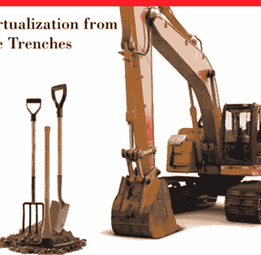

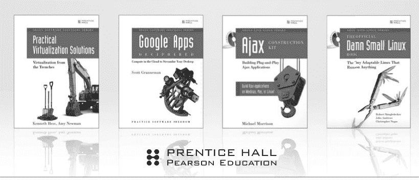

Negus 软件解决方案系列中的每本书都鼓励并挑战读者在免费软件世界不断进步。每本书附带的现场 DVD 或 CD 将让书中描述的应用程序和内容在你眼前栩生起来。当你完成学习后，你将学会如何自己使用、自定义和重建这些免费及开源软件。从尝试示例的学者开始，最终以专业人士的身份，掌握本系列涵盖的许多主题——从构建 PHP/MySQL 站点到自定义 Live CD 等等。

## 实战派的虚拟化

## 总编辑

Mark Taugh

## 执行编辑

Debra Willey Cauchy

## 开发编辑

宋林 (Songlin Qi)

## 经理

Kristy Hart

## 项目编辑

Jovana San Nicolas-Shirley

## 文字编辑

Barbara Hahn

## 索引

Charles Leeser

## 校对员

Leslie Hough

## 技术评审员

Jesse Keating

Joe Brockmeier

国际销售

## 出版协调

Kim Boedheimer

## 封面设计

Alan Clements

Hess, Newman, 1961—

I. Newman, Amy, 1971— II. 书名.

献给 Melissa, Connor, Walker 和 Maria

以及

献给 Eric, Jakob 和 Rebecca

XII

- 供应商 ................................................................................................................ 209

本页特意留白

## 前言

为了写这本书，我们非常幸运地邀请了 Kenneth Hess 和 Amy Newman 的卓越技能。除了为这个项目带来多年的专业知识外，他们还花费了大量时间，为使用多种技术配置虚拟系统提供了分步操作流程。我想你会发现，在你建立自己的虚拟化基础设施时，他们的辛勤将为你节省大量的研究时间。

—Christopher Negus

丛书编辑

## 致谢

感谢 Jason Perlow 让我们使用了他的地下室数据中心。他花费了许多长时间搭建基础设施，以便让我能够访问 VMware ESXi 和微软的 Hyper-V。没有 Jason 的帮助，这本书就不会存在了。

感谢 Amy Newman，她慷慨地同意合著这本书。她凭借其新颖的视角和在虚拟化领域的多年经验让这本书变得更加完美。她是让这本书成为现实并最终完成的主要力量。

献给我的母亲，她在十年前去世了，这让我后悔自己为什么不是一个如此大器晚成的人。

感谢我的孩子们，在写另一本书的压力和辛苦中忍受我。对于伴随这个项目的无尽加班和质量缺失，我深表歉意。但现在结束了，爸爸回来了了。

感谢我的妻子，在我毫无耐心时她保持耐心，在我需要时她保持诚实，在我不想努力时她给予督促。嘿，亲爱的，我回来了——终于回来了。

—Kenneth Hess

感谢：

- 感谢 Kenneth Hess，他如此信任我，愿意接纳一个未知的实体加入。这是一段非常精彩的历程，我对机会给予的每一次坎折表示感激。在这种情况下，在拉斯维斯发生的事情确实没有留在那里！
- 感谢 Dan Muse，他在五年前推我去我在变速箱领域脱颖而出，并在当我开始喜欢它时允许我留在那那里。
- 感谢 Wesley Baker、Ryan Mackamson、Buddy Newton、Jameel Syeed 以及他们代表的公司，他们同意参与这本书并分享了他们的虚拟化经验。
- 感谢 Cirba、Emulex 和 VMware，允许我们使用他们的图表来更好地说明我们的文字。
感谢 Michael Hall 和 Paul Shread，他们允许我就工作和存储（无论是虚拟的还是其他的）向他们请教。
- 感谢 Richard Panchukhy 和 Diane Merians，作为导师和朋友，在需要时总是提供智者的建议，并在其他时候倾听我的倾诉。
- 感谢我的父亲，多年来他在饭桌上谈论电信，并试图激发我对路由器和局域网的兴趣，那时我真的只是（半）在听。
- 感谢我的母亲，她坚持让我参加下课后的计算机科学班，尽管我是唯一一个为了三台 Commodore PET 之一争抢前排座位的女孩，并且声称对这几乎没有兴趣。
- 感谢 Jakob 和 Rebecca，这是漫长的一年。我爱你们。感谢你们在此期间的耐心和不耐烦。期待未来更多的足球比赛、更多的聚会，以及更多悠闲的夜晚和周末。
- 感谢 Eric，他仍然能像其他任何时候那样让我大笑，并且当一切都搞砸时知道该说什么。没有了你的耐心、支持、理解，以及我对自己和自己能力的大部分信心，这项工作是不可能实现的。

> —Amy Newman

还有几位我想共同感谢的人员：

感谢 Joe Brockmeier、Eli Dow、Jesse Keating、John Kennedy、Jeanne Matthews 和 Jim Owens 对手稿进行同行评审，感谢 Songlin Qiu 确保一切内容在正确的格式下流畅且符合逻辑。你们的每一个人都挑战了我们，让我们感到沮丧，有时甚至让我们恼火，但这一切都是为了一个良好的目标，最终我们获得了一本更好的书。

感谢 Michael Hall 几乎一气呵读完手稿，以确保没有无意的矛盾或不一致之处。

最后，感谢我们的编辑 Debra Williams Cauley，她总是比我们的需求早两步，无论是提供空间、督促还是鼓励，并一直推动我们向前发展。

## 作者简介

**Kenneth Hess** 是 *Linux Magazine* 杂志的虚拟化专栏。他的专栏涵盖了从桌面、服务器到云的虚拟化的所有方面和类型。自 1999 年以来，Kenneth 使用了几乎所有种类型的虚拟化产品，并且是原始 VMware 产品线的 Beta 测试员。他还在在 DaniWeb 上撰写 Linux 博客，并在 Internet.com 的 ServerWatch 上撰写 *Cover Your Assets* 专栏。你每周还可以在 *The Frugal Tech Show’s Frugal-Friday*节目中听到 Kenneth。他在 HP 的工作涉及企业级的虚拟化和网络主机托管。

**Amy Newman** 自 2001 年以来一直关注虚拟化领域。自 2006 年起，她就开始在她的每周专栏 *Virtually Speaking, Virtually Speaking* 中写博客，对从虚拟机程序到硬件的虚拟化新闻和趋势提供分析。该专栏每周发表在 Internet.com 的 Server-Watch 上。Amy 自 1999 年以来一直是 ServerWatch 的主编辑，自 2009 年以来一直是 Enterprise IT Planet 的编辑。在此之前，她是 Gartner 的研究编辑，在那里她编辑并管理了四份与软件基础设施相关的每月研究成果的工作流。

本页特意留白

# 前言

如果你拿起这本书，很可能你正在考虑将你的 IT 基础设施至少部分虚拟化。你也很可能被分配了这项任务，它最终将拯救你。

虚拟化不再仅仅是爱好者的术语；它是现代 IT 的基本需求。无论你是想降低成本、提高效率，还是为你的开发人员提供更灵活的环境，理解虚拟化的机制都是你无法回避的技能。这本书旨在提供这种理解，从基础概念转向高级实现。

在接下来的章节中，我们将探索虚拟化的“为什么”和“如何”。我们将从基础知识——虚拟机程序和虚拟机开始，然后转向服务器、桌面和网络虚拟化的实际应用。在这段旅程结束时，你将信心设计、部署和管理自己的虚拟化环境。让我们开始吧。

序言 XXiii

生态系统视角，并讨论了构建虚拟基础设施的各种可用方案。

第四部分进入虚拟基础设施领域，探讨了部署过程。我们从第 15 章“基础：规划阶段”中至关重要的规划阶段开始。我们涵盖了从向高级管理层推销虚拟化、到选择自动发现工具再到测试的所有内容。

在第 16 章“部署”中，我们关注实际实施和切换虚拟开关时的具体细节。我们研究了如何选择要虚拟化的应用程序、结合自动化和自动发现技术，以及确保虚拟机（VM）的安全性。

我们通过第 17 章“生产后：收尾工作”对完全虚拟化的进行观察来结束第四部分。我们讨论了监控工具（这是保持系统高效运行的必要条件）、灾难恢复计划以及预算。

## 虚拟化基础与技术选择

- 第 1 章：虚拟化还是不虚拟化？
- 第 2 章：比较虚拟化技术
- 第 3 章：VMware Server
- 第 4 章：VMware ESXi
- 第 5 章：Citrix XenServer
- 第 6 章：Microsoft Virtual PC
- 第 7 章：Microsoft Hyper-V
- 第 8 章：VirtualBox

## 虚拟化还是不虚拟化？


在为虚拟化项目投入大量时间或资金之前，这是你必须自己回答的第一个问题。你进入虚拟化的第一步应该是亲自尝试一些虚拟化产品：演示（Demos）和录屏并不同于亲身体验。

本章是为那些尚未完全决定投入虚拟化的人准备的。本章探讨了使用虚拟化产品的理由以及不使用的理由。在读完本章后，你可以对虚拟化是否适合你做出更明智的决定。

## 虚拟化史

尽管许多人所认为的，虚拟化并非始于 1999 年 VMware 发布第一款产品。它始于大约 40 年前的 IBM 大型机平台。在那个时代，虚拟机（`VMs`）被称为“伪机器”（pseudo machines）。起初，大型机使用控制程序来分配资源，并将这些伪机器的各个实例相互隔离开。

控制程序的现代版本称为虚拟机监控器（hypervisor），它是一个直接安装在所谓的“裸金属”（bare metal）上的虚拟机监控器。裸金属是一个计算机的新术语，通常指没有安装操作系统的计算机（通常是服务器）。它是纯硬件。虚拟机监控器无法直接访问，但它利用了所谓的“域 0”（`Domain0`）虚拟机，这是一种感觉像是安装在裸金属上的主操作系统上的操作系统。通过这个主虚拟机，用户间接地与虚拟机监控器进行交互。

虚拟机监控器技术是虚拟机技术的多种类型之一，我们将在第 9 章“实战中的服务器虚拟化”中进一步讨论。

## 解释虚拟化

虚拟化的“正式”定义是指计算资源的物理抽象化。换句话说，分配给虚拟机的物理资源是从其物理等价物中抽象化的。虚拟磁盘、虚拟网络接口卡、虚拟局域网、虚拟交换机、虚拟 `CPU` 和虚拟内存都映射到物理计算机系统上的物理资源。主机计算机“看到”其虚拟机视为应用程序，其资源被专门用于或共享给这些程序。

虚拟化有许多类型：应用、平台、网络和存储。通常，当某人提到虚拟化时，指的是平台虚拟化。平台虚拟化是使用服务器硬件托管多个虚拟机作为客户。每个虚拟机都是一个一致的虚拟硬件环境，在上面安装操作系统。每个客户虚拟机都独立于所有其他客户运行。

主机配备了足够的硬件资源，以为其虚拟机提供计算能力和磁盘空间。典型的主机系统由多个多核心处理器、若干千字节（`GB`）内存、若干太字节（`TB`）磁盘空间以及网络附属存储（`NAS`）或存储区域网络（`SAN`）组成。

# 虚拟化负载

在考虑虚拟化时，一个常见的问题是：“什么不能虚拟化？”任何利用率不足的硬件负载都可以成功地虚拟化。主要的虚拟化候选是 Web 服务器、邮件服务器、其他网络服务器（`DNS`, `DHCP`, `NTP`）、应用程序服务器（`WebSphere`, `WebLogic`, `Tomcat`）和数据库服务器。负载均衡服务器在虚拟化环境中运行良好，包括 Java、Windows、Solaris 等。

## 合并 Web 服务

Web 服务特别适合虚拟化。你可以轻松地将两个或多个配置了 `.NET`、`PHP`、`Python` 等其他语言的物理服务器转换为虚拟机。容量的增加不会产生额外的硬件费用。

以下是合并的五大主要理由：

- 平均修复时间过长
- 基础设施正遭受老化
- 基础设施容量不足
- 系统利用率低
- 虚拟化的经济性

### 平均修复时间

平均修复时间（`MTTR`）是服务离线后恢复服务所需的平均时间。虚拟化通过提供整个服务的快照或备份来恢复失败的服务，从而缩短了这一时间。

### 老化的基础设施

硬件寿命很短。硬件的预期寿命约为三到四年。硬件预期寿命的一个通用标准是制造商保修期。虚拟化是解决基础设施老化问题的明显胜者。

### 容量不足的基础

物理系统具有无法更改的容量限制。单 `CPU` 系统将永远是单 `CPU` 系统。如果你的系统内存上限为 4`GB`，你可以增加。这些限制不影响虚拟机。只要主机有可用容量且虚拟化软件支持，你就可以为虚拟机增加容量。

### 利用率低

正如前面提到的，利用率低的系统是虚拟化和合并的理想选择——不是因为虚拟机比物理机利用率更高，而是你不再需要物理机消耗电力、冷却并占用空间。

### 虚拟化的经济性

除了是一种经济解决方案，虚拟化还提供了规模效应。你可以轻松地使用虚拟机来扩展高可用性（`HA`）解决方案。你可以在保留物理机的同时升级虚拟机。

## 虚拟化的实用方面

关于虚拟化有很多炒作，你可能会问自己：“我为什么需要虚拟化任何东西？”这是一个合理的问题，答案很简单。首先，它是一项省钱的技术。通过资源共享，你将在硬件、电力、冷却以及可能的 IT 员工上节省大量资金。

除了虚拟化的兴奋和显而易见的酷炫，实用的方面。以下列表总结了这些方面：

- 降低硬件成本
- 提供灾难恢复
- 合并空闲负载
- 负载均衡
- 软件测试
- 集中服务器管理
- 节约电力
- 更快部署服务器

考虑以下场景：

## 第 1 章 可视还是虚拟化？

服务器是一种常用于文件/打印服务、邮件、`DNS` 和 Web 服务的典型系统——双核 `CPU`、2`GB` 内存、80`GB` 磁盘、机架式系统。对于一台标准系统，其价格约为 2,000 美元。如果你需要 `RAID` 配置加硬盘，预计还需要额外增加 300 美至 500 美元。最终，这台“基础”系统的成本在 2,000 美元到 2,500 美元之间。

> 注意
>
> 这些计算不包括操作系统和其他软件，因为无论机器是物理的还是虚拟的，与软件相关的任何成本都是相同的。

我们的企业级服务器系统是机架式设备，配备双四核 `CPU`、32`GB` 内存，并包含三块采用 `RAID 5` 配置的 400`GB` 硬盘。该系统的成本约为 18,000 美元。这个价格没有将任何网卡（`NIC`）计算在内，但考虑到大多数标准系统都配有（或应该配备）两块网卡。通常情况下，一个用于局域网（`LAN`），另一个用于备份。企业服务器应该配置为：一个用于自身使用，另一个用于备份，至少至少至少四个用于虚拟机（`VM`）。我们的系统出厂配有四块网卡，额外增加四块将再增加 400 美元。与系统约 18,000 美元的总价相比，每块网卡 100 美元的额外成本相对微不足道。

### 表 1-1 物理与虚拟对比

| 规格 | 物理 | 物理标准 | 虚拟 |
| :--- | :--- | :--- | :--- |
| 成本 | $18,000 | $2,000-$2,500 | $0 |
| 机架单元 | 4U | 1U | 0 |
| 功耗 (瓦特) | 1570 | 670 | 0 |
| 网络连接 | 2* | 2 | 0 |

*单台服务器的最小值。
*在主机上使用共享网络连接。

现在看相同的数据（表 1-2），但改为八台服务器（物理标准对比虚拟）。

### 表 1-2 物理与虚拟对比

| 规格 | 物理企业 | 物理标准 | 虚拟 |
| :--- | :--- | :--- | :--- |
| 成本 | $18,000 | $16,000-$20,000 | $0 |
| 机架单元 | 4U | 8U | 0 |
| 功耗 (瓦特) | 1570 | 5360 | 0 |
| 网络连接 | 8* | 8* | 0 |

*两个用于主机，一个用于虚拟。
*主机上使用相同的物理连接。

这两张表清楚地说明了虚拟化在许多方面是如何产生回报的。从财务角度来看，较低的功耗需求是最显著的节省，随其后的是使用的网络连接数量，最后是机架单元。

这些表格可能具有误导性，因为虚拟机（`VM`）的功耗为 $0。之所以设置为零是因为虚拟机没有直接抽电的电源。然而，当虚拟机启动时，它们会增加主机的功耗。

为了进一步降低连接成本，你可以配置虚拟机以共享网络连接。在单台服务器网络流量相对较低的情况下，共享连接的工作效果良好。如果你发现某个接口的利用率接近 80%，则应该将该虚拟机拆分到它自己的接口上。

虽然达到单台虚拟机的成本基准几乎是不可能的，但进行粗略估计是可以的。以目前的示例，考虑这台服务器上可以同时运行多少虚拟机。现实情况下，总共 32`GB` 内存中，主机需要 8`GB`，剩余 24`GB` 供分配。每个独立的虚拟机可能有 4`GB` 内存。你有非常广泛的选择范围。如果你取标准服务器的 2`GB` 内存并将该数量分配给每个虚拟机，理论上你可以运行八台。将服务器的总成本除以 8，就可以得到分配给每台虚拟机的粗略数字。请注意，除非两个以上的虚拟机对磁盘 I/O 极少，否则这可能并不可行。

虚拟化提供了我们能想到的最廉价且最短的平均恢复时间（`MTTR`）。恢复行业的一句老话大致是：“你可以拥有快速、廉价且可靠的灾难恢复解决方案。”通过虚拟化，恢复就像启动虚拟机一样快。在此期间你必须从备份中恢复数据，但你拥有了一个功能正常的服务器，不需要因为硬件故障或重新安装软件而停机。

你在上一节中看到，虚拟机可以非常廉价。软件成本与物理机相同。此外，硬件已经存在并等待被利用。虚拟机本身非常可靠，它们没有易故障的物理硬件。每个虚拟机都有自己的适配器组、内存、磁盘空间和外围设备，这些设备映射到相应的物理设备。你永远不需要更换虚拟机中损坏的主板、网卡或 CD 驱动器。虚拟机的备份将始终是你硬件稳定且可靠的恢复点。


将灾难恢复提升到新水平的产品如 PlateSpin、Xen 和 VMware Converter，它们可以获取物理机的副本并将其转换为虚拟机。对于 PlateSpin 和 VMware Converter 来说，这种转换在转换前后无需重启物理机。VMware Converter 简单、优雅，通常用作常规 P2V（物理机虚拟）备份方法。如果你的物理机发生某种故障，你只需启动虚拟机即可。快速、廉价且可靠——你真的可以兼得。

## 服务器整合

CIO 和 IT 专业人员考虑虚拟化的主要原因之一是整合负载。服务器整合的形式是将负载合并到更可靠的硬件上，或者通过虚拟化创建虚拟机来处理这些负载，减少物理系统的数量。其效果是相同的：更有效地利用硬件，减少功率消耗，增加服务的管理性。整合可能导致支持成本降低，因为需要支持的物理机器减少了。

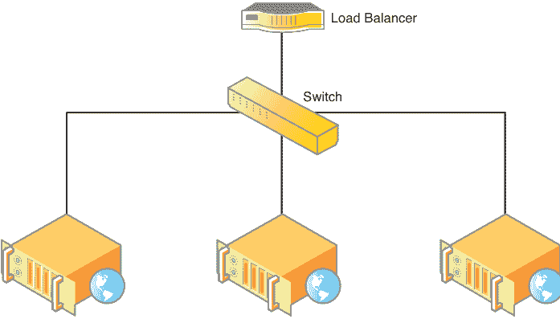

图 1-1 带有三个 Web 服务器的标准负载均衡场景。

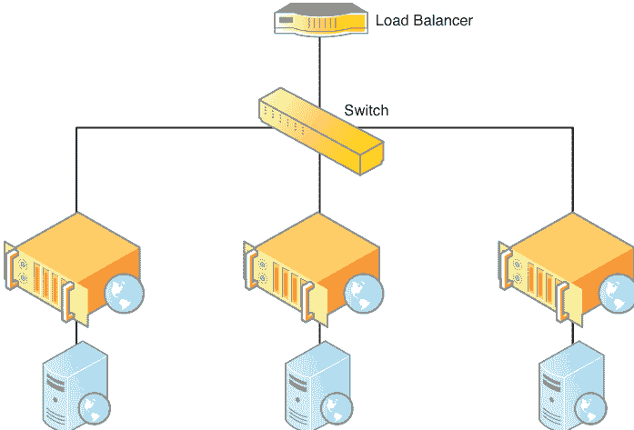

图 1-2 三个虚拟 Web 服务器的负载均衡场景。

在图 1-3 中，该场景展示了一个带有三个 VM 和一个用于提供内容的网络存储的单个 VM 主机。这是一个规划不当的负载均衡环境示例。为什么呢？毕竟，这三个 Web 服务器 VM 做了负载均衡。它们确实负载均衡了，但这种方式并没有为 VM 提供最大的吞吐量或安全性。


图 1-3 带有虚拟 Web 服务器和共享存储的错误负载均衡系统场景。

图 1-4 显示了带有共享网络存储的正确负载均衡 Web 服务。

请注意，此场景仅作为每个 VM 主机对应单个 VM 客户的示例。在实际的数据中心中，每个 VM 主机都会有多个执行各种功能的客户 VM。

## 软件测试

使用 VM 进行软件测试是 x86 虚拟化的早期应用之一。创建一个 VM、启动它、打补丁、分配 IP 地址和名称，然后对这个纯净的 VM 进行备份。使用工作副本来安装、修改和卸载软件软件包。

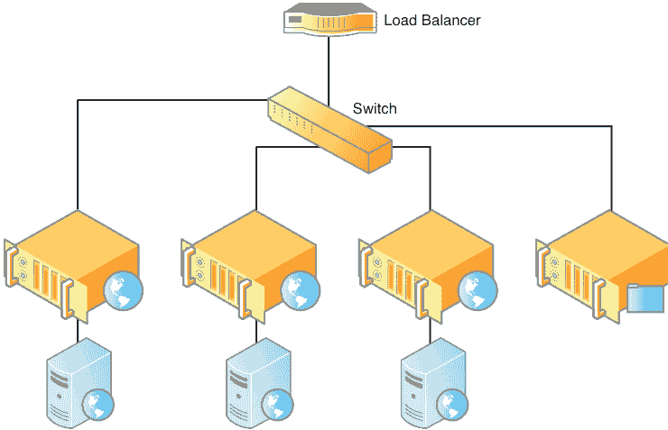

### 图 1-4 带有三个虚拟 Web 服务器和共享存储的正确负载均衡系统场景。

以这种方式使用 VM，你可以在将软件部署到服务器或桌面系统之前，有机会排除任何冲突或潜在问题。如果由于冲突或构建不当的应用导致了崩溃、重启、蓝屏、核心转储或其他故障，你可以继续排故障，或者移除崩溃的 VM，为你的纯净镜像制作一个工作副本并重新开始。这种类型的软件测试让你能够在无需每次系统崩溃都重新安装操作系统、基础应用和补丁的情况下，对应用程序进行严格的反复测试。

当你拥有一个良好的系统后，通过将 VM 镜像复制到生产 VM 主机系统，将工作 VM 移动到生产环境中。虚拟化使测试、问题解决和部署变成了流程化的。

## 集中管理

所有主要的虚拟化产品都有一个控制台或集中式查看器，可以从单一界面查看和管理 VM。这种集中式管理界面使虚拟化成为解决服务器扩张、KVM（键盘、视频和鼠标）接口以及管理各种操作系统类型的理想解决方案。

管理控制台为系统管理员提供了一个单一的、独立于操作系统的接口来管理任意数量的 VM；与任何系统交互都不特殊的访问方法。此界面允许你与系统的实际控制台交互，就像你坐在物理系统面前一样。

集中控制台还允许高级管理员根据情况授予对特定系统或系统组的访问权限。例如，你可以向 DBA 组授予一组数据库服务器的访问权限。当 DBA 组的成员连接到 VM 主机服务器时，他只能看到他有权限的组组服务器。所有其他系统，无论功能如何，对他来说都是不可见的。

## 功耗与冷却

在讨论虚拟化或刀片服务器（或两者）时，功耗是一个热门辩论话题。VM 的确实消耗能量。它们消耗内存、CPU、磁盘空间、网络带宽和电力。你可以将 VM 想象成运行在系统上的任何应用程序。如果它消耗资源，它就消耗了可用资源的一部分。空闲服务器不消耗多少功率，但繁忙的服务器会。

如表 1-3 所示，即使是少量的物理系统，其消耗量也是大型系统的倍数。尽管这些数字是最大输出值，但它们为我们提供了可以操作的具体数字。

### 表 1-3 物理机功耗

| 服务器类型 | 功率输出（最大） |
|---|---|
| 企业级 | 1570 |
| 标准级 | 670 |

五台标准服务器的额定输出为 3350 瓦（最大），这是单个企业级服务器功率额定的倍以上。从这个简单的表中你可以看到，通过虚拟化，功耗大幅降低。

与功耗密切相关的是冷却和空气循环。虚拟化减少了电源、CPU 和磁盘驱动器的数量——所有这些都会产生并释放大量的热量。通过减少产生硬件的数量，你也减少了有效冷却服务器机房所需的电力。

这个过程非常快，以至于不需要考虑库存、上架、布线、接入电源或担心冷却容量。当任何 VM 出现问题时，我们还有原始 VM。

这是一个非常出色的项目，但它展示了如何快速地为用户、开发者或其他管理员设置系统并提供服务。当我们使用 VM 模板时，相同的客户站点，我们需要为应用程序开发设置新服务器。我们使用了几天前设置的模板。当我们通过模板开始安装新系统时，我们认为系统挂了或必须从头开始。当我们看到新系统首次启动时，我们在等待创建向导的下一个界面，几乎不需要交互。

当你在网络或互联网上部署新服务时，你可能既没有预算也没有兴趣投入大量资金购买解决方案——特别是该服务是 DNS、NTP、LDAP、FTP 或 HTTP 等。数据库服务也正成为商品化的受害者。Linux 和 FreeBSD 使和其他。虚拟化进一步使预算紧张的公司的服务商品化，因为你现在不需要使用物理机来提供服务。

本章重点是确定虚拟化是否适合你，并让你了解一些基础术语和概念。通过在数据中心或服务器房中虚拟，你可以节省大量的资金。虚拟化的其他优点不仅仅是锦上添花——它们是所有进入服务器领域的人面临的现实。由于成本上升、空间缩减以及对“以少胜多”的永久要求，电力和冷却在未来将变得越来越重要。

你会发现虚拟化是传统硬件的可行替代方案，随着 Linux 的普及，你可能会发现自己不需要为硬件或软件花费金钱。想想这将为公司利润释放出多少资金。虚拟化是未来的趋势，早期接受它的人将领先。

下一章“比较虚拟化技术”将概述不同类型的虚拟化技术、它们在特定问题中的应用、产品示例以及提供它们的供应商。

在本章中，我们将开始探索几种流行的去虚拟化策略，并解释它们各自的工作原理。其目标是为您提供所需的运营信息，以便为您的策略做出明智选择。每个厂商的软件都有自己的接口（控制台）、自己的构建、导入和修改虚拟机（VM）的方法，以及各自独特的特性、微调和工具。

## 托管式虚拟化

虚拟化爱好者将 Guest OS/Host OS 称为经典虚拟化或托管式虚拟化。这种类型的虚拟化依赖于现有的操作系统（宿主机操作系统）、第三方虚拟化软件解决方案以及各种客户操作系统的创建。每个客户都运行在宿主机上，并使用宿主机为其提供的共享资源。

客户通常由一个或多个虚拟磁盘文件和一个虚拟机定义文件组成。虚拟机由主机应用程序进行集中管理，该程序将每个虚拟机视为一个独立的应用程序进行查看和管理。

在这种情况下，客户系统是完全虚拟化的，并且对自己的虚拟状态一无所知。客户假设自己是拥有独立硬件的独立系统。除非通过另一个客户的网络服务，否则它们无法感知系统中的其他客户。

这种虚拟化最大的优势是需要竞争的设备和驱动程序有限。每个虚拟机（客户）都拥有一套一致的硬件。主要的缺点是这项特定技术的 I/O 性能影响很大。非磁盘操作速度。

VMware Server 在全本书中用于说明虚拟化技术和方案。它是 VMware 提供的免费产品，被认为是用于小型环境、测试或个人的入门级软件包。由于其对虚拟机的内存限制和磁盘性能缓慢，它在大型环境中的用处有限。VMware Server 支持 64 位机器作为宿主机和客户。

VirtualBox（现称为 xVM VirtualBox）是我最喜欢的虚拟化软件包之一。与 VMware Server 类似，它是免费且跨平台的，但与 VMware Server 不同，它是开源的。凭借可调节的显存、远程设备连接、RDP 连接和敏捷的性能，它可能是你工具箱中最好的托管式虚拟化软件包。

由于与 VMware Server 的原因，VirtualBox 最适合小型网络和个人。

## 虚拟机监控程序

虚拟机监控程序是一种裸金属（bare metal）虚拟化方法。裸金属指的是未安装任何操作系统或其他软件的服务器系统硬件。描述虚拟机监控程序技术的最好方法是将其与托管式虚拟化进行比较。乍一看，虚拟机监控程序似乎与托管式虚拟化相似，但它们有显著不同。

虚拟机监控程序是运行操作系统的虚拟化软件。相反，托管式虚拟化利用操作系统并将虚拟化软件作为应用程序运行。虚拟机监控程序安装在裸金属上；然后安装操作系统，而该操作系统本身是一个半虚拟化的虚拟机。宿主机操作系统（如果你可以那样称它的话）被指定为 0 号虚拟机（VM zero）。


# 虚拟化概述

## VMware ESXi

新产品 `VMware ESXI` 实现了一个没有传统操作系统界面的裸金属虚拟机监控程序。它直接安装在硬件上，占用空间小到不可思议的 `32MB`。它必须安装在经过虚拟化优化的硬件上。虚拟机管理通过直接控制台用户界面 `DCUI` 完成，这是在服务器系统物理控制台上执行的低级配置和管理接口。`VMkernel` 允许通过一组 API 和代理程序进行远程管理。

## Xen

`Xen 3.0` 及之前的版本对我来说并不特别有趣，因为它们有些难难用，而且在我的特定应用程序中表现并不理想。然而，`Xen 4.x` 产品赢得了我的心。它的图形界面直观、快速且设计非常精良。新产品中的模板引擎非常好用，配置新虚拟机也是一种享受。

`Xen 3.0` 及之前的版本对我来说并不特别有趣，因为它们有些难难用，而且在我的特定应用程序中表现并不理想。然而，`Xen 4.x` 产品赢得了我的心。它的图形界面直观、快速且设计非常精良。新产品中的模板引擎非常好用，配置新虚拟机也是一种享受。

`Xen 3.0` 及之前的版本对我来说并不特别有趣，因为它们有些难难用，而且在我的特定应用程序中表现并不理想。然而，`Xen 4.x` 产品赢得了我的心。它的图形界面直观、快速且设计非常精良。新产品中的模板引擎非常好用，配置新虚拟机也是一种享受。

*(注：此处由于原文存在重复，已翻译对应内容)*

虚拟化的巅峰是由某些人赋予生命，`ESX` 在企业虚拟化领域仅次于 `VMware` 之间。`ESX` 和 `VMware` 都是基于 PC 的架构，但 `ESXi` 是一个 `64` 位产品。`ESXi` 的硬件要求仅次于 `ESX`。`ESXi` 现在是一个免费产品。

微软通过其 `Windows 2008` 系列加入了这一领域，`Hyper-V` 是 `Citrix` 和 `VMware` 表现不足的虚拟化解决方案。`Citrix` 和 `VMware` 都是基于 Linux 的，这意味着如果你不熟悉 Linux 或命令行，使用它可能会更合适。

这种产品在更加成熟后，将对 `Citrix` 和 `VMware` 的统治地位构成严峻挑战。

## 仿真

仿真是指模拟特定类型硬件的能力，以便让操作系统运行。例如，使用仿真虚拟化解决方案，你可以在非 Spar 宿主机上安装 Solaris 操作系统。仿真软件作为应用程序运行在宿主机上，但模拟了整个计算机。客户操作系统感知不到自己作为客户的状态，也不知道自己运行在异构环境中。

在某些情况下，硬件仿真可能会缓慢得痛苦，但更新的技术、新的仿真软件和驱动程序以及更快的 `64` 位处理器使其成为可行的虚拟化方案——特别是对于那些需要在没有大量支持人员或硬件的情况下开发其他平台的人来说。

硬件仿真软件最好的例子是 `Bochs` (`http://bochs.sourceforge.net`) 和 `QEMU` (`http://bellard.org/qemu`)。

`Bochs` 是一个免费、开源的 Intel 架构 `x86` (`32`位) 仿真器，运行在 UNIX、Linux、Windows 和 Mac OS 上，但仅支持 `x86` 操作系统。它是一个复杂的软件，支持仿真 `x86` 处理器和 `x86_64` 架构。它还支持多处理器，但尚未充分利用对称多处理（SMP）。

`QEMU` 是另一个免费开源的仿真程序，它运行在有限的主机架构（`x86`、`x86_64` 和 `PowerPC`）上，但提供了 `x86`、`x86_64`、`ARM`、`Sparc`、`PowerPC`、`MIPS` 和 `m68k` 操作系统的仿真。

## Virtual PC

`Virtual PC` 是微软提供的免费虚拟化软件包。`Virtual PC` 使用仿真来提供虚拟机环境。这些是在 Windows 工作站或 `Windows 2003` 服务器上托管几个虚拟机的良好解决方案。从任何角度来看，它们都不是大型环境的解决方案，但它们可以廉价且快速地启动一些虚拟机。

虚拟机在这些产品上的性能对于 Windows 虚拟机来说出奇地好。通过网络连接时，很难甚至无法判断你正在使用虚拟机。控制台性能有时会显得很缓慢——因此，应尽可能最小化控制台，并使用 `RDP` 连接到你的虚拟化 Windows 系统。

## 内核级虚拟化

内核级虚拟化是虚拟化世界中的一个异类，每个虚拟机都使用自己独特的内核来启动虚拟机（称为根文件系统），无论宿主机运行的是什么种内核。

`Linux KVM`（内核虚拟机）是修改后的 `QEMU`，但与 `QEMU` 不同，`KVM` 使用了处理器扩展技术（`Intel-VT` 和 `AMD-V`）。`KVM` 支持大量的 `x86` 和 `x86_64` 架构操作系统，包括 Windows、Linux 和 FreeBSD。它使用 Linux 内核作为虚拟机程序，并作为内核可加载模块运行。

## 用户模式 Linux

用户模式 Linux (`UML`) 使用可执行内核和根文件系统来创建虚拟机。要创建一个一个虚拟机，你需要一个用户空间的可执行内核（客机内核）和一个由 `UML` 创建的根文件系统。这两个组件共同成了 `UML` 虚拟机。你用于连接到远程主机的终端会话就变成了你的虚拟机控制。`UML` 包含在所有的 `2.6.x` 内核中。

## 共享内核虚拟化

共享内核虚拟化（也称为操作系统虚拟化或系统级虚拟化）利用了 UNIX 和 Linux 与系统中其他进程共享内核的独特能力。这种共享内核虚拟化是通过使用更改根目录 `chroot` 功能实现的。`chroot` 功能更改进程的根文件系统以对其进行隔离，从而提供某些安全性。它（`chroot`）通常被称为 `chroot` 监狱或基于容器的虚拟化。在共享内核虚拟化中，被 `chroot` 的程序、程序集或整个系统通过设置 `chroot` 系统使其认为自己是一台拥有独立根文件系统的独立机器来受到保护。

`chroot` 机制已经过增强，可以模拟整个文件系统，使得整个系统都可以被 `chroot`，从而创建一个虚拟机。共享内核虚拟化的技术优缺点列如下：

- 优点
  - 增强安全性和隔离性
  - 原生性能
- 缺点
  - 虚拟化系统密度更高
  - 宿主机内核与客机内核的兼容性

`chroot` 系统在增强安全功能和隔离方面提供了很多优势；然而，共享内核虚拟化最大的优势并不在于安全性（尽管这确实是值得考虑的），而在于其性能。通过这种虚拟化，你将为每个独立系统获得原生性能。不仅每个系统都以原生速度运行，你还可以在宿主机上运行超过标准数量的虚拟机。我们所的标准数量是指如果你使用内存作为限制因素，逻辑上在宿主机上可以拥有的数量——为宿主机留出 `1GB`，将其余内存分配给虚拟机。

你在宿主机上拥有的 `chroot` 系统限制更接近于一个支持多个应用程序的独立系统。如果你将每个 `chroot` 看作应用程序而不是虚拟机，你将更准确地分配资源，并享受超越许多其他类型虚拟化的性能。

共享内核虚拟化的缺点是一个巨大的问题：所有的虚拟机都必须与你运行的内核兼容。换句话说，你无法运行 Windows 操作系统、Solaris、Mac OS X 或任何无法在其内部运行你系统内核的操作系统。主要的网络托管提供商多年来一直运行这种方案，以便客户能够根据其托管需求获得自己的虚拟服务器。他们不知道系统是虚拟的，也无法通过他们的虚拟机联系宿主机系统。

## Solaris 容器 Zones

`Solaris 10` 自带了虚拟化功能。`Solaris 10` 操作系统本身被称为全局区域 `Global Zone`。`Solaris Zones` 实际上是 `BSD` 监狱，它具有自己的、能够模拟完整操作系统和文件系统的虚拟根。当你创建一个新区域时，一个完整的文件系统会被复制到新区域目录。每个区域只看到自己的进程和文件系统。该区域认为自己是一个完整的、独立的操作系统；只有全局区域对虚拟化有所了解。

每个区域本质上创建了一个干净的沙箱，你可以在其中安装应用程序。

## VMware Server 与 ESXi

当 `VMware` 在 `1998` 年首次登场时，它只有一个产品：`VMware`，它让台式电脑能够同时运行多个操作系统。在当时，这被认为是革命性的。诚然，大型机几十年来就能做到这一点，但现在它对于硬件预算紧张的组织来说成了一个选项。几年后，随着 `VMware GSX` 和 `VMware ESX` 的发布，`VMware` 将重心转向了服务器，从那时起事情开始真正发展。从那时，`VMware` 为各种级别的虚拟化实验和实施创建了无数产品，以及围绕它们的基础和管理工具。随着竞争的加剧，人们越来越明确地，真正的战场在这里；作为回应，`VMware` 将其两个主要的虚拟机监控层程序产品 `VMware Server` 和 `VMware ESXi` 免费提供。第三种 `VMware ESX` 则作为 `VMware Infrastructure` 的一部分出售。本章将介绍 `VMware Server`，它被定位为针对虚拟化新学者并想要尝试的用户的入门级产品。计划是让用户逐渐超越 `VMware Server`，并毕业到其软件更大的商业版本，例如 `ESXi`（这是第 4 章的主题“`VMware ESXi`”）和 `ESX`。`ESX` 曾一度是 `VMware` 的旗舰产品，但其地位后来已被 `ESXi` 取代。第 4 章将更深入介绍它们之间的差异，但目前它们之间的区别在于 `ESXi` 缺少服务控制台，这意味着监控层程序更小，因此由于较小的“攻击面”而增加了安全可靠性。

与安装在裸机上因此不需要操作系统的 `ESX` 和 `ESXi` 不同，`VMware Server` 是一个需要在底层运行操作系统（Windows、Linux 或 Solaris）的应用程序。此外，与 `ESX` 或 `ESXi` 不同，它不需要专用的服务器；也不提供集中式管理选项。在可用性方面，虽然 `VMware Server` 可以用于生产环境，但它更适合测试和开发环境。


本章重点关注 VMware Server 及其内部机制、功能、配置和特性。

VMware Server 控制台（Console）是创建、删除、编辑和停止虚拟机（VM）的主要交互方法。你可以通过控制台与虚拟机交互，就像直接在机器控制台上一样。对于具有图形界面的系统（如 Windows 或 Linux），你应该像物理机器一样使用远程连接客户端。即使你安装了 VMware Tools，网络上的响应仍然很缓慢。为了获得更愉快的虚拟系统交互体验，请使用系统的远程连接功能。

Windows 版 VMware Server 控制台的界面与其版本不同，但功能相同。VMware Server 控制台如图 3-1 所示。

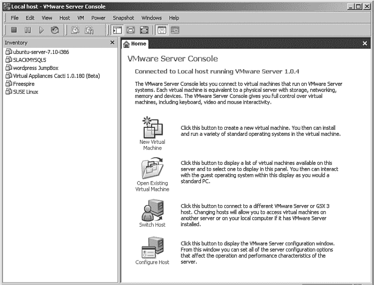

**图 3-1** Windows 版 VMware Server 控制台。

Linux 版 VMware Server 控制台如图 3-2 所示。

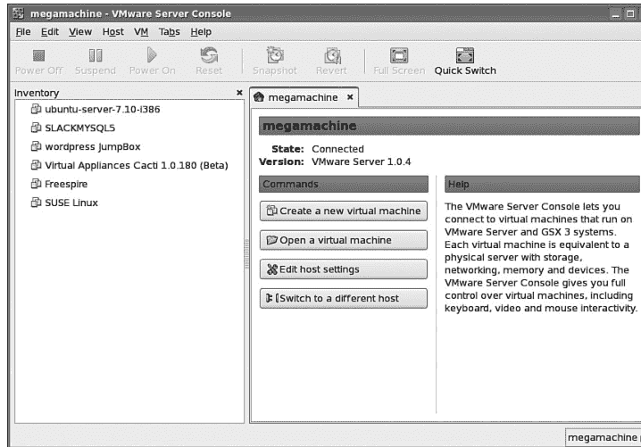

**图 3-2** Linux 版 VMware Server 控制台。

创建虚拟机是控制台的主要功能。你可以使用控制台通过三种方法创建新虚拟机：

- 新建（New）——通过虚拟机向导从零创建一个新虚拟机
- 打开（Open）——打开不在清单中的现有虚拟机
- 导入（Import）——使用 VMware 虚拟机导入器创建新虚拟机

你使用虚拟机向导从零开始创建新虚拟机。向导对你创建的虚拟机的所有方面都提供了最大的控制。

1. 若要调用虚拟机向导（如图 3-3 所示），在 VMware Server 控制台中选择“文件”、“新建”、“虚拟机”，或者使用快捷键 `Ctrl+N`。然后点击“下一步”。

2. 下一个屏幕提示你为新虚拟机选择“典型（Typical）”或“自定义（Custom）”配置。自定义提供了最大的控制权和灵活性，我们在这里为了演示之目的选择了它。

### 图 3-3 在虚拟机向导中选择相应的配置屏幕。

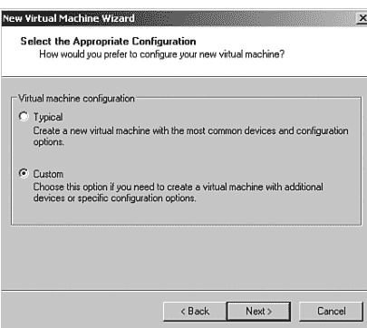

下一个屏幕（如图 3-4 所示）提示你为虚拟机选择一个操作系统。你选择了 Linux（具体来说是 Debian 4）作为该虚拟机的操作系统。

### 图 3-4 选择客机操作系统和版本。

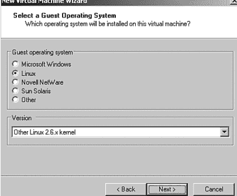

3. 选择 Linux，Other Linux 2.6.x kernel，然后点击“下一步”继续。

4. 现在是给你的虚拟机命名的了。图 3-5 显示了“命名虚拟机”屏幕。输入名称，你会发现“位置”字段中的名称随之更改。最好使用一个包含操作系统和版本号的描述性名称，除非你有其他描述虚拟机的方法，例如公司命名规范（例如，DNS01）。点击“下一步”继续。

### 图 3-5 命名虚拟机。

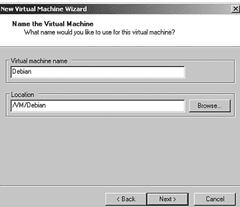

5. 在下一个屏幕（如图 3-6 所示）中，提示你为虚拟机设置权限。如果你想让所有人访问虚拟机，取消勾选“私有（Make Private）”复选框。

### 图 3-6 权限设置

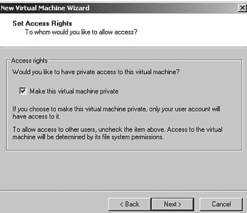

> **注意**：为了本章，我们将假设虚拟机是私有的。

6. 下一个屏幕（如图 3-7 所示）提示虚拟机的启动和关闭行为。选项有：
- 启动（Power on）
- 关机（Shutdown）

某些虚拟机（特别是生产环境中的）应该优雅启动；其他的应该优雅关闭。

### 图 3-7 启动和关闭。

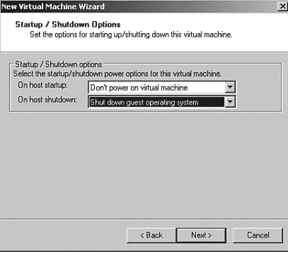

7. 选择“启动主机”并点击“下一步”。

### 图 3-8 处理器数量。

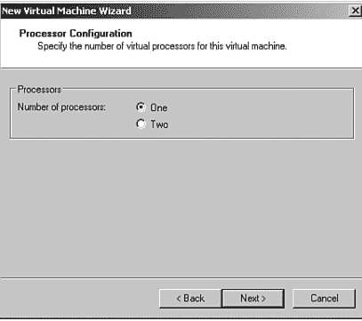

8. 接下来将为虚拟机分配内存（RAM），如图 3-9 所示。

### 图 3-9 调整内存。

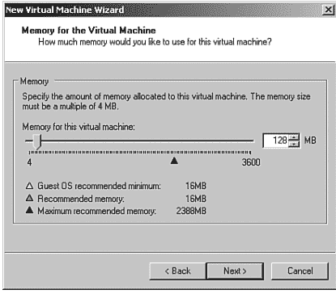

9. 选择 128MB 并点击“下一步”。

选择图 3-10 所示的类型。我们建议使用桥接，以便虚拟机像网络上的其他计算机一样从网络服务器接收 IP 地址。

### 图 3-10 网络类型。

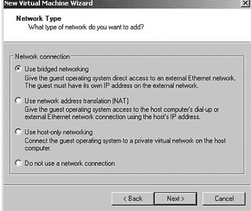

10. 选择“使用桥接（Use Bridged）”并点击“下一步”。

在下一个屏幕（如图 3-11 所示）中，你将为新虚拟机选择 SCSI I/O 适配器类型。LSI 适配器很好，除非使用旧操作系统。你的操作系统默认适配器已经为你选好了。对于所有现代操作系统，你应该选择 LSI Logic，因为 LSI 适配器类型性能更好。如果你混合使用 BusLogic 和 LSI Logic，你的虚拟机将尝试启动 BusLogic 适配器。

### 图 3-11 SCSI I/O 适配器类型。

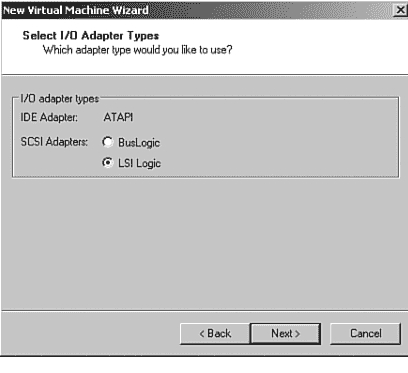

11. 选择 LSI Logic 并点击“下一步”。

向导的接几个步骤将协助你创建一个用于存放虚拟机的虚拟磁盘。第一个屏幕（如图 3-12 所示）允许你新的虚拟磁盘（默认选项）或使用现有的虚拟或物理磁盘。在大多数情况下，你会使用第一个选项来创建新磁盘。

### 图 3-12 新虚拟机的磁盘选项。

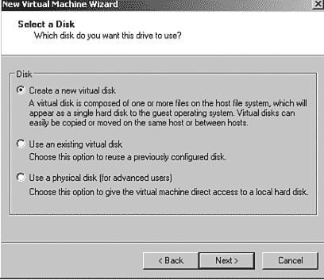

图 3-13 显示了创建虚拟磁盘步骤中的下一个屏幕。在这里，你可以从 IDE 或 SCSI 之间进行选择。根据所选操作系统，系统将为你选择推荐的选项。对于现代操作系统（较新的 Windows 或 Linux），出于性能考虑，你应该选择 SCSI，除非你有不这样做的充分理由。

### 图 3-13 为虚拟机选择磁盘类型 (IDE 或 SCSI)。

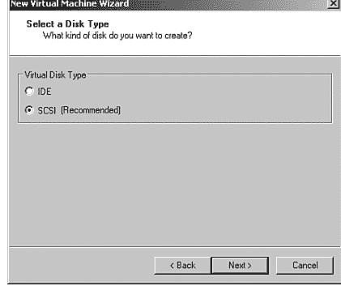

12. 接受默认值 (SCSI) 并点击下一步。

在下一个屏幕（图 3-14）中配置你的虚拟磁盘。分配空间，决定磁盘是具有静态大小还是配置为动态扩展，以及是创建一个大文件还是将磁盘拆分为 2GB 大块。

### 图 3-14 指定磁盘容量和配置。

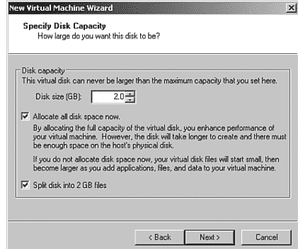

34 实用虚拟化解决方案

磁盘大小主要取决于系统类型和用途。它可以是你需要的任何大小，仅限于系统上的空闲空间。创建静态磁盘或动态磁盘的选择是一个有争议的话题。静态磁盘的优点是它们可以提高性能并更模拟物理磁盘。你可以使用 GParted 等工具调整静态磁盘的大小，因此没有必要为了动态调整大小的磁盘而忍受性能损失。最后，此屏幕允许你选择将虚拟磁盘拆分为块或将其保持为单个文件。为了性能和备份，请选择使用 2GB 块。

13. 为 2GB 输入 2.0，接受“立即分配所有磁盘空间”，接受“将磁盘拆分为 2GB 文件”，并点击下一步。

向导创建虚拟磁盘的最后一步是为你的虚拟磁盘命名。给它一个描述性名称，以相对于它所连接的操作系统进行唯一标识。此虚拟机命名为 `Debian4.vmdk`。见图 3-15。

### 图 3-15 命名虚拟磁盘文件。

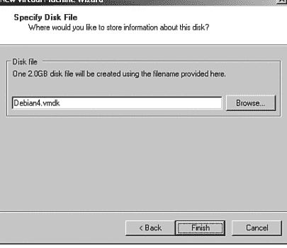

14. 在名称字段中输入 `Debian4.vmdk`（接受默认名称）并点击完成。

点击完成后，进度指示器将跟踪你的新虚拟机的创建过程。虚拟磁盘创建后，你的虚拟机即可可以使用。你的下一步工作是安装操作系统。请参阅附录“虚拟机安装”，获取有关如何安装通用虚拟机操作系统的指令说明。

### 打开虚拟机

打开虚拟机将将其添加到你的清单中。当你在主机系统之间复制虚拟机或恢复虚拟机时，这种添加虚拟机的方法非常常见。

## 第 3 章 VMware Server

1. 在 VMware Server 控制台菜单上，点击“文件”、“打开”或使用键盘快捷键 `Ctrl+O` 打开虚拟机浏览窗口。

默认位置是安装 VMware Server 时指定的目录。

2. 点击“浏览”按钮以定位并选择你想要打开的虚拟机。

3. 选择虚拟机的 `.vmx` 文件并点击“打开”。

虚拟机将出现在你的清单中并准备好使用。

### 导入虚拟机

要导入虚拟机，你必须在 VMware 主机系统上本地打开 VMware Server 控制台。你不能使用远程连接进行导入。在本节的示例中，Microsoft Virtual PC 作为要导入的虚拟机。

1. 在 VMware Server 控制台菜单上，点击“文件”、“导入”。


VMware 虚拟机导入向导启动，并带有有关使用此工具可以导入的虚拟机类型的信息。

你可以导入使用 VMware Workstation、VMware Server、Microsoft Virtual PC、Microsoft Virtual Server、Symantec LiveState Recovery 或 Norton Ghost 9 或更高版本创建的镜像。

> 注意
>
> 在导入过程中，你的虚拟机镜像保持不变。VMware 导入会创建原始虚拟机的副本。

- 2. 点击“下一步”继续。

下一个屏幕提示你决定为新虚拟机选择使用“典型 (Typical)”或“自定义 (Custom)”导入过程。在这里，“典型”更优，因为当你需要指定特定版本的 VMware 软件或将其链接时，会使用这些选项。

- 3. 选择默认并点击“下一步”。

- 4. 选择文件并点击“完成”。

*(注：原文中后续存在大量重复内容，此处已根据要求仅翻译并输出了不重复的核心逻辑部分)*

## 实用虚拟化解决方案

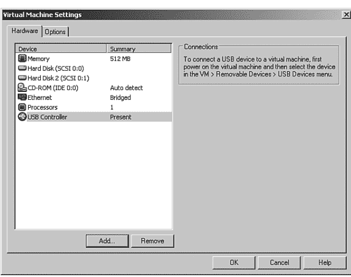

图 3-22 硬件详情界面和 USB 控制器信息。

你可以调整分配给虚拟机（VM）的内存数量，还可以更改其 CD-ROM 软驱器、并行端口、串口、声适配器、SCSI 设备以及处理器的数量。

> 注意
>
> 只有当你的宿主机系统上至少有两个处理器时，你才能将虚拟机的中的处理器数量从一个调整到两个。

### 调整 RAM

更改虚拟机中的 RAM 数量非常简单，以至于会导致资源超额分配。在没有先考虑宿主机系统有多少物理内存的情况下，向虚拟机添加更多 RAM 时请务必小心。你分配给主机的内存不应超过 1GB。但是，不要低于此值，否则性能将会下降，反过来会对你的虚拟机产生不利影响。

> 警告
>
> 在为虚拟机分配内存时，不要使用虚拟机主机的虚拟内存。请仅基于物理 RAM 进行内存调整。

1. 若要调整虚拟机的 RAM 数量，请导航到图 6-20 和 6-22 所示的硬件详情界面。

2. 从列表中选择“内存”，并使用滑块调整 RAM。密切关注建议的最小值和最大值。参见图 3-23。

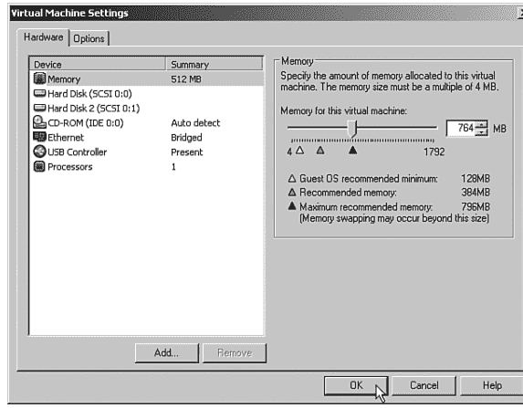

图 3-23 调整虚拟机的内存。

你可能需要超过推荐值，但不要超过最大值，否则将降低所有虚拟机的性能。

3. 完成点击确定。

### 更改 DVD/CD-ROM 特性

在 VMware Server 中，你可以选择将虚拟 DVD/CD 连接到宿主机、客户端机器上的物理驱动器或 ISO 镜像。你也可以将设备专门地连接到当前虚拟机。

在安装新虚拟机时，使用 ISO 镜像代替物理 CD/DVD 磁盘，安装速度会更快。建立一个从零创建新虚拟机的 ISO 仓库是简化这一流程的一种方法。

### 虚拟机文件和文件夹

当你安装 VMware Server 时，系统会提示你为虚拟机命名一个位置。这就是你的虚拟机仓库。你可以拥有多个仓库，但在安装期间命名的那个是默认。

### 文件和文件夹安全

由于安装脚本在 VMware Server 中以 root 身份运行，因此最初指定的作为虚拟机仓库的文件夹具有 root 权限。如果你正在创建一个其他 VMware Server 控制台用户将使用的系统，简化过程的一种方法是为每个用户创建一个仓库。如果你的用户需要一个共享仓库，请以 root 身份创建它，创建一个用于访问该仓库的组，更改仓库文件夹的组权限，并拒绝所有其他访问。

在虚拟宿主机系统的命令行中输入以下命令，为你的虚拟机创建一个共享仓库。

```bash
### mkdir /VMShared
### groupadd vmusers
### chgrp vmusers /VMShared
### chmod 770 /VMShared
```

编辑虚拟宿主机系统的 `/etc/group` 文件，并将用户名添加到 `vmusers` 组条目中。

现在，当用户通过 VMware Server 控制台登录时，他们可以在共享目录（仓库）中创建虚拟机。

### 文件名和角色

创建新虚拟机时，也会创建一个与虚拟机同名的文件夹。该文件夹存在虚拟机仓库文件夹下。这既是一种组织功能，也是一种安全功能，确保每个虚拟机都有自己唯一命名的文件夹来存放其文件。

在虚拟机文件夹下，你将拥有几个文件，取决于你的虚拟驱动有多以及虚拟机是否已开启。

对于名为 `Debian4` 的虚拟机，基本文件如下。这些文件对所有虚拟机通用：

- `Debian4.vmdk`——这是磁盘定义文件（磁盘描述符文件）。其中包含了虚拟磁盘的数量、文件名以及虚拟驱动器的几何结构。

例如：

```
### DescriptorFile
version=1
CID=814cfffffffff
createType="twoGbMaxExtentFlat"
```

```
### Extent description
RW 4193792 FLAT "Debian4-f001.vmdk"
RW 4193792 FLAT "Debian4-f002.vmdk"
RW 4193792 FLAT "Debian4-f003.vmdk"
RW 4193792 FLAT "Debian4-f004.vmdk"
RW 2048 FLAT "Debian4-f005.vmdk"
```

### 磁盘数据

```
ddb.toolsVersion = "6532"
ddb.adapterType = "ide"
ddb.geometry.sectors = "63"
ddb.geometry.heads = "16"
ddb.geometry.cylinders = "1638"
ddb.virtualHWVersion = "4"
```

描述中的 FLAT 表示虚拟驱动器具有静态大小。列出的每个虚拟磁盘文件（`Debian4-f00x.vmdk`）的尺寸最大均为 2GB，在 `createType` 中显示为 `twoGbExtentFlat`。

- `Debian4.vmx`——虚拟机描述符文件。与 `.vmdk` 文件一样，`.vmx` 文件是纯文本文件，可以可以直接编辑。当虚拟机运行时，你可能无法编辑任何一个文件。

```
### DescriptorFile
version=1
CID=814cfffffffff
createType="twoGbMaxExtentFlat"
```

```
### Extent description
RW 4193792 FLAT "Debian4-f001.vmdk"
RW 4193792 FLAT "Debian4-f002.vmdk"
RW 4193792 FLAT "Debian4-f003.vmdk"
RW 4193792 FLAT "Debian4-f004.vmdk"
RW 2048 FLAT "Debian4-f005.vmdk"
```

### 磁盘数据

```
ddb.toolsVersion = "6532"
ddb.adapterType = "ide"
ddb.geometry.sectors = "63"
ddb.geometry.heads = "16"
ddb.geometry.cylinders = "1638"
ddb.virtualHWVersion = "4"
```

描述中的 FLAT 表示虚拟驱动器具有静态大小。列出的每个虚拟磁盘文件（`Debian4-f00x.vmdk`）的尺寸最大均为 2GB，在 `createType` 中显示为 `twoGbExtentFlat`。

- `Debian4.vmx`——虚拟机描述符文件。与 `.vmdk` 文件一样，`.vmx` 文件是纯文本文件，可以可以直接编辑。当虚拟机运行时，你可能无法编辑任何一个文件。

```
### DescriptorFile
version=1
CID=814cfffffffff
createType="twoGbMaxExtentFlat"
```

```
### Extent description
RW 4193792 FLAT "Debian4-f001.vmdk"
RW 4193792 FLAT "Debian4-f002.vmdk"
RW 4193792 FLAT "Debian4-f003.vmdk"
RW 4193792 FLAT "Debian4-f004.vmdk"
RW 2048 FLAT "Debian4-f005.vmdk"
```

### 磁盘数据

```
ddb.toolsVersion = "6532"
ddb.adapterType = "ide"
ddb.geometry.sectors = "63"
ddb.geometry.heads = "16"
ddb.geometry.cylinders = "1638"
ddb.virtualHWVersion = "4"
```

只要规模较小，VMware Server 对于测试环境来说是非常有效的。因此，系统人员开始向教职员工推销该解决方案。

通常，学校的 IT 人员负责设置用户的计算机，然后由用户自行管理。这使用户能够在 IT 部门资源消耗最少的情况下，完成任何所需的操作。


然而，IT 人员将 VMware Server 视为一种“入门级药物”，并且已经开始考虑在其虚拟化产品中增加更多的计算能力。他们正在尝试一种更像云的环境，在这种环境内，可以通过数据中心内的 ESX 服务器向教职员工提供虚拟机（`VM`）。

尽管学校对 `VMware Server` 非常满意，但该系统管理员提醒说，确保合理的预期非常重要。通常，用户期望获得 `ESX` 的性能，但对实际获得的结果感到失望。

假设中等性能是可以接受的，`VMware Server` 甚至可能是初始服务器虚拟化尝试的良好人选。尽管它价格低廉且易于使用，但对于 IT 人员有限的小型企业来说，它并不总是理想选择，在某些情况下，它们发现 `vSphere` 或 `vCloud` 能更好地满足其需求。

### 总结

本章介绍了 `VMware Server` 和虚拟机、`VMware Server` 控制台（后者是用户与虚拟机之间的主要界面）。控制台用于创建、更改、删除和编辑虚拟机。本章详细讲解了如何从头创建一个虚拟机、如何对硬件组件进行更改，以及如何自定义虚拟机以获得更好的性能。还涵盖了 `VMware` 虚拟机的文件级组成部分以及如何针对不同目的保护虚拟机。最后，介绍了每种 `VMware` 文件类型，并解释了它们在 `VMware` 虚拟机生命周期中的作用。

## 第 4 章 VMware ESXi

`VMware` 是虚拟化领域中的“推土机”，`ESX` 和 `ESXi` 是它的旗舰产品，旨在管理庞大的虚拟基础设施。本章的重点 `ESXi` 是一种企业级虚拟机监控程序产品，由 `VMware` 推出的免费版本，用于展示其产品的价值以及使用这些产品可以节省多少资金。

`ESXi` 是一个免费产品，但在范围和结构上与第 3 章介绍的“`VMware Server`”有很大不同。如前所述，`ESXi` 需要其专用的专用服务器系统来支持虚拟客户机。目前，它的硬件兼容性列表（`HCL`）相当有限，因此你必须在符合其要求的系统上安装它。通常，你需要一个 64 位的 CPU（带有虚拟化扩展）；双核、四核或更多核心的系统配备 16GB 内存；以及数百 GB 的磁盘空间。`ESXi` 支持广泛的服务器型硬件，不要期望通用硬件就能满足。

`ESX` 和 `ESXi` 的区别在于 `ESXi` 本身就是虚拟机监控程序。在 `VMware` 术语中，它没有主虚拟机（`VM`）或 Domain 0（即服务控制台）。你需要使用 `VMware` 的虚拟基础设施客户端（现在称为 `VMware vSphere` 客户端）来连接和管理 `ESXi` 以及你的虚拟机。至于 `ESXi` 的工作原理与 `ESX` 的区别，如果你通过客户端软件见过 `ESXi`，那么你也就见过 `ESX` 了。

### 虚拟基础设施客户端控制台

如前所述，`ESXi` 的控制台是虚拟基础设施客户端（`VIC`）。`VIC` 是一个中心化管理应用程序。你与 `ESXi` 服务器之间的所有交互都通过此应用程序进行。请参图 4-1 查看 `VIC`。

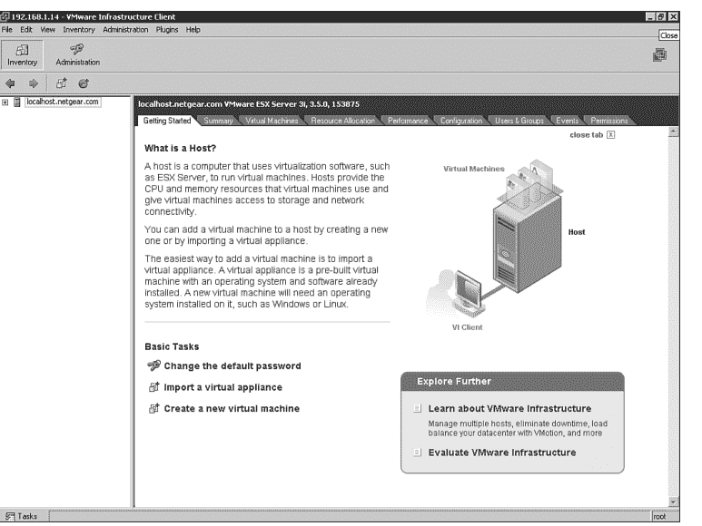

图 4-1 `VMware ESX/ESXi` 虚拟基础设施客户端控制台。

你会注意到 `VIC` 与 `VMware Server` 控制台相似，并且设计时考虑了从 `VMware Server` 迁移到企业级产品。

## 实用虚拟化解决方案

### 创建虚拟机

你大部分时间都会在 `VIC` 中创建或管理虚拟机，让我们过一遍创建新虚拟机的步骤。

- 1. 通过右键点击左侧（清单）面板中列出的 `ESXi` 服务器，或点击右侧面板“开始使用”选项卡中的“创建新虚拟机”链接来开始创建新虚拟机。详见图 4-2。
- 2. 此操作将调用“新建虚拟机”向导，引导你完成新虚拟机的创建。
- 3. 系统提示你为新虚拟机选择“典型”（Typical）或“自定义”（Custom）配置。选择“自定义”并点击“下一步”。

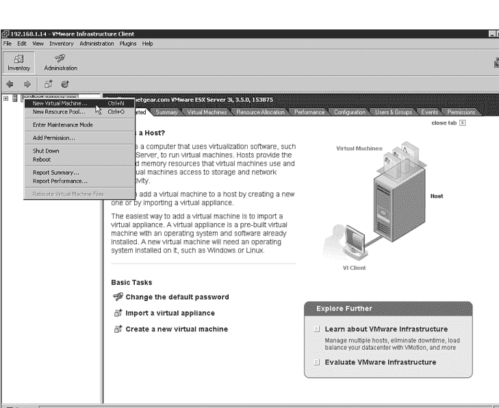

图 4-2 调用新建虚拟机”向导。

我们建议你选择“自定义”，这样你就可以对虚拟机配置拥有完全的控制权。创建此虚拟机就像你订购物理系统一样，你很可能不会接受一个通用系统，而是会要求特定的组件和配置。详见图 4-3。

- 为你的虚拟机命名（如图 4-4 所示，名为 Debian）。点击“下一步”继续。
- 选择一个数据存储（磁盘卷），如图 4-5 所示，用于存储你的虚拟机文件。点击“下一步”。

  如果你有多个数据存储，你必须从中选择一个。根据你的环境，你可能为不同的目的指定了数据存储。其中一个可能用于 Web 服务器，而另一个可能仅用于数据库。如果你不是管理员，请检查以确定哪一个适合你的环境。
- 为你的新虚拟机选择操作系统。从下拉菜单中选择特定版本并点击“下一步”，如图 4-6 所示。

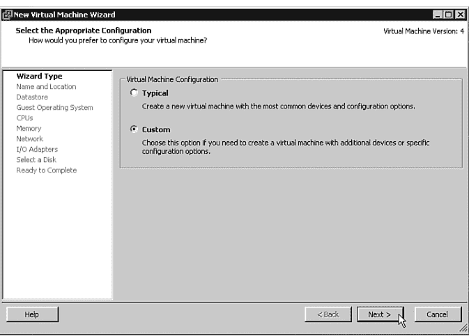

图 4-3 选择虚拟机类型：典型或自定义。

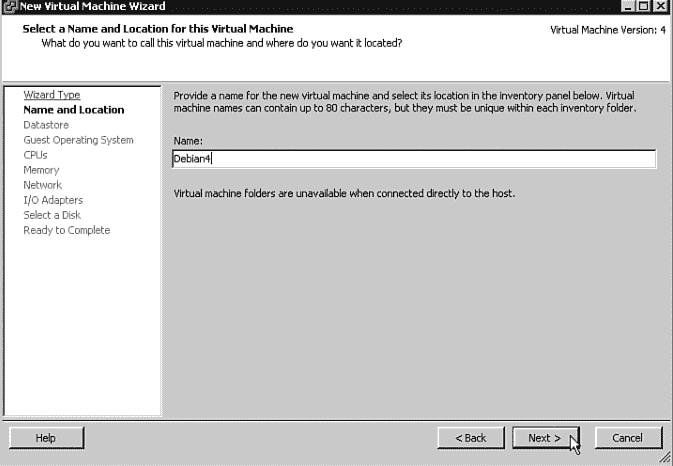

图 4-4 命名虚拟机。

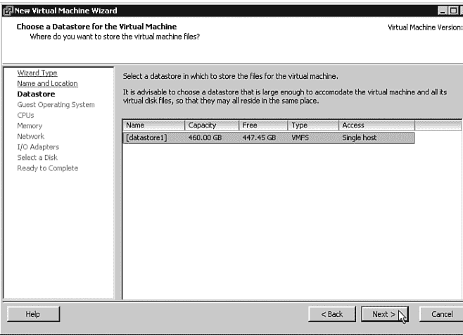

图 4-5 选择数据存储。

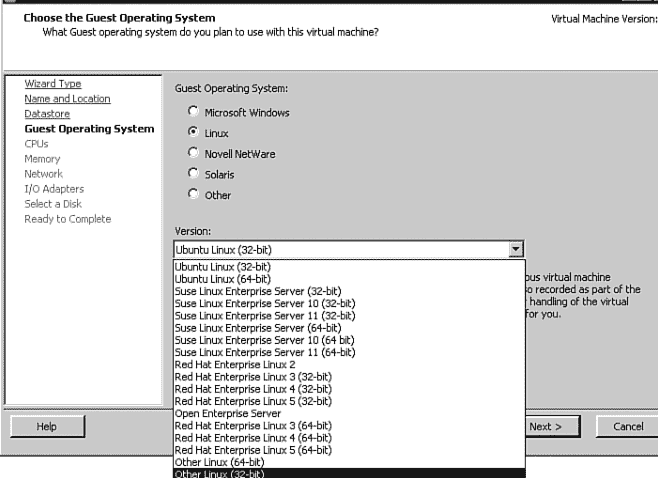

图 4-6 选择操作系统。

- 6. 在图 4-7 所示的屏幕上，为你的虚拟机分配所需的虚拟机处理器（`vCPU`）。

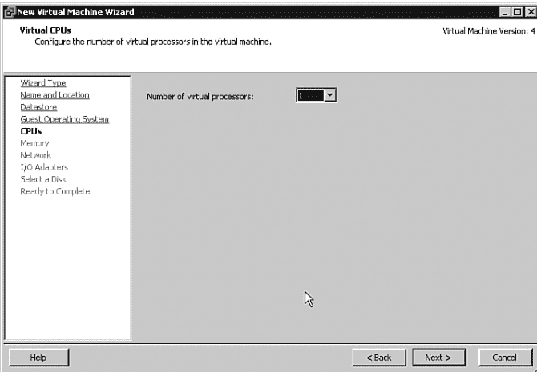

图 4-7 为新虚拟机分配 `vCPU`。

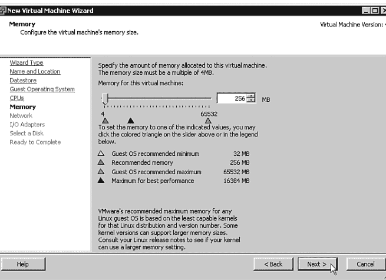

图 4-8 为虚拟机分配内存。

- 7. 在图 4-9 所示的屏幕上，为你的虚拟机分配所需的内存。

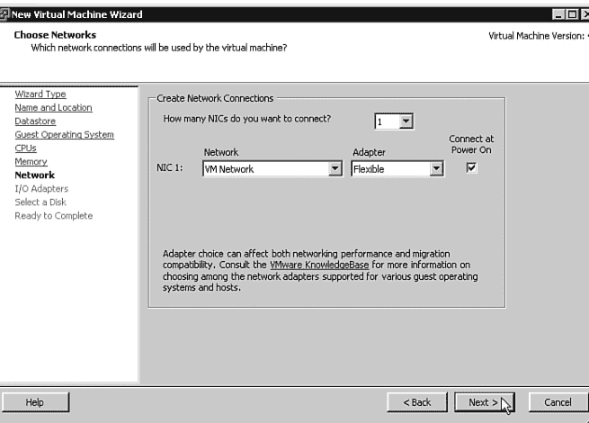

图 4-9 选择网络接口。

- 8. 如图 4-10 所示，选择磁盘连接的 I/O 适配器类型。`SCSI` 是默认选择。

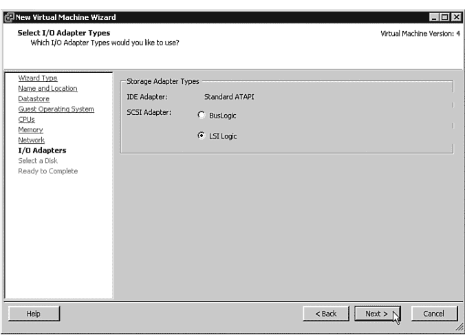

图 4-10 选择 I/O 适配器类型（默认选择）。

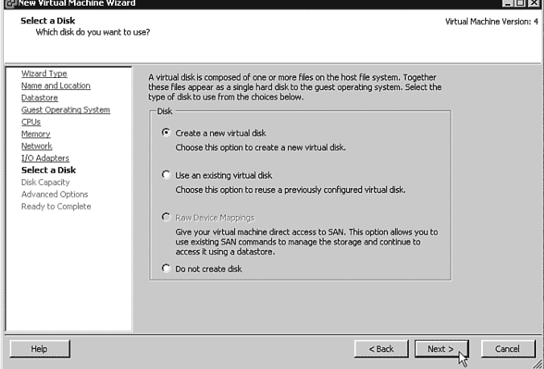

图 4-11 创建新磁盘。

- 9. 如图 4-11 所示，选择网络接口数量和类型。

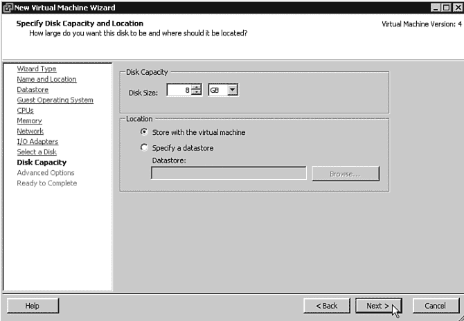

图 4-12 分配空间和位置。

- 10. 如图 4-12 所示，为你的虚拟机磁盘提供 GB 或 MB 大小和位置。点击“下一步”。
- 11. 在图 4-13 所示的屏幕上，你将为虚拟机磁盘指定任何高级选项。如屏幕上的信息所示，通常不需要更改。点击“下一步”继续。
- 12. 此最终屏幕提示你接受虚拟机设置或编辑它们（详见图 4-14）。当你准备好创建新虚拟机时点击“完成”。

你的虚拟机已完成，虚拟机磁盘文件已创建。你现在准备好在虚拟机上安装操作系统了。这些步骤请参阅附录“虚拟机安装”。

### 自定义虚拟机

几乎没有哪个虚拟机通过通用的向导构建后是完美的，因此你必须对它进行自定义以满足你的特定需求。要编辑任何虚拟机的属性，请在 `VI Client` 的清单面板（左窗口）中点击选择虚拟机，并在右窗口点击“提交前编辑虚拟机设置”。

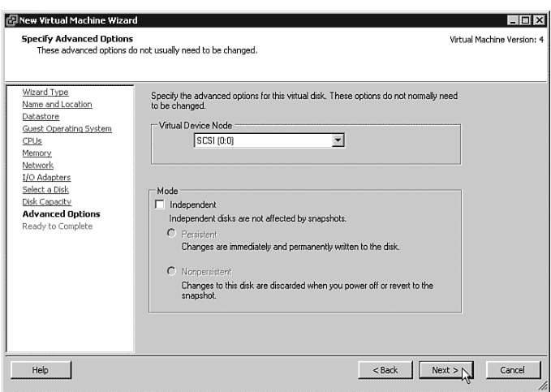

图 4-13 为新虚拟磁盘选择高级选项（显示默认值）。

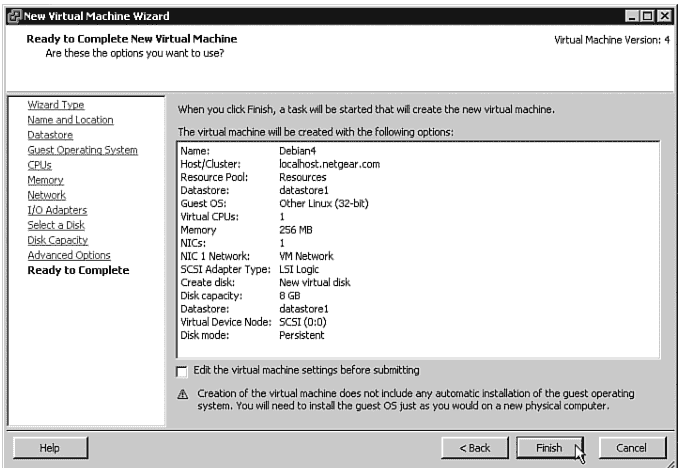

图 4-14 检查虚拟机摘要。

虚拟机的属性窗口打开，如图 4-15 所示。

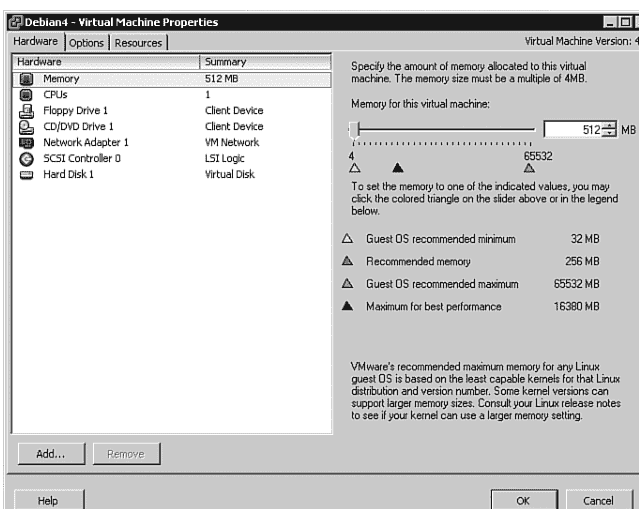

图 4-15 编辑虚拟机属性。

在“硬件”选项卡上，你可以调整内存数量、`CPU` 数量、软驱器支持、`CD/DVD` 驱动器支持、网络适配器属性、`SCSI` 控制器属性以及硬盘的数量、大小和类型。有趣的是，这些是你可以使用“资源”选项卡更改的高级参数，如图 4-16 及接下来的几幅截图所示。

通过更改 `CPU` 份额数，你可以有效地确定每个虚拟机接收多少 `CPU` 处理能力，以便运行 `CPU` 密集型应用程序的虚拟机获得适当的资源。`CPU` 份额是从任意总数中减去的 `CPU` 处理资源量。控制台操作系统（宿主机操作系统）以及所有新虚拟机默认都接收 1,000 份。通过调整此数字，你可以将 `CPU` 资源划分为总量的某个百分比。


例如，如果你的总份额数为 10,000，那么你的宿主机操作系统将获得总 CPU 资源的 10%。你通过在选择“资源”选项卡下选择“内存”来更改内存份额，如图 4-17 所示。

内存份额的分配和计算方式略有不同。默认情况下，每 1MB 虚拟机内存分配 10 份份额。例如，如果你的新虚拟机有 1GB (1024MB) 的内存，该虚拟机将获得 10x1024 = 10,240 份系统内存。

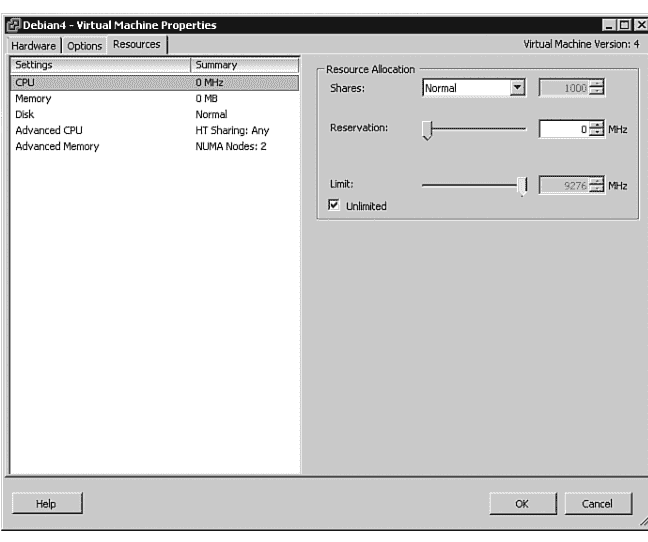

图 4-16 更改 CPU 资源分配。

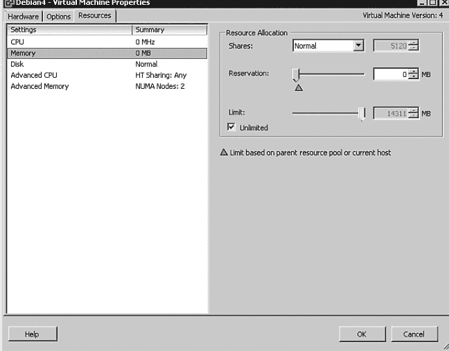

图 4-17 更改内存资源分配。

## 第 4 章 VMware ESXi

磁盘份额的使用（如图 4-18 所示）用于对同一数据存储上的多个虚拟机机的磁盘访问优先级排序。要编辑设置，请从“资源”菜单中选择“磁盘”，然后双击右侧窗口中的“份额”以打开选项菜单（低、普通、高和自定义）。

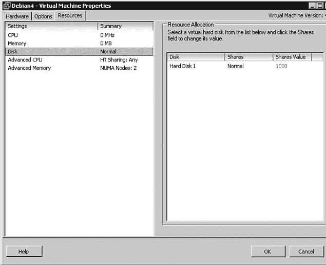

图 4-18 更改磁盘资源分配。

磁盘份额针对每个 ESXi 主机。换句话说，你在一个 ESXi 主机上设置的磁盘份额数不会影响其他 ESXi 主机的磁盘份额。

图 4-19 显示了与更改虚拟机 CPU 亲和性相关的选项，这意味着你可以选择虚拟机运行在哪些物理处理器上。

如果你已指定了 CPU 亲和性，你可能还想将内存分配与非统一内存访问 (NUMA) 节点关联。这也称为手动内存亲和性。将虚拟机与特定的 NUMA 节点关联可以极大提高性能。见图 4-20。

要更改虚拟机虚拟机，请选择“选项”选项卡。如图 4-21 所示，你可以更改虚拟机名称和客户操作系统。

当你完成虚拟机设置编辑后，点击“确定”返回虚拟机主界面。

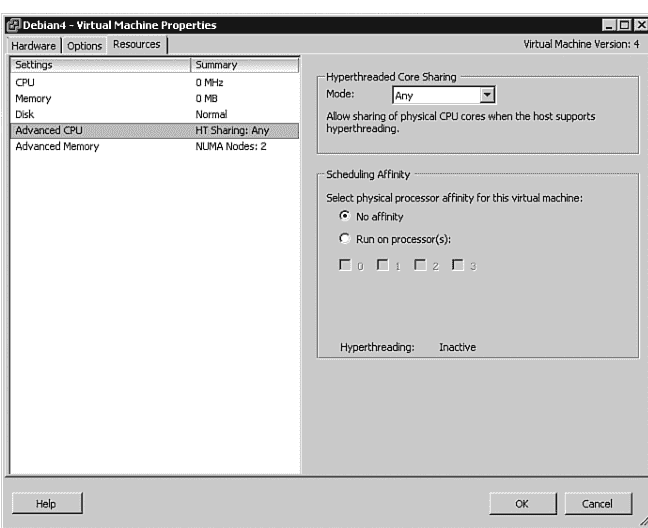

图 4-19 更改虚拟机的 CPU 亲和性。

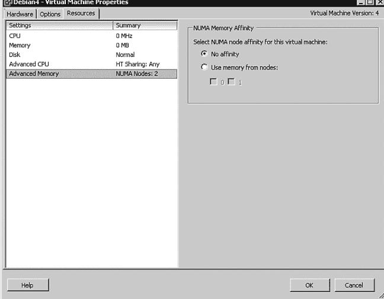

图 4-20 更改虚拟机的内存亲和性。

### 虚拟机文件和文件夹

当你的虚拟机运行后，是时候考虑文件和文件夹安全，以及文件名和角色了。

### 文件和文件夹安全

由于 ESXi 未关联任何操作系统，因此文件和文件夹的安全由 VMware vStorage 虚拟机文件系统 (VMFS) 处理。你无法直接对文件进行操作或处理，这为虚拟机及其文件提供了所需的安全层。

### 文件名和角色

所有 VMware 服务器级产品具有相同的文件命名法和格式。当你创建一个新虚拟机时，会创建一个以你的虚拟机命名的文件夹。该文件夹存在于你选择的数据存储或虚拟机仓库文件夹下。这是一个组织和安全功能，确保每个虚拟机都有自己的文件夹。

在数据存储中，你会发现几个（img/2ed981e74b223133167333db66866d4d_85_0.png）

## 实用虚拟化解决方案

磁盘份额的使用（如图 4-18 所示）用于对同一数据存储上的多个虚拟机机的磁盘访问优先级排序。要编辑设置，请从“资源”菜单中选择“磁盘”，然后双击右侧窗口中的“份额”以打开选项菜单（低、普通、高和自定义）。

磁盘份额针对每个 ESXi 主机。换句话说，你在一个 ESXi 主机上设置的磁盘份额数不会影响其他 ESXi 主机的磁盘份额。

图 4-19 显示了与更改虚拟机 CPU 亲和性相关的选项，这意味着你可以选择虚拟机运行在哪些物理处理器上。

如果你已指定了 CPU 亲和性，你可能还想将内存分配与非统一内存访问 (NUMA) 节点关联。这也称为手动内存亲和性。将虚拟机与特定的 NUMA 节点关联可以极大提高性能。见图 4-20。

要更改虚拟机信息，请选择“选项”选项卡。如图 4-21 所示，你可以更改虚拟机名称和客户操作系统。

当你完成虚拟机设置编辑后，点击“确定”返回虚拟机主界面。

### 虚拟机文件和文件夹

当你的虚拟机运行后，是时候考虑文件和文件夹安全，以及文件名和角色了。

### 文件和文件夹安全

由于 ESXi 未关联任何操作系统，因此文件和文件夹的安全由 VMware vStorage 虚拟机文件系统 (VMFS) 处理。你无法直接对文件进行操作或处理，这为虚拟机及其文件提供了所需的安全层。

### 文件名和角色

所有 VMware 服务器级产品具有相同的文件命名法和格式。当你创建一个新虚拟机时，会创建一个以你的虚拟机命名的文件夹。该文件夹存在于你选择的数据存储或虚拟机仓库文件夹下。这是一个组织和安全功能，确保每个虚拟机都有自己的文件夹。

## 实用虚拟化解决方案

磁盘份额的使用（如图 4-18 所示）用于对同一数据存储上的多个虚拟机机的磁盘访问优先级排序。要编辑设置，请从“资源”菜单中选择“磁盘”，然后双击右侧窗口中的“份额”以打开选项菜单（低、普通、高和自定义）。

磁盘份额针对每个 ESXi 主机。换句话说，你在一个 ESXi 主机上设置的磁盘份额数不会影响其他 ESXi 主机的磁盘份额。

图 4-19 显示了与更改虚拟机 CPU 亲和性相关的选项，这意味着你可以选择虚拟机运行在哪些物理处理器上。

如果你已指定了 CPU 亲和性，你可能还想将内存分配与非统一内存访问 (NUMA) 节点关联。这也称为手动内存亲和性。将虚拟机与特定的 NUMA 节点关联可以极大提高性能。见图 4-20。

要更改虚拟机信息，请选择“选项”选项卡。如图 4-21 所示，你可以更改虚拟机名称和客户操作系统。

当你完成虚拟机设置编辑后，点击“确定”返回虚拟机主界面。

### 虚拟机文件和文件夹

### 现实世界中的 VMWARE ESXI

位于田纳西州诺克斯维尔（Knoxville, TN）的 Jewelry Television专注于宝石。Jewelry Television 起 20 世纪 90 年代初的 Collectibles Network。那时销售收藏品。2000 年开始主要关注在线销售。

ESXi 在不到 15 分钟内就运行起来了。对于预装了 ESXi 的系统，速度会更快。

软件维护也得到了简化。在 ESX 中，更新是持续的，并且需要对每台主机进行更新。相比之下，ESXi 通常每月仅一次固件升级，这意味着只需要更新两个文件并重启即可。

然而，在迁移过程中没有发生过任何托管的停机，但两者之间的变化存在着学习曲线，因为它改变了服务器的管理方式。ESXi 和 ESX 都是通过 VMware Virtual Infrastructure Client 进行管理，方式与未获得 vCenter 许可的环境相同。但是，在 ESX 中，你可以远程连接到服务控制台并在主机上执行命令；而在 ESXi 中，必须在本地工作站上安装远程命令行实用程序才能对 API 发出远程命令。

此外，某些第三方工具最初无法立即兼容 ESXi。自从情况发生变化，现在所有工具都已兼容 ESXi，包括文件操作工具。最后，文件传输也是一个有些笨拙的过程，并不像在 ESX 中那样容易。

然而，性能的提升弥补了这些不足。由于为实际虚拟机提供了更多的计算资源，即使是开发人员也注意到了改进。

虚拟化尝试本身是成功的。从企业的角度来看，它的成功更加显著：该公司归功于虚拟化使其能够实现目标。

IT 部门的任务是构建一个支持公司增长的基础设施，而将其大部分基础设施虚拟化，使得 Jewelry Television 能够增长到其所需的规模。

如今，Jewelry Television 的数据中心拥有 70 台 ESXi 主机、XP 桌面电脑、近 800 台瘦客户客户端和近 1,000 台虚拟机——与最初开始时的两台 HP 服务器相去径远。其基础设施的链接都已虚拟化，包括连接到运行 ESXi 服务器的瘦客户客户端。留存在专用服务器上的两个应用程序是其网站面向客户的程序和主数据库。

在硬件方面，随着市场上所有的极低端服务器现在都转向虚拟化设计，选择非常多。Jewelry Television 大体是一家使用 Dell 的公司，尽管还有几台 HP 和 Sun 服务器。

在大多数情况下，Jewelry Television 的 IT 基础设施已经扩展以满足其增长的需求。然而，由于首次大规模网络构建发生在三年前，某些设备已经到了更换的时候。随着硬件的淘汰，新技术（如思科的 Nexus 1000 虚拟交换机）将取代它们。公司还在考虑基础设施变更以引入 VMware 的云计算基础设施 vSphere。

由于虚拟化在 Jewelry Television 的数据中心内无处不在，他们非常小心地不区分物理和虚拟，将两者都视为“数据中心”。

它还让补丁成为一个首要任务，并使用 VMware Update Manager 更新 VMware，使用 MS WSUS 更新 Windows 服务器，以及使用 yum 和 up2date 更新 Linux 服务器来保持服务器更新。管理员仔细地在 Virtual Center 中保持相同的视图。所有工具都感知灾难恢复服务，并在范围内使用了灾难恢复和服务高可用性。

### 总结


VMware 的 ESXi 是一个免费的企业级虚拟机程序，它具有与 VMware ESX 相同的所有高级属性和功能。它缺少控制台（Dom0），但在性能和扩展性等其他所有方面都与 ESX 匹配。

在本章中，你学习了使用 ESXi 的基本知识以及如何安装和自定义虚拟机。

# 第 5 章 Citrix XenServer

XenServer 起于一个开源项目。与许多开源项目一样，它的根源在于研究。它于本世纪初作为剑桥大学的 XenSource 项目诞生。2003 年，它向公众开放。在随后的几年里，基于半虚拟化的开源虚拟机程序的商业版本 XenEnterprise 出于一家与该项目紧密相关的公司。。2007 年 8 月，Citrix 宣布了购买 XenSource 的计划。收购完成后不久，Citrix 引入了带有新命名的 4 版本。开源版本仍然存在，可以在 Xen.org 找到 Citrix。

从那时起，Citrix 围绕 XenServer 开发了一套管理工具生态系统，保持了与以前版本相同的的外和感受。随着 5 版本的发布，XenServer 变得免费，使其成为服务器虚拟化更具吸引力的选择。XenServer 通常被简称为 Xen，以其卓越的磁盘 I/O、易用性和速度而闻名。这也许是它被用于超过 95% 的云环境中的原因，包括亚马逊的弹性计算云 (EC2)。我个人从 3.x 版本开始一直使用 XenServer，从未对它的功能、速度或整体可用性感到失望。对于从拥有极小服务器机房到大型企业的许多组织来说，这都是一个明智且实惠的选择。

## XenServer, 虚拟机程序

XenServer 与 ESXi 一样是一个虚拟机程序，这意味着虚拟化软件像 ESXi 一样直接安装在裸机上——即一个没有操作系统的原始服务器系统。当你登录到基于 Linux 的控制台时，交互的操作系统本身是一个作为 Domain0 (Dom0) 安装的虚拟机 (VM)。通过该系统，你与虚拟机程序交互，这是一个你不会直接与之交互的低级程序。

所有其他虚拟机都是用户域（DomainU 或 DomU），其资源由虚拟机程序管理。为了完全与 XenServer 交互、创建虚拟机、分配资源、监控性能并添加存储库，你需要使用 XenCenter，将在下一节介绍。

## 实用虚拟化解决方案

### XenCenter——Xen 控制台

XenCenter 被称为 XenCenter。它是你管理基础设施的图形化界面。图 5-1 显示了新安装的、没有任何虚拟机的 XenServer 的 XenCenter 控制台。名称 xenserver-kppdq 是安装时赋予 XenServer 的随机名称。你可以使用此名称或你喜欢的其他名称——可以在 XenServer 安装期间进行更改。

![2ed981e74b223133167333db66866d4d_92_0.png] XenCenter 控制台。

要在 XenCenter 控制台中重命名你的 XenServer，右键点击名称并从菜单选择属性。默认打开常规选项。更改名称并点击确定应用更改。此名称更改对你的 XenServer 安装或任何虚拟机都没有影响。

XenCenter 控制台是你与 XenServer 交互的主要界面。图 5-2 所示本地控制台功能有限；在本地控制台上的操作很少。你需要使用 XenCenter 来充分利用管理功能。

![2ed981e74b223133167333db66866d4d_93_0.png] 本地 XenServer 控制台。

### 创建虚拟机

安装 XenCenter 后，运行虚拟机非常简单。大多数情况下意味着从 ISO 库开始。

#### 识别 ISO 库

除非你从本地磁盘或 CD/DVD 驱动器安装虚拟机，否则你需要为 XenServer 识别 ISO 库（存储库）。这种库有两种可能：通过通用互联网文件系统 (CIFS) 的 Windows 文件共享，或 UNIX 类型网络文件系统 (NFS) 共享。你选择哪种取决于 ISO 文件存储的位置（远程 Windows 系统或远程 UNIX/Linux 系统）。

向你的 XenServer 识别 ISO 库

- 点击选择你想要安装新虚拟机的 XenServer 系统。
- 点击 XenCenter 菜单上的 New Storage（新建存储）按钮。出现图 5-3 所示的屏幕，并提示你识别 XenServer 的存储类型。

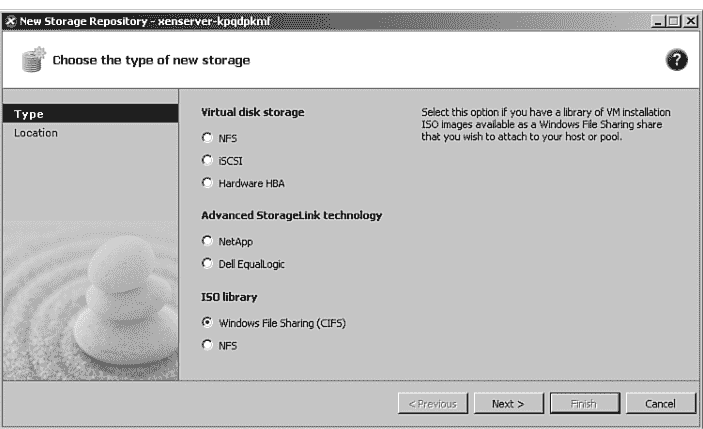

图 5-3 选择存储类型。

3. 在 ISO 库下，选择 Windows 文件共享 (CIFS)（如图所示）或 NFS，然后点击“下一步”。在下一个屏幕上，为您的 ISO 库命名并并将共享名称提供给 XenServer（见图 5-4）。

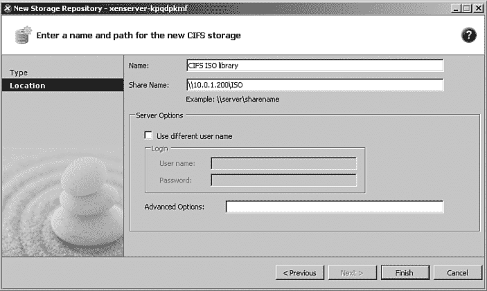

图 5-4 命名 ISO 库并输入共享名称。

4. 使用您喜欢的描述性名称为您的 ISO 库命名。

5. 以适用于共享类型（CIFS 或 NFS）的正确格式向 XenServer 提供共享名称。

如果您的 CIFS 或 NFS 共享需要非匿名凭据才能连接到您确定的共享，请使用“不同用户名”并在提供的空间中输入用户名和密码。

6. 点击“完成”。

当您开始安装虚拟机时，您的 ISO 库将可用，如节所示。当您返回 XenServer 控制台时，您将看到您的 ISO 库已列出，如图 5-5（左窗格）所示。

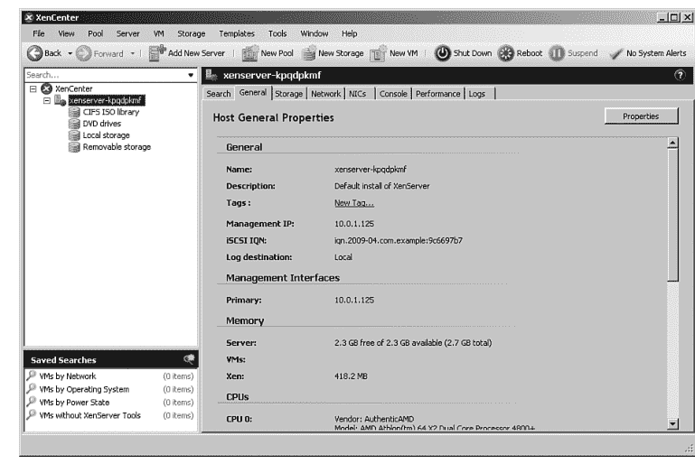

图 5-5 XenServer 的资源列表。

### 虚拟机向导

现在您准备好创建一个虚拟机了：

- 1. 从 XenServer 控制台点击“新建虚拟机”。
- “新建虚拟机向导”中出现的第一个屏幕是提示您选择操作系统模板以安装虚拟机的屏幕。
- 2. 从模板列表中选择操作系统。如果列表中没有列出您的操作系统，请跳转到第 3 步。如果已列出，请跳过第 3 步执行第 4 步。
3. 滚动到列表底部，选择“其他安装介质”，并点击“下一步”继续，如图 5-6 所示。

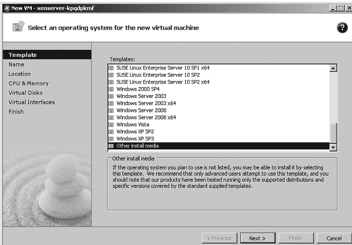

图 5-6 使用“其他安装介质”选择操作系统模板。

4. 为您的虚拟机命名，提供描述，并点击“下一步”。见图 5-7。

5. 选择用于安装虚拟机的源 ISO 镜像，并点击“下一步”。

如果您有想要从其安装的 CD 或 DVD 光盘，请将其插入 CD/DVD 驱动器并选择“物理 DVD 驱动器”。如图 5-8 所示，我从之前创建的 CIFS ISO 库中选择了 Debian-40r3-i3386-netinst.iso。

6. 如图 5-9 所示，为新虚拟机选择虚拟 CPU 数量和初始内存分配。点击“下一步”继续。

7. 点击“添加”为您的新虚拟机创建一个虚拟磁盘。

8. 为新虚拟磁盘选择大小（例如 2.0GB），为您的新虚拟机选择存储位置（显示本地存储），并点击“确定”。见图 5-10。

在选择完虚拟磁盘的大小和存储位置后，您将返回到虚拟机向导，如图 5-11 所示。

# 第 5 章 Citrix XenServer | 73

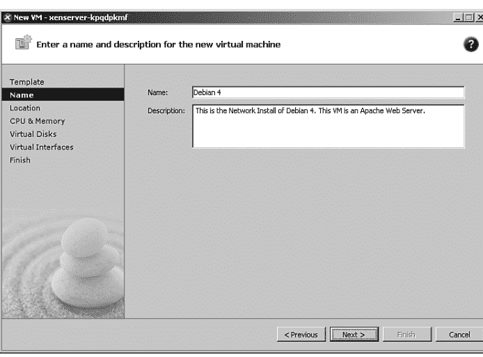

图 5-7 命名并描述新虚拟机。

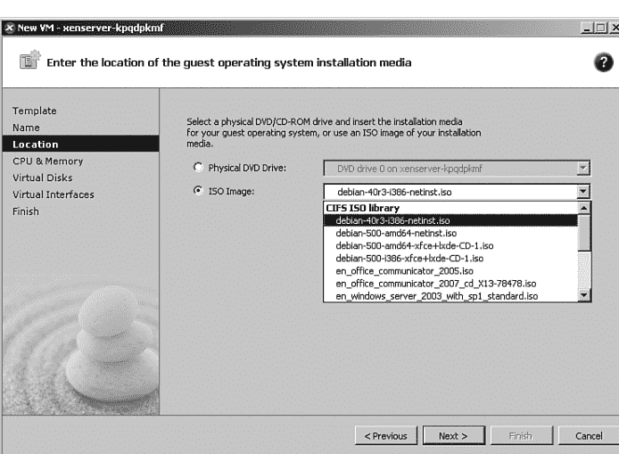

图 5-8 选择您的安装介质。

## 实用虚拟化解决方案

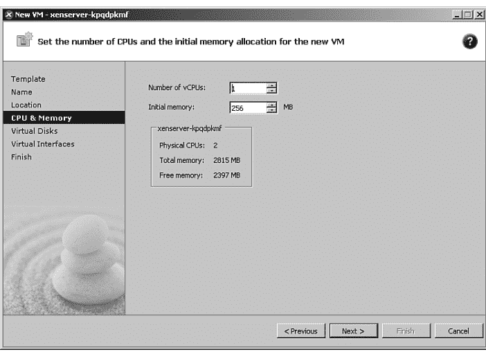

**图 5-9** 为新虚拟机选择虚拟 CPU 数量和内存。

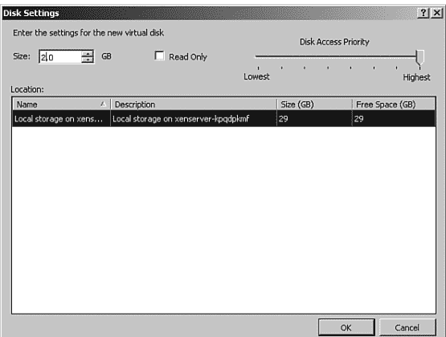

**图 5-10** 选择虚拟磁盘大小和位置。

- 9. 点击“下一步”继续。


图 5-11 显示新虚拟磁盘的虚拟机向导。

- 10. 为您的新虚拟机选择或添加虚拟网络接口，并点击“下一步”。图 5-12。

您的虚拟机现在已完成。在完成此向导后，您可以开始安装新虚拟机的操作系统，或者取消勾选“自动启动虚拟机”框并继续。

- 11. 点击“完成”结束向导。

向导完成后，您的新虚拟机即已创建。当您返回 XenServer 控制台时，您将看到您的 ISO 库已列出，如图 5-5（左窗格）所示。

要启动您的虚拟机，请单击选择它。见图 5-13。您可以在完成向导后，开始安装新虚拟机的操作系统，或者取消勾选“自动启动虚拟机”框并继续。

向导完成后，您的新虚拟机已创建。见图 5-14 您的网络接口。

### 定制虚拟机

虚拟机和物理机一样，其配置可以更改或微调以提高性能。您可以添加更多空间、内存或网络接口。

## 实用虚拟化解决方案


图 5-12 网络接口。


图 5-13 XenServer 资源列表。

### 虚拟机

要查看虚拟机配置，选择“属性”选项卡。见图 5-15。


图 5-14 虚拟机。


图 5-15 属性。

## 实用虚拟化解决方案

要添加更多存储，点击“存储”选项卡。见图 5-16。


图 5-16 添加虚拟磁盘。

完成后，点击“添加”。新虚拟磁盘将出现在虚拟机的虚拟磁盘列表中。您还将收到一条通知，说明新磁盘将在重启后可见。见图 5-17。


图 5-17 新虚拟磁盘已。

要添加虚拟网络接口，点击“网络”选项卡。
- 点击“添加”按钮。如图 5-18 所示的屏幕允许您添加新的虚拟网络接口。
- 从下拉列表中选择可用的网络 ID。
- 选择自动生成的 MAC 地址（推荐）或手动创建一个。
- 点击“完成”。

您将收到一条图 5-19 所示的消息，说明您的虚拟网络更改将在下次重启虚拟机时生效。


图 5-18 添加新的虚拟网络接口。


图 5-19 新虚拟网络接口已添加。

## 第 5 章 Citrix XenServer

| 通用 | 存储 | 网络 | 控制台 | 性能 | 日志 |
|---|---|---|---|---|---|
| 虚拟网络接口 | | 添加接口... | 属性 | 移除接口 | |
| MAC | 限制 | 网络 | IP 地址 | 激活 | |
| fa1:c87:a4:0b:75 | 网络 0 | Unknown | 是 | | |
| e2:f0:01:23:70:54 | 网络 0 | Unknown | 是 | | |

图 5-20 虚拟网络接口（均已激活）。

| 通用 | 存储 | 网络 | 控制台 | 性能 | 日志 |
|---|---|---|---|---|---|
| 虚拟磁盘 | 添加... | 挂载... | 属性 | 禁用 | 卸载 | 删除 | DVD 驱动器: | | | | | |
| 名称 | 描述 | 存储库 | 设备位置 | 大小 | 只读 | 优先级 | 激活 | 设备路径 |
|---|---|---|---|---|---|---|---|---|
| 0 | xserver-k...上的本地存储 | 0 | | 2.0 GB | 否 | (最高) | 是 | `/dev/sda` |
| NVD | xserver-k...上的本地存储 | 1 | | 1.0 GB | 否 | (最高) | 是 | `/dev/hdb` |

图 5-21 虚拟硬盘已激活并准备好使用。

### 虚拟机文件和文件夹

默认情况下，XenServer 使用本地磁盘进行 VM 存储。虚拟机作为单独卷存储在逻辑卷中。这种存储方式实现了高性能的磁盘 I/O。缺点是其他 XenServer 安装程序或池无法访问这些本地卷。这意味着虚拟机及其工作负载专门用于其所安装的特定系统，缺乏活性。相比之下，安装在 NFS 卷、iSCSI 卷或 SAN 上的虚拟机则具有活性，并且能够在主机之间进行迁移。

### 资源池 (RESOURCE POOLS)

由于 XenServer 是一个企业级虚拟化程序，它比其他免费和桌面级虚拟化产品具有更多优势。其中一个优势是可以创建资源池。资源池是逻辑上分组在一起的一组虚拟主机系统，用于动态支持一组虚拟机。资源池的动态功能是其最大的优势。

资源池提供了一种高效管理资源的方法，这很好，但动态资源分配、虚拟主机之间的实时迁移以及对高可用性的支持，使得资源池成为任何严肃的数据中心虚拟化项目的必选项。

一个资源池最多包含 16 个虚拟主机系统。其中一个系统被指定为主节点（Master）；池中的其他 XenServer 为成员（Members）或从机（Slaves）。

要创建一个新池：
1. 点击 XenCenter 菜单栏上的“New Pool”按钮。
2. 为池输入名称和描述，并点击“Next”。
3. 将 XenServers 添加到新池中并点击“Finish”。

第一个被添加到池的 XenServer 被指定为主节点。

> 注意
> 如果资源池从机宕机，池仍然处于激活。如果资源池主节点宕机，在另一个 XenServer 被提升为主节点之前，池将处于未激活状态。在主节点发生故障的情况下，池中的 XenServer 和虚拟机将继续运行，但在主节点上线之前，池的相关功能将被禁用。

### 虚拟机模板 (VIRTUAL MACHINE TEMPLATES)

管理大型虚拟基础设施环境是一项艰巨的任务，或者可能变得艰巨。为了简化这项任务，你应该实施操作系统模板。有几个预构建的模板（记住我们跳过了它们，使用其他安装介质来安装了你的虚拟机），但你也可以也应该创建自己的模板。

该过程的第一步是安装虚拟机的操作系统、支持软件、更新、补丁、VM 工具和应用程序。第二步是将虚拟机转换为自定义模板，然后从该模板安装其他虚拟机。遗憾的是，这是一个不可逆的过程。一旦你的虚拟机转换为模板，它将永远是模板。如果你以后需要编辑模板，将必须删除模板、重新创建虚拟机、将其转换为模板并从中创建新的虚拟机。这并不复杂。

### 将虚拟机转换为模板

如果你的虚拟机处于开启状态，请将其关闭；你可以将虚拟机转换为模板。
- 当虚拟机处于关闭状态时，右键点击你的虚拟机并选择“Convert to Template”。
- 你将收到通知，这是一个单向过程。点击 OK 确认。

虚拟机立即转换为模板。注意从虚拟机到模板。

### 从模板安装新虚拟机

现在你准备好从模板安装新虚拟机了。
1. 通过右键点击你刚刚创建的模板创建一个新虚拟机。
2. 你的新模板现在出现在列表中。选择它并点击“Next”。
3. 为你的新虚拟机命名，编写描述并点击“Next”。
4. 因为你正在使用模板，从空 DVD 驱动器点击“Next”。

> 警告
> 如果你从列表中的模板创建虚拟机，必须为操作系统提供安装介质。

5. 现在你已经创建了一个池，被提示为虚拟机指定一个主机。托管新虚拟机的 XenServer 具有足够的资源。点击“Next”。
6. 为新虚拟机分配适当 CPU 和内存。点击“Next”。
7. 你可以选择添加或删除存储（虚拟磁盘）并点击“Next”。
8. 你可以选择添加或删除网络接口并点击“Next”。
9. 选择自动启动虚拟机并点击“Finish”。

你的新虚拟机启动是模板的精确克隆。在创建模板时，我们建议使用动态主机协议 (DHCP)，以便将 IP 地址分配给虚拟机。这防止了启动新虚拟机时的 IP 冲突。

### 现实世界中的 XSERVER

无论在线还是线下，XenServer 是人们首先想到的虚拟化公司。它占据了市场的绝大部分，远非唯一的选择。事实上，全球有大约 75 家虚拟化公司。对于大多数消费者来说，这些都不重要，只要他们的购买过程按预期运行即可。

主要的参与者之一是一家国际性公司，其部分属性可追溯到 1980 年。该票务公司自认为全球排名前茅。Ticketmaster 估计它服务大约 550 个场馆，今天有 65% 到 70% 的订单是在线完成的。这与五年前相比大幅增加。Ticketmaster 在英国的实力很强，在那里利用 Ticketmaster Solution 将当地剧院整合在一起。Ticketmaster 的全球覆盖范围目前延伸到澳大利亚，当然，还有北美。美国市场相对较新，目前是 Ticketmaster 家族中唯一虚拟化的公司。Ticketmaster 计划在短期内扩大模型。其英国公司正在使用托管系统，新客户也将使用虚拟化模型。其澳大利亚公司现在也被纳入虚拟化模型。

作为一家在 23 个国家拥有 540 个场馆足迹的美国公司，其实北美业务是近期，并且迅速增长，部分原因是其目光从典型的娱乐场所扩展到了博物馆等主要在线渠道未覆盖的领域。2007 年，该公司开始在路易斯安那州巴顿鲁治从头开始构建托管服务。虚拟化是其关键部分，因为是一家新公司，它幸运地能够从零开始构建数据中心。

早期，公司选择让其熟悉该软件的员工进行构建。由于它的功能非常像 MSP（其实际客户是场馆而非终端用户），并打算构建类云的基础设施，Xen 似乎是恰恰合的。


事实上，当它在 2008 年第三季度启动虚拟化工作时，很少发生技术故障。然而，在人为方面出现了一些小插曲。负责构建的公司是该地区唯一的 Citrix 商店。由于员工的资质，它聘请了该公司进行 Xen 安装。

顾问们摸头苦脑地完成了，耗时是预期的三倍。最终，它运行起来了。从那时起，他们的团队一直与 Citrix 合作，以支持 XenServer 更高效地运行。

与许多通过尝试开始虚拟化的公司不同，它是全力投入，将 80% 面向客户的应用程序进行了虚拟化。所有的 Web 服务器和网站都已虚拟化，信用卡在虚拟服务器上处理。

由于其所虚拟化内容的性质，运行正常变得更加重要。客户不在乎后台，只要他们的交易完成得顺利且安全。

为了实现这一点，它有六台四核箱运行全套 Xen 软件版本。它们配有 96GB 内存，运行着 14 到 18 个虚拟机。另外三台有 64GB 内存，运行着 10 到 14 个虚拟机。虚拟服务器的数量由于持续的动态配置而波动。它充分利用管理控制台中的配置工具随时重新分配资源。

服务器连接到 SAN，每 15 秒备份到另一个 SAN，然后每晚备份到磁带。两台数据库服务器连接到 SAN 并同样备份到第二个 SAN。数据库服务器目前没有虚拟化，出于安全考虑，可能不会虚拟化。

如果虚拟机崩溃，软件已配置为自动创建另一个镜像并将该镜像放到第二台服务器，理论上不会影响

## 实用虚拟化解决方案

终端用户体验。遵循这一模型，技术团队发现，保护一台托管 12 台虚拟机的机器箱比保护 12 台物理服务器要容易得多。

自最初部署以来，Enta 进行了多项更改。首先，它开始在内部培养 Xen 人才，聘请了一自学 Xen 的管理员。接下来，它开始对所有的流程和方法进行记录。Enta 计划继续扩大其虚拟基础设施，特别是在网络票务领域。

地平线上的另一个重大变化涉及从 Citrix 架构转向 .NET 架构。这不会直接影响你的虚拟化选择，因为涉及数据库，但它将改变数据交付给客户端的方式。

Enta 美国公司已经开始放弃 Citrix 以节省成本。通过 Citrix 访问门户为客户提供服务，Enta 每个用户花费约 130 美元，而连接到应用程序 .NET 的成本要低得多。Enta 已经开始向 .NET 迁移，目前基于 Web 和 Citrix 管理之间处于平分状态。

即使成本不是 Enta 虚拟化的主要驱动力，但这一点并未被忽视。事实上，虚拟化确实为 Enta 节省了大量资金。公司不仅能够用更少的硬件运行，而且只需更少的软件许可费用，因为所需的操作系统实例更少了。这种成本节约被传递给了终端用户；Enta 客户的受理费通常在 2.50 美元到 30 美元之间。这是客户无疑会注意到的点。

### 总结

本章介绍了 Citrix XenServer 及其处理虚拟机的方法。它研究了 XenCenter 控制台的基本知识，以及如何创建虚拟机以及如何从虚拟机创建模板（Template）。

# 第 6 章

# Microsoft Virtual PC

Virtual PC (VPC) 是微软进入虚拟化市场的最初尝试。微软绝不是一个创新者，加入虚拟化大队的时间相当较晚。2003 年，它收购了 Connectix 公司，这间公司为 Windows 和 Macintosh 环境开发虚拟化软件。三年后，微软发布了 Virtual PC 2004，作为针对 PowerPC 上的 Mac OS X 的仿真器，以及适用于 Windows 的虚拟化套件。Windows 版本是免费的；而 Mac 版本不是。一个月后，它宣布 Macintosh 版本将不会移植到基于 Intel 的 Mac 上，从而排除了非 Windows 市场。

2007 年初，微软发布了 VPC 2007，这是目前生产中的版本。如所预期，Virtual PC 2007 适用于 Windows 平台。微软将其标记为“仅限 Windows”；然而，大多数 x86 操作系统（包括 Linux）可以在 VPC 内部运行，尽管微软并未正式支持它们。此版本的关键功能包括支持 Windows Vista 作为宿主机操作系统和虚拟机、支持 64 位宿主机系统、支持硬件辅助虚拟化、基于网络的虚拟机操作系统安装，以及在多个显示器上运行虚拟机（VM）的能力。在此时，消除了对虚拟机中重定向链接的支持。

2008 年 5 月，微软发布了 Virtual PC 2007 服务包 1，它基本上增加了对已支持操作系统的服务包的支持。

VPC 最初被视为一种桌面产品，但也作为服务器虚拟化平台获得了一定关注。然而，它从未被设计用作服务器产品。那是 Virtual Server 以及此后 Hyper-V 的领域。Hyper-V 将在第 7 章“Microsoft Hyper-V”中介绍。

在最初发布时，VPC 本质上是一个独立产品。这会随着 Windows 7 的发布而改变，VPC 的名称略微改为 Windows Virtual PC，并发挥了至关重要的作用：它促进了广为人知的 Windows XP 模式并将其集成到新的操作系统以实现虚拟化。其他关键功能包括 USB 和多线程支持，以及宿主机与其虚拟机之间的文件夹集成。

在编写本文时，一个测试版本已可在微软网站下载：`www.microsoft.com/windows/virtual-pc/download.aspx`。由于这是测试版本且可能会更改，本章将重点关注 Microsoft Virtual PC，而不是 Windows Virtual PC。

### VPC 控制台

VPC 控制台在尺寸上非常精简，但功能并不少。控制台像大多数托管虚拟化软件应用程序一样，在主窗口中列出所有虚拟机（无论是否正在运行）。

## 实用虚拟化解决方案

新建虚拟机向导

虚拟硬盘选项

在向此虚拟机上安装操作系统之前，你必须为其添加一个新的或空的虚拟磁盘。

虚拟硬盘是：一个存储在你的物理硬盘上的 `vhd` 文件，用于包含客体操作系统、应用程序和数据文件。

你为虚拟机创建或选择的第一个虚拟硬盘在“设置”中被称为“硬盘”，并且它是启动盘。

你是否想要使用：

-   一个现有的虚拟硬盘
-   一个新的虚拟硬盘。


图 6-6 虚拟硬盘选项屏幕。

新建虚拟机向导

虚拟硬盘位置

此向导会在指定位置创建一个动态扩展的虚拟硬盘。

为新的虚拟硬盘输入名称。除非你指定了不同的位置，否则虚拟硬盘文件将自动保存到与虚拟机配置文件相同的位置。

名称和位置：

| G:\virt\Fedora_XPECE_Fedora_XPECE_Hard_Disk.vhd | 浏览... |

| 最大硬盘大小： | 130,557 MB |

| 虚拟硬盘大小： | 4000 MB |

要了解更多关于不同类型虚拟硬盘的信息，请参阅 Virtual PC 帮助。对于高级虚拟硬盘选项，请使用虚拟机向导。


图 6-7 为虚拟磁盘选择位置和大小。

### 安装虚拟机的操作系统

在 VPC 中安装新的虚拟机（VM）略有不同，不同之处在于你无法直接通过控制台上的“设置”按钮直接更改 CD/DVD 驱动器的行为。因为你需要某种安装媒体来安装虚拟机，所以这是一个重要的步骤。在启动虚拟机之前，你无法预先选择 ISO 或备驱动器进行启动。

在 WoweBook.Com 下载

第 6 章 Microsoft Virtual PC | 93


图 6-8 列表中的新虚拟机。

要查看这是如何工作的，请考虑以下示例：

-   1. 选择要安装操作系统的虚拟机，并点击“启动”按钮。

虚拟机启动，如图 6-9 所示。


图 6-9 修改正在运行的虚拟机的启动选项。

-   2. 从已启动虚拟机菜单中点击“CD”，并选择用于启动的物理驱动器或 ISO 镜像。

如果你选择“捕获 ISO 镜像”，将获得一个浏览窗口，可以在其中进行导航并选择你的 ISO 镜像。如果你在虚拟机启动之前错过了选择驱动器或 ISO 镜像的机会，它将尝试网络启动（PXE——预启动执行环境）。点击“操作”，“暂停”以暂停启动过程。找到你的 ISO 或选择物理 CD 驱动器。点击“操作”，“重置”以重新启动启动过程。

虚拟机将从你的媒体启动并可以开始安装。

### 导入虚拟机

VPC 没有原生支持将其他厂商的虚拟机导入其中的功能。存在一些第三方应用程序，可以通过复制虚拟机磁盘并将其转换为新格式来实现迁移。

### 定制化虚拟机

在你的虚拟机建立之后，它远非永久不变。虚拟化的美之处在于硬件可以轻松地添加、删除或重新配置。

### 从虚拟机中移除硬件

VPC 与其他虚拟化技术不同之处在于，你不是从虚拟机中移除硬件，而是简单的禁用它。当它被禁用时，硬件不会显示在虚拟机的列表中，也不会被任何操作系统检测到。

要禁用虚拟机中的硬件：


### 打开 VPC 并设置虚拟机

1. 打开 VPC，选择一个虚拟机，并点击“设置”按钮。虚拟机的设置打开了一个用于虚拟机硬件设置的小程序。见图 6-10。

2. 在列表中选择“声音”，并在右面板中取消勾选“启用声音”。你会注意到，当前值从“已启用”变为“已禁用”。见图 6-11。当虚拟机启动时，声音将不可用。

### 向虚拟机添加硬件

向虚拟机添加某些新类型的硬件与禁用它们一样简单；只需选择你想添加的组件即可。

向你的虚拟机添加并行端口：

1. 从列表中选择 `LPT1`。当前值为 `None`。

在 WowBook.Com 下载

第 6 章 Microsoft Virtual PC

### Fedora_XFE 设置

| 设置 | 当前值 | 文件名 |
| --- | --- | --- |
| 文件名 | Fedora_XFE | 你可以重命名虚拟机， |
| 内存 | 256 MB |  |
| 硬盘 1 | Fedora_XFE Disk... | 文件名: Fedora_XFE |
| 硬盘 2 | None |  |
| 硬盘 3 | None |  |
| 磁盘 | 已禁用 |  |
| CD/DVD 驱动器 | 控制器 |  |
| 软盘 | 自动检测 |  |
| COM1 | None |  |
| COM2 | None |  |
| LPT1 | None |  |
| 网络 | 网络适配器:1 |  |
| 声音 | 已启用 |  |
| 虚拟化 | 不可用 | 虚拟机的名称通常标识其软件或硬件配置。 |
| 鼠标 | 集成 |  |
| 共享文件夹 | 未安装 |  |
| 显示 | 默认 |  |
| 关闭 | 显示消息 |  |

图 6-10 虚拟机设置屏幕。

### Fedora_XFE 设置

| 设置 | 当前值 | 声音 |
| --- | --- | --- |
| 文件名 | Fedora_XFE | 启用声音 |
| 内存 | 256 MB |  |
| 硬盘 1 | Fedora_XFE Disk... |  |
| 硬盘 2 | None |  |
| 硬盘 3 | None |  |
| 磁盘 | 已禁用 |  |
| CD/DVD 驱动器 | 第二级控制器 |  |
| 软盘 | 自动检测 |  |
| COM1 | None |  |
| COM2 | None |  |
| LPT1 | None |  |
| 网络 | 网络适配器:1 |  |
| 声音 | 已启用 |  |
| 虚拟化 | 不可用 |  |
| 鼠标 | 集成 |  |
| 共享文件夹 | 未安装 |  |
| 显示 | 默认 |  |
| 关闭 | 显示消息 |  |

图 6-11 在虚拟机中禁用声音。

等待，如果你选择“捕获 ISO 镜像”，将获得一个浏览窗口来导航并选择你的 ISO 镜像。如果你在虚拟机启动之前错过了选择驱动器或 ISO 镜像的机会，它将尝试网络启动（`PXE`——预启动执行环境）。点击“操作”，“暂停”以暂停启动过程。找到你的 ISO 或选择物理 CD 驱动器。点击“操作”，“重置”以重新启动启动过程。

虚拟机将从你的媒体启动并可以开始安装。

## 实用虚拟化解决方案


图 6-12 向虚拟机添加 LPT 端口。

要添加额外的硬盘，你可以选择以前的一个，或者使用虚拟硬盘向导创建一个。以下示例使用了虚拟硬盘向导。

3. 从步骤 2 的设置窗口中，选择“硬盘 2”，然后点击右面板中的“虚拟硬盘”按钮，如图 6-13 所示。


图 6-13 向虚拟机添加新磁盘。

第 6 章 Microsoft Virtual PC

虚拟硬盘向导启动并显示虚拟磁盘屏幕（未显示）。

4. 在虚拟硬盘欢迎屏幕上点击“下一步”。

在下一个屏幕“磁盘选项”中，你有创建新虚拟硬盘或编辑现有虚拟硬盘的选择。

5. 选择“新建虚拟机硬盘”并点击“下一步”。

6. 选择要创建的虚拟磁盘类型（虚拟硬盘或虚拟软盘）并点击“下一步”。

7. 浏览或输入虚拟硬盘的位置，使用 `.vhd` 扩展名命名虚拟硬盘（例如：`G:\vpc\Fedora_XFE\Disk2.vhd`），如图 6-14 所示，并点击“下一步”。


图 6-14 为新虚拟磁盘选择位置和名称。

8. 选择“固定大小”并点击“下一步”。

9. 以兆字节为单位为新的虚拟硬盘输入大小，如图 6-15 所示，并点击“下一步”。

点击“下一步”后，你将看到一个显示新虚拟硬盘详细信息的摘要屏幕（未显示）。如果你需要对磁盘进行任何更改，点击“上一步”；否则，在摘要屏幕上点击“完成”创建新磁盘。

10. 点击“完成”完成虚拟硬盘向导（摘要屏幕未显示）。

## 实用虚拟化解决方案


### 虚拟硬盘大小

此固定大小虚拟硬盘的最大尺寸取决于物理计算机上的可用磁盘空间量。

| 最大可用虚拟硬盘大小： | 5,239 MB |
| 虚拟硬盘大小： | 250 MB |

图 6-15 选择新虚拟硬盘的大小。

虚拟硬盘 (`Disk2.vhd`) 的 250MB 空间现已分配。你刚刚创建的硬盘将不会列在硬件清单中。

要向虚拟机 (`VM`) 添加新的虚拟磁盘，请按照以下步骤操作：

1. 参考图 6-13，选择“硬盘 2”，并在右窗格中选择“虚拟硬盘文件”。

现在“浏览”按钮已可用。

2. 点击“浏览”，导航到（或输入）例如 `G:\vpc\Fedora_XFCE\Disk2.vhd`，然后点击“打开”。

现在虚拟磁盘 `Disk2.vhd` 出现在硬件清单列表中。

3. 点击“确定”以确认你的选择并使更改生效。

### 重新配置虚拟机硬件

`VPC` 拥系列可以更改或重新配置的参数。你可以调整 RAM、更改虚拟机名称、将动态硬盘更改为固定大小、更改网络适配器的数量和类型、启用指针集成、更改 COM 端口的特性等。我们将重点介绍两种更改：调整分配给虚拟机的 RAM 数量以及将动态虚拟磁盘更改固定大小。

### 调整 RAM

在 `VPC` 中，调整 RAM 是一个简单的过程。

1. 从硬件清单列表中选择“内存”。

在 RAM 字段中输入 384，将 RAM 数量增加到 384MB。

见图 6-16。


图 6-16 调整虚拟机的 RAM 数量。

你也可以使用滑块来执行此功能。

在下次启动时，虚拟机将自动识别并使用新的 RAM。

### 将动态扩展虚拟磁盘转换为固定大小

在本示例中，假设根据“向虚拟机添加硬件”节中的说明创建了一个新的 100MB 动态扩展虚拟硬盘 (`Disk3.vhd`)。

要将磁盘从动态扩展转换为固定大小，请按照以下步骤操作：

1. 在虚拟机的硬件清单列表中选择磁盘。见图 6-17。

2. 点击右窗格中的“虚拟磁盘向导”按钮。

3. 在欢迎屏幕上点击“下一步”。

4. 选择“编辑现有虚拟磁盘”并点击“下一步”。

5. 浏览并输入所选虚拟磁盘的完整路径，点击“下一步”。

6. 在图 6-18 所示的虚拟磁盘信息和选项屏幕上，选择“将其转换为固定大小虚拟硬盘”并点击“下一步”。

7. 接受替换“当前文件”的默认设置并点击“下一步”。

8. 点击“完成”开始转换过程。

## 实用虚拟化解决方案

Fedora_XCFE 设置


图 6-17 选择用于转换的动态磁盘。


图 6-18 准备将动态扩展磁盘转换为固定大小。

如果一切顺利，你将收到消息“虚拟硬盘已成功转换”。

9. 点击“关闭”确认该消息。

### 虚拟机文件和文件夹

Microsoft VPC 文件的默认位置是 `C:\My Documents\My Virtual Machines`。这是存储定义文件的地方。硬盘文件可以（并且应该）存储在其他地方以提高性能。

### 文件和文件夹安全

任何正式的虚拟化解决方案都会安装在服务器上，管理员极可能会安装如 VPC 之类的软件。管理员的“我的文档”文件其他系统用户无法访问；因此，定义文件在设计上受到了保护。

所有的虚拟机磁盘文件都应该放置在只有管理员才能访问的父文件夹中。父文件夹下的所有文件夹都会继承权限。

### 文件名和角色


位于 `Virtual Machines` 文件夹中的虚拟机定义文件是一个 XML 文件，描述了虚拟机的所有属性。该文件是纯文本，可以使用任何文本编辑器进行编辑。文件的全部内容太长，无法在此列出，但列表 6-1 通过我们示例虚拟机的片段提供了一个预览。

通常，任何虚拟机只关联两种类型的文件：虚拟机文件和 VHD 文件。

- `<VirtualMachineName>.vmc`—虚拟机配置 (`vmc`) 或定义文件
- `<VirtualMachineName>.vhd`—与特定虚拟机关联的虚拟磁盘文件

> 列表 6-1 虚拟机定义文件片段：`Fedora_XCFE.vmc`

```xml
<?xml version="1.0" encoding="UTF-16"?>
<!-- Virtual Machine Options -->
<preferences>
  <version>2.0</version>
  <alerts>
    <boot_disk>true</boot_disk>
  </alerts>
  <hardware>
    <memory>
      <ram_size>256</ram_size>
    </memory>
    <pci_bus>
      <ethernet_adapter>
        <count>1</count>
        <controller>
          <network>
            <id>0</id>
            <name>Microsoft Virtual Adapter</name>
          </network>
        </controller>
      </ethernet_adapter>
    </pci_bus>
  </hardware>
</preferences>
```

```
<card_address>0</card_address>
</controller>
</ethernet_adapter>
<video_adapter>
<video_size>8</video_size>
```

### 总结

本章介绍了 Microsoft VPC 虚拟化。VPC 控制台是所有虚拟机的中心化界面。你已经学习了如何创建虚拟机、如何更改硬件以及如何自定义虚拟机。本章最后对 VPC 文件和安全性进行了回顾。

# 第 7 章

## Microsoft Hyper-V

Hyper-V 是微软进入服务器虚拟化领域的产品。它的桌面虚拟化产品 Virtual PC（在第 6 节介绍）取得了广泛成功，但无法与基于服务器的虚拟化程序相比。Windows 2008 自带了 Hyper-V。

### 控制台

Hyper-V 控制台（如图 7-1 所示）是你用于创建和管理虚拟机的单一界面。要打开 Hyper-V 管理器，点击“开始”、“程序”、“管理工具”、“Hyper-V 管理器”。

控制台（Hyper-V 管理器）是你管理（创建、删除）虚拟机的地方，也是你访问虚拟机控制台的界面。在下一节中，你将学习如何创建虚拟机。

### 创建虚拟机

在登录 Windows 2008 Server 并打开 Hyper-V 控制台应用程序后，就可以开始创建和操作虚拟机了。

1. 要创建新虚拟机，从左侧窗口的清单中选择你的 Windows 2008 服务器（如图 7-2 所示），右键点击并选择“新建”、“虚拟机”。
2. “新建虚拟机向导”将启动，你将看到“开始之前”屏幕（如图 7-3 所示）。点击“下一步”继续。
3. 下一步是为你的虚拟机命名并选择存储位置。示例见图 7-4。
4. 如果你不确定将新虚拟机存储何何，点击“浏览”按钮并选择位置。点击“下一步”继续。
5. 在 RAM 字段中输入兆字节 (`MB`) 为你的新虚拟机分配 RAM。见图 7-5。
6. 点击“下一步”继续。

## 第 7 章 Microsoft Hyper-V


图 7-2 创建新的虚拟机。


图 7-3 启动虚拟机向导。

# 106 实用虚拟化解决方案


图 7-4 指定虚拟机的名称和位置。


图 7-5 为新虚拟机分配内存（RAM）。

7. 在下一个屏幕上，如配置 7-6 所示，选择“配置网络”，从下拉列表中选择一个网络连接。列表中将显示所有可能的宿主机网络连接。


图 7-6 为虚拟机选择网络连接。

8. 选择网络连接后，点击“下一步”进入下一个屏幕。
9. 你的下一个任务是为新虚拟机创建一个虚拟硬盘。要执行此操作，请为虚拟硬盘命名，为新磁盘选择位置，并输入磁盘以 GB字节（`GB`）为单位的大小。见图 7-7。
10. 如果你想选择并使用现有的虚拟硬盘，请选择该选项，浏览到要使用的磁盘并选择它。你也可以选择此时不创建虚拟硬盘。
11. 完成后点击“下一步”。如图 7-8 所示，下一个屏幕允许你从安装介质中选择用于安装虚拟机的操作系统。
12. 从物理 CD/DVD 驱动器、ISO 文件、软磁盘或基于网络的安装服务器进行选择。你也可以选择在不指定任何安装介质的情况下创建虚拟机。

## 实用虚拟化解决方案

新虚拟机向导


图 7-7 为虚拟机创建新的虚拟硬盘。

新虚拟机向导


图 7-8 选择安装介质。

13. 点击“下一步”继续。你的新虚拟机已准备好创建。图 7-9 显示了新虚拟机的摘要页。


图 7-9 完成新虚拟机向导。

14. 如果对新虚拟机的配置满意，点击“完成”。你也可以点击“上一步”返回，并在创建之前纠正或编辑该虚拟机的任何设置。
15. 点击“完成”创建新虚拟机。图 7-10 显示了列表中的新虚拟机。注意其状态为“已关闭”。
16. 要连接到新虚拟机的控制台，请从列表中选择你的新虚拟机，并点击右侧（操作）窗口中的“连接”选项。
17. 如图 7-11 所示，从“操作”菜单选择“启动”以启动虚拟机。

## 实用虚拟化解决方案


图 7-10 检查虚拟机列表。

### 定制虚拟机

在虚拟机仍关闭状态时，可以通过选择“操作”菜单中的“设置”来编辑虚拟机的设置或属性。虚拟机的所有可编辑设置都会显示在新窗口中，如图 7-12 所示。

幸运的是，设置屏幕是自显易懂的。对于每种硬件类型，都有关于添加或更改虚拟机设置选项的完整说明。Hyper-V 最优的功能之一就是能够在此屏幕更改 BIOS 启动顺序。如图 7-12 所示，当前设置为“从 CD 启动”，这对于首次启动到安装介质来说非常方便。

相比之下，在其他的虚拟化软件应用程序中，你必须启动虚拟机并快速进入 BIOS 以进行相同的更改。有关如何进行安装过程的更多详细说明，请参阅附录“虚拟机安装”。

## 第 7 章 Microsoft Hyper-V


图 7-11 连接到虚拟机的控制台。

### 虚拟机文件和文件夹

虚拟机虚拟硬盘文件的默认位置由你为虚拟机选择的路径决定。例如，如上一节所示，`D:\VM` 是在构建虚拟机时选择的存储库。

### 文件和文件夹安全

Hyper-V 中文件和文件夹的安全性是标准的 Windows 安全。虚拟机文件由管理员（`Administrator`）或创建虚拟机的用户所有。

### 文件名和角色

Hyper-V 虚拟硬盘文件的命名规范与虚拟硬盘 (`.vhd`) 文件相同。与 Virtual PC（第 6 章介绍）不同，Hyper-V 不使用虚拟机配置 (`.vmc`) 文件。相反，它使用命名晦涩的 XML 文件来存储虚拟机配置信息。

## 实用虚拟化解决方案


图 7-12 编辑虚拟机设置。

### 总结

Hyper-V 是一个包含在 Windows Server 中的强大虚拟化平台。它允许你在单个物理宿主机上运行多个操作系统，从而提高效率并降低成本。Hyper-V 也易于使用和管理。


在本章中，我们学习了如何使用 Hyper-V 创建、配置和管理虚拟机。我们还学习了如何使用虚拟硬盘和文件夹。在下一章中，我们将探索如何将 VirtualBox 用于化。

# 第 8 章 VirtualBox

## VirtualBox

VirtualBox 是一个适用于 Windows、macOS 和 Linux 的开源虚拟化平台。它允许你在单个物理宿主机上运行多个操作系统，从而提高效率并降低成本。VirtualBox 也易于使用和管理。

### VirtualBox 控制台

VirtualBox 控制台（也称为图形用户界面）非常漂亮。虽然这不完全是评论，但值得提到 VirtualBox 在视觉上很美。VirtualBox 的设计者考虑了产品的细节、颜色和布局，如图 8-1 所示。

## 实用虚拟化解决方案


图 8-1 VirtualBox 控制台。

## 实用虚拟化解决方案


图 8-2 VirtualBox 好设置。

4. 从此处列出的下拉选项中选择一种操作系统（例如，Fedora），并点击“下一步”。

- 其他/未知
- DOS
- Windows 3.1
- Windows 95
- Windows 98
- Windows Me
- Windows NT 4
- Windows XP
- Windows Server 2003
- Windows Vista
- Windows Server 2008
- OS/2 Warp 3
- OS/2 Warp 4
- OS/2 Warp 4.5
- eComStation
- Linux 2.2
- Linux 2.4
- Linux 2.6
- Arch Linux
- Debian
- openSUSE
- Fedora
- Gentoo Linux
- Mandriva
- Red Hat
- Ubuntu
- Xandros
- FreeBSD
- OpenBSD
- NetBSD
- Network
- Solaris
- L4

5. 通过在字段中输入数量或使用滑动条为您的虚拟机分配 RAM，然后点击“下一步”继续。

向导已经已经预设置了推荐的 RAM，如图 8-3 所示。

# 第 8 章 VirtualBox | 117


图 8-3 为虚拟机分配内存 (RAM)。

下一步是为新虚拟机选择或创建虚拟磁盘。如图 8-4 所示，目前不存在虚拟磁盘；您必须创建一个。当存在虚拟磁盘时，您可以从下拉列表中选择，或者通过浏览并选择一个来使用。


图 8-4 虚拟硬盘决策屏幕。

6. 如图 8-4 所示，在虚拟硬盘屏幕上点击“新建”按钮。

7. 在“欢迎创建新虚拟磁盘向导”屏幕上点击“下一步”。

## 实用虚拟化解决方案

8. 在“磁盘映像类型”屏幕上，选择“固定大小映像”，并点击“下一步”。

9. 在图 8-5 所示的屏幕上，为您的 VDI 文件命名。


图 8-5 为虚拟磁盘提供名称、位置和大小。

系统为您提供了一个默认名称（Fedora_XFCE）。

10. 在此屏幕上，还可以调整虚拟磁盘的大小以符合您的需求。

系统已为您提供了推荐的大小。使用滑动条或以 MB、GB 或 TB 为单位输入精确的大小。

11. 点击“下一步”继续。

12. 点击“完成”以创建虚拟磁盘。

您现在已回到之前离开的“新建虚拟机”向导。您的新虚拟磁盘已为您选好。

13. 点击“下一步”继续。

14. 最后查看一遍并双击检查您的虚拟机参数。在“摘要”屏幕上点击“完成”完成向导。

随后您将返回到 VirtualBox 控制台主屏幕。新虚拟机将作为清单列在左侧面板中，其关联硬件将在右侧面板中。见图 8-6。


图 8-6 带有虚拟机和硬件列表的 VirtualBox 控制台。

### 导入虚拟机

您可以通过虚拟磁盘管理器 (`VDM`) 将 VMware 磁盘映像 (`VMDK`) 文件导入 VirtualBox。`VDM` 是一个允许您独立于单个虚拟机管理 VDI 的应用程序。`VDM` 维护自己的 VDI 清单，包括虚拟硬盘、CD/DVD 映像（ISO 文件）软磁盘映像。

以下示例使用了一个运行 2.4 内核的 Damn Small Linux (`DSL`) 3.3 版本现有 VMware 虚拟机。

## 实用虚拟化解决方案

要导入 VMware 虚拟机磁盘，请按照以下步骤操作：

1. **在 VirtualBox 菜单中点击“文件”、“虚拟磁盘管理器”。**

虚拟磁盘管理器启动并显示当前的 VDI，如图 8-7 所示。


**图 8-7** 虚拟磁盘管理器。

2. 点击“添加”图标或从菜单中选择“操作”、“添加”。

打开一个浏览窗口。

3. 导航到、选择并打开 VMware VDI (.vmdk 文件)。

磁盘映像立即出现在虚拟磁盘管理器中，如图 8-8 所示。

4. 在虚拟磁盘管理器中点击“确定”返回虚拟机页面。

您会发现清单没有变化。虚拟磁盘管理器导入了磁盘但没有定义文件。您必须通过调用“新建”来创建一个定义文件。

5. 通过选择“文件”菜单中的“新建”来启动向导。

通过导入磁盘来启动虚拟机向导。

下载自 Wowe。

第 8 章 VirtualBox


图 8-8 带有 VDI 的虚拟磁盘管理器。

6. 在“创建新虚拟磁盘向导”屏幕上点击“下一步”。

7. 在“名称”字段中为虚拟机命名（例如，DSL 3.3）。

8. 从下拉菜单中选择操作系统（例如，Linux 2.4）并点击“下一步”。见图 8-9。

9. 使用滑动条或以 MB、GB 或 TB 为单位输入精确的大小来调整内存，如图 8-10 所示。


图 8-9 选择操作系统。

10. 如图 8-11 所示，从列表中选择一个虚拟磁盘。


图 8-11 选择虚拟硬盘。

11. 在虚拟硬盘屏幕上点击“下一步”。

12. 点击“完成”完成向导。

13. 启动虚拟机。

### 自定义虚拟机

所有虚拟机的自定义均通过 VirtualBox 控制台完成。VirtualBox 控制台右侧面板列出了所有硬件及其状态。每个硬件项目都是可以点击的链接，可打开设置页面。


图 8-12 聚焦于光驱的虚拟机设置页面。

### 从虚拟机移除硬件

VirtualBox 默认在创建虚拟机时禁用大部分硬件。每个虚拟机都配备了 RAM、视频内存、硬盘和网络适配器。

在示例中，您将移除网络适配器。

1. 从清单中选择虚拟机并点击右侧面板中的“网络”打开设置屏幕。

2. 在适配器1 选项卡上取消勾选“启用网络适配器”。所有选项立即变为灰色。

3. 点击“确定”接受更改。

现在网络适配器已禁用，在虚拟机启动时将无法工作。

### 为虚拟机添加硬件

启用或挂载硬件实际上是将硬件添加到您的虚拟机中。本节介绍了如何启用 USB 设备以及使用各种网络协议连接到虚拟机。

> 注意
> 在对硬件进行任何更改之前，必须关闭虚拟机。

## 启用 USB 设备

要要在您的虚拟机上启用 USB 设备，请按照以下步骤操作：

1. 选择您要操作的虚拟机，并点击 VirtualBox 控制台右侧面板中的“USB”。

显示的屏幕如图 8-13，所有选项均禁用。

2. 通过勾选框启用 USB 控制器。

您也可以通过勾选“启用 USB 2.0 控制器”来启用任何 USB 2.0 控制器。

3. 为您的 USB 设备添加任何 USB 设备过滤器。

点击图 8-14 所示的图标，将列出连接到主机时此虚拟机可以检测到的 USB 设备列表。

4. 完成后点击“确定”。

建立 NAT 端口转发

以下示例演示了如何为虚拟机实施 NAT 端口转发，以便能够访问虚拟机的网络服务。NAT 端口转发设置必须在虚拟机关闭时进行。

## 第 8 章 VirtualBox

### 图 8-13 USB 设备启用选项。


图 8-14 可检测的 USB 设备。

## 实用虚拟化解决方案

为 SSH（安全外壳）和 RDP（远程桌面协议）设置 NAT 端口转发：

- 1. 点击虚拟机右侧面板中的“网络”链接（如图 8-15 所示），以检查默认适配器设置。


图 8-15 默认网络适配器 0 设置。

- 2. 打开命令提示符并导航到你的 VirtualBox 安装目录（例如，`C:\Program Files\Sun\VirtualBox`）。

我们将在此示例中使用命令行界面 `CLI`。命令行工具 `VBoxManage` 是处理虚拟机时非常有力的助手。要查看广泛的可能和完整的命令语法，请在提示符处输入 `VBoxManage`。为了获得更易阅读的文本文件视图，请将输出重定向到：

```
C:\Program Files\Sun\VirtualBox> VBoxManage > vboxmanage.txt <ENTER>
```

- 3. 按照所示准确输入以下三条命令：

```
VBoxManage setextradata "DSL 3.3"
"VBoxInternal/Devices/pcnet/0/LUN#0/Config/dslssh/Protocol" TCP
```

```
VBoxManage setextradata "DSL 3.3"
"VBoxInternal/Devices/pcnet/0/LUN#0/Config/dslssh/GuestPort" 22
```

```
VBoxManage setextradata "DSL 3.3"
"VBoxInternal/Devices/pcnet/0/LUN#0/Config/dslssh/HostPort" 2222
```

现在你可以通过已创建的转发端口 `ssh` 到你的虚拟机。

- 1. 使用以下语法连接到虚拟机：
`ssh <虚拟机主机 IP 地址> -p 2222 -l <虚拟机用户名>`

这在你的电脑上的显示方式如下：
`ssh 10.0.0.1 -p 2222 -l khess`

- 2. 使用你的密码登录到远程主机。

前面的指令需要一些说明，因为它们在本质上有些晦涩。`VBoxManage` 命令集使用一种协议、一个转发到你虚拟机（访机）的监听端口，以及你虚拟机宿主机上的监听端口。要为虚拟机设置任何网络服务，你必须更改以下内容：
- 虚拟机名称（“`DSL 3.3`”）——它是虚拟机的名称。
- 虚拟机编号——第一个从 0 开始。
- `LUN`（逻辑单元数）——每个服务都需要它自己的唯一编号。
- 服务名称——用于识别服务的唯一名称 (`dslssh`)。
- 协议——可以是 `TCP` 或 `UDP`。
- 访机端口 (`GuestPort`)——虚拟机上的标准 `TCP/UDP` 监听端口。
- 主机端口 (`HostPort`)——宿主机上的监听 `TCP/UDP` 端口（必须 > 1024）。

### 设置 RDP

你可以为虚拟机配置多个网络服务。下面的示例说明了如何使用 RDP 设置第二个网络服务，它允许你查看虚拟机的控制台视图。Windows 计算机拥有 RDP 服务，有时被称为终端服务。在 Windows 工作站和 UNIX/Linux 虚拟机上，RDP 是远程控制，但在 Windows 上，它是一个桌面终端。

要为你的虚拟机设置 RDP，请遵循以下步骤：

- 1. 点击控制台右侧面板中的“远程显示”。
- 2. 通过点击复选框启用 `VRDP` 服务器。
- 3. 在“身份验证方法”下拉菜单中将“无 (Null)”更改为“外部 (External)”。

`Null` 意味着连接该服务不需要身份验证。通过将此设置更改为 `External`，你将需要在虚拟机上有一个使用密码的有效用户账户。

- 点击 `OK` 接受更改并返回控制台。

- 打开命令提示符并导航到你的 VirtualBox 安装目录（例如，`C:\Program Files\Sun\VM VirtualBox`）。

- 按照所示准确输入以下命令：

```
VBoxManage setextradata "DSL 3.3"
"VBoxInternal/Devices/pcnet/0/LUN#1/Config/dslrdp/Protocol" TCP
```

```
VBoxManage setextradata "DSL 3.3"
"VBoxInternal/Devices/pcnet/0/LUN#1/Config/dslrdp/GuestPort" 3389
```

```
VBoxManage setextradata "DSL 3.3"
"VBoxInternal/Devices/pcnet/0/LUN#1/Config/dslrdp/HostPort" 4389
```

提示发生了变化以创建新服务。`lun` 从 0 变为 1，`dslsh` 变为 `dslrdp`，`GuestPort` 和 `HostPort` 也发生了变化。`GuestPort` 是 3389，因为那是 RDP 的标准 `TCP/UDP` 端口；选择 4389 是因为宿主机未使用且与 RDP 端口相似。

- 启动你的虚拟机。

当虚拟机完全启动并运行后，你可以通过 RDP 连接。在 Windows 上，不要使用远程桌面工具的图形版本。命令行版本在你的路径中。用于设置的正确调用方式是

```
mstsc /v:Host Computer Address:4389
```

```
mstsc /v:10.0.0.1:200
```

对于 UNIX/Linux，最简单的连接字符串形式是：

```
mstsc /v:Host Computer Address:4389
```

```
mstsc /v:10.0.0.1:200
```

调用后，系统将提示输入用户名和密码，然后你的虚拟机就会像在控制台中那样出现。当你完成 Windows 或 UNIX/Linux RDP 会话时，只需关闭窗口——不需要注销。记住，你处于实际机器上，就像你从控制台操作虚拟机一样。RDP 服务器会话是一个终端（而不是远程控制）。

### 重配置虚拟硬件

虚拟机通常是为了特定任务构建的；因此，它们的资源需求通常低于物理对应设备。在评估内存、磁盘空间和外围调整后，重新配置硬件是必要的。在本节中，我们讨论如何调整：

#### 调整内存

- 1. 点击控制台右侧面板中的“常规”。
- 2. 通过勾选复选框启用 `VRDP`。
- 3. 在“身份验证方法”下拉菜单中将“无 (Null)”更改为“外部 (External)”。

`Null` 意味着连接该服务不需要身份验证。通过将此设置更改为 `External`，你将需要在虚拟机上有一个使用密码的有效用户账户。

- 点击 `OK` 接受更改并返回控制台。

- 打开命令提示符并导航到你的 VirtualBox 安装目录（例如，`C:\Program Files\Sun\VM VirtualBox`）。

- 按照所示准确输入以下命令：

```
VBoxManage setextradata "DSL 3.3"
"VBoxInternal/Devices/pcnet/0/LUN#1/Config/dslrdp/Protocol" TCP
```

```
VBoxManage setextradata "DSL 3.3"
"VBoxInternal/Devices/pcnet/0/LUN#1/Config/dslrdp/GuestPort" 3389
```

```
VBoxManage setextradata "DSL 3.3"
"VBoxInternal/Devices/pcnet/0/LUN#1/Config/dslrdp/HostPort" 4389
```

提示发生了变化以创建新服务。`lun` 从 0 变为 1，`dslsh` 变为 `dslrdp`，`GuestPort` 和 `HostPort` 也发生了变化。`GuestPort` 是 3389，因为那是 RDP 的标准 `TCP/UDP` 端口；选择 4389 是因为宿主机未使用且与 RDP 端口相似。

- 启动你的虚拟机。

当虚拟机完全启动并运行后，你可以通过 RDP 连接。在 Windows 上，不要使用远程桌面工具的图形版本。命令行版本在你的路径中。用于设置的正确调用方式是

```
mstsc /v:Host Computer Address:4389
```

```
mstsc /v:10.0.0.1:200
```

对于 UNIX/Linux，最简单的连接字符串形式是

```
mstsc /v:Host Computer Address:4389
```

```
mstsc /v:10.0.0.1:200
```


调用后，系统将提示输入用户名和密码，然后你的虚拟机就会像在控制台中那样出现。当你完成 Windows 或 UNIX/Linux RDP 会话时，只需关闭窗口——不需要注销。记住，你处于实际机器上，就像你从控制台操作虚拟机一样。RDP 服务器会话是一个终端（而不是远程控制）。

### 重配置虚拟硬件

虚拟机通常是为了特定任务构建的；因此，它们的资源需求通常低于物理对应设备。在评估内存、磁盘空间和外围调整后，重新配置硬件是必要的。在本节中，我们讨论如何调整：

### 调整内存

- 1. 点击控制台右侧面板中的“常规”。
- 2. 通过勾选复选框启用 VRDP。
- 3. 在“身份验证方法”下拉菜单中将“无 (Null)”更改为“外部 (External)”。

`Null`意味着连接该服务不需要身份验证。通过将此设置更改为`External`，你将需要在虚拟机上有一个使用密码的有效用户账户。

- 点击 OK 接受更改并返回控制台。
- 打开命令提示符并导航到你的 VirtualBox 安装目录（例如，`C:\Program Files\Sun\VM VirtualBox`）。
- 按照所示准确输入以下命令：

```
VBoxManage setextradata "DSL 3.3"
"VBoxInternal/Devices/pcnet/0/LUN#1/Config/dslrdp/Protocol" TCP
VBoxManage setextradata "DSL 3.3"
"VBoxInternal/Devices/pcnet/0/LUN#1/Config/dslrdp/GuestPort" 3389
VBoxManage setextradata "DSL 3.3"
"VBoxInternal/Devices/pcnet/0/LUN#1/Config/dslrdp/HostPort" 4389
```

*(注：由于原文中存在大量重复段落，译文已根据指令进行了完整翻译并保持了所有格式结构。)*

---
**纠正说明**：由于提供的原文中存在大量内容重复（例如 Setting Up RDP 部分出现了两次），以下是基于原文逻辑进行的完整翻译翻译：

## 第 8 章 VirtualBox

### 图 8-13 USB 设备启用选项。


图 8-14 可检测的 USB 设备。

## 实用虚拟化解决方案

为 SSH（安全外壳）和 RDP（远程桌面协议）设置 NAT 端口转发：

- 1. 点击虚拟机右侧面板中的“网络”链接（如图 8-15 所示），以检查默认适配器设置。


图 8-15 默认网络适配器 0 设置。

- 2. 打开命令提示符并导航到你的 VirtualBox 安装目录（例如，`C:\Program Files\Sun\VirtualBox`）。

我们将在此示例中使用命令行界面 (`CLI`)。命令行工具 `VBoxManage` 是处理虚拟机时非常有力的助手。要查看广泛的可能和完整的命令语法，请在提示符处输入 `VBoxManage`。为了获得更易阅读的文本文件视图，请将输出重定向到：

```
C:\Program Files\Sun\VirtualBox> VBoxManage > vboxmanage.txt <ENTER>
```

- 3. 按照所示准确输入以下三条命令：

```
VBoxManage setextradata "DSL 3.3"
"VBoxInternal/Devices/pcnet/0/LUN#0/Config/dslssh/Protocol" TCP
```

```
VBoxManage setextradata "DSL 3.3"
"VBoxInternal/Devices/pcnet/0/LUN#0/Config/dslssh/GuestPort" 22
VBoxManage setextradata "DSL 3.3"
"VBoxInternal/Devices/pcnet/0/LUN#0/Config/dslssh/HostPort" 2222
```

现在你可以通过已创建的转发端口 `ssh` 到你的虚拟机。

- 1. 使用以下语法连接到虚拟机：

`ssh <虚拟机主机 IP 地址> -p 2222 -l <虚拟机用户名>`

这在你的电脑上的显示方式如下：

`ssh 10.0.0.1 -p 2222 -l khess`

- 2. 使用你的密码登录到远程主机。

前面的指令需要一些说明，因为它们在本质上有些晦涩。`VBoxManage` 命令集使用一种协议、一个转发到你虚拟机（访机）的监听端口，以及你虚拟机宿主机上的监听端口。要为虚拟机设置任何网络服务，你必须更改以下内容：

- 虚拟机名称（“`DSL 3.3`”）——它是虚拟机的名称。
- 虚拟机编号——第一个从 0 开始。
- LUN（逻辑单元数）——每个服务都需要它自己的唯一编号。
- 服务名称——用于识别服务的唯一名称 (`dslssh`)。
- 协议——可以是 TCP 或 UDP。
- 访机端口 (`GuestPort`)——虚拟机上的标准 TCP/UDP 监听端口。
- 主机端口 (`HostPort`)——宿主机上的监听 TCP/UDP 端口（必须 > 1024）。

### 设置 RDP

你可以为虚拟机配置多个网络服务。下面的示例说明了如何使用 RDP 设置第二个网络服务，它允许你查看虚拟机的控制台视图。Windows 计算机拥有 RDP 服务，有时被称为终端服务。在 Windows 工作站和 UNIX/Linux 虚拟机上，RDP 是远程控制，但在 Windows 上，它是一个桌面终端。

要为你的虚拟机设置 RDP，请遵循以下步骤：

- 1. 点击控制台右侧面板中的“远程显示”。
- 2. 通过点击复选框启用 VRDP 服务器。
- 3. 在“身份验证方法”下拉菜单中将“无 (Null)”更改为“外部 (External)”。

`Null`意味着连接该服务不需要身份验证。通过将此设置更改为`External`，你将需要在虚拟机上有一个使用密码的有效用户账户。

- 点击 OK 接受更改并返回控制台。
- 打开命令提示符并导航到你的 VirtualBox 安装目录（例如，`C:\Program Files\Sun\VM VirtualBox`）。
- 按照所示准确输入以下命令：

```
VBoxManage setextradata "DSL 3.3"
"VBoxInternal/Devices/pcnet/0/LUN#1/Config/dslrdp/Protocol" TCP
VBoxManage setextradata "DSL 3.3"
"VBoxInternal/Devices/pcnet/0/LUN#1/Config/dslrdp/GuestPort" 3389
VBoxManage setextradata "DSL 3.3"
"VBoxInternal/Devices/pcnet/0/LUN#1/Config/dslrdp/HostPort" 4389
```

提示发生了变化以创建新服务。`lun`从 0 变为 1，`dslsh`变为`dslrdp`，`GuestPort`和`HostPort`也发生了变化。`GuestPort`是 3389，因为那是 RDP 的标准 TCP/UDP 端口；选择 4389是因为宿主机未使用且与 RDP 端口相似。

- 启动你的虚拟机。

当虚拟机完全启动并运行后，你可以通过 RDP 连接。在 Windows 上，不要使用远程桌面工具的图形版本。命令行版本在你的路径中。用于设置的正确调用方式是：

```
mstsc /v:Host Computer Address:4389
mstsc /v:10.0.0.1:200
```

对于 UNIX/Linux，最简单的连接字符串形式是：

```
mstsc /v:Host Computer Address:4389
mstsc /v:10.0.0.1:200
```

调用后，系统将提示输入用户名和密码，然后你的虚拟机就会像在控制台中那样出现。当你完成 Windows 或 UNIX/Linux RDP 会话时，只需关闭窗口——不需要注销。记住，你处于实际机器上，就像你从控制台操作虚拟机一样。RDP 服务器会话是一个终端（而不是远程控制）。

### 重配置虚拟硬件

虚拟机通常是为了特定任务构建的；因此，它们的资源需求通常低于物理对应设备。在评估内存、磁盘空间和外围调整后，重新配置硬件是必要的。在本节中，我们讨论如何调整：

### 调整内存

- 1. 点击控制台右侧面板中的“常规”。
- 2. 通过勾选复选框启用 VRDP。
- 3. 在“身份验证方法”下拉菜单中将“无 (Null)”更改为“外部 (External)”。

`Null`意味着连接该服务不需要身份验证。通过将此设置更改为`External`，你将需要在虚拟机上有一个使用密码的有效用户账户。


点击 `OK` 接受更改并返回控制台。

打开命令提示符并导航到你的 VirtualBox 安装目录（例如，`C:\Program Files\Sun\VM VirtualBox`）。

按照所示准确输入以下命令：

```
VBoxManage setextradata "DSL 3.3"
"VBoxInternal/Devices/pcnet/0/LUN#1/Config/dslrdp/Protocol" TCP
VBoxManage setextradata "DSL 3.3"
"VBoxInternal/Devices/pcnet/0/LUN#1/Config/dslrdp/GuestPort" 3389
VBoxManage setextradata "DSL 3.3"
"VBoxInternal/Devices/pcnet/0/LUN#1/Config/dslrdp/HostPort" 4389
```

*(注：由于提供的原文中存在大量内容重复，译文已根据指令进行了完整翻译并保持了所有格式结构。)*

## 实用虚拟化解决方案

机构、标签以及几乎任何对音乐行业感兴趣的人。。它的算法被严密保护，可以衡量从艺术家的知名度到营销活动有效性的一切指标。它还通过 MuZoid 提供了部分数据，MuZoid 是一款 Twitter 应用程序，用户输入一个艺术家，它就会输出用户可能喜欢的类似音乐。

尽管 musicmetric 采用以数据为中心的业务模式，但像大多数初创公司一样，它并没有足够的资金运行硬件或软件。当它在 2009 年 2 月启动时，其机房的大部分来自 Sun Startup Essentials 计划，该计划以极低的成本让公司在 Sun Microsystems 的硬件上启动并运行。该计划提供了大幅折扣的服务器和存储设备、开源软件、优惠的合作伙伴托管，以及免费的技术咨询和培训。

目前，musicmetric 在一个托管机房运行着九台服务器，还有更多在订单中，并在办公室里运行着四台。这些服务器为日常数据采集和分析提供了足够的原始硬件支持。但计算力是 musicmetric 业务的核心资产，无论是用于开发工作还是数据计算。这意味着公司需要找到一种根据需要访问增加计算力的方法。

起初，考虑并使用了云模型，但公司很快确定，24/7 全天候使用云在财务上是不可行的。然而，在大型项目的短期内使用云是可以的。特定任务的需求将决定是否使用云。例如，它可能会在灾难恢复中发挥作用，但不会用于自动故障转移。此外，在未来，任何闲置的旧设备都可以作为资源加入。

另一个选项是购买额外的服务器，但对于某些并非总是 100% 都要的东西来说，这仍然代表了一笔巨大的开支。

musicmetric 面的一个问题是找到一种满足其开发者计算需求的方法。开发是公司的运营支出，而且九名员工中几乎有一半的人需要服务器能力。由于今天的桌面级机器的能力超过了几年前的服务器，musicmetric 发现它可以在后端使用运行 Windows、Solaris 和 Linux 的桌面级 PC 来满足需求。

但尽管桌面级机器足以用于开发，但它们对于数据处理来说还不够格。作为廉价的机箱，它们并非一直处于满负荷运行。musicmetric 并没有投资额外的硬件，而是寻找一种利用它们的循环周期来完成必要任务的方法。

Sun 的 VirtualBox 被认为非常适合这项任务。支持 VirtualBox 的另外两个因素是：musicmetric 已经通过硬件计划与 Sun 接触，而且 VirtualBox 是免费的。

## 第 8 章 VirtualBox

讽刺的是，运行 VirtualBox 的大部分系统都是 Dell PC，而不是 Sun 产品。它们也没有运行 Solaris，尽管 musicmetric 确实有几台 Sun 工作站。

最初，桌面运行的是 Windows，但后来大部分重新安装了 Linux，并在 Windows 中的 VirtualBox 中运行 Linux。这导致“更具技术性”的用户运行由 Ubuntu 和 Fedora Core 11 驱动的 Linux 桌面。这将启用梦寐以求的缓存窃取（cache stealing），这正是让它进入 VirtualBox 领域的原因。

选择 VirtualBox 的另一个原因是：musicmetric 希望能够尽可能在真实环境中测试其应用程序。它基于 T1 架构的 Sun 服务器无法使用基于 x86 的 VirtualBox 直接复制。然而，VirtualBox 允许在本地复制 Solaris，使其成为测试和开发目的理想工具，从而同时实现两个目标。

从这个角度来看，投资强大的桌面电脑证明是一个明智的举措。由于那些巨大的资本支出是不必要的，虚拟化不需要在实际服务器上进行。这意味着 musicmetric 有了更多选择。

例如，VMware 的最新产品 vSphere（代表了供应商从服务器向云的策略转变）被发现超出 musicmetric 的预算。此外，musicmetric 发现 vSphere 的重点是故障转移，而 musicmetric 并没有在云中处理这一点——灵活性，这是其虚拟化环境的关键目标。

相比之下，VirtualBox 不仅提供了灵活性，而且被证明是直观易用的。而且在这个过程中软件是免费的，这也没有坏。

也许支持 VirtualBox 的最后一个因素是 CTO 偏好的计算环境。Mac 用户是一群忠诚的群体，musicmetric 的 CTO 就是一名 Mac 用户。Mac 产品的匮乏以及在提供时的高昂价格往往是一道障碍。这也有利 VirtualBox，因为与 VM Fusion 和 Parallels 等类似的虚拟化环境不同，它是免费的。

今天，musicmetric 将近一半的员工在使用 VirtualBox 执行各种任务。VirtualBox 环境被用于开发，也用于系统管理。它被用于 Java 开发以及 Open Solaris 工作。除了将桌面迁移到 Linux 之外，musicmetric 正处于实施 Apache Hadoop（一个分布式计算平台）的早期阶段。

灵活性的目标已经实现，公司确实从其硬件中获得了最大的价值（在这种情况下是英镑）。所有硬件都配齐齐备，每台电脑都有两个显示器，使用户可以同时看到虚拟机和整台机器。

但所有 x86 硬件都可以访问 VirtualBox。对于大多数 Windows 应用，这意味着不需要专门用整台机器来运行 Windows 服务器。管理员可以将所需的位放入虚拟机中，有效地将服务器数量增加一倍。

尽管 musicmetric 正在使用 VirtualBox，但它找到了一种满足其开发者计算需求的方法。开发是公司的运营支出，而且九名员工中几乎有一半的人需要服务器能力。由于今天的桌面级机器的能力超过了几年前的服务器，musicmetric 发现它可以在后端使用运行 Windows、Solaris 和 Linux 的桌面级 PC 来满足需求。

但尽管桌面级机器足以用于开发，但它们对于数据处理来说还不够格。作为廉价的机箱，它们并非一直处于满负荷运行。musicmetric 并没有投资额外的硬件，而是寻找一种利用它们的循环周期来完成必要任务的方法。

Sun 的 VirtualBox 被认为非常适合这项任务。支持 VirtualBox 的另外两个因素是：musicmetric 已经通过硬件计划与 Sun 接触，而且 VirtualBox 是免费的。

## 实用虚拟化解决方案

### 第二部分：应用虚拟化

### 第 9 章：服务器虚拟化实战

### 第 10 章：桌面虚拟化实战

### 第 11 章：网络和存储虚拟化实战

## 虚拟化实战

本章进入使用虚拟机（VM）和服务解决问题的领域。我们选择了在本质上某种通用性的解决方案，因此适用于广泛的情况。我们用于演示这些解决方案的软件是 VMware Server 和 Microsoft PC。在本章及接下来的两个章节中，软件是解决方案的辅助，不应被视为对特定解决方案或公司的背书。在这种情况下，选择 VMware Server 和 Virtual PC 是因为它们是免费的，并且适用于各种客户操作系统。

本章介绍了如何创建和配置虚拟化服务器；然后涵盖了物理机迁移到虚拟机的方法。它还概述了备份和恢复、服务器设备、虚拟机迁移、调优，并最后看了虚拟机安全性。

## 使用虚拟化替代专用服务器

这一部分可能需要更多时间来吸收，因为这对传统是一个巨大的转变。你创建的下一台服务器将不再是带有主板、插拔驱动器或插入内存板的物理设备。你将不需要担心为显卡、网卡或任何类型的控制器下载驱动程序。事实上，可能完全不需要硬件兼容性排错。

如今我们几乎不再使用 CD/DVD 光驱来安装操作系统。ISO 镜像容易处理得多，而且几乎不需要寻找

磁盘在某些关键区域可能会被划伤，导致安装过程令人沮丧，但并非不可能。

专用虚拟服务器（系统）与物理服务器一样，是专为设计的某项或多项任务设计的。配置虚拟专用服务器与配置物理专用服务器非常相似。安装完成后，服务器需要安全补丁、服务更新和服务精简。服务精简是指停止或移除系统中的不需要的服务。

服务精简对于减少某些网络服务中可能存在的漏洞数量是必要的。您应该只安装和运行您的专用服务器执行其指定功能所需要的服务。


在这个专用虚拟服务器示例中，我们安装了一个 Debian 系统作为邮件服务器。选择 Debian 是因为它安装速度快，且没有包含许多多余的服务和软件。我们使用 ISO 镜像来安装并启动虚拟机。

# 第 9 章 实战中的虚拟化

## 准备虚拟机

若要在 VMware Server 中执行此操作，请创建一个新虚拟机，完成后，在 VMware Server 主界面上通过“编辑虚拟机设置”（Edit Virtual Machine Settings）浏览到您的 ISO 镜像，并如图 9-1 所示进行更改。


**图 9-1** 在 VMware 中选择启动的 ISO 镜像。

或者，如果您使用 Virtual PC，需要启动新虚拟机，然后在虚拟机启动前选择“CD”、“捕捉 ISO 镜像”（Capture ISO Image）。见图 9-2。


图 9-2 在 Virtual PC 中捕捉 ISO 镜像。

如果您的虚拟机在 VMware 中没有从 ISO 镜像启动，您将需要使用 VMware 的启动菜单（Boot Menu）将虚拟机设置为从 CD/DVD 驱动器启动。要进入启动菜单，在虚拟机启动时按 `ESC` 键如图 9-3 所示，然后选择 CD-ROM 驱动器。


图 9-3 按 `ESC` 键启动菜单。

## 实用的虚拟化解决方案

> 注意
>
> 在按下 `ESC` 键并从启动菜单进行选择之前，虚拟机必须获得焦点。您可以通过鼠标点击虚拟机来赋予焦点。

现在虚拟机将使用 ISO 镜像启动。如果您有物理 CD 或 DVD 光盘，请按照相同的程序从 CD/DVD 驱动器启动。

当新虚拟机启动到 CD 镜像后，像安装物理系统一样安装操作系统。在安装 Linux 时，您可能会发现首次启动时窗口系统（图形界面）启动错误或完全无法启动。这是因为视频设置不或不支持。VMware 和 Virtual PC 提供了额外的软件来帮助您为不支持的硬件设置系统。VMware 包含了 VMware Tools，Virtual PC 提供了 Virtual Machine Additions。

要安装 Virtual PC 的 Virtual Machine Additions，选择“操作”（Action）、“安装或更新虚拟机增强”（Install or Update Virtual Machine Additions），点击“继续”（Continue）。安装将自动开始。

> 注意
>
> Virtual Machine Additions 仅适用于 Virtual PC 中的 DOS、OS2 和 Windows 操作系统。

为 Windows 安装 VMware Tools 是一项简单的任务——点击 `VM`，“安装 VMware Tools”（Install VMware Tools）。安装完成后，可能会提示您重新启动。安装将自动开始并进行，只需您进行几次交互。然而，Linux 更加复杂，取决于发行版。以下是为任何 Linux 发行版安装 VMware Tools 的方法：

- 1. 点击 `VM`，“安装 VMware Tools”（Install VMware Tools），点击“安装”（Install）。

对话框消失，看起来 VMware Tools 正在后台为您安装，但实际上并没有。工具现在以虚拟 CD 格式供您。

- 2. 挂载您的 CD/DVD 驱动器（如果它没有自动挂载并打开）。输入以下代码：

```bash
# mount cdrom or /dev/cdrom.
```

虚拟 CD 两个文件包含 VMware Tools：`VMwareTools-(version).rpm` 和 `VMwareTools-(version).tar.gz`。如果您的发行版支持，可以直接安装 rpm 包。`tar.gz` 文件是 VMware Tools 的源代码，也是我们成功安装它们的唯一方法。您的经验可能会有所不同。

成功安装的先决条件包括但不限于以下内容：

- 一个 C 编译器 (`gcc`)。
- 内核源码。
- 内核头文件源码。
- 其他——检查您的错误信息。

- 3. 将 `tar.gz` 文件复制到硬盘上的目录中，
- 4. 进入 `vmware-tools-distrib` 目录并使用以下代码执行安装脚本：

```bash
# ./vmware-install.pl
```

该脚本将引导您完成一系列安装问题。除非您知道如何回答针对系统的提示，否则请使用默认答案。如果一切顺利，您的安装应该无问题地进行。如果遇到错误，您必须下载并安装任何缺失的组件。

- 5. 安装后，通过输入以下命令检查 `vmware-guestd`：

```bash
# ps -ef | grep vmware
```

您应该会看到类似下面的响应：

`/usr/sbin/vmware-guestd -background /var/run/vmware-guestd.pid`

现在您已成功安装了 VMware Tools，您的界面将正常工作。重启您的虚拟机或重新启动服务器以初始化视频支持。

无论您使用 Windows、Linux 还是其他操作系统，您的虚拟服务器现在已就绪。

## 专化服务器

对于我们基于 Debian 的邮件服务器，我们必须精简所有不必要的守护进程（服务），并检查可能为攻击者提供黑入系统机会的开放端口。我们从 `www.nmap.org` 下载并安装了 `Nmap` 安全审计工具。该工具以源码、Linux/UNIX 软件包以及 Windows 安装程序的形式提供。

`NMap` 工具帮助您检查新系统的 TCP 和 UDP 网络端口，以便您对关闭哪些端口做出明智决策。当我们对新的 Debian 系统进行深度扫描时，我们发现有三个开放的端口。表 9-1 显示了该系统的 NMap 输出。

### 表 9-1 Debian 服务器扫描的 NMap 结果

| 端口 | 协议 | 状态 | 服务 | 版本 |
|---|---|---|---|---|
| 22 | tcp | Open | SSH | OpenSSH |
| 25 | tcp | Open | Smtp | Postfix smtpd |
| 111 | tcp | Open | rpcbind | |

尽管我们有三个开放端口，但只有两个是必要的：SMTP 和 SSH。您认为 SSH 不是绝对必要的，但我们倾向于保留它。`rpcbind` (`rpc.statd`) 是很好的移除对象，因为邮件服务器正常运行不需要网络文件系统 (NFS) 或任何远程过程调用 (RPC) 程序。

Windows 系统也可以进行相同的服务精简，但在这样做时要更加小心。禁用服务对 Windows 来说可能是毁灭性的。我们使用 `NMap` 扫描了作为活动目录服务器的虚拟 Windows 2003 服务器。表 9-2 显示了结果。该服务器是默认安装，并在初始配置时添加了活动目录。没有为它配置其他服务。

### 表 9-2 Windows 2003 活动目录服务器的 NMap 结果

| 端口 | 协议 | 状态 | 服务 | 版本 |
|---|---|---|---|---|
| 53 | tcp | Open | Domain | Microsoft DNS |
| 88 | tcp | Open | kerberos-sec | Kerberos-sec |
| 135 | tcp | Open | Msrpc | RPC |
| 139 | tcp | Open | netbios-ssn | |
| 389 | tcp | Open | Ldap | LDAP |
| 445 | tcp | Open | microsoft-ds | 目录服务 |
| 464 | tcp | Open | kpasswd5 | |
| 593 | tcp | Open | ncacn_http | RPC over HTTP |
| 636 | tcp | Open | Tepwwrapped | |
| 1025 | tcp | Open | Msrpc | RPC |
| 1027 | tcp | Open | ncacn_http | RPC over HTTP |
| 3268 | tcp | Open | Ldap | LDAP |
| 3269 | tcp | Open | Rpbind | |

## 表 9-2 继续

| 端口 | 协议 | 状态 | 服务 | 版本 |
|---|---|---|---|---|
| 139 | tcp | Open | netbios-ssn | |
| 389 | tcp | Open | Ldap | LDAP |
| 445 | tcp | Open | microsoft-ds | 目录服务 |
| 464 | tcp | Open | kpasswd5 | |
| 593 | tcp | Open | ncacn_http | RPC over HTTP |
| 636 | tcp | Open | Tepwwrapped | |
| 1025 | tcp | Open | Msrpc | RPC |
| 1027 | tcp | Open | ncacn_http | RPC over HTTP |
| 3268 | tcp | Open | Ldap | LDAP |
| 3269 | tcp | Open | Rpbind | |

表 9-3 是 Windows 2003 系统默认安装的 NMap 扫描结果。

## 表 9-3 Windows 2003 服务器扫描的 NMap 结果

| 端口 | 协议 | 状态 | 服务 | 版本 |
|---|---|---|---|---|
| 135 | tcp | Open | Msrpc | RPC |


| 139 | tcp | Open | netbios-ssn | |

| 445 | tcp | Open | microsoft-ds | 目录服务 |

| 1025 | tcp | Open | Msrpc | RPC |

| 1026 | tcp | Open | ncacn_http | RPC |

虽然这不是一本关于安全的书，但值得提到的是，端口 `135` 和 `445` 应该被互联网拦截。端口 `445` 深度嵌入 Windows 中，几乎不可能在不产生负面后果的情况下关闭，你最好的选择是通过防火墙拦截它。另一方面，端口 `135` 可以在不产生不良影响的情况下关闭。至少，它应该通过防火墙从互联网拦截。在涉及到网络安全时，你应该只暴露那些需要暴露的端口。

在你从系统中移除任何违规服务后，它就可以作为一个专用的虚拟机服务器投入业务了。

## 部署服务器设备

与专用虚拟机服务器相关的是服务器设备（Server Appliances）。服务器设备是（通常）为特定功能创建的虚拟机。它们是可下载的 VM 镜像，用于 Web 数据库服务器、博客服务器、内容管理系统应用程序服务器，甚至是文件和打印服务器等。它们设计得更小并执行单一功能，这使得它们成为那些需要物理系统（但可能利用率不足）的项目的理想人选。

服务器设备一旦下载、解压并在你的虚拟化软件控制台中打开，即可投入使用。

表 9-4 列出了你可以从中下载服务器设备的一些网站：

| 网站名称 | URL | 描述 |
|---|---|---|
| Jumpbox | www.jumpbox.net | 开源服务器设备 |
| ThoughtPolice | www.thoughtpolice.co.uk | 热门开源系统的 VMware 镜像 |
| VirtualAppliances | www.virtualappliances.net | 提供专业的开源服务器解决方案 |
| VMware | www.vmware.com/appliances | VMware 和社区服务器设备 |

> 服务器设备：警示语
> 服务器设备必须像其他服务器一样，接受同样严苛的安全扫描和修剪。不要仅仅因为它们是预封装的就信任它们。

## 调整和优化虚拟机

对于你的专用虚拟机，需要处理的下一个任务是调整和优化。你需要在系统运行几周后进行此操作，以便你对基准性能有一个了解。你需要使用如 `Orca` (`www.orcaware.com/orca`) 之类的性能监控工具监控性能。

### 第 9 章 实践中的服务器虚拟化

像 `Orca` 这样的工具可以让你持续查看系统性能（每小时、每天、每月、每季度和每年）。你不仅可以关注性能的峰值和低谷，还可以确定备份和维护的最佳时间。你还会知道何时添加更多 RAM、更多磁盘、更多 CPU，甚至是另一个虚拟机来分担负载。

那么，如何优化虚拟机呢？答案是，“几乎和物理机一样。”

### RAM

增加 RAM 可能是物理和虚拟系统中提升性能最简单的方法。你的主机系统必须有足够的 RAM 用于自身，以及足够的内存高效地运行每个虚拟机并留有增长空间。通常（但并非总是）增加 RAM 可以刷新运行缓慢的系统，RAM 是一种廉价的商品，在任何性能增强调整中，它的每美元性能提升是最高的。然而，RAM 并不总是罪魁祸首，正如第 12 章“形式因子选择及其影响”将讨论的那样，在不知道根本原因的情况下增加 RAM 可能影响微乎其微。

### 虚拟机插件或工具

添加你所选平台的 VM 工具往往被忽视为提升性能的微调。在安装之后、打补丁或更新之前，你应该安装 VM 工具。你对虚拟机性能的整体体验将会提高。

这些工具和插件中的驱动程序可以提升并优化视频性能，还可以增强鼠标性能以及主机与虚拟机之间的切换，并提供主机与虚拟机之间的时间同步改进。

### 虚拟磁盘

虚拟驱动器的配置也很重要。坚持使用固定大小的虚拟磁盘。动态磁盘虽然不错，但使用它们会产生性能损失。你可以通过为虚拟机创建另一个虚拟驱动器来增加磁盘空间。

### 虚拟机分页文件和交换空间

分页文件（Pagefile）和交换空间（Swap Space）应该配置为独立的驱动器。在 Windows 系统上这稍微复杂一些。通过防火墙从互联网拦截至少是应该的。在涉及到网络安全时，你应该只暴露那些需要暴露的端口。使用物理的交换空间可以提升性能。

### 主机性能优化

对于你的专用虚拟机，需要处理的下一个任务是调整和优化。你需要在系统运行几周后进行此操作，以便你对基准性能有一个了解。你需要使用如 `Orca` (`www.orcaware.com/orca`) 之类的性能监控工具监控性能。

### 第 9 章 实践中的服务器虚拟化

像 `Orca` 这样的工具可以让你持续查看系统性能（每小时、每天、每月、每季度和每年）。你不仅可以关注性能的峰值和低谷，还可以确定备份和维护的最佳时间。你还会知道何时添加更多 RAM、更多磁盘、更多 CPU，甚至是另一个虚拟机来分担负载。

那么，如何优化虚拟机呢？答案是，“几乎和物理机一样。”

### RAM

增加 RAM 可能是物理和虚拟系统中提升性能最简单的方法。你的主机系统必须有足够的 RAM 用于自身，以及足够的内存高效地运行每个虚拟机并留有增长空间。通常（但并非总是）增加 RAM 可以刷新运行缓慢的系统，RAM 是一种廉价的商品，在任何性能增强调整中，它的每美元性能提升是最高的。然而，RAM 并不总是罪魁祸首，正如第 12 章“形式因子选择及其影响”将讨论的那样，在不知道根本原因的情况下增加 RAM 可能影响微乎其微。

### 虚拟机插件或工具

添加你所选平台的 VM 工具往往被忽视为提升性能的微调。在安装之后、打补丁或更新之前，你应该安装 VM 工具。你对虚拟机性能的整体体验将会提高。

这些工具和插件中的驱动程序可以提升并优化视频性能，还可以增强鼠标性能以及主机与虚拟机之间的切换，并提供主机与虚拟机之间的时间同步改进。

### 虚拟磁盘

虚拟驱动器的配置也很重要。坚持使用固定大小的虚拟磁盘。动态磁盘虽然不错，但使用它们会产生性能损失。你可以通过为虚拟机创建另一个虚拟驱动器来增加磁盘空间。

### 虚拟机分页文件和交换空间

分页文件（Pagefile）和交换空间（Swap Space）应该配置为独立的驱动器。在 Windows 系统上这稍微复杂一些。通过防火墙从互联网拦截至少是应该的。在涉及到网络安全时，你应该只暴露那些需要暴露的端口。使用物理的交换空间可以提升性能。

### 主机性能优化

对于你的专用虚拟机，需要处理的下一个任务是调整和优化。你需要在系统运行几周后进行此操作，以便你对基准性能有一个了解。你需要使用如 `Orca` (`www.orcaware.com/orca`) 之类的性能监控工具监控性能。

### 第 9 章 实践中的服务器虚拟化

像 `Orca` 这样的工具可以让你持续查看系统性能（每小时、每天、每月、每季度和每年）。你不仅可以关注性能的峰值和低谷，还可以确定备份和维护的最佳时间。你还会知道何时添加更多 RAM、更多磁盘、更多 CPU，甚至是另一个虚拟机来分担负载。

那么，如何优化虚拟机呢？答案是，“几乎和物理机一样。”

### RAM

增加 RAM 可能是物理和虚拟系统中提升性能最简单的方法。你的主机系统必须有足够的 RAM 用于自身，以及足够的内存高效地运行每个虚拟机并留有增长空间。通常（但并非总是）增加 RAM 可以刷新运行缓慢的系统，RAM 是一种廉价的商品，在任何性能增强调整中，它的每美元性能提升是最高的。然而，RAM 并不总是罪魁祸首，正如第 12 章“形式因子选择及其影响”将讨论的那样，在不知道根本原因的情况下增加 RAM 可能影响微乎其微。

### 磁盘

随着 RAM 消耗的增加，物理机和虚拟机的性能问题变得显而易见。

### 磁盘配置与控制器

虚拟驱动器的配置也很重要。坚持使用固定大小的虚拟磁盘。动态磁盘虽然不错，但使用它们会产生性能损失。

### 碎片整理与优化

在 Windows 平台上，你应该保持磁盘碎片整理。碎片（无论是物理还是虚拟）都会杀死性能。Windows 自带的碎片整理程序可以开始，但如果你在整理后仍遇到磁盘延迟，请使用第三方磁盘优化工具。

### 病毒扫描

禁用对虚拟机环境的病毒扫描。你不需要扫描虚拟磁盘病毒。病毒扫描会产生性能影响。如果你觉得必须扫描虚拟机所在的分区或磁盘，请在备份之前进行每日扫描。

# 阻塞或移除服务

服务和端口的移除与阻塞在“使用虚拟化配置专用服务器”章节中讨论过。以下是阻塞或移除服务的某些基本原则。要开始操作：

- 移除对系统功能并非必需的服务。
- 使用防火墙阻塞进入你局域网（LAN）的所有流量。
- 开放防火墙异常（洞），为服务提供入站访问。
- 定期使用端口扫描器（安全审计工具）监控暴露的端口。

# 使用杀毒软件

在虚拟机（VM）上使用杀毒软件，就像在物理机上一样。这一说法与我之前提到的关闭虚拟机病毒扫描并不冲突。那里指的是不要使用宿主系统的杀毒软件来扫描虚拟机的磁盘镜像。这听起来像是在钻牛角尖，但确实存在区别。

虚拟机必须运行自己的杀毒软件，以防止来自外部源的感染。在每个虚拟机上安装了杀毒软件后，就不需要主机服务器扫描虚拟机文件。

# 定期进行系统安全审计


系统审计不等同于寻找开放端口、重命名服务或混杂模式下网卡的网络扫描。系统审计涉及检查系统中的间谍软件、病毒和各种恶意软件。它还包括检查账户是否存在违反安全策略的行为。

任何具有管理员（`Administrator`）或 `root` 等权限的账户都应该被禁用。不使用的账户应该禁用或完全移除。管理员往往会忽略虚拟机用户账户，他们出于某种原因认为虚拟机本质上是安全的。

# 虚拟机备份

备份和恢复策略像政治观点一样多样，且存在争议。最终，你所采用的流程很大程度上取决于你已有的配置以及你所选择的虚拟化技术。

以下是虚拟机的三种基本备份策略：

- 通过文件复制备份虚拟磁盘文件
- 运行在虚拟机中的备份软件
- 使用来自虚拟化供应商的备份解决方案

## 文件复制

简单的文件复制可能是最简单、最直接的虚拟机备份方法。你可以在 UNIX/Linux 宿主环境中复制运行中的镜像，但在 Windows 环境下不行。在 Windows 上，必须关闭虚拟机才能进行复制，因此如果你使用 Windows 作为你的虚拟机宿主，你将需要寻找其他执行备份的方法。

使用 VMware 时，你可以为运行中的虚拟机创建一个快照（`Snapshot`），并对快照文件进行文件复制备份。快照是虚拟机在特定时间点运行状态的精确副本。它是一种实时备份。通常，快会在虚拟机发生某些重大事件之前拍摄，例如应用服务包或补丁、安装新软件或删除软件。如果过程中出现任何问题，你可以还原到快照。恢复快照会将虚拟机恢复到拍摄快时的状态。

第 3 章“VMware Server”详细解释了以下文件类型。

### 文件名

`.vmsn` – 虚拟机状态文件。

`<VM Name>-00000X-s00x.vmdk`

其中 X 是快照编号，x 是磁盘镜像编号。该编号对应普通的磁盘镜像编号。

## 虚拟机备份软件

这种方法将虚拟机视为安装了独立备份软件的物理系统。软件将选的文件和文件夹复制到磁带、网络附属存储（NAS）或其他媒体，就像在物理机上一样。这是备份虚拟机数据效率最低的方法。通常，你会对整个虚拟机进行备份，以便将其快速恢复到工作状态。

## 供应商备份解决方案

很有可能，你的虚拟化供应商可以推荐一种可行的备份解决方案，或者已经提供了一个与虚拟化软件绑定的解决方案。备份恢复模块可能包含在虚拟化软件中，或者作为额外付费的附加组件。

向你的供应商咨询虚拟机备份解决方案。对于该软件，该解决方案通常是最安全、最可靠的。混合使用虚拟化软件和其他虚拟化备份解决方案会增加复杂性引入多个故障点。只有当供应商认证你的虚拟机可以可靠地进行备份和恢复时，你才应该考虑。

# 将虚拟机迁移到新服务器

当你的虚拟机宿主系统需要更换时会发生什么？如果你决定将主机平台从 Windows 更改到 Linux 怎么办？如果你的虚拟机主机过载了该怎么办？

这些问题的答案就在主题中——将虚拟机迁移到新服务器。根据你的虚拟化解决方案，这可能是痛苦的，也可能毫无影响。某些虚拟化供应商仅支持 Windows 或 UNIX。某些虚拟化解决方案并不比……

## 文件复制迁移

将虚拟机迁移到新主机最直接的方法是在虚拟机关机时复制系统。

## 虚拟化软件迁移

如果你的虚拟化软件支持，你可以在虚拟机运行时时移动它。这是备份虚拟机数据效率最低的方法。通常，你会对整个虚拟机进行备份，以便将其快速恢复到工作状态。

虚拟化软件支持在虚拟机运行时移动虚拟机，这是迁移物理机的最佳方法。

# 物理机转虚拟机 (P2V)

即将被替换的物理系统是虚拟化的理想候选者。你可以将整个系统迁移到虚拟机，然后用物理系统对其进行测试。

## 基于 CD 的 P2V 迁移（冷隆）

传统上，要将物理机迁移到虚拟机，物理系统从 CD 启动并迁移到虚拟机主机。这被称为冷隆。物理机的操作系统必须离线状态，以便制作镜像副本。

虽然在书中无法演示基于 CD 的迁移，但可以提供此类 CD 的示例，如图 9-4 所示。

![img/2ed981e74b223133167333db66866d4d_175_0.png]

FIGURE 9-4 可启动 CD P2V 初始界面。

CD 启动进入最小操作系统，并提示源机器（物理机）、新虚拟机和目标机器（虚拟机主机）的信息。按照屏幕提示开始迁移。

## 实时 P2V 迁移（热隆）

最近的进展实现了 P2V 转换，也称为热隆。VMware 有一个名为 `VMware Converter` 的产品，允许你在 Windows 运行时捕取系统映像并将其转换为虚拟机。`VMware Converter` 的真正之处在于它可以运行在既不是被转换的物理系统也不是接收新虚拟机的虚拟机主机系统上。`VMware Converter` 可以从 VMware 网站免费下载，但如果你购买企业版，还将获得用于创建副本的可启动 CD 映像。本节介绍了如何使用 `VMware Converter` 克隆 Microsoft Windows 2003 Server。服务器从工作站克隆并发送到虚拟机主机。

`VMware Converter` 可以转换物理机 (`P2V`)、活动虚拟机 (`V2V`) 以及关电的虚拟机。它还可以迁移关电的第三方虚拟机和映像。

图 9-5 显示了点击“导入虚拟机”开始创建新迁移时，`VMware Converter` 的主界面。

![img/2ed981e74b223133167333db6686d4 导入虚拟机向导的第一步是选择源机器（你想克隆的系统）。如果你正在克隆一个运行中的第三方虚拟机

# 第 9 章 虚拟机虚拟化实战 | 153

（使用 Virtual PC、VirtualBox 或类似的工具），选择“物理机”作为源（见图 9-6）。


**图 9-6** 选择要克隆的源机器类型。

随后系统将提示你输入源机的特定系统信息，如图 9-7 所示。输入名称或 IP 地址以及登录信息。你必须拥有源机的管理权限。

接下来，如图 9-8 中的提示所示，你必须授予权限在源机上安装 VMware 转换程序（agent），并指定是想让程序自动安装还是手动安装。

接下来，系统将如图 9-9 所示提示你从源机中选择要转换的卷（驱动器）。你可以选择任何或所有卷来调整其大小。

源服务器的 C 盘磁盘空间不足，但在迁移时可以对其进行扩展。图 9-10 显示了卷如何从 5.84GB 扩展到 8GB。

接下来，系统将如图 9-11 所示提示目标系统类型。在本示例中，使用的是 VMware Server 1.x。

### 实用虚拟化解决方案

`VM Converter` 导入向导

源登录

选择一台物理机并登录以导入。


**图 9-7** 源机名称和登录信息。

`VM Converter` 导入向导

源登录

选择一台物理机并登录以导入。

**警告：需要远程安装**

> `VMware Converter Agent` 需要临时安装在你的远程机器 `10.0.1.240` 上。如果源机器运行的是 Windows NT 或 Windows 2000 系统，可能会提示你重启源机器。

卸载 `VMware Converter Agent`

- 导入成功后自动卸载文件
- 我将稍后手动卸载文件

你想要继续吗？


**图 9-8** Agent 安装和移除界面。

然后，如图 9-12 所示，系统将提示你新虚拟机的位置和名称。该位置在虚拟机主机上共享共享。


# 图 9-9 卷迁移选择和调整大小界面。


# 图 9-10 为迁移扩展源卷。

接下来，如图 9-13 所示，涉及一个之前讨论过的决策：静态驱动器与动态扩展驱动器的选择。静态驱动器具有更好的磁盘 I/O 性能，因此通常建议使用静态驱动器。


目标类型

你想将新虚拟机导入到哪里？

- 步骤 1：源
  - 源类型
  - 源登录
  - 源数据
- 步骤 2：目标
  - 目标类型
  - VM 名称与位置
  - VM 选项
  - 网络
- 步骤 3：自定义
- 准备就绪

目标

将此机器导入到：

- VMware ESX 服务器或 Virtual Center
- VMware 独立机器（VMware Workstation、VMware Fusion、VMware Server 或 VMware Player）

> 将远程机器导入到 ESX 服务器或 VirtualCenter 虚拟机需要许可证。

# 图 9-11 选择虚拟机主机服务器类型。


虚拟机名称和位置

你想将此机器导入到哪里？

- 步骤 1：源
  - 源类型
  - 源登录
  - 源数据


# 第 9 章 虚拟机虚拟化实战

（使用 Virtual PC、VirtualBox 或类似的工具），选择“物理机”作为源。随后系统将提示你输入源机的特定系统信息，如图 9-7 所示。输入名称或 IP 地址以及登录信息。你必须拥有源机的管理权限。接下来，如图 9-8 中的提示所示，你必须授予权限在源机上安装 VMware 转换程序，并指定是想让程序自动安装还是手动安装。

接下来，系统将如图 9-9 所示提示你从源机中选择要转换的卷（驱动器）。你可以选择任何或所有卷来调整其大小。源服务器的 C 盘磁盘空间不足，但在迁移时可以对其进行扩展。图 9-10 显示了卷如何从 5.84GB 扩展到 8GB。接下来，系统将如图 9-11 所示提示目标系统类型。在本示例中，使用的是 VMware Server 1.x。

## 实用虚拟化解决方案

### VM Converter 导入向导

源登录

选择一台物理机并登录以导入。


**图 9-7** 源机名称和登录信息。

VM Converter 导入向导

源登录

选择一台物理机并登录以导入。

**警告：需要远程安装**

> VMware Converter Agent 需要临时安装在你的远程机器 10.0.1.240 上。如果源机器运行的是 Windows NT 或 Windows 2000 系统，可能会提示你重启源机器。

卸载 VMware Converter Agent

- 导入成功后自动卸载文件
- 我将稍后手动卸载文件

你想要继续吗？


**图 9-8** Agent 安装和移除界面。

然后，如图 9-12 所示，系统将提示你新虚拟机的位置和名称。该位置在虚拟机主机上共享。


### 图 9-9 卷迁移选择和调整大小界面


### 图 9-10 为迁移扩展源卷

接下来，如图 9-13 所示，涉及一个之前讨论过的决策：静态驱动器与动态扩展驱动器的选择。静态驱动器具有更好的磁盘 I/O 性能，因此通常建议使用静态驱动器。


目标类型

你想将新虚拟机导入到哪里？

- 步骤 1：源
  - 源类型
  - 源登录
  - 源数据
- 步骤 2：目标
  - 目标类型
  - VM 名称与位置
  - VM 选项
  - 网络
- 步骤 3：自定义
- 准备就绪

目标

将此机器导入到：

- VMware ESX 服务器或 Virtual Center
- VMware 独立机器（VMware Workstation、VMware Fusion、VMware Server 或 VMware Player）

> 将远程机器导入到 ESX 服务器或 VirtualCenter 虚拟机需要许可证。

### 图 9-11 选择虚拟机主机服务器类型


虚拟机名称和位置

你想将此机器导入到哪里？

- 步骤 1：源
  - 源类型
  - 源登录
  - 源数据
- 步骤 2：目标
  - 目标类型
  - VM 名称与位置
  - VM 选项
  - 网络
- 步骤 3：自定义
- 准备就绪

| 虚拟机名称：（最多 80 个字符） |
| :--- |
| `WinK25sv` |
| 位置: |
| `0.0.1.VMX` |

- 目标必须支持网络挂载。
  它还必须被源机器以及 `VMware Converter` 应用程序访问。
- 创建的虚拟机类型：
  - Workstation 6.x, VMware Fusion 1.x, Player 2.x, ACE 2.x
  - Workstation 4.5.x, ACE 1.x, GXi Server 3.x

### 图 9-12 新虚拟机的位置和名称

接下来，如图 9-13 所示，涉及一个之前讨论过的决策：静态驱动器与动态扩展驱动器的选择。静态驱动器具有更好的磁盘 I/O 性能，因此通常建议使用静态驱动器。

然后，如图 9-12 所示，系统将提示你新虚拟机的位置和名称。该位置在虚拟机主机上共享。

- 步骤 2：目标
  - 目标类型
  - VM 名称与位置
  - VM 选项
  - 网络
- 步骤 3：自定义
- 准备就绪

| 虚拟机名称：（最多 80 个字符） |
| :--- |
| `WinK25sv` |
| 位置: |
| `0.0.1.VMX` |

- 目标必须支持网络挂载。
  它还必须被源机器以及 `VMware Converter` 应用程序访问。
- 创建的虚拟机类型：
  - Workstation 6.x, VMware Fusion 1.x, Player 2.x, ACE 2.x
  - Workstation 4.5.x, ACE 1.x, GXi Server 3.x

### 图 9-14 新虚拟机的位置和名称

- 目标必须支持网络挂载。
  它还必须被源机器以及 `VMware Converter` 应用程序访问。
- 创建的虚拟机类型：
  - Workstation 6.x, VMware Fusion 1.x, Player 2.x, ACE 2.x
  - Workstation 4.5.x, ACE 1.x, GXi Server 3.x


# 第 9 章 虚拟机虚拟化实战

- Workstation 6.x, VMware Fusion 1.x, Player 2.x, ACE 2.x
- Workstation 4.5.x, ACE 1.x, GXi Server 3.x

## 图 9-12 新虚拟机机的位置和名称。

接下来，如图 9-13 所示，涉及一个之前讨论过的决策：静态驱动器与动态扩展驱动器的选择。静态驱动器具有更好的磁盘 I/O 性能，因此通常建议使用静态驱动器。

然后，如图 9-12 所示，系统将提示你新虚拟机机的位置和名称。该位置在虚拟机主机上共享共享。

## 图 9-9 卷迁移选择和调整大小界面。


## 图 9-10 为迁移扩展源卷。


## 图 9-12 新虚拟机机的位置和名称。

## 图 9-14 新虚拟机机的位置和名称。新虚拟机机。

- 目标必须支持网络挂载。
  它还必须被源机器以及 VMware Converter 应用程序访问。
- 创建的虚拟机类型：
  - Workstation 6.x, VMware Fusion 1.x, Player 2.x, ACE 2.x
  - Workstation 4.5.x, ACE 1.x, GXi Server 3.x

## 图 9-14 新虚拟机机的位置和名称。新虚拟机机。

接下来，如图 9-13 所示，涉及一个之前讨论过的决策：静态驱动器与动态扩展驱动器的选择。静态驱动器具有更好的磁盘 I/O 性能，因此通常建议使用静态驱动器。


## 图 9-11 选择虚拟机主机服务器类型。


## 图 9-9 卷迁移选择和调整大小界面。新虚拟机机。

- 步骤 1：源
  - 源类型
  - 源登录
  - 源数据
- 步骤 2：目标
  - 目标类型
  - VM 名称与位置
  - VM 选项
  - 网络
- 步骤 3：自定义
- 准备就绪

| 虚拟机名称：（最多 80 个字符） |
| :--- |
| WinK25sv |
| 位置: |
| 0.0.1.VMX |

- 目标必须支持网络挂载。
  它还必须被源机器以及 VMware Converter 应用程序访问。
- 创建的虚拟机类型：
  - Workstation 6.x, VMware Fusion 1.x, Player 2.x, ACE 2.x
  - Workstation 4.5.x, ACE 1.x, GXi Server 3.x

## 图 9-12 新虚拟机机的位置和名称。新虚拟机机。

接下来，如图 9-13 所示，涉及一个之前讨论过的决策：静态驱动器与动态扩展驱动器的选择。静态驱动器具有更好的磁盘 I/O 性能，因此通常建议使用静态驱动器。


## 图 9-11 选择虚拟机主机服务器类型。


## 图 9-9 卷迁移选择和调整大小界面。新虚拟机机。

- 步骤 1：源
  - 源类型
  - 源登录
  - 源数据
- 步骤 2：目标
  - 目标类型
  - VM 名称与位置
  - VM 选项
  - 网络
- 步骤 3：自定义
- 准备就绪

| 虚拟机名称：（最多 80 个字符） |
| :--- |
| WinK25sv |
| 位置: |
| 0.0.1.VMX |

- 目标必须支持网络挂载。
  它还必须被源机器以及 VMware Converter 应用程序访问。
- 创建的虚拟机类型：
  - Workstation 6.x, VMware Fusion 1.x, Player 2.x, ACE 2.x
  - Workstation 4.5.x, ACE 1.x, GXi Server 3.x

## 图 9-10 为迁移扩展源卷。

（使用 Virtual PC、VirtualBox 或类似的工具），选择“物理机”作为源。随后系统将提示你输入源机的特定系统信息，如图 9-7 所示。输入名称或 IP 地址以及登录信息。你必须拥有源机的管理权限。接下来，如图 9-8 中的提示所示，你必须授予权限在源机上安装 VMware 转换程序，并指定是想让程序自动安装还是手动安装。接下来，系统将如图 9-9 所示提示你从源机中选择要转换的卷（驱动器）。你可以选择任何或所有卷来调整其大小。源服务器的 C 盘磁盘空间不足，但在迁移时可以对其进行扩展。图 9-10 显示了卷如何从 5.84GB 扩展到 8GB。接下来，系统将如图 9-11 所示提示目标系统类型。在本示例中，使用的是 VMware Server 1.x。

## 实用虚拟化解决方案

VM Converter 导入向导

源登录

选择一台物理机并登录以导入。


**图 9-7** 源机名称和登录信息。

VM Converter 导入向导

源登录

选择一台物理机并登录以导入。

**警告：需要远程安装**

> VMware Converter Agent 需要临时安装在你的远程机器 10.0.1.240 上。如果源机器运行的是 Windows NT 或 Windows 2000 系统，可能会提示你重启源机器。

卸载 VMware Converter Agent

- 导入成功后自动卸载文件
- 我将稍后手动卸载文件

你想要继续吗？


**图 9-8** Agent 安装和移除界面。

然后，如图 9-12 所示，系统将提示你新虚拟机机的位置和名称。该位置在虚拟机主机上共享共享。


## 图 9-9 卷迁移选择和调整大小界面。


## 图 9-10 为迁移扩展源卷。

接下来，如图 9-13 所示，涉及一个之前讨论过的决策：静态驱动器与动态扩展驱动器的选择。静态驱动器具有更好的磁盘 I/O 性能，因此通常建议使用静态驱动器。


目标类型

你想将新虚拟机导入到哪里？

- 步骤 1：源
  - 源类型
  - 源登录
  - 源数据
- 步骤 2：目标
  - 目标类型
  - VM 名称与位置
  - VM 选项
  - 网络
- 步骤 3：自定义
- 准备就绪

目标

将此机器导入到：

- VMware ESX 服务器或 Virtual Center
- VMware 独立机器（VMware Workstation、VMware Fusion、VMware Server 或 VMware Player）

> 将远程机器导入到 ESX 服务器或 VirtualCenter 虚拟机需要许可证。

## 图 9-11 选择虚拟机主机服务器类型。


虚拟机名称和位置

你想将此机器导入到哪里？

- 步骤 1：源
  - 源类型
  - 源登录
  - 源数据
- 步骤 2：目标
  - 目标类型
  - VM 名称与位置
  - VM 选项
  - 网络
- 步骤 3：自定义
- 准备就绪

| 虚拟机名称：（最多 80 个字符） |
| :--- |
| WinK25sv |
| 位置: |
| 0.0.1.VMX |

- 目标必须支持网络挂载。
  它还必须被源机器以及 VMware Converter 应用程序访问。
- 创建的虚拟机类型：
  - Workstation 6.x, VMware Fusion 1.x, Player 2.x, ACE 2.x
  - Workstation 4.5.x, ACE 1.x, GXi Server 3.x

## 图 9-12 新虚拟机机的位置和名称。


接下来，如图 9-13 所示，涉及一个之前讨论过的决策：静态驱动器与动态扩展驱动器的选择。静态驱动器具有更好的磁盘 I/O 性能，因此通常建议使用静态驱动器。

然后，如图 9-12 所示，系统将提示你新虚拟机机的位置和名称。该位置在虚拟机主机上共享共享。

## 图 9-9 卷迁移选择和调整大小界面。


## 图 9-10 为迁移扩展源卷。


## 图 9-12 新虚拟机机的位置和名称。

## 图 9-14 新虚拟机机的位置和名称。新虚拟机机。

- 目标必须支持网络挂载。
  它还必须被源机器以及 VMware Converter 应用程序访问。
- 创建的虚拟机类型：
  - Workstation 6.x, VMware Fusion 1.x, Player 2.x, ACE 2.x
  - Workstation 4.5.x, ACE 1.x, GXi Server 3.x

## 图 9-14 新虚拟机机的位置和名称。新虚拟机机。

接下来，如图 9-13 所示，涉及一个之前讨论过的决策：静态驱动器与动态扩展驱动器的选择。静态驱动器具有更好的磁盘 I/O 性能，因此通常建议使用静态驱动器。


## 图 9-11 选择虚拟机主机服务器类型。


## 图 9-9 卷迁移选择和调整大小界面。新虚拟机机。

- 步骤 1：源
  - 源类型
  - 源登录
  - 源数据
- 步骤 2：目标
  - 目标类型
  - VM 名称与位置
  - VM 选项
  - 网络
- 步骤 3：自定义
- 准备就绪

| 虚拟机名称：（最多 80 个字符） |
| :--- |
| WinK25sv |
| 位置: |
| 0.0.1.VMX |

- 目标必须支持网络挂载。
  它还必须被源机器以及 VMware Converter 应用程序访问。
- 创建的虚拟机类型：
  - Workstation 6.x, VMware Fusion 1.x, Player 2.x, ACE 2.x
  - Workstation 4.5.x, ACE 1.x, GXi Server 3.x

## 图 9-12 新虚拟机机的位置和名称。新虚拟机机。

接下来，如图 9-13 所示，涉及一个之前讨论过的决策：静态驱动器与动态扩展驱动器的选择。静态驱动器具有更好的磁盘 I/O 性能，因此通常建议使用静态驱动器。

# 第 10 章

# 桌面虚拟化实践

服务器虚拟化并不是唯一的虚拟化方案。桌面虚拟化是虚拟化世界中另一种热门尝试。桌面虚拟化已经存在了几十年。过去，它被称为终端服务（Terminal Services）或瘦客户端计算。这也是 VMware 和微软在虚拟化领域大显身手的地方。

简而言，桌面虚拟化是将传统的桌面操作系统从本地硬件移动到远程服务器系统。远程桌面通过利用一些轻量级客户端来访问，这些客户端的形式可以是小型或精简的操作系统（智能终端），或仅具有足够程序以告知桌面位置的哑终端（dumb terminal）。

桌面虚拟化对企业非常有吸引力，因为它承诺能减少管理成百或数千台桌面电脑、操作系统、补丁、软件和用户支持问题相关的成本。遗憾的事实是，取决于桌面虚拟化的实现方式，节省成本的效果可能会让所有最悲观的观察者感到失望。

本章将探讨几种桌面虚拟化方法，并描述了每种方法的实现方式。文中讨论了每种方案的优缺点，以便在制定项目计划时，你能够做出明智的决定，并更平滑地过渡到虚拟化桌面。

## 终端服务

终端服务是最老老的桌面虚拟化类型，但可能仍然适用于大多数应用程序的最全面的解决方案。其速度、集中式管理、缺乏专门或深入的用户培训以及整体用户满意度，可能是其他形式的桌面虚拟化所难以比拟的。

你可能在 Windows Terminal Server 和 Windows Terminal Services 中见过终端服务这个术语，但该概念和实践比 Windows 早了十多年。

终端服务是启用了终端服务的服务器系统。终端服务器可能是 UNIX、Linux 或 Windows。你获得的桌面体验取决于终端的操作系统。你无法从 Windows Terminal Server 获得 Linux 桌面，也无法从 UNIX 或 Linux Terminal Server 获得 Windows 桌面。

在连接到终端服务器后，你的用户体验很大程度上取决于设置它的管理员以及可能强制执行的任何公司标准。对于 Windows Terminal Server，你将看到一个标准的 Windows 桌面，具有标准 Windows 桌面操作系统的熟悉外观和感受。桌面、应用程序和打印的行为就像你在使用本地计算机一样。通常情况下，用户报告终端服务器比他们旧的桌面电脑快得多，他们对这种感知上的升级感到非常满意。

## 智能终端

智能终端是一种配备了精简操作系统的最小计算机——可能甚至是嵌入式的。智能终端的处理能力有限，因为它的工作是将你连接到远程服务器系统。操作系统是图形化的，并并有少量图标或超链接，你可以使用它们来连接到不同的资源。

智能终端通过某些协议连接到终端——Citrix ICA、RDP、VNC、XDMCP 等。用户在通过身份验证后，将看到一个桌面以及他们如果登录远程系统将会看到的所有应用程序。远程终端服务对终端用户来说非常快速且高效。现代终端服务器甚至可以将声音重定向到用户的终端，以获得几乎本地的桌面体验。视频质量非常高——24 位色是标准。

此类硬件的价格正在下降，而功能在不断增加。你可以用与低端桌面电脑相似的价格购买智能终端。终端的运动部件较少，使用寿命比标准桌面电脑更长。

## 哑终端

经典的哑终端现在几乎不存在了。瘦客户端已经取代了它们，成为下一代哑终端。这些设备嵌入了小部分实用程序，以便它们可以在本地、远程、通过 Web 浏览器或其它专有软件进行配置。

终端在配置或设置后，用户在设备上电时会自动被引导到相应的服务器。这些设备通常是单网口的（single-homed），通常是单网口的。瘦客户端是虚拟化的终端设备（终端服务器），可以连接到合适的资源。

哑终端是具有成本效益的，通常价格低于。成本、最小化配置、几乎不需要维护使得这种虚拟化是一个良好的选择。终端服务在速度和易于管理方面广受好誉，从拨号上网到千兆以太网。

## 托管桌面

托管桌面是 VMware 和 Xen 虚拟化方法中流行的。对于虚拟机（VM）托管服务器系统，你可以连接到桌面。智能终端（虚拟机）的。少数例外。

托管应用程序是虚拟化领域的新兴玩家，但它们正在以快速的速度占据立足。在线。托管应用程序将许多责任从本地员工转移出来，直接由托管服务公司承担。托管桌面需要。

### 实用虚拟化解决方案

托管桌面操作系统在节省时间和精力方面运行，因为每个虚拟机都有自己的。操作系统、杀毒软件、浏览器以及其他针对个人电脑的程序。虚拟机需要定期维护、补丁、碎片整理等。成本节省在哪里？

瘦客户端硬件提供了易于管理、无运动部件，且大多数（并非所有）针对虚拟桌面基础设施（VDI）进行了优化，价格。桌面组件通常提供一年保修，因此在一年后会故障。大多数瘦客户端设备提供三年保修，预计寿命为五六年。笔记本电脑由于损坏、丢失、故障和过时寿命很短（约 18 个月），但也有适用于移动用户的瘦客户端。

托管桌面解决方案很受欢迎，但在资源使用、灵活性和整体成本节省方面的效率最低。在投入这种解决方案之前，你应该探索所有的可能性。

## Web 解决方案

Web 解决方案是虚拟化领域的新手，但它们正在以快速的速度进展。在线服务公司正在赢得信任，在线应用程序的质量已经提高到可以与本地安装的版本竞争。本节介绍托管 Web应用程序和托管 Web 伪桌面系统。

## 托管应用程序

托管应用程序是安装并运行在远程服务器系统上的应用程序。文字处理、数据库、电子表格、客户关系管理（CRM）演示和日历是目前由在线提供商托管的一些应用程序。虽然托管 Web 并不被明确认为是桌面虚拟化，但它们是桌面虚拟化的延伸。托管应用程序将许多责任从本地员工处转移出来，直接放在托管服务公司身上。

在任何搜索引擎中输入“托管应用程序”，你将看到数百个此类链接。当你将搜索范围缩小到几个用于托管服务的候选者时，记得询问你的服务水平协议（SLA）条款。

# 第 10 章 桌面虚拟化实践


你的 SLA（服务水平协议）描述了你在签署托管合同时所付费的服务。SLA 应该描述开机时间或可用性（应非常接近 100%）、备份和恢复程序、帮助台和客户服务的可用性以及安全性信息。要特别注意赔偿和免责条款，这些条款可能规定托管公司对文件的任何损失或损坏不负责。

托管应用程序是增强你的虚拟化策略并降低与应用程序支持相关的维护成本的另一种方式。

# 第 10 章 桌面虚拟化实践

## 托管 Web 伪桌面系统

基于 Web 的伪桌面是桌面虚拟化领域的最新成员。你可以通过网络浏览器从任何地方访问桌面。这些基于 Web 的桌面最好被描述为伪桌面系统，因为它们根本不是操作系统——它们是模拟桌面操作系统外观和感受的 Web 2.0 应用程序。由于是完全基于 Web 的，它们运行速度非常快，使用体验相当愉快。

除非你见过其中一个，否则这个概念初看起来可能有些奇怪，但大多数系统运行良好良好，并提供了令人印象深刻的应用程序集合。以下三张图是我们看到的这种技术的示例。图 10-1 是 Xerion 的 icloud CloudOS 截图。该服务仍处于测试阶段，如果你想使用它，必须注册成为开发者。网站为 www.icloud.com。

如你所示，icloud OS 桌面包含日历、时钟、国际时间信息以及几个应用程序（包括应用程序构建器）。Windows 和 Linux 用户都喜欢使用这个基于 Web 的系统。

我们使用的下一个系统是 StartForce.com 的在线桌面。这项提议很有趣，因为它在模拟标准 Windows 或 Linux (KDE) 桌面体验方面的细节非常详尽。图 10-2 展示了标准的 StartForce 在线桌面。

StartForce 在线桌面在任何分辨率下都感觉很舒适，并有几个熟悉的应用程序，如网络浏览器、音频播放器和即时通讯工具。它具有普通桌面计算机预期的熟悉命名和行为。桌面上的便捷图标允许用户提供反馈、在 StartForce 中请求新功能，或参与为响应此服务而涌出的许多论坛之一。

这里介绍的最后一个在线桌面系统是 AjaxWindows。与我们看到的任何其他系统相比，AjaxWindows 拥有更多实用的应用程序，但在看来它没那么稳定。我们希望维护者能继续升级此服务，使其像 StartForce 一样稳定和快速。10-3 展示了我的 AjaxWindows 桌面。


图 10-1 我的云 OS 桌面。

访问 www.ajaxwindows.com 查看 AjaxWindows 桌面。

我们简要过的两个基于 Web 的桌面系统也值得在此提及：位于 http://go.ho.st 的 Ghost（全球托管操作系统）和位于 www.ulteo.com 的 Ulteo 在线桌面。这两项服务都获得了良好的评价和奖项，绝对值得一看。

对于那些寻求完全虚拟化桌面环境和用户体验的人来说，基于 Web 的桌面系统是一个可行的方案。这些服务提供了充足的存储空间和免费的无限访问。未来，这些服务可能会为愿意支付小额费用的用户提供高级支持选项、更多的存储空间和更多选择。


图 10-2 StartForce 在线桌面。

## 本地化虚拟桌面

本地化虚拟桌面是一种运行在本地系统上的虚拟操作系统，无论该系统是否有任何底层操作系统提供支持。创建和运行本地化虚拟桌面有多种方法。我们在本节中探索的三种方法是 Live CD、USB 驱动器上的实时操作系统发行版，以及运行在 V M 的桌面虚拟化软件。

### Live CD

Live CD 已经存在一段时间了，其设计和构造非常巧妙，但并没有（据我们所知）作为实时 V M 运行。你必须在带有 Live CD 的 CD/DVD 驱动器的情况下重启你的主机电脑，并允许 Live CD 上的操作系统成为你的新桌面。

Live CD 是一种虚拟桌面，你无法保存从其生成的信息，因为它是一个只读系统。在需要桌面操作系统来远程连接到其他系统（如网站、网络驱动器或通过 VNC、RDP、SSH 或其他远程协议连接系统）的情况下，它非常有用。


图 10-3 带有标准图标和应用程序的 AjaxWindows 桌面。

要将 Live CD 作为桌面操作系统，请选择并下载 Live CD 发行版，将其刻录到 CD 中，并从 CD 启动。或者，你可以使用虚拟化软件从 ISO 镜像启动。

我们看到的最好的 CD 是 Damn Small Linux (DSL) (www.damnsux.org)。你可以从 CD 运行这个微型系统、安装到硬盘或安装到 USB 驱动器。（详情请见图 10-3）。


图 10-3 带有标准图标和应用程序的 AjaxWindows 桌面。

要将 Live CD 作为桌面操作系统，请选择并下载 Live CD 发行版，将其刻录到 CD 中，并从 CD 启动。或者，你可以使用虚拟化软件从 ISO 镜像启动。

我们看到的最好的 CD 是 Damn Small Linux (DSL) (www.damnsux.org)。你可以从 CD 运行这个微型系统、安装到硬盘或安装到 USB 驱动器。

### USB

USB 驱动器是比 CD 更方便携带实时操作系统的方式。要使用它，请选择支持 USB 驱动器的 Linux 发行版，下载它，并使用 `dd` 程序安装到 USB 驱动器。

对于 Windows 主机，安装 CygWin 或 Windows 版 `dd.exe`。在你拥有可用的 `dd.exe` 和 镜像后，按照以下步骤操作：

在 Linux 主机上：

- 将 USB 驱动器插入电脑的 USB 端口。
- 打开终端窗口并执行 `dmsg` 命令以发现 USB 驱动器的名称。它通常是 `/dev/sdx` 其中 x 是设备字母。在本例中，假设它是 `/dev/sda`。
- 使用以下命令将镜像传输到 USB 驱动器：

```
dd if=image_name.img of=/dev/sda
```

如果是实时发行版，你需要挂载驱动器才能使用：

```
mount /dev/sda /mnt/usb
```

#### 实用解决方案

> 注意
> 除非虚拟化软件具有转换 USB 设备的能力，否则此过程在 V M 中无法工作。

某些计算机允许从 USB 驱动器启动，在这种情况下你只能访问 USB OS。无论何种，下面的说明将将镜像传输到 USB 驱动器。（如果你使用 DSL，则无需这样做。）

对于作为主机的 Windows 或 Linux，该过程非常直观。首先，选择一个支持 USB 驱动器的 Linux 发行版，下载它，并使用 `dd` 程序将其安装到 USB 驱动器。

### USB

在桌面操作系统上运行虚拟化软件以在 V M 中运行另一个操作系统，与在服务器系统上运行服务器级虚拟化软件相似。

> 注意
> 输入 `dd.exe` 的完整路径，或确保 `Cygwin\bin` 或 `dd.exe` 已在你的路径中。如果下载的镜像文件不在当前目录，你还需要输入该镜像的完整路径。

- 点击“开始”，“ 运行”，在“打开”框中输入 `cmd`，并点击“确定”。

这将启动你的命令行窗口。

- 将 USB 盘插入电脑的 USB 端口。

在插入时，计算机会自动为 USB 盘分配一个驱动器号。

```
dd if=image_name.img od=x:
```

`image_name.img` 是你下载的 Linux 发行版镜像名称，`x` 是分配给你 USB 盘的驱动器号。

对于 Windows 桌面操作系统，你需要使用如微软 Virtual PC、VMware Server、Sun VirtualBox 或 VMware Player 这样的软件包。VMware Player 允许你使用预装的虚拟机（VM）并运行它，而无需安装任何其他虚拟化软件。它不允许你创建虚拟机，但你可以运行几乎任何 VMware 创建或兼容的虚拟机。对于 Linux 桌面系统，你可以使用 Sun VirtualBox、VMware Server 或 VMware Player。

在保持当前系统的同时，使用虚拟化软件使用另一个桌面操作系统是非常自由的。它让你能够享受同时使用两个操作系统的灵活性和自由。以这种方式使用虚拟机还可以允许你的虚拟机连接到远程网络。

例如，你有一个用于常规流程工作的 Windows 桌面系统，但你还需要通过 VPN 连接到另一个网络以执行其他任务。如果你有两台电脑，问题就解决了；使用另一台电脑即可。一台运行虚拟机的单台电脑可以完成相同的工作，而没有额外的硬件杂乱和能源成本。此示例中的虚拟机可以是任何满足你需求的操作系统。


通过 `VMware Player`，你可以从 `VMware` 网站下载并使用预构建的虚拟机。可用的预构建虚拟机是基于 Linux 的，因为在任何用途下使用它都不涉及任何许可要求。你可以使用 `VMware Player` 运行任何预构建虚拟机。你无法使用 `VMware Player` 使用 `ISO`、导入虚拟机或创建新虚拟机。图 10-5 显示了你的可用选项：打开虚拟机、从 `VMware` 下载虚拟设备、打开最近使用的虚拟机，或下载并使用精选虚拟设备。

## 实用虚拟化解决方案


图 10-5 `VMware Player` 虚拟机选项。

图 10-6 是使用 `VMware Player` 使用名为 `dsl-test` 的 `DSL` 虚拟机的截图。

`VMware Player` 允许你通过位于 `Player` 顶部框架的工具栏按需使用你的 `CD` 驱、软驱器、网络接口和蓝牙适配器。

本地化虚拟桌面提供了一种廉价、便携且易于使用的虚拟桌面替代方案。虽然 `Live CD` 和面向 `USB` 的系统仅限于 Linux 相关的发行版，但它们提供了一种连接到任何类型远程系统的低成本方式。

# 第 10 章 桌面虚拟化实战


图 10-6 运行 `DSL` 虚拟机的 `VMware Player`。

### 总结

本章概述了桌面虚拟化领域的不同类型和应用。这个领域与任何虚拟化技术一样，都有其优点和缺点。

从传统桌面和应用程序转换为虚拟桌面和应用程序需要你、你的管理层以及你的用户的转变——特别是你的用户。提供温和的介绍、培训以及一个让用户测试并熟悉这一想法的虚拟沙箱具有巨大的价值，并且很可能在以后为你节省很多麻烦，并解决你最困难的问题——相比之下，实施是很容易的。

本页特意留空

# 第 11 章 网络和存储虚拟化实战

本章将从 10,000 英尺的高度概述网络和存储虚拟化，涉及细节和定义。然而，从虚拟化策略的角度来看，我们只是略要介绍。并不是每个网络都需要 `VPN`、`VLAN`、杠杆存储设备或这里讨论的其他某些组件。对于那些需要的组件，这些信息将帮助你成功实施它们。

在本章中介绍的其他概念不适合进行物理演示，或者在其他地方可以找到足够的信息来阐明某些观点。这些概念我们将观察并跳过。

## 虚拟专用网络 (VPN)

`VPN` 已经存在段时间了，仍然是远程用户和远程办公室连接到中心办公室网络的接受方法。`VPN` 本质上是安全且高效的，对于服务器和客户端系统，设置工作都非常少。从财务、管理和安全的角度来看，将 `VPN` 服务器设为虚拟机是理想的。

由于 `VPN` 服务器几乎没有开销，你可以使用专门用于用户验证和授予特定资源访问权限的虚拟设备。某些 `VPN` 虚拟设备仅需 100MB 磁盘空间和 40MB 内存。为你的网络实现 `VPN` 服务有多种方法，涉及硬件或软件。

## 硬件 VPN

硬件 `VPN` 解决方案涉及购买和设置硬件设备以创建你的 `VPN` 解决方案。`VPN` 路由器创建了你的 `VPN` 解决方案。

对于 Windows 桌面操作系统，你需要使用如微软 `Virtual PC`、`VMware Server`、`Sun VirtualBox` 或 `VMware Player` 这样的软件包。`VMware Player` 允许你使用预装的虚拟机（`VM`）并运行它，而无需安装任何其他虚拟化软件。它不允许你创建虚拟机，但你可以运行几乎任何 `VMware` 创建或兼容的虚拟机。对于 Linux 桌面，你可以使用 `Sun VirtualBox`、`VMware Server` 或 `VMware Player`。

硬件 `VPN` 解决方案涉及购买和设置硬件设备以创建你的 `VPN` 解决方案。`VPN` 路由器创建了你的 `VPN` 解决方案。对于 Windows 桌面操作系统，你需要使用如微软 `Virtual PC`、`VMware Server`、`Sun VirtualBox` 或 `VMware Player` 这样的软件包。`VMware Player` 允许你使用预装的虚拟机（`VM`）并运行它，而无需安装任何其他虚拟化软件。它不允许你创建虚拟机，但你可以运行几乎任何 `VMware` 创建或兼容的虚拟机。对于 Linux 桌面，你可以使用 `Sun VirtualBox`、`VMware Server` 或 `VMware Player`。

硬件 `VPN` 解决方案涉及购买和设置硬件设备以创建你的 `VPN` 解决方案。`VPN` 路由器创建了你的 `VPN` 解决方案。对于 Windows 桌面操作系统，你需要使用如微软 `Virtual PC`、`VMware Server`、`Sun VirtualBox` 或 `VMware Player` 这样的软件包。`VMware Player` 允许你使用预装的虚拟机（`VM`）并运行它，而无需安装任何其他虚拟化软件。它不允许你创建虚拟机，但你可以运行几乎任何 `VMware` 创建或兼容的虚拟机。对于 Linux 桌面，你可以使用 `Sun VirtualBox`、`VMware Server` 或 `VMware Player`。

硬件 `VPN` 解决方案涉及购买和设置硬件设备以创建你的 `VPN` 解决方案。`VPN` 路由器创建了你的 `VPN` 解决方案。对于 Windows 桌面操作系统，你需要使用如微软 `Virtual PC`、`VMware Server`、`Sun VirtualBox` 或 `VMware Player` 这样的软件包。`VMware Player` 允许你使用预装的虚拟机（`VM`）并运行它，而无需安装任何其他虚拟化软件。它不允许你创建虚拟机，但你可以运行几乎任何 `VMware` 创建或兼容的虚拟机。对于 Linux 桌面，你可以使用 `Sun VirtualBox`、`VMware Server` 或 `VMware Player`。

硬件 `VPN` 解决方案涉及购买和设置硬件设备以创建你的 `VPN` 解决方案。`VPN` 路由器创建了你的 `VPN` 解决方案。对于 Windows 桌面操作系统，你需要使用如微软 `Virtual PC`、`VMware Server`、`Sun VirtualBox` 或 `VMware Player` 这样的软件包。`VMware Player` 允许你使用预装的虚拟机（`VM`）并运行它，而无需安装任何其他虚拟化软件。它不允许你创建虚拟机，但你可以运行几乎任何 `VMware` 创建或兼容的虚拟机。对于 Linux 桌面，你可以使用 `Sun VirtualBox`、`VMware Server` 或 `VMware Player`。

硬件 `VPN` 解决方案涉及购买和设置硬件设备以创建你的 `VPN` 解决方案。`VPN` 路由器创建了你的 `VPN` 解决方案。对于 Windows 桌面操作系统，你需要使用如微软 `Virtual PC`、`VMware Server`、`Sun VirtualBox` 或 `VMware Player` 这样的软件包。`VMware Player` 允许你使用预装的虚拟机（`VM`）并运行它，而无需安装任何其他虚拟化软件。它不允许你创建虚拟机，但你可以运行几乎任何 `VMware` 创建或兼容的虚拟机。对于 Linux 桌面，你可以使用 `Sun VirtualBox`、`VMware Server` 或 `VMware Player`。

硬件 `VPN` 解决方案涉及购买和设置硬件设备以创建你的 `VPN` 解决方案。`VPN` 路由器创建了你的 `VPN` 解决方案。对于 Windows 桌面操作系统，你需要使用如微软 `Virtual PC`、`VMware Server`、`Sun VirtualBox` 或 `VMware Player` 这样的软件包。`VMware Player` 允许你使用预装的虚拟机（`VM`）并运行它，而无需安装任何其他虚拟化软件。它不允许你创建虚拟机，但你可以运行几乎任何 `VMware` 创建或兼容的虚拟机。对于 Linux 桌面，你可以使用 `Sun VirtualBox`、`VMware Server` 或 `VMware Player`。

硬件 `VPN` 解决方案涉及购买和设置硬件设备以创建你的 `VPN` 解决方案。`VPN` 路由器创建了你的 `VPN` 解决方案。对于 Windows 桌面操作系统，你需要使用如微软 `Virtual PC`、`VMware Server`、`Sun VirtualBox` 或 `VMware Player` 这样的软件包。`VMware Player` 允许你使用预装的虚拟机（`VM`）并运行它，而无需安装任何其他虚拟化软件。它不允许你创建虚拟机，但你可以运行几乎任何 `VMware` 创建或兼容的虚拟机。对于 Linux 桌面，你可以使用 `Sun VirtualBox`、`VMware Server` 或 `VMware Player`。


硬件 `VPN` 解决方案涉及购买和设置硬件设备以创建你的 `VPN` 解决方案。`VPN` 路由器创建了你的 `VPN` 解决方案。对于 `Windows` 桌面操作系统，你需要使用如微软 `Virtual PC`、`VMware Server`、`Sun VirtualBox` 或 `VMware Player` 这样的软件包。`VMware Player` 允许你使用预装的虚拟机（`VM`）并运行它，而无需安装任何其他虚拟化软件。它不允许你创建虚拟机，但你可以运行几乎任何 `VMware` 创建或兼容的虚拟机。对于 `Linux` 桌面，你可以使用 `Sun VirtualBox`、`VMware Server` 或 `VMware Player`。

# VPN

`VPN` 已经存在段时间了，仍然是远程用户和远程办公室连接到中心办公室网络的接受方法。`VPN` 本质上是安全且高效的，对于服务器和客户端系统，设置工作都非常少。从财务、管理和安全的角度来看，将 `VPN` 服务器设为虚拟机是理想的。

由于 `VPN` 服务器几乎没有开销，你可以使用专门用于用户验证和授予特定资源访问权限的虚拟设备。某些 `VPN` 虚拟设备仅需 100MB 磁盘空间和 40MB 内存。为你的网络实现 `VPN` 服务有多种方法，涉及硬件或软件。

# 硬件 VPN

硬件 `VPN` 解决方案涉及购买和设置硬件设备以创建你的 `VPN` 解决方案。`VPN` 路由器创建了你的 `VPN` 解决方案。

对于 `Windows` 桌面操作系统，你需要使用如微软 `Virtual PC`、`VMware Server`、`Sun VirtualBox` 或 `VMware Player` 这样的软件包。`VMware Player` 允许你使用预装的虚拟机（`VM`）并运行它，而无需安装任何其他虚拟化软件。它不允许你创建虚拟机，但你可以运行几乎任何 `VMware` 创建或兼容的虚拟机。对于 `Linux` 桌面，你可以使用 `Sun VirtualBox`、`VMware Server` 或 `VMware Player`。

# 软件 VPN

软件 `VPN` 解决方案比硬件解决方案更廉价，但设置起来并不比硬件的复杂。

# 软件 VPN 实战

在 `Windows 2003` 虚拟机上设置 `VPN` 是简单的。向导将引导你创建一个服务并让客户端连接到服务器。

> 注意
>
> 在开始此设置之前，你需要配置两个以太网连接。一个必须连接互联网。第二个以太网连接必须配置为访问内部网络。向导会在执行过程中设置路由和配置。

# VPN 服务器设置

要设置 `VPN` 软件，请遵循以下步骤：

- 1. 在 `Windows 2003` 服务器上，点击“开始”，“设置”，“控制面板”，“网络连接”。
- 2. 双击“新建连接”图标。
- 3. 在欢迎屏幕上点击“下一步”。
- 4. 选择“设置高级连接”并点击“下一步”接受并继续。
- 5. 选择“允许来连接”并点击“下一步”继续。
- 6. 不要选择“直接并行”，点击“下一步”。
- 7. 选择“允许虚拟专用连接”，点击“下一步”。

| 网络连接类型 |
| --- |
| 你想做什么？ |
| 连接到 Internet：以便浏览网页和读取电子邮件 |
| 连接到工作地的网络：通过拨号或 `VPN` 连接到业务网络，以便在家里、办事处或其他地点工作 |
| 设置高级连接：使用串口、并行或红外端口直接连接到另一台计算机，或设置此计算机以便其他计算机连接到它。 |

图 11-1 设置网络连接类型（高级）。

图 11-3 是过去使用串口和并行端口进行连接的时代遗物。

你可能会看到如图 11-5 所示的弹出信息消息。它通知你将需要通过本地用户管理器或远程访问策略来管理未来的来入 `VPN` 连接。

## 实用虚拟化解决方案


图 11-2 高级连接选项屏幕。


图 11-3 入站连接设备屏幕。

- 8. 点击此信息屏幕上的确定以继续使用“新建连接向导”。

下一个屏幕（如图 11-6 所示）允许您在“新建连接向导”中选择 `VPN` 用户。正如信息弹出窗口（图 11-5）所示，您需要通过本地用户控制台或远程访问策略来配置未来的 `VPN` 用户。

# 第 11 章 网络与存储虚拟化实战

## 新建连接向导

### 入站虚拟专用网络 (VPN) 连接

另一台计算机可以通过连接连接到您的计算机


图 11-4 入站虚拟专用网络 (`VPN`) 连接屏幕。


图 11-5 入站连接信息通知。


图 11-6 `VPN` 用户权限屏幕。

## 实用虚拟化解决方案

- 9. 选择所有将使用此 `VPN` 服务器系统进行 `VPN` 连接连接的当前用户。完成后点击“下一步”。

图 11-7 是向导屏幕，在其中您可以选择用户连接到此 `VPN` 服务器系统时允许使用的所有协议。


图 11-7 入站连接网络软件屏幕。

- 10. 在此屏幕上安装或删除任何协议或软件。完成后，点击“下一步”继续。

> 注意：除非您的 `VPN` 服务器直接连接到 Internet，否则您必须配置外部防火墙，将所有 `PPTP` (`TCP/IP Port: 1723`) 流量转发到 `VPN` 服务器面向 Internet 的 `IP` 地址。
>
> `L2TP` 使用 `TCP/IP` 端口 `1701`。

# VPN Windows客户端设置

现在您已经完成了 `VPN` 设置的服务器端，让我们进入客户端部分。

# 第 11 章 网络与存储虚拟化实战

- 1. 在您的 `Windows XP` 计算机上点击开始、设置、控制面板、网络连接、新建连接。
“新建连接向导”启动并向您显示欢迎屏幕。
- 2. 在欢迎屏幕上点击“下一步”。
“网络连接类型”屏幕向您提供了若干远程连接选项，如图 11-8 所示。


图 11-8 为 `VPN` 连接选择网络连接类型。

- 3. 选择“连接到工作场所的网络”并点击“下一步”。
图 11-9 所示的屏幕提示您将使用的连接工作场所网络的方法。
- 4. 选择“虚拟专用网络连接”并点击“下一步”。将提示输入连接名称，如图 11-10 所示。
- 5. 为您的新 `VPN` 连接输入描述性名称并点击“下一步”继续。
- 6. 下一个屏幕（如图 11-11 所示）提示输入完全限定域名 (`FQDN`) 或 `IP` 地址，以便您连接到 `VPN` 服务器。输入信息并点击“下一步”。
- 7. 选择“在桌面上创建此连接的快捷方式”，并点击“完成”完成向导。
- 8. 打开桌面上的“到主办公室的 `VPN`”图标。

# 182 实用虚拟化解决方案


图 11-9 选择您的连接方法。


图 11-10 为 `VPN` 连接命名。

- 9. 输入位于 `VPN` 服务器系统的本地用户账户的用户名和密码。
- 10. 点击“连接”。


您将看到连接正在进行，几秒钟后，如果一切顺利，您的连接将完成。

在配置好 VPN 服务器后，您现在可以使用在图 11-7 中选择的所有服务。

# 第 11 章 网络与存储虚拟化实战


图 11-11 VPN 服务器选择。

在 Windows 服务器上，可以通过打开“网络连接”来查看谁连接了服务器。查看图 11-12 查看无连接的情况。


图 11-12 服务器网络连接。

## 实用虚拟化解决方案

当用户连接到 VPN 服务器时，连接和协议将与其他连接一起列出，如图 11-13 所示。


图 11-13 连接。

## VPN Linux 设置

是的，您可以像从 Windows 计算机那样通过 PPTP 连接到 Windows VPN。这种方法在主流 Linux 发行版上均可行。以下是让 Linux 计算机连接到 Windows VPN 服务器的步骤。此过程需要 sudo 或 root 权限。

> 注意：要成功，您必须拥有 2.6.15 或更高版本的 Linux 内核以及 2.4.2 或更高版本的 ppp。

1. 使用 apt-get 或 yum 安装必要的包（使用 sudo 或 root 权限）。
   ```
   # yum install pptp
   ```
2. 使用您喜欢的编辑器打开 `/etc/ppp/chap-secrets` 文件。
   ```
   # vi /etc/ppp/chap-secrets
   ```
3. 以以下格式将身份验证信息输入 `/etc/ppp/chap-secrets` 文件：
   `username password`
   用户名和密码是 Windows VPN 系统上的登录凭据。如果使用 Windows 域认证，请如下所示将信息输入 `chap-secrets` 文件：
   `Corp username password`
   `Corp` 是域名。
4. 保存并退出 `chap-secrets` 文件。
5. 在 `/etc/ppp/peers/` 下为新连接创建一个文件。
   ```
   # vi /etc/ppp/peers/win-vpn
   ```
   您可以使用任何名称。我们使用 `win-vpn` 是因为它短且具有描述性。
6. 将连接信息输入 `/etc/ppp/peers/win-vpn` 文件。
   ```
   pptp win-vpn
   name username
   remename VPN-SERVER
   require-mppe-128
   file /etc/ppp/options
   ipparam win-vpn
   ```
7. 保存并退出 `win-vpn` 文件。
8. 检查 `/etc/ppp/options` 文件，确保它有以下条目且未注释：
   ```
   lock
   noauth
   refuse-eap
   refuse-chap
   refuse-mschap
   nodeflate
   require-mppe-128
   ```
   使用这些设置需要使用更安全的认证协议 MSCHAP-V2。
9. 使用以下命令尝试您的新 VPN 连接：
   ```
   # pppd call win-vpn
   ```
10. 查看您的连接状态，使用：
    ```
    # tail -f /var/log/messages
    ```
    此命令允许在消息发送到系统日志时监控它们。
    您应该会看到类似消息，确认成功连接到您的 VPN 服务器。
    ```
    Jul 24 16:49:25 debian4 pppd[3790]: pppd 2.4.4 started by root, uid 0
    Jul 24 16:49:25 debian4 pppd[3790]: Using interface ppp0
    Jul 24 16:49:25 debian4 pppd[3790]: Connect: ppp0 <-> /dev/pts/1
    Jul 24 16:49:41 debian4 ppp[3790]: CHAP authentication succeeded
    Jul 24 16:49:41 debian4 pppd[3790]: MPPE 128-bit stateless compression enabled
    Jul 24 16:49:43 debian4 pppd[3790]: found interface eth0 for proxy arp
    Jul 24 16:49:43 debian4 pppd[3790]: local IP address 10.0.1.52
    Jul 24 16:49:43 debian4 pppd[3790]: remote IP address 10.0.1.101
    ```
    CHAP 认证成功可能需要几秒钟，但一旦成功，您就成功验证了 Windows VPN 服务器（或域）。

## 虚拟局域网 (VLAN)

VLAN 用于在较大的网络中将流量划分或隔离到广播域。VLAN 通常使用智能交换机创建，但您也可以通过物理机或虚拟机创建。VLAN 链路（Trunking）包含在 Linux 内核版本 2.4.14 及更高版本以及所有 2.6 版本中。您也可以使用 Windows 服务器创建 VLAN，但您必须拥有支持 VLAN 创建的网卡（例如 Intel Pro 系列）。

在 VMware Server 中，您可以在 VMware 环境内创建 VLAN，允许虚拟机参与标准 VLAN，或创建两者的结合。虚拟机可以像物理系统一样通过其 IP 地址参与 VLAN。

### 标准 VLAN

例如，如果您在交换机上创建 VLAN 10 并分配 IP 地址范围 `192.168.1.0/24`，那么您放入该网络的任何主机都将是 VLAN 10 的成员。将设备放入 VLAN 不需要其他操作。交换机会处理通往 VLAN 的流量。

### VMware VLAN

VMware 产品中一个非常优有趣的特性是，你可以在软件内部创建 VLAN，实现非常高效的虚拟机到虚拟机通信。你通过创建一个虚拟交换机来实现，所有虚拟机间的通信都通过该交换机进行。VMware VLAN 无法从 外部访问。

以下步骤描述了如何在 VMware Server 中在虚拟机之间设置 VLAN。

1. 从你的 VMware 清单中选择两个或多个参与 VLAN 的虚拟机。
2. 为每个虚拟机添加一个新的以太网适配器（Ethernet Adapter）。
3. 在提示新的以太网适配器属性时，在“网络连接”下选择“自定义：特定虚拟网络”（Custom: Specific Virtual Network），并如图 11-14 所示从列表中选择一个设备。在这里，选择了 `/dev/vmnet2` 作为虚拟交换机的标识。


图 11-14 从下拉列表中选择一个虚拟设备。
4. 启动虚拟机。
5. 修改连接到 VLAN (`/dev/vmnet2`) 的以太网适配器的 IP 地址。

新适配器的设置不需要默认网关，但如果你的操作系统提示错误，请使用适配器的 IP 地址作为网关地址。
6. 应用更改。
7. 通过 ping 另一个虚拟机的 VLAN 接口来测试连接性。

你的 VMware 专用 VLAN 构建完成。

### 组合 VLAN

组合 VLAN 可以为某些服务创建更安全的环境提供宝贵的资产。要查看其工作原理，请从上一个示例的虚拟机中移除或禁用主以太网适配器。

你仍然拥有使用 `/dev/vmnet2` 的虚拟机之间的 VLAN 连接。你现在拥有一个具有双重连接的虚拟机和一个仅限 VLAN 连接的虚拟机。唯一可以访问该仅限 VLAN 的系统是通过 `/dev/vmnet2` VLAN 连接到它的虚拟机。

为了说明该隔离系统的安全性，请考虑以下场景：
- VM1 具有双重连接。
- VM2 仅限 VLAN。

VM1 是一个 Web 应用服务器，调用 VM2 上的数据库。VM2 是一个仅用于数据库的服务器系统。在 VM2 上实现一个防火墙，仅允许 Web 应用到数据库连接的入站端口。所有其他入站端口均被阻塞。这为数据库服务器系统提供了一个非常安全的环境。

## SAN 与 VSAN

存储区域网络（SAN）已经存在多年了。它已经成熟并在大型网络中变得越来越流行，作为从基于服务器的存储转向基于网络的存储的一种。基于服务器的存储是传统的文件服务器存储，你永久连接到一台服务器，该服务器向用户共享其本地磁盘进行文件存储。基于网络的存储不是任何服务器的本地存储，而是以磁盘阵列、磁带库、光盘阵列和各种网络附属存储设备的形式遍布整个网络。

较小的网络很少使用 SAN，因为涉及的设备成本高昂且复杂。通常，随着网络的增长和演进，会向 SAN 架构采取以下渐进式步骤：
- 基于服务器的存储
- 网络附属存储 (NAS)
- 存储区域网络


# 虚拟存储区域网络 (VSANs)

通常，对于大型复杂的网络，虚拟化存储必须具有某些显著优势。主要的收益在于存储管理以及 SAN 内部流量的隔离。当你将一个大型 SAN 分分为段或 VSAN 时，你不仅获得了一个更易管理的 SAN 基础设施，还提高了 SAN 的性能和可扩展性。

SAN 中使用的设备使用特殊的通信协议通过网络传输数据。光纤（Fibre Channel）和 iSCSI 是 SAN 中使用的两种主要协议。

VLAN 和 VSAN 非常相似，它们都是将设备和流量在逻辑上划分到网络隔间内。VLAN 和 VSAN 的创建发生在交换机级。单个存储设备被分组到一个带有 ID 的逻辑单元（VSAN）。然后交换机负责根据 ID 转发数据。

## 数据传输

SAN 中的设备使用特殊的通信协议通过网络传输数据。使用 FCP (Gbps) 的传输速度非常快，但与光纤技术相比，额外的架构也非常复杂。虽然价格正在下降且速度正在提高，但利用现有架构使用 iSCSI 可能更为明智。iSCSI 通过现有的交换机、网卡实现，如果你使用千兆组件，其速度可以可以比美光纤。

## 实用虚拟化解决方案

为了获得更大的吞吐量，你可以将两个或多个网卡绑定在一起，为 iSCSI 设备创建一个更大的数据通道。

光纤和 iSCSI 设备适用于存储和运行活动虚拟机。磁盘 I/O 足以维持可接受的读写吞吐量。许多公司在此类设备上存储 I/O 密集型数据库和应用程序取得了成功。

## NAS

网络附属存储 (NAS) 设备通常不参与 SAN，因为它们传输数据的协议。NAS 设备使用网络文件系统 (NFS)、通用互联网文件系统 (CIFS) 或 HTTP。NAS 服务器系统通过这些协议在标准 TCP/IP 上传输数据。

### 总结

网络和存储虚拟化现在是大型网络中常见的术语。虚拟化领域最熟悉的术语可能是虚拟专用网络（VPN）。由于家庭和办公室的无处不在，VPN 通常是远程访问的接受方法。网络增长对安全提出了划分和隔离的需求。VLAN 在这领域为我们提供了帮助。VLAN 相对廉价且易于设置维护。

虚拟存储源于管理需求。虚拟化 SAN 简化了与 SAN 相关的管理任务，并创建存储使得存储设备的实际位置不再重要。

这是一个变化快速的市场，因此我们努力做到兼顾通用性和时效性。在进行任何购买之前，我们确保会咨询供应商，以确保他们的产品仍然符合您的需求。

# 塔式、机架式与刀式

今天的服务器有三种主要的占用占用方案：塔式（tower）、机架式（rack）和刀式（blade）。某些 OEM 在这三个平台上都有类似的产品，而有些则根据预期需求发布不同的外形。还存在许多混合选项，例如 Dell 的 PowerEdge 2900 III，Dell 将其描述为可机架安装，而某些选项并不完全归属于任何一种其他类别。然而，如果你正在考虑在 x86 环境中进行可视化，你可能看的是这些外形之一。

在其他相同的情况下，刀式服务器通常被推为虚拟化最理想的硬件，尽管具体情况可能会有所不同。

塔式服务器是服务器中的低端设备，在大多数情况下是不虚拟化的最佳候选者。塔式服务器占据的空间与台式电脑 CPU 相同。在某些情况下（特别是对于中小型企业），它可能是重新使用的 CPU，但更有可能它是专门作为服务器构建的。塔式服务器非常适合测试和开发或任何虚拟化尝试，因为它是易于移动且自包含的。在虚拟化网络中，它的优势很少：它比位于机架或刀片机箱中的服务器占用更多的空间，并为布线和外围管理增加了额外的复杂性。

因此，如果你的数据中心是典型的，那么你的大多数服务器很可能都位于机架中。机架式服务器占据的空间比塔式服务器少得多；它们通常运行更安静，而且从物理基础设施的角度来看更容易管理。数据中心的大多数服务器都是机架式服务器，并不意外，那些具有相当处理能力的新型服务器也是这样设计的。

机架式服务器可以小到四个单元（4U）高，但在大型数据中心，机架通常从地板一直到天花板，并且由于电源和冷却限制或可扩展性原因，机架可以部分填充。在机架内部，服务器尺寸可以占据一个槽位或多个槽位。例如，一个拥有 42 个服务器槽位的机架可以容纳几个占据两个槽位（2U）的服务器、一个四单元高的服务器和一个 8U 的服务器。其余的槽位可能是空的，或者包含填满整个或部分机架的类似配置。

# 第 12 章 外形及其影响

塔式服务器呈现劣势的特征对于机架式服务器来说是优势。它们的模块化特性使得占据的空间更少，而且布线和其他接线可以轻松简化。

ProLiant DL 385 是一种机架式服务器，是 HP 最受欢迎的产品之一。2008 年 11 月，该 OEM 发布了该产品的第五代，将其推为一种特别有利于虚拟化的产品。使该服务器如此有利于虚拟化的很大程度上与处理器有关。它可以包含多两个四核 Shanghai Opter 2300 系列处理器，这是 AMD 为虚拟环境而构建的 45 纳米 x86 处理器。HP 还添加了自己的虚拟化花点功能：以太网互连。

刀式服务器比机架式服务器更有利于虚拟化。从核心上说，刀式服务器是精简组件的机架式服务器，使其更容易管理和维护，并提供更高的可靠性。刀式服务器最大的缺点是缺乏兼容性。目前供应商之间没有兼容性，HP 的 BladeSystem 在其自己的机箱中，无法与 IBM 的 BladeCenter 集成。在本世纪早些时候，对此有很大争议，但尽管企业需要围绕单一供应商进行标准化，刀式服务器似乎已经追上了进度。

如果刀式服务器基本上是精简的机架式服务器，是什么让它们适用于虚拟化呢？首先是它们的架构，因为刀式服务器的交换机和电缆较少，它们更容易适应虚拟对应物。它们还采取了措施在硬件层解决 I/O 问题。

供应商们看到了这种协同效应，并有产品可以在刀片服务器上运行虚拟机（VM）。

但请注意，运行在刀片服务器上的虚拟机不等同于虚拟刀片（virtual blade）。刀片服务器上的 VM 是恰好位于刀片服务器上的虚拟机，而虚拟刀片是将整个刀片进行虚拟化。在大多数情况下，这是由软件发起的调用。

如果你在机架式和刀式之间犹豫，投资是一个需要考虑的因素。硬件供应商正将越来越多的虚拟化“鸡蛋”放在他们的刀式篮子里，因此选项将随着时间的推移而增加。另一方面，要理解无论你选择哪种刀式基础设施，在可见的未来都可能将你锁定。如果你的公司已经与某个供应商绑定，那么问题和选择过程就不再重要了。

涉及刀式服务器时，一个不重要的考虑因素是它们的密度。一方面，它们可以在很小的空间内释放威力。另一方面，必须考虑它们消耗的功率和产生的热量。在某些情况下，计算能力的增加将超过与提供等计算能力的机架式服务器相比的额外功率和冷却需求。然而，并不总是如此，在计划购买时务必考虑这一点。

表 12-1 比较了塔式、机架式和刀式的基本情况。

# 表 12-1 服务器外形选项

| 塔式 (TOWER) | 机架式 (RACK) | 刀式 (BLADE) |
| --- | --- | --- |
| 单独 | 模块化 | 模块化 |
| 布线 | 单一 | 多路 | 每个机箱一个 |
| 优点 | - 廉价 | - 易于管理 | - 更简单的布线 |
| - 可扩展 | - 通常比塔式更强大 | - 在小空间内提供更强大的计算 |
| - 密度极小 | | |
| - 无供应商锁定 | 占用空间小 | |
| 缺点 | - 噪音 | - 某些供应商锁定 | 密度可能导致功率和冷却问题 |
| - 管理效率低下 | 电源和冷却问题经常导致机架性能受限 | 缺乏标准化导致供应商锁定 |
| - 占据空间比其他因素多 | 比塔式更不模块化 | |
| - 往往不如其他外形强大 | 通常比塔式模型昂贵 | |
| | 布线和外围设备的复杂性迅速增加 | |

除了这三个选项外，第四种选项正在出现，它在数据中心中没有占用空间。2003 年，云计算开始获得认可。我们将在下一章讨论云计算以及它与更传统的解决方案的比较。

## 超越外形，填充空间

在你决定了因素之后，就要决定在箱子里放什么了。观察整个方案如何处理虚拟化是很，但在在此之前，了解组件层面发生了什么很重要。目前，AMD 和 Intel 垄定了 OEM 的 x86 硬件。它们自 2005 年以来就在芯片中构建了虚拟化支持，两家厂商的最新迭代都是针对将要虚拟化的服务器。因此，如果购买的板载硬件在 2007 年初之后的任何时间发布，可以假设处理器将很好地处理虚拟化。稍旧的硬件可能也可以，但务必根据厂商的建议仔细检查其规格，并理解性能需求会随着时间的推移而扩大。

VT 和 AMD-V 被认为交付了所谓的“硬件辅助虚拟化”。在硬件辅助虚拟化中，虚拟机监控程序（hypervisor）使用处理器扩展来“拦截并模拟客户机中的特权操作”。该描述中的关键词是“辅助”。然而，环境仍然非常依赖虚拟机监控程序本身，正如 AMD 的一份白皮书指出的，利用硬件辅助虚拟化的虚拟机监控程序“必须提供客户运行在物理硬件上的幻象。例如，当客户使用处理器的分页软件或地址翻译时，虚拟机监控程序必须确保客户观察到与其在非虚拟化硬件上观察到的等效行为。”

公司指出，AMD-V 通过允许“虚拟机监控程序指定处理器如何处理客户自身的特权操作，而无需将控制权转移给虚拟机监控程序”来实现这一点。


Intel 的倡议性质相似。其 x86 虚拟化技术实际上是 Intel VT 的子集。它被称为 `VT-x`，之前的代号为“`Vanderpool`”。表 12-2 对比了这两家芯片厂商处理虚拟化的不同方法。

## 表 12-2 AMD 对比 Intel

| AMD-V | INTEL |
|---|---|
| 网站 | [www.amd.com/us-en/0_,3715_15781_15785,0.html]() | [www.intel.com/technology/virtualization/]() |
| 关键属性 | 得益 AMD 芯片中已存在的直接连接架构（`Direct Connect Architecture`），减少了前向总线架构中出现的系统瓶颈，AMD 的 `HyperTransport` 技术实现了高速 I/O。 | 通过 Intel 虚拟化技术灵活性迁移（`Intel VT FlexMigration`）提供投资保护和灵活性。 |
| | AMD 的集成内存控制器提供了至关重要的低延迟、高带宽内存访问，缓解了虚拟化带来的某些内存问题。 | 在减少占用和功耗需求的同时提供可扩展的性能（提供 65 瓦处理器）。 |
| | 快速虚拟化索引（`Rapid Virtualization Indexing`）有助于提高虚拟化应用的性能并减少软件虚拟化开销。 | 基于 45nm Intel Core 微架构，为超高密度计算提供低电压选项。 |

## 理解核心与插槽

尽管存在这些差异，但在 x86 服务器的选择过程中，处理器本身在很大程度上是一种商品。虽然了解这些信息会更好地促进购买过程，但只要这些信息存在，它既不会让你在

## 第 12 章 外形尺寸选择及其影响

大局上也不会让你在某方面大大血血。然而，处理器并非完全无关。事实上，通过利用多核处理器可以实现虚拟化效益的最大化。由多核驱动的系统已是当今的标准配置。在多核技术出现在 x86 系统以后的不到五年时间里，寻找单核服务器已变得几乎是不可能的了。事实上，在 2008 年，没有发布过新的单核服务器。

在虚拟化占据中心地位之前，新版本的处理器——以及在某种程度上它们所运行的硬件——在很大程度上都遵循摩尔定律（根据网站 `Webopedia` 的定义，Intel 联合创始人戈登·摩尔在 1965 年观察到“自集成电路发明以来，每平方英寸晶体管数量每年增加一倍”，并且并将持续下去）。一段时间内，摩尔定律的影响似乎在放缓，然后多核以及随之而来的插槽出现了。这使得芯片制造商和 `OEM`（以及增值服务商 `VARs`）能够继续对处理器性能赞不绝口。现在他们可以设计出额外的基准测试，以应对不断增加的核心数和处理器的数量。

显然，`OEM` 捕捉到了这一点，并且芯片（以及因此服务器）拥有的核心和插槽数量经常被用作桥接点，并用于日益快速和分更高的基准测试。

不久前还被誉为革命性的双核处理器正迅速变得过时。根据 `Webopedia` 网站的说法，双核是指每个物理处理器上包含两个完整执行核心的 `CPU`。它将两个处理器及其缓存和缓存控制器集成到单个集成电路（硅片）上。每个执行核心都有一个连接到处理器前向总线的独立接口。

多核则更进一步。正如 `Webopedia` 所指出的那样，单个物理处理器包含两个或多个处理器的核心逻辑。然后这些处理器被封装成一个称为单元（`die`）的单个集成电路。为了让情况更加复杂，多核也可以指多个封装在一起的单元。

每个核心都有自己的缓存，从理论上为操作系统提供了足够的资源来并行处理计算密集型任务。在实践中，多核对数据中心的主要价值主张是性能。

每个核心都落在一个插槽上。插槽是主板上的连接器，用于安装 `CPU` 并形成与其通信的电气接口。

尽管存在这些差异，但在 x86 服务器的选择过程中，处理器本身在很大程度上是一种商品。虽然了解这些信息会更好地促进购买过程，但只要这些信息存在，它既不会让你在局上也不会在某方面大大破血。然而，处理器并非完全无关。事实上，通过利用多核处理器可以实现虚拟化效益的最大化。由多核驱动的系统已是当今的标准配置。在多核技术出现在 x86 系统以后的不到五年时间里，寻找单核服务器已变得几乎是不可能的了。事实上，在 2008 年，没有发布过新的单核服务器。

## 实用虚拟化解决方案

厂商的产品具有某种程度的不可靠性。对于不法分子来说，他们更容易对这些数据进行各种花样的解读。

对任何基准测试数据持保留态度总是是明智的，而在内存管理方面，一个完整的状态分析器将大有用处。

此外，请注意，这是一个语义非常重要的领域。例如，内存虚拟化与虚拟内存（`virtual memory`）是完全不同的。当厂商在汇总吞吐量和速度时，清楚他们指的是哪一个至关重要。前者可能指的是内存池或集群，而后者意味着物理内存或“真实”内存的扩展。

在最简单的形式中，内存指的是芯片存储数据的容量。因此，一台拥有 `N GB` 内存的服务器可以存储约 `N` 十亿字节（字符）的信息。多年来，这种设计一直良好，增加内存意味着服务器可以更快地处理更多数据。

当虚拟化出现后，情况发生了变化。以前一个运行一个操作系统的单台服务器，现在可能运行 16 个拥有自己操作系统的虚拟机（`VM`）。虽然 64GB 内存在作为专用机器运行时可能还够用，但现在已经不再足够了，而且并不是出于你可能想的理由。

虚拟化厂商希望你认为，你可以将 64GB 除以 16，为每个虚拟机分配 4GB，并根据需要对需要更多的虚拟机进行某些自定义。但实际情况并非如此。

由于操作系统的设计方式，虚拟机程序实际上无法将内存分配到每个虚拟机中。相反，它为每个操作系统实例提供一个内存占位符地址，并跟踪其实际位置。这使得结果变得不稳定且复杂，导致如 `I/O` 延迟和内存气胀（`ballooning memory`）等问题。但这并不是不进行虚拟化的理由。在解决这个问题上，并不缺乏选择，从硬件层面到特定 `OEM` 的补救软件，再到虚拟机程序以及第三方软件。其中一些解决方案是协同运作的。

它们的主要目标是通过路由流量来消除瓶颈，从而保持通道畅通。这被称为 `I/O` 虚拟化。

各路厂商都采取了缓解这一问题的措施，也许有一天，处理器的工作方式将发生变化，使其不再成为问题。例如，`IBM` 和 `HP` 等 `OEM` 提供了类似的解决方案，为其刀片系列服务器的 `I/O` 过程虚拟化。虚拟化提供商试图在虚拟机程序层面进行更改。同时，越来越多的独立的第三方供应商（如 `3Leaf`、`Neterion` 和 `Xsigo Systems`）脱颖而出。虚拟化 `I/O` 正在成为一项大门生意。

## 第 12 章 外型选择及其影响

尽管 `I/O` 与内存有关，但虚拟化 `I/O` 与与虚拟交换机和布线的关系更为紧密。因此，我们将在第 14 章“框架之外”中更深入地探讨其背后的概念以及一些领先产品。

### 总结

硬件是你的虚拟环境的基础。在硬件上吝于投入，它将会反噬于你，特别是在性能方面。好消息是，如今市场上的大多数 x86 硬件都准备好支持虚拟化，而那些未相应标记的系统也是如此。刀片式服务器由于其设计特别适合虚拟化，但在某些情况下，架式服务器的性能同样出色。

除了原始外型之外，还有处理器的选择。在 x86 世界，这些处理器现在也是为了考虑虚拟化而设计的。`AMD` 和 `Intel` 的处理器都具备硬件辅助虚拟化能力。

这并不是说一切都是风顺的。`I/O` 和内存问题面临着最大的挑战。随着传统上存在于硬件中的角色和功能进入软件，这些挑战在被加剧同时也得到了缓解。第 13 章“选择厂商”将对此进行进一步讨论。

## 第 13 章


## 选择厂商

在明确了你想要或需要什么，以及有了预算之后，真正的乐趣才开始。如果你的公司致力于某个特定的厂商（随着硬件的标准化和商品化，这种情况发生得越来越少少），那么你的选择就是有限的。与各种厂商之间的关系可能会变化；因此，了解各种 OEM 如何进行虚拟化，以及各种非传统选项（如云计算）仍然非常重要。

上一章描述的选择跨越了主要的硬件厂商——IBM、HP、Dell 和 Sun Microsystems，我们将在本章中对这些公司进行研究。它们都提供塔式、架式和刀片式型号，并且都提供 AMD 和 Intel 处理器。此外，它们都支持三种虚拟机程序环境（`ESX`、`VMware` 和 `Xen`）。

区别在于它们如何将这些元素整合并打包。在这里，硬件世界的大型 OEM 相比于白机厂商，在提供端到端解决方案方面具有明显优势。它们不仅有资源来构建机器以尽可能有效地运行虚拟机（VM），还可以利用资源开发软件来管理整个系列机器。

在这个层面上，你不再是在项目之间进行选择，而是要看 OEM 提供了什么，以及他们认为自己的产品在数据中心及其他位置如何。方法差异巨大，战略重点也如此。尽管没有绝对的对错之分，但一个数据中心最有益的方案对其他数据中心可能并不理想。因此，对组织希望通过部署虚拟化基础设施要实现的目标有坚固的理解和策略，将更容易评估哪个厂商的兼容性最高。通常，当你致力于一个厂商时，你购买的不仅仅是硬件；当

## 实用虚拟化解决方案

涉及到虚拟化时，评估每个组件并确保整个包能够使你实现宏观目标变得更加重要。

## 硬件与软件的结合

在我们开始查看每个厂商提供的产品之前，让我们从反向方向来看，即虚拟机程序。考虑虚拟机程序如何处理硬件，有助于了解每个 OEM 如何构建其周围的生态系统。尽管所有的虚拟机程序都支持，但连接方式不同。

以 `Hyper-V` 为例，`Hyper-V` 随着 `Windows Server 2008` 推出。因此，默认情况下，大多数带有 `Windows Server 2008` 的服务器都与 `Hyper-V` 兼容，而且可以免费获得。根据 `IDC` 的季度服务器调查，基于 Windows 的服务器占据了三分之一的市场份额。早期报告显示，大多数 Windows 用户计划升级到 2008，这为 `Hyper-V` 提供了稳固的足点。

`VMware` 在意识到其市场领导地位动摇后（在 `Hyper-V` 推出并作为 `Windows Server 2008` 的一部分的同时），发布了其旗舰 `ESXi` 虚拟机程序的原生衍生版本，命名为 `ESXI`。比免费更重要的是，`VMware` 与 OEM 合作将 `ESXi` 集成到它们的硬件中。这意味着企业可以选择在操作系统层面集成虚拟机程序，也可以在硬件层面集成。`VMware` 赌注的是其产品的成熟度以及建立的更全面的生态系统。

表 13-1 列出了截至 2009 年嵌入 `ESXi` 的 OEM。尽管正如 `VMware` 所言，这并非详尽，但它代表了哪些服务器从开始就支持 `VMware` 的良好起点。对于想在现有硬件上安装 `ESXi` 的用户，`VMware` 提供了 `ESXi` 硬件兼容性指南（`www.vmware.com/resources/compatibility/search.php?action=base&deviceCategory=server`），这是一个评估你的硬件是否能够运行它的便捷工具。

### 表 13-1 预装 ESXi 的服务器

| 厂商 | 服务器 |
| --- | --- |
| Dell | 架式 PowerEdge 2950, R805, R900, R905, 1950, 2900 |
| | 刀片式 PowerEdge M600, M605 |

### 表 13-1 续

| 供应商 | 服务器器 |
| :--- | :--- |
| 日立西门 (Fujitsu-Siemens) | 机式 PRIMERGY RX330 S1, PRIMERGY RX300 S4 |
| HP | 塔式 ProLiant ML370 G5 机式 ProLiant DL380 G5, DL580 G5, DL585 G2, DL385 G2 刀片 ProLiant BL685c, BL680c, BL460c, BL465c, BL480c |
| IBM | 机式 System x3850 M2 刀片 BladeCenter HS21 XM |

`Xen` 开始与主要的 OEM 签署交易，但其交易并未无处不在。然而，在 2009 年 1 月，关注虚拟桌面的 `Citrix` 绕过了操作系统的集成和硬件嵌入，直接面向处理器。

`Xen` 的母公司 `Citrix` 与 `Intel` 合作，创建了一个版本的 `Xen` 虚拟机程序，以便于终端用户的集中管理和管理。该项目的目标是开发一种能够为 OEM 提供“内置”客户端侧虚拟化能力的虚拟机程序。`Dell` 已经加入。它正在提供工程支持，以协助新技术的设计和测试，并已同意在该技术商业化发布后对其计算平台进行认证。

无论虚拟机程序多么无处不在，它们都带有硬件要求。意识到这些要求至关重要，特别是如果你已经决定了使用哪一个的话。或者，如果你已经确定了某台特定的服务器，那么查看哪些虚拟机程序与它的规格匹配也是至关重要的。在这两种情况下，都可以进行更改（例如增加内存），但在了解要求之前是无法进行这些操作的表 13-2 详细列出了三个最流行的虚拟环境的硬件要求。

### 表 13-2 主流虚拟机程序的硬件要求

| ESX | XENSERVER | HYPER-V |
| :--- | :--- | :--- |
| 内存 | 最小：1GB | 最小：1GB | 最小：1GB |
| 磁盘 | 无绝对限制，但所有数据都应放在分配给虚拟机的物理磁盘上，并且空间足够大以容纳所有虚拟机使用的磁盘镜像 | 本地或光纤通道启动盘，至少要有 16GB 空间，建议至少 60GB | 至少需要 10GB；建议至少 40GB；内存超过 16GB 的系统需要更多磁盘空间用于分页、休眠和转储文件 |
| 处理器 | 至少两个处理器：Intel Xeon 及后续型号，或 AMD Opteron (32 位模式) | 用于 Virtual SMP 的 1.500 GHz Intel Xeon 及后续型号，或 AMD Opteron (32 位模式)；Virtual SMP Intel VII 或 AMD A64 x2 双核处理器；处理器速度：1.5 GHz | 处理器内的 Intel VT 或 AMDV 以支持 Windows 虚拟机，至少 1.5 GHz，处理器速度：2 GHz 或更快的多核 | Intel VT 或 AMD 虚拟化，以及任何其他带有硬件辅助虚拟化的 x64 处理器；处理器速度：2 GHz 或更快 |
| 网络 | 至少一个以太网控制器，建议为服务控制台和虚拟机配备独立的控制器 | 100MB/s 或更快的网卡 | 需要 1 个网络适配器；建议 2 个或更多 |

### 表 13-2 续

| 其他 | ESX | XenServer CPU | Hyper-V |
| :--- | :--- | :--- | :--- |
| 要求 | 具有未分区的 SCSI 磁盘、光纤通道 LUN 或 RAID LUN | 企业版资源池中的所有系统均需要匹配的系列和步进版本 | 建议使用 Active Directory。远程管理需要第二个系统：带有 Hyper-V Manager 的 Windows Server 2008、带有 Hyper-V Manager 的 Windows Vista SP1、Microsoft Center Virtual Machine Manager |
| 兼容性工具 | `www.vmware.com/resources/compatibility.php?action=base&deviceCategory=server` | `http://hcl.xensor.com/?all=no&subtab=systems` | `www.microsoft.com/downloads/details.aspx?FamilyID=67240b7c-3148-4e49-943d-4d9ea717730&display=en` |
| 更多规格 | `pubs.vmware.com/vi301/install/wwhehelp/wwhelpimp/common/wwhelp.html?content=install&file=install_requirements.4.html` | `www.citrix.com/English/ps2/products/subfeature.ascontentID=1681139` | `www.microsoft.com/servers/hyper-v-server/system-requirements.mspx` |

## 供应商

然而，这正是相似性结束、优先级和策略开始分歧的地方。

意不意外的是，HP 和 IBM 提供了最多的选择，并且有非常清晰的愿景。太阳微系统（Sun Microsystems）也有许多产品，它具有愿景。

## 虚拟化解决方案

意不意外的是，HP 和 IBM 提供了最多的选择，并且有非常清晰的愿景。太阳微系统也有许多产品，它具有愿景。

Dell 尽管在虚拟化领域领域是一个新颖的参与者。

## IBM


无论虚拟机程序多么无处不在，它们都带有硬件要求。意识到这些要求至关重要，特别是如果你已经决定了使用哪一个的话。或者，如果你已经确定了某台特定的服务器，那么查看哪些虚拟机程序与它的规格匹配也是至关重要的。

Citrix 与 Intel 合作，创建了一个版本的 Xen 虚拟机程序，以便于终端用户的集中管理和管理。该项目的目标是开发一种能够为 OEM 提供“内置”客户端侧虚拟化能力的虚拟机程序。Dell 已经加入。它正在提供工程支持，以协助新技术的设计和测试，并已同意在该技术商业化发布后对其计算平台进行认证。

Xen 开始与主要的 OEM 签署交易，但其交易并未无处不在。然而，在 2009 年 1 月，关注虚拟桌面的 Citrix 绕过了操作系统的集成和硬件嵌入，直接面向处理器。

IBM 并不是一个满足于现状的人，并且在 2008 年 11 月计划收购 Transitive，这是一家位于加州洛斯阿尔托斯的私有公司，专门从事跨平台技术，特别是虚拟化。Transitive 的技术是 PowerVM 的一部分，该软件旨在帮助将针对 x86 编写的 Linux 工作负载迁移到 IBM 系统上。原生翻译技术允许为某种类型的处理器和操作系统编写的应用程序在多个平台上运行——仅需少量修改。

HP 的虚拟化旅程与 IBM 有不同。虽然 HP 的虚拟化更多归功于收购而非自主研发，但其软件组合非常强大且复杂。HP 提供了广泛的虚拟化产品，从早期阶段的软件到硬件本身（包括 x86 和非 x86），再到网络基础设施本身，以及部署后管理解决方案。

对于非 x86 硬件——Integrity 和 9000 服务器——它提供了 HP 虚拟机服务器环境（VSE）。VSE 促进了 VM 的配置和重新配置。它的许多独立组件围绕以下内容：

- 控制（例如 HP Capacity Advisor、HP Virtualization Manager、HP Global Workload Manager 和 HP-UX Workload Manager）
- 分区（例如 Partitioning Continuum、硬分区以及 HP Resource Manager/iSets）
- 可用性（例如集群解决方案、用于高可用性和容灾备备的 HP Serviceguard，以及用于 RAC 的 HP Serviceguard Extensions）
- 公用事业定价
- VSE 引用架构

某些组件（如 HP Virtualization Manager 和 HP Virtual Partitions）显然是针对虚拟化环境设计的。另一些组件，如用于分析和优化资源的软件 HP Insight Dynamics-VSE，其设计目标是以相同的方式对待物理资源和虚拟资源。

但大部分关注点（以及潜在的增长点）位于 x86 领域，HP 在该领域也同样发力。其 ProLiant iVirtualization 计划的核心在于将所有组件整合在一起，以构建一致的虚拟化基础设施。“i”代表集成（integrated），事实上，集成似乎是 HP 任务的关键。

HP 将服务器管理工具整合其中，包括 HP Insight Control 及其组件（例如 HP Systems Manager，它提供预测性故障告警和主动硬件管理）。Smart Update Manager 则保持 USB 密钥上的软件为最新版本。

作为 iVirtualization 计划的一部分，VMware 和 Citrix 的产品预装在 ProLiant 服务器上。这本身并无独特。但 HP 的创意之处在于管理形式因子：虚拟化解决方案存储在位于服务器内部的 USB 密钥上，服务器从该密钥启动，从而实现了 VMS。

HP 还与 Citrix 合作交付了单服务器虚拟化（Single Server Virtual），其中 Xen 服务器是其核心组件。单服务器控制台（Single Server Console）包含一个安装向导和一个配置工具，以及即插用的虚拟化功能。

然而，HP 真正旨在通过其整体基础设施方法实现差异化的领域。HP 将目光从服务器和处理器层的虚拟化扩展到网络层面，并发现网络连接层面也非常需要虚拟化。这就是 Virtual Connect 架构，它是一种旨在复制传统硬件交付解决方案的软件。

目前，Virtual Connect 架构仅适用于刀片服务器。这无疑部分是因为 HP 推崇刀片服务器的虚拟化，另一部分是因为刀片服务器能够从减少布线和网络连接中获益最多。

Virtual Connect Flex-10 以太网模块是一种互连技术，其目标直指虚拟化存储，这一领域长期以来一直处于虚拟化爆发的边缘。该模块允许跨越四个网卡连接动态分配 10Gb 以太网端口的带宽，使得每个服务器刀片可以通过额外的硬件增加四个更多的网卡，并根据需要调整每个连接的带宽。同样也有适用于光纤通道（Fibre Channel）的类似模块。

HP BladeSystem c3000 和 c7000 机箱取代了方便的直通式模块或托管交换机模块。它们抽象并池化了服务器边缘连接。软件被配置为在网络上运行物理网卡和 HBA（主机队列适配器），服务器管理员可以像管理真实的网卡和 HBA 一样管理网络。

## 第 13 章 选择供应商

### Dell

根据汇总数据的研究机构和季度的不同，Dell 是第三或第四受欢迎的供应商。代表市场很大比例的小型企业由于其低廉的价格和包装方案而倾向于 Dell。Dell 并非尖端领先，也不是创新者，但它确实处理标准的硬件和软件。它倾向于在技术被证明成熟且客户迫切需求之前，不将其采用到产品中，正如 Opter 处理器和服务器刀片的情况一样。

2008 年，Dell 展示了对虚拟化的承诺。5 月，它发布了两个集成了工厂 ESXi 或 XenServer Dell Express 版本的 PowerEdge 服务器（R805 和 R905）。秋季，它发布了两台 PowerEdge 服务器和另一台机架式服务器，其称为“针对虚拟化进行了优化”。这些服务器提供高可用性、全冗余 I/O 织网、八倍速率、增强的内存容量、增加更多低成本 DIMM 的选项，以及用于嵌入虚拟化程序的内部 SD 卡。

Dell 还与 Egenera 建立了合作伙伴关系，以满足寻求交钥匙解决方案客户的需求。Dell SAN 系统使用 Egenera 的 SAN Manager 软件来整合虚拟服务器资源，使其能够像管理 SAN 中的硬盘一样管理它们。Dell 多年来一直在增长其存储业务，因此它的许多虚拟化动作围绕存储展开，这并不意外。

尽管 Dell 提供各种虚拟化环境并正在扩展其传统领域，但对许多客户来说，阻力最小的路径是 Hyper-V。历史上，大多数 Dell 服务器出的是 Microsoft Windows，而 Hyper-V 是 Windows Server 2008 的关键组件。它的加入可能是资金紧张且考虑虚拟化的企业的转折点。此时的 Hyper-V 仅仅像是一个监控器，而关于管理软件和成本的警告仍然存在。

Dell 在存储领域拥有优势，并一直在不断将来自 VMware、Microsoft 和 Citrix 的技术整合到其产品中，还与 PlateSpin（现为 Novell 的子公司）建立了合作伙伴关系。

Dell 的企业级选项比 IBM 和 HP 少，且在其设备上实现虚拟化的路径比 Sun Microsystems 更直接。然而，选项较少，且在大多数情况下它不提供自己的软件或服务，尽管它提供围绕虚拟化环境的设计、部署、安全和管理的服务，例如针对 Microsoft Hyper-V 部署的基础设施咨询服务、针对 VMware 环境的站点恢复管理器服务以及针对 VMware 环境的各种生命周期服务。在 Dell 的企业级选项中（比 IBM 和 HP 少），在其设备上实现虚拟化的路径比 Sun Microsystems 更直接。然而，选项较少，且在大多数情况下它不提供自己的软件或服务，尽管它提供围绕虚拟化环境的设计、部署、安全和管理的服务，例如针对 Microsoft Hyper-V 部署的基础设施咨询服务、针对 VMware 环境的站点恢复管理器服务以及针对 VMware 环境的各种生命周期服务。在 Dell 的企业级选项中（比 IBM 和 HP 少），在其设备上实现虚拟化的路径比 Sun Microsystems 更直接。然而，选项较少，且在大多数情况下它不提供自己的软件或服务，尽管它提供围绕虚拟化环境的设计、部署、安全和管理的服务，例如针对 Microsoft Hyper-V 部署的基础设施咨询服务、针对 VMware 环境的站点恢复管理器服务以及针对 VMware 环境的各种生命周期服务。（注：此处原文存在大量重复，译文已按要求忠实翻译重复内容）

### Sun

Sun Microsystems 的虚拟化方案横跨多个领域并触及各个方面。然而，存在两个缺点。首先， Sun 的未来存在一个巨大的悬念。在本文编写时，Oracle 打算收购该公司。不清楚其路线图如何。

第二个缺点是 Sun 的虚拟化策略本身。它的虚拟化方案相当复杂且具有局限。像 IBM 一样，Sun 为其处理器（此处为 SPARC 和 UltraSPARC）开发了硬件辅助虚拟化技术，与其他其他主要的 OEM 一样，Sun 的 x86 服务器与软件集成。


兼容 Windows、Solaris、UNIX、Linux，而 Mac 的兼容性已在路线图上。正如其名称所示，它运行在 SPARC 上。xVM Ops Center 是一套管理物理和虚拟基础设施的软件套件。与虚拟机监控程序一样，它的设计也考虑了互操作性。

然而，与 OEM 厂商不同，Sun 有自己的桌面虚拟化产品。2003 年 2 月，Sun 收购了德国公司 Innot，该公司开发了一款桌面虚拟化产品。VirtualBox（我们在第 8 节“VirtualBox”中详细研究过）是于 2007 年 1 月根据 GPL 许可的开源平台。它使桌面电脑或笔记本电脑能够同时运行多个操作系统。同年，Sun 正式将 VirtualBox 集成到其 xVM 战略和产品线中，并在 12 月发布了 2.1 版的 xVM VirtualBox。

> 注意
>
> 这里的命名有点令人困惑。在 VMware GSX 时代，“桌面虚拟化”指的是将 PC 切割并分成几个独立的系统。但现在，“桌面虚拟化”这一术语更接近薄客户端计算模型。

这些先进技术产品的阿喀琉斯之踵在于它们在很大程度上依赖 Solaris。因此，为了利用它们，你不仅必须投入虚拟化生态系统，还要投入一个操作系统；而且 LDoms（逻辑域）的硬件极为普及，但与之配套的应用程序和管理工具池非常有限。就像 Sun 本身提供的其他事物一样，变化在发生，但 Sun 近十年的挣扎很难让人建立信心。如果你认为这项技术足够继续下去，请考虑虚拟化正在剧烈地改变操作系统的角色，因此你不仅发现自己被锁定在某个环境中，还可能发现自己受困于不再适用的模型中。

在许多方面，Sun 的虚拟化产品一直处于领先地位。它比其他 OEM 厂商早几年，就在 Solaris 10 中以 Containers 和 DTrace 的形式引入了虚拟化，其对技术的使用以及最终产品赢得了分析师和用户的广泛赞誉。

尽管 Sun 的技术很好，但它面临着许多障碍，其中最不讳的是 Sun 陷入了那种似乎每六个月就会改变一次的混乱策略遗留问题中。对于 Solaris 用户或拥有大量 Solaris 足迹的数据中心来说，选择 Sun 的解决方案对其他人来说是一个更容易的选择。

## 比较产品

尽管每个厂商对其虚拟化产品组合有其不同的侧重点，但在提供的虚拟化类型和可用资源方面，存在某些共同点。表 13-3 比较了四大主流 OEM 厂商提供的内容。请注意，这些信息并非静态。厂商们在不断增加其提供的产品。尽管如此，它是一个起点，并提供了它们各自优势和重点的概述。

### 表 13-3 厂商产品对比图

| IBM | HP | SUN | DELL |
| :--- | :--- | :--- | :--- |
| x86 服务器虚拟化 | ● | ● | ● | ● |
| 非 x86 服务器虚拟化 | | | | ● |
| 服务产品 | ● | ● | ● | ● |
| 评估工具(s) | [https://www.ibm.com/jet09002c/partnerworld/wps/servlet/ContentHandler/is_di_assess_virtallc=en_US (需要 PartnerWorld 成员身份，请联系 IBM)](https://www.ibm.com/jet09002c/partnerworld/wps/servlet/ContentHandler/is_di_assess_virtallc=en_US) | [http://h71019.www7.hp.com/ActiveAnswers/Secure/595493-0-0-121.html](http://h71019.www7.hp.com/ActiveAnswers/Secure/595493-0-0-121.html) [http://h71019.www7.hp.com/ActiveAnswers/us/sizers/microsoft-hyperv.html](http://h71019.www7.hp.com/ActiveAnswers/us/sizers/microsoft-hyperv.html) | | [http://advisor.dell.com/AdvisorWeb/Advisor.aspx?advisor=c82c3ec8-c94f4602-9a41-c20382dbh1ed0&c=us&en&cs=555](http://advisor.dell.com/AdvisorWeb/Advisor.aspx?advisor=c82c3ec8-c94f4602-9a41-c20382dbh1ed0&c=us&en&cs=555) |
| 存储 | ● | | ● |
| 桌面 | ● | | ● | ● |
| 网络 | ● | ● | |

### 表 13-3 厂商产品续

| IBM | HP | SUN | DELL |
| :--- | :--- | :--- | :--- |
| 虚拟化信息 | [https://www.ibm.com/systems/virtualization](https://www.ibm.com/systems/virtualization) | [http://h71028.www7.hp.com/enterprise/cache/454414-0-121.html](http://h71028.www7.hp.com/enterprise/cache/454414-0-121.html) | [https://www.sun.com/solutions/virtualization/index.jsp](https://www.sun.com/solutions/virtualization/index.jsp) | [https://www.dell.com/virtualization](https://www.dell.com/virtualization) |

## 白机 (WHITE BOX)

历史上，很大一部分企业（特别是中小企业）并不从 OEM 处购买硬件，而是从未知的来源组装硬件。显然，这是为了省钱。随着 x86 市场变得日益商品化，三大巨头的价格优势空间已变得微乎其微。2008 年初，IDC 估计白机市场占 10% ([https://www.servervarchar.com/trends/article.php?372927](https://www.servervarchar.com/trends/article.php?372927))。随着 OEM 持续降价，这很难会。

## 云计算 (CLOUD COMPUTING)

如果你读了这里并在想：“这很有趣，但我的预算减了一半”，那么还有最后一个选择：云计算。

对于那些无法负担新硬件的资金紧张的企业来说，云计算可能是他们的灵丹妙药。2005 年，云计算从一个令人翻白眼的、大多为空的概念转变为企业正在拥抱并围绕其开发业务模式的倡议。根据你询问哪位分析师，云计算可能成为下一次范式转移，也可能只是一时的时尚。在虚拟化方面，尤其是桌面虚拟化，云计算可能成为缺乏基础设施的组织的秘诀。

需要注意的是，云计算并不是一个新概念。如果你追溯到 IBM 的早期阶段，它的业务很大一部分是租用其大型机。最近，IBM 在纽约州庞德基普（Poundkeeps）建立了深度计算学院。该设施于 2003 年 6 月上线，拥有 512 台系统，运行 xServer、基于 Op 服务器和 BladeCenter 系统，并在法国蒙彼利埃建立了一个深度计算中心。此后，Sun 和 HP 也启动了类似的倡议并取得了参差不齐的成功。

这就是云的终结。对于需要超级计算服务的组织，获得处理单元让他们进入了一个他们可能无法竞争的领域。IBM 将其描述为“它平了竞争领域”，让制药、动画以及油气勘探等行业的小型公司能够与其资金雄厚的竞争对手相衡。

## 实用虚拟化解决方案

然而，真正改变局面的是 Google——特别是 Google Apps for Domains 和 Google Docs。通过 Google Docs，电子表格、文字处理器或你正在使用的任何工具都可以通过浏览器访问。数据和应用程序都存储在 Google 的服务器上，这些服务器是一组组合在一起的通用服务器——你可以将它们视为虚拟化或集群化的。你可以创建、编辑和共享文档，而完全不会占用桌面的空间。缺点是，你需要连接到它才能工作，而且服务器必须处于运行状态。然而，定期备份可以缓解这两个问题。

这本书的初稿中大部分内容是使用 Google Docs 编写。从终端用户的角度来看，这种体验更像是在旧的瘦客户端上在传统的桌面 PC 上工作。

从桌面虚拟化的角度来看，特别是公云，是一个绝对优势。它大大降低了相关成本，并消除了人为“所有权”问题。随着 Google、Amazon 以及越来越多的托管提供商通过云提供应用程序和资源（许多终端用户认为这只是浏览器的应用程序），以这种方式完成任务的接受度继续增长。然而，在某些情况下，公云是不可接受的。在这些情况下，与托管服务提供商（MSP）合作或构建自己的云会是更好的行动方案。与 MSP 合作的成本比构建自己的云要低得多，在许多情况下，它将满足公云无法满足的安全、隐私和可用性要求。


笔记本电脑的快速普及无疑也将推动云业务的增长。它们的低价位使它们具有吸引力，但它们缺乏完整笔记本电脑或桌机的性能和容量。因此，在它们上运行应用程序和存储产生的数据是不可行的。然而，它们非常适合云模型。如果客户端需要新硬件，这将代表轻而易举的节省。

云的另一个优势是硬件公司也注意到了。英特尔正与 Xeon 合作，为 PC 制造商的新的桌面和笔记本计算系统提供“内置”虚拟化能力。戴尔是最早加入的 OEM 之一，它正在提供工程支持以帮助新技术的设计和测试。

尽管在云计算协同效应方面，桌面是明显的获胜者，但虚拟存储也准备从云中获得巨大收益。在这里，安全性仍然是最大的挑战和关注点。存储是一个从字面上还是意义上不断增长的领域。随着越来越多数据的积累，它们必须被存储、管理和检索。将数据上传到云是处理这一问题的一种有效方式，只要安全和监管问题得到妥善处理。

为了满足这些要求，内部云或私有云比公云更好。在某些情况下，这不仅是行的，而且可能是最合理的；在其他情况下，它可能完全不符合成本效益。在这里，假设服务水平到位并有适当的安全措施，与 MSP 合作可能是最合理的。虽然它比使用公云贵，但它只是构建自有云成本的一部分。

我们将在下一章深入探讨存储，检查盒子之外的虚拟化选项。

### 总结

尽管所有的 OEM 都完全拥抱了虚拟化，但每家公司都根据其历史和客户群采取了独特的方法。例如，IBM 拥有大量的非 x36 解决方案，HP 选择了强调网络，而戴尔的产品则遵循行业标准，并关注中小企业（SMB）市场。组织在为其虚拟基础设施购买硬件时，应该意识到这些差异。

资金紧张、手头没有适合虚拟化的硬件但仍想推进虚拟化的企业，应该考虑使用云计算模型来满足他们的需求，特别是当他们正计划开展桌面虚拟化倡议时。

## 第 14 章

### 超越盒子

尽管服务器虚拟化非常复杂，但如果这只是服务器管理员需要担心的所有事情，生活将相对简单——至少相对于目前的大局而言。当然，没有规则规定你必须将整个数据中心虚拟化。你选择虚拟化什么取决于你的目标。我们在第 1 章“要虚拟化还是不虚拟化？”中中查看了各种目标；我们将在第 15 章“奠基础：规划阶段”中结合各自的部署策略重新审视这些目标。

服务器虚拟化很容易定义。诚然，有多种实现方法，以及多种环境和虚拟化程序可供选择，但大体上，它局限于盒子内部。为了让每一分钱发挥最大的作用，并构建一个与虚拟机（VM）或虚拟服务器相反的虚拟基础设施，你必须超越盒子进入网络。近年来，一整个虚拟化网络和服务器相关的产品宇宙已脱颖而出。

然而，要提醒一下，由于虚拟化热潮的推动，在产品名称中附上“虚拟（virtual）”一词在十年前变成了一种非常常见的做法（类似于在公司名称后加“.com”的趋势）。在某些情况下，这些产品确实针对虚拟化环境进行了正规优化。在其他情况下，特别是在存储领域，“虚拟”一词被用来描述既不是新的也没有修改的技术，但其特征与现在用于描述虚拟环境的非常相似。

使情况更加复杂的现实是，许多此类公司的存在是为了被收购。正如一位 CEO 告诉我们的那样，在解释他的公司不与 BMC 和 CA 竞争时，“希望某天，那些家伙中的某一个会收购我们。”许多经营实体领域的大型公司正在通过自己的开发和收购缓慢地进入虚拟领域。缺点是，他们的许多解决方案并不是为虚拟化的某个特定方面身定制的。选择较小（通常是初创公司）供应商的缺点是，你不知道它们在你的产品需求期间是否还会继续运营。你还在部分地构建解决方案，这会复杂化支持需求。我们将在第 15 章中从通用角度讨论这些优缺点。

第 4 章“VM ESXi”逐步介绍了设置虚拟私有网络和虚拟局域网的过程，并讨论了创建虚拟 SAN 所的内容。本章回到了这些主题，但我们将从生态系统的角度来看，并讨论了整合虚拟基础设施的各种可用选项。第 13 章“选择供应商”是为了讨论 I/O 而存在的。我们更深入地查看了该领域的产品。

我们还讨论了服务器相关的虚拟化选项，以帮助评估这些技术现在是否适合你的组织。在某些情况下，虚拟化环境硬件固有的功能，甚至是你组织内部基础设施管理工具的功能就足够了。

为了清晰起见，我们将本章分为三个领域：存储虚拟化、网络虚拟化和 I/O 虚拟化。并非所有企业都需要所有类型的产品，类别之间存在重叠。例如，Xsigo 的 I/O Director 正如其所示促进了 I/O 管理，但也包含一个用以取代以太网和光纤 HBA 的机架式交换机。

### 第 14 章 突破边界

在某些领域，但今天一些人认为，许多标记为存储虚拟化的内容实际上并非如此。

然后是关于虚拟化究竟是什么的争论。不意外的是，关于存储虚拟化的许多定义是有些相互矛盾的。例如，维基百科将其定义为“将逻辑存储从物理存储中抽象出来的过程”，并指出这种抽象可以发生在存储软件或硬件栈的任何层级。最常引用的层级是文件层和块层。

另一方面，Wobepedia 将存储虚拟化定义为“将多个网络存储设备合并为一个看起来像单个单元的设备”。这里的目标是让存档、备份和恢复等存储相关任务变得更简单更快速。

在虚拟化浪潮最初开始时，分析师们似乎认同存储虚拟化将比通用服务要容易得多。这在很大程度上归因于存储的基础——RAID、SAN、NAS、互连技术——其结构本身与虚拟化环境相似。对于与备份相关的存储技术，虚拟化被描述为天生契合，事实上，与备份相关的虚拟化产品已经蓬勃发展。

因此，语义和定义各不相同，事实仍然是，围绕实际存储空间的虚拟化活动并没有达到几年前的炒作。然而，这并不意味着虚拟化对存储没有产生影响。在制定虚拟化策略时，不将其考虑在内是不明智的。

事实上，虚拟化对存储产生了巨大的影响，尽管不像供应商和评论人士所预期的那样。由于其固有的动态，虚拟机（VM）增加了存储需求。大量活动围绕与虚拟化相关的存储展开，但这源于现在包含多个虚拟机的服务器对存储需求的日益增加。这些服务器持有更多数据，结果就是它们具有更高的可用性和灾难恢复需求。因此，对存储资源的需求更大了——具体来说，备份和保护虚拟机是到目前为止最大的存储虚拟化问题。

在此之外，许多繁重的工作开始介入。两个被频繁提及的术语是块级虚拟化和文件级虚拟化。理解它们最简单的方法是：块级虚拟化适用于存储区域网络（SAN），而文件级虚拟化适用于网络附属存储（NAS）。抽象层被应用在名称所暗示的地方。SAN 虚拟化非常直观。在大多数情况下，我们的传统 SAN 功能

与虚拟化环境相似地工作，因此，简单地将其功能集重新标记为“虚拟化”并没有改变功能，而是给它增加了一些“光环”。

可以认为，许多常见的存储管理功能被大量地贴上了“虚拟化”的标签。异构虚拟化吗？池化存储？诚然，虚拟化物理存储很重要，但这基本上涵盖了 SAN 的全部。在最简单的情况下，SAN 是一个由共享存储设备组成的子网工作。这在理论上使得它非常适合聚类和虚拟化。一个虚拟 SAN 通常指的是被拆分成逻辑部分或分区的 SAN 部分。

还有文件或 NAS 虚拟化，它曾一度是自切片面包以来最热门的话题，但后来已经过时了。NAS 虚拟化仍然是一个选项，主要是处理文件几乎是不可避免的——即使 SAN 也需要在上方运行文件系统。虽然文件级虚拟化曾被认为一段时间内是一个非常热门的市场，但目前它主要用于数据迁移。块级虚拟化被认为比其对应具有更高的性能和更强的扩展性，这也是光纤 SAN 成为标准的原因。

尽管如此，文件级虚拟化仍然是一个选项。无论你的首要存储需求是数据迁移，还是你觉得可以从文件级进行抽象，如果市场从未爆发，也存在多种解决方案。F5 的 ARX 产品线和 EMC 的 Rainfall 是两个值得考虑的选择。NetApp、Brocade 和 Cisco 也提供解决方案，许多较小的独立供应商也是如此。

存储虚拟化大计划旨在迁移数据、提高利用率和集中管理的碎片，很大程度上都是独立运行或在不同环境下运行的产品。剥去可选的虚拟化标签但保留定义，许多技术都属于存储虚拟化的标签下。

也许因为如此，与虚拟化市场的其他领域不同，活跃在存储虚拟化领域的许多供应商并非起于虚拟化。相反，他们是传统的存储供应商，他们节省了虚拟化的潜在影响，但他们的主要观点是如何为虚拟化环境提供存储。这些许多供应商并不能免于贴上一个更有魅力的标签。

以 Commvault 为例，其旗舰产品 Simpana 最初是一个“备份”产品，但现在被描述为“数据管理解决方案”。各种模块构成了该产品，包括备份与恢复、存档、资源管理。当 Simpana 在 2009 年 1 月发布其备份恢复软件 8 版本时，它关注的不是存储虚拟化，而是拥有虚拟化基础设施的公司的存储需求。它发现，随着公司增加更多虚拟机并扩大其虚拟基础设施，它们的存储需求也随之增加。例如，它们需要更多的去重（即消除冗余数据以便只备份一份副本）。

存储虚拟化大计划中旨在迁移数据、提高利用率和集中管理的各个细节——很大程度上要么是独立产品，要么是在不同环境下运行的产品。剥去可选的虚拟化标签但保留定义，许多技术都属于存储虚拟化的标签下。

也许因为如此，与虚拟化市场的其他领域不同，许多活跃在存储虚拟化领域的供应商并非起于虚拟化。相反，他们是传统的存储供应商，他们节省了虚拟化的潜在影响，但他们的主要观点是如何为虚拟化环境提供存储。这些许多供应商并不能免于贴上一个更有魅力的标签。


# 第14章 越边界

例如考虑 `Commvault`，其旗舰产品 `Simpana` 最初是一个“备份”产品，但现在被描述为“数据管理解决方案”。各种模块构成了该产品，包括备份与恢复、存档、资源管理。当 `Simpana` 在 2009 年 1 月发布其备份恢复软件 8 版本时，它关注的不是存储虚拟化，而是拥有虚拟化基础设施的公司的存储需求。它发现，随着公司增加更多虚拟机并扩大其虚拟基础设施，它们的存储需求也随之增加。例如，它们需要更多的去重（即消除冗余数据以便只备份一份副本）。

存储虚拟化大计划中旨在迁移数据、提高利用率和集中管理的各个细节——很大程度上要么是独立产品，要么是在不同环境下运行的产品。剥去可选的虚拟化标签但保留定义，许多技术都属于存储虚拟化的标签下。

也许因为如此，与虚拟化市场的其他领域不同，许多活跃在存储虚拟化领域的供应商并非起于虚拟化。相反，他们是传统的存储供应商，他们节省了虚拟化的潜在影响，但他们的主要观点是如何为虚拟化环境提供存储。这些许多供应商并不能免于贴上一个更有魅力的标签。

## 实用虚拟化解决方案

与虚拟化环境相似地工作，因此，简单地将其功能集重新标记为“虚拟化”并没有改变功能，而是给它增加了一些“光环”。

可以认为，许多常见的存储管理功能被大量地贴上了“虚拟化”的标签。异构虚拟化吗？池化存储？诚然，虚拟化物理存储很重要，但这基本上涵盖了 SAN 的全部。在最简单的情况下，SAN 是一个由共享存储设备组成的子网工作。这在理论上使得它非常适合聚类和虚拟化。一个虚拟 SAN 通常指的是被拆分成逻辑部分或分区的 SAN 部分。

还有文件或 NAS 虚拟化，它曾一度是自切片面包以来最热门的话题，但后来已经过时了。NAS 虚拟化仍然是一个选项，主要是处理文件几乎是不可避免的——即使 SAN 也需要在上方运行文件系统。虽然文件级虚拟化曾被认为一段时间内是一个非常热门的市场，但目前它主要用于数据迁移。块级虚拟化被认为比其对应具有更高的性能和更强的扩展性，这也是光纤 SAN 成为标准的原因。

尽管如此，文件级虚拟化仍然是一个选项。无论你的首要存储需求是数据迁移，还是你觉得可以从文件级进行抽象，如果市场从未爆发，也存在多种解决方案。F5 的 ARX 产品线和 EMC 的 Rainfall 是两个值得考虑的选择。NetApp、Brocade 和 Cisco 也提供解决方案，许多较小的独立供应商也是如此。

## 交换机

在所有的基础设施编排和连接方案中，虚拟交换机可能是最重要的。就像服务器需要物理交换机来连接网络一样，虚拟机要获得网络访问，就必须有一个虚拟交换机。幸运的是，处理交换机有很多选择，解决方案来自从 OEM 到虚拟化厂商的各种供应商。每种方案采取不同的方法，在大多数情况下，交换机是协同工作的。

当我们想到交换机时，通常会想到思科（Cisco），它自 1984 年成立以来一直处于连接领域。这十年来，思科稳步增加对虚拟化的关注，并远超其竞争对手。意识到虚拟机现在在网络中已有了永久的地位，公司的最新重点是将这些功能和优势带给物理机。这就是虚拟交换机，思科于 2008 年 9 月首次引入了它。

基础设施编排的基础旨在解决这一问题。该技术寻求将网络领域虚拟化，并抽象物理基础设施，无论是局域网（LAN）侧还是存储区域网（SAN）侧。使其能够作为一个统一架构将数据应用传输到虚拟机。

第一个包含虚拟技术的产品出现在高端 Nexus 系列中：Nexus 1000V 和 Nexus 5000。Nexus 5000 是一种物理交换机。从其性能基准来看，这对思科来说是一个不寻常的产品。相反，Nexus 1000V 将思科带入了新领域。该交换机是一个纯软件方案，旨在处理虚拟机流量。它驻留在服务器上并与 VMware ESX 集成。

它也是“统一计算”策略的一部分，该策略驱动了公司的许多决策，特别是它在 2009 年初进入刀片机领域。统一计算寻求将数据资源（计算、存储、网络和虚拟化）连接到共同架构之下。在未来的思科数据中心，正如 CTO Padma Rajesh 在一篇概述该策略的博文中解释的那样，计算和存储平台在架构上与网络和虚拟化平台是“统一”的。

然而，在软件化竞争方面，VMware 提供了一个虚拟交换机，即 vNetwork 分布交换机（vNetwork Distributed switch），它也与 Nexus 1000V 集成。

VMware 的 vNetwork 分布交换机与 Nexus 1000V 高度相关。它同样抽象了单个虚拟交换机的配置，并通过 VMware vCenter Server 实现集中配置、管理和监控。vNetwork 分布交换机在虚拟机跨越多个主机移动时维护其网络运行时状态，实现了内联监控和集中防火墙。它为监控和维护虚拟机安全提供了一个框架，并允许使用第三方虚拟交换机（包括 Nexus 1000V）将物理网络功能和控制扩展到虚拟网络。

硬件供应商本身也将硬件能力引入软件，而不仅仅是虚拟化厂商。例如，HP 在其 Integrity 系列中提供了虚拟交换机。

无论你的系统虚拟化程度有多高，你总是需要一个物理交换机。合并到多个基于软件的交换机有优劣之分。优缺点是硬件软件化的典型：更容易管理；合并得越多，性能影响就越大。通过将交换机职责置于系统内部，你增加了一个具有潜在高性能需求且可能产生瓶颈的应用。

## HBA 和其他网络连接

虚拟化带来的连接需求超出了交换机。网络连接虽然关键，但是一个少数参与者的商品化市场。Emulex 和 QLogic 共同拥有大部分市场，Emulex 取得了巨大进展。

这很大程度上归功于这是一个非常新兴的市场，部分可能归因于虚拟化产品虽然被广泛接受，但在许多企业内部尚未获得深度认可。最后的可能性是管理员对在组合中添加基础设施管理工具表示怀疑，这带来的集成复杂性可能会抵消所获得的收益。此外，像存储一样，对于已经使用这些产品管理物理基础设施的企业来说，添加虚拟组件是逻辑化且稳妥的。

## 何时考虑基础设施编排

发展趋势往往会产生热词，而这里即将流行的热词是“基础设施编排”，该词的含义仍在很大变动中。时间将证明虚拟网卡（virtual NIC）或虚拟 HBA 等技术的价值几何。这在某种程度上无疑归因于这是一个非常新兴的市场。

# 第14章 突破局限

能够为主机进行外部连接和通信，也可能把事情搞砸。管理软件——特别是虚拟网络组件——是管理这种关系并缓解潜在问题的一种方法。

在此过程中，虚拟化被称为“硬件的软件化”，使得软件能够执行传统上由硬件执行的功能。这使得虚拟机（VM）和网络更加安全，但对 I/O 的负担更大。它降低了整体复杂性，但仅仅是将复杂性从硬件转移到了软件。其中最重要的是交换机和主机总线适配器（HBA），接下来的小节将介绍这些内容。

最近几个月，“基础设施编排”（infrastructure orchestration）一词也被用来描述这些产品。该术语正在获得认可，尽管渗透率如此。该领域的产品多种多样，在大多数情况下，功能存在于各种以相同规律变化的各个中。我们还查看了这些产品是如何整合在一起的。

部署。忍受后台应用程序运行缓慢是一回事；但当你的任务关键型应用程序或面向客户的应用程序遇到瓶颈时，完全是另一回事。

原始设备制造商（OEM）和虚拟化供应商深知其重要性，并正在通过各种方式解决这一问题。例如，Dell 已与 Xsigo 合作，在其 PowerEdge 服务器和存储解决方案中提供 Xsigo I/O Director。这使得用户能够从单台控制台管理来自多个供应商的 I/O 资源，而不是从每个供应商处进行挑拣。正如第 13 章所示，其他主要的 OEM 也将不同程度的 I/O 和虚拟 I/O 管理集成到它们提供的产品中。

虚拟化环境本身也处理 I/O。它们的方法存在差异：VMware ESX 使用它所谓的“直接驱动程序模型”。它对 I/O 进行认证和强化，使其与 ESX 虚拟机程序工作，在某些情况下，它会修改某些功能（如 CPU 调度和内存资源定向），以更有效地处理来自多个虚拟机（VM）的 I/O 负载。


相比之下，架构相似的 Citrix XenServer 和 Hyper-V 在其管理分区中使用标准设备驱动程序。它们允许所有虚拟机 I/O 通过安装在操作系统级别（即 Linux 或 Windows）的通用驱动程序（这些驱动程序在虚拟机程序的管理分区中是的）。

Hyper-V 包含一种名为“增强 I/O”（Enlightened I/O）的 Windows Server 虚拟化功能。根据微软 mdn.microsoft.com/en-us/library/cc768520.aspx，增强 I/O 是一种特殊的感知虚拟的高层通信协议（例如 SCSI）的实现，它使用 VMBus——一种基于通道的通信机制，该机制促进了具有多个活动虚拟化分区的系统上的分区间通信和设备枚举——来绕过仿真层。这加速了通信，但对于工作，“被封装”的客机必须对虚拟机程序和 VMBus 都具有感知能力。Hyper-V 增强 I/O 和感知虚拟机程序的内核通过安装 Hyper-V 集成服务提供。包括虚拟服务器客户端（VSC）驱动程序在内的集成组件也适用于其他操作系统。

Citrix XenServer 以比 VMware 更好的磁盘 I/O 而闻名（因此受到云供应商的青睐），但 VMware 在大多数部署中仍然占据主地位。图 14-2 展示了 ESXi 架构与 Hyper-V 以及 Xen 架构之间的差异。

## 辅助产品

随着虚拟基础设施的扩展和虚拟机密度的增加，内置的 I/O 管理可能不再足够。一个不断增长的第三方解决方案市场出现以缓解这种感知的需求。这些产品中的一些来自专门处理 I/O 管理的公司，在某些情况下它们是专注于虚拟化 I/O 管理的公司的核心产品。

## 实用虚拟化解决方案


图 14-2 ESXi 对比 Hyper-V 和 Xen（来源：VMware）。

需要记住的另一点是尽管 I/O 与内存有关，但虚拟 I/O（特别是涉及这些第三方产品）与交换机和电缆紧密相关。这使得人们并不意外，因为不像在网络甚至存储虚拟化领域（第三方产品倾向于关注硬件的软件化），而 I/O 虚拟化解决方案实际上增加了硬件。

正在虚拟化的企业通常寻求整合硬件而不是增加硬件。然而，为了改进 I/O，增加硬件可能不是坏事。想想：I/O 的核心是保持数据在管道中持续流动。添加软件来让它移动，你基本上是通过向等式中引入更多元素来掩盖问题。你的总容量不会增加，但会消耗更多的磁盘空间和内存。你可能甚至在重新路由。性能可能不会受到损害，但可能不会像其他情况下那样剧烈改善。*注：此处原文存在部分重复，译文已按要求去重*

## Neterion

## 第 14 章 突破局限

Xframe V-NIC 增强了虚拟化供应商提供的某些功能。“直通”（Passthru）是一种新兴模型，为高速 I/O 提供更好的支持。Xframe V-NIC 将某些 I/O 引入虚拟机程序内部。根据 Neterion 的说法，Xframe V-NIC 支持 IPv4 和 IPv6，并支持所有主流操作系统，包括 Windows、Linux 和 Solaris。

## NextIO

NextIO 从物理层开始，但它自称为位于 Neterion 的对面。然而，与 Neterion 类似，NextIO 也与 OEM 直接打交道。但与其在硬件和网络之间连接，NextIO 通过芯片和软件将物理连接转换为可动态扩展的虚拟 I/O 池。它的 Adaptive Connect 平台基于 PCI Express，兼容几乎所有的 I/O 连接选项——以太网、光纤通道、T1/E1 和 InfiniBand——以及其余基础设施，包括软件。此外，NextIO 的架构将 CPU 与服务器 I/O 分离开。

## Xsigo Systems

Xsigo Systems 正在成为 I/O 虚拟化供应商中最著名的供应商之一。这可能因为它在 2009 年 2 月与 Dell 合作，在其 PowerEdge 服务器和存储解决方案中提供 Xsigo I/O Director。

Xsigo 通过其 I/O Director 产品采取另一种 I/O 管理方法。I/O 整合了 I/O 基础设施，并将物理网络和存储接口（NIC 和 HBA）替换为虚拟设备。因此，不再需要在每个服务器上连接多个 I/O 卡和电缆，服务器通过单根电缆连接，并可以随时部署。用户无需重新布线即可创建、迁移和分配虚拟连接、虚拟 NIC 和虚拟 HBA。

### 总结

在评估虚拟基础设施包含的组件时，你必须考虑服务器之外。存储、I/O 和网络本身都是有效虚拟化基础设施的潜在组件。在某些情况下，虚拟环境本身及其运行其上的硬件的功能就足够了。在大多数情况下，并非如此。随着这三个领域的汇合，识别弱点并确定哪些技术是真正至关重要的。

随着规划过程的进行，深入了解你的基础设施以确定哪些组件最适合虚拟化变得至关重要。下一章将进一步讨论这一点，探讨规划有效的虚拟部署需要哪些内容。

## 实用虚拟化解决方案

# 第四部分

# 从开发到生产：管理虚拟化基础设施

- 第 15 章：奠基础：规划阶段
- 第 16 章：部署
- 第 17 章：生产后：收尾工作
- 附录：虚拟机安装

## 第 15 章

奠基础：规划阶段

之前的章节从概念和技术两个角度查看了虚拟化。我们解释了构建虚拟化基础设施的许多选项和组件。

在第四部分中，我们将切换到一个略有不同的视角。我们将研究将虚拟化基础设施从蓝图阶段引入数据中心的过程。许多虚拟化供应商都吹嘘，只需 15 到 45 分钟即可完全安装一台虚拟服务器，虽然这确实是真的，但这只是整个过程的一小部分。第二章“比较虚拟化技术”涵盖了在考虑虚拟化时构建 VM 主机的重要性。稳健的虚拟化策略在此基础上进一步。实现稳健虚拟化策略的最佳方法是通过周密的规划。规划、规划、分析，再多规划几次。测试、部署、评估并修订计划。

第四部分关注了从规划到部署本身，再到重要的部署后步骤的过程。我们从管理和策略的角度来处理这个问题。尽管我们讨论了各种管理产品的优缺点，但我们不会深入探讨虚拟化产品本身，因为那部分工作已经做过了。虽然在制定策略之前没有必要确定一个环境，但这是一个独立的过程，并且在之前的章节中已经进行过。

彻底的规划而不陷入“分析瘫痪”，然后按照计划执行并持续下去，这显然比做起来容易。良好规划部署的回报是更易管理的基础设施。在部署后，管理成为基础设施运行状况的关键。适当的规划对于实现这一点大有帮助。

## 实用虚拟化解决方案

我们与广泛的虚拟化领域进行了交流，在最近几个月里，几乎所有人都证实了与我们合作的许多企业缺乏规划。规划可能看起来并不华丽，可能很无味，但它将在未来为你节省大量的资金并避免头疼的问题。缺乏规划不仅可能让你走入错误的道路（导致现在和未来产生不必要的支出），还会引发安全漏洞、服务器过载导致故障以及额外的人为错误。

## 向高层管理推销虚拟化

你可能已经接受了虚拟化的“迷魂汤”（Kool-Aid），并对测试和开发中看到的景象大出所望。也许你正在构想从前台接待桌面到最关键任务服务器的整个企业愿景。

慢一点，深呼吸，仔细思考。

记住，这需要向 CTO 或 CIO 推销，而且很可能还要向 CFO 推销。你可能理解其中涉及的基础知识、为什么很重要，以及它将如何帮助你更好地工作。CIO 可能理解（或至少应该理解）这项技术，但 CFO 是否理解却怀疑——虚拟化的优点可能需要从它如何为公司带来价值的角度来解释。

在当今经济环境下，节省资金是一个关键驱动因素。虚拟化将在短期和长期内节省资金，但前提是实施得当，这意味着要考虑的不仅仅是在你运行 Windows Server 2008 或 2003 的机器上利用 Hyper-V，或者从 VMware 获取免费的 ESXi 。

换句话之：成本是多少？它将为公司节省资金？多久之后可以实现投资回报（ROI）？展示 ROI 总是很棘手的；最好的情况下也只是一个估计，往往不比带有预测的猜想。然而，你了解得越多，你的数字就越准确。

表 15-1 列出了虚拟化尝试中潜在成本和节省的示例。我们留出了空间来填写金额。要确定 ROI，将节省的金额除以支出的金额。

### 表 15-1 需要考虑的 ROI——成本与节省

| 成本 | 支出 |
| :--- | :--- |
| 新设备 |  |
| 培训 |  |
| 软件（包括虚拟化环境本身、自动发现工具和管理工具） |  |

### 表 15-1 续

| 成本 | 支出 |
| :--- | :--- |
|  |  |
| 节省 | 节省的金额 |
| 电力 |  |
| 许可费用 |  |
| 房地产 |  |

请注意，减少人数和安全未被列为潜在的节省领域。虚拟化在这些方面不会为你节省资金。在这种情况下，机器变少并不意味着管理工作变少。这意味着你在安全上可以放过吗？如之前所述，安全变得更加重要。

最终，最终成本可能与最初预测没有任何相似之处，但对理想情况下将花费多少和能节省多少心中有数，将为所有人提供一个开始工作的数字，以研究如何最大化 ROI。


尽管将虚拟化呈现为纯粹的节省可能很有吸引力，但在很多情况下这是不诚实的。当然，你可以把 `Hyper-V` 套用在那台自 `Compaq` 被 `HP` 收购以前就闲置的服务器上，这可能很有诱惑力，但别这样做。那些硬件并不是为虚拟化基础设施设计的，它们可能无法处理今天的大部分负载或运行负载所需的软件。

在计算成本时，如果你拥有的硬件已超过三年，请给自己个忙考虑考虑新硬件。还要记住，如果节省资金是获得高层管理支持的关键，从 IT 的角度来看，它不应被视为唯一的驱动因素。任何策略中都需要一定程度的支出才能确保它是稳健的。

我们与广泛的虚拟化领域进行了交流，在最近几个月里，几乎所有人都证实了与我们合作的许多企业缺乏规划。规划可能看起来并不华丽，可能很无味，但它将在未来为你节省大量的资金并避免头疼的问题。缺乏规划不仅可能让你走入错误的道路（导致现在和未来产生不必要的支出），还会引发安全漏洞、服务器过载导致故障以及额外的人为错误。

## 成本节省之外的虚拟化收益

假设你离实现梦想又近了一步：`CFO` 勉不情愿地同意了，`CIO` 对释放一些空间的前景感到兴奋。在决定虚拟化什么之前，请考虑你的目标：整合、灾难恢复、效率或三者的结合。是的，节省成本是一个目标，在很多情况下是一个巨大的收益，而且这可能就是你最初获得批准的原因。然而，如果过度关注这一点，可能意味着你以后在未来将无法获得成功部署所需的所需的额外支持（如新硬件或管理工具）。

“绿色计算”最近一直是关注焦点，但即使是有环保意识的企业也对成本敏感，因此环境上的稳健性不会仅凭其自身的德行赢得支持。如果你能将绿色与节省成本联系起来（从长期来看，这种节省确实是成立的），那么它就是合理的。

## 第 15 章 奠基础：规划阶段 243

- 整合 `X%` 的工作负载将节省 `Y%` 的电力（您的数据中心功耗减少量会有所不同）。
- 降低灾备成本。
- 更短的维护窗口，且几乎没有计划停机时间。
- 硬件节约（主要适用于预期将购买硬件的情况）。

虽然通过减少人员或区域来省钱看起来很有吸引力，但请不要这样做。设备少了并不意味着需要安全防护或管理的任务变少了。是的，需要保护的硬件变少了，但打标记、跟踪以及确保设备不会离开数据中心的成本仅略有降低，而这种降低被监控和安全保护多个虚拟服务器的复杂性所抵消了。人员问题也是类似的。你可以实现自动化，并使建立和配置服务器所需的人工时更少，但你仍然需要人员来管理和跟踪发生的情况，并防止可怕的“虚拟机泛滥”，我们将在将在第 16 章“部署”和第 17 章“生产后：收尾”中进行更深入的讨论。

请注意，如果你想实现桌面虚拟化（通过公有云进行云计算除外，见第 13 章“选择供应商”），那么仅仅依靠降低成本来推销是行不通的。尽管桌面虚拟化可能会随着时间的推移带来节省，但在短期内，它需要大量的投入。长期投资回报率（`ROI`）可能无法赢得支持。无论出于什么原因，你选择将桌面虚拟化作为首要任务，并将成本作为关键驱动因素，请考虑使用托管服务提供商 (`MSP`) 或公有云。

假设合适的硬件已到位，或者采购订单已批准或等待审批，且相关人员已经接受了其益处，现在是时候推进策略制定了。制定虚拟化策略的第一步与虚拟化无关，与技术也关系不大。它关乎对业务建立跨部门的理解：流程、优先级和人员问题。

## 跨部门团队

如果流程尚未正式化，现在是这样做的时候。下一个考虑因素是虚拟化什么。即使长期计划是完全虚拟化，你也必须从某个地方开始，而这正是事情变得复杂的地方。

你可以从 IT 角度选择一个看起来合理的，但从业务角度来看，它可能不是最佳选择。了解这一点的最简单方法是与整个企业的用户交流。理想情况下，我们希望建立一个跨部门团队。如果不可能，则应该记录流程以及任何潜在的问题和担忧。

在这里，策略也派上了用场。将后台职能转移到虚拟环境不太可能提供与运营部门相同的 `ROI`，但这是一个更安全的举措（而且已有大量文献证明 Microsoft Exchange 是虚拟化的理想候选者）。如果你的目标是改进灾难恢复，你可能不想从一个经常宕机的应用程序开始，除非能够隔离导致其失败的原因。同样，如果你的目标是整合，将不同部门的几个高吞吐应用移动到同一台设备上可能是一个安全的举措。

有许多任务可以评估工作负载的兼容性以协助虚拟化过程。这些任务也应该被考虑进来。其中一些是独立的，另是大型套件的一部分。有些是为部署过程设计的；另一些用于自动化。然而，尽管这些工具非常有用，但就其本质而言，呈现的视图是字面的。是的，这具有巨大的价值，我们将在本章稍后部分详细讨论此类工具。为了获得运行情况的全局视图并理解工作流背后的原理，你必须关注相关的各个组织。至少，会计、销售、运营、人力资源、IT、设施和法律部门应该提供以下信息：

- 峰值时期
- 关键时期（他们绝对无法承担宕机风险）
- 合规问题
- 潜在冲突

人为因素可能成为同样多、甚至更多的瓶颈。不要低估或忽视它。例如，会计部门可能坚持为其任务配备一台专用设备。在某些情况下（例如出于监管或合规原因），这可能是合理的。在其他时候，这仅仅是所有权问题或缺乏信任，即认为数据或应用的位置不会影响部门成员不间断地完成工作的能力。通过保持沟通畅畅，你可以建立信任并缓解许多担忧。

只有你最了解你组织的文化，但对于大多数企业来说，如果终端用户在部署后看到并工作的环境与他们习惯的无异，且运行得至少是高效，那么虚拟化项目就是成功的。因此，必须强调无缝性，以及合理分配资源，以确保性能和安全不受影响。

这就是发现工具大显身场的地方。

## 用正确的工具做正确的事

尽管与各业务线的代表交谈非常有价值，但它带有局限性和偏见。这就是工具派上用场的地方。下一步（或者可能同时）是审查资源需求。这些工具评估应用和资源，以确保不会发生技术冲突。许多软件公司销售的产品扫描数据中心，确定什么运行在何处，以及与什么最兼容。除非你的服务器房真的是一个机柜（即少于 10 台服务器），否则应该对某些设备（可能还有空间）进行盘点。了解你手头有哪些 IT 资产百无坏处。

在许多方面，自动发现你的服务器、网络拓扑、工作负载和工作流的运行情况要比应对人为因素容易得多。毕竟，工具在评估时是不偏不的。性能兼容性归结为应用程序和工作流，而不是政治或工作安全问题。例如，一个库存周转快速的零售商不希望其库存和账单应用运行在同一台设备上。后台应用程序可能不兼容：工资和人事应用本质上是冲突的，它们在组织内部的使用方式可能或不会使这种做法变得不可行。同样，将多个关键任务应用与高吞吐量应用放在同一台机器上，基本上是在玩宕机版的“俄罗斯轮盘”。评估工具会标记这些问题。

你可以使用目前市面上的大量工具来协助规划阶段。有些是大型解决方案的一个小组件，有些是处理虚拟化或通用服务器管理特定方面的产品，部分对虚拟化具有适用性。大多数独立工具来自单一供应商，其中许多规模较小，有些可能由于收购或破产而无法长期存在。只有你才能决定你的组织可以接受的风险水平，但请记住其优缺点。尽管较大的供应商（如 `IBM` 的 `Tivoli`、`CA` 的 `Advanced Management`，或 `Symantec` 的 `Endpoint Virtualization` 和 `Veritas` 的 `Infrastructure`）可能会收费得更高，但它们提供了端到端的解决方案，你还获得了一种安全感。它们的缺点是定制化有限，且价格往往较高。

## 第 15 章 奠基础：规划阶段 247

## 规划工具的类型

如果所有的发现工具都是为了发现相同的内容那就太好了。这无疑会让工具之间的比较变得更容易，但市面上有很多发现工具。在大多数情况下，可用工具提供以下功能：

- 基础设施评估
- 流程评估
- 网络评估

在某些情况下，功能存在重叠。该领域值得关注的两家公司是 `CiBA` 和 `Reflex Systems`。这两家软件供应商（`ISV`）在该领域已深耕多年，并提供评估解决方案。`CiBA` 成立于 1999 年，旨在缓解合并相关的痛苦，即解决当时盛獗的服务器泛滥问题的持续方案。这使其非常适合虚拟化工作，即使是那些并非围绕合并而计划的尝试。

其高级分析引擎（`Advanced Analytics Engine`）设计用于在合并开始之前。它可以从任何代理或代理源提取经过审计的服务器工作负载数据。图 15-1 显示了数据呈现的一个示例。在导入所需信息后，软件将运行一系列算法，根据从操作系统和平台不兼容性、工作负载模式（例如 CPU 利用率、网络和磁盘 IO）以及业务约束（地理、业务服务或维护窗口）等所有内容，分析并确定可能的配置冲突。它为虚拟化和其他合并性工作提供建议。

`CiBA` 解决方案的独特之处在于它呈现数据的方式。结果以颜色编码显示在网格中，并给出评分，指示哪些服务器与其评估的哪些潜在冲突兼容。然后可以根据约束类型对地图进行拆分并叠加以获得累计视图。它们还可以进行修改和重新评估，以说明可能的变化。这让你能够看到哪些工作负载处于不同程度的冲突中，哪些可以很好地合并。

高级分析引擎最大的缺点可能是它纯粹是一个报告工具。因此，部署工作需要你自为。该软件旨在用于整个部署生命周期，因此你可以根据需要经常运行它，以确定没有新的内在冲突正在产生。

## CiBA 用于转型规划的数据中心智能软件

| 技术分析 | 业务分析 | 资源分析 |
| --- | --- | --- |
| - X86 虚拟化 | 维护优势 | - CPU |
| 区域、LDMs | 所有权 | - 内存 |


| LPARs、Vm | 物理位置 | 磁盘和网络 |
| - 数据库服务器 | 可用列表 | VM 开销 |
| - 应用服务器 | 安全区域 | - ISCSI |
| 风险分析 | 租赁周期 | 电源 |
| CiBA “收敛”数据库 |
| --- |
| 配置数据 | 业务属性 | 使用模式 |
| --- | --- | --- |
| 配置源 | 业务属性源 | 使用源 |
| --- | --- | --- |
| 代理、WMI、SSH | 代理、脚本 | 代理、脚本 |
| 物理/虚拟 | X86 | LINUX |
| --- | --- | --- |


## 图 15-1 CiBA 的高级分析引擎（来源：CiBA）

另一个值得考虑的产品是 Reflex Systems 的虚拟化管理中心（Virtualization Management Center）。尽管虚拟化管理中心是一个比高级分析引擎更广泛的产品，但它仍然值得关注，仅仅是为了对比一下它的方法。虚拟基础设施管理软件可以发现并映射整个基础设施（包括物理和虚拟）。Reflex 认为，像 CA、BMC 等基础设施管理供应商提供的产品并未超出物理基础设施范围来满足虚拟化基础设施的需求。然而，尽管虚拟化管理中心能够追踪物理和虚拟部分，但大多数客户是与传统的基础设施产品一起使用它的，它的设计初衷是互补的。

虚拟化管理中心由多种组件组成，但与规划最相关的是“虚拟基础设施发现与映射”。发现和映射功能提供了一个逻辑的视化表示，展示了虚拟环境，这使得管理员能够关联事件并看到它们如何影响性能。

### 第 15 章 奠基础：规划阶段 249

诚然，如果你刚刚开始尝试虚拟化，你将没有任何虚拟化内容可以追踪，但你将从一个评估你所拥有的资源及其能力的产品开始，并在随后的发展中，该产品将能够能够将虚拟化部分纳入其中。这对于到目前为止发现基础设施管理套件完全超出其预算的小型企业（SMB）来说特别方便。

无论你选择高级分析引擎还是虚拟化管理，或者选择使用现有的工具，了解所有服务器位于何处以及它们正在运行什么至关重要。理想情况下，如果你使用一个仅考虑到物理基础设施设计的工具，你就在与它一起运行互补的虚拟化工具或某种发现工具。

## 测试部署

在你确定了哪些应用将虚拟化以及在哪些服务器上运行之后，你就可以开始部署它们。然而，更稳妥的步骤是在实验室管理工具提供的模拟环境中进行测试。

在这里，虚拟化环境的选择将是一个驱动因素。你不能将 VMware vCenter Lab Manager 与 Xen 或 Hyper-V 使用，但 VMLogix LabManager 可以兼容 ESX、Hyper-V 和 Xen。在这个相对冷门的领域中，另一个竞争者是 Surgent，它提供了多种实验室管理系统。但在大多数情况下，VMware 和 VMLogix 占据主导地位。实验室管理工具提供了创建测试环境的能力，可以将整个服务器封装在几台机器上，让你能够在将服务器投入生产之前对其进行测试。

VMware Lab Manager 允许用户设计、模拟和测试支持分层应用的各种配置。该软件提供了许多功能，例如图形化配置图以及允许并行工作的网络隔离功能。

## 虚拟化解决方案

选择端到端 VMware 环境的企业会发现 Lab Manager 有很多优点。Lab Manager 解决方案并非没有缺点。首先，它自动化构建了操作系统和应用程序的端到端环境。它还通过利用软件、工具、脚本的高级配置提供了自动化测试过程的能力，以及从配置库中捕并共享“实时”虚拟机配置的能力。

尽管 Lab Manager 很有价值，但它的价格很高。如果你正在某些地方削减成本，并且你的虚拟基础设施简单且不太发生变化，那么这个领域可能是非必要的。

## 展望长期

设定目标和规划部署至关重要，但考虑虚拟基础设施上线后会发生什么同样重要。管理员设置 VM 太快太容易了，如果没有政策，你会发现虚拟服务器泛滥比遇到过的任何物理泛滥都要复杂、更难以清理。加上人为错误是大多数非计划停机的原因，尽早制定政策变得更加关重要。记住，规划良好的部署更更容易管理。

现在是时候考虑以下问题了。注意，没有标准答案，但合适的路径是最符合你组织文化的。

- 谁有权建立 VM（从运营和 IT 角度来看）？任何项目经理都可以请求建立 VM 吗还是需要经理级或高级别的批准？IT 方面也需要一个审批流程，以从技术角度判断是否可行。

### 第15章 奠基础：规划阶段

- 当虚拟机（VM）超过特定大小时会发生什么——它会自动调整大小还是移动，还是需要 IT 部门手动批准扩容？如果不进行扩展，将实施何种存储策略？

- 虚拟机被允许存在多久，有哪些例外——是会有默认的时间范围，还是会根据项目的预计时间来设置？通常情况下，为虚拟机设置一个终点是优的，因为这可以确保分配给它的资源与其需求相匹配。

- 如果虚拟机在到期后仍在使用，它会发生什么——虚拟机是继续无限期地运行，还是需要 IT 或运维部门设置新的时间范围？

- 闲置一定时间段的虚拟机会发生什么——它会被自动锁定吗？虚拟机的内容将移动到哪里？服务器是否会重新配置？IT 或运维部门是否会收到其即将关闭的警告？如果是，警告将提前多久发出，以及发出几次？

思考你希望如何处理虚拟机的退役尤为重要，因为废弃的虚拟机不仅带来了管理和资源挑战，还会留下巨大的安全漏洞。

此时，评估管理工具同样重要。没有管理工具，在环境上线后将变得困难，甚至是不可能的。现在是考虑将自动化工具加入其中的良好时机，特别是如果这些工具已经是自动发现或规划过程的一部分，因此它们已是基础设施的一部分。我们将在第16章和第17章中详细讨论具体的工具。

### 总结

将你的虚拟基础设施建立并运行可以分为三个步骤：规划、部署和维护。尽管这三个阶段都重要，但规划阶段认为是最重要的，因为它为基础设施的运行方式奠定了基础。

为了充分利用规划阶段的价值并确保部署成功，你必须确定虚拟化的目标是什么。此外，对硬件和软件进行盘点并确定哪些工作负载的兼容性最高，也至关重要。

此时制定投资回报率（ROI）预测也有帮助，因为这会更容易向高级管理层推销，并为你提供一个更明确的工作目标。

规划阶段也是开始考虑部署上线后实施的策略和工具的理想时机。

## 第16章

## 部署

我们经常开玩笑说，规划良好的虚拟化部署遵循四个基本步骤：安装软件、配置软件、准备虚拟机（VM）、然后回家。从理论上讲，如果你规划得当并确定了哪种技术最适合实现你的目标，实际部署其实相当简单。这只是在物理服务器上按照第二部分为你选择的虚拟化环境列出的指令，将物理服务器配置为虚拟机，并将数据和应用迁移到虚拟机中。

事实上，这并不简单。不容易的是部署好。

然而，如果你规划得当，通往虚拟基础设施之路将比没有规划的组织更顺利。这并不意味着当你的虚拟化基础设施离开图纸进入数据中心时不会出现问题。这也不意味着当你完成后，就彻底结束了。极少有部署是一次性完成的，这意味着你将反复地回到部署阶段。假设一个大型企业的全规模虚拟化部署在被认为之前可能需要几年时间，这并不合理。

第15章“奠基础：规划阶段”侧重于规划你的虚拟基础设施；而本章侧重于实际推出和开启开关时的细节工作。它讨论了部署本身以及必须做出的决策。然而，它假设目标已经设定，硬件合适，且人员问题（所有权等）已尽可能地得到解决。我们还假设已经选择了虚拟化环境，并且配备了测试和开发环境（通常称为 test and dev 环境）。

### 254 实用虚拟化解决方案

本章涵盖了你在虚拟机部署过程中必须做出的决策：自动发现工具、引入自动化，以及理解和规划安全性。然而，我们不会回顾虚拟化软件本身的安装。那在第一部分中已经细致地完成了，当在查看大局时需要，应查阅其技术规范。

## 选择将哪些应用程序虚拟化

你已经设定了虚拟化的目标，让每个人（而不只是 IT 部门）都达成共识，或者至少意识到了正在发生的情况，规划了你的虚拟基础设施，在测试环境中搭建了它，并对部署后的流程进行了思考。

即使你计划虚拟化你的整个基础设施，你也必须从某处开始。虽然每个组织的需求大有不同，但某些应用程序比其他程序更适合初始部署。例如，在初始推出中将任务关键且面向客户的应用程序移动到虚拟机是愚蠢的。

2009年初，Forrester 对 124 个客户关于其 x86 虚拟化部署的调查揭示了典型的成功虚拟化部署的一些情况。在它查看的特征中，包含了哪些最频繁被虚拟化。诚然，这是一个具有一定自我选择性的群体，但当时最频繁被虚拟化的应用程序是 Web 服务器或 Web 应用服务器（81% 的环境）、现成应用（65% 的环境）和基础设施服务器（65%）。内部开发/自定义应用程序（60%）和 Microsoft SQL Server（53%）很受欢迎。相比之下，最不频繁被虚拟化的是开发和测试环境（42%）以及备份（33%）。

调查还发现，在急于部署的过程中，虚拟化的优势往往被遗忘。例如，只有 20% 的受访者将成本节省作为主要收益，而 60% 的人提到了提高灵活性。这表明虚拟化的重点应该从简单的成本降低转向业务价值。

此外，调查强调许多组织深受虚拟环境复杂性。45% 的受访者将缺乏知识视为成功的重大障碍。这强调了在部署之前进行适当规划和培训的必要性。


## 第16章

有趣注意的是，应用程序迁移到虚拟环境的模式与十年前的模式相似。首先是边缘应用（主要是 Web 服务器），然后是数据库应用，最后是任务关键应用。虚拟化的接受速度快得多，并不是因为存在遗留包袱。它似乎也没有具有同样的学习曲线或缺乏支持。虽然它确实带来了自己的问题（例如，可靠性和所有权），但它也提供了低成本的承诺，这使其在当前的经济环境下更具吸引力。

遗憾的是，这未来可能会产生许多昂贵的假设。

### 了解你拥有什么：自动发现工具

我们已经清楚地说明开启开关是简单高效的。但请记住，尽管准备工作可能从几周缩短到小时，但准备的大部分时间在虚拟化过程之外。

对于初始部署，流程中的手动部分——获取订单的必要批准、确保满足许可要求、准备硬件等——仍然存在。准备发生在这些过程的最后。

因此，准备之前的流程必须修复，否则将受到影响。自动化工具是解决此问题的方法，我们将在本章晚些时候讨论。

然而，在自动化流程之前，你必须知道你正在处理什么。我们在上一章中提到自动发现工具。大多数大多数组织配备了某种自动发现功能，无论是作为独立工具还是作为更大套件的一部分。

### 实用的虚拟化解决方案

涵盖任何具有 IP 地址的实体。某些自动发现工具还可以跟踪内存、软件版本和存储的变化，以及任何新增或删除的文件以及添加或移除的设备。

传统上，某些自动发现工具专注于设备本身。这些供应商中的许多已经意识到了变革的趋势，并增加了虚拟机（VM）识别和其他对虚拟环境有益的功能。

如果这听起来很熟悉，那是因为它确实是如此。自动发现工具在很大程度上与本世纪早些作为“基础设施监控工具”售卖的产品大相相同。

因此，许多企业（特别是大型企业）已经配备了可以评估基础设施的工具。如果你打算沿用现有工具，请确保其清单和跟踪能力已扩展到虚拟机，并能够跟踪虚拟机的迁移。

如果满足以下所有条件，你可能不需要自动发现或监控工具：

- 你的部署规模很小（但无论如何，如果少于十台服务器，那么你的虚拟化回报率可能微乎其微）。
- 你可以找到数据中心里的每一台设备。
- 你没有将应用程序和数据从一台服务器迁移到另一台服务器的意愿。

换言之，几乎所有的部署都需要某种形式的自动发现工具，而那些不需要的部署可能无法提供让虚拟化部署变得有利的回报（ROI）。

你可以从许多自动发现工具中进行选择。VMware 和 Citrix 都提供了选项：VMware vCenter Server 在其许多管理选项（以及配置、自动化和管理能力）中提供了自动发现功能；Citrix Essentials for XenServer 也是如此，尽管它更多地关注自动化而非自动发现。对于较简单或有限的部署，使用内置功能可能足够了，事实上，许多中型部署都从中受益。

对于大规模部署，大多数情况下，重量级产品手可以提供自动发现软件，这些软件通常是基础设施编排或生命周期管理套件中的一个模块。这些产品变得日益适应虚拟化需求，在许多情况下，它们假设自己将进入一个部分虚拟化的环境。

表 16-1 提供了市场上最流行产品的示例。对于寻找自动发现工具（特别是作为全面解决方案套件一部分）的公司来说这是一个很好的起点。然而，这绝不是完整的列表。

#### 流行的自动发现工具选项

表 16-1

| 供应商 | 工具 | 产品系列 |
|---|---|---|
| BMC | BMC Performance Manager for Virtual Servers | BMC Performance Manager (原 PATROL) |
| HP | HP Discovery and Dependency Mapping software | HP Data Center Automation Center |
| IBM | Tivoli Monitoring | Tivoli Monitoring |
| Symantec | | Altiris Server Management Suite |
| EMC | Smarts Discovery Manager | Smarts family |

如果你的组织正在使用这些产品套件之一（对于大多数中型企业来说，可能已经有一套），请确认自动发现模块已安装并运行，并且其版本足够新以检测虚拟机。如果不是，你需要升级或安装相应的模块。

并非所有组织都愿意投入端到端的生命周期管理套件。价格、供应商锁定、缺乏内部资源（包括具有适当技能组合的人员）都是组织未投资这些解决方案的原因，无论理由是否充分。

因此，如果没有基础设施管理套件或在虚拟化环境中不存在，请不要恐慌。存在替代方案。

许多自动发现工具专注于虚拟化部分。Embiotics (`V-Scout`)、Hyperic (`System Information Gatherer`)、ToutVirtual (`VirtualQ Pro`) 和 Novell (`PlateSpin Recon`) 以及其他公司销售具有自动发现功能的产品。在某些情况下，这些产品也是类似模块化套件的一部分。有些还接入了大型供应商的基础设施工具；在同一产品中仍提供自动发现和自动化。由于收购和新参与者的加入，这个领域正在快速变化。例如，`PlateSpin Recon` 是通过收购加入 Novell 的。

还要注意，在许多情况下，销售推销中介绍的“独特”功能会随着时间的推移而变得不再独特，因为企业开始期待这种程度的功能。

### 整合自动化（在你的虚拟机上线之前和之后）

与自动发现工具紧密相关的是自动化工具。这两类工具之间的界限有些模糊，特别是在那些主要关注虚拟化的独立供应商中。只要这些功能在两个方面都能满足你的需求，使用一个能够胜任这项的产品没有问题，特别是因为虚拟化部署从未真正过“完成”。

为了清楚起见，让我们假设自动化启动时已经有了某种自动发现机制，并且 `ESX`、`Hyper-V`、`XenServer` 或你选择的任何环境已安装在至少一台机器上，但在现实生活中可能会更多。将一台服务器配置为四台、八台甚至 12 台虚拟机通常是相当容易管理的，但将 20 台或 40 台配置为四台、八台甚至 12 台虚拟机很快就会变得难以从心。

从视觉角度来看，如图 16-1 所示，将一台或两台服务器配置为多个虚拟机之间的区别变得更加清晰。


图 16-1 虚拟机的指数级增长。

现在乘以一百，并且再次根据需要使用 `vMotion` 或类似技术即时移动这数千个已配置的虚拟机。不仅弄清楚你拥有什么是一项西西弗斯式的任务，要找到它们在哪里也同样困难，甚至更困难。

#### 选择自动化工具

自动化工具通过提供两个关键优势来减轻这种复杂性：它们减少了人工干预，并让管理员确切知道虚拟机在哪里以及在做什么。

这种功能是自动化工具的通用优势。正如我们之前说的，配置过程的大部分时间花不在配置本身，而在周围的人工流程上。虽然分配一个虚拟机比向数据中心添加一台新服务器简单得多，但这种简单性带来了它自身的问题，而自动化在很大程度上解决了这些问题。

考虑获取新服务器的手工流程：请求硬件、审批、正式采购订单、等待服务器到达、交付到数据中心、服务器在数据中心闲置几天等待具有相应技能的人员安装和配置。根据组织的不同，这可能需要几周甚至几个月。

现在对比部署虚拟机：获得批准，自动发现软件扫描服务器以确定最佳位置，只需点击几次，虚拟机即可运行。

只有三个点流程可能会被阻塞，而自动化工具可以促进该流程以减少这三个潜在瓶颈。根据功能，该工具可以提示审批、就问题发出警报或自动执行以前由手动处理的功能。它还可以确保遵循流程，并在不遵守流程时发出警报。

反面情况是创建虚拟机太容易了。比喻层出不穷，配置虚拟机像“兔子繁殖”，配置成为 IT 管理员喜爱的“毒品”。

这显然不是理想的情况，事实上，缺乏适当的虚拟机配置流程导致了所谓的“虚拟蔓延”（virtual sprawl）或简单称为“虚拟蔓延”。自动化软件可以为此提供解决方案，但根结底是人类在驾驶。

### 实用的虚拟化解决方案

- 虚拟机（VM）应该允许存在多久？例外情况有哪些？
- 如果虚拟机在到期后仍在使用中，它会发生什么？
- 在经过一段时间后，处于休眠状态的虚拟机会发生什么？

此外，应该尽早确定以下权限和策略：

- 谁有权覆盖既有流程？在什么情况下授权？
- 哪些操作需要批准后才能继续？哪些可以自动完成？
- 谁接收警报？通过什么方式接收？
- 哪些需要立即响应？哪些在获得通知后由默认解决？
- 补丁将如何发布？
- 如何处理漏洞利用和漏洞？

所有这些事项的参数都应该在自动化工具中设置。请记住，妥善地管理人员来管理服务器与工具本身同样关重要。因此，必须仔细地分配角色、职责和权限。权限过大会带来安全风险，但权限不足则会产生巨大的瓶颈。这不仅适用于虚拟机，也适用于整个基础设施。

### 自动化厂商与产品

自动化领域的厂商参差不齐。与自动发现领域一样，许多传统的基础设施管理厂商提供的产品能够识别虚拟机，或者专门为虚拟机设计。许多参与者并非来自服务器管理领域，而是来自存储领域。某些厂商（如 Commvault 配合 Simpana 软件套件）专注于合规性。另一些（如 Embotics）则专注于安全性。


初看之下，自动化领域看起来与自动发现领域相似，但环境更动态。仔细观察会发现，在虚拟化方面，它是一个更成熟的空间。随着虚拟化的普及，该领域由于整合而变得狭窄，许多成熟的基础设施工具厂商收购了独立厂商。

在过去的几年里，HP 收购了 Opsware，这曾被认为是虚拟化部署的领先厂商。BMC 收购了 BladeLogic；CA 收购了 Optunity；Novell 收购了 Platespin；Quest Software 收购了 Embotics；此类比比不完。

# 第 16 章 部署

独立的自动化厂商依然存在，包括 Opalis，它与 CA 有深度合作伙伴关系，并曾被视为一个收购目标；ClearCube，其 Sentinel 产品以虚拟桌面为中心；ToutVirtual 配合 ProvisionIQ（它是 VirtualIQ 套件的一部分）；以及来自 Global Data Center Management（广为人知的 GDCM）的 nbyte。

在这里，与任何其他流程点相比，决定是否选择较小的独立厂商面临着非常真实的风险：厂商可能会被收购，导致你最终与 BladeLogic 或 Opsware、相应的 BMC 或 HP 分别工作，从而陷入了你最初可能想要避免的厂商关系。这并不是说要不惜一切代价避免独立厂商，但这应该是考虑过程的一部分，并且对这种可能性的关注不能仅仅是口头功夫。

对于那些非常谨慎的人来说，还有另一种选择。Citrix 和 VMware 都提供了以其工具为中心的自动化和管理功能。Citrix 有 Essentials XenServer 和 Hyper-V，VMware 则有 vCenter Server。这两者都是模块化解决方案，并且严格关注虚拟机及其周围流程的自动化。它们将帮助进行配置，如果虚拟机宕机，可以将其设置为故障转移到另一台机器，但它们无法告知网卡（`NIC`）掉线或服务器崩溃。

对于这种情况，你需要端到端的自动化解决方案，而这些工具将无法胜任。然而，这些工具与其对应的自动发现工具一样，在较规模的部署中足够使用，特别是在较小的数据中心。它们也是互的，并与更全面的套件良好集成，且没有前期的供应商锁定。

## 保护您的虚拟机

尽管分析师做出了严厉的预测，厂商发出了警告，但尚未出现归于虚拟机的重大安全漏洞。漏洞已被发现、公开并使用 VMware 产品进行修复，但尚未在任何规模上发生利用。

这是一件好事，只要它不会导致自满。

只要不导致自满，这就很好。

安全性是一个持续的问题，必须予以考虑。

# 第 17 章 后期：收尾工作

## 后期：收尾工作

随着部署的展开，真正的审判时刻到临了。在规划过程中做出的决策将在你上线时成为你的梦魇或助力。从理论上讲，如果你计划得当，这个阶段完全就是维护工作。遗憾的是，理论有时与现实并不相符。

好消息是，没有什么是永久的。策略可以更改，甚至硬件可以购买或更换，虚拟化环境也可以改变。坏处是，这些事情无论在金钱还是资源上都不廉价，而且你必须做的更改越多，出错的概率就越大。在你上线后，错误会变得代价高昂，例如，如果在集成过程中服务器宕机，可能会导致收入损失。

出于本章的考虑，我们假设在生产环境中完成了成功的初始部署。然而，正如我们之前所说的，虚拟化部署永远不会像 Exchange 或 SAP 部署那样在某种意义上真正完成。企业在夜之间将其整个数据中心虚拟化是非常不寻常的，有些分析师甚至认为，一个端到端的虚拟基础设施可能需要七年的时间才能构建和部署。

进一步使情况复杂化的是，虚拟化很少是一条直线式的努力。这使得确定如何以及何时实施某个特定工具具有主观性，特别是当一个阶段渗透到另一个阶段时。某些必须完成的任务并不是该阶段所特有的，组织不应该等到比喻性的开关被翻转后才去完成它们。你在过程中越早开始考虑你将使用的工具并开始整合它们，你的部署就会越顺畅，你的基础设施运行得就越高效。

## 实用的虚拟化解决方案

本章从虚拟化环境的角度讨论了自动化、自发现和安全。我们还查看了动态重新配置和即时移动虚拟机（`VM`）；监控工具（这些工具与自发现工具相似但并非同等）；以及建立一个为虚拟基础设施量身定制的灾难恢复计划的重要性。

我们处理了两个一直存在但现在成为显性关注点的关键业务考量：在获得巨大收益之后，预算和长期收益。我们之前提到的金钱成本是在第15章“奠定基础：规划阶段”，在那个章节中，我们讨论了与编写招标需求说明书（`RFP`）以启动项目相关的预期投资回报率。本章将再次关注成本，只是这次是在预算的背景下。

## 启动并运行，保持平稳运行

正如发现对于奠定基础至关重要，为你的基础设施配备监控系统也是至关重要的。必须不断重新评估策略，以确保它们仍然相关并正在实现设定的目标。如果决策过程的某处发生了瓶颈，该过程可能需要重构。对自动化软件的需求并没有消失，但它的重点发生了一些变化。监控工具在某种程度上与发现工具（在某些情况下与自动化工具）重叠，在这个阶段发挥作用。

## 动态移动

管理虚拟基础设施日常方面的最大挑战之一是知道一切都在哪里。动态迁移（将工作负载从一个虚拟机 [`VM`] 移动到另一个，并将虚拟机从一台服务器移动到另一台服务器的能力）是虚拟化的核心卖点。VMware 将其能力称为 `VMotion`，而 Microsoft 和 Citrix 称为 Live Migration。

它是保持虚拟基础设施敏捷性的部分，也是一个关键卖点，特别是对于那些在峰值负载期间需要大量计算资源而在其他时间需求不大的组织。一台满足这些需求的专用服务器在大多数时间内将处于低利用状态。能够将工作负载从一台机器移动到另一台机器，以便于升级和硬件维护。它也简化了灾难恢复工作。

`VMotion` 和类似的程序使虚拟机迁移对管理员来说变得轻而易举。软件可以在几秒钟识别出虚拟机的最佳位置，并通过迁移向导提供实时可用性信息。它可以同时迁移多台机器，无论操作系统或硬件类型以及存储（使用光纤 `SAN`、`NAS` 和 `iSCSI SAN`），只要 VMware `ESX` 支持即可。

虚拟化固有的易用性也使情况复杂化。第16章“部署”讨论了翻转开关有多简单。这种易用性并没有消失，并导致基础设施随着时间的推移变得越来越复杂。假设有三台服务器 A、B 和 C。服务器 A 已经配置，虚拟机在上面上运行。服务器 B 为四台虚拟机配置了环境，但利用率低。服务器 C 尚未配置。服务器 A 上的其中一个虚拟机需要更多空间，而该机器上无法提供。`VMotion` 决定服务器 B 还是服务器 C 是该虚拟机的最佳放置处。如果是服务器 C，则对其进行配置，虚拟机迁移过去，然后服务器 A 重新配置，它现在只运行三个虚拟机。如果服务器 B 更高效，对其进行重新配置并将虚拟机移动到那里，然后服务器 A 重新配置。

所有这一切都在后台完成，不需要管理员的干预，终端用户也不会看到服务的任何下降。这使得软件升级变得更容易调度；它将停机时间减少到几乎为零；如果系统自动故障转移（关于这一点见后文更多），它最大限度地减少了非计划停机时间。

事实上，将虚拟机故障转移到另一个虚拟机是一个完全可以接受的解决方案，而且在选项（以及优势）方面，这只是冰山一角。除了虚拟机到虚拟机的故障转移外，还有物理到虚拟的故障转移（一台机器宕机，整个机器转移到另一台服务器上的虚拟机）以及虚拟机到物理的故障转移（一个虚拟机宕机并转移到一台专用机器）。

这是实现网络管理员渴望且在大多数情况下需要的高可用性的一种相当简单的方法。然而，为了真正获得这些优势并达到理想的可靠性，请记住两点：首先，物理服务器上部署的相同冗余机制也必须适用于虚拟机；其次，如果你选择转移到另一台机器，那么该机器的规格必须与原始机器相同。


后者在硬件发生故障的情况下尤为至关重要。尽管虚拟化没有改变灾难恢复的固有原理，但它将更多的鸡蛋放在了更少的篮子里，因此，有效的策略意味着虚拟机必须有更充分的缓冲和锁定。例如，假设一台运行 16 个虚拟机的服务器网卡（NIC）故障。现在，相当于 16 台服务器宕机了。当你制定灾难恢复计划时，必须从保护 16 台服务器的角度来考虑，而不是一台，这意味着你计划转移的机器能够处理这 16 台虚拟机中的每一个，就像宕机的那台一样。

因此，当重要的（即使不是任务关键的）应用程序运行在虚拟机上时，为了灾难恢复的目的，将每个虚拟机等同于一台专用服务器是至关重要的。

灾难恢复涉及之前涵盖过的多个领域，主要与存储有关。备份、自动化和监控都在你的灾难恢复计划之中。这些工具很大程度上决定了计划的实施，因此在选择这些工具时，对你最终想要的计划有一个程度的认知是非常重要的。你的系统冗余程度或备份的可检索性会影响你的系统运行时间。

在此时，几乎每个标准的灾难恢复工具都支持虚拟化，但你同时也获得了所需的端到端保护，许多供应商已经介入，填补了传统存储和安全供应商与虚拟机独特需求之间的空白。这些差异主要是它们的可迁移性（即 `VMotion` 将虚拟机从一台机器移动到另一台机器的能力）和固有的扩散性，这会导致备份每个虚拟机变得低效。

许多解决方案应运而生以缓解这一问题。`快照`（Snapshotting）似乎正在成为首选技术。快照技术正如其名称所示——它在特定时间点对数据集拍摄快照，如果需要，可以使用它可以恢复宕机的根。这是一种基于复制的技术，无论是在硬件、应用程序还是系统层执行，其消耗的开销都极小。

所有三个环境中都有快照功能，但如果没有某些智能代理程序，使用它在很大程度上是一个手动过程。对于虚拟机移动很少的简单部署，这可能足够了，但对于大多数企业来说，这是不够的。

对于无法承受停机的企业，解决方案正在不断增加，尽管没有其他痛点的解决方案增长得快。在复杂的解决方案中，包括 Symantec 的 `NetBackup`，它包含了快照功能并进了一步。`NetBackup` 在单个快照上 Symantec 的细粒度恢复技术（`Granular Recovery Technology`）。参与恢复的管理员可以查看快照内部以找到所需的文件或直接提取该部分。

`Double-Take Software` 是另一个为虚拟环境提供恢复解决方案的供应商。其产品侧重于负载优化，以便工作负载在物理和虚拟之间更轻松地运行。`Double-Take for Virtual Systems` 专门为虚拟机设计。它使用快照提供持续数据保护。它可以在几分钟内将虚拟机转移到另一个主机。保护可以来自主机操作系统，从而涵盖服务器上所有的虚拟系统，或者来自客户操作系统，并像保护物理服务器一样保护每一个。另一个 `Double-Take` 产品 `Double-Take Move` 有助于从虚拟到物理的初始迁移，以及从虚拟到物理的移动。其目标是更简单的备份和恢复、更高的负载可用性，以及更灵活地运行负载的能力。

快照不是唯一的灾难恢复选项。`Marathon Technologies` 通过其解决方案采取了完全不同的方法。`everRun VM` 与 `XenServer` 企业版和 `Hyper-V` 集成。应用程序本身透明地运行。它利用自动化来确保设置和配置阶段的可用性，包括自动化容错和策略管理。它为每个虚拟机提供适当的保护和应用程序独立性，以便在不需要修改的情况下支持 Windows 应用程序。

与灾难恢复相关的是安全性。我们在上一章中讨论了安全性，但值得重申的是，正如你可能为了灾难恢复的目的将虚拟机等同于服务器一样，你为了安全的目的也应该这样考虑它。

# 预算编制

随着企业对成本的日益关注，当“预算”一词进入对话时，钱通常是第一个想到的事情。第 15 章研究了投资回报率（ROI）对于赢得高层管理支持的重要性。然而，考虑成本并不止于此。了解与虚拟化相关的持续成本与了解预期成本同样重要。此外，尽管虚拟化的许多预期成本是单次发生的，但在大多数情况下，通过选择“手可易得的果实”获得的巨大收益只能

虚拟化的持续成本是典型的 IT 成本（例如电力、冷却和许可费用）。遗憾的是，由于虚拟化的特性，将这些成本归类于某个部门会变得棘手。除了以极小的时间间隔衡量计算单位外，目前很少有选项可以直接对它们进行归类。`VMware` 最近发布了 `vCenter Chargeback`，这是解决这一棘手问题的一大步。`Chargeback` 使用了考虑多个因素的算法（例如基于成本的模型和固定成本），并将其映射到中心，然后应用于各个中心。对于连接 `vCenter` 和 `VMware` 基础设施的 IT 部门来说，这是一个可行方案。但通常，这些无法识别为特定的部门或成本中心。最清晰且有效的分解方法是将它们视为业务的集中成本（也称为间接成本）。

在 IT 预算中应创建一个新的、独立的成本中心，我们称之为虚拟机成本中心。部分成本应资本化并在服务器的使用寿命内折旧（通常为五年，尽管通常使用时间更长），而其他成本应费用化。当产生这些费用时，它们将直接计入虚拟机成本中心。

与虚拟机中心相关的成本随后可以根据计算使用的加权平均值推给各个部门。例如，高存储量的存储区域（如财务部）应该比制造工厂获得更大的权重。

需要关注的一个是列表。除了虚拟化设备外，没有任何独立软件供应商（ISVs）似乎想出一种为他们的产品定价的方法。在大多数情况下，定价是按节点或每个 CPU 的。随着虚拟机变得越来越流行，你可以预见到这将发生变化。事实上，`Microsoft Windows` 和 `Red Hat Enterprise Linux` 已经有了针对虚拟化环境的定价。对于成本分配而言，这会让事情变得更简单。

在人力资源成本的计费和分配方面，你可以将所有活动计入虚拟机中心并在内部进行分配，或者要求员工

## 实用虚拟化解决方案

记录工作时间表并直接向部门计费，与特定部门无关的任务将计费至“虚拟成本中心（Virtual Cost Center）”。

# 结语

尽管关于虚拟化的长期效益已有许多论述，但实际上人们对其了解并不少。虽然虚拟化在概念上有着悠久的历史，但 x86 虚拟化在该领域仍相对较新，而且尽管供应商如何声称，深度的生产环境部署仍然是特例。

目前，大多数长期效益要么属于“软性收益”类别——即更具敏捷性的企业——要么是难以（甚至无法）量化的收益——如更硬件生命周期的延长、维护窗口的缩短，以及灾难恢复和高可用性的提高（假设已落实到位）。

虚拟化被标记为“颠覆性”技术，这带来了双重负担：其颠覆性的本质意味着基础设施的彻底改版——这绝非一项易于推销的任务——但同时，因为它正在改变模式，没有人真正知道未来会如何。云计算是虚拟化的终极面目吗？无线设备将在何时介入？年后还会有人会在意操作系统吗？还是我们将基于虚拟程序器（hypervisor）的选择来构建数据中心——或者虚拟程序器本身也将变得不再重要？

即使是规划最好的基础设施，也需要在这些问题展开时与其斗争。因此，企业保持灵活性并愿意适应变化的趋势以满足终端用户和最终客户的需求是至关重要的。

在写作期间，尚未发生过严重的安全漏洞事件。随着越来越多的企业为了节省初始成本而进行虚拟化，我们将听到一些头疼的问题。硬件使用不当或应用程序虚拟化错误导致自自果只是时间问题。虚拟机泛滥（VM sprawl）即使对于规划最好的部署也是一个问题。现在考虑一个规划不周的部署，威胁将更大。

正如我们反复提到的，适当的规划和管理仍然解决这一问题的良药。有多种工具可以促进这一点。虽然利用这些工具有助于构建健健的基础设施，但最终，是那些制定、调整和重新获取流程的人员实现了预期的结果。

# 虚拟机安装

第一部分中的每个虚拟化技术概述章节都建议你“参考附录”。这正是这些章节后续所在——虚拟机（VM）的安装。附录提到的是 `Debian 4`（一种特定的 Linux 发行版）的安装；它是通用的，指的是任何操作系统的安装。

我们包含此附录是为了证明，在你创建 VM 之后，将操作系统安装到 VM 中与在物理机上安装操作系统没有区别。唯一的显著区别是某些操作系统足够“智能”，能够检测到你正在使用的磁盘是虚拟的（如图 A-10 所示）。

## 安装前的考虑

第 3 至第 8 章解释了如何使用 `ISO` 镜像或 `CD/DVD` 启动新 VM 并开始安装。如果你还没有这样做，请设置你的 VM 从 `CD/DVD` 的 `ISO` 镜像启动并开启 VM。

从这里开始，操作非常简单。

- 1. 图 A-1 显示了 `Debian 4` 的初始启动屏幕。要开始安装，只需按 `Enter` 键。
- 2. 随后你将看到图 A-2 所示的屏幕，这是安装和使用 `Debian` 发行版的语言提示。选择你偏好的语言，并按 `Enter` 继续。
- 3. 系统要求你选择位置，如图 A-3 所示。使用键盘的箭头键并按 `Enter` 继续。


FIGURE A-1 `Debian 4` `ISO` 初始启动屏幕。


FIGURE A-2 选择你偏好的语言。


`<Tab>` 在项目间移动；`<Space>` 选择；`<Enter>` 激活按钮


FIGURE A-3 选择你的位置。

- 4. 选择你的键盘布局，如图 A-4 所示，并按 Enter。


`<Tab>` 在项目间移动；`<Space>` 选择；`<Enter>` 激活按钮

FIGURE A-4 选择键盘布局。

- 5. 安装从图 A-5 所示的屏幕开始到图 A-6 所示的屏幕。


FIGURE A-5 正在检测硬件。


FIGURE A-6 准备安装。

- 6. 你将进入图 A-7 所示的屏幕。输入计算机（主机）名称。

- 7. Debian 安装程序尝试从 DNS 检测你的域名。如果成功，你将看到它并在图 A-8 所示的屏幕中确认它。按 Enter 继续。


`<Tab>` 在项目间移动；`<Space>` 选择；`<Enter>` 激活按钮

FIGURE A-7 输入主机名。


`<Tab>` 在项目间移动；`<Space>` 选择；`<Enter>` 激活按钮

FIGURE A-8 输入域名。

# 准备安装虚拟机

现在你已准备好安装虚拟机。接下来的几个屏幕涉及设置 VM 磁盘。图 A-9 显示了第一个屏幕。使用箭头键选择选项并按 Enter。


FIGURE A-9 设置虚拟机。

- 1. 选择图 A-10 所示的磁盘（s）以安装 Debian 并按 Enter。

- 2. 选择图 A-11 所示的文件系统布局。

- 3. 你将会在图 A-12 所示的屏幕上提示继续当前磁盘。

- 4. 图 A-13 屏幕提示你确认对磁盘的永久更改。选择 Yes 并继续。

- 5. 注意安装程序添加了交换分区；其大小由分配给 VM 的内存决定。


FIGURE A-10 选择磁盘。


FIGURE A-11 选择文件系统布局。


FIGURE A-12 继续当前磁盘布局。


FIGURE A-13 确认更改。

- 5. 使用箭头键选择图 A-14 所示的 VM 时区，并按 Enter 继续。


FIGURE A-14 选择时区。

# 设置密码

现在是设置密码了。

- 1. 输入你 VM 的 root（管理员）密码并按 Enter 继续（见图 A-15）。


FIGURE A-15 输入 root 密码。

- 2. 输入 root 密码（图 A-16）以确认输入正确。按 Enter 继续。

- 3. 下一个屏幕如图 A-17 所示，提示向系统输入一个非 root 用户的真实名称。输入用户的全名并在完成后按 Enter。


`<Tab>` 在项目间移动；`<Space>` 选择；`<Enter>` 激活按钮

FIGURE A-16 重输 root 密码。


`<Tab>` 在项目间移动；`<Space>` 选择；`<Enter>` 激活按钮

FIGURE A-17 向系统输入非 root 用户名称。

## 附录 虚拟机安装 283

4. 在系统内核输入新用户的用户名。这是你通过 SSH 连接到新系统或在控制台登录时输入的名称。见图 A-18。

5. 为新用户输入密码，如图 A-19 所示，并按回车键继续。


图 A-18 输入新用户的用户名。


图 A-19 为新用户输入密码。

6. 再次输入用户的密码进行验证（见图 A-20）。完成后按回车键。


图 A-20 重新输入用户密码进行验证。

# 操作系统安装

接下来是操作系统的安装，其开始如图 A-21 所示。此过程将需要几分钟到一多个小时不等，取决于硬件和 VM 的属性。

- 1. 安装程序提示你（图 A-22）在安装期间和之后使用网络镜像更新你的系统。除非你的系统在安装期间未连接网络，否则请始终选择是。

- 2. 选择你想要使用的镜像的国家（见图 A-23）并按回车键。

- 3. 使用方向键选择你想要用于更新的镜像，如图 A-24 所示。按回车键继续。

## 附录 虚拟机安装


图 A-21 新虚拟机的安装开始。


`<Tab>` 在项目间切换；`<Space>` 选择项目；`<Enter>` 激活按钮

图 A-22 确认使用网络镜像的选择。

### 实用虚拟化解决方案


`<Tab>` 在项目间切换；`<Space>` 选择项目；`<Enter>` 激活按钮

图 A-23 选择镜像源国家。


`<Tab>` 在项目间切换；`<Space>` 选择项目；`<Enter>` 激活按钮

图 A-24 选择特定的网络镜像。

- 4. 如图 A-25 所示，如果你需要从 VM 连接到互联网进行更新，请使用 HTTP 代理。按回车键。

- 5. 图 A-26 显示了参与 Debian 发行版调查的提示。选择是或否，然后按回车键继续。

## 附录 虚拟机安装


`<Tab>` 在项目间切换；`<Space>` 选择项目；`<Enter>` 激活按钮

图 A-25 输入 HTTP 代理信息。


`<Tab>` 在项目间切换；`<Space>` 选择项目；`<Enter>` 激活按钮

图 A-26 参与调查。

- 6. 如图 A-27 所示，选择你要配置的系统类型，并按回车键继续。使用方向键和空格键进行选择。

### 实用虚拟化解决方案


图 A-27 选择要安装的系统类型。

- 7. 安装将进行，可能需要几分钟到一小时以上。进度条会随着安装的进行而移动，如图 A-28 所示。


图 A-28 安装操作系统。

8. 安装完成后，系统将询问你是否要在虚拟磁盘的主记录区（见图 A-29）安装 GRUB（引导程序）。选择是并按回车键继续。

9. 然后你将进入系统重启前的界面（如图 A-30 所示）。按回车键继续。


图 A-29 安装 GRUB 引导程序。


`<Tab>` 在项目间切换；`<Space>` 选择项目；`<Enter>` 激活按钮

图 A-30 完成安装。

10. 你的 Debian VM 已准备好登录，如图 A-31 所示。VM 现在已完全安装并运行。

```
Debian GNU/Linux 4.0 tty:
```

图 A-31 新 VM 提示登录。

## 索引

### A

- 在 VirtualBox 中添加硬件，124-128

- VMware Server Console 中添加 RAM，39-41


### Windows
- Windows，165

### 高级分析引擎
- 高级分析引擎，247

### AMD 处理器
- AMD 处理器，与 Intel 处理器的比较，197

### AMD-V
- AMD-V (AMD 虚拟化)，197

### 虚拟上的防病毒软件
- 虚拟上的防病毒软件，255-255

### 选择自动发现工具
- 选择自动发现工具，245-249, 255

### 选择自动化工具
- 选择自动化工具，258-261

### 负载均衡
- 负载均衡，10-12

### 确定虚拟化的优处
- 确定虚拟化的优处，242-243

### 二进制快照文件
- 二进制快照文件，44, 62

### 刀片、机架
- 刀片、机架，194-196

### 块级虚拟化
- 块级虚拟化，225

### 虚拟服务器的服务
- 虚拟服务器的服务，148-150

### 持续成本预算
- 持续成本预算，270-272

### 物理系统的容量限制
- 物理系统的容量限制，5

### 集中化服务器管理
- 集中化服务器管理，13-14

### 比较
- 比较，197-198

### 核心和插槽
- 核心和插槽，198-201

### 选择虚拟化的应用程序
- 选择虚拟化的应用程序，254-255

### 自动发现工具
- 自动发现工具，259-261

### 监控工具
- 监控工具，266-268

### 存储虚拟化
- 存储虚拟化，225

### 文件复制
- 文件复制，149

### 虚拟机备份软件
- 虚拟机备份软件，149

### 供应商
- 供应商，205-206

### 备份解决方案
- 备份解决方案，149

### B

- 云计算，219-221
- 比较图，217
- Dell，213
- Hypervisor 与硬件的对齐，206-207
- IBM，210
- Sun，214
- 白盒服务器，218
- 服务商品用化，15
- Connectix，87
- 控制台 (VMWare Server Console)，26-27
- 导入虚拟机，35-37
- 定制，37-41，打开，34-35
- chroot 特性（共享内核），21-22
- Cisco Unified Computing，230
- Cisco VN-link，229
- Citrix 与 HP 的伙伴关系，212
- Citrix Essentials for Hyper-V，261
- Citrix Essentials for XenServer，256, 261
- Citrix Live Migration，266
- Citrix Xen，19, 23, 207
- 整合空闲工作负载，9-10
- Web 服务，4-6
- 容器 (Solaris)，215
- 将动态磁盘转换为固定大小磁盘，99-100
- 虚拟机转换为模板，83
- 核心（处理器），198-201
- 虚拟化的成本效益，6-9
- 持续成本预算，270-272
- CPU 调优
- 虚拟化规划过程，243-245
- 虚拟机准备，138-141
- VPN 客户端软件设置
- Windows 客户端，180-184
- 云计算，219-221
- 作为反向虚拟化，328
- 冷克隆，151

### D

- Damn Small Linux (DSL)，168
- SAN 和 VSAN 中的数据传输速度，189-190
- DCUI (直接控制用户界面)，19
- Debian 系统，剪裁剪，142
- 专用服务器虚拟化，137-143
- 剪裁剪，142-143

### Index

- Deep Computing Institute，219
- 磁盘碎片
- 桌面计算，220
- 桌面虚拟化，用于15
- 双核处理器，199
- DVD/CD-ROM 驱动器更改特性
- 在 VirtualBox 中，129-130
- 在 VMware Server Console 中，41
- 主机驱动器配置，146
- 动态磁盘转换为固定大小，99-100
- 动态迁移，266-267
- 部署阶段，用于146
- 虚拟化部署阶段
- 设备驱动程序管理，233
- 灾难恢复，268-270
- 磁盘大小，VM 安装，34

## 索引

### F

- Falconstor, 227
- 光纤通道设备, 189-190
- 文件复制
  - 虚拟机服务器备份策略, 429
  - 虚拟机服务器迁移, 150
- 文件级虚拟化, 225-226
- 文件
  - 名称/角色
    - Hyper-V, 111
    - Virtual PC, 101-102
    - VirtualBox, 131
    - VMware ESXi, 61-62
    - VMware Server, 42-44
  - 安全
    - Hyper-V, 111
    - Virtual PC, 101
    - VirtualBox, 131
    - VMware ESXi, 61
    - VMware Server, 42
    - 在 XenServer 上, 82
- 固定大小硬盘，从动态硬盘转换, 99-100
- 文件夹
  - 名称/角色
    - Hyper-V, 111
    - Virtual PC, 101-102
    - VirtualBox, 131
    - VMware ESXi, 61-62
    - VMware Server, 42-44
  - 安全
    - Hyper-V, 111
    - Virtual PC, 101
    - VirtualBox, 131
    - VMware ESXi, 61
    - VMware Server, 42
    - 在 XenServer 上, 82
- 硬件外形，比较, 194-196

### G-H

- GDCM (全球数据中心管理), 261
- Ghost (全球托管操作系统), 166
- Google Docs, 220
- 客户操作系统/主机操作系统虚拟化软件, 17-18
- HA（高可用性）配置, 6
- 硬件, 193
- 向虚拟机添加
  - VirtualBox, 124-128
  - VMware Server Console, 39
  - VPC Console, 94-98
- 外形，比较, 194-196
- 与监控程序对齐, 206-207
- I/O 虚拟化, 234
- 使用寿命, 5
- 内存和 I/O 管理, 201-203
- 处理器
  - 比较, 197-198
  - 核心和子集, 198-201
- 为虚拟机重新配置
  - VirtualBox, 128-130
  - VMware Server Console, 39-41
  - VPC Console, 98-100
- 从虚拟机中移除
  - VirtualBox, 123
  - VMware Server Console, 94
- 不支持的硬件, 故障排除, 140
- 供应商。见 供应商 (venders)
- 硬件辅助虚拟化, 197
- 硬件兼容性
  - VMware ESXi, 47
- 硬件成本，通过虚拟化降低, 6-9
- 监控程序的硬件要求, 176
- 硬件 VPN, 176
- HBAs（主机总线适配器），网络虚拟化, 230-231
- 高可用性 (HA) 配置, 6
- 计算
  - 历史
    - Virtual PC, 87-88
    - VirtualBox, 113
    - 虚拟化, 3-4
    - VMware, 25-26
    - XenServer, 67
- 主机适配器 (HBAs），网络虚拟化, 230-231
- 主机计算机
  - 组件, 4
  - 性能调优, 146-147
- 主机桌面, 163-164
- 主机虚拟化, 17-18
- 主机 Web 应用, 165-166
- 主机基于 Web 的伪桌面系统, 165-166
- 热克隆, 152-159
- HP, 比较, 211-213
- Hyper-V, 19, 103, 214
  - 驱动管理, 233
  - 文件/文件夹存储, 111
  - 硬件兼容性, 206
  - Hyper-V 管理, 103
  - 监控程序技术, 18-19, 23
  - 与硬件对齐, 206-207
  - 硬件要求, 207
  - XenServer, 67-68
  - 虚拟机
    - 创建, 104-109
    - 自定义, 110

### I

- I/O 控制器, 235
- I/O 管理, 201-203
- I/O 虚拟化, 202, 232-235
  - 硬件, 234
  - 克隆, 234-235
  - NextIO, 235
  - Xsigo Systems, 235
- IBM, 比较, 210-211
- IBM Deep Computing, 219
- iclOS, 165
- 空闲，合并, 9-10
- 导入虚拟机
  - VirtualBox Server Console, 119-123
  - VMware Server Console, 35-37
  - VPC Console, 94
- 基础设施监控工具, 选择, 245-249, 255-257
- 基础设施编排, 229, 232
- Innot, 113, 216
- 安装
  - 在 VPC Console 中, 92-94
  - Tools for Linux, 140-141
  - Tools for Windows, 140
  - 虚拟机附加组件, 140
- 虚拟机
  - 磁盘驱动器设置, 278-280
  - 操作系统安装, 284-290
  - 密码设置, 218-284
  - 预安装, 237-277


从模板, 83

与 AMD 处理器比较, 197-198

Intel VT (Intel虚拟化技术), 197

iSCSI 设备, 189-190

OS 库，通过 XenServer 识别, 69-71

虚拟化计划, 212

### J-K

Jewelry 示例, VMware ESXi 使用, 62-65

内核级虚拟化, 21-23

内核虚拟机 (KVM), 21

Knoppix, 169

KVM (内核虚拟机), 21

### L

Lab Manager, 249-250

LDoms (Sun 域), 215

预算, 271

硬件使用寿命, 5

LightPulse 适配器技术, 231

Linux, 安装 Tools for Linux, 140-140

Linux 软件 VPN 设置, 184-186

Linux KVM (内核虚拟机), 21

列出，虚拟机定义文件摘录, 101-102

Live CDs, 167-196

Live Migration, 266

Live P2V 迁移, 152-159

Live USB 驱动器, 169-171

负载均衡, 10-12

本地化虚拟机桌面, 167-172

Live CDs, 167-169

Live USB, 169-171

虚拟化软件, 170-172

日志文件, 42

LSI Logic 适配器, 31

迁移

从物理服务器到虚拟机服务器, 151-160

冷克隆, 151

热克隆, 152-159

手动克隆, 159-190

从虚拟机服务器到新服务器, 150

监控工具，选择, 226-268

摩尔定律, 199

MSPs (托管服务提供商), 220

MTTR (平均恢复时间), 5

多核处理器, 198-201

musicmetric 示例, VirtualBox 使用, 131-134

MuZoid, 42

### M

托管服务提供商 (MSPs), 220

管理策略，设置, 250-251, 259-260

手动克隆, 159-160

Marathon Technologies, 270

McAfee Total Protection for Virtual, 262

平均恢复时间 (MTTR), 5

内存管理, 201-203

内存虚拟化，与内存墙比较, 200

Microsoft Hyper-V, 19, 103, 214

驱动管理, 233

文件/文件夹存储, 111

硬件兼容性, 206

Microsoft Live Migration, 266

Microsoft PC, 20, 23

文件/存储库名称/角色, 101-102

安全, 101

历史, 87-88

Microsoft Server, 20

ID 虚拟化, 231

NAS (网络存储), 190

在虚拟机中启用端口转发, 124-127

NetBackup, 270

NextIO, 234

NAS (网络存储), 227

虚拟机服务器的网络优化, 147

虚拟机服务器的安全性, 147

网络虚拟化, 230-231

SANs (存储区域网络), 228

VLANs 网络, 175

VPNs (私有网络), 176-186

新虚拟机向导, 71

### N

Nexus 1000, 229

Nexus 5000, 229

NMap, 242

NextIO, 234

NAS (网络存储), 227

虚拟机服务器的网络优化, 147

虚拟机服务器的安全性, 147

网络虚拟化, 230-231

SANs (存储区域网络), 228

VLANs 网络, 175

VPNs (私有网络), 176-186

新虚拟机向导, 71

### O

Opsware, 260

Optimuity, 260

PowerEdge 服务器, 213

预安装阶段，虚拟机

安装, 273-277

处理器

### P

虚拟机服务器的页面文件, 145

虚拟机安装期间的密码设置, 281-284

虚拟机性能调优, 144-147

驱动器配置, 145

主机调调优, 146-147

网络优化, 147

比较, 197-198

核心和插槽, 198-201

ProLiant 虚拟化计划, 213

置备，自动化工具, 258-261

Provision1Q, 261

伪机器, 3

### Q-R

QEMU, 20

机架 (racks)，与塔式和刀片式的比较，194-196

为虚拟服务器添加 RAM, 40-41, 145 调整

VirtualBox, 129 VPC 控制台, 98-99 宿主机, 146

RDP, 在虚拟机上启用, 127-128 重新配置

虚拟机 VMware Server 控制台, 39, 43 VPC 控制台, 100 VirtualBox 中的虚拟机硬件, 128-130 通过虚拟化降低硬件成本, 6-9

Reflex Systems 虚拟安全设备, 262

Reflex Systems 虚拟化管理中心, 248-249 从虚拟机中移除硬件

VirtualBox, 123 VMware Server 控制台, 37 VPC 控制台, 94 移除服务器, 138

用于专用服务器虚拟化, 142-143 虚拟服务器的, 148

重命名 XenServers, 68 存储库文件名称/角色

Hyper-V, 111 Virtual PC, 101-102 VirtualBox, VMware ESXi, 61-62 VMware Server, 42-44 安全

Hyper-V, 111 Virtual PC, 301

VirtualBox, 131 VMware ESXi, 61 VMware Server, 42 资源池,在 XenServer 中创建, 82 服务恢复, 5 反向虚拟化,作为集群的, 222 ROI (投资回报率), 240-242

### S

SaaS (软件即服务)。参阅 [云计算](cloud computing) 存储区域网络 (SANs), 188-190 节省, 240-242

华盛顿大学电气工程与计算机科学学院示例,VMware Server 使用, 44-46 Seatem 示例,XenServer 使用,安全组合 VLANS, 183 存储库的 Hyper-V, 111 Virtual PC, 101 VirtualBox, 131 VMware ESXi, 61 VMware Server, 42 专用服务器虚拟化的服务削精, 147-143 虚拟服务器的, 148 杀毒软件, 148 网络安全, 147 物理电路, 147 服务削精, 148 系统审计安全策略,设置, 261-262 选择用于虚拟化的应用程序, 254-255 自动发现工具, 245-249, 255-287 自动化工具, 266-268 监控工具, 供应商, 205-206 云计算, 219-221 对比图, 217

## Dell, 213-214

## 服务削精, 138

## HP, 211-213 用于专用服务器虚拟化, 142-143 虚拟机程序,与硬件对齐, 206-207 虚拟服务器的, 148

## IBM, 210-211 共享内核虚拟化, 21-23 Simpena, 226


## Sun, 214-216 白盒服务器, 218 单机服务器虚拟控制台, 212 宿主机 Web 应用程序的 SLA (服务水平协议), 164 + 服务器应用程序, 144 服务器管理,集中化, 13-14 软件 VPN 的服务器设置, 177-180 服务器虚拟化备份策略, 148-150 文件复制, 149 供应商备份解决方案, 149 虚拟机备份, 149 专用服务器, 137-143 服务削精, 142-143 虚拟机准备, 138-141 + 智能终端, 162 快照技术, 269 处理器插槽 (用于处理器), 198-201 + 用于软件测试的虚拟化益处, 12-13 软件 VPN, 176-186 Linux 客户端设置, 184-186 服务器设置, 177-180 Windows 客户端设置, 184 Solaris 10 区域, 22-23 Solaris 容器, 113, 215 标准 VLAN, 186 + 到新服务器, 150 从物理服务器到虚拟服务器的, 151-160 性能调优, 144-147 宿主机的, 146 网络优化, 147 页面文件和交换空间, 145 RAM, 145 虚拟机插件/工具, 145 + 在线桌面启动, 165 存储,云计算, 220 存储区域网络 (SANs), 188-190 存储虚拟化, 175, 224-228 云计算, 220 块级虚拟化, 225 文件级虚拟化, 226 存储附属存储 (NAS), 190 SAN 的, 188-190 局域网 (VLANs), 186 私有网络 (VPNs), 175-186 安全, 147 杀毒软件, 147 网络安全, 147 物理安全, 147 系统审计, 144 服务器应用程序, 144 逻辑域 (LDs), 215 Sun 操作系统, 113 虚拟化益处, 12-13 桌面虚拟化 (VDI), 163 桌面虚拟化, 164-165 虚拟化服务, 170-72 网页端解决方案, 164-166 托管 Web 应用程序, 164-165 托管伪桌面系统, 165-166 闲置系统, 6 统一计算, 230 不支持的硬件, 故障排除, 140 USB 设备, 启用虚拟机, 124 USB 驱动器, Live USB, 169-171 用户模式 Linux (UML), 21 工具计算。参阅 [云计算]。

`Symantec NetBack`, 270

### V

`V-Comander`, 262 `V-NIC`, 234 `VDM` (虚拟磁盘管理器), 119-123 供应商备份解决方案, 虚拟机服务器备份策略, 149 供应商,选择, 205-206 云计算, 219-221 对比图, 217 Dell, 213-214 HP, 211-213 IBM, 210-211 Sun, 214-216 白盒服务器, 218 票务示例, XenServer 使用, 84-86 票务, 84 用于 Linux 的工具, 140-141 用于 Windows 的工具, 140 虚拟化总保护, 262 ToutVirtual, 261

## VIC. 参阅 Virtual Infrastructure Client (VIC)

Virtual Connect 架构, 212 虚拟桌面, 161 配置 Virtual Infrastructure Client (VIC),48-52 虚拟化服务, 170-72 网页端解决方案, 164-166 托管 Web 应用程序, 164-165 托管伪桌面系统, 165-166 闲置系统, 6 统一计算, 230 不支持的硬件, 故障排除, 140 USB 设备, 启用虚拟机, 124 USB 驱动器, Live USB, 169-171 用户模式 Linux (UML), 21 工具计算。参阅 [云计算]。

VirtualBox Server 控制台, 115-119 VMware Server 控制台, 27-34 VPC 控制台, 89-94 XCenter 控制台, 69-72 云计算, 220 托管桌面, 163-164 本地化虚拟桌面, 167-172。

VirtualBox Server 控制台, 123-130 VMware Server 控制台, 35-37 VPC 控制台, 94-100 虚拟磁盘文件, 101 虚拟磁盘管理器 (VDM), 119-123 虚拟织物 (Virtual Fabric), 231。

磁盘驱动器设置, 278-280 操作系统安装, 284-290 密码设置, 281-284 预安装, 273-277 在 VMware Server 控制台中打开, 34-35。

## 索引

- 虚拟安全设备, 262
- 虚拟服务器, 20
- 虚拟服务器环境 (VSE), 211
- 虚拟服务器
    - + 备份策略, 148-150
    - 文件复制, 149
    - 厂商备份解决方案, 149
    - 虚拟机备份
        - 软件, 149
    - 专用服务器, 137-143
    - 服务裁剪, 142-143
    - 虚拟机准备, 138-141
    - 迁移
        - 迁移到新服务器, 150
        - 从物理服务器迁移到虚拟服务器, 151-160
    - 性能调优, 144-147
    - 驱动器配置, 145
    - 宿主机配置, 146-147
    - 网络优化, 147
    - 页面文件和交换空间, 145
    - 内存 (RAM),
    - 虚拟机增强组件工具, 145
    - 安全性, 147-148
        - 防病毒软件, 148
        - 网络安全, 147
        - 物理安全, 147
        - 服务裁剪, 148
        - 系统审计, 148
    - 服务器设备机, 144
- 虚拟存储, 175, 224-228
    - 块级虚拟化, 225
    - 云计算, 220
    - 文件级虚拟化, 225-226
    - NAS (网络附属存储), 190
    - SANs 和 VSANs, 188-190
    - VLANs (局局域网), 186-188
    - VPNs (虚拟专用网络), 175-186
        - 硬件 VPN, 176
        - 软件 VPN, 176-186
- 虚拟存储区域网络 (VSANs), 188-190
- VirtualBox, 18, 216
    - 文件/文件夹仓库, 131
    - 历史, 113
    - musicmetric 示例, 131-134
    - + VirtualBox 服务器控制台, 113-115
- 虚拟机
    - 创建, 115-119
    - 定制, 123-130
    - 导入, 119-123
- 虚拟化. 另见桌面虚拟化
- 虚拟化; I/O 虚拟化;
- 网络虚拟化: 服务器虚拟化
- 虚拟化; 存储虚拟化
    - 优势, 6-16
    - 集中化服务器管理, 13-14
    - + 成本效益, 6-9
    - 灾难恢复, 9
    - 空闲负载均衡, 10-12
    - 功耗, 14
    - 服务器部署速度, 15
    - 服务商品化, 15
    - 软件测试, 12-13
    - 候选对象, 4
    - 部署阶段
        - 应用选择, 254-255
        - 自动发现工具, 255-257
        - 自动化工具, 258-261
        - 安全策略, 261-262
    - 概念说明, 4
    - 硬件要求. 另见硬件
    - 历史, 3-4
    - 规划阶段, 239-240
        - 自动发现工具, 245-249
    - 虚拟化的优势,
        - 确定, 242-243
        - 跨部门团队, 243-245
        - 管理策略, 250-251,
        - ROI, 240-242
        - 测试部署, 249-250
        - 生产后阶段, 265-266
        - 持续成本预算, 270-272
        - 灾难恢复, 268-270
        - 监控工具, 266-268
    - Web 服务器合并, 4-6
- Virtualization Management Center, 248-249
- 虚拟化软件
    - 用于桌面虚拟化, 170-172
    - 用于虚拟服务器迁移, 150
- 虚拟化技术


- 仿真, 19-20
- 客户机 OS/主机 ES, 17-18
- Hypervisor 技术, 13-19
- 内核级虚拟化, 21
- 建议, 23-24
- 共享内核虚拟化, 21-23
- 病毒扫描, 147-148
- VLANs (虚拟局域网), 186-188
  - 组合 VLAN, 188
  - 标准 VLAN, 186
- VM BIOS 信息文件, 44, 62
- VM 配置文件, 101
- VM 描述符文件, 43, 62
- VM 内存 (RAM) 文件, 62
- VM 模板, 15
- VMBus, 233
- VMFS (VM vStorage 虚拟文件系统), 61
- VMLogix Lab Manager, 249-250
- VMotion, 266
  - 历史, 25-26
- VM Converter, 9, 152-159
- VM ESX, 19, 23, 25
  - 驱动程序管理, 233
- VM ESXi, 47
- VM Server 服务器, 25-26
- VM ESXi, 19, 25, 206
  - 文件/文件夹仓库名称/角色, 61-62
  - 安全性, 61
- 文件/文件夹仓库名称/角色, 42-44
  - 安全性, 42
- VM ESX/ESXi 病毒, 44-46
- VM Server 控制台, 26-27
  - 虚拟机
    - 创建, 27-34
    - 定制, 37-41
    - 打开, 34-35
- Linux Tools (Linux VM Tools), 安装, 140-141
- Windows Tools (Windows VM Tools), 挂起, 140
- VM vCenter 服务器, 256, 261
- VM VLANs, 187-188
- VM vMotion, 266
- VM vSafe, 262
- VM vStorage 虚拟文件系统 (VMFS), 61
- VM vlink, 229
- VM vNetwork Switch, 230
- VPC (Virtual PC), 20, 23
  - 文件/文件夹仓库名称/角色, 101-102
  - 安全性, 101
  - 历史, 87-88
- VPC 控制台, 88
  - 虚拟机
    - 创建, 89-94
    - 定制, 94-100
    - 导入, 94
- VPNs (虚拟专用网络), 175-186
  - 硬件 VPN, 176
  - 软件 VPN, 176-180
- VSANs (虚拟存储区域网络), 188-190
- VSE (虚拟服务器环境), 211
  - VM Server 使用, 44-46
  - 基于 Web 的桌面解决方案, 164-166
  - Web 服务合并, 4-6
  - 白盒服务器, 218
- Windows 系统、裁剪, 243
- Windows Virtual PC, 20, 23
  - 文件/文件夹仓库名称/角色, 101
  - 历史, 87-88
- Xen 架构, 210
- Xen, 19, 23, 207
- Xen hypervisor, 67
- XenCenter 控制台, 68-69
  - 虚拟机
    - 创建, 69-72
    - 定制, 75-79
- XenServer, 67
  - 驱动程序管理, 233
  - 文件/文件夹, 82
  - 重命名, 68
- 资源池, 创建, 82
- 模板, 82
  - 将虚拟机转换为, 83-84
  - 门票销售示例, 84-86
- XenCenter. 另见 XenCenter
- Xen I/O Director, 233, 235
- Xen 系统, 235
  - VM, 215
  - VM Server, 113
  - VM VirtualBox, 18, 216
  - 文件/文件夹仓库, 131
  - musicmetric 示例, 131-134
- 区域 (Solaris 10), 22-23

## Google Apps 详解

通过云端计算简化您的桌面

Scott Barnett | 012370402 | ©2008

在任何组织中部署、定制、保护和扩展 Google Apps 的首次全面指南

告别“破旧凑合”——一个使用 Google Apps 并节省大量资金的高效平台！《Google Apps 详解》涵盖了 Gmail、日历、联系人、Google Docs 提供的生产力软件等等内容。Scott Barnett 汇总了关于成功实施 Google Apps 的新信息——目前这些信息散落在各个家庭网络中。

本书涵盖了未来需要使用 Google Apps 的组织和个人。作者首先描述了 Google Apps 的工作原理以及使用它们的优势。作者提供了从开始使用 Google Apps 并让其提供服务的端到端指导。作者通过 Google Docs 办公软件涵盖了如今最流行的 Web 服务。他提供了使用这些工具并与其协作、扩展它们、确保数据安全、从其他在线提供商和服务器迁移、自定义组织首页等高级技巧和技巧。

![img/2ed981e74b22313167333db66866d4d_329_0.png]

## 官方 Damn Small™ Linux 书

运行在任何设备上的微型自适应 Linux

Robert Shirley, John Andrews, Christopher Neagle | 0123338696 | ©2008

充分利用当今最小、最快的 Linux——Damn Small Linux！Damn DSL 是一个适用于从定制桌面到专业服务器一切领域的高效平台。现在，DSL 创建者和首席开发人员将拥有关于这一卓越工具的首份权威、实用指南。《官方 Damn Small™ Linux 书》将带你通过几分钟就能掌握操作 Linux 所需的技能。学习基础知识，查看示例，然后运行 CD 并即插上手……

如果你是 Linux 新手，你可以发现如何利用 DSL 在任何设备（从设备、手持设备、桌面电脑或小型 ITX 系统）上安全地运行你的程序。

![img/2ed981e74b22313167333db66866d4d_329_1.png]

## Practical PHP 和 MySQL

构建动态 Web 应用

Jono Bacon | 012335084 | ©2007

使用 PHP 和开源构建易于运行的 Web 应用

使用开源构建高质量的 Web 应用是很容易的。通过本书，你将从易于运行的应用中学习——所有应用都有清晰的图表、截图、文档良好的代码以及简单的解释。领先的开源将教你构建几乎任何应用程序所需的技能。你将发现如何连接数据库、上传内容、执行级编辑、编辑记录、验证请求、指定用户安全、创建重用组件、PEAR 扩展以及帮助构建 Ajax 应用。

![img/2ed981e74b22313167333db66866d4d_329_2.png]

## Ajax 构建工具

即插即用 Ajax 应用

Michael Morrison | 012335084 | ©2008

现在就为你的网站注入 Ajax——不需要脚本专家！

你可能听说过 Ajax 是多么强大——它如何让你的网站更具易用性、交互性、响应性——即使你从未写过脚本。学习一些基础知识，查看一些示例，然后运行 CD 并即插即用代码快速上手。

《Ajax 构建工具》帮助帮助从零开始。通过简单易懂的指导，你将逐渐学习如何定制、扩展和重用这些应用程序——并建立创建所需的技能。最终成为专家。

www.prenhallprofessional.com/liveinux

![img/2ed981e74b22313167333db66866d4d_329_3.png]


注册您拥有的 Addison-Wesley, Exam Cram, Prentice Hall, Que 和 Sams 产品以解锁丰厚权益。

注册您的产品可以解锁以下权益：

- 访问补充内容，包括赠送章节、源代码或项目文件。
- 获得一张下次购买时使用的优惠券。


要开始注册流程，请直接访问 `informit.com/register` 登录或创建账户。随后，系统将提示您输入产品背面上显示的 10 位或 13 位 ISBN 号。

注册权益因产品而异。权益将在您的“账户” (`Account`) 页面下的“已注册产品” (`Registered Products`) 列出。

# 关于 InformIT —— 可信赖的技术学习源

INFORMIT 是领先技术出版品牌的汇所在地，包括 Addison-Wesley Professional、Cisco Press、Exam Cram、IBM Press、Prentice Hall Professional、Que 和 Sams。在这里，您将获得来自技术作者、创作者、创新者和行业领导者的高质量且信赖的内容与资源。无论您是在寻找新技术的书籍、有用的文章、及时的时报，还是想访问 Safari Books 数字图书馆，InformIT 都能为您提供解决方案。


## informIT.com 可信赖的技术学习源

InformIT 是培生（Pearson）的品牌，全球领先技术出版商的在线平台。它是您可靠优质的内容与知识的来源，提供技术社区顶尖品牌、作者和贡献者的资源。

- Addison-Wesley, Cisco Press, Exam Cram, IBM Press, Que, Prentice Hall, Sams, Safari*

## 在 InformIT 学习

正在寻找关于新技术的书籍、电子书或培训视频吗？正在寻求及时且相关的信息和教程？正在寻找专家意见、建议和技巧？InformIT 有您的解决方案。

- 通过订阅各种时报，了解新书发布和特别优惠。访问 `informit.com/newsletters`。
- 在 `informit.com/podcasts` 访问专家提供的免费播客。
- 在 `informit.com/articles` 阅读最新的作者文章和示例章节。
- 在 `safari.informit.com` 的 Safari Books Online 数字图书馆中访问数千种书籍和视频。
- 在 `informit.com/blogs` 从专家博客中获取技巧。

访问 `informit.com/learn` 探索所有获取热门技术内容的途径。

## 您是 IT 人群的一员吗？

通过 RSS 订阅、Facebook、Twitter、YouTube 等更多平台与培生公司及作者建立联系！访问 `informit.com/socialconnect`。


## informIT.com 可信赖的技术学习源

- Addison-Wesley, Cisco Press, Exam Cram, IBM Press, Que, Prentice Hall, Sams, Safari*

## 免费尝试 Safari Books Online

在线访问 5,000 多种书籍和视频


### 免费试用——立即开始！

`www.informit.com/safaritrial`

### 可信答案，快速响应

只有 Safari 让您能够来自顶尖技术出版商的数千种畅销书籍，包括 Addison-Wesley Professional、Cisco Press、O'Reilly、Prentice Hall、Que 和 Sams。

### 精通最新工具和技术

除了可以使用海量的技术书籍，Safari 丰富的视频教程集合让您可以从领先的视频培训专家那里学习。

## 等等，还有更多！

### 保持您的竞争优势

通过 Rough Cuts 获取开发中的手稿，并成为第一批学习最新技术的人。

### 跟上新兴技术

Short Cuts 和 Quick Reference Sheets 是精简且集中的指南，旨在让您快速上手新技术和前沿技术。


# 免费在线版

您购买的《Practical Virtualization Solutions》包含了通过 Safari Books Online 订阅服务获取 45 天免费在线版的权限。几乎每本 Prentice Hall 的书籍都可以通过 Safari Books Online 在线阅读，还有来自 Addison-Wesley Professional、Cisco Press、Exam Cram、IBM Press、O'Reilly、Que 和 Sams 等出版者的 5,000 多本其他书籍和视频。

SAFARI BOOKS ONLINE 允许您搜索特定答案、复制代码、下载章节并跟上新兴技术。

## 在 `www.informit.com/safarifree` 激活您的免费在线版

- 第 1 步：输入优惠码：`BFTXZAA`。
- 第 2 步：新 Safari 用户完成简短注册表单。Safari 订阅者只需登录。

如果您在 Safari 上注册或访问在线版遇到困难，请发送邮件至 `customer-service@sarifooksonline.com`


