# Pragmatic Flutter：构建 Android、iOS、Web 及桌面端跨平台移动应用


献给我的丈夫 Krishna

以及我的孩子 Kalp 和 Krisha

他们激励我开始并完成了了这本书！


- 前言.................................................................................................................................... xiii
- 作者....................................................................................................................................... xv
Column Widget............................................................................... 110
ListView Widget............................................................................... 115
参考文献....................................................................... 141

# 前言

你是否曾想过通过单一代码库为 iOS 和 Android 创建美观且运行极快的应用程序？你是否梦想过在不花费巨资的情况下将原生应用扩展到 Web 和桌面端？如果是，那么这本书就是开启跨平台应用开发之旅的正确起点。

Google 的 Flutter 软件开发包（SDK）是目前为 Android、iOS、Web 和桌面端（macOS、Linux、Windows）开发美观、流畅的跨平台应用程序的最新方式。Google 新的 Fuchsia 用户界面（UI）也是使用 Flutter 实现的。学习使用 Flutter 开发移动应用，打开了从单一代码库通往多种设备、形态和平台的大门。

你不需要任何 Dart 先验经验就可以跟随本书学习。不过，你可能对 Java 或 Python 等面向对象的编程语言有一定的了解。我们将在第一章中掌握 Dart 2 语言的基础知识。我们将学习如何构建和组织多平台项目，并在 Android、iOS、Web 和桌面端使用相同的代码进行测试。接下来，我们将在构建复杂 UI 的同时探索基础的 Flutter widgets 以及布局。随后，我们将继续学习针对不同屏幕尺寸和形态构建响应式布局。

我们将组织并应用样式，并处理用户输入和手势。我们将转向从网络获取数据、集成以及在应用程序中使用 REST API。我们将构建 BooksApp 来通过 Google Books API 显示书籍列表，并集成该 API 获取书籍数据。引入不同类型的测试策略，以开发稳健且高质量的应用程序。你将获得使用状态管理、数据建模、路由和多页面导航的实战经验。我们将学习使用 Flutter 插件在应用程序中持久化数据。本书最后通过提供跨所有平台部署和分发你的 Flutter 应用的提示作为结束。

当你读完这本书时，你将对 Flutter SDK 有坚实的基础知识，这将帮助你在构建可从单一代码部署到 Android、iOS、Web 和桌面（macOS）的成功移动应用之旅中前进。

在书中，*斜体*用于渲染文件、代码和 Flutter 。等宽格式用于表示代码段、变量名和数据结构。书中的所有示例均可在 GitHub 仓库找到：https://github.com/pyagicodecamp/pragmatic_flutter。

最后，我想要感谢我的同事 Rajalakshmi Balaji、Preetika Tyagi 和 Snehal Patil 的投入，没有他们，这本书将无法完成。我也感谢全球 Flutter 社区分享他们的专业知识，帮助我们开发出出色的跨平台应用。


# 作者

Priyanka Tyagi 是 Willow Innovations, Inc. 的软件工程经理，该公司致力于开发能够改善女性生活和健康的产品。在 Willow Innovations, Inc 她正利用 Flutter 和蓝牙低功耗（BLE）技术帮助构建更佳的可穿戴设备体验。

Priyanka 在设计和开发软件、Web 和移动系统方面拥有多年经验，涵盖了从汽车、电子商务到娱乐、教育科技（EdTech）以及健康医疗等多个行业。她的专长包括 Flutter、Android、Firebase、移动 SDK、AWS/Google 云端解决方案，以及作为首席 Android 工程师的跨平台交互开发。在之前的职位中，她曾担任 Disney Interactive 的首席 Android 工程师。她还通过软件工程咨询服务帮助过各种初创公司。

Priyanka 喜欢通过她的技术博客分享她的技术探索：https://priankatyagi.dev/

她是一个物联网（IOT）爱好者，并经常在当地公立学校担任志愿者，向青少年介绍计算机科学。多年来，她一直参与“代码时刻”（Hour of Code）计划，旨在激励科技世界的年轻开发者。Priyanka 热衷于指导有抱的开发者进入科技行业。她在芝加哥的伊利诺伊理工学院获得了计算机科学硕士学位。

Priyanka 与丈夫和两个孩子住在美丽的加利福尼亚州。在空闲时间，她喜欢阅读、烘焙和徒步。


## Dart 基础

### Dart 2 快速参考

Dart 2 快速参考

Dart 编程语言由 Google 开发。它自 2011 年以来一直存在。然而，自从 Google 发布了用于开发跨平台的 Flutter 软件开发包（SDK），它最近变得非常流行。Dart 旨在帮助开发者有效地构建 Web 和移动应用程序。它既可以用于构建客户端的生产级解决方案，也适用于服务端。Dart 拥有一个提前编译（AOT）编译器，可以将可预测的用户代码原生编译为目标平台代码。它针对为多个平台原生构建自定义用户界面进行了优化。Dart 是一种对开发者友好的编程语言。对于不同编程语言背景的开发者来说，可以轻松学习 Dart。

Dart 2（宣布 Dart 2 稳定版和 Dart 平台）是 Dart 语言的最新版本，包含了许多特性的重写、性能和生产力的提升。本章涵盖了 Dart 2 语言语法的基础（Google, 2020），帮助你开启使用 Flutter 构建应用程序之旅。需要先了解面向对象的编程才能跟上内容。本书将使用 Dart 2 和 Dart 来推断 Dart 2 编程语言。在接下来的主题中，我们将通过示例回顾一些语言特性。

## 主函数

`main()` 函数是任何 Dart 程序的入口。以下代码段将在控制台上打印“Hello Dart”。打开 MacOS 的 `Terminal` 或其 Windows 或 Linux 终端。创建一个名为 `hello.dart` 的文件，并将以下代码段复制进去。

```
void main() {
  print("Hello Dart");
}
```

## 运行 Dart 程序

回到“终端”并使用 `dart hello.dart` 执行文件。控制台上将打印“Hello Dart”。

```
$ dart hello.dart
Hello Dart
```

## 变量与数据类型

在 Dart 中，你可以使用 `var` 关键字来推断底层数据类型。以下代码段声明变量 `data` 来存储数值 '1'。

```
var data = 1;
print(data);
```

上述代码段将在控制台上打印 '1'。`runtimeType` 属性提供被调用对象的运行时类型。以下代码段将在控制台上打印 `data` 变量的数据类型为 'int'。

```
var data = 1;
print(data.runtimeType);
```

将 `data` 变量重新赋值为不同数据类型的值是有效的。另一个关键字 `dynamic` 类似于 `var` 关键字，可以给变量赋值。两者之间的区别在于，对于 `dynamic` 关键字，同一个变量可以重新赋值为不同的数据类型，如下代码所示：


```dart
// 将 int 赋值给 dynamic
dynamic data = 1;
// 在控制台上打印数据类型为 int
print(data.runtimeType);

// 将 dynamic 重新赋值为 String 数据类型
dynamic data = "string now"
// 在控制台上打印数据类型为 String
print(data.runtimeType);
```

# 第 1 章：Dart 2 快速参考（变量与数据类型）

## 集合

### List

Dart 的 `List<E>` 类是一个持有可索引对象的集合。可以使用方括号 `[]` 声明一个空列表。列表项可以放在这些括号内，并用逗号分隔。

```dart
List list = [];
// 检查 List 是否为空
var result = list.isEmpty;
print(result);
```

### 展开运算符 (SPREAD OPERATOR)

Dart 2 引入了展开运算符 `...` 和空安全展开运算符，用于将多个列表合并为一个。如果你想将这两个列表合并到另一个列表（例如 `another`），可以使用展开运算符 `...` 和空安全展开运算符 `...?` 来实现。

```dart
List list = ['Dart', 'Kotlin'];
// 使用展开运算符 ... 展开列表以与另一个列表合并
List another = ['Java', ...list];
// 打印合并后的列表
print(another);
```

输出：[Java, Dart, Kotlin]

### 转换项 (TRANSFORM ITEMS)

`map` 方法用于 `List` 转换项。使用 `map` 转换列表。

```dart
List list = ['Dart', 'Kotlin'];
// 使用 map 转换项
result = list.map((e) => "$e Language").toList();
print(result);
```

输出：[Dart Language, Kotlin Language]

### 过滤 (FILTERING)

`where` 方法用于 `List` 过滤。使用 `where` 过滤特定的项。

```dart
List list = ['Dart', 'Kotlin'];
// 过滤包含字母 'a' 的项
result = list.where((element) => element.contains('a')).toList();
print(result);
```

输出：[Dart]

### Set

`Set<E>` 数据结构只持有唯一对象的集合。在 `Set` 中存储数据时不允许重复。创建两个集合以学习用法。

```dart
Set langSet = {'Dart', 'Kotlin', 'Swift'};
Set sdkSet = {'Flutter', 'Android', 'iOS'};
```

### 添加项 (ADDING ITEM)

向 `langSet` 添加一个新项并打印最终集。

```dart
// 向 Set 添加 Java
langSet.add('Java');
print(langSet);
```

输出：{Dart, Kotlin, Swift, Java}

### 删除项 (REMOVING ITEM)

从 `langSet` 删除新添加的 'Java' 并打印最终集。

```dart
// 从 Set 移除 Java
langSet.remove('Java');
print(langSet);
```

输出：{Dart, Kotlin, Swift}

### 添加多个项 (ADDING MULTIPLE ITEMS)

可以使用 `addAll()` 方法一次性向 `Set` 添加多个项。它接收一个列表。为两个集合添加多个项。

```dart
// 为每个集合添加多个项
langSet.addAll(['C#', 'Java']);
sdkSet.addAll(['C#', 'Xamarin']);
print(langSet);
print(sdkSet);
```

输出：

{Dart, Kotlin, Swift, C#, Java}

{Flutter, Android, iOS, C#, Xamarin}

### 两个集合的交集 (INTERSECTION OF TWO SETS)

`Set` 的 `intersection` 方法返回两个集合共有项。`langSet` 和 `sdkSet` 都包含 `C#` 项。这些集合的交集将返回 `C#`。

```dart
// 查找集合交集（共同项）
result = langSet.intersection(sdkSet);
print(result); // C#
```

输出：{C#}

### 两个集合的并集 (UNION OF TWO SETS)

`union` 返回 `langSet` 和 `sdkSet` 合并后的项且不重复。两个集合都包含 `C#`，它会被添加到 `result` 中一次。

```dart
// 查找集合的并集。不重复。
result = langSet.union(sdkSet);
print(result);
```

输出：{Dart, Kotlin, Swift, C#, Java, Flutter, Android, iOS, Xamarin}

### Map

Map (`Map<K, V>` 类) 数据结构是一个包含键值对的集合。通过键访问对应的值。创建一个键为 `int` 类型、值为 `String` 类型的 `Map`。

创建 `Map` `intToStringMap` 的方法如下：

```dart
...
var intToStringMap = Map<int, String>();
...
```

## 6 实用型 Flutter

可以如下面的代码段所示添加新的键值对：

```dart
intToStringMap[1] = '1';
intToStringMap[2] = '2';
```

可以通过 `entries`（`entries` 属性）可迭代对象的 `first` 和 `last` 属性访问 map 的第一个或最后一个条目。

```dart
// 第 Map 条目
result = intToStringMap.entries.first;
print(result);
// 输出
MapEntry(1: 1)

// 最后一个 Map 条目
result = intToStringMap.entries.last;
print(result);
// 输出
MapEntry(2: 2)
```

创建一个键和值类型均为 `String` 的 `Map`：

```dart
var techMap = {
  'Flutter': 'Dart',
  'Android': 'Kotlin',
  'iOS': 'Swift',
};
```

## 检查键

map 的 `containsKey(String key)` 方法返回布尔值 true 或 false，取决于给定的 `key` 是否存在于 Map 中。

```dart
//找到键则返回 true，否则返回 false
result = techMap.containsKey('Flutter');
print(result);

// 输出
true
```

## Dart 基础

## 检查值

`contains(String value)` 方法如果给定的值存在于 Map 中，则返回布尔值 true。

```dart
// 检查值是否存在于 Map 中
result = techMap.containsValue('Dart');
print(result);
```

```dart
// 输出
true
```

## 获取所有值

Map 集合中所有键值对的值都可以通过对 'values' 调用 'forEach' 来访问，如下所示：

```dart
// 打印所有值
techMap.values.forEach((element) {
  print("\$element");
});
```

```dart
// 输出
Dart
Kotlin
Swift
```

## 遍历键值对

Map 集合中的所有键值对都会被遍历，如下代码所示：

```dart
// 遍历所有的键值对并打印它们
techMap.entries.forEach((element) {
  print("\${element.value} is used for developing ${element.key} applications.");
});
```

```dart
// 输出
Dart is used for developing Flutter applications.
Kotlin is used for creating Android applications.
Swift is used for developing iOS applications.
```

## 源代码


此示例（Chapter01: Quick Reference to Dart2 (Collections））的源代码可以在 GitHub 上找到。

## 函数

让我们创建一个函数，检查传递的参数是否为 'Flutter' 并返回布尔值。如果精确匹配 'Flutter' 则返回 true，否则返回 false。此类函数被称为“命名函数”，因为函数名描述了它们的意图。

```dart
bool isFlutter(String str) {
  return str == 'Flutter';
}
// 使用命名函数
dynamic result = isFlutter("Flutter");
print(result);

// 输出
true
```

## 带有可选参数的函数

创建一个函数 'concat(...)'，当第二个字符串可用时将两个字符串拼接。在这种情况下，第二个字符串可以使用方括号 '[]' 作为可选参数传递。

```dart
String concat(String str1, [String str2]) {
  return str2 != null ? "$str1 $str2" : str1;
}

// 使用方法
result = concat("Priyanka", "Tyagi");
print(result);

// 输出
Priyanka Tyagi
```

## 命名参数

提供可选参数另一种方法是使用命名参数。它们可以使用大括号 '{}' 传递。

```dart
// 命名参数：在大括号中带有可选参数的函数
String concat2(String str1, {String str2}) {
  return str2 != null ? "$str1 $str2" : str1;
}
```

## Dart 基础

```dart
// 使用带有大括号{}的可选参数的函数
result = concat2("Priyanka", str2: "Tyagi");
print(result);
// 输出
Priyanka
Tyagi
```

## 将函数作为参数传递

Dart 2 语言允许将函数作为参数传递给另一个函数。让我们创建一个函数 `int subtract(int a, int b)` 来计算两个数之间的差。

# Dart 基础

Google. (2020, 11 13). [List<E> 类]。获取自官方 Dart 语言文档：

https://api.dart.dev/stable/2.10.3/dart-core/List-class.html

Google. (2020, 11 13). [Map<K, V> 类]。获取自官方 Dart 语言文档：

https://api.dart.dev/stable/2.10.3/dart-core/Map-class.html

Google. (2020, 11 13). [Object 类]。获取自官方 Dart 语言文档：

https://api.dart.dev/stable/2.10.3/dart-core/Object-class.html

Google. (2020, 11 13). [RuntimeType 属性]。获取自官方 Dart 语言文档：

https://api.dart.dev/stable/2.10.2/dart-core/Object/RuntimeType.html

Google. (2020, 11 13). [Set<E> 类]。获取自官方 Dart 语言文档：

https://api.dart.dev/stable/2.10.3/dart-core/Set-class.html

Google. (2020, 11 13). [展开运算符]。获取自官方 Dart 语言文档：

https://dart.dev/guides/language/language-tour#spread-operator

Moore, K. (2018, 08 07). [宣布 Dart 2 稳定版和 Dart Web平台]。获取自 Medium：https://medium.com/dartlang/dart-2-stable-and-the-dart-web-platform-3775d8ea7?

Tyagi, P. (2020, 11 13). [第 01 章：Dart2 快速参考（类）]。获取自 Pragmatic Flutter GitHub 仓库：https://github.com/ptygocodecamp/pragmatic_flutter/blob/master/lib/chapter01/classes.dart

Tyagi, P. (2020, 11 13). [第 01 章：Dart2 快速参考（集合）]。获取自 Pragmatic Flutter GitHub 仓库：https://github.com/ptygocodecamp/pragmatic_flutter/blob/master/lib/chapter01/collections.dart

Tyagi, P. (2020, 11 13). [第 01 章：Dart2 快速参考（函数）]。获取自 Pragmatic Flutter GitHub 仓库：https://github.com/ptygocodecamp/pragmatic_flutter/blob/master/lib/chapter01/functions.dart

Tyagi, P. (2020, 11 13). [第 01 章：Dart2 快速参考（变量与数据类型）]。获取自 Pragmatic Flutter GitHub 仓库：https://github.com/ptygocodecamp/pragmatic_flutter/blob/master/lib/chapter01/variables.dart


# 2 Flutter 简介

Flutter 是一种用于开发跨平台应用程序的开源软件开发包 (SDK)(Flutter)，并且免费使用。它是 Google 的 SDK，用于通过单一代码库为移动端、Web 和桌面构建美观、快速且原生编译的应用程序。Flutter 应用使用 Dart 语言 (Dart) 编写。Dart 针对构建自定义用户界面 (UI) 和快速的跨平台应用程序进行了优化。Dart 代码会被编译为运行在目标平台的原生机器代码。例如，Web 端 Dart 代码会被编译为 JavaScript。Flutter 是一个完整的框架，提供了 UI 渲染、组件、状态管理解决方案、导航、测试以及硬件应用程序编程接口 (APIs)，用于与传感器、蓝牙等设备级功能进行交互。

## 跨平台解决方案

“跨平台解决方案”一词代表在不同平台之间复用代码，或者说“编写一次，随处运行”。具有百分之百代码复用的完美跨平台解决方案是每个移动开发者梦寐以求的圣杯。让我们讨论一些用于最大化 Web、Android、iPhone 操作系统 (iOS) 和桌面等多个部署目标的可共享代码的解决方案。

## 原生 SDK

在应用开发领域，原生 SDK（软件开发包）主要指 Apple iOS SDK（开发 iOS 应用）和 Google 的 Android SDK（开发 Android 应用），分别用于在 iOS 和 Android 平台上构建移动应用。iOS 应用使用 Objective-C (Objective-C) 或 Swift (Swift) 编程语言开发。Android 应用使用 Java (Java) 或 Kotlin（一种让开发者更快乐的现代编程语言）开发。你的应用代码原生运行在平台平台上。原生代码被编译为运行在特定平台（如 iOS 或 Android）。

在这种架构中，如图 2.1 所示，应用“App-X”直接与平台通信并访问平台服务。平台端创建在屏幕画布上渲染的组件。事件会回传给组件。在这种情况下，你需要为每个平台编写两个独立的“App-X”实现版本。不同的实现也意味着两个应用都是用完全不同的语言编写的。

Android 和 iOS 平台支持旧版（iOS 使用 Objective-C，Android 使用 Java）和现代（iOS 使用 Swift，Android 使用 Kotlin）编程语言

# 16

# Pragmatic Flutter

| 画布 | | 平台 |

| :--- | :--- | :--- |

| | | 平台服务 |

| | OEM | 传感器 |

| | | 位置 |


**图 2.1** 原生平台

## 为什么选择 Flutter

现在你已经熟悉 Flutter 提供的功能（Flutter 的革命性），让我们来看看一些让 Flutter 领先竞争对手的优势。

## 开发者生产力

“热重载”(Hot Reload) 帮助开发者移动得。此功能允许开发者在编写代码时即可在界面上看到更改。

# Flutter 简介


实时性。在漫长的构建时间中，你无需浪费时间来检查所作的更改。

## 使用 Dart 开发前端与后端

Flutter 应用使用 Dart 语言编写。同一种编程语言也可用于构建应用程序的后端。在同一种语言中开发前端和后端有助于降低成本，并让开发者对应用开发的两个端都熟悉。同一批开发者可以同时前端和后端开发，从而实现精简且高效益的开发周期。

## DART 语言

Flutter 使用 Dart 来编写应用。使用 Dart 语言是一件乐事。它是一种面向对象的语言，构建在 Java 等其他流行的可靠编程语言以及类似的基于对象概念构建的语言的特性之上。Dart 的创建考虑了开发者的需求，它很容易学习，从第一天起就能开始高效工作。

## 人机界面设计

Flutter 团队在 Flutter 中精细地实现了 Material 设计规范（Material Foundation）。这使得为 Android 和 iOS 等不同平台创建精美、流畅且清晰的界面变得简单。Flutter 应用被编译为平台原生代码，在 iOS、Web 和桌面端等不同平台上提供原生体验。

## FIREBASE 集成

Flutter 与 Firebase（Firebase 平台）的集成非常可靠。Firebase 提供了工具和服务，以即时支持可扩展且无服务器的后端基础设施。它支持实时数据库、身份验证、云存储、托管、云函数和机器学习。

## IDE 支持的多样性

Flutter 提供了多个集成开发环境（IDE）来开发应用程序。作为一名 Flutter 开发者，你可以在 Android Studio (Google)、VS Code (Microsoft)、IntelliJ IDEA (Jetbrains) 和命令行之间进行选择。

## OEM 组件独立性

Flutter 自带了一套组件，使你的应用界面独立于 OEM 组件的变化。OEM 组件随设备提供，并且在不同设备上的外观可能不同。这些组件通过为 Material Design 和 iOS (`Cupertino`)（Cupertino/iOS 风格组件）平台提供海量组件库解决了这个问题，有助于无论应用运行在何种设备上，都能提供无缝的用户体验。

## 开源/社区支持

Flutter 和 Dart 是免费使用的开源软件，并受到全球非常活跃开发者社区的支持。你可以很容易找到关于某个主题的支持、资源和技术知识。Flutter 的官方文档非常出色，并接受社区成员的贡献。

## 成本效益

Flutter 有助于在保持低开发成本的同时提高开发效率。Flutter 不仅用于开发面向用户的前端界面，还解决后端问题。它支持从单一代码库共享代码。Flutter 应用构建一次即可部署到 Android、iOS、Web 和桌面等多个平台。你不需要配备的团队来支持它们。

# 自定义

Flutter 是构建自定义设计的绝佳选择。在为你的应用品牌构建设计时特别有用。你的品牌设计在多个平台之间将保持无缝，而无需担心设备。此外，开发跨平台运行的原型要快得多。

## 总结

在本章中，你了解了 Flutter 以及它与其他跨平台替代方案的对比。你学习了针对各种平台开发应用程序的不同解决方案，同时最大化了代码复用。你加深了对 Flutter 比其他跨平台解决方案的功能和优势的理解。

## 参考文献

Adobe. (2020, 11 17). Adobe PhoneGap. 获取自 PhoneGap: https://phonegap.com/ Apple. (2020, 11 16). 开发 iOS 应用 获取自 Apple Developer: https://developer.apple.com/developer/ Apple. (2020, 11 16). Swift. 获取自 Apple Developer Documentation: https://developer.apple.com/swift/

Dart Team. (2020, 11 17). 获取自 Dart Website: https://dart.dev/ 开发 Android 应用. (2020, 11 16). 获取自 Android Developers: https://developer.android.com/

Flutter Dev. (2020, 12 15). 热重 获取自 flutter.dev: https://flutter.dev/tools/hot-reload

Flutter Team. (2022). Cupertino (iOS 风格)组件 获取自 Flutter文档: https://flutter.dev/docs/ui/widgets/cupertino

Flutter Team. (2020, 11 17). Flutter 获取自 Flutter SDK 仓库: https://github.com/flutter

Google. (2020, 11 16). android studio 获取自 Android Developers: https://developer.android.com/studio

Google. (2020, 11 17). Material Foundation 获取自 Material Design: https://material.io/design

Google. (2020, 12 15). Firebase 平台 获取自 Firebase: https://firebase.google.com/

JetBrains 及开源贡献者. (2020, 11 16). 一种让开发者更快乐的现代语言 获取自 Kotlin 语言: https://kotlinlang.org/makes-developers-happier.

Jetrains. (2020, 11 16). IntelliJ IDEA 获取自 Jetbrains: https://www.jetbrains.com/idea/

Leler, W. (2017, 08 20). Flutter 的革命性 获取自 hacknoon: https://hackerroon.com

Ravn, M. (2018, 08 20). Flutter 的革命性 获取自 Medium: https://medium.com/revolutionary-about-flutter

Microsoft. (2020, 11 16). Visual Studio 获取自 code.visualstudio.com

# 24 实用型 Flutter

请参考 [Flutter 文档](Get the Flutter SDK)。你不需要担心安装 Dart，因为 Dart SDK 已经包含在 Flutter SDK 中了。

在本节中，我们将简要介绍如何在 macOS 环境中设置 Flutter SDK。Flutter 处于活跃开发中，预计会有很多变化。请参考 Flutter 文档以获取详细且最新的信息来配置你的 Flutter 环境。我描述的是较高层面的安装过程，这种过程不太发生变化。

## 下载稳定版 Flutter SDK

安装 Flutter SDK 的稳定版本始终是一个好主意，可以避免意料之外的行为。然而，许多与网页和桌面变相关的功能可能在稳定版中尚未可用。好消息是，你可以使用 Flutter 通道（channels）在不同的 Flutter 版本之间切换。

## 更新 PATH

不要忘记使用 `PATH` 将 Flutter SDK 添加到你的环境中（更新你的路径）。一旦你将 Flutter 安装目录添加到系统的 `PATH` 变量中，你就可以在终端（bash）中执行 `flutter` 命令了。

## Flutter Doctor

`flutter doctor` 命令帮助检查是否还没有安装任何所需的依赖项。如果缺少任何依赖项或工具，它会通知你并告诉如何操作。

## Flutter 通道

Flutter 通道用于从一个 Flutter 版本切换到另一个。你可以使用命令行 `flutter channel` 在不同的 Flutter 通道之间进行切换。

```
$ flutter channel
Flutter channels:
* master
dev
beta
stable
```

目前有四个通道可以选择。你可以使用命令 `flutter channel <channel_name>` 切换到首选通道。

- * `master`: 你可以使用命令 `flutter channel master` 切换到 master 通道。它包含了最前沿的更改。你可能需要切换到它来运行某些预览功能。当我们演示尚未发布到稳定通道的最新强大功能时，我们可能需要切换到此通道。

- `dev`: 此通道包含最新的完整测试构建。你可以使用命令 `flutter channel dev` 切换到此通道。

- `beta`: 此通道包含最稳定的开发构建。它每月更新一次。你可以使用命令 `flutter channel beta` 切换到此通道。

- `stable`: 此通道包含最稳定的 beta 构建。它每更新一次。你可以使用命令 `flutter channel stable` 切换到此通道。


切换到你首选的通道后，你需要运行命令 `flutter upgrade` 来引入更新。

## 为 ANDROID 平台设置

### ANDROID STUDIO

下一步是安装 Android Studio（安装 Android Studio）以及最新的 Android SDK、Android SDK 命令行工具、Android 构建工具（tools）。

### ANDROID 模拟器

在 Android Studio 中使用 Android Virtual Device (AVD) 管理器创建模拟器（Android Studio > Tools > AVD Manager）。点击“Create Virtual Device”按钮创建虚拟设备。为你的模拟器选择硬件、系统镜像 (x64) 和 AVD 标识。点击“Finish”将在 AVD 管理器中创建一个 AVD。通过运行命令 `flutter devices` 在终端中查看它进行验证。

你也可以通过下面的 `flutter devices` 命令查看设备列表：

```
$ flutter devices
1 connected devices:
```

Android SDK built for x86 (mobile) • emulator-5554 • android-x86 • Android 10 (API 29) (emulator)

### 测试你的设置

使用 `flutter create testapp` 创建一个测试项目，并如所示运行：

```
flutter create testapp

cd testapp

flutter run -d android
```

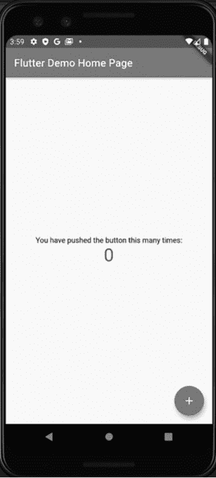

图 3.1 在 Android 模拟器中运行的 TestApp

参考图 3.1 查看在 Android 模拟器中运行的默认应用。

### Android 设备

在 Android 设备上运行 Flutter 应用需要运行 Android 4.1 (API level 16) 或更高版本的设备。你需要使用 USB 线将设备连接到计算机。启用 USB调试（在设备上配置开发者选项）。使用 `flutter devices` 命令测试连接。它应该会在控制台上列出该设备或其他设备（如果有）。

### 设置环境

请参考 Flutter 文档（Android 设置）获取详细的 Android 设置说明。

## 为 iOS 平台设置

### Xcode

从 Mac App Store (Xcode) 或网页 (Xcode) 安装最新稳定版的 Xcode。按照提示进行安装。安装 Xcode 的同时也会安装命令行工具。请参考 Flutter 文档（安装 Xcode）获取关于安装和设置 Xcode 的详细说明。

### iOS 模拟器

在 Mac 上，使用命令 `open -a simulator` 打开模拟器。在编写本文时，默认模拟器是 iPhone SE (第二代) (iPhone SE (2nd generation))。参考文档（设置 iOS）获取设置 iOS 模拟器的说明。你也可以通过如下 `flutter devices` 命令查看设备列表：

- flutter devices
  connected devices:
- Android SDK built for x86 (mobile) • emulator-5554
- android-x86 • Android 10 (API 29) • (emulator)
- iPhone SE (2nd generation) (mobile) • FCF81DB2

测试你的设置

使用 `flutter create testapp` 创建一个测试项目，并如所示运行：

```
flutter create testapp
cd testapp
flutter run -d android
```

参考图 3.1 查看在 Android 模拟器中运行的默认应用。

### Android 设备

在 Android 设备上运行 Flutter 应用需要运行 Android 4.1 (API level 16) 或更高版本的设备。你需要使用 USB 线将设备连接到计算机以访问。启用 USB 调试（在设备上配置开发者选项）。使用 `flutter devices` 命令测试连接。它应该会在控制台上列出该设备或其他设备（如果有）。

### 设置环境

请参考 Flutter 文档（Android 设置）获取详细的 Android 设置说明。

## 为 iOS 平台设置

### Xcode

从 Mac App Store (Xcode) 或网页 (Xcode) 安装最新稳定版的 Xcode。按照提示进行安装。安装 Xcode 的同时也会安装命令行工具。请参考 Flutter 文档（安装 Xcode）获取关于安装和设置 Xcode 的详细说明。

### iOS 模拟器

在 Mac 上，使用命令 `open -a simulator` 打开模拟器。在编写本文时，默认模拟器是 iPhone SE (第二代) (iPhone SE (2nd generation))。参考文档（设置 iOS）获取设置 iOS 模拟器的说明。你也可以通过如下 `flutter devices` 命令查看设备列表：

- flutter devices

  connected devices:

- Android SDK built for x86 (mobile) • emulator-5554

- android-x86 • Android 10 (API 29) • (emulator)

- iPhone SE (2nd generation) (mobile) • FCF81DB2

测试你的设置

使用 `flutter create testapp` 创建一个测试项目，并如所示运行：

```
flutter create testapp

cd testapp

flutter run -d android
```

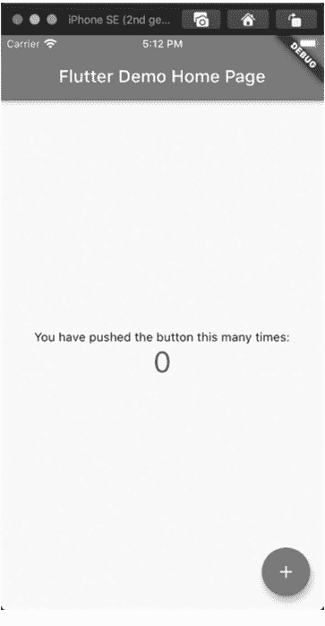

图 3.2 在 iOS 中运行的 TestApp

参考图 3.1 查看在 Android 模拟器中运行的默认应用。

### Android 设备

在 Android 设备上运行 Flutter 应用需要运行 Android 4.1 (API level 16) 或更高版本的设备。你需要使用 USB 线将设备连接到计算机以访问。启用 USB 调试（在设备上配置开发者选项）。使用 `flutter devices` 命令测试连接。它应该会在控制台上列出该设备或其他设备（如果有）。

## 为 WEB 设置

在编写本文时，Flutter 对网页的支持仍处于早期阶段。目前网页支持在 beta 通道中可用。使用 `flutter channel beta` 切换到 beta 通道。不要忘记运行 `flutter upgrade` 命令并启用 Web 支持。

```
flutter channel beta

flutter upgrade
```

# 实战 Flutter

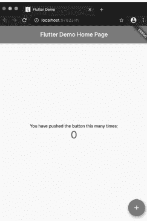

图 3.4 在 chrome 中运行的 TestApp

```
$ flutter channel dev

$ flutter upgrade

//针对 macOS

$ flutter config --enable-macos-desktop

//针对 Linux

$ flutter config --enable-linux-desktop
```

你只会在 Linux 机器上看到 Linux 设备。
现在你的环境已经开启了桌面端支持，在 Android Studio 顶部工具栏的设备选择列表中，除了 'Chrome (web)' 和 'Web Server (web)' 外，你应该还能看到 'macOS (Desktop)'。

请参考图 3.5 查看 Android Studio 的“Run”（运行）工具栏显示的 macOS(desktop) 和 chrome 设备。

你也可以通过下面的 `flutter devices` 命令查看设备列表：

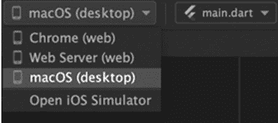

图 3.5 Android Studio 运行工具栏在设备列表中显示 macOS 桌面和 web 设备

# 环境配置

```
$ flutter devices

3 个连接设备:

+   - macOS (desktop) - macos - darwin-x64 - Mac OS X

- 10.15.0.1973

- Web Server (web) - web-server - web-javascript - Flutter Tools
```


- Chrome (web) - chrome - web-javascript - Google Chrome

## 测试你的安装

使用 `flutter create testapp` 创建测试项目，并按如下运行：

```
flutter create testapp

cd testapp

flutter run -dmacos
```

参考图 3.6 查看在 macOS 桌面应用程序中运行的默认应用。
详细的桌面设置说明请参考文档（Flutter Dev, 2020）。

## 在线源码

该应用的所有平台源代码均可在 GitHub 上的 'testapp' 项目 (`testapp`) 中获取。


图 3.6 在 macOS 中运行的 TestApp

## 编辑器设置

## 总结

在本章中，你获取了在 MacOS 上配置开发环境的指引。你对为 Android、iOS、web 和桌面 (`macos`) 平台的 Flutter 应用配置开发环境有了宏观了解。你学习了如何测试每个平台的安装情况。你还了解了 Flutter 开发可用的 IDE 选项。

## 参考文献

- Android Developers. (2020, 12). Configure-on-device developer options. Retrieved from developer.android.com: https://developer.android.com/debug/dev-options
- Apple. (2020, 11). Xcode. Retrieved from Apple Apps: https://apps.apple.com/us/app/xcode/d499779835
- Apple. (2020, 11). Xcode. Retrieved from Apple Developer: https://developer.apple.com/x/
- Apple. (2020, 15). Apple Developer Program. Retrieved from developer.apple.com: https://developer.apple.com/programs/
- CocoaPods.org. (2020, 12). CocoaPods. Retrieved from cocoapods.org: https://cocoapods.org/
- Everything. (2020, 11). command line and tools. Retrieved from Curl Web: https://curl.se/
- Flutter Dev. (2020, 11). Deploy to iOS devices. Retrieved from Flutter Dev: https://flutter.dev/dev/get-started/install/macos#deploy-to-ios-devices
- Flutter Dev. (2020, 11). Desktop support for Flutter. Retrieved from Flutter Development: https://flutter.dev/desktop
- Flutter Team. (2020, 11). Building a web application with Flutter. Retrieved from Flutter Web: https://flutter.dev/dev/get-started/web
- Flutter Team. (2020, 11). Install Flutter 1.22.4. Retrieved from Flutter: https://storage.googleapis.com/flutter_infra/releases/macos_1.22.4-stable
- Flutter Team. (2020, 11). Get the Flutter SDK. Retrieved from Flutter Dev: https://flutter.dev/dev/get-started/install/macos#get-sdk
- Flutter Team. (2020, 11). Install. Retrieved from Flutter Dev: https://flutter.dev/dev/get-started/install
- Flutter Team. (2020, 11). Install Xcode. Retrieved from Flutter Dev: https://flutter.dev/dev/get-started/install/macos#install-xcode
- Flutter Team. (2020, 11). iOS setup. Retrieved from Flutter Dev: https://flutter.dev/dev/get-started/install/macos#ios-setup
- Flutter Team. (2020, 11). Set up the iOS simulator. Retrieved from Flutter Dev: https://flutter.dev/dev/get-started/install/macos#set-up-ios-simulator
- Flutter Team. (2020, 11). Update path. Retrieved from Flutter Dev: https://flutter.dev/dev/get-started/install/macos#update-your-path
- Git. (2020, 11). Download for macOS. Retrieved from Git: https://git-scm.com/download
- Google. (2020, 11). Android setup. Retrieved from Flutter Dev: https://flutter.dev/dev/get-started/install/macos#android-setup
- Google. (2020, 11). Install Android Studio. Retrieved from Flutter Dev: https://flutter.dev/dev/get-started/install/macos#install-studio
- Priyanka Tyagi. (2020, 11). testapp. Retrieved from GitHub: https://github.com/priyankatyagi/testapp
- Wikipedia. (2020, 11). iPhone SE (2nd generation). Retrieved from Wikipedia: https://en.wikipedia.org/wiki/iPhone_SE_(2nd_generation)


# Flutter 项目结构

在本章中，你将对 Flutter 项目结构的理解。我们将创建一个‘Hello Books’进行演示。“Hello Books”应用将用三种不同的语言显示问候语：西班牙语 (`Hola Libros`)、意大利语 (`Ciao Libri`) 和印地语 (`हेलो`)。默认问候语为英语。所有其他问候语都存储在 `List` 类中。应用有一个圆形按钮可以从中随机选择问候语。图 4.1 显示了完成后的‘Hello Books’应用。点击表情图标切换语言。

## 选择 Flutter 通道

我们将使用‘dev’ 通道来运行书中的示例，因为该通道提供了桌面端的早期支持以及 web 和 iOS 支持。切换到‘dev’通道后，不要忘记运行 `flutter upgrade`。你应该会在控制台上看到以下输出：

```
Flutter 1.21.0-1.0 • channel dev

https://github.com/flutter/flutter.git

Framework • revision f25bd9c5c (2 weeks ago) • 2020-07-14 20:26:01
```


图 4.1 Hello Books 应用（完成）。点击表情图标更改问候语

```
Engine • revision 99c2b3a24
Tools • Dart 2.9.0 (build 2.9.0-21.0.dev 20bf2cf55)
```

你可以运行 `flutter channel` 命令查看标记为 `*` 的活动通道。

```
$ flutter channel

Flutter channels:

  * dev
```


beta

stable

## 创建 Flutter 项目

创建 Flutter 项目有两种方法：使用 Terminal 中的命令行工具或使用 IDE。你也可以先用命令行创建项目，之后从 IDE 中打开。

### 使用命令行 (TERMINAL)

运行以下命令为‘Hello Books’应用创建一个 `hello_books` 项目。

```
$ flutter create hello_books
```

默认情况下，包结构为 `com.example.hello_books`。在创建项目时，可以使用下面的命令指定自己的包名。

```
flutter create --org com.pragmatic_flutter hello_books
```

上述命令会将 Android 的包名和 iOS 的束标识符设置为 `com.pragmatic_flutter.hello_books`。

你可以通过点击启动屏幕上的“Open an existing Studio Project”（打开现有的 Studio 项目）选项在 Android Studio 中打开此项目，如图 4.2 所示。

### 使用 IDE (ANDROID STUDIO)

“新建 Flutter 项目”屏幕

在启动屏幕上选择此选项以启动新项目，如图 4.3 所示。

#### Flutter 项目结构


图 4.2 Android Studio 启动屏幕显示“Open an existing Android Studio Project”选项


图 4.3 “新建 Flutter 项目”屏幕

#### 实战 Flutter


图 4.4 “New Flutter Project”屏幕

##### “New Flutter Project”屏幕

此屏幕提供了创建 Flutter 项目、Flutter 模块、包或插件的选项。由于我们正在创建一个 Flutter 应用，因此像图 4.4 所示选择‘Flutter Application’选项。

##### “New Flutter Application”屏幕

在图 4.5 所示的屏幕上为新的 Flutter 应用配置选项。


图 4.5 “New Flutter Application”屏幕（配置项目）

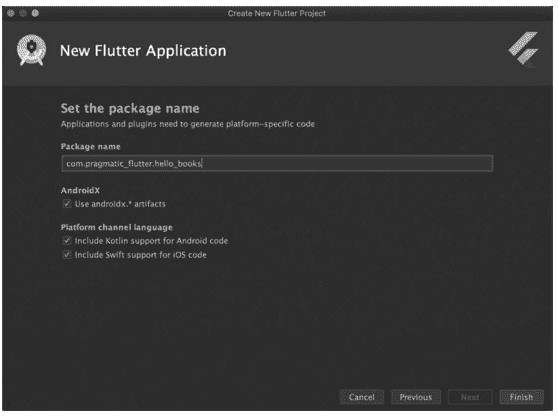

图 4.6 `New Flutter Application` （设置包名）

接下来，提供包名以组织源代码。你还需要如图 4.6 所示，选择对“android artifacts”（Android 制品）的支持以及 Android 和 iOS 平台的 Kotlin 和 Swift 语言支持。

##### 跨平台 Flutter 项目结构

Flutter 项目在 `lib` 文件夹中包含共享代码。每个平台都有自己的文件夹来存放平台特定的代码。Flutter App 可以部署到各个平台对应的 `android`、`iOS`、`web`、`linux` 和 `macOS` 文件夹。项目结构的可视化如图 4.7。

让我们查看重要项目目录和文件的详情：

- `lib/`: 此文件夹包含 Dart 文件。这是所有平台（如 iOS、Web、桌面和嵌入式设备）的共享代码。书中仅关注 Android、iOS、Web 和桌面 (macOS)。
- `android/`: 此文件夹包含 Android 代码，包括 `AndroidManifest.xml`。
- `ios/`: 此文件夹包含 Swift 语言编写的 iOS 应用原生代码。
- `web/`: 此文件夹包括 `index.html` 以及可以部署到公共托管网站的资源。
- `linux/`: 此文件夹包含与 Linux 平台相关的代码。该文件夹通过启用对桌面(Linux)的支持生成，但只能在 Linux 机器上编译。
- `macos/`: 此文件夹包含用于 macOS 平台的原生代码。
- `test/`: 此文件夹包含所有单元测试类。
- `pubspec.yaml`: 这是 Flutter 应用的依赖管理和配置文件。

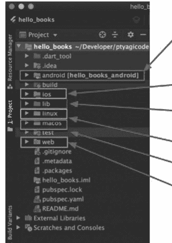

图 4.7 Android Studio 中的 Flutter 项目结构

##### 运行默认应用：ANDROID, iOS, WEB 和 DESKTOP

在本节中，我们将在所有四个平台（Android、iOS、web 和桌面 (macOS)）上运行‘hello_books’ Flutter 应用。让我们使用一个简单的命令 `flutter run -d all` 一起在四个平台上运行‘hello_books’ 项目。

###### ANDROID 平台

在 Android 模拟器上运行的 Hello Books 应用如图 4.8 所示。

###### iOS 平台

在 iOS 模拟器上运行的 Hello Books 应用如图 4.9 所示。

###### WEB 平台

在 Chrome 浏览器中运行的 HelloBooks 应用如图 4.10 所示。

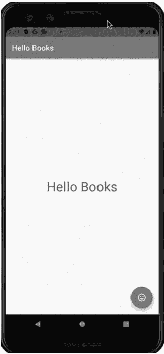

**图 4.8** 在 Android 模拟器上运行的 Hello Books

###### DESKTOP (macOS) 平台

在 macOS 平台上运行的 Hello Books 应用如图 4.11 所示。

##### 线源代码

`hello_books` 项目源代码可以在 GitHub 上找到（第 04 章：[Flutter 项目结构 (hello_books)](hello_books)）。

##### 运行代码示例

Flutter 文档对开发者友好且易于遵循。它带有一个示例代码段库。它提供了通过示例代码 ID 创建 Flutter 应用并将其作为独立的 Flutter 应用运行的支持。

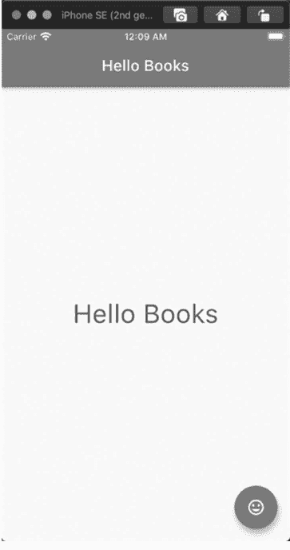

图 4.9 在 iOS 模拟器上运行的 Hello Books

###### 列出示例代码 ID

以下命令将示例代码标识符/ID 导出到‘samples.json’ 文件中。

```
flutter create --list-samples=samples.json
```

###### ‘samples.json’文件的内容

下面是该文件的一小段。这段特定的示例代码演示了‘BottomAppBar’组件的使用以及其中的停靠式‘FloatingActionButton’。你将在接下来的章节中学习这些组件和构建界面。本节的目的是让你学会自己探索 Flutter 的官方示例代码。

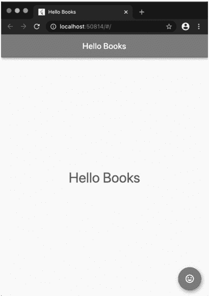

图 4.10 在 Web 平台运行的 Hello Books

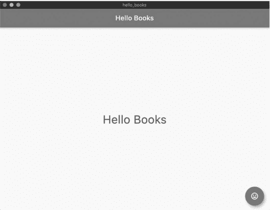

图 4.11 在 macOS 平台运行的 Hello Books

```
{
  "sourcePath": "lib/src/material/scaffold.dart",
  "sourceLine": 1009,
  "id": "material.Scaffold.3",
  "channel": "master",
  "serial": "3",
  "package": "flutter",
  "library": "material",
  "element": "Scaffold",
  "file": "material.Scaffold.3.dart",
  "description": "此示例显示了一个带有 AppBar、BottomAppBar 和 FloatingActionButton 的 Scaffold。body 是一个放置在 Center 中的 Text，以便通过 FloatingActionButtonLocation.centered 将文本在停靠的 BottomAppBar 内部进行居中对齐。FloatingActionButton 会增加计数器值。"
}
```

###### 从示例代码创建应用

一旦你获得了示例代码的 id，请在以下命令中替换它。你还需要提供示例应用的名称。

```bash
flutter create --sample=<id> <app_name>
```

使用以下命令：

```bash
flutter create --sample=<id>
```


```bash
flutter run -d <device>
```

```bash
flutter run -d all
```

# Flutter 项目结构


**图 4.12** 在 Android 模拟器上运行的 Hello Books（FloatingActionButton）

## 在线源代码

`hello_books` 项目的源代码可以在 GitHub 上找到（第 04 章：[Flutter 项目结构](hello_books））。

## 有用的命令

最后，让我们通过以下命令在连接的设备上运行 Flutter：

| `flutter` 命令 | 说明 |
| :--- | :--- |
| `flutter build` | 构建应用。 |
| `flutter analyze` | 分析项目。 |
| `flutter attach` | 附加调试。 |
| `flutter build` | 构建构建制品。 |
| `flutter clean` | 清理。 |
| `flutter config` | 配置。 |
| `flutter create` | 创建新项目。 |
| `flutter list` | 列出安装的包。 |
| `flutter doctor` | 显示信息。 |
| `flutter upgrade` | 升级 Flutter 到最新版本。 |
| `flutter run` | 运行项目。 |
| `flutter emulators` | 列出并启动模拟器。 |
| `flutter install` | 在设备上安装应用。 |
| `flutter pub` | 显示包。 |
| `flutter precache` | 填充 Flutter 工具缓存。 |
| `flutter run` | 在连接的设备上运行。 |
| `flutter screenshot` | 获取连接设备的截图。 |
| `flutter symbolize` | 符号化崩溃堆栈。 |
| `flutter test` | 运行 Flutter 测试。 |

**图 4.13** 可用命令

- `flutter build`：构建应用。
- `flutter run`：在连接的设备上运行。它提供了选择连接设备的选项。
- `flutter help`：你可以在命令行运行 `flutter help` 来列出所有可用命令。可用命令的截图如图 4.13 所示。

# 5 Flutter 应用结构

在本章中，你将通过上一章节中的 `HelloBooksApp`（第 04 章：Flutter 项目结构）来深化对 Flutter 应用结构的理解。该应用会在设备屏幕中心显示问候文本“Hello Books”。此应用将以不同的语言显示此问候：西班牙语（Hola Libros）、意大利语（Ciao Libri）和印地语（है हिन्दी），除了默认的英语之外。其他三个问候都存储在一个名为 `greetings` 的列表 (`List<E>`) 数据结构中。

```dart
final List<String> greetings = {
  'Hello Books',
  'Hola Libros',
  'Ciao Libri',
  'है हिन्दी',
};
```

应用在右下角有一个微笑图标的圆形悬浮按钮，用于从列表中选择下一条消息。图 5.1 显示了从英文文本到下一个西班牙语文本的过渡。点击微笑按钮都会获取列表中的下一条消息。到达列表中的最后一条消息后，它将从 `greetings` 列表第一个消息开始恢复。

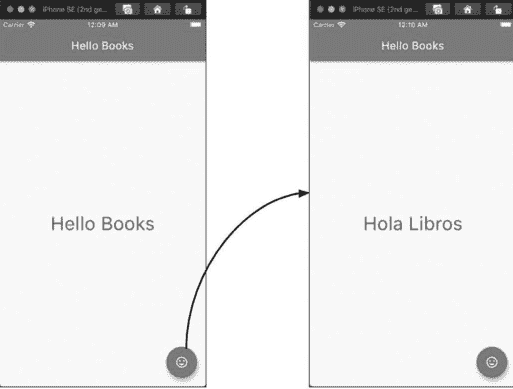

图 5.1 完成的 HelloBooksApp

## FLUTTER 组件

### StatelessWidget (无状态组件)

`Stateless` (`StatelessWidget` 类) 组件是不可变的。一旦创建，就无法更改。它不保留自己的状态。无状态组件只被创建一次，在之后不会被重新构建。无状态组件的 `build()` 方法只会被调用一次。

让我们使用 `Container` (`Container` 组件) 来理解如何创建一个自定义的 `StatelessWidget`。`Widget` 是一种便利组件，它结合了常见的绘制、定位和尺寸调整组件。

下面的代码段演示了如何以无状态的方式创建 `Container` 组件。此组件只被创建一次。

```dart
class MyStatelessWidget extends StatelessWidget {
  @override
  Widget build(BuildContext context) {
    return Container();
  }
}
```

无状态组件不跟踪其状态。一旦创建，其值就无法更改。如果需要更改无状态组件的值，则需要创建带有更新后值的新组件。以下是部分无状态组件：

- `Text` 组件 (`Text Widget`)：它包含不可变的字母字符串。
- `Icon` 组件 (`Icon Widget`)：`Icon` 组件是不可变的，不用于交互。
- `Card` 组件 (`Card Widget`)：它是一个材料设计卡片，用于显示相关信息。

图 5.2 显示了 `StatelessWidget` 的几个示例。

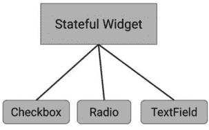

图 5.2 StatelessWidget 示例

## Flutter 应用结构

### STATEFULWGET (有状态组件)

`Stateful` (`StatefulWidget`) 组件是可变的。它跟踪状态。它在生命周期内会重建多次。`Stateful` 组件的 `build()` 方法会被调用多次。

```dart
class MyStatefulWidget extends StatefulWidget {
  @override
  _MyStatefulWidget createState() => _MyStatefulWidgetState();
}

class _MyStatefulWidgetState extends State<MyStatefulWidget> {
  @override
  Widget build(BuildContext context) {
    return Container();
  }
}
```

以下是部分 `Stateful` 组件的示例。它们用于跟踪自己的状态。

- `Checkbox` (`Checkbox` 类)：跟踪复选框是否被勾选的状态。
- `Radio` (`Radio<T>` 类)：需要记住它是否被选中的状态。
- `TextField` (`TextField` 类)：`TextField` 组件允许用户输入文本。这意味着它需要跟踪用户已经输入的内容。

图 5.3 显示了 `StatefulWidget` 的示例。

在 `HelloBooksApp` 中，我们将使用 `StatefulWidget` 来实现“微笑”圆形按钮，以更改问候的的文本。

## 显示‘HELLO BOOKS’ 文本

我们将从显示“Hello Books”文本开始构建 `HelloBooksApp`。该应用利用了材料设计 (`Material Design`)。`MaterialApp`

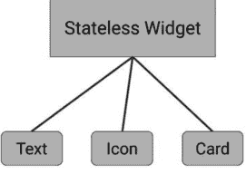

图 5.3 StatefulWidget 示例

(`MaterialApp` 类) 被用于实现材料设计。`HelloBooksApp` 类继承自 `StatelessWidget`。Flutter 应用是一个无状态组件，因为它是不可变的。它可以包含可变和不可变的组件作为其子组件。`HelloBooksApp` 组件实现了父类 `StatelessWidget` 的 `build()` 方法。`build()` 方法负责将组件组合到用户界面中。在 `build()` 方法中，返回了 `MaterialApp` 组件。`Text` (`Text` 类) 组件用于显示“Hello Books”文本。让我们在下面的代码中创建一个 `MaterialApp` 并显示“Hello Books”文本：

```dart
class HelloBooksApp extends StatelessWidget {
  // 此组件是应用的根
  @override
  Widget build(BuildContext context) {
    return MaterialApp(
      debugShowCheckedModeBanner: false,
      // 没有 SafeArea 的 Text Widget
      home: Text('Hello Books'),
    );
  }
}
```

## 入口点

我们准备好启动 `HelloBooksApp`。`debugShowCheckedModeBanner` 标志被设置为 `false`。

```dart
void main() {
```


`runApp(HelloBooksApp());`

“Hello Books”文本在顶部可见。`main()`方法是应用的入口。

“Hello Books”文本在没有`SafeArea`的情况下显示，如图 5.4 所示。

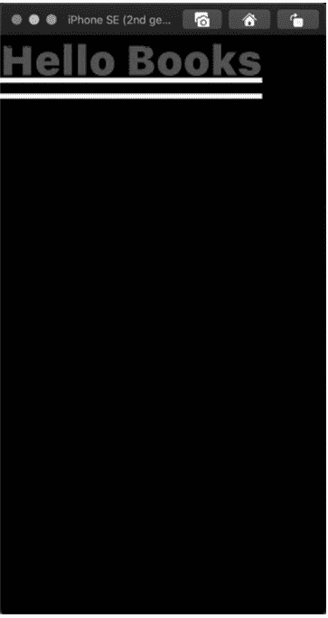

图 5.4 未使用`SafeArea`的`HelloBooksApp`

## 文本居中

现在“Hello Books”已经渲染了足够的顶部间距，我们希望将文本显示在屏幕中间。`Center` (`Center`) 组件将其子组件居中。将`Text` (`Text`) 组件封装在`Center`组件中，可以将“Hello Books”显示在屏幕中心。

```dart
class HelloBooksApp extends StatelessWidget {
  @override
  Widget build(BuildContext context) {
    return MaterialApp(
      debugShowCheckedModeBanner: false,
      home: SafeArea(
          child: Text('Hello Books'),
        );
    );
  }
}
```

“Hello Books”文本在屏幕中心居中。参考图 5.6 查看“Hello Books”及其被封装在`SafeArea`组件中的父组件。

## 应用结构 #1

`HelloBooksApp`由`MaterialApp`、`SafeArea`、`Center`和`Text`组件组成。`MaterialApp`组件位于根节点。`SafeArea`组件作为其子组件添加。`SafeArea`组件的子组件是`Center`，它包裹了一个`Text`组件。图 5.7 直观地展示了这种关系。

## 应用结构 #2

让我们改进应用使其看起来像完成后的。接下来我们将添加新的组件，如`Scaffold` (`Scaffold`类)、`AppBar` (`AppBar`类)和`FloatingActionButton` (`FloatingActionButton`)。图 5.8 展示了 Hello Books 应用的最终版本。

54

实战 Flutter

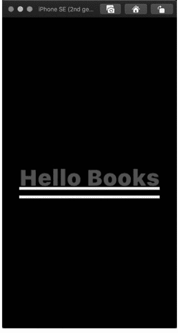

图 5.6 封装在`SafeArea`和`Center` widget中的的‘Hello Books’。`Center` widget将其子组件对齐到屏幕中心。

## Scaffold Widget

`MaterialApp` widget是应用程序的起点。它用于通知 Flutter 应用程序将使用 Material 组件（Components）。Material 组件是创建用户界面的交互式构建块。`Scaffold` widget作为`MaterialApp` widget的子组件使用。它实现了 Material 设计的基本视觉布局结构，并为应用提供了应用栏（app bar）、悬浮按钮（floating button）等基本功能。

```dart
class HelloBooksApp extends StatelessWidget {
  @override
  Widget build(BuildContext context) {
    return MaterialApp(
      home: Scaffold(),
    );
  }
}
```

## Flutter App Structure

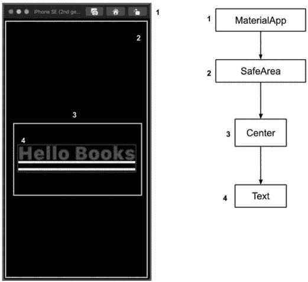

图 5.7 结构剖#1 – Hello Books Flutter 应用

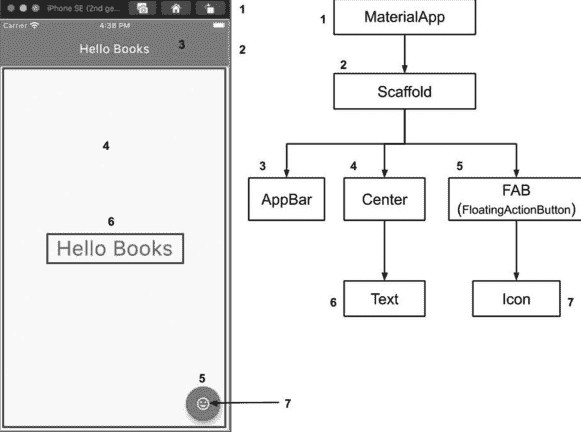

图 5.8 结构剖#2 – Hello Books Flutter 应用

## The AppBar Widget

`AppBar` (`AppBar`类) widget实现了 Material 设计的应用栏。它使用`title`属性为页面分配标题。

```dart
class HelloBooksApp extends StatelessWidget {
  @override
  Widget build(BuildContext context) {
    return MaterialApp(
      appBar: AppBar(
        title: Text('Hello Books'),
      )
    );
  }
}
```

## The FloatingActionButton Widget

`FloatingActionButton` (`FloatingActionButton`类) widget实现了 Material 设计的悬浮按钮。`Scaffold`的`floatingActionButton`属性将`FloatingActionButton`分配给应用。表情图标通过`Icon` widget作为`FloatingActionButton`的子组件来实现。

```dart
class HelloBooksApp extends StatelessWidget {
  @override
  Widget build(BuildContext context) {
    return Scaffold(
      floatingActionButton: FloatingActionButton(
        onPressed: () {},
        tooltip: 'Greeting',
        child: Icon(Icons.insert_emoticon),
      )
    );
  }
}
```

## Styling Text Widget

`MaterialApp`自带了内置的 Material 设计文本主题。可以通过给定 widget 的`Theme.of(context).textTheme`来访问该主题。该主题支持不同大小的文本。我们选择`headline4`来样式化文本。主题将在后面的章节中详细介绍（第 10 章：Flutter 主题）。

## Flutter App Structure

```dart
class HelloBooksApp extends StatelessWidget {
  @override
  Widget build(BuildContext context) {
    return MaterialApp(
      home: Scaffold(
        body: Center(
          child: Text(
            'Hello Books',
            style: Theme.of(context).textTheme.headline4,
          ),
        ),
      );
    );
  }
}
```

## COMPLETE CODE

`HelloBooks`代码已准备就绪。完整的实现如下面的代码段所示：

```dart
class HelloBooksApp extends StatelessWidget {
  @override
  Widget build(BuildContext context) {
    return MaterialApp(
      debugShowCheckedModeBanner: false,
      home: Scaffold(
        appBar: AppBar(
          title: Text('Hello Books'),
        ),
        body: Center(
          child: Text(
            'Hello Books',
            style: Theme.of(context).textTheme.headline4,
          ),
        ),
        floatingActionButton: FloatingActionButton(
          onPressed: () {},
          tooltip: 'Greeting',
          child: Icon(Icons.insert_emoticon),
        ),
      )
    );
  }
}
```


# 实战 Flutter

## Source Code Online

此示例（Flutter App Structure: App 剖#2）的源代码可以在 GitHub 上找到。

## Managing State with StatefulWidget

我们希望通过点击微笑表情悬浮按钮来更改问候语。首先，我们需要将所有问候语存储在一个列表中。其次，我们需要启用悬浮按钮，使其能够从列表中选取下一个可用字符串。

我们需要 `StatefulWidget` 来跟踪所选问候语的当前状态。让我们创建一个 `StatefulWidget`，比如 `MyHomePage`。该 widget 被分配为 `MaterialApp` 的 `home` 属性。

```dart
class HelloBooksApp extends StatelessWidget {
  @override
  Widget build(BuildContext context) {
    return MaterialApp(
      home: MyHomePage(title: 'Hello Books'),
    );
  }
}
```

### StatefulWidget: MyHomePage

当屏幕的一部分需要用新信息更新时，`Stateful widgets` 是非常有用的。在我们的应用中，我们希望在更新问候文本的同时，保持屏幕的其他部分不变。`MyHomePage` 扩展了 `StatefulWidget` 并接受一个参数。该 widget 拥有可变状态，并使用类 `_MyPageState` 表示。

```dart
class MyHomePage extends StatefulWidget {
  MyHomePage({Key key, this.title}) : super(key: key);
  final String title;
  @override
  _MyPageState createState() => _MyPageState();
}

class _MyPageState extends State<MyHomePage> {
```

### State Widget: MyPageState

每当从 `setState` 方法请求状态更改时，widget 就会重新构建。

每当从 `setState` 方法 方法请求状态更改时，widget 就会重新构建。让我们看看在 `HelloBooksApp` 中是如何实现的。当用户点击 `FloatingActionButton` 时，它会更新屏幕上当前选中的问候语。

```dart
class _MyPageState extends State<MyHomePage> {
  int index = 0;
  final List<String> greetings = [
    'Hello Books',
    'Hola Libros',
    'Ciao Libri',
    'हिंदी किताब',
  ];

  void updateGreeting() {
    setState(() {
      index = greetings.length - 1 ? 0 : index + 1;
    });
  }

  @override
  Widget build(BuildContext context) {
    return Scaffold(
      appBar: AppBar(
        title: Text(widget.title),
      ),
```

```dart
class HelloBooksApp extends StatelessWidget {
  @override
  Widget build(BuildContext context) {
    return MaterialApp(
      debugShowCheckedModeBanner: false,
      home: Scaffold(
        appBar: AppBar(
          title: Text('Hello Books'),
        ),
        body: Center(
          child: Text(
            'Hello Books',
            style: Theme.of(context).textTheme.headline4,
          ),
        ),
        floatingActionButton: FloatingActionButton(
          onPressed: () {},
          tooltip: 'Greeting',
          child: Icon(Icons.insert_emoticon),
        ),
      )
    );
  }
}
```

## COMPLETE CODE

```dart
void main() {
  runApp(HelloBooksApp());
}
```

```dart
style: Theme.of(context).textTheme.headline4,
),
),
floatingActionButton: FloatingActionButton(
onPressed: () {},
tooltip: 'Greeting',
child: Icon(Icons.insert_emoticon),
),
)
);
}
}
```


## SOURCE ONLINE

此示例（Flutter App Structure: HelloBooks）的源代码可以在 GitHub 上找到。

## CONCLUSION

在本章中，你学习了 Flutter 应用程序的结构和剖。你学习了构建 HelloBooks 的基本构建块。我们从在屏幕上显示文本开始构建应用。你首先查看了最基础的 Flutter 应用程序。然后使用 Material 组件对应用进行了改进。最后的 HelloBooksApp 使用 FAB 从列表中选择不同的文本。你还接触了基础 widget，如 `MaterialApp`、`Container`、`AppBar`、`Scaffold`、`FloatingActionButton`、`Text`、`StatelessWidget` 和 `StatefulWidget`。

# 62

# 实用型 Flutter

Flutter Dev. (2020, 11 17). `FloatingActionButton` 类. 获取自 Flutter Dev: https://api.flutter.dev/material/FloatingActionButton-class.html

Flutter Dev. (2020, 11 17). `Icon` 小部件. 获取自 Flutter Dev: https://api.flutter.dev/flutter/widgets/Icon-class.html

Flutter Dev. (2020, 11 17). `MaterialApp` 类. 获取自 Flutter Dev: https://api.flutter.dev/flutter/material/Material-App.html

Flutter Dev. (2020, 11 17). `Scaffold` 类. 获取自 Flutter Dev: https://api.flutter.dev/flutter/material/Scaffold-class.html

Flutter Dev. (2020, 11 17). `setState` 方法. 获取自 Flutter Dev: https://api.flutter.dev/flutter/widgets/SetState.html

Flutter Dev. (2020, 11 17). `StatefulWidget`. 获取自 Flutter Dev: https://api.flutter.dev/flutter/widgets/StatefulWidget-class.html

Flutter Dev. (2020, 11 17). `StatelessWidgetWidget`. 获取自 Flutter Dev: https://api.flutter.dev/flutter/widgets/StatelessWidget-class.html

Flutter Dev. (2020, 11 17). `Text` 小部件. 获取自 Flutter Dev: https://api.flutter.dev/flutter/widgets/Text-class.html

Google, (2020, 11 17). `Checkbox` 类. 获取自 Flutter Dev: https://api.flutter.dev/flutter/material/Checkbox-class.html

Google, (2020, 11 17). Material Design. 获取自 material.io: https://material.io/design

Google, (2020, 11 17). `Radio` 类. 获取自 Flutter Dev: https://api.flutter.dev/flutter/material/Radio-class.html

Google, (2020, 11 17). `SafeArea` 类. 获取自 Flutter Dev: https://api.flutter.dev/flutter/widgets/SafeArea-class.html

Google, (2020, 11 17). `TextField`. 获取自 Flutter Dev: https://api.flutter.dev/flutter/widgets/Text-class.html

Google, (2020, 11 17). `TextField` 类. 获取自 Flutter Dev: https://api.flutter.dev/flutter/material/TextField-class.html

Tyagi, P. (2020, 11 17). 应用结构: 文本周围的留. 获取自 GitHub 仓库: https://github.com/pyagicodecamp/pragmatic_flutter/blob/chapter05/chapter05_main_1_dart

Tyagi, P. (2020, 11 17). 应用结构: 应用解剖#2. 获取自 第05 章: https://github.com/pyagicodecamp/pragmatic_flutter/blob/chapter05/main_3_dart

Tyagi, P. (2020, 11 17). 应用结构: 文本居中. 获取自 第05 章: https://github.com/pyagicodecamp/pragmatic_flutter/blob/chapter05/main_2_dart

Tyagi, P. (2020, 11 17). 应用结构: 显示 'Books' 文本. 获取自 第05 章: https://github.com/pyagicodecamp/pragmatic_flutter/blob/chapter05/main_0_dart

Tyagi, P. (2020, 11 17). 应用结构: FlutterBooksApp. 获取自 第05 章: https://github.com/pyagicodecamp/pragmatic_flutter/blob/chapter05/main_4_dart

Tyagi, P. (2021). 第 04 章: Flutter 项目结构。见 P. Tyagi, Pragmatic Flutter: 为 Android, iOS, Web 和桌面端构建跨平台移动应用. CRC Press.

Tyagi, P. (2021). 第 10 章: Flutter 主题。见 P. Tyagi, Pragmatic Flutter: 为 Android, iOS, Web 和桌面端构建跨平台移动应用. CRC Press.

# Flutter Widgets

在上一章（第 05 章：Flutter 应用结构）中，你简要地介绍了几个基础小部件，用于在屏幕中间创建一个显示“Hello Books”文本的用户界面。你学习了 `MaterialApp`、`Scaffold`、`AppBar`、`Center`、`FAB`、`Text` 和 `Icon` 小部件。在现实世界的应用中还有许多其他小部件。在本章中，我们将接触更多小部件，以创建更具野心的界面。

## Image WGET

在本节中，你将学习如何使用 `Image`（`Image` 类）小部件在 Flutter 应用中从本地资源文件夹以及通过互联网显示图像。

### Local Image

在接下来的示例中，你将学习如何从项目根目录下的本地 `assets` 文件夹显示图像。如果你还没有该文件夹，请在项目根目录级别创建一个 `assets` 文件夹。添加你想要在 Flutter 屏幕上显示的图像。我在‘assets’ 文件夹中已经准备了 `flutter_icon.png` 文件。为了向你的应用程序添加资源，你需要在 `pubspec.yaml` 中的 `flutter` 部分下添加一个 `assets`。

```yaml
flutter:
  assets:
    - assets/flutter_icon
```

在本节中，你将学习如何使用 `Image`（`Image` 类）小部件在 Flutter 应用中从本地资源文件夹以及通过互联网显示图像。

在接下来的示例中，你将学习如何从项目根目录下的本地 `assets` 文件夹显示图像。如果你还没有该文件夹，请在项目根目录级别创建一个 `assets` 文件夹。添加你想要在 Flutter 屏幕上显示的图像。我在‘assets’ 文件夹中已经准备了 `flutter_icon.png` 文件。为了向你的应用程序添加资源，你需要在 `pubspec.yaml` 中的 `flutter` 部分下添加一个 `assets`

```yaml
flutter:
  assets:
    - assets/flutter_icon
```

在本节中，你将学习如何使用

让我们创建一个 `LocalImage()` 方法来返回 Widget 小部件。如下所示 `assets/flutter_icon.png`。


```dart
Widget build(BuildContext context) {
  return Scaffold(
    appBar: AppBar(
      title: Text("Image Widget"),
    ),
    body: Center(
      child: Container(
        width: 300,
        height: 300,
        padding: EdgeInsets.all(20.0),
        child: loadLocalImage(),
      )
    )
  );
}

Widget loadLocalImage() {
  return Image.asset("assets/flutter_icon.png");
}
```

### 互联网（远程）图像

图像也可以通过 URL 使用 `Image.network()` 构造函数显示并加载图像。该部件被添加到 `Container` 中。

```dart
Widget build(BuildContext context) {
  return Scaffold(
    appBar: AppBar(
      title: Text("Image Widget"),
    ),
    body: Center(
      child: Container(
        width: 300,
        height: 300,
        padding: EdgeInsets.all(20.0),
        child: loadInternetImage(),
      )
    )
  );
}

Widget loadInternetImage() {
  return Image.network("https://github.com/pyagicodecamp/flutter_cookbook2/raw/master/assets/flutter_icon.png");
}
```

## ToggleButtons

在上一节中，我们学习了如何从本地资源和 URL 加载图像。在本节中，我们将使用 `ToggleButtons`（`ToggleButtons` 类）小部件来水平添加两个切换按钮。第一个按钮用于关闭飞行模式，另一个用于开启飞行模式。

### 使用 ToggleButtons

切换按钮如下布局所示：

```dart
ToggleButton(
  children: [
    Icon(Icons.airplanemode_off),
    Icon(Icons.airplanemode_on),
  ],
  isSelected: [!isLocal, isLocal],
  onPressed: (int index) {
    setState(() {
      isLocal = !isLocal;
    });
  }
);
```

`isLocal` 是一个 `bool` 类型变量，每当选择一个切换按钮时，它就会切换一次。

```dart
bool isLocal = true;
class _MyWidgetState extends State<MyImageWidget> {
  @override
  Widget build(BuildContext context) {
    return Container(
      width: 300,
      height: 300,
      padding: EdgeInsets.all(20.0),
      child: isLocal == true
        ? Image.asset("assets/flutter_icon.png")
        : Image.network(
            "https://github.com/pyagicodecamp/flutter_cookbook2/raw/master/assets/flutter_icon.png"
          ),
    );
  }
}
```

## TextField

`TextField`（`TextField` 类）小部件允许用户使用硬件或屏幕键盘输入文本。`TextEditingController`（`EditingController` 类）管理该小部件，允许用户输入文本、提交并最终清除文本。我们将在示例中使用一个 `StatefulWidget`。

# Flutter Widgets

`_MyTextFieldWidgetState` 持有此组件的状态。它拥有对 `TextEditingController` 的引用，命名为 `controller`。`userText` 包含了在 `TextField` 小部件中输入的文本。

```dart
class MyTextFieldWidget extends StatefulWidget {
  MyTextFieldWidget({Key key}) : super(key: key);
  @override
  _MyTextFieldWidgetState createState() => _MyTextFieldWidgetState();
}
class MyTextFieldWidgetState extends State<MyTextFieldWidget> {
  TextEditingController _controller;
  String userInput = "";
}
...
```

此控制器需要在 `initState()` 方法中初始化。记得使用 `dispose()` 方法移除控制器以避免内存泄漏。

```dart
class _MyTextFieldWidgetState extends State<MyTextFieldWidget> {
  void initState() {
    super.initState();
    _controller = TextEditingController();
  }
  void dispose() {
    _controller.dispose();
    super.dispose();
  }
}
...
```

接下来，我们将 `TextField` 小部件作为子组件之一添加到 `Column` 布局组件中。设置 `TextField` 的 `autofocus` 属性为 `true` 以提示用户输入文本。将文本编辑器的引用 `_controller` 赋值给 `controller` 属性。`onSubmitted` 属性告诉小部件如何处理输入的文本。在此示例中，输入的文本 `value` 被赋值给 `userInput` 变量。使用 `_controller.clear()` 清空 `TextField`。

```dart
class _MyTextFieldWidgetState extends State<MyTextFieldWidget> {
  TextEditingController _controller;
}
```

```dart
Widget build(BuildContext context) {
  return Scaffold(
    body: Padding(
      child: Column(
        children: [
          TextField(
            autofocus: true,
            controller: _controller,
            onSubmitted: (String value) async {
              setState(() {
                userText = value;
                _controller.clear();
              });
            }
          ),
        ]
      )
    )
  );
}
```

在 `TextField` 下方添加一个 `Text` 小部件，以便在用户根据弹出软件/硬件键盘点击“完成”或“检查”按钮/标记时，显示用户输入的文本。

```dart
class _MyTextFieldWidgetState extends State<MyTextFieldWidget> {
  Widget build(BuildContext context) {
    return Scaffold(
      body: Padding(
        child: Column(
          children: [
            Text("User entered: $userText")
          ]
        )
      )
    );
  }
}
```

图 6.5 显示了用户在 `TextField` 小部件中输入文本。


# Flutter Widgets

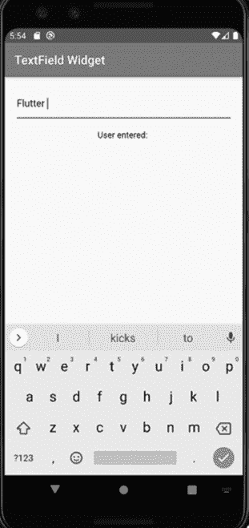

**图 6.5** 用户输入的文本输入

一旦用户点击键盘上的完成按钮或勾标记，输入的文本将显示在下方的 `Text` 小部件中。`TextField` 将被清空并准备好用户输入新文本，如图 6.6 所示。

## 在线源码

此示例（Flutter Widgets: TextField）的源码可以在 GitHub 上找到。

## FutureBuilder 异步小部件

有时，应用程序无法一次性接收构建界面所需的数据。当数据从远程服务器通过网络检索时，就会发生这种情况。在这种情况下，使用 Dart 的 `Future`（`Future<T>` 类）或 `Stream`（异步编程：流）类来异步接收信息。

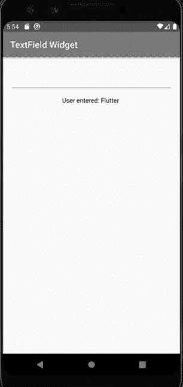

**图 6.6** 输入的文本显示在 `Text` 小部件中。`TextField` 已重置

`FutureBuilder`（`FutureBuilder<T>` 类）是一种根据 `Future` 类返回的快照（snapshot）来构建自身的小部件。

在此示例中，我们将模拟两种类型的 `Future` 对象。第一个 `Future` 对象是 `_futureData`。它将在三秒后返回整数 '3'。

### Future 数据对象

```dart
Future<int> futureData = Future<int>.delayed(Duration(seconds: 3), () => 3);
```

### Future 对象

第二个 `Future` 对象 `_futureError` 返回一个带有消息“Sample error”的错误。

```dart
Future<int> _futureError = Future<int>.delayed(Duration(seconds: 3), () => throw ("Sample error"));
```

## FutureBuilder 小部件

`FutureBuilder`（`FutureBuilder<T>` 类）根据从 `Future` 对象接收的快照为界面构建小部件。`Future` 对象 `futureData` 被赋值给它的 `future` 属性。构造函数接收 `builder` 属性以及 `AsyncSnapshot<int>` 快照。它使用 `snapshot` 来构建 `futureChild`。当应用程序等待数据到达或 `snapshot` 有数据时，它会在 `Text` 小部件中显示接收到的数据。如果接收到错误，则显示错误消息或圆形进度指示器。`futureChild` 作为子组件添加到 `Center` 小部件中。

```dart
FutureBuilder<int> (
  future: _future,
  builder: (BuildContext context, AsyncSnapshot<int> snapshot) {
    Widget futureChild;
    if (snapshot.hasData) {
      //success
      futureChild = Text("${snapshot.data}");
    } else if (snapshot.hasError) {
      //error message
      futureChild = Text("${snapshot.error}");
    } else {
      //waiting for data
      futureChild = CircularProgressIndicator();
    }

    return Center(
      child: futureChild,
    );
  });
```

当等待数据时，会显示 `CircularProgressIndicator()`，如图 6.7 所示。`FutureBuilder` 显示从 `Future` 获取的数据。

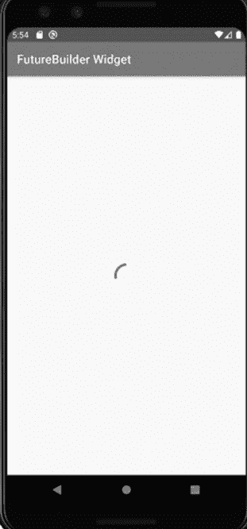

**图 6.7** 等待数据的圆形进度条

## 在线源码

此示例（Flutter Widgets: FutureBuilder）的源码可以在 GitHub 上找到。

## Placeholder 占位符小部件

在之前的 `FutureBuilder` 中，当应用程序等待数据时，屏幕上会显示圆形进度条。`Placeholder`（`Placeholder` 类）小部件正是为此而的。它绘制一个表示将添加数据的框。让我们创建一个异步交付信息的模拟 `Future`。该 `Future` 对象将在三秒后返回图像。

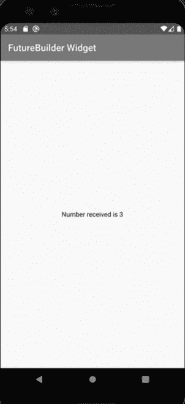

**图 6.8** 异步显示数据

```dart
Future<String> _futureData = Future<String>.delayed(Duration(seconds: 3), () => 'assets/flutter_icon.png');
```

当异步数据可用时，`FutureBuilder` 小部件使用 `Image` 小部件显示图像

```dart
FutureBuilder<String>(
  future: _futureData,
  builder: (BuildContext context, AsyncSnapshot<String> snapshot) {
    Widget futureChild;
    if (snapshot.hasData) {
      //success
      futureChild = Image.asset(snapshot.data);
    } else {
      //Placeholder widget waiting for data
      futureChild = Container(
        height: 200,
        width: 200,
        child: Placeholder(
          color: Colors.deepPurple,
        ),
      );
    }
    return Center(
      child: futureChild,
    );
  },
);
```

图 6.9 显示在等待数据时显示占位符。

## StreamBuilder 异步小部件

`StreamBuilder`（`StreamBuilder` 类）是一种根据从 `Stream` 接收的异步数据来构建自身的小部件。`Stream`（`Stream<T>` 类）是异步数据事件源。让我们创建两个模拟流来理解 `StreamBuilder` 小部件的使用。

### Stream 数据对象

`streamData` 是一个结果/响应流，它在三秒后发送整数 '3'。它在产生事件后还会引入三秒的延迟。

```dart
Stream<int> _streamData = (async* {
  await Future<void>.delayed(Duration(seconds: 3));
  yield 3;
  await Future<void>.delayed(Duration(seconds: 3));
})();
```

### Stream 错误对象

`streamError` 在三秒后产生一个错误。


**图 6.9** 在等待数据时显示占位符

```dart
Stream<int> _streamError = (( async*) {
  await Future<void>.delayed(Duration(seconds: 3));
  yield throw ("Error in calculating number");
})()
```

## StreamBuilder 小部件

`StatefulWidget` 使用其 `stream` 属性读取 `_streamData`。`builder` 接收来自流的异步快照，并创建一个子组件 `futureChild`。如果接收到错误，会在 `Text` 组件中显示错误消息。`connectionState` 提供了连接的状态。当连接状态为 `ConnectionState.done` 时，数据将显示在 `Text` 组件中。当连接状态为 `active` 时，屏幕上显示“Loading...”。在任何其他状态下，屏幕上将显示圆形进度指示。


```
StreamBuilder<int>(
  stream: _streamData,
  builder: (BuildContext context, AsyncSnapshot<int> snapshot) {
    Widget futureChild;
    if (snapshot.hasError) {
      // 错误消息
      futureChild = Text("Error occurred ${snapshot.error}");
    } else if (snapshot.connectionState == ConnectionState.done) {
      // 成功
      futureChild = Text("Number received ${snapshot.data}");
    } else if (snapshot.connectionState == ConnectionState.active) {
      // 流已连接但尚未完成
      futureChild = Text("Loading...");
    } else if (snapshot.connectionState == ConnectionState.waiting) {
      // 等待数据到达
      futureChild = CircularProgressIndicator();
    } else {
      futureChild = CircularProgressIndicator();
    }
    return Center(
      child: futureChild,
    );
  },
),
```

图 10 在等待事件时显示圆形条。图 11 显示屏幕上的流数据。

# 源码

此示例（Flutter Widgets: `StreamBuilder`）的源码可以在 GitHub 上获取。

## AlertDialog 小部件

`AlertDialog`类是 Material 设计风格的对话框。该对话框通知用户需要确认的情况。对话框具有可选标题、可选内容和可选操作列表。标题位于内容上方，操作位于内容下方。此示例将演示适用于 Android 和 iOS 平台的对话框组件。

# Flutter Widgets

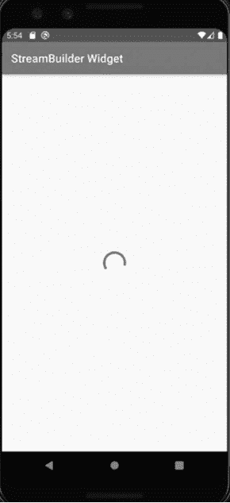

图 6.10 等待事件时的进度条

我们将使用`ElevatedButton`组件为每个平台添加对话框。

## ElevatedButton

首先，添加两个按钮来打开 Material 和 Cupertino (iOS) 风格的对话框。`ElevatedButton`组件用于添加显示两种形式的`AlertDialog`。

```
Center(
  child: Row(
    mainAxisAlignment: MainAxisAlignment.spaceAround,
    children: [
      ElevatedButton(
        child: Text("Material"),
        onPressed: () {
          _showMaterialDialog(context);
```),

  ElevatedButton(

  child: Text (`Cupertino`),

  onPressed: () {

    _showCupertinoDialog(context);

  },

),

```

# 实用 Flutter

点击 Material 按钮打开 Material 对话框，而 Cupertino 将打开 iOS 风格的对话框。图 12 演示了 Material 和 Cupertino (iOS) 风格的`AlertDialog`组件。

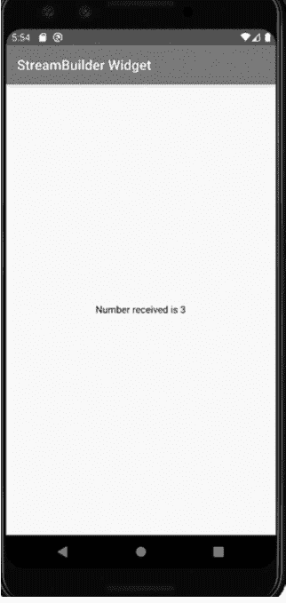

图 6.11 显示流事件

# Flutter Widgets

# 81

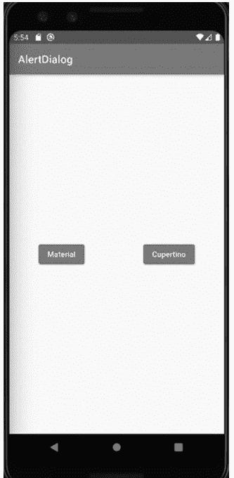

图 12 `ElevatedButton`组件显示两种形式的`AlertDialog`

## MATERIAL 样式

Material 组件`AlertDialog`组件的创建方式如下代码所示：

```
Future<void> _showMaterialDialog(BuildContext context) async {
  return showDialog<void>(
    context: context,
    barrierDismissible: false,
    builder: (BuildContext context) {
      return AlertDialog(
        title: Text("Material"),
        content: Text("I'm Material AlertDialog Widget."),
        actions: <Widget>{
          TextButton(
```
```
child: Text('Cancel'),
onPressed: () {
  Navigator.of(context).pop();
},
  TextButton(
    child: Text('OK'),
    onPressed: () {
      Navigator.of(context).pop();
    }
  );
);
}
```

图 6.13 显示 Material 主题的`AlertDialog`组件。

## CUPERTINO 样式

iOS 风格的`AlertDialog`组件。

```
Future<void> _showCupertinoDialog(BuildContext context) async {
  return showDialog<void>(
    context: context,
    barrierDismissible: false,
    builder: (BuildContext context) {
      return CupertinoAlertDialog(
        title: Text('Cupertino'),
        content: Text('I'm Cupertino (iOS) Alert Widget.'),
        actions: <Widget>{
          TextButton(
            child: Text('Cancel'),
            onPressed: () => Navigator.of(context).pop(),
          ),
          TextButton(
            child: Text('OK'),
            onPressed: () => Navigator.of(context).pop(),
          ),
        }
      );
    },
  );
}
```


# Flutter Widgets

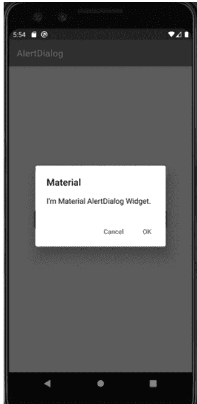

图 6.13 Material 组件组件

图 6.14 显示 Cupertino 风格组件。

## 在线源码

此示例（Flutter Widgets: AlertDialog）的源码可以在 GitHub 上获取。

## 结论

在本章中，我们学习了更多 Flutter 组件、图片和文本。我们还学习了如何使用 `StreamBuilder` 处理数据。最后，我们接触了 Material 和 Cupertino 风格的对话框。

# 84

# 实用 Flutter

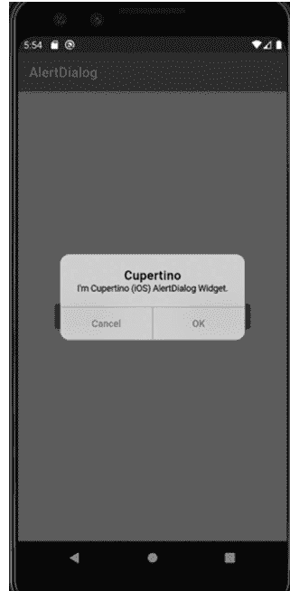

图 6.1 Cupertino 样式

## 参考文献

- [Flutter Widgets](https://example.org) 异步编程。
- [Flutter Widgets](https://example.org) 流。
- [Flutter Widgets](https://example.org) `ElevatedButton` 类。
- [Flutter Widgets](https://example.org) `Future<T>` 类。
- [Flutter Widgets](https://example.org) `StreamBuilder` 类。
- [Flutter Widgets](https://example.org) 图片。
- [Flutter Widgets](https://example.org) 占位符。
- [Flutter Widgets](https://example.org) `Stream<T>` 类。

# 85


## 7 布局构建

在本章中，你将学习如何为 Material Flutter 应用构建布局。Material 应用遵循 Material 设计指南（Material Components 小部件）。Flutter 同样支持为非 Material 应用构建布局。你将学习使用布局小部件（Layout widgets）在 Flutter 中构建布局（Layouts in Flutter）。

我们将从回顾之前章节中的 HelloBooksApp 开始。这有助于理解在 Flutter 应用中布局小部件的过程。

## 回顾 HelloBooksApp 布局

让我们回顾上一一节（第 05 章：Flutter 结构）中的 HelloBooksApp，以分析其构建布局的四步流程。

- 1. 选择布局小部件
- 2. 创建一个显示文本的可见小部件
- 3. 将可见部件添加到布局部件中
- 4. 将布局部件添加到应用程序

请参考图 7.1 回顾 HelloBooksApp 的布局结构。

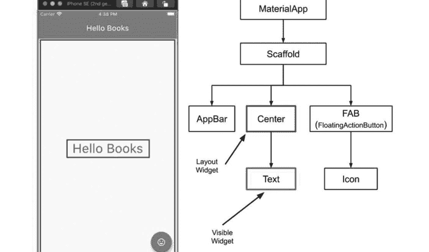

**图 7.1** HelloBooksApp 的布局

## 8 实用型 Flutter

HelloBooksApp 在屏幕中间显示问候文本。笑脸的悬浮操作按钮提供了每次点击将问候切换为不同语言的选项。

## 布局部件

在 HelloBooksApp 中，问候文本显示在屏幕中间。我们需要一个布局部件（Layout Widgets）来存放显示文本的可见部件。`Center`（`Center` 类）布局部件将其子项在水平和垂直方向上都居中。

```dart
Center(

)
```

### 可见部件

`Text` 小部件显示问候文本。

```dart
Text(
  'Hello Books',
  style: Theme.of(context).textTheme.headline4,
)
```

### 将可见部件添加到布局部件中

`Center` 小部件更像是一个容器。我们需要将一个可见部件作为其后代添加进来。此时，我们已经有了一个带有可见文本字符串的布局。

```dart
Center(
  child: Text(
  'Hello Books',
    style: Theme.of(context).textTheme.headline4,
  ),
),
```

### 将布局部件添加到 MaterialApp

最后一步是将布局部件添加到 `MaterialApp`。`MaterialApp` 提供了 `Scaffold` 小部件，该部件提供了应用程序接口（APIs）来添加应用栏、底部栏、导航抽屉等。`body` 属性为主屏幕添加布局部件。

### 构建布局

```dart
MaterialApp(
  home: Scaffold(
    body: Center(
      child: Text(
        'Hello Books',
        style: Theme.of(context).textTheme.headline4,
      )
    )
  )
);
```

在本节中，你学习了如何使用 `Center` 小部件在 material Flutter 应用中添加布局部件。在章节的其余部分中，你将探索其他布局部件，这些部件有助于根据应用设计的需求安排部件。

## 在线源码

此示例的源码（回顾 HelloBooksApp 源码）可以在 GitHub 上找到。

## 布局部件的类型

布局部件有两种类型：

- 1. 单子项：这些布局只能添加一个子项。一些示例包括：`Center`（`Center` 类）、`Container`（`Container` 类）、`Padding`（`Padding` 类）、`ConstrainedBox`（`ConstrainedBox` 类）、`Expanded`（`Expanded` 类）、`Flexible`（`Flexible` 类）、`FittedBox`（`FittedBox` 类）、`FractionallySizedBox`（`FractionallySizedBox` 类）、`IntrinsicHeight`（`IntrinsicHeight` 类）、`IntrinsicWidth`（`IntrinsicWidth` 类）、`LimitedBox`（`LimitedBox` 类）、`OverflowBox`（`OverflowBox` 类）、`SizedOverflowBox`（`SizedOverflowBox` 类）、`SizedBox`（`SizedBox` 类）以及 `Transform`（`Transform` 类）。
- 2. 多子项：此类布局部件可以添加多个子项。一些示例包括：`Column`（`Column` 类）、`Row`（`Row` 类）、`Flex`（`Flex` 类）、`ListView`（`ListView` 类）、`GridView`（`GridView` 类）、`Stack`（`Stack` 类）、`IndexedStack`（`IndexedStack` 类）、`Flow`（`Flow` 类）、`Layout`（`Layout` 类）、`ListBody`（`ListBody` 类）、`Table`（`Table` 类）、`Wrap`（`Wrap` 类）。

在后续章节中，我们将学习一些常用的布局部件。

## CONTAINER部件

`Container`（`Container` 类）小部件是一个简单且多功能的布局部件。它只能包含一个子项作为后代。它具有多种属性，可以用来对其小部件进行样式设置以更改背景颜色或形状和大小。默认情况下，它对齐到屏幕的左上角。

让我们添加一个带有“Hello Container”文本的 `Text` 小部件作为子项。应用 `TextStyle`（Flutter Team, 2020）来将文本字体设置为“30”。

```dart
Container(
  child: Text(
    "Hello Container",
    style: TextStyle(fontSize: 30),
  )
)
```

“Hello Container”的渲染效果如图 7.2 所示。

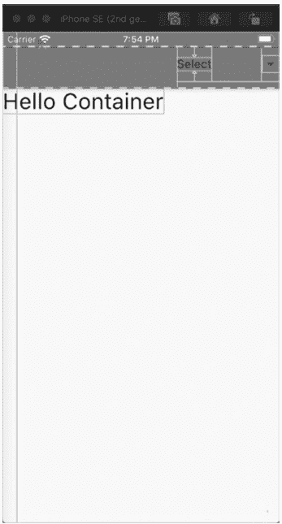

**图 7.2** Container 布局 - 默认

### 构建布局

在添加子项后，除非使用颜色、padding 等属性，否则你不会发现任何区别。

### Color属性

`Container` 小部件的 `color` 属性（color property）用于突出背景，如图 7.3 所示。

```dart
Container(
  color: Colors.red,
  child: Text("Hello Container"),
)
```

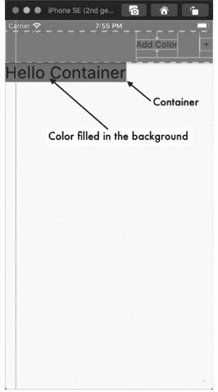

**图 7.3** Container 布局 - 颜色

### Padding属性

`padding` 属性（padding property）在子项和 `Container` 之间添加空间，如图 7.4 所示。

```dart
Container(


`padding: const EdgeInsets.all(16),`

`child: Text("Hello Container")`

```
```

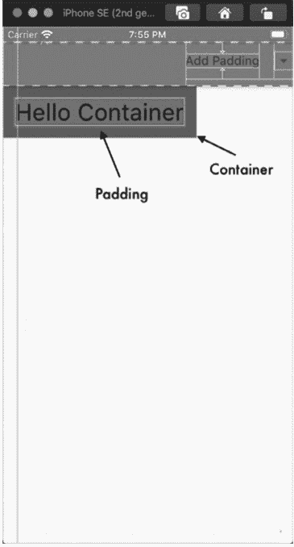

**图 7.4** Container 布局 - 内边距

### Margin属性

`margin` 属性（margin property）用于在 `Container` 小部件周围添加空间，如图 7.5 所示。

```dart
Container(
  margin: const EdgeInsets.all(20),
  child: Text("Hello Container"),
)
```

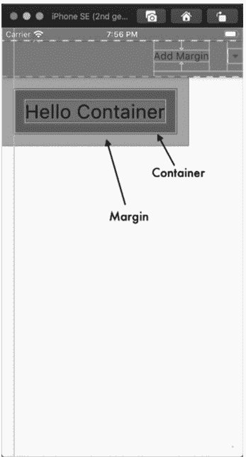

**图 7.5** Container 布局 - 外边距

### Alignment属性

`alignment` 属性（alignment property）用于在 `Container` 内对齐子项，如图 7.6 所示。

```dart
Container(
  alignment: Alignment.center,
  child: Text("Hello Container"),
)
```

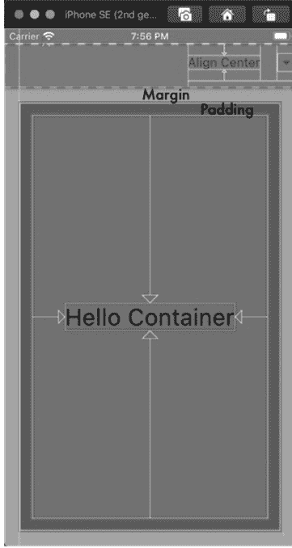

**图 7.6** Container 布局 - 对齐

### Constraints属性

`constraints` 属性对 `Container` 小部件应用尺寸约束。例如，`BoxConstraints.tightFor(width:x, height:y)` 为给定的宽度 'x' 或高度 'y' 创建框。当宽度和高度限制为 '100' 时，`Container` 小部件看起来如图 7.7 所示。你可以注意到文本被截断了，因为框的大小不足以显示完整文本。

```dart
Container(
  constraints: BoxConstraints.tightFor(width: 100.0, height: 100.0),
  child: Text(
    "Hello Container",
    style: TextStyle(fontSize: 30),
  )
);
```

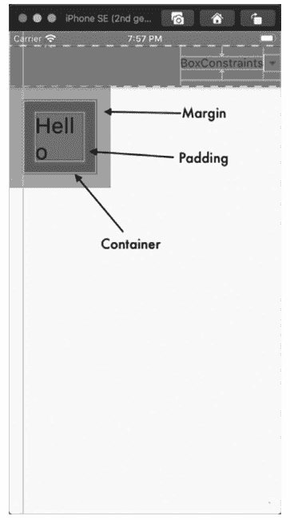

**图 7.7** Container 布局 - 约束

### Transform属性

`transform` 属性（transform property）用于在将子项添加到布局部件 `Container` 之前对其进行变换。`Matrix4.rotationZ(0.3)` 值按给定量顺时针旋转 `Container` 小部件。

```dart
Container(
  transform: Matrix4.rotationZ(0.3),
  child: Text(
    "Hello Container",
    style: TextStyle(fontSize: 30),
  )
)
```

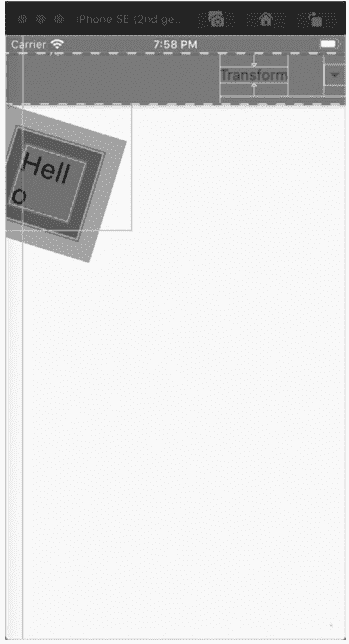

**图 7.8** Container 布局 - 变换

## 装饰属性 (Decoration PROPERTY)

`decoration` 属性用于为 `Container` 组件添加形状。它使用 `BoxDecoration` 来提供细节。`BoxDecoration`（`BoxDecoration` 类）告诉组件如何绘制 `Container` 组件周围的框框。简单来说，此属性允许 `Container` 在周围添加边框或投影阴影。请注意，`Container` 组件的 `color` 属性不能与 `decoration` 同时使用。`Container` 组件的 `color` 属性和 `decoration` 属性不能同时使用。

```dart
Container(
  decoration: BoxDecoration(
    border: Border.all(
      color: Colors.amber,
      width: 5.0,
      style: BorderStyle.solid,
    ),
  ),
  child: Text(
    "Hello Container",
    style: TextStyle(fontSize: 30),
  )
)
```

参考图 7.9 查看 Container 布局中的装饰属性。

## 在线源码 (SOURCE CODE ONLINE)

此示例（构建布局：Container 组件）的源代码可以在 GitHub 上在线获取。

## 内边距组件 (Padding WIDGET)

`Padding`（`Padding` 类）组件按照给定的内边距将其子组件嵌入。它在子组件周围创建空间。它会处理传递给子组件的任何约束调整，以便在其周围提供给定的空间。

如下所示创建一个 `Padding` 组件。它使用 `padding` 属性为内缩分配空间大小。`EdgeInsets`（`EdgeInsets` 类）指定了从四边的偏移量。在下面的示例中，顶部、底部、左侧和右侧提供了 8 dip（密度无关像素）的偏移。当你确定提供的内边距不会改变时，需要使用 `const` 关键字。在本示例中，我们将修改内边距，以显示 `padding` 属性不同值的几个示例。

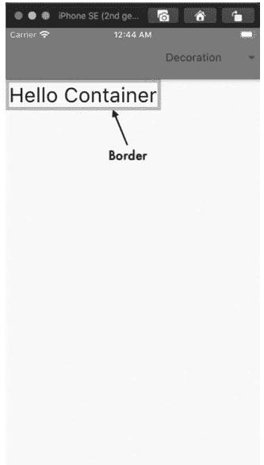

图 7.9 Container 布局 – 装饰属性

```dart
double padding = 8.0;
Padding(
  padding: EdgeInsets.all(padding),
  child: Text (
    "Hello Padding",
    style: TextStyle(fontSize: 30),
  ),
),
```

图 7.10 显示了 `Padding` 组件——单子组件布局。`padding` 和 `margin` 的区别在于，`Padding` 在布局组件（如 `Container`）的子组件周围创建空空间。而 `margin` 属性在布局组件本身周围创建空间。

## 在线源码 (SOURCE CODE ONLINE)

此示例（构建布局：Padding 组件）的源代码可以在 GitHub 上在线获取。

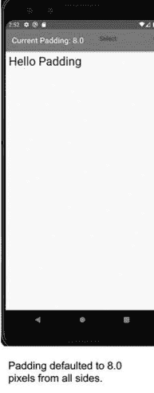
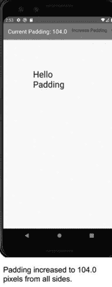
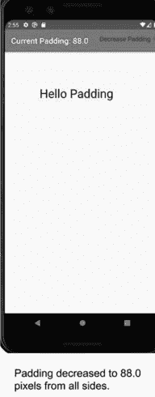

- Padding 默认四边 8.0 像素。
- Padding 四边增加到 104.0 像素。
- Padding 四边减少到 88.0 像素。

**图 7.10** Padding 单子组件布局组件

## 约束框 (ConstrainedBox WIDGET)

有时你可能想要渲染一个给定尺寸的组件。`ConstrainedBox`（`ConstrainedBox` 类）是一种在其子组件上应用额外约束的布局组件。让我们查看应用于 `ConstrainedBox` 组件的三种 `BoxConstraints` 类型。它指定了子组件允许扩展的最大和最小宽高。`BoxConstraints.expand()` 填充父容器。

## 最小宽度与高度 (MINIMUM WIDTH & HEIGHT)

此约束对子组件施加最小宽度和高度。在本示例中，在应用的中心添加了 `ConstrainedBox` 组件。一个 `Container` 组件作为子组件显示消息。

```dart
...
body: Center(
  child: ConstrainedBox(
    constraints: BoxConstraints(
      minWidth: 100,
      minHeight: 100,
    ),
    child: Container(
      color: Colors.grey,
      child: Text(message)
),
),
```

### BoxConstraints.expand()

`BoxConstraints.expand()` 让其子组件扩展到指定的宽度和高度。

```dart
...
body: Center(
  child: ConstrainedBox(
    constraints: BoxConstraints.expand(
      width: 200,
      height: 200,
    ),
    child: Container(
```


### BoxConstraints.loose()

`BoxConstraints.loose()` 将子组件限制在给定尺寸内。它不能超过提供的尺寸。

```
...
body: Center(
  child: ConstrainedBox(
    constraints: BoxConstraints.loose(
      Size(100, 200),
    ),
    child: Container(
      color: Colors.grey,
      child: Text(message),
    )
  )
),
```

三个约束都在图 7.11 中并列显示。

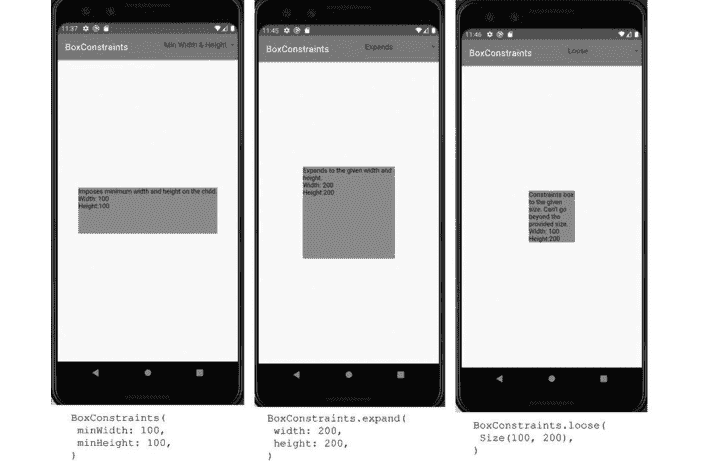

图 7.11 ConstrainedBox 组件 – 属性

## 源码 (Source Code Online)

此示例（构建布局：ConstrainedBox 组件）的源代码可以在 GitHub 获取。

## SizedBox 组件 (SizedBox Widget)

`SizedBox`（`SizedBox` 类）组件是一个单组件布局组件。它具有特定尺寸，可以添加另一个组件作为子组件。当你知道组件的尺寸时它非常有用。`width` 属性用于设置框的宽度，`height` 属性用于设置高度。该代码段创建了一个高宽 200 像素的 `SizedBox`。

```
SizedBox(
  height: 200,
  width: 200,
  child: Container(
    color: Colors.deepPurple,
  )
),
```

图 7.12 显示了 `SizedBox` 组件。

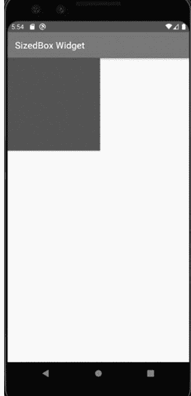

**图 7.12** 高和宽为 200 的 SizedBox

有一个便利构造函数 `SizedBox.expand`，它也可以用于创建一个占据父级宽度和高度的框。

```
SizedBox.expand(
  child: Container(
    color: Colors.deepPurple,
  )
)
```

图 7.13 展示了使用 `SizedBox.expand` 构造函数创建 `SizedBox` 组件。通过给 `SizedBox` 的 `width` 和 `height` 属性赋值 `double.infinity` 可以获得相同的结果。

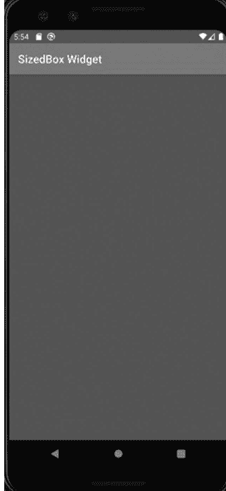

**图 7.13** 使用 'SizedBox.expand' 构造函数的 SizedBox 组件

在构建界面时，常用没有子组件的 `SizedBox` 来添加组件之间的间距。

## 源码 (Source Code Online)

此示例（构建布局：SizedBox 组件）的源代码可以在 GitHub 上在线获取。

## Row 组件 (Row WIDGET)

`Row`（`Row` 类）组件用于以水平方式排列其子组件。让我们添加三个 `Container` 组件作为子组件。`child(int index)` 方法返回一个宽高密度无关像素的 `Container`。该容器有一个 `Text` 组件作为子组件，显示作为参数传递给方法的数字。

```
Widget childWidget(int index) {
  return Container(
    color: Colors.grey,
    width: 100,
    height: 100,
    child: Center(
      child: Text(
        "$index",
        style: TextStyle(fontSize: 40),
      )
    )
  );
}
```

现在我们有了一个子组件，让我们在 `Row` 组件中如下添加三次：

```
Row(
  children: [
    childWidget(0),
    childWidget(1),
    childWidget(2),
  ]
);
```

图 7.14 显示了用 `Row` 组件构建的多子组件布局。尝试向 `Row` 组件的 `children` 中再添加一个组件 `childWidget(3)` 并观察变化。

```
Row(
  children: [
    childWidget(0),
    childWidget(1),
    childWidget(2),
    childWidget(3),
  ]
);
```

你会注意到有足够的空间让四个组件水平排列。最后一个子组件用黄色和黑色的线条进行渲染。每当一个组件溢出可用空间以渲染自身时，你都会看到那些线条。你将在构建响应式布局的章节中学习创建自适应布局（第 08 章：响应式界面）。

图 7.15 显示了多子组件布局中溢出的组件。

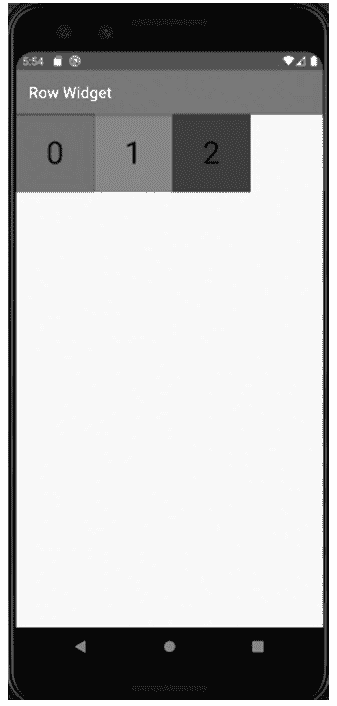

**图 7.14** Row: 多子组件布局组件

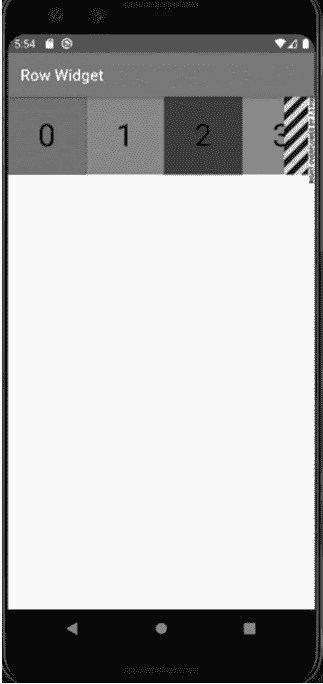

图 7.15 Row：溢出的子组件

```
Widget childWidget(int index) {
  return Container(
    color: getColor(index),
    width: 100 + index * 20.toDouble(),
    height: 100 + index * 30.toDouble(),
    child: Center(
      child: Text(
        "$index",
        style: TextStyle(fontSize: 40),
      )
    );
  );
}
```

### 构建布局

接下来，将由 `childWidget()` 方法创建的三个子添加到 `Row` 组件中，如下所示：

```
Row(
  children: [
    childWidget(0),
    childWidget(1),
    childWidget(2),
  ],
);
```

上述代码将在水平数组中渲染三个不同大小的 Container 小部件，如图 7.16 所示。

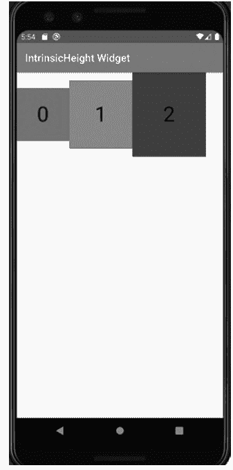

图 7.16 Row 组件具有不同大小的子组件

目标是将所有子组件拉伸到相同的高度。因此，让我们将 `Row` 组件的 `crossAxisAlignment` 属性设置为 `CrossAxisAlignment.stretch`，使所有子组件等等高。

```
Row(
  crossAxisAlignment: CrossAxisAlignment.stretch,
  children: [
    child(0),
    child(1),
    child(2),
  ]
)
```

然而，问题是它们将占据所有垂直方向的可用空间，导致看起来如图 7.17 所示。

我们希望让所有子组件的高度与最高的子组件相同，同时占据所有的可用垂直空间。这时，`IntrinsicHeight`（`IntrinsicHeight` 类）组件派上用场了。

**图 7.17** Row 组件的 ‘crossAxisAlignment’ 属性设置为 ‘CrossAxisAlignment.stretch’

你只需要将 `Row` 组件封装在 `IntrinsicHeight` 内部，如下所示代码段所示：

```
IntrinsicHeight(
  child: Row(
    crossAxisAlignment: CrossAxisAlignment.stretch,
    children: [
      childWidget(0),
      childWidget(1),
      childWidget(2),
    ]
  )
)
```


`IntrinsicHeight` 组件会将 `Row` 组件的所有子组件扩展到与最高子组件相同的高度，如图 7.18 所示。

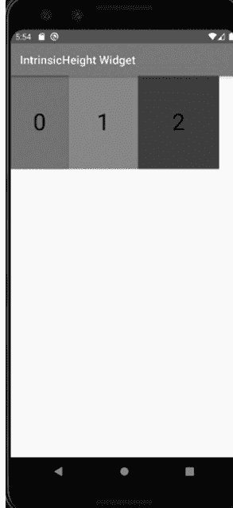

图 7.18 '`IntrinsicHeight`' 组件将 `Row` 组件的所有子组件扩展到与最高子组件相同的高度

## 在线源代码

此示例（构建布局：`IntrinsicHeight` 组件）的源代码可以在 GitHub 上在线获取。

## Column 组件

`Column` 组件（`Column` 类）组件用于以垂直方式排列其子组件。让我们类似于 `Row` 组件，添加三个 `Container` 组件作为子组件。`childWidget(int index)` 方法返回一个宽和高均为 200 dips 的 `Container` 组件。该容器有一个 `Text` 组件作为其子组件，显示传递给方法的参数数字。

```dart
Container(
  color: getColor(index),
  width: 200,
  height: 200,
  child: Center(
    child: Text(
      "$index",
      style: TextStyle(fontSize: 40),
    )
  )
);
```

让我们在 `Column` 组件中如下所示的添加三次这个子组件：

```dart
Column(
  children: [
    childWidget(0),
    childWidget(1),
    childWidget(2),
  ]
);
```

图 7.19 显示了使用 `Column` 组件构建的多子布局。
让我们尝试向 `Column` 组件的子组件中再添加一个组件 `childWidget(3)`，如下所示代码段：

```dart
Column(
  children: [
    childWidget(0),
    childWidget(1),
    childWidget(2),
  );
```

### 构建布局

```dart
childWidget(3),
);
```

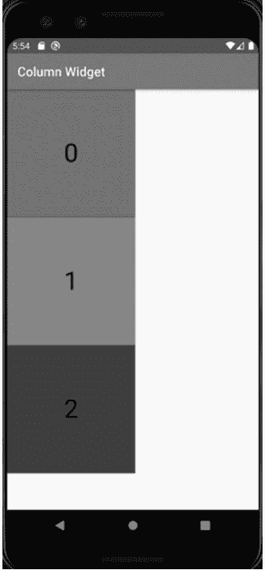

图 7.19 `Column`：多子布局组件

你会注意到之前在 `Row` 组件中观察到的相同黄色和黑色溢出线。这是因为没有足够的空间让所有四个组件在垂直方向上容纳，如图 7.20 所示。

## 在线源代码

此示例（构建布局：`Column` 组件）的源代码可以在 GitHub 上在线获取。

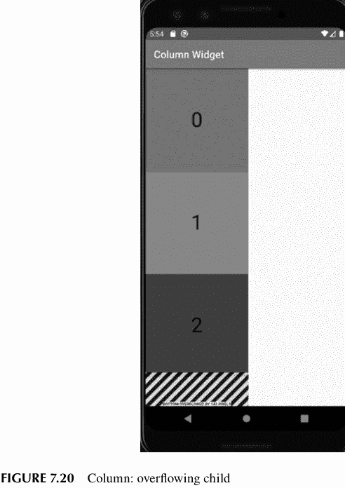

## IntrinsicWidth 组件

`IntrinsicWidth`（`IntrinsicWidth` 类）组件是一个单子组件布局组件。该组件用于将子组件的宽度限制为给定宽度；否则，它将扩展到其可用的最大宽度。当期望 `Column` 组件的每个子组件具有相同的宽度时，该组件有用。

让我们使用由 `childWidget(int index)` 方法生成的三个组件在 `Row` 组件中，如下所示：

```dart
Row(
  crossAxisAlignment: CrossAxisAlignment.stretch,
  children: [
    childWidget(0),
    childWidget(1),
    childWidget(2),
  ],
);
```

具有不同大小的三个子组件将在水平数组中渲染，如图 7.21 所示。我们将 `crossAxisAlignment` 属性设置为 `CrossAxisAlignment.stretch`，使所有子组件等等宽。

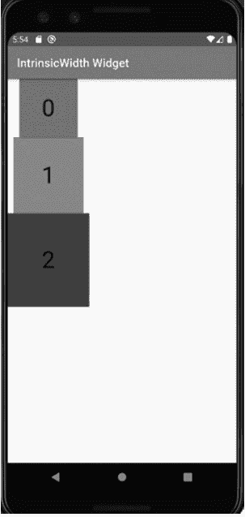

图 7.21 `Row` 组件具有不同大小的子组件

# 实用 Flutter

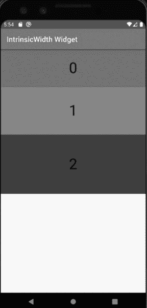

**图 7.22** `Column` 组件的 '`crossAxisAlignment`' 属性设置为 '`CrossAxisAlignment.stretch`'

然而，问题是它们将占据所有垂直方向的可用空间，如图 7.22。`IntrinsicWidth` 组件通过封装 `Column` 来解决这个问题，使 `Column` 的子组件扩展到最宽子组件的宽度。

```dart
IntrinsicHeight(
  child: Column(
    crossAxisAlignment: CrossAxisAlignment.stretch,
    children: [
      childWidget(0),
      childWidget(1),
      childWidget(2),
    ]
  )
)
```

图 7.23 '`IntrinsicHeight`' 组件将 `Column` 组件的所有子组件扩展到与最宽子组件相同的宽度

## 在线源代码

此示例（构建布局：`IntrinsicHeight` 组件）的源代码可以在 GitHub 上在线获取。

## ListView 组件

`ListView`（`ListView` 类）组件是一个多子布局滚动组件。如下所示代码段，我们在 `ListView` 组件中添加四个子组件，正如我们在上一节中对 `Column` 组件所做的方式在主轴滚动。

```dart
ListView(
  children: [
    childWidget(0),
    childWidget(1),
    childWidget(2),
    childWidget(3),
  ],
)
```

图 7.24 显示了使用 `ListView` 组件。

## 在线源代码

此示例（构建布局：`ListView` 组件）的源代码可以在 GitHub 上在线获取。

## GridView 组件

`GridView`（`GridView` 类）组件是一个类似于 `ListView` 的多子滚动组件。它在二维数组中排列其子组件。在本节中，我们将关注使用 `GridView.count`（`GridView.count` 构造函数）创建一个交叉轴上有固定数量瓦片的网格。`GridView`滚动的方向为主轴。`crossAxisCount` 属性用于交叉轴上的瓦片数量。在下面的代码段中，`crossAxisCount` 为二，意味着水平方向有两个瓦片。

```dart
GridView.count(
  crossAxisCount: 2,
  children: [
    childWidget(0),
    childWidget(1),
    childWidget(2),
    childWidget(3),
  ]
);
```

图 7.25 显示了使用 `GridView` 组件构建的多子布局。

## 在线源代码

此示例（构建布局：`GridView` 组件）的源代码可以在 GitHub 上在线获取。

## Table 组件

`Table`（`Table` 类）布局支持多个子。该布局组件以表格形式排列其子组件。该布局不滚动，用于固定数量的组件。`Table` 布局用于设计不需要滚动的界面，并避免多层嵌套的 `Row` 和 `Column` 组件。`Table` 组件可以封装在 `SingleChildScrollView`（`SingleChildScrollView` 类）内部，使其可滚动。`SingleChildScrollView` 组件是一个可滚动框，使其唯一的子组件可滚动。

让我们在 `Table` 布局中添加四个子。每个子都是不同大小和颜色的 `Container` 组件。使用 `childWidget()` 方法来创建此类子组件。

```dart
width: 200 + index * 20.toDouble(),
height: 200 + index * 30.toDouble(),
child: Center(
  Text (
    "$index",
    style: TextStyle(fontSize: 40),
  )
);
);
```

`Table` 组件具有多个类型为 `TableRow` 的子组件，如下代码段所示。`border` 属性用于为每个单元格绘制框。`columnWidths` 属性用于为指定的列分配宽度。它是列索引到 `FractionColumnWidth`（`FractionColumnWidth` 类）的映射，用于设置所给列的宽度比例。

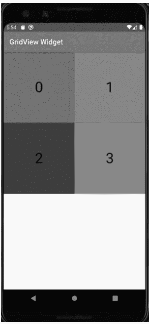

图 7.25 `GridView` 多子组件布局组件

### 构建布局

```dart
Table(
  border: TableBorder.all(width: 2.0),
  columnWidths: {
    0: FractionColumnWidth(.5),


```dart
1: FractionColumnWidth(.5),

},

children: [

TableRow(

children: [

childWidget(0),

childWidget(1),

],

),

TableRow(

children: [

childWidget(2),

childWidget(3),

],

),

]
)
```

图 7.26 显示了使用 `Table` 组件构建的多子组件布局。

## 在线源码

此示例（构建布局：Table 组件）的源码可以在 GitHub 上找到。

## Stack 组件

`Stack`（`Stack` 类）组件是一个多子组件布局，因为它可以包含多个子组件。正如其名称，我们可以将一个组件堆叠在另一个组件之上。当需要一个组件被另一个组件覆盖时，该组件非常有用。让我们通过一个示例来理解 `Stack` 组件的用法。我们将使用 `childWidget(int index)` 方法创建三个不同大小的组件。该方法接收一个整数并创建返回一个 `Container` 组件。其宽度和高度使用 `index` 参数计算。`getColor(int index)` 函数根据 `index` 参数返回不同的颜色。

```dart
Widget childWidget(int index) {
  return Container(
    color: getColor(index),
    width: 200 + index * 20.toDouble(),
    height: 200 + index * 30.toDouble(),
    child: Center(
      child: Text (
        "$index",
        style: TextStyle(fontSize: 40),
      ),
    ),
  );
}
```

接下来，将三个 `childWidgets()` 放入 `Stack` 组件中，如下所示：

```dart
Stack(
  children: [
    childWidget(2),
    childWidget(1),
    childWidget(0),
  ],
)
```


图 7.26 Table – 多子组件布局组件


图 7.27 Stack – 多子组件布局组件

`childWidget(2)` 是宽度和高度最大的 `Container` 组件，颜色为紫色。该组件最先放置。下一个子组件 `childWidget(1)` 是绿色的，比紫色组件略小。它放置在紫色组件之上。第三个组件 `childWidget(0)` 是红色的且最小。它被放置在栈的最顶部。栈的外观如图 7.27 所示。

## 在线源码

此示例（构建布局：Stack 组件）的可以在 GitHub 上获取。

## IndexedStack 组件

`IndexedStack`（`IndexedStack` 类）组件也是多子组件布局。它类似于 `Stack` 组件，但一次只显示一个子组件。它使用 `index` 属性在各个子组件之间切换。让我们再次使用之前讨论的 `Stack` 组件的示例。这次，三个 `childWidget()` 被封装在 `IndexedStack` 内部而不是 `Stack`，并且有一个 `index` 属性来显示当前选中的组件。我们将 `IndexedStack` 封装在 `GestureDetector`（`GestureDetector` 类）中，以便为组件添加点击手势。每当点击组件时，索引就会变为下一个子组件并递增。

```dart
int _childIndex = 0;

@override

Widget build(BuildContext context) {
  return Scaffold(
    body: Center(
      child: IndexedStack(
        index: _childIndex,
        children: [
          child(0),
          child(1),
          child(2),
        ]
      )
    ),
  );
}
```


`childWidget(int index)` 方法返回一个被 `GestureDetector` 封装的 `Container` 组件。点击子组件会使索引增加一。一旦达到最大索引二，`childIndex` 就会重置为零。`clamp`（`clamp` 方法）返回零到二之间的数字。

# 布局构建 (Building Layouts)

- Flutter Dev. (2020, 11 18). IntrinsicHeight 类。获取自 Flutter Dev: https://api.flutter.dev/flutter/widgets/IntrinsicHeight-class.html
- Flutter Dev. (2020, 11 18). IntrinsicWidth 类。获取自 Flutter Dev: https://api.flutter.dev/flutter/widgets/IntrinsicWidth-class.html
- Flutter Dev. (2020, 11 18). 布局组件 (Layout Widgets)。获取自 Flutter Dev: https://flutter.dev/docs/development/ui/widgets/layout
- Flutter Dev. (2020, 11 18). LayoutBuilder 类。获取自 Flutter Team: https://api.flutter.dev/flutter/widgets/LayoutBuilder-class.html
- Flutter Dev. (2020, 11 18). LimitedBox 类。获取自 Api Dev: https://api.flutter.dev/flutter/widgets/LimitedBox-class.html
- Flutter Dev. (2020, 11 18). ListBody 类。获取自 Flutter Dev: https://api.flutter.dev/flutter/widgets/ListBody-class.html
- Flutter Dev. (2020, 11 18). ListView 类。获取自 Api Dev: https://api.flutter.dev/flutter/widgets/ListView-class.html
- Flutter Dev. (2020, 11 18). margin 属性。获取自 Api Dev: https://api.flutter.dev/flutter/widgets/Container/margin.html
- Flutter Dev. (2020, 12 18). Material 组件组件 (Material Components Widgets)。获取自 Flutter Dev: https://flutter.dev/docs/development/ui/widgets/material
- Flutter Dev. (2020, 11 18). OverflowBox 类。获取自 Api Dev: https://api.flutter.dev/flutter/widgets/OverflowBox-class.html
- Flutter Dev. (2020, 11 18). Padding 类。获取自 Api Dev: https://api.flutter.dev/flutter/widgets/Padding-class.html
- Flutter Dev. (2020, 11 18), padding 属性。获取自 Flutter Dev: https://api.flutter.dev/flutter/widgets/Container/padding.html
- Flutter Dev. (2020, 11 18). Row 类。获取自 Flutter Dev: https://api.flutter.dev/flutter/widgets/Row-class.html
- Flutter Dev. (2020, 11 18). SizedBox 类。获取自 Api Dev: https://api.flutter.dev/flutter/widgets/SizedBox-class.html
- Flutter Dev. (2020, 11 18). SizedBox.expand 构造函数。获取自 Flutter Dev: https://api.flutter.dev/flutter/widgets/SizedBox/expand.html
- Flutter Dev. (2020, 11 18). SizedBoxOverflow 类。获取自 Api Dev: https://api.flutter.dev/flutter/widgets/SizedOverflow-class.html
- Flutter Dev. (2020, 11 18). Stack 类。获取自 Flutter Dev: https://api.flutter.dev/flutter/widgets/Stack-class.html
- Flutter Dev. (2020, 11 18). Table 类。获取自 Flutter Dev: https://api.flutter.dev/flutter/widgets/Table-class.html
- Flutter Dev. (2020, 11 18). Transform 类。获取自 Api Dev: https://api.flutter.dev/flutter/widgets/Transform-class.html
- Flutter Dev. (2020, 11 18), transform 属性。获取自 Api Dev: https://api.flutter.dev/flutter/widgets/Container/transform.html
- Flutter Dev. (2020, 11 18). Wrap 类。获取自 Flutter Dev: https://api.flutter.dev/flutter/widgets/Wrap-class.html
- Flutter Team. (2020, 11 18). SingleChildScrollView 类。获取自 Flutter Dev: https://api.flutter.dev/flutter/widgets/SingleChildScrollView-class.html
- Flutter Team. (2020, 11 18). TextStyle 类。获取自 Flutter Dev: https://api.flutter.dev/flutter/painting/TextStyle-class.html
- Google. (2020, 11 18). 布局组件 (Layout widgets)。获取自 Flutter Dev: https://flutter.dev/docs/development/ui/layouts
- Google. (2020, 11 18). Flutter 中的布局 (Layouts in Flutter)。获取自 Flutter Dev: https://flutter.dev/docs/development/ui/layout
- Tyagi, P. (2020, 11 18). 构建布局：Column 组件。获取自第 07 章: Pragmatic Flutter 仓库：https://github.com/pytiagicodecamp/pragmatic_flutter/blob/master/lib/chapter07/layouts/column.dart
- Tyagi, P. (2020, 11 18). 构建布局：ConstrainedBox 组件。获取自第 07 章: Pragmatic Flutter 仓库：https://github.com/pytiagicodecamp/pragmatic_flutter/blob/master/lib/chapter07/single/constrained_box.dart
- Tyagi, P. (2020, 11 18). 构建布局：Container 组件。获取自第 07 章: Pragmatic Flutter 仓库：https://github.com/pytiagicodecamp/pragmatic_flutter/blob/master/lib/chapter07/single/container.dart
- Tyagi, P. (2020, 11 18). 构建布局：GridView 组件。获取自第 07 章: Pragmatic Flutter 仓库：https://github.com/pytiagicodecamp/pragmatic_flutter/blob/master/lib/chapter07/single/grid_view.dart
- Tyagi, P. (2020, 11 18). 构建布局：IndexedStack 组件。获取自第 07 章: Pragmatic Flutter 仓库：https://github.com/pytiagicodecamp/pragmatic_flutter/blob/master/lib/chapter07/multi/indexed_stack.dart
- Tyagi, P. (2020, 11 18). 构建布局：IntrinsicHeight。获取自第 07 章: Pragmatic Flutter 仓库：https://github.com/pytiagicodecamp/pragmatic_flutter/blob/master/lib/chapter07/single/intrinsic_height.dart
- Tyagi, P. (2020, 11 18). 构建布局：IntrinsicWidth。获取自第 07 章: Pragmatic Flutter 仓库：https://github.com/pytiagicodecamp/pragmatic_flutter/blob/master/lib/chapter07/single/intrinsic_width.dart
- Tyagi, P. (2020, 11 18). 构建布局：ListView 组件。获取自第 07 章: Pragmatic Flutter 仓库：https://github.com/pytiagicodecamp/pragmatic_flutter/blob/master/lib/chapter07/multi/list_view.dart
- Tyagi, P. (2020, 11 18). 构建布局：Padding 组件。获取自第 07 章: Pragmatic Flutter 仓库：https://github.com/pytiagicodecamp/pragmatic_flutter/blob/master/lib/chapter07/single/padding.dart
- Tyagi, P. (2020, 11 18). 构建布局：Row 组件。获取自第 07 章: Pragmatic Flutter 仓库：https://github.com/pytiagicodecamp/pragmatic_flutter/blob/master/lib/chapter07/layouts/row.dart
- Tyagi, P. (2020, 11 18). 构建布局：SizedBox 组件。获取自第 07 章: Pragmatic Flutter 仓库：https://github.com/pytiagicodecamp/pragmatic_flutter/blob/master/lib/chapter07/single/sized_box.dart
- Tyagi, P. (2020, 11 18). 构建布局：Stack 组件。获取自第 07 章: Pragmatic Flutter 仓库：https://github.com/pytiagicodecamp/pragmatic_flutter/blob/master/lib/chapter07/layouts/stack.dart
- Tyagi, P. (2020, 11 18). 构建布局：Table 组件。获取自第 07 章: Pragmatic Flutter 仓库：https://github.com/pytiagicodecamp/pragmatic_flutter/blob/master/lib/chapter07/multi/table.dart
- Tyagi, P. (2020, 11 18). 重温 HelloApps 源代码。获取自第 05 章: Pragmatic Flutter 仓库：https://github.com/pytiagicodecamp/pragmatic_flutter/blob/master/lib/chapter05/main_05_dart.dart
- Tyagi, P. (2021). 第 05 章：Flutter 应用结构。见于 P. Tyagi，《Pragmatic Flutter: 为 Android、iOS、Web 和桌面端构建跨平台移动应用》。CRC Press。
- Tyagi, P. (2021). 第 08 章：响应式界面。见于 P. Tyagi，《Pragmatic Flutter: 为 Android、iOS、Web 和桌面端构建跨平台移动应用》。CRC Press。

# 8 响应式界面

本章侧于介绍如何为 Flutter 应用构建响应式布局。响应式布局可以根据渲染组件的可用空间进行调整。我们将涵盖 `FittedBox`、`Expanded`、`Flexible`、`FractionallySizedBox`、`LayoutBuilder` 和 `Wrap` 组件。

## FittedBox 组件

`FittedBox`（`FittedBox` 类）在布局期间将其子组件适应到给定的空间内，以避免溢出。它根据 `fit` 属性对子组件进行定位和缩放（或裁剪），有助于将其放入到布局时分配的空间中。它确保了子组件位于父组件内部。

让我们通过添加包含两个 `Image` 组件的 `Row` 组件来理解 `FittedBox` 的用法。

```


# 实战 Flutter

```
Row(

  children: [

    Image.asset('assets/flutter_icon.png'),

    Image.asset('assets/flutter_icon.png'),

  ]

)
```

当上述代码添加到 `Scaffold` 组件的 `body` 中时，第二个图像会溢出屏幕右侧，如图 8.1 所示。

将 `Row` 组件封装在 `FittedBox` 中，可以确保两个 `Image` 组件都包含在 `FittedBox` 内部，不会溢出屏幕。

```
FittedBox(

  Row(

    children: [

      Image.asset('assets/flutter_icon.png'),

      Image.asset('assets/flutter_icon.png'),

    ]

  )

)
```

图 8.2 显示两个图像都调整到了屏幕内部，没有向右侧溢出。


**图 8.1** 未使用 `FittedBox` 时溢出的组件

## 在线源码

此示例的源代码（响应式界面：`FittedBox` 组件）可以在 GitHub 上在线查看。

## Expanded 组件

`Expanded`（`Expanded` 类）组件是一个单子节点布局组件。该布局用于 `Row`、`Column` 和 `Flex` 等多子节点布局组件的特定子组件。包裹在 `Expanded` 组件中的子组件会沿主轴扩展以填满可用空间。对于 `Row` 父组件，它在水平方向扩展；对于 `Column` 父组件，它在垂直方向扩展。它使用 `flex` 因子（flex factor）让子组件知道它们可以占据多少可用空间。被 `Expanded` 组件包裹的子组件会占据所有剩余空间。当 `Expanded` 组件之间存在可用空间竞争时，它使用 `flex` 属性来分配空间。

## 响应式界面


图 8.2 使用 `FittedBox` 的响应式布局

让我们查看一个 `expandedDefault()` 组件，它由 `Row` 组件及其三个子组件组成，假设 `childWidget()` 方法返回一个被作为子组件添加到 `Row` 中的组件。在下方的代码段中，每个子组件都被包裹在 `Expanded` 组件中。每个 `Expanded` 组件都平分了可用的水平空间，如图 8.3 所示。

```
Widget expandedDefault() {

  return Row(

    children: [

      Expanded(

        child: childWidget(""),

      ),

      Expanded(

        child: childWidget(""),

      ),

      Expanded(

        child: childWidget(""),

      ),

    ],

  );

}
```

## 带有 `flex` 属性的 Expanded

在下面的示例中，每个子组件都被包裹在 `Expanded` 组件中，并使用了 `flex` 属性。每个子组件根据 `flex` 属性的值占据空间。第一个子组件的 `flex` 分配为4，第二个分配为3，第三个子组件的 `flex` 属性为1。在这种情况下，总空间将分为8份（4 + 3 + 1 = 8）。第一个子组件占据8份中的4份，即总空间的 4/8。


**图 8.3** 未使用 'flex' 属性的 `Expanded` 组件


**图 8.4** 使用 'flex' 属性的 `Expanded` 组件

第二个子组件占据8份中的3份，即总空间的 3/4，最后一个子组件占据总空间的1/2，如图 8.4 所示。

```
Widget expandedWithFlex() {

  return Row(

    children: [

      Expanded(

        flex: 4,

        child: childWidget("4/8"),

      ),

      Expanded(

        flex: 3,

        child: childWidget("3/8"),

      ),

      Expanded(

        flex: 1,

        child: childWidget("1/8"),

      ),

    ],

  );

}
```

## 在线源码

此示例的源代码（响应式界面：`Expanded` 组件）可以在 GitHub 上在线查看。

## Flexible 组件

`Flexible`（`Flex` 类）组件与 `Expanded` 组件相似，但有一个不同之处。它允许根据 `flex` 属性的约束让 `Row`、`Column` 和 `Flex` 布局组件的子组件在可用空间内扩展。`Flexible` 组件只根据 `flex` 属性声明的占据空间。它们默认不会占据额外的空间。

### `Flex.tight` 属性

`Flex.tight` 强制子组件占据整个可用空间。当 `fit` 属性设置为 `Flex.tight` 时，`Flexible` 组件的行为类似于 `Expanded` 组件。`Expanded(child: Text())` 等于 `Flexible(fit: Flex.tight, child: Text())`。在下面的代码段中，`Row` 组件的三个子组件分别分配了四、三、一份。当 `flex` 属性设置为 `Flex.tight` 时，它们会分配给它们的空间并填满。

```
Row(

  children: [

    Flexible(

      fit: Flex.tight,

      flex: 4,

      child: childWidget("4/8"),

    ),

    Flexible(

      fit: Flex.tight,

      flex: 3,

      child: childWidget("3/8"),

    ),

    Flexible(

      fit: Flex.tight,

      flex: 1,

      child: childWidget("1/8"),

    ),

  ],

)
```

参考图 8.5 查看使用 `Flex.tight` 的 `Flexible` 组件。

### `FlexFit.loose` 属性

`FlexFit.loose` 将保持默认并允许它们 own最大 own。在下面的代码段中，`Row` 的三个子组件分别分配了四、三、一份。当 `fit` 属性设置为 `FlexFit.loose` 时，它们只占据分配给它们的空间，而不占据剩余空间。


**图 8.5** 使用 'fit' 属性为 `FlexFit.tight` 的 `Flexible` 组件

```
Row(

  children: [

    Flexible(

      fit: FlexFit.loose,

      flex: 4,

      child: childWidget("4/8"),

    ),

    Flexible(

      fit: FlexFit.loose,

      flex: 3,

      child: childWidget("3/8"),

    ),

    Flexible(

      fit: FlexFit.loose,

      flex: 1,

      child: childWidget("1/8"),

    ),

  ]

)
```


参考图 8.6 查看使用 `FlexFit.loose` 属性的 `Flexible` 组件。

## 在线源码

此示例的源代码（响应式界面：`Flexible` 组件）可以在 GitHub 上查看。

## LayoutBuilder 组件

`LayoutBuilder`（`LayoutBuilder` 类）支持多子布局。它根据父组件传递的约束动态构建组件。`LayoutBuilder` 布局在创建响应式布局时效果良好。它可以根据约束的最大宽度 `maxWidth` 或最大高度 `maxHeight` 构建合适的布局。`LayoutBuilder` 在此时调用 `builder` 函数。

在这个示例中，`LayoutBuilder` 在布局期间根据屏幕的最大宽度渲染不同的组件。对于宽度大于 400 的屏幕渲染 `largeScreen()` 布局，对于宽度小于 400 的屏幕渲染 `smallScreen()`。

```
LayoutBuilder(
  builder: (context, constraints) {
    if (constraints.maxWidth > 400) {
      return largeScreen();
    } else {
      return smallScreen();
    }
  }
);
```

在小屏幕上渲染的 `LayoutBuilder` 组件见图 8.8。在大屏幕上渲染的 `LayoutBuilder` 组件见图 8.9。

## 在线源码

此示例的源代码（响应式界面：`LayoutBuilder` 组件）可以在 GitHub 上在线查看。

## FractionallySizedBox 组件

`FractionallySizedBox`（`FractionallySizedBox` 类）是一个单子节点布局组件。它将子组件的大小设置为总可用空间的比例。它的属性 `widthFactor` 和 `heightFactor` 提供了组件可以占据的区域比例。`alignment` 属性定位其子组件。这个没有子组件的组件作为占位符。在 `Row` 和 `Column` 组件中添加子组件时，建议将 `FractionallySizedBox` 包裹在 `Flexible` 组件中。

在下面的示例中，使用 `Center` 组件将 `Container` 组件放置在屏幕中心。`FractionallySizedBox` 被包裹在 `Padding` 组件中以保持视觉上的可区分。`ElevatedButton`（`ElevatedButton` 类）组件作为子组件添加到 `FractionallySizedBox` 中。`FractionallySizedBox` 通过 `alignment` 属性控制 `ElevatedButton` 组件的宽高以及它在 `Container` 组件内部的位置。在这种情况下，`FractionallySizedBox` 对齐到 `Container` 组件的底部。

```
Center(
  child: Container(
    width: 200,
    height: 200,
    decoration: BoxDecoration(
      border: Border.all(),
    ),
    child: Padding(
      padding: const EdgeInsets.all(8.0),
      child: FractionallySizedBox(
        alignment: Alignment.bottomCenter,
        widthFactor: 0.8,
        heightFactor: 0.2,
        child: ElevatedButton(
          child: Text(
            "Tap",
            style: TextStyle(
              fontSize: 20,
            ),
          ),
          onPressed: () {},
        ),
      ),
    ),
  ),
)
```

参考图 8.7 查看作为 `Container` 组件子组件的 `FractionallySizedBox`。


**图 8.6** 使用 'fit' 属性为 `FlexFit.loose` 的 `Flexible` 组件

## 在线源码

此示例的源代码（响应式界面：`FractionallySizedBox` 组件）可以在 GitHub 上在线查看。


**图 8.7** 作为 `Container` 组件子组件的 `FractionallySizedBox`


图 8.8 `LayoutBuilder` 组件在小屏幕上的渲染

当垂直对齐时位于下一列。`runSpacing` 属性提供了这些行之间的间隙。

```
child: Wrap(
  direction: Axis.horizontal,
  spacing: 20.0,
  runSpacing: 40.0,
  children: [
    childWidget("1"),
    childWidget("2"),
    childWidget("3"),
    childWidget("4"),
    childWidget("5"),
    childWidget("6"),
  ]
)
```


图 8.9 `LayoutBuilder` 组件在大屏幕上的渲染

请参考图 8.10 查看 `Wrap` 组件如何将其子组件换行为水平/垂直行。

# 在线获取源代码

此示例（响应式界面：`Wrap` 组件）的源代码可以在 GitHub 上在线获取。

## 结论

本章结束了我们对 Flutter 组件的讨论。Flutter 拥有庞大的组件库。本章涵盖了一些用于构建响应式用户界面的常用布局组件。我鼓励你查看 Flutter 组件目录（Widget Catalog）以学习更多关于布局组件的知识。

# 实战 Flutter

# 140


图 8.10 将子组件封装成水平/垂直行

以下结论性要点是在 Flutter 中构建界面的通用建议：

- 如果你知道布局组件的方向，请使用 `Row` 或 `Column`。
- 如果你不知道组件的主轴方向，请使用 `Flex` 组件。
- 如果你只有一个子组件需要显示，请使用 `Center` 或 `Align` 来对齐子组件。
- 如果子组件比父组件小，请将其封装在 `Align`（`Align` 类）组件中。
- 如果子组件比父组件大，请将其封装在 `SingleChildScrollView`（`SingleChildScrollView` 类）或 `OverflowBox`（`OverflowBox` 类）组件中。

## 参考文献

Flutter Team. (2020, 11, 19). `Align` 类。获取自 Flutter Dev: https://api.flutter.dev/flutter/widgets/Align-class.html

Flutter Team. (2020, 11, 19). `ElevatedButton` 类。获取自 Flutter Dev: https://api.flutter.dev/flutter/material/ElevatedButton-class.html

Flutter Team. (2020, 11, 19). `Expanded` 类。获取自 Flutter Dev: https://api.flutter.dev/flutter/widgets/Expanded-class.html

Flutter Team. (2020, 11, 19). `FittedBox` 类。获取自 Flutter Dev: https://api.flutter.dev/flutter/widgets/FittedBox-class.html

Flutter Team. (2020, 11, 19). `Flexible` 类。获取自 Flutter Dev: https://api.flutter.dev/flutter/widgets/Flexible-class.html

Flutter Team. (2020, 11, 19). `FractionallySizedBox`。获取自 Flutter Dev: https://api.flutter.dev/flutter/widgets/FractionallySizedBox-class.html

Flutter Team. (2020, 11, 19). `LayoutBuilder` 类。获取自 Flutter Dev: https://api.flutter.dev/flutter/widgets/LayoutBuilder-class.html

Flutter Team. (2020, 11, 19). `OverflowBox` 类。获取自 Flutter Dev: https://api.flutter.dev/flutter/widgets/OverflowBox-class.html

Flutter Team. (2020, 11, 19). `SingleChildChildScrollView` 类。获取自 Flutter: https://api.flutter.dev/flutter/widgets/SingleChildChildScrollView-class.html

Flutter Team. (2020, 11, 19). `Wrap` 类。获取自 Flutter Dev: https://api.flutter.dev/dev/ui/wrap-class.html

Tyagi, P. (2020, 19). 响应式界面：`Expanded` 组件。获取自 第08 章：Pragmatic Flutter GitHub 仓库：https://github.com/pytigodecamp/pragmatic_flutter/blob/master/lib/chapter08/layouts/expanded.dart#L84

Tyagi, P. (2020, 19). 响应式界面：`FittedBox` 组件。获取自 第08 章：Pragmatic Flutter GitHub 仓库：https://github.com/pytigodecamp/pragmatic_flutter/blob/master/lib/chapter08/layouts/fitted.dart#L80-L96

Tyagi, P. (2020, 19). 响应式界面：`Flexible` 组件。获取自 第08 章：Pragmatic Flutter GitHub 仓库：...blob/master/lib/chapter08/layouts/flexible.dart#L77-L96

Tyagi, P. (2020, 19). 响应式界面：`FractionallySizedBox` 组件。获取自 第08 章：Pragmatic Flutter GitHub 仓库：https://github.com/pytigodecamp/pragmatic_flutter/blob/master/lib/chapter08/layouts/fractionally_sized_box.dart#L27-L49

Tyagi, P. (2020, 19). 响应式界面：`LayoutBuilder` 组件。获取自 第08 章：Pragmatic Flutter GitHub 仓库

Tyagi, P. (2020, 19). 响应式界面：`Wrap` 组件。获取自 第08 章：Pragmatic Flutter GitHub 仓库：https://github.com/pytigodecamp/pragmatic_flutter/blob/master/lib/chapter08/layouts/wrap.dart

Tyagi, P. (2020, 19). 响应式界面：`Expanded` 组件。获取自 第08 章：Pragmatic Flutter GitHub 仓库：...blob/master/lib/chapter08/layouts.wrap


# 布局

本章结束了我们对 Flutter 组件的讨论。...本章涵盖了一些用于构建响应式用户界面的常用布局组件。以下结论性要点是在 Flutter 中构建界面的通用建议：

- 如果你知道布局组件的方向，请使用 `Row` 或 `Column`。
- 如果你不知道组件的主轴方向，请使用 `Flex` 组件。
- 如果你只有一个子组件需要显示，请使用 `Center` 或 `Align` 来对齐子组件。
- 如果子组件比父组件小，请将其封装在 `Align`（`Align` 类）组件中。
- 如果子组件比父组件大，请将其封装在 `SingleChildScrollView`（`SingleChildScrollView` 类）或 `OverflowBox`（`OverflowBox` 类）组件中。

# 界面

`BooksApp` 是一个 `StatelessWidget`。书籍列表构建在自己的 `BooksListing` 组件中。`BooksListing` 组件也是一个 `StatelessWidget`。书籍列表数据是硬编码在 `bookData()` 方法中的。请参考图 9.5 以视化理解本节讨论的组件。

## 安卓

`BooksApp` 的安卓界面（图 9.1）。

### iOS

`BooksApp` 的 iOS 界面（图 9.2）。

### Web

Books 的 的界面（图 9.3）。

### 桌面端 (macOS)

`BooksApp` 的桌面界面（图 9.4）。

# 剖析

让我们来看看 `BooksApp` 的结构。`MaterialApp` 组件是根节点。`Scaffold` 组件有 `AppBar` 组件和 body。`Scaffold` 有一个子 `ListView`。`ListView.builder()` 用于构建 `Card`（类）组件的列表。每个 `Card` 组件显示书籍的标题、作者和图像。我们使用了模拟数据。`ListView` 有两个条目。`Card` 组件有一个 `Padding` 组件作为子组件。`padding` 确保 `Row` 组件的内容不会超出边缘。`Row` 组件水平显示其子组件。

# 144


# 布局

组件具有 `Flexible` 和 `Image` 组件作为子组件。`Flexible` 组件显示书籍的标题和作者列表，标题在顶部，列表在底部。`Column` 组件适用于垂直对齐其子组件。`Column` 组件有两个 `Text` 组件作为子组件。第一个 `Text` 组件用于显示书籍标题，第二个 `Text` 组件用于显示作者列表（图 9.6）。

# 实现

`BooksApp` 是一个 `StatelessWidget`。书籍列表构建在自己的 `BooksListing` 组件中。`BooksListing` 组件也是一个 `StatelessWidget`。书籍列表数据是硬编码在 `bookData()` 方法中的。请参考图 9.5 以视化理解本节讨论的组件。

# 书籍示例 JSON 数据

书籍数据是通过 `bookData()` 函数硬编码并提供的：
```


`List bookData()` {

  return [

    {'title':'Book Title', 'authors':['Author1', 'Author2'], 'image':'assets/book_cover.png'},

    {'title':'Book Title 2', 'authors':['Author1'], 'image':'assets/book_cover.png'}

  ];

}

第一个书籍条目有两个作者，第二个书籍只有一个作者。两本书都使用了相同的封面以保持简单。`bookData()` 函数返回一个包含书籍 JSON（介绍 JSON）条目的列表。JSON 代表“JavaScript Object Notation”。它是一种数据交换格式。这种数据格式是

146

实战 Flutter


图 9.3 BooksApp – Web端


图 9.4 BooksApp–桌面端 (macos)

# 为 BooksApp 构建用户界面


图 9.5 BooksApp 剖析


图 9.6 BooksApp 卡片组件剖析

# 148

# 实战 Flutter

用于将数据从一个源传输到另一个源。在后面的章节中（第 12 章：集成 REST API 和第 13 章：数据建模），你将学习如何从 JSON 格式的条目中获取书籍信息，并构建一个显示书籍的界面。

## BooksApp 组件

BooksApp 是一个 `StatelessWidget`。它结合使用了 `MaterialApp` 和 `Scaffold` 组件。`Scaffold` 组件将 `AppBar` 组件分配给 `appBar` 属性。`BooksListing` 组件被分配给它的 `body` 属性。`booksListing` 由 `bookData()` 函数返回的数据填充。

```
class BooksApp extends StatelessWidget {

  @override

  Widget build(BuildContext context) {

    return MaterialApp(

      debugShowCheckedModeBanner: false,

      home: Scaffold(

        appBar: AppBar(

          title: Text("Books Listing"),

          body: BooksListing(),

        ),

    );

  }

}
```

## 自定义组件：BooksListing

让我们在本节中深入研究 `BooksListing` 组件的实现。`booksListing` 由 `bookData()` 函数返回的数据填充。`bookData()` 函数返回一个书籍的 JSON（介绍 JSON）条目列表。每本书对应一个 JSON 条目。`ListView.builder` 组件遍历 `booksListing` 的每一个项，并为每个项创建一个 `Card` 组件。请参阅图 9.6 以直观理解本节讨论的 `Card` 组件。

```
class BooksListing extends StatelessWidget {

  final booksListing = bookData();

  @override

  Widget build(BuildContext context) {

    return ListView.builder(

      itemCount: booksListing == null ? 0 :

      booksListing.length,

      itemBuilder: (context, index) {

        return Card();

    });

  }

}
```

可以在 `Card`（`Card` 类）组件周围绘制一个形状边框。我们正在创建一个带有圆角的矩形边框。圆角的半径通过 `borderRadius` 属性进行赋值。`Card` 组件可以使用 `elevation` 属性赋予阴影高度。`margin` 属性用于提供卡片周围的间距。

```
Card(

  shape: RoundedRectangleBorder(

    borderRadius: BorderRadius.circular(10.0),

  ),

  elevation: 5,

  margin: EdgeInsets.all(10)

);
```

## Padding 组件

`Padding`（`Padding` 类）组件被添加为 `Card` 组件的子组件，如图 9.6 所示。它提供了组件周围的内边距。我们将提供 8 像素的默认内边距。

```
Card(

  child: Padding(

    padding: const EdgeInsets.all(8.0),

  ),

);
```

## Row 组件

`Row` 在水平上显示其子组件。我们将使用该数组来显示书籍标题、左侧的作者列表以及右侧的封面图片。`Row` 的 `AxisAlignment` 属性控制子组件的对齐方式。

```
Card(

  child: Padding(

    padding: const EdgeInsets.all(8.0),

    child: Row(

      mainAxisAlignment: MainAxisAlignment.spaceBetween,

      children: [

        Text("Book Title"),

        Text("Author Name"),

      ],

    ),

  ),

);
```

## Flexible 组件

`Flexible` 组件用于在弹性布局中占据剩余空间。我们将使用它在 `Row` 或 `Column` 中灵活调整布局。

```
Flexible(

  child: Text("This text will expand"),

)
```

```
// 为整个应用定义默认的亮度和颜色。

bright: Brightness.light,

primaryColor: Colors.blue,

accentColor: Colors.lightBlueAccent,

appBarTheme: AppBarTheme(

  color: Colors.blue,

  iconTheme: IconData(

    color: Colors.white,

  )

);
```

# 使用默认主题

`defaultTheme` 被赋值给 MaterialApp 的 `theme` 属性。默认主题下的 BooksApp 如图 10.1 所示。


图 10.1 默认浅色全局主题

# Flutter 主题

```
MaterialApp(

  theme: defaultTheme,

  home: Scaffold(

    appBar: AppBar(

      leading: Icon(Icons.home),

      title: Text("Books Listing"),

    ),

    body: BooksListing(),

  )

);
```

# 粉粉色主题

我们将主颜色和强调色改为粉色。除非需要特定的应用栏 样式，否则你不需要指定 `appBarTheme` 属性。粉色主题存储在 `pinkTheme` 变量中。

```
ThemeData pinkTheme = ThemeData(

// 为整个应用定义默认的亮度和颜色。

brightness: Brightness.light,

primaryColor: Colors.pink,

accentColor: Colors.pinkAccent,

);
```

# 使用粉色主题

`pinkTheme` 被赋值给 MaterialApp 的 `theme` 属性。粉色主题的 BooksApp 如图 10.2 所示。

```
MaterialApp(

  theme: pinkTheme,

  home: Scaffold(

    appBar: AppBar(

      leading: Icon(Icons.home),


# 深色主题

让我们为 BooksApp 定义一个深色主题。`brightness` 属性设置为 dark。主颜色和强调色被修改为适合深色主题的颜色。在本章节后面的部分，你将学习如何从一个主题切换到另一个主题。深色主题存储在 `darkTheme` 变量中。

```dart
ThemeData darkTheme = ThemeData(
  // 为整个应用定义默认的亮度和颜色。
  brightness: Brightness.dark,
  primaryColor: Colors.orange,
  accentColor: Colors.yellowAccent,
);
```

## 使用深色主题

`darkTheme` 被赋值给 MaterialApp 的 `theme` 属性。深色主题的 BooksApp 如图 10.3 所示。

```dart
MaterialApp(
  theme: darkTheme,
  home: Scaffold(
    appBar: AppBar(
      leading: Icon(Icons.home),
      title: Text("Books Listing"),
      body: BooksListing(),
    );
  );
);
```


图 10.2 粉色浅色主题


图 10.3 深色主题

## 在线查看源代码

此示例（Flutter Themes）的源代码可以在 GitHub 上找到。

## 主题模块化

所有主题都可以保存在单独的文件中。该文件需要导入到引用的文件中。这有助于将所有的样式代码保持在一起。你可能会倾向于为每个主题创建一个只包含一个静态方法的类。然而，根据此 lint 规则（`avoid_classes_with_static_members`），不建议创建一个只包含静态方法的类。

所有工具方法在逻辑上都与 Dart 无关，它们不应该被放在类内部。此类方法可以放在 dart 文件的顶层。

全局主题可以放在 `themes.dart` 中，将所有主题放在一起。

### 文件：THEMES.DART

```dart
import 'package:flutter/material.dart';

ThemeData get defaultTheme => ThemeData(
  // 为整个应用定义默认的亮度和颜色，
  brightness: Brightness.light,
  primaryColor: Colors.blue,
  accentColor: Colors.lightBlueAccent,
  appBarTheme: AppBarTheme(
    color: Colors.blue,
    iconTheme: IconTheme(
      color: Colors.white,
    )
  )
);
```

```dart
ThemeData get pinkTheme => ThemeData(
  // 为整个应用定义默认的亮度和颜色，
  brightness: Brightness.light,
  primaryColor: Colors.pink,
  accentColor: Colors.pinkAccent,
);
```

```dart
ThemeData get darkTheme => ThemeData(
  // 为整个应用定义默认的亮度和颜色，
  brightness: Brightness.dark,
  primaryColor: Colors.orange,
  accentColor: Colors.yellowAccent,
);
```

## 导入主题

导入 `themes.dart` 以便从 MaterialApp 访问 `defaultTheme`。

```dart
import 'themes.dart';

MaterialApp(
  theme: defaultTheme,
  home: Scaffold(
    appBar: AppBar(
      leading: Icon(Icons.home),
      title: Text("Books Listing"),
    ),
    body: BooksListing(),
  )
);
```

## 在线查看源代码

此示例（Flutter Themes）的源代码可以在 GitHub 上找到。

## 主题模块化

所有主题都可以保存在单独的文件中。该文件需要导入到引用的文件中。这有助于将所有的样式代码保持在一起。你可能会倾向于为每个主题创建一个只包含一个静态方法的类。然而，根据此 lint 规则（`avoid_classes_with_static_members`），不建议创建一个只包含静态方法的类。

所有工具方法在逻辑上都与 Dart 无关，它们不应该被放在类内部。此类方法可以放在 dart 文件的顶层。

全局主题可以放在 `themes.dart` 中，将所有主题放在一起。

## 在线查看源代码

此示例（Flutter Themes）的源代码可以在 GitHub 上找到。

## 使用字体

第一步下载你想使用的字体。我已经从 Google Fonts 下载了 Pangolin 字体。将其复制到 Flutter 项目中。

## 配置

一旦你将 .ttf 文件复制到 Flutter 项目中，就是时候将其添加到 `pubspec.yaml` 了。

```yaml
fonts:
  family: Pangolin
  assets:
    - assets/fonts/Pangolin.ttf
```

## 自定义字体

我们将主颜色和强调色改为粉色。除非需要特定的应用栏样式，否则你不需要指定 `appBarTheme` 属性。粉色主题存储在 `pinkTheme` 变量中。

## Flutter 主题

`defaultTheme` 被赋值给 MaterialApp 的 `theme` 属性。让我们看看如何使用这种字体（图 10.4）。

```dart
MaterialApp(
  theme: defaultTheme,
  home: Scaffold(
    appBar: AppBar(
      leading: Icon(Icons.home),
      title: Text(
        "Books Listing",
        style: TextStyle(fontFamily: 'Pangolin', fontSize: 30),
      )
    ),
    body: BooksListing(),
  )
);
```


图 10.4 自定义字体

## 本地主题

本地主题用于自定义屏幕的一部分 own整个应用。我们通过包裹目标组件来使用本地主题：

```dart
Theme(
  data: ThemeData(
    //实现自定义主题
  ),
  child: TargetWidget
);
```

## 卡片颜色

Card 组件通过 `ThemeData` 的 `cardColor` 属性分配了粉色。参考图 10.5 观察组件的颜色。

```dart
Theme(
  //ThemeData 本地
  data: ThemeData(
    cardColor: Colors.pinkAccent,
  ),
  child: ListView.builder(
    itemCount: booksListing == null ? 0 : booksListing.length,
    itemBuilder: (context, index) {
```


图 10.5 本地主题 – 卡片颜色

## 书标题文本主题

我们将自定义字体 ‘Pangolin’ 来设置 Card 组件中的书标题。我们将为书标题创建一个本地主题。`TextTheme` 类（`TextTheme` 类）用于创建文本主题。它应用了材质设计主题。它的 `headline6` 属性被分配了一个自定义样式。通过 `Theme.of(context).textTheme` 访问 headline6 样式。

```dart
Theme(
  data: ThemeData(
    textTheme: TextTheme(
      headline6: TextStyle(font: 'Pangolin', fontSize: 20),
    ),
```


```dart
child: ListView.builder(

  itemCount: booksListing == null ? 0 : booksListing.length,

  itemBuilder: (context, index) {

    return Card(

      Text(

        '${booksListing[index]['title']}'
        //使用自定义文本主题
        style: Theme.of(context).textTheme.headline6,

      )

    );

  }

)
)
);
```

# 扩展父级文本主题

父级主题可以使用 `copyWith`（`copyWith` 方法）扩展以满足你的需求。我们将父级文本主题 `bodyText2` 自定义为斜体字体样式。从作者列表组件的样式中使用 `Theme.of(context).textTheme.bodyText2` 获取 `bodyText2`。

## Flutter 主题

```dart
Theme (
  data: ThemeData(
    ...,
    textTheme: TextTheme(
      body2: Theme.of(context)
      .copyWith(
        textTheme: TextTheme(
          body2: TextStyle(fontStyle: FontStyle.italic),
        ),
      ).textTheme.body2,
    ),
    child: ListView.builder(
      itemCount: booksListing == null ? 0 : booksListing.length,
      itemBuilder: (context, index) {
      return Card(
        ...
        Text(
          'Author(s): ${booksListing[index]['authors'].join(",")}')
        )
        //Using custom text theme
        style: Theme.of(context).textTheme.body2,
        ),
        ...
      );
    ),
  )
)
```

## 在线源代码

此示例（Flutter Themes：本地主题）的源代码可以在 GitHub 上找到。

## 切换主题

目前你已经学习了创建不同类型的主题。在实际应用中，你可能希望为应用提供从一种类型主题切换到另一种主题的功能。在浅色主题和深色主题之间切换以及反之是一个常见的用例。为了实现这一目的，应用需要记住应用的状态。`BooksApp` 组件需要是一个 `StatefulWidget` 以跟踪当前选择的主题。主题使用枚举 `AppThemes` 来表示。

```dart
enum AppThemes { light, dark }
```

`BooksAppState` 持有 `currentTheme`。

### 164 实用型 Flutter

```dart
class _BooksAppState extends State<BooksApp> {
  var currentTheme = AppThemes.light;
}
```

`MaterialApp` 使用 `theme` 属性应用下方当前选择的主题：

```dart
MaterialApp(
  theme: currentTheme == AppThemes.light ? defaultTheme : darkTheme,
)
```

`defaultTheme` 和 `darkTheme` 定义在 `themes.dart` 文件，并通过 `import 'themes.dart'` 导入。

## 切换主题

在 `AppBar` 组件中添加了一个 `IconButton`（`IconButton` 类）组件以方便切换主题。如果选择了浅色主题，则将 `currentTheme` 赋值为 `darkTheme`，反之亦然。`currentTheme` 在 `setState` 方法内部进行更新。更新后的值将强制 `MaterialApp` 重建并应用当前选择的主题。

```dart
appBar: AppBar(
  actions: [
    IconButton(
      icon: Icon(Icons.all_inclusive),
      // 在浅色主题和深色主题之间切换反反之
      onPressed: () {
        setState(() {
          currentTheme = currentTheme == AppThemes.light
          ? AppThemes.dark : AppThemes.light;
        });
      }
    )
  ]
)
```

`BooksApp` 组件如下所示：

```dart
import 'themes.dart';
```

## Flutter 主题

```dart
//BooksApp 的入口点
void main() => runApp(BooksApp());
//StateWidget
class BooksApp extends StatefulWidget {
  @override
  _BooksAppState createState() => _BooksAppState();
}

class _BooksAppState extends State<BooksApp> {
  var currentTheme = AppThemes.light;
  @override
  Widget build(BuildContext context) {
    return MaterialApp(
      debugShowCheckedModeBanner: false,
      // 新代码：选择已选主题
      theme: currentTheme == AppThemes.light? defaultTheme : darkTheme,
      home: Scaffold(
        appBar: AppBar(
          leading: Icon(Icons.home),
          title: Text("Books Listing"),
          actions: [
            IconButton(
              icon: Icon(Icons.all_inclusive),
              // 新代码：从浅色主题切换到深色主题
              onPressed: () {
                setState(() {
                  currentTheme = currentTheme == AppThemes.light ? AppThemes.dark : AppThemes.light;
                });
              }
            )
          ]),
        body: BooksListing(),
      ));
  }
```

`BookListing` 组件保持为 `StatelessWidget`，因为不需要更新界面的这部分。

## 浅色主题

默认选择的主题是浅蓝色，如截图图10.6所示。默认主题在 `themes.dart` 文件中定义：

166 实用型 Flutter


图10.6 `BooksApp` 的默认浅色全局主题

```dart
ThemeData(
  // 定义应用的默认亮度和颜色
  brightness: Brightness.light,
  primaryColor: Colors.blue,
  accentColor: Colors.lightBlue,
  appBarTheme: AppBarTheme(
    color: Colors.blue,
    iconTheme: IconThemeData(
      color: Colors.white,
    )
  ),
```

## 深色主题

深色主题如图10.7所示。深色主题的 `ThemeData` 在 `themes.dart` 文件中定义如下：

## Flutter 主题


图10.7 BooksApp切换到深色主题

```dart
ThemeData(
  // 定义应用的默认亮度和颜色
  brightness: Brightness.dark,
  primaryColor: Colors.orange,
  accentColor: Colors.yellow,
);
```

## 在线源代码

此示例（Flutter Themes：切换主题）的完整源代码在本章中，你学习了创建和使用自定义主题的基础知识。为 `BooksApp` 应用创建了全局和本地主题。使用自定义字体样式化 `Card` 组件中的标题。最后，你还学习了从一种主题切换到另一种主题。

## 参考文献

- Burke, K. (2020, 11). Pangolin。源自 Fonts：https://fonts.google.com/spec/Pangolin/standard-styles

- Dart. (2020, 11). avoid_classes_with_members。源自 language：https://dart-lang.github.io/effective/avoid_classes_with_members.html

- Google, (2020, 11). `AppBar` 类。源自 Flutter Dev：https://api.flutter.dev/material/AppBar-class

- Google, (2020, 11). `AppBarTheme` 属性。源自 Flutter Dev：https://api.flutter.dev/material/ThemeData/AppBarTheme.html

- Google, (2020, 11). `brightness` 属性。源自 Flutter Dev：https://api.flutter.dev/material/AppBar/brightness.html

- Google, (2020, 11). `copyWith` 方法。源自 Flutter Dev：https://api.flutter.dev/material/TextData/copyWith.html

- Google, (2020, 11). `IconButton` 类。源自 Flutter Dev：https://api.flutter.dev/material/IconButton-class

- Google, (2020, 11). `IconTheme` 类。源自 Flutter Dev：https://api.flutter.dev/material/IconTheme-class

- Google, (2020, 11). `ThemeData` 类。源自 Flutter Dev：https://api.flutter.dev/material/ThemeData-class

- Google, (2020, 11). `Theme` 类。源自 Flutter Dev：https://api.flutter.dev/material/Theme-class

- Google, (2020, 11). `ThemeDataData` 类。源自 Flutter Dev：https://api.flutter.dev/material/ThemeData-html

- Tyagi, P. (2020, 11). Flutter 主题。源自 第10章：Pragmatic Flutter：https://github.com/pycodigamp/pragmatic_flutter/blob/master/chapter10/main_global.dart

- Tyagi, P. (2020, 11). Flutter 主题：本地主题。源自 第10章：Pragmatic Flutter：https://github.com/pycodigamp/pragmatic_flutter/blob/lib/chapter10/main_global_modularize.dart

- Tyagi, P. (2020, 11). Flutter 主题：切换主题。源自 第10章：Pragmatic Flutter：https://github.com/pycodigamp/pragmatic_flutter/blob/lib/chapter10/switching_themes.dart

- Tyagi, P. (2020, 11). Flutter 主题：使用自定义字体。源自 第10章：Pragmatic Flutter：https://github.com/pycodigamp/pragmatic_flutter/blob/lib/chapter10/main_global_custom_font.dart

- Tyagi, P. (2021). 第09章：为 BooksApp 构建用户界面。见 P. Tyagi, Pragmatic Flutter: Building Cross-Platform Mobile Apps for Android, iOS, Web & Desktop. Press.

# 11 数据持久化

本章介绍在 Flutter 应用中持久化数据。在 Flutter 应用中有两种方法可以将数据永久持久化到磁盘上。在上一章（第10章：Flutter 主题，2021）中，你学习了从一种主题切换到另一种主题。然而，这种更改在启动之间不会持久。用户每次启动应用都必须选择主题。这并不是非常好的用户体验。持久化之前的选择是有意义的，这样用户在多次启动之间就可以无缝体验。在本章中，你将学习使用两种方法来持久化选择：键值数据存储（共享存储）和本地数据库。当需要存储较少量数据时，共享存储是更好的选择。对于大数据集，本地数据库是更好的选择。在实际应用中，使用共享存储方法与本地数据库的区别在于，共享存储插件无法保证应用重启后写入磁盘。然而，将数据保存到本地数据库更为可靠。本章将演示如何在 Android、iOS、Web 和桌面（macOS）平台上持久化所选的主题。

## 浅色主题（默认）

`BooksApp` 首次启动时使用默认主题。通过点击应用栏上的无限图标，可以将 `BooksApp` 的主题更改为深色主题。然而，如果你退出应用并重启，它将恢复到浅蓝色主题。这是因为主题选择没有持久化（图11.1）。

## 键值数据存储（共享存储插件）

共享存储方法使用键值对通过共享存储 Flutter 插件（共享存储）在设备上存储信息。共享存储插件用于磁盘上以键格式存储特定大小的数据。当需要保存的数据量较小时，这种解决方案是有用的。在之前的章节中，你学习了如何实现

# 170

# Pragmatic Flutter


图 11.1 应用于 BooksApp 的持久化浅色主题

通过点击 `AppBar` 上的无限图标，可以在默认浅色主题和深色主题之间进行切换。在本节中，我们将学习如何使用 `Shared-preferences` 插件来持久化所选的主题。iOS 平台使用 `UserDefaults` (`NSUserDefaults`)，Android 平台使用 `SharedPreferences` (`SharedPreferences`) 实现将简单数据以键值对的形式异步存储到磁盘。

### pubspec.yaml 依赖

第一步是在 `pubspec.yaml` 文件的项目依赖中添加 Shared preference 插件。在编写本文内容时，`shared_preferences` 插件的版本为 0.5.8。请将其更新到最新版本。

```
dependencies:
  flutter:
    sdk: flutter
  #SharedPreference-persisting theme selection
  shared_preferences: ^0.5.8
```

# 持久化数据


图 11.2 应用于 BooksApp 的持久化深色主题

# 加载主题


`BooksAppState`类在`currentTheme`变量中持有当前活跃主题。默认主题为`AppThemes.light`。主题设置在应用启动期间，通过`initState()`方法从持久化存储中恢复。`loadActiveTheme()`使用`SharedPreferences.getInstance()`获取 Shared preference 的引用，这是一个异步操作。使用`await/async`关键字来获取`SharedPreferences`类的引用。`AppThemes`枚举的索引作为主题 ID，并使用`theme_id`保存在 Shared preference 中。应用首次启动时，`sharedPrefs.getInt('theme_id')`将返回`null`，并将`AppThemes.light.index`赋值为默认`themeId`。一旦使用`AppThemes.values[themeId]`将所选主题赋值给`currentTheme`，便会在`setState()`方法中调用`currentTheme`，该方法会重建`MaterialApp`组件，并在此将`currentTheme`重新赋值给`MaterialApp`的`theme`属性。

```dart
import 'package:shared_preferences/shared_preferences.dart';

class _BooksAppState extends State<BooksApp> {
  AppThemes currentTheme = AppThemes.light;

  // 从 SharedPreference 获取 theme_id
  Future<void> loadActiveTheme(BuildContext context) async {
    var sharedPrefs = await SharedPreferences.getInstance();
    // 如果 theme_id 为空（未找到），则设置默认主题
    int themeId = sharedPrefs.getInt('theme_id') ?? AppThemes.light.index;

    setState(() {
      currentTheme = AppThemes.values[themeId];
    });
  }

  @override
  void initState() {
    super.initState();
    // 从 sharedPreference 加载主题
    loadActiveTheme(context);
  }

  @override
  Widget build(BuildContext context) {
    return MaterialApp(
      // 将主题应用到应用
      theme: currentTheme == AppThemes.light ? defaultTheme : darkTheme,
      ...
    );
  }
}
```

# 持久化主题

`switchTheme()`方法切换`currentTheme`，并使用键值对将当前选择的主题 ID 保存到 Shared preference 中。`switchTheme()`方法在`setState()`方法中调用，该方法重建`MaterialApp`组件，并将`currentTheme`重新赋值给`MaterialApp`的`currentTheme`属性。

```dart
class _BooksAppState extends State<BooksApp> {
  AppThemes currentTheme = AppThemes.light;
```

# 持久化数据

```dart
// 使用 SharedPreference 保存 theme_id
Future<void> switchTheme() async {
  currentTheme =
      currentTheme == AppThemes.light ? AppThemes.dark : AppThemes.light;

  // 保存当前选择
  var sharedPrefs = await SharedPreferences.getInstance();
  await sharedPrefs.setInt('theme_id', currentTheme.index);
}

@override
Widget build(BuildContext context) {
  return MaterialApp(
    theme: currentTheme == AppThemes.light ? defaultTheme : darkTheme,
    home: Scaffold(
      appBar: AppBar(
        ...,
        actions: [
          IconButton(
            icon: Icon(Icons.all_inclusive),
            onPressed: () {
              setState(() {
                switchTheme();
              });
            },
          ),
        ],
      ),
      body: BooksListing(
    );
  );
}
```

## 在线源码

此示例的完整源代码（持久化数据：Shared preferences）可以在 GitHub 上找到。

## 本地数据库 (MOOR 库)

本地数据库实现使用了 moor 库，该库基于 SQLite 数据库。在本节中，你将学习使用 Moor 库将首选主题保存到应用的本地数据库中，以便在应用重启后持久化最后选择的主题（Moor: 适用于 Dart 的持久化库）。

# Pragmatic Flutter

Moor 是用于 Dart 和 Flutter 的响应式持久化库。它允许在 Dart 或 SQL 中定义表，同时通过无缝的查询 API 和流式结果提供支持。

# 使用 MOOR 准备数据库

首先，我们将使用 Moor 准备一个数据库来保存`themeId`和`themeName`。活跃主题的 ID 将保存在数据库中。该表在同一时间只包含一条目。当主题从浅色切换到深色时，旧的条目将被删除，新选择的主题 ID 将添加到此表中。我特意保持简单，以便演示如何将 Moor 集成到你的应用中。

(代码后续...)

```dart
@UMoor(tables: [ThemePrefs])
class MyDatabase extends $_MyDatabase {
  @override
  MigrationStrategy get migration {...}
}
```

# 176

## 实用实用 Flutter

```dart
void deactivateTheme(int i) =>
  (delete(themePrefs)).where((t) => t.themeId.equals(i)).go();
```

`themeExists()`方法检查给定的`theme_id`条目是否存在，并返回一个布尔值。

```dart
Stream<bool> themeExists(int id) {
  return select(themePrefs)
    .watch()
    .map((prefs) => prefs.any((pref) => pref.themeId == id));
}
```

`getActiveTheme()`查询表并返回唯一的可用行。请记住，整个表中只有一个活跃主题行。顺便说一下，对于只存储一个条目来说，这可能不是数据库的最佳用法。我选择这种方式是为了理解在 Flutter 应用中集成数据库。

```dart
Future<ThemePref> getActiveTheme() {
  return select(themePrefs).getSingle();
}
```

让我们来看下面的数据库文件：`themes.dart`：


```dart
import 'package:moor/moor.dart';
import '../themes.dart';
part 'theme_prefs.g.dart';

// 它将为我们生成名为 "theme_prefs" 的表。
// 表的行将由类 ThemePref 表示
class ThemePrefs extends Table {
  IntColumn themeId => integer();
  TextColumn columnName => text();
}

// Moor 准备数据库表
@UseMoor(tables: [ThemePrefs])
class MyDatabase extends _Database {
  MyDatabase(QueryExecutor e) : super(e);

  // 每只要有更改就增加 schema。
  @override
  int getSchemaVersion => 1;
}
```

## 持久化数据

// 保持简单：首次启动后将主题设为默认

@override

MigrationStrategy get migration {

  return MigrationStrategy(

    onCreate: (Migrator m) {

      return m.createAll();

    },

    onUpdate: (Migrator m, int from, int to) async {

      m.deleteTable(themePrefs);

      await m.createAll();

    },

    beforeOpen: (details) async {

      if (details.wasCreated) {

        await into(themePrefs).insert(ThemePrefsCompanion(

          themeId: Value(0),

          columnName: Value('light'),

        ));

      }

    },

  );

}

void activateTheme(ThemePref theme) {

  ThemePrefs pref = ThemePrefsCompanion(

    themeId: theme.index,

    columnName: theme.toString(),

  );

  into(themePrefs).insert(pref);

}

void deactivateTheme(int i) =>

  (delete(themePrefs)).where((t) => t.themeId.equals(i)).go();

// Stream 会在数据变化时自动发射新项。

Stream<bool> themeExists(int id) {

  return select(themePrefs)

    .watch()

    .map((prefs) => prefs.any((pref) => pref.themeId == id));

}

Future<ThemePref> getActiveTheme() {

  return select(themePrefs).getSingle();

}

请注意，这一行 `part 'theme_prefs.g.dart';` 在开始会显示错误，因为该文件不存在。你需要执行以下命令来生成 sqlite 绑定：

`flutter pub run build_runner build --delete-conflicting-outputs`

## 跨平台实现

不同的平台对数据库有不同的实现。我们需要创建共享代码，以便为给平台引入正确的数据库实现。我们将创建一个共享代码文件 `shared.dart`。该文件负责选择特定于平台的数据库实现。

### 文件：shared.dart

当 Flutter 运行在 Android、iOS、桌面（Linux/Windows/MacOS）平台时，将选择 `native.dart` 实现。对于 Flutter Web，将由平台选择 `web.dart`。对于所有其他情况，将选择 `unsupported.dart` 实现。

### 文件：native.dart

```dart
import 'dart:io';
import 'package:moor/ffi.dart';
import 'package:moor/moor.dart';
import 'package:path/path.dart' as p;
import 'package:path_provider/path_provider.dart' as paths;
import '../theme_prefs.dart';

// 注意：实现借自模板项目：
// https://github.com/applecade/moor_shared
MyDatabase constructDb({bool logStatements = false}) {
  if (Platform.iOS || Platform.Android) {
    final executor = LazyDatabase(() async {
      final dataDir = await paths.getApplicationDocumentsDirectory();
      final dbFile = File(p.join(dataDir.path, 'db.sqlite'));
      return NativeDatabase(dbFile, logStatements: logStatements);
    });
    return MyDatabase(executor);
  }
  if (Platform.isMacOS || Platform.isLinux) {
    final file = File('db.sqlite');
    return MyDatabase(NativeDatabase(file, logStatements));
  }
  if (Platform.isWindows) {
    final file = File('db.sqlite');
    return MyDatabase(NativeDatabase(file, logStatements));
  }
  return MyDatabase(Database.memory(logStatements));
}
```

### 文件：web.dart

```dart
import 'package:moor/moor_web.dart';
import '../theme_prefs.dart';
MyDatabase constructDb(bool logStatements = false) {
  return MyDatabase(WebDatabase('db', logStatements));
}
```

### 文件：unsupported.dart

```dart
import '../theme_prefs.dart';
MyDatabase constructDb(bool logStatements = false) {
  throw 'Platform not supported';
}
```

## 加载主题

`loadActive()` 方法在应用启动期间从 `initState()` 调用。它调用 `loadTheme()` 方法从数据库中检索持久化的 `theme_id`。如果数据库中没有条目，则应用默认主题。在 `setState()` 方法中更新 `currentTheme` 以重新构建 MaterialApp 应用最新的 `currentTheme`。

```dart
// 获取 theme_id DB
void loadActiveTheme(BuildContext context) async {
  ThemePref themePref = await getActiveTheme();
  setState(() {
    currentTheme = themePref;
  });
}
```


## 持久化数据


图 11.8 iOS 上的深色主题

Pragmatic Flutter


**图 11.9** Web 上的深色主题

### WEB

在 Web 平台上 BooksApp 应用了持久化的深色主题（图 11.9）。

### 桌面端 (macOS)

在桌面端 (macOS) 平台上从磁盘检索持久化的深色主题偏好（图 11.10）。

### 结论

在本章中，你学习了如何使用 Shared preferences 和本地数据库在跨平台的 Flutter 中存储和检索数据。Shared preferences 是通过 Shared preference Flutter 插件实现的。本地数据库的存储使用 moor 库完成的，它是对数据库的封装。


图 11.10 桌面端 (macOS) 上的深色主题

### 参考文献

- Apple. (2020, 11, 22), NSUserDefaults. 获取自 developer.apple.com: https://developer.apple.com/documentation/foundation/nsuserdefaults
- Binder, S. (2020, 07, 23), sqlite3_flutter_libs. 获取自 Pub.dev: https://pub.dev/packages/sqlite3_flutter_libs
- Binder, S. (2020, 11, 22), Moor: Dart 持化库. 获取自 https://moor.simbinder.eu/
- Binder, S. (2020, 11, 22), moor_plugin. 获取自 simbinder.eu: https://pub.dev/packages/moor
- Binder, S. (2020, 11, 22), moor_ffi. 获取自 pub.dev: https://pub.dev/packages/moor_ffi
- Binder, S. (2020, 11, 22), moor_generator. 获取自 pub.dev: https://pub.dev/packages/moor_generator
- Binder, S. (2020, 11, 22), Phasing out the moor_ffi package. 获取自 GitHub Issues: https://github.com/simulus3/moor/issues/691
- dart.dev, (2020, 11, 22), build_runner. 获取自 pub.dev
- flutter.dev, (2020, 11, 22), path. 获取自 Pub.dev: https://pub.dev/packages/path_flutter.dev
- dart.dev, (2020, 11, 22), path_provider. 获取自 Pub.dev: https://pub.dev/packages/path_provider
- Google. (2020, 11, 22), dart_ffi library. 获取自 Dart Documentation: https://api.dart/dev/2.7.0/dart-ffi/dart-ffi-library.html
- Google. (2020, 11, 22), SharedPreferences. 获取自 developer.android.com: https://developer.android.com/reference/content/SharedPreferences
- pub.dev. (2020, 11, 03). *Shared preferences plugin*. 获取自 pub.dev: https://pub.dev/packages/shared_preferences
- Tyagi, P. (2020, 11, 22). 持久化数据: Moor Library. 获取自 Pragmatic Flutter GitHub Repo: https://github.com/ptyagicodecamp/pragmatic_flutter/tree/master/lib/chapter11/db
- Tyagi, P. (2020, 11, 22). Shared preferences. 获取自 Pragmatic Flutter GitHub Repo: https://github.com/ptyagicodecamp/pragmatic_flutter/blob/master/lib/chapter11/shared_prefs.dart
- Tyagi, P. (2021). 主题. 在 Pragmatic Flutter: 构建跨平台 Android、iOS、Web 应用中。

# 12 集成 REST API

本章介绍如何在 Flutter 应用中从远程获取数据的 REST（表述状态传输）API。REST 是一种软件架构风格，它使用 HTTP 请求来访问数据。你将学习如何使用 Google Books API (v1) 来获取书籍。Google Books API 允许根据特定标准获取书籍。JSON（JavaScript 对象表示）是一种数据交换格式，它是独立的，使用键值对来存储信息并且是易读的。Google Books 是为了数字化世界而做的努力。一旦有了可用数据，我们将简单地在 Google Console 上设置 API 密钥，并深入如何通过 REST 调用获取结果并在 Flutter 应用中显示。在本章结束时，你将了解如何从 Google Console 获取自己的 API 密钥。你将使用此 API 获取书籍列表。

## 什么是 API？

API 是应用程序接口（Application Programming Interface）的缩写。API 允许应用程序之间进行通信。Google Books API (v1) 提供了对内容的程序化访问和操作。开发者可以使用此 API 创建应用程序。API 目前处于实验阶段并提供以下功能：

- 根据指定标准搜索书籍列表。
- 查看书籍元数据和预览链接。
- 访问并管理用户的书架。

Books API 包含了通过 Google 提供的数字化书籍信息。API 是应用从此数据库获取信息的方法。在编写时，Google Books API 有 v1 版本且仍在实验中。该 API 提供了每天 1000 次查询的免费配额。这足够构建应用程序了。在我们的 BooksApp 中，我们将使用 Google Books API (v1) 获取书籍相关数据。

## FLUTTER 配置

我们需要启用 Flutter 以发送 HTTP 请求。我们将使用 `http` 包，这是一个基于 Future 的用于发送 HTTP 请求的库。

### 在 pubspec.yaml 中添加 PACKAGE

在 `dependencies` 部分下添加 `http` 包。注意 YAML 文件的缩进。在编写时，包的版本为 0.12.1。如果有，请将包更新到最新版本。

```yaml
dependencies:
  flutter:
    sdk: flutter
  http: ^0.12.1
```

### 导入包

我们将通过代码发送 HTTP 请求以获取远程数据。为此，我们需要 Dart 的 `http` 包。在你的代码中导入 `http` 包。使用 Effective Dart 风格的库前缀并配合 `as` 以提高可读性。使用库前缀 `http` 有助于编写可读且直观的代码。你可以使用 `http` 库前缀调用 `http.dart` 包的方法。

```dart
import 'package:http/http.dart' as http;
```

### API KEY

API 密钥是提供给用户、应用程序或开发者进行 API 请求的唯一标识符。获取公共数据需要 API 密钥或访问令牌。它用于跟踪应用程序发出的请求，并验证请求是否来自授权的应用程序。

在代码中，我们将使用变量 `apiKey` 来存储访问 Google Books API 的 API 密钥。

```dart
final apiKey = "YOUR_API_KEY";
```


# 192 实用型 Flutter

## 集成 REST API

首先，你需要获取自己的 API 密钥。你需要它向 Google 服务器发送 API 请求。一旦有了了自己的 API 密钥，忘记将其替换为 `"YOUR_API_KEY"`。

### 获取 API 密钥

我们的 `BooksApp` 发起请求从 API 获取公共数据。此类请求需要像 API 密钥这样的标识符。按照以下步骤为 Google Books API 请求 API 密钥：

- 第一是在 Google Console 的凭据（`Credentials`）页面获取 API 密钥（获取和使用 API 密钥）。你需要一个 Google 账号进入并创建一个项目。
- 如果没有现有项目，请在 Google Cloud 中创建一个项目。
- 点击“创建凭据”（`Create Credentials`）->“API密钥”。
- 点击“API密钥”将生成密钥，并提供限制密钥仅用于 Books API 的选项（图 12.1）。
- 你的密钥将在“凭据”页面的“API密钥”部分显示。你可能想将密钥命名为容易记忆的名字以便以后参考。
- 保留此 API 密钥以便在代码中使用。
- 在代码中更新 API 密钥。

现在你已经安全且方便地拥有了后续后续使用的密钥。占位符 `"YOUR_API_KEY"` 应更新为你的 API 密钥。


图 12.1 在 Google Cloud 控制台界面中创建凭据

## API 端点

端点（`Endpoint`）是资源所在以及 API 发送请求的地方。通常，端点是服务的 URL。获取 Python 编程书籍列表的 API 端点或 URL 如下。你需要将 `apiKey` 替换为 Google Cloud Console 中生成的 API 密钥。

```
https://www.googleapis.com/books/v1/volumes?key=apiKey&q=programming
```

你的端点已准备好发送 HTTP 请求。尝试将此内容复制并粘贴到你选择的浏览器中，并观察浏览器窗口中的响应。你会看到浏览器显示区域显示了一大段 JSON 格式的文本。请参考图 12.2 查看来自 API 的响应在 Chrome 浏览器中是如何渲染的。Chrome 是本书书中首选的浏览器。


图 12.2 浏览器中显示的 Google Books API JSON 响应原始数据

## 发起 HTTP 请求

此时，你已经准备好在 Flutter 应用中通过 REST API 调用来获取书籍列表。之前导入的 `http` 包用于在下面的代码段中发起 HTTP 请求。让我们创建一个函数 `makeHttpCall()` 来执行此类调用。`http.get(...)` 方法返回一个 `Future` 对象。这就是为什么你必须在 `async` 函数中调用它。原因是需要为 `makeHttpCall()` 标记 `async` 关键字。

`await` 关键字用于异步进行调用而不阻塞主线程。以下代码返回返回 `HttpResponse` 类型（`HttpResponse` 类）的 API 响应。它将在控制台上打印此文本：`Flutter: Instance of 'Response'.`

## 集成 REST API

```dart
// 发起 HTTP 请求

Future<String> = makeHttpCall() async {

  final apiKey = "$YOUR_API_KEY";

  final apiEndpoint = "https://www.googleapis.com/books/v1/volumes?key=$apiKey&q=py+programming";

  final http.Response response =

  await http.get(apiEndpoint, headers: {'Accept': 'application/json'});

```
```dart
// 这将在控制台上打印 'flutter': Instance of 'Response'

print(response);

return response.body;
```

`response` 将返回响应的主体，即我们感兴趣的实际书籍列表信息。

## 构建简单界面

让我们创建一个简单的、可滚动的界面，以容纳大段文本。`BooksApp` 将调用 REST API 从 Books API 获取书籍数据，随后在可滚动界面中显示这段大段文本。

我们将根组件命名为 `BooksApp`，它扩展了 `StatelessWidget` 组件。`BooksApp` 组件是应用的容器，为应用提供了 `MaterialApp` 脚手架结构。`debugShowCheckedModeBanner` 用于禁用应用右上角的 `debug` 横幅。如果你有此偏好，可以保留它。`home` 属性为应用分配了首页。

### BooksApp 组件

```dart
class BooksApp extends StatelessWidget {

  @override

  Widget build(BuildContext context) {

    return MaterialApp(

      debugShowCheckedModeBanner: false,

      home: BookListing(),

    );

  }
```

接下来，我们将处理 `BookListing`，这是一个作为首页的 `StatefulWidget`。

### BooksListing 组件

`BooksApp` 将 `BooksListing` 状态组件作为其 `home` 属性。该组件实际上会通过 REST 调用来获取数据。由于远程数据是异步获取的，在构建组件时可能尚未可用。`BooksListing` 组件是一个 `StatefulWidget`。`StatefulWidget` 有助于在数据更改/更新时重建界面。它使用 `setState()` 方法来更新数据。每当 `setState()` 方法内部的数据发生变化时，界面就会重建。`BooksApp` 的 `home` 属性是 `BooksListing` 状态组件。该组件实际上执行 REST 调用以获取数据。由于远程数据是异步获取的，在构建组件时可能尚未可用。`BooksListing` 组件是一个 `StatefulWidget`。`StatefulWidget` 有助于在数据更改/更新时重建界面。它使用 `setState()` 方法来更新数据。每当 `setState()` 方法内部的数据发生变化时，界面就会重建。该界面的状态由 `BooksListing` 类管理。`fetchBooks()` 方法被标记为 `async` 以支持异步调用 API 而阻塞应用。`fetchBooks()` 方法通过 `HttpClient()` 进行网络调用并接收数据。变量 `booksResponse` 类型为 `String` 存储从网络获取的响应。随后，通过 `setState()` 方法中的 `response` 更新 `booksResponse`。

```dart
class BooksListing extends StatefulWidget {

  @override

  BooksListingState createState() => _BooksListingState();

}

class _BooksListingState extends State<BooksListing> {

  String booksResponse;

  // 异步获取书籍

  fetchBooks() async {

    // 发起 API 调用

    var response = await makeHttpCall();

    // 更新获取的远程数据

    setState(() {

      booksResponse = response;

    });

  }

  @override

  Widget build(BuildContext context) {

    // 获取书籍列表

    fetchBooks();

    return Scaffold(

      body: SingleChildScrollView(

        child: booksResponse != null

          ? Text("Google Books API response\n $booksResponse")

          : Text("No Response from API"),

      ),

    );

  }

}
```


## 应用启动时加载数据

可以看出每当 `setState()` 更新时，`build()` 方法会被触发。然而，这可能不是一个明智的选择，因为每次界面重建时，`fetchBooks()` 都会被调用，随之又会发起 API 请求。这可能会导致进入循环，并在每次构建时都产生网络请求。这可能会迅速耗尽你的免费 API 配额，或不必要地产生 API 请求费用。

为了解决这个问题，合理的做法是确保只在需要时调用 REST API。在我们的案例中，我们需要获取一次数据。为此，意味着从 `BooksListingState` 中调用 `initState()` 方法。该方法在 `StatefulWidget` 的生命周期内仅执行一次。

```dart
class _BookListingState extends State<BooksListing> {
  String booksResponse;

  // 异步获取书籍

  fetchBooks() async {
    // 发起 API 调用
    var response = await makeHttpCall();
    // 更新获取的远程数据
    setState(() {
      booksResponse = response;
    });
  }

  @override
  void initState() {
    super.initState();
    fetchBooks();
  }

  @override
  Widget build(BuildContext context) {
    return Scaffold(
      body: SingleChildScrollView(
        child: booksResponse != null
          ? Text("Google Books API response\n $booksResponse")
          : Text("No Response from API"),
      ),
    );
  }
}
```

# 集成 REST API

```dart
class BooksApp extends StatelessWidget {
  @override
  Widget build(BuildContext context) {
    return MaterialApp(
      debugShowCheckedModeBanner: false,
      home: BookListing(),
    );
  }
}
```

```dart
class BookListing extends StatefulWidget {
  @override
  _BookListingState createState() => _BookListingState();
}
```

```dart
class _BookListingState extends State<BookListing> {
  String booksResponse;
  // 异步获取书籍的方法
  fetchBooks() async {
    // 调用 REST API
    var response = await makeHttpCall();
    // 将获取到的远程数据更新到 booksResponse
    setState(() {
      booksResponse = response;
    });
  }
}
```

```dart
@override
void initState() {
  super.initState();
  fetchBooks();
}
```

```dart
@override
Widget build(BuildContext context) {
  // 获取书籍列表
  //fetchBooks();
  return Scaffold(
    body: SingleChildScrollView(
      child: booksResponse != null
        ? Text("Google Books API response\n$booksResponse")
        : Text("No Response from API"),
    ),
  );
}
```

# MacOS 目标

为了发送任何网络请求，你需要添加一个权限：`com.apple.security.network.client`。

注意：如果你计划在 App Store 分发你的应用程序，则需要使用 App 沙盒。

## 添加权限

macOS 构建默认经过签名并使用 App Sandbox 进行沙箱处理。按照如下方式在 `macos/Runner/DebugProfile.entitlements` 和 `macos/Runner/Release.entitlements` 中添加网络权限：

```xml
<key>com.apple.security.network.client</key>
<key>true</key>
```

图 12.3 显示了在桌面端 (`macos`) 上展示的 API 响应。

# ANDROID 目标

以下截图来自 Pixel 3 API 28 模拟器。


图 12.3 在目标目标上展示的 API 响应

# 集成 REST API

## ANDROIDROIDMANIFEST.XML

添加以下权限以启用互联网访问。此权限在调试模式下不需要。

```xml
<uses-permission android:name="android.permission.INTERNET"/>
```

图 12.4 显示了在 Android 平台上展示的 API 响应。


图 12.4 在 Android 目标上展示的 API 响应

# 200 Pragmatic Flutter


图 12.5 在 Chrome 目标上展示的 API 响应

# CHROME 目标

图 12.5 显示了在 Web (Chrome) 平台上展示的 API 响应。

# iOS 目标

以下截图取自 iPhone SE (第二代) 模拟器。这是我为 Xcode 配置选择的默认模拟器。API 响应显示如图 12.6 所示。

## 在线源码

此示例（调用 REST API）的源代码可以在 GitHub 上找到。

## 总结

在本章中，你学习了如何获取 API 密钥，以便进行 REST API 调用以获取 JSON 格式的远程数据。原始数据显示在一个简单的 Flutter 应用中。你学习了如何进行网络调用、使用 API 获取数据，以及在应用启动期间仅加载一次数据。

在下一章（第 13 章：数据建模）中，你将学习解析 JSON 数据并创建对象模型以更好地管理代码。

# 集成 REST API

# 201


```json
Carrier 7:59 AM
Google Books API response
{
  "kind": "books#volumes",
  "totalItems": 1586,
  "items": [
    {
      "kind": "books#volume",
      "id": "4pGFQXQVekCC",
      "etag": "S-5nP53GFIM",
      "selfLink": "https://www.google.com/books/v1/volumes/4pGFQXQVekCC",
      "title": "Learning Python",
      "subtitle": "Powerful Object-Oriented Programming",
      "authors": [
        "Mark Lutz"
      ],
      "publisher": "O'Reilly Media, Inc.",
      "publishedDate": "2013-06-12",


"description": "通过一本实战书籍对 Python 语言进行全面、深入的介绍。基于 Mark Lutz 的流行课程，这个更新版本将帮助你编写高效、高质量的代码。无论你是编程新手还是精通其他语言的专业开发人员，这都是理想的入门方式。通过测验、练习和有用的插图，这本易于上手的自学教程从 Python 2.7 和 3.3 开始——这是 3.X 和 2.X 系列的最新发布版本——加上今天常用的所有其他功能。"

**图 12.6** 在 iOS 目标上展示的 API 响应

## 参考文献

Apple. (2020, 11). App Sandbox. Retrieved from developer.apple.com/app_sandbox
Apple. (2020, 11). com.apple.security.network.client. Retrieved from developer.apple.com/entitlements
Dart Team. (2020). com.apple.security.network.client. Retrieved from dart.dev/guides/language
Dart Team. (2020). Effective Dart Style. Retrieved from dart.dev/guides/effective-style
Wikipedia. (2020, 11). API. Retrieved from Wikipedia: https://en.wikipedia.org/wiki/API

**图 12.6** 在 iOS 目标上展示的 API 响应

# 集成 REST API

# 202

# 实用型 Flutter

# 13 数据建模

## 解析 JSON

JavaScript 对象表示或 JSON 是一种数据交换类型。JSON 格式与编程语言无关且基于文本的。它使用键值对来存储信息并且易于人类阅读。Dart 提供了 `dart:convert` (`dart:convert` 库) 来解析 JSON 数据。

## `dart:convert` 库

`dart:convert` 库将 JSON 响应转换为 Dart 集合。以下代码中，`apiResponse` 是从 `http.get(apiEndpoint)` 返回的响应。
HTTP Header 使用 `application/json` 设置 JSON 编码。`json.decode()` 方法接收响应体并解析为数据结构。它返回一个作为 Future 对象的 `Map<K, V>`。`Future` 是异步操作结果的对象。

# 204 实用型 Flutter

```dart
// 将 API 的 HttpResponse 解析为 JSON 格式

// 将字符串响应体转换为 JSON 表达式

final jsonObject = json.decode(response.body);

// 在控制台上打印为 JSON 格式的响应

print(jsonObject);

return jsonObject;
}
```

`print(jsonObject)` 函数在控制台上打印该 JSON 对象。
API 为单个书籍条目返回的 JSON 响应如图 13.1 所示。我们只需要将书籍信息的某些部分显示在 BooksApp 中。App 需要的部分在图 13.1 中已高亮显示。为了保持简单，我们只感兴趣解析这些所需的信息。

# JSON 格式化响应

`jsonObject` 是一个来自 API 的 JSON 编码响应。API 返回的 JSON 如下所示。JSON 默认由 `items` 键组成，用于一次性存储书籍信息项的数组。为了简化结构，我省略了一些属性。每本书或每个项目包含从 API 返回的以下属性/键：

- **volumeInfo**
    - title: 书名。
    - subtitle: 副标题。
    - authors: 作者。
    - publisher: 出版社。
    - publishedDate: 出版日期。
    - description: 描述。
    - **imageLinks**
        - smallThumbnail: 较小缩略图的链接。
        - thumbnail: 书籍图片缩略图链接。
- **saleInfo**
    - saleability: 书是否可以出售的信息。
    - buyLink: 较小缩略图链接。
- **accessInfo**
    - webReaderLink: 在浏览器中阅读文本的链接。

下面显示了单个书籍条目的 JSON 数据结构。

```json
{
  "items": [
    {
      "volumeInfo": {
```

# 数据建模

# 205

```json
{
  "kind": "booksVolumes",
  "totalItems": 1,
  "items": [
    {
      "volumeInfo": {
        "id": "0pgGfQVEQkJ",
        "link": "https://books.google.com/books?id=0pgGfQVEQkJ&hl=en",
        "title": "Masterful Object-Oriented Programming",
        "authors": [
          "Todd Lief"
        ],
        "publisher": "O'Reilly Media, Inc.",
        "description": "通过这本实战书籍对 Python 语言进行全面、深入的介绍。基于作者 Max 的...",
        "identifiers": [
          {
            "type": "ISBN-13",
            "identifier": "9781449356902"
          },
          {
            "type": "ISBN-10",
            "identifier": "1449356902"
          }
        ],
        "readingInfo": {
          "pageCount": 400,
          "printType": "BOOK",
          "language": "en"
        },
        "imageLinks": {
          "thumbnail": "https://secure.ssl.google.com/images/books/cover/0pgGfQVEQkL.jpg"
        }
      },
      "saleInfo": {
        "currencyCode": "USD",
        "salePrice": "https://play.google.com/store/books/details/0pgGfQVEQkJ?hl=en&source=gapi",
        "saleDiscount": false,
        "amount": {
          "price": 29.99,
          "currencyCode": "USD"
        }
      },
      "accessInfo": {
        "link": "https://play.google.com/store/books/details/0pgGfQVEQkJ?hl=en&source=gapi",
        "saleInfo": false,
        "googleReadPreview": false
      }
    }
  ]
}
```


图 13.1 单个项目的 JSON 数据数据图像


# 206

# 实用型 Flutter

`"title": "Learning Python",`
`"subtitle": "Powerful Object-Oriented Programming",`
`"authors": [`
  `"Mark Lutz"`
`],`
`"publisher": "O'Reilly Media, Inc.",`
`"publishedDate": "2013-06-12",`
`"description": "通过这本实战书籍对 Python 语言进行全面、深入的介绍。基于作者 Mark Lutz 的流行课程，更新后的第五版将让你能够快速使用 Python 编写高效、高质量的代码。无论你是编程新手还是其他语言的专业开发者，这都是一个理想的开始。书中包含测验和易于遵循的教程，你将从 Python 2.7 和 3.3 开始——这是 3.X 和 2.X 的最新版本以及今天常见的所有版本。你还将学习一些在 Python 代码中已变得常见的高级特性。探索 Python 的主要内置类型，如数字、列表和字典；使用 Python 语句创建和处理对象；使用函数避免冗余并封装代码以便重用；将较大的组件封装成类：使用 Python 的面向对象编程来构建大型程序，使用 Python 的异常处理模型和开发工具包括装饰器、描述符、元类和 Unicode 处理",`
`"imageLinks": {`
  `"smallThumbnail": "http://books.google.com/images/books/cover/0pgGfQVEQkL.jpg",`
  `"thumbnail": "https://secure.ssl.google.com/images/books/cover/0pgGfQVEQkL.jpg"`
`},`
`"saleInfo": {`
  `"currencyCode": "USD",`
  `"salePrice": "https://play.google.com/store/books/details/0pgGfQVEQkJ?hl=en&source=gapi",`
  `"saleDiscount": false,`
  `"amount": {`
    `"price": 29.99,`
    `"currencyCode": "USD"`
  `}`
`},`
`"accessInfo": {`
  `"link": "https://play.google.com/store/books/details/0pgGfQVEQkJ?hl=en&source=gapi",`
  `"saleInfo": false,`
  `"googleReadPreview": false`
`}`
`}`

`print(jsonObject)` 函数在控制台上打印 JSON 对象。
API 为单个书籍条目返回的 JSON 响应如图 13.1 所示。我们只需要将书籍信息的某些部分显示在 BooksApp 中。App 需要的部分在图 13.1 中已高亮显示。为了保持简单，我们只解析这些所需的信息。

## JSON 格式化响应

`jsonObject` 是一个来自 API 的 JSON 编码响应。API 返回的 JSON 如下所示。JSON 默认由 `items` 键组成，用于一次性存储书籍信息项的数组。为了简化结构，我省略了一些属性。每本书或每个项目包含从 API 返回的以下属性/键：

- `volumeInfo`
    - `title`: 书名。
    - `subtitle`: 副标题。
    - `authors`: 作者。
    - `publisher`: 出版社。
    - `publishedDate`: 出版日期。
    - `description`: 描述。
    - `imageLinks`
        - `smallThumbnail`: 较小缩略图的链接。
        - `thumbnail`: 书籍图片缩略图链接。
- `saleInfo`
    - `saleability`: 书是否可以出售的信息。
    - `buyLink`: 较小缩略图链接。
- `accessInfo`
    - `webReaderLink`: 在浏览器中阅读文本的链接。

下面显示了单个书籍条目的 JSON 数据结构。

```json

{

  "items": [

    {

      "volumeInfo": {

```

## 数据建模

# 205

```json

{

  "kind": "booksVolumes",

  "totalItems": 1,

  "items": [

    {

      "volumeInfo": {

        "id": "0pgGfQVEQkJ",

        "link": "https://books.google.com/books?id=0pgGfQVEQkJ&hl=en",

        "title": "Masterful Object-Oriented Programming",

        "authors": [

          "Todd Lief"

        ],

        "publisher": "O'Reilly Media, Inc.",

        "description": "通过这本实战书籍对 Python 语言进行全面、深入的介绍。基于作者 Max 的...",

        "identifiers": [

          {

            "type": "ISBN-13",

            "identifier": "9781449356902"

          },

          {

            "type": "ISBN-10",

            "identifier": "1449356902"

          }

        ],

        "readingInfo": {

          "pageCount": 400,

          "printType": "BOOK",

          "language": "en"

        },

        "imageLinks": {

          "thumbnail": "https://secure.ssl.google.com/images/books/cover/0pgGfQVEQkL.jpg"

        }

      },

      "saleInfo": {

        "currencyCode": "USD",

        "salePrice": "https://play.google.com/store/books/details/0pgGfQVEQkJ?hl=en&source=gapi",

        "saleDiscount": false,

        "amount": {

          "price": 29.99,

          "currencyCode": "USD"

        }

      },

      "accessInfo": {

        "link": "https://play.google.com/store/books/details/0pgGfQVEQkJ?hl=en&source=gapi",

        "saleInfo": false,

        "googleReadPreview": false

      }

    }

  ]

}
```


图 13.1 单个项目的 JSON 数据图像


# 206

# 实用型 Flutter

`"title": "Learning Python",`
`"subtitle": "Powerful Object-Oriented Programming",`
`"authors": [`
  `"Mark Lutz"`
`],`
`"publisher": "O'Reilly Media, Inc.",`
`"publishedDate": "2013-06-12",`
`"description": "通过这本实战书籍对 Python 语言进行全面、深入的介绍。基于作者 Mark Lutz 的流行课程，更新后的第五版将让你能够快速使用 Python 编写高效、高质量的代码。无论你是编程新手还是其他语言的专业开发者，这都是一个理想的开始。书中包含测验和易于遵循的教程，你将从 Python 2.7 和 3.3 开始——这是 3.X 和 2.X 的最新版本以及今天常见的所有版本。你还将学习一些在 Python 代码中已变得常见的高级特性。探索 Python 的主要内置类型，如数字、列表和字典；使用 Python 语句创建和处理对象；使用函数避免冗余并封装代码以便重用；将较大的组件封装成类：使用 Python 的面向对象编程来构建大型程序，使用 Python 的异常处理模型和开发工具包括装饰器、描述符、元类和 Unicode 处理",`
`"imageLinks": {`
  `"smallThumbnail": "http://books.google.com/images/books/cover/0pgGfQVEQkL.jpg",`
  `"thumbnail": "https://secure.ssl.google.com/images/books/cover/0pgGfQVEQkL.jpg"`
`},`
`"saleInfo": {`
  `"currencyCode": "USD",`
  `"salePrice": "https://play.google.com/store/books/details/0pgGfQVEQkJ?hl=en&source=gapi",`
  `"saleDiscount": false,`
  `"amount": {`
    `"price": 29.99,`
    `"currencyCode": "USD"`
  `}`
`},`
`"accessInfo": {`
  `"link": "https://play.google.com/store/books/details/0pgGfQVEQkJ?hl=en&source=gapi",`
  `"saleInfo": false,`
  `"googleReadPreview": false`
`}`
`}`
`}`

`print(jsonObject)` 函数在控制台上打印 JSON 对象。
API 为单个书籍条目返回的 JSON 响应如图 13.1 所示。我们只需要将书籍信息的某些部分显示在 BooksApp 中。App 需要的部分在图 13.1 中已高亮显示。为了保持简单，我们只解析这些所需的信息。

## JSON 格式化响应

`jsonObject` 是一个来自 API 的 JSON 编码响应。API 返回的 JSON 如下所示。JSON 默认由 `items` 键组成，用于一次性存储书籍信息项的数组。为了简化结构，我省略了一些属性。每本书或每个项目包含从 API 返回的以下属性/键：

- `volumeInfo`
    - `title`: 书名。
    - `subtitle`: 副标题。
    - `authors`: 作者。
    - `publisher`: 出版社。
    - `publishedDate`: 出版日期。
    - `description`: 描述。
    - `imageLinks`
        - `smallThumbnail`: 较小缩略图的链接。
        - `thumbnail`: 书籍图片缩略图链接。
- `saleInfo`
    - `saleability`: 书是否可以出售的信息。
    - `buyLink`: 较小缩略图链接。
- `accessInfo`
    - `webReaderLink`: 在浏览器中阅读文本的链接。

下面显示了单个书籍条目的 JSON 数据结构。

```json

{

  "items": [

    {

      "volumeInfo": {

```

## 数据建模

# 205

```json

{

  "kind": "booksVolumes",

  "totalItems": 1,

  "items": [

    {

      "volumeInfo": {

        "id": "0pgGfQVEQkJ",

        "link": "https://books.google.com/books?id=0pgGfQVEQkJ&hl=en",

        "title": "Masterful Object-Oriented Programming",

        "authors": [

          "Todd Lief"

        ],

        "publisher": "O'Reilly Media, Inc.",

        "description": "通过这本实战书籍对 Python 语言进行全面、深入的介绍。基于作者 Max 的...",

        "identifiers": [

          {

            "type": "ISBN-13",

            "identifier": "9781449356902"

          },

          {

            "type": "ISBN-10",

            "identifier": "1449356902"

          }

        ],

        "readingInfo": {

          "pageCount": 400,

          "printType": "BOOK",

          "language": "en"

        },

        "imageLinks": {

          "thumbnail": "https://secure.ssl.google.com/images/books/cover/0pgGfQVEQkL.jpg"

        }

      },

      "saleInfo": {

        "currencyCode": "USD",

        "salePrice": "https://play.google.com/store/books/details/0pgGfQVEQkJ?hl=en&source=gapi",

        "saleDiscount": false,

        "amount": {

          "price": 29.99,

          "currencyCode": "USD"

        }

      },

      "accessInfo": {

        "link": "https://play.google.com/store/books/details/0pgGfQVEQkJ?hl=en&source=gapi",

        "saleInfo": false,

        "googleReadPreview": false

      }

    }

  ]

}
```


图 13.1 单个项目的 JSON 数据图像


# CUSTOM WIDGET: BookTile

`BookTile`组件用于显示书籍列表中的每个条目。它由 API 提供的书籍标题、作者和封面信息组成，并带有一个灰色线条作为分隔符（图 13.3）。

# ANATOMY OF CUSTOM LIST ENTRY WIDGET

让我们先了解自定义列表条目的结构。自定义列表条目是使用以下原生 Flutter 组件构建的：

- `Card`组件
- `Padding`组件
- `Row`组件
- `Flexible`组件
- `Column`组件
- `Text`组件
- `Image`组件


图 13.3 自定义列表条目组件

# ListView Widget

`ListView`组件用于滚动方式布局其子组件。构建`ListView`的一种方法是使用`ListView.builder`。它有两个主要属性：

- `itemCount`：该属性包含要在`ListView`中显示的项目。
- `itemBuilder`：该属性接收一个带有两个参数（`context`, `index`）的匿名函数，用于渲染列表的每一行。`index`跟踪列表中的数量。

`BuildContext`（`BuildContext`类）就像是小部件在树中位置的句柄。

# 数据建模

我们之前看到`booksListing = response["items"];`存储了 API 响应的项。`ListView.builder(...)`创建了一个可以滚动的线性书籍数组。我们将构建一个`BookTile`组件来封装书籍项。`BookTile`组件接收`booksListing`中的当前项并传递书籍信息以便渲染。

```dart
ListView.builder(
  itemCount: booksListing == null ? 0 : booksListing.length,
  itemBuilder: (context, index) {
    // 当前书籍 (book: booksListing[index]) 传递给 BookTile
    return BookTile(book: booksListing[index]);
  }
)
```

# 210

# 实用型 Flutter

自定义组件`BookTile`的结构如图 13.4 所示。由于图像、标题和概览视图是垂直对齐的，我们可以使用`Column`组件。

## BookTile StatelessWidget

`BookTile`可以作为一个`StatelessWidget`组件，因为它创建了界面的一部分并且之后不会改变其状态。创建一个`booktile.dart`来存放无状态的`BookTile`组件类。变量`final book`保存了从`ListView.builder()`构造函数中的当前书籍信息。

```dart
import 'package:flutter/material.dart';

class BookTile extends StatelessWidget {
  final book;

  const BookTile({Key key, this.book}) : super(key: key);

  @override
  Widget build(BuildContext context) {
    //Card
    //Padding
    //Padding's child is Row
    //Row's children are Flexible and Image
    //Column's child is Column
    //Column's children are Two Text widgets
    return Card(
      child: Padding(
        child: Row(
          children: [
            Flexible(
              child: Column(
                children: <Widget>[
                  Text(),
```


图 13.4 自定义列表项组件的结构分析

```dart
Text (),
],
Image.network()
  ,
};
}
```

让我们逐一查看每个构建块组件

## 数据建模

### CARD 组件

`Card`组件（`Card`类）创建一个 Material Design 卡片（Cards）。它是一个用于一起显示相关信息的有用组件。由于我们需要显示与某本书籍项目相关的标题、作者和图像，因此使用`Card`组件作为列表项是合理的。它具有轻微的圆角和阴影，我们可以对其进行调整。使用`shape`属性的`RoundedRectangleBorder`为`Card`组件分配圆角形状。可以使用`elevation`属性调整投影高度。`margin`属性用于在`Card`组件周围留出隙。添加了`Padding`组件作为其子组件。

```dart
Card(
  shape: RoundedRectangleBorder(
    borderRadius: BorderRadius.circular(10.0),
  ),
  elevation: 5,
  margin: EdgeInsets.all(10),
  child: Padding(...),
)
```

### PADDING 组件

我们希望`Card`组件边缘与`Row`组件之间留有一点空间。我们可以使用`Padding`组件在`Row`组件周围实现这种内边距。`Padding`组件用于在`Row`组件周围提供内边距。

```dart
Padding(
  padding: const EdgeInsets.all(8.0),
  child: Row(),
)
```

### ROW 组件

`Row`组件（`Row`类）在水平方向上对齐其子组件。`Row`组件用于将标题和作者文本放在屏幕左侧，并将书籍图像放在右侧。`mainAxisAlignment`属性告诉`Row`如何在可用空间内放置其子组件。`MainAxisAlignment.spaceBetween`有助于在子组件之间分配剩余空间。`Row`有两个子组件来显示书籍的文本详情和图像。

```dart
Row(
  mainAxisAlignment: MainAxisAlignment.spaceBetween,
  children: [
    Flexible(),
    Image.network()
  ]
)
```

### FLEXIBLE 组件

`Flexible`组件（`Flexible`类）用于显示书籍的文本详情。它使用`Column`组件作为子组件，垂直对齐标题和作者信息。`Flexible`组件为`Column`提供了扩展以填充主轴上可用空间的灵活性。如果书籍标题太长，它将垂直扩展而不是溢出。

```dart
Flexible(
  child: Column(
)
)
```

### COLUMN 组件

`Column`组件（`Column`类）垂直对齐其子组件。书籍的标题和作者信息在`Column`组件中垂直对齐。`crossAxisAlignment`属性设置为`CrossAxisAlignment.start`，这有助于将子组件对齐到起始位置。该属性使子组件对齐`Column`组件的左侧。

```dart
Column(
  crossAxisAlignment: CrossAxisAlignment.start,
  children: [
    Text(),
    Text()
  ]
)
```

`Text`组件（`Text`类）用于显示文本。两个`Text`组件放置在`Column`组件中。第一个`Text`组件用于书籍标题。变量`book`是从 API 返回的 JSON 数据：

```json
"volumeInfo": {
  "title": "Learning Python",
  "authors": [
    "Mark Lutz"
  ]
}
```

标题位于`volumeInfo->title`。作者列表位于`volumeInfo->authors`。

```dart
Text(


`'${book['volumeInfo']['title']}',`

`style: TextStyle(fontSize: 14, fontWeight: FontWeight.bold),`

)

第二个 `Text` 组件用于显示作者信息。作者列表通过逗号连接。添加了空检查以处理没有作者列表的情况。

```dart
book['volumeInfo']['authors'] != null
  ? Text(
      'Author(s): ${book['volumeInfo']['authors'].join(",")}',
      style: TextStyle(fontSize: 14),
    )
  : Text("")
```

两个 `Text` 组件的大小相同。然而，标题被设置为加粗。

## IMAGE 组件

`Image` 组件用于显示书籍封面。`network()` 方法使用 URL 加载并显示图像。`fit` 属性被赋值为 `BoxFit.fill`，有助于图像适应给定的框。如果没有缩略图，则添加一个 `Container`。

```dart
book['volumeInfo']['imageLinks']['thumbnail'] != null
  ? Image.network(
    book['volumeInfo']['imageLinks']['thumbnail'],
    fit: BoxFit.fill,
  )
  : Container(),
```

## 完成的代码（部分1）：BookTile 组件

`BookTile StatelessWidget` 组件位于 GitHub 仓库中的 `booktile.dart`（第 13 章：自定义组件（部分 1））文件中。

```dart
import 'package:flutter/material.dart';

class BookTile extends StatelessWidget {
  final book;

  const BookTile({Key key, this.book}) : super(key: key);

  @override
  Widget build(BuildContext context) {
    return Card(
      shape: RoundedRectangleBorder(
        borderRadius: BorderRadius.circular(10.0),
      ),
      elevation: 5,
      margin: EdgeInsets.all(10),
      child: Padding(
        padding: EdgeInsets.all(8.0),
        child: Row(
          mainAxisAlignment: MainAxisAlignment.spaceBetween,
          children: [
            Flexible(
              child: Column(
                crossAxisAlignment: CrossAxisAlignment.start,
                children: <Widget>[
                  Text(
                    '${book['volumeInfo']['title']}',
                    style: TextStyle(fontSize: 14, fontWeight: FontWeight.bold),
                  ),
                  book['volumeInfo']['authors'] != null
                    ? Text(
                        'Author(s): ${book['volumeInfo']['authors'].join(",")}',
                        style: TextStyle(fontSize: 14),
                      )
                    : Text(""),
                ],
              ),
            )
          ]
        )
      )
    );
  }
}
```

```dart
final apiEndpoint = "https://www.googleapis.com/books/v1/volumes?key=$apiKey&q=python_coding";
```

```dart
final http.Response response =
  await http.get(apiEndpoint, headers: {'Accept': 'application/json'});
```

```dart
//解析 API 响应为 JSON 格式
//将字符串响应转换为 JSON 表示
final jsonObject = json.decode(response.body);
```

```dart
// 在控制台打印 JSON 格式响应
print(jsonObject);
  return jsonObject;
```

```dart
class BooksListing extends StatefulWidget {
  @override
  BooksListingState createState() => _BooksListingState();
}
```

```dart
class _BooksListingState extends State<BooksListing> {
  var booksListing;
  fetchBooks() async {
    var response = await makeHttpCall();
    setState({
      booksListing = response["items"];
    });
  }
}
```

```dart
@override
  void initState() {
    super.initState();
    fetchBooks();
  }
```

```dart
@override
  Widget build(BuildContext context) {
    return Scaffold(
      appBar: AppBar(
        title: Text("书籍列表"),
      ),
      body: ListView.builder(
        itemCount: booksListing == null ? 0 : booksListing.length,
        itemBuilder: (context, index) {
          return BookTile(book: booksListing[index]);
        },
      );
    );
  }
```

## 数据建模

### 构建数据模型

在本节中，你将学习如何从 JSON 格式的 API 响应创建数据模型对象。我们将创建一个 `BookModel` Dart 类，用于解析从 API 返回的 JSON 响应。

`BookModel` 类将为 API 响应返回的每个 `response["items"]` JSON 属性拥有成员。

### 重新回顾 Books API 响应结构

Books API 返回的 JSON 响应看起来像巨大的巨大的字符串。在代码中每次通过调用名称来访问属性可能会很困难。拼写错误会让调试变得非常困难。

为了避免这个问题，创建一个映射到响应的 Dart 对象是有意义的。将其称为 `BookModel`。

之前

在将数据映射到 `BookModel` 类后，你可以通过 `bookObj.volumeInfo.title` 访问 'title' 等。

### Google Books API JSON 响应

```json
{
  "items": [
    {
      "volumeInfo": {
        "title": "Learning Python",
        "subtitle": "Powerful Object-Oriented Programming",
        "authors": [
          "Mark Lutz"
        ],


```
        "publisher": "O'Reilly Media, Inc.",

        "publishedDate": "2013-06-12",

        "description": "通过这本实战书籍获取对 Python 核心语言的全面深入介绍。",

        "imageLinks": {

          "SmallThumbnail": "http://books.google.com/books/content?id=4pgFXXckc&pcsrint=frontcover&img=1&zoom=5&edge=curl&source=gbs_api",

          "thumbnail": "http://books.google.com/books/content?id=4pgFXXckc&pcsrint=frontcover&img=1&zoom=1&edge="

        },

        "saleInfo": {

          "saleability": "FOR_SALE"

        }

      }

    }

  ]

}
```

## 构建 BookModel

让我们创建一个 `BookModel` 类来保存 API 电影列表数据集。`BookModel` 类将为 JSON 响应的每个属性拥有成员。

### `BookModel.fromJson(...)`

`BookModel.fromJson(Map<String, dynamic> json)` 接收一个 JSON 映射并将相应的值分配给 `BookModel` 对象的成员。这是调用解析从网络接收到的 JSON 响应的入口点。在这种情况下，JSON 响应属性是分层的。每一层将有它自己的模型。`BookModel` 类需要访问 `volumeInfo`、`accessInfo` 和 `saleInfo` 属性/成员。

### `BookModel` 类

`BookModel.fromJson()` 使用了工厂构造函数。当实现一个不总是创建类新实例的构造函数时，就会使用工厂构造函数。当从缓存获取对象而不是创建重复项时，它非常有用。

```dart
class BookModel {
  final VolumeInfo volumeInfo;
  final AccessInfo accessInfo;
  final SaleInfo saleInfo;
  BookModel({this.volumeInfo, this.accessInfo, this.saleInfo});
  factory BookModel.fromJson(Map<String, dynamic> json) {
    return BookModel(
      volumeInfo: VolumeInfo.fromJson(json['volumeInfo']),
      accessInfo: AccessInfo.fromJson(json['accessInfo']),
      saleInfo: SaleInfo.fromJson(json['saleInfo'])
    );
  }
}
```

## 数据建模

### `VolumeInfo` 类

`VolumeInfo` 类拥有 `title`、`authors` 作为其成员。它引用了 `ImageLinks` 类来获取 `thumbnail`。

```dart
class VolumeInfo {
  final String title;
  final String subtitle;
  final List<String> authors;
  final String publisher;
  final String publishedDate;
  final String description;
  VolumeInfo({this.title, this.subtitle, this.authors, this.publisher, this.publishedDate, this.description});
  factory VolumeInfo.fromJson(Map<String, dynamic> json) {
    return VolumeInfo(
      title: json['title'],
      subtitle: json['subtitle'],
      authors: json['authors'],
      publisher: json['publisher'],
      publishedDate: json['publishedDate'],
      description: json['description'],
    );
  }
}
```

```dart
class ImageLinks {
  final String smallThumbnail;
  final String thumbnail;
  ImageLinks({this.smallThumbnail, this.thumbnail});
  factory ImageLinks.fromJson(Map<String, dynamic> json) {
    return ImageLinks(
      smallThumbnail: json['SmallThumbnail'],
      thumbnail: json['thumbnail'],
    );
  }
}
```

```dart
class AccessInfo {
  final String webReaderLink;
  AccessInfo({this.webReaderLink});
  factory AccessInfo.fromJson(Map<String, dynamic> json) {
    return AccessInfo(
      webReaderLink: json['webReaderLink'],
    );
  }
}
```

```dart
class SaleInfo {
  final String saleability;
  final String buyLink;
  SaleInfo({this.saleability, this.buyLink});
  factory SaleInfo.fromJson(Map<String, dynamic> json) {
    return SaleInfo(
      saleability: json['saleability'],
      buyLink: json['buyLink'],
    );
  }
}
```

## 数据建模

### `AccessInfo` 类

`AccessInfo` 类提供了 `webReaderLink`，链接到：`http://play.google.com/books/reader?id=4pgFXXck&hl=en&print=frontcover&source=gbs_api`

```dart
class AccessInfo {
  final String webReaderLink;
  AccessInfo({this.webReaderLink});
  factory AccessInfo.fromJson(Map<String, dynamic> json) {
    return AccessInfo(
      webReaderLink: json['webReaderLink'],
    );
  }
}
```

### `SaleInfo` 类

`SaleInfo` 类提供了链接到：`https://play.google.com/store/books/detail`

```dart
class SaleInfo {
  final String saleability;
  final String buyLink;
  SaleInfo({this.saleability, this.buyLink});
  factory SaleInfo.fromJson(Map<String, dynamic> json) {
    return SaleInfo(
      saleability: json['saleability'],
      buyLink: json['buyLink'],
    );
  }
}
```

### `VolumeInfo` 类

`VolumeInfo` 类拥有 `title`、`authors` 作为其成员。它引用了 `ImageLinks` 类来获取 `thumbnail` 信息。

```dart
class VolumeInfo {
  final String title;
  final String subtitle;
  final List<String> authors;
```


```dart
  final String publisher;

  final String publishedDate;

  final String description;

  VolumeInfo({this.title, this.subtitle, this.authors, this.publisher, this.publishedDate, this.description});

  factory VolumeInfo.fromJson(Map<String, dynamic> json) {
    return VolumeInfo(
      title: json['title'],
      subtitle: json['subtitle'],
      authors: List<String>.from(json['authors']),
      publisher: json['publisher'],
      publishedDate: json['publishedDate'],
      description: json['description'],
    );
  }
}
```

```dart
class ImageLinks {
  final String smallThumbnail;
  final String thumbnail;
  ImageLinks({this.smallThumbnail, this.thumbnail});
  factory ImageLinks.fromJson(Map<String, dynamic> json) {
    return ImageLinks(
      smallThumbnail: json['SmallThumbnail'],
      thumbnail: json['thumbnail'],
    );
  }
}
```

## 将 API 响应转换为书籍列表

在本节中，你将学习使用 `BookModel` 对象来构建列表。你会将 API 响应转换为 `BookModel` 对象的列表。`HttpClient()` 函数返回 `List<BookModel>` 的 `Future`。

```dart
// 调用 REST 用的函数
Future<List<BookModel>> makeHttpClient() async {
  // API Key: 替换为你的密钥
  final apiKey = "YOUR_API_KEY";
  final apiEndpoint = "https://www.googleapis.com/books/v1/volumes?key=$apiKey&q=python_coding";
  final httpResponse = await http.get(apiEndpoint, headers: {'Accept': 'application/json'});
```
```dart
//将字符串响应体转换为 JSON 表示
final jsonObject = json.decode(response.body);
```
```dart
var list = jsonObject['items'] as List;
//返回书籍对象列表
return list.map((e) => BookModel.fromJson(e)).toList();
}
```

## 将 BookModel 传递给 BookTitle Widget

`booksListing` 保存了 REST API 调用返回的 `BookModel` 对象列表。`ListView.builder` 为每个条目构建 `BookTitle` widget，并为当前索引绘制 `BookModel`。

```dart
class BooksListingState extends State<BooksListing> {
  List<BookModel> books;
  fetchBooks() async {
    var response = await makeHttpCall();
    setState({
      booksListing = response;
    });
  }
@override
  Widget build(BuildContext context) {
    return Scaffold(
      body: ListView.builder(
        itemCount: booksListing == null ? 0 : booksListing.length,
        itemBuilder: (context, index) {
          //将 bookModelObj 传递给 BookTitle widget
          return BookTile(bookModelObj: booksListing[index]);
        }
      )
    );
  }
}
```

## 显示数据

现在，可以通过其成员从 `BookModel` 对象中访问数据值。例如，`book['volumeInfo']['title']`可以通过 `bookModelObj.volumeInfo` 访问，依此类推。

# 运行代码

让我们把目前学到的知识整合在一起，并在四个平台（Android、iOS、macOS 和 Chrome）上运行代码。

# 实用型 Flutter

注意：别忘记用你自己的密钥更新 `apikey`。将“`YOUR_API_KEY`”替换为你之前获取的密钥。

# 完成的代码（第 2 部分）：BookTile 组件

`BookTile` 是一个无状态组件，位于 `part2/booktile.dart`（第 13 章：BookTile（第 2 部分）），可以在 GitHub 仓库中找到。`BookModel`（第 13 章：BookModel（第 2 部分））也可以在 GitHub 上获取。

```dart
import 'package:flutter/material.dart';
import 'book.dart';
class BookTile extends StatelessWidget {
  final BookModel bookModelObj;
  const BookTile({Key key, this.bookModelObj}) : super(key);
  @override
  Widget build(BuildContext context) {
    return Card(
      shape: RoundedRectangleBorder(
        borderRadius: BorderRadius.circular(10.0),),
      elevation: 5,
      margin: EdgeInsets.all(10),
      child: Padding(
        padding: const EdgeInsets.all(8.0),
        child: Row(
          mainAxisAlignment: MainAxisAlignment.spaceBetween,
          children: [
            Flexible(
              child: Column(
                crossAxisAlignment: CrossAxisAlignment.start,
                children: [
                  Text(
                    '${bookModelObj.volumeInfo.title}',
                    style: TextStyle(fontSize: 14, fontWeight: FontWeight.bold),
                  ),
                  bookModelObj.volumeInfo.authors != null
                    ? Text(
                        'Author(s): ${bookModelObj.volumeInfo.authors.join(",", "")}',
                        style: TextStyle(fontSize: 14),
                      )
                    : Text(""),
                ]
              )
            )
          ]
        )
      ));
```


# 数据建模

```dart
bookModelObj.volumeInfo.imageLinks.thumbnail != null
  ? Image.network(
      bookModelObj.volumeInfo.imageLinks.thumbnail,
      fit: BoxFit.fill,
    )
  : Container(),
```

# 完成的代码（第 2 部分）：Main 方法

此代码可以在 GitHub 仓库的 `part2` 文件夹中（第 13 章：数据建模 (`main` 方法 - 第 2 部分））找到。

```dart
// 导入 Dart 包

import 'dart:convert';

import 'package:flutter/material.dart';

import 'package:http/http.dart' as http;

import '../config.dart';

import 'book.dart';

import 'booktile.dart';

// 在 ListView 中显示书籍列表

class BooksApp extends StatelessWidget {
  @override
  Widget build(BuildContext context) {
    return MaterialApp(
      debugShowCheckedModeBanner: false,
      home: BooksListing(),
    );
  }
}

// 发送 HTTP 请求
// 调用 REST API 的函数

Future<List<BookModel>> makeHttpClient() async {
  // API Key: 将替换为你的密钥
  final apiKey = "$YOUR_API_KEY";
  final apiEndpoint = "https://www.googleapis.com/books/v1/volumes?key=$apiKey&q=python+coding";
  final http.Response response =
  await http.get(apiEndpoint, headers: {'Accept': 'application/json'});
```

```dart
// 将 API 的 HttpResponse 解析为 JSON 格式
// 将字符串响应体转换为 JSON 表示

final jsonObject = json.decode(response.body);
```

```dart
var list = jsonObject['items'] as List;

// 返回 Book 对象列表

return list.map((e) => BookModel.fromJson(e)).toList();
```

```dart
class BooksListing extends StatefulWidget {
  @override
  BooksListingState createState() => _BooksListingState();
}
```

```dart
class _BooksListingState extends State<BooksListing> {
  List<BookModel> booksListing;
  fetchBooks() async {
    var response = await makeHttpClient();
    setState(() {
      booksListing = response;
    });
  }
  @override
  void initState() {
    super.initState();
    fetchBooks();
  }
}
```

```dart
@override
Widget build(BuildContext context) {
  return Scaffold(
    appBar: AppBar(
      title: Text("书籍"),
    ),
    body: ListView.builder(
      itemCount: booksListing == null ? 0 : booksListing.length,
      itemBuilder: (context, index) {
        // 传递 BookTile
        return BookTile(bookModelObj: booksListing[index]);
      },
    ),
  );
}
```


# 数据建模

## ANDROID
截图 13.5 来自 Android 模拟器。

## iOS
截图 13.6 来自 iPhone。

## DESKTOP (macOS)
截图 13.7 来自 macOS。

## WEB (Chrome)
截图 13.8 来自 Chrome 浏览器。

## SOURCE
代码源代码来自 Flutter。

## 结论
恭喜！你使用 Flutter 制作了自己的书籍列表应用。在本章中，你学习了如何通过 API 获取书籍信息。最后，你学习了如何将 API 响应转换为 JSON 格式。

## 参考文献
- Dart Dev. (2020). `LinkedHashMap<K, V>`. 来自自 Dart: https://api.dart.dev/stable/2.8/collection/LinkedHashMap.html
- Dart Team. (2020). `convert`. 来自自 Dart: https://api.dart.dev/stable/2.7/dart-convert.html
- Dart Team. (2020). `HttpResponse`. 来自自 Dart: https://api.dart.dev/stable/2.7/dart-io/HttpResponse.html
- Dart Team. (2020). `Map<K, V>`. 来自自 Dart: https://api.dart.dev/stable/2.8/dart-core/Map.html
- Flutter Team. (2020). `BuildContext`. 来自自 Flutter: https://api.flutter.dev/widgets/BuildContext.html
- Flutter Team. (2020). `ListView`. 来自自 Flutter: https://api.flutter.dev/widgets/ListView.html
- Google, (2020). `Card`. 来自自 Flutter: https://api.flutter.dev/flutter/material/Card.html
- Google, (2020). `Cards`. 来自自 material.io: https://material.io/components/cards
- Google, (2020). `Column`. 来自自 Flutter: https://api.flutter.dev/flutter/widgets/Column.html
- Google, (2020). `Flexible`. 来自自 Flutter: https://api.flutter.dev/flutter/widgets/Flexible.html
- Google, (2020). `ListView`. 来自自 Flutter: https://api.flutter.dev/flutter/widgets/ListView.html
- Google, (2020). `Row`. 来自自 Flutter: https://api.flutter.dev/flutter/widgets/Row.html
- Google, (2020). `Text`. 来自自 Flutter: https://api.flutter.dev/flutter/widgets/Text.html

# 14 导航与路由

在上一章（第 12 章：集成 REST API），我们学习了如何向 Books API 发送 RESTful HTTP 请求并获取书籍列表数据。在上一章（第 13 章：数据建模）中，我们使用数据模型类在 `ListView` 组件中渲染了书籍。使用了一个自定义组件 – `BookTile` 来渲染每个项目。`BookTile` 组件只显示了关于书籍的三个信息点：标题（作者）和封面图像。`ListView` 组件为从 API 返回的每个项目显示了一个 `BookWidget`。接下来，我们想要显示有关书籍的更多详细信息，例如出版日期、描述等。每本书书都有自己的详细信息页面。在本章中，我们将开始通过渲染书籍的描述来创建这个简单的页面 – `BookDetailsPage`。稍后，我们将学习如何为 `BookListing` 屏幕中的选定项目构建从 `BookListing` 屏幕到 `BookDetailsPage` 屏幕的导航。图 14.1 显示了我们在上一章（第 13 章：数据建模）中创建的 `BooksApp` 首页。

在本章中，我们将学习三种类型的导航和路由，以实现从 `BookListing` 首页到 `BookDetailsPage` 屏幕的导航。`BookDetailsPage` 仅如图 14.2 所示显示书籍详情。

在下一章（第 15 章：第二个页面：书籍详情）中，我们将继续构建 `BookDetailsPage` 界面。

## 简单的 BookDetailsPage 屏幕

在本节中，你将学习构建一个基础二级组件 `BookDetailsPage`，它被用占位符来理解 Flutter 中的导航和路由概念。这个简单页面的结构如图 14.3 所示。

`BookDetailsPage` 是一个 `StatelessWidget`，有两个子组件：`AppBar` 和 `Center`。`AppBar` 显示书籍的标题，`Center` 组件被赋值给 `Scaffold` 组件的 `body` 属性。`Center` 组件有一个 `Child` 组件来显示书籍的详细描述。

```dart
import 'package:flutter/material.dart';

import 'book.dart';

class BookDetailsPage extends StatelessWidget {
  final BookModel book;

  const BookDetailsPage({Key key, this.book}) : super(key: key);

  @override
```


**图 14.1** `BookListing` – `BooksApp` 的首页。使用 `BookTile` 组件列出书籍

```dart
Widget build(BuildContext context) {
  return Scaffold(
    appBar: AppBar(
      title: Text(book.volumeInfo.title),
    ),
    body: Center(
      child: Text(book.volumeInfo.description),
    )
  );
}
```


通过这本实战书籍，对 Python 核心语言进行全面、深入的介绍。基于作者 Mark Lutz 的流行课程，这个更新的版本将帮助你快速使用 Python 编写高效、高质量的代码。这是一个入门的理想方式——无论你是编程新手，还是精通其他语言的专业开发人员。这本易于理解、自学的教程包含了测验、练习和有用的插图，带你从 Python 2.7 和 3.3（3.X 和 2.X 系列的最新发布版本）以及今天所有常用的发布版本开始。你还将学习最近在 Python 中变得常见的高级语言特性。探索 Python 的内置对象类型如列表、数字和字典；使用 Python 语句创建和处理对象，并学习 Python 的通用语法；使用函数避免代码冗余并封装代码以复用；将语句、函数和其他工具组合成更大的模块；深入研究 Python 的面向对象编程。

# 236

# 实战 Flutter

```dart
book: booksListing[0],
  },
},
{
```


在静态导航中，路由表是静态分配的。这意味着任何对象只能在路由映射中传递。这要求数据在顶层必须可用。我们可以将 `book` 对象传递给用于 `/details` 路由名的 `BookDetailsPage`。如你所见，这个值是静态的，并且无法随着 `BookListing` 列表中书籍选择的更新而改变。该值通过访问 `List<BookModel> booksListing` 获取，该列表在 REST API 响应返回后会更新。对于 `/details` 路由，在整个应用的生命周期内只分配了一个对象作为 `booksListing[0]`。这导致 `BookListing` 小部件中显示的每本书都显示了同一本书的详情。

# 导航实现

所有路由/页面在上面的路由表中都有条目。在 `navigateDetailsPage` 屏幕添加了 Map 条目 `'/details': BookDetailsPage()`。`'/details'` 是 `BookDetailsPage` 页面的别名/名称。该名称通过 `Navigator.pushNamed(pushNamed<T> extends Object)` 推送到 `Navigator` 小部件上。

# 检测手势

导航是从用户在首页屏幕上的活动发起的，类似于直接导航示例。使用 `GestureDetector` 小部件来检测手势。它通过 `onTap` 属性处理列表上的点击手势。让我们看看下面的代码如何在 `Navigator` 小部件上推送路由的新方法。请注意，新路由 `'/details'` 被推送到 Navigator 栈上。该路由在 `MaterialApp` 路由表中声明。

```dart
onTap: () =>
  Navigator.pushNamed(context, '/details')
```

# 传递数据

正如我们之前看到的，只有当路由被分配给 `routes` 属性时，才能在顶将数据传递给 `BookDetailsPage()`。在这种情况下，只有全局可用的数据可以传递给另一个部件。在此实现中，对于首页上的任何选择，只有第一个项目 `booksListing[0]` 的详情小部件是可用的。

# 导航与路由

## 源代码

此示例（第14章：静态导航）的完整源代码可以在 GitHub 上找到。

# 动态导航

在动态导航中，路由是通过函数的帮助动态生成的。该函数实现了 `MaterialApp` 类中的 `onGenerateRoute`（`onGenerateRoute` 属性）回调。这是一种利用 `onGenerateRoute` 属性的命名路由。

`MaterialApp` 和 `AppBar` 提供了 `onGenerateRoute` 属性来分配回调函数，例如返回路由的 `generateRoute`。它允许使用 `RouteSettings`（`RouteSettings` 类）传递数据。它携带数据帮助构建 `Route`（`Route` 类）。

任何授权或验证逻辑都可以扩展到单个页面。这种路由提供了在未找到路由或匹配时显示默认页面的选项。在我们的 BooksApp 中，当没有匹配路由时，我们使用 `NotFound` 小部件。这是一个简单的页面，显示请求的页面不可用的信息。

# 入口

入口页面 `Listing` 被分配给 `home` 属性。`initialRoute` 属性可以设置为起始路由/页面。`generateRoute` 回调函数处理导航逻辑。

```dart
class BooksApp extends StatelessWidget {
  @override
  Widget build(BuildContext context) {
    // 使用动态导航（命名路由）
    return MaterialApp(
      debugShowCheckedBanner: false,
      home: BooksListing(),
      // 使用 onGenerateRoute 命名
      initialRoute: '/',
      onGenerateRoute: generateRoute,
    );
  }
}
```

# generateRoute() 函数

`generateRoute()` 函数接收 `RouteSettings` 作为参数，这允许连带发送数据。`RouteSettings` 对象的 `arguments` 属性获取随小部件发送的任何参数。

```dart
Route<dynamic> generateRoute(RouteSettings routeSettings) {
  final args = routeSettings.arguments;
  switch (routeSettings.name) {
    case '/':
      return MaterialPageRoute(
        builder: (context) => BooksListing(),
      );
    case '/details':
      if (args is BookModel) {
        return MaterialPageRoute(
          builder: (context) => BookDetailsPage(
            book: args,
          ),
        );
      }
      return MaterialPageRoute(
        builder: (context) => PageNotFound(),
      );
    default:
      return MaterialPageRoute(
        builder: (context) => PageNotFound(),
      );
  }
}
```

# 导航实现

`Navigator` 使用 `Route` 对象来表示页面/屏幕。`generateRoute()` 函数根据匹配的名称返回相应的路由。`RouteSettings` 用于传递这些路由名称和参数（如果有的话）。路由通过 `routeSettings.arguments` 提取。当未找到匹配时，会显示一个常用的默认页面来显示适当的消息。

# 检测手势

导航是从用户在首页屏幕上的活动发起的，类似于直接和静态导航示例。使用 `GestureDetector` 小部件来检测手势。它通过 `onTap` 属性处理列表上的点击手势。

# 传递数据

动态导航同样使用命名路由。这允许将选书籍对象 `booksListing[index]` 作为参数传递给 `generateRoute()`。

# 导航与路由

回调函数。`generateRoute()` 函数使用 `RouteSettings` 对象提取路由名称及其参数。参考 `generateRoute()` 以理解如何从 `RouteSettings` 对象中提取名称和参数。

```dart
onTap: () =>
  Navigator.pushNamed(
    context,
    '/details',
    arguments: booksListing[index],
  )
```


## 源代码

此示例（第14章：静态导航）的完整源代码可以在 GitHub 上找到。

## 总结

在本章中，我们学习了从一个页面跳转到另一个页面。在下一章中，我们将更多地处理第二个页面。

## 参考文献

- Flutter 文档：路由与导航
- Flutter 文档：`GestureDetector`
- Flutter 文档：`RouteSettings`

# 15 第二页 – BookDetailsPage 构建

在之前的章节中（第 12 章：集成 REST API），我们学习了如何向 Google Books API 发起 REST 请求并获取书籍列表。在随后的章节中（第 13 章：数据建模）中，我们学习了如何在 `ListView` 组件中渲染书籍列表。我们还学习了创建一个自定义组件 – `BookTile` 来生成每个列表项。`BookTile` 组件仅显示了关于书籍的三个基本信息：标题、作者（们）和封面图像。在章节中（第 14 章：导航与路由）中，我们学习了从主页到另一个页面的导航。我们开始添加第二页 – `BookDetailsPage`，以显示所选书籍的详细信息。然而，`BookDetailsPage` 只在 `appBar` 中显示了书籍标题，并在屏幕主区域显示了描述。

在本章中，我们将继续设计并实现 `BookDetailsPage`，以显示更多关于该书籍的相关信息。

## BookDetailsPage 组件的结构分析

让我们开始列出我们感兴趣的显示的关于书籍的信息。

- 书籍标题和副标题。
- 作者（们）列表。
- 出版详情，如出版商和出版日期。
- 封面图像。
- 预览书籍样本的网页读者链接。
- 购买书籍的链接（如果可选）。
- 详细书籍描述。

通常，上述内容可以分为三组：快速书籍信息、操作项和详细描述。让我们根据分组重新排列上述信息。

1. 书籍信息：标题、副标题、作者、出版商、出版日期和封面图像。
2. 操作项：网页读者链接和购买链接。
3. 详细描述：书籍的详细描述。

图 15.1 显示了 `BookDetailsPage` 的标记界面。

### 书籍信息

### 操作项

通过这本实践书籍，对 Python 语言进行全面、深入的介绍。基于 Mark Lutz 的流行课程，这个更新版本将帮助你使用 Python 编写高效、高质量的代码。无论你是为了成为专业开发人员而编程，还是精通其他语言，这都是开始的理想方式。通过测验、练习和实用的教程，易于遵循的真实项目将带你上手 Python 2.7 和 3.3——当时的最新版本以及所有其他常用版本。你还将学习一些在 Python 中变得常见的高级特性。探索 Python 的主要内置类型，如数字、列表和字典；使用 Python 语句创建对象，并学习 Python 的语法模型以避免冗余并封装代码以便重用；将语句、函数和其他工具组织成更大的单元。

图 15.1 `BookDetailsPage` 的标记界面

## BookDetailsPage 布局

让我们在 `BookDetailsPage` 屏幕上布局上述三个主元素，如图 15.2 所示。像任何其他 Flutter 页面一样，`Scaffold` 都有一个 `AppBar` 组件来显示书籍标题和一个用于返回上一个屏幕的箭头按钮。`body` 属性被赋值给 `SingleChildScrollView`。它提供了一个组件可以在其中滚动的框。滚动用于避免当书籍描述过长而无法适应屏幕时可能出现的内容溢出问题。`SingleChildScrollView` 占据屏幕上的所有空间，不在周围留留任何空间。如果我们在内部放置任何组件，它也会扩展以填充屏幕。我们使用 `Padding` 组件在其子组件四周设置内边距。接下来，我们需要垂直对齐书籍信息、操作和书籍描述数据。`Column` 组件有助于在垂直数组中对齐其子组件。`Column` 组件使用以下自定义组件来组织 `BookDetailsPage` 屏幕上的书籍信息。

1. `InformationWidget`
2. `ActionsWidget`
3. `DescriptionWidget`

## 第二页 – BookDetailsWidget

`Scaffold`

`AppBar`

`SingleChildScrollView`

学习 Python

Python

面向对象编程

由 O'Reilly Media, Inc. 出版
日期 2013-06-12

`Padding`

通过这本来自 Mark Lutz 流行教程系列的书籍，对 C 编程语言进行全面、深入的介绍。你将学习使用 Python 编写高效、高质量的代码。无论你是初学者还是专业开发人员，这都是开始的理想方式。通过清晰的解释、简单的示例和练习，你将上手 Python 2.7 和 3.0——今天仍在使用的版本。你还将更精通 Python 编码。探索 Python 的独特特性和数据结构，并学习如何使用模块、函数、类以及许多其他设计模式来减少冗余并组织代码。

`Column`

- 1
- 2
- 3

`InformationWidget`

`ActionsWidget`

`DescriptionWidget`

图 15.2 `BookDetailsPage` 的结构

参考图 15.2 直观地理解这种映射。

## 实现 BookDetailsWidget

现在我们已经了解了组件在 `BookDetailsPage` 中的排列方式，是时候深入代码了。`BookDetailsPage` 是一个 `StatelessWidget`。它接收从 `Booklisting` 页面传递的 `BookModel` 对象 `book`。`Column` 组件的内容使用 `CrossAxisAlignment.start` 对齐到屏幕起始。`Column` 组件包含三个子组件：`InformationWidget`、`ActionsWidget` 和 `DescriptionWidget`。这三个组件都使用 `book` 对象来显示相关信息。

```dart
class BookDetailsPage extends StatelessWidget {

  final BookModel book;

  const BookDetailsPage({Key key, this.book}) : super(key: key);

  @override

  Widget build(BuildContext context) {

    return Scaffold(

      appBar: AppBar(

        title: Text(book.volumeInfo.title),

      ),

      body: SingleChildScrollView(

        child: Padding(

          padding: const EdgeInsets.all(8.0),

          child: Column(

            crossAxisAlignment: CrossAxisAlignment.start,

            mainAxisAlignment: MainAxisAlignment.spaceBetween,

            children: <Widget>[

              InformationWidget(book: book),

              ActionsWidget(book: book),

              DescriptionWidget(book: book),

            ],

          ),

        ),

      ),

    );

  }

}
```


# InformationWidget

`InformationWidget` 构建了 `BookDetailsPage` 的顶部部分。它显示书籍标题、出版商、出版日期和封面图像。有六项信息需要显示。五个元素位于屏幕左侧，封面图像位于屏幕右侧。所有元素都水平对齐。使用 `Row` 组件作为父组件是合理的，因为它将其子组件按水平排列。右侧的五个元素排列在 `Flexible` 组件中。`Column` 组件被赋值为 `Flexible` 组件的子组件。`Flexible` 组件为 `Column` 扩展以填充可用空间。`Column` 将五个 `Text` 组件作为其子组件。参考图 15.3 查看 `InformationWidget` 的布局表示。


图 15.3 `InformationWidget` 的结构

## 第二页 – BookDetailsPage 组件 245

让我们查看 `InformationWidget` 代码实现：

```dart
class InformationWidget extends StatelessWidget {

  final BookModel book;

  const InformationWidget({Key key, this.book}) : super(key: key);

  @override

  Widget build(BuildContext context) {

    return Row(

      // 水平平均分配空间

      mainAxisAlignment: MainAxisAlignment.spaceEvenly,

      children: [

        Flexible(

          child: Column(

            // 子组件对齐到屏幕起始

            crossAxisAlignment: CrossAxisAlignment.start,

            // 垂直平均分配空间

            mainAxisAlignment: MainAxisAlignment.spaceEvenly,

            children: [

              // 书籍标题

              // 书籍副标题

              // 作者（们）

              // 出版商

              // 出版日期

            ]

          )

        ),

        // 显示封面图像

      ]

    );

  }

}
```

书籍标题、副标题、作者（们）、出版商和出版日期渲染在 `Text` 组件中。图像渲染在 `Image` 组件中。只有非空值渲染在 `Text` 和/或 `Image` 组件中；否则渲染一个空的 `Container` 组件。对 `Text` 组件应用了样式，字体大小为十四，字体为加粗。

```dart
style: TextStyle(fontSize: 14, fontWeight: FontWeight.bold);
```

让我们查看下方代码中每个组件的实现：

```dart
class InformationWidget extends StatelessWidget {
```

## 246 实用型 Flutter

```dart
final BookModel;

const InformationWidget(Key key, this.book) : super(key: key);

@override

Widget build(BuildContext context) {

  return Row(

    mainAxisAlignment: MainAxisAlignment.spaceEvenly,

    children: [

      Flexible(

        Column(

          crossAxisAlignment: CrossAxisAlignment.start,

          mainAxisAlignment: MainAxisAlignment.spaceEvenly,

          children: <Widget>[

            // 书标题

            book.volumeInfo.title != null

              ? Text(

                  '${book.volumeInfo.title}',

                  style: TextStyle(fontSize: 14, fontWeight: FontWeight.bold),

                )

              : Container(),

            // 书副标题

            book.volumeInfo.subtitle != null

              ? Text(

                  '${book.volumeInfo.subtitle}',

                  style: TextStyle(

                    fontSize: 14,

                    fontWeight: FontWeight.bold,

                    fontStyle: FontStyle.italic,

                  ),

                )

              : Container(),

            // 书作者. 使用 join() 将列表转换为逗号分隔的字符串

            book.volumeInfo.authors != null

              ? Text(

                  'Author(s): ${book.volumeInfo.authors.join(", ")}',

                  style: TextStyle(fontSize: 14, fontWeight: FontWeight.bold),

                )

              : Container(),

            // 出版社

            book.volumeInfo.publisher != null

              ? Text(

                  "Published by: ${book.volumeInfo.publisher}",

                  style: TextStyle()

                )

              : Container(),

          ]

        )

      ]

  ]);

}
```

## 第二页 – BookDetailsPage Widget

```dart
TextStyle(fontSize: 14, fontStyle: FontStyle.italic),
: Container(),

// 出日期
book.volumeInfo.publishedDate != null
  ? Text(
      "Published on: ${book.volumeInfo.publishedDate}",
      style: TextStyle(fontSize: 14, fontStyle: FontStyle.italic),
    )
  : Container(),

// 渲染封面图片
book.volumeInfo.imageLinks.thumbnail != null
  ? Image.network(
      book.volumeInfo.imageLinks.thumbnail,
      fit: BoxFit.fill,
    )
  : Container(),
  : Container(),
```


## ActionsWidget

ActionsWidget 渲染了两个 Material 设计的悬浮操作按钮 (FAB)，让用户可以通过点击相应的按钮阅读示例和或购买书籍。这些按钮是使用 `FloatingActionButton`（`ActionButton` 类）组件实现的。点击每个按钮将启动由 Books API 为给定书籍提供的 URL。启动 URL 使用了 `url_launcher` 插件 (`url_launcher`)。在本文写作时，`url_launcher` 的当前版本为 `'5.4.11'`。请在 `pubspec.yaml` 的 `dependencies` 部分下添加此依赖项。

```yaml
# 以从 BookDetailsPage 打开网页阅读链接和购买链接

url_launcher: ^5.4.11
```

ActionsWidget 位于 `BookDetailsPage` 中 `InformationWidget` 下方。ActionsWidget 顶部有一个 `Padding` 组件。该 `Padding` 组件包含一个 `Row` 组件。该 `Row` 组件水平方向对齐其子组件。该 `Row` 组件具有两个 `FloatingActionButton` 类型或带有扩展变体的 FAB 的子组件。`FloatingActionButton.extended()` 方法允许 FAB 变得更大，并包含图标和标签。`onPressed` 包含了启动 FAB URL 的实现。请参考图 15.4 查看 ActionsWidget 布局的视觉表示。


### 图 15.4 ActionsWidget 剖析

让我们来看 ActionsWidget 的代码实现：

```dart
class ActionsWidget extends StatelessWidget {
  final BookModel book;
  const ActionsWidget({Key key, this.book}) : super(key: key);
  @override
  Widget build(BuildContext context) {
    return Padding(
      padding: const EdgeInsets.all(8.0),
      child: Row(
        mainAxisAlignment: MainAxisAlignment.spaceEvenly,
        children: [
          book.accessInfo.webReaderLink == null
            ? FloatingActionButton.extended(
                label: Text("Read"),
                heroTag: "webReaderLink",
                onPressed: () => launch(book.accessInfo.webReaderLink))
            : Container(),
          book.saleInfo.saleability == "FOR_SALE"
            ? FloatingActionButton.extended(
                label: Text("Buy"),
                heroTag: "buy_book",
                onPressed: () => launch(book.saleInfo.buyLink))
            : Container(),
        ]
      ));
  }
}
```

## 第二页 – BookDetailsPage

### DescriptionWidget

`description widget` 是一个简单的组件，用于在 `Text` 组件中渲染书籍描述。这个组件并不需要单独成一个组件。然而，为了保持简单，我将其提取出来。这里是 `DescriptionWidget`：

```dart
class DescriptionWidget extends StatelessWidget {
  final BookModel book;
  const DescriptionWidget({Key key, this.book}) : super(key: key);
  @override
  Widget build(BuildContext context) {
    return book.volumeInfo.description != null
      ? Text(book.volumeInfo.description)
      : Container();
  }
}
```

# 252

# 实用 Flutter


图 16.1 原生实现中 CounterApp 剖析

在每次点击时增加计数器。此应用中总共有七个小组件：

- 1. `Scaffold`: 根小组件。
- 2. `AppBar`: 显示应用标题。
- 3. `Center`: 将子组件对齐在屏幕中心。
- 4. `FloatingActionButton`: 用于增加计数器的悬浮按钮 (FAB)。
- 5. `Column`: 垂直对齐子组件。
- 6. `Text`: 显示信息文本。
- 7. `Text`: 显示更新后的计数器数字。

请参考图 16.1 查看应用小组件的视觉结构。

# 原生模式 (VANILLA PATTERN)

此示例是展示本地状态管理的经典案例。该应用内置了本地状态管理。我们将使用不同的状态管理方法，通过此示例来增加计数器并显示其值。目标是介绍各种状态管理解决方案，并在实现相同目的的同时理解不同方法之间的实现差异。在本章中，我们将关注不带任何额外修饰的基础或“原生”实现。

让我们从 `CounterApp` 自带的默认内置状态管理解决方案开始。它使用 `StatefulWidget` 结合 `setState()` 方法在特定时刻更新并反映小组件的状态。让我们查看下面的应用代码：

# 状态管理简介

```dart
import 'package:flutter/material.dart';
```

```dart
void main() {
  runApp(CounterApp());
}
```

```dart
class CounterApp extends StatelessWidget {
  // 这个小组件是你的应用程序根。
  @override
  Widget build(BuildContext context) {
    return MaterialApp(
      debugShowCheckedModeBanner: false,
      theme: ThemeData(
        primarySwatch: Colors.blue,
        visualDensity: VisualDensity.adaptivePlatformDensity,
      ),
      home: MyHomePage(title: 'CounterApp (Vanilla)'),
    );
  }
}
```

```dart
class MyHomePage extends StatefulWidget {
  MyHomePage({Key key, this.title}) : super(key: key);
  final String title;
  @override
  _MyHomePageState createState() => _MyHomePageState();
}
```

```dart
class _MyHomePageState extends State<MyHomePage> {
  int _counter = 0;
  void _incrementCounter() {
    setState(() {
      _counter++;
    });
  }
  @override
  Widget build(BuildContext context) {
    print("Building _MyHomePageState
```

```dart
//Widget#5
child: Column (
  mainAxisAlignment: MainAxisAlignment.center,
  children: <Widget>[
    //Widget#6
    Text (
```


进入`/path/to/xxx`目录，找到`xxx.json`。

从上述代码可以看出，有状态的小组件`HomePage`被赋值给`MaterialApp`的`home`属性。`HomePage`拥有`MyHomePageState`作为其状态小组件，负责管理该组件的状态。它的`build()`方法构建小组件。上述讨论的状态小组件用于构建`CounterApp`，其`FAB`执行`incrementCounter()`方法来使计数器加1。`counter`变量跟踪计数情况。每当`Counter()`方法执行时，它就会加1。计数器的增加是通过`setState()`方法实现的。该方法会触发`build()`方法。这种行为可以通过添加调试语句`print('Building MyHomePageState')`来验证。每当`HomePage`重新构建时，该打印语句就会被执行。

```dart
class MyPageState extends State<MyHomePage> {
  int counter = 0;

  void incrementCounter() {
    counter++;
  }
}

@override
Widget build(BuildContext context) {
```

# 状态管理简介


图 16.2 原生实现的视觉图

```dart
print("Building _MyPageState");
return Scaffold(
  //appBar
  body: Center(
    ...
    Text('$_counter'),
    ...
  ),
  floatingActionButton: FloatingActionButton(
    onPressed: _incrementCounter,
    ...
  )
);
```

图 16.2 显示了每次计数器更新时都会重新构建的小组件（被包含在灰色框中）。

在这个只有不到十个小组件的简单应用中，使用`setState()`方法管理状态是可以的，不会影响性能。在管理单个小组件内的状态时，这种方法是合适的。但在生产应用中，这种管理状态的方法对于大型小组件可能并不适用。我们将在后续章节中学习如何管理应用范围的状态。

## 结论

在本章中，你学习了 Flutter 应用上下文中状态的类型。管理临时状态（ephemeral state）的默认状态管理解决方案是

- Google. (2020, 11 26). 区分临时状态和应用状态。检索自。

## ValueNotifier 259

```dart
final ValueNotifier<int> _counter = ValueNotifier<int>(0);

void _incrementCounter() {
  _counter.value += 1;
}

@override
Widget build(BuildContext context) {
  print("Building MyHomePageState");
  return Scaffold(
    appBar: AppBar(
      title: Text(widget.title),
    ),
    body: Center(
      child: Column(
        mainAxisAlignment: MainAxisAlignment.center,
        children: <Widget>[
          Text(
            'You have pushed the button this many times:',
            // Builds when valueNotifier is changed/updated
          ),
          ValueListenableBuilder(
            builder: (BuildContext context, int value, Widget child) {
              print("Building ONLY Text widget");
              return Text(
                '$value',
                style: Theme.of(context).textTheme.headline4,
              );
            },
            valueListenable: _counter,
          ),
        ],
      ),
    ),
    floatingActionButton: FloatingActionButton(
      onPressed: _incrementCounter,
      tooltip: 'Increment',
      child: Icon(Icons.add),
    ),
  );
}
```

## ValueListenableBuilder<T>

此类（`ValueListenableBuilder<T>`）同样属于 Flutter 的基础库。它持有由`ValueNotifier`发出的值。`ValueListenable`在给定时间点仅暴露单个当前值。你依赖`ValueListenable`的值来重建小部件树。当`counter`在`incrementCounter()`方法中被更新时，`counter`即为由`ValueNotifier`发出的值。此时`ValueListenable`会收到关于`counter`更新的通知。

```dart
ValueListenableBuilder(
  builder: (BuildContext context, int value, Widget child) {
    print("Building ONLY Text widget");
    return Text(
      '$value',
      style: Theme.of(context).textTheme.headline4,
    );
  },
  valueListenable: _counter,
);
```

## ValueListenableBuilder

此小部件监听由`ValueNotifier`发出的值。每当`ValueNotifier`发出新值时，它就会被重建。其内容与`ValueListenable`同步。该小部件向`ValueListenable`注册自身，并在接收到更新时调用其`builder`。每当`counter`更新为新值时，`ValueListableBuilder`都会被调用并重建每个`Widget`，而不是重建`StatefulWidget`的整个小部件树。

```dart
// 映射到 Widget #7
ValueListenableBuilder(
  builder: (BuildContext context, int value, Widget child) {
    print("Building ONLY Text widget")
    return Text(
      '$value',
      style: Theme.of(context).textTheme.headline4,
    );
  },
  valueListenable: _counter,
);
```

## 完整代码

我们将所有部分组合在一起，并在你选择的 IDE 中运行代码。

```dart
import 'package:flutter/material.dart';

void main() {
  runApp(CounterApp());
}
```


```dart
class CounterApp extends StatelessWidget {
  // 此小部件是应用程序的根。
  @override
  Widget build(BuildContext context) {
    return MaterialApp(
      debugShowCheckedModeBanner: false, // 修复了 OCR 的拼写错误
      theme: ThemeData(
        primarySwatch: Colors.blue,
        visualDensity: VisualDensity.adaptivePlatformDensity,
      ),
      home: MyHomePage(title: 'CounterApp (ValueNotifier)'),
    );
  }
}

class MyHomePage extends StatefulWidget {
  MyHomePage({Key key, this.title}) : super(key: key);
  final String title;
  @override
  _MyPageState createState() => _MyHomePageState();
}

class MyPageState extends State<MyHomePage> {
  final ValueNotifier<int> _counter = ValueNotifier<int>(0);
  void incrementCounter() {
    _counter.value += 1;
  }
  @override
  Widget build(BuildContext context) {
    print('Building _MyHomePageState');
    return Scaffold(
      appBar: AppBar(
        title: Text(widget.title),
      ),
      body: Center(
        child: Column(
          mainAxisAlignment: MainAxisAlignment.center,
          children: <Widget>[
            Text(
              'You have pushed the button many times:',
            ),
          ]
        ),
      ),
    );
  }
}

// (注：OCR 在此处中断，但在下一节中继续)
ValueListenableBuilder(
  builder: (BuildContext context, int value, Widget child) {
    print("Building ONLY Text widget");
    return Text(
      '$value',
      style: Theme.of(context).textTheme.headline4,
    );
  },
  valueListenable: _counter,
),
),
floatingActionButton: FloatingActionButton(
  onPressed: _incrementCounter,
  tooltip: 'Increment',
  child: Icon(Icons.add),
);
}
```

## 在线源码

你也可以在 GitHub 上查看此示例的完整源代码（第 17 章：`ValueNotifier`）。

## 总结

在本章中，你学习了如何使用 `ValueNotifier` 和 `ValueListenableBuilder` 小部件来实现状态管理解决方案。使用 `ValueNotifier` 实现状态管理有助于减少值重建的次数。在下一章（第 18 章）中，我们将探索 `Provider`。

# Provider 和 ChangeNotifier


图 18.1 `Provider` 和 `ChangeNotifier` 实现的 `CounterApp` 剖析

## 增加计数器

通过点击悬浮按钮 (`FAB`) 来增加计数器。让我们查看一下此 `FAB` 的 `onPressed` 实现。通过在 `context` 上调用 `read<CountNotifier>().incrementCounter()` 来访问 `incrementCounter()`。它执行 `incrementCounter()` 方法并更新计数器，而无需重新构建。`Counter` `CountNotifier` 会通知其订阅者。

```
//Widget#4
floatingActionButtonButton(
  onPressed: () => context.read<CountNotifier>().
    incrementCounter(),
  tooltip: 'Increment',
  child: Icon(Icons.add),
);
```

## 自定义组件：CountWidget

`CountWidget` 是一个在屏幕上显示计数器最新值的的自定义组件。`Text` 小部件监听由 `CountNotifier` 发送的任何广播/通知。一旦收到新更新，它就会重建。

```
class CountWidget extends StatelessWidget {
  const CountWidget({Key key}) : super(key: key);
  @override
  Widget build(BuildContext context) {
```

```
print("Building Count widget");
//Widget#8
return Text(
  // 当 [ChangeNotifier] 通知计数器发生变化时，
  // 重建 [CountWidget]
  '$${context.watch<CountNotifier>().counter}',
    style: Theme.of(context).textTheme.headline4,
);
);
```

## 完成的实现

这里是使用 `Provider` 扩展包实现 `ChangeNotifier` 的完整源代码。

```
```

import 'package:flutter/material.dart';

import 'package:provider/provider.dart';

//TheCounterApp 使用 Provider 包 + ChangeNotifier

void main() {

  //Providers 位于 CounterApp 之上。

  runApp(

    ChangeNotifierProvider(

      create: (_) => CountNotifier(),

      child: CounterApp(

    )

  );

}

//ChangeNotifier. 通知计数器的变化/更新

class CountNotifier with ChangeNotifier {

  int _counter = 0;

  get counter => _counter;

}

void incrementCounter() {

  print("Incrementing and notifying");

  _counter++;

  // 通知计数器的变化

  notifyListeners();

}

class CounterApp extends StatelessWidget {

  // 这个 widget 是你应用程序的根。

  @override

  Widget build(BuildContext context) {

    return MaterialApp(

```

```

```
debugShowCheckedModeBanner: false,
theme: ThemeData(
  primarySwatch: Colors.blue,
  visualDensity: VisualDensity.adaptivePlatformDensity,
),
home: MyHomePagePage(title: 'CounterApp (Provider + ChangeNotifier)'),
)
}
```


```class MyHomePagePage extends StatelessWidget {
  final String title;
  HomePage({Key key, this.title}) : super(key: key);

  @override
  Widget build(BuildContext context) {
    print("Building MyHomePage widget");
    return Scaffold(
      appBar: AppBar(
        title: Text(this.title),
      ),
      body: Center(
        Column(
          mainAxisAlignment: MainAxisAlignment.center,
          children: <Widget>[
            Text(
              'You have pushed the button many times:',
            ),
            // 提取到独立的 widget有助于它
            // 独立于 [HomePage] 重建
            const CountWidget(),
          ]
        )
      ),
      floatingActionButton: FloatingActionButton(
        // 使用 read 而不是 watch() 有助于在计数
        // 变化时（或 ChangeNotifier 通知时）不重建 widget
        onPressed: () => context.read<CountNotifier>().
          incrementCounter(),
        tooltip: 'Increment',
        child: Icon(Icons.add),
      )
    );
  }
}
```

```
);
}
}
```

```//Widget#7 的实现
class CountWidget extends StatelessWidget {
  const CountWidget({Key key}) : super(key: key);
  @override
  Widget build(BuildContext context) {
    print("Building Count widget");
    //Widget#8
    return Text(
      // 当 [ChangeNotifier] 通知计数器发生变化时，
      // 重建 [CountWidget]
        '${context.watch<ChangeNotifier>().counter}',
        style: Theme.of(context).textTheme.headline4,
    );
  }
}
```

## 在线源代码

此示例的源代码（第18章：Provider & ChangeNotifier）可在 GitHub 上找到。

## 结论

在本章中，你学习了如何借助 Provider 包和 `ChangeNotifier` 类来实现状态管理解决方案。在此实现中，首页是一个 `StatelessWidget`，因为它没有直接通过 `ChangeNotifier` 管理状态。`Provider` 包促进了状态向子组件的传递。

## 参考文献

- Flutter Team. (2020, 11 26). provider. Retrieved from pub.dev: https://pub.dev/packages/provider

- Google. (2020, 11 26). `ChangeNotifier` class. Retrieved from api.flutter.dev: https://api.flutter.dev/flutter/foundation/ChangeNotifier-class.html

- Google. (2020, 11 26). foundation library. Retrieved from api.flutter.dev: https://api.flutter.dev/flutter/foundation/foundation-library.html

- Tiagi, P. (2020). Chapter 18: Provider & ChangeNotifier. Retrieved from GitHub Repo: https://github.com/pyatigadecamp/pragmatic_flutter

## BLoC 设计模式

- 1. **基础 BLoC 模式**：在此实现中，你将学习使用 Dart 的内置数据类型，如 `Stream`（`Stream<T>` 类）、`sink`（`Sink<T>` 类）、`StreamController`（`StreamController<T>` 类）来管理默认 `CounterApplication` 中计数器的状态。

- 2. **改进的 BLoC 模式**：在此实现中，你将通过创建表示事件（`event`）和状态（`state`）的类来改进基础实现。

- 3. **BLoC 库**：在此实现中，你将学习使用 `flutter_bloc` 库来实现 BLoC 模式。

## 基础 BLoC 模式实现

在本节中，我们将理解 BLoC 模式的基础且最小化的实现。让我们来看看 BLoC 与流（streams）、sink 和控制器是如何配合工作以管理 `CounterApp` Flutter 应用程序的状态。首先，让我们理解流、sink 和控制器的含义。

- `Stream` (`Stream<T>`)：`Stream` 是异步数据事件的源。`Stream` 类提供了一种接收一系列异步数据事件的方法。通过对 `Stream` 进行监听来开始生成数据。

- `Sink` (`Sink<T>`)：`Sink` 类提供了数据的数据终点。当从用户界面触发事件时，可以将其放入 `sink` 中。当不再有数据添加到 `sink` 中时，应该关闭它。

- `StreamController` (`StreamController<T>` 类)：`StreamController` 管理一个流。它创建一个可以供其他监听的流，并使用 `Sink` 类向其添加事件。

参考图 19.4 以理解 BLoC 的内部原理。


图 19.4 BLoC 内部细节

BLoC 中有两个流。第一个流用于处理输入事件。在 `CounterApp` 中，这些事件是由用户与 FAB 的交互产生的。“事件流”由“`StreamController-Event`”管理。该事件将这些事件发送到逻辑框“event to state”映射器中。在这里，根据业务逻辑处理事件，并提供适当的状态传递给组件（widgets）。第二个“`StreamController-State`”管理这个输出流。这个“状态流”为监听的小部件提供输出，以重建特定的组件。

让我们在代码实现中理解图 19.4 所示的架构。

## 应用结构

`CounterApp` 将使用 BLoC 模式来管理计数器的状态。一个增加计数器的事件被添加到 bloc 的状态流中。bloc 的状态流将提供输出状态以更新 `Widget #7`。接下来你将学习实现 '`CounterBloc`' 类。`CounterBloc` 类在 `MyPageState` 中初始化为 `final _bloc = CounterBloc()`。在 `_MyPageState` 的 `dispose()` 方法中关闭流很重要，以避免内存泄漏。

`CounterApp` 的整体代码结构所示：


```dart
void main() {
  runApp(CounterApp());
}

class CounterApp extends StatelessWidget {
  @override
  Widget build(BuildContext context) {
    return MaterialApp(
      ...
      home: MyHomePage(title: 'BLoC Pattern'),
      ...
    );
  }
}

class MyHomePage extends StatefulWidget {
  @override
  _MyPageState createState() => _MyPageState();
}

class _MyPageState extends State<MyHomePage>
  // 初始化 BLoC
  final CounterBloc _bloc; // 实现方式有所不同
  @override
  Widget build(BuildContext context) {
    ...
    body: Center(
```

```dart
child: (
  mainAxisAlignment: MainAxisAlignment.center,
  children: <Widget>[
    // Widget #6,
    // 使用 BLoC 状态流发出的更新状态
    // 构建 Widget #7
    // Widget #7,
  ],
),
  floatingActionButton: FloatingActionButton(
    // 将事件发送到 BLoC
    onPressed: () => _bloc.eventSink.add(CounterEvent.increment),
    tooltip: 'Increment',
    child: Icon(Icons.add),
  ),
}
@override
void dispose() {
  super.dispose();
  // 关闭 bloc 的流控制器以避免内存泄漏
  _bloc.dispose();
}
```

## CounterEvent

`CounterEvent` 枚举用于声明增加计数的事件。每当 FAB 被按下时，一个一个 `CounterEvent.increment` 事件就会被推送到事件流的 `sink` 中。

```dart
enum CounterEvent { increment }
```

## CounterState

`CounterApp` 只有一个状态，即计数器本身。在这种情况下，状态可以用 `int counter` 表示。计数器初始为 '0'，因此可以将其设置为 '0' 作为其初始状态。它声明在 `CounterBloc` 内部。

```dart
class CounterBloc {
  // 将计数器状态声明为 int
  int _counter = 0;
}
```

## CounterBloc

`CounterBloc` 类通过相应的 `StreamController`(s) 管理事件和状态流。它为事件和状态声明了 `StreamController`(s)、`Stream` 和 `Sink`。逐一查看这些部分，它们构成了一个 `CounterBloc` 类。每一步在图 19.4 中都用数字标记。

```dart
class CounterBloc {
  // 在 CounterBloc 中监听事件流
  CounterBloc() {
    // 设置事件的流
    // 设置状态的流
    // 映射事件到状态的业务逻辑
    // 关闭流控制器
  }
}
```

## StreamController

`StreamController` 管理事件流。它是一个事件类型的 `StreamController`。

```dart
final _eventController = StreamController();
```

## Event Sink

`eventSink` 是事件的 `sink`。它是 `eventController` 的 `sink`。

```dart
Sink<CounterEvent> get eventSink => _eventController.sink;
```

## StateController

`stateController` 管理输出流。它是 `int` 类型的 `StreamController`。

```dart
final _stateController = StreamController<int>();
```

## State Sink

`stateSink` 是状态的 `sink`。它是 `_stateController` 的 `sink`。

```dart
Sink<int> get stateSink => _stateController.sink;
```

## State Stream

`counter` 是状态流。它为监听的小部件提供更新的状态。

```dart
Stream<int> get counter => _stateController.stream;
```

## Mapping Event to State

`mapToState(CounterEvent event)` 方法将给定的事件映射到对应的状态。当传递增加类型时，`_counter` 增加一。

```dart
// 3. 映射事件到状态
void mapToState(CounterEvent event) {
  // 如果事件匹配则增加计数器
  if (event == CounterEvent.increment) {
    _counter++;
  }
  // 4: 将输出状态添加到 stateSink
  _stateSink.add(_counter);
}
```

# BLoC 设计模式

`child: Icon(Icons.add),`

)

# 重建组件/消费状态

这是根据给定事件的输出状态重新构建界面的最后一步。此步对应图 19.4 中的 #6。`StreamBuilder` 根据从 `bloc` 的 `StateController` 的流中收到的新状态构建 `Text` 小部件。通过将其 `stream` 属性赋值为 `_bloc.counter`，将 `bloc` 的输出流输入到 `StreamBuilder`。`snapshot` 携带输出状态，在本例中该状态为 `int` 类型。`snapshot` 显示更新后的计数器值。

```dart
//#6: StreamBuilder(
  stream: _bloc.counter,
  initialData: 0,
  builder: (BuildContext context, AsyncSnapshot<int> snapshot) {
    return Text(
      '${snapshot.data}',
      style: Theme.of(context).headline4,
    );
  })
```

## 在线源代码

本示例（第 19 章：基础 BLoC）的源代码可以在 GitHub 上找到。

# 改进后的 BLoC 模式实现

在本节中，我们将改进之前为 BLoC 定义事件和状态的实现。在上一节中，事件使用枚举声明，而状态被声明为 `int`。你将学习将事件和状态定义为类实现。当在构建复杂的应用时，状态/事件并不简单到可以用 `int` 或枚举表示时，这种实现非常有用。

## CounterEvent

`CounterEvent` 被声明为 `abstract`（抽象）类。在计划支持应用程序处理的多种事件时，这是一个良好的设计实践。在这种情况下，你只有增加事件，因此定义另一个扩展 `CounterEvent` 的子类 `IncrementEvent`。每当按下 FAB 时，一个 `IncrementEvent()` 事件就会推送到事件流的 `sink` 中。

```dart
abstract class CounterEvent {}
class IncrementEvent extends CounterEvent { }
```

## CounterState

计数器的状态使用 `CounterState` 类定义。它有一个 `int` 类型的 `counter` 变量，用于存储特定时刻的计数器值。工厂方法 `CounterState.initial()` 提供默认初始化为 '0' 的计数器状态。

```dart
class CounterState {
  final int counter;
  const CounterState({this.counter});
  factory CounterState.initial() => CounterState(counter: 0);
}
```

## CounterBloc


`CounterBloc`类与我们在上一节中讨论的相同。让我们只讨论与上述基础实现不同的部分。事件流控制器、sink 以及 `CounterBloc()`构造函数的实现没有变化。

## StreamController

状态 `StreamController` 管理输出状态的流。状态类型为 `CounterState`，并声明为 `StreamController<CounterState>()`。

```dart
final _stateController = StreamController<CounterState>();
```

## Sink

由事件到状态映射器生成的输出状态将被添加到 `_stateSink`。注意，流的类型为 `CounterState`，声明为 `StreamSink<CounterState>`。

```dart
StreamSink<CounterState> get _stateSink => _stateController.sink;
```

## Stream

`stateController` 管理 `CounterState` 类型的输出状态流。它为 UI 小部件提供更新的状态。此步对应图 19.4 中的 #F5。

```dart
Stream<CounterState> get counter => _stateController.stream;
```

## 将事件映射到状态

此 `mapEventToState(CounterEvent event)` 方法根据业务逻辑将给定事件映射到其报告状态。当传递 `IncrementEvent()` 事件时，当前状态 `currentState` 将被更新为计数器加一。此步对应图 19.4 中的 #3。此新生成的状态被添加到 `StateController` 的 sink `stateSink` 中。此步对应图 19.4 中的 #4。

```dart
//3. 将事件映射到状态
void mapEventToState(CounterEvent event) {
  // 如果匹配事件，则增加计数器
  if (event is IncrementEvent()) {
    _currentState = CounterState(counter: _currentState.counter + 1);
  }

  //#4: 将当前输出状态添加到 _stateSink
  _stateSink.add(_currentState);
}
```

## 关闭 StreamController

关闭流控制器与之前的实现类似。

## 初始化 CounterBloc

`CounterBloc` 的初始化与之前相同。

## 推送 UI 事件

此步对应图 19.4 中的 #1。在这一步中，用户与应用 FAB 的交互作为 `IncrementEvent()` 被添加到 `CounterBloc` 的 `_eventSink` 中。

```dart
floatingActionButton: FloatingActionButton(
  //1: 事件 => 添加到事件的 sink
  onPressed: () => _bloc.eventSink.add(IncrementEvent()),
  tooltip: 'Increment',
  child: Icon(Icons.add),
)
```

## 重建组件/消费状态

这是根据给定事件输出状态重新构建界面的最后一步。此流映射对应图 19.4 中的 #6。`StreamBuilder` 根据从 `_bloc` 的 `StateController` 的流中收到的新状态构建 `Text` 小部件。`bloc` 的输出流通过将其 `stream` 属性赋值为 `_bloc.counter` 被输入到 `StreamBuilder`。`snapshot` 携带输出状态，在本例中该状态为 `int` 类型。`snapshot` 显示更新后的计数器值。

```dart
//#6: StreamBuilder(
  stream: _bloc.counter,
  initialData: 0,
  builder: (BuildContext context, AsyncSnapshot<int> snapshot) {
    return Text(
      '${snapshot.data}',
      style: Theme.of(context).headline4,
    );
  })
```

## BLoC 模式

285

```
...
floatingActionButton: FloatingActionButton(
//1: 添加到 eventController 的 sink 中的事件
onPressed: () => _bloc.add(IncrementEvent()),
tooltip: 'Increment',
child: Icon(Icons.add),
)
```

## 重建 Widget/消费状态

这是根据给定事件生成的输出状态重构界面的最后一步。这一步对应图 19.5 中的第 #6 。使用库中的 `BlocBuilder` 来监听输出 `CounterState` 的流。它的 `cubit` 属性是 `CounterBloc (_bloc)` 的实例。组件 `Text` 组件在 `builder` 内部构建，`builder` 提供了当前的 `CounterState` 以显示内容。

### 在线源代码

（第 19 章：使用 BLoC 库）的源代码可以在 GitHub 上找到。

## 结语

在本章中，你学习了如何使用 `Stream`、`Sink` 和 `StreamController` 等内置功能通过 BLoC 模式实现状态管理解决方案。你还学习了如何通过将事件和状态转换为相应的类来改进实现。最后，探索了 `bloc` 库以减少手动实现带来的样板代码。

## 参考文献

- Dart Team. (2020, 11 26). `Sink<T>` 类. 获取自 api.dart.dev: https://api.dart.dev/stable/2.8.4/dart-core/Sink-class.html

- Dart Team. (2020, 11 26). `Stream<T>` 类. 获取自 api.dart.dev: https://api.dart.dev/stable/2.8.4/dart-async/Stream-class.html

# 286

# 实战 Flutter

- Dart Team. (2020, 11 26). `StreamController<T>` 类. 获取自 api.dart.dev: https://api.dart.dev/stable/2.8.4/dart-async/StreamController-class.html

- Flutter & Dart Team. (2020, 11 26). Flutter & Dart Packages. 获取自 pub.dev: https://pub.dev/

- Flutter Team. (2020, 11 26), `flutter_bloc`. 获取自 pub.dev: https://pub.dev/packages/flutter_bloc

- Tiagi, P. (2020, 11 26). 第 19 章：基础 BLoC. 获取自 Pragmatic Flutter GitHub Repo: https://github.com/pytagicodecamp/pragmatic_flutter/bloc/master/chapter19/bloc_pattern1.dart

- Tiagi, P. (2020, 11 26). 第 19 章：改进的 BLoC. 获取自 Pragmatic Flutter chapter19/pattern2.dart

- Tiagi, P. (2020, 11 26). 第 19 章：使用 BLoC 库. 获取自 Pragmatic Flutter GitHub Repo: https://github.com/pytagicodecamp/pragmatic_flutter/bloc/master/chapter19/flutter_bloc.dart

- Tiagi, P. (2021). 第 18 章：ChangeNotifier.见 P. Tiagi, Pragmatic Flutter: Building Cross-Platform Mobile Apps for Android, iOS, Web & Desktop. CRC Press, YouTube.

- (2020, 11 26). 使用 Flutter 构建响应式移动应用 (Google '18). 获取自 YouTube: https://www.youtube.com/watch?v=RS36gBEp8OI

# 20 单元测试


在本章中，你将学习 Flutter 应用中单元测试（Unit Testing）的基础知识。单元测试对于测试方法/函数或类的特定功能非常有用。我们将使用默认计数器应用的修改版本来学习为 Flutter 应用程序编写单元测试。在修改后的默认 `CounterApp` 中，我们将添加两个按钮。我们使用 Flutter 插件 `font_awesome_flutter` 用于递增和递减按钮图标。该插件带有一丰富的 Flutter 图标。我们将添加一个带有递增图标的绿色按钮来将计数器加 1。另一个带有递减图标的红色按钮用于将计数器值减 1。

一旦修改后的 `CounterApp` 界面准备就，你将学习如何编写单元测试来测试 Dart 类 `Counter` 的逻辑函数。默认的 `CounterApp` 经过了改进，如图 20.1 所示，以演示 Flutter 中的测试。

# 软件包依赖

`test` 包对于编写纯 Dart 代码的单元测试已经足够了。然而，在测试 Flutter 应用时，`flutter_test` 包是正确的选择。它还带有测试 Flutter widget 的工具，我们将在下一章探索（第 21 章：Widget 测试）。在本章中，你可以选择在 `pubspec.yaml` 中添加 `test` 或 `flutter_test`。`test` 包是单元测试所需的依赖。

```yaml
dev_dependencies:
  test: ^1.1.3
```

`font_awesome_flutter` 被添加到 `pubspec.yaml` 的 `dependencies` 部分下。

```yaml
dependencies:
  font_awesome_flutter: ^8.8.1
```

# CounterApp

在本节中，我们将从 `Counter` 类开始逐一构建应用的每个部分。

## Counter 类

`Counter` 类包含 `number` 变量的当前值。`increment()` 方法将 `number` 加 1，而 `decrement()` 方法将 `number` 减 1。

```dart
class Counter {
  int number = 0;
  void increment() => number++;
  void decrement() => number--;
}
```

## 单元测试

`CounterApp` 继承自 `StatelessWidget`。它是根组件，作为其后代组件的容器。`MaterialApp` 在它的 `build()` 方法中返回。默认主题也被应用于 `MaterialApp`。应用的主页通过 `MaterialApp` 的 `home` 属性分配。

```dart
class CounterApp extends StatelessWidget {
  @override
  Widget build(BuildContext context) {
    return MaterialApp(
      debugShowModeBanner: false,
      theme: ThemeData(
        primarySwatch: Colors.blue,
        visualDensity: VisualDensity.adaptive,
      ),
      home: MyHomePage(title: 'My Counter App'),
    );
  }
}
```

## MyHomePage

`StatefulWidget` 保存变量的状态。`MyHomePage` 是一个 `StatefulWidget`。它使用 `_MyHomePageState` 类来持有状态。它保留了之前创建的 `Counter` 类的引用，以便访问计数数字。

```dart
class MyHomePage extends StatefulWidget {
  MyHomePage({Key key, this.title}) : super(key: key);
  final String title;
  @override
  _MyHomePageState createState()
}

class _MyHomePageState extends State<MyHomePage> {
  Counter counter = Counter();
}
```

### 递增计数器

`MyHomePageState` 类通过 `increment()` 方法递增计数器。

```dart
void incrementCounter() {
  counter.number++;
}
```

### 递减计数器

`MyHomePageState` 类通过 `decrement()` 方法递减计数器。

```dart
void decrementCounter() {
  counter.number--;
}
```

## MyTextWidget

`MyTextWidget` 是一个 `StatelessWidget`，用于在整个应用中显示计数器数字。它 `Text` 组件 组件一个字符串、一个一个 样式以及一个 `key`。

```dart
class MyTextWidget extends StatelessWidget {
  final String textString;
  final TextStyle style;
  final Key myKey;
  const MyTextWidget({this.key, this.textString, this.style});
  @override
  Widget build(BuildContext context) {
    return Text(
      textString,
      style: style,
      textDirection: TextDirection.ltr,
      key: myKey,
    );
  }
}
```

## 单元测试

291

### 显示标签

`MyTextWidget` 自定义组件用于显示标签 'My Counter:'：

```dart
MyTextWidget(
  myKey: Key('L'),
  textString: 'My Counter:',
  style: Theme.of(context).headline4,
)
```

该组件作为 `Column` 组件的第一个子组件。

### 显示数字

`MyTextWidget` 也用于显示计数器数字。该组件的键是 'Key('L')'。当前的计数数字被赋值给 `MyTextWidget` 的 `textString` 属性。通过 `${counter.number}` 访问。

```dart
MyTextWidget(
  myKey: Key('L'),
  textString: '${counter.number}',
  style: Theme.of(context).textTheme,
)
```

### 显示递减按钮

`ElevatedButton` (`ElevatedButton` 类) 组件用于将计数器值减 1。它的 `key` 属性被赋值为 `Key('D')`。它还分配了红色 `Colors.red`。递减图标使用 `font_awesome_flutter` Flutter 插件。图标 `FaIcon(FontAwesomeIcons.minus)` 被赋值为 `ElevatedButton` 组件的子组件。`onPressed()` 方法调用 `decrementCounter()` 将计数器减 1。

```dart
ElevatedButton(
  key: Key('D'),
  style: ElevatedButton.styleFrom(primary: Colors.red),
  onPressed: () => decrementCounter(),
  child: FaIcon(FontAwesomeIcons.minus),
)
```

### 显示递增按钮

递增按钮被分配给键 `Key('I')` 和绿色。`ElevatedButton` 组件的子组件是 `FaIcon(FontAwesomeIcons.plus)`。`onPressed()` 方法将计数器加 1。

```dart
ElevatedButton(
  key: Key('I'),
  style: ElevatedButton.styleFrom(primary: Colors.green),
  onPressed: () => incrementCounter(),
  child: FaIcon(FontAwesomeIcons.plus),
)
```

```dart
style: ElevatedButton.styleFrom(primary: Colors.green),
onPressed: () => _incrementCounter(),
child: FaIcon(FontAwesomeIcons.plus),
...
```


# 测试文件

下一步是创建一个测试文件，以测试计数器数字的增加和减少功能。通常，此测试文件创建在 Flutter 项目根目录下的 `test` 文件夹中。文件名以 `.test.dart` 后缀。由于我们的 `CounterApp` 位于 `lib/counter20/main_20.dart`，测试文件将创建在 `test/main_20.test.dart`。测试写在 `test` 块中，如下：

```dart
test('Test description', () {
//test code
});
```

多个测试可以组合在一个组中，如下所示：

```dart
group('Test group', () {
  test('Test#1 Description', () {});
  test('Test#2 Description', () {});
});
```

我们将针对四种情景对 `Counter` 类进行测试：初始时的默认数字、数字加一、数字减一，最后按顺序增加和减少数字。

## 测试默认数字 (DEFAULT NUMBER)

在这种情况下，测试了默认计数器数字。预期默认数字为 '0'。通过 `Counter` 类访问该数字为 `counter.number`。

```dart
test('Default Number is 0', () {
  final counter = Counter();
  expect(counter.number, 0);
});
```

## 增加数字 (INCREMENTING NUMBER)

数字加一将使计数器增加一。在这种情况下，预期 `counter.number` 等于 '1'。

### 单元测试 (Unit Testing)

```dart
test('Increment number by 1', () {
  final counter = Counter();
  counter.increment();
  expect(counter.number, 1);
});
```

## 减少数字 (DECREMENTING NUMBER)

数字减一将使默认计数器 '0' 减一，得到 '-1'。在这种情况下，预期 `counter.number` 等于 '-1'。

```dart
test('Decrement number by 1', () {
  final counter = Counter();
  counter.decrement();
  expect(counter.number, -1);
});
```

## 同时增加与减少 (INCREMENT & DECREMENT TOGETHER)

在这个测试用例中，数字先加一，然后减一，导致最终数字为 '0'。

```dart
test('Increment & Decrement number by 1', () {
  final counter = Counter();
  counter.increment();
  expect(counter.number, 1);
  counter.decrement();
});
```

## 完整源代码 (COMPLETE SOURCE CODE)

```dart
import 'package:pragmatic_flutter/chapter24/main_24.dart';
import 'package:test/test.dart';
void main() {
  group('CounterApp-Unit Tests', () {
    test('Default Number is 0', () {
      final counter = Counter();
      expect(counter.number, 0);
    });
  });
```

```dart
test('Increment number by 1', () {
  final counter = Counter();
counter.increment();
  expect(counter.number, 1);
});
```

```dart
test('Decrement number by 1', () {
  final counter = Counter();
  counter.decrement();
  expect(counter.number, -1);
});
```

```dart
test('Increment & Decrement number by 1', () {
  final counter = Counter();
  counter.increment();
  expect(counter.number, 1);
counter.decrement();
  expect(counter.number, 0);
});
});
}...
```

## 在线源代码 (SOURCE CODE ONLINE)

此示例（第20章：单元测试）的完整源代码可以在 GitHub 上找到。

## 运行单元测试 (RUNNING UNIT TESTS)

运行单元测试有两种方法。一种方法是右键点击测试文件，另一种方法是从弹出菜单中选择运行测试的选项。也可以使用以下命令从命令行运行测试：

```bash
flutter test test/<testfile-suffixed-with_test>.dart
```

让我们使用以下命令运行当前示例的测试文件：

```bash
flutter test test/main_20_test.dart
```

## 输出 (OUTPUT)

输出显示了执行所有测试所需的时间，随后是完成的测试数量以及测试是否通过。

```
00:14 +4: tests passed!
```

## 单元测试 (Unit Testing)

## 结论 (CONCLUSION)

在本章中，你学习了如何测试给定的 `Counter` 类的逻辑功能。在下一章中，你将学习测试组成用户界 widget。

## 参考文献 (REFERENCES)

- dart.dev. (2020, 11). test package. Retrieved from pub.dev.

- Community. (2020, 27). font_awesome_flutter. Retrieved from pub.dev/packages/font_awesome_flutter/cookbook/testing/introduction#add-the-flutter-dependency.

- Theme. (2020, 27). flutter_test. Retrieved from flutter.dev/docs/cookbook/testing/introduction#add-the-flutter-dependency.

- TextDirection. (2020, 30). Retrieved from flutter.dev/flutter-dart-ui/TextDirection-class.html.

- ElevatedButton. (2020, 30). Retrieved from flutter.dev/flutter/material/ElevatedButton-class.html.

- Unit Testing. (2020, 30). Retrieved from flutter.dev/docs/cookbook/testing/unit.

- Tyagi, P. (2020, 30). Chapter20: Unit Testing. Retrieved from Pragmatic Flutter GitHub Repo: https://github.com/ptyagicodecamp/pragmatic_flutter/blob/master/test/main_20_test.dart.

- Tyagi, P. (2021). Chapter 21: Widget Testing. In Pragmatic Flutter: Building Platform Apps for Android, iOS, Web & Desktop. CRC Press.


# 21 Widget 测试 (Widget Testing)

在本章中，你将学习在 Flutter 应用中测试 widget（Widget 测试）的基础知识。widget 测试让我们可以能够交互式地构建和测试 widget。我们将使用上一章（单元测试）中改进的默认 `CounterApp` 示例。之前，我们使用 `CounterApp` 学习了 Flutter 应用的单元测试。在本章中，你将使用相同的 `CounterApp` 为这些应用编写测试。

## 测试 widget (TestingIDs)


在 Flutter 应用中测试 widget（Widget 测试）的基础知识。widget 测试让我们可以能够交互式地构建和测试 widget。我们将使用上一章（单元测试）中改进的默认 `CounterApp` 示例。之前，我们使用 `CounterApp` 学习了 Flutter 应用的单元测试。在本章中，你将使用相同的 `CounterApp` 为这些应用编写测试。

# Widget 测试 (Widget Testing)

## 依赖项 (Dependency)

在 Flutter 应用中测试 widget（Widget 测试）的基础知识。widget 测试让我们可以能够交互式地构建和测试 widget。我们将使用上一章（单元测试）中改进的默认 `CounterApp` 示例。之前，我们使用 `CounterApp` 学习了 Flutter 应用的单元测试。在本章中，你将使用相同的 `CounterApp` 为这些应用编写测试。

## WidgetTester (WidgetTester)

在 Flutter 应用中测试 widget（Widget 测试）的基础知识。widget 测试让我们可以能够交互式地构建和测试 widget。我们将使用上一章（单元测试）中改进的默认 `CounterApp` 示例。之前，我们使用 `CounterApp` 学习了 Flutter 应用的单元测试。在本章中，你将使用相同的 `CounterApp` 为这些应用编写测试。

## WidgetTester 方法 (WidgetTester Methods)

### pump 方法 (pump Method)

在 Flutter 应用中测试 widget（Widget 测试）的基础知识。widget 测试让我们可以能够交互式地构建和测试 widget。我们将使用上一章（单元测试）中改进的默认 `CounterApp` 示例。之前，我们使用 `CounterApp` 学习了 Flutter 应用的单元测试。在本章中，你将使用相同的 `CounterApp` 为这些应用编写测试。

### pumpWidget 方法 (pumpWidget Method)

在 Flutter 应用中测试 widget（Widget 测试）的基础知识。widget 测试让我们可以能够交互式地构建和测试 widget。我们将使用上一章（单元测试）中改进的默认 `CounterApp` 示例。之前，我们使用 `CounterApp` 学习了 Flutter 应用的单元测试。在本章中，你将使用相同的 `CounterApp` 为这些应用编写测试。

### tap 方法 (tap Method)

在 Flutter 应用中测试 widget（Widget 测试）的基础知识。widget 测试让我们可以能够交互式地构建和测试 widget。我们将使用上一章（单元测试）中改进的默认 `CounterApp` 示例。之前，我们使用 `CounterApp` 学习了 Flutter 应用的单元测试。在本章中，你将使用相同的 `CounterApp` 为这些应用编写测试。

## Finder 类 (Finder Class)

在 Flutter 应用中测试 widget（Widget 测试）的基础知识。widget 测试让我们可以能够交互式地构建和测试 widget。我们将使用上一章（单元测试）中改进的默认 `CounterApp` 示例。之前，我们使用 `CounterApp` 学习了 Flutter 应用的单元测试。在本章中，你将使用相同的 `CounterApp` 为这些应用编写测试。

## Matcher 类 (Matcher Class)

### findsOne 方法 (findsOne Method)

在 Flutter 应用中测试 widget（Widget 测试）的基础知识。widget 测试让我们可以能够交互式地构建和测试 widget。我们将使用上一章（单元测试）中改进的默认 `CounterApp` 示例。之前，我们使用 `CounterApp` 学习了 Flutter 应用的单元测试。在本章中，你将使用相同的 `CounterApp` 为这些应用编写测试。

## Text Widget (Text Widget)

在 Flutter 应用中测试 widget（Widget 测试）的基础知识。widget 测试让我们可以能够交互式地构建和测试 widget。我们将使用上一章（单元测试）中改进的默认 `CounterApp` 示例。之前，我们使用 `CounterApp` 学习了 Flutter 应用的单元测试。在本章中，你将使用相同的 `CounterApp` 为这些应用编写测试。

## CounterApp (CounterApp)

在 Flutter 应用中测试 widget（Widget 测试）的基础知识。widget 测试让我们可以能够交互式地构建和测试 widget。我们将使用上一章（单元测试）中改进的默认 `CounterApp` 示例。之前，我们使用 `CounterApp` 学习了 Flutter 应用的单元测试。在本章中，你将使用相同的 `CounterApp` 为这些应用编写测试。

## LabelWidget (LabelWidget)

在 Flutter 应用中测试 widget（Widget 测试）的基础知识。widget 测试让我们可以能够交互式地构建和测试 widget。我们将使用上一章（单元测试）中改进的默认 `CounterApp` 示例。之前，我们使用 `CounterApp` 学习了 Flutter 应用的单元测试。在本章中，你将使用相同的 `CounterApp` 为这些应用编写测试。

## MyTextWidget (MyTextWidget)

在 Flutter 应用中测试 widget（Widget 测试）的基础知识。widget 测试让我们可以能够交互式地构建和测试 widget。我们将使用上一章（单元测试）中改进的默认 `CounterApp` 示例。之前，我们使用 `CounterApp` 学习了 Flutter 应用的单元测试。在本章中，你将使用相同的 `CounterApp` 为这些编写测试。

## StateWidget (StateWidget)

在 Flutter 应用中测试 widget（Widget 测试）的基础知识。widget 测试让我们可以能够交互式地构建和测试 widget。我们将使用上一章（单元测试）中改进的默认 `CounterApp` 示例。之前，我们使用 `CounterApp` 学习了 Flutter 应用的单元测试。在本章中，你将使用相同的 `CounterApp` 为这些应用编写测试。

## ElevatedButton (ElevatedButton)

在 Flutter 应用中测试 widget（Widget 测试）的基础知识。widget 测试让我们可以能够交互式地构建和测试 widget。我们将使用上一章（单元测试）中改进的默认 `CounterApp` 示例。之前，我们使用 `CounterApp` 学习了 Flutter 应用的单元测试。在本章中，你将使用相同的 `CounterApp` 为这些应用编写测试。

## Flutter 应用 (Flutter Apps)


在 Flutter 应用中测试 widget（Widget 测试）的基础知识。widget 测试让我们可以能够交互式地构建和测试 widget。我们将使用上一章（单元测试）中改进的默认 `CounterApp` 示例。之前，我们使用 `CounterApp` 学习了 Flutter 应用的单元测试。在本章中，你将使用相同的 `CounterApp` 为这些应用编写测试。

# Widget 测试 (Widget Testing)

在 Flutter 应用中测试 widget（Widget 测试）的基础知识。widget 测试让我们可以能够交互式地构建和测试 widget。我们将使用上一章（单元测试）中改进的默认 `CounterApp` 示例。之前，我们使用 `CounterApp` 学习了 Flutter 应用的单元测试。在本章中，你将使用相同的 `CounterApp` 为这些应用编写测试。

# 依赖项 (Dependency)

在 Flutter 应用中测试 widget（Widget 测试）的基础知识。widget 测试让我们可以能够交互式地构建和测试 widget。我们将使用上一章（单元测试）中改进的默认 `CounterApp` 示例。之前，我们使用 `CounterApp` 学习了 Flutter 应用的单元测试。在本章中，你将使用相同的 `CounterApp` 为这些应用编写测试。

# Widget 测试

## 自定义文本 Widget (数字)


计数器数字使用 `MyText` 在屏幕上以字符串形式进行显示。`MyTextWidget` 在测试环境中创建，其默认 `textString` 属性初始化为 `'0'`。通过 `widget.pumpWidget()` 方法创建 `MyTextWidget`。使用 `find()` 方法找到渲染文本 `'0'` 的的 Widget。由于只有一个渲染 `'0'` 的 widget，因此使用 `Matcher` 常量 `findOneWidget` 来对 `expect()` 方法进行断言，如代码所示：

```dart
testWidgets('Testing Counter Text Widget for number 0',
  WidgetTester tester) async {

  // 创建 Text widget
  await tester.pumpWidget(MyTextWidget(textString: '0'));
  // 为创建的 widget 创建 Finder
  final myCounterText = find.text('0');
```

```dart
  // 使用 Matcher 常量验证 widget
  expect(myCounterText, findsOneWidget);

```

## 使用 Key 查找 Widget

在 widget 树中查找 widget 的另一种方法是使用 widget key。`Key`（`Key` 类）用于识别 widget 树中的 widgets。我们将使用 Key 创建测试 widget。我们将运行与上测试用例相同的计数器数字测试，但这次是使用 Key。`widgetKey` 使用 `Key('T')` 创建，并通过 `nKey` 属性分配给计数器 `MyTextWidget`。请参考关于单元测试的最后一章节以详细回顾 `CounterApp`。使用 `find()` 方法配合之前创建的 key `widgetKey` 找到 `MyTextWidget`：`find.getBy(widgetKey)`，并将其引用存储在变量 `myCounterText` 中。最后，我们使用 `findOneWidget` 匹配器断言 `CounterText`。

```dart
testWidgets('Finding widget by Key',
  WidgetTester tester) async {
  final widgetKey = Key('T');
  // 创建 Text widget
  await tester.pumpWidget(MyTextWidget(myKey: widgetKey, textString: '0'));
```

```dart
  // 为创建的 widget 创建 Finder
  final myCounterText = find.getBy(widgetKey);
```

```dart
  // 使用 Matcher 常量验证 widget
  expect(myCounterText, findsOneWidget);
));
```

## 实用型 Flutter

### 递增 ElevatedButton Widget

带有加号图标的绿色按钮在每次按下时会将计数器数字加一。首先，如下所示，使用 `MediaQuery`（`MediaQuery` 类）在测试环境中创建应用 `CounterApp`，并将 `CounterApp()` 作为其子节点添加。`MediaQuery` 帮助建立一个子树，在该树中媒体查询解析为数据。需要 `MediaQueryData`（`MediaQuery` 类）来获取媒体信息，例如渲染应用程序的设备尺寸。通过传递 `testWidget` 变量使用 `pumpWidget()` 方法创建测试应用。

```dart
Widget testWidget = MediaQuery(
  data: MediaQueryData(),
  child: CounterApp(),
);
await tester.pumpWidget(testWidget);
```

接下来，我们要找到递增按钮并点击它来增加计数器数字。递增的 `ElevatedButton` widget 使用 key `I` 创建如下所示：

```dart
ElevatedButton(
  key: Key('I'),
  style: ElevatedButton.styleFrom(primary: Colors.green,
  onPressed: () => _incrementCounter(),
  child: Icon(AwesomeIcons.plus),
);
```

使用 `find.byKey(Key('I'))` 找到递增按钮。使用 `await tester.tap()` 点击此 widget。需要调用 `pump()` 方法将操作传播到 widget 树。

```dart
await tester.tap(
  find.byKey(Key('I')),
);
```

计数器数字将加一。这通过 Text widget 显示数字为 `'1'` 并与 `findOneWidget` 匹配器匹配来测试。完整的递增计数器按钮 widget 测试代码下所示：

### Widget 测试 301

```dart
...
testWidgets('Increment Number', (WidgetTester widgetTester)
async {
  Widget testWidget = MediaQuery(
    data: MediaQueryData(),
    child: CounterApp(),
  );
  await widgetTester.pumpWidget(testWidget);
```

```dart
  // 递增按钮（绿色）
  await widgetTester.tap(
    find.byKey(Key('I')),
  );

  await widgetTester.pump();
```

```dart
  // 为创建的 widget 创建 Finder
  final myCounterText = find.text('1');

  // 使用 Matcher 常量验证 widget
  expect(myCounterText, findsOneWidget);
});
```

### 递减 ElevatedButton Widget

带有减号图标的红色按钮在每次按下时会将计数器减一。在这种情况下，点击按钮将每次减少数字。默认起始值为 `'0'`。如果减去一，则计数器将变为 `'-1'`。测试用例如下：

```dart
...
testWidgets('Decrement Number', (WidgetTester widgetTester)
async {
  Widget testWidget =
    MediaQuery(data: MediaQueryData(), child: CounterApp());
  await widgetTester.pumpWidget(testWidget);
```

```dart
  // 递减按钮（红色）
  await widgetTester.tap(find.byKey(Key('D')));

  await widgetTester.pump();
```

```dart
  // 为创建的 widget 创建 Finder
  final myCounterText = find.text('-1');

  // 使用 Matcher 常量验证 widget
  expect(myCounterText, findsOneWidget);
});
```

### 递增与递减

在此测试用例中，将计数器加一将得到 `'1'`。点击按钮将使数字减一。完整的源代码如下：

```dart
testWidgets('Incrementing and Decrementing Number', (WidgetTester widgetTester) async {
  Widget testWidget = MediaQuery(
    data: MediaQueryData(),
    child: CounterApp(),
  );
  await widgetTester.pumpWidget(testWidget);

  // 递增按钮（绿色）
  await widgetTester.tap(find.byKey(Key('I')));
  await widgetTester.pump();

  // 递减按钮（红色）
  await widgetTester.tap(find.byKey(Key('D')));
  await widgetTester.pump();

  // 为创建的 widget 创建 Finder
  final myCounterText = find.text('0');

  // 使用 Matcher 常量验证 widget
  expect(myCounterText, findsOneWidget);
});
```


# Widget 测试

## 在线源码

此示例的完整源代码（第 21 章：Widget 测试）可以在 GitHub 上找到。

`CounterApp` 的代码可以在此处获取（第 21 章：Widget 测试）。

# 运行 Widget 测试

可以使用与单元测试相同的命令来运行 widget 测试。

```
$ flutter test test/main_21_test.dart
```

# 输出

执行所有测试所花费的总时间显示为 `00:04`。`+6` 代表执行的测试数量。

最后一部分 `All tests passed!` 显示了测试运行的状态。

```
00:04 +6: All tests passed!
```

# 结语

在本章中，你学习了如何为 `CounterApp` 编写 widget 测试。你学习了使用

`flutter_test` 包来编写测试以验证 widget 的行为。你使用了 `WidgetTester`、`testWidgets()`、`Finder` 和 `Matcher` 来测试 widget 的行为。`WidgetTester` 帮助构建交互式 widget 测试。`testWidgets()` 方法用于编写验证 getter 行为的测试代码。`Finder` 类用于在测试应用中查找 widget。`Matcher` 类帮助验证 `Finder` 类是否可以在环境中定位给定的 widget。

## 参考文献

- Dart Dev. (2020, 11 30). test. Retrieved from pub.dev: https://pub.dev/packages/test

- Flutter Dev. (2020, 11 30). Finder class. Retrieved from api.flutter.dev: https://api.flutter.dev/flutter/flutter_test/Finder-class.html

- Flutter Dev. (2020, 11 30). Key class. Retrieved from api.flutter.dev: https://api.flutter.dev/flutter/foundation/Key-class.html

- Flutter Dev. (2020, 11 30). Matcher class. Retrieved from api.flutter.dev: https://api.flutter.dev/flutter/package-matcher/Matcher-class.html

- Flutter Dev. (2020, 11 30). MediaQuery class. Retrieved from api.flutter.dev: https://api.flutter.dev/flutter/widgets/MediaQuery-class.html

- Flutter Dev. (2020, 11 30). pump method. Retrieved from api.flutter.dev: https://api.flutter.dev/flutter/flutter_test/TestWidgetsBinding/pump.html

- Flutter Dev. (2020, 11 30). pumpWidget method. Retrieved from flutter.dev: https://api.flutter.dev/flutter/flutter_test/WidgetTester/pumpWidget.html

- Flutter Dev. (2020, 11 30). tap method. Retrieved from api.flutter.dev: https://api.flutter.dev/flutter/flutter_test/WidgetController/tap.html

- Flutter Dev. (2020, 11 30). testWidgets function. Retrieved from api.flutter.dev: https://api.flutter.dev/flutter/flutter_test/test/testWidgets.html

- Flutter Dev. (2020, 11 30). WidgetTester class. Retrieved from api.flutter.dev: https://api.flutter.dev/flutter/flutter_test/WidgetTester-class.html

- Flutter Team. (2020, 11 27). flutter_test. Retrieved from flutter.dev: https://flutter.dev/docs/cookbook/testing/widget/introduction#1-add-the-flutter-test-dependency

- Google. (2020, 11 30). Widget Testing. Retrieved from flutter.dev: https://flutter.dev/docs/cookbook/testing/widget/introduction

- Tyagi, P. (2020, 11 30). Chapter 21: Widget Testing. Retrieved from Pragmatic Flutter GitHub Repo: https://github.com/ptyagicodecamp/pragmatic_flutter/blob/master/test/main_21_test.dart

- Tyagi, P. (2021). Chapter 21: Unit Testing. In P. Tyagi, Pragmatic Flutter: Building Cross-Platform Mobile Apps for Android, iOS, Web & Desktop. CRC Press.

# 22 集成测试

在上一节关于单元测试（第 20 章：单元测试）中，你学习了如何测试函数、类和方法的逻辑。随后，在 Widget 测试章节（第 21 章：Widget 测试）中，你学习了如何测试 widget。在本章中，你将学习如何在真实设备上测试应用，同时与其他系统级组件进行交互。集成测试允许将多个部分组合在一起。对于测试应用在真实硬件上的性能非常有用。

集成测试是通过使用两个被称为“测试对”（test pair）的文件完成的。第一个文件部署插桩应用（将应用插桩到测试设备，可以是真实设备，也可以是模拟器）。第二个文件包含测试用例，用于驱动应用执行应用的操作。

## 软件包依赖

集成测试需要两个文件组成的测试对。`flutter_driver`（`flutter_driver` 库）需要包含在 `pubspec.yaml` 文件中。该包提供了创建测试对的工具。你需要在 `pubspec.yaml` 配置文件的 `dev_dependencies` 部分下添加以下包。

```
dev_dependencies:
  flutter_test:
    sdk: flutter

flutter_driver:
  sdk: flutter
```

## CounterApp 代码预览

在本节中，我们将为带有两个按钮的 `CounterApp` 编写集成测试。供你参考的来自单元测试章节（第 20 章：单元测试）的应用代码如下：

```
void main() {
  runApp(CounterApp());
}
```

```
class CounterApp extends StatelessWidget {
  @override
  Widget build(BuildContext context) {
    return MaterialApp(
```

```
debugShowCheckedModeBanner: false,
theme: ThemeData(
  primarySwatch: Colors.blue,
  visualDensity: VisualDensity.adaptivePlatformDensity,
  home: MyHomePage(title: 'My Counter App'),
);
```

```
class MyHomePage extends StatefulWidget {
  MyHomePage({Key key, this.title}) : super(key: key);
```

```
final String title;
```

```
@override
  _MyPageState createState() => _MyHomePageState();
```

```
class Counter {
  int number = 0;
```


```dart
void increment() => number++;
void decrement() => number--;
```

```dart
class _MyPageState extends State<MyHomePage> {
  Counter _counter = Counter();
```

```dart
void _increment() {
  setState(() {
    _counter.increment();
  });
}
```

```dart
void _decrement() {
  setState(() {
    _counter.decrement();
  });
}
```

```dart
@override
  Widget build(BuildContext context) {
    return Scaffold(
      appBar: AppBar(
        title: Text(title),
      ),
      body: Column(
        mainAxisAlignment: MainAxisAlignment.center,
        children: <
          Text(
            'Counter: ${_counter.number}',
            style: Theme.of(context).textTheme.headline3,
          ),
          Row(
            mainAxisAlignment: MainAxisAlignment.center,
            children: <
              ElevatedButton(
                key: Key('decrement'),
                onPressed: _decrement,
                child: Icon(Icons.remove),
              ),
              ElevatedButton(
                key: Key('increment'),
                onPressed: _increment,
                child: Icon(Icons.add),
              ),
            ],
          ),
        ],
      ),
    );
  }
}
```

```dart
class MyTextWidget extends StatelessWidget {
  final String textString;
  final TextStyle style;
  final Key myKey;

  const MyTextWidget({this.myKey, this.textString, this.style});

  @override
  Widget build(BuildContext context) {
    // 需要指定方向性，因为这个 widget
    // 将独立进行测试。
    return Text(
      textString,
      style: style,
      textDirection: TextDirection.ltr,
      key: myKey,
    );
  }
}
```

# 集成测试

当 `Text` 是 `Scaffold` 的子组件时，你不需要在 `Text` 中指定 `textDirection`，因为在这种情况下它是隐式提供的。

# 测试对文件

测试对有两个文件，它们位于 `test_driver` 目录中。该目录位于 Flutter 项目的根目录下。

# 插桩应用

第一个文件创建在 `test_driver/` 目录下。你可以随意命名。我认为它应该与本章的名字一致：`test_driver/main_22.dart`。该文件是 API 的插桩版本，并有助于将性能分析等插桩信息记录到集成测试套件中。该文件的内容如下：

```dart
//插桩 CounterApp
import 'package:flutter_driver/driver_extension.dart';
import '../lib/chapter22/main_22.dart' as app;

void main() {
  EnableDriverExtension();
  app.main();
}
```

# 测试套件

第二个文件也存在于同一个目录 `test_driver/`。它的名称与插桩文件相同，后缀为 `_test`。因此，集成测试套件将位于 `test_driver/main_22_test.dart` 文件。

# 编写集成测试

在本节中，我们将编写测试来测试应用的功能和用户界面交互。编写集成测试套件有三个部分。

# 集成测试 311

## 测试套件 (TEST SUITE)

多个集成测试可以根据其相关性分组。在本节中，我们将创建一个组来测试 `CounterApp` 中的递增和减少功能。

```dart
void main() {
  group('关于测试套件的描述', () {
    // 测试用例在这里
  });
}
```

## 设置 (Setting Up)

在此测试中，我们将通过点击按钮来增减数字，并验证屏幕上的数字。我们使用 `find.byKey()` 方法获取这些组件的引用。`Finder` 存储了渲染数字的组件引用。`incrementFinder` 持有用于递增计数器的 `ElevatedButton` 组件的引用。`decrementFinder` 持有用于减少计数器的 `ElevatedButton` 组件的引用。

```dart
final numberTextFinder = find.byKey('N');
final incrementFinder = find.byKey('I');
final decrementFinder = find.byKey('D');
```

接下来，我们将获取 `FlutterDriver`（`flutter_driver` 库）的引用，它将测试套件连接到已插桩的应用程序以验证测试用例。

```dart
FlutterDriver flutterDriver;
// 连接到 test_driver/main_22.dart 中的已插桩应用
setUp(() async {
  flutterDriver = await FlutterDriver.connect();
});
```

## 拆卸 (Tearing Down)

在所有测试用例执行完成后，调用 `tearDownAll()` 函数来关闭应用的连接。

```dart
// 关闭驱动程序与插桩应用之间的连接
tearDownAll(() async {
```

## 312

## 实战 Flutter (Pragmatic Flutter)

```dart
if (flutterDriver != null) {
  flutterDriver.close();
}
```

## 测试用例 (TEST CASE)

在此测试用例中，我们将使用绿色按钮增加计数器数字并减少两次。数字增加一次将在屏幕上显示 '1'。减少两次将显示数字为 '-1'。

用于递增数字的 `ElevatedButton` 组件通过 `flutterDriver.tap(incrementFinder)` 点击。同样，减少数字的按钮通过 `flutterDriver.tap(decrementFinder)` 点击。点击任一按钮都会增加或减少显示的数字。可以使用 `flutterDriver.getText(numberFinder)` 获取此数字。最后，你可以使用 `expect(flutterDriver.getText(numberFinder), '1')` 验证预期行为。在下一个测试用例中，递增按钮被点击一次和两次，减少两次得到 '-1'。'-1' 通过 `expect(await flutterDriver.getText(numberFinder), '-1')` 进行验证。

```dart
test(' 递增与减少计数器', () async {
  // 点击递增计数器
  await flutterDriver.tap(incrementFinder);
```

```dart
// 验证数字是否变为 1
expect (await flutterDriver.getText(numberFinder), '1');
```

```dart
// 点击两次减少计数器
await flutterDriver.tap(decrementFinder);
await flutterDriver.tap(decrementFinder);
```


```dart
// 验证数字是否变为 -1
expect(await flutterDriver.getText(numberFinder), '-1');
});
```

## 完整测试代码 (COMPLETE TEST CODE)

该集成测试套件的完整测试代码如下：

```dart
// 集成测试：CounterApp
import 'package:flutter_driver/flutter_driver.dart';
import 'package:test/test.dart';
```

## 集成测试 (Integration Testing)

```dart
void main() {
  group('集成测试 CounterApp:', () {
    final numberTextFinder = find.byValueKey('N');
    final incrementFinder = find.byValueKey('I');
    final decrementFinder = find.byValueKey('D');
  });
```

```dart
FlutterDriver flutterDriver;
```

```dart
// 连接到 test_driver/main_26.dart 中的已插桩应用
setUpAll(() async {
  flutterDriver = await FlutterDriver.connect();
});
```

```dart
// 关闭驱动程序与插桩应用之间的连接
teardDownAll(() async {
  if (flutterDriver != null) {
    flutterDriver.close();
  }
});
```

```dart
test(' 递增与减少计数器', () async {
  // 点击递增计数器
  await flutterDriver.tap(incrementFinder);

  // 验证数字文本是否变为 1
  expect(await flutterDriver.getText(numberTextFinder), '1');

  // 点击两次减少计数器
  await flutterDriver.tap(decrementFinder);
  await flutterDriver.tap(decrementFinder);

  // 验证数字文本是否变为 -1
  expect(await flutterDriver.getText(numberTextFinder), '-1');
});
} 
```

## 在线源码 (Source Code Online)

该集成测试套件的源代码（第 22 章：集成测试）可在 GitHub 上找到。配套的 CounterApp 源码可以在此处获取（第 22 章：集成测试）。

## 运行集成测试 (RUNNING INTEGRATION TESTS)

在终端（命令行）中运行以下命令执行集成测试：

```
$ flutter drive --target=test_driver/main_22.dart --browser-name=chrome -debug
```

## 结论 (CONCLUSION)

在本章中，你学习了如何为集成测试设置并编写测试套件。测试套件通过增加屏幕上显示的计数器并验证结果，帮助实现了 CounterApp 的端到端功能。

## 参考文献 (REFERENCES)

- Flutter Dev. (2020, 11 30), flutter_driver library. 检索自 api.flutter.dev: https://api.flutter.dev/docs/testing/integration

- Flutter Dev. (2020, 11 30), Instrument the app. 检索自 flutter.dev: https://flutter.dev/docs/testing/integration/the-app

- Tyagi, P. (2020), Chapter 22: Integration Testing. 检索自 Pragmatic Flutter GitHub: https://github.com/pytagamp/pragmatic_flutter/tree/master/test_driver

- Tyagi, P. (2020), Chapter 22: Integration Testing. 检索自 Pragmatic Flutter GitHub: https://github.com/pytagamp/pragmatic_flutter/tree/master/lib/chapter22

- Tyagi, P. (2021), Chapter 20: Unit Testing. In Pragmatic Flutter for Android, iOS & Desktop.

- Tyagi, P. (2021), Chapter 21: Widget Testing. In Pragmatic Flutter for Android, iOS & Desktop.

# 23 走向世界 (Rolling into the World)

恭喜！你已经读完了这本书的最后。现在你的应用程序在开发环境中看起来很棒，你可能想与他人分享。在本章中，你将学习如何在 Flutter 平台上发布 Android、iOS、Web 和桌面应用程序。Android 应用分发在 Google Play。Google Play 是 Google 提供的应用分发服务。Chrome OS 基于 Chromium OS（Chromium OS），这是一个面向 Web 用户的快速、简单且安全的开源操作系统。Chrome OS 是一个以 Google Chrome 浏览器为用户界面的 Linux 内操作系统。Google Chrome 是 Google 开发的跨平台网络浏览器。

在本章中，你将学习准备应用发布到 Google Play（Android）、App Store Connect（iOS）的基础知识。你还将学习将应用部署到 Firebase Hosting，以及构建可以分发给 macOS 用户的独立桌面应用。

## 添加启动图标 (ADDING LAUNCHER ICON)

更新 Android 和 iOS 变体图标的有效方法是使用 `flutter_launcher_icons`（`flutter_launcher_icons`）包。该包有助于根据不同的屏幕因子调整图标大小，并同时更新 Android 和 iOS 的图标。让我们看看如何在 Flutter 项目中使用它。

### 添加依赖 (ADDING DEPENDENCY)

在 `pubspec.yaml` 中添加依赖：

```yaml
dependencies:
  flutter_launcher_icons: ^0.8.1
```

在 `pubspec.yaml` 中添加依赖后，别忘记在终端中使用 `flutter pub get` 获取它。

### 配置 pubspec.yaml (CONFIGURING pubspec.yaml)

将应用图标添加到 Flutter 项目根目录的 `assets` 目录中。你可以将启动相关的图像组织在自己的文件夹中，如 `assets/launcher`。Android 支持自适应图标（Adaptive icons），它需要两个层：前景和背景图像来制作图标。你需要一张背景图像，

# 316

# 实战型 Flutter

此外，你可以选择将前景和背景图像作为两张图片分开保留，或者使用纯色图像作为背景和前景图像。假设 App 图标图像为 `assets/launcher/app_logo.png`。

背景层图像为 `assets/launcher/app_logo_background.png`。

```
flutter_icons:
  ios: true
  android: true
  image_path_ios: "assets/launcher/app_logo.png"
  image_path_android: "assets/launcher/app_logo.png"
  adaptive_icon_background: "assets/launcher/app_logo_background.png"
  adaptive_icon_foreground: "assets/launcher/app_logo.png"
```

### 生成启动图标

在终端运行以下命令将为 Android 和 iOS 平台生成所需的 App Icon。

```
flutter pub run flutter_launcher_icons:main
```

上述命令将在 Android 平台的的 `android/app/src/main/res/mipmap-*` 目录下生成图标。自适应图标生成在 `android/app/src/main/drawable-*` 文件夹中。


iOS 图标将在 `ios/Runner/Assets.xcassets` 文件夹中创建/替换。桌面 macOS 系统应用图标可以在 `/macos/Runner/Assets.xcassets/Icon.appiconset/` 更新。Web 图标需要在 `web/icons/` 文件夹中更新。

# 发布 Android 应用

在本节中，你将获得关于构建和准备应用程序以发布到 Google Play Store（Play Store）的提示。如果这是你第一次在 Play Store 发布应用，你需要在发布平台上支付 25 美元的开发者注册费用进行注册（创建一个新的开发者账户）。

应用需要数字签名才能发布到 Google Play Store。Google Play Store 支持两种类型的产物：App Bundle 和 APK。

注意：在构建发布到 Play Store 之前，请确保运行了 `flutter analyze`。

## 创建密钥库 (Keystore)

你只需要为应用在商店中的生命周期创建一个密钥库。使用以下命令在相应环境中生成密钥库。`keystore.jks` 是密钥库文件，必须保持私密。

### 走向世界

```
keytool -genkey -v -keystore <path-to-dir>/keystore.jks
-keyalg RSA -keysize 2048 -validity 10000 -alias key
```

上述命令将询问你一些关于你组织的问题，你需要在命令行中提供这些信息。一旦你提供了所有必需信息，就会在指定目录生成 `keystore.jks`。如果你将此密钥库文件保留在项目目录中，请确保将其添加到 `.gitignore` 文件中，以避免意外提交到公共仓库。在此处了解更多关于创建密钥库的信息（创建密钥库）。

注意：`keytool` 随 Java 安装。运行 `flutter doctor -v` 来查找与 Android Studio 的 Java 二进制安装路径。

## 引用密钥库

在 `<flutter-project-root>/android` 文件夹中添加 `key.properties` 文件以引用 `keystore.jks` 和其他相关细节。同时在 `.gitignore` 中也添加 `key.properties` 文件。你不希望在版本控制中提交此文件。

```
storePassword=password created during keystore.jks generation
keyPassword=password created during keystore.jks generation
keyAlias=alias chosen during keystore.jks generation
storeFile=path-to-keystore/keystore.jks
```

## 签名配置

Android 应用的签名细节配置在 `<flutter-project-root>/android/app/build.gradle` 文件中。

### 加载 `key.properties`

配置细节从 gradle 文件中 `android {}` 块之前的 `key.properties` 加载。

```
def keystoreProperties = new Properties()
def keystorePropertiesFile = rootProject.file('key.properties')
if (keystorePropertiesFile.exists()) {
    keystoreProperties.load(new FileInputStream(keystorePropertiesFile))
}
```

### 318

### 实战型 Flutter

```
android {
}
//..
```

### 添加发布签名配置

```
...
android {
  signingConfigs {
    release {
      keyAlias keystoreProperties['keyAlias']
      keyPassword keystoreProperties['keyPassword']
      file(keystoreProperties['storeFile']) : null
      storePassword keystoreProperties['storePassword']
    }
  }
  buildTypes {
    release {
      signingConfig signingConfigs.release
    }
    debug {
      signingConfig signingConfigs.debug
    }
  }
}
```

注意：运行 `flutter clean` 命令以刷新 gradle 配置。

### 代码收缩

`minifyEnabled` 和 `shrinkResources` 设置为 `true` 可让 R8 代码缩减器（收缩、混淆和优化）自动移除运行时不需要的代码。

```
...
buildTypes {
  release {
    minifyEnabled true
    shrinkResources true
    signingConfig signingConfigs.release
  }
}
```

R8 代码缩减器在构建发布产物时默认启。。但是，可以通过在构建发布产物时传递 `--no-shrink` 标志来禁用它。

### 走向世界

## AndroidManifest.xml

AndroidManifest.xml 位于 `<flutter-project-root>/android/src/main/AndroidManifest.xml`。它用于定义应用的元数据、权限和组件。

## 构建配置

应用的配置定义在 `<flutter-project-root>/android/app/build.gradle` 的 `defaultConfig` 块中。

```
defaultConfig {
  applicationId "com.domain.app"
  minSdkVersion 18
  targetSdkVersion 28
  versionCode flutterCode.toInt()
  versionName flutterName
  multiDexEnabled true
}
```

### applicationId:

`applicationId` 包含应用的唯一 ID。一旦发布到 Play Store，它无法更改。

### minSdkVersion:

应用支持的最低 API 级别

### targetSdkVersion:

应用设计运行的目标。

### versionCode & versionName

这可以在 `pubspec.yaml` 的 `version` 属性中设置。versionCode 指定内部版本，而 versionName 指定显示字符串。`pubspec.yaml` 中的 `version` 指定为 `1.0.0+1`。第一部分 `1.0.0` 是 versionName，`+` 之后的所有是 versionCode。你可以在下方的 `pubspec.yaml` 中同时将 versionName 更新为 `1.0.1` 并将 versionCode 更新为 `2`：

```
version: 1.0.1+2
```

### 构建 APP bundle 是 是推荐的产物类型。在 Flutter 项目根目录下执行以下命令以构建 `.aab` 格式的发布产物。它生成在 `<flutter-project-root>/build/app/outputs/bundle/release/` 目录下。创建的产物是 `app-release.aab`。

```
flutter build appbundle
```

`app-release.aab` 包含了为 ARM32位 (armeabi-v7a)、64位 (arm64-v8a) 和 x86-64 编译的 Dart 和 Flutter 代码。每个目标应用接口 (ABI) 只有一个产物。

### 构建 APK

不支持 app bundle 格式的发布平台需要 APK 产物。默认情况下，一个 APK 包含所有平台/ABI 的原生二进制文件，这会导致用户向设备下载不适用的文件。在这种情况下，创建一个针对特定平台的 APK 是合理的。针对每个应用程序接口或 ABI 的 APK 产物可以使用以下命令创建：

```
flutter build apk --split-per-abi
```

上述命令将在多个 ABI 目标产物生成在 `<flutter-project-root>/build/app/outputs/flutter-apk/` 和 `<flutter-project-root>/build/app/outputs/apk/release` 目录下。两个目录中生成的产物均为：


*   `app-arm64-v8a-release.apk`
*   `app-armeabi-v7a-release.apk`
*   `app-x86-64-release.apk`

# 步入世界

## 在 GOOGLE PLAY 商店分发应用

在本节中，我们将介绍将应用包 `aab` 产物发布到 Play 商店的基本步骤。我建议在此处查看详细的发布检查清单（[Google Play](https://play.google.com/about/console/guide/)）。

## 创建应用

一旦进入 Google Play 发布门户（Google Play Console），点击“创建应用”按钮开始发布你的应用。系统会提示你输入应用程序名称。一旦输入了应用名称并选择目标语言，你将被重定向到商店列表页面。在操作过程中，请务必保持保存草稿。

## 应用发布

在门户的这一部分，你上传 `aab` 产物。你可以选择以下四个轨道来上传你的应用/APK 产物。
- 1. 生产环境轨道 (Production)：在此轨道中，应用将向 Google Play 商店上的所有用户开放。
- 2. 开放测试轨道 (Beta)：在此轨道中，应用将进行开放测试。任何拥有链接的人都可以访问测试。
- 3. 封闭测试轨道 (Alpha)：在此轨道中，应用将进行封闭测试。应用将对列出的用户开放。
- 4. 内部测试轨道：在此轨道中，应用可以快速用于内部测试。相比之下，其他选项可能需要几小时才能可用。它需要获得许可的测试人员。

建议先上传用于内部测试的产物，然后逐渐移动到生产环境轨道。这种策略有助于日后为全球用户更早地发现 Bug 和问题。

## 商店列表

在这里你提供应用的简短描述和详细描述。请准备好高分辨率应用图标（512 × 512）、特性图形（1024 × 500 h）以及支持设备（在本例中为手机和平板）的截图。你可以使用 Android Asset Studio (Launcher icon) 来生成应用图标。所有截图图像和分类应遵循 2:1 的比例。

为应用选择应用类型和类别。你的应用列表必须申请内容分级。通过填写内容分级问卷来申请内容分级。在填写内容分级问卷之前，你需要上传你的 `aab` 产物。你可以在商店列表的“联系方式”部分提供你的联系方式详情。

## 应用内容

在本节中，你需要提供有关隐私政策、广告集成、基于登录的细粒应用访问、目标受众信息和内容分级的详情。

# 务实的 Flutter

## 价格与分发

在本节中，将声明应用的价格和可用性。关于内容指南和美国出口法律的信息可以在此节找到。

到此时，应用已准备好发布。还有许多其他自定义应用列表的选项，你可能想在 Play 商店发布门户中查看它们。

## 发布 iOS 应用

本节将简要介绍在 App Connect 上准备和分发 iOS 应用。有关构建和发布 iOS 应用的详细说明请参见 Flutter 官方文档（[Build and release an iOS app](https://docs.flutter.dev/deployment/ios)）。

你的应用必须符合 App Store 审核指南（[App Review](https://developer.apple.com/app-store/review-guidelines/)）。如果你是第一次发布 iOS 应用，你需要加入 Apple 开发者计划（[Develop](https://developer.apple.com/programs/)）并选择一种会员计划（[Choosing a Membership](https://developer.apple.com/programs/choose/)）。

## 注册标识符 (BUNDLE ID)

应用有一个 Bundle ID。它是在 Apple 开发者中心注册的唯一标识符。在你的 Apple 开发者账户上创建 Bundle ID（[Register a new identifier](https://developer.apple.com/account/identifiers/)）。选择“App”并按照图 23.1 所示的方向进行操作。当选择“Explicit ID”。

## 注册应用

在 App Store Connect（[App Store Connect](https://appstoreconnect.apple.com/)）处注册你的应用。在浏览器中打开 App Store 并选择“我的应用”图标。点击“+”按钮选择“应用”，如图 23.2 所示。

你将看到一个如图 23.3 所示的对话框，用于输入新应用的详情。一旦输入了应用的基本详情，点击“创建”添加应用。你将


图 23.1 注册新标识符

## App Store Connect 应用

### Apps + ...


图 23.2 App Store Connect：添加新应用

## XCODE 设置

首先，打开 Xcode 并选择“打开项目”选项，导航到 `ios/Runner.xcodeproj`。这将在 Xcode 中打开项目。


图 23.3 App Store Connect：新应用

在 Xcode 导航器中选择“Runner”以查看应用设置。在主视图侧边栏中选择“Runner”目标并选择“General”（通用）选项卡。你可以更新应用的显示名称和 bundle id，如图 23.4 所示。

选择“Signing & Capabilities”部分以选择团队并更新配置描述文件（provisioning profile），如图 23.5 所示。

## 构建存档 (BUILD ARCHIVE)

如果 Xcode 版本较低，请重启 Xcode 以刷新配置。从 Flutter 项目根目录运行 `Runner` 构建来创建发布版本。在 Xcode 中，选择“Product” > “Scheme” > “Runner”，如图 23.6 所示。

## 在 APP STORE 分发应用

如果 Xcode 版本较低，请重启 Xcode 以刷新配置。在 Flutter 项目运行 `Runner`。如图 23.7 所示，选择“Product” > “Destination”

分发布

在 Xcode 中选择 “Product” > “Archive”导出到 App Store Connect。一旦存档构建完成，将看到“Organizer”窗口。选择你刚刚构建的构建并点击“Distribute”按钮。这将根据 App Store 的准则验证你的构建。解决报告的任何问题并重新构建存档。一旦存档构建成功，点击“Distribute”按钮，如图 23.9 所示。（注：此处文中两次 23.9，可能是原文错误）。


图 23.5 Xcode 项目：Signing & Capabilities 标签


图 23.6 Xcode 项目：Product > Scheme

（注：图 23.7 和 23.8 在文中描述）。

## 发布 iOS 应用

图 23.9 Organizer：验证与分发

一旦你的构建上传到 App Store Connect，将其准备提交，并设置价格和可用性详情。最后，点击“提交审核”，你将在 24-48 小时内收到苹果关于应用审核状态的通知。

## 发布 WEB 应用

Flutter Web 支持将 Flutter Dart 代码编译为原生 Web 代码，并可以部署到你选择任何 Web 服务器。我将提供设置 Firebase 项目以以托管上一章创建的 Web 应用（第 15 章：第二页：BookDetails Widget）。


图 23.10 选择分发方法


图 23.11 选择目标

## 构建WebApp

运行以下命令创建 Web 的发布版本。

```
flutter build web
```

上述命令在 `build/web` 文件夹中生成内容。文件夹中的所有内容都需要移动到托管文件夹。你也可以使用替代命令创建 Flutter Web 应用发布版本：

```
flutter run --release
```

上述命令使用 `dart2js`（dart2js: Dart 转 JavaScript 编译器）编译器为 `main.dart` 产生 `main.dart.js` JavaScript 文件。

# 走向世界

## 329


图 23.12 在 Firebase hosting 门户中添加站点名称

`firebase.json`:

```json
{
  "hosting": {
    "site": "pragmatic-flutter-booksapp",
    "public": "public/web",
    "ignore": [
      "firebase.json",
      "**.*",
      "**/node_modules/**"
    ]
  }
}
```

`.firebaserc`:

```json
{
  "projects": {
    "default": "firebase_project_id"
  }
}
```

我习惯在项目根目录下创建一个 `deploy` 文件夹（第 23 章：走向世界）来保存与托管相关的内容。可以在 GitHub 仓库中查看。

在 `deploy` 文件夹中，`public/web` 包含了托管内容。你需要将内容从 `build/web` 移动到 `deploy/public` 文件夹。最后，运行 `firebase deploy` 命令将内容推送到 Firebase 托管站点。在部署到 Firebase 期间，你会在控制台上看到以下消息：

+ - deploying hosting

- hosting[pragmatic-flutter-booksapp]: beginning deploy...

- hosting[pragmatic-flutter-booksapp]: found 52 files in public/web

- hosting [pragmatic-flutter-booksapp]: file upload complete

- hosting [pragmatic-flutter-booksapp]: finalizing version...

- hosting [pragmatic-flutter-booksapp]: version finalized

- hosting [pragmatic-flutter-booksapp]: releasing new version...

- hosting [pragmatic-flutter-booksapp]: release complete

+ - Deploy complete!

项目控制台: https://console.firebase.com/project/fir-recipes-b5611/overview

托管 URL: https://pragmatic-flutter-booksapp.web.app

BooksApp Web 应用现在已可以通过托管 URL 使用。（BooksApp Flutter Web 应用。）

# 发布桌面端 (macOS) 应用

在编写本书时（发布阶段），Flutter 的 dev 通道（Flutter 通道 - dev）已提供桌面端支持。在支持变得稳定之前，不建议发布桌面应用程序。

## 设置权限 (ENTITLEMENTS)

设置权限（macOS 特有的支持）对于访问设备功能是必要的。你需要添加沙盒权限（sandbox entitlement）以允许应用发布到 App Store。需要网络权限（network entitlement）进行网络调用以连接到 BooksApp API 获取数据。这些权限需要添加到 `macos/Runner.Entitlements` 文件。

```xml
<?xml version="1.0" encoding="UTF-8"?>
<!DOCTYPE plist PUBLIC "//Apple//DTD PLIST 1.0//EN"
"http://www.apple.com/DTDs/PropertyList-1.0.dtd">
<plist version="1.0">
<dict>
  <key>com.apple.security.app-sandbox</key>
  <true/>
  <key>com.apple.security.network.client</key>
  <true/>
</dict>
```

```xml
</plist>
```

## 构建发布版本

运行以下命令为 macOS 桌面应用创建发布构建。

```bash
flutter buildmacos
```

上述命令会在 Flutter 项目根目录的 `build` 文件夹中构建一个后缀为 `.app` 的自包含应用程序文件。BooksApp 产物的完整路径位于 `build/macos/Build/Products/Release/pragmatic_flutter.app`。

## 发布应用

发布你的 macOS 桌面应用程序有两种方法。你可以在 App Store 上发布（在 macOS 上发布软件）。在 App Store 上发布让用户更容易发现和管理应用，并帮助你无缝地向应用发送新更新。另一种方法是直接将自包含的 `*.app` 分给 macOS 用户。

### 总结

在本章中，你学习了在各自的发布平台上发布 Flutter 应用的 Android、iOS、Web 和桌面版本的基础知识。你学习了构建发布产物、为发布做准备以及面向世界发布。

### 参考文献

- *Android Developer.* (2020, 12 09). Google Play. Retrieved from developer.android.com: https://developer.android.com/distribute/best-practices/launch

- Android Developer. (2020, 12 09). Shrink, obfuscate, and optimize. Retrieved from developer-android.com: https://developer.android.com/studio/build/shrink-code

- Apple Inc. (2020, 12 07). Apps. Retrieved from App Store Connect: https://appstoreconnect.apple.com/apps

- Apple Inc. (2020, 12 08). Distributing software on macOS. Retrieved from developer.apple.com: https://developer.apple.com/macos/distribution/

- Apple Inc. (2020, 12 09). Add a new app. Retrieved from help.apple.com: https://help.apple.com/app-store-connect/#dev26805

- Apple Inc. (2020, 12 09). App Review. Retrieved from developer.apple.com: https://developer.apple.com/

# 索引

A

- `AccessInfoClass`, 220

- 访问所有值, 7

- 添加 API, 191

- `ActionsWidget`, 242–244, 247–248

- 添加所有权, 198

- 添加项目, 4

- 添加启动图标, 315

- 添加多个项目, 4–5

- 添加发布签名配置, 318

- `AlertDialogWidget`, 78, 80–84

- `alignment` 属性, 93–94, 124

- `BodyWidget` 的解剖, 241

- `Counter` 的解剖, 252, 266–267, 271–272

- `Custom List Entry Widget` 的解剖, 209

- Android 平台, 15, 25, 40, 143, 170, 181, 184, 199, 225

- Android Target, 198–199, 225

- `AndroidManifest.xml`, 39, 191

- API, 12, 13, 15, 25, 27–44, 61, 62–84, 85–88, 124–125, 141, 148, 151–152, 168, 178, 189–204, 207, 209, 213, 215–218, 220–223, 225, 227, 229, 230, 231, 236, 239, 241–244, 245, 249, 262, 263, 270–271, 275–286, 295–306, 314, 319, 330

- API 端点, 192

- API key, 189–192, 200–203, 215, 220

- API 附件 #1, 53

- API 附件 #2, 53

- API 内容, 321

- API 发布, 321

B

- 后端, 19–20

- `BLOC` 模式, 273


- `BLOC` 实现, 273
- `BLOC` 库, 273, 283–286
- `BLOC` 模式, 271, 274, 279, 282
- `BooksDataPage`, 229, 231–236, 241–245, 247, 240
- `BookListing`, 165, 193–195, 197, 229–230, 233, 237, 243
- `BookModel`, 203, 217–218, 220–224, 228–231, 234–236, 238, 245–246, 248–249
- `BookModelClass`, 217–218
- `Books` 示例 JSON 数据, 145
- `BooksApp`, 143–149, 151–156, 161–172, 180, 182, 184, 186, 190–191, 193–197, 203–204, 215, 223, 229, 230–233, 235, 237, 327–332
- `BooksApp` 解剖, 143
- `BooksApp` 接口, 143
- `BooksApp` Widget, 148, 163–164, 193
- `BookListingWidget`, 144, 148, 235
- `BookTile`, 209–210, 214–216, 221–224, 228–230, 234, 245
- `BookTileWidget`, 210
- `BooksConstraints.expand()`, 99–100
- `BooksConstraints.loose()`, 100
- 构建 Configuration, 319
- 构建 APK, 320
- 构建 Bundle, 320
- 构建 Archive, 324
- 构建 Release, 331
- 构建 Simple Interface, 193
- 构建 Web, 328
- 逻辑组件, 271

## C
- `Card Color`, 161
- `Card Widget`, 48, 61, 143, 147–149, 161–162, 168, 209–214
- 级联语法, 12
- `Center`, 44, 48, 53, 54, 57, 61, 63, 65, 73, 76, 77–78, 88, 89, 92, 99, 100, 104, 110, 118–119, 122, 124, 134, 137, 140, 150–151, 209–210, 212–214, 222–228, 242–246, 252, 254, 257–259, 261, 266, 269, 271, 274–275, 308
- `ChangeNotifier`, 257–258, 262–265, 262–276
- Checking for, 6
- Checking Value, 7
- Chooser, 35
- Chrome OS, 23, 315, 332
- Chrome Target, 200
- Classes, 13, 40, 71, 174, 206, 227, 233, 285, 307
- `BlockingController`, 276, 278, 281, 284
- 代码收缩, 318
- Collections, 2, 7–12
- `color` 属性, 91, 124
- `Column`, 69–79, 110–115, 117–118, 123–124, 126, 128, 134, 137–138, 140, 144, 150–151, 209–210, 212–214, 222–228, 242–246, 252, 254, 257–259, 261, 266, 269, 271, 275, 281
- `Column Width`, 110–115, 117, 134, 144, 150, 209–210, 212–213, 242–244, 291
- `Configuring.xml`, 315
- `ConstrainedBox Widget`, 99, 301, 126
- `constraints` 属性, 95, 101
- 使用数据模型, 218
- 消费状态, 279, 282, 285
- `Counter`, 48–49, 61, 63–65, 75–76, 88–104, 106–107, 110, 112, 113, 117, 119, 121–126, 122, 134, 136, 151, 213, 225, 136–131, 223, 225, 243–245
- 将 API 转换为响应模型列表, 220
- 计数器效率, 20
- `Counter`, 44, 251–252, 254–255, 257–260, 265–277, 278–286, 284–285, 287–295, 297–303, 308, 311–334
- `Counter Class`, 268
- `Counter`, 254, 257–260, 280, 282, 284, 289, 292, 312–333
- `CounterApp`, 254–255, 258, 261, 271–275, 278–289, 292–297, 305, 313–314
- `CounterApp StatelessWidget`, 289
- `CounterBloc`, 274–278, 280–281
- `CounterEvent`, 275–281, 283–284
- `CounterState`, 275–280
- 创建 Skeleton, 316
- 创建 Application, 321
- 创建 Flutter Project, 36
- 跨平台, 1, 1–16, 20, 39, 46, 62, 85, 126, 152, 178, 222, 240, 246, 256, 268, 332
- 跨平台数据库实现, 178
- 跨平台解决方案, 12, 25
- Cupertino Style, 80–82
- 自定义设计, 20
- 自定义 Text Widget, 290, 297–299
- 自定义 Widget: Books.Listing, 148
- 自定义 Widget: Border.Tile, 209
- 自定义 Widget: CountWidget, 267

## D
- Dark Theme, 153, 155–157, 163–166, 169–171, 182–184
- 多平台深色主题, 182
- `Dart`, 7–9, 13, 15–18, 20, 24, 36, 39, 46, 61–62, 84–85, 124, 146, 151, 158, 164–166, 168, 172–174, 176–179, 187–188, 190, 201–203, 210, 214–215, 222–223, 228–229, 239–240, 253, 260, 263, 268, 270–274, 276, 278, 280, 282, 284–285, 292–295, 297, 302, 304–306, 310–314, 327–332
- `Dart Language`, 1, 9, 12–13, 15–18, 19
- Dart 编程, 203, 215, 223, 228
- 数据类型, 2, 273
- `decoration` 属性, 97–98
- `ElevatedButton`, 79–81, 84, 301
- 递减 Widget, 292–293, 302, 304
- 默认蓝色主题, 153, 169
- 部署 Web, 328
- Description, 242–244, 249
- 依赖, 174, 287, 297, 307
- 环境, 179, 32
- 直接导航, 223, 235–236, 240
- 显示数据, 196, 222
- 在 App 中显示数据, 196
- 显示递增按钮, 291
- 显示递增 Widget, 291
- 显示 App, 321, 324
- 在 Google Store 显示 App, 321
- 动态导航, 222, 237–239

## E
- `ElevatedButton`, 79–81, 84, 134–135, 141, 291–292, 295, 300–301
- 入口点, 0, 1, 165, 218, 233, 235
- `Event`, 276
- `event`, 274–276, 279–280
- `event Stream`, 276

## F
- 过滤, 3
- 查找, 297–299, 301–305
- 使用 Key 查找, 299
- Firebase 集成, 19
- `FixedBox Widget`, 127–128, 141
- `Flexible Widget`, 132–135, 144, 149–150, 209, 212, 244


# 索引

## FloatingActionButton
- `FloatingActionButton`, 42, 44–46, 56–57, 62–64, 249–251, 252–254, 258–259, 262–266, 269, 271, 275, 281

## Flutter
- `Flutter`, 1, 4–8, 10, 12–13, 15–21, 23–35, 87, 90, 92, 94, 100, 102, 104, 106, 110, 112, 114, 118, 120–132, 134, 136, 138–141, 143–144, 148–150, 170–172, 174, 176, 182, 186, 190, 194, 196, 198, 200–204, 210, 212, 214, 216, 220–222, 224, 230–232, 234, 236, 238–240, 242, 244, 246–248, 249–251, 260–262, 265–266, 270–274, 276, 278, 280, 282, 284–288, 290–292, 294–295, 297–298, 300, 302, 304–308, 310, 320, 324–326

## I

- `IDE`, 19, 23, 32, 36, 46, 260, 323
- `Image Widget`, 63–66, 75, 127, 151, 209, 245
- `Indexed`, 292
- `IDE`, 19, 23, 32, 36, 46, 260, 323
- `Image Widget`, 63–66, 75, 127, 151, 209, 245
- `Indexed`, 292
- 实现数据, 196
- 在 App 中实现数据, 196
- 实现递增按钮, 291
- 实现递增 Widget, 291
- 实现 App, 321, 324
- 在 Google Store 实现 App, 321
- 实现接口, 144
- 实现包, 178
- 实现状态, 276
- 实现主题, 178
- 实现用户, 245
- 集成, 19
- `InheritedWidget`, 245
- 插入, 32
- `IntrinsicWidget`, 109
- `Intrinsic`, 315

## J

- `JavaScript`, 15, 18, 29, 31, 45, 149, 189, 203, 192, 193, 332
- `JavaScript Object Notation`, 145, 189, 203
- `JSON`, 42, 45, 148, 151, 152, 189, 192, 193, 200, 202, 205, 207, 213, 216–221, 224, 231, 328–329
- JSON 格式化响应, 203, 204, 216

## K

- `key/value`, 5–7, 169, 172, 189, 203
- `KeyValue`, 207

## L

- `Layout Widget`, 69, 87–91, 96, 98–99, 101, 105, 111, 112, 123, 125, 126, 128, 132, 134, 137, 139
- `LayoutBuilder`, 137–139
- `Light Theme`, 155
- `Light Theme`, 153, 156, 164–165, 169–171, 182–184
- 多平台浅色主题, 182
- `LinkedHashMap`, 207, 228

# 336

## 索引

- 列表 (List), 2–12, 13–26, 35, 42, 46–47, 58–61, 78, 143–145, 148–151, 161–162, 188–206, 211–219, 219–223, 224–229, 233–236, 231–246
- 列出示例代码 ID, 42
- `ListView`, 89–115, 123–125, 126–143, 148, 151, 161–163, 207–210, 215–216, 222–234, 228–229, 234, 241
- `ListViewWidget`, 115–126, 143, 207–208, 229
- 在 启动时加载数据, 195
- 加载主题, 171, 179
- 本地数据库 (移动库), 173
- 本地图像, 63
- 本地主题, 153–160, 163–168
- `padding` 属性, 92, 125
- `PaddingWidget`, 97–98, 126, 134, 149, 209, 211, 242, 247
- 解析 JSON, 200, 203
- 将 BookModel 传递给 TileWidget, 221
- 传递数据, 234, 236, 238
- 持化主题, 10, 172, 180
- 占位符 (Placeholder), 74–77, 84–85, 134, 151, 229
- 价格与分, 322
- 生产力, 11, 20, 32
- `Provider`, 257, 262, 265, 272–286
- `pubspec.yaml`, 40, 63, 151, 159, 170, 194, 247, 265, 282, 287, 297, 305, 319–320
- `pumpWidget`, 298–300
- 推送事件, 278, 281, 284

## M

- `MacOS` 目标, 198
- 发起 HTTP 请求, 190, 192
- 使用 `StatefulWidget` 管理状态, 58
- 管理状态, 271
- `Map`, 3, 5–12, 13–16, 177–178, 203, 007, 218–224, 227–228, 232, 235, 236–239, 276–279, 281–282, 284–285
- 将事件映射到状态, 276–278, 281
- `mapping` 属性, 93, 95, 121
- Material 样式, 81
- `MaterialApp`, 49, 51, 53, 54–56, 58–60, 63– 88, 89, 143, 148, 154–156, 158–159, 164–173, 177–179, 190, 193, 197, 215, 223, 232–235, 237–239, 254–256, 261, 274–278, 289, 307
- 模块化主题, 155, 159
- 多子, 89, 104–105, 110–111, 115–121, 123, 137
- `MyHomePage`, 58–60, 253–254, 258, 269, 274, 278, 288
- `MyTextWidget`, 290–291, 299, 302–303

## R

- 响应式 (Reactive), 17
- 重建 Widget, 279, 282, 285
- 重配置 Keyystore, 321
- 注册 App, 322
- 注册标识符 (Bundle ID), 322
- 发布 Android 应用, 330
- 发布桌面端 (macos), 330
- 发布 iOS 应用, 322
- 发布 Web 应用, 327
- 移除项目, 4
- REST (表现状态传输) API, 189
- `REST API`, 148, 152, 189, 191–195, 197, 199–203, 207, 215, 220–221, 223, 228–229, 240–241, 44
- `REST HTTP`, 229
- REST 结构, 217
- `Row Widget`, 103–105, 107–111, 126–127, 129, 132–133, 143, 149, 209, 211–212, 244, 247
- 运行, 41
- 示例, 141
- 运行默认应用, 40
- 运行, 294
- 运行时, 2, 13

## N

- 原生 SDK, 15
- 实现, 233, 236
- `Navigator Widget`, 232–233, 235–236
- `UserDefaults`, 170, 187

## O

- `OEM Widget`, 17
- 开启, 20

## P

- `Padding`, 51, 53, 63, 65, 70, 89, 91–97, 123, 125–126, 134–135, 143, 149, 151–152, 209–211, 214, 222, 242–244, 247–248
- `SafeArea`, 50–54, 62
- `SafeArea Class`, 220
- 自包含应用, 315
- `Set`, 4, 5–11, 13, 27, 33, 36, 69, 101, 105, 108, 113–114, 132–133, 155, 172, 203, 212, 218, 233, 237, 275, 287, 320, 327
- 设置, 23–25, 27–29, 31–39, 189, 276, 311, 332
- 设置编辑器, 32
- 配置权限, 330


# T

- `配置 Flutter SDK`, 23–24
- `配置桌面端`, 29
- `配置 Web`, 28
- `Shared Preferences Plugin`, 169–170, 188
- `签名配置`, 317–318
- `单子`, 88, 98
- `SingleChildScrollWidget`, 117, 125, 140–141, 194–197, 242–243, 249
- `size`, 273, 275–283
- `SizedBoxWidget`, 101–103, 126
- `Stream Operator`, 13
- `Stack Widget`, 119–122, 126
- `状态管理`, 15, 251–253, 255–257, 262–265
- `状态`, 276, 280
- `创建状态`, 272, 274–278, 281
- `StateController`, 277, 280
- `StatefulWidget`, 49, 58, 60–62, 56–58, 68–69, 163, 195–197, 216, 224, 233, 251–253, 260–274, 289, 308
- `StateWidgets`, 297
- `无静态`, 48, 50, 53–54, 56–62–114, 148, 165, 193, 197, 210, 214–215, 222–223, 229, 233, 235, 237, 245–248–249, 251, 260, 266, 274, 289–290, 307, 309
- `静态导航`, 232, 235–240
- `商店列表`, 321
- `stream`, 71–76, 78, 80, 84, 176–177, 272–285
- `Stream Object`, 76
- `Stream Error`, 76
- `StreamBuilder 异步 Widget`, 76, 78, 85
- `StreamBuilder Widget`, 76, 78–274
- `StreamController-Event`, 274
- `streams`, 71, 76, 84, 271, 274, 278–283
- `切换方法`, 163–164, 167–168
- `系统要求`, 223

- `Table Widget`, 117–119, 126
- `拆解`, 311
- `set`, 25, 27, 29, 31, 40, 287, 295–297, 302, 305–307, 310–314
- `测试用例`, 292, 297–299, 301–302
- `测试文件`, 294
- `测试对`, 307, 310
- `测试套件`, 310
- `测试`, 292
- `测试`, 47, 53, 56, 63, 65, 68, 73, 83–100, 103–104, 106, 118, 120, 132, 135, 145, 148, 150, 151, 153, 155–161, 163, 165, 168, 175, 186, 192–197, 203–204, 209–214, 216, 222, 224, 228–230, 243–249, 251–255, 257–266, 272, 277, 279, 282, 285, 287–289, 295–297, 312, 317
- `测试 Widget`, 285, 297, 299, 303, 305–307, 314
- `Text Widgets`, 53, 144, 210, 234–245, 251, 257, 290
- `textDirection`, 290, 295, 310
- `TextFieldWidget`, 49, 68–70
- `TextTheme`, 57, 59, 61, 88–89, 163, 168, 254, 259–260, 262, 268, 270, 279, 282, 285, 291, 309
- `widgets`, 298
- `AppBar Widget`, 56, 148, 153, 164, 225
- `Scaffold Widget`, 54, 56, 88, 127, 143, 220, 242, 257, 290
- `ToggleButton Widgets`, 65–66
- `transform 属性`, 96, 125
- `布局类型`, 89, 123

# U

- `文本并`, 5
- `单元测试`, 287–294, 297–298, 305
- `更新 PATH`, 24
- `有用的命令`, 45
- `使用自定义字体`, 159–160
- `使用自定义字体`, 159–160
- `使用深色主题`, 156
- `使用粉色主题`, 155

# V

- `ValueListener`, 257, 259–260, 262–263
- `ValueListBuilder`, 252–262
- `ValueNotifier`, 255–258, 256–263
- `Vanilla Pattern`, 252
- `变量`, 2, 12–138
- `VolumeInfo Class`, 219

# W

- `Web.hook`, 16
- `widget`, 15, 20, 42, 45, 54–58, 85–99, 101–141, 144–147, 153–160, 165–168, 171–173, 189, 193–197, 203–216, 221–224, 228–230, 242, 251–262, 265–272, 274–275, 277, 278, 282–288, 281, 295–297, 312, 317, 332
- `Widget Testing`, 285, 297, 299, 303, 305–307, 314
- `widget.pump(s)`, 299
- `WidgetTester`, 202–306
- `Wrap Widget`, 137, 139, 141
- `编写集成测试`, 307, 310

# X

- `Xcode 项目`, 323–326, 332
