# Python 和 Qt 快速 GUI 编程


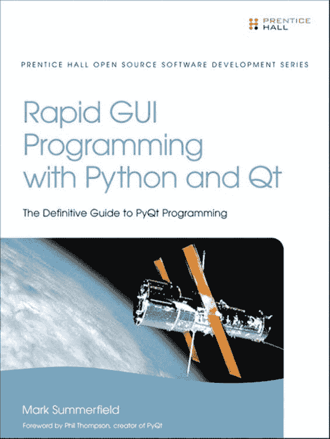

开源技术改变了计算世界。许多大型项目已在全球范围内投入生产，例如 `Apache`、`MySQL` 和 `Postgres`，程序员们使用多种语言（包括 `Perl`、`Python` 和 `PHP`）编写应用程序。这些技术被应用于许多不同的系统，从专有系统到 `Linux` 系统，再到传统的 `UNIX` 系统以及大型机。

Prentice Hall 开源软件开发系列旨在带带你领略这些开源技术的精髓。你不仅将学习如何将它们应用于你的项目，你还将从它们中学习。通过查看真实应用程序中的代码，你将学习到全球开源开发者的最佳实践。

## 该系列目前的书籍包括：

- `Linux®` 调试与性能调优
- `SELinux` 示例 - Steve Best, Frank Mayer, David Caplan, Karl MacMillan - 0131492470, 纸, ©2006, 0131963694, 纸, ©2007
- `Xen` 虚拟机管理器权威指南
- 从 `UNIX` 到 `Linux®` 的端口迁移 - David Chisnall, Alfredo Mendoza, Chakarat Skawratananond - 013234971X, 精装, ©2008
- Artis Walker - 0131871099, 纸, ©2006
- 理解 `AJAX` - Joshua Eichorn
- 使用 `TurboGears` 构建快速 Web 应用 - Mark Ramm, Kevin Dangoor, Gigi Sayfan - 0132216353, 纸, ©2007, 0132433885, 纸, © 2007
- `Linux` 程序员工具箱 - John Fusco
- `Linux` 编程示例 - Arnold Robbins - 0132198576, 纸, ©2007, 0131429647, 纸, ©2004
- 嵌入式 `Linux` 入门 - Christopher Hallinan - 0131679848, 纸, ©2007
- Claudia Salzberg, Gordon Fischer, `Apache` 模块教程 - Steven Smolski, Nick Kew - 0131181637, 纸, ©2006, 0132409674, 纸, © 2007
- 使用 `Python` 和 `Qt` 进行快速 GUI 编程 - Mark Summerfield - 0132354187, 精装, © 2008

### 系列新书：数字快捷径 (Digital Short Cuts)

Short Cuts 是短小、简洁的 PDF 文档，专为像你这样忙碌的技术专业人士设计。每个 Short Cut 都紧扣特定的技术或技术问题。Short Cuts 由行业专家和畅销作家撰写，其出版充分考虑了你的需求——让你立即获取所需的技术信息。

- 理解 `AJAX`：
- 调试嵌入式 `Linux`
- 使用 `XML` 和 `JSON` 处理发送数据 - Christopher Hallinan, Joshua Eichorn - 0131580132, Adobe Acrobat PDF, © 2007, 0132337932, Adobe Acrobat PDF, © 2007
- 使用 `BusyBox` - Christopher Hallinan - 0132335921, Adobe Acrobat PDF, © 2007

# 使用 Python 和 Qt 进行快速 GUI 编程

## PyQt 编程权威指南

Mark Summerfield

新泽西州上萨德河 · 波士顿 · 印第安波利斯 · 旧金山

纽约 · 多伦多 · 蒙特利 · 伦敦 · 慕尼黑 · 巴黎 · 马德里 · 开普敦 · 悉尼 · 东京 · 新加坡 · 墨西哥城

制造商和销售商区分产品的许多名称声明为商标。当这些名称出现在书中且出版社知晓存在商标主张时，名称将以首字母大写或全大写形式打印。

作者和出版商在准备本书时已尽，但不提供任何形式的明示或暗示保证，并对错误或遗漏不承担任何责任。对于与书中所包含的信息或程序的使用有关或由此产生的附带或后果性损害，不承担任何责任。

出版社在批量购买或特别销售时提供本书提供优的折扣，这可能包括电子版本和/或针对您的业务、培训目标、营销重点和品牌兴趣的定制封面和内容。欲更多信息，请联系：

美国企业和政府销售：(800) 382-3419, corpsales@pearsontechgroup.com

美国以外的销售，请联系：

国际销售：international@pearsoned.com

访问我们的网站：[www.prenhallprofessional.com](http://www.prenhallprofessional.com)

### 美国国会图书馆编目出版数据

Summerfield, Mark

Rapid GUI programming with Python and Qt：PyQt 编程权威指南 / Mark Summerfield.

p. cm.

包含参考文献和索引。

ISBN 978-0-13-235418-9 (精装：碱性纸)

1. `Qt` (电子资源)

2. 图形用户界面 (计算机系统)

3. `Python` (计算机程序语言)

I. 标题。

QA76.9.U83S89 2007.005.dc20

版权 ©2008 Pearson Education, Inc. 版权所有。打印于美国。`Qt` 和 `Qt` 标志是 `Qt ASA` 的注册商标。

ISBN-978-0-13-235418-9

ISBN-0-13-235418-7

在密歇根州安阿伯堡的 Edwards 使用再生纸印刷。第一印，2007 年 10 月。

本书献给 Andrea Summerfield。

此页特意留。

## 目录

- **序言** . . . . . . . . . . . . . . . . . . . . . . . . . . . . . . . . . . . . . . . . . . . . . xiii
- **引言** . . . . . . . . . . . . . . . . . . . . . . . . . . . . . . . . . . . . . . . . . . . . . xvi
- **第一部分：Python 编程** . . . . . . . . . . . . . . . . . . . . . . . . . . . . . . . . . . xx
  - **第一章. 数据类型和数据结构** . . . . . . . . . . . . . . . . . . . 24
    - **执行 Python 代码** . . . . . . . . . . . . . . . . . . . . . . . . . . . . . . 25
    - **变量与对象** . . . . . . . . . . . . . . . . . . . . . . . . . . . . . . . . . . . . 27
    - **数字与字符串** . . . . . . . . . . . . . . . . . . . . . . . . . . . . . . . . . . . 30
    - **整数与长整数** . . . . . . . . . . . . . . . . . . . . . . . . . . . . . . . . . . 36
    - **浮点数与小数** . . . . . . . . . . . . . . . . . . . . . . . . . . . . . . . . . . 17
    - **字节字符串、Unicode 字符串与 QString** . . . . . . . . . . . . . . . . . . . . . . 20
    - **集合** . . . . . . . . . . . . . . . . . . . . . . . . . . . . . . . . . . . . . . . . . . . 44
      - **元组** . . . . . . . . . . . . . . . . . . . . . . . . . . . . . . . . . . . . . . . . . . 29
      - **列表** . . . . . . . . . . . . . . . . . . . . . . . . . . . . . . . . . . . . . . . . . . 31
      - **字典** . . . . . . . . . . . . . . . . . . . . . . . . . . . . . . . . . . . . . . . . . . 35
      - **集合（Sets）** . . . . . . . . . . . . . . . . . . . . . . . . . . . . . . . . . . . . . 37
    - **内置函数** . . . . . . . . . . . . . . . . . . . . . . . . . . . . . . . . . . . . . . . . 52
    - **总结** . . . . . . . . . . . . . . . . . . . . . . . . . . . . . . . . . . . . . . . . . . . . 56
    - **练习题** . . . . . . . . . . . . . . . . . . . . . . . . . . . . . . . . . . . . . . . . . . 57
- **第二章. 控制结构** . . . . . . . . . . . . . . . . . . . . . . . . . . . . . . . . . . . . . . . 60
  - **条件分支** . . . . . . . . . . . . . . . . . . . . . . . . . . . . . . . . . . . . . . . . . . . 46
  - **循环** . . . . . . . . . . . . . . . . . . . . . . . . . . . . . . . . . . . . . . . . . . . . . . . 49
  - **列表推导式与生成器** . . . . . . . . . . . . . . . . . . . . . . . . . . . . . . . . . . . 53
  - **函数** . . . . . . . . . . . . . . . . . . . . . . . . . . . . . . . . . . . . . . . . . . . . . . . 55
  - **生成器函数** . . . . . . . . . . . . . . . . . . . . . . . . . . . . . . . . . . . . . . . . . 58
  - **使用关键字参数** . . . . . . . . . . . . . . . . . . . . . . . . . . . . . . . . . . . . . . 59
  - **Lambda 函数** . . . . . . . . . . . . . . . . . . . . . . . . . . . . . . . . . . . . . . . . . 61
  - **动态创建函数** . . . . . . . . . . . . . . . . . . . . . . . . . . . . . . . . . . . . . . . . 62
  - **部分函数应用** . . . . . . . . . . . . . . . . . . . . . . . . . . . . . . . . . . . . . . . . 63
  - **异常处理** . . . . . . . . . . . . . . . . . . . . . . . . . . . . . . . . . . . . . . . . . . . . 66
  - **总结** . . . . . . . . . . . . . . . . . . . . . . . . . . . . . . . . . . . . . . . . . . . . . . . . 72
  - **练习** . . . . . . . . . . . . . . . . . . . . . . . . . . . . . . . . . . . . . . . . . . . . . . . . 72
- **第 3 章：类与模块** . . . . . . . . . . . . . . . . . . . . . . . . . . . . . . . . . . . . . . . . 75
  - **实例创建** . . . . . . . . . . . . . . . . . . . . . . . . . . . . . . . . . . . . . . . . . . . . 77
  - **方法与特殊方法** . . . . . . . . . . . . . . . . . . . . . . . . . . . . . . . . . . . . . . . 79
  - **静态数据、静态方法与装饰器** . . . . . . . . . . . . . . . . . . . . . . . . . . . . . . . 85
    - **示例：Length 类** . . . . . . . . . . . . . . . . . . . . . . . . . . . . . . . . . . . . . . . 86
    - **集合类** . . . . . . . . . . . . . . . . . . . . . . . . . . . . . . . . . . . . . . . . . . . . . . 92
    - **示例：OrderedDict 类** . . . . . . . . . . . . . . . . . . . . . . . . . . . . . . . . . . . . 92
  - **继承与多态** . . . . . . . . . . . . . . . . . . . . . . . . . . . . . . . . . . . . . . . . . . . 99
  - **模块与多文件应用** . . . . . . . . . . . . . . . . . . . . . . . . . . . . . . . . . . . . . . 104
    - **使用 `doct` 模块** . . . . . . . . . . . . . . . . . . . . . . . . . . . . . . . . . . . . . . . 105
  - **总结** . . . . . . . . . . . . . . . . . . . . . . . . . . . . . . . . . . . . . . . . . . . . . . . . 107
  - **练习** . . . . . . . . . . . . . . . . . . . . . . . . . . . . . . . . . . . . . . . . . . . . . . . . 108
- **第二部分：基础 GUI 编程**
  - **第 4 章：GUI 简介** . . . . . . . . . . . . . . . . . . . . . . . . . . . . . . . . . . . . . . . 126
    - **用 25 行代码实现弹窗告警** . . . . . . . . . . . . . . . . . . . . . . . . . . . . . . . . 127
    - **用 30 行代码实现表达式求值器** . . . . . . . . . . . . . . . . . . . . . . . . . . . . . 131
    - **用 70 行代码实现货币转换器** . . . . . . . . . . . . . . . . . . . . . . . . . . . . . . 136
    - **信号与槽** . . . . . . . . . . . . . . . . . . . . . . . . . . . . . . . . . . . . . . . . . . . . 142
  - **总结** . . . . . . . . . . . . . . . . . . . . . . . . . . . . . . . . . . . . . . . . . . . . . . . . 151
  - **练习** . . . . . . . . . . . . . . . . . . . . . . . . . . . . . . . . . . . . . . . . . . . . . . . . 152
  - **第 5 章：对话框** . . . . . . . . . . . . . . . . . . . . . . . . . . . . . . . . . . . . . . . . 154
    - **简单对话框** . . . . . . . . . . . . . . . . . . . . . . . . . . . . . . . . . . . . . . . . . . . 156
    - **标准对话框** . . . . . . . . . . . . . . . . . . . . . . . . . . . . . . . . . . . . . . . . . . . 162
      - **模态确定/取消风格的对话框** . . . . . . . . . . . . . . . . . . . . . . . . . . . . . . . 148
      - **智能对话框** . . . . . . . . . . . . . . . . . . . . . . . . . . . . . . . . . . . . . . . . . . 154
      - **关闭风格的对话框** . . . . . . . . . . . . . . . . . . . . . . . . . . . . . . . . . . . . . 155
    - **总结** . . . . . . . . . . . . . . . . . . . . . . . . . . . . . . . . . . . . . . . . . . . . . . . . 157
    - **练习** . . . . . . . . . . . . . . . . . . . . . . . . . . . . . . . . . . . . . . . . . . . . . . . . 158
  - **第 6 章：窗口** . . . . . . . . . . . . . . . . . . . . . . . . . . . . . . . . . . . . . . . . . . 160
    - **创建主窗口** . . . . . . . . . . . . . . . . . . . . . . . . . . . . . . . . . . . . . . . . . . . 165
    - **序列** . . . . . . . . . . . . . . . . . . . . . . . . . . . . . . . . . . . . . . . . . . . . . . . . 171
    - **资源文件** . . . . . . . . . . . . . . . . . . . . . . . . . . . . . . . . . . . . . . . . . . . . . 172
    - **创建与使用 Action** . . . . . . . . . . . . . . . . . . . . . . . . . . . . . . . . . . . . . . 174
    - **恢复与保存主窗口状态** . . . . . . . . . . . . . . . . . . . . . . . . . . . . . . . . . . . 181
    - **处理用户操作** . . . . . . . . . . . . . . . . . . . . . . . . . . . . . . . . . . . . . . . . . 205
      - **处理文件操作** . . . . . . . . . . . . . . . . . . . . . . . . . . . . . . . . . . . . . . . . . 191
      - **编辑操作** . . . . . . . . . . . . . . . . . . . . . . . . . . . . . . . . . . . . . . . . . . . . 197
      - **帮助操作** . . . . . . . . . . . . . . . . . . . . . . . . . . . . . . . . . . . . . . . . . . . . 200
    - **总结** . . . . . . . . . . . . . . . . . . . . . . . . . . . . . . . . . . . . . . . . . . . . . . . . 216
    - **练习** . . . . . . . . . . . . . . . . . . . . . . . . . . . . . . . . . . . . . . . . . . . . . . . . 217
  - **第 7 章：使用 Qt Designer** . . . . . . . . . . . . . . . . . . . . . . . . . . . . . . . . . . 220
    - **设计用户界面** . . . . . . . . . . . . . . . . . . . . . . . . . . . . . . . . . . . . . . . . . . 223
    - **实现对话框** . . . . . . . . . . . . . . . . . . . . . . . . . . . . . . . . . . . . . . . . . . . 216
    - **测试对话框** . . . . . . . . . . . . . . . . . . . . . . . . . . . . . . . . . . . . . . . . . . . 221
    - **总结** . . . . . . . . . . . . . . . . . . . . . . . . . . . . . . . . . . . . . . . . . . . . . . . . 223
    - **练习** . . . . . . . . . . . . . . . . . . . . . . . . . . . . . . . . . . . . . . . . . . . . . . . . 224
  - **第 8 章 数据处理与自定义文件格式** . . . . . . . . . . . . . . . . . . . . . . . . . . . . 227
    - **主窗口的职责** . . . . . . . . . . . . . . . . . . . . . . . . . . . . . . . . . . . . . . . . . . 229
    - **数据容器的职责** . . . . . . . . . . . . . . . . . . . . . . . . . . . . . . . . . . . . . . . . 235
    - **保存与加载二进制文件** . . . . . . . . . . . . . . . . . . . . . . . . . . . . . . . . . . . 240
      - **使用 `QDataStream` 写入和读取** . . . . . . . . . . . . . . . . . . . . . . . . . . . . . 240
      - **使用 `pickle` 模块写入和读取** . . . . . . . . . . . . . . . . . . . . . . . . . . . . . . 246
    - **保存与加载文本文件** . . . . . . . . . . . . . . . . . . . . . . . . . . . . . . . . . . . . 249
      - **使用 `QTextStream` 写入和读取** . . . . . . . . . . . . . . . . . . . . . . . . . . . . . 250
      - **使用 `codecs` 模块写入和读取** . . . . . . . . . . . . . . . . . . . . . . . . . . . . . . 255
    - **保存与加载 XML 文件** . . . . . . . . . . . . . . . . . . . . . . . . . . . . . . . . . . . . 256
      - **写入 XML** . . . . . . . . . . . . . . . . . . . . . . . . . . . . . . . . . . . . . . . . . . . . 256
      - **使用 PyQt 的 `DOM` 类读取和解析 XML** . . . . . . . . . . . . . . . . . . . . . . . . . 259
      - **使用 PyQt 的 `SAX` 类读取和解析 XML** . . . . . . . . . . . . . . . . . . . . . . . . . 262
    - **总结** . . . . . . . . . . . . . . . . . . . . . . . . . . . . . . . . . . . . . . . . . . . . . . . . 265
    - **练习** . . . . . . . . . . . . . . . . . . . . . . . . . . . . . . . . . . . . . . . . . . . . . . . . 266
- **第三部分：中级 GUI 编程**
  - **第 9 章 布局与多文档** . . . . . . . . . . . . . . . . . . . . . . . . . . . . . . . . . . . . . . 269
    - **布局策略** . . . . . . . . . . . . . . . . . . . . . . . . . . . . . . . . . . . . . . . . . . . . . . 270
    - **标签页控件与堆叠布局控件** . . . . . . . . . . . . . . . . . . . . . . . . . . . . . . . . . 272
      - **扩展对话框** . . . . . . . . . . . . . . . . . . . . . . . . . . . . . . . . . . . . . . . . . . . 276
      - **分隔器** . . . . . . . . . . . . . . . . . . . . . . . . . . . . . . . . . . . . . . . . . . . . . . 280
      - **单文档接口 (`SDI`)** . . . . . . . . . . . . . . . . . . . . . . . . . . . . . . . . . . . . . . 283
      - **多文档接口 (`MDI`)** . . . . . . . . . . . . . . . . . . . . . . . . . . . . . . . . . . . . . 290
    - **总结** . . . . . . . . . . . . . . . . . . . . . . . . . . . . . . . . . . . . . . . . . . . . . . . . 300
    - **练习** . . . . . . . . . . . . . . . . . . . . . . . . . . . . . . . . . . . . . . . . . . . . . . . . 301
  - **第 10 章 事件、剪贴板以及拖放操作** . . . . . . . . . . . . . . . . . . . . . . . . . . . . 303
    - **事件处理机制** . . . . . . . . . . . . . . . . . . . . . . . . . . . . . . . . . . . . . . . . . . 303
    - **重写处理器** . . . . . . . . . . . . . . . . . . . . . . . . . . . . . . . . . . . . . . . . . . . . 305
    - **使用剪贴板** . . . . . . . . . . . . . . . . . . . . . . . . . . . . . . . . . . . . . . . . . . . . 310
    - **拖放操作** . . . . . . . . . . . . . . . . . . . . . . . . . . . . . . . . . . . . . . . . . . . . . . 312
    - **处理自定义数据** . . . . . . . . . . . . . . . . . . . . . . . . . . . . . . . . . . . . . . . . . 313
    - **总结** . . . . . . . . . . . . . . . . . . . . . . . . . . . . . . . . . . . . . . . . . . . . . . . . 317
    - **练习** . . . . . . . . . . . . . . . . . . . . . . . . . . . . . . . . . . . . . . . . . . . . . . . . 318
  - **第 11 章 自定义控件** . . . . . . . . . . . . . . . . . . . . . . . . . . . . . . . . . . . . . . 321
    - **使用控件样式表 (Style Sheets)** . . . . . . . . . . . . . . . . . . . . . . . . . . . . . . . 322
    - **创建复合控件** . . . . . . . . . . . . . . . . . . . . . . . . . . . . . . . . . . . . . . . . . . 325
    - **内置控件的子类** . . . . . . . . . . . . . . . . . . . . . . . . . . . . . . . . . . . . . . . . . 326
    - **`QWidget` 的子类** . . . . . . . . . . . . . . . . . . . . . . . . . . . . . . . . . . . . . . . . 328
      - **示例：分数滑动条** . . . . . . . . . . . . . . . . . . . . . . . . . . . . . . . . . . . . . . . 331
      - **示例：流式混合控件** . . . . . . . . . . . . . . . . . . . . . . . . . . . . . . . . . . . . . 339
    - **总结** . . . . . . . . . . . . . . . . . . . . . . . . . . . . . . . . . . . . . . . . . . . . . . . . 345
    - **练习** . . . . . . . . . . . . . . . . . . . . . . . . . . . . . . . . . . . . . . . . . . . . . . . . 346
  - **第 12 章 基于项的图形** . . . . . . . . . . . . . . . . . . . . . . . . . . . . . . . . . . . . . 349
    - **自定义与交互式图形项** . . . . . . . . . . . . . . . . . . . . . . . . . . . . . . . . . . . . 351
    - **动画与复杂形状** . . . . . . . . . . . . . . . . . . . . . . . . . . . . . . . . . . . . . . . . . 368
    - **总结** . . . . . . . . . . . . . . . . . . . . . . . . . . . . . . . . . . . . . . . . . . . . . . . . 378
    - **练习** . . . . . . . . . . . . . . . . . . . . . . . . . . . . . . . . . . . . . . . . . . . . . . . . 379
  - **第 13 章 富文本与打印** . . . . . . . . . . . . . . . . . . . . . . . . . . . . . . . . . . . . . 381
    - **富文本编辑** . . . . . . . . . . . . . . . . . . . . . . . . . . . . . . . . . . . . . . . . . . . . 382
      - **使用 QSyntaxHighlighter** . . . . . . . . . . . . . . . . . . . . . . . . . . . . . . . . . . . 382
      - **富文本行编辑** . . . . . . . . . . . . . . . . . . . . . . . . . . . . . . . . . . . . . . . . . . 389
    - **打印文档** . . . . . . . . . . . . . . . . . . . . . . . . . . . . . . . . . . . . . . . . . . . . . . 398
      - **打印图像** . . . . . . . . . . . . . . . . . . . . . . . . . . . . . . . . . . . . . . . . . . . . . 400
      - **使用 HTML 和 QTextDocument 打印文档** . . . . . . . . . . . . . . . . . . . . . . . . . 401
      - **使用 QTextCursor 和 QTextDocument 打印文档** . . . . . . . . . . . . . . . . . . . . . 403
      - **使用 QPainter 打印文档** . . . . . . . . . . . . . . . . . . . . . . . . . . . . . . . . . . . 407
    - **总结** . . . . . . . . . . . . . . . . . . . . . . . . . . . . . . . . . . . . . . . . . . . . . . . . 411
    - **练习** . . . . . . . . . . . . . . . . . . . . . . . . . . . . . . . . . . . . . . . . . . . . . . . . 412
  - **第 14 章：模型/视图编程** . . . . . . . . . . . . . . . . . . . . . . . . . . . . . . . . . . . . 413
    - **使用便利项控件** . . . . . . . . . . . . . . . . . . . . . . . . . . . . . . . . . . . . . . . . . 415
    - **创建自定义模型** . . . . . . . . . . . . . . . . . . . . . . . . . . . . . . . . . . . . . . . . . 423
      - **实现视图逻辑** . . . . . . . . . . . . . . . . . . . . . . . . . . . . . . . . . . . . . . . . . . 424
      - **实现自定义模型** . . . . . . . . . . . . . . . . . . . . . . . . . . . . . . . . . . . . . . . . 427
    - **创建自定义代理** . . . . . . . . . . . . . . . . . . . . . . . . . . . . . . . . . . . . . . . . . 436
    - **总结** . . . . . . . . . . . . . . . . . . . . . . . . . . . . . . . . . . . . . . . . . . . . . . . . 442
    - **练习** . . . . . . . . . . . . . . . . . . . . . . . . . . . . . . . . . . . . . . . . . . . . . . . . 443
  - **第 15 章：数据库** . . . . . . . . . . . . . . . . . . . . . . . . . . . . . . . . . . . . . . . . . 445
    - **连接数据库** . . . . . . . . . . . . . . . . . . . . . . . . . . . . . . . . . . . . . . . . . . . . 446
    - **执行 SQL 查询** . . . . . . . . . . . . . . . . . . . . . . . . . . . . . . . . . . . . . . . . . . 446
    - **使用数据库表单视图** . . . . . . . . . . . . . . . . . . . . . . . . . . . . . . . . . . . . . . 451
    - **使用数据库表视图** . . . . . . . . . . . . . . . . . . . . . . . . . . . . . . . . . . . . . . . . 457
    - **总结** . . . . . . . . . . . . . . . . . . . . . . . . . . . . . . . . . . . . . . . . . . . . . . . . 470
    - **练习** . . . . . . . . . . . . . . . . . . . . . . . . . . . . . . . . . . . . . . . . . . . . . . . . 471
- **第四部分：高级 GUI 编程**
  - **第 16 章：高级模型/视图编程** . . . . . . . . . . . . . . . . . . . . . . . . . . . . . . . . . 475
    - **自定义视图** . . . . . . . . . . . . . . . . . . . . . . . . . . . . . . . . . . . . . . . . . . . . 476
    - **通用代理** . . . . . . . . . . . . . . . . . . . . . . . . . . . . . . . . . . . . . . . . . . . . . . 483
    - **在树中表示表格数据** . . . . . . . . . . . . . . . . . . . . . . . . . . . . . . . . . . . . . . 492
    - **总结** . . . . . . . . . . . . . . . . . . . . . . . . . . . . . . . . . . . . . . . . . . . . . . . . 505
    - **练习** . . . . . . . . . . . . . . . . . . . . . . . . . . . . . . . . . . . . . . . . . . . . . . . . 505
  - **第 17 章：本地化** . . . . . . . . . . . . . . . . . . . . . . . . . . . . . . . . . . . . . . . . . 509
    - **帮助** . . . . . . . . . . . . . . . . . . . . . . . . . . . . . . . . . . . . . . . . . . . . . . . . . 510
    - **本地化** . . . . . . . . . . . . . . . . . . . . . . . . . . . . . . . . . . . . . . . . . . . . . . . 512
    - **总结** . . . . . . . . . . . . . . . . . . . . . . . . . . . . . . . . . . . . . . . . . . . . . . . . 519
    - **练习** . . . . . . . . . . . . . . . . . . . . . . . . . . . . . . . . . . . . . . . . . . . . . . . . 520
  - **第 18 章：网络编程** . . . . . . . . . . . . . . . . . . . . . . . . . . . . . . . . . . . . . . . 521
    - **创建 TCP 客户端** . . . . . . . . . . . . . . . . . . . . . . . . . . . . . . . . . . . . . . . . . 523
    - **创建 TCP 服务器** . . . . . . . . . . . . . . . . . . . . . . . . . . . . . . . . . . . . . . . . . 529
    - **总结** . . . . . . . . . . . . . . . . . . . . . . . . . . . . . . . . . . . . . . . . . . . . . . . . 534
    - **练习** . . . . . . . . . . . . . . . . . . . . . . . . . . . . . . . . . . . . . . . . . . . . . . . . 534
  - **第 19 章：多线程** . . . . . . . . . . . . . . . . . . . . . . . . . . . . . . . . . . . . . . . . . 537
    - **创建线程服务器** . . . . . . . . . . . . . . . . . . . . . . . . . . . . . . . . . . . . . . . . . . 539
    - **创建和管理次线程** . . . . . . . . . . . . . . . . . . . . . . . . . . . . . . . . . . . . . . . . 544
    - **实现次线程** . . . . . . . . . . . . . . . . . . . . . . . . . . . . . . . . . . . . . . . . . . . . . 552
    - **总结** . . . . . . . . . . . . . . . . . . . . . . . . . . . . . . . . . . . . . . . . . . . . . . . . 557
    - **练习** . . . . . . . . . . . . . . . . . . . . . . . . . . . . . . . . . . . . . . . . . . . . . . . . 558
  - **这还没有完全结束** . . . . . . . . . . . . . . . . . . . . . . . . . . . . . . . . . . . . . . . . . 559
- **附录 A：安装** . . . . . . . . . . . . . . . . . . . . . . . . . . . . . . . . . . . . . . . . . . . . . 561
  - **在 Windows 上安装**
  - **在 Mac OS X 上安装**
  - **在 Linux 和 Unix 上安装**
- **附录 B. 精选 PyQt 组件**
- **附录 C. 精选 PyQt 类层次**
- **索引**

# 前言

作为 PyQt 的创始人，我很高兴看到这本书的出版。尽管我担任了本书的技术评审员之一，但我很乐于承认，我也从中学习了一些东西。

PyQt 文档涵盖了所有 `PyQt` 类的 API。本书将向你展示如何使用这些类，如何将它们组合以创建对话框、主窗口以及整个应用程序——所有这些外观美观且运行良好，没有人为限制，并且使用了一种用起来非常愉快的编程语言。

我特别喜欢这本书的一点是，这些示例并不是为了说明简单观点而设计的平凡例子，而是本身就具有潜在的价值。对不同方法的考虑将回报那些想要深入理解如何将 `PyQt` 应用于开发大规模、生产级应用的读者。

我从 20 世纪 90 年代后期开始了 PyQt 的故事。我已经使用 `Tcl/Tk` 一段时间了，但我觉得 `Tk` 应用程序看起来很丑，特别是当我看到 `KDE` 第一版本所取得的成就时。我一直切换到 `Python`，因此我想将语言的改变与 GUI 库的改变结合。

最初我使用了一些用 `SWIG` 编写的封装器，但我得出我可以自己制作一个更合适的封装工具。我开始创建 `SIP`，并在 1998 年 11 月发布了支持 `Qt` 1.41 的 `PyQt` 0.1。

从那时以后，开发一直在定期进行，以跟上 `Qt` 的新发布并扩展 `PyQt` 的范围，例如添加支持工具和改进文档。到 2000 年，`PyQt` 2.0 在 Linux 和 Windows 上都支持 `Qt` 2.2。`Qt` 3 的支持出现在 2001 年，Mac OS X 的支持出现在 2002 年。`PyQt4` 系列从 2006 年 6 月的 `PyQt` 4.0 开始，支持 `Qt` 4。


我的首要目标一直是让 `Python` 和 `Qt` 以一种让 `Python` 程序员感到自然的方式协作，同时允许他们在 `Python` 中执行任何在 `C++` 中可以做的事情。实现这一点的关键是 `SIP` 的开发。它提供了一个我可以完全控制的专用代码生成器，并确保 `Python` 和 `Qt` 始终紧密结合。

开发和维护 `PyQt` 的基本流程现在已经非常成熟。大部分工作现在都是自动化的，这意味着跟上 `Trolltech` 的 `Qt` 新版本不再是以前的问题了，并确保了 `PyQt` 在未来多年持续下去。

多年来见证 `PyQt` 社区的增长是非常令人欣慰的。如果这本书是你接触 `PyQt` 的开始，欢迎！

— Phil Thompson

英国，多塞 Dorset 郡，温姆伯

2007 年 8 月 25 日

# 引言

本书教你如何使用 `Python` 编程语言和 `Qt` 开发框架编写 GUI 应用程序。唯一的先决知识是你可以使用某种面向对象的语言编程，例如 `C++`、`C#`、`Java` 或当然还有 `Python` 本身。对于富文本章节，假设对 `HTML` 和正则表达式有一定的了解，数据库和多线程章节假设对这些主题有一定的基础知识。不需要 GUI 编程知识，因为所有核心概念都已涵盖。

本书对于职业工作内容需要编程的人来说将很有用，无论是全职软件开发人员，还是为了支持工作需要进行编程的其他学科人士（包括科学家和工程师）。练习（附答案）特别是为了帮助学生提供的。

`Python` 可能是广泛应用中最容易学习、最漂亮的脚本语言，而 `Qt` 可能是开发 GUI 应用程序最好的库。`Python` 和 `Qt` 的结合——“`PyQt`”，使得在任何支持的平台上开发应用程序并在所有平台上不更改运行成为可能——例如，所有现代版本的 Windows、Linux、Mac OS X 以及大多数基于 Unix 的系统。得益于 `Python` 是解释型的，不需要编译；得益于 `Qt` 抽象了特定平台的细节，不需要为了适应不同的操作系统而更改源代码。

如果你是 `Python` 新手：欢迎！你即将发现一种易于读写、简洁明了且不晦懂的语言。`Python` 是一种非常有表现力的语言，这意味着我们通常写的 `Python` 代码行比用 `C++` 或 `Java` 编写的同类应用程序要少得多。这使得在全文中展示一些小但完整的示例成为可能，并使 `PyQt` 成为快速轻松开发 GUI 应用程序的理想工具，无论是用于原型设计还是生产使用。

**图 1 *Eric4 IDE——一个 PyQt4 应用程序***

例如，当你创建一个对话框时，它应该是模态的还是非模态的？（关于此问题的解释和策略建议请参阅第 5 章。）`PyQt` 用于编写各种 GUI 应用程序，从会计程序到科学家和工程师使用的可视化工具。例如，图 1 显示了 `Eric4`，这是一个用 `PyQt` 编写的强大集成开发环境。编写只有几十行的 `PyQt` 应用程序是可能的，而 1,000 到 10,000 行的中等规模项目也非常常见。

一些商业公司已经构建了 100,000 行的 `PyQt` 应用程序，编程团队规模从一个人到十多人不等。许多内部工具是使用 `PyQt` 编写的，但由于这些工具是为了获得竞争优势，相关公司通常不允许公开其 `PyQt` 的使用。`PyQt` 在开源世界也被广泛使用，游戏、实用程序、可视化工具和 IDE 都是使用它编写的。

本书专门介绍 `PyQt4`，它是 `Qt 4` C++ 应用开发框架的 Python 绑定。★ `PyQt4` 以十个 Python 模块的形式提供，这些模块共包含了约 400 个类和约 6000 个方法和函数。所有的示例程序都在 Windows、Linux 和 Mac OS X 上通过测试，使用了 `Python 2.5`、`Qt 4.2` 和 `PyQt 4.2`，此外还在 Windows 和 Linux 上使用了 `Qt 4.3` 和 `PyQt 4.3` 进行测试。在某些情况下可以移植到早期版本，但我们建议使用最新版本的 `Python`、`Qt` 和 `PyQt`。

`Python`、`PyQt` 和 `Qt` 可以免费用于非商业目的，但 `Python` 使用的许可证与 `PyQt` 和 `Qt` 使用的许可证不同。

`Python` 提供非常宽松的许可证，允许其用于开发商业和非商业应用程序。`PyQt` 和 `Qt` 都是双重许可的：这本质上允许它们用于开发非商业应用程序——这些应用程序反过来必须使用接受的开源许可证（如 `GNU General Public License`（`GPL`）进行许可；或者用于开发商业应用程序——在这种情况下，必须购买商业 `PyQt` 许可证和商业 `Qt` 许可证。

# 本书结构

本书分为四个部分。第一部分主要是一个面向熟悉面向对象语言的非 `Python` 程序员的快速转换课程，尽管它也包含了一些（有明确标记的）`PyQt` 内容。由于核心 `Python` 语言大部分简单且非常精小，这些章节可以充分地教授 `Python` 的基础知识，以能够编写真实的 `Python` 应用程序。

如果你认为可以通过阅读来简单地掌握 `Python` 语法，你可能会想跳过第一部分，直接进入从第二部分开始的 GUI 编程。第二部分的早期章节包含了对第一部分相关页面的反向引用，以支持选择这种方法的读者。然而，即使对于熟悉 `Python` 的读者，我们也建议阅读第 1 章中关于 `QString` 的内容。如果你不熟悉部分函数应用（柯里化），那么阅读第 2 章中涵盖此内容的章节是非常重要的，因为这种技术有时用于 GUI 编程。

★ 还有针对旧版 `Qt 3` 库的 Python 绑定，但没有理由在新项目中使用该库，特别是 `Qt 4` 提供了更多的功能且更容易使用。

第二部分首先通过展示三个微小的 `PyQt` GUI 应用程序，让对 `PyQt` 编程给出一个初步印象。它还解释了涉及 GUI 编程的一些基本概念，包括 `PyQt` 的高级信号与槽通信机制。第 5 章展示了如何创建对话框，以及如何在对话框中创建和布局部件（Windows 术语中称为“控件”——构成用户界面的图形元素，如按钮、列表框等）。对话框是 GUI 编程的核心：大多数 GUI 应用程序都有一个主窗口和几十个甚至数百个对话框，因此这个主题被深入涵盖。

对话框章节之后是第 6 章，该章节涵盖了主窗口，包括菜单、工具栏、停靠窗口和快捷键，以及加载和保存应用程序设置。第二部分的最后章节展示了如何使用 `Qt Designer`（`Qt` 的视觉设计工具）创建对话框，以及如何以二进制、文本和 XML 格式保存数据。

第三部分对第二部分涵盖的一些主题进行了更深入的介绍，并引入了许多新主题。第 9 章展示了如何以相当复杂的方式布局部件，以及如何处理多个文档。第 10 章涵盖了低级事件处理程序，以及如何使用剪贴板以及拖放、文本、HTML 和二进制数据。第 11 章展示了如何修改和子类现有部件，以及如何从头创建全新的部件，并对其外观和行为进行完全控制。这一章还展示了如何进行基础图形处理。第 12 章展示了如何使用 `Qt 4.2` 新的图形视图架构，该架构特别适用于处理大量的独立图形对象。第 13 章介绍了支持 HTML 的富文本引擎。这一章还涵盖了打印到纸和 PDF 文件。

第三部分以两个关于模型/视图编程的章节结束：第 14 章介绍了该主题并展示了如何使用 `Qt` 的内置视图以及如何创建自定义数据模型和自定义代理，第 15 章展示了如何使用模型/视图架构进行数据库编程。

第四部分继续模型/视图主题，在第 16 章涵盖了三个不同的高级模型/视图主题。第 17 章的第一部分描述了用于提供在线帮助的技术，第二部分解释了如何使应用程序国际化，包括如何使用 `Qt` 的翻译工具创建翻译文件。Python 标准库提供了自己的用于网络和线程的类，但在第四部分的最后两章中，我们展示了如何使用 `PyQt` 进行网络和线程。

附录 A 解释了从哪里获取 `Python`、`PyQt` 和 `Qt` 以及如何在 Windows、Mac OS X 和 Linux 上安装它们。如果你安装它们并尝试一些练习，并且检查一些示例代码，学习 `PyQt` 会容易得多。附录 B 展示了选取 `PyQt` 部件的截图和简要描述；这对于 GUI 编程的新手非常有帮助。

附录 C 展示了部分 `PyQt` 类层次结构的图；这有助于了解 `PyQt` 提供的类以及它们之间的关系。

在本部分的第 9 章和第 14 章可以独立阅读，但第 15 章假设你已经读过第 14 章。

在第四部分，第 16 章假设你已经读过第 14 章和第 15 章，但其他章节可以独立阅读。

如果你在文中或示例中发现错误，或有其他意见，请写邮件至 `mark@qtrac.eu` 并在主题行注明“PyQt book”。本书的主页将发布任何修正内容，并从那里下载示例和练习解答，地址为 [`www.qtrac.eu/`](http://www.qtrac.eu/pyqtbook.html)。

[`pyqtbook.html`](http://www.qtrac.eu/pyqtbook.html)

如果你想参与 `PyQt` 社区，加入邮件列表是值得的。访问 [`www.riverbankcomputing.com/mailman/listinfo/pyqt`](http://www.riverbankcomputing.com/mailman/listinfo/pyqt) 存档链接，这样你就可以查看邮件列表的内容，并找到加入表格。`Python` 也有邮件列表和其他社区活动。访问这些内容请前往 [`www.python.org/community`](http://www.python.org/community)。

# 致谢

我要感谢许多人，首先从那些与本书有密切联系的人开始。

Jasmin Blanchette 是 `Trolltech` 的高级软件开发人员、`Qt` 专家，也是一位出色的编辑和作家。我曾与他共同编写过两本 C++/Qt 书。Jasmin 提出了大量的建议和批评，极大地提高了本书的质量。

David Boddie 是 `Trolltech` 的文档经理，也是一位活跃的 `PyQt` 开源开发者，对 `PyQt` 本身做出了许多贡献。他的投入帮助确保我涵盖了所有必要内容，并以合理的顺序完成。

Richard Chamberlain 是内容管理公司 Jadu Ltd. 的联合创始人兼首席技术官。他的反馈和见解帮助确保了本书尽可能易读。他还帮助完善并改进了示例和练习中使用的代码。

Trenton Schulz 是 `Trolltech` 的开发人员，一直是我之前书籍的宝贵评审员。对于这本书，他运用自己在 `Python` 和 `Qt` 方面的知识，对手稿提供了大量的反馈。他与 Richard 一起，还确保了 Mac OS X 用户不会被遗忘。此外，他还发现了许多我遗漏的细微错误。

Phil Thompson 是 `PyQt` 的创建者和维护者。他从一开始就支持这本书，甚至由于我们关于本书的讨论，直接导致了向 `PyQt` 添加新功能和进行改进。他对本书的改进提出了许多建议，并纠正了许多错误和误解。

特别感谢 Samuel Rolland，他允许我使用他的 Mac 笔记本电脑安装 `PyQt`、测试示例并截屏。

还要感谢 `Python` 的创建者 Guido van Rossum，以及广泛的 `Python` 社区，他们做出了巨大贡献，使得 `Python`（尤其是其标准库）变得如此实用且易用。

同样感谢 `Trolltech` 开发并维护 `Qt`，特别是过去和现在的 `Trolltech` 开发者们，其中许多人曾荣幸与他们共事，他们确保了 `Qt` 是现存最好的跨平台 GUI 开发框架。

特别感谢 Lout 排版语言的创建者 Jeff Kingston。

我所有的书籍以及大多数其他写作项目都使用 Lout。多年来，Jeff 根据用户反馈（包括许多我个人提出的）对 Lout 进行了许多改进并添加了众多功能。感谢 James Cloos，他创建了 DejaVu Sans Mono 字体的紧凑版本（源自 Jim Lyles 的 Vera 字体），本书的等宽字体即源于此。

出版方主编 Karen Gettman 女士从一开始就支持了这本书。特别感谢我的编辑 Debra Williams-Cauley 的支持，以及她让整个过程变得尽可能顺畅。感谢由于良好管理制作流程的 Lara Wysong，以及校对员 Audrey Doyle，她的工作做得非常出色。

最后但同样重要的，我要感谢我的妻子 Andrea。她的爱、忠诚和支持始终带给我力量和希望。

# 第一部分

## Python 编程

*本页特意留空*

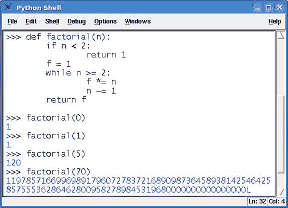

# 第 1 章

- 执行 `Python` 代码
- 变量与对象
- 数字与字符串
- 集合
- 内置函数

## 数据类型与数据结构

在本章中，我们将开始一个 `Python` 转换课程，向非 `Python` 程序员展示如何使用 `Python` 进行编程。我们介绍了一些基础数据类型和数据结构，以及 `Python` 的一些过程语法。

贯穿始终的方法是强调实践中真实的代码，而不是提供 `Python` 附带文档以及在 [`www.python.org`](http://www.python.org) 在线提供的正式定义和解释。

**图 1.1** *IDLE Python Shell 窗口*

如果你还没有安装 `Python` 和 `PyQt`，最好安装它们：这样你就可以尝试本书随附的示例（可从 <http://www.qtrac.eu/pyqtbook.html> 下载）。安装细节请参阅 <http://www.qtrac.eu/pyqtbook.html> 和附录 A。安装软件的一个优势是，会随 `Python` 一起安装 IDLE 开发环境。

## 引言

### IDLE 开发环境

`Python` 的完整安装包含了 IDLE，这是一个基础但非常有实用的开发环境。当启动 IDLE 时（在 Windows 上点击开始→所有程序→`Python 2.x`→IDLE，在 Mac X 上点击访达→应用程序→`MacPython 2.x`→IDLE，或在 Linux 的控制台中运行 `idle`），它会显示 Python Shell（交互式外壳）。

如图 1.1 所示截图所示，IDLE 具有相当复古的 Windows 95 风格。这是因为它是用 `Tkinter` 而不是 `PyQt` 编写的。我们选择使用 IDLE 是因为它是 `Python` 标准配置，而且学习和使用非常简单。如果你想使用更强大、外观更现代的 IDE，你可能更倾向于用 `PyQt` 编写的 Eric 或其他可用的 `Python` IDE。然而，如果你是 `Python` 新手，我们建议你从简单的 IDLE 开始，一旦你对 `PyQt` 更加熟悉，再尝试其他 IDE 看看你是否喜欢其中之一。当然，你也可以简单地使用纯文本编辑器并使用 `print` 语句进行调试，完全不使用 IDE。

IDLE 提供了三个关键功能：输入 `Python` 表达式和代码并直接在 Python Shell 中查看结果；提供 `Python` 特色语法高亮的代码编辑器；以及一个用于逐步执行代码以帮助识别和消除 bug 的调试器。Python Shell 特别适用于尝试简单的算法、代码片段和正则表达式，也可以作为一个非常强大且灵活的计算器。

### 执行 Python 代码

在真正探索 `Python` 语言之前，我们需要知道如何执行 `Python` 代码。我们将通过回顾一个只有一行的微型示例程序来展示这一点。

处理 `Python` 文件时必须使用纯文本编辑器。在 Windows 上可以使用记事本，但 IDLE 包含了一个专为编辑 `Python` 代码设计的 `Python` 编辑器：只需启动 IDLE 然后点击文件→新建窗口。

我们将名为 `hello.py` 的文件中输入以下行内容：

```python
print "Hello World"
```

请注意，不需要分号：在 `Python` 中，换行符充当语句分隔符。此外，我们不需要在字符串中包含 `\n`，因为 `print` 会自动添加换行符，除非我们在末尾加逗号来抑制它。

★ 本书程序使用 ASCII 字符编写，在需要 Unicode 的地方使用转义序列。正如文档中“编码声明”部分解释的那样，`Python` 程序中的字符串和注释可以使用 Latin-1、UTF-8 或其他编码。

## 执行 Python 代码

假设我们已将代码保存在 `hello.py` 文件中（如果使用 Windows，则在 `C:\pyqt\chap01` 目录下），我们可以启动控制台（在 Windows XP 上点击“开始”→所有程序→辅助工具→控制台——有时控制台被称为“命令提示符”；或者在 Mac OS X 上从 `/Applications/Utilities` 运行 `Terminal.app`），切换到该目录并按如下方式执行程序：

```text
C:\>cd c:\pyqt\chap01
C:\pyqt\chap01>hello.py
```

只要 `Python` 安装正确，Windows 就会识别 `.py` 文件扩展名并将文件交给 `python.exe` 执行。正如我们预期的那样，程序将在控制台上打印“Hello World”。★

在 Mac OS X 和 Linux 上，我们必须通过在控制台提示符输入解释器的名称和文件名来显式运行，如下：

```text
% python hello.py
```

只要 `Python` 已安装并位于你的 `PATH` 中，这种方法就能生效。或者，对于 Linux 和 Mac OS X，我们可以添加一行额外的“shebang”（shell 执行）注释行，它会告诉操作系统使用 `Python` 解释器，使得 `hello.py` 文件变为两行：

```python
#!/usr/bin/env python
print "Hello World"
```

要让这在 Mac OS X 和 Linux 上正常工作，必须正确设置文件权限。例如，在文件所在目录的控制台提示符中，输入 `chmod +x hello.py` 使文件变为可执行。


Python 注释以 `#` 开头并持续到行尾。这意味着在所有 Python 程序中添加“shebang”行是完全安全的，因为该注释在 Windows 上会被忽略，但在 Linux 上，它告诉操作系统使用 Python 解释器执行该文件。附录 A 显示如何在 Mac OS X 上将 Python 解释器与 `.py` 和 `.pyw` 文件关联。

当我们执行一个 Python 程序时，后台发生的是 Python 将 `.py`（或 `.pyw`）文件读取到内存并进行解析，得到一个字节码程序然后进行执行。对于程序导入的每个模块，Python 首先检查是否存在预编译的字节码版本（`.pyo` 或 `.pyc` 文件中），其时间戳与 `.py` 文件对应。如果有，Python 使用该字节码版本；否则，它解析模块的 `.py` 文件，将其保存为 `.pyc` 文件并使用刚刚生成的字节码。因此，与 Java 不同，我们不需要显式对任何模块进行字节码编译，无论它们是 Python 提供的还是我们自己。在大多数 Python 安装中，提供的模块在安装过程中就已经编译好了，以避免每次运行使用它们的 Python 程序时都必须重新编译。

★ Mac OS X 用户注意，每当我们提到控制台时，它等同于 Mac Terminal。

# 第 1 章 数据类型与数据结构

## 变量与对象

在大多数编程语言（包括 C++ 和 Java）中，我们必须在使用每个变量之前声明它并指定其类型。这被称为静态类型，因为编译器在编译时就知道了每个变量的类型。

Python 与大多数极高层语言一样，使用了不同的方法：变量没有类型限制（动态类型），且不需要声明。

我们可以通过像上一节中处理 `hello.py` 那样创建并执行文件来学习 Python 的变量和标识符。但尝试短小的代码段时，我们完全不需要创建文件。可以直接在 IDLE Python Shell 窗口的 `>>>` 提示符处直接输入行：

```python
>>> x = 71
>>> y = "Dove"
```

赋值运算符 `=` 周围的空格是可选的，但包含它们是为了让代码更易读。从风格上考虑，我们总会在二元运算符前后各放一个空格。另一方面，每个语句独占一行且没有多余的开头空格，这一点非常重要的。这是因为 Python 使用缩进和换行来表示其块结构，而不是使用许多其他编程语言所用的大括号和分号。

现在我们准备好回顾这两行代码实际的作用了。第一行创建一个 `int` 类型的对象并将名称 `x` 绑定到它上。★ 第二行创建一个 `str` 类型的对象（8 位字符串类型）并将名称 `y` 绑定到它上。

一些 Python 程序员将名称（如之前使用的 `x` 和 `y`）称为对象引用，因为它们指的是对象，而不是它们本身就是对象。对于 `int` 和 `str` 等基本数据类型，将它们的变量视为“对象”还是“对象引用”并没有区别；它们的行为与在其他编程语言中的行为完全相同：

```python
>>> x = 82
>>> x += 7
>>> x
89
```

稍后我们将看到 Python 变量作为对象引用这一事实产生差异的情况。

★ 这类似于 Java 中的赋值 `Integer x = new Integer(71);`，对于 C++ 来说相当于 `int x = 71;`。

## 函数、方法与运算符术语

函数用于指代可以独立执行的子程序，而方法用于指代绑定到对象时执行的函数，即在实例上调用的函数。

运算符可以是独立的，也可以绑定到对象，但与函数和方法不同，运算符不使用括号。表示运算符的符号如 `+`、`*` 和 `<` 显然是运算符，但名称如 `del` 和 `print` 的运算符通常被称为语句。

Python 函数在数学意义上并不总是纯的：它们不需要返回值，并且可以修改参数。Python 函数类似于 C 和 C++ 函数，类似于带有参数的 Pascal 函数。Python 方法类似于 C++ 或成员函数。

Python 有两种比较方式：“身份”和“值”。对象的身份实际上是它们在内存中的地址，这正是对象引用所持。如果我们使用比较运算符如 `==` 和 `<`，我们得到值比较。例如，如果两个字符串的内容相同，则使用 `==` 时它们相等。如果我们使用 `is`，我们得到身份比较，这种比较很快，因为我们只需要比较地址而不需要查看对象本身。对象的身份可以通过对对象引用调用 `id()` 来。

Python 有一个名为 `None` 的特殊对象。它可以赋值给任何变量并表示该变量没有值。`None` 对象只有一个实例，因此在测试它时始终可以使用快速的 `is` 和 `is not` 比较。

注意我们在 `>>>` 提示符处单独写了 `x`。如果在 IDLE 中输入表达式或变量，其值会自动打印。在程序中，我们必须使用显 `print` 语句来打印。例如：`print x`

Python 的 `print` 语句是一个运算符而不是函数，由于这个原因，调用它时不使用括号（正如我们使用 `+` 和其他运算符一样）。

之前我们说 Python 使用动态类型。这涉及到两个因素。首先，我们可以将任何对象赋值给任何变量；例如：

```python
x = 47
x = "Heron"
```

在第一行之后 `x` 的类型是 `int`，在第二行之后 `x` 的类型变为 `str`，因此显然与名称 `x` 关联的类型取决于该名称绑定的内容，而不是取决于其自身的任何内在属性。因此，我们不需要将特定类型与特定名称关联。

Python 动态类型的第二个方面是类型是强类型的：Python 不允许在不兼容的类型之间进行操作，如下例在 IDLE 中输入的代码所示：

```text
>>> x = 41
>>> y = "Flamingo"
>>> x + y
Traceback (most recent call last):
File <pyshell#2>, line 1, in <module>
x + y
TypeError:
unsupported operand type(s) for +: 'int' and 'str'
```

当我们尝试应用二元运算符 `+` 时，Python 抛出了 `TypeError` 异常并拒绝执行该操作。★（异常将在第 2 章中介绍。）

如果我们给 `y` 赋值一个与 `x` 类型兼容的类型，例如 `int` 或 `float`，那么加法就能正常工作：

```text
>>> x = 41
>>> y = 8.5
>>> x + y
49.5
```

虽然 `x` 和 `y` 是不同的类型（`int` 和 `float`），但 Python 提供了其他语言使用的相同自动类型提升机制，因此 `x` 被转换为 `float`，实际执行的计算是 `41.0 + 8.5`。

矩形代表对象，而：

```python
a = 9
a
9
```

圆表示执行所示代码后产生的对象引用。

```python
b = 8
b
8
d = 7
d
7
c = b
e = d
c
d = "A sentence"
e
"A sentence"
```

图 1.2 对象引用与对象

给变量赋值称为绑定（binding），因为我们是将名称绑定到对象上。如果我们给现有变量赋值一个新对象，我们认为是对该名称进行了重新绑定（rebinding）。★ 回溯信息中的行内容（如 `File "<pyshell#2>"`）每次都会变化，因此你的行号可能与此处显示的不同。这在图 1.2 中有所体现。

### 变量与对象

15

当我们这样做时，名称最初绑定的对象会发生什么？例如：

```text
>>> x = "Sparrow"
>>> x = 9.8
```

持有文本“Sparrow”的 `str` 对象发生了什么？一旦一个对象没有名称绑定到它上，它就会被安排垃圾回收，并在适当的时候从内存中删除。这与 Java 中的工作原理非常相似。

Python 变量名由 ASCII 字母、数字和下划线（`_`）组成。

变量名应该以字母开头，并且区分大小写敏感（`rowan`、`Rowan` 和 `roWan` 是三个不同的变量）。任何 Python 变量都不应该命名为 Python 的任何一个关键字（见表 1.1），也不应是 Python 的内置常量，如 `None`、`True` 或 `False`。

### 数字与字符串

Python 提供了几种数值类型和两种字符串类型。所有这些类型的共同点是它们是不可变的（immutable）。这意味着在 Python 中，数字和字符串是无法改变的。这听起来相当局限，但得益于 Python 的增强赋值运算符（`+=`、`*=` 等），这并不是一个问题。

在查看特定的数据类型之前，我们先来看不可变性的一个重要结果。让我们在 IDLE 中输入一些简单的表达式：

```text
>>> x = 5
>>> y = x
>>> x, y
(5, 5)
```

在这里，我们创建了一个值为 `5` 的 `int` 类型对象，并将名称 `x` 绑定到它上。然后我们将 `x` 赋值给 `y`，其效果是将 `y` 绑定到与 `x` 绑定的同一个对象。因此，当我们在 IDLE 中打印它们时（在程序中我们需要写 `print x, y`，但在 IDLE 中只需写表达式，IDLE 就会自动打印），IDLE 输出的值为一个元组（`tuple`）——本质上是一个只读的值列表。

☞ 29

现在让我们增量 `y`：

```text
>>> y += 1
>>> x, y
(5, 6)
```

我们可能预期 `x` 和 `y` 的值都是 `6`，因为它们都指向同一个整数对象。但因为 Python 的数字（以及字符串）是不可变的，这种情况并没有发生。当增强赋值运算符应用于不可变对象时，它们仅仅是语法糖：它们不会改变所应用的对象。所以实际发生的是：`y = y + 1`，因此创建了一个新的整数对象（值为 `6`），并将 `y` 绑定到这个新对象。结果是当我们要求 IDLE 打印 `x` 和 `y` 时，它们指向不同的对象，每个对象都有不同的值。

我们需要记住 `=` 运算符执行的是绑定操作，而不是赋值。左侧的名称被绑定到右侧的对象（如果名称已存在，则进行重新绑定）。

**表 1.1 Python 关键字** ★

|   |   |   |   |   |   |
| :--- | :--- | :--- | :--- | :--- | :--- |
| as | break | class | def | if | yield |
| assert | continue | continue | from | in | with |
| and | del | else | global | is |   |
| any | except | for | lambda | not | or |
| bool |   |   |   |   |   |
| True |   |   |   | return | try |

### 整数与长整数

Python 提供了整数类型：`bool`、`int` 和 `long`。`bool` 类型只能取 `True` 或 `False`。`int` 类型是大多数编程语言提供的有符号整数类型；`long` 类型可以容纳仅受内存限制的整数。唯一的缺点是，如果对 `int` 类型应用的操作导致其值超出范围（例如，在某些机器上大于 $2^{31}-1$ 或小于 $-2^{31}$），`int` 类型会自动提升为 `long`。

Python 使用后缀 `L` 表示长型。整数字面量假设为基 10（十进制）数字，除非以 `0x` 开头的视为十六进制（基 16），例如 `0x3F` 是十进制 `63`，以 `0` 开头的视为八进制（基 8）。任何类型的整数字面量都可以附加 `L` 后缀使其成为长型。

Python 支持我们预期的数字常用运算符，包括 `+`、`-`、`*`、`/`、`%` 以及它们的增强版本 `+=`、`-=`、`*=`、`/=` 和 `%=`。Python 还提供了 `**` 用于幂运算。

默认情况下，Python 的 `/` 除法运算符在两个操作数都是 `int` 类型时执行截断除。例如 `5 / 3` 产生 `1`。这是大多数编程语言的常态，但在 Python 中可能不方便，因为动态类型意味着变量在不同时间可能是 `int` 或 `float`。解决方案是告诉 Python 始终执行“真除法”，在需要时产生浮点结果，并在我们确实需要截断时使用 `//` 运算符。我们将在第 4 章学习如何这样做。

在实践中，数字和字符串的不可变性非常方便。例如：

```text
>>> s = "Hat"
>>> t = "Hat"
>>> u = s
>>> s, t, u
('Hat', 'Hat', 'Hat')
```

注意 `s` 和 `u` 指向同一个字符串。我们的直觉是对的：对 `s` 应用 `+=` 将产生副作用，会创建一个新的字符串对象并绑定到 `s`，而 `u` 留为指向原始“Hat”的唯一字符串。

Python 提供了三种浮点数类型：`float`、`Decimal` 和 `complex`。`float` 类型存储双精度浮点数，其范围取决于构建 Python 时所使用的 C（或 Java）编译器；它们的精度有限，且无法可靠地进行等值性比较。`float` 类型的数字使用小数点书写，或使用科学计数法，例如：`0.0`、`5.7`、`8.9e-4`。在 IDLE 中输入这些类型是有益的：

```text
>>> 0.0, 5.7, 8.9e-4
(0.0, 5.7000000000000002, 0.00088999999999999995)
```

这种不准确性并不是 Python 特有的问题：计算机使用 2 进制表示浮点数，这可以精确地表示某些小数（如 `0.5`），但对其他小数只能近似表示（如 `0.1`）。此外，表示法使用了固的位数，因此能够存储的位数是的。

## 浮点数与高精度数字

在实践中，这很少是一个问题，因为大多数浮点数使用 64 位，这在大多数情况下绰绰有余。但如果我们需要高精度，可以使用 Python 来自 `decimal` 模块的 `Decimal` 数字。这些数字执行的计算可以达到我们指定的精度水平（默认为 28 位小数），并能精确地表示像 `0.1` 这样的周期性数字；但处理速度比普通的 `float` 慢得多。由于它们的准确性，`Decimal` 数字适用于财务计算。

在使用 `Decimal` 数字之前，必须先导入 `decimal` 模块。无论我们是在 `.py` 文件中编写代码，还是像这里一样在 IDLE 中输入，其语法都是相同的：

```python
>>> import decimal
```

在这里，我们把 `decimal` 模块导入到 IDLE Shell 窗口中。（导入语义在“导入对象”侧边栏中解释）。整数字面量可以传递给 `Decimal` 构造函数，但由于 `Decimals` 是高精度的而 `floats` 不是，因此我们不能传递 `floats`；相反，我们必须提供字符串形式的浮点值。例如：

```python
>>> decimal.Decimal(19), decimal.Decimal("5.1"), decimal.Decimal("8.9e-4")
(Decimal("19"), Decimal("5.1"), Decimal("0.00089"))
```

数字 `decimal.Decimal("5.1")` 是精确存储的；作为 `float`，它可能类似于 `5.0999999999999996`。同样，`decimal.Decimal("0.00089")` 会类似于 `0.00088999999999999995`。我们可以轻松地从 `Decimal` 转换为 `float`，尽管这样做可能会丢失精度：

```python
>>> d = decimal.Decimal("1.1")
>>> f = float(d)
>>> f
1.1000000000000001
```

Python 还提供了 `complex` 数字作为内置数据类型。这些数字由一个实部和一个虚部组成，后者由后缀 `j` 表示。例如：

```python
>>> c = 5.4+0.8j
>>> type(c)
<type 'complex'>
```

在这里，我们输入了一个复数（语法为 `real_part`+`imagin-ary_part` `j`），并使用 Python 的 `type()` 函数来查看 `c` 绑定的是什么类型。

数学家使用 `i` 表示虚数，而工程师以及 Python 使用 `j`。

# 数字与字符串

## 导入对象

Python 拥有大量的模块，可以提供各种功能。为了使用这些模块，我们需要先导入它们。导入模块有多种方式，最常见的是使用 `import` 语句：

```python
import math
```

或者，从模块中导入特定的函数、类或变量：

```python
from math import sqrt
sqrt(16)
```

你还可以使用 `as` 关键字为模块或导入成员重命名，这有助于避免命名冲突：

```python
import math as m
m.sqrt(16)
```

你还可以导入模块中的所有内容：

```python
from math import *
print(pi)
```

注意，通常不建议使用 `from module import *`，因为它会污染命名空间，并使得确定某个函数或变量的来源变得困难。

## 字符串

Python 中的字符串是字符的序列。你可以使用单引号 `'` 或双引号 `"` 来定义字符串，它们是等价的：

```python
s1 = 'Hello'
s2 = "Hello"
```

如果字符串内部包含一种引号，可以使用另一种引号来包裹，以避免转义：

```python
s3 = "It's a beautiful day"
s4 = 'He said, "Hello!"'
```

对于多行字符串，可以使用三引号（`'''` 或 `"""`）：

```python
s5 = """这是一个
多行
字符串示例。"""
```

Python 还允许你使用转义字符 `\` 来在字符串中表示特殊字符。例如：

- `\n` 表示换行。
- `\t` 表示制表符。
- `\'` 表示单引号本身。
- `\"` 表示双引号本身。
- `\\` 表示反斜杠本身。


```python
s6 = "Line1\nLine2"
s7 = "Line1\tLine2"
```

字符串是不可变的，这意味着一旦创建了字符串，就不能修改其内容。如果你想修改字符串，通常需要创建一个新的字符串：

```python
s8 = "Hello"
s9 = s8 + " World"
print(s9)  # 输出: Hello World
```

你可以使用 `+` 运算符拼接字符串：

```python
s10 = "Python"
s11 = "3"
print(s10 + s11)  # 输出: Python3
```

你还可以使用 `*` 运算符来重复字符串：

```python
s12 = "Ha!" * 3
print(s12)  # 输出: HaHaHa!
```

字符串可以通过索引进行访问。Python 的索引从 `0` 开始：

```python
s13 = "Python"
print(s13[0])  # 输出: P
print(s13[3])  # 输出: h
```

你也可以使用负索引从字符串的末尾开始访问：

```python
print(s13[-1])  # 输出: n
print(s13[-2])  # 输出: o
```

字符串切片（slicing）允许你提取字符串的一个部分：

```python
print(s13[0:2])   # 输出: Py
print(s13[2:])    # 输出: th
print(s13[:2])    # 输出: Py
print(s13[::-1])  # 输出: nohtyP（反转字符串）
```

字符串对象提供了许多内置方法来处理文本：

```python
s14 = "  hello world  "
print(s14.strip())                 # 输出: hello world
print(s14.upper())                 # 输出: HELLO WORLD
print(s14.lower())                 # 输出: hello world
print(s14.replace("world", "Python"))  # 输出: hello Python
```

`split()` 方法可以将字符串分割成列表：

```python
s15 = "apple,banana,cherry"
print(s15.split(","))  # 输出: ['apple', 'banana', 'cherry']
```

`join()` 方法可以将列表中的元素连接成字符串：

```python
list16 = ["Python", "is", "fun"]
print(" ".join(list16))  # 输出: Python is fun
```

## 格式化字符串

Python 提供了多种格式化字符串的方法：

1. `%` 运算符（旧式）：

   ```python
   print("Hello, %s, you are %d years old." % ("Alice", 25))
   ```

2. `.format()` 方法：

   ```python
   print("Hello, {}, you are {} years old.".format("Bob", 30))
   ```

3. f-strings（Python 3.6+ 推荐方法）：

   ```python
   name = "Charlie"
   age = 35
   print(f"Hello, {name}, you are {age} years old.")
   ```

## 字节串（Bytes）

在 Python 3 中，字符串分为两种：`str`（文本）和 `bytes`（字节）。文本（`str`）存储的是 Unicode 字符，而字节串（`bytes`）存储的是 0-255 之间的整数，通常用于处理二进制数据。

```python
b1 = b"hello"
b2 = bytes([104, 101, 108, 108, 111])
print(b1 == b2)  # 输出: True
```

你可以使用 `encode()` 将字符串转换为字节串，使用 `decode()` 将字节串转换为字符串：

```python
s = "你好"
b = s.encode("utf-8")
print(b)  # 输出: b'\xe4\xbd\xa0\xe5\xa5\xbd'
s2 = b.decode("utf-8")
print(s2)  # 输出: 你好
```

为什么我们使用 `print` 而不是让 IDLE 输出结果呢？因为 IDLE 使用十六进制转义字符来显示字符串中的非 ASCII 字符，所以如果不使用 `print`，IDLE 将输出 `u'\u20ac'`。

我们也可以通过名称访问 Unicode 字符：

```python
>>> euro = u"\N{euro sign}"
>>> print euro
```

如果我们需要在字符串中包含特殊字符，可以使用反斜杠（`\`）对其进行转义。表 1.2 显示了可用的转义字符；Unicode 转义字符仅在 Unicode 字符串内部才有意义。

这里有两个展示如何转义引号的示例：

```python
"He said \"No you don't!\" again."

'What\'s up with him?'
```

在双引号界定的字符串内部，我们不需要转义单引号；在单引号界定的字符串内部，也不需要转义双引号。

对于多行字符串，我们可以使用“三引号”：

```python
'''这个字符串有三行，其中包含一个 'quote',

另一个 "quote"，并且只有一个嵌入的换行符 \

因为我们转义了其中一个。'''
```

这类字符串可以像普通字符串一样包含转义字符，并且可以像所示那样用三个单引号界定，也可以用三个双引号界定。三引号字符串以及 Python 代码中的换行符可以通过在前面加一个反斜杠来转义。（这在 Windows 上同样有效，尽管 Windows 在行尾使用两个字符而不是一个。）

★如果 Python 被配置为使用 UCS-4 表示，范围将扩展到 1 114 111。

## 第 1 章 数据类型与数据结构

### 表 1.2 Python 字符串转义字符

| 转义字符 | 含义 |
| :--- | :--- |
| `\newline` | 转义（即忽略）换行符 |
| `\\` | 反斜杠（`\`） |
| `\'` | 单引号（`’`） |
| `\"` | 双引号（`"`） |
| `\a` | ASCII 响铃（BEL） |
| `\b` | ASCII 退格符（BS） |
| `\f` | ASCII 分页符（FF） |
| `\n` | ASCII 换行（LF） |
| `\N{*name*}` | Unicode 字符名称 |
| `\r` | ASCII 回车符（CR） |
| `\t` | ASCII 制表符（TAB） |
| `\u hhhh` | 具有给定 16 位十六进制值的 Unicode 字符 |
| `\U hhhhhhhh` | 具有给定 32 位十六进制值的 Unicode 字符 |
| `\v` | ASCII 垂直制表符（VT） |
| `\ooooo` | 具有给定八进制值的字符 |
| `\x hh` | 具有给定十六进制值的字符 |

Python 字符串是通过位置索引访问单个字符的序列，第一个字符位于 `0`。也可以从字符串末尾索引，最后一个字符的索引位置为 `-1`。例如：

```python
>>> phrase = "The red balloon"

>>> phrase[0], phrase[5], phrase[-1]

('T', 'e', 'n')
```

负索引用于从右到左访问字符，最右边的字符位置为 `-1`，其左侧的一个是 `-2`，依此类推。

Python 序列支持切片（slicing），这意味着我们可以从序列中拷贝子序列。切片由一个、两个或三个用冒号分隔的部分组成：起始位置（默认为索引 `0`）、结束位置（默认为序列长度）以及另一个我们将忽略的部分。切片的取值范围从起始索引开始，但不包含结束索引。这里是一些示例：

```python
>>> phrase = "The red balloon"

>>> phrase[:3]

'The'

>>> phrase[-3:]

'oon'

>>> phrase[4:7]

'red'
```

由于 Python 字符串是不可变对象，因此无法给字符串内部的字符或切片赋值：

```python
>>> p = "pad"

>>> p[1] = "o"

# 错误示例

Traceback (most recent call last):

File <pyshell#64>, line 1, in <module>

p[1] = o

TypeError:

object does not support item assignment
```

向字符串中插入字符最简单的方法是使用切片语法：

```python
>>> p = "pad"

>>> p = p[:1] + "o" + p[2:]

>>> p

'pod'
```

必须指定字面数字可能看起来很麻烦，但在实际编程中，我们通常通过方法调用来获取索引——例如使用 `find()` 方法。

也可以采用其他方法。

```python
>>> p = "pad"

>>> p = "o".join((p[:1], p[2:]))

>>> p

'pod'
```

来自 Pascal 或 C++ 背景且习惯了可变字符串的程序员起初可能会觉得字符串的不可变性很奇怪。当然，Python 也提供了可变字符串；它们由 `StringIO` 模块和（更快的）`cStringIO` 模块提供。PyQt 的 `QString` 类也是可变的。但通过练习，Python 处理不可变字符串的方法，特别是上述所示使用 `join()` 方法进行拼接的惯用法，很快就会变成本能。稍后我们将查看另一个用于“组合”字符串的惯用法。

Python 字符串有很多实用的方法，但我们将关注最常用的几个。Python 字符串中的许多方法都是通过使用 `.` 运算符调用，并使用括号 `()` 调用方法，方法可以接受参数。★

前面提到，`find()` 方法返回其作为参数的字符串的位置索引。如果失败，则返回 `-1`。Python 还提供了 `index()` 方法，其用法相同，但在失败时会抛出 `ValueError`。

```python
>>> line = "The quick fox."

>>> line.find("q")

4
```

字符串方法可以应用于字符串对象和字符串字面量。

`title()` 方法返回一个所应用的字符串的副本，但每个单词的首字母大写。

```python
>>> "althusian catastrophe".title()

'Malthusian Catastrophe'
```

Python 提供了一种格式化语法，非常类似于 C 库的 `printf()` 函数。为了实现格式化，我们使用二进制 `%` 运算符，它接收一个格式化字符串参数和一个对象（通常是元组）进行格式化。例如：

```python
>>> "There are %i items" % 5

'There are 5 items'
```

字符串中的 `%i` 被数字 `5` 替换。`%` 后面的字母指定了期望的对象类型，`%i` 表示整数。这里有一个三个不同类型替换的示例，箭头显示哪个 `%` 项被元组中的哪个元素替换：

```python
>>> "The %i %s %f dollars" % (3, "fish", 17.49)

'The 3 fish cost 17.490000 dollars'
```

### 数字与字符串

### 表 1.3 选定的字符串方法与函数

| 语法 | 描述 |
| :--- | :--- |
| `x in s` | 如果字符串 `x` 是字符串 `s` 的子字符串，则返回 `True` |
| `x not in s` | 如果 `x` 不是字符串 `s` 的子字符串，则返回 `True` |
| `x + s` | 返回字符串 `x` 和 `s` 的拼接 |
| `s * i` | 返回由 `i` 次拼接 `s` 组成的字符串。例如，`"Abc" * 3` 产生 `"AbcAbcAbc"`。 |
| `len(s)` | 返回 `s` 的长度；如果 `s` 是 `str` 类型，则是字节数；如果是 Unicode 类型，则是字符数 |
| `s.count(x)` | 返回字符串 `x` 在字符串 `s` 中出现的次数。此方法以及其他几个方法可以接收可选的起始和结束参数，以将搜索限制在调用方法的字符串切片内。 |
| `s.endswith(x)` | 如果字符串 `s` 以字符串 `x` 结尾，则返回 `True` |
| `s.startswith(x)` | 如果字符串 `s` 以字符串 `x` 开头，则返回 `True` |
| `s.find(x)` | 返回 `x` 在 `s` 中从左侧首次出现的索引位置；如果未找到 `x` 则返回 `-1`。 |
| `s.rfind(x)` | 类似于 `find()`，但从右侧向左搜索。 |
| `s.index(x)` | 返回 `x` 在 `s` 中从左侧首次出现的索引位置；如果未找到 `x` 则抛出 `ValueError` 异常。 |
| `s.rindex(x)` | 类似于 `index()`，但从右侧向左搜索。 |
| `s.isdigit()` | 如果字符串不为空且包含的字符*全部*是数字，则返回 `True`。 |
| `s.isalpha()` | 类似于 `isdigit()`，但检查的是是否为字母。 |
| `s.join((x,…))` | 返回一个字符串，该字符串是给定序列的连接，并使用调用该方法的字符串作为分隔符。例如，`":".join(("A", "BB", "CCC"))` 返回 `"A:BB:CCC"`。分隔符可以为空。 |
| `s.lower()` | 返回字符串 `s` 的小写拷贝。 |
| `s.upper()` | 返回字符串 `s` 的大写拷贝。 |
| `s.replace(x, y)` | 返回字符串 `s` 的拷贝，其中字符串 `x` 的所有出现之处都被替换为字符串 `y` 的拷贝。 |
| `s.split()` | 返回一个字符串列表，按空白字符进行分割。例如，`"ab\tc d\ne".split()` 返回 `["ab", "c", "d", "e"]`。该方法可以接受第一个参数（作为用于分割的字符串）以及第二个参数（允许的最大分割次数）。 |
| `s.strip()` | 返回一个去除了开头结尾空白字符的字符串拷贝。接受一个可选的字符串参数，用于指定应该移除哪些字符。 |

`%` 项被称为格式化符，格式化字符串至少包含一个项。格式化符由一个百分号（`%`）符号后跟一个格式化字符组成。百分号本身通过使用 `%%` 来指定。在示例中，我们使用了 `%i`，它是 `int` 的格式化符；`%s` 是字符串的格式化符，而 `%f` 是 `float` 的格式化符。

之前我们查看了如何向字符串中插入子字符串。我们展示了如何使用切片来实现，以及使用更符合 Python 风格的方法——字符串 `join()` 方法。这里是第三种方法，使用格式化符：

```python
>>> p = "pad"

>>> p = "%so%s" % (p[:1], p[2:])

>>> p

'pod'
```

在这里，我们创建了一个新字符串，它由一个字符串（来自 `p` 的第一个切片）、`"o"` 和另一个字符串（来自 `p` 的第二个切片）组成。之前展示的 `join()` 方法用于拼接字符串；而这种方法则用于“组合”字符串。

通过在 `%` 和字母之间放置一些信息，我们可以对 `%` 项的格式化进行一些控制。例如，为了显示浮点数的小数点后保留两位数字，可以使用格式化符 `%.2f`：

```python
>>> "The length is %.2f meters" % 72.8958

'The length is 72.90 meters'
```

这里是更多的示例，其中两个展示了 `%` 运算符与 `print` 语句结合使用：

```python
>>> print "An integer", 5, "and a float", 65.3

An integer 5 and a float 65.3

>>> print "An integer %i and a float %f" % (5, 65.3)

An integer 5 and a float 65.300000

>>> print "An integer %i and a float %.1f" % (5, 65.3)

An integer 5 and a float 65.3
```


在很多情况下，`%i`（及其同义词`%d`）、`%f`和`%s`就足够了。关于可用的格式化符以及如何修改它们以获得特定结果的完整细节可见 Python 文档；在这种情况下，请查找“String Formatting Operations”（字符串格式化操作）。Python 还有其他字符串格式化方法，例如`string`模块中的`Template`类提供了类 Perl 的插值功能。甚至可以使用类 C++ 的语法；参见《Python Cookbook》中的“Using a C++-like iostream Syntax”食谱。（参见 Python 文档侧边栏。）

注意，`print`语句会自动在其打印的每个参数之间输出一个空格。可以使用`sys.stdout.write()`代替`print`来避免这一点；关于`write()`的更多内容将在第 6 章给出。

## 数字与字符串

27

## Python 文档

Python 提供了大量的文档。大多数文档的质量都很好，但在某些领域的覆盖范围相当薄弱。使用 HTML 版本导航文档需要练习，因为它的组织更像一本实体书而不是在线文档，且页面之间的交叉引用链接太稀少。

Windows 用户在这里是幸运的，因为对他们来说文档是以 Windows 帮助文件格式提供的。点击“开始→所有程序→Python 2.x→Python Manuals”来启动 Windows 帮助浏览器。该工具具有`Index`（索引）和`Search`（搜索）功能，使得查找文档变得简单。例如，要查找关于格式化符的信息，只需在索引编辑框中输入“formatting”，就会出现“formatting, string (%)”条目。

浏览文档是非常值得的。我们建议你查看“Library Reference”页面（`lib.html`）来看看 Python 标准库提供了什么，并点击你感兴趣的话题的文档。这应该提供对可用内容的初步印象。

28

# 第 1 章 数据类型与数据结构

当使用`PyQt`时，我们可以访问额外的字符串类型`QString`。与 Python 的`str`和`unicode`不同，`QString`是可变的；这意味着我们可以原地修改`QString`，插入和删除子字符串以及更改单个字符。

## Qt

`QString`的 API 与`str`和`unicode`提供的大不同。（Qt 提供`QString`是因为 Qt 用 C++ 编写的，而 C++ 还没有内置的 Unicode 支持。）

`QString`持 Unicode 字符，但取决于我们使用的 Python 版本，其内部表示可能与 Python 的 Unicode 表示不同；这并不重要，因为 PyQt 可以轻松地在`unicode`和`QString`之间转换。例如：

```python
>>> from PyQt4.QtCore import *
>>> a = QString("apple")
>>> b = unicode("baker")
>>> print a + b
applebaker
>>> type(a + b)
<class 'PyQt4.QtCore.QString'>
```

在这里，我们从`QtCore`模块导入所有类，这些类通过`PyQt4`模块提供给我们。当我们执行涉及`QString`和 Python 字符串的操作时，结果字符串始终是`QString`，正如`type()`函数所揭示的那样。

在使用`PyQt`时，接收字符串参数的`Qt`方法可以接受`str`、`unicode`或`QString`类型，`PyQt`会自动执行任何转换。返回字符串的`Qt`方法始终返回`QString`。考虑到 Python 的动态类型特性，我们很容易变得困惑，不确定自己手里有的是`QString`还是 Python 字符串。因此，决定一个字符串使用策略是明智的，这样我们就能清楚地知道自己所处的状态。

我们在`PyQt`中使用的策略如下：

- 仅在处理纯粹的 7 位 ASCII 字符串或原始 8 位数据（即原始字节）时使用`str`类型。
- 对于仅供`PyQt`函数使用的字符串，例如仅由一个`PyQt`函数返回并在稍后将其传递给另一个`PyQt`函数的字符串——不要转换此类字符串。只需将它们保持为`QString`即可。
- 在所有其他情况下，使用`unicode`字符串，尽快将`QString`转换为`unicode`。换句话说，一旦从`Qt`函数返回了`QString`，始终立即将其转换为`unicode`类型。

此策略意味着我们避免了对 8 位字符串编码做出错误的假设（因为我们使用 Unicode）。它还确保了我们传递给 Python 函数的字符串具有 Python 期望的方法：`QString`拥的方法与`str`和`unicode`不同，因此将它们传递给 Python 函数可能会导致错误。`PyQt`使用`QString`而不是`unicode`，是因为在`PyQt`最初创建时，Python 对 Unicode 的支持远不如现在。

## 集合 (Collections)

一旦我们有了变量，即指向特定类型对象的单个命名对象引用，那么想要拥有整个对象引用集合就是自然而然的。Python 的标准集合类型持有对象引用，因此它们实际上可以持有任何类型对象的集合。集合使用对象引用的另一个结果是它们可以引用不同类型的对象：它们并不限于持有所有为同类型的项目。

内置集合类型有`tuple`、`list`、`dict`（字典）、`set`和`frozenset`。

除`tuple`和`frozenset`之外的所有都是可变的，因此可以从列表、字典和集合中添加和删除项目。`collections`模块提供了额外的可变集合类型。Python 标准库中有一个集合类型不持有对象引用；相反，它持有指定类型的数字。这就是`array`类型，它用于需要尽可能高效地存储和处理大量数字的情况。

在本节中，我们将查看 Python 的内置集合类型。

### 元组 (Tuples)

`tuple`是一个包含零或多个对象引用的有序序列。类似于字符串切片（正如我们很快就会看到的，也列表一样），元组支持`len()`等序列函数，以及我们之前看到的相同切片语法。这使得从元组中提取项目变得非常容易。然而，元组是不可变的，因此我们不能替换或删除它们的任何项目。如果我们想要能够修改一个有序序列，只需使用`list`代替`tuple`；或者如果我们已经有了一个`tuple`但想修改它，只需将其转换为`list`然后应用我们的更改。

我们已经对元组有了一些非正式的接触；例如，我们在 IDLE 中的某些交互产生了被封装成元组的结果，我们还使用元组来为`%`运算符提供多个参数。

以下是一些显示如何构造元组的示例：

```python
>>> empty = ()
>>> type(empty)
<type 'tuple'>
>>> one = ("Canary")
>>> type(one)
<type 'str'>
```

`Qt`库为 C++ 提供了自己的一套丰富的容器类，但这些类在`PyQt`中不可用，而且在任何情况下，Python 自己的集合类也完全足够使用。

```python
>>> one = ("Canary",)
>>> type(one)
<type 'tuple'>
```

创建一个空元组很简单，但对于只有一个元素的元组，我们必须使用逗号来将其与括号表达式区分开来：

```python
>>> things = ("Parrot", 3.5, u"\u20AC")
>>> type(things)
<type 'tuple'>
```

元组可以持有任何类型的项目；这里我们有`str`、`float`和`unicode`项目。

对于至少有两个项目且含义明确的元组，也可以省略括号：

```python
>>> items = "Dog", 99, "Cow", 28
>>> type(items)
<type 'tuple'>
```

元组可以任意嵌套并可以进行切片，如这些示例所示：

```python
>>> names = "Albert", "Brenda", "Cecil", "Donna"
>>> names[:3]
('Albert', 'Brenda', 'Cecil')
>>> names[1]
'Brenda'
```

我们创建了一个名字元组，然后取前三个项目的切片，然后查看索引位置 1 的项目。和所有 Python 序列一样，第一个项目位于位置 0：

```python
>>> names = names[0], names[1], "Bernadette", names[2], names[3]
>>> names
('Albert', 'Brenda', 'Bernadette', 'Cecil', 'Donna')
```

现在我们更改了`names`元组，指向一个中间多了一个元素的新元组。我们可能想用`names[:1]`代替`names[0], names[1]`，同样地对最后两个名字使用`names[2:]`，但如果我们这样做，最终会得到一个三项目的元组：

```python
(('Albert', 'Brenda'), 'Bernadette', ('Cecil', 'Donna'))
```

这是因为当我们对元组使用切片时，切片本身始终也是元组。

```python
>>> names
('Albert', 'Brenda', 'Bernadette', 'Cecil', 'Donna')
>>> names = names[:4]
>>> names
('Albert', 'Brenda', 'Bernadette', 'Cecil')
```

在这里，我们实际上通过获取前 4 个项目的元组删掉了最后一个名字，即索引位置为 0、1、2 和 3 的项目。在切片中，第一个数字是第一个索引，该项目*包含在*结果中，第二个数字是最后一个索引，该项目被*排除在*结果之外。

```python
>>> names
('Albert', 'Brenda', 'Bernadette', 'Cecil')
>>> names = names[:-1]
>>> names
('Albert', 'Brenda', 'Bernadette')
```

去掉最后一个项目的另一种方法是从末索引；通过这种方式我们不需要知道元组的长度。但如果我们想知道长度，可以使用`len()`函数：

```python
>>> pets = ("Dog", 2), ("Cat", 3), ("Hamster", 14))
>>> len(pets)
3
>>> pets
(('Dog', 2), ('Cat', 3), ('Hamster', 14))
>>> pets[2][1]
14
>>> pets[1][0:2]
('Cat', 3)
>>> pets[1]
('Cat', 3)
```

元组可以嵌套，并可以使用多个方括号访问项目。任何序列都可以传递给`tuple`构造函数来创建元组。例如：

```python
>>> tuple("some text")
('s', 'o', 'm', 'e', ' ', 't', 'e', 'x', 't')
```

我们需要固定的对象集合时，元组非常有用。它们也被用作函数和方法的参数。例如，从 Python 2.5 开始，`str.endswith()`方法接受单个字符串参数（例如`".png"`）或字符串元组（例如`(".png", ".jpg", ".jpeg")`）。

### 列表 (Lists)

`list`类型是一种与`tuple`类型相似的有序序列类型。我们在字符串和元组上看到的所有序列函数和切片在列表上的工作方式完全相同。元组与列表的区别在于列表是可变的，并且拥有我们可以用来修改它们的方法。

```python
>>> fruit = ["Apple", "Hawthorn", "Loquat", "Medlar", "Pear", "Quince"]
>>> fruit[:2]
['Apple', 'Hawthorn']
>>> fruit[-1]
'Quince'
>>> fruit[2:5]
['Loquat', 'Medlar', 'Pear']
```

在这里，我们使用了已经在字符串和元组中使用过的熟悉的切片语法。

由于列表是可变的，因此我们可以插入和删除列表项。这可以通过调用方法来实现，也可以通过在赋值运算符的两侧都使用切片语法来实现。首先我们先看方法调用：

```python
>>> fruit.insert(4, "Rowan")
>>> fruit
['Apple', 'Hawthorn', 'Loquat', 'Medlar', 'Rowan', 'Pear',
'Quince']
>>> del fruit[4]
>>> fruit
['Apple', 'Hawthorn', 'Loquat', 'Medlar', 'Pear', 'Quince']
```

我们使用方法调用和操作符插入了一个新项，然后将其删除。`del`语句用于删除特定索引位置的项，而`remove()`方法用于删除与`remove()`参数匹配的项。因此，在这个示例中，我们也可以使用效率较低的`fruit.remove("Rowan")`来删除。

现在我们将使用切片来执行相同的操作：

```python
>>> fruit[4:4] = ["Rowan"]
>>> fruit
['Apple', 'Hawthorn', 'Loquat', 'Medlar', 'Rowan', 'Pear',
'Quince']
>>> fruit[4:5] = []
>>> fruit
['Apple', 'Hawthorn', 'Loquat', 'Medlar', 'Pear', 'Quince']
```

当我们分配“Rowan”时，我们使用了方括号，因为我们正在向一个列表切片插入一个列表切片（一个包含一个元素的列表）。如果我们省略了括号，Python 将把“Rowan”单词本身视为一个列表，并将“R”、“o”等作为单独项进行插入。

## 集合

33

### 表 1.4 选定的列表方法和函数

| 语法 | 描述 |
| :--- | :--- |
| `x in L` | 如果项 `x` 在列表 `L` 中，返回 True |
| `x not in L` | 如果项 `x` 不在列表 `L` 中，返回 True |
| `L + m` | 返回一个包含列表 `L` 和列表 `m` 中所有项的列表；`extend()` 方法实现相同的功能但效率更高 |
| `len(L)` | 返回列表 `L` 的长度 |
| `L.count(x)` | 返回项 `x` 在列表 `L` 中出现的次数 |
| `L.index(x)` | 返回项 `x` 在列表 `L` 中从左侧首次索引位置，或抛出 `ValueError` 异常 |
| `L.append(x)` | 将项 `x` 添加到列表 `L` 的末尾 |
| `L.extend(m)` | 将列表 `m` 的所有项添加到列表 `L` 的末尾 |
| `L.insert(i, x)` | 在索引位置 `i` 处列表 `L` 插入项 `x` |
| `L.remove(x)` | 从列表 `L` 中删除项 `x` 的左侧首次出现，如果没有找到 `x` 则抛出 `ValueError` 异常 |
| `L.pop()` | 返回并删除列表 `L` 的右侧项 |
| `L.pop(i)` | 返回并删除 `L` 中索引位置 `i` 处的项 |
| `L.reverse()` | 原地反转列表 `L` |
| `L.sort()` | 原地排序列表 `L`；此方法接受可选参数，如比较函数或“key”，以方便 DSU（装饰、排序、取消装饰）排序 |

当使用切片进行插入时，源切片和目标切片的长度可以是不同的。如果目标切片的长度为 0（例如`fruit[4:4]`），则只发生插入；但如果目标的长度大于 0，则目标切片中的项将被将被插入的切片中的项所替换。在这个示例中，我们用一个单项切片替换了一个零项切片，实际上是删除了该项。

这里是另外几个例子：

```python
>>> fruit[2:3] = ["Plum", "Peach"]
>>> fruit
['Apple', 'Hawthorn', 'Plum', 'Peach', 'Medlar', 'Quince']
>>> fruit[4:4] = ["Apricot", "Cherry", "Greengage"]
>>> fruit
['Apple', 'Hawthorn', 'Plum', 'Peach', 'Apricot', 'Cherry',
'Greengage', 'Medlar', 'Quince']
>>> bag = fruit[:]
>>> bag
['Apple', 'Hawthorn', 'Plum', 'Peach', 'Apricot', 'Cherry',
'Greengage', 'Medlar', 'Quince']
```

34

# 第 1 章 数据类型和数据结构

## 浅拷贝和深拷贝

我们之前看到（第 16 页），如果两个变量引用同一个字符串并且我们更改了其中一个（例如使用`+=`进行追加），Python 会创建一个新字符串。这是因为 Python 字符串是不可变的。对于列表（以及字典，稍后会介绍）等可变类型，情况有所不同。

例如，如果我们创建一个被两个变量引用的列表，并且通过其中一个变量更改列表，那么*两个*变量现在都指向*同一个*已更改的列表：

```python
>>> seaweed = ["Aonori", "Carola", "Dulse"]
>>> macroalgae = seaweed
>>> seaweed, macroalgae
```


(['Aonori', 'Carola', 'Dulse'], ['Aonori', 'Carola', 'Dulse'])

如果 `x` 不在字典 `d` 中，则返回 `True`。

`len(d)` 返回字典 `d` 中的项数。

`d.clear()` 从字典 `d` 中删除所有项。

`d.copy()` 返回字典 `d` 的浅拷贝。

`d.keys()` 返回字典 `d` 中所有键的列表。

`d.values()` 返回字典 `d` 中所有值的列表。

`d.items()` 返回字典 `d` 中所有（键，值）对的元组列表。

`d.get(k)` 返回键 `k` 对应的值，或 `None`。

`d.get(k, x)` 如果 `k` 在字典 `d` 中，则返回键 `k` 的值；否则，返回 `x`。

`d.setdefault(k, x)` 与 `get()` 方法相同，不同在于：如果键不在字典 `d` 中，则会插入一个新项，其键为指定的键，值为 `None`（如果提供了 `x` 则值为 `x`）。

`d.pop(k)` 返回并删除键为 `k` 的项；如果字典 `d` 中没有该键，则抛出 `KeyError` 异常。

`d.pop(k, x)` 如果 `k` 在字典 `d` 中，则返回并删除键为 `k` 的项；否则，返回 `x`。

可以使用 `dict()` 构造函数构建字典，如果键恰好是有效标识符（即以字母开头且不空格的字母数字），我们可以使用更方便的语法：

```python
>>> vitamins = dict(B12=1000, B6=250, A=380, C=5000, D3=400)
>>> vitamins
{'A': 380, 'C': 5000, 'B12': 1000, 'D3': 400, 'B6': 250}
```

我们之前提到过字典的键可以是元组；这里有最后一个示例来展示其用法：

```python
>>> points3d = {(3, 7, -2): "Green", (4, -1, 11): "Blue", (8, 15, 6): "Yellow"}
>>> points3d
{(4, -1, 11): 'Blue', (8, 15, 6): 'Yellow', (3, 7, -2): 'Green'}
>>> points3d[(8, 15, 6)]
'Yellow'
```

在第 2 章中，我们将看到如何以“自然的”任意顺序遍历字典，以及按键顺序遍历。

## Collections

### 集合

Python 提供了两种集合类型：`set` 和 `frozenset`。两者都是无序的，因此都不是序列。集合是可变的，因此可以添加和删除项。

冻结集合（Frozensets）是不可变的且无法更改；但这意味着它们适合作为字典的键。

集合中的每个项都是唯一的；如果我们尝试添加一个已经于集合中的项，`add()` 调用将什么都不做。如果两个集合包含相同的项，则它们是相等的，无论这些项的插入顺序如何。集合类似于只有键没有值的字典。相比之下，列表按照插入顺序保留其项（除非经过排序），并允许重复项。

冻结集合通过单个序列参数构造——例如，元组或列表。集合也可以以此的方式构造。例如：

```python
>>> unicorns = set(("Narwhal", "Oryx", "Eland"))
>>> "Mutant Goat" in unicorns
False
>>> "Oryx" in unicorns
True
```

由于我们创建的是集合而非冻结集合，因此我们可以添加和删除项。例如：

```python
>>> unicorns.add("Mutant Goat")
>>> unicorns
set(['Oryx', 'Mutant Goat', 'Eland', 'Narwhal'])
>>> unicorns.add("Eland")
>>> unicorns
set(['Oryx', 'Mutant Goat', 'Eland', 'Narwhal'])
>>> unicorns.remove("Narwhal")
>>> unicorns
set(['Oryx', 'Mutant Goat', 'Eland'])
```

集合类还支持标准的集合操作——例如并集、交集和差集——对于某些操作，提供了方法和运算符，如表 1.6 所示。

### 内置函数

正如我们已经看到的，Python 许多许多内置函数和运算符：例如 `del`、`print`、`len()` 和 `type()`。表 1.7–1.9 显示了其他一些用的函数，我们将在此讨论其中一些。

在 IDLE 中或直接使用 Python 解释器时，可以使用 `help()` 函数来获取对象的信息，或进入 Python 的交互式帮助系统。例如：

```python
>>> help(str)
```

**表 1.6 选定的集合方法和函数**

| 语法 | 描述 |
| :--- | :--- |
| `x in s` | 如果项 `x` 在集合 `s` 中，返回 `True` |
| `x not in s` | 如果项 `x` 不在集合 `s` 中，返回 `True` |
| `len(s)` | 返回集合 `s` 中的项数 |
| `s.clear()` | 从集合 `s` 中删除所有项 |
| `s.copy()` | 返回集合 `s` 的浅拷贝 |
| `s.add(x)` | 将项 `x` 添加到集合 `s` |
| `s.remove(x)` | 从集合 `s` 中删除项 `x`；如果 `s` 中没有该项则抛出 `KeyError` |
| `s.discard(x)` | 从集合 `s` 中删除项 `x`；如果 `s` 中没有该项则无操作 |
| `s.issubset(t)` | 如果 `s` 是 `t` 的子集，返回 `True` |
| `s.issuperset(t)` | 如果 `s` 是 `t` 的超集，返回 `True` |
| `s.union(t)` | 返回 `s` 和 `t` 的并集 |
| `s.intersection(t)` | 返回 `s` 和 `t` 的交集 |
| `s.difference(t)` | 返回在 `s` 中不在 `t` 中的项 |

**表 1.7 选定的序列相关内置函数**

| 语法 | 描述 |
| :--- | :--- |
| `all(q)` | 如果 `q` 中的所有项均为真，则返回 `True` |
| `any(q)` | 如果 `q` 中的任意一项为真，则返回 `True` |
| `len(q)` | 返回 `q` 的项数 |
| `max(q)` | 返回 `q` 中的最大项 |
| `min(q)` | 返回 `q` 中的最小项 |
| `sum(q)` | 返回 `q` 中项之和 |

**表 1.8 有用的内置函数**

| 语法 | 描述 |
| :--- | :--- |
| `chr(i)` | 返回 ASCII 值为 `i` 的单字符字符串 |
| `ord(i)` | 返回 `i` 的 Unicode 代码点整数 |
| `eval(s)` | 返回评估字符串 `s`（其包含 Python 表达式）的结果 |
| `open(f, m)` | 使用模式 `m` 打开名为 `f` 的文件并返回文件句柄 |
| `range(i)` | 返回从 0 到 `i-1` 的 `i` 个整数；额外参数指定开始、结束和步长值 |

**表 1.9 选定的数学相关内置函数**

| 语法 | 描述 |
| :--- | :--- |
| `abs(n)` | 返回数字 `n` 的绝对值 |
| `divmod(i, j)` | 返回将 `i` 除以 `j` 得到的商和余数的元组 |
| `hex(i)` | 返回表示数字 `i` 的十六进制字符串 |
| `oct(i)` | 返回表示数字 `i` 的八进制字符串 |
| `float(x)` | 将 `x` 转换为浮点数；`x` 可以字符串或数字 |
| `int(x)` | 将 `x` 转换为整数；`x` 可以字符串或数字 |
| `long(x)` | 将 `x` 转换为长整数；`x` 可以字符串或数字 |
| `pow(x, y)` | 返回 `x` 的 `y` 次方；可以接受第三个取模参数 |
| `round(x, n)` | 返回四舍五入到最近 `n` 位的 `x` |

返回保留小数点后 `n` 位数字的浮点值 `x`。

`range()` 函数将在第 2 章学习循环时介绍，而 `open()` 函数将在第 6 章学习文件读写操作时介绍。`hasattr()` 和 `isinstance()` 函数将在第 3 章介绍。

对于序列相关的函数，`max()` 和 `min()` 适用于包含字符串和数字的序列，但可能会得出意料之外的结果：

```python
>>> x = "Zebras don't sail"
>>> max(x), min(x)
('t', ' ')
```

排序是基于 `str` 字符串的字节值以及 unicode 字符串的代码点完成的。例如，`ord("Z")` 是 90，而 `ord("t")` 是 116。

Python 的一些内置数学函数如表 1.9 所示。

Python 还提供了一个数学库，包含了我们预期的所有标准函数。我们可以通过导入 `math` 模块并使用 `dir()` 来发现它们是什么：

```python
>>> import math
>>> dir(math)
['__doc__', '__file__', '__name__', 'acos', 'asin', 'atan', 'atan2',
'ceil', 'cos', 'cosh', 'degrees', 'e', 'exp', 'fabs', 'floor', 'fmod',
'frexp', 'hypot', 'ldexp', 'log', 'log10', 'modf', 'pi', 'pow',
'radians', 'sin', 'sinh', 'sqrt', 'tan', 'tanh']
```

### 内置函数

前三个项是特殊方法（以前后双下划线表示）；我们将在第 3 章学习更多关于特殊方法的知识。

其余所有的都是函数，`math.e` 和 `math.pi` 是常量。

我们可以交互式地查看某个项目的类型。例如：

```python
>>> import math
>>> type(math.pi), type(math.sin)
(<type 'float'>, <type 'builtin_function_or_method'>)
>>> math.pi, math.sin
(3.1415926535897931, <built-in function sin>)
>>> math.sin(math.pi)
1.2246063538223773e-16
```

起初通过这种交互方式探索 Python 提供的功能是非常实用的，但阅读文档，特别是快速浏览“库引用”，将对 Python 标准库提供的功能有一个广泛的概述。

## 总结

在本章中，我们看到了使用赋值运算符 `=` 进行赋值、使用 `+` 进行数值加法（涉及 `int` 到 `float` 的类型提升）以及使用 `+=` 进行复合赋值。我们还看到了 `print` 运算符，并了解到由于 IDLE 会自动打印表达式，因此在用 IDLE 时我们很少使用 `print`。我们还看到注释是通过 `#` 引入的并持续到行尾。事实上，Python 可以用分号分隔语句，但这样做非常不常见：在 Python 中，一个语句占据一行；换行符是语句的分隔符。

我们学习了如何使用引号创建 Python 字符串，以及如何使用 `[]` 和 `+` 运算符对字符串进行切片和拼接。我们还总结了 Python 字符串提供的一些关键方法：将在整书中看到这些方法的大量示例。我们看到 `QString` 是一个独特的 Unicode 字符串类型，在使用 PyQt 编程时，我们需要一套策略来管理 `QString` 和 Python 字符串（通常为 unicode 字符串）的使用。

本章介绍了 Python 的主要集合类型。元组提供了一种将项分组的好方法，并可以作为字典的键。列表是有序的且包含重复项。它们提供了快速的插入、删除以及基于索引的查找。字典无序且具有唯一的键。与列表一样，它们提供了快速的插入和删除，以及快速基于键的查找。集合可以被视为不值的字典。我们将在书剩余范围内充分利用所有这些类型。

值 `0.00000000000000012246063538223773` 如预期接近 `0`。

### 第 1 章 数据类型和数据结构

最后，我们快速了解了 Python 的一些内置功能及其其中一个数学模块。在第 3 章中，我们将学习如何创建自己的模块。但在那之前，我们需要学习 Python 的控制结构，以便能够进行分支、循环、调用自定义函数以及处理异常——这些都是下一章的主题。

### 练习题

这里以及整书中练习的目的是鼓励你尝试 Python，以及从第二部分开始尝试 PyQt，以获得一些实践经验。练习题的设计尽可能减少打字量，并按难度从低到高排序。

本章的练习题可以直接在 IDLE 中尝试；从第 2 章开始，它们将长一些并且需要输入到文件中，正如我们将解释的那样。

1. 运行 IDLE，输入以下内容：

```python
one = [9, 36, 16, 25, 4, 1]
two = dict(india=9, golf=17, juliet=5, foxtrot=61, hotel=8)
three = {11: "lima", 12: "kilo", 13: "mike", 14: "november", 15: "oscar", 16: "papa", 17: "quebec", 18: "ray"}
```

尝试预测 `max()` 和 `min()` 函数对这三个中的每一个产生什么结果。

2. 继续在 IDLE 中，将字典的键赋值给两个变量，然后修改其中一个：

```python
d = dict(november=11, oscar=12, papa=13, quebec=14)
v1 = d.keys()
v2 = d.keys()
v1[3] = "ray"
```

`len()`、`max()` 和 `sum()` 函数对这三个中的每一个产生什么结果？

3. 在 IDLE 中，创建两个浮点值：

```python
f = -34.81
g = 723.16
```

根据你对字符串格式化文档的阅读，创建一个单一格式字符串，当与 `%` 运算符配合时，应用于 `f` 时会产生字符串 `-34.81`，应用于 `g` 时会产生 `+723.16`。

如果你熟悉正则表达式，也还可以查看“正则表达式操作”页面。

在在前一节中，我们使用 `IDLE` 来对 Python 代码段进行实验。在本章中，我们几乎总是简单地显示作为程序的一部分在文件里编写的代码。不过，你完全可以将本章中使用的代码段输入 `IDLE` 以查看“实时”结果，对于任何你不确定的涵盖内容，这绝对是值得尝试的。

Python 的某些函数和操作符作用于布尔值（Boolean values）。例如，二进制运算符 `in` 如果其左侧操作数在其右侧操作数，则返回 `True`。同样地，`if` 和 `while` 语句会评估它们接收到的表达式，正如我们很快将看到的。

在 Python 中，如果一个值是预定义的常量 `False`、数字 `0`、特殊对象 `None`、空序列（例如空字符串或列表）或空集合，则该值评估为 `False`；否则，该值为 `True`。

在 PyQt 中，空的 `QString` 和任何“空”对象（即任何具有 `isNull()` 方法的 PyQt 数据类型对象，且 `isNull()` 返回 `True`）其评估结果均为 `False`。例如，一个空的 `QStringList`、一个空的 `QDate`、一个空的 `QDateTime`、`45` 以及一个空的 `QTime` 都是 `False`。相应地，非空且非空的 PyQt 对象为 `True`。

我们可以通过将对象转换为 `bool` 类型来测试任何对象以查看其布尔值。例如：

```python
from PyQt4.QtCore import *
now = QDate.currentDate()
never = QDate()
print bool(now), bool(never)
# 输出 "True False"
```

不带参数的 `QDate()` 构造函数创建一个空日期；静态方法 `QDate.currentDate()` 返回今天的日期，当然，它不是空的。

# 条件分支

Python 提供了一个 `if` 语句，其语义与 `C++` 和 `Java` 等语言相同，尽管它有自己的一套简洁语法：

```python
if expression1:
    suite1
elif expression2:
    suite2
else:
    suite3
```


对于习惯了`C++`或`Java`的程序员来说，第一个引人注目的是没有括号也没有花括号。另一个需要注意的是冒号：这是语法的一部分，初学者时很容易忘记。冒号用于`else`、`elif`以及许多其他地方，用以指示后面有一个代码块（在 Python 术语中称为 *suite*，即语句）。正如我们所预期的，可以有任意数量的`elif`（包括没有），并且末尾可以可选有一个单个`else`。

与大多数其他编程语言不同，Python 使用缩进来表示其块结构。有些程序员不喜欢这种方式，至少起初是这样，有些人对这个问题甚至非常情绪化。但只需要几天就能习惯，几个月后，不带花括号的代码看起来比使用花括号的代码要漂亮得多，也不那么混乱。

由于代码块是使用缩进来指示的，自然而然的问题是：“什么样的缩进？”。Python 风格指南建议每层缩进使用四个空格，且仅使用空格（不使用制表符）。大多数现代文本编辑器都可以设置为自动处理这种情况（当然，`IDLE`的编辑器就可以做到）。

只要使用的缩进保持一致，Python 支持任何数量的空格或制表符。在本书中，我们将遵循官方的 Python 指南。

### 表 2.1：逻辑操作

| 分组 | 操作符 | 说明 |
| :--- | :--- | :--- |
| 比较 | `<`, `<=`, `==`, `!=`, `>=`, `>` | `<>`运算符允许作为`!=`的别名，但已弃用。 |
| 标识 | `is`, `is not` | 这些用于判断两个对象引用是否指向同一个底层对象。 |
| 成员性 | `in`, `not in` | 这些用于列表、字典和字符串，正如我们在第 1 章中看到的。 |
| 逻辑 | `not`, `and`, `or` | `and`和`or`都会短路；位运算等价物为：`~`（非），`&`（与），`|`（或），和`^`（异或） |

```python
if x > 0:
    print x
```

在这种情况下，代码块只有一条语句（`print x`）。通常，一个代码块是一个单一语句，或者是一个缩进的语句块（其本身可能包含嵌套的代码块），或者是一个什么都不执行的关键字`pass`。我们需要`pass`的原因是 Python 的语法*要求*有一个代码块，所以如果我们想放入一个占位符，或者指示我们正在处理“什么都不做”的情况，我们必须使用某些，因此 Python 提供了`pass`；例如：

```python
if x == 5:
    pass
# 在这种情况下什么都不做
```

通常，只要 Python 语法中有冒号跟着代码块，如果该代码块只是单个语句，它可以写在同一行。例如：`if x == 5: pass`。

如果代码块超过一个语句，它必须在下一行以下一级缩进开始。

Python 支持标准的比较操作符，对于逻辑操作，它使用名称（`not`, `and`, `or`）而不是符号。还可以以数学家熟悉的方式组合比较表达式：

```python
if 1 <= x <= 10:
    print x
```

在这里处，如果`x`在 1 到 10 之间，我们就打印`x`。如果`1 <= x <= 10`是一个没有副作用的表达式，上述语句等同于：

```python
if 1 <= x and x <= 10:
    print x
```

### 悬空 else (Dangling Else)

使用缩进的一个额外好处是避免了“悬空 else”陷阱。在其他语言中，你可能会有：

```cpp
if (cond1)
    if (cond2)
        action1();
else
    action2(); // 属于哪个 if?
```

在 Python 中，缩进清楚地显示了`else`属于哪个`if`：

```python
if cond1:
    if cond2:
        action1()
else:
    action2() # 属于 cond1
```

Python 提供了多路分支；没有`case`（或 switch）语句。

```python
if x < 10:
    print "small"
elif x < 100:
    print "medium"
elif x < 1000:
    print "large"
else:
    print "huge"
```

Python 2.5 引入了条件表达式。它是一种可以在表达式使用的`if`语句，等同于其他语言的三元运算符。Python 的语法完全不同；它的形式是 *真值* if *表达式* else *假值*；因此表达式在中间：

```python
print "x is zero or positive" if x >= 0 else "x is negative"
```

当`x >= 0`评估为`True`时，它将打印“x is zero or positive”；否则，它将打印“x is negative”。

# 循环

Python 提供了循环结构。一种是`while`循环，其基本语法为：

```python
while expression:
    suite
```

这是一个示例：

```python
count = 10
while count != 0:
    print count,
    count -= 1
```

这将打印“10 9 8 7 6 5 4 3 2 1”—都在同一行，由于打印语句末尾有逗号。

可以使用`break`语句提前跳出循环。这对于否则不会终止的循环特别有用，即因为它们的条件表达式始终为真：

```python
while True:
    item = getNextItem()
    if not item:
        break
    processItem(item)
```

Python 的`while`循环还可以关联一个`else`语句，使用如下语法：

```python
while expression:
    suite1
else:
    suite2
```

只有当`while`循环正常结束（即表达式变为假）而不是因为`break`时，才会执行`else`块。

`else`子句（及其关联的代码块）是可选的。如果循环是因为条件终止而不是由于`break`语句终止的，则执行该子句。它并不常用，但在某些情况下非常有用：

```python
i = 0
while i < len(mylist):
    if mylist[i] == item:
        print "Found the item"
        break
    i += 1
else:
    print "Didn't find the item"
```

`while`循环非常灵活，但由于想要遍历列表中的所有项或循环固定次数是非常常见的需求，Python 提供了另一种额外的循环结构，在这些情况下比它更方便。这就是`for`循环，其语法如下：

```python
for variable in iterable:
    suite1
else:
    suite2
```

`else`的工作原理与`while`循环相同，即如果`for`循环顺利完成则执行其代码块，但如果它是被`break`语句终止的则不执行。`iterable`（可迭代对象）是一个可以迭代的对象，例如`string`（字符串）、`tuple`（元组）、`list`（列表）、`dictionary`（字典）或`iterator`（迭代器，如稍后介绍的`generator`生成器）。在字典的情况下，迭代的是键。

在这里，我们遍历一个字符串，即遍历字符串中的每个字符：`for char in "aeiou":`

```python
print "%s=%d" % (char, ord(char))
```

这会打印“a=97 e=101 i=105 o=111 u=117”。变量`char`依次获取可迭代对象中的每个值（在这种情况下是“a”，然后是“e”，以此类推直到“u”），并在每次迭代时执行关联的代码块。

`range()`内置函数返回一个整数列表，可以方便地用于`for`循环中。例如：

```python
for i in range(10):
    print i
```

这会打印“0 1 2 3 4 5 6 7 8 9”。默认情况下，`range()`函数返回一个从 0 开始、每次递 1、但不包含给定值的整数列表。

它还有两个参数和三个参数的形式：

```python
range(3, 7)
# 返回 [3, 4, 5, 6]
range(-4, 12, 3)
# 返回 [-4, -1, 2, 5, 8, 11]
```

# 循环

Python 还提供了一个具有相同语义的`xrange()`函数，但在`for`循环中内存效率更高，因为它是惰性求值的（lazy evaluation），而不是一次性生成整个整数列表。我们通常会使用`range()`，只有在它对性能产生显著影响时才替换为`xrange()`。

如果`for`循环的`iterable`是可变的（例如`list`或`dictionary`），则不应在循环内部对其进行修改。如果我们想在遍历时更改`list`或`dictionary`，我们必须遍历`list`索引的列表或`dictionary`键的列表，或者使用浅拷贝，而不是直接在集合本身上操作。例如：

```python
presidents = dict(Washington=(1789, 1797), Adams=(1797, 1801),
                  Jefferson=(1801, 1809), Madison=(1809, 1817))
for key in presidents.keys():
    if key == "Adams":
        del presidents[key]
    else:
        print president, presidents[key]
```

这从`presidents`字典中删除了“Adams”键（及其关联的值），并打印：

Madison (1809, 1817)
Jefferson (1801, 1809)
Washington (1789, 1797)

注意，尽管 Python 通常使用换行符作为语句分隔符，但这在括号内部*不会*发生。在在方括号中创建列表或在花括号中创建字典时也是如此。这就是为什么我们可以将`presidents`字典的构建跨越几行，而不需要用反斜杠（`\`）转义中间的换行符。

由于字典存储的是键值对，Python 提供了遍历键、值和键值对的方法。为了方便起见，如果我们简单地遍历字典，甚至不需要调用`keys()`方法来获取键：

```python
presidents = dict(Washington=(1789, 1797), Adams=(1797, 1801),
                  Jefferson=(1801, 1809), Madison=(1809, 1817))
for key in presidents:
    print "%s: %d-%d" % (key, presidents[key][0], presidents[key][1])
```

这会打印（不一定按此顺序）：

Madison: 1809-1817
Jefferson: 1801-1809
Washington: 1789-1797
Adams: 1797-1801

### 第 2 章 控制结构

当我们在`for`循环中遍历字典时，变量会被设置为字典的每个键。字典是无序的，因此它们的键返回顺序是未定义的。

为了获取值而不是键，我们可以使用`values()`方法——例如使用`dates in presidents.values():`；为了获取键值对，可以使用`items()`方法。例如：

```python
for item in presidents.items():
    print "%s: %d-%d" % (item[0], item[1][0], item[1][1])
```

这与上一个示例产生相同的输出，下面的代码也是如此：`for president, dates in presidents.items():`

```python
print "%s: %d-%d" % (president, dates[0], dates[1])
```

在这里，我们解包了`items()`方法返回的每个对，日期是包含两个元素的元组。

如果我们想按顺序遍历，必须在遍历之前显式地对列表进行排序。例如，按名称顺序遍历，我们可以这样做：

```python
for key in sorted(presidents):
    print "%s: %d-%d" % (key, presidents[key][0], presidents[key][1])
```

`for`循环和`sorted()`函数都可以作用于序列或迭代器。

迭代器是支持 Python 迭代器协议的对象，这意味着它们提供一个`next()`方法，并在没有更多项时抛出`StopIteration`异常。不意外，`lists`和`strings`实现了该协议：`list`迭代器依次返回列表中的每个项，`string`迭代器依次返回字符串的每个字符。字典也支持该协议：它们依次返回它们的每个键（顺序任意）。所以，当我们对字典使用`for`循环或调用`sorted()`时，我们实际上是在对字典的键进行操作。例如：

```python
names = list(presidents)
# names == ['Madison', 'Jefferson', 'Washington', 'Adams']
```

因此在`for`循环中，我们实际上调用了`sorted(list(presidents))`，这等同于`sorted(presidents.keys())`。如果我们想更显式一些，可以拆分为步骤：

```python
keys = presidents.keys()
# 或者：keys = list(presidents)
keys.sort()
for key in keys:
    print "%s: %d-%d" % (key, presidents[key][0], presidents[key][1])
```

★ 注意对于 C++/程序员：Python 的`for`循环遍历字典的键，而 Qt 的`foreach`循环遍历`QMap`的值。

除了`keys()`、`values()`和`items()`方法外，字典还提供了`iterkeys()`、`itervalues()`和`iteritems()`方法。这些额外方法可以像普通版本一样使用，并提供更好的性能。然而，它们不能用于遍历在迭代过程中会变化的字典。

就像`while`循环一样，我们可以`break`在迭代完成前退出`for`循环。我们也可以在两种循环中使用`continue`直接跳转到下一次迭代。例如：

```python
for x in range(-5, 6):
    if x == 0:
        continue # 直接跳转到下一次迭代
    print 1.0 / x
```

这将产生类似这样的输出“-0.2 -0.25 -0.333333333333 -0.5 -1.0 1.0 0.5 0.333333333333 0.25 0.2”。如果没有`continue`，我们将尝试除零并得到异常。

如前所述，Python 的循环可以有一个可选的`else`子句，该子句*仅*在循环完成时执行，也就是说，如果循环内部调用了`break`，则`else`子句将不会执行。一个示例会让这一点更清晰；这里是一种生成质数列表的低效方法：

```python
primes = [2]
for x in range(2, 50):
    if x % 2:
        for p in primes:
            if x % p == 0:
                break # 跳出循环并跳过 else
        else:
            primes.append(x)
```

最后，质数列表为`[2, 3, 5, 7, 11, 13, 17, 19, 23, 29, 31, 37, 41, 43, 47]`。只有在对质数列表的迭代完成后，才会调用`append()`方法，也就是说如果`x`不被任何之前的质数整除。

# 列表推导式与生成器

使用`for`循环结合`range()`生成列表是非常简单的。此外，Python 还提供了一种名为“列表推导式”（list comprehensions）的替代方法——这些是生成列表的表达式。（注意，第一、第二、第三部分中的此及其他高级章节会在边边用火箭符号标记。在第一次阅读时可以跳过这些，因为在适当的地方提供了后向引用。）让我们生成一个 5 的倍数（数字列表：

```python
fives = []
for x in range(50):
    if x % 5 == 0:
        fives.append(x)
# fives = [0, 5, 10, 15, 20, 25, 30, 35, 40, 45]
```

这涉及到熟悉的`for`和`range()`组合。

现在我们将看到如何使用列表推导式生成一个连续数字的简单列表：

```python
[x for x in range(10)]
```


这产生了列表 `[0, 1, 2, 3, 4, 5, 6, 7, 8, 9]`。列表推导式可以附加条件：

```python
fives = [x for x in range(50) if x % 5 == 0]
```

这生成的 `fives` 列表与我们原始的 `for` 循环相同。带有嵌套 `for` 循环的复杂列表推导式也是完全可能的，尽管在这些情况下，传统的语法可能更易读。

列表推导式的一个缺点是它们会一次性生成整个列表，如果列表很大，可能会消耗大量内存。这个问题也适用于传统语法，但你可以通过使用 `xrange()` 代替 `range()` 来避免它。Python `生成器`（generators）提供了另一种解决方案。

这些是工作方式类似于列表推导式的表达式，不同之处它们是惰性地生成列表的。

```python
fives = (x for x in range(50) if x % 5 == 0)
```

这与列表推导式几乎相同（唯一的明显区别是使用圆而不是方括号），但返回的对象不是列表！相反，返回的是一个`生成器`。生成器是一个迭代器，所以我们可以像这样：

```python
for x in (x for x in range(50) if x % 5 == 0):
    print x,
```

这将打印出“0 5 10 15 20 25 30 35 40 45”。

在 Python 编程中，列表推导式并非严格必须；这里的涵盖主要是为了确保在阅读他人的代码时能够识别它们，并提供一些 Python 高级特性的体验。当我们以后使用它们时，通常会展示使用 `for` 循环的等效代码，例如。另一方面，`生成器`虽然是 Python 的一个高级且较新的特性，但不能被轻易模拟。我们将在下一节创建一个简单的生成器函数，并在第 3 章创建一些短的生成器方法。

# 函数

通常情况下，函数允许我们封装并参数化常用的功能。Python 提供了类型的函数：普通函数、`lambda` 函数和方法。在本节中，我们将专注于普通函数，并简要提到 `lambda` 函数；我们将在第 3 章介绍方法。

在 Python 中，每个函数都有“全局”或“局部”范围。广义来说，全局范围意味着函数在定义它的文件中可见，并且可以从导入该文件的任何文件访问。局部范围意味着函数定义在另一个范围内部（例如在另一个函数内部），并且仅在闭包的局部范围内可见。我们不再深入关注这个问题，而将在第 3 章回到它。

使用 `def` 语句定义函数，语法如下：

```python
def greeting():
    print "Welcome to Python"
```

函数名必须是有效的标识符。函数使用括号调用，所以要执行 `greeting()` 函数请这样做：

```python
greeting()
# 打印 "Welcome to Python"
```

函数名是对该函数的对象引用，与其他任何其他对象一样，它可以赋值给另一个变量或存储在数据结构中：

```python
g = greeting
g()
# 打印 "Welcome to Python"
```

这使得维护函数的列表或字典变得轻而易。接受参数的函数可以通过位置（“位置参数”）、名称（“关键字参数”）或两者的组合来赋予参数值。Python 没有提供操作于浮点数的 `range()` 函数，所以我们将自己创建一个。

```python
def frange(start, stop, inc):
    result = []
    while start < stop:
        result.append(start)
        start += inc
    return result
```

如果我们用 `frange(0, 5, 0.5)` 调用此函数，我们得到的列表是 `[0, 0.5, 1.0, 1.5, 2.0, 2.5, 3.0, 3.5, 4.0]`。

不幸的是，我们的 `frange()` 函数没有提供与 `range()`相同的参数逻辑。对于 `range()`，如果给出一个参数，它是上限；如果给出两个，它们是下限和上限；如果给出三个，它们是边界和步长。因此我们将创建一个最终的 `frange()` 函数，它更仔细地模拟了 `range()` 的行为：

```python
def frange(arg0, arg1=None, arg2=None):
    """使用类似 range 的语法返回列表

    frange(start, stop, inc)
    # start = arg0
    stop = arg1
    inc = arg2

    frange(start, stop)
    # start = arg0
    stop = arg1
    inc = 1.0

    frange(stop)
    # start = 0.0
    stop = arg0
    inc = 1.0
    """
    start = 0.0
    inc = 1.0
    if arg2 is not None:
        # 给出了三个参数
        start = arg0
        stop = arg1
        inc = arg2
    elif arg1 is not None:
        # 给出了两个参数
        start = arg0
        stop = arg1
    else:
        # 给了一个参数
        stop = arg0

    # 构建并返回列表
    result = []
    while start < (stop - (inc / 2.0)):
        result.append(start)
        start += inc
    return result
```

在 `def` 行之后，我们有一个三引号字符串——而且这个字符串没有赋值给任何变量。紧跟在 `def` 语句之后的未赋值字符串——或者作为 `.py` 或 `.pyw` 文件中的第一个内容，或者紧跟在 `class` 语句之后（正如我们将在第一部分后面看到的那样）——被称为“文档字符串”（docstring）。它是记录函数的理想位置。按照惯例，第一行是一个简短的总结，并用一个空行与其他内容隔开。

在书后面的大多数示例中，为了节省空间，我们会省略 docstring。在适当的情况下，它们会包含在书中附的源代码中。

使用 `None` 比像 `0` 等默认值更方便，因为 `0` 可能是一个合法的上限。我们可以使用 `arg2 != None` 语法来与 `None` 进行比较，但使用 `is not` 效率更高且更符合 Python 风格。这是因为如果我们使用 `is`，我们得到的是身份比较而不是值比较，这种比较很快，因为我们只是在比较两个地址，而不需要查看对象本身。Python 只有一个全局的 `None` 对象，因此使用 `is` 或 `is not` 与其比较非常快。

传递给 Python 函数的参数始终是对象引用。对于引用字符串和数字等不可变对象的情况，我们可以将参数处理为是按值传递的。这是因为如果不可变参数在函数内部被“改变”，该参数简单地绑定到一个新对象，而它所引用的原始对象则保持完好无。相反，可变对象（即指向列表和字典等可变类型的对象引用参数）可以在函数内部被修改。这些参数传递行为与 Java 中是相同的。

所有的 Python 函数都会返回一个值。这可以通过显式地使用 `return` 或 `yield` 语句（接下来将介绍），或者隐式地来实现，在这种情况下，Python 会为我们返回 `None`。与 C++ 或 Java 不同，我们并不受限于指定某种特定的返回类型：我们可以返回任何我们类型，因为我们返回的是一个绑定到任何类型变量的对象引用。Python 函数始终返回一个值，但由于该值可以是元组、列表或其他任何集合，因此对于所有实际用途而言，Python 函数可以返回任意数量的值。

# 生成器函数

如果我们像下面的代码片段所示，替换 `frange()` 函数末尾的代码，我们把该函数转换为一个生成器。生成器没有 `return` 语句；相反，它们有 `yield` 语句。如果生成器的值耗尽，即控制到达函数末尾，Python 将自动抛出一个 `StopIteration` 异常，而不是返回：

```python
# 构建并返回一个列表
# 按需返回每个值
result = []
while start < (stop - (inc / 2.0)):
    yield start
    result.append(start)
    start += inc
return result
```

现在，如果我们调用 `frange(5)`，我们将得到一个生成器对象，而不是列表。我们可以通过这样做强制生成器给我们一个列表：`list(frange(5))`。但生成器更常见的用法是在循环中：

```python
for x in frange(10):
    print x,
```

无论我们使用哪个版本，这都会输出“0.0 1.0 2.0 3.0 4.0 5.0 6.0 7.0 8.0 9.0”。

但对于长列表，生成器版本将高效得多，因为它不像列表版本那样在内存中创建整个列表，而是每次只创建一个项。

`yield` 语句的行为类似于 `return` 语句，但有一个关键区别：在 `yield` 返回一个值后，当下次调用生成器时，它将从 `yield` 之后的语句继续执行，并保持其之前的所有状态。因此，第一次调用 `frange()` 生成器（假设是 `frange(5)`）会返回 `0.0`；第二次返回 `1.0`，依此类推。在返回 `9.0` 后，`while` 表达式求值为 `False`，函数终止。

Python 中的可变参数类似于 Pascal 的 `var` 参数以及 C++ 的非 const 引用。

# 函数

由于该函数是一个生成器（这完全是因为我们使用了 `yield`），当它结束时，它并不返回值，而是抛出一个 `StopIteration` 异常。在 `for` 循环的语文中，`for` 循环会优雅地处理这个特定异常，不将其视为错误，而是视为迭代已完成的指示，因此 `for` 循环结束，控制流移动到 `for` 循环的 `else` 语句，或者如果没有 `else`，则移动到 `for` 循环之后的语句。同样，如果我们将生成器强制转换为 `list`，`list` 构造函数会自动处理 `StopIteration` 异常。

生成器是一个拥有 `next()` 函数的对象，所以如果我们愿意，可以交互式地探索我们 `frange()` 生成器的行为：

```python
>>> list(frange(1, 3, 0.75))
[1, 1.75, 2.5]
>>> gen = frange(1, 3, 0.75)
>>> gen.next()
1
>>> gen.next()
1.75
>>> gen.next()
2.5
>>> gen.next()
Traceback (most recent call last):
File <pyshell#126>, in <module>
StopIteration
```

我们使用 `list()` 生成了整个列表，就像 `for` 循环产生连续的值的一样。

### 关键字参数

Python 的参数处理能力非常灵活。到此为止，我们使用位置语法提供参数。例如，我们给 `frange()` 提供了 `arg0`，给 `arg1` 提供了第二个参数，给 `arg2` 提供了第三个参数。如果我们想传递，比如 `arg0` 和第三个参数，但接受默认 `arg2` 呢？Python 提供了一个 `strip()` 方法来去除字符串两端的空白（或其他字符），这是我们在从用户那里获取字符串时经常需要的。这里是一个从字符串两端去除空白并字符的函数：

### 在文件中测试函数

`frange()` 和生成器版本 `gfrange()` 都在 `chap2/frange.py` 中。如果我们想交互地尝试这些或任何函数，可以启动 IDLE，并将要使用的文件路径添加到它搜索路径中；例如：

```python
>>> import sys
>>> sys.path.append("C:/pyqt/chap2")
```

现在相关模块可以加载到 IDLE 中：

```python
>>> import frange
```

导入的文件必须有 `.py` 扩展名，且 `import` 语句中不能包含扩展名。现在我们可以在 IDLE 中使用 `frange()` 和 `gfrange()`：

```python
>>> frange.frange(3, 5, 0.25)
[3, 3.25, 3.5, 3.75, 4.0, 4.25, 4.5, 4.75]
```

第一个名字 `frange` 是模块名，而在该模块中我们要访问 `frange` 函数，这就是为什么我们写 `frange.frange()`。我们刚才也做了同样的事情，当我们导入 `sys` 模块并访问它的路径列表时。

（即，如果是在空格字符串中），我们将我们正在构建的单词添加到单词列表中，并将下一个单词设置为空。否则，我们将该字符添加到我们正在构建的单词中。在最后，我们将最后一个单词添加到单词列表中。最后，我们使用字符串的 `join()` 方法将单词列表作为一个单一字符串返回，其中每个单词之间用单个空格分隔。★

现在，让我们看看如何使用这个函数：

```python
simplify(" this
and\n that\t too")
# 返回 "this and that too"

simplify("
Washington
D.C.\n",
delete=",;:.")
# 返回 "Washington DC"

simplify(delete="aeiou", text=" disemvoweled ")
# 返回 "dsmvwld"
```

在第一种情况下，我们对 `space` 和 `delete` 参数使用了默认参数。在第二种情况下，我们使用 Python 的关键字参数语法来指定第三个参数，同时对第二个参数接受默认值。在最后一种情况下，我们对想要使用的两个参数都使用了关键字参数语法。

请注意，如果我们使用关键字语法，关键字参数的顺序由我们决定——只要我们同时也使用位置参数，这些参数就会位于关键字参数之前，正如第二个调用所示。

我们为 `simplify()` 使用的代码并不够 Pythonic（符合 Python 风格）。例如，我们真的应该将 `word` 存储为字符列表而不是字符串，而且我们不需要 `space` 参数，因为我们可以使用字符串对象的 `isspace()` 方法。`chap02/simplified.py` 文件包含了这里展示的 `simplify()` 以及一个类似的函数 `simplified()`，后者使用了更符合 Python 风格的方法。正如之前提到的，虽然我们通常在书中不显示文档 string 字符串（docstrings），但它们存在于文件中。

Python 的参数传递比我们目前展示的要更复杂。除了命名参数外，Python 函数还可以被赋予签名，以接受任意数量的位置参数和任意数量的关键字参数。这是比 C++ 和 Java 的变长参数列表更通用、更强大的版本，但它很少需要，因此我们不会介绍它。

# Lambda 函数

到目前为止，我们一直使用 `def` 来定义函数，但 Python 提供了创建函数的第二种方式：

```python
cube = lambda x: pow(x, 3)
```

`lambda` 关键字用于创建简单的匿名函数。Lambda 函数不能包含控制结构（没有分支或循环），也没有 `return` 语句：返回的值就是表达式求值的结果。★`QString.simplified()` 方法就像是我们只带一个参数调用的 `simplify()` 函数。Lambda 函数可以是闭包（closures），这是一个我们稍后会讨论的话题。在这个闭包示例中，我们将 lambda 函数赋值给变量 `cube`，我们现在可以使用它了，例如：`cube(3)`，它将返回 27。

一些 Python 程序员不喜欢 `lambda`；无疑它并不是必须的，因为可以使用 `def` 来创建任何我们需要的函数。然而，当我们开始进行 GUI 编程时，我们将看到一个 `lambda` 可以很有用处的场景，尽管我们也会展示不使用它的替代方案。

### 动态函数创建

Python 解释器从 `.py` 或 `.pyw` 文件的顶部开始读取。当解释器遇到 `def` 语句时，它会执行该语句，从而创建函数并将 `def` 之后的名称绑定到它上。任何不在 `def` 语句内部（或在 `class` 语句内部，我们将在下一章看到）的代码都会被直接执行。

Python 无法调用未定义的函数或使用未定义的对象。因此，占用单个文件的 Python 程序倾向于具有类似 Pascal 的结构，从上到下有许多函数定义，并在最后调用其中一个函数来启动处理。

与 C++ 和 Java 不同，Python 程序没有固定的入口点，“main”这个名称并不是特殊的。Python 解释器简单地从第一行开始执行它所遇到的代码。例如，这里有一个完整的 Python 程序：

```python
#!/usr/bin/env python

def hello():
    print "Hello"

def world():
    print "World"

def main():
    hello()
    world()

main()
```


解释器执行 `def hello()`，即创建 `hello()` 函数，然后创建 `world()` 函数，接着创建 `main()` 函数。最后，解释器遇到了一个函数调用，在本例中是 `main()`，因此解释器执行该函数调用，此时我们通常认为的程序执行才开始。

Python 程序员通常在顶层只放一个语句，即对想要执行的第一个函数的调用。他们通常将此函数命名为 `main()`，并从中调用其他函数，从而产生与 C++ 和 Java 使用的类似的结构。

# 函数

由于 `def` 语句是在运行时执行的，因此可以根据情况使用不同的定义。当我们想在某个 Python 版本中使用较早版本中不可用的功能，而又不想强制用户升级时，这被特别有用。

例如，Python 2.4 引入了 `sorted()` 函数。如果我们有一些代码需要 `sorted()`，但我们的部分用户在使用 Python 2.3，另部分用户在使用 2.4 或更高版本怎么办？我们可以简单地依赖 2.4 或更高版本的 `sorted()` 方法，并为旧版本的 Python 提供我们自己的等效函数：

```python
import sys

if sys.version_info[:2] < (2, 4):
    def sorted(items):
        items = list(items)
        items.sort()
        return items
```

我们首先导入 `sys` 模块，它提供了 `version_info` 元组。然后我们使用这个元组来获取主版本号和次要版本号。只有当版本低于 2.4 时，我们才定义自己的 `sorted()` 函数。同样注意我们也可以比较元组：Python 可以比较数据结构（包括嵌套结构），只要它们包含的所有类型都是可比较的即可。

## 偏函数应用（Partial Function Application）

有时我们需要调用一个特定的函数，但实际上已经知道其中一个参数将是什么。例如，我们可能有多个按钮都需要调用同一个函数，但根据是哪个按钮触发的通过某种方式进行参数化。在最简单的情况下，我们想要存储一个函数（即函数的对象引用），然后稍后调用它。这样存储的函数被称为*回调*（callback）。这里有一个简单的例子：

```python
def hello(who):
    print "Hello", who

def goodbye(who):
    print "Goodbye", who

funclist = [hello, goodbye]

# 一些之后
for func in funclist:
    func("Me")
```

这会打印“Hello Me”，然后是“Goodbye Me”。在这里，我们存储了两个函数，并在稍后调用了它们。注意我们每次调用 `func()` 时都传递了相同的参数 `"Me"`。由于我们提前知道参数是什么，如果能某种方式将要调用的函数和我们想要使用的参数封装成单个可调用对象就太好了。解决此的方法是*偏函数应用*（也称为“柯里化”，currying），它简单意味着取一个函数和一个零、一个或多个参数，并将它们封装成一个新的函数，当该函数被调用时，它将使用我们封装的参数以及调用时传递的任何其他参数调用原始函数。此类封装后的函数被称为*闭包*（closures），因为它们在创建时封装了它们的某些调用上下文。为了直观理解其运作方式，让我们想象一个非常简单的 GUI 程序，其中有两个按钮，按下它们时会调用同一个 `action()` 函数。（我们现在不用担心如何将按钮点击转换为函数调用；这非常简单，并在第四章中详细解释。）

```python
def action(button):
    print "You pressed button", button
```

现在当我们创建按钮时，我们自然地知道它们是哪一个，所以我们想让第一个按钮调用 `action("One")`，让第二个按钮调用 `action("Two")`。但这给我们带来了一个问题。我们知道想要调用什么内容，但我们不希望在按钮被按下之前发生该调用。例如，我们想给第一个按钮提供一个函数，该函数封装了 `action()` 和参数 `"One"`，这样当第一个按钮被按下时，它就可以带有正确的参数调用 `action()`。

因此，我们需要一个函数，它接收一个函数和一个参数并返回另一个函数；这个返回的函数被调用时，将使用原始的 Python 参数调用原始函数。在 Python 2.5 中，假设我们之前定义了 `2` 的 `action()`，这很容易实现：

```python
import functools

buttonOneFunc = functools.partial(action, "One")
buttonTwoFunc = functools.partial(action, "Two")
```

`functools.partial()` 函数接受一个函数作为第一个参数，然后是任意数量的其他参数，并返回一个函数。该函数在被调用时，将使用传递的函数以及传递的参数，以及在调用时提供的任何额外参数进行调用。

因此，当调用 `buttonOneFunc()` 时，它将如我们所愿的那样简单调用 `action("One")`。正如我们之前提到的，函数的名称仅仅是一个对象的引用，恰好指向一个函数，因此它可以像任何其他对象引用一样作为参数传递。

但对于 Python 早期版本的用户来说该如何呢？我们可以提供一个自己非常简单且功能较弱的 `partial()` 版本。例如：

```python
def partial(func, arg):
    def callme():
        return func(arg)

    return callme
```

在 `partial()` 函数内部，我们创建了一个内部函数 `callme()`，它在被调用时，将调用传递给 `partial()` 函数的函数和参数。在创建 `callme()` 函数后，我们返回它的它的对象引用，以便稍后调用。

这意味着我们现在可以写：

```python
buttonOneFunc = partial(action, "One")
buttonTwoFunc = partial(action, "Two")
```

理想情况下，在可以使用 `functools.partial()` 时使用它，否则回退到我们自己简单的 `partial()` 函数。由于我们可以在运行时定义函数，这是完全可能的：

```python
import sys

if sys.version_info[:2] < (2, 5):
    def partial(func, arg):
        def callme():
            return func(arg)

        return callme
else:
    from functools import partial
```

`if` 语句确保了如果我们使用的是早于 2.5 的 Python 版本，我们就会创建一个接收函数和单个参数的 `partial()` 函数，并返回一个函数，该函数在调用时将使用参数调用传入的函数。但如果我们使用的是较新版本的 Python，则使用 `functools.partial()` 函数，因此在我们的代码中始终可以调用 `partial()`，无论创建的是哪一个版本，使用的都是那个。

现在，之前一样，我们可以写：

```python
buttonOneFunc = partial(action, "One")
buttonTwoFunc = partial(action, "Two")
```

只是这一次代码将同时适用于旧版本和新版本的 Python。

我们定义的 `partial()` 函数仅仅是最简单的形式。也可以创建许多更复杂的包装器，它们可以在封装时接受位置参数和关键字参数，并在调用时接受额外的位置参数和关键字参数；这些功能 `functools.partial()` 已经提供了。我们在从第二部分开始的多个地方使用了 `partial()`，但在每种情况下，如果没有 Python 2.5 或更高版本，可以使用本节所示的简单 `partial()` 函数。

## 第 2 章 控制结构

在下一节中，我们将继续从相当高层的视角来看函数，并查看我们在通知和处理错误情况方面提供的选择。

# 异常处理

许多入门书籍将异常处理推得得很后，通常在介绍面向对象编程之后。我们将它们放在控制结构章节，是因为异常处理在过程化和面向对象编程中都相关，而且因为异常处理会导致执行流发生巨大变化，这使得异常处理器完全符合控制结构的一种定义。

*异常*是在某些特定情况下被“抛出”（或“引发”）的 get。当异常被抛出时，正常的执行流停止，解释器会寻找一个合适的异常处理器将异常传递过去。它从查看闭包块开始并向外查找。如果在当前函数中没有找到合适的异常处理器，解释器将沿调用栈向上，在函数的调用者中寻找处理器，如果调用者的调用者也失败了，以此类推。

当解释器搜索合适的异常处理器时，它可能会遇到 `finally` 块；任何此类块都会被执行，之后恢复对异常处理器的搜索。如果找到了处理器，解释器将控制权交给处理器，并从那里继续执行。如果一直溯到调用栈的顶层仍未找到处理器，应用程序将终止并报告导致原因的异常。

在 Python 中，异常可以由内置或库函数和方法抛出，也可以由我们在代码中抛出。抛出的异常可以是任何内置异常类型或我们自定义的异常类型。

异常处理器是具有通用语法的块：

```python
try:
    suite1

except exceptions:
    suite2

else:
    suite3
```

在这里，执行 `suite1` 中的代码，如果发生异常，控制将传递给 `except` 语句。如果 `except` 语句适用，将执行 `suite2`；我们稍后会讨论其他情况。如果没有发生异常，则在 `suite1` 完成后执行 `suite3`。

`except` 语句有多种语法；这里是一些示例：

```python
except IndexError:
    pass

except ValueError, e:
    pass

except (IOError, OSError), e:
    pass

except:
    pass
```

在第一种情况下，我们要求处理 `IndexError` 异常，但在抛出异常时不需要任何信息。在第二种情况下，我们处理 `ValueError` 异常，并且想要异常对象（放入变量 `e` 中）。在第三种情况下，我们同时处理 `IOError` 和 `OSError` 异常，如果发生其中任何，我们都需要异常对象，并且同样将其放入变量 `e` 中。最后一种情况不应使用，因为它会捕捉任何异常：使用这种宽泛的异常处理器通常是不智的，因为它会捕捉所有类型的异常，包括我们没有料到的异常，从而掩盖了代码中的逻辑错误。由于我们在 suite 中使用了 `pass`，如果捕获了异常，将不会采取进一步行动，如果存在 `finally` 块，将从那里继续执行，然后从 `try` 块之后的语句继续执行。

处理程序的顺序非常重要。在这种情况下，`IndexError` 是 `LookupError` 的子类，所以如果我们把 `LookupError` 放在前面，控制权永远不会传递给 `IndexError` 处理器。这是因为 `LookupError` 会匹配它自己以及所有的子类。就像 C++ 和 Java 一样，当我们对同一个 `try` 块有多个异常处理器时，它们将按照它们出现的顺序进行检查。这意味着我们必须按照从具体到不具体的顺序进行排序。图 2.1 显示了 Python 异常层次的一部分；最不具体的异常位于顶部，最具体的异常位于底部。

现在我们已经对异常有了大致的了解，让我们来看看它的用法与更传统的错误处理方法相比如何；这将让我们对它的用法和语法有一个直观的。我们将查看两个行数相同且功能完全相同的代码段：它们从字符串中提取第一个角括号包裹的项目。在两种情况下，我们都假设变量 `text` 包含了我们要搜索的字符串。

# 测试错误

# 异常处理

```python
result = ""

try:
    i = text.find("<")
    i = text.index("<")

    if i > -1:
        j = text.index(">", i + 1)
        j = text.find(">", i + 1)
        result = text[i:j + 1]

    if j > -1:
        result = text[i:j + 1]

except ValueError:
    result = ""

print result
print result
```

两种方法都确保了如果没有找到角括号包裹的子字符串，`result` 将为空字符串。然而，右侧的代码段关注正向情况，`try` 块中的每一行都可以假设之前的行执行执行正确——因为如果它们没有执行正确，就会抛出异常，且执行将跳转到 `except` 块。

如果我们只是搜索单个子字符串，使用 `find()` 会比使用异常处理机制更方便；但一旦我们需要执行两个或多个可能失败的任务时，像这里这样使用异常处理通常会产生更整洁的代码，在我们预期执行的代码与我们编写的处理错误和特殊情况的代码之间有了清晰的界限。

当我们编写自己的函数时，可以根据意愿让它们在失败的情况下抛出异常；例如，我们可以在上一节中开发的 `simplify()` 函数开头添加几行：

```python
def simplify(text, space=" \t\r\n\f", delete=""):
    if not space and not delete:
        raise Exception, "Nothing to skip or delete"
```

这将起作用，但遗憾的是，`Exception` 类（Python 异常的常规基类）并不针对我们的情况。通过创建我们自己的自定义异常并抛出它可以轻松解决这个问题：

```python
class SimplifyError(Exception):
    pass

def simplify(text, space=" \t\r\n\f", delete=""):
    if not space and not delete:
        raise SimplifyError, "Nothing to skip or delete"
```

异常是类实例，尽管我们直到第 3 章才介绍类，但创建异常类的语法是如此简单，似乎没有理由在这里展示它。`class` 语句的结构与 `def` 语句相似，都有 `class` 关键字，后面跟着名称，不同之处在于括号中我们放的是基类而不是参数名。我们使用了 `pass` 来表示空语句块，并且选择了继承 `Exception`。我们也可以继承 `Exception` 的某个子类；例如 `ValueError`。

在实践中，在这种特定情况下抛出异常可能是多此一举。

我们可以认为该函数在被调用时 `space` 或 `delete` 或两者都不为空，我们可以通过断言这种主张，而不是使用异常：

```python
def simplify(text, space=" \t\r\n\f", delete=""):
    assert space or delete
```

如果 `space` 和 `delete` 都为空，这将抛出一个 `AssertionError` 异常，并且可能比之前的两次尝试更好地表达了函数先决条件的逻辑。如果异常没有被捕获（而断言不应该被捕获），程序将终止并发出错误消息，说明 `AssertionError` 是原因，并提供一个标识断言失败所在的文件和行号的回溯跟踪。

异常处理可以实用的另一个场景是跳出深度嵌套循环。例如，假设我们有一个三维数值网格，我们找到某个特定目标项目的第一次出现。这里是传统方法：

```python
found = False

for x in range(len(grid)):
    for y in range(len(grid[x])):
        for z in range(len(grid[x][y])):
            if grid[x][y][z] == target:
                found = True
                break

        if found:
            break

    if found:
        break

if found:
    print "Found at (%d, %d, %d)" % (x, y, z)
else:
    print "Not found"
```

这有 15 行。它很容易理解，但输入很冗长且效率低下。现在我们将使用一种使用异常处理的方法：

```python
class FoundException(Exception):
    pass

try:
    for x in range(len(grid)):
        for y in range(len(grid[x])):
            for z in range(len(grid[x][y])):
                if grid[x][y][z] == target:
                    raise FoundException

except FoundException:
    print "Found at (%d, %d, %d)" % (x, y, z)

else:
    print "Not found"
```


这个版本只有 11 行。如果找到了目标，我们抛出异常并处理该情况。如果没有抛出异常，则执行 `else` 块。

在某些情况下，无论如何我们都希望调用某些清理代码。例如，我们可能希望即使代码有 Bug 也能关闭文件或数据库连接。这是通过 `try`...`finally` 块实现的，正如下一个示例所示：

```python
filehandle = open(filename)

try:
    for line in filehandle:
        process(line)
finally:
    filehandle.close()
```

在这里我们用 `filename` 打开一个文件并获取文件句柄。然后我们遍历文件句柄——它是一个生成器，每次给我们返回一行。如果发生任何异常，解释器都会寻找最近的 `except` 或 `finally`。在这种情况下，它没有找到 `except`，但找到了 `finally`，所以解释器切换到 `finally` 语句并执行它。如果没有发生异常，`finally` 块将在 `try` 语句结束后执行。

Python 2.5 之前的版本不支持 `try`...`except`...`finally` 块。因此如果我们需要 `except` 和 `finally`，必须使用两个块：一个 `try`...`except` 和一个 `try`...`finally`，后者嵌套在前者。例如，在 Python 2.4 及之前的版本中，打开并处理文件的健壮方法如下：

```python
fh = None

try:
    try:
        fh = open(fname)
        process(fh)
    except IOError, e:
        print "I/O error: %s" % e
finally:
    if fh:
        fh.close()
```

这段代码包含了我们已经讨论过的内容，但为了确保我们牢牢掌握异常处理，我们将详细考虑代码。

如果文件最初无法打开，`except` 块将被执行，然后是 `finally` 块——由于文件无法打开，句柄仍为 `None`，所以它什么都不会做。相反，如果文件已打开并开始处理，可能会发生 I/O。如果发生这种情况，`except` 块将被执行，控制权再次传递到 `finally` 块，文件将被关闭。

如果发生的异常不是 `IOError` 或 `IOError` 的子类，例如在我们的 `process()` 函数中发生了 `ValueError`——解释器会认为 `except` 块是不适用的，并寻找最近的合适的异常处理器。在寻找过程中，解释器会首先遇到 `finally` 块并执行它，在此之后（即关闭文件后），它将寻找合适的异常处理器。

如果文件已打开且处理完成时没有没有异常，则 `except` 块将被跳过，但 `finally` 块仍会被执行，因为无论发生什么 `finally` 块都会执行。因此，在所有情况下，除了用户杀死解释器（或在极少数情况下崩溃）外，如果文件已打开，它将被关闭。

在 Python 2.5 及更高版本中，我们可以使用语义相同的简单方法，因为我们可以拥有 `try`...`except`...`finally` 块：

### Python 2.5

```python
fh = None

try:
    fh = open(fname)
    process(fh)
except IOError, e:
    print "I/O error: %s" % e
finally:
    if fh:
        fh.close()
```

使用这种语法，仍然可以在没有发生异常时使用 `else` 块；它被放置在最后一个 `except` 块之后、唯一的 `finally` 块之前。我们将在第 6 章在文件的上下文中重新讨论这个话题。

无论我们使用哪个版本的 Python，`finally` 块无论是否发生异常都会执行一次，且仅一次，是在 `try` 语句结束时，或者当异常导致控制离开 `try` 块时。

Python 2.6（以及带有 `from __future__ import with_statement` 语句的 Python 2.5）提供了完全不同的方法：“上下文管理器”。对于文件处理，2.6 我们倾向于使用 `try`...`finally` 方法，但在其他情况下，我们倾向于使用上下文管理器。例如，我们将在第 19 章中展示如何使用上下文管理器对线程使用的读写锁进行加锁。

## 总结

在本章中，我们看到了如何使用 `if` 进行分支，以及如何使用 `if` 配合 `elif` 以及可选的 `else` 创建多路分支。我们还看到了如何使用 `while` 和 `for` 进行循环，以及如何使用 `range()` 生成整数列表。我们学习了提供字典的键、值和键值对（`items`）的字典方法，并简要地查看了排序。我们还略略了如何使用 Python 的列表推导式和生成器。

我们看到了如何使用 `def`（以及 `lambda`）创建函数。我们使用了位置参数和关键字参数，并开发了两个实用的函数 `frange()` 和 `simplify()`。我们看到了 Python 在读取 `.py` 文件时如何动态创建函数，以及我们如何利用这种动态性为旧版本的 Python 提供与新版本类似的功能。我们还看到了如何使用部分函数应用来创建封装了函数及其参数的包装函数（闭包）。

我们还学习了如何抛出异常、如何创建自定义异常以及如何处理异常。我们看到了如何使用 `finally` 来保证清理，并讨论了 Python 提供的更复杂的异常处理可能性。我们还看到，在可能发生多个异常的代码块中，异常处理可以带来更整洁的代码，以及它们如何被干净地退出一组深度嵌套的循环。

创建自定义异常引导我们创建简单的类；即没有属性（没有成员数据）和方法的类。在下一章中，我们将更正式地研究类，并学习如何创建类以及实例化它们，并带有我们任何的属性和方法。

## 练习

在第 1 章中，练习短到可以输入到 IDLE 中。从现在开始，我们建议你将解决方案输入带有 `.py` 扩展的文件，并在结尾添加一些测试调用。例如，你可能会写一个具有以下结构的文件：

```python
#!/usr/bin/env python

def mysolution(arg0, arg1):
    pass

# 需要的任何代码

mysolution(1, 2)

# 使用一组参数调用

mysolution("a", "b")

# 使用另一组参数调用

# 额外的调用以确保测试了所有边界情况
```

如果你正在使用 Windows，请确保你在控制台窗口中运行测试程序；同样，Mac OS X 用户应该使用 `Terminal`。你可能还需要包含 `print` 语句以便查看结果。（涉及 GUI 应用程序的练习从第二部分开始。）

如果你查看书籍源码，包括本章的 `answers.py` 文件，你会发现代码通常有很长的文档字符串，很多情况下其占据的行数比代码本身多得多。这是因为文档字符串通常包含用法示例，这些示例兼具单元测试的作用，正如我们在第 3 章的“使用 doctest 模块”小节中所看到的。

1. 写一个签名函数：`valid(text, chars="ABCDEFGHIJKLMNOPQRSTUVWXYZ0123456789")`。该函数应该返回一个（可能是空的）字符串，它是 `text` 的副本，且只包含 `chars` 中的字符。例如：

   ```python
   valid("Barking!")
   # 返回 "B"

   valid("KL754", "0123456789")
   # 返回 "754"

   valid("BEAN", "abcdefghijklmnopqrstuvwxyz")
   # 返回 ""
   ```

   可以使用六行代码完成，使用 `for` 循环和 `if` 语句，不包括文档字符串，文档字符串也应该编写。

2. 写一个签名函数：`charcount(text)`。它应该返回一个带有 28 个键的字典，“a”，“b”，……，“z”，加上“whitespace”和“others”。对于 `text` 中的每个小写字符，如果该字符是字母，则增加相应键的计数；如果该字符是空格，则增加“whitespace”键的计数；否则，增加“others”键的计数。例如，调用：

   ```python
   stats = charcount("Exceedingly Edible")
   ```

   意味着 `stats` 是一个字典：`{'whitespace': 1, 'others': 0, 'a': 0, 'c': 1, 'b': 1, 'e': 5, 'd': 2, 'g': 1, 'f': 0, 'i': 2, 'h': 0, 'k': 0, 'j': 0, 'm': 0, 'l': 2, 'o': 0, 'n': 1, 'q': 0, 'p': 0, ...}`（注意，示例输出值仅具说明性）。

3. 创建一个签名函数：`integer(number)`。`number` 参数是一个数字或可以转换为数字的字符串。该函数以 `int` 类型返回数字，如果传入的是 `float`，则对其进行舍入。如果转换失败，捕获 `ValueError` 异常并返回 `0`。确保它对字符串和字面量数字（如 `4.5`、`32`、`"23"` 和 `"-15.1"`）有效，并对于无效数字返回零。

4. 现在写一个签名函数：`incrementString(text="AAAA")`。该函数必须“增加”给定的字符串。这里是一些示例：

   ```python
   incrementString("A")  # 返回 "B"

   incrementString("Z")  # 返回 "AA"

   incrementString("AM") # 返回 "AN"

   incrementString("AZ") # 返回 "BA"

   incrementString("BA") # 返回 "BB"

   incrementString("BZ") # 返回 "CA"

   incrementString("ZZA") # 返回 "ZZB"

   incrementString("ZZZ") # 返回 "AAAA"

   incrementString("AAAA") # 返回 "AAAB"

   incrementString("AAAZ") # 返回 "AABA"

   incrementString("ABC2") # 抛出 ValueError
   ```

   `text` 中的字符必须是 A–Z（或 a–z，此时函数必须将其转换为大写）；否则函数应抛出 `ValueError`。这比之前的练习更有挑战性。如果你使用几个列表推导式，代码可以在少于 20 行内完成，尽管也可以不使用。（提示：`reversed()` 函数返回反序序列。）

5. 如果你阅读了关于函数生成器的章节，尝试写一个签名生成器：`leapyears(yearlist)`。`yearlist` 参数是一个年份序列——例如：

   ```python
   [1600, 1604, 1700, 1704, 1800, 1900, 1996, 2000, 2004]
   ```

   给定这些输入，输出将是年份 1600、1604、1704、1996、2000 和 2004，每次一个。这只需要大约六行代码就能完成。（提示：闰年能能被 4 整除，但如果能被 100 整除，则必须也能被 400 整除。）

本章节练习的参考答案位于 `chap02/answers.py` 文件。

# 3

- 创建实例
- 方法与特殊方法
- 继承与多态
- 模块与多文件应用

## 类与模块

Python 完全支持过程化编程和面向对象编程，让我们自由地使用其中任何一种方法，或者将两者结合。到目前为止，我们使用的是过程化编程，尽管我们已经使用了一些 Python 类——例如 `str` 字符串类。我们尚未做的是定义自己的类。在本章中，我们将学习如何创建类和方法，以及如何使用 Python 进行面向对象编程。在随后的所有章节中，我们在编写程序时几乎总是会使用面向对象的方法。

我们假设你熟悉面向对象编程——例如使用 C++ 或 Java——但我们将借此机会澄清我们的术语。我们使用“对象”（object）以及偶尔使用的“实例”（instance）来指特定类的实例。我们交替使用“类”（class）、“类型”（type）和“数据类型”（data type）。属于特定实例变量被称为“属性”或“实例变量”。在方法内部使用的不是实例变量的变量被称为“局部变量”，或简单的“变量”。我们使用“基类”（base class）指被继承的类；基类可以是直接父类，也可以是继承树上更远的类。有些人用“超类”（super class）表示这个概念。我们使用“子类”（subclass）和“派生类”（derived class）表示继承自另一个类的类。

在 Python 中，任何方法都可以在子类中被重写（重新实现）；这与 Java 相同（除了 Java 的“final”方法外）。★不支持重载（Overloading），即在同一个类中拥有相同名称但不同参数列表的方法，尽管在实践中这并不是一个限制，因为 Python 拥有灵活的参数处理能力。事实上，底层的 Qt C++ API 大量使用了重载，但 PyQt 在后台无缝地处理了 `Qt`，因此在实践中，我们可以调用任何“重载”的 Qt 方法，并依靠 PyQt 执行正确的操作。

★在 C++ 术语中，所有的 Python 方法都是虚方法（virtual）。

### 第 3 章 类与模块

本章从创建类的基本语法开始。然后我们来介绍如何构造和初始化对象，以及如何实现方法。Python 面向对象支持的最棒的特性之一是它允许我们重新实现“特殊方法”（special methods）。这意味着我们可以让我们的类无缝融合，使得它们的行为就像内置类一样。例如，很容易让我们的类与 `==` 和 `<` 等比较运算符一起工作。然后我们查看数值型特殊方法：这些方法允许我们重载如 `+` 和 `+=` 等运算符，这在创建完整的自定义数据类型（尤其是数值类型）时非常有用。如果我们的类是一个集合，我们还可以重新实现一些额外的特殊方法，例如让我们的集合支持 `in` 运算符和 `len()` 函数。本章以关于 Python 支持继承和多态的章节结束。

由于历史原因，Python 提供了两种用户定义的类型（类）：“旧式”（old-style）和“新式”（new-style）。唯一的明显区别是旧式类要么没有基类，要么只有旧式基类。新式类总是派生自新式类，例如 `object`，它是 Python 的最终基类。由于没有理由使用旧式类，而且它们将从 Python 3.0 开始从语言中删除，我们将一直始终使用新式类。

创建类的语法非常简单：

```python
class className(base_classes):
    suite
```

在类的语句体（suite）中，我们可以拥有 `def` 语句；在这样的上下文中，它们为封装的类创建方法而不是函数。

也可能拥有“空”类，它们没有自己的方法或属性（数据成员），正如我们在上一章末尾派生自己的自定义异常类时看到的那样。

新式类总是至少有一个基类——例如 `object`。

与 Java 不同，Python 支持多重继承，也就是说 Python 类可以继承一个、两个或多个基类。我们大部分避免这一特性，因为它可能会导致不必要的且令人混乱的复杂性。Python 不支持抽象类（无法实例化且只能被派生的类——这对于定义接口很有用），但具有抽象类的效果仍然可以实现。我们将看一个多重继承的小型示例，其中一个基类是“抽象”的，并纯粹用于提供 API（类似于 Java 接口）。

在 Python 中，所有方法和属性都可以从类的内部和外部访问；没有像“公共”（public）和“私有”（private）这样的访问修饰符。Python 确实有一个“私有”的概念——以单个下划线开头的对象被认为是私有的。至于方法和实例变量，它们的私有性仅仅是一个我们受遵守的约定。对于模块，即以下划线开头的私有类和函数在使用 `from moduleName import` 语法时不会被导入。Python 还有一个“极私有”的概念——以双下划线开头的方法和属性。Python 解释器会对这些名称进行修饰以防止误访问。

## 创建实例

现在我们已经知道了创建类的基本语法，并对 Python 的面向对象特性有了宽泛的概述，我们准备好学习如何创建类和实例了。

在大多数面向对象语言中，对象的创建分为两个步骤：首先构造对象，然后是初始化对象。有些语言将这两个步骤合并为一个，但 Python 将它们分开。Python 拥有 `__new__()` 特殊方法用于构造对象，以及 `__init__()` 特殊方法用于初始化新构造的对象。我们实际上极少需要自己实现 `__new__()`；本书中没有一个自定义类需要它——而且旧版本的 Python 甚至没有 `__new__()` 特殊方法。Python 完全能够为我们构造对象，因此在大多数情况下，我们需要实现的方法只有 `__init__()`。

让我们在实践中看看如何创建一个类。我们将创建一个存储字符串（椅子的名称）和数字（椅子有几条腿）的类：

```python
class Chair(object):
    """这个类表示椅子"""

    def __init__(self, name, legs=4):
        self.name = name
        self.legs = legs
```


按照惯例，在类语句后面紧跟一个 docstring，如前面的代码所示。我们通常不会在书中显示 docstring，但在随附的示例代码中，我们在适当的地方包含了它们。空行纯粹是为了美观和清晰。

以双下划线开头且结尾的名称命名的方法被称为“特殊”方法。Python 使用此类方法来集成自定义类，使其能够具有与内置类相同的用法模式，正如我们很快看到的那样。

`__init__()` 方法，实际上每个方法，都有第一个参数，该参数在 Python 中等同于 C++ 或 Java 中的 `this` 变量，即引用对象本身的变量。这个变量通常俗称为 `self`。我们必须将 `self` 作为每个（非静态）方法参数列表的第一项，尽管我们永远不需要手动传递它，因为 Python 会替我们完成这一点。

尽管 `self` 这个名字仅仅是惯例，但我们将始终使用它。在对象内部，当我们想要引用实例方法或属性时，必须显式地使用 `self`。例如，在 `Chair` 类的初始化函数中，我们使用 `self` 创建了两个数据属性。得益于 Python 的动态特性，在其他方法中创建额外的属性，甚至在我们需要时为特定实例添加额外的属性都是可能的；但我们将采取更保守的策略，这对于我们正在进行的 GUI 编程已经足够。

要创建一个类的实例，我们使用以下语法：

`instance = className(arguments*)`

括号是强制性的，即使我们不传递任何参数。在背后，Python 通过调用类的静态 `__new__()` 方法（该方法继承自 `object`，或者在少数情况下由我们实现）来构造对象，然后在新构造的对象上调用 `__init__()`。最后返回初始化后的对象。

在我们的 `Chair` 类中，我们必须传递一个或两个参数（Python 会自动为我们传递第一个 `self` 参数）；例如：

`chair1 = Chair("Barcelona")`

`chair2 = Chair("Bar Stool", 1)`

由于属性是公开的，可以使用点点（`.`）运算符对其进行读取或赋值；例如：`print chair2.name` 将打印“Bar Stool”，而 `chair1.legs = 2` 将将 `chair1` 的 legs 属性值从 4 改为 2。

面向对象的编程纯主义者无疑会对这种从实例外部直接访问属性感到不适，而那些对极端编程有兴趣的人可能对此非常满意，因为我们以后可以添加访问器方法（accessor methods）。

现在我们已经了解了如何处理构造和初始化，我们需要考虑对象的销毁。C++ 程序员习惯于使用析构函数，并依赖于可以在自己选择的时间删除对象的特性。Java 和 Python 程序员没有这种奢侈。相反，他们拥有自动垃圾回收机制，这在总体上让编程变得简单得多，但缺点是无法精细控制对象何时被删除。如果需要保护资源，通常的解决方案是使用 `try ... finally` 块来保证清理工作。

当一个对象即将被垃圾回收时，它的 `__del__()` 特殊方法会被调用，`self` 是其唯一参数。正如 Python 中的常见做法（以及 Java 中关于 `finalize()` 方法的做法），我们极少使用这个特定的特殊方法。为了直观起，在本书示例和练习题的 170 多个类中，没有没有一个类重新实现了 `__del__()`。

我们现在已经学习了如何创建和初始化自定义类的对象。

接下来，我们将看到如何提供额外的方法来赋予我们的类独特的行为。我们还将学习如何确保我们的类与 Python 的其他部分无缝集成，并在适当的情况下像内置类一样工作。

## 方法和特殊方法

我们将首先查看一个使用访问器方法来获取和设置属性值的类，而不是使用直接属性访问。

```python
class Rectangle(object):
    def __init__(self, width, height):
        self.width = width
        self.height = height

    def getWidth(self):
        return self.width

    def setWidth(self, width):
        self.width = width

    def getHeight(self):
        return self.height

    def setHeight(self, height):
        self.height = height

    def area(self):
        return self.getWidth() * self.getHeight()
```

我们选择对 getter 和 setter 使用 Java 风格的命名规范。现在我们可以像这样写代码：

```python
rect = Rectangle(50, 10)
print rect.area()

# 打印 "500"
rect.setWidth(20)
```

我们完全可以这样实现 `area()` 方法：

```python
def area(self):
    return self.width * self.height
```

在像 C++ 这样的语言中，像这里这样编写平凡的访问器方法是正确的方法，因为它提供了最大的灵活性，且在编译后的代码中没有开销。如果在以后某个阶段我们需要访问器中执行某些计算，我们可以简单地添加功能，而不需要使用我们类的用户更改其代码。但在 Python 中，没有必要编写这样的访问器。相反，我们可以直接读取和写入属性，如果以后在某个阶段我们需要执行某些计算，可以使用 Python 的 `property()` 函数。此函数允许我们创建替换属性的命名属性。属性的访问方式与属性一样，但在背后，它们会调用我们指定的方法来获取和设置值。

这是 `Rectangle` 类的第二个版本，这次对 `width` 和 `height` 使用直接属性访问，并为 `area` 使用了属性：

```python
class Rectangle(object):
    def __init__(self, width, height):
        self.width = width
        self.height = height

    def _area(self):
        return self.width * self.height

    area = property(fget=_area)
```

这允许我们像这样写代码：

```python
rect = Rectangle(5, 4)
print rect.width, rect.height, rect.area

# 打印 (5, 4, 20)
rect.width = 6
```

Python 的 `property()` 函数可以用于指定 getter、setter、删除方法和 docstring。由于我们只指定了 getter，因此 `area` 属性是只读的。如果以后在访问 `width` 时需要执行某些计算，我们可以简单地将其转换为属性，如下：

```python
def _width(self):
    return self.__width

def _setWidth(self, width):
    # 执行某些计算
    self.__width = width

width = property(fget=_width, fset=_setWidth)
```

注意我们将实例变量的名称从 `width` 改为 `__width`，以避免与 `width` 属性冲突。通常，值存储在实例变量中的属性使用私有名称（双下划线名称）作为实例变量，以避免与类使用的属性名称冲突。例如，带有 `width` 属性的 `Rectangle` 类的用户可以像以前一样获取和设置 `width` 属性，只是现在在背后使用了 `_width()` 和 `_setWidth()` 方法来执行这些操作，属性的数据存储在 `__width` 实例变量中。

**表 3.1 基础特殊方法**

| 方法 | 语法 | 说明 |
| :--- | :--- | :--- |
| `__init__(self, args)` | `x = X()` | 初始化新的实例 |
| `__call__(self, args)` | `x()` | 使实例可调用，即将其变为函数。`args` 是可选的。（高级） |
| `__cmp__(self, other)` | `x == y` | 如果 `self < other` 则返回 -1，相等则返回 0，否则返回 1。如果实现了 `__cmp__()`，它将用于任何比较未显式实现的比较运算符。 |

`__eq__(self, other)`

```python
x == y
```

如果 `x` 等于 `y` 则返回 `True`。

`__ne__(self, other)`

```python
x != y
```

如果 `x` 不等于 `y` 则返回 `True`。

`__le__(self, other)`

```python
x <= y
```

如果 `x` 小于或等于 `y` 则返回 `True`。

`__lt__(self, other)`

```python
x < y
```

如果 `x` 小于 `y` 则返回 `True`。

`__ge__(self, other)`

```python
x >= y
```

如果 `x` 大于或等于 `y` 则返回 `True`。

`__gt__(self, other)`

```python
x > y
```

如果 `x` 大于 `y` 则返回 `True`。

`__nonzero__(self)`

```python
if x:
    pass
```

如果 `x` 非零则返回 `True`。

`__repr__(self)`

```python
y = eval(x)
```

返回一个可用于 `eval()` 的 `x` 表示。使用反引号等同于调用 `repr()`。最好使用 `repr()` 而不是反引号，因为反引号在 Python 3.0 中会被丢弃。

`__str__(self)`

```python
print x
```

返回 `x` 的人类可读的表示。

`__unicode__(self)`

```python
print x
```

返回 `x` 的人类可读的 Unicode 表示。

Python 提供的属性访问控制能力比我们在这里展示的还要多，但由于这对我们的 GUI 编程目标并非必要，我们将此留作为一个话题，以便以后感兴趣时再查阅。起点是 `__getattr__()`、`__getattribute__()` 和 `__setattr__()` 特殊方法的文档。

Python 方法的机制（包括特殊方法）与函数完全相同，但增加了一个第一个参数 `self`，并且能够访问 `self` 属性和调用 `self` 方法的能力。我们只需要记住，在调用方法或访问实例变量时，必须使用 `self` 来指定实例。例如，在 `Rectangle` 类的 `setHeight()` 方法中，我们使用 `self.height` 来引用实例变量，使用普通的 `height` 来引用参数（即局部变量）。同样，在 `area()` 方法中，我们调用了两个 `Rectangle` 方法，再次使用了 `self`。这与 C++ 和 Java 非常不同，在它们中实例是被假设存在的。

在 C++ 中，可以实现运算符，即为我们的数据类型提供运算符自定义实现。C++ 语法使用关键字 `operator` 后跟运算符本身——例如 `operator+()`——但在 Python 中每个运算符都有一个名称，因此要在 Python 中实现类的 `+` 运算符，我们需要实现一个 `__add__()` 方法。所有实现运算符的 Python 方法都是特殊方法，这通过它们开头和结尾双下划线来表示。

为了更好地将自定义类集成到 Python 中，还有一些额外的通用特殊方法可能值得实现。例如，我们可能想为我们类的实例提供比较运算符支持和布尔值支持。我们将向 `Rectangle` 类中添加更多几个方法以展示这些可能性，但为了简洁起见，我们不再重复类语句和已经实现的方法。我们将从比较开始：

```python
def __cmp__(self, other):
    return cmp(self.area(), other.area())
```

如果我们需要，可以为每一个比较运算符都实现一个特殊方法。例如，如果我们实现了 `__lt__()`（小于），我们就能使用 `<` 运算符来比较我们类的实例。然而，如果我们不想单独实现比较运算符，可以像我们在这里做的那样简单地实现 `__cmp__()`。如果实现了特定的比较特殊方法，Python 将使用它；否则，它将回退到使用 `__cmp__()`。因此，仅通过实现这一个特殊方法，所有比较运算符（`<`、`<=`、`==`、`!=`、`>=`、`>`）都能作用于 `Rectangle` 对象：

```python
rectA = Rectangle(4, 4)
rectB = Rectangle(8, 2)

rectA == rectB  # True 因为两者的面积相同
rectA < rectB    # False
```

我们使用内置的 `cmp()` 函数来实现 `__cmp__()`。`cmp()` 函数接受两个对象，如果第一个小于第二个则返回 `-1`，如果相等则返回 `0`，否则返回 `1`。我们使用矩形的面积作为比较的依据，这就是为什么我们在示例中得到了相当意外的 `True` 结果。一个更严格且可能更好的实现可能是：

```python
def __cmp__(self, other):
    if (self.width != other.width):
        return cmp(self.width, other.width)

    return cmp(self.height, other.height)
```

在这里，如果宽度相同，我们返回比较高度的结果；否则，我们返回比较宽度的结果。

如果我们不重新实现任何比较特殊方法，在大多数情况下 Python 会很乐意为我们执行比较，尽管方式不一定是我们想要的。如果我们正在创建一个比较操作有意义的类，我们应该实现 `__cmp__()`。对于其他类，最安全的做法是实现一个主体为 `return NotImplementedError` 的 `__cmp__()`。

```python
def __nonzero__(self):
    return self.width or self.height
```

这个特殊方法用于对象处于布尔上下文中；例如，`bool(rectA)`，或者如果 `rectB:`，如果对象“非零”则返回 `True`。

```python
def __repr__(self):
    return "Rectangle(%d, %d)" % (self.width, self.height)
```

“表示”特殊方法必须返回一个字符串，如果该字符串被求值（例如使用 `eval()`），将导致构造出一个与被调用对象具有相同属性的对象。`__str__()` 方法必须返回被调用对象的字符串表示（类似于 Java 的 `toString()` 方法），但与 `__repr__()` 不同，该表示旨在人类可读，且不需要是可 `eval()` 的。例如：

```python
rect = Rectangle(8, 9)
print rect  # 使用 __repr__() 输出 "Rectangle(8, 9)"
```


如果我们想为类提供人类可读的 Unicode 表示，可以实现`__unicode__()`。我们还有几个可以实现的通用特殊方法，但并不适用于`Rectangle`类。所有常用的通用特殊方法列在表 3.1 中。

到此时，C++ 程序员可能会疑惑拷贝构造函数和赋值运算符在哪里，而 Java 程序员可能会疑惑`clone()`方法。Python 不使用拷贝构造函数，重新实现赋值运算符也是必要的。如果我们想进行赋值，只需使用`=`，Python 就会将新名称绑定到我们现有的名称上。

`object`。如果我们确实需要一个对象的副本，可以使用`copy`模块中的`copy()`或`deepcopy()`函数，前者用于没有嵌套属性的对象或浅拷贝已经足够的情况，后者用于必须进行完整拷贝的对象。或者，我们也可以提供自己的`copy`方法，我们通常将其命名为`copy()`，因为这是 Python 的惯用做法。

对于数值类，提供支持标准数值运算符（如`+`和`+=`）的功能通常是很有方便的。这是通过 Python 的通常方式实现的，即实现各种特殊方法（special methods）。如果我们只实现`+`，Python 将会使用它来提供`+=`功能，但最好的做法是两者都实现，因为这可以让我们进行更细粒的控制，并易于对操作进行优化。

最常实现的数值特殊方法如表 3.2 所示。未列出的方法包括位移运算符，以及十六进制和八进制转换运算符。

之所以有两个除法运算符，是因为 Python 可以执行整数除法或浮点除法，这详见第 17 页的解释。

某些特殊方法有两个或三个版本；例如`__add__()`、`__radd__()`和`__iadd__()`。“r”版本（例如`__radd__()`）用于左侧操作数没有合适方法但右侧操作数对应方法的情况。例如，如果我们有表达式`x + y`，其中`x`和`y`的类型分别为`X`和`Y`，Python 将首先尝试通过调用`X.__add__(x, y)`来评估该表达式。但如果类型`X`没有此方法，Python 将尝试`Y.__radd__(x, y)`。如果`Y`没有此类方法，则会抛出异常。

在“i”版本中，“i”代表“原地”（in-place）。它们被用于复合赋值运算符，如`+=`。我们很快就会看到一个在实践中展示许多此类方法的示例，但在之前，我们必须学习如何创建静态数据和静态方法。

## 方法与特殊方法

## 静态数据、静态方法与装饰器

在某些情况下，拥有与整个类相关而非与特定实例相关的数据是很有用的。例如，如果我们有一个`Balloon`类，我们可能想知道使用了多少种颜色：

```python
class Balloon(object):
    unique_colors = set()

    def __init__(self, color):
        self.color = color
        Balloon.unique_colors.add(color)

    @staticmethod
    def uniqueColorCount():
        return len(Balloon.unique_colors)

    @staticmethod
    def uniqueColors():
        return Balloon.unique_colors.copy()
```

静态数据是在类块内部创建的，但在任何`def`语句之外。

要访问静态数据，我们必须限定（qualify）名称，最好的方法是使用类名，就像我们在`Balloon`类的静态方法中所做的那样。我们将在下一个节的更真实的例子中看到静态数据和方法。

`@staticmethod`是一个装饰器。装饰器是一个接收函数作为参数的函数，以某种方式对其进行封装，并将封装后的函数赋值回原函数的名称，因此它的效果等同于编写以下代码：

```python
def uniqueColors():
    return Balloon.unique_colors.copy()

uniqueColors = staticmethod(uniqueColors)
```

`@`符号用于标识装饰器。`staticmethod()`函数是 Python 的内置函数之一。

我们可以使用多个装饰器。例如，可以编写一个合适的装饰器来对函数和方法进行插桩（instrument），或者记录每次调用方法的情况。例如：

```python
@logger
@recalculate
def changeWidth(self, width):
    self.width = width
```

在这里，当对象的宽度改变时，会应用两个装饰器：`logger()`，它可能会将更改记录在日志文件或数据库中；以及`recalculate()`，可能会更新对象的面积。

# 第 3 章 类与模块

除了静态方法，Python 还支持“类方法”（class methods）。这些方法与静态方法的相似之处在于它们没有第一个参数`self`，因此可以使用类或实例来调用。它们与静态方法的区别在于，它们有一个由 Python 提供的第一个参数，即调用它们的类。这在惯例上被称为`cls`。

### 示例：Length 类

现在我们已经学习了 Python 的许多通用和数值特殊方法，我们已经有能力创建一个完整的自定义数据类型了。我们将创建一个`Length`类来存储物理长度。我们希望能够使用这样的语法创建长度：`distance = Length("22 miles")`。并且我们希望能够以偏好的单位检索长度——例如`km = distance.to("km")`。

该类不能支持长度之间的相乘（因为那会产生面积），但应该支持与数量相乘；例如`distance * 2`。

与 usual 一样，尽管`chap03/length.py`中的源码包含文档字符串（docstrings），但我们不会在后续片段中显示它们，既是为了节省空间，也是为了避免分散对代码本身的注意力。

```python
from __future__ import division
```

文件的第一个语句相当引人注目。`from __future__ import division`语法用于开启在后续版本中默认启用的 Python 特性。此类语句必须始终优先。在这种情况下，我们表示想要开启 Python 未来的除法行为，让`/`执行“真正的”浮点除法，而不是它通常执行的即截断除法。（`//`运算符执行截断除法，如果我们确实需要的话。）

```python
class Length(object):
    convert = dict(mi=621.37e-6, miles=621.37e-6, mile=621.37e-6,
                   yd=1.094, yards=1.094, yard=1.094,
                   ft=3.281, feet=3.281, foot=3.281,
                   inches=39.37, inch=39.37,
                   mm=1000, millimeter=1000, millimeters=1000,
                   millimetre=1000, millimetres=1000,
                   cm=100, centimeter=100, centimeters=100,
                   centimetre=100, centimetres=100,
                   m=1.0, meter=1.0, meters=1.0,
                   metre=1.0, metres=1.0,
                   km=0.001, kilometer=0.001, kilometers=0.001,
                   centimetre=0.001, kilometres=0.001)

    convert["in"] = 39.37

    numbers = frozenset("0123456789.E")

    def __init__(self, length=None):
        if length is None:
            self.__amount = 0.0
        else:
            digits = ""
            for i, char in enumerate(length):
                if char in Length.numbers:
                    digits += char
                else:
                    self.__amount = float(digits)
                    unit = length[i:].strip().lower()
                    break
            else:
                raise ValueError, "need an amount and a unit"
        self.__amount /= Length.convert[unit]
```

如果给定一个字符串，我们想要遍历在数字中有效的字符，然后将剩余部分作为单位。Python 的`enumerate()`函数返回一个迭代器，它在每次迭代时返回一个包含两个值的元组：一个从 0 开始的索引数字和一个序列中对应的项。因此，如果字符串长度为`"7 mi"`，那么返回的元组将是`(0, "7")`、`(1, " ")`、`(2, "m")`和`(3, "i")`。我们只需要提供足够的变量，就可以在`for`循环中解包元组。

只要我们获取的是数字集合中的字符，我们就将它们添加到`digits`字符串中。一旦遇到一个不在集合中的字符，我们就会尝试将`digits`字符串转换为`float`，并将长度字符串的剩余部分作为单位。我们去除单位字符串开头和结尾的任何空格，并将字符串转换为小写。最后，我们通过使用静态字典`convert`中的转换因子来计算给定长度等于多少米。

我们将数据属性命名为`__amount`而不是例如`amount`，因为我们希望这些数据是私有的。Python 会对类中任何以双下划线开头（但不以双下划线结尾）的名称进行名称修饰，在其前面加上一个下划线和类名，以使属性名称唯一。在这种情况下，`__amount`将被修饰为`_Length__amount`。当我们查看某些特殊方法时，我们将看到这样做益处的实际原因。

显然，有很多可能出错的地方。浮点转换可能会失败，可能没有提供单位（在这种情况下我们将抛出一个异常，并带有一个“原因”字符串），或者单位可能与`convert`字典中的任何项都不匹配。

在该方法中，我们选择让可能的异常抛出，并在方法的文档字符串（docstring）中记录它们，以便用户知道可能会遇到什么。

```python
def set(self, length):
    self.__init__(length)
```

我们希望长度是可变的，所以我们提供了一个`set()`方法。它接收与`__init__()`相同的参数，由于`__init__()`是初始化器而不是构造函数，我们可以安全地将工作交给它。

```python
def to(self, unit):
    return self.__amount * Length.convert[unit]
```

我们将长度以米的形式存储在类内部。这意味着我们只需要维护一个浮点值，而不是例如一个值和一个单位。

但就像我们在创建长度时可以指定首选单位一样，我们也希望能够以我们选择的单位作为一个值来检索长度。这就是`to()`方法所实现的功能。它使用`convert`字典将米值转换为指定的单位。

```python
def copy(self):
    other = Length()
    other.__amount = self.__amount
    return other
```

正如我们所知，如果使用`=`运算符，我们只是绑定（或重新绑定）一个名称，因此如果我们需要长度的真实拷贝，就需要某种方法。在这里我们选择提供一个`copy()`方法。但我们不必这样做：相反，我们可以简单地依赖`copy`模块。例如：

```python
import copy
import length

x = length.Length("3 km")
y = copy.copy(x)
```

我们导入了标准的`copy`模块和自己的`length`模块（假设`chap03`在`sys.path`中，且模块名为`length.py`）。

## 方法与特殊方法

然后我们创建了两个独立的长度。相反，如果我们执行`y = x`然后使用`set()`方法更改`x`，那么`y`也会跟着改变。当然，由于我们实现了自己的`copy()`方法，我们也可以通过编写`y = x.copy()`来拷贝。

我们可以以不同的方式实现`copy()`方法。例如：

```python
def copy(self):
    # 方案 #1
    import copy
    return copy.copy(self)

def copy(self):
    # 方案 #2
    return eval(repr(self))
```

其中第一个使用 Python 的标准`copy`模块来实现`copy()`函数。第二个使用`repr()`方法提供长度的可以被`eval()`执行的字符串版本——例如，`Length('3000.000000m')`——然后使用`eval()`来评估这段代码；在这种情况下，它构建了一个与原始长度大小相同的新长度。

```python
@staticmethod
def units():
    return Length.convert.keys()
```

我们提供了这个静态方法，以便类的用户能够访问我们支持的单位名称。通过使用`keys()`，我们确保返回的是单位名称列表，而不是指向我们静态字典的对象引用。

除了`__init__()`初始化方法外，我们目前为止看到的方法中没有一个是特殊方法。但我们希望我们的`Length`类像标准的 Python 类一样工作，这样它就可以与`*`和`*=`等运算符一起使用、进行比较并转换为合适的兼容类型。所有这些都可以通过实现特殊方法来实现。我们将从比较开始。

```python
def __cmp__(self, other):
    return cmp(self.__amount, other.__amount)
```

这个方法很容易实现，因为我们只需要比较每个长度的长短。

另一个对象可以是任意类型的对象。得益于 Python 的名称修饰，实际比较是在`self._Length__amount`和`other._Length__amount`之间进行的。如果另一个对象没有`_Length__amount`属性，也就是说它不是一个长度，Python 将抛出`AttributeError`，这正是我们想要的。这对于所有除`self`之外接收长度参数的方法来说都是如此。

如果没有名称修饰，存在一个小小的风险，即另一个对象不是长度，但恰好有一个`__amount`属性。为了防止这种风险，我们可能会使用类型检查，尽管这在面向对象编程中通常认为是不良实践。

```python
def __repr__(self):
    return "Length('%.6fm')" % self.__amount

def __str__(self):
    return "%.3fm" % self.__amount
```

Python 的浮点精度取决于构建它时使用的编译器，但它很有可能比我们为“表示”方法选择的六位小数更精确。对于字符串表示，我们不需要那么精确，也不需要返回一个可以被`eval()`的字符串。如果`Length`类的用户想要不同单位的字符串表示，他们可以使用`to()`——例如，`"%s miles" % length.Length("200 ft").to("miles")`。

```python
def __add__(self, other):
    return Length("%fm" % (self.__amount + other.__amount))

def __iadd__(self, other):
    self.__amount += other.__amount
    return self
```

我们使用了两个特殊方法来支持加法。第一个支持二进制`+`，它构造并返回一个新的`Length`对象。第二个支持通过`+=`增加长度。

它们允许我们编写如下代码：

```python
x = length.Length("30ft")
y = length.Length("250cm")
z = x + y

# z == Length('11.643554m')

x += y

# x == Length('11.643554m')
```

也可以实现`__radd__()`用于混合类型算术，但我们没有这样做，因为这对`Length`类来说没有意义。

我们将省略提供减法的代码，因为它与加法的代码几乎相同（并在源文件中）。

```python
def __mul__(self, other):
    if isinstance(other, Length):
        raise ValueError, "Length * Length produces an area not a Length"
    return Length("%fm" % (self.__amount * other))

def __rmul__(self, other):
    return Length("%fm" % (other * self.__amount))

def __imul__(self, other):
```


```
self.__amount *= other

return self
```

对于乘法方法，我们提供了乘以数字的支持。如果我们假设`x`是一个长度，`__mul__()`支持像`x *`这样的用法。

5，且`__rmul__()`支持像`5 * x`这样的用法。我们必须在`__mul__()`中显式地不允许长度之间的相乘，因为结果是面积而不是长度。我们不需要在`__rmul__()`中这样做，因为`__mul__()`总是会被首先尝试的，如果它抛出异常，Python就不会再尝试`__rmul__()`。`__imul__()`方法支持原地（增强）乘法——例如，`x *= 5`。

```python
def __truediv__(self, other):

    return Length("%fm" % (self.__amount / other))

def __itruediv__(self, other):

    self.__amount /= other

    return self
```

除法特殊方法的实现结构与其他算术方法相似。展示它们的一个原因是是提醒我们自己，`/`和`/=`运算符之所以执行浮点除法，是因为`length.py`文件开头有`from __future__ import division`指令。我们也可以重新实现截断除法，但对于`Length`类来说是不合适的。

展示它们的另一个原因是它们与我们刚刚看到的加法方法有微妙的区别。虽然加法和减法只对长度操作，但乘法和除法是对一个长度和一个数字操作。

```python
def __float__(self):

    return self.__amount

def __int__(self):

    return int(round(self.__amount))
```

我们选择支持两种类型转换，这两种都易于编写和理解。之前实现的`__str__()`方法也是一种类型转换（转换为`str`类型）。

现在我们已经看到了如何实现一个自定义数据类型，我们将把注意力转向实现一个自定义集合类。

# 第 3 章 类与模块

## 集合类

在 Python 中，集合是如列表和字符串之类的序列、如字典之类的映射，或集合。如果我们实现自己的集合类，就可以使用特殊方法，使我们的集合能够与内置集合类型相同的语法和语义一起使用。表 3.3 列出了集合中通用的特殊方法，在本节中，我们将讨论每种类型集合的一些具体细节。

对于序列，通常会实现`__add__()`和`__radd__()`以支持使用`+`进行拼接；对于可变集合，还要实现`__iadd__()`以支持`+=`。同样，应该实现`__mul__()`方法以支持使用`*`重复集合。如果给出了无效索引，我们应该抛出`IndexError`异常。除了特殊方法，自定义序列集合应当实现`append()`、`count()`、`index()`、`insert()`、`extend()`、`pop()`、`remove()`、`reverse()`和`sort()`。

对于映射，如果给出无效的键，我们应该抛出`KeyError`，除了特殊方法外，我们至少应该实现`copy()`和`get()`，以及`items()`、`keys()`和`values()`以及它们的迭代器版本（如`iteritemsitems()`）。Python 迭代器是一个返回连续值的函数或方法——例如字符串中的每个字符，或列表或字典中的每个项目。它们通常由生成器实现。

对于集合，如果使用了无效的键，我们也应该抛出`KeyError`；例如在调用`remove()`时。集合类应该实现`issubset()`、`issuperset()`、`union()`、`intersection()`、`difference()`、`symmetric_difference()`和`copy()`。对于可变集合，应该提供额外的方法，包括`add()`、`remove()`和`discard()`。

## 示例：OrderedDict 类

Python 标准库中罕见的缺失项是有有序字典。普通字典提供了非常快的查找，但没有提供顺序。例如，如果我们想按照键的顺序遍历字典的值，我们需要将键复制到列表中，对列表进行排序，然后遍历列表，使用列表元素来访问字典的值。对于小型字典，或者我们很少执行此操作时，排序可能是没问题的，但当字典很大或频繁排序时，每次都进行排序在计算上可能是昂贵的。

显而易见的解决方案是创建一个有序字典，这正是我们要做的。

理解`OrderedDict`示例对于学习 GUI 编程不是必要的，但我们在以后将涵盖的一些程序中确实使用了这里解释的技术和方法。不过，现在你可以安全地跳到从 99 页开始的下一节，然后在以后的章节中遇到这些技术时返回这里理解它们。

### 方法与特殊方法

#### 表 3.3 选定的集合特殊方法

| 方法 | 语法 | 描述 |
| :--- | :--- | :--- |
| `__contains__(self, x)` | `x in y` | 如果`x`在序列`y`中或`x`是字典`y`中的键，则返回 True。此方法也用于`not in`。 |
| `__len__(self)` | `len(y)` | 返回`y`中项的数量 |
| `__getitem__(self, k)` | `y[k]` | 返回序列`y`的第 k 个元素或字典`y`中键`k`的值 |
| `__setitem__(self, k, v)` | `y[k] = v` | 将序列`y`的第 k 个元素或字典`y`中键`k`的值设置为`v` |
| `__delitem__(self, k)` | `del y[k]` | 删除序列`y`的第 k 个元素或字典`y`中键`k`的项 |
| `__iter__(self)` | `for x in y:` | 返回`y`的迭代器 |

一种方法是继承`dict`，但我们将改为使用聚合（也称为组合），并推迟考虑继承。

为了获取有序字典，我们将创建一个存储普通字典的类，并带有它的键的有序列表。我们将实现`dict`的所有 API（`03/ordereddict.py`。）

文件的第一个可执行语句是导入语句：`import bisect`。`bisect`模块提供了使用二分搜索有序序列的方法。我们稍后在看到它时讨论它。

这个类不需要任何静态数据，因此我们将首先查看类语句和`__init__`的定义：

```python
class OrderedDict(object):

    def __init__(self, dictionary=None):

        self.__keys = []

        self.__dict = {}

        if dictionary is not None:

            if isinstance(dictionary, OrderedDict):

                self.__dict = dictionary.__dict.copy()

                self.__keys = dictionary.__keys[:]

            else:

                self.__dict = dict(dictionary).copy()

                self.__keys = sorted(self.__dict.keys())
```

`getAt()`方法返回字典中的第$th$个项。它是通过使用列表在第$th$个位置上的键来访问字典来实现的。

`setAt()`方法使用相同的逻辑，不同在于它设置第$th$个字典项的值。

```python
def __getitem__(self, key):

    return self.__dict[key]
```

### 字典 (Dic)

如果我们有一个字典`d`并使用语法`value = d[key]`，就会调用`__getitem__`特殊方法。我们只是简单地将工作传递给在`OrderedDict`类内部持有的字典。如果键不在`__dict__`中，它将抛出`KeyError`，这正是我们想要的，因为我们希望`OrderedDict`的行为与`dict`相同，除非键的顺序上出现问题。

```python
def __setitem__(self, key, value):

    if key not in self.__dict:

        bisect.insort_left(self.__keys, key)

    self.__dict[key] = value
```

### 方法与特殊方法

如果用户使用语法`d[key] = value`给字典赋值，我们再次依赖`__dict__`来完成工作。但如果键不在`__dict__`中，那么它也不在键列表中，所以我们必须添加它。

`insort_left()`函数接收一个有序序列（例如排序列表）和一个要插入的项。它在序列中定位该项应该所在的位置以保持序列的顺序，并将该项插入其中。`insort_left()`函数像`bisect`模块中的所有函数一样，使用二分查找法，因此即使对于非常长的序列，性能也非常出色。

另一种方法是简单地在最后添加新键，然后对列表调用`sort()`。Python 的排序功能对部分排序的数据进行了高度优化，因此性能可能不会太差，但我们更倾向于更高效的解决方案。

```python
def __delitem__(self, key):

    i = bisect.bisect_left(self.__keys, key)

    del self.__keys[i]

    del self.__dict[key]
```

删除一个项非常简单。`bisect_left()`函数接收一个有序序列（例如排序列表）和一个项。它返回该项在序列中的索引位置（或者如果项在序列中，它应该所在的位置）。我们假设键在列表中，并依赖在在不在时抛出异常。我们通过索引位置从键列表中删除键，并根据键从字典中删除`(key, value)`。

我们也可以通过一条语句`self.__keys.remove(key)`从键列表中删除键，但那将使用缓慢的线性搜索。

```python
def get(self, key, value=None):

    return self.__dict.get(key, value)
```

此方法返回给定`key`的值，除非该键不在字典中，在这种情况下，它将返回指定的值（默认为`None`）。由于不涉及键的顺序，我们可以直接简单地将工作传递出去。

```python
def setdefault(self, key, value):

    if key not in self.__dict:

        bisect.insort_left(self.__keys, key)

    return self.__dict.setdefault(key, value)
```

此方法与`get()`类似，但有一个重要的区别：如果键不在字典中，它将用给定的值插入。在键不在字典的情况下，我们当然必须将其插入到我们的键列表中。

```python
def pop(self, key, value=None):

    if key not in self.__dict:

        return value

    i = bisect.bisect_left(self.__keys, key)

    del self.__keys[i]

    return self.__dict.pop(key, value)
```

此方法也与`get()`类似，不同在于如果字典中存在指定的`key`，则会移除该项。自然地，如果一个键从字典中移除，我们也必须从键列表中移除它。

```python
def popitem(self):

    item = self.__dict.popitem()

    i = bisect.bisect_left(self.__keys, item[0])

    del self.__keys[i]

    return item
```

此方法移除并返回一个任意项，即一个`(key, value)`元组。我们首先从字典中移除该任意项（因为我们预先不知道它是什么），然后从我们的键列表中删除其键，最后返回被移除的项。

```python
def has_key(self, key):

    return key in self.__dict

def __contains__(self, key):

    return key in self.__dict
```

`has_key()`方法为了向后兼容而支持；现在的程序员使用`in`，它是通过`__contains__`特殊方法实现的。

```python
def __len__(self):

    return len(self.__dict)
```

这返回字典中有多少个项。我们同样可以很容易返回`len(self.__keys)`。

```python
def keys(self):

    return self.__keys[:]
```

我们将字典的键作为键列表的浅拷贝返回，因此它们按照键的顺序排列。标准的`dict`返回其键是无序的。

```python
def values(self):

    return self.__dict[:]
```

### 列表 (List)

我们通过遍历键列表来返回字典的值，这样它们按照键的顺序排列。对于普通的`dict`，返回的值是无序的，但对于`OrderedDict`，我们希望按照键的顺序返回。

```python
result = []

for key in self.__keys:

    result.append(self.__dict[key])

return result
```

使用`for`循环这种方式比列表推导式更直观。

```python
def items(self):

    return [(key, self.__dict[key]) for key in self.__keys]
```

### 生成器

到这里为止，推导式应该变得熟悉了。

迭代器是一个“可调用对象”（通常是函数或方法），每次被调用时都会返回“下一个”项（Python 会调用它）。

```python
def __iter__(self):

    return iter(self.__keys)

def iterkeys(self):

    return iter(self.__keys)
```

如果对字典（如`OrderedDict`实例）调用`iter()`，Python 会使用`__iter__`特殊方法。返回键的迭代器。

```python
def itervalues(self):

    for key in self.__keys:

        yield self.__dict[key]
```

`iteritems()`与`itvalues()`几乎相同，不同在于我们返回一个`(key, value)`元组。（在这里我们不需要使用括号来表示元组，因为没有歧义。）

```python
def copy(self):

    dictionary = OrderedDict()

    dictionary.__keys = self.__keys[:]

    dictionary.__dict = self.__dict.copy()

    return dictionary
```

对于拷贝，我们对键列表和内部字典执行浅拷贝，因此成本与字典的大小成比例。

```python
def clear(self):

    self.__keys = []

    self.__dict = {}
```

这是最简单的函数。我们可以使用`list()`和`dict()`而不是`[]`和`{}`。

```python
def __repr__(self):

    pieces = []

    for key in self.__keys:

        pieces.append("%r: %r" % (key, self.__dict[key]))

    return pieces
```

return `"OrderedDict({%s})" % ", ".join(pieces)` 我们选择提供一种可以被`eval()`执行的字典形式。（由于我们没有实现`__str__()`，当需要将字典字符串时，也会使用这种形式——例如，在`print`语句中。）对于每个`(key, value)`对，我们使用`%r`“表示”格式，因此，字符串会被加上引号，而数字不会。这里有两个显示`repr()`作用的示例：

```python
d = OrderedDict(dict(s=1, a=2, n=3, i=4, t=5))

print repr(d)

# 输出 "OrderedDict({'a': 2, 'i': 4, 'n': 3, 's': 1, 't': 5})"

d = OrderedDict({2: 'a', 3: 'm', 1: 'x'})

print `d`

# 与 print repr(d) 相同

# 输出 "OrderedDict({1: 'x', 2: 'a', 3: 'm'})"
```


自然，这种方法可以使用列表推导式来实现，但在这种情况下，使用 `for` 循环似乎更容易理解。

我们现在已经完成了对 `OrderedDict` 类的审查。在这个类和其他 Python 集合中，可能看起来缺失的一个功能是加载和保存到文件的能力。事实上，Python 有能力将集合（包括嵌套集合）加载并保存到字节字符串和文件中，前提是它们包含可以被表示的对象，例如布尔值、数字、字符串以及此类对象的集合。（实际上，Python 甚至可以加载和保存函数、类，在某些情况下还有实例。）我们将在第 8 章中学习这一功能。

## 继承与多态

正如我们对支持面向对象编程的语言所期望，Python 支持继承和多态。我们已经使用过继承，因为我们到为止创建的类都继承了 `object`，但在本节中，我们将深入探讨。所有的 Python 方法都是虚方法，因此如果我们在基类中重新实现一个方法，那么重新实现的方法将是被调用的方法。我们就会看到如何访问基类方法，例如当我们想要将它们作为重新实现方法的一部分时。

让我们从一个包含某些艺术品基本信息的简单类开始：

```python
class Item(object):

    def __init__(self, artist, title, year=None):

        self.__artist = artist

        self.__title = title

        self.__year = year
```

我们继承了 `object` 基类并为我们的类提供了三个私有数据属性。由于我们把属性设为私有，我们必须为它们提供访问器（accessors），或者创建可以通过访问它们的属性（properties）。在这个例子中，我们选择了使用访问器：

```python
def artist(self):

    return self.__artist

def setArtist(self, artist):

    self.__artist = artist
```

`__title` 和 `__year` 属性的访问器在结构上与 `__artist` 属性相同，因此我们没有显示它们。

```python
def __str__(self):

    year = ""

    if self.__year is not None:

        year = " in %d" % self.__year

    return "%s by %s%s" % (self.__title, self.__artist, year)
```

如果需要字符串表示，当 `__year` 为 `None`，我们返回形式为“*title* by *artist*”的字符串；否则返回“*title* by *artist* in *year*”的字符串。

### 子类

现在我们可以封装关于艺术品的某些基本信息，我们可以创建一个 `Painting` 子类来存储关于绘画的信息：

```python
class Painting(Item):

    def __init__(self, artist, title, year=None):

        super(Painting, self).__init__(artist, title, year)
```

前面的代码是整个子类。我们没有添加任何数据属性或新方法，所以我们只是使用 `super()` 内置函数来初始化 `Item` 基类。`super()` 函数接收一个类并返回该类的基类。如果函数还传递了一个实例（如我们在这里所做的），返回的基类对象将绑定到我们传递的实例上，这意味着我们可以在实例上调用（基类）方法。

也可以通过显式命名基类来调用基类——例如，`Item.__init__(self, artist, title, year)`；注意，如果我们使用这种方法，我们必须自己传递 `self` 参数。

我们完全可以不调用基类的 `__init__()`——例如，如果基类没有数据属性。如果我们确实调用了它，`super()` 调用也不非得是我们要执行的第一个调用，尽管在 `__init__()` 实现中通常是第一个。

现在我们来看一个稍微复杂一点的子类：

```python
class Sculpture(Item):

    def __init__(self, artist, title, year=None, material=None):

        super(Sculpture, self).__init__(artist, title, year)

        self.__material = material
```

`Sculpture` 类有一个额外的属性，所以在通过基类初始化之后，我们也初始化了这个额外的属性。我们不会显示访问器，因为它们在结构上与艺术家名字访问访问相同。

```python
def __str__(self):

    materialString = ""

    if self.__material is not None:

        materialString = " (%s)" % self.__material

    return "%s%s" % (super(Sculpture, self).__str__(), materialString)
```

`__str__()` 方法使用了基类的 `__str__()`。

### 鸭子类型与多态

Python 使用动态类型，被称为鸭子类型（“如果它走起来像鸭子，叫起来也像鸭子，那么它就是鸭子”）。这非常灵活。例如，假设我们有这样一个类：

```python
class Title(object):

    def __init__(self, title):

        self.__title = title

    def title(self):

        return self.__title
```

现在我们可以这样做：

```python
items = []

items.append(Painting("Cecil Collins", "The Poet", 1941))

items.append(Sculpture("Auguste Rodin", "Naked Balzac", 1917, "plaster"))

items.append(Title("Eternal Springtime"))

for item in items:

    print item.title()
```

这将打印每个项目的标题，尽管这些项目的类型是不同的。Python 在乎的仅仅是它们都支持所需的方法，在本例中是 `title()`。

但如果拥有一组项目，但我们不确定它们是否都支持 `title()` 方法呢？按照目前的代码，一旦遇到一个不支持 `title()` 的项目，我们就会得到 `AttributeError`。一种解决方案是使用异常处理：

```python
try:

    for item in items:

        print item.title()

except AttributeError:

    pass
```

尽管如此，仍然存在一个问题：我们如何知道该属性是方法——即它是可调用的——而不是数据属性？一种方法是使用 `callable()`。例如：

```python
for item in items:

    if hasattr(item, "title") and callable(item.title):

        print item.title()
```

我们仍然需要使用 `hasattr()`，因为我们必须对已存在的对象调用 `callable()`（否则我们将得到异常），在这种情况下，该对象是一个方法的实例属性。

Python 的内省机制非常强大，它拥有的功能比我们在这里涵盖的得多。但除了 `isinstance()` 之外，使用它是否明智尚有争议。

有时候，定义一个抽象基类（一个接口）来简单地定义特定的 API 是很有用的。例如，艺术品和其他物品都有尺寸，因此拥有一个具有 `area()` 和 `volume()` 方法的 `Dimension` 接口可能会有用。尽管 Python 没有为接口提供正式支持，但我们可以通过实现一个没有数据属性且其方法抛出 `NotImplementedError` 异常的类来实现我们的目标。

例如：

```python
class Dimension(object):

    def area(self):

        raise NotImplementedError, "Dimension.area()"

    def volume(self):

        raise NotImplementedError, "Dimension.volume()"
```

这定义了 `Dimension` 接口包含我们想要的两个方法。如果我们多继承了 `Dimension` 但忘记重新实现这些方法，当我们尝试使用它们时，将得到 `NotImplementedError` 异常。这里使用了该接口的 `Painting` 类的新版本：

```python
class Painting(Item, Dimension):

    def __init__(self, artist, title, year=None, width=None, height=None):

        super(Painting, self).__init__(artist, title, year)

        self.__width = width

        self.__height = height
```

为了计算画作的面积，我们需要它的宽度和高度，因此我们将这些添加到构造函数中，并将它们分配给合适的属性：

```python
def area(self):

    if self.__width is None or self.__height is None:

        return None

    return self.__width * self.__height

def volume(self):

    return None
```

我们必须实现 `area()` 和 `volume()`。虽然 `volume()` 方法对绘画来说没有意义，但我们必须提供一个实现（因为接口要求这样做），所以返回 `None`。另一种方案是抛出一个异常——例如，`ValueError`。

重构 `Sculpture` 类以接受 `width`、`height` 和 `depth` 参数并提供 `volume()` 实现是自然而然的。但对于雕塑来说，`area()` 实现可能有用也可能无意义。我们指的是总总体积的面积，还是从特定视角观察某个面的面积？由于存在歧义，我们可以传递一个额外的参数来消除歧义，或者放弃并返回 `None` 或抛出异常。

多继承仅涉及在类语句中列出两个或多个基类。在我们的示例中，基类出现的顺序并不重要，但在更复杂的层次结构中可能会很重要。

Python 的面向对象功能超出了我们在本章中涵盖的内容。对于需要尽可能紧凑地存储固定属性集合的实例，可以使用 `__slots__` 类属性。我们提到 `Signals` 仅是为了强调这一点：这与我们在 GUI 章节中遇到的 PyQt slots（它们是函数，更常见的是方法）完全不同。还可以创建元类（meta-classes），但同样这超出了我们 GUI 编程所需的范围，因此我们不需要在这里介绍这个主题。

## 模块与多文件应用程序

面向对象编程允许我们将功能（例如，方法和数据属性）封装到类中。Python 模块允许我们在更高级别上封装导入功能——例如，整组类、函数和实例变量。模块仅仅是一个具有 `.py` 扩展的文件。模块对象可能包含在导入时执行的代码，但更常见的是，它们仅提供函数和类，这些内容在导入时被实例化。我们已经见过这方面的示例：`Length` 类位于名为 `length.py` 的文件中，因此可以作为 `length` 模块访问。导入模块时，我们指定不带扩展名的模块文件名。

例如：

```python
import length

a = length.Length("4.5 yd")
```

只有位于当前目录或 Python 的 `sys.path` 列表中的模块才能被导入。如果我们需要访问文件系统其他地方模块，可以向 `sys.path` 添加额外的路径。除了文件外，模块还可以是一个整个文件目录。在这种情况下，目录必须包含一个名为 `__init__.py` 的文件。该文件可以是空的（而且通常是空的）；它仅被用作标记，告诉 Python 该目录包含 `.py` 文件，并且目录名称就是顶层模块名。例如，我们可以创建一个名为 `mylibrary` 的目录，并在其中放入 `length.py`、`ordereddict.py` 和一个空的 `__init__.py`。只要我们将包含 `mylibrary` 目录的路径添加到 Python 的路径中，我们就可以这样做：

```python
import mylibrary.length

a = mylibrary.length.Length("14.3 km")
```

在实践中，我们可能倾向于为 `mylibrary.length` 取一个更短的别名。例如：

```python
import mylibrary.length as length

a = length.Length("948mm")
```

Python 的模块处理比我们展示的复杂得多，但我们涵盖的内容对于我们关注的 GUI 编程已经足够。Python 和 PyQt 应用可以写在一个文件中，也可以分布在多个文件中。我们将在接下来的章节中展示这方法。模块导入语义由于 Python 2.7 的变化而变为绝对导入。

## 使用 doctest 模块

Python 为测试提供了大量的支持，使用 `doctest` 和 `unittest` 模块进行单元测试，使用 `test` 模块进行回归测试。PyQt 也通过 `QtTest` 模块提供了测试功能。

当我们创建模块时（例如之前编写的 `length` 和 `ordereddict` 模块），它们的设计是为了被导入并且它们提供的对象（例如 `Length` 和 `OrderedDict` 类）供导入的应用使用。但由于 `.py` 文件也可以作为可执行文件，我们可以轻松地包含单元测试代码：当模块被导入时，单元测试代码会被忽略；但当运行模块时，单元测试将会执行。这种方法受到了 `doctest` 模块的支持。

`doctest` 模块使单元测试变得尽可能简单无痛。使用它我们只需要在文档字符串中添加示例，显示我们在交互式 Python 解释器（或 IDLE）中输入的内容以及我们期望的返回。例如，这里是 `OrderedDict` 类完整的 `get()` 方法：

```python
def get(self, key, value=None):

    """返回与键关联的值，如果键不在字典中则返回 value

    >>> d = OrderedDict(dict(s=1, a=2, n=3, i=4, t=5, y=6))

    >>> d.get("X", 21)

    21

    >>> d.get("i")

    4

    """

    return self.__dict__.get(key, value)
```

`doctest` 模块使用这种语法，是因为 Python 程序员通过使用交互式 Python 解释器或 IDLE，或任何嵌入了 Python 解释器的 IDE（如 Eric4），对这种语法非常熟悉。

当运行测试时，`doctest` 模块会导入模块自身，然后读取每个 docstring（使用 Python 的内省能力），并执行每个以 `>>>` 提示符开头的语句。随后，它会将结果与预期输出（可能为空）进行比对，并报告任何失败项。

## 第 3 章 类与模块

为了让模块能够像这样使用 `doctest`，我们只需要在模块末尾添加三行代码：

```python
if __name__ == "__main__":

    import doctest

    doctest.testmod()
```

无论模块是通过 `import` 语句作为主体导入的，还是在命令行中调用的，模块的所有代码都会被执行。这导致模块的函数和类被创建并准备好使用。

我们可以判断一个模块是否被导入了，因为在这种情况下，它的 `__name__` 属性被设置为模块名。相反，如果模块是被直接调用的，它的 `__name__` 属性会被设置为 `__main__`。

如之前所示，我们可以使用 `if` 语句来查看模块是否被导入，如果是的话，我们不做任何其他操作。但如果模块是在命令行中调用的，我们会导入 `doctest` 模块并执行 `testmod()` 函数，该函数会执行所有的测试。

我们可以从控制台窗口内部运行测试。例如：

```
C:\>cd c:\pyqt\chap03

C:\pyqt\chap03>ordereddict.py
```

如果没有测试失败，模块将静默运行。如果有任何错误，这些错误将输出到控制台。我们可以通过 `-v` 标志强制 `doctest` 模块输出更详细的信息：

```
C:\pyqt\chap03>ordereddict.py -v
```

这将显示执行的每一项测试以及最后的最后的总结。

也可以对预期的失败进行测试，例如我们预期抛出异常的边界情况。对于这些情况，我们只需要编写预期输出的第一行和最后一行（因为中间的追溯信息可能会变化），并使用省略号 `…` 来表示回溯信息。例如，这里是 `OrderedDict` 类的 `setAt()` 方法完整代码：

```python
def setAt(self, index, value):

    """将第 index 个项目的值设置为给定值

    >>> d = OrderedDict(dict(s=1, a=2, n=3, i=4, t=5, y=6))
```


进入`/path/to/xxx`目录，找到`xxx.json`。

在表达式`cvar = avar + bvar`中，加法运算符（`+`）将`avar`与`bvar`相加，得到它们的和`cvar`。

在`List.of(arg0, arg1, arg2)`中，`List`接口的工厂方法`of()`接受一系列的元素，返回包含它们的只读列表。

之后我们这样调用`cmd`命令：`cmd arg0 arg1 arg2`。

```
if (condVar > someVal) {console.log("xxx")}
```

---

```
>>> d.getAt(5)
6
>>> d.setAt(5, 99)
>>> d.getAt(5)
99
>>> d.setAt(19, 42)
Traceback (most recent call last):
...
IndexError: list index out of range
```

```
self.__dict[self.__keys[index]] = value
```

我们创建了一个包含六项目的`OrderedDict`，但在最后一个测试中尝试设置不存在的第二十项目的值。这导致字典抛出`IndexError`，因此我们编写交互式 Python 解释器输出的内容，`doctest`模块理解这一点，如果异常正确抛出，它将通过测试。

`doctest`模块没有`unittest`模块复杂，但它既易用又无干扰。在目前为止的所有示例中，我们都使用了它，查看书的源码就可以看出。

## 模块与多文件应用

## 总结

本章带从类的使用者转变为类的创建者。

我们看到了如何使用`__init__()`特殊方法初始化新创建的实例，以及如何实现许多其他特殊方法，以便我们的自定义数据类型（类）可以像 Python 的内置类一样运行。我们学习了如何创建普通方法和静态方法，以及如何存储和访问实例级和静态数据。

我们回顾了两个完整的示例：数值数据类型`Length`类和集合类`OrderedDict`类。我们还利用了从之前章节获得的大许多知识，包括 Python 的一些高级特性，如列表推导式和生成器方法。

本章还展示了如何进行单继承和多继承，并提供了一个如何创建简单接口类的示例。我们学习了更多关于使用`isinstance()`进行类型测试的知识，以及`hasattr()`和鸭子类型（duck typing）。

我们概述 Python 模块和多文件应用的工作原理结束了本章。我们还查看了`doctest`模块，并看到创建像 docstring 中示例一样的单元测试是多么简单。

我们现在掌握了 Python 语言基础。我们可以创建变量、使用集合，并创建自己的数据类型和集合类型。我们可以进行分支、循环、调用函数和方法，并抛出和处理异常。显然，还有很多需要学习，但我们可以根据需要涵盖其他所有内容。我们现在准备好开始 GUI 应用程序编程，这个主题将在下一章开始并占据书的剩余部分。

## 练习

1. 实现一个`Tribool`数据类型。这是一个可以具有三个值之一的数据类型：`True`、`False`或未知（你应该使用`None`）。除了`__init__()`之外，还要实现`__str__()`、`__repr__()`和`__cmp__()`；还要实现用于转换为`bool()`的`__nonzero__()`、用于逻辑非（`~`）的`__invert__()`、用于逻辑与（`&`）的`__and__()`以及用于逻辑或（`|`）的`__or__()`。

此处可以使用两种可能的逻辑：传播逻辑（propagating），即任何涉及未知（即`None`）的表达式都是未知的；以及非传播逻辑（nonpropagating），即任何涉及未知且可以求值的表达式将被求值。使用非传播逻辑，使得你的`Tribools`符合此处所示的真值表，其中`t`是`Tribool(True)`，`f`是`Tribool(False)`，`n`是`Tribool(None)`（表示未知）：

| 表达式 | 结果 | 表达式 | 结果 | 表达式 | 结果 |
| :--- | :--- | :--- | :--- | :--- | :--- |
| `~t` | False | `~f` | True | `~n` | None |
| `t & t` | True | `t & f` | False | `t & n` | None |
| `f & f` | False | `f & n` | False | `n & n` | None |
| `t | t` | True | `t | f` | True | `t | n` | True |
| `f | f` | False | `f | n` | None | `n | n` | None |

例如，在非传播逻辑下，`True | None`是`True`，因为只要逻辑的操作数中有一个真，表达式就是真。但`False | None`是`None`（未知），因为我们无法确定结果。

大多数方法只需要几行代码即可实现。确保你使用了`doctest`模块并为所有方法编写单元测试。

2. 实现一个`Stack`类和一个`EmptyStackError`类。`Stack`类应使用列表存储其元素，并提供`pop()`返回并移除栈顶元素（右侧元素）、`top()`返回栈顶元素，以及`push()`将新元素推入栈中。还要提供特殊方法使得`len()`和`str()`可以工作。确保在调用`pop()`和`top()`时如果栈为空，它们会抛出`EmptyStackError`。这些方法可以使用非常少的代码编写。确保你使用了`doctest`模块并为所有方法编写单元测试。

模型答案在`chap03/tribool.py`和`chap03/stack.py`中。

---

在本章中，我们将完全通过编写代码来设计用户界面，但在第 7 章中，我们将学习如何使用 Qt 的视觉设计工具`Qt Designer`创建用户界面。

Python 控制台应用程序和 Python 模块文件始终使用`.py`扩展，但对于 Python GUI 应用程序，我们使用`.pyw`扩展。`.py`和`.pyw`在 Linux 上都可以，但在 Windows 上，`.pyw`可确保 Windows 使用`pythonw.exe`解释器而不是`python.exe`，这确保了我们在执行 Python GUI 应用时不会出现不控制台窗口。在 Mac OS X 上，使用`.pyw`扩展是关重要的。

PyQt 文档以 HTML 文件集提供，独立于 Python 文档。最常引用的文档是涵盖 PyQt API 的文档。这些文件是从原始 C++/Qt 文档转换来的，其索引名为`classes.html`。

如果你使用 Windows 并弹出标题为“pythonw.exe - Unable To Locate Component”的错误消息框，这几乎意味着你没有正确设置路径。请参见附录 A 第 564 页了解修复方法。

# GUI 编程简介

我们将看到的第一个应用程序是一个特殊的混合体：一个必须从控制台启动的 GUI 应用，因为它需要命令行参数。我们包含它是因为这有助于解释 PyQt 事件循环的工作原理（以及它是什么），而无需涉及任何其他 GUI 细节。第二个和第三个示例都是非常短但标准的 GUI 应用程序。它们都展示了我们创建和布局部件（Windows 术语中称为“控件”）的基础知识：标签、按钮、组合框以及用户可以查看并在大多数情况下与之交互的屏幕屏幕上元素。它们还展示了我们如何响应用户交互——例如，当用户执行特定操作时如何调用特定的函数或方法。

在最后一节中，我们将更深入地介绍如何处理用户交互，在下一章中，我们将更彻底地涵盖布局和对话框。使用本章来感受运行机制，而不必担心细节：随后的章节将填补空白，并让你熟悉标准的 PyQt 编程规范。

## 25 行代码实现的弹出提醒

我们的第一个 GUI 应用程序有点奇怪。首先，它必须从控制台运行，其次它没有“装饰”——没有标题栏、没有系统菜单、没有 X 关闭按钮。图 4.1 显示了整个程序。

为了显示输出，我们可以输入如下命令行：

```
C:\>cd c:\pyqt\chap04
C:\pyqt\chap04>alert.pyw 12:15 Wake Up
```

运行时，程序在后台无形地执行，只是标记时间直到到达指定时间为止。到那个时候，它会弹出一个带有消息文本的窗口。显示窗口大约一分钟后，应用程序将自动终止。

指定的时间必须使用 24 小时制。出于测试目的，我们可以使用刚过去的时间；例如，当实际时间是`12:30`时使用`12:15`，窗口将立即弹出（实际上在不到一秒内）。

现在我们知道了它的功能以及如何运行它，我们将回顾实现过程。该文件比 25 行多几行，因为我们在总量中没有计算注释行和空行——但只有 25 行可执行代码。我们将从导入开始。

```python
import sys
import time
from PyQt4.QtCore import *
from PyQt4.QtGui import *
```

我们导入`sys`模块是因为我们想要访问它存储在`sys.argv`列表中的命令行参数。导入`time`模块是因为我们需要它的`sleep()`函数，并且我们需要用于 GUI 和`QTime`类的 PyQt 模块。

```python
app = QApplication(sys.argv)
```

我们从创建一个`QApplication`对象开始。每个 PyQt GUI 应用程序必须有一个`QApplication`对象。该对象提供了全局信息的访问，例如应用程序目录、屏幕尺寸（以及在多头系统中应用程序位于哪个屏幕上）等。该对象还提供了稍后讨论的事件循环。

当我们创建`QApplication`对象时，我们向它传递命令行参数；这是因为 PyQt 识别自己的一些命令行参数，例如`-geometry`和`-style`，所以我们应该给它读取这些参数的机会。

如果`QApplication`识别出任何参数，它会对它们执行操作并从提供的列表中删除它们。`QApplication`识别的参数列表在`QApplication`初始化器的文档给出。

```python
try:
    due = QTime.currentTime()
    message = "Alert!"
    if len(sys.argv) < 2:
        raise ValueError
    hours, mins = sys.argv[1].split(":")
    due = QTime(int(hours), int(mins))
    if not due.isValid():
        raise ValueError
    if len(sys.argv) > 2:
        message = " ".join(sys.argv[2:])
except ValueError:
    print("Usage: alert.pyw HH:MM [optional message]")
```

至少，应用程序需要一个命令行参数（时间），所以我们将`due`变量设置为当前时间。如果第一个参数不包含冒号，则当我们尝试从`split()`调用中解包两个项时将抛出`ValueError`。如果小时或分钟不是有效数字，`int()`将抛出`ValueError`，如果小时或分钟超出范围，`due`将是一个无效的`QTime`，我们自己抛出`ValueError`。虽然 Python 提供了了自己的日期和时间类，但 PyQt 的日期时间类通常更方便（在某些方面更强大），所以我们倾向于使用它们。

如果时间有效，我们将`message`设置为其他命令行参数的空格分隔连接字符串（如果有的话）；否则，我们保留为开始时设置的默认值“Alert!”。

现在我们知道了何时必须显示消息以及消息是什么。

```python
while QTime.currentTime() < due:
    time.sleep(20)
```

我们持续循环，比较当前时间与目标时间。如果当前时间晚于目标时间，循环将终止。我们本可以在循环中简单的放入`pass`语句，但如果我们那样做，Python 将尽可能快地循环，无故地消耗处理器周期。`time.sleep()`命令告诉 Python 暂停处理指定的秒数（在本例中为 20 秒）。这为其他程序提供了更多运行机会，也是合理的，因为我们不想在等待截止时间到达时执行实际操作。

除了创建`QApplication`对象之外，我们到目前所做的都是标准的控制台编程。

```python
label = QLabel("<font color=red size=72><b>" + message + "</b></font>")
label.setWindowFlags(Qt.SplashScreen)
label.show()
QTimer.singleShot(60000, app.quit)
app.exec_()
```

我们已经创建了一个`QApplication`对象，有一条消息，而且截止时间已到，现在我们可以开始创建我们的应用程序了。GUI 应用程序需要小部件，在这种情况下，我们需要一个`label`来显示消息。`QLabel`可以接受 HTML 文本，因此我们给它传递一个 HTML 字符串，告诉它显示 72 号的加粗红色文本。

★支持的 HTML 标签列在[`doc.trolltech.com/richtext-html-subset.html.`](http://doc.trolltech.com/richtext-html-subset.html)。

# 25 行代码实现弹窗警告

在 PyQt 中，任何小部件都可以作为顶层窗口，即使是按钮或标签也是如此。

当这样使用部件时，PyQt 会自动为它提供一个标题栏。我们不希望这个应用程序有标题栏，因此我们将标签的窗口标志设置为用于启动屏幕的标志，因为启动屏幕没有标题栏。一旦我们设置好了作为窗口的标签，就会对它调用`show()`。此时，标签窗口并不会显示出来！对`show()`的调用只是调度了一个“绘制事件”，也就是说它向`QApplication`对象的事件队列添加了一个新事件，请求请求绘制指定的小部件。

接下来，我们设置了一个单次计时器。Python 库的`time.sleep()`函数接受的是秒数，而`QTimer.singleShot()`函数接受的是毫秒数。我们给`singleShot()`方法传递两个参数：距离超时还有多长时间（在本例中为分钟），以及超时时要调用的函数或方法。

在 PyQt 术语中，我们提供的函数或方法被称为“槽”（slot）。尽管在 PyQt 文档中使用了“callable”、“Python slot”和槽“Qt slot”等术语来区分槽和 Python 的`__slots__`（后者是《Python 语言参考》中描述的一种新式类的特性），但在本书中，我们将使用 PyQt 的术语，因为我们从不使用`__slots__`。

现在我们已经调度了两个事件：一个想要立即发生的绘制事件，和一个想要在一分钟后发生的计时器超时事件。

调用`app.exec_()`启动了`QApplication`对象的事件循环。★它收到的第一个事件是绘制事件，因此标签窗口带有给定的消息在屏幕上弹出。大约一分钟后，计时器超时事件发生，调用了`QApplication.quit()`方法。该方法执行 GUI 应用程序的清理终止。它会关闭任何打开的窗口，释放已获取的所有资源并退出。

所有 GUI 应用程序都使用事件循环。在伪代码中，事件循环如下：

```python
while True:
    event = getNextEvent()
    if event:
        if event == Terminate:
            break
        processEvent(event)
```


当用户与应用程序交互时，或者发生某些其他事情时（例如计时器超时或应用程序窗口被覆盖，可能是因为另一个应用程序被关闭），`PyQt` 内部会生成一个事件并将其添加到事件队列中。应用程序的事件循环持续运行，检查是否有需要处理的事件，如果有，则处理它（或将其传递给实体相关的函数或方法进行处理）。`PyQt` 使用 `exec_()` 而不是 `exec()` 以避免与 Python 的内置 `exec` 语句冲突。

*第 4 章：GUI 编程导论*

**图 4.2** 批处理应用程序与 GUI 应用程序的对比。后者检查是否有需要处理的事件，如果有，则处理它（或将其传递给实体相关的函数或方法进行处理）。

尽管该应用程序是完整的，如果你使用控制台的话它非常有用，但它只使用单个小部件。此外，我们没有赋予它任何响应用户交互的能力。它的工作方式非常像传统的批处理程序。它被调用，执行某些处理（等待，然后显示消息），然后终止。大多数 GUI 程序的工作方式不同。一旦被调用，它们就会运行事件循环并响应事件。某些事件来自用户——例如按键按下和鼠标点击——另一些来自系统，例如计时器超时和窗口显示。它们响应由于按钮点击和菜单选择等事件而产生的请求进行处理，并且只有在被指示执行之时才终止。

我们将查看的下一个应用程序比刚刚看到的要常规得多，它许多许多微型 GUI 应用程序的典型代表。

# 30 行代码实现表达式计算器

该应用程序是一个用 30 行代码编写（不包括空行和注释行）的完整对话框样式应用程序。“对话框样式”意味着应用程序没有菜单栏，并且通常也没有工具栏或状态栏，最常见的是带有一些按钮（我们将在下一节中看到），并且没有中央部件。相比之下，“主窗口样式”应用程序通常具有菜单栏、工具栏、状态栏，在某些情况下还有按钮；并且它们有一个中央部件（当然，它可以包含其他小部件）。我们将在第 6 章查看主窗口样式的应用程序。

**图 4.3** Calculate 应用程序

该应用程序使用了两个小部件：一个 `QTextBrowser`，这是一个只读的多行文本框，可以显示纯文本和 HTML；以及一个 `QLineEdit`，这是一个显示纯文本的单行文本框。`PyQt` 部件中的所有文本都是 Unicode，尽管在需要时可以转换为其他编码。

`Calculate` 应用程序（如图 4.3 所示）可以通过点击（或双击，取决于平台和设置）其图标像任何普通 GUI 应用程序一样启动。（当然，也可以从控制台启动。）一旦应用程序运行，用户只需在行编辑中输入数学表达式，当按下 Enter（或 Return）时，表达式及其结果就会追加到 `QTextBrowser` 中。由于无效表达式或无效算术（如除以零）引起的任何异常都会捕获并转换为错误消息，直接追加到 `QTextBrowser` 中。

如 usual，我们将分段查看代码。此示例遵循了我们以后所有 GUI 应用程序将使用的模式：表单由类表示，响应用户交互的行为由方法处理，而程序的“主”部分非常小。

```python
from __future__ import division

import sys

from math import *

from PyQt4.QtCore import *

from PyQt4.QtGui import *
```

由于我们正在进行数学计算且不希望出现任何截断除法之类的意外，因此我们确保获得浮点数除法。通常我们使用 `import *moduleName` 语法导入非 PyQt 模块；但由于我们希望 `math` 模块的所有函数和常量对程序用户可用，我们简单地将它们全部导入到当前命名空间。如 usual，我们导入 `sys` 以获取 `sys.argv` 列表，并从 `QtCore` 和 `QtGui` 模块导入所有内容。

```python
class Form(QDialog):

    def __init__(self, parent=None):

        super(Form, self).__init__(parent)

        self.browser = QTextBrowser()

        self.lineedit = QLineEdit("Type an expression and press Enter")

        self.lineedit.selectAll()

        layout = QVBoxLayout()

        layout.addWidget(self.browser)

        layout.addWidget(self.lineedit)

        self.setLayout(layout)

        self.lineedit.setFocus()

        self.connect(self.lineedit, SIGNAL("returnPressed()"), self.updateUi)

        self.setWindowTitle("Calculate")
```

正如我们所看到的，任何控件（widget）都可以作为顶层窗口。但在大多数情况下，当我们创建一个顶层窗口时，我们会子化 `QDialog`、`QMainWindow`，或者偶尔使用 `QWidget`。`QDialog` 和 `QMainWindow`，实际上所有 PyQt 的控件都派生自 `QWidget`，并且都是新式类。通过继承 `QDialog`，我们获得了一个空白表单（即一个灰色矩形）以及一些方便的行为和方法。例如，如果用户点击关闭 X 按钮，对话框就会关闭。默认情况下，当控件关闭时它仅仅是被隐藏了；当然，我们可以更改这种行为，我们将在下一章中看到。

我们为 `Form` 类的 `__init__()` 方法提供了一个默认父对象 `None`，并使用 `super()` 来初始化它。没有父对象的控件将变成顶层窗口，这正是我们表单需要的。然后我们创建所需的两个控件并保留它们的引用，以便以后在 `__init__()` 之外访问它们。由于我们没有给这些控件设置父对象，它们似乎会变成顶层窗口——这并不符合逻辑。我们很快就会看到，它们在初始化器的后期会获得父对象。我们给 `QLineEdit` 设置了一些要显示的初始文本，并选中了所有内容。这将确保用户一开始打字，我们提供的文本就会被覆盖。

我们希望控件在窗口中垂直排列，一个接一个。

这是通过创建一个 `QVBoxLayout` 并将我们的两个控件添加到其中，然后将布局设置到表单上来实现的。如果你运行应用程序并调整其大小，你会发现任何额外的垂直空间都会分配给 `QTextBrowser`，而且两个控件都会水平方向拉伸。这所有这些都由布局管理器自动处理，并可以通过设置布局策略（layout policies）进行微调。

使用布局的一个重要副作用是，PyQt 会自动重新设置所布局控件的父对象。因此，尽管我们没有给控件设置 `self`（`Form` 实例）作为父对象，但当我们调用 `setLayout()` 时，布局管理器会将控件以及自身的所有权交给表单，并自己接管任何嵌套布局的所有权。这意味着所有被布局的控件都不是顶层窗口，并且它们都有父对象，这正是我们所希望的。所以当表单被删除时，它所有的子控件和布局将随之以正确的顺序被删除。

*30 行实现一个表达式评估器*

119

### 对象所有权

所有派生自 `QObject` 的 PyQt 类——包括所有控件，因为 `QWidget` 是 `QObject` 的子类——都可以拥有一个“父对象”。父子关系被用于两个互补的目的。没有父对象的控件是顶层窗口，而拥有父对象的控件（始终是另一个控件）则包含（显示）在它的父对象中。这种关系还定义了*所有权*（ownership），即父对象拥有其子对象的所有权。

PyQt 使用父子所有权模型来确保如果一个父对象（例如顶层窗口）被删除，它所有的子对象（例如该窗口包含的所有控件）也会被自动删除。为了避免内存泄漏，我们应该始终确保任何 `QObject`（包括所有的 `QWidget`）都有一个父对象，唯一的例外是顶层窗口。

大多数 PyQt `QObject` 子类的构造函数都接受一个父对象作为其最后一个（可选）参数。但对于控件，我们通常不（也没有必要）传递这个参数。这是因为用于对话框的控件是通过布局管理器布局的，当这种情况发生时，它们会自动重新设置父对象为它们所在的控件，因此它们不需要我们采取任何特殊操作就能获得正确的父对象。

在某些情况下，我们必须显式传递父对象——例如，构造不是控件的 `QObject` 子类对象，或者是控件但不会被布局的控件（如停靠控件）；我们将在后面的章节中看到此类情况的几个示例。

最后一点是可能会出现这种情况：一个 Python 变量引用了一个不再存在的底层 PyQt 对象。这个问题在第 9 章从 287 页开始的“存活性”（aliveness）讨论中涵盖。

表单上的控件可以使用多种技术进行布局。我们可以使用 `resize()` 和 `move()` 方法给它们设置绝对的大小和位置；我们可以重写 `resizeEvent()` 方法并动态计算它们的大小和位置；或者使用 PyQt 的布局管理器。使用绝对的大小和位置非常不方便。其一，我们必须进行大量的手动计算；另一方面，如果我们更改了布局，就必须重新进行计算。动态计算大小和位置是一种更好的方法，但仍然需要我们编写大量冗冗的计算代码。

使用布局管理器会让事情变得简单得多。而且布局管理器非常智能：它们会自动适应调整大小和内容变化。

习惯了 Windows 多个版本对话框的人会欣赏可缩放（且缩放方式合理）对话框的好处，而不是被迫使用小小的、不可缩放的对话框（这在内容太大无法容纳时非常不方便）。布局管理器还让国际化程序变得更容易，因为它们会适应内容，所以如果目标语言比原始语言长，翻译后的标签就不会被“切掉”。

120

*第 4 章：GUI 编程简介*

PyQt 三个布局管理器：一个用于垂直布局，一个用于水平布局，一个用于网格布局。布局可以嵌套，因此可以实现非常复杂的布局。还有其他布局控件的方法，例如使用分割器（splitters）或标签控件（tab widgets）。所有这些方法将在第 9 章中进行深入探讨。

为了方便用户，我们希望焦点落在 `QLineEdit` 上；我们调用 `setFocus()`来实现这一点。我们必须在设置布局之后这样做。

`connect()` 调用我们将在本章稍后深入介绍的内容。

信号与槽

简单来说，每个控件（以及其他一些 `QObject`）都通过发射“信号”（signals）来宣布状态变化。这些信号（与 Unix 信号无关）通常会被忽略。然而，我们可以选择关注我们感兴趣的任何信号，其方法是识别我们想要了解的 `QObject`、它发射的我们感兴趣的信号，以及当信号发射时想要调用的函数或方法。

所以在这种情况下，当用户在 `QLineEdit` 中按下回车（或 Return）时，`returnPressed()` 信号会像往一样发射，但由于我们的 `connect()` 调用，当这种情况发生时，我们的 `updateUi()` 方法会被调用。我们将很快看到结果。

我们在 `__init__()` 中做的最后一件事是设置窗口标题。

正如我们很快将看到的，表单被创建并对其调用了 `show()`。一旦事件循环开始，表单就会显示——似乎没有发生。

应用程序只是运行事件循环，等待用户点击鼠标或按下键盘。一旦用户开始交互，他们的交互结果就会被处理。所以如果用户输入一个表达式，`QLineEdit` 将负责显示他们输入的内容，如果他们按下回车，我们的 `updateUi()` 方法就会被调用。

```python
def updateUi(self):

    try:

        text = unicode(self.lineedit.text())

        self.browser.append("%s = <b>%s</b>" % (text, eval(text)))

    except:

        self.browser.append(

        "<font color=red>%s is invalid!</font>" % text)
```

当 `updateUi()` 被调用时，它从 `QLineEdit` 获取文本，并立即将其字符串转换为 unicode 对象。然后我们使用 Python 的 `eval()` 函数将字符串作为表达式进行评估。如果成功，我们就追加一个字符串 28 ☞

传入 `QTextBrowser`，其显示为 `text` 表达式、一个等号，然后是**粗体**的结果。虽然我们通常尽可能地将 `QString` 转换为 unicode，但我们可以将 `QString`、`unicodes` 和 `strs` 传递给期望 `QString` 的 `PyQt` 方法，`PyQt` 会自动执行任何必要的转换。如果发生任何异常，我们改为附加错误消息。使用像这样的全能 `except` 块并不是良好的通用做法，但对于一个 30 行的程序来说似乎是合理的。

### 30 行实现的表达式评估器

121

通过使用 `eval()`，我们避免了如果使用编译型语言就必须自己完成的所有解析和错误检查工作。

```python
app = QApplication(sys.argv)

form = Form()

form.show()

app.exec_()
```

现在我们已经定义了 `Form` 类，在 `calculate.pyw` 文件的末尾，我们创建了 `QApplication` 对象，实例化了我们的表单，调度它的绘制，并启动了事件循环。

这就是完整的应用程序。但故事还没有结束。我们还没有说明用户如何终止应用程序。因为我们的表单派自 `QDialog`，所以它继承了一些行为。例如，如果用户点击关闭按钮 `X`，或者按下 `Esc` 键，表单将关闭。当表单关闭时，它会被隐藏。当表单被隐藏时，`PyQt` 会检测到应用程序没有可见窗口且无法进行进一步交互。因此，它将删除表单并执行应用程序的清理终止。

在某些情况下，我们希望应用程序在不可见时继续运行——例如服务器。对于这些情况，我们可以调用 `QApplication.setQuitOnLastWindowClosed(False)`。虽然很少必要，但在最后一个窗口关闭时收到通知也是可能的。

在 Mac OS X 和一些 X Windows 窗口管理器（如 `twm`）上，这样的应用程序将没有关闭按钮，而且在 Mac 上选择菜单栏上的“退出（Quit）”将不起作用。在这种情况下，按下 `Esc` 将终止应用程序，并且在 Mac 上，`Command+..` 也会起作用。考虑到这一点，对于可能在 Mac 或使用 `twm` 类似工具的应用程序，最好提供一个“退出”按钮。向对话框中添加按钮将在本章的最后一节中介绍。

我们现在准备好查看在本章中最后一个最后一个短小的完整示例。它有更多的自定义行为、更复杂的布局以及更精细的处理，但它的基础结构与 Calculate 应用程序非常相似，实际上与许多其他 PyQt 对话框也一样。

### 70 行实现的货币转换器

一个经常有用的小实用工具是货币转换器。但由于汇率经常变化，我们不能像在上一章创建的 `Length` 类中为长度单位那样简单地创建一个静态汇率字典。幸运的是，加拿大银行（Bank of Canada）提供可以通过互联网访问的汇率文件，其格式易于解析。汇率有时是几天前的，但对于估计旅行所需的现金或外国合同可能支付的金额已经足够了。应用程序如图 4.4 所示。

**图 4.4** *货币应用程序*

应用程序必须首先下载并解析汇率。然后它必须创建一个用户界面，用户可以通过该界面来指定他们感兴趣的货币和金额。

像往常一样，我们将从导入开始：

```python
import sys

import urllib2

from PyQt4.QtCore import *

from PyQt4.QtGui import *
```

Python 和 `PyQt` 都提供了用于网络的类。在第 18 章中，我们将使用 `PyQt` 的类，但在这里我们将使用 Python 的 `urllib2` 模块，因为它提供了一个非常有用的便利函数，可以轻松地从互联网获取文件。

```python
class Form(QDialog):

    def __init__(self, parent=None):

        super(Form, self).__init__(parent)

        date = self.getdata()

        rates = sorted(self.rates.keys())

        dateLabel = QLabel(date)

        self.fromComboBox = QComboBox()

        self.fromComboBox.addItems(rates)

        self.fromSpinBox = QDoubleSpinBox()

        self.fromSpinBox.setRange(0.01, 10000000.00)

        self.fromSpinBox.setValue(1.00)

        self.toComboBox = QComboBox()

        self.toComboBox.addItems(rates)

        self.toLabel = QLabel("1.00")
```


在使用`super()`初始化我们的表单后，我们调用了`getdata()`方法。正如我们很快会看到的，该方法获取汇率，填充`self.rates`字典，并返回一个持有汇率生效日期的字符串。字典的键是货币名称，值是转换因子。

## 70 行实现的货币转换器

我们获取了字典键的排序副本，以便我们能够在组合框中向用户展示排序后的货币列表。`date`和`rates`变量以及`dateLabel`只在`__init__()`内部被引用，因此我们没有在类实例中保留对它们的引用。另一方面，我们确实需要访问组合框和`toLabel`（显示目标货币的金额），因此我们通过`self`将这些创建为实例变量。

我们向两个组合框都添加了相同的排序货币列表，并创建了一个`QDoubleSpinBox`，这是一种处理浮点数值的数值调节框。我们为数值调节框提供了最小值和最大值，以及一个初始值。在设置值之前始终设置数值调节框范围是一个良好的习惯，因为如果我们先设置值而该值恰好在默认范围之外，该值就会被减小。

```
grid = QGridLayout()
grid.addWidget(dateLabel, 0, 0)
grid.addWidget(self.fromComboBox, 1, 0)
grid.addWidget(self.fromSpinBox, 1, 1)
grid.addWidget(self.toComboBox, 2, 0)
grid.addWidget(self.toLabel, 2, 1)
self.setLayout(grid)
```

网格布局似乎是布局组件的最简单解决方案。当我们将组件添加到网格时，我们会指定它应该占据的行和列位置，两者都从 0 开始。布局的示意图如图 4.5 所示。

网格布局还可以做更多事情。例如，我们可以实现跨行和跨列；这些将在稍后的第 9 章中介绍。

如果我们查看截图或运行应用程序，很明显网格布局的第 0 列比第 1 列宽得多。但代码中并没有规定指定这一点，那么为什么会发生呢？布局足够智能，可以适应其环境，包括可用空间，以及它们所管理的组件的内容和大小策略。在这种情况下，组合框水平方向上拉伸以足以显示最宽的货币文本，而数值调节框水平方向上拉伸以足以显示其最大值。由于组合框是第 0 列中最宽的项，它们实际上设置了该列的最小宽度；第 1 列中的数值调节框也是如此。如果我们运行应用程序并尝试让窗口变窄，什么都不会发生，因为它们已经处于最小宽度。但我们可以把窗口变宽，两列都会拉伸以占据额外的空间。

没有任何组件在初始时是垂直方向拉伸的，因为对于其中任何一个组件来说都不是必要的。但如果我们增加了窗口的高度，所有额外的空间都将分配给`dateLabel`，因为它是表单上唯一喜欢向所有方向增长且没有其他组件限制它的组件。

现在我们已经创建、填充并布局了这些组件，是时候设置表单的行为逻辑了。

```python
self.connect(self.fromComboBox, SIGNAL("currentIndexChanged(int)"), self.updateUi)
self.connect(self.toComboBox, SIGNAL("currentIndexChanged(int)"), self.updateUi)
self.connect(self.fromSpinBox, SIGNAL("valueChanged(double)"), self.updateUi)
self.setWindowTitle("Currency")
```

如果用户更改了其中一个组合框中的当前项，相关的组合框将发射一个`currentIndexChanged()`信号，并带有新当前项的索引位置。同样，如果用户更改了计数器框（spinbox）的值，将发射一个`valueChanged()`信号，并带有新值。我们将所有这些信号都连接到了一个 Python 槽：`updateUi()`。事实不必如此，正如我们在下一节中看到的，但对于这个应用程序来说，这是一个合理的选择。

在`__init__()`的末尾，我们设置了窗口的标题。

```python
def updateUi(self):
    to = unicode(self.toComboBox.currentText())
    from_ = unicode(self.fromComboBox.currentText())
    amount = (self.rates[from_] / self.rates[to]) * \
    self.fromSpinBox.value()
    self.toLabel.setText("%0.2f" % amount)
```

该方法响应组合框发射的`currentIndexChanged()`信号以及响应计数器框发射的`valueChanged()`信号而被调用的。涉及的所有信号也都传递了一个参数。正如我们在下一节中看到的，我们可以像这里一样忽略信号参数。

无论涉及哪个信号，我们都经过相同的流程。我们提取“目标”（to）和“源”（from）货币，计算“目标”金额，并相应设置`toLabel`的文本。我们将“源”文本的变量命名为`from_`，因为`from`是 Python 的关键字，因此我们无法使用它。在计算金额时，我们必须对换行符进行转义，以使行长度足够窄能够适应页面；而且在任何情况下，我们都倾向于限制行长度，以便更容易在屏幕上并排阅读两个文件。

```python
def getdata(self): # 灵感源自 Python Cookbook
    self.rates = {}
    try:
        date = "Unknown"
        fh = urllib2.urlopen("http://www.bankofcanada.ca"
        "/en/markets/csv/exchange_eng.csv")
        for line in fh:
            if not line or line.startswith(("#", "Closing ")): continue
            fields = line.split(",")
            if line.startswith("Date "):
                date = fields[-1]
            else:
                try:
                    value = float(fields[-1])
                    self.rates[unicode(fields[0])] = value
                except ValueError:
                    pass
        return "Exchange Rates Date: " + date
    except Exception, e:
        return "Failed to download:\n%s" % e
```

这个方法是获取驱动应用程序运行的数据的地方。我们首先创建一个新的实例属性`self.rates`。与 C++、Java 和类似的语言不同，Python 允许我们在需要时创建实例属性——例如，在构造函数、初始化器或任何其他方法中。我们甚至可以动态地向特定实例添加属性。

由于网络连接可能会出现很多问题——例如网络可能断开、主机可能宕机、URL 可能已经更改等，我们需要比之前的两个示例应用程序更健壮。另一个可能的问题是我们可能会得到无效的浮点值，例如货币数据有时包含的“NA”（不可用）。我们有一个内部的`try ... except`块来捕获无效数字。因此，如果我们未能将货币值转换为浮点数，我们只需跳过该特定货币并继续。

我们通过将几乎整个方法封装在一个外部`try ... except`块中来处理其他所有可能的情况。（这对于大多数应用程序来说太笼统了，但对于一个只有 70 行的小型应用程序来说是可以接受的。）如果发生问题，我们会捕获抛出的异常并作为字符串返回给调用者`__init__()`。`getdata()`返回的字符串显示在`dateLabel`中，因此通常该标签将显示适用于汇率的日期，但在错误情况下，它将显示错误信息。

注意，我们将 URL 字符串跨两行分为两个字符串，因为它太长了——而且我们不需要对换行符进行转义。这之所以有效，是因为字符串位于括号内。如果不是那样，我们要么必须转义换行符，要么使用`+`将它们拼接（并且仍需转义换行符）。

## 信号与槽

每个 GUI 库都提供了发生事件的细节，例如鼠标点击和按键按下。例如，如果我们有一个文本为`Click Me`的按钮，且用户点击了它，各种信息就会变得可用。GUI 库可以告诉我们鼠标点击相对于按钮、相对于按钮的父部件以及相对于屏幕的坐标；它可以告诉我们点击时瞬刻`Shift`、`Ctrl`、`Alt`和`NumLock`键的状态；以及点击和释放的精确时间；等等。如果用户在没有使用鼠标的情况下“点击”了按钮，也可以提供类似的信息。用户可能按了多次`Tab`键将焦点移动到按钮，然后按了`Spacebar`（空格键），或者他们可能按了`Alt+C`。尽管在这些情况下结果都是相同的，但点击按钮的每种不同方式都会产生不同的事件和信息。

Qt 库第一个意识到，在几乎每种情况下程序员都不需要甚至不想要所有的低级细节：他们并不关心按钮*是如何*被按下的，他们只想知道按钮*是否*被按了，以便做出相应的响应。出于这个原因，Qt（因此 PyQt）提供了两种通信机制：一种是类似于所有其他 GUI 库提供的低级事件处理机制，另一种是由 Trolltech（Qt 的制作者）称为“信号与槽”的高级机制。我们将在第 10 章和第 11 章再次查看低级机制，但在本节中，我们将重点关注高级机制。

每个`QObject`——包括 PyQt 的所有部件（因为它们派自`QWidget`，它是`QObject`的子类）——都支持信号与槽机制。特别是，它们能够宣布状态的变化，例如当复选框被选中或取消选中时，以及其他重要事件，例如按钮被点击时（无论通过何种方式）。PyQt 的所有部件都有一组预定义的信号。

每当信号发射时，默认情况下 PyQt 只是简单将其丢弃！要关注某个信号，我们必须将其连接到一个`slot`（槽）上。在 C++/Qt 中，槽是必须用特殊语法声明的方法；但在 PyQt 中，它们可以是我们喜欢的任何调用对象（例如任何函数或方法），在定义它们时不需要特殊语法。

大多数部件也具有预定义的槽，因此在某些情况下，我们可以将预定义的信号连接到预定义的槽，而无需执行其他操作即可获得我们想要的行为。PyQt 在这方面比 C++/Qt 更灵活，因为我们不仅可以连接到槽，还可以连接到任何调用对象，而且从 PyQt 4.2 开始，可以向`QObjects`动态添加“预定义的”信号和槽。让我们通过图 4.6 显示的信号与槽程序来看信号与槽是如何工作的。

**图 4.6** 信号与槽程序

`QDial`和`QSpinBox`部件都有`valueChanged()`信号，该信号在发射时会携带新值。它们都具有接收整数值的`setValue()`槽。因此，我们可以将这两个部件连接在一起，无论用户改变了其中一个，都会导致另一个相应地改变：

```python
class Form(QDialog):
    def __init__(self, parent=None):
        super(Form, self).__init__(parent)
        dial = QDial()
        dial.setNotchesVisible(True)
        spinbox = QSpinBox()
        layout = QHBoxLayout()
        layout.addWidget(dial)
        layout.addWidget(spinbox)
        self.setLayout(layout)
        self.connect(dial, SIGNAL("valueChanged(int)"),
                     spinbox.setValue)
        self.connect(spinbox, SIGNAL("valueChanged(int)"),
                     dial.setValue)
        self.setWindowTitle("Signals and Slots")
```

由于这两个部件是以这种方式连接的，如果用户移动拨盘——例如移动到值 20——拨盘将发射一个`valueChanged(20)`信号，这反过来会导致带参数 20 的调用 spinbox 的`setValue()`槽。但随后，由于它的值现在改变了，spinbox 将发射一个`valueChanged(20)`信号，这反过来会导致调用 dial 的`setValue()`槽。

**图 4.7** 信号与槽的连接

`signalSignature`是信号的名称以及括号内一个可能为空的、逗号分隔的参数名称列表。当我们写成信号（或槽）签名时，可以丢弃任何`const`和`&`。例如，几乎每个传递`QString`的 Qt 信号都使用参数类型`const QString&`，但在 PyQt 中，仅使用`QString`就足够了。另一方面，`QListWidget`有一个签名位`itemActivated(QListWidgetItem*)`的信号，我们必须完全按照书写方式使用它。

到目前为止，我们已经了解了如何连接信号，以及如何编写槽（slots）——即普通的函数或方法。我们知道信号的发射是为了表示状态变化或其他重要事件。但如果我们想创建一个发射自身自定义信号的组件呢？使用`QObject.emit()`可以轻松实现这一点。例如，这是一个完整的`QSpinBox`子类，它会发射自己的自定义信号`atzero`，并且还会传递上一个数字：

```python
class ZeroSpinBox(QSpinBox):
    zeros = 0
    def __init__(self, parent=None):
        super(ZeroSpinBox, self).__init__(parent)
        self.connect(self, SIGNAL("valueChanged(int)"), self.checkzero)
    def checkzero(self):
        if self.value() == 0:
            self.zeros += 1
            self.emit(SIGNAL("atzero"), self.zeros)
```

我们连接到计数器自身的`valueChanged()`信号，并让它调用我们的`checkzero()`槽。如果值恰好为 0，`checkzero()`就会发射`atzero`信号，并带上它为 0 的计数；传递此类额外数据是可选的。信号后不带括号非常重要：它告诉`PyQt`这是一个“短路”信号（short-circuit signal）。

## 信号与槽

没有参数（因此没有括号）的信号是短路 Python 信号。当发射此类信号时，任何数据都可以作为额外参数传递给`emit()`方法，并且它们以 Python 对象的形式传递。这避免了参数在 C++ 数据类型之间转换的开销，同时也意味着可以传递任意 Python 对象，即使是那些无法与 C++ 数据类型转换的对象。至少有一个参数的信号要么是 Qt 信号，要么是非短路 Python 信号。

在这种情况下，`PyQt`会检查该信号是否为 Qt 信号，如果不是，它将假设这是一个 Python 信号。无论哪种，参数都会转换为 C++ 数据类型。

以下是在表单的`__init__()`方法中连接该信号的方式：

```python
zerospinbox = ZeroSpinBox()
...
self.connect(zerospinbox, SIGNAL("atzero"), self.announce)
```

同样，我们不能使用括号，因为它是短路信号。为了完整起见，这里是它在表单中连接的槽：

```python
def announce(self, zeros):
    print "ZeroSpinBox has been at zero %d times" % zeros
```

如果我们在`SIGNAL()`函数中使用标识符但不带括号，我们就是在指定前面描述的短路信号。我们可以使用这种语法来发射短路信号，也可以连接到它们。这两种用法在示例中都有展示。

如果我们在`SIGNAL()`函数中使用`signalSignature`（一个可能为空的带括号的逗号分隔 PyQt 类型列表），我们就是在指定 Python 信号或 Qt 信号。（Python 信号是在 Python 代码中发射的信号；Qt 信号是从底层 C++ 对象发射的信号。）我们可以使用这种语法来发射 Python 和 Qt 信号，也可以连接到它们。这些信号可以连接到任何可调用对象，即任何函数或方法，包括 Qt 槽；它们也可以使用带有`slotSignature`的`SLOT()`语法进行连接。

`PyQt`会检查该信号是否为 Qt 信号，如果不是，它就假设它是一个 Python 信号。如果我们使用括号，即使对于 Python 信号，参数也必须能够转换为 C++ 数据类型。

我们现在来看另一个例子，这是一个微小的自定义非 GUI 类，它包含一个信号和一个槽，展示了该机制不仅限于 GUI 类——任何`QObject`子类都可以使用信号槽。

```python
class TaxRate(QObject):
```


```python
def __init__(self):
    super(TaxRate, self).__init__()
    self.__rate = 17.5

def rate(self):
    return self.__rate

def setRate(self, rate):
    if rate != self.__rate:
        self.__rate = rate
        self.emit(SIGNAL("rateChanged"), self.__rate)
```

`rate()` 和 `setRate()` 方法都可以被连接，因为任何 Python 可调用对象都可以作为槽。如果发生变化，我们会更新私有值 `__rate` 并发射自定义的 `rateChanged` 信号，将新速率作为参数传递。我们还使用了更快的短路语法。如果我们想使用标准语法，唯一的区别是将信号写为 `SIGNAL("rateChanged(float)")`。如果我们将 `rateChanged` 信号连接到 `setRate()` 槽，由于 `if` 语句的存在，不会发生无限循环。让我们来看一下该类的用法。首先，我们将声明一个在速率变化时调用的函数：

```python
def rateChanged(value):
    print "TaxRate changed to %.2f%%" % value
```

现在我们来尝试一下：

```python
vat = TaxRate()

vat.connect(vat, SIGNAL("rateChanged"), rateChanged)

vat.setRate(17.5)

# 不发生任何变化（新速率相同）

vat.setRate(8.5)

# 将发生变化（新速率不同）
```

这将在控制台上仅输出一行内容：“TaxRate changed to 8.50%”。

在早的示例中，当我们将多个信号连接到同一个槽时，我们并不关心是谁发射了信号。但有时我们希望将两个或多个信号连接到同一个槽，并让槽根据调用者的不同产生不同的行为。在本节中我们将解决这个问题。

### 图 4.8 连接程序（The Connections program）

图 4.8 所示连接程序包含五个按钮和一个标签。当其中一个按钮被点击时，使用信号槽机制来更新标签的文本。以下是在表单的 `__init__()` 方法中创建第一个按钮的方式：

```python
button1 = QPushButton("One")
```

所有其他按钮都以相同的方式创建，区别在于变量名和传递给它们的文本。我们将从最简单的连接开始，`button1` 使用了它。这是 `__init__()` 方法中的 `connect()` 调用：

```python
self.connect(button1, SIGNAL("clicked()"), self.one)
```

我们为这个按钮使用了专门的方法：

```python
def one(self):
    self.label.setText("You clicked button 'One'")
```

将按钮的 `clicked()` 信号连接到能够相应响应的单一方法可能是最常见的连接场景。但如果大部分处理都是相同的，只是根据按了哪个按钮进行一些参数化呢？在这种情况下，最好的方法是将每个按钮连接到同一个槽。有两种方法实现：一种是使用部分函数应用将参数包装在槽，这样当槽被调用时，它就会使用调用它的按钮进行参数化。另一种是让 PyQt 告诉我们哪个按钮调用了槽。

在第 65 页中我们创建了一个包装函数，它使用了 Python 2.5 的 `functools.partial()` 函数或我们自己的简单 `partial()` 函数：

```python
import sys

if sys.version_info[:2] < (2, 5):
    def partial(func, arg):
        def callme():
            return func(arg)
        return callme
else:
    from functools import partial
```

使用 `partial()`，我们现在可以将一个槽和一个按钮名称包装在一起。因此，我们可能会想这样做：

```python
self.connect(button2, SIGNAL("clicked()"), partial(self.anyButton, "Two"))  # 对于 PyQt 4.0-4.2 是错误的
```

遗憾的是，这在 PyQt 4.3 之前的版本中是不作用的。包装器是在 `connect()` 调用中创建的，但一旦 `connect()` 调用完成，包装器就会超出范围并被垃圾回收。从 PyQt 4.3 开始，使用 `functools.partial()` 创建的包装器在用于此类连接时会被特殊对待。这意味着被连接的函数将不会被垃圾回收，因此之前显示的代码将正常工作。

对于 PyQt 4.0、4.1 和 4.2，我们仍然可以使用 `partial()`：我们只需要保留对包装器的引用——除了 `connect()` 调用外，我们不会再使用该引用，但由于它是表单实例的一个属性，这将确保包装器函数在表单存在期间不会超出作用范围，从而正常工作。因此，连接实际上是这样实现的：

```python
self.button2callback = partial(self.anyButton, "Two")
self.connect(button2, SIGNAL("clicked()"), self.button2callback)
```

当 `button2` 被点击时，将调用 `anyButton()` 方法并传入包含文本“Two”的字符串参数。以下是该方法的定义：

```python
def anyButton(self, who):
    self.label.setText("You clicked button '%s'" % who)
```

我们可以使用刚才展示的 `partial()` 函数为所有按钮使用这个槽函数。事实上，我们可以完全不使用 `partial()` 并得到相同的结果：

```python
self.button3callback = lambda who="Three": self.anyButton(who)
self.connect(button3, SIGNAL("clicked()"), self.button3callback)
```

### Lambda

在这里，我们创建了一个由按钮名称参数化的 lambda 函数。它的工作原理与 `partial()` 技术相同，并调用相同的 `anyButton()` 方法，只是使用了 `lambda` 来创建包装器。

`button2callback()` 和 `button3callback()` 都会调用 `anyButton()`；它们唯一的区别是第一个传递“Two”作为参数，而第二个传递了“Three”。

如果我们使用的是 PyQt 4.1.1 或更高版本，并且使用 `lambda` 回调，我们不需要由 PyQt 来自己保留对它们的引用。这是因为 PyQt 在将 `lambda` 用于创建连接的包装器时，会对其进行特殊处理。（这种特殊处理预计将在 PyQt 4.3 中扩展到 `functools.partial()`。）由于这个原因，我们可以在 `connect()` 调用中直接使用 `lambda`。例如：

```python
self.connect(button3, SIGNAL("clicked()"), lambda who="Three": self.anyButton(who))
```

包装技术工作得很好，但也有另一种稍微复杂一点的方法，在某些情况下可能很有用，特别是当我们不想包装调用时。另一种技术用于响应 `button4` 和 `button5`。以下是它们的连接：

```python
self.connect(button4, SIGNAL("clicked()"), self.clicked)
self.connect(button5, SIGNAL("clicked()"), self.clicked)
```

### 信号与槽

注意，我们没有对它们共同连接的 `clicked()` 方法进行包装，因此乍看起来没有办法判断是哪个按钮调用了 `clicked()` 方法。然而，实现代码明确表明，如果我们想要，是可以区分的：

```python
def clicked(self):
    button = self.sender()

    if button is None or not isinstance(button, QPushButton):
        return

    self.label.setText("You clicked button '%s'" % button.text())
```


在槽内部，我们总是可以调用 `sender()` 来发现信号来自哪个 `QObject`。（如果槽是通过普通方法调用调用的，则可能为 `None`。）尽管我们知道只将按钮连接到了这个槽，但仍然仔细地进行了检查。我们使用了 `isinstance()`，但也可以使用 `hasattr(button, "text")` 代替。如果我们将所有按钮连接到这个槽，它对所有按钮都能正常工作。

有些程序员不喜欢使用 `sender()`，因为他们觉得这符合良好的面向对象风格，因此当出现此类需求时，他们倾向于使用 `partial` 函数的应用。

实际上还有另一种技术可以实现 QSignal 包装函数和参数的效果。它利用了 `QSignalMapper` 类，其用法示例在第 9 章。

在某些情况下，槽可能会作为信号的结果被调用，而槽中执行的操作直接或间接地导致最初调用该槽的信号再次被调用，导致无限循环。这种循环在实践中很少见。有两个因素有助于减少循环的可能性。

首先，某些信号只有在发生真实变化时才会发射。例如，如果用户或程序通过 `setValue()` 调用更改了 `QSpinBox` 的值，只有在新值与当前值不同时，它才会发射 `valueChanged()` 信号。其次，某些信号仅作为用户操作的结果而发射。例如，`QLineEdit` 仅在用户更改文本时发射 `textEdited()` 信号，而当通过代码中的 `setText()` 调用更改文本时不。

如果确实发生了信号-槽循环，自然首先要检查的是代码逻辑是否正确。如果逻辑正确但仍然存在循环，我们可能通过更改连接的信号来打破循环——例如，将由于程序更改而发射的信号替换为仅由于用户交互而发射的信号。

如果问题仍然存在，我们可以使用 `QObject.blockSignals()` 停止代码中某些地方发射信号。该方法被所有 `QWidget` 类继承，并接收一个布尔值：`True` 停止对象发射信号，`False` 恢复信号。

到此我们完成了对信号槽机制的正式介绍。在书中其余部分的几乎所有示例中，我们都会看到更多信号槽的实践。大多数其他 GUI 库都以某种形式复制了这种机制。这是因为信号槽机制非常有用且强大，让程序员能够专注于应用程序的逻辑，而无需担心用户如何调用特定操作的细节。

## 总结

在本章中，我们看到创建混合控制台-GUI 应用是可能的。事实上这可以进一步——例如，将所有的 GUI 代码包含在 `if` 块范围内，并仅在安装了 PyQt 时执行它。这将允许我们创建一个 GUI 应用程序，当某些用户没有 PyQt 时，它可以回退到“控制台模式”。

我们还看到，与传统的批处理程序不同，GUI 程序有一个持续运行的事件循环，不断检查鼠标点击、按键按下等用户事件，以及定时器超时或窗口显示等系统事件，并且在被请求时才终止。

`Calculate` 应用向我们展示了一个非常简单但结构上典型的对话框 `__init__()` 方法。创建、布局并连接小部件，并使用一个或多个其他方法来响应用户交互。`Currency` 应用使用了相同的方法，只是界面更复杂，行为和处理更复杂。`Currency` 应用还展示了我们可以无形式地将多个信号连接到单个槽上。

PyQt 的信号槽机制允许我们以比抽象抽象级别来处理用户交互，而不是关注鼠标点击和按键按下等特定细节。它让我们关注用户想要做什么，而不是他们是如何要求这么做的。所有的 PyQt 小部件都会发射信号来宣布状态变化和其他重要事件；在大多数情况下，我们可以忽略这些信号。但对于我们感兴趣的信号，使用 `QObject.connect()` 确保在信号发射时调用我们选择的函数或方法以便我们做出响应。与 C++/Qt 必须特殊指定某些方法作为槽不同，在 PyQt 中，我们可以自由使用任何可调用对象（即任何函数或方法）作为槽。

我们还学习了如何将多个信号连接到单个槽，以及如何使用部分函数应用或 `sender()` 方法，以便槽能够根据触发它的哪个小部件来做出相应的响应。

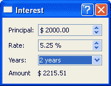

## 总结

137

我们还学到不需要正式地声明自己的自定义信号：我们只需要使用 `QObject.emit()` 即可发射它们，并带上任何想要传递的额外参数。

## Exercise

编写一个计算复利的对话框风格应用程序。该应用程序的风格和结构应该与 Currency 应用程序非常相似，并且看起来：

每用户更改一个变量因素（即本金、利率或年份）时，金额应该自动重新计算。年份的 combobox 应该包含“1 year”、“2 years”、“3 years”等文本，因此年份的数字将是 combobox 的当前索引加 1。Python 中的复利公式为 `amount = principal * ((1 + (rate / 100.0)) ** years)`。

`QDoubleSpinBox` 类拥有 `setPrefix()` 和 `setSuffix()` 方法，可用于“$”和“%”符号。整个应用程序可以用大约 60 行代码完成。

提示：可以通过将合适的 spinbox 和 combobox 信号连接到 `updateUi()` 槽来完成，在该槽中执行计算并更新 amount label。

模型答案在文件 `chap04/interest.pyw` 中。

*本页特留白*

**5**

- Dumb Dialogs
- Standard Dialogs
- Smart Dialogs

## Dialogs

几乎每个 GUI 应用程序都至少有一个对话框，大多数 GUI 应用程序都有一个带有几十个或数十个对话框的主窗口。对话框可以用于发布那些由于不适合放在状态栏或日志文件中的重要公告。在这种情况下，它们通常只有一个用于文本的标签和一个供用户在阅读消息后按下的 OK 按钮。大多数情况下，对话框用于询问用户问题。有些对话框是简单的，只需要是或否回答。另一些则要求用户做出另一种选择——例如，他们想使用什么文件、文件夹、颜色或字体。对于所有这些情况，PyQt 都提供了内置的对话框。

本章的重点是创建自定义对话框，以便在内置对话框不适用时向用户征取他们的需求和偏好。

我们没有涉及的一个问题是关于哪种小部件适用于特定用途。例如，如果我们想让用户在三个选项之间做出选择，我们可以提供三个单选按钮，或者一个包含三项的列表 widget 或 combobox。或者我们也可以使用一个三状态复选框。这些并不是唯一的可能性。对于初学 GUI 编程的人来说，附录 B 提供了所选 PyQt 小部件的截图和简要描述，这在做出这些决策时可能会有所帮助。

Qt 提供了 *Qt Designer*，这是一种视觉设计工具，可以轻松地“画出”对话框，而无需编写任何代码来创建和布局它们的小部件。它还可以用于设置对话框的某些行为。我们将在第 7 章中介绍 *Qt Designer*。在本章中，我们将用代码创建所有的对话框。一些开发者以这种方式创建所有的对话框，而另一些人则倾向于使用 *Qt Designer*。本书展示了这两种方法，以便你根据情况决定哪种方法方法。

分类对话的一种方法是根据它们的“智能程度”，根据它们内置了多少关于应用程序数据的知识，它们可能是“笨的”（dumb）、“标准的”（standard）或“智能的”（smart）。这些分类影响我们如何实现和实例化（创建实例）对话框，对于每种类型，我们在本章中专门安排了一个章节。

## 第 5 章 对话框

每个章节的开头都会解释该分类的含义，并通过通过过的示例解释其优缺点。

除了智能分类外，对话框还可以根据它们的*模态*（modality）进行分类。*应用模态*（application modal）对话框是一种一旦调用就是应用程序中用户可以交互的部分对话框。在用户关闭对话框之前，他们无法使用应用程序的其他部分。用户当然可以与其他应用程序进行交互，例如，通过点击另一个程序让它获得焦点。

*窗口模态*（window modal）对话框的工作方式与应用模态对话框类似，但它只阻止与其父窗口、父窗口的父窗口直到顶层父窗口，以及父窗口的兄弟窗口的交互。对于具有单个顶层窗口的应用程序，应用模态和窗口模态之间没有实际区别。在没有指定是哪种“模态”窗口时，假设为窗口模态。

模态对话框的对面是*无模态*（modeless）对话框。当调用无模态对话框时，用户可以与对话框交互，与应用程序的其他部分交互。这对我们设计代码有影响，因为用户可能会同时在主窗口和无模态对话框中影响程序状态，从而影响另一个。

编写对话框的另一个重要方面是我们如何处理验证。

只要可能，我们尝试选择合适的小部件并设置它们的属性，以避免我们自己编写任何验证代码。例如，如果我们需要一个整数，可以使用 `QSpinBox` 并使用其 `setRange()` 方法将范围限制在我们可以接受的值范围内。我们将适用于单个小部件的验证称为“小部件级”（widget-level）验证；数据库程序员通常将此称为“字段级”（field-level）验证。

有时我们需要超出小部件级验证，特别是当存在相互依赖关系时。例如，一个剧院订票系统有两个 combobox，一个选择楼层，另一个选择座位行。如果一楼的座位行是 A–R，而二楼的座位行是 M–T，那么显然只有某些楼层和座位行的组合是有效的。对于这些情况，我们必须执行“表单级”（form-level）验证；数据库程序员通常称为“记录级”（record-level）验证。

另一个验证问题涉及验证何时发生。理想情况下，我们不希望用户能够输入无效数据，但有时防止这一点可能非常棘手。我们将验证分为两个大类：“事后验证”（post-mortem），即在用户希望接受其设置的时间点进行的验证，以及“预防性验证”（preventative），即在用户操作编辑小部件时进行的验证。

由于对话框具有不同程度的智能、三种模态，以及多种验证策略，似乎有许多可能的组合可以选择。在实践中，我们使用的组合

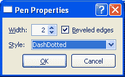

## Dumb Dialogs

141

我们倾向于每次都是相同的组合。例如，在大多数情况下，我们可能会将笨的和标准的对话框设为模态，而将智能对话框设为无模态。至于验证，正确的策略很大程度上取决于情况。我们将在本章看到最常见的用例示例，并在本书其余部分看到更多的对话框示例。

我们将“哑”对话框（dumb dialog）定义为：其组件由对话框的调用者设置为初始值，而其最终值也由对话框的调用者直接从组件获取的对话框。哑对话框不知道其组件被用于展示和编辑什么数据。我们可以对哑对话框的组件进行一些基础验证，但设置包含组件间相互依赖关系的验证并不常见（或者并不总是可能的）；换句话说，表单级验证通常不会在哑对话框中完成。哑对话框通常是模态对话框，带有“接受”（accept）按钮（例如 OK）和一个“拒绝”（reject）按钮（例如 Cancel）。

使用哑对话框的主要优点是，我们不需要编写任何代码来为它们提供 API，也不需要为任何额外逻辑编写代码。这两个优点都得益于它们的所有组件都是公开可见的。

主要的缺点是使用它们的代码与用户界面耦合在起（因为我们直接访问组件），因此我们无法轻松实现复杂的验证——而且如果需要在多个地方使用，它们比标准对话框或智能对话框不方便得多。

我们将从一个具体的示例开始。假设我们有一个图形应用程序，想要让用户设置一些画笔属性——例如画笔的宽度、样式，以及用它绘制的线条是否应该有斜边。图 5.1 显示了我们想要的目标。

**图 5.1** *画笔属性对话框*

在这种情况下，我们不需要画笔属性的“实时”或交互式更新，因此模态对话框就足够了。由于所需的验证非常简单，在这种情况下我们可以使用哑对话框。

我们通过在连接到菜单选项、工具栏按钮或对话框按钮的槽中模态弹出来使用该对话框。如果用户点击 OK，我们就更新画笔属性；如果他们点击 Cancel，我们则什么都不做。

以下是调用槽可能的样子：

```python
def setPenProperties(self):
    dialog = PenPropertiesDlg(self)
    dialog.widthSpinBox.setValue(self.width)
    dialog.beveledCheckBox.setChecked(self.beveled)
    dialog.styleComboBox.setCurrentIndex(
        dialog.styleComboBox.findText(self.style)
    )
    if dialog.exec_():
        self.width = dialog.widthSpinBox.value()
        self.beveled = dialog.beveledCheckBox.isChecked()
        self.style = unicode(dialog.styleComboBox.currentText())
        self.updateData()
```

我们首先创建一个 `PenPropertiesDlg` 对话框——我们稍后会看到细节；现在我们需要知道的是它有一个宽度数值框（width spinbox）、一个斜边复选框（beveled checkbox）和一个样式组合框（style combobox）。我们将父对象 `self`（调用表单）传递给对话框，以利用默认情况下 PyQt 将对话框居于其父窗口之中的特性，并且因为有父对象的对话框不会在任务栏中产生单独条目。然后我们直接访问组件，将它们的值设置为调用表单持有的值。`QComboBox.findText()` 方法返回匹配文本的项目的索引位置。

当我们在对话框上调用 `exec_()` 时，对话框将以模态方式显示。这意味着对话框的父窗口及其兄弟窗口将被阻塞，直到对话框关闭。只有当用户关闭对话框（通过“接受”它或“拒绝”它）时，`exec_()` 调用才会返回。如果用户接受了对话框，返回值为 `True`；否则为 `False`。如果用户接受了对话框，我们就知道他们希望设置生效，因此我们从对话框组件中读取这些设置并更新应用程序的数据。末尾的 `updateData()` 调用只是我们自定义的方法之一，用于让应用程序在主窗口显示画笔属性。

在 `setPenProperties()` 方法结束时，`PenPropertiesDlg` 将超出范围并成为垃圾回收的候选。由于由于原因，每当调用 `setPenProperties()` 时，我们必须创建一个新的对话框并填充其组件。这种方法节省了内存，代价是了一些速度开销。对于像这样微小的对话框，这种开销小到用户无法察觉，但稍后我们将展示另一种避免每次都创建和销毁对话框的方法。

使用哑对话框意味着对话框与应用程序耦合非常松散。我们可以通过将标签暴露为实例变量来完全解耦它。这样我们只需更改标签，就可以使用 `PenPropertiesDlg` 来编辑任何需要数值框、复选框和组合框的数据。例如，我们可以用它来记录一个带有“温度”数值框、“正在下雨”复选框和“云层覆盖”组合框的天气读取读数。

### 哑对话框

现在我们已经看到了如何使用该对话框，让我们来看看实现它的代码。`PenPropertiesDlg` 拥有一个方法 `__init__()`，我们将分部分查看。

```python
class PenPropertiesDlg(QDialog):
    def __init__(self, parent=None):
        super(PenPropertiesDlg, self).__init__(parent)

        widthLabel = QLabel("&Width:")
        self.widthSpinBox = QSpinBox()
        widthLabel.setBuddy(self.widthSpinBox)
        self.widthSpinBox.setAlignment(Qt.AlignRight|Qt.AlignVCenter)
        self.widthSpinBox.setRange(0, 24)

        self.beveledCheckBox = QCheckBox("&Beveled edges")

        styleLabel = QLabel("&Style:")
        self.styleComboBox = QComboBox()
        styleLabel.setBuddy(self.styleComboBox)
        self.styleComboBox.addItems(
            ["Solid", "Dashed", "Dotted", "DashDotted"]
        )

        okButton = QPushButton("&OK")
        cancelButton = QPushButton("Cancel")
```


对于每个编辑组件，我们还创建一个相应的标签，以便用户知道他们正在编辑什么。当我们在标签文本中使用安培符号（`&`）时，它有两种可能的含义。它可以仅仅是一个字面上的安培符号，也可以表示该安培符号不显示，而是其后的字母带有下划线，以显示它代表一个加速键。例如，在`widthLabel`的情况下，其文本`&Width:`将显示为`Width:`，其加速键为`Alt+W`。在 OS X 上，默认行为是忽略加速键；由于这一原因，PyQt 在该平台上不显示下划线。

区分字面安培符号和加速键安培符号的标准是标签是否有一个“伙伴”（buddy）：如果有，安培符号就表示加速键。伙伴是一个当按下对应标签的加速键时，PyQt 将键盘焦点传递给它的组件。所以，当用户按下`Alt+W`时，键盘焦点将切换到`widthSpinBox`。这意味着如果用户按下向上或向下箭头键，或`PageUp`或`PageDown`，这些操作将影响`widthSpinBox`，因为它拥有键盘焦点。

在按钮的情况下，按钮文本中带下划线的字母用于表示加速键。因此在这种情况下，`okButton`的文本`&OK`显示为`OK`，用户可以通过鼠标点击它、通过 Tab 键切换到它并按下空格键，或者通过按下`Alt+O`来按下按钮。为 Cancel（或 Close）按钮提供加速键并不常见，因为这些按钮通常连接到对话框的`reject()`槽，而`QDialog`为该操作提供了键盘快捷键，即 Esc 键。复选框和单选按钮与按钮有些相似，它们也有可以带有加速键的文本。例如，斜边复选框有一个带下划线的“B”，因此用户可以通过按下`Alt+B`来切换复选框的选中状态。

像这样创建按钮的一个缺点是，当我们布局它们时，将按照一个特定的顺序进行布局。例如，我们可能会把 OK 放在 Cancel 的左侧。但在某些窗口系统中这种顺序是错误的。PyQt 有解决此问题的方案，在“对话框布局”侧边栏中介绍。

我们将数值调节框（spinbox）的数字右对齐并垂直居中，同时将其有效范围设置为`0–24`。在`PyQt`中，允许宽度为`0`的笔宽（即线宽），这表示无论经过任何变换，都代表 1 像素的宽度。

宽度为 1 及以上的笔宽将按照给定宽度绘制，并遵循任何正在生效的变换（如缩放）。

通过使用数值调节框并为其设置范围，我们避免了如果使用行编辑框（line edit）时可能输入无效笔宽的情况。很多时候，只需选择正确的控件并恰当地设置其属性，就能提供所有所需的控件级验证。这在我们使用的斜角复选框（beveled checkbox）中也有体现：画笔要么绘制带有斜角边缘的线条，要么不绘制。我们使用线条样式组合框（combobox）的情况也是如此——用户只能选择有效的样式，即从我们提供的列表中选择一种样式。

```python
buttonLayout = QHBoxLayout()

buttonLayout.addStretch()

buttonLayout.addWidget(okButton)

buttonLayout.addWidget(cancelButton)

layout = QGridLayout()

layout.addWidget(widthLabel, 0, 0)

layout.addWidget(self.widthSpinBox, 0, 1)

layout.addWidget(self.beveledCheckBox, 0, 2)

layout.addWidget(styleLabel, 1, 0)

layout.addWidget(self.styleComboBox, 1, 1, 1, 2)

layout.addLayout(buttonLayout, 2, 0, 1, 3)

self.setLayout(layout)
```

我们使用了两个布局，一个嵌套另一个内部，以获得我们想要的布局。我们首先水平布局按钮，从一个“拉伸（stretch）”开始。拉伸部分会尽可能地占据空间，效果是将两个按钮推向尽可能靠右的位置，同时保持容纳。

★ 我们对用于点击按钮、切换对话框中的焦点以及弹出菜单的`Alt+字母`键序列称为“键盘加速器”（keyboard accelerator）和“加速器”（accelerator）。对于任何其他类型的键序列，我们使用“键盘快捷键”（keyboard shortcut）术语——例如用于保存文件的`Ctrl+S`键序列。我们将在第 6 章中查看如何创建键盘快捷键。

## 简易对话框（Dumb Dialogs）

145

### 对话框按钮布局

在我们早期的一些示例中，我们将按钮放在对话框的右侧，先是 OK 按钮，然后是 Cancel 按钮。这是 Windows 上最常见的布局，但并不总是正确的。例如，对于 Mac OS X 或 GNOME 桌面环境，它们应该交换位置。

如果我们希望应用程序具有尽可能原生的视觉效果和体验，`Qt`并期望将它们部署在不同的平台上，那么按钮顺序 4.2 和定位问题对我们来说非常重要。`Qt` 4.2（`PyQt` 4.1）为这个特定问题提供了解决方案：`QDialogButtonBox`类。

### PyQt

我们不再直接创建 OK 和 Cancel 按钮，而是创建一个`QDialogButtonBox`。例如：

```python
buttonBox = QDialogButtonBox(QDialogButtonBox.Ok|QDialogButtonBox.Cancel)
```

要使按钮成为“默认”按钮，即用户按下 Enter 键时按下的按钮（假设具有键盘焦点的控件本身不处理 Enter 键按下），我们可以这样做：

```python
buttonBox.button(QDialogButtonBox.Ok).setDefault(True)
```

由于按钮框是一个单一控件（尽管它包含其他控件），我们可以直接将其添加到对话框现有的布局中，而不是将其放在自己的布局中并嵌套在对话框的布局内。以下是我们在`PenPropertiesDlg`示例的网格布局中的做法：

```python
layout.addWidget(buttonBox, 3, 0, 1, 3)
```

而且，我们不是从按钮的`clicked()`信号进行连接，而是从按钮框进行连接，它有对应于用户操作的信号：

```python
self.connect(buttonBox, SIGNAL("accepted()"), self, SLOT("accept()"))

self.connect(buttonBox, SIGNAL("rejected()"), self, SLOT("reject()"))
```

不过，我们仍然可以连接到单个按钮的`clicked()`信号，而且对于具有许多按钮的对话框，我们经常会这样做。

`QDialogButtonBox`默认使用水平布局，但通过向其构造函数传递`Qt.Vertical`或调用`setOrientation()`可以将其设置为垂直布局。

我们在大多数示例中使用`QDialogButtonBox`，但如果向下兼容性是一个问题，可以一直替换为单独的`QPushButtons`。

146

*第 5 章，对话框*

`widthLabel`  
`widthSpinBox`  
`beveledCheckBox`  
`styleLabel`  
`styleComboBox`  
*stretch*  
`okButton`  
`cancelButton`

**图 5.2** *笔属性对话框的布局*

宽度标签、宽度调节框和斜角复选框使用网格布局在三列中并排布局。样式标签和样式组合框放在下一行，其中样式组合框设置为跨越两列。`QGridLayout.addWidget()`方法的参数是控件、行、列，然后可选的跨越的行数，最后是跨越的列数。我们将按钮布局作为第三行添加到网格布局中，使其跨越所有三列。最后，我们在对话框上设置布局。该布局是示意性的；网格布局如下：

```python
self.connect(okButton, SIGNAL("clicked()"), self, SLOT("accept()"))

self.connect(cancelButton, SIGNAL("clicked()"), self, SLOT("reject()"))

self.setWindowTitle("Pen Properties")
```

在`__init__()`结束处，我们进行了必要的连接。我们将 OK 按钮的`clicked()`信号连接到对话框的`accept()`槽，这将关闭对话框并返回 True 值。Cancel 按钮以相应方式连接。对于只从一个地方调用的小型简易对话框，可以避免创建对话框类。相反，我们可以简单地在调用方法中创建所有控件，对其进行布局、连接并调用`exec()`。

如果`exec()`返回 True，我们就可以从控件中提取值，然后完成。文件`chap05/pen.pyw`包含了笔属性对话框和一个带有两个按钮的虚拟程序，一个用于调用我们刚刚审查的`PenPropertiesDlg`，另一个则内联完成所有操作。内联创建对话框不是我们推荐的方法，因此我们不会回顾实现它的代码，但为了完整起见，它在示例的`setPenInline()`方法中提到并提供。

简易对话框易于理解和使用，但并不建议使用对话框控件设置和获取值，除非是最简单的对话框（即只涉及一个、两个或至多几个值）。我们主要展示它们，是作为对对话框的温和介绍，因为在任何类型的对话框中创建、布局和连接控件都是相同的。在下一节中，我们将查看标准对话框，包括模态和非模态的。

表 5.1 选定的布局方法

| 语法 | 描述 |
| :--- | :--- |
| `b.addLayout(l)` | 向`b`添加`QLayout``l`，通常是`QHBoxLayout`或`QVBoxLayout` |
| `b.addSpacing(i)` | 向`b`添加固定大小为`i`的`QSpacerItem` |
| `b.addStretch(i)` | 向`b`添加最小大小为 0、伸缩因子为`i`的`QSpacerItem` |
| `b.addWidget(w)` | 向`b`添加`QWidget``w` |
| `b.setStretchFactor(x, i)` | 设置`b`的布局或控件`x`的伸缩因子为`i` |
| `g.addLayout(l, r, c)` | 在`QGridLayout``g`的行`r`、列`c`处添加`QLayout``l`，可以可选提供跨越行列数 |
| `g.addWidget(w, r, c)` | 在`QGridLayout``g`的行`r`、列`c`处添加`QWidget``w`，可以可选提供跨越行列数 |
| `g.setRowStretch(r, i)` | 设置`QGridLayout``g`的行`r`伸缩因子为`i` |
| `g.setColumnStretch(c, i)` | 设置`QGridLayout``g`的列`c`伸缩因子为`i` |

如果一个对话框根据其初始化器或通过方法设置的值来初始化其控件，并且其最终值是通过方法调用或实例变量获取的，而不是直接来自对话框的控件，我们认为这种对话框是“标准”的。标准对话框可以同时包含控件级和表单级的验证。标准对话框可以是模态的（带有“接受”和“拒绝”按钮），或者（较少见）是非模态的，在这种情况下，它们具有“应用”和“关闭”按钮，并通过信号与槽连接通知状态变化。

标准对话框的一个主要优势是调用者不需要了解它们的实现，只需要知道如何设置初始值，以及如果用户点击 OK，如何获取结果值。另一个优势（至少对于模态标准对话框而言）是用户无法与对话框的父窗口及其兄弟窗口交互，因此应用程序状态的相关部分可能不会在对话框背后发生变化。使用标准对话框的主要缺点在它必须处理许多不同的数据项目时最为明显，因为所有项目都必须输入对话框，并在每次调用时检索结果，这可能涉及许多行代码。

与前一节一样，我们将通过示例来解释。在这种情况下，该示例将同时用于本节和下一节，以便我们更清楚地看到标准对话框与智能对话框之间的不同方法和权衡。

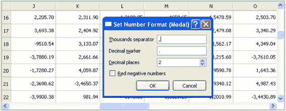

# 第 5 章 对话框

假设我们有一个显示浮点数表格的应用程序，并且希望让用户对数字格式进行一些控制。实现此目标的方法是提供菜单选项、工具栏按钮或快捷键，调用一个模态对话框，用户可以通过与之交互来设置他们的格式偏好。图 5.3 显示了一个弹出数字表格的数字格式对话框。

**图 5.3** *上下文中的模态 Set Number Format 对话框*

我们希望对话框提供给用户的数据存储在主表单的字典中。以下是字典的初始化方式：

```python
self.format = dict(thousandsseparator=",", decimalmarker=".", decimalplaces=2, rednegatives=False)
```

使用这样的字典非常方便，易于添加额外的项目。

我们将对话框放在单独的文件`numberformatdlg1.py`中，应用程序`numbers.pyw`导入了它。文件名中的数字“1”将其与下一节介绍的另外两个版本的对话框区分开来。

## 模态 OK/取消样式对话框

让我们先看看如何使用对话框；我们假设`setNumberFormat1()`方法是为了响应某些用户操作调用的。

```python
def setNumberFormat1(self):

    dialog = numberformatdlg1.NumberFormatDlg(self.format, self)

    if dialog.exec_():

        self.format = dialog.numberFormat()

        self.refreshTable()
```

## 标准对话框

我们首先创建对话框，并向其传递格式字典（对话框将根据该字典进行初始化）以及`self`，以便将对话框绑定到调用表单上——居于其上方且没有自己的任务栏项。

正如我们之前提到的，调用`exec_()`会将被调用的对话框作为模态对话框弹出，因此用户在与对话框的父及其兄弟交互之前，必须接受或拒绝对话框。在下一节中，我们将使用不施加此限制的非模态对话框版本。

如果用户点击 OK，我们将格式字典设置为对话框中设置的值，并更新表格以便以新格式显示数字。如果用户取消，我们什么都不做。在方法结束时，对话框超出作用范围，因此被安排垃圾回收。

为了节省空间并避免不必要的重复，从现在起我们将不再显示任何导入语句，除非其存在并不明显。例如，我们将不再显示`from PyQt4.QtCore import *`或`PyQt4.QtGui`。

我们现在准备好查看对话框本身的实现了。

```python
class NumberFormatDlg(QDialog):

    def __init__(self, format, parent=None):

        super(NumberFormatDlg, self).__init__(parent)
```

`__init__()`方法的开始与我们目前看到的所有其他对话框相同。

```python
thousandsLabel = QLabel("&Thousands separator")

self.thousandsEdit = QLineEdit(format["thousandsseparator"])

thousandsLabel.setBuddy(self.thousandsEdit)

decimalMarkerLabel = QLabel("Decimal &marker")

self.decimalMarkerEdit = QLineEdit(format["decimalmarker"])

decimalMarkerLabel.setBuddy(self.decimalMarkerEdit)

decimalPlacesLabel = QLabel("&Decimal places")

self.decimalPlacesSpinBox = QSpinBox()

decimalPlacesLabel.setBuddy(self.decimalPlacesSpinBox)

self.decimalPlacesSpinBox.setRange(0, 6)

self.decimalPlacesSpinBox.setValue(format["decimalplaces"])

self.redNegativesCheckBox = QCheckBox("&Red negative numbers")

self.redNegativesCheckBox.setChecked(format["rednegatives"])

buttonBox = QDialogButtonBox(QDialogButtonBox.Ok|QDialogButtonBox.Cancel)
```


对于我们希望用户能够更改的格式的每个方面，我们都创建一个标签以便他们知道正在编辑什么，以及一个合适的编辑控件。由于`format`参数是强制的，我们假设它包含了我们所需的所有 Buddy 值，因此我们使用它来初始化编辑控件。我们还使用了`setBuddy()`调用来支持键盘用户，因为并不是所有用户都能使用鼠标。

**表 5.2** *选定的 QDialogButtonBox 方法和信号*

| 语法 | 描述 |
| :--- | :--- |
| `d.addButton(b, r)` | 向`QDialogButtonBox` `d`添加具有`QDialogButtonBox.ButtonRole` `r`的`QPushButton` `b` |
| `d.addButton(t, r)` | 向`QDialogButtonBox` `d`添加具有文本`t`和按钮角色`r`的`QPushButton`，并返回添加的按钮 |
| `d.addButton(s)` | 向`QDialogButtonBox` `d`添加指定为`QDialogButtonBox.StandardButton` `s`的`QPushButton`并返回添加的按钮 |
| `d.setOrientation(o)` | 设置`QDialogButtonBox`的方向为`Qt.Orientation` `o`（垂直或水平） |
| `d.button(s)` | 返回`QDialogButtonBox`中指定的为`StandardButton` `s`的`QPushButton`，如果没有则返回`None` |
| `d.accepted()` | 如果点击了具有`QDialogButtonBox.Accept`角色的按钮，则发射此信号 |
| `d.rejected()` | 如果点击了具有`QDialogButtonBox.Reject`角色的按钮，则发射此信号 |

我们实施的唯一验证是限制小数位数数字调节框的范围。我们选择进行“事后”验证，即在用户输入值*之后*，在他们点击 OK 接受值时进行验证。在下一节中，我们将看到“预防性”验证，它可以从根源防止无效编辑。

```python
self.format = format.copy()
```

我们需要对传入的格式字典进行*拷贝*，因为我们希望能够更改对话框内部而不影响原始字典。

```python
grid = QGridLayout()
grid.addWidget(thousandsLabel, 0, 0)
grid.addWidget(self.thousandsEdit, 0, 1)
grid.addWidget(decimalMarkerLabel, 1, 0)
grid.addWidget(self.decimalMarkerEdit, 1, 1)
grid.addWidget(decimalPlacesLabel, 2, 0)
grid.addWidget(self.decimalPlacesSpinBox, 2, 1)
grid.addWidget(self.redNegativesCheckBox, 3, 0, 1, 2)
grid.addWidget(buttonBox, 4, 0, 1, 2)
self.setLayout(grid)
```

布局的外观与我们用于 Pen 属性对话框的布局非常相似，但这次我们使用`QDialogButtonBox`控件而不是按钮的布局。这使得使用单个`QGridLayout`创建整个布局成为可能。

*标准对话框*

`thousandsLabel`
`self.thousandsEdit`
`decimalMarkerLabel`
`self.decimalMarkerEdit`
`decimalPlacesLabel`
`self.decimalPlacesSpinBox`
`self.redNegativesCheckBox`
`okButton`
`cancelButton`

**图 5.4** *Set Number Format 对话框的布局*

“红色负数”复选框和按钮框的布局方式使得它们各自分跨越一行两列。行和列的跨度通过`QGridLayout`的`addWidget()`和`addLayout()`方法的最后两个参数指定。

布局如图 5.4 所示，阴影部分为网格。

```python
self.connect(buttonBox, SIGNAL("accepted()"), self, SLOT("accept()"))
self.connect(buttonBox, SIGNAL("rejected()"), self, SLOT("reject()"))
self.setWindowTitle("Set Number Format (Modal)")
```

建立连接和设置窗口标题的代码与我们在画笔属性（Pen Properties）对话框中使用的类似，只不过这次使用的是按钮框的信号，而不是直接连接到按钮本身。

```python
def numberFormat(self):
    return self.format
```

如果用户点击 OK，对话框将被接受并返回 True 值。在这种情况下，调用表单的方法将通过调用`numberFormat()`方法，用对话框的字典覆盖其格式字典。由于我们没有将对话框的`self.format`属性设为私有（即通过将其命名为`__format`），我们本可以直接从表单外部访问它；我们将在稍后的示例中采用那种方法。

当用户点击 OK 时，由于我们使用的是事后验证（post-mortem validation），某些编辑控件可能包含无效数据。为了处理这个问题，我们重新实现了`QDialog.accept()`并在那里进行验证。由于该方法很长，我们将分部分查看。

```python
def accept(self):
    class ThousandsError(Exception): pass
    class DecimalError(Exception): pass
    Punctuation = frozenset(" ,;:.")
```

我们首先创建两个将在`accept()`方法内部使用的异常类。这有助于我们的代码比通常情况下更简洁、更短。我们还创建了一个允许作为千分位分隔符和小数点标记的字符集。

我们关心的验证的编辑控件只有两个行编辑框（line edits）。这是因为小数数值计数器已经限制在有效范围内，而且“红色负数”复选框只能勾选或取消引用，这两种都是有效的。

```python
thousands = unicode(self.thousandsEdit.text())
decimal = unicode(self.decimalMarkerEdit.text())
try:
    if len(decimal) == 0:
        raise DecimalError, ("The decimal marker may not be "empty.")
    if len(thousands) > 1:
        raise ThousandsError, ("The thousands separator may only be empty or one character.")
    if len(decimal) > 1:
        raise DecimalError, ("The decimal marker must be one character.")
    if thousands == decimal:
        raise ThousandsError, ("The thousands separator and the decimal marker must be different.")
    if thousands and thousands not in Punctuation:
        raise ThousandsError, ("The thousands separator must be a punctuation symbol.")
    if decimal not in Punctuation:
        raise DecimalError, ("The decimal marker must be a punctuation symbol.")
except ThousandsError, e:
    QMessageBox.warning(self, "Thousands Separator Error", unicode(e))
    self.thousandsEdit.selectAll()
    self.thousandsEdit.setFocus()
    return
except DecimalError, e:
    QMessageBox.warning(self, "Decimal Marker Error", unicode(e))
    self.decimalMarkerEdit.selectAll()
    self.decimalMarkerEdit.setFocus()
    return
```

我们首先从两个行编辑框中获取文本。虽然没有千分位分隔符是可以接受的，但必须存在小数点标记，因此我们首先检查`decimalMarkerEdit`是否至少有一个字符。如果没有，我们就抛出带有适当错误文本的自定义`DecimalError`。如果任一个文本的长度超过一个字符，或者它们相同，或者其中任一个包含不在我们`Punctuation`集合中的字符，我们也会抛出异常。`if`语句在标点符号方面有所不同，是因为千分位分隔符允许为空，但小数点标记不允许。

我们对包含两个部分的错误字符串使用了括号，以将它们转换为单个表达式；另一种语法方案是去掉括号，转而拼接两个部分并转义换行。

取决于我们获取的是`ThousandsError`还是`DecimalError`，我们会显示一个带有适当错误文本的“警告”消息框，如图 5.5 所示。

我们必须将异常对象`e`转换为字符串（我们使用了`QMessageBox`的`unicode()`来实现），这样它就可以作为`QMessageBox`的静态方法`warning()`的参数。在本章以及整本书中，我们将更多地使用`QMessageBox`的静态方法，包括对额外参数的使用。

一旦用户通过关闭消息框确认了错误消息，我们就选择无效行编辑框中的文本并将焦点交给该行编辑框，以便用户进行修正。然后我们返回——这样对话框就不会被接受，用户必须修复问题或点击取消关闭对话框并放弃更改。

```python
self.format["thousandsseparator"] = thousands
self.format["decimalmarker"] = decimal
self.format["decimalplaces"] = self.decimalPlacesSpinBox.value()
self.format["rednegatives"] = self.redNegativesCheckBox.isChecked()
QDialog.accept(self)
```

如果没有抛出异常，则两个`return`语句都不会执行，执行将进入`accept()`方法的这最后部分。在这里，我们用编辑控件的值更新对话框的格式字典，并调用基类的`accept()`方法。表单将关闭（即隐藏），并从`exec_()`语句返回 True 值。正如我们之前看到的，调用者在接收到`exec_`的 True 值后，将使用`numberFormat()`方法获取对话框的格式。

为什么我们不在末尾使用`super()`来调用基类的`accept()`，而是命名为`QDialog`呢？简单来说是，在这种上下文中使用`super()`是不起作用的。PyQt 试图通过懒性属性查找尽可能高效，但结果是`super()`在子类中的作用不像我们预期的那样。虽然对话框只有在被接受（或拒绝）时才会隐藏，但一旦它超出作用范围，即在调用者的`setNumberFormat()`方法结束时，对话框就会被安排垃圾回收。

智能对话框（Smart dialogs）可以同时具有控件级和表单级的验证。智能对话框通常是非模态的，带有“应用”和“关闭”按钮，尽管它们也可以是“实时的”，在这种情况下它们可能没有按钮，控件的更改会直接反映到它们所访问的数据中。智能非模态`Table 5.3` `可选 QDialog 方法`。

## 常用 QDialog 方法

| 语法 | 说明 |
| :--- | :--- |
| `d.accept()` | 关闭（隐藏）`QDialog` `d`，停止其事件循环，并使`exec_()`返回 True 值。如果设置了`Qt.WA_DeleteOnClose`，则对话将被删除 |
| `d.reject()` | 关闭（隐藏）`QDialog` `d`，停止其事件循环，并使`exec_()`返回 False 值 |
| `d.done(i)` | 关闭（隐藏）`QDialog` `d`，停止其事件循环，并使`exec_()`返回整数`i` |
| `d.exec_()` | 模态显示`QDialog` `d`，阻塞直到其关闭 |
| `d.show()` | 非模态显示`QDialog` `d`；继承自`QWidget` |
| `d.setSizeGrip` | 根据布尔值`b`显示或隐藏`QDialog` `d`的尺寸调整手 |
| `Enabled(b)` | |

### 智能对话框

带有“应用”按钮的对话框通过信号槽连接通知状态变化。使用智能非模态对话框的主要优势体现在使用点。

当对话框被创建时，它会获得调用表单数据结构的引用，这样对话框就可以直接更新数据结构，而无需在调用点编写额外的代码。缺点是，对话框必须了解调用表单的数据结构，以便正确地将数据值反映到其控件中，并且仅应用有效的更改；此外，由于是非模态的，如果用户与应用程序的其他部分进行交互，存在对话框所依赖的数据在正下方发生改变的风险。

在本节中，我们将继续讨论数字格式对话框的主题，以便比较各种方法。

### 非模态“应用/关闭”型对话框

如果我们希望用户能够反复更改数字格式并看到结果，如果他们无需反复调用和接受数字格式对话框即可这样做，那么对他们来说将方便得多。解决方案是使用非模态对话框，允许他们根据需要频繁地与数字格式控件交互、应用更改并查看效果。此类对话框通常有一个“应用”按钮和一个“关闭”按钮。与可以取消的模态“确定/取消”型对话框不同（后者在取消后一切将恢复到先前的状态），一旦点击了“应用”，用户就无法撤销他们的更改。当然，我们可以提供一个“还原”按钮或“默认值”按钮，但这需要更多工作。

从表面上看，非模态版本和模态版本对话框的唯一区别是按钮文本。然而，还有两个重要的区别：调用表单的方法创建和调用对话框的方式不同，而且对话框在关闭时必须确保被删除，而不仅仅是隐藏。让我们先看看对话框是如何调用的。

```python
def setNumberFormat2(self):
    dialog = numberformatdlg2.NumberFormatDlg(self.format, self)
    self.connect(dialog, SIGNAL("changed"), self.refreshTable)
    dialog.show()
```

我们以之前创建模态版本的方式创建了对话框；它如图 5.6 所示。然后我们将对话框的`changed` Python 信号连接到调用表单的`refreshTable()`方法，然后只需对对话框调用`show()`。

当我们调用`show()`时，对话框作为非模态对话框弹出。应用程序的执行与对话框并发进行，用户可以同时与对话框和应用程序中的其他窗口交互。

每当对话框发射其更改信号时，主表单的`refreshTable()`方法就会被调用，这将使用格式字典的设置重新格式表格中的所有数字。我们可以想象，这意味着当用户点击“应用”按钮时，格式字典将更新并发射更改信号。我们很快就会看到确实如此。

尽管`dialog`变量超出了作用范围，但 PyQt 足够智能，能够保留非模态对话框，因此对话框继续存在。但当用户点击“关闭”时，对话框通常只会隐藏，因此如果用户反复调用对话框，由于创建了更多对话框但没有删除，将白白消耗更多的内存。解决此问题的方案之一是确保对话框在关闭时被删除而不是隐藏。（稍后在查看“实时”对话框时，我们将看到另一种解决方案。）我们将从对话框的`__init__()`方法开始。

```python
def __init__(self, format, parent=None):
    super(NumberFormatDlg, self).__init__(parent)
    self.setAttribute(Qt.WA_DeleteOnClose)
```

调用`super()`后，我们调用`setAttribute()`来确保对话框在关闭时会被删除而仅仅是隐藏。

```python
punctuationRe = QRegExp(r"[ ,;:.]")
thousandsLabel = QLabel("&Thousands separator")
self.thousandsEdit = QLineEdit(format["thousandsseparator"])
thousandsLabel.setBuddy(self.thousandsEdit)
self.thousandsEdit.setMaxLength(1)
self.thousandsEdit.setValidator(QRegExpValidator(punctuationRe, self))
decimalMarkerLabel = QLabel("Decimal &marker")
```


`self.decimalMarkerEdit = QLineEdit(format["decimalmarker"])`

`decimalMarkerLabel.setBuddy(self.decimalMarkerEdit)`

`self.decimalMarkerEdit.setMaxLength(1)`

`self.decimalMarkerEdit.setValidator(QRegExpValidator(punctuationRe, self))`

`self.decimalMarkerEdit.setInputMask("X")`

`decimalPlacesLabel = QLabel("&Decimal places")`

`decimalPlacesSpinBox = QSpinBox()`

`decimalPlacesLabel.setBuddy(self.decimalPlacesSpinBox)`

`decimalPlacesSpinBox.setRange(0, 6)`

`decimalPlacesSpinBox.setValue(format["decimalplaces"])`

`self.redNegativesCheckBox = QCheckBox("&Red negative numbers")`

`self.redNegativesCheckBox.setChecked(format["rednegatives"])`

`buttonBox = QDialogButtonBox(QDialogButtonBox.Apply|QDialogButtonBox.Close)`

表单控件的创建与我们之前做的非常相似，但这次我们几乎全量地使用了预防性验证。我们为千分位分隔符和小数点标记的行编辑设置了 1 个字符的最大长度，并且在两种情况下我们都设置了 `QRegExpValidator`。验证器只允许用户输入有效字符，在正则表达式验证器的情况下，只允许匹配正则表达式的字符。PyQt 使用的正则表达式语法本质上是 Python `re` 模块提供的语法的子集。

`QRegExpValidator` 的初始化器需要正则表达式和一个父对象，这就是为什么我们在传递正则表达式之外还传递了 `self`。

在这种情况下，我们将验证正则表达式设置为 `[ ,;:.]`。这是一个*字符类*（character class），意味着唯一有效的字符是方括号内的字符，即空格、逗号、分号、冒号和句号。注意正则表达式字符串前面有一个“r”。这表示这是一个“原始”（raw）字符串，意味着字符串内部的（几乎）所有字符都被视为字面量。这大大减少了转义正则表达式特殊字符（如 `\`）的需求，尽管在这里这并不重要。尽管如此，出于良好的编程习惯，我们始终在正则表达式字符串上配合使用“r”。

虽然我们乐意接受空的千分位分隔符，但我们需要一个小数点标记。因此，我们使用了输入掩码。“X”掩码表示*必须*有任意类型的一一个字符——我们不需要担心该字符将是什么，因为正则表达式验证器会确保它是有效的。格式掩码在 `QLineEdit.inputMask` 属性的文档中有详细解释。

与我们在模态对话框版本中创建控件的唯一区别在于，我们创建了 `Apply` 和 `Close` 按钮，而不是 `OK` 和 `Cancel` 按钮。

★ `QRegExp` 文对正则表达式进行了简要介绍。若需深入了解，请参考 Jeffrey E. Friedl 写的 *Mastering Regular Expressions*。

✪ 每个 `PyQt QObject` 和 `QWidget` 都有“属性”。这些属性原理上类似于 Python 属性，但可以使用 `property()` 和 `setProperty()` 方法进行访问。

```python
self.format = format
```

在模态对话框中，我们对调用者的 `format` 字典进行了复制；在这里我们获取它的引用，这样我们就可以在对话框内部直接修改它。我们不会显示对话框的布局，因为它与之前显示的模态对话框使用的布局完全相同。

```python
self.connect(buttonBox.button(QDialogButtonBox.Apply),
SIGNAL("clicked()"), self.apply)
self.connect(buttonBox, SIGNAL("rejected()"),
self, SLOT("reject()"))
self.setWindowTitle("Set Number Format (Modeless)")
```

我们创建了两个信号与槽连接。第一个是 `Apply` 按钮的 `clicked()` 信号与 `apply()` 方法之间的连接。为了建立此连接，我们必须使用 `button()` 方法从按钮框中获取按钮的引用，并传递与我们最初创建按钮时相同的参数 `QDialogButtonBox.Apply`。

到 `reject()` 的连接会导致对话框关闭，并且由于 `Qt.WA_DeleteOnClose` 属性，对话框将被删除而不是隐藏。由于没有到对话框的 `accept()` 槽的连接，因此消除对话框的唯一方法就是关闭它。如果用户点击 `Apply` 按钮，将调用下所示的 `apply()` own。自然地，我们还设置了窗口标题。该类的最后一个方法是 `apply()`，我们将分两部分进行回顾。

```python
def apply(self):
    thousands = unicode(self.thousandsEdit.text())
    decimal = unicode(self.decimalMarkerEdit.text())
    if thousands == decimal:
        QMessageBox.warning(self, "Format Error",
        "The thousands separator and the decimal marker "
        "must be different.")
        self.thousandsEdit.selectAll()
        self.thousandsEdit.setFocus()
        return
    if len(decimal) == 0:
        QMessageBox.warning(self, "Format Error",
        "The decimal marker may not be empty.")
        self.decimalMarkerEdit.selectAll()
        self.decimalMarkerEdit.setFocus()
        return
```

当两个或多个控件的值相互依赖时，通常需要进行表单级验证。在例例中，我们不希望允许千分位分隔符与小数点标记相同，因此我们在 `apply()` 方法中检查了这种情况，如果发生，我们会通知用户，将焦点置于千分位分隔符的行编辑框中，并在不应用用户修改的情况下直接返回。

我们可以通过将两个行编辑框的 `textEdited()` 信号连接到“检查并修复”槽来避免这种情况——我们将在下一个示例中这样做。我们还必须检查小数点标记是否为空。虽然小数点标记行编辑框的正则表达式验证器要求是单个字符，但它允许行编辑框为空。这是因为空字符串是有效字符字符串的有效前缀。毕竟，当用户将焦点切换进去时，行编辑框可能是空的。

```python
self.format["thousandsseparator"] = thousands
self.format["decimalmarker"] = decimal
self.format["decimalplaces"] = \
self.decimalPlacesSpinBox.value()
self.format["rednegatives"] = \
self.redNegativesCheckBox.isChecked()
self.emit(SIGNAL("changed"))
```

如果没有验证问题，则两个 `return` 语句都不会执行，执行到 `accept()` 槽的末尾。在这里我们更新了 `format` 字典。`self.format` 变量是调用者 `format` 字典的引用，因此更改直接应用于调用者的数据结构。最后，我们发射一个 `changed` 信号，正如我们所看到的，这将调用调用者的 `refreshTable()` 方法，该方法反过来使用调用者的 `format` 字典格式化表格中的所有数字。

这个对话框比我们在上一节中创建的标准对话框更智能。它直接在调用者数据结构（`format` 字典）上运行，并在数据结构发生变化时通知调用者以便应用更改。我们可以让它变得更加智能，给它一个调用者 `refreshTable()` 方法的引用，让对话框直接执行它：我们将在下一个示例中使用这种方法。

在用户想要反复应用更改的情况下，让他们一直点击 `Apply` 按钮可能会很不方便。他们可能只想操纵对话框的控件并立即看到效果。接下来我们将看到如何做到。

## 非模态“实时”对话框

对于最后一个数字格式示例，我们将回顾一个智能的非模态“实时”对话框——这种对话框的工作方式与我们刚刚看到的非常相似，但它没有按钮，且更改会自动并立即应用。对话框如图 5.7 所示。

在模态对话框版本中，我们使用了事后验证，而在智能非模态版本中，我们使用了事后和预防性验证的混合。在本例中，我们将专门使用预防性验证。此外，我们没有创建信号与槽连接来让对话框通知调用者更改，而是给了对话框一个在需要应用更改时调用的方法，以便它可以根据需要调用该方法。

我们可以用与之前完全相同的方式创建这个对话框，但我们将演示不同的方法。我们不是在需要时创建然后销毁它（每次使用都创建和销毁），而是在第一次需要时仅创建一次，并在用户完成后将其隐藏，每次使用时都显示和隐藏。

```python
def setNumberFormat3(self):
    if self.numberFormatDlg is None:
        self.numberFormatDlg = numberformatdlg3.NumberFormatDlg(
            self.format, self.refreshTable, self)
        self.numberFormatDlg.show()
        self.numberFormatDlg.raise_()
        self.numberFormatDlg.activateWindow()
```

在调用表的初始化器中，我们有语句 `self.numberFormatDlg = None`。这确保了在第一次调用此方法时创建对话框。然后我们像以前一样显示对话框。但在情况下，当对话框关闭时，它只是被隐藏（因为我们*没有*设置 `Qt.WA_DeleteOnClose` 控件属性）。因此，当调用此方法时，我们可能是第一次创建并显示对话框，也可能显示一个之前创建后隐藏的对话框。为了考虑到第二可能性，我们必须同时提升（将对话框置应用程序所有其他窗口之上）并激活（给对话框焦点）；第一次执行这些操作无害的。此外，我们还让对话框比之前的更智能，不再设置信号与槽连接，而是将绑定的 `refreshTable()` 方法作为额外参数传递给对话框。

`__init__()` 方法几乎与之前相同，仅有三处不同。第一，它没有设置 `Qt.WA_DeleteOnClose` 属性，以便当对话框关闭时它会被隐藏而不是删除。其次，它保留了传递给它的方法的副本（即在 `self.callback` 中保留对 `self.refreshTable()` 的引用），并且 PyQt PyQt 使用 `raise_()` 而不是 `raise()` 以避免与内置 `raise` 语句冲突。第三，它的信号和槽连接与之前略有不同。以下是连接调用：

```python
self.connect(self.thousandsEdit,
SIGNAL("textEdited(QString)"), self.checkAndFix)
self.connect(self.decimalMarkerEdit,
SIGNAL("textEdited(QString)"), self.checkAndFix)
```

```python
self.connect(self.decimalPlacesSpinBox, SIGNAL("valueChanged(int)"), self.apply)
self.connect(self.redNegativesCheckBox, SIGNAL("toggled(bool)"), self.apply)
```

与之前一样，我们可以依靠小数位数计数器框（spinbox）来确保设置的小位数有效；同样，“红色负数”复选框只能处于有效状态，因此对这些中任何一个的更改都可以立即应用。

但对于行编辑（line edits），我们现在连接了它们的 `textEdited()` 信号。每当用户在这些框中输入或删除字符时，这些信号就会被发射。`checkAndFix()` 槽会确保行编辑持有有效的文本并立即应用更改。此对话框中没有按钮：用户可以通过按下 `Esc` 键关闭它，这会将其隐藏。对话框只有在它的调用表单被删除时才会被删除，因为在那时，调用者的 `self.numberFormatDlg` 实例变量将离开作用域，由于没有对该对话框的其他引用，它将被调度进行垃圾回收。

```python
def apply(self):
    self.format["thousandsseparator"] = unicode(self.thousandsEdit.text())
    self.format["decimalmarker"] = unicode(self.decimalMarkerEdit.text())
    self.format["decimalplaces"] = self.decimalPlacesSpinBox.value()
    self.format["rednegatives"] = self.redNegativesCheckBox.isChecked()
    self.callback()
```

`apply()` 方法是我们目前见过的最简单的。这是因为只有在所有编辑控件都持有有效数据时才会调用它，因此不需要进行事后验证。它不再发射信号来宣布状态更改——相反，它调用了接收到的方法，直接将更改应用到调用者的表单上。

```python
def checkAndFix(self):
    thousands = unicode(self.thousandsEdit.text())
    decimal = unicode(self.decimalMarkerEdit.text())
    if thousands == decimal:
        self.thousandsEdit.clear()
        self.thousandsEdit.setFocus()
    if len(decimal) == 0:
        self.decimalMarkerEdit.setText(".")
        self.decimalMarkerEdit.selectAll()
        self.decimalMarkerEdit.setFocus()
    self.apply()
```


此方法在用户在任一行编辑框中输入时应用预防性验证。我们仍然依赖行编辑验证器、最大长度属性，以及在小数位标记行编辑中使用输入掩码（input mask），所有这些因素结合在一起提供了我们几乎需要的所有验证。但用户仍然可能在两个框中设置相同的文本——在这种情况下，我们会删除千分位分隔符并将焦点移动到该行编辑框；或者（如果用户努力尝试）导致小数位标记为空——在这种情况下，我们会设置一个有效的替代方案，选中它并赋予其键盘焦点。最后，我们知道两个行编辑都是有效的，因此我们调用`apply()`并应用更改。

使用显示/隐藏方法的一个用处是，对话框的状态会自动维护。如果我们必须在每次使用时都创建对话框，就必须向其填充数据，但对于这个对话框，每当它显示时（第一次之后），它已经有了正确的数据。当然，在这个特定的示例中，我们有三个都用于编辑相同数据的对话框，这意味着这个对话框可能会不同步；我们忽略这个问题，因为在实际应用程序中，我们不会让多个对话框编辑同一份数据。

通过同时传入数据结构（格式字典）和调用者的更新方法（`refreshTable()`，作为`self.callback`传递），我们让这个对话变得变得智能——与其调用者紧密耦合。由于由于原因，许多程序员倾向于使用标准对话框的“折中方案”——愚笨对话框太局限了且使用起来可能不方便，而智能对话框因为其对调用者数据结构的理解意味着紧密耦合，维护起来可能更麻烦。

## 总结

我们将对话框分为三种“智能”程度：愚笨、标准和智能，并展示了它们可以用模态（modal）或非模态（modeless）的方式使用。愚笨对话框很容易创建，对于组件级的验证完全足够。

愚笨对话框通常以模态方式使用，如果我们足够仔细，它们可以通用，因为它们与应用程序逻辑的耦合非常松散。

尽管如此，使用愚笨对话框通常会导致程序员感到沮丧，并需要将其重写为标准或智能对话框的形式，因此通常最好避免使用它们，除非是极简单的情况，即只需要一两个值，且内置的`QInputDialog`静态对话框不适用。

最常见的选择是在标准模态对话框和智能非模态对话框之间权衡，而在后者情况下，在“应用”样式和“实时”更新样式之间选择。模态对话框编程最简单，因为会阻塞与对话框父窗口及其兄弟窗口的任何其他交互，从而降低了正在处理的数据在处理过程中被更改的风险。但某些用户更喜欢非模态对话框，当用户在决定使用哪些选项之前尝试各种选项时，它们特别方便。模态对话框也可以用于此目的，只要它们提供某种预览；例如，字体对话框通常是模态的，并在用户更改字体时显示反映这些设置的示例文本。

我们看过的两种验证策略——事后和预防——可以单独使用，也可以结合使用。从易用性的角度来看，预防性的通常被认为更优，尽管它可能会导致用户沮丧。例如，当设置因为表单上的另一个设置而无效时，用户可能会抱怨（“我想把这个设为五，但它不让我”）。

可以设计一种对话框既可用于添加又用于编辑。这些添加/编辑对话框在创建、布局和控件连接方面与其他类型的对话框没有区别。关键区别在于，它们可能根据是添加还是编辑而表现出不同的行为。编辑时，控件从传入的项目中填充，而添加时，它们用默认值填充。如果对话框被接受，它可能仅提供访问器以检索设置的值，将工作留给调用者；或者它可能是智能的，能够直接更新已编辑的项目，并在用户正在添加时创建新项目。参见`chap08/addmoviedlg.py`中的`AddEditDlg`类（其用户界面设计在`chap08/addmoviedlg.ui`中）以及`chap12/pagedigner.pwy`中的`TextItemDlg`类，作为添加/编辑对话框的示例。

另一种可能是完全避免使用对话框，允许用户原地编辑数据——例如在列表或表格中。这种方法在模型/视图章节中有介绍。

## 练习

编写一个独立的字符串列表编辑对话框。对话框应使用`if __name__ == "__main__":`以便独立运行和测试。它看起来应该像图 5.8 所示所示对话框。

字符串存储在`QListWidget`中。排序按钮很容易实现，因为我们将它的`clicked()`信号直接连接到`QListWidget.sortItems()`方法。

对话框应处理自己的字符串列表，可以是传入列表的副本，也可以是自己创建的，并在接受时发射一个包含列表（作为`QStringList`）的信号，并且具有一个公开的数据属性`stringlist`。

`reject()`槽的实现如下：

```python
def reject(self):
    self.accept()
```

**图 5.8** *正在添加项的字符串列表对话框*

为了测试目的，在文件末尾加上代码：

```python
if __name__ == "__main__":
    fruit = ["Banana", "Apple", "Elderberry", "Clementine", "Fig",
```

```python
"Guava", "Mango", "Honeydew Melon", "Date", "Watermelon",
"Tangerine", "Ugli Fruit", "Juniperberry", "Kiwi",
"Lemon", "Nectarine", "Plum", "Raspberry", "Strawberry",
"Orange"
app = QApplication(sys.argv)
form = StringListDlg("Fruit", fruit)
form.exec_()
print "\n".join([unicode(x) for x in form.stringlist])
```

这将创建了一个`StringListDlg`实例，其中包含一个命名列表项种类型的字符串以及一个字符串列表，然后以模态方式调用它。当用户关闭对话框时，我们在控制台上打印字符串列表，以便查看编辑后的效果。

你将需要阅读`QListWidget`以及`QInputDialog.getText()`的文档，后者可以用于获取要添加的字符串也可以用于编辑现有的字符串。这个练习可以在大约 120 行代码内完成。

文件`chap05/stringlistdlg.py`提供了一个标准答案。可以通过运行该程序来测试它。（在 Windows 上，应从控制台运行；在 Mac OS X 上，应从终端运行。）

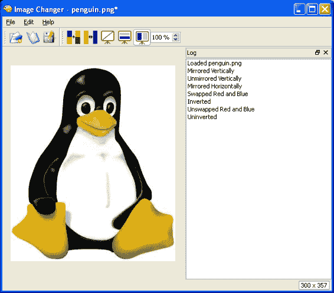

## 6. 主窗口

- 创建主窗口
- 处理用户操作

### 主窗口

大多数应用程序都是主窗口风格的应用程序，也就是说，它们拥有菜单栏、工具栏、状态栏、中央区域，并可能还有停靠窗口，为用户提供一个丰富且易于导航和易于理解的用户界面。

在本章中，我们将看到如何创建一个主窗口风格的应用程序，并演示如何创建和使用所有这些功能。

**图 6.1** *图像转换器应用程序*

我们将使用图 6.1 所示的图像转换器应用程序来演示如何创建一个主窗口风格的应用程序。大多数此类应用程序一样，它拥有菜单、工具栏和状态栏；它还有一个停靠窗口。除了学习如何创建所有这些用户界面元素外，我们还将介绍如何将用户交互与执行相关操作的方法关联起来。

本章还解释了如何处理新文件的创建和现有文件的打开，包括保持用户界面与应用程序状态同步。此外涵盖了如何给用户保存未保存更改的机会，以及如何管理最近使用的文件列表。我们还将展示如何保存和恢复用户偏好，包括主窗口以及工具栏和停靠窗口的大小和位置。

大多数应用程序都有数据结构来存储数据，并通过一个或多个控件让用户查看和编辑数据。图像转换器应用程序将其数据存储在一个`QImage`对象中，并使用`QLabel`控件作为数据查看器。在第 8 章中，我们将看到一个用于展示和编辑大量数据项的主窗口风格应用程序，在第 9 章中，我们将看到如何创建可以处理多个文档的主窗口应用程序。

在查看如何创建该应用程序之前，我们将讨论用户界面必须维护的一些状态。很多时候，某些菜单选项和工具栏按钮是“可检查的”，也就是说，它们可以处于两种状态之一。

例如，在文字处理器中，切换斜体文本的工具栏按钮可以是“开启”（按下）或“关闭”的。如果这里还有一个斜体菜单选项，我们必须确保菜单选项和工具栏按钮保持同步。

幸运的是，PyQt 可以轻松地实现这种同步。

某些选项可能是相互依赖的。例如，我们可以让文本左对齐、居中或右对齐，但在任何时间这些选项中只能有一个“开启”的。因此，如果用户开启了居中对齐，左对齐和右对齐的工具栏按钮以及菜单选项必须关闭。同样，PyQt 让这一切变得非常简单。

```python
self.setCentralWidget(self.imageLabel)
```

在某些应用程序中，中心部件是一个复合部件（由其他部件组成的部件，其布局方式与对话框中的部件相同），或者基于项的部件（例如列表或表格），但在这里，单个`QLabel`就足够了。`QLabel`可以显示纯文本、HTML 或 PyQt 支持的任何图像格式的图像；稍后我们将学习如何发现这些格式，因为它们可能会有所不同。我们设置了最小尺寸，是因为标签初初没有内容可显示，因此它不会占用任何空间，这看起来会很怪异。我们选择将图像垂直和水平居中对齐。

PyQt 提供了许多创建上下文菜单的方法，但我们将使用最简单且最常用的方法。首先，我们必须为目标部件设置上下文菜单策略（context menu policy）。然后，我们必须向该部件添加一些动作（actions）——我们稍后会这样做。当用户调用上下文菜单时，菜单将弹出并显示已添加的动作。

与使用布局的对话框不同，在主窗口风格的应用程序中，我们只有一个中心部件——尽管这个部件可以是复合的，因此在实践中并没有限制。我们只需要调用`setCentralWidget()`即可。该方法既在主窗口的中心侧边栏区域布局该部件，又重新设置了部件的父级，使主窗口拥有它。

### 创建主窗口

**图 6.3** `QMainWindow`的区域（窗口标题、菜单栏、工具栏区域、停靠窗口区域、中心部件、状态栏）

工具栏适合存放工具栏按钮以及其他类型的部件，如组合框和数值调节框。对于较大的部件、工具调板，或任何我们希望用户能够从窗口中拖出并作为独立窗口自由浮动的部件，使用停靠窗口（dock window）通常是正确的选择。

停靠窗口是可以出现在图 6.3 所示停靠区域的窗口。它们有一个很小的标题、恢复和关闭按钮，并且可以从一个停靠区域拖动到另一个，或者作为独立的顶层窗口自由浮动。当它们被停靠时，它们会在自身与中心区域之间提供一个分割器，这使得它们很容易调整大小。

在 PyQt 中，停靠窗口是`QDockWidget`类的实例。我们可以向停靠窗口添加单个部件，就像我们可以在主窗口的中心区域拥有单个部件一样，同样这并不是一种限制，因为添加的部件可以是复合的。

```python
logDockWidget = QDockWidget("Log", self)
logDockWidget.setObjectName("LogDockWidget")
logDockWidget.setAllowedAreas(Qt.LeftDockWidgetArea|Qt.RightDockWidgetArea)
self.listWidget = QListWidget()
logDockWidget.setWidget(self.listWidget)
self.addDockWidget(Qt.RightDockWidgetArea, logDockWidget)
```

停靠部件不是被放入布局中的，因此当我们创建它们时，除了提供窗口标题外，还必须给它们指定一个父级。通过设置父级，我们确保停靠部件不会超出范围并在错误的时间被 Python 垃圾回收。相反，，当其父级——顶层窗口（主窗口）被删除时，停靠部件将被删除。

每个 PyQt 对象都可以赋予一个对象名称（object name），尽管到为止我们从未这样做过。对象名称有时对调试很有用，但我们在这里设置一个，是因为我们希望 PyQt 保存并恢复停靠部件的大小和位置，由于可能存在多个停靠部件，PyQt 使用对象名称来区分它们。

默认情况下，停靠部件可以拖入任何停靠区域并且是可移动、可浮和可关闭的。由于我们的停靠部件将用于存储列表——一种通常长而窄的部件——它只位于左侧或右停靠区域（或浮动）才有意义，因此我们使用`setAllowedAreas()`来限制区域。停靠部件还有一个`setFeatures()`方法，用于控制停靠部件是否可以移动、浮动或关闭，但我们在这里不需要使用它，因为默认设置已经足够。

一旦设置好停靠部件，我们就创建它将包含的部件，在这种情况下是一个列表部件。然后我们将部件添加到停靠部件，再将停靠部件添加到主窗口。我们不需要为列表部件指定父级，因为当它被添加到停靠部件时，停靠部件就拥有了它。

```python
self.printer = None
```

我们希望用户能够打印出他们的图像。为了实现这一点，我们需要创建一个`QPrinter`对象。我们可以在需要时创建打印机并在之后让其被垃圾回收。但我们倾向于保留一个实例变量，初始设置为`None`。当用户第一次要求打印时，我们将创建一个`QPrinter`并将其分配给我们的`printer`变量。这有两个好处：首先，我们只在需要时创建打印机对象；其次，由于我们保留了它的引用，它会一直存在并保持所有之前的状态，例如用户选择的打印机、纸张大小等。

```python
self.sizeLabel = QLabel()
self.sizeLabel.setFrameStyle(QFrame.StyledPanel|QFrame.Sunken)
status = self.statusBar()
status.setSizeGripEnabled(False)
status.addPermanentWidget(self.sizeLabel)
status.showMessage("Ready", 5000)
```

对于应用程序的状态栏，我们希望左侧有一个的消息区域，以及一个显示当前图像宽度和高度的状态指示器。我们通过创建一个`QLabel`部件并将其添加到状态栏来实现。当我们第一次调用`QMainWindow`的`statusBar()`方法时，状态栏会自动为我们创建。如果我们用字符串调用状态栏的`showMessage()`方法，该字符串将显示在状态栏中，并一直显示直到调用另一个`showMessage()`或`clearMessage()`。我们使用了双参数的形式，第二个参数是消息显示的毫秒数（`5000`）；在此时间之后，状态栏将自动清除。

到目前为止，我们已经了如何创建主窗口的中心部件、创建停靠部件以及设置状态栏。现在我们几乎准备好创建菜单和工具栏了，但首先必须理解什么是 PyQt 动作（actions），然后简单学习一下资源。

### 动作与键序列

Qt 的设计者意识到，用户界面通常为用户提供了几种不同的方法来实现相同的操作。例如，在许多应用程序中，创建一个新文件可以通过“文件→新建”菜单选项完成、点击“新建文件”工具栏按钮，或者使用 Ctrl+N 快捷键。通常，我们不在乎用户如何请求执行动作，我们只关心他们请求执行什么动作。PyQt 使用`QAction`类封装用户动作。例如，为了创建一个“文件-新建”动作，我们可以写如下代码：

```python
fileNewAction = QAction(QIcon("images/filenew.png"), "&New", self)
fileNewAction.setShortcut(QKeySequence.New)
helpText = "Create a new image"
fileNewAction.setToolTip(helpText)
fileNewAction.setStatusTip(helpText)
```


`self.connect(fileNewAction, SIGNAL("triggered()"), self.fileNew)` 假设我们已经有一个合适的图标和一个 `fileNew()` 方法。菜单项文本中的连字符 `&` 意味着菜单项将显示为 `New`（在 Mac OS X 上除外，除非窗口系统被设置为抑制下划线），并且键盘用户将能够按下 `Alt+F,N` 来调用它，假设 `File` 菜单的文本是 `"&File"`，以便它显示为 `File`。或者，用户可以使用由 `setShortcut()` 创建的快捷键，只需按下 `Ctrl+N` 即可。

许多快捷键序列是标准化的，有些在不同的窗口系统之间也是通用的。例如，Windows、KDE 和 GNOME 都使用 `Ctrl+N` 表示“新建”，使用 `Ctrl+S` 表示“保存”。Mac OS X 也类似，使用 `Command+N` 和 `Command+S` 执行这些操作。

### Qt 4.2

PyQt 4.2 中的 `QKeySequence` 类为标准快捷键序列提供了常量，例如 `QKeySequence.New`。当标准快捷键序列在不同窗口系统之间不同，或者一个动作关联多个快捷键序列时，这种方法特别有用。例如，如果我们将快捷键设置为 `QKeySequence.Paste`，PyQt 将响应 Windows 上的 `Ctrl+V` 或 `Shift+Ins` 触发“粘贴”动作；在 KDE 和 GNOME 上响应 `Ctrl+V`、`Shift+Ins` 或 `F18`；在 Mac OS X 上响应 `Command+V`。

对于未标准化的快捷键序列（或者如果我们想与早期版本的 PyQt 保持后兼容性），我们可以以字符串形式提供快捷键；例如 `setShortcut("Ctrl+Q")`。本书使用了所有可用的标准快捷键序列，否则将回退到使用字符串。

#### 表 6.1 选定的 QAction 方法

| 语法 | 描述 |
| :--- | :--- |
| `a.data()` | 以 `QVariant` 返回 `QAction` `a` 的用户数据 |
| `a.setData(v)` | 将 `QAction` `a` 的用户数据设置为 `QVariant` `v` |
| `a.isChecked()` | 如果 `QAction` `a` 被选中，则返回 `True` |
| `a.setChecked(b)` | 根据 `bool` `b` 选中或取消选中 `QAction` `a` |
| `a.isEnabled()` | 如果 `QAction` `a` 被启用，则返回 `True` |
| `a.setEnabled(b)` | 根据 `bool` `b` 启用或禁用 `QAction` `a` |
| `a.setSeparator(b)` | 根据 `bool` `b` 将 `QAction` `a` 设置为普通动作或分隔符 |
| `a.setShortcut(k)` | 将 `QAction` `a` 的键盘快捷键设置为 `QKeySequence` `k` |
| `a.setStatusTip(s)` | 将 `QAction` `a` 的状态提示文本设置为字符串 `s` |
| `a.setText(s)` | 将 `QAction` `a` 的文本设置为字符串 `s` |
| `a.setToolTip(s)` | 将 `QAction` `a` 的提示文本设置为字符串 `s` |
| `a.setWhatsThis(s)` | 将 `QAction` `a` 的“这是什么？”文本设置为字符串 `s` |
| `a.toggled(b)` | 当 `QAction` `a` 的选中状态改变时发射此信号；如果动作被选中，`bool` `b` 为 `True` |
| `a.triggered(b)` | 当 `QAction` `a` 被调用时发射此信号；如果 `QAction` `a` 被选中，可选的 `bool` `b` 为 `True` |

注意为 `QAction` 指定了父对象 `self`（适用该动作的表单）。每个 `QObject` 子类（顶层窗口除外）都有一个父对象是很重要的；对于控件，这通常通过布局来实现，但对于像 `QAction` 这样的纯数据对象，我们必须显式地提供父对象。

一旦创建了动作，我们可以如下所示将其添加到菜单和工具栏中：

```python
fileMenu.addAction(fileNewAction)

fileToolbar.addAction(fileNewAction)
```

现在，每当用户（通过任何方式）调用“新建文件”动作时，就会调用 `fileNew()` 方法。

### 资源文件

遗憾的是，我们写的代码有一个小问题。它假设应用程序的工作目录是它所在的目录。在 Windows 下点击（或双击）`.pyw` 文件（或其快捷方式）时，这是正常情况。但如果从命令行从不同的目录执行程序——例如 `./chap06/imagechanger.pyw`——所有图标都将不会显示。因为我们提供的图标路径是 `images`，即相对于应用程序工作目录的路径，因此当从别处调用时，程序会在 `./images` 目录中查找图标（该目录可能不存在），而实际上它们位于 `./chap06/images` 目录。

我们可能会尝试使用 Python 的 `os.getcwd()` 函数来解决这个问题；但它返回的是我们调用应用程序的目录，正如我们指出的，这可能不是应用程序实际所在的目录。PyQt 的 `QApplication.applicationDirPath()` 方法也没有帮助，因为它返回的是 Python 可执行文件的路径，而不是我们应用程序本身的路径。一种解决方案是使用 `os.path.dirname(__file__)` 为图标文件名提供前缀，因为 `__file__` 变量持有当前 `.py` 或 `.pyw` 文件的完整名称和路径。

另一种解决方案是将所有的图标（以及帮助文件和任何其他小资源）放入单个 `.py` 模块中，并从那里访问它们。这不仅解决了路径问题（因为 Python 知道如何查找要导入的模块），而且意味着我们不再有几十个容易丢失的图标、帮助文件和类似文件，而是有一个包含所有内容的单一模块。

要生成资源模块，我们必须做两件事。首先，我们必须创建一个 `.qrc` 文件，包含我们想要包含的资源的详情，然后必须运行 `pyrcc4`，它读取 `.qrc` 文件并生成资源模块。`.qrc` 文件采用简单的 XML 格式，便于手动编写。以下是 Image Changer 使用的 `resources.qrc` 片段：

```xml
<!DOCTYPE RCC><RCC version="1.0">

<qresource>

<file alias="filenew.png">images/filenew.png</file>

<file alias="fileopen.png">images/fileopen.png</file>

···

<file alias="icon.png">images/icon.png</file>

<file>help/editmenu.html</file>

<file>help/filemenu.html</file>

<file>help/index.html</file>

</qresource>

</RCC>
```

省略号代表为了节省空间而省略的许多行，因为它们非常相似。每个 `<file>` 条目必须包含一个文件名，如果它在子目录中，则包含相对路径。现在，如果我们想使用“新建文件”动作的图像，可以写 `QIcon(":/images/filenew.png")`。但多亏了别名，我们可以缩短为 `QIcon(":/filenew.png")`。开头的 `:/` 通知 PyQt 该文件是资源。资源文件可以像普通（只读）文件一样处理，但在使用资源之前，我们必须确保生成了资源模块并将其导入。

我们之前展示了应用程序的导入语句，最后是 `import qrc_resources`。`qrc_resources.py` 模块是通过 `pyrcc4` 使用以下命令生成的：

```bash
C:\pyqt\chap06>pyrcc4 -o qrc_resources.py resources.qrc
```

当我们修改 `resources.qrc` 文件时，必须运行此命令。

### 创建和使用动作

我们之前看到的创建“新建文件”动作的代码需要六行来创建和设置。大多数主窗口风格的应用程序有很多动作，因此为每个动作编写六行代码很快就会变得非常乏味。因此，我们创建了一个辅助方法，允许我们将创建动作的代码减少到仅两三行。我们将查看该辅助方法，然后看它如何在主窗口的初始化函数中使用。

```python
def createAction(self, text, slot=None, shortcut=None, icon=None, tip=None, checkable=False, signal="triggered()"):

    action = QAction(text, self)

    if icon is not None:

        action.setIcon(QIcon(":/%s.png" % icon))

    if shortcut is not None:

        action.setShortcut(shortcut)

    if tip is not None:

        action.setToolTip(tip)

        action.setStatusTip(tip)

    if slot is not None:

        self.connect(action, SIGNAL(signal), slot)

    if checkable:

        action.setCheckable(True)

    return action
```

### 创建主窗口

该方法完成了我们之前为“新建文件”操作手动执行的所有工作。此外，它还处理了没有图标的情况以及“可检查”动作。

图标是可选的，尽管对于将添加到工具栏的动作，惯例是提供一个。如果一个动作可以具有“开启”和“关闭”状态（就像文字处理器通常提供的加粗或斜体动作那样），那么该动作就是可检查的。

注意 `QAction` 构造函数的最后一个参数是 `self`；这是该动作的父对象（主窗口），它确保了动作在离开初始化器的作用域时不会被垃圾回收。在某些情况下，我们将动作设为实例变量，以便在表单的初始化函数之外访问它们，但在本特定示例中我们不需要这样做。

以下是我们使用 `createAction()` 辅助方法创建“新建文件”动作的方法：

`fileNewAction = self.createAction("&New...", self.fileNew, QKeySequence.New, "filenew", "Create an image file")`

除“退出文件”动作（以及我们没有提供快捷键的“另存为”）外，其他文件动作都以相同的方式创建，因此我们不会通过显示它们来浪费空间。

`fileQuitAction = self.createAction("&Quit", self.close, "Ctrl+Q", "filequit", "Close the application")`

`QKeySequence` 类没有用于应用程序终止的标准快捷键，因此我们自己选择了一个并以字符串的形式指定它。

我们完全可以同样使用不同的快捷键——例如，`Alt+X` 或 `Alt+F4`。

`close()` 槽继承自 `QMainWindow`。如果主窗口是通过调用“退出文件”动作（我们刚刚将其连接到 `close()` 槽）关闭的，例如通过点击“文件→退出”或按下 `Ctrl+Q`，则将调用基类的 `close()` 方法。但如果用户点击应用程序的关闭按钮（X），则 `close()` 方法将不会被调用。

我们能够确定自己拦截了关闭窗口的尝试的唯一方法是重新实现关闭事件处理程序。无论应用程序是通过 `close()` 方法还是通过关闭按钮关闭的，关闭事件处理器总是会被调用。因此，通过重新实现此事件处理器，我们可以为用户提供机会保存任何未保存的更改，并保存应用程序的设置。

通常情况下，我们可以完全通过高层信号和槽机制来实现应用程序的行为，但在这种情况一个重要的情况下，我们必须使用低级事件处理机制。然而，重新实现关闭事件与重新实现任何其他方法没有区别，而且并不困难，正如我们在后续介绍它时将看到的那样。（事件处理将在第 10 章介绍。）

# 第 6 章 主窗口

编辑动作以类似的方式创建，但由于细微的差异，我们将查看其中的几个。

`editZoomAction = self.createAction("&Zoom...", self.editZoom, "Alt+Z", "editzoom", "Zoom the image")`

对于用户来说，能够放大和缩小以查看更多或更少细节的是非常方便的。我们在工具栏中提供了一个计数器（spinbox），允许鼠标用户更改缩放因子（我们很快就会涉及到这一点），但我们必须支持键盘用户，因此我们为他们创建了一个“编辑缩放”动作，该动作将被添加到“编辑”菜单中。当被触发时，连接到此动作的方法将弹出一个对话框，用户可以在其中输入缩放百分比。

放大和缩小有标准的快捷键序列，但没有一个通用的缩放快捷键，因此我们在这种情况下选择使用 `Alt+Z`。

（我们没有使用 `Ctrl+Z`，因为那是大多数平台上撤销操作的标准快捷键序列。）

`editInvertAction = self.createAction("&Invert", self.editInvert, "Ctrl+I", "editinvert", "Invert the image's colors", True, "toggled(bool)")`

“编辑反转”动作是一个切换动作。我们仍然可以使用 `triggered()` 信号，但那样我们就需要对动作调用 `isChecked()` 来查找其状态。对我们来说，使用 `toggled(bool)` 信号更方便，因为它不仅告诉我们动作已被调用，还告诉我们它是否被选中。动作还有一个 `triggered(bool)` 信号，它仅在用户更改时发出，但在这里并不适用，因为无论反转动作的选中状态是由用户更改还是程序更改，我们都希望对其进行操作。

“编辑交换红蓝”动作与“编辑反转”动作类似，因此我们不会显示它。

与“编辑反转”动作和“编辑交换红蓝”动作一样，镜像动作也是可检查的，但与独立的“反转”和“交换红蓝”动作不同，我们选择让镜像动作互互斥，允许在任何时候只有一个动作处于“开启”状态。为了实现这种行为，我们按照正常方式创建镜像动作，但将它们中的每一个添加到一个“动作组”中。动作组是一个管理一组可检查动作的类，并确保如果它管理的动作中的一个被设置为“开启”，其他动作都将被设置为“关闭”。

`mirrorGroup = QActionGroup(self)`

## 对象

动作组是 `QObject` 的子类，既不是顶层窗口也不是被布局的所有者小部件，因此我们必须给它一个显式的父对象，以确保 `PyQt` 在正确的时间删除它。

一旦我们创建了动作组，我们就按照之前的方式创建动作，现在我们将每个动作添加到动作组中。

`editUnMirrorAction = self.createAction("&Unmirror", self.editUnMirror, "Ctrl+U", "editunmirror", "Unmirror the image", True, "toggled(bool)")`

`mirrorGroup.addAction(editMirrorAction)`

我们没有显示“垂直镜像”或“水平镜像”动作的代码，因为它们与之前的代码几乎相同。

`editUnMirrorAction.setChecked(True)`

可检查动作默认为“关闭”，当我们拥有这样一个必须有一个动作“开启”的组时，我们必须首先选择一个开启。在这种情况下，选中“取消镜像”动作会使其触发其 `toggled()` 信号，但在此阶段 `QImage` 是空的，正如我们将看到的，更改不会应用于空图像。

我们创建了两个更多动作，“关于”和“帮助”，代码与我们之前看到的非常相似。

尽管动作都存在，但它们没有一个真正起作用！这是因为它们只有在添加到菜单、工具栏或两者中时才会变得可用。

**图 6.4** 编辑菜单和镜像子菜单

菜单栏中的菜单是通过访问主窗口的菜单栏创建的（在第一次调用 `menuBar()` 时创建，就像状态栏一样）。

以下是创建编辑菜单的代码：

```python
editMenu = self.menuBar().addMenu("&Edit")

self.addActions(editMenu, (editInvertAction, editSwapRedAndBlueAction, editZoomAction))
```

我们创建了编辑菜单，然后使用 `addActions()` 将一些添加到其中。这足以产生图 6.4 所示的编辑菜单，除了镜像选项，我们稍后会查看它。

动作通过 `addAction()` 添加到菜单和工具栏。为了减少输入，我们创建了一个微小的辅助方法，可以将动作添加到菜单或工具栏中，并且还可以添加分隔符。它的代码如下：

```python
def addActions(self, target, actions):
```

```python
for action in actions:

    if action is None:

        target.addSeparator()

    else:

        target.addAction(action)
```


`target` 是一个菜单或工具栏，而 `actions` 是一个包含动作或 `None` 的列表或元组。我们可以使用内置的 `QWidget.addActions()` 方法，但在那种情况下，我们必须创建分隔符动作（后文所示），而不是使用 `None`。

`Edit`（编辑）菜单的最后一个选项 `Mirror`（镜像）在其右侧有一个小三角形。这表示它拥有一个子菜单。

```python
mirrorMenu = editMenu.addMenu(QIcon(":/editmirror.png"), "&Mirror")

self.addActions(mirrorMenu, (editUnMirrorAction, editMirrorHorizontalAction, editMirrorVerticalAction))
```

子菜单的填充方式与其他任何菜单完全相同，但它们是使用 `QMenu.addMenu()` 添加到父菜单的，而不是使用 `QMainWindow.menuBar().addMenu()` 添加到主窗口的菜单栏。创建好镜像菜单后，我们像之前一样，使用我们的 `addActions()` 辅助方法向其添加动作。

大多数菜单都是以与 `Edit` 菜单相同的方式创建并填充动作的，但 `File`（文件）菜单不同。

```python
self.fileMenu = self.menuBar().addMenu("&File")

self.fileMenuActions = (fileNewAction, fileOpenAction, fileSaveAction, fileSaveAsAction, None, filePrintAction, fileQuitAction)

self.connect(self.fileMenu, SIGNAL("aboutToShow()"), self.updateFileMenu)
```

我们希望 `File` 菜单显示最近使用的文件。出于这个原因，我们没有在这里填充 `File` 菜单，而是每当用户调用它时动态生成。这就是为什么我们把 `File` 菜单设为实例变量，也是为什么我们有一个持有 `File` 菜单动作的实例变量。连接确保了每当 `File` 菜单被调用时，我们的 `updateFileMenu()` 槽会被调用。我们稍后会回顾这个槽。

`Help`（帮助）菜单是按照常规创建的，方式与 `Edit` 菜单相同，所以我们不再显示它。


### 创建主窗口

179

**图 6.5** *文件工具栏*

菜单就绪后，我们现在可以转向工具栏。

```python
fileToolbar = self.addToolBar("File")

fileToolbar.setObjectName("FileToolBar")

self.addActions(fileToolbar, (fileNewAction, fileOpenAction, fileSaveAsAction))
```

创建工具栏与创建菜单类似：我们调用 `addToolBar()` 创建一个 `QToolBar` 对象并使用 `addActions()` 填充它。我们可以对菜单和工具栏都使用我们的 `addActions()` 方法，因为它们的 API 非常相似，都提供了 `addAction()` 和 `addSeparator()` 方法。我们设置了对象名称，以便 `PyQt` 可以保存和恢复工具栏的位置——可以有任意数量的工具栏，`PyQt` 使用对象名称来区分它们，就像处理停靠部件（dock widgets）时一样。生成的工具栏如图 6.5 所示。

编辑工具栏和可检查动作（“编辑反转”、“编辑交换红蓝”以及镜像动作）都是以相同的方式创建的。但如图 6.6 所示，编辑工具栏除了工具栏按钮外还有一个数字调节框（spinbox）。鉴于此，我们将完整显示此工具栏的代码，为了方便解释，将其分为两个部分。

```python
editToolbar = self.addToolBar("Edit")

editToolbar.setObjectName("EditToolBar")

self.addActions(editToolbar, (editInvertAction, editSwapRedAndBlueAction, editUnMirrorAction, editMirrorVerticalAction, editMirrorHorizontalAction))
```

创建工具栏并向其添加动作对于所有工具栏都是相同的。

我们希望为用户提供一种快速更改缩放系数的方法，因此我们在编辑工具栏中提供了一个数字调节框来实现这一点。之前，我们在 `Edit` 菜单中放置了一个单独的“编辑缩放”动作，以照顾键盘用户。

```python
self.zoomSpinBox = QSpinBox()

self.zoomSpinBox.setRange(1, 400)

self.zoomSpinBox.setSuffix(" %")

self.zoomSpinBox.setValue(100)

self.zoomSpinBox.setToolTip("缩放图像")

self.zoomSpinBox.setStatusTip(self.zoomSpinBox.toolTip())

self.zoomSpinBox.setFocusPolicy(Qt.NoFocus)

self.connect(self.zoomSpinBox, SIGNAL("valueChanged(int)"), self.showImage)

editToolbar.addWidget(self.zoomSpinBox)
```


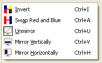

180

*第 6 章 主窗口*

**图 6.6** *编辑工具栏*

向工具栏添加小部件的模式总是相同的：我们创建小部件，设置它，将其连接到某些地方以处理用户交互，并将其添加到工具栏中。我们将数字调节框设为实例变量，因为我们需要在主窗口的初始化函数之外访问它。`addWidget()` 调用将数字调节框的所有权交给了工具栏。

我们现在已经用动作完全填充了菜单和工具栏。虽然每个动作都添加到了菜单中，但有些并没有添加到工具栏。由于 `File` 菜单的特殊性，我们已经处理了它……（注：此处原文逻辑似乎存在部分重复或断层，已根据要求对给定文本逻辑进行翻译）

在我们查看应用程序设置之前，我们必须快速绕个路，查看应用程序对象的创建过程以及主窗口本身是如何创建的。`imagechanger.pyw` 文件中最后一条可执行的语句是简单的函数调用：

```python
main()
```

和往常一样，我们为第一个执行的函数选择了一个习惯的名称。以下是它的代码：

```python
def main():

    app = QApplication(sys.argv)

    app.setOrganizationName("Qtrac Ltd.")

    app.setOrganizationDomain("qtrac.eu")

    app.setApplicationName("Image Changer")

    app.setWindowIcon(QIcon(":/icon.png"))

    form = MainWindow()

    form.show()

    app.exec_()
```

该函数的第一行我们之前已经见过很多次。接下来的三行是新的。我们对它们的主要用途是加载和保存应用程序设置。如果在不传递任何参数的情况下创建一个 `QSettings` 对象，它将使用我们在这里设置的组织名称或域（取决于平台）以及应用程序名称。因此，通过在应用程序对象上设置一次这些内容，我们就不需要记住在每次需要 `QSettings` 实例时都传递它们。

但这些名称意味着什么呢？`PyQt` 使用它们将应用程序设置保存在合适的地方——例如，在 Windows 注册表中，或者 Linux 上 `$HOME/.config` 下的目录，或者 Mac OS X 上 `$HOME/Library/Preferences` 中。注册表键或文件和目录名源于我们给应用程序对象起的名称。

我们可以判断图标文件是从 `qrc_resources` 模块加载的，因为它的路径以 `:/` 开头。

设置应用程序对象后，我们创建主窗口，显示它并启动事件循环，就像我们在之前章节的示例中所做的那样。

现在我们可以回到 `MainWindow.__init__()` 方法所在的地方，查看它是如何恢复系统设置。

```python
settings = QSettings()

self.recentFiles = settings.value("RecentFiles").toStringList()

size = settings.value("MainWindow/Size", QVariant(QSize(600, 500))).toSize()

self.resize(size)

position = settings.value("MainWindow/Position", QVariant(QPoint(0, 0))).toPoint()

self.move(position)

self.restoreState(settings.value("MainWindow/State").toByteArray())

self.setWindowTitle("Image Changer")

self.updateFileMenu()

QTimer.singleShot(0, self.loadInitialFile)
```

### 创建主窗口

我们从创建一个 `QSettings` 对象开始。由于我们没有传递任何参数，将使用应用程序对象持有的名称来定位设置信息。我们首先开始获取最近使用的文件列表。`QSettings.value()` 方法始终返回一个 `QVariant`，因此我们必须将其转换为我们期望的数据类型。

接下来，我们使用 `value()` 的双参数形式，其中第二个参数是默认值。这意味着当应用程序第一次运行时，它完全没有任何设置，因此我们将得到一个宽度为 600 像素、高度为 500 像素的 `QSize()` 对象。在随后的运行中，返回的尺寸将是应用程序终止时主窗口的大小——只要我们记得在应用程序终止时保存大小即可。一旦获取了大小，我们就把主窗口调整为给定的尺寸。在获取之前的（或默认的）尺寸后，我们以完全相同的方式获取并设置位置。

这里没有闪烁，因为调整大小和位置是在主窗口实际显示给用户之前，在初始化器中完成的。

`Qt 4.2` 引入了两个新的 `QWidget` 方法用于保存和恢复顶层窗口的几何形状。遗憾的是，一个 bug 导致它们在 `Qt 4.3` 的基于 X11 的系统的某些情况下是不可靠的，因此我们将窗口的大小和位置作为单独的项目恢复。`Qt 4.3` 修复了这个 bug，所以使用 `Qt 4.3`（例如使用 `PyQt 4.3`）时，无需获取尺寸和位置并调用 `resize()` 和 `move()`，一切可以通过一行代码完成：`self.restoreGeometry(settings.value("Geometry").toByteArray())`。这假设在应用程序终止时保存了几何形状，正如我们在查看 `closeEvent()` 时看到的。

`QMainWindow` 类提供了 `restoreState()` 方法和 `saveState()` 方法；这些方法从 `QByteArray` 恢复并保存到其中。它们保存和恢复的数据是停靠窗口的大小和位置，以及工具栏的位置——但它们仅对具有唯一对象名称的停靠部件和工具栏有效。

设置窗口标题后，我们调用 `updateFileMenu()` 创建文件菜单。

与其他菜单不同，文件菜单是动态生成的；这样做是为了它可以显示任何最近使用的文件。从文件菜单的 `aboutToShow()` 信号到 `updateFileMenu()` 方法的连接意味着每当用户点击菜单栏中的“文件”或按下 `Alt+F` 时，文件菜单都会重新创建。

但在该方法被首次调用之前，文件菜单并不存在——这意味着对于尚未添加到工具栏的动作的快捷键（例如用于“退出文件”的 `Ctrl+Q`）将不起作用。鉴于此，我们显式地调用 `updateFileMenu()`。

在本应用程序中，我们最多只加载一个初始文件，而且该文件极不可能达到 1 MB，因此我们可以使用任何一种方法而察觉不到区别。尽管如此，直接调用方法与使用零超时的单次计时器不同，正如“启动时进行大量处理”侧边栏解释的那样。

### 创建主窗口

185

我们已经完成了对初始化主窗口代码的介绍，现在可以开始查看提供应用程序功能必须实现的其他方法。虽然 Image Changer 应用程序只是一个特定的示例，但我们尽可能地使代码变得通用化或易于调整，以便其可以作为其他主窗口风格应用程序的基础，即使是完全不同的应用程序也可以。

考虑到我们刚刚进行的讨论，从 `loadInitialFile()` 方法开始介绍似乎是合适的。

```python
def loadInitialFile(self):

    settings = QSettings()

    fname = unicode(settings.value("LastFile").toString()) if fname and QFile.exists(fname):

    self.loadFile(fname)
```

该方法使用 `QSettings` 对象来获取应用程序上次使用的图像。如果存在这样的图像且它仍然存在，程序将尝试加载它。我们将在介绍文件操作时回顾 `loadFile()`。

我们同样可以写成 `if fname and os.access(fname, os.F_OK):`。在这里没有明显区别，但对于多人协作的项目，在这种情况下采取优先使用 PyQt 而非标准 Python 库或反之的策略可能是明智的，以保持尽可能的简单清晰。

我们稍早时候讨论过恢复应用程序的状态，所以介绍关闭事件似乎是合适的，因为那是保存应用程序状态的地方。

```python
def closeEvent(self, event):

    if self.okToContinue():

        settings = QSettings()

        filename = QVariant(QString(self.filename)) \

        if self.filename is not None else QVariant()

        settings.setValue("LastFile", filename)

        recentFiles = QVariant(self.recentFiles) \

        if self.recentFiles else QVariant()

        settings.setValue("RecentFiles", recentFiles)

        settings.setValue("MainWindow/Size", QVariant(self.size()))

        settings.setValue("MainWindow/Position", QVariant(self.pos()))

        settings.setValue("MainWindow/State", QVariant(self.saveState()))

    else:

        event.ignore()
```


如果用户尝试通过任何方式（杀死或崩溃之外）关闭应用程序，就会调用 `closeEvent()` 方法。我们首先调用自己自定义的 `okToContinue()` 方法；如果用户真的想关闭，则返回 True，否则返回 False。在 `okToContinue()` 内部，我们给用户提供了保存未保存更改的机会。如果用户确实想关闭，我们会创建一个新的 `QSettings` 对象，并存储“上一个文件”（即用户打开的文件）、最近使用的文件以及主窗口的状态。`QSettings` 类只读写 `QVariant` 对象，因此我们必须小心提供空 `QVariants`（通过 `QVariant()` 创建）或提供包含正确信息的 `QVariants`。

如果用户选择不关闭，我们在关闭事件上调用 `ignore()`。这将告诉 PyQt 地丢弃关闭事件并让应用程序继续运行。

如果我们正在使用 Qt 4.3（例如使用 PyQt 4.3）并使用 `QWidget.restoreGeometry()` 恢复了主窗口的几何形状，我们可以这样保存几何形状：`settings.setValue("Geometry", QVariant(self.saveGeometry()))`。如果采用这种方法，就不需要单独保存主窗口的大小或位置。

186

# 第 6 章 主窗口

## 表 6.2 精选 `QMainWindow` 方法

| 语法 | 描述 |
| :--- | :--- |
| `m.addDockWidget(a, d)` | 将 `QDockWidget` `d` 添加到 `QMainWindow` `m` 的 `Qt.QDockWidgetArea` `a` 中 |
| `m.addToolBar(s)` | 添加并返回一个名为字符串 `s` 的新 `QToolBar` |
| `m.menuBar()` | 返回 `QMainWindow` `m` 的 `QMenuBar`（在第一次调用此方法时创建） |
| `m.restoreGeometry(ba)` | 将 `QMainWindow` `m` 的位置和大小恢复为封装在 `QByteArray` `ba` 中的状态 |
| `m.restoreState(ba)` | 将 `QMainWindow` `m` 的停靠窗口和工具栏恢复为封装在 `QByteArray` `ba` 中的状态 |
| `m.saveGeometry()` | 返回封装在 `QByteArray` 中的 `QMainWindow` `m` 的位置和大小 |
| `m.saveState()` | 返回封装在 `QByteArray` 中的 `QMainWindow` `m` 的停靠窗口和工具栏的状态，即它们和位置 |
| `m.setCentralWidget(w)` | 将 `QMainWindow` `m` 的中心控件设置为 `QWidget` `w` |
| `m.statusBar()` | 返回 `QMainWindow` `m` 的 `QStatusBar`（在第一次调用此方法时创建） |
| `m.setWindowIcon(i)` | 将 `QMainWindow` `m` 的图标设置为 `QIcon` `i`；此方法继承自 `QWidget` |
| `m.setWindowTitle(s)` | 将 `QMainWindow` `m` 的标题设置为字符串 `s`；此方法继承自 `QWidget` |

```python
def okToContinue(self):
    if self.dirty:
        reply = QMessageBox.question(
            self,
            "Image Changer - Unsaved Changes",
            "Save unsaved changes?",
            QMessageBox.Yes | QMessageBox.No | QMessageBox.Cancel
        )
        if reply == QMessageBox.Cancel:
            return False
        elif reply == QMessageBox.Yes:
            self.fileSave()
        return True
```

此方法被 `closeEvent()` 以及“新建文件”和“打开文件”操作使用。如果图像是“脏”的（即如果它有未保存的更改），我们会弹出一个消息框并询问用户想做什么。如果他们点击是，我们将图像保存到磁盘并返回 True。如果他们点击否，我们只需返回 True，这样未保存的更改将丢失。如果他们点击取消，我们返回 False，这意味着未保存的更改仍然有效，稍后可以保存。

书中所有的示例都使用是/否或是/否/取消消息框来提供保存未保存更改的机会。一些开发者青睐的替代方案是使用保存和丢弃按钮（使用 `QMessageBox.Save` 和 `QMessageBox.Discard` 标识）。

最近使用的文件列表是应用程序状态的一部分，在应用程序终止时必须保存并恢复，并在运行时也保持。早些我们将 `fileMenu` 的 `aboutToShow()` 信号连接到自定义的 `updateFileMenu()` 槽。因此，当用户按下 Alt+F 或点击文件菜单时，该槽会在文件菜单显示*之前*被调用。

187

```python
def updateFileMenu(self):
    self.fileMenu.clear()
    self.addActions(self.fileMenu, self.fileMenuActions[:-1])
    current = QString(self.filename) \
        if self.filename is not None else None

    recentFiles = []
    for fname in self.recentFiles:
        if fname != current and QFile.exists(fname):
            recentFiles.append(fname)

    if recentFiles:
        self.fileMenu.addSeparator()
        for i, fname in enumerate(recentFiles):
            action = QAction(
                QIcon(":/icon.png"),
                "&%d %s" % (i + 1, QFileInfo(fname).fileName()),
                self
            )
            action.setData(QVariant(fname))
            self.connect(action, SIGNAL("triggered()"), self.loadFile)
            self.fileMenu.addAction(action)
```

188

# 静态 `QMessageBox` 方法

`QMessageBox` 类提供了几个静态便利方法，可以弹出带有适当图标和按钮的模态对话框。它们对于向用户提供带有 OK 按钮、是/否按钮等的对话框非常有用。

最常用的 `QMessageBox` 静态方法是 `critical()`、`information()`、`question()` 和 `warning()`。这些方法接收一个父控件（它们以其为中心居中）、窗口标题文本、消息文本（可以是纯文本或 HTML）以及零或多个按钮规范。如果没有指定按钮，则提供一个的 OK 按钮。

可以使用常量来指定按钮，或者我们可以提供自己的文本。

在 Qt 4.0 和 Qt 4.1 中，将 `QMessageBox.Default` 与 `OK` 或 `Yes` 按钮进行按位或操作是非常常见的做法——这意味着当用户按下 `Enter` 键时，该按钮会被按下；以及将 `QMessageBox.Escape` 与 `Cancel` 或 `No` 按钮进行按位或操作，那么当用户按下 `Esc` 时，该按钮会被按下。例如：

```python
reply = QMessageBox.question(
    self,
    "Image Changer - Unsaved Changes",
    "Save unsaved changes?",
    QMessageBox.Yes | QMessageBox.Default,
    QMessageBox.No | QMessageBox.Escape
)
```

这些方法返回被按下按钮的常量。

## Qt

从 Qt 4.2 开始，`QMessageBox` API 经过了简化，我们不再需要通过 `4.2` 指定按钮并使用按位或操作，而是直接使用按钮即可。例如，对于一个是/否/取消对话框，我们可以这样写：

```python
reply = QMessageBox.question(
    self,
    "Image Changer - Unsaved Changes",
    "Save unsaved changes?",
    QMessageBox.Yes | QMessageBox.No | QMessageBox.Cancel
)
```

在这种情况下，PyQt 会自动将 `Yes`（接受）按钮设置为默认按钮（通过用户按下 `Enter` 激活），并将 `Cancel`（拒绝）按钮设置为转逸按钮（通过用户按下 `Esc` 激活）。`QMessageBox` 方法还确保按钮按照对应平台的正确顺序显示。我们在书中的示例中使用了 Qt 4.2 的语法。

用户可以通过点击“接受”按钮（通常是 `Yes` 或 `OK`）或“拒绝”按钮（通常是 `No` 或 `Cancel`）来关闭消息框。用户也可以通过点击窗口的关闭按钮 `X` 或按下 `Esc` 键来实际上点击了“拒绝”按钮。

如果我们想创建一个自定义的消息框——例如，使用自定义的按钮文本和自定义图标——我们可以创建一个 `QMessageBox` 实例。

然后我们可以使用如 `QMessageBox.addButton()` 和 `QMessageBox.setIcon()` 等方法，并通过调用 `QMessageBox.exec_()` 来弹出消息框。

## 创建主窗口

```python
self.fileMenu.addSeparator()
self.fileMenu.addAction(self.fileMenuActions[-1])
```

我们首先清除“文件”菜单的所有动作。然后，我们重新添加原始的文件菜单动作列表，例如“新建文件”和“打开文件”，但排除了最后一个动作“退出程序”。接着，我们遍历最近使用的文件列表，创建一个只包含在文件系统中仍然存在的本地列表，并排除当前文件。虽然这看起来似乎意义不大，但许多应用程序都会包含当前文件，并且通常在列表最先显示它。

现在，如果我们的本地列表中有任何最近使用的文件，我们会在菜单中添加一个分隔符，然后为每个文件创建一个动作，其文本仅包含文件名（不包含路径），并在其前面带上一个数字编号的快捷键：`1, 2, …, 9`。

PyQt 的 `QFileInfo` 类提供了关于文件的信息，类似于 Python `os` 模块提供的某些函数。`QFileInfo.fileName()` 方法等同于 `os.path.basename()`。对于每个动作，我们还存储了一项“用户数据”——在本例中，是文件的全名，包括其路径。最后，我们将每个最近使用的文件名动作的 `triggered()` 信号连接到 `loadFile()` 槽，并将该动作添加到菜单中。（我们将在下一节中介绍 `loadFile()`。）最后，我们添加另一个分隔符，以及文件菜单的最后一个动作“退出程序”。

但是，最近使用的文件列表是如何创建和维护的？我们在表单的初始化函数中看到，最初是从应用程序设置中填充 `recentFiles` 字符串列表。我们也看到该列表相应地保存在 `closeEvent()` 中。新文件通过 `addRecentFile()` 添加到列表中。

```python
def addRecentFile(self, fname):
    if fname is None:
        return

    if not self.recentFiles.contains(fname):
        self.recentFiles.prepend(QString(fname))

    while self.recentFiles.count() > 9:
        self.recentFiles.takeLast()
```

该方法将给定的文件名插入开头，然后从末尾弹出任何多余的文件（最早添加的文件），这样列表中的文件名永远不会超过九个。我们将 `recentFiles` 变量保持为 `QStringList`，这就是为什么我们使用 `QStringList` 的方法而不是 Python 的列表方法来操作它。

`addRecentFile()` 方法本身在 `fileNew()`、`fileSaveAs()` 和 `loadFile()` 方法中被调用；并间接地从 `loadInitialFile()`、`fileOpen()` 和 `updateFileMenu()` 中调用，所有这些方法要么调用或连接到 `loadFile()`。因此，当我们第一次保存图像、以新名称保存图像、创建一个新图像或打开一个现有图像时，文件名会被添加到最近使用的文件列表中。

然而，新添加的文件名不会出现在“文件”菜单中，除非我们随后创建或打开了另一个图像，因为我们的 `updateFileMenu()` 方法没有在最近使用的文件列表中显示当前图像的文件名。

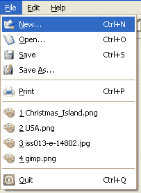

## 第 6 章 主窗口

**图 6.8** 带有最近使用文件的文件菜单

我们在这里采用处理最近使用文件的方法只是许多可能性之一。另一种方法是只创建一次“文件”菜单，并在最后设置一组用于最近使用的动作。当菜单更新时，而不是清除并重新创建，最近使用的动作只是被隐藏或显示。从用户的角度来看，无论我们采取哪种底层方法都没有区别，因此在这种情况下菜单看起来都与图 6.8 所示。这两种方法都可以用于在文件菜单中实现最近使用的文件，正如我们在 Image Changer 应用程序中所做的那，位于“退出”选项之前。它们也可以用于实现“最近文件”选项，将所有最近文件作为子菜单，正如 OpenOffice 以及其他应用程序所使用的。使用独立的“最近文件”选项的处是文件菜单始终保持不变，并且可以在子菜单中显示完整路径——这是我们避免将最近文件直接放在文件菜单中的原因，以免变得极其宽（。

## 处理用户动作

在前面的节中，我们创建了主窗口风格应用程序的外，并通过创建一组动作提供了其行为基础。我们也看到了如何保存和恢复应用程序设置，以及如何管理最近使用的文件列表。应用程序的一些行为由 PyQt 自动处理——例如窗口最小化、最大化和调整大小——所以我们不需要自己做。另一些行为可以通过信号和槽来实现。在本节中，我们关注用户直接控制的动作，这些动作可以查看、编辑和输出它们的数据。

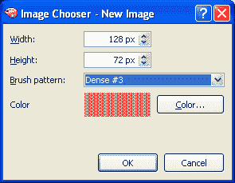

## 处理文件动作

文件可能是主窗口风格应用程序中最常见的菜单，在大多数情况下，它至少提供“新建”、“保存”和“退出”（或“离开”）选项。

```python
def fileNew(self):
    if not self.okToContinue():
        return

    dialog = newimagedlg.NewImageDlg(self)

    if dialog.exec_():
        self.addRecentFile(self.filename)
        self.image = QImage()

        for action, check in self.resetableActions:
            action.setChecked(check)

        self.image = dialog.image()
        self.filename = None
        self.dirty = True
        self.showImage()
        self.sizeLabel.setText(
            "%d x %d" % (self.image.width(), self.image.height())
        )
        self.updateStatus("Created new image")
```


```python
okToContinue
```

当用户请求处理新文件时，我们首先查看是否可以继续。这给了用户机会保存或丢弃未保存的更改，或者完全改变主意并取消操作。

**图 6.9** 新图像对话框

如果用户继续，我们将弹出一个`NewImageDlg`模态框，用户可以在其中指定想要创建的图像的大小、颜色和画笔模式。该对话框如图 6.9 所示，其创建和使用方法与上一章中创建的对话框相同。然而，新图像对话框的用户界面是使用`Qt Designer`创建的，必须使用`pyuic4`将用户界面文件转换为模块文件，对话框才能使用。这可以通过运行`pyuic4`完成，也可以通过运行`mkpyqt.py`或`Make PyQt`完成，其中`mkpyqt.py`两者都更方便，因为它们可以自动处理正确的命令行参数。我们将在下一章中介绍所有这些事项。

如果用户接受了对话框，我们将当前文件名（如果有的话）添加到侧边栏的最近使用文件列表中。然后，我们将当前图像设置为空图像，以确保对可检查操作的任何更改都不会对图像产生影响。接下来，我们遍历那些在创建或加载新图像时想要重置的操作，并将每个操作设置为我们首选的默认值。现在，我们可以安全地将图像设置为对话框创建的那个。

我们将文件名设置为`None`，并将脏数据标记设置为`True`，以确保用户在终止应用程序或尝试创建或加载另一个图像时，系统会提示保存图像并询问文件名。

然后我们调用`showImage()`，它会在`imageLabel`中显示图像，并根据缩放因子进行调整。最后，我们更新状态栏中的尺寸标签，并调用`updateStatus()`。

```python
def updateStatus(self, message):
    self.statusBar().showMessage(message, 5000)
    self.listWidget.addItem(message)

    if self.filename is not None:
        self.setWindowTitle("Image Changer - %s[*]" %
                            os.path.basename(self.filename))
    elif not self.image.isNull():
        self.setWindowTitle("Image Changer - Unnamed[*]")
    else:
        self.setWindowTitle("Image Changer[*]")

    self.setWindowModified(self.dirty)
```

我们首先显示传递过来的消息，超时时间为五秒。我们还将消息添加到日志小部件中，以记录发生的每一个操作。

如果用户打开了现有文件，或者保存了当前文件，我们将有一个文件名。我们使用 Python 的`os.path.basename()`函数将文件名放入窗口标题中，获取不带路径的文件名。我们也可以像之前那样简单地写`QFileInfo(fname).fileName()`。

如果没有文件名且`image`变量不是空图像，则意味着用户创建了新图像但尚未保存；因此我们使用“Unnamed”（未命名）作为伪文件名。最后一种情况是没有打开或创建任何文件。

无论我们将窗口标题设为什么，都会在其中某处包含字符串`[*]`。这个字符串永远不会原样显示：相反，它被用来指示文件是否为“脏”数据。在 Linux 和 Windows 上，这意味着如果没有未保存的更改，文件名将以原始形式显示；否则，将用星号（`*`）替换`[*]`字符串。在 Mac OS X 上，如果有未保存的更改，关闭按钮将显示一个点。该机制取决于窗口的修改状态，因此我们确保将该状态设置为脏数据标记的状态。

```python
def fileOpen(self):
    if not self.okToContinue():
        return

    dir = (os.path.dirname(self.filename)
           if self.filename is not None else ".")
    formats = ["*.%s" % unicode(format).lower()
               for format in QImageReader.supportedImageFormats()]

    fname = unicode(QFileDialog.getOpenFileName(
        self,
        "Image Changer - Choose Image",
        dir,
        "Image files (%s)" % " ".join(formats)))

    if fname:
        self.loadFile(fname)
```

如果用户请求打开一个现有图像，我们首先确保他们有机会保存或丢弃任何未保存的更改，或者完全取消操作。

如果用户决定继续，出于礼貌，我们希望弹出一个设置了合理目录的文件打开对话框。如果我们已经有了图像文件名，我们就使用其路径；否则，我们使用`.`（即当前目录）。我们还选择传递了一个文件过滤器字符串，以限制文件打开对话框可以显示的图像文件类型。此类文件类型由扩展名定义，并作为字符串传递。该字符串可以为单个类型指定多个扩展名，也可以指定多个类型。例如，文本编辑器可能会传递如下字符串：`"Text files (*.txt)\nHTML files (*.htm *.html)"`。如果有多个类型，我们必须用换行符将其分隔。如果一个类型可以处理多个扩展名，我们必须用空格分隔扩展名。显示的字符串将产生一个具有两个项目（“Text files”和“HTML files”）的文件类型组合框，并确保对话框中显示的文件类型只有扩展名为`.txt`、`.htm`或`.html`的文件。

在 Image Changer 应用程序中，我们使用了应用程序所使用的`PyQt`版本可以读取的图像类型扩展名列表。至少，这可能包括`.bmp`、`.jpg`（以及`.jpeg`，与`.jpg`相同）和`.png`。

```python
self.filename = fname
self.showImage()
self.dirty = False
self.sizeLabel.setText("%d x %d" % (image.width(), image.height()))
message = "Loaded %s" % os.path.basename(fname)
self.updateStatus(message)
```

我们首先将当前文件名设置为`None`，然后尝试将图像读取到局部变量中。PyQt 不使用异常处理，因此错误必须通过间接发现。在这种情况下，空图像意味着由于某种原因，我们未能加载图像。如果加载成功，我们将这个新打开的文件名添加到“最近使用过的文件”列表中，只有当随后打开了另一个`File()`文件，或者将此文件另存为名称时，它才会出现在列表中。

接下来，我们将实例图像变量设置为空图像：这意味着我们可以自由将可检查操作（checkable actions）重置为首选的默认值，而不会产生任何副作用。这样做之所以有效，是因为当可检查操作发生变化时，虽然由于信号槽连接会调用相关方法，但如果图像为空，这些方法将什么都不做。

准备工作完成后，我们将局部图像赋值给图像实例变量，并将局部文件名赋值给文件名实例变量。接下来，我们调用`showImage()`以当前的缩放因子显示图像，清除`dirty`标记并更新尺寸标签。最后，我们调用`updateStatus()`在状态栏中显示消息并更新日志组件。

```python
def fileSave(self):
    if self.image.isNull():
        return

    if self.filename is None:
        self.fileSaveAs()
    else:
        if self.image.save(self.filename, None):
            self.updateStatus("Saved as %s" % self.filename)
            self.dirty = False
        else:
            self.updateStatus("Failed to save %s" % self.filename)
```

`fileSave()`方法以及许多其他方法作用于应用程序的数据（一个`QImage`实例），但如果没有图像数据，这些操作就没有意义了。因此，如果没有可处理的图像数据，许多方法将什么都不做并立即返回。

如果存在图像数据且文件名为`None`，则用户一定调用了“文件新建”操作，现在正在第一次保存他们的图像。在这种情况下，我们将工作交给`fileSaveAs()`方法处理。

如果我们有了文件名，将尝试使用`QImage.save()`保存图像。该方法返回一个布尔值成功/失败标志，我们根据该标志相应地更新状态。（我们将加载和保存自定义文件格式的介绍推迟到了第 8 章，因为在本章中完全专注于主窗口的功能。）

```python
def fileSaveAs(self):
    if self.image.isNull():
        return

    fname = self.filename if self.filename is not None else "."
    formats = ["*.%s" % unicode(format).lower()
               for format in QImageWriter.supportedImageFormats()]

    fname = unicode(QFileDialog.getSaveFileName(
        self,
        "Image Changer - Save Image",
        fname,
        "Image files (%s)" % " ".join(formats)))

    if fname:
        if "." not in fname:
            fname += ".png"
        self.addRecentFile(fname)
        self.filename = fname
        self.fileSave()
```

当触发“文件另存为”操作时，我们首先获取当前文件名。如果文件名为`None`，我们将其设置为“.”，即当前目录。然后我们使用`QFileDialog.getSaveFileName()`对话框提示用户提供一个要保存的文件名。如果当前文件名不是`None`，我们将使用它作为默认名称——如果用户选择了已存在的文件名，文件保存对话框会处理并弹出一个是/否的警告对话框。我们设置文件过滤器字符串的技巧与“文件打开”操作的相同，但这次使用的是此版本 PyQt 可以写入的图像格式列表（这可能与它能读取的格式列表不同）。

如果用户输入的文件名不包含点（即没有扩展名），我们将扩展名设置为`.png`。接下来，我们将文件名添加到“最近使用过的文件”列表中（这样，如果随后打开了不同的文件，或者将此文件另存为新名称，它就会出现），将文件名实例变量设置为该名称，并将保存工作交给我们刚刚调用的`fileSave()`方法。

我们必须考虑的最后一个文件操作是“文件打印”。当此操作被调用时，会执行`filePrint()`方法。该方法在打印机上绘制图像。由于该方法使用了我们尚未涵盖的技术，我们将推迟对其进行讨论。它所使用的技术显示在“打印图像”侧边栏中，而`filePrint()`方法本身的介绍在第 13 章（从第 400 页开始），在那里我们还会讨论普通文档打印的方法。

我们还没有回顾唯一的文件操作是“文件退出”。该操作连接到主窗口的`close()`方法，该方法反过来导致一个关闭事件被放入事件队列。我们为`closeEvent()`处理器提供了`Event()`的重新实现，在该处理器中，我们通过调用`okToContinue()`确保用户有机会保存未保存的更改，并保存应用程序的设置。

## 处理编辑操作

文件操作的大部分功能由`MainWindow`子类本身提供。唯一传递的工作是图像的加载和保存，这需要`QImage`实例变量完成。主窗口与持有数据的数据结构之间这种职责分工非常常见。主窗口处理高层文件新建、打开、保存和最近使用文件的功能，而数据结构处理加载和保存。

大多数、甚至所有的编辑功能由视图小部件或数据结构提供也是常见的。在 Image Changer 应用程序中，所有数据操作都由数据结构（图像`QImage`）处理，而数据的呈现由数据查看器（图像标签`imageLabel QLabel`）处理。再次，这是一种非常常见的职责分工。

在本节中，我们将回顾大多数编辑操作，省略几个与显示的内容几乎相同的操作。我们将在这里写得非常简洁，因为这些功能特定于 Image Changer 应用程序。

```python
def editInvert(self, on):
    if self.image.isNull():
        return

    self.image.invertPixels()
    self.showImage()
    self.dirty = True
    self.updateStatus("Inverted" if on else "Uninverted")
```

如果用户调用“编辑反转”操作，它将被选中（或取消选中）。在任何情况下，我们都使用`QImage`提供的功能反转图像像素，显示更改后的图像，设置`dirty`标记并调用`updateStatus()`，以便状态栏短暂显示执行的操作，并在日志中添加额外项目。

`editSwapAndBlue()`方法（未显示）与之相同，只是它使用了`QImage.rgbSwapped()`方法，并且有不同的状态文本。

```python
def editMirrorHorizontal(self, on):
    if self.image.isNull():
        return

    self.image = self.image.mirrored(True, False)
    self.showImage()
    self.mirroredhorizontally = not self.mirroredhorizontally
    self.dirty = True
    self.updateStatus("Mirrored Horizontally"
                      if on else "Unmirrored Horizontally")
```

该方法在结构上与`editInvert()`和`editSwapAndBlue()`相同。`QImage.mirrored()`方法接受两个布尔标志，第一个用于水平镜像，第二个用于垂直镜像。在 Image Changer 应用程序中，我们刻意限制了允许的镜像，因此用户只能不镜像、垂直镜像或水平镜像，而不能同时进行水平垂直镜像。我们还维护了一个跟踪图像是否水平镜像的实例变量。`editMirrorVertical()`方法（未显示）几乎相同。

```python
def editUnMirror(self, on):
    if self.image.isNull():
        return

    if self.mirroredhorizontally:
        self.editMirrorHorizontal(False)

    if self.mirroredvertically:
        self.editMirrorVertical(False)
```

该方法会关闭正在生效的镜像设置，如果图像未镜像，则什么都不做。它不会设置脏标记（dirty flag）或更新状态：这些工作留给了`editMirrorHorizontal()`或`editMirrorVertical()`，如果它们调用了其中任何一个。

应用程序提供了两种用户更改缩放因子的方法。用户可以与工具栏中的缩放数值框交互——它的`valueChanged()`信号连接到我们稍后将回顾的`showImage()`槽——或者可以在“编辑”菜单中调用“编辑缩放”操作。如果使用了“编辑缩放”操作，就会调用`editZoom()`方法。

```python
def editZoom(self):
    if self.image.isNull():
        return

    percent, ok = QInputDialog.getInteger(
        self,
        "Image Changer - Zoom",
        "Percent:",
        self.zoomSpinBox.value(),
        1,
        400
    )

    if ok:
        self.zoomSpinBox.setValue(percent)
```


## 处理用户操作

我们首先使用`QInputDialog`类的静态方法之一来获取缩放因子。`getInteger()`方法接收一个父对象（对话框将以此为中心对齐）、一个标题、描述所需数据的文本、一个初始值，以及可选的最小值和最大值。

`QInputDialog`还提供了其他一些静态便利方法，包括用于获取浮点值的`getDouble()`、用于从列表中选择字符串的`getItem()`，以及用于获取字符串的`getText()`。对于所有这些方法，返回值都是一个二元组，包含值和一个布尔标志，该标志指示用户是否输入并接受了有效值。

如果用户点击了 OK，我们将缩放数值框的值设置为给定的整数。

如果此值与当前值不同，数值框将发射`valueChanged()`信号。该信号连接到`showImage()`槽，因此如果用户选择了新的缩放百分比值，该槽就会被调用。

```python
def showImage(self, percent=None):
    if self.image.isNull():
        return

    if percent is None:
        percent = self.zoomSpinBox.value()

    factor = percent / 100.0
    width = self.image.width() * factor
    height = self.image.height() * factor

    image = self.image.scaled(width, height, Qt.KeepAspectRatio)
    self.imageLabel.setPixmap(QPixmap.fromImage(image))
```

当创建或加载新图像时、每当应用变换时，以及响应缩放数值框的`valueChanged()`信号时，都会调用此槽。

每当用户更改工具栏缩放数值框的值时都会发射此信号，无论是直接使用鼠标，还是通过之前描述的“编辑缩放”操作。

我们获取百分比并将其转换为可以用于生成图像新宽度和高度的缩放因子。然后，我们创建一个缩放到新尺寸并保持宽高比例的图像副本，并设置`imageLabel`显示此图像。标签需要一个`QPixmap`图像，因此我们使用静态方法`QPixmap.fromImage()`将`QImage`转换为`QPixmap`。

请注意，这种方式缩放图像对原始图像没有影响；它纯粹是视图的变化，而不是编辑。这就是为什么不需要设置脏标记的原因。

根据 PyQt 的文档，`QPixmaps`针对屏幕显示进行了优化（因此绘制速度很快），而`QImages`则针对编辑进行了优化（这就是为什么我们使用它们来保存图像数据）。

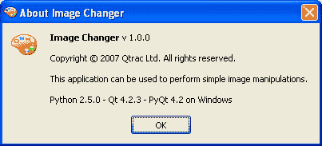

## 第 6 章 主窗口

### 处理帮助操作

当我们创建主窗口的操作时，为每个操作都提供了帮助文本，并将其设置为它们的状态文本和工具提示文本。这意味着当用户浏览应用程序的菜单系统时，当前高亮菜单选项的状态文本将自动出现在状态栏中。

同样，如果用户将鼠标悬停在工具栏按钮上，相应的工具提示文本将显示在工具提示中。

对于像 Image Changer 这样简单的小应用程序，状态提示和工具提示可能完全足够。尽管如此，我们仍然提供在线帮助系统来展示如何实现，尽管我们将内容推迟到第 17 章（从第 510 页）。

**图 6.10** 关于 Image Changer 的框

无论是否提供在线帮助，提供一个“关于”框都是一个好主意。如图 6.10 所示，它至少应该显示应用程序的版本号和版权声明。

```python
def helpAbout(self):
    QMessageBox.about(
        self,
        "About Image Changer",
        """<b>Image Changer</b> v %s

<p>Copyright &copy; 2007 Qtrac Ltd.

All rights reserved.

<p>This application can be used to perform

simple image manipulations.

<p>Python %s - Qt %s - PyQt %s on %s"""
        % (
            __version__,
            platform.python_version(),
            QT_VERSION_STR,
            PYQT_VERSION_STR,
            platform.system(),
        ),
    )
```

`QMessageBox.about()`静态便利方法会弹出一个带有给定标题和文本的模态 OK 样式消息框。文本可以是 HTML，如此处所示。如果应用程序有图标，消息框将使用该图标。

我们显示了应用程序的版本以及 Python、Qt 和 PyQt 库的版本信息，以及应用程序运行的平台。库的版本信息对用户来说可能没有直接用途，但对于被要求提供的支持人员来说可能非常有帮助。

## 总结

主窗口风格的应用程序是通过子类`QMainWindow`创建的。该窗口有一个小部件（可能是复合的，因此包含其他部件）作为其中心部件。

操作用于表示应用程序向用户提供的功能。这些操作作为`QAction`对象持有，它们具有文本（用于菜单）、图标（同时用于菜单和工具栏）、工具提示和状态提示，并连接到槽，这些槽在被调用时将执行相应的操作。通常，所有操作都会添加到主窗口的菜单中，最常用的被添加到工具栏中。为了支持键盘用户，我们为频繁使用的操作提供了快捷键，并提供了菜单加速器以使菜单导航尽可能快速方便。

某些操作是可检查的，并且某些组可检查的操作可能是互斥的，也就是说在任何时候只有一个且仅有一个可以被选中。PyQt 通过设置单个属性来支持可检查操作，并通过`QActionGroup`对象支持互斥的操作组。

停靠窗口（Dock windows）由停靠部件表示，易于创建和设置。任意小部件可以添加到停靠部件和工具栏中，尽管在实践中我们只向工具栏添加小型或长宽比形状的小部件。

操作、操作组和停靠窗口必须显式地赋予一个父对象——例如主窗口——以确保它们在正确的时间被删除。应用程序的其他小部件和`QObject`则不需要这样做，因为它们要么由主窗口拥有，要么由主窗口的某个子拥有。应用程序的非`QObject`对象可以留给 Python 的垃圾回收器删除。

应用程序经常使用资源（小文件，如图标数据文件），PyQt 的资源机制使得访问和使用它们变得非常简单。尽管它们需要一个额外的构建步骤，即使用 PyQt 的`pyrcc4`控制台应用程序，或者使用书籍示例提供的`mkpyqt.py`或 Make PyQt 程序。

对话框可以完全在代码中创建（正如我们在上一章中所做的那样），或者像我们在下一章看到的将使用 Qt Designer。如果我们需要在应用程序中整合 Qt Designer 用户界面文件，就像资源一样需要额外的构建步骤，即使用 PyQt 的`pyuic4`控制台应用程序，或者再次使用`mkpyqt.py`或 Make PyQt。

一旦通过设置中心部件以及创建菜单、工具栏以及可能的停靠窗口创建了主窗口的视觉外观，我们就可以考虑加载和保存应用程序设置了。许多设置会在主窗口的初始化函数中加载，而设置通常会在`closeEvent()`方法的重写中保存（并给用户提供保存未保存更改的机会）。

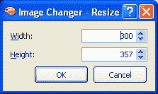

## 第 6 章 主窗口

如果我们想恢复用户的工作空间，即加载他们上一次运行程序时打开的文件，最好的方法是在主窗口初始化函数的末尾使用一个单次计时器（single-shot timer）来加载文件。

大多数应用程序通常有一个数据集以及一个或多个用于显示和编辑数据的部件。由于本章的重点是主窗口的用户界面基础设施，我们选择了最简单的数据和可视化部件，但在随后的章节中，重点将发生反转。

让主窗口处理层级文件操作和最近使用的文件列表，而让持有数据的对象负责加载、保存和编辑数据，这是非常常见的情况。

在书的现在，你已经掌握了足够的 Python 和 PyQt 来创建对话框风格和主窗口风格的 GUI 应用程序。在下一章中，我们将展示`Qt Designer`的用法，这是一个可以显著提高对话框开发和维护速度的应用程序。在第二部分的最后一个章节中，我们将结合使用 PyQt 和 Python 库来探索保存和加载自定义文件格式的一些关键方法。在第三和第四部分中，我们将更深入地探索 PyQt（例如查看事件处理和创建自定义部件），并广泛地学习 PyQt 的模型/视图架构和其他高级功能，包括线程。

## 练习

创建图 6.11 所示的对话框。它的类名应为`ResizeDlg`，其初始化函数应接受初始宽度和高度。对话框应提供一个名为`result()`的方法，该方法必须返回用户选择的宽度和高度二元组。数值调节框（spinboxes）的最小值为 4，最大值为传入宽度（或高度）的倍。两者都应右对齐显示内容。

**图 6.11** Image Changer 调整大小对话框

修改 Image Changer 应用程序，添加一个新的“编辑调整大小”（edit resize）动作。

该动作应该出现在编辑菜单中（在“编辑缩放”动作之后）。图像子目录下有一个名为`editresize.png`的图标，但需要将其添加到`resources.qrc`文件中。你还需要导入刚刚创建的调整大小对话框。

调整大小对话框应该在一个`editResize()`槽中使用，“编辑调整大小”动作应该连接到该槽。对话框的使用方式如下：

```python
form = resizedlg.ResizeDlg(
    self.image.width(),
    self.image.height(),
    self,
)

if form.exec_():
    width, height = form.result()
```

与`editZoom()`槽不同，图像本身应该被更改，因此如果尺寸发生了，尺寸标签、状态栏和脏状态（dirty status）都必须更改。相反，如果“新”尺寸与原始尺寸相同，则不应进行调整大小。

调整大小对话框可以用少于 50 行编写，调整大小槽可以用少于 20 行编写，新动作只需在主窗口初始化函数的几处额外增加一两行。

模型解决方案位于`chap06/imagechanger_ans.pyw`和`chap06/resizedlg.py`文件中。

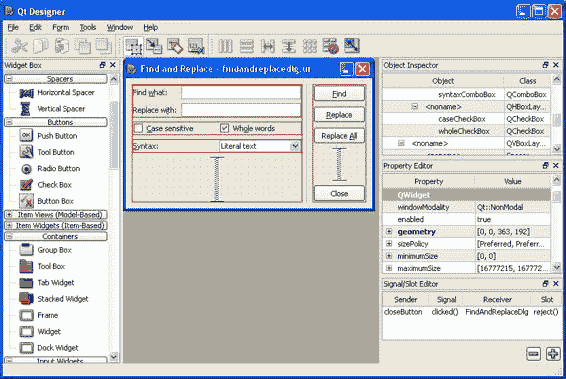

# 第 7 章

- 设计用户界面
- 实现对话框
- 测试对话框

## 第 7 章 简介

### Qt Designer

在第 5 章中，我们完全通过编写代码来创建对话框。在初始化函数中，我们创建了需要的部件并设置了它们的初始属性。然后我们创建了一个或多个布局管理器，向其中添加部件以获得想要的外观。在某些情况下，当处理垂直或水平布局时，我们添加了“拉伸”（stretch）来填充不需要的空间。

在布局好部件后，我们将感兴趣的信号连接到我们想要处理它们的方法上。

**图 7.1** Qt Designer

一些程序员倾向于在代码中完成一切，而另一些人则倾向于使用视觉设计工具来创建他们的对话框。使用 PyQt，我们可以任选其一，甚至兼顾。

上一章的 Image Changer 应用程序有两个自定义对话框：完全通过代码创建（在练习中）的`ResizeDlg`，以及使用`Qt Designer`创建的`NewImageDlg`。我们首先展示了如何通过代码进行操作，这样你就能对布局管理器的工作原理有强烈的感受。但在本章中，我们将使用`Qt Designer`创建对话框，如图 7.1 所示。

`Qt Designer`可用于为对话框、自定义部件和主窗口创建用户界面。我们只涵盖对话框；自定义部件几乎相同，只是它们是基于“Widget”模板而不是“Dialog”模板之一。除了具有视觉化`QAction`编辑器的便利性外，为主窗口使用`Qt Designer`提供的优势较少。`Qt Designer`还可以用于创建和编辑资源文件。

用户界面存储在`.ui`文件中，包含了表单部件和布局的细节。此外，`Qt Designer`可用于将标签与其“伙伴”（buddies）关联，并设置标签顺序（tab-order），即用户按下 Tab 键时部件获取焦点的顺序。这也可以通过代码`QWidget.setTabOrder()`完成，但对于手动编写的表单很少需要，因为默认顺序通常我们想要的。`Qt Designer`还可以用于连接信号槽，但仅限于内置信号。

一旦用户界面设计并保存为`.ui`文件，必须将其转换为代码才能使用。这是通过`pyuic4`命令行完成的。例如：

```bash
C:\pyqt\chap07>pyuic4 -o ui_findandrelg.py findandrelg.ui
```

如上一章提到的，我们可以使用`mkpyqt.py`或`Make PyQt`来替我们运行`pyuic4`。然而，从`.ui`文件生成 Python 模块（`.py`文件）并不足以让用户界面变得可用。注意，生成的代码（在`ui_*.py`文件中）绝不应手动编辑，因为下次运行`pyuic4`时任何更改都会被覆盖。

从最终用户的角度来看，对话框的用户界面是手动编写还是使用`Qt Designer`创建并没有区别。然而，对话框初始化函数的实现存在显著差异，因为手动编码时我们必须创建、布局并连接对话框部件，而使用`Qt Designer`用户界面的对话框只需调用特定方法即可实现相同效果。

使用`Qt Designer`的一大优势（除了视觉化设计对话框之外之外），如果我们更改了设计，只需重新生成用户界面模块（直接使用`pyuic4`或通过`mkpyqt.py`或`Make PyQt`），而不需要更改代码。唯一必须更改代码的情况是我们在代码中引用的部件被添加、删除或重命名时。

也可以可以使用`PyQt4.uic.loadUi()`直接加载和使用`.ui`文件，尽管这并不常见。

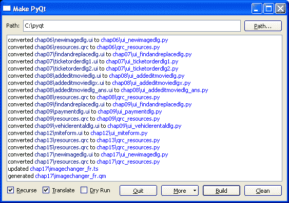

`mkpyqt.py`控制台应用程序和 Make PyQt（`makepyqt.pyw`）GUI 应用程序都是构建程序，它们为我们运行 PyQt 的`pyuic4`、`pyrcc4`、`pylupdate4`和`lrelease`程序。它们的作用完全相同，都会自动使用正确的命令行参数来运行 PyQt 的辅助程序，并且都会检查时间戳以避免执行不需要的工作。

构建程序会寻找`.ui`文件并在其上运行`pyuic4`，生成文件名相同但前缀为`ui_`且扩展名改为`.py`的文件。同样，它们会寻找`.qrc`文件并在其上运行`pyrcc4`，生成文件名相同但前缀为`qrc_`且扩展名同样改为`.py`的文件。

例如，如果我们在`chap06`目录下运行`mkpyqt.py`，将得到：

```text
C:\pyqt\chap06..\mkpyqt.py

./newimagedlg.ui -> ./ui_newimagedlg.py

./resources.qrc -> ./qrc_resources.py
```


通过运行 `Make PyQt` 实现相同的效果：点击 `Path` 按钮将路径设置为 `C:\pyqt\chap06`，然后点击 `Build` 按钮。如果我们进行了任何更改，只需再次运行 `mkpyqt.py`，或者在使用 `Make PyQt` 时点击 `Build`，就会进行任何必要的更新。

这两个构建程序都可以删除已生成的文件以准备全新的构建，并且都可以通过 `mkpyqt.py` 的 `-r` 选项或在 `Make PyQt` 中勾选 `Recurse`（递归）复选框对整个目录树进行递归操作。在控制台中运行 `mkpyqt.py -h` 可以查看其选项的摘要。`Make PyQt` 程序为它的复选框和按钮提供了工具提示。在某些情况下可能需要设置工具路径；首次使用时点击 `More→Tool paths`。

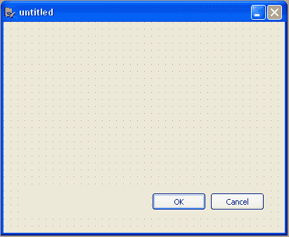

## 第 7 章：使用 Qt Designer

意味着使用 `Qt Designer` 进行设计实验比编辑手动编写的布局要快且简单得多，并有助于在使用 `Qt Designer` 创建的视觉设计与代码中实现的行为之间保持分离。

在本章中，我们将创建一个示例对话框，并利用它学习如何使用 `Qt Designer` 创建和布局控件、设置伙伴（buddies）和标签顺序，以及建立信号槽连接。我们还将看到如何使用由 `pyuic4` 生成的用户界面模块，以及如何在无需在初始化中使用 `connect()` 的情况下自动创建到自定义槽的连接。

对于这些示例，我们使用了 Qt 4.2 自带的 `Qt Designer`。早期版本的 `Qt Designer` 不具备 `QFontComboBox` 或 `QCalendarWidget` 控件，而且它们的“Dialog”模板使用的是 `QButtons` 而不是 `QDialogButtonBox`。

## 设计界面

在开始之前，我们必须启动 `Qt Designer`。在 Linux 上，在控制台中运行 `designer &`（假设它在你的路径中），或从菜单系统调用它。在 Windows XP 上，点击 `Start→Qt by Trolltech→Designer`，在 Mac OS X 上使用 Finder 启动它。`Qt Designer` 启动时会有一个 New Form 对框；点击 `Dialog with Buttons Bottom`，然后点击 `Create`。这将创建一个标题为“untitled”的新表单，并带有图 7.2 所示的 `QDialogButtonBox`。

**图 7.2** *带有底部按钮的对话框*

当首次运行 `Qt Designer` 时，它默认处于“多个顶层窗口”模式——这可能会让人困惑，除非是 Mac OS X 用户（这种方法是他们）。要像图 7.1 所示将所有内容显示在一个窗口中，点击 `Edit→User Interface Mode→Docked Window`。★ `Qt Designer` 会记住此设置，因此只需操作一次。

`Qt Designer` 并不难使用，但确实需要一些初始练习。有帮助的一点是按照特定的顺序操作，如下步骤列表所示。对于第 1 和 2 步，始终从“后”向“前”操作，即始终从容器（组框、标签页控件、框架）开始，然后到内部（即在它们上方）的普通控件。我们稍后将逐步通过一个示例，但首先这里有一个如何使用 `Qt Designer` 创建对话框的通用描述。

1. 将控件拖到表单上并将其放置在大致正确的位置；不需要放置得完全精确，通常只需要调整容器控件的尺寸。
2. 如果必要，设置控件的属性；如果将在代码中引用该控件，至少要给它一个合理的名称。
3. 重复步骤 1 和 2，直到所有所需的控件都在表单上。
4. 如果有较大的间隙，拖入水平或垂直间隙器（这些显示为蓝色弹簧）来填充它们；有时当间隙明显时，会在步骤 1 和 2 中添加间隙器。
5. 选择两个或多个控件（或间隙器或布局）进行布局（`Shift+点击`每一个），然后使用布局管理器或拆分器进行布局。
6. 重复步骤 5，直到所有控件和间隙器都在布局中。
7. 点击表单（取消所有选择）并使用其中一个布局管理器对表单进行布局。
8. 为表单标签创建伙伴（buddies）。
9. 如果顺序错误，设置表单的标签顺序。
10. 在适当的地方创建信号槽连接。
11. 预览表单并检查一切运行正常。
12. 设置表单的对象的名称（这是它的类名），以及表单标题，并保存它。例如，如果对象名称是“Payment”，我们可能会给它标题为“Payment”的文件名为 `paymentdlg.ui`。如果布局是错误的，使用撤销回到你可以重新布局的地方，然后重做。

通常，在更改表单内的布局（点击表单，然后 `Break Layout` 按钮）之前需要打破表单布局；因此表单必须重新布局。

★从 Qt 4.3 起，此选项可以通过 `Edit→Preferences` 使用。

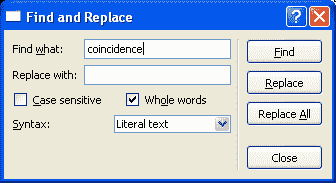

虽然可以将布局拖到表单上然后将控件拖入布局，但最佳实践是把所有控件和间隙器拖到表单上，然后反复选择某些控件和间隙器并应用布局。唯一合理将控件添加到现有布局的情况是我们想要将控件拖入间隙——例如，到网格布局的空单元格中。

现在我们有了这些整体原则，我们将逐步通过查找替换对话框的设计。

---

基于“Dialog”模板之一创建一个新表单。这将带我们一个带有按钮框的表单。该按钮框有两个按钮，`OK` 和 `Cancel`，并设置了信号槽连接。

点击按钮框，然后点击 `Edit→Delete`。这将留下一个完全空白的表单。对于此示例，我们将使用 `QPushButton` 而不是 `QDialogButtonBox`。这将允许我们比在 `Qt Designer` 中使用 `QDialogButtonBox` 更精细的控制，并有机会进行信号槽连接。

默认情况下，`Qt Designer` 左侧有一个名为 `Widget Box` 的停靠窗口。

这包含了 `Qt Designer` 可以处理的所有控件。控件被分组，在最后有一组叫做 `Display Widgets`；这包含了 `Label` 控件。（`Qt Designer` 不使用类名作为控件名称，至少在它呈现给我们的用户界面中不是，但在大多数情况下可以看出特定名称指的是哪个类。）

点击并将 `Label` 拖到表单上，位于左上角。我们不在乎这个标签被称为什么，因为我们不会在代码中引用它，但默认文本是 `TextLabel`，不是我们想要的。当一个小部件被首次拖动并释放时，它会被自动选中，被选中的部件始终是属性编辑器中显示的那一个。前往属性编辑器停靠窗口（通常在右侧），向下滚动到 `text` 属性。将其更改为 `Find &what:`。现在文本在表单上看起来被截断了，这没关系；一旦标签完成布局，布局管理器将确保文本完整显示。

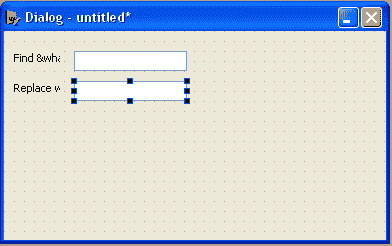

现在拖入一个 `Line Edit`（来自 `Input Widgets` 组），将其放置在 `Label` 的右侧。进入属性编辑器，并将 `Line Edit` 的 `objectName`（所有部件的第一个属性）更改为 `findLineEdit`。我们给它起了一个合理的名称，因为我们想在代码中引用这个行编辑框。

现在在头两个部件下方拖入另一个 `Label` 和另一个 `Line Edit`。第二个 `Label` 的文本应设为 `Replace w&ith`，第二个 `Line Edit` 的名称应为 `replaceLineEdit`。现在表单的外观应该与图 7.4 非常相似。

**图 7.4** *两个标签和两个行编辑框*

我们随时可以通过按下 `Ctrl+S` 或 `File→Save` 来保存表单。我们保存时，将使用文件名 `findandreplacedlg.ui`。

每个可编辑属性（以及一些只读属性）都显示在属性编辑器中。但除此之外，`Qt Designer` 还提供了右键菜单。右键菜单中的第一个选项通常允许我们更改部件最“重要”的属性（例如 `Label` 或 `Line Edit` 的 `text` 属性），第二个选项允许我们更改部件的对象名称。如果我们使用右键菜单更改复选框、单选按钮或推按钮的文本，编辑将在原地完成，在这种情况下，我们必须按回车键来完成。我们总是习惯于在 `property_editor` 中更改属性，但当然，如果你愿意也可以使用右键菜单。

我们现在来添加两个复选框。从 `Buttons` 组（位于 `Widget Box` 顶部）拖入一个 `Check Box`，将其放置在第二个 `Label` 下方。

使用属性编辑器或右键菜单将其对象名称更改为 `caseCheckBox`，并将文本更改为 `&Case sensitive`。在第一个复选框右侧拖入第二个 `Check Box`：将其对象名称更改为 `wholeCheckBox`，文本更改为 `Wh&ole words`，并将其 `checked` 状态设为 `true`。现在表单应该类似于图 7.5 所示。

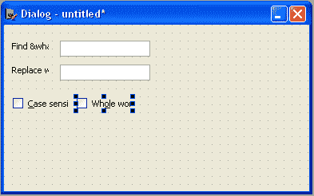

**图 7.5** *两个标签、两个行编辑框和两个复选框*

现在我们将添加语法标签和组合框。在大小写敏感复选框下方拖入一个 `Label`，将其文本设为 `&Syntax:`。现在将一个 `Combo Box`（来自 `Input Widgets` 组）拖到 `Syntax Label` 的右侧。将 `Combo Box` 的对象名称更改为 `syntaxComboBox`。右键点击 `Combo Box` 并选择菜单中的第一项 `Edit Items`。点击 `+` 图标并输入 `Literal text`。

重复此操作以添加 `Regular expression`。点击 `OK` 按钮完成。

如果用户调整表单大小，我们希望部件整齐地聚集在一起，而不是散开，因此拖入一个 `Vertical Spacer`（位于 `Widget Box` 顶部的 `Spacers` 组），将其放置在 `Combo Box` 下方。我们使用代码设计表单时使用伸缩器（stretches），但在可视化设计时使用间隔器（spacers）：它们都会扩展以填充空白区域。在布局中添加伸缩器本质上向布局中插入 `QSpacerItem`，但输入更少。

为了让按钮在视觉上与我们创建的部件分开，我们将在它们与其他部件之间放置一条垂直线。从 `Display Widgets` 组（位于 `Widget Box` 底部）拖入一个 `Vertical Line`（实际上形状为 `QFrame.VLine` 的 `QFrame`），将其放置在表单所有部件的右侧，但在其右侧留出空间给按钮。现在表单看起来应该像图 7.6。

我们现在准备好创建按钮了。从 `Buttons` 组（位于 `Widget Box` 顶部）拖入一个 `Push Button` 到表单右上角。将其对象名称更改为 `findButton`，文本更改为 `&Find`。在 Find 按钮下方拖入另一个按钮，并赋予它对象名称 `replaceButton`，将其文本设为 `&Replace`。在 Replace 按钮下方创建第三个按钮。赋予它对象名称 `replaceAllButton`，并将文本更改为 `Replace &All`。

现在在 Replace All 按钮下方拖入一个 `Vertical Spacer`。最后，在间隔器下方拖入第四个按钮。给此按钮对象名称 `closeButton`，并将文本更改为 `Close`。

现在我们有了所有需要的部件和间隔器，并适当设置了它们的所有属性。表单看起来应该像图 7.7 所示。

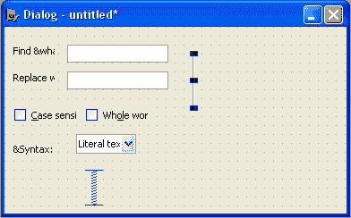
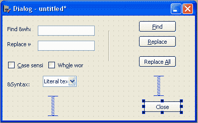

**图 7.6** *没有按钮的查找和替换对话框*

**图 7.7** *未布局的查找和替换对话框*

布局此表单的最佳方法是什么？这个表单的最佳设计是什么？这些问题的答案取决于口味和实践。在这里我们仅展示机械操作，美学留给你。

我们首先从布局前两个 `Label` 及其 `Line Edit` 开始。点击表单取消选择，然后 `Shift+Click` `Find Label` 及其 `Line Edit`，以及 `Replace with Label` 及其 `Line Edit`。一旦这四个部件被选中，点击 `Form→Lay Out in Grid`。布局由红线表示——布局线在运行时是不可见的。现在点击表单取消选择，选择两个 `Check Boxes`。点击 `Form→Lay Out Horizontally`。再次点击表单取消选择，这次使用水平布局 `Syntax Label` 和 `Combo Box`。现在应该有三个布局——一个网格和两个水平布局，如图 7.8 所示。

我们现在可以布局表单左侧的布局。点击表单取消选择。选择布局（而不是部件）可能困难，因此我们不使用 `Shift+Click`，而是使用选择矩形。

点击表单左下角并拖动选择矩形：

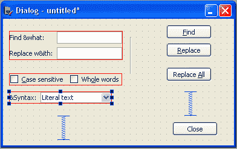
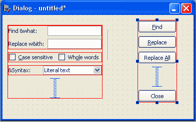

**图 7.8** *带有某些布局的查找和替换对话框*

框只需要接触对象即可选择，因此向上向右拖动，使其接触左侧的 `Vertical Spacer` 和三个布局——不要接触其他的（例如 `Vertical Line`）。现在释放并点击 `Form→Lay Out Vertically`。

我们可以使用相同的选择技术来布局按钮。点击表单取消选择。现在点击表单右下角并拖动，使选择矩形接触 `Close button`、右侧的 `Vertical Spacer` 以及其他三个按钮——不要接触其他的。现在释放并点击 `Form→Lay Out Vertically`。我们现在拥有一个所有部件都在左侧或右侧布局且中间有一个 `Vertical Line` 的表单，如图 7.9 所示。

**图 7.9** *几乎完成布局的查找和替换对话框*

我们现在准备好布局表单本身。点击表单取消所有选择。现在点击 `Form→Lay Out Horizontally`。表单现在看起来有点太高，只需向上拖动表单底部直到表单看起来更好。如果你拖动了很多，间隔器可能会“消失”；它们仍然在那里，只是小到不可见。

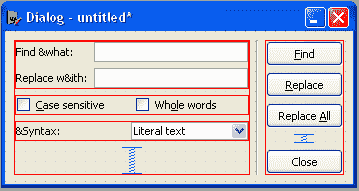

我们现在可以预览表单以查看布局的真实外观，在预览期间，我们可以拖动表单的角来将其缩小或放大，以检查其缩放行为是否合理。要进行预览，点击 `Form→Preview`（或按 `Ctrl+R`）。也可以通过菜单选项中的 `Form→Preview` 使用不同的样式进行预览。现在表单看起来应该像图 7.10 所示。如果不是如此，请使用 `Edit→Undo` 撤销更改，然后重新布局。如果你必须重新进行布局，有时调整某些控件的大小并重新定位会有帮助，这可以让 `Qt Designer` 获得更多关于你想要布局的线索，特别是使用网格布局时。

**图 7.10** 一个布局好的查找和替换对话框

我们现在准备好设置标签的伙伴（buddies）、设置表单的选项顺序、进行任何所需的连接，并命名和保存表单。

我们将从伙伴开始。点击 `Edit→Edit Buddies` 开启伙伴模式。要设置伙伴关系，我们点击 `Label` 并拖动到想要作为其伙伴的控件上。因此在这个示例中，我们必须点击 `Find what Label` 并拖动到它的 `Line Edit`，然后对 `Replace with Label` 和它的 `Line Edit` 执行同样的操作，然后对 `Syntax Label` 和 `Combo Box` 执行此操作。要退出伙伴模式，按 `F3`。现在，`Labels` 中不应再显示安培符（`&`）。

接下来我们将设置表单的选项顺序。点击 `Edit→Edit Tab Order`，然后按照你想要的顺序依次点击每个编号框。要退出选项顺序模式，按 `F3`。

`Find`、`Replace` 和 `Replace All` 按钮需要连接到我们自己的自定义方法；我们将在 `Qt Designer` 之外完成。但 `Close` 按钮可以连接到对话框的 `reject()` 槽。要执行此操作，点击 `Edit→Edit Signals/Slots`，然后从 `Close` 按钮拖动到表单。当你释放时，会弹出 `Configure Connection` 对话框。从左侧信号列表中点击（无参数的）`clicked()` 信号，从右侧槽列表中点击 `reject()` 槽，然后点击 `OK`。要退出信号槽模式，按 `F3`。

点击表单以取消选择所有项。这同样具有让属性编辑器显示表单属性的效果。将对话框的对象名称（它将在其类名中使用）设置为 `FindAndReplaceDlg`，并将 `windowTitle` 属性设置为 `Find and Replace`。现在点击 `File→Save` 保存用户界面，将其命名为 `findandreplacedlg.ui`。

## 第 7 章：使用 Qt Designer

在本节中，我们仅限于使用 `Qt Designer` 通过“对话框”（Dialog）模板之一来创建自定义对话框，因为这对于学习如何使用 `Qt Designer` 的基础已经足够。然而，`Qt Designer` 可以创建比我们在这里创建的复杂得多的对话框，包括带有标签页控件和控件栈的对话框，这些通常用于具有几十甚至数百个选项的配置对话框。还可以使用包含自定义控件的插件扩展 `Qt Designer`。这些控件通常用 `C++` 编写，但从 `PyQt 4.2` 开始，也可以引入用 `Python` 编写的自定义控件。

Qt 文档包含了详尽的 `Qt Designer` 手册，它更深入并涵盖了更多可用功能。本节涵盖的内容足以入门，但正确学习 `Qt Designer` 的唯一方法是使用它。

设计好用户界面后，下一步是让它在我们的代码中可用。

## 实现对话框

当我们使用 `Qt Designer` 创建用户界面时，我们使用多重继承创建一个子类，在其中放入所需的代码来为用户界面提供所需的行为。我们继承的第一个类是 `QDialog`。如果我们使用“控件”（Widget）模板，我们的第一个继承类将是 `QWidget`；如果我们使用“主窗口”（Main Window）模板，我们的第一个继承类将是 `QMainWindow`。我们继承的第二个类是表示我们使用 `Qt Designer` 设计的用户界面的类。

在前节中，我们创建一个对象名为 `FindAndReplaceDlg` 的用户界面，存储在文件 `findandreplacedlg.ui` 中。我们必须运行 `pyuic4`（直接运行或通过 `mkpyqt.py` 或 `Make PyQt`）来生成 `ui_findandreplacedlg.py` 模块文件。该模块包含一个类，其名为带有 `Ui_` 前缀的表单对象名称，因此在这种情况下，类名为 `Ui_FindAndReplaceDlg`。

我们将子类命名为 `FindAndReplaceDlg`，并将其放在 `findandreplacedlg.py` 文件中。在查看类声明和初始化之前，我们先查看导入部分。

```python


```python
import re

from PyQt4.QtCore import *

from PyQt4.QtGui import *

import ui_findandreplacedlg
```

其他方法也是可能的，并在在线文档中有所介绍。尽管如此，没有一种像我们在这里使用的方法那样方便。

第一个导入是我们在代码中使用的正则表达式模块。第二个和第三个导入是 PyQt 编程常用的导入。最后一个导入是生成的用户界面模块。现在我们可以查看我们的子类了。

```python
class FindAndReplaceDlg(QDialog, ui_findandreplacedlg.Ui_FindAndReplaceDlg):

    def __init__(self, text, parent=None):

        super(FindAndReplaceDlg, self).__init__(parent)

        self.__text = unicode(text)

        self.__index = 0

        self.setupUi(self)

        if not MAC:

            self.findButton.setFocusPolicy(Qt.NoFocus)

            self.replaceButton.setFocusPolicy(Qt.NoFocus)

            self.replaceAllButton.setFocusPolicy(Qt.NoFocus)

            self.closeButton.setFocusPolicy(Qt.NoFocus)

        self.updateUi()
```

我们既继承了 `QDialog` 也继承了 `Ui_FindAndReplaceDlg`。在 Python 编程中很少需要使用多重继承，但对于这种情况，它比其他方法要简单得多。我们的 `FindAndReplaceDlg` 子类实际上是它继承的两个类的并集，并且可以直接访问它们的属性（当然，带有 `self` 前缀）。

我们设置了初始化器以接受作为对话框处理数据的文本，以及一个父控件。`super()` 调用是在第一个继承类 `QDialog` 上进行的。我们保留了文本的副本，以及一个索引位置，以防用户多次点击查找以相同文本的后续出现。

对 `setupUi()` 方法的调用是我们之前从未过的。该方法由生成的模块提供。调用时，它会创建用户界面文件中指定的所有控件，根据我们的设计进行布局，设置它们的伙伴和选项顺序，并建立我们设置的连接。换句话说，它重建了我们在 `Qt Designer` 中设计的表单。

此外，`setupUi()` 方法调用了 `QtCore.QMetaObject.connectSlotsByName()`，这是一个静态方法，在表单控件信号和子类中遵循特定命名规则的方法之间创建信号槽连接。任何名称符合 `on_widgetName_signalName*` 格式的方法与其命名的控件及其命名的信号连接。

例如，我们的表单有一个类型为 `QLineEdit` 名为 `findLineEdit` 的控件。`QLineEdit` 发出的信号之一是 `textEdited(QString)`。因此，如果我们想连接此信号而不初始化器中调用 `connect()` 方法，我们可以将这项工作交给 `setupUi()`。只要我们调用了想要让信号连接的槽 `on_findLineEdit_textEdited`，它就能工作。

对于 Windows 和 Linux 用户来说，将按钮的焦点策略设置为“无焦点”（No Focus）是非常方便的。这对鼠标用户没有影响，但通常对键盘用户很有帮助。这意味着按下 `Tab` 键时，键盘焦点只会在编辑控件之间移动——在本例中，包括查找编辑框、替换编辑框、复选框和组合框——这通常比需要通过 `Tab` 键遍历按钮要方便得多。键盘用户仍然可以使用按钮的快捷键按下任何按钮（例如关闭按钮使用 `Esc`）。

遗憾的是，buddies 和按钮并没有为 Mac OS X 用户提供快捷键（除非他们开启对辅助设备的支持），因此这些用户需要能够 `Tab` 到包括按钮在内的所有控件。为了适应所有平台，我们没有在 `Qt Designer` 中设置按钮的焦点策略，而是在 `setupUi()` 创建用户界面后手动设置它们。

如果底层窗口系统是 Mac OS X，则 `MAC` 布尔变量为 `True`。它是在文件开头、导入之后，使用以下相当晦涩的语句设置的：

```python
MAC = "qt_mac_set_native_menubar" in dir()
```

更清晰的写法是：

```python
import PyQt4.QtGui

MAC = hasattr(PyQt4.QtGui, "qt_mac_set_native_menubar")
```

这些代码之所以有效，是因为 `PyQt4.QtGui.qt_mac_set_native_menubar()` 函数仅存在于 Mac OS X 系统上。我们将在第 11 章中使用类似的技术来检测 X Window 系统。

最后调用的 `updateUi()` 方法是我们自定义的方法；我们使用它来根据用户是否输入了任何查找文本来启用或禁用按钮。

```python
@pyqtSignature("QString")

def on_findLineEdit_textEdited(self, text):

    self.__index = 0

    self.updateUi()
```

得益于 `setupUi()`，该方法自动与 `findLineEdit` 的 `textEdited()` 信号连接。每当我们想要自动连接时，都会使用 `@pyqtSignature` 装饰器来指定信号的参数。该装饰器的目的是区分名称相同但参数不同的信号。在特定情况下，只有一个 `textEdited()` 信号，因此装饰器并不是严格必须的；但出于良好的习惯，我们总是使用装饰器。例如，如果以后版本的 PyQt 引入了另一个同名但参数不同的信号，使用装饰器的代码将继续工作，而没有使用装饰器的代码则不会。

由于该槽在用户更改查找文本时被调用，我们将搜索的起始索引位置重置为 0（开头）。在这里以及在初始化函数中，我们都以调用 `updateUi()` 结束。

## 实现对话框

```python
def updateUi(self):

    enable = not self.findLineEdit.text().isEmpty()

    self.findButton.setEnabled(enable)

    self.replaceButton.setEnabled(enable)

    self.replaceAllButton.setEnabled(enable)
```

我们已经见过许多此类方法的示例了。在这里，如果用户输入了查找文本，我们就启用“查找”、“替换”和“全部替换”按钮。无论是否有替换文本都无关，因为将某些内容替换为空是完全有效的，也就是说就是删除找到的文本。该方法就是表单在启动时除关闭按钮外，所有按钮都禁用的原因。

当用户关闭表单时，可以使用 `text()` 方法访问它持有的文本（如果用户使用了替换或全部替换，该文本可能与原始文本不同）。

```python
def text(self):

    return self.__text
```

一些 Python 程序员不会为此提供一个方法；相反地，他们会有一个 `self.text` 变量（而不是 `self.__text`），并直接访问该变量。

对话框的其他功能实现在方法中，这些方法是在用户按下某个按钮（关闭按钮之外）后调用的加上辅助方法。它们的实现与使用 `Qt Designer` 无直接关系，但为了完整性，我们将简要回顾它们。

```python
@pyqtSignature("")

def on_findButton_clicked(self):

    regex = self.makeRegex()

    match = regex.search(self.__text, self.__index)

    if match is not None:

        self.__index = match.end()

        self.emit(SIGNAL("found"), match.start())

    else:

        self.emit(SIGNAL("notfound"))
```

按钮的 `clicked()` 信号有一个可选的布尔参数，我们并不感兴趣，因此我们为 `@pyqtSignature` 装饰器指定了一个空参数列表。相比之下，我们不能为 `on_findLineEdit_textEdited()` 槽的装饰器使用空参数列表，因为 `textEdited()` 信号的参数不是可选的，所以必须包含。

要执行搜索，我们创建一个正则表达式来指定查找文本以及搜索的一些特征。然后我们使用该正则表达式从当前索引位置搜索文本。如果找到了匹配项，我们更新索引位置到匹配项的结束，准备进行后续搜索，并发送一个包含文本中找到查找文本位置的信号。

```python
def makeRegex(self):

    findText = unicode(self.findLineEdit.text())

    if unicode(self.syntaxComboBox.currentText()) == "Literal":

        findText = re.escape(findText)

    flags = re.MULTILINE|re.DOTALL|re.UNICODE

    if not self.caseCheckBox.isChecked():

        flags |= re.IGNORECASE

    if self.wholeCheckBox.isChecked():

        findText = r"\b%s\b" % findText

    return re.compile(findText, flags)
```

我们首先获取用户输入的查找文本。我们知道它不能为空，因为只有当存在查找文本时，按钮（关闭按钮除）才会启用。如果用户选择了字面搜索，我们使用 `re.escape()` 函数来转义用户查找文本中可能存在的任何正则表达式元字符。然后我们初始化搜索标志。如果 `caseCheckBox` 未被勾选，我们为标志补充 `re.IGNORECASE` 标志。如果用户要求搜索整个单词，我们会在查找文本前后加上 `\b`：这是 Python（以及正则表达式语言）正则表达式中的一个标记，用于指定单词边界。字符串前面的 `r` 表示“原始”字符串，我们可以在其中编写像已转义的 `\` 字符。最后，我们返回编译后的（可直接使用的）正则表达式形式。

如果我们知道要搜索的文本通常是 `QString` 而不是 `unicode`，那么使用 PyQt 的 `QRegExp` 类可能比使用 Python 标准库的 `re` 类更好。

```python
@pyqtSignature("")

def on_replaceButton_clicked(self):

    regex = self.makeRegex()

    self.__text = regex.sub(unicode(self.replaceLineEdit.text())), self.__text, 1)
```

此方法非常简单，因为它将准备工作交给了 `makeRegex()` 方法。我们使用 `sub` 方法（“替换”）将查找文本的第一次出现替换为替换文本。替换文本可以是空的。`1` 是最大替换次数。

```python
@pyqtSignature("")

def on_replaceAllButton_clicked(self):

    regex = self.makeRegex()

    self.__text = regex.sub(unicode(self.replaceLineEdit.text())), self.__text)
```

此方法与之前的那个几乎相同。唯一的区别在于我们没有指定最大替换次数，因此 `sub()` 将替换它找到的所有（非重叠）查找文本出现处。

现在我们已经实现了 `FindAndReplaceDlg`。对话框方法的实现与我们之前所做的没有太大区别，只是我们使用了装饰器和 `setupUi()` 来提供自动连接。

要在应用程序中使用该对话框，我们必须确保 `ui_findandreplacedlg.py` 模块文件已生成，我们必须导入刚刚编写的 `findandreplacedlg` 模块。我们将在下一节介绍如何创建和使用表单。

## 测试对话框

由于任何 PyQt 小部件（包括任何对话框）都可以作为顶层窗口使用，因此通过实例化并启动事件循环来测试对话框是非常简单的。★ 但通常，我们需要做更多工作。例如，我们可能需要设置一些初始数据，或者提供接收对话框信号的方法，以便查看它们是否工作正常。

在“查找和替换”对话框的情况下，我们需要一些初始文本，并且需要检查连接是否正常，以及查找和替换方法是否有效。

因此，在 `findandreplacedlg.py` 文件的最后，我们添加了一些额外代码。这些代码仅在单独运行该文件时执行，因此它们不会影响性能，也不会干扰在应用程序中使用对话框。

```python
if __name__ == "__main__":

    import sys

    text = """在美国的经验表明，与传统专利不同，软件专利并没有鼓励创新和研发，恰恰相反。特别是它们损害了中小企业以及通常是市场新者。它们只会削弱市场并增加专利和诉讼的支出，以牺牲技术创新和研究为代价。特别危险的是，

    试图通过防止互操作性来滥用专利系统，以此避免技术能力上的竞争。

    --- 摘自 Linus Torvalds 和 Alan Cox 的信件

    ★当使用 pyuic4 时，我们可以指定命令行选项 -x，这样生成的对话框将带有额外代码，以便可以独立测试。

    222

    *第 7 节. 使用 Qt Designer*

    致欧洲议会主席

    http://www.effi.org/patentit/patents_torvalds_cox.html"""

    def found(where):

        print "Found at %d" % where

    def nomore():

        print "No more found"

    app = QApplication(sys.argv)

    form = FindAndReplaceDlg(text)

    form.connect(form, SIGNAL("found"), found)

    form.connect(form, SIGNAL("notfound"), nomore)

    form.show()

    app.exec_()

    print form.text()
```

我们首先导入 `sys` 模块，然后创建一段要处理的文本。接下来，我们创建两个简单的函数，用于连接对话框的信号。

我们按照通常方式创建 `QApplication` 对象，然后创建对话框的实例并传入我们的测试文本。我们将对话框的两个信号连接到我们的槽函数，并调用 `show()`。然后我们启动事件循环。当事件循环结束时，我们打印对话框的文本：如果用户替换了某些文本，这将与原始文本不同。

现在可以从控制运行并测试对话框了。

```bash
C:\pyqt\chap07>python findandreplacedlg.py
```


除非使用自动化测试工具，否则在对话框中添加测试功能通常很有帮助。编写这些代码并不花费太多时间或精力，而且每当对话框逻辑发生变化时运行它们，将有助于最大限度地减少 Bug 的引入。

有时我们将复杂对象传递给对话框，这看起来可能使测试是不可能的。但得益于 Python 的鸭类型类型（duck typing），我们始终可以创建一个伪类，模拟足够的行为供测试使用。例如，在第 12 节中，我们使用了一个属性编辑器对话框。该对话框对“Node”对象进行操作，因此在测试代码中，我们创建一个`FakeNode`类，提供对话框使用的设置和获取节点属性的方法。

（相关文件为`chap12/propertiesdlg.ui`由此生成`ui_propertiesdlg.py`，以及`chap12/propertiesdlg.py`，其中实现了`PropertiesDlg`。）

## 总结

`Qt Designer`提供了一种快速简便的方法来创建用户界面。使用视觉化设计工具可以更容易地判断设计是否“有效”。

`Qt Designer`的另一个优点是，只要我们没有对代码中引用的小部件进行添加、删除或重命名，代码就完全不需要更改。即使我们添加、重命名或删除了小部件，代码的变化可能也很小，因为`Qt Designer`为我们处理了所有的小部件创建和布局。

使用`Qt Designer`的基本原理始终相同：我们将小部件拖到表单上，首先是容器（如框架、组框和标签页），然后是普通小部件，并设置它们的属性。接着添加间距器来填充空隙。接下来我们选择特定的小部件、间距器和布局并对它们应用布局，重复此过程直到完成布局。然后我们布局表单本身。最后我们设置伙伴（buddies）、标签顺序和信号-槽连接。

使用`Qt Designer`创建的用户界面来实现对话框，与手动实现相似。最大的区别在于初始化器，其中我们只需调用`setupUi()`来创建和布局小部件，并创建信号-槽连接。我们实现的方法可以像以前一样（代码没有任何区别），但通常我们使用`on_widgetName_signalName`命名规范，配合`@pyqtSignature`装饰器，利用`setupUi()`自动创建连接的能力。

我们还没有涵盖的一个用例是使用“Widget”模板创建复合小部件（由两个或多个其他布局在一起的小部件组成）。在某些情况下，这些小部件的设计可以用于整个表单；而在其他情况下，它们可以作为表单的组件——例如为标签页或小部件堆提供页面。或者在表单中布局两个或多个复合小部件创建一个创建一个复杂的表单。通过使用`Qt Designer`并通常方式生成 Python 模块可以实现。然后我们可以导入生成的模块，并在表单类中调用每个自定义小部件的`setupUi()`方法来创建用户界面。

关于对话框有多智能、应该具有什么模态以及如何验证的问题，使用`Qt Designer`创建的对话框与手动创建的没有区别。唯一的例外是我们可以在`Qt Designer`中设置小部件属性——例如，我们可以设置数值框的范围和初始值。当然，我们可以在代码中做相同的事情，但对于只需要简单验证的小部件，在`Qt Designer`中完成这一切通常更方便。

我们必须使用`pyuic4`从`Qt Designer`的`.ui`文件生成 Python 模块，可以直接运行`pyuic4`，或者使用`mkpyqt.py`或`Make PyQt`，后者在存在`.qrc`文件时也会为资源文件生成 Python 模块。

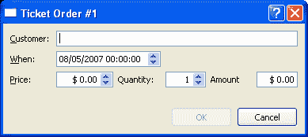

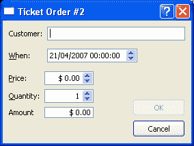

224

*第 7 节. 使用 Qt Designer*

如果没有使用测试工具，添加仅在单独单运行时执行的测试代码不会影响对话框的性能，在开发和维护对话框期间都非常方便。

如果对话框依赖的复杂对象可用，我们通常可以创建一个“伪”类，提供与复杂对象相同的方法，并传递该伪类的实例用于测试目的。

所有的 PyQt 程序都可以完全通过手工编写；永远不需要使用`Qt Designer`。然而，使用视觉化设计工具设计对话框非常有帮助，因为结果可以立即看到，并且可以快速方便地对设计进行更改。使用`Qt Designer`的另一个优点是，它可以自动用于创建、布局和连接部件的许多重复性代码，而无需手写。在本章和前一章中，我们都使用了`Qt Designer`来创建对话框。在后续章节中，我们将看到更多使用`Qt Designer`创建的对话框示例。

## 练习

使用`Qt Designer`按照图 7.11 所示的任一设计或自己的设计创建一个用户界面。你可能需要使用`GridLayout`，以及`QVBoxLayout`和`QHBoxLayout`。对于网格布局，你可能需要尝试几次，也许通过调整部件的大小和位置来帮助`Qt Designer`创建你所需的网格。使用`QDialogButtonBoxes`来处理按钮。

**图 7.11** *具有两种不同设计的对话框*

价格数值调节框（spinbox）的范围应为 0.00–5 000.00，右对齐，并带有`$ `前缀，如图 7.11 所示。数量数值调节框的范围应为 1–50 且同样右对齐。如果你不喜欢默认设置，可以将日期格式设置为你喜欢的任何格式。

代码中引用部件应具有合理的名称——例如，`customerLineEdit`和`priceSpinBox`。

设置相应的伙伴（buddies），即从“customer”`Label`到其对应的`Line Edit`，从“when”`Label`到`Date Time Edit`，依此类推。还要确保制表顺序（Tab order）为`customer`、`when date`、`price`、`quantity`、按钮框。

创建一个子类来使用该用户界面。代码应确保只有当客户`Line Edit`不空且金额大于零时，OK 按钮才可用。若要访问`QDialogButtonBox`中的按钮，请使用`button()`方法并将按钮的常量作为参数——例如，`buttonBox.button(QDialogButtonBox.Ok)`。

每当用户更改其中一个数值调节框的值时，金额都应该重新计算并显示在金额标签中。将选择日期的范围设置为从明天到明年。提供一个`result()`方法，返回一个包含四元组（unicode、`datetime.datetime`、float、int），分别对应客户、选择日期、价格和数量。（如果你使用的是 4.1 之前的 PyQt 版本，请将日期作为`QDateTime`返回；否则，使用`QDateTime.toPyDateTime()`方法获取`datetime.datetime`。）

在末尾包含足够的测试代码来创建并显示`TicketOrderDlg`，以便你对其进行交互。事件循环结束后，在控制台上打印由`result()`方法返回的元组。

该子类（包括测试代码）大约可以用 60 行代码编写。如果你是第一次使用`Qt Designer`，可能需要 15–20 分钟才能完成设计，但通过练习，创建一个这样一个对话框只需要几分钟。

模型解决方案提供在`chap07/ticketorderdlg1.ui`和`chap07/ticket-orderdlg2.ui`中，并在`chap07/ticketorderdlg.py`中有一个测试程序。

# 8. 数据处理与自定义文件格式

## 主窗口职责

- 数据容器职责
- 保存和加载二进制文件
- 保存和加载文本文件
- 保存和加载 XML 文件

## 格式

大多数应用程序都需要加载和保存数据。通常，数据格式是预定义的，因为应用程序正在读取由其他应用程序产生的数据，我们对那些程序没有控制权。但对于我们创建自定义文件格式的应用程序，有很多选项。

在第 6 章中，我们创建了一个主窗口风格的应用程序，从中学习了如何创建菜单和工具栏，以及如何处理文件的加载和保存。在本章中，我们将处理另一个主窗口风格的应用程序，但这次我们的重点将放在应用程序的数据上。

**图 8.1** *My Movies 应用程序*

我们将作为示例的应用程序称为`My Movies`；如图 8.1 所示。它用于存储我们收藏中可能有的电影的一些基本信息。该应用程序将允许我们查看和编辑自定义`Movie`对象（或我们称之的电影*记录*）的集合，并以各种格式从磁盘加载和保存这些记录。

如果你只想直接深入研究文件处理，可以跳到相关章节。保存和加载二进制文件的介绍从第 240 页开始，文本文件从第 249 页开始，XML 文件从第 256 页开始。你可以随时回到前两个章节来涵盖 GUI 与文件处理之间的关系。

在之前所有的的示例中，我们通常尽可能将数据保留在 Python 数据类型中，仅在需要时才与 PyQt 类型之间进行转换。

### 字符串

特别是对于字符串，我们提出了一项策略，即尽早将`QString`转换为 unicode，并始终对 unicode 字符串进行操作。但在本章中，我们将采取相反的方法，将所有数据保留在 PyQt 类型中，仅在需要时才转换为 Python 类型。这样做的原因之一是 PyQt 为二进制数据提供了极佳的支持，并使用了与 C++/Qt 相同的二进制格式，这在处理必须被 C++ 和 Python 程序共同访问的文件时非常有用。另一个原因是，这将提供一种对比，帮助我们理解每种方法的优缺点，以便我们在稍后编写的应用程序中做出正确的决策。

在 PyQt 类型中持有数据的一个直接益处是，我们不需要对给用于查看和编辑的部件提供或从中获取的数据进行不断转换。在处理大数据时，这可以显著减少处理开销。

当我们有自定义数据需要加载和保存时，有五个选项可供选择。

我们可以使用二进制文件、纯文本文件或 XML 文件，或者使用带有显式文件名的`QSettings`对象，或者使用数据库。在本章中，我们将涵盖前三种，并在此要提到第四种`QSettings`。我们将数据库的介绍推迟到第 15 章。

除`QSettings`之外的所有选项都可以使用 Python 的标准库或 PyQt 实现。在本章中，我们将使用这两个库来加载和保存二进制和文本格式，以便我们进行比较。对于 XML，我们将使用 PyQt 进行加载和解析，而由自己完成保存。Python 的标准库也提供了大量的 XML 支持，但涵盖它并不能显示任何 PyQt 无法实现的功能。

在第 6 章中，我们看到了如何使用`QSettings`对象保存和加载用户设置，例如主窗口的大小和位置以及最近使用的文件列表。该类将所有数据存储为`QVariants`，但对于少量数据来说这是完全可以接受的。我们可以通过创建一个带有文件名的`QSettings`实例来存储自定义数据——例如，`iniFile = QSettings("curvedata.ini", QSettings.IniFormat)`。现在我们可以使用`iniFile`对象通过`setValue()`写入数据，并使用`value()`读取数据，在这两种情况下`QVariant`和相关类型之间进行转换。

在接下来的节中，我们将查看主窗口子类执行的高级文件处理和数据展示。

在第二节中，我们将查看应用程序的数据模块，包括单个数据项的实现，以及存放应用程序数据的数据项容器。

在随后的章节中，我们将介绍如何以各种格式保存和加载数据。在二进制文件章节，我们将介绍如何使用 PyQt 的`QDataStream`类以及 Python 标准库的`cPickle`模块来加载和保存电影记录集合。在文本文件章节，我们将看到如何使用 PyQt 的`QTextStream`和 Python 标准库的`codecs`模块以纯文本格式加载和保存电影记录。在最后一个章节中，我们将编写代码将记录保存为 XML，并查看如何同时使用`DOM`和`SAX`解析器来读取 XML 数据。

## 主窗口的职责

主窗口通常负责为用户提供层级文件处理操作，并展示应用程序的数据。在本节中，我们将特别关注文件操作，因为它们与我们在第 6 节 Image Changer 应用程序中所做的不同，并且更能代表大型应用程序中的情况。我们还将查看数据是如何呈现给用户的。在“我的电影”（My Movies）应用程序中，数据存储在一个“容器”（一个`MovieContainer`）中，所有的保存、加载（以及导出和导入）工作都由主窗口传递给容器。我们将在下一节查看容器，并在随后的章节中查看容器的保存和加载代码。

源代码位于`chap08`目录，包含一个使用`Qt Designer`设计的用于添加和编辑电影记录的用户界面。图 8.2 显示了应用程序的 Python 模块。

我们选择区分“保存”与“导出”，以及“加载”与“导入”。当我们加载一个文件时，使用的文件名将成为应用程序保存时的当前文件名。如果我们保存文件，将使用应用程序的当前文件名，因此后续保存将针对同一个文件。我们可以通过“另存为”操作来更改当前文件名。

当我们导入文件时，我们会清除当前文件名；这意味着如果用户想保存数据，必须赋予它一个新的文件名。如果用户导出数据，系统会要求一个新的文件名，且不会影响当前文件名。

现在我们准备好查看主窗口的文件处理功能了。

我们将从查看主窗口初始化函数的开始部分开始：

### 图 8.2 结构

- `mymovies.pyw`
- `MainWindow`
- `main()`
- `addeditmoviedlg.py`
- `moviedata.py`
- `AddEditMovieDlg`
- `Movie`
- `MovieContainer`
- `intFromQStr()`
- `ui_addeditmoviedlg.py`
- `qrc_resources.py`
- `encodedNewlines()`（用户界面模块）
- `decodedNewlines()`（图标）

My Movie 应用程序的模块、类和函数创建了存储数据的电影容器以及展示数据的`QTableWidget`。

```python
class MainWindow(QMainWindow):

    def __init__(self, parent=None):

        super(MainWindow, self).__init__(parent)

        self.movies = moviedata.MovieContainer()

        self.table = QTableWidget()

        self.setCentralWidget(self.table)
```

在调用`super()`后，我们创建了一个新的空容器。（稍后我们将查看`Movie`和`MovieContainer`类。）然后我们创建了一个`QTableWidget`。

该小组件用于展示并可选地编辑表格数据。表格在`updateTable()`中进行设置和填充。我们省略了初始化函数的其余部分，因为我们已经从第 6 节知道如何设置状态栏、创建文件、编辑和帮助操作、填充菜单和工具栏，以及从上一次会话的设置中恢复应用程序状态。

为了完整起见，我们现在将简要回顾`updateTable()`，查看表格小组件是如何设置和填充的。（如果你倾向于纯关注文件处理，可以跳转到第 232 页的`fileNew()`方法。）我们使用的方法非常简单直接。`PyQt`还提供了一种更高级的方法来填充和编辑基于项目的组件（如列表、表格和树），使用 PyQt 的模型/视图架构——我们将在第 14 节学习这些。

```python
def updateTable(self, current=None):

    self.table.clear()

    self.table.setRowCount(len(self.movies))

    self.table.setColumnCount(5)

    self.table.setHorizontalHeaderLabels(["标题", "年份", "分钟", "获取", "备注"])

    self.table.setAlternatingRowColors(True)

    self.table.setEditTriggers(QTableWidget.NoEditTriggers)

    self.table.setSelectionBehavior(QTableWidget.SelectRows)

    self.table.setSelectionMode(QTableWidget.SingleSelection)

    selected = None
```

这个方法相当长，所以我们将分三部分回顾它。它可以在不带参数的情况下调用，这种情况下它只是填充表格；或者可以带有当前`Movie`的`id()`调用，这种情况下，它会在填充表格后使指定的电影所在行被选中并可见（必要时会滚动）。如果刚刚添加或编辑了电影，则会传递当前电影。

我们首先从清除表格开始；这去除了数据和表头。

接下来，我们设置行数、列数以及列头。我们设置了表格属性，使用户无法在原地进行任何编辑，因为我们在这个特定的应用程序中于使用单独的添加/编辑对话框。我们还确保用户一次只能选择一行。`selected`变量持有当前电影标题和`id()`的`QWidgetItem`（如果有的话）。

```python
for row, movie in enumerate(self.movies):

    item = QTableWidgetItem(movie.title)

    if current is not None and current == id(movie):

        selected = item

    item.setData(Qt.UserRole, QVariant(long(id(movie))))

    self.table.setItem(row, 0, item)

    year = movie.year

    if year != movie.UNKNOWNYEAR:

        item = QTableWidgetItem("%d" % year)
```


`item.setTextAlignment(Qt.AlignCenter)`

`self.table.setItem(row, 1, item)`

`minutes = movie.minutes`

`if minutes != movie.UNKNOWNMINUTES:`

`item = QTableWidgetItem("%d" % minutes)`

`item.setTextAlignment(Qt.AlignRight|Qt.VCenter)`

`self.table.setItem(row, 2, item)`

`item = QTableWidgetItem(movie.acquired.toString(moviedata.DATEFORMAT))`

`item.setTextAlignment(Qt.AlignRight|Qt.VCenter)`

`self.table.setItem(row, 3, item)`

`notes = movie.notes`

`if notes.length() > 40:`

`notes = notes.left(39) + "..."`

`self.table.setItem(row, 4, QTableWidgetItem(notes))`

`QTableWidget` 中的每个单元格都由 `QTableWidgetItem` 表示。这些项目可以持有显示文本也可以持有“用户”数据。我们遍历电影容器中的每个电影，为每个电影创建一个行项目。只有在有数据时，我们才会填充年份和分钟单元格。对于备注，如果数据很长，我们会截断并添加省略号，因为备注可能有几个段落。

```python
self.table.resizeColumnsToContents()
if selected is not None:
    selected.setSelected(True)
    self.table.setCurrentItem(selected)
    self.table.scrollToItem(selected)
```

当我们遍历电影容器中的电影时，电影按字母顺序返回（但忽略开头的“A”、“An”和“The”单词）。

如果用户添加了新电影或编辑了现有电影，我们希望确保刚刚添加或编辑的电影既被选中又是可见的。这通过在添加或编辑后调用 `updateTable()` 并传入所添加或编辑的电影 ID 来实现。在 `updateTable()` 结束时，如果传递了电影 ID，`selected` 变量将持有对应电影标题单元格的项，该项（因此该项所在的行）将被设置为当前项和选中项，如果有必要，表格小部件将滚动以确保该行对用户可见。

```python
def fileNew(self):
    if not self.okToContinue():
        return
    self.movies.clear()
    self.statusBar().clearMessage()
    self.updateTable()
```

此方法与 Image Changer 应用中使用的同名方法相似。主要的区别在于，数据不再由主窗口负责，而是将工作委托给位于 `self.movies` 中的电影容器。当调用 `updateTable()` 时，由于没有电影记录，小部件将仅显示列标题，而不显示其他任何内容。

`okToContinue()` 方法与我们在 Image Changer 应用中使用的方法几乎相同。唯一的区别是，它不再检查条件 `self.dirty`（因为 Image Changer 的主窗口持有应用程序数据），而是调用 `self.movies.isDirty()`，因为在这个应用程序中，电影容器持有数据。

```python
def fileOpen(self):
    if not self.okToContinue():
        return
    path = QFileInfo(self.movies.filename()).path() if not self.movies.filename().isEmpty() else "."
    fname = QFileDialog.getOpenFileName(self,
        "My Movies - Load Movie Data", path,
        "My Movies data files (%s)" % self.movies.formats())
    if not fname.isEmpty():
        ok, msg = self.movies.load(fname)
        self.statusBar().showMessage(msg, 5000)
        self.updateTable()
```

文件打开方法在结构上与我们之前看到的相同。电影容器将当前文件名作为 `QString` 持有。通常情况下，一个应用程序只有一个自定义文件格式，但为了说明起见，My Movies 应用支持多种格式，因此我们提供了一个 `formats()` 方法来返回可以使用的扩展名。

主窗口子类将加载工作传递给电影容器。我们设计电影容器的 `load` 和 `save` 方法以返回一个布尔成功/失败标志和一个消息。消息可以是错误信息，也可以关于加载或保存了多少电影记录的报告。在 My Movies 应用中，我们只使用消息。

如果加载成功，电影容器将包含新的电影记录，`updateTable()` 将显示它们。如果加载失败，电影容器将为空，`updateTable()` 将仅显示列标题。

```python
def fileSave(self):
    if self.movies.filename().isEmpty():
        self.fileSaveAs()
    else:
        ok, msg = self.movies.save()
        self.statusBar().showMessage(msg, 5000)
```

再次，该方法的逻辑与我们之前看到的相同。用于保存和加载的代码取决于文件扩展名，我们稍后会看到。

我们将跳过 `fileSaveAs()` 的代码；它与 Image Changer 应用中的相同，不同之处我们在处理文件名时使用了 `QString` 而不是之前的 unicode 方法，并且我们使用 `.mqb` 作为默认扩展名（Qt 二进制格式的 My Movies）。

```python
def fileImportDOM(self):
    self.fileImport("dom")

def fileImportSAX(self):
    self.fileImport("sax")
```

```python
def fileImport(self, format):
    if not self.okToContinue():
        return
    path = QFileInfo(self.movies.filename()).path() if not self.movies.filename().isEmpty() else "."
    fname = QFileDialog.getOpenFileName(self,
        "My Movies - Import Movie Data", path,
        "My Movies XML files (*.xml)")
    if not fname.isEmpty():
        if format == "dom":
            ok, msg = self.movies.importDOM(fname)
        else:
            ok, msg = self.movies.importSAX(fname)
        self.statusBar().showMessage(msg, 5000)
        self.updateTable()
```

通常我们会提供一个单一的导入方法并使用 SAX 或 DOM 解析器。在这里，我们选择展示这两种解析器的使用，因此我们提供了两个独立的导入操作。它们产生的结果是相同的。

用于导入的文件操作代码与“打开文件”操作非常相似，只是我们使用了用户指定的导入解析器。与所有文件处理代码一样，我们将工作传递给电影容器。

```python
def fileExportXml(self):
    fname = self.movies.filename()
    if fname.isEmpty():
        fname = "."
    else:
        i = fname.lastIndexOf(".")
        if i > 0:
            fname = fname.left(i)
        fname += ".xml"
    fname = QFileDialog.getSaveFileName(self,
        "My Movies - Export Movie Data", fname,
        "My Movies XML files (*.xml)")
    if not fname.isEmpty():
        if not fname.contains("."):
            fname += ".xml"
        ok, msg = self.movies.exportXml(fname)
        self.statusBar().showMessage(msg, 5000)
```

我们只提供了一个 XML 导出方法。该代码与“另存为”操作相似。注意，我们必须使用 `QString` 方法来确保文件名具有 `.xml` 扩展名，而不是我们在 Image Changer 中使用的 unicode 方法。

## 数据容器的职责

应用程序的数据容器负责持有所有数据（即电影记录）以及保存和加载它们。在在前一节中 `MainWindow.updateTable()` 时，我们看到容器如何使用 for 循环进行迭代以获取所有电影，以便它们能在应用程序的 `QTableWidget` 中显示。在本节中，我们将查看由 `moviedata` 模块提供的功能，包括所使用的数据结构，但不包含实际的保存和加载代码。

为什么要使用自定义容器呢？毕竟，我们可以简单地使用 Python 的内置数据结构，例如列表或字典。我们更倾向于采用将标准数据结构封装在自定义类中的方法。这确保了对数据的访问由我们的类控制，这有助于维护数据的完整性。它还使得扩展容器的功能变得更容易，并在未来替换底层数据结构时，不会影响现有代码。换句话说，这是一种面向对象的方法，避免了简单地使用（例如）列表配合一些全局泛的缺点。

我们将从 `moviedata` 模块的导入和常量开始。

```python
import bisect
import codecs
import copy_reg
import cPickle
import gzip
from PyQt4.QtCore import *
from PyQt4.QtXml import *
```

我们将按照规范一化的标题顺序存储电影，忽略大小写，并忽略开头的“A”、“An”和“The”单词。为了最小化插入和查找时间，我们使用 `bisect` 模块维护顺序，使用了与我们在第 3 章中实现的 `OrderedDict` 相同的技术。

`codecs` 模块对于使用特定的文本编码读写 Python 文本文件是必要的。`copy_reg` 和 `cPickle` 模块用于保存和加载 Python “pickles”—这些是包含 Python 数据结构的文件。`gzip` 模块用于压缩数据；我们将使用它来压缩和解压我们的 pickle 数据。`PyQt4.QtCore` 的导入是熟悉的，但我们还必须导入 `PyQt4.QtXml` 模块，以便访问 PyQt 的 SAX 和 DOM 解析器。

我们想对文本文件使用 UTF-8 编码。这是一种 8 位的 Unicode 编码，每个 ASCII 字符使用一个字节，而任何其他字符使用两个或多个字节。它可能是文件中应用最广泛 Unicode 文本编码。通过使用 Unicode，我们可以存储今天使用的几乎任何人类语言编写的文本。

尽管 `\n` 是有效的 Unicode 字符，但在使用 XML 时，我们需要使用 Unicode 特定的段落符和换行符。这是因为 XML 解析器通常不区分一种 ASCII 空格字符（如换行符）和另一种空格字符（如空格），如果我们想保留用户的换行和段落分隔，这将会是不方便的。

```python
class Movie(object):
    UNKNOWNYEAR = 1890
    UNKNOWNMINUTES = 0

    def __init__(self, title=None, year=UNKNOWNYEAR,
                 minutes=UNKNOWNMINUTES, acquired=None, notes=None):
        self.title = title
        self.year = year
        self.minutes = minutes
        self.acquired = acquired \
        if acquired is not None else QDate.currentDate()
        self.notes = notes
```

`Movie` 类用于存储有关一部电影的数据。我们直接使用实例变量，而不是提供简单的 getter 和 setter。标题和注释以 `QStrings` 形式存储，获取日期以 `QDate` 形式存储。电影的年份和以分钟为单位的时长以 `ints` 形式存储。我们提供了两个静态常量，表示我们不知道电影何时上映或时长有多长。

现在我们准备查看电影容器类了。该类持有一个有序的电影列表，并提供了以各种格式保存和加载（以及导出和导入）电影的功能。

```python
class MovieContainer(object):
    MAGIC_NUMBER = 0x3051E
    FILE_VERSION = 100

    def __init__(self):
        self.__fname = QString()
        self.__movies = []
        self.__movieFromId = {}
        self.__dirty = False
```

## 数据容器的职责

`MAGIC_NUMBER` 和 `FILE_VERSION` 用于使用 PyQt 的 `QDataStream` 类保存和加载文件。

文件名以 `QString` 存储。`__movies` 列表的每个元素本身是一个包含两个元素的列表，第一个元素是排序键，第二个元素是 `Movie`。这是该类主要的数据结构，用于按顺序存储电影。`__movieFromId` 字典的键是 `Movie` 对象的 `id()`，值是 `Movies`。正如我们在第 1 章中看到的，每个 Python 对象都非常方便地有一个唯一 ID，可以通过对它调用 `id()` 来获取。该字典用于在已知电影 ID 时提供快速查找。例如，主窗口将电影 ID 作为“用户”数据存储在它的 `QTableWidgetItems` 的第一列中。当然，数据没有重复，因为这两个数据结构实际上持有的是 `Movie` 对象的引用，而不是 `Movie` 对象本身。

```python
def __iter__(self):
    for pair in iter(self.__movies):
        yield pair[1]
```

当 `MainWindow.updateTable()` 方法使用 `for` 循环遍历电影容器时，Python 使用了容器的 `__iter__()` 方法。在这里我们可以看到，我们遍历了有序的 `[key, movie]` 列表，每次返回电影项。

```python
def __len__(self):
    return len(self.__movies)
```

此方法允许我们在电影容器上使用 `len()` 函数。在接下来的章节中，我们将看到以各种格式加载和保存电影容器中存储电影的代码。但首先，我们将查看容器是如何清空的，以及电影是如何被添加、删除和更新的，以便我们能够熟悉容器的工作原理，特别是关于排序的。

```python
def clear(self, clearFilename=True):
    self.__movies = []
    self.__movieFromId = {}
    if clearFilename:
        self.__fname = QString()
        self.__dirty = False
```

此方法用于清除所有数据，可能包括文件名。它从 `MainWindow.fileNew()` 调用（该方法会清除文件名），以及各种保存和加载方法调用（这些方法保持文件名不变）。电影容器维护了一个脏标记（dirty flag），以便它始终知道是否有未保存的更改。

```python
def add(self, movie):
    if id(movie) in self.__movieFromId:
        return False
    key = self.key(movie.title, movie.year)
```


`bisect.insort_left(self.__movies, [key, movie])`

`self.__movieFromId[id(movie)] = movie`

`self.__dirty = True`

`return True`

第一个 `if` 语句确保我们不会重复添加同一部电影。我们使用 `key()` 方法生成一个合适的排序键，然后使用 `bisect` 模块的 `insort_left()` 函数将包含两个元素的 `[key, movie]` 列表插入到 `__movies` 列表中。这是非常快的，因为 `bisect` 模块使用了二分查找算法。我们还确保 `__movieFromId` 字典是最新的，并将容器标记为脏数据。

```python
def key(self, title, year):
    text = unicode(title).lower()
    if text.startswith("a "):
        text = text[2:]
    elif text.startswith("an "):
        text = text[3:]
    elif text.startswith("the "):
        text = text[4:]
    parts = text.split(" ", 1)
    if parts[0].isdigit():
        text = "%08d " % int(parts[0])
    if len(parts) > 1:
        text += parts[1]
    return u"%s\t%d" % (text.replace(" ", ""), year)
```

```python
def delete(self, movie):
    if id(movie) not in self.__movieFromId:
        return False
    key = self.key(movie.title, movie.year)
    i = bisect.bisect_left(self.__movies, [key, movie])
    del self.__movies[i]
    del self.__movieFromId[id(movie)]
    self.__dirty = True
    return True
```

## 数据容器的职责

要删除一部电影，我们必须从两个数据结构中将其删除，并且在 `__movies` 列表中，我们必须找到电影的索引位置。

```python
def updateMovie(self, movie, title, year, minutes=None, notes=None):
    if minutes is not None:
        movie.minutes = minutes
    if notes is not None:
        movie.notes = notes
    if title != movie.title or year != movie.year:
        key = self.key(movie.title, movie.year)
        i = bisect.bisect_left(self.__movies, [key, movie])
        self.__movies[i][0] = self.key(title, year)
        movie.title = title
        movie.year = year
        self.__movies.sort()
    self.__dirty = True
```

如果用户编辑了电影，应用程序总是带上用户的更改调用此方法。如果传递的 `minutes` 或 `notes` 为 `None`，我们认为它们没有变化。如果电影的标题或年份发生了变化，该电影现在可能处于 `__movies` 列表的错误位置。在这种情况下，我们使用其原始标题和年份找到电影，设置新的标题和年份，然后重新排序列表。这在实践中的开销并不像初看起来看起来那么大。列表最多包含一个排序错误的项，而且 Python 的排序算法对部分排序的数据经过了高度优化。

如果我们发现这里有性能问题，可以始终使用 `delete()` 和 `add()` 来重新实现 `updateMovie()`。

```python
@staticmethod
def formats():
    return "*.mqb *.mpb *.mqt *.mpt"
```

通常情况下，我们会为应用程序提供一个或最多两个自定义数据格式，但为了演示目的，我们提供了使用四个扩展名的三种格式。`.mqb` 是 Qt 二进制格式，它使用 `QDataStream` 类，而 `.mpb` 是 Python pickle 格式（使用 gzip 压缩）。`.mqt` 是 Qt 文本格式，它使用 `QTextStream` 类，而扩展 `.mpt` 是 Python 文本格式。两种文本格式的内容是相同的，但通过使用不同的扩展名，我们可以为了对比而使用不同的保存和加载代码。

```python
def save(self, fname=QString()):
    if not fname.isEmpty():
        self.__fname = fname
        if self.__fname.endsWith(".mqb"):
            return self.saveQDataStream()
        elif self.__fname.endsWith(".mpb"):
            return self.savePickle()
        elif self.__fname.endsWith(".mqt"):
            return self.saveQTextStream()
        elif self.__fname.endsWith(".mpt"):
            return self.saveText()
    return False, "Failed to save: invalid file extension"
```

当用户调用“保存文件”操作时，我们期望数据容器的 `save()` 方法被调用。这在 My Movies 中确实是这样，而且也是标准做法。然而，在这里，`save()` 方法并没有执行保存操作，而是将工作交给了一个特定于文件名扩展名的方法。这纯粹是为了展示如何以不同的格式进行保存；在实际应用程序中，我们通常只使用一种格式。

有一个对应的 `load()` 方法，其逻辑与 `save()` 方法相同，并将工作传递给特定于扩展名的 `load` 方法。所有的 `load` 和 `save` 方法都返回一个包含两个元素的元组，第一个元素是布尔值文件成功/失败标志，第二个元素是消息（可以是错误信息或成功发生事件的错误报告）。

我们现在已经看到了应用程序处理文件的基础设施以及在内存中持有数据的侧边栏容器的数据结构。在接下来的章节中，我们将查看执行容器数据与磁盘之间保存和加载的代码。

# 保存和加载二进制文件

PyQt 和 Python 标准库都提供了读写二进制文件的设施。PyQt 使用 `QDataStream` 类，而 Python 标准库则直接或结合 `pickle` 模块使用 `file` 类。

二进制格式不是人类可读的，但它们最容易编写代码，且读写磁盘的速度最快。不需要解析：数字、日期以及许多 PyQt 类型（包括图像）可以在不进行格式化的情况下进行读取和写入。PyQt 对二进制文件的支持非常强大：PyQt 确保了二进制文件是平台无关的，而且对二进制文件类型进行版本控制并不困难，这样我们就可以根据需要扩展我们的文件格式。Python 标准库的 `pickle` 模块（及其更快的 `cPickle` 对应项）也提供了快速的平台无关加载和保存，但在处理图像等复杂的 PyQt 类型时，可能没有 PyQt 的 `QDataStream` 高效。

## 使用 QDataStream 进行读写

`QDataStream` 类可以以二进制格式读写 Python 布尔型、数值类型以及 PyQt 类型（包括图像）。由 `QDataStream` 写入的文件是平台无关的；该类会自动处理字节序（endian-ness）和字长。PyQt 的几乎每个新版本都有一个使用新二进制格式进行数据存储 `QDataStream`——这样做是为了让 `QDataStream` 能够适应新的数据类型，并支持对现有数据类型的增强。这不是一个问题，因为每个版本的 `QDataStream` 都可以读取存储在所有以前版本使用的格式中的数据。此外，无论使用哪个版本的 `QDataStream`，`QDataStream` 始终以相同的方式存储整数。

```python
def saveQDataStream(self):
    error = None
    fh = None
    try:
        fh = QFile(self.__fname)
        if not fh.open(QIODevice.WriteOnly):
            raise IOError, unicode(fh.errorString())
        stream = QDataStream(fh)
        stream.writeInt32(MovieContainer.MAGIC_NUMBER)
        stream.writeInt32(MovieContainer.FILE_VERSION)
        stream.setVersion(QDataStream.Qt_4_2)
```

由于 PyQt 使用返回值而不是异常，如果无法打开文件，我们会手动抛出异常，因为我们更倾向于基于异常的错误处理方法。打开文件后，我们创建一个 `QDataStream` 对象进行写入。

PyQt 无法猜测我们想要用多大的整数来存储 `int` 和 `long` 整数，因此我们必须使用 `writeIntn()` 和 `writeUIntn()` 方法来写入整数值，其中 `n` 是 8、16、32 或 64，即存储整数所需的位数。对于浮点数，`QDataStream` 提供了 `writeDouble()` 和 `readDouble()` 方法。这些方法作用于 Python 浮点数（等同于 C 和 C++ 的 double），并以 IEEE-754 格式存储为 64 位值。

我们写入的第一个整数是“魔数”（magic number）。这是一个我们用于识别 My Movies 数据文件的任意数字。这个数字永远不会改变。我们应该给任何自定义的二进制数据文件一个唯一的魔数，因为不能总是依赖文件名扩展名来正确识别文件类型。接下来，我们写入一个“文件版本”。这是我们文件格式的版本（我们将其设置为 100）。如果我们以后决定更改文件格式，魔数将保持不变——毕竟，文件仍然持有电影数据——但文件格式将发生变化（例如改为 101），以便我们可以执行不同的代码来加载它，以处理格式的差异。

由于整数总是以相同的格式保存，我们可以安全地在设置版本之前写入它们。在设置 `QDataStream` 版本之前，我们可以安全地写入整数。一旦写入了魔数和文件版本，我们应该设置 `QDataStream` 版本，取决于我们的文件格式。如果我们想利用后续版本，可以使用 `Qt_4_2` 的原始文件格式。然后当我们加载数据时，我们需要设置 `QDataStream` 版本。

设置 `QDataStream` 版本非常重要，因为它将确保任何 PyQt 数据类型都能正确保存和加载。只有在我们只保存和加载整数时，这种设置才不重要，因为它们的表示不会改变。

```python
for key, movie in self.__movies:
    stream << movie.title
    stream.writeInt16(movie.year)
    stream.writeInt16(movie.minutes)
    stream << movie.acquired << movie.notes
```

现在我们遍历电影数据，将每部电影的数据写入数据流。数据的格式如图 8.3 所示。`QDataStream` 类为许多类重载了 `<<` 运算符，例如 `QString`、`QDate` 和 `QImage`，因此我们必须使用类似 C++ 的流语法来写入数据。`<<` 运算符将其右侧的操作数写入左侧的数据流。它可以重复应用于同一个流，因为它返回了所应用的流，但对于整数，我们必须使用 `writeIntn()` 和 `writeUIntn()` 方法。

**图 8.3** QDataStream My Movies 文件格式
(电影 #1, 电影 #2, ... 电影 #n 包含 QString, int, int, QDate, QString)

由于我们写入的是二进制数据，不需要进行任何格式化。我们只需要确保在回读数据时，使用相同的 `QDataStream` 版本，并按照保存时的顺序以相同的数据类型加载。

因此在这种情况下，我们将加载两个整数（魔数和文件版本号），然后是任意数量的电影记录，每条记录由一个字符串、两个整数、一个日期和一个字符串组成。

```python
except (IOError, OSError), e:
    error = "Failed to save: %s" % e
finally:
    if fh is not None:
        fh.close()
if error is not None:
    return False, error
self.__dirty = False
return True, "Saved %d movie records to %s" % (
    len(self.__movies),
    QFileInfo(self.__fname).fileName())
```

如果发生任何错误，我们直接放弃并返回一个失败标记和错误消息。否则，我们清除脏标记并返回一个成功标记以及一条指示保存了多少记录的消息。

相应的加载方法同样简单直接，尽管它需要进行更多的错误处理。

```python
def loadQDataStream(self):
    error = None
    fh = None
    try:
        fh = QFile(self.__fname)
        if not fh.open(QIODevice.ReadOnly):
            raise IOError, unicode(fh.errorString())
        stream = QDataStream(fh)
        magic = stream.readInt32()
        if magic != MovieContainer.MAGIC_NUMBER:
            raise IOError, "unrecognized file type"
        version = stream.readInt32()
        if version < MovieContainer.FILE_VERSION:
            raise IOError, "old and unreadable file format"
        elif version > MovieContainer.FILE_VERSION:
            raise IOError, "new and unreadable file format"
        stream.setVersion(QDataStream.Qt_4_2)
        self.clear(False)
```

我们和之前一样创建 `QFile` 对象和 `QDataStream` 对象，只是这次使用的是 `ReadOnly` 模式而不是 `WriteOnly` 模式。然后我们读取魔数。如果它不是唯一的 `My Movies` 数据文件数字，我们就会抛出一个异常。接下来我们读取文件版本，并确保它是我们可以处理的版本。在此时，如果我们正在使用这种文件格式的多个版本，我们就会根据文件版本进行分支处理。然后我们设置 `QDataStream` 的版本。

下一步是清除电影数据结构。我们尽可能晚地执行此操作，这样如果早些抛出了异常，原始数据将完好无损。`False` 参数告诉 `clear()` 方法清除 `__movies` 和 `__movieFromId`，但不清除文件名。

```python
while not stream.atEnd():
    title = QString()
    acquired = QDate()
    notes = QString()
    stream >> title
    year = stream.readInt16()
```

第 8 章。数据处理与自定义文件格式

## 文件错误处理的方法

本章中用于处理文件错误的方法使用了左侧所示结构。另一种同样有效的方法（例如在 `chap09/textedit.py` 和 `chap14/ships.py` 中使用）如右侧所示。

```python
error = None
exception = None
fh = None
try:
    try:
```


## 文件错误处理的方法

本章中用于处理文件错误的方法使用了左侧所示结构。另一种同样有效的方法（例如在`chap09/textedit.py`和`chap14/ships.py`中使用）如右侧所示。

```python
error = None
exception = None
fh = None
try:
    try:
        # open file and read data
    except (IOError, OSError), e:
        error = unicode(e)
        exception = e
    finally:
        if fh is not None:
            fh.close()

if error is not None:
    if exception is not None:
        return False, error
    raise exception

return True, "Success"
```

在调用点，假设我们正在处理一个`load()`方法，对于左侧的方法我们可能会使用如下代码：

```python
ok, msg = load(args)
if not ok:
    QMessageBox.warning(self, "File Error", msg)
```

对于右侧的方法，我们可以使用如下代码：

```python
try:
    load(args)
except (IOError, OSError), e:
    QMessageBox.warning(self, "File Error", unicode(e))
```

另一种方法（在`chap09/sditexteditor.pyw`和`chap12/pagedesigner.pyw`中使用）是在文件处理方法内部进行所有的错误处理：

```python
fh = None
try:
    # open file and read data
except (IOError, OSError), e:
    QMessageBox.warning(self, "File Error", unicode(e))
finally:
    if fh is not None:
        fh.close()
```

在调用点，我们只需调用`load(args)`，让`load()`方法本身向用户报告任何问题。

## 保存和加载二进制文件

### 表 8.1：选定的 QDataStream 方法

| 语法 | 描述 |
| :--- | :--- |
| `s.atEnd()` | 如果到达`QDataStream` `s`的末尾则返回`True` |
| `s.setVersion(v)` | 将`QDataStream` `s`的版本设置为`v`，其中`v`是`Qt_1_0`、`Qt_2_0`、……`Qt_4_2`或`Qt_4_3`之一 |
| `s << x` | 将对象`x`写入`QDataStream` `s`；`x`可以是`QBrush`、`QColor`、`QDate`、`QDateTime`、`QFont`、`QIcon`、`QImage`、`QMatrix`、`QPainterPath`、`QPen`、`QPixmap`、`QSize`、`QString`、`QVariant`等类型 |
| `s.readBool()` | 从`QDataStream` `s`读取一个`bool` |
| `s.readDouble()` | 从`QDataStream` `s`读取一个`float` |
| `s.readInt16()` | 从`QDataStream` `s`读取一个16位的`int`。还有一个`readUInt16()`方法 |
| `s.readInt32()` | 从`QDataStream` `s`读取一个32位的`int`。还有一个`readUInt32()`方法 |
| `s.readInt64()` | 从`QDataStream` `s`读取一个64位的`long`。还有一个`readUInt64()`方法 |
| `x = QString()` | 从`QDataStream` `s`读取对象`x`；`x`必须已经存在（这样`s >> x`时数据流才知道要读取什么数据类型），并且可以是`<<`可写入的任何类型 |
| `s.writeBool(b)` | 将bool `b`写入`QDataStream` `s` |
| `s.writeDouble(f)` | 将float `f`写入`QDataStream` `s` |
| `s.writeInt16(i)` | 将int `i`写入`QDataStream` `s` |
| `s.writeInt32(i)` | 将int `i`写入`QDataStream` `s` |
| `s.writeInt64(l)` | 将long `l`写入`QDataStream` `s` |
| `minutes = stream.readInt16()` | |
| `stream >> title` | |
| `x = QString()` | |
| `s >> x` | |
| `s.writeBool(b)` | |
| `s.writeDouble(f)` | |
| `s.writeInt16(i)` | |
| `s.writeInt32(i)` | |
| `s.writeInt64(l)` | |

如果发生任何错误，我们直接放弃并返回一个失败标记和错误消息。否则，我们清除脏标记并返回一个成功标记以及一条指示保存了多少记录的消息。

相应的加载方法同样简单直接，尽管它需要进行更多的错误处理。

```python
def loadQDataStream(self):
    error = None
    fh = None
    try:
        fh = QFile(self.__fname)
        if not fh.open(QIODevice.ReadOnly):
            raise IOError, unicode(fh.errorString())
        stream = QDataStream(fh)
        magic = stream.readInt32()
        if magic != MovieContainer.MAGIC_NUMBER:
            raise IOError, "unrecognized file type"
        version = stream.readInt32()
        if version < MovieContainer.FILE_VERSION:
            raise IOError, "old and unreadable file format"
        elif version > MovieContainer.FILE_VERSION:
            raise IOError, "new and unreadable file format"
        stream.setVersion(QDataStream.Qt_4_2)
        self.clear(False)
```

我们和之前一样创建`QFile`对象和`QDataStream`对象，只是这次使用的是`ReadOnly`模式而不是`WriteOnly`模式。然后我们读取魔数。如果它不是唯一的`My Movies`数据文件数字，我们就会抛出一个异常。接下来我们读取文件版本，并确保它是我们可以处理的版本。在此时，如果我们正在使用这种文件格式的多个版本，我们就会根据文件版本进行分支处理。然后我们设置`QDataStream`的版本。

下一步是清除电影数据结构。我们尽可能晚地执行此操作，这样如果早些抛出了异常，原始数据将完好无损。`False`参数告诉`clear()`方法清除`__movies`和`__movieFromId`，但不清除文件名。

```python
while not stream.atEnd():
    title = QString()
    acquired = QDate()
    notes = QString()
    stream >> title
    year = stream.readInt16()
```

第 8 章。数据处理与自定义文件格式


## 文件错误处理的方法

本章中用于处理文件错误的方法使用了左侧所示结构。另一种同样有效的方法（例如在`chap09/textedit.py`和`chap14/ships.py`中使用）如右侧所示。

```
error = None
exception = None
fh = None
try:
    try:
        # open file and read data
    except (IOError, OSError), e:
        error = unicode(e)
        exception = e
    finally:
        if fh is not None:
            fh.close()
if error is not None:
    if exception is not None:
        return False, error
    raise exception
return True, "Success"
```

在调用点，假设我们正在处理一个`load()`方法，对于左侧的方法我们可能会使用如下代码：

```python
ok, msg = load(args)
if not ok:
    QMessageBox.warning(self, "File Error", msg)
```

对于右侧的方法，我们可以使用如下代码：

```python
try:
    load(args)
except (IOError, OSError), e:
    QMessageBox.warning(self, "File Error", unicode(e))
```

另一种方法（在`chap09/sditexteditor.pyw`和`chap12/pagedesigner.pyw`中使用）是在文件处理方法内部进行所有的错误处理：

```python
fh = None
try:
    # open file and read data
except (IOError, OSError), e:
    QMessageBox.warning(self, "File Error", unicode(e))
finally:
    if fh is not None:
        fh.close()
```

在调用点，我们只需调用`load(args)`，让`load()`方法本身向用户报告任何问题。

## 保存和加载二进制文件

### 表 8.1：选定的 QDataStream 方法

| 语法 | 描述 |
| :--- | :--- |
| `s.atEnd()` | 如果到达`QDataStream` `s`的末尾则返回`True` |
| `s.setVersion(v)` | 将`QDataStream` `s`的版本设置为`v`，其中`v`是`Qt_1_0`、`Qt_2_0`、……`Qt_4_2`或`Qt_4_3`之一 |
| `s << x` | 将对象`x`写入`QDataStream` `s`；`x`可以是`QBrush`、`QColor`、`QDate`、`QDateTime`、`QFont`、`QIcon`、`QImage`、`QMatrix`、`QPainterPath`、`QPen`、`QPixmap`、`QSize`、`QString`、`QVariant`等类型 |
| `s.readBool()` | 从`QDataStream` `s`读取一个`bool` |
| `s.readDouble()` | 从`QDataStream` `s`读取一个`float` |
| `s.readInt16()` | 从`QDataStream` `s`读取一个16位的`int`。还有一个`readUInt16()`方法 |
| `s.readInt32()` | 从`QDataStream` `s`读取一个32位的`int`。还有一个`readUInt32()`方法 |
| `s.readInt64()` | 从`QDataStream` `s`读取一个64位的`long`。还有一个`readUInt64()`方法 |
| `x = QString()` | 从`QDataStream` `s`读取对象`x`；`x`必须已经存在（这样`s >> x`时数据流才知道要读取什么数据类型），并且可以是`<<`可写入的任何类型 |
| `s.writeBool(b)` | 将bool `b`写入`QDataStream` `s` |
| `s.writeDouble(f)` | 将float `f`写入`QDataStream` `s` |
| `s.writeInt16(i)` | 将int `i`写入`QDataStream` `s` |
| `s.writeInt32(i)` | 将int `i`写入`QDataStream` `s` |
| `s.writeInt64(l)` | 将long `l`写入`QDataStream` `s` |
| `minutes = stream.readInt16()` | |
| `stream >> title` | |
| `x = QString()` | |
| `s >> x` | |
| `s.writeBool(b)` | |
| `s.writeDouble(f)` | |
| `s.writeInt16(i)` | |
| `s.writeInt32(i)` | |
| `s.writeInt64(l)` | |

如果发生任何错误，我们直接放弃并返回一个失败标记和错误消息。否则，我们清除脏标记并返回一个成功标记以及一条指示保存了多少记录的消息。

相应的加载方法同样简单直接，尽管它需要进行更多的错误处理。

```python
def loadQDataStream(self):
    error = None
    fh = None
    try:
        fh = QFile(self.__fname)
        if not fh.open(QIODevice.ReadOnly):
            raise IOError, unicode(fh.errorString())
        stream = QDataStream(fh)
        magic = stream.readInt32()
        if magic != MovieContainer.MAGIC_NUMBER:
            raise IOError, "unrecognized file type"
        version = stream.readInt32()
        if version < MovieContainer.FILE_VERSION:
            raise IOError, "old and unreadable file format"
        elif version > MovieContainer.FILE_VERSION:
            raise IOError, "new and unreadable file format"
        stream.setVersion(QDataStream.Qt_4_2)
        self.clear(False)
```

我们和之前一样创建`QFile`对象和`QDataStream`对象，只是这次使用的是`ReadOnly`模式而不是`WriteOnly`模式。然后我们读取魔数。如果它不是唯一的`My Movies`数据文件数字，我们就会抛出一个异常。接下来我们读取文件版本，并确保它是我们可以处理的版本。在此时，如果我们正在使用这种文件格式的多个版本，我们就会根据文件版本进行分支处理。然后我们设置`QDataStream`的版本。

下一步是清除电影数据结构。我们尽可能晚地执行此操作，这样如果早些抛出了异常，原始数据将完好无损。`False`参数告诉`clear()`方法清除`__movies`和`__movieFromId`，但不清除文件名。

```python
while not stream.atEnd():
    title = QString()
    acquired = QDate()
    notes = QString()
    stream >> title
    year = stream.readInt16()
```

第 8 章。数据处理与自定义文件格式


```python
QMessageBox.warning(self, "File Error", msg)
```

对于右侧的方法，我们可以使用如下代码：

```python
try:
    load(args)
except (IOError, OSError), e:
    QMessageBox.warning(self, "File Error", unicode(e))
```

另一种方法（在`chap09/sditexteditor.pyw`和`chap12/pagedesigner.pyw`中使用）是在文件处理方法内部进行所有的错误处理：

```python
fh = None
try:
    # open file and read data
except (IOError, OSError), e:
    QMessageBox.warning(self, "File Error", unicode(e))
finally:
    if fh is not None:
        fh.close()
```

在调用点，我们只需调用`load(args)`，让`load()`方法本身向用户报告任何问题。

## 保存和加载二进制文件

### 表 8.1：选定的 QDataStream 方法

| 语法 | 描述 |
| :--- | :--- |
| `s.atEnd()` | 如果到达`QDataStream``s`的末尾则返回`True` |
| `s.setVersion(v)` | 将`QDataStream``s`的版本设置为`v`，其中`v`是`Qt_1_0`、`Qt_2_0`、……`Qt_4_2`或`Qt_4_3`之一 |
| `s << x` | 将对象`x`写入`QDataStream``s`；`x`可以是`QBrush`、`QColor`、`QDate`、`QDateTime`、`QFont`、`QIcon`、`QImage`、`QMatrix`、`QPainterPath`、`QPen`、`QPixmap`、`QSize`、`QString`、`QVariant`等类型 |
| `s.readBool()` | 从`QDataStream``s`读取一个`bool` |
| `s.readDouble()` | 从`QDataStream``s`读取一个`float` |
| `s.readInt16()` | 从`QDataStream``s`读取一个 16 位的`int`。还有一个`readUInt16()`方法 |
| `s.readInt32()` | 从`QDataStream``s`读取一个 32 位的`int`。还有一个`readUInt32()`方法 |
| `s.readInt64()` | 从`QDataStream``s`读取一个 64 位的`long`。还有一个`readUInt64()`方法 |
| `x = QString()` | 从`QDataStream``s`读取对象`x`；`x`必须已经存在（这样`s >> x`时数据流才知道要读取什么数据类型），并且可以是`<<`可写入的任何类型 |
| `s.writeBool(b)` | 将`bool``b`写入`QDataStream``s` |
| `s.writeDouble(f)` | 将`float``f`写入`QDataStream``s` |
| `s.writeInt16(i)` | 将`int``i`写入`QDataStream``s` |
| `s.writeInt32(i)` | 将`int``i`写入`QDataStream``s` |
| `s.writeInt64(l)` | 将`long``l`写入`QDataStream``s` |
| `minutes = stream.readInt16()` | |
| `stream >> title` | |
| `x = QString()` | |
| `s >> x` | |
| `s.writeBool(b)` | |
| `s.writeDouble(f)` | |
| `s.writeInt16(i)` | |
| `s.writeInt32(i)` | |
| `s.writeInt64(l)` | |

如果发生任何错误，我们直接放弃并返回一个失败标记和错误消息。否则，我们清除脏标记并返回一个成功标记以及一条指示保存了多少记录的消息。

相应的加载方法同样简单直接，尽管它需要进行更多的错误处理。

```python
def loadQDataStream(self):
    error = None
    fh = None

    try:
        fh = QFile(self.__fname)

        if not fh.open(QIODevice.ReadOnly):
            raise IOError, unicode(fh.errorString())

        stream = QDataStream(fh)
        magic = stream.readInt32()

        if magic != MovieContainer.MAGIC_NUMBER:
            raise IOError, "unrecognized file type"

        version = stream.readInt32()

        if version < MovieContainer.FILE_VERSION:
            raise IOError, "old and unreadable file format"
        elif version > MovieContainer.FILE_VERSION:
            raise IOError, "new and unreadable file format"

        stream.setVersion(QDataStream.Qt_4_2)
        self.clear(False)
```

我们和之前一样创建`QFile`对象和`QDataStream`对象，只是这次使用的是`ReadOnly`模式而不是`WriteOnly`模式。然后我们读取魔数。如果它不是唯一的`My Movies`数据文件数字，我们就会抛出一个异常。接下来我们读取文件版本，并确保它是我们可以处理的版本。在此时，如果我们正在使用这种文件格式的多个版本，我们就会根据文件版本进行分支处理。然后我们设置`QDataStream`的版本。

下一步是清除电影数据结构。我们尽可能晚地执行此操作，这样如果早些抛出了异常，原始数据将完好无损。`False`参数告诉`clear()`方法清除`__movies`和`__movieFromId`，但不清除文件名。

```python
while not stream.atEnd():
    title = QString()
    acquired = QDate()
    notes = QString()

    stream >> title
    year = stream.readInt16()
```

第 8 章。数据处理与自定义文件格式

## 文件错误处理的方法

本章中用于处理文件错误的方法使用了左侧所示结构。另一种同样有效的方法（例如在`chap09/textedit.py`和`chap14/ships.py`中使用）如右侧所示。

```python
error = None
exception = None
fh = None

try:
    try:
        # open file and read data
    except (IOError, OSError), e:
        error = unicode(e)
        exception = e
    finally:
        if fh is not None:
            fh.close()

if error is not None:
    if exception is not None:
        return False, error
    raise exception

return True, "Success"
```

在调用点，假设我们正在处理一个`load()`方法，对于左侧的方法我们可能会使用如下代码：

```python
ok, msg = load(args)

if not ok:
    QMessageBox.warning(self, "File Error", msg)
```

对于右侧的方法，我们可以使用如下代码：

```python
try:
    load(args)
except (IOError, OSError), e:
    QMessageBox.warning(self, "File Error", unicode(e))
```

另一种方法（在`chap09/sditexteditor.pyw`和`chap12/pagedesigner.pyw`中使用）是在文件处理方法内部进行所有的错误处理：

```python
fh = None

try:
    # open file and read data
except (IOError, OSError), e:
    QMessageBox.warning(self, "File Error", unicode(e))
finally:
    if fh is not None:
        fh.close()
```

在调用点，我们只需调用`load(args)`，让`load()`方法本身向用户报告任何问题。

## 保存和加载二进制文件

### 表 8.1：选定的 QDataStream 方法

| 语法 | 描述 |
| :--- | :--- |
| `s.atEnd()` | 如果到达`QDataStream``s`的末尾则返回`True` |
| `s.setVersion(v)` | 将`QDataStream``s`的版本设置为`v`，其中`v`是`Qt_1_0`、`Qt_2_0`、……`Qt_4_2`或`Qt_4_3`之一 |
| `s << x` | 将对象`x`写入`QDataStream``s`；`x`可以是`QBrush`、`QColor`、`QDate`、`QDateTime`、`QFont`、`QIcon`、`QImage`、`QMatrix`、`QPainterPath`、`QPen`、`QPixmap`、`QSize`、`QString`、`QVariant`等类型 |
| `s.readBool()` | 从`QDataStream``s`读取一个`bool` |
| `s.readDouble()` | 从`QDataStream``s`读取一个`float` |
| `s.readInt16()` | 从`QDataStream``s`读取一个 16 位的`int`。还有一个`readUInt16()`方法 |
| `s.readInt32()` | 从`QDataStream``s`读取一个 32 位的`int`。还有一个`readUInt32()`方法 |
| `s.readInt64()` | 从`QDataStream``s`读取一个 64 位的`long`。还有一个`readUInt64()`方法 |
| `x = QString()` | 从`QDataStream``s`读取对象`x`；`x`必须已经存在（这样`s >> x`时数据流才知道要读取什么数据类型），并且可以是`<<`可写入的任何类型 |
| `s.writeBool(b)` | 将`bool``b`写入`QDataStream``s` |
| `s.writeDouble(f)` | 将`float``f`写入`QDataStream``s` |
| `s.writeInt16(i)` | 将`int``i`写入`QDataStream``s` |
| `s.writeInt32(i)` | 将`int``i`写入`QDataStream``s` |
| `s.writeInt64(l)` | 将`long``l`写入`QDataStream``s` |
| `minutes = stream.readInt16()` | |
| `stream >> title` | |
| `x = QString()` | |
| `s >> x` | |
| `s.writeBool(b)` | |
| `s.writeDouble(f)` | |
| `s.writeInt16(i)` | |
| `s.writeInt32(i)` | |
| `s.writeInt64(l)` | |

如果发生任何错误，我们直接放弃并返回一个失败标记和错误消息。否则，我们清除脏标记并返回一个成功标记以及一条指示保存了多少记录的消息。

相应的加载方法同样简单直接，尽管它需要进行更多的错误处理。

```python
def loadQDataStream(self):
    error = None
    fh = None

    try:
        fh = QFile(self.__fname)

        if not fh.open(QIODevice.ReadOnly):
            raise IOError, unicode(fh.errorString())

        stream = QDataStream(fh)
        magic = stream.readInt32()

        if magic != MovieContainer.MAGIC_NUMBER:
            raise IOError, "unrecognized file type"

        version = stream.readInt32()

        if version < MovieContainer.FILE_VERSION:
            raise IOError, "old and unreadable file format"
        elif version > MovieContainer.FILE_VERSION:
            raise IOError, "new and unreadable file format"

        stream.setVersion(QDataStream.Qt_4_2)
        self.clear(False)
```

我们和之前一样创建`QFile`对象和`QDataStream`对象，只是这次使用的是`ReadOnly`模式而不是`WriteOnly`模式。然后我们读取魔数。如果它不是唯一的`My Movies`数据文件数字，我们就会抛出一个异常。接下来我们读取文件版本，并确保它是我们可以处理的版本。在此时，如果我们正在使用这种文件格式的多个版本，我们就会根据文件版本进行分支处理。然后我们设置`QDataStream`的版本。

下一步是清除电影数据结构。我们尽可能晚地执行此操作，这样如果早些抛出了异常，原始数据将完好无损。`False`参数告诉`clear()`方法清除`__movies`和`__movieFromId`，但不清除文件名。

```python
while not stream.atEnd():
    title = QString()
    acquired = QDate()
    notes = QString()

    stream >> title
    year = stream.readInt16()
```

第 8 章。数据处理与自定义文件格式

## 文件错误处理的方法

本章中用于处理文件错误的方法使用了左侧所示结构。另一种同样有效的方法（例如在`chap09/textedit.py`和`chap14/ships.py`中使用）如右侧所示。

```python
error = None
exception = None
fh = None

try:
    try:
        # open file and read data
    except (IOError, OSError), e:
        error = unicode(e)
        exception = e
    finally:
        if fh is not None:
            fh.close()

if error is not None:
    if exception is not None:
        return False, error
    raise exception

return True, "Success"
```

在调用点，假设我们正在处理一个`load()`方法，对于左侧的方法我们可能会使用如下代码：

```python
ok, msg = load(args)

if not ok:
    QMessageBox.warning(self, "File Error", msg)
```

对于右侧的方法，我们可以使用如下代码：

```python
try:
    load(args)
except (IOError, OSError), e:
    QMessageBox.warning(self, "File Error", unicode(e))
```


## 文件错误处理的方法

本章中用于处理文件错误的方法使用了左侧所示结构。另一种同样有效的方法（例如在 `chap09/textedit.py` 和 `chap14/ships.py` 中使用）如右侧所示。

```python
error = None
exception = None
fh = None

try:
    try:
        # open file and read data
    except (IOError, OSError), e:
        error = unicode(e)
        exception = e
    finally:
        if fh is not None:
            fh.close()

if error is not None:
    if exception is not None:
        return False, error
    raise exception

return True, "Success"
```

在调用点，假设我们正在处理一个 `load()` 方法，对于左侧的方法我们可能会使用如下代码：

```python
ok, msg = load(args)

if not ok:
    QMessageBox.warning(self, "File Error", msg)
```

对于右侧的方法，我们可以使用如下代码：

```python
try:
    load(args)
except (IOError, OSError), e:
    QMessageBox.warning(self, "File Error", unicode(e))
```

另一种方法（在 `chap09/sditexteditor.pyw` 和 `chap12/pagedesigner.pyw` 中使用）是在文件处理方法内部进行所有的错误处理：

```python
fh = None

try:
    # open file and read data
except (IOError, OSError), e:
    QMessageBox.warning(self, "File Error", unicode(e))
finally:
    if fh is not None:
        fh.close()
```

在调用点，我们只需调用 `load(args)`，让 `load()` 方法本身向用户报告任何问题。

## 保存和加载二进制文件

### 表 8.1：选定的 `QDataStream` 方法

| 语法 | 描述 |
| :--- | :--- |
| `s.atEnd()` | 如果到达 `QDataStream` `s` 的末尾则返回 `True` |
| `s.setVersion(v)` | 将 `QDataStream` `s` 的版本设置为 `v`，其中 `v` 是 `Qt_1_0`、`Qt_2_0`、……`Qt_4_2` 或 `Qt_4_3` 之一 |
| `s << x` | 将对象 `x` 写入 `QDataStream` `s`；`x` 可以是 `QBrush`、`QColor`、`QDate`、`QDateTime`、`QFont`、`QIcon`、`QImage`、`QMatrix`、`QPainterPath`、`QPen`、`QPixmap`、`QSize`、`QString`、`QVariant` 等类型 |
| `s.readBool()` | 从 `QDataStream` `s` 读取一个 `bool` |
| `s.readDouble()` | 从 `QDataStream` `s` 读取一个 `float` |
| `s.readInt16()` | 从 `QDataStream` `s` 读取一个 16 位的 `int`。还有一个 `readUInt16()` 方法 |
| `s.readInt32()` | 从 `QDataStream` `s` 读取一个 32 位的 `int`。还有一个 `readUInt32()` 方法 |
| `s.readInt64()` | 从 `QDataStream` `s` 读取一个 64 位的 `long`。还有一个 `readUInt64()` 方法 |
| `x = QString()` | 从 `QDataStream` `s` 读取对象 `x`；`x` 必须已经存在（这样 `s >> x` 时数据流才知道要读取什么数据类型），并且可以是 `<<` 可写入的任何类型 |
| `s.writeBool(b)` | 将 `bool` `b` 写入 `QDataStream` `s` |
| `s.writeDouble(f)` | 将 `float` `f` 写入 `QDataStream` `s` |
| `s.writeInt16(i)` | 将 `int` `i` 写入 `QDataStream` `s` |
| `s.writeInt32(i)` | 将 `int` `i` 写入 `QDataStream` `s` |
| `s.writeInt64(l)` | 将 `long` `l` 写入 `QDataStream` `s` |
| `minutes = stream.readInt16()` | |
| `stream >> title` | |
| `x = QString()` | |
| `s >> x` | |
| `s.writeBool(b)` | |
| `s.writeDouble(f)` | |
| `s.writeInt16(i)` | |
| `s.writeInt32(i)` | |
| `s.writeInt64(l)` | |

如果发生任何错误，我们直接放弃并返回一个失败标记和错误消息。否则，我们清除脏标记并返回一个成功标记以及一条指示保存了多少记录的消息。

相应的加载方法同样简单直接，尽管它需要进行更多的错误处理。

```python
def loadQDataStream(self):
    error = None
    fh = None

    try:
        fh = QFile(self.__fname)

        if not fh.open(QIODevice.ReadOnly):
            raise IOError, unicode(fh.errorString())

        stream = QDataStream(fh)
        magic = stream.readInt32()

        if magic != MovieContainer.MAGIC_NUMBER:
            raise IOError, "unrecognized file type"

        version = stream.readInt32()

        if version < MovieContainer.FILE_VERSION:
            raise IOError, "old and unreadable file format"
        elif version > MovieContainer.FILE_VERSION:
            raise IOError, "new and unreadable file format"

        stream.setVersion(QDataStream.Qt_4_2)
        self.clear(False)
```

我们和之前一样创建 `QFile` 对象和 `QDataStream` 对象，只是这次使用的是 `ReadOnly` 模式而不是 `WriteOnly` 模式。然后我们读取魔数。如果它不是唯一的 `My Movies` 数据文件数字，我们就会抛出一个异常。接下来我们读取文件版本，并确保它是我们可以处理的版本。在此时，如果我们正在使用这种文件格式的多个版本，我们就会根据文件版本进行分支处理。然后我们设置 `QDataStream` 的版本。

下一步是清除电影数据结构。我们尽可能晚地执行此操作，这样如果早些抛出了异常，原始数据将完好无损。`False` 参数告诉 `clear()` 方法清除 `__movies` 和 `__movieFromId`，但不清除文件名。

```python
while not stream.atEnd():
    title = QString()
    acquired = QDate()
    notes = QString()

    stream >> title
    year = stream.readInt16()
```

## 文件错误处理的方法

本章中用于处理文件错误的方法使用了左侧所示结构。另一种同样有效的方法（例如在 `chap09/textedit.py` 和 `chap14/ships.py` 中使用）如右侧所示。

```python
error = None
exception = None
fh = None

try:
    try:
        # open file and read data
    except (IOError, OSError), e:
        error = unicode(e)
        exception = e
    finally:
        if fh is not None:
            fh.close()

if error is not None:
    if exception is not None:
        return False, error
    raise exception

return True, "Success"
```

在调用点，假设我们正在处理一个 `load()` 方法，对于左侧的方法我们可能会使用如下代码：

```python
ok, msg = load(args)

if not ok:
    QMessageBox.warning(self, "File Error", msg)
```

对于右侧的方法，我们可以使用如下代码：

```python
try:
    load(args)
except (IOError, OSError), e:
    QMessageBox.warning(self, "File Error", unicode(e))
```

另一种方法（在 `chap09/sditexteditor.pyw` 和 `chap12/pagedesigner.pyw` 中使用）是在文件处理方法内部进行所有的错误处理：

```python
fh = None

try:
    # open file and read data
except (IOError, OSError), e:
    QMessageBox.warning(self, "File Error", unicode(e))
finally:
    if fh is not None:
        fh.close()
```


在调用点，我们只需调用`load(args)`，让`load()`方法本身向用户报告任何问题。

## 保存和加载二进制文件

### 表 8.1：选定的 QDataStream 方法

| 语法 | 描述 |
| :--- | :--- |
| `s.atEnd()` | 如果到达`QDataStream` `s`的末尾则返回`True` |
| `s.setVersion(v)` | 将`QDataStream` `s`的版本设置为`v`，其中`v`是`Qt_1_0`、`Qt_2_0`、……`Qt_4_2`或`Qt_4_3`之一 |
| `s << x` | 将对象`x`写入`QDataStream` `s`；`x`可以是`QBrush`、`QColor`、`QDate`、`QDateTime`、`QFont`、`QIcon`、`QImage`、`QMatrix`、`QPainterPath`、`QPen`、`QPixmap`、`QSize`、`QString`、`QVariant`等类型 |
| `s.readBool()` | 从`QDataStream` `s`读取一个`bool` |
| `s.readDouble()` | 从`QDataStream` `s`读取一个`float` |
| `s.readInt16()` | 从`QDataStream` `s`读取一个16位的`int`。还有一个`readUInt16()`方法 |
| `s.readInt32()` | 从`QDataStream` `s`读取一个32位的`int`。还有一个`readUInt32()`方法 |
| `s.readInt64()` | 从`QDataStream` `s`读取一个64位的`long`。还有一个`readUInt64()`方法 |
| `x = QString()` | 从`QDataStream` `s`读取对象`x`；`x`必须已经存在（这样`s >> x`时数据流才知道要读取什么数据类型），并且可以是`<<`可写入的任何类型 |
| `s.writeBool(b)` | 将bool `b`写入`QDataStream` `s` |
| `s.writeDouble(f)` | 将float `f`写入`QDataStream` `s` |
| `s.writeInt16(i)` | 将int `i`写入`QDataStream` `s` |
(省略重复部分)

`copy_reg`模块用于指定如何读写非标准数据类型。这些信息通过调用`copy_reg.pickle()`并传入两个参数提供。第一个参数是我们希望能够pickle（序列化）的新样式类，第二个参数是一个函数。该函数必须接受一个参数，即我们想要pickle的类的实例，并应该返回一个二元组，二元组的第一个元素是类，第二个元素是一个标准Python类型的元组，这些类型可以传递给类的构造函数以创建一个与传入实例具有相同值的实例。

有了这些信息，`pickle`模块可以通过将类名存储为文本并将参数存储为标准Python类型的元组来存储我们类的实例。然后，当我们想要反序列化（加载）数据回来时，Python使用`eval()`来重新创建我们的实例。

PyQt 4.3包含了对基本Qt数据类型的序列化支持，包括`QByteArray`、`QChar`、`QColor`、`QDate`、`QDateTime`、`QKeySequence`、`QLine`、`QLineF`、`QMatrix`、`QPoint`、`PyQt`、`QPointF`、`QPolygon`、`QRect`、`QRectF`、`QSize`、`QSizeF`、`QString`、`QTime`以及所有的PyQt `4.3`举。这意味着我们可以“pickle”任何这些类型，而无需编写和注册自己的序列化函数。

```python
def savePickle(self):

    error = None

    fh = None

    try:

        fh = gzip.open(unicode(self.__fname), "wb")

        cPickle.dump(self.__movies, fh, 2)

    except (IOError, OSError), e:

        error = "Failed to save: %s" % e

    finally:

        if fh is not None:

            fh.close()

    if error is not None:

        return False, error

    self.__dirty = False

    return True, "Saved %d movie records to %s" % (

        len(self.__movies),

        QFileInfo(self.__fname).fileName())
```

我们可以轻松地将任何Python数据结构（包括递归数据结构）保存为pickle。我们通过以二进制模式打开文件并使用`dump()`函数来实现。在例例中，我们选择保存压缩后的pickle（这可能会减少约50%的文件大小），但我们也可以避免使用这种压缩：

```python
fh = open(unicode(self.__fname), "wb")
```

### 第 8 章 数据处理与自定义文件格式

我们必须将文件名转换为unicode，因为它是作为`QString`存储的。`open()`的`wb`参数意味着“写入二进制”。`dump()`函数接收一个Python数据结构（在本例中为我们的`[key, movie]`列表）、一个文件句柄和一个格式代码。我们始终使用格式代码`2`，这意味着pickle二进制格式。

由于键是通过`key()`方法生成的，我们实际上只需要保存`Movie`实例，而不是`[key, movie]`列表。如果磁盘空间非常稀缺，我们可能会这样做，但这要求我们在加载数据时重新生成键，因此它代表了磁盘空间与保存及加载速度之间的权衡。为了sake于实现更快速、更方便的保存和加载，我们选择了牺牲磁盘空间。

```python
def loadPickle(self):

    error = None

    fh = None

    try:

        fh = gzip.open(unicode(self.__fname), "rb")

        self.clear(False)

        self.__movies = cPickle.load(fh)

        for key, movie in self.__movies:

            self.__movieFromId[id(movie)] = movie

    except (IOError, OSError), e:

        error = "Failed to load: %s" % e

    finally:

        if fh is not None:

            fh.close()

    if error is not None:

        return False, error

    self.__dirty = False

    return True, "Loaded %d movie records from %s" % (

        len(self.__movies),

        QFileInfo(self.__fname).fileName())
```

反序列化几乎和序列化一样简单。我们必须记住使用`gzip`打开文件以便其被解压缩。`open()`的`rb`参数意味着“读取二进制”。我们使用`pickle load()`函数来检索数据；它接收一个文件句柄并返回整个数据结构。我们将数据结构直接赋值给我们的`__movies`列表。然后我们遍历电影来填充`__movieFromId`字典：这不能被保存，因为它依赖于`Movie`的`id()`，这些在每次应用程序运行时都会变化。

序列化和反序列化是保存和加载二进制数据最简单的方法，对于数据存储在标准Python数据类型的情况是非常理想的。如果我们将数据存储为`PyQt`数据类型，通常是使用`QDataStream`。该类比`pickle`模块在存储复杂的PyQt数据类型（如图像）方面更高效（因为没有序列化所需的转换开销），并且产生的文件比`pickle`模块产生的更紧凑（除非序列化数据经过了压缩）。它还便于与C++/Qt应用提供无缝的数据格式互操作性。

### 保存和加载文本文件

PyQt和Python标准库提供了读写文本文件的设施。PyQt使用`QTextStream`类，而Python标准库使用`codecs`模块。

纯文本格式通常是人类可读的（例如，在文本编辑器中），并且通常很容易编写。任何类型的数据都可以以某种方式作为纯文本写入。数字和日期可以使用它们的字符串表示非常容易且紧凑地写入，而其他类型（如图像）可以用更冗长的形式写入——例如，使用`.xpm`格式。

读取包含非文本数据或具有结构（例如，记录结构）的纯文本意味着我们必须编写一个解析器，这可能非常困难，特别是对于复杂数据或复杂的数据结构。

纯文本格式在保持与早期格式兼容的同时进行扩展也可能非常棘手，而且它们由于读取编码和写入编码之间的差异而极容易被误读，因为用户可能会使用假设编码与实际使用的编码不同的文本编辑器来编辑它们。这些格式对于存储简单数据类型的简单文件结构最有用。

| 格式 | 示例 |
| :--- | :--- |
| `{{MOVIE}}` | |
| `*title*` ↵ | `{{MOVIE}} 12 Monkeys` |
| `*year*`, `*minutes*`, `*acquired*` ↵ | `1995 129 2001-06-21` |
| `{NOTES}` ↵ | `{NOTES}` |
| `*notes*` ↵ | `Based on Jetée` |
| `{{ENDMOVIE}}` ↵ | `{{ENDMOVIE}}` |

**图 8.4** My Movies 文本格式

我们需要的数据只包含简单类型：字符串、整数和日期。但我们仍然需要对文本进行结构以区分每个电影记录，并且必须考虑到注释可能跨行的事实。

我们选择的结构如图8.4所示。在左侧的格式列中，空格由空格表示，换行由↵表示。注释可以跨行，但我们假设没有注释行是以`{{ENDMOVIE}}`开始的。

如果格式非常简单，可能是使用`QSettings`对象并让它读写到指定的文件，而不是手动编码。

### 第 8 章 数据处理与自定义文件格式（续）

#### 使用 QTextStream 读写

使用`QTextStream`以文本格式写入的代码与我们使用`QDataStream`写入的代码非常相似。

```python
def saveQTextStream(self):

    error = None

    fh = None

    try:

        fh = QFile(self.__fname)

        if not fh.open(QIODevice.WriteOnly):

            raise IOError, unicode(fh.errorString())

        stream = QTextStream(fh)

        stream.setCodec(CODEC)

        for key, movie in self.__movies:

            stream << "{{MOVIE}} " << movie.title << "\n" \

            << movie.year << " " << movie.minutes << " " \

            << movie.acquired.toString(Qt.ISODate) \

            << "\n{NOTES}"

            if not movie.notes.isEmpty():

                stream << "\n" << movie.notes

            stream << "\n{{ENDMOVIE}}\n"
```

有两个关键点需要注意。首先，我们必须指定想要使用的编码。在所有情况下，我们都使用UTF-8；（`CODEC`存储文本`UTF-8`）。如果不这样做，`PyQt`将使用本地的8位编码，这在美国可能可能是`ASCII`、`Latin-1`或`UTF-8`，在西欧可能是`Latin-1`或`UTF-8`，而在日本则可能是`EUC-JP`、`JIS`、`Shift-SIS`或`UTF-8`。通过指定编码，我们确保始终使用所指定的编码进行读写，以防字符被误读。遗憾的是，我们无法保证用户会使用正确的编码来编辑我们的文本文件。如果文件可能会被编辑，我们可以在第一行用`ASCII`写入编码——例如，类似于XML写入`encoding="UTF-8"`——至少为编辑器提供提示。由于UTF-8正在成为文本文件编码的事实全球标准，这个问题在未来几年内将会减少。

第二点是显而易见的：所有数据都必须以文本形式写入。

`QTextStream`重载了`operator <<`来自动处理`Booleans`、`numbers`和`QStrings`，但其他数据类型必须转换为它们的字符串表示。对于日期，我们选择了使用`ISO (YYYY-MM-DD)`格式。我们还选择了如果注释为空，则不在`{NOTES}`标记之后留一个空行。

# 保存和加载文本文件

251

我们省略了`except`和`finally`块的代码，因为它们与我们之前看到的相同——例如，在`saveQDataStream()`方法中。

虽然以文本格式写入非常简单，但读回它并不容易。其，我们必须将每个整数（年份、分钟和获取日期的组成部分）作为文本读取，并转换为文本所代表的整数。但主要问题是，我们必须正确解析文件以提取每部电影的记录属性。

处理整数并不困难，因为`QString`提供了`toInt()`方法；但该方法返回的是成功/失败标志而不是抛出异常，每次处理数字时都检查此标志意味着每个数字需要三行代码而不是一行。因此，我们创建了一个更符合Python的封装函数来读取整数。

```python
def intFromQStr(qstr):

    i, ok = qstr.toInt()

    if not ok:

        raise ValueError, unicode(qstr)

    return i
```

此函数简单的调用`QString.toInt()`并在失败时抛出异常，或在成功时返回整数。

`{{MOVIE}}`…

*numbers*…

`{NOTES}`

`{{ENDMOVIE}}`

start

TITLE

NUMBERS

NOTES

END

finish

*text*…

**图 8.5** 每个电影的 My Movies 文本格式有限状态自动机

为了解析我们的电影文本文件，我们将使用有限状态自动机来收集每部电影的数据。解析单部电影的自动机如图8.5所示。这意味着在读取读取每一行之前，我们对该行的内容有一个预期。如果未满足预期，就会出错；否则，我们读取预期的数据，并为下一行的内容设置预期。

```python
def loadQTextStream(self):

    error = None

    fh = None

    try:

        fh = QFile(self.__fname)

        if not fh.open(QIODevice.ReadOnly):

            raise IOError, unicode(fh.errorString())

        stream = QTextStream(fh)

        stream.setCodec(CODEC)

        self.clear(False)

        lino = 0
```

252

# 第 8 章 数据处理和自定义文件格式

该方法的开始非常熟悉。一旦我们打开了文件、创建了`QTextStream`并设置了编码，我们就清除了现有的电影数据，准备好从磁盘读取数据。

对于每部电影，我们首先期望一个“title”行，其中包含`{{MOVIE}}`后面跟一个空格和电影标题，然后是一个“numbers”行，包含年份、分钟和获取日期，然后是一个只包含`{NOTES}`的“notes”行，接着是零行或多行注释文本，最后是一个只包含`{{ENDMOVIE}}`的“end”行。我们从期望一个“title”行开始。

为了帮助用户找到格式错误，我们在`lino`变量中跟踪当前行号，并在错误消息中使用它。我们用于遍历文件的`while`循环体相当长，因此我们将分部分查看。

```python
while not stream.atEnd():

    title = year = minutes = acquired = notes = None

    line = stream.readLine()

    lino += 1

    if not line.startsWith("{{MOVIE}}"):

        raise ValueError, "no movie record found"

    else:

        title = line.mid(len("{{MOVIE}}")).trimmed()
```


我们首先将存储电影属性的变量初始化为`None`，以便于判断是否已读取了所有属性。我们遍历文件中的每一行。与 Python 标准库的`file.readline()`方法不同，`PyQt`的`QTextStream.readLine()`会去掉行尾的换行符。每当我们读取一行时，都会增加`lino`。我们对任何电影期望的第一个行是以`{{MOVIE}}`开头的。

```python
# (此处原文文本逻辑混乱，已根据代码结构推断)
```

（此处由于原文文本存在大量重复和乱码，以下为高级文档工程师对逻辑的还原翻译）：

有两个关键点需要注意。

首先，我们必须指定想要使用的编码。在所有情况下，我们都使用 UTF-8；`CODEC`存储文本`UTF-8`。如果不这样做，`PyQt`将使用本地的 8 位编码，这在美国可能是`ASCII`、`Latin-1`或`UTF-8`，在西欧可能是`Latin-1`或`UTF-8`，而在日本则可能是`EUC-JP`、`JIS`、`Shift-SIS`或`UTF-8`。通过指定编码，我们确保始终使用所指定的编码进行读写，以防字符被误读。

遗憾的是，我们无法保证用户会使用正确的编码来编辑我们的文本文件。如果文件可能会被编辑，我们可以在第一行用`ASCII`写入编码——例如，类似于 XML 写入`encoding="UTF-8"`——至少为编辑器提供提示。由于 UTF-8 正在成为文本文件编码的事实全球标准，这个问题在未来几年内将会减少。

第二点是显而易见的：所有数据都必须以文本形式写入。

`QTextStream`重载了`operator <<`来自动处理`Booleans`、`numbers`和`QStrings`，但其他数据类型必须转换为它们的字符串表示。对于日期，我们选择了使用`ISO (YYYY-MM-DD)`格式。我们还选择了如果注释为空，则不在`{NOTES}`标记之后留一个空行。

# 保存和加载文本文件

我们省略了`except`和`finally`块的代码，因为它们与我们之前看到的相同——例如，在`saveQDataStream()`方法中。

虽然以文本格式写入非常简单，但读回它并不容易。其一，我们必须将每个整数（年份、分钟和获取日期的组成部分）作为文本读取，并转换为文本所代表的整数。但主要问题是，我们必须正确解析文件以提取每部电影的记录属性。

处理整数并不困难，因为`QString`提供了`toInt()`方法；但该方法返回的是成功/失败标志而不是抛出异常，每次处理数字时都检查此标志意味着我们需要每个数字三行代码而不是一行。因此，我们创建了一个更符合 Python 的封装函数来读取整数。

```python
def intFromQStr(qstr):

    i, ok = qstr.toInt()

    if not ok:

        raise ValueError, unicode(qstr)

    return i
```

此函数简单地调用`QString.toInt()`并在失败时抛出异常，或在成功时返回整数。

```text
{{MOVIE}}…

numbers…

{NOTES}

{{ENDMOVIE}}

start

TITLE

NUMBERS

NOTES

END

finish

text…
```

**图 8.5** 每个电影的 My Movies 文本格式有限状态自动机。

为了解析我们的电影文本文件，我们将使用有限状态自动机来收集每部电影的数据。解析单部电影的自动机如图 8.5 所示。这意味着在读取每一行之前，我们对该行的内容有一个预期。如果未满足预期，就会出错；否则，我们读取预期的数据，并为下一行的内容设置预期。

```python
def loadQTextStream(self):

    error = None

    fh = None

    try:

        fh = QFile(self.__fname)

        if not fh.open(QIODevice.ReadOnly):

            raise IOError, unicode(fh.errorString())

        stream = QTextStream(fh)

        stream.setCodec(CODEC)

        self.clear(False)

        lino = 0
```

该方法的开始非常熟悉。一旦我们打开了文件、创建了`QTextStream`并设置了编码，我们就清除了现有的电影数据，准备好从磁盘读取数据。

对于每部电影，我们首先期望一个“title”行，其中包含`{{MOVIE}}`后面跟一个空格和电影标题，然后是一个“numbers”行，包含年份、分钟和获取日期，然后是一个只包含`{NOTES}`的“notes”行，接着是零行或多行注释文本，最后是一个只包含`{{ENDMOVIE}}`的“end”行。我们从期望一个“title”行开始。

为了帮助用户找到格式错误，我们在`lino`变量中跟踪当前行号，并在错误消息中使用它。我们用于遍历文件的`while`循环体相当长，因此我们将分部分查看。

```python
while not stream.atEnd():

    title = year = minutes = acquired = notes = None

    line = stream.readLine()

    lino += 1

    if not line.startsWith("{{MOVIE}}"):

        raise ValueError, "no movie record found"

    else:

        title = line.mid(len("{{MOVIE}}")).trimmed()
```

我们首先将存储电影属性的变量初始化为`None`，以便于判断是否已读取了所有属性。我们遍历文件中的每一行。与 Python 标准库的`file.readline()`方法不同，`PyQt`的`QTextStream.readLine()`会去掉行尾的换行符。每当我们读取一行时，都会增加`lino`。我们对任何电影期望的第一个行是以`{{MOVIE}}`开头的。

（此处由于原文文本存在大量重复和乱码，以下为高级文档工程师对逻辑的还原翻译）：

（注：由于用户提供的原文中存在严重的文本重复和乱码，上述翻译已基于技术逻辑进行了去重和校顺。）

我们期望获取到包含`{NOTES}`标记的单行。此时，我们将`notes`变量设置为空的`QString`。即使没有添加注释文本，只要我们拥有的是一个`QString`而不是`None`，这一事实就足以告诉我们已经读取了注释，即使它们是空的。

现在有两种可能：要么我们遇到了`{{ENDMOVIE}}`标记，要么我们正在读取一行注释。在后者的情况下，我们只需简单地将该行追加到目前为止累积的`notes`中，并补回 PyQt 的`readLine()`方法移除的换行符。然后我们继续循环，直到遇到`{{ENDMOVIE}}`标记或另一行注释。

如果我们获取了标记，将检查我们的变量中是否没有一个变量为`None`，以确保我们已经读取了电影记录的所有数据，然后我们使用收集到的数据创建并添加一个新电影。现在我们跳出内层`while`循环，准备读取另一个电影，或者如果刚刚读取的那个是文件中的最后一个，则结束读取。

如果我们始终没有获取`{{ENDMOVIE}}`标记，在某个时刻将到达文件末尾，内层`while`循环将终止。如果发生这种情况，`while`循环的`else`部分将执行并抛出适当异常。`while`或`for`循环的`else`部分只有在循环正常完成时才会执行，而不是被`break`语句终止时执行。

```python
except (IOError, OSError, ValueError), e:

    error = "Failed to load: %s on line %d" % (e, lino)

finally:

    if fh is not None:

        fh.close()

    if error is not None:

        return False, error

    self.__dirty = False

    return True, "Loaded %d movie records from %s" % (

        len(self.__movies),

        QFileInfo(self.__fname).fileName())
```

# 保存和加载文本文件

错误处理与我们之前看到的几乎相同，只不过这次我们包含了错误发生的行号。

## 使用 codecs 模块进行写入和读取

使用 PyQt 类的替代方案是使用 Python 内置的标准库类来读写文本文件。可以使用`file`类直接读写文件，但如果我们想指定编码，则必须使用`codecs`模块。

```python
def saveText(self):

    error = None

    fh = None

    try:

        fh = codecs.open(unicode(self.__fname), "w", CODEC)

        for key, movie in self.__movies:

            fh.write(u"{{MOVIE}} %s\n" % unicode(movie.title))

            fh.write(u"%d %d %s\n" % (movie.year, movie.minutes,

            movie.acquired.toString(Qt.ISODate)))

            fh.write(u"{NOTES}")

            if not movie.notes.isEmpty():

                fh.write(u"\n%s" % unicode(movie.notes))

            fh.write(u"\n{{ENDMOVIE}}\n")
```

我们使用了与使用`QTextStream`时完全相同的文本格式，因此代码与`saveQTextStream()`非常相似。我们使用`codecs.open()`函数而不是`open()`函数打开文件；我们不需要指定“二进制”标记。我们省略了`except`块到结尾的代码，因为它们与之前看到的一样。

```python
def loadText(self):

    error = None

    fh = None

    try:

        fh = codecs.open(unicode(self.__fname), "rU", CODEC)

        self.clear(False)

        lino = 0

        while True:

            title = year = minutes = acquired = notes = None

            line = fh.readline()

            if not line:

                break

            lino += 1

            if not line.startswith("{{MOVIE}}"):

                raise ValueError, "no movie record found"

            else:

                title = QString(line[len("{{MOVIE}}"):].strip())
```

我们只展示了`loadText()`方法中与`saveText()`对应的前几行。这是因为该方法使用了与`saveQTextStream()`方法相同的算法和几乎相同的代码。唯一的显著区别在于读取的行是 Python Unicode 字符串，因此我们必须将标题和注释转换为`QString`。此外，Python 保留了换行符而不是丢弃它们，并返回空字符串表示到达文件末尾，因此我们必须稍微修改代码以考虑到这一点。对于整数，我们可以使用 Python 的`int()`函数，而不是我们在处理`QString`时需要的`intFromQStr()`函数。

我们选择以`rU`模式读取，它代表“读取通用换行符”（read universal newlines），而不是普通的`r`模式（代表“读取”）。这意味着即使行是在 Linux 上写入并在 Windows 上读取的，也能被正确读取，尽管这两个操作系统使用不同的行结束标记。

## 保存 XML 文件

PyQt 和 Python 标准库都可以读写 XML 文件。

PyQt 提供了两个用于解析器，并可以使用其`QDomDocument`类写入 XML。PyQt 4.3 增加了两个新的 XML 类。`XmlStreamReader`是轻量级的类似于 SAX，易于使用，而`XmlStreamWriter`用于写入 XML。Python 标准库也提供了广泛的 XML 支持，但在本节中我们将专注于 PyQt 提供的功能。

有两种非常不同且广泛使用的 XML 解析 API：DOM（文档模型），它将整个 XML 文档加载到内存中，适用于编辑结构；以及 SAX（简单 XML 接口），它是增量的，因此更节省资源，适用于处理 XML。我们将展示这两个解析器的用法。

### 写入 XML

如果我们将 XML 文档读取到`QDomDocument`，或者在代码中创建并填充了`QDomDocument`，将其保存到磁盘的最简单方法是使用`QDomDocument.toString()`获取整个 XML 格式的`QString`。但在实践中，我们通常只将 XML 作为数据交换格式，并将数据存储在自定义数据结构中。在这种情况下，我们需要自己编写 XML，这就是稍后我们要做的内容。

让我们先查看目标格式：

```xml
<?xml version='1.0' encoding='UTF-8'?>

<!DOCTYPE MOVIES>

<MOVIES VERSION='1.0'>

...

<MOVIE YEAR='1951' MINUTES='100' ACQUIRED='2002-02-07'>

<TITLE>African Queen</TITLE>

<NOTES>

Katherine Hepburn, Humphrey Bogart

</NOTES>

</MOVIE>

...

</MOVIES>
```

在 XML 中，空白字符序列（如换行符、制表符和空格）通常被视为单个空格。这通常很方便，但在我们的电影注释情况下并非如此，因为对于注释，我们需要保留用户插入的换行符和段落符。

```python
def encodedNewlines(text):

    return text.replace("\n\n", NEWPARA).replace("\n", NEWLINE)

def decodedNewlines(text):

    return text.replace(NEWPARA, "\n\n").replace(NEWLINE, "\n")
```

前述两个函数可以保留用户的段落符和换行符。第一个函数将段落符和换行符编码为代表它们的 Unicode 字符，第二个函数将 Unicode 段落符和换行符解码回熟悉的`\n`字符。

省略号表示为了节省空间而省略的电影记录，它们不是格式的一部分。尽管我们总是按照相同的顺序编写`<MOVIE>`标签的属性，但对于 XML 解析器而言，属性顺序是任意的。属性值不应包含单引号、双引号，或者 XML 元字符`<`、`>`或`&`。这意味着对于属性值，我们要么要对其进行转义，要么确保我们只使用那些已知不包含这些字符的值——例如，ISO 格式的数字、日期时间以及布尔值。

要转义 XML 文本，我们必须将`<`转换为`&lt;`，将`>`转换为`&gt;`，将`&`转换为`&amp;`。在属性值中，除了这些转换外，我们必须将`'`转换为`&apos;`，将`"`转换为`&quot;`。对于标题和注释等字符数据，我们可以包含引号，因为只有元字符是不允许的。

```python
def exportXml(self, fname):

    error = None

    fh = None

    try:

        fh = QFile(fname)

        if not fh.open(QIODevice.WriteOnly):

            raise IOError, unicode(fh.errorString())

        stream = QTextStream(fh)

        stream.setCodec(CODEC)

        stream << ("<?xml version='1.0' encoding='%s'?>\n"

        "<!DOCTYPE MOVIES>\n"

        "<MOVIES VERSION='1.0'>\n" % CODEC)
```


### PyQt

我们选择使用 PyQt 的 `QTextStream` 来写入我们的 XML 文件；在 `4.1` 中我们同样很容易地使用 `codecs` 模块，尽管在这种情况下我们需要将 `QStrings` 转换为 unicode。该方法以现在已经熟悉的方式开始。一旦创建了 `QTextStream`，我们就会照常将其编码格式为 UTF-8，然后输出前三行——这些行总是相同的。

```python
for key, movie in self.__movies:
    stream << ("<MOVIE YEAR='%d' MINUTES='%d' "
    "ACQUIRED='%s'>\n" % (
    movie.year, movie.minutes,
    movie.acquired.toString(Qt.ISODate))) \
    << "<TITLE>" << Qt.escape(movie.title) \
    << "</TITLE>\n<NOTES>"
    if not movie.notes.isEmpty():
        stream << "\n" << Qt.escape(
        encodedNewlines(movie.notes))
    stream << "\n</NOTES>\n</MOVIE>\n"
    stream << "</MOVIES>\n"
```

我们像之前那样遍历我们的电影数据。`Qt.escape()` 函数接收一个 `QString` 并返回一个对任何 XML 元字符都已正确转义的字符串。我们使用自定义的 `encodedNewlines()` 函数将注释中的任何段落和换行符转换为相应的 Unicode 等效值。

我们没有对属性进行任何转义，因为我们知道它们不会包含任何不可接受的字符。我们省略了方法的末部分，因为异常处理和返回部分的结构与我们之前看到的相同。

★PyQt 4.0 有一个 bug，会导致 `QTextStream` 无法正确写入，因此对于 PyQt 4.0 我们必须使用 `codecs` 模块。这个问题在 PyQt 4.1 及更高版本中并不存在。

### 保存和加载 XML 文件

#### 使用 PyQt 的 DOM 类读取和解析 XML

PyQt 的 `QDomDocument` 类可以一次性读取整个（格式良好的）XML 文档。但一旦我们拥有了 `QDomDocument`，就必须能够使用它。某些应用程序会将文档反映到小部件中（通常是 `QTreeWidget`），而其他像 My Movies 这样纯粹将 XML 作为数据交换格式的应用程序则会遍历文档，并在遍历的过程中填充它们的数据结构。

```python
def importDOM(self, fname):
    dom = QDomDocument()
    error = None
    fh = None
    try:
        fh = QFile(fname)
        if not fh.open(QIODevice.ReadOnly):
            raise IOError, unicode(fh.errorString())
        if not dom.setContent(fh):
            raise ValueError, "could not parse XML"
    except (IOError, OSError, ValueError), e:
        error = "Failed to import: %s" % e
    finally:
        if fh is not None:
            fh.close()
    if error is not None:
        return False, error
    try:
        self.populateFromDOM(dom)
    except ValueError, e:
        return False, "Failed to import: %s" % e
    self.__fname = QString()
    self.__dirty = True
    return True, "Imported %d movie records from %s" % (
    len(self.__movies), QFileInfo(fname).fileName())
```

加载方法的第一部分看起来很熟悉，但请注意，当我们调用 `QDomDocument.setContent()` 时，整个文件会被读取。如果此方法成功（返回 `True`），我们就知道 XML 已成功解析。

一旦我们拥有了 `QDomDocument`，我们需要从中提取数据，这正是 `populateFromDOM()` 方法所的作用。该方法的结尾与我们之前看到的不同。我们清除了文件名并将脏标记设为 `True`。这将确保如果用户尝试保存他们刚刚导入的 XML 电影数据，或者他们尝试退出应用程序，他们将收到一个“另存为”对话框，以便他们有机会以应用程序的二进制或文本格式之一保存数据。

我们之前提到过 `QDomDocument` 可以很容易地写入文件。这里是实现方法，假设 `QDomDocument` 是一个有效的文件名，并且 `codecs.open(filename, "w", "utf-8").write(unicode(dom.toString()))` 将产生一个与 `exportXml()` 产生的略有不同的 XML。一旦 `QDomDocument` 读取了 XML 文件，我们需要遍历其内容以填充数据结构，为了这一点，我们从调用 `populateFromDOM()` 开始。

```python
def populateFromDOM(self, dom):
    root = dom.documentElement()
    if root.tagName() != "MOVIES":
        raise ValueError, "not a Movies file"
    self.clear(False)
    node = root.firstChild()
    while not node.isNull():
        if node.toElement().tagName() == "MOVIE":
            self.readMovieNode(node.toElement())
        node = node.nextSibling()
```

我们首先检查读取的 XML 文件确实是电影文件。如果不是，我们就会抛出一个异常；如果是，我们就会清除数据结构，以便准备好填充。

DOM 文档由“节点”组成，每个节点代表一个 XML 标签或标签之间的文本。在电影格式中，我们有并列的 `<MOVIE>` 节点，它们拥有 `<TITLE>` 和 `<NOTES>` 子节点，而这些子节点又有子文本节点。因此，为了提取我们的数据，我们遍历 `<MOVIE>` 节点，对于遇到的每一个节点，我们提取其属性和来自其子节点的数据。

```python
def readMovieNode(self, element):
    def getText(node):
        child = node.firstChild()
        text = QString()
        while not child.isNull():
            if child.nodeType() == QDomNode.TextNode:
                text += child.toText().data()
            child = child.nextSibling()
        return text.trimmed()
```

`readMovieNode()` 从一个嵌套函数定义开始。`getText()` 函数接收一个节点作为参数——例如 `<TITLE>` 或 `<NOTES>` 起始标签——并遍历其子文本节点，累计它们的文本。最后，它返回文本，并去除了两端的空格。正如之前提到的，`QString.trimmed()` 方法完成了与 `unicode.strip()` 相同的工作。

```python
year = intFromQStr(element.attribute("YEAR"))
minutes = intFromQStr(element.attribute("MINUTES"))
ymd = element.attribute("ACQUIRED").split("-") if ymd.count() != 3:
    raise ValueError, "invalid acquired date %s" % \
    unicode(element.attribute("ACQUIRED"))
acquired = QDate(intFromQStr(ymd[0]), intFromQStr(ymd[1]),
intFromQStr(ymd[2]))
```

`readMovieNode()` 方法本身开始提取 `<MOVIE>` 标签的属性数据，将其从文本转换为年份和分钟的整数，以及转换为获取日期的 `QDate`。

我们本可以避免自己处理获取日期的细节，而是将工作交给解析器。例如，与其使用单一的 `ACQUIRED` 属性，我们可以使用 `ACQUIREDYEAR`、`ACQUIREDMONTH` 和 `ACQUIREDDAY`，每个属性都有一个整数值。有了这三个属性，我们就不需要对连字符进行拆分，但格式会变得更加冗长。

```python
title = notes = None
node = element.firstChild()
while title is None or notes is None:
    if node.isNull():
        raise ValueError, "missing title or notes"
    if node.toElement().tagName() == "TITLE":
        title = getText(node)
    elif node.toElement().tagName() == "NOTES":
        notes = getText(node)
    node = node.nextSibling()
if title.isEmpty():
    raise ValueError, "missing title"
self.add(Movie(title, year, minutes, acquired,
    decodedNewlines(notes)))
```

每个 `<MOVIE>` 节点有两个子节点：`<TITLE>` 和 `<NOTES>`。尽管我们在 `exportXml()` 方法中总是按照相同的顺序编写它们，但我们并不想强制子节点具有特定的顺序。出于这个原因，我们遍历子节点并使用嵌套的 `getText()` 方法来收集遇到的任何子节点的文本。

最后，只要电影有标题，我们就会创建一个新的 `Movie` 对象，并立即使用 `add()` 将其添加到我们的数据结构中。

# 第 8 章. 数据处理与自定义文件格式

使用 DOM 解析器将 XML 导入到自定义数据结构中效果良好，尽管我们通常需要编写像 `getText()` 这样的小辅助函数。DOM 最适用于我们希望在 `QDomDocument` 内部持有并操作 XML 数据的情况，而不是将其转换为其他数据结构。

## 使用 PyQt 的 SAX 类读取和解析 XML

使用 SAX 解析器导入 XML 的工作方式与使用 DOM 解析器完全不同。在 SAX 中，我们定义一个处理处理器类，只实现我们感兴趣的方法，然后将处理器的实例传递给 SAX 解析器，供其在解析 XML 时使用。解析并不是像 DOM 那样一次性完成的，而是逐一部分进行的，当遇到处理器方法要处理的数据时，就会调用该方法。任何我们没有实现的方法都由基类提供，并且在所有情况下它们都会安全地什么都不做。

```python
def importSAX(self, fname):
    error = None
    fh = None
    try:
        handler = SaxMovieHandler(self)
        parser = QXmlSimpleReader()
        parser.setContentHandler(handler)
        parser.setErrorHandler(handler)
        fh = QFile(fname)
        input = QXmlInputSource(fh)
        self.clear(False)
        if not parser.parse(input):
            raise ValueError, handler.error
    except (IOError, OSError, ValueError), e:
        error = "Failed to import: %s" % e
    finally:
        if fh is not None:
            fh.close()
    if error is not None:
        return False, error
    self.__fname = QString()
    self.__dirty = True
    return True, "Imported %d movie records from %s" % (
    len(self.__movies), QFileInfo(fname).fileName())
```

我们首先创建一个自定义的 `SaxMovieHandler` 实例和一个 SAX XML 解析器。解析器可以接收一个内容处理器、一个错误处理器以及其他一些处理器；我们选择只创建一个处理器，一个既能处理内容又能处理错误的处理器，因此我们为这两个目的设置了同一个同一个处理器。

## 保存和加载 XML 文件

我们获取一个 `QFile` 文件句柄并将其转换为 XML “输入源”。此时，我们清空了数据结构（同样是尽可能晚地进行），然后告诉解析器解析 XML 文件。解析器在成功时返回 True，失败时返回 False。

我们没有独立的填充数据结构阶段，因为在解析进行过程中，我们在 `SaxMovieHandler` 类内部处理了所有这些。最后，我们清除文件名并将脏标记设为 True，就像我们在 `importDOM()` 方法结束时做的那样。

`SaxMovieHandler` 类是 `QXmlDefaultHandler` 的子类。对于内容处理，它通常至少要实现 `startElement()`、`endElement()` 和 `characters()` 来处理带有属性的起始标签、结束标签以及标签之间的文本。如果我们像这里这样使用同一个处理器来处理错误，我们必须至少也实现 `fatalError()` 方法。

```python
class SaxMovieHandler(QXmlDefaultHandler):
    def __init__(self, movies):
        super(SaxMovieHandler, self).__init__()
        self.movies = movies
        self.text = QString()
        self.error = None
```

`super()` 调用确保了基类被正确初始化。`movies` 参数是电影容器本身。`text` 实例变量用于持有标签之间的文本——例如标题或注释文本——如果发生错误，`error` 变量将获得一条错误消息。

```python
def clear(self):
    self.year = None
    self.minutes = None
    self.acquired = None
    self.title = None
    self.notes = None
```

该方法第一次被调用时，它会为电影的每个属性创建一个实例变量。每次被调用时，它都会将这些变量设置为 `None`；这将易于测试我们是否已经读取了电影的所有属性。

```python
def startElement(self, namespaceURI, localName, qName, attributes):
    if qName == "MOVIE":
        self.clear()
        self.year = intFromQStr(attributes.value("YEAR"))
        self.minutes = intFromQStr(attributes.value("MINUTES"))
        ymd = attributes.value("ACQUIRED").split("-")
        if ymd.count() != 3:
            raise ValueError, "invalid acquired date %s" % \
            unicode(attributes.value("ACQUIRED"))
        self.acquired = QDate(intFromQStr(ymd[0]),
            intFromQStr(ymd[1]),
            intFromQStr(ymd[2]))
```


`elif qName in ("TITLE", "NOTES"):`

```python
self.text = QString()
return True
```

此方法是从基类重新实现的，因此我们必须使用相同的签名。我们只对最后两个参数感兴趣：持有标签名的`qName`（限定名）和持有标签属性数据的`attributes`。每当遇到新的起始标签时，就会调用此方法。

如果遇到一个新的`<MOVIE>`标签，我们会清除相应的实例变量，然后从标签的属性数据中填充年份、分钟数和获取日期。这留下了标题和注释变量，其值被设置为`None`。

如果标签是`<TITLE>`或`<NOTES>`标签，我们可以预期获取其对应的文本（如果有的话），因此我们将`text`变量设置为空字符串，准备进行追加。

每个重新实现的方法必须在成功时返回`True`或失败时返回`False`；因此我们在结尾返回`True`。

```python
def characters(self, text):
    self.text += text
    return True
```

每当在标签之间遇到文本时，就会调用`characters()`方法。我们只需将文本追加到`text`变量中。结束标签将告诉我们正在累积标题文本还是注释文本。

```python
def endElement(self, namespaceURI, localName, qName):
    if qName == "MOVIE":
        if self.year is None or self.minutes is None or \
            self.acquired is None or self.title is None or \
            self.notes is None or self.title.isEmpty():
            raise ValueError, "incomplete movie record"
        self.movies.add(Movie(self.title, self.year,
            self.minutes, self.acquired,
            decodedNewlines(self.notes)))
        self.clear()
    elif qName == "TITLE":
        self.title = self.text.trimmed()
    elif qName == "NOTES":
        self.notes = self.text.trimmed()
    return True
```

此方法在遇到任何结束标签时被调用。标签名存储在`qName`参数中。如果结束标签是`</MOVIE>`，则所有的电影数据实例变量都不应该为`None`（尽管标题或注释可以是空的`QString`）。

如果没有任何变量为`None`，只要电影有标题，我们就会创建一个新的`Movie`对象并立即将其添加到`movies`容器中。

当我们遇到标题或注释结束标签时，我们就知道累积在`text` `QString`中的文本就是相应起始和结束标签之间的文本，因此我们对其进行相应的赋值。如果没有文本，赋值将是一个空`QString`。

```python
def fatalError(self, exception):
    self.error = "parse error at line %d column %d: %s" % (
        exception.lineNumber(), exception.columnNumber(),
        exception.message())
    return False
```

如果发生解析错误，将调用`fatalError()`方法。我们重新实现了它，用以填充处理程序的错误文本，并返回`False`表示失败。这将导致解析器完成解析并向其调用者返回`False`。

使用 PyQt 的 SAX 解析器要求我们至少创建一个单独的处理程序子类。这并不困难，特别是我们只需要重新实现想要用的方法。与使用 DOM 相比，使用 SAX 解析内存更节省内存，因为 SAX 是增量工作的，而且速度明显更快，特别是对于较大的文档。

## 总结

在所有可选择的方案中，哪种格式是最佳选择？我们应该使用 Python 类还是 PyQt 类？

使用二进制格式对于性能和平台无关性是最好的，而且实现也最简单。使用纯文本格式适用于通常只包含字符串、数字和日期等简单值的小文件，并且这些文件旨在供手动编辑。尽管如此，仍然存在用户的文本编辑器假设的编码与我们使用的编码不同的风险。

我们建议对所有纯文本格式都使用`UTF-8`，因为它正在成为事实上的标准编码。读取和写入 XML 的速度比读取和写入二进制文件慢得多（除非小于 ~1MB 的小文件），但它是提供的，至少作为导出和导入格式。毕竟，如果我们的用户能够以 XML 格式导出和导入数据，他们就有了导出数据、使用其他工具处理然后再导入处理后的数据的能力，而无需了解或关心我们应用程序通常使用的二进制格式细节。

至于使用 Python 类还是 PyQt 类，对于包含简单数据类型的小文件，这可能完全无关。如果我们想尽量减少编程工作量，使用`cPickle`可能是简单的方法。但如果我们有大文件（数兆字节）或者我们使用了复杂的 PyQt 类型如`QBrush`、`QCursor`、`QFont`、`QIcon`、`QImage`等，使用`QDataStream`是简单且高效的，因为它可以直接读取和写入所有类型。使用二进制格式的缺点是，如果我们想更改格式，必须至少更改加载方法，以便能够同时加载新格式和旧格式。这在实践中并不是问题，只要我们在数据的魔数（magic number）之后包含一个文件版本号，因为我们可以利用它来决定使用哪种加载代码。

到此阶段，我们已经涵盖了 GUI 编程的基础知识。我们可以创建带有菜单、工具栏和停靠窗口的主窗口应用程序，并创建和弹出任何喜欢的对话框。我们还学习了如何使用`Qt Designer`来简化和加速对话框设计，并看到了如何以各种格式加载和保存应用程序数据。在第三部分，我们将深化并扩展 GUI 编程知识，学习如何处理多个文档以及如何创建用户可管理的复杂对话框。我们还将探索 PyQt 的一些主要架构特性，从它的底层事件处理机制到自定义控件的创建（包括对 2D 图形的涵盖），以及高级特性，包括基于项的图形、富文本（HTML）处理和模型/视图编程。

## 练习

修改 My Movies 应用程序，使每个`Movie`对象能够存储一个额外的额外信息：一个名为“location”的`QString`，即电影所在的位置——例如房间和架子。仅提供保存和加载二进制 Qt 格式`.mqb`文件，以及 XML 文件的导出和导入，因此删除保存和加载 pickle 及文本文件的代码。确保你的新 My Movies 应用程序仍然读取原始应用程序的`.mqb`和`.xml`文件，即不包含位置数据的文件。

`moviedata`模块的`Movie`类需要一个额外的`QString`属性，名为“location”。`MovieContainer`类需要一些细小的更改。你需要同时拥有旧版本和当前的文件版本号，以便知道你正在处理的是哪种。`formats()`方法现在应该只返回字符串`*.mqb`，或者可以完全消除。`save()`和`load()`方法只需要处理`.mqb`文件，并且考虑到位置和不同的文件版本。同样，`exportXml()`方法和两个导入 XML 方法也必须考虑到可能的`<LOCATION>`标签。

用户界面的更改应该是显而易见的，所以我们不再列出。这些更改都不涉及许多行代码，但有些非常微妙，需要花一点心思才能正确完成。确保你测试了你的更改。例如，加载一个旧的`.mqb`文件，在`.mqb`格式中并导入`.xml`文件以检查一切是否正常。

时间，但该技术随平台而异，且超出了本书的范围。）这种方法非常流行，并且被苹果的交互界面指南（Apple Human Interface Guidelines）推荐用于“文档风格”应用程序。我们将在第四节介绍它。

第三种方法是使用`MDI`（多文档界面）。同样，用户被期望只运行应用程序的一个实例，但在这里，所有文档都保留在一个单一的“工作区”内，即主窗口区域区域子窗口中。MDI 没有 SDI 那么流行，而且消耗的资源也较少。对于`MDI`应用程序，无论正在处理多少个文档，都只有一个主窗口；而 SDI 则为每个文档都提供一个带有菜单栏、工具栏等内容的主窗口。本章的最后数节将展示如何实现一个`MDI`应用程序。

第四种替代方案是使用标签页控件（tab widget），每个文档占据自己的标签页页。这种方法被许多现代网络浏览器使用。我们只会在对话框的上下文中介绍标签页控件，尽管在练习中你将有机会创建一个基于标签页控件的主窗口应用程序，而且可能让你惊讶的是，所需的代码与用于`MDI`应用程序的代码非常相似。

但在查看对话框中的标签页控件和堆叠控件（stacked widgets）以及处理多个文档之前，我们将稍作中断，比第一次遇到它们时更深入地讨论布局。

## 布局策略 (Layout Policies)

在前面的章节中，我们看到了许多`PyQt`布局管理器运行的示例。在`PyQt`中，可以为控件设置特定的固定大小和位置，或者通过重新实现每个控件的`resizeEvent()`处理器来手动处理布局。但目前为止，使用布局管理器是最简单的方法，与手动方法相比，它还提供了额外的优势。

布局管理器允许控件增大和缩小，以最有效地利用其可用空间，动态地响应用户更改容器表单的大小。布局管理器根据所有控件的最小大小为表单提供一个最小尺寸。这确保了表单不会小到无法使用，而且它不是固定的，而是取决于控件的内容——例如，标签可能需要更多或更少的宽度，取决于它显示的文本是英语还是德语。

`QVBoxLayout`、`QHBoxLayout`和`QGridLayout`布局管理器非常多功能。箱式布局可以包含“拉伸因子”（stretches），它们消耗控件之间的空间，防止控件变得过高或过宽。网格布局可以包含跨越多行和多列的控件。所有布局管理器都可以相互嵌套，因此可以创建非常复杂的布局。

尽管如此，有时仅靠布局管理器不足以实现我们想要的布局。帮助布局管理器的一种简单方法是`布局策略`（Layout Policies）。

### 表 9.1 PyQt 的大小策略

| 策略 | 效果 |
| :--- | :--- |
| Fixed (固定) | 控件具有其尺寸提示（size hint）指定的尺寸，且永远不改变 |
| Minimum (最小) | 控件的尺寸提示是其最小大小；它不能缩小比此更小，但可以更大 |
| Maximum (最大) | 控件的尺寸提示是其最大大小；它不能比此大，但可以缩小到其最小尺寸提示 |
| Preferred (首选) | 控件的尺寸提示是其首选大小；它可以缩小到其最小尺寸提示，也可以比其尺寸提示更大 |
| Expanding (扩展) | 控件可以缩小到其最小尺寸提示，也可以比其尺寸提示更大，但它倾向于变得更大 |

每个控件都有可以独立设置的垂直和水平大小策略。（每个控件也可以具有固定的最小和最大尺寸，但使用大小策略通常能提供更好的缩放行为。）此外，每个控件与两个尺寸相关：尺寸提示（size hint）和最小尺寸提示（minimum size hint）。

前者是控件的首选大小，后者是控件可以缩小的最小尺寸。这些尺寸被大小策略使用，如表 9.1 所示。

例如，`QLineEdit`可能有一个默认的水平策略为`Expanding`（扩展），垂直策略为`Fixed`（固定）。这意味着该行编辑框将尽可能地占据水平空间，但始终保持相同的垂直尺寸。

每个内置的`PyQt`控件都已设置了合理的尺寸提示和大小策略，因此通常在调整布局时，我们只需要对一或两个控件进行更改。

大小策略除了策略本身，还存储了一个“拉伸因子”（stretch factor）。这被用于指示布局管理器如何在控件之间共享空间。例如，如果我们有一个包含两个`QListWidgets`的`QVBoxLayout`，它们都将想要在两个方向上都增长。但如果我们想让底部的增长得比顶部的快，我们可以给顶部的拉伸因子设为`1`，给底部的设为`3`。这将确保如果用户调整窗口大小，额外的空间将按照`1:3`的比例分配在两个控件之间。

如果设置大小策略和拉伸因子仍然不够，我们始终可以创建一个子类并重新实现`sizeHint()`和`minimumSizeHint()`方法来返回我们想要的大小。我们将在第 11 章中看到这些示例。

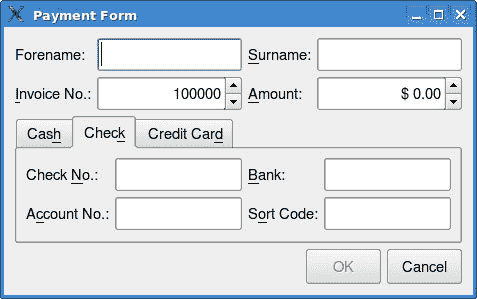
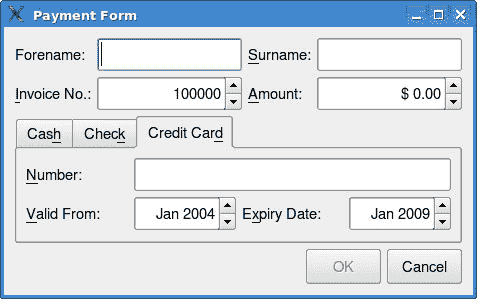

## 标签页控件和堆叠控件

某些对话框需要大量的控件来展示它们提供的所有选项，以至于用户难以理解。处理这种问题最明显的方法是创建两个或多个对话框，并将选项分配在它们之间。如果可能，这是一个很好的方法，因为它最小化了对用户的要求，而且从维护的角度来看，可能比单个复杂的对话框更容易。但通常我们往往需要使用单个对话框，因为我们提供给用户的选项是相关的，并且需要一起展示。

当我们必须使用单个对话框时，必须考虑两类选项组。一种仅仅是一组相关的选项。这通过使用`QTabWidget`处理最容易。标签页控件可以根据需要拥有任意数量的“页”（子控件和标签标题），每一页使用展示相关选项所需的控件进行布局。图 9.1 显示了一个`PaymentDlg`，这是一个使用`Qt Designer`创建的三页标签页控件的示例。

**图 9.1 一个使用标签页控件选择支付方式的对话框** 在`Qt Designer`控件框（Widget Box）的容器部分，有一个`Tab Widget`。它可以像任何其他控件一样被拖到表单上。与大多数容器控件一样，与大多数其他控件不同，我们通常必须将其拖到表单上后手动调整标签页控件的大小，使其大致达到我们想要的大小。在`Qt Designer`中，标签页控件具有删除和添加页的右键选项。可以通过点击相关标签或设置`currentIndex`属性来设置当前页。当前页的标签文本可以通过设置`currentTabText`属性来设置。

一旦标签页控件被拖到表单并调整了大小，我们就可以将其他拖到它的页面上。这些控件可以以正常方式布局，并且每个标签页都可以以类似于表单本身的方式进行布局：取消所有控件，然后点击该标签页，然后应用布局管理器。

虽然使用`Qt Designer`比手动创建对话框更快、更方便，但了解如何纯用代码实现相同的功能是非常有趣且实用的。我们不会展示普通控件的创建过程，因为我们已经看过很多次了；相反，我们将重点关注标签页控件（tab widget）和表单的整体布局。以下摘录均取自`chap09/paymentdlg.pyw`中`PaymentDlg`类的初始化函数。（`Qt Designer`版本位于`paymentdlg.ui`和`paymentdlg.py`文件中）。

```python
tabWidget = QTabWidget()
cashWidget = QWidget()
cashLayout = QHBoxLayout()
cashLayout.addWidget(self.paidCheckBox)
cashWidget.setLayout(cashLayout)
tabWidget.addTab(cashWidget, "Cas&h")
```

我们创建标签页控件就像创建任何其他控件一样。标签页控件中的每个页必须包含一个控件，因此我们创建了一个新控件`cashWidget`并为它创建一个布局。然后，我们将相关的控件——在这种情况下只有一个`paidCheckBox`——添加到布局中，然后将布局设置在容器控件上。最后，我们将该容器控件作为新标签页添加到标签页控件中，并带上标签页的标签文本。★

```python
checkWidget = QWidget()
checkLayout = QGridLayout()
checkLayout.addWidget(checkNumLabel, 0, 0)
checkLayout.addWidget(self.checkNumLineEdit, 0, 1)
checkLayout.addWidget(bankLabel, 0, 2)
checkLayout.addWidget(self.bankLineEdit, 0, 3)
checkLayout.addWidget(accountNumLabel, 1, 0)
checkLayout.addWidget(self.accountNumLineEdit, 1, 1)
checkLayout.addWidget(sortCodeLabel, 1, 2)
checkLayout.addWidget(self.sortCodeLineEdit, 1, 3)
checkWidget.setLayout(checkLayout)
tabWidget.addTab(checkWidget, "Chec&k")
```

这个标签页的创建方式与第一个完全相同。区别在于我们使用了网格布局（grid layout），并且有更多控件需要放入布局中。

我们不会显示第三个标签页的代码，因为它在结构上与已经看到的那些相同。

★ 在 PyQt 文档以及在某种程度上在`QTabWidget`的 API 中，“tab”一词既指单个标签页的标签，也同时指标签页的标签和页面。

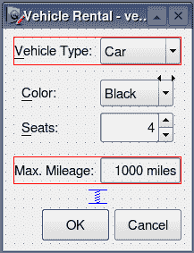
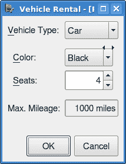
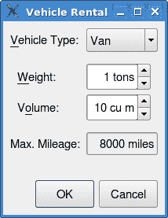

```python
layout = QVBoxLayout()
layout.addLayout(gridLayout)
layout.addWidget(tabWidget)
layout.addWidget(self.buttonBox)
```


`self.setLayout(layout)`

为了完整起见，我们展示了对话框布局的核心，仅省略了用于存放表单顶部标签、行编辑器和计数器的网格布局的创建。按钮由 `QDialogButtonBox` 提供，这种控件可以像任何其他控件一样进行布局。最后，我们在垂直框布局中布局整个表单：首先是顶部的网格，然后是中间的标签页控件，最后是按钮框。

另一种选项组仅适用于某些情况。在选项组适用或不适用的简单情况下，可以使用可勾选的 `QGroupBox`。如果用户取消勾选组框，其包含的所有控件都将被禁用。这意味着用户可以看到该组包含哪些选项，即使这些选项不可用，这通常很有帮助。在其他情况下，我们可能有两个或多个选项组，但时刻只有一个是有效的。对于这种情况，`QStackedWidget`（堆叠控件）提供了一个解决方案。从概念上说，堆叠控件是一个没有标签的标签页控件。因此，用户没有视觉提示显示存在堆叠控件，也没有方法在堆叠控件的页面之间导航。

设计时间 / 预览时间 / 运行时

**图 9.2** 使用堆叠控件的对话框

要使用堆叠控件，我们可以在 `Qt Designer` 中将 `Stacked Widget` 拖到表单上，并以与标签页控件相同的方式对其调整大小。在 `Qt Designer` 中，堆叠控件通过右上角的两个微小箭头指示。

这些箭头在预览表单时也存在，但在运行时不会出现——它们显示在图 9.2 前两个截图中颜色组合框的右上角。控件可以被拖到堆叠控件页面上，并以与标签页控件完全相同的方式布局。堆叠控件具有上下文菜单，提供了添加和删除页面的选项，以及用于页面导航和更改页面顺序的额外选项。

### 标签页控件与堆叠控件

由于堆叠控件没有标签，我们必须为用户提供一种页面间导航的方法。在图 9.2 所示 `VehicleRentalDlg` 中，车辆类型组合框被用作页面选择器。为了实现这一功能，在 `Qt Designer` 中我们将组合框的 `currentIndexChanged(int)` 信号连接到堆叠控件的 `setCurrentIndex(int)` 槽。另一种让用户看到所有可用页的方法是使用包含每个页面名称的 `QListWidget`，并以连接组合框信号的方式连接其 `currentRowChanged(int)` 信号。

我们现在将看到如何在代码中创建堆叠控件。以下摘录取自 `chap09/vehiclerentaldlg.pyw` 中 `VehicleRentalDlg` 类的初始化函数。（`Qt Designer` 版本位于 `vehiclerentaldlg.ui` 和 `vehiclerentaldlg.py` 文件中）。

```python
self.stackedWidget = QStackedWidget()

carWidget = QWidget()

carLayout = QGridLayout()

carLayout.addWidget(colorLabel, 0, 0)

carLayout.addWidget(self.colorComboBox, 0, 1)

carLayout.addWidget(seatsLabel, 1, 0)

carLayout.addWidget(self.seatsSpinBox, 1, 1)

carWidget.setLayout(carLayout)

self.stackedWidget.addWidget(carWidget)
```

向堆叠控件添加“页面”与向标签页控件添加标签页非常相似。我们首先创建一个普通控件，然后为它创建一个布局，并布局我们想要的控件。然后，我们将布局设置在普通控件上，并将此控件添加到控件堆栈中。我们没有显示 `vanWidget` 的代码，因为它在结构上是相同的。

```python
topLayout = QHBoxLayout()

topLayout.addWidget(vehicleLabel)

topLayout.addWidget(self.vehicleComboBox)

bottomLayout = QHBoxLayout()

bottomLayout.addWidget(mileageLabel)

bottomLayout.addWidget(self.mileageLabel)

layout = QVBoxLayout()

layout.addLayout(topLayout)

layout.addWidget(self.stackedWidget)

layout.addLayout(bottomLayout)

layout.addWidget(self.buttonBox)

self.setLayout(layout)
```

再次，为了完整起见，我们展示了整个对话框的布局。我们首先创建一个包含组合框的顶部布局，用于设置堆叠控件的当前页面。然后创建一个里程标签的底部布局，然后是按钮的布局。接下来，我们将这些布局以及堆叠控件本身添加到垂直框布局中。

```python
self.connect(self.buttonBox, SIGNAL("accepted()"), self.accept)

self.connect(self.buttonBox, SIGNAL("rejected()"), self.reject)

self.connect(self.vehicleComboBox, SIGNAL("currentIndexChanged(QString)"), self.setWidgetStack)

self.connect(self.weightSpinBox, SIGNAL("valueChanged(int)"), self.weightChanged)
```

我们必须为用户提供一种导航机制，我们通过将车辆组合框的 `currentIndexChanged()` 信号连接到自定义的 `setWidgetStack()` 槽来实现。最后一个槽只是表单验证的一部分；用于设置最大里程，对于汽车是固定的，但对于面包车取决于重量。

```python
def setWidgetStack(self, text):

    if text == "Car":

        self.stackedWidget.setCurrentIndex(0)

        self.mileageLabel.setText("1000 miles")

    else:

        self.stackedWidget.setCurrentIndex(1)

    self.weightChanged(self.weightSpinBox.value())

def weightChanged(self, amount):

    self.mileageLabel.setText("%d miles" % (8000 / amount))
```

`setWidgetStack()` 槽使相应的控件可见，并处理部分里程的设置，因为这取决于车辆是汽车还是面包车。

我们之前使用组合框（combobox）的当前文本来确定显示哪个组件。一种更健壮的方法是将数据项与每个组合框项关联（使用双参数的 `QComboBox.addItem()` 方法），并使用当前项目的数据项来选择显示哪种组件。

## 扩展对话框（Extension Dialogs）

对于复杂的对话框，我们还可以采取另一种方法：扩展对话框。这些通常用于对话框具有“简单”和“高级”选项的情况。初始时对话框显示简单选项，但提供了一个切换按钮来显示或隐藏高级选项。

图 9.3 所示的扩展对话框在按下“更多（More）”切换按钮时，会显示出额外的复选框。通过对任何 `QPushButton` 运行 `setCheckable(True)`，或者在 `Qt Designer` 中将其“checkable”属性设置为 True，即可将其转换为切换按钮。

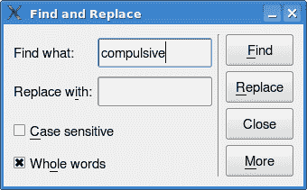

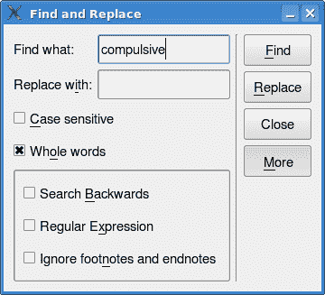

**图 9.3** *一个扩展对话框*

为了让扩展对话框工作，我们使用了两个“技巧”。第一个技巧是将所有高级选项的组件放在一个 `QFrame` 中。这意味着我们只需要隐藏和显示该框架，因为 PyQt 会自动隐藏和显示框架内的所有组件，以反映框架的可见性状态。

如果我们不希望用户在框架显示时看到它的轮廓线，可以简单地将它的 `frameShape` 属性设置为 `QFrame.NoFrame`。

第二个技巧是将对话框设为固定大小。这将确保对话框收缩到最小（同时保留边距），并考虑到对话框的可见内容。这样做的效果是：当高级选项隐藏时，对话框很短；当它们显示时，高度足够显示高级选项。我们还必须在创建对话框时隐藏框架。以下是对话框初始化代码（来自 `chap09/findandreplacedlg.py`）：

```python
class FindAndReplaceDlg(QDialog, ui_findandreplacedlg.Ui_FindAndReplaceDlg):

    def __init__(self, parent=None):

        super(FindAndReplaceDlg, self).__init__(parent)

        self.setupUi(self)

        self.moreFrame.hide()

        self.layout().setSizeConstraint(QLayout.SetFixedSize)
```

但我们如何将“更多”按钮与框架的显示/隐藏状态联系起来呢？

只需将 `moreButton` 的 `toggled(bool)` 信号连接到 `moreFrame` 的 `setVisible(bool)` 槽即可。注意，如果在 `Qt Designer` 中进行此连接，我们必须勾选连接对话框中的“显示所有信号和槽”复选框；否则 `setVisible()` 槽不会出现。

在本节的最后一个示例中，我们将再次查看如何在代码中实现布局。与之前两个显示新组件（`QTabWidget` 和 `QStackedWidget`）的布局不同，此对话框的布局仅使用了我们之前见过的组件——但使用了新的方式。以下代码提取自 `chap09/findandreplacedlg.pyw` 中 `FindAndReplaceDlg` 类的初始化。（`Qt Designer` 版本位于文件 `findandreplacedlg.ui` 和 `findandreplacedlg.py` 中）。我们只显示与扩展对话框特别相关的表单组件创建。表单布局如图 9.4 所示。

```python
moreFrame = QFrame()

moreFrame.setFrameStyle(QFrame.StyledPanel|QFrame.Sunken)
```

我们创建一个框架并在其中放入额外的复选框。如果我们没有调用 `setFrameStyle()`，框架将没有轮廓线。

```python
line = QFrame()

line.setFrameStyle(QFrame.VLine|QFrame.Sunken)
```

我们“绘制”的用于视觉上分离左侧对话框主组件与右侧按钮的线也是一个框架。可以使用 `QFrame.HLine` 框架样式创建水平线。

```python
moreButton = QPushButton("&More")

moreButton.setCheckable(True)
```

“更多”按钮与其他按钮不同的一点在于：它是可检查的（checkable）。这意味着它的作用像一个切换按钮，第一次点击时保持按下状态，下一次点击时则弹起，以此类推。

**图 9.4** *查找和替换对话框的布局*

标签和行编辑框（line edits）布局在网格中；我们将不再显示代码，因为我们已经见过很多这种布局了。

```python
frameLayout = QVBoxLayout()

frameLayout.addWidget(self.backwardsCheckBox)

frameLayout.addWidget(self.regexCheckBox)

frameLayout.addWidget(self.ignoreNotesCheckBox)

moreFrame.setLayout(frameLayout)
```

我们希望额外的复选框布局在 `moreFrame` 内部。为了做到这一点，我们创建一个布局（在这种情况下是垂直框布局），并将复选框添加到其中。然后将该布局设置到框架上。在之前的示例中，我们通过将布局添加到布局中来实现嵌套，但在这里我们通过向框架添加布局来实现嵌套。因此，除了可以在布局之间嵌套外，我们还可以在布局内部嵌套框架和组合框，这赋予了我们极大的灵活性。

```python
leftLayout = QVBoxLayout()

leftLayout.addLayout(gridLayout)

leftLayout.addWidget(self.caseCheckBox)

leftLayout.addWidget(self.wholeCheckBox)

leftLayout.addWidget(moreFrame)
```

左侧布局是一个垂直框布局，我们在其中添加了网格布局（带有标签和行编辑框）、区分大小和全词匹配复选框，然后是 `moreFrame`（它包含位于垂直框布局中的额外复选框）。

```python
buttonLayout = QVBoxLayout()

buttonLayout.addWidget(self.findButton)

buttonLayout.addWidget(self.replaceButton)

buttonLayout.addWidget(closeButton)

buttonLayout.addWidget(moreButton)

buttonLayout.addStretch()
```

按钮布局与我们之前见过的非常相似，只不过这次使用的是垂直框布局而不是水平框布局。

```python
mainLayout = QHBoxLayout()

mainLayout.addLayout(leftLayout)

mainLayout.addWidget(line)

mainLayout.addLayout(buttonLayout)

self.setLayout(mainLayout)
```

对话框的主布局是一个水平框布局，左侧布局在左，然后是分割线，最后是按钮布局。该线会根据 `moreFrame` 是否可见（因此取决于对话框的高矮）进行垂直伸缩。

```python
moreFrame.hide()

mainLayout.setSizeConstraint(QLayout.SetFixedSize)
```

我们最初隐藏 `moreFrame`（以及它包含的组件），并使用固定大小技巧来确保对话框根据 `moreFrame` 是否可见来调整自身大小。

```python
self.connect(moreButton, SIGNAL("toggled(bool)"), moreFrame, SLOT("setVisible(bool)"))
```

我们必须做的最后一件事是将“更多”按钮的 `toggled()` 信号连接到 `moreFrame` 的 `setVisible()` 槽。当框架隐藏（或显示）时，它将反过来隐藏（或显示）布局在内部的所有组件，因为对组件调用 `show()` 或 `hide()` 时，PyQt 会自动将这些调用传递给该组件的所有子组件。

一些主窗口风格的应用程序需要在其中心区域使用多个部件。需要此类操作的常见应用程序类型是电子邮件客户端和网络新闻阅读器。我们可以采取三种方法来处理这种情况。一种方法是创建一个复合部件，即一个 `Composite` 由其他部件组成的部件（它们像对话框一样被创建和布局，但继承自 `QWidget` 而不是 `QDialog`），并使用该部件作为主窗口的中心部件。另一种方法是只设置一个中心部件，并将其他部件放在停靠窗口（dock windows）中——我们已经在第 6 章见过这种做法。

第三种方法是使用拆分器（splitters），这也是本节的主题。

图 9.5 显示了一个新闻阅读器应用程序的草图，图 9.6 解释了表单拆分器与部件之间的关系。`Qt Designer` 完全支持拆分器，其用法与垂直和水平箱式布局非常相似：我们选择两个或多个部件，然后点击 `表单→在拆分器中水平布局` 或 `表单→在拆分器中垂直布局`。

在本节中，我们将展示如何在代码中创建拆分器，包括如何保存和恢复它们的相对位置。我们将从查看新闻阅读器草图初始化器的相关部分开始。

```python
class MainWindow(QMainWindow):

  def __init__(self, parent=None):

    super(MainWindow, self).__init__(parent)

    self.groupsList = QListWidget()

    self.messagesList = QListWidget()

    self.messageView = QTextBrowser()
```

初始化器按照惯例从 `super()` 开始。接下来的三行略微不同，因为尽管这是一个主窗口，但我们创建了三个部件而不是一个。

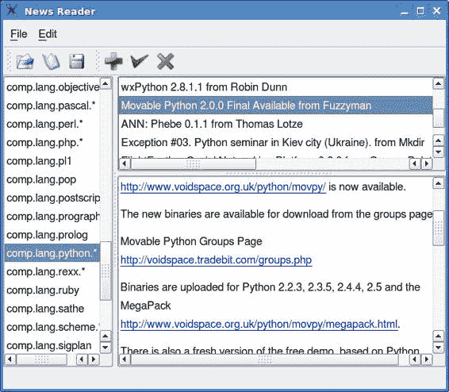

**图 9.5** 新闻阅读器应用程序草图

```python
self.messageSplitter = QSplitter(Qt.Vertical)

self.messageSplitter.addWidget(self.messagesList)

self.messageSplitter.addWidget(self.messageView)

self.mainSplitter = QSplitter(Qt.Horizontal)

self.mainSplitter.addWidget(self.groupsList)

self.mainSplitter.addWidget(self.messageSplitter)
```


```python
self.setCentralWidget(self.mainSplitter)
```

我们现在创建两个拆分器。第一个是`messageSplitter`；它垂直地持有消息列表和消息视图部件，一个在上在上。第二个拆分器`mainSplitter`水平拆分，分组列表部件在左侧，消息拆分器在右侧。像箱式布局一样，拆分器可以包含两个以上的部件，它们会在每对部件之间放置拆分器。主拆分器持有一个部件和一个拆分器，而另一个拆分器又持有另外两个部件。因此，主拆分器最终包含了其他所有。由于拆分器是部件（与布局不同），拆分器可以作为主窗口的中心部件，正如我们在这里做的那样。

有些用户发现拆分器很烦人，因为他们只能通过鼠标调整大小。我们将通过保存和恢复用户的拆分器大小来减少这种困扰。这很有帮助，因为用户只需设置一次大小，从那时以后他们设置的大小就会被采纳。

**图 9.6** 新闻阅读器的拆分器和部件

```python
settings = QSettings()

size = settings.value("MainWindow/Size",
QVariant(QSize(600, 500))).toSize()

self.resize(size)

position = settings.value("MainWindow/Position",
QVariant(QPoint(0, 0))).toPoint()

self.move(position)

self.restoreState(
  settings.value("MainWindow/State").toByteArray())

self.messageSplitter.restoreState(
  settings.value("MessageSplitter").toByteArray())

self.mainSplitter.restoreState(
  settings.value("MainSplitter").toByteArray())
```

保存用户的主窗口设置始于一些恢复窗口大小、位置以及可能存在的任何工具栏和停靠窗口状态的常见代码。拆分器也有状态，并且与主窗口状态相同的方式进行恢复和保存。

```python
def closeEvent(self, event):

  if self.okToContinue():

    settings = QSettings()

    settings.setValue("MainWindow/Size", QVariant(self.size()))

    settings.setValue("MainWindow/Position",
    QVariant(self.pos()))

    settings.setValue("MainWindow/State",
    QVariant(self.saveState()))

    settings.setValue("MessageSplitter",
    QVariant(self.messageSplitter.saveState()))

    settings.setValue("MainSplitter",
    QVariant(self.mainSplitter.saveState()))

  else:

    event.ignore()
```

在主窗口的关闭事件中，代码再次以熟悉的方式开始，只是我们现在除了主窗口的大小、位置和状态外，还保存了拆分器的状态。

当第一次运行新闻阅读器应用程序时，默认主拆分器将其一半的宽度给分组列表部件，另一半给消息拆分器。同样，消息拆分器将其一半的高度给消息列表部件，另一半给消息视图部件。我们想要改变这些比例，让分组列表更窄，让消息查看器更高，我们可以通过应用伸缩因子（stretch factors）来实现。例如：

```python
self.mainSplitter.setStretchFactor(0, 1)
self.mainSplitter.setStretchFactor(1, 3)
self.messageSplitter.setStretchFactor(0, 1)
self.messageSplitter.setStretchFactor(1, 2)
```

`setStretchFactor()` 的第一个参数是部件的从 0 开始的索引位置（从左到右，或从上到下），第二个参数是要应用的伸缩因子。在这种情况下，我们设定第 0 个部件（分组列表部件）的伸缩因子为 1，第 1 个部件（消息拆分器）的因子为 3，从而将水平空间按 1:3 划分。同样，对于消息拆分器，我们将垂直空间按 1:2 划分，有利于视图部件。由于我们保存并恢复了拆分器的大小，伸缩因子仅在首次运行时生效。

### 单文档界面 (SDI)

对于某些应用程序，用户希望能够处理多个文档。这通常可以通过运行多个应用程序实例来实现，但这消耗大量资源。使用多个实例的另一个缺点是无法提供一个供用户在各种文档之间导航的公共窗口。

这个问题有三种常用的解决方案。一种是使用带标签部件的主窗口，每个标签持有一个文档。这种方法对于网络浏览器很流行，但在编辑文档时可能不方便，因为无法同时看到两个文档。我们不会介绍这种方法，因为本章第二节对标签部件的介绍已经足够，而且你将在练习中有机会尝试它。另外两种方法是 SDI（我们在本节介绍）和 MDI（将在下一节介绍）。

创建 SDI 应用程序的关键创建一个窗口子类，由它自己处理一切，包括加载、保存和清理，使应用程序本质上成为一个或多个此类窗口的集合。

我们将从查看 SDI 编辑器初始化器的部分提取开始；应用程序本身如图 9.7 所示。

```python
class MainWindow(QMainWindow):

  NextId = 1

  def __init__(self, filename=QString(), parent=None):

    super(MainWindow, self).__init__(parent)

    self.setAttribute(Qt.WA_DeleteOnClose)

    MainWindow.Instances.add(self)
```

`NextId` 静态变量用于为新的空窗口提供编号：“Unnamed-1.txt”、“Unnamed-2.txt”等。

该应用程序由一个或多个`MainWindow`实例组成，每个实例都必须能够独立运行。然而，在三种常见情况下，我们需要从其中任何一个实例内部访问所有实例。其一种是提供“保存全部”选项，另一种是提供一个“窗口”菜单，用户可以通过它在不同的窗口实例之间切换，还有一种是提供一个“退出”选项，用户可以使用它来终止应用程序，且它必须隐式地关闭每一个窗口。我们使用`Instances`静态变量来跟踪所有的实例。

当创建一个新的窗口实例时，我们将其设置为在关闭时自动销毁。

这意味着窗口可以由用户直接关闭，也可以由其他实例间接关闭（例如，当应用程序终止时）。使用`Qt.WA_DeleteOnClose`的一个影响是，窗口应该负责保存未保存的更改，并清理自身。我们还将窗口添加到静态窗口实例集合中，这样任何窗口实例都可以访问所有其他窗口。我们将在以后进一步研究这些问题。

### 单文档界面 (SDI)

```python
self.editor = QTextEdit()
self.setCentralWidget(self.editor)
```

`QTextEdit` 是我们中心部件的理想选择，某些创建动作可以直接传递给它，正如我们稍后将看到的。现在我们将通过`Action()`查看其中的几个动作，跳过我们之前看过的`createAction()`方法。

```python
fileSaveAllAction = self.createAction("Save A&ll", self.fileSaveAll, icon="filesave", tip="Save all the files")
```

此动作与几乎所有其他文件动作类似，它连接到`MainWindow`子类的一个方法。

```python
fileCloseAction = self.createAction("&Close", self.close, QKeySequence.Close, "fileclose", "Close this text editor")
```

“关闭”动作与我们之前看到的那些相似。按照惯例，我们没有重新实现`close()`方法，而是重新实现`closeEvent()`处理器，以便我们可以拦截窗口的任何清理关闭。不同之处在于，此动作关闭的是当前的唯一窗口，而不是应用程序（除非这是应用程序唯一的窗口）。

```python
fileQuitAction = self.createAction("&Quit", self.fileQuit, "Ctrl+Q", "filequit", "Close the application")
```

“退出”动作会终止应用程序，通过关闭 SDI 文本编辑器的每个窗口来实现，正如我们在回顾`fileQuit()`方法时将看到的。

```python
editCopyAction = self.createAction("&Copy", self.editor.copy, QKeySequence.Copy, "editcopy", "Copy text to the clipboard")
```

此动作连接到`QTextEdit`相关的槽函数。“剪切”和“粘贴”动作也是如此。

菜单、工具栏和状态栏都是以我们之前看到的方式创建的，但窗口菜单除外，我们现在来查看窗口菜单。

```python
self.windowMenu = self.menuBar().addMenu("&Window")

self.connect(self.windowMenu, SIGNAL("aboutToShow()"), self.updateWindowMenu)
```

我们完全没有向窗口菜单添加任何动作。相反，我们简单地将菜单的`aboutToShow()`方法连接到我们自定义的`updateWindowMenu()`方法，正如我们将看到的，该方法会用所有的 SDI 文本编辑器窗口填充菜单。

# 第 9 章：布局与多文档

```python
self.connect(self, SIGNAL("destroyed(QObject*)"), MainWindow.updateInstances)
```

当用户关闭窗口时，得益于`Qt.WA_DeleteOnClose`标志，窗口将被删除。但由于我们在静态`Instances`集合中保留了窗口的引用，窗口无法被垃圾回收。因此，我们将窗口的`destroyed()`信号连接到一个槽函数，该函数通过移除任何已关闭的窗口来更新`Instances`。我们在查看`updateInstances()`方法时将详细讨论这一点。

由于每个窗口负责单个文件，我们可以为每个窗口关联一个文件名。文件名可以传递给窗口的初始化函数，默认值为空`QString`。初始化函数的最后几行处理了文件名。

```python
self.filename = filename

if self.filename.isEmpty():

    self.filename = QString("Unnamed-%d.txt" % MainWindow.NextId)

    MainWindow.NextId += 1

    self.editor.document().setModified(False)

    self.setWindowTitle("SDI Text Editor - %s" % self.filename)

else:

    self.loadFile()
```

如果窗口没有文件名（是因为程序刚刚启动，或者是因为用户调用了“文件新建”动作），我们就创建一个合适的窗口标题；否则，我们加载给的文件。

`closeEvent()`、`loadFile()`、`fileSave()`和`fileSaveAs()`方法与我们之前看到的那些非常相似，因此我们不会在这里描述它们。（当然，它们在`chap09/sditexteditor.pyw`的源代码中）。相反，我们将重点关注那些对于 SDI 应用程序来说特殊的事务。

```python
def fileNew(self):

    MainWindow().show()
```

当用户调用“文件新建”动作时，会调用此方法。会创建该类的另一个实例，并对其调用`show()`（因此它以模态方式显示）。在方法结束时，我们预计窗口将超出作用域并被销毁，因为它没有 PyQt 父对象，也不是实例变量。但在主窗口的初始化函数内部，窗口将自己添加到静态`Instances`集合中，因此仍然存在窗口的对象的引用，因此窗口不会被销毁。

```python
def fileOpen(self):

    filename = QFileDialog.getOpenFileName(self, "SDI Text Editor -- Open File")

    if not filename.isEmpty():

        if not self.editor.document().isModified() and self.filename.startsWith("Unnamed"):

            self.filename = filename

            self.loadFile()

        else:

            MainWindow(filename).show()
```

此方法与我们之前看到的类似方法略有不同。如果用户提供了一个文件名，且当前文档既未修改也未命名（即一个新的空文档），我们将文件加载到现有窗口中；否则，我们创建一个新窗口，并传递它要加载的文件名。

```python
def fileSaveAll(self):

    count = 0

    for window in MainWindow.Instances:

        if isAlive(window) and window.editor.document().isModified():

            if window.fileSave():

                count += 1

        self.statusBar().showMessage("Saved %d of %d files" % (count, len(MainWindow.Instances)), 5000)
```

为了用户，我们提供了一个保存全部菜单选项。当调用它时，我们会遍历`Instances`集合中的每个窗口，对于每个“活跃”且已修改的窗口，我们对其进行保存。

# 第 9 章 布局与多文档

```python
def isAlive(qobj):

    import sip

    try:

        sip.unwrapinstance(qobj)

    except RuntimeError:

        return False

    return True
```

`sip`模块是 PyQt 的支持模块之一，我们通常不需要直接访问它。但在需要更深入研究的某些情况下，它是很有用的。在这里，该方法尝试访问变量底层的 PyQt 对象。

如果对象已经被删除，则会抛出`RuntimeError`异常，在这种情况下我们返回`False`；否则，对象仍然存在，我们返回`True`。★ 通过执行此检查，我们确保已关闭并删除的窗口不会被无意中访问，即使我们还没有删除引用该窗口的变量。

★ `isAlive()`函数基于 Giovanni Bajo 在 PyQt（当时为 PyKDE）邮件列表上的帖子“如何检测一个对象是否已被删除”。该列表同时用于 PyQt 和 PyKDE。

```python
@staticmethod

def updateInstances(qobj):

    MainWindow.Instances = set([window for window \

    in MainWindow.Instances if isAlive(window)])
```

每当窗口被关闭（因此被删除）时，它都会发射一个`destroyed()`信号，我们在初始化器中将信号连接到`updateInstances()`方法。该方法用`Instances`集合替换为仅包含仍然存活的窗口实例的集合。

那么，为什么在遍历实例时（例如在`fileSaveAll()`方法中）我们还需要检查存活状态呢？既然该方法已经确保了`Instances`集合保持更新并仅持有活跃的窗口？

原因是，从理论上讲，在窗口关闭到`Instances`集合更新之间，窗口可能会在其他方法中被遍历。

每当用户点击任何 SDI 编辑器窗口中的`Window`菜单时，就会一个列出所有当前窗口的菜单。这是因为`windowMenu`的`aboutToShow()`信号连接到了填充菜单的`updateWindowMenu()`槽。

```python
def updateWindowMenu(self):

    self.windowMenu.clear()

    for window in MainWindow.Instances:

        if isAlive(window):

            self.windowMenu.addAction(window.windowTitle(),

            self.raiseWindow)
```


首先清除任何现有的菜单条目；始终至少有一个，即当前窗口。接下来，我们遍历所有窗口实例，并为任何存活的窗口添加动作。该动作的文本仅为窗口的标题（文件名），以及一个槽——`raiseWindow()`——当用户调用菜单选项时会被调用。

## 单文档界面（SDI）

★ 在 Mac OS X 上，只有一个菜单栏，位于屏幕顶端。它会发生变化以反映当前获得焦点的窗口。

```python
def raiseWindow(self):
    action = self.sender()

    if not isinstance(action, QAction):
        return

    for window in MainWindow.Instances:
        if isAlive(window) and \
                window.windowTitle() == action.text():
            window.activateWindow()
            window.raise_()
            break
```

此方法可以由`Window`菜单的任何条目调用。我们首先进行合理性检查，然后遍历窗口实例，查看哪一个窗口的标题文本与动作文本匹配。如果找到匹配项，我们将该窗口设为“活动”窗口（具有键盘焦点的应用程序顶层窗口），并将其置于所有其他窗口之上，以便用户看到它。

在随后的 MDI 部分中，我们将看到如何创建一个更复杂的`Window`菜单，带有加速键和一些额外的菜单选项。

```python
def fileQuit(self):
    QApplication.closeAllWindows()
```

PyQt 提供了一个方便的方法来关闭应用程序的所有顶层窗口。该方法对所有窗口调用`close()`，这反过来导致每个窗口获取一个`closeEvent()`。在此事件（未显示）中，我们检查`QTextEdit`的文本是否有未保存的更改，如果有，我们就会弹出一个对话框询问用户是否保存。

```python
app = QApplication(sys.argv)

app.setWindowIcon(QIcon(":/icon.png"))

MainWindow().show()

app.exec_()
```

在`sditexteditor.pyw`文件的末尾，我们创建了一个`QApplication`实例和一个`MainWindow`实例，然后启动事件循环。

使用 SDI 方法非常流行，但它也有一些缺点。由于每个主窗口都有自己的菜单栏、工具栏以及可能的停靠窗口，与单个主窗口相比，它的资源开销更大。★ 此外，虽然使用`Window`菜单在窗口之间切换很容易，但如果我们想对窗口的大小和位置有更多控制，就必须自己编写代码。这些问题可以通过我们在下一节中介绍的较不流行的 MDI 方法来解决。

## 多文档界面（MDI）

与 SDI 或运行多个应用程序实例相比，MDI 具有许多优势。MDI 应用程序更节省资源，并且让用户能够更容易地布局文档窗口之间的相对关系。然而，一个缺点是，你无法使用`Alt+Tab`（Mac OS X 上为`Command+Tab`）切换 MDI 窗口，尽管在实践中这很少成为问题，因为对于 MDI 应用程序，程序员总是实现一个`Window`菜单用于在窗口之间导航。

创建 MDI 应用程序的关键是创建一个部件子类，它自己处理一切，包括加载、保存和清理，由应用程序将这些部件保留在 MDI“工作空间”中，并将任何特定部件的操作传递给它们。

在本节中，我们将创建一个文本编辑器，它提供与上一节 SDI 文本编辑器相同的功能，但这次我们将将其制成 MDI 应用程序。应用程序如图 9.8 所示。

每个文档都使用自定义`TextEdit`部件实例（`QTextEdit`子类）进行展示和编辑。该部件设置了`Qt.WA_DeleteOnClose`属性，有一个文件名实例变量，并加载和保存给它的文件名。如果部件被关闭（因此被删除），它的关闭事件处理程序将用户有机会保存任何未保存的更改。`TextEdit`的实现非常直观，与我们之前看到的代码非常相似，因此我们在这里不再复习它；其源代码在`chap09/textedit.py`模块中。

应用程序本身的代码位于`chap09/texteditor.pyw`文件。我们将审查这些代码，从`MainWindow`子类的初始化器提取开始。

```python
class MainWindow(QMainWindow):

    def __init__(self, parent=None):

        super(MainWindow, self).__init__(parent)

        self.mdi = QWorkspace()

        self.setCentralWidget(self.mdi)
```

★ PyQt 的 MDI 部件被称为`QWorkspace`。就像标签部件或堆叠部件一样，`QWorkspace`可以添加许多部件。这些部件由工作空间布局，就像一个微型桌面，用户可以在工作空间区域对部件进行平铺、层叠、图标化，或拖动和调整大小。

★ 从 Qt 4.3 开始，MDI 由`QMdiArea`类提供，其 API 与`QWorkspace`类类似。

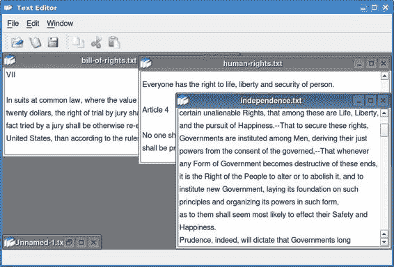

**图 9.8** *带有四个文档的 MDI 文本编辑器*

通过调用`QWorkspace.setScrollBarsEnabled(True)`，可以创建一个比窗口更大的工作空间。可以通过指定背景刷来设置背景。

```python
fileNewAction = self.createAction(
    "&New",
    self.fileNew,
    QKeySequence.New,
    "filenew",
    "创建一个文本文件"
)
```

大多数文件动作都是像之前那样创建的。但正如我们将看到的，MDI 编辑器像 SDI 编辑器一样，没有`okToContinue()`方法，因为每个文档窗口都处理自己。

```python
fileQuitAction = self.createAction("&Quit", self.close,


`"Ctrl+Q"`, `"filequit"`, `"Close the application")` 如果我们关闭应用程序窗口，应用程序将终止。所有的文档窗口都将被关闭，任何未保存更改的窗口将负责在被要求时提示用户并进行保存。

`editCopyAction = self.createAction("&Copy", self.editCopy, QKeySequence.Copy, "editcopy", "Copy text to the clipboard")`

在 SDI 编辑器中，我们将“复制”、“剪切”和“粘贴”动作传递给每个窗口的 `QTextEdit` 处理。这在 `MDI` 中是不可能的，因为当用户触发其中一个动作时，它必须应用于任何活跃的 `TextEdit` 窗口。因此，主窗口必须自己完成一些工作，正如我们在回顾这些动作的实现时将的那样。

我们没有显示其他文件和编辑动作的代码，因为它们都遵循之前所示的模式。

```python
self.windowNextAction = self.createAction("&Next", self.mdi.activateNextWindow, QKeySequence.NextChild)
self.windowPrevAction = self.createAction("&Previous", self.mdi.activatePreviousWindow, QKeySequence.PreviousChild)
self.windowCascadeAction = self.createAction("Casca&de", self.mdi.cascade)
self.windowTileAction = self.createAction("&Tile", self.mdi.tile)
self.windowRestoreAction = self.createAction("&Restore All", self.windowRestoreAll)
self.windowMinimizeAction = self.createAction("&Iconize All", self.windowMinimizeAll)
self.windowArrangeIconsAction = self.createAction("&Arrange Icons", self.mdi.arrangeIcons)
self.windowCloseAction = self.createAction("&Close", self.mdi.closeWindow)
```

所有未保存更改的 `window` 负责在被要求时提示用户并保存。

```python
self.windowNextAction = self.createAction("&Next", self.mdi.activateNextWindow, QKeySequence.NextChild)
self.windowPrevAction = self.createAction("&Previous", self.mdi.activatePreviousWindow, QKeySequence.PreviousChild)
self.windowCascadeAction = self.createAction("Casca&de", self.mdi.cascade)
self.windowTileAction = self.createAction("&Tile", self.mdi.tile)
self.windowRestoreAction = self.createAction("&Restore All", self.windowRestoreAll)
self.windowMinimizeAction = self.createAction("&Iconize All", self.windowMinimizeAll)
self.windowArrangeIconsAction = self.createAction("&Arrange Icons", self.mdi.arrangeIcons)
self.windowCloseAction = self.createAction("&Close", self.mdi.closeWindow)
```

所有未保存更改的 `window` 负责在被要求时提示用户并保存。

```python
self.windowNextAction = self.createAction("&Next", self.mdi.activateNextWindow, QKeySequence.NextChild)
self.windowPrevAction = self.createAction("&Previous", self.mdi.activatePreviousWindow, QKeySequence.PreviousChild)
self.windowCascadeAction = self.createAction("Casca&de", self.mdi.cascade)
self.windowTileAction = self.createAction("&Tile", self.mdi.tile)
self.windowRestoreAction = self.createAction("&Restore All", self.windowRestoreAll)
self.windowMinimizeAction = self.createAction("&Iconize All", self.windowMinimizeAll)
self.windowArrangeIconsAction = self.createAction("&Arrange Icons", self.mdi.arrangeIcons)
self.windowCloseAction = self.createAction("&Close", self.mdi.closeWindow)
```

所有未保存更改的 `window` 负责在被要求时提示用户并保存。

```python
self.windowNextAction = self.createAction("&Next", self.mdi.activateNextWindow, QKeySequence.NextChild)
self.windowPrevAction = self.createAction("&Previous", self.mdi.activatePreviousWindow, QKeySequence.PreviousChild)
self.windowCascadeAction = self.createAction("Casca&de", self.mdi.cascade)
self.windowTileAction = self.createAction("&Tile", self.mdi.tile)
self.windowRestoreAction = self.createAction("&Restore All", self.windowRestoreAll)
self.windowMinimizeAction = self.createAction("&Iconize All", self.windowMinimizeAll)
self.windowArrangeIconsAction = self.createAction("&Arrange Icons", self.mdi.arrangeIcons)
self.windowCloseAction = self.createAction("&Close", self.mdi.closeWindow)
```

所有未保存更改的 `window` 负责在被要求时提示用户并保存。

```python
self.windowNextAction = self.createAction("&Next", self.mdi.activateNextWindow, QKeySequence.NextChild)
self.windowPrevAction = self.createAction("&Previous", self.mdi.activatePreviousWindow, QKeySequence.PreviousChild)
self.windowCascadeAction = self.createAction("Casca&de", self.mdi.cascade)
self.windowTileAction = self.createAction("&Tile", self.mdi.tile)
self.windowRestoreAction = self.createAction("&Restore All", self.windowRestoreAll)
self.windowMinimizeAction = self.createAction("&Iconize All", self.windowMinimizeAll)
self.windowArrangeIconsAction = self.createAction("&Arrange Icons", self.mdi.arrangeIcons)
self.windowCloseAction = self.createAction("&Close", self.mdi.closeWindow)
```

所有未保存更改的 `window` 负责在被要求时提示用户并保存。

```python
self.windowNextAction = self.createAction("&Next", self.mdi.activateNextWindow, QKeySequence.NextChild)
self.windowPrevAction = self.createAction("&Previous", self.mdi.activatePreviousWindow, QKeySequence.PreviousChild)
self.windowCascadeAction = self.createAction("Casca&de", self.mdi.cascade)
self.windowTileAction = self.createAction("&Tile", self.mdi.tile)
self.windowRestoreAction = self.createAction("&Restore All", self.windowRestoreAll)
self.windowMinimizeAction = self.createAction("&Iconize All", self.windowMinimizeAll)
self.windowArrangeIconsAction = self.createAction("&Arrange Icons", self.mdi.arrangeIcons)
self.windowCloseAction = self.createAction("&Close", self.mdi.closeWindow)
```

所有未保存更改的 `window` 负责在被要求时提示用户并保存。

```python
self.windowNextAction = self.createAction("&Next", self.mdi.activateNextWindow, QKeySequence.NextChild)
self.windowPrevAction = self.createAction("&Previous", self.mdi.activatePreviousWindow, QKeySequence.PreviousChild)
self.windowCascadeAction = self.createAction("Casca&de", self.mdi.cascade)
self.windowTileAction = self.createAction("&Tile", self.mdi.tile)
self.windowRestoreAction = self.createAction("&Restore All", self.windowRestoreAll)
self.windowMinimizeAction = self.createAction("&Iconize All", self.windowMinimizeAll)
self.windowArrangeIconsAction = self.createAction("&Arrange Icons", self.mdi.arrangeIcons)
self.windowCloseAction = self.createAction("&Close", self.mdi.closeWindow)
```

所有未保存更改的 `window` 负责在被要求时提示用户并保存。

```python
self.windowNextAction = self.createAction("&Next", self.mdi.activateNextWindow, QKeySequence.NextChild)
self.windowPrevAction = self.createAction("&Previous", self.mdi.activatePreviousWindow, QKeySequence.PreviousChild)
self.windowCascadeAction = self.createAction("Casca&de", self.mdi.cascade)
self.windowTileAction = self.createAction("&Tile", self.mdi.tile)
self.windowRestoreAction = self.createAction("&Restore All", self.windowRestoreAll)
self.windowMinimizeAction = self.createAction("&Iconize All", self.windowMinimizeAll)
self.windowArrangeIconsAction = self.createAction("&Arrange Icons", self.mdi.arrangeIcons)
self.windowCloseAction = self.createAction("&Close", self.mdi.closeWindow)
```

所有未保存更改的 `window` 负责在被要求时提示用户并保存。

```python
self.windowNextAction = self.createAction("&Next", self.mdi.activateNextWindow, QKeySequence.NextChild)
self.windowPrevAction = self.createAction("&Previous", self.mdi.activatePreviousWindow, QKeySequence.PreviousChild)
self.windowCascadeAction = self.createAction("Casca&de", self.mdi.cascade)
self.windowTileAction = self.createAction("&Tile", self.mdi.tile)
self.windowRestoreAction = self.createAction("&Restore All", self.windowRestoreAll)
self.windowMinimizeAction = self.createAction("&Iconize All", self.windowMinimizeAll)
self.windowArrangeIconsAction = self.createAction("&Arrange Icons", self.mdi.arrangeIcons)
self.windowCloseAction = self.createAction("&Close", self.mdi.closeWindow)
```

所有未保存更改的 `window` 负责在被要求时提示用户并保存。

```python
self.windowNextAction = self.createAction("&Next", self.mdi.activateNextWindow, QKeySequence.NextChild)
self.windowPrevAction = self.createAction("&Previous", self.mdi.activatePreviousWindow, QKeySequence.PreviousChild)
self.windowCascadeAction = self.createAction("Casca&de", self.mdi.cascade)
self.windowTileAction = self.createAction("&Tile", self.mdi.tile)
self.windowRestoreAction = self.createAction("&Restore All", self.windowRestoreAll)
self.windowMinimizeAction = self.createAction("&Iconize All", self.windowMinimizeAll)
self.windowArrangeIconsAction = self.createAction("&Arrange Icons", self.mdi.arrangeIcons)
self.windowCloseAction = self.createAction("&Close", self.mdi.closeWindow)
```

所有未保存更改的 `window` 负责在被要求时提示用户并保存。

```python
self.windowNextAction = self.createAction("&Next", self.mdi.activateNextWindow, QKeySequence.NextChild)
self.windowPrevAction = self.createAction("&Previous", self.mdi.activatePreviousWindow, QKeySequence.PreviousChild)
self.windowCascadeAction = self.createAction("Casca&de", self.mdi.cascade)
self.windowTileAction = self.createAction("&Tile", self.mdi.tile)
self.windowRestoreAction = self.createAction("&Restore All", self.windowRestoreAll)
self.windowMinimizeAction = self.createAction("&Iconize All", self.windowMinimizeAll)
self.windowArrangeIconsAction = self.createAction("&Arrange Icons", self.mdi.arrangeIcons)
self.windowCloseAction = self.createAction("&Close", self.mdi.closeWindow)
```

所有未保存更改的 `window` 负责在被要求时提示用户并保存。

```python
self.windowNextAction = self.createAction("&Next", self.mdi.activateNextWindow, QKeySequence.NextChild)
self.windowPrevAction = self.createAction("&Previous", self.mdi.activatePreviousWindow, QKeySequence.PreviousChild)
self.windowCascadeAction = self.createAction("Casca&de", self.mdi.cascade)
self.windowTileAction = self.createAction("&Tile", self.mdi.tile)
self.windowRestoreAction = self.createAction("&Restore All", self.windowRestoreAll)
self.windowMinimizeAction = self.createAction("&Iconize All", self.windowMinimizeAll)
self.windowArrangeIconsAction = self.createAction("&Arrange Icons", self.mdi.arrangeIcons)
self.windowCloseAction = self.createAction("&Close", self.mdi.closeWindow)
```

所有未保存更改的 `window` 负责在被要求时提示用户并保存。

```python
self.windowNextAction = self.createAction("&Next", self.mdi.activateNextWindow, QKeySequence.NextChild)
self.windowPrevAction = self.createAction("&Previous", self.mdi.activatePreviousWindow, QKeySequence.PreviousChild)
self.windowCascadeAction = self.createAction("Casca&de", self.mdi.cascade)
self.windowTileAction = self.createAction("&Tile", self.mdi.tile)
self.windowRestoreAction = self.createAction("&Restore All", self.windowRestoreAll)
self.windowMinimizeAction = self.createAction("&Iconize All", self.windowMinimizeAll)
self.windowArrangeIconsAction = self.createAction("&Arrange Icons", self.mdi.arrangeIcons)
self.windowCloseAction = self.createAction("&Close", self.mdi.closeWindow)
```

```python


```python
def loadFile(self, filename):
```

```python
textEdit = textedit.TextEdit(filename)

try:
    textEdit.load()
except (IOError, OSError), e:
    QMessageBox.warning(
        self,
        "Text Editor -- Load Error",
        "Failed to load %s: %s" % (filename, e)
    )
    textEdit.close()
    del textEdit
else:
    self.mdi.addWindow(textEdit)
    textEdit.show()
```

当文件被加载时（通过`loadFiles()`或`fileOpen()`），它会创建一个带有给定`filename`的新`TextEdit`实例，并告诉编辑器加载该文件。如果加载失败，将通过消息框通知用户，并关闭且删除编辑器。如果加载成功，则会将编辑器添加到工作区并显示。

我们不需要静态实例变量来保持`TextEdit`实例的存活，因为`QWorkspace`会自动为我们处理这一点。

```python
def fileNew(self):
    textEdit = textedit.TextEdit()
    self.mdi.addWindow(textEdit)
    textEdit.show()
```

该方法简单地创建一个新编辑器，将其添加到工作区并显示它。

编辑器的窗口标题将为“Unnamed- *n*.txt”，其中`n`是从 1 开始递增的整数。如果用户输入了任何文本并尝试关闭或保存编辑器，将会被提示选择一个合适的文件名。

```python
def fileOpen(self):
    filename = QFileDialog.getOpenFileName(
        self,
        "Text Editor -- Open File"
    )

    if not filename.isEmpty():
        for textEdit in self.mdi.windowList():
            if textEdit.filename == filename:
                self.mdi.setActiveWindow(textEdit)
                break
        else:
            self.loadFile(filename)
```

如果用户选择打开一个文件，我们会检查该文件是否已经位于工作区的某个编辑器中。如果是，我们只需将该编辑器的窗口设为活动窗口。否则，我们将文件加载到一个新的编辑器窗口中。如果我们的用户希望能够多次加载同一个文件（例如，为了查看长文件的不同部分），我们只需每次调用`loadFile()`，而无须检查文件是否已在现有的编辑器中。

```python
def fileSave(self):
    textEdit = self.mdi.activeWindow()

    if textEdit is None or not isinstance(textEdit, QTextEdit):
        return

    try:
        textEdit.save()
    except (IOError, OSError), e:
        QMessageBox.warning(
            self,
            "Text Editor -- Save Error",
            "Failed to save %s: %s" % (textEdit.filename, e)
        )
```

当用户触发“文件文件”动作时，我们通过调用`QWorkspace.activeWindow()`来确定他们想要保存哪个文件。如果返回的是一个`TextEdit`，我们对其调用`save()`。

```python
def fileSaveAll(self):
    errors = []

    for textEdit in self.mdi.windowList():
        if textEdit.isModified():
            try:
                textEdit.save()
            except (IOError, OSError), e:
                errors.append("%s: %s" % (textEdit.filename, e))

    if errors:
        QMessageBox.warning(
            self,
            "Text Editor -- Save All Error",
            "Failed to save\n%s" % "\n".join(errors)
        )
```

为了方便起见，我们提供了一个“全部保存”动作。由于有很多窗口，如果保存其中一个时出现问题（例如磁盘空间不足），问题可能会影响许多窗口。因此，我们不是在每次`save()`失败时都给出错误消息，而是将错误积累在列表中，并在最后如果有任何需要显示的错误则将其全部显示。

```python
def editCopy(self):
    textEdit = self.mdi.activeWindow()

    if textEdit is None or not isinstance(textEdit, QTextEdit):
        return

    cursor = textEdit.textCursor()
    text = cursor.selectedText()

    if not text.isEmpty():
        clipboard = QApplication.clipboard()
        clipboard.setText(text)
```

该方法的启动方式与之前相同——这也是所有适用于特定窗口方法的启动方式——即通过获取用户正在操作的编辑器。`QTextEdit.textCursor()`返回的`QTextCursor`是用户使用的光标的程序等效物，但它独立于用户的光标；该类将在第 13 章进行详细讨论。如果有选中的文本，将其复制到系统的全局剪贴板。

```python
def editCut(self):
    textEdit = self.mdi.activeWindow()

    if textEdit is None or not isinstance(textEdit, QTextEdit):
        return

    cursor = textEdit.textCursor()
    text = cursor.selectedText()

    if not text.isEmpty():
        cursor.removeSelectedText()
        clipboard = QApplication.clipboard()
        clipboard.setText(text)
```

该方法与复制方法几乎相同。唯一的区别是，如果有选中的文本，我们会从编辑器中将其移除。

```python
def editPaste(self):
    textEdit = self.mdi.activeWindow()

    if textEdit is None or not isinstance(textEdit, QTextEdit):
        return

    clipboard = QApplication.clipboard()
    textEdit.insertPlainText(clipboard.text())
```

如果剪贴板中有文本（无论是来自此应用程序中的复制或剪切操作，还是来自另一个应用程序），我们将其插入到编辑器的当前光标位置。

所有的基础 MDI 窗口操作都由`QWorkspace`槽提供，因此我们不需要自己提供平铺、层叠或窗口导航。但我们必须提供用于最小化和恢复所有窗口的代码。

```python
def windowRestoreAll(self):
    for textEdit in self.mdi.windowList():
        textEdit.showNormal()
```

`windowMinimizeAll()`方法（未显示）是相同的，只是我们调用的是`showMinimized()`而不是`showNormal()`。

`QSignalMapper`对象是一个每当`map()`槽被调用时就会发射`mapped()`信号的对象。它在`mapped()`信号中传递的参数是与调用`map()`槽的任何`QObject`对应的参数。我们使用信号映射器将窗口菜单中的动作与`TextEdit`控件关联起来，这样当用户选择特定窗口时，适当的`TextEdit`将成为活动窗口。这在两个地方设置：初始化函数和`updateWindowMenu()`方法，如图 9.9 所示。

**图 9.9 `SignalMapper`** 的通用操作

| 发送者 | 参数 |
| :--- | :--- |
| `(QObject, QObject)` | `SIGNAL(mapped(QObject)) SLOT(map())` |
| `(QObject, QWidget)` | `SIGNAL(mapped(QWidget)) QObject` |
| `(QObject, int)` | `SIGNAL(mapped(int))` |
| … | |

在初始化函数中，我们从信号映射器的`mapped(QWidget*)`信号连接到 MDI 工作区的`setActiveWindow(QWidget*)`槽。为了使用这一点，信号映射器必须发射用户从窗口菜单中选择的窗口对应的信号。MDI 编辑器的信号映射器如图 9.10 所示。

```python
def updateWindowMenu(self):
    self.windowMenu.clear()

    self.addActions(
        self.windowMenu,
        (
            self.windowNextAction,
            self.windowPrevAction,
            self.windowCascadeAction,
            self.windowTileAction,
            self.windowRestoreAction,
            self.windowMinimizeAction,
            self.ArrangeIconsAction,
            None,
            self.windowCloseAction
        )
    )

    textEdits = self.mdi.windowList()

    if not textEdits:
        return
```

首先清除窗口菜单中的动作，然后重新添加所有标准动作。接下来，获取`TextEdit`窗口列表；如果没有，则直接返回；否则，我们必须为每个窗口添加一个条目。

```python
self.windowMenu.addSeparator()

i = 1
menu = self.windowMenu

for textEdit in textEdits:
    title = textEdit.windowTitle()

    if i == 10:
        self.windowMenu.addSeparator()
        menu = menu.addMenu("&More")

    accel = ""

    if i < 10:
        accel = "&%d " % i
    elif i < 36:
        accel = "&%c " % chr(i + ord("@") - 9)
```

对于我们未提供加速字符串的任何其他窗口，使用`&A`、`&B`、`…`、`&Z;`。（使用`%c`格式字符串指定单个字符。）“更多”（More）子菜单的加速键是针对英语的；其他语言可能需要不同的处理。

```python
action = menu.addAction("%s%s" % (accel, title))

self.connect(
    action,
    SIGNAL("triggered()"),
    self.windowMapper,
    SLOT("map()")
)

self.windowMapper.setMapping(action, textEdit)

i += 1
```


我们使用（可能为空的）加速键文本和标题文本——窗口标题，即不带路径的文件名——创建一个新的动作（action）。然后，将动作的`triggered()`信号连接到信号映射器的`map()`槽。这意味着每当用户从“窗口”（Window）菜单中选择一个窗口时，信号映射器的`map()`槽就会被调用。注意，信号和槽都没有参数；这取决于信号映射器来判断是哪一个动作触发了它——例如，它可以使用`sender()`。在信号与槽连接之后，我们在信号映射器内部设置了从动作到对应`TextEdit`的映射。

```
action *N
SLOT(map())
(action1, textEdit1)
(action2, textEdit2)
…
windowMapper
SIGNAL(mapped(textEdit *N))
SLOT(mdi.activateWindow(textEdit *N))
```

**图 9.10** *MDI 编辑器的信号映射器*

当信号映射器的`map()`槽被调用时，信号映射器将发现是哪个动作调用它的，并使用映射来确定传递哪个`TextEdit`参数。然后，信号映射器将带有参数发射它自己的`mapped(QWidget*)`信号。我们将`mapped()`信号连接到 MDI 工作区的`setActiveWindow()`槽，因此该槽会被调用，传递的`TextEdit`将成为活动窗口。

我们对 MDI 文本编辑器的回顾到此。我们跳过了创建应用程序对象和主窗口的代码，因为这与我们在之前的示例中看到的许多代码相同。

## 总结

当我们有有很多选项的对话框时，可以通过标签页控件（tab widgets）和堆叠窗口控件（stacked widgets）让用户操作更易于管理。标签页控件在我们希望用户能够查看和编辑所有可用选项时特别有用。堆叠窗口控件适用于我们希望用户只看到当前相关选项页的情况。对于堆叠窗口控件，我们必须提供一种让用户选择当前页的方法——例如，页面名称的`combobox`（组合框）或`list widget`（列表控件）。当对话框的某些选项是“高级”的或不经常需要时，我们可以使用扩展对话框，除非用户请求查看，否则就隐藏额外的选项。选中的组框框（Checked group boxes）可以用于启用或禁用它们包含的控件；如果我们希望用户即使在控件禁用的情况下也能看到可用选项，这就会很有用。对于某些对话框，所有这些方法都可以结合使用，尽管在这些复杂的情况下，验证逻辑可能会变得相当复杂。

拆分器（Splitters）对于创建包含多个控件的主窗口非常有用，并允许用户控制控件的相对大小。另一种方法是使用一个单一的中央控件，并将其他控件放在停靠窗口（dock windows）中。

停靠窗口在停靠时会自动在它们与中央控件之间放置一个拆分器，并且可以从一个停靠区域拖到另一个区域或自由浮动。

SDI（单文档界面）让用户轻松在同一个应用程序内打开多个文档。SDI 还让跨窗口的某些交互成为可能，例如“保存所有”和“退出”动作以及窗口菜单，这些如果为每个文档使用一个独立的应用程序实例是很难实现的。SDI 方法非常流行，虽然它比 MDI 更消耗资源，但对于非常没有经验的用户来说，可能比 MDI 更容易理解。

MDI（多文档界面）提供了与 SDI 相同的优点，只是文档窗口被限制在单个主窗口的中央区域内。这避免了菜单和工具栏的重复，并更容易安排窗口之间的关系。MDI 的缺点之一是某些用户发现它比 SDI 更难理解，至少最初是这样。MDI 不限于仅具有一种控件类型的窗口，尽管大多数在主窗口中使用超过一种控件类型的现代 MDI 对文档窗口有一种类型，而其他类型被放在停靠窗口中。

在 SDI 和 MDI 示例应用程序中，所有动作始终处于启用状态。这不是一个问题，因为任何无意义的动作都会无害地什么都不做。然而，为了避免困扰某些用户，最好根据应用程序的状态来启用或禁用动作；13 章中的侧栏显示了如何这样做。

布局（Layouts）、拆分器、标签页控件、堆叠窗口控件、停靠窗口、SDI 和 MDI 动作提供了广泛的人机界面设计选项。此外，我们可以在代码中创建自己的布局，或者创建自己的布局管理器，因此这种可能性真的是无限的。

### 练习题

修改 MDI 文本编辑器应用程序（`texteditor.pyw`），使其不再使用 MDI，而是使用`QTabWidget`并变成标签页编辑器。

不再需要“窗口”菜单，因此可以删除与它相关的所有代码。需要一个新的“关闭标签页”动作，以及相应的处理该动作的方法。不要使用`QWorkspace.windowList()`，而是使用`for`循环从 0 迭代到`QTabWidget.count()`，并使用`QTabWidget.widget()`遍历每个窗口。

`closeEvent()`需要修改，这可能是最难实现的部分。修改`loadFiles()`以限制命令行加载的文件数量为 10 个。`fileNew()`需要像以前一样创建一个`TextEdit`，然后使用`QTabWidget.addTab()`将其添加到标签页控件中，并将控件和窗口标题作为参数。不要对控件调用`show()`，而是使用`QTabWidget.setCurrentWidget()`。`fileOpen()`、`loadFile()`、`fileSave()`、`fileSaveAs()`和`fileSaveAll()`方法需要进行更改。编辑方法只需要更改它们的第一行代码，使用`QTabWidget.currentWidget()`代替`QWorkspace.activeWindow()`。

一旦一切运行正常，添加两个快捷键，一个对应`QKeySequence.PreviousChild`，另一个对应`QKeySequence.NextChild`，以及相应的方法`prevTab()`和`nextTab()`来让它们工作。

这些更改大约是十几行，加上快捷键及其方法大约二十行左右；如既往，重点在于思考和理解而不是打字。

模型解决方案在文件`chap09/tabbededitor.pyw`中提供。

### 事件处理机制

PyQt 提供了两种处理事件的机制：高层的信号与槽机制，以及低层的事件处理器。当我们关注用户想要执行什么操作，而不纠结于他们具体是如何请求的时，信号与槽的方法是理想的。信号与槽也可以用于自定义组件行为的某些方面。但当我们需要更深层次的操作时，特别是在创建自定义组件时，我们需要使用低层事件处理器。

PyQt 提供了丰富的事件处理器，某些与组件的行为有关（例如处理按键和鼠标事件的处理器），另一些与组件的外观有关（例如处理绘制事件和大小调整事件的处理器）。

PyQt 的事件处理机制按照我们预期的逻辑运行。例如，如果用户点击了具有键盘焦点的组件或在其上按下键，该组件将接收到事件。如果组件处理了该事件，故事就结束了。但如果组件没有处理该事件，事件将传递给组件的父级——这是 PyQt 父子层次结构的另一个优势。这种未处理事件的从子级到父级的传递一直持续到顶层组件，如果顶层组件也不处理该事件，事件将被简单地丢弃。

PyQt 提供了五种拦截和处理事件的不同方法。前两种方法使用最频繁，其他方法很少需要，甚至永远不需要。

最简单的方法是重新实现特定的事件处理器。到目前，我们只看到了这方面的一个例子：重新实现组件的`closeEvent()`。正如我们在本章及随后的章节中看到的，我们可以通过重新实现其他事件处理器来控制组件的行为——例如，`keyPressEvent()`、`mousePressEvent()`和`mouseReleaseEvent()`。我们还可以通过重新实现`resizeEvent()`和`paintEvent()`来控制组件的外观。当我们重新实现这些事件时，通常不会调用基类的实现，因为我们希望只在事件处理器被调用作为结果时执行我们自己的代码。

在任何特定的事件处理器被调用之前，`event()`事件处理器都会被被调用。重新实现此方法允许我们处理在特定事件处理器中无法妥善处理的事件（特别是覆盖 Tab 键更改键盘焦点的行为），或者实现那些没有特定处理器的事件，例如`QEvent.ToolBarChange`。当我们重新实现此处理器时，对于任何我们没有自己处理的事件，我们都会调用基类的实现。

第三和第四种方法使用事件过滤器。我们可以在任何`QObject`上调用`installEventFilter()`。这意味着传递给`QObject`的所有事件将首先传递给我们的事件过滤器：在到达目标对象之前，我们可以丢弃或修改任何事件。这种方法的更强大版本是在`QApplication`对象上安装事件过滤器，尽管其唯一的实际用途是调试以及处理发送到禁用组件的鼠标事件。可以在对象上或`QApplication`上安装多个事件过滤器，在这种情况下，它们将按照从最近安装到最早安装的顺序执行。

事件过滤器提供了一种非常强大的事件处理手段，PyQt 编程的新手往往容易使用它们。但我们建议避免使用事件过滤器，至少直到你拥有丰富的 PyQt 编程经验。如果安装了大量的事件过滤器，应用程序性能可能会受到影响；而且，与简单重新实现特定的事件处理器或`event()`处理器相比，它们会显著增加代码复杂性。我们不会查看任何事件过滤器的示例，因为在通用的 PyQt 编程中应该避免它们——它们只有在创建自定义组件时才真正相关——即使如此，它们也很少需要。

# 重新实现事件处理器

图 10.1 中的截图显示了一个`QWidget`子类，它有一些重新实现的事件处理器。`chap10/events.pyw`中的 Events 应用程序报告某些事件和条件，我们将使用它来查看 PyQt 中是如何进行事件处理的。后续章节将使用在这里描述的相同技术来执行更复杂、更真实的事件处理。我们将从查看应用程序初始化函数的片段开始，以查看其实例数据。

```python
class Widget(QWidget):

    def __init__(self, parent=None):

        super(Widget, self).__init__(parent)

        self.justDoubleClicked = False

        self.key = QString()

        self.text = QString()

        self.message = QString()
```

我们将最近一次按键的文本存储在`key`中，要绘制的文本——例如“鼠标位于……”——存储在`text`中，并将消息文本存储在`message`中。我们还跟踪用户是否刚刚执行了双击。

我们将考虑的第一个事件处理器是绘制事件。我们将关于绘制的适当讨论留到第 11 章。

```python
def paintEvent(self, event):

    text = self.text

    i = text.indexOf("\n\n")

    if i >= 0:

        text = text.left(i)

    if not self.key.isEmpty():

        text += "\n\nYou pressed: %s" % self.key

    painter = QPainter(self)

    painter.setRenderHint(QPainter.TextAntialiasing)

    painter.drawText(self.rect(), Qt.AlignCenter, text)

    if self.message:

        painter.drawText(self.rect(), Qt.AlignBottom|Qt.AlignHCenter, self.message)

    QTimer.singleShot(5000, self.message.clear)

    QTimer.singleShot(5000, self.update)
```

要显示的文本由两部分组成。第一部分通常包含鼠标坐标，第二部分（可能为空）包含用户按最后一个键。此外，消息文本可能会绘制在组件的底部，在这种情况下，单次计时器会在 5 秒后清除消息文本，并调度一个绘制事件以重新绘制不带消息文本的组件。

在绘制事件中，像这里这样忽略事件是非常常见的。（事件可以告诉我们需要重绘的精确区域，因此可以通过只绘制需要更新的区域来优化绘制，这种技术我们将在第 16 章中使用。）`rect()`方法返回一个带有组件尺寸的`QRect`，因此我们简单地在给定的矩形中居中绘制文本。我们不调用基类的绘制事件；这是 PyQt 绘制事件处理器中的标准做法，而且在任何情况下，`QWidget`的绘制事件都不做操作。

```python
def resizeEvent(self, event):

    self.text = QString("Resized to QSize(%d, %d)" % (

        event.size().width(),

        event.size().height()))

    self.update()
```

当组件调整大小时（例如，通过用户拖动角或边），会生成大小调整事件。我们设置实例文本以显示新大小，并调用`update()`来调度绘制事件。大小调整事件还具有之前的尺寸，可以通过`QResizeEvent.oldSize()`方法获取。我们不调用基类的大小调整事件，因为它什么都不做。

```python
def keyPressEvent(self, event):

    self.key = QString()

    if event.key() == Qt.Key_Home:

        self.key = "Home"

    elif event.key() == Qt.Key_End:

        self.key = "End"

    elif event.key() == Qt.Key_PageUp:

        if event.modifiers() & Qt.ControlModifier:

            self.key = "Ctrl+PageUp"

        else:

            self.key = "PageUp"

    elif event.key() == Qt.Key_PageDown:

        if event.modifiers() & Qt.ControlModifier:

            self.key = "Ctrl+PageDown"
```

# 重写事件处理器

```python
else:

    self.key = "PageDown"

elif Qt.Key_A <= event.key() <= Qt.Key_Z:

    if event.modifiers() & Qt.ShiftModifier:

        self.key = "Shift+"

    self.key += event.text()

    if self.key:

        self.key = QString(self.key)

    self.update()

else:

    QWidget.keyPressEvent(self, event)
```

当用户按下按键时，我们会通过`keyPressEvent()`收到通知。同样有一个对应的`keyReleaseEvent()`，但它很少被重写。

`QKeyEvent`参数提供了几个实用的方法，包括`key()`（它返回被按键的键码）以及`modifiers()`（它返回一个指示 Shift、Ctrl 和 Alt 键状态的位标志）。

我们选择了处理 Home、End、PageUp、Ctrl+PageUp、PageDown 和 Ctrl+PageDown 键序列，以及字母键 A…Z 以及 Shift+A…Shift+Z。我们将按键内容的文本表示存储在`key`变量中，并调用`update()`来调度一个重绘事件。如果用户按下了我们不处理的按键，我们将按键事件传递给基类实现，这在处理按键事件时是常见的做法。

```python
def contextMenuEvent(self, event):

    menu = QMenu(self)

    oneAction = menu.addAction("&One")

    twoAction = menu.addAction("&Two")

    self.connect(oneAction, SIGNAL("triggered()"), self.one)

    self.connect(twoAction, SIGNAL("triggered()"), self.two)

    if not self.message:

        menu.addSeparator()

        threeAction = menu.addAction("Thre&e")

        self.connect(threeAction, SIGNAL("triggered()"), self.three)

    menu.exec_(event.globalPos())
```

创建右键菜单简单的方法是使用`QWidget.addAction()`向小组件添加操作，并将小组件的右键菜单策略设置为`Qt.ActionsContextMenu`；我们在第 6 章的第 180 页看到过这种操作方法。但如果我们想对右键菜单事件产生的结果进行精细控制——例如，根据应用程序的状态提供不同的选项——我们就可以像这里这样重写右键菜单事件处理器。

`globalPos()`方法返回调用右键菜单时的鼠标全局位置；我们将该位置传递给`QMenu.exec_()`，以确保菜单在用户预期的位置弹出。

```python
def mouseDoubleClickEvent(self, event):

    self.justDoubleClicked = True
```


`self.text = QString("Double-clicked.")`

`self.update()`

如果用户双击，就会调用此事件处理器。在这个例子中，我们需要跟踪用户是否刚刚执行了双击，因为我们也在重写鼠标释放和鼠标移动事件。双击会导致鼠标释放事件发生，而且双击时几乎会发生鼠标移动事件，因为用户的鼠标不太可能完全稳定。

我们采取了与其他事件处理器中相同的方法：设置文本并调度重绘以显示它。对于我们自己处理的鼠标事件，不调用基类方法是非常常见的。

```python
def mouseReleaseEvent(self, event):
    if self.justDoubleClicked:
        self.justDoubleClicked = False
    else:
        self.setMouseTracking(not self.hasMouseTracking())

    if self.hasMouseTracking():
        self.text = QString("Mouse tracking is on.\n"
                           "Try moving the mouse!\n"
                           "Single click to switch it off")
    else:
```

实际场景中的事件处理器通常比这里显示的要复杂，但我们目前的目的是仅仅是查看事件处理机制的工作原理。在接下来的章节和后续章节中，我们经常会在真实的上下文中重新实现事件处理器，包括`paintEvent()`和`resizeEvent()`，以及`contextMenuEvent()`、`wheelEvent()`、`keyPressEvent()`和`mousePressEvent()`，这些都在真实的上下文中完成。在本章的最后一节中，我们将重新实现一些与拖放相关的事件。

### 使用剪贴板

`PyQt`为位于`QTextEdit`、`QLineEdit`、`QTableWidget`以及其他可以编辑文本数据的小控件提供了剪贴板支持。`PyQt`的剪贴板和拖放系统使用`MIME`（多用途互联网邮件扩展）格式的数据，这种格式可以用于存储任何任意数据。

偶尔，在代码中直接将数据传递到剪贴板或从剪贴板检索数据是非常方便的。`PyQt`让这变得简单。`QApplication`类提供了一个静态方法，返回一个`QClipboard`对象，我们可以通过该对象向剪贴板设置或获取文本、图像或其他数据。

剪贴板一次只保存一个对象，因此如果我们设置了（例如）一个字符串，然后设置了一个图像，那么只有图像是可用的，因为字符串在设置图像时会被删除。

以下是我们在剪贴板上设置文本的方法：

```python
clipboard = QApplication.clipboard()
clipboard.setText("I've been clipped!")
```

文本是以纯文本形式设置的；我们将很快看到如何处理`HTML`。

```python
clipboard = QApplication.clipboard()
clipboard.setPixmap(QPixmap(os.path.join(
os.path.dirname(__file__), "images/gvim.png")))
```

可以使用针对`QImages`的`setImage()`，或者像我们这里这样针对`pixmaps`使用`setPixmap()`来在剪贴板上设置图像数据。`QImage`和`QPixmap`均能处理多种标准图像格式。

从剪贴板检索数据同样简单：

```python
clipboard = QApplication.clipboard()
self.textLabel.setText(clipboard.text())
```

如果剪贴板没有文本——例如，如果它有一张图像或某些自定义数据类型——`QClipboard.text()`将返回一个空字符串。

```python
clipboard = QApplication.clipboard()
self.imageLabel.setPixmap(clipboard.pixmap())
```

如果剪贴板没有图像——例如，如果它有文本或某些自定义数据类型——`QClipboard.pixmap()`将返回一个空图像。

除了处理纯文本和图像，我们还可以处理其他类型的数据。例如，这里是我们将`HTML`文本复制到剪贴板的方法：

```python
mimeData = QMimeData()
mimeData.setHtml("<b>Bold and <font color=red>Red</font></b>")
clipboard = QApplication.clipboard()
clipboard.setMimeData(mimeData)
```

如果想检索`HTML`文本，包括封装在`QMimeData`对象中的`HTML`，可以使用`QClipboard.text("html")`。如果没有文本或文本不是`HTML`格式（例如，它是纯文本），它将返回一个空字符串。以下是检索封装在`QMimeData`对象中的数据的通用方法：

```python
clipboard = QApplication.clipboard()
mimeData = clipboard.mimeData()
```

```python
if mimeData.hasHtml():
    self.textLabel.setText(mimeData.html())
```

在某些情况下，我们想要在剪贴板中设置和获取自己的自定义数据格式。我们可以使用`QMimeData`类来实现此，正如我们在下一节中看到的。

设置在剪贴板上或从剪贴板检索的数据通常作用于操作系统的全局剪贴板。此外，通过指定剪贴板模式，可以使用选择剪贴板（`Linux`和其他使用`X Window System`的系统上的额外剪贴板）或`Mac OS X`上的查找板。

## 拖放

许多`PyQt`控件开箱支持拖放，只需要我们开启支持即可使其工作。例如，图 10.2 所示的应用程序开始时左侧的`QListWidget`有项目，而中间的`QListWidget`或右侧的`QTableWidget`是空的。

截图显示了在某些项目被拖放后的应用程序。

应用程序的源代码位于文件`chap10/draganddrop.pyw`中。

**图 10.2** *PyQt 的内置拖放功能*

拖放功能完全通过设置所涉及控件的属性来实现。以下是创建左侧列表控件的代码：

```python
listWidget = QListWidget()
listWidget.setAcceptDrops(True)
listWidget.setDragEnabled(True)
```

中间的列表控件类似，不同在于我们设置为图标视图模式而不是列表视图模式：

```python
iconListWidget = QListWidget()
iconListWidget.setAcceptDrops(True)
iconListWidget.setDragEnabled(True)
iconListWidget.setViewMode(QListWidget.IconMode)
```

让`QTableWidget`支持拖放的方法相同，只需调用`setAcceptDrops(True)`和`setDragEnabled(True)`。

不需要其他代码；所示内容已足够允许用户进行操作。

### 处理自定义数据

在某些情况下，我们想要在剪贴板中设置和获取自己的自定义数据格式。我们可以使用`QMimeData`类来实现，正如我们在下一节中看到的。

内置的拖放功能非常方便，但如果我们需要能够处理自定义数据，必须重新实现某些处理器。

图 10.3 所示的应用程序支持自定义数据的拖放，特别是图标和文本。处理自定义数据（源代码在`chap10/customanddrop.pyw`中）。图标和文本可以从左侧列表控件拖到右侧列表控件（处于图标模式），或拖到右下角的文本编辑框——尽管在这种情况下只使用了文本。

**图 10.3** *拖放自定义数据*

对于放在剪贴板或被`PyQt`拖放系统使用的自定义数据，我们使用`QMimeData`对象以及自定义的`MIME`类型。`MIME`数据具有类型和子类型——例如`text/plain`、`text/html`或`image/png`。处理自定义`MIME`数据我们需要选择自定义类型和子类型，并将数据封装在`QMimeData`对象中。

对于此示例，我们创建了`MIME`类型`application/x-icon-and-text`。子类型以`x-`开头是良好的做法。我们将数据存储在`QByteArray`中（可调整大小的字节数组），对于此示例包含一个`QString`和一个`QIcon`，尽管它可以包含任意数据。

我们将首先查看如何创建一个可以接受`application/x-icon-and-text` MIME类型的`QLineEdit`子类，利用文本并忽略图标。

```python
class DropLineEdit(QLineEdit):
    def __init__(self, parent=None):
        super(DropLineEdit, self).__init__(parent)
        self.setAcceptDrops(True)

    def dragEnterEvent(self, event):
        if event.mimeData().hasFormat("application/x-icon-and-text"):
            event.accept()
        else:
            event.ignore()
```

当用户拖过文本编辑框时，如果拖拽的`MIME`数据是我们可以处理的类型，我们将显示一个图标；否则文本编辑框将显示“不可投放”图标。通过接受拖入事件，我们表示可以接受此类`MIME`数据的数据。用于接受数据的图标在拖放启动时设置，我们稍后可见。

由于我们在初始化函数中设置了`accept drops`，`PyQt`会在需要时自动调用拖拽相关的事件处理器。

```python
def dragMoveEvent(self, event):
    if event.mimeData().hasFormat("application/x-icon-and-text"): 
        event.setDropAction(Qt.CopyAction)
        event.accept()
    else:
        event.ignore()
```

当用户在小部件上进行拖动时，会触发`dragMoveEvent()`；我们希望数据被复制（而不是移动），因此我们相应地设置了落操作。

```python
def dropEvent(self, event):
    if event.mimeData().hasFormat("application/x-icon-and-text"): 
        data = event.mimeData().data("application/x-icon-and-text")
        stream = QDataStream(data, QIODevice.ReadOnly)
        text = QString()
        stream >> text
        self.setText(text)
        event.setDropAction(Qt.CopyAction)
        event.accept()
    else:
        event.ignore()
```

# 拖放与 thả

如果用户将数据放到小部件上，我们必须处理它。我们通过让`PyQt`提取数据（一个`QByteArray`），然后创建一个`QDataStream`来读取数据。`QDataStream`类可以对任何`QIODevice`流进行读写操作，包括文件、网络套接字、外部进程和字节数组。由于我们只对字符串感兴趣，因此我们只从字节数组中提取了它。请注意，为了能够向`QDataStream`写入或从其读取`QIcons`，我们必须使用`PyQt 4.1`或更高版本。

`DropLineEdit`仅支持释放，因此在下一个示例中，我们将创建一个同时支持拖拽和释放的`QListWidget`子类。

```python
class DnDListWidget(QListWidget):
    def __init__(self, parent=None):
        super(DnDListWidget, self).__init__(parent)
        self.setAcceptDrops(True)
        self.setDragEnabled(True)
```

该初始化函数与我们之前使用的类似，不同之处在于我们启用了拖拽和释放。

```python
def dragMoveEvent(self, event):
    if event.mimeData().hasFormat("application/x-icon-and-text"): 
        event.setDropAction(Qt.MoveAction)
        event.accept()
    else:
        event.ignore()
```

这与`DropLineEdit`的`dragMoveEvent()`几乎相同；区别在于这里我们将落操作设置为了`Qt.MoveAction`而不是`Qt.CopyAction`。`dragEnterEvent()`的代码未显示：它与`DropLineEdit`相同。

```python
def dropEvent(self, event):
    if event.mimeData().hasFormat("application/x-icon-and-text"):
        data = event.mimeData().data("application/x-icon-and-text")
        stream = QDataStream(data, QIODevice.ReadOnly)
        text = QString()
        icon = QIcon()
        stream >> text >> icon
        item = QListWidgetItem(text, self)
        item.setIcon(icon)
        event.setDropAction(Qt.MoveAction)
        event.accept()
    else:
        event.ignore()
```

这段代码再次与`DropLineEdit`类似，只是现在我们同时也想要图标和文本。要向`QListWidget`添加一个项，我们必须创建一个新的`QListWidgetItem`并将列表部件（`self`）作为该项的父对象。

```python
def startDrag(self, dropActions):
    item = self.currentItem()
    icon = item.icon()
    data = QByteArray()
    stream = QDataStream(data, QIODevice.WriteOnly)
    stream << item.text() << icon
    mimeData = QMimeData()
    mimeData.setData("application/x-icon-and-text", data)
    drag = QDrag(self)
    drag.setMimeData(mimeData)
    drag.setPixmap(icon.pixmap(64, 64))
    drag.setHotSpot(icon.pixmap(64, 64).rect().center())
    return drag.exec_(dropActions)
```


标准 PyQt 控件提供的内置拖放支持非常易于设置和使用。然而，在某些情况下，我们需要拖放自定义的自定义数据类型。实现此点的代码并不难写，而且使用 `QByteArray` 可以确保我们能够拖放任何数量、任何 C++ 或 PyQt 数据类型的数据。但是，如果数据量非常大，传递一个代表数据的令牌（例如，数据结构中的索引位置）可能比传递数据本身更快且占用内存更少，并且仅在需要时才实际复制数据。

我们也可能完全跳过 PyQt 的拖放机制，通过重新实现鼠标事件处理器来构建自己的拖放系统。这听起来并不那么困难，但显然没有使用 PyQt 已经提供的功能那么方便。

PyQt 的事件处理系统非常强大，而且非常易于使用。在大多数情况下，使用高级别的信号与槽机制要简单得多，也合适。但当我们我们需要精细的控制和定制时，重新实现事件处理器将让我们获得所需的精确的外观和行为——我们将在下一章实现一些自定义控件时看到这一点的实际应用。

## 练习题

修改 `DnDListWidget` 类，当用户释放鼠标时，在鼠标位置弹出一个包含两个选项：复制（Copy）和移动（Move）的菜单。修改 `dragMoveEvent()`，使其拖放动变为移动而不是复制。该菜单需要放在 `dropEvent()` 中，且在创建新列表项*之前*创建。

`QMenu.exec_()` 方法接收一个 `QPoint` 参数，告诉它弹出何处；`QCursor.pos()` 方法提供当前的鼠标位置。释放事件的拖放动作必须根据用户的选择设置为复制或移动。

`startDrag()` 方法需要稍作修改：必须向 `start()` 调用同时提供移动和复制操作作为可接受的操作，并且只有在用户选择移动时才删除该项。

最具有挑战性的部分是是决定如何响应菜单操作。例如，你可以使用 `functools.partial()` 或 `lambda` 函数。在模型解决方案中，我们仅使用一个存储拖放动作的实例变量，并编写两个方法：一个将拖放动作设置为移动，另一个设置为复制，然后简单地将菜单操作连接到这些方法上。

另一种微妙的方法也是可行的。与其使用弹出菜单，不如是在移动移动事件中检查键盘修饰符，默认将拖放动作设置为移动，或者在按下 Ctrl 键时设置为复制。同样，在释放事件中根据 Ctrl 键的状态设置拖放动作。这比弹出菜单侵入性小，但对于普通或新手用户来说也不那么直观。

在解决方案中，我们创建了两个 `QListWidget` 子类 `DnDMenuListWidget` 和 `DndCtrlListWidget`，以展示这两种方法。只需要添加或更改约 25 行代码（一旦你复制/粘贴了 `DndListWidget` 并重命名了两个版本），即可实现此处描述的两种方法。

文件 `chap10/customdraganddrop_ans.pyw` 提供了相应的模型解决方案。

## 自定义控件

PyQt 最伟大且最持久的优势之一就是创建自定义控件的便利性。我们使用 PyQt 创建的自定义控件与标准内置控件的制作相同，因此它们可以无缝集成，并且在外观或行为上没有任意的限制。

在 PyQt 中创建自定义控件并不是“一刀切”的问题。相反，我们可以从许多方法中选择，这些方法让我们对控件的行为和外观拥有日益增加的控制水平。

最基础的定制级别只是简单地设置现有控件的一些属性。我们在前面的章节中已经这样做过多次。例如，在上一章中，我们通过在控件上调用 `setAcceptDrops(True)` 和 `setDragEnabled(True)` 启用了 PyQt 的默认拖放行为。对于数值框（spinboxes），我们可以限制它们的行为——例如通过调用 `setRange()` 设置最小值和最大值——并可以使用 `setPrefix()` 和 `setSuffix()` 来影响它们的外观。

我们本章不会展示这种方法的示例，因为我们已经多次看到过它的应用。

如果设置现有控件的属性仍然不够，我们可以使用样式表（style sheet）来定制控件的外观某些行为方面。

### Qt

在控件上设置样式表的功能是从 Qt 4.2 开始引入的，我们将在本章看到一个简单的示例，以了解这种可能性。

有时，我们需要的不仅仅是定制某个特定的控件，而是创建一个结合了两个或多个其他控件的复合控件。我们将查看如何实现此点的简单示例。

如果我们需要更改现有控件的行为，超了设置属性能实现的范围，我们可以对控件进行子类化，并重新实现所需的事件处理器以实现我们想要的控制。

但在某些情况下，我们需要一个与任何标准内置控件都不同的控件。对于这些情况，我们可以直接对 `QWidget` 进行子类化，并完全定义控件的行为和外观。我们将展示这两个示例：第一个是一个可以在许多地方和应用程序中使用的“通用”控件，第二个是仅为一个程序创建的特定应用程序的控件。

## 使用控件样式表

我们已经看到了许多通过更改属性来定制控件的示例。其中一些影响了控件的行为，例如设置 `QSpinBox` 的范围，另一些则影响了控件的外观，例如设置 `QLabel` 的边框。Qt 4.2 引入了一个新的控件属性：样式表属性。该属性持有一个 `QString` 并使用了借自 HTML 的 CSS（级联样式表）语法。

图 11.1 中的截图显示了一个设置了样式表的对话框。样式表适用于设置它的那个控件以及该控件的所有子控件。在这种情况下，我们将组合框（combobox）设置为深蓝色文本，将编辑框设置为深绿色文本。我们还为“强制”的编辑框设置了黄色背景。

### PyQt

PyQt 控件没有“强制”属性，但从 Qt 4.2 开始，可以动态向 `QObject` 添加属性。注意，Qt 属性与 Python 属性不同——例如，它们通过 `property()` 和 `setProperty()` 进行访问。从 PyQt 4.2 开始，`QtCore.pyqtProperty()` 函数可以创建同时是 Python 和 Qt 属性属性。

```python
self.lineedits = (self.forenameEdit, self.surnameEdit,
                  self.companyEdit, self.phoneEdit,
                  self.emailEdit)
for lineEdit in self.lineedits:
    lineEdit.setProperty("mandatory", QVariant(True))
```

样式表在 Mac OS X 上不受正式支持，因此它们的行为可能不可预测。预计从 Qt 4.4 开始将获得支持。

```python
self.connect(lineEdit, SIGNAL("textEdited(QString)"),
             self.updateUi)
```

前面的代码来自表单的初始化函数。信号与槽连接将在稍后讨论。

我们将样式表作为类静态变量为小部件创建，并在构造函数的末尾将其设置在表单上。我们也可以同样地从文件中读取样式表（因为它仅仅是纯文本），或者从 PyQt 资源文件中读取。

```python
StyleSheet = """
QComboBox { color: darkblue; }
QLineEdit { color: darkgreen; }
QLineEdit[mandatory="true"] {
    background-color: rgb(255, 255, 127);
    color: darkblue;
}
"""
```

```python
self.setStyleSheet(ContactDlg.StyleSheet)
```

样式表语法本质上由“选择器”和属性名：值对组成。在前面的代码段中，第一行有一个选择器为 `QComboBox`，这意味着它的属性值将应用于任何 `QComboBox` 或作为设置了样表的部件子部件的 `QComboBox` 子类。在这种情况下，效果是将文本颜色设置为深蓝色。第二个选择器是 `QLineEdit`，其工作原理类似。

第三个选择器更为具体：它同时指定了一个类以及该类的一个必须匹配状态的属性。换句话说，这第三个选择器将仅适用于具有“mandatory”属性且该属性值为 True 的 `QLineEdit` 及其 `QLineEdit` 子类。对于此类情况，背景颜色设置为黄色（指定为 RGB 三元组），文本颜色设置为深蓝色。

该对话框比初看起来要微妙一些。这是因为公司行编辑（company line edit）只有在类别组合框（category combobox）设置为“Business”时才是强制性的性的。为了实现这一点，我们需要之前显示的信号-槽连接，以及另一个连接：

```python
self.connect(self.categoryComboBox, SIGNAL("activated(int)"), self.updateUi)
```

所有连接都指向 `updateUi()` 方法：

```python
def updateUi(self):
    mandatory = self.companyEdit.property("mandatory").toBool() if self.categoryComboBox.currentText() == "Business":
    if not mandatory:
        self.companyEdit.setProperty("mandatory", QVariant(True))
    elif mandatory:
        self.companyEdit.setProperty("mandatory", QVariant(False)) if mandatory != \
        self.companyEdit.property("mandatory").toBool():
            self.setStyleSheet(ContactDlg.StyleSheet)
    enable = True
    for lineEdit in self.lineedits:
        if lineEdit.property("mandatory").toBool() and \
            lineEdit.text().isEmpty():
            enable = False
            break
        self.buttonBox.button(QDialogButtonBox.Ok).setEnabled(enable)
```

如果用户更改了类别，我们必须重新应用样式表以强制小部件重新设置样式。这确保了公司行编辑的背景根据其是否为强制性正确设置为白色或黄色。遗憾的是，在较慢的机器上，重置样式表时会有轻微闪烁——因此我们使用了稍微冗长的代码来确保仅在需要时重新应用样式表。对于启用、选中和悬停等“伪状态”的更改，没有必要重新应用样式表。

样式表的语法比这个简单示例所暗示的丰富得多，也强大得多。例如，如果我们在选择器前加一个点，如 `.QLineEdit`，则该选择器将仅适用于指定的类，而不适用于其子类。如果我们想让一个选择器应用于某个特定的部件，可以在该部件上调用 `setObjectName()`，然后将该名称作为选择器的一部分。

例如，如果我们有一个对象名为“findButton”的按钮，那么仅适用于该按钮的选择器将是 `QPushButton#findButton`。

某些小部件具有“子控件”。例如，`QComboBox` 有一个箭头，用户可以点击它使其列表下拉。子控件可以作为选择器的一部分指定——例如 `QComboBox::drop-down`。可以使用单冒号指定伪状态——例如 `QCheckBox:checked`。

除了设置颜色外，样式表还可以用于设置字体、边框、外边距、内边距和背景。实验简单样式表的一种快速方便的方法是运行 `Qt Designer`，创建一个新表单，将一些小部件拖到表单上，然后为表单输入并编辑样式表。

样式表可以设置在表单的特定部件上，也可以设置在表单（`QDialog` 或 `QMainWindow`）本身上。在两种情况下，样式表都将自动应用于任何子部件。为整个应用程序设置单个样式表也是可能的（而且常见），在这种情况下，我们在 `QApplication` 对象上设置它。

## 创建复合小部件

复合小部件是由两个或多个其他小部件组成的小部件。

我们已经是复合小部件的创建者了：例如，我们创建的每个对话框都是复合小部件。我们为一个已经涵盖过的话题分配了一些空间，因为与我们之前创建的对话框（是 `QDialog` 子类）不同，我们想要创建不是对话框的复合小部件，而是可以使用对话框内部（或作为主窗口的中央部件）。

我们想要的复合小部件类型与对话框非常相似：我们创建子部件，对它们进行布局，并进行所需的任何信号-槽连接。主要的区别是继承自 `QWidget` 而不是 `QDialog`。

**图 11.2** 使用标签小部件的对话框

图 11.2 中的截图看起来像是一个传统的对话框，但实际上我们只显式地创建了六个小部件，而不是十二个。

这是因为我们使用了四个自定义的 `LabelledEdit`、一个自定义的 `LabelledTextEdit` 以及一个 `QButtonBox`。

我们的标签编辑器在两个方面很特殊：首先，它们会自动设置伙伴关系（buddy relationships），其次它们可以将标签布局在编辑部件的左侧或上方。

```python
self.zipcode = LabelledLineEdit("&Zipcode:")
self.notes = LabelledTextEdit("&Notes:", ABOVE)
```

创建标签编辑器非常简单，正如这段表单初始化器的代码所示。`LabelledLineEdit` 将其部件暴露为实例变量，因此我们可以访问 `LabelledLineEdit.label`（`QLabel`）和 `LabelledLineEdit.lineEdit`（`QLineEdit`）。`LabelledTextEdit` 具有相同的标签，并有一个用于其 `QTextEdit`。`ABOVE` 只是一个模块常量；还有一个对应的 `LEFT`。

```python
class LabelledLineEdit(QWidget):
    def __init__(self, labelText=QString(), position=LEFT, parent=None):
        super(LabelledLineEdit, self).__init__(parent)
        self.label = QLabel(labelText)
        self.lineEdit = QLineEdit()
        self.label.setBuddy(self.lineEdit)
        layout = QBoxLayout(QBoxLayout.LeftToRight if position == LEFT else QBoxLayout.TopToBottom)
        layout.addWidget(self.label)
        layout.addWidget(self.lineEdit)
        self.setLayout(layout)
```

前面的代码是完整的 `LabelledLineEdit` 类。如果我们想对其标签或行编辑连接信号和槽，我们可以通过直接访问来实现，因为它们被持有一个公共实例变量。我们没有使用 `QVBoxLayout` 或 `QHBoxLayout`，而是使用了它们的基类，以便在创建标签行编辑时设置布局方向。我们不会显示 `LabelledTextEdit` 的代码，因为它唯一的区别在于我们创建的是 `QTextEdit` 而不是 `QLineEdit`，并将其称为 `textEdit` 而不是 `lineEdit`。

虽然我们完全通过代码创建了复合标签编辑部件，但可以使用 Qt Designer 创建复合小部件，并基于“Widget”模板。

重复使用的复合小部件可以在大型项目中节省时间。当我们想要创建一个中央部件必须由两个或多个小部件组成的主窗口风格应用程序，且使用 MDI 工作空间、分割器或停靠窗口不是合适的解决方案时，它们也非常有用。

有时，我们需要一个外观和行为上与现有部件相似的部件，但其所需的定制程度超过了使用样式表或设置其他部件属性所能实现的范围。在这种情况下，我们可以对相似的部件进行子类化并根据我们的需求进行定制。★

为了演示如何对现有部件进行子类，假设我们需要一个基于罗马数字而不是十进制的数值计数器（spinbox），如图 11.3 所示。只要我们知道如何将整数转换为罗马数字字符串并反之，那么为此目的对 `QSpinBox` 进行子类就很简单。

★附录 B 提供了选定的 PyQt 部件截图和简要描述，附录 C 显示了选定的 PyQt 类层次结构。


### 内置部件子类化

327

**图 11.3** *罗马计数器*

在对计数器进行子类时，我们需要重新实现三个方法：`validate()`，计数器用它防止输入无效数据；`valueFromText()`，用于将用户输入的文本转换为整数；以及 `textFromValue()`，用于将整数转换为其文本表示。我们还需要在初始化器中进行一些设置，因此从该方法开始。

```python
class RomanSpinBox(QSpinBox):
    def __init__(self, parent=None):
        super(RomanSpinBox, self).__init__(parent)
        regex = QRegExp(r"^M?M?M?(?:CM|CD|D?C?C?C?)"
                        r"(?:XC|XL|L?X?X?X?)(?:IX|IV|V?I?I?I?)$")
        regex.setCaseSensitivity(Qt.CaseInsensitive)
        self.validator = QRegExpValidator(regex, self)
```


`self.setRange(1, 3999)`

`self.connect(self.lineEdit(), SIGNAL("textEdited(QString)"), self.fixCase)`

PyQt 提供了自己的正则表达式类，其语法与 Python 的 `re` 模块使用的语法非常相似。主要区别在于 `QRegExp` 不支持非贪婪量符，尽管它允许整个正则表达式是非贪婪的。正则表达式列出了哪些字母组合构成了 1–3999 范围内有效的罗马数字。★

我们让正则表达式不区分大小写，因为我们并不在乎用户输入的是大写还是小写字母——反正，我们会自己强制将输入转换为大写。验证器可以是 PyQt 预定义的验证器之一（用于整数和浮点数），也可以基于正则表达式（如我们在这里使用的这种）。信号与槽连接的设置方式使得，每当用户输入任何文本时，我们都可以将其强制转换为大写。

```python
def fixCase(self, text):
    self.lineEdit().setText(text.toUpper())
```

`QSpinBox` 拥有一个 `QLineEdit` 组件，并提供了一个访问方法来获取它。我们利用它来将用户输入的任何内容转为大写。（用户无法输入如“A”、“B”、“1”或“2”之类的无效字符，因为验证器不会接受它们。）★该正则表达式改编自 Mark Pilgrim 所著的 *Dive into Python* 书中的一个示例。

328

*第 11 章 自定义部件*

```python
def validate(self, text, pos):
    return self.validator.validate(text, pos)
```

我们必须提供一个 `validate()` 方法。每当用户更改文本时，此方法都会被调用，因为这种行为是 `QSpinBox` API 的一部分。我们可以简单地将工作交给我们在初始化器中创建的验证器对象。

```python
def valueFromText(self, text):
    return intFromRoman(unicode(text))
```

如果用户输入文本，计数器需要知道它所代表的整数值。我们只需将其传递给改编自 *Python Cookbook* 中“罗马数字”食谱的 `intFromRoman()` 函数。

```python
def textFromValue(self, value):
    return romanFromInt(value)
```

计数器必须能够将整数转换为文本表示——例如，当调用 `setValue()` 或用户使用计数器按钮增加或减少值时。我们再次将工作交给，这次是交给一个 `romanFromInt()` 函数，该函数改编自 *Python Cookbook* 中对“十进制转罗马数字”食谱的反馈。

`RomanSpinBox` 可以用于任何使用传统 `QSpinBox` 的地方，唯一的限制是它能够处理的数字范围。对现有部件进行子类化的更复杂的示例请见第 13 章，其中使用 `QTextEdit` 创建了 `RichTextLineEdit`。

### QWidget 子类化

当我们无法通过设置属性、使用样式表或对现有部件进行子类化来获取所需的自定义部件时，我们可以从零开始创建所需的部件。在实践中，我们总是通过子类化 `QWidget` 来创建自定义部件，因为这提供了许多我们不需要或不想担心的幕后便利，让我们能够自由专注于重要的事情：我们自定义部件的外观和行为。

在本节中，我们将查看两个不同的自定义部件。第一个 `FractionSlider` 是一个通用的“范围控制”类型部件，可能会被多次使用。第二个 `YPipeWidget` 是一个特定应用程序部件，可能在一个特定的程序中需要。

在进入这两个部件的细节之前，我们首先讨论 PyQt 中的绘画以及坐标系统。`QPainter` 有两个独立的坐标系统：设备（物理）系统和逻辑系统。默认情况下，逻辑系统匹配部件的区域。事实上，物理坐标并不一定等于像素。在 PyQt 术语中，物理系统被称为“viewport”（Viewport）。

329

*QWidget 子类化*

对于大多数部件，矩形区域效果良好，但在某些情况下——例如如果我们真的希望逻辑窗口是正方形——我们可以更改视图，以便只操作部件区域的一部分。


**图 11.4** *Viewport 和窗口系统* 在图 11.4 中，我们有一个尺寸为 800 ×600 的物理部件。通过调用 `setWindow(-60, -60, 120, 120)`，我们可以创建一个左上角为 (-60, -60)、宽度为 120、高度为 120 且位于点 (0, 0) 的“窗口”。逻辑系统会被 `QPainter` 自动映射到底层设备。在调用 `setWindow()` 之后，所有的绘画都在逻辑系统中进行。在这种情况下，部件是矩形的，但我们的窗口宽高相等。

3

这段代码在部件的 `paintEvent()` 中执行，会将部件的视图更改为最大的居中正方形区域。

```python
side = min(self.width(), self.height())
painter.setViewport((self.width() - side) / 2,
                    (self.height() - side) / 2, side, side)
```

在之前的示例中，这将产生一个 600 × 600 像素的视图，没有顶部或底部边距，但在左右各有一个 100 像素的边距。窗口现在将是一个精确的正方形，我们在其中绘制的任何内容的宽高比都将保持。

330

*第 11 章 自定义部件*

**表 11.1** *选定的 QWidget 方法*

| 语法 |  |
| :--- | :--- |
| `w.addAction(a)` | 将 `QAction` `a` 添加到 `QWidget` `w`；用于右键菜单 |
| `w.close()` | 隐藏 `QWidget` `w`；如果设置了 `Qt.WA_DeleteOnClose` 则删除它 |
| `w.hasFocus()` | 如果 `QWidget` `w` 拥有键盘焦点，则返回 True |
| `w.height()` | 返回 `QWidget` `w` 的高度 |
| `w.hide()` | 隐藏 `QWidget` `w` |
| `w.move(x, y)` | 将顶层 `QWidget` `w` 移动到位置 `(x, y)` |
| `w.raise_()` | 将 `QWidget` `w` 置于父控件栈的最顶层 |
| `w.rect()` | 以 `QRect` 返回 `QWidget` `w` 的尺寸 |
| `w.restoreGeometry(ba)` | 将顶层 `QWidget` `w` 的几何形状恢复为 `QByteArray ba` 中编码的形状 |
| `w.saveGeometry()` | 返回一个编码 `QWidget` `w` 几何形状的 `QByteArray` |
| `w.setAcceptDrops(b)` | 根据 `bool b` 设置 `QWidget` `w` 是否接受拖放 |
| `w.setAttribute(wa, b)` | 根据 `bool b` 开启或关闭 `Qt.WidgetAttribute wa`。最常用的属性是 `Qt.WA_DeleteOnClose`。 |
| `w.setContextMenuPolicy(p)` | 将 `QWidget` `w` 的右菜单策略设置为 `policy p`。包括 `Qt.NoContextMenu` 和 `Qt.ActionsContextMenu`。 |
| `w.setCursor(c)` | 将 `QWidget` `w` 的光标设置为 `c`，一个 `QCursor` 或 `Qt.CursorShape` |
| `w.setEnabled(b)` | 根据 `b` 设置 `QWidget` `w` 为启用或禁用 |
| `w.setFocus()` | 赋予 `QWidget` `w` 键盘焦点 |
| `w.setFont(f)` | 将 `QWidget` `w` 的字体设置为 `QFont f` |
| `w.setLayout(l)` | 将 `QWidget` `w` 的布局设置为 `QLayout l` |
| `w.setSizePolicy(hp, vp)` | 将 `QWidget` `w` 的水平和垂直 `QSizePolys` 设置为 `hp` 和 `vp` |
| `w.setStyleSheet(s)` | 将 `QWidget` `w` 的样式表设置为字符串 `s` 中的 CSS 文本 |
| `w.setWindowIcon(i)` | 将顶层 `QWidget` `w` 的图标设置为 `QIcon i` |
| `w.setWindowTitle(s)` | 将顶层 `QWidget` `w` 的标题设置为字符串 `s` |
| `w.show()` | 非模态地显示顶层 `QWidget` `w`。可以通过 `setWindowModality()` 使用模态显示。 |
| `w.update()` | 为 `QWidget` `w` 调度一个绘制事件 |
| `w.updateGeometry()` | 对于非顶层控件，通知任何包含它的布局 `QWidget` `w` 的几何形状可能发生了变化 |
| `w.width()` | 返回 `QWidget` `w` 的宽度 |

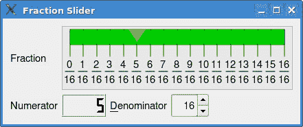

## 子类 QWidget

使用窗口的主要好处是它允许我们使用逻辑坐标进行绘制。这非常方便，因为意味着所有需要的缩放（例如当用户调整控件大小时）都由 `PyQt` 自动处理。这种好处也被证明有一个缺点：如果我们想绘制文本，文本将与其他所有内容一起被缩放。因此，对于绘制文本的自定义控件，通常在物理（视口）坐标下工作最为简单，而在其他情况下在逻辑（窗口）坐标下工作。我们展示了两种方法，`FractionSlider` 使用视口坐标，而 `YPipeWidget` 使用窗口坐标。

### 示例：分数滑动块

`FractionSlider` 是一个允许用户选择 0 到 1（包含边界）之间分数的控件；如图 11.5 所示。我们将允许使用我们滑动块的编程人员设置 3–60 范围内的分母，并且每当用户更改分数时，发射 `valueChanged(int, int)` 信号（带有分子和分母）。我们提供了鼠标和键盘控制，并自己绘制整个控件。我们还确保控件的最小尺寸提示始终与分母的大小成比例，这样控件就不会被调整得太小而无法显示分数文本。

**图 11.5** 使用分数滑动块的对话框

我们将从查看静态数据和初始化函数开始。

```python
class FractionSlider(QWidget):
    XMARGIN = 12.0
    YMARGIN = 5.0
    WSTRING = "999"

    def __init__(self, numerator=0, denominator=10, parent=None):
        super(FractionSlider, self).__init__(parent)
        self.__numerator = numerator
        self.__denominator = denominator
        self.setFocusPolicy(Qt.WheelFocus)
        self.setSizePolicy(QSizePolicy(QSizePolicy.MinimumExpanding,
                                       QSizePolicy.Fixed))
```

`XMARGIN` 和 `YMARGIN` 用于在控件边缘留出一些水平和垂直间距。`WSTRING` 是一个包含我们可能需要的最大文本的字符串：用于显示的两个数字以及一个额外的数字以提供边距。

我们提供了默认值，使控件初始显示为零十分之一。我们选择 `Qt.WheelFocus` 焦点策略，因为它是“最强”的一种，这种策略意味着如果通过 Tab 键切换或被点击，或者用户在其上方使用鼠标滚轮，控件将接受焦点。我们设置了水平和垂直方向的尺寸。通过这样做我们确保控件与布局管理器良好配合。控件的高度。

```python
def decimal(self):
    return self.__numerator / float(self.__denominator)

def fraction(self):
    return self.__numerator, self.__denominator
```

我们提供了两个方便方法来返回数值，第一个返回浮点值，第二个返回整数对。

```python
def setFraction(self, numerator, denominator=None):
    if denominator is not None:
        if 3 <= denominator <= 60:
            self.__denominator = denominator
        else:
            raise ValueError("denominator of range")
    if 0 <= numerator <= self.__denominator:
        self.__numerator = numerator
    else:
        raise ValueError("numerator of range")
    self.update()
```

此方法可以仅设置分子，也可以设置分子和分母。一旦分数更改，我们就调用 `update()` 来调度绘制事件，以便重新绘制标记当前分数的三角形。我们还调用了 `updateGeometry()`。这是为了通知负责该控件的任何布局管理器其几何形状可能变化。

```python
def mousePressEvent(self, event):
    if event.button() == Qt.LeftButton:
        self.moveSlider(event.x())
        event.accept()
    else:
        QWidget.mousePressEvent(self, event)
```

如果用户点击控件，我们将分子设置为最近分数。我们可以在鼠标点击事件中执行这些计算，但由于我们也支持拖动金色三角形，我们将这些代码提取到一个独立的 `moveSlider()` 方法中，该方法接受鼠标的 *x* 坐标作为参数。

```python
def moveSlider(self, x):
    span = self.width() - (FractionSlider.XMARGIN * 2)
    offset = span - x + FractionSlider.XMARGIN
    numerator = int(round(self.__denominator * \
                          (1.0 - (offset / span))))
    numerator = max(0, min(numerator, self.__denominator))
    if numerator != self.__numerator:
        self.__numerator = numerator
        self.emit(SIGNAL("valueChanged(int,int)"),
                  self.__numerator, self.__denominator)
    self.update()
```

我们计算控件的“跨度”（排除水平边距）。然后我们找到鼠标沿 x 轴点击或拖动的位置，并根据控件宽度的比例计算分子。

如果用户在左侧边距区域点击或拖动，我们将分子设置为 0；如果他们在右侧边距区域点击或拖动，我们将将其设置为分母（这样分数就等于 1）。如果分子与之前相比发生了变化，我们将相应地设置实例变量并发出信号，通知值已更改。然后我们调用 `update()` 来调度绘图事件（以移动金色三角形）。

### 短路（Short-）

我们选择发射一个 Python 非短路信号；我们完全可以通过丢弃 `(int,int)` 轻松地将其设为短路信号。也可以使用 `__pyqtSignals__` 类属性来定义信号，尽管这对于对于编写的且要集成到 `Qt Designer` 中的 PyQt 自定义小部件来说非常有用。

```python
def mouseMoveEvent(self, event):
    self.moveSlider(event.x())
```

这个微小的方法就是支持拖动金色三角形来更改分数所需的所有。该方法只有在鼠标正在被拖动时才会被调用，也就是说在移动鼠标的同时按下了左鼠标键。这是 `QWidget` 的标准行为——如果我们需要，可以通过调用 `QWidget.setMouseTracking(True)` 为所有的鼠标移动生成鼠标移动事件。

```python
def keyPressEvent(self, event):
    change = 0
    if event.key() == Qt.Key_Home:
        change = -self.__denominator
    elif event.key() in (Qt.Key_Up, Qt.Key_Right):
        change = 1
    elif event.key() == Qt.Key_PageUp:
        change = (self.__denominator // 10) + 1
    elif event.key() in (Qt.Key_Down, Qt.Key_Left):
        change = -1
    elif event.key() == Qt.Key_PageDown:
```


`change = -((self.__denominator // 10) + 1)`

`elif event.key() == Qt.Key_End:`

`change = self.__denominator`

`if change:`

`numerator = self.__numerator`

`numerator += change`

`numerator = max(0, min(numerator, self.__denominator))`

`if numerator != self.__numerator:`

`self.__numerator = numerator`

`self.emit(SIGNAL("valueChanged(int,int)"), self.__numerator, self.__denominator)`

`self.update()`

`event.accept()`

`else:`

`QWidget.keyPressEvent(self, event)`

对于键盘支持，我们希望 `Home` 将分数设置为 0，`End` 将其设置为 1，向上或向右箭头移动到下一个较大的分数，向下或向左箭头移动到下一个较小的分数。我们还设置了 `PageUp` 向上移动十分分之一，`PageDown` 向移动十分分之一。

请查看 PyQt 的 `pyqt4ref.html` 文档，位于“Writing Qt Designer Plugins”章节。

## 子类化 QWidget

确保分子在范围内的代码以及设置实例变量的代码，与我们在鼠标点击事件处理程序中所做的代码完全相同。同样，我们将未处理的按键按下传递给基类实现——基类实现什么都不做，就像基类鼠标点击处理程序什么都不做一样。

```python
def sizeHint(self):
    return self.minimumSizeHint()
```

我们决定小部件的首选尺寸是其最小尺寸。严格来说，我们没有必须重新实现此方法，但通过这样做我们使意图更加清晰。得益于我们在初始化器中设置的尺寸策略，小部件可以水平增长以占据尽可能可用的水平空间。

```python
def minimumSizeHint(self):
    font = QFont(self.font())
    font.setPointSize(font.pointSize() - 1)
    fm = QFontMetricsF(font)
    return QSize(fm.width(FractionSlider.WSTRING) * self.__denominator,
                  (fm.height() * 4) + FractionSlider.YMARGIN)
```

`QFontMetricsF` 对象由 `QFont` 对象初始化，在本例中是部件的默认字体。该字体继承自小部件的父级，父级再次继承自其父级，以此此类推，顶层部件继承自 `QApplication` 对象（以及颜色方案和其他用户设置），而该对象本身从底层窗口系统报告的用户偏好中获取这些设置。当然，我们可以忽略用户的偏好，并在任何小部件中设置显式字体。

`QFontMetricsF` 对象提供了真实的指标，即实际使用的字体的指标——这可能与指定的字体不同。例如，如果使用了 Helvetica 字体，在 Linux 或 Mac OS X 上几乎会被找到并使用，但在 Windows 上，`Ariel` 可能被用来代替。

我们选择使用比用户首选字体大小小一的字号来显示分数，这就是为什么我们调用 `setPointSize()`。

我们将小部件的最小宽度设置为显示所有分数的所需的宽度，假设每个分数有三个数字宽，即两个数字加上两边的某些空边距。总宽度实际上略小于此值，因为我们没有包含水平边距。我们将小部件的最小高度设置为单个字符高度的四倍，即足够的垂直空间留给分数“段”（表示每个分数的矩形）、垂直线、分子和分母。与宽度一样，实际高度略小于此值，因为我们只考虑了一半的垂直边距。

## 第 11 章。自定义小部件

在实现了键盘和鼠标事件处理程序、设置了尺寸策略并实现了尺寸提示方法后，我们已经让小部件具备了适当的交互交互行为。现在只剩下一件事要做：我们必须在需要时绘制小部件。`paintEvent()` 相当长，所以我们将分段查看。

```python
def paintEvent(self, event=None):
    font = QFont(self.font())
    font.setPointSize(font.pointSize() - 1)
    fm = QFontMetricsF(font)
    fracWidth = fm.width(FractionSlider.WSTRING)
    indent = fm.boundingRect("9").width() / 2.0
    if not X11:
        fracWidth *= 1.5
    span = self.width() - (FractionSlider.X * 2)
    value = self.__numerator / float(self.__denominator)
```

我们首先获取我们想要使用的字体以及它的字体指标。然后我们计算 `fracWidth`（一个分数的宽度）以及用于分割线的 `indent`。`if` 语句用于补偿 X Window 系统与其他系统之间字体指标的差异。`span` 是不包含水平边距的小部件宽度，而 `value` 是分数的浮点值。

`X11` 布尔变量在底层窗口系统是 X Window 系统时为 True（这在 Linux、BSD 和 Solaris 上通常是如此），否则为 False（例如在 Windows 和 Mac OS X 上）。它在文件开头、导入之后通过以下语句设置：`X11 = "qt_x11_wait_window_manager" in dir()`。我们可以更清晰地写为：

```python
import PyQt4.QtGui
X11 = hasattr(PyQt4.QtGui, "qt_x11_wait_window_manager")
```

这些方法之所以有效是因为 `PyQt4.QtGui.qt_x11_wait_window_manager()` 函数仅存在于使用 X Window 系统。我们在第 7 章检测 Mac OS X 时使用了类似的技术。

```python
painter = QPainter(self)
painter.setRenderHint(QPainter.Antialiasing)
painter.setRenderHint(QPainter.TextAntialiasing)
painter.setPen(self.palette().color(QPalette.Mid))
painter.setBrush(self.palette().brush(QPalette.AlternateBase))
painter.drawRect(self.rect())
```

我们创建一个 `QPainter` 并设置渲染提示以获得抗齿绘制。然后我们设置笔（用于形状轮廓和绘制文本）和画刷（用于填充），并在整个小部件上绘制矩形。由于对笔和画刷使用了不同的颜色，这为小部件产生了一个边框和略微凹陷的效果。

`QApplication` 对象拥有一个 `QPalette`，它包含了各种用途的颜色，例如文本前景和背景颜色、按钮颜色等。这些颜色通过其角色（roles）来识别，例如 `QPalette.Text` 或 `QPalette.Highlight`，尽管在这个示例中使用了一些较为晦涩的角色。事实上，这些颜色分为三组，每组对应一种小部件状态：“激活（active）”、“禁用（disabled）和“非激活（inactive）”。每个 `QWidget` 也有一个 `QPalette`，其颜色继承自 `QApplication` 调板——而该调板又是通过底层窗口系统的颜色初始化的，因此反映了用户的偏好。

PyQt 非常努力确保调板中的颜色能够良好地协作，例如提供良好的对比度。作为程序员，我们可以自由使用任何喜欢的颜色，但特别对于文本颜色和背景等标准需求，使用调板是最好的。

```python
segColor = QColor(Qt.green).dark(120)
segLineColor = segColor.dark()
painter.setPen(segLineColor)
painter.setBrush(segColor)
painter.drawRect(FractionSlider.XMARGIN, FractionSlider.YMARGIN, span, fm.height())
```

我们为分段创建了一种深绿色，并为标记这些分段的垂直线创建了更深的绿色。然后我们绘制一个包含所有分段的矩形。

```python
textColor = self.palette().color(QPalette.Text)
segWidth = span / self.__denominator
segHeight = fm.height() * 2
nRect = fm.boundingRect(FractionSlider.WSTRING)
x = FractionSlider.XMARGIN
yOffset = segHeight + fm.height()
```

在这里，我们将文本颜色设置为使用用户的调板。然后我们计算出每个分段的宽度和高度，并设置了初始的 `x` 位置和 `yOffset`。`nRect` 是一个足够大的矩形，可以包含带有左右留边距的数字。

```python
for i in range(self.__denominator + 1):
    painter.setPen(segLineColor)
    painter.drawLine(x, FractionSlider.YMARGIN, x, segHeight)
    painter.setPen(textColor)
    y = segHeight
    rect = QRectF(nRect)
    rect.moveCenter(QPointF(x, y + fm.height() / 2.0))
    painter.drawText(rect, Qt.AlignCenter, QString.number(i))
    y = yOffset
    rect.moveCenter(QPointF(x, y + fm.height() / 2.0))
    painter.drawText(rect, Qt.AlignCenter, QString.number(self.__denominator))
    painter.drawLine(QPointF(rect.left() + indent, y), QPointF(rect.right() - indent, y))
    x += segWidth
```

在这个循环中，我们绘制了标记每个分段的垂直线、每个分段下方的分子以及每个分子下方的分母以及它们之间的分割线。对于 `drawText()` 调用，我们提供了一个应该绘制文本的矩形，通过使用 `Qt.AlignCenter`，我们确保文本在指定的矩形内水平和垂直居中。我们使用相同的矩形（但在左右进行了缩进）来计算分割线的终点，然后对其进行绘制。`y` 偏移量对于每一行、分子和分母都是固定的，但在绘制每个分数后，`x` 偏移量会增加一个段宽。

```python
span = int(span)
y = FractionSlider.YMARGIN - 0.5
triangle = [
    QPointF(value * span, y),
    QPointF((value * span) + (2 * FractionSlider.XMARGIN), y),
    QPointF((value * span) + FractionSlider.XMARGIN, fm.height())
]
painter.setPen(Qt.yellow)
painter.setBrush(Qt.darkYellow)
painter.drawPolygon(QPolygonF(triangle))
```

最后，我们绘制一个金色的三角形，向用户显示选择了哪个分数。我们通过提供点列表来指定多边形。我们不需要在结尾重复第一个点，因为如果使用 `drawPolygon()`，PyQt 会自动连接第一个和最后一个点并填充封闭区域。在下一章中，我们将看到更高级的绘制技术，包括使用非常多功能的 `QPainterPath` 类。

我们现在已经完成了通用的 `FractionSlider` 小部件。它既支持键盘也支持鼠标，在所有平台上看起来都很正常，并且与布局管理器交互正常。

`QPainter` 类提供的可能性比我们这个小部件所需的得多，但在下一个小节中我们将看到更多可以的操作，包括绘制未填充的多边形和使用渐变填充的多边形。我们还将看到如何在自定义小部件内部包含其他小部件。

## 子类 QWidget

### 示例：流量混合小部件

有时为特定的应用程序创建自定义小部件是合适的。在这个示例中，我们假设有一个应用程序，其中我们模拟流体通过“Y”型管道的流动，如图 11.6 所示。

**图 11.6** YPipe 小部件

该小部件必须绘制三个渐变填充的多边形和三个黑色轮廓（以给管道形状提供清晰的边界），并且允许用户设置左右流量，同时显示合并后的流量。我们选择提供计数器（spinboxes）让用户设置流量，并使用标签（label）显示结果流量。使用这些内置小部件的优势在于我们只需要关注它们的位置，可以交给布局管理器处理剩下的。

```python
class YPipeWidget(QWidget):
    def __init__(self, leftFlow=0, rightFlow=0, maxFlow=100, parent=None):
        super(YPipeWidget, self).__init__(parent)
        self.leftSpinBox = QSpinBox(self)
        self.leftSpinBox.setRange(0, maxFlow)
        self.leftSpinBox.setValue(leftFlow)
        self.leftSpinBox.setSuffix(" l/s")
        self.leftSpinBox.setAlignment(Qt.AlignRight|Qt.VCenter)
        self.connect(self.leftSpinBox, SIGNAL("valueChanged(int)"), self.valueChanged)
        self.label = QLabel(self)
        self.label.setFrameStyle(QFrame.StyledPanel|QFrame.Sunken)
        self.label.setAlignment(Qt.AlignCenter)
        fm = QFontMetrics(self.font())
        self.label.setMinimumWidth(fm.width(" 999 l/s "))
        self.setSizePolicy(QSizePolicy(QSizePolicy.Expanding, QSizePolicy.Expanding))
        self.setMinimumSize(self.minimumSizeHint())
        self.valueChanged()

    def valueChanged(self):
        a = self.leftSpinBox.value()
        b = self.rightSpinBox.value()
        self.label.setText("%d l/s" % (a + b))
        self.emit(SIGNAL("valueChanged"), a, b)
        self.update()

    def values(self):
        return self.leftSpinBox.value(), self.rightSpinBox.value()
```

该方法以二元组的形式提供流数值旋框的值。

```python
def minimumSizeHint(self):
    return QSize(self.leftSpinBox.width() * 3,
                 self.leftSpinBox.height() * 5)
```

*子类 QWidget*

341

我们将小部件的最小宽度和高度与数值旋框成正比例。这确保了“Y”型形状不会小到无法辨认。

```python
def resizeEvent(self, event=None):
    fm = QFontMetricsF(self.font())
    x = (self.width() - self.label.width()) / 2
    y = self.height() - (fm.height() * 1.5)
    self.label.move(x, y)
    y = self.height() / 60.0
    x = (self.width() / 4.0) - self.leftSpinBox.width()
    self.leftSpinBox.move(x, y)
```


`x = self.width() - (self.width() / 4.0)`

`self.rightSpinBox.move(x, y)`

调整大小事件对于包含其他小部件且没有布局（layout）的小部件尤为重要。这是因为我们使用该事件来定位子小部件。在小部件首次显示之前总是会调用调整大小事件，因此我们有机会在用户第一次看到小部件之前自动对子小部件进行定位。

标签水平居中，并绘制在小部件的底部附近（`y` 坐标向下增加，因此 `self.height()` 返回的是最大——即最底部的——`y` 值）。两个数值旋框绘制在顶部，距离最小——即最顶部——`y` 值高度的 1/60 处，距离左或右边缘宽度的 1/4 处。

由于我们使用了 `QSpinBoxes` 和 `QLabel`，并配合了一些信号与槽连接，所有的用户交互都已处理完毕，因此我们只需要考虑调整大小和绘图。虽然让 PyQt 绘制数值旋框和标签简化了绘图，但它仍然有点复杂，因此我们将分段查看绘图事件。

```python
def paintEvent(self, event=None):
    LogicalSize = 100.0

    def logicalFromPhysical(length, side):
        return (length / side) * LogicalSize

    fm = QFontMetricsF(self.font())
    ymargin = (LogicalSize / 30.0) + \
             logicalFromPhysical(self.leftSpinBox.height(),
             self.height())
    ymax = LogicalSize - \
           logicalFromPhysical(fm.height() * 2, self.height())
    width = LogicalSize / 4.0
    cx, cy = LogicalSize / 2.0, LogicalSize / 3.0
    ax, ay = cx - (2 * width), ymargin
    bx, by = cx - width, ay
    dx, dy = cx + width, ay
    ex, ey = cx + (2 * width), ymargin
    fx, fy = cx + (width / 2), cx + (LogicalSize / 24.0)
    gx, gy = fx, ymax
    hx, hy = cx - (width / 2), ymax
    ix, iy = hx, fy
```

我们并没有在设备（物理）坐标中工作并被迫手动缩放所有坐标，而是创建了一个逻辑坐标系，其左上角为 `(0, 0)`，宽度和高度为 100（`LogicalSize`）。我们定义了一个微小的辅助函数，用于计算数值旋框绘制位置上方的 `y` 边距，以及标签绘制下方的最大 `y` 值。

*a*
*b*
*d*
*e*
*c*
*i*
*f*
*h*
*g*

**图 11.7** *YPipe 的坐标点*

如图 11.7 所示，所有的绘制都是基于绘制“Y”型形状所需的点。对于图中的每个点，我们都计算一个 `x` 坐标和一个 `y` 坐标。例如，左上点是 *a*，因此它在代码中的坐标是 `ax` 和 `ay`。大部分计算都是相对于点 *c*（`cx`, `cy`）完成的。

```python
painter = QPainter(self)
painter.setRenderHint(QPainter.Antialiasing)
side = min(self.width(), self.height())
painter.setViewport((self.width() - side) / 2,
                    (self.height() - side) / 2, side, side)
painter.setWindow(0, 0, LogicalSize, LogicalSize)
```

我们创建绘制器并将其视口（viewport）设置为适应其矩形的最大居中正方形。然后我们设置一个窗口（window），即实施我们自己的逻辑坐标系，让 PyQt 处理逻辑坐标到物理坐标的转换。

```python
painter.setPen(Qt.NoPen)
```

*子类 QWidget*

343

**表 11.2** *选定的 QPainter 方法（排除绘制相关方法）*

| 语法 | 描述 |
| :--- | :--- |
| `p.restore()` | 将 `QPainter` `p` 的状态恢复到上次保存的状态 |
| `p.rotate(a)` | 将 `QPainter` `p` 旋转 `a` 度 |
| `p.save()` | 保存 `QPainter` `p` 的状态，包括其变换矩阵、笔和画刷 |
| `p.scale(x, y)` | 水平缩放 `QPainter` `p` 为 `x` 倍 |
| `p.setMatrix(m)` | 设置 `QPainter` `p` 的变换矩阵为 `m` |
| `p.setRenderHint(h)` | 开启 `QPainter.RenderHint` |
| `p.setViewport(...)` | 限制 `QPainter` `p` 的视口 |
| `p.setWindow(...)` | 设置 `QPainter` `p` 的窗口坐标系 |
| `p.setPen(Qt.NoPen)` | 关闭笔 |
| `p.translate(dx, dy)` | 移动 `QPainter` `p` 的坐标系 |
| `p.setBrush(b)` | 设置 `QPainter` `p` 的画刷 |
| `p.setFont(f)` | 设置 `QPainter` `p` 的字体 |
| `p.drawRect(...)` | 绘制一个 `QRect` `r` |

在 `QPainter` `p` 上用 `QBrush` `b` 填充 `QRect` `r`

`p.setBrush(b)`

将填充形状的画刷设置为 `QBrush` `b`

`p.setPen(pn)`

将线条和轮廓的画笔设置为 `QPen` `pn`

`p.setFont(f)`

将 `QPainter` `p` 的文本字体设置为 `QFont` `f`

*子类 QWidget*

345

`painter.setBrush(QBrush(gradient))`

`painter.drawPolygon(QPolygon([cx, cy, dx, dy, ex, ey, fx, fy]))`

右侧部分——形状（`d`, `e`, `f`, `c`）与左侧部分非常相似，仅使用了一个从白色到蓝色的渐变。

```python
if (a + b) == 0:
    color = QColor(Qt.white)
else:
    ashare = (a / (a + b)) * 255.0
    bshare = 255.0 - ashare
    color = QColor(ashare, 0, bshare)

gradient = QLinearGradient(QPointF(0, 0), QPointF(0, 100))
gradient.setColorAt(0, Qt.white)
gradient.setColorAt(1, color)
painter.setBrush(QBrush(gradient))
painter.drawPolygon(
    QPolygon([cx, cy, fx, fy, gx, gy, hx, hy, ix, iy]))
```

“Y”字型的干部分——形状（`c`, `f`, `g`, `h`, `i`）使用线性渐变绘制，从白色到红/蓝色颜色，该颜色与左/右流速成比例。

`painter.setPen(Qt.black)`
`painter.drawPolyline(QPolygon([ax, ay, ix, iy, hx, hy]))`
`painter.drawPolyline(QPolygon([gx, gy, fx, fy, ex, ey]))`
`painter.drawPolyline(QPolygon([bx, by, cx, cy, dx, dy]))`

最后我们绘制代表管道侧面的线条。第一条线从 `a` 到 `i` 再到 `h`，标记管道的左侧；第二条从 `g` 到 `f` 再到 `e`，标记管道的右侧；第三条从 `b` 到 `c` 再到 `d`，标记顶部的“V”型部分。

与内置的 PyQt 组件一样，`YPipeWidget` 和 `FractionSlider` 都可以作为顶级组件使用，这在开发和测试自定义组件时特别有用。`chap11/fractionslider.py` 和 `chap11/ypipewidget.py` 都可以作为独立程序运行，因为它们在 `QWidget` 子类之后都有一个 `if __name__ == "__main__":` 语句，其代码创建了 `QApplication` 并创建并显示自定义组件。

## 总结

PyQt 提供了多种自定义组件外观和行为的方法。最简单且最常用的方法是将现有组件的属性设置为我们想要的值。从 Qt 4.2 开始，可以使用样式表（style sheet）属性，这允许我们仅通过使用 CSS 语法输入纯文本，就能对组件的外观产生巨大的影响。样式表的一个常见且简单的用法是设置强制组件的背景颜色。

复合组件（Composite widgets）允许我们将两个或多个组件组合在一起，然后将生成的组件视为单个组件。如果复合组件被频繁使用，这可以节省时间，并为主窗口风格应用程序的中心区域提供放置多个组件的方法。某些程序员会将组成组件设为私有并转发它们的信号和槽，但在许多情况下，最简单的方法是将组成组件保留为公共实例变量，并直接访问和连接它们。

通过子类化现有组件来适配其外观特别是行为，比创建一个 `QWidget` 子类并自己完成所有工作要容易得多。这种方法适用于几乎每个 PyQt 组件，因为大多数组件在设计时就是为了子类化。这种方法的唯一局限性是它只能应用于与我们想要的组件足够相似的组件，以使适配可行。

如果我们需要创建一个与其他任何组件都不同的组件，或者我们希望对自定义组件的外观和行为进行完全控制，我们可以子类化 `QWidget`。我们的子类必须重实现 `paintEvent()`、`sizeHint()` 和 `minimumSizeHint()`，并且几乎总是重实现 `keyPressEvent()` 和一些鼠标事件处理器。大多数内置组件都是通过这种方式创建的，其余的则是其他内置组件的子类。

我们在本章中（实际上是整本书中）所有自定义或创建的组件，在外观和行为上都是相当常规的。

PyQt 并不强制这种保守性，我们可以自由地创建任何想象任何外观和行为的组件。

## 练习

创建图 11.8 所示的 `Counters` 自定义组件。该组件应该显示一个 3 × 3 的网格，每个方格可以是空白（仅显示背景颜色），也可以带有一个红色或黄色的椭圆。任何网格单元的状态应该在空白、红色、黄色和返回空白之间无限循环变化。

当用户点击方格或在方格上按下空格键时，状态应发生变化。键盘焦点应通过用粗蓝色笔绘制方格来显示，而不是使用其他方格使用的普通细黑笔。用户应该能够通过点击方格来更改聚焦的方格。

```python
if __name__ == "__main__":
    app = QApplication([])
    counter = Counters()
    counter.show()
    app.exec_()
```

图 11.8 *Counters 自定义组件*

# 第 12 章 简介

## 基于项的图形 (Item-Based Graphics)

图形视图类本质上是二维的；尽管如此，每个项都有一个 `z` 值，`z` 值较高的项绘制在 `z` 值较低的项之上。碰撞检测是基于项的 (`x`, `y`) 位置的。除了碰撞信息外，场景还可以告诉我们哪些项包含特定点、哪些项位于特定区域，以及哪些项被选中。场景有一个前景层（foreground layer），例如用于绘制一个覆盖在场景中所有项之上的网格；它们还有一个背景层（background layer），绘制在所有项的下方，用于提供背景图像或颜色。

项要么是场景的子级（类似于 PyQt 正常的父子控件关系），要么是另一个项的子。当对某个项应用变换时，这些变换会自动应用到该项的所有子项，递归地应用到最远的孙子项。这意味着如果一个项被移动（例如被用户拖动），它所有的子项都会随之移动。也可以有一组同级项，即对组中的一个项进行变换只会影响该项的子项，而不会影响组中的其他成员。

`(0, 0)`
项 #1
项 #2
场景
(`width`, `height`)

**图 12.1** 图形项使用本地逻辑坐标

图形视图类使用了三种不同的坐标系统，尽管在实践中我们通常只关心其中两种。视图使用物理坐标系统。场景使用一个我们在创建它们时选择的逻辑坐标系统。PyQt 会自动将场景坐标映射到视图视口（viewport）并对其进行对齐。本质上，场景使用“窗口”坐标，而视图使用“视口”窗口坐标。因此，当我们放置项时，是根据场景坐标来放置它们。第三种坐标系统是项（items）使用的坐标系统。这特别方便，因为它是一个以点 `(0, 0)` 为中心的逻辑坐标系统。每个项的 `(0, 0)` 实际上位于该项在场景中的位置。这意味着在实践中，我们始终相对于它们的中心点来绘制项——我们不需要担心父项对其应用了任何变换，因为场景会自动为我们处理这些问题。图 12.1 展示了场景坐标和项坐标之间的关系。

在本章中，我们将查看两个示例，它们共同展示了图形视图类的许多不同方面。第一个示例是典型的应用程序类型，用户逐个创建项，并单独或以选定组的形式操纵项。该应用程序还展示了用户交互，包括选择、移动和调整项的大小。第二个示例展示了具有复杂形状的动画复合项。它还展示了如何根据场景的细节水平（放大或放小的程度）来尽量减少绘制项的工作量。

## 自定义和交互式图形项

预定义的图形项可以通过在它们上调用 `setFlags()` 并传入合适的常量，使其变为可移动的、可选的和可焦点的。用户可以使用鼠标拖动可移动的项，可以通过点击它们来选择可选的项，并使用 `Ctrl+Click` 选择多个项。可焦点项将接收按键事件，但除非我们创建一个带有按键事件处理程序的项子类，否则它们将忽略这些事件。同样，我们可以通过子类并实现相应的鼠标事件处理器，使项对鼠标事件产生响应。

在这一节中，我们将使用两个预定义的图形项，并创建两个自定义图形项子类，展示如何使用图形项，以及如何控制它们的行为和外观。我们还将看到如何加载和保存场景，以及如何打印它们。为了完成这些，我们将查看图 12.2 所示的 Page Designer 应用程序。该程序允许用户创建一个包含文本、图像和框框的页面。用户还可以创建线条——这些只是宽度或高度为 1 像素的框框。用户创建的图像可以保存并加载为 `.pgd` 文件（这是该应用程序特有的自定义文件格式），并可以使用打印对话框进行打印（或保存为 PDF 文件）。

对于文本项，使用了 `QGraphicsTextItem` 子类，并进行了扩展以允许用户通过双击设置项的字体和文本。对于框框（以及线条）项，使用了 `QGraphicsItem` 子类。它具有右键菜单，以及用于调整大小的键盘支持，并处理所有的绘制工作。位图项直接使用内置的 `QGraphicsPixmapItem` 类，而页面和边距指南使用内置的 `QGraphicsRectItem` 类。显示场景的视图是一个 `QGraphicsView` 子类，支持橡形框选择和鼠标轮缩放。

我们将从查看 `QGraphicsView` 子类开始。然后我们将回顾主表，最后将回顾自定义的 `QGraphicsItem` 子类。

```python
class GraphicsView(QGraphicsView):
    def __init__(self, parent=None):
        super(GraphicsView, self).__init__(parent)
        self.setDragMode(QGraphicsView.RubberBandDrag)
        self.setRenderHint(QPainter.Antialiasing)
        self.setRenderHint(QPainter.TextAntialiasing)

    def wheelEvent(self, event):
        factor = 1.41 ** (-event.delta() / 240.0)
        self.scale(factor, factor)
```

前面的代码是完整的 `GraphicsView` 子类。在初始化器中我们设置了拖动模式：这意味着在视图上拖动会导致 PyQt 为我们提供橡形框，每个被橡形框碰到的项都会被选中。渲染提示会传播到视图内部的任何项，因此我们不需要为每个图形项设置提示。

当用户滚动鼠标轮时，都会调用轮事件，它会根据滚轮的方向使视图缩小或放大。这种效果是改变了页面的视觉大小——底层场景并没有改变。该事件处理器中使用的数学逻辑比较复杂，但并不是问题，因为该方法可以原样复制粘贴。

在 `chap12/pagedigner.py` 顶部我们定义了一些全局变量。

```
PageSize = (612, 792)
PointSize = 10
MagicNumber = 0x70616765
FileVersion = 1
Dirty = False
```


页面大小以磅为单位适用于 Letter Size。（源代码中也有注释掉的 A4 尺寸。）魔数和文件版本用于 `QDataStream`，正如我们在第 8 章和其他地方看到那样。我们还有一个全局脏标记。

我们没有显示导入部分，但它们包含了 `functools`。这是因为在右键菜单中，我们使用了 `functools.partial()` 函数来封装带适当参数的方法。

**图 12.2** Page Designer 应用程序

主形式的初始化器非常长，所以我们将分部分查看，并省略与我们在其他地方看到的相似的代码——例如我们创建和布局表单按钮的地方。

```python
class MainForm(QDialog):

    def __init__(self, parent=None):

        super(MainForm, self).__init__(parent)

        self.filename = QString()

        self.copiedItem = QByteArray()

        self.pasteOffset = 5

        self.prevPoint = QPoint()

        self.addOffset = 5

        self.borders = []

        self.printer = QPrinter(QPrinter.HighResolution)

        self.printer.setPageSize(QPrinter.Letter)
```

复制的项目本质上是一块二进制数据，描述了最近一次被剪切或复制的项目。我们将这些数据存储在应用程序内部，而不是剪贴板上，因为它对任何其他应用程序都没有用。当用户重复粘贴同一个项目时，会使用粘贴偏移（paste offset）；当用户重复添加相同类型的项目时，会使用之前的点和添加偏移。在这两种情况下，新添加的项目都是在偏移位置添加的，而不是精确地覆盖在上一个项目之上。这使用户更容易看到自己所在的位置。

边界列表将包含两个图形项，都是黄色矩形：一个提供页面轮廓，另一个提供页面内部的轮廓以留出一些边距空间。它们被用作指南，不会被保存或打印。

虽然可以在需要时创建 `QPrinter` 对象，但通过创建一个并将其保持为实例变量，我们可以确保用户的设置（如页面大小）在同一会话的使用之间得以保留。

```python
self.view = GraphicsView()

self.scene = QGraphicsScene(self)

self.scene.setSceneRect(0, 0, PageSize[0], PageSize[1])

self.addBorders()

self.view.setScene(self.scene)
```

## 第 12 章 基于项目的图形

### 表 12.1: 选定的 QGraphicsScene 方法

| 语法 |  |
| :--- | :--- |
| `s.addEllipse(r, pn, b)` | 向 `QGraphicsScene s` 添加一个由 `QRectF r` 边界限制、`QPen pn` 轮廓定义并`QBrush b` 填充的椭圆 |
| `s.addItem(g)` | 向 `QGraphicsScene s` 添加 `QGraphicsItem g`。其他 `add*()` 方法是用于创建和添加某些内置图形项的便利方法。 |
| `s.addLine(l, pn)` | 向 `s` 添加一条用 `QPen pn` 绘制的 `QLineF l` |
| `s.addPath(pp, pn, b)` | 向 `QGraphicsScene s` 添加一个由 `QPen pn` 轮廓定义并`QBrush b` 填充的 `QPainterPath pp` |
| `s.addPixmap(px)` | 向 `QGraphicsScene s` 添加 `QPixmap px` |
| `s.addPolygon(pg, pn, b)` | 向 `QGraphicsScene s` 添加一个由 `QPen pn` 轮廓定义并`QBrush b` 填充的 `QPolygon pg` |
| `s.addRect(r, pn, b)` | 向 `QGraphicsScene s` 添加一个由 `QPen pn` 轮廓定义并`QBrush b` 填充的 `QRect r` |
| `s.addText(t, f)` | 向 `QGraphicsScene s` 使用 `QFont f` 添加文本 `t` |
| `s.collidingItems(g)` | 返回与 `QGraphicsItem g` 碰撞的 `QGraphicsItems` 列表（可能为空） |
| `s.items()` | 返回 `QGraphicsScene s` 中所有的 `QGraphicsItems`；使用不同的参数，可以返回位于特定点、或在给定矩形、多边形或绘图路径内部或与之相交的项 |
| `s.removeItem(g)` | 从 `QGraphicsScene s` 中移除 `QGraphicsItem g`；所有权移交给调用者 |
| `s.render(p)` | 在 `QPainter p` 上渲染 `QGraphicsScene s`；可以使用额外的参数来控制源矩形和目标矩形 |
| `s.setBackgroundBrush(b)` | 将 `QGraphicsScene s` 的背景设置为 `QBrush b` |
| `s.setScene` | 将 `QGraphicsScene s` 的矩形设置为 `(x, y)`、宽度为 `w` 高度为 `h` 的 `Rect(x, y, w, h)`；参数为浮点数 |
| `s.update()` | 为 `QGraphicsScene s` 调度绘制事件 |
| `s.views()` | 返回显示 `QGraphicsScene s` 的 `QGraphicsViews` 列表（可能为空） |

我们创建一个自定义 `GraphicsView` 类的实例以及标准的 `QGraphicsScene`。我们在场景上设置的矩形是“窗口”，即场景将使用的逻辑坐标系统——在本例中，这是一个左上角为 `(0, 0)`，宽度和高度对应于页面磅（points）的矩形。

初始化器的其余部分创建并连接按钮，并布局按钮和视图。

```python
def addBorders(self):

    self.borders = []

    rect = QRectF(0, 0, PageSize[0], PageSize[1])

    self.borders.append(self.scene.addRect(rect, Qt.yellow))

    margin = 5.25 * PointSize

    self.borders.append(self.scene.addRect(

        rect.adjusted(margin, margin, -margin, -margin),

        Qt.yellow))
```

此方法创建两个 `QGraphicsRectItems`，第一个对应于页面大小，第二个（表示边距）位于第一个内部。`QRect.adjusted()` 方法返回一个其左上角和右下角通过两组 `dx` 和 `dy` 对进行调整的矩形。在这种情况下，左上角向右和向下移动（每个都增加了 margin 量），右下角向左和向上移动（每个都减少了 margin 量）。

```python
def removeBorders(self):

    while self.borders:

        item = self.borders.pop()

        self.scene.removeItem(item)

        del item
```

当我们打印或保存时，不希望包含边界。此方法从 `self.borders` 列表中破坏性地检索每个项（随机顺序），并从场景中移除这些。当项从场景中移除时，场景会自动通知其视图，以便它们重绘未被覆盖的区域。删除的替代方案是调用 `setVisible(False)` 来隐藏边界。

```python
def addPixmap(self):

    path = QFileInfo(self.filename).path() if not self.filename.isEmpty() else "."

    fname = QFileDialog.getFileName(self, "Page Designer - Addmap", path, "Pixmap Files (*.bmp *.jpg *.png *.xpm)")

    if fname.isEmpty():

        return

    self.createPixmapItem(QPixmap(fname), self.position())
```

```python
def createPixmapItem(self, pixmap, position, matrix=QMatrix()):

    item = QPixmapItem(pixmap)

    item.setFlags(QGraphicsItem.ItemSelectable|QGraphicsItem.Movable)

    item.setPos(position)

    item.setMatrix(matrix)

    self.scene.clearSelection()

    self.scene.addItem(item)

    item.setSelected(True)
```

全局 `Dirty`
`Dirty = True`

图形视图类包括 `QPixmapItem`，它非常适合在场景中显示图像。`QGraphicsItem` 在 Qt 4.2 有三个标记：`ItemMovable`、`ItemSelectable` 和 `ItemFocusable`。（Qt 4.3 增加了 `ItemClipsToShape`, `ItemClipsChildrenToShape` 和 `ItemIgnoresTransformations`，后者特别用于显示不希望视图变换的文本）。创建项后，设置它在场景中的位置。`setPos()` 是唯一按场景坐标工作的项；其他方法都按项逻辑坐标工作。我们不需要设置变换矩阵（`QMatrix()` 返回的是单位矩阵），但我们想要一个显式的矩阵，以便在保存和加载（或复制和粘贴）场景项时可以使用它。

```python
coord = random.randint(36, 144)

point = QPoint(coord, coord)

else:

    if point == self.prevPoint:

        point += QPoint(self.addOffset, self.addOffset)

        self.addOffset += 5

else:

    self.addOffset = 5

self.prevPoint = point

return self.view.mapToScene(point)
```

此方法用于为新添加的项目提供场景中的位置。如果鼠标位于视图（view）上，我们使用 `QCursor.pos()` 提供的鼠标位置——在此语境下，“cursor”是指鼠标光标——但如果刚刚在相同位置添加了项目，则添加一个偏移量。这意味着如果用户反复点击“添加”按钮，每个后续的项目都将相对于前一个项目产生偏移，从而使用户更容易查看和与之交互。

如果鼠标在视图外部，我们将项目放置在场景左上角附近的一个半随机位置。

`mapFromGlobal()` 方法将屏幕坐标转换为视图所使用的物理小部件坐标。但场景（scenes）使用自己的逻辑坐标系，因此我们必须使用 `QGraphicsView.mapToScene()` 将物理坐标转换为场景坐标。

```python
def addText(self):

    dialog = TextItemDlg(position=self.position(),

                         scene=self.scene, parent=self)

    dialog.exec_()
```

当用户点击“添加文本”按钮时会调用此方法。它会弹出一个智能添加/编辑项目对话框，如图 12.3 所示。如果用户点击确定，将根据其选择的文本和字体添加一个新项目。我们不会讨论该对话框，因为它与图形编程无关；其源代码位于 `chap12/pagedesigner.pyw` 中。

我们不需要保留对添加添加的引用，因为我们已经在智能对话框内部将其所有权移交给了场景。

```python
def addBox(self):

    BoxItem(self.position(), self.scene)
```

当用户点击“添加矩形”按钮时会调用此方法。正如我们将看到的，用户可以使用方向键来调整矩形的大小，甚至通过将宽度或高度减小到 1 像素将其变成一条线。

再次，我们不需要保留已添加矩形项目的引用，因为所有权已交给了场景。

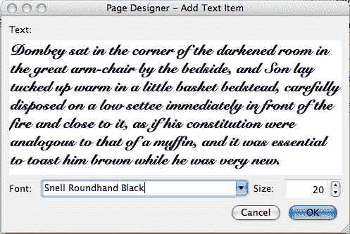

**图 12.3** 添加新的文本项目

我们希望用户能够在 Page Designer 内部剪切、复制和粘贴项目，但由于这些项目对其他应用程序没有意义，因此我们不会使用剪贴板。

```python
def copy(self):

    item = self.selectedItem()

    if item is None:

        return

    self.copiedItem.clear()

    self.pasteOffset = 5

    stream = QDataStream(self.copiedItem, QIODevice.WriteOnly)

    self.writeItemToStream(stream, item)
```

如果用户调用复制操作，我们首先检查是否恰好选择了一个项目。如果是是的话，我们会清空已复制的项目字节数组，并创建一个数据流以写入该字节数组。没有需要使用 `QDataStream.setVersion()`，因为数据流仅在应用程序的单次运行期间用于剪切、复制和粘贴，所以使用当前的任何版本即可。我们稍后将查看 `writeItemToStream()` 和对应的 `readItemFromStream()` 方法。

```python
def selectedItem(self):

    items = self.scene.selectedItems()

    if len(items) == 1:

        return items[0]

    return None
```

此方法返回被选中的项目，如果没有选中的项目或选了两个或更多项目，则返回 `None`。`QGraphicsScene.selectedItems()` 方法返回一个选中项目列表。还有 `items()` 方法可以返回与特定点相交或位于特定矩形或多边形内部的项列表，还有一个 `collidingItems()` 方法用于报告碰撞。

```python
def cut(self):

    item = self.selectedItem()

    if item is None:

        return

    self.copy()

    self.scene.removeItem(item)

    del item
```

此方法使用 `copy()` 复制被选中的项目，然后将其从场景中移除。正如我们在讨论移除边框矩形时提到的，`removeItem()` 仅从场景中移除项目；而不会删除该项目。

我们可以让项目在引用超出作用域时被删除，但我们倾向于显式地删除它，以明确我们已经获取了所有权并真正删除了项目。

```python
def paste(self):

    if self.copiedItem.isEmpty():

        return

    stream = QDataStream(self.copiedItem, QIODevice.ReadOnly)

    self.readItemFromStream(stream, self.pasteOffset)
```

如果项目已被剪切或复制到复制项目中，我们只需创建一个数据流并从复制项目的字节数组中读取项目数据。`readItemFromStream()` 方法负责创建项目并将其添加到场景。

```python
def writeItemToStream(self, stream, item):

    if isinstance(item, QGraphicsTextItem):

        stream << QString("Text") << item.pos() << item.pos()

    elif isinstance(item, QGraphicsPixmapItem):

        stream << QString("Pixmap") << item.pos() \

        << item.pixmap()

    elif isinstance(item, BoxItem):

        stream << QString("Box") << item.pos() \

        << item.rect() 
```

此方法被 `copy()`、`cut()`（间接）和 `save()` 调用。对于每个项目，它写入类型字符串，然后是位置和矩阵，最后是额外数据。文本项目的额外数据是文本和字体；对于像素项目的额外数据是像素本身；对于矩形项目的额外数据是矩形区域和线条样式。


```python
def readItemFromStream(self, stream, offset=0):

    type = QString()
    position = QPointF()
    matrix = QMatrix()

    stream >> type >> matrix

    if offset:
        position += QPointF(offset)

    if type == "Text":
        text = QString()
        font = QFont()

        stream >> text >> font
        TextItem(text, position, self.scene, font, matrix)

    elif type == "Box":
        rect = QRectF()
        style = Qt.PenStyle(stream.readInt16())

        stream >> rect >> style
        BoxItem(position, self.scene, style, rect, matrix)

    elif type == "Pixmap":
        pixmap = QPixmap()

        stream >> pixmap
        createPixmapItem(pixmap, position, matrix)
```

`TextItem` 和 `BoxItem` 的初始化器以及 `createPixmapItem()` 方法都会创建相应的图形项目并将所有权移交给场景。

```python
def rotate(self):

    for item in self.scene.selectedItems():
        item.rotate(30)
```

如果用户点击旋转，任何选中的项目将旋转 30°。应用程序中没有使用子项目，但如果被旋转的项目有子项目，它们也会被旋转。

```python
def delete(self):

    items = self.scene.selectedItems()

    if len(items) and QMessageBox.question(
        self,
        "Page Designer - Delete",
        "Delete %d item%s?" % (
            len(items),
            "s" if len(items) != 1 else ""
        ),
        QMessageBox.Yes | QMessageBox.No
    ) == QMessageBox.Yes:

        while items:
            item = items.pop()
            self.scene.removeItem(item)
            del item

    global Dirty
    Dirty = True
```

## 自定义和交互式图形项目

如果用户点击删除且至少有一个选中的项目，将询问他们是否要删除这些选中的项目；如果是，则每个选中的项目将被删除。

`QPrinter` 是一个绘图设备，就像 `QWidget` 或 `QImage`，因此我们可以轻松地在打印机上绘制。在这里我们利用了 `QGraphicsScene.render()` 便利方法，它可以将整个场景（或其选取部分）绘制到绘图设备上。在绘制之前，我们移除了边框（黄色矩形），在绘制之后恢复边框。我们还在绘制前清空了选择，因为某些项在被选中时的渲染方式可能会有所不同。也可以使用类似的 `QGraphicsView.render()` 方法来按所见的内容渲染场景（或其选取部分）。

我们将省略保存和加载 `.pgd` 文件的代码，因为这与我们之前处理二进制文件时看到的内容非常相似。保存时，我们创建一个 `QDataStream`，对其调用 `setVersion()`，并写入一个魔数和一个文件版本号。然后，我们遍历场景中的所有项，并在每次调用时以数据流和项作为参数调用 `writeItemToStream()`。

加载时，我们也创建一个 `QDataStream`。然后我们读取魔数和文件版本号，如果它们是正确的，我们就删除所有现有的项。只要文件中有数据，我们就调用以流为参数的 `readItemFromStream()`。该方法读取项数据并创建这些项，在此过程中将它们添加到场景中。

我们已经看到了应用程序是如何整体工作的，以及如何创建和使用两个预定义图形项类的项，即 `QGraphicsRectItem` 和 `QGraphicsPixmapItem`。现在我们将注意力转移到自定义图形视图项上。我们将首先查看 `TextItem` 子类；它扩展了 `QGraphicsTextItem` 类并添加了额外的行为，但将所有绘制工作都留给了基类。然后我们将查看 `BoxItem` 类；该类同时包含了处理行为和绘图的代码。

```python
class TextItem(QGraphicsTextItem):

    def __init__(
        self,
        text,
        position,
        scene,
        font=QFont("Times", PointSize),
        matrix=QMatrix()
    ):

        super(TextItem, self).__init__(text)

        self.setFlags(
            QGraphicsItem.ItemIsSelectable |
            QGraphicsItem.ItemIsMovable
        )

        self.setFont(font)
        self.setPos(position)
        self.setMatrix(matrix)

        scene.clearSelection()
        scene.addItem(self)
        self.setSelected(True)

        global Dirty
        Dirty = True
```

`TextItem` 的初始化器与创建并初始化 `QGraphicsPixmapItems` 的 `createPixmapItem()` 方法非常相似。如果初始化器没有提供字体和矩阵，我们将提供默认字体和默认矩阵（单位矩阵）。

```python
def parentWidget(self):
    return self.scene().views()[0]
```

项的父级可以是另一个项，也可以是场景。但有时我们需要知道该项所在的可见控件，即项的视图（view）。

场景对项是可用的，并且可以返回一个显示场景的视图列表。为了方便起见，我们假设始终有一个视图显示我们的场景，并且认为第一个视图是“父级”视图。

```python
def itemChange(self, change, variant):

    if change != QGraphicsItem.ItemSelectedChange:
        global Dirty
        Dirty = True

    return QGraphicsTextItem.itemChange(self, change, variant)
```

如果用户与项进行交互——例如移动或选择它——就会调用此方法。如果交互不仅仅是选择状态的变化，我们就设置全局脏标记标志（dirty flag）。

重写 `itemChange()` 时有两个注意事项。首先，我们必须始终返回调用基类实现的结果；其次，我们绝不能在此方法内部执行任何会导致另一次（递归）`itemChange()` 调用的操作。特别是，我们绝对不能在 `itemChange()` 中调用 `setPos()`。

```python
def mouseDoubleClickEvent(self, event):

    dialog = TextItemDlg(self, self.parentWidget())
    dialog.exec_()
```

如果用户双击该项，我们会弹出一个智能对话框，用户可以通过该框更改项的文本和字体。这与我们添加文本项时使用的是同一个对话框。

# 自定义和交互图形项

## 打印图像

打印图像与打印场景一样简单。这里有一个 `printImage()` 方法，可以将任何 `QImage` 或 `QPixmap`（两者都可以加载 `.bmp`、`.png`、`.jpg` 以及其他各种图形文件类型）打印到单页上，假设打印机是 `QPrinter`：

```python
def printImage(image, printer, scaleToFillPage=False):

    dialog = QPrintDialog(printer)

    if dialog.exec_():
        painter = QPainter(printer)
        painter.setRenderHint(QPainter.Antialiasing)

        rect = painter.viewport()
        size = image.size()
        size.scale(rect.size(), Qt.KeepAspectRatio)

        painter.setViewport(
            rect.x(),
            rect.y(),
            size.width(),
            size.height()
        )

        if scaleToFillPage:
            painter.setWindow(image.rect())

        if isinstance(image, QPixmap):
            painter.drawPixmap(0, 0, image)
        else:
            painter.drawImage(0, 0, image)
```

打印 `QPicture` 非常相似，不同在于我们必须根据图片的边界矩形自己计算大小，并调用 `QPainter.drawPicture()` 进行绘图。

SVG 图像也可以打印。这种方法与用于绘制 `QScenes` 的方法非常相似。`QSvgRenderer` 类可以加载 SVG 图像并在 `render()` 方法将其绘制在任何绘图设备上，包括 `QPrinter`。通过 4.3，可以使用 `QSvgGenerator` 类创建 SVG 图像。这完成了文本项类。它非常小，因为我们只关注改变它的行为。对于接下来将看到的 `BoxItem` 类，提供了同时管理其行为和外观的代码。

```python
class BoxItem(QGraphicsItem):

    def __init__(
        self,
        position,
        scene,
        style=Qt.SolidLine,
        rect=None,
        matrix=QMatrix()
    ):

        super(BoxItem, self).__init__()

        self.setFlags(
            QGraphicsItem.ItemIsSelectable |
            QGraphicsItem.ItemIsMovable |
            QGraphicsItem.ItemIsFocusable
        )

        if rect is None:
            rect = QRectF(
                -10 * PointSize,
                -PointSize,
                20 * PointSize,
                2 * PointSize
            )

        self.rect = rect
        self.style = style
        self.setPos(position)
        self.setMatrix(matrix)

        scene.clearSelection()
        self.addItem(self)
        self.setSelected(True)
        self.setFocus()

        global Dirty
        Dirty = True
```

打印文档包括图像将在下一节介绍。项必须接收键盘焦点，因为我们希望用户能够使用方向键调整框的大小。

```python
def setStyle(self, style):

    self.style = style
    self.update()

    global Dirty
    Dirty = True
```

此方法用于设置框的线条样式。它通知场景项需要重绘，并设置脏标记标志，因为我们在保存为 `.pgd` 文件时会记录框的线条样式。

```python
def contextMenuEvent(self, event):

    wrapped = []
    menu = QMenu(self.parentWidget())

    for text, param in (
        ("&Solid", Qt.SolidLine),
        ("&Dashed", Qt.DashLine),
        ("D&otted", Qt.DotLine),
        ("D&ashDotted", Qt.DashDotLine),
        ("DashDo&tDotted", Qt.DashDotDotLine)
    ):

        wrapper = functools.partial(self.setStyle, param)
        wrapped.append(wrapper)
        menu.addAction(text, wrapper)

    menu.exec_(event.screenPos())
```

如果用户在项上调用上下文菜单（例如，在某些平台上点击右键），则将调用此方法。此上下文菜单使用部分函数应用来封装一个要调用的方法 `setStyle()`，以及一个用于调用它的参数，该参数是 PyQt 内置线条样式之一。这些包装器必须存活足够长的时间，直到菜单完成，因为只有在那个时候，其中一个包装器才会被调用。由于此原因，我们保留了包装器的本地列表；该列表只有在菜单的 `exec_()` 调用完成后（即 `contextMenuEvent()` 本身完成时）才会超出作用范围。

```python
def keyPressEvent(self, event):

    factor = PointSize / 4
    changed = False

    if event.modifiers() & Qt.ShiftModifier:

        if event.key() == Qt.Key_Left:
            self.rect.setRight(self.rect.right() - factor)
            changed = True

        elif event.key() == Qt.Key_Right:
            self.rect.setRight(self.rect.right() + factor)
            changed = True

        elif event.key() == Qt.Key_Up:
            self.rect.setBottom(self.rect.bottom() - factor)
            changed = True

        elif event.key() == Qt.Key_Down:
            self.rect.setBottom(self.rect.bottom() + factor)
            changed = True

    if changed:
        self.update()

        global Dirty
        Dirty = True
    else:
        QGraphicsItem.keyPressEvent(self, event)
```


如果用户按下方向键且视图具有滚动条，视图将适当滚动。此方法拦截了当项具有键盘焦点时按住 Shift 键并按下方向键的操作，以给用户提供一种调整框大小的方法。`QRect.setRight()` 和 `QRect.setBottom()` 方法通过改变宽度和高度来改变矩形的大小。如果我们处理了按键按下事件，我们会调用 `update()` 来调度一个绘制事件，并将页面标记为“脏（dirty）”；否则，我们调用基类的实现。

现在我们已经看到了框的行为是如何实现的，我们准备好将注意力转向框是如何绘制的。在子化 `QGraphicsItem` 时，我们至少必须提供 `boundingRect()` 和 `paint()` 方法的实现。重新实现 `shape()` 也是常见的，但我们将其推到下一节的示例中。

> ★ 注意，如果视图已被告知处理上下文菜单事件，则不会调用此方法——例如，通过将其上下文菜单策略设置为 `Qt.ActionsContextMenu`。

366

*第 12 章 基于项的图形*

## 表 12.2 选定的 `QGraphicsItem` 方法 #1

| 语法 | 描述 |
| :--- | :--- |
| `g.boundingRect()` | 返回 `QGraphicsItem` `g` 的边界 `QRectF`；子类应重新实现此方法 |
| `g.collidesWith(Path(pp))` | 如果 `QGraphicsItem` `g` 与 `QPainterPath` `pp` 碰撞，则返回 True |
| `g.collidingItems()` | 返回与 `QGraphicsItem` `g` 碰撞的 `QGraphicsItems` 列表（可能为空） |
| `g.contains(pt)` | 如果 `QGraphicsItem` `g` 包含 `QPointF` `pt`，则返回 True |
| `g.isObscured()` | 如果 `QGraphicsItem` `g` 被其碰撞项遮挡，且它们的 `z` 值较大，则返回 True |
| `g.isSelected()` | 如果 `QGraphicsItem` `g` 被选中，则返回 True |
| `g.itemChange(c, v)` | 什么都不做；子类可以重新实现此方法以检测变化——例如，在选中状态或位置上。不要在此方法中直接或间接地调用 `QGraphicsItem.setPos()` |
| `g.moveBy(dx, dy)` | 在场景坐标中水平移动浮点数 `dx`、垂直移动浮点数 `dy` 的 `QGraphicsItem` `g` |
| `g.paint(p, o)` | 什么都不做；子类应重新实现此方法，以便在 `QPainter` `p` 上使用选项 `QStyleOptionGraphicsItem` `o` 绘制自己；绘制是在本地逻辑坐标中完成的，默认居中于 `(0, 0)` |
| `g.pos()` | 以 `QPointF` 返回 `QGraphicsItem` `g` 的位置。如果 `g` 是另一个 `QGraphicsItem` 的子项，该点相对于父项的本地逻辑坐标；否则，相对于场景坐标。 |
| `g.resetMatrix()` | 重置 `QGraphicsItem` `g` 的变换矩阵为单位矩阵；对于 PyQt 4.3，请使用 `resetTransform()` |
| `g.rotate(a)` | 按浮点数 `a`° 旋转 `QGraphicsItem` `g` |
| `g.scale(x, y)` | 水平缩放 `QGraphicsItem` `g` 浮点数 `x`，垂直缩放浮点数 `y`；1.0 为未缩放，0.5 为一半大小，3.0 为三倍大小 |
| `g.scene()` | 返回 `QGraphicsItem` `g` 的 `QGraphicsScene`，如果它未添加到场景中则返回 None |
| `g.sceneBounding()` | 返回场景坐标中 `QGraphicsItem` `g` 的边界 `QRectF`——这考虑了变换 |
| `g.setCursor(c)` | 设置 `g` 的光标为 `c` |
| `g.setEnabled(b)` | 根据 `b` 启用或禁用 `g` |
| `g.setFocus()` | 给 `g` 键盘焦点 |
| `g.setFlag(f)` | 设置 `QGraphicsItem.ItemFlag` `f` |

*自定义与交互图形项*

367

## 表 12.3 选定的 `QGraphicsItem` 方法 #2

| 语法 | 描述 |
| :--- | :--- |
| `g.setMatrix(m)` | 设置 `QGraphicsItem` `g` 的矩阵为 `QMatrix`；对于 PyQt 4.3，使用 `setTransform()` |
| `g.setPos(x, y)` | 设置 `QGraphicsItem` `g` 的位置。如果 `g` 是另一个 `QGraphicsItem` 的子项，位置相对于父项的本地逻辑坐标；否则，相对于场景坐标 |
| `g.setSelected(b)` | 根据布尔 `b` 设置 `g` 为选中或未选中 |
| `g.setZValue(z)` | 设置 `QGraphicsItem` `g` 的 `z` 值为浮点数 `z`。默认值为 0；高值项在低值前面 |
| `g.shape()` | 返回 `QGraphicsItem` `g` 的形状 `QPainterPath`。默认实现调用 `boundingRect()` 来确定要返回的路径；重新实现通常创建并返回精确的形状。默认情况下碰撞检测基于形状 |
| `g.shear(x, y)` | 水平浮点数 `x`、垂直浮点数 `y` 变换 `QGraphicsItem` `g` 的坐标系 |
| `g.translate(dx, dy)` | 水平整数 `dx`、垂直整数 `dy` 移动 `QGraphicsItem` `g` 的坐标系 |
| `g.update()` | 在场景中调度 `QGraphicsItem` `g` 的绘制事件 |
| `g.zValue()` | 返回 `QGraphicsItem` `g` 的 `z` 值 |

```python
def boundingRect(self):
    return self.rect.adjusted(-2, -2, 2, 2)
```

此方法应返回项的边界矩形，如果项有轮廓，则加上笔宽的一半。在这里我们作了弊，把边界矩形做得大了一点。这使得用户更容易点击框，即使他们将其缩小为高度或宽度为 1 像素的线。

我们没有实现 `shape()` 方法，因此将使用基类的 `shape()` 方法，并产生一个基于边界矩形的形状。由于我们给出了比实际情况更大的矩形，形状也会更大。形状用于确定碰撞检测，但在这里我们不使用碰撞检测；不过我们在下一个应用程序中会用到。

```python
def paint(self, option, widget):
    pen = QPen(self.style)
    pen.setColor(Qt.black)
    pen.setWidth(1)

    if option.state & QStyle.State_Selected:
        pen.setColor(Qt.blue)

    painter.setPen(pen)
    painter.drawRect(self.rect)
```

在上一节中，我们查看了一个以用户交互为核心的图形视图应用程序。在本节中，我们将查看一种完全不同的应用程序：通过使用一组图形项可视化种群中的每个成员，来模拟一种名为“多足虫”（multipedes）的生物种群，如图 12.4 所示。每个多足虫都有内部定时器。在每个时间间隔内，多足虫都会移动一次，如果它发生了碰撞，它的颜色就会发生细微变化，并最终会消失。

我们将从查看主表单初始化函数的提取片段开始。接着，我们将回顾表单的 `populate()` 方法，该方法用于创建和定位多足虫。接下来，我们将查看暂停/恢复按钮的作用，以及缩放滑块的实现。然后，我们将查看表单的定时器事件，这是一种我们之前没有使用过的事件处理器。一旦我们了解了整个应用程序是如何运作的，我们将查看用于可视化多足虫的图形项子类的具体实现代码。

```python
class MainForm(QDialog):

    def __init__(self, parent=None):
        super(MainForm, self).__init__(parent)

        self.scene = QGraphicsScene(self)
        self.scene.setSceneRect(0, 0, SCENESIZE, SCENESIZE)

        self.view = QGraphicsView()
        self.view.setRenderHint(QPainter.Antialiasing)
        self.view.setScene(self.scene)
```

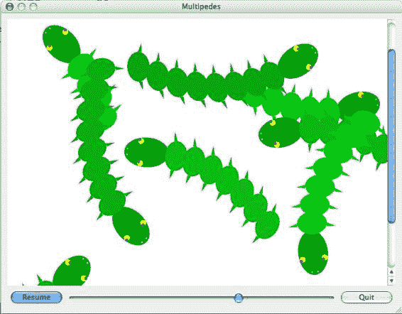

*动画与复杂形状*

**图 12.4** 多足虫（Multipedes）应用程序

```python
self.view.setFocusPolicy(Qt.NoFocus)

zoomSlider = QSlider(Qt.Horizontal)
zoomSlider.setRange(5, 200)
zoomSlider.setValue(100)

self.pauseButton = QPushButton("Pa&use")
quitButton = QPushButton("&Quit")
```

表单首先创建一个图形场景。按照非视觉化 `QObject` 子类的惯常做法，我们为场景指定了一个父对象。`SCENESIZE` 是一个值为 500 的全局整数。设置视图（view）的步骤与我们在上一个示例中看到的相似。缩放滑块用于放大或缩小场景。我们将其初始值设置为 100（100%），并将其范围设为 5% 到 200%。暂停按钮用于暂停和恢复动画。

```python
self.connect(zoomSlider, SIGNAL("valueChanged(int)"), self.zoom)
self.connect(self.pauseButton, SIGNAL("clicked()"), self.pauseOrResume)
self.connect(quitButton, SIGNAL("clicked()"), self.accept)

self.populate()
self.startTimer(INTERVAL)
self.setWindowTitle("Multipedes")
```

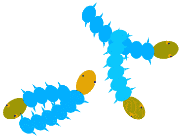

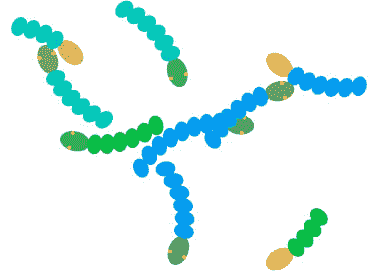

*第 12 章：基于项的图形*

我们省略了布局部分，因为我们已经见过很多次了，而且这并不奇怪。连接（connections）部分没有惊喜，但展示出来是为了让我们看到是如何处理用户交互的。

每个 `QObject` 子类（包括所有 `QWidgets`，因为它们也是 `QObject` 的子类）都可以启动定时器，从而在每个时间间隔触发一个定时器事件。在这里，`INTERVAL` 是 200 毫秒。定时器的精度取决于底层操作系统，但除非机器负载非常重，否则它至少应该达到 20 毫秒。`startTimer()` 方法返回一个定时器 ID，如果我们想多次调用该方法来设置多个定时器，这个 ID 就很有用；在这里忽略了它，因为我们只需要一个定时器。

在初始化函数的最后，我们调用 `populate()` 创建多足虫，并像往常一样设置应用程序的窗口标题。

```python
def pauseOrResume(self):
    global Running

    Running = not Running
    self.pauseButton.setText("Pa&use" if Running else "Res&ume")
```

如果用户点击暂停按钮，我们将全局变量 `Running` 布尔值取反，并更改按钮的说明文字。表单的定时器和多足虫的定时器都会引用这个变量，如果它为 False，则什么都不做。

```python
def zoom(self, value):
    factor = value / 100.0
    matrix = self.view.matrix()

    matrix.reset()
    matrix.scale(factor, factor)

    self.view.setMatrix(matrix)
```

为了缩放场景，我们需要做的只是更改显示场景的视图的比例。这是通过获取视图当前的变换矩阵、清除任何可能生效的变换（即缩放），然后将其重新缩放到与滑块设置成比例的因子来实现。

**图 12.5** 两个不同缩放比例下的多足虫

*动画与复杂形状*

缩放对多足虫的绘制方式有显著影响。这是因为在 `QGraphicsItem.paint()` 方法中，我们可以得知场景是被放大还是放小的，并利用这些信息来决定绘制多少细节。这意味着例如，如果场景被缩小到用户根本无法察觉细节，我们就可以用更快、更简单的方式进行绘制；而当用户放大时，我们可以增加细节量进行绘制。缩放的效果如图 12.5 所示。

```python
def populate(self):
    # (此处内容为逻辑描述，未提供完整代码块)
    pass
```

*(注：原文提供的文本中 `populate` 代码块内容不完整，此处根据上下文保持占位或翻译对应逻辑)*

如果只下一个头部项，我们将包含该剩余头部的 `heads` 集合覆盖死集（dead set）。这确保了如果只剩下一个多节虫（multipede），它也会被杀死。然后我们删除 `heads` 集合，以确保没有可以保持项目存活的引用。最后，我们遍历死掉的项目，随机从场景中移除每一个，并且由于所有权交给了我们，因此删除我们移除的每一个项目。得益于父子关系，当我们删除一个多节虫的头部时，该头部的子节点（第一个段）会被删除，接着第一个段的子节点（第二个段）也会被删除，以此类推，直到最大的孙子级，因此只需通过删除多节虫的头部，我们就删除了所有分段。

### 动画与复杂形状

373

我们现在已经看到了应用程序是如何运作的，因此可以将注意力转向多节虫本身的实现。正如 `population()` 方法所示的，多节虫由一个 `Head` 和至少四个 `Segments` 组成——这两个类都是 `QGraphicsItem` 的子类，并且它们都足够智能，只绘制对当前缩放级别有意义的细节量。我们将先看 `Head`，然后看 `Segment`。

```python
class Head(QGraphicsItem):

    Rect = QRectF(-30, -20, 60, 40)

    def __init__(self, color, angle, position):
        super(Head, self).__init__()

        self.color = color
        self.angle = angle
        self.setPos(position)

        self.timer = QTimer()
        QObject.connect(self.timer, SIGNAL("timeout()"), self.timeout)
        self.timer.start(INTERVAL)
```

所有的头部都有相同的形状：一个适应在静态 `Rect` 矩形内的椭圆。当头部初始化时，我们将它的颜色和角度记录在实例变量中，并将其移动到场景中给定的位置。

`QGraphicsItem` 类不是 `QObject` 的子类，不提供内置定时器。这不是一个问题，因为我们可以像这里做的那样简单使用 `QTimer`。`QTimer` 的超时不会产生定时器事件，而是通过发射 `timeout()` 信号来指示。在这里我们创建了一个定时器，它每隔 `INTERVAL`（200）毫秒超时，即每秒五次。我们将定时器的 `timeout()` 信号连接到我们自己的 `timeout()` 方法；稍后我们会回顾这个方法。

```python
def boundingRect(self):
    return Head.Rect
```

边界矩形很简单——它就是静态的 `Rect` 矩形，作为所有多节虫头部的基础形状。

```python
def shape(self):
    path = QPainterPath()
    path.addEllipse(Head.Rect)
    return path
```

★ C++/Qt 程序员可能会想要多继承自 `QGraphicsItem` 和 `QObject`，但 PyQt 只允许继承自单个 Qt 类。

374

# 第 12 章，基于项的图形

除非我们指定一种仅使用边界矩形的粗粒度方法，否则该方法是用于碰撞检测的默认方法。绘图路径（painter path）是一系列矩形、椭圆、弧和其他形状（包括绘图路径），它们共同完整地描述了一个项目的形状。在这种情况下，路径只是一个椭圆。

使用绘图路径作为图形项的形状可以确保精确检测碰撞。例如，两个多节虫头部可能会在它们矩形的角处交叉但不发生碰撞，因为它们的椭圆并没有占据角。

```python
def paint(self, painter, option, widget=None):
    painter.setPen(Qt.NoPen)
    painter.setBrush(QBrush(self.color))
    painter.drawEllipse(Head.Rect)
```


```python
if option.levelOfDetail > 0.5:
    painter.setBrush(QBrush(Qt.yellow))  # 外眼
    painter.drawEllipse(-12, -19, 8, 8)
    painter.drawEllipse(-12, 11, 8, 8)

if option.levelOfDetail > 0.9:
    painter.setBrush(QBrush(Qt.darkBlue))  # 内眼
    painter.drawEllipse(-12, -19, 4, 4)
    painter.drawEllipse(-12, 11, 4, 4)

if option.levelOfDetail > 1.3:
    painter.setBrush(QBrush(Qt.white))  # 鼻孔
    painter.drawEllipse(-27, -5, 2, 2)
    painter.drawEllipse(-27, 3, 2, 2)
```

全细节下的头部是一个椭圆，两只眼睛，每只眼睛由两个相互嵌套的椭圆组成，以及两个微小的鼻孔（同样是椭圆）。`paint()`方法首先移除画笔，并为多节虫的颜色设置实心画刷。然后绘制基础的头部形状。

`option`变量类型为`QStyleOptionGraphicsItem`，它包含了各种有用信息，包括项目的变换矩阵、字体度量、调色板和状态（选中的、“开启”、“关闭”以及许多其他）。它还持有“细节级别”（level of detail），这是衡量场景放大或缩小程度的指标。如果场景完全没有缩放，则细节级别为1.0；如果放大到两倍大小，细节级别将是2.0；如果缩小到一半大小，细节级别将是0.5。

### 动画与复杂形状

我们必须考虑的最后一个方法是每`INTERVAL`毫秒调用一次的`timeout()`。

```python
def timeout(self):
    if not Running:
        return

    self.angle += random.randint(-9, 9)
    offset = random.randint(3, 15)

    x = self.x() + offset * math.sin(math.radians(self.angle))
    y = self.y() + offset * math.cos(math.radians(self.angle))

    if 0 <= x <= SCENESIZE and 0 <= y <= SCENESIZE:
        break

    Running = False
    self.setPos(QPointF(x, y))
```

由于移动，此时可能发生了碰撞。

```python
for item in self.scene().collidingItems(self):
    if isinstance(item, Head):
        self.color.setRed(min(255, self.color.red() + 1))
    else:
        item.color.setBlue(min(255, item.color.blue() + 1))
```

询问场景碰撞项。如果它撞到了另一个头部，我们将这个头部变红一点；如果它撞到了一个分段，我们将该分段变蓝一点。如果一个头部的红色分量达到255，该头部（以及所有分段）将从场景中移除。移除是以定时器事件的形式进行的，正如我们之前看到的（第372页）。

首先需要注意的是，我们接受一个`parent`参数并将其传递给基类。我们没有对`Head`这样做，因为当一个项被添加到场景（scene）时，场景会自动获取该项的所有权，因此没有必要。但片段（segments）并没有被显式地添加到场景，因为它们都是其他项子项。第一个片段的父节点是多足虫（multipede）的头部，第二个片段的父节点是第一个片段，第三个片段的父节点是第二个片段，以此此类推。当头部添加到场景时，片段也会被添加；但场景只获取头部的所有权。尽管我们可以不给片段设置父节点并将它们直接添加到场景，但将它们变为子项要方便得多。特别是图形项（graphics items）之间的父子关系，用于将变换从父节点传播到子节点。

无论初始化哪一个片段，偏移量都是相对于头的`x`偏移。矩形（rectangle）用于绘制片段的椭圆，但与头部不同，它并没有包含整个形状，因为片段有突出的腿部。由于片段的形状并不简单，我们使用绘图路径（painter path）来创建它。我们从片段的“身体”开始，这是一个简单的椭圆。然后画一条腿（一个非常扁的三角形），再画另一条腿。`addPolygon()`方法接收一个`QPolygonF()`，它本身是由一组`QPointF`对象构造的。在添加每条腿后，我们调用`closeSubpath()`；或者，我们也可以在末尾添加一个额外的点，即第一个点的拷贝。`change`和`angle`实例变量用于移动；我们将在`timeout()`事件中介绍它们。

```python
def boundingRect(self):
    return self.path.boundingRect()
```

边界矩形（bounding rectangle）必须考虑到整个形状（包括腿部），但使用`QPainterPath.boundingRect()`获取并不容易。

```python
def shape(self):
    return self.path
```

形状并不简单，但得益于路径在初始化器中计算，这个方法非常简单。

```python
def paint(self, painter, option, widget=None):
    painter.setPen(Qt.NoPen)
    painter.setBrush(QBrush(self.color))

    if option.levelOfDetail < 0.9:
        painter.drawEllipse(self.rect)
    else:
        painter.drawPath(self.path)
```

得益于预先计算矩形和绘图路径，`paint()`方法比其他情况要容易、简单且快速得多。如果场景缩放至90%或更低，我们只画一个椭圆；否则，我们使用绘图路径绘制完整的形状。

```python
def timeout(self):
    if not Running:
        return

    matrix = self.matrix()
    matrix.reset()
    self.setMatrix(matrix)

    self.angle += self.change

    if self.angle > 5:
        self.change = -1
        self.angle -= 1
    elif self.angle < -5:
        self.change = 1
        self.angle += 1

    self.rotate(self.angle)
```

当多足虫的头部移动时，它的第一个（子）片段会随之移动，该片段的子片段也会随之移动，以此此类推。这虽然可行，但意味着多足虫的形状是刚性的。我们希望片段在多足虫移动时能左右轻微摇动，由于这个原因，我们为片段配备了它们自己的定时器。

我们获取片段的变换矩阵，清除已应用的任何变换（旋转），然后旋转片段。`change`变量初始为1，旋转角度初始为0°。在每个时间间隔内，将`change`加到`angle`上。如果角度达到6（或-6），我们将其设为5（或-5）并取反`change`值。这意味着角度的序列为1, 2, 3, 4, 5, 4, 3, 2, 1, 0, -1, -2, -3, -4, -5, -4, -3, -2, -1, 0, 1, 2等，这产生了一种很棒的摇动效果。

到此为止，我们结束了对复杂形状动画的审查。使用绘图路径可以创建任意复杂程度的形状，通过将路径存储为静态变量或实例变量，可以进行一次性计算，而不是在每次调用`paint`方法时都重复计算。我们实现动画的方法并不是唯一的方法。例如，我们可以结合`QGraphicsItemAnimation`项和`QTimeLine`。另一种方法是将定时器从项本身中提取出来，转而保留一组对它们的引用。然后，可以使用表单形式的定时器，在每个间隔内对集合中的每个项进行移动，并在表单的超时处理程序中解决碰撞。没有唯一的正确方法；相反，最佳方法取决于应用程序本身的需求。

## 总结

图形视图类（graphics view classes）非常适用于有大量单个项需要绘制的情况，从几十个到几十万个不等。它们也适用于我们想要允许用户与项进行交互（例如点击、拖动和选择它们）的情况，并且是动画的理想选择。

场景使用自己的逻辑坐标系统并包含图形项。

场景通过`QGraphicsView`查看，如果我们希望用户能够使用两个或多个不同的变换来查看场景（例如，在不同的缩放级别或旋转角度下），则可以关联多个视图。

图形视图类包含许多实用的预定义项，可以“拿来用”。我们也可以派生`QGraphicsItem`或其子类来提供自定义行为（例如右键菜单和键事件处理）以及自定义绘制，以便我们可以绘制任何喜欢的形状。

如果我们想从文件保存和加载场景，一种简单的方法是确保每个项都有一个变换矩阵，并保存项的描述、项在场景中的位置、项的矩阵以及任何可能的其他特定数据。使用`QDataStream`这一点非常简单。

通过使用场景和视图类提供的`render()`方法，任何场景都可以绘制在任何绘制设备上，包括打印机、PDF文件或`QImage`（例如保存为`.png`文件）。从Qt 4.3开始，场景还可以使用`QSvgGenerator`绘制设备类以SVG格式进行渲染。

对于绘图，如上一章所述，创建一个自定义控件并重新实现其绘制事件（paint event）可能是最好的方法。对于通用的科学和工程应用，PyQwt库（用于技术应用的Qt Widgets）提供了许多开箱即用的功能，包括2D绘图，而PyQwt3D绑定将PyQwt扩展到包含3D绘图。为了充分利用这些插件的性能并进行快速数值处理，还建议安装NumPy包。

更多信息请访问[`pyqwt.sourceforge.net`](http://pyqwt.sourceforge.net)和[`numpy.scipy.org`](http://numpy.scipy.org)。

PyQt的图形视图类（graphics view classes）提供的功能比我们在这里涵盖的多得多。除了图形视图类提供的更多功能外，还可以使用`QtOpenGL`模块进行2D和3D图。此外，该模块还可以与PyQt的其他图形类结合使用。例如，我们可以通过调用`QGraphicsView.setViewport(QGLWidget())`使用`QGLWidget`代替`QWidget`进行绘制，并可以使用`QPainter`在`QGLWidget`上叠加注释。

### 练习（#index_split_000.html_p11）

通过添加一个新按钮“对齐”（Align）来增强 Page Designer 应用程序，该按钮具有包含左对齐、右对齐、顶对齐和下对齐的弹出菜单。提供一个单一方法`setAlignment()`，它接受一个对齐参数。确保保留包装器的实例变量，以防它们被垃圾回收。要执行对齐操作，必须至少选择两个项目（因为项目是彼此相互对齐的）。

解决方案中的算法有两个阶段：首先，它找到作为其他每个项目对齐基准的项目；例如，如果执行“左对齐”，它会找到最左侧的项目。注意，这必须基于`sceneBoundingRect()`而不是`boundingRect()`（如果项目经过了旋转，后者将是不同的）。第二，它计算出应用于其他项目的`x`或`y`差异并将其应用。添加额外的按钮及其菜单将少于15行代码，而`setAlignment()`可以在45行内写完，因此整个过程大约可以在60行内完成。

解决方案位于`chap12/pagedesigner_ans.pyw`中。

## 13 ●富文本编辑与打印文档

### 富文本与打印（#index_split_000.html_p11）

PyQt支持富文本，本质上是HTML的子集，并包含对CSS（层叠样式表）的支持。这意味着在实践中，我们可以将包含HTML标记的字符串传递给PyQt的许多文本类，并依赖PyQt在用户界面中正确渲染HTML。

我们已经看到过向`QLabs`传递HTML的示例。图形项类`QGraphicsTextItem`也可以接受HTML。`QTextBrowser`类支持基础HTML显示，包括超链接，尽管它绝不是一个全功能的Web浏览器，但许多开发者发现它足够显示帮助文本了。对于编辑HTML，PyQt提供了`QTextEdit`类。虽然该类可以渲染所有PyQt支持的HTML标签，但它没有为用户提供创建或编辑某些标签的方法——例如，它可以显示HTML表格，但没有提供插入或编辑它们的方法。当然，这些缺陷可以通过子类化并由我们自己提供功能来解决。

`QTextEdit`的另一个用例是提供源代码编辑，通过自定义的`QSyntaxHighlighter`子类提供语法高亮。还有一种专门为源代码编辑设计的专用开源组件可用。该组件被称为Scintilla（[`http://www.scintilla.org`](http://www.scintilla.org)），其Qt端口`QScintilla`也可以与PyQt使用。

所有能够处理富文本的控件都将文本内部存储在`QTextDocument`中。这个纯数据类也可以供我们使用。

在本章中，我们将探索`QTextEdit`的一些功能，包括使用`QSyntaxHighlighter`将其作为源代码编辑器。尽管PyQt提供了一组涵盖大多数情况的控件（从简单的标签和框架到标签页控件、树视图等），但它并不包含一个单行的HTML文本编辑控件。我们将通过子类化`QTextEdit`来为此目的创建自己的控件；这将加深我们对`QTextEdit`和`QTextDocument`的理解，并且在随后的章节中，当我们想要为数据库类型应用程序提供用户编辑单行HTML文本的能力时，它将是一个非常有用的控件。

本章的第二部分专门介绍打印。我们已经看到如何通过`Print`在页面上打印图像和图形场景，但在本节中，我们将看到如何打印多页文档，包括带有嵌入图像的文档。

PyQt提供了三种不同的文档打印技术：一种基于组合和打印HTML，另一种基于创建`QTextDocument`，还有一种是基于使用`QPainter`直接绘制到打印机页面上。我们将展示并讨论所有三种方法。

### 富文本编辑（#index_split_000.html_p1）

在本节中，我们将从两个不同的视角来看富文本编辑。在第一个子节中，我们将创建一个使用`QSyntaxHighlighter`的纯文本编辑器。在第二个子节中，我们将创建一个类似于`QLineEdit`的单行富文本编辑器，它具有诸如Ctrl+B和Ctrl+I等快捷键来切换粗体和斜体。在这两种情况下，我们都使用`QTextEdit`作为构建基础。

### 使用 QSyntaxHighlighter

如果我们想要一个带有语法高亮的Python文本编辑器，不需要自己创建一个。基于Tkinter的IDLE应用程序提供了一个可以实验Python代码的沙箱，以及一个非常棒的Python编辑器。为了更强大的功能，可以使用Eric4，它本身用PyQt并使用Scintilla进行文本编辑。然而，市面上的编辑器并不一定完全按照我们想要的方式工作，而且自己创建一个既具有启发性又能揭示涉及的内容，我们将创建一个简单的Python编辑器来学习如何使用`QTextEdit`和`QSyntaxHighlighter`。

```python
class MainWindow(QMainWindow):
    def __init__(self, filename=None, parent=None):
        super(MainWindow, self).__init__(parent)

        font = QFont("Courier", 11)
        font.setFixedPitch(True)

        self.editor = TextEdit()
        self.editor.setFont(font)
        self.highlighter = PythonHighlighter(self.editor.document())
        self.setCentralWidget(self.editor)
```

**图13.1** *Python编辑器正在编辑自己*

初始化器的其余部分涉及操作、菜单和工具栏的创建，这些内容我们非常熟悉了，因此可以跳过。我们将查看的其他方法是三个基本文件处理方法中的两个，因为它们涉及到文本编辑器。

```python
def fileNew(self):
    if not self.okToContinue():
```


```python
return

document = self.editor.document()
document.clear()
document.setModified(False)

self.filename = None
self.setWindowTitle("Python Editor - Unnamed")
self.updateUi()
```

该方法简单地获取并清空实际持有文本的 `QTextDocument`，并将修改标记设为 `False`。结果是一个没有任何未保存更改的空白 `QTextEdit`。`updateUi()` 方法用于根据应用程序的状态启用或禁用操作；请参阅第 385 页的“启用和禁用操作”侧边栏。

```python
def loadFile(self):
    fh = None

    try:
        fh = QFile(self.filename)

        if not fh.open(QIODevice.ReadOnly):
            raise IOError, unicode(fh.errorString())

        stream = QTextStream(fh)
        stream.setCodec("UTF-8")
        self.editor.setPlainText(stream.readAll())
        self.editor.document().setModified(False)

        self.setWindowTitle("Python Editor - %s" %
                            QFileInfo(self.filename).fileName())

    except (IOError, OSError), e:
        QMessageBox.warning(
            self,
            "Python Editor -- Load Error",
            "Failed to load %s: %s" % (self.filename, e)
        )

    finally:
        if fh is not None:
            fh.close()
```

如果加载了文件（例如通过用户调用“文件→打开”操作），就会调用此方法。文件处理代码与我们之前看到的类似，唯一的区别在于我们将 `QTextDocument` 的修改标记设为 `False`。

保存的代码（未显示）与加载的代码非常相似。我们获取文件句柄，创建一个 `QTextStream`，将编码设为 UTF-8，并使用 `QTextEdit.toPlainText()` 输出整个文本。我们还把 `QTextDocument` 的修改标记设为 `False`。

```python
class TextEdit(QTextEdit):

    def __init__(self, parent=None):
        super(TextEdit, self).__init__(parent)

    def event(self, event):
        if event.type() == QEvent.KeyPress and \
           event.key() == Qt.Key_Tab:

            cursor = self.textCursor()
            cursor.insertText("    ")
            return True

        return QTextEdit.event(self, event)
```

前面的代码是完整的 `TextEdit` 子类。每个 `QTextDocument` 都可以通过 `QTextCursor` 对象进行操作，该对象是用户使用按键和鼠标操作与文档交互的程序等价物。

## 富文本编辑

### 启用和禁用操作

某些操作仅在特定情况下适用。

例如，在没有未保存更改的文档上允许“保存文件”没有意义，或者说，在空文档上允许“另存为”也没有意义。同样，如果没有选中的文本，“编辑复制”或“编辑剪切”都没有意义。处理这个问题的方法一种是让所有操作一直处于启用状态，但确保它们在感应不到情况时什么都不做；例如，如果我们调用 `QTextEdit.cut()`，如果没有选中的文本，它将安全地什么都不做。

另一种解决方案是根据应用程序的状态启用和禁用操作。这可以通过完成三件事来实现：第一，将要启用和禁用的操作变为实例变量，以便在初始化器之外访问它们；第二，创建一个方法（例如 `updateUi()`），根据应用程序的状态启用和禁用操作；第三，为 `updateUi()` 建立与应用程序特定的信号-槽连接，以便在每当应用程序状态发生变化时都调用它。

以 Python 编辑器为例，我们需要这些连接：

```python
self.connect(self.editor, SIGNAL("selectionChanged()"), self.updateUi)

self.connect(
    self.editor.document(),
    SIGNAL("modificationChanged(bool)"),
    self.updateUi
)

self.connect(
    QApplication.clipboard(),
    SIGNAL("dataChanged()"),
    self.updateUi
)
```

这些连接意味着如果编辑器的选择发生变化、或者文档被修改、或者剪贴板数据发生变化，我们就可以启用或禁用相关的操作。

```python
def updateUi(self, arg=None):
    self.fileSaveAction.setEnabled(
        self.editor.document().isModified()
    )

    self.fileSaveAsAction.setEnabled(
        not self.editor.document().isEmpty()
    )

    enable = self.editor.textCursor().hasSelection()
    self.editCopyAction.setEnabled(enable)
    self.editCutAction.setEnabled(enable)
    self.editPasteAction.setEnabled(self.editor.canPaste())
```

该方法响应前面的信号-槽连接被调用。它在初始化器结束时也被显式调用，以设置用户界面的初始状态，并在 `fileNew()` 方法结束时调用。`QTextEdit.canPaste()` 方法是在 Qt 4.2 中引入的；对于更早的版本，使用 `not QApplication.clipboard().isEmpty()`（注：原文此处逻辑略有出入，通常为检查空逻辑）。

前面的代码显示了完整的 `TextEdit` 子类。每个 `QTextDocument` 都可以通过 `QTextCursor` 对象进行操作，该对象是用户使用按键和鼠标操作与文档交互的程序等价物。

### 语法高亮

为了提供语法高亮，我们创建一个 `QSyntaxlighter` 子类，重写 `highlightBlock()` 方法，并使用我们的高亮器带有 `QTextDocument` 创建实例。我们首先在子类的初始化器中设置正则表达式。`QSyntaxlighter` 是按行工作的，并提供了跨行跟踪状态的简单方法。对于 Python 编辑器，我们将使用正则表达式识别 Python 关键字、注释和字符串，包括跨行的三引号字符串，以便我们可以对它们进行高亮。

```python
class PythonHighlighter(QSyntaxlighter):

    Rules = []

    def __init__(self, parent=None):
        super(PythonHighlighter, self).__init__(parent)

        keywordFormat = QTextCharFormat()
        keywordFormat.setForeground(Qt.darkBlue)
        keywordFormat.setFontWeight(QFont.Bold)

        for pattern in (
            (r"\band\b", r"\bas\b", r"\bassert\b", ... r"\byield\b")
        ):
            PythonHighlighter.Rules.append(
                (QRegExp(pattern), keywordFormat)
            )
```

`Rules` 静态列表存储了规则对。每对的第一个元素是正则表达式，用于匹配仅占据单行的语法结构（例如 Python 关键字）。第二个元素是 `QTextCharFormat` 对象，它可以包含有关如何格式化文本的信息，例如其字体和用于绘制它的笔。

我们为每个 Python 关键字创建了规则，并赋予每个关键字相同的 `keywordFormat` 格式。（由于省略号所示，代码中未显示大部分关键字。）每个关键字前后都有 `\b`；这是一个正则表达式符号，它不匹配任何文本，而是匹配在单词边界处。这意味着，例如在表达式 `a and b` 中，`and` 将被识别为关键字，而在表达式 `a = sand` 中，`sand` 中的 `and` 将（正确地）不会被识别。

```python
commentFormat = QTextCharFormat()
commentFormat.setForeground(QColor(0, 127, 0))
commentFormat.setFontItalic(True)
```

```python
PythonHighlighter.Rules.append(
    (QRegExp(r"#.*"), commentFormat)
)

self.stringFormat = QTextCharFormat()
self.stringFormat.setForeground(Qt.darkYellow)

stringRe = QRegExp(r"""(?:'[^']*'|"[^"]*")""")
stringRe.setMinimal(True)

PythonHighlighter.Rules.append(
    (stringRe, self.stringFormat)
)

self.stringRe = QRegExp(r"""(:?"["]".*"["]"|'''.*''')""")
self.stringRe.setMinimal(True)

PythonHighlighter.Rules.append(
    (self.stringRe, self.stringFormat)
)

self.tripleSingleRe = QRegExp(r"""'''(?!")""")
self.tripleDoubleRe = QRegExp(r'''"""(?!')''')
```

在处理关键词之后，我们为处理 Python 注释创建了格式和正则表达式。这个正则表达式并不是完美的；例如，它没有考虑到被引号括起的 `#` 字符。

对于字符串，我们将字符串格式保留为实例变量，因为在 `highlightBlock()` 方法中处理多行字符串时，我们需要它。

单行字符串是由初始化器中设置的简单（但速度快）正则表达式处理的，并被添加到 `Rules` 列表中。最后，我们又创建了两个正则表达式。这两个正则都使用了负向先行断言；例如，`(?!")` 意味着“后面不跟随引号”。它们将用于 `highlightBlock()` 方法，我们将在接下来分两部分回顾该方法。

```python
def highlightBlock(self, text):
    NORMAL, TRIPLESINGLE, TRIPLEDOUBLE = range(3)

    for regex, format in PythonHighlighter.Rules:
        i = text.indexOf(regex)

        while i >= 0:
            length = regex.matchedLength()
            self.setFormat(i, length, format)
            i = text.indexOf(regex, i + length)
```

对于 `QString` 文本参数中显示的每一行，都会调用一次 `highlightBlock()` 方法。

我们首先设置三种可能的状态：普通、在三引号字符串内部以及在三双引号字符串内部。然后，我们遍历每一个规则，每当我们发现与规则正则表达式匹配项时，我们就根据正则表达式匹配的长度将文本格式设置为相应的格式。正则表达式和格式对的列表结合上述代码所示的 `for` 循环，就足够处理所有的语法高亮，前提是每个语法组件只占据单行，且每个组件都能用正则表达式来表示。

```python
self.setCurrentBlockState(NORMAL)

if text.indexOf(self.stringRe) != -1:
    return

for i, state in (
    (text.indexOf(self.tripleSingleRe), TRIPLESINGLE),
    (text.indexOf(self.tripleDoubleRe), TRIPLEDOUBLE)
):
    if self.previousBlockState() == state:
        if i == -1:
            i = text.length()

        self.setCurrentBlockState(state)
        self.setFormat(0, i + 3, self.stringFormat)

    elif i > -1:
        self.setCurrentBlockState(state)
        self.setFormat(i, text.length(), self.stringFormat)
```

接下来，我们将当前块的状态设置为普通。该状态是我们任选的整数，`QSyntaxHighlighter` 将其与当前行关联。然后，我们测试是否有一个完整的三引号字符串，即起始和结束在同一行内的字符串；如果是，我们已经格式化了它，因此可以完成并返回。

在 PyQt 的文本处理类中（如 `QTextDocument`、`QTextEdit` 和 `QSyntaxHighlighter`），文本块本质上是由换行符分隔的字符序列。对于文字处理器类型的文档，这等同于段落（因为文本处理类会处理换行），但对于源代码，我们手动插入换行符，因此在这种情况下，每个块实际上是单行代码。

现在我们有三种情况需要处理。我们要处于一个在上一行开始且在该行内尚未结束的三引号字符串中；要么我们在这一行中遇到了三引号字符串的开头或结尾。

如果上一行处于三引号字符串中，且这一行中没有三引号，那么整行仍然处于三引号字符串中，因此我们将当前块状态设置为与上一行相同的值，并将整行格式化为三引号格式。如果上一行的状态是三引号且我们发现了三引号，那么它必须是结束的三引号，因此我们格式化从三引号到包含三引号的部分。在这种情况下，我们将状态保持为普通，因为该状态将从三引号字符串结束处开始生效。另一方面，如果上一行的状态不是三引号且我们发现了三引号，我们将状态设置为三引号，并从这些引号开始到行尾进行格式化。


这完成了我们的语法高亮示例。显然，我们可以使用更复杂的正则表达式，甚至完全避免使用它们，转而使用有限状态机或解析器来识别每行哪些部分需要特定的格式。对于具有复杂语法的大型文本，语法高亮的计算开销很大，但 `QSyntaxHighlighter` 通过仅格式化足够的行来正确高亮可见行，有助于降低开销。

## 富文本行编辑

在某些应用程序中，用户输入单行富文本是一项要求。例如，数据库应用程序可能有一个“描述”字段，我们在其中想要使用粗体、斜体、下划线、上标和下标。我们将在第 14 章和第 16 章看到这些示例。遗憾的是，PyQt 没有提供这样的小部件。在本节中，我们将创建一个 `RichTextLineEdit`，它是 `QTextEdit` 的子类，提供最常见的文本类型。

```python
class RichTextLineEdit(QTextEdit):

    (
        Bold, Italic, Underline, StrikeOut, Monospaced, Sans, Serif,
        NoOrSubscript, Subscript, Superscript
    ) = range(10)

    def __init__(self, parent=None):
        super(RichTextLineEdit, self).__init__(parent)

        self.monofamily = QString("courier")
        self.sansfamily = QString("helvetica")
        self.seriffamily = QString("times")

        self.setLineWrapMode(QTextEdit.NoWrap)
        self.setTabChangesFocus(True)
        self.setVerticalScrollBarPolicy(Qt.ScrollBarAlwaysOff)
        self.setHorizontalScrollBarPolicy(Qt.ScrollBarAlwaysOff)

        fm = QFontMetrics(self.font())
```


```python
h = int(fm.height() * (1.4 if platform.system() == "Windows" else 1.2))

self.setMinimumHeight(h)

self.setMaximumHeight(int(h * 1.2))

self.setToolTip("Press <b>Ctrl+M</b> for the text effects "
                "menu and <b>Ctrl+K</b> for the color menu")

def sizeHint(self):
    return QSize(self.document().idealWidth() + 5,
                 self.maximumHeight())
```

**图 13.2** 富文本编辑

首选尺寸是文本的“理想”宽度（考虑了`Qt`字体大小以及粗体和斜体等属性），并留有一定的内边以提供`4.2`的边距，以及最大高度。`QTextDocument.idealWidth()`方法是在`Qt 4.2`中引入的。

```python
def minimumSizeHint(self):
    fm = QFontMetrics(self.font())
    return QSize(fm.width("WWWW"), self.minimumHeight())
```

对于最小尺寸，我们取小部件默认字体中四个“W”字符的宽度。或者，我们也可以简单地使用任意数值，例如 40 像素。

`RichLineEdit`与`QLineEdit`的区别之一在于用户能够更改单词和字符的格式和颜色。为了支持这一点，我们必须提供某些手段让用户能够应用这些更改。

我们通过提供文本效果菜单和颜色菜单，以及支持一些用于格式化的关键快捷键序列来实现这一点。这两个菜单都通过特定的快捷键序列调用，而且在键菜单事件发生时也会弹出文本效果菜单。

```python
def contextMenuEvent(self, event):
    self.textEffectMenu()
```

当用户在某些平台上右键点击，或在其他平台上按下特定的键或键序列时，就会发生键菜单事件。在这种情况下，我们只需调用自定义的`textEffectMenu()`方法，它将弹出一个合适的菜单。默认情况下，`QTextEdit`提供自己的键菜单，但通过重新实现键菜单事件处理器，我们的代码具有优先级。

```python
def keyPressEvent(self, event):
    if event.modifiers() & Qt.ControlModifier:
        handled = False

        if event.key() == Qt.Key_B:
            self.toggleBold()
            handled = True

        elif event.key() == Qt.Key_I:
            self.toggleItalic()
            handled = True

        elif event.key() == Qt.Key_K:
            self.colorMenu()
            handled = True

        elif event.key() == Qt.Key_M:
            self.textEffectMenu()
            handled = True

        elif event.key() == Qt.Key_U:
            self.toggleUnderline()
            handled = True

    if handled:
        event.accept()
        return

    if event.key() in (Qt.Key_,, Qt.Key_Return):
        self.emit(SIGNAL("returnPressed()"))
        event.accept()
    else:
        QTextEdit.keyPressEvent(self, event)
```

由于用户正在输入文本，提供一个用于更改文本格式的键盘接口是自然而然的。我们将`Ctrl+B`设置为切换粗体，`Ctrl+I`切换斜体，`Ctrl+U`切换下划线。此外，`Ctrl+K`调用颜色菜单，`Ctrl+M`调用文本效果菜单（除了被键菜单事件调用外）。通过对我们自己处理的按键按下调用`accept()`，我们表示不需要对这些按键进行进一步的事件处理。

如果用户按下回车键，我们会发射`returnPressed()`信号，因为这很有用；文本中不会插入换行。任何其他按键都会传递给基类。`QTextEdit`类支持自己的快捷键序列——例如，`Ctrl+Left Arrow`向左移动一个单词，`Ctrl+Del`删除右侧单词，`Ctrl+C`复制任何选中文本到剪贴板，当然，还有简单的字母，如`a`、`b`、`Shift+A`和`Shift+B`，它们会被字面插入。

```python
def toggleBold(self):
    self.setFontWeight(
        QFont.Normal if self.fontWeight() > QFont.Normal
        else QFont.Bold
    )
```

`PyQt`支持多个级别的粗细，但我们选择了简单的粗体开启/关闭方法。`QTextEdit.fontWeight()`方法返回当前插入点的字体权重，同样，`setFontWeight()`方法也应用于当前插入点或所选文本。`QTextEdit`在格式化方面非常智能，至少在 Linux 上是如此。例如，如果选择了文本，则格式仅应用于所选部分；而如果没有选择且插入点在文本末尾，则格式将从该点开始应用；如果没有选择且插入点在单词中间，则格式将应用于整个单词。

```python
def toggleItalic(self):
    self.setFontItalic(not self.fontItalic())

def toggleUnderline(self):
    self.setFontUnderline(not self.fontUnderline())
```

斜体和下划线都是简单的开启/关闭设置，在 Linux 上，切换它们的工作方式与应用粗体或其他格式一样智能。

```python
def colorMenu(self):
    pixmap = QPixmap(22, 22)
    menu = QMenu("Colour")

    for text, color in (
        ("&Black", Qt.black),
        ("B&lue", Qt.blue),
        ("Dark Bl&ue", Qt.darkBlue),
        ("&Cyan", Qt.cyan),
        ("Dar&k Cyan", Qt.darkCyan),
        ("&Green", Qt.green),
        ("Dark Gr&een", Qt.darkGreen),
        ("M&agenta", Qt.magenta),
        ("Dark Mage&nta", Qt.darkMagenta),
        ("&Red", Qt.red),
        ("&Dark Red", Qt.darkRed)
    ):
        color = QColor(color)
        pixmap.fill(color)
        action = menu.addAction(QIcon(pixmap), text, setColor)
        action.setData(QVariant(color))

    self.ensureCursorVisible()
    menu.exec_(self.viewport().mapToGlobal(
        self.cursorRect().center()
    ))
```

颜色菜单通过`Ctrl+K`调用。

```python
def setColor(self):
    action = self.sender()

    if action is not None and isinstance(action, QAction):
        color = QColor(action.data())

        if color.isValid():
            self.setTextColor(color)
```

如果用户选择了颜色，将调用`setColor()`方法。我们从调用者的 action 中获取颜色，并将该颜色应用于文本。再次，用于粗体、斜体和下划线的逻辑被用于将颜色应用于所选文本、当前单词或从文本末尾开始。

```python
def textEffectMenu(self):
    format = self.currentCharFormat()
    menu = QMenu("Text Effect")

    for text, shortcut, data, checked in (
        ("&Bold", "Ctrl+B", RichTextLineEdit.Bold,
         self.fontWeight() > QFont.Normal),
        ("&Italic", "Ctrl+I", RichTextLineEdit.Italic,
         self.fontItalic()),
        ···
        ("Subs&cript", None, RichTextLineEdit.Subscript,
         format.verticalAlignment() == QTextCharFormat.AlignSubscript)
    ):
        action = menu.addAction(text, self.setTextEffect)

        if shortcut is not None:
            action.setShortcut(QKeySequence(shortcut))

        action.setData(QVariant(data))
        action.setCheckable(True)
        action.setChecked(checked)

    self.ensureCursorVisible()
    menu.exec_(self.viewport().mapToGlobal(
        self.cursorRect().center()
    ))
```

文本效果菜单方法通过`Ctrl+M`或键菜单事件调用，其结构与颜色菜单相似，但稍微复杂一些。

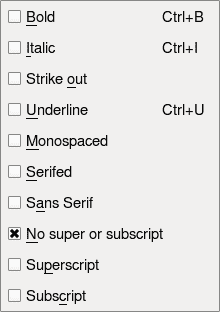

我们首先检索当前生效的文本格式，因为我们需要这些信息来确定是否要检查各种菜单选项。然后，我们创建一个由四元组列表（文本、快捷键、常量、勾选状态）组成的菜单。该菜单如图 13.3 所示。

**图 13.3** 文本效果菜单

我们为某些操作设置了键盘快捷键——例如用于加粗的`Ctrl+B`。我们没有使用标准的按键序列，因为我们在之前显示的按键事件处理器中硬编码了按键按下，所以我们必须确保按键按下与处理器预期的按键相匹配。

事实上，这些快捷键在实践中并没有作用，因为它们仅在与其关联的操作的生命周期内存在，而这些操作只在菜单存在时存在，即在`textEffectMenu()`方法执行期间存在。

但这并不重要，因为我们重新实现了按键事件处理器来自己提供这些快捷键。菜单中的快捷键仅对于永久菜单（如添加到主窗口菜单栏的菜单）有用。那么，我们为什么要在菜单中费心快捷键呢？因为添加快捷键会让它们出现在菜单中，从而帮助用户学习。这并没有解决用户起初如何发现`Ctrl+M`和`Ctrl+K`菜单的问题，但希望他们能看到工具提示或在应用程序手册中读到它们的内容。

菜单本身的创建和弹出方式与颜色菜单完全相同。如果用户点击任何文本效果选项，就会调用`setTextEffect()`方法。我们将从两个部分来看这个方法。

```python
def setTextEffect(self):
    action = self.sender()

    if action is not None and isinstance(action, QAction):
        what = action.data().toInt()[0]

        if what == RichTextLineEdit.Bold:
            self.toggleBold()
            return

        if what == RichTextLineEdit.Italic:
            self.toggleItalic()
            return

        if what == RichTextLineEdit.Underline:
            self.toggleUnderline()
            return
```

*富文本编辑*  
395

每个文本效果菜单操作都在其用户数据中存储了一个常量；该常量被检索并保留在`what`变量中。对于简单的切换操作，我们只需要调用相应的切换方法即可完成。

```python
format = self.currentCharFormat()

if what == RichTextLineEdit.Monospaced:
    format.setFontFamily(self.monofamily)

elif what == RichTextLineEdit.Serif:
    format.setFontFamily(self.seriffamily)

elif what == RichTextLineEdit.Sans:
    format.setFontFamily(self.sansfamily)

if what == RichTextLineEdit.StrikeOut:
    format.setFontStrikeOut(not format.fontStrikeOut())

if what == RichTextLineEdit.NoSuperOrSubscript:
    format.setVerticalAlignment(QTextCharFormat.AlignNormal)

elif what == RichTextLineEdit.Superscript:
    format.setVerticalAlignment(QTextCharFormat.AlignSuperScript)

elif what == RichTextLineEdit.Subscript:
    format.setVerticalAlignment(QTextCharFormat.AlignSubScript)

self.mergeCurrentCharFormat(format)
```

要更改字体族、删除线格式或垂直对齐，我们必须检索当前格式，应用用户请求的更改，然后将更新后的格式与当前格式合并使其生效。

现在我们已经涵盖了富文本行编辑支持的所有格式选项。一旦用户输入了富文本，我们无疑想要检索它，以便对其进行存储、搜索或处理。我们可以使用`QTextEdit.toPlainText()`方法——但这会剥离所有的 HTML，导致我们的处境比使用`QLineEdit`没有什么不同。一个更合适的替代方案是使用`QTextEdit.toHtml()`，但该方法返回的 HTML 非常冗长，因为它必须足够通用，以适应 PyQt 支持的所有 HTML 标签。

为了直观说明这一点，如果我们有文本“The **bold** cat.”（13 个字符），其中单词“bold”加粗，单词“cat”颜色为红色，那么`toHtml()`方法将返回 503 个字符：

396

*第 13 章 富文本与打印*

```html
<html><head><meta name="qrichtext" content="1" />

<style type="text/css"> p, li { white-space: pre-wrap; } </style>

</head>

<body style=" font-family:'Nimbus Sans L'; font-size:11pt; font-weight:400; font-style:normal; text-decoration:none;">

<p style=" margin-top:0px; margin-bottom:0px; margin-left:0px; margin-right:0px; -qt-block-indent:0; text-indent:0px;">The

<span style=" font-weight:600;">bold</span></span>

<span style=" color:#ff0000;">cat</span></span>

<span style=" color:#000000;">.</span></p>

</</body>

</</html>
```


我们在输出中添加了一些换行符，使输出整齐地适应页面。文本可能会根据平台和 `Qt` 版本略有不同，但长度仍会在 500 个字符左右。由于富文本行编辑只需要支持有限的标签子，可以使用更简单的 HTML。例如：`<b>bold</b> <font color="#ff0000">cat</font>`。

这只有 49 个字符。为了实现这种更简单的 HTML 格式，我们提供了 `toSimpleHtml()` 方法；它有点长，所以我们将分三个部分来审查。

```python
def toSimpleHtml(self):
    html = QString()
    black = QColor(Qt.black)
    block = self.document().begin()
```

我们通过创建一个空的目标 `QString` 并假设文本颜色为黑色开始。由 `QTextEdit.document()` 返回的 `QTextDocument` 类提供了遍历文本的方法。基本上，每个主要的文本组件（如段落或表格）包含在一个“块”中，我们可以使用 `QTextDocument.begin()` 获取第一个块，使用 `QTextBlock.next()` 获取后续块。空文档将有一个无效的块。

每个文本块包含一个或多个“片段”，每个片段都有格式特征。事实上，`QTextDocument` 的结构比这复杂，但我们可以忽略额外的细节，如表格、列表和图像，因为它们没有在富文本行中使用。

```python
while block.isValid():
    iterator = block.begin()
    while iterator != block.end():
        fragment = iterator.fragment()
        if fragment.isValid():
            format = fragment.charFormat()
            family = format.fontFamily()
            color = format.foreground().color()
            text = Qt.escape(fragment.text())
```

*富文本编辑*
397

```python
if format.verticalAlignment() == QTextCharFormat.AlignSubscript:
    text = QString("sub%1</sub>").arg(text)
elif format.verticalAlignment() == QTextCharFormat.AlignSuperScript:
    text = QString("sup%1</sup>").arg(text)

if format.fontUnderline():
    text = QString("<u>%1</u>").arg(text)

if format.fontItalic():
    text = QString("<i>%1</i>").arg(text)

if format.fontWeight() > QFont.Normal:
    text = QString("<b>%1</b>").arg(text)

if format.fontStrikeOut():
    text = QString("<s>%1</s>").arg(text)

if color != black or not family.isEmpty():
    attribs = ""
    if color != black:
        attribs += ' color="%s"' % color.name()
    if not family.isEmpty():
        attribs += ' face="%s"' % family
    text = QString("<font%1>%2</font>").arg(attribs).arg(text)

html += text
iterator += 1
block = block.next()
return html
```

如果字体族不为空，或者颜色不是黑色，我们必须使用一个带有 `face` 或 `color`（或两者都有）属性的 `<font>` 标签。在片段末尾，我们将代表该片段的文本附加到包含整行富文本的 `html` 字符串中。由于每个块可能包含一个或多个片段，我们增加迭代器的值，当它等于 `QTextBlock.end()` 时跳出内部 `while` 循环，也就是说在我们处理完该块中的最后一个片段之后。然后我们调用 `QTextBlock.next()` 并处理下一个块的片段，最后在到达一个无效块时跳出外部 `while` 循环，这意味着所有块都已处理完毕。最后，我们返回包含表示富文本行编辑框行富文本所需的有效（但是最小的）HTML 字符串。

`RichTextLineEdit` 类到此结束。我们将在后面的几个章节中使用它。虽然这个子类只提供单行 HTML 编辑器，但我们所看到的技巧可以很容易地应用于用于编辑整个 HTML 文档的 `QTextEdit` 子类。在这种情况下，我们可能仍然会提供额外的键盘支持，例如用于加粗和斜体的 `Ctrl+B` 和 `Ctrl+I`，甚至可能是文本效果右菜单。但对于更大型文档（如列表和表格）的其他文本效果、颜色和格式，我们将像任何传统的 HTML 编辑器或文字处理器一样通过菜单选项和工具栏按钮提供。

# 打印文档

从 PyQt 获取打印输出可以通过多种方式。一种方法是产生另一种程序可以打印的形式的输出，例如为 Web 浏览器打印生成 HTML 或为精通 SVG 的绘图程序生成 SVG。

从 Qt 4.1 开始，用户可以通过 `Qt` 检查“打印到文件”选项，通过打印对话框生成 PDF 文档。也可以通过程序生成 PDF 文档。例如，假设该文档是一个 `QTextDocument`：

```python
printer = QPrinter()
printer.setPageSize(QPrinter.Letter)
printer.setOutputFormat(QPrinter.PdfFormat)
printer.setOutputFileName(filename)
document.print_(printer)
```

这些方法对于用户来说没有在应用程序内部拥有打印设施那么方便，为了实现这一点，PyQt 提供了三个主要选择：

1. 我们可以生成 HTML，将其交给 `QTextDocument`，并使用 `QTextDocument.print_()` 传入一个 `QPrinter`，或者使用 `QTextDocument.drawContents()` 传入一个 `QPainter` 来渲染文档。
2. 我们可以创建一个 `QTextDocument` 并从中获取一个 `QTextCursor`，通过它可以程序化生成文档，并再次使用 `print_()` 或 `drawContents()` 方法进行渲染。
3. 我们可以创建一个 `QPainter` 直接绘制到 `QPrinter` 上，即绘制到打印的页面上。这是最费力的方法，但它提供了最大程度的控制。

本节涵盖的示例应用程序展示了所有三种技术。

它打印客户账单，每个 `Statement` 对象持有公司名称、联系人姓名、地址和交易列表，每个交易都是一个 `(QDate, float)` 元组。`Statement` 类还提供了一个 `balance()` 方法，返回交易总和。我们想在右上角打印发行者的标志和地址，下方是日期，左侧是客户的地址，然后是一个格式化字母，其内容取决于客户是欠方还是贷方，然后是交易表格和结语段落。自然地，我们还希望每份账单都从新的一页开始。我们假设所有的账单都存储在一个名为 `self.statements` 的列表中，并且我们的打印是使用持有这些账单的表单的方法完成的。页面看起来如图 13.4 所示。但在查看这三种通用打印技术之前，我们将查看如何打印图像，特别是展示我们在第 6 节介绍过的 Image Changer 应用程序使用的 `filePrint()` 方法的实现。

## 打印图像

在第 6 节中，我们有一个用于打印图像的 `MainWindow.filePrint()` 方法，但当时没有查看它的实现，因为我们还没有介绍 `QPainter`。现在我们已经在第 11 节中看到了 `QPainter`，并看到了通用的“打印图像”函数，现在我们可以查看 Image Changer 应用程序使用的 `filePrint()` 方法的实现。（源代码 `Images` 位于 `chap06/imagechanger.pyw`。）

```python
def filePrint(self):
    if self.image.isNull():
        return
    if self.printer is None:
        self.printer = QPrinter(QPrinter.HighResolution)
        self.printer.setPageSize(QPrinter.Letter)
    form = QPrintDialog(self.printer, self)
    if form.exec_():
        painter = QPainter(self.printer)
        rect = painter.viewport()
        size = self.image.size()
        size.scale(rect.size(), Qt.KeepAspectRatio)
        painter.setViewport(rect.x(), rect.y(), size.width(), size.height())
        painter.drawImage(0, 0, self.image)
```

如果这是用户第一次尝试打印图像，打印机实例变量将为 `None`，因此我们实例化它并为页面大小提供合理的默认值。（默认页面大小为 `QPrinter.A4`）。一旦我们有了打印机对象，就会创建并弹出一个模态 `QPrintDialog`；用户可以使用它选择他们想要打印的打印机以及各种打印相关的选项。

此对话框因系统而异，因为 PyQt 使用系统的原生打印对话框。如果用户点击打印，我们就能打印图像。

PyQt 有“绘图设备”的概念，可以在上面绘制线条、文本、形状和图像。正如我们在前面的章节中看到的，小部件是一个绘图设备——其外观可以通过绘制阴影和高光来实现。`QImage` 是绘图设备，`QPrinter` 也是。所有的绘图设备都可以使用 `QPainter` 进行绘制，因此我们创建一个准备绘制到 `QPrinter` 的新 `QPainter`。

我们获取表示绘图器视口的矩形。视口是绘图区域，对于连接到打印机的绘图器来说，这意味着可以实际绘制的页面区域（许多打印机无法绘制到纸张边缘）。然后我们获取图像尺寸坐标作为一个 `QSize` 对象，并在保持尺寸宽高比的情况下将其缩放以放入打印机的视口矩形内。如果图像已经足够小可以放入，则没有影响。接下来，我们更改打印机的视口矩形以匹配我们的缩放矩形，保留原始起点，但使用缩放后的宽度和高度。最后，我们在绘图起点绘制图像，就完成了。

如果用户想要 PDF 文件，他们可以调用“打印”操作并选择“打印到文件”选项。在某些平台上，通过将“打印到文件”的扩展名改为 `.ps` 也可以获得 PostScript 输出。

## 使用 HTML 和 QTextDocument 打印文档

我们将展示的第一方法涉及创建一个包含 HTML 的字符串，并使用 `QTextDocument` 将 HTML 渲染到 `QPrinter`。`printViaHtml()` 方法相当长，所以我们将分三部分来看。

```python
"<p>%s</p><p>Dear %s,</p>"
"<p>The balance of your account is %s.") % (
date, address, contact,
QString("$ %L1").arg(float(balance), 0, "f", 2)) if balance < 0:
html += (" <p><font color=red><b>Please remit the "
"amount owing immediately.</b></font>")
else:
html += (" We are delighted to have done business "
"with you.")
html += ("</p><p>&nbsp;</p><p>"
"<table border=1 cellpadding=2 "
"cellspacing=2><tr><td colspan=3>"
"Transactions</td></tr>")
```

我们创建了一个名为 `html` 的空 Unicode 变量。然后我们遍历所有的语句。联系方式和地址包含文本，因此我们采取了预防措施，对任何 HTML 字符进行转义。`address` 被存储为单行并用逗号分隔每个部分；我们将逗号替换为换行符。Logo 位于资源文件中，如 `:/` 前缀所示；它可以是文件系统中的任何文件，也可以是 PyQt 支持的任何图像格式。

*第 13 章.富文本与打印*

到目前为止，我们一直使用 Python 的 `%` 运算符对字符串进行格式化。但在某些情况下，使用 PyQt 的字符串格式化会更有优势。`QString` 类有一个 `arg()` 方法，可以接受一个对象（通常是字符串或数字）以及一些可选参数。每次调用 `arg()` 将 `QString` 中最左侧的 `% *n` 项替换为相应的文本。例如：

```
QString("Copied %1 bytes to %2").arg(5387).arg("log.txt")
```

生成的字符串为：
Copied 5387 bytes to log.txt

`% *n` 项没有像 Python 的 `%` 运算符那样的格式化语法，但可以通过向 `arg()` 方法传递额外的参数来实现格式化。还可以通过 `%L *n` 来本地化格式化。例如：`QString("Copied %L1 bytes to %2").arg(5387).arg("log.txt")` 生成的字符串为：
Copied 5,387 bytes to log.txt
在美国和英国，而在某些其他国家，数字显示为 5.387。

在我们的示例中，我们希望使用两位打印金额，并让整数部分的数字每三位分组。

这可以通过使用 `arg()` 并传入四个参数来实现：作为 `float` 类型的金额、数字占据的最小字符数、输出格式（普通浮点数使用 `"f "`，科学计数法使用 `"e"` 或 `"E"`）以及小数点后的位数。如果指定了最小字符数，还可以提供第五个参数，即填充字符。

在示例中，我们使用了：

```python
QString("$ %L1").arg(float(balance), 0, "f", 2)
```

金额为 64 325.852 的余额在美国将将输出为字符串 $ 64,325.85。

回到代码，我们添加了一些根据客户是欠方还是贷方而变化的文本。然后我们创建了一个三列的 HTML 表格头，第一行跨越所有列并包含标题“Transactions”（交易）。`&nbsp;` 是一个 HTML 实体，表示不换行空格。

```python
for date, amount in statement.transactions:
    color, status = "black", "Credit"
    if amount < 0:
        color, status = "red", "Debit"
```

*打印文档*

```python
html += ("<tr><td align=right>%s</td>"
"<td>%s</td><td align=right>"
"<font color=%s>%s</font></td></tr>" % (
date.toString(DATE_FORMAT), status, color,
QString("$ %L1").arg(
float(abs(amount)), 0, "f", 2)))
html += ("</table></p><p style='page-break-after=always;'>"
"We hope to continue doing "
"business with you,<br>Yours sincerely,"
"<br><br>K.&nbsp;Longrey, Manager</p>")
```

我们遍历每笔交易，为每笔交易向表格添加新行。

然后我们添加表格结束标签并添加最后一段。我们希望在最后一段之后有一个 `Qt` 分页符，这可以通过将 `page-break-after` 样式选项设置为 `always` 来实现。该样式选项是在 Qt 4.2 中引入的，在早期版本中会被忽略。

```python
dialog = QPrintDialog(self.printer, self)
if dialog.exec_():
    document = QTextDocument()
    document.setHtml(html)
    document.print_(self.printer)
```


最后，我们简单地弹出一个打印对话框。如果用户点击“打印”，我们就创建一个新的`QTextDocument`，将其文本设置为我们在`html`字符串中生成的 HTML，并告诉文档在打印机上打印自身。

使用`QTextDocument`创建 HTML 字符串并打印它，可能是 PyQt 中产生打印输出最快、最简单的方法。唯一的缺点是进行精细控制可能很困难，尽管我们可以使用样式属性并设置样式表。

## 使用 QTextCursor 和 QTextDocument 打印文档

我们现在将看到如何通过创建`QTextDocument`，而不是创建 HTML 字符串并使用`setHtml()`，来实现相同的功能。代码比之前长了一倍多：

```python
def printViaQCursor(self):

    dialog = QPrintDialog(self.printer, self)

    if not dialog.exec_():

        return

    logo = QPixmap(":/logo.png")

    headFormat = QTextBlockFormat()

    headFormat.setAlignment(Qt.AlignLeft)

    headFormat.setTextIndent(
        self.printer.pageRect().width() - logo.width() - 216)

    document = QTextDocument()

    cursor = QTextCursor(document)

    mainFrame = cursor.currentFrame()

    for date, amount in statement.transactions:

        color, status = "black", "Credit"

        if amount < 0:

            color, status = "red", "Debit"

        html = ("<p>%s</p><p>Dear %s,</p>"
                "<p>The balance of your account is %s.") % (
                date, address, contact,
                QString("$ %L1").arg(float(balance), 0, "f", 2)) if balance < 0:

            html += (" <p><font color=red><b>Please remit the "
                     "amount owing immediately.</b></font>")

        else:

            html += (" We are delighted to have done business "
                     "with you.")

        html += ("</p><p>&nbsp;</p><p>"
                 "<table border=1 cellpadding=2 "
                 "cellspacing=2><tr><td colspan=3>"
                 "Transactions</td></tr>")

        cursor.setFrame(mainFrame)

        cursor.insertHtml(html)

        table = cursor.insertTable(1, 3)

        table.cell(0, 0).setTableCell(date.toString(DATE_FORMAT))

        table.cell(0, 1).setTableCell(status)

        table.cell(0, 2).setTableCell("<font color=%s>%s</font>" % (
            color,
            QString("$ %L1").arg(float(abs(amount)), 0, "f", 2)))

        cursor.insertHtml("<tr><td align=right>%s</td>"
                          "<td>%s</td><td align=right>"
                          "<font color=%s>%s</font></td></tr>" % (
                              date.toString(DATE_FORMAT), status,
                              color,
                              QString("$ %L1").arg(float(abs(amount)), 0, "f", 2)))

    cursor.insertHtml("</table></p><p style='page-break-after=always;'>"
                      "We hope to continue doing "
                      "business with you,<br>Yours sincerely,"
                      "<br><br>K.&nbsp;Longrey, Manager</p>")

    document.print_(self.printer)
```

这使得 Logo 和地址文本将缩进。

```python
for statement in self.statements:

    painter.save()

    y = 0

    x = pageRect.width() - logo.width() - LeftMargin

    painter.drawPixmap(x, 0, logo)

    y += logo.height() + sansLineHeight

    painter.setFont(sansFont)

    painter.drawText(x, y, "Greasy Hands Ltd.")

    y += sansLineHeight

    painter.drawText(x, y, "New Lombard Street")

    y += sansLineHeight

    painter.drawText(x, y, "London")

    y += sansLineHeight

    painter.drawText(x, y, "WC13 4PX")

    y += sansLineHeight

    painter.drawText(x, y, QDate.currentDate().toString(DATE_FORMAT))

    y += sansLineHeight

    painter.setFont(serifFont)

    x = LeftMargin

    for line in statement.address.split(", "):

        painter.drawText(x, y, line)

        y += serifLineHeight

    y += serifLineHeight

    y += serifLineHeight

    painter.drawText(x, y, "Dear %s," % statement.contact)

    y += serifLineHeight

    balance = statement.balance()

    painter.drawText(x, y, QString("The balance of your "
                                   "account is $ %L1.").arg(float(balance), 0, "f", 2))

    y += serifLineHeight

    if balance < 0:

        painter.setPen(Qt.red)

        text = "Please remit the amount owing immediately."

    else:

        text = ("We are delighted to have done business "
                "with you.")

    painter.drawText(x, y, text)

    painter.restore()
```

一旦文档设置完毕，并且我们有可以通过`QTextCursor`向文档中插入项，就可以开始遍历每个条单了。

对于想要插入的每个段落，我们都会插入一个带有段落格式和字符格式的新块。然后，我们插入想要段落包含的文本或图像。我们可以通过插入一个不包含任何内容的块，来插入空段落（以占据垂直空间）。

### 第 13 章：富文本与打印

要插入表格，我们必须指定它应该有多少行多少列，以及它的格式。

```python
row = 0

for date, amount in statement.transactions:

    cellCursor = table.cellAt(row, 0).firstCursorPosition()

    cellCursor.setBlockFormat(rightBodyFormat)

    cellCursor.insertText(date.toString(DATE_FORMAT), bodyCharFormat)

    cellCursor = table.cellAt(row, 1).firstCursorPosition()

    if amount > 0:

        cellCursor.insertText("Credit", bodyCharFormat)

    else:

        cellCursor.insertText("Debit", bodyCharFormat)

    cellCursor = table.cellAt(row, 2).firstCursorPosition()

    cellCursor.setBlockFormat(rightBodyFormat)

    format = bodyCharFormat

    if amount < 0:

        format = redBodyCharFormat

    cellCursor.insertText(
        QString("$ %L1").arg(float(amount), 0, "f", 2), format)

    row += 1
```

表格的每一行代表单笔交易，包含日期、某些文本（“Debit”或“Credit”）以及金额（如果是借方则金额显示为红色）。要向表格中插入项，我们必须获取一个`QTextCursor`以访问指定行和列的单元格。我们不需要在单元格中插入新块（除非我们想要单元格内有多个段落），因此只需设置单元格的段落格式并插入我们需要的文本。

```python
cursor.setPosition(mainFrame.lastPosition())

cursor.insertBlock(bodyFormat, bodyCharFormat)

cursor.insertText("We hope to continue doing business with you,")

cursor.insertBlock(bodyFormat, bodyCharFormat)

cursor.insertText("Yours sincerely")

cursor.insertBlock(bodyFormat)

if page == len(self.statements):

    cursor.insertBlock(bodyFormat, bodyCharFormat)

else:

    cursor.insertBlock(lastParaBodyFormat, bodyCharFormat)

cursor.insertText("K. Longrey, Manager")

page += 1
```

一旦我们完成表格的填充并想在其之后添加项，我们必须将文本光标的位置重置为紧邻表格之后。如果不这样做，光标将直接插入到表格内部，导致第一页的剩余部分在表格内，而第二页在第一页内，以此此类推！为了避免这个问题，我们将文本光标设置在文档的最后一个位置，即我们插入的最后一项之后的位置，也就是紧邻表格之后的位置。

### 打印文档

完成页面只需是插入带有适当格式的额外块，然后插入相关的文本。对于除最后一页以外的所有`Qt`页面，我们将上一个块的格式设置为`lastParaBodyFormat`，这在`4.2`（使用 Qt 4.2）中将确保后续内容将出现在新的一页上。

```python
document.print_(self.printer)
```

最后一条语句是在打印机上打印文档。此时文档已经完成，所以如果我们倾向于 HTML 格式，可以对其调用`toHtml()`来获取 HTML 格式。这也意味着如果我们想的话，可以结合`QTextCursor`和`QTextDocument`来程序化地创建 HTML 页面。

使用`QTextDocument`的优势（无论是给它一个 HTML 字符串还是使用`QTextCursor`填充它）在于，我们可以避免大量的计算来确定文本应该放置在页面的什么位置。缺点是`PyQt`无论我们喜不喜欢都会在文档上加上页码，而且它没有给我们提供精细的位置控制。如果我们使用`QPainter`，这两个问题都不会发生。

### 使用 QPainter 打印

我们将通过查看如何使用`QPainter`进行打印来结束本节。采用这种方法意味着我们要承担所有位置计算的繁琐工作，但好处是可以在页面的任何地方绘图，而不限于控件、图像或打印页面所能表示的内容。

```python
def printViaPainter(self):

    logo = QPixmap(":/logo.png")

    painter = QPainter(self.printer)

    pageRect = self.printer.pageRect()

    page = 1
```

在打印地址后，我们按照常例根据账户状态打印带有文本的正文信。

```python
painter.setPen(Qt.black)

y += int(serifLineHeight * 1.5)

painter.drawText(x, y, "Transactions:")

y += serifLineHeight

option = QTextOption(Qt.AlignRight|Qt.AlignVCenter)
```

对于交易表格，我们首先编写表格标题，然后创建一个`QTextOption`对象。这些对象可以用于指定各种文本格式选项，包括对齐和自动换行。

```python
for date, amount in statement.transactions:

    x = LeftMargin

    h = int(fm.height() * 1.3)

    painter.drawRect(x, y, DateWidth, h)

    painter.drawText(
        QRectF(x + 3, y + 3, DateWidth - 6, h - 6),
        date.toString(DATE_FORMAT), option)

    x += DateWidth

    painter.drawRect(x, y, CreditWidth, h)

    text = "Credit"

    if amount < 0:

        text = "Debit"

    painter.drawText(
        QRectF(x + 3, y + 3, CreditWidth - 6, h - 6),
        text, option)

    x += CreditWidth

    painter.drawRect(x, y, AmountWidth, h)

    if amount < 0:

        painter.setPen(Qt.red)

        painter.drawText(
            QRectF(x + 3, y + 3, AmountWidth - 6, h - 6),
            QString("$ %L1").arg(float(amount), 0, "f", 2), option)

    painter.setPen(Qt.black)

    y += h
```

### 第 13 章：富文本与打印

为了绘制交易表格，我们必须自己绘制文本和线条。我们稍微偷了懒，为表格的每个单元格绘制了一个矩形，而不是仅仅绘制分隔单元格的线条。这意味着共用线条矩形——例如，一个矩形的右边缘和相邻矩形的左边缘——会相互叠画，但在视觉上这是无法察觉的。

```python
y += serifLineHeight

x = LeftMargin

painter.drawText(x, y, "We hope to continue doing "
                        "business with you,")

y += serifLineHeight

painter.drawText(x, y, "Yours sincerely")

y += serifLineHeight * 3

painter.drawText(x, y, "K. Longrey, Manager")
```

最后一段与前两种方法中的段相同，但这次我们会在页面底部添加一个免责声明。

```python
x = LeftMargin

y = pageRect.height() - 72
```


```python
painter.drawLine(x, y, pageRect.width() - LeftMargin, y)

y += 2

font = QFont("Helvetica", 9)

font.setItalic(True)

painter.setFont(font)

option = QTextOption(Qt.AlignCenter)

option.setWrapMode(QTextOption.WordWrap)

painter.drawText(

    QRectF(x, y,

    pageRect.width() - 2 * LeftMargin, 31),

    "The contents of this letter are for information "

"only and do not form part of any contract.",

    option)
```

在使用 `QPainter` 时添加页脚要容易得多，因为我们确切知道页面的尺寸，并且可以在任何喜欢的 `x`、`y` 位置绘制。

```python
page += 1

if page <= len(self.statements):

    self.printer.newPage()

painter.restore()
```

最后，除最后一个语句外，每个语句后我们都会切换到新页。这适用于所有的 Qt 4 版本，而之前的两种方法只有在 Qt 4.2 或更高版本中才能正确分页。

## 打印文档

411

虽然使用 `QPainter` 打印比使用 `QTextDocument` 需要更多的关注和计算，但它确实让我们对输出拥有完全控制。

### 总结

使用 `QSyntaxHighlighter` 为具有规则语法的纯文本（如源代码）提供语法亮是非常简单的。处理多行结构也可以很容易完成。最困难的部分是处理歧义和某些特殊情况，例如引用字符串内部引号，或者位于引号或其他抵消其语法意义的结构中的注释开始符号。另一种方法是使用 `QScintilla` 编辑器。

`QTextEdit` 类非常强大且多功能。开箱即可用于编辑纯文本和 HTML。创建 `QTextEdit` 子类以提供按键和键菜单事件处理器来给用户提供基本的格式选项并不困难，而且这些技术可以轻松扩展，以提供菜单和工具栏，用户可以通过这些工具添加、编辑和删除列表、表格和图像，并可以在字符级（如下划线和删除线）或段落级（如左对齐、右对齐、居中或对齐）应用格式。

`QTextEdit.toHtml()` 返回的 HTML 相当冗长，因为它必须支持广泛的 HTML 标签。我们可以提供自己的方法来遍历 `QTextDocument` 的结构并输出自己的格式。在示例中，我们输出了简单得短的 HTML，但相同的方法也可以用于输出 XML 或其他类型的标记。

将大多数简单格式应用到底层的 `QTextDocument`（`QTextEdit`、`QTextBrowser`、`QLabel` 和 `GraphicsTextItem` 使用）是非常简单的。应用高级格式（如表格）可能会更复杂，因为我们必须小心嵌套块。打印文档可以通过间接输出 HTML 或 SVG，也可以直接使用 `QPrinter` 来产生。在这两种情况下，`QTextDocument` 都可以被要求在打印机上打印，或在 `QPainter` 上绘制。

对于不熟悉样式表的人来说这也是容易的方法，通过样式属性可以实现大量的控制。

412

## 第 13 章：富文本与打印

### 练习

添加两个新操作：缩进和取消缩进，快捷键为 `Ctrl]` 和 `Ctrl[`。合适的图标提供在 `images` 子目录下，并已在 `resources.qrc` 中。这两个操作都应添加到编辑菜单和编辑工具栏。实现 `editIndent()` 和 `editUnindent()` 方法。它们应该通过在行首插入或删除空格对当前行进行缩进或取消缩进。最后，插入点的位置应与之前相同。这些操作应该是实例变量，并且仅在文档空时启用。

确保你使用了 `QTextCursor.beginEditBlock()` 和 `QTextCursor.endEditBlock()`，以便缩进或取消缩进可以作为一个操作进行撤销——`QTextEdit` 支持 `Ctrl+Z` 撤销。这两个方法总共可以写大约 20 行。

如果你想尝试更有野心的目标，尝试扩展这两个方法，使得如果存在选择，则将缩进或取消缩进应用到选择中的所有行。这会增加大约 40 行，并且有点棘手。确保最后原始选择保持在原处。

你需要阅读 `QTextCursor` 的文档，特别是 `anchor()`、`position()`、`setPosition()` 和 `movePosition()` 方法。

解决方案在 `chap13/pythoneditor_ans.pyw` 中提供。

`controller` 是 Smalltalk 编程语言中的一种范式。

`model` 是一个提供统一接口的类，通过该接口可以访问数据项。`view` 是一个可以将模型中的数据项在屏幕上呈现给用户的类。`controller` 是一个在用户界面（例如鼠标事件和按键按下）之间协调的类，为用户提供了操作数据项的方法。

### 视图、控制器或代理、模型、数据集

**图 14.1** *模型/视图/控制器与模型/视图/代理*

MVC 方法方法提供了许多用处。例如，它可以处理海量数据集，因为只有实际显示或编辑的数据才会被从数据源读取或写入数据源中。同一数据集的不同视图访问相同的底层数据，且不会产生数据重复：这对于使用两个或多个视图以不同方式查看相同数据，或者查看大型数据集的不同部分非常有用。此外，如果我们更改了数据集的存储方式（例如，从二进制文件更改为数据库），只需要调整 `model` 即可——`view` 和 `controller` 中的所有逻辑都将继续工作，因为 `model` 完全地将它们与数据隔离开来。

PyQt 使用了 MVC 的一种变体，称为 `model/view/delegate`，它提供了与 MVC 相同的所有优点。两者在图 14.1 中都有示意图。

关键区别在于，经典 MVC 留给 `controller` 的某些功能，在 `model/view/delegate` 方法中既可以在 `delegate` 中实现，也可以实现在 `model` 中。

从概念上讲，`model/view/delegate` 方法的工作原理如下：由 `model` 从数据源读取和写入数据。`view` 向 `model` 请求它想要显示的数据项，即在用户界面中可见的那些项。对于 `view` 显示的每一项，它会将该项和一个 `painter` 传递给 `delegate`，并请求 `delegate` 绘制该项。

同样，如果用户发起了编辑，`view` 会请求 `delegate` 提供一个合适的编辑器，如果用户接受了编辑（即用户没有按 `Esc` 取消），则更新后的数据将传回 `model`。`editor` 可以是任何 `widget`，它会精确地在项上方原位绘制，给应用程序用户一种该项已变为可编辑的错觉。

`model` 中的每个数据项（因此隐含地包含 `dataset` 中的每个数据项）都可以通过唯一的 `QModelIndex` 来标识。每个 `model index` 有三个重要的属性：`row`、`column` 和 `parent`。

1. 对于一维模型（例如列表），只使用 `row`。
2. 对于二维模型（例如表格，包括数据库表），只使用 `row` 和 `column`。
3. 对于分级模型（例如树），所有三个属性都会被使用。

尽管 `QModelIndexes` 可以引用任何 `model` 中的任何数据项，但我们需要记住，从概念上讲实际上有两种模型。第一类是表格，它包括列表，因为列表只是单列表格。当我们处理表格时，是基于 `rows` 和 `columns` 的概念来工作的。

第二类是树。对于树，我们基于 `parents` 和 `children` 的概念来工作。

（对树也可以采用行列方法，但这违背直觉，会导致代码运行缓慢且难以维护。）无论底层 `dataset` 是什么，无论数据是在内存中、数据库还是文件中，PyQt `models` 都为数据访问提供了相同的统一接口——特别是 `QAbstractItemModel.data()` 和 `QAbstractItemModel.setData()` 方法。还可以创建将 `dataset` 包含在内部自定义自定义，例如对 `dictionary` 或 `list` 进行封装的 `model`。

`model` 中持有的所有数据都存储为 `QVariants`。这并不意味着 `dataset` 的所有数据都必须是 `QVariants`——`model` 是 `dataset` 的接口，在任何给定的会话中可能只访问整个 `dataset` 的一小部分，因此只有实际使用的数据项会被存储为 `QVariants`，并且只存储在 `model` 中。`model` 负责在底层 `dataset` 数据类型与 `model` 内部使用的 `QVariants` 之间进行转换。

某些 PyQt `widgets`，包括 `QListWidget`、`QTableWidget` 和 `QTreeWidget` 是聚合了 `models` 和 `delegates` 的 `views`。这些是便利项视图小部件，对于小型和临时的数据集特别有用。我们将在本章的第一节看到它们的使用。

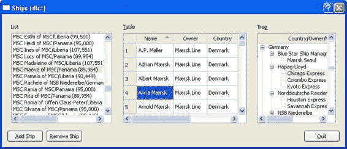

*使用便利项小部件*

PyQt 还提供了一些纯视图 `widgets`，包括 `QListView`、`QTableView` 和 `QTreeView`。这些必须与外部 `models` 一起使用，无论是我们创建的还是内置模型之一（如 `QStringListModel`、`QDirModel` 或 `QSqlTableModel`）。在第二节中，我们将学习创建一个可以与 `view` 小部件一起使用的自定义模型。

所有便利视图和纯视图都使用默认的 `delegate`，它控制数据项的呈现和编辑方式。在本章的最后一节，我们将学习创建一个自定义的 `delegate`，以对数据项的编辑和呈现进行完全控制。自定义 `delegates` 可以用于任何 `view`，无论是便利视图还是纯视图。

本章提供了使用 PyQt `model/view` 类的基础。在第 15 章中，我们将看到如何使用 `model/view` 类来处理数据库，在第 16 章中，我们将涵盖更高级的用法，包括创建自定义 `views`、提高 `delegates` 中的代码复用以及在树中呈现表格数据。

本章所有的示例都使用相同的 `dataset`，以便更容易比较和对比所使用的技术。`dataset` 的项在第一节中进行了描述。

### 使用便利项小部件

便利项小部件是内置了 `models` 的视图小部件。

它们使用默认的 `delegate` 来呈现和编辑数据，但如果我们愿意，可以用自定义的 `delegate` 来替换它。

图 14.2 中的截图显示了三个不同的便利视图 `widgets` 中相同的 `dataset`。这意味着数据被分别拷贝到每个 `widget` 中，因此存在大量的数据重复。另一个问题是，如果我们允许用户编辑数据，我们必须编写代码来确保所有视图保持同步。如果我们使用自定义的 `model`，这些问题就不会存在。

**图 14.2** *QListWidget、QTableWidget 和 QTreeWidget 的运行实例*

我们使用的 `dataset` 是一组关于集装箱的信息。每艘船由一个 `Ship` 对象表示，定义在 `chap14/ships.py` 模块。

```python
class Ship(object):

    def __init__(self, name, owner, country, teu=0, description=""):

        self.name = QString(name)

        self.owner = QString(owner)

        self.country = QString(country)

        self.teu = teu

        self.description = QString(description)

    def __cmp__(self, other):

        return QString.localeAwareCompare(self.name.toLower(),

other.name.toLower())
```

前面的代码是完整的 `Ship` 类。整数 `teu` 属性代表“二十英尺等效单位”，即该船可以容纳多少个二十英尺集装箱（现在大多数集装箱是 40 英尺，因此每个算作 2 个 TEU）。`name`、`owner` 和 `country` 属性都是纯文本，但 `description` 属性包含了一行 HTML。

`__cmp__` 特殊方法为排序提供了一种比较手段。`QString.localeAwareCompare()` 方法以感知区域敏感的方式进行字符串比较——例如，正确处理带重音的字符。

由于我们使用了没有自定义代理的便捷视图（convenience views），因此对数据项的编辑控制非常有限。例如，我们无法提供下拉组合框来编辑所有者和国家，也无法使用数值调节框（spinboxes）来编辑 `TEUs`。此外，描述文本是以原始格式显示的，而不是被解析为 HTML。当然，随着章节的进行，我们将解决所有这些问题，但目前我们只关注便捷视图的使用。

对于与便捷视图控件配合列表、表格和树项，可以设置它们的字体、文本对齐方式、文本颜色和背景颜色，并为它们提供图标或设置为可勾选。对于纯视图控件，我们可以通过自定义模型对项目的外观进行类似的控制；或者通过使用自定义代理对项目的外观和编辑进行完全控制。

本节示例的代码位于 `chap14/ships-dict.pyw`。数据存储在一个 Python 字典中，该字典本身被 `ships.ShipContainer` 类封装。

我们在这里只讨论与模型/视图编程相关的代码——其余代码使用了我们在书中之前已经过的概念和惯用法（例如在第 8 章中），并不难理解。

```python
class MainForm(QDialog):

    def __init__(self, parent=None):

        super(MainForm, self).__init__(parent)

        listLabel = QLabel("&List")

        self.listWidget = QListWidget()

        listLabel.setBuddy(self.listWidget)

        tableLabel = QLabel("&Table")

        self.tableWidget = QTableWidget()

        tableLabel.setBuddy(self.tableWidget)

        treeLabel = QLabel("Tre&e")

        self.treeWidget = QTreeWidget()

        treeLabel.setBuddy(self.treeWidget)
```

对于每个便捷视图，我们都创建一个标签并设置一个伙伴（buddy）以便更于键盘导航。布局代码与我们之前看到的类似，因此我们省略了它，只关注连接部分以及数据结构的创建。

```python
self.connect(self.tableWidget,

             SIGNAL("itemChanged(QTableWidgetItem*)"),

             self.tableItemChanged)

self.connect(addShipButton, SIGNAL("clicked()"), self.addShip)

self.connect(removeShipButton, SIGNAL("clicked()"), self.removeShip)

self.connect(quitButton, SIGNAL("clicked()"), self.accept)

self.ships = ships.ShipContainer(QString("ships.dat"))

self.setWindowTitle("Ships (dict)")
```

默认情况下，列表控件是不可编辑的，因此用户能做的只是选择项。树控件也是如此。但表格控件默认是可以编辑的，用户可以通过按 F2 或双击单元格来启动编辑。我们可以使用 `QAbstractItemView.setEditTriggers()` 对视图控件是否可以编辑进行完全控制；例如，我们可以让表格只读，或让列表变为可编辑。

此应用程序允许用户编辑表格中的船舶数据，并添加和删除船舶。它还会在数据加载后以及每次发生更改时重新填充视图，以保持所有三个视图都是更新。

```python
def populateList(self, selectedShip=None):

    selected = None

    self.listWidget.clear()

    for ship in self.ships.inOrder():

        item = QListWidgetItem(QString("%1 of %2/%3 (%L4)") \

                               .arg(ship.name).arg(ship.owner).arg(ship.country) \

                               .arg(ship.teu))

        self.listWidget.addItem(item)
```


```python
if selectedShip is not None and selectedShip == id(ship):
    selected = item

if selected is not None:
    selected.setSelected(True)
    self.listWidget.setCurrentItem(selected)
```

该方法与其他填充方法一样，既用于填充控件，又在传入参数时用于选择与`selectedShip`（即船舶的`id()`）相对应的项。我们首先清空控件。然后遍历船舶容器中的每艘船。`inOrder()`方法是由我们自定义的`ShipContainer`类提供的。

对于每艘船，我们创建一个包含单个字符串的列表控件项。我们使用`QString.arg()`，这样我们就可以使用`%L`来显示带有适当 4 位分隔符（例如逗号）的`TEUs`。

如果我们显示所选船舶的列表控件项，我们会在`selected`中保留该项的引用，并在列表控件填充完成后，将选中的项设置为当前项和选中项。

```python
def populateTable(self, selectedShip=None):
    selected = None
    self.tableWidget.clear()
    self.tableWidget.setSortingEnabled(False)
    self.tableWidget.setRowCount(len(self.ships))
    headers = ["Name", "Owner", "Country", "Description", "TEU"]
    self.tableWidget.setColumnCount(len(headers))
    self.tableWidget.setHorizontalHeaderLabels(headers)
```

`populate table`方法与`populate list`方法非常相似。我们首先清空表格——这会清空单元格以及垂直和水平表头（行号和列标题）。然后设置行数、列数以及列标题。

我们希望用户能够点击列以便表格根据该列的内容进行排序。此功能内置在`QTableWidget`中，但它必须在填充表格之前关闭。一旦表格填充完成后我们将重新开启排序。

```python
for row, ship in enumerate(self.ships):
    item = QTableWidgetItem(ship.name)
    item.setData(Qt.UserRole, QVariant(id(ship)))

    if selectedShip is not None and selectedShip == id(ship):
        selected = item

    self.tableWidget.setItem(row, ships.NAME, item)
    self.tableWidget.setItem(row, ships.OWNER, QTableWidgetItem(ship.owner))
    self.tableWidget.setItem(row, ships.COUNTRY, QTableWidgetItem(ship.country))
    self.tableWidget.setItem(row, ships.DESCRIPTION, QTableWidgetItem(ship.description))

    item = QTableWidgetItem(QString("%L1")
                            .arg(ship.teu, 8, 10, QChar(" ")))
    item.setTextAlignment(Qt.AlignRight | Qt.VCenter)
    self.tableWidget.setItem(row, ships.TEU, item)

self.tableWidget.setSortingEnabled(True)
self.tableWidget.resizeColumnsToContents()

if selected is not None:
    selected.setSelected(True)
    self.tableWidget.setCurrentItem(selected)
```

填充列表和表格非常相似，因为它们都使用了行和列的方法。填充树形结构完全不同，因为我们必须使用父子关系的方法。船舶数据的树形视图包含两列。第一列是树，根节点项目是国家，下一层项目是所有者，底层项目是船只本身。第二列仅显示`TEUs`。我们可以添加第三列来显示描述，但这样做对于理解树形小部件是如何工作的并没有特殊帮助。

```python
def populateTree(self, selectedShip=None):
    selected = None
    self.treeWidget.clear()
    self.treeWidget.setColumnCount(2)
    self.treeWidget.setHeaderLabels(["国家/所有者/名称", "TEU"])
    self.treeWidget.setItemsExpandable(True)
    parentFromCountry = {}
    parentFromCountryOwner = {}
```

我们的开始方式与之前相似，清除树并设置它的列和列标题。我们还把树的项设置为可展开的。我们稍后会解释这两个字典。

```python
for ship in self.ships.inCountryOwnerOrder():
    ancestor = parentFromCountry.get(ship.country)

    if ancestor is None:
        ancestor = QTreeWidgetItem(self.treeWidget, [ship.country])
        parentFromCountry[ship.country] = ancestor

    countryowner = ship.country + "/" + ship.owner
    parent = parentFromCountryOwner.get(countryowner)

    if parent is None:
        parent = QTreeWidgetItem(ancestor, [ship.owner])
        parentFromCountryOwner[countryowner] = parent

    item = QTreeWidgetItem(parent, [ship.name, QString("%L1").arg(ship.teu)])
    item.setTextAlignment(1, Qt.AlignRight | Qt.AlignVCenter)

    if selectedShip is not None and selectedShip == id(ship):
        selected = item

    self.treeWidget.expandItem(parent)
    self.treeWidget.expandItem(ancestor)
```

每只船在树中必须有一个所有者父节点，且每个所有者在树中必须有一个国家父节点。

对于每只船，我们检查树中是否存在该船只所属国家的项。我们通过查找`parentFromCountry`字典来实现。如果没有，我们就会以树小部件为父节点创建一个新的国家项，并在字典中保留该项的引用。此时，我们已经获取了或创建了该国家（`ancestor`）项。

然后，我们检查树中是否存在对应该船只所有者的项。

我们在`parentFromCountryOwner`字典中查找此项。同样，如果不存在，我们就会创建一个新的所有者项，以我们刚刚找到或创建的国家（`ancestor`）项为其父节点，并在字典中保留该所有者项的引用。

此时，我们已经获取了或创建了所有者（`parent`）项。现在，我们为船只创建一个新项，并以所有者为其父节点。

我们使用`parentFromCountryOwner`字典而不是`parentFromOwner`字典，是因为特定的所有者可能在多个国家运营。

### 使用便利项小部件

树小部件的项可以有多个列，这就是为什么在创建它们时，除了父节点外我们还传递了一个列表。我们为船只使用了额外的列（实际上只多了一列）来存储船只的`TEU`。我们通过调用`QTreeWidgetItem.setTextAlignment()`并将列号作为第一个参数传递，将`TEU`数字右对齐。

在向便利视图小部件中添加项时，我们可以先创建没有父节点的项然后添加它们（例如，使用`QTableWidget.setItem()`），也可以在带父节点的情况下创建它们，在这种情况下`PyQt`会为我们添加它们。

我们选择了第二种方法来填充树。

我们选择展开每一个项，以便树从开始就是完全展开状态。这对于较小的树没有问题，但不建议对大型树这样做。

```python
self.treeWidget.resizeColumnToContents(0)
self.treeWidget.resizeColumnToContents(1)

if selected is not None:
    selected.setSelected(True)
    self.treeWidget.setCurrentItem(selected)
```

最后，我们调整两列的大小，并将选中的项（如果有的话）设置为当前项并选中。

我们将列表视图和树形视图保持在默认的只读状态。这意味着只有当用户编辑表格中的项，或者添加或删除船只时，数据才能被更改；因此在这些情况下，我们必须确保视图同步。在编辑的情况下，每当完成编辑时都会调用`tableItemChanged()`方法。用户通过改变焦点来完成编辑，例如点击项外部或按下`Tab`键，或者按下`Enter`；通过按下`Esc`取消编辑。

```python
def tableItemChanged(self, item):
    ship = self.currentTableShip()

    if ship is None:
        return

    column = self.tableWidget.currentColumn()

    if column == ships.NAME:
        ship.name = item.text().trimmed()
    elif column == ships.OWNER:
        ship.owner = item.text().trimmed()
    elif column == ships.COUNTRY:
        ship.country = item.text().trimmed()
    elif column == ships.DESCRIPTION:
        ship.description = item.text().trimmed()
    elif column == ships.TEU:
        ship.teu = item.text().toInt()

    self.dirty = True
    self.populateList()
    self.populateTree()
```

如果用户编辑表格中的项，我们会获取相应的船只并更新。我们使用`QString.trimmed()`来去除首尾空格。这种重新填充对于小型数据集没有问题，但对于大型数据集可能会很慢。解决方案是只更新发生更改的项。我们在使用自定义视图时会自动完成这一点，正如下一节所示。

```python
def currentTableShip(self):
    item = self.tableWidget.item(self.tableWidget.currentRow(), 0)

    if item is None:
        return None

    return self.ships.ship(item.data(Qt.UserRole).toInt())
```

`QTableWidget.item()`方法返回指定行和列的表格项。我们需要这些项的 ID。我们使用`ShipContainer.ship()`方法根据 ID 获取船只。这是很快的，因为船只存储在字典中。

```python
def addShip(self):
    ship = ships.Ship("Unknown", "Unknown", "Unknown")
    self.ships.addShip(ship)
    self.populateList()
    self.populateTree()
    self.populateTable(id(ship))
    self.tableWidget.setFocus()
    self.tableWidget.editItem(self.tableWidget.currentItem())
```

添加新船相对容易，部分原因是我们没有进行任何验证。我们简单地创建一个带有“未知”值（前导空格是为了使值更显眼）的新船，将其添加到字典中。然后我们重新填充列表、树和表格，所有这些都会获取我们刚刚创建的船。我们将新船的 ID 传递给填充表格方法，以确保其第一列是当前选中的表格项，并使其获得键盘焦点。`editItem()`调用是用户按下`F2`或双击启动编辑的程序化操作，它会导致第一个字段（船名）变为可编辑。用户只需按下`Tab`即可编辑剩余字段，因为编辑状态将保持到他们离开该行或按下`Enter`（或按`Esc`取消）。

`QString.simplified()`方法也非常有用。它会移除末端的空白字符，并将内部的一个或多个空白字符序列还原为单个空格。

```python
def removeShip(self):
    ship = self.currentTableShip()

    if ship is None:
        return

    if QMessageBox.question(
        self,
        "Ships - Remove",
        QString("Remove %1 of %2/%3?")
        .arg(ship.name)
        .arg(ship.owner)
        .arg(ship.country)
    ) == QMessageBox.Yes:
        self.ships.removeShip(ship)
        self.populateList()
        self.populateTree()
```

```python
if QMessageBox.Yes | QMessageBox.No) == QMessageBox.No:
    return

self.ships.removeShip(ship)
self.populateList()
self.populateTree()
self.populateTable()
```


移除船只比添加它们更加简单。我们获取当前的船只，然后弹出一个对话框询问用户是否确定要移除该船只。如果他们点击“是”，我们就会从`ShipContainer`中移除该船只并重新填充视图控件。

尽管像这里这样使用三个不同的视图是不符合常规的，但我们使用的技术（特别是配合`QTableWidget`使用时）是完全通用的。

便利控件（convenience widgets）对于小型和临时的数据集非常有用，并且可以在不一定有独立数据集的情况下使用——即它们本身就可以显示、编辑和存储数据。在这个示例中，我们选择将数据分离出来，是为了为使用模型/视图技术（特别是自定义模型，这是下一节的主题）打下基础。

## 创建自定义模型

在本节中，我们将创建一个自定义模型来存储船只数据，并在两个不同的表格视图中显示同一个模型。图 14.3 显示了使用该模型的应用程序。用户可以独立地滚动表格，并编辑其中任何一个表格的数据，并且确信任何更改都将自动反映在两个视图中。

我们将从显示应用程序主表的部分片段开始。这将向我们展示一些正在使用的模型/视图 API。然后我们将查看模型本身的实现。PyQt 模型/视图架构的一个重要优点是，相同的编码模式被反复使用，因此，一旦我们学会了如何创建一个表格模型，就知道了如何创建任何表格（或列表）模型。

该模型由`chap14/ships.py`中的`ShipTableModel`类提供，应用程序位于`chap14/ships-model.pyw`中。我们通过设置背景颜色和前景颜色改进了视图中数据的显示，但这些可以在便利视图中通过调用表格项的相应方法来完成。

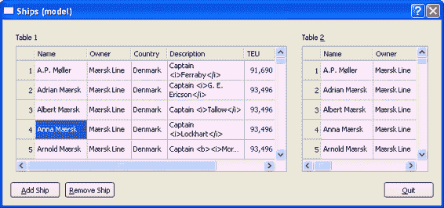

**图 14.3** 两个`QTableView`中的自定义表格模型

上一个示例中存在的问题，特别是没有用于所有者或国家的组合框、没有用于 TEU 的数字步调节框（spinbox）以及直接显示 HTML 描述文本仍然存在。这些问题只有通过使用代理（delegate）来解决，我们将在下一节中实现这一点。

### 实现视图逻辑

从表面上看，使用带有内置模型的便利视图所能实现的效果与使用带有独立模型的纯视图所能实现的效果似乎没有区别。在之前的示例中，我们有三个视图呈现相同的底层数据，保持它们同步是我们的责任。在这个示例中，我们将在同一数据上使用两个视图，并将同步工作留给 PyQt，因为两个视图都使用同一个模型。另一个益处是，视图只检索或存储实际被看到或编辑的数据，当在使用大型数据集时这可以带来显著的性能优势。

我们将从表单初始化函数的某些片段开始。

```python
class MainForm(QDialog):

    def __init__(self, parent=None):

        super(MainForm, self).__init__(parent)

        self.model = ships.ShipTableModel(QString("ships.dat"))

        tableLabel1 = QLabel("Table &1")

        self.tableView1 = QTableView()

        tableLabel1.setBuddy(self.tableView1)

        self.tableView1.setModel(self.model)

        tableLabel2 = QLabel("Table &2")

        self.tableView2 = QTableView()

        tableLabel2.setBuddy(self.tableView2)

        self.tableView2.setModel(self.model)
```

首先，我们创建一个新模型。然后，我们创建两个表格视图和相应的标签以方便导航。每个表格视图都分配了相同的模型进行操作。我们省略了布局代码，因为与此无关。

```python
for tableView in (self.tableView1, self.tableView2):

    header = tableView.horizontalHeader()

    self.connect(header, SIGNAL("sectionClicked(int)"), self.sortTable)

    self.connect(addShipButton, SIGNAL("clicked()"), self.addShip)

    self.connect(removeShipButton, SIGNAL("clicked()"), self.removeShip)

    self.connect(quitButton, SIGNAL("clicked()"), self.accept)

    self.setWindowTitle("Ships (model)")
```

当我们使用自定义模型时，必须自己处理排序。我们将每个表格视图的水平（列）头连接到`sortTable()`方法。其他连接与我们之前的类似。但请注意，我们没有为表格项被编辑时建立连接：这是没必要的，因为视图将为我们处理编辑，自动将更改反映回模型，反过来这会保持两个视图都是新的。

```python
def accept(self):

    if self.model.dirty and \

       QMessageBox.question(self, "Ships - Save?",

       "Save unsaved changes?",

       QMessageBox.Yes|QMessageBox.No) == QMessageBox.Yes:

        try:

            self.model.save()

        except IOError, e:

            QMessageBox.warning(self, "Ships - Error",

            "Failed to save: %s" % e)

        QDialog.accept(self)
```

如果用户终止应用程序且存在未保存的更改，我们将给予他们保存的机会。模型的`dirty`属性和`save()`方法是我们对`QAbstractTableModel`的扩展，以便在退出前加载并保存。基类是`QAbstractModel`。

```python
def sortTable(self, section):

    if section in (ships.OWNER, ships.COUNTRY):

        self.model.sortByCountry()

    else:

        self.model.sortByName()
```

我们只提供了两种排序，但没有理由不支持更多。当用户排序时，我们在此机会调整列宽，因为编辑可能改变列宽，由于排序会更改视图，这是合理的。

```python
def resizeColumns(self):

    for tableView in (self.tableView1, self.tableView2):

        for column in (ships.NAME, ships.OWNER, ships.COUNTRY, ships.TEU):

            tableView.resizeColumnToContents(column)
```

在这里我们调整两个视图中描述列以外的所有列。

```python
def addShip(self):

    row = self.model.rowCount()

    self.model.insertRows(row)

    index = self.model.index(row, 0)

    tableView = self.tableView1

    if self.tableView2.hasFocus():

        tableView = self.tableView2

    tableView.setFocus()

    tableView.setCurrentIndex(index)

    tableView.edit(index)
```

...


可编辑模型需要重新实现只读模型所需的相同方法，此外还需要实现`flags()`和`setData()`。如果模型需要支持添加和删除行，以及编辑现有数据，则还必须实现`insertRows()`和`removeRows()`。

也可以实现其他方法，但前两段中列出的方法是唯一必需的方法。

对于船舶模型，我们将船舶存储在内存中的列表和磁盘上的二进制文件中。为了支持此功能，我们扩展了模型 API，添加了`sortByName()`、`sortByCountryOwner()`、`load()`和`save()`。

`ShipTableModel`位于`chap14/ships.py`。

```python
class ShipTableModel(QAbstractTableModel):
    def __init__(self, filename=QString()):
        super(ShipTableModel, self).__init__()
        self.filename = filename
        self.dirty = False
        self.ships = []
        self.owners = set()
        self.countries = set()
```

我们希望从二进制文件中加载和保存模型数据，因此使用实例变量保存`filename`。船舶本身存储在一个列表中，该列表最初是无序的。我们还维护两个集合，一个用于保存船东，另一个用于保存国家或地区：在下一节创建自定义委托时，我们将使用它们来填充组合框。

```python
def rowCount(self, index=QModelIndex()):
    return len(self.ships)

def columnCount(self, index=QModelIndex()):
    return 5
```

行数和列数很容易提供。对于表格模型而言，列数固定是非常常见的情况。

```python
def data(self, index, role=Qt.DisplayRole):
    if not index.isValid() or \
        not (0 <= index.row() < len(self.ships)):
        return QVariant()
    ship = self.ships[index.row()]
    column = index.column()
    if role == Qt.DisplayRole:
        if column == NAME:
            return QVariant(ship.name)
        elif column == OWNER:
            return QVariant(ship.owner)
        elif column == COUNTRY:
            return QVariant(ship.country)
        elif column == DESCRIPTION:
            return QVariant(ship.description)
        elif column == TEU:
            return QVariant(QString("%L1").arg(ship.teu))
```

`data()`方法有一个必需参数，即相关项目的模型索引；还有一个可选参数，即“角色”。角色用于指示所需信息的类型。默认角色`Qt.DisplayRole`表示需要返回显示的数据。

# 创建自定义模型

如果模型索引无效，或者行超出范围，我们就返回一个无效的`QVariant`。PyQt 的模型/视图架构不会抛出异常或提供错误消息；它只会使用无效的`QVariant`。如果索引有效，我们就获取与索引行对应的船舶。如果角色是`Qt.DisplayRole`，我们就将请求列的数据以`QVariant`的形式返回。对于`TEU`，我们不返回整数，而是将数字作为本地化字符串返回。

```python
elif role == Qt.TextAlignmentRole:
    if column == TEU:
        return QVariant(int(Qt.AlignRight|Qt.AlignVCenter))
    return QVariant(int(Qt.AlignLeft|Qt.AlignVCenter))
elif role == Qt.TextColorRole and column == TEU:
    if ship.teu < 80000:
        return QVariant(QColor(Qt.black))
    elif ship.teu < 100000:
        return QVariant(QColor(Qt.darkBlue))
    elif ship.teu < 120000:
        return QVariant(QColor(Qt.blue))
    else:
        return QVariant(QColor(Qt.red))
elif role == Qt.BackgroundColorRole:
    if ship.country in (u"Bahamas", u"Cyprus", u"Denmark", u"France", u"Germany", u"Greece"): return QVariant(QColor(250, 230, 250))
    elif ship.country in (u"Hong Kong", u"Japan", u"Taiwan"): return QVariant(QColor(250, 250, 230))
    elif ship.country in (u"Marshall Islands",):
        return QVariant(QColor(230, 250, 250))
    else:
        return QVariant(QColor(210, 230, 230))
return QVariant()
```

如果使用`Qt.TextAlignmentRole`调用`data()`，我们就为`TEU`返回右对齐，为其他列返回左对齐。`QVariant`无法接受对齐方式，因此我们必须将其转换为整数值。

对于`Qt.TextColorRole`，我们为`TEU`列返回颜色，并忽略其他列。这意味着非`TEU`列将使用默认文本颜色，通常为黑色。对于`Qt.BackgroundColorRole`，我们根据船舶所属的国家或地区组提供不同颜色的背景。

如果愿意，我们还可以处理其他角色，包括`Qt.DecorationRole`（项目的图标）、`Qt.ToolTipRole`、`Qt.StatusTipRole`和`Qt.WhatsThisRole`。在控制外观方面，除了前面讨论过的对齐和颜色角色外，还有`Qt.FontRole`和`Qt.CheckStateRole`。

对于所有我们选择不处理的情况，我们都返回一个无效的`QVariant`。这会告诉模型/视图架构使用默认值。

一些开发人员不喜欢像我们在`data()`实现中所做的那样，将与外观相关的信息和数据混合在一起。PyQt 对此保持中立：它既允许我们混合处理，也允许我们让`data()`只关注数据，并将与外观相关的问题交给委托处理。

```python
def headerData(self, section, orientation, role=Qt.DisplayRole):
    if role == Qt.TextAlignmentRole:
        if orientation == Qt.Horizontal:
            return QVariant(int(Qt.AlignLeft|Qt.AlignVCenter))
        return QVariant(int(Qt.AlignRight|Qt.AlignVCenter))
    if role != Qt.DisplayRole:
        return QVariant()
    if orientation == Qt.Horizontal:
        if section == NAME:
            return QVariant("Name")
        elif section == OWNER:
            return QVariant("Owner")
        elif section == COUNTRY:
            return QVariant("Country")
        elif section == DESCRIPTION:
            return QVariant("Description")
        elif section == TEU:
            return QVariant("TEU")
    return QVariant(int(section + 1))
```

虽然不是必需的，但提供`headerData()`实现是一种良好实践。到目前为止，我们研究的方法已经足以实现只读表格模型。现在，我们将继续研究要使模型可编辑，必须实现的其他方法。

```python
def flags(self, index):
    if not index.isValid():
        return Qt.ItemIsEnabled
    return Qt.ItemFlags(QAbstractTableModel.flags(self, index)|
    Qt.ItemIsEditable)
```


稍后：“我们需要针对特定情况扩展 API 的方法”。无粗体。

稍后：“只读表模型的基本方法是 `data()`、`rowCount()` 和 `columnCount()`，尽管 `headerData()` 几乎总是也会实现。”无粗体。

稍后：“可编辑模型需要重新实现只读模型所需的相同方法，此外还需要实现 `flags()` 和 `setData()`。”无粗体。

稍后：“如果模型需要支持添加和删除行以及编辑现有数据，则还必须实现 `insertRows()` 和 `removeRows()`。”无粗体。

稍后：“也可以实现其他方法，但前两段中列出的那些方法是唯一必需的方法。”无粗体。

稍后：“对于船只模型，我们将船只存储在内存中的列表以及磁盘上的二进制文件中。”无粗体。

稍后：“为了支持此功能，我们通过添加 `sortByName()`、`sortByCountryOwner()`、`load()` 和 `save()` 扩展了模型 API。”无粗体。

稍后：“`ShipTableModel` 位于 `chap14/ships.py` 中。”无粗体。

稍后：“我们希望从二进制文件中加载和保存模型的数据，因此保留一个包含 `filename` 的实例变量。”无粗体。

稍后：“船只本身存储在一个最初无序的列表中。”无粗体。

稍后：“我们还保留两个集合，一个存储所有者，另一个存储国家：在下一节创建自定义委托时，我们将使用它们填充组合框。”无粗体。

稍后：“如果模型索引无效，或者行超出范围，我们将返回一个无效的 `QVariant`。”无粗体。

稍后：“PyQt 的模型/视图架构不会引发异常或提供错误消息；它只会使用无效的 `QVariant`。”无粗体。

稍后：“如果索引有效，我们将检索索引所对应行中的船只。”无粗体。

稍后：“如果角色是 `Qt.DisplayRole`，我们将以 `QVariant` 的形式返回所请求列的数据。”无粗体。

稍后：“对于 `TEU`，我们不返回整数，而是将数字作为本地化字符串返回。”无粗体。

稍后：“如果使用 `Qt.TextAlignmentRole` 调用 `data()`，我们会为 `TEU` 设置右对齐，为其他列设置左对齐。”无粗体。

稍后：“`QVariant` 无法接受对齐方式，因此我们必须将其转换为整数值。”无粗体。

稍后：“对于 `Qt.TextColorRole`，我们为 `TEU` 列返回颜色，并忽略其他列。”无粗体。

稍后：“这意味着非 `TEU` 列将使用默认文本颜色，通常是黑色。”无粗体。

稍后：“对于 `Qt.BackgroundColorRole`，我们会根据船只所属的国家组提供不同颜色的背景。”无粗体。

稍后：“如果愿意，我们还可以处理其他几个角色，包括 `Qt.DecorationRole`（项目的图标）、`Qt.ToolTipRole`、`Qt.StatusTipRole` 和 `Qt.WhatsThisRole`。”无粗体。

稍后：“对于外观控制，除了前面讨论的对齐和颜色角色外，还有 `Qt.FontRole` 和 `Qt.CheckStateRole`。”无粗体。

稍后：“对于所有我们选择不处理的情况，我们都会返回一个无效的 `QVariant`。”无粗体。

稍后：“一些开发人员不喜欢像我们在这里的 `data()` 实现中所做的那样，将外观相关信息与数据混合在一起。”无粗体。

稍后：“PyQt 对此问题持中立态度：它允许我们进行混合；但如果我们希望 `data()` 只关注数据，也可以这样做，并将外观相关问题交给委托。”无粗体。

稍后：“虽然不是必需的，但提供 `headerData()` 实现是一个良好实践。”无粗体。

稍后：“到目前为止，我们研究的方法足以实现只读表模型。现在我们将研究使模型可编辑所必须实现的附加方法。”无粗体。

稍后：

```python
def flags(self, index):
```

因此不需要翻译粗体或斜体；只需保留符号。

现在我们需要将英文句子翻译成中文，同时保留标点符号和换行。还需要翻译列表项（连字符列表项）的内容。

逐行处理。

第一段：

“如果用户点击 `Remove` 按钮，我们会检索当前表视图当前项的模型索引。”

“我们从该模型索引中提取行，并使用 `QAbstractTableModel.data()` 方法检索船只的名称、所有者和国家。”

“`data()` 方法以模型索引作为必需参数，并返回一个 `QVariant`。”

“我们使用 `QAbstractTableModel.index()` 创建所需行/列组合的模型索引，并使用 `QVariant.toString()` 将返回的值转换为 `QStrings`。”

第二段：

“如果用户确认删除，我们只需从模型中删除相应的行。”

“模型会自动通知视图，视图随后会自行更新。”

“我们在删除后调用了 `resizeColumns()`，因为最大列宽可能已经发生变化。”

# 实现自定义模型

如果用户点击 `Remove` 按钮，我们会检索当前表视图当前项的模型索引。

我们从该模型索引中提取行，并使用 `QAbstractTableModel.data()` 方法检索船只的名称、所有者和国家。

`data()` 方法以模型索引作为必需参数，并返回一个 `QVariant`。

我们使用 `QAbstractTableModel.index()` 创建所需行/列组合的模型索引，并使用 `QVariant.toString()` 将返回的值转换为 `QStrings`。

如果用户确认删除，我们只需从模型中删除相应的行。

模型会自动通知视图，视图随后会自行更新。

我们在删除后调用了 `resizeColumns()`，因为最大列宽可能已经发生变化。

如果我们有一个有效的模型索引，我们将返回一个 `Qt.ItemFlags`，该标志将现有的项目标志与 `Qt.ItemIsEditable` 标志结合。我们可以使用此方法使项目变为只读，即仅当模型索引指向我们想要编辑的行和列时，才应用 `Qt.ItemIsEditable` 标志。

## 创建自定义模型

```python
def setData(self, index, value, role=Qt.EditRole):
    if index.isValid() and 0 <= index.row() < len(self.ships):
        ship = self.ships[index.row()]
        column = index.column()
        if column == NAME:
            ship.name = value.toString()
        elif column == OWNER:
            ship.owner = value.toString()
        elif column == COUNTRY:
            ship.country = value.toString()
        elif column == DESCRIPTION:
            ship.description = value.toString()
        elif column == TEU:
            value, ok = value.toInt()
            if ok:
                ship.teu = value
        self.dirty = True
        self.emit(SIGNAL("dataChanged(QModelIndex,QModelIndex)"), index, index)
        return True
    return False
```

当用户完成编辑时会调用此方法。在这种情况下，我们忽略了 `role`，尽管可能存在独立的显示和编辑数据（例如，电子表格的结果及其背后的公式）。如果 `index` 有效且行号在范围内，我们将检索相关的船只并更新被编辑的列。对于 `TEU`，只有当用户输入的内容成功转换为整数时，我们才应用更改。

如果发生更改，*必须*发射 `dataChanged()` 信号。模型/视图架构依赖此信号来确保所有视图保持更新。我们必须传递两次已更改项目的模型索引，因为该信号可以用于表示一组更改，其中第一个索引是左上角项目，第二个索引是右下角项目。如果更改被接受并应用，必须返回 `True`，否则返回 `False`。

实现 `flags()` 和 `setData()`（以及只读模型所需的方法）就足以使模型变得可编辑。但为了使用户能够添加或删除整行，我们需要实现两个额外的方法。

```python
def insertRows(self, position, rows=1, index=QModelIndex()):
    self.beginInsertRows(QModelIndex(), position, position + rows - 1)
    for row in range(rows):
        self.ships.insert(position + row, Ship(" Unknown", " Unknown", " Unknown"))
    self.endInsertRows()
    self.dirty = True
    return True
```


当我们要向模型插入一行或多行时，调用`beginInsertRows()`是至关重要的。`position`是我们想要插入的行号。`beginInsertRows()`的调用直接来自 PyQt 文档，对于任何表格模型的`insertRows()`实现都不需要更改。在插入之后，我们必须调用`endInsertRows()`。模型会自动通知视图更改已经发生，如果相关的行对用户可见，视图将请求新数据。

```python
def removeRows(self, position, rows=1, index=QModelIndex()):
    self.beginRemoveRows(QModelIndex(), position, position + rows - 1)
    self.ships = self.ships[:position] + self.ships[position + rows:]
    self.endRemoveRows()
    self.dirty = True
    return True
```

此方法与上一个相似。`beginRemoveRows()`的调用来自文档，是表格模型重新实现的标准做法。在删除相关行之后，我们必须调用`endRemoveRows()`。模型会自动通知视图更改。

现在我们已经实现了可编辑表格模型的核心方法。

某些模型仅仅是外部数据源的接口，例如数据库表（将在下一章中介绍），或外部文件或进程。在这种情况下，我们将数据存储在模型内部，由于这个原因我们必须提供一些额外的方法，特别是`load()`和`save()`。我们还提供了几个排序方法以方便用户。对于大型数据集，排序是有开销的，在这种情况下，使用有序数据结构（如`OrderedDict`等`Dict`）或结合`bisect`模块的函数使用列表可能会有益。

```python
def sortByName(self):
    self.ships = sorted(self.ships)
    self.reset()
```

当对列表调用`sort()`时，它会使用项的`__lt__()`特殊方法进行比较，如果没有实现`__lt__()`，则回退到使用`__cmp__()`特殊方法。我们提供了`Ship.__cmp__()`，它是对船只名称的位置感知比较。

排序数据会使所有模型索引失效，这意味着视图现在显示的是错误的数据。模型必须通知视图通过获取最新数据来更新自身。一种方法是发射`dataChanged()`信号，但对于大幅更改，调用以下更为高效。

### 表 14.1 精选 QAbstractItemModel 方法 #1

| 语法 | 描述 |
| :--- | :--- |
| `m.beginInsertRows(p, f, l)` | 在`insertRows()`的重新实现中插入数据之前调用。参数是父级`QModelIndex``p`以及新行占据的第一行和最后一行；`m`是`QAbstractItemModel`子类。 |
| `m.beginRemoveRows(p, f, l)` | 在`removeRows()`的重新实现中移动数据之前调用。参数是父级`QModelIndex``p`以及要删除的第一行和最后一行；`m`是`QAbstractItemModel`子类。 |
| `m.columnCount(p)` | 子类必须重新实现此方法；父级`QModelIndex``p`只对树模型有效。 |
| `m.createIndex(r, c, p)` | 子类必须使用此方法创建具有行 int `r`、列 int `c` 和父级`QModelIndex``p`的`QModelIndexes`。 |
| `m.data(i, rl)` | 为`QModelIndex``i`和`Qt.ItemDataRole``rl`返回`QVariant`数据；子类必须重新实现此方法。 |
| `m.endInsertRows()` | 在`insertRows()`的重新实现中插入新数据之后调用；`m`是`QAbstractItemModel`子类。 |
| `m.endRemoveRows()` | 在`removeRows()`的重新实现中删除数据之后调用；`m`是`QAbstractItemModel`子类。 |
| `m.flags(i)` | 为`QModelIndex``i`返回`Qt.ItemFlags`；这些标志决定了项是否可选、可编辑等。可编辑模型子类必须重新实现此方法。 |
| `m.hasChildren(p)` | 如果父级`QModelIndex``p`有子节点则返回 True；仅对树模型有效。 |
| `m.headerData(s, o, rl)` | 为“节”（行或列）int `s`返回`QVariant`，其中`Qt.Orientation``o`表示行或列，以及`Qt.ItemDataRole``rl`。子类通常重新实现此方法；`m`是`QAbstractItemModel`子类。 |
| `m.index(r, c, p)` | 为指定的行 int `r`、列 int `c`和父级`QModelIndex``p`返回`QModelIndex`；子类必须重新实现此方法。 |
| `m.insertRow(r, p)` | 在行 int `r`之前插入一行。在树模型中，该行作为父级`QModelIndex``p`的子节点插入。 |
| `m.insertRows(r, n, p)` | 在行 int `r`之前插入`n`行。在树模型中，这些行作为父级`QModelIndex``p`的子节点插入。可编辑模型子类通常重新实现此方法——重新实现必须调用`beginInsertRows()`和`endInsertRows()`。 |
| `m.parent(i)` | 返回`QModelIndex``i`的父级`QModelIndex`。树模型子类必须重新实现此方法。 |

### 表 14.2 精选 QAbstractItemModel 方法 #2

| 语法 | 描述 |
| :--- | :--- |
| `m.removeRow(r, p)` | 删除行 int `r`。父级`QModelIndex``p`只对树模型有效；`m`是`QAbstractItemModel`子类。 |
| `m.removeRows(r, n, p)` | 从行 int `r`开始删除`n`行。父级`QModelIndex``p`只对树模型有效。可编辑模型子类通常重新实现此方法——重新实现必须调用`beginRemoveRows()`和`endRemoveRows()`。 |
| `m.reset()` | 通知所有关联视图模型数据发生了剧烈变化——这将强制视图重新获取其所有可见数据。 |
| `m.rowCount(p)` | 子类必须重新实现此方法；父级`QModelIndex``p`只对树模型有效。 |
| `m.setData(i, v, rl)` | 为`QModelIndex``i`的`Qt.ItemDataRole``rl`设置数据为`v`。 |

`QVariant``v`。编辑模型子类必须重新实现此方法——如果数据确实发生了变化，重新实现的方法必须发出`dataChanged()`信号。`m.setHeader`-为区域 int `s`设置头部数据，使用`Data(s, o, v, rl)`、`Qt.Orientation``o`（即行或列），对于`Qt.ItemDataRole``rl`的`QVariant``v`。

`QAbstractTableModel.reset();`这会通知所有关联视图所有内容已过期，并强制它们进行自更新。

```python
def sortByCountryOwner(self):
    def compare(a, b):
        if a.country != b.country:
            return QString.localeAwareCompare(a.country, b.country)
        if a.owner != b.owner:
            return QString.localeAwareCompare(a.owner, b.owner)
        return QString.localeAwareCompare(a.name, b.name)
    self.ships = sorted(self.ships, compare)
    self.reset()
```

在这里我们提供了一个自定义排序方法，按国家、所有者和船名进行排序。对于大型数据集，使用 DSU（装饰、排序、取消装饰）可能会更高效。例如：

```python
def sortByCountryOwner(self):
    ships = []
    for ship in self.ships:
        ships.append((ship.country, ship.owner, ship.name, ship))
    ships.sort()
    self.ships = [ship for country, owner, name, ship in ships]
    self.reset()
```

这使用了普通的`QString.compare()`，因此可能使用`unicode(ship.country)`、`unicode(ship.owner)`和`unicode(ship.name)`更好。当然，对于非常大的数据集，可能最好完全避免排序并转而使用有序容器。

### 保存

`save()`和`load()`方法与我们之前看到的用于`QDataStream`处理二进制数据的方法非常相似，因此我们只展示每个方法核心部分的加载摘录，从`save()`方法开始。

#### 二进制文件

```python
for ship in self.ships:
    stream << ship.name << ship.owner << ship.country \
    << ship.description
    stream.writeInt32(ship.teu)
```

得益于使用`QDataStream`，我们不需要担心字符串的长度或编码问题。船只以相应的方式加载的：这里是`load()`方法的一个摘录：

```python
self.ships = []
while not stream.atEnd():
    name = QString()
    owner = QString()
    country = QString()
    description = QString()
    stream >> name >> owner >> country >> description teu = stream.readInt32()
    self.ships.append(Ship(name, owner, country, teu, description))
self.owners.add(unicode(owner))
self.countries.add(unicode(country))
```

如前所述，我们保留了所有者和国家的集合，以便在添加自定义委托时可以在组合框中使用它们。

实现自定义模型（特别是列表模型和表格模型）非常简单。对于只读模型，我们只需要实现三个方法，尽管通常我们会实现四个。对于可编辑模型，我们通常总计要实现八个方法。一旦你创建了几模型，创建其他模型就会变得容易，因为所有列表和表格模型遵循相同的模式。实现树形模型更具挑战性；该主题在第 16 章最后一节中介绍。

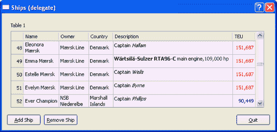

*第 14 章. 模型/视图编程*

### 创建自定义委托

如果我们想对数据项的显示和编辑进行完全控制，我们必须创建一个自定义委托。委托可以仅用于控制外观（例如，用于只读视图），也可以通过提供自定义编辑器来控制编辑，或者两者兼顾。

**图 14.4** 运行中的自定义委托

图 14.4 看起来之前的截图相似，唯一的显著区别是描述文本经过了正确的格式化，而不是显示原始 HTML。然而，差异要深得多。例如，如果我们编辑所有者或国家字段，我们将获得填充有当前所有者和国家的组合框；如果我们编辑 TEU，我们将得到一个数字调节框（spinbox）。对外观和编辑的所有这些控制都是通过使用委托实现的——委托可以与便利视图或纯视图配合，尽管在本例中我们在纯视图中使用该委托。

本节我们使用`chap14/ships-delegate.pyw`应用程序。这与`ships-model.pyw`几乎相同，仅区别在于窗口标题、PyQt、我们缩放了所有列而不是跳过描述列，以及 4.1 我们使用了自定义委托这一事实。委托类`ShipDelegate`位于`chap14/ships.py`。注意，该类需要`PyQt` 4.1 或更高版本。委托类继承自`QItemDelegate`。注意该类需要`PyQt` 4.1 或更高版本。与子类一样，委托遵循相同的模式。对于只读模型，唯一需要重新实现的是`paint()`。对于可编辑模型，我们必须重新实现`createEditor()`、`setEditorData()`、`setModelData()`以及`commitCloseEditor()`。最后，有时需要重新实现`sizeHint()`，如我们将看到的。

#### 自定义委托

我们经常创建只处理某些列的委托，当涉及到绘图时，基类处理的默认行为已经足够了。我们将通过查看`MainForm`构造函数的一个小摘录开始：

```python
class MainForm(QDialog):
    def __init__(self, parent=None):
        super(MainForm, self).__init__(parent)
        self.model = QTableModel(QString("Table"))
        self.tableView1 = QTableView()
        self.tableView1.setModel(self.model)
        self.tableView1.setItemDelegate(
```

委托必须接收表单作为父对象以保持存活。与前节的区别在于我们调用了`setItemDelegate()`，传递了一个新构造的`ShipDelegate`。现在工作将由委托处理。

```python
class ShipDelegate(QItemDelegate):
    def __init__(self, parent=None):
        super(ShipDelegate, self).__init__(parent)
```

通常，委托的构造函数除了初始化基类外不需要做任何事情。事实上，对于此类情况，我们可以省略`__init__()`。

```python
def paint(self, painter, option, index):
    if index.column() == DESCRIPTION:
        text = index.model().data(index).toString()
        palette = QApplication.palette()
        document = QTextDocument()
        document.setDefaultFont(option.font)
        if option.state & QStyle.State_Selected:
            document.setHtml(QString("<font color=%1>%2</font>")
            .arg(palette.highlightedText().color().name())
            .arg(text))
        else:
            document.setHtml(text)
        color = palette.highlight().color() \
        if option.state & QStyle.State_Selected \ else QColor(index.model().data(index, Qt.BackgroundColorRole))
        painter.save()
        painter.fillRect(option.rect, color)
        painter.translate(option.rect.x(), option.rect.y())
        document.drawContents(painter)
        painter.restore()
    else:
        QItemDelegate.paint(self, painter, option, index)
```

随后我们获取应用程序的调色板（palette）——这是基于用户的主题颜色偏好。如果选择了该项，我们将调色板的高亮文本颜色应用到 HTML；否则，我们保持原样使用 HTML。`QColor.name()`方法将颜色以十六进制字符串的形式返回；例如，红色将返回为字符串 "#FF0000"，这与 HTML 颜色规范使用的格式相同。同样，如果选了该项，我们将使用调色板的高亮背景颜色；否则，我们将通过调用带有`Qt.BackgroundColorRole`的`data()`方法来使用模型指定的背景颜色。


`QTextDocument.drawContents()` 方法相对于绘制器（painter）的左上角坐标（`0`, `0`）进行绘图。因此，我们将绘制器的左上角移动（平移）到样式选项矩形的（`x`, `y`）位置，然后告诉文档在绘制器上绘制其自身内容。

在很多情况下，我们不需要费心在绘图事件之间保存和恢复绘制器的状态，但在这种情况下我们必须这么做。一些 Qt 程序员认为，始终保存和恢复绘制器的状态是一种良好的习惯，而另一些人则倾向于仅在必要时才这样做，即只有当他们对绘制器的状态应用持久更改时（例如应用平移等变换）才这样做。

遗憾的是，绘制 HTML 的故事并没有就此结束。当视图请求 HTML 列的尺寸提示（size hint）时，默认行为将是返回一个基于视图字体和字符数量的尺寸提示。

### 创建自定义代理（Delegates）

由于 HTML 相当冗长，计算中使用的字符数量可能远大于实际显示的数量。

这个问题有两个解决方案，两种方案都要求我们自己为 HTML 文本计算尺寸提示。一种方案是修改 `QAbstractTableModel.data()` 方法，并在调用带有 `Qt.SizeHintRole` 的 `data()` 时返回一个合适的尺寸提示。另一种方案是重新实现 `QItemDelegate.sizeHint()` 方法。我们更倾向于重新实现 `sizeHint()`，因为这样可以将问题及其解决方案保持在同一个类中。

```python
def sizeHint(self, option, index):
    fm = option.fontMetrics
    if index.column() == TEU:
        return QSize(fm.width("9,999,999"), fm.height())
    if index.column() == DESCRIPTION:
        text = index.model().data(index).toString()
        document = QTextDocument()
        document.setDefaultFont(option.font)
        document.setHtml(text)
        return QSize(document.idealWidth() + 5, fm.height())
    return QItemDelegate.sizeHint(self, option, index)
```

`option` 参数是一个 `QStyleOptionViewItem`，它是 `QStyleOption` 的子类，具有多个有用属性。在这个方法中，我们实际上负责了两个列的尺寸提示。对于 `TEU`，我们返回一个宽度足够以容纳我们预期处理的最大 TEU 的尺寸提示。对于描述（description），我们使用 `QTextDocument()` 根据其字体和字体属性计算文本的“理想”宽度，再加上 5 像素的微边距。对于其他列，我们将工作交给基类。

通常情况下，代理完全不重新实现 `paint()` 方法，而是依赖于完美的默认绘图行为，而仅为编辑数据项提供自定义方法。

```python
def createEditor(self, parent, option, index):
    if index.column() == TEU:
        spinbox = QSpinBox(parent)
        spinbox.setRange(0, 200000)
        spinbox.setSingleStep(1000)
        spinbox.setAlignment(Qt.AlignRight|Qt.AlignVCenter)
        return spinbox
    elif index.column() == OWNER:
        combobox = QComboBox(parent)
        combobox.addItems(sorted(index.model().owners))
        combobox.setEditable(True)
        return combobox
    elif index.column() == COUNTRY:
        combobox = QComboBox(parent)
        combobox.addItems(sorted(index.model().countries))
        combobox.setEditable(True)
        return combobox
    elif index.column() == NAME:
        editor = QLineEdit(parent)
        self.connect(editor, SIGNAL("returnPressed()"),
        self.commitAndCloseEditor)
        return editor
    elif index.column() == DESCRIPTION:
        editor = richtextlineedit.RichTextLineEdit(parent)
        self.connect(editor, SIGNAL("returnPressed()"),
        self.commitAndCloseEditor)
        return editor
    else:
        return QItemDelegate.createEditor(self, parent, option,
        index)
```

当用户对数据项启动编辑时（通常通过按 F2 或双击），视图会请求代理为该项提供一个编辑器。

对于任何我们不想或不需要自己处理的项，我们可以直接将工作交给基类，但在该代理中，我们更倾向于自己处理每一列。

对于 `TEU` 列，我们创建并返回一个数字调节框（spinbox）。我们可以使用任何控件，如内置文本的 `QSpinBox`，或者自定义编辑器，例如我们在上一章中创建的 `RichTextLineEdit`。在所有情况下，步骤都是相同的：使用给定的父对象创建编辑器，然后对其设置并返回。

我们让下拉框（combobox）可编辑，并将 `returnPressed()` 信号连接到 `commitAndCloseEditor`。

```python
def commitAndCloseEditor(self):
    editor = sender()
    if isinstance(editor, (QTextEdit, QLineEdit)):
        emit(SIGNAL("data(QWidget*)"), editor)
    emit(SIGNAL("closeEditor(QWidget*)"), editor)
```

对于 `TEU` 列，我们创建并返回一个数字调节框。我们可以使用任何控件，如内置文本的 `QSpinBox`，或者自定义编辑器，例如我们在上一章中创建的 `RichTextLineEdit`。在所有情况下，步骤都是相同的：使用给定的父对象创建编辑器，然后对其设置并返回。

我们让下拉框（combobox）可编辑，并将 `returnPressed()` 信号连接到 `commitAndCloseEditor`。

```python
def commitAndCloseEditor(self):
    editor = sender()
    if isinstance(editor, (QTextEdit, QLineEdit)):
        emit(SIGNAL("data(QWidget*)"), editor)
    emit(SIGNAL("closeEditor(QWidget*)"), editor)
```

一旦编辑器被创建并交给视图，视图就会调用 `setData()`。这让代理有机会根据数据填充编辑器，供用户编辑。

### 自定义代理

对于 `TEUs` 显示为包含空格、逗号或句号的文本，对于这些我们剔除不需要的字符，将值转换为整数并设置数字调节框的值。另一种方法是为该列设置独立的 `DisplayRole` 和 `EditRole` 值。

如果编辑器是下拉框，我们将其当前索引设置为匹配的项。如果没有匹配项，则让第一项成为当前项。

```python
def setEditorData(self, editor, index):
    text = index.model().data(index, Qt.DisplayRole).toString()
    if index.column() == TEU:
        value = text.replace(QExpExp("[., ]"),toInt()[0]
        editor.setValue(value)
    elif index.column() in (OWNER, COUNTRY):
        i = editor.findText(text)
        if i == -1:
            i = 0
        editor.setCurrentIndex(i)
    elif index.column() == NAME:
        editor.setText(text)
    elif index.column() == DESCRIPTION:
        editor.setHtml(text)
    else:
        QItemDelegate.setEditorData(self, editor, index)
```

通常，我们将未处理的情况交给基类，尽管在这里只是形式上的，因为我们自己处理了所有列。

```python
def setModelData(self, editor, model, index):
    if index.column() == TEU:
        model.setData(index, QVariant(editor.value()))
    elif index.column() in (OWNER, COUNTRY):
        model.setData(index, QVariant(editor.currentText()))
    elif index.column() == NAME:
        model.setData(index, QVariant(editor.text()))
    elif index.column() == DESCRIPTION:
        model.setData(index, QVariant(editor.toSimpleHtml()))
    else:
        QItemDelegate.setModelData(self, editor, model, index)
```

如果用户确认了编辑，必须将编辑器的数据写回模型。模型将通知视图项目已发生更改，那些显示该项的视图将请求刷新数据以显示。

## 第 14 章：模型/视图编程

在每种情况下，我们只需从适当的编辑器中检索值并调用 `setData()`，将值作为 `QVariants` 传递。

我们现在已经完成了代理（delegate）。在下一章中将使用两个代理，它们都为某些字段提供了编辑器，并且都只实现了 `createEditor()`、`setEditorData()` 和 `setModelData()`。在本章和下一章中，自定义代理是针对特定模型的。但在第 16 章中，我们有一个专门介绍“通用代理”（generic delegates）的章节，它们可以用于为任何模型创建代理，而无需拥有特定于模型的自定义代理——这可以减少代码重复并使维护变得更容易。

## 总结

PyQt 的便利项视图控件（如 `QListWidget`、`QTableWidget` 和 `QTreeWidget`）对于查看和编辑小规模的临时数据集非常有用。

它们可以像我们在第一节中那样与外部数据集结合使用，也可以作为数据容器本身使用。添加、编辑和删除项目是简单的，但如果我们使用多个视图来显示同一个数据集，我们必须承担起保持视图和数据集同步的责任。如果我们使用带有自定义模型的模型/视图方法，这个问题就会消失。

便利视图不提供对其所处理的项进行编辑的任何控制。对于便利视图和纯视图（pure views），都可以通过设置我们自己的自定义项代理来纠正这一缺陷。

纯视图提供了与便利视图类似的功能，但没有提供排序或对数据项外观的直接控制。这些视图必须配合模型使用，无论是 PyQt 提供的预定义模型，还是更常见的我们自己的自定义模型。

要实现自定义表格模型，我们必须为只读模型和可编辑模型重新实现 `rowCount()`、`columnCount()` 和 `data()`；通常也会重新实现 `headerData()`。此外，我们必须实现 `flags()` 和 `setData()` 以使项可编辑，并实现 `insertRows()` 和 `removeRows()` 以允许用户插入或删除数据行。如果我们希望用户能够对数据排序，可以添加额外的排序方法，尽管在数据库表的情况下，我们可以简单地添加 `ORDER BY` 子句。使用模型/视图架构使用数据库将在下一章中介绍。

创建自定义代理允许我们对数据项的外观和编辑进行完全控制。可以在模型和代理之间共享数据外观的责任，或者将所有责任交给其中任何一个。但只有自定义代理可以用于提供对编辑的控制。对于只读代理以及我们只关心数据外观的代理，我们通常只需要重新实现 `paint()` 方法，尽管在某些情况下我们还必须重新实现 `sizeHint()`（或在模型的 `data()` 重新实现中处理 `Qt.SizeHintRole`）。对于大多数代理，我们完全不需要重新实现 `paint()` 或 `sizeHint()`，只需要重新实现 `createEditor()`、`setEditorData()` 和 `setModelData()`。

在下一章中，我们将看到模型/视图架构的更多示例，包括纯视图、自定义代理和内置的 SQL 数据库模型。

## 练习

为 `ShipTableModel` 添加一个新方法 `sortByTEU()`。使用你喜欢的任何排序技术；我们用过 DSU。然后在 `MainForm.sortTable()` 中使用该方法。总共这只需要几行代码。

扩展 `ShipTableModel.data()` 方法以提供工具提示（tooltips）。提示应该是数据项的文本，但 TEU 除外，其文本应该是（本地化的）数字后跟“twenty foot equivalents”。注意 HTML 在工具提示中是正确格式化的。这很容易，只需要十几行代码。

修改 `ShipTableDelegate.setModelData()`，使其仅当新文本至少三个字符时更改名称、所有者或国家。扩展这些列的工具提示，添加文本“(minimum of 3 characters)”。这可以在大约六行内完成。

添加一个导出按钮，按下时会提示用户输入后缀为 `.txt` 的文件名，并使用 UTF-8 编码保存数据，每行一条船，格式如下：

`name|owner|country|teu|description`

使用竖线 `|`（管道）作为分隔符。应通过模型的 `data()` 方法访问并按国家/所有者顺序输出，描述中没有 HTML 标签，TEU 只输出数字（无逗号、句号或空格）。最后弹出消息框报告错误或成功。使用 Python 或 PyQt 写入文件；我们使用了 PyQt。如果你使用 4.1 之前的版本的 PyQt，则需要在写入文本流之前将 TEU 转换为 `QString`。`export()` 方法可以在少于 50 行内写完。

解决方案在 `chap14/ships_ans.py` 和 `chap14/ships-delegate-_ans.py` 中提供。

## 第 15 章：连接数据库

### 本章内容

- 执行 SQL 查询
- 使用数据库表单视图
- 使用数据库表格视图

### 数据库

PyQt 通过使用 `QtSql` 模块和 PyQt 的模型/视图架构提供一致的跨平台数据库访问 API。Python 也有一套完全不同的数据库 API，称为 DB-API，但在 PyQt 中不需要它，且在这里不进行介绍。Qt 的商业版本带有许多数据库驱动程序，而 GPL 版本由于许可限制较少。可用的驱动包括适用于 IBM DB2、Borland 的 Interbase、MySQL、Oracle、ODBC（用于 Microsoft SQL Server）、PostgreSQL、SQLite 和 Sybase。然而，像 PyQt 的任何方面一样，如果需要的驱动不存在，也可以创建额外的数据库驱动程序。

但在对数据库进行任何操作之前，我们必须先与它建立连接。在许多数据库应用程序中，这是在创建 `QApplication` 对象之后、主表单创建或显示之前完成的。其他应用程序会在稍后建立连接——例如，仅在需要时才建立。

要使用 PyQt 的 SQL 类，我们必须导入 `QtSql` 模块：

```python
from PyQt4.QtSql import *
```

通过调用静态方法 `QSqlDatabase.addDatabase()` 可以建立数据库连接，并传入我们想要使用的驱动名称。然后，我们必须设置各种属性，例如数据库名称、`username` 和 `password`。最后，我们必须调用 `open()` 建立连接。

```python
db = QSqlDatabase.addDatabase("QSQLITE")
db.setDatabaseName(filename)
if not db.open():
    QMessageBox.warning(None, "Phone Log",
    QString("Database Error: %1").arg(db.lastError().text()))
    sys.exit(1)
```


对于 SQLite，我们只需要指定数据库名称。这通常是一个 `filename`，但也可以是特殊名称 `:memory:` 用于内存数据库。当我们使用 SQLite 驱动调用 `QSqlDatabase.open()` 时，如果文件不存在，它将会被创建，在这种情况下它不包含任何表或记录。

注意我们将 `None` 作为消息框的父对象：这是因为我们在创建主窗口之前就尝试建立连接，因此没有可能的父对象。由于此应用程序依赖于数据库，如果无法建立连接，它只会向用户显示收到的错误消息并终止应用程序。

如果数据库连接成功打开，从现在起，所有的数据库方法将适用于此连接。如果我们需要两个或多个独立的连接（无论是到同一个数据库还是不同的数据库），我们必须向 `addDatabase()` 传递第二个参数，给出连接名称，然后可以使用该名称区分不同的连接。

## 执行 SQL 查询

现在我们已经有了连接，可以执行一些 SQL 语句了。

```python
query = QSqlQuery()
query.exec_("""CREATE TABLE outcomes (
id INTEGER PRIMARY KEY AUTOINCREMENT UNIQUE NOT NULL,
name VARCHAR(40) NOT NULL)""")
```

```python
query.exec_("""CREATE TABLE calls (
id INTEGER PRIMARY KEY AUTOINCREMENT UNIQUE NOT NULL,
caller VARCHAR(40) NOT NULL,
starttime DATETIME NOT NULL,
endtime DATETIME NOT NULL,
topic VARCHAR(80) NOT NULL,
outcomeid INTEGER NOT NULL,
FOREIGN KEY (outcomeid) REFERENCES outcomes)""")
```

我们没有指定要使用的特定数据库连接，因此 PyQt 将使用我们之前建立的默认（未命名）连接。通过 SQL 调用创建的表如图 15.1 示意所示。

`AUTOINCREMENT` 语法告诉 SQLite 自动填充 `id` 字段，每个 ID 都比前一个加 1，第一个为 1。

同样，`FOREIGN KEY` 语法告诉 SQLite 外键关系。

SQLite 3 并不强制执行外键关系，仅允许我们将它们表达出来作为文档辅助。实现自动增长 ID 和外键的语法在其他数据库中可能有所不同。

`calls`

`outcomes`

`id`

`id`

`caller`

`name`

`starttime`

`endtime`

`topic`

**图 15.1：数据库设计**

`AUTOINCREMENT` 语法告诉 SQLite 自动填充 `id` 字段，每个 ID 都比前一个加 1，第一个为 1。

同样，`FOREIGN KEY` 语法告诉 SQLite 外键关系。

SQLite 3 并不强制执行外键关系，仅允许我们将它们表达出来作为文档辅助。实现自动增长 ID 和外键的语法在其他数据库中可能有所不同。

`INTEGER`、`REAL`、`TEXT`、`DATETIME`、`DATE` 和 `BINARY` 类型受 `QSqlDatabase` 支持。PyQt 处理与数据库之间的转换。例如，`VARCHAR`、`NUMBER`、`FLOAT` 和 `BLOB` 也被支持。

我们使用 `QSqlQuery` 执行任何 SQL 语句。例如：

```python
query.exec_("DELETE FROM calls WHERE id = 12")
```

查询执行后，我们可以通过调用 `QSqlQuery.isActive()` 来检查错误，如果它返回 `False`，错误信息可以通过 `query.lastText()` 获取。

如果我们执行一个可能会影响多行的查询（例如 `WHERE` 子句可能选择多条记录的 `DELETE` 或 `UPDATE`），我们可以调用 `QSqlQuery.numRowsAffected()`，它在出错时会返回 -1。

我们可以通过访问驱动并调用 `hasFeature()` 来了解底层数据库是否支持事务和 `BLOBs`（二进制大对象）等功能。例如：

```python
driver = QSqlDatabase.database().driver()
if driver.hasFeature(QSqlDriver.Transactions):
    print "Can commit and rollback"
```

当我们使用 `QSqlQuery` 时，可以通过调用 `QSqlDatabase.database().transaction()` 启动事务，然后调用 `QSqlDatabase.database().commit()` 或 `QSqlDatabase.database().rollback()`。

我们将通过查看如何使用它执行 `SELECT` 语句以及如何遍历结果记录来结束对 `QSqlQuery` 的介绍。

```python
"outcomeid FROM calls ORDER by starttime")

while query.next():
    id = query.value(ID).toInt()[0]
    caller = unicode(query.value(CALLER).toString())
    starttime = unicode(query.value(STARTTIME).toDateTime() \
    .toString(DATETIME_FORMAT))
    endtime = unicode(query.value(ENDTIME).toDateTime() \
    .toString(DATETIME_FORMAT))
    topic = unicode(query.value(TOPIC).toString())
    outcomeid = query.value(OUTCOMEID).toInt()[0]
    subquery = QSqlQuery("SELECT name FROM outcomes "
    "WHERE id = %d" % outcomeid)
    outcome = "invalid foreign key"
    if subquery.next():
        outcome = unicode(subquery.value(0).toString())
    print "%02d: %s %s - %s %s [%s]" % (id, caller, starttime, endtime, topic, outcome)
```

当我们执行一个 `SELECT` 语句时，可以使用 `QSqlQuery.next()`、`QSqlQuery.previous()` 和 `QSqlQuery.seek()` 等方法遍历结果集。在成功执行 `SELECT` 之后，`isActive()` 将返回 `True`，但最后的记录指针将指向一个有效记录。

*第 15 章 数据库*

### 表 15.1：选定的 `QSqlQuery` 方法

| 语法 | 说明 |
| :--- | :--- |
| `q.addBindValue(v)` | 在 `QSqlQuery q` 使用位置值绑定时，将 `QVariant v` 添加为下一个变量 |
| `q.bindValue(p, v)` | 在 `QSqlQuery q` 使用占位符值绑定时，将 `QVariant v` 设置为字符串 `p` 占位符的值 |
| `q.boundValue(p)` | 返回 `QSqlQuery q` 中字符串 `p` 占位符的 `QVariant` 值 |
| `q.driver()` | 返回与 `QSqlQuery q` 关联的 `QSqlDriver`。`QSqlDriver` 类提供了 `hasFeature()` 来报告底层数据库支持的功能 |
| `q.exec_(s)` | 在 `QSqlQuery q` 上执行字符串 `s` 中的 SQL 查询 |
| `q.first()` | 在执行 `SELECT` 查询后，导航到 `QSqlQuery q` 结果集的第一条记录 |
| `q.isActive()` | 如果查询处于“激活”状态则返回 `True`——例如在执行 `SELECT` 查询后 |
| `q.isValid()` | 如果查询位于有效记录上则返回 `True`；在执行 `SELECT` 查询后，只有当 `isActive()` 为 `True` 且已导航到记录时，它才为 `True` |
| `q.last()` | 在执行 `SELECT` 查询后，导航到 `QSqlQuery q` 结果集的最后一条记录 |
| `q.lastError()` | 返回 `QSqlError` 对象；该对象提供 `error()` 方法 |
| `q.next()` | 在执行 `SELECT` 查询后，导航到 `QSqlQuery q` 结果集的下一条记录。这是正向遍历结果集唯一需要的方法 |
| `q.numRowsAffected()` | 返回刚刚执行的 SQL 查询影响的行数，前提是它不是 `SELECT` 语句且底层数据库支持此功能 |
| `q.prepare(s)` | 准备字符串 `s` 中的查询，以供 `q` 执行 |
| `q.previous()` | 在执行 `SELECT` 查询后，导航到 `QSqlQuery q` 结果集的上一条记录 |
| `q.record()` | 返回一个包含 `QSqlQuery q` 当前记录的 `QSqlRecord` 对象（如果有）；使用带字段索引参数的 `QSqlQuery.value()` 通常更方便 |
| `q.size()` | 返回 `SELECT` 结果集中的行数，如果未执行 `SELECT` 或底层数据库不支持此功能，则返回 -1 |
| `q.value(i)` | 返回当前记录中字段索引 `int i` 的 `QVariant` 值（如果有） |

## 执行 SQL 查询

每个导航方法在查询的内部记录指针成功移动到有效记录上时，都会返回 `True`；这就是为什么我们在访问第一条记录之前要调用 `QSqlQuery.next()`。如果发生错误或越过了最后一条（或第一条）记录，它们将返回 `False`。

在导航大型结果集时，只要我们只使用 `next()` 或仅正向 `seek()`，就可以调用 `QSqlQuery.setForwardOnly(True)`。这对于某些数据库可以显著提高性能、减少内存开销或两者兼顾。

`QSqlQuery.value()` 方法接受一个索引位置参数，基于 `SELECT` 语句中给出的字段顺序。由于此原因，不建议使用 `SELECT *`，因为在这种情况下我们不知道字段的顺序。每个字段都作为 `QVariant` 返回，因此必须转换为正确的类型。在日期/时间的情况下，我们首先将它们从 `QVariant` 转换为 `QDateTime`，然后转换为 `QString`，最后转换为 `unicode`，准备在控制台上打印。

我们使用了一个额外的查询来根据 ID 查找结果的名称，如果数据库没有关系完整性，则提供错误文本。对于大数据集，使用预处理查询进行子查询会更高效。

我们可以使用额外的查询来根据 ID 查找结果的名称，如果数据库没有关系完整性，则提供错误文本。对于大数据集，使用预处理查询进行子查询会更高效。

### 使用数据库

*第 15 章 数据库*

**图 15.2：简化的日志应用程序**

所以我们将跳过布局，因为本章的重点是数据库。

```python
class PhoneLogDlg(QDialog):
    FIRST, PREV, NEXT, LAST = range(4)

    def __init__(self, parent=None):
        super(PhoneLogDlg, self).__init__(parent)
        callerLabel = QLabel("&Caller:")
        self.callerEdit = QLineEdit()
        callerLabel.setBuddy(self.callerEdit)
        today = QDate.currentDate()
        startLabel = QLabel("&Start:")
        self.startDateTime = QDateTimeEdit()
        startLabel.setBuddy(self.startDateTime)
        self.startDateTime.setDateRange(today, today)
        self.startDateTime.setDisplayFormat(DATETIME_FORMAT)
        endLabel = QLabel("&End:")
        self.endDateTime = QDateTimeEdit()
        endLabel.setBuddy(self.endDateTime)
        self.endDateTime.setDateRange(today, today)
        self.endDateTime.setDisplayFormat(DATETIME_FORMAT)
        topicLabel = QLabel("&Topic:")
        topicEdit = QLineEdit()
        topicLabel.setBuddy(topicEdit)
        firstButton = QPushButton()
        firstButton.setIcon(QIcon(":/first.png"))
```

我们为每个字段创建一个标签和一个合适的编辑控件。我们还创建了表单的所有按钮，尽管我们只显示了第一个的创建。我们在添加、删除和退出按钮的构造函数中传递了字符串来给它们标题，此外给它们提供了图标。

```python
self.model = QSqlTableModel(self)
self.model.setTable("calls")
self.model.setSort(STARTTIME, Qt.AscendingOrder)
self.model.select()
```

现在我们有了合适的控件和模型，但必须将它们连接起来。这是通过使用 `QDataWidgetMapper` 实现的。

```python
self.mapper = QDataWidgetMapper(self)
```

```python
self.mapper.setSubmitPolicy(QDataWidgetMapper.ManualSubmit)

self.mapper.setModel(self.model)

self.mapper.addMapping(self.callerEdit, CALLER)

self.mapper.addMapping(self.startDateTime, STARTTIME)

self.mapper.addMapping(self.endDateTime, ENDTIME)

self.mapper.addMapping(topicEdit, TOPIC)

self.mapper.toFirst()
```

要让数据部件映射器工作，我们必须为它提供一个模型以及一组表单中的控件与模型对应列之间的映射。（变量、ID、`CALLER`、`STARTTIME` 等在文件开始处被设置为 0、1、2 等。）映射器可以设置为自动提交更改，也可以仅在接到指令时提交。我们更倾向于后一种方法，因为它给我们提供了更细粒度的控制，并且意味着当用户导航到不同的记录时，我们可以确保任何未保存的更改都已保存。设置好映射后，我们需要映射器用记录填充控件；我们通过调用 `toFirst()` 这一点，这意味着启动时会显示第一条记录。

```python
self.connect(firstButton, SIGNAL("clicked()"),
             lambda: self.saveRecord(PhoneLogDlg.FIRST))

self.connect(prevButton, SIGNAL("clicked()"),
             lambda: self.saveRecord(PhoneLogDlg.PREV))

self.connect(nextButton, SIGNAL("clicked()"),
             lambda: self.saveRecord(PhoneLogDlg.NEXT))

self.connect(lastButton, SIGNAL("clicked()"),
             lambda: self.saveRecord(PhoneLogDlg.LAST))

self.connect(addButton, SIGNAL("clicked()"), self.addRecord)
self.connect(deleteButton, SIGNAL("clicked()"),
             self.deleteRecord)

self.connect(quitButton, SIGNAL("clicked()"), self.accept)
self.setWindowTitle("Phone Log")
```


前四个连接提供了导航功能。在每种情况下，我们都调用 `saveRecord()`，它会保存任何未保存的更改，然后根据 lambda 语句封装的参数进行导航。这意味着 `PyQt` 支持我们只需要一个单一方法 `saveRecord()`，而不是为每个导航按钮编写一个方法。然而，这些连接仅在 `PyQt` 4.1.1 或更高版本中有效。对于较早版本，我们必须保留一个包含 lambda 函数引用的实例变量（例如列表），以防止它们被垃圾回收。

```python
def accept(self):
    self.mapper.submit()
    QDialog.accept(self)
```

如果用户点击退出（Quit），我们调用 `QDataWidgetMapper.submit()`，这将当前记录写回底层模型，然后关闭窗口。

```python
def saveRecord(self, where):
    row = self.mapper.currentIndex()
    self.mapper.submit()
    if where == PhoneLogDlg.FIRST:
        row = 0
    elif where == PhoneLogDlg.PREV:
        row = 0 if row <= 1 else row - 1
    elif where == PhoneLogDlg.NEXT:
        row += 1
    if row >= self.model.rowCount():
        row = self.model.rowCount() - 1
    elif where == PhoneLogDlg.LAST:
        row = self.model.rowCount() - 1
    self.mapper.setCurrentIndex(row)
```

如果用户进行导航，我们必须记住当前行，因为在调用 `submit()` 之后它会被忘记。然后，在保存当前记录后，我们将行设置为用户请求导航的相应行（但保持在范围内），然后使用 `setCurrentIndex()` 移动到相应的记录。

```python
def addRecord(self):
    row = self.model.rowCount()
    self.mapper.submit()
    self.model.insertRow(row)
    self.mapper.setCurrentIndex(row)
    now = QDateTime.currentDateTime()
    self.startDateTime.setDateTime(now)
    self.endDateTime.setDateTime(now)
    self.callerEdit.setFocus()
```

我们选择始终在末尾添加新记录。为了做到这一点，我们找到最后之后的行，保存当前记录，然后在模型的最后一行插入一条新记录。然后，我们将映射器的当前索引设置为新行，初始化几个字段，并将焦点交给调用者字段，准备让用户开始输入。

```python
def deleteRecord(self):
    caller = self.callerEdit.text()
    starttime = self.startDateTime.dateTime().toString(DATETIME_FORMAT)
    if QMessageBox.question(self,
                           QString("Delete"),
                           QString("Delete call made by<br>%1 on %2?")
                           .arg(caller).arg(starttime),
                           QMessageBox.Yes|QMessageBox.No) == QMessageBox.No:
        return
    row = self.mapper.currentIndex()
    self.model.removeRow(row)
    self.model.submitAll()
    if row + 1 >= self.model.rowCount():
        row = self.model.rowCount() - 1
    self.mapper.setCurrentIndex(row)
```

如果用户点击删除（Delete），我们从当前记录中提取一些信息，并在要求用户确认删除时使用。如果他们确认了，我们就获取当前行，从模型中删除该行，并调用 `submitAll()` 强制模型将更改写回底层数据源（在此例中为数据库）。然后通过导航到下一条记录完成操作。

这段代码与我们之前的代码相似。设置关系代理非常简单，但设置组合框（combobox）则稍微微妙。首先，我们必须获取模型（calls table/调用表）用于处理外键的关系模型（outcomes table/结果表）。`QComboBox` 实际上是一个带有内置模型的便利视图小部件，就像 `QListWidget`；但我们可以替换为自己的模型，这正是我们在这里所做的。然而，组合框只显示一列，而我们的关系模型有两列（id, name），因此我们必须指定显示哪一列。我们无法确定关系模型所使用的列索引（因为它是为我们创建的，而不是由我们创建的），所以我们使用带有字段名的 `fieldIndex()` 方法来指定正确的列索引。一旦设置好组合框，我们像添加其他小部件一样将其添加到映射器（mapper）中。

## 使用数据库表单视图

457 这完成了处理外键的更改。此外，我们还借此对应用程序进行了其他几处微调。

在简化版本中，我们将退出按钮连接到了自定义的 `accept()` 方法，并以一种不符合直觉的方式从 `reject()` 方法中调用了 `accept()`。这样做是为了确保应用程序在终止之前始终保存当前记录的更改。在外键版本中，我们采取了不同的方法，将退出按钮连接到了 `done()` 方法。

```python
def done(self, result=None):
    self.mapper.submit()
    QDialog.done(self, True)
```

该方法会在退出按钮连接触发时，或者当用户通过点击 X 关闭按钮或按下 Esc 键关闭窗口时被调用。我们保存当前记录并调用基类的 `done()` 方法。第二个参数是强制性的，但在这种情况下它持有什么值并不重要：`True` 值表示 `accept()`，`False` 值表示 `reject()`，无论如何，窗口都会关闭。

我们还做了另一处极微的更改，在 `addRecord()` 方法中添加了两行：

```python
self.outcomeComboBox.setCurrentIndex(
    self.outcomeComboBox.findText("Unresolved"))
```

这确保了当用户点击“添加”（Add）添加新记录时，除了我们已经设置的日期时间默认值外，结果组合框将有一个合理的默认值。

表单对于具有许多字段的表格非常有用，特别是当根据字段间的依赖关系需要大量验证时。但对于字段较少的表格，或者用户希望看到多条记录的表格，我们需要使用表格视图。这是下一节的主题。

### 使用数据库表格视图

展示数据库数据最自然且方便的方法是在 GUI 表格中显示数据库表和视图。这允许用户一次看到许多记录，对于显示主从详情关系（master–detail relationships）特别为方便。

在本节中，我们将检查资产管理器（Asset Manager）应用程序。代码位于 `chap15/assetmanager.pyw`。该应用程序有四个表，通过以下 SQL 语句创建：

```python
query = QSqlQuery()
query.exec_("""CREATE TABLE actions (
    id INTEGER PRIMARY KEY AUTOINCREMENT UNIQUE NOT NULL,
    name VARCHAR(20) NOT NULL,
    description VARCHAR(40) NOT NULL)""")

query.exec_("""CREATE TABLE categories (
    id INTEGER PRIMARY KEY AUTOINCREMENT UNIQUE NOT NULL,
    name VARCHAR(20) NOT NULL,
    description VARCHAR(40) NOT NULL)""")

query.exec_("""CREATE TABLE assets (
    id INTEGER PRIMARY KEY AUTOINCREMENT UNIQUE NOT NULL,
    name VARCHAR(40) NOT NULL,
    categoryid INTEGER NOT NULL,
    room VARCHAR(4) NOT NULL,
    FOREIGN KEY (categoryid) REFERENCES categories)""")

query.exec_("""CREATE TABLE logs (
    id INTEGER PRIMARY KEY AUTOINCREMENT UNIQUE NOT NULL,
    assetid INTEGER NOT NULL,
    date DATE NOT NULL,
    actionid INTEGER NOT NULL,
    FOREIGN KEY (assetid) REFERENCES assets,
    FOREIGN KEY (actionid) REFERENCES actions)""")
```

`actions` 和 `categories` 表是典型的参考数据表，包含 ID、短描述（name）和长描述（description）。主表是 `assets`；它存储建筑中每个资产的名称、类别和位置。`logs` 表用于跟踪资产在整个生命周期内发生的情况。图 15.4 显示了这些结构图。

**categories**

**assets**

**logs**

**actions**

id, id, id, id

name, name, assetid, name

description, categoryid, date, description

room, actionid

**图 15.4** *资产管理器数据库设计*

资产管理器应用程序有一个对话式的主窗口，包含两个处于主从关系的 `QTableViews`，如图 15.5 所示。顶部的表格显示 `assets` 表，底部的表格显示与当前资产记录对应的 `logs` 表记录。用户可以添加和删除资产以及日志记录，并在原地编辑两张表。用户还可以通过弹出合适的对话框来添加、删除和编辑 `categories` 和 `actions` 参考表。该对话框也使用了 `QTableView`，尽管它本可以改用 `QDataWidgetMapper`。

我们将首先查看数据库的创建和连接，然后是主表单，最后查看用于参考数据的对话框。与电话日志（Phone Log）应用程序一样，资产管理器在第一次运行时生成一组虚假记录。如前面的 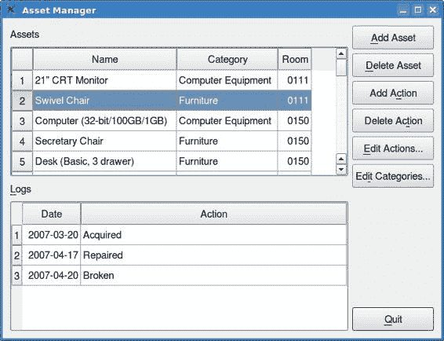 所示。

459 **图 15.5** *资产管理器应用程序*

这在 Linux 上的 SQLite 上运行很快，但在 Windows 机器上非常慢。

```python
app = QApplication(sys.argv)
db = QSqlDatabase.addDatabase("SQLITE")
db.setDatabaseName(filename)

if not db.open():
    QMessageBox.warning(None, "Asset Manager",
        QString("Database Error: %1").arg(db.lastError().text()))
    sys.exit(1)

form = MainForm()
form.show()
app.exec_()
```

我们像往常一样首先创建一个 `QApplication` 对象。接下来我们创建连接；如果数据库文件不存在，SQLite 将创建一个。然后我们创建主表单，对其调用 `show()` 来调度一个绘制事件，并启动事件循环。我们没有展示的是用于在应用程序首次运行时生成虚假数据以及弹出启动界面的代码。这些代码都在源文件 `chap15/assetmanager.pyw` 中。正如我们在前一节所说的那样，我们将跳过表单的布局，集中在小部件和模型的创建上。我们还将跳过创建按钮的代码，但会展示前几个信号槽连接。

460 *第 15 章 数据库*

```python
class MainForm(QDialog):
    def __init__(self):
        super(MainForm, self).__init__()
        self.assetModel = QRelationalTableModel(self)
        self.assetModel.setTable("assets")
        self.assetModel.setRelation(CATEGORYID,
            QSqlRelation("categories", "id", "name"))
        self.assetModel.setSort(ROOM, Qt.AscendingOrder)
        self.assetModel.setHeaderData(ID, Qt.Horizontal,
            QVariant("ID"))
        self.assetModel.setHeaderData(NAME, Qt.Horizontal,
            QVariant("Name"))
        self.assetModel.setHeaderData(CATEGORYID, Qt.Horizontal,
            QVariant("Category"))
        self.assetModel.setHeaderData(ROOM, Qt.Horizontal,
            QVariant("Room"))
        self.assetModel.select()

        self.assetView = QTableView()
        self.assetView.setModel(self.assetModel)
        self.assetView.setItemDelegate(AssetDelegate(self))
        self.assetView.setSelectionMode(QTableView.SingleSelection)
```

模型的创建方式与我们在前一节看到的非常相似。`ID`、`NAME` 等是在 `assetmanager.pyw` 中较早定义的整数列索引。与 `QDataWidgetMapper` 不同之处在于，我们设置了头数据以给列提供标题；如果不这样做，展示模型的 `QTableView` 将使用数据库字段名作为列标题。由于 `categoryid` 字段是外键，我们使用了 `QSqlRelationalTableModel` 并相应地调用了 `setRelation()`。

```python
self.assetView.setSelectionBehavior(QTableView.SelectRows)
self.assetView.setColumnHidden(ID, True)
self.assetView.resizeColumnsToContents()
```

该视图是一个标准的 `QTableView`，但我们没有设置 `QSqlRelationalDelegate`，而是设置了一个自定义代理。我们稍后将跳转来查看这一点。选择模式被设置为允许用户导航到单个字段；选择行为被设定为高亮显示焦点的行。我们不希望显示 `ID` 字段，因为它对用户没有意义，所以我们将其隐藏了。

我们没有使用标准的 `QSqlRelationalDelegate`，因为我们想要控制房间号的编辑，因为这些房间号的验证并不直观。现在我们简单地跳转来查看 `AssetDelegate` 类。

```python
class AssetDelegate(QSqlRelationalDelegate):
    def __init__(self, parent=None):
        super(AssetDelegate, self).__init__(parent)
```

该初始化函数是大多数代理子类的典型写法，只需调用基类即可。

```python
    def paint(self, painter, option, index):
        myoption = QStyleOptionViewItem(option)
        if index.column() == ROOM:
            myoption.displayAlignment |= Qt.AlignRight|Qt.AlignVCenter
        QSqlRelationalDelegate.paint(self, painter, myoption, index)
```

我们重新实现了 `paint()` 方法，仅是为了让房间号右对齐。我们通过更改 `QStyleOptionViewItem` 实现此，并将绘制本身留给基类处理。


```python
def createEditor(self, parent, option, index):
    if index.column() == ROOM:
        editor = QLineEdit(parent)
        regex = QRegExp(r"(?:0[1-9]|1[0124-9]|2[0-7])"r"(?:0[1-9]|[1-5][0-9]|6[012])")
        validator = QRegExpValidator(regex, parent)
        editor.setValidator(validator)
        editor.setInputMask("9999")
        editor.setAlignment(Qt.AlignRight|Qt.AlignVCenter)
        return editor
    else:
        return QSqlRelationalDelegate.createEditor(self, parent, option, index)
```

`createEditor()` 方法的核心是用于设置输入房间号的 `QLineEdit` 代码。房间号为四位数，由楼层码（范围为 01–27，但排除 13）和一个该楼的房间号（范围为 01–62）组成。例如，0231 是第 2 层 31 房，但 0364 是无效的。正则表达式足以指定有效的房间号，但它无法设置最小位数，因为一位、两位或三位数字可能是有效四位房间号的有效前缀。我们通过使用要求输入四位数字的输入掩码解决了这个问题。对于其他字段，我们将工作交给了基类。

```python
def setEditorData(self, editor, index):
    if index.column() == ROOM:
        text = index.model().data(index, Qt.DisplayRole).toString()
        editor.setText(text)
    else:
        QSqlRelationalDelegate.setEditorData(self, editor, index)
```

# 第 15 章 数据库

一旦创建了编辑器，视图将调用 `setEditorData()`，以便可以填充当前值。在这种情况下，我们只关心房间列，将其他字段的工作传递给基类。

```python
def setModelData(self, editor, model, index):
    if index.column() == ROOM:
        model.setData(index, QVariant(editor.text()))
    else:
        QSqlRelationalDelegate.setModelData(self, editor, model, index)
```

我们采取了与之前方法类似的方法，处理房间字段并将其他字段留给基类处理。事实上，我们可以省略重实现此方法，`PyQt` 也会足够聪明地从我们的 `QLineEdit` 中获取值。然而，对自己的自定义内容承担全部责任是更好的做法。

我们现在已经完成了跳转，可以返回 `MainForm.__init__()` 方法，从底部的表格开始，显示适用于当前资产的日志记录。

```python
self.logModel = QSqlRelationalTableModel(self)
self.logModel.setTable("logs")
self.logModel.setRelation(ACTIONID, QSqlRelation("actions", "id", "name"))
self.logModel.setSort(DATE, Qt.AscendingOrder)
self.logModel.setHeaderData(DATE, Qt.Horizontal, QVariant("Date"))
self.logModel.setHeaderData(ACTIONID, Qt.Horizontal, QVariant("Action"))
self.logModel.select()
```

创建日志模型的代码几乎与我们用于资产模型的代码相同。我们使用 `QSqlRelationalTableModel` 是因为我们有一个外键字段，并且我们提供了自己的列标题。

```python
self.logView = QTableView()
self.logView.setModel(self.logModel)
self.logView.setItemDelegate(LogDelegate(self))
self.logView.setSelectionMode(QTableView.SingleSelection)
self.logView.setSelectionBehavior(QTableView.SelectRows)
self.logView.setColumnHidden(ID, True)
self.logView.setColumnHidden(ASSETID, True)
self.logView.resizeColumnsToContents()
self.logView.horizontalHeader().setStretchLast(True)
```

## 使用数据库表视图

这段代码与我们为资产表的操作也相似，但有三个不同点。这里我们使用了 `LogDelegate` 类——我们稍后会回顾它。`tableView.horizontalHeader()` 方法返回一个 `QHeaderView`，它控制着表格的某些方面，包括宽度。

```python
self.connect(self.assetView.selectionModel(), SIGNAL("currentRowChanged(QModelIndex,QModelIndex)"), self.assetChanged)
self.connect(addAssetButton, SIGNAL("clicked()"), self.addAsset)
self.assetChanged(self.assetView.currentIndex())
self.setMinimumWidth(650)
self.setWindowTitle("Asset Manager")
```

初始化函数通过调用带有资产视图当前模型索引的 `assetChanged()` 方法结束——这将导致日志视图显示相关资产的记录。

```python
def assetChanged(self, index):
    if index.isValid():
        record = self.assetModel.record(index.row())
        id = record.value("id").toInt()[0]
        self.logModel.setFilter(QString("assetid = %1").arg(id))
    else:
        self.logModel.setFilter("assetid = -1")
    self.logModel.select()
    self.logView.horizontalHeader().setVisible(self.logModel.rowCount() > 0)
```

如果模型索引无效，我们将 ID 设置为一个我们已知的不存在的 ID，从而保证不会检索到任何行，并且日志视图将为空。最后，如果没有日志记录需要显示，我们将隐藏日志视图的列标题。

`record()` 方法是 `QSqlTableModel` 和 `QSqlRelationalTableModel` 类提供的扩展方法之一（除了它们从基类 `QAbstractItemModel` 继承的方法），其目的是使它们更容易与数据库配合使用。

其他扩展包括 `setQuery()`，它允许我们使用 SQL 语法编写自己的 `SELECT` 语句，以及用于添加记录的 `insertRecord()`。

连接到 `assetChanged()` 方法以及该方法的实现，就是我们建立两个模型之间（因此也是在它们的视图之间）主从关系时所需要做的所有工作。

```python
def done(self, result=1):
    query = QSqlQuery()
    query.exec_("DELETE FROM logs WHERE logs.assetid NOT IN"
    "(SELECT id FROM assets)")
    QDialog.done(self, 1)
```

当应用程序终止时，我们会执行最后一个查询，以删除任何针对不存在（已删除）资产的日志记录。从理论上说，这应该是需要的，因此应该什么都不做。这是因为对于支持事务的数据库，我们使用事务来确保如果资产被删除，其日志记录也将被删除。

```python
def addAction(self):
    index = self.assetView.currentIndex()
    if not index.isValid():
        return
    QSqlDatabase.database().transaction()
    record = self.assetModel.record(index.row())
    assetid = record.value(ID).toInt()[0]
    row = self.logModel.rowCount()
    self.logModel.insertRow(row)
    self.logModel.setData(self.logModel.index(row, ASSETID),
    QVariant(assetid))
    self.logModel.setData(self.logModel.index(row, DATE),
    QVariant(QDate.currentDate()))
    QSqlDatabase.database().commit()
    index = self.logModel.index(row, ACTIONID)
    self.logView.setCurrentIndex(index)
    self.logView.edit(index)
```

如果用户请求添加操作（一条新的日志记录），就会调用此方法。我们获取当前资产的 `assetid`，然后将新的日志记录作为日志表中的最后一条记录插入。然后我们将记录的 `assetid` 外键设置为我们获取的那个值，并提供一个初始的默认日期。最后，我们获取指向新日志记录操作组合框的模型索引，并启动编辑，以便用户选择合适的操作。

在获取 `assetid` 之前，我们开始执行一个事务。这样做是为了防止一种理论上的可能性：即在获取了 `assetid` 之后、在创建新日志记录之前，资产被删除了。如果发生这种情况，日志记录将引用一个不存在的资产，这在稍后可能会导致崩溃或更细微的问题。一旦我们调用 `commit()`，我们就知道资产和新的日志记录都存在。如果现在有人尝试删除该资产，他们可以这样做——但该资产的日志记录（包括此条）将随之被正确删除。

为了采取真正的防御性方法，我们可能会这样构建事务代码：

```python
class DatabaseError(Exception): pass

rollback = False
try:
    if not QSqlDatabase.database().transaction():
        raise DatabaseError
    rollback = True
    # 执行影响数据库的命令
    if not QSqlDatabase.database().commit():
        raise DatabaseError
    rollback = False
finally:
    if rollback:
        if not QSqlDatabase.database().rollback():
            raise DatabaseError
```

这尝试确保如果发生某些问题导致无法到达 `commit`，或者调用 `commit` 时无法成功执行，我们将回滚到之前的位置，从而保留数据库的关联完整性。不过，如果回滚失败，一切都将不可控。错误文本可以通过 `QSqlDatabase.database().lastError().text()` 获取，它返回一个 `QString`。

事务的范围从调用 `transaction()` 开始，直到事务被提交或回滚为止。无论是通过 `QSqlDatabase` 还是通过模型访问数据库，并不重要。事务的上下文适用于所有的 SQL 语句，包括由独立查询执行的语句和由不同模型执行的语句，只要它们应用于同一个事务上下文范围内的同一个数据库即可。

如果我们正在使用 Python 2.6，或者在 Python 2.5 中使用 `from __future__ import with_statement`，我们可以通过创建和使用上下文管理器（Context manager）来简化之前所示的代码。

以事务为导向的方法尝试安排使得问题无法发生。另一种方法是假设一切都将正常工作，并依赖数据库来维护外键关系和数据完整性的其他方面。这在 `SQLite 3` 中不起作用，因为它不强制关联完整性，但在其他某些数据库中可行。使用这种方法，我们通常可以在不使用事务的情况下编写代码。大多数情况下运行良好，而对于极少数发生问题的情况，我们依靠数据库拒绝执行任何破坏其规则的操作，并向我们提供一个可以报告给用户的错误消息。

注意，事务是设置在数据库上的，通过静态方法 `QSqlDatabase.database()` 访问。也可以通过调用模型上的 `database()` 方法访问数据库。每个数据库连接一次只能处理一个事务，因此如果我们想同时处理多个事务，必须为每个额外的事务建立一个连接。

```python
def deleteAction(self):
    index = self.logView.currentIndex()
    if not index.isValid():
        return
    record = self.logModel.record(index.row())
    action = record.value(ACTIONID).toString()
    if action == "Acquired":
        QMessageBox.information(self, "Delete Log",
        "The 'Acquired' log record cannot be deleted.<br>"
        "You could delete the asset instead.")
        return
    when = unicode(record.value(DATE).toString())
    if QMessageBox.question(self, "Delete Log",
        "Delete log<br>%s %s?" % (when, action),
        QMessageBox.Yes|QMessageBox.No) == QMessageBox.No:
        return
    self.logModel.removeRow(index.row())
    self.logModel.submitAll()
```

对于操作，我们实现的逻辑是用户不能删除“Acquired”日志记录，即第一条日志记录。（但他们可以删除资产，我们稍后会看到。）如果日志记录是允许删除的，且用户确认了删除，我们只需在模型上调用 `removeRow()`，然后调用 `submitAll()` 来更新底层数据库。

```python
def editActions(self):
    form = ReferenceDataDlg("actions", "Action", self)
    form.exec_()

def editCategories(self):
    form = ReferenceDataDlg("categories", "Category", self)
    form.exec_()
```

由于操作和类别的参考表结构相同，因此当我们想要深入添加、编辑和删除它们的记录时，可以使用同一个智能对话框。我们向对话框提供数据库中的表名，以及在用户界面显示的参考数据名称（例如在对话框的标题栏中）。

**图 15.6** 资产管理器参考数据表

我们不会审查图 15.6 所示的 `ReferenceDataDlg` 代码，因为它没有能教给我们任何新东西。它使用一个 `QTableView` 配合 `QSqlTableModel`，后者被设置为构造函数传入的表。编辑是就地的并由表格视图和表格模型自动处理的。

对于参考数据的删除，我们会执行一个查询来检查特定的参考数据记录是否正被其他表使用，也就是说，某个操作是否被日志表中的任何记录使用，或者某个类别是否被资产表中的任何记录使用。如果该记录正在使用中，我们会弹出一个提示性的错误消息，并不允许删除发生。否则，我们在模型上对相关行调用 `removeRow()`，然后提交 `submitAll()` 将更改提交到数据库，就像我们在删除操作时做的那样。

与参考数据不同，资产的添加和删除是由主表的方法处理的。


```python
def addAsset(self):
    row = self.assetView.currentIndex().row() \
    if self.assetView.currentIndex().isValid() else 0
    QSqlDatabase.database().transaction()
    self.assetModel.insertRow(row)
    index = self.assetModel.index(row, NAME)
    assetid = 1
    query = QSqlQuery()
    query.exec_("SELECT MAX(id) FROM assets")
    if query.next():
        assetid = query.value(0).toInt()[0]
    query.prepare("INSERT INTO logs (assetid, date, actionid) " \
                  "VALUES (:assetid, :date, :actionid)")
    query.bindValue(":assetid", QVariant(assetid + 1))
    query.bindValue(":date", QVariant(QDate.currentDate())) 
    query.bindValue(":actionid", QVariant(ACQUIRED))
    query.exec_()
    QSqlDatabase.database().commit()
    self.assetView.edit(index)
```

当用户添加新资产时，我们希望为该资产创建一个新的日志记录，并将其操作设置为“获取”（Acquired）。自然地，我们希望这两个记录都被创建，或者如果发生错误，两个都不创建。为此，我们必须使用事务。

我们首先启动事务。然后插入新行，并将其设置为资产视图中的当前行。如果这是第一个资产，其 ID 将是 1；但如果有其他资产，其 ID 将比最高资产 ID 加 1。我们执行查询来找到当前的最高资产 ID，然后使用预处理查询（这样我们就不需要担心引号问题）向日志表中插入一条新记录。一旦新记录进入日志表，我们就提交事务。现在，我们拥有一条操作为“获取”的新资产的日志记录，以及一个新的空白资产记录。最后，我们对新资产的名称字段启动编辑。

我们将通过查看`deleteAsset()`方法来完成对主窗的审查。

该方法稍微复杂，我们将分三部分来查看。

```python
def deleteAsset(self):
    index = self.assetView.currentIndex()
    if not index.isValid():
        return
    QSqlDatabase.database().transaction()
    record = self.assetModel.record(index.row())
    assetid = record.value(ID).toInt()[0]
    logrecords = 1
    query = QSqlQuery(QString("SELECT COUNT(*) FROM logs " \
                      "WHERE assetid = %1").arg(assetid))
    if query.next():
        logrecords = query.value(0).toInt()[0]
```

我们首先启动事务。这是因为如果删除一个资产，其所有的日志记录也必须被删除，并且这两者必须同时发生，或者都不发生，以维护数据库的关联完整性。

我们知道至少有一条日志记录，即“获取”记录，但我们执行查询来查看日志记录的总数是多少。

```python
msg = QString("<font color=red>Delete</font><br><b>%1</b>"
          "<br>from room %2") \
      .arg(record.value(NAME).toString()) \
      .arg(record.value(ROOM).toString())
if logrecords > 1:
    msg += QString(", along with %1 log records") \
            .arg(logrecords)
msg += "?"
if QMessageBox.question(self, "Delete Asset", msg, \
    QMessageBox.Yes|QMessageBox.No) == QMessageBox.No:
    QSqlDatabase.database().rollback()
    return
```

在这里我们给用户机会确认删除或取消。

如果他们取消，我们就回滚事务并返回。

```python
query.exec_(QString("DELETE FROM logs WHERE assetid = %1") \
          .arg(assetid))
self.assetModel.removeRow(index.row())
self.assetModel.submitAll()
QSqlDatabase.database().commit()
self.assetChanged(self.assetView.currentIndex())
```

我们已经使用 SQL 查询删除了日志记录，并使用模型 API 删除了资产记录。删除后，我们提交事务并调用`assetChanged()`，以确保主从视图显示的是正确的日志记录。

我们也可以使用模型 API 来执行两个删除。例如：

`self.logModel.setFilter(QString("assetid = %1").arg(assetid))`

`self.logModel.select()`

```python
if self.logModel.rowCount() > 0:
    self.logModel.removeRows(0, self.logModel.rowCount())
    self.logModel.submitAll()
```

这完成了我们对资产管理器应用程序的审查。在表之间创建主从关系非常简单，使用数据部件映射器（data widget mapper）也可以在表和表之间完成同样的操作。

## 使用数据库表视图

SQL 模型非常容易使用，并且与`TableView`“开箱即用”。此外，我们还可以使用代理（delegates）对字段的外观和编辑进行完全控制。

我们还没有担心过的问题之一是为新记录创建唯一键。我们通过在表中使用自动递增 ID 解决了这个问题。但有时自动递增并不合适——例如，当键比简单的整数更复杂时。还有一些我们可以连接的 SQL 特有信号——例如，`beforeDelete()`和`beforeUpdate()`；如果我们想在单独的表中记录删除或更改，这些信号可能很有用。最后，还有`beforeInsert()`信号——它在创建新记录时发射，但在用户有机会编辑它之前发射。这就是我们可能为记录填充默认值的地方。然而，在本章的所有示例中，我们都是在用户点击“添加”按钮时设置默认值的。另请注意，`QRelationalTableModel`是`QSqlTableModel`的子类，它也拥有这些信号。

## 总结

PyQt 通过`QtSql`模块提供的统一 API 对 SQL 数据库提供了强大的支持。所有常用的数据库都提供了驱动，但由于许可证限制，某些驱动仅在商业版本中可用。

如果我们建立了单一数据库连接，后续所有的数据库访问将默认使用该连接。但如果我们需要多个连接，只需为每个连接命名，并通过名称访问它们，以指定哪个特定操作使用哪一个。

`QSqlQuery`类允许我们使用其`exec_()`方法执行任意 SQL 语句。这意味着例如，我们可以使用它来创建和删除表，以及插入、更新和删除记录。`QSqlQuery`对象提供了导航执行 SELECT 语句时产生的结果集的方法，并且还可以提供有关受查询影响的行数的信息——例如删除了或更新了多少行。

# 简介

使用`QDataWidgetMapper`创建显示数据库表（或可编辑视图）的 GUI 表单是非常简单的。我们通常为每个外键字段使用`QComboBox`，并赋予其相应的关系模型作为其内部模型。虽然可以设置`QDataWidgetMapper`自动提交更改，但这可能在用户导航时导致数据丢失，因此如果我们提供了导航方式，最好由我们自己来提交所有更改。

使用`QTableView`结合`QSqlTableModel`或`QSqlRelationalTableModel`显示数据库表和视图非常容易。这些类结合在一起提供了字段数据的就地编辑功能。通过从模型中插入或删除行可以轻松实现添加和删除记录，当我们需要原子操作时，可以使用事务。

PyQt 的模型/视图架构的所有功能对数据库程序员都是可用的。此外，SQL 表模型的 API 经过扩展，使得数据库编程变得更加简单。当我们需要执行原始 SQL 时，可以使用`QSqlQuery`类轻松实现。

现在我们已经达到了可以创建任何你喜欢的 GUI 程序的程度，限制你的仅有你的想象力和可用时间。在第四部分中，我们将介绍一些处理起来比较复杂的话题，从更高级的模型/视图编程开始，然后是国际化、网络，最后以多线程结束。

## 练习

创建一个对话框风格的应用程序，用于在参考表中添加、编辑和删除记录，如图 15.7 所示。该应用程序在首次运行时应创建`reference.db`数据库，其中包含一个空表：

```sql
CREATE TABLE reference (
id INTEGER PRIMARY KEY AUTOINCREMENT UNIQUE NOT NULL,
category VARCHAR(30) NOT NULL,
shortdesc VARCHAR(20) NOT NULL,
longdesc VARCHAR(80))
```

除了提供“添加”和“删除”按钮外，还要提供一个“排序”按钮，该按钮具有三个排序顺序选项的弹出菜单：按 ID、按类别和按短描述。这三个选项都可以使用`lambda`或`functools.partial`连接到同一个方法。要使任何新的排序（或过滤）生效，你必须在模型上调用`select()`。所有按钮都使用`QDialogButtonBox`。

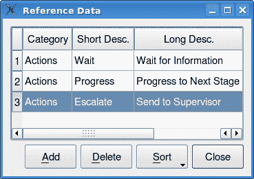

**图 15.7** 参考数据对话框

如果用户点击“删除”，则弹出一个是/否消息框，只有当他们点击“是”按钮时才删除。该应用程序类似于 Asset Manager 应用程序中的`ReferenceDataDlg`，可以使用大约 130 行代码编写。

解决方案位于`chap15/referencedata.pyw`中。

# 第四部分：高级 GUI 编程

- 16：自定义视图
- 通用代理
- 在树形结构中表示表格数据

## 高级模型/视图编程

在之前的两个章节中，我们探索了 PyQt 模型/视图编程的基础。我们看到了如何创建自定义模型，以及如何使用预定义的 SQL 表模型。我们还学习了如何创建自定义代理来控制数据项的显示和编辑。在本章中，我们将深化对 PyQt 模型/视图编程的理解。

本章涵盖的所有主题以及后续主题，在概念上都比我们之前看到的更高级。然而，在大多数情况下，代码的难度并不比我们已经学过的更高。

在第一节中，我们将查看如何实现自定义视图，以便看到如何以我们想要的方式将数据可视化。这一节对于深入理解视图的工作原理很有帮助，并展示了实现自定义视图的一种直接方法。

第二节重新回顾了自定义代理的主题，展示了如何尽量减少代码重复以及如何为视图轻松创建任意代理。这一节对于那些需要创建许多代理的人来说应该特别有用，特别是对于 SQL 表这种每一列都有特定类型的数据集。

在最后一节中，我们将看到如何将表格数据反射到树形视图中。这种用途之一是当前几列通常包含相同值时，我们将表表示为树——这可以减少用户查找所需项目必须导航的行数。另一个用途是让用户选择形成“路径”的特定值。例如，与其提供多个依赖之前值的组合框，我们只需提供一个树供用户导航和选择。

### 自定义视图

PyQt 提供了几个开箱即用的视图类，包括`QListView`、`QTableView`和`QTreeView`。这些视图的一个共同点是，它们通常用于文本形式呈现数据项——尽管如果需要，它们也可以显示图标和复选框。

数据文本表示的替代方案是视觉表示，对于这些我们可以使用第 12 章涵盖的图形类。然而，有时我们希望以不匹配任何类的方式呈现数据。在这种情况下，我们可以创建自己的视图子类并使用它来使模型可视化。

**图 16.1** 水质数据的两个视图

图 16.1 显示了由两个视图呈现同一个数据集。左侧视图是标准的`QTableView`，右侧视图是自定义的`WaterQualityView`。两者都文本形式显示水质读取的时间戳，但`WaterQualityView`为关键指标显示彩色圆，并使用 Unicode 箭头符号表示流量情况。显然，表格视图以清晰准确的方式呈现了事实，而水质视图让人更容易看到任何特定时间的状况，并且通过观察颜色就能更容易对任何重要趋势获得印象。

水质数据集涵盖了某一个水处理厂六个月的时间——但由于每 15 分钟读取一次数据，这总计略多于 17500 次读取。这意味着我们的视图将需要一个垂直滚动条。PyQt 提供了三种获取滚动条的方法。一种方法是创建一个继承`QAbstractScrollArea`的控件；这种方法被`QGraphicsView`和`QTextEdit`控件使用。另一种方法是创建一个包含几个`QScrollBar`的组合控件。但 PyQt 文档推荐第三种方法——使用简单的`QScrollArea`。使用`QScrollArea`的缺点是它是 PyQt 类中少数几个并非设计为子类的类之一。相反，我们必须创建一个实例并向其添加我们想要滚动条的控件。为了方便理解，这里是水质数据应用程序的初始化：

```python
class MainForm(QDialog):
    def __init__(self, parent=None):
        super(MainForm, self).__init__(parent)
        self.model = WaterQualityModel(os.path.join(
            os.path.dirname(__file__), "waterdata.csv.gz"))
        self.tableView = QTableView()
        self.tableView.setAlternatingRowColors(True)
        self.tableView.setModel(self.model)
        self.waterView = WaterQualityView()
        self.waterView.setModel(self.model)
        scrollArea = QScrollArea()
        scrollArea.setBackgroundRole(QPalette.Light)
        scrollArea.setWidget(self.waterView)
        self.waterView.scrollarea = scrollArea
        splitter = QSplitter(Qt.Horizontal)
        splitter.addWidget(self.tableView)
        splitter.addWidget(scrollArea)
        splitter.setSizes([600, 250])
        layout = QHBoxLayout()
```

```python
layout.addWidget(splitter)
self.setLayout(layout)
self.setWindowTitle("Water Quality Data")
QTimer.singleShot(0, self.initialLoad)
```

前面的代码就是全部内容。`WaterQualityModel`是`QAbstractTableModel`的子类，提供对水质数据文件的只读访问。

`WaterQualityView`是我们将在本节中开发的类。我们在这里做过的一项特殊操作是创建了一个`QScrollArea`控件并将水质视图添加到其中——这基本上意味着水质视图可以根据我们的意愿设置任意宽度和高度，而滚动区域将处理滚动问题。

我们很快就会看到，键盘用户可以使用向上和向下方向键在水质视图中进行导航。为了确保选定的行始终可见，我们必须将滚动区域传递给水质视图，以便我们的按键处理程序可以与它进行交互。另一个特殊之处是，我们为水平分隔器（horizontal splitter）的两个部分设置了初始大小，以便它们在启动时，对于它们所包含的控件来说比例大致正确。

我们现在将审查`WaterQualityView`，从一些静态数据和初始化函数开始。


```python
class WaterQualityView(QWidget):
    FLOWCHARS = (unichr(0x21DC), unichr(0x21DD), unichr(0x21C9))

    def __init__(self, parent=None):
        super(WaterQualityView, self).__init__(parent)
        self.scrollarea = None
        self.model = None
        self.setFocusPolicy(Qt.StrongFocus)
        self.selectedRow = -1
        self.flowfont = self.font()
        size = self.font().pointSize()
        if platform.system() == "Windows":
            fontDb = QFontDatabase()
            for face in [face.toLower() for face in fontDb.families()]:
                if face.contains("unicode"):
                    self.flowfont = QFont(face, size)
                    break
            else:
                self.flowfont = QFont("symbol", size)
        WaterQualityView.FLOWCHARS = (chr(0xAC), chr(0xAE), chr(0xDE))
```

将焦点策略设置为任何值（`Qt.NoFocus` 除外）意味着该控件可以接受键盘焦点。我们将在本节末尾讨论为什么要这样做，以及 `selectedRow` 实例变量。

当水流方向错误、速度太慢或太快时，我们希望用合适的字符来指示这种情况——例如 `→`、`∼`、`∼→` 和 `→→`。这些字符在 Unicode 中均可用，但 Windows 提供的大多数默认字体似乎没有包含整个 Unicode 字符集，因此所有的箭头都显示为字符。（在 Linux 上，如果当前字体没有某个 Unicode 字符，PyQt 通常可以在另一个字体中找到该字符，在这种情况下，它仅对该字符使用找到的字体。）为了解决 Windows 上的这个问题，我们遍历可用字体列表，直到找到一个名称中包含“Unicode”字样的字体（例如“Lucida Sans Unicode”）。如果我们找到了这样的字体，就将其存储为流字符的字体；否则，我们将回退到标准的（但非 Unicode）`Symbol` 字体，并使用该字体中最接近的等效字符。

```python
def setModel(self, model):
    self.model = model
    self.connect(self.model, SIGNAL("dataChanged(QModelIndex,QModelIndex)"), self.setNewSize)
    self.connect(self.model, SIGNAL("modelReset()"), self.setNewSize)
    self.setNewSize()
```

一旦在视图上设置了模型，我们就连接到它的数据更改和重置信号，以便视图可以调整大小以匹配可用数据。

```python
def setNewSize(self):
    self.resize(self.sizeHint())
    self.update()
    self.updateGeometry()
```

此方法将视图调整为其首选大小，并调用 `update()` 来调度重绘，调用 `updateGeometry()` 通知任何负责该视图的布局管理器其尺寸已更改。由于我们将视图放在 `QScrollArea` 中，滚动区域将通过调整其提供的滚动条来响应大小变化。

```python
def minimumSizeHint(self):
    size = self.sizeHint()
    fm = QFontMetrics(self.font())
    size.setHeight(fm.height() * 3)
    return size
```

我们计算视图的最小尺寸为其首选尺寸的宽度和三个字符的高度。在布局中这是合理的，但由于使用了 `QScrollArea`，实际上的最小尺寸将取决于滚动区域的决定。

```python
def sizeHint(self):
    fm = QFontMetrics(self.font())
    size = fm.height()
    return QSize(fm.width("9999-99-99 99:99 ") + (size * 4), (size / 4) + (size * self.model.rowCount()))
```

我们使用一个字符的高度（包括其行间距）作为垂直和水平测量的尺寸单位。视图的首选宽度足够显示一个时间戳加上四个单位的尺寸，以留出彩色圆形和流字符的空间；高度也足够容纳模型中的所有行加上四分之一的尺寸单位，以留出一点边距。

绘制事件（paint event）并不困难，但我们将分三个部分来看，并只显示彩色圆，因为所有部分的代码是相似的。

```python
def paintEvent(self, event):
    if self.model is None:
        return
    fm = QFontMetrics(self.font())
    timestampWidth = fm.width("9999-99-99 99:99 ")
    size = fm.height()
    indicatorSize = int(size * 0.8)
    offset = int(1.5 * size)
    minY = event.rect().y()
    maxY = minY + event.rect().height()
    minY -= size # 等待，根据提供的文本逻辑
    painter = QPainter(self)
    painter.setRenderHint(QPainter.Antialiasing)
    painter.setRenderHint(QPainter.TextAntialiasing)

    y = 0
    for row in range(self.model.rowCount()):
        x = 0
        if minY <= y <= maxY:
            painter.save()
            painter.setPen(self.palette().color(QPalette.Text))
            if row == self.selectedRow:
                painter.fillRect(x, y + offset * 0.8, self.width(), size, self.palette().highlight())
            painter.setPen(self.palette().color(QPalette.HighlightedText))
            timestamp = self.model.data(self.model.index(row, TIMESTAMP)).toDateTime()
            painter.drawText(x, y + size, timestamp.toString(TIMESTAMPFORMAT))
            x += timestampWidth
            temperature = self.model.data(self.model.index(row, TEMPERATURE))
            temperature = temperature.toDouble()[0]
            if temperature < 20:
                color = QColor(0, 0, int(255 * (20 - temperature) / 20))
            elif temperature > 25:
                color = QColor(int(255 * temperature / 100), 0, 0)
            else:
                color = QColor(0, int(255 * temperature / 100), 0)
            painter.setPen(Qt.NoPen)
            painter.setBrush(color)
            painter.drawEllipse(x, y + offset, indicatorSize, indicatorSize)
            painter.restore()
        x += size
    y += size
```

我们遍历模型中的每一行，但只对那些 `y` 坐标在范围内的行进行绘制。一旦确定了要绘制的行，我们就将画笔（用于绘制文本）设置为调色板的文本颜色。如果该行被选中（我们将在介绍完 `paint` 事件后进行解释），我们就用调色板的高亮颜色绘制背景，并将画笔设置为调色板的高亮文本颜色。

在设置好文本颜色并可能已经绘制了背景后，我们接着获取并绘制该行的时间戳。对于每一行，我们都保留一个 `x` 坐标，告诉我们向右移动了多远，并根据之前计算的字体度量时间戳宽度递增它。

第一个彩色圆圈用于表示以 °C 为单位的水温。如果水太冷，我们使用带有蓝色调的颜色；如果水太热，我们使用带有红色调的颜色；否则，我们使用绿色调。然后我们关闭画笔，将画刷设置为我们设置的颜色，并在时间戳右侧绘制一个椭圆。`drawEllipse()` 方法会绘制出一个圆，因为绘制椭圆的矩形宽度和高度是相同的。

接着我们增加 `x` 坐标。现在我们对另外两个彩色圆圈指示器重复过程，使用与处理温度时相同的着色方法。我们省略了这些代码，因为它们在结构上与温度圆圈的代码完全相同。

```
flow = self.model.data(
    self.model.index(row, INLETFLOW))

flow = flow.toDouble()[0]

char = None

if flow <= 0:
    char = WaterQualityView.FLOWCHARS[0]
elif flow < 3:
    char = WaterQualityView.FLOWCHARS[1]
elif flow > 5.5:
    char = WaterQualityView.FLOWCHARS[2]

if char is not None:
    painter.setFont(self.flowfont)
    painter.drawText(x, y + size, char)

painter.restore()
y += size

if y > maxY:
    break
```

如果水流方向错误，或者速度过慢或过快，我们就使用初始化函数中设置的字体和字符绘制一个合适的字符。

最后，我们增加 `y` 坐标以准备处理下一行数据，但如果我们已经超过了视图中的最后一行，则停止。

我们目前为止编写的代码已经足够为数据集提供只读视图。但用户通常想要高亮项目。实现这一点最简单的方法是添加一个鼠标点击事件处理器。

```python
def mousePressEvent(self, event):
    fm = QFontMetrics(self.font())
    self.selectedRow = event.y() // fm.height()
    self.update()
    self.emit(SIGNAL("clicked(QModelIndex)"),
            self.model.index(self.selectedRow, 0))
```

我们所有计算中使用的尺寸单位是字符的高度。我们将鼠标位置的 `y` 坐标（相对于小组件左上角）除以尺寸单位，以找到用户点击了哪一行。我们使用整数除法，因为行号是整数。然后我们调用 `update()` 来调度一个绘制事件。在见过的 `paintEvent()` 中，我们看到选中的行是使用高亮文本和背景颜色绘制的。我们还发射一个 `clicked()` 信号，并带有被点击行第一列的模型索引。

该应用程序没有使用该信号，但在实现自定义视图时，提供该信号是一个良好的习惯。

键盘用户已经通过滚动区域得到了照顾：他们可以使用 Page Up 和 Page Down 键进行滚动。但我们应该为键盘用户提供一种选择项目的方法。要做到这一点，我们必须确保小组件具有合适的焦点策略——我们在初始化函数中已经做过了——并且必须提供一个按键事件处理器。

```python
def keyPressEvent(self, event):
    if self.model is None:
        return
    row = -1
    if event.key() == Qt.Key_Up:
        row = max(0, self.selectedRow - 1)
    elif event.key() == Qt.Key_Down:
        row = min(self.selectedRow + 1, self.model.rowCount() - 1)
    if row != -1 and row != self.selectedRow:
        self.selectedRow = row
    if self.scrollarea is not None:
        fm = QFontMetrics(self.font())
        y = fm.height() * self.selectedRow
        self.scrollarea.ensureVisible(0, y)
        self.update()
    self.emit(SIGNAL("clicked(QModelIndex)"),
            self.model.index(self.selectedRow, 0))
    else:
        QWidget.keyPressEvent(self, event)
```

我们选择仅支持两个按键：向上箭头和向下箭头。如果用户按下其中任何一个键，我们就增加或减少选中的行，并确保选中的行在范围内，然后调度一个绘制事件。

如果用户导航到最顶部可见行之上或最底部可见行之下，我们告诉滚动区域确保滚动到的行是可见的——如果有必要，滚动区域将通过滚动来实现这一点。我们还会带有新选行的模型索引发射一个 `clicked()` 信号。

在这种情况下使用 `clicked()` 信号是非常惯例的，因为实际上用户正在使用键盘进行“点击”——毕竟，信号槽机制关注的是用户想要什么，而不是如何请求，而这里他们只想选择一行。

如果我们不自己处理按键，即我们将其他按键传递给基类。

水质量视图组件与旁边的表格视图在视觉上非常不同，但实现它并没有大量代码，编写也不困难。通过减少不必要的绘制，我们使组件相当高效。通过确保组件的大小恰好显示整个数据集，我们进一步简化了绘制代码。这种方法的缺点是将责任推给了使用我们组件的程序员去使用 `ScrollArea`，尽管这避免了我们自己实现滚动。

水质量视图与模型数据是一一对应的可视化，但我们并不限于此。也可以创建显示聚合数据的自定义视图。例如，我们可以每天或每小时显示一个项目，通过平均每天或每小时的读取。

## 通用委托器

正如我们在前面的章节中所看到的，自定义委托器允许我们对视图中数据项的外观和行为进行完全控制。显而易见，如果我们有很多模型，我们可能为它们的大部分甚至全部创建一个自定义委托器，但不明显的是这些自定义委托器之间会有大量的重复代码。

假设我们只有四个模型，每个模型都有一个整数 ID 列、一些存储纯文本的字符串列以及一个存储 HTML 文本的描述列，某些模型还有一或两个浮点列。所有模型都将 ID 作为第一列，但其他列并不匹配，因此每个模型都需要自己的自定义委托器。提供这些自定义委托器并不是一项大工程，但处理整数 ID 的代码在所有模型中可能是相同的；字符串、HTML 字符串和浮点数也是如此。

现在假设我们必须为另外六个新模型编写自定义委托器：大部分代码将再次重复——这可能会使维护变得更加困难。

对于每列只有一种数据类型的模型（例如数据库表），更好的方法是，如果我们不是为每个模型创建一个自定义委托器，而是从一组通用组件中组合出一个委托器，就好了。这意味着维护工作将局限于通用组件，而且其中一个组件的错误修复将自动使所有使用它的视图受益。

在代码中，我们想要的效果如下：


这里有两个独立的模型，但它们都使用了通用型代理（generic delegates），这些通用代理由针对特定数据类型的预定义列代理组成。

通过这种方法，对于我们需要处理的每个数据类型（如整数、浮点数、日期、时间以及日期/时间），我们只需要创建一个纯文本列代理、一个富文本列代理等，以此此类推。

此外，我们可能会创建一些项目特定的列代理来处理自定义类型，但对于任何给定的数据类型，只会有一个列代理，这极大地减少了代码重复，并确保任何模型都可以通过使用带有合适列代理的通用代理来拥有一个“自定义”代理。

在本节中，我们将看到如何创建一个`GenericDelegate`类以及几个示例列代理。然后，我们将看到它们在图 16.2 所示的应用程序上下文中是如何被使用的。

**图 16.2** 使用通用代理的表格视图

`GenericDelegate`类非常简单，因为它将几乎所有的工作都交给了其他类。

```python
class GenericDelegate(QItemDelegate):
    def __init__(self, parent=None):
        super(GenericDelegate, self).__init__(parent)
        self.delegates = {}
```

初始化函数像往常一样调用`super()`并创建一个空字典。键将是列索引，值将是`QItemDelegate`子类的实例。

```python
    def insertColumnDelegate(self, column, delegate):
        delegate.setParent(self)
        self.delegates[column] = delegate
```

当一个新的列代理被插入通用代理时，通用代理会接管它的所有权并将其插入字典。

```python
    def removeColumnDelegate(self, column):
        if column in self.delegates:
            del self.delegates[column]
```

包含此方法是为了完整性考虑，但它不太会被使用。如果删除了列代理，通用代理将简单地对该列使用`QItemDelegate`基类。

```python
    def paint(self, painter, option, index):
        delegate = self.delegates.get(index.column())
        if delegate is not None_:
            delegate.paint(painter, option, index)
        else:
            QItemDelegate.paint(self, painter, option, index)
```

该方法的结构是`GenericDelegate`类工作原理的关键。我们首先获取给定列的列代理。如果获取了代理，我们就将工作交给它；否则，我们将工作交给基类。

```python
    def createEditor(self, parent, option, index):
        delegate = self.delegates.get(index.column())
        if delegate is not None:
            return delegate.createEditor(parent, option, index)
        else:
            return QItemDelegate.createEditor(self, parent, option, index)
```

此方法遵循与`paint()`方法相同的模式，不同之处在于它返回一个值（为它创建的编辑器）。

```python
    def setEditorData(self, editor, index):
        delegate = self.delegates.get(index.column())
        if delegate is not None:
            delegate.setEditorData(editor, index)
        else:
            QItemDelegate.setEditorData(self, editor, index)

    def setModelData(self, editor, model, index):
        delegate = self.delegates.get(index.column())
        if delegate is not None:
            delegate.setModelData(editor, model, index)
        else:
            QItemDelegate.setModelData(self, editor, model, index)
```

最后两个`GenericDelegate`方法遵循与`paint`和`createEditor()`方法相同的模式：如果为给定列设置了列代理，则使用该列代理，否则使用`QItemDelegate`基类。

现在我们已经看到了`GenericDelegate`的实现，可以将注意力转移到可以插入它的列代理上了。在`chap16/genericdelegates.py`中，我们提供了`IntegerColumnDelegate`、`DateColumnDelegate`、`PlainTextColumnDelegate`和`RichTextColumnDelegate`类。它们具有相似的结构，因此我们将只查看其中两个的代码：`DateColumnDelegate`和`RichTextColumnDelegate`。一旦理解了这些实现（至少对于日期列代理来说很容易），创建额外的列代理（例如用于浮点数的代理）将是轻而易举的。

```python
class DateColumnDelegate(QItemDelegate):
    def __init__(self, minimum=QDate(), maximum=QDate(), format="yyyy-MM-dd", parent=None):
        super(DateColumnDelegate, self).__init__(parent)
        self.minimum = minimum
        self.maximum = maximum
        self.format = QString(format)
```

对于日期，我们需要提供最小值、最大值以及显示格式。

```python
    def createEditor(self, parent, option, index):
        dateedit = QDateEdit(parent)
        dateedit.setDateRange(self.minimum, self.maximum)
        dateedit.setAlignment(Qt.AlignRight)
        dateedit.setDisplayFormat(self.format)
        dateedit.setCalendarPopup(True)
        return dateedit

    def setEditorData(self, editor, index):
        value = index.model().data(index, Qt.DisplayRole).toDate()
        editor.setDate(value)

    def setModelData(self, editor, model, index):
        model.setData(index, QVariant(editor.date()))
```

将编辑器数据写回模型，我们再次不需要检查列，因为这由`GenericDelegate`处理。这就是完整的`DateColumnDelegate`。我们没有重写`paint()`方法，因为`QItemDelegate`基类可以很好地绘制数据。`IntegerColumnDelegate`和`PlainTextColumnDelegate`都与`DateColumnDelegate`非常相似。`RichTextColumnDelegate`同样相似，但它重写了`paint()`和`sizeHint()`方法。

```python
class RichTextColumnDelegate(QItemDelegate):
    def __init__(self, parent=None):
        super(RichTextColumnDelegate, self).__init__(parent)
```

构造函数比其他列代理使用的更简单。我们甚至可以省略它，但我们倾向于显式表示。

```python
    def createEditor(self, parent, option, index):
        lineedit = richtextlineedit.RichTextLineEdit(parent)
        return lineedit
```

我们使用了第 13 章中创建的`RichTextLineEdit`。`RichTextLineEdit`接受 HTML 文本，只要我们使用它的`setHtml()`方法。（它也有一个`setPlainText()`方法。）

```python
    def setEditorData(self, editor, index):
        value = index.model().data(index, Qt.DisplayRole).toString()
        editor.setHtml(value)

    def setModelData(self, editor, model, index):
        model.setData(index, QVariant(editor.toSimpleHtml()))
```

`RichTextLineEdit`有一个`toHtml()`方法，但我们使用了在第 13 章开发的`toSimpleHtml()`方法。这确保了我们存储的是能够有效表示文本的最短 HTML。这很重要，因为在`paint()`方法中，对于高亮（即被选中）的项，我们将通过将文本包裹在`<font>`标签来设置颜色——这对于使用简单 HTML 格式的文本有效（因为它只是 HTML 片段），但对于作为完整 HTML 文档的普通 HTML 格式无效。

```python
def paint(self, painter, option, index):
    text = index.model().data(index, Qt.DisplayRole).toString()
    palette = QApplication.palette()
    document = QTextDocument()
    document.setDefaultFont(option.font)
    if option.state & QStyle.State_Selected:
        document.setHtml(QString("<font color=%1>%2</font>") \
        .arg(palette.highlightedText().color().name()) \
        .arg(text))
    else:
        document.setHtml(text)
    painter.save()
    color = palette.highlight().color() \
    if option.state & QStyle.State_Selected \
    else QColor(index.model().data(index, Qt.BackgroundColorRole))
    painter.fillRect(option.rect, color)
    painter.translate(option.rect.x(), option.rect.y())
    document.drawContents(painter)
    painter.restore()
```

`paint()`方法几乎与第 14 章描述的`ShipDelegate`绘图时使用的方法相同。唯一的区别是，我们不需要检查特定列中的富文本，因为我们知道列代理只只会在用户指定的列上被调用。

这种方法的一个局限性是高亮功能仅对 HTML 片段有效。如果我们想让代码同时处理片段和完整的 HTML 文档，我们可以使用如下所示的代码：

```python
if option.state & QStyle.State_Selected:
    if text.startsWith("<html>"):
        text = QString(text).replace("<body ",
        QString("<body bgcolor=%1 ")
        .arg(palette.highlightedText().color().name()))
    else:
        text = QString("<font color=%1>%2</font>")\
        .arg(palette.highlightedText().color().name())\
        .arg(text))
document.setHtml(text)
```

另一种方法是提取文本文档的样式表，更新背景颜色，并将更新后的样式表设置回文档。

```python
def sizeHint(self, option, index):
    text = index.model().data(index).toString()
    document = QTextDocument()
    document.setDefaultFont(option.font)
    document.setHtml(text)
    return QSize(document.idealWidth() + 5, option.fontMetrics.height())
```

### 尺寸 (Size)

我们必须自己计算富文本列的尺寸提示（size hint），因为基于控件字体大小和字符数量计算的尺寸提示通常会给出一个宽得宽度。这是因为文本代理中的 HTML 文本包含的字符（如标签和实体）通常远于实际显示的字符数。使用`QTextDocument`可以很容易地解决这个问题。代码与`ShipDelegate`的`size hint`方法中使用的代码几乎相同。我们可以轻松地创建其他列代理，并且可以让任何列代理提供比此处示例更多的功能。例如，对于`IntegerColumnDelegate`，我们有最小值和最大值，但提供额外的选项（如前缀和后缀文本）非常简单。

### 第 16 章。高级模型/视图编程

现在我们已经看到了`GenericDelegate`是如何工作的以及如何创建列代理，我们可以看到它们在实践中是如何被使用的。图 16.2（第 485 页）显示了一个使用通用代理和多个列代理的表格视图，以提供对齐列编辑和外观的控制。

表单位于`chap16/carhirelog.pyw`中；以下是其初始化器的开头：


```python
class MainForm(QMainWindow):
    def __init__(self, parent=None):
        super(MainForm, self).__init__(parent)
        model = CarHireModel(self)
        self.view = QTableView()
        self.view.setModel(model)
        self.view.resizeColumnsToContents()
        delegate = genericdelegates.GenericDelegate(self)
        delegate.insertColumnDelegate(CUSTOMER, genericdelegates.PlainTextColumnDelegate())
        earliest = QDate.currentDate().addYears(-3)
        delegate.insertColumnDelegate(HIRED, HireDateColumnDelegate(earliest))
        delegate.insertColumnDelegate(MILEAGEOUT, MileageOutColumnDelegate(0, 1000000))
        delegate.insertColumnDelegate(RETURNED, ReturnDateColumnDelegate(earliest))
        delegate.insertColumnDelegate(MILEAGEBACK, MileageBackColumnDelegate(0, 1000000))
        delegate.insertColumnDelegate(NOTES, genericdelegates.RichTextColumnDelegate())
        self.view.setItemDelegate(delegate)
        self.setCentralWidget(self.view)
```

该模型是一个自定义模型，类似于我们在第 14 章创建的那些。视图是一个标准的 `QTableView`。该模型有九列：一个纯文本只读执照号、一个纯文本客户名、一个租车日期、一个起始里程、一个还车日期、一个返回里程、一个富文本备注等（注：原文此处描述为九列，但列出的示例较少，翻译遵循原文）。

该模型与我们在第 14 章创建的那些类似。视图是标准的 `QTableView`。模型包含九列：一个纯文本只读执照号，一个纯文本客户名，一个租车日期，一个起始里程，一个还车日期，一个返回里程，一个富文本备注等。

创建针对特定数据类型的列代理（column delegates）非常简单，当验证需要考虑整行（记录）时，对它们进行子类化也不困难。但既然为每个模型创建自定义代理并不难，那么为什么还要使用通用代理方法呢？通用代理在两种主要语境下并不显得大合其宜：一种只需要少数代理的简单应用程序，以及那些列中包含异构数据类型的模型。但对于需要许多代理且列具有同构数据类型（如数据库中使用的数据类型）的应用程序，通用代理提供了三个关键优势。

- 易于更改特定列所使用的代理，或者在模型更改以包含更多列时添加额外的列代理。

- 使用列代理意味着我们避免了在创建许多模型特定的自定义代理时不可避免的代码重复——例如，我们只需要写一个富文本行编辑代理、一个日期/时间编辑代理等。

- 一旦创建了针对特定数据类型的列代理，它就可以重用在每个使用该数据类型的列上，并且可以应用于任意数量的通用代理和任意数量的模型。这意味着错误修复和增强只需要对每种数据类型的每个列代理进行一次。

## 在树中表示表格数据

假设我们让用户选出一个数据项，但用户选择的项目取决于他们之前选择的某个项目，而该项目又又取决于之前的某个项目。具体来说，想象我们让用户选择一个特定的机场——他们首先必须选择国家，然后是城市，最后是机场。这可以通过提供三个组合框来实现：在第一个中填充国家名称，在第二个填充当前国家的城市，在第三个填充当前城市的机场。

这在编程上并不困难，但用户必须使用三个独立的控件来指定他们的选择，并且无法容易地看到可选的选择范围。

选择依赖性数据项的一种解决方案是使用树形视图（tree view）。继续这个示例，树的根节点是国家，每个国家都有城市分支，每个城市分支下都有机场叶子节点（leaves）。这使得用户更容易遵循一条路径（而且他们只能遵循有效路径），并且便于我们检索他们完整的国家/城市/机场选择。

与例如使用表格视图（table view）相比，使用树形视图的另一个优点是它更紧凑且更容易导航。例如，如果我们有 100 个国家，每个国家平均有 4 个城市，每个城市平均有 2 个机场，表格将需要 100 × 4 × 2 = 800 行——但树仅需 100 行（每个国家一行），每行都可以展开以显示其城市和机场。

在本节中，我们将展示如何在树中表示数据表格，以及如何提取用户所选择的完整“路径”。我们将使用的示例应用程序称为 Server Info。它读取一个具有六列的数据集——国家、州（仅在美国有意义）、城市、提供商、服务器和 IP 地址——并允许用户指定一个特定的 6 元组。示例数据集有 163 行，但仅引用了 33 个不同的国家，因此用户只需要导航到 33 个顶级项，而不是滚动查看几乎是该数字五倍的行数。

该应用程序的核心由 `TreeOfTableModel` 类提供，它是 `QAbstractItemModel` 的子类，可以在树中表示任意的表格数据。

我们使用了该模型的自定义子类，并配合 `QTreeView` 子类来展示数据。应用程序本身可以通过从命令行带有命令行参数 `1`、`2`、`3` 或 `4` 运行，通过不同层级的嵌套来创建树。图 16.3 显示了使用默认嵌套层级 `3` 的树。（嵌套层级不包括一系列分支末尾的叶子节点）。我们将首先回顾主表，因为它非常短。然后我们将查看表格视图子类和 `TreeOfTableModel` 子类。接下来，我们将回顾 `treeoftable` 模块，包括 `BranchNode` 和 `LeafNode` 类，最后是 `TreeOfTableModel` 类本身。

```python
class MainForm(QMainWindow):

    def __init__(self, filename, nesting, separator, parent=None):
        super(MainForm, self).__init__(parent)
        headers = ["Country/State (US)/City/Provider", "Server", "IP"]
        self.treeWidget = TreeOfTableWidget(filename, nesting, separator)
        self.treeWidget.model().headers = headers
        self.setCentralWidget(self.treeWidget)
        self.connect(self.treeWidget, SIGNAL("activated"), self.activated)
        self.setWindowTitle("Server Info")
```

`TreeOfTableWidget` 类似于便利视图（convenience view），因为它在内部集成了一个模型。该模型是 `ServerModel`，这是一个小的 `TreeOfTableModel` 子类，增加了显示旗帜图标的功能。

`filename` 是一个适用于 `TreeOfTableModel` 数据的文件名。特别是，它必须每行一条记录，且每个列（字段）必须由指定的分隔符分隔。

`nesting` 值是根节点可以分出的分支最大数量，不计算末尾的叶子。在这种情况下，传递的 `nesting` 值为 `3`（除非在该行被更改），这意味着我们将有 `3` 层分支（国家、州、城市）和 `1` 层叶子节点（提供商）。由于我们有 `6` 个字段，这意味着前 `4` 个字段将显示在树部件的树部分，剩下的 `2` 个字段将作为单独列显示。生成的树视图将有 `3` 列，一列包含树，另外 2 列显示额外的字段。我们通过直接访问 `TreeOfTableWidget` 内部的模型来设置模型的表头。

`activated()` 方法在用户双击树小部件中的某行或按下回车键时被调用。


```python
def activated(self, fields):
    self.statusBar().showMessage("*".join(fields), 60000)
```

“路径”，即用户选择的 (国家, 城市, 州, 提供商, 服务器, IP 地址) 6 元组，每当激活合适的行时，会在状态栏中用 `*-*` 分隔显示一分钟（60000 毫秒）。在此背景下，合适的行是指包含叶子节点的行，因为只有这些行包含所有六个字段。

`TreeOfTableWidget` 是 `QTreeView` 的子类，包含了它显示的模型。它还提供了一些简单的便利方法并创建了一些实用的信号与槽连接。

```python
class TreeOfTableWidget(QTreeView):

    def __init__(self, filename, nesting, separator, parent=None):
        super(TreeOfTableWidget, self).__init__(parent)
        self.setSelectionBehavior(QTreeView.SelectItems)
        self.setUniformRowHeights(True)
        model = ServerModel(self)
        self.setModel(model)
        try:
            model.load(filename, nesting, separator)
        except IOError, e:
            QMessageBox.warning(self, "Server Info - Error", unicode(e))
        self.connect(self, SIGNAL("activated(QModelIndex)"), self.activated)
        self.connect(self, SIGNAL("expanded(QModelIndex)"), self.expanded)
        self.expanded()
```

`ServerModel` 是 `TreeOfTableModel` 的子类。它的唯一目的是重写 `data()` 方法以便提供合适的图标（国家和州旗帜）；我们稍后会回顾它。在从文件中加载模型数据并建立信号与槽连接后，我们调用 `expanded()` 方法为列提供合适的宽度。

```python
def expanded(self):
    for column in range(self.model().columnCount(QModelIndex())):
```

`self.resizeColumnToContents(column)`

当用户展开分支时——例如通过点击树的其中一个 `+` 符号，或使用方向键导航并按下右方向键——就会调用此方法。它确保显示已展开项目文本的列足够宽，以便于阅读。在树模型中，每个项目要么是另一个项目的子节点（因此具有父节点），要么是顶层（根）项目，此时它没有父节点，这由一个无效的模型索引表示。因此，当我们使用 `QModelIndex()` 调用 `columnCount()`（即使用无效的模型索引）时，我们得到的是顶层项的列数。

```python
def activated(self, index):
    self.emit(SIGNAL("activated"), self.model().asRecord(index))
```

如果用户通过双击项目或在其上按下回车键来激活项目，就会调用此方法，并触发发射自己的 `activated()` 信号。它的参数是当前模型索引完整路径（记录），以字段值列表的形式存在。

```python
def currentFields(self):
    return self.model().asRecord(self.currentIndex())
```

此方法提供的信息与 `activated()` 信号相同，但可以随时调用以获取当前记录；同样是以字段值列表的形式。

`ServerModel` 是 `TreeOfTableModel` 的子类，它重新实现了了一个方法：`data()`。这样做是为了在国家和美国州的名称旁边显示标志位。

```python
class ServerModel(treeoftable.TreeOfTableModel):
    def __init__(self, parent=None):
        super(ServerModel, self).__init__(parent)

    def data(self, index, role):
        if role == Qt.DecorationRole:
            node = self.nodeFromIndex(index)
            if node is None:
                return QVariant()
            if isinstance(node, treeoftable.BranchNode):
                if index.column() != 0:
                    return QVariant()
                filename = node.toString().replace(" ", "_")
                parent = node.parent.toString()
                if parent and parent != "USA":
                    return QVariant()
                if parent == "USA":
                    filename = "USA_" + filename
                filename = os.path.join(os.path.dirname(__file__), "flags", filename + ".png")
                pixmap = QPixmap(filename)
                if pixmap.isNull():
                    return QVariant()
                return QVariant(pixmap)
        return treeoftable.TreeOfTableModel.data(self, index, role)
```

此 `data()` 的重新实现仅处理 role 为 `Qt.DecorationRole` 的 `data()` 请求，并将任何其他请求传递给 `TreeOfTableModel` 基类。在列表、表格和树视图中，装饰角色（decoration role）用于设置或检索数据项的图标。

树模型基于父节点和子节点关系工作。在 `TreeOfTableModel` 基类中，我们提供了一个方法 `nodeFromIndex()`，它返回与特定模型索引对应的节点（项目）。我们有两种节点：分支节点（branch nodes）和叶子节点（leaf nodes）。每个节点可以有任意数量的列，尽管在此情况下，分支节点只有一个列，而叶子节点至少有一列。我们只为分支节点的第一列（也是唯一的列）提供图标，并且仅针对国家和美国州的分支。

标志图标存储在 `flags` 子目录中，国旗名称使用下划线代替空格，美国州名称以“USA_”开头。所有标志图标都是 `.png` 图像。我们没有使用 `.qrc` 资源文件，而是直接从文件系统检索图像。`os.path.dirname()` 函数返回完整文件名的路径部分，`os.path.join()` 函数将两个或多个字符串连接形成具有适当路径分隔符的路径字符串。如果所需的图像不存在或不可读，`QPixmap.isNull()` 将返回 `True`；在这种情况下，我们返回一个无效的 `QVariant` 表示没有可用图标。否则，我们返回封装在 `QVariant` 中的 pixmap。

到目前为止看到的类都相当直观。这是因为提供树模型的实际工作是由 `TreeOfTableModel` 完成的。

该模型读取表格数据集并将行/列数据转换为树。树以单个分支节点作为根节点，然后是挂在根节点上的任意数量的分支，每个分支都可以有自己的分支。每个分支的末尾是一个或多个叶子节点。

挂在分支上的节点是该分支的子节点。子节点可以是分支也可以是叶子，它们存储在列表中。每个子节点在其父节点节点列表中的位置是它的行号。列号指的是子节点（分支或叶子）内部的项（字段）。完整的记录（或“路径”）是根分支中所有字段、所有中间分支以及末尾叶子所有字段的拼接。分支与叶子之间的关系如图 16.4 示意所示。

分支（根）

分支（行 #0）

...

分支（行 # *N*)

...

分支（行 #0）

...

叶子（行 #0）

叶子（行 #1）

...

...

**图 16.4** 树模型分支和叶子节点的示意图

在表格树模型中，我们选择按字母顺序保留每个分支的子节点。为了尽可能提高速度，分支的子节点列表实际上是包含两个元素的列表，第一个项是键（key），第二个项是子节点。我们现在查看分支和叶子节点的实现。提供的这些方法是为了兼容鸭子类型（duck typing），以便方便地使用。

```python
class BranchNode(object):
    def __init__(self, name, parent=None):
        super(BranchNode, self).__init__(parent)
        self.name = name
        self.parent = parent
        self.children = []
```

分支节点的名称是显示在其第一列（也是唯一的列）中的文本。键是国家、州或城市的名称，取决于分支在树中的位置。

```python
def orderKey(self):
    return self.name.lower()

def toString(self):
    return self.name

def __len__(self):
    return len(self.children)
```

`toString()` 方法以字符串形式返回字段。`__len__()` 方法返回分支有多少个孩子。

```python
def childAtRow(self, row):
    assert 0 <= row < len(self.children)
    return self.children[row][NODE]
```

此方法返回给定行的节点。我们在这里使用了 `assert` 语句，在模型的许多地方也是如此。代码可能很难编写，但通过使用断言，我们至少可以在特定点明确我们的预期。

```python
def rowOfChild(self, child):
    for i, item in enumerate(self.children):
        if item[NODE] == child:
            return i
    return -1
```

这里我们返回特定子节点的行索引，如果该子节点不是此节点的子节点，则返回 -1。

```python
def childWithKey(self, key):
    if not self.children:
        return None
    i = bisect.bisect_left(self.children, (key, None))
    if i < 0 or i >= len(self.children):
        return None
    if self.children[i][KEY] == key:
        return self.children[i][NODE]
    return None
```

我们有时想要具有给定顺序键的子节点。一种方法是我们在 `rowOfChild()` 方法中所做的，遍历子节点列表以找到正确的。在这里我们采取了更高效的方法。我们找到节点应该占据的位置，如果该位置在范围内且具有正确的键，我们就返回该子节点。

```python
def insertChild(self, child):
    child.parent = self
    bisect.insort(self.children, (child.orderKey(), child))
```

该方法将一个新的子节点插入到分支的子列表中，并将该分支设置为该子节点的父节点。通过结合 `bisect.insort()` 和子节点的顺序键（order key），我们确保以尽可能快速高效的方式将子节点放在正确的位置。`insort()` 函数与 `insort_right()` 相同。

```python
def hasLeaves(self):
    if not self.children:
        return False
    return isinstance(self.children[0], LeafNode)
```

在表格模型树（tree of table model）中，拥有子节点的分支要么包含分支，要么包含叶子节点，而不会两者混合。因此，如果一个分支完全没有子节点，显然它没有叶子节点；同样，如果它有子节点且第一个是叶子节点，那么它们所有的都是叶子节点。

我们现在查看了整个分支节点类。接下来，我们将查看短得多的叶子节点类。

```python
class LeafNode(object):
    def __init__(self, fields, parent=None):
        super(LeafNode, self).__init__(parent)
        self.parent = parent
        self.fields = fields

    # 叶子节点中的 fields 是该节点的列。
    def orderKey(self):
        return u"\t".join(self.fields).lower()

    def toString(self, separator="\t"):
        return separator.join(self.fields)

    def __len__(self):
        return len(self.fields)
```

叶子节点的顺序键是其字段用制表符分隔的拼接。同样，其 `toString()` 方法返回其字段的拼接。`__len__()` 方法返回字段的数量；对于分支，它返回子节点的数量。

```python
def field(self, column):
    assert 0 <= column <= len(self.fields)
    return self.fields[column]
```

500

*第 16 章：高级模型/视图编程*

该方法可以轻松地提取单个字段的值，同时通过断言确保字段的列在范围内。

```python
def asRecord(self):
    record = []
    branch = self.parent
    while branch is not None:
        record.insert(0, branch.toString())
        branch = branch.parent
    assert record and not record[0]
    record = record[1:]
    return record + self.fields
```

表格模型树使用的记录（record）的概念是从根节点到叶子父节点的所有分支的拼接，加上叶子节点本身——换句话说，就是用户的完整选择“路径”。在服务器信息（Server Info）应用中，这就是国家、州、城市、供应商、服务器和 IP 地址，其中国家、州和城市是分支，每个叶子包含三个字段：供应商、服务器和 IP 地址。

构建记录（字段列表），从叶子节点的父分支开始，沿分支树向上遍历。每个分支的字符串被添加到记录列表中。根分支没有字符串，因此我们从列表中删除该项。返回的列表是所有分支字符串加上叶子字符串的拼接。

我们现在已经完成了节点的审查。表格模型树是 `QAbstractItemModel` 的子类，它重新实现了我们预期的许多方法，例如 `data()`、`headerData()`、`rowCount()` 和 `columnCount()`。此外，它还提供了 `index()`、`parent()` 和 `nodeFromIndex()` 方法。


```python
class TreeOfTableModel(QAbstractItemModel):
    def __init__(self, parent=None):
        super(TreeOfTableModel, self).__init__(parent)
        self.root = Branch()
        self.headers = []
        self.columns = 0

    # 列的数取决于嵌套情况。
    # 我们使用的逻辑与我们在第 14 章填充 TreeWidget 
    # 时所看到的逻辑相似。
    def load(self, filename, separator):
        fh = None
        try:
            fh = open(filename, "r", "utf8")
            for line in fh:
                if not line:
                    continue
                items = line.split(separator)
                if nesting > 0:
                    # ... 501
                    # ...
        except IOError, e:
            exception = e
        finally:
            if fh:
                fh.close()
            if exception:
                self.reset()
        # ... 502
```

*第 16 章：高级模型/视图编程*

```python
def addRecord(self, fields, callReset=True):
    branch = None
    for i in range(self.nesting):
        key = fields[i].lower()
        if branch is not None:
            branch = branch.childWith(key)
        else:
            branch = BranchNode(key)
        branch.insertChild(branch)
    if callReset:
        self.reset()
```

# 在树中表示表格化数据

对于树模型来说，行数是特定节点拥有的子节点数量。我们的实现仅允许分支节点拥有子节点，因此当在叶子节点上调用时，我们始终返回 `0`。`len()` 函数会调用 `BranchNode.__len__()`，该方法返回分支子节点的计数。

```python
return 0
return len(node)
```

```python
def columnCount(self, parent):
    return self.columns
```

列数是非嵌套字段的最大最大数量。这看起来可能少了一个，但它是正确的，因为第一个非嵌套字段显示在第一列（树列）中。

```python
def data(self, index, role):
    if role == Qt.TextAlignmentRole:
        return QVariant(int(Qt.AlignTop|Qt.AlignLeft))
    if role != Qt.DisplayRole:
        return QVariant()
    node = self.nodeFromIndex(index)
    assert node is not None
    if isinstance(node, BranchNode):
        return QVariant(node.toString()) \
        if index.column() == 0 else QVariant(QString(""))
    return QVariant(node.field(index.column()))
```

如果请求分支节点的显示数据，我们返回节点第 0 列的文本，并在其他列返回空字符串。对于叶子节点，我们返回与请求列相对应的字段。

在 `Qt` 4.2 之前，默认的文本对齐工作正常且不需要指定 `Qt`，但从 `Qt` 4.2 开始，我们必须显式地自己返回一个合理的文本对齐。

```python
def headerData(self, section, orientation, role):
    if orientation == Qt.Horizontal and \
    role == Qt.DisplayRole:
        assert 0 <= section <= len(self.headers)
        return QVariant(self.headers[section])
    return QVariant()
```

树形视图只有水平（列）标题。它们没有行标题（例如行号），因为这些并没有真正的意义，因为每个分支都有它自己的从 0 开始的子节点列表（行）。

```python
def index(self, row, column, parent):
    assert self.root
    branch = self.nodeFromIndex(parent)
    assert branch is not None
    return self.createIndex(row, column,
        branch.childAtRow(row))
```

`index()` 方法必须返回对应给定行和列的数据项的模型索引，且该项是给定父节点的子节点。在分支与叶子的树形模型中，这意味着我们必须返回父项目第 row 个子节点的模型索引。我们首先找到给定父节点模型索引的分支节点，并返回一个具有给定行、列的模型索引，其父节点是该（分支）节点的第 row 个子节点。

```python
def parent(self, child):
    node = self.nodeFromIndex(child)
    if node is None:
        return QModelIndex()
    parent = node.parent
    if parent is None:
        return QModelIndex()
    grandparent = parent.parent
    if grandparent is None:
        return QModelIndex()
    row = grandparent.rowOfChild(parent)
    assert row != -1
    return self.createIndex(row, 0, parent)
```

`parent()` 方法必须返回给定子节点的父节点的模型索引。在分支与叶子的树形模型中，这是子节点祖父的第 row 个子节点。我们首先找到子节点的父节点的父（即子节点的祖父）。然后我们返回一个模型索引，其行是父节点在祖父子节点列表中占据的行，列为 0（因为所有父节点只有第 0 列），且父节点是子节点的父节点。

```python
def nodeFromIndex(self, index):
    return index.internalPointer() \
    if index.isValid() else self.root
```

当我们调用 `QAbstractItemModel.createIndex()` 时，第三个参数是对节点的引用。该引用可以通过模型索引获取，并通过 `internalPointer()` 方法返回。对于任何给定的模型索引，我们返回一个分支或叶子节点，或者根节点。这里显示的 `index()` 和 `parent()` 方法实现相当微妙。然而，对于采用分支和叶子方法的树模型，这些代码通常可以直接“原样”复制。

总结

理解树模型比理解表格模型（或单列列表模型）更具挑战性。但在许多情况下，通过构建或调整本节介绍的代码，可以减少这些。

PyQt 内置的视图组件以及图形视图组件为数据数据化提供了广泛的空间。但当我们的需求并不匹配这些类提供的内容时，我们始终可以创建自定义视图，并按照我们喜欢的方式展示数据。

由于自定义视图可能会显示非常大的数据集的一部分，最好的方法是优化绘制事件处理程序，只检索和显示实际可见的数据项。如果需要滚动条，我们可以要求视图类的用户使用 `QScrollArea`，或者创建一个带有几个 `QScrollBar` 的复合组件，或者创建一个继承自 `QAbstractScrollArea` 的组件。这些方法中的第一个只需要为用户的代码添加几行，就能让视图实现变得简单得多。

创建树模型可能是困难的，因为我们必须以父子关系来思考，其中子节点可以是父节点，以此类推递归到任意深度。

练习

本练习结合了在本章及之前章节涵盖过的许多模型/视图功能。创建一个显示两个组件的应用程序：`QListView` 和自定义的 `BarGraphView`。数据应该存储在自定义的 `BarGraphModel` 中。用户应该通过 `QListView` 编辑数据，使用自定义的 `BarGraphDelegate` 来控制列表中数据项的展示和编辑。

自定义视图需要重新实现 `setModel()`，在其中，应与基类的 `update()` 方法建立连接，以便在模型数据更改时发生重绘；还需要重实现 `minimumSizeHint()`、`sizeHint()`（后者可以简单调用 `minimumSizeHint()`）以及 `paintEvent()`。绘制事件的实现只需要十多行代码——确保你使用了 `QPainter.setWindow()`，以便图表始终填充可用空间。即使没有设置模型，所有方法也应该正常工作——例如，在没有模型的情况下，绘制事件不绘制任何内容。

以下是 `MainForm` 的代码，让你了解这些类是如何使用的：

```python
class MainForm(QDialog):
    def __init__(self, parent=None):
        super(MainForm, self).__init__(parent)
        self.model = BarGraphModel()
        self.barGraphView = BarGraphView()
        self.barGraphView.setModel(self.model)
        self.listView = QListView()
        self.listView.setModel(self.model)
        self.listView.setItemDelegate(BarGraphDelegate(0, 1000, self))
        self.listView.setMaximumWidth(100)
        self.listView.setEditTriggers(QListView.DoubleClicked|
        QListView.EditKeyPressed)
        layout = QHBoxLayout()
        layout.addWidget(self.listView)
        layout.addWidget(self.barGraphView, 1)
        self.setLayout(layout)
        self.setWindowTitle("Bar Grapher")
```

在模型解决方案中，我们添加了一些额外的代码来创建 20 个随机项目，以生成初始条形图。整个过程可以在 200 行代码内完成。

解决方案位于 `chap16/bargrapher.pyw`。

# 在线帮助与国际化

用户只需阅读菜单工具提示（Tooltips）、选项和按钮文本即可使用非常简单的应用程序。其他应用程序可能需要更多信息和状态提示，在这种情况下，工具提示和状态提示是一种易于编程的解决方案。

但某些应用程序非常复杂或高级，用户可能需要更广泛的帮助来理解可用功能以及如何使用这些应用程序。

提供充分信息的解决方案是提供打印手册；另一种方法是提供帮助系统。可以使用几种可能的方法来创建合适的在线帮助系统；我们将提到所有方法，并展示其中一种。我们将回到第 6 章介绍的 Image Changer 应用程序，在本章的节节中，我们将展示应用程序 `MainWindow.helpHelp()` 方法的实现，以及如何提供在线帮助系统。

在整书中，所示应用程序的菜单文本、按钮文本、标签、提示等都是用英文提供的。这对于世界上少数能读英语的人来说没有问题，但对于母语为世界通用语言——普通话，或其他主要语言（如西班牙语、阿拉伯语、印地语、葡萄牙语、孟加拉语、俄语或日语）的人来说意义不大。

为了让应用程序尽可能通用，它必须让非英语用户可以使用。PyQt 提供了一个工具链，用于识别用户可见的字符串，并将这些字符串提供易于使用的 `Qt Linguist` GUI 应用程序，人类翻译人员可以使用它来提供适当翻译。在本章的第二节中，我们将讨论翻译工具并展示如何使用它们。我们还将展示一个全新的翻译感知版本的 Image Changer 应用程序，适用于配合翻译工具。

## 在线帮助

提供在线帮助系统有三种常用方法。一种方法是以 HTML 文件的形式提供帮助，并启动设置了相关页面的 Web 浏览器。另一种方法是使用 Qt 提供的 `Qt Assistant` 应用程序。第三种方法是提供帮助表单，同样使用 HTML，但将图像和 HTML 文件作为资源。

**图 17.1** Image Changer 帮助表单

第一种方法可以通过启动独立的浏览器进程来实现，使用 Python 的 `subprocess` 模块或 PyQt 的 `QProcess` 类。

Qt 4.2 引入了一个新类 `QDesktopServices`，它通过 `openUrl()` 静态便利方法可以非常容易以平台无关的方式启动浏览器。

第二种方法更为复杂，因为它要求我们创建一个特殊格式的 XML 文件，并随应用程序分发 `Qt Assistant`。使用 `Qt Assistant` 的优势是它提供了自动索引。

第三种方法使用自定义帮助表单并将 HTML 文件和图像作为资源，这是我们将要使用的方法。我们在第 6 章查看资源文件时看到，可以包含任意文件（包括 HTML 文件），并且在我们的 `resources.qrc` 文件中整合了一些演示帮助文件。以下是 Image Changer 的 `MainWindow.helpHelp()` 方法的代码：

```python
def helpHelp(self):
    form = helpform.HelpForm("index.html", self)
    form.show()
```

### 在线帮助

使用我们的帮助表单很容易：我们只需给它一个 HTML 文件，并让 self 决定表单居中的位置。注意我们使用的是 `show()` 而不是 `exec_`；这意味着显示的表单将设置删除关闭属性。

到此时我们已经非常熟悉创建 PyQt 对话框了，因此我们将局限于展示与创建帮助系统相关的片段——具体来说是 `HelpForm` 初始化器的两个片段以及它的一个方法片段（代码位于 `chap17/helpform.py` 中）。

```python
class HelpForm(QDialog):
    def __init__(self, page, parent=None):
        super(HelpForm, self).__init__(parent)
        self.setAttribute(Qt.WA_DeleteOnClose)
        self.setAttribute(Qt.WA_GroupLeader)
```

`Qt.WA_GroupLeader` 属性确保如果帮助表单是从模态对话框调用的，用户将能够与模态对话框和帮助表单交互，这在其他情况下是不可能的。如果帮助表单是从非模对话框或主窗口调用的，该属性则不起作用，用户可以像常一样与两者交互。

`QTextBrowser` 类是 `QTextEdit` 的子类，可以显示大量的 HTML 标签，包括图像、列表和表格。我们已将其搜索路径设置为资源文件的根目录，并将其初始页面设置为传入的页面。由于我们设置了搜索路径，我们能够传递不带路径的页面（例如，简单的 `index.html` 或 `filemenu.html`）。`QTextBrowser` 识别资源路径，因此能够找到 `` 标签中的图像资源，如 ``。

```python
self.textBrowser.setSearchPaths([":/"])
self.textBrowser.setSource(QUrl(page))
```

页面跳转由 `QTextBrowser` 自动处理。

尽管如此，我们提供了两个工具栏按钮，“返回”和“首页”，并将它们连接到相应的 `QTextBrowser` 槽以获得我们想要的行为。

```python
self.connect(backAction, SIGNAL("triggered()"),
self.textBrowser, SLOT("backward()"))
self.connect(homeAction, SIGNAL("triggered()"),
self.textBrowser, SLOT("home()"))
self.connect(self.textBrowser, SIGNAL("sourceChanged(QUrl)"), self.updatePageTitle)
```


如果 HTML 文档发生了变化——例如，用户点击了超链接——我们会调用自定义的 `updatePageTitle()` 槽（slot）。

```python
def updatePageTitle(self):
    self.pageLabel.setText(self.textBrowser.documentTitle())
```

此槽只需将 HTML 页面的 `<title>` 文本置在工具栏中的 `QLabel` 中，位于工具栏按钮的右侧。

一旦我们有了 `HelpForm` 类，我们就可以完全使用 HTML 实现我们的在线帮助系统，可以将文件作为资源包含进来，或者将它们安装在文件系统中并使用如下代码找到它们：

```python
helppath = os.path.join(os.path.dirname(__file__), "help")
```

这假设帮助文件位于名为 `help` 的目录中，该目录位于应用程序的 `.pyw` 文件所在的目录下。

编写提供在线帮助系统的代码是直接的；但设计一个易于导航且易于理解的系统可能是一个巨大的挑战。

## 国际化

在使应用程序适用于使用原始语言不同的语言的用户时，有几个问题需要考虑。最大且显而易见的问题是所有用户可见的字符串必须翻译成目标语言——这不仅包括用于菜单选项和对话框按钮的字符串，还包括工具提示、状态提示以及任何其他在线帮助。此外，我们必须执行其他本地化，例如确保数字使用适当的小数分隔符和千位分隔符，确保时间和日期格式正确，并且纸张尺寸和计量系统是正确的。例如，大多数美国和英国人说英语，但两种文化具有不同的日期格式规范、不同的货币、不同的标准纸张尺寸和不同的计量系统。

## Unicode

得益于 `Unicode` 的使用，几乎任何人类语言使用的任何字符都可以显示。我们在书的开头看到，可以使用 unicode 转义字符和目标字符的十六进制代码点，或者使用 `unichr()` 函数，将任何 `unicode` 字符包含在 `unicode` 或 `QString` 字符串中。对于读写包含 `Unicode` 的文本文件，我们可以使用 Python 的 `codecs.open()` 函数，或者像我们在前面的章节中看到的 PyQt 的 `QTextStream`。

## 国际化

当涉及到本地化的某些方面时，我们可以使用 `QString`、`QDate` 和 `QDateTime`。例如，假设 `n` 是一个数字，`QString("%L1").arg(n)` 将产生一个带有适用于当前区域的千位和小数分隔符的 `QString`。`QDate` 和 `QDateTime` 都有 `toString()` 方法，可以接受自定义格式，或预定义的格式，如 `Qt.SystemLocaleDate`（旧代码中的 `Qt.LocalDate`）或 `Qt.ISODate`，后者是“通用”的。此外，`QLocale` 类提供了许多返回本地化 `QStrings` 的方法，以及少量从本地化 `QStrings` 中提取数字的方法。它还具有返回特定区域字符的方法，例如用作负号的字符、百分比符号等。

与应用程序国际化相关的大部分工作与翻译有关，因此在本部分的剩余内容中，我们将关注这个主题。

为了帮助翻译应用程序，PyQt 提供了一个由三个工具组成的工具链：`pylupdate4`、`lrelease` 和 `Qt Linguist`。为了让这些工具有用，每个用户可见的字符串必须经过特殊标记。通过使用 `QObject.tr()` 方法很容易实现，所有的 `QWidget` 子类都继承了这个方法，包括所有的对话框和主窗口。例如，我们不写 `QString("&Save")`，而是写 `self.tr("&Save")`。传递给 `tr()` 的文本应该是 ASCII；如果需要 ASCII 范围之外的字符，请使用 `trUtf8()`。

对于每个标记为翻译的字符串，翻译工具会提供一对字符串：一个“上下文”字符串（类名）和标记的字符串本身。上下文的目的是帮助人类翻译人员识别要翻译的字符串显示在哪个窗口中，因为在某些语言中，不同的窗口可能需要不同的翻译。

对于需要翻译但不在类内部的字符串，我们必须使用 `QApplication.translate()` 方法，并自己提供上下文字符串。例如，在 `main()` 函数中，我们可能会这样翻译应用程序名称：`QApplication.translate("main", "Gradgrind")`。在这里，上下文是 "main"，要翻译的字符串是 "Gradgrind"。

遗憾的是，`self.tr()` 使用的上下文可能与 C++/Qt 的 `tr()` 方法使用的上下文不同，因为 PyQt 动态确定上下文，而 C++ 在编译时确定。★ 如果翻译文件即在 C++/Qt 和 PyQt 应用程序之间共享，这一点可能很重要。如果对表单进行了子类化，也可能成为问题。如果发生此类问题，解决方案简单是将每个单参数的 `self.tr()` 调用替换为双参数的 `QApplication.translate()` 调用，显式地将正确的上下文作为第一个参数，将要翻译的字符串作为第二个参数。

一旦应用程序的所有用户可见字符串都经过了恰当的标记，我们必须稍微更改应用程序启动的方式，以便其读取运行区域的翻译后的字符串。

请参 PyQt 的 `pyqt4ref.html` 文档，位于“Differences Between PyQt and Qt”章节下。

## 第 17 章 在线帮助与国际化

以下是国际化应用程序的创建方法：

1. 使用 `QObject.tr()` 或 `QApplication.translate()` 为所有用户可见的字符串创建应用程序。
2. 修改应用程序，在启动时读取其运行区域的特定本地化 `.qm`（消息）文件（如果可用）。
3. 创建一个 `.pro` 文件，列出应用程序的 `.ui`（Qt Designer*）文件、其 `.py` 源文件和 `.pyw` 源文件，以及它将使用的 `.ts`（翻译源）文件。
4. 运行 `pylupdate4` 创建 `.ts` 文件。
5. 使用 `Qt Linguist` 翻译 `.ts` 文件中的字符串。
6. 运行 `lrelease` 将更新后的 `.ts` 文件（包含翻译）转换为 `.qm` 文件。

以及维护此类应用程序的方法：

1. 更新应用程序，确保所有用户可见的字符串使用 `QObject.tr()` 或 `QApplication.translate()`。
2. 有时更新 `.pro` 文件——例如，添加了新的 `.ui` 或 `.py` 文件。
3. 运行 `pylupdate4` 用新字符串更新 `.ts` 文件。
4. 请求翻译人员翻译 `.ts` 文件中的任何新字符串。
5. 运行 `lrelease` 将 `.ts` 文件转换为 `.qm` 文件。

我们将涵盖上述所有步骤，从使用 `QObject.tr()` 开始，使用 chap17 目录中翻译版本的 Image Changer 应用程序。

```python
fileNewAction = self.createAction(self.tr("&New..."), self.fileNew, QKeySequence.New, "filenew", self.tr("Create an image file"))
```

第一个标记为翻译的字符串是菜单选项字符串 New…，第二个是用于工具提示和状态提示的字符串。（"filenew" 字符串是去掉 `.png` 后缀的文件名。）

```python
self.fileMenu = self.menuBar().addMenu(self.tr("&File"))
```

菜单字符串以及动作字符串都必须翻译。

```python
self.statusBar().showMessage(self.tr("Ready"), 5000)
```

在这里我们为用户提供了一个初始状态消息，我们再次必须使用 `tr()`。

翻译作为 `QSettings` 键的字符串通常是不合适的，特别是由于这些字符串通常对用户可见。

```python
reply = QMessageBox.question(self,
    self.tr("Image Changer - Unsaved Changes"),
    self.tr("Save unsaved changes?"),
    QMessageBox.Yes|QMessageBox.No|
    QMessageBox.Cancel)
```

对于这个对话框，我们已经将窗口标题和消息文本都标记为需要翻译。在这种情况下，我们不需要担心翻译按钮，因为我们使用的是标准按钮，且 Qt 已经为这些按钮提供了翻译。★ 如果我们使用了自定义文本，我们就必须像处理其他用户可见的字符串一样，对它们使用 `tr()`。

```python
self.tr("Saved %1 in file %2").arg(self.dataname).arg(self.filename)
```

提供上述字符串的一种方法是编写：

```python
self.tr("Saved %s in file %s" % (self.dataname, self.filename)) # 错误做法
```

不推荐这样做。请务必使用 `QStrings`，并始终使用 `QString.arg()`；这会让翻译人员的工作变得更容易。（`tr()` 方法返回一个 `QString` 对象，因此我们可以在其返回值上调用任何 `QString` 方法，例如 `arg()`。）例如，在某些语言中，翻译将表述为“Saved in file %2 the data %1”。

使用带有 `arg()` 的 `QString` 这没有问题，因为翻译人员可以更改字符串中 `% *n` 的顺序，`arg()` 方法会遵循这一顺序。但将一个 Python 字符串的 `%s` 替换为另一个也不会产生任何变化。

在硬编码的 `.pyw` 和 `.py` 文件中，我们必须对每个用户可见的字符串使用 `tr()`。

但对于通过 `pyuic4` 从 `.ui` 文件生成的 `.py` 文件，我们不需要做任何事情，因为 `pyuic4` 会自动对所有字符串使用 `QApplication.translate()`。

即使对于未翻译的应用程序也有效，因为如果没有合适的翻译，将会使用原始语言——例如英语。

PyQt 通常会使用 PyQt 内置的对话框；例如，文件打开对话框或文件打印对话框。这些也必须经过翻译，尽管对于某些语言，Trolltech 提供的 `.qm` 文件中已经有了翻译。

在整个过程中使用了 `tr()`，并且找到了合适的 Qt 翻译后，我们已经准备好修改应用程序的启动代码，以便在存在相应的翻译文件时加载它们。

```python
app = QApplication(sys.argv)
locale = QLocale.system().name()
qtTranslator = QTranslator()
if qtTranslator.load("qt_" + locale, ":/"):
    app.installTranslator(qtTranslator)
```

★Trolltech 为某些语言（如法语和德语）提供了翻译，并对其他各种语言提供了一些不支持的翻译。这些翻译位于 Qt（而非 PyQt）的翻译目录中；例如在文件系统中搜索 `qt_fr.qm` 即可找到法语翻译。

*第 17 章 在线帮助与国际化*

```python
appTranslator = QTranslator()
if appTranslator.load("imagechanger_" + locale, ":/"):
    app.installTranslator(appTranslator)

app.setOrganizationName("Qtrac Ltd.")
app.setOrganizationDomain("qtrac.eu")
app.setApplicationName(app.translate("main", "Image Changer"))
app.setWindowIcon(QIcon(":/icon.png"))

form = MainWindow()
form.show()
app.exec_()
```

`QLocale.system().name()` 调用将返回类似于“en_US”（英语，美国）或“fr_CA”（法语，加拿大）等字符串。`QTranslator.load()` 方法接收一个文件名主体和一个路径。在这种情况下，我们提供了路径 `:/`，它是应用程序的资源文件。如果 locale 为“fr_CA”，则文件名主体将是 `qt_fr_CA` 和 `imagechanger_fr_CA`。根据这些名称，PyQt 将查找 `qt_fr_CA.qm`，如果找不到，则查找 `qt_fr.qm`，`imagechanger` 亦然。

```
C:\>cd c:\pyqt\chap17
C:\pyqt\chap17>pylupdate4 *.py *.pyw -ts imagechanger_fr.ts
```

# 国际化

从现在起，我们可以简单带有 `-t`（翻译）选项运行 `mkpyqt.py`，或者运行 `Make PyQt` 并勾选 `Translate` 复选框。开启翻译后，这两个工具都会先运行 `pylupdate4`，然后运行 `lrelease`。

剩下的主要工作就是翻译本身。为此，我们可以给翻译人员 `Qt Linguist` 应用程序——它用 `C++/Qt` 编写并运行在 Windows、Mac OS X 和 Linux 上——并提供 `.ts` 文件，让他们他们输入字符串的翻译。`Qt Linguist` （如图 17.2 所示）非常易用，并通过建议以前翻译过的相似短语来帮助尽地减少重复。它根据上下文（通常是窗口类名）对翻译字符串分组。当一个字符串根据其出现的不同表单需要不同的翻译方式时，这非常有用。

要开始使用 `Qt Linguist`，运行它，点击 `File→Open` 并打开一个 `.ts` 文件。

现在点击左侧 `Context` 停靠窗口中的一个 `+` 符号来显示上下文中的字符串，然后点击其中一个字符串。字符串将出现在右上面板“Source text”（源文本）标题下。点击“Translation”（翻译）标题下并输入翻译。要确认字符串翻译已完成，点击 `Context` 停靠窗口中相关字符串旁边的问号图标：点击该图标会在问号和勾钩之间切换。打上勾号的翻译被视为“已完成”的，并将由 `lrelease` 放入 `.qm` 文件中。

## 总结

使用 `QTextBrowser` 或 `QDesktopServices.openUrl()` 创建基于 HTML 的在线帮助系统是直接的，而创建一个使用 `Qt Assistant` 的系统设置起来则更复杂。但无论我们采取哪种方法提供在线帮助，真正的挑战在于在线帮助文档本身的设计和内容。

设置一个用于翻译的应用程序非常简单。通常使用 `.pro` 文件来列出 `.ts` 文件以及包含用户可见字符串的 `.ui`、`.py` 和 `.pyw` 文件，我们必须使用 `pylupdate4` 和 `lrelease` 来保持 `.ts` 文件为更新并生成 `.qm` 文件。我们可以通过生成初始 `.ts` 文件然后使用 `mkpyqt.py` 或 `Make PyQt` 来避免使用 `.pro` 文件。

在代码方面，我们必须确保每个用户可见字符串都使用 `QObject.tr()` 或 `QApplication.translate()`。具有可替换参数的字符串应始终使用带有编号 `% n` 参数的 `QString.arg()`，而不是 Python 的 `%` 运算符。

对于数字我们可能需要使用 `%L n` 来获取正确的千分位和小进制分隔符。对于货币符号，我们可以使用一种技巧是这样的：

```python
currency = QApplication.translate("Currency", "$")
```

并将“$”翻译为“€”、“£”、“¥”或其他任何合适的符号。对于日期，我们可以使用 `QDate.toString(Qt.SystemLocaleDate)` 或 `QDate.toString(Qt.ISODate)`。

对于测量单位，最好提供一个合理的默认值让用户可以通过配置对话框进行更改，或者设置一个“首次运行”对话框，让用户选择他们的单位、默认纸张大小等。

## 练习

如果你精通多种语言，请选择示例或练习中的一个，或者你自己的一个 PyQt ，将其翻译成你的第二语言。

如果你只精通一种语言，请选择示例或练习中的一个，或者你自己的一个 PyQt ，为其添加在线帮助，包括工具提示和状态提示，以及 HTML 帮助文件。

不提供解决方案。

---

## 创建 TCPClient

创建 TCP 服务器

# 网络编程

Python 标准库有许多提供网络设施的模块。我们在第 4 章中看到过一个标准库网络函数的示例，当时我们使用 `urllib2.urlopen()` 为互联网上的文件提供了一个“文件句柄”，然后我们使用 `for line in fh:` 惯用法逐行读取该文件。

也可以直接从互联网上“抓取”整个文件：

```python
source = "http://www.amk.ca/files/python/crypto/" + \
"pycrypto-2.0.1.tar.gz"
target = source[source.rfind("/") + 1:]
name, message = urllib.urlretrieve(source, target)
```

`name` 保存源保存时的名称；在这种情况下它将与 `target` 相同，但如果没有指定 `target`，它将是一个生成的名称——例如 `/tmp/tmpX-R8z.tar.gz`。对于 HTTP 下载，`message` 是一个 `httplib.HTTPMessage` 实例，包含了相关的 HTTP 请求头。


Python 的`urllib`和`urllib2`标准库模块非常通用。它们可以使用`FTP`和`HTTP`协议（后者使用`GET`或`POST`），并且它们可以使用 HTTP 代理。`urllib2`模块支持基础认证并可用于设置 HTTP 请求头。如果安装 Python 时带有 SSL 支持，`urllib2`模块就可以使用`HTTPS`协议。标准库还包括对许多其他协议的支持，包括`IMAP`、`POP3`以及用于邮件的`SMTP`、`CGI`和`XML-RPC`。大部分网络支持基于`socket`模块，该模块可直接用于底层网络编程。除了标准库，PyQt 提供了自己的 set 网络类，包括`QFtp`（客户端 FTP 支持）和`QHttp`（HTTP 支持）。底层网络可以使用`QAbstractSocket`的子类：`QTcpSocket`、`QTcpServer`和`QUdpSocket`，以及从 Qt 4.3 开始的`QSslSocket`。

## 介绍

Python 网络支持也可以在第三方库中找到，最著名的是 Twisted 网络框架；更多细节请参阅 [`twistedmatrix.com`](http://twistedmatrix.com)。

在本章中，我们只关注创建一个简单的客户端/服务器应用程序，我们将使用 PyQt 的两个类创建客户端和服务器：`QTcpSocket`和`QTcpServer`。在下一章中，我们将查看能够处理多个请求的多线程服务器。

客户端/服务器应用程序通常实现为两个程序：一个等待并响应请求的服务器，以及一个或多个发送请求并读取服务器响应的客户端。为了让其工作，客户端必须知道连接到哪里，即服务器的 IP 地址和端口号。此外，客户端和服务器必须使用约定的 socket 协议发送接收数据，并使用它们都能理解的数据格式。

PyQt 提供两种不同的 socket。UDP（用户数据协议）由`QUdpSocket`类支持。UDP 轻量级但不可靠——不保证数据到达。UDP 是无连接的，因此数据作为离散的项目发送或接收。TCP（传输控制协议）由`QTcpSocket`类支持。TCP 是可靠的面向连接和面向流的协议；可以发送和接收任意的数据——socket 负责将数据拆分成足够发送的小块，并在另一端重组数据。

UDP 通常用于监控连续读数的仪器，且偶尔丢失一次读数并不重要。客户端/服务器应用程序通常使用 TCP，因为它们需要可靠性；这就是本章将使用的协议。

另一个必须做出的决定是以文本的形式发送和接收数据，还是以二进制数据块的形式。`PyQt`的 TCP 套接可以使用这两种方法之一，但我们选择处理二进制数据，因为这样最通用且最易于处理。

我们将使用的示例是“建筑服务”（Building Services）应用程序。服务器持有建筑中房间的详细信息以及它们的预订日期。客户端用于为特定日期预订或取消特定房间。可以使用任意数量的客户端，但如果两个客户端的请求`exactly`同时到达，其中一个将会被阻塞，直到另一个请求被处理完毕。这个问题可以通过使用多线程服务器来缓解，正如我们在下一节中看到的。

为了示例起见，我们将在同一台机器上运行服务器和客户端；这意味着我们可以使用“localhost”作为 IP 地址。图 18.1 显示了服务器和两个客户端。我们还选择了端口号`9 407`——这只是一个随机数字。端口号应该大于`1 023`，通常在`5 001`到`32 767`之间，尽管高达`65 535`的端口号也是有效的。

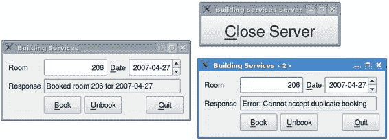

**图 18.1** 带有两个客户端的服务器

服务器可以接受两种请求，“BOOK”和“UNBOOK”，并可以产生三种响应，“BOOK”、“UNBOOK”和“ERROR”。所有的请求和响应都以二进制数据的形式发送和接收；我们将在接后的章节中查看它们的格式。

除了`PORT`变量中持有的端口号外，我们还创建了`SIZEOF_UINT16`变量并将其设置为`2`（意味着两个字节）。除了常规导入外，我们必须导入`QtNetwork`模块：

```python
from PyQt4.QtNetwork import *
```

相同的`PORT`和`SIZEOF_UINT16`变量，以及相同的`QtNetwork`导入都被用于客户端和服务器应用程序中。在接下来的节中，我们将查看客户端的实现，在第二节中回顾服务器。

### 创建 TCP 客户端

建筑服务客户端位于`chap18/buildingservicesclient.pyw`。它允许用户输入房间号（仅接受有效的房间号）和日期，并请求在该日期预订（或取消预订）该房间。服务器对请求做出响应，客户端将响应显示在响应标签中供用户阅读。

我们将从查看初始化开始，但省略组件和布局的创建。我们将分三个部分来看它，然后查看客户端的方法。

```python
class BuildingServicesClient(QWidget):
    def __init__(self, parent=None):
        super(BuildingServicesClient, self).__init__(parent)
        self.socket = QTcpSocket()
        self.nextBlockSize = 0
        self.request = None
```

我们继承了`QWidget`而不是`QDialog`或`QMainWindow`。唯一的明显区别是，如果我们继承了`QDialog`，按下 Esc 键将终止应用程序。

我们有三个对象需要存储。第一个是客户端用于与服务器通信的`socket`。第二个是“下一个块大小”（next block size）；这是一个我们用来判断是否已收到足够的响应数据以处理响应的变量。第三个是`request`对象；这是一个包含请求数据的`QByteArray`，如果没有数据要发送，则为`None`。

我们将跳过组件的创建、设置和布局，因为到目前为止这些内容应该大家都熟悉了，尽管我们在查看套接字连接后还会查看组件的连接。

```python
self.connect(self.socket, SIGNAL("connected()"), self.sendRequest)
self.connect(self.socket, SIGNAL("readyRead()"), self.readResponse)
self.connect(self.socket, SIGNAL("disconnected()"), self.serverHasStopped)
self.connect(self.socket, SIGNAL("error(QAbstractSocket::SocketError)"), self.serverHasError)
```

前四个信号与套接字有关。我们需要知道连接何时建立，因为在那个点我们就可以发送请求数据。

我们还需要知道套接字是否有数据可读，因为当有数据时，它将包含我们想要读取的服务器响应。如果连接终止——例如，因为服务器已关闭或发生了错误——我们希望知道，以便告知用户。

```python
self.connect(self.roomEdit, SIGNAL("textEdited(QString)"), self.updateUi)
self.connect(self.dateEdit, SIGNAL("dateChanged(QDate)"), self.updateUi)
self.connect(self.bookButton, SIGNAL("clicked()"), self.book)
self.connect(self.unBookButton, SIGNAL("clicked()"), self.unBook)
self.connect(quitButton, SIGNAL("clicked()"), self.close)
```

其他连接与用户界面有关。和通常一样，我们有一个`updateUi()`方法来执行验证并根据情况启用/禁用按钮。我们还有预订、取消房间以及终止应用程序的连接。

```python
def updateUi(self):
    enabled = False
    if not self.roomEdit.text().isEmpty() and \
    self.dateEdit.date() > QDate.currentDate():
        enabled = True
    if self.request is not None:
        enabled = False
    self.bookButton.setEnabled(enabled)
    self.unBookButton.setEnabled(enabled)
```

如果用户点击 Book，就会调用`book()`方法。该方法简单地调用`issueRequest()`，传入请求动作“BOOK”、房间号（作为`QString`）和日期。`unBook()`方法几乎相同，区别在于它的请求动作是“UNBOOK”。

```python
def book(self):
    self.issueRequest(QString("BOOK"), self.roomEdit.text(), self.dateEdit.date())

def unBook(self):
    self.issueRequest(QString("UNBOOK"), self.roomEdit.text(), self.dateEdit.date())
```

此方法用于准备`request` `QByteArray`并启动将请求发送到服务器的过程。

```python
def issueRequest(self, action, room, date):
    self.request = QByteArray()
    stream = QDataStream(self.request, QIODevice.WriteOnly)
    stream.setVersion(QDataStream.Qt_4_2)
    stream.writeUInt16(0)
    stream << action << room << date
    stream.device().seek(0)
    stream.writeUInt16(self.request.size() - SIZEOF_UINT16)
```

如果应用程序终止，我们确保关闭`socket`并接受关闭事件。我们并不真的必须做这些事情，但通过这样做这些，我们展示了已经考虑过终止时应该做什么。

```python
def closeEvent(self, event):
    self.socket.close()
    event.accept()
```

```python
if self.socket.isOpen():
    self.socket.close()
self.responseLabel.setText("Connecting to server...")
self.socket.connectToHost("localhost", PORT)
```

图 18.2 显示了写入`request` `QByteArray`的数据。`QByteArray`可以像任何其他`QIODevice`一样被读取和写入。前两个字节包含一个无符号整数，初始值为`0`。该整数用于存储请求占据的字节数（不包括整数本身的大小），即紧随其后的字节数。我们必须先将其设置为`0`，因为我们不知道将使用多少字节。

- `uint`

- `QString`

- `QString`

- `16`

- `QDate`

在写入整数大小后，我们写入数据。操作字符串是请求操作（“BOOK”或“UNBOOK”），房间字符串持有房间号（例如，“213”），而日期则包含一个`QDate`。一旦数据被写入字节数组，我们就使用`seek()`将写入位置移动到开头，这样我们下次写入的内容将覆盖`QByteArray`的开头。（我们实际上是在`QDataStream`的底层`QIODevice`上执行`seek`操作，该设备是通过调用`QDataStream.device()`获取的。）我们写入一个无符号 16 位整数，其值为`QByteArray`的长度减去初始整数的大小。请求字节数组现在已准备好发送了。

我们更新用户界面——这将禁用`Book`（预订）和`Unbook`（取消预订）按钮，因为请求对象不为`None`；这样做是为了防止用户在收到响应之前发出额外的请求。然后，我们确保套接字已关闭，因为它可能为了处理之前的请求而打开，并设置响应标签以告知用户我们正在尝试建立连接。

最后，我们调用`connectToHost()`。IP 地址可以以点分字符串（例如，“82.94.237.218”）、主机名（例如，“www.python.org”）或`QHostAddress`对象的形式给出。得益于我们在初始化器中建立的信号与槽连接，我们知道一旦连接建立，我们的`sendRequest()`方法就会调用，除非连接失败，在这种情况下将改为调用`serverHasStopped()`或`serverHasError()`方法。

```python
def sendRequest(self):
    self.responseLabel.setText("Sending request...")
    self.nextBlockSize = 0
    self.socket.write(self.request)
    self.request = None
```

一旦连接建立，该方法就会被调用。它更新响应标签告知用户请求已发送，并将下一个块大小设置为 0。这与我们希望收到的响应有关；我们将在`readResponse()`方法中看到它。它将请求字节数组写入套接字。一旦写入完成，请求被设置为`None`，准备好进行新的请求。

### 创建 TCP 客户端

527

如果没有发生错误且服务器没有终止，服务器将做出响应，此时会调用`readResponse()`方法。

（否则，将调用`serverHasStopped()`或`serverHasError()`方法。）

`uint`

`QString`

`QString`

`16`

`QDate`

### 成功响应

`uint`

`QString`

`QString`

### 错误响应

`16`

**图 18.3** 响应格式

服务器有两种响应格式，如图 18.3 所示。收到响应时，我们必须从读取其大小开始。然后，一旦知道有足够的字节可以读取，我们就读取第一个`QString`。如果它包含“ERROR”，我们就知道是一个错误响应，只需读取包含错误信息的第二个字符串；否则，文本将是“BOOK”或“UNBOOK”，即请求操作、第二个`QString`中的详情以及日期`QDate`，确认请求操作成功。

```python
def readResponse(self):
    stream = QDataStream(self.socket)
    stream.setVersion(QDataStream.Qt_4_2)
    while True:
        if self.nextBlockSize == 0:
            if self.socket.bytesAvailable() < SIZEOF_UINT16:
                break
            self.nextBlockSize = stream.readUInt16()
        if self.socket.bytesAvailable() < self.nextBlockSize:
            break
        action = QString()
        room = QString()
        date = QDate()
        stream >> action >> room
        if action != "ERROR":
            stream >> date
        if action == "ERROR":
            msg = QString("Error: %1").arg(room)
        elif action == "BOOK":
            msg = QString("Booked room %1 for %2").arg(room) \
            .arg(date.toString(Qt.ISODate))
        elif action == "UNBOOK":
            msg = QString("Unbooked room %1 for %2").arg(room) \
            .arg(date.toString(Qt.ISODate))
```

528

### 第 18 章 网络

`self.responseLabel.setText(msg)`

`self.updateUi()`

`self.nextBlockSize = 0`

服务器的响应可能会分段返回。由于这个原因，我们使用无限循环，首先获取字节计数，然后确保有足够数量的字节可以读取。这把与服务器缓冲的责任留了下来，并且意味着当我们读取时，知道可以一次性读取完整的响应。

如果至少有两个字节可用，我们就将其作为无符号 16 位整数读取：这为我们提供了后续的字节数。然后我们测试是否有足够的字节可以读取：如果没有，我们就退出循环并等待另一个`readyRead()`信号导致`readResponse()`方法调用。如果有足够的字节，我们就读取操作以及随后的字符串——这是房间号或错误信息。如果操作不是“ERROR”，我们还会读取日期。然后，根据收到的操作，我们准备一个消息字符串并显示在响应标签中。


读取完整个响应后，我们重置块大小，因为可能还有响应，在这种情况下 `socket.bytesAvailable()` 将返回大于零的值。如果服务器终止或服务器响应网络错误，将调用相应的 `serverHas*()` 方法。

```python
def serverHasStopped(self):
    self.responseLabel.setText("Connection closed by server")
    self.socket.close()

def serverHasError(self, error):
    self.responseLabel.setText(QString("Error: %1") \
    .arg(self.socket.errorString()))
    self.socket.close()
```

在两种情况下，我们都会向用户显示错误信息并关闭套接字。

## 创建 TCP 服务器

物业服务 TCP 服务器位于`chap18/buildingservicerver.pyw`中。它包含三个组件：一个持有服务器实例并为用户提供终止服务器简便方法的 GUI；一个实例化以提供服务器实例的`TcpServer`子类；以及一个用于处理传入连接的`TcpSocket`子类。我们将先查看前两个，因为它们很短，然后重点关注执行大部分工作的`TcpSocket`子类。

```python
class BuildingServicesDlg(QPushButton):
    def __init__(self, parent=None):
        super(BuildingServicesDlg, self).__init__(
"&Close Server", parent)
        self.setWindowFlags(Qt.WindowStaysOnTopHint)
        self.loadBookings()
        self.tcpServer = TcpServer(self)
        if not self.tcpServer.listen(QHostAddress("0.0.0.0"), PORT):
            QMessageBox.critical(self, "Building Services Server", QString("Failed to start server: %1") \
.arg(self.tcpServer.errorString()))
            self.close()
            return
        self.connect(self, SIGNAL("clicked()"), self.close)
```

为了换换口味，并提醒我们任何 PyQt 控件都可以是顶层窗口，我们将对话框变成了`QPushButton`子类。我们还设置了`Qt.WindowStaysOnTopHint`；大多数窗口系统都会尊重该提示，并将控件保持在所有其他窗口之上。

我们不会涵盖`loadBookings()`方法；它被用于填充存储预订数据的内存数据结构，即`Bookings`默认字典。

字典的键是存储为`datetime.date`对象的日期，而值是存储为 unicode 字符串的房间号有序列表。默认的`defaultdict`-Python 字典是在 Python 2.5 中引入的。它们与普通字典相似，不同之处在于`2.5`版本中当我们使用字典中不存在的键时，该键将以一个默认值插入。使用什么默认值取决于我们如何创建字典。在 Building Services 服务器中，我们是这样创建字典的：

```python
Bookings = collections.defaultdict(list)
```

在这里，我们规定任何新键的默认值是一个空列表；在其他情况下，我们可能会选择一个空集合。我们始终可以用普通字典替换默认字典——例如，在比 2.5 旧的 Python 版本中——通过在访问可能不存在的键时使用`dict.setdefault()`方法，正如稍后会看到的。

我们将很快回顾`TcpServer`类。一旦创建了服务器，我们就告诉它在给定的 IP 地址和端口号上监听传入的连接。IP 地址被指定为`QHostAddress`，特殊地址为"0.0.0.0"，意味着"所有网络接口"；端口号与我们在客户端使用的任意端口 9407 相同。

连接确保了如果用户点击按钮，窗口将会关闭。

我们没有对 TCP 服务器进行任何特殊的清理；当它被销毁时，任何连接的客户端将收到通知，它们的`disconnected()`信号将发射。

对话框部分没有内容了，我们现在可以查看继承`QTcpServer`的小型`TcpServer`类。

```python
class TcpServer(QTcpServer):
    def __init__(self, parent=None):
        super(TcpServer, self).__init__(parent)

    def incomingConnection(self, socketId):
        socket = Socket(self)
        socket.setSocketDescriptor(socketId)
```

这是 TCP 服务器的完整代码。每当发生传入的连接请求时，就会调用`incomingConnection()`方法并传入`socketId`中的套接描述符。我们只需创建一个新的`Socket`（我们将稍后回顾的`QTcpSocket`子类），并设置它使用服务器提供的套接描述符。

此 TCP 服务器依赖于 PyQt 事件循环。如果我们想创建一个不带 GUI 的基于`QTcpServer`的服务器，有两种方法可以采用。一种方法是使用`QEventLoop`在不需要 GUI 的情况下提供一个事件循环，并按照我们在这里所的方式编写代码。另一种方法是不使用事件循环，但在这种情况下我们必须稍微不同的方式处理。特别是，我们必须使用阻塞的`QTcpServer.waitForNewConnection()`方法，而不是重新实现`incomingConnection()`。当然，如果服务器没有 GUI，可以完全使用 Python 的标准库来编写，而完全不需要`QtNetwork`模块。或者，可以使用 Twisted 编写服务器。

一旦建立连接，所有工作都将交给`Socket`类，这是一个`QTcpSocket`子类，我们现在将回顾它。

```python
class Socket(QTcpSocket):
    def __init__(self, parent=None):
        super(Socket, self).__init__(parent)
        self.connect(self, SIGNAL("readyRead()"), self.readRequest)
        self.connect(self, SIGNAL("disconnected()"), self.deleteLater)
        self.nextBlockSize = 0
```

套接字将其`readyRead()`信号连接到我们自定义的`readRequest()`方法，将其`disconnected()`信号连接到它的`deleteLater()`槽——这确保了在连接终止时套接字被干净地删除。`nextBlockSize`变量的用途与客户端中相同且方式相同，以确保只有当可用读取的字节数至少等于请求中的字节数时，我们才读取请求。

一旦创建了套接字并设置了连接，它将一直等待`readRequest()`方法被调用。这个方法有点长，我们将分两部分回顾它。

```python
def readRequest(self):
    stream = QDataStream(self)
    stream.setVersion(QDataStream.Qt_4_2)
    if self.nextBlockSize == 0:
        if self.bytesAvailable() < SIZEOF_UINT16:
            return
        self.nextBlockSize = stream.readUInt16()

    if self.bytesAvailable() < self.nextBlockSize:
        return

    action = QString()
    room = QString()
    date = QDate()
```

我们首先检查是否有至少两个字节可以读取：如果有，我们读取下一个块的大小。如果没有两个字节可以读取，或者虽然有两个字节但没有足够的字节来读取整个请求，我们就返回并等待`readRequest()`再次被调用，此时更多字节已经到达。

一旦字节足够，我们就创建空的`action`和`room`字符串以及一个空的`QDate`，准备好从传入的请求数据中填充它们。

```python
    stream >> action

    if action in ("BOOK", "UNBOOK"):
        stream >> room >> date
        bookings = Bookings.get(date.toPyDate())
        uroom = unicode(room)
        if action == "BOOK":
            if bookings is None:
                bookings = Bookings[date.toPyDate()]
            if len(bookings) < MAX_BOOKINGS_PER_DAY:
                if uroom in bookings:
                    self.sendError("duplicate booking")
                else:
                    bisect.insort(bookings, uroom)
            self.sendReply(action, date)
            else:
                self.sendError(QString("%1 is fully booked").arg(date.toString(Qt.ISODate)))
        elif action == "UNBOOK":
            if bookings is None or uroom not in bookings:
                self.sendError("Cannot unbook booking")
            else:
                bookings.remove(uroom)
                self.sendReply(action, date)
        else:
            self.sendError("Unrecognized request")
```

服务器识别请求动作，"BOOK"和"UNBOOK"；如果获取到其中一个，它读取房间和日期，并获取该日期的（可能的）预订列表。它还存储了房间号的 unicode 拷贝，因为服务器使用的`Bookings`字典使用的是 Python 类型而非 PyQt 类型。

接下来，服务器对给定日期预订或取消给定房间。

预订时，如果该日期没有预订，将为该日期创建一个空预订列表。这样做是因为我们使用了默认字典，所以当我们访问它不存在的键时，它会自动插入一个带有该键的默认值；在这种情况下是空列表。我们这样做是为了避免在取消预订时为该日期创建一个空列表。只有当我们知道动作是预订时，我们才想确保该日期有一个列表。

如果我们使用普通字典，我们必须使用`dict.setdefault()`来获取该日期的列表，如果键不存在，则创建一个以该日期为键、空列表为值的新项。

例如：

```python
bookings = Bookings.setdefault(date.toPyDate(), [])
```

`QDate.toPyDate()`方法是在 PyQt 4.1 中引入的；对于早期版本，我们必须通过编写`datetime.date(date.year(), date.month(), date.day())`手动进行转换。

一旦我们有了（可能的）预订列表，并且预订数量少于允许的最大数量（`MAX_BOOKINGS_PER_DAY`，其值为 5），房间号字符串将按顺序插入列表，并向客户端发送回复，简单地回显请求数据。如果房间在给定日期已被预订，或者该日期已达到最大预订数，则向客户端发送错误回复。

如果动作是取消预订，则从该日期的预订中移除该房间并将动作回显给客户端；或者如果预订根本不存在，则给出错误回复。尽管房间是按顺序存储的，我们简单地使用了`not in`和`list.remove()`，它们都将执行线性搜索；对于更长的列表，我们会使用`bisect.bisect_left()`通过二分查找来寻找房间，但在本示例中这似乎大材小用了。

如果请求的操作无法被识别，我们只需回复一条错误消息。

```python
def sendReply(self, action, room, date):
    reply = QByteArray()
    stream = QDataStream(reply, QIODevice.WriteOnly)
    stream.setVersion(QDataStream.Qt_4_2)
    stream.writeUInt16(0)
    stream << action << room << date
    stream.device().seek(0)
    stream.writeUInt16(reply.size() - SIZEOF_UINT16)
    self.write(reply)
```

发送给客户端的回复创建方式与客户端请求创建的方式相同。我们使用`QDataStream`向`QByteArray`写入数据，首先写入一个无符号 16 位整数，最后用回复的大小覆盖该整数，然后将回复写入套接字。

```python
def sendError(self, msg):
    reply = QByteArray()
    stream = QDataStream(reply, QIODevice.WriteOnly)
    stream.setVersion(QDataStream.Qt_4_2)
    stream.writeUInt16(0)
    stream << QString("ERROR") << QString(msg)
    stream.device().seek(0)
    stream.writeUInt16(reply.size() - SIZEOF_UINT16)
    self.write(reply)
```

发送错误回复的代码与发送成功回复的代码几乎相同，可以说我们本可以用一个方法处理这两种情况。

通过向`readRequest()`中添加更多的`if`语句，可以轻松扩展服务器以处理更多请求类型。例如，客户端可能想知道某一天哪些房间被预订，或者某个房间在哪些日期被预订。

尽管我们使用了字典来存储服务器数据，但没有理由服务器不能将数据存储在进程内的`SQLite`数据库中、进程外数据库中或文件中。服务器也不需要 GUI；它可以不包含`QWidgets`，只需作为 Linux 守护进程或 Windows 服务在后台运行。

## 总结

Python 标准库、`Twisted`网络引擎以及`PyQt` `QtNetwork`模块为网络提供了大量的支持，从底层套接字到包括`FTP`和`HTTP`在内的各种高层协议。

编写客户端/服务器应用程序必须确保客户端和服务器程序能够通信。这意味着服务器必须运行在已知 IP 地址上并在特定的端口地址上监听。客户端和服务器必须使用约定的协议（如`UDP`或更常见的`TCP`）进行通信。它们还必须约定如何传输数据，是文本行还是二进制数据块——在这两种情况下，它们都必须知道每个请求和响应遵循的格式。

本章展示的场景非常常见：服务器等待请求，客户端发送请求并读取服务器的响应。在客户端进行通信之前，它必须建立连接，一旦连接建立，它就可以发送数据。服务器可能会返回数据，也可能发生了某些问题。如果接收到数据，我们必须确保不会尝试读取超过可用字节数（或行）。

`PyQt`的`QTcpServer`和`QTcpSocket`类使得实现服务器变得非常简单。虽然可以读写文本数据行，但使用二进制数据要通用得多，它允许我们发送和接收任何类型的数据，而无需编写解析器。

我们实现的`TCP`服务器存在一个理论问题：它是单线程的。这意味着如果多个请求同时到达，它可能必须阻塞以一次处理一个请求。这可以通过使用线程服务器来解决，正如我们在下一章中看到的。

## 练习

修改建筑服务（Building Services）服务器，使其接受一个新的请求操作`BOOKINGSONDATE`。当接收到此类请求时，它应该忽略房间，转而检索给定日期的预订情况。如果没有预订，服务器应发送错误回复。否则，它的回复不应是单个房间字符串，而是一个包含逗号和空格分隔的房间号的字符串，如图 18.4 所示。

修改建筑服务客户端，使其有一个`Bookings on Date?`（日期预订情况？）按钮，该按钮连接到一个发布合适请求的方法。客户端的`readResponse()`方法需要稍微修改，以便它可以读取服务器对新请求的响应。


提供“按日期预订”所需的修改非常直接。为了增加挑战性，修改建筑服务服务器以接受另一个新请求操作 `BOOKINGSFORROOM`。当接收到这些请求之一时，它应该忽略日期，转而遍历所有预订，累加给定房间被预订的日期列表。如果没有预订，它应返回错误回复。否则，与其使用 `sendReply()` 方法，它应该发送自己的字节数组，包含长度、操作、房间字符串，以及一个包含列表日期数量的 32 位整数，随后是每个日期。由于日期是以 `datetime.date` 对象存储的，必须将其转换为 `QDates` 以便流写入 `QByteArray`。

必须修改建筑服务客户端以提供 `Bookings for Room?`（按房间预订？）按钮，连接到一个发布合适请求的方法。客户端的 `readResponse()` 方法需要修改，以便如果接收到 `BOOKINGSFORROOM` 响应，它可以读取日期并创建一个用于客户端用户界面显示的合适字符串，如图 18.5 所示。

服务器的修改可以通过添加约 30 行代码完成，客户端可以通过添加约 40 行代码完成。然而，`BOOKINGSFORROOM` 请求/响应确实需要一些小心。

解决方案位于 `chap18/buildingservicesserver_ans.pyw` 和 `chap18/buildingservicesclient_ans.pyw` 中。

## 19

### 创建线程服务器

- 创建和管理辅助线程
- 实现辅助线程

### 多线程

传统上，应用程序有一个执行线程，并且一次执行一个操作。对于 GUI 程序，这有时是一个问题——例如，如果用户调用了一个长时间运行的操作，用户界面在操作执行期间可能会冻结。有几种可以尝试消除这个问题。

一种简单的解决方案（特别适用于长时间运行的循环）是调用 `QApplication.processEvents()`。该方法让事件循环有机会处理任何未处理的事件，例如绘制事件，以及鼠标和按键事件。另一种解决方案是使用零超时定时器。我们在多个示例中结合了这两种方法，通常在加载大量文件时——例如在第 9 章文本编辑器的 `MainWindow.loadFiles()` 方法中。第三种解决方案是将工作完全交给另一个程序。可以使用 Python 标准库的 `subprocess` 模块完成，也可以使用 `PyQt` 的 `QProcess` 类。示例提供的 `makepyqt.pyw` 使用 `QProcess` 执行 `PyQt` 的命令行工具，如 `pyuic4` 和 `pyrcc4`。

在某些情况下，我们真正需要的是应用程序内部一个独立的执行线程。拥有多一个执行线程的应用程序被称为多线程应用程序。例如，我们可能想要创建一个服务器，能够处理硬件所承受的尽可能多的并发连接，如果为每个连接分配一个新线程，这是相对容易实现的。在某些情况下，我们可能会有一个 GUI 应用程序，我们希望用户能够启动一个耗时进程，然后继续与应用程序交互；在这种情况下，最好的方法是将处理任务交给一个独立的辅助线程，让主线程（GUI）保持空闲以响应用户。

本章展示了多线程编程中用到常用技术。这些技术对于入门已经足够，但涵盖范围并不全面，因为那将超出本书的范围，并且需要专门写一本书。

> *本章假设你已具备线程基础的知识。若需详尽但不浅的介绍，请参阅《Foundations of Multithreaded, Parallel, and Distributed Programming》。*

由于多个线程可能并发访问相同的数据，多线程应用程序通常比单线程应用程序更难编写、维护和调试。在单处理器机器上，多线程应用程序的运行速度有时比单线程应用程序慢（由于额外线程的额外开销），但用户通常认为它们运行得更快，因为它们不会冻结用户界面，并且能够更容易增量地向用户报告进度。

使用正确数量的线程会显著影响性能。例如，在章后面介绍的“页面索引器”示例中，我们有一个主线程（GUI）和一个辅助线程。该练习涉及将此示例更改为使用多个辅助线程。如果使用的过多，应用程序的运行速度会比单辅助线程的版本慢；但如果数量正确，我们可以启动单辅助线程的版本，然后启动多辅助线程的版本，并看到多辅助线程的版本在单辅助线程版本完成之前赶上、超越并完成。我们应该使用多少个辅助线程？答案取决于必须执行哪些处理，以及运行该应用程序的特定机器和操作系统。我们可以使用真实数据集进行实验以确定一个数值，或者根据情况让代码使用更多或更少的辅助线程。

Python 的标准库提供了底层的 `thread` 模块和高级的 `threading` 模块，但对于 PyQt 编程，我们建议使用 PyQt 的线程类。PyQt 的线程类提供了高级 API，但在底层，它们的一些基础操作是用汇编语言实现的，以确保它们尽可能快速和精细，这在 Python 的 `threading` 模块中是没有这样做的。

PyQt 应用程序始终至少有一个执行线程，即主线程（初始线程）。此外，它们可以根据需要创建任意数量的辅助线程。然而，如果应用程序有 GUI，GUI 操作（如执行事件循环）可能发生在主线程中。新线程通过实例化重写了 `QThread.run()` 方法的 `QThread` 子类来创建。

可以使用 `QCoreApplication` 代替 `QApplication` 创建没有 GUI 的 PyQt 应用程序。就像 GUI PyQt 程序一样，它们有一个主线程，并可以有任意数量的辅助线程。

辅助线程与主线程之间的通信通常是理想的——例如，让用户了解进度，允许用户在处理过程中进行干预，并让主线程知道处理何时完成。传统上，这种通信是通过使用共享变量结合资源保护机制来实现的。

## 创建线程服务器

PyQt 拥有支持这种方法的类，包括 `QMutex`、`QReadWriteLock` 和 `QSemaphore`。此外，PyQt 应用程序可以使用信号与槽机制在线程之间进行通信；这非常方便且有用。

在本章的第一节中，我们将查看一个线程 TCP 服务器；它完成的工作与上一章最后一节描述的服务器相同，但由于它是线程的，它可以同时为多个客户端服务。在第二、第三节中，我们将查看一个具有某些可能非常耗时的处理的 GUI 应用程序，它将处理任务交给辅助线程。该应用程序使用信号和槽来保持用户界面的进度更新，并为用户提供对辅助线程的控制。此示例还使用了一些资源保护类，以便用户界面可以访问正在进行的工作。

与某些其他 GUI 库不同，PyQt 的网络套接类与事件循环集成。这意味着在网络处理期间，即使在单线程 PyQt 应用程序中，用户界面也能保持响应。但如果我们希望能够处理多个并发的传入连接，可能更倾向于使用多线程服务器。

制作多线程服务器并不比制作单线程服务器复杂——两者的区别在于，多线程服务器不是创建一个独立的套接来处理传入连接，而是为每个新连接创建一个新线程，并在新线程内部创建一个新套接。例如，这里有一个完整的线程服务器：

```python
class TcpServer(QTcpServer):
    def __init__(self, parent=None):
        super(TcpServer, self).__init__(parent)

    def incomingConnection(self, socketId):
        thread = Thread(socketId, self)
        self.connect(thread, SIGNAL("finished()"),
                     thread, SLOT("deleteLater()"))
        thread.start()
```

`incomingConnection()` 方法是从 `QTcpServer` 基类重写的。每当有新的网络连接到服务器时，该方法就会被调用。

信号与槽连接是必要的，以确保线程在不需要时被删除，从而尽可能保持服务器的内存占用。虽然我们必须在 `QThread` 子类中重写 `QThread.run()`，但线程始终通过调用 `QThread.start()` 启动（而不是直接调用 `run()`）。

`Thread` 子类有一个静态变量和四个方法。`sendReply()` 和 `sendError()` 方法与上一节所示相同，因此我们将省略它们。

```python
class Thread(QThread):
    lock = QReadWriteLock()
    def __init__(self, socketId, parent):
        super(Thread, self).__init__(parent)
        self.socketId = socketId
```

`Thread.lock` 变量是静态的，所有的 `Thread` 实例共享它。初始化函数只是记录了线程启动时就绪的套接符。`run()` 方法很长，所以我们将分部分查看。

```python
def run(self):
    socket = QTcpSocket()
    if not socket.setSocketDescriptor(self.socketId):
        self.emit(SIGNAL("error(int)"), socket.error())
        return

    while socket.state() == QAbstractSocket.ConnectedState:
        nextBlockSize = 0
        stream = QDataStream(socket)
        stream.setVersion(QDataStream.Qt_4_2)
        while True:
            socket.waitForRead(-1)
            if socket.bytesAvailable() >= SIZEOF_UINT16:
                nextBlockSize = stream.readUInt16()
                break
        if socket.bytesAvailable() < nextBlockSize:
            while True:
                socket.waitForRead(-1)
                if socket.bytesAvailable() >= nextBlockSize:
                    break
```

我们首先创建一个新的 socket，并将其套接字描述符设置为给定的那一个。我们采取了比之前稍微更健壮的方法，检查 `QTcpSocket.setSocketDescriptor()` 调用的返回值，并在失败时输出错误信息。一旦 `run()` 方法完成，就会发射 `finished()` 信号，得益于我们之前的信号与槽连接，该线程将被删除。

只要 socket 连接状态，我们就可以使用它接收请求并发送响应。与我们在上一章中创建的 TCP 服务器不同，这里我们不是通过信号与槽连接异步运行并等待事件（如数据可用）发生，而是使用 `wait-ReadyRead()` 进行阻塞，直到有数据为止。（参数 `-1` 意味着“无限等待”）。阻塞并没有关系，因为我们处于一个独立的执行线程中，所以应用程序的其他部分（其主线程）以及任何其他处理连接的辅助线程都可以不受干扰地继续运行。

### 创建线程服务器

一旦有两个字节可用，我们就会读取无符号 16 位字节计数，一旦至少有相应数量的字节可读，我们就可以继续操作。

```
action = QString()
room = QString()
date = QDate()
stream >> action

if action in ("BOOK", "UNBOOK"):
    stream >> room >> date
    try:
        Thread.lock.lockForRead()
        bookings = Bookings.get(date.toPyDate())
    finally:
        Thread.lock.unlock()
uroom = unicode(room)
```

我们读取请求动作，它本应该是“BOOK”或“UNBOOK”，如果是其中之一，我们接着会读取房间号字符串和日期。`Bookings` 默认字典持有所有的预订数据，任何数量的线程都可能同时访问它。由于此原因，我们必须对每次访问进行保护。在这里，我们只需要读取，因此我们调用 `lockForRead()`，提取我们想要的数据，然后释放锁。我们使用 `try ... finally` 块来保证在完成访问共享数据后会释放锁。

Python 2.6（以及带有适当 `from __future__` 语句的 2.5）提供了一种更好、更紧凑的语法，可以替换 `try ... finally`，正如第 549 页的“使用上下文管理器进行解锁”侧边栏所示。

一种广为人知的锁机制是互斥量（也称为二值信号量），由 PyQt 的 `QMutex` 类提供。互斥量仅允许锁定它的线程访问受保护的资源。PyQt 还提供了一种更细粒度的机制，即读/写锁，由我们在这里使用的 `QReadWriteLock` 类提供。每当一个锁在一个线程中生效时，其他线程可能会被阻塞并等待访问。我们可以通过两种方式最大限度地减少这个问题。首先，我们可以尽可能使用读锁——如果唯一生效的锁是读锁，那么没有线程会被阻塞，因为在没有线程进行写入时，所有线程进行读取是安全的。其次，我们可以最大限度地减少在锁生效时执行的处理量。我们在 `run()` 重写中使用了这两种技术；缺点是代码比预期的要长得多。

`QMutex`、`QReadWriteLock` 以及其他保护机制之所以有效，是因为它们都是“线程安全”的。任何数量的线程都可以同时调用线程安全对象的方法，并依赖底层系统（即 PyQt）自动对可能发生的任何共享数据访问进行序列化。这意味着，例如，如果两个或多个线程尝试锁定 `QReadWriteLock` 进行写入，则只有一个将成功，其他都将被阻塞。这允许获得锁的线程对共享数据执行更新，当它释放锁时，想要写入的其它线程之一将获得访问权限，以此此类推，直到没有更多线程需要写入访问为止。

PyQt 文档指出了哪些类或类中的哪些方法是线程安全的。它还指出了哪些方法是可重入（reentrant）的。重入方法比线程安全方法更受限制。这是因为只有当每次调用都只导致访问唯一的数据（例如局部变量）时，从多个线程同时调用重入方法才是安全的。通过对所有实例变量访问以及任何引用共享数据的变量访问使用锁，可以将重入方法变为线程安全。

```python
if action == "BOOK":
    newlist = False
    try:
        Thread.lock.lockForRead()
        if bookings is None:
            newlist = True
    finally:
        Thread.lock.unlock()
    if newlist:
        try:
            Thread.lock.lockForWrite()
            bookings = Bookings[date.toPyDate()]
        finally:
            Thread.lock.unlock()
```

如果请求是预订房间，我们首先检查 `bookings` 变量。它要么是 `None`，要么是共享 `Bookings` 默认字典持有的列表引用，因此在访问它时必须使用读锁。如果 `bookings` 是 `None`，我们向字典中插入给定日期为键插入一个新的空列表；这次我们必须使用写锁。

```python
error = None
insert = False
try:
    Thread.lock.lockForRead()
    if len(bookings) < MAX_BOOKINGS_PER_DAY:
        if uroom in bookings:
            error = "Cannot accept duplicate booking"
        else:
            insert = True
    else:
        error = QString("%1 is fully booked").arg(
            date.toString(Qt.ISODate))
finally:
    Thread.lock.unlock()

if insert:
    try:
        Thread.lock.lockForWrite()
        bisect.insort(bookings, uroom)
    finally:
        Thread.lock.unlock()
    self.sendReply(socket, action, date)
else:
    self.sendError(socket, error)
```

如果房间在给定日期已预订，我们不会重复预订，而是发送错误响应。在非线程服务器中，我们在这种情况下直接调用了 `sendError()`，但在在这里我们只分配错误文本。这样做是为了保持在锁的上下文中执行的处理量尽可能最少。


```python
elif action == "UNBOOK":
    error = None
    remove = False
    try:
        Thread.lock.lockForRead()
        if bookings is None or uroom not in bookings:
            error = "Cannot unbook nonexistent booking"
        else:
            remove = True
    finally:
        Thread.lock.unlock()
    if remove:
        try:
            Thread.lock.lockForWrite()
            bookings.remove(uroom)
        finally:
            Thread.lock.unlock()
        self.sendReply(socket, action, date)
    else:
        self.sendError(socket, error)
else:
    self.sendError(socket, "Unrecognized request")

socket.waitForDisconnected()
```

如果服务器收到无法识别的请求，它只需发送错误响应。最后，我们调用`QTcpSocket.waitForDisconnected()`；这会阻塞直到连接关闭，即在响应发送之后。

GUI 应用中线程的一个常见用例是将处理任务传递给次要线程，这样用户界面就可以保持响应状态，并显示次要线程的进度。在本节中，我们将查看图 19.1 所示的页面索引器（Page Indexer）应用程序，它可以索引指定目录及其所有子目录中的 HTML 文件。索引工作被交给次要线程，该线程与主线程通信，以通知它已完成的进度以及索引何时完成。

**图 19.1** *页面索引器应用程序*

我们将用于索引的算法如下：对于遇到的每个 HTML 文件，读取其文本，将实体转换为等效 Unicode 字符，并剥离 HTML 标签。然后将文本拆分为单词，并将每个长度在 3~25 个字符之间（包含边界）且不在`Default`常用词集中的单词添加到`filenamesForWords`默认字典中。字典的每个键（key）是一个唯一的单词，每个关联的值（value）是该单词出现的文件集。如果任何单词出现在超过 250 个文件中，则将其从字典中删除并添加到常用词集合中。这确保了字典的大小保持在合理范围内，并意味着对“and”和“the”等单词的搜索将无效——这是一件好事，因为此类单词可能在成千上万个文件中匹配，多到完全没用。

我们将首先查看应用程序主表单的两个片段，它位于`chap19/pageindexer.pyw`文件。

```python
class Form(QDialog):
    def __init__(self, parent=None):
        super(Form, self).__init__(parent)
        self.fileCount = 0
        self.filenamesForWords = collections.defaultdict(set)
        self.commonWords = set()
        self.lock = QReadWriteLock()
        self.path = QDir.homePath()
```

`fileCount`变量用于跟踪目前已索引了多少文件。`filenamesForWords`默认字典的键是单词，值是文件名集。`commonWords`集合存储在至少 250 个文件中出现的单词。读/写锁用于确保对`filenamesForWords`字典和`commonWords`集合的访问受到保护，因为它们会在主线程中被读取，并在次要线程中被读取和写入。`QDir.homePath()`方法返回用户的家目录；我们用它来设置初始搜索路径。

```python
self.walker = walker.Walker(self.lock, self)
self.connect(self.walker, SIGNAL("indexed(QString)"), self.indexed)
self.connect(self.walker, SIGNAL("finished(bool)"), self.finished)
self.connect(self.pathButton, SIGNAL("clicked()"), self.setPath)
self.connect(self.findEdit, SIGNAL("returnPressed()"), self.find)
```

次要线程位于`walker`模块中（之所以命名为此是因为它会遍历文件系统），该`QThread`子类名为`Walker`。每当线程索引新文件时，它就会发射一个带有文件名的信号。当它完成了启动时给定的路径中所有文件的索引后，它也会发射一个`finished()`信号。

在一个线程中发射的用于另一个线程的信号是异步工作的，也就是说，它们不会阻塞。但只有在接收端有事件循环时，它们才会起作用。这意味着次要线程可以通过信号向主线程传递信息，但反之则不行——除非我们在次要线程中运行单独的事件循环（这是可能的）。在后台，当发射跨线程信号时，PyQt 不会像在同一线程中发射和接收信号那样直接调用相关方法，而是将带有任何传递数据的事件放入接收线程的事件队列中。当接收者的事件循环轮到读取该事件时，它通过调用带有任何传递数据的相关方法来响应它。

### 方法调用

主线程

*信号*

*信号*

次要线程

锁 共享数据

**图 19.2** *典型的 PyQt 线程间通信示意图* 如图 19.2 所示，主线程通常使用方法调用将信息传递给次要线程，而次要线程使用信号向主线程传递信息。另一种主、次要线程都使用的通信机制是使用共享数据。此类数据必须受到访问保护——例如，通过互斥锁或读/写锁。

如果用户点击 Set Path 按钮，将调用`setPath()`方法；如果用户在查找行编辑框中按回车键，将调用`find()`方法。

`Form`类是一个`QDialog`，但我们将其设计为：如果用户在索引进行期间按下 Esc 键，索引将停止；如果用户在索引完成（或停止）后按下 Esc 键，应用程序将终止。我们在查看`accept()`和`reject()`的重写时将看到如何实现。

```python
def setPath(self):
    self.pathButton.setEnabled(False)
    if self.walker.isRunning():
        self.walker.stop()
        self.walker.wait()
    path = QFileDialog.getExistingDirectory(self, "Choose a Path to Index", self.path)
    if path.isEmpty():
        self.statusLabel.setText("Click the 'Set Path' button to start indexing")
    self.pathButton.setEnabled(True)
```

### 创建和管理次要线程

```python
return
self.path = QDir.toNativeSeparators()
self.findEdit.setFocus()
self.statusLabel.setText(self.path)
self.statusLabel.clear()
self.filesListWidget.clear()
self.fileCount = 0
self.filenamesForWords = collections.defaultdict(set)
self.commonWords = set()
self.walker.initialize(self.path, self.filenamesForWords, self.commonWords)
self.walker.start()
```

当用户点击 Set Path 时，我们通过禁用按钮并停止正在运行的线程开始。`wait()`方法继承自`QThread`；它会阻塞直到线程结束，直到`run()`方法返回。在`stop()`方法中，正如下一节所示。

接下来我们获取用户选择的路径（如果他们取消了则返回）。我们使用了`QDir.toNativeSeparators()`，因为 PyQt 内部始终使用 "/" 路径，但在 Windows 上我们希望显示 "\"。`NativeSeparators()`方法在 Qt 4.2 中引入；早期版本使用`QDir.convertSeparators()`。默认情况下，`getExistingDirectory()`只显示目录，因为第四个可选参数值为`QFileDialog.ShowDirsOnly`；如果我们想要文件名，可以通过传递`QFileDialog.Options()`来清除该标志。

用户界面通过将焦点移动到查找编辑框、设置路径标签为选择的路径以及清除用于告知用户进度的状态标签来实现。文件列表列出了包含查找框中单词的文件。我们不需要保护对`filenamesForWords`默认字典或`commonWords`集合的访问，因为此时运行的线程只有主线程。

我们最后通过初始化`walker`线程并传入它需要填充的数据结构引用，然后调用`start()`开始其执行。

```python
words = self.commonWords.copy()

finally:

self.lock.unlock()

self.commonWordsListWidget.addItems(sorted(words))
```

每当遍历线程完成一个文件的索引时，它会发出一个带有文件名的`indexed()`信号；该信号连接到之前所示的`Form.indexed()`方法。我们更新状态标签以显示刚刚索引的文件名，并且每隔 25 个文件，我们还会更新文件计数、已索引单词数以及常用词汇的 LCD 小部件。我们使用读锁（read lock）来确保共享数据结构在读取时是安全的，并且在在锁的上下文中只执行最少的工作，仅在释放锁后才更新 LCD 小部件。

对于每处理的第 101 个文件，我们会更新一次常用词汇列表小部件。我们再次使用了读锁，并使用`set.copy()`来确保在释放锁后我们不再引用共享数据。

```python
def finished(self, completed):
    self.statusLabel.setText("Indexing complete" \
    if completed else "Stopped")
    self.finishedIndexing()
```

当线程停止或完成时，它会发出一个`finished()`信号，连接到该方法并传递一个布尔值以指示是否完成。我们更新状态标签并调用`finishedIndexing()`方法来更新用户界面。

```python
def finishedIndexing(self):
    self.walker.wait()
    self.filesIndexedLCD.display(self.fileCount)
    self.wordsIndexedLCD.display(len(self.filenamesForWords))
    self.commonWordsLCD.display(len(self.commonWords))
    self.pathButton.setEnabled(True)
```

当索引完成后，我们调用`QThread.wait()`以确保线程的`run()`方法已经执行完毕。然后我们根据共享数据结构的当前值更新用户界面。我们不需要保护对字典或集合的访问，因为此时遍历线程没有运行。

创建和管理辅助线程

### 使用上下文管理器进行锁

在本章中，我们使用`try … finally`块来确保锁在使用后能被释放。Python 2.6 提供了另一种替代方法，即使用新的`with`关键字结合上下文管理器（context manager）。上下文管理器在`http://www.python.org/dev/peps/pep-0343/`中有解释；只需说我们可以通过创建一个包含两个特殊方法的类：`__enter__()`和`__exit__()`来创建一个上下文管理器。然后，我们不需要编写这样的代码：

```python
try:
    self.lock.lockForRead()
    found = word in self.commonWords
finally:
    self.lock.unlock()
```

而是写更简单更短的代码：

```python
with ReadLocker(self.lock):
    found = word in self.commonWords
```

这之所以有效，是因为传递给`with`语句的对象的语义（在最简单的情况下）是：

```python
ContextManager.__enter__()
try:
    # 语句，例如 found = word in self.commonWords
finally:
    ContextManager.__exit__()
```

`ReadLocker`上文管理器类本身也容易实现，假设它接收了一个`QReadWriteLock`对象：

```python
class ReadLocker:
    def __init__(self, lock):
        self.lock = lock
    def __enter__(self):
        self.lock.lockForRead()
    def __exit__(self, type, value, tb):
        self.lock.unlock()
```

事实上，自 PyQt 4.1 起，`QReadLocker`和`QWriteLocker`可以作为上下文管理器使用，因此在 Python 2.6（或带有`from __future__ import 4.1`的 Python 2.5）中，我们可以像这样写：

```python
with ReadLocker(self.lock):
    found = word in self.commonWords
```

页面索引器（Page Indexer）的辅助线程实现在`chap19/walker.py`文件中的`Walker`类。该类是`QThread`的子类，使用`QMutex`来保护对其私有数据的访问，并使用传递给它的`QReadWriteLock`来保护与主线程共享数据的访问。

```python
class Walker(QThread):
    COMMON_WORDS_THRESHOLD = 250
    MIN_WORD_LEN = 3
    MAX_WORD_LEN = 25
    INVALID_FIRST_OR_LAST = frozenset("0123456789_")
    STRIPHTML_RE = re.compile(r"<[^>]*?>", re.IGNORECASE|re.MULTILINE)
    ENTITY_RE = re.compile(r"&(\w+?);|&#(\d+?);")
    SPLIT_RE = re.compile(r"\W+", re.IGNORECASE|re.MULTILINE)
```

该类开头了一些静态变量，用于控制一个单词在被视为常用词之前可以出现在多少个文件中、单词的最小和最大长度，以及单词不能以哪些字符开头或结尾。“strip HTML”正则表达式用于剥离 HTML 标签，实体正则表达式用于提取要转换为 Unicode 字符的实体，而分割正则表达式则用于将文件文本拆分为其包含的单词。在更实际的应用中，可能会使用 HTML 解析器而不是正则表达式。

```python
def __init__(self, lock, parent=None):
    super(Walker, self).__init__(parent)
    self.lock = lock
    self.stopped = False
    self.mutex = QMutex()
    self.path = None
    self.completed = False
```

应用程序创建了一个 walker 线程对象，但并没有立即启动它。`lock`是与主线程相同的同一个`QReadWriteLock`——walker 线程使用它来保护对共享的`filenamesForWords`默认字典以及`commonWords`集合的所有访问。`stopped`变量用于类内部，用于判断线程是否被请求停止（通过调用`stop()`方法）。`mutex`用于保护 walker 线程自身对`stopped`变量的访问。这是必要的，因为当`run()`方法执行时，可能会调用该线程的其他方法（例如`stop()`）。`completed`变量用于指示在线程停止时索引是否完成。

```python
def initialize(self, path, filenamesForWords, commonWords):
    self.stopped = False
    self.path = path
    self.filenamesForWords = filenamesForWords
    self.commonWords = commonWords
    self.completed = False
```


该方法设计用于在调用`QThread.start()`之前调用，以便为线程索引做好准备。它不应该在线程运行时被调用。（如果我们足够多疑，可以在开头处放一个`if not self.isStopped(): return`。）

虽然使用`mutex`和`lock`没有无的，但它们都不是必须的。当调用此方法时，walker 线程并未运行，因此给`stopped`赋值没有问题；对于传入的字典和集合，我们只是获取了它们的引用，并没有对其进行任何修改。

```python
def run(self):
    self.processFiles(self.path)
    self.stop()
    self.emit(finished(self.completed))
```

当调用者调用`start()`时，walker 线程会调用`processFiles()`，该操作可能耗时很，因为它涉及递归读取所有文件。`processFiles()`方法对主线程是响应的，因为`run()`方法在自己的线程中运行，所以用户界面对主线程保持响应。在最后，`run()`方法发射`finished`信号，并带有一个布尔标志，指示索引是否完成。

```python
def stop(self):
    try:
        self.mutex.lock()
        self.stopped = True
    finally:
        self.mutex.unlock()
```

```python
def processFiles(self, path):
    def unichrFromEntity(match):
        text = match.group(1)
        if text.isdigit():
            return unichr(int(text))
        u = entitydefs.name2codoint.get(text)
        return unichr(u) if u is not None else ""

    for root, dirs, files in os.walk(path):
        if self.isStopped():
            return
        for name in [name for name in files if name.endswith((".htm", ".html"))]:
            fname = os.path.join(root, name)
            if self.isStopped():
                return
            words = set()
            fh = None
            try:
                fh = codecs.open(fname, "r", "UTF8", "ignore")
                text = fh.read()
            except (IOError, OSError), e:
                sys.stderr.write("Error: %s\n" % e)
                continue
            finally:
                if fh is not None:
                    fh.close()
            if self.isStopped():
                return
            text = self.STRIPHTML_RE.sub("", text)
            text = self.ENTITY_RE.sub(unichrFromEntity, text)
            text = text.lower()
            # ... 处理单词的逻辑 ...
```

一旦我们获得了文件的文本并将其作为一个单一大字符串读取，我们就会剔除其 HTML 标签，将任何实体转换为相应的 Unicode 等效字符，并将剩余文本转为小写。

# 第 19 章 多线程

`re.sub()`（替换）方法将要处理的文本作为第二个参数；其第一个参数可以是用于替换每个匹配项的字面量字符串，也可以是一个要调用的函数。如果是函数，对于每个匹配项，都会将一个匹配对象传递给该函数，并且函数的返回值（应该是一个字符串）被用作替换字符串。

在几处，我们都会检查`stopped`变量是否为`True`，如果调用了`stop()`方法，情况将是如此。如果发生这种情况，我们就不再进行后续索引，直接返回。如果检查得太少，用户可能会在请求停止索引和线程实际停止之间遇到延迟。但另一方面，检查得越多，线程运行得越慢。因此，我们检查的频率以及放置检查的位置，可能需要一些尝试才能达到理想效果。

```python
for word in self.SPLIT_RE.split(text):
    if self.MIN_WORD_LEN <= len(word) <= \
       self.MAX_WORD_LEN and \
       word[0] not in self.INVALID_FIRST_OR_LAST and \
       word[-1] not in self.INVALID_FIRST_OR_LAST:
        try:
            self.lock.lockForRead()
            new = word not in self.commonWords
        finally:
            self.lock.unlock()
        if new:
            words.add(word)
        if self.isStopped():
            return

    for word in words:
        try:
            self.lock.lockForWrite()
            files = self.filenamesForWords[word]
            if len(files) > self.COMMON_WORDS_THRESHOLD:
                del self.filenamesForWords[word]
                self.commonWords.add(word)
            else:
                files.add(unicode(fname))
        finally:
            self.lock.unlock()
        self.emit(SIGNAL("indexed(QString)"), fname)
        self.completed = True
```

对于文件文本中每个不是太长太短且不以不可接受的字符开头的单词，我们首先查看它是否在常用词集中，如果不在，我们将其添加到本地单词集合中。

一旦我们在`words`集合中收集了文件中所有的非常用单词，我们就会对该集合进行迭代。新单词被添加到`filenamesForWords`默认字典中。如果字典中该单词的文件名集合过大，我们就删除该字典条目并将该单词添加到常用词集中；否则，我们将文件名添加到字典中当前单词的集合中。当然，我们必须使用写锁，以确保在更新期间，没有其他线程（例如主线程）可以访问字典或常用词集。

文件索引完成后，将以文件名作为参数发射`indexed()`信号。主线程与该信号有一个连接，并在标签中显示文件名，以便用户可以看到哪个文件刚刚被索引了。

一旦`os.walk()`循环结束，将以文件名作为参数发射`indexed()`信号。主线程与该信号有一个连接，并在标签中显示文件名，以便用户可以看到哪个文件刚刚被索引了。

一旦`os.walk()`循环结束，将以文件名作为参数发射`indexed()`信号。主线程与该信号有一个连接，并在标签中显示文件名，以便用户可以看到哪个文件刚刚被索引了。

一旦`os.walk()`循环结束，将以文件名作为参数发射`indexed()`信号。主线程与该信号有一个连接，并在标签中显示文件名，以便用户可以看到哪个文件刚刚被索引了。

一旦`os.walk()`循环结束，将以文件名作为参数发射`indexed()`信号。主线程与该信号有一个连接，并在标签中显示文件名，以便用户可以看到哪个文件刚刚被索引了。

一旦`os.walk()`循环结束，将以文件名作为参数发射`indexed()`信号。主线程与该信号有一个连接，并在标签中显示文件名，以便用户可以看到哪个文件刚刚被索引了。

一旦`os.walk()`循环结束，将以文件名作为参数发射`indexed()`信号。主线程与该信号有一个连接，并在标签中显示文件名，以便用户可以看到哪个文件刚刚被索引了。

## 实现次线程

一旦`os.walk()`循环结束，将以文件名作为参数发射`indexed()`信号。主线程与该信号有一个连接，并在标签中显示文件名，以便用户可以看到哪个文件刚刚被索引了。

一旦以文件名作为参数发射`indexed()`信号。主线程与该信号有一个连接，并在标签中显示文件名，以便用户可以看到哪个文件刚刚被索引了。

一旦`os.walk()`循环结束，将以文件名作为参数发射`indexed()`信号。主线程与该信号有一个连接，并在标签中显示文件名，以便用户可以看到哪个文件刚刚被索引了。

一旦以文件名作为参数发射`indexed()`信号。主线程与该信号有一个连接，并在标签中显示文件名，以便用户可以看到哪个文件刚刚被索引了。

一旦以文件名作为参数发射`indexed()`信号。主线程与该信号有一个连接，并在标签中显示文件名，以便用户可以看到哪个文件刚刚被索引了。

一旦以文件名作为参数发射`indexed()`信号。主线程与该信号有一个连接，并在标签中显示文件名，以便用户可以看到哪个文件刚刚被索引了。

一旦以文件名作为参数发射`indexed()`信号。主线程与该信号有一个连接，并在标签中显示文件名，以便用户可以看到哪个文件刚刚被索引了。

一旦以文件名作为参数发射`indexed()`信号。主线程与该信号有一个连接，并在标签中显示文件名，以便用户可以看到哪个文件刚刚被索引了。

一旦以文件名作为参数发射`indexed()`信号。主线程与该信号有一个连接，并在标签中显示文件名，以便用户可以看到哪个文件刚刚被索引了。

一旦以文件名作为参数发射`indexed()`信号。主线程与该信号有一个连接，并在标签中显示文件名，以便用户可以看到哪个文件刚刚被索引了。

一旦`os.walk()`循环结束，将以文件名作为参数发射`indexed()`信号。

一旦以文件名作为参数发射`indexed()`信号。主线程与该信号有一个连接，并在标签中显示文件名，以便用户可以看到哪个文件刚刚被索引了。

一旦`os.walk()`循环结束，将以文件名作为参数发射`indexed()`信号。主线程与该信号有一个连接，并在标签中显示文件名，以便用户可以看到哪个文件刚刚被索引了。

一旦`os.walk()`循环结束，将以文件名作为参数发射`indexed()`信号。主线程与该信号有一个连接，并在标签中显示文件名，以便用户可以看到哪个文件刚刚被索引了。

一旦`os.walk()`循环结束，将以文件名作为参数发射`indexed()`信号。主线程与该信号有一个连接，并在标签中显示文件名，以便用户可以看到哪个文件刚刚被索引了。

一旦`os.walk()`循环结束，将以文件名作为参数发射`indexed()`信号。主线程与该信号有一个连接，并在标签中显示文件名，以便用户可以看到哪个文件刚刚被索引了。

一旦`os.walk()`循环结束，将以文件名作为参数发射`indexed()`信号。主线程与该信号有一个连接，并在标签中显示文件名，以便用户可以看到哪个文件刚刚被索引了。

一旦`os.walk()`循环结束，将以文件名作为参数发射`indexed()`信号。主线程与该信号有一个连接，并在标签中显示文件名，以便用户可以看到哪个文件刚刚被索引了。

一旦`os.walk()`循环结束，将以文件名作为参数发射`indexed()`信号。主线程与该信号有一个连接，并在标签中显示文件名，以便用户可以看到哪个文件刚刚被索引了。

一旦`os.walk()`循环结束，将以文件名作为参数发射`indexed()`信号。主线程与该信号有一个连接，并在标签中显示文件名，以便用户可以看到哪个文件刚刚被索引了。

一旦`os.walk()`循环结束，将以文件名作为参数发射`indexed()`信号。主线程与该信号有一个连接，并在标签中显示文件名，以便用户可以看到哪个文件刚刚被索引了。

一旦以文件名作为参数发射`indexed()`信号。主线程与该信号有一个连接，并在标签中显示文件名，以便用户可以看到哪个文件刚刚被索引了。

一旦`os.walk()`循环结束，将以文件名作为参数发射`indexed()`信号。

一旦`os.walk()`循环结束，将以文件名作为参数发射`indexed()`信号。主线程与该信号有一个连接，并在标签中显示文件名，以便用户可以看到哪个文件刚刚被索引了。

一旦`os.walk()`循环结束，将以文件名作为参数发射`indexed()`信号。主线程与该信号有一个连接，并在标签中显示文件名，以便用户可以看到哪个文件刚刚被索引了。

一旦`os.walk()`循环结束，将以文件名作为参数发射`indexed()`信号。主线程与该信号有一个连接，并在标签中显示文件名，以便用户可以看到哪个文件刚刚被索引了。

一旦`os.walk()`循环结束，将以文件名作为参数发射`indexed()`信号。主线程与该信号有一个连接，并在标签中显示文件名，以便用户可以看到哪个文件刚刚被索引了。

一旦`os.walk()`循环结束，将以文件名作为参数发射`indexed()`信号。主线程与该信号有一个连接，并在标签中显示文件名，以便用户可以看到哪个文件刚刚被索引了。

一旦`os.walk()`循环结束，将以文件名作为参数发射`indexed()`信号。主线程与该信号有一个连接，并在标签中显示文件名，以便用户可以看到哪个文件刚刚被索引了。

一旦`os.walk()`循环结束，将以文件名作为参数发射`indexed()`信号。主线程与该信号有一个连接，并在标签中显示文件名，以便用户可以看到哪个文件刚刚被索引了。

一旦`os.walk()`循环结束，将以文件名作为参数发射`indexed()`信号。主线程与该信号有一个连接，并在标签中显示文件名，以便用户可以看到哪个文件刚刚被索引了。

一旦`os.walk()`循环结束，将以文件名作为参数发射`indexed()`信号。主线程与该信号有一个连接，并在标签中显示文件名，以便用户可以看到哪个文件刚刚被索引了。

一旦`os.walk()`循环结束，将以文件名作为参数发射`indexed()`信号。主线程与该信号有一个连接，并在标签中显示文件名，以便用户可以看到哪个文件刚刚被索引了。

一旦`os.walk()`循环结束，将以文件名作为参数发射`indexed()`信号。主线程与该信号有一个连接，并在标签中显示文件名，以便用户可以看到哪个文件刚刚被索引了。

一旦`os.walk()`循环结束，将以文件名作为参数发射`indexed()`信号。主线程与该信号有一个连接，并在标签中显示文件名，以便用户可以看到哪个文件刚刚被索引了。

一旦`os.walk()`循环结束，将以文件名作为参数发射`indexed()`信号。主线程与该信号有一个连接，并在标签中显示文件名，以便用户可以看到哪个文件刚刚被索引了。

一旦`os.walk()`循环结束，将以文件名作为参数发射`indexed()`信号。主线程与该信号有一个连接，并在标签中显示文件名，以便用户可以看到哪个文件刚刚被索引了。

一旦`os.walk()`循环结束，将以文件名作为参数发射`indexed()`信号。主线程与该信号有一个连接，并在标签中显示文件名，以便用户可以看到哪个文件刚刚被索引了。

一旦`os.walk()`循环结束，将以文件名作为参数发射`indexed()`信号。主线程与该信号有一个连接，并在标签中显示文件名，以便用户可以看到哪个文件刚刚被索引了。

一旦`os.walk()`循环结束，将以文件名作为参数发射`indexed()`信号。主线程与该信号有一个连接，并在标签中显示文件名，以便用户可以看到哪个文件刚刚被索引了。

一旦`os.walk()`循环结束，将以文件名作为参数发射`indexed()`信号。主线程与该信号有一个连接，并在标签中显示文件名，以便用户可以看到哪个文件刚刚被索引了。

一旦`os.walk()`循环结束，将以文件名作为参数发射`indexed()`信号。主线程与该信号有一个连接，并在标签中显示文件名，以便用户可以看到哪个文件刚刚被索引了。

一旦`os.walk()`循环结束，将以文件名作为参数发射`indexed()`信号。

一旦`os.walk()`循环结束，将以文件名作为参数发射`indexed()`信号。主线程与该信号有一个连接，并在标签中显示文件名，以便用户可以看到哪个文件刚刚被索引了。

# 总结

多线程程序比单线程程序更难编写和维护，因此通常值得查看是否可以使用更简单的替代方案，例如调用`processEvents()`。

一旦以文件名作为参数发射`indexed()`信号。主线程与该信号有一个连接，并在标签中显示文件名，以便用户可以看到哪个文件刚刚被索引了。

# 练习


修改页面索引器应用程序，使其使用多个次线程而不是只有一个。通过确定正确的次线程数量，可以使应用程序运行得比单线程版本更快。虽然这个练习涉及编写或修改约 100 行代码，但它非常微妙且具有挑战性。

我们已经到达本书的末尾，但绝不意味着 Python 或 PyQt 所提供的功能已经结束。Python 的标准库非常庞大，由于我们专注于 PyQt，我们几乎没有使用过其中可用功能的一小部分。许多其他库也可以作为 Python 和 PyQt 的插件使用，因此在许多情况下，我们可以通过组合现有组件进行编程，而无需从头开始构建一切。

寻找插件的一个良好起点是 Python 包索引（Python Package Index）：[`pypi.python.org/pypi`](http://pypi.python.org/pypi)；而寻找技巧、提示和主意的好地方则是位于 [`aspn.activestate.com/ASPN/Python/Cookbook`](http://aspn.activestate.com/ASPN/Python/Cookbook) 的《Python 食谱》。

我们对 PyQt 的介绍非常详尽，所有的主要功能都已展示并描述。但由于 PyQt 拥有数百个类，因此我们无法涵盖甚至无法提及所有的类。例如，PyQt 包含的小部件比我们使用的要多，包括 `QCalendarWidget`、`QGroupBox`、`QProgressBar` 和 `QToolBox`。还有许多实用的非部件类，例如 `QCompleter`（文本补全）、`QFileSystemWatcher`（用于观察文件系统中文件或目录的变化）以及 `QSystemTrayIcon`（在系统托中放置带有弹出菜单的图标）。它还支持辅助功能和撤销/重做框架。

此外，PyQt 具有一些针对特定平台的特性，包括 Windows 上的 ActiveX 支持、X Window 系统上的会话管理，以及 Mac OS X 上的页和抽屉。所有这些在详尽的在线文档中都有描述。PyQt 还提供了自己的示例——那些涵盖了你感兴趣的领域的示例非常值得一读。

本书为使用 Python 和 PyQt 进行 GUI 编程奠定了坚实的基础。书中所展示的原理和实践应该让你能够轻松地从 PyQt 提供的文档和示例学习新的 PyQt 类，并能够成功地创建你自己的类。使用 PyQt 编程既高效又愉快，这让我们能够忽略无关紧要的细节。这意味着我们可以专注于构建既美观又运行良好的绝佳应用程序。

*本页特意留空*

## A

- 在 Windows 上安装
- 在 Mac OS X 上安装
- 在 Linux 和 Unix 上安装

## 安装

所有描述的工具都是……

硬件特定的版本，例如，如果与你的机器处理器匹配，则选择 `AMD64` 或 `Itanium` 版本；否则，请点击第一个——例如，“Python 2.5.1 Windows 安装程序”。将安装程序保存到磁盘；这将为你提供一个 Microsoft Installer 文件——例如，`python-2.5.1.msi`。

请注意，版本号的前两个部分必须与 PyQt 版本号的对应部分匹配；因此，对于 `PyQt-gpl-4.2-Py2.5-Qt4.2.3.exe`，任何 Python 2.5 版本都是可以的，例如 `Python 2.5` 或 `Python 2.5.1` 等。

如果你想运行书中所示的示例，或者想查看练习题的标准答案，可以从 [`www.qtrac.eu/pyqtbook.html`](http://www.qtrac.eu/pyqtbook.html) 下载并解压 `pyqtbook.zip` 文件。

现在所有组件已就绪，你可以进行安装了。安装顺序非常重要，且与下载顺序不同。

你需要先下载 PyQt，以确保获取了正确的 Python 和 Qt 版本；但安装时，你必须从 C++ 编译器开始，并以安装 PyQt 结束。我们将假设版本是之前提到的那些，但显然应使用你下载的任何版本并相应调整。

**图 A.1**：Windows 上的 MinGW 和 Qt 安装程序

### 安装 MinGW

如果你没有下载 `MinGW` 安装程序，是因为你已经安装了编译器，或者是因为你想让 Qt 安装程序为你获取并安装它，请跳到下一个段落。否则，启动 `MinGW` 安装程序（例如，双击 `MinGW-3.4.2.exe`），并按照安装程序的说明操作。

安装程序的第一个界面如图 A.1 左侧所示。你必须做的唯一决定是 `MinGW` 的安装位置。我们假设你接受了默认路径 `C:\MinGW`；但你也可以将其放在任何地方。不过，如果你没有使用标准位置，请记住它的路径，因为在安装 Qt 时你会需要它。

### 安装 Qt

要安装 Qt，通过双击 `qt-win-opensource-4.2.3-mingw.exe`（或你下载的任何版本）启动其安装程序。安装程序的第一个界面如图 A.1 右侧所示。指令易于操作；再次，我们假设你已经接受了默认目录，例如 `C:\Qt\4.2.3`。

当你到达“MinGW Installation”界面时，如果将 MinGW 放在标准位置，则“Previously installed MinGW”路径应该是正确的。如果不是，或者你将 MinGW 安装在了非标准位置，你必须输入其路径或使用浏览按钮（`…`）来定位它。

如果你没有安装 MinGW，请勾选“Download and install minimal MinGW”复选框，以便 Qt 安装程序可以为你获取并安装它。


564

*附录 A：安装*

遗憾的是，GPL 版 Qt 安装程序不会将 Qt 添加到路径中；这意味着依赖 Qt DLL（如 `QtCore4.dll`、`QtGui4.dll`、`QtXml4.dll` 等）或依赖 MinGW DLL（`mingwm10.dll`）的应用程序将找不到它们。

由于 PyQt 程序依赖于这些库，你必须手动为它们添加路径，以便双击 PyQt 的 `.pyw` 程序可以正常工作。如果没有此路径，你尝试运行任何 PyQt 程序都将无法工作，而是会弹出一个错误消息框，例如“pythonw.exe - Unable To Locate Component”，显示缺少组件。

### 设置环境变量

点击“控制面板”，找到“系统”，然后点击“属性”。点击“高级”选项卡，点击“环境变量”按钮。在“系统变量”部分找到 `Path` 变量，并点击编辑。

弹出的对话框如图 A.2 所示。点击“新建”，输入 `C:\pyqt`。请小心，不要误删现有的路径。点击确定关闭所有对话框。

如果你使用的是标准路径，将 `C:\pyqt` 添加到环境变量对话框的末尾，并使用分号分隔。

**图 A.2**：Windows 路径设置

### 安装 Python

现在你已经准备好安装 Python 了。通过双击 `python-2.5.1.msi`（或你下载的任何版本）启动安装程序。

安装程序的第一个界面如图 A.1 左侧所示。指令易于操作；再次，我们假设你已经接受了默认目录，例如 `C:\Qt\4.2.3`。

### 安装 PyQt

现在你已经准备好安装 PyQt 了。通过双击 `qt-win-opensource-4.2.3-mingw.exe`（或你下载的任何版本）启动其安装程序。安装程序的第一个界面如图 A.1 右侧所示。指令易于操作；再次，我们假设你已经接受了默认目录，例如 `C:\Qt\4.2.3`。

你可能想要编辑此文件（使用纯文本编辑器），添加第三行包含 `cd` 命令的行——例如，`cd C:\pyqt`——这样控制台启动时就会进入方便的目录。

如果你在非标准位置安装了 MinGW 或 Python，你仍然需要编辑此文件，以输入它们的正确路径。

现在你已经准备好在 Windows 机器上编写并运行 PyQt 程序了——它们在 Mac OS X 和 Linux 上也可以原样运行！

## 在 Mac OS X 上安装

要在 Mac OS X 上安装 PyQt，你必须已经安装了 Xcode 工具。

这是因为安装 PyQt 需要编译器和构建工具。Xcode 是一个非常大的软件包，通常随机器附带的单独开发者光盘提供；你也可以从 `http://developer.apple.com/tools/xcode` 在线下载。以下指令假设你已经安装了 Xcode。

虽然 Mac 通常预装了一个版本的 Python，但它可能是一个旧版本。在这种情况下，我们建议为 PyQt 开发安装一个最新的版本。

要检查 Python 版本，启动 Terminal 并输入 `python -V`；如果打印出“Python 2.5”或更高版本号，则无需安装新版本的 Python。

安装 PyQt 需要的文件有 `qt-mac-opensource-4.2.3.dmg`、`python2.5.1-macosx.dmg`（除非你已安装 Python 2.5 或更高版本）、`sip-4.6.tar.gz` 以及 `PyQt-mac-gpl-4.2.tar.gz`。书籍示例位于 `pyqtbook.tar.gz` 文件中。

首先获取 Qt。访问 `http://www.trolltech.com/developer/downloads/qt/index` 并点击 Qt/Mac Open Source Edition，在页面底部下载 `qt-mac-opensource-4.2.3.dmg`。较后版本，例如 `4.3.1`，也可以。

如果你需要安装最新版本的 Python，访问 `http://www.python.org/download` 并下载适用于 Macintosh OS X 的 Python 2.5.1 版本——例如，`python-2.5.1-macosx.dmg`。

较后的 `2.x` 系列版本（如 `2.5.2` 或 `2.6.0`）也可以，只要它们是正式发布版，而不是 alpha、beta 或发布候选版。

最后必须获取的两个工具是 SIP 和 PyQt。访问 `http://www.riverbankcomputing.co.uk/sip/download.php` 并下载源码包 `sip-4.6.tar.gz`。

### 在 Mac OS X 上安装 Qt

首先通过双击 `qt-mac-opensource-4.2.3.dmg` 或你下载的任何包，并按照说明操作设置 Qt。安装程序的第一个界面如图 A.4 所示。

我们假设你接受所有默认设置并安装在标准位置。旧版本的 Qt 使用了未优化的构建工具，这意味着设置可能花费意想不到的长时间。较新的版本具有优化的构建工具，运行速度更快。

### 在 Mac OS X 上安装 Python


一旦安装了 Qt，如果需要，就可以安装 Python 了。双击 `python-2.5.1-macosx.dmg` 或你下载的包。安装程序的第一个界面如图 A.5 所示。与 Qt 一样，我们假设你接受默认设置并安装在标准位置。如果你已经有一个或多个旧版本的 Python，你会发现这些版本仍然完好无损，并在 `/usr/local/bin` 中添加了两个 Python 可执行文件及其名称——例如，`python2.5` 和 `pythonw2.5`。第一个可执行文件用于 Terminal 窗口，第二个用于运行 GUI 应用程序并避免在后台不必要地弹出 Terminal。

安装应该使安装的 Python 版本生效。要检查，关闭所有现有的 Terminal 窗口，然后启动一个新的 Terminal 窗口并输入 `python -V`。如果版本不是安装的那个，则需要手动更改设置。关闭 Terminal，然后在 Finder 中进入 `Applications→MacPython 2.5` 并启动 Python Launcher。打开 Preferences 对话框（如图 A.6 所示），对于 Settings 文件类型组合框中的每项——针对 Python Scripts、Python GUI Scripts 和 Python Bytecode Documents——更改 Python 版本。对于 Python Scripts 和 Python Bytecode 条目，更改为 `/usr/local/bin/python2.5`；对于 Python GUI Scripts 条目，更改为 `/usr/local/bin/pythonw2.5`（注意可执行文件名中的“w”）。这些值可能不在下拉列表中，如果是这样，必须手动输入。对于每个条目，还要确保取消勾选 `Run in a Terminal window` 复选框。

### 安装 SIP 和 PyQt

现在所有组件已就绪，且假设 Xcode 已经安装，你就可以进行 PyQt 安装。必须先安装 Qt 和 Python，然后是 SIP，最后是 PyQt 本身。我们将版本假设之前提到的那些，但显然应根据你下载的任何版本进行相应调整。所有文件都在桌面上。

必须先编译 SIP，在 Terminal 中输入以下内容：

```bash
cd $HOME/Desktop
tar xvfz sip-4.6.tar.gz
cd sip-4.6
python configure.py
make
sudo make install
```

在执行最后的 `sudo` 命令时，系统会要求输入管理员密码（通常是你自己的密码）。现在可以安装 PyQt 了。

```bash
cd $HOME/Desktop
tar xvfz PyQt-mac-gpl-4.2.tar.gz
cd PyQt-mac-gpl-4.2
python configure.py
make
sudo make install
```

同样，在执行 `sudo` 命令时会提示输入密码。编译 PyQt 可能需要很长时间，所以你需要耐心等待。

SIP 和 PyQt 都必须在 Terminal 中编译。关闭所有已打开的 Terminal，然后启动一个新的。输入 `python -V` 以确保使用的是正确的 Python。

Qt 文档可以通过 `Qt Assistant` 获取，可以从 Finder 运行。PyQt 的文档以 HTML 格式提供在 `$HOME/Desktop/PyQt-mac-gpl-4.2/doc` 目录下。值得将此移动到永久存放的地方并在浏览器中添加一个合适的书签。它还附带了许多示例；至少值得查看 PyQt 示例并运行演示。（例如，切换目录到 `$HOME/Desktop/PyQt-mac-gpl-4.2/examples/tools/qtdemo` 并运行 `./qtdemo.py`。）

将 `tar.gz` 解压到 `$HOME` 即可获得一个 `$HOME/pyqt` 目录，其中包含了书中所有的示例以及按章节分类的练习题答案。在 `$HOME/pyqt` 目录本身，你会发现 `mkpyqt.py` 和 `makepyqt.pyw`；你可能希望将它们移动（或创建软链接）到 `$PATH` 中的某个目录——例如 `$HOME/bin`——以便更方便使用。某些示例依赖于 `Qt Designer` 的 `.ui` 文件或 `.qrc` 资源文件。如何将这些文件转换为 Python 模块请见第 207 页，但目前直接进行转换可能更方便：

```bash
cd $HOME/pyqt
./mkpyqt.py -r
```

此命令将转换 `pyqt` 目录及其子目录中找到的任何 `.ui` 和 `.qrc` 文件。★ 如果你倾向于使用 GUI 工具 `makepyqt.pyw`，你可能需要点击 More→Tool paths 选项，并将路径设置为 `pyuic4`。可能也需要设置其他工具的路径。

这便完成了 Mac OS X 的安装。如果你解压了示例，可以去桌面点击 `pyqt` 目录，然后进入 `chap12` 目录，最后点击 `multipedes.pyw` 查看图形应用程序。如果弹出一个不需要的 Terminal 窗口，右键点击 `multipedes.pyw` 并点击 Info 对话框；将 Open with 设置为正确版本的 Python Launcher，并将更改应用到所有带有 `.pyw` 后缀的文件。

你现在已经准备好在 Mac OS X 机器上编写并运行 PyQt 了——它们在 Windows 和 Linux 上也可以同样不变地运行！

## 在 Linux 和 Unix 上安装

如果你运行的是 Kubuntu（7.04 Fiesty Fawn 及更高版本），你已经安装了 PyQt4！因此你只需要安装书中的示例（见第 573 页）以及文档包 `python-doc` 和 `python-qt4-doc`。

★ 如果 `mkpyqt.py` 不起作用，你必须编辑 `mkpyqt.py` 文件，并至少硬编码 `pyuic4` 的路径。

### 在 Linux 和 Unix 上安装

对于 Linux 大多数未预装 PyQt4 的其他 Unix 系统，有四种工具需要安装：Qt C++ 开发框架、Python 解释器及其配套库、SIP 绑定工具以及 PyQt4 本身。让这一切运行起来最方便的方法是使用对应 Linux 或 Unix 发行版的标准包来安装工具。

对于 ArchLinux、Debian、Fedora、Gentoo、Kubuntu、Pardus、Ubuntu 等许多系统，必要的组件以包的形式提供。可以使用 `Adept`、`Pirut`、`apt-get`、`yum` 或系统使用的任何包管理器安装。对于 PyQt4，包通常被称为 `pyqt4` 或 `PyQt4` 或 `pyqt4-dev-tools`。PyQt4 的文档包通常称为 `pyqt4-doc` 或 `python-qt4-doc` 或 `PyQt4-examples`。Python 的文档通常在名为 `python-doc` 或 `python-docs` 的包中。IDLE 通常作为 `idle` 或 `python-tools` 包的一部分单独提供。如果你想要一个更强大的 IDE，用 PyQt 编写的 `Eric4` 在许多流行发行版的包中可用。

包管理器应该能够处理依赖关系，但如果不能，你可能还需要要求它安装 Python 本身，甚至可能是 Qt 和 `g++` 编译器。`Qt Designer` 可视化工具和翻译支持工具通常单独打包——例如在名为 `qt4-designer` 和 `qt4-dev-tools` 的包中。

如果你幸运地可以使用标准包安装，一旦完成后你就可以编写 PyQt 程序了，并跳过第 573 页描述的示例安装。

对于旧版发行版的用户、没有可用包或只有部分组件的用户，以及想要手动构建最新版本的用户，手动编译和安装非常简单。然而，如果你从源码编译，我们有两个假设：首先，C++ 编译器和工具链（如 `make`）已安装并可用；其次，以 `root` 身份安装（使用 `su` 或 `sudo`），或者知道使用 `configure` 的 `--prefix` 选项进行本地安装。安装所需的文件有 `qt-x11-opensource-src-4.2.3.tar.gz`、`Python-2.5.1.tgz`、`sip-4.6.tar.gz` 以及 `PyQt-x11-gpl-4.2.tar.gz`。书中示例位于 `pyqtbook.tar.gz` 文件中。

首先获取 Qt。访问 <http://www.trolltech.com/developer/downloads/qt/> 并点击 Qt/11 Source Edition 链接，在页面底部下载 `qt-x11-opensource-src-4.2.3.tar.gz`。后续的版本（例如 4.3.1）也可以。现在是获取 Python 的时候了。访问 <http://www.python.org/download> 并点击当前的版本链接。

## 附录 A. 从源码编译

如果你从源码编译——首先，C++ 编译器和工具链（如 `make`）已安装并可用；其次，以 `root` 身份安装（使用 `su` 或 `sudo`），或者知道使用 `configure` 的 `--prefix` 选项进行本地安装。

安装所需的文件有 `qt-x11-opensource-src-4.2.3.tar.gz`、`Python-2.5.1.tgz`、`sip-4.6.tar.gz` 以及 `PyQt-x11-gpl-4.2.tar.gz`。书中示例位于 `pyqtbook.tar.gz` 文件中。

首先获取 Qt。访问 <http://www.trolltech.com/developer/downloads/qt/index> 并点击 Qt/11 Source Edition 链接，在页面底部下载 `qt-x11-opensource-src-4.2.3.tar.gz`。后续的版本（例如 4.3.1）也可以。现在是获取 Python 的时候了。访问 <http://www.python.org/download> 并点击当前的版本链接。

## 附录 A. 从源码编译（继续）

如果你从源码编译——首先，C++ 编译器和工具链（如 `make`）已安装并可用；其次，以 `root` 身份安装（使用 `su` 或 `sudo`），或者知道使用 `configure` 的 `--prefix` 选项进行本地安装。

安装所需的文件有 `qt-x11-opensource-src-4.2.3.tar.gz`、`Python-2.5.1.tgz`、`sip-4.6.tar.gz` 以及 `PyQt-x11-gpl-4.2.tar.gz`。书中示例位于 `pyqtbook.tar.gz` 文件中。

首先获取 Qt。访问 <http://www.trolltech.com/developer/downloads/qt/index> 并点击 Qt/11 Source Edition 链接，在页面底部下载 `qt-x11-opensource-src-4.2.3.tar.gz`。后续的版本（例如 4.3.1）也可以。现在是获取 Python 的时候了。访问 <http://www.python.org/download> 并点击当前的版本链接。

## 附录 A. 从源码编译（最后步骤）

如果你从源码编译——首先，C++ 编译器和工具链（如 `make`）已安装并可用；其次，以 `root` 身份安装（使用 `su` 或 `sudo`）。

首先你需要构建 Qt。如果你使用 `sudo`，最后一行应该是 `sudo make install`。

```bash
cd $HOME/packages
tar xvfz qt-x11-opensource-src-4.2.3.tar.gz
cd qt-x11-opensource-src-4.2.3
./configure -fast -qt-sql-sqlite -no-qt3support
make
make install
```

`-qt-sql-sqlite` 选项将构建 SQLite 内数据库；这在第 15 章中用到，但如果需要可以省略。`-fast` 和 `-no-qt3support` 选项应该稍微缩短构建时间，但两者都可以安全省略。如果你想查看还有哪些可用选项，包括可以安装的数据库驱动程序，运行 `./configure -help`。构建 Qt 需要长时间（取决于处理器，从半小时到三个小时不等），因为它有超过 600,000 行 C++ 代码。

Python 和 SIP 没有那么慢。接下来你应该构建 Python，同样如果你使用 `sudo`，则使用 `sudo make install`。

```bash
cd $HOME/packages
tar xvfz Python-2.5.1.tgz
cd Python-2.5.1
./configure
make
make install
```

完成后，你可以执行最后两个阶段，构建 SIP 然后 PyQt，方法与你构建 Qt 和 Python 的有不同。

```bash
cd $HOME/packages
tar xvfz sip-4.6.tar.gz
cd sip-4.6
python configure.py
make
make install
```

这假设（正确版本的）Python 已经在你的 `$PATH` 中。如果情况并非如此（例如，因为你安装了两个或多个版本的 Python），请提供适当 Python 可执行文件的完整路径——例如 `$HOME/opt/python25/bin/python configure.py`。一旦安装了 SIP，就可以安装 PyQt。

```bash
cd $HOME/packages
tar xvfz PyQt-x11-gpl-4.2.tar.gz
cd PyQt-x11-gpl-4.2
python configure.py
make
make install
```

与安装 SIP 一样，这假设正确版本的 Python 已经在你的 `$PATH` 中。同样，如果情况并非如此，在运行 `configure.py` 时请提供适当 Python 可执行文件的完整路径。`make` 阶段可能需要很长时间（但没有构建 Qt 那么长）。

Qt、Python 和 PyQt 都提供了 HTML 格式的文档。将这些文档移动到持久的地方并在浏览器中添加合适的书签是值得的。这三者还带有许多示例；至少值得查看 PyQt 示例并运行演示程序。（例如，切换目录到 `$HOME/PyQt-x11-gpl-4.2/examples/tools/qtdemo` 并运行 `./qtdemo.py`。）

如果你下载了书中的示例，你可能希望在 `$HOME` 中解压 `pyqtbook.tar.gz`，得到一个包含所有书籍示例和练习题答案（按章节分类）的 `$HOME/pyqt` 目录。在 `$HOME/pyqt` 目录中你会发现 `mkpyqt.py` 和 `makepyqt.pyw`；你可能希望将它们移动（或软链接）到 `$PATH` 中的某个目录——例如 `$HOME/bin`，以方便使用。某些示例依赖于 `Qt Designer` 的 `.ui` 文件或 `.qrc` 资源文件。如何将这些转换为 Python 模块在第 207 页介绍，但目前只需执行转换可能更方便：★

如果 `mkpyqt.py` 不起，你必须编辑 `mkpyqt.py` 文件，并至少硬编码 `pyuic4` 的路径。

## 附录 A 安装

```bash
cd $HOME/pyqt
./mkpyqt.py -r
```

这完成了基于 X11 的 Unix 和 Unix 类克隆系统（包括 Linux 和 BSD）的安装。你现在准备好在你的 Unix 或类 Unix 平台上编写并运行 PyQt 程序了——它们在 Mac OS X 和 Windows 上也可以同样地运行！

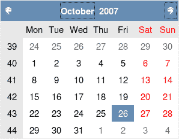


## B. 部分 PyQt

这里的截图是在 Linux 上使用 KDE 拍摄的，以提供视觉上的统一性。在书中，显示了 Windows、Linux 和 Mac OS X 的截图，通常随章节而变化。

### QCalendarWidget

此控件可以作为显示控件，尽管它主要被设计为输入控件，用户可以通过它选择特定日期。该控件的显示是高度可配置的；例如可以显示或隐藏周数，日期可以用单个字母、简写或全称表示，可以设置使用的颜色和字体，还可以设置哪一天为一周的第一天。也可以设置最小和最大允许日期。在 `QDateEdit` 或 `QDateTimeEdit` 上调用 `setCalendarPopup(True)` 会导致它们的旋钮被箭头按钮取代。如果用户点击按钮，将弹出一个 `QCalendarWidget`。

### QCheckBox

复选框可用于向用户提供简单的是/否选择。如果调用了 `QCheckBox.setState(True)`，复选框将有三种状态：用户勾选了、用户未勾选、或者用户没有更改其之前的状态。这种三状态方法对于表示允许 `IS NULL` 的布尔数据库字段可能有用。

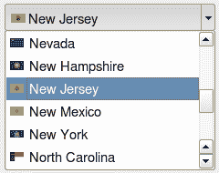


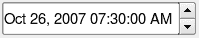


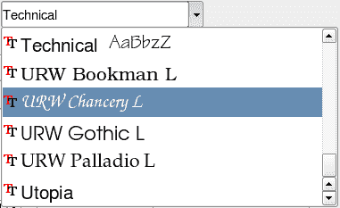

## 附录 B. 部分介绍 PyQt 控件

### QComboBox


截图显示了一个弹出列表的 `QComboBox`。组合框用于向用户提供项目列表，而当垂直空间不足以使用 `QListView` 时非常有用。调用 `QComboBox.setEditable(True)` 允许用户选择列表中的项目之一，或者输入自己的文本。每个 `QComboBox` 组合框项都有文本、可选图标和可选数据。我们可以使用 `QComboBox.addItem()` 或 `QComboBox.addItems()` 填充组合框，也可以使用自定义或内置的 `QAbstractItemModel` 子类配合 `QComboBox.setModel()`。

### QDateEdit、QDateTimeEdit、QTimeEdit

`QDateEdit` 用于显示和输入日期，`QDateTimeEdit` 用于日期和时间，`QTimeEdit` 用于时间。

### QGroupBox

组框可以仅作为视觉分组设备，也可以像这里这样设置为可勾选的。如果是可勾选的，只有在组框被勾选时，其中的控件才能进行交互。

### QRadioButton

当 `RadioButton` 放在组框中时，它们的行为是正确的，即用户只能选择其中一个。`ComboBoxes` 和 `ListViews` 通常比 `RadioButton` 更方便。

### QGraphicsView

此控件用于查看 `QGraphicsScene` 中的项。任意数量的 `QGraphicsViews` 可以查看同一个场景，实际上每个视图都有自己的变换，例如缩放和旋转。如果需要，滚动条会自动出现。每个 `QGraphicsView` 都可以提供自己的背景和前景，覆盖场景提供的内容。

### QLabel

`QLabel` 控件是一个显示控件，可以显示图像、纯文本字符串、`QTextDocument` 或 HTML。带有加速键（单个带下划线的字符）的标签可以与“伙伴”控件关联，在按下加速键时将键盘焦点传递给伙伴。

### QLineEdit

此控件可以接受用户的一行文本。文本可以通过验证器，例如 `QIntValidator` 或 `QRegExpValidator`，或设置输入掩码（也可以同时使用两者）来限制。回显模式可以设置为显示“*”（或不显示）输入的文本。

577

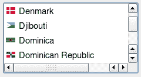


578

### QLCDNumber

这是一个用于以七段 LCD 风格显示数字的显示控件。

### QButtonBox

此控件用于创建一行或一列按钮。按钮将根据系统准则自动排列，使用原生字体。

### QFont、QFontDatabase

`QFont` 提供弹出的字体对话框，例如，我们使用 `QFontDatabase.families()` 返回列表。

### QListWidget

通过这些控件，用户可以选择一个项目，或者在合适的选择模式下选择多个项目。这些控件可以是列表模式，如图所示，也可以是图标模式。在图标模式下，图标会更大，文本显示在图标下方。

视图（View）必须结合 `QListView` 和 `QListWidget` 使用，或者使用内置的 `QAbstractItemModel` 子类并通过 `QListView.setModel()` 来构建。`QListWidget` 拥有内置模型，因此可以直接使用 `QListWidget.addItem()` 和 `QListWidget.addItems()` 向其添加项。在垂直空间有限的情况下，可以使用 `QComboBox` 代替。

此部件可用于向用户显示长时间运行操作的进度。通常使用 `QStatusBar.addWidget()` 或 `addPermanentWidget()` 将 `QProgressBar` 放在 `QMainWindow` 的状态栏中。另一种方法是弹出一个 `QProgressDialog`。

按钮用于调用操作。如果点击按钮会弹出对话框，我们通常会在 `QPushButton` 的文本末尾添加省略号（…）。按钮还可以设置为具有弹出菜单，在这种情况下，PyQt 会添加一个小小的三角形指示器；或者可以将其设置为切换按钮，点击奇数次时保持按下，点击偶数次时弹起。自 Qt 4.2 起，大多数应用程序使用 `QDialogButtonBoxes` 而不是单独的 `QPushButtons`。

滑动条（Slider）通常用于显示比例，通常与显示实际数值的 `QSlider` 或 `QLCDNumber` 配合使用。滑动条可以垂直或水平对齐。`QScrollBar` 可用于类似场景。

这些部件用于接收和显示数字。数字可以带有前缀或后缀，并具有特定的对齐方式。这里显示的 `QDoubleSpinBox` 带有“$”前缀。`QDoubleSpinBox` 和 `QSpinBox` 可以设置最小值和最大值；对于 `QDoubleSpinBox`，还可以设置小数点后显示的位数。另一种方法是使用 `QLineEdit` 结合 `QIntValidator` 或 `QDoubleValidator`。


# 简介

## 附录 B：精选 PyQt 部件

这些部件用于以表格形式呈现数据。必须结合自定义或内置的 `QAbstractItemModel` 子类（如 `QSqlTableModel`）使用 `QTableView.setModel()` 和 `QTableView`。`QTableWidget` 拥有内置模型，因此可以直接向其添加项，例如使用 `QTableWidget.setItem()`。这两个部件都可以在单元格（包括头部单元格）中显示图标和文本。

此部件用于空间有限的情况，或仅作为逻辑分组部件的手段。标签（Tabs）有两个形状设置，并可以在顶部、左侧、右侧或底部显示；当在左侧或右侧显示时，`QTabWidget` 的文本会旋转。

这些部件可以显示 HTML，包括列表、表格和图像。`QTextEdit` 也可以作为编辑部件，用于纯文本或 PyQt 的“富文本”，本质上是 HTML，尽管需要自定义子类来提供表格和图像编辑。`QTextBrowser` 支持可点击的链接，因此可以作为简单的网络浏览器。这两个部件都支持 CSS（层叠样式表）。

这些部件用于呈现层级数据。必须结合自定义或内置的 `QAbstractItemModel` 子类使用 `QTreeView.setModel()` 和 `QTreeView`。与所有使用模型的部件一样，只检索对用户可见的数据，因此即使是大型数据集也非常快。`QTreeWidget` 拥有内置模型，因此可以使用 `QTreeWidget.insertTopLevelItem()` 和 `insertTopLevelItems()` 直接向其添加项，或者通过创建其他项的子项 `QTreeWidgets`。

### 精选 PyQt 类层次

- `QObject`
- `QPaintDevice`
- `QWidget`
- `QDialog`
- `QFrame`
- `QHeaderView`
- `QListWidget`
- `QListView`
- `QUndoView`
- `ItemView`
- `QTableView`
- `QTableWidget`
- `ScrollArea`
- `QTreeView`
- `QTreeWidget`
- `QGraphicsView`
- `QScrollArea`
- `QTextEdit`
- `QTextBrowser`
- `QLabel`
- `QLCDNumber`
- `QSplitter`
- `QStackedWidget`
- `QToolBox`

# 附录 C：精选 PyQt 类层次

- `QCheckBox`
- `QPushButton`
- `QAbstractButton`
- `QRadioButton`
- `QToolButton`
- `QDial`
- `QAbstractSlider`
- `QScrollBar`
- `QSlider`
- `QDateEdit`
- `QDateTimeEdit`
- `QTimeEdit`
- `QAbstractSpinBox`
- `QDoubleSpinBox`
- `QSpinBox`
- `QCalendarWidget`
- `QComboBox`
- `QFontComboBox`
- `QDesktopWidget`
- `QWidget`
- `QDialog`
- `QDialogBox`
- `QDockWidget`
- `GroupBox`
- `QMainWindow`
- `QMenu`
- `QMenuBar`
- `QProgressBar`
- `QTabWidget`
- `ToolBar`
- `QWorkspace`
- `QAbstractModel`
- `QListModel`
- `QAbstractProxyModel`
- `QFilterProxyModel`
- `QAbstractItemModel`
- `QItemModel`
- `QStandardTableModel`
- `QColorDialog`
- `QFileDialog`
- `QFontDialog`
- `QInputDialog`
- `QMessageBox`
- `QImage`
- `QPicture`
- `QPixmap`
- `QPrinter`
- `QCursor`
- `QBuffer`
- `QFile`
- `QTemporaryFile`
- `QProcess`
- `QSocket`
- `QAbstractSocket`
- `QTdpSocket`
- `QHBoxLayout`
- `QVBoxLayout`
- `QLayout`
- `QGridLayout`
- `QStackedLayout`
- `QSpacerItem`
- `QLayoutItem`
- `QWidgetItem`

# 运算符与符号

- `<=`（小于等于运算符），19、25、84、91、38、47、81、82
- `**`（幂/指数运算符），47
- `<>`（不等于），40
- `-`（运算符—已弃用），47
- `=`（名称绑定运算符，对象引用创建与赋值），84、91
- `*=`（乘法赋值运算符），81、82、83
- `+`（加法运算符，拼接），25、33、84、90、500
- `==`（等号运算符），13、47、81、82
- `>`（大于运算符），47、81、82
- `+=`（加法赋值运算符），84、91、38、47、81、82、90、234
- `>=`（大于等于运算符），38、47、81、82
- `>>`（`QDataStream` 和 `QTextStream` 从右读取运算符），245、360、435、528、532、541、585、586
- `-`（减法运算符，取反），84
- `^`（按位异或运算符），47
- `|`（按位或运算符），38、47
- `~`（按位取反运算符），47

# 索引

- `@`（装饰运算符），85
- `[]`（索引运算符，切片运算符），22、54、93
- `\`（转义字符），21、51、220
- `\n`（换行符），51
- `_`（下划线字符），76、80
- `__`（双下划线），77、80、82、88


- ``` ``（`repr()`运算符），83
- `{}`（大括号），46
- `(`（欧元符号），21

# 方法与函数

## QRelated方法

- `addDatabase()`（`QSqlDatabase`），446，459，453
- `addDays()`（`QDate`），491
- `addDockWidget()`（`QMainWindow`），169，186
- `addEllipse()`（`QGraphicsScene`），354
- `addItem()`（`QComboBox`），276
- `addItems()`（`QComboBox`），440
- `addLayout()`（`QBoxLayout`），146
- `addLine()`（`QGraphicsScene`），354
- `about()`（`QMessageBox`），200
- `aboutToShow()`信号（`QMenu`），178
- `addMapping()`（`QDataWidgetMapper`），187，285，292
- `addMenu()`（`QMenu`和`QMenuBar`），177，178
- `addPath()`（`QGraphicsScene`），354
- `addPixmap()`（`QGraphicsScene`），354
- `addPolygon()`（`QGraphicsScene`），354
- `addRect()`（`QGraphicsScene`），354，355
- `addSeparator()`，178，180，307
- `addSpacing()`（`QBoxLayout`），146，145，150
- `addStretch()`（`QBoxLayout`），146
- `addText()`（`QGraphicsScene`），354
- `addToolBar()`（`QMainWindow`），179，186
- `addWidget()`（`QLayout`），146，151，273
- `activateWindow()`（`QWidget`），160，289
- `activeWindow()`（`QWorkspace`），296
- `add()`（`set`），37，38，372，556
- `adjusted()`（`QRect`/`QRectF`），355，367
- `addAction()`（`QWidget`），172，178，180，307，330，365，392，393
- `addActions()`（`QWidget`），168，338，287，289
- `addButton()`（`QDialogButtonBox`），150
- `bindValue()`（`QSqlQuery`），448，450，468
- `bindValue()`（`QSqlQuery`），448，450
- `beforeInsert()`（`QSqlTableModel`），470
- `beginInsert()`（`QAbstractItemModel`），432
- `beginRemoveRows()`（`QAbstractItemModel`），433
- `blockSignals()`（`QObject`），135
- `atEnd()`（`QDataStream`和`QTextStream`），245，252，253，254

## Python内置函数

- `abs()`，40，84，403
- `__abs__()`（`abs()`），84
- `all()`，38
- `any()`，38
- `append()`，120
- `bool()`，83
- `callable()`，102
- `chr()`，21
- `cmp()`（已弃用）
- `dir()`，39
- `divmod()`，40
- `enumerate()`，87
- `eval()`，39
- `float()`，40
- `help()`，37
- `hasattr()`，39
- `hex()`，40
- `id()`，13
- `isinstance()`，39
- `iter()`，97
- `len()`，20，25，33，36，38，96，237
- `long()`，40
- `max()`，38
- `min()`，38

# 变量

- `argv`（`sys`）

# 类型与类

- `int()`，40，84，91
- `int`类型，16–17，241
- `float`类型，17–20，241
- `frozenset`类型，37，552
- `long`类型，16–17，231，241

# 索引

## N

- `None`常量，13，57
- `not`运算符，47
- `object`类型，76，77，78

## C

- `oct()`，40
- 计算`application`，116–121
- `open()`，39，70
- `__call__()`，81
- `or`运算符，47
- `callable()`，102
- `ord()`，21，39，50
- `callables`，63，97，102，115，128，131
- `pass`语句，47
- `callbacks`；*参见*对象的引用
- `pow()`，40
- `under functions`
- `print`语句，10，26
- 调用上下文，64
- `property()`，80
- `canPaste()`（`QTextEdit`），385
- `range()`，39，50–51，54
- `case`语句；*参见* `if`语句
- `repr()`，81，83，89，90，98
- `center()`（`QRect`/`QRectF`），392，393
- `return`语句，58，97，554
- 居中，168，338
- `round()`，40，91，333
- 中央部件，168
- `set`类型，37，93
- 字符转义符，21，22
- `sorted()`，52，53，63，432，434，551
- 字符格式化，397
- `characters()`（`QXmlContentHandler`），方法263
- 特殊方法；*参见*特殊
- `staticmethod()`，85，239，288
- 可勾选操作，176，177
- `str`类型；*参见* `str`类型
- `chr()`，21，39
- `sum()`，38
- `class`语句，69，75，76，77，85，86，103，115
- `super()`，100，153，217
- `True`常量，45
- `clear()`，98
- `try`语句，66，70，78，541，542，543，548，550，551，553，554，556
- `dict`，36
- `QListWidget`，418
- `QTableWidget`，418
- `tuple`类型，29–31，30，50，87
- `QTextDocument`，383
- `type()`，18，39，102
- `QTreeWidget`，420
- `unichr()`，21，39，236，554
- `set`，38
- `unicode`类型；*参见* `unicode`类型
- `clearMessage()`（`QStatusBar`），170，232
- `while`循环，49–50，590

## 索引（续）

- `clearSelection()`（`QGraphicsScene`），356，361，362，364
- 命令行参数，113，114
- 商业许可，3
- `click`；*参见* `mousePressEvent()`和`mouseReleaseEvent()`
- `commit()`（`QSqlDatabase`），449，465，468，469
- `clicked()`信号（`QPushButton`），219
- 通信机制；*参见*事件、信号与槽
- 客户端/服务器应用程序，522
- 剪贴板；*参见* `QClipboard`
- `compare()`（`QString`），435
- `clipboard()`（`QApplication`），297，311
- 比较，13，38，47，57，63，82
- 关闭按钮，118，121
- `cmp()`，89
- `close()`
- `__cmp__()`，89，416，432
- `file`，70，555
- 为……创建运算符，82
- 禁止，83
- `QIODevice`，243，259，525，528
- `QWidget`，175，285，289，330
- 表达式，47
- 运算符，47
- `closeAllWindows()`（`QMainWindow`），289，293
- `closeEvent()`（`QWidget`），175，185，187，282，285，289，293，309，551
- `id()`，以及`is`语句
- `compile()`（`re`），220
- `closeSubPath()`（`QPainterPath`），376
- `complex`类型，17–20
- 关闭对话框，118，121
- 复合部件，168，280，325–326
- 闭包；*参见*函数应用
- 组合，93
- `cmp()`，82，89
- 条件表达式，49，390
- `__cmp__()`（`cmp()`），81，82，89，416，432
- `connect()`（`QObject`），124，130，133，145，146，151，158，453
- 连接数据库，446
- `codecs`；*参见*编码
- `connections`；*参见*信号与槽
- `codecs`模块，255–256
- `Connections`应用程序，132–135
- `open()`，255，260，501，555
- `connectSlotsByName()`（`QMetaObject`），217
- `readline()`，255
- `connectToHost()`（`QAbstractSocket`），525
- `collections`，29–37，92–98
- `collections`模块，29
- `defaultdict`类型，529，532，545
- 构造函数；*参见*初始化器、`__init__()`和`__new__()`
- 容器；*参见* `collections`以及`dict`类型、`list`类型和`tuple`类型
- `collidesWithPath()`（`QGraphicsItem`），366
- `collidingItems()`（`QGraphicsScene`），354，375
- 碰撞检测，349，374
- 颜色调板；*参见* `QPalette`
- `column()`（`QAbstractModel`），428，331，339，461，462，486，496
- `columnCount()`（`QAbstractModel`），427，428，430，433，438，481，487，489，491，503
- 上下文管理器，168，180，307，365
- 上下文菜单；*参见* `ComboBox`
- `contextEvent()`，391
- `critical()`（`QMessageBox`），188，307，390
- `continue`语句，53
- 控制；*参见* `if`、`while`语句
- 数据，62
- `currentColumn()`（`QTableWidget`），222
- `currentDate()`（`QDate`），36，236，401，490
- `currentDateTime()`（`QDateTime`），51，84，454
- `currentFrame()`（`QCursor`），404
- `currentItem()`（`QTableWidget`），222
- `currentText()`（`ComboBox`），441
- `currying`；*参见*函数应用
- `cursor`，36，83，89，98
- `cursorRect()`（`QTextEdit`），392，393
- `custom data`，235，38，548，551
- `custom delegates`，423，435，442
- `custom messages`，188，307
- `copy()`，83，88，98
- `copyreg`模块，247
- `copying`，34，51，88，98
- `count()`，33
- `dangling else`，not possible，48
- `Pickle`模块，235，246–248
- `data containers`，235
- `data dictionary`；*参见* `dict`类型
- `data()`
- `createActions()`，174–175
- `createEditor()`（`QAbstractItemDelegate`），436
- `data stream`；*参见* `QDataStream`
- `data structures`；*参见* `dict`类型、`list`类型和`tuple`类型
- `data forms`；*参见* `QDataMap`和`QSqlTableModel`
- `deleteLater()`（`QObject`），287，531，539，544
- `deleting windows, automatically`
- `database()`（`QSqlDatabase`），465，468，469
- `connecting to`，446，156，284
- `database queries`；*参见* `QSqlQuery`和SQL语句
- `databases`，288
- `data types`，447
- `destructors`，78
- `drill-down`
- `drivers`，445
- `foreign keys`，455–457
- `device()`（`QDataStream`），525，533
- `dial`；*参见* `QDial`
- `divmod()`，40
- `QSqlDatabase`，449
- 停靠窗口；*参见* `QDockWidget`
- `QSqlQuery`，450
- 停靠窗口，169–170
- 驱动程序，用于数据库，445
- 文档strings，57，77，105
- `dropEvent()`（`QWidget`），309，315，316
- `doctest`模块，105–107
- `DSU`（装饰、排序、解装饰）
- `document()`（`QTextEdit`），286，287，383，551，384，385，396
- 鸭子类型，101，222，497
- 文档，27，111
- `dump()`（`pickle/cPickle`），248
- `documentElement()`（`QDomDocument`），260
- 避免重复数据，413
- 动态属性，78
- DOM解析器，259–262
- 动态函数定义，62–63
- `done()`（`QDialog`），154，457，464
- 动态菜单；*参见* `menus`
- 动态类型，12，13–15，101
- 双击；*参见* `mouseDoubleClick`
- 双引号字符串，21
- 拖放，312–317
- 拖动图标，316
- `dragEnterEvent()`（`QWidget`），309，314，316
- `edit()`（`QAbstractItemView`），426，465，468
- `dragMoveEvent()`（`QWidget`），309，314，315，316
- 原地编辑，414，458
- 发起编辑，417，426，440，465
- `drawArc()`（`QPainter`），344
- `drawChord()`（`QPainter`），344
- `drawContents()`（`QTextDocument`），438
- `drawConvexPolygon()`（`QPainter`），344
- `drawEllipse()`（`QPainter`），374
- `editItem()`（`QTableWidget`），422
- 编辑器，`IDLE`，10，105，382；`editors`；*参见* `IDEs`
- `elif`语句；*参见* `if statement`，377，481
- `else`语句；*参见* `if statement`，377，481（等待，检查上下文）
- `emit()`（`QObject`），130，131，219，333，340，391，431，440，556
- `drawLine()`（`QPainter`），338，444
- `drawPath()`（`QPainter`），374，385
- `drawPicture()`（`QPainter`），363
- 启用控件和动作，219
- 编码，20，250，258，501
- 编码（续）
- 示例（续）
- `ASCII`，20，236，250，501，594
- 计算应用，116–121
- 连接应用，236，250，258，501，555
- 货币转换器，121–127
- 以及Unicode；*参见* `codecs`
- `Fraction`类，331–338
- 图像应用，165–200
- 长度类，86–91
- `Multipedes`应用，368–377
- 我的电影应用，227–265
- `OrderedDict`类，92–98
- 页面设计器，392，393
- `RichText`类，389–398
- `RomanBox`类，326–328
- 信号与槽，128–131
- `YPipe`类，339–345
- `ensureCursorVisible()`（`QTextEdit`），351–368，421，422，440，511
- `enumerate()`，87，419，498
- `__eq__()`，81
- `simplified()`，61
- `simplify()`，59，61
- 文件处理，244
- `errorString()`（`QIODevice`），241，243，250，252，258，259，528
- `except`语句，66–67
- `Esc`键，121，161，188，421，422
- `try`语句
- `escape()`，52，66–71
- `AssertionError`，69
- `re`，220
- `AttributeError`，89，101
- 转义字符，21，22，401
- `Exception`，68，69
- 换行符，51
- 层级，67
- 欧元符号`(`，21
- `eval()`，39，81，89，120，247
- `IOError`，243，244
- `KeyError`，94
- `NotImplementedError`，83，102
- `OSError`，243
- `RuntimeError`，288
- `StopIteration`，52，58，59
- `TypeError`，56
- `ValueError`，68
- `event()`（`QObject`），304，309，310，384
- `event`处理器，115，184，221，537
- `event`循环，115–116
- `keyEvent()`，114
- `keyReleaseEvent()`
- `paintEvent()`，114
- `resizeEvent()`
- `wheelEvent()`
- 报警应用，112–116
- 资产应用，316–469
- `QCoreApplication`，115
- `QDialog`，142，154，511
- `QDrag`，316
- `QMenu`，307，365，392，393
- `QSqlQuery`，447，448，449，450，464，489，568
- `QFile`，294，541，542，543，548，550，551，553，554
- `QTreeWidget`，421
- `QXmlErrorHandler`，263
- `expandItem()`（`QTreeWidget`），421
- 导出文件，229
- `extend()`（`list`），33
- `find()`（`str/unicode`），24，25，68
- `findText()`（`QComboBox`），142，441，457
- `first()`（`QSqlQuery`），450
- `firstChild()`（`QDomNode`），260
- `flags()`（`QAbstractItemModel`），227，430，333
- 标志，窗口，115
- 控件的固定大小，277
- `False`常量，45
- `float()`，40，84，91
- `float`类型，17–20，241
- 字段级验证，140
- `%f`格式指定符，26
- `fieldIndex()`（`QSqlTableModel`），456
- `__float__()`（`float()`），84，91
- 浮点除法；*参见*“true”
- 文件对话框；*参见* `QFileDialog`
- 文件错误处理，244
- `__floordiv__()`（`//`），84
- 文件扩展名
- `.bmp`、`.jpg`、`.jpeg`和`.png`（图像文件），193
- 字体；*参见* `QFont`
- `.pro`（C++/Qt项目文件），518
- `QGraphicsTextItem`，359
- `.py`和`.pyw`（Python文件），11，111，207，336，342
- `for`循环，50–54，59
- `.pyc`和`.pyo`（Python字节码文件），1，207
- `break`语句，53
- `continue`语句，53
- `.qm`（Qt消息文件），516，518
- `.qrc`（Qt文件），173
- `.ts`（翻译文件），517
- `.ui`（用户界面文件），206，207
- 格式指定符，`%`，26
- 文件格式，241
- 文件格式图像，193
- 文件句柄，70
- 格式化字符，397
- 文件类型
- 文件预览，215
- `close()`，70，555
- `FractionSlider`类，331–338
- `__file__`变量，173
- `fileName()`（`QFileInfo`），189
- `frame`；*参见* `QFrame`
- 文件，70，229
- `frange()`示例，55–57
- `fill()`（`QPainter`），392
- `fromImage()`（`QPixmap`），199
- `frozenset`类型，37，52
- `graphics items`；*参见* `QGraphicsItem`
- `graphics scenes`；*参见* `QGraphicsScene`
- `graphics`坐标，350
- `graphics`缩放，349，370，374
- `grid layout`；*参见* `QGridLayout`
- 函数定义，嵌套，261
- `functions`；*参见*
- `group()`，54
- `names`和内置函数
- `entry point, fixed`，62
- `entry point, no keypress`，120，145，161，188，421，422，440，511
- `entry point, no fixed`，62
- `Eric`，IDE，2，10，105，382
- `entities`；*参见* `HTML`

- `hasFormat()`（`QMimeData`），314，316
- `garbage collection`，15，78，168，169
- `hash`，Perl；*见* `dict type`，170
- `hasHtml()`（`QClipboard`），312
- `__ge__()`（`>=`），81
- `hasMouseTracking()`（`QWidget`），308
- `generating lists`，54
- `hasSelection()`（`QTextCursor`），385
- `generators`，54–55，58–59，70，92，97
- `headerData()`（`QAbstractItemModel`），427，430，433，503
- `geometry()`（`QWidget`），357
- `get()`（`dict`），36，95，420，532，541
- `height()`（`QWidget`），330，551
- `help()`，37，39
- `getcwd()`（`os`），173
- `hex()`，40
- `getDouble()`（`QInputDialog`），199
- `hide()`（`QWidget`），280，330
- `getExistingDirectory()`（`QFileDialog`），547
- `hiding dialogs`，118，121，160
- `hiding widgets`，277，280
- `getInteger()`（`QInputDialog`），199
- `getItem()`（`QInputDialog`），199
- `high-level communication mechanisms`；*见*信号与槽
- `__getitem__()`（`[]`），93，94
- `homePath()`（`QDir`），545
- `getOpenFileName()`（`QFileDialog`），193，194，233，234，287，295，356
- `horizontal layout`；*见* `QHBoxLayout`
- `horizontal lines`；*见* `QFrame`
- `getSaveFileName()`（`QFileDialog`），196
- `horizontalHeader()`（`QTableView`），463，464
- `getText()`（`QInputDialog`），199
- `global functions`；*见*函数名称下的内置函数
- `hotspot`，icon，316
- `HTML`（Hyper-Text Markup Language），114，117，168，188，311
- `global scope`，55
- `globalPos()`（`QEvent`），307，309，349，381，396，397，401，488，511
- `gradient fills`；*见* `QLinearGradient`，552

### Index

597

- `html()`（`QMimeData`），312
- `index()`（续）`QAbstractItemModel`，433，465，468，504
- `QModelIndex`，427
- `str/unicode`，24，25，68
- `__iadd__()`（`+=`），84，90
- `indexing`，22，30，32
- `icon`；*见* `QIcon`
- `indexOf()`（`QString`），306，387，388
- `icon, for dragging`，316
- `infinite recursion, risk of`，100
- `icon, hotspot`，316
- `information()`（`QMessageBox`），188
- `id()`，13，39，231，237，418
- `inheritance`，76，99–103，103
- `idealWidth()`（`QTextDocument`），390，439，489
- `__init__.py`模块，104
- `__init__()`，77，78，437
- `identifiers`，36
- `initial processing`，184
- `identity`
- `initializers`，77
- 比较，13，57
- `inputMask`属性（`QLineEdit`），157
- `operators`，47
- `insert()`（`list`），33，500
- *see also* `id()`和`is`语句
- `insertBlock()`（`QTextCursor`），404
- `insertImage()`（`QTextCursor`），404
- `IDEs`（integrated development environments）
- `insertion point`，386，392，393，404
- `Eric4`，2，10，382
- `insertPlainText()`（`QTextEdit`），297
- `IDLE`，9，10，60，105，382
- `insertRecord()`（`QSqlTableModel`），464
- `insertRow()`（`QAbstractItemModel`），433，465，468
- `if`语句，46–49
- 条件表达式，49
- `__ifloordiv__()`（`//=`），84
- `insertRows()`（`QAbstractItemModel`），426，427，432，433
- `ignore()`（`QEvent`），186，314
- 图像；*见* `QImage`
- `insertTable()`（`QTextCursor`），404
- 图像格式，193
- `Image Changer`应用程序，165–200
- `insort()`（`bisect`），499，532，543
- `insort_left()`（`bisect`），95，238，168，193，196
- `insort_right()`（`bisect`），399，363

# 索引

- `__lt__()`（`<`），81，82，432
- `MIME`（多用途互联网邮件扩展）格式，310，313
- `mimeData()`
- `M`
- `QClipboard`，312
- `QDropEvent`，314
- Mac OS X检测，218
- `min()`，38
- `magic number`，241
- 最小化窗口，297
- `mailing lists`，5
- `minimum size`，布局和宽度的最小尺寸
- `main()`，常规入口点，62
- `gets`，270，271，335
- `main window`；*参见* `QMainWindow`
- `minimumHeight()`（`QWidget`），390
- `__main__`模块属性值
- `minimumSizeHint()`（`QWidget`），271，106，335，340，341，479
- 创建PyQt应用
- `mirrored()`（`QImage`），198
- `makepyqt.pyw`，174，206，207
- `mkpyqt.py`应用，174，206，207，216，519
- 名称修饰，77，88，89
- `__mod__()`（`%`），84
- `mapFromGlobal()`（`QWidget`），357
- 模态，140，142，511
- `mapToGlobal()`（`QWidget`），309，392，393
- `model()`（`QModelIndex`），438，441，462，489
- `mapToScene()`（`QGraphicsView`），357
- 无模对话框，140，155，159，286
- 主从视图表单，458，464，469
- `models`；*参见*自定义模型和`QAbstractItemModel`
- `math`模块，40，117，371，375
- `matrix()`，391
- `modifiers()`（`QInputEvent`），307，365
- `QGraphicsItem`，359，377
- `QGraphicsView`，370
- `modules`，104
- `max()`，38
- `modulus`（`%`），53
- `maximum size`，布局和宽度的最大尺寸
- 鼠标位置，318，271
- 鼠标追踪；*参见* `hasMouseTracking()`和`setMouseTracking()`
- `maximumHeight()`（`QWidget`），390
- `MDI`（多文档界面），290–300
- `mouseDoubleClickEvent()`（`QGraphicsItem`、`QWidget`），362，308，309，417，422，440
- 成员运算符，47
- 菜单分隔符，178，180
- `mouseMoveEvent()`（`QWidget`），309，317
- `menuBar()`（`QMainWindow`），186
- `mousePressEvent()`（`QWidget`），309，333，482
- `menus`，168，177–178（*另参见* `QMenu`和`QMenuBar`）
- `mouseReleaseEvent()`（`QWidget`），308，309
- `mergeCurrentFormat()`（`QTextEdit`），395
- `move()`（`QWidget`），183，330，341
- `message box`；*参见* `MessageBox`
- `moveBy()`（`QGraphicsItem`），366
- `__mul__()`（`*`），84，91
- `meta-characters`元正则表达式，220，XML，257，258
- `multifile applications`，104
- `Multipedes application`，368–377
- `methods`，81，601
- `multiple document interface`；*参见* `MDI`
- `multiple inheritance`，76，103，216，217，373
- `object names`；*参见* `Object.setObjectName()`
- `object references`，12，55，57，58，63，64
- `mutable objects`，16，23，28，29，31，32，34，35，51，57
- `object type`，76，77，78
- 可调用对象，97，102
- `mutually exclusive actions`，176（*参见* `QAction`）
- `My Movies application`，227–265
- `copying`，88，89
- `MySQL database`，445
- `function references`，63，64
- `immutable`，15，16，20，23，29，34，35，37，57
- `mutable`，16，23，28，29，31，32，34，35，51，57
- `name mangling`，77，88，89
- `ownership of`，119，168，170，172，180，355，359，372，376
- `__name__`模块属性，106
- `names`，变量，76，80，88，89
- `namespaces`，引用，12，15，55，57，58，63，64
- `__ne__()`（`!=`），81
- `__neg__()`（`-`），84
- `negative lookahead`，正则表达式，65，261，554
- `old-style vs. new-style classes`，76
- `new-style vs. old-style classes`，76
- `__new__()`，77，78，81
- `codecs`，255，260，501，555
- `gzip`，248
- `newlines`，241，243，250，252，258，259，256，universal
- `newPage()`（`QPrinter`），410
- `Open Source`许可证，52，59，97
- `or`运算符，47
- `next()`，52，59，97
- `QSqlDatabase`数据库，446
- `QSqlQuery`，449，450，451，468，469
- `nextSibling()`（`QDomNode`），260
- `nodeType()`（`QDomNode`），261
- `OrderedDict`示例类，92–98
- `None`常量，13，45，57
- `__nonzero__()`（`bool()`），81，83
- `notify()`（`QCoreApplication`），305
- `NotImplementedError`异常，83，102
- `os`模块
- `dirname()`，173，477，496，512
- `join()`，496，512，555
- `number()`（`QString`），338
- `numRowsAffected()`（`QSqlQuery`），449，450
- `overloading`，75
- `pickle()`（`copy_reg`），247
- `pickle`模块，235，246，248
- `Page Designer`应用，351–368
- `page size`，打印机，400
- `pageRect()`（`QPrinter`），408
- `pixmap`；*参见* `QPixmap`
- `paint devices`；*参见* `QImage`、`QPainter`、`QPicture`、`QPixmap`、`QPrinter`、`QGraphicsPixmapItem`、`QSvgGenerator`和`QWidget`
- `python_version()`，200
- `system()`，200，217，336，390
- `.png`（图像文件），193
- `QGraphicsItem`，366，368，374，377
- `pointers`；*参见*引用
- `paintEvent()`（`QWidget`），306，309，336，342，480
- `file error handling`，244
- `palette`；*参见* `QPalette`
- `palette()`，28，228
- `polymorphism`，99–103
- `QWidget`，337
- `pop()`，96
- `parameters`，55，56
- `dict`，36，96
- `default`，56
- `list`，33，355，361
- `keyword`，55，59
- `set`，372
- `passing by value`，57
- `popitem()`（`dict`），96
- 填充列表小部件，418
- `parent()`（`QObject`），433，504
- 填充表格小部件，418
- `parent`，of widget，118，119，172，340，372
- 填充树，420，502
- `parenting`，automatic，119
- `pos()`，5
- `parse()`（`QXmlReader`），262
- 解析XML，259，262
- `QGraphicsItem`，359，366，374，377
- `QMouseEvent`，309
- `partial()`（`functools`），64–65
- `positional arguments`，55
- `positional function`，63–65
- `post-by-value`，57
- `preferred size`，布局和宽度，34，35，37，51，57
- `preventative validation`，140，157
- `physical coordinates`；*参见* `viewport`
- `processing`，at start-up，184
- `base class`，`QObject`
- 传播隐藏和显示调用，280
- `QObject`属性，157，211
- `property()`，80
- 预览表单，215
- `previous()`（`QSqlQuery`），449，450
- 尾随逗号，49
- `print_()`（`QTextDocument`），403
- `paint()`，436，438，461，486，489
- `printImage()`辅助函数，363
- 打印，170，363，398，486，488
- 打印图像，363
- 私有名称，76，80，88，486，487，488
- `setModelData()`，436，441，462
- `sizeHint()`，436，439，489
- `processEvents()`（`QCoreApplication`），294
- `QAbstractItemModel`（`QtCore`），425，294，433，434，445，500
- `beginInsertRows()`，432，433
- `beginRemoveRows()`，432，434，433
- `columnCount()`，427，428，433，503
- `createIndex()`，433，504
- `data()`，414，427，428，429，430，433，438，441，462，481，487，488
- `dataChanged()`信号，431，432，207
- `.py`和`.pyw`（Python文件），11，111，207
- `.pyc`和`.pyo`（Python字节码文件），11，207
- `pylupdate4`应用，207，513，517，518
- `flags()`，427，430，433，503
- `hasChildren()`，433
- `headerData()`，427，430，433，503
- `PyQt4`模块；*参见*单独的模块、`QtCore`、`QtGui`等
- `index()`，433，465，468，504
- `pyqtProperty()`（`QtCore`），322
- `insertRow()`，433，465，468
- `insertRows()`，426，427，432，433，218，219
- `@pyqtSignature`装饰器（`QtCore`），322
- `removeRow()`，434，466，469
- `removeRows()`，427，432，434，469
- `PYQT_VERSION_STR`变量，200
- `reset()`，432，434，501，502
- `pyrcc4`应用，173，174，207

## 概述

- `rowCount()`，426，427，428，434，454，455，479，481，503
- `pyuic4`应用，206，207，216，221，515
- `setData()`，414，427，431，434，441，462，465，487，488
- `setHeaderData()`，434，460，462

## 类引用

### Q

#### `QAbstractItemView`（`QtGui`）

- *基类*：`QAbstractScrollArea`

#### `QAbstractButton`（`QtGui`）

- `currentIndex()`，427，463，465，466，468，469
- *基类*：`QWidget`
- `setCheckable()`，276，278
- `edit()`，426，465，468
- `setText()`，370
- `selectionModel()`，463
- `toggled()`信号，277，280
- `setAlternatingRowColors()`，231，477
- `setCurrentIndex()`，426，465，468
- `setDragEnabled()`，312，313，315
- `setToolTip()`，172
- `setEditTriggers()`，231
- `setWhatsThis()`，172
- `setItemDelegate()`，437，460，463，490
- `toggled()`信号，172，176，177
- `triggered()`信号，172，176
- `setModel()`，425，437，460，463，477，490
- `setSelectionBehavior()`，231，460，463，495
- `setSelectionMode()`，231，460，463
- `startDrag()`，316

#### `QActionGroup`（`QtGui`），176

#### `QApplication`（`QtGui`），113，115，304

- *基类*：`QCoreApplication`
- `clipboard()`，297，311
- `palette()`，438，489
- `setQuitOnLastWindowClosed()`，121

#### `QAbstractScrollArea`（`QtGui`）

- *基类*：`QFrame`
- `viewport()`，392，393

#### `QBoxLayout`（`QtGui`），146，326

- *基类*：`QLayout`
- `addLayout()`，146
- `addSpacing()`，146
- `addStretch()`，146
- `setStretchFactor()`，146

#### `QAbstractSlider`（`QtGui`）

- *基类*：`QWidget`
- `setRange()`，369
- `setValue()`，128，369

#### `QBrush`（`QtGui`），374，377

#### `QAbstractSocket`（`QtNetwork`），521

- *基类*：`QIODevice`
- `connectToHost()`，525

#### `QByteArray`（`QtCore`），313，316，358，359，525，526，533

#### `QCalendarWidget`（`QtGui`），575

- `state()`，540

#### `QCheckBox`（`QtGui`），575

- `waitForDisconnected()`，544

#### `QClipboard`（`QtGui`），297，310

- `hasHtml()`，312
- `mimeData()`，312
- `pixmap()`，311
- `setImage()`，311
- `setMimeData()`，311
- `setPixmap()`，311
- `setText()`，297，311
- `text()`，297，311

#### `QAbstractSpinBox`（`QtGui`）

- *基类*：`QWidget`
- `lineEdit()`，327
- `setAlignment()`，340，487
- `validate()`，327，328

#### `QAbstractTableModel`（`QtCore`），425

- *基类*：`QAbstractItemModel`

#### `QAction`（`QtGui`），171，172，175，194

- *基类*：`QObject`
- `data()`，172，393，395
- `isChecked()`，172，176
- `isEnabled()`，172
- `setChecked()`，172，177，393
- `setData()`，172，189，392，393
- `setEnabled()`，172
- `setSeparator()`，172
- `setShortcut()`，171，172
- `setStatusTip()`，172
- `setText()`，172
- `setToolTip()`，172
- `setWhatsThis()`，172
- `triggered()`信号，172，176
- `toggled()`信号，172，176，177

#### `QCloseEvent`（`QtGui`），186

#### `QColor`（`QtGui`），337，345，371，392，338，481，489

#### `QComboBox`（`QtGui`），440，576

- *基类*：`QWidget`
- `addItem()`，276
- `addItems()`，440
- `currentIndexChanged()`信号，124，275
- `currentText()`，441
- `findText()`，142，441，457
- `setCurrentIndex()`，441，457
- `setData()`，172，189，392，393
- `setEditable()`，440
- `setEnabled()`，172
- `setModel()`，456
- `setModelColumn()`，456
- `setSeparator()`，172
- `setShortcut()`，171，172
- `setStatusTip()`，172
- `setText()`，172

#### `QContextMenuEvent`（`QtGui`），307

#### `QCoreApplication`（`QtCore`），538

- *基类*：`QObject`
- `applicationDirPath()`，173
- `applicationName()`，194
- `exec_()`，115，184
- `installTranslator()`，516
- `notify()`，305
- `processEvents()`，294，537
- `quit()`，115
- `translate()`，513

#### `QDate`（`QtCore`），19，45，253，513

- `addDays()`，491
- `addYears()`，490
- `currentDate()`，46，236，401，490
- `isNull()`，45
- `toString()`，258，401

#### `QDateEdit`（`QtGui`），487，576

- `date()`，487
- `setCalendarPopup()`，487，528，531，540
- `setDate()`，487
- `setDateRange()`，452，487
- `setDisplayFormat()`，452，487

#### `QDateTime`（`QtCore`），45，454，513

- `currentDateTime()`，454
- `isNull()`，45
- `setDateTime()`，454
- `toString()`，455

#### `QCursor`（`QtGui`），318

- `pos()`，318，357

#### `QDateTimeEdit`（`QtGui`），452，576

- *基类*：`QAbstractSpinBox`

#### `QDataStream`（`QtCore`），240–246，245，315，316，359，435，525

- `atEnd()`，245
- `device()`，525，533
- `isOpen()`，525
- `readBool()`，245
- `readDouble()`，241，245
- `readIntn()`，243，245，360，435
- `readUIntn()`，245，528，540
- `setVersion()`，241，243，525
- `write()`，526，533
- `writeBool()`，245
- `writeDouble()`，241，245
- `writeIntn()`，241，242，359，576
- `writeUIntn()`，245，525，533

#### `QDesktopServices`（`QtGui`），510

#### `QDial`（`QtGui`），128

#### `QDialog`（`QtGui`），118，154，217

- *基类*：`QWidget`
- `accept()`，151，154，425
- `button()`，150，158
- `currentIndex()`，454，455
- `done()`，144，157，464，528，531，540
- `exec_()`，142，154，511
- `mapping()`，453，456
- `reject()`，215
- `rejected()`，145，150
- `setCurrentIndex()`，454，455
- `setItemDelegate()`，456，460，463

#### `QDialogBox`（`QtGui`），145，150

#### `QDataMapper`（`QtGui`），453，456

- `addButton()`，150，158
- `homePath()`，545
- `submitPolicy()`，453，456
- `toFirst()`，453
- `toNativeSeparators()`，547，551

#### `QDockWidget`（`QtGui`），169

- `setAllowedAreas()`，169，170
- `setFeatures()`，170

#### `QDocument`（`QtXml`），257，259–262

- *基类*：`QDomNode`
- `attribute()`，261
- `documentElement()`，260
- `setContent()`，259
- `tagName()`，439
- `toString()`，257，260

#### `QFont`（`QtGui`），335，336，340，341，342，390，408

- `setPointSize()`，335，336

#### `QFontComboBox`（`QtGui`），576

#### `QFontMetrics`（`QtGui`）

- *基类*：`QDomNode`
- `firstChild()`，260
- `nextSibling()`，260，366，367，373，376
- `nodeType()`，261
- `toElement()`，373，377
- `toText()`，261

#### `QFrame`（`QtGui`），277

- `setFrameStyle()`，170，278

#### `QGraphicsItem`（`QtGui`），349，364，365

- `boundingRect()`，365，366，367，373，377
- `collidesWithPath()`，366
- `collidingItems()`，366
- `contains()`，366
- `contextMenuEvent()`，365
- `isObscured()`，366
- `isSelected()`，366
- `itemChange()`，362，366
- `keyPressEvent()`，365
- `matrix()`，359，377
- `moveBy()`，366
- `paint()`，366，368，374，377
- `pos()`，359，366
- `resetMatrix()`，366
- `rotate()`，360，366，371，375，377
- `scale()`，366
- `scene()`，366，375
- `sceneBoundingRect()`，366，379
- `setCursor()`，366
- `setFlags()`，366
- `setZValue()`，367
- `shape()`，365，367，374，377

#### `QDoubleSpinBox`（`QtGui`），123，578

- *基类*：`QAbstractSpinBox`

#### `QDrag`（`QtGui`），316

- *基类*：`QObject`
- `exec_()`，316
- `setHotSpot()`，316
- `setMimeData()`，316
- `setPixmap()`，316
- `start()`，316

#### `QDropEvent`（`QtGui`）

- *基类*：`QEvent`
- `mimeData()`，314
- `pos()`，359，366
- `setDropAction()`，314，315，316

#### `QEvent`（`QtCore`）

- `accept()`，314，333，391
- `globalPos()`，307，309
- `ignore()`，314
- `type()`，264

#### `QFile`（`QtCore`），241，242，359，576

- `close()`，243，259，525，528
- `exists()`，294
- `fileName()`，189
- `isFile()`，294
- `open()`，241
- `path()`，233
- `setFlags()`，366
- `size()`，366

#### `QFileDialog`（`QtGui`）

- `getDirectory()`，545
- `getExistingDirectory()`，547
- `getFileName()`，545
- `getOpenFileFileName()`，547
- `getSaveFileName()`，547
- `setDir()`，545
- `setDirectory()`，547
- `setFileName()`，545
- `setFileInfo()`，547
- `setFilter()`，545，547
- `setNameFilter()`，545，547
- `setNameFilters()`，547
- `setOption()`，545，547

#### `QFileInfo`（`QtCore`），189

- `absolutePath()`，233
- `absoluteFilePath()`，233
- `baseName()`，189
- `birth()`，366
- `canonicalPath()`，233
- `canonicalFilePath()`，233
- `completeName()`，189
- `count()`，366
- `dir()`，233
- `dirPath()`，233
- `exists()`，294
- `extension()`，189
- `file()`，189
- `fileName()`，189
- `isDir()`，294
- `isFile()`，294
- `isRelative()`，294
- `isSymlink()`，294
- `last()`，366
- `name()`，189
- `path()`，233
- `relativePath()`，233
- `size()`，366
- `suffix()`，189
- `text()`，189
- `time()`，366

#### `QGraphicsView`（`QtGui`），349，351–352

- *基类*：`QAbstractScrollArea`
- `mapToScene()`，357
- `render()`，361，356
- `scale()`，352
- `setDragMode()`，352
- `setMatrix()`，370
- `setRenderHint()`，352，369
- `setScene()`，354，369

#### `QGraphicsLineItem`（`QtGui`），349

- *基类*：`QGraphicsItem`

#### `QGraphicsPixmapItem`（`QtGui`），349

- *基类*：`QGraphicsItem`
- `pixmap()`，359

#### `QGraphicsRectItem`（`QtGui`），355

- *基类*：`QAbstractGraphicsShapeItem`

#### `ShapeItem`

#### `QGridLayout`（`QtGui`），123，144，146，150，270，273

- *基类*：`QLayout`
- `addLayout()`，146，151
- `setColumnStretch()`，146
- `setRowStretch()`，146

#### `QGroupBox`（`QtGui`），577

#### `QImage`（`QtGui`），168，195，197，198，199，329，400，364

- *基类*：`QPaintDevice`
- `invert()`，197
- `isNull()`，400
- `mirrored()`，198，372
- `render()`，354，361
- `rgbSwapped()`，197
- `save()`，196
- `scaled()`，199
- `size()`，363，400

#### `QImageReader`

#### `QImageWriter`

#### `QInputDialog`（`QtGui`），199

#### `QInputEvent`（`QtGui`）

- *基类*：`QEvent`
- `modifiers()`，307，365，391
- `screenPos()`，365

#### `QIODevice`（`QtCore`），526

- *基类*：`QObject`
- `bytesAvailable()`，528，531，540
- `close()`，243，259，525，528
- `errorString()`，241，243，250，252，258，259，528
- `open()`，241，243，250，252，258
- `readAll()`，254，608
- `waitForReadyRead()`，540

#### `QGraphicsSimpleTextItem`（`QtGui`），349

- *基类*：`QAbstractGraphicsShapeItem`

#### `QGraphicsTextItem`（`QtGui`），349，362

- *基类*：`QGraphicsItem`
- `font()`，359

#### `QItemDelegate`（`QtGui`），436，437

- *基类*：`QAbstractItemDelegate`

#### `QLocale`（`QtCore`），513，516，485–489

#### `QKeyEvent`（`QtGui`），307，334，365，384，391

- *基类*：`QInputEvent`

#### `QMainWindow`（`QtGui`），168，186，284，290，293

- *基类*：`QWidget`
- `addDockWidget()`，169，186，483
- `addToolBar()`，179，186
- `close()`，289，392
- `menuBar()`，177，186
- `restoreState()`，183，186
- `saveState()`，183，186
- `setAlignment()`，168，340
- `setCentralWidget()`，168，186，285
- `setBuddy()`，143，425
- `setPixmap()`，199

#### `QLabel`（`QtGui`），114，168，340，577

#### `QLayout`（`QtGui`），146，151，273，370

- `addWidget()`，146，151，273
- `scale()`，370
- `setSize()`，277，279

#### `QDiArea`（`QtGui`），290

#### `QMenu`（`QtGui`），307，365，392，393

- `aboutToShow()`，178，187
- `addMenu()`，178，180，307
- `addSeparator()`，307，365，392，393

#### `QLCDNumber`（`QtGui`），577

#### `QLinearGradient`（`QtGui`），343

#### `QLineEdit`（`QtGui`），117，310，314，440，285，292，461，577

#### `QMenuBar`（`QtGui`），177，178，200，361，423，455

#### `QMessageBox`（`QtGui`），153，187，200，361，423，455

#### `QMetaObject`（`QtCore`），217

- `connectSlotsByName()`，217

#### `QMimeData`（`QtCore`），311，313，316，217

#### `QListView`（`QtGui`），415，578，314，316

- *基类*：`QAbstractItemView`

#### `QListWidget`（`QtGui`），275，312，315，414，418，578

- `addItem()`，418
- `column()`，428，431，439，461，462，486，496，503
- `currentRowChanged()`信号，275
- `index()`，427
- `internalPointer()`，504
- `isValid()`，427，428，504
- `setCurrentItem()`，418

#### `QListWidgetItem`（`QtGui`），316，418，438，441，462，489

- `setIcon()`，316

#### `QModelIndex`（`QtCore`），414，432，504

- `row()`，427，491
- `sibling()`，491

#### `QMouseEvent`（`QtGui`），309

- `button()`，333
- `pos()`，309

#### `QMutex`（`QtCore`），541，552，553，554

#### `QMutexLocker`（`QtCore`），554

#### `QObject`（`QtCore`），119，127，304，322，489

- `blockSignals()`，135
- `connect()`，124，130
- `deleteLater()`，287，531，539，544
- `destroyed()`，286
- `disconnect()`，130
- `emit()`，130
- `event()`，304
- `installEventFilter()`，304
- `parent()`，333
- `setObjectName()`，169
- `setProperty()`，322
- `setWindow()`，329
- `startTimer()`，370
- `timerEvent()`，372
- `tr()`，513，514
- `viewport()`，329

#### `QPainter`（`QtGui`）

- `drawArc()`，344
- `drawChord()`，344
- `drawConvexPolygon()`，344
- `drawEllipse()`，344，374，377，481
- `drawImage()`，344，363，400
- `drawLine()`，338，344
- `drawPath()`，344，377
- `drawPicture()`，363
- `drawPie()`，344
- `drawPixmap()`，344，363，400
- `drawPoint()`，344
- `drawPolygon()`，344
- `drawPolyline()`，344
- `drawRect()`，337，344，368，410
- `drawRoundRect()`，344
- `drawText()`，306，338，344，408，333，410，481
- `fill()`，392
- `fillPath()`，344
- `fillRect()`，344，438，481，489
- `restore()`，343，346，410，438，482
- `rotate()`，343
- `setBrush()`，337
- `setMatrix()`，343
- `setPen()`，337
- `setViewport()`，329，342，343，363
- `setWindow()`，329，342，343，363
- `shear()`，343
- `translate()`，343

#### `QPainterPath`（`QtGui`），374

- `boundingRect()`，377
- `closeSubPath()`，376

#### `QPaintEvent`（`QtGui`），343，344，361，363，400，407–410，480

#### `QPicture`（`QtGui`），329，392，404，363，408，496

#### `QSettings`（`QtCore`），311，313

- `value()`，329，40
- `valueChanged()`信号，124

#### `QSplitter`（`QtGui`），343

#### `QReadWriteLock`（`QtCore`），343

#### `QSqlDatabase`（`QtSql`），344

#### `QSqlDriver`（`QtSql`），349

#### `QSqlQuery`（`QtSql`），345，346–351，350

#### `QScintilla`插件，381，382

#### `QScrollArea`（`QtGui`），476，477，479

## 索引（Index）

- `addBindValue()`，448，450
- `adjusted()`，355，367
- `bind()`，448，450，468
- `boundValue()`，450
- `center()`，392，393
- `contains()`，357
- `commit()`，449，465，468，469
- `database()`，465，468，469
- `driver()`，449
- `lastError()`，446，450，459，465
- `open()`，446，459
- `rollback()`，449，465，469
- `setBottom()`，365
- `setDatabaseName()`，446，459
- `setRight()`，365
- `transaction()`，449，465，468，469
- `size()`，400
- `hasFeature()`，349，465

# `QSqlQuery`（`QtSql`）（续）

- `exec_()`，447，448，449，450，464，468，469
- `first()`，450
- `isActive()`，449，450
- `isValid()`，450
- `last()`，450
- `lastError()`，449
- `next()`，449，450，451，468，469，455，513，515
- `numRowsAffected()`，449，450
- `prepare()`，448，450，468
- `previous()`，449，450
- `record()`，450
- `seek()`，449，451
- `setForwardOnly()`，451
- `size()`，450
- `value()`，449，450，451

# `QStatusBar`（`QtGui`）（续）

- 基类：`QWidget`
- `clearMessage()`，170，232
- `setSizeGripEnabled()`，170
- `showMessage()`，170，233

# `QSqlQueryModel`（`QtSql`）

- 基类：`QAbstractTableModel`
- `record()`，464，465，466，469
- `setQuery()`，464

# `QSqlRecord`（`QtSql`）

- `value()`，464，465，466，469

# `QSqlRelation`（`QtSql`），456，460，462

# `QSqlRelationalDelegate`（`QtSql`），456，460，461

# `QSqlRelationalTableModel`（`QtSql`）

- 基类：`QSqlTableModel`
- `relationModel()`，456
- `setRelation()`，456，460，462

# `QStringList`（`QtCore`），45，189

- `contains()`，189
- `prepend()`，189
- `takeLast()`，189

# `QSqlTableModel`（`QtSql`），445，453

- 基类：`QSqlQueryModel`
- `beforeInsert()`，470
- `fieldIndex()`，456
- `insertRecord()`，464
- `isNull()`，45
- `select()`，453，456，460，462，464，439
- `setFilter()`，464
- `setSort()`，453，456，460，462
- `setTable()`，453，456，460，462
- `submitAll()`，455，466，469

# `QStyleOptionItem`（`QtGui`），438，469

# `QStyleOptionGenerator`（`QtGui`），329，363

# `QStyleOptionRenderer`（`QtSvg`），363

# `QSyntaxHighlighter`（`QtGui`），386，389

# `QSslSocket`（`QtNetwork`），521

# `QStackedWidget`（`QtGui`），274，276

- `escape()`，258，397，401
- 基类：`QFrame`，`WindowStaysOnHint`，529
- `setCurrentIndex()`，275

# `QStatusBar`（`QtGui`），612

- Assistant应用程序，510
- Designer应用程序，205–216

# `QtCore`（PyQt4）（续）

- 272，274，275，276，280，326，333
- `QT_VERSION_STR`变量，200
- `Qt.ItemData`（`QtGui`），231
- `SIGNAL()`，131
- Linguist应用程序，513
- `SLOT()`，131

# `Qt.WidgetAttribute`（`QtGui`）

- 另见类名
- `WA_DeleteOnClose`，156，158，284
- `WA_GroupLeader`，511

# `QTcpServer`（`QtNetwork`），529，530，539

- `incomingConnection()`，530，339
- `listen()`，29

# `QTableView`（`QtGui`），415，425，437，458

- 基类：`QAbstractItemView`
- `horizontalHeader()`，463，464
- `resizeColumnsToContents()`，232
- `setColumnHidden()`，460，463

# `QTcpSocket`（`QtNetwork`），522，524，531，460，463，477，490，579

- 基类：`QAbstractSocket`

# `QTextBlock`（`QtGui`），396

# `QFormat`（`QtGui`），404，419，460，463，490

# `QTextBrowser`（`QtGui`），117，381，511

# `QTextCharFormat`（`QtGui`），386，387

# `QTextCursor`（`QtGui`），297，384

- `clear()`，403–407
- `currentFrame()`，404
- `hasSelection()`，385
- `insertBlock()`，404
- `insertImage()`，404
- `insertTable()`，404
- `insertText()`，384，404
- `removeSelectedText()`，297
- `selectedText()`，297
- `setPosition()`，406
- `textCursor()`，297，384，385

# `QTextDocument`（`QtGui`），381，383，396，398，401–407，403，438，439

- 基类：`QObject`
- `clear()`，383，418，419
- `drawContents()`，438，489
- `idealWidth()`，390，439，489
- `isEmpty()`，385
- `isModified()`，287，385
- `print_()`，403
- `setDefaultFont()`，438，439，489
- `setHtml()`，403，438，439，489
- `setModified()`，286，383，384
- `toHtml()`，407
- `toPlainText()`，384，395

# `QTextEdit`（`QtGui`）（续）

- 285，310，381，383
- 基类：`QScrollArea`
- `append()`，120
- `canPaste()`，385
- `currentCharFormat()`，393
- `cursorRect()`，171，200，514
- `cut()`，385
- `ensureCursorVisible()`，392，393
- `insertPlainText()`，297
- `setLineWrapMode()`，390
- `setPlainText()`，384
- `setTabChangesFocus()`，180，340，390
- `setTextColor()`，393
- `textCursor()`，297，384，385
- `toPlainText()`，384，395

# `QTextOption`（`QtGui`），409

# `QTextTableFormat`（`QtGui`），404

# `QTreeWidgetItem`（`QtGui`），420，421，258，384

# `QTreeView`（`QtGui`），415，495，579

- 基类：`QAbstractItemView`
- `setExpandable()`，420
- `setHeaderLabels()`，420
- `setItemsExpandable()`，487，488，420
- `setUniformHeights()`，495
- `setUniformRowHeights()`，231，460，463，495

# `QtSql`模块（PyQt4），445，446

# `QtSvg`模块（PyQt4），363

# `QtXml`模块（PyQt4），235

# `QUdpSocket`（`QtNetwork`），522

- 另见类名
- 基类：`QAbstractSocket`

# `QThread`（`QtCore`），538，540

- `isRunning()`，547，551
- `run()`，538，540，548，553，361，423，455
- `start()`，539，547，553
- `wait()`，547，548，551

# `QTime`（`QtCore`），45

- `isNull()`，45
- 另见`time`模块

# `QTimeEdit`（`QtGui`），576

# `QVariant`（`QtCore`），183，185，231，323，392，414，427，428，429，430，441

- 基类：`QDateTimeEdit`
- `toBool()`，324
- `toDate()`，487，491
- `toDateTime()`，449
- `toDouble()`，324
- `toString()`，427

# `QTimer`（`QtCore`），373，376，448，451，488，496

- 基类：`QObject`
- `singleShot()`，115，306
- `start()`，373，376
- `timeout()`信号，373

# `QWidget`（`QtGui`）（续）

- `move()`，183
- `raise()`，160
- `rect()`，306
- `resize()`，273，279
- `resizeEvent()`，306，309
- `setFont()`，330
- `setLayout()`，273，279
- `dropEvent()`，309，315，316
- `setMaximumHeight()`，390
- `font()`，336，342
- `setMinimumHeight()`，390
- `geometry()`，357
- `setMinimumSize()`，168，340
- `hasFocus()`，330，426
- `setMinimumWidth()`，340
- `hasMouseTracking()`，308
- `setMouseTracking()`，308，334
- `height()`，330
- `setSizePolicy()`，330，331，340
- `hide()`，279，330
- `setStatusTip()`，171，180
- `keyPressEvent()`，307，309，334，391，483
- `setStyleSheet()`，323，330
- `setTabOrder()`，206
- `keyReleaseEvent()`，307
- `setToolTip()`，171，180，390
- `layout()`，277
- `setVisible()`，277，280
- `mapFromGlobal()`，357
- `setWindowFlags()`，529
- `mapToGlobal()`，309，392，393
- `setWindowIcon()`，186，330
- `maximumHeight()`，390
- `setWindowModified()`，192
- `minimumHeight()`，390
- `setWindowTitle()`，146，151，186，330，370
- `minimumSizeHint()`，271，335，340，341，479
- `show()`，115，155，280，286，330，511
- `mouseDoubleClickEvent()`，308，309，417，422，440
- `showMinimized()`，297
- `mouseMoveEvent()`，309，317
- `showNormal()`，297
- `mousePressEvent()`，309，333
- `sizeHint()`，335，390，479
- `mouseReleaseEvent()`，308，309
- `update()`，306，330，332，479，482
- `updateGeometry()`，330，332，479
- `wheelEvent()`，352
- `width()`，330

# `QVBoxLayout`（`QtGui`），146，270

- 基类：`QBoxLayout`

# `QWorkspace`（`QtGui`），290，297

- *基类*：`QWidget`
- `activeWindow()`，296
- `setActiveWindow()`，292，295
- `windowList()`，295

# `QXmlContentHandler`（`QtXml`）

- `characters()`，263
- `endElement()`，263
- `startElement()`，263

# `QXmlDefaultHandler`（`QtXml`），263

- *基类*：`QXmlContentHandler`

# `QXmlErrorHandler`（`QtXml`）

- `fatalError()`，263

# `QXmlInputSource`（`QtXml`），262

# `QXmlReader`（`QtXml`）

- `parse()`，262
- `setContentHandler()`，262
- `setErrorHandler()`，262

# `QXmlSimpleReader`（`QtXml`），262–265

- *基类*：`QXmlReader`

## 索引

- `readline()`（`codecs`），255
- `readLine()`（`QTextStream`），252，253，254
- `readUIntn()`（`QDataStream`），245，528，540
- 重绑定名称；*参见*绑定名称
- 最近使用的文件，187–190
- 记录级校验，140，491
- `record()`：`QSqlQuery`，450；`QSqlQueryModel`，464，465，466，469
- `rect()`：`QPaintEvent`，480；`QWidget`，306，330
- 递归，无限递归风险，100
- 可重入方法，542
- 引用；*参见*对象引用
- 回归测试，105
- 正则表达式，157，220，327，386，387，461，552
- “拒绝”按钮，141，188
- `reject()`（`QDialog`），215
- `rejected()`信号（`QDialogButtonBox`），145，150
- `relationModel()`（`QSqlRelationalTableModel`），456
- 剩余（`%`），53
- `__radd__()`（`+`），84
- `radians()`（`math`），371，375
- `raise_()`（`QWidget`），160，289，330
- 提升窗口，160
- `randint()`（`random`），19，357，375
- `remove()`：`dict`，95，532，543；`set`，38
- `removeItem()`（`QGraphicsScene`），354，355，359，361，372
- `range()`，39，50–51；*参见* `xrange()`
- `removeRow()`（`QAbstractItemModel`）
- `removeRows()`（`QAbstractItemModel`），只读模型，427，432，434，469
- `removeSelectedText()`（`QTextCursor`），297
- `readAll()`（`QIODevice`），254
- `render()`：`QTextStream`，384；`QGraphicsScene`，354，361；`QGraphicsView`，361；`QSvgRenderer`，363
- `readBool()`（`QDataStream`），245
- `readDouble()`（`QDataStream`），241，245
- `readIntn()`（`QDataStream`），243，245，360，435
- `replace()`（`str/unicode`），25，238
- `repr()`，81，83，90，98
- `rowCount()`（`QAbstractItemModel`），426，427，428，434，455，479，481
- `__repr__()`，81，83
- `reset()`，503
- `__sub__`，84
- `__rtruediv__()`（`/`），84
- `__floord__()`，84
- 橡胶带，352
- `resize()`（`QWidget`），183
- `resizeToContents()`（`QTableView`），232，419，460，463，490
- `resizeEvent()`（`QWidget`），306，309，341
- 资源路径，根目录（`:`），173
- 资源文件，173–174，206，401，517
- `restore()`（`QPainter`），343，346，410
- `saveGeometry()`（`QWidget`），183，186，330
- `saveState()`，183，186，330
- 保存文件，229，240，248，249，256，265
- 恢复窗口，297
- SAX解析器，262–265
- 回车键；*参见* `Enter`键
- `returnPressed()`信号（`QLineEdit`），440
- `reverse()`（`list`），58
- `find()`（`str/unicode`），25
- `scaled()`（`QImage`），199
- 缩放，图形，349，370，374，400
- 小控件，329，331
- 富文本；*参见* `HTML`
- 缩放坐标；*参见*窗口坐标，389–398
- `scene()`（`QGraphicsItem`），366，375
- `sceneBoundingRect()`（`QGraphicsItem`），366，379
- 图形场景；*参见* `QGraphicsScene`，55
- Scintilla；*参见* `QScintilla`插件
- RomanSpinBox示例类，326–328
- 屏幕坐标，309，357
- `screenPos()`（`QGraphicsSceneEvent`），360，366，371，375，377
- 滚动条和滚动，393，476，479
- 旋转，图形，349
- `scrollToItem()`（`QTableWidget`），232，418
- `row()`（`QModelIndex`），427，491
- `setBuddy()`（`QLabel`），143，425
- `setCalendarPopup()`（`QDateTimeEdit`），168，186，285
- `seek()`（`QSqlQuery`），449，451
- `setCentralWidget()`（`QMainWindow`），460，462，464，469
- `setCheckable()`
- `setChecked()`（`QAction`），172，177，393
- `setCodec()`（`QTextStream`），250，252，254，258，384
- `setColor()`（`QPen`），368
- `setColumnCount()`
- `sender()`（`QObject`），135，289，393，395
- `setColumnHidden()`（`QTableView`），460，463
- `setColumnStretch()`（`QGridLayout`），146
- `setContent()`（`QDomDocument`），259
- `setContentHandler()`（`QXmlReader`），262
- `clear()`，37，38，372，556
- `copy()`，37，38，372，556
- `setAcceptDrops()`（`QWidget`），156，284，330
- `setCursor()`
- `setData()`，189，231，340，440
- `setAlternatingRows()`（`QWidget`），330
- `setCurrentIndex()`（`QAbstractItemView`），231，418，414，427，477
- `setCurrentItem()`（`QStackedWidget`），275
- `setActiveWindow()`（`QWorkspace`），292，295
- `setAttribute()`（`QWidget`），156，284，330
- 330，340

## 方法参考

- `setDragMode()`（`QGraphicsView`），352
- `__setitem__()`（`[]`），93，95
- `setDropAction()`（`QDropEvent`），314，315，316
- `setItemDelegate()`，315，316
- `setEditable()`（`QComboBox`），440，490
- `setEditorData()`（`QAbstractItemDelegate`、`QDataWidgetMapper`），436，441，462，486
- `setItemsExpandable()`（`QTreeView`），487，488，420
- `setEditTriggers()`（`QAbstractItemView`），231
- `setLayout()`（`QWidget`），273，279，330
- `setLineWrapMode()`（`QTextEdit`），390
- `setEnabled()`
- `setMatrix()`
- `setErrorHandler()`（`QXmlReader`），262
- `setMaximumHeight()`（`QWidget`），390
- `setFeatures()`（`QDockWidget`），170
- `setMimeData()`
- `setFilter()`（`QSqlTableModel`），464，469
- `setFlag()`（`QGraphicsItem`），366
- `setMinimumHeight()`（`QWidget`），390
- `setFlags()`（`QGraphicsItem`），351，356，362，364
- `setMinimumSize()`（`QWidget`），168，340
- `setMinimumWidth()`（`QWidget`），340
- `setFocus()`
- `setModel()`
- `setFocusPolicy()`（`QWidget`），180，217，331，369，478
- `setFont()`
- `setModelColumn()`（`QComboBox`），456
- `setModelData()`（`QAbstractItemDelegate`），436，441，462，486
- `setForwardOnly()`（`QSqlQuery`），451
- `setModified()`（`QTextDocument`），286
- `setFrameStyle()`（`QFrame`），170，278
- `setHeaderData()`（`QAbstractItemModel`），434，460，462，334
- `setMouseTracking()`（`QWidget`），308
- `setHeaderLabels()`（`QTreeWidget`），420
- `setObjectName()`（`QObject`），169，183，324
- `setPageSize()`（`QPrinter`），353，398，400
- `setSizeGripEnabled()`
- `setPen()`（`QPainter`），337，338，343，344，345，374，377，409，410
- `setSizePolicy()`（`QWidget`），330，331，481，340
- `setPixmap()`
- `setSort()`（`QSqlTableModel`），453，456，460，462
- `setSortingEnabled()`（`QTableView`），418，419
- `setPlainText()`（`QTextEdit`），384
- `setStatusTip()`
- `setPointSize()`（`QFont`），335，336
- `setPos()`（`QGraphicsItem`），356，362，364，367，373，375
- `setStretchFactor()`
- `setPosition()`（`QTextCursor`），406
- `setProperty()`（`QObject`），322，324
- `setQuery()`（`QSqlQueryModel`），464
- `setStyleSheet()`（`QWidget`），323，330
- `setQuitOnLastWindowClosed()`（`QApplication`），121
- `setSubmitPolicy()`（`QDataWidgetMapper`），453，456
- `setRange()`
- `setSuffix()`（`QSpinBox`），180，340
- `setTabChangesFocus()`（`QTextEdit`），180，340，390
- `setRelation()`（`QSqlTableModel`），453，456，460，462
- `setRenderHint()`
- `setTabOrder()`（`QWidget`），206，306，337，342，343，361，370
- `setRight()`（`QRect`/`QRectF`），297，311
- `rowCount()`（`QTableWidget`），231，441，462
- `setRowStretch()`（`GridLayout`），146
- `setScene()`（`QGraphicsView`），354，369
- `setSceneRect()`（`QGraphicsScene`），354
- `setTextColor()`（`QTextEdit`），393
- `setSelected()`
- `setUniformRowHeights()`（`QTreeView`），231，460，463，495
- `setSelectionMode()`（`QAbstractItemView`），218，231，460，463，495
- `setSelectionBehavior()`（`QAbstractItemView`），217，231，460，495
- `setValidator()`（`QLineEdit`），461
- `setShortcut()`（`QAction`），171，172
- `setSingleStep()`（`QSpinBox`），440
- `setSizeConstraint()`（`Layout`），277
- `setVersion()`（`QDataStream`），241，245，525，528，531，540
- `setViewport()`（`QPainter`），329，342，343，363
- `setVisible()`（`QWidget`），277，280
- `singleShot()`（`QTimer`），115，306
- `setWhatsThis()`（`QAction`），172
- `setWidth()`（`QPen`），368
- `setWindow()`（`QPainter`），329，342，343，363
- `setWindowFlags()`（`QWidget`），529
- `setWindowIcon()`（`QWidget`），186，330
- `setWindowModified()`（`QWidget`），192
- `setWindowTitle()`（`QWidget`），146，151，186，330，370
- `setZValue()`（`QGraphicsItem`），367
- `shape()`（`QGraphicsItem`），365，367，374，377

## 类参考

- `QAction`，172
- `QAbstractItemView`，425，437，460，463，477，490
- `QAbstractItemDelegate`，436，439
- `QAbstractSlider`，369
- `QAbstractSocket`，540
- `QApplication`，121
- `QAbstractButton`，370
- `QBoxLayout`，146
- `QComboBox`，456
- `QClipboard`，311
- `QDockWidget`，170
- `QDataWidgetMapper`，453，456
- `QDataStream`，279，241，245，525，528，531，540
- `QDialog`，154
- `QDrag`，316
- `QFrame`，170，278
- `QGraphicsItem`，362，364，366，367，377
- `QGraphicsView`，352，370
- `QGraphicsScene`，354
- `GridLayout`，146
- `QFont`，335，336
- `QImage`，363，400
- `QLabel`，199
- `QLineEdit`，418，419，441，462
- `QLayout`，277
- `QModel`，456
- `QPainter`，343，344，408，482
- `QPen`，368
- `QPrinter`，353，398，400
- `QSqlQuery`，451
- `QSqlQueryModel`，464
- `QSqlTableModel`，453，456，460，462
- `QSplitter`，283
- `QStatusBar`，170
- `QSpinBox`，180，340，390
- `QTableWidget`，231，418，419
- `QTreeView`，420，487，488
- `QTextEdit`，390，384
- `QTextDocument`，286
- `QTextCursor`，406
- `QTimer`，115，306
- `QWidget`，219，330，273，279，120，310，330，422，463，477，490，180，171，180，322，324，323，330，331，277，280，529，192
- `QStackedWidget`，311
- `QRect`/`QRectF`，365，400
- `QXmlReader`，262

## 特殊方法与索引

- `Index*`，619
- `Index*`，620
- `__add__`、`__sub__`、`__mul__`、`__or__`、`__contains__`、`__del__`、`__getitem__`、`__iter__`、`__eq__`、`__ne__`、`__bool__`、`__float__`、`__int__`、`__abs__`、`__ge__`、`__gt__`、`__le__`、`__pow__`、`__and__`、`__xor__`、`__repr__`、`__hash__`、`__sizeof__`、`__dir__`、`__len__`、`__ord__`、`__str__`、`__int__`
- `__init__`、`__new__`、`__del__`、`__slots__`
- `__setitem__`、`__getitem__`
- `__iadd__`、`__isub__`、`__imul__`、`__imord__`、`__itshift__`、`__ied__`、`__ifloordiv__`、`__imod__`、`__itruediv__`
- `__radd__`、`__rsub__`、`__rmul__`、`__rmor__`、`__rshift__`、`__rfloordiv__`、`__rmod__`、`__rtruediv__`
- `__call__`

## 索引

- `__unicode__()`（`unicode()`），81，83
- 复制运算符，25
- 数值框；*参见* `QDoubleSpinBox`和`QSpinBox`
- `+`拼接运算符，25
- `count()`，25
- `split()`：`QString`，253
- `endswith()`，25，31，555
- `QString`，253
- `find()`，24，25，68
- `str/unicode`，25，114，238，501
- `index()`，24，25，68
- 分割器；*参见* `QSplitter`
- 索引，22
- SQL查询；*参见* `QSqlQuery`和SQL语句
- `isalpha()`，25
- `isdigit()`，25，238，554
- SQL Server数据库，445
- 迭代，50
- SQL语句，445，446，447，448，449，449–451，458，464，468，469，622
- `join()`，23，25，61，193，477
- 字面量，21

### `str`类型（续）

- `sys`模块，60，63，114
- `lower()`，25，238
- `argv`变量，114
- 提升为Unicode，20
- `path`变量，60，104
- `replace()`，25，238
- `version_info`元组，63
- `rfind()`，25
- `system()`（`platform`），200，217，336，390
- `rindex()`，25
- 切片，22
- `split()`，25，114，238，501
- `startswith()`，25，238，255
- `strip()`，25，59，255
- `Tab`键击，206，218，310，386，390
- `title()`，24，421，422，511
- `upper()`，25
- 标签页顺序，206，215，217，310
- *另请* `QString`和`unicode`类型
- 标签页小部件；*参见* `QTabWidget`
- 表格小部件；*参见* `QTableWidget`
- `__str__()`（`str()`），81，83，90，98，100
- 流的读写，242，245，250，252，258
- `tagName()`（`QDomElement`），260
- `takeItem()`（`QListWidgetItem`），316
- `takeLast()`（`QStringList`），189
- 流；*参见* `QDataStream`和`QTextStream`
- 任务栏项，142
- 伸缩因子，144，212，271，283
- `TCP`（传输控制协议），522
- 字符串字面量，20
- `string`模块，26
- 模板类（`string`），26
- 模板类，26
- 终止应用程序，115，121，185
- `StringIO`模块，23
- *另请* `cStringIO`模块
- 术语，13，75
- 字符串；*参见* `QString`、`str`类型和`unicode`类型
- 三元运算符；*参见*条件表达式
- `strip()`（`str/unicode`），25，59，255
- 错误测试vs.异常处理，68
- `sub()`（`re`），220，556
- 测试，用户界面，221–222
- `__sub__()`（`-`），84
- `testmod()`（`doctest`），106
- 小部件中的子控件，324
- 文本光标；*参见*插入点
- 文本编辑器；*参见* `QTextEdit`
- `submit()`（`QDataWidgetMapper`），454
- `submitAll()`（`QSqlTableModel`），455，466，469
- 文本文件，249–256
- `text()`：`QClipboard`，297，311；`QLineEdit`，441；`QTableWidgetItem`，422
- 代码块，46，47
- `sum()`，38
- `super()`，100，153，217
- 对键盘用户的支持；*参见*键盘用户的支持
- 文本流；*参见* `QTextStream`
- 文本流的读写，250，252，258
- `QImageReader`，193
- `QImageWriter`，196
- 用于的SVG（可缩矢量图形），363
- `textEdited()`信号（`QLineEdit`），161，217，218
- `switch`语句；*参见* `if`语句
- `textFromValue()`（`QSpinBox`），327，328
- Sybase数据库，445
- `this`指针；*参见* `self`
- 线程安全，541–542
- `time`模块
- `sleep()`，114，115
- `QDomDocument`，257，260
- `QVariant`，227，331，441，449，488，513，515
- `timeout()`（`QTimer`），373
- `tr()`（`QObject`），514
- 计时器；*参见* `QTimer`
- `time`模块，349，350，374
- 数据库事务，465，466，468
- 标题栏，115
- `title()`（`str/unicode`），24
- `toDate()`（`QVariant`），324
- `toDateTime()`（`QVariant`），449
- `toDouble()`（`QVariant`），387
- `translate()`，491
- `toElement()`（`QDomNode`），260
- `toFirst()`（`QDataWidgetMapper`），453
- `triggered()`信号（`Action`），172
- `trimmed()`（`QString`），252，422
- 切换状态，176
- 切换按钮，276
- `toggled()`信号（`AbstractButton`），277，280
- `__tru__()`（`()`），84
- 截断除，77，80，82
- `trUtf8()`（`QObject`），513
- `toString()`，66
- 类型；*参见*动态类型、静态类型
- `QDate`，258，401
- `QDateTime`，455
- `QReadWriteLock`，541，542，543，548，550，553，556
- `UDP`（用户数据报协议），522
- `.ui`（用户界面），206，207
- 解包组，87
- 未保存的更改，168，187，192
- 下划线，领先，77，91
- `unichr()`，21，39，236，554
- `update()`
- `Unicode`，20，111
- `unlock()`
- 垂直布局；*参见* `QVBoxLayout`
- 垂直线；*参见* `QFrame`
- `windowList()`（`QWorkspace`），295
- 视图小部件；*参见* `QGraphicsView`、`QWidget`、`QDialog`、`QListView`、`QTableView`和`QTreeView`
- Windows检测，389，390
- 视口坐标，328–331，339，342，350，400
- `WindowStaysOnTopHint`（Qt命名空间），529
- `viewport()`：`QAbstractScrollArea`，392，393；`QPainter`，363，400
- `with`语句，549
- 包装函数；*参见*部分函数
- `views()`（`QGraphicsScene`），354，362
- 虚方法，75，99
- `write()`（`QDataStream`），526，533
- 视觉设计工具；*参见* Qt Designer
- `writeBool()`（`QDataStream`），245
- `writeDouble()`（`QDataStream`），241，245
- `writeIntn()`（`QDataStream`），241，242，245，359，435
- `wait()`（`QThread`），547，548，551
- `writeUIntn()`（`QDataStream`），245，525
- `waitForDisconnected()`（`QAbstractSocket`），533

# 索引（部分）

- `Socket()`，544
- 写入文件；*参见*保存文件
- `waitForReadyRead()`（`QIODevice`），540
- `walk()`（`os`），555
- `warning()`（`QMessageBox`），153，188

## X

- 293
- 浏览器，启动，510
- X Window系统检测，336
- `wheelEvent()`（`QWidget`），352
- XML文件，256–265
- `while`循环，49–50
- XML元字符，257，258
- `break`语句，53
- XML解析器，DOM，259–262
- `continue`语句，53
- XML解析器，SAX，262–265
- `else`语句，49–50，254
- `xrange()`，51，54
- 部件属性；*参见* `Qt.WidgetAttribute`
- *另另* `range()`
- 部件坐标，309
- 部件级验证，140，144

## Y

- 部件堆栈；*参见* `QStackedWidget`
- `yield`语句，58，97，237
- 部件；*参见* `QWidget`
- `YPipe`示例类，339–345
- `width()`（`QWidget`），330
- 窗口坐标，328–331，339，342，350，354，357

## Z

- 窗口装饰，112
- 窗口标记，115
- `z`值，349
- 窗口菜单，MDI，292–293，297–300
- 缩放；*参见*图形缩放
- `zValue()`（`QGraphicsItem`），367
- 窗口菜单，SDI，285，288–289
- 窗口模态对话，140，511
- 窗口系统检测，218，336，389，390

# 关于作者

## Mark Summerfield

Mark毕业于威尔士大学斯尼分，获得计算机科学一等荣誉学位。在进入行业之前，他进行了一年的研究生研究。在加入Trolltech之前，他曾在多家公司担任软件工程师多年。他在Trolltech作为文档经理工作了近三年，在此期间他创办并编辑了Trolltech的技术期刊《Qt Quarterly》，并合著了《C++ GUI Programming with Qt 3》以及随后的《C++ GUI Programming with Qt 4》。Mark拥有Qtrac Ltd.（[`www.qtrac.eu`](http://www.qtrac.eu)），在那里担任独立作者、编辑、培训师和顾问，专精C++、Qt、Python和PyQt。

## 制作

本文使用`gvim`编写，并使用Lout排版语言进行标记。索引由作者编译，并得到了一个为此目的开发的`PyQt`程序的协助。所有图表均使用Lout生成。几乎所有的代码段都是直接通过Lout结合`Python`脚本从示例程序中提取的。示例程序中使用的图标大部分来自KDE（“K”桌面环境），少数几个由作者创建。书页边栏使用的图像来自Open Clip Art库，另一些图像来自Gutenberg项目。SVG图像使用`Inkscape`转换为`EPS`。Linux截图使用`KSn`拍摄，Windows截图则使用一个微小的`PyQt`应用程序捕捉并保存；在两种情况下，`.png`图像都使用`ImageMagick`转换为`.eps`。代码使用的等宽字体源自`DejaVu Mono`的压缩版本，并使用`FontForge`进行修改。Wikipedia在各个方面都被证明非常有用，包括作为标志图像的来源，并经常被用于获取创意、信息和示例数据。标记后的文本使用`gv`和`evince`进行预览，并由Lout转换为PostScript，然后由`Ghostscript`转换为PDF。

所有的编辑和处理都是在Fedora和Kubuntu系统上完成的。

封面由出版商提供，考虑到`Python`用于校准和分析哈勃望远镜的数据，图片由作者建议。截图是在Windows XP、Mac OS X和Linux/KDE上拍摄的。所有示例程序均在Windows、Linux和Mac OS X上经过测试，使用了`Python 2.5`、`Qt 4.2`和`PyQt 4.2`，并在Windows和Linux上使用`Qt 4.3`和`PyQt 4.3`额外测试。

*本页故意留白*


# Mark Summerfield和Prentice Hall的其他著作

## C++ GUI Programming with Qt 3

**Jasmin Blanchette和Mark Summerfield**

*Trolltech官方Qt 3.2首本指南*

*编程*

这本书直接源自Trolltech，涵盖了你使用Qt 3.2.x和C++构建工业级应用程序所需的所有内容——这些应用程序可以在Windows、Linux/Unix、Mac OS X和嵌入式Linux上原生运行，且无需更改源代码！书中传授了坚实的Qt编程实践，而不是文档的简单重复。你将发现从头到尾充满示例的覆盖，外附一张带有Qt 3.2工具集和Borland C++编译器的CD——其中包括在其他地方无法获得的Windows版非商业版Qt 3.2。

**© 2004**

**0-13-124072-2**

**464页**

**$49.99**

## C++ GUI Programming with Qt 4

**Jasmin Blanchette和Mark Summerfield**

*Qt 4.1唯一官方最佳实践指南*

*编程*

使用Trolltech的Qt，你可以构建工业级的C++应用程序，这些应用程序可以在Windows、Linux/Unix、Mac OS X和嵌入式Linux上原生运行——而无需修改源代码。通过这本书，Trolltech内部人员编写了一份从头到尾的指南，帮助你在使用迄为止最强大的Qt版本：Qt 4.1获得卓越成果。通过《C++ GUI Programming with Qt 4》，你将在发现最有效的Qt 4编程模式和技术，掌握从Qt的模型/视图到……的关键技术。

- 30行一个表达式评估器
- 70行实现一个货币转换器
- 信号与槽
- 总结
- 练习

## 第5章 对话框

## 简单对话框

## 标准对话框

### 智能对话框

## 总结

## 练习

## 第6章 主窗口

### 创建主窗口

## 处理用户操作

## 总结

## 练习

## 第7章 使用Qt Designer

## 设计用户界面

## 实现对话框

## 测试对话框

## 总结

## 练习

## 第8章 数据处理与自定义文件格式

## 主窗口的职责

## 数据容器的职责

### 保存和加载二进制文件

### 保存和加载文本文件

### 保存和加载XML文件

## 总结

## 练习

## 第三部分：进级GUI编程

## 第9章 布局与多文档处理

## 布局策略

### 标签页小部件与堆叠小部件

### 分隔器

### 单文档界面（SDI）

### 多文档界面（MDI）

## 总结

## 练习

## 第10章 事件、剪贴板与拖放

### 事件处理机制

### 重新实现事件处理器

### 使用剪贴板

### 拖放

## 总结

## 练习

## 第11章 自定义小部件

### 使用小部件样式表

### 创建复合小部件

### 内置小部件子类化

### `QWidget`子类化

## 总结

## 练习

## 第12章 基于图形

### 自定义与交互项目

### 动画与复杂形状

## 总结

## 练习

## 第13章 富文本与打印

## 富文本编辑

### 文档打印

## 总结

## 练习

## 第14章 模型/视图编程

### 使用便利控件

### 创建自定义模型

### 创建自定义代理

## 总结

## 练习

## 第15章 数据库

## 连接数据库

### 执行`SQL`查询

### 使用数据库视图

### 使用视图

## 总结

## 练习

# 第四部分：高级GUI编程

## 第16章 高级模型/视图编程

### 自定义视图

### 通用代理

### 在树中表示表格数据

## 总结

## 练习

## 第17章 在线帮助与国际化

### 在线帮助

### 国际化

## 总结

## 练习

## 第18章 网络

### 创建TCP客户端

### 创建TCP服务器

## 总结

## 练习

## 第19章 多线程

### 创建线程服务器

### 创建与管理次线程

### 实现次线程

## 总结

## 练习

### 这还没有结束

## 附录A：安装

### 在Windows上安装

### 在Mac OS上安装

### 在Linux和Unix上安装

## 附录B：精选PyQt

## 附录C：精选PyQt层级结构

## 索引

- A
- B
- C
- D
- E
- F
- G
- H
- I
- J
- K
- L
- M
- N
- O
- P
- Q
- R
- S
- T
- U
- V
- W
- X
- Y
- Z
