# 认知无线电原理

**埃齐奥·比格列里** 是西班牙巴塞罗那庞培法布拉大学、美国加州大学洛杉矶分校以及沙特阿拉伯利雅得沙特国王大学的兼职教授。

**安德里亚·J·戈德史密斯** 是加州斯坦福大学电气工程教授。

**拉里·J·格林斯坦** 是新泽西州罗格斯大学无线信息网络实验室的研究助理。

**纳拉扬·B·曼达亚姆** 是新泽西州罗格斯大学的教授，同时担任彼得·D·切拉西亚教职学者。

**H·文森特·普尔** 是新泽西州普林斯顿大学工程与应用科学学院院长，同时担任迈克尔·亨利·斯特拉特电气工程大学教授。

致我们的家人

## 贡献者

### 1 引言

Chandrasekharan Raman, *Alcatel-Lucent*

## 2 认知无线电网络的容量

Ivana Marić, *Aviat Networks, Inc.*

### 3 传播

Andreas F. Molisch, *University of Southern California*, and Mansoor Shafi, *Telecom New Zealand*

## 5 频谱探索与利用

Jarmo Lundén and Visa Koivunen, *Aalto University, Helsinki, Finland*

## 前言

无线电频谱是通信最重要的资源之一。

传统上，世界各地的频谱管理倾向于在较大地理区域内对其使用进行排他性管理，为特定应用分配频段，并向特定用户或服务提供商授予许可。

这一政策导致可用于新兴无线产品和服务的频率短缺，因为大多数频率现已分配。

此外，排他性导致频谱利用不足，因为很少有所有被许可人能够充分利用分配给他们的频率。

这些事实促使人们寻找能够通过适应不断变化的环境和网络使用条件来缓解频谱人为稀缺的技术。

其中最自然的技术可能是频谱的 *机会性* 使用，其方式是 *次级*（未授权）用户能够占用由授权的 *主用* 用户暂时空闲的频谱部分。

这里的严格要求是次级用户不应干扰主用用户，该操作范式（后来称为 *交织*）通过最简单的正交化形式实现，仅需要了解频段的状态，即是否空闲或占用。

频谱可由主用用户和次级用户共享，后者利用其对传输环境感知的能力，这导致了 *认知无线电*（CR）概念的发展，其思想最早于 1999 年在 [1] 中提出。

随后出现了可能比交织更高效的范式。在 *底层* 范式中，次级发射机在频率上与主用用户重叠，前提是确保其造成的干扰水平低于给定阈值。

*叠加* 范式假设次级用户了解主用用户的传输方案和信道，并通过选择一种引起可忽略干扰量的传输方案来利用这一知识。

在其多方面，CR 现在被广泛认为是未来无线通信最有前景的技术之一，该技术可能通过动态频谱接入缓解无线电频谱稀缺问题。

美国联邦通信委员会已批准在未使用的电视频段中使用移动设备，世界各地对这一新概念的支持力度很大。

学术研究领域也表现出广泛的兴趣。

由于 CR 理论仍处于早期阶段，需要一本描述 CR 所基于的原理的书籍，并以统一的方式阐述进一步发展和创新应用所需的背景知识。

这一背景融合了传播理论、信息论、检测理论、优化理论、网络技术和信号处理。

鉴于该学科的重要性以及其所具有的众多独特特征，本书涵盖了 CR 的基本方面，特别是那些最有前景的商业实现方面，应对该领域的科研人员和从业人员具有相当大的兴趣。

本书分为五章，每章旨在自成体系（Chapter 5 可能例外，如果读者不熟悉检测理论的基础，则可能需要 Chapter 4 的知识）。

第 1 章介绍了 CR 的概念，说明了频谱管理政策的现状和未来，并考察了网络设计和标准化活动。

第 2 章专门讨论 CR 的信息论方面。具体而言，它阐述了基本容量极限、使用 CR 的三种范式各自可能实现的频谱效率指南，以及优化性能的实用设计思路。

这些基本限制基于可收集的有关无线电环境的旁信息量，可用于改善频谱利用率以及所采用的 CR 技术复杂度。

第 3 章描述了 CR 环境典型的传播信道，并提出了路径损耗、多普勒谱、时延扩展和其他相关特征的模型。

这些模型对设计人员和分析人员都很有用，他们需要表征 CR 网络中信道响应的频谱、时间、空间变化。

第 4 章描述了用于交织和下行的频谱感知技术。

交织涉及对若干旨在识别空闲频谱区域（因此可供次级用户使用）的决策规则进行分类和性能分析，而下行则通过引入干扰温度概念来处理。

最后，第 5 章包含与频谱探索和利用相关的若干高级主题的讨论。

其中包括分布式、序贯和最快检测等技术，这些技术对于优化频谱感知和识别可用频谱机会非常重要。

本章进一步探讨了高级方法，包括动态规划、赌博机问题、强化学习和博弈论，在其应用于 CR 系统的感知和接入策略设计方面的背景下。

我们在此急于指出，篇幅限制使我们无法涵盖全部 CR 相关主题。

特别是，本书未涵盖 CR 的许多网络方面、协议和标准化工作。

我们对该主题的阐述力求结合教科书和研究文献指南的特征。

因此，本书面向研究生和研究人员，以及工业界从业人员。

强调原理，它可作为完全致力于 CR 的入门研究生课程的教科书使用，或作为无线通信课程的补充书籍。

在撰写时假设读者除标准电气工程课程中通常开设的基础通信、信息论和信号处理课程内容外，无需特殊先修知识。

这些基础知识在此扩展到该新技术特有的 CR 理论方面。

虽然我们知道没有一本书写得如此糟糕以至于在某些部分毫无用处，我们也清楚没有一本书如此完美以至于找不到任何错误。因此，我们将非常感谢读者告知他们在此书中发现的任何错误或不准确之处。

## References

- [1] J. Mitola III, *认知无线电：面向软件无线电的基于模型的胜任能力*, 副博士论文, 皇家理工学院, 瑞典斯德哥尔摩, 1999年8月.

## Acknowledgments

作者希望对以下在本书准备过程中支持至关重要的组织表示感谢。Ezio Biglieri 得到项目 CONSOLIDER-INGENIO 2010 CSD2008-00010 “COMONSENS” 的支持，并得到沙特国王大学 KSA 的资助。Andrea Goldsmith 得到美国国家科学基金会、美国海军研究办公室、美国空军科学研究办公室和美国国防高级研究计划局的支持。Narayan B. Mandayam 得到美国国家科学基金会和美国海军研究办公室的支持。H. Vincent Poor 得到美国空军科学研究办公室、美国陆军研究办公室、美国国家科学基金会、美国海军研究办公室和卡塔尔国家研究基金的支持。

## Notation

### General notation and symbols

$ A(\cdot) $ 自相关函数

$ \mathbf { A } ^ { \mathsf { T } } $ 矩阵 $ \mathbf { A } $ 的转置

$ \mathbf { A } ^ { \mathsf { H } } $ 矩阵 $ \mathbf { A } $ 的厄米共轭

$ { \mathcal { A } } ^ { c } $ 集合 $ { \mathcal { A } } $ 的补集

$ B _ { c } $ 相干带宽

$ c ( \cdot ) $ 成本函数

$ C $ 信道容量

$ C _ { \mathrm { e r g } } $ 遍历信道容量

$ C _ { \mathrm { o u t } } $ 中断信道容量

$ \mathbf { C } $ 信道容量区域

$ \mathbb { C } $ 复数集合

$ { \bf { E } } [ \cdot ] $ 期望算子

$ D ( \cdot ) $ 多普勒功率谱

$ f $ 频率

$ f _ { c } $ 信号带宽的中心频率

$ F ( \cdot ) $ 频率相关函数

$ F _ { X } ( \cdot \, ) $ 随机变量 $ X $ 的累积分布函数

$ g _ { \mathrm { d } } ( \cdot ) , g _ { \mathrm { e } } ( \cdot ) $ 解码、编码函数。

$ G $ 功率增益

$ G _ { \mathrm { r } } , G _ { \mathrm { t } } $ 以 dB 计的接收、发射天线增益

$ \gamma $ 信号与噪声比、路径损耗指数

$ h $ 复信道增益

$ h ( t ) $ 信道脉冲响应

$ H ( f ) $ 信道或滤波器的复频响

$ H $ $ | h | $ 的均方值

$ \mathbf { H } $ 信道增益矩阵

$ \mathcal { H } _ { 0 } $ 原假设

$ \mathcal { H } _ { 1 } $ 备择假设

$ \eta $ 效率

$ \mathbf { I } $ 单位矩阵

$ \mathbf { I } _ { k } $ $ k \times k $ 单位矩阵

$ I ( X ; Y ) $ $ X $ 与 $ Y $ 之间的互信息

| $K$ | 瑞克 K 因子 |

|---|---|

| $\lambda$ | RF 波长 |

| $\Lambda$ | 似然比 |

| $\ln x$ | $x$ 的自然对数 |


# 符号表

| $\log_x y$ | 以 $x$ 为底的 $y$ 的对数 |
| $M_r$, $M_t$ | 接收、发射天线数 |
| $\nu$ | 多普勒频率 |
| $n$ | 离散时间索引（下标中） |
| $n_B$ | 频段数 |
| $N$ | 噪声功率 |
| $N_0$ | 白噪声功率谱密度 |
| $p_X(\cdot)$ | 随机变量 $X$ 的概率密度函数 |
| $p(y|x)$ | 在给定 $x$ 的条件下 $y$ 的条件概率 |
| $\mathbb{P}[A]$ | 事件 $A$ 的概率 |
| $P_D$ | 正确检测概率 |
| $P_e$ | 误码概率 |
| $P_{FA}$ | 虚警概率 |
| $P_{MD}$ | 漏检概率 |
| $P_{on}$, $P_{off}$ | 开关处于开启或关闭状态的概率 |
| $P_{out}$ | 中断概率 |
| $\mathcal{P}$ | 功率 |
| $\mathcal{P}_r$ | 接收功率 |
| $\mathcal{P}_t$ | 发射功率 |
| $\mathcal{P}(\cdot)$ | 功率时延剖面 |
| $\mathcal{P}_{\text{peak}}$ | 峰值功率约束 |
| $Q(\cdot)$ | 高斯尾函数 |
| $Q(\cdot, \cdot)$ | 归一化不完全伽马函数 |
| $Q_N(\cdot, \cdot)$ | 广义 Marcum $Q$ 函数 |
| $\mathcal{Q}(\cdot)$ | 动作价值函数 |
| $\mathcal{Q}^*(\cdot)$ | 最优动作价值函数 |
| $\rho$ | 相关性 |
| $R$ | 传输速率 |
| $\mathbb{R}$ | 实数集合 |
| $\Re[\cdot]$ | 实部 |
| $\text{rank}(\mathbf{H})$ | 矩阵 $\mathbf{H}$ 的秩 |
| $s$ | 信道状态 |
| $\mathcal{S}_{c}$ | 所有信道状态的集合 |
| $\mathcal{S}_{\text{PR}}$ | 主接收机集合 |
| $\mathcal{S}_{\text{ST}}$ | 次级发射机集合 |
| $(\mathcal{S}, \mathcal{S}^{c})$ | 节点在 $\mathcal{S}$ 与节点在 $\mathcal{S}^{c}$ 之间的网络割 |
| $S$ | 阴影衰落，以 $\mathrm{dB}$ 计 |
| $\sigma$ | 阴影衰落的标准差 |
| $\sigma_X^{2}$ | 随机变量 $X$ 的方差 |
| Symbol | Description |
|---|---|
| `snr` | 信号与噪声比 |
| `tau` | 多径时延 |
| `t_rms` | rms 多径时延扩展 |
| `t` | 连续时间索引 |
| `u(t)` | 单位阶跃函数 |
| `u_i(.)` | 局部传感器映射（例如二元判决） |
| `V(.)` | 价值函数 |
| `V*(.)` | 最优价值函数 |
| `V` | 时间共享随机变量 |
| `w(t)` | 连续时间白噪声过程 |
| `w_n` | 离散时间白噪声过程 |
| `W` | 带宽 |
| `X_c` | 阴影衰落的相关距离 |
| `partial x/partial r` | 对 x 的偏导数 |
| `x~` | x 的估计值 |
| `x` | 向量 |
| `||x||` | 向量 x 的欧几里得范数 |
| `x^n` | 具有元素 (x_1,...,x_n) 的向量 |
| `x(t)` | 连续时间发射信号 |
| `x_n` | 时间 n 时的离散时间发射信号 |
| `|X|` | 集合 X 的基数 |
| `X in X` | X 是集合 X 的元素 |
| `X ~ N(mu, sigma^2)` | X 是均值为 mu 方差为 sigma^2 的实高斯随机变量 |
| `X ~ N_c(mu, sigma^2)` | X 是均值为 mu 方差为 sigma^2 的圆对称高斯随机变量 |
| `y(t)` | 连续时间接收信号 |
| `y_n` | 离散时间接收信号 |
| `z(t)` | 连续时间噪声过程 |
| `z_n` | 离散时间噪声过程 |

## Acronyms and abbreviations

| Acronym | Description |
|---|---|
| 3G | 第三代蜂窝系统 |
| AAA | 鉴权、授权和计费 |
| ACF | 自相关函数 |
| ADC | 模数转换器 |
| ALOHA | ALOHA 随机接入协议 |
| AoA | 到达角 |
| AOD | 出发角 |
| APS | 角功率谱 |
| ARQ | 自动重传请求 |
| ART | 屋顶以上 |

## Notation

| AS | 角扩展 |
|---|---|
| AWGN | 加性白高斯噪声 |
| BE | 带宽交换 |
| BEP | 误比特概率 |
| BP | 置信传播 |
| BS | 基站 |
| CAF | 循环自相关函数 |
| CAGR | 复合年增长率 |
| CDF | 累积分布函数 |
| CDMA | 码分多址 |
| CEPT | 欧洲邮电管理会议 |
| CFAR | 恒虚警率 |
| CR | 认知无线电 |
| CSD | 循环谱密度 |
| CSI | 信道状态信息 |
| CSMA | 载波侦听多址 |
| CSMA/CA | 具有冲突避免的载波侦听多址 |
| CUSUM | 累积和 |
| DAB | 数字音频广播 |
| DAI | 动态分配指数 |
| DDDPS | 双定向时延功率谱 |
| DDR | 双定向脉冲响应 |
| DFT | 离散傅里叶变换 |
| DHCP | 动态主机配置协议 |
| DMDT | 多样性-复用-时延权衡 |
| DMT | 多样性-复用权衡 |
| DNS | 域名服务 |
| DOA | 到达方向 |
| DOD | 出发方向 |
| DPC | 脏纸编码 |
| DS | 时延扩展 |
| DSA | 动态频谱接入 |
| DSL | 数字用户线路 |
| D-SPRT | 分布式 SPRT |
| DVB | 数字视频广播 |
| ECC | 欧洲通信委员会 |
| EGC | 等增益合并 |
| ETSI | 欧洲电信标准协会 |
| EWSPRT | 增强加权 SPRT |
| EWSZOT | 增强加权顺序零/一检验 |
| FC | 融合中心 |
| FCC | 联邦通信委员会 |
| FCF | 频率相关函数 |
| FFT | 快速傅里叶变换 |
| --- | --- |
| FM | 频率调制 |
| FPGA | 现场可编程门阵列 |
| FSPL | 自由空间功率损耗 |
| FTTH | 光纤到户 |
| GCP | 全局控制平面 |
| GLLR | 广义对数似然比 |
| GLR | 广义似然比 |
| GPS | 全球定位系统 |
| GRF | 增益降低因子 |
| HMM | 隐马尔可夫模型 |
| ICI | 载波间干扰 |
| IDFT | 逆离散傅里叶变换 |
| IEEE | 电气电子工程师学会 |
| IFFT | 逆快速傅里叶变换 |
| IMT-Advanced | 国际移动通信-高级 |
| IWFA | 迭代注水算法 |
| iid | 独立同分布 |
| IP | 互联网协议 |
| ISI | 符号间干扰 |
| ISM | 工业、科学和医疗 |
| ITU | 国际电信联盟 |
| LAN | 局域网 |
| LFD | 最不利分布 |
| LOS | 视距 |
| LDPC | 低密度奇偶校验 |
| LLR | 对数似然比 |
| LTE | 长期演进 |
| MAC | 介质访问控制 |
| MAP | 最大后验 |
| MDP | 马尔可夫决策过程 |
| MEMS | 微电子机械系统 |
| MIMO | 多输入多输出 |
| MMSE | 最小均方误差 |
| MP | 边际生产率 |
| MPC | 多径分量 |
| MRC | 最大比合并 |
| MS | 移动站 |
| MSE | 均方误差 |
| MSPRT | $M$元 SPRT |
| NC-OFDM | 非连续正交频分复用 |
| NIS | 网络干扰服务器 |
| NLOS | 非视距 |
| NTIA | 国家电信和信息管理局 |

## 符号说明

- `OFDM`\正交频分复用
- `P2P`\点对点
- `PAPR`\峰均功率比
- `PC`\个人计算机
- `pdf`\概率密度函数
- `PDP`\功率延迟剖面
- `PHY`\物理层
- `pmf`\概率质量函数
- `POMDP`\部分可观测马尔可夫决策过程
- `PSD`\功率谱密度
- `PSK`\相移键控
- `QoS`\服务质量
- `RF`\射频


- RMS\均方根

- ROC\接收机工作特性

- RSS\接收信号强度

- RST\重复显著性检验

- RUCB\无休止置信上限

- RV\随机变量

- RX\接收机

- SAP\感知分配问题

- SCM\空间信道模型

- SD\序贯检测

- SDR\软件定义无线电

- SIC\连续干扰消除

- SINR\信号与干扰加噪声比

- SNR\信噪比

- SoC\片上系统

- SPRT\序贯概率比检验

- SR\Shiryaev–Roberts

- SRP\Shiryaev–Roberts–Pollak

- SSCT\序贯平移卡方检验

- SSPRT\Shiryaev SPRT

- TCCP\传输控制协议

- TDFS\时分公平共享

- TDMA\时分多址

- TV\电视

- TVWS\电视白空间

- TX\发射机

- UCB\置信上限

- UHF\特高频

- UWB\超宽带

- VI\变分不等式

- V2V\车对车

- `WiFi`：无线保真，指使用 IEEE 802.11 系列标准的设备

- `WiMAX`：微波接入全球互操作性

- `WS`：白空间

- `WSN`：无线传感器网络

- `WSPRT`：加权 SPRT

- `WWAN`：无线广域网

## 1 认知无线电的概念

Narayan B. Mandayam and Chandrasekharan Raman

### 1.1 认知无线电的动机：频谱利用不足

无线频谱是无线通信所需的最重要资源之一。在全世界范围内，频谱利用受到监管，以便能够提供必要的服务并防止有害干扰。全球范围内的传统频谱管理往往倾向于在较大地理区域内对频谱使用进行长期静态排他，通常基于决策时所采用的无线电技术。特别是，直到最近，美国联邦通信委员会（FCC）或欧洲的欧洲电信标准协会（ETSI）等频谱监管机构一直为特定用途分配频谱频率块，并将这些块的许可证授予特定团体或公司。

虽然或多或少的静态频谱分配策略导致了许多成功的应用，例如广播和蜂窝电话，但它也导致几乎所有主要可用频谱都被分配给各种应用（参见[63]）。因此，似乎没有或几乎没有频谱可供新兴的无线产品和服务使用。

另一方面，多年来有几项研究和报告表明，频谱实际上被严重低估了利用率。一份关于频谱利用率统计的报告显示，即使在像2004年在纽约市举行的政治集会这样需求高峰期，只有约13%的频谱机会被利用[59]。此外，2009年在弗吉尼亚州维也纳（华盛顿特区的一个人口稠密郊区）收集的30 MHz至3 GHz无线电频段的测量结果显示，有多个频段的频谱占用率较低[82]。

这些发现表明，使用先进无线电和信号处理技术的设备应该能够利用未充分利用的频谱。认知无线电技术早期的许多动机确实是为了实现这种机会性频谱使用，并缓解优质频谱的人为稀缺。如果成功，该技术可以彻底改变全球频谱分配的方式。除其他好处外，它将提供额外的带宽，以支持未来对更高质量和更高数据速率的无线产品和服务的需求。

### 1.2 什么是认知无线电？

#### 1.2.1 灵活无线电和动态频谱接入

认知无线电是一个通用术语，用来描述能够感知周围环境并根据所见干扰调整其传输的无线电。在最简单的形式中，认知无线电可以识别周围的可用系统，并调整其频率、波形和协议以高效访问这些系统。从概念上讲，认知无线电包括多个知识领域、基于模型的推理和协商[44, 62]。知识和推理可以包括无线电礼仪的各个方面，例如射频频段、空中接口、协议，以及调节无线电频谱使用的空间和时间模式。一个重要特征使认知无线电与普通无线电区别开来，即其在以下方面的灵活性。

*频谱敏捷性*或频率敏捷性是指发现可用频谱的策略以及在已识别频谱中的机会性传输。这种操作需要设计良好的算法和协议，以便适当选择传输频率、协调和合作。频谱敏捷性还指先进的感知能力。

*技术敏捷性*是指单个无线电设备在各种接入技术上的运行。这种无缝互操作性可以通过多平台无线电实现，这些无线电以片上系统（SoC）的形式实现，例如可以作为 WiFi、蓝牙、FM 和 GPS 收发器运行。

*协议敏捷性*是指在无线电设备上构成动态可重配置的协议栈，以便它们可以根据所交互的设备主动和被动地调整其协议。

配备这种灵活性的认知无线电将是使无线电在无线电社会中遵循礼仪的第一步。这种认知行为可以扩展到无线电网络，使其模仿文明社会中的人类行为[37]。这为认知无线电网络的研究开辟了跨学科方法，涉及认知和神经科学、经济学和社会学。这些跨学科方法可以应用于对具有认知无线电的复杂网络的行为和动态建模。

虽然这些发展为未来提供了令人兴奋的可能性，但在实现这一愿景之前仍有许多基本工程问题需要解决。认知无线电网络基本上将软件定义无线电（SDR）框架扩展到动态频谱接入（DSA）算法的开发，这些算法通过以下方式利用频谱中的时空可变性：（a）初始协作邻居发现和关联；（b）频谱质量估计和机会识别；以及（c）无线承载管理。这些反过来意味着一个框架，该框架通过建立对频谱政策、本地的认知来感知邻域条件以识别通信的频谱机会

网络政策，以及本地节点（包括非合作或传统节点）的能力。

需要解决的基本问题包括理解此类网络的信息论极限、构建此类网络的传播模型、设计高效的频谱感知算法，以及促进频谱共存机制，所有这些都在本书中进行了论述。第2章阐述了不同认知网络范式的基本容量极限及相关传输技术。第3章全面描述了用于认知无线电系统设计和分析的传播信道模型。频谱感知和白空间检测的基础在第4章中讨论，第5章讨论认知无线电网络如何优化其频谱感知功能以有效利用频谱可用性。

#### 1.2.2 认知无线电网络中的用户层次

由于认知无线电及其网络涉及频谱的机会性使用以及用户在该频谱上传输的相应权利，因此根据多个层次对用户进行分类是自然的。一种分类基于用户之间的频谱所有权（许可）。在这种情况下，拥有认知无线电并希望机会性使用频谱的用户通常被称为*次级用户*。占据频谱的现行（许可）用户被称为*主用户*。次级用户与基础设施或其他次级用户通信，而不会干扰活跃的主用户。这一层次的一个例子涉及在电视频段中启用认知无线电的次级用户的操作。主用户是许可电视频段中的电视接收机。但频谱可能会根据电视频道的节目播出时间表间歇性使用。如果频谱未被使用，次级用户可以感知频谱并使用电视频道中的频率带。这种范式可以扩展到与主用户共存的次级用户网络。另一种用户分类可能源于无线电设备本身技术能力的差异。*具备能力用户*是指可能获得有关非具备能力用户传输的侧信息的用户。具备能力用户随后可以利用侧信息避免干扰能力较弱的用户。

#### 1.2.3 认知无线电的使用场景

根据使用场景，认知无线电网络操作可分为交织、叠加和底层范式，相关内容将在第2章进一步讨论。*交织*操作范式是认知无线电概念最初的动机。严格的要求是次级用户不应干扰已活跃主用户之间的通信。这要求次级用户能够以极高的概率检测网络中的主用户传输（感知）。一旦认知无线电成功检测到主用户传输，它只能在不损害主传输的情况下机会性通信。这需要频谱敏捷性或在不同频率上传输的能力。主用户传输中的临时时空频空隙被称为频谱空洞或白空间。

在叠加范式中，次级用户需要知道主发射机与主接收机和次级接收机之间的信道，以及次级发射机与主接收机之间的信道。掌握主用户和次级用户的信道知识后，次级用户可以选择适当的传输策略，使次级网络中的通信对主网络造成的干扰最小。这种范式代表了高度复杂的无线电及其相关架构的先进操作，并带来许多挑战。在底层范式中，次级发射机将干扰水平保持在某一阈值以下。如果主传输和次级传输在同一频段重叠，主接收机将看到更高的噪声水平。底层范式的一个示例系统是超宽带（UWB）传输[22]，其中传输在更宽的频段上扩展以实现低于噪声底的功率谱密度。在主传输以增强的噪声底解码的同时，次级接收机扩展数据以解码传输。

#### 1.2.4 认知无线电频段

为了设计高效的认知无线电网络，必须很好地理解这些网络的传播环境。对传播的了解也有助于认知无线电传输策略的识别、设计、实现和分析。认知无线电系统设计师需要牢记的一个量是认知无线电在主（或受害）接收机处产生的干扰量。该量取决于认知无线电的发射功率以及认知无线电信号传播的无线信道。信道特性取决于工作频段以及环境的其它属性，如第3章所述。

认知无线电可以在很宽的频率范围内部署。约3.5 GHz以下的频段传播损耗较低，受所有服务青睐。因此，这些频段是部署认知无线电网络的理想（但不一定是排他性）候选者。它们具有不同的现行（主）系统，每个系统都有其自身的服务类型、架构、带宽和抗干扰能力的组合。认知无线电系统的一些典型候选频段是：

- *UHF频段.* 这些频段目前由广播电视使用，尽管正在进行部分向无线宽带服务的转换。陆地广播发射机往往具有高天线（数百米）和大功率（千瓦级）。在此服务中，传输是单向的，发射天线可能位于包含认知无线电的区域之外，电视客户通常是固定的。2010年，FCC通过了规则，允许在许可服务未使用的频谱位置，未经许可的无线电发射机在广播电视频谱中运行[36]。未使用的电视频谱可用作白空间。这可能是认知无线电系统创新产品和服务可能出现的首批频谱范围之一。


*蜂窝频段.* 典型的蜂窝频段集中在800/900 MHz、1.8/1.9 GHz、2.1 GHz、2.3 GHz和2.5 GHz附近。国际移动通信-先进（IMT-Advanced）系统（由国际电信联盟（ITU）定义的第四代蜂窝系统）也可能部署在3.5 GHz频段。蜂窝网络具有无处不在的覆盖，基站天线通常安装在屋顶或路灯杆高度。该服务是双向的，而基站通常位于与认知无线电相同的区域，蜂窝用户可以移动。

*固定无线接入频段.* 这些频段提供双向宽带服务，中心频率在2.5和3.5 GHz附近。固定无线系统与静态蜂窝网络相似，客户位于固定位置，如家庭和企业。

## 1.3 频谱政策：现状与未来

### 1.3.1 频谱政策的作用

高效的频谱管理机制自无线通信早期以来一直是研究重点，但近年来出现的技术人员、律师和经济学家混合体引发了新的激烈辩论。FCC长期采用的命令与控制政策[17]因此倾向于通过在大型地理区域的许可实现频谱使用的静态长期排他性，通常基于决策时采用的无线电技术。这导致了电视广播和蜂窝网络等许多成功应用，频谱产权的支持者可以将其作为证据，但也因频谱整体使用效率低下而受到批评。除了此类许可频谱分配的静态性质外，政府管理者的固有政治和非政治低效率也在已实现的频谱利用率低下中发挥了作用[14]。

除了许可频段外，部分频谱被划定在特定频率带中，遵循某些操作规则（如最大功率限制和共享信道接入机制）的无线电可以在无需许可的情况下使用。FCC要求在未经许可的频段（如工业、科学和医疗（ISM）无线电频段）中遵守严格的操作要求，其中设备必须符合FCC第15部分法规[66]。这些未经许可频段的目的是在不产生例如通过拍卖购买许可频谱相关的高进入成本的情况下鼓励创新。未经许可频段中应用的成功（无绳电话和WiFi是众所周知的例子）引发了关于FCC采用的频谱治理的激烈辩论，以及如何改进频谱政策以缓解人为频谱稀缺、促进效率并鼓励创新。

新治理机制的提案大致分为两大类：频谱产权和频谱公地。从最广义上讲，频谱产权指的是频谱产权方法，指一种治理机制，其中频谱的部分由个人（或公司）所有。这样的部分可以通过货币交易转让给其他方，或以灵活的方式专属使用，且技术限制不多。另一方面，频谱共享方法主张频谱应被视为公共财产，由所有通信方共享，基于预先定义但最小化的规则或标准。

频谱产权方法源于 R. H. Coase [26] 的开创性工作，其中提出频谱可以像土地一样对待，频谱的私有所有权是可行的。频谱所有权的倡导者认为，频谱应通过市场力量分配给潜在的频谱持有者。频谱持有者随后将对其拥有的频谱部分享有专属使用权，且不会受到其他方有害干扰的潜在威胁。或者，他们可以在二级市场上交易其频谱。频谱的使用将是灵活的，即授权方可以出于任何目的使用频谱部分。因此，该方法关注的重点是将频谱所有权从政府转移到私人手中，并用市场力量取代传统的频谱监管，从而克服现状制度中的两个低效率来源。普遍认为，自 1990 年代初以来，美国联邦通信委员会（FCC）已通过采用频谱拍卖作为许可手段，部分实施了这一方法。

频谱共享方法在免许可频段实验的鼓励下认为，随着智能技术的演进，通信设备将能够通过相互合作和共存来避免干扰，频谱将变得不那么稀缺。认知和软件定义无线电概念、多天线和多载波技术、超宽带技术以及网状网络拓扑的出现，为该方法的倡导者提供了支持其论点的技术万灵药。通信设备将能够通过执行技术限制和多址协议高效共享指定的频谱带，而无需专属访问或私有所有权。

常被引用的类比是高速公路，驾驶员将其视为公共财产，只要遵守交通规则就能高效共享。高速公路类比也说明，尽管有所有智能无线电技术，仍然需要一个控制器或执行者。因此，即使是共享制度 [43] 也是一种轻度受控的共享访问形式 [14]。尽管两种提案的通用描述似乎很清晰，但缺乏精确建模导致关于实施细节的许多问题未得到解答。两种模型中控制器或执行者机制的确切性质定义模糊。政府在频谱共享制度中管理受控访问的角色不明确。这种不明确也蔓延到与传输权的转让性和持续时间、交易成本以及在需要时分配频谱所涉及的具体机制相关的许多问题。例如，在频谱产权模型中，传输权预计多久会易手尚不明确。

认知无线电技术连同适当的架构和基础设施支持，有望弥合上述频谱治理制度之间的差距。如 [49] 中所述，认知无线电可以实现支持产权排他性以及对频谱共享的动态受控共享访问性质的频谱治理制度。因此，认知无线电技术的出现及其创新性的机会性使用频谱的能力，提示我们重新审视并可能为塑造未来的频谱治理制定指导方针。

## 1.4 数据爆炸：未来频谱影响

在认知无线电技术的背景下，演进频谱政策还有另一个原因。无线通信中语音与数据融合，由无线与互联网的融合触发，导致二十一世纪第一个十年通过空中传输的比特数爆炸式增长。随着移动用户数量稳步增加，过去几年无线设备数量也随移动流量一起增加。随着每天开发出更多应用以及应用在单一移动设备上的融合，移动流量预计将在下一代无线设备上呈指数级增长。根据思科 [23] 的一项研究，2010 年全球移动数据流量（每月 237 PB）^{1} 超过 2000 年全球互联网总流量（每月 75 PB）的三倍以上。如图 1.1 所示的未来预测表明，这种爆炸性增长将持续到可预见的未来。根据思科报告，笔记本电脑和上网本将继续产生不成比例的流量，但到 2015 年，机器对机器和平板电脑等新设备类别将开始占流量的一大部分。事实上，无线通信设备本身也经历了爆炸性增长，从 2005 年的约 10 亿台设备增长到 2010 年的约 100 亿台，预计到 2020 年将达到约 1000 亿台。为了满足这些移动数据服务的带宽需求，无线网络需要演进以便能够处理耗带宽的应用。认知无线电技术有潜力在这些设备中实现机会性频谱接入，并可缓解密集环境中频谱共享问题。认知无线电的一些示例应用在第 1.5 节中给出。

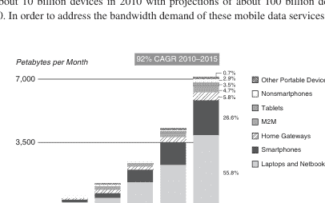

^{1} 1 PB 等于 $10^{15}$ 字节。

在未来的无线系统中，认知无线电技术可作为构建解决众多问题的无处不在系统的基础。例如，考虑车辆碰撞每年在美国造成四万人死亡，近三百万人受伤。几乎每年有十万人死于医疗失误，其中大量案例发生在急诊室。恐怖袭击和自然灾害给我们的响应系统带来压力，导致不必要的伤亡和财产损失，并常常使响应人员处于危险之中。这些不同的问题在技术和人类层面都很复杂；然而令人惊讶的是，针对这些问题的工程解决方案具有若干共同的属性和挑战。车辆可以相互通信并与道路和基础设施通信以提高安全性和管理交通；嵌入式传感器可以远程监测患者并帮助医院急诊室的医护人员管理关键信息。应急人员可以通过无线连接的机器人和无人机网络提高其有效性和个人安全。所有这些解决方案都需要嵌入式无线设备，使机器和人员能够在本地区域以及全球互联网上进行交互。

这些解决方案将以无处不在部署的无线生态系统的形式实现，这些生态系统是大型、异构且去中心化的物理世界部署，包含传感器、执行器和机器的联网认知无线电设备，人类参与其中。虽然利用无处不在无线生态系统的潜力需要涉及异构移动/传感器设备的通用网络架构、包括物理世界编程、网络物理控制和以人为中心设计的稳健计算模型等解决方案，但从根本上说，它们必须依赖于密集环境中的频谱共存。

无线生态系统需要在极其密集的无线设备群体（包括嵌入式及其他设备）中实现高效且去中心化的频谱共享。认知无线电技术将是这些情况下成功频谱共享的基石。此类无线电节点可以感知宽频范围内的无线电频谱使用情况，然后做出如何传输的决策。这些决策可能简单到频段选择，也可能复杂得多，涉及发射机波形设计、调制和编码格式，甚至合作方法。这种变革性无线电技术的力量甚至是监管者、经济学家和工程师之间关于频谱政策的激烈频谱辩论双方的共同观点 [49]。

## 1.5 认知无线电的应用

认知无线电最常见的应用是在电视白空间，其中启用认知无线电的次级用户机会性地利用未使用的频谱不干扰频谱的主要占用者，即电视发射机。认知无线电设备还可以在此类频段中形成二级网络，其中所有二级用户都需要检测空白频谱或频谱空洞。认知无线电技术在电视空白频谱之外还有许多应用。在短距离范围内，认知无线电可应用于无线局域网，例如 IEEE 802.11 系列标准，以及在 100 米范围内车辆对车辆通信，其中数据速率可达数十 Mbps 的数量级。在跨越数公里量级的中间距离范围内，认知无线电可用于部署覆盖数百米的扩展范围无线局域网 [8]。在长距离场景中，认知无线电网络可利用空白频谱满足公共安全网络的频谱需求。这些场景中的每一个都可以归类为前面讨论的三种使用范式之一。

### 1.5.1 蜂窝系统中的动态频谱接入


随着智能手机的出现，蜂窝网络正在快速增长，并努力提高频谱效率以应对高带宽需求。虽然物理层技术在实现频谱高效的比特管道方面已大幅成熟，但在系统层面，对频谱高效传输技术的需求仍然存在。下一代蜂窝系统将更加异构，小型蜂窝嵌入大型宏蜂窝中。这些嵌入式微微蜂窝或家庭蜂窝是发射功率低的基站的微型化版本。它们可以在宏蜂窝覆盖区域内形成小型覆盖岛，为这些覆盖岛内的用户提供覆盖和容量。此类覆盖岛可能是购物中心或体育场馆等热点区域。当小型蜂窝与整个宏蜂窝共享同一频谱时，可提供更多的小区分裂增益 [30]。尽管上述方法需要基础设施支持，像 `DSA` 这样的方案可以利用未使用的频谱提供更好的频谱效率增益。认知无线电技术可用于估计宏蜂窝中业务和频谱使用的时空特性，并在高数据需求期间机会性地使用可用频谱。动态频谱接入网络可以在交互式范式下工作，其中认知无线电可以检测空白频谱以机会性地在该频谱中传输。如果通过回传的开销信令可以为认知发射机提供侧信息，它也可以在叠加范式下工作。

### 1.5.2 蜂窝数据增强

作为蜂窝网络中 `DSA` 的进一步扩展，认知无线电可能被用于机会性地将业务卸载到空白频谱，以为现有蜂窝网络提供“数据增强”。对于图 1.2 所示的示例场景，认知无线电可以帮助缓解蜂窝网络的高负载。在示例场景中，白空间热点覆盖的网状网络可以承载非实时或延迟容忍数据，如邮件、内容、文件传输等。热点可以在授权频段或非授权频段运行。从蜂窝网络卸载部分延迟容忍数据业务有助于运营商满足延迟

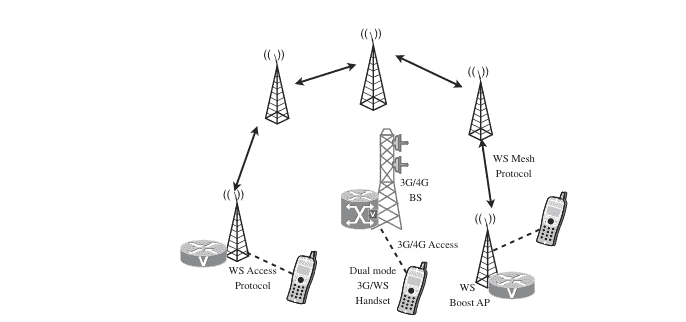

**图 1.2** 用于卸载快速增长蜂窝流量的双模无线电蜂窝数据增强网络。

对延迟敏感的业务，如语音、流媒体视频等。这种方法可能导致容量提升为现有蜂窝容量的两到五倍，具体取决于该区域产生的数据的覆盖百分比和业务组合。容量提升无需额外成本，而是来自对可用空白频谱的检测以及利用热点网状网络在空白频谱上的机会性传输。终端用户手机需要支持双模无线电，具有在蜂窝频段以及空白频谱中传输的能力。这是认知无线电操作交织范式的一个例子。

### 1.5.3 机器对机器通信

机器对机器（`M2M`）通信 [90] 使无处不在的传感器实现机械自动化。通过自组织网络和基于基础设施的蜂窝网络交换语音、音频、视频、电子邮件和照片的无线个人通信需求，已推动传感器网络的全面自动化。认知传感器网络可以用多种方式用于 `M2M` 通信。通信可能发生在传感器与决策者之间（如仪表/监视器向决策者报告数据）、决策者内部的多个计算代理之间（如云计算）或决策者与执行机构之间。未来，多个无线接入网络可能会作为单一分层网络的一部分进行集成和管理。认知无线电可以实现 `M2M` 网络的高效空中接口设计。认知无线电可以机会性地利用不同网络中可用的额外频谱和连接性，以提高系统容量和设备服务质量。启用认知无线电的设备可以替代多无线电设备，以高效利用授权和非授权频段中的可用频谱。

### 1.5.4 分发和回传

启用认知无线电的白空间网络可用作回传和分发网络 [38, 39]。这不仅解决了为缺乏基础设施的农村地区提供无线宽带的难题，还解决了*最后一英里问题*，这一直是家庭用户服务提供商的主要关注点。通常，最后一英里通过数字用户线路（`DSL`）、同轴电缆或光纤到户（`FTTH`）进行有线连接。如 图 1.3 所示，白空间网络可作为回传网络，从而降低铺设线路到客户 premises 的基础设施成本。白空间网络可作为传输网络，用于家庭中典型用户生成和请求的上下行业务。回传可以通过每个家庭的无线路由器完成，通过白空间回传网络进行路由。根据服务类型，数据由在核心网络中运营的相应服务提供商处理。用户也不必为其各种服务需求处理和维护多个接口而烦恼。

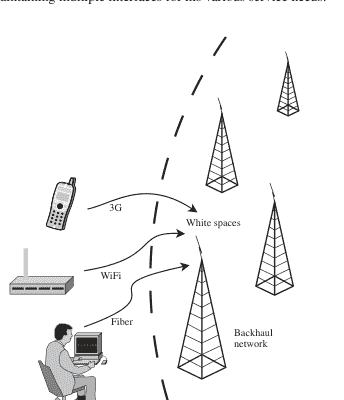

图 1.3 用于分发和回传的空白频谱。

### 1.5.5 认知数字家庭

随着家庭中每个用户订阅的服务数量增加，家庭中的设备数量也在增加。蓝牙、红外和 `WiFi` 等技术是无线技术，已消除了各种设备之间有线通信的需求。问题在于，其中许多技术并非设计为与其他技术协同运行，并且会成为其网络之外接收机的干扰源。因此，需要一个中央控制器来解决争用并监督网络的共存。认知数字家庭可以成为因多种竞争技术而产生的干扰问题的解决方案 [55, 56]。如 图 1.4 所示，认知数字家庭可以在非授权频段的空白频谱上运行，以在设备之间传输控制信息。一个精灵节点充当中央控制器，以协调这些设备的运行，从而减少争用和碰撞的数量。这导致设备资源得到高效利用。用户无需管理各个网络和设备，中央控制器可用于自动化家庭网络的管理。这种集中控制还增强了此类网络的安全性，其中控制器可作为通往外部世界的网关。认知数字家庭应用符合认知无线电操作的底层框架，因为认知无线电设备采用低功率运行。

### 1.5.6 长距离车辆对车辆网络

认知无线电在长距离车辆对车辆网络中找到了应用。此类网络可用于最大限度地减少道路上的驾驶时间。每辆车都可能被要求配备白空间无线电，某一地区的车辆可以与提供回传能力的固定接入点一起形成点对点自组织网络。虽然服务

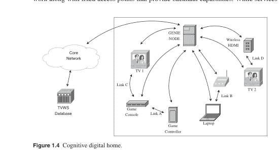

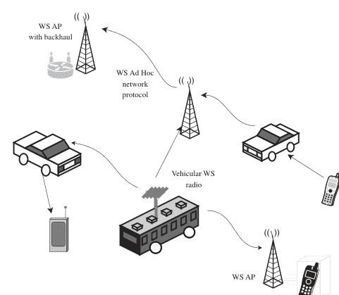

**图 1.5** 车载电台的车对车链路可用于通过车辆与固定接入点之间的自组织网状网络形成高容量应急备份网络。

虽然智能碰撞感知机制需要低延迟和在授权频谱中的通信，但白空间通信可以补充短距离通信基础设施。白空间网络可用于交通警报、地理应用服务、点对点内容等。它们也可以作为高容量应急备份网络。此外，认知无线电车载网络提供的灵活性也可以使其集成到新兴的智能交通系统基础设施和智能高速公路中。

## 1.6 认知无线电网络设计

### 1.6.1 全局控制平面

虽然单个认知无线电的运行和优势可以带来有趣的应用和服务，但多个认知无线电的网络方面不容忽视。认知无线电的无线生态系统可以被视为一个异构的网络集合，具有与全球互联网在精神上相似的多重无线电和协议。类似于互联网，这类无线接入网络在设备数量和承载流量方面可以非常庞大，尽管物理范围更有限。无线生态系统将包含多个子网、异构无线电和具有不同所有者或所有者组的独立网络域。从扩展的角度来看，节点和子网络的聚合也很重要，并且期望协议支持创建聚合超组或网络运营商的机制，这些运营商为终端用户和较小的网络提供批发服务。与当前互联网协议相比，传感器、移动设备等在大型物理世界部署的任何可行解决方案都必须纳入完全自动化的合作和资源共享机制，而无需人类选择和设置策略决策。还要注意，这些网络的去中心化和可能断开的特性意味着，与互联网不同，系统必须设计为无需使用任何集中式服务（如 `DNS` 或 `AAA` 服务器）即可运行。

虽然这种网络协议的设计与自组织自组织网络和 `P2P` 网络 [70, 71] 的一些特征相似，但认知无线电的互联互通涉及额外的设计功能，以支持频谱共享、拓扑发现和跨层自适应 [13, 27, 32, 45]。所使用的协议应能够利用附近的无线电设备进行对可用网络的机会性接入，同时使用跨层协议根据需要调整协议栈的每一层（`PHY`、`MAC` 和网络），以应对不断变化的信道条件、用户密度和应用需求。此外，网络协议必须传播支持稳健网络形成的控制信息；这包括在生态系统中节点之间建立信任并使它们能够通过共享资源和/或支付参与协作网络。

基于逻辑上与数据平面不同的全局控制平面（`GCP`）概念的架构是 `CogNet` 架构 [51, 78]。它为共存或协作的无线电节点之间提供控制信息传播的非常通用的机制。全局控制架构允许认知无线电节点初始化并动态调整其 `PHY`、`MAC` 和网络层参数。控制平面由几个关键组件组成：（i）自举，（ii）发现，（iii）跨层路由，（iv）命名/寻址。见图 1.6。

无线电自举功能允许在认知无线电节点首次启动时检测本地链路并配置 `PHY/MAC` 参数。初始化后，节点执行基于使用受控单跳广播机制周期性报告邻居节点的本地链路状态的发现协议。发现协议还与跨层路由模块交互，该模块提供跨多个跳的端到端可达性和路径信息，这些信息使用包括频率、功率、速率等在内的跨层参数动态配置。第四关键组件是对分布式命名和寻址的支持，通过它网络节点将其永久名称映射到可能随网络结构和移动性而变化的动态分配的网络地址。控制平面通常使用覆盖范围比数据信号更广的低速率无线物理层，因此可以更有效地分发控制信息，使用的数据跳数比数据传输期间所需的跳数更少。数据平面参数（例如频率、功率、带宽、速率等）可以在每个转发跳上设置，以满足某些端到端性能标准和/或系统效率目标。

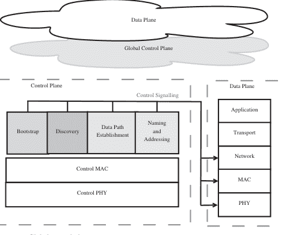

**图 1.6** 全局控制平面。

### 1.6.2 频谱服务器、频谱经纪人和网络信息服务器

关于认知无线电的大多数研究活动都集中在认知无线电的设计问题上，涉及频率、波形和协议敏捷性。然而，这些活动未能充分揭示认知行为的最终极限。为了充分发挥其潜力，认知无线电必须做的不止是临时通信；它必须对可能跨越多个频谱带和系统的本地环境产生充分的认识。这意味着需要彻底高效的新发现过程，甚至需要提供协助的新类“信息服务器”。


当存在认知无线电可以独立发现本地信息的方法时，可以应用 CogNet 架构中指定的各种物理层、系统和网络层协议，以允许合作和共存。然而，当多个服务和系统必须共存时，可能无法实现这种程度的合作和互操作性。在这种情况下，对频谱的高效开放访问可以通过公正的 `spectrum servers` [77] 来辅助，这些服务器可以通过不同终端贡献的测量获得干扰环境的信息，然后为感兴趣的服务订阅者提供高效协调的建议。可能的邻域信息可能包括各种时间频率利用率、邻域中节点的描述，以及潜在的空间位置。事实上，这种频谱服务器在无线网络协调中的作用让人想起互联网中节点之间出现的协调问题中动态主机配置协议（DHCP）服务器的作用。

频谱经纪是另一个新的概念，它使 `spectrum` 的定时租赁成为可能。`spectrum broker` [18] 将频谱分配给共址的服务提供商。这些共址服务提供商可能是电视台、宏蜂窝基站或毫微微蜂窝运营商。服务提供商随后根据网络运行动态分配频谱。当服务提供商向频谱经纪人提交实时需求时，会出现一个有趣的定价问题。频谱经纪人需要市场竞价和定价策略。设计师和经济学家已提出解决此问题的可能定价策略，例如参见 [2, 50]。应该注意的是，服务提供商的需求由频谱的用户需求以及每个用户对其自身服务提供商的传播特性决定。频谱经纪的简单架构如图 1.7 所示。

频谱服务器和经纪人的概念可以通过公正的“网络接口服务器”（NIS）（见图 1.8）推广，以集成到未来的互联网和云基础设施中，这些服务器可以通过不同终端贡献的测量获得干扰环境的信息，然后为感兴趣的服务订阅者提供高效协调的建议。可能的邻域信息包括各种时间频率利用率、邻域中节点的描述，以及潜在的空间位置。今天存在的最强大的可行开放访问系统工程示例是互联网。网络中节点之间相对成功的 TCP 流量协调模型让人想起开放频谱访问背景下出现的无线电协调问题。因此自然会产生一个问题：我们能否设计出像互联网的回传和 TCP 一样的标准化、技术中立的物理和协议基础设施，来协调认知无线电的无线传输？

为了迎接将支持频谱开放访问的网络环境，似乎合理地假设所有节点都将通过直接或多跳连接到互联网，并且频谱监测传感器将经常可用。因此，与有线互联网一样，认知节点将能够访问各种驻留在互联网上的信息服务。其中一项服务是动态主机配置协议（DHCP），用于分配本地不冲突的互联网协议（IP）地址。DHCP 服务器响应请求分配地址，但也通过轮询和监听跟踪活动现有地址。扩展这一想法，可以为无线系统建立 NIS 以促进频谱的高效开放访问。

NIS 可以被视为一个智能信息收集器，它维护由订阅者提交的无线活动轨迹数据库。这样的轨迹可能包括由节点生成的无线活动以及由节点观察到的外部活动。具体的测量可能与物理层密切相关，例如信号

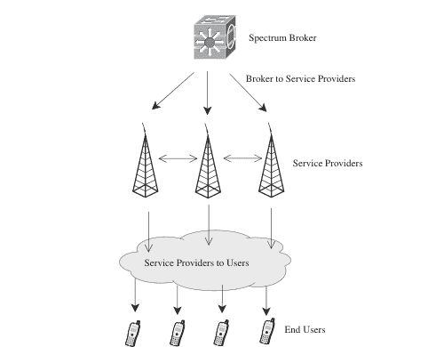

图 1.7 频谱经纪人。

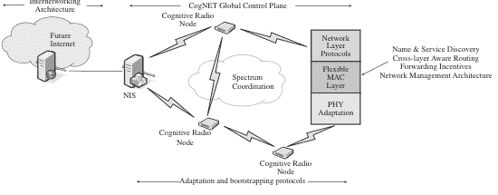

图 1.8 网络信息服务器与云。

可能涉及干扰水平和误码率，或可能是更高层次的推断，例如本地区域中活跃节点的身份和类型、干扰活动模型，甚至可能是地理信息。我们还注意到，可能只有部分信息可用，因为某个认知无线电可能无法访问所有本地使用的频谱，或可能不知道本地系统（如 802.11、Bluetooth、微波炉等）的更高层次描述。

从用户角度来看，发送给 NIS 的请求包含用户身份、能力以及任何本地观察到的现象，将会得到有关高效本地频谱利用的建议。在简单情况下，首选信道列表（或信号空间维度，如码字、跳频序列等）可能就足够了。在其他情况下，认知无线电可能需要更复杂的信息；一份首选接入方法列表（例如 CDMA、TDMA、Bluetooth、802.11、其他）和/或可能有助于承载用户流量的附近节点信息。在另一些情况下，NIS 可能仅仅充当翻译器，通过它不同的认知无线电可以交换信息并进行协商。因此，NIS 概念适用于认知无线电复杂程度的广泛范围。NIS 的实现提出了许多有趣的研究问题，涉及如何从各种非协调来源的零散测量中描绘出干扰环境的连贯图景。此外，NIS 能够提供的建议类型不仅与认知收发器的能力有关，还与底层网络的能力有关。FCC 强制要求的用于规范主用户和次用户共存的地理定位数据库方法，确实是基于 NIS 的频谱共存方法的初级版本。

### 1.6.3 认知无线电的安全方面

认知无线电所具备的频谱、协议和技术灵活性也为保护这些设备及其网络带来了新的挑战。在认知无线电网络中，次用户需要维护网络中所有主用户的准确频谱占用信息。与任何无线网络一样，恶意用户可以威胁网络运行并使网络瘫痪。在动态频谱接入环境中，以下一些安全威胁可能尤为突出。

- 1. **DSA 攻击。** 恶意用户可以创建与网络中主用户相似的信号波形，并在频谱感知算法中触发误报。这种伪造主用户波形的方式会影响次用户的长期行为。在主用户仿真（PUE）攻击中，攻击者仿真网络中的主用户传输。PUE 攻击可以欺骗任何感知过程，并减少系统中次用户可用的信道资源。为了抵御这一威胁，文献 [20] 中提出了一种称为基于位置防御的发射机验证方案。该发射机验证方案包括三个步骤：验证发射机的信号特性、测量接收信号以及定位信号源。认知无线电可以用创新方式来执行这些任务。

- 2. **拒绝服务 (DOS) 攻击。** DoS 攻击可能包括 DSA 攻击，但涵盖更广泛的攻击策略。DoS 攻击也可能是干扰信号，可防止消息被受害接收机接收。根据功率的可用性，攻击者可能会使用不同的策略来拒绝次用户的服务。例如，干扰需要更高的功率，而用较低功率即可实现伪造信号来迷惑受害者。除这些策略外，还可能出现手动 DoS 攻击，其中受害者的设备接口可能配置错误。在最坏情况下，节点被攻破，从而成为认知无线电网络中的恶意参与者。

底层认知无线电架构在很大程度上决定了对不同攻击的脆弱性。在协作网络中感知频谱的认知无线电比在非协作网络中感知频谱的认知无线电更不易受攻击。另一方面，恶意认知无线电可以伪造对协作网络的成员资格并在协作网络中拦截敏感信息。该节点有可能拒绝网络中所有成员的服务。使用场景也可以决定认知无线电节点的脆弱性。例如，在次用户将信号扩展到宽带的 underlay 网络中，本质上对干扰攻击的脆弱性较低 [16]。

## 1.7 硬件和系统设计考虑

### 1.7.1 使用场景中的设计权衡

与不同认知无线电范式相关的权衡包括硬件和系统设计要求和约束，特别是其复杂性和成本。Underlay 系统需要测量认知发射机对主接收机造成的干扰。如果以已知发射功率从主接收机位置发送的信号被认知发射机位置接收，则通过互易性，认知发射机可以确定其对该主接收机造成的干扰。当存在多个主用户时，认知发射机通常无法利用互易性来确定其对每个主用户造成的干扰，因为它只能接收从主接收机位置同时传输的信号的总和。一种系统级确定干扰的技术是让每个主节点附近的多个认知节点通过协作感知和检测来估计干扰，如第 4 章和第 5 章所述。如果没有测量对主用户造成干扰的机制，则认知无线电传输协议必须极其保守，尤其是在主发射机数量很大时。这通常意味着将每个认知发射机的信号输出在发射机周围非常小的半径之外所有位置都远低于所需的干扰阈值。

Interweave 系统需要极宽带和/或敏捷的前端来感知整个系统的频谱以寻找频谱空洞。事实上，当前硬件能力对 interweave 认知用户在宽带上扫描频谱空洞的速度施加了显著限制。协作感知降低了任一节点检测的复杂性负担，但这在延迟和开销方面引入了其他挑战。或者，压缩感知可以应用于此问题以降低复杂性，尽管会带来一定的性能损失 [86]。

最后，overlay 范式要求认知发射机获取主用户的信号、数据序列或码本，以及网络中的所有信道增益。此外，必须实现复杂的编码和解码技术，以增强主用户性能，同时在两侧消除干扰，以获得两用户最佳可能的数据速率。

### 1.7.2 认知无线电系统中的天线设计

只有当组成无线电能够扫描宽频段并准确检测频谱空洞时，认知无线电网络才能高效可靠地运行。此外，它们还需要能够在检测到的白空间中机会性地传输。这要求认知无线电配备宽带天线。使用宽带天线只能产生粗糙的频谱感知，而窄带天线能够准确感知频谱。宽带天线的另一个问题是其尺寸往往比窄带天线更大，这对手机的便携性构成了重大问题。在动态变化的环境中，频率灵活性需要宽频谱范围的可调 RF 滤波器，使其实现复杂且昂贵 [41, 52]。

从系统设计角度来看，对可轻松集成到通信系统中的多宽带天线的需求日益增加。通常，电子可重构性是通过在天线拓扑中使用开关、可变电容器或移相器实现的。最常见的是，在可重构天线的设计中使用 PIN 二极管、变容二极管或 MEMS 开关或变容器的集中元件。通常，可重构天线是频率可重构、辐射方向图可重构或极化可重构的 [83]。

频率可重构天线的优点是允许单个无线电设备在多个频率上工作。例如，调谐方法 [53] 可用于移动应用中的多频段调谐。随着频率从一个频段调谐到另一个频段，这类天线的辐射方向图保持不变。在设计频率可重构天线时，单个天线可以通过重用天线中的空间从低频段调谐到高频段，或调谐进出不同的天线部分。大多数谐振型天线通过调节有效电气长度来实现频率可重构性。


在辐射方向图可重构天线中，频段保持不变，而辐射方向图根据系统要求发生变化。天线可以将辐射波束指向不同方向以增强信号接收 [21, 65, 88]。极化可重构天线利用极化作为额外自由度，在严重多径衰落环境中改善信号接收性能 [46]。方向图可重构天线和极化可重构天线也可用于干扰消除和形成丰富的空间

用于多输入多输出（MIMO）系统的信道以提高吞吐量和网络容量 $[47, 68]$。希望系统设计人员在保持其他参数恒定的同时，使上述调谐参数之一发生变化。然而，实现方面的挑战出现在设备集成阶段，因为参数相互关联以及随之而来的权衡 $[69]$。

## 1.7 硬件和系统设计考虑

### 1.7.3 模数转换器

除天线设计之外，认知无线电设计的另一个挑战是射频前端。如第 1.2.4 节所述，认知无线电很可能在 UHF 电视频段运行，利用未使用的电视频道。UHF 频段具有良好的长距离通信传播特性。对于短距离，认知无线电可利用 $3 \sim 10 \mathrm{GHz}$ 频段的机会。无论工作频率如何，认知无线电接收机的前端都需要宽带，因为认知发射机可能在任何未使用的频段上发射。这要求认知无线电接收机前端提供宽带信号接收，从天线到模数转换器（ADC）。射频模拟电路的线性度将受到严格要求。如果 ADC 在 $\mathrm{GHz}$ 带宽上工作，则必须以 $\mathrm{GHz}$ 速率采样。此外，宽带上累积的干扰信号可能强于感兴趣的信号，导致 SINR 低至 $\sim 50 \mathrm{~dB}$。认知无线电信号无法被放大到足以实现足够的量化精度。例如，要实现 $20 \mathrm{~dB}$ 的信号与量化噪声比，如果 SINR 为 $\sim 50 \mathrm{~dB}$，则 ADC 所需的分辨率需要在 12 位或更高。在存在功率和成本限制的情况下，这种精度水平与 $\mathrm{GHz}$ 采样率相结合会导致 ADC 实现在本质上不可行，因为功率和 ADC 复杂性随着位数几乎呈指数增长。提高 SINR 的一种方法是估计干扰并将其减去 [91]。其他解决方案包括自适应陷波滤波、使用 MEMS 技术的射频滤波器组，以及通过自适应天线阵列的射频波束形成进行空间滤波 [29]。

### 1.7.4 宽带信道和非连续传输

增加传输带宽是满足无线信道上高速率应用日益增长需求的有吸引力的解决方案。但是，正如第 3 章将详细讨论的那样，信号在无线信道上传播时，由于发射信号的散射和接收信号的多普勒扩展，会经历时变衰落。这些效应在宽带信道上的高速率传输中会加剧。为了抵消信道对信号的影响，接收信号必须经过信道均衡器。宽带信道均衡器实现复杂，需要高处理能力以满足高速率应用的延迟约束。

正交频分复用（OFDM）[40, 第 12 章] 是一种数字多载波调制技术，使用大量紧密间隔的正交子载波在宽带信道上传输数据。数据符号分别调制每个子载波，子载波上的整体调制操作产生宽带频分复用信号。子载波的正交性使传输看起来像多个并行的低速率传输，从而避免了复杂宽带信道均衡器的需求。因此，OFDM 已成为数字音频广播（DAB）[34]、地面电视数字视频广播（DVB-T）[54]、第三代合作伙伴计划（3GPP）长期演进（LTE）标准 [81]、IEEE 802.11a/g 无线局域网（WLAN）系列 [48] 以及 IEEE 802.16 WiMAX 标准系列 [5] 的成功空中接口。

在 OFDM 中，离散时间串行数据流 $x_n$，$n = 0, \ldots, N - 1$（表示为 $\mathbf{x}$）通过串并转换器转换为并行流，该转换器将串行数据拆分为多个并行信道，如图 1.9 所示。每个并行信道中的数据通过脉冲整形滤波器 $g(t)$，然后施加到调制器，使用 $n_{\mathrm{IB}}$ 个子载波 $f_0, f_1, \ldots, f_{n_{\mathrm{IB}}-1}$。两个相邻频率之间的间隔被仔细选择，使得子载波两两正交。如果 $\Delta f$ 是相邻子载波之间的差，则总带宽 $W$ 为 $n_{\mathrm{IB}}\Delta f$。$n_{\mathrm{IB}}$ 个调制子载波组合后得到 OFDM 符号 $x(t)$。

在传统的单载波调制方法中，调制信号占据以载波频率为中心的整个带宽 $W$。无线信道中持续数个比特时间的深衰落会导致多个数据符号丢失。然而在多载波方法中，所有 $n_{\mathrm{IB}}$ 个符号在时间上被拉长 $n_{\mathrm{IB}}$ 倍。于是，OFDM 系统可以从深衰落中恢复每个 $n_{\mathrm{IB}}$ 个并行调制数据符号的一部分。此外，由于高速率单载波系统中符号持续时间非常短，接收机处多径分量到达的轻微延迟可能导致严重的符号间干扰（ISI）。拉长符号周期的优点是同一符号的多径分量在新的符号持续时间的一小部分内到达。因此，多载波系统中 ISI 的影响减小 [42]。使用并行数据流调制子载波在数学上等价于对原始数据流进行逆离散傅里叶变换（IDFT）[40, 第 12 章]。在发射机使用 $n_B$ 个调制器和发射滤波器，在接收机使用 $n_B$ 个解调器和接收滤波器的复杂性可以通过采用离散傅里叶变换器（DFT）降低。当子载波数量适当选择时，系统复杂性可通过使用快速傅里叶变换（FFT）算法计算 DFT 而进一步降低。

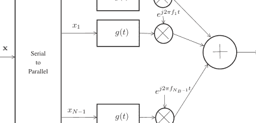

图 1.9 正交频分复用方案。

在 DSA 网络中，像 OFDM 这样的多载波技术可用于机会性地填充频谱，使频谱中的空白得到有效利用。通过有效置零子载波，认知无线电用户可以避免对主用户造成干扰，如图 1.10 所示。在链路层，发射机和接收机需要相互协商发射机和接收机使用的载波。这可能需要用于发射机和接收机之间握手消息的链路会合协议。这种传输方案在 [73, 74] 中称为非连续 OFDM（NC-OFDM），与传统 OFDM 系统不同。

与单载波系统相比，OFDM 系统对同步误差如载波频偏和符号定时误差特别敏感，导致

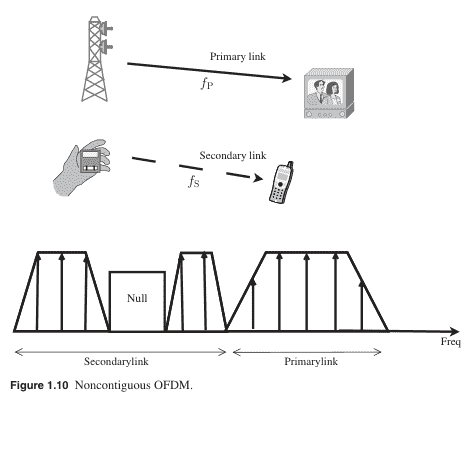

增加的载波间干扰（ICI）。已进行了大量工作来设计鲁棒算法，以高精度估计载波频率和符号定时 [19, 80, 87]，以确保可靠通信。然而对于 NC-OFDM 系统，定时信息的估计不完美加剧了同步问题。在某些场景中，当用户占据多个非连续子带且其发射机和接收机之间的定时偏移存在较大差异时，基于循环前缀的定时获取算法性能可能很差。因此，需要更合理的复杂性算法，或完全不同的符号定时获取方法。

在典型的具有 $n_\mathrm{B}$ 个子载波的 OFDM 发射机中，IDFT 调制符号可以表示为

```
$x_n= \frac{1}{n_\mathrm{B}} \sum_{k=0}^{n_{\mathrm{B}}-1} X_k e^{j2 \pi k n / n_B}, \; n=0, 1, \ldots, N-1.$
```

在 NC-OFDM 系统中，次级传输仅在空闲子载波上进行。被主用户占据的子载波被置零，因此对于这些子载波 $X_k=0$。

如果我们假设一个 NC-OFDM 符号长 $n_\mathrm{B} + p$ 个采样，其中前 $p$ 个采样称为循环前缀，与最后 $p$ 个采样相同。发射机和接收机之间存在定时偏移 $\tau$ 时，接收采样 $y_n$ 为

```
$y_n=\sum_{l=0}^{m} h_l x_{n-\tau-l}+I_n+w_n, \; n=0, \ldots, N-1,$
```

其中 $h_l, \; l=0, \ldots, m$ 表示复数 $m$ 抽头频率选择性信道增益，$I_n$ 表示接收机处来自其他用户的干扰，$w_n$ 是接收机处的离散时间噪声过程。定时获取是关于通过在接收机估计 $\tau$ 来估计 OFDM 符号边界。

在 NC-OFDM 系统中，信号 $x_n$ 和 $I_n$ 占据不同的音调集合。但由于脉冲整形滤波器的实际限制，它们并非理想带限，部分符号能量可能会泄漏到相邻频段，造成干扰。因此，如果不同用户信号之间允许更宽的保护带，则定时获取算法的性能可以得到改善。在授权频谱中，次级用户机会性使用主频谱，保护带可保护主用户免受次级用户造成的干扰。然而在免授权频谱中，未协调的接入可能导致频谱高占用。这可能导致定时获取性能变差 [1]。

OFDM 系统的另一个设计挑战是峰均功率比（PAPR）问题。一般来说，OFDM 信号是若干由正弦波形调制的信号之和。如果信号相干叠加，OFDM 信号可能具有很大的峰值，但平均功率仍保持较小。此外，当时域信号从低瞬时功率波形转换到高功率波形时，会遇到大的信号幅度摆动。这会导致很高的带外谐波失真功率，除非发射机的功率放大器表现出线性

在整个信号电平范围内。这可能会污染相邻信道并产生干扰 [42]。信号在 $x_n$、$n = 0, \dots, N-1$ 中在式 (1.1) 中的 PAPR 由 [84] 给出

> $PAPR(\mathbf{x}) = \frac{\max_{0 \leq n \leq N-1} \{|x_n|^2\}}{\mathbb{E}\{|x_n|^2\}}$,


当 `OFDM` 信号的 `PAPR` 较大时，数模转换器和功率放大器需要较高的动态范围以避免削波和失真。因此，数模转换器的动态范围应足够大以容纳较大的峰值。缺点之一是数模转换器的成本会随着动态范围的提高而增加。在 `NC-OFDM` 系统中，由于部分子载波被置零，`PAPR` 会更大 [75]。

## 1.8 认知无线电网络中的频谱共存

认知无线电网络的健康发展，例如在 `TV` 白空间中，一个重要的要求是与主网络的健康共存。有一个严格的要求，即次级用户应尽量减少在主接收机处的干扰量。此外，次级用户还需要能够共存并可能形成网络以承载信息。认知无线电可以采用许多反应式方法来避免干扰。通常，这些方法涉及频率、发射功率和发射波形的自适应。频谱敏捷的认知无线电可以定期扫描整个频段，识别主用户是否在使用该信道，并动态切换到频谱中的另一个空闲频段。软件定义无线电可以通过扫描整个频段或通过频率跳变来扫描频谱，并且射频硬件的改进使得此类无线电成为可能。功率控制是一种广泛使用的干扰缓解技术。基于周期性扫描检测到的干扰的极少量反馈，次级用户的发射功率可以被控制以最小化主接收机处的干扰。信号空间的正交化是另一种缓解干扰的方法。在次级网络的时分调度 `MAC` 中，分组可以在未观察到主用户活动的时间槽中调度。频率上的正交化也是缓解干扰的一种方式。前一节讨论的 `NC-OFDM` 传输是频率域正交化的一个例子。上述反应式机制受限于发射机处可用的信道状态信息的量，也由于干扰是接收机属性的事实。反应式方案本质上需要显式的协调协议来获取主用户和次级用户的网络状态和信道信息。没有网络状态信息，高效的发现、自组织、资源管理和协作技术变得效率低下。交换链路状态信息可能会使网络过载，这对使用认知无线电设计高效网络提出了挑战。这也强调了需要本节 1.6 中讨论的体系结构和协议机制。

### 1.8.1 频谱池化和带宽交换

只有当认知无线电形成可用于承载信息的网络时，认知无线电技术的全部潜力和优势才能实现。无线网络中的协作转发已被证明可以获得速率和分集增益，但它会产生由协作节点承担的能量成本。认知无线电节点具有灵活交换传输带宽的能力，作为提供转发数据激励的一种手段，而不会增加所需的总带宽或总发射功率。诸如 `NC-OFDM` 等多载波系统的出现，具有灵活地委派和采用多个子载波的能力，使得这种方法相比于通常基于信用抽象概念和共同价值理解的其他激励机制更具吸引力。

*频谱池化* 是一个概念，其中用户可以从主用户临时租用频谱资源池。现有的频谱许可制度不必因这一设置而改变。该系统带来双重优势：次级用户可以访问他们未获许可使用的频谱资源，而频谱所有者可以为他们支付费用但未广泛使用的商品获得收入 [89]。

在众多协作通信形式中，协作转发 [12, 31] 是增强连通性和吞吐量的基本技术。由于转发通常会产生带宽和能量成本，因此必须实施激励机制来抵消这些成本。*带宽交换* (`BE`) [94]，一个与频谱池化类似的概念，是一种激励机制，本质上使用户能够将部分带宽委托给另一个用户以换取转发。图 1.11 说明了 `BE` 在节点网络中的概念，其中用户通过将子载波委托给另一个用户来激励转发。

为了激励 `BE`，考虑加性高斯白噪声 (`AWGN`) 信道在噪声功率谱密度为 $N_{0}$ 时的 Shannon 经典信道容量公式。

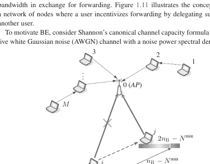

**图 1.11** 当直连链路失效时，用户 *i* 试图通过将 $N-N^{\min}$ 个子载波委托给用户 $j$ 来激励转发 [93]。


$$C = W \log _{2}\left(1+\frac{\mathcal{P}}{N_{0} W}\right) \text { bits/second. }$$ (1.4)

在上述表达式中，$C$ 仅对平均发射功率 $\mathcal{P}$ 对数依赖，但对带宽 $W$ 几乎线性依赖，尤其是在 $W$ 相对较小时。相对于这些变量的最大偏导数给出为

$$\left.\frac{\partial C}{\partial \mathcal{P}}\right|_{\mathcal{P}=0}=\frac{1}{N_{0} \log 2},\left.\frac{\partial C}{\partial W}\right|_{W=0}=\infty.$$ (1.5)

式 (1.5) 表明，当功率或带宽受限时，使用额外带宽所获得的边际效用显著更大。然而，由于网络/系统中的总可用带宽需要保持不变，人们可能会质疑重新分配带宽是否真的有益，因为毕竟，当一个节点获得额外带宽时，是以其他节点损失相等带宽为代价的。此外，随着带宽的增加（宽节点区域），容量的边际增益趋于饱和。尽管如此，一个简单的例子可以说明 `BE` 的性能增益 [94]。考虑图 1.12 所示的带接入点的双节点网络。假设每个节点具有不重叠的带宽 $(W_{1}=W_{2}=20 \mathrm{MHz})$ 和固定的发射功率 $(\mathcal{P}_{1}=\mathcal{P}_{2}=20 \mathrm{dBm})$。此外，为便于说明，假设接入点与节点之间的信道以及节点之间的信道由基于距离的路径损耗决定，即链路上实现的速率是带宽 $W$ 和信道功率增益 $G$ 的显式函数，该增益由其固定的发射功率 $\mathcal{P}$ 参数化。假设该函数由下式给出

$$C=C(W, G)=W \log _{2}\left(1+\frac{G \mathcal{P}}{N_{0} W}\right) \text { bits/second, }$$ (1.6)

其中信道增益 $G=\kappa d^{-3}$，$d$ 为距离，$\kappa$ 为比例常数，也捕获噪声功率谱密度 $N_{0}$。对于图 1.12 所示的几何结构，如果两个节点仅使用直连链路进行传输，则节点 1 实现的传输速率为 $R_{1}^{\mathrm{dir}}=11 \mathrm{Mbps}$，而节点 2 实现

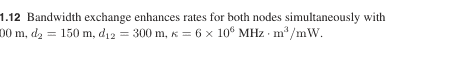

**图 1.12** 带宽交换在 $d_{1}=400 \mathrm{~m}, d_{2}=150 \mathrm{~m}, d_{12}=300 \mathrm{~m}, \kappa=6 \times 10^{4} \mathrm{MHz} \cdot \mathrm{m}^{3} / \mathrm{mW}$ 的情况下同时提升了两个节点的速率。

$R_{2}^{dir}=66$ Mbps. 然而，如果节点1将节点2用作转发器并将其带宽的一部分 $\alpha$ 委托给节点2，则通过合作实现的速率表示为

$$R_{1}^{cop} = \min\{C_{1}((1 - \alpha)W_{1}, G_{12}), C_{2}(W_{2} + \alpha W_{1}, G_{20}) - R_{2}^{dir}\}, \quad (1.7)$$

$$R_{2}^{cop} = C_{2}(W_{2} + \alpha W_{1}, G_{20}) - R_{1}^{cop}, \quad (1.8)$$

其中 $G_{12}$ 和 $G_{20}$ 分别是从节点1到节点2以及从节点2到接入点的信道增益。函数 $C_{1}, C_{2}$ 如式 (1.6) 中所定义，并且假设节点2要求其自身的速率至少为 $R_{2}^{dir}$ 或更好。图 1.12 显示存在 $\alpha$ 的取值范围，使得两个节点的速率均得到改善。虽然上述示例说明了双用户场景下的 `BE`，但这种基于激励的网络机制可以推广到 $M$ 用户的情况。具体而言，它可以应用于使用纳什谈判框架 [93] 实现 `TV` 白空间中公平次级共存的场景。在关于 `TV` 白空间的新 `FCC` 规定中，施加了大量保护和预防措施以保证主用户不受干扰地运行。尽管频谱感知不再是必需的，但登记主用户位置的地理位置数据库已成为强制要求。每个次级用户在开始传输前都必须通过互联网查询该数据库，以确保不会对附近的主用户产生干扰。查询是周期性的，以防某些主用户希望在附近启动操作。这些要求为初级用户和次级用户之间的共存提供了可靠的屏障。然而，新规定并未明确指定如何在次级用户之间管理共存。地理位置数据库的存在可以通过向网络中的所有节点提供全局网络状态信息来促进纳什谈判机制。

用于 `TV` 白空间公平次级共存的基于 `BE` 的网络机制性能的说明如图 1.13 所示。它显示了有无基于 `BE` 合作时的平均中断概率 [93]。随着用户数量的增加，中断概率呈指数下降，展示了由 `BE` 激励的用户合作多样性的强大作用。

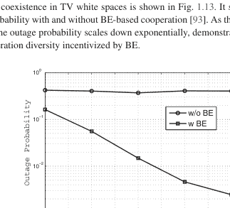

**图 1.13** 有无带宽交换时的平均中断概率 [93]。

### 1.8.2 认知无线电网络中的跨层调度


认知无线电网络的节点可以以各种任意方式交互。为了提炼这些交互，我们看到每个无线电都遵循一种传输策略，导致信号在时间、频率和空间上发生变化。这种变化可能是对信道或干扰测量结果的自适应。特定信号策略的性能取决于每个接收机在存在干扰传输的情况下分辨信号的能力。在认知无线电网络领域，出现了两类不同的问题。首先，对于给定的发射机和接收机技术集合以及指定的性能约束集合，必须解决系统性能的多维边界。即使所有网络节点都可获得完整的系统状态信息，这也是一个难题。其次，各个节点的智能自适应策略集合构成了用于频谱分配的大型分布式系统。特定的分布式信息收集和交换机制可能会极大地影响系统的性能。

这些问题可以分别来看。系统性能的边界可以在假设高效的开放频谱接入可以通过公正的频谱服务器解决的前提下进行考察（见第 1.6.2 节所述），这些服务器可以通过不同终端提供的测量结果获取干扰环境信息，然后向感兴趣的服务订阅者提供高效协调的建议。频谱服务器可以充当集中式调度器的角色，利用对网络配置的完整了解来指定各个链路的活动模式。然后可以根据频谱服务器的性能为分布式自适应路由和调度方法提供性能上界。

图 1.14 显示了一个多跳无线网络，通过一系列跳将数据从源节点（节点1）传输到目的节点（节点6）。通常，网络可能有许多同时活跃的会话，每个会话由一个源-目的对指定。每个会话可能将其流量拆分为通过网络中不同路由的多个流。例如，图 1.14 显示了从节点1到节点6的会话被拆分为网络中的两个流。会话可能各自要求 QoS，例如

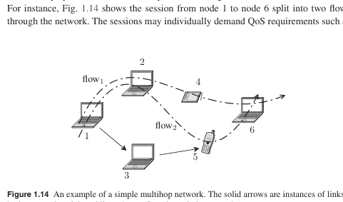

**图 1.14** 一个简单的多跳网络示例。实线箭头是网络中链路的实例，虚线表示网络中的流。

最小平均速率、最大峰值速率、有限延迟、有界抖动等。为了满足 QoS 保证，协议栈中的每一层都优化一组效用函数，旨在实现网络范围内的全局目标（QoS 协议）。各层操作之间可能存在相互依赖，但设计者可能有兴趣通过减少层间依赖来降低系统复杂度。例如，网络层为网络中的各个流指定适当的路由。选择特定路由的决策可能基于根据每个会话的 QoS 要求选择的某种度量。在大多数情况下，路由度量是服务延迟和链路支持的平均速率的函数。此外，路由决策可能需要定期更新，以考虑底层层参数的变化。

MAC/PHY 层解决资源分配问题。这些层为网络中的链路指定速率和功率分配、传输策略以及调度。链路上的功率分配策略取决于信道条件（每个发射节点对其的了解或缺乏了解）、由于设备限制而对传输功率的约束，以及邻域内其他发射机的整体干扰。链路获得的瞬时速率取决于底层信道传播参数、发射机使用的调制和编码方案、接收机采用的信号处理以及接收机邻域内的干扰。通常，MAC 方案为网络中的传输指定一组规则。规则的选择取决于分配给它们的资源量。在考虑所有这些变量的情况下解决 MAC/PHY 层的资源分配问题在数学上可能是不可处理的 [7]。

研究界通过对网络其余部分做出简化假设来解决多跳网络不同层中的许多单独方面。特别是，在过去二十年中，物理层技术取得了许多进展——自适应调制、可靠编码方案（例如 LDPC 码、Turbo 码等）、混合 ARQ 方案、OFDM、MIMO 处理、协作分集方案、多种接入技术、多用户分集方案，仅举几例。然而，文献中讨论的大多数跨层设计方法对底层物理层技术做出简单且具体的假设。这些先进物理层技术的影响需要在支持端到端流的多跳网络的实际设置中得到更好的理解 [76]。

## 1.9 原型设计

为了使认知无线电网络成为现实，所开发的理论概念和算法需要在规模上实现和测试。为此，学术界和研究实验室在认知无线电网络原型设计方面付出了许多努力。其中一个主要的认知无线电网络测试平台是位于罗格斯大学无线信息网络实验室（WINLAB）的认知无线电启用 ORBIT 无线电网格测试平台 [67]。如图所示的大规模无线电网格仿真器

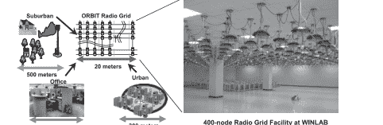

**图 1.15** ORBIT 测试平台。

图 1.15 由 20 × 20 个开放访问可编程节点阵列组成，每个节点配备多个 802.11a、b、g 或其他（Bluetooth、Zigbee、GNU Radio/USRP、WARP 和 WINLAB WINC2R 认知无线电）无线电卡。无线电节点通过交换式以太网连接到后端服务器阵列，具有用于数据、管理 and 控制的独立物理接口。干扰源和频谱监测设备也集成到无线电网格中。网格用户登录到实验管理服务器，该服务器执行涉及使用类似 ns2 的脚本语言指定的网络拓扑和协议软件的实验。一种使用分布在网格各处的可控噪声源来模拟物理距离影响的无线电映射算法，允许将真实世界的无线网络场景映射到网格中的特定节点，如图所示。

在最早且最全面的认知无线电原型开发工作之一是 DARPA 下一代（XG）通信计划 [11] 下的活动。DARPA XG 计划主要由支持军事、民用、政府和商业无线应用的长期预测频谱需求的需要所驱动，该需求预计将显著超出当前静态频谱分配的限制。DARPA XG 计划旨在通过为下一代军事和商业网络提供未充分利用的频谱访问，实现频谱利用率至少提高一个数量级。XG 研究重点是设计实时感知频谱、表征频谱、通过动态波形穿透并适应变化的技术，以显著提高当前分配的效率。例如，在 2006 年进行的一项研究中，在现场试验中检查了频谱占用水平。研究表明，XG 技术在具有挑战性的移动场景中能够提供具有出色 QoS 的稳健网络。据报道，当没有频谱可用时，XG 节点即使必须停止运行也会避免相互干扰 [58]。XG 计划还参与开发动态频谱接入网络的架构框架、协议设计和原型构建 [10, 57]。

在认知无线电平台中，通用软件无线电外设（USRP）[85] 已被用于实现认知无线电的许多功能。USRP 是一款具有必要接口的处理器板，可用于构建软件无线电。它可通过高速 USB 或千兆以太网连接到主机 PC。

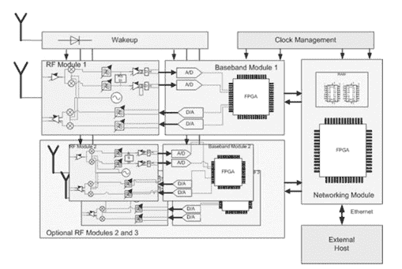

图 1.16 WiNC2R 平台架构 [60]。

使用此设置，可以构建软件定义无线电。这种设备对于试验新开发的认知无线电算法非常有用。另一个认知无线电原型是 WiNC2R 系统 [60]。WiNC2R 系统的架构如图 1.16 所示。它是一个灵活的无线平台，支持从自主敏捷无线电到频谱共享系统的各种认知无线电网络场景。该平台设计能够支持多种 MAC 协议，并能在帧时间边界内即时切换协议。

莱斯大学的无线开放访问研究平台（WARP）是一个可扩展且可扩展的编程无线平台 [79]，用于原型化先进的无线网络。它允许交换和共享新的物理层和网络层架构，构建一个真正的社区平台。Xilinx FPGA 用于实现在单个平台上对物理层和网络层协议的可编程性，该平台在所有层上均可部署且可观测。WARP 开放了研究、构建和原型化下一代无线网络所需硬件和软件。这使得研究人员社区能够在开展全新原型网络时汇集他们的想法。有关 WARP 平台设计的细节在 [3, 4] 中有描述。

KUAR（堪萨斯大学敏捷无线电）是一种便携且灵活的软件无线电架构 [61]，可实现动态频谱接入和认知无线电的先进研究。学术界中专注于软件定义无线电的其他无线测试平台包括加州大学河滨分校的无线网络研究测试平台 [15]、加州大学洛杉矶分校的认知无线电研究测试平台 [28]，以及弗吉尼亚理工大学的认知无线电网络测试平台（CORNET）[24, 64]。

微软研究院的 KNOWS（白空间认知网络）项目是对白空间感知的原型开发工作，是研究实验室中认知无线电原型开发的一个例子。这类工作有助于展示新想法的概念验证，后续推动商业化。KNOWS 是一个硬件-软件平台，包括频谱感知 MAC 和处理频谱碎片化的算法。硬件实现包括用于检测白空间的双模扫描无线电，以及用于后续数据通信的可重构无线电 [92]。作为 KNOWS 计划的一部分，微软研究院已在华盛顿州雷德蒙德微软园区内的两栋不同建筑上部署了基站。这些基站在白空间上运行，并为几乎整个校园提供覆盖。他们还在微软班车上部署了移动客户端，该客户端将白空间中的数据包桥接到班车内的 WiFi，从而为现有笔记本电脑提供互联网连接。作为部署的一部分，他们还构建了白空间数据库的研究原型 [9]。

工业界另一个值得注意的举措是芬兰赫尔辛基诺基亚研究中心（NRC）的认知无线电研究 [25]。NRC 的认知无线电研究重点是灵活频谱使用的方法、设计感知无线电环境和位置的新颖方式、设计智能协作的分布式网络，以及在移动设备中构建低功耗灵活的无线实现。

## 1.10 认知无线电标准化活动

一系列用于定义使用白空间的空中接口的标准化活动始于 2004 年 5 月美国联邦通信委员会（FCC）发布 NPRM（拟议规则制定通知）以提供更高效、更有效的电视频谱使用 [35] 之后。作为对 FCC 提案的回应，IEEE 802.22 工作组（WG）成立以定义基于认知无线电的标准化空中接口。IEEE 802.22 标准是最早的标准化工作之一，用于定义在非干扰基础上机会性使用电视频段的 MAC 和 PHY。它规定了一种可动态适应环境变化的 MAC。该标准要求感知频谱以检测认知无线电所在位置是否存在现有的主用发射机。


2008 年 11 月，FCC 发布了报告“第二次报告和命令及备忘录意见和命令”，以采纳规则允许免许可无线发射机在电视白空间中运行。尽管电视广播商强烈反对，FCC 仍采纳了这些规则，以便为企业和消费者提供新颖创新产品和服务，包括宽带数据和其他服务，释放大量频谱。然而，FCC 规定设备必须同时查阅 FCC 构建的数据库以确定在给定位置可使用的频道，并每分钟本地监测一次频谱，以确认没有旧式无线麦克风、视频辅助设备或其他发射机存在。如果检测到单个传输，设备不得在接收到该传输的整个 6 MHz 信道内任何位置进行传输。

在 2010 年 9 月，FCC 发布了“第二次备忘录意见和命令”，最终确定了用于未授权无线设备使用未使用电视频段的规则 [36]。新规则取消了强制性的感知要求，这极大地促进了基于地理位置的信道分配的频谱使用。

一些与白空间网络相关的其他 IEEE 标准如下。

- IEEE 802.11af 工作组 (WG) 为 IEEE 802.11 PHY 和 MAC 定义信道，用于电视白空间 (TVWS) 中的信道接入和共存。
- IEEE DySPAN 标准委员会的 P1900 工作组定义了动态频谱接入的新方法标准，包括无线电传输干扰，以及无线技术的协调，包括部署不同无线技术的网络之间的网络管理和信息共享。该工作组成立是为了制定支持标准，处理认知无线电和高级频谱管理正在开发的新技术和技术。
- IEEE SCC41 标准化委员会成立的目的是检查重用 IEEE 802 PHY/MAC 是否对白空间操作最优，并估计系统的性能在采用定制 PHY/MAC 系统后能受益多少。重用 PHY 的缺点之一是 OFDM 具有显著的高功率旁瓣，导致共存问题或较差的频谱占用因子。
- IEEE 802.19 专注于为未授权设备的无线标准之间的共存制定标准。该标准机构成立是为了最小化未授权频段中属于各种无线标准的网络之间的干扰。任务组 IEEE 802.19.1 专注于 TVWS 中的共存。

国际电信联盟 (ITU) 有以下研究组讨论认知无线电网络。

- 在 ITU-R 第 1 研究组频谱管理中，动态频谱问题由工作组 1B 负责。
- 在 ITU-R 第 5 研究组地面业务中，工作组 5A 已描述了认知无线电系统在陆地移动业务中的潜在应用。它还涵盖了认知无线电系统的技术和操作特性，包括潜在益处、其挑战、部署场景以及其从技术角度对频谱使用的影响 [6]。
- 在 ITU-R 第 5 研究组中，工作组 5D 已开始另一项关于“特定于 IMT 系统的认知无线电系统”的工作。该工作的范围是考虑将 CRS 纳入 IMT 技术家族。

欧洲通信委员会 (ECC)，欧洲邮电管理机构会议 (CEPT) 内的一个自主委员会，设有专门的任务组负责在 470–790 MHz 频段白空间中认知无线电系统的运行。QoSMOS（以服务质量和移动性驱动的认知无线电系统）是一个泛欧洲项目，有 15 个组织共同合作开发认知无线电系统的框架，并利用试验台开发和验证关键技术 [72]。从一开始就强调参与标准机构和工业论坛，以提高 QoSMOS 成果被纳入标准化产品中的可能性。最初的重点是无线电频谱的机会性使用，早期示例为电视白空间。另一个倡议是端到端效率 (E3) 项目，一个雄心勃勃的德国大型综合项目 (IP)，旨在将认知无线系统集成到超越 3G (B3G) 世界，将当前异构无线系统基础设施演进为集成、可扩展且高效管理的 B3G 认知系统框架。E3 项目的关键目标是设计、开发、原型制作并展示解决方案，以保证现有传统和未来无线系统之间的互操作性、灵活性和可扩展性，管理整体系统复杂性，并确保在接入技术、业务领域、监管领域和地理区域之间实现融合 [33]。

## 1.11 本书的组织结构

本书其余部分组织如下。第 2 章从信息论角度讨论了各种认知无线电使用范式的根本容量限制和传输技术。这样的根本性能限制为认知无线电网络的设计提供了指导。第 3 章讨论了表征认知无线电网络中传输的相关无线电传播信道模型。这些信道模型对于分析对主用户的干扰、次级共存以及建立干扰管理方案至关重要。感知是认知无线电的基本属性，第 4 章讨论了与认知无线电使用范式相关的感知的 fundamentals。最后，第 5 章通过讨论与认知无线电网络的探索和利用相关的高级频谱感知技术、优化问题和协作感知来完善材料。

## 参考文献

- [1] J. Acharya, H. Viswanathan, and S. Venkatesan, "Timing acquisition of non-contiguous OFDM based dynamic spectrum access," *IEEE International Symposium on New Frontiers in Dynamic Spectrum Access Networks*, 2008, pp. 1-10.
- [2] J. Acharya and R. Yates, "Dynamic spectrum allocation for uplink users with heterogeneous utilities," *IEEE Trans. Wireless Commun.*, **8**, no. 3, 1405-1413, Mar. 2009.
- [3] K. Amini, Y. Sun, P. Murphy, C. Hunter, J. R. Cavallaro, and A. Saahsawrai, "WARP, a modular testbed for configurable wireless network research at Rice," *Proc. IEEE SWSIR*, 2007.
- [4] K. Amini, Y. Sun, P. Murphy, C. Hunter, J. Cavallaro, and A. Saahsawrai, "WARP, a unified wireless network testbed for education and research," in *IEEE International Conference on Micro-electronic Systems Education, June 2007*, pp. 53-54.
- [5] J. Andrews, A. Ghosh, and R. Muhamed, *Fundamentals of WiMAX*, Prentice-Hall, 2007.
- [6] "Annex 12 to working party 5A chairman's report," Radiocommunication Study Groups, ITU, Tech. Rep., 2010.

## 认知无线电的概念

- [7] E. Aarikan, “Some complexity results about packet radio networks,” *IEEE Trans. Inf. Theory*, **30**, no. 4, 681–685, July 1984.
- [8] P. Bahl, R. Chandra, T. Moscibroda, R. Murty, and M. Wells, “White space networking with WiFi like connectivity,” *ACM Sigcomm*, 2009.
- [9] V. Bahl, “The Promises and Challenges of the Wireless Frontier – from 600 MHz to 60 GHz,” *IEEE DynSDoc 2011*, Plenary lecture, May 2011.
- [10] BBN Technologies, “Next generation (XG) architecture and protocol development (XAP),” Tech. Rep. Aug. 2005. www.gtirc.mil/cgi-bin/GetTRDoc?Location=U& cec=GetTRDoc.pdf&AD=ADA437096.
- [11] BBN Technologies, “The XG Vision–RFC,” Tech. Rep. www.ir.bbn.com/~ramanath/pdf/rfc-vision.pdf.
- [12] S. Biswas and R. Morris, “Opportunistic routing in multi-hop wireless networks,” *Proc. ACM SIGCOMM*, 2004.
- [13] V. Brik, E. Rozner, S. Banerjee, and P. Bahl, “DSAP: A protocol for coordinated spectrum access,” *IEEE International Symposium on New Frontiers in Dynamic Spectrum Access Networks*, 2005, Nov. 2005, pp. 611–614.


# 参考文献

[14] J. Brito, “The spectrum commons in theory and practice”, Stanford Technology Law Review, Discussion Papers, 2007. `glr.stanford.edu/pdf/brito-commons.pdf`.

[15] I. Brouzos, J. Eriksson, S. Krishnamurthy, and M. Faloutsos, “A blueprint for a manageable and affordable wireless testbed: design, pitfalls and lessons learned,” *3rd International Conference on Testbeds and Research Infrastructure for the Development of Networks and Communities, TridentCom 2007*, May 2007, pp. 1–6.

[16] T. Brown and A. Sethi, “Potential cognitive radio denial-of-service vulnerabilities and protection countermeasures: a multi-dimensional analysis and assessment,” *2nd International Conference on Cognitive Radio Oriented Wireless Networks and Communications, CrownCom.*, Aug. 2007, pp. 456–464.

[17] M. Buddhikot, “Understanding dynamic spectrum access: models, taxonomy and challenges,” *2nd IEEE International Symposium on New Frontiers in Dynamic Spectrum Access Networks, DySPAN*, Apr. 2007.

[18] M. Buddhikot, P. Kolodzy, S. Miller, K. Ryan, and J. Evans, “DIMSUMNet: new directions in wireless networking using coordinated dynamic spectrum access,” *IEEE WoWMOm*, June 2005.

[19] B. Chen and H. Wang, “Maximum likelihood estimation of OFDM carrier frequency offset,” *IEEE International Conference on Communications, 2002. ICC 2002.*, 1, May 2002, pp. 49–53.

[20] R. Chen, J.-M. Park, and J. Reed, “Defense against primary user emulation attacks in cognitive radio networks,” *IEEE J. Sel. Areas Commun.*, **26**, no. 1, 25–37, Jan. 2008.

[21] S. H. Chen, J. S. Row, and K. L. Wong, “Reconfigurable square-ring patch antenna with pattern diversity,” *IEEE Trans. Antennas and Propag.*, **55**, no. 2, 472–475, Feb. 2007.

[22] M. Chiani and A. Giordotto, “Coexistence between UWB and narrow-band wireless communication systems,” *Proc. IEEE*, **97**, no. 2, 231–254, Feb. 2009.

[23] Cisco, “Cisco visual networking index: Global mobile data traffic forecast update, 2010– 2015,” Tech. Rep., 2011, `www.cisco.com/ww/col_solutions/colateral/ns341/ns25/ns537/ns2705/ns827/white_paper_cl1-520862.pdf`.

[24] “Cognitive radio network testbed (CORNET),” `cornet.wireless.vt.edu`.

[25] “Cognitive Radio Research at Nokia Research Center,” `www.research.nokia.com/cognitive_radio`.

[26] R. H. Coase, “The Federal Communications Commission,” *Journal of Law and Economics*, **2**, 1–40, Oct. 1959.

- [27] C. Cordeiro 和 K. Challapalli，“C-MAC：一种用于多信道无线网络的认知 MAC 协议”，IEEE 动态频谱接入网络新前沿国际研讨会，2007 年 4 月，第 147–157 页。

- [28] D. Céré，“认知无线电的可行性探讨”，IEEE 信号处理杂志，25 卷，第 6 期，85–93 页，2008 年 11 月。

- [29] D. Céré、S. M. Mishra 和 R. W. Brodersen，“认知无线电频谱感知中的实现问题”，第 8 届 Asilomar 信号、系统与计算机会议论文集，2004 年。

- [30] A. Damjanovic、J. Montijo、Y. Wei 等，“3GPP 异构网络综述”，IEEE 通讯汇刊，18 卷，第 3 期，10–21 页，2011 年 6 月。

- [31] M. Dianati、X. Ling、K. Naik 和 X. Shen，“无线自组织网络的节点协作 ARQ 方案”，IEEE 车辆技术汇刊，55 卷，第 3 期，1032–1044 页，2006 年 5 月。

- [32] C. Doerr、M. Neufeld、J. Frifeld、T. Weingart、D. Sicker 和 D. Grunwald，“Multicam——动态无线网络的自适应 MAC 框架”，IEEE 动态频谱接入网络新前沿国际研讨会，2005 年，2005 年 11 月，第 548–555 页。

- [33] “端到端效率项目”，`ict-e3.eu/project/overview/overview.html`.

- [34] 欧洲电信标准，“面向移动、便携和固定接收机的数字音频广播（DAB）”，ETSI，技术报告，1997 年 5 月。

- [35] 联邦通信委员会，“拟议规则制定通知”，FCC，ET Docket 编号 04-113，2004 年 5 月，`www.naic.edu/phil/rfi/fccactions/FCC-04-113A1.pdf`.

- [36] 联邦通信委员会，“第二次备忘录意见和命令”，FCC，技术报告，2010 年 9 月，`transition.fcc.gov/Daily_Releases/Daily_Business/2010/db0923/FCC-10-174A1.pdf`.

- [37] F. Fitzek 和 M. Katz 编，《认知无线网络：概念、方法论和启发无线通信启蒙时代的愿景》，Springer，2007 年。

- [38] C. Gerami，《利用电视白空间的备份和分发网络设计方法》，硕士论文，罗格斯大学，2011 年 5 月。

- [39] C. Gerami、N. Mandalayam 和 L. Greenstein，“电视白空间中的回传”，2010 年 IEEE 全球电信大会，2010 年 12 月，第 1–6 页。

- [40] A. Goldsmith，《无线通信》，剑桥大学出版社，2005 年。

- [41] P. S. Hall、P. Gardner、J. Kelly、E. Ebrahimi、M. R. Hamid 和 F. Ghannem，“认知无线电中的天线挑战”，ISAP 08 会议论文集，2008 年 10 月，第 141–144 页。

- [42] L. Hanzo 和 T. Keller，《OFDM 和 MC-CDMA：入门》，IEEE Press，J. Wiley & Sons，2006 年。

- [43] G. Hardin，“公地悲剧”，《Science》，1243–1248 页，1968 年 12 月。


## 参考文献

- [44] S. Haykin，“认知无线电：受大脑启发的无线通信”，IEEE 选定通信领域汇刊，23 卷，第 2 期，201–220 页，2005 年 2 月。
- [45] B. Horine 和 D. Turgut，“认知无线电网络的链路会合协议”，IEEE 动态频谱接入网络新前沿国际研讨会，2007 年，2007 年 4 月，第 444–447 页。
- [46] S. H. Hsu 和 K. Chang，“一种具有可切换圆极化的新型可重构微带天线”，IEEE 天线与无线传播快报，6 卷，160–162 页，2007 年。
- [47] G. H. Huff、J. Feng、S. Zhang 和 J. T. Bernhardt，“一种新型辐射方向图和频率可重构单匝方形螺旋微带天线”，IEEE 微波无线组件快报汇刊，13 卷，第 2 期，57–59 页，2003 年 2 月。
- [48] IEEE 802.11，“无线局域网介质访问控制（MAC）和物理层（PHY）规范”，技术报告，2007 年 6 月。
- [49] Ö. İleri 和 N. Mandalayam，“动态频谱接入模型：频谱争论中的工程视角”，IEEE 通讯杂志，46 卷，第 1 期，153–160 页，2008 年 1 月。
- [50] Ö. İleri、D. Samardzija、T. Sizer 和 N. Mandayam，“通过频谱策略服务器实现需求响应定价和竞争性频谱分配”，IEEE DySPAN 会议论文集，2005 年 11 月。巴尔的摩，MD。
- [51] X. Jing 和 D. Raychaudhuri，“认知无线电网络的全局控制平面架构”，2007 年 IEEE 国际通信会议，ICC ’07，2007 年 6 月，第 6466–6470 页。
- [52] J. R. Kelly、E. Elrahimali、P. S. Hall、P. Gardner 和 F. Ghanam，“用于认知无线电应用的宽带和窄带组合天线”，IET 认知无线电和软件定义无线电研讨会：技术与方法，2008 年 9 月，第 1–4 页。
- [53] M. Koumoulen、M. Berg、H. Jantunen、E. T. Salonen 和 C. Free，“平面倒 F 天线的频率调谐方法”，IEEE 天线与传播汇刊，56 卷，第 4 期，944–950 页，2008 年 4 月。
- [54] U. Labeschnik 和 C. Liss，“地面数字视频广播（DVB-T）：一种用于固定、便携和移动使用的广播技术”，IEEE 会议论文集，94 卷，第 1 期，183–193 页，2006 年 1 月。
- [55] T. Li、N. Mandayam 和 A. Reznik，“认知数字家庭中的资源分配框架”，2010 年 IEEE 全球电信大会，2010 年 12 月，第 1–5 页。
- [56] T. Li、N. Mandayam 和 A. Reznik，“认知数字家庭中联合信道和 RAT 分配的分布式算法”，移动、Ad Hoc 和无线网络建模与优化国际研讨会（WiOpt），2011 年 5 月，第 213–219 页。
- [57] P. Marshall，《认知无线电和网络性能的定量分析》，Artech House，2010 年。
- [58] M. McHenry、E. Livisies、T. Nguyen 和 N. Majumdar，“Xg 动态频谱接入现场测试结果”，IEEE 通讯杂志，45 卷，第 6 期，51–57 页，2007 年 6 月。
- [59] M. McHenry、D. McClokey 和 G. Lane-Roberts，“纽约市频谱占用测量 2004 年 9 月”，技术报告，2004 年 12 月。
- [60] Z. Miliunas、I. Sekar、K. Le 和 D. Raychaudhuri，“WINLAB 网络中心认知无线电硬件平台 – WinC2R”，《移动网络与应用》，13 卷，第 5 期，2008 年 10 月。
- [61] G. Minden、J. Evans、L. Searl 等，“用于动态频谱接入的认知无线电——无线创新的敏捷无线电”，IEEE 通讯杂志，45 卷，第 5 期，113–121 页，2007 年 5 月。
- [62] J. Mitola 和 G. Q. Maguire，“认知无线电：让软件无线电更个性化”，IEEE 个人通信，6 卷，第 4 期，13–18 页，1999 年 8 月。
- [63] 国家电信和信息管理局（NTIA），“FCC 频率分配表”，技术报告，2003 年，`www.ntia.doc.gov/files/ntia/publications/2003-allocchart.pdf`.
- [64] T. Newman、S. Hasan、D. Depoy、T. Bose 和 J. Reed，“设计和部署建筑范围的认知无线电网络测试床”，IEEE 通讯杂志，48 卷，第 9 期，106–112 页，2010 年 9 月。
- [65] S. Nikolov、R. Bairavasubramanian、C. Lugo Jr. 等，“使用 PIN 二极管的图案和频率可重构环形槽天线”，IEEE 天线与传播汇刊，54 卷，第 2 期，439–448 页，2006 年 2 月。
- [66] FCC 工程技术办公室，“了解低功率非许可发射机的 FCC 规定”，技术报告，1993 年，`transition.fcc.gov/Bureau/Engineering_Technology/Documents/bulletins/oet63/oet63rev.pdf`.
- [67] “ORBIT：面向下一代无线网络的开放访问研究测试床”，`www.orbit-lab.org`.
- [68] H. Pan、J. T. Bernhard 和 V. K. Nair，“可重构单臂方形螺旋微带天线设计”，IEEE 天线技术国际研讨会 小型天线与新型超材料，6–8，2006 年，第 180–183 页。

## 参考文献

- [69] H. K. Pan、J. Tsai、J. Martinez、S. Golden、V. K. Nair 和 J. T. Bernhard，“多无线电平台中的可重构天线实现”，IEEE 天线与传播学会国际研讨会，2008 年，2008 年 7 月，第 1–4 页。
- [70] C. E. Perkins，《Ad Hoc 网络》，Addison-Wesley，2001 年。
- [71] C. Prehofer 和 C. Bettstetter，“通信网络中的自组织：原理与设计范式”，IEEE 通讯杂志，43 卷，第 7 期，78–85 页，2005 年 7 月。
- [72] “以服务质量和移动性驱动的认知无线电系统”，`www.ict-gosmos.eu/home.html`.
- [73] R. Rajbanshi、Q. Chen、A. M. Wyglinski、G. J. Minder 和 J. B. Evans，“认知无线电收发器的敏捷调制技术的定量比较”，IEEE 消费者通信与网络会议，2007 年，2007 年 1 月，第 1–5 页。
- [74] R. Rajbanshi、A. M. Wyglinski 和 G. J. Minder，“认知无线电 NC-OFDM 收发器的高效实现”，认知无线电导向无线网络与通信国际会议，2006 年 6 月，第 1–5 页。
- [75] R. Rajbanshi、A. M. Wyglinski 和 G. J. Minder，“NC-OFDM 传输的峰均功率比分析”，IEEE 车辆技术会议，2007 年 9 月，第 1351–1355 页。
- [76] C. Raman，《干扰受限无线网络中的调度与中继》，博士论文，罗格斯大学，2010 年。
- [77] C. Raman、R. Yates 和 N. Mandayam，“通过频谱服务器调度可变速率链路”，IEEE DySPAN 会议论文集，2005 年，巴尔的摩，MD。
- [78] D. Raychaudhuri、N. Mandayam、J. Evans、B. Ewy、S. Seshan 和 P. Steenkiste，“CogNet——未来互联网中实验性认知无线电网络的架构基础”，MobiArch 会议论文集，2006 年。
- [79] “Rice University WARP”，`warp.rice.edu`.
- [80] T. Schmidl 和 D. Cox，“OFDM 的鲁棒频率和定时同步”，IEEE 通讯汇刊，45 卷，第 12 期，1613–1621 页，1997 年 12 月。
- [81] S. Sesia、I. Toufik 和 M. Baker 编，《LTE——UMTS 长期演进》，Wiley & Sons，2009 年。
- [82] Shared Spectrum Company，“30 MHz 至 3 GHz 无线电频段总体调查”，技术报告，2010 年 9 月。


- [83] H. F. A. Tabboush、S. Khan、R. Nilavalan、H. S. Al-Raweshidi 和 D. Boudinov，“用于认知无线电的可重构宽带贴片天线”，天线与传播会议，2009 年，2009 年 11 月，第 141–144 页。
- [84] J. Telado 编，《低 PAPR 的多载波调制：DSL 和无线应用》，Kluwer Academic Publishers，2000 年。
- [85] “通用软件无线电外设”，www.eettus.com/.
- [86] Z. Tian 和 G. Giannakis，“宽带认知无线电的压缩感知”，IEEE 语音、声学和信号处理国际会议，ICASSP，4，2007 年 4 月，第 1357–1360 页。
- [87] J. van de Beek、M. Sandell 和 P. Borjeson，“OFDM 系统中时间与频率偏移的 ML 估计”，IEEE 信号处理汇刊，45 卷，第 7 期，1800–1805 页，1997 年 7 月。
- [88] C.-J. Wang 和 W. T. Tsai，“可切换辐射方向图的槽天线模块”，IEEE 天线与无线传播快报，4 卷，202–204 页，2005 年。
- [89] T. Weiss 和 F. Jondral，“频谱池化：提高频谱效率的一种创新策略”，IEEE 通讯杂志，42 卷，第 3 期，58–64 页，2004 年 3 月。
- [91] J. Yang, R. Brodersen, and D. Tse, “处理认知无线电中的动态范围问题,” IEEE International Conference on Communications, ICC., June 2007, pp. 5183–5188.
- [92] Y. Yuan, P. Bahl, R. Chandra, et al., “KNOws：白空间上的认知无线电网络,” IEEE International Symposium on New Frontiers in Dynamic Spectrum Access Networks, 2007. DySPAN 2007, Apr. 2007, pp. 416–427.
- [93] D. Zhang and N. Mandayam, “用于电视白空间中公平次级共存的带宽交换,” Proceedings of International ICST Conference on Game Theory for Networks (GameNets), Apr. 2011.
- [94] D. Zhang, R. Shinkuma, and N. Mandayam, “带宽交换：一种节能的合作激励机制,” IEEE Trans. Wireless Commun., 9, no. 6, 2055–2065, June 2010.

# 2 认知无线电网络的容量

Andrea Goldsmith and Ivana Marić

## 2.1 引言

本章阐述了不同认知无线电网络范式的基本容量极限及其相关的传输技术。这些极限基于这样一个前提：次级用户的认知无线电是智能无线通信设备，能够利用有关其环境的侧信息来提高频谱利用率。这种侧信息通常包括关于次级用户与其共享频谱的初级用户的活动、信道、编码策略和/或传输数据序列的知识。根据可用侧信息的性质以及频谱使用的监管限制，认知无线电系统寻求将次级用户的信号与初级用户的传输进行下层、叠加或交织。本章为全部三种认知无线电范式推导出基本容量极限。这些容量极限为认知无线电网络可能实现的频谱效率提供了指导，并为优化此类网络性能提供了实用的设计思路。

虽然认知无线电的一般定义已在第1章中给出，但我们现在以数学上精确的方式解释该定义，以便用于认知无线电容量极限的推导。具体而言，在信息论的数学术语中，正是网络侧信息的可用性和利用定义了认知无线电，我们将其形式化如下。

> > 认知无线电是一种无线通信设备，能够智能地利用关于与其共享频谱的初级用户的（a）活动、（b）信道条件、（c）编码策略或（d）传输数据序列的任何可用侧信息。

在下一节中我们将更详细地描述这些不同的认知无线电范式。每种范式的基本容量极限将在后面的章节中讨论。

## 2.2 认知无线电网络范式

我们现在描述下层、叠加和交织范式的主要特征。下层范式允许次级用户在它们对初级用户造成的干扰低于给定阈值或满足对初级用户性能退化的给定界限时运行。在叠加系统中，次级用户与初级用户在同一频率上同时传输；然而，它们会窃听初级用户的传输，然后利用这些信息以及复杂的信号处理和编码技术来维持或改善初级用户的性能，同时也为自身的通信获取频谱资源。在理想条件下，这些编码和解码策略允许次级用户和初级用户消除由其他用户造成的全部或部分干扰。在交织系统中，次级用户检测空间、时间或频率上初级用户信号的缺失，并在这些缺失期间机会性地通信。对于全部三种范式，如果存在多个次级用户，则这些用户必须在给定认知范式的约束下与其自身以及初级用户之间共享带宽。这导致了次级用户之间类似传统无线网络中用户之间出现的介质访问控制（MAC）问题。鉴于这种相似性，为特定范式中的次级用户提出的 MAC 协议通常源自传统 MAC 协议。此外，多个次级用户可以向单个次级接收器传输，如蜂窝或卫星系统的上行链路中那样，而一个次级用户可以向多个次级接收器传输，如相应的下行链路中那样。我们现在更详细地描述每种认知无线电范式，包括相关的监管政策以及关于网络侧信息可用性、如何使用以及获取该信息的实用性的基本假设。

### 2.2.1 下层范式

下层范式如图 2.1 和图 2.2 所示，规定同时进行的初级和次级传输只有在次级发射机在初级接收机处产生的干扰低于某个可接受

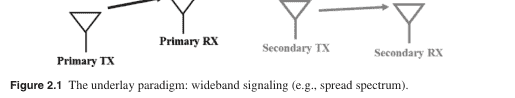

**图 2.1** 下层范式：宽带信号（例如，扩频）。

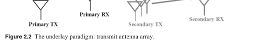

**图 2.2** 下层范式：发射天线阵列。

阈值时才可进行。干扰阈值可以相对于 *频谱掩码* 定义，*频谱掩码* 定义为下层频带内所有频率上干扰的功率谱密度（PSD）。或者，干扰阈值可以相对于平均功率约束定义，等于干扰 PSD 的积分。当干扰约束在带内变化时使用频谱掩码，例如，当不同的初级系统占据下层频带的不同的部分，并且这些系统对干扰的敏感度不同时。与确定其造成的精确干扰相比，次级用户可以将信号扩展到非常宽的带宽，使得在任何初级用户位置处干扰 PSD 低于噪声基底。这些扩展信号随后在各自的预期次级接收机处解扩。这种扩展技术是扩频和超宽带（UWB）通信的基础 [87]。或者，次级发射机可以对其输出功率非常保守，以确保其信号保持在规定的干扰阈值以下。在这种情况下，由于下层系统中的干扰约束通常相当严格，这将次级用户限制为短距离低速率通信。扩展和严重限制发射功率都不需要确定次级用户在初级接收机处的干扰。相反，这些下层方法采用保守设计，使得所有次级传输的集体干扰在任何地方都很小。这种集体干扰，有时称为 *干扰温度* [12]，将在第 4.2 节中更详细地讨论。确定次级发射机对初级接收机造成的精确干扰是下层系统中的最大挑战之一。次级用户可以通过窃听该初级用户的传输来确定在给定初级接收机处的这种干扰，如果它们之间的链路是互易的。对于 MIMO 系统，次级用户仅在其重叠的空间维度上干扰初级用户。如果次级用户仅占据 MIMO 初级接收机的零空间，则不会造成干扰，因此这属于下面讨论的交织范式，其中初级用户和次级用户占据正交的空间维度。下层范式在授权频谱中最常见，其中初级用户是许可方，但它也可以在免许可频段中使用，以为不同用户提供不同等级的服务。

### 2.2.2 叠加范式

叠加系统的前提，如图 2.3 所示，是次级发射机了解初级用户的传输数据序列（也称为其 *消息*）以及该序列的编码方式（也称为其 *码本*）。例如，如果初级用户遵循基于已公布码本的统一通信标准，则可以获得码本信息。或者，初级用户可以定期广播其码本。初级用户的数据序列可以通过在次级用户的接收机处对其进行解码或以其他方式获得，如第 2.7 节中进一步解释的。

知识 of a primary user’s data sequence and/or codebook can be exploited by the secondary transmitter in a variety of ways to improve the performance of both

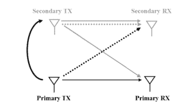

图 2.3 叠加范式。


次级系统和主系统。一方面，这些信息可用于抵消在次级接收机处由主信号引起的干扰。具体而言，像脏纸编码（dirty paper coding, DPC）[14] 这样的编码技术可用于对次级用户的信号进行预编码，使得次级接收机处的已知主用户干扰被有效消除。另一方面，在已知主用户的数据序列和/或码本的情况下，次级用户可以与主系统`合作`以改善其通信。具体而言，次级用户可将其功率的一部分用于自身通信，其余功率用于辅助（中继）主传输。用于`合作`的功率提高了主用户的信号与干扰加噪声功率比（SINR），而用于次级用户通信的功率会对主用户造成干扰，从而降低其 SINR。因此，次级用户的功率分配决定了主用户的 SINR 及其相关性能。此外，如果主接收机可被修改以解码其数据序列以及全部或部分次级用户的数据序列，则次级发射机对主接收机的干扰可被部分或完全消除。这保证了主用户的速率保持不变或可提高，而次级用户根据其为自身传输分配的功率获得容量。当存在多个次级用户和主用户时，次级用户用于`合作`的功率分配变得更加复杂，编码和解码技术也是如此。此外，每个用户类别都需要一个 MAC 协议。要使叠加系统成功，必须克服许多实际障碍。这些包括窃听主用户传输并对其进行解码的技术挑战，以及开发合理复杂度的编码和解码策略。此外，即使加密，共享主用户数据序列给次级用户也会对许多主系统引发重大的安全和隐私问题。这些挑战可能阻止在某些类型的系统中实现叠加。然而，在某些情况下，这些挑战并不适用。例如，当主用户数据是公开的时，例如在电视广播频谱内的蜂窝叠加中 [72]，隐私和安全问题不适用。注意，叠加范式可应用于许可或非许可频段通信。在许可频段中，当次级用户不降低其性能而是通过`合作`提高性能时，可能会被允许与许可用户共享频段。在非许可频段中，次级用户和主用户可能在频段中具有同等优先级，其中次级用户被视为`更具能力`。因此，次级系统可通过利用对主用户数据序列和编码策略的了解来减少对所有用户的干扰，从而提供更高效的频谱利用。

### 2.2.3 交织范式

交织范式基于`机会式通信`的思想，是认知无线电的最初动机 [62]。该思想是在 FCC [27]、大学 [6] 和工业界 [80] 开展的研究显示，大部分频谱在大部分时间并未被充分利用后产生的。换句话说，在许可和非许可频段中都存在临时性的空时频空洞，称为`频谱空洞`或`白空间`，如图 2.4 所示。空间频谱空洞可能位于单一空间维度，或对于 MIMO 设备，位于主用户未占用的空间维度子集（即主用户接收机的零空间）中 [101]。次级用户可以利用频谱空洞在相对于主用户信号的空间、时间或频率的正交维度上操作。因此，通过在频谱空洞上机会性重用，频谱利用率得到改善。交织技术需要在一个或多个空时频维度中检测主用户（许可或非许可）。这种检测相当具有挑战性，因为主用户活动随时间变化且取决于地理位置。第 4 章和第 5 章分别更详细地讨论了由单个接收机和多个接收机进行的频谱空洞检测。交织技术也可作为所有用户具有同等优先级的网络中的 MAC 协议。在这种设置中，现有传输被视为主信号，而新用户使用交织技术接入频谱，以使其不干扰活跃传输。

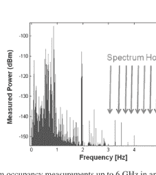

图 2.4 午间城市地区最高达 6 GHz 的频谱占用测量（伯克利无线研究中心 [6]）。

对于具有多个次级用户的交织网络，需要一个 MAC 协议在它们之间共享可用频谱空洞。鉴于该问题与传统网络中的介质访问控制相似，为此设置提出的协议通常源自传统 MAC 协议，如 ALOHA 和 CSMA [13]。也可以使用简单的时分机制，这可以大大简化容量分析。多用户交织网络的高级 MAC 协议利用多天线提供的额外空间自由度、基于更高级数学模型（如部分观测马尔可夫链）的优化，或博弈论和定价机制 [43, 88, 101, 102]。交织环境下介质访问的挑战超出传统 MAC 协议已解决的范围在于，要共享的信道是未知的，因为它取决于主用户的活动。这种主用户活动将取决于主系统的 MAC 协议，而该协议是完全独立于次级系统设计的。鉴于传统系统 MAC 协议的众多变体，开发有效的次级用户 MAC 协议仍然是交织系统设计的最大挑战之一。

总之，交织认知无线电是一种智能无线通信系统，它定期监测无线电频谱，检测主用户在时间、空间和频率上的占用，并在频谱空洞上以对主用户干扰最小的方式机会性通信。关于交织认知无线电所面临的信号处理挑战的额外动机和讨论在 [41] 中给出，以及第 4 章和第 5 章中。

### 2.2.4 认知无线电范式的比较

表 2.1 总结了下行、叠加和交织认知无线电方法之间的差异。虽然下行和叠加技术允许主用户和次级用户同时传输，但避免在时间、空间或频率的重叠维度上与主用户同时传输是交织技术的首要目标。我们还指出，认知无线电方法需要不同量的侧信息：下行系统需要了解次级发射机对主接收机的干扰，交织系统需要关于主用户活动的大量侧信息（可通过系统中一个或多个次级节点感知获得）而叠加系统需要大量侧信息（了解主用户的编码技术以及可能其传输的数据序列，以及网络中的信道条件）。除设备级功率限制外，次级用户在下行和交织方法中的发射功率分别由干扰约束和感知范围决定。最后，不同范式之间的硬件要求各不相同，如第 1.7 节更详细讨论。虽然下行、叠加和交织是认知无线电的三种不同方法，但也可以构建混合方案，结合不同方法的优点。例如，[96] 中结合了叠加和交织方法。

| 下层 | 叠加 | 交织 |
| :--- | :--- | :--- |
| **网络侧信息：** 次级发射机知道对主用户接收机造成的干扰。 | **网络侧信息：** 次级节点知道信道增益、编码技术，以及可能的主用户传输的数据序列。 | **网络侧信息：** 次级用户识别出主用户缺席的时空和/或频率上的频谱空洞。 |
| **同时传输：** 只要造成的干扰低于可接受的限值，次级用户就可以与主用户同时传输。 | **同时传输：** 次级用户可以与主用户同时传输；对主用户的干扰可以通过使用部分次级用户的功率来中继主用户的数据序列来抵消。 | **同时传输：** 只有在主用户活动检测漏检时，次级用户才会与主用户同时传输。 |
| **发射功率限制：** 次级用户的发射功率受其对主用户造成的干扰约束的限制。 | **发射功率限制：** 次级用户可以在任意功率下发射，对主用户的干扰可以通过中继主用户的数据序列来抵消。 | **发射功率限制：** 次级用户的发射功率受其能够检测到的主用户活动范围的限制（单独或通过协作感知）。 |
| **硬件：** 次级用户必须通过探测并利用信道互易性或通过协作感知来测量其对主用户接收机造成的干扰。 | **硬件：** 次级用户还必须监听主用户的传输。编码和解码复杂度也显著高于其他范式。 | **硬件：** 接收机必须具有频率敏捷性或具有用于频谱空洞检测的宽带前端。 |

表 2.1 下层、叠加和交织认知无线电技术的比较。

## 2.3 无线网络的基本性能极限

无线网络由一组通过公共无线信道通信的无线设备组成。最简单的无线网络由单用户（点对点）信道组成。通常，无线网络包含多个源节点，每个源节点将其信息通信到一组目的节点。无线网络可以具有支撑基础设施（例如蜂窝网络），或自组织结构，其中节点自行配置成网络且控制在节点之间分散。

多用户信道（单独或在蜂窝系统的单个小区内）的典型拓扑是多址接入（多个发射机到一个接收机）和广播（一个发射机到多个接收机）信道。这些信道分别对应于卫星系统或蜂窝系统中一个基站的上行链路和下行链路。在这些网络中，通信发生在向单个节点发送或从单个节点接收的一组节点之间。在自组织无线网络中，每个节点都可以作为源、目的和/或为其他用户转发数据的中继。

在认知无线电应用中，接入同一频谱的主用户和次级用户形成一个无线网络。主用户和次级用户由于主接收机处的干扰限制，以及可能不同的收发能力，具有不同的发射/接收约束。在认知无线电网络中，主用户可以是蜂窝式或自组织的，而次级用户通常是自组织的，并属于下层、交织或叠加范式。因此，这两种类型的认知无线电网络用户形成一个双层无线网络。无线网络的性能极限因此与认知无线电网络的性能极限直接相关。

特别是，自组织网络的基本容量极限不仅决定了在给定网络和干扰条件下次级用户可以传输多少信息，还限制了感知节点之间为协作评估频谱占用而可能进行的信息交换。在以下章节中，我们描述了与无线网络相关的广泛性能指标，包括其容量。然后我们正式定义单用户信道以及一般无线网络的互信息和容量。

### 2.3.1 性能指标

无线网络的基本性能极限定义了其相对于一个或多个特定指标的最佳可能性能。可以使用许多不同的指标来衡量性能，例如容量、吞吐量、中断、能量消耗，以及这些和其他指标的组合。由于无线网络表现出显著的动态性（用户移动、数据流量、信道变化等），这些动态性必须在网络性能指标的定义中予以考虑。


时不变通信系统最常见的根本性能极限是香农容量 [76] – 在渐近小错误概率下可在信道上实现的最高速率。香农简单而优雅的数学与他关于在噪声信道上编码以及通过互信息限制其基本数据速率极限的革命性思想相结合，激励了几代理论家和实践者，并为通信系统设计提供了重要见解。对于单用户信道，香农容量是一个数值，即信道的最大数据速率，正如下一节将以信道最大互信息的数学形式所定义的那样。对于多用户（广播或多址接入）信道，香农容量是一个 `K` 维区域，定义了所有 `$K$` 个用户同时可能的最大速率。无线单用户和多用户信道的香农容量在许多情况下是已知的，包括具有噪声、衰落、多径和/或多天线的静态和时变单用户、广播和多址接入信道 [4, 18, 33]。

## 时变信道建模

时变信道通常基于 *信道状态* 的概念进行建模。信道状态 `s` 位于所有可能信道状态的给定集合 `$\mathcal{S}$` 内，该集合可能是离散的或连续的。对于平稳且遍历的时变信道，在任何给定时间，假设信道处于状态 `s` 的概率为 `p(s)`，我们将状态 `s` 下的信道容量记为 `C(s)`。该模型也称为 *复合信道* [21]。接收端已知信道状态的时变平稳遍历信道的香农容量或容量区域因此称为 *遍历容量*，因为它对应于在特定信道状态（例如特定的衰落值）下的数据速率或速率区域，对信道状态的概率分布（例如衰落分布）取平均：

$$C_{\text{erg}} = \int_{s \in \mathcal{S}} C(s) p(s) ds. \qquad\qquad\qquad\qquad\qquad\qquad\qquad\qquad\qquad (2.1)$$

当信道状态在发射端已知时，传输策略和系统资源通常会适应时变信道，使得 `C(s)` 表示在状态 `s` 下信道的容量或容量区域，其中发射参数（如功率和速率）在所有信道状态上得到最优适配。

## 中断容量

平稳且遍历时变信道的另一种性能指标是 *中断容量*，即在某些信道状态（称为 *中断状态*）中暂停向一个或多个用户的传输，而在非中断状态中使用固定的传输速率。与中断容量相关联的平均数据速率则是可在非中断状态下以渐近小错误概率实现的最高固定速率，乘以非中断的概率（因为在中断状态下数据速率为零）。非中断状态的最大固定速率通常基于不是中断状态的最坏情况信道状态来确定。具体来说，对于给定的中断状态集合 `$\mathcal{S}_{\text{OUT}}$`，其中 `P(s \in \mathcal{S}_{\text{OUT}}) = P_{\text{out}}`，非中断状态为 `$\mathcal{S}'_{\text{OUT}} = \mathcal{S} - \mathcal{S}_{\text{OUT}}$`，中断容量由下式给出

$$C_{\text{OUT}} = \left( 1 - P_{\text{out}} \right) \left[ \min_{s \in \mathcal{S}'_{\text{OUT}}} C(s) \right]. \qquad\qquad\qquad\qquad\qquad\qquad\qquad\qquad\qquad\qquad\qquad (2.2)$$

中断容量指标基于这样一个基本假设：发射机知道信道状态，因此可以在中断状态期间暂停传输。因此，传输策略是二元的：在中断状态下不传输，在非中断状态下以固定速率传输。中断容量不能超过香农容量，因为后者会根据每个信道状态调整发射参数如功率和速率。然而，中断容量是语音和视频等需要固定速率传输的应用的有用指标。通过允许在某些状态下暂停传输，中断容量实现了比在所有信道状态（包括非常差的状态）下必须保持单一速率更高的平均速率。

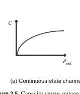

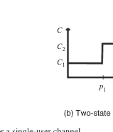

### Figure 2.5 单用户信道中容量与中断概率的关系

当发射端不知道信道状态时，所使用的性能度量是 *capacity versus outage probability*。在这种情况下，发射端无法适应信道条件；因此它选择一个给定的固定速率 `R`（单用户系统）或一组固定速率 **R**（多用户系统）来向用户（们）传输。如果信道支持这些速率，即这些速率在信道实现信道状态下的容量或容量区域内，则数据无误接收；如果不支持，则会发生被视为数据中断的错误。对于单用户信道，容量与中断概率度量采用函数形式，表征与每个中断概率 `P_{out}` 相关的容量 `C`。容量与中断概率函数，如图 2.5a 中对连续状态单用户信道所示，因此对应于发射端的数据速率与该速率无法被给定信道支持的概率。`C` 与 `P_{out}` 的图随 `P_{out}` 非递减，因为在高中断概率下，更多 *bad* 的信道状态无需支持速率 `C`，因此在非中断状态下可以实现更高的容量。现在考虑有限状态信道，其中信道状态集合 `$\mathcal{S}$` 是有限的，并假设状态按顺序排列，使得状态 `i` 中的容量 `C_i` 满足 `C_i \le C_j` 对于 `i \le j`。那么 `C` 与 `P_{out}` 具有阶梯形状，对于每个满足 `P_{out} = \sum_{i=1}^{n} p_i` 的 `n` 都有离散的增加，其中 `p_i` 是第 `i` 个信道状态的概率。例如，在一个两状态信道中，状态 `i` 的容量为 `C_i`，状态概率为 `p_i`，`i = 1,2`，如果 `C_1 < C_2`，则容量与中断的关系为 `P_{out} \ge p_1` 时为 `C_2`，`P_{out} < p_1` 时为 `C_1`，如图 2.5b 所示。有关遍历容量、中断容量和容量与中断的更多细节，可参见 [4, 32, 33, 36]。请注意，当信道是非遍历的，使得信道状态从集合 `$\mathcal{S}$` 中随机选择并在所有时间保持不变时，该信道被称为 *compound channel*。在这种情况下，容量通常对应于与最坏情况信道切片相关的可达速率 [90]。

## 一般无线网络容量

容量结果对于具有多个源和多个目的地的一般无线网络，即使是简单的静态模型，也非常有限。对于每个节点既是源又是目的地的 `K` 节点网络，容量是一个 `K \times (K - 1)`-维区域，定义了所有节点对之间可实现的最大速率。这种区域通常由二维切片表征，该切片定义了网络中两个源-目的对之间的最大速率。更一般的容量区域，其中一个源向多个目的地发送数据，也称为 *multicasting*，也可以进行分析，但我们在网络模型中不考虑多播。实际上，无线网络通常包括通过中继的多跳路由，其中中间节点将数据中继向其最终目的地。这种中继可以显著提高网络的可实现数据速率以及其他性能指标 [85]。系统设计中的其他先进能力，例如功率控制、多个频段以实现频率复用（在空间分离的位置重复使用相同频率），以及干扰消除，可以进一步提高网络性能。这在图 2.6 中有所说明（取自 [85]），其中展示了五节点网络在不同网络设计假设下的二维容量区域切片。我们从该图可以看到，频率的空间复用、多跳路由和干扰消除都显著提高了该切片内的可实现速率。

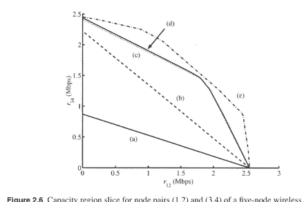

**Figure 2.6** 五节点无线网络中节点对 (1,2) 和 (3,4) 的容量区域切片 (a) 单跳路由，无空间复用。 (b) 多跳路由，无空间复用。 (c) 多跳路由与空间复用。 (d) 在 (c) 上增加功率控制。 (e) 在 (c) 上增加连续干扰消除 (SIC)。

许多最基本的无线网络的香农容量，包括图 2.7 中所示的三节点中继信道和四节点干扰信道，已数十年仍是未解问题。这使得对于这些及其他类似网络，尤其是当用户数量超过这些典型示例时，难以精确获得容量区域。相反，容量区域通常由其上下界表征，而非精确区域（这些界相遇之处）。下界比上界更容易获得，因为任何通信方案都会产生一个可达速率区域，该区域下界于容量区域。上界更难获得，因为它们必须包含所有可达速率区域。`Fano's inequality` 是获得容量上界最常用的工具 [34]。在推导容量缩放律方面也取得了显著进展，该律表征了最大用户速率之和在渐近大网络中的缩放方式 [99]。然而，这些定律仅提供了 `K \times (K-1)`-维网络容量区域上的一个点，即和速率点。特别是，网络的缩放律定义了和速率除以用户数量的比率在渐近大网络中的行为。和速率点，即容量区域上对应于同时可实现的最大用户速率之和的点，对于有限大小的网络也可能感兴趣，尤其是对称网络，其中该点定义了每个用户的最大对称速率。同样，*interference alignment* 可以在干扰网络中实现和速率点，但不能实现完整的容量区域 [7, 57]。

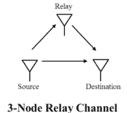

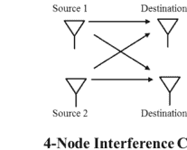

### 3 节点中继信道

### 4 节点干扰信道

Figure 2.7 容量未知的简单自组织网络。


认知无线电网络是无线网络，其中次级用户窃听网络中主用户传输并在编码和解码中使用该信息。从香农容量的角度来看，两用户认知无线电信道是对图 2.7 中两用户干扰信道的推广，因为假设主用户（源-目的对 2）的信息对次级用户（源-目的对 1）已知。特别是，在 underlay 范式中，源 1 知道它对目的 2 造成的干扰量；对于 interweave 范式，源 1 知道源 2 在时间、空间和频率维度上的活动（可能通过与目的 1 的协调）并在主用户活跃时在这些维度上停止传输；对于 overlay 范式，假设源 1 知道源 2 的数据序列和编码方案以及网络信道增益，并在其编码中使用该信息。`K` 用户干扰信道的容量结果在第 2.4 节给出，不同认知无线电范式的容量在第 2.5-2.7 节给出。

图 2.8 说明了无线网络性能区域的一个切片（该切片为 `K` 节点网络中的一个源-目的对），其中容量不是唯一感兴趣的性能指标。确实，延迟（平均、最大、尾概率或整个延迟分布）对许多应用而言是一个重要指标。此外，如果允许一定程度的中断或错误，动态无线信道可能表现出改进的速率（香农容量区域假设零中断）。为了说明一组网络性能指标的权衡，图 2.8 中的区域显示了 `K` 节点网络中给定源-目的对的数据速率（容量）、平均延迟和中断（以中断时间百分比 `100 × P_out` 衡量）之间的假设权衡。由于该区域包含三个性能指标，整个网络的维度将为 `K x (K - 1) x 3`；图 2.8 显示了该网络中选定源-目的对的数据速率、平均时延和中断之间的三维权衡。图示说明，随着系统对平均时延和中断的约束放宽，容量会增加。注意，发射功率在此性能区域中并非显式体现，而是底层模型的参数。其他模型参数可能包括可用带宽、每个节点的天线数量以及复杂度限制。容量度量通常随着时延和/或中断的增加而增加，如图所示，因为这意味着系统约束的放松。香农容量通常假设无限时延和零中断，因此图 2.8 中的这些维度会坍缩。中断容量和容量与中断的关系已在点对点和多用户信道中得到充分研究，但在一般无线网络中，中断可以针对网络内任意一组节点对声明，因此基本中断结果很少。

## 2.3 基本性能极限

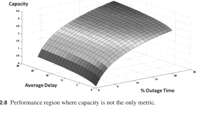

Figure 2.8 容量并非唯一度量指标的性能区域。

对于具有多个自由度的系统，即可在多个维度上传输数据的系统，不同性能指标之间的权衡可以更正式地表征。在此类系统中，部分自由度可用于分集，即在多个维度上发送相同信息以提高对错误和中断的鲁棒性。其他自由度可用于复用，即在多个自由度所支持的独立信道上对独立数据进行复用。与自由度相关的多个维度通常通过空间、时间和频率获得。时间和频率自由度通过将总的信号维度划分为正交的时间和频率时隙获得。空间维度通过发射端和接收端的多个天线即 MIMO 系统获得。对于单用户 MIMO 系统，Zheng 和 Tse [103] 在信号噪声功率比 `SNR` 渐近增大的极限下提出了基本的分集-复用权衡 `DMT`。在此设定中，复用增益 `r` 定义为用于数据传输的自由度数量：更正式地，是带宽归一化容量表达式中对数函数前面的常数（称为容量前对数）。分集增益 `d` 定义为在固定传输速率下，误码概率曲线作为 `SNR` 函数的斜率的负值。渐近高 `SNR` 下的分集-复用权衡被证明服从简单表达式 `d(r) = (M_t - r)(M_r - r)`，其中 `M_t` 和 `M_r` 分别是发射和接收天线的数量。`DMT` 区域也已针对广播、多址接入和中继信道进行了研究。单用户区域还被扩展以包含时延，形成了称为分集-复用-时延权衡 `DMDT` 区域 [25]。在此工作中，时延权衡由自动重传请求 `ARQ` 引入，`ARQ` 通过识别接收错误的数据并请求重传来提供鲁棒性。这在时间域引入了分集，但以请求重传的时延为代价。`DMDT` 也已在 [97, 98] 中扩展到具有 `ARQ` 的多跳网络，其中时延由排队和 `ARQ` 重传共同引起。`ARQ` 重传次数引发了分集-时延权衡，并且这些重传必须在网络中的所有跳以及端到端链路之间最优分配，以实现最优 `DMDT` 权衡。在 [67] 中还表征了分层协作下多跳网络的 `DMDT`，其中网络被划分为层级，协作在层内进行。

虽然容量、时延和中断是大多数无线网络的关键性能指标，但它们并非对每个系统都最关键。例如，由不可充电电池供电的节点，如传感器网络中典型的情况，能量消耗是一个关键指标。香农理论分析在 [89] 中用于获得点对点、多址接入和干扰信道的单位能量（成本）容量的基本结果。自这篇开创性论文以来，已有许多后续工作研究了在不同信道条件、不同输入字母表约束以及不同单用户和多用户信道模型下的单位成本容量。

对无线网络最相关的是 [3, 71]（及其中的参考文献）。其中第一项工作提出了无线网络的每焦耳比特容量，一种标度律，定义了网络每焦耳发射能量可交付的最大总比特数。该标度律被发现为 `(K/log K)^{0.5(γ-1)}`，其中 `γ` 为所有信道的共同路径损耗指数，`K` 为网络中的节点数。获得该能量标度律所使用的假设与用于开发容量标度律的假设相似。第二篇论文相对于大多数关于每比特最小能量的工作采取了独特的方法；它考虑总能量消耗——发射能量加上电路能量——而不是仅发射能量。特别是，[3] 在干扰视为噪声且用户传输正交调度的假设下，推导了无线多跳网络中总能量消耗与端到端数据速率之间的权衡。电路能量的包含，其中可能包括模拟前端电子以及信号处理硬件相关的能量，当发射功率不占总能量消耗主导时（例如在相对较短的传输距离下），会显著改变能量-速率权衡的性质。例如，复杂的编码和多天线技术可以节省发射功率但增加电路功率。同样，在多跳路由中，使用中间节点转发数据可节省总发射功率，但由于中间节点处理而增加电路功率。因此，网络中能量消耗的优化在很大程度上取决于传输距离（因为在较大距离下发射功率占主导，而在较小距离下不占主导），以及与收发器不同硬件模块相关的电路能量消耗的精确模型。对能量消耗与其他网络性能指标之间权衡的表征通常因缺乏硬件的基本能量消耗模型而受阻。因此，此类权衡的基本表征在很大程度上仍然是一个开放问题。鲁棒性对许多系统也很重要，但尚不清楚如何在数学度量中捕捉鲁棒性。信息论工具并不总是适合表征具有有界时延、复杂度和功率的网络中的基本性能极限。在 [34] 中，提出了一种新的理论框架，用于基于跨学科方法确定无线网络的基本性能极限，该方法将香农理论与网络理论、组合学、优化、随机控制和博弈论相结合。

我们现在继续正式定义单用户和多用户信道及网络的互信息和容量。这些定义也将在认知网络的更复杂容量分析中使用。

### 2.3.2 容量的数学定义

Shannon 的 *Mathematical Theory of Communication* [76, 77, 79] 用信道输入输出之间的互信息定义了单用户信道的容量，记为 `C`。此外，Shannon 证明了该容量等于在编码器或解码器复杂度和时延无约束的假设下，比特可以以任意小的误码概率传输的最大数据速率。在 Shannon 的传输方案中，数据嵌入到信道码中，数据速率对应于嵌入信息比特的传输速率。具体而言，对于任意 `R < C` 和任意 `P_e > 0`，Shannon 证明存在数据速率为 `R` 且误码概率为 `P_e` 的信道码。此外，工作在数据速率 `R > C` 的码无法实现任意小的误码概率，事实上此类码的误码概率远离零。

互信息所定义的

最基本的离散时间信道模型由随机输入 `X ∈ 𝒳`（也称为符号）、随机输出 `Y ∈ 𝒴` 以及 `X` 与 `Y` 之间的概率关系组成，该关系通常由 `Y` 给定 `X` 的条件分布或 `p(y|x)` 表征。对于连续随机变量 `p(y|x)` 是概率分布函数 pdf，对于离散随机变量它是概率质量函数 pmf。在此记法中，随机变量用大写字母表示（例如 `X`），而其实现和概率分布用小写字母表示（例如 `x` 和 `p(x)`）。如果信道具有记忆，使得给定时间 `n` 的输出 `y_n` 依赖于当前以及过去输入 `x^n = (x_1, …, x_n)`，则输入、输出和概率分布以向量 `X^n`、`Y^n` 和 `p(y^n|x^n)` 定义。信道被称为 *memoryless*，如果信道在任意时间 `n` 的输出与过去输入无关，即如果 `p(y_n|x^n) = p(y_n|x_n)`。假设输入和输出随机变量连续时，离散时间无记忆单用户信道的 *mutual information* 定义为

```
I(X ; Y) ≜ ∫_{𝒳, 𝒴} p(x, y) log ( p(x, y) / (p(x) p(y)) ) dx dy,  (2.3)
```


# 信道容量基础

其中积分是对随机变量 `$X$` 和 `$Y$` 的可能取值集合 `$\mathcal{X}, \mathcal{Y}$` 进行的，分别称为输入和输出 **字母表**，而 `p(x)`、`p(y)` 和 `p(x, y)` 表示随机变量的 pdf。当输入和输出字母表 `$\mathcal{X}$` 和 `$\mathcal{Y}$` 为有限时，积分变为对其联合 pmf 的求和：

$$I(X ; Y)=\sum_{\mathcal{X}, \mathcal{Y}} p(x, y) \log \left(\frac{p(x, y)}{p(x) p(y)}\right) . \tag{2.4}$$

对数函数通常以 2 为底，在这种情况下互信息的单位为每信道使用比特，因为输入 `$\mathcal{X}$` 和输出 `$\mathcal{Y}$` 对应于信道的一次使用。

## 单用户时不变信道容量

香农证明了大量单用户时不变信道的容量等于在所有可能的输入分布上最大化的信道互信息：

$$C=\max _{p(x)} I(X ; Y)=\max _{p(x)} \int_{\mathcal{X}, \mathcal{Y}} p(x, y) \log \left(\frac{p(x, y)}{p(x) p(y)}\right) d x d y, \tag{2.5}$$

## AWGN 信道

对于带宽为 `W`、接收信号功率为 `$\mathcal{P}$`、接收机噪声 PSD 为 `N_{0}` 的实数离散时不变加性白高斯噪声（AWGN）信道，信道由输入-输出关系描述

$$Y=X+Z, \tag{2.6}$$

其中 `X` 为信道输入，`Y` 为信道输出，`Z` 为信道引入的噪声。该信道的容量达到输入分布 `p(x)` 为高斯分布，从而得到信道容量

$$C=\frac{1}{2} \log _{2}\left(1+\frac{\mathcal{P}}{N_{0} W}\right) \quad \text { bits/channel use. \tag{2.7}$$

每信道使用比特的单位另称为每维比特。带宽为 `W`、传输时间为 `T` 的标量信道的维数为 `2 W T`。具有额外维度的信道，例如具有 `M` 个空间维度的 MIMO 信道，其维数为 `2 M T`。以每信道使用比特或每维度定义容量对于 MIMO 信道等多维信道是典型的，我们将遵循这一约定。在系统设计中，数据速率通常以每秒比特给出。我们可以将每信道使用比特（对应于 `2 W T` 维）转换为每秒比特（对应于 `T` 秒内的 `2 W` 维），方法是把 (2.7) 乘以 `2 W`，从而得到容量表达式

$$C=W \log _{2}\left(1+\frac{\mathcal{P}}{N_{0} W}\right) \quad \text { bits/second. \tag{2.8}$$

当信道具有衰减 `h`，使得 `Y=h X+Z` 时，其容量变为

$$C=W \log _{2}\left(1+\frac{|h|^{2} \mathcal{P}}{N_{0} W}\right) \quad \text { bits/second. \tag{2.9}$$

容量表达式通常以每秒比特为单位，除非另有说明。对于复数 AWGN 信道，实部和虚部信号分量构成正交信号维度，因此容量是 (2.8) 的两倍。

## 认知无线电与频率选择性衰落

认知无线电通常在比 AWGN 信道复杂得多的信道中运行。如第 3 章更详细讨论的那样，这些信道表现出快速或频率选择性衰落，而多天线信道表现出天线间的角度色散和衰落相关性。这些传播特性导致信道容量表征更为复杂。特别是，频率选择性衰落信道在频域上产生一组并行信道，如第 3.8 节更详细描述。让我们首先考虑一个在发送端和接收端均已知频率响应 `H(f)` 的时不变信道。首先假设 `H(f)` 在频率上是块衰落的，使得 `H(f) = h_{j}` 在带宽为 `W` 的子信道 `j` 上恒定。因此频率选择性衰落信道由一组并行的独立 AWGN 信道组成，其中第 `j` 个信道的 SNR 为 `|h_{j}|^{2}P_{j}/(N_{0}W)`。这里 `P_{j}` 是分配给该并行集中第 `j` 个子信道的功率，受功率约束 `$\sum_{j} P_{j} \leq P$` 的限制。该并行信道集的容量是各信道速率之和，且功率在所有信道上最优分配 [18, 28]

$$C = \max_{\mathcal{P}_{j}:\sum_{j}\mathcal{P}_{j}\le\mathcal{P}} \sum_{j} W \log_{2}\left(1 + \frac{|h_{j}|^{2}\mathcal{P}_{j}}{N_{0}W}\right), \tag{2.10}$$

最优功率分配可通过求解拉格朗日函数得到，从而得到最优功率分配

$$\frac{\mathcal{P}_{j}}{\mathcal{P}} = \begin{cases} \frac{1}{\gamma_{0}} - \frac{1}{\gamma_{j}}, & \gamma_{j} \geq \gamma_{0} \\ 0, & \gamma_{j} < \gamma_{0} \end{cases} \tag{2.11}$$

对于某个截止值 `$\gamma_{0}$`，其中 `$\gamma_{j} = |h_{j}|^{2}\mathcal{P}/(N_{0}W)$` 是假设分配整个功率预算时第 `j` 个子信道对应的 SNR。这种最优功率分配称为频率上的水填充，即将水（功率）倒入深度可变的碗中，深度为 `1/\gamma_{j}`，直到水线 `1/\gamma_{0}`。因此，功率更多地分配给增益高于截止值 `$\gamma_{0}$` 的子信道，而该截止值由功率约束决定。采用此最优功率分配时的容量则变为

$$C = \sum_{j:\gamma_{j}\ge\gamma_{0}} W \log_{2}(\gamma_{j}/\gamma_{0}). \tag{2.12}$$

该容量可通过在每个子信道上发送不同码率和不同发射功率的不同码来实现，类似于 OFDM 中使用的自适应技术。当 `H(f)` 连续时，在功率约束 `P` 下的容量与块衰落信道的情况类似，只是子信道容量之和被频域上每频率增量容量的积分所取代；细节可参见 [28, Section 8.5] [42]。

## MIMO 信道

现在考虑 MIMO 信道，其信道输入为随机向量 `$\mathbf{X} = (X_{1}, \ldots, X_{M_{t}})$`，从 `M_{t}` 个发射天线发送，信道输出为在 `M_{r}` 个接收天线处获得的向量 `**Y**` = (Y_1, ..., Y_M_r)，信道由每个发射天线与每个接收天线之间的复增益的 `M_{t} \times M_{r}` 矩阵 `**H**` 刻画。与 MIMO 信道输入和输出相关的多个维度产生了可传输独立数据流的多个空间自由度。假设信道在发送端和接收端均已知，容量通过优化这些空间自由度上的发射功率和速率分配来实现。具体而言，当信道 `**H**` 在发送端和接收端均恒定且完美已知时，以每信道使用比特为单位的容量（最大互信息）为

$$C = \max_{\mathbf{Q}:\operatorname{tr}(\mathbf{Q})=P}\log_{2}\det(\mathbf{I}_{N}+\mathbf{H}\mathbf{Q}\mathbf{H}^{H}) \tag{2.13}$$

其中优化是在输入协方差矩阵 `**Q**` 上进行的，`**Q**` 为 `M_{t} \times M_{t}`，按定义必须是半正定的。利用 `**H**` 的奇异值分解（SVD），MIMO 信道可转换为秩 (**H**) 个空间并行、无干扰的单输入/单输出信道 [32, 84]。对应于奇异值 `$\sigma_{j}$` 的第 *j* 个空间信道的 SNR 为 `$\gamma_{j}=|\sigma_{j}|^{2}\mathcal{P}_{j}/(N_{0}W)$`，其中功率 `$\mathcal{P}_{j}$` 在这些空间信道上最优分配，类似于频率选择性衰落的情况，从而在空间域上得到水填充功率分配。容量公式与频率选择性衰落情况相同，由 (2.12) 给出；基于每个空间维度 SNR `$\gamma_{j}$` 的该最优功率分配下并行空间信道容量的总和。

## 时变信道

对于时变信道，香农容量由遍历容量公式 (2.1) 给出。信道输入基于在时间上或等价地在每个信道状态上的发射功率最优分配，受平均功率约束：

$$\int_{s\in S}\mathcal{P}(s)p(s)ds\le\overline{\mathcal{P}}. \tag{2.14}$$

例如，考虑平坦衰落信道，其中瞬时 SNR `$\gamma$` 随时间按分布 `p(\gamma)` 变化。不同条件下衰落分布 `p(\gamma)` 的讨论可参见第 3.6 节。如果发射功率 `$\mathcal{P}(\gamma)$` 相对于 `$\gamma$` 自适应，受平均功率约束 `$\overline{\mathcal{P}}$`，则平坦衰落信道容量由下式给出


$$C = \max_{\mathcal{P}(\gamma)} \int_{0}^{\infty} W \log_{2}\left(1 + \frac{\mathcal{P}(\gamma)\gamma}{\overline{\mathcal{P}}}\right) p(\gamma) d\gamma. \tag{2.15}$$

最优功率分配 $\mathcal{P}(\gamma)$ 可通过求解拉格朗日函数得到，类似于频率选择性衰落的情况。这得到在时间上的水填充最优功率分配：

$$\frac{\mathcal{P}(\gamma)}{\overline{\mathcal{P}}}=\left\{\begin{array}{ll}\frac{1}{\gamma_{0}}-\frac{1}{\gamma}, & \gamma\ge\gamma_{0}\\0, & \gamma<\gamma_{0}\end{array}\right. \tag{2.16}$$

对于某个通过平均功率约束求得的“截止”值 $\gamma_0$。如果在时间 *t* 时 $\gamma(t)$ 低于此截止值，则该时刻不传输数据。在此最优功率分配下，时变平坦衰落信道的容量变为

$$C = \int_{\gamma_0}^{\infty} W \log_2 \left( \frac{\gamma}{\gamma_0} \right) p(\gamma)d\gamma, \qquad\qquad\qquad\qquad\qquad(2.17)$$

其中瞬时信噪比 $\gamma$ 对应的速率为 $W \log_2(\gamma/\gamma_0)$。由于 $\gamma_0$ 为常数，这意味着随着瞬时信噪比的增加，该瞬时信噪比下通过信道发送的数据速率也会增加。

时变平坦衰落信道、MIMO 信道和时不变频率选择性衰落信道之间存在很强的相似性，因为这些信道分别可以用一组在时间、空间或频率上独立的并行信道来表示。这一特性可以在认知无线电范式中得到利用，特别是交织范式。具体来说，如果认知无线电能够感知到主用户未利用的时间、空间或频率上的某个维度，则可以在不损害主系统的情况下占用该维度。交织系统的容量分析基于这一概念，其中交织认知无线电信道被建模为随时间、频率或空间变化的信道。当某个维度被主用户占用时，在完美感知下，该维度的交织信道对认知无线电不可用，即假定其信噪比为零。然后可以直接应用上述关于时间、空间或频率上并行信道的容量分析来确定交织认知无线电的容量，如第 2.6 节所述。

多用户信道和无线网络的容量也建立在互信息概念之上。然而，随着用户数量的增加，编码和解码策略及其相关的互信息变得更加复杂，因此容量区域通常由一组互信息界限定义，这些界限隐式地定义了容量区域边界。在进入不同认知无线电范式的容量结果之前，我们首先回顾干扰信道的容量结果。由于正如第 2.3.1 节所讨论的，认知无线电网络是图 2.7 中干扰信道的推广，干扰信道的容量区域和最优编码与解码策略将为获得认知网络的容量和设计见解提供基本构建模块。

### 2.3.3 无线网络的容量区域

我们考虑一个由 $K$ 个源-目的对组成的无线网络，它们通过一个公共无线信道通信，如图 2.9 所示。我们假设一个离散时间网络模型，具有离散的信道输入和输出。在每个时间瞬间，源 $s_k$ 从可能的输入的有限集合 $\mathcal{X}_k$ 中选择一个信道输入 $X_k$。每个目的节点 $d_j$ 从输出集合 $\mathcal{Y}_j$ 中观察到一个信道输出 $Y_j$。信道由条件分布 $p(y_1, \dots, y_K | x_1, \dots, x_K)$ 描述，它表征了在给定的信道输入集合 $(x_1, \dots, x_K)$ 下，目的端出现给定输出集合 $(y_1, \dots, y_K)$ 的概率。源 $s_k$ 希望以速率 $R_{k}$ 向目的 $d_{k}$ 通信一个数据序列或

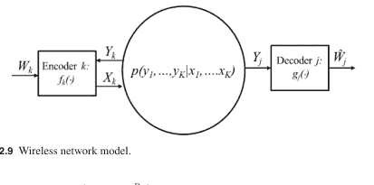

图 2.9 无线网络模型。

消息 $W_{k}\in\mathcal{W}_{k} = \{1, \dots, 2^{nR_{k}}\}$。为此，源编码器将数据序列映射为由输入字母表中的 $n$ 个符号组成的码字 $X_{k}^{n}$，并在 $n$ 个时间瞬间通过信道发送。所有数据序列相互独立。在接收到长度为 $n$ 的序列 $Y_{j}^{n}$ 后，解码器 $j$ 将其映射为所传输数据序列的估计，记为 $\hat{W}_{j}$。数据序列集合 $\mathcal{W}_{1}, \mathcal{W}_{2}, \dots, \mathcal{W}_{K}$ 以及所有用户的编码器和解码器映射定义了该信道的一个 $(R_{1}, R_{2}, \dots, R_{K}, n)$ 码。源 $s_{k}$ 在时间 $i$ 对数据序列 $W_{k}$ 的编码函数由下式给出

$$X_{k,i} = \mathit{f}_{k,i}(W_{k}, Y_{k}^{i-1}), \quad\quad k = 1, \dots, K. \tag{2.18}$$

注意编码函数 $\mathit{f}_{k,i}(\cdot)$ 允许源使用其接收器对信道的先前观测（通常通过反馈获得）来编码 $W_{k}$。这使得源能够获得关于其他用户发送的数据序列的信息，并可能通过网络转发它们。目的 $j$ 在时间 $i$ 的解码函数由下式给出

$$\hat{W}_{j} = g_{j}(Y_{j}^{n}), \quad\quad j = 1, \dots, K. \tag{2.19}$$

当 $\hat{W}_{k} \neq W_{k}$ 时，目的 $k$ 发生解码错误。我们认为除非所有目的都正确解码其数据序列，否则发生错误。因此，错误概率由与每个不同数据序列的错误检测相关的错误事件的并集的概率给出：

$$P_{e} = P \left[\bigcup_{k=1}^{K} \left[\hat{W}_{k} \neq W_{k}\right]\right]. \tag{2.20}$$

如果对于足够大的 $n$ 的码，错误概率可以任意小，则速率 $(R_{1}, \dots, R_{K})$ 在所考虑的网络中可以同时实现。更精确地说，速率 $(R_{1}, R_{2}, \dots, R_{K})$ 是可实现的，如果对于任意 $\epsilon > 0$，对于足够大的 $n$，存在一个 $(R_{1}, R_{2}, \dots, R_{K}, n)$ 码使得 $P_{e} \leq \epsilon$。容量区域是所有可实现速率 $(R_{1}, \dots, R_{K})$ 集合的闭包，这是由于在速率区域上任意点集合相关策略之间的时分复用。

## 2.3 基本性能极限 61

上述公式假设每个数据序列有一个目的。此定义可以扩展到包括向一组目的的多播、从一个源向一组目的的广播或从多个源向单个目的的多址接入。一般无线网络的容量区域未知。网络性能的一般外界限由割集界 [2, 18, 23, 78] 提供，叙述如下。

令 $\mathcal{S}$ 表示所有网络节点的一个子集，$\mathcal{S}^c$ 为 $\mathcal{S}$ 的补集。配对 $(\mathcal{S}, \mathcal{S}^c)$ 是分离源 $s_k$ 和目的 $d_k$ 的一个 *cut*，如果源 $s_k \in \mathcal{S}$ 且 $d_k \in \mathcal{S}^c$。

### 割集外界限

任何可实现的 $(R_1,\dots,R_K)$ 满足

$$\sum_{s_k \in \mathcal{S}, d_k \in \mathcal{S}^c} R_k \leq I(X(\mathcal{S}); Y(\mathcal{S}^c) | X(\mathcal{S}^c)),$$ (2.21)

其中互信息针对任意 $\mathcal{S}$ 的某个分布 $p(x_1,\dots,x_K)$ 评估。$R_k$ 是从源 $s_k$ 到目的 $d_k$ 穿过割的速率。我们观察到 (2.21) 将穿过割的总速率限制为 $\mathcal{S}$ 中所有源与 $\mathcal{S}^c$ 中所有目的之间的条件互信息，给定 $\mathcal{S}^c$ 中所有源。

作为割集外界限的一个例子，考虑 $K$ 个源-目的对，具有带宽 $W$ 的 AWGN 链路。信道输入和输出然后由向量定义

$$\mathbf{Y} = \mathbf{H}\mathbf{X} + \mathbf{Z},$$ (2.22)

其中 `X` 是所有源的信道输入向量，具有平均功率约束 `P`，`Y` 是所有信道输出的向量，`H` $\in \mathbb{R}^{K\times K}$ 是信道增益矩阵，`Z` 是目的端独立的单位方差高斯噪声向量。式 (2.21) 中的割集界评估为 [24]


$$\sum_{s_k \in \mathcal{S}, d_k \in \mathcal{S}^c} R_k \leq W \log_2 \det \left(\mathbf{I} + \mathbf{H}(\mathcal{S})\mathbf{K}(\mathcal{S})\mathbf{H}(\mathcal{S}^c)\mathbf{I}\right),$$ (2.23)

其中 `I` 是单位矩阵，$\mathbf{K}(\mathcal{S})$ 是给定 $\mathbf{X}(\mathcal{S}^c)$ 时 $\mathbf{X}(\mathcal{S})$ 的协方差矩阵，且 `H(S)` 由下式确定

$$\mathbf{Y}(\mathcal{S}^c) = \mathbf{H}(\mathcal{S})\mathbf{X}(\mathcal{S}) + \mathbf{H}^{T}(\mathcal{S})\mathbf{X}(\mathcal{S}^c) + \mathbf{Z}(\mathcal{S}^c).$$ (2.24)

作为割集外界限的另一个例子，考虑图 2.7 所示的三节点中继信道。假设链路为带宽 `W` 的 AWGN 链路。令 `X_s` 表示源发送的符号，`X_r` 表示中继发送的符号。源和中继功率分别用 `P_s` 和 `P_r` 表示。目的和中继处接收的符号分别为 `Y_d` 和 `Y_r`。网络中有两个割：在第一个割中，只有源构成集合 `S`，而在第二个割中，源和中继构成集合 `S`。割集界 (2.21) 评估为

$R \leq \max_{p\{x_s, x_r\}} \min\{I(X_s; Y_r | X_d), I(X_s, X_d; Y_r)\}$. (2.25)

在 AWGN 中继信道中，这给出

$R \leq \max_{0 \leq \rho \leq 1} \min\{W \log_2 (1+P_s+P_r+2\rho\sqrt{P_s P_r}), W \log_2 (1+(P_s+P_r)(1-\rho^2))\}$, (2.26)

其中我们将噪声功率归一化为一。参数 `ρ` 决定了源和中继输入 `X_s` 和 `X_r` 在目的地的相干合并增益。较大的 `ρ` 对应于更大的增益。

割集界仅在某些特殊情况下才是紧的外界。总体而言，割集界相对于网络容量区域来说是松的。可以通过使用基于 *genie* 的技术来推导割集外的替代外界，其中网络被修改以假设附加信息是已知的（即由一个 genie 提供）给终端的子集。提供这些信息的目标是获得一个修改后的网络，其容量或外界可以得到。由于附加信息，修改后的网络优于原始网络。因此，其容量（或其上的任何外界）为原始网络提供了容量外界。外界也可以通过 *the theory of network equivalence* [50] 得到。这种方法提供了在该条件下无线网络的容量可以由等效的无噪声比特管道网络的性能上界限制的条件，而该等效网络的容量随后可以确定。收紧割集界的另一种技术是通过修改网络连通性图 [52, 53]。

获得无线网络的香农容量区域通常是不可处理的；事实上，诸如中继信道和干扰信道等若干简单典型拓扑的容量已数十年仍是开放问题。作为一种替代的容量度量，Gupta 和 Kumar [38] 的里程碑式结果引入了非拥塞无线网络吞吐量的缩放律概念，随着网络中节点数 `K` 渐近增大。他们发现以每秒比特数计的网络中每个节点的吞吐量随 `K` 减小，速率介于 `1/\sqrt{K\log K}` 和 `1/\sqrt{K}` 之间。换句话说，网络的每节点速率趋于零，尽管总网络吞吐量等于速率之和，以介于 `\sqrt{K/\log K}` 和 `\sqrt{K}` 之间的速率增长。这一惊人结果表明，即使干扰被当作噪声处理（正如实际设计中典型的做法），即使在最优路由和调度下，大型自组织无线网络的每节点速率也会趋于零。其原因在于这种相对简单的中继方案中，中间节点花费了大量资源转发其他节点的数据包，因此用于发送自身数据的资源很少。对该结果的后续工作很多，包括移动性、多个天线和协作对无线网络缩放律的影响 [5, 36, 68]。特别是，[68] 表明更复杂的协作方案允许大型网络中的每节点速率随网络规模保持恒定而不是减小。通过吞吐量（以缩放律计）和渐近大网络中的延迟之间的权衡在 [22, 39, 85] 中得到了表征。

## 2.4 无认知干扰信道

### 2.4.1 K用户干扰信道

在认知无线电网络中，我们希望表征与主用户对之间以及次用户对之间通信相关的容量。虽然可以设想部署中继以改善性能，但这些网络通常不涉及信息的多径路由，即没有通过中间节点转发信息。在没有认知的情况下，具有 K 个源-目的对的网络可以建模为 K 用户干扰信道，如图 2.10 所示。虽然该信道的容量区域一般未知，但在理解如何应对该模型中的干扰方面取得了很大进展，从而开发出该信道的频谱高效传输方案。在某些情况下，这些技术可达到容量。由于主用户和次用户的不同能力和限制，认知无线电网络形成了一个双层 K 用户干扰信道。能够有效应对干扰的方案可以改善这些网络中主用户和次用户的性能。因此，一些为干扰信道开发的技术也被采用到叠加认知网络中。我们接下来回顾这些技术、其性能和已知的容量结果。此外，认知还使额外的编码/解码技术得以提高性能。因此，干扰信道的性能可以作为认知网络容量的下界。

在 K 用户干扰信道模型中，K 个源中的每一个都希望通过共享无线信道与其对应的目的地通信，如图 2.10 所示。源 `s_k` 以速率 `R_k` 对数据序列 `W_k` 编码并发送到目的地 `d_k`。K 用户干扰信道是 K 用户无线网络的特例，因此我们使用第 2.3.1 节中对编码、解码、错误概率和容量的相同定义。然而，干扰信道中第 k 个用户的编码函数由

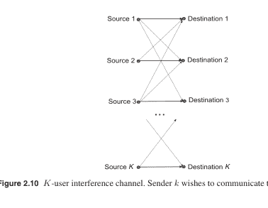

`X_{k}^{n}=f_{k}\left(W_{k}\right)`. (2.27)

给出。因此，在这种情况下，每个源处的信道输入仅取决于其自身的数据序列，而该数据序列又独立于其他源的数据序列。因此，源之间在传输彼此数据序列的信息时不存在协作（例如中继）。割集界 (2.21) 然后可以收紧为

$\sum_{s_{k}\in\mathcal{S}_{n},\ d_{k}\in\mathcal{S}_{n}^{c}} R_{k}\leq I\left(X(\mathcal{S}_{n});Y(\bar{\mathcal{S}_{n}})|X(\mathcal{S}_{n}^{c}),V\right)$ (2.28)

对任意 `p(v)\prod_{k} p(x_{k}|v)` 成立，其中 `V` 被称为 *time-sharing random variable*，具有在给定 `V` 的条件下输入 `{x_{k}}` 相互独立的性质。

容量区域的下界是通过在给定网络中部署特定的通信技术获得的。我们接下来给出实现两用户干扰信道特殊情况容量的编码方案。

### 2.4.2 两用户干扰信道容量

两用户离散时间无记忆干扰信道如图 2.11 所示。干扰信道仅包含两个通信对（`K=2`）。因此，有两个信道输入 `X_1` 和 `X_2`，以及两个信道输出 `Y_1` 和 `Y_2`。离散时间信道由条件分布 `p(y_1,y_2|x_1,x_2)` 刻画。每个源 `s_k`，`k=1,2`，希望发送数据序列 `W_k \in \mathcal{W}=\{1,\dots,2^{nR_k}\}` 到目的地 `d_k`。信道码、错误概率和容量区域的定义遵循 K 用户干扰信道的定义。特别是，`(R_1,R_2,n)` 码由两个数据序列集 `\mathcal{W}_1,\mathcal{W}_2`、两个编码函数

`X_{1}^{n}=f_{1}\left(W_{1}\right)`. (2.29)

`X_{2}^{n}=f_{2}\left(W_{2}\right)` (2.30)

和两个解码函数

`\hat{W}_{k}=g_{k}\left(Y_{k}^{n}\right), \quad k=1,2`. (2.31)

组成。

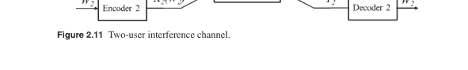

该码的错误概率为

$$P_{\mathrm{e}}=P\left[\left[\hat{W}_{1} \neq W_{1}\right] \cup\left[\hat{W}_{2} \neq W_{2}\right]\right].$$

若对任意 `\epsilon>0`，当 `n` 足够大时存在 `(R_{1}, R_{2}, n)` 码使得 `P_{\mathrm{e}} \leq \epsilon`，则速率对 `(R_{1}, R_{2})` 是可达的。干扰信道的容量区域是所有可达速率对 `(R_{1}, R_{2})` 集合的闭包。

我们还将考虑由下式定义的双用户 AWGN 干扰信道


# 干扰信道模型

$$\begin{array}{l}Y_{1}=X_{1}+h_{12} X_{2}+Z_{1}, \\ Y_{2}=h_{21} X_{1}+X_{2}+Z_{2},\end{array}$$

其中 $h_{12}$ 和 $h_{21}$ 是干扰链路的（实数）交叉信道增益，$\mathbb{E}\left[X_{k}^{2}\right] \leq \mathcal{P}_{k}$ 为功率约束，且 $Z_{k} \sim \mathcal{N}(0,1)$，$k=1,2$，其中 $\mathcal{N}(0, \sigma^{2})$ 表示方差为 $\sigma^{2}$ 的高斯分布。

## 强干扰

干扰信道的容量在 `strong` 干扰情况下是已知的 `[15]`。在此区间，每个接收机处的干扰信号足够强，使得由该信号携带的另一用户的数据序列可以被解码并因此被移除。此时每个接收机解码两个数据序列都是最优的。在 `AWGN` 干扰信道 (2.33) 中，强干扰条件由 `[40,74]` 给出

$$\begin{array}{l}\left|h_{12}\right| \geq 1, \\ \left|h_{21}\right| \geq 1,\end{array}$$

这意味着在此区间交叉信道增益大于直达链路增益。

在一般离散无记忆信道中，强干扰条件可以用条件互信息不等式表示。这些条件要求

$$\begin{array}{l}I\left(X_{1} ; Y_{1} \mid X_{2}\right) \leq I\left(X_{1} ; Y_{2} \mid X_{2}\right), \\ I\left(X_{2} ; Y_{2} \mid X_{1}\right) \leq I\left(X_{2} ; Y_{1} \mid X_{1}\right)\end{array}$$

对每个分布 $p\left(x_{1}\right) p\left(x_{2}\right)$ 都成立。从 (2.35) 我们观察到在给定 $X_{2}$ 的条件下，$Y_{2}$ 关于输入 $X_{1}$ 包含的信息比 $Y_{1}$ 更多。因此，$X_{1}$ 向接收机 2 传递的信息比向接收机 1 更多。对 (2.36) 可以做出类似的解释。

## 容量区域

强干扰下的容量区域由下式给出

$$\begin{gathered}\mathcal{C}=\bigcup\left\{\left(R_{1}, R_{2}\right): R_{1} \geq 0, R_{2} \geq 0,\right. \\\left.\begin{array}{l}R_{1} \leq I\left(X_{1} ; Y_{1} \mid X_{2}, V\right), \\ R_{2} \leq I\left(X_{2} ; Y_{2} \mid X_{1}, V\right), \\ R_{1}+R_{2} \leq \min \left\{I\left(X_{1}, X_{2} ; Y_{1} \mid V\right), I\left(X_{1}, X_{2} ; Y_{2} \mid V\right)\right\}\end{array}\right\}\end{gathered}$$

其中并集是对形式为 $p(v) p\left(x_{1}|v\right) p\left(x_{2}|v\right)$ 的分布取的，且 $V$ 再次是一个时间共享随机变量，使得在给定它的条件下输入是独立的。

容量区域 (2.37) 可另行表示为两个相关多址信道 (MAC) 速率区域的交集 `[18]`：

$\mathcal{C}=\bigcup\big\{\mathcal{R}_{\mathrm{MAC}_{1}}\cap \mathcal{R}_{\mathrm{MAC}_{2}}\big\}$.  (2.38)

回顾一下，多址信道由多个发射机同时向一个接收机发送组成。在图 2.11 中，信道 `MAC1` 由两个编码器和解码器 1 组成，类似地，信道 `MAC2` 由两个编码器和解码器 2 组成。该网络的容量区域通常是对干扰信道容量的下界，因为两个接收机都需要解码来自两个源发送的数据序列。相比之下，在相反的信道中，每个接收机仅解码来自一个源发送的数据序列。然而在强干扰下，每个接收机可以在不降低干扰信道容量区域的情况下解码不需要的数据序列，并且干扰信道的容量区域随后与 (2.38) 重合。

注意，在强干扰下，容量是通过解码器对两个数据序列进行联合解码来实现的。在 *非常强* 干扰的特殊情况下，解码器无需执行数据序列的联合解码。相反，可以逐次执行干扰消除，从而实现所需数据序列的无干扰解码 `[10]`。

## 弱干扰

我们接下来考虑干扰较弱的相反干扰区域。在该区域中，干扰数据序列无法被解码，但它不足以显著降低受影响用户的速率。当干扰较弱时，直观上我们期望最优的解码策略是将其视为噪声。然而，很难证明这种直觉是正确的，因此容量仍然未知。在两用户高斯信道中，将干扰视为噪声导致和速率容量的条件已在 `[1, 63, 75]` 中确定。在该区域（在 `[75]` 中称为 *噪声干扰*），式 (2.33) 中的交叉信道增益 $h_{12}$ 和 $h_{21}$ 以及发射功率 $P_{1}$ 和 $P_{2}$ 较小；具体来说，它们满足

$h_{12}(h_{21}^{2}P_{1}+1)+h_{21}(h_{12}^{2}P_{2}+1)\leq 1.  \tag{2.39}$

和速率容量随后由 `[75, Theorem 2]` 给出

$C=W \log _{2}\left(1+\frac{P_{1}}{1+h_{12}^{2}P_{2}}\right)+W \log _{2}\left(1+\frac{P_{2}}{1+h_{21}^{2}P_{1}}\right).  \tag{2.40}$

该结果的证明使用了高斯干扰信道的基于天才的外界限。

上述描述的区域是关于接收机所经历和移除的干扰量的两个极端。毫不奇怪，在强干扰下，最高速率方案是解码不需要的数据序列并减去其对应的信号，从而从接收信号中消除其干扰。在弱干扰的另一极端，最高速率策略是忽略干扰，即将其视为噪声。

在介于两个极端之间的区域中，干扰不足以使解码不需要的数据序列成为最优，也不足以

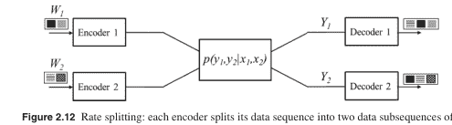

Figure 2.12 Rate splitting: each encoder splits its data sequence into two data subsequences of lower rate, and encodes them via superposition coding. Each decoder jointly decodes one data subsequence of the other user together with its desired data sequence.

在不损失最优性的情况下被视为噪声。在这种情况下，部分解码干扰数据序列以部分消除接收信号中的干扰是有益的。这一思想在 Carleial 提出并随后由 Han 和 Kobayashi 改进的方案中得以实现，也称为速率分裂 `[11, 40]`。速率分裂概念如图 2.12 所示。为了执行速率分裂，每个编码器将其数据序列分为两个速率更低的数据子序列，并通过叠加编码对其进行编码，叠加编码最初是为广播信道开发的 `[16]`。在叠加编码中，源使用单独但相关的码本对两个数据序列进行编码。具体来说，它根据最优输入分布对第一个数据序列进行编码，并根据两个数据序列之间的最优条件分布对第二个数据序列进行编码。单独编码使每个接收机能够与自己的数据序列一起联合解码另一个用户 intended 的一个数据子序列，同时将携带另一个不需要的数据子序列的信号视为噪声。该用户的通信速率由于干扰减少而增加，但另一通信对的速率由于额外的解码约束而下降。因此，在仅发送给期望接收机的信息量与在另一接收机处解码的干扰量之间存在权衡。

在 `AWGN` 干扰信道中，这种编码权衡转化为优化分配给编码器数据序列两个部分的功率。通过选择高斯码本，即根据高斯分布生成的随机码本，以及特定的功率分配，`Han-Kobayashi` 方案实现了距离两用户干扰信道容量每维一个比特以内的速率 `[26]`。功率分配的选择使得每个接收机处产生的干扰功率与该接收机处的加性高斯噪声功率相同。因此，产生的干扰足够弱，不会显著损害性能。同时，在每个目的地解码的不需要的数据序列允许显著的干扰降低。在第 2.7 节中，我们将详细介绍速率分裂如何在叠加认知无线电网络中使用。


在 `K` 用户干扰信道中，每个接收机都受到来自多个源的干扰。一个 `Han-Kobayashi` 方案的推广将允许部分解码每个干扰信号。接收机随后可以与其自己的数据序列一起联合解码由速率分裂码设计决定的干扰数据序列的一部分。虽然这种推广在数学上是可能的，但它会导致每个节点非常复杂的编码和解码方案。具体来说，这种方法要求接收机 *分别* 解码来自许多干扰者发送的干扰数据序列的部分以减少干扰。相反，每个接收机的干扰可以通过 *干扰对齐* [7, 57] 或通过 *结构化码* [65] 以更有效的方式 *整体* 处理。这些方法利用了接收机对干扰数据序列相关信息的兴趣缺失，因此无需解码它们（或其部分）。干扰对齐实现了干扰信道中的最优容量缩放规律 [69]。晶格码在 `$K$` 用户干扰信道中优于 `Han–Kobayashi` 方案 [83]。

本节迄今为止考虑的 `AWGN` 信道假设信道系数恒定，因此无法捕捉平坦或频率选择性衰落。结合这些信道特性通常会导致更难分析的信道模型。然而，这些特性为利用衰落的编码和传输策略提供了可能性。特别是，频率选择性和时变信道可以建模为并行干扰信道 [8]。[8] 中的结果表明，并行干扰信道通过子信道间的联合编码得到优化。这与点对点、多址接入和广播并行信道形成对比，在这些信道中子信道上的单独编码是最优的。对 `$K$` 用户干扰信道的进一步探索表明，时变特性可以被利用来对抗干扰的形式，即干扰对齐。干扰对齐依赖于信道时变特性来实现系统中每个用户的无干扰容量的一半 [7, 66]。

### 2.4.3 Interference channel techniques for cognitive radios

在没有认知能力的干扰网络中，避免干扰的一种合理传输方案是分割带宽并为每个通信对分配正交信道，例如通过 `MAC` 协议在时间、频率或空间上正交划分信道。在认知无线电网络中，这对应于为避免认知用户与主用户之间的干扰而采用的交织方法。然而，通常将带宽正交划分会降低频谱效率，与将全带宽分配给所有用户然后应对引入的干扰相比。一个例外是在 *低信噪比区域*，其中网络受功率限制而非干扰限制。在该区域中，与功率相比带宽充足，因此为用户分配正交信道不会带来性能损失。在干扰受限区域则不再如此。此外，随着网络用户数量的增加，正交 `MAC` 方案的每个用户速率趋于零。这一推理强调了为什么叠加方法可能比交织方法更具频谱效率的技术，适用于认知无线电。我们在第 2.6 节和第 2.7 节分别分析交织和叠加认知无线电的容量区域。

速率分割和叠加编码也可以应用于处理叠加认知无线网络中的干扰。叠加认知无线电与一个或多个主用户共享其带宽，从而在接收端产生干扰。同时，次级用户接收端也会遭受来自主用户传输的干扰。因此，有效地处理干扰可以提高系统中次级用户和主用户的性能。我们将看到，在叠加认知无线电系统中存在一个强干扰区域，在该区域内，解码非期望的数据序列是最优的。类似地，还存在一个弱干扰区域，在该区域内，将干扰视为噪声不会损失最优性。

此外，认知能力使无线电设备能够部署在无认知干扰信道中无法部署的传输策略。通过监听信道，假设主用户的安全和隐私问题可以得到解决，次级用户可以获得关于主用户数据序列的信息。然后，次级用户可以通过中继这些信息（或其一部分）给主用户接收器，从而与主用户合作，提高主用户的性能。如果次级用户将其部分功率用于中继主用户数据序列，其余功率用于传输其自身信息，那么功率分配应选择使得主接收器处的信干噪比（`SINR`）比产生相同或优于次级用户不存在时的性能。

总之，与无认知的无线网络相比，认知无线电可以利用为干扰信道开发的技术来处理干扰。此外，认知能力使次级编码器能够通过预编码对抗干扰，从而保护其自身信息免受主系统造成的干扰的影响。这些技术将在第 2.7 节中更详细地描述。

## 2.5 底层认知无线网络

认知的底层方法允许主用户和次级用户之间进行频谱共享，前提是次级用户造成的干扰不会明显降低主用户的性能。当主用户的性能由其每个信号维度上的信干噪比（`SINR`）衡量时，次级用户对任何主用户造成的干扰通常被限制在给定的频谱掩模内，即对频率上干扰的功率谱密度（`PSD`）进行限制，对于 `MIMO` 信道，还包括空间上的限制。反过来，干扰约束对任何主接收器处从所有次级发射器接收到的每个维度的总功率谱密度施加了约束。或者，可以定义一个平均干扰约束，即所有信号维度上的平均干扰功率低于给定阈值。为了满足干扰约束，可以对次级传输施加多种不同的条件。当主用户和次级用户经历时变信道时，主用户的性能要求可以基于在每个时间瞬间满足给定的峰值干扰约束，或限制时间上的平均干扰。另一种底层范式不施加干扰约束，而是施加主用户容量的最小值约束。

然而，这不是一个常见的范式，因为对于次级用户来说，确定其对主接收器造成的干扰比确定其造成的容量下降更简单。因此，我们将重点关注在施加于次级用户的干扰约束下的底层系统的容量。

当多个次级用户和主用户共存时，其干扰约束需要在受次级用户干扰影响最大的主用户处得到满足。如前所述，满足干扰条件要求次级发射器知道到主接收器的信道。否则，为了确保在未知信道条件下满足干扰约束，次级用户的发射功率需要受到严格限制。在存在多个次级用户的情况下，确定主接收器处的干扰变得更加苛刻，因为干扰取决于所有次级发射器的发射功率和信道条件，本节后面将更详细地描述。

### 2.5.1 底层容量区域

底层认知无线电网络的容量区域可以遵循无线自组网网络的容量定义进行定义，同时考虑主用户处的干扰约束。容量和干扰约束都将取决于信道特性。为了定义接收功率约束，我们首先考虑一个具有一个次级用户和一个主用户的窄带系统，如图 2.13 所示。我们在下文将其扩展到具有多个主用户和次级用户的网络。在这个双用户网络中，干扰约束转化为主用户接收器处次级用户信号的接收功率约束。设 `$X_{i}$` 表示次级用户在时间 `$i$` 的信道输入，`$Y_{i}$` 表示主接收器处对应的信道输出。假设次级发射器和主接收器之间的信道是无记忆的，因此可以用时间 `$i$` 处的条件概率分布 `p(y|x)` 来描述，如图 2.13 中所示的次级发射器和主接收器之间的链路。我们将每个输入–输出对 `$(x, y)$` 与一个代价函数 `c(x, y)` 相关联。`$n$` 次传输的平均代价函数定义为每符号代价的平均值：

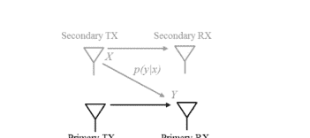

**图 2.13** 具有单个主用户和次级用户对的底层系统。

其中期望是针对 `$X_i$` 和 `$Y_i$` 的。干扰约束是基于对该平均代价施加最大值：

$$\mathbb{E}[c_n(X^n, Y^n)] = \frac{1}{n} \sum_{i=1}^{n} \mathbb{E}[c(X_i, Y_i)], \quad (2.41)$$

$$\mathbb{E}[c_n(X^n, Y^n)] \leq \eta. \quad (2.42)$$

平均接收功率约束是 (2.42) 的一个特例，其中仅对接收信号施加约束，且代价函数选择为 `c(y)=|y|^2`：

$$\frac{1}{n} \sum_{i=1}^{n} \mathbb{E}\left[|Y_i|^2 \mid X_i\right] \leq \eta. \quad (2.43)$$

注意，约束 (2.43) 基于要求接收到的*干扰加噪声*的平均功率低于 `$\eta$`；要获得相应的干扰约束，必须从 `$\eta$` 中减去噪声功率。基于每符号约束的接收峰值功率约束由下式给出：

$$\mathbb{E}\left[|Y_i|^2 \mid X_i\right] \leq \eta_{\mathrm{peak}}, \quad i=1, \ldots, n. \quad (2.44)$$

当信道是静态的时，`$X_i$` 的信道和相应的输入分布对所有 `$i$` 都是相同的，因此平均功率约束和峰值功率约束是相同的，由 (2.44) 给出，其中 `$\eta \equiv \eta_{\mathrm{peak}}$`。当信道是宽带的且接收功率约束由频率上的功率谱密度定义时，平均和峰值功率约束的定义可以扩展为对平均或峰值功率谱密度的约束。然后，容量区域可以等价于无线网络的容量区域来定义，同时考虑平均或峰值接收功率约束，我们现在将更详细地描述。在这一推导中，我们将假设具有由 (2.43) 或 (2.44) 给出的平均或峰值功率约束的窄带信道，但这些结果可以很容易地扩展到具有频谱掩模约束的宽带信道，通过考虑所有频率上的接收功率谱密度。

现在让我们考虑一个具有 `$K$` 个源–目的对的通信网络，它们通过共同的无记忆信道进行通信。信道输入和输出的条件分布由 `p(y_1, ..., y_K|x_1, ..., x_K)` 给出。我们进一步假设网络包含 `$K_p$` 个主用户对和 `$K_s$` 个次级用户对，使得 `$K_p + K_s = K$`。每个源 `s_k` 希望以速率 `$R_k$` 与对应的目的 `d_k` 进行通信，通过 `$n$` 次信道使用。网络代码 `$(R_1, ..., R_K, n)$` 如前文 (2.18)–(2.19) 定义。代码 `$i$` 的错误概率由 (2.20) 给出。我们将主接收器集合记为 `$\mathcal{S}_{\mathrm{PR}}$`，次级发射器集合记为 `$\mathcal{S}_{\mathrm{ST}}$`。


设 $Y_{j,i}$ 表示时间 $i$ 时所有次级传输符号 $X_{m,i}$（其中 $m \in \mathcal{S}_{\mathrm{ST}}$）在第 $j$ 个主接收器处造成的干扰。在平均功率约束下，我们因此要求：

$$\frac{1}{n} \sum_{i=1}^{n} \mathbb{E}\left[|Y_{j,i}|^2 \mid \{X_{m,i}, m \in \mathcal{S}_{\mathrm{ST}}\}\right] \leq \eta, \quad \forall j \in \mathcal{S}_{\mathrm{PR}}. \quad (2.45)$$

Condition (2.45) thus extends condition (2.43) to a $K$-user setting by requiring that the average received interference power from all interfering secondary users is smaller than threshold $\eta$ at all primary receivers. Alternatively, a received peak power constraint at each time $i$ can be imposed as

\begin{equation}

\mathbb{E}\left[|Y_{ji}|^2 \mid \{X_{mi}, m \in \mathbb{S}_T\}\right] \leq \eta_{\text{peak}}, \quad i = 1, \ldots, n, \quad \forall j \in \mathbb{S}_{\text{PR}}.

\end{equation}

Rates $\left(R_1, \ldots, R_K\right)$ are achievable if for any $\epsilon > 0$ there exists an $\left(R_1, \ldots, R_K, n\right)$ code such that $P_e < \epsilon$ and the constraint (2.45) is satisfied for the set $\mathbb{S}_{\mathrm{PR}}$. The capacity under the cost constraint is the closure of the set of the achievable rates since time-sharing between different strategies can be used.

The capacity region will characterize the set of achievable rates for both primary and secondary users. In underlay cognitive radio networks, the premise is that the primary users' performance is minimally affected by the presence of secondary users. This impact on capacity can be approximated by modeling the secondary users as an additional source of Gaussian noise with power given by the imposed received power constraint. The capacity for secondary users can then be considered separately, under the average or peak received power constraints, and treating the interference from the primary system to the secondary system as noise. The next section illustrates this approach for different network scenarios.

## 2.5.2 Capacity results for specific scenarios

In this section we present capacity results of the secondary user system for different channel models and numbers of secondary users. In each of these scenarios we consider only a single primary user. The case of multiple primary users is discussed at the end of this section.

### Static scalar channels with one secondary user

Suppose a single secondary user transmits the symbol $X_s$ over a point-to-point static channel. The channel between the secondary transmitter and the primary receiver has the input–output relationship

\begin{equation}

Y_p = h_{ps} X_s + Z_p

\end{equation}

where $h_{ps}$ is the cross-channel gain on the link from the secondary transmitter to the primary receiver, which is assumed known by the secondary user, and $Z_p \sim \mathcal{N}\left(0, \sigma^2\right)$ is the additive white Gaussian noise sample at the primary receiver. Since the channel is static, the expected power of each transmitted symbol is the same. Hence, the average received interference power constraint (2.43) for this channel is given by

\begin{equation}

\mathbb{E}\left[\left|Y_p\right|^2\right] = \left|h_{ps}\right|^2 \mathbb{E}\left[\left|X_s\right|^2\right] + \sigma^2 \leq \eta.

\end{equation}

This can be translated to a transmit power constraint as

\begin{equation}

\mathbb{E}\left[\left|X_s\right|^2\right] \leq \frac{\eta - \sigma^2}{\left|h_{ps}\right|^2}.

\end{equation}

The secondary user’s AWGN channel has the input–output relationship

$$\mathbf{Y}_{s}=h_{s} \mathbf{X}_{s}+\mathbf{Z}_{s},$$

(2.50)

where $Z_{s} \sim \mathcal{N}(0, N_{0} / 2)$. The capacity of the secondary user’s channel is thus given by the capacity of the AWGN channel (2.9) with transmit power constraint (2.49).

### Static MIMO channels with one secondary user

When the secondary transmitter and primary receiver have $M_{t}$ and $M_{r}$ antennas, respectively, the interfering link between them is a MIMO channel. Assuming this channel is static and Gaussian, its input–output relationship is given by


$$\mathbf{Y}_{\mathrm{p}}=\mathbf{H}_{\mathrm{ps}} \mathbf{X}_{s}+\mathbf{Z}_{\mathrm{p}},$$

(2.51)

where `X_s` ∈ ℂ^{M_t}, `Y_p` ∈ ℂ^{M_r}, `H_ps` ∈ ℂ^{M_r × M_t} is the channel gain matrix from the secondary transmit antennas to the primary receive antennas, and `Z_p` ∈ ℂ^{M_r} is the vector of AWGN noise components at each antenna of the primary receiver, where each component has variance `σ^2`. The underlay average received power constraint (2.43) corresponds to a received power constraint on the vector `Y_p = (Y_1, ..., Y_N)` received at the primary user, which is given by

$$\mathbb{E}\left[\left\|\mathbf{Y}_{p}\right\|^{2} \mid \mathbf{X}_{s}, \mathbf{H}_{p s}\right]=\nu+M_{r} \sigma^{2} \leq \eta,$$

(2.52)

where `Y_p` is the MIMO channel output defined in (2.51). We have separated the received power constraint into two components, `ν` and `M_r σ^2`, where the former is based on interference and the latter is based on noise. Thus, `ν = ||H_ps X_s||^2`. The secondary user’s channel, assuming its receiver also has multiple antennas, is described by the input–output relationship

$$\mathbf{Y}_{s}=\mathbf{H}_{s} \mathbf{X}_{s}+\mathbf{Z}_{s},$$

(2.53)

where `Z_s` is the vector of AWGN noise components at each antenna of the secondary receiver. The received power constraint (2.52) changes the capacity of the secondary user’s channel significantly, as it precludes the optimal spatial water-filling of power for the secondary user’s MIMO channel. In particular, it was shown in [29, Sec. III] that the capacity of the secondary user MIMO channel `H_s` under constraint (2.52) is

$$C=\operatorname{rank}\left(\mathbf{H}_{s}\right) \log _{2}\left(1+\frac{\nu}{\operatorname{rank}\left(\mathbf{H}_{s}\right) \sigma^{2}}\right).$$

(2.54)

This capacity formula depends only on the rank of the secondary user’s channel gain matrix `H_s`, rather than its singular values as in (2.12), although the code that achieves the capacity in (2.54) depends on the full matrix `H_s` and not just its rank.

## Flat-fading channels with one secondary user

We next assume that the secondary user experiences flat-fading both to its own receiver and to the primary receiver and that these gains are known at the secondary transmitter. The Shannon capacity of the secondary user in this case is given by the ergodic capacity. As before, let `h_ps` denote the gain on the interfering link and `h_s` denote the gain on the secondary link, where these parameters now vary over time. It is shown in [31] that the ergodic capacity of the secondary user channel under an average interference power constraint imposed by the primary system yields

$$ C = \iint W \log_2 \left( \frac{ |h_s|^2 }{ |h_{ps}|^2 W N_0 \lambda } \right) p(h_s) p(h_{ps}) dh_s dh_{ps}, $$

The optimal power allocation for the secondary user that achieves this capacity is given by

$$ P^* = \left( \frac{ 1 }{ \lambda |h_{ps}|^2 } - \frac{ N_0 W }{ |h_s|^2 } \right)^+, $$

where `λ` is determined to satisfy the received power constraint as

$$ \iint \left( \frac{ 1 }{ \lambda } - N_0 W \frac{ |h_{ps}|^2 }{ |h_s|^2 } \right)^+ p(h_s) p(h_{ps}) dh_s dh_{ps} = \eta. $$


This optimal power allocation is similar to the time water-filling given by `(2.16)` under a transmit power constraint. However, imposing a power constraint at the primary receiver results in a time-varying water level inversely proportional to `|h|^2`, the magnitude squared of the instantaneous time-varying channel gain. Moreover, the cutoff fade depth below which no data is transmitted by the secondary user depends on both their channel gain `h_s` and the gain `h` between the secondary transmitter and primary receiver. In particular, the secondary user increases his transmit power when either `h_s` increases (as their channel is better, i.e., conventional water-filling) or when `h` decreases, since less interference is caused to the primary. Note that, from `(2.55)`, the capacity depends on channel statistics from the secondary transmitter to both primary and secondary receivers. Interestingly, it is shown in `[31]` that the capacity `(2.55)` when both `h_s` and `h` experience Rayleigh fading is larger than the capacity of the corresponding AWGN channel with the same average SNR. However, with this Rayleigh fading on both channels, the average SNR is low, and it is known that at low SNRs the ergodic capacity of a Rayleigh fading channel exceeds that of an AWGN channel with the same SNR `[32, Figure 4.7]`. Note, however, that this is in some sense an artifact of the infinitely long tail probability of the Rayleigh distribution, which results in a set of very high SNR channels with very low probability. These rare high-SNR channels can be exploited by allocating significant power and rate during these low probability events, which results in a slightly higher capacity than a static channel maintaining a fixed rate commensurate with the same average SNR. Note, also, that the propagation characteristics which induce fading also cause some reduction in average received power. Hence, comparing fading and nonfading channels with the same average SNR does not fully capture the impact of fading on performance.

Under the peak constraint `(2.44)`, the optimum power strategy for the secondary user is simply to transmit at the highest power allowed by `(2.44)`. The capacity is then given by

$$ C = \iint W \log \left( \frac{ |h_s|^2 }{ |h_{ps}| W N_0 \lambda } \right) p(h_s) p(h_{ps}) dh_s dh_{ps}. $$

或者，对次级用户的约束可能是满足主用户的中断容量约束。这一条件等价于在次级发射机上必须满足的峰值发射功率约束，在一定比例的时间 `P_out` 内。峰值发射功率约束将根据信道特性选择，以保证主用户发生中断的概率不超过 `P_out`。最后，在主用户接收机处施加遍历容量约束要求确定次级用户的功率分配，使得主用户接收机处的 SINR 产生期望的遍历速率。关于衰落环境下下层认知无线电的进一步结果可在 `[31, 64]` 中找到。

在存在多个次级用户和主用户的情况下，任何主用户处接收到的信号都包含来自所有次级传输的干扰。次级发射机随后必须集体选择其传输方式，以使所有主用户处满足期望的干扰约束。即使在存在一个主用户的情况下，次级用户也构成了一个无线网络，因此寻找其容量区域通常是一个困难的问题。在次级用户之间没有合作的情况下，它们的发射机/接收机对构成干扰信道，因此容量区域是未知的。终端之间的合作也会进一步影响性能，这允许在中继彼此信息时进行相干合并。在没有合作的情况下，所有次级用户的接收功率只是非相干地相加。有无合作的容量结果可以针对某些特定拓扑进行评估 `[29]`。我们接下来介绍其中一种拓扑的容量，即高斯多址信道。

### 具有多个次级用户的静态标量信道

静态标量 AWGN 多址信道由 `K` 个次级用户组成，它们以速率 `R_k` 通过 AWGN 信道向一个公共次级接收机通信。可实现的速率受这些用户对主接收机造成的干扰约束的限制。考虑一个主接收机，其中第 `k` 个次级发射机与主接收机之间的信道增益为 `h_k`。主接收机处的接收干扰加噪声信号因此由下式给出

```
$Y_p = \sum_{k=1}^{K} h_k X_k + Z_p, \hspace{5cm} (2.59)$
```

其中 `X_k` 是第 `k` 个次级用户的发射符号，`Z_p` 是主用户接收机的噪声，建模为方差为 `σ^2` 的 AWGN。由于信道是静态的，平均干扰功率约束 `(2.45)` 对应于

```
$\mathrm{E}\left[\left|Y_p\right|^2 \left\{X_k, h_k\right\}, k=1,\ldots,K\right] = \nu + \sigma^2 \leq \eta, \hspace{5cm} (2.60)$
```

其中 `ν` 表示接收干扰的功率，`σ^2` 表示噪声功率。文献 `[29, Sec. IV]` 表明，在此约束下，次级用户多址信道的容量区域由满足以下条件的速率向量集合给出

```
$\sum_{k=1}^{K} R_k \leq \log \left(1 + \frac{\nu}{\sigma^2}\right). \hspace{5cm} (2.61)$
```

### 次级用户广播信道

次级用户广播信道由一个次级发射机向 `K` 个接收机广播组成。由于只有一个次级发射机对主用户造成干扰，次级系统的干扰约束与标量信道的类似。特别是，主接收机处的接收功率约束转化为次级发射机处的发射功率约束。这对静态和衰落信道都成立。因此，次级广播系统的容量区域可使用广播信道的标准技术获得，并附加由主系统施加的发射功率约束。

### 多个主用户

由于多用户网络的容量在一般情况下除某些特殊情况外都是未知的，对于具有多个主用户的网络也将如此。然而，对于某些特定拓扑，在平均和峰值干扰功率约束下容量是可以确定的。例如，对于具有多个主用户和单个次级用户的网络，接收峰值功率约束转化为次级发射机处的多个发射峰值功率约束。此时最优功率分配是选择这些约束允许的最低峰值功率。当存在多个主用户和次级用户时，所有次级用户的功率必须满足所有主用户处的干扰功率约束。优化技术可用于找到满足这些约束的功率分配方案。

## 2.6 交织认知无线电网络


交织认知无线电的基本性能极限取决于对整体系统模型的假设以及对认知无线电系统感知其对主用户造成干扰的能力的假设。在某些情况下，这些假设允许应用已知的容量结果或界限。当检测不完美时，主用户活动漏检和虚警的影响会降低次级用户和主用户的容量。除了容量区域外，还将介绍交织认知网络的缩放规律，说明容量如何随次级用户数量增长而变化。

本节重点关注基于交织信道信息论容量的速率极限。具体而言，我们讨论香农容量、中断容量和遍历容量，以及缩放规律。除了这些信息论极限外，交织认知系统的性能还可能受检测和硬件约束的限制。特别是，感知能力差的交织系统将具有较高的漏检和虚警概率。同样，次级发射机和接收机前端的频率敏捷性决定了性能极限，因为敏捷性不足的系统无法利用位置变化迅速的频谱空洞。因此，除了容量之外，交织系统的性能极限还受系统和硬件感知能力以及无线电前端能力的限制，如第 1.7 节所述。

### 2.6.1 香农容量

交织网络的香农容量区域决定了在主用户施加的建模假设和约束条件下所有次级源-目的对可实现的最大速率。建模假设包括主用户和次级用户数量、系统中可用的频段数量、主用户流量的统计特性以及网络拓扑。当存在多个主用户或多个次级用户时，还必须优化每种类型用户如何与同类型用户共享可用带宽的 MAC 协议。或者，我们可以预先定义 MAC 协议并根据与该 MAC 相关的约束推导容量。在交织范式中，主用户和次级用户之间共享可用带宽须受次级用户不得占用其检测为当前被主用户占用的频谱的约束。它仍可能因漏检而对主用户造成干扰，即在主用户存在的情况下仍检测到频谱空洞。交织系统通常对其漏检概率有由主系统施加的约束。

我们从最基本的模型开始讨论交织网络的容量：一个主发射-接收对和一个次级发射-接收对。该系统可由图 2.7 所示的四节点干扰信道建模，其中源-目的对 1 对应于次级用户对，源-目的对 2 对应于主用户对。假设所有用户只有一个可用频段。我们假设次级用户对主用户活动进行完美检测，并且两个用户通过时分介质访问策略共享干扰信道，即在任何给定时间只有一个源进行传输（如果主用户有数据要发送，则为主用户，否则为次级用户）。设 $C_p$ 表示主用户信道的香农容量，假设其全时传输且次级用户静默。设 $\alpha$ 表示主用户占用信道的时间比例。则主用户信道容量为 $\alpha C_p$，因为这是其在全时内可达到的最大速率。设 $C_s$ 表示次级用户信道的香农容量，假设其全时传输且主用户静默。则与主用户和次级用户之间的时分策略相关联的速率区域 $(R_p, R_s)$ 是图 2.14 中由 ($\alpha C_p$, $(1-\alpha) C_s$) 定义的三角形，y 轴截距为 $C_p$，x 轴截距为 $C_s$。这些思想可以很容易地扩展到多个主用户和次级用户的情况，如果主用户之间和次级用户之间存在完美协调，并且次级用户对主用户信道占用进行完美检测，如图 2.15 所示。该图显示了两个主用户通过时分进行协调，两个次级用户通过时分进行协调以利用主用户缺席的时间槽。更一般地，对于具有 $K_p$ 个主用户和 $K_s$ 个次级用户的网络，$K_p + K_s = K$，假设一种时分策略，其中分配给第 $i$ 个主用户在其无干扰容量为 $C_i$ 的信道上的时间比例为 $\alpha_i^p$，且 $\sum_{i=1}^{K_p} \alpha_i^p = \alpha$。假设第 $j$ 个次级用户，其无干扰容量为 $C_j$，被分配剩余时间比例 $1 - \alpha$ 的时间比例 $\alpha_j^s$，使得 $\sum_{j=1}^{K_s} \alpha_j^s = 1 - \alpha$。那么

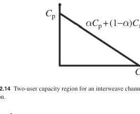

图 2.14 具有完美频谱空洞检测的交织信道的双用户容量区域。

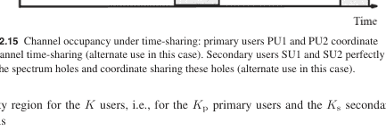

图 2.15 时分复用下的信道占用情况：主用户 PU1 和 PU2 协调其信道时分复用（本例中为交替使用）。次用户 SU1 和 SU2 完美检测频谱空洞并协调共享这些空洞（本例中为交替使用）。

$K_s$ 用户的容量区域，即 $K_p$ 个主用户和 $K_s$ 个次用户的容量区域为

```
∪{$R_1 = \alpha_{p1}C_{p1}, R_2 = \alpha_{p2}C_{p2}, \dots, R_{K_p} = \alpha_{pK_p}C_{pK_p}$,   $R_{K_p+1} = \alpha_{s1}C_{s1}, \dots, R_K = \alpha_{sK_s}C_{sK_s}$},  (2.62)
```

其中并集是在所有 {$\alpha_{pi}$} 和 {$\alpha_{sj}$} 上取的，使得 $\sum_{i=1}^{K_p}\alpha_{pi} + \sum_{j=1}^{K_s}\alpha_{sj} \leq 1$。

这些思想也可扩展到有多个频段可用的情况。在这种情况下，主用户通过主用户 MAC 协议协调分配可用的时隙和频段。主系统使用第 1.8.1 节中讨论的光谱池化，将未使用的时频隙提供给次用户。这些资源随后通过次用户 MAC 协议在次用户之间平等或不平等地共享。如上所述，容量区域类似于多用户干扰信道的容量区域，其约束条件是可用资源（即时频隙）首先分配给主用户以支持其业务，然后剩余资源正交分配给次用户。可以采用更复杂的介质接入编码和解码策略，使得次用户和主用户能够在同一信道上同时传输，使用速率分割、叠加编码、纠错编码和联合检测技术来确保所有用户的可靠数据检测。

## 2.6 交织认知无线电网络

本例中的容量处理基于第 2.4 节中讨论的无约束干扰信道的更一般容量分析。这些思想也可扩展到次级发射机属于认知网络中广播或多址信道的情况。然后，如前所述，可用资源首先分配给主用户以支持其业务，例如在时间比例 α 上，然后剩余资源分配给次用户。如果次用户在时间比例 1 – α 上向多个接收机传输，则其在该时间比例上的容量将是相应的广播容量区域而不是单一速率。类似地，如果在时间比例 1 – α 上有多个次用户向一个接收机传输，则该时间比例上的容量将是相应的多址信道容量区域。

上面讨论的容量结果都假设次用户对频谱空洞的检测是完美的。存在两种不完美检测类型：漏检和虚警，其在第 4.3 节中正式定义。虚警发生在检测到主用户但实际上不存在时，即次用户或用户检测到频谱空洞。对于单个次用户，假设系统是平稳且遍历的，虚警对主用户没有影响（因为没有产生干扰）。然而，它会使次用户的数据速率降低一个分数 (1 – P_FA)，其中 P_FA 为虚警概率，因为在完美检测下，这些被遗漏的频谱空洞本可用于次用户的传输。当存在多个次用户时，由于虚警导致其各自数据速率的降低取决于频谱空洞的分配方式。如果频谱空洞长度相同并且在 K_s 个次用户之间平均分配，则由于虚警，每个次用户的数据速率都会降低一个分数 (1 – P_FA) / K_s。在漏检的情况下，次用户未能检测到主用户活动，而实际上这些用户是活跃的，即频谱空洞被错误检测。在漏检期间，信道变为图 2.7 的干扰信道，因为主用户和次用户同时传输。然而，在交织场景中，主用户和次用户的编码和解码都不考虑这种干扰，因为它是由意外的检测错误引起的。因此，次用户对主用户的干扰会降低其容量。容量降低通常通过将干扰视为噪声来推导；容量是基于次用户在其接收机处产生的干扰相关的 SINR 计算的。类似地，在漏检占据的频谱空洞期间传输的次用户会受到同样占据该空洞的主用户的干扰，其容量退化可以通过将该频谱空洞期间运行的所有主用户的干扰视为噪声以类似方式确定。或者，当次用户和主用户传输重叠时传输的数据可以在次接收机处被声明为擦除，假设接收机检测到干扰因此不尝试解码数据。擦除对应于除通过设计用于纠正擦除的信道码外无法解码的数据。认知无线电系统擦除码的概述可在 [54, 81] 中找到。主用户也可以将在受到次用户干扰时接收到的数据视为擦除，但由于次用户的功率通常远低于主用户，实践中很少这样做；相反，次用户传输引起的干扰通常被视为噪声。由于频谱空洞的检测是一个动态且不完美的过程，在虚警或漏检下主用户和次用户的容量基于随机变化信道的容量，如下一小节所述。

在 [45] 中开发了一个模型，用于使用次级发射机和接收机之间协作检测的交织信道容量受虚警和漏检影响的情况。这种频谱感知的分布式特性通过数学上的双开关模型来捕捉，一个开关位于次级发射机，一个位于次级接收机。当次级发射机检测到频谱空洞时，它将开关切换到开启位置，接收机同理。当两个开关都开启时，认为存在可供次用户利用的空洞，并且该信息会传播给次级发射机和接收机（也许通过单独的协作信道）。该模型捕捉了次级发射机和接收机相距越远，它们各自检测到的主用户活动相关性越低的事实。由于主接收机的位置未知，通过协作感知在多个位置检测主信号将导致频谱空洞的更准确估计，如第 5.2.1 节更详细讨论。更一般的虚警和漏检模型可通过开关处于开启或关闭的概率映射到该双开关模型。基于无记忆信道在因果和非因果部分信道知识下的容量信息论结果，在 [45] 中开发了该双开关模型容量的内界和外界。

### 2.6.2 次级信道的随机开关模型


## 交织范式中的时间变化信道

在交织范式中，每个次用户的信道由于主用户活动和不完美检测而随时间变化。次系统的不完美检测“破坏”了交织范式，因为它在主用户传输被遗漏时引入了主用户和次用户同时传输。此外，对主用户活动的错误检测会减少次系统的容量，因为传输机会被错过。具体而言，当频谱空洞被正确检测时，次用户具有无干扰信道，当频谱空洞被错误检测时具有干扰信道，当主用户活动被（正确或错误地）感知时具有零容量信道。在本节中，我们通过随机开关模型捕捉由主用户活动及其不完美检测引起的时间变化信道特性。注意，在该模型中，主用户和次用户的底层信道被假定为静态，尽管随机开关模型可以扩展以纳入衰落。

## 随机开关模型

在次级信道的随机开关模型下，在任何给定时间主用户可能正在传输或不传输。当它们传输时，其活动可以被正确检测为频谱空洞的缺乏，也可以不被检测；当它们不传输时，其缺乏活动可以被正确检测为频谱空洞，也可以不被检测。我们首先考虑在频谱空洞完美检测下单个次级用户的随机开关模型，如图 2.16 所示。当检测到主用户活动时，开关处于 OFF 状态，信道不可用。当未检测到主用户活动时，开关处于 ON 状态，表示信道可供次级用户使用。信道是随机变化的，因为在任意时间区间 `[0, *T*]` 内，开关处于 ON 或 OFF 的时间 `T_on` 和 `T_off` 分别是随机的。假设当开关处于 ON 时，次级用户信道的容量为 `C_s`，例如对于 AWGN 信道 `C_s = W log_2(1 + P_s/(N_0 W))`，其中 `W` 是与频谱空洞相关的信道带宽，`P_s` 是次级接收机处的接收信号功率，`N_0/2` 是次级接收机噪声的 PSD。请注意，由于假设检测是完美的，该信道是无干扰的。

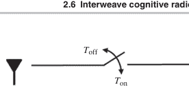

图 2.16 互织次级用户的信道模型：随机开关位置表示检测到主用户的存在（OFF）或不存在（ON）。

一般而言，随机开关信道的容量取决于在发送端和接收端对开关位置的了解程度。在互织范式下，假设开关位置在次级发送端和接收端均已知：次级发送端必须知道开关位置，以便在主用户传输期间不进行传输，而次级接收端必须知道开关位置以解码次级用户的传输。由于开关位置已知且检测是完美的，在每个时间瞬间，信道在发送端和接收端均已知，因此合适的容量度量是遍历容量或中断容量。特别地，当开关处于 ON 时，次级用户可以以任意速率 `R < C_s` 可靠传输。在时间区间 `[0, T]` 上，次级用户传输的时间比例为 `T_on/T`。对于平稳且遍历的主用户活动，当 `T` 趋于无穷大时，这等于开关处于 ON 的概率 `P_on`。该双态信道的遍历容量于是为 `C_erg = P_on C_s`，因为当开关处于 OFF 时次级用户获得零速率，而该情况发生的概率为 `P_off = 1 - P_on`。该信道的中断容量也为 `P_on C_s`，因为当开关处于 ON 时次级用户可以以任意速率 `R < C_s` 可靠传输，而当开关处于 OFF 时处于中断状态。请注意，如 [45] 中所述，导致开关处于 ON 或 OFF 的检测细节与容量分析无关；只需要概率 `P_on`，该概率可根据主用户活动特性及给定的检测策略确定。

## 不完美检测下的容量

相同的开关模型在检测不完美时也适用，在这种情况下，次级用户和主用户的容量度量不再是遍历容量或中断容量，因为信道不再为发送端所知。考虑最简单的情况，即一个主用户和一个次级用户，两者均具有固定的发射功率和到各自接收机的静态信道。当主用户的传输未被检测到（漏检）时，其信道由于次级用户的干扰而退化。在这些传输期间，次级用户的信道也由于主用户的干扰而退化。设 `C_p^q` 等于次级用户不活跃时主用户信道的容量，设 `C_p^i` 等于次级用户活跃时主用户信道的容量。对于带宽为 `W`、噪声 PSD 为 `N_0/2` 且将干扰视为噪声的 AWGN 信道，这些分别对应于 `C_p^q = W log_2(1 + P_p/(N_0 W))` 和 `C_p^i = W log_2(1 + P_p/(N_0 W + I_s))`，其中 `P_p` 为主用户接收机处的接收功率，`I_s` 为次级发射机对主用户接收机造成的干扰功率。

设 `P_MD` 表示漏检概率，即主用户活动未被检测到的概率。我们首先研究漏检对主用户在传输期间容量的影响；主用户在不传输时速率为零。假设主用户不知道次级用户的传输，其在传输时的性能正确度量为容量与中断的关系。这由 `C_p^q` 给出，当 `P_out < P_MD` 时，因为主用户以概率 `P_MD` 受到次级用户干扰，以及当中断概率 `P_out >= P_MD` 时的 `C_p^i`。请注意，主用户通常不知道次级用户的干扰，因此它不知道 `C_p^i`。因此，它必须在没有此知识的情况下选择一个 *固定* 的传输速率 `R <= C_p^i`。如果中断概率 `P_out = P_MD` 可接受，则主用户可以以任意速率 `R < C_p^i` 传输，并接受 `P_MD` 部分数据将被错误解码。如果该中断概率不可接受，则假设它可以将次级用户的最大干扰限制为 `I_s_max`，它可以以任意速率 `R < W log_2(1 + P_p/(N_0 W + I_s_max))` 可靠传输。只要该界限准确，以此速率发送的数据将始终被正确解码。类似地，如果它确实知道 `C_p^i`，则可以以该速率发送且无中断。主用户在由于正确检测到主用户活动而开关处于 ON 时，或由于漏检主用户活动而开关处于 ON 时处于活跃状态。回顾 `P_FA` 为虚警概率，且令 `P_MD` 表示漏检概率，我们有主用户活跃的概率为 `(1 - P_FA) P_off + P_MD P_on`。因此，在主用户活跃时以固定传输速率 `R` 传输时，主用户在所有时间上的平均吞吐量为 `((1 - P_FA) P_off + P_MD P_on) R`。

主用户适应次级用户的行为对于互织信道而言是不典型的，在互织信道中，主用户被期望对次级传输的存在毫无察觉。然而，已提出了一些主用户可以对次级用户做出反应的系统。假设主用户可以测量由于漏检而由次级用户造成的干扰。那么它可以在传输期间自适应其传输速率，在没有次级干扰时（即开关处于 OFF 时）调整为 `R < C_p^i`，在有次级干扰时（即由于漏检而开关处于 ON 时）调整为 `R = C_p^i`。这使得主用户在传输期间的遍历速率为

$$C_{p,\text{erg}} = P_{\mathrm{MD}}C_p + (1 - P_{\mathrm{MD}})C_p^i. \qquad\qquad\qquad (2.63)$$

请注意，对于典型的无线信道，即使主用户发射机不根据干扰的有无自适应其速率，只要主用户接收机能够感知来自次级用户的干扰，就能实现该速率 [32, Section 4.2]。


漏检对次级用户的影响与对主用户的影响类似。特别是，次级用户在漏检期间不知道主用户的传输，而漏检发生的概率为 $P_{\mathrm{MD}}$。因此，次级用户的双态开关信道变为三态信道：当开关处于 OFF 时容量为零，因为次级用户不传输；当开关处于 ON 时，信道的容量等于频谱空洞被正确检测时的无干扰容量，且等于空洞被错误检测时受主用户干扰的容量。设 `C_s` 等于主用户不活跃时次级用户在传输期间的信道容量，设 `C_s^I` 等于主用户活跃时（漏检）次级用户在传输期间的信道容量。对于带宽为 `W`、噪声功率为 `N_0 W` 且将干扰视为噪声的 AWGN 信道，这些分别对应于 `C_s = W log_2(1 + P_s/(N_0 W))` 和 `C_s^I = W log_2(1 + P_s/(N_0 W + Z_p))`，其中 `P_s` 为次级用户接收机处的接收信号功率，`Z_p` 为主发射机对次级用户接收机造成的干扰。由于信道未知，次级用户在传输时的容量正确度量为容量与中断的关系。与漏检下主用户的情况类似，该函数由 `C_s^I` 给出，当 `P_out ≤ P_MD` 时，以及 `C_s` 给出，当 `P_out > P_MD` 时。因此，如果中断概率 `P_MD` 可接受，则次级用户可以以任意速率 `R < C_s` 传输，并接受 `P_MD` 部分数据将被错误解码。如果该中断概率不可接受，则假设它可以将主用户的最大干扰功率限制为 `I_{p, max}`，它可以以任意速率 `R < W log_2(1 + P_s/(N_0 W + I_{p, max}))` 传输，使得只要该界限准确，以此速率发送的数据将被正确解码。类似地，如果它确实知道 `C_s^I`，则可以以该速率发送且无中断。由于次级用户以概率 `P_on` 活跃，次级用户在活跃时以固定传输速率 `R` 传输时，在所有时间上的平均吞吐量为 `P_on R`。

除了错误检测频谱空洞外，次级用户在不存在主用户时以概率 `P_FA` 检测到主用户的存在。因此，如果次级用户在开关处于 ON 时以速率 `R` 传输，则由于错过的传输机会，相对于无虚警的情况，次级用户的容量将减少 `P_FA R`。请注意，在漏检和虚警下的容量计算中不需要确切的检测策略。这些容量计算仅使用漏检概率和虚警概率，而这对于任何给定的检测策略都可以确定，如第 4 章和第 5 章所述。

### 2.6.3 互织网络的缩放规律

在第 2.3.3 节中我们讨论了 `K` 用户无线网络的缩放规律。我们现在讨论具有一个或多个主用户和次级用户的互织网络中的缩放规律。对于这种类型的网络，缩放规律知之甚少，尽管缩放规律已针对单跳交织网络推导得出，其中多个次级用户在单个主用户存在的情况下进行传输，见[92]。该工作定义了主用户发射机周围的*主用户独占区域*，或 `PER` 的概念。次级发射机不能在此 `PER` 内工作，且次级用户发射机与其接收机之间的距离必须小于某个指定距离。这两个约束限制了次级发射机对主接收机造成的干扰量，从而限制了其中断概率，由此能够以闭式推导出缩放规律。容量被发现随次级用户数量*线性*增长，与 Gupta 和 Kumar 结果中经典的次线性缩放形成对比，其中假设了多跳路由。这些交织缩放规律结果在[46]中被扩展到具有多个主用户以及多个次级用户的网络，并结合多跳路由。该工作假设主用户发射机和接收机的位置为次级网络所知，并且主网络的密度低于次级网络。多径路由协议假设每个主节点周围存在一个*保护区域*，使得次级用户绕过这些区域路由其流量。如果证明该路由协议能够实现几乎与主网络不存在时相同的缩放规律，而主网络吞吐量仅受随渐近减小而衰减的分数损失影响。具体而言，`K_{p·r}`-用户主网络的吞吐量缩放为 `sqrt(K_p) = K_p^{0.5}`，而 `K_s`-用户次级网络的吞吐量缩放为 `K_s^{0.5-δ}`，对任意 `δ > 0` 而言，中断概率可任意小。在相同模型、约束和假设下，[100] 中也获得了类似的缩放规律，然而在该工作中主接收机的位置未知。因此保护区域仅在主发射机周围形成。该论文还表明，随着每种类型用户数量的渐近增长，主网络和次级网络均可实现与[22]中针对单个渐近大网络所获得的相同吞吐量-延迟权衡。这些结果假设随着用户数量的增长，主用户相对于次级用户的相对密度保持不变。

## 2.7 叠加认知无线电网络

叠加认知无线电网络的动机在于充分利用智能无线电能力：

- 从信息论的角度来看，次级和主通信对所使用的正交传输的交织约束是不必要地限制性的，因而降低了容量；
- 认知能力可以被更广泛地利用，而不仅仅是用于频谱空洞检测。

因此，与交织网络形成对比，叠加认知无线电网络允许次级和主传输在相同维度上并发进行。此外，与交织和下叠网络相比，在叠加网络中，次级发射机可以改善主用户的通信。在这种情况下，中继和应对干扰的技术成为最大化主用户和次级用户性能的关键工具。

### 建模认知

在叠加认知无线电模型分析中，认知能力通常通过假设次级用户的编码器，即*认知编码器*，知道在下一个传输块中主编码器要发送的数据序列来捕捉。该假设对于实际系统而言往往过于理想化。然而，当次级和主发射机彼此接近时，或主数据序列在初始失败后被重传且次级解码器在第一次传输中成功解码时，该假设是合理的。该假设也适用于主发射机预先将其数据序列发送给次级发射机的情况，这可能在单独的频段中完成。尽管理想化，一旦在此假设下的编码和解码策略得到充分理解，该假设可以放宽为假设：

- 主数据序列通过有限容量的正交链路传达给次级用户；
- 仅有部分数据序列知识可用，且该部分知识用于部分解码，或
- 主数据序列是因果学习的，以考虑解码所需的时间。这些松弛在[9, 58, 60]中进行了研究。

### 2.7.1 两用户叠加信道的认知编码器

最简单的叠加认知网络由一个次级和一个主对组成，如图 2.17 所示。对应于次级用户的认知编码器被假设对主编码器传达给主解码器的数据序列 `W_p` 具有完全知识。编码策略和信道增益被假设为信道中所有用户所知。叠加编码技术主要针对此两用户信道进行了研究。没有认知时，该网络简化为图 2.11 的两用户干扰信道，其中次级用户对应用户 1，主用户对应用户 2。由于这两个模型之间的相似性，在信息论文献中，该网络被称为*具有一个认知编码器的干扰信道*。它也被称作认知无线电信道、具有不对称消息知识的干扰信道、具有退化消息集的干扰信道，或认知干扰信道。当主用户不传输时，可得到该信道模型的另一个特例。

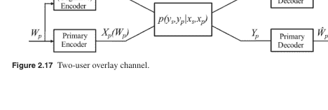

由于次级发射机知道发往两个接收机的消息，信道简化为广播信道[16]。因此，两用户叠加信道包含干扰信道和广播信道的元素。为这些典型信道或其组合所开发的编码策略在某些条件下可达到叠加信道的容量。接下来我们回顾为两用户叠加信道提出的编码策略，并讨论这些方案或其组合达到容量的场景。

形式上，具有一个次级（认知）用户和一个主用户的两用户叠加信道由两个输入字母表 `X_s`、`X_p`，两个输出字母表 `Y_s`、`Y_p`，以及条件概率分布 `p(y_s, y_p|x_s, x_p)` 组成，其中 `(x_s, x_p) ∈ X_s × X_p` 为信道输入，`(y_s, y_p) ∈ Y_s × Y_p` 为信道输出。次级源希望将其消息 `W_s ∈ W_s = {1, …, 2^{nR_s}}` 发送到其目的地，主源希望将其消息 `W_p ∈ W_p = {1, …, 2^{nR_p}}` 发送到其目的地。数据序列 `hat{W}_p` 也为次级（认知）编码器所知。一个 `(R_s, R_p, n)` 码由两个数据序列集 `W_s`、`W_p`，编码函数

```
$$\begin{gathered}X_{s}^{n} = f_{s}\left(W_{s}, W_{p}\right), \
X_{p}^{n} = f_{p}\left(W_{p}\right), \end{gathered}\tag{2.64}$$
```

和两个解码函数

```
$$\hat{W}_{s} = g_{s}\left(Y_{s}^{n}\right), \hat{W}_{p} = g_{p}\left(Y_{p}^{n}\right). \tag{2.66}$$
```

组成。码的错误概率为

```
$$P_{e} = P\left[\left[\hat{W}_{s} \neq W_{s}\right]\bigcup\left[\hat{W}_{p} \neq W_{p}\right]\right]. \tag{2.67}$$
```


速率对 $(R_s, R_p)$ 是可达的，如果对任意 $\epsilon > 0$，存在对于足够大的 $n$ 的一个 $(R_s, R_p, n)$ 码使得 $P_e \leq \epsilon$。两用户叠加信道的容量区域是所有可达速率对 $(R_s, R_p)$ 集合的闭包。

我们观察到，该定义与干扰信道的相应定义之间的唯一区别在于次级认知编码器的编码函数（2.64）。与干扰信道不同，在此情况下编码器知道两个数据序列 $W_s$ 和 $W_p$，因此可以形成依赖于两者的编码序列。我们还将考虑由（2.33）给出的 AWGN 干扰信道，并由次级用户以认知编码增强。

附加信息允许认知编码器部署协作以提高主对的速率，并对干扰进行预编码以提高其自身速率。在总结认知编码器使用的编码策略之前，我们给出 Gelfand–Pinsker 编码技术的简要概述。该技术也称为*分箱*，用于对干扰进行预编码。

#### Gelfand–Pinsker 编码

对于叠加网络，任何主发射机的传输都会在次级接收机处引起干扰。由于认知编码器知道该干扰，它部署一种编码方案以减轻其接收机处的干扰影响，从而

## 2.7 叠加认知无线电网络

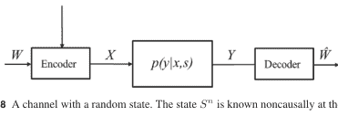

图 2.18 具有随机状态的信道。状态 $S^n$ 在编码器处以非因果方式已知。

增加其速率。在叠加信道中，由于认知编码器对主用户的数据序列和编码策略具有完美知识，次级发送-接收对可以将此情况视为在编码器处以非因果方式已知随机状态的信道中的通信，也称为 Gelfand–Pinsker 问题 [30]，如图 2.18 所示。在此图中，单个源通过由 $p(y|x, s)$ 给出的信道向目的地传输数据序列 $W \in \{1, \ldots, 2^{nR}\}$。信道状态序列 $S^n$ 假定为从随机状态上的分布 $p(s)$ 生成的随机 i.i.d. 序列。$S^n$ 在编码器处以非因果方式已知。

我们接下来考虑随机状态为额外干扰项 $S$ 的 AWGN 信道。具体而言，具有随机干扰状态的 AWGN 信道的输入-输出关系由

$Y = X + S + Z, \tag{2.68}$

给出，其中 $Z$ 是接收端均值为零的高斯噪声，功率为 $\mathcal{N}$，而 $S$ 是接收端均值为零的高斯噪声，功率为 $\mathcal{N}_s$。发射功率约束为 $\mathbb{E}[X^2] \le \mathcal{P}$。该信道模型中的 Gelfand–Pinsker 编码简化为 DPC，即上述干扰信道中描述的预编码，用于抵消干扰项 $S$ 的影响。在此设定下，DPC 实现了 AWGN 信道的容量，仿佛不存在干扰，即它完全抵消了干扰 $S$ 的影响，得到的容量为

$C = W \log_2 \left( 1 + \frac{\mathcal{P}}{\mathcal{N}} \right) . \tag{2.69}$

具有随机状态的一般离散时间无记忆信道的容量由

$C = \max_{p(u|x), f(.)} I(U;Y) - I(U;S), \tag{2.70}$

给出，其中 $U \to (X, S) \to Y$ 构成马尔可夫链，且由 Gelfand–Pinsker 编码 [30] 实现。随机变量 $U$ 用于在编码器处生成码本，使得在每次块传输中，码字同时依赖于数据序列和随机状态 $S^n$。Gelfand–Pinsker 编码在叠加认知无线电中可以发挥关键作用，如下所述。

部署在叠加信道中的通信方案包含以下三种编码策略。

- 1 **速率分割** 速率分割，如第 2.4 节简要所述，可以通过在解码器处实现（部分）干扰消除，从而提高两个通信对的速率，其方式与无认知干扰信道相同。该技术可能由两个编码器部署，因为它不需要对其他用户数据序列的认知，因为编码器仅分割自己的速率。为了使主用户利用速率分割，该方法要求主接收端的解码被修改以解码并消除次级用户传输的一部分。这种方法与交织和底层认知无线电中采用的方法不同，在后者中主用户的通信技术在次级用户存在时不会被调整。如果在叠加认知网络中也施加此约束，则速率分割将不再适用，因为它要求主接收机解码次级用户消息的一部分。

- 2 **协作** 主用户数据序列的完全、部分或延迟知识使认知编码器能够将此信息中继给主用户，从而提高主对的速率。认知编码器使用其功率的一部分来向主用户传输消息 $W_p$，从而提高主速率 $R_p$。当主用户的数据序列（或其一部分）在没有延迟的情况下已知于认知编码器时，即在传输块开始时，中继通过叠加编码进行，其中次级和主消息被叠加并由认知编码器发送。由于非因果知识，不需要用于中继的马尔可夫块编码 [17]。

- 3 **Gelfand–Pinsker 编码（binning）** 携带 $W_p$ 全部或部分信息的任何信号在次级接收机处都是干扰。因此，主编码器和认知编码器都会在次级接收机处产生干扰。然而，如果认知编码器在传输块开始时知道 $W_p$（以及编解码器和信道状态信息），它可以推断在次级接收机处产生的干扰。知道干扰后，它可以应用 Gelfand–Pinsker 编码，并在 AWGN 信道中具体使用 DPC 以预先消除该干扰。部署 Gelfand–Pinsker 编码的另一个动机来自叠加信道与广播信道之间的关系，其中当主发射机静默时，叠加信道简化为双用户广播信道。对于离散时间无记忆广播信道，产生最大已知可达速率区域的编码方案基于 Gelfand–Pinsker 编码 [61]。在高斯情况下，双用户叠加信道也与 MIMO 高斯广播信道相关。具体而言，具有两个发射天线的 MIMO 广播信道等价于双用户叠加信道，当 *两者* 编码器都是认知时，即两个编码器知道 intended for each receiver 的消息，因为事实上这些编码器是同一广播传输策略的一部分。对于 MIMO 高斯广播信道，DPC 是最优编码策略 [91, 94]。受这些观察的启发，binning 和 DPC 已应用于双用户叠加信道，在某些情况下获得了迄今为止已知的最高可达速率，包括容量，这将在本节后面介绍。

### 2.7.2 容量结果

确定一般叠加信道的容量区域仍然是一个开放问题。然而，与无认知的干扰信道一样，容量已在某些区域内确定。强干扰下的容量已在 [60, Thm. 5] 中确定。高斯信道在弱干扰下的容量已在 [49, 95] 中推导。对于统一这两个区域下结果的更一般情况，容量已在 [70] 中确定。对于一类离散无记忆认知 Z 信道（即主接收机处没有干扰的信道），其中只有次级对的接收机遭受干扰，其容量已在 [56] 中确定。相反情况，即干扰位于主接收机处的一类高斯认知 Z 信道的容量已在 [47] 中找到。在每种情况下，速率分割、协作和/或 binning 的某种组合可实现容量。这些区域及其实现容量的编码技术如下。

#### 1 强干扰 [60]

与干扰信道一样，这是两个解码器可以在不产生速率损失的情况下解码彼此消息的区域。在由 (2.33) 描述的 AWGN 叠加信道中，其中 $X_1 = X_s$，$X_2 = X_p$，$h_{12} = h_{sp}$，$h_{21} = h_{ps}$ 且主用户消息在次级用户发射机处已知，以下干扰条件足以满足强干扰：

$$
\begin{align*}
|h_{ps}| &\ge 1, \\
|h_{sp}| &\ge \frac{h_{ps}}{\alpha} + \frac{|\alpha - 1|}{\alpha} \quad \text{if } h_{sp} h_{ps} > 0, \\
|h_{sp}| &\ge \frac{h_{ps}}{\alpha} + \frac{\alpha + 1}{\alpha} \quad \text{if } h_{sp} h_{ps} < 0, \tag{2.71}
\end{align*}
$$

其中 $\alpha = \sqrt{P_s/P_p}$，$P_s$ 为次级接收机处的接收次级发射功率，$P_p$ 为主接收机处的接收主发射功率。当 $P_s = P_p$ 且 $h_{sp}, h_{ps} \ge 0$ 时，这些条件简化为

$$
h_{ps} \ge 1, h_{sp} \ge h_{ps}. \tag{2.72}
$$

在一般离散时间无记忆信道中，这些条件可以用条件互信息表示为

$$
\begin{align*}
I(X_s; Y_s|X_p) &\le I(X_s; Y_p|X_p), \\
I(X_s, X_p; Y_s) &\le I(X_s, X_p; Y_p), \tag{2.73}
\end{align*}
$$

且需要对所有输入分布 $p(x_s, x_p)$ 均成立。我们注意到第一个不等式与干扰信道 (2.35) 中的条件相同。在此区域中，通过叠加编码的协作可实现容量。AWGN 信道中的容量区域为

$$\mathcal{C}=\bigcup_{|\rho|\leq1}\left\{\left(R_{s}, R_{p}\right): R_{s}\geq0, R_{p}\geq0,$


$R_{s}\leq\frac{1}{2}\log\left(1+\left(1-\rho^{2}\right)P_{s}\right),$ (2.74)

$R_{s}+R_{p}\leq\frac{1}{2}\log\left(1+P_{s}+P_{p}+h_{\mathrm{ps}}^{2}P_{s}+2\rho h_{\mathrm{ps}}\sqrt{P_{s}P_{p}}\right)\right\},$ (2.75)

其中 $\rho$ 是输入 $X_{s}$ 和 $X_{p}$ 之间的相关性。注意较大的 $\rho$ 会导致次级和主用户数据的次级传输在主接收机处产生更大的相干合并增益。一般容量区域为

$$\mathcal{C}=\bigcup\left\{\left(R_{s}, R_{p}\right): R_{s}\geq0, R_{p}\geq0,$

$R_{s}\leq I\left(X_{s};Y_{s}|X_{p}\right),$ (2.76)

$R_{s}+R_{p}\leq I\left(X_{s},X_{p};Y_{p}\right)\right\},$ (2.77)

其中并集是对所有输入分布 $p(x_{s},x_{p})$ 取的。

## 2 主接收机处的弱干扰 [49, 95]

在 AWGN 叠加信道 (2.33) 中，主接收机处的弱干扰对应于 $\left|h_{\mathrm{ps}}\right|\leq1$，即从次级到主用户的交叉信道增益小于直达链路增益。由于干扰较弱，主接收机不尝试解码不需要的数据序列，而是将其视为噪声。次级接收机处的干扰可通过认知编码器处的 DPC 消除，从而实现无干扰的单用户速率。

认知编码器处的最优编码策略包括通过 DPC 编码消息 $W_{s}$，同时将主用户的输入序列 $X_{p}^{n}$ 视为干扰，并使用叠加编码来帮助向主接收机传送 $W_{p}$。因此无需速率分割；DPC 和通过叠加编码的协作可达到容量。容量区域为

```
{ R_{s}\leq\frac{1}{2}\log(1+\alpha P_{s})},
{ R_{p}\leq\frac{1}{2}\log\left(1+\frac{\left(h_{\mathrm{ps}}\sqrt{\alpha P_{s}}+\sqrt{\overline{P_{p}}}\right)^{2}}{1+h_{\mathrm{ps}}^{2}\left(1-\alpha\right)P_{s}}\right)},
```

(2.78)

(2.79)

其中 $\alpha$ 是认知编码器用于协作的功率比例。其余功率 $(1-\alpha)P_{s}$ 用于传输携带自身数据的信号。该信号是主接收机处的干扰。

在离散时间无记忆信道的情况下，弱干扰条件由以下给出：

```
I\left(U;Y_{p}|X_{p}\right)\leq I\left(U;Y_{s}|X_{p}\right),
I\left(X_{p};Y_{s}\right)\leq I\left(X_{p};Y_{p}\right)
``` (2.80)

对所有分布 $p(u,x_{s},x_{p})$ 成立。随机变量 $U$ 在 Gelfand-Pinsker 编码中具有相同的作用，即通过分箱预消除干扰。容量区域为

## 2.7 叠加认知无线电网络 91

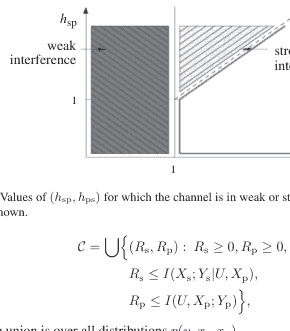

```
\mathcal{C}=\bigcup \left\{\begin{array}{l} \left(R_{s}, R_{p}\right): R_{s} \geq 0, R_{p} \geq 0, \\ R_{s} \leq I\left(X_{s} ; Y_{s}| U, X_{p}\right), \\ R_{p} \leq I\left(U, X_{p}; Y_{p}\right) \end{array}\right\},
```

其中并集是对所有分布 $p(u, x_{s}, x_{p})$ 取的。

高斯信道在 $\mathcal{P}_{s}=\mathcal{P}_{p}$ 且 $h_{sp}, h_{ps} \geq 0$ 时的强干扰和弱干扰区域如图 2.19 所示。

### 3 更优的认知解码区域 [70]

这是对于任意 $p(u, x_{s}, x_{p})$ 都满足条件

$$I\left(U, X_{p} ; Y_{p}\right) \leq I\left(U, X_{p} ; Y_{s}\right)$$

的区域。

容量区域由

```
R_{s} \leq I(U, X_{s} ; Y_{s}| X_{p}),
R_{p} \leq I(U, X_{p} ; Y_{p}),
R_{s}+R_{p} \leq I(U, X_{p} ; Y_{p})+I\left(X_{s} ; Y_{s}| X_{p}, U\right),
R_{s}+R_{p} \leq I\left(U, X_{s}, X_{p} ; Y_{s}\right).
```

给出。

同样，随机变量 $U$ 在 Gelfand–Pinsker 编码中具有相同的作用，即用于分箱。除了分箱和叠加编码外，编码方案还需要在认知编码器处进行速率分割。

### 4 共同信息

如果认知解码器希望解码两个数据序列，则该解码器处没有干扰，因此无需分箱。然后，速率分割和叠加编码可达到容量 [48, 55]。

上述容量结果表明，为了最大化认知无线电网络的性能，其用户应被允许共享带宽并通过（部分）解码、中继或预编码来应对引入的干扰。各类技术的增益取决于信道条件和网络拓扑。

如前所述，增益还取决于认知无线电能够收集到的关于主用户传输的信息量。

对于叠加信道，纳入信道模型时变性的结果很少。一种可能的建模时变性的方法是假设信道参数依赖于随机状态序列。在点对点信道中，当编码器知道随机状态时，该方法导致本节前面讨论的 Gel'fand-Pinsker 问题。带状态的叠加信道在 [82] 中进行了分析。该模型推广了假设信道增益恒定的叠加信道。该论文为带状态的叠加信道开发了内界和外界，并在弱干扰区域建立了容量。

叠加信道容量的另一个重要方面是认知编码器处不完美信道状态信息 (CSI) 的影响。缺乏信道知识会影响所有认知编码方案。在认知编码器存在相位不确定性的情况下，无法直接应用 DPC。因此这种不确定性阻止了干扰的消除并导致显著的性能损失 [37]。在这种情况下，向认知编码器反馈信道状态信息可能非常有益。中继策略可以在发送端没有 CSI 的情况下实现，但需要在接收端有 CSI [51]。然而，发送端的 CSI 可允许额外的中继方法（例如波束成形），从而进一步提高网络性能。

### 2.7.3 K用户叠加网络

双用户叠加信道的分析集中于一对次级用户和一对主用户。然而，与交织网络类似，叠加网络中的多个次级用户和多个主用户可以同时共享同一频谱。与双用户叠加情况一样，在这种更一般的情况下，我们也寻求有效的方法来最小化用户之间的干扰。

我们在第 2.4 节中看到，对于 K 用户干扰信道，将速率分割方法推广为应对来自多个发送者的干扰的方式过于复杂。此外，该方法可被通过干扰对齐或结构化码的干扰集体处理所超越。不出所料，干扰对齐和结构化码也是 K 用户叠加认知无线电网络的有前景的方法。这些技术可由认知节点部署，以降低主接收机和认知接收机处的干扰。但与干扰信道中的编码器不同，次级用户还可以执行主消息的中继，并对干扰进行预编码。这些技术之间的相互作用尚未得到充分理解，构成了一个重要且有趣的研究课题。

另一个有趣的问题是认知在网络不同位置存在时的影响。特别是，不仅编码器，而且（或仅）解码器可以是认知式的。这将显著影响可用的编码和解码技术。编码器处没有认知将排除协作和预编码技术。另一方面，它将使解码器能够直接消除干扰。该

在单一主用户对和次用户对的情况下，不同认知程度的影响已在 [44] 中进行了研究。

一旦获得容量结果和可达速率以及相应的编码和解码策略，表明最有前景的编码方法后，就需要开发多用户次用户共存的协议。最后需要指出的是，原则上，在叠加系统中存在认知无线电不仅可以提高主用户和次用户的频谱利用率和速率，还可以提高主系统的鲁棒性、时延和能耗。具有学习主用户信息能力的认知发射机的存在使得这些信息能够通过网络中的多条路径发送，从而为主要系统增加分集，并为网络中的信息流部署更昂贵且时延更高效的路径。然而，与叠加系统相关的实现挑战可能会阻止这些潜在优势在实践中得以实现。

## 2.8 Summary

确定通用认知无线电网络的基本性能极限是一项艰巨的挑战。常规无线网络的基本性能界限仅在少数特殊情况下可用。增加第二层认知用户使得容量变得更加难以获得。无线系统性能最常见的度量指标是香农容量。尽管通用无线网络的容量结果很少，本章已描述了如何直接使用或扩展现有的香农理论工具，以获得认知网络基本容量极限的一些结果或界限。


# 认知网络容量分析

所有已知认知网络的构建模块是双用户干扰信道，其中一对主发射-接收和一对次发射-接收共享一个公共信道。这个简单的四节点网络对一个次用户和一个主用户的三种认知无线电范式——`underlay`、`interweave` 和 `overlay` 进行了建模。具体来说，在 `underlay` 范式中，认知发射机受到限制，其对主接收机的干扰低于某个阈值；在 `interweave` 范式中，认知发射机仅在检测到频谱空洞时才能传输；在 `overlay` 范式中，两个用户同时传输，次用户在为自身通信获取部分频谱资源的同时提高主用户的性能。基于该四节点模型，我们已证明 `underlay` 网络的容量区域可基于香农容量分析确定，其中主用户对次用户的干扰和次用户对主用户的干扰均视为 `AWGN`。因此，具有衰落和多天线的 `underlay` 单用户信道的容量，以及多址接入和广播 `underlay` 信道的容量，与没有主用户的情况相同，只是次用户（们）的发射功率相对于其对主用户造成的干扰受到限制。在多个次用户的情况下，当次用户干扰之和超过主用户的阈值时，也可以使用 `MAC` 协议，使得部分次用户停止传输以将总干扰降低到所需水平以下。

将干扰视为噪声也在 `interweave` 网络的容量分析中使用。然而，与 `underlay` 网络不同，`interweave` 容量分析要求将与主用户活动检测相关的动态以及漏检概率和虚警概率纳入容量分析。为了捕捉这些动态，四节点情况下次用户的 `interweave` 信道被建模为一个开关。当开关处于 `ON` 时，次用户已检测到频谱空洞（无主用户活动）并进行传输。当开关处于 `OFF` 时，次发射机保持静默，主用户不会受到干扰。如果频谱空洞被正确检测，则次用户不会受到干扰；当频谱空洞被错误检测时，主用户和次用户同时传输并相互干扰。鉴于开关的时间变化，在完美检测下，次用户的信道可建模为对应开关处于 `ON` 或 `OFF` 的双状态信道。利用该模型，推导出了遍历容量和中断容量。在不完美检测下，主用户和次用户信道各有三种状态。对于次用户信道，开关可以是 `OFF` 或 `ON`；当开关 `OFF` 时无传输，当开关 `ON` 时，频谱空洞可以被正确检测（无干扰）或错误检测（主用户干扰）。由于次用户无法感知虚警，正确的容量度量是容量与中断的关系，可根据漏检概率和由主用户干扰引起的 `SNIR` 计算得出。同样地，由于漏检，主用户会受到次用户的干扰，其容量与中断的关系可根据该漏检概率和由次用户干扰引起的 `SNIR` 计算得出。这些容量计算可通过推广漏检和虚警模型以及由此产生的干扰推广到多个主用户和次用户。

`Overlay` 网络不将干扰视为噪声。相反，次用户使用新颖的编码和解码策略，在为自身传输获取部分频谱资源的同时增强主用户的性能。这些编码技术包括速率分割，其中一个用户将其数据序列分割并通过叠加编码进行编码，使得该序列的一部分可以被另一用户的接收机解码并移除。在 `overlay` 网络中，这将允许主接收机移除次发射机的干扰。然而，这种干扰消除需要主用户使用修改后的解码器，因此当主系统在设计或操作上对次系统不了解时不适用。除了速率分割外，次编码器利用其对主用户编码数据序列的了解，通过协作协议增强序列向主接收机的传输。最后，对主用户数据序列的了解使次发射机能够采用 `Gelfand–Pinsker` 编码或分组，以预先消除主用户对认知接收机造成的干扰。同样地，如果主用户知道次用户的序列，它也可以以类似方式使用分组。这些信息论策略尚未进入商业系统，其中 `underlay` 和 `interweave` 目前占主导地位。此外，将这些思想扩展到多于少数几个次用户和主用户的网络仍然是开放问题。然而，正如本章所示，`overlay` 范式在将主用户和次用户的容量提高到其他认知无线电范式之上方面具有重大潜力。如果这些信息论结果能够转化为实践，那么在未来的某个时候，`overlay` 系统可能会主导认知无线电领域的某些部分。

确定认知网络的基本性能极限存在许多开放问题。在 `underlay` 网络的背景下，当节点具有可将次传输定向远离主用户的多天线时的容量已在 [93] 中进行了研究。基于主用户和次用户之间干扰的错误信息的容量与中断关系尚未得到探索。对于 `interweave` 网络，确定实现容量的最优介质访问协议的研究非常活跃。此外，迄今为止的缩放规律假设单跳路由以及主用户周围的排除区域——也许通过考虑中继以及分层协作可以改进这些缩放规律，而这些在开发非认知网络的改进缩放规律方面已被证明是有效的。迄今为止 `overlay` 网络的容量结果主要假设一个次用户和一个主用户。由于具有多于少数几个用户的常规自组织网络的容量区域难以捉摸，我们预计 `overlay` 网络也将如此，除非与认知相关的智能能够简化问题并促进解决方案。对于能量、时延和复杂度等除容量之外的度量指标，基本性能结果很少，也没有为这些网络中的任何一个开发渐近缩放规律。特别是，虽然具有多于少数几个节点的 `overlay` 网络的容量策略可能难以获得，但也许可以扩展利用在没有主用户情况下缩放的先前工作的缩放规律，以考虑主网络。关于能量的性能界限需要包括发射和电路（模拟和处理器）能量的能耗模型，而这些模型已被证明难以获得。这使得确定性能（通过复杂的信号处理和编码/解码得以改善）与能耗之间的权衡变得复杂。的确，认知网络基本性能指标的开发是一个丰富且活跃的研究领域。该领域的结果对于获得这些新兴系统的洞察和性能界限至关重要。

下一章将开发认知网络中与信号传播相关的模型。这些模型对于确定主接收机处的干扰性质以及所有接收机处的期望接收信号至关重要。特别是，由于传播高度依赖于频率，不同的无线电频段将具有非常不同的干扰特性。此外，这些信道的时间变化决定了在不同认知用户范式下所需信息获取的程度，以及此类系统需要多快地适应。

## 2.9 进一步阅读

四节点认知无线电信道是四节点干扰信道的特例，其容量首次在20世纪70年代末由 Carleial 和 Sato [11, 73] 研究。该模型中干扰信道的一个编码器为认知编码器，首次被提出并对其容量区域进行了分析，见 [19, 59]。此后，在确定该信道的可达速率区域和容量外界限方面进行了大量研究，以及强干扰、非常强干扰和弱干扰等特殊情况，在这些情况下这些界限相遇。教程论文 [20, 35] 描述了关于具有认知编码器的干扰信道容量的大量研究工作，以及这些特殊情况下得到的容量区域和编码/解码策略。交织网络的缩放规律首次在 [92] 中被研究，使用了主用户排除区域的思想。基于主用户检测的开关模型分析交织信道容量的首次工作是 [45]。

## 参考文献

- [1] V. S. Annapureddy and V. Veeraralli, "高斯干扰网络：低干扰区域的和容量及容量区域的新外界限," **IEEE Trans. Inf. Theory, 55**, no. 7, 3032–3050, 2009年7月.
- [2] M. R. Aref, **中继网络中的信息流**, 博士论文, Stanford University, Stanford, CA, 1980.
- [3] C. Bae and W. E. Stark, "多跳无线网络中的端到端能量/带宽权衡," **IEEE Trans. Inf. Theory, 55**, no. 9, 4051–4066, 2009年9月.
- [4] E. Biglieri, J. Proakis, and S. Shamai (Shitz), "衰落信道：信息论和通信方面," **IEEE Trans. Inf. Theory, 44**, no. 6, 2619–2692, 1998年10月.
- [5] H. Bölcskei, R. U. Nabar, O. Oyman, and A. J. Paulraj, "MIMO 中继网络中的容量缩放规律," **IEEE Trans. Wireless Commun., 5**, no. 6, 1433–1444, 2006年6月.
- [6] R. Brodersen, D. Wölz, D. Cabric, S. M. Mishra, and D. Wilkomm, "CORVUS：虚拟免许可频谱使用的认知无线电方法," **白皮书：伯克利无线研究中心** <http://www.eecs.berkeley.edu/research/mmcua/CR_White_paper_final1.pdf>.
- [7] V. R. Cadambe and S. A. Jafar, "干扰对齐与 K 用户干扰信道的自由度," **IEEE Trans. Inf. Theory, 54**, no. 8, 3425–3441, 2008年8月.
- [8] V.R. Cadambe and S. A. Jafar, "并行高斯干扰信道并非总是可分离的," **IEEE Trans. Inf. Theory, 55**, no. 9, 3983–3990, 2009年9月.
- [9] Y. Cao and B. Chen, "具有一个认知发送器的干扰信道", **Asilomar 信号、系统和计算机会议论文集, Pacific Grove, CA**, 2008年10月26–29日.


- [10] A. B. Carleial, "干扰不降低容量的一个案例", IEEE Trans. Inf. Theory, 21, no. 5, 569–570, 1975年9月.

- [11] A. B. Carleial, "干扰信道", IEEE Trans. Inf. Theory, 24, no. 1, 60–70, 1978年1月.

- [12] T. C. Clancy, "干扰温度模型下的可达容量", IEEE 计算机通信国际会议论文集 (INFOCOM), Anchorage, AK, 2007年5月6–12日, pp. 794–802.

- [13] C. B. Corano and K. R. A. Choudhury, "认知无线电网络 MAC 协议综述", Elsevier J. Ad Hoc Netw., 7, no. 7, 1315–1329, 2009年7月.

- [14] M. H. M. Costa, “在脏纸上书写,” IEEE Trans. Inf. Theory, 29, no. 3, 439–441, 1983年5月.

- [15] M. H. M. Costa and E. El Gamal, “强干扰下离散无记忆干扰信道的容量区域,” IEEE Trans. Inf. Theory, 33, no. 5, 710–711, 1987年9月.

- [16] T. Cover, “广播信道,” IEEE Trans. Inf. Theory, 18, no. 1, 2–14, 1972年1月.

- [17] T. Cover and A. El Gamal, “中继信道容量定理,” IEEE Trans. Inf. Theory, 25, no. 5, 572–584, 1979年9月.

- [18] T. Cover and J. Thomas, 信息论基础 (第2版). J. Wiley & Sons, 2006.

- [19] N. Devroye, P. Mitran, and V. Tarokh, “认知无线电信道中的可达速率,” IEEE Trans. Inf. Theory, 52, no. 5, 1813–1827, 2006年5月.

- [20] N. Devroye, M. Vu, and V. Tarokh, “认知无线电网络,” IEEE Signal Processing Mag., 25, no. 6, 12–23, 2008年11月.

- [21] M. Effros, A. Goldsmith, and Y. Liang, “推广容量：复合信道的新定义和容量定理,” IEEE Trans. Inf. Theory, 56, no. 7, 2010年7月.

- [22] A. El Gamal, J. Mammen, B. Prabhakar, and D. Shah, “无线网络中的最优吞吐量-时延缩放 – 第 I 部分：流体模型,” IEEE Trans. Inf. Theory, 52, no. 6, 2568–2592, 2006年6月.

- [23] A. El Gamal, “关于中继网络中的信息流,” IEEE 国家电信会议论文集, 2, 1981年11月, pp. D4.1.1–D4.1.4.

- [24] A. El Gamal and Y.-H. Kim, 网络信息论, Cambridge University Press, 2012.

- [25] H. El Gamal, G. Caire, and M. O. Damen, “MIMO-ARQ 信道：分集-复用中继权衡,” IEEE Trans. Inf. Theory, 52, no. 8, 3601–3621, 2006年8月.

- [26] R. Etkin, D. N. C. Tse, and H. Wang, “高斯干扰信道容量在一位之内,” IEEE Trans. Inf. Theory, 54, no. 12, 5534–5562, 2008年12月.

- [27] Federal Communications Commission Spectrum Policy Task Force, 频谱效率工作组报告, 技术报告 02-135, (2002年11月). `www.fcc.gov/ps05/files/SEWGFinalReport1.pdf`.

- [28] R. G. Gallager, 信息论与可靠通信, J. Wiley & Sons, 1968.

- [29] M. Gastpar, “在接收和空间频谱共享约束下的容量,” IEEE Trans. Inf. Theory, 53, no. 2, 471–487, 2007年2月.

- [30] S. I. Gel'fand and M. I. Pinsker, “随机参数信道的编码,” Probl. Peredachi Informatsii, 9, no. 1, 19–31, 1980年1月.

- [38] P. Gupta and P. R. Kumar, “无线网络的容量,” IEEE Trans. Inf. Theory, 42, no. 2, 388–404, 2000年3月.

- [39] P. Gupta and P. R. Kumar, “朝向大规模网络的信息论：一个可达速率区域,” IEEE Trans. Inf. Theory, 49, no. 8, 1877–1894, 2003年8月.

- [40] T. Han and K. Kobayashi, “干扰信道的一个新的可达速率区域,” IEEE Trans. Inf. Theory, 27, no. 1, 49–60, 1981年1月.

- [41] S. Haykin, “认知无线电：大脑赋能的无线通信,” IEEE J. Sel. Areas Commun., 23, no. 2, 201–220, 2005年2月.

- [42] W. Hirt and J. L. Massey, “具有码间干扰的离散时间高斯信道的容量,” IEEE Trans. Inf. Theory, 34, no. 3, 380–388, 1998年5月.

- [43] J. Huang, R. A. Berry and M. L. Honig, “具有分布式干扰补偿的频谱共享,” IEEE 动态频谱接入网络新前沿国际研讨会论文集 (DySPAN), Baltimore, MD, 2005年11月8–11日, pp. 88–93.

- [44] S. A. Jafar and S. Shamai (Shitz), “MIMO X 信道的自由度区域,” IEEE Trans. Inf. Theory, 54, no. 1, 151–170, 2008年1月.

- [45] S. A. Jafar and S. Srivastava, “分布式和动态频谱活动下认知无线电的容量极限,” IEEE J. Sel. Areas Commun., 25, no. 3, 529–537, 2007年4月.

- [46] S.-W. Jeon, N. Devroye, M. Vu, S.-Y. Chung, and V. Tarokh, “认知网络实现同构网络的吞吐量缩放,” IEEE Trans. Inf. Theory, 57, no. 8, 5103–5115, 2011年8月.

- [47] J. Jiang, I. Marić, A. Goldsmith, S. Shamai (Shitz), and S. Cui, “一类认知 Z 干扰信道的容量,” IEEE 国际通信会议论文集 (ICC), Kyoto, Japan, 2011年6月5–9日.

- [48] J. Jiang, Y. Xin, and H. Garf, “具有公共信息的干扰信道,” IEEE Trans. Inf. Theory, 54, no. 1, 171–187, 2008年1月.

- [49] A. Jovićić and P. Viswanath, “认知无线电：信息论视角,” IEEE Trans. Inf. Theory, 55, no. 9, 3945–3958, 2009年9月.

- [50] R. Koetter, M. Effros, and M. Médard, “关于网络等价理论,” IEEE 信息论研讨会论文集 (ITW), Volos, Greece, 2009年6月10–12日. `arXiv.org/abs/1007.1033`

- [51] G. Kramer, I. Maric, and R. D. Yates, “协作通信,” NOW J. Found. Trends Netw., 1, no. 3–4, 271–425, 2006.

- [52] G. Kramer and S. Savari, “中继网络的容量界限,” UCSD 信息论与应用研讨会论文集, La Jolla, CA, 2006年2月6–10日.


## 参考文献

- [53] G. Kramer and S. Savari, “网络编码速率的边割界限,” J. Netw. Syst. Manage., 14, no. 1, 49–67, 2006年3月.
- [54] H. Kushwaha, R. Chandramouli, and K. P. Subbalakshmi, “认知网络：迈向自感知网络,” in Q. H. Mahmood (ed.), 认知网络 – 迈向自感知网络. J. Wiley & Sons, 2007.
- [55] Y. Liang, A. Somekh-Baruch, V. Poor, S. Shamai (Shitz), and S. Verdú, “有无保密的认知干扰信道,” IEEE Trans. Inf. Theory, 55, no. 2, 604–619, 2009年2月.
- [56] N. Liu, I. Marić, A. Goldsmith, and S. Shamai (Shitz), “认知 Z 干扰信道的界限和容量结果,” IEEE 国际信息论研讨会论文集, Seoul, Korea, 2009年6月28日–7月3日.
- [57] M. A. Maddah Ali, S. A. Motahari, and A. K. Khandani, “MIMO X 信道通信：干扰对齐、分解和性能分析,” IEEE Trans. Inf. Theory, 54, no. 8, 3457–3470, 2008年8月.

### 参考文献

- [58] I. Marić, A. Goldsmith, G. Kramer, and S. Shamai (Shitz), “关于具有部分认知发射机的干扰信道的容量，” IEEE 国际信息论研讨会论文集, 尼斯，法国, 2007年6月24–29日.
- [59] I. Marić, R. D. Yates, and G. Kramer, “具有单向协作的强干扰信道，” UCSD 信息论与应用研讨会论文集, 拉霍亚，加州, 2006年2月6–10日.
- [60] I. Marić, R. D. Yates, and G. Kramer, “具有部分发射机协作的干扰信道的容量，” IEEE 信息论汇刊, 53, no. 10, 3526–3548, 2007年10月.
- [61] K. Marton, “离散无记忆广播信道的一个编码定理，” IEEE 信息论汇刊, 25, no. 3, 306–311, 1979年5月.
- [62] J. Mitola III, 认知无线电：软件无线电的基于模型的胜任能力, 博士论文, 瑞典皇家理工学院 KTH, 斯德哥尔摩，瑞典, 1999年8月.
- [63] A. S. Motahari and A. K. Khandani, “高斯干扰信道的容量界，” IEEE 国际信息论研讨会论文集, 多伦多，加拿大, 2008年7月6–11日.
- [64] L. Musavian and S. Aissa, “衰落信道中频谱共享通信的容量与功率分配，” IEEE 无线通信汇刊, 8, no. 1, 148–156, 2009年1月.
- [65] B. Nazer and M. Gastpar, “多址信道上的计算，” IEEE 信息论汇刊, 53, no. 10, 2007年10月.
- [66] B. Nazer, M. Gastpar, S. Jafar, and S. Vishwanath, “遍历干扰对齐，” IEEE 国际信息论研讨会论文集, 首尔，韩国, 2009年6月28–7月3日, pp. 1769–1773.
- [67] A. Ozgur and O. Leveque, “自组织无线网络中分层协作的吞吐量-延迟权衡，” IEEE 信息论汇刊, 56, no. 3, 1369–1377, 2010年3月.
- [68] A. Ozgur, O. Leveque, and D. N. C. Tse, “分层协作在自组织网络中实现最优容量扩展，” IEEE 信息论汇刊, 53, no. 10, 3549–3572, 2007年10月.
- [69] A. Ozgur and D. N. C. Tse, “利用干扰对齐实现线性扩展，” IEEE 国际信息论研讨会论文集, 首尔，韩国, 2009年6月28–7月3日, pp. 1754–1758.
- [70] S. Rini, D. Tuniyetti, and N. Devroye, “无记忆认知干扰信道的新内界和外界以及一些容量结果，” IEEE 信息论汇刊, 57, no. 7, 4087–4109, 2011年7月.
- [71] V. Rodoplu and T. H. Meng, “能量受限无线网络的每焦耳比特容量，” IEEE 无线通信汇刊, 6, no. 3, 857–865, 2007年3月.
- [72] J. Sachs, I. Marić, and A. J. Goldsmith, “电视频谱中的认知蜂窝系统，” IEEE 动态频谱网络新前沿国际研讨会论文集 (DySPAN), 新加坡, 2010年4月6–9日, pp. 1–12.

## 认知无线电网络的容量

- [78] C. E. Shannon, “双向通信信道，” 伯克利数学统计与概率研讨会论文集, 1, 1961年, 611–644.
- [79] C. E. Shannon and W. Weaver, 《通信的数学理论》, 伊利诺伊大学出版社, 1949年.
- [80] Shared Spectrum Company, “六个不同地点的综合频谱占用测量，” 2005年8月, www.sharedspectrum.com/section=nfsd_summary.
- [81] F. Shayegh and M. R. Soleymani, “虚拟免许可频谱中认知无线电的无速率码，” IEEE Sarnoff 研讨会论文集, 普林斯顿，新泽西, 2011年5月2-4日.
- [82] A. Somekh-Baruch, S. Shamai (Shitz), and S. Verdu, “具有状态信息的认知干扰信道，” IEEE 国际信息论研讨会论文集, 多伦多，加拿大, 2008年7月6-11日.
- [83] S. Sridharan, A. Jafar, S. Vishwanath, S. A. Jafar, and S. Shamai (Shitz), “一类三用户高斯干扰信道的分层格编码方案，” Allerton 通信、控制与计算会议论文集, 蒙蒂塞洛，伊利诺伊州, 2008年9月24-26日, pp. 531-538.
- [84] E. Telatar, “多天线高斯信道的容量，” 欧洲电信期刊, 10, no. 6, 585-596, 1999年11月.
- [85] S. Tumpiu and A. J. Goldsmith, “无线自组织网络的容量区域，” IEEE 无线通信汇刊, 2, no. 4, 736-748, 2003年7月.
- [86] D. N. C. Tse and P. Viswanath, 《无线通信基础》, 剑桥大学出版社, 2005年.
- [87] 超宽带无线通信——理论与应用, IEEE 通信选定领域期刊, 24, no. 4, 2006年4月.
- [88] J. Unnikrishnan and V. V. Veeravalli, “用于认知无线电的带学习动态频谱接入算法，” IEEE 信号处理汇刊, 58, no. 2, 750-760, 2010年2月.
- [89] S. Verdu, “关于单位成本的信道容量，” IEEE 信息论汇刊, 36, no. 5, 1019-1030, 1990年9月.
- [90] S. Verdu and T. S. Han, “信道容量的一般公式，” IEEE 信息论汇刊, 40, no. 4, 1147-1157, 1994年7月.
- [91] S. Vishwanath, N. Jindal, and A. Goldsmith, “高斯MIMO广播信道的对偶性、可达速率和和速率容量，” IEEE 信息论汇刊, 49, no. 10, 2658-2668, 2003年10月.
- [92] M. Vu, N. Devroye, M. Sharif, and V. Tarokh, “认知网络的扩展规律，” IEEE 认知无线电导向无线网络与通信国际会议论文集 (CrownCom), 奥兰多，佛罗里达, 2007年7月31–8月3日, pp. 2–8.
- [93] H. Wang, J. Lee, S. Kim, and D. Hong, “通过频谱共享中的空间分集增强次级链路容量，” IEEE 无线通信汇刊, 9, no. 2, 494–499, 2010年2月.
- [94] H. Weingarten, Y. Steinberg, and S. Shamai, “高斯多输入多输出广播信道的容量区域，” IEEE 信息论汇刊, 52, no. 9, 3936–3964, 2006年9月.


- [95] W. Wu, S. Vishwanath, and A. A. Arapostathis, “一类认知无线电信道的容量：具有退化消息集的干扰信道，” IEEE 信息论汇刊, 53, no. 11, 4391–4399, 2007年11月.
- [96] Z. Wu and B. Natarajan, “抗干扰敏捷认知无线电：最大化认知无线电信道容量，” IEEE 消费电子通信与网络会议论文集 (CCNC), 拉斯维加斯，内华达, 2007年1月11–13日, pp. 1027–1031.
- [97] Y. Xie and A. J. Goldsmith, “具有ARQ的MIMO多径网络中的分集-复用-延迟权衡，” IEEE 国际信息论研讨会论文集, 奥斯汀，德克萨斯, 2010年6月13–18日, pp. 2208–2212.
- [98] Y. Xie, D. Gündüz, and A. J. Goldsmith, “具有ARQ的多跳MIMO中继网络，” *IEEE 全球电信会议论文集 (GLOBECOM)*, 檀香山，夏威夷, 2009年11月30–12月4日, pp. 1–6.
- [99] F. Xue and P. R. Kumar, “自组织无线网络的扩展规律：一种信息论方法，” *NOW 网络基础与趋势期刊*, 1, no. 2, 145–270, 2006年.
- [100] C. Yin, L. Gao, and S. Cui, “叠加无线网络的扩展规律：认知无线电网络与主网络，” *IEEE/ACM 网络汇刊*, 18, no. 4, 1317–1329, 2010年8月.
- [101] R. Zhang and Y.-C. Liang, “利用多天线实现认知无线电网络中的机会频谱共享，” *IEEE 信号处理选定主题期刊*, 2, no. 1, 88–102, 2008年2月.
- [102] Q. Zhao, L. Tong and A. Swami, “自组织网络中机会频谱接入的分散式认知MAC：一种POMDP框架，” *IEEE 通信选定领域期刊*, 25, no. 3, 224–232, 2007年4月.
- [103] L. Zheng and D. N. C. Tse, “分集与复用：多天线信道中的基本权衡，” *IEEE 信息论汇刊*, 49, no. 5, 1073–1096, 2003年5月.

## 3 认知无线电的传播问题

Larry J. Greenstein, Andreas F. Molisch, and Mansoor Shafi

### 3.1 引言

认知无线电（CR）的基本原理是检测环境中正在使用相同频谱资源的其它无线电，然后部署传输和接收策略，使次级用户能够通信，同时最小化对这些无线电的干扰以及来自这些无线电的干扰。对于此类传输和接收策略的设计、分析和实现，了解相关的传播信道 [80] 至关重要。发射机（TX）发射的功率可能由系统设计者决定，但信道决定了其中有多少作为有用功率到达目标接收机（RX），以及它在非目标接收机处产生的干扰有多少。同样，CR系统的信号感知过程可能由系统设计者决定，但信道决定了在时间、频率和空间上应进行采样的间隔。例如，信道响应的时变速率决定了需要采样的频率，从而决定了传输或接收策略可能需要调整的频率。正如我们将看到的，信道的许多其它特性也会影响CR的设计和分析。

#### 3.1.1 认知无线电频段中的传播

CR可部署于宽广的频率频谱范围内。约3.5 GHz以下的频段具有相对较低的传播损耗，并为所有业务所青睐。因此这些频段是部署CR的理想候选频段。它们具有不同的现存（主）系统，每个系统都有其自身的业务类型、架构、带宽和抗干扰能力的组合。这些频段的部分描述见第1章。

在CR频段中，与大多数其它频段一样，发射信号以多种方式受到传播的影响。它们会发生衰减，其局部空间平均值——以分贝表示——称为路径损耗。这是信道的大尺度特性，因为它在许多波长的距离上仅轻微变化。对于给定的路径损耗值，信号电平还存在小尺度变化，这是由于存在多条信号路径所致；这称为多径衰落，其特征是在一个无线电波长的距离上信号电平快速波动。多条路径源于物理环境中物体和结构相关的散射、反射和衍射，可能导致严重的信号失真。信道的特性

无线信道会随载波频率和信号带宽而变化。例如，大尺度特性如路径损耗倾向于随载波频率的对数线性增加；相比之下，小尺度特性如信号失真对载波频率相对不敏感，但其影响可能很大程度上取决于业务带宽。所有这些都适用于主用和次用（即认知）无线电，因此两种无线电类型都需要良好的信道模型以实现有效的设计。

在此，我们概述了认知无线电系统设计人员和研究人员可能使用的传播模型。这些模型可通过分析或仿真帮助确定认知无线电对主用系统的潜在干扰；并且它们可以决定传输格式、路由算法以及用于减轻认知无线电干扰的控制方案的设计。此外，由于为认知无线电使用而获取的频谱可能跨越宽泛且碎片化的范围，因此需要针对各种频率和带宽的传播模型。我们强调，物理传播信道与无线电是否具有认知能力无关。然而，信道的哪些方面很重要，从而需要特别仔细地建模，这方面的问题是不同的。例如，认知无线电的一个特殊特征是对主用用户造成强干扰的巨大潜力，这可能发生在所有认知无线电范式下（交织、底层和叠加，第1章和第2章）。

### 3.1.2 传播对感知

无线信道会随载波频率和信号带宽而变化。例如，大尺度特性如路径损耗倾向于随载波频率的对数线性增加；相比之下，小尺度特性如信号失真对载波频率相对不敏感，但其影响可能很大程度上取决于业务带宽。所有这些都适用于主用和次用（即认知）无线电，因此两种无线电类型都需要良好的信道模型以实现有效的设计。

在此，我们概述了认知无线电系统设计人员和研究人员可能使用的传播模型。这些模型可通过分析或仿真帮助确定认知无线电对主用系统的潜在干扰；并且它们可以决定传输格式、路由算法以及用于减轻认知无线电干扰的控制方案的设计。此外，由于为认知无线电使用而获取的频谱可能跨越宽泛且碎片化的范围，因此需要针对各种频率和带宽的传播模型。我们强调，物理传播信道与无线电是否具有认知能力无关。然而，信道的哪些方面很重要，从而需要特别仔细地建模，这方面的问题是不同的。例如，认知无线电的一个特殊特征是对主用用户造成强干扰的巨大潜力，这可能发生在所有认知无线电范式下（交织、底层和叠加，第1章和第2章）。


在此，我们概述了认知无线电系统设计人员和研究人员可能使用的传播模型。这些模型可通过分析或仿真帮助确定认知无线电对主用系统的潜在干扰；并且它们可以决定传输格式、路由算法以及用于减轻认知无线电干扰的控制方案的设计。此外，由于为认知无线电使用而获取的频谱可能跨越宽泛且碎片化的范围，因此需要针对各种频率和带宽的传播模型。我们强调，物理传播信道与无线电是否具有认知能力无关。然而，信道的哪些方面很重要，从而需要特别仔细地建模，这方面的问题是不同的。例如，认知无线电的一个特殊特征是对主用用户造成强干扰的巨大潜力，这可能发生在所有认知无线电范式下（交织、底层和叠加，第1章和第2章）。

### 3.1.2 传播对感知的影响

无线信道会随载波频率和信号带宽而变化。例如，大尺度特性如路径损耗倾向于随载波频率的对数线性增加；相比之下，小尺度特性如信号失真对载波频率相对不敏感，但其影响可能很大程度上取决于业务带宽。所有这些都适用于主用和次用（即认知）无线电，因此两种无线电类型都需要良好的信道模型以实现有效的设计。

能量感知过程受传播信道以多种方式影响。例如：

- 传感器处即次系统一部分的信号电平由该传感器与主用发射机之间链路的路径损耗决定，并受该链路的大尺度和小尺度衰落影响。信号电平进而影响虚警概率即频谱被判定为占用而实际上空闲和漏检概率即频谱被判定为空而实际上被主用用户占用之间的权衡，如第4章所述。


- 当使用宽带感知时，由于小尺度衰落的频率选择性以及可能路径损耗的频率依赖性，不同频率的信号电平不同。了解这些效应对于构建适当的宽带传感器至关重要。

- 当使用分布式感知时第5章，需要了解从主用发射机到传感器的信道特性的相关性。此类知识包括路径损耗规律和阴影的相关性统计。

- 当使用天线阵列进行感知时，角度扩展决定了不同天线单元处信号的相关性，从而有助于确定最佳检测过程。

- 通过随时间对感知数据进行平均可进一步改善检测过程。为了进行适当的平均，次系统需要了解主系统的传输统计特性和信道的时变特性。

如前所述，传感器通常只能检测主用发射机的存在，而不能检测接收机。从这些观测中得出关于次设备传输是否会对主用接收机造成过度干扰的结论并非易事。设想一个简单的场景，主用系统使用频分双工。然后，主链路的两端在不同频段传输。因此，必须了解主系统发射和接收频段中信号电平的相关性。这与小尺度衰落的频率选择性和路径损耗的频率依赖性有关。传播信道对“隐藏节点问题”[90]也有关键影响，其中次收发机处于主用发射机的“监听范围”之外，但足够接近主用接收机以造成干扰。随着路径损耗和阴影方差的增加，隐藏节点发生的可能性增加。

### 3.1.3 传播对传输的影响

感知之后，次系统的下一步是寻找良好的传输策略。对于频谱感知无线电即仅涉及改变工作频率的情况，这涉及决定哪个次发射机可以在哪个频段传输以及传输多长时间。换句话说，“空闲”频谱必须在希望传输信息的不同次设备之间分配。最优分配策略通常可从博弈论考虑第1章获得。作为此类计算的输入，了解传播信道至关重要。实际性能以及不同方案的相对有效性取决于观测到的信号电平。对于叠加方法，次系统需要在实际传输时准确了解主用和次用系统内部以及两者之间的传播信道。为了制定适当的传输策略，至关重要的是次发射机能够进行信道预测基于过去和现在的观测并且了解这些预测的可实现精度。这反过来需要良好的信道模型。

最优传输方案更新的必要性与信道的时域特性密切相关，包括移动用户的多普勒谱和固定用户的莱斯因子的时变特性。这也影响是否可以使用合作博弈或非合作博弈来制定传输策略。合作博弈需要在不同次用户之间交换信息，但如果信道变化迅速大多普勒扩展和或太强小莱斯因子所需信息交换的开销会变得很大。

信道特性也影响认知无线电的传输和接收策略设计。例如，在使用正交频分复用`OFDM`的认知无线电系统中，最优子载波间隔取决于多普勒谱和功率时延分布。因此，使用`OFDM`的认知无线电设计应选择与预期信道特性良好匹配的子载波间隔。

同样，认知无线电设计应允许调制字母表大小根据信号电平进行调整，该电平取决于路径损耗和小尺度衰落。

最后，我们强调传播模型在分析认知无线电系统中的干扰以及设计最小化或避免干扰的方法方面的重要性。例如在叠加和底层中，认知发射机与主用接收机共信道工作；在交织中，它可能在相邻信道工作。因此，共信道和邻信道干扰都很重要，其影响取决于众多因素：传输频谱，包括带外能量；接收滤波器特性，包括带外响应；双工方案和参数例如频分双工中频段的间隔；以及诸如路径损耗用于估计受害接收机处的总功率和小尺度衰落的时域、空域和频域变化用于将某一时-地-频处的感知测量与另一条件相关联等传播方面。一般而言，我们可以说认知无线电设计中的每个工作参数和策略都以某种方式依赖于传播信道。

### 3.1.4 章节提纲

我们将在本章中始终指出所描述的传播问题对认知无线电的具体影响，无论影响是叠加、底层还是交织场景。同时，若不了解无线电信道本身的基本原理，就无法理解传播的认知无线电特定方面。因此，读者会注意到我们将以一般方式讨论传播现象和信道模型，这有望对不熟悉该主题的人有所帮助。第3.2节介绍通用信道响应，将其显示为大尺度项与小尺度项的乘积，大尺度项与路径损耗相关，包含距离和阴影效应；小尺度项包含多径效应。接下来的三节3.3至3.5按顺序处理理想自由空间路径损耗、无线系统中的路径损耗和塔基系统中的路径损耗。接下来的四节3.6至3.9处理多径引起的小尺度现象。按顺序包括场强空间变化、移动和固定终端的时变多普勒谱、宽带信道的时延扩展和角度扩展。最后，我们介绍极化主题，该主题可能对使用多天线的认知无线电设计产生影响第3.10节；讨论对认知无线电重要但建模较少的新的传播环境第3.11节；并总结我们所描述的无线电信道的关键传播参数第3.12节。我们以本章总结第3.13节和进一步阅读建议第3.14节结束。

## 3.2 通用信道响应

我们在此无意讨论认知无线电相关频段中无线电传播的物理学，而是描述传播对给定认知无线电系统所见介质行为的影响。这引出了特定信道响应的概念

特定频段中的路径。任何线性时不变介质的响应都可以用*冲激响应*，`h(τ)`，或*频率响应*，`H(f)`来表征，这两个函数通过傅里叶变换相关。我们将重点关注冲激响应以及它如何受到传播介质、系统几何形状和周围环境相互作用的影响。

任何待分析的特定无线电路径的一个显著特征是发射机（`TX`）和接收机（`RX`）的联合位置。我们用 `x` 表示 `TX` 和 `RX` 位置坐标的组合，它唯一地指定了空间中路径（或*链路*）的几何形状。我们进一步指出，所关心的冲激响应只是感兴趣的无线电带宽内的响应，例如在 `f_c − W/2` 与 `f_c + W/2` 之间，其中 `f_c` 是信号带的中心频率，`W` 是信号带宽，或更一般地，是用于测量或建模信道响应的任何频率区间的宽度。对此 `f` 区间 `F` 的严格限制通常由 `TX` 和 `RX` 滤波器强制执行，因此我们寻求表征的 `h(τ)` 只是 `F` 内的响应。因此我们引入记号 `h(τ; x, F)` 来表示我们所讨论的冲激响应的空间和频谱特异性。冲激响应和频率响应在所有情况下都是相对于中心频率 `f_c` 的低通函数。

我们现在引入路径的*功率增益*，`G`，它是 `|H(f)|²` 在信号带宽（即频谱域 `F`）以及路径中可能移动的任一端（或两端）的局部空间域上的平均值。因此，我们可以写出

`G = E_x[1/W ∫_F |H(f)|² df] = E_x[1/W ∫_τ |h(τ, x, F)|² dτ], (3.1)`

第二个等式是帕塞瓦尔定理的推论。¹ 因此我们可以写出

`h(τ, x, F) = [G]^{1/2} ĥ(τ, x, F) (3.2)`

其中 `ĥ(τ; x, F)` 归一化使得其幅度的平方在 `x` 上平均、τ 上积分并用 `W` 归一化后为 1。为了具体说明，空间平均可以认为是在移动台标称位置为中心的圆上取的，半径约为 10 个波长。

¹ 用 `E_x` 表示的空间平均是在移动台标称位置附近的局部区域上进行的。它等价于对 `x` 的一部分——移动台位置坐标——的小变化进行平均。

这种表示的相关性在于 `h(τ, x, F)` 中的两个因子在不同方面很重要，并且它们在距离和频率尺度上变化不同。功率增益 `G` 在确定来自 `CR` 网络和进入 `CR` 网络的干扰水平以及 `CR` 网络内链路的信噪比方面很重要。归一化冲激响应 `ĥ(τ, x, F)` 在确定 `CR` 信号失真和制定对抗技术方面很重要。此外，`G` 以*大尺度*方式变化，即它在位置间隔数十米或更大以及频率间隔数百兆赫或更大时发生变化。相比之下，`ĥ(τ, x, F)` 以*小尺度*方式变化，即它在距离小到无线电波长的分数（例如 1 GHz 时为 30 cm）以及在典型通信信号带宽内（20 MHz 或更小）的频率上可能显著变化。

最后，我们注意到 `G` 如何与称为路径损耗 `PL` 的非常重要的无线电量相关。具体而言，路径损耗是 `G` 的负分贝值：

`$PL = -10\log(G).$ (3.3)`

我们将分别处理大尺度路径损耗和小尺度冲激响应，为方便起见，后者不再使用“归一化”这一形容词。

## 3.3 路径损耗简介

### 3.3.1 自由空间路径损耗

如果在给定频率 `f` 下的无线电波从发射机辐射，且其路径上没有反射或散射源，它会向外传播而不损失总功率。因此，其功率密度，例如瓦特/平方米，随着距离 `d` 的平方反比而减小。因此检测该波的接收机将看到与 `d⁻²` 成比例的功率。假设 `TX-RX` 路径两端的无天线增益，接收功率 `Pr` 与发射功率 `Pt` 之间的关系由下式给出

`$P_r = P_t\left(\frac{c}{4\pi f d}\right)^2,$ (3.4)`

其中 `c` 是介质中无线电波传播的速度，`c`、`f` 和 `d` 使用一致的单位。这是自由空间传播著名的 Friis 公式 [34]。注意到功率增益为 `Pr/Pt`，我们看到自由空间情况下的 `G` 只是 (3.4) 中的平方项。或者，从 (3.3) 可知，自由空间路径损耗为

`$FSPL = 20\log\frac{4\pi d}{\lambda},$ (3.5)`

其中 `λ = c / f` 为波长。例如，在长度为 1 km、`f = 1 GHz` 的路径上，`FSPL = 92.4 dB`。

物理世界就是这样，在地面领域很少有无线电业务符合 (3.5)。尽管自由空间路径损耗公式因此似乎与 `CR` 无关，我们仍然引入它，不仅因为其历史重要性，而且因为它为我们将讨论的其他路径损耗公式提供了基准。

### 3.3.2 CR 场景中的路径损耗

存在潜在的 `CR` 应用，其中塔间传播很重要。例如，`CR` 的一种用途是作为承载互联网流量的骨干网络，取代光纤传输 [36]。在这种情况下，`CR` 塔可能较低且嵌入城市区域，天线紧凑因此方向性有限。


允许使用 (3.5) 进行路径损耗的仔细工程设计在这里是不可能的。因此，需要其他路径损耗公式来量化 CR 骨干网络内接收到的期望信号电平；来自主发射机（尤其是电视塔）对 CR 接收机的干扰电平；以及来自 CR 发射机对主接收机的干扰电平。

更典型的是，CR 系统是无线网络，本章将其定义为一端或两端位于环境杂乱中的应用；并且没有一根天线高于地面 80 m。对于室外，这意味着传输显著受地面、山脉、建筑物、树木、车辆等的反射影响。对于室内环境，反射来自墙壁、地板、天花板、家具、人员等。在所有这些情况下，路径损耗都很重要需要知道，再次是因为它对期望信号和干扰的接收电平的影响。

## 3.4 无线信道的路径损耗模型

### 3.4.1 一般公式

在无线系统中，大多数无线电路径都不满足自由空间条件。通常没有无阻挡的视距路径，非视距路径众多，这是由于构成接收信号的多次阻挡、反射和散射（见图 3.1）。

多年来，已有大量测量活动导致了不同频段和环境下无线系统路径损耗的经验模型。所报道研究的范围涵盖室外移动环境，包括大蜂窝（宏蜂窝）和小蜂窝（微蜂窝）；具有多面墙和大开阔空间的室内环境；以及室外固定无线环境，所有这些频率范围约为 ~300 MHz 至 ~6 GHz。

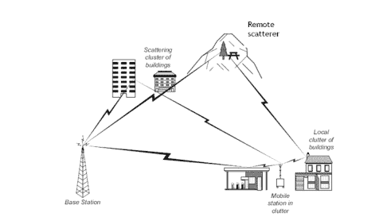

存在一个近似功率增益 `G` 的通用公式，在大多数测量频段和无线环境中表现良好。它是

$$G = \frac{\langle P_r \rangle}{P_t} \sim a \left(\frac{d}{d_0}\right)^{-\gamma}, \tag{3.6}$$

其中 `P_t` 和 `\langle P_r \rangle` 分别是发射功率和平均接收功率，单位一致，`P_r` 的平均是在信号带宽和局部区域上取的；`d_0` 是参考距离，与 `d` 单位相同；`a` 和 `γ` 是无量纲模型参数。`d_0` 的典型值在室内环境中为 1 m，在室外环境中为 100 m 或 1 km。很容易看出，自由空间传播中的功率增益，由 (3.4) 中的平方项给出，是 (3.6) 的特例，其中 `a = \left(\frac{4\pi d_0}{\lambda}\right)^2` 且 `γ = 2`。在大多数无线环境中，路径损耗指数 `γ` 大于 2，因为如果路径上有障碍物，功率随距离衰减比仅由扩散损耗预测的更快。然而，在一些室内场景中，如走廊中传输，由于波导效应 [62]，`γ` 可能小于 2。

上述公式不能精确，因为从一个 TX-RX 路径到另一个路径，人造结构和地形的变幻莫测，使得在给定环境中没有任何距离 `d` 的函数可以到处表示 `G`。因此，通常将方括号中的量视为给定距离 `d` 的中值功率增益 `G_med`；并将 `G` 表示为 `G_med(d)` 与变量因子 `ζ` 的乘积，该因子对每个 TX-RX 路径都不同，并在环境上具有中值 1。因此，

$$G = \left[ a \left(\frac{d}{d_0}\right)^{-\gamma} \right] \zeta = G_{med}(d)\zeta. \tag{3.7}$$

由于 `PL = -10\log(G)`，我们可以将通用路径损耗公式写为

$$PL(d) = \left[ A + 10\gamma \log\left(\frac{d}{d_0}\right) \right] + S, \tag{3.8}$$

其中 `A` 和 `S` 分别是 `a` 和 `ζ` 的负分贝值。方括号中的项是所有距离为 `d` 的 TX-RX 路径的中值路径损耗 `PL_med(d)`；`S` 表示关于中值的随机样变化，对每个 TX-RX 路径都不同。经验上观察到，中值路径损耗随对数距离的线性变化，如 (3.8) 所暗示的那样，在所有频段和大多数环境中 remarkably 一致；并且变量 `S` 在大多数情况下可以准确地建模为零均值的高斯随机变量，其标准差 `σ` 取决于环境类型。因此，

$$S \sim \mathcal{N}(0,\sigma^2) \tag{3.9}$$

并且无线系统可以用形式为 (3.8) 和 (3.9) 的 `PL` 进行分析，其中模型参数 `A`、`γ` 和 `σ` 具有经验导出值（或公式）。

该数学描述在图 3.2 中针对 2.6 GHz 频段在若干郊区宏蜂窝环境中的蜂窝测量进行了说明。上图中圆圈表示约 1500 条路径上 `PL` 与 `d` 的散点图，直线是对所有路径的最小二乘拟合。数据点的距离

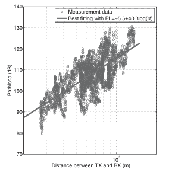

(a) 路径损耗与距离的散点图及线性拟合

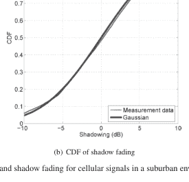

(b) 阴影衰落的累积分布函数

图 3.2 郊区环境中蜂窝信号的路径损耗和阴影衰落。

(circles) 从直线得到的偏差被用来形成一个偏差总体，其累积分布函数绘制在下图中。图中还显示了具有相同均值（即 0）和标准差（≈ 5.8 dB）的正态累积分布函数。两个累积分布函数之间的吻合度非常好。

变量 `S` 因历史原因被称为阴影衰落。在蜂窝无线电的早期，路径损耗相对于对数距离的线性增长的波动被归因于基站与移动台之间障碍物（例如建筑物）的遮挡效应。此后人们了解到，即使在具有视距路径但路径上存在反射的情况下，例如在 LOS 微蜂窝中，也会出现波动 [41]。我们将继续用其流行名称来指代这种类似随机的过程。我们注意到，由于 `S` 为高斯分布，式 (3.7) 中的因子 `ζ` 为对数正态；因此文献中关于中值变化的流行术语是对数正态阴影衰落。

无线工程师中流行的惯例是将式 (3.8) 中的带括号项视为“路径损耗”，并向其添加阴影衰落（`S`），仿佛前者是距离和环境的固有属性，后者是扰动。实际上，将其分离为这些部分仅仅是测量方案（测量哪些位置以及测量多少个）和所用数据处理（对数距离的线性函数的最小二乘拟合）的产物。我们在此采用更精确的惯例，即带括号项表示给定环境中距离 `d` 的中值路径损耗；距离 `d` 处的路径损耗是该中值与一个零均值、类似随机的分量阴影衰落之和。关于中值路径损耗最广泛使用的公式，如后所述，见 [53]。

### 3.4.2 阴影衰落，S

`S` 的标准差（`σ`）可根据环境在 3 到 12 dB 之间变化。在典型的蜂窝环境中，最常用的值是 8 dB；对于室内环境，则约为 4 dB。该描述概括了阴影衰落的一阶统计特性，并得到了测量的充分支持。阴影衰落的二阶统计特性记录较少，例如指定 TX 位置时其在空间二维分布的自相关函数。此信息在系统研究中并非总是必需的，但可以设想 CR 场景在其中会很有用。例如，在 `n` 个 CR 节点接收且一个源（主用或 CR）发射的环境中，模拟到 `n` 个 CR 节点的路径损耗需要知道 `n` 个源到节点的阴影衰落分量之间的 `n × n` 相关矩阵。可以很容易理解获得此类信息所需的测量程序的复杂性，这解释了该主题文献的稀少。

尽管如此，我们可以引用一些关于阴影衰落空间分布的有用结果。其中之一是 Gudmundson [47] 的报道，他报告说，沿着朝向或远离 TX 在 `x` 方向移动的路径，`x` 点和 `x + Δx` 点的 `S` 值之间的相关性可近似为

```
E_x{ S(x) S(x + Δx) } = σ² exp( -|Δx| / X_c ) = ρ(Δx). (3.10)
```

其中 `X_c` 是阴影衰落的“相关距离”。`X_c` 的典型值范围从 10 m（即城市微蜂窝中）到 500 m（即某些农村宏蜂窝中）。粗略地说，`X_c` 是衡量移动台在遇到不同遮挡或散射物体组之前必须行进的距离的量。在使用传感器网络获取和更新环境无线电地图的 CR 环境中，相关距离是确定传感器必要密度的一个重要参数。沿路径的阴影衰落相关函数被广泛使用，部分原因是它是最早报道的之一；此外，它描述简单，并且可通过 AR(1) 过程 [54] 轻松模拟。然而，已经提出了其他经验导出函数，在某些环境中效果更好。例如，见 [116]，其中 `ρ(Δx)` ——在多个路线上平均后——表示为 `|Δx|` 的两个衰减指数之和；并且将单个路线的 `ρ(Δx)` 表示为指数与正弦的组合。

除了估计单条路径上阴影衰落相关性的需要外，还可能需要关联两条路径上的阴影衰落值，例如当一个无线电与另外两个无线电通信时。在这种情况下，除了距离之外，两条路径之间的角度也很重要，见 [2, 42, 112]。蜂窝系统仿真中常用的简单方法是假设从任意两个基站到同一移动台的阴影衰落 `S1` 和 `S2` 是相关的高斯变量，其相关系数约为 0.5 [107]。

与 `S` 的属性相关的其他测量和模型也已报道。在此，我们简要总结其中最重要的内容。

- 在 `PL` 与 `d` 的模型 (3.8) 中，`S` 的标准差可随 TX-RX 路径上的距离而变化。具体而言，在接近的距离处，它往往较小，此时路径损耗接近自由空间损耗，变化很小；并且它会随距离增长，直至达到最终值。为了捕捉这种效应，[55] 中给出了一个模型，我们在此重写为


`σ(d) = 1.5 + σ_m [ 1 - exp( - |PL_med(d) - FSPL(d)| / 4 ) ] , (3.11)`

其中 `σ_m` 是数据导出的拟合参数。

- 我们还知道阴影衰落是一种“半局部”现象，因为从一个局部环境到另一个局部环境，城市或自然地形可能发生变化（例如从建成区到公园），导致 `σ` 值不同。这种效应在 [27] 中部分量化，该文献报告了在美国各地 95 个环境中通过驾车测量在 1.9 GHz 下获得的结果。结果是每个三种代表性地形类型的 `σ` 的概率分布。对于每个地形类别，单元之间的变异性被证明可以用截断高斯分布来描述。

- 最后，`σ` 随频率缓慢变化。尽管几乎没有明确的测量跟踪其在各频段的值，但有轶事证据表明 `σ` 随频率略有增加。这可能是由于更高频率下更大的衍射损耗，使得障碍物的有无放大了小区内路径损耗值的分布。

### 3.4.3 中值路径损耗，PLmed

关于中值路径损耗 `PLmed` 已发表了许多论文、报告和标准文件（例如 [27, 53]）。绝大多数使用式 (3.8) 中的带括号项作为通用形式。我们注意到，然而，一些公式在距离 `d` 上包含“断点”，`γ` 的值在该处发生变化；并且一些室内环境的公式添加一个或多个项以捕捉穿过楼层和墙壁的传输效应 [92]。主要区别在于，一组作者与另一组作者的区别在于他们如何表征 `A` 和 `γ`。我们将在此详细描述两种中值路径损耗模型。通过具体示例，我们希望说明无线系统的此类模型的性质。

对于蜂窝系统而言，最流行的模型是由 Hata [53] 开发的，该模型基于 Okumura 在 20 世纪 60 年代在东京地区进行的广泛测量 [85]。该模型涵盖距离 1 至 20 km；频率 150 MHz 至 1.5 GHz；基站天线高度 30 至 200 m；以及移动天线高度 1 至 10 m。涵盖的环境为城市地区（大城市和中小城市）；郊区；以及开阔地区。在 20 世纪 90 年代，随着个人通信服务（PCS）在全球近 2 GHz 频段开放，Hata-Okumura 模型扩展到包括频率高达 2 GHz 以及小型城市小区（直径低于 1 km）。该扩展由欧洲科学技术合作组织开发，是 COST 231–Hata 模型 [111]。

原始的 Hata–Okumura 模型适用于用户终端移动的广域场景。这种情况适用于认知无线电场景的延迟容忍度较高的服务。对于城市环境和用户终端高度为 1.5 m 的情况，`PLmed` 的公式与式 (3.8) 中的带括号量相同，其中 `d0 = 1 km`；

`A = [69.55 + 26.16 log₁₀ f_c − 13.82 log₁₀ h_b]; (3.12)`

和

`γ = [4.49 − 0.655 log h_b]. (3.13)`

在这些公式中，`f_c` 为 MHz 单位的载波频率，`h_b` 为米单位的基站天线高度。该模型为 `A` 提供附加项，以调整终端高度不同于 1.5 m 以及环境不同于城市的情况。对于半径小于 1 km 的较小区域和频率更接近 2 GHz 的类似 CR 应用，COST 231–Hata 更适用。`A` 中的项 `26.16 log₁₀ f_c` 在很大程度上是由于所有路径损耗方程中的天线孔径效应，包括自由空间传播方程，该方程占 `20 log₁₀ f_c`；剩余部分 `6.16 log₁₀ f_c` 是由于无线电波绕过无线电路径上障碍物对象的衍射造成的，导致随频率增加的额外损耗。

Erceg 路径损耗模型专为固定无线应用设计 [27]，在第 3.4.2 节中与阴影衰落一起引用。该模型的一个 CR 上下文可能是向分布在广阔区域的固定传感器（例如用于无线电测绘的传感器）传输。该模型源自 95 个郊区/住宅区的 1.9 GHz 数据采集，所有区域半径均不超过 2 km，且所有下行链路终端高度均为 2 m。数据涵盖各种基站天线高度和地形类型，并且模型阐明了它们的影响。可通过简单的缩放定律将扩展到其他载波频率和终端高度，例如见 [25]。

Erceg 模型在固定无线场景下的 `PLmed`，如 [27] 中所述如下。

- 在参考距离 `d0`（本例中指定为 100 m）以内，中值路径损耗遵循自由空间路径损耗公式，即 `A = 20 log10((4π d0)/λ)` 且 `γ = 2`。对于 1.9 GHz 的载波频率，`λ = 15.8 cm` 且 `A = 78.0 dB`。

- 对于 `d > d0`，`A` 保持不变，但 `γ` 成为一个从一个区域（或“小区”）到另一个区域似乎随机变化的量。在所有小区中，它具有均值 `μγ`，该均值取决于基站天线高度 `hb` 和地形类型；以及一个零均值的变化部分，其标准差 `σγ` 仅取决于地形类型。

- 具体而言，`μγ = (a − b hb + c hb²)`，其中 `hb` 以米为单位；`(a, b, c)` 是取决于地形类别的常数，其单位使 `μγ` 无量纲；且该式适用于 `hb` 从 10 m 到 80 m。

- 地形类别 A、B 和 C 分别为：丘陵/中度至重度树木密度；丘陵/轻度树木密度或平坦/中度至重度树木密度；以及平坦/轻度树木密度。

- `γ` 的变化部分采用截断高斯分布表示，截断方式选择以防止 `γ` 变为负值。

Erceg 模型将中值路径损耗的这一描述与第 3.4.2 节中的阴影衰落描述相结合。[27] 的表 I 中给出了每种三种地形类别下所有模型参数的数值。该模型因此包含了 `γ` 和 `σ` 从一个区域到另一个区域的随机性、基站天线高度的影响以及地形类型的影响。

### 3.4.4 天线增益和增益减小因子

到目前为止，我们在隐含假设没有天线增益的情况下，即天线在所有方向上发射或接收相等的前提下，写出了发射功率与接收功率之间的关系。事实上，这从未完全如此。例如，在蜂窝基站中，天线在仰角平面上具有增益，以便在包含大多数用户终端的高度处聚焦发射和接收；并且它们可能具有适度的方位增益（例如，方位波束宽度在 60° 至 120° 之间），以通过扇区化提高频率复用效率。如果发射天线波束图朝向接收机的增益为 `Gt dB`，且接收天线波束图朝向发射机的增益为 `Gr dB`，则 dB 功率增益在理论上将增加 (`Gt + Gr`) dB 的量。这种复合增益实际上在点对点无线中继等工程化链路中得以实现。

具有高度定向波束且相应旁瓣较低的天线的概念，暗示了 CR 接收机的潜在好处：通过将接收天线波束指向预期发射机，它既可以提高相对于噪声的接收信号电平，又可以抑制来自波束外方向的干扰信号。这种方法在链路两端不移动时最可行。因此它与固定无线应用相关，例如基于 CR 的固定传感器网络。然而，在多径环境中为固定无线系统进行的传播测量表明，高度定向接收天线的完整方向图增益不一定能实现 [43]。原因在于定向波束减少了原本会增加接收功率的宽角散射，这种损失抵消了天线获得的部分增益。

[43] 中报道的大量测量是在 1.9 GHz 下在郊区住宅环境中进行的，夏季和冬季均有测量，以评估树木的影响。这些数据用于量化接收机增益 `G_r` 因多径散射而降低的程度。这种降低的量——其 dB 值为增益减小因子（GRF）——被证明从一条路径到另一条路径而变化。GRF 的统计模型，如 [43] 中所述并在 [25] 中标准化如下。

- 在郊区住宅环境中，GRF 从路径到路径是一个高斯随机变量，具有均值 `μ_grf` 和标准差 `σ_grf`。

- 对于天线高度在 3 m 至 10 m 之间，`μ_grf` 和 `σ_grf` 仅有微小变化，因此模型对这两个高度的参数值取平均。

- `μ_grf = −(0.53 + 0.1I)ln(β/360) + (0.5 + 0.04I)(ln(β/360))²`，其中 `I = 1` 表示冬季，`−1` 表示夏季；`β` 为定向天线波束宽度，单位为度。

- `σ_grf = −(0.93 + 0.02I)ln(β/360)`。

在 CR 系统经常运行的环境中，该模型的实际效果是：定向接收天线在宽角散射存在的情况下会抑制部分接收功率，从而降低使用高增益天线的预期好处。例如，接收天线波束宽度为 30°、相应增益约为 ~ 11dB 的链路，其增益中有 50% 的概率会损失掉除 4 dB 之外的全部增益。对于具有更高方向性（相应更高增益）的天线，降低程度甚至更大。

## 3.5 基于塔的场景的路径损耗模型

我们已将无线信道定义为至少一端位于杂乱环境中而另一端天线高度最高达 80 m 的信道。这里我们处理其中一端高于 80 m（如电视塔）或两端均高于杂乱环境（如屋顶安装天线）的信道。我们将给出这些情况的可能 CR 上下文并提供相关的路径损耗模型。

### 3.5.1 来自电视塔的传输

对该情况建模路径损耗的一个良好起点是 ITU-R 建议 P.1546 [94]，它涵盖了广泛的天线和地形条件。公式和图表以中值接收场强 `E_dB`（单位为 dB-μV/m）表示为距离的函数，不同频率和塔高以及有效辐射功率为 1 kW 的情况下给出。这可使用公式转换为路径损耗

```
PL = 139.3 − E_dB + 20 log(f_MHz).    (3.14)
```


进入`/path/to/xxx`目录，找到`xxx.json`。

在表达式`cvar = avar + bvar`中，加法运算符（`+`）将`avar`与`bvar`相加，得到它们的和`cvar`

在`List.of(arg0, arg1, arg2)`中，`List`接口的工厂方法`of()`接受一系列的元素，返回包含它们的只读列表。

之后我们这样调用`cmd`命令：`cmd arg0 arg1 arg2`。

```
if (condVar > someVal) {console.log("xxx")}
```


在某些情况下，到达的众多 MPCs 中存在一个占主导的项，即其幅度远高于其他所有项。例如，当发射机到接收机之间存在直射线 (`LOS` 路径) 时就会发生这种情况。在这种情况下，所有到达分量幅度的矢量和具有称为莱斯分布的 pdf，其由两个参数表征：(i) 直射分量的功率 $\mathcal{P}_d$，和 (ii) 所有较弱（散射）项功率和的局部空间平均 $\mathcal{P}_s$。更流行但等价的参数对是接收功率的总空间平均 $\mathcal{P}_d+\mathcal{P}_s$；以及比值 $\mathcal{P}_d/\mathcal{P}_s$。前者参数可识别为上一节讨论的平均接收功率 $\bar{\mathcal{P}}_r$。后者参数称为莱斯 `K` 因子，或 Rice 因子，或简称为 `K`。它衡量信号在空间上经历多少局部衰落的指标。接收幅度的 pdf 可写为

$$p_r(r)=2r\frac{\exp(-K)}{\mathcal{P}_s}\exp\left[-\frac{r^2}{\mathcal{P}_s}\right]I_0\left(\sqrt{\frac{4r^2K}{\mathcal{P}_s}}\right),\qquad 0\le r<\infty.\tag{3.20}$$

`I_0(x)` 是第一类零阶修正贝塞尔函数 [1]。接收功率 $\mathcal{P}_r=r^2$ 的关联 pdf 为

$$p_{\mathcal{P}}(\mathcal{P}_r)=\frac{\exp(-K)}{\mathcal{P}_s}\exp\left[-\frac{\mathcal{P}_r}{\mathcal{P}_s}\right]I_0\left(\sqrt{\frac{4\mathcal{P}_rK}{\mathcal{P}_s}}\right),\qquad 0\le\mathcal{P}_r<\infty.\tag{3.21}$$

注意，通过用 $\bar{\mathcal{P}}_r/(K+1)$ 替换 $\bar{\mathcal{P}}_s$，上述两个 pdf 中的每一个都可以用参数 $\bar{\mathcal{P}}_r$ 和 `K` 来表征。

当 `K` 为无穷大时，没有衰落（只有单一分量，例如自由空间中的视距项），而当 `K = 0`（−∞ dB）时，如上所述出现瑞利衰落（没有主导分量，只有散射）。还值得注意的是，在一般的莱斯情况下，相位不再与幅度独立；换句话说，联合幅度-相位分布不能分解为 `r` 的概率密度函数乘以相位的概率密度函数。我们还注意到，对于视距分量，幅度在空间上不会迅速变化但相位会，而散射分量在幅度和相位上都迅速变化。

关于不同环境和距离的 `K` 因子，公开的数据很少。在移动系统研究中，通常假设衰落为瑞利（`K = 0`），因为该假设通常会导致偏保守的性能估计。在第 3.6.3 节中，我们将对两端固定的链路进行评论；并且在第 3.11 节中，我们将引用甚至“比瑞利更差”的衰落分布，如报道的在两个终端均靠近地面的链路中。

另一种用于描述多径分量之和效应的幅度分布是 Nakagami 分布 [84]，即使其物理解释不如瑞利/莱斯衰落那样清晰。该情况下的幅度概率密度函数为

$$p_r(r)=\frac{2}{\Gamma(m)}\left(\frac{m}{\bar{P}_r}\right)^m r^{2m-1}\exp\left(-\frac{m}{\bar{P}_r}r^2\right);\quad 0\le r<\infty\tag{3.22}$$

对于 `m ≥ 1/2`，其中 `Gamma(m)` 是欧拉伽马函数 [1]，参数 `\bar{P}_r` 是均方值 `\bar{P}_r = \langle r^2 \rangle`，且参数 `m` 为

$$m=\frac{\bar{P}_r^2}{\langle(r^2-\bar{P}_r)^2\rangle}\tag{3.23}$$

可以从测量值中直接提取这些参数。如果幅度为 Nakagami 衰落，则接收功率服从伽马分布，

$$p_{P_r}(P_r)=\frac{m}{\bar{P}_r\Gamma(m)}\left(\frac{mP_r}{\bar{P}_r}\right)^{m-1}\exp\left(-\frac{mP_r}{\bar{P}_r}\right);\quad 0\le P_r<\infty\tag{3.24}$$

Nakagami 分布被广泛使用，因为它在解析上可以相当直接地处理，而且它与大量测量结果显示出一致性。在幅度值以高概率出现、即概率密度函数中心附近的范围内，Nakagami 和莱斯分布具有相似的形状，并且可以通过莱斯 `K` 因子与 Nakagami `m` 因子之间的关系将两者相互转换 [15]。然而，这种等价性在分布的尾部（高功率和低功率）不成立，而这些区域对于认知无线电和其他应用可能是重要的区域。特别是在高功率尾部，Nakagami 分布随功率增加衰减得比莱斯分布更快；在小功率尾部，Nakagami 分布随功率减小衰减得更快。

最后，我们强调，接收功率的局部平均值与路径损耗 `PL` 密切相关。假设无线链路两端使用全向天线，

我们可以将 `\bar{P}_r` 写为简单地 `P_t 10^{-0.1 P_L}`，因此知道路径损耗和 `K`（莱斯情况下）或路径损耗和 `m` 因子（Nakagami 情况下）足以表征小尺度衰落的概率密度函数。

### 3.6.2 移动无线链路上的时变衰落

到目前为止，我们已将信号衰落讨论为空间上的随机类变化，即地面上潜在移动位置的变化。将这一空间过程转化为时间过程的原因是移动终端在地面上移动，随着移动，它会经历接收信号强度随时间的变化的衰落。因此，上文给出的瑞利/莱斯衰落描述在移动操作中表现为时间过程。移动速度越高，衰落越快。相关距离可以映射为相关时间；粗略地说，我们可以认为接收幅度在相关时间内保持恒定。这体现在多普勒谱和自相关函数中，详见第 3.7 节。

### 3.6.3 固定无线链路上的时变衰落

固定无线路径上的时变衰落概念乍一看似乎很奇怪，因为我们一直将其解释为移动终端接收到的信号电平的随机时间变化。我们回顾，衰落源于许多接收到的多径分量的存在，每个分量的相位对天线位置和信号频率（或波长）都高度敏感。结果是净接收信号幅度是位置和频率的随机类函数。在移动终端中，是空间上的变化产生了接收信号的时变衰落。在固定无线中，链路的两端都是静止的，因此虽然频率上的衰落可以辨别，但人们不会期望看到时变衰落。尽管如此衰落仍然存在，这促使我们以不同的方式思考和建模莱斯 `K` 因子。

在移动链路中，移动台随着移动描绘出空间衰落，因此距离行进与时间流逝之间的比例因子为移动速度 `v`。因此，如果 `E(x)` 是沿移动方向 `x` 的场变化，则时间变化只是 `E(vt)`。在固定无线链路中，变化是由于某些散射物体在移动，例如被风吹动的树叶和树枝。在郊区住宅区运行的固定无线系统中，树木可能是产生接收信号强度时变衰落的重要因素。移动的汽车和人也在无线自组织网络和无线局域网中产生类似影响。

这也意味着 `K` 因子需要以不同的方式解释。它不再是视距功率与散射分量功率之比。而是时不变多径分量功率与时变多径分量功率之比。在完全静态环境中，该 `K` 因子为无穷大，与是否存在视线无关。为了将该 `K` 因子与第 3.6.1 节中描述的区分，通常称其为时间莱斯因子。

[45] 中报道的大量测量，涵盖了许多频率、观测时间和路径，以及美国的多个地点，得出了以下发现：（1）固定无线链路上的时变衰落可以用莱斯分布表征；（2）莱斯 `K` 因子从一个观测时间、频率和路径到另一个观测时间、频率和路径显示出显著变化；并且（3）衰落速率通常与 prevailing 风速有关。在这种情况下，固定散射体产生复幅度中的恒定项，而移动散射体产生可变项。将时变衰落表示为莱斯分布是幸运的，因为它仅涉及两个参数（路径损耗和 `K` 因子），并且还允许使用类似于为移动无线电开发的分析方法。

固定无线路径上的莱斯 `K` 因子模型已在 [25] 中标准化，主要基于 [45]，但也得到 [6] 中数据的证实。它可以描述如下：

- `K` 因子被表示为随机变量

  $$K = F_s F_h F_b K_0 d^{\gamma} u,$$ (3.25)

  其中 `K0 = 10`；`γ = −0.5`；`d` 是发射机-接收机距离，单位为 km；`u` 是对数正态变量，其 dB 值均值为 0，标准差为 8.0 dB；`Fs`、`Fh` 和 `Fb` 分别是用于季节、用户终端高度和基站天线波束宽度的因子；

- `F_s = 1.0` 在夏季（树叶在树上）且 `F_s = 2.5` 在冬季（无树叶）；

- `F_h = (h/3)^{0.46}`，其中 `h` 是用户天线的高度，单位为 m；

- `F_b = (1/\theta_b)^{0.62}`，其中 `\theta_b` 是基站天线波束宽度，单位为度。

该模型适用于固定主 TX 与固定次 RX 之间的路径，并有助于量化固定无线干扰功率的变化量。低 `K` 因子（模型预测经常出现）可能导致非常低的干扰功率（深度衰落）时期。认知无线电接收机能否利用此类衰落取决于衰落持续时间，这又与衰落的多普勒谱有关。

## 3.7 小尺度衰落和多普勒谱

### 3.7.1 多普勒频率


我们现在将多普勒频率和谱的概念放在正式基础上。图 3.6 显示了一个移动台（大点）以恒定速度 `v` 沿任意方向移动；为方便起见，x 轴与运动方向对齐。所示的灰色屏幕代表在频率 `f_c` 处传播的波的波前，该波沿与移动台运动方向成角 `φ` 的方向传播。我们可以将此波视为向移动接收机传播的多径分量。4 从简单

4 我们将做出合理的近似，即所有到达的射线仰角接近 0°，因此每个 MPC 的方向向量平行于 x–y 平面。

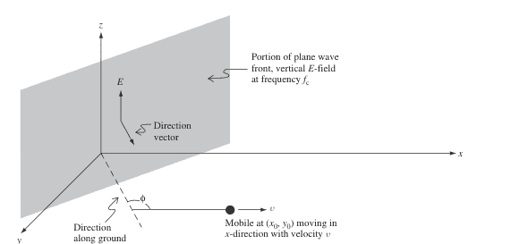

图 3.6 用于解释移动终端处多普勒频率的示意图。

从几何上看，我们可以看到接收到的电场 E 的复数幅度与 exp{jΦ(t)} 成正比，其中

Φ(t) = 2π f_c t - (2π/λ)(-x cos φ + y sin φ), (3.26)

其中 (x, y) 是给定时刻移动台的位置。假设移动台在时刻 0 位于位置 (x0, y0)，因此在时刻 t 时，x = x0 + v t 且 y = y0。将此代入 (3.26) 并整理后，我们得到

Φ(t) = 2π (f_c + (v/λ) cos φ) t - (2π/λ)(-x0 cos φ + y0 sin φ). (3.27)

最后，频率（以 Hz 计）为 Φ'(t)/2π = f_c + (v/λ) cos φ，其中第二项是由于运动引起的频率变化。这就是多普勒频率。

ν = (v/λ) cos φ. (3.28)

### 3.7.2 到达角和多普勒谱

在典型的无线环境中，并非只有一个 MPC；有很多。图 3.5 显示了移动台位置和运动的俯视图，其中 MPC 从各个方向到达。假设由局部散射引起有 N 个这样的分量，且方位到达角集合为 {φ1, …, φn, …, φN}。相应的多普勒频率将为

{νn} = { (v/λ) cos φ1, …, (v/λ) cos φn, …, (v/λ) cos φN }. (3.29)

因此，接收信号是频率略有不同的 N 个 MPC 的总和。其结果是总和包络随时间呈现类随机的变化。这只是解释第 3.6 节所述小尺度空间衰落的另一种（更数学化）方式。注意，鉴于互易性，这种衰落发生在两个方向，即包括从移动台到基站的传输。对于每个到达角为 φ_n 的 MPC，存在接收功率 P_n。将集合 P_n 与集合 {φ_n} 配对称为到达角（AOA）谱，

$S_{\phi}(\phi) = \sum_{n} \rho_n \delta(\phi - \phi_n); \quad -\pi < \phi \le \pi; \quad n = 1, N, \tag{3.30}$

其中 ρ_n 是归一化后的 P_n，使其总和为 1。对应于集合 {φ_n} 的是多普勒频率集合 {ν_n}，如上所述。将两个集合 ρ_n 和 {ν_n} 配对得到多普勒谱 S_ν(ν)，其中 ν 的范围为 −v/λ 到 v/λ。为便于后续参考，我们将 v/λ 记为 ν_max，即最大可能多普勒频率的幅值。

现在考虑 AOA 谱在连续角度上定义的情形。我们可以把多普勒谱写为

$S_{\nu}(\nu) = \left[ S_{\phi}(\phi^+) + S_{\phi}(\phi^-) \right] \left| \frac{d\nu}{d\phi} \right|^{-1}, \tag{3.31}$

其中，由 (3.28) 可得，

$\phi^+ = \left| \cos^{-1}\left( \frac{\nu}{\nu_{\max}} \right) \right|; \quad \phi^- = -\left| \cos^{-1}\left( \frac{\nu}{\nu_{\max}} \right) \right|; \tag{3.32}$

并且

$\left| \frac{d\nu}{d\phi} \right| = -\nu_{\max} \sin \phi = \nu_{\max} \left[ 1 - \left( \frac{\nu}{\nu_{\max}} \right)^2 \right]^{\frac{1}{2}}, \tag{3.33}$

对于 φ = φ^+ 和 φ = φ^- 均成立。(3.31) 的两部分源于余弦函数的对称性，导致每个 ν 在区间 (−π, π] 上对应两个角度（相等且相反）。作为多普勒谱的示例，假设 S_φ(φ) 在所有 φ 上均匀。此时多普勒谱为

$S_{\nu}(\nu) = \frac{1}{\pi \nu_{\max}} \left[ 1 - \left( \frac{\nu}{\nu_{\max}} \right)^2 \right]^{-\frac{1}{2}}; \quad |\nu| < \nu_{\max}. \tag{3.34}$

这是 Clarke [15] 和 Jakes [56] 所熟知的多普勒谱。其形状如图 3.7a 所示。对于其他角度分布（即其他 AOA 谱），可使用更一般的公式 (3.31) 得到多普勒谱。

### 3.7.3 自相关函数，A(Δt)

终端以恒定速度 v 在局部地形上移动时，信号包络的类随机变化在时间上与空间上具有相同的二阶统计量，因为

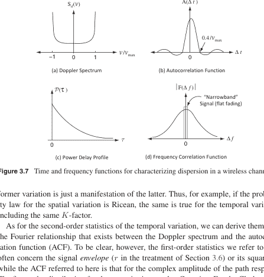

图 3.7 用于表征无线信道中色散的时间和频率函数。

前者变化只是后者的表现。因此，例如，如果空间变化的概率规律为莱斯分布，则时间变化也同样如此，包括相同的 K 因子。

至于时间变化的二阶统计量，我们可以从多普勒谱与自相关函数（ACF）之间存在的傅里叶关系推导出来。然而需要明确的是，我们最常提及的一阶统计量涉及第 3.6 节中处理的信号包络 r 或其平方 P_r。这里所指的 ACF 是路径响应复振幅的自相关函数。该量的第一阶分布为复高斯分布。对于 Clarke-Jakes 多普勒谱，(3.34)，其傅里叶变换为

$A(\Delta t) = J_0(2\pi\nu_{\max}\Delta t) = J_0\left(\frac{2\pi v\Delta t}{\lambda}\right),\qquad (3.35)$

其中 $J_0(\cdot)$ 为零阶贝塞尔函数 [1]，$\Delta t$ 为复包络时间变化上两点的时间间隔。该函数绘制于图 3.7b 中。

由于 $v\Delta t$ 是在时间 $\Delta t$ 内行进的距离，我们可以说，对于从各个方向均匀到达的 MPC，小尺度衰落在相距 $\sim 0.4\lambda$ 的空间位置上完全不相关。多径衰落的关联距离（不同于阴影衰落，第 3.4.2 节）是使 $A(\Delta t) = 0.5$ 的 $v\Delta t$ 值。

### 3.7.4 固定终端的多普勒谱

固定无线链路上的时间变化的概念已在第 3.6.3 节中介绍。这里我们讨论相关的多普勒谱。需要注意的是

### 3.7.5 色散

多普勒色散的现象学与移动终端的情况略有不同。在后一种情况下，从终端看到的 MPC 的角度谱与终端的速度矢量共同决定多普勒谱。速度幅值的变化会缩放（压缩或扩张）多普勒谱，但不会改变其形状。对于固定终端，MPC 的多普勒频移是由移动散射体产生的，每个散射体不仅在终端处具有不同的关联 MPC 角度，而且具有不同的速度。对于正弦发射信号，回波的随机时间变化主要由风吹动的树枝和树叶的来回运动（室外环境）或人员的运动（室内环境）引起。在这些情况下，发现接收信号的功率密度谱集中在其频率范围的中心，这与 Jakes 谱（见图 3.7a）大不相同。

关于固定终端多普勒谱的硬数据很少。已确定的事实是，这些谱的宽度往往与风（或人员）速度有关；与波长成反比；并且在微波频段的数量级约为 1 Hz。一个有用的简单模型，针对无线局域网推导并在 [26] 中报道，可写成如下紧凑形式：

$S_d(\nu) = [1 + (\nu/\nu_0)^2]^{-1};\quad \nu_0 = 1/9\lambda,\qquad (3.36)$

其中波长 $\lambda$ 以米为单位。类似的形状和宽度也适用于室外固定无线系统，如 [25] 所述。对于 (3.36) 中的谱，$A(\Delta t)$ 为双边衰减指数，$\exp(-2\pi\nu_0|\Delta t|)$。

多普勒谱描述了信号从作为单一正弦波的发射到接收的扩展：它起始于零带宽（即其频率谱为冲激函数），并以非零带宽（具体为 $2\nu_{\max}$）接收。谱从冲激函数到频率扩展的这种色散称为 *频率色散*。

与无线信道相关的另一种色散形式是由于多径散射引起的到达角扩展：在理想的视距路径上，只有唯一一个分量到达接收机，因此 AOA 谱为冲激函数。然而，无线环境中的实际情况是到达角度的 *扩展*，这构成了 *角度色散*。（正如我们所展示的，正是角度色散产生了频率色散，因此它们不是独立的现象。）角度色散的主题以及如何基于经验数据对其建模在第 3.9 节中进行了阐述。

下一节讨论 *时延色散*，即发送到信道中的无线脉冲以一组具有非零时延范围的回波出现，如多径散射的情况。在此过程中，我们将对“宽带”信道与本节和上一节讨论的“窄带”信道进行正式区分。

## 3.8 延迟色散


### 3.8.1 “窄带” vs. “宽带”

我们现在回到第 3.2 节引入的归一化冲激响应 $\hat{h}(\tau; \mathbf{x}, \mathbf{F})$，其中在空间域 $\mathbf{x}$ 和频谱域 $\mathbf{F}$ 上幅度平方的平均值为 unity。频谱域 $\mathbf{F}$ 为频率区间从 $f_c - W/2$ 到 $f_c + W/2$。如果一个无线电脉冲在此频谱域内通过无线电信道，到达接收机的多径分量在延迟 $\tau_1$ 处具有复信道增益 $a_1$ 将表现为 $a_1 \xi(\tau - \tau_1)$，其中 $\xi(\tau) = W \sin(\pi W \tau)/(\pi W \tau)$。因此，在带宽为 $W$ 的信道中，MPC 的冲激响应在 $\tau$ 上是一个零点到零点宽度为 $2/W$ 的 sinc 脉冲。$^5$ 就目前目的而言，我们可以忽略该响应是非因果的这一事实。

现在假设有 $N$ 个多径分量，其延迟为 $\tau_1, \dots, \tau_n, \dots, \tau_N$，复幅度为 $a_1, \dots, a_n, \dots, a_N$。则冲激响应可写为 $$\hat{h}(\tau) = \sum_{n} a_n \xi(\tau - \tau_n).$$ (3.37)

如前所述，我们任意规定第一个 MPC 的延迟位于 $\tau$ 原点，因此 $\tau_1 = 0$。因此，叠加 sinc 函数峰值的总延迟扩展（即支撑）为 $\tau_N$。当 $\tau_N$ 与单个 sinc 脉冲的名义宽度相比非常小时，扩展的影响极小，后者可取为 $\approx 2/W$。这里所说的“影响极小”是指在指定频带中传输的信号到达时失真很小。这是因为在 (3.37) 中 MPC 项存在大量时间重叠，冲激响应与 sinc 函数的偏差很小。这种情况下的信道，$W \tau_N \ll 2$，可称为“窄带”。它对应于在带宽 $W$ 上几乎平坦的频率响应。随着 $W \tau_N$ 从很小的值增大，时间色散就不能再被忽略或近似消除；我们将这种情况下的信道称为“宽带”，其含义是分析信号传输时必须考虑延迟色散的详细特性。

### 3.8.2 宽带信道

我们将脉冲 $\xi(\tau)$ 称为带限冲激函数，注意到在无限带宽的极限下，$\xi(\tau)$ 收敛于熟知的 Dirac 冲激函数，$\delta(\tau)$。我们现在在 $\xi(\tau)$ 的不同情况下重写 (3.37)。我们已经讨论了“窄带”情况，$W \tau_N \ll 2$，其中 (3.37) 中的不同项大量重叠，信道表现为平坦衰落。在另一个极端，MPC 到达之间的名义 $\tau$ 间距大于 $1/W$（等价于名义到达率大于 $W$）时。因此，不同的 MPC 可以被接收机分辨并单独处理。该条件适用于某些情况，例如稍后讨论的超宽带（UWB）系统。更典型的“宽带”条件发生在 $W \tau_N > 1$ 且每个宽度为 $1/W$ 的 $\tau$ 区间内有若干个 MPC 到达时。接下来我们为这种情况发展一个有用且久经考验的模型，即抽头延迟线（TDL）滤波器。

表示式 (3.37) 非常通用，但在各分量之间存在重叠时则不可测量或无用。在那种情况下，另一种非常有用的一般形式是采样并插值的版本，利用奈奎斯特理论通过均匀间隔的 sinc 函数表示 $\hat{h}(\tau)$：

$\hat{h}(\tau) = \Sigma_m \text{sinc}((1/\Delta)(\tau - m\Delta)) \Sigma_n a_n \delta(m\Delta - \tau_n).$ (3.38)

其中 $\Delta$ 为采样间隔，可取不超过 $1/W$ 的任意值。我们在此假设等号成立，$\Delta = 1/W$。因此我们可以更简单地重写 (3.38) 为

$\hat{h}(\tau) = \Sigma_m c_m \xi(\tau - m/W).$ (3.39)

其中 $c_m$ 为 (3.38) 中对 $n$ 的内层求和，按 $W$ 归一化。尽管所有 MPC 都会对该第 $m$ 个幅度产生贡献，但我们可以看到主要贡献者是那些 $\tau_n$ 位于到达时间区间 $[(m - 1/2)/W, (m + 1/2)/W]$ 的分量。我们称该区间为关于 $\tau = m/W$ 的“可分辨延迟 bin”，并注意到包含多个 MPC 的 bin 随着移动台在空间移动会表现出衰落。在我们假设落入延迟 bin 的 MPC 数量很大的前提下，衰落统计趋向于复高斯，如第 3.6 节所述。否则，像 Nakagami 或对数正态衰落等不同的衰落统计可能更合适。如果 TX 与 RX 之间存在视距，则第一延迟 bin 中的幅度衰落通常呈 Rice 分布。

从 (3.37) 可以看出，对应实际 MPC 的脉冲在时间上以不规则间隔排列，对应于环境中散射体的位置。用规则间隔的抽头表示这些脉冲只有在抽头间隔最多为 $1/W$ 时才是精确的。此外，根据插值函数，一个实际的 MPC 可能影响多个规则间隔的抽头，从而可能在抽头衰落中引入相关性。最后，我们注意到抽头的规则间隔导致频率传输函数的周期性，其周期为抽头间隔的倒数。当抽头间隔为 $1/W$ 或更小时，周期为 $W$ 或更大。由于信号带宽为 $W$，重复谱之间没有重叠。

### 3.8.3 时变冲激响应

如果 TX 或 RX 移动，我们所描述的 $c_m$ 的空间变化会转化为时间变化。以下我们因此在移动条件下使用常用的“时变冲激响应”，$\hat{h}(\tau, t)$，代替等价的 $\hat{h}(\tau; x, F)$。因此，(3.39) 变为

$\hat{h}(t, \tau) = \sum_{m} c_{m}(t)\xi(\tau - m/W).$ \tag{3.40}

为了写出 $c_m(t)$ 的表达式，我们参考 (3.38) 的内层求和，并考虑第 $n$ 个 MPC 的时间变化，其复增益为 $a_n$，到达时间为 $\tau_n$。对于 TX-RX 路径及其第 $n$ 个散射体的正常几何形状，幅度 $|a_n|$ 和到达时间 $\tau_n$ 在移动台位置的邻域内变化很小，即在数个波长的移动距离上。相反，$a_n$ 的相位变化很快，即相对于散射体每移动 $\lambda$ 距离，相位变化 $360^\circ$。因此，在数个波长的移动距离上，对应于时间上大量数字符号，$^6$ 第 $m$ 个抽头增益可写为

$c_m(t) = \sum_{n} |a_n| \exp(j\phi_{a_n}(t))\xi(m\Delta - \tau_n).$ \tag{3.41}

如前假设，该求和中的主导项（在 $m\Delta$ 附近宽度为 $\Delta$ 的区间内峰值）数量众多，$c_m(t)$ 可视为复高斯时变过程。此外，第 $m$ 个抽头具有自己的角度功率谱（基于第 $m$ 个 bin 中 MPC 的到达角度集合），并且在移动条件下具有自己的相关多普勒谱。即便如此，在大多数系统研究中，通常会为 TDL 表示的所有抽头分配相同的多普勒谱，通常是均匀到达角分布的谱，(3.34)。

### 3.8.4 功率延迟剖面，P(τ)

对于假设的复高斯统计，MPC 相位在小尺度衰落上是均匀随机的，且 $c_m(t)$ 的均值为零。那么，表征 $c_m(t)$ 一阶统计所需的唯一参数是其均方值。这引出了功率延迟剖面（PDP）这一主题，它在无线信道的分析和仿真中起着重要作用。

PDP 的正式数学定义为

$\mathcal{P}(\tau) = (1/W) \mathbb{E}_t \{ |\hat{h}(t, \tau)|^2 \},$ \tag{3.42}

其中 $\mathbb{E}_t$ 表示在小尺度衰落发生的时段上的期望。$^7$ 当 $\hat{h}(t, \tau)$ 是离散的冲激之和（带限或非带限）时，这一正式定义可能会遇到数学问题。一种流行的替代方法是把 PDP 本身定义为沿 $\tau$ 轴的冲激之和，其延迟为 MPC 的延迟（$\tau_1, ..., \tau_N$）如 (3.37) 所示，且在延迟 $\tau_n$ 处的功率 $P_n$ 为 $|a_n|^2$。这种方法在超宽带信道中特别有用，其中各个 MPC 在延迟上是可分辨的。对于具有每个延迟 bin 多个 MPC 的更常规宽带信道（本文考虑的情况），PDP 也可以是位于

τ = 0, 1/W, …, m/W, …, 其中在 τ = m/W 处的功率为式 (3.40) 中 c_m(t) 的均方值。

对于每个时延单元包含多个 MPC 的情况，另一种替代方法是把 PDP 视为时延的平滑连续函数，意味着沿时延轴存在回波的连续体，见 [7]。我们将在此采用该表示，其中在任意给定 τ 处的 P(τ) 的值是落在以该 τ 为中心、宽度为 1/W 的时延单元内到达的 MPC 功率之和；并且归一化使得 P(τ) 积分下的面积为 1。

PDP 形状的一个非常流行的模型是单边指数模型，

P(τ) = (1/τ₀) exp(−τ/τ₀); 0 ≤ τ < ∞, (3.43)


其中 `τ₀` 是衰减时间常数 [56]，我们注意到 `P(τ)` 下的面积为 1。该形状的流行性源于其简单性以及多年来众多测量活动的证实，例如 [16, 28]。另有多项测量发现了更复杂的 PDP，由多个簇组成，例如 [95]。

均方根时延扩展（为方便起见，以下简称为“时延扩展”，DS）是 PDP 的二阶中心矩，即

`τ_rms = √[∫₀^∞ P(τ) τ² dτ − (∫₀^∞ P(τ) τ dτ)²]`, (3.44)

许多论文报告了测量的时延扩展（而非完整的 PDP）来表征时延色散。对于式 (3.43) 中的衰减指数 PDP 形状，`τ_rms` 由式 (3.44) 求得恰好为 `τ₀`。

### 3.8.5 频率相关函数，F(Δf)

在时延变量 `τ` 上对 `ĥ(t, τ)` 进行傅里叶变换，`t` 固定，可识别为时间 `t` 处的（归一化、复数）信道频率响应，我们将其记为 `H(f, t)`。在第 3.6 节中，我们假设没有时变且只有一个频率 `f_c`，我们将此函数记为 `Ĥ(f_c; x)`。（与上文相同，这里我们省略了用 `x` 表示 TX-RX 空间坐标的使用。）在第 3.7.3 节中，对于移动情况，我们引入了自相关函数 `A(Δt)`，以描述 `H` 的两个复数时间样本之间的相关性，其中 `f` 固定且时间样本相隔 `Δt`。这里，我们考虑并行情况：`t` 固定，我们寻求 `Ĥ` 的两个复数 `f` 样本之间相隔 `Δf` 的相关性 `F(Δf)`。在通常适用于宽带无线信道的条件下，该频率相关函数（FCF）可被证明无非是 `P(τ)` 的傅里叶变换。如果在宽度为 `B` Hz 的区间内衰落高度相关（即 `|F(Δf)| ≈ 1` 对于 `Δf` 高达 `B`），并且在某个频率 `f₀` 处检测到从主 TX 到认知无线电 RX 的深度衰落，则可认为衰落占据以 `f₀` 为中心、近似宽度为 `B` 的频带。因此，灵活的认知无线电 TX 可以在该频带上向该 RX 发送信号，而不会对主 TX 造成严重干扰。FCF 对于 CR 的感知阶段也很重要，因为对其他可能用户辐射的检测通常是通过“扫描”频谱来完成的。单频（窄带）测量可能无法检测到其他使用情况，如果相关的传输函数处于衰落凹陷中。FCF 告诉设计者频谱必须以多大的密度采样以避免此问题。

对于指数 PDP，(3.43)，很容易证明 `$F(Δf)=1/[1+(j2πΔf τ₀)]$`。请注意，鉴于 `$P(τ)$` 的单位面积和傅里叶变换的性质，`F(0)` 的值始终为 1，正如适当的，因为在任何频率处的衰落与其自身完全相关。

相干带宽 `$B_c$` 定义为使得 `|F(B_c)/F(0)|<k` 的最小频率间隔，其中 `k` 已被不同作者给出为 0.5、0.75 和 0.9。在 [32] 中，相干带宽与时延扩展相关为

`$B_c = \frac{\arccos(k)}{2\pi}\frac{1}{\tau_{\mathrm{rms}}}. \tag{3.45}$`

对于 `k=0.5`，这给出 `$B_c=1/6\tau_{\mathrm{rms}}$`。在 [100] 中给出的另一种近似，对于 `k=0.5`，为 `$B_c≈1/5\tau_{\mathrm{rms}}$`。对于指数 PDP 的情况（并且回顾在此情况下 `τ₀` 和 `τ_rms` 相同），对于 `k=0.5`，很容易证明 `$B_c=\sqrt{3}/2\pi\tau_{\mathrm{rms}}≈1/3.6\tau_{\mathrm{rms}}$`。显然，`$B_c$` 与 `τ_rms` 之间的精确关系取决于 PDP 的形状，但它始终是倒数关系。

最后，相干带宽为我们提供了区分第 3.8.1 节中提到的“窄带”和“宽带”情况的另一种方法。

- **"窄带"** 是信号带宽相比 `B_c` 很小的情况；这种情况通常被称为 *平坦衰落*（传输函数在信号带宽上是平坦的）。
- **"宽带"** 是信号带宽与 `B_c` 相当或大于 `B_c` 的情况；这种情况通常被称为 *频率选择性衰落*。

### 3.8.6 时延扩展的模型和数值

由上述推导可知，时延扩展是从小尺度衰落发生区域的脉冲响应中获得的。在不同的小尺度区域，`τ_rms` 可以取不同的值。把这些不同的值解释为随机变量的不同实现并研究其概率密度函数是有用的。遵循 [44]，`τ_rms` 可很好地近似为 `τ_rms = T_1 d^{γ} y. \tag{3.46}` 其中 `d` 以 km 为单位；`y` 是对数正态变量，其 dB 值均值为零，标准差为 `σ_z`，而 `T_1` 是 `d=1` km 时的中值时延扩展。参数 `T_1`、`γ` 和 `σ` 的数值在 [44] 中针对不同环境进行了列表。

文献中可以找到许多关于 rms 时延扩展的测量结果。不同环境的典型值如下（另见 [82]）。

- *室内住宅建筑* 典型的时延扩展为 5–10 ns，但已测得高达 30 ns 的值 [38, 69]。
- *室内办公环境* 通常显示时延扩展在 10 到 100 ns 之间，但甚至测得 300 ns 的值。房间尺寸对时延扩展有明显影响；建筑物尺寸和形状也有影响 [9, 18, 21, 22, 52, 59, 73, 103, 108]。
- *工厂和机场大厅* 这些的时延扩展范围从 50 到 200 ns [49, 91]。
- *微蜂窝* 时延扩展范围约为 5–100 ns（LOS 情况）到 100–500 ns（NLOS）[4, 29, 63, 113, 118]。
- *隧道和矿井* 空隧道通常显示非常小的时延扩展（约为 20 ns），而装有汽车的隧道表现出更大的值（高达 100 ns）[68, 117]。
- *典型城市和郊区环境* 这些显示时延扩展在 100 ns 到 800 ns 之间，尽管也观察到高达 3 µs 的值 [57, 61, 86, 93, 101, 118]。
- *恶劣城市和丘陵地形环境* 这些显示了导致更大时延扩展的多个簇的明显例子。在欧洲多个城市中测得时延扩展高达 18 µs，簇时延高达 50 µs，而美国城市的值略小。山区地形中簇时延高达 100 µs [8, 23, 39, 64, 70, 75, 93, 97, 110]。

### 3.8.7 超宽带（UWB）信道

认知无线电的下叠范式要求次级用户传输足够低，使得在主接收机处的功率谱密度低于加性接收机噪声，即它们仅轻微地抬高主接收机所见的噪声基底。如果次级信号分布在非常宽的频率范围内然后在接收机处解扩，如 UWB 信号和检测的使用那样，例如 [114]，这种方法可以有效。按正式定义，UWB 信号的带宽为 500 MHz 或更大。军事应用倾向于使用基带信号，而大多数商用应用位于 3 到 10 GHz 的频率范围。

UWB 相关的带宽如此之宽，以至于我们之前假设的一些条件不再适用，尤其是任何宽度为 1/W 的时延间隔内存在多个 MPC。随着 W 进入超宽区域，MPC 在宽度为 1/W 的时延单元内稀疏出现，脉冲响应和 PDP 的模型必须反映这一点。一个明显且重要的后果是 TDL 的抽头增益不再能被视为瑞利衰落过程。

本世纪第一个十年出现了针对这些信道的测量和建模活动的热潮，主要集中于室内环境，住宅和商业环境。认知无线电在室外环境中对 UWB 的任何应用都将使用类似的模型，尽管参数值可能不同。因此，我们在此简要描述三种已发表的室内 UWB 信道 PDP 信道模型，以突出其相对于传统宽带模型的某些相似性和差异。

指数模型在 [12] 中报道，表示 `P(τ)` 包含在 `τ = 0` 处的一个项（在局部空间中固定但从一条路径到另一条路径可变）；以及一个单一簇射线间隔为 `τ = i/W`，`i = 1, 2, 3, …`。簇中射线的幅度随 `τ` 呈指数衰减，且衰减常数在不同路径之间是可变的。对于指数簇中的每条射线，其幅度是对局部空间样本的平均值，且空间变异的概率密度函数为伽马函数。

对于文献[37]中报道的指数-对数正态模型，其功率时延剖面（PDP）形状与指数模型相似，只是指数簇在 `τ` 上乘以一个相关的对数正态过程。该模型中的若干参数被发现是沿路径距离的函数。该模型比指数模型更复杂，需要更多的模型参数。

对于文献[79]中报道的簇模型，PDP 是若干个指数簇之和，每个簇的起始时延在不同路径之间是可变的。同样可变的是簇内射线的 `τ` 位置，而非均匀间隔为 1/W。该模型是对 Saleh-Valenzuela 簇模型的变体，该模型是为宽带（而非超宽带）室内信道设计的[95]。

在上述三种 PDP 模型中，与传统宽带模型的主要区别在于射线幅度并非瑞利衰落；由于每条射线仅是少数几个多径分量（MPCs）的总和，这些幅度的衰落分布更窄（例如，如文献[79]中所示，对数正态概率密度函数，dB 标准差为 3.4 dB）。这三种模型的详细描述及相互比较见文献[46]。

## 3.9 角度色散

### 3.9.1 到达方向和离开方向


MPCs 的特征不仅在于其时延，还在于其方向。一个 MPC 以某一方向离开发射端 `TX`（由它将遇到的第一个散射体的位置决定），并以某一方向到达接收端 `RX`（同样由到达前最后一个散射体的位置决定）。由于存在许多 MPC，它们可以在不同的方向上离开和到达，多径信道导致角度色散。这种色散对认知无线电 `CR` 非常重要。一方面，它决定了自适应天线能够向特定方向发射而不干扰位于某些方向上的其他用户的能力（见第 2 章）。较小的角度扩展提供了将波束精确聚焦到特定方向的可能性。

相反，较大的角度扩展会导致增益去相关，即使对于仅相隔波长分数的天线单元也是如此。这种现象可以通过使用多个单元和最大比合并来辅助分集[96, Section 10.5]；或可以通过多频同频流增加容量，如多输入多输出（`MIMO`）链路[10]。这种基于 `MIMO` 的容量增益可以使 `CR` 系统在交织模式下受益，抵消在主用户传输期间保持静默造成的容量损失。最后，角度色散与多普勒密切相关，如我们在第 3.7 节所示，因此影响 `CR` 信道响应的时变特性（相关时间）。

可以通过推广脉冲响应的概念来描述角度色散。双方向脉冲响应（`DDIR`），它推广了（3.37），再次由 MPCs 的贡献之和构成[105]：

$$h(t,\tau,\Omega,\Psi)=\sum_{n=1}^{N} a_n(t)\delta(\tau-\tau_n)\delta(\Omega-\Omega_n)\delta(\Psi-\Psi_n),\qquad(3.47)$$

其中 $a_n(t)=|a_n|\exp[j\Phi_{a_n}(t)]$，且 $\Omega_n$ 表示离开方向（`DODs`），$\Psi_n$ 为到达方向（`DOAs`），$N$ 为 MPC 的数量。

式（3.47）假设 MPCs 可以用理想均匀平面波表示，从而在角度域中用狄拉克函数表示（当考虑波前曲率时，狄拉克函数需要被更一般的函数取代）。我们可以看到传统模型，（3.37），与这种双方向表示之间存在强类比，其中每个 MPC 额外由 `DOA` 和 `DOD` 刻画。

双方向脉冲响应是对传播效应本身的抽象描述，不受天线几何形状的影响。对于通信系统的性能分析，我们通常需要天线阵列单元处的联合脉冲响应，如果链路两端都有阵列，则可表示为脉冲响应矩阵，如果仅一端有阵列，则为向量。

我们现在展示如何从双方向脉冲响应获得此类脉冲响应矩阵。该推导基于这样一个原理：MPC 对两个不同天线单元处总脉冲响应的贡献仅相差一个相位因子，该因子由 MPC 的方向和天线单元的相对位置决定。我们将发射和接收单元坐标分别记为 $\mathbf{r}_T^{(1)},\mathbf{r}_T^{(2)},...,\mathbf{r}_T^{(N_T)}$ 和 $\mathbf{r}_R^{(1)},\mathbf{r}_R^{(2)},...,\mathbf{r}_R^{(N_R)}$。对于某一特定时刻（等价于 $a_n$ 的一次实现），在平面、窄带波假设下，从第 $m$ 个发射单元到第 $l$ 个接收单元的脉冲响应变为

$$h_{l,m}=h\left(\mathbf{r}_T^{(m)},\mathbf{r}_R^{(l)}\right)=\sum_n a_n g_T(\Omega_n)g_R(\Psi_n)\exp\left(j\mathbf{k}(\Omega_n)\bullet\mathbf{r}_T^{(m)}\right)\exp\left(j\mathbf{k}(\Psi_n)\bullet\mathbf{r}_R^{(l)}\right),\qquad(3.48)$$

其中 $g_T$ 和 $g_R$ 分别是发射和接收天线单元的复（幅度）方向图，$\mathbf{k}$ 是沿第 $i$ 个 `DOD` 或 `DOA` 方向的单位波矢，$\bullet$ 表示点积；如果双方向脉冲响应具有连续分量，则求和可以替换为积分。因此我们看到，从双方向脉冲响应（以及天线位置和方向图的知识）很容易获得脉冲响应矩阵，而反之则不成立。

`DDIR` 是信道非常一般的描述。⁹ 由此，我们可以通过用天线方向图加权 `DDIR`，然后对所有方向角积分来导出“常规”时变脉冲响应

$$h(t,\tau)=\iint h(t,\tau,\Omega,\Psi)g_{T}(\Omega)g_{R}(\Psi)d\Omega d\Psi.\tag{3.49}$$

角度功率谱（`APS`）表征了平均而言有多少功率来自（或离开朝向）某一角度。例如，考虑 `RX` 处的 `APS` 时，

$$APS(\Psi)=\mathbb{E}\{|h(t,\tau,\Omega,\Psi)|^{2}\},\tag{3.50}$$

其中期望是对 t, τ, 和 Ω 求的。类似的公式适用于 `TX` 处的 `APS`，`APS(Ω)`。也可以定义谱 `APS(Ψ,τ)` 为仅对 t 和 Ω 求期望的式（3.50）。该函数反映了物理现实，即角度功率谱可能因时延不同而不同。然而在实践中，包含对 τ 的平均通常更方便；这对于窄带信道尤其适用，其中 MPCs 重叠。

通过注意到 `RX` 处大多数 MPC 到达方向位于包含天线的水平面内或附近，可以对 `APS(Ψ)` 进行大幅简化。因此相对于仰角 θ 没有扩展。在这种情况下，`APS(Ψ)` 可以简化为接收端方位角 φ 上的功率谱。参考第 3.7 节，这可以视为 `S_φ(φ)` in (3.31) 或其连续版本的等价物。为方便起见，并考虑到这种等价性，我们在本文讨论中将使用记号 `APS(φ)`。

最后，角度色散的紧凑表征由均方根角度扩展给出，此后简称为“角度扩展”，`AS` [33]。我们将关注 `RX` 处的角度扩展。该量是 `APS` 在 (−π,+π) 上归一化面积为 1 的二阶中心矩。我们已看到，由于角度色散，接收幅度在 `RX` 位置附近存在空间选择性衰落。与该衰落相关的相关距离与 `AS` 呈反比关系。

### 3.9.2 APS 形状和角度扩展的模型

我们从 `TX` 或 `RX` 抬高的情况开始，例如基站上的情况，大多位于杂波之上。在此情况下，`APS` 最常见的模型是在标称视距方向周围具有较小角度扩展，通常呈拉普拉斯形状[89]，

$$APS(\phi)=\exp\left[-\sqrt{2}\frac{|\phi-\phi_{0}|}{\phi_{\mathrm{rms}}}\right],\tag{3.51}$$

其中 φ₀ 为平均方位角，φᵣₘₛ 为 `AS`。更复杂的形状，由多个簇组成，每个簇都具有拉普拉斯 `APS`，并且具有不同的平均角度，也已被提出。

对于街道级的 `TX` 和 `RX`，已对 `APS` 的形状进行了各种研究。传统模型，即在所有方位角上均匀的 `APS`，源自 Jakes [56]，并在 1990 年代之前被广泛使用。然而，更近期的研究表明，方位角扩展可以小得多，尤其是在街道峡谷中。这种情况下的街道级 `APS` 通常被建模为拉普拉斯型，如 (3.51) 所示。

与时延扩展的情况类似，许多论文仅给出通过测量活动获得的角扩展，尽管有些论文给出了每个簇的 `AS`。虽然处理角色散的论文比处理时延色散的论文少，但以下数值范围可被视为典型。

- *Indoor office environments* 在 `NLOS` 情况下已观察到簇角扩展在 10° 到 20° 之间；对于 `LOS` 情况，它们明显更小 [14, 103]。

- *Industrial environments* 已观察到 20° 到 30° 之间的角扩展 [49]。

- *Microcells* 在 [13, 87, 110] 中发现 `LOS` 的角扩展为 5° 到 20°，`NLOS` 为 5°–40°。

- *Typical urban and suburban environments* 在城市环境中，[65, 88] 测量的角扩展约为 3°–20°，而 [66] 发现角扩展高达 40°。在郊区环境中，由于 `LOS` 频繁出现，角扩展通常小于 5° [65]。

- *Bad urban and hilly terrain environments* 这些由于多个簇的存在显示出约 20° 的总角扩展 [67, 110]。

- *Rural environments* 已观察到 1° 到 5° 之间的角扩展 [87]。

### 3.9.3 Joint dispersions

在本节和前几节中，我们介绍了时延扩展、角扩展和阴影衰落的概念，每一个在给定位置都表现出特定的数值，并且该值在地形上缓慢变化。虽然我们分别讨论了这三个实体，但它们之间存在一些重要的联系，例如，阴影和时延扩展都受蜂窝基站与给定终端位置之间障碍物的影响 [44]。

阴影（`S` in (3.7)）、时延扩展（`DS`）和角扩展（`AS`）各自的 pdf 都可以用对数正态分布很好地近似，因此它们的对数值可以用高斯 pdf 描述。此外，测量表明这些高斯变量是相关的。log-角扩展与 log-时延扩展之间的相关性约为 0.5 [3]，而 log-角扩展与 log-阴影之间的相关性约为 0.75 [5]，log-时延扩展与 log-阴影之间的相关性也是如此。室内点对点环境中也观察到时延扩展与角扩展之间的相关性 [24]。


这些相关性对 `CR` 收发机的规划有影响。例如，阴影与时延扩展之间的相关性有助于宽带感知：在阴影衰落处，检测主用无线电基本上更困难时，增加的时延色散有助于平均出小尺度衰落。反过来，这有助于降低漏检概率。

我们还注意到，扩展值并不能完整描述信道色散特性。色散的联合二阶统计量的完整描述由双向时延功率谱（`DDDPS`）给出，即 `DD` 的平方幅度的期望值... [33, 60]。虽然文献中许多论文假设 `DDDPS` 可以分解为 `PDP`、`TX` 处的 `APS` 和 `RX` 处的 `APS` 的乘积，但一些实验研究表明，这种分解是一种过度简化。例如，`APS` 确实取决于时延 [17, 51, 64, 81]。当多径分量以簇的形式到达时尤其如此 [35, 77, 95, 104]。

## 3.10 Polarization

无线电波极化在无线系统中，包括 `CR` 中可以发挥重要作用。一方面，有可能使用极化在同一频率上复用两个或多个独立的信号流，使用一种极化用于一组流，使用正交极化用于另一组。实现示例如图 3.8 所示，其中每一端（`TX` 和 `RX`）都使用两个交叉极化天线，采用多输入多输出（`MIMO`）信号的 2×2 版本。这种双极化方法的一个很大优势，尤其对于手机设计而言，是每一端的 antenna 结构可以很紧凑。

另外，极化可用于实现对抗多径衰落的多样性。这里利用了多径中存在“极化混合”的事实。为了详细说明，我们最初假设来自给定天线单元的传输是垂直极化的（`V-pol`）。由于 `MPC` 的反射和散射，该信号会在空中失去其极化纯度，并在垂直和水平极化上被接收。水平极化（`H-pol`）的天线单元也适用。因此，例如，在每一端都使用交叉 `H-V` 单元的 2×2 `MIMO` 链路中，将有

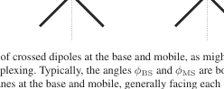

Figure 3.8 基站和移动台上成对的交叉偶极子，可能用于获得双重分集或复用。通常，角度 φ_MS 和 φ_BS 均为 45°。所示的成对天线位于基站和移动台的垂直平面中，通常彼此面对。

四条路径响应：`HH`、`HV`、`VH` 和 `VV`。多年来学到的知识是，这四种响应之间的多径衰落模式往往既强度相似又相互不相关。因此，通过在两个发射机单元上发射流并在两个接收机单元上接收，可以实现 4 倍的抗衰落分集。由于图 3.8 中发射和接收的极化可以分解为 `H` 和 `V` 分量，同样的推理也适用于该情况。

如果 `P_VV` 和 `P_VH` 分别是由垂直极化天线发射的平均入射功率，并分别由垂直和水平极化天线接收，则 `P_VV / P_VH` 的分贝值定义为信道交叉极化鉴别度（`XPD`）。文献中普遍认为，信道 `XPD` 以 dB 表示时具有非零均值的高斯分布。根据环境和 `LOS` 分量的存在与否，文献中测得并报告的平均 `XPD` 在 0 到 12 dB 之间变化，标准差约为 3–6 dB [98]。

`XPD` 还取决于多径分量的路径距离、`DOA`、`DOD` 和时延。当在无线链路的两端使用双极化天线时，有四个极化信道需要考虑，`HH`、`HV`、`VH` 和 `VV`。这导致有四个脉冲响应需要建模。我们还需要考虑天线实际上需要由两个复天线方向图来表征，即 `g^(V)(Ω)` 和 `g^(H)(Ω)`。`(3.48)` 的推广因此为

```
h_{l,m} = h^{(m)}(r_T^{(m)}, r_R^{(l)})
= Σ_n [g_T^{(V)}(Ω_n); g_T^{(H)}(Ω_n)]^T [a_n^{(VV)} a_n^{(HV)}; a_n^{(VH)} a_n^{(HH)}] [g_R^{(V)}(Ψ_n); g_R^{(H)}(Ψ_n)] × exp(jk(Ω_n • r_T^{(m)})) exp(jk(Ψ_n • r_R^{(l)})) (3.52)
```

其中 `a_n^{(VV)}`、`a_n^{(HV)}`、`a_n^{(VH)}` 和 `a_n^{(HH)}` 具有独立的相位。它们的绝对幅度是随机变量，其中 `E{ |a_n^{(VV)}|^2 / |a_n^{(HV)}|^2 }` 和 `E{ |a_n^{(VH)}|^2 / |a_n^{(HH)}|^2 }` 呈对数正态分布；此外通常假设 `E{ |a_n^{(VV)}|^2 / |a_n^{(HH)}|^2 } = 1`。

极化效应的知识可以提高估计 `CR` 对主接收机的干扰精度的准确性。极化鉴别也可以在 `CR` 中发挥有用作用，例如，系统可能能够发射主链路未使用的极化。这当然需要极小的极化混合和/或 `CR` 对相关信道响应的了解，如叠加模式中所述。

## 3.11 Special environments

### 3.11.1 Vehicle-to-vehicle (V2V) propagation

近年来备受关注的一个应用是车辆之间的通信。5 GHz 频段中专门的频率区域被保留用于此

在许多国家是一种应用类型。然而，高载波频率意味着相对较大的路径损耗，因此需要研究包括在较低频率下认知无线电在内的替代方法。`V2V` 信道¹⁰的特性与移动蜂窝信道不同，这是由于 `V2V` 无线电传播的特定特征所致。

1 在 `V2V` 系统中，`TX` 和 `RX` 天线处于同一高度，且处于相似的环境中（点对点通信）。在蜂窝通信中，另一方面，通信是在高于街道水平的基站与街道水平的移动站之间进行的。因此，多径分量的主导传播机制不同。例如，在蜂窝通信中，波沿屋顶传播很重要，而在 `V2V` 系统中，水平面内的传播、反射和衍射（如在街角）更为重要。此外，对于 `V2V` 信道，散射可以在链路两端附近发生，而对于蜂窝信道，基站周围的区域通常没有散射体。

2 在 `V2V` 信道中，`TX` 和 `RX` 以及许多重要的散射体都在移动，而在蜂窝信道中，只有终端在移动，且移动散射体的相对重要性较低。这意味着 `V2V` 信道的信道波动更快，且第 3.7 节中讨论的角谱与多普勒谱之间常用的关系不再有效。此外，比瑞利衰落出现更频繁的深衰落的衰落分布也可能发生 [71]。

多项测量发现，如果 `TX` 和 `RX` 之间存在 `LOS`，则路径损耗系数 `γ < 2`（参见 [58] 及其中的参考文献）。与此相关，相当高的 `Rice` 因子已被发现。时延扩展通常显示中等值（数量级为几百 ns）。`V2V` 与蜂窝通信之间的主要区别在于平稳性假设有效的短时间，即 `MPC` 的绝对幅度和时延保持不变的假设。更详细的讨论和对文献的广泛引用可在 [72, 83, 109] 中找到。

### 3.11.2 无线传感器网络（WSNs）

另一个重要应用是传感器之间的通信，这些传感器位于家庭中（例如提高能源效率）、地面上（用于环境监测）、街道上（用于交通监测）以及包含 `CR` 的所有位置（用于无线电环境测量）。同样，在这种情况下，传播通常是点对点（后传节点除外）。这导致路径损耗行为与传统蜂窝网络显著不同。特别是，节点靠近地面意味着即使在 `TX` 和 `RX` 之间距离很短时，地面反射也可能产生显著影响。到目前为止，关于这一重要主题的文献非常少。一些论文 [115] 研究了物体或人从两个传感器之间经过从而阻挡 `LOS` 的影响；这导致信道的非平稳性。在 [71] 中我们了解到此类环境中存在“比瑞利更差”的衰落，但更一般地说，可用的测量结果不足以建立传感器到传感器通信的可靠统计模型。我们在此主要将其作为未来研究的话题提及。

10 `V2V` 场景（也称为车对车（`C2C`））是更广泛的类别移动对移动（`M2M`）的一个子集。读者应注意 `M2M` 也用于表示机器对机器，参见第 1 章。

## 3.12 关键模型参数总结

我们已回顾了用于定义在不同地区运行的无线系统传播条件的模型。包含测量的参考文献列表非常庞大。在此我们总结了所选参考文献，其中可以找到这些模型的关键参数，并且这些参数已由国家或国际组织标准化，和/或经常被行业从业人员和系统设计师使用。

### 3.12.1 路径损耗模型

最为人知的路径损耗模型及其经验参数是针对基站高度高于屋顶的蜂窝环境（宏蜂窝）由 `Hata` 在 [53] 中给出的，并基于日本的测量 [85]。这些模型基于在 1 GHz 以下频段进行的测量。对 1.8 GHz 频段的扩展在 [111] 中给出；该参考文献还给出了一个模型（基于理论和测量），用于基站高度与屋顶高度相当或更低的蜂窝环境（微蜂窝）。2 GHz 频段的标准化值在 [48] 中给出。广播频段使用非常高的塔（通常位于突出的山顶）并使用大功率（kW）发射功率。这些系统的场强使用 [94] 中给出的模型计算。固定无线接入系统的路径损耗模型在 [25, 50] 中给出。

### 3.12.2 Rice K因子模型

`K` 因子及其经验关系的广泛测量在 [31] 中给出。这些测量是在欧洲城市的 5 GHz 频段进行的。2 GHz 频段中用于固定无线接入系统的时变 `K` 因子测量在 [25] 中给出。

### 3.12.3 时延扩展模型

存在相当数量的标准化多径时延剖面。在 [30] 中我们找到了基于欧洲测量、载波频率为 900 MHz、带宽为 200 kHz 的剖面。`ITU` 在 [48] 中标准化了更高带宽（5 MHz）和载波频率（2 GHz）的模型；该模型主要用于宏蜂窝环境。更精细的宏蜂窝和微蜂窝模型可在 [5, 102, 104] 中找到。

对于室内环境，[19, 74] 给出了适用于 20 MHz 带宽系统的功率时延剖面；这些模型同时用于 2 GHz 和 5 GHz 频段。超宽带信道模型涵盖 3 至 10 GHz 之间的整个带宽，可在 [20, 78, 79] 中找到。

### 3.12.4 频率扩展模型


大多数人使用经典的Clarke–Jakes多普勒谱[15, 56]。事实上，ITU标准[48]也是如此。同样，[30]定义了多普勒谱，其形状为Jakes-like或高斯，用于宏蜂窝环境中功率时延剖面的不同抽头。中心峰值的多普勒谱在固定无线应用中更常见，而“浴盆”形状的多普勒谱对应于移动站在街道上移动，并从各个方向散射。

### 3.12.5 综合模型

已开发出若干模型来描述路径损耗、时延扩展和角度扩展（从而隐含多普勒谱）。对于宏蜂窝和微蜂窝环境，[102]给出了5 MHz带宽和2 GHz载波频率的模型。包含时延扩展和角度扩展的室内模型在[26]中描述。更精细的适用于更多环境的模型可在[5, 77, 104]和[11, 81]中找到。

### 3.12.6 模型的使用

上述模型，以及更一般地，所有统计信道模型，都不能完全描述传播的现实。“典型”或“标准化”的信道参数值有助于比较不同无线电系统，但它们可能与物理现实存在偏差。因此，基于特定信道模型的CR设计无法提供性能保证，也无法提供非干扰保证。

## 3.13 总结

如本文所述的无线电传播模型对于预测认知无线电环境中主用户–CR和CR–主用户干扰至关重要，并且对于设计实时方法以控制、避免或减轻这些干扰至关重要。此外，所描述的模型可用于设计CR–CR传输策略，以应对CR用户次要的地位。一些示例：

- 中位路径损耗及其距离依赖性的模型有助于预测主用户和CR接收机中的中位干扰功率；
- 影衰落和多径衰落统计模型（后者由莱斯 K 因子模型增强）有助于（1）确定 CR–CR 路径上所需的衰落余量；以及（2）预测干扰电平的统计变化；
- 影衰落空间变化模型有助于（1）设计用于表征无线电环境的传感器网络；以及（2）将 CR–CR 路径上的功率测量与 CR–主用路径上的干扰电平相关联；
- rms 延迟扩展和/或相干带宽模型有助于将一个频率上的功率测量与另一个频率上的干扰电平相关联；
- 角扩展模型有助于预测认知无线电系统在主接收机方向抑制干扰的能力；
- 所有这些模型使系统分析师和设计师能够模拟传播环境，然后评估用于干扰缓解的候选 CR 算法，从而实现优化设计和更可靠的性能预测。

我们回顾了信道模型的主要两个方面，即路径损耗（大尺度效应）和冲激响应（小尺度效应），并为每种提供了所开发和使用的模型示例。我们还引用了大量参考文献，以便更详细地了解模型参数并进行一般性进一步阅读。最重要的是，我们尝试将信道模型的各种特性与其在认知无线电和 CR 网络设计中的潜在用途联系起来。迄今为止该领域所做的庞大测量和建模工作为必将建立在其基础上的优秀未来工作提供了坚实的基础。

## 3.14 进一步阅读

与 CR 相关的频段中的传播主题在 Rappaport [92]、Goldsmith [40] 和 Molisch [76] 三本现代著作中得到了相当广泛的论述。三本教科书都提供了超出单一章节范围的详细论述，涵盖了大尺度和小尺度效应及其对无线系统的影响。对于这些主题及其与蜂窝工程相关性的早期论述，读者可参考 R. H. Clarke [15] 的开创性论文和 Jakes [56] 主编的开创性著作。对于涉及时间、延迟、频率和多普勒的无线信道函数及其相互联系的更深入理解，读者可参考 Bello [7] 的开创性工作。对于与传感器网络和移动到移动系统相关的两端均采用低高度天线的无线电信道这一新兴主题，Talha 和 Patzold [109] 以及 Molisch 等人 [83] 的论文提供了有用的综述。认知无线电环境中干扰的一个示例研究是 Suraveera 等人 [106] 的论文，强调了准确估计主用用户与 CR 用户之间路径损耗的重要性。

最后，积极从事本书主要主题或有兴趣深入研究的读者可能会想知道如何将本文介绍的所有传播信道概念整合到认知无线电系统的设计和分析中。一种极好的示例是 [102] 中提出的仿真方法。该方法基于 3GPP 的空间信道模型 SCM，但其应用范围不限于蜂窝或任何单一系统。有兴趣的读者会发现本文讨论的所有无线信道概念以一种或另一种方式被纳入该方法中。

## 参考文献

- [1] M. Abramowitz and I. A. Stegun (eds.), *数学函数手册*, Dover Publications Inc., 1972 年。
- [2] P. Agrawal and N. Patwari, "多跳无线网络中相关链路阴影衰落," *IEEE Trans. Wireless Commun.*, **8**, no. 8, 4024–4036, 2009 年 8 月。
- [3] A. Algans, K. I. Pedersen, and P. E. Mogensen, "方位角扩展、延迟扩展和阴影衰落联合统计特性的实验分析," *IEEE J. Sel. Areas Commun.*, **20**, no. 3, 523–531, 2002 年 4 月。
- [4] A. A. Arowojolu, A. M. D. Turkmani, and J. D. Parsons, "城市微蜂窝环境中的时域色散测量," *Proc. IEEE Veh. Technol. Conf.*, 150–154, 1994 年。
- [5] H. Asplund, A. A. Glazunov, A. F. Molisch, K. I. Pedersen, and M. Steinbauer, "COST259 定向信道模型 – 第二部分：宏蜂窝," *IEEE Trans. Wireless Commun.*, **5**, no. 12, 3434–3450, 2006 年 12 月。
- [6] D. S. Baum, D. Gore, R. Nabar, et al., "2.5 GHz 宽带 MIMO 固定无线信道的测量与表征," *Proc. ICUWC*, 2000 年 12 月。
- [7] P. Bello, "随机时变线性信道的表征," *IEEE Trans. Commun.*, **11**, no. 4, 360–393, 1963 年 12 月。
- [8] J. E. Berg, J. Ruprecht, J. P. de Weck, and A. Mattsson, "900 MHz 蜂窝系统中高层建筑的镜面反射," *Proc. IEEE Veh. Technol. Conf.*, 594–599, 1991 年。
- [9] C. Bergjung and P. Karlsson, "5 GHz 频段室内宽带无线接入网络的传播特性," *Proc. IEEE International Symposium on Personal, Indoor and Mobile Radio Communications*, pp. 612–616, 1998 年。
- [10] E. Biglieri, R. Calderbank, A. Constantinides, A. Goldsmith, A. Paulraj, and H. V. Poor, *MIMO 无线通信*, Cambridge University Press, 2007 年。
- [11] G. Calcev, D. Chizhik, B. Goransson, et al., "用于系统级仿真的宽带空间信道模型," *IEEE Trans. Veh. Technol.*, **56**, no. 2, 389–403, 2007 年 3 月。
- [12] D. Cassioli, M. Z. Win, and A. Molisch, "超宽带室内信道：从统计模型到仿真," *IEEE J. Sel. Areas Commun.*, **20**, no. 6, 1247–1257, 2002 年 8 月。
- [13] M. Chen and H. Asplund, "城市微蜂窝中视距条件下无线电波到达方向的测量与模型," *Proc. IEEE International Symposium on Personal, Indoor and Mobile Radio Communications*, pp. 100–104, 2001 年。
- [14] C.-C. Chong, C.-M. Tan, D. I. Laurenson, S. McLaughlin, M. A. Beach, and A. R. Nix, "5 GHz 频段 WLAN 系统的新统计宽带时空信道模型," *IEEE J. Sel. Areas Commun.*, **21**, no. 2, 139–150, 2003 年 2 月。
- [15] R. H. Clarke, "移动无线电接收的统计理论," *Bell Syst. Tech. J.*, **47**, no. 6, 957–1000, 1968 年。
- [16] D. C. Cox, "910 MHz 城市移动无线电传播：纽约市的多径特性," *IEEE Trans. Commun.*, **21**, no. 11, 1188–1194, 1973 年 11 月。


# 参考文献

- [17] R. J. M. Cramer, R. A. Scholtz, and M. M. Z. Win, "超宽带传播信道的评估," *IEEE Trans. Antennas Propag.*, **50**, no. 5, 561–570, 2002 年 5 月。
- [18] I. Cuinas and M. G. Sanchez, "5.8 GHz 室内无线电信道的测量、建模和表征," IEEE Trans. Veh. Technol., 50, no. 2, 526-535, 2001 年 3 月。
- [19] "UWB 住宅/办公环境中的延迟色散," IEEE 802.15.3a。
- [20] "UWB 信道中的延迟色散（办公、住宅、室外、工业）," IEEE 802.15.4a。
- [21] D. Devasirvatham, "建筑环境中 850 MHz 无线电波的时延扩展和信号电平测量," IEEE Trans. Antennas Propag., 34, no. 11, 1300-1305, 1986 年 11 月。
- [22] D. Devasirvatham, "两座不同办公楼内时延扩展和信号电平测量的比较," IEEE Trans. Antennas Propag., 35, no. 3, 319-324, 1987 年 3 月。
- [23] P. E. Driessen, "山区多径时延剖面的预测," IEEE J. Sel. Areas Commun., 18, no. 3, 336-346, 2000 年 3 月。
- [24] G. D. Durgin, V. Kukshya, and T. S. Rappaport, "1920 MHz 室外和室内点对点无线电信道的角度和时延色散宽带测量," IEEE Trans. Antennas Propag., 51, no. 5, 936-944, 2003 年 5 月。
- [25] V. Erceg, K. V. S. Hari, M. S. Smith, et al., "固定无线应用的信道模型," IEEE 802.16d-03/34。
- [26] V. Erceg, L. Schamacher, P. Kyristi, et al., "TGn 信道模型," IEEE 802.11-03/940r4, 2004 年 5 月。
- [27] V. Erceg, L. J. Greenstein, S. Y. Tjandra, et al., "郊区环境无线信道的经验路径损耗模型," IEEE J. Sel. Areas Commun., 17, no. 7, 1205-1211, 1999 年 7 月。
- [28] V. Erceg, D. G. Michelson, S. S. Ghassemzadeh, et al., "固定无线信道多径时延剖面模型," IEEE J. Sel. Areas Commun., 17, no. 3, 399-410, 1999 年 3 月。
- [29] M. J. Feuerstein, K. L. Blackard, T. S. Rappaport, S. Y. Seidel, and H. H. Xia, "微蜂窝系统设计的路径损耗、时延扩展和中断模型作为天线高度的函数," IEEE Trans. Veh. Technol., 43, no. 3, 487-498, 1994 年 8 月。
- [30] M. Failli (ed.), Final report of COST 207, "数字陆地移动无线电通信," Commission of the European Communities, 1989 年。
- [31] D. S. Baum, H. El-Sallabi, T. Jänsa, et al., "链路级和系统级信道模型的最终报告," WINNER, IST-2003-507581, DS 4, 2005 年。
- [32] B. H. Fleury, "WSS 过程的不确定性关系及其在 WSSUS 系统中的应用," IEEE Trans. Commun., 44, no. 12, 1632-1634, 1996 年 12 月。
- [33] B. H. Fleury, "无线电信道中方向色散和空间选择性的一阶和二阶表征," IEEE Trans. Information Theory, 46, no. 6, 2027-2044, 2000 年 9 月。
- [34] H. T. Friis, "关于简单传输公式的注记," Proc. IRE, 34, no. 5, 254, 1946 年 5 月。
- [35] J. Fuhl, A. F. Molisch, and E. Bonek, "智能天线移动无线电系统的统一信道模型," IEE Proc. Radar, Sonar and Navigation, 145, no. 1, 32-41, 1998 年 2 月。
- [36] C. Gerami, N. Mandayam, and L. Greenstein, "电视白空间中的回传," 2010 IEEE Global Telecommunications Conference, 2010 年 12 月, pp. 1-6。
- [37] S. S. Ghassemzadeh, L. J. Greenstein, T. Sveinsson, and V. Tarokh, "住宅和商业室内环境的 UWB 时延剖面模型," IEEE Trans. Veh. Technol., 54, no. 4, 1235-1244, 2005 年 7 月。
- [38] S. S. Ghassemzadeh, R. Jana, C. W. Rice, W. Turin, and V. Tarokh, "超宽带室内信道的测量与建模," IEEE Trans. Commun., 52, no. 10, 1786-1796, 2004 年 10 月。
- [39] A. A. Glazunov, H. Asplund, and J. E. Berg, "斯德哥尔摩 1.88 GHz 无线电信道实测短期冲激响应函数的统计分析及对应信道模型," Proc. IEEE Veh. Technol. Conf., 107-111, 1999 年。
- [40] A. Goldsmith, 《无线通信》, 剑桥大学出版社, 2005.
- [41] A. J. Goldsmith and L. J. Greenstein, "基于测量的城市微蜂窝覆盖区预测模型," IEEE 选定领域通信汇刊, 11, no. 7, 1013–1023, 1993年9月.
- [42] F. Graziosi and F. Santucci, "移动无线电系统中阴影衰落的通用相关模型," IEEE 通信快报, 6, no. 3, 102–104, 2002.
- [43] L. J. Greenstein and V. Erceg, "具有定向天线的无线路径上散射引起的增益降低," IEEE 通信快报, 3, no. 6, 169–171, 1999年6月.
- [44] L. J. Greenstein, V. Erceg, Y. S. Yeh, and M. V. Clark, "数字蜂窝信道的新的路径增益/时延扩展传播模型," IEEE 车辆技术汇刊, 46, no. 2, 477–485, 1997年5月.
- [45] L. J. Greenstein, S. S. Ghassemzadeh, V. Erceg, and D. G. Michelson, "窄带固定无线信道中的莱斯 K 因子：理论、实验和统计模型," IEEE 车辆技术汇刊, 58, no. 9, 4000–4012, 2009年10月.
- [46] L. J. Greenstein, S. S. Ghassemzadeh, S. C. Hong, and V. Tarokh, "超宽带室内信道模型的比较研究," IEEE 无线通信汇刊, 6, no. 1, 128–135, 2007年1月.
- [47] M. Gudmundson, "移动无线电系统中阴影衰落的相关模型," 电子快报, 27, no. 23, 2145–2146, 1991年11月7日.
- [48] IMT-2000 无线电传输技术评估指南, ITU-R M.1225 建议书, 1997.
- [49] D. Hampicke, A. Richter, A. Schneider, G. Sommerkorn, R. S. Thoma, and U. Trautwein, "基于宽带传播测量的工业场景中定向移动无线电信道的表征," 车辆技术会议论文集, 2258–2262, 1999.
- [50] K. V. S. Hari and C. Bushrue, "G2 MMDS 固定无线应用的临时信道模型," IEEE 802.16c-004pr2.


# 参考文献

- [51] F. Harrysson, J. Medbo, A. F. Molisch, et al., "具有用户影响的 MIMO 和集合的有效实验评估," IEEE 无线通信汇刊, 9, no. 2, 853–863, 2010年2月.

- [52] H. Hashemi and D. Tholl, "室内无线电传播信道均方根时延扩展的统计建模与仿真," IEEE 车辆技术汇刊, 43, no. 1, 110–120, 1994年2月.

- [53] M. Hata, "陆地移动无线电业务中传播损耗的经验公式," IEEE 车辆技术汇刊, 29, no. 3, 317–325, 1980年8月.

- [54] M. H. Hayes, 《统计数字信号处理与建模》, 威利出版社, 1996.

- [55] IEEE 802.16j 标准化工作组, "多跳中继系统评估方法（信道模型和性能指标）," IEEE 802.16j/06/013r3, 2007年2月2日.

- [56] W. C. Jakes, 《微波移动通信》, 威利出版社, 1974 (由 IEEE Press 于 1994 年再版).

- [57] A. Kanatas, N. Moraitis, G. Pantos, and P. Constantinou, "1.89 GHz 处微蜂窝郊区移动无线电信道的宽带表征," IEEE 车辆技术会议论文集, 1060–1064, 2002.

- [58] J. Karedal, N. Czink, A. Paier, F. Tufvesson, and A. F. Molisch, "车对车通信的路径损耗建模," IEEE 车辆技术汇刊, 60, no. 1, 323–328, 2011年1月.

- [59] P. Karlsson, C. Bergljung, E. Thomsen, and H. Borjeson, "5 GHz 频段穿透损耗的宽带测量与分析," IEEE 车辆技术会议论文集, 2323–2328, 1999.

- [60] R. Kattenbach, "定向无线电信道中小尺度衰落的统计建模," IEEE 选定领域通信汇刊, 20, no. 3, 584–592, 2002年4月.

- [61] J. F. Kepler, T. P. Krauss, and S. Mukhavaram, "3.7 GHz 宽带 MIMO 信道的时延扩展测量," IEEE 车辆技术会议论文集, 2498–2502, 2002.

- [62] J. Kivinen, X. Zhao, and P. Vainikainen, "5.3 GHz 宽带室内无线电信道的经验表征," IEEE 天线与传播汇刊, 49, no. 8, 1192–1203, 2001年8月.

- [63] S. Kozono and A. Taguchi, "城市道路上低基站天线的移动传播损耗和时延扩展特性," IEEE 车辆技术汇刊, 42, no. 1, 103–109, 1993年2月.

- [64] A. Kuchar, J. P. Rossi, and E. Bonek, "基于城市测量的定向宏蜂窝信道表征," IEEE 天线与传播汇刊, 48, no. 2, 137–146, 2000年2月.

- [65] M. Larsson, "自适应天线的 1800 MHz 空时信道测量," IEEE 车辆技术会议论文集, 376–380, 1999.

- [66] P. Laspougeas, P. Pajusco, and J. C. Bic, "2 GHz 城市小蜂窝环境中的无线电传播：实验空时表征和空间宽带信道模型," IEEE 车辆技术会议论文集, 885–892, 2000.

- [67] J. Laurila, K. Kalliola, M. Toeltsch, K. Hugl, P. Vainikainen, and E. Bonek, "城市环境中移动无线电信道的宽带三维表征," IEEE 天线与传播汇刊, 50, no. 2, 233–243, 2002年2月.

- [68] M. Lienard and P. Degauque, "矿井环境中的自然波传播," IEEE 天线与传播汇刊, 48, no. 9, 1326–1339, 2000年9月.

- [69] J. MacLellan, S. Lam, and X. Lee, "住宅室内射频信道表征," IEEE 车辆技术会议论文集, 210–213, 1993.

- [70] U. Martin, "城市宏蜂窝中的空时无线电信道特性," IEE 雷达、声纳与导航学报, 145, 42–49, 1998年2月.

- [71] D. Matolak and J. Frolik, "比瑞利衰落更差的衰落：实验结果与理论模型," IEEE 通信杂志, 49, issue 4, 140–146, 2011.

- [72] C. F. Mecklenbräuker, A. F. Molisch, J. Karedal, et al., "车辆信道表征及其对无线系统设计和性能的影响," IEEE 会刊, 99, no. 7, 1189–1212, 2011年7月.

- [73] J. Medbo, H. Hallenberg, and J. E. Berg, "典型无线局域网场景中 5 GHz 的传播特性," IEEE 车辆技术会议论文集, 185–189, 1999.

- [74] J. Medbo and P. Schramm, "HIPERLAN/2 的信道模型," ETSI/BRAN document no. 3ERI085B.

- [75] W. Mohr, "1800 MHz 频段山区移动无线电信道的宽带传播测量," IEEE 车辆技术会议论文集, 49–52, 1993.

- [76] A. F. Molisch, 《无线通信（第 2 版）》, 威利出版社, 2011.

- [77] A. F. Molisch, H. Asplund, R. Heddergott, M. Steinbauer, and T. Zwick, "COST259 定向信道模型第一部分：概述与方法," IEEE 无线通信汇刊, 5, no. 12, 3421–3433, 2006年12月.

- [78] A. F. Molisch, K. Balakrishnan, C. C. Chong, et al., "超宽带传播信道的综合模型," IEEE 天线与传播汇刊, 54, no. 11, 3151–3166, 2006年11月.

- [79] A. F. Molisch, J. R. Foerster, and M. Pendergrass, "超宽带个人区域网络的信道模型," IEEE 无线通信杂志, 10, no. 6, 14–21, 2003年12月.

- [80] A. F. Molisch, L. J. Greenstein, and M. Shafi, "认知无线电的传播问题," IEEE 会刊, 97, no. 5, 787–804, 2009年5月.

- [81] A. F. Molisch and H. Hofstetter, "COST 273 MIMO 信道模型," 收录于 L. Correia (编), 《移动宽带多媒体网络》, 学术出版社, 2006.

- [82] A. F. Molisch and F. Tufvesson, "宽带无线系统的多径传播模型," 收录于 M. Ibnkahla (编) 《无线通信信号处理手册》, CRC 出版社, 2004.

- [83] A. F. Molisch, F. Tufvesson, J. Karedal, and C. Mecklenbraeuer, "车对车传播信道综述," IEEE 无线通信, 16, issue 6, 12–22, 2009.

- [84] M. Nakagami, "M 分布：快速衰落强度的一种通用公式," 收录于 W. C. Hoffman (编), 《无线电波传播的统计方法》, 培格蒙出版社, 1960.

- [85] Y. Okumura, E. Ohmori, T. Kawano, and K. Fukuda, "UHF 和 VHF 陆地移动无线电业务中的场强及其变化性," 电气通信实验室学报, 16, no. 9, 1968.

- [86] I. Oppermann, J. Talvitie, and D. Hunter, "2 GHz 城市和郊区环境的宽带无线本地环路信道," IEEE 国际通信会议论文集, 61–65, 1997.

- [87] P. Pajusco, "农村和城市地区基站处到达方向的实验表征," IEEE 车辆技术会议论文集, 993–997, 1998.

- [88] K. I. Pedersen, P. E. Mogensen, and B. H. Fleury, "室外环境中的功率方位谱," 电子快报, 33, 1583–1584, 1997年8月.


- [89] K. I. Pedersen, P. E. Mogensen, B. H. Fleury, F. Frederiksen, K. Olesen, and S. L. Larsen, "室外无线电信道中时域、方位和多普勒弥散的分析," ACTS 移动通信峰会论文集, Aalborg, Denmark, pp. 308–313, 1997.
- [90] A. Rahman and P. Gburzynski, "隐藏节点问题的隐藏问题," 第 23 届双年通信研讨会, pp. 270–273, 2006年5月29日至6月1日.
- [91] T. S. Rappaport, "工厂建筑中 UHF 多径无线电信道的表征," IEEE 天线与传播汇刊, 37, no. 8, 1058–1069, 1989年8月.
- [92] T. S. Rappaport, 《无线通信：原理与实践，第二版》, 培生教育出版集团, 2001.
- [93] T. S. Rappaport, S. Y. Seidel, and R. Singh, "美国数字蜂窝无线电话 900 MHz 多径传播测量," IEEE 车辆技术汇刊, 39, no. 2, 132–139, 1990年5月.
- [94] ITU P 1546-3 建议书, "30 MHz 至 3000 MHz 频段陆地业务点对面预测方法," 2007.
- [95] A. Saleh and R. A. Valenzuela, "室内多径传播的统计模型," IEEE 选定领域通信汇刊, 5, no. 2, 128–137, 1987年2月.
- [96] M. Schwartz, W. R. Bennett, and S. Stein, 《通信系统与技术》, 麦格劳-希尔, 1966.
- [97] S. Y. Seidel, T. S. Rappaport, S. Jain, M. L. Lord, and R. Singh, "数字蜂窝和微蜂窝无线电话的路径损耗、散射和多径时延统计," IEEE 车辆技术汇刊, 40, no. 4, 721–730, 1991年11月.
- [98] M. Shafi, M. Zhang, A. L. Moustakas, et al., "三维极化 MIMO 信道：模型、测量和互信息," IEEE 选定领域通信汇刊, 24, no. 3, 514–527, 2006年3月.
- [99] M. Shafi, M. Zhang, A. L. Moustakas, P. J. Smith, A. F. Molisch, T. Tuveson, and S. H. Simon, "三维极化 MIMO 信道：模型、测量和互信息," IEEE 选定领域通信汇刊, 24, no. 3, 514–527, 2006年3月.
- [100] B. Sklar, "移动数字通信系统中的瑞利衰落信道 I. 表征," IEEE 通信杂志, 35, no. 9, 136–146, 1997年9月.
- [101] E. S. Sousa, V. M. Jovanovic, and C. Daigneault, "多伦多数字蜂窝信道的时延扩展测量," IEEE 车辆技术汇刊, 43, no. 4, 837–847, 1994年11月.
- [102] "多输入多输出（MIMO）仿真的空间信道模型（第 7 版）," 3GPP TR 25.996 V7.0.0, 2007.
- [103] Q. H. Spencer, B. D. Jeffs, M. A. Jensen, and A. L. Swindlehurst, "室内多径信道统计时域和到达角特性的建模," IEEE 选定领域通信汇刊, 18, 347–360, 2000年3月.
- [104] M. Steinbauer and A. F. Molisch (章编), "定向信道模型," 收录于 L. Correia (编), 《灵活个性化无线通信》, 威利出版社, 2001.
- [105] M. Steinbauer, A. F. Molisch, and E. Bonek, “双定向无线电信道，” IEEE Antennas Propag. Mag., 43, no. 4, 51–63, Aug. 2001.
- [106] H. A. Suraweera, P. J. Smith and M. Shafi, “认知无线电在信道知识不完美情况下的容量极限与性能分析，” IEEE Trans. Veh. Technol., 59, no. 4, 1811–1822, May 2010.
- [107] S. S. Szyszkowicz, H. Yanikomeroglu, and J. S. Thompson, “关于无线阴影相关模型的实用性，” IEEE Trans. Veh. Technol., 59, no. 9, 4222–4236, Nov. 2010.
- [108] L. Talbi and G. Y. Delisle, “EHF 多径室内无线电信道的实验表征，” IEEE J. Sel. Areas Commun., 14, no. 3, 431–440, Apr. 1996.
- [109] B. Talha and M. Patzold, “移动到移动协作通信系统的信道模型，” IEEE Veh. Technol. Mag., 6, no. 2, 33–43, 2011.
- [110] M. Toeltsch, J. Laurila, K. Kalliola, A. F. Molisch, P. Vainikainen, and E. Bonek, “城市空间无线电信道的统计表征，” IEEE J. Sel. Areas Commun., 20, no. 3, 539–549, Apr. 2002.
- [111] “900 MHz 和 1800 MHz 频段移动无线电的城市传输损耗模型，” European Cooperative in the Field of Science and Technical Research EURO-COST 231, Rev. 2, The Hague, Sep. 1991.
- [112] J. Weitzen and T. J. Lowe, “1900 MHz 下对数正态阴影的角和距离相关特性测量及其在 PCS 系统设计中的应用，” IEEE Trans. Veh. Technol., 51, no. 2, 265–273, Mar. 2002.
- [113] J. Wiart, P. Pajusco, A. Levy, and J. C. Bic, “巴黎微蜂窝宽带测量的分析，” Proc. IEEE International Symposium on Personal, Indoor and Mobile Radio Communications, pp. 144–147, 1995.
- [114] M. Z. Win and R. A. Scholtz, “用于无线多址通信的超宽带时跳扩频脉冲无线电，” IEEE Trans. Commun., 48, no. 4, 679–689, Apr. 2000.
- [115] S. Wyne, T. Santos, A. P. Singh, F. Tufvesson, and A. F. Molisch, “面向室外短程传感器网络的时变无线传播信道的表征，” IET Communications, 4, 253–264, 2010.
- [116] Y. Zhang, J. Zhang, D. Don, et al., “城市宏环境中阴影衰落的一种新型空间自相关模型，” Proc. IEEE GLOBECOM 2008, 2008.
- [117] Y. P. Zhang and Y. Hwang, “用于微蜂窝和个人通信的隧道环境中 UHF 无线电传播信道的表征，” IEEE Trans. Veh. Technol., 47, 283–296, no. 1, Feb. 1998.
- [118] X. Zhao, I. Kivinen, P. Vainikainen, and K. Skog, “5.3 GHz 宽带室外移动通信的传播特性，” IEEE J. Sel. Areas Commun., 20, no. 3, 507–514, Apr. 2002.

## 4 频谱感知

Ezio Biglieri

### 4.1 引言

正如第 2 章所述，认知无线电（CR）旨在在非干扰或有限干扰假设下最大化与主用户共存的次级用户的吞吐量。两种假设都要求次级用户收集有关无线电环境的认知，即 *频谱感知*。这里 *频谱空间* 的概念扩展到多个维度，例如时间、空间、频率和码，感知可能不仅包括检测和分类次级用户可使用的频谱空间区域，还包括确定频谱上占据的信号类型，包括调制、波形、带宽、载波频率等 [50]。所有这些操作都假设主用户不知道次级用户的存在。

频谱感知将频谱空间分类如下：

- *white space*，完全为空的，除了噪声；
- *gray space*，部分被干扰信号占据；


进入`/path/to/xxx`目录，找到`xxx.json`。

在表达式`cvar = avar + bvar`中，加法运算符（`+`）将`avar`与`bvar`相加，得到它们的和`cvar`

在`List.of(arg0, arg1, arg2)`中，`List`接口的工厂方法`of()`接受一系列的元素，返回包含它们的只读列表。

之后我们这样调用`cmd`命令：`cmd arg0 arg1 arg2`。

```
if (condVar > someVal) {console.log("xxx")}
```
[/content]

Wait that's example. Need actual text.

Let's produce proper output.

[content]
`black space`，完全被通信信号、干扰信号和噪声占据。

参考第 2 章中分类的 CR 范式，`white space` 与 `interweaving` 相关，允许次级用户在未使用的频谱区域操作，`gray space` 与 `underlaying` 相关，试图将对主用户的干扰保持在可容忍水平，而 `black space` 与 `overlaying` 相关，其中主用户传输被窃听，并且信号以不使该传输质量受次级用户影响的方式进行处理。

在本章中，我们研究频谱感知在前两种范式中的应用。我们将主要关注白空间的检测，即主用户未使用的频谱资源。我们还将研究认知下层叠，通过研究一个度量 `interference temperature`，该度量衡量次级用户在与主用户共享频谱时不能超过的干扰量（第 4.2 节）。第 4.3 节提供了认知交织的一般介绍，并描述了多种白空间检测技术。第 4.4 节给出了频谱感知应用的示例（侧重于 OFDM）。第 4.5 节和第 4.6 节讨论了信道统计模型不准确对频谱感知准确性的影响。这里只涵盖频谱感知的最基本方面，而更高级的材料包含在第 5 章中：特别是，这里主要关注单传感器检测，而下一章将集中于协作感知。

### 增加观测信号空间的维度

由于频谱感知性能必须达到指定目标，如果需要增强其性能，有两种选择。它们包括增加次级用户测量的主用户的信噪比（SNR），或增加观测信号空间的维度 [47]。由于阴影和多径衰落的存在，如第 3 章所述，以及信道建模不确定性——见第 4.5 节和第 4.6 节——增加 SNR 可能是一项具有挑战性的任务。因此，维度扩展可能是一个更有吸引力的解决方案。这可以通过增加时间维度的数量（即独立观测样本的数量），或空间维度的数量来实现。后者任务可以通过使用一个以上的传感器来实现，每个传感器位于空间独立的位置并协同工作。协作感知将在第 5 章中详细描述。

### 感知周期性

传感器应定期感知频谱，以检测主信号传输模式的变化。通过交错，在一段时间后检测到空间后，次级用户可能开始在其上传输，但同时应继续感知频谱并检测主用户何时恢复传输。由于感知不能与传输同时进行，它必须与数据传输交错。感知周期，即两次相邻感知会话之间的时间间隔，应反映次级用户可假设频谱上未发生任何变化（主用户出现或消失）的最大持续时间。该最大持续时间将取决于主服务类型（公共安全非常小，频谱使用在更大时间尺度上变化的服务更大）。为了最大化传输可用时间，次级用户应将感知所需时间保持在感知周期之下：见 [15, p. 1053]，[17, p. 34 ff.]。请注意，长时间且频繁的感知会话会提高感知性能，但会减少用于数据传输的时间。相反，短暂且分散的感知会话会增加分配给传输的时间，但会降低感知质量。因此，感知持续时间与次级用户吞吐量之间存在权衡 [28, 34, 47]。

## 4.2 用于认知下层叠的干扰温度

在认知下层叠中，允许次级用户在与主用户相同的频谱上操作，前提是它们产生的干扰功率在主接收机处测量不超过给定限制，因此可以视为基本无害。实现这一概念取决于对干扰容忍度的有用度量的定义，以及增益的准确估计

主接收机与次级发射机之间的干扰信道。衡量主用户受到干扰和噪声危害的单一指标的一种定义是 `interference temperature`。该概念由联邦通信委员会（FCC）为“量化和管理干扰”而提出 [1]。

与主接收机天线处可用功率以及由其他发射机和噪声源产生的功率相关联的干扰温度，类比于噪声温度，定义为

$T_I \triangleq \frac{P_I}{kW}$

其中 $P_I$ 是带宽 $W$ 内的平均干扰功率，$k = 1.38 \times 10^{-23} J/K$ 为玻尔兹曼常数。如果在某个频带内测得的 $T_I$ 足够低以实现目标吞吐量的通信，则认为主用和次级传输可以在该频带中共存。具体而言，如果为宽度为 $B$ 的特定频带设定了限制干扰温度 $T_L$，则次级发射机必须确保其产生的平均干扰功率低于 $kWT_L$ [46]。

如 [5, 6] 中所述，基于干扰温度模型实现的认知无线电（CR）系统将面临诸多挑战。其中之一是区分主用信号与次级信号：若已知主用信号结构，例如数字广播电视，则该问题可简化。另一个问题涉及在主用信号存在的情况下测量 $T_I$，即确定位于主用信号下方的干扰基底。同样，通过了解主用信号可使该任务简化，例如可在后者不存在的时间间隔内进行测量。此外，使用无线网络的 IEEE 802.11 协议获得的实验结果表明，如果根据协议规范计算干扰温度得到理论界限，则很可能预测出比实际传输系统所提供的更高的抗干扰容限 [31]。

上述干扰温度模型又一个困难在于其依赖于 `平均` 干扰功率。如 [7] 中所述，可能出现窄带次级信号严重干扰宽带主用户信号的情况，尽管平均干扰功率仍低于可接受阈值。为弥补这一不足，[7] 的作者主张基于 `功率谱` 而非平均功率的监管许可。这将允许通过利用次级或主用户功率谱的形状来防止过度干扰。

在 [16] 中，主张基于 `最大容忍干扰功率` 的监管约束。其中，`有害干扰概率` 定义为在主接收机处干扰水平高于给定阈值的概率，不应超过固定值。该准则允许考虑认知无线电台的未知数量和位置以及传播介质的随机性。事实上，如果传输信道受到深衰落或重阴影影响，如第 3 章所述，则较低的接收信号电平不一定是由位于认知无线电干扰范围之外的主发射机引起的。

## 4.3 用于认知交织的白空间检测

首先注意基本假设：主网络与次级用户共享频谱不需要基础设施变更。这意味着每个认知无线电台无需对方帮助即可检测主用户是否存在（然而，正如我们将在下一章看到的，频谱感知可通过传感器间的协作得到改善）。本章将研究以下频谱感知技术。

- `Energy sensing` 该检测器如果感知的能量超过给定阈值，则判定主用信号存在。
- `Coherent sensing` 该检测器对主用户信号和传输信道具有完美知识，将接收信号与该信号的无噪声副本进行相关，并将结果与阈值比较。
- `Cyclostationarity-based sensing` 该检测器利用观测信号的循环平稳性，该特性由信号的某些特征（如均值和自相关）的周期性引起，可能为辅助频谱感知而引入。信号可以被区分，因为对宽平稳过程的观测，若无周期性特征，则表示主用信号不存在。
- `Autocorrelation detection` 该检测器假设主用信号是宽平稳的，并利用其自相关结构将其与噪声基底区分开。

在本章剩余部分，我们将重点关注前四种方法。最后请注意，认知无线电接收机可能需要研究不同类型的主用户信号的存在，因此需要并行运行不同的检测器，每个检测器针对特定的主用信号进行匹配。

### 观测信号建模

在最简单形式下，观测信号可写为

$y(t) = x(t) + z(t).$ 

(4.1)

其中 $x(t)$ 表示主用户信号（$x(t) = 0$ 当主用户未发射时），$z(t)$ 为加性干扰。具体而言，我们可假设

$z(t) = i(t) + w(t).$ 

(4.2)

其中 $w(t)$ 为白高斯噪声，而 $i(t)$ 表示另一加性干扰，建模为与 $x(t)$ 和 $w(t)$ 独立。

单个检测器必须在两个假设之间做出决策

$\mathcal{H}_0 : y(t) = z(t),$ 

$\mathcal{H}_1 : y(t) = x(t) + z(t).$

请注意，基本模型 (4.1) 可通过引入衰落和阴影，并显式区分加性噪声和干扰，如 (4.2) 所示而得到丰富。在这种情况下，我们写出

$$y(t)=h x(t)+i(t)+w(t),\tag{4.3}$$

其中 $h$ 表示主源与传感器之间路径的衰落，通常假设在观测间隔内保持恒定（“块衰落”假设 [3]，该假设表达了乘性衰落过程的相干时间超过感知时间）。(4.3) 中所有随机实体均假设相互独立。实际上，$y(t)$ 会在处理前进行采样，以足够高的速率取 $N$ 个样本，这使我们能够处理 (4.1) 的离散版本：

$$y_n = x_n + z_n,\quad n=0,\ldots,N-1\tag{4.4}$$

以及 (4.3) 的：

$$y_n = h x_n + i_n + w_n,\quad n=0,\ldots,N-1.\tag{4.5}$$

变量 $N$ 通常被称为感知时间，尽管其值通常不仅包括时间维度的数量，还包括使用多个独立传感器产生的空间维度。衰落和阴影通常会损害频谱传感器的性能：事实上，传感器可能会将深衰落误认为是主用信号的缺失。

采样后，检测问题被转换为基于映射的离散时间二元假设检验问题

$$\mathcal{D}_N : \mathbb{C}^N \to \{\hat{\mathcal{H}}_0,\hat{\mathcal{H}}_1\},\tag{4.6}$$

其中 $\mathcal{D}_N$ 将 $N$ 维复向量 $(y_0,\ldots,y_{N-1})$ 映射到可能决策集合 $\{\hat{\mathcal{H}}_0,\hat{\mathcal{H}}_1\}$（分别表示主用信号不存在或存在）。对于观测的特定实现，当 $\hat{\mathcal{H}}_i \neq \mathcal{H}_i$，$i=0,1$ 时，检测器出错。这里特别感兴趣的两个错误是虚警概率和漏检概率，其定义为


$$P_{FA}\triangleq\mathbb{P}\{\mathcal{D}_N=\hat{\mathcal{H}}_1\mid\mathcal{H}_0\},\tag{4.7}$$

$$P_{MD}\triangleq\mathbb{P}\{\mathcal{D}_N=\hat{\mathcal{H}}_0\mid\mathcal{H}_1\}\tag{4.8}$$

（正确检测概率 $P_D\triangleq1-P_{MD}$ 也被使用）。这些概率不是独立的：它们由一个函数联系，该函数概括了检测器性能并称为接收机工作特性（ROC），它表达了给定检测器和检测所依赖的给定参数（例如信噪比）下 $P_{FA}$ 与 $P_D$ 之间的依赖关系 [22, p. 74]，[35, p. 27]。一般而言，$P_D$ 随着 $P_{FA}$ 的增加而增加。

为强调 $P_{FA}$ 和 $P_{MD}$ 对其所涉及随机量分布的依赖性，我们可以将其写成另一种形式

$P_{FA}(Z) \triangleq \mathbb{E}_Z\{[\mathcal{D}_N = \mathcal{H}_1] \mid \mathcal{H}_0\}, \quad (4.9)$

$P_{MD}(Z, H, X) \triangleq \mathbb{E}_{H,X,Z}\{[\mathcal{D}_N = \mathcal{H}_0] \mid \mathcal{H}_1\}, \quad (4.10)$

其中 $[\pi]$ 表示 Iverson 函数，当命题 $\pi$ 为真时取值为 1，否则取值为 0，而 H、X、Z 表示 $h$ 以及序列 $x_n$ 和 $z_n$ 的概率分布，假定为平稳。请注意，在我们的上下文中，虚警等价于忽视频谱机会，而漏检会导致传输碰撞，最终导致吞吐量下降（这在第 2 章中已详细讨论）。因此，性能目标应包括次级用户的高吞吐量（即低虚警概率）以及对主用户免受非预期干扰的高度保护（即低漏检概率）。可以根据其对机会频谱使用的敏感程度将频谱感知方案定义为三类：保守型、激进型和敌对型，按 $P_{FA}$ 和 $P_{MD}$ 的不同目标值分类。保守系统以较高的 $P_{FA}$ 值运行，因此频谱利用率较低，且干扰主无线电的概率较小。激进系统以较高的频谱利用率运行，但干扰概率较小。敌对系统具有极低的 $P_{FA}$ 值和较大的干扰概率。在 [36] 中，建议以下取值：

- **保守型**，若 $P_{FA} > 0.5$ 且 $P_{MD} < 0.5$，

- **激进型**，若 $P_{FA} < 0.5$ 且 $P_{MD} < 0.5$，

- **敌对型**，若 $P_{FA} < 0.5$ 且 $P_{MD} > 0.5$。

### 优化准则

针对检测器的优化有多种策略可供选择，基于 $P_{MD}$ 与 $P_{FA}$ 之间的权衡（其中一个概率总可以以另一个概率增加为代价而变得很小，但认知无线电系统应同时满足对两者的约束）。下面简要介绍贝叶斯、极大极小和奈曼-皮尔逊准则。更多细节例如可参见 [35]。

#### 贝叶斯准则

这是在为决策过程的四种可能结果中的每一种分配成本后定义的（表 4.1）。贝叶斯准则在于最小化期望成本，称为风险。其定义为

$\mathcal{R} \triangleq C_{00} \pi_0 \mathbb{P}\{\mathcal{D}_N = \mathcal{H}_0 \mid \mathcal{H}_0\}$

$+ C_{10} \pi_0 \mathbb{P}\{\mathcal{D}_N = \mathcal{H}_1 \mid \mathcal{H}_0\}$

$+ C_{01} \pi_1 \mathbb{P}\{\mathcal{D}_N = \mathcal{H}_0 \mid \mathcal{H}_1\}$

$+ C_{11} \pi_1 \mathbb{P}\{\mathcal{D}_N = \mathcal{H}_1 \mid \mathcal{H}_1\}, \quad (4.11)$

| $\hat{\mathcal{H}}$ | $\mathcal{H}$ | 成本 |

|---|---|---|

| $\hat{\mathcal{H}}_0$ | $\mathcal{H}_0$ | $C_{00}$ |

| $\hat{\mathcal{H}}_1$ | $\mathcal{H}_0$ | $C_{10}$ |

| $\hat{\mathcal{H}}_0$ | $\mathcal{H}_1$ | $C_{01}$ |

| $\hat{\mathcal{H}}_1$ | $\mathcal{H}_1$ | $C_{11}$ |

表 4.1 贝叶斯准则的决策成本。

其中 $\pi_1$ 和 $\pi_0 = 1 - \pi_1$ 分别是假设 $\mathcal{H}_1$ 和 $\mathcal{H}_0$ 的先验概率。在正确决策无成本（$C_{00}=C_{11}=0$）且虚警与漏检成本相等（$C_{01}=C_{10}=1$）的特殊情况下，风险变为平均错误概率。

#### 极大极小准则

利用定义 (4.9)–(4.10)，我们可以将 (4.11) 重写为

$$\mathcal{R}=C_{00}(1-\pi_1)(1-P_{\text{FA}})+C_{10}(1-\pi_1)P_{\text{FA}}+C_{01}\pi_1P_{\text{MD}}+C_{11}\pi_1(1-P_{\text{MD}}),\tag{4.12}$$

这表明，对于给定的成本集合和给定的检测器，风险是 $\pi_1$ 的仿射函数。因此，如果 $\pi_1$ 的值未知，选择使风险在 $\pi_1$ 取值范围 $[0,1]$ 时取得的最大值最小化的决策规则可能是有意义的。

#### 奈曼–皮尔逊准则

在某些情况下，为四种检测结果全部分配成本可能不现实。如果是这种情况，则可以使用奈曼–皮尔逊准则。这包括在虚警概率受约束 $P_{\text{FA}}\le\alpha$ 的条件下最小化 $P_{\text{MD}}$。请注意该准则在两个假设的重要性上存在基本不对称性。

#### 似然比检验

奈曼–皮尔逊准则的核心是对数似然比

$$\Lambda\triangleq\log\frac{p(y\mid\mathcal{H}_1)}{p(y\mid\mathcal{H}_0)},\tag{4.13}$$

即在假设 $\mathcal{H}_1$ 和 $\mathcal{H}_0$ 下观测的条件 pdf 之比的对数。决策支持 $\mathcal{H}_1$ 或 $\mathcal{H}_0$ 是通过将 $\Lambda$ 与阈值 $\psi$ 比较来进行的：

$$\begin{array}{c}\mathcal{H}_1\\\Lambda\gtreqless\psi.\\\mathcal{H}_0\end{array}\tag{4.14}$$

#### 广义似然比检验

如果传输模型的一些参数未知（例如 (4.3) 中的衰落衰减 $h$），则检测的一种有用（尽管次优）方法是在 (4.14) 中用 *广义对数似然比* 替换 $\Lambda$

$$\Lambda_G \triangleq \log \frac{\sup_{\boldsymbol{\theta}} p(y \mid \mathcal{H}_1, \boldsymbol{\theta})}{\sup_{\boldsymbol{\theta}} p(y \mid \mathcal{H}_0, \boldsymbol{\theta})}\tag{4.15}$$

并且 $\boldsymbol{\theta}$ 表示未知参数。因此，广义似然比检验为

$$\Lambda_G \underset{\mathcal{H}_0}{\overset{\mathcal{H}_1}{\gtrless}} \psi_G.\tag{4.16}$$

### 4.3.1 能量感知

这是频谱感知的最简单形式，由于其概念简单且实现复杂度较低。通过将测量的能量与合适的阈值进行比较来检测频谱空洞，该方法高度易受噪声基底、在带干扰的存在以及由频率选择性衰落引起的信道凹陷的影响。

决策度量，记为 $Y$，由 $N$ 个接收信号样本序列构建：

$$Y = \frac{1}{N} \sum_{n=0}^{N-1} |y_n|^2\tag{4.17}$$

并由信号能量的形式化定义得到，

$$Y = \int |y(t)|^2 dt$$

#### 性能

#### 已知主信号

假设主信号是确定性的、已知的。在这种情况下，虚警概率为

$P_{FA}(W) = \mathbb{E}_W\mathbb{P}\left( \frac{1}{N}\sum_{n=0}^{N-1}|w_n|^2 > \theta \right)$

$= \mathbb{E}_W\mathbb{P}\left( \frac{2}{\sigma_w^2}\sum_{n=0}^{N-1}|w_n|^2 > \frac{2N}{\sigma_w^2}\theta \right). \tag{4.18}$


当 $W = \mathcal{N}_c(0,\sigma_w^2)$ 时，最后一个等式中不等号前出现的随机变量服从自由度为 $2N$ 的卡方分布。

### 关于卡方分布的离题

在继续我们的计算之前，我们先离题总结卡方分布的一些基本事实。自由度为 $2N$ 的卡方分布，记为 $\chi_{2N}^2$，是 $2N$ 个独立实高斯随机变量 $\sim \mathcal{N}(0,1)$ 的平方和的分布，或等价地，是 $N$ 个独立圆对称复高斯随机变量 $\sim \mathcal{N}_c(0,2)$ 的模平方的分布。相应的 pdf 形式为

$f(x) = \frac{1}{2^N\Gamma(N)}x^{N-1}e^{-x/2},\quad x \ge 0,$

其中 $\Gamma(\cdot)$ 是欧拉伽马函数

$\Gamma(a) \triangleq \int_0^{\infty} t^{a-1}e^{-t}dt.$

$X$ 的累积分布函数为

$F(x) = 1 - Q(N,x/2),$ 

其中 $Q(\cdot,\cdot)$ 是归一化不完全伽马函数 [33, p. 174]

$Q(a,z) \triangleq \frac{\Gamma(a,z)}{\Gamma(a)}$

而 $\Gamma(\cdot,\cdot)$ 是不完全伽马函数

$\Gamma(a,z) \triangleq \int_z^{\infty} t^{a-1}e^{-t}dt.$

$X$ 的均值为 $2N$，方差为 $4N$。因此，根据中心极限定理，如果 $X$ 服从卡方分布，则当 $N \to \infty$ 时，随机变量 $(X-2N)/\sqrt{4N}$ 收敛于高斯分布 $\mathcal{N}(0,1)$。

卡方分布的推广出现在 $N$ 个独立复高斯随机变量为 $\sim \mathcal{N}_c(\mu_i,1)$，$\mu_i \neq 0$，$i=1,\dots,N$ 时。在这种情况下，分布称为非中心卡方分布，非中心参数为 $\lambda \triangleq |\mu_1|^2 + \dots + |\mu_N|^2$，记为 $\chi_{2N}^2(\lambda)$。相应的 pdf 为

$f(x) = \frac{1}{2} e^{-(x+\lambda)/2} \left(\frac{x}{\lambda}\right)^{N/2-1/2} I_{N-1}\left(\sqrt{\lambda x}\right)$

其中 $I_\nu(\cdot)$ 是第一类修正贝塞尔函数，阶数为 $\nu$。累积分布函数为

$F(x) = 1 - Q_N\left(\sqrt{\lambda}, \sqrt{x}\right)$

其中 $Q_N(\cdot,\cdot)$ 表示广义 Marcum Q 函数

$Q_N(a,b) \triangleq \frac{1}{a^{N-1}} \int_b^{\infty} x^N \exp\left(-\frac{x^2 + a^2}{2}\right) I_{N-1}(a x) dx. \quad (4.19)$

特别地，有 [38, Eq. (4.71)]

$Q_N(0,b) = \frac{\Gamma(N, b^2/2)}{\Gamma(N)} = Q(N, b^2/2). \quad (4.20)$

#### Back to known primary signal

采用前一段所述的记号，我们得到

$P_{\mathrm{FA}} = Q\left(N, N\theta/\sigma_w^2\right). \quad (4.21)$

其中 $\theta$ 为判决阈值。漏检概率为

$P_{\mathrm{MD}} = 1 - Q_N\left(\sqrt{\lambda}, \sqrt{2N\theta/\sigma_s^2}\right), \quad (4.22)$

其中

$\lambda \triangleq \frac{2}{\sigma_s^2} \sum_{n=0}^{N-1} |x_n|^2. \quad (4.23)$

#### Gaussian primary signal

类似的分析可以基于主信号是随机的这一假设，特别是零均值高斯：$x_n \sim \mathcal{N}_c(0,P)$ [50]。虚警概率与式 (4.21) 相同，而漏检概率由 [9, 30] 给出

$P_{\mathrm{MD}} = \mathbb{P}\left(\frac{2}{P+\sigma_w^2}\sum_{n=0}^{N-1} |x_n + w_n|^2 < \frac{2N}{P+\sigma_w^2} \theta\right) = 1 - Q\left(N, \frac{N}{P+\sigma_w^2} \theta\right), \quad (4.24)$

其中 $\theta$ 再次表示判决阈值。

当信号样本数 $N$ 较大时，可利用中心极限定理得到近似

$\frac{2}{\sigma_w^2}\sum_{n=0}^{N-1} |w_n|^2 \sim \mathcal{N}(2N,4N)$

$\frac{2}{P+\sigma_w^2}\sum_{n=0}^{N-1} |x_n + w_n|^2 \sim \mathcal{N}(2N,4N)$

在此渐近情况下，我们得到

$P_{FA} \sim Q\left(\sqrt{N}\frac{\theta - \sigma_w^2}{\sigma_w^2}\right), \tag{4.25}$

$P_{MD} \sim 1 - Q\left(\sqrt{N}\frac{\theta - (P + \sigma_w^2)}{P + \sigma_w^2}\right), \tag{4.26}$

其中我们使用了性质

$\mathbb{P}(X > x) = Q\left(\frac{x - \mu}{\sigma}\right), \tag{4.27}$

$\mathbb{P}(X < x) = 1 - Q\left(\frac{\mu - x}{\sigma}\right), \tag{4.28}$

对 $X \sim \mathcal{N}(\mu, \sigma^2)$ 成立，其中 $Q(\cdot)$ 为高斯尾函数 [33, p. 160]

$Q(x) \triangleq \frac{1}{\sqrt{2\pi}}\int_{x}^{\infty} e^{-z^2/2}\,dz, \tag{4.29}$

### 4.3.2 Coherent detection

为了提高频谱传感器的性能，可以考虑利用关于主信号特征的任何先验知识。这些可能包括调制类型和阶数、脉冲形状、数据速率或统计特性。沿此思路，我们首先考察主信号 $x(t)$ 完全已知的极限情况。这假设主用户信号可以相干解调，这需要定时和载波同步（该任务可通过主信号中存在导频、前导码等来促进）。

如果没有干扰，且噪声为高斯且平稳，则最优检测器，即最大化接收信号与噪声比的检测器，由与 $x(t)$ 匹配的滤波器后接阈值判决组成（如果存在衰落，且衰落系数 $h$ 在接收端已知，则滤波器应与 $h x(t)$ 匹配）。

采样后得到的信号 $y_n = x_n + w_n$, $n = 0,\dots,N-1$ 的最大似然统计量为

$Y = \frac{1}{N}\sum_{n=0}^{N-1} y_n x_n^*, \tag{4.30}$

（其中 $x^*$ 表示 $x$ 的共轭），因此匹配滤波器输出的信噪比为 $\gamma = P / \sigma_w^2$，其中

$\mathcal{P} \triangleq \frac{1}{N}\sum_{n=0}^{N-1} |x_n|^2 \tag{4.31}$

在主信号平稳且感知时间 $N$ 足够长的假设下为平均信号功率。虚警和漏检概率为

$P_{FA}=Q\left(\sqrt{N}\frac{\theta}{\sqrt{P\sigma_w^2}}\right),$ $P_{MD}=Q\left(\sqrt{N}\frac{P-\theta}{\sqrt{P\sigma_w^2}}\right),$

其中 $Q$ 为高斯尾函数。

#### Unknown phase

如果接收信号的载波相位未知但恒定，则相干检测可通过计算检验统计量进行修改

$Y = \left|\frac{1}{N}\sum_{n=0}^{N-1}y_nx_n^*\right|^2 = \left|P + \frac{1}{N}\sum_{n=0}^{N-1}w_nx_n^*\right|^2.\quad(4.32)$

#### Imperfect time alignment

相干检测假设接收端发射数据序列的定时完全对齐，这在实践中通常不成立。如果最大时间偏移为 $\nu$ 个采样时刻，则检测器可基于对实际时间偏移的穷举搜索形成以下检验统计量：

$Y = \max_{0\le\tau\le\nu}\left|\frac{1}{N}\sum_{n=0}^{N-1}y_{n+\tau}x_n^*\right|^2.\quad(4.33)$


#### Coherent detection using a pilot tone

实际上，如果序列 `$(x_n)$` 由随机信息数据组成，则在接收端未知，检测可借助导频音进行。在此模型中，主信号包含一个已知的导频音 `x_n^P`，其与白信息信号 `x_n` 正交，并分配了能量比例 `δ`。观测信号模型变为 [37]

$y_n = \sqrt{\delta}\,x_n^P + \sqrt{1-\delta}\,x_n + z_n.\quad(4.34)$

检验统计量为

$Y = \frac{1}{N}\sum_{n=0}^{N-1}y_nx_n^{P*}.\quad(4.35)$

其中 `$(x_n^P)$` 是与导频音平行的序列。

### 4.3.3 Cyclostationarity-based detection

如果信号 `x(t)` 并非完全已知，但其某些特征已知，则可利用该知识形成与信号紧密匹配的检验统计量。一种能够区分调制信号与噪声的特征可通过观察得到，一般而言，调制信号并非平稳，甚至在广义上也不平稳。许多它们是循环平稳的，这意味着它们的某些统计量表现出周期性（特别是宽意义循环平稳过程的均值和自相关函数是时间的周期函数）[14]。基于循环平稳性的检测包括分析接收信号的循环自相关函数，该函数对数据信号是周期的，但对噪声以及更一般地对宽意义平稳信号是非周期的 [12, 13]。主信号中的周期与载波频率、符号、码片、码、跳频速率等有关，且通常可假设已知（请注意，同步误差可能会影响该检测过程）。该技术即使在极低信噪比区域或噪声功率值不确定的情况下也能良好工作，而能量检测可能失效。此外，当干扰要么是平稳的，要么是具有不同周期的循环平稳时，它可以区分有用信号和干扰。

为说明目的，考虑线性调制信号

$$x(t) = \sum_{n} a_{n} g(t - n T_{0}), \qquad -\infty < t < \infty, \tag{4.36}$$

其中 `T0` 为符号周期，`g(t)` 为调制脉冲，且数据序列 `$(a_n)$` 假设构成均值为 0 且自相关为 `r_{n-m} \triangleq \mathbb{E}[a_n a_m^*]` 的同分布宽意义平稳序列。`x(t)` 的均值为零，其自相关函数由下式给出

$$A_{x}(t, \tau) \triangleq \mathbb{E}[x(t + \tau) x^{*}(t)]$$

$$= \sum_{n} \sum_{m} r_{n-m} g(t + \tau - n T_{0}) g^{*}(t - m T_{0}). \tag{4.37}$$

可以观察到，随着 `n,m` 从 `-\infty` 到 `\infty` 延伸，式 (4.37) 中的 `A_x(t, \tau)` 是 `t` 的周期函数，周期为 `T0`。因此，它可以展开为傅里叶级数

$$A_{x}(t, \tau) = \sum_{n} A_{x}^{\alpha}(\tau) e^{j2\pi \alpha t}, \qquad \alpha \triangleq n / T_{0} \tag{4.38}$$

其中“傅里叶系数” `A_x^\alpha(\tau)` 定义为

$$A_{x}^{\alpha}(\tau) \triangleq \frac{1}{T_{0}} \int_{-T_{0}/2}^{T_{0}/2} A_{x}(t, \tau) e^{-j2\pi \alpha t} dt, \qquad \alpha = n / T_{0}. \tag{4.39}$$

基于上述示例，我们将宽意义循环平稳过程 `x(t)` 定义为其均值 `\mathbb{E}[x(t)]` 和自相关函数 `A_x(t, \tau)` 均为 `t` 的周期函数的过程。傅里叶系数 (4.39) 作为 `\tau` 的函数构成 `x(t)` 的循环自相关函数 (CAF)，其中 `\alpha` 称为循环频率（选择 `\alpha = 0` 得到 `x(t)` 的标准自相关函数）。`x(t)` 的循环谱密度 (CSD) 定义为 `A_x^\alpha(\tau)` 的傅里叶变换：

$$S_{x}^{\alpha}(f) \triangleq \int_{-\infty}^{\infty} A_{x}^{\alpha}(\tau) e^{-j2\pi f \tau} d\tau. \tag{4.40}$$

现在，如果主信号的 `T0` 已知，则可通过求值 `A_x^\alpha(\tau)` 利用 CAF 检测其存在。事实上，对于循环平稳信号，非零循环频率（即 `\alpha` 的非零值）存在使得 `A_x^\alpha(\tau) \neq 0`。等价地，循环谱密度在循环频率处出现峰值，这些循环频率是 `1/T0` 的倍数，即接收信号的基频。

注意该技术严重依赖于周期 `T0` 已先验已知的假设。如果该假设不成立，则基于循环平稳性的检测需要搜索或提取循环频率，这会显著增加其复杂度。该技术也可用于区分不同类型的传输和主用户。可以通过对候选循环进行穷举搜索来检查 CAF 和 CSD 中是否存在循环，其中候选循环是产生统计显著非零循环统计量的那些循环。为了检查给定候选循环 `\alpha` 下 `A_x^\alpha(\tau)` 是否为零，可以使用以下估计器：

$$\hat{A}_x^\alpha(\tau)=\frac{1}{N}\sum_{m=0}^{N-1}x_{m+\tau}x_m^*e^{-j2\pi\alpha\tau}$$ (4.41)

$$=A_x^\alpha(\tau)+\varepsilon_x^\alpha(\tau),$$ (4.42)

其中 `\varepsilon_x^\alpha(\tau)` 表示估计误差。如果估计器是一致的，则该误差会随着观测长度趋于无穷而渐近消失。实际上，由于观测长度有限，`A_x^\alpha(\tau) \neq 0`，我们必须在两个假设之间进行区分 `A_x^\alpha(\tau)=\varepsilon_x^\alpha(\tau)`（无主信号）和 `A_x^\alpha(\tau)=A_x^\alpha(\tau)+\varepsilon_x^\alpha(\tau)`。这可以通过选择一组 `{\tau1,…,\tauN}` 并将自相关函数转换为 N 维向量来实现。对检测性能的渐近分析包含在 [8] 中。

一个可能的（频域）检测器在给定 `\alpha` 值时的检验统计量（针对感兴趣的循环特征的“单循环”循环平稳性检测器）为

$$Y=\int_{-f_s/2}^{f_s/2}S_y^\alpha(f)[S_y^\alpha(f)]^*df,$$ (4.43)

其中 `f_s` 是采样频率，`S_y^\alpha(f)` 是接收信号谱相关函数的估计。

### 4.3.4 基于自相关的检测

该检测技术假设主信号是宽平稳的，并利用其自相关性将其与白噪声区分开。设采样观测信号的形式为

$$y_n=x_n+w_n,\quad 0\le n\le N-1.$$ (4.44)

则 `{y_n}` 的 `L × L` 样本自相关矩阵由下式给出

$$\hat{\mathbf{R}}_y=\frac{1}{N}\sum_{n=L-1}^{N-1}\mathbf{y}_n\mathbf{y}_n^{\dagger},$$ (4.45)

其中 `y_n` 是列向量

$$\mathbf{y}_n = (y_n, y_{n-1}, \dots, y_{n-L+1})^{\mathsf{T}}.\tag{4.46}$$

当 `N \to \infty` 时，在加性噪声为白噪声且信号与噪声不相关的假设下，`\hat{\mathbf{A}}_y` 以概率收敛于 `(y_n)` 的自相关：

$$\mathbf{A}_y \triangleq \mathbb{E}[\mathbf{y}_n \mathbf{y}_n^\dagger] = \mathbf{A}_x + \sigma_w^2 \mathbf{I}_L,\tag{4.47}$$

其中 `\mathbf{A}_x` 是列向量的自相关矩阵

$$\mathbf{x}_n = (x_n, x_{n-1}, \dots, x_{n-L+1})^{\mathsf{T}},\tag{4.48}$$

`\sigma_w^2` 是噪声平均功率，如常所用，`\mathbf{I}_L` 表示 `L × L` 单位矩阵。如果没有主信号，则 `\mathbf{A}_y` 等于标量矩阵 `\sigma_w^2 \mathbf{I}_L`，其非对角元素为零且特征值相等均为 `\sigma_w^2`。因此，当以下任一性质不成立时即可检测到主信号的存在，如下所述。注意基于自相关的检验仅使用与观测信号相关的量，因此不需要有关发射信号和传输信道的信息。

#### 处理非白噪声

实际上，由于接收滤波器的存在，噪声为白噪声的假设变得不成立。在这种情况下，考虑离散滤波器脉冲响应 `$(h_n)_{n=0}^K$`，归一化使得

$$\sum_{k=0}^K |h_k|^2 = 1.\tag{4.49}$$

滤波后，接收信号的形式为

$$\tilde{y}_n = \sum_{k=0}^K h_k y_{n-k}.\tag{4.50}$$

类似地定义

$$\tilde{x}_n \triangleq \sum_{k=0}^K h_k x_{n-k},\tag{4.51}$$


$$\tilde{w}_n \triangleq \sum_{k=0}^K h_k w_{n-k},\tag{4.52}$$

我们得到 $\tilde{y}_n = \tilde{x}_n + \tilde{w}_n$。进一步定义向量

$$\tilde{\mathbf{y}}_n \triangleq (\tilde{y}_n, \tilde{y}_{n-1}, \dots, \tilde{y}_{n-L+1})^{\mathsf{T}},\tag{4.53}$$

$$\tilde{\mathbf{x}}_n \triangleq (\tilde{x}_n, \tilde{x}_{n-1}, \dots, \tilde{x}_{n-L+1})^{\mathsf{T}},\tag{4.54}$$

$$\tilde{\mathbf{w}}_n \triangleq (\tilde{w}_n, \tilde{w}_{n-1}, \dots, \tilde{w}_{n-L+1})^{\mathsf{T}},\tag{4.55}$$

自相关矩阵

`A_y` ≜ `E[y_n y_n^†]`, (4.56)

`A_x` ≜ `E[x_n x_n^†]`, (4.57)

`A_w` ≜ `E[w_n w_n^†]`, (4.58)

以及 `L × (L + K)` “滤波矩阵”

`H` = [ `h0` `h1` … `hK` 0 … 0 ; 0 `h0` … `hK-1` `hK` … 0 ; … ; 0 0 … `h0` `h1` … `hK` ], (4.59)

在信号与噪声不相关的通常假设下，我们得到

`A_y` = `A_x` + `A_w`, (4.60)

其中

`A_w` = `σ_w^2` `G`, (4.61)

`G` 为正定厄米特矩阵

`G` ≜ `H` `H^†`. (4.62)

用新的定义

`A_y` ≜ `G^{-1/2}` `A_y` `G^{-1/2}`, (4.63)

`A_x` ≜ `G^{-1/2}` `A_x` `G^{-1/2}`, (4.64)

我们得到

`A_y` = `A_x` + `σ_w^2` `I_L` (4.65)

与 (4.47) 相同。

### 特征值比检验

该技术在 [53, 54] 中引入。用 `ρ_min` 和 `ρ_max` 分别表示 `A_x` 的最小和最大特征值，用 `μ_min` 和 `μ_max` 分别表示 `A_y` 的最小和最大特征值，我们有

`μ_max` = `ρ_max` + `σ_w^2` and `μ_min` = `ρ_min` + `σ_w^2`, (4.66)

从而

`μ_max` / `μ_min` = 1 (4.67)

当没有主信号时，且

`μ_max` / `μ_min` > 1 (4.68)

否则。因此，一个合理的判决检验可以基于比值 `\hat{\mu}_{max}/\hat{\mu}_{min}`，其中 `\hat{\mu}_{min}` 和 `\hat{\mu}_{max}` 是样本协方差矩阵 `\hat{A}_y` 的最小和最大特征值。

### 最大特征值检验

再次考虑 (4.47)。如果 `(y_m)` 中没有主信号，则 `A_x` = 0，否则 `A_x` ≠ 0。如果 `μ_max` 和 `ρ_max` 如常分别表示 `A_y` 和 `A_x` 的最大特征值，则 `μ_max` = `ρ_max` + `σ_w^2`，其中 `ρ_max` = 0 当且仅当 `A_x` = 0。这也可以表述为：如果主信号存在，则 `μ_max` > `σ_w^2`，而无信号时 `μ_max` = `σ_w^2`。基于这一观察，最大特征值可用于检验主信号的存在性 [51]。

### 能量/最小特征值比检验

该检验 [54] 将观测信号 `(y_n)` 的能量与 `A_y` 的最小特征值进行比较。如果其比值超过给定阈值，则认为主信号存在。

### 对角/非对角比检验

为了量化相关矩阵 `A_y` = `(r_{n,m})_{n,m=1}^L` 中主对角线外的项，我们可以定义量

`U_d^α` ≜ 1/`L` Σ_{n=1}^L Σ_{m=1}^L |`r_{n,m}`|^α,  (4.69)

`U_o^α` ≜ 1/`L` Σ_{n=1}^L Σ_{m=1}^L |`r_{n,m}`|^α,  (4.70)

其中 `α` = 1, 2。无信号时，我们得到 `U_o^α` = `U_d^α`，而有信号时 `U_o^α` > `U_d^α`。检测检验包括将比值 `U_o^α` / `U_d^α` 与合适的阈值进行比较 [52]。

## 4.4 一个应用：OFDM 中的频谱感知

作为一个应用，我们在此考察正交频分复用 OFDM [18, 第 12 章] 的频谱感知的特殊情况，该方案用于当前和未来众多商用通信系统（WiFi、WiMAX、LTE 和 DVB-T）。OFDM 信号是循环平稳的，因此可使用利用循环平稳性的频谱传感器。然而，可以设计出针对 OFDM 特定信号结构的更好传感器，特别是其中存在已知长度的循环前缀 CP。该前缀复制 OFDM 符号开头的信息数据，从而在符号流中产生相关性。我们遵循 [1] 研究相干和非相干检测。

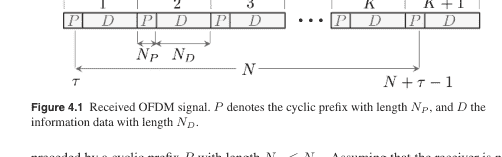

图 4.1 接收到的 OFDM 信号。P 表示长度为 `N_P` 的循环前缀，D 表示长度为 `N_D` 的信息数据。

前面加上长度为 `N_P` ≤ `N_D` 的循环前缀 P。假设接收机与发射机不同步，我们用 `τ` 表示同步失配，即第一个样本的历元（一般 0 ≤ `τ` ≤ `N_P` + `N_D`，当同步完美时 `τ` = 0）。样本总数为 `N` = `K`(`N_P` + `N_D`)，且 `y` 包含 `K` + 1 个 OFDM 符号的样本（或当 `τ` = 0 时为 `K` 个）。我们假设在 `K` 个符号序列上没有时钟漂移。设 `d_i` 表示第 `i` 个 OFDM 符号 `x_i` 的 `N_D` 向量数据。后者通过将 `d_i` 的最后 `N_P` 个元素连接到 `d_i` 得到。以向量形式，

`x_i` = `U` `d_i`, (4.71)

其中 `U` 是 (`N_P` + `N_D`) × `N_D` 矩阵

`U` ≜ [ `0_{N_P × (N_D - N_P)}` `I_{N_P}` ; `I_{N_D}` ] . (4.72)

这里，`0_{m×n}` 表示所有元素均为零的 `m × n` 矩阵，`I_n` 为 `n × n` 单位矩阵。进一步定义由 `K` + 1 个 `U` 组成的块对角 (`K` + 1)(`N_P` + `N_D`) × (`K` + 1)`N_D` 矩阵：

`T` ≜ diag[ `U` `U` … `U` ] . (4.73) `K+1`

由 `K` + 1 个 OFDM 符号组成的向量 `x` 是从 `T` `d` 中删除前 `τ` 个和最后 (`N_P` + `N_D`) − `τ` 个样本得到的。因此，我们可以写成

`x` = `T_τ` `d`, (4.74)

其中 `d` ≜ [`d_1^T` `d_2^T` … `d_{K+1}^T`]^T，且 `T_τ` 是从 `T` 中删除前 `τ` 行和最后 (`N_P` + `N_D`)−`τ` 行得到的 `K`(`N_P` + `N_D`) × (`K` + 1)`N_D` 矩阵。

### 4.4.1 Neyman–Pearson 检测

调用中心极限定理，我们假设数据向量 `d` 为白高斯，即 `d ∼ N_c(0, σ_d^2 I)`，其中 `σ_d^2` 是复信号样本的方差。`x` 的条件自相关为

`E[ x x^T | τ ]` = `E[ T_τ d d^T T_τ^T ]` = `σ_d^2 T_τ T_τ^T`, (4.75)

从而 `x | τ ∼ N_c(0, σ_d^2 T_τ T_τ^T)`。我们分别考虑 `σ_d^2` 和 `σ_n^2` 已知和未知的情况。

#### 已知 `σ_w^2` 和 `σ_d^2`

我们有，假设 `τ` 未知,$^1$

`p(y | H_0)` = `1/(π^N σ_w^{2N}) exp(-||y||^2/σ_w^2)`, (4.76)

`p(y | H_1)` = `1/(π^N det Q_r^{-1}) exp(-y^† Q_r^{-1} y)`, (4.77)

其中我们定义

`Q_r` ≜ `σ_d^2 T_τ T_τ^T` + `σ_w^2 I`, (4.78)

因此，在 `H_0` 与 `H_1` 之间决策的对数似然比具有以下形式

`Y` ≜ `log p(y | H_1)/p(y | H_0)` = `log σ_w^{2N}/det Q_r` - `y^† (Q_r^{-1} - σ_w^{-2}I) y`, (4.79)


直接计算用于评估 `$Y$` 所需的 `$\det \mathbf{Q}_r$` 和 `$\mathbf{y}^\dagger \left(\mathbf{Q}_r^{-1} - \sigma_w^{-2}\mathbf{I}\right) \mathbf{y}$`，当 `N` 较大时可能带来相当大的复杂度（参见 [1] 中利用矩阵 `$\mathbf{Q}_r$` 稀疏性的简化方法）。

作为特例，注意到在没有循环前缀的情况下（`$N_p = 0$`，这对应于观测信号没有可用结构），我们有 `$\mathbf{T}_\tau, \mathbf{T}_\tau^T = \mathbf{I}$` 且 `$\mathbf{y}|\mathcal{H}_1 \sim \mathcal{N}_c\left(0, (\sigma_d^2 + \sigma_w^2)\mathbf{I}\right)$`，这导致检验统计量

`$Y = \|\mathbf{y}\|^2$`

并表明在这些条件下能量检测器是最优的。

## 未知 `$\sigma_w^2$` 和 `$\sigma_d^2$`

如果这两个参数未知，但其先验分布可用，仍可通过标准边缘化消除它们后使用似然比检验：

`$p(\mathbf{y} \mid \mathcal{H}_0) = \mathbb{E}_{\sigma_w^2} p(\mathbf{y} \mid \mathcal{H}_0, \sigma_w^2), \qquad (4.80)$`

`$p(\mathbf{y} \mid \mathcal{H}_1) = \mathbb{E}_{\sigma_w^2, \sigma_d^2} p(\mathbf{y} \mid \mathcal{H}_1, \sigma_w^2, \sigma_d^2), \qquad (4.81)$`

这假设已知 `$\sigma_w^2$` 和 `$\sigma_d^2$` 的先验分布。另一种选择是使用广义似然比检验 `(4.16)`，这里的做法是用其最大似然估计值替换 `(4.76)`-`(4.77)` 中的 `$\sigma_w^2$` 和 `$\sigma_d^2$`。

### 4.4.2 基于二阶统计量的检测

这里如果将 `N` 重新定义为 `N = K(N_P + N_D) + N_D`，记号会更简单。现在考虑样本乘积

`$$r_i \triangleq y_i^* y_{i+N_D}, \quad i = 0, \dots, K(N_P + N_D) - 1. \tag{4.82}$$`

这里一个关键的观察是，由于循环前缀中数据的重复，在 `$\mathcal{H}_1$` 下 `y_i` 和 `y_{i+N_D}` 可能不独立，因此即使 `$\mathbb{E} y_i = 0$`，`r_i` 的期望值也不为零。这一性质可用于检测。定义平均样本值乘积

`$$A_i \triangleq \frac{1}{K} \sum_{k=0}^{K-1} r_{i+k(N_P+N_D)}, \quad i = 0, \dots, N_P + N_D - 1. \tag{4.83}$$`

在假设 `$\mathcal{H}_0$` 下，所有 `A_i` 具有相同的分布，而在 `$\mathcal{H}_1$` 下，`N_P` 个样本 `|A_i|` 将表现出与剩余 `N_D` 个不同的（并且在噪声较小时显著更大）值。事实上，对于 `N_P` 个连续的指标 `i`，我们有 `x_i = x_{i+N_D}`，而对于其他 `N_D` 个指标，`x_i` 与 `x_{i+N_D}` 是独立的。因此，可以设计频谱传感器来检测 `A_i` 是否独立同分布，或其统计特性是否依赖于 `i`。

定义向量 `$\mathbf{A} \triangleq [A_0, \dots, A_{N_P+N_D-1}]^\mathrm{T}$`，并使用广义似然比检验 `(4.16)`，我们得到检验统计量

`$$Y \triangleq \log \frac{\max_{\sigma_w^2,\sigma_z^2} p(\mathbf{A} \mid \mathcal{H}_1, \sigma_w^2, \sigma_z^2)}{\max_{\sigma_w^2} p(\mathbf{A} \mid \mathcal{H}_0, \sigma_w^2)}. \tag{4.84}$$`

这些传感器的结构和性能的细节在 [1] 中描述。

基于 OFDM 信号二阶统计量的其他频谱传感器也被提出。下面我们描述其中一些（其性能的定量比较包含在 [1] 中）。

#### 自相关检测器

[4] 中提出的检验统计量由乘积 `r_i` 的经验均值除以接收功率归一化组成：

`$$Y \triangleq \frac{\sum_{i=0}^{(N_P+N_D)-1} \overline{A_i}}{N^{-1}(N_P+N_D) \sum_{i=0}^{N-1} |y_i|^2}, \tag{4.85}$$`

其中 `$\overline{A_i} \triangleq \Re\{A_i\}$`。该检测器不需要噪声方差 `$\sigma_z^2$` 的值。另一方面，它没有利用在 `$\mathcal{H}_1$` 下观测信号是非平稳的这一事实。

#### 循环前缀检测器

该检测器的检验统计量为 [27]

`$Y \triangleq \left| \frac{1}{N} \sum_{i=0}^{(N_P+N_D)-1} A_i + c \right|^2, \quad (4.86)$`

其中

`$c \triangleq \frac{\frac{N_P}{N_P+N_D}\sigma_z^2}{\left(1+2\left(\frac{N_P}{N_P+N_D}\right)^2\right)\frac{\sigma_d^2}{\sigma_z^2}+2}, \quad (4.87)$`

即使该检测器也没有利用观测信号的非平稳性。请注意计算该检验统计量需要知道 `$\sigma_d^2$` 和 `$\sigma_z^2$`。为消除这一要求，可以选择令 `c = 0`。然而，判决阈值仍将依赖于噪声方差 `$\sigma_z^2$`。

#### 滑动窗口检测器

该检测器 [21] 使用滑动窗口对 `N_P` 个连续样本上的 `r_i` 求和并取最大值。检验统计量为

`$Y \triangleq \left| \sum_{i=\tau}^{\tau+N_P-1} r_i \right|, \quad (4.88)$`

该检测器的一个简单扩展 [1] 是取 `K` 个 OFDM 符号而不是一个：

`$Y \triangleq \left| \sum_{i=\tau}^{\tau+N_P-1} A_i \right|, \quad (4.89)$`

设置该检测器的判决阈值需要知道 `$\sigma_z^2$` 的值。

## 4.5 噪声功率不完全已知的影响

本章前面给出的计算可用于基于接收机工作特性（ROCs）比较各种检测器的性能，而 ROCs 又高度依赖于 SNR 和感知时间 `N`。增加后者会带来性能改善，但这仅在分析中使用的模型无限精确的乐观假设下成立。由于这一假设在现实世界中不可能成立（例如，噪声永远不会完全是高斯的、或白色的、或宽平稳的），正如本节所示，模型不确定性可能会对检测器的性能施加根本限制，正如我们即将讨论的那样，这是由于检测器缺乏鲁棒性。本节和下一节将研究不完美的信道建模如何影响频谱感知。

再次考虑采样信号观测值

`$$y_n = h x_n + z_n,\tag{4.90}$$`

其中 `x_n` 是受块衰落 `h` 影响的主信号，`z_n` 是加性干扰。如常，主信号假定与噪声和衰落都独立。现在，基于 `(4.90)` 的推导必须假设 `(y_n)`、`h`、`(x_n)` 和 `(z_n)` 以无限精度建模，这要求例如接收机非线性、量化噪声以及来自其他信号源的干扰可以被视为无关而忽略。对问题的更现实看法需要，例如，噪声过程 `(z_n)` 被建模为具有取自可能分布集合 `$\mathcal{Z}$` 的分布 Z，我们可以称之为 *噪声不确定集*。对 `(4.90)` 中的其他实体也将采用类似的方法，建模为具有取自合适不确定集 `H` 和 `X` 的分布 H 和 X。

决策策略为 `$\mathcal{D}_N$` 的检测器如果满足以下条件，则称其对目标概率 `P_{\text{FA}}` 和 `P_{\text{MD}}` 是 *鲁棒* 的

`$$\sup_{Z \in \mathcal{Z}} P_{\text{FA}}(Z) \le P_{\text{FA}},\tag{4.91}$$`

`$$\sup_{H \in \mathcal{H}, X \in \mathcal{X}, Z \in \mathcal{Z}} P_{\text{FA}}(H,X,Z) \le P_{\text{MD}}.\tag{4.92}$$`


相反，如果即使 $N$ 任意增大，仍存在对 $(P_{\text{FA}}, P_{\text{MD}})$，$0 < P_{\text{FA}} < 1/2$ 且 $0 < P_{\text{MD}} < 1/2$，无法实现，则称该检测器在某一 SNR 下是 *非鲁棒* 的。数学上，检测器鲁棒的充要条件是 $Y$ 在两种假设下的均值集合不重叠，即 $A_N \cap B_N = \varnothing$，其中

$$A_N \triangleq \{ \mathbb{E}_2[Y \mid \mathcal{H}_0] : Z \in \mathcal{Z} \},\tag{4.93}$$

$$B_N \triangleq \{ \mathbb{E}_2[Y \mid \mathcal{H}_1] : H \in \mathcal{H}, X \in \mathcal{X}, Z \in \mathcal{Z} \},\tag{4.94}$$

且 $\mathcal{X}$ 包含具有相同平均功率 $\mathcal{P}$ 的信号分布。事实证明，如果 SNR 较高，更容易实现鲁棒性。在这种情况下，两种假设下检验统计量的分布足够分离，建模不确定性可能不会使它们混合。在低 SNR 下，$Y$ 在两种假设下的分布集合可能完全重叠。如果存在 SNR 阈值 $\gamma_t$，使得检测器在所有低于 $\gamma_t$ 的 SNR 下变得非鲁棒，则称该 $\gamma_t$ 为检测器的 *SNR 墙*。SNR 墙量化了检测器的鲁棒程度。本节剩余部分我们将考察 SNR 墙的三个例子。更全面的讨论请参阅 [39–42]。

### 4.5.1 能量感知

考虑由（4.25）-（4.26）描述的能量检测器的渐近性能。假设主信号为高斯信号，$z(t)=w(t)$，且 $w(t)$ 为零均值高斯，其功率仅在某一区间已知。消去（4.25）-（4.26）中的 $\theta$，我们得到

$$N = \left[ Q^{-1}(P_{\text{FA}}) - Q^{-1}(1 - P_{\text{MD}})(1 + \gamma) \right]^2 \gamma^{-2}.\tag{4.95}$$

其中 γ ≜ P/σ_w² 表示信噪比。最后一个方程表明，在噪声功率 σ_w² 完全已知的情况下，通过适当选择 N，可以在任何信噪比下检测到信号。

现在，假设噪声功率 σ_w² 的取值存在不确定性。这可通过假设一个不确定性区间来概括，使得 σ² ∈ [(1/ε)σ_w², εσ_w²]，其中 ε > 1 为量化不确定性的参数。我们得到

P_FA = max_{σ²∈[(1/ε)σ_w²,εσ_w²]} Q( √N θ - εσ²/σ² )  (4.96)

= Q( √N θ - εσ_w²/εσ_w² )  (4.97)

且

P_MD = 1 - min_{σ²∈[(1/ε)σ_w²,εσ_w²]} Q( √N θ - (P + σ²)/(P + σ²) )  (4.98)

= 1 - Q( √N θ - (P + ε⁻¹σ_w²)/(P + ε⁻¹σ²) ) .  (4.99)

在低信噪比近似 1 + γ ≈ γ 下消去 θ，我们得到

N ∼ [ Q⁻¹(P_FA) - Q⁻¹(1 - P_MD) ]² / [ γ - (ε - ε⁻¹) ]² ,  (4.100)

这表明当 N → ∞ 时，γ ↓ (ε - ε⁻¹)，因此出现了信噪比墙：能量检测器如果 P ≤ (ε - ε⁻¹)σ_w² 则无法可靠工作，即信号功率未超过噪声功率的不确定性。

### 4.5.2 辅助导频的相干感知

在此场景中，主信号有一部分功率分配给已知的导频音或已知的导频。模型为

y_n = √δ x_n^(P) + √[1 - δ] x_n^(D) + w_n ,  (4.101)

其中 x_n^(P) 表示导频音或导频，x_n^(D) 为信息数据，w_n 为加性白噪声。在无衰落的情况下，匹配滤波检测器通过形成检验统计量来操作

Y = (1/N) Σ_{n=0}^{N-1} y_n \bar{x}_n^(P) ,  (4.102)

其中 \bar{x}_n^(P) 是沿导频音方向的向量。重复导出 (4.100) 的计算，在此情况下我们得到

N ≈ [ Q⁻¹(P_D) - Q⁻¹(P_FA) ]² δ⁻¹ γ⁻¹ ,  (4.103)

这表明相干检测器对噪声分布的不确定性具有鲁棒性。此情况下的信噪比墙由衰落过程的时间选择性引起。考虑乘性块衰落保持恒定的简单情况

在 $N_c$ 个样本的相干间隔内，而检测器在 $M$ 个相干块内观测信号。在此情况下检验统计量可以为

$Y = \frac{1}{M} \sum_{m=0}^{M-1} \left[ \frac{1}{\sqrt{N_c}} \sum_{n=1}^{N_c} y_{mN_c + n} \tilde{x}_{mN_c + n}^{(P)} \right]^2 \tag{4.104}$

由每个相干块内的相干合并——将信号功率提高 $N_c$ 倍——和标准能量检测器得到。因此，匹配滤波器将是非鲁棒的如果

$N_c \delta \gamma \le \varepsilon - \varepsilon^{-1}. \tag{4.105}$

### 4.5.3 基于循环平稳的检测

由于独立性假设，我们有

$\hat{S}_y^{\alpha}(f) = \hat{S}_x^{\alpha}(f) + \hat{S}_w^{\alpha}(f). \tag{4.106}$

此外，当 $N \to \infty$ 时，则 $\hat{S}_y^{\alpha}(f) \to S_y^{\alpha}(f)$。因此，当 $N \to \infty$ 时，假设 $\mathcal{H}_1$ 下的检验统计量 (4.43) 收敛如下：

$Y \to \int_{-f_s/2}^{f_s/2} |S_x^{\alpha}(f)|^2 df, \tag{4.107}$

而在 $\mathcal{H}_0$ 下，由于噪声是宽平稳的，因而 $S_w^{\alpha}(f) = 0$ 对 $\alpha \ne 0$ 成立，

$Y \to \int_{-f_s/2}^{f_s/2} S_x^{\alpha}(f) [S_w^{\alpha}(f)]^* df = 0. \tag{4.108}$

以上证明了通过增加观测长度可以使该检测技术更可靠，因而单循环基于循环平稳的检测器对噪声功率水平不确定性具有鲁棒性。另一方面，该检测器对衰落统计不确定性并不鲁棒。为证明这一点，假设基于线性时变滤波器的选择性衰落模型，其参数随信道相干时间 [3] 指定的时间尺度变化。现在存在一个衰落滤波器，使得对任意 $\alpha \ne 0$ 检验统计量为零。如此一来，功率谱密度成为唯一有用的检验统计量，因而能量检测器的信噪比墙限制了基于循环平稳检测器的鲁棒性。受衰落影响的信号的谱相关函数估计，其滤波器频率响应为 $H(f)$，为

$\hat{S}_y^{\alpha}(f) = H(f + \alpha/2) H^*(f - \alpha/2) \hat{S}_x^{\alpha}(f) + \hat{S}_w^{\alpha}(f). \tag{4.109}$

假设 $N$ 足够大，我们有 $\hat{S}_x^{\alpha}(f) = S_x^{\alpha}(f)$ 且 $\hat{S}_w^{\alpha}(f) = 0$，这给出 $\mathcal{H}_1$ 下的检验统计量

$Y = \int_{-f_s/2}^{f_s/2} |H(f + \alpha/2) H^*(f - \alpha/2) S_x^{\alpha}(f)|^2 df.$

该方程表明存在一个衰落滤波器 $H(f)$，从而存在一个衰落过程，它会消除或改变任意 $\alpha \neq 0$ 的谱相关函数的形状 [40]。

## 4.6 干扰模型不准确的影响

观测信号的基本模型，通过引入加性干扰 $i_n$ 丰富后，为

$y_n = x_n + i_n + w_n, \quad n = 0, \ldots, N-1. \tag{4.110}$

(4.110) 中出现的所有随机量假定彼此独立。虚警概率和漏检概率变为

$P_{\text{FA}}(W,I) \triangleq \mathbb{E}_{W,I}\{ \mathcal{D}_N = \hat{\mathcal{H}}_1 \mid \mathcal{H}_0 \}, \tag{4.111}$

$P_{\text{MD}}(W,I,X) \triangleq \mathbb{E}_{W,I,X}\{ \mathcal{D}_N = \mathcal{H}_0 \mid \mathcal{H}_1 \}, \tag{4.112}$


其中 `W`、`I` 和 `X` 分别表示 `$w_n$`、 `$i_n$` 和 `$x_n$` 的概率密度函数。`(4.111)` 和 `(4.112)` 的计算假设 `W`、`I` 和 `X` 被完美建模，这在实践中很少出现。现实的假设是关于干扰统计的知识很少（甚至非常少）。这里我们考察 `$i(t)$` 未完全已知的情况：我们特别假设仅知道其幅度范围和最大功率，并推导出相干和能量传感器无法达到期望性能的条件。分析可使用矩界理论 `[10, 24]` 进行。这使我们能够表征满足干扰已知约束的所有 pdf，并推导出使 `$P_{\text{FA}}$` 和 `$P_{\text{MD}}$` 取得最大值和最小值的 pdf。我们首先以适合求解我们问题的形式总结矩界理论的基础；接下来我们展示如何对相干和能量传感器的性能进行上下界限制，以及这些传感器在渐近情况下的行为。

### 4.6.1 矩界理论基础

设 `I` 表示一个随机变量（RV），其累积分布函数（CDF）在有限区间 `$\mathcal{J} \triangleq [a, b]$` 上定义。设 `k1(x)` 和 `k2(x)` 为定义在 `$\mathcal{J}$` 上的两个连续函数。矩空间 `$\mathcal{M}$` 定义为对

$\left( \int_{\mathcal{J}} k_1(x) \, dG(x), \int_{\mathcal{J}} k_2(x) \, dG(x) \right) \tag{4.113}$

的（闭、有界且凸）集合

$\int_{\mathcal{J}} k_i(x) \, dG(x), i = 1,2,$ 也是紧且凸的。通过将这些 CDF 限制为单位阶跃函数 `u(x − x0)`，其中 `x0 ∈ I`，注意到 `∫ k_i(x) du(x − x0) = k_i(x0)`，`i = 1,2` 表明曲线 `C` 在矩空间 `M` 中。通过考虑这些单位阶跃函数的凸组合，我们看到矩空间包含 `C` 的凸包。反之，由于矩空间的任意点都可以表示为曲线的点的凸组合，`C` 的凸包包含矩空间，这证明了我们的结果。

作为示例，假设我们定义 `k1(x) = x²` 且 `k2(x) = h(x)`，其中 `h(·)` 是定义在 `[−1, 1]` 上的已知连续函数，且 `m1 ≜ E[I²] (4.115)` 已知，而我们想要计算“尖锐”上界和下界（即不可进一步收紧的界）到 `m2 ≜ E[h(I)]`。`(4.116)`

该问题可按如下方式求解。构建曲线 `Ĉ = (x², h(x))`，其中 `x ∈ I`。`Ĉ` 的凸包包含对应于定义在 `I` 上的所有 CDF 的对 `m1`、`m2`。特别地，对于任意给定的 `m1` 值，`m1` 处的下包络和上包络的值给出 `m2` 的尖锐下界和上界（见图 4.2 示意）。虚线曲线的方程为 `(x², h(x))`，而连续线表示对任意 `m1` 值限定凸包的上、下包络，从而描述了由极限 CDF 实现的 `m2` 的界。

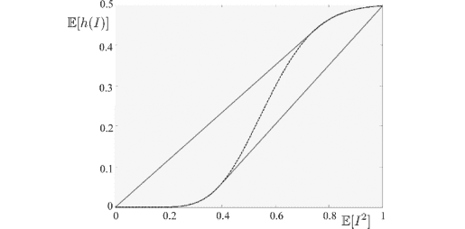

图 4.2 计算矩界：`E[h(I)]` 相对于 `E[I²]` 的范围。虚线为曲线 `Ĉ = (x², h(x))`。连续线限定了 `Ĉ` 的凸包。

若干技术可用于计算这些界限。其中，我们可以提到 `[2, 48]` 中描述的求积规则方法、`[32]` 的半解析方法以及 `[49]` 的图形方法。

### 4.6.2 能量感知

我们假设一个具有平均功率 `$\mathcal{P}$` 的确定性主信号。在这种情况下，虚警概率的形式为

$P_{\mathrm{FA}}(W,I)=\mathbb{E}_{W,I}\mathbb{1}\left(\frac{2}{\sigma_w^2}\sum_{n=0}^{N-1}|i_n+w_n|^2>\frac{2N}{\sigma_w^2}\theta\right). \quad (4.117)$

当 `W=\mathcal{N}(0,\sigma_w^2)` 时，上式不等号前的随机变量具有条件非中心卡方分布，自由度为 `2N`，非中心参数为

$\lambda_0 \triangleq \frac{2}{\sigma_w^2}\sum_{n=0}^{N-1}|i_n|^2. \quad (4.118)$

因此，

$P_{\mathrm{FA}}(I)=\mathbb{E}_I\left[Q_N\left(\sqrt{\lambda_0},\sqrt{2N\theta/\sigma_w^2}\right)\right], \quad (4.119)$

其中 `Q_N` 表示广义 Marcum `Q` 函数，`$\mathbb{E}_I$` 表示关于随机变量 `I` 分布的期望：

$\mathbb{E}_I[f]\triangleq\int_0^{\infty}f(x)\,dF_I(x).$

条件漏检概率可以类似推导，得

$P_{\mathrm{MD}}(I)=1-\mathbb{E}_I\left[Q_N\left(\sqrt{\lambda_1},\sqrt{2N\theta/\sigma_w^2}\right)\right], \quad (4.120)$

其中 `$\lambda_1 \triangleq \frac{2}{\sigma_w^2}\sum_{n=0}^{N-1}|x_n+i_n|^2. \quad (4.121)$`

在假设 `$\mathbb{E}[i_n]=0$` 的条件下，可以计算 `P_{\mathrm{FA}}` 和 `P_{\mathrm{MD}}` 的尖锐上、下矩界，这使得我们能够得到矩 `$\mathbb{E}[\lambda_0]=2N\sigma_I^2/\sigma_w^2 \quad \mathbb{E}[\lambda_1]=2N\left(\mathcal{P}+\sigma_I^2\right)/\sigma_w^2. \quad (4.122)$`

因此，与我们问题相关的矩空间可表示为曲线 `$(x, Q_N(\sqrt{2N x \sigma_I^2/\sigma_w^2},\sqrt{2N\theta/\sigma_w^2}))$` 的凸包，用于 `P_{\mathrm{FA}}`：见图 4.3) 以及 `$(x,1-Q_N(\sqrt{2N(\mathcal{P}+x)/\sigma_w^2},\sqrt{2N\theta/\sigma_w^2}))$`（用于 `P_{\mathrm{MD}}`：见图 4.4）。这些图允许推导出 `P_{\mathrm{FA}}` 和 `P_{\mathrm{MD}}` 的上、下界，这些界可以通过干扰 `I` 的某种概率分布实际实现。

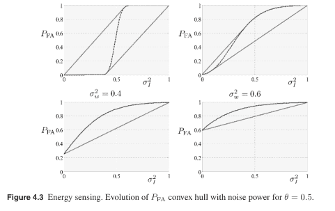

图 4.3 能量感知。`P_{FA}` 凸包随噪声功率的演化，`θ = 0.5`。

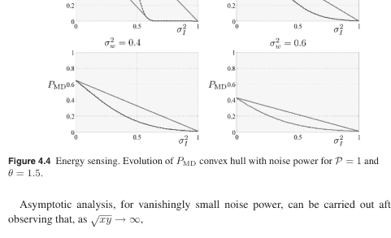

图 4.4 能量感知。`P_{MD}` 凸包随噪声功率的演化，`P = 1` 且 `θ = 1.5`。

渐近分析，对于 vanishingly small 噪声功率，可以在观察到当 `√xy → ∞` 时，`$Q_M(x,y) \sim u(1 − √(y/x))$`，`(4.123)` 后进行，其中 `$u(·)$` 表示单位阶跃函数（见 `[43]`）。因此，对于无限 SNR，`P_{FA}` 和 `P_{MD}` 的矩界的行为如图所示 4.5。

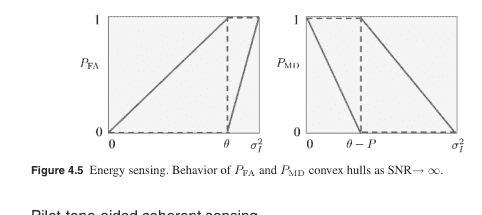

图 4.5 能量感知。`P_{FA}` 和 `P_{MD}` 凸包随 SNR `$\to \infty$` 的行为。

### 4.6.3 辅以导频音的相干感知

这里我们假设主信号包含一个已知的导频音，并且为了检测主用户信号的存在，次级用户传感器将统计量与阈值 `θ` 进行比较

$Y = \frac{1}{N} \sum_{n=0}^{N-1} \Re\{y_n x_n^*\} = \frac{1}{N} \sum_{n=0}^{N-1} \Re\{|x_n|^2 + i x_n x_n^* + w_n x_n^*\}. \quad (4.124)$

条件虚警和漏检概率的形式为

$P_{FA}(I) = \mathbb{E}_I\left[ Q\left(\sqrt{N}\frac{\theta - I}{\sqrt{\mathcal{P}\sigma_w^2}}\right)\right], \quad (4.125)$

$P_{MD}(I) = \mathbb{E}_I\left[ Q\left(\sqrt{N}\frac{\mathcal{P} - \theta + I}{\sqrt{\mathcal{P}\sigma_w^2}}\right)\right],$

其中 `Q(·)` 为高斯尾函数，`I` 表示干扰项

$I \triangleq \frac{1}{N} \sum_{n=0}^{N-1} \Re\{i_n x_n^*\}, \quad (4.126)$

而 `$\mathcal{P}$` 如常为平均信号功率的估计：


$\mathcal{P} \triangleq \frac{1}{N} \sum_{n=0}^{N-1} |x_n|^2. \quad (4.127)$

我们最后为简单起见假设 $I \in [-1,1]$，并且 $I$ 具有偶概率密度函数（这特别意味着其均值为零）。干扰项 $I$ 的对称 pdf $p_I(\cdot)$ 的假设使我们能够以对称形式写出 $P_{FA}$ 和 $P_{MD}$，此时 $I \in [0,1]$。

2 如果干扰的对称性假设不成立，下面的所有推导都可以 mutatis mutandis 地重新表述以适应这种情况。

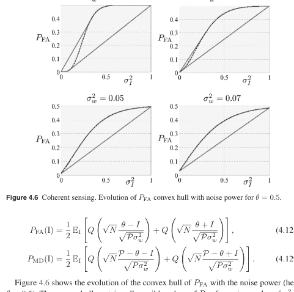

图 4.6 相干感知。$P_{FA}$ 凸包随噪声功率的演化，θ = 0.5。

$P_{FA}(I) = 1/2 \mathbb{E}_I [ Q( \sqrt{N} (\theta - I) / \sqrt{\mathcal{P}\sigma_w^2} ) + Q( \sqrt{N} (\theta + I) / \sqrt{\mathcal{P}\sigma_w^2} ) ], \quad (4.128)$

$P_{MD}(I) = 1/2 \mathbb{E}_I [ Q( \sqrt{N} (\mathcal{P} - \theta - I) / \sqrt{\mathcal{P}\sigma_w^2} ) + Q( \sqrt{N} (\mathcal{P} - \theta + I) / \sqrt{\mathcal{P}\sigma_w^2} ) ]. \quad (4.129)$

图 4.6 显示了 $P_{FA}$ 凸包随噪声功率的演化（这里 θ = 0.5）。凸包包含了给定 $\sigma_I^2 = E[I^2]$ 值下 $P_{FA}$ 的所有可能值。$P_{MD}$ 也有类似结果。

可以观察到 $P_{FA}$ 和 $P_{MD}$ 的上下包络在 $\sigma_I^2 = 0$（对应 $f_I(x) = δ(x)$）以及 $\sigma_I^2 = 1$（对应具有该方差的唯一对称密度，即 $f_I(x) = 0.5 δ(x + 1) + 0.5 δ(x - 1)$）处收敛于单一点。简单的计算表明包络的起始点为

$P_{FA}|_{\sigma_I^2=0} = Q( \theta / \sigma ), \quad (4.130)$

$P_{MD}|_{\sigma_I^2=0} = Q( (1 - \theta) / \sigma ), \quad (4.131)$

以及端点

$P_{FA}|_{\sigma_I^2=1} = 1/4 [ Q( (\theta -1)/\sigma ) + Q( (\theta +1)/\sigma ) ], \quad (4.132)$

$P_{MD}|_{\sigma_I^2=1} = 1/4 [ Q( -\theta / \sigma ) + Q( (2 - \theta)/\sigma ) ], \quad (4.133)$

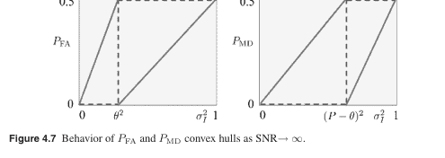

图 4.7 $P_{FA}$ 和 $P_{MD}$ 凸包随 SNR → ∞ 的行为。

其中 σ ≜ √(P/N) σ_w。

对于高 SNR，可以通过令 $(P/N)σ_w² → 0$ 并观察到

$Q\left(\frac{a+x}{\sigma}\right)+Q\left(\frac{a-x}{\sigma}\right) \sim u(x-a)$

来进行简单的渐近分析，其中 $u(·)$ 再次表示单位阶跃函数。$P_{FA}$ 和 $P_{MD}$ 凸包的渐近行为如图 4.7 所示。

## 4.7 总结

本章主要致力于交织式认知无线电范式下的频谱感知（对底层技术的简要提及基于干扰温度概念及其应用）。频谱感知，即检测活跃主用户是否存在，被描述为二元检测问题。文中包含了解决该问题的若干技术及其复杂度与性能的讨论（能量感知、相干检测、基于循环平稳性的检测、基于自相关的检测）。频谱感知在 OFDM 中的应用得到了特别关注。最后考察了噪声功率不完全已知以及其他干扰源对频谱感知性能的影响。

## 4.8 进一步阅读

检测理论的基础以及进一步的细节例如可在 [35] 或 [22] 中找到。综述论文 [19, 30, 46] 和博士论文 [29] 描述了本章未涵盖的若干频谱感知技术（基于小波的检测、多论文谱估计等）。第 5 章将致力于更先进的技术。

由于其潜在应用数量众多，利用能量测量装置在噪声中检测确定性信号的问题受到了广泛关注。文献 [45] 是最早包含加性白高斯噪声中信号解法的论文之一。如果信号在遍历衰落信道输出处被观测，则性能指标 $P_{FA}$ 和 $P_{MD}$ 必须在衰落统计上取平均。Kostylev [23] 以及 Digham、Alouini 和 Simon [9] 推导了瑞利、莱斯和 Nakagami-m 衰落下的 $P_{FA}$ 和 $P_{MD}$。Herath、Rajatheva 和 Tellambura [20] 研究了能量检测器在分集接收下的性能。

本文未涉及的一个主题是当次级无线电接入主用户占用的频谱区域时发生的碰撞所产生的信道模型。如 [26] 中所述，如果通过次级用户子信道传输的数据包被错误接收（由数据包内部校验和不匹配揭示），则它可能不会传递到协议栈的高层。在不使用 ARQ 的假设下，应用层将其视为擦除。因此，用于选择纠错方案的适当信道模型除了加性噪声和衰落外，还应包括数据包擦除（见 [25, 44]）。

### 参考文献

- [1] E. Axell and E. G. Larsson, "已知和未知噪声方差下 OFDM 信号的最优和次优频谱感知," IEEE J. Sel. Areas Commun., 29, no. 2, 290–304, Feb. 2011.

- [2] S. Benedetto and E. Biglieri, "无线应用的数字传输原理", Kluwer Academic (Plenum Publishers, 1999.

- [3] E. Biglieri, J. Proakis, and S. Shamai (Shitz), "衰落信道：信息论和通信方面," IEEE Trans. Inf. Theory, 44, no. 6, 2619–2692, Oct. 1998.

- [4] S. Chaudhari, V. Koivunen, and H. V. Poor, "基于自相关的认知无线电中 OFDM 信号的分散序贯检测," IEEE Trans. Signal Process., 57, no. 7, 2690–2700, July 2009.

- [5] T. C. Clancy, "形式化干扰温度模型," J. Wireless Commun. Mobile Comput., 7, no. 9, 1077–1086, Nov. 2007.

- [6] T. C. Clancy, "干扰温度在动态频谱接入中的使用," Ann. Télécommun., 64, no. 7-8, 573–592, Aug. 2009.

- [7] T. C. Clancy and D. Walker, "认知无线电网络中干扰管理的频谱整形," SDR Forum Technical Conference, Orlando, FL, Nov. 13–17, 2006.

- [8] A. V. Dandawate and G. B. Giannakis, "循环平稳性存在的统计检验," IEEE Trans. Signal Process., 42, no. 9, 2355–2369, Sep. 1994.

- [9] F. F. Digham, M.-S. Alouini, and M. K. Simon, "衰落信道上未知信号的能量检测," IEEE Trans. Commun., 55, no. 1, 21–24, Jan. 2007.

- [10] M. Dresher, "矩空间与不等式," Duke Math. J., 20, 261–271, June 1953.

- [11] Federal Communications Commission, "建立干扰温度度量以量化和管理干扰并扩展某些固定、移动和卫星频段的可用免许可操作", ET Docket No. 03-237, Nov. 2003.

- [12] W. A. Gardner, "信号截获：特征检测的统一理论框架," IEEE Trans. Commun., 36, no. 8, 897–906, Aug. 1988.

- [13] W. A. Gardner, "循环平稳信号中谱冗余的利用," IEEE Signal Process. Mag., 8, no. 2, 14–36, Apr. 1991.

- [14] W. A. Gardner (编), *通信与信号处理中的循环平稳性*, IEEE Press, 1994.


# 参考文献

- [15] A. Ghasemi and E. S. Sousa, "认知无线电网络中的频谱感知：协作-处理权衡," *无线通信与移动计算*, 7, no. 9, 1049–1060, 九月 2007.
- [16] A. Ghasemi and E. S. Sousa, "频谱感知认知无线网络中的干扰聚合," *IEEE 信号处理选定主题期刊*, 2, no. 1, 41–56, 二月 2008.
- [17] A. Ghasemi and E. S. Sousa, "认知无线电网络中的频谱感知：需求、挑战与设计权衡," *IEEE 通信杂志*, 46, no. 4, 32–39, 四月 2008.
- [18] A. Goldsmith, *无线通信*. Cambridge University Press, 2005.
- [19] S. Haykin, D. J. Thomson, and J. H. Reed, "认知无线电的频谱感知," *IEEE 会议录*, 97, no. 5, 849–877, 五月 2009.
- [20] S. P. Herath, N. Rajatheva, and C. Tellambura, "衰落和分集接收中未知信号的能量检测," *IEEE 通信汇刊*, 59, no. 9, 2443–2453, 九月 2011.
- [21] Huawei Technologies and UESTC, "DVB-T 的感知方案," *IEEE 标准* 802.22-06/0127r1, 七月 2006.
- [22] S. M. Kay, *统计信号处理基础：检测理论*, Prentice-Hall PTR, 1998.
- [23] V. I. Kostylev, "随机幅度信号的能量检测," *IEEE 国际通信会议论文集 (ICC 2002)*, 3, 1606–1610, 四月 28–五月 2, 2002.
- [24] M. G. Krein and A. A. Nudel'man, *马尔可夫矩问题与极值问题*. American Mathematical Society, 1977.
- [25] H. Kushwaha, Y. Xing, R. Chandramouli, and H. Heffes, "利用喷泉码在认知无线电网络上进行可靠的多媒体传输," *IEEE 会议录*, 96, no. 1, 155–165, 一月 2008.
- [26] H. Kushwaha, Y. Xing, R. Chandramouli, and K. P. Subbalakshmi, "认知无线电的擦除容错编码," in Q. H. Mahmoud (编), *认知网络 – 朝向自感知网络*. J. Wiley & Sons, 2007.
- [27] Z. Lei and F. Chin, "认知无线电的 OFDM 信号感知," *第19届个人、室内和移动无线通信国际研讨会 (PIMRC'08)*, 法国戛纳, 九月 15–18, 2008.
- [28] Y.-C. Liang, Y. Zeng, E. C. Y. Peh, and A. T. Hoang, "认知无线电网络的感知-吞吐量权衡," *IEEE 无线通信汇刊*, 7, no. 4, 1326–1337, 四月 2008.
- [29] J. Lundén, *认知无线电和雷达系统的频谱感知*, D.Sc. Dissertation, 赫尔辛基理工大学, 芬兰埃斯波, 2009.
- [30] J. Ma, G. Y. Li, and B. H. Juang, "认知无线电中的信号处理," *IEEE 会议录*, 97, no. 5, 805–823, 五月 2009.
- [31] J. T. MacDonald and D. R. Ucci, "IEEE 802.11 协议无线信道的干扰温度限制," *IEEE 电信息技术会议 (EIT'07)*, 美国伊利诺伊州芝加哥, 五月 17–20, 2007.
- [32] J. W. Matthews, "符号间干扰的尖锐误差界," *IEEE 信息论汇刊*, IT-19, no. 4, 440–447, 七月 1973.
- [33] F. W. J. Olver, D. W. Lozier, R. F. Boisvert, and C. W. Clark, *NIST 数学函数手册*, NIST and Cambridge University Press, 2010.
- [34] Y. Pei, A. T. Hoang, and Y.-C. Liang, "认知无线电网络中的感知-吞吐量权衡：频谱感知应多频繁进行？", *IEEE 第18届个人、室内和移动无线通信国际研讨会 (PIMRC 2007)*, 希腊雅典, 九月 3–7, 2007.
- [35] H. V. Poor, 信号检测与估计导论 (第2版). Springer-Verlag, 1994.
- [36] Z. Quan, S. Cui, and A. H. Sayed, "认知无线电网络中频谱感知的最优线性协作," IEEE 信号处理选定主题期刊, 2, no. 4, 2431-2436, 四月 2010.
- [37] A. Sahai, R. Tandra, S. M. Mishra, and N. Hoven, "认知无线电系统中的基本设计权衡," 第1届访问频谱技术与政策国际研讨会论文集 (TAPAS 2006), 波士顿, MA, 八月 2-5, 2006.
- [38] M. K. Simon and M.-S. Alouini, 衰落信道上的数字通信 (第2版). J. Wiley & Sons, 2005.
- [39] R. Tandra, 低信噪比检测的基本极限. 硕士论文, 加州大学伯克利分校, 2005年春季.
- [40] R. Tandra and A. Sahai, "特征检测器的 SNR 墙," 第2届 IEEE 动态频谱接入网络新前沿国际研讨会论文集 (DySpan 2007), 都柏林, 爱尔兰, 第 559-570 页, 四月 2007.
- [41] R. Tandra and A. Sahai, "信号检测的 SNR 墙," IEEE 信号处理选定主题期刊, 2, no. 1, 4-17, 二月 2008.
- [42] R. Tandra and A. Sahai, "通过宏观特征克服 SNR 墙," 第四十六届 Allerton 年度会议, Allerton House, UIUC, IL, 第 583-590 页, 九月 23-26, 2008.
- [43] N. M. Temme, "非中心卡方分布的渐近和数值方面," 计算机与数学应用, 25, no. 5, 55-63, 1993.
- [44] P. Tortelier and M. M. Azeem, "改进机会频谱接入短码的擦除恢复性能," 第14届无线个人多媒体通信国际研讨会 (WPMC'11), 法国布雷斯特, 十月 3-7, 2011.
- [45] H. Urkowitz, "未知确定性信号的能量检测," IEEE 会议录, 55, no. 4, 523-531, 四月 1967.
- [46] B. Wang and K. J. R. Liu, "认知无线电网络的进展：综述," IEEE 信号处理选定主题期刊, 5, no. 1, 5-23, 二月 2011.
- [47] H. Wang, G. Noh, D. Kim, S. Kim, and D. Hong, "认知无线电中能量检测的先进感知技术," 通信网络期刊, 12, no. 1, 19-29, 二月 2010.
- [48] K. Yao and E. M. Biglieri, "数字通信系统的多维误差界," IEEE 信息论汇刊, IT-26, no. 4, 454-464, 七月 1980.
- [49] K. Yao and R. M. Tobin, "具有符号间干扰的数字系统的矩空间上界和下界误差," IEEE 信息论汇刊, IT-22, no. 1, 65-74, 一月 1976.
- [50] T. Yücek and H. Arslan, "认知无线电应用的频谱感知算法综述," IEEE 通信综述与教程, 11, no. 1, 116-130, 第一季度 2009.
- [51] Y. Zeng, C. L. Koh, and Y. C. Liang, "最大特征值检测：理论与应用," IEEE 国际通信会议论文集 (ICC), 中国北京, 第 4160-4164 页, 五月 2008.
- [52] Y. Zeng and Y. C. Liang, "认知无线电的基于协方差的信号检测," 第2届 IEEE 动态频谱接入网络新前沿国际研讨会论文集 (DySpan 2007), 都柏林, 爱尔兰, 第 202-207 页, 四月 2007.
- [53] Y. Zeng and Y. C. Liang, "认知无线电的最大-最小特征值检测," IEEE PIMRC, 希腊雅典, 九月 2007.


- [54] Y. Zeng and Y. C. Liang, "基于特征值的认知无线电频谱感知算法," IEEE 通信汇刊, 57, no. 6, 1784-1793, 六月 2009.

# 5 频谱探索与利用

Jarmo Lundén, Visa Koivunen, and H. Vincent Poor

## 5.1 引言

### 5.1.1 章节动机

第4章介绍了用于检测认知无线电系统中主用户存在的基本频谱感知框架。在本章中，我们通过进一步探讨认知无线电系统或认知无线电网络如何优化其频谱感知和接入功能，以最有效且最高效的方式探索和利用频谱，从而进一步发展这一框架。

第1章和第2章描述了三种认知无线电网络范式，即底层、叠加和交织范式。在本章中，我们几乎完全专注于交织范式，其中次级用户试图利用由主用户对频谱进行间歇性和不均匀的空间和时间使用而产生的时空频谱机会（即频谱空洞）。正如第4章所述，这些频谱空洞通常被认为是白空间，即除噪声外完全没有任何信号的空间。此外，我们还将考虑适用于底层范式的一些方法。特别是，我们将考虑用于在干扰温度约束下运行的认知无线电网络的频谱接入和共享的博弈论技术和算法，如第4章所述。第三种范式，即叠加范式，在本章中并未明确考虑。在叠加范式中，次级用户不仅必须了解主用户的传输，还必须掌握主用户的码本以及主发射机与主接收机之间以及次级发射机与主接收机之间的完整信道状态信息。这使得在叠加范式下运行特别具有挑战性。

如上所述，在交织范式下运行的认知无线电旨在识别和利用未充分利用的频谱。空闲频谱是一个局部概念，除了取决于时间和频率外，还取决于主接收机和次级接收机以及主发射机和次级发射机的相对位置以及它们之间的传播条件。认知无线电系统对当前无线电环境和其他频谱用户了解得越多，它就能越有效地利用频谱，并对其他用户造成的干扰越少。这种信息称为态势感知。物理无线电通信层面的态势感知是指，例如，了解当前和过去的位置以及频谱其他用户的行为，甚至这些用户的未来位置和行为。此外，情境感知指的是了解本地物理和无线电环境以及传播条件。了解主用户和次级用户的波形也有益。了解波形（调制、编码、功率水平、接入方案、同步等）有助于区分主用户和次级用户、表征给定位置的干扰，以及识别有害干扰发生的区域，等等。本质上，情境感知包括任何能够做出更明智的行动选择决策以及预测这些行动效果的信息。情境感知使认知用户能够选择最佳的传输参数，例如频段、功率、调制、编码、波束图等，以最大化自身吞吐量并最小化对频谱其他用户的干扰。因此，情境感知是构建更智能、更高效系统的基石，最终实现更高效、更有效的频谱利用，并减少所有频谱用户的干扰。在本章中，我们将回顾旨在获取和利用认知无线电系统中的情境感知的各种技术；即旨在估计、学习或构建主用户占用情况以及频谱其他用户行为的（动态）模型的技术。

认知无线电系统最重要的情境感知形式是射频频谱的状态。在交织式认知无线电系统中，频谱感知是频谱探索中的关键组成部分，在此过程中获取频谱状态的感知并学习主用户业务随时间、位置和频率的统计行为。感知策略或方法用于在传感器之间以及感兴趣的子带上分配感知和学习任务，同时考虑能量消耗约束。通过频谱感知越有效地探索频谱，就越能有效地发现可用的频谱机会并更有效地利用它们，从而实现对稀缺频谱资源的更有效利用。因此，未利用频谱的利用与感知和探索紧密耦合。频谱利用利用所获得的关于频谱机会动态行为的知识来接入频谱。它根据探索结果确定是否以及如何接入频谱的特定部分以及谁获得接入。可以通过考虑感知错误及其对介质接入的影响来看到这些任务之间的耦合。频谱感知中的虚警概率和漏检概率会影响接入认知网络时的吞吐量和碰撞概率。虚警是指频谱被认为被占用而实际上未被占用的情况。因此，次级网络数据速率会因虚警而降低，空闲频谱的利用效率也会降低。另一方面，漏检意味着频谱被认为空闲，即使主用户实际上处于活动状态。因此可能会发生碰撞，主用户的服务质量可能会降低，干扰约束可能会被违反，并且需要重传。此外，由于干扰约束和主用户活动可能发生变化，感知和探索频谱所需的时间越长，在需要再次感知之前可利用空闲频谱的时间就越短。从这个角度来看，很明显，优化感知策略和介质接入应联合进行，使用与认知网络吞吐量相关的目标函数。一个示例优化方法将涉及在对主用户造成干扰的约束以及次级用户的公平性和能量消耗约束下最大化认知无线电网络的总吞吐量。

多用户认知无线电系统的核心是次级用户之间的交互。次级用户可能具有不同的能力、兴趣和目标，这使得频谱感知和接入策略的设计变得复杂。一般来说，认知无线电网络中的次级用户在可用的频谱机会上相互竞争。另一方面，次级用户之间的合作为使感知更可靠、提高网络性能和频谱利用率提供了途径。例如，空间分散的次级用户之间的合作可以通过分布式检测缩短感知时间。通过分布式检测中的空间分集增益，可以避免由衰落和阴影以及隐藏节点问题引起的问题。此外，合作允许在网络成员之间分配感知和网络管理任务以及最小化相互干扰。然而，一般来说，合作也会通过增加控制消息传递来增加传输开销。

认知无线电系统模型可根据各种标准进行分类。我们可以根据模型是否明确考虑其他次级用户来区分单用户和多用户模型。此外，频谱模型可以是单频带或多频带模型。多用户模型可进一步分为基于基础设施（基站）和自组织模型。网络可以以集中式或分布式方式运行和执行任务，例如频谱感知。此外，网络用户之间的交互可能是合作的、竞争的，或是两者的组合（混合模型）。这还受网络用户之间同步水平的影响。也就是说，感知和利用任务可以根据系统模型由不同用户同步或异步执行。典型的同步系统可能采用周期性时隙结构，交替进行传输时段和用于感知的静默时段，而在异步系统中，感知和接入任务及其在时间域中的相对位置具有更大的自由度。在本章中，我们主要关注多用户、多频带模型中频谱探索和利用的优化，在这些模型中用户通常既相互竞争又相互合作。我们将考虑基于基础设施和自组织模型。此外，我们还将回顾与其它模型相关的文献，例如单用户单频带和多频带模型，因为它提供了如何设计更复杂模型中算法的见解。

### 5.1.2 本章预览

本章由两个主要部分组成。在第一部分，第 5.2 节中，我们将研究先进的频谱感知技术，包括分布式检测以及顺序检测和最快检测。这些技术在探索频谱和识别可用频谱机会方面是必需的。此外，它们对于优化频谱感知过程非常重要，以便提供更可靠的感知结果和更短的平均感知时间。在本章的第二部分，我们将把注意力转向为优化频谱探索和利用而设计的感知和接入策略的设计。在第 5.3 节中，我们将介绍动态规划、赌博机问题、强化学习和博弈论，并讨论它们在认知无线电系统感知和接入策略设计中的应用。此外，我们还将研究优化认知无线电系统中感知和传输参数的一些其他有趣方法，并简要讨论位置感知及其对认知无线电系统的重要性。最后，本章在第 5.4 节以简要总结结束，并在第 5.5 节讨论一些进一步阅读的资源。

## 5.2 先进的频谱感知技术

### 5.2.1 频谱感知中的分布式检测

涉及多个地理上分散的传感器和融合中心的分布式检测一直是传感器网络和雷达研究社区中非常感兴趣的话题 [166, 206]。分布式传感器系统最初是由其在军事监视和情报系统中的应用所推动的。最近，它们因其在认知无线电系统协作频谱感知中的应用而受到 considerable 关注，例如 [36, 86, 103, 123, 238]。分布式频谱感知是一种非常有吸引力的技术，用于识别未充分利用的频谱并创建对无线电环境状态的感知，因为可用频谱是随时间、位置和频率变化的本地资源。了解频谱状态对于干扰管理也很重要。在本节中，我们重点关注用于识别空闲频谱的分布式协作感知。

#### 频谱感知中的空间分集

协作频谱感知有几个优点。它在多径信道效应和诸如衰落、阴影和隐藏节点问题等苛刻传播环境面前提供分集增益。认知无线电背景下的传播建模和效应已在第 3 章中详细考虑。无线信号会受到信号路径中大型物体引起的慢衰落以及信号运动和多径传播引起的快衰落的影响。这使得信号检测更困难，因为信道衰落引起的信号衰减可能达到数十 dB 的量级。

协作感知获得的增益源于空间分集，其与在多天线（MIMO）无线通信中用于提高无线链路速率或可靠性的空间分集类似 [21]。主发射机与频谱感知节点之间的所有感知信道同时处于深度衰落的情况非常不可能。事实上，如果传感器位移足够大，即传感器进一步相距大于信道相干距离时，可以认为衰落在传感器之间是独立的。分集增益在丰富的散射环境以及存在显著非视距（NLOS）分量的信道中获得最佳。此外，分布式感知可提高检测器性能，该性能通常以虚警概率和检测概率或在指定性能水平下的检测时间来衡量。多个传感器还提供固有的冗余，从而提高系统的可靠性和鲁棒性。然而，我们应注意到，虽然增加协作感知节点的数量会提高最终决策性能，但融合过程中所需的系统资源（传输测量值所需的总功率、连接传感器与融合中心的“secondary”网络中的开销流量以及融合中心的内存需求）也在增加。因此，可能存在一个最优的协作传感器数量，超过该数量后，检测性能的改善无法弥补资源使用带来的代价 [43, 212]。这里的其他相关问题包括如何将信息传递到融合中心，以及低信噪比感知节点和传输到融合中心时的错误如何降低整体性能。


频谱传感器可以集成在希望利用未充分利用频谱的移动终端中。因此，多个移动终端可以形成分布式感知或检测系统。协作感知使得每个感知节点可以使用更简单且更节能的检测器，从而延长电池供电终端的电池寿命。另一方面，分布式感知通常需要将控制信息和感知结果传输到融合中心或其他节点。显然，这会增加次级网络的能量消耗。此外，用于接入频谱的策略在决定功耗方面也起着至关重要的作用。因此，评估整体能量消耗需要更全面的系统级考虑。

通过空间分集获得的增益有多种表征方式。为了说明这些增益，我们提出了一种定量度量，该度量特别适用于认知无线电网络中主用户活动的协作检测。具体而言，我们研究检测概率 `P_D`（在第4章中定义）作为信噪比 `γ` 的对数的函数，即接收机工作特性（ROC）曲线的一个特例。我们按如下方式定义空间分集阶数 [146]：

$$ SD(N_{SU}) = \max \frac{\partial}{\partial \gamma_{dB}} P_D(\gamma_{dB}, N_{SU}), \tag{5.1} $$

其中 `γ_{dB} ≡ 10 log_{10} γ`，`∂/∂γ_{dB}` 表示对 `γ_{dB}` 的偏导数，且 `N_{SU}` 为传感器数量。图 5.1 中的 ROC 曲线说明了在 iid 瑞利衰落信道下等增益合并（EGC）协作能量检测（辐射测量）的检测器性能（见下文 (5.9)–(5.11)）。从图中可以清楚地看出，随着感知同一频段的无线电数量增加，检测概率曲线的斜率变得更陡。然而，使用更多无线电来感知每个子带会产生递减的收益。


图 5.1 空间分集阶数定义为检测概率曲线作为对数信噪比 `γdB` 的函数的最大斜率 [146]。在此示例中，有 `N_{SU}` 个 iid 瑞利信道，所采用的检测方案为 `PFA = 0.01` 的能量检测。可以看出，随着传感器数量的增加，检测概率曲线的最大斜率也在增加。

### 中心化与去中心化感知

分布式系统可以是中心化的，也可以是去中心化的。在中心化系统中，所有本地传感器将所有观测到的本地数据传输到中央处理器，后者结合数据使用最优信号处理技术执行决策或参数估计任务。另一方面，去中心化系统采用智能传感器，在传输到称为融合中心（FC）的中央处理器之前先处理本地数据。本地二元决策或对频谱状态进行概括的其他紧凑表示可以传输到融合中心。因此，去中心化系统的融合中心仅具有从传感器接收到的部分信息，而中心化系统中的中央处理器则拥有全部信息。通常，任何对感知数据的量化都会导致性能损失。

每个频谱传感器还可能传达有关本地感知统计信息的质量信息，例如信噪比和本地传感器性能指标。此类旁信息可在合并多个传感器的结果并加权每个传感器的本地决策统计的可靠性时加以利用。它还可帮助干扰管理；如果已知主用户传输的功率水平且信道可假设为互易，则可以实现更好的功率控制和介质访问。

在认知无线电环境中，去中心化分布式检测方法具有吸引力，因为本地传感器通常具有处理采集数据并从中提取相关信息的能力。如上所述，在认知无线电应用中，本地频谱传感器通常安装在电池供电设备上。因此，为了节约能源，传输的数据量应保持在最低限度，同时不损害感知性能。此外，中心化方案对用于通过向中央处理器传输数据来共享感知结果的信道提出的容量要求在实践中可能难以承受。因此，我们关注认知无线电的去中心化分布式频谱感知。在这种系统中，节点通常协作识别和利用未充分利用的频谱。或者，节点可以自私地竞争未占用的频谱。

在分布式感知系统中，具有融合中心的主要拓扑结构为串行、并行和树形拓扑 [206]。在串行拓扑中，关于频谱状态的中间信息从用户传递到用户，并在每个阶段进行更新。最终决策由最后一位用户做出，该用户拥有来自所有其他用户的信息。串行拓扑的鲁棒性低于其他拓扑，因为单个链路故障或节点缺失会导致严重的性能下降。因此，这里不再进一步考虑它。

在并行拓扑中，本地检测器可以向融合中心发送硬决策或软决策。通常传感器之间不进行通信，融合中心也不向传感器提供反馈。传感器使用映射规则

$u_i = v_i(y_i), \quad i = 1, \dots, N_{SU}, \tag{5.2}$

其中 `y_i` 是传感器 `i` 得到的观测值，`N_{SU}` 为传感器数量，然后将本地映射 `u_i` 传递给融合中心。该映射还可以通过从多个观测中提取相关信息来压缩数据。例如，每个传感器可以从数据中计算最小充分统计量或局部似然比，或使用适当的检测器做出本地二元决策。

彼此靠近的感知节点也可以形成一个簇，通过簇头向融合中心发送关于频谱状态的汇总信息，从而形成树形拓扑。簇内的节点交换数据或感知结果并形成共识统计量，然后将其传输到融合中心，见 [173]。簇头发送的信息可能是带有旁信息的本地决策统计量，或功率谱密度的估计值。

也可以使用自组织配置，其中没有专用的融合中心，感知信息分布在各节点中，见图 5.2。对于感知信息分发给所有节点的自组织配置，每个节点都将拥有做出频谱是否被占用的决策所需的相同信息。然而，通过多跳将信息分发给所有节点可能会导致决策延迟不可接受，尤其是在频谱并非持续可用或频谱状态可能快速变化的情况下。因此，可能需要采用信息转发仅限于小型本地邻域的配置。

现在让我们回到并行拓扑。如第 4 章所述，检测问题通常被建模为二元假设检验问题。显然可以使用多种检测策略。例如，如果事先掌握有关主用户活动和空闲频谱持续时间方面的统计知识，则此类信息可用于贝叶斯检测器设计以提高性能。此类信息是


图 5.2 具有融合中心（FC）的并行拓扑结构以及决策统计量和侧信息在节点间共享的自组织场景

也很有价值用于设计感知和接入策略，即如何随时间将感知任务分配给传感器以用于不同的感兴趣子带，以及何时谁可以接入空闲频谱。所选的检测策略也与干扰管理和接入未充分利用的频谱密切相关。如果漏检未得到适当控制，将与主信号发生碰撞，并且主用户和次级用户都需要重传。另一方面，如果虚警过多，可接入频谱的机会将减少，由认知无线电获得的频谱效率提升也会降低。这些考虑导致了分布式检测的 Neyman–Pearson 方案，可表述如下（另见第 4 章）：对于预先设定的全局虚警概率 `P_{FA}`，寻找（最优）局部和全局决策规则 `Γ = {ν_0(·), ν_1(y_1),..., ν_{N_{SU}}(y_{N_{SU}})}`，其中 `ν_0(·)` 为全局决策规则，`ν_i(·), i = 1,...,N_{SU}` 为局部规则，使全局漏检概率 `P_{MD}` 最小化。

导致分布式检测问题可解的关键假设是传感器观测在假设条件下条件独立：

$p(y_1,...,y_{N_{SU}} \mid \mathcal{H}_l) = \prod_{i=1}^{N_{SU}} p(y_i \mid \mathcal{H}_l), \quad l = 0,1, \tag{5.3}$

其中 `p(·)` 在此处及 elsewhere 通用地表示其自变量的概率密度或质量函数。如果该假设成立，则局部映射规则以及融合中心处的全局决策规则都变为基于似然比 `Λ(·)` 的阈值规则 [194]。似然比由下式给出

$\Lambda(\mathbf{u}) = \frac{p(\mathbf{u} \mid \mathcal{H}_1)}{p(\mathbf{u} \mid \mathcal{H}_0)}. \tag{5.4}$

融合中心处的假设 `\mathcal{H}_0` 表示无信号存在，而备择假设 `\mathcal{H}_1` 表示信号存在。两者之间的决策是通过将 `\Lambda(\mathbf{u})` 与阈值 `\psi_0` 比较来进行的。如果 `\Lambda(\mathbf{u}) > \psi_0`，我们判定 `\mathcal{H}_1`，并且如果

`\Lambda(u) < \psi_0`，我们判定 `\mathcal{H}_0`；在相等的情况下，我们以概率 `\varepsilon` 随机判定 `\mathcal{H}_1`。由条件独立性可知 `\Lambda(u)` 因子化如下：

$\Lambda(u) = \prod_{i=1}^{N_{SU}} p(u_i \mid \mathcal{H}_1) / p(u_i \mid \mathcal{H}_0). \tag{5.5}$

然而，对于条件相关的情况，传感器处的最佳检验不再是基于单个传感器观测似然比的简单阈值规则 [101, 206]。

如果局部决策变量为二值，则全局决策规则为布尔规则，且融合中心处的对数似然比可写为

$\log \Lambda(u) = \sum_{i=1}^{N_{SU}} [ u_i \log (1 - P_{MD,i})/P_{FA,i} + (1 - u_i) \log (1 - P_{FA,i})/(1 - P_{MD,i}) ]. \tag{5.6}$


其中 $u_i$ 为第 $i$ 个传感器的二值局部决策（即 0 或 1），$P_{FA,i}$ 为第 $i$ 个传感器的虚警概率，$P_{MD,i}$ 为第 $i$ 个传感器的漏检概率。该融合规则称为 Chen–Varshney 融合规则 [200, p. 63]。可以立即看出，上式是局部传感器决策的加权和。权重是单个传感器决策的虚警概率和漏检概率的函数。这些局部性能指标在实践中可能未知，需要学习或估计。通过使用基于逻辑函数的布尔规则，例如 OR、AND、MAJORITY 或更一般地 K-out-of-N 规则，该规则在至少 K 个传感器做出有利于 $\mathcal{H}_1$ 的决策时做出判定，可以得到计算上更简单的决策规则。使用此类规则通常不会导致显著的性能下降。事实上，对于相同的局部二值决策规则和传感器处的相同分布，最优全局决策规则是 K-out-of-N 规则 [200, Sec. 3.4]。尽管如此，检测器被设计为控制全局虚警概率 $P_{FA} = P(u_0 = 1 \mid \mathcal{H}_0)$，以及漏检概率 $P_{MD} = P(u_0 = 0 \mid \mathcal{H}_1)$，其中 $u_0 = u_0(u)$ 为全局决策规则。布尔融合规则及其优化的详细处理见 [200]。

在贝叶斯框架中，我们对两个假设有先验概率，并对决策有代价（有关更多信息，请参阅第 4 章）。相应的全局决策规则将对数似然比与阈值比较

$\psi \triangleq \log [\pi_0(C_{10} - C_{00}) / \pi_1(C_{01} - C_{11})]. \tag{5.7}$

其中 $C_{ij}$ 是在 $\mathcal{H}_i$ 为真时做出全局决策 $\mathcal{H}_j$ 的代价，$\pi_0$ 和 $\pi_1$ 分别表示与所考虑信道空闲或占用相关的两个假设 $\mathcal{H}_0$ 和 $\mathcal{H}_1$ 的先验概率。

## 认知无线电系统中的去中心化感知

下面我们简要回顾创建无线电频谱状态感知所需的几种主要去中心化频谱感知方法类型。方法之间的差异在于传感器网络的拓扑结构、所采用的局部检测器或估计器的类型，以及传递给融合中心的局部信息类型。此外，传感器之间如何合作或竞争，以及融合中心处采用的融合规则或合并方法也存在差异。在协作感知中，还需要设计感知策略，即决定在任何给定时间实例中不同传感器如何分配以感知频谱的不同部分。局部检测器可以是能量检测器、相干检测器（即匹配滤波器），或基于特征的检测器，例如基于循环平稳性的检测器。这些技术已在第 4 章中详细描述。局部传感器还可以估计功率谱并表征该位置的干扰水平。检测器可以使用众所周知的 Neyman-Pearson 或贝叶斯方法设计，如上所述。检测器也可以与接入策略联合设计，考虑干扰约束和能量约束。例如，如果信道处于深度衰落且次级用户终端由电池供电，即使发现信道空闲，次级用户也可能不希望接入该信道。

协作频谱感知的关键要素是融合中心处使用的合并技术。局部检测算法可以与融合中心处的软判决或硬判决合并结合使用。如上所述，硬合并使用布尔规则和来自局部检测器的二值决策。许多广泛使用的规则是 K-out-of-N 类型的规则，其中 AND、OR 和 MAJORITY 规则是重要的特例。

软判决已知可显著提高去中心化感知的性能并充分利用节点间的协作。如上所述，在条件独立性假设下，贝叶斯和 Neyman-Pearson 准则下的最优全局决策规则都是似然比检验。然而，在实践中，可能并不总是可以直接使用似然比检验，因为某些分布参数可能未知。在这种情况下，一个具有实际意义的简单合并方案是在条件独立性假设下合并局部广义似然比或其对数。广义似然比是通过用其估计值替换似然比中的未知参数值得到的。由此产生的检验统计量只是局部广义对数似然之和。显然，局部检测器可以是采用广义似然比检验的任何检测器。我们稍后将提供一个使用基于循环平稳性的局部检测器和 Neyman-Pearson 设计的协作广义似然比检验示例。信念传播（BP）技术 [79] 也已用于合并。信念传播需要在节点之间进行消息传递和消息更新。它还要求基于网络拓扑形成图。该方法适用于不同的局部检测器结构。假设条件独立性，这允许通过使用局部函数的乘积来合并局部信息。条件独立性可以通过使用马尔可夫随机场或贝叶斯网络作为底层模型来捕捉。Dempster-Shafer 理论用于从多个来源合并证据，也已用于认知无线电的分布式感知 [157]。可以根据所有证据实现信念程度，同时允许无线电以灵活的方式指定无知和不确定性。局部感知和融合中心处的证据合并都可以用该理论涵盖。

一种融合来自多个传感器收集的信息的简单方法是线性组合观测样本的合适函数，可能使用相等权重。我们在此假设有 $N_{SU}$ 个传感器，其中第 $k$ 个传感器观测到的信号 $$ y_{k,n}=h_k x_n + i_{k,n}+w_{k,n}, \quad k=1,\dots,N_{SU}, \tag{5.8} $$ 其中 $h_k$ 表示影响主源与第 $k$ 个传感器之间路径的衰落，我们假设其在观测间隔内保持恒定，$x_n$ 是应检测存在的主信号，$i_{k,n}$ 为干扰项，$w_{k,n}$ 为加性白高斯噪声。通常假设式 (5.8) 右侧的所有项相互独立。

## 协作能量检测

线性组合融合技术已被特别提倡用于协作能量检测 [50, 51, 127, 164, 187]。每个传感器 $k$, $k=1,\dots,N_{SU}$, 测量能量 $$ \mathcal{E}_k \triangleq \sum_{n=0}^{N_S-1} |y_{k,n}|^2 \tag{5.9} $$ 在观测间隔内，其中 $N_S$ 为观测次数。融合中心执行线性组合 $$ \mathcal{E}= \sum_{k=1}^{N_{SU}} a_k \mathcal{E}_k, \tag{5.10} $$ 其中 $a_k$, $k=1,\dots,N_{SU}$, 为线性权重，并通过将 $\mathcal{E}$ 与阈值 $\psi$ 比较做出全局决策： $$ \mathcal{E} \overset{\mathcal{H}_1}{\underset{\mathcal{H}_0}{\gtrless}} \psi. \tag{5.11} $$

在观测条件独立且信号和噪声为 iid 高斯的假设下，可得最优似然比检验等价于式 (5.10) 中的线性加权方案，其权重为 $a_k = |h_k|^2/(1+|h_k|^2)$ [127]。另外两种常用的线性加权方案是等增益合并 (EGC) [50, 51, 127] 和最大比合并 (MRC) [127]，其中权重分别为 $a_k=1$, $k=1,\dots,N_{SU}$, 和 $a_k=|h_k|^2$, $k=1,\dots,N_{SU}$,。基于 MRC 的融合方案在低 SNR 区域具有吸引力，而基于 EGC 的融合方案被认为是在信道状态信息有限的情况下进行合并的良好选择。另一种合并方法是选择合并，其采用最大值进行全局检测并与阈值比较，即 $\hat{\mathcal{E}}=\max\{\mathcal{E}_1,\dots,\mathcal{E}_{N_{SU}}\}$ [50, 51]。

在实际中，很少能获得使用最优或 MRC 加权方案所需的瞬时信道状态信息。然而，如果衰落和主用户信号幅度平方的二阶统计量已知，也可以寻求优化权重向量以显式最小化漏检概率 [164, 187]。优化问题可表述如下。若做出以下两个假设：

- 1. 传感器能量测量值 ℰ_k 通过噪声报告信道传输到融合中心，其中噪声为 iid 零均值高斯，且
- 2. 观测次数 $N_S$ 足够大，使得能量测量的卡方分布可根据中心极限定理 [164] 用高斯分布近似，

则向量 $z \triangleq (\mathcal{E}_1, ..., \mathcal{E}_{N_{SU}})^T$ 的分量在条件下去联合高斯分布：$z \sim N(\mu_h, \Sigma_h)$，其均值和协方差为

$$\begin{cases}\mu_h = \mathbb{E}[z \mid \mathcal{H}_h],\\\Sigma_h = \mathbb{E}[zz^T \mid \mathcal{H}_h] - \mu_h \mu_h^T,\end{cases}\quad h = 0,1.\tag{5.12}$$

引入权重向量 $a \triangleq (a_1, ..., a_{N_{SU}})^T$，我们有虚警概率的以下表达式：

$$P_{FA} = P[\mathbf{a}^T z > \psi \mid \mathcal{H}_0] = Q\left(\frac{\psi - \mathbf{a}^T \mu_0}{\sqrt{\mathbf{a}^T \Sigma_0 \mathbf{a}}}\right).\tag{5.13}$$

以及漏检概率：

$$P_{MD} = P[\mathbf{a}^T z < \psi \mid \mathcal{H}_1] = Q\left(\frac{\mathbf{a}^T \mu_1 - \psi}{\sqrt{\mathbf{a}^T \Sigma_1 \mathbf{a}}}\right),\tag{5.14}$$

其中 $Q(\cdot)$ 表示标准高斯分布的尾概率。


虚警概率和漏检概率由判决阈值 `ψ` 的取值联系起来，可通过选择目标 `P_FA` 或 `P_MD` 计算：

$$\psi =\begin{cases}\mathbf{a}^T \mu_0 + Q^{-1}(P_{FA}) \sqrt{\mathbf{a}^T \Sigma_0 \mathbf{a}},\\\mathbf{a}^T \mu_1 - Q^{-1}(P_{MD}) \sqrt{\mathbf{a}^T \Sigma_1 \mathbf{a}}.\end{cases}\tag{5.15}$$

另选，链接虚警概率 `P_FA` 与漏检概率 `P_MD` 的 ROC 可由以下表达式得到： $$P_{FA} = Q\left(\frac{\mathbf{a}^T \mathbf{d} - Q^{-1}(P_{MD}) \sqrt{\mathbf{a}^T \Sigma_1 \mathbf{a}}}{\sqrt{\mathbf{a}^T \Sigma_0 \mathbf{a}}}\right),\tag{5.16}$$ 其中 `d` ≜ `μ_1 - μ_0`，或由 $$P_{MD} = Q\left(\frac{\mathbf{a}^T \mathbf{d} - Q^{-1}(P_{FA}) \sqrt{\mathbf{a}^T \Sigma_0 \mathbf{a}}}{\sqrt{\mathbf{a}^T \Sigma_1 \mathbf{a}}}\right).\tag{5.17}$$ 根据 [164, 187]，权重向量优化问题可表述为 $$\min_{\mathbf{a}} P_{MD}(\mathbf{a}) \triangleq Q\left(\frac{\mathbf{a}^T \mathbf{d} - Q^{-1}(P_{FA}) \sqrt{\mathbf{a}^T \Sigma_0 \mathbf{a}}}{\sqrt{\mathbf{a}^T \Sigma_1 \mathbf{a}}}\right).$$

由于函数 `Q(·)` 在其自变量上递减，该问题可等价地表述为最小化函数

`g(a)` ≜ `[a^T d - Q^{-1}(P_FA) sqrt(a^T Σ0 a)] / sqrt(a^T Σ1 a)`   (5.18)

关于权重向量 `a ∈ R^{N_SU}`。我们现在可以观察到 `g(a)` 不是凸函数，且在 `a = 0` 时无定义。非凸性使得优化问题的求解更困难，如 [164] 中提倡的复杂算法所示。然而，对式 (5.18) 的检查表明函数 `g(a)` 是 0 次正齐次的，即对其向量自变量乘以正标量保持不变。齐次性可被利用以获得基于全局优化原理的更简单、更高效的解 [187]。文献 [187] 中提出的算法通过计算一个位于特定区间内的根来获得全局最优解，该根是次数不超过 `2N_SU` 的多项式方程的根。这例如可通过采用 Newton–Raphson 迭代算法 [187] 实现。此外，文献 [187] 中提出的算法也可用于非高斯主信号、已知的瞬时信道状态信息和主用户符号。

### 协作自相关检测

等权重的基于自相关的线性组合融合已在 [232] 中被考虑。信号 (5.8) 的自相关为

`A_{y_k}(τ) = E[y_{k,n+τ} y_{k,n}^*]`,   `k = 1, …, N_SU`,   (5.19)

其中我们假设 `y_{k,n}`, `k = 1, …, N_SU`, 为零均值。然后我们有，由式 (5.8) 派生的明显记号，

`A_{y_k}(τ) = |h_k|^2 A_{s_k}(τ) + A_{i_k}(τ) + A_{w_k}(τ)`,   `k = 1, …, N_SU`.   (5.20)

融合中心通过计算对接收到的自相关进行平均

`A_y(τ) ≜ 1/N_SU Σ_{k=1}^{N_SU} A_{y_k}(τ)`   (5.21)

并使用基于自相关的检测；参见第 4 章。为此，应假设不同传感器接收到的干扰信号在统计上独立同分布，这使得对于足够多的传感器，`τ ≠ 0` 时和 `(1/N_SU) Σ_{k=1}^{N_SU} A_{i_k}(τ)` 很可能趋于极小。

### 协作循环平稳性检测

在 [122] 和 [123] 中基于广义似然比的协作循环平稳性检测算法已被提出。特别地，在 [123] 中，局部检测器为多循环检测器，给出为

`T = N_S \hat{r}_y^T Σ_y^{-1} \hat{r}_y`.   (5.22)

其中 `$N_S$` 是观测次数，`$\hat{r}_y$` 是 `1 × 2M` 向量，由感兴趣循环频率 `α ∈ \mathcal{A}` 处的估计循环自相关 `R_y^α(τ)` 的实部和虚部堆叠而成，对每个 `α_i ∈ \mathcal{A}` 的一组时滞 `{\tau_{i,j}}_{i=1}^{N_y}`，而 `Σ_y` 是 `$\hat{r}_y$` 的渐近协方差矩阵的估计值（参见第 4 章关于循环自相关的估计）。于是，`M = \sum_{\alpha_j=1}^{|A|} N_{\alpha_j}`。

式 (5.22) 中的检验统计量实际上是广义对数似然比，其中对数似然比的未知参数已被接收数据得到的估计值所替代 [123]。在假设条件独立的情况下，融合中心的协作检验统计量通过对局部广义对数似然比求和得到 [123]：

$$\mathcal{T}_{NSU} = \sum_{k=1}^{N_{SU}} \mathcal{T}_k, \tag{5.23}$$

其中 `$\mathcal{T}_k$` 为第 `k` 个次级用户的广义对数似然比。在 `$\mathcal{H}_0$` 下，当主用户的信号不存在时，`$\mathcal{T}_{NSU}$` 渐近服从自由度为 `2M N_{SU}` 的卡方分布，而在 `$\mathcal{H}_1$` 下其服从自由度为 `2M N_{SU}` 且非中心参数为 `$\sum_{k=1}^{N_{SU}} N_{S,k} r_{y,k}^T \Sigma_{y,k}^{-1} r_{y,k}$` 的非中心卡方分布，其中每个 `r_{y,k}` 是用户 `k` 处主用户信号对应真实循环自相关的实部和虚部的向量，`k = 1, …, N_{SU}` [123]；参见第 4 章关于卡方分布的细节。

通过假设不同循环频率处的循环相关估计不相关，可以得到计算复杂度更低的其他检验统计量。该假设在仅存在宽平稳噪声时在原假设下成立 [123]。在不相关假设下，协方差矩阵 `Σ_0` 为分块对角矩阵。因此，广义对数似然比可表示为对每个循环频率 `α ∈ \mathcal{A}` 分别计算的广义对数似然比之和：

$$\mathcal{T}_S = \sum_{\alpha \in \mathcal{A}} \mathcal{T}(\alpha) \approx \mathcal{T}, \tag{5.24}$$

其中 `$\mathcal{T}(\alpha)$` 表示为循环频率 `α` 计算的式 (5.22) 中的广义对数似然比。此外，通过对 `$\mathcal{A}$` 中循环频率计算的广义对数似然比取最大值可得到基于选择合并的统计量 [123]：

$$\mathcal{T}_M = \max_{\alpha \in \mathcal{A}} \mathcal{T}(\alpha). \tag{5.25}$$

相应的协作感知统计量通过对局部检验统计量求和得到 [123]：

$$\mathcal{T}_{S,N_{SU}} = \sum_{k=1}^{N_{SU}} \mathcal{T}_{S,k}, \tag{5.26}$$ $$\mathcal{T}_{M,N_{SU}} = \max_{\alpha \in \mathcal{A}} \sum_{k=1}^{N_{SU}} \mathcal{T}_{M,k}(\alpha), \tag{5.27}$$


图 5.3 OFDM 信号在瑞利衰落信道中，单用户感知与十个二级用户协作检测的 `检测概率` 与 `平均信噪比（dB）` 的关系，采用基于循环平稳性的本地检测器 [123]。协作感知通过空间分集显著提升了检测性能。此外，使用多个循环频率可进一步提高性能。（SU = 二级用户，cf. = 循环频率）。

其中，下标 *k* 表示第 *k* 个用户的本地检验统计量。

图 5.3 展示了不同基于循环平稳性的检测器在瑞利衰落信道中的单用户和协作检测性能。

### 能效感知

在无线通信网络中，二级用户终端通常由电池供电。因此，低功耗是一个重要的设计目标。在频谱感知以及利用已识别的空闲频谱过程中，有许多方法可以降低功耗。在频谱感知方面，功耗显然取决于所使用的感知算法及其实现方式、感知中使用的占空比、所采用的感知策略，以及报告感知结果时使用的功率。此外，决定何时以及如何访问空闲频谱对于延长电池寿命起着关键作用。例如，即使信道被检测到是空闲的，如果二级用户面临较差的信道质量，那么在以低速率传输时使用高发射功率可能并不划算，因此不访问信道可能更为合理。


## 审查机制

**审查机制**（Censoring）是一种减少向融合中心报告感知结果时功耗的有前途的方法 [23, 166]。为了限制传输的数据量并节省能源，可能只有足够有信息量的决策统计量才会被传输到融合中心或与其他用户共享。二级用户仅当其检验统计量（此处记为 `log Λ_i`）高于由设计者规定的通信速率约束所定义的审查阈值时，才将其检验统计量发送至融合中心：

`P[log Λ_i > ψ_i | H0] ≤ κ_i, i = 1, …, N_SU.` (5.28)

其中，`κ_i ≤ 1` 是用户 *i* 的通信速率，`ψ_i` 是用户 *i* 审查（不发送）区域的上限。也就是说，每个用户仅当其检验统计量的值高于 `ψ_i` 时才向融合中心传输该统计量，其中 `ψ_i` 的选择使得用户 *i* 在 `H0` 下向融合中心传输检验统计量的概率为 `κ_i`。在协作感知的背景下，我们可以使用以下审查检验统计量（`N_SU` 个用户中有 `L` 个传输）[123]：

```
$$\mathcal{D}_{N_{SU}} = \sum_{i=1}^{L} \log \Lambda_i + \sum_{i=L+1}^{N_{SU}} d_i, \tag{5.29}$$
```

其中 `d_i` 是第 *i* 个二级用户在 `H0` 下不发送区域内本地对数似然比的平均值：

```
$$d_i = \mathbb{E}\left[ \log \Lambda_i \mid \log \Lambda_i \le \psi_i, \mathcal{H}_0 \right]. \tag{5.30}$$
```

这可以被视为量化到一个单一常数。因此，不发送区域内的整个数值分布由单个量表示。通过选择条件均值作为 `d_i` 的值，这种选择在均方误差最小（MMSE）意义上是最优的。在实际中，无需传输 `d_i`，因为它可以在融合中心计算，因为边界 `ψ_i` 是由通信速率约束 `κ_i` 确定的。

在 [123] 中，使用了基于循环平稳性的本地广义似然比检验检测器，二级用户将超过审查阈值 `ψ_i` 的广义对数似然比通信至融合中心。在 `H0` 假设下，广义对数似然比渐近服从卡方分布 [123]。然而，审查机制会影响融合中心处全局检验统计量的分布，而该分布是通过组合各统计量获得的。检验统计量 `𝒟_{N_SU}` 的分布可以定义为使用条件分布如下：

```
$$p\left(\mathcal{D}_{N_{SU}} \mid \mathcal{H}_0\right) = \sum_{k=0}^{N_{SU}} p\left(\mathcal{D}_{N_{SU}} \mid L = k, \mathcal{H}_0\right) P\left[ L = k \mid \mathcal{H}_0\right], \tag{5.31}$$
```

其中，`L` 取不同值的概率是通过枚举所有可能的组合并计算其相应概率获得的。如果对每个二级用户使用相同的通信速率约束，即 `κ_i = κ, ∀i`，则概率为

```
$$P\left[ L = k \mid \mathcal{H}_0\right] = \binom{N_{SU}}{k} \kappa^{k} (1 - \kappa)^{N_{SU} - k}. \tag{5.32}$$
```

此时的任务是确定截断卡方分布随机变量之和的分布。获得闭式解非常困难。然而，利用累积分布函数可以通过反变换特征函数获得这一事实，该分布可以精确地进行数值近似；详见 [123]。即使在严格的通信速率约束下，审查机制也只导致轻微的性能损失。图 5.4 展示了不同通信速率约束 `κ` 下，OFDM 信号在瑞利衰落信道中操作时检测概率与平均信噪比的关系，证实了这一点。


图 5.4 不同通信速率约束 `κ` 下，OFDM 信号在瑞利衰落信道中，十个二级用户协作检测的检测概率与平均信噪比（dB）的关系，采用基于循环平稳性的本地检测器 [123]。即使是非常严格的通信速率约束，经历的性能损失也很小。

上述检验可以应用于任何在 `H0` 下服从卡方分布的检验统计量。此外，正态分布本地检验统计量的公式可以在 [121, p. 101] 中找到。当自由度较大时，正态分布版本也可以用作卡方分布检验统计量的近似，以加快计算速度。

### 量化与报告信道误差的影响

在分布式去中心化检测系统中，使用二进制本地决策可以降低通信成本，但代价是信息损失。硬判决感知方案因其简单性而广受欢迎。使用软判决，如对数似然比或其量化版本，通常能带来性能的改善。通常认为，基于软判决的感知方法会显著增加需要传输的数据量。这并不一定正确，因为将感知结果传输到融合中心时使用的通信协议栈不同层级的帧结构可能会带来显著的开销。即使只传输二进制决策，该开销也会存在。因此，与传输量化软判决统计量相比，传输数据量的差异和带宽需求可能很小。此外，单个传感器还可以传递有关干扰水平、信道质量（SNR, SINR）和占用率的信息。这些辅助信息有助于管理干扰、做出接入和调度决策，以及更高效地利用频谱。

本地量化似然比的决策统计量分布推导见 [35]。此外，还建立了融合中心全局决策统计量的分布。为简单起见，使用了均匀量化。分析研究表明，通过量化似然比时采用四个或更多位，性能损失可以忽略不计。该分析假设报告信道无错误。实际的本地检测器是一种利用 OFDM 传输方案循环前缀的基于自相关的检测器。[206] 也分析了量化对分布式检测的影响。

在使用量化决策统计量值的分布式检测文献中，通常假设用户传输的信息在融合中心接收时没有任何错误。这一假设在实践中可能并不准确，用于向融合中心发送信息的控制（报告）信道可能会受到传播效应、干扰和碰撞的影响。使用强大的纠错编码和增加发射功率是减轻报告信道误差的明显解决方案。然而，对于具有严格能量约束的简单电池供电认知无线电终端，这些解决方案并不总是实用的，因此报告信道误差可能会导致去中心化检测方案中严重的性能下降。在存在报告信道误差的情况下，基于硬判决的协作感知性能已在分布式检测研究社区 [40] 和认知无线电文献 [103] 中进行了研究。[144] 研究了融合中心使用 OR 融合规则的非理想报告信道下基于硬判决的协作感知性能。

[40] 解决了在存在独立非理想报告信道（即报告信道可能对传输的本地决策造成错误）的情况下设计本地传感器决策规则的问题（并在 [81] 中进行了进一步评论）。在最小化融合中心错误概率的贝叶斯准则下，最优决策规则在融合规则具有相当普遍的条件且假设条件独立的条件下，结果是似然比检验。该研究局限于二进制本地传感器输出。文中提供了一个使用简单的二进制对称信道模型作为报告信道的设计示例。文中的分析也适用于衰落信道。在 [41] 中，分析扩展到依赖的非理想报告信道，并证明了在贝叶斯和 Neyman–Pearson 准则下本地传感器处似然比检验的最优性。

报告信道误差还给分布式去中心化检测系统引入了基本的性能限制。[37] 通过将报告信道建模为独立同分布（iid）二进制对称信道，其以一定的比特错误概率（BEP）引起比特错误，研究了这些限制。图 5.5 展示了系统模型。二级用户在监听信道中感知主用户的存在，并通过可能会产生错误的报告信道将其本地决策传输到融合中心。在融合中心，受损的决策通过 Neyman–Pearson 准则进行组合，该准则约束虚警率以最大化检测概率。表明在基于硬判决的协作感知中存在形式为 BEP 墙的性能限制。也就是说，如果报告信道的 BEP 超过 BEP 墙值，那么无论监听信道的接收信号质量或二级用户的感知时间如何，检测器性能（虚警概率和/或


图 5.5 光谱传感器在监听信道中检测主用户活动，并通过误码概率为 `P_b` 的报告信道将其决策统计量 `u_i` 传递给融合中心。融合中心做出全局决策。然而，由于报告信道错误，融合中心可能无法满足对虚警概率和漏检概率的约束 `α` 和 `β`，而不管传感时间或监听信道信噪比如何 [37]。

漏检概率) 无法在融合中心满足 [37]。此外，[37] 中已推导出 K-out-of-N 规则的 BEP 墙的表达式，以融合中心的误差概率和协作用户数量表示。硬判决系统和非相同报告信道的情况已在 [38] 中考虑。此外，软判决系统也存在 BEP 墙 [39]。然而，软判决系统对报告信道错误比硬判决系统具有显著更强的鲁棒性。

## 5.2.2 序贯与最快检测

序贯和最快检测技术在许多领域都有应用，例如雷达系统中的目标检测、模式识别、故障检测、金融和临床试验等 [96, 162]。在认知无线电系统中，序贯检测技术对于在最小平均时间内找到可用频谱机会非常重要。此外，序贯检测有助于在主用户变得活跃后尽快腾空特定频段。


认知无线电系统中最重要的性能指标之一是传感时间。认知无线电系统应力求最小化传感所花费的时间，从而最大化可用于传输的时间，同时最小化传感所消耗的能量资源。序贯检测旨在在给定误差概率水平下最小化检测时间。序贯检验与非序贯检验的主要区别在于用于决策的数据序列长度。在非序贯情况下该长度是固定的，而在序贯检验情况下则根据从观测中获得的信息量和质量而变化。在认知无线电系统中，序贯检测可用于单用户和协作分布式检测任务。此外，在协作分布式频谱感知中，序贯检测算法可仅在本地传感器使用、仅在融合中心使用，或同时在本地传感器和融合中心使用。

在本节中我们将考虑两个序贯分析问题。经典序贯检测问题旨在从一系列独立同分布的随机观测中区分两个假设。经典序贯检测问题的目标是在给定指定误差水平的情况下尽可能快地做出决策。我们考虑的第二个序贯分析问题是最快检测问题，其目标是尽可能快地检测观测分布的变化。随机观测的分布在某个未知点发生变化，目标是以最小的检测延迟检测到该变化点。

## 序贯检测

设 `y1`, `y2`, ... 为具有共同分布 `F0` 或 `F1` 的 `iid` 随机观测序列。检验 `H0` 对 `H1` 的假设检验问题可表述为

`H0 : y_n ~ F0, n = 1,2,...`

`H1 : y_n ~ F1, n = 1,2,...`

(5.33)

为简单起见，我们假设 `F0` 和 `F1` 分别有概率密度函数 `p0` 和 `p1`。序贯检测旨在在误差概率约束下以最小化观测次数的方式在这两个假设之间做出决策。

`Wald` 的序贯概率比检验 (`SPRT`) [207] 在所有具有相等（或更小）误差概率的检验中，要求在两个假设下观测次数的平均值最小 [208]。`SPRT` 的停止时间由下式给出

`N_S = inf{ n ≥ 1 | Λ_n ≤ B or Λ_n ≥ A }`,

(5.34)

其中 `Λ_n = ∏_{k=1}^n p1(y_k)/p0(y_k)` 是似然比，`A` 和 `B` 分别是上、下停止边界。因此，在每个样本之后，`SPRT` 若 `Λ_n ≥ A` 则接受 `H1`，或若 `Λ_n ≤ B` 则接受 `H0`，或若两个条件均不满足，即 `B < Λ_n < A`，则进行额外观测。`SPRT` 如图 5.6 所示。停止边界 `A` 和 `B` 在实践中可选择为

`A = (1 − β)/α and B = β/(1 − α)`, (5.35)

其中 `α` 和 `β` 分别是对虚警概率和漏检概率的约束。这保证了实际虚警概率 `P_FA` 和漏检概率 `P_MD` 有界

`P_FA ≤ α/(1 − β)` (5.36)


图 5.6 `SPRT` 的示意图。

and

`P_MD ≤ β / (1 - α)`

(5.37)

此外，可得 `P_FA + P_MD ≤ α + β`。 (See, e.g., [161, p. 104].)

然而，尽管 `SPRT` 在所有具有给定误差概率的检验中要求观测次数的平均值最小，但这仅适用于检验简单原假设与简单备择假设，即当分布完全指定时。因此，要使 `SPRT` 最优，必须在两个假设下完全知道分布。在认知无线电应用中，尤其是主用户信号及其参数的分布的精确知识难以获得。尽管各种标准详细描述了主用户波形，但诸如发射功率、传播条件、自适应调制和编码方案以及不同的主用户模式等未知变量的数量，使得获得实际分布参数的准确知识相当困难。为解决此问题，`SPRT` 可采用假设的分布参数，例如对应于某一主用户信号信噪比。即，考虑复合假设检验问题 检验 `ℋ₀ : θ ≤ θ₀` 与 `ℋ₁ : θ ≥ θ₁` (`θ₀ > θ`)，其中 `θ` 是参数似然比的实参数。`SPRT` 可用于检验 `ℋ₀ : θ = θ₀` 与 `ℋ₁ : θ = θ₁`，然而，当真实分布参数 `θ` 与假设值 `θ₀` 或 `θ₁` 不同时，此类检验的最大期望观测次数可能远非最优。因此，人们已做出大量努力来设计复合假设情况下的序贯检测检验，例如 `2-SPRT` [119]、不变 `SPRTs` [59, 93]、序贯广义似然比 (`GLR`) 检验 [94, 95, 99] 和 `minimax` 检验 [27, 28]。详情请参阅 [27, 28, 96] 及其中的参考文献。此外，有时可能需要在一定时间内做出决策。因此，需要采用保证在达到一定观测次数之前做出决策的截断检验 [186, 207]，该检验将

在达到一定数量的观测之前做出。截断检验使用最终决策规则，如果在 `SPRT` 做出决策之前达到预定义的观测次数上限，则在两个假设之间做出决策。然而，截断会改变虚警概率和漏检概率。在推导截断序贯检测检验时需要考虑这一点。详情请参阅 [59, 180]，其中可找到对经典序贯检测的全面论述。

[202] 中引入了并行拓扑下融合中心进行序贯检验的分布式检测贝叶斯框架。最优贝叶斯序贯检测器由停止时间 `N_S` 和终端决策规则 `δ_{N_S}` 组成，最小化贝叶斯风险 `P_e(δ_{N_S}) + c E [N_S]`，其中 `P_e(δ_{N_S})` 是平均错误概率，`E [N_S]` 是检测器使用的平均观测次数，`c > 0` 是决策每项观测的成本。考虑了关于融合中心向传感器反馈以及传感器本地存储能力的不同系统配置。在存在完全反馈但仅对过去传感器决策具有本地存储的准经典系统结构中，最优解被证明是可处理的。[132] 提出了具有具有完整和有限存储的本地传感器的系统的渐近贝叶斯最优分布式序贯检测方法。渐近最优性以贝叶斯风险趋向于最优集中式 `SPRT` 的贝叶斯风险的方式显示出来，因为决策每时间步的成本趋于零。如果传感器具有对其过去观测的完整本地存储，则来自融合中心的反馈不会改善渐近性能。然而，在本地存储有限的情况下，即使是一次一比特的反馈也能显著改善渐近性能。[72] 提出了一种分散 `SPRT` (`D-SPRT`) 方案，其中本地传感器和融合中心均采用 `SPRT`。本地传感器采用重复 `SPRT` 来确定传输实例和发送给融合中心的二进制决策。在做出本地决策后（即 `SPRT` 停止），本地检测器将二进制决策传输到融合中心，并在其后续观测上启动新的本地 `SPRT`。融合中心对来自传感器的接收本地决策采用 `SPRT`。[53] 提出了类似的连续时间 `D-SPRT`。此外，在非贝叶斯设定下，随着误差概率趋于零，离散时间 `D-SPRT` 的渐近一阶最优性和连续时间 `D-SPRT` 的渐近二阶最优性得以证明。

`SPRT` 已在 [36, 175, 185] 中被考虑用于认知无线电系统。[36] 提出了一种基于 `SPRT` 和用于 `OFDM` 信号的自相关检测器的融合中心序贯检测检验。次级用户将其固定样本量自相关检测器的本地对数似然比 (`LLRs`) 传输到采用 `SPRT` 的融合中心。图 5.7 通过绘制融合中心使用的次级用户统计量数量与信噪比的关系，说明了序贯检验相对于固定样本量检验的优势。虚警概率约束设为 `α = 0.05`，漏检概率约束设为 `β = 1 − P_D = 0.05`。假设传输在 `AWGN` 信道上进行。

[185] 中提出了一种基于能量检测和 `SPRT` 的协作序贯检测方案。次级用户将其能量测量值传输给每个


图 5.7 在融合中心使用 `SPRT` 进行顺序检测（`SD`）与固定样本量（`FSS`）检测所需的理论平均次级用户决策统计量比较，以达到相同性能 [36]。对于相同的错误概率，顺序方法所需的决策统计量明显少于 `FSS` 检测。

其他并且每个用户都采用 `SPRT`。文献 [175] 中提出了一种基于能量检测和在本地传感器及融合中心均采用 `SPRT` 的协作分布式检测方案。文献 [89] 中提出了在假设白高斯噪声情况下的顺序能量检测器的迭代对数似然比更新。

文献 [238] 中提出了一种协作顺序检测方案，其中每个用户将其每个样本的广义对数似然比（`GLLR`）传输到融合中心。融合中心使用顺序 `GLLR` 检验，其中未知分布参数被其最大似然估计所替代。这有助于适应变化的无线信道条件并通过使平均感知时间取决于无线信道状态来减少平均感知时间。

文献 [46] 中提出了一种基于单周期循环平稳性的顺序检测检验。所提出的检验基于广义 `M` 元 `SPRT`（`MSPRT`）[203]，其中多个假设对应于一组不同的信号相位。由于信号相位在实际中未知，因此采用这种结构。

文献 [111] 中提出了一种基于能量检测和截断 `SPRT` 的协作顺序检测方案。次级用户采用能量检测和截断 `SPRT` 来获得局部决策。然后将局部决策传输到融合中心，融合中心采用 `SNR` 加权的 `K-out-of-N` 融合规则。文献 [224] 中提出了一种简单的基于能量检测的截断顺序检测检验，该检验不需要关于主用户信号的任何知识。该检验被称为顺序偏移卡方检验（`SSCT`），因为检验统计量是偏移卡方随机变量之和，即常数偏移能量测量值。常数取决于期望的最小检测 `SNR`。文献 [64] 中提出了一种基于重复显著性检验（`RST`）的随机截断分布式顺序检测算法。本地传感器使用删失来在数据信息不足时避免将其数据传输到融合中心。融合中心在截断之外还采用 `RST` 以避免超出通信约束。也就是说，如果在 `RST` 停止之前传输的数据量超过通信约束，则接受原假设 `H0`。


协作频谱感知问题的一个有趣且重要的变化是当某些次级用户可能是恶意的时。这些用户可能会出于自身目的伪造感知数据。当次级用户的传感器出现故障从而产生错误数据时也会出现类似情况。文献 [42, 57, 237] 中提出了从 `SPRT` 派生且对数据伪造具有鲁棒性的顺序检测算法。例如，文献 [42] 中提出了一种协作加权 `SPRT`（`WSPRT`），其中用户的似然比使用基于先前感知结果可信度的权重进行加权。`WSPRT` 考虑所有先前的样本来估计各个传感器的可信度。文献 [57] 中提出了 `WSPRT` 的窗口化可信度加权方案。文献 [237] 中提出了另外两种检验：增强加权 `SPRT`（`EWSPRT`）和增强加权顺序零/一检验（`EWSZOT`）。这两种检验均使用基于先前感知结果可信度的加权来加权当前感知结果。

## 最快检测

设 `y1, y2, ...` 为独立随机观测序列，具有未知变化点 `m`，使得 `y1, ..., ym-1` 具有共同分布 `F0`，而 `ym, ym+1, ...` 具有另一个共同分布 `F1`。设 `p0` 和 `p1` 分别表示 `F0` 和 `F1` 的概率密度函数。

贝叶斯和非贝叶斯最快检测方法在研究界都受到了相当大的关注。Page 的累积和（`CUSUM`）检验 [151] 是非贝叶斯最快检测方法发展中最具影响力且研究最多的算法。用于检测变化的 `CUSUM` 检验的停止时间由下式给出

$$N_S = \inf \{ n \ge 1 \mid U_n \ge \psi \}, \qquad (5.38)$$

其中 $U_n = \max_{1 \le k \le n} \prod_{i=k}^{n} p_1(y_i)/p_0(y_i)$ 且 $\psi \ge 0$ 为检验阈值。`CUSUM` 检验统计量 $U_n$ 可通过 $U_n = \max\{1, U_{n-1}\} p_1(y_n)/p_0(y_n), n \ge 1, U_0 = 1$ 递归更新。设 $\psi$ 选取得使误报之间的平均时间为 $\mathbb{E}_\infty [N_S] = \zeta$，其中 $\mathbb{E}_\infty [\cdot]$ 表示观测分布无变化时的期望。则 `CUSUM` 检验在 minimax 意义下最优，即在满足 $\mathbb{E}_\infty [N_S] \ge \zeta$ 的所有检验中最小化最坏情况下的期望检测延迟 [136, 162]。

Page 的 `CUSUM` 方案将变化点 `m` 视为未知常数。一种替代的贝叶斯公式是通过将变化点视为具有先验分布的随机参数得到的。Shiryaev [177] 提出了贝叶斯变化检测公式，其中停止点由以下优化问题的解给出：

$$\inf_{N_S} \{ P[N_S < m] + c\,\mathbb{E}[(N_S - m + 1)^+] \}, \qquad (5.39)$$

其中 $c$ 为正常数且 $(N_S - m + 1)^+ = \max\{0, N_S - m + 1\}$。常数 $c$ 控制最小化虚警概率 $P[N_S < m]$ 与期望检测延迟 $\mathbb{E}[(N_S - m + 1)^+]$ 的相对重要性。

设变化点具有几何先验分布：

$$P[m = n] = \begin{cases} \omega, & n = 0, \\ (1 - \omega) q (1 - q)^{n-1}, & n = 1,2,\dots, \end{cases} \qquad (5.40)$$

其中 $\omega$ 为在获得第一个观测之前变化已发生的概率，$q$ 为序列在任意给定时间转移到后变化状态的条件概率。$\omega$ 和 $q$ 均为 $(0,1)$ 中的常数。

在上述假设下，Shiryaev [177] 证明了使贝叶斯风险 (5.39) 最小的停止点由下式给出

$$N_S = \inf \{ n \ge 0 \mid \omega_n \ge \omega^* \}, \qquad (5.41)$$

其中 $\omega^*$ 为 $[0,1]$ 中适当选择的常数阈值，且 $\omega_n = P[m \le n \mid y_1,\dots,y_n]$ 为给定观测到该点为止时变化已发生的后验概率。此外，Shiryaev [177] 证明了如果阈值 $\omega^*$ 选择满足给定虚警约束 $P[N_S < m] = \alpha$，则 (5.41) 中的停止规则在满足虚警约束 $P[N_S < m] \le \alpha$ 的所有规则中最小化期望检测延迟。Shiryaev 的最快变化检测检验如图 5.8 所示。

贝叶斯最优停止时间也可写为

$$N_S = \inf \{ n \ge 0 \mid U_{n,q} \ge \nu \}, \qquad (5.42)$$


图 5.8 贝叶斯最快变化检测检验的说明。

其中 ψ = ω*/((1 - ω*)q) > ω/((1 - ω)q) 且

U_{n,q} = (ω/(1-ω)q) ∏_{i=1}^n (1/(1 - q p0(y_i))) p1(y_i) + Σ_{k=1}^n ∏_{i=k}^n (1/(1 - q p0(y_i))) p1(y_i) , (5.43)

注意 P{ m ≤ n | y1,...,yn } = U_{n,q}/(U_{n,q}+ q^{-1})。检验统计量的形式允许以下递归更新：

U_{n,q} = (1 + U_{n-1,q}) 1/(1 - q p0(y_n)) p1(y_n)/p0(y_n), n ≥ 1, U0,q = ω/(1 - ω)q. (5.44)

现在，选择 ω = 0 并令 q → 0，我们得到 Shiryaev–Roberts（`SR`）[168] 停止规则

N_S = inf { n ≥ 0 | U_n ≥ ψ }, (5.45)

其中 U_n = Σ_{k=1}^n Π_{i=k}^n p1(y_i)/p0(y_i)，可通过递归更新 U_n = (1 + U_{n-1}) p1(y_n)/p0(y_n), n ≥ 1, U0 = 0 实现。注意 `SR` 规则不假设变化点 `m` 的任何特定先验分布，即当 q → 0 且 ω = 0 时，先验分布趋近于非正态均匀分布。Pollak 和 Tartakovsky [159] 证明了离散时间 `SR` 规则在最小化 Σ_{m=0}^∞ E_m[(N_S - m)^+] 意义下最优，对所有满足 E_∞[N_S] ≥ ζ 的规则而言 ζ > 1。

Moustakides 等人 [137] 引入了 `SR` 规则的推广，该规则不一定从零开始，而是从任意点 r ≥ 0 开始。该检验称为 `SR-r` 检验，它是通过选择 ω = r q 然后令 q → 0 从 Shiryaev 检验得到的。`SR-r` 规则的停止点由下式给出

N_S = inf { n ≥ 0 | U_n^r ≥ ψ }, (5.46)

其中 U_n^r = r Π_{i=1}^n p1(y_i)/p0(y_i) + Σ_{k=1}^n Π_{i=k}^n p1(y_i)/p0(y_i)。`SR-r` 规则可通过 U_n^r = (1 + U_{n-1}^r) p1(y_n)/p0(y_n), n ≥ 1，且 U_0^r = r 递归更新。适当选择的 r 的 `SR-r` 规则在 minimax 意义下的渐近三阶最优性已在 [189] 中证明（参见 [137, 160]）。此外，关于最快检测的全面论述可见 [15, 62, 178, 188]。

如前所述，在认知无线电应用中，假设两种假设下的分布完全已知是不现实的。此外众所周知，最优最快检测算法对分布参数的不确定性很敏感。处理未知分布参数的许多方法基于非参数方法 [26, 158] 或广义似然比（`GLR`）算法 [96]。此外，还提出了涉及例如未知预变化和后变化参数的不同先验分布或最不利的预变化和后变化分布的其他方法 [98, 131, 133, 198]。文献 [158] 中提出了一种非参数变化点检测方法，该方法无论真实分布如何都满足平均运行长度与虚警之比的预指定下界。此外，如果真实分布属于可疑族，则该方法是渐近一阶最优的。文献 [198] 中提出了鲁棒最快变化检测方法。在某些不确定性类下采用最不利分布（`LFD`）以获得 minimax 最优


鲁棒累积和（`CUSUM`）、`Shiryayev` 贝叶斯准则以及 `Shiryayev–Roberts–Pollak` (`SRP`) 准则（`SRP` 是一种具有随机起点的 `SR` 准则）。鲁棒 `Shiryayev` 贝叶斯准则和 `SRP` 准则需要已知完整的变更前分布。然而，鲁棒 `CUSUM` 准则可应用于变更前和变更后分布未知的情况。此外，与 `GLR` 变化检测算法不同，鲁棒 `CUSUM` 准则允许递归实现。但是，使用似然比检测器（`LFDs`）得到的最优鲁棒停止规则，对于不确定性类中的其他分布，其性能可能显著劣于使用精确已知分布的最优停止规则。文献 [98, 131, 133] 考虑了涉及包含未知参数的变更前或变更后分布的快速变化检测问题。在 [131] 中，针对给定的变更后分布规定了所需的检测时延，并为每种可能的变更前分布最小化虚警频率。在 [133] 中，对于具有未知参数的变更前分布采用了混合分布。在 [98] 中，通过采用具有共轭先验的指数族变更前和变更后分布来扩展 `Shiryayev` 模型。提出了一种滑动窗口型准则，并证明其在贝叶斯意义下是渐近最优的。

单用户快速检测方法已用于认知无线电系统，参见文献 [91, 105, 235, 236]。在 [91] 中，针对认知无线电应用中不同先验知识情况下的快速检测方法被提出。针对已知信号和噪声功率、已知噪声功率但未知信号功率、以及信号和噪声功率均未知的情况，分别提出了 `CUSUM` 准则、`GLR` 变化检测算法和非参数秩变化检测算法。在 [236] 中，提出了一种基于随机共振系统输出能量的快速检测算法。在 [235] 中，考虑了多频段上的单用户快速变化检测。该问题对应于多个独立同分布（`iid`）开关过程空闲时段的快速检测。提出了快速变化检测问题的贝叶斯表述，并获得了基于阈值结构的最优决策规则。文献 [105] 考虑了另一个多频段上的快速检测问题。在该问题中，目标是检测主用户的出现并选择最佳频段进行感知。提出了一种在最小化虚警和检测时延之间取得折衷的框架。采用动态规划方法获得控制策略，以决定感知哪个频段以及何时宣布主用户出现。

适用于认知无线电系统的协作快速检测方案已在文献 [13, 65, 71, 74, 75, 108–110, 190, 192, 201, 231] 中提出。此外，关于分布式快速检测的一般处理可见文献 [22, 191]。在 [201] 中，提出了并行拓扑下去中心化快速检测问题的贝叶斯表述。对于准经典信息结构（融合中心向传感器提供全反馈，且局部记忆限制为所有传感器的过去决策），获得了最优贝叶斯解。此外，提出了一种无反馈的子优解，并证明在所考虑的仿真示例中其性能接近最优。在 [65] 中，考虑了一种去中心化快速检测方案，其中局部传感器使用 `CUSUM` 算法进行快速变化检测。图 5.9 展示了该方案。在该方案中，传感器仅在检测到分布变化后


才与融合中心通信。融合中心在收到至少一个来自传感器的消息后宣布发生变化。因此，该方案对应于 `N_SU` 个 `CUSUM` 的最小值。当虚警平均间隔时间趋于无穷大时，该方案被证明是渐近最优的。在 [192] 中，针对局部传感器分别传输二进制量化观测值和局部决策的两种情况，提出了渐近最优的去中心化贝叶斯和极小极大快速检测方案。假设已知变更前和变更后分布的完整信息。发现基于二进制量化的检验性能优于基于局部决策的检验。在 [190] 中，针对变更后分布具有未知参数的情况，提出了一种分布式快速检测方法，称为 `M-BQ-CUSUM` 检验。该方法基于使用 `M ≥ 2` 个假设值来表示未知参数。融合中心并行运行 `M` 个二进制量化（`BQ`）`CUSUM` 统计量，使用的是由局部传感器发送的最优量化数据。证明 `M-BQ-CUSUM` 方案在假设值处是渐近最优的。在 [71] 中，提出了一种针对认知无线电的协作快速检测方案，其中次级用户对每个观测值做出局部决策，仅在本地检测到变化时才将决策发送给融合中心。融合中心采用 `CUSUM` 检验来检测主用户占用情况的变化。`CUSUM` 变化检测器的设计旨在给定平均干扰时间约束下最大化次级用户的吞吐量。在 [109, 110] 中，针对认知无线电自组网提出了基于 `CUSUM` 算法的两节点和多节点协作快速检测方法。所提出的方法考虑了次级用户之间交换感知结果的通信时延。在 [108] 中，针对认知无线电自组网提出了一种基于随机广播的协作快速检测方案。在广播局部检验统计量时，为避免冲突而不进行显式协调，每个次级用户在感知后随机选择一个时隙，若其对数似然比（`LLR`）超过 `GLR` 广播阈值，则广播其 `LLR`。每个用户利用自身的 `LLR` 和其他用户获得的 `LLR` 采用 `CUSUM` 检验。在 [13] 中，基于 `CUSUM` 算法提出了一种协作分布式快速检测方案。该方案被称为 `DualCUSUM`。`DualCUSUM` 方案在局部传感器和融合中心均使用 `CUSUM` 算法。每个局部传感器在本地检测到变化后向融合中心传输其告警消息。融合中心对物理层融合传感器消息执行序贯变化检测。还考虑了一种基于常数移位观测值的非参数 `DualCUSUM` 算法。在 [74] 中提出了 `DualCUSUM` 方案的一个变体。在该方案中，局部传感器使用 `GLR CUSUM` 算法。此外，在 [75] 中提出了一种用于正交频分复用（`OFDM`）信号协作快速检测的 `DualCUSUM` 算法和基于自相关性的对数似然比。在 [231] 中，提出了一种分布式快速变化检测方案，其中次级用户通过无线高斯多址信道向执行物理层融合观测值变化检测的融合中心传输其量化观测值。通过反馈优化分布式检测网络的控制参数（如次级用户发射功率），以最小化融合中心处观测值的误差方差。还提供了能量受限的表述及其解决方案。

码分多址（`CDMA`）系统中新出现用户的快速检测已在文献 [30, 134, 150] 中考虑。在 [150] 中，提出了矩阵 `CUSUM`，这是一种用于检测 `CDMA` 系统中用户从被动模式切换到主动模式的在线极小极大多假设序贯检测算法。在 [30] 中，提出了一种在线贝叶斯序贯多假设检测算法——`Shiryaev` 序贯概率比检验（`SSPRT`），用于检测 `CDMA` 系统中用户从被动模式切换到主动模式。在 [134] 中，提出了用于检测 `CDMA` 系统中新用户存在的无分布检测器。

除了检测分布变化外，理想情况下，认知无线电系统还应能够识别导致变更后分布的信号或系统。结合信号识别方法的快速检测已在文献 [45, 47] 中提出。在 [47] 中，提出了序贯变化诊断问题的贝叶斯表述。序贯变化诊断是随机序列分布的快速检测和变化识别的联合问题。在 [47] 中推导了该问题的最优决策策略。在 [45] 中，提出了一种基于隐马尔可夫模型（`HMMs`）和 `CUSUM` 算法的快速检测与主信号识别方法。

## 5.3 优化的频谱探索与利用：感知与接入策略设计

感知和接入策略回答了以下问题：无线电应该感知和接入什么，以及何时进行？此外，在集中控制的多用户系统中，频谱感知和接入策略在 `network` 节点和不同频谱区域之间分配和划分感知、学习和干扰管理任务。也就是说，感兴趣的频谱范围可能非常宽且不连续。因此，从单个二级用户的角度来看，在每次感知时刻对感兴趣的整个频谱进行感知可能并不实用，因为这会给感知接收机的射频（`RF`）前端设计带来困难，同时这种方法的能耗也很高。因此，一个更实用的解决方案是将感兴趣的频谱划分为更小的频率子带，以便逐一进行感知。因此，问题变成了决定由哪个或哪些用户感知并随后接入哪些频率子带，以优化认知无线电网络的性能。显然，二级用户应该感知并接入那些存在持续频谱机会且平均吞吐量较高的频率子带。此外，在认知无线电网络中，以最高效和有效的方式在网络成员之间分配用于感知和接入的频率子带变得至关重要，这不仅能提高找到可用频谱的概率，还能降低对频谱一级用户和二级用户的干扰。为了最有效地做出这些决策，认知无线电网络必须获取态势感知。因此，对时变、频变和位置变动的频谱状态以及其它频谱用户的行为进行建模、学习和预测的各种方法特别值得关注。

优化问题的本质和约束条件以及感知和接入策略的设计，取决于认知无线电网络模型是单用户还是多用户网络模型，频谱模型是单频带还是多频带模型，用户是同步还是异步地感知和接入频谱，以及在多用户模型中，二级用户之间是相互合作还是相互竞争等问题。一般而言，在基于基础设施的网络中，二级用户之间的合作比在自组网中更容易被自然地强制执行，因为在自组网中用户更倾向于相互竞争。然而，这绝不意味着排除了基于基础设施的网络中存在竞争或自组网中用户之间存在合作的可能性。相反，这些方法通过简化系统设计或/及提供改进的性能可能会带来实质性的好处。在本节中，我们将描述各种不同方法和认知无线电网络模型，这些模型是竞争的、合作的，或者两者兼而有之。我们将主要关注认知无线电网络中频谱感知和接入策略的设计，并介绍各种可能用于解决这些问题的方法，如多臂老虎机问题、强化学习和博弈论。然而，我们将首先通过考察一些更直接的优化技术来开启本节，这些技术用于优化认知无线电网络中的频谱探索和开发。

### 5.3.1 优化技术


在本小节中，我们研究用于优化认知无线电网络性能的各种技术和方法。我们首先简要介绍一种称为动态规划（`Dynamic Programming`）的优化技术。动态规划是一系列通过解决较小且易于解决的子问题来解决复杂顺序决策问题的优化技术的集合。此外，动态规划对于理解本章稍后将研究的强化学习等学习技术的本质至关重要。此外，在本节中，我们将研究一些有趣的动态规划及其他优化方法，通过优化频率子带感知顺序或感知参数（如检测阈值、感知和传输时间，以及多频带认知无线电场景中不同频率子带间的感知资源分配）来最大化认知无线电吞吐量。

## 动态规划

动态规划是一种优化方法，其中将原始复杂问题分解为更小、更简单的子问题，然后以递归方式求解。动态规划适用于许多不同类型的问题。然而，这里我们着重于求解有限马尔可夫决策过程（`MDP`），以说明动态规划的主要思想。一个有限 `MDP` 由以下部分组成：

- 离散时间步的序列 $n = 0, 1, 2, \ldots$；
- 环境可能状态的有限集合 $s \in S$；
- 每个状态下可能动作的有限集合 $a \in A$；
- 状态转移函数 $\varphi : S \times A \times S \to [0,1]$，它定义了转移概率 $P\{s_{n+1} \mid s_n, a_n\}$；
- 奖励函数 $r : S \times A \times S \to \mathbb{R}$，它给出了在状态 $s_n$ 中采取动作 $a_n$ 导致新状态 $s_{n+1}$ 时的奖励。

让我们考虑在给定初始状态 $s_n = s$ 的情况下，最大化期望的折现奖励总和：

$$\max \mathbb{E}\left[ \sum_{k=0}^{N_s} \xi^k r_{n+k+1} \right], \tag{5.47}$$

其中 $r_n$ 是时间 $n$ 时的奖励，$\xi$（$0 \leq \xi \leq 1$）是折现率。注意，如果 $N_s = \infty$，该模型也允许无穷时界情况；然而，在这种情况下，我们必须假设 $\xi < 1$。决策问题的目标是找到一个最优策略 $\pi^*$，它在每个状态 $s \in S$ 中确定最优动作 $a \in A$，从而使上述折现奖励总和最大化。从状态 $s$ 开始的策略 $\pi$ 的值定义为：

$$\mathcal{V}^\pi(s) = \mathbb{E}_\pi\left[ \sum_{k=0}^{N_s} \xi^k r_{n+k+1} \mid s_n = s \right], \tag{5.48}$$

其中 $\mathbb{E}_\pi[\cdot]$ 表示遵循策略 $\pi$ 时的期望值。

价值函数可以分解如下：

$$
\begin{aligned}
\mathcal{V}^\pi(s) &= \mathbb{E}_\pi\left[ \sum_{k=0}^{N_s} \xi^k r_{n+k+1} \mid s_n = s \right] \\
&= \mathbb{E}_\pi\left[ r_{n+1} + \sum_{k=1}^{N_s} \xi^k r_{n+k+1} \mid s_n = s \right] \\
&= \mathbb{E}_{\pi}\left[ r_{n+1} + \xi \sum_{k=0}^{N_S-1} \xi^{k} r^{(n+1)+k+1} \,\middle|\, s_n = s \right] \\
&= \mathbb{E}_{\pi}\left[ r_{n+1} + \xi V^{\pi}(s_{n+1}) \,\middle|\, s_n = s \right] \\
&= \sum_{s'\in S} P(s'|s,a)\,[r(s,a,s') + \xi V^{\pi}(s')], \quad (5.49)
\end{aligned}
$$

从中可以看出，相继的状态之间存在递归关系，从而允许将问题分解为更简单的子问题。`(5.49)` 中的最后两种形式是贝尔曼方程的形式 [16, 19]。

最优价值函数 $V^*$ 满足贝尔曼最优性方程：

$$
\begin{aligned}
\mathcal{V}^*(s) &= \max_a \mathbb{E}\big[ r_{n+1} + \xi \mathcal{V}^*(s_{n+1}) \mid s_n = s, a_n = a \big] \\
&= \max_a \sum_{s'\in S} P(s'|s,a)\,[r(s,a,s') + \xi \mathcal{V}^*(s')], \quad (5.50)
\end{aligned}
$$

与暴力法相比，动态规划提供了一种在计算上更高效的方法来寻找最优解。然而，动态规划仍然受到维度灾难的困扰：随着状态和动作数量的增加，计算和内存需求呈指数级增长。因此，在许多认知无线电应用中，特别是那些涉及计算和内存资源有限的移动电池供电用户设备的应用中，动态规划可能不是整体最佳解决方案。然而，动态规划提供了对最优解的洞察，这些洞察随后可以用于获得近优的低复杂度算法和在实际中应用的方法。

最后，我们要指出的是，动态规划需要状态转移和奖励的模型。在第 5.3.3 节中，我们将介绍无模型强化学习方法，这些方法可用于解决与动态规划相同的问题（尽管我们注意到，一般来说，强化学习方法只能近似最优解）。然而，在接下来的内容中，我们将简要回顾几种用于优化认知无线电系统性能的动态规划以及其他优化方法。关于动态规划的全面论述，请参阅 [16] 和 [19]。

### 优化多个频率子带的感知顺序

在 [76] 中，考虑了多频带认知无线电系统中频率子带感知顺序的优化。也就是说，在每个时隙中，给定 $n_B$ 个频率子带，二级用户按照一定的顺序逐一感知频率子带，直到找到一个既可用且信道质量可接受的频率子带为止。然后，二级用户在该时隙的剩余时间内在该频率子带上进行传输。目标是优化频率子带感知顺序，以最大化二级用户的期望吞吐量。该问题可以表述为如下最优停止问题。

### 在干扰约束下优化次级系统吞吐量

设 $b_1,b_2,\dots,b_{n_B}$ 表示一个感知顺序，因此它是集合 $\{1,2,\dots,n_B\}$ 的一个排列。此外，设 $\omega_i \in [0,1]$ 表示频段 $i$ 可用的概率，设 $r(\gamma_i)$ 表示可达传输速率，其中 $r(\cdot)$ 是一个非递减函数，且 $\gamma_i$ 是次级用户在频段 $i$ 上的信噪比。假设各频段的概率 $\omega_i$ 均不相同。$\gamma_i$ 在不同时间槽之间随机变化，但在同一时间槽内是独立同分布（iid）且固定的。

次级用户按照感知顺序 $b_1,\dots,b_{n_B}$ 对频段进行感知。如果频段 $b_i$ 被占用，次级用户将继续感知频段 $b_{i+1}$。另一方面，如果 $b_i$ 可用，则次级用户将在该频段上进行传输，前提是该频段的预期吞吐量大于继续按顺序感知下一个频段的预期吞吐量。频段 $b_i$ 的预期吞吐量由[76]给出

$$
r_i = \begin{cases}
\eta_i r(\gamma_{b_i}), & \text{若 } i = n_B \text{（在 } b_i \text{ 上传输）},\\
\eta_i r(\gamma_{b_i}), & \text{若 } i < n_B \text{ 且 } \eta_i r(\gamma_{b_i}) > R_{i+1} \text{（在 } b_i \text{ 上传输）},\\
R_{i+1}, & \text{否则（继续感知 } b_{i+1} \text{）},
\end{cases}\tag{5.51}
$$

其中 $\eta_i$ 是相对于时隙时长 $T$ 的传输时间 $T - iT_s$，即 $\eta_i = 1 - iT_s/T$，其中 $T_s$ 是每个频段的感知时间，而 $R_{i+1}$ 是如果用户继续前往频段 $b_{i+1}$ 时的预期吞吐量，由下式给出

$$
R_{i+1} = \begin{cases}
\omega_{b_{i+1}}\mathbb{E}[r_{i+1}] + (1 - \omega_{b_{i+1}})R_{i+2}, & \text{若 } i < n_B - 1,\\
\omega_{b_{i+1}}\mathbb{E}[r_{i+1}], & \text{若 } i = n_B - 1.
\end{cases}\tag{5.52}
$$

从 $R_{n_B}$ 到 $R_1$ 开始，序列 $R_1,\dots,R_{n_B}$ 可以通过递归获得。


# 动态规划方法与感知顺序

采用动态规划方法在已知和未知可用概率 `ω_i` 的两种情况下获取最优感知顺序。在 `ω_i` 未知的情况下，最优解在短期收益和长期收益之间取得平衡。动态规划方法受制于维数灾难（curse of dimensionality），因此当频段数量较大时，通过动态规划获取最优解可能变得在计算上不可行。因此，针对可用概率和可达速率的某些特殊情况，获得了计算效率更高但仍保持最优的感知顺序。此外，[76] 证明，如果采用自适应调制，则直观地按照可用概率 `ω_i` 的顺序选择频段的感知顺序通常不是最优的，因为此时不同频段上的可达速率不相等。

在 [83, 126] 和 [52] 中提出了其他优化多波段认知无线电系统中感知顺序的方法，其中 [52] 提出了一种协作频谱搜索策略，以最大化被识别为可用的频段数量的期望值。

## 基于能量检测的联合多波段检测

在 [163, 165] 中，提出了一种基于能量检测的最优联合多波段检测方法，用于认知无线电系统。通过为多频段联合能量检测问题寻找最优检测门限，来最大化次级系统的吞吐量。设 `i = 1,2,..., n_B` 表示不同的频段。单个次级用户的优化问题表述如下：

$$
\max_{\psi} R(\psi) = \mathbf{r}^T[\mathbf{1} - \mathbf{P_{FA}}(\psi)] \tag{5.53}
$$

约束条件为

$$
\sum_{i \in S_j} c_i p_{MD}^{(i)}(\psi_i) \le \epsilon_j,\ j = 1,2,\dots,J, \tag{5.54}
$$

$$
\mathbf{P_{MD}}(\psi) \le \boldsymbol{\beta}, \tag{5.55}
$$

$$
\mathbf{P_{FA}}(\psi) \le \boldsymbol{\alpha}, \tag{5.56}
$$

其中 `r` 是不同频段上可达速率的列向量，`ψ` 是不同频段能量检测器门限的向量，`P_FA(ψ)` 是给定 `ψ` 时不同频段虚警概率的向量，`P_MD(ψ)` 是给定 `ψ` 时不同频段漏检概率的向量，`c_i` 是频段 `i` 的优先级因子，`S_j` 是主用户 `j` 占用的频段子集，`ε_j` 是对施加给主用户 `j` 的干扰的约束，`β` 是不同频段漏检概率约束的向量，`α` 是不同频段虚警概率约束的向量。`(5.55)` 和 `(5.56)` 中的约束是按分量定义的。上述一般非凸优化问题在 [163, 165] 中通过利用能量检测器及其在两种假设下的分布特性，在特定条件下重新表述为具有凸约束的凸形式。也就是说，由于 `Q` 函数单调非增，可以将约束 `(5.55)` 和 `(5.56)` 转换为线性约束。此外，还提出了一种替代的表述方法，即最小化加权漏检概率，即 `c^T P_MD(ψ)`，同时受最小次级吞吐量以及不同频段上漏检和虚警概率的约束。

另外，还建立了一个由融合中心控制的协作频谱感知优化问题。次级用户向融合中心传输其局部摘要能量测量值，融合中心执行线性组合以获得不同频段的整体检验统计量（参见 `(5.10)`）：

$$
\mathcal{E}_i = \sum_{k=1}^{N_{SU}} a_{k,i} \mathcal{E}_{k,i},\ i = 1,\dots,n_B, \tag{5.57}
$$

其中 `N_SU` 是协作次级用户的数量，`a_{k,i}` 是次级用户 `k` 在频段 `i` 上的加权因子，`E_{k,i}` 是次级用户 `k` 在频段 `i` 上的摘要能量检测检验统计量。类似于 `(5.53)-(5.56)`，建立了优化问题，其中权重 `a_{k,i}` 和门限 `ψ_i` 均被优化以最大化次级系统吞吐量。为此一般非凸问题提出了两个近最优解。在 [172] 中，还考虑了使用遗传算法（一种全局优化方法）来解决此问题。

## 感知时间优化与协作检测

在 [112] 中，在给定检测概率约束的情况下，优化固定时隙内的感知时间以最大化次级用户的吞吐量：

$$
\max_{T_s} R_0(\psi, T_s), \tag{5.58}
$$

约束条件为

$$
P_D(\psi, T_s) \ge 1 - \beta, \tag{5.59}
$$

其中 `R_0(ψ, T_s)` 是当主用户不存在时，在检测门限 `ψ` 和感知时间 `T_s` 下次级用户在假设 `H_0` 下的吞吐量，`P_D(ψ, T_s)` 是检测概率，`β` 是限制对主用户造成的干扰的漏检概率约束。对于能量检测器和循环对称复高斯噪声，[112] 给出 `R_0(ψ, T_s)` 为

$$
R_0(\psi, T_s) = C_0 P\{ H_0 \} (1 - T_s/T_p) (1 - Q(\sqrt{2\gamma + 1} Q^{-1}(1 - \beta) + \sqrt{T_s f_s \gamma} )), \tag{5.60}
$$

其中 `C_0` 是主用户不存在时次级用户的吞吐量，`T_p` 是固定的时隙时长（因此传输时间由 `T_t = T_p - T_s` 给出），`Q(·)` 表示标准高斯分布的尾部概率（即 `Q(·)` 是高斯尾部函数），`γ` 是主用户信噪比，`f_s` 是采样频率。此外，选择 `P_D(ψ, T_s) = 1 - β`，因为该值能最大化吞吐量。上述吞吐量最大化框架在 [112] 和 [155] 中扩展到了多个次级用户的协作检测。然而，[112, 155, 163, 165] 中的方法并未考虑如何在多个频段上分配有限的感知资源。[102] 提出了这样一种方法。

## 多频段感知与传输时间联合优化

在 [102] 中，提出了一种优化集中控制认知无线电网络在多频段上的频谱感知和传输时间的框架。该方法的目的是在施加给初级系统的干扰和感知资源量（即同时感知的传感器数量）的约束下，最大化次级吞吐量。所提出的框架基于优化单用户单波段感知的感知效率。感知效率衡量传输时间相对于传输时间和感知时间总和的比率。也就是说，在每个频段上，通过最大化在施加给主用户干扰的约束下的感知效率 `η`，分别找到最优的感知和传输时间 `T_s^*` 和 `T_t^*`：

$$
\max_{T_s, T_t} \eta = \frac{T_t}{T_s + T_t}, \tag{5.61}
$$

约束条件为

$$
T_I \le T_e, \tag{5.62}
$$

其中 `T_I` 是主用户传输时间被次级用户传输中断的期望比例，`T_e` 是给定的干扰约束。与 `(5.58)` 中的方法相比，时隙时长 `T_p = T_s + T_t` 不是固定的，因此感知时间和传输时间均被优化。为了实现这一点，采用了一种基于能量检测器和主用户流量两态生灭过程的后验概率最大（MAP）概率检测模型，其中死亡率为 `a`，出生率为 `b`，且均为已知值。因此，状态转换遵循泊松到达过程具有指数分布的状态长度。预期干扰比的解析模型推导如下：

$$T_1 = \frac{a}{b} \left[ e^{-\mu T_1} \alpha + (1 - e^{-\mu T_1}) \frac{b}{a+b} \right], \tag{5.63}$$ 

其中 `μ ≜ max{a,b}`，`α` 是所使用的能量检测器的虚警概率，且检测器的参数应这样选择，使得后验检测概率和虚警概率满足关系 `P_on - P_D = P_FA`，其中 `P_on = b/(a+b)`。由此可知，`(5.61)` 中的单用户单频段优化问题等价于寻找一个最优的 `α` 以最大化感知效率。拟议迭代方法的细节见 [102]。

单频段优化方法通过将其表述为预期传输速率的最大化问题 [102]，扩展到了具有有限感知资源（即频段数量可能超过传感器数量）的多个频段：

$$\max_{\mathbf{x}} \sum_{i=1}^{n_B} \eta_b C_i P_{\text{off},i} x_i \tag{5.64}$$ 

满足

$$\sum_{i=1}^{n_B} \frac{T_{s,i}^*}{T_{s,i}^* + T_{t,i}^*} x_i \le N_{SU}, \tag{5.65}$$


其中 $\eta_b$ 是频段 $i$ 的感知效率，$C_i$ 是频段 $i$ 能够支持的传输速率（即频谱效率乘以带宽），$P_{\text{off},i} = a_i/(a_i + b_i)$，$N_{SU}$ 是正在感知的传感器数量，$\mathbf{x} = [x_i]$ 是一个二元向量，指示是否对每个频段 $i = 1, \dots, n_B$ 进行感知（$x_i = 1$）或不进行感知（$x_i = 0$）。因此，该问题是具有线性约束的线性二元整数规划问题，可以使用例如分支定界算法 [222] 进行求解。然而，各频段的最优时隙时长可能不同这一事实，由于不同频段之间感知时隙和传输时隙重叠造成的干扰，可能导致实际实现变得不可能。因此，[102] 中提出了一种调度算法，该算法考虑了在所有频段上同步时隙时长的成本。此外，[102] 中还提出了扩展到协作感知的方法。另一种允许不同频段具有不同时隙时长的感知时间优化方法已在 [83] 中提出。

上述所有方法均基于固定样本量检验，并优化这些检验的参数，如感知时间和检测门限。[84, 86] 提出了针对 OFDM 系统的序贯多频段检测算法，在给定对主要用户干扰概率的约束下，优化次要系统的吞吐量。该问题被表述为在固定时隙时长 $T$（限制最大感知时间）下的最优停止问题。开发了一种最优动态规划框架，并提出了次优的低复杂度解决方案。当信道被认为空闲时，即允许接入。每个频段中的接入决策基于使用能量检测器计算得出的似然比。假设信道知识在获取阶段获得，且信道在操作阶段被假定为准静态的。因此，所提出的方案主要适用于电视频段（TV bands）的灵活使用，其中节点不移动或具有低移动性。[86] 中提出了所提框架和算法在次要用户间协作感知方面的扩展，同时使用了周期性传输的原始观测值和量化二进制观测值。协作序贯检测算法在融合中心使用。

### 5.3.2 老虎机问题

老虎机问题是一种序贯决策问题，在每一个时刻都有若干种不同的动作可供选择。老虎机问题的名称源于其与拥有拉杆（即“臂”）的传统老虎机的对应关系，赌徒拉动该拉杆来操作机器。这些老虎机也被称为单臂老虎机，因为只有一个拉杆，并且由于机器可以通过不返还下注金额而“抢走”赌徒的钱。在认知无线电应用中，老虎机问题非常适合于对多频段频谱感知和接入问题进行建模以及设计最优的感知和接入策略。例如，频谱感知和接入问题可以建模为多臂老虎机问题，其中多臂老虎机的各臂对应不同的频段。因此，选择一个臂进行操作对应于感知或接入相应的频段。

在老虎机问题中，选择一个动作，即选择要操作的臂，会产生随机奖励。选择动作的智能体（agent）的目标是在最大化即时奖励与尝试其他臂（通过寻找产生更好奖励的臂来可能提高长期奖励）之间取得平衡。换句话说，智能体采用策略在开发（exploitation）与探索（exploration）之间进行权衡，以最大化其奖励。

#### 多臂老虎机问题

经典的多臂老虎机问题可以描述如下。共有 L 个臂和一个控制动作选择的智能体。在每个阶段，智能体选择一个臂进行操作并收到奖励。每个臂由两个随机过程 $s_k^n$ 和 $r_k^n$ 描述，$k = 1, \dots, L$，$n = 0, 1, \dots$，其中 $s_k^n$ 表示第 $k$ 个臂的状态，$r_k^n$ 是第 $k$ 个臂的奖励，$a_k^n \in \{0,1\}$ 是智能体在时间 $n$ 对第 $k$ 个臂的动作。如果在时间 $n$ 操作了第 $k$ 个臂，则动作 $a_k^n$ 为 1，否则为 0。不同臂的过程彼此独立。此外，智能体不会收到未操作臂的奖励，即 $r_k^n(s,0) = 0$，$\forall n,k,s$。另外，每个臂的状态 $s_k^n$ 仅在操作该臂时发生变化。未操作臂的状态保持不变。通常，新状态取决于所有先前状态。然而，在下文中我们将专注于马尔可夫多臂老虎机问题，其中条件状态转移概率仅依赖于当前状态。即，状态转移概率由以下定义：

$$
P\{s_{n+1} | s_n, a_n\} = \begin{cases} 
P_{s_{n+1}s_n*} & \text{if } a_n = 1 \\
\delta_{s_{n+1}s_n*} & \text{if } a_n = 0 
\end{cases} \quad (5.66)
$$

其中 $\delta_{s_{n+1}s_n}$ 是克罗内克$\delta$函数，即当 $s = s'$ 时 $\delta_{s s'} =1$，否则为 0。在老虎机问题中，智能体常用的目标之一是优化期望的折扣奖励总和：

$$
R = E\left[ \sum_{n=0}^{\infty} \xi^n \sum_{k=1}^{L} r_n^k(s_n^k, a_n^k) \right] \quad (5.67)
$$

其中 $\xi$，$0 \le \xi < 1$，是折扣率。此标准考虑了所有未来的奖励。它赋予即时奖励更高的权重，并逐渐降低对未来奖励的权重。这可以被解释为利率，或者作为考虑未来奖励更高不确定性的编码因子。其他可能的性能标准包括有限时域 $N_S$ 内的期望奖励：

$$
R = E\left[ \sum_{n=1}^{N_S} \sum_{k=1}^{L} r_n^k(s_n^k, a_n^k) \right] \quad (5.68)
$$

以及无限时域内的期望平均奖励：

$$
R = E\left[ \lim_{N_S \to \infty} \frac{1}{N_S} \sum_{n=1}^{N_S} \sum_{k=1}^{L} r_n^k(s_n^k, a_n^k) \right] \quad (5.69)
$$

此外，系统遗憾（regret）也被用作性能标准。遗憾衡量的是所采用策略与最优策略相比的期望损失：

$$
L = \sum_{n=1}^{N_S} \mu_n^* - \sum_{n=1}^{N_S} E\left[ \sum_{k=1}^{L} r_n^k(s_n^k, a_n^k) \right] \quad (5.70)
$$

其中 $\mu_n^* := \max\{ \mu_n^1, \dots, \mu_n^L \}$ 是最佳臂的期望奖励。渐近阶最优策略具有对数阶遗憾 $L = O(\log N_S)$ [7, 8, 97]。Gittins 和 Jones [61, 62] 证明，最大化期望折扣奖励总和的最优策略具有指数结构。即，对于多臂老虎机的每个臂的每个状态，可以计算出一个仅依赖于该过程的优先指数，称为 Gittins 指数。最优策略随后简化为在每次时间选择具有最大 Gittins 指数的臂。因此，L 维优化问题简化为确定 L 个独立单臂老虎机过程的 Gittins 指数。这使得问题的计算复杂度呈指数级降低。第 $k$ 个臂的 Gittins 指数由以下给出：

$v_k(s_k^0) = \max_{\tau>0} \frac{\mathbb{E}\left[\sum_{n=0}^{\tau-1} \varepsilon_n r_k(s_{n+1}^k,1) \mid s_0^k\right]}{\mathbb{E}\left[\sum_{n=0}^{\tau-1} \varepsilon_n \mid s_0^k\right]} \quad (5.71)$

其中，最大化操作是在所有停止时间 $\tau > 0$ 的集合上进行的。已经提出了几种算法来高效计算吉丁斯指标 [20, 82, 140, 182, 199]。然而，一般情况下，计算吉丁斯指标需要完全掌握各臂的奖励和状态转移概率。

经典的 Multiarmed Bandit（多臂强盗）问题存在几种变体。

- *具有相关臂的 Multiarmed Bandit 问题*是指各臂之间不相互独立的 Multiarmed Bandit 问题 [153]。
- *获取臂的 Multiarmed Bandit 问题*是经典 Multiarmed Bandit 问题的一种变体，其中臂的数量可能随时间推移而增加 [219]。
- *具有切换惩罚的 Multiarmed Bandit 问题*是指从一个臂切换到另一个臂会产生切换成本和/或切换延迟的 Multiarmed Bandit 问题 [1, 9, 14, 77]。
- *具有多次抽取的 Multiarmed Bandit 问题*是 Multiarmed Bandit 问题的一种形式，其中智能体在每个时间点可以选择 $M \le L$ 个臂进行抽取 [2, 7, 8, 152]。
- *非平稳 Multiarmed Bandit 问题*是具有多次抽取的 Multiarmed Bandit 问题的一般化，其中即使未被抽取，所有臂的状态在每个时间点都会根据随机过程发生变化 [220]。
- *具有侧向观测的 Multiarmed Bandit 问题*是 Multiarmed Bandit 问题的一种形式，其中除了奖励序列外，还有一组与奖励相关的侧向观测序列 [100, 210, 211]。这些问题也被称为上下文字带问题。
- *具有可用性约束的 Multiarmed Bandit 问题*是经典 Multiarmed Bandit 问题的一种变体，其中臂并非始终可用 [48, 225]。


关于 `Multiarmed Bandit` 问题的通用处理，其中讨论了许多上述变体及其性质，可以参考 [17, 130]。

从认知无线电的角度来看，最重要的 `Multiarmed Bandit` 问题是非平稳 `Multiarmed Bandit` 问题。非平稳 `Multiarmed Bandit` 问题很好地契合了动态环境中的频谱感知和利用问题，其中臂对应于不同的频段，且每个频段的主用户活动（因此也是臂的状态）可能会发生变化，即使该相应频段未被感知或访问。因此，非平稳 `Multiarmed Bandit` 问题为认知无线电应用提供了通用框架。此外，还可能包含其他 `Multiarmed Bandit` 问题的元素。可用的次级频谱使用频段数量可能在运行过程中发生变化（获取臂的 `Multiarmed Bandit` 问题和具有可用性约束的 `Multiarmed Bandit` 问题）。认知无线电或无线设备可能能够同时感知或访问多个频段（具有多次抽取的 `Multiarmed Bandit` 问题）。次级用户吞吐量以及不同频段上的主用户占用率可能相互关联（具有相关臂的 `Multiarmed Bandit` 问题）。切换认知无线电的工作频段可能会导致延迟（具有切换惩罚的 `Multiarmed Bandit` 问题）。可能存在额外的信息，这些信息与频谱可用性或吞吐量相关（具有侧向观测的 `Multiarmed Bandit` 问题）。上述列表仅列出了部分可能的场景。因此，各种可能性和组合的列表非常庞大。在以下内容中，我们将重点讨论非平稳 `Multiarmed Bandit` 问题。

## 非平稳 Multiarmed Bandit 问题

非平稳 `Multiarmed Bandit` 问题是经典 `Multiarmed Bandit` 问题的一般化，其中智能体可能同时抽取多个 `M ≤ L` 个臂，且未被抽取的臂也可能改变状态并产生奖励 [220]。这使问题变得相当复杂。因此，吉丁斯指标策略不再是最优的。`Whittle` 使用拉格朗日乘数法为非平稳 `Multiarmed Bandit` 问题提出了一种启发式指标策略 [220]。对于无限时域判据下的平均奖励，`Whittle` 指标策略在放宽约束（即被抽取臂的平均数量等于 `M`）的条件下是最优的。此外，在某些条件下，当 `M` 和 `L` 趋向无穷大且 `M/L` 固定时，`Whittle` 指标策略是渐近最优的 [217, 218]。然而，`Whittle` 指标并不总是有意义的，即臂的排序并不总是一致。对于 `Whittle` 指标有意义的非平稳 `Multiarmed Bandit` 被称为可索引的 [220]。在实践中，建立可索引性并计算 `Whittle` 指标可能很困难。关于非平稳 `Multiarmed Bandit` 问题的可索引性以及用于建立可索引性和计算 `Whittle` 指标的数值算法，我们建议读者参阅 [63, 158, 139, 141–143]。

在 [115] 中，单用户多频段频谱感知和接入问题被表述为非平稳 `Multiarmed Bandit` 问题。考虑了选择 `M` 个频段进行感知并在其空闲时随后进行接入的最优策略设计。目标是最大化长期奖励。假设感知是完美的，即检测器不会犯任何错误。假设频段的状态遵循具有两种状态（好（1）和坏（0））且具有不同转移概率（`P_{11}^i`, `P_{01}^i`）的马尔可夫链，对于每个频段 `i = 1, …, n_B`。用户每次感知到可用并随后接入的频段都会获得奖励。不同频段的奖励表示为 `B_i`，`i = 1, …, n_B`。未被感知或被识别为占用的频段不会产生任何奖励。用户只有在感知后才能观察频段状态。因此，它需要根据过去的决策和观测来推断或预测状态。给定所有过去的决策和观测，频段处于状态 1 的条件概率是一个充分统计量。条件概率向量被称为信念向量 `Omega_n = [omega_n^1 …, omega_n^{n_B}]`。信念状态 `omega_n^i`，`i = 1, …, n_B`，可以递归更新 [115]：

$$
\omega_{n+1}^i = \begin{cases} P_{11}^i, & a_n^i = 1, s_n^i = 1, \\ P_{01}^i, & a_n^i = 1, s_n^i = 0, \\ \omega_n^i P_{11}^i + (1 - \omega_n^i) P_{01}^i, & a_n^i = 0. \end{cases} \quad (5.72)
$$

因此，频谱感知和接入问题是一个非平稳 `Multiarmed Bandit` 问题，其中频段对应于强盗的臂，且第 `i` 个臂在时间 `n` 的状态由信念状态 `omega_i^n` 给出。

单用户多频段频谱感知和接入问题的非平稳 `Multiarmed Bandit` 表述的可索引性已在 [115] 中建立。此外，对于折扣和平均无限时域奖励判据，`Whittle` 指标以封闭形式获得。在 [142] 中，提出了一种类似的针对具有感知误差的中心化多用户、多频段频谱感知和接入的非平稳 `Multiarmed Bandit` 表述。证明了可索引性，并获得了 `Whittle` 的边际生产力（MP）指标 [139, 141] 策略。一般来说，计算 `Whittle` 指标或 `Whittle` 的 MP 指标需要完全了解转移概率 `P_{11}^i` 和 `P_{01}^i` 以及奖励 `B_i`。然而，对于随机相同的臂（即所有臂具有相同的转移概率和奖励），[115] 中证明 `Whittle` 指标策略等同于近视（贪婪）策略。近视策略在每个时刻选择最大化即时奖励的动作 [3, 4, 117, 233]。近视动作 `hat{a}_n = [hat{a}_1^n, …, hat{a}_{n_B}^n]`，`hat{a}_i^n ∈ {0,1}`，由下式给出：

$$
\hat{a}_n = \arg \max_{a_n} \sum_{i=1, a_i^n \neq 0}^{n_B} \omega_i^n B_i, \quad \text{s.t.} \quad \sum_{i=1}^{n_B} a_i^n = M, \quad (5.73)
$$

其中第一个求和是对动作 `a_n` 中被感知的频段进行的。对于随机相同的臂，近视策略具有简单的队列结构 [117, 233]。也就是说，频段可以维护在一个有序队列中，并且在每个时刻选择队列头部的 `M` 个频段。此外，在实际中实现近视策略只需要知道 `P_{11}` 和 `P_{01}` 的顺序即可。图 5.10 说明了独立同分布（iid）频段的近视策略的结构。在 [233] 中，建立了 `M = 1` 时近视策略的结构，并证明当臂是 iid 时，对于 `n_B = 2` 它是最优的。[4] 将近视感知策略的最优性扩展到了正相关（`P_{11} ≥ P_{01}`）的 iid 频段，适用于 `M = 1` 和 `n_B > 2` 的情况。


图 5.10 当 (a) `P_{11} ≥ P_{01}` 和 (b) `P_{11} < P_{01}` 时，iid 频段的近视感知策略结构 [117]。

此外，对于具有负相关（`P_{1,1} < P_{0,1}`）状态转移的 `n_B = 2` 和 `n_B = 3` 个独立同分布（iid）频段的情况，也展示了其最优性。在 [3] 中，近视策略的最优性被扩展到具有正相关频段的多次播放 `M ≥ 2` 的情况，而在 [214] 中考虑了更广泛的客观函数类别和近视策略最优性的一般条件。在 [117] 中，考虑了近视策略以及不完美的频段状态检测（即感知错误）的情况。此外，在 [197] 中，针对协同多频段频谱感知和接入，提出了具有已知和未知频段可用性统计的近视策略。另外，[44, 234] 提出了一个更通用的框架，通过将认知无线电中的多频段感知和接入问题表述为部分可观测马尔可夫决策过程（POMDP），并考虑了频段之间潜在的关联。然而，最优解具有指数级复杂度，且假设状态转移概率是已知的。

在 [90] 中，提出了另一种针对多频段频谱感知和接入问题的 restless multiarmed bandit（restless 多臂老虎机）表述。所提出的网络模型比 [115] 中的马尔可夫模型略有简化。也就是说，假设频段可用性由单个伯努利随机变量决定。因此，以概率 `theta_i`，频段 `i`（`i = 1, ..., n_B`）在给定的时隙中可用。可用性在不同时隙和频段之间是独立的。考虑了单用户和多用户场景。用户能够同时感知一个或多个频段的情况被分别考虑。此外，还考虑了已知和未知频段可用性概率的场景。分别针对已知和未知频段可用性概率的情况，开发了最优和渐近最优的感知和接入策略。我们这里考虑的是未知 `theta_i` 的多用户场景，其中每个用户在每个时隙能够感知一个频段。每个用户的目标是设计一种感知和接入策略，以最小化有限时间区间 `N_S` 上的遗憾（regret）。用户采用通用的载波侦听多路访问（`CSMA/CA`）协议，在感知后接入可用频段。所提出的多用户感知和接入策略由三个阶段组成 [90]。


### 1 初始化
每个用户 `k = 1, ..., N_SU` 感知每个频段一次，如果检测到频段空闲，则尝试接入该感知的频段。此外，每个用户维护以下统计数据：`X_{k,i}`，表示用户 `k` 感知到频段 `i` 空闲的次数；`Y_{k,i}` 表示用户 `k` 感知频段 `i` 的总次数。无论感知结果如何，将 `X_{k,i}` 设为 1。

### 2 `n < ln N_S`
每个用户估计频段可用性的概率

$$
\hat{\theta}_{k,i} = \frac{X_{k,i}}{Y_{k,i}}. \quad (5.74)
$$

此外，每个用户以概率 `$\hat{\theta}_{k,i} / \sum_{i=1}^{n_B} \hat{\theta}_{k,i}$` 感知频段 `i`。

### 3 `n >= ln N_S`
`$\hat{\theta}_i$` 的更新方式类似于第二阶段。每个用户以概率

$$
\hat{p}_i = \left\{ 1 - \left( \frac{c}{\hat{\theta}_i} \right)^{1/(N_{SU}-1)} \right\}^+, \quad (5.75)
$$

感知频段 `i`，其中 `c` 是一个常数，使得 `$\sum_{i=1}^{n_B} \hat{p}_i = 1$`，且 `$\{x\}^+ = \max\{0, x\}.$`

因此，每个用户采用相同的预定义策略，且用户之间不需要额外的协调或信息交换。事实证明，该策略实现了线性阶的遗憾。多用户算法可以扩展到更通用的频段可用性马尔可夫模型 [92]。

使用多臂老虎机问题表述的具有未知频段可用性统计的单用户多频段频谱接入问题也在 [135] 中被考虑。提出了一种基于吉特林指数（Gittins indices）和估计频段可用性统计的感知和接入策略。此外，[114] 提出了一种启发式 restless 多臂老虎机策略，称为 restless 上置信界（RUCB）。在 RUCB 策略中，时间被划分为探索（exploration）和利用（exploitation）纪元。在探索纪元中，每个臂（arm）被播放多次（每个臂播放的次数相同），以便根据启发式指数规则找到最佳臂。然后，最佳臂在利用纪元中被独占播放。RUCB 策略可以应用于认知无线电系统中的单用户多频段频谱感知和接入问题。[193] 提出了一种类似但结构略有不同的方法。这两种算法都基于为多臂老虎机提出的上置信界算法 UCB1 [11]。UCB1 首先播放每个臂一次，然后在时间 `n` 选择最大化以下指数的臂 `i`：

$$
\bar{r}_i + \sqrt{\frac{2 \ln n}{n_i}}, \quad (5.76)
$$

其中 `$\bar{r}_i$` 是从臂 `i` 获得的平均奖励，`$n_i$` 是直到时间 `n` 臂 `i` 被播放的次数。最近，[10, 12] 提出了具有更小遗憾的原始 UCB1 算法的改进版本。

针对多用户频谱感知和接入的分布式 restless 多臂老虎机表述和策略也在 [5, 6, 116] 中被提出。在 [116] 中，提出了一种分布式竞争性多用户频谱感知和接入策略，该策略在 `N_SU` 个用户竞争 `n_B` 个具有不同未知均值（对所有用户相同）的 iid 奖励的独立臂时，实现了系统遗憾的最优对数阶。所提出的分布式策略基于对最佳 `N_SU` 个臂的时间分割公平共享（TDFS）以及任何具有最优阶的单用户策略。在 TDFS 策略中，用户以轮询方式、带有不同的时间偏移量来感知最佳的 `N_SU` 个臂。时间偏移量根据与其他用户的碰撞进行调整。TDFS 策略在没有假设用户之间有任何预协调或信息交换的情况下，确保了用户之间的公平性。[5, 6] 提出了类似的方法。主要区别在于，在 [5, 6] 中，用户采用的策略仅旨在为用户找到正交频段，而在 [116] 中，用户还在时间上共享频段。这两种方案都实现了渐近最优的对数遗憾，但 [116] 中的策略提供了潜在更公平的可用资源分配。

在 [56] 中，提出了针对多用户、多频段频谱接入问题的中心化多臂老虎机问题表述。在此表述中，空间分散的二级用户可能面临不同的未知频谱可用性统计。构建了一个组合多臂老虎机问题，其中每个臂对应于二级用户到频段的匹配。这导致了臂之间的依赖性。提出了一种学习策略，其遗憾随时隙呈对数增长，随频段数和二级用户数呈多项式增长。

## 5.3.3 强化学习

机器学习方法可以大致分为三类：监督学习、无监督学习和强化学习。在监督学习中，学习过程涉及一个教师，它在每个状态下告诉智能体正确的动作。在该分类的另一端是无监督学习。无监督学习完全在没有关于智能体所选动作优劣的任何指示或反馈的情况下进行。强化学习运行于这两个极端之间。在强化学习中，智能体通过实验和经验进行学习。在采取一个动作后，智能体接收到一个标量奖励，该奖励衡量动作的质量以及由此产生的状态转移。这种反馈使智能体能够强化那些带来高奖励的动作，从而增加这些动作在未来类似情况下被选择的可能性。在三个类别中，强化学习方法最适合认知无线电任务，如频谱感知和接入。在每个状态下的正确动作通常是未知的或由于动态变化的环境而难以确定。因此，监督算法在实践中难以使用。然而，在这些任务中，强化学习方法的自然奖励与二级用户的吞吐量以及与其他频谱用户的碰撞相关。此信息可以在二级系统的在线运行过程中轻松获得。因此，在以下部分中，我们将重点介绍强化学习技术。

强化学习技术可用于解决上一小节中引入的老虎机问题。因此，强化学习可以应用于认知无线电网络中的感知和接入策略设计。然而，强化学习也可以应用于更通用的问题，这些问题不能用老虎机问题很好地描述。尽管如此，在强化学习问题中，我们面临着与老虎机问题相同的利用与探索两难困境。也就是说，在每个阶段，智能体必须决定是利用当前最佳动作，还是探索其他动作以期获得更好的未来奖励。在以下部分，我们将简要回顾单智能体和多智能体强化学习及其在认知无线电系统中频谱感知和接入策略设计中的应用。

### 单智能体强化学习

单智能体强化学习问题的马尔可夫决策过程（MDP）表述包括

- 一系列离散时间步 `n = 0, 1, 2, ...`；
- 一个智能体 `i`；
- 环境可能状态的集合 `s ∈ S`；
- 智能体在每个状态下可能动作的集合 `a ∈ A`；
- 状态转移函数 `$\phi : S \times A \times S \rightarrow [0, 1]$`，用于定义转移概率 `P[s_{n+1} | s_n, a_n]`；
- 奖励函数 `r : S × A × S → ℝ`，用于根据智能体在状态 `s_n` 下执行动作 `a_n` 从而到达新状态 `s_{n+1}` 这一过程，给智能体以奖励。

在每个状态 `s_n`，智能体根据某个策略 `π` 选择一个动作 `a_n`。策略 `π` 是一个随机或确定性函数，用于决定智能体在每个状态 `s_n` 中如何选取其动作 `a_n`。在状态 `s_n` 执行动作 `a_n` 将导致进入新状态 `s_{n+1}`，并给智能体带来一个标量奖励 `r_{n+1}`。智能体的目标是尝试以某种方式行动，不仅要最大化即时奖励，还要最大化未来的奖励。强化学习中常用的一种目标是优化期望的折扣奖励总和

$$
\mathcal{R}_n = \mathbb{E}\left[ \sum_{k=0}^{\infty} \xi^k r_{n+k+1} \right], \tag{5.77}
$$

其中 `r_n` 是时间 `n` 处的奖励，`ξ`（`0 ≤ ξ < 1`）是折扣率。这个模型可能并不适用于所有应用。特别是对于剧集任务（episodic tasks，其剧集长度事先已知），有限时间范围模型通常更合适。然而，无限时间范围的折扣模型在数学上比大多数其他模型更容易处理。定义强化学习目标的其他选项包括在 5.3.2 节中针对多臂老虎机问题引入的那些方法。

优化期望折扣未来奖励总和的一种便捷方式是学习最优动作价值函数。动作价值函数 `Q(s, a)` 评估给定状态下每个动作的价值。动作价值函数定义为在状态 `s` 下执行动作 `a` 后，再遵循策略 `π` 的期望回报（即折扣奖励总和）：

$$
Q^{\pi}(s, a) = \mathbb{E}_{\pi}\left[ \mathcal{R}_n \mid s_n = s, a_n = a, \pi \right]. \tag{5.78}
$$

最优动作价值函数 `Q*` 满足贝尔曼最优方程 [183, p. 76]

$$
Q^*(s, a) = \max_{\pi} Q^{\pi}(s, a)
$$
$$
= \sum_{s' \in S} P[s' | s, a] \left[ r(s, a, s') + \xi \max_{a'} Q^*(s', a') \right]. \tag{5.79}
$$

其中 `r(s, a, s')` 是奖励函数。


# 无模型时序差分强化学习算法

## Sarsa 与 Q-learning

接下来介绍两种常用于优化动作价值函数的强大无模型时序差分强化学习算法：`Sarsa` [169] 和 `Q-learning` [215, 216]。`Sarsa` 是一种基于策略的时序差分算法。所谓基于策略的算法，是指动作价值的更新是基于策略实际执行的动作。`Sarsa` 算法的动作价值更新由下式定义：

$Q_{n+1}(s_n, a_n) = Q_n(s_n, a_n) + \alpha_n \left[ r_{n+1} + \gamma Q_n(s_{n+1}, a_{n+1}) - Q_n(s_n, a_n) \right], \tag{5.80}$

其中 $\alpha_n$（$0 < \alpha_n \le 1$）是步长参数（学习率）。因此，动作价值函数的更新由所用策略在时间步 $n$ 和 $n + 1$ 的 Q 值之间的时序差分乘以步长 $\alpha_n$ 给出。

`Q-learning` 是一种离策略的时序差分算法。因此，`Q-learning` 的时序差分更新并不一定采用所用策略的 Q 值，而基于策略的算法（如 `Sarsa`）则会采用。`Q-learning` 的动作价值更新由下式给出：

$Q_{n+1}(s_n, a_n) = Q_n(s_n, a_n) + \alpha_n \left[ r_{n+1} + \gamma \max_{a' \in A} Q_n(s_{n+1}, a') - Q_n(s_n, a_n) \right]. \tag{5.81}$

`Q-learning` 的时序差分更新依赖于可能动作的最大 Q 值。请注意，对于总是选择具有最大 Q 值的动作的贪心策略，`Sarsa` 和 `Q-learning` 算法是相同的。

动作价值函数 `Q_n` 收敛到最优 `Q*` 的特性已在 [181] 中针对单步 `Sarsa` 和在 [73, 196, 216] 中针对 `Q-learning` 得到证明。如果智能体使用查找表存储 Q 值，无限次访问每个状态-动作对，并且 $\sum_{n=0}^{\infty} \alpha_n = \infty$ 且 $\sum_{n=0}^{\infty} \alpha_n^2 < \infty$，则收敛以概率一保证。此外，为了确保单步 `Sarsa` 的收敛，学习策略在极限情况下必须变为贪心策略。

收敛需要对每个状态-动作对进行无限次访问。直观上这很容易理解。为了确定当前策略是否最优，智能体必须探索当前策略给出的动作之外的其他动作。这给智能体带来了开发（exploitation）与探索（exploration）之间的权衡。也就是说，是开发当前策略并选择贪心动作，还是探索其他动作以可能发现提供比贪心动作更高回报的某个动作。`epsilon`-贪心动作选择是一种简单方法，它通过以概率 $1 - \epsilon$ 选择使动作价值函数最大的动作（即 $a^* = \max_a Q(s, a)$），或以概率 $\epsilon$ 随机均匀地选择一个动作（无论动作价值函数估计如何），来平衡开发与探索。另一种简单但有效的动作选择方法是 `softmax` 动作选择方法。在 `softmax` 方法中，动作 $a$ 的选择概率为

$\pi(s, a) = \frac{\exp\left(Q(s, a)/\tau\right)}{\sum_{a' \in A} \exp\left(Q(s, a')/\tau\right)}, \tag{5.82}$

其中 $a \in A$，$\tau$ 是称为温度的正参数，用于控制不同动作的权重。低温度会增加动作选择概率的差异，而高温度会导致所有动作几乎等概率地被选择。在极限情况下，当 $\tau \to 0$ 时，`softmax` 方法对应于贪心动作选择；当 $\tau \to \infty$ 时，动作从均匀分布中随机选择。此外，[195, 204] 中还提出了平衡开发与探索的自适应算法。

我们注意到，上述收敛结果仅适用于平稳情况。也就是说，收敛结果陈述了单步 `Sarsa` 和 `Q-learning` 收敛到最优平稳策略的条件。在动态非平稳环境中（如认知无线电应用中遇到的环境），人们关注的是跟踪非平稳问题。在这种情况下，最常用的方法之一是使用常步长 $\alpha_n = \alpha, \forall n$。常步长不满足上述收敛条件。然而，它保证了较近的样本比遥远过去的样本具有更高的权重，这是非平稳问题中期望的特性。此外，在非平稳环境中，持续探索至关重要。例如，这可以通过采用具有恒定且足够大的 $\epsilon$ 的 `epsilon`-贪心算法来实现。

## 多智能体强化学习

多智能体强化学习问题可以被形式化为随机博弈 [31, 113]。多智能体强化学习问题的随机博弈形式由以下部分组成 [31]

- 一系列离散时间步 $n = 0, 1, 2, \dots$；
- 一组智能体 $\mathcal{N}' = \{1, \dots, N_{SU}\}$；
- 可能状态的集合 $s \in S$；
- 每个智能体在每个状态下可能动作的集合 $a_i \in A_i, i \in \mathcal{N}'$；联合动作空间为 $A = A_1 \times \dots \times A_{N_{SU}}$；
- 状态转移函数 $\varrho : S \times A \times S \rightarrow [0, 1]$，用于定义转移概率 $P \{s_{n+1} = s_n, a_{1,n}, \dots, a_{N_{SU,n}}\}$；
- 奖励函数 $r_i : S \times A \times S \rightarrow \mathbb{R}, i \in \mathcal{N}'$，用于根据智能体在状态 $s_n$ 下执行的联合动作 $a_{1,n}, \dots, a_{N_{SU,n}}$ 导致进入新状态 $s_{n+1}$ 这一过程，给智能体以奖励。

多智能体强化学习问题中的奖励取决于所有智能体的联合动作。这使学习问题复杂化得多。智能体不仅要适应环境，还要适应其他智能体的策略。定义多智能体强化学习任务的目标是一个具有挑战性的问题。一个好的学习目标必须包含既能为单个智能体的学习过程提供稳定性，又能使其适应其他智能体动态行为的组成部分 [31]。学习目标还取决于学习问题的性质。多智能体强化学习任务可以归类为完全竞争、完全合作和混合任务 [31]。混合任务既非完全竞争也非完全合作。这些类别中的每一个都需要为学习算法设定不同的目标。此外，智能体之间的协调程度对学习过程的稳定性以及适应其他智能体策略都具有重要影响。协调程度取决于应用及其限制，以及所选强化学习算法及其目标。在某些任务中可能存在显式协调，例如以预先设定的偏好形式

联合行动，代理之间的行动选择协商，或者行动可能按顺序选择并传达给其他代理。另一方面，在缺乏任何显式协调机制的情况下，代理可能能够观察其他代理的行为，并尝试学习其策略的模型。

关于强化学习、其挑战、优势以及不同的学习算法的更深入讨论，读者可参见参考文献[24, 31, 32, 78, 183, 184, 226]及其中的相关引用。

## 基于强化学习的频谱感知和接入策略

在认知无线电网络中，已提出了基于强化学习的频谱感知和接入方法。既提出了单代理，也提出了多代理强化学习方法。下面我们将对认知无线电系统中强化学习的最先进水平进行概述。

### 认知无线电系统中的能效协作多频段感知策略

在[148, 149]中，为集中式认知无线电系统提出了一种基于强化学习的两阶段协作多频段感知策略。融合中心作为由一组次级用户组成的认知无线电网络的学习代理运行。动作决定了感知哪些频段以及每个次级用户感知哪个频段。动作在两个阶段中被选择。在第一阶段，选择要感知的频段。在第二阶段，分配次级用户去感知第一阶段选定的频段。因此，在第一阶段，动作对应于选择频段，而在第二阶段，动作对应于为每个频段选择次级用户。该策略采用 `epsilon`-贪心动作选择和具有折扣率 $\xi = 0$ 的单状态 Q 学习。因此，动作 Q 值的更新由以下公式给出：

$$Q_{n+1}(a) = Q_n(a) + \alpha_n [r_{n+1} - Q_n(a)].\tag{5.83}$$

为每个频段保留一个单独的 Q 值。此外，对于每个次级用户，为每个频段保留一个单独的 Q 值。奖励 $r$ 是频段获得的吞吐量，而对于次级用户，奖励定义如下：

$$r_{n+1,k} = \begin{cases} u_{n+1,k}, & u_{n+1,FC}=1, \\ Q_n(a), & u_{n+1,FC}=0, \end{cases}\tag{5.84}$$

其中 $u_{n+1,k}$ 是第 $k$ 个次级用户的本地决策，$u_{n+1,FC}$ 是该频段在融合中心的整体决策。这里，决策 $u = 1$ 表示该频段被主系统占用。次级用户的 Q 值仅在融合中心的决策被认为以较高确定性正确时更新，即整体检验统计量超过决策阈值并带有一定的安全余量。

在利用阶段，感知策略的第一阶段贪婪地选择 $L$ 个最佳频段进行感知。在第二阶段，求解以下感知分配问题（SAP），以将次级用户分配去感知 $L$ 个频段中的每一个：

$$\min_A \sum_{i=1}^{n_B} \sum_{k=1}^{N_{SU}} g_k a_{ki} \quad (5.85)$$


s.t.

$$P^{it}_{MD,FC}(A) \le \beta_i, \quad i = 1, \dots, n_B, \quad (5.86)$$

$$\sum_{i=1}^{n_B} a_{ki} \le L_k, \quad k = 1, \dots, N_{SU}, \quad (5.87)$$

其中 `n_B` 和 `N_SU` 分别是频段数和次级用户数，`L_k` 是次级用户 `k` 可以同时感知的频段数，`g_k` 是用户 `k` 的权重，可用于偏好或不利于某些用户，例如由于剩余电池电量较高或较低，`A` 是一个 `N_SU × L` 的二进制感知分配矩阵，其中分量 `[A]_{ki} = a_{ki}` 为 0 或 1，`P_{MD,FC}(A)` 是给定的 `A` 情况下融合中心针对频段 `b` 的漏检概率估计，`beta_i` 是频段 `i` 的漏检概率约束。估计值 `P^{it}_{MD,FC}(A)` 由次级用户针对每个频段的 Q 值构成。

`SAP` 是一个二元整数规划问题。它通过最小化感知次级用户的数量来优化能效，同时满足漏检概率约束。这是通过为每个主用户分配具有最佳传播通道的用户来感知相应频段实现的。此外，在探索阶段，采用一种伪随机跳频策略 [145, 147]，该策略保证了给定的分集阶数，即同时感知每个频段的次级用户数量；参见图 5.11。图 5.12 描绘了具有 10 个频段和 6 个次级用户的场景中，所提出方案的吞吐量和漏检概率。


图 5.11 一个伪随机跳频表示例，指示每个次级用户（SU）在每个时隙中感知的频段索引 [145, 147]。在此示例中，有四个次级用户，三个频段，且采用的感知分集阶数为二。


图 5.12 两阶段多用户基于 Q 学习的感知策略（采用 `epsilon`-贪心动作选择）的吞吐量和漏检概率随感知实例的变化 [148]。通过适当选择 `epsilon`，所提出的算法能够在最小化漏检概率的同时实现高吞吐量。理想策略始终访问未占用的频段，从而提供最佳吞吐量。

### 基于单代理强化学习的频谱感知和接入

基于单代理强化学习的频谱感知和接入策略在 [18, 54, 55, 67, 227] 中提出。在 [55] 中，提出了一种基于模型的强化学习算法，称为瓦片算法（tiling algorithm），用于在单用户频谱感知中平衡利用和探索。考虑了单个频段的情况，其中次级用户的策略决定了次级用户等待多久再次感知该频段，具体取决于之前的感知结果。假设感知会产生固定成本。在所提出的方案中，次级用户首先执行探索阶段以学习模型参数。然后在第二阶段，采用基于学习参数的固定感知策略来利用频谱。在 [54] 中，提出了一种单次级用户多频段感知和接入策略。假设主用户的状态转移概率已知，并采用具有离散化状态空间的值迭代来优化策略。在 [18] 中，提出了一种基于演员-评论家（actor-critic）强化学习的多频段感知策略，用于决定感知哪个频段，以及平衡感知、传输和在不同频段之间切换。在 [227] 中，提出了一种基于单代理 Q 学习的方法，用于二次接入的动态频段选择。每当其传输与主用户冲突时，次级用户会收到负奖励。因此，次级用户学会避免与主用户发生冲突。在 [67] 中，提出了一种基于 Q 学习的单用户频谱感知和接入方案。在每个时间步，次级用户基于 Q 学习做出决策，是探索新的频谱机会还是利用其主频段。假设次级用户始终有权使用主频段。如果其主频段质量恶化过多，次级用户可能会决定寻找新的频谱机会。在探索阶段，次级用户（或一组次级用户）按顺序感知频段，直到找到可用的频段。

### 类 Aloha 多频段频谱接入的多代理 Q 学习

在 [107] 中，提出了一种基于 Q 学习的多代理、多频段类 Aloha 频谱接入策略。假设认知无线电网络中的次级用户采用类 Aloha 传输方案，且没有任何显式的碰撞避免。次级用户之间没有通信或协商。因此，两个或更多次级用户在同一频段上同时传输时会发生碰撞，导致所有相关方的传输失败。

在 [107] 考虑的认知无线电场景中，有 `N_SU` 个次级用户和频段。此外，假设频谱机会（因此主用户占用统计）对每个次级用户都是相同的。每个次级用户独立采用基于强化学习的感知和接入策略，与其他次级用户没有信息交换。其他次级用户被视为环境的一部分。因此，除了学习主用户占用统计外，次级用户还必须学会如何避免其他次级用户。然而，假设用户在时间域上是同步的，并使用具有交替感知时隙和接入时隙的时分结构。

考虑了全可观察和部分可观察的频谱占用场景。更有趣的场景是部分可观察场景，其中每个次级用户在每个时隙只能感知一个频段。在这种情况下，次级用户 `i` 观察到的环境状态定义为

$$s_{i,n} = [\tau_{i,b,n}, \dots, \tau_{i,n_B,n}, u_{i,1,n}, \dots, u_{i,n_B,n}], \quad (5.88)$$

其中 `tau_{i,b,n}`，`b = 1, ..., n_B`，表示自用户 `i` 上次感知频段 `b` 以来经过的时隙数。而 `u_{i,b,n}`，`b = 1, ..., n_B`，表示频段 `b` 上次被用户 `i` 感知时的对应占用状态。每个用户独立采用具有 softmax 动作选择的 Q 学习算法，以最大化其折扣吞吐量的期望总和。证明

文献 [107] 表明，在某些条件下，无论初始策略如何，次级用户的 Q 值都会收敛到平稳值。

### 其他基于多智能体强化学习且无需信息交换的频谱感知与接入

已有一些研究提出了基于多智能体强化学习、且次级用户之间不进行任何通信或信息交换的频谱感知与接入方法 [120, 176, 223]。文献 [223] 针对认知无线电网络中的多智能体、多频段频谱接入提出了一种 Q 学习方法。单个智能体的状态是次级用户当前访问的频率频段索引以及相应的发射功率值。文献 [183] 中提出的基于 Kanerva 编码的函数近似方法被用于减少状态空间的大小。次级用户之间没有信息交换，也没有对动作进行显式协调。每个次级用户独立使用 Q 学习算法，并尝试根据因冲突而获得的负奖励来学习如何避免其他次级用户和主用户。文献 [120] 提出了一种修改版的后悔匹配（regret-matching）学习算法，用于认知无线电网络中的分布式动态频谱接入。在多频段动态频谱接入场景中，一组次级用户通过使用该修改版的后悔匹配学习算法来竞争频谱机会，该算法可导向一个相关均衡。在修改版的后悔匹配算法 [69] 中，次级用户仅知晓自己实现的奖励和动作。用户之间没有通信。文献 [176] 提出了一种用于多频段动态频谱感知与接入的多智能体学习方案。该方案基于一个非合作框架，次级用户之间没有任何信息交换。次级用户通过与其他用户的冲突来学习选择最佳的频率频段进行接入，以最小化冲突。次级用户为自己和其他次级用户估计信念向量（belief vectors）。信念向量给出了在每个时隙中访问每个频率频段的概率。

### 基于线性函数近似的协作分布式多智能体强化学习感知策略

文献 [124, 125] 为认知无线电网络提出了协作式分布式多智能体、基于多频段强化学习的感知策略。这些策略采用了一阶 Sarsa 算法并结合线性函数近似。认知无线电网络中的次级用户旨在通过本地调整同时感知每个频率频段的次级用户数量，来最大化找到的空闲频谱数量。这使得在给定漏检概率约束下控制虚警概率成为可能。次级用户试图通过多智能体强化学习来优化其联合动作，即要感知的频率频段。次级用户通过与邻近用户共享其本地检测统计量或决策，以及其当前和未来的动作，通过局部交互进行协作。即使次级用户和频率频段数量庞大，使用线性函数近似方法来近似状态-动作空间，也提供了一种计算和内存高效的方法。图 5.13 展示了在一个包含 40 个空间分散的次级用户和 8 个主用户频率频段的场景中，该感知策略与随机策略相比的性能。


图 5.13 在一个包含 40 个空间分散的次级用户和 8 个主用户频率频段的场景中，基于 Sarsa 算法的感知策略和随机感知策略随时间变化的被感知为空闲的频率频段平均数量 [124]。与随机策略相比，基于强化学习的策略允许次级用户找到更多未占用的频谱，从而显著提高了性能。最优的、全知的（genie-aided）策略在每个时间都知道哪些频率频段可供次级用户可用。

随机策略从均匀分布中随机选择要感知的频率频段。然而，与基于 Sarsa 算法的策略类似，它采用动作协调机制，试图确保每个用户感知不同的频率频段。

### 其他基于多智能体强化学习且带有信息交换的频谱感知与接入


已有一些研究提出了具有次级用户之间协调和通信功能的基于多智能体强化学习的频谱感知与接入策略 [49, 106, 228, 229]。文献 [106] 提出了基于协作过滤的多智能体机器学习策略，用于学习主用户占用概率并最大化频谱接入的数据率。次级用户通过与邻近次级用户共享其本地估计值来协作，以提高自身估计的准确性或寻找更多空闲频谱。提出了两种协作方案：一种是基于线性预测的协作方案，利用次级用户之间的相关因子对主用户概率的本地估计进行加权；另一种是以奖励为导向的协作方案，旨在最大化协作次级用户可用信道总数。目标是让那些频谱占用统计特性高度相关的次级用户彼此协作。

文献 [228] 提出了一种用于次级接入动态频段选择的基于分布式多智能体 Q 学习的方法。在该方法中，次级用户通过向邻居发送控制消息来协调其动作，以表明它们正在探索 `exploring` 而非利用 `exploiting`。每个邻域内一次只允许一个用户进行探索。这为网络提供了稳定性。

文献 [229] 提出了一种用于次级接入动态频段选择的基于分布式多智能体学习的方法。在该方法中，用户通过向邻居广播其收益 `payoff` 消息来进行收益传播 [88]。给定用户的收益消息包括该用户当前动作的局部动作价值函数以及其一跳邻居的动作。这种协调机制允许联合动作选择优化。

文献 [49] 为认知无线网格网络提出了一种基于多智能体强化学习的多频段感知和接入策略，用于在感知、传输以及切换工作频段之间取得平衡。这些无线网格网络由簇组成，每个簇头即网格路由器都采用所提出的强化学习方法来优化簇的性能。此外，还提出了一种基于距离的加权协作框架，其中簇头与其他簇头共享其本地频率频段价值估计。

### 5.3.4 博弈论方法

博弈论是一组用于建模、分析和预测多个交互实体行为的数学方法和工具。在认知无线电应用中，博弈论对于建模和分析单个频谱用户之间的交互，以及设计有效且高效地共享稀缺频谱资源的算法至关重要。

多个决策者交互的最简单模型是战略博弈或称标准式博弈。一个战略博弈由以下要素组成：

- 一个玩家集合 $\mathcal{N} = \{1, \ldots, N_{\text{SU}}\}$；
- 每个玩家 $i \in \mathcal{N}$ 的策略动作集合 $A_i$。策略 $a_i \in A_i$ 是游戏中每种情境下的完整行动计划。此外，设 $a_{-i}$ 表示除玩家 $i$ 之外所有其他玩家的策略。联合策略空间是策略组合的集合 $A = A_1 \times \cdots \times A_{N_{\text{SU}}}$；
- 收益效用函数 $r_i : A \to \mathbb{R}$，$i \in \mathcal{N}$，它根据联合策略 $a_1, \ldots, a_{N_{\text{SU}}}$ 给予玩家收益效用。

博弈论可以大致分为非合作博弈论和合作博弈论。以下将介绍这两种博弈的主要概念。非合作博弈自然地适用于次级用户出于自私目的相互竞争的认知无线电系统；而合作博弈则适用于用户彼此合作并联合行动的系统。此外，我们将简要介绍拍卖博弈，最后概述随机博弈，随机博弈非常适合认知无线电应用中遇到的动态环境。

#### 非合作博弈

在非合作博弈中，玩家独立选择其策略以实现自己的目标。然而，请注意，这并不意味着在非合作博弈中玩家不允许合作。它仅意味着这种合作无法被被强制执行。也就是说，每个玩家单独决定是否与其他玩家合作。纳什均衡是非合作博弈理论中的一个基本概念。纳什均衡是一个策略组合 $a^* \in A$，使得

$$
r_i(a_i^*, a_{-i}^*) \ge r_i(a_i, a_{-i}^*), \forall i, a_i \in A_i. \quad (5.89)
$$

也就是说，如果其他玩家采用纳什均衡策略，则没有玩家可以通过单方面改变自己的策略来提高其收益。因此，纳什均衡定义了在其他玩家策略给定的情况下，每个玩家的最佳应对策略。然而，通常由于博弈的非合作性质，纳什均衡并不一定是最优均衡，即提供最高累计收益的均衡。此外，一个博弈可能有具有不同收益的多个纳什均衡。因此，已经提出了不同的概念，如帕累托最优、演化均衡和相关均衡，以及不同的技术，如定价，用于选择最优均衡并改进和细化无效均衡。关于这些概念的更多信息，参见例如 [118, 209]。

在 [174] 中，认知无线电网络中的频谱接入被表述为一个带有功率和干扰约束的策略性非合作博弈。每个次级用户旨在在发射功率和给初级用户造成的干扰的本地约束下，最大化其自身的传输速率。同时考虑了零干扰和软干扰约束。也就是说，发射信号功率在对应于初级用户在空间、频率或时间域的子空间上的投影为零零约束或低于给定的阈值软约束。为不同干扰约束下的认知无线电网络提出了分布式异步 MIMO 迭代注水算法 `IWFAs`。证明纳什均衡在所有不同的博弈表述中均存在。此外，还确立了其唯一性的充分条件以及所提出的分布式算法收敛到纳什均衡的条件。

文献 [154] 考虑了全局干扰约束下认知无线电网络中的频谱接入。每个次级用户寻求在多个频率带上最大化其自身的传输速率，给定发射功率的本地约束以及给初级用户造成的每载波最大干扰和总聚合干扰的全局约束。提出了一种定价机制，根据干扰水平在收益函数中引入惩罚。利用有限维变分不等式 `VI` 框架表述非合作博弈。确立了纳什均衡唯一性的条件，并提出了收敛到纳什均衡的分布式算法，这些算法仅需从初级用户向次级用户发送最少量的信令即广播更新的价格。文献 [70] 中采用了类似的基于定价的干扰管理概念，并为基于基站和自组织的认知无线电网络提出了分布式 `IWFAs`。

文献 [70, 154, 174] 中的算法假设次级发射机与初级接收机之间的信道状态信息 `CSI` 是完美的。在 [213] 中，提出了带有鲁棒干扰约束的认知无线电网络频谱接入的非合作策略博弈表述。假设每个次级用户仅知道到初级接收机的名义信道。名义信道被定义为实际信道的受损版本，其受损误差属于椭圆形不确定区域。因此，每个次级用户应满足由不确定区域定义的最坏情况干扰约束。在鲁棒干扰约束下，次级用户旨在最大化其自身传输速率的鲁棒非合作策略博弈被表述为 `VI` 问题，并提出了异步分布式算法以实现纳什均衡。

在 [230] 中，提出了一种协作频谱感知框架，其中次级用户试图最大化个体收益函数，这些函数取决于可实现速率以及因协作感知而产生的延迟和能量消耗。该问题被表述为一个非合作博弈，其中次级用户决定是否参与协作感知。提出了基于次级用户之间信息交换的分布式算法，以获得在用户具有相同和非相同比检测概率和虚警概率情况下的纳什均衡。

#### 合作博弈

一般而言，玩家之间的合作提供了提高整体累计收益的机会，相比于在非合作博弈中获得的收益。在认知无线电系统中，合作可以以各种形式实现：用户可以共享其本地感知结果以发现更多空闲频谱，也可以例如帮助其他用户进行路由、分组转发和干扰管理。

合作博弈的一个重要类由联盟博弈组成 [171]。联盟博弈是一种合作博弈，其中玩家形成联盟即玩家组，联盟内可能强制实施合作。因此，联盟博弈可以被视为联盟之间的博弈，而不是单个玩家之间的博弈。联盟博弈由以下部分组成

- 一个玩家集合 $N = \{1, \dots, N_{SU}\}$；
- 一个联盟价值函数 $v$，量化联盟 $\mathcal{S}$ 的价值。联盟 $\mathcal{S}$ 的值记为 $v(\mathcal{S})$。

联盟博弈中一个广泛使用且重要的子类是由处于特征形式的联盟博弈组成的。在处于特征形式的联盟博弈中，联盟 $\mathcal{S}$ 的价值仅取决于 $\mathcal{S}$ 的成员。此外，联盟博弈可能具有可转移或不可转移效用。对于具有可转移效用的特征形式联盟博弈，联盟 $\mathcal{S}$ 的值 $v(\mathcal{S})$ 是一个实数。值 $v(\mathcal{S})$ 可以被视为可以在 $\mathcal{S}$ 的成员之间分配的总收益。然而，联盟的价值并不总是可以表示为单个实数，或者无法在联盟成员之间以有意义的方式分配。这类博弈被称为具有不可转移效用的联盟博弈。

让我们考虑具有超可加性的特征形式联盟博弈，即由不相交联盟形成的较大联盟的价值总是至少等于不相交联盟分别获得的价值。因此，大联盟，即涉及所有玩家的联盟，是最优联盟。这样的博弈被称为*规范联盟博弈* [171]。具有可转移效用的规范联盟博弈的核心定义如下

$$
C \triangleq \{ x : \sum_{i \in N} x_i = v(N) \text{ and } \sum_{i \in S} x_i \ge v(S), \forall S \subseteq N \}, \quad (5.90)
$$

其中 $x_i$ 是满足 $\sum_{i \in N} x_i = v(N)$ 和 $x_i \ge v(\{i\}), \forall i \in N$ 的玩家理性收益。因此，如果收益分配在博弈的核心内，则没有一组玩家有激励离开大联盟。因此，联盟博弈中的核心概念类似于非合作博弈中的纳什均衡。如果存在，具有可转移效用的联盟博弈的核心通过解决以下线性规划获得：


\[ \min_x \sum_{i \in N} x_i, \text{ s.t. } \sum_{i \in S} x_i \ge v(S), \forall S \subseteq N. \quad (5.91) \]

核心也可以定义为其他联盟博弈。关于联盟博弈及其在通信网络中应用的全面论述，可见 [171]。

在 [167] 中，多用户多频段频谱感知和共享问题被表述为一个联盟博弈，其中次级用户形成联盟以协作感知频段。每个用户的工作通过根据感知工作的数量和质量向每个用户分配可用频谱的一部分来给予奖励。用户感知的频段越多，其感知结果的信息量越大，其分配的可用频谱部分就越大。这是通过定义每个联盟的价值 [167] 实现的

\[ v(S) \triangleq |S| \sum_{j=1}^{n_B} \left( 1 - \frac{H\left( \left| \max_{i \in S} (P_{D,i,j}, u_{i,j}) \right| \right)}{c(j)} \right), \quad (5.92) \]

其中 `S` 是用户中的一个联盟，`|S|` 表示集合 `S` 的基数，`n_B` 是频段数量，`H(·)` 是二元熵函数，`P_{D,i,j}` 是用户 `i` 在频段 `j` 上报告的概率检测率，`u_{i,j}` 是频段 `j` 的频谱决策（当频段被占用时为 1，当空闲时为 -1），`c(j)` 是感知频段 `j` 的总用户数。此外，如果用户 `i` 报告的概率检测率 `P_{D,i,j}` 与融合中心的频谱决策相矛盾，则通过将 `P_{D,i,j}` 设置为 0.5 来不奖励相应的用户。通过使用基于单点解（如 `Shapley` 值、`tau` 值或核仁值）的分配，可以获得公平且稳定的频谱分配。该博弈的表述确保了博弈的核心非空，并且单点解位于核心内。

在 [170] 中，认知无线电网络中的协作单频段频谱感知被建模为具有不可转移效用的联盟博弈。提出了形成联盟的分布式算法。也就是说，次级用户利用合并和分裂规则自主形成联盟，以最大化其以概率为衡量标准的检测成本和虚警成本。由于存在虚警成本，大联盟结构很少是最优的，因此所形成的博弈类属于联盟形成博弈类 [171]。此外，还提出了一种用于保证期望检测概率的联盟投票博弈，并将其用于补充基于合并和分裂的算法。在提出的联盟博弈中，每个联盟头节点在协作检测中充当融合中心。在每个联盟中，检测概率最高的用户被选为联盟头节点。

### 拍卖博弈

拍卖是一种销售过程，在这一过程中，潜在买家根据拍卖规则通过出价来争夺购买正在拍卖的商品或服务。拍卖通常用于卖家无法清楚了解潜在买家对拍卖商品估值的情况。从认知无线电的角度来看，一种特别有趣的拍卖形式是第二价格密封拍卖，在这种拍卖中，出价最高的竞买人赢得密封拍卖，但竞买人支付的金额并非等于其自己的出价，而是等于第二高出价。第二价格密封拍卖的一个诱人之处在于，它激励竞买人如实出价，因为如实出价是最优策略 [205]。

在 [68] 中，认知无线电网络中的频谱接入被建模为一个带有进入费用和监管费用的重复拍卖博弈。该拍卖由二级协调器进行协调。进入费用涵盖了频谱接入以及出价所需的信道估计所带来的能量消耗，而监管费用则涵盖了频谱感知成本以及订阅公共控制信道以获取过去拍卖历史信息的成本。只有当用户参与拍卖时，才需支付进入费用，而监管费用在每一时段均需支付。频谱机会的重复拍卖在每个时段均遵循第二价格密封拍卖形式。提出了一种基于狄利克雷过程的方案来优化分布式二级用户的出价。狄利克雷过程被用于建模给定过去拍卖历史下的中标出价分布。

### 随机博弈

在 `5.3.3` 节中，我们将多智能体强化学习问题定义为随机博弈时，已经引入了随机博弈的概念。随机博弈是多臂多臂强化学（MDP）的扩展，其中多个玩家以非合作或合作的方式相互作用。为了方便起见，我们使用更多博弈论术语，重复了强化学习部分中随机博弈的表述。也就是说，一个随机博弈由以下部分组成：

- 离散时间步序列 `n = 0, 1, 2, …`；
- 玩家集合 `N = {1, …, N_SU}`；
- 可能状态集合 `s ∈ S`；
- 每个玩家在每个状态下的可能动作集合 `a_i ∈ A_i, i ∈ N`。组合动作空间为 `A = A_1 × … × A_{N_SU}`；
- 状态转移函数 `φ : S × A × S → [0, 1]`，它定义了转移概率 `P{s_{n+1} | s_n, a_{1,n}, …, a_{N_GU,n}}`；
- 收益函数 `r_i : S × A × S → ℝ, i ∈ ℕ`，它赋予玩家针对玩家在状态 `s_n` 下导致新状态 `s_{n+1}` 的联合动作 `a_{1,n}, …, a_{N_GU,n}` 的收益。

随机博弈与此前讨论的博弈的不同之处在于，在博弈进行过程中存在多个随机变化的状态。因此，随机博弈非常适合认知无线电应用中不断变化的动态环境。其结果是，在随机博弈中，玩家的策略取决于当前状态。将状态映射到动作的过程称为策略。多智能体强化学习是优化随机博弈中玩家行为（即学习最大化给定目标函数的策略）的最显著方法之一。有关多智能体强化学习、求解随机博弈及其在认知无线电中应用的介绍，请参阅 `5.3.3` 节。

在本节中，我们简要介绍了博弈论及其在认知无线电网络中的应用，并对最新文献进行了回顾。如需更全面地了解认知无线电网络中的博弈论，请参考 [118, 209]。

## 5.3.5 位置感知与地理定位

位置感知和地理定位是认知无线电系统中态势感知的核心。更准确地说，感知自身相对于其他频谱用户的位置是态势感知的核心，因为根据应用的不同，认知无线电用户可能不需要知道其确切的地理位置；相对于其他频谱用户的位置可能就足够了。尽管如此，位置信息在频谱接入和干扰管理中起着重要作用。二级用户越准确地了解其他频谱用户的位置和网络拓扑，就越能准确估计其传输给他们造成的干扰水平，并相应地调整其传输参数。位置信息对路由和调度问题也大有裨益。理解传播现象、检测距离、主要用户通信距离和干扰距离的能力增强了位置感知，并有助于建模有害干扰区域、实现高数据率以及满足干扰约束。于是问题随之而来：认知无线电用户如何获取这些位置信息？

在室外，移动二级用户可以采用卫星定位技术（如全球定位系统 `GPS`）来获取自身的地理位置。在某些认知无线电应用中，这可能已经为二级用户提供了大量信息，以便有效利用频谱。例如，数字电视频段的重新使用就是这样一种应用。电视发射塔位于通常是公开可用的固定静态位置。因此，知道自身地理位置的认知无线电用户可以轻松确定附近的电视发射塔及其使用的信道。然而，一般来说，主要发射器的地理位置可能事先无法获得。此外，如果用户身处室内，或者没有 `GPS` 或其他卫星定位系统可用，用户可能难以确定自身的地理位置。确定无线发射器的未知位置是一个需要先进信号处理算法的挑战性问题。此外，可靠且准确的定位需要分布式协作技术。提出的各种方法包括基于接收信号强度 `RSS` [85]、到达时间 `TOA` [33, 34, 58, 80, 87]、到达方向 `DOA` [80] 和基于感知结果 [128] 的技术。

上述技术也可用于确定其他二级用户的位置。然而，如果认知无线电网络中的二级用户彼此合作，也可以通过其他方式（如信息交换或相互测距 [66]）获取此类信息。

最后，我们想要指出的是，无线通信系统中的干扰是在接收端经历的，而不是在发射端，因此，知道主要接收机的位置比知道主要发射器的位置更有益。然而，如果接收机是被动的（例如电视接收机），这显然非常困难。原则上，甚至被动接收机也可以通过利用无线接收机 RF 前端在接收信号时发射的本振泄漏功率来检测 [29, 221]。然而，典型的泄漏功率非常低，将检测范围限制在仅几米以内。因此，在涉及被动接收机的应用中，可能只能满足于仅知道主要发射器的位置。

## 5.4 总结

在本章中，我们考虑了认知无线电网络中频谱探索和利用过程的优化。频谱探索是通过频谱感知获取频谱状态本地感知的过程。频谱探索的目标是寻找随后可以利用的空闲频谱。频谱探索的优化包括优化整个频谱感知过程，该过程决定了感知的频段、感知时间、感知时长、由哪些用户感知，以及如何合并来自多个用户的感知结果。这涉及在分集、检测速度和性能等数量之间进行权衡。频谱探索与频谱利用相互关联。频谱利用解决以下问题：在找到空闲频谱后发生了什么；空闲频谱随后如何被利用？频谱利用优化涉及优化频谱接入过程，该过程决定了接入哪些空闲频段、接入时长以及由哪些用户接入。它还涉及选择要使用的发射功率和波形。频谱利用与频谱探索相结合的目标是最大化二级网络的吞吐量，为二级网络提供期望的服务质量，同时保证对主要用户造成的干扰水平低于给定的干扰约束。在章节的第一部分中，先进的频谱感知技术，例如


正如分布式检测和顺序检测与最快检测所涵盖的那样，这些方法已得到综述。空间分布的二级用户之间的分布式检测可以通过提高给定虚警概率下的检测概率来改善感知可靠性。或者，也可以在牺牲感知性能的情况下缩短感知时间。顺序检测和最快检测旨在针对给定的误差水平尽可能快地做出决策。最快检测技术还有助于当一级用户变得活跃时，二级用户快速撤离某一频带。因此，分布式检测以及顺序检测和最快检测技术对于更有效地探索频谱至关重要。

本章第二部分重点探讨了用于优化频谱探索和利用的最优频谱感知和接入策略设计。书中考虑了建模、分析和学习其他频谱用户行为的多种方法。介绍了动态规划、强盗问题、强化学习、博弈论及其在认知无线电系统中的应用。动态规划是一种优化方法，其中原始问题被分解为递归求解的更简单子问题。虽然这降低了寻找最优解的复杂度，但动态规划的计算复杂度仍然限制了其在实际认知无线电系统中的实用性。在高维问题中，通过动态规划获得最优解的计算复杂度可能具有禁止性，特别是对于计算能力有限的电池供电终端而言。因此，人们感兴趣的是计算高效的技术，这些技术可用于获得接近最优或渐近最优的解。强化学习、强盗问题和博弈论提供了这样的技术。真正的认知无线电应具备从环境和其先前行动结果中学习的能力。强化学习、强盗问题和博弈论学习方法的目标是在给定情境下学会最优行动。因此，这些技术特别适用于认知无线电系统。强盗问题侧重于可以归入（非静止）多臂强盗框架的有限问题类别，而强化学习是一个包含多种不同方法和可能应用的广阔领域。实际上，强盗问题是强化学习问题最简单的形式。然而，强盗问题提供了足够的复杂度来建模认知无线电系统中的问题，例如多频段频谱感知和接入。如果需要更复杂的、完整的强化学习问题和算法，特别是在允许二级用户的行动不仅仅是感知或接入某个频带的情况下，这种情况可能会发生。尽管如此，强盗问题和更一般的强化学习问题都处理利用与探索的困境。也就是说，智能体在每种状态下都必须决定是利用当前最佳行动还是探索其他行动，以期获得更好的未来奖励。学习是通过试错和强化带来良好奖励的行动来进行的，而不是通过教师告知所选行动是否正确。因此，这些技术特别适用于无线电环境未知、高度动态且非平稳的认知无线电应用。另一方面，博弈论提供了一组数学方法和工具，用于建模、分析和预测多个交互实体的行为。在认知无线电系统中，博弈论提供了一个框架，用于建模和分析多个竞争和/或合作的频谱用户之间的交互。大多数现有的博弈论涉及静态的、单次或重复博弈。这意味着玩家每次面对的是相同的博弈。因此，玩家的策略不依赖于环境的当前状态。这与无线电环境可能高度动态的认知无线电应用并不非常契合。然而，博弈论的一个子领域——随机博弈——为认知无线电应用中遇到的动态环境提供了极佳的契合度。在随机博弈中，存在多个在博弈过程中随机变化的状态。这也意味着玩家的策略将依赖于当前状态。此外，随机博弈在博弈论和多智能体强化学习之间建立了联系，因为多智能体强化学习问题可以建模为随机博弈。

本章的主要重点是优化交织认知无线电网络中的频谱探索和利用。对于引入的技术和算法中的绝大多数，所使用的系统框架假设一个或多个初级系统和一个由相同的（同质的）二级用户组成的单一认知无线电网络。然而，在实践中，可能存在多个异构二级系统同时试图寻找并利用相同的未充分利用的频谱。本章并未考虑这些异构二级系统和网络的共存。

异构二级系统在相同频段共存有什么影响？原则上，两个异构二级系统可能使用完全不同的波形、调制、编码和接入方案，例如。那么，两个或更多完全不同的二级系统如何在受许可的初级频率带中高效且有效地共存，同时控制对初级用户造成的干扰？其他二级系统是否可以仅被视为噪声？另一方面，其他异步二级系统如何影响感知过程，因为不能再假设用于感知的静默期了？显然，如果要不浪费地利用未充分利用的频谱，所使用的感知算法应能够区分二级系统和初级系统。然而，来自其他二级系统的干扰在多大程度上影响了感知的可靠性？与其他二级系统的干扰和碰撞如何影响频谱接入算法的效率？这些都是异构二级系统自由共存成为现实之前需要回答的开放性问题。

## 5.5 延伸阅读

本章介绍了认知无线电网络中优化频谱探索和利用过程的各种技术和方法。本章第一部分介绍了认知无线电网络的先进检测技术，例如分布式检测以及顺序检测和最快检测。

关于分布式检测和融合的更详细处理可参见[200]。关于经典顺序检测的综合讨论可参见[59, 180]，而关于最快检测的详细处理可参见[15, 162, 178, 188]。

本章第二部分重点探讨了用于优化频谱探索和利用的频谱感知和接入策略设计。简要介绍了动态规划、强盗问题、强化学习和博弈论等技术，并讨论了它们在认知无线电系统中的应用。关于动态规划的更详细讨论，请读者参阅[16, 19, 32]。关于多臂强盗问题的一般性处理，包括对第5.3.2节中列出的许多变体及其属性的详细讨论，可参见[17, 130]。关于强化学习的综合介绍以及更高级的材料可参见[24, 32, 78, 183, 184]，其中[31, 226]侧重于多智能体强化学习。最后，关于认知无线电网络和无线通信中博弈论的更详细讨论可参见[118, 129, 171, 209]，关于博弈论的更一般性处理，请读者参阅[25, 60, 104, 156, 179]。

## 参考文献

- [1] R. Agrawal, M. V. Hedge, and D. Teneketzis, “Asymptotically efficient adaptive allocation rules for the multiarmed bandit problem with switching cost,” IEEE Trans. Autom. Control, 33, no. 10, 899–906, Oct. 1988.

- [2] R. Agrawal, M. V. Hedge, and D. Teneketzis, “Multi-armed bandit problems with multiple plays and switching cost,” Stochast. Stochast. Rep., 29, 437–459, 1990.

- [3] S. Ahmad and M. Liu, “Multi-channel opportunistic access: a case of restless bandits with multiple plays,” Proc. Allerton Conf. Communication, Control, and Computing, Monticello, IL, Oct. 2009, pp. 1361–1366.

- [4] S. H. Ahmad, M. Liu, T. Javidi, Q. Zhao, and B. Krishnamachari, “Optimality of myopic sensing in multi-channel opportunistic access,” IEEE Trans. Inf. Theory, 55, no. 9, 4040–4050, Sep. 2009.

- [5] A. Anandkumar, N. Michael, and A. K. Tang, “Opportunistic spectrum access with multiple users: learning under competition,” Proc. IEEE Conf. Computer Communications (INFOCOM 2010), San Diego, CA, USA, Mar. 15–19, 2010.

- [6] A. Anandkumar, N. Michael, A. K. Tang, and A. Swami, “Distributed algorithms for learning and cognitive medium access with logarithmic regret,” IEEE J. Sel. Areas in Commun., 29, no. 4, 731–745, Apr. 2011.

- [7] V. Anantharam, P. Varaiya, and J. Walrand, “Asymptotically efficient allocation rules for the multiarmed bandit problem with multiple plays – part I: i.i.d. rewards,” IEEE Trans. Autom. Control, AC–32, no. 11, 968–977, Nov. 1987.

- [8] V. Anantharam, P. Varaiya, and J. Walrand, “Asymptotically efficient allocation rules for the multiarmed bandit problem with multiple plays – part II: Markovian rewards,” IEEE Trans. Autom. Control, AC–32, no. 11, 977–982, Nov. 1987.


## 参考文献

- [9] M. Asawa and D. Teneketzis, “Multi-armed bandits with switching penalties,” IEEE Trans. Autom. Control, 41, no. 3, 328–348, Mar. 1996.
- [10] J.-Y. Audibert, R. Munos, and C. Szepesvari, “Exploration–exploitation tradeoff using variance estimates in multi-armed bandits,” Theor. Comput. Sci., 410, no. 19, 1876–1902, Apr. 2009.

## 参考文献

- [11] P. Auer, N. Cesa-Bianchi, and P. Fischer, "Finite-time analysis of the multiarmed bandit problem," Mach. Learn., 47, no. 2-3, 235-256, 2002.
- [12] P. Auer and R. Ortner, "UCB revisited: improved regret bounds for the stochastic multi-armed bandit problems," Period. Math. Hungar., 61, no. 1-2, 55-65, 2010.
- [13] T. Banerjee, V. Sharma, V. Kavitha, and A. K. Jayaprakasam, "Generalized analysis of a distributed energy efficient algorithm for change detection," IEEE Trans. Wireless Commun., 10, no. 1, 91-101, Jan. 2011.
- [14] J. Banks and R. Sundaram, "Switching costs and the Gittins index," Econometrica, 62, no. 3, 687-694, May 1994.
- [15] M. Basseville and I. V. Nikiforov, *Detection of Abrupt Changes – Theory and Application*, Prentice-Hall, 1993.
- [16] R. Bellman, *Dynamic Programming*, Princeton University Press, 2010.
- [17] D. A. Berry and B. Fristedt, *Bandit Problems: Sequential Allocation of Experiments*, Chapman and Hall, 1985.
- [18] U. Berthold, F. Fu, M. van der Schaar, and F. K. Jondral, "Detection of spectral resources in cognitive radios using reinforcement learning," Proc. 3rd IEEE Int. Symp. New Frontiers in Dynamic Spectrum Access Networks (DySPAN 2008), Chicago, IL, Oct. 14-17, 2008.
- [19] D. P. Bertsekas, *Dynamic Programming and Optimal Control* (3rd edn.), Vols. 1 and 2, Athena Scientific, 2007.
- [20] D. Bertsimas and J. Niño-Mora, "Conservations laws, extended polymatroids and multiarmed bandit problems: a polynomial approach to indexable systems," Math. Oper. Res., 21, no. 2, 257-306, May 1996.
- [21] E. Biglieri, R. Calderbank, A. Constantindes, A. Goldsmith, A. Paulraj, and H. V. Poor, *MIMO Wireless Communications*, Cambridge University Press, 2007.
- [22] R. S. Blum, S. A. Kassam, and H. V. Poor, "Distributed detection with multiple sensors: Part II – advanced topics," Proc. IEEE, 85, no. 1, 64-79, Jan. 1997.
- [23] R. S. Blum and B. M. Sadler, "Energy efficient signal detection in sensor networks using ordered transmissions," IEEE Trans. Signal Process., 56, no. 7, 3229-3235, July 2008.
- [24] M. Bowling and M. Veloso, "Multiagent learning using a variable learning rate," Artif. Intell., 136, no. 2, 215-250, Apr. 2002.
- [25] R. Branzei, D. Dimitrov, and S. Tijs, *Models in Cooperative Game Theory*, 2nd edition, Springer-Verlag, 2008.
- [26] B. E. Brodsky and B. S. Darkhovsky, *Nonparametric Methods in Change-Point Problems*, Kluwer Academic Publishers, 1993.
- [27] B. E. Brodsky and B. S. Darkhovsky, "Minimax sequential tests for many composite hypothesis. I," Theory Probab. Appl., 52, no. 4, 565-579, 2008.
- [28] B. E. Brodsky and B. S. Darkhovsky, "Minimax sequential tests for many composite hypothesis. II," Theory Probab. Appl., 53, no. 1, 1-12, 2009.
- [29] T. X. Brown, "An analysis of unlicensed device operation in licensed broadcast service bands," Proc. 1st IEEE Int. Symp. New Frontiers in Dynamic Spectrum Access Networks (DySPAN 2005), Baltimore, MD, Nov. 8-11, 2005, pp. 11-29.
- [30] T. N. Vu, V. Krishnamurthy and H. V. Poor, "Online Bayesian activity detection in DS/CDMA network," IEEE Trans. Signal Process., 53, no. 1, 371 - 375, Jan. 2005.
- [31] L. Bušoniu, R. Babuška, and B. De Schutter, "A comprehensive survey of multiagent reinforcement learning," IEEE Trans. Syst., Man, Cybern. C, Appl. Rev., 38, no. 2, 156-172, Mar. 2008.
- [32] L. Bušoniu, R. Babuška, B. De Schutter, and D. Ernst, *Reinforcement Learning and Dynamic Programming Using Function Approximators*, CRC Press, 2010.


# 参考文献

- [33] H. Celebi and H. Arslan, "Adaptive positioning systems for cognitive radios," Proc. 2nd IEEE Int. Symp. New Frontiers in Dynamic Spectrum Access Networks (DySPAN 2007), Dublin, Ireland, Apr. 17-20, 2007, pp. 78-84.
- [34] H. Celebi and H. Arslan, "Cognitive positioning systems," IEEE Trans. Wireless Commun., 6, no. 12, 4475-4483, Dec. 2007.
- [35] S. Chaudhari and V. Koivunen, "Effect of quantization and channel errors on collaborative spectrum sensing," Proc. 43rd Asilomar Conf. Signals, Systems, and Computers, Pacific Grove, CA, Nov. 1-4, 2009, pp. 528-533.
- [36] S. Chaudhari, V. Koivunen, and H. V. Poor, "Autocorrelation-based decentralized sequential detection of OFDM signals in cognitive radios," IEEE Trans. Signal Process., 57, no. 7, 2690-2700, July 2009.
- [37] S. Chaudhari, J. Lundén, and V. Koivunen, "BEP walls for collaborative spectrum sensing," Proc. 56th IEEE Int. Conf. Acoustics, Speech, and Signal Processing (ICASSP 2011), Prague, Czech Republic, May 22-27, 2011.
- [38] S. Chaudhari, J. Lundén, and V. Koivunen, "Performance limitations for cooperative spectrum sensing with reporting channel errors," Proc. 22nd IEEE Int. Symp. Personal, Indoor, and Mobile Radio Communications (PIMRC 2011), Toronto, Canada, Sep. 11-14, 2011.
- [39] S. Chaudhari, J. Lundén, V. Koivunen, and H. V. Poor, "Cooperative sensing with imperfect reporting channels: hard decisions or soft decisions?," IEEE Trans. Signal Process., 60, no. 1, 18-28, Jan. 2012.
- [40] B. Chen and P. K. Willett, "On the optimality of the likelihood-ratio test for local sensor decision rules in the presence of nonideal channels," IEEE Trans. Inf. Theory, 51, no. 2, 693-699, Feb. 2005.
- [41] H. Chen, B. Chen, and P. K. Varshney, "Further results on the optimality of the likelihood-ratio test for local sensor decision rules in the presence of nonideal channels," IEEE Trans. Inf. Theory, 55, no. 2, 828-832, Feb. 2009.
- [42] R. Chen, J.-M. Park, and K. Bian, "Robust distributed spectrum sensing in cognitive radio networks," Proc. 27th IEEE Conf. Computer Communications (INFOCOM 2008), Phoenix, AZ, Apr. 13-18, 2008.
- [43] Y. Chen, "Optimum number of secondary users in collaborative spectrum sensing considering resource usage efficiency," IEEE Commun. Lett., 12, no. 12, 877-879, Dec. 2008.
- [44] Y. Chen, Q. Zhao, and A. Swami, "Joint design and separation principle for opportunistic spectrum access in the presence of sensing errors," IEEE Trans. Inf. Theory, 54, no. 5, 2053-2071, May 2008.
- [45] Z. Chen, Z. Hu, and R. C. Qui, "Quickest spectrum detection using hidden Markov model for cognitive radio," Proc. IEEE Military Communications Conf. (MILCOM 2009), Boston, MA, Oct. 18-21, 2009.
- [46] K. W. Choi, W. S. Jeon, and D. G. Jeong, "Sequential detection of cyclostationary signal for cognitive radio systems," IEEE Trans. Wireless Commun., 8, no. 9, 4480-4485, Sep. 2009.
- [47] S. Dayanik, C. Goulding, and H. V. Poor, "Bayesian sequential change diagnosis," Math. Oper. Res., 33, no. 2, 475-496, May 2008.
- [48] S. Dayanik, W. Powell, and K. Yamazaki, "Index policies for discounted bandit problems with availability constraints," Adv. Appl. Prob., 40, no. 2, 377-400, June 2008.
- [49] M. Di Felice, K. R. Chowdhury, W. Melis, and L. Bononi, "To sense or to transmit: a learning-based spectrum management scheme for cognitive radio mesh networks," Proc. 5th IEEE Workshop Wireless Mesh Networks (WIMESH 2010), Boston, MA, June 21, 2010.
- [50] F. F. Digham, M.-S. Alouini, and M. K. Simon, “On the energy detection of unknown signals over fading channels,” Proc. IEEE Int. Conf. Communications (ICC 2003), Anchorage, USA, May 11–15, 2003, pp. 3575–3579.
- [51] F. F. Digham, M.-S. Alouini, and M. K. Simon, “On the energy detection of unknown signals over fading channels,” IEEE Trans. Commun., 55, no. 1, 21–24, Jan. 2007.


# 参考文献

- [52] S. Fazeli-Dehkordy, K. N. Plataniotis, and S. Pasupathy, “Wide-band collaborative spectrum search strategy for cognitive radio networks,” IEEE Trans. Signal Process., 59, no. 8, 3903–3914, Aug. 2011.

- [53] G. Fellouris and G. V. Moustakides, “Decentralized sequential hypothesis testing using asynchronous communication,” IEEE Trans. Inf. Theory, 57, no. 1, 534–548, Jan. 2011.

- [54] S. Filippi, O. Cappé, F. Clérot, and E. Moulines, “A near optimal policy for channel allocation in cognitive radio,” Recent Advances in Reinforcement Learning: 8th European Workshop (EWRL 2008), Villeneuve d’Ascq, France, June 30–July 4, 2008, pp. 69–81.

- [55] S. Filippi, O. Cappé, and A. Garivier, “Optimally sensing a single channel without prior information: the tiling algorithm and regret bounds,” IEEE J. Sel. Topics Signal Process., 5, no. 1, 68–76, February 2011.

- [56] Y. Gai, B. Krishnamachari, and R. Jain, “Learning multiuser channel allocations in cognitive radio networks: a combinatorial multi-armed bandit formulation,” Proc. IEEE Int. Symp. Dynamic Spectrum Access Networks (DySPAN 2010), Singapore, Apr. 6–9, 2010.

- [57] F. Gao, W. Yuan, W. Liu, W. Cheng, and S. Wang, “A robust and efficient cooperative spectrum sensing scheme in cognitive radio networks,” Proc. IEEE Int. Conf. Communications (ICC 2010), Cape Town, South Africa, May 23–27, 2010.

- [58] S. Gezici, H. Celebi, H. V. Poor, and H. Arslan, “Fundamental limits on time delay estimation in dispersed spectrum cognitive radio systems,” IEEE Trans. Wireless Commun., 8, no. 1, 78–83, Jan. 2009.

- [59] B. K. Ghosh, *Sequential Tests of Statistical Hypothesis*, Addison-Wesley, 1970.

- [60] R. Gibbons, *A Primer in Game Theory*, Pearson Education Limited, 1992.

- [61] J. C. Gittins, “Bandit processes and dynamic allocation indices,” J. Roy. Statist. Soc. Ser. B, 41, no. 2, 148–177, 1979.

- [62] J. C. Gittins and D. M. Jones, “A dynamic allocation index for the sequential design of experiments,” in J. Gani (ed.) *Progress in Statistics*, North Holland, pp. 241–266, 1974.

- [63] K. D. Glazebrook, R. Ruiz-Hernandez, and C. Kirkbride, “Some indexable families of restless bandit problems,” Adv. Appl. Prob., 38, no. 3, 643–672, 2006.

- [64] M. Guerriero, V. Pozdnyakov, J. Glaz, and P. Willett, “A repeated significance test with applications to sequential detection in sensor networks,” IEEE Trans. Signal Process., 58, no. 7, 3426–3435, July 2010.

- [65] O. Hadjiliadis, H. Zhang, and H. V. Poor, “One shot schemes for decentralized quickest change detection,” IEEE Trans. Inf. Theory, 55, no. 7, 3346–3359, July 2009.

- [66] A. Haghparast, T. Abrudan, and V. Koivunen, “OFDM ranging in multipath channels using time reversal method,” Proc. 10th IEEE Int. Workshop Signal Processing Advances for Wireless Communications (SPAWC 2009), Perugia, Italy, June 21–24, 2009, pp. 568–572.

- [67] B. Hamdaoui, P. Venkatraman, and M. Guizani, “Opportunistic exploitation of bandwidth resources through reinforcement learning,” Proc. IEEE Global Communications Conf. (GLOBECOM 2009), Honolulu, HI, Nov. 30–Dec. 4, 2009.

- [68] Z. Han, R. Zheng, and H. V. Poor, “Repeated auctions with Bayesian nonparametric learning for spectrum access in cognitive radio networks,” IEEE Trans. Wireless Commun., 10, no. 2, 890–900, Mar. 2011.

- [69] S. Hart 和 A. Mas-Colell, “一种导致相关均衡的强化程序”，载 G. Debreu, W. Neuefeind, 和 W. Trockel（编），《经济学论文集》，第 181-200 页，Springer，2001 年。

- [70] M. Hong 和 A. Garcia, “认知无线电网络中干扰的均衡定价”，IEEE 信号处理汇刊，59 卷，第 12 期，6058-6072 页，2011 年 12 月。

- [71] T.-C. Hsu, T.-Y. Wang, 和 Y.-W. P. Hong, “协作变化检测用于认知无线电网络中的高效频谱感知”，IEEE 第 71 届车辆技术会议（VTC 2010-Spring）会议录，台北，台湾，2010 年 5 月 16-19 日。

- [72] A. M. Hussain, “多传感器分布式顺序系统”，IEEE 航空航天与电子系统汇刊，30 卷，第 3 期，698-708 页，1994 年 7 月。

- [73] T. Jaakkola, M. I. Jordan, 和 S. P. Singh, “随机迭代动态规划算法的收敛性”，神经计算，6 卷，1185-1201 页，1994 年。

- [74] A. K. Jayaprakasam 和 V. Sharma, “认知无线电中基于序贯检测的协作频谱感知算法”，IEEE 第一届英印国际认知无线系统研讨会（UKIWCWS 2009）会议录，印度理工学院德里分校，印度，2009 年 12 月 11-12 日。


# 参考文献

[75] A. K. Jayaprakasam, V. Sharma, C. R. Murthy, 和 P. Narayanan, “OFDM 中基于循环前缀的协作序贯频谱感知算法”，IEEE 国际通信会议（ICC 2010）会议录，南非开普敦，2010 年 5 月。

[76] H. Jiang, L. Lai, R. Fan, 和 H. V. Poor, “认知无线电中通道感知顺序的最优选择”，IEEE 无线通信汇刊，8 卷，第 1 期，297-307 页，2009 年 1 月。

[77] T. Jun, “带切换成本的多臂赌博机问题综述”，经济学家，152 卷，第 4 期，513-541 页，2004 年。

[78] L. P. Kaelbling, M. L. Littman, 和 A. W. Moore, “强化学习：综述”，人工智能研究杂志，4 卷，第 1 期，237-285 页，1996 年。

[79] P. Kaewrapha, R. Wu, B. C. Ng, 和 T. J. Li, “认知无线电中的协作频谱感知：界限与算法”，IEEE 无线通信与网络会议（WCNC 2010）会议录，澳大利亚悉尼，2010 年 4 月 18-21 日，第 1-6 页。

[80] S. Kandeepan, S. Reisenfeld, T. C. Aysal, D. Lowe, 和 R. Pieśiewicz, “认知无线电网络中协作定位的贝叶斯跟踪”，IEEE 第 69 届车辆技术会议（VTC 2009-Spring）会议录，西班牙巴塞罗那，2009 年 4 月 26-29 日。

[81] A. Kashyap, “关于‘存在非理想信道时局部传感器决策规则中似然比检验的最优性’的评论”，IEEE 信息论汇刊，52 卷，第 3 期，1274-1275 页，2006 年 3 月。

[82] A.-K. Katta 和 J. Sethuraman, “关于带转折点的多臂赌博机问题的注记”，SIAM 离散数学杂志，18 卷，第 1 期，110-113 页，2004 年。

[83] H. Kim 和 K. G. Shin, “MAC 层感知在认知无线电网络中高效发现频谱机会”，IEEE 移动计算汇刊，7 卷，第 5 期，533-545 页，2008 年 5 月。

[84] S.-J. Kim 和 G. B. Giannakis, “认知 OFDM 无线电中速率最优且复杂度降低的序贯感知算法”，EURASIP 先进信号处理杂志 – 无线组网动态频谱接入特刊，2009 年，文章编号 421540，2009 年。

[85] S. Kim, H. Jeon, 和 J. Ma, “发射功率未知情况下的认知无线电鲁棒定位”，IEEE 军事通信会议（MILCOM 2007）会议录，美国奥兰多，佛罗里达州，2007 年 10 月 29-31 日。

[86] S.-J. Kim 和 G. B. Giannakis, “多通道认知无线电的序贯与协作感知”，IEEE 信号处理汇刊，58 卷，第 8 期，4239-4253 页，2010 年 8 月。

[87] F. Kocak, H. Celebi, S. Gezici, K. A. Qarake, H. Arslan, 和 H. V. Poor, “分散频谱认知无线电系统中的时延估计”，EURASIP 先进信号处理杂志 – 认知无线电网络先进信号处理特刊，2010 年，文章编号 675959，共 10 页，2010 年。

[88] J. R. Koch 和 N. Vlassis, “通过收益传播进行协作多智能体强化学习”，机器学习研究杂志，7 卷，1789–1828 页，2006 年 12 月。

[89] N. Kundargi 和 A. Tewfik, “用于频谱感知的新颖序贯能量检测方法性能研究”，IEEE 国际语音、信号处理和声学会议（ICASSP 2010）会议录，美国达拉斯，得克萨斯州，2010 年 3 月 14-19 日。

[90] L. Lai, H. El Gamal, H. Jiang, 和 H. V. Poor, “认知介质接入：探索、利用与竞争”，IEEE 移动计算汇刊，10 卷，第 2 期，239–253 页，2011 年 2 月。

[91] L. Lai, Y. Fan, 和 H. V. Poor, “认知无线电中的最速检测：一个序贯变化检测框架”，IEEE 全球通信会议（GLOBECOM 2008）会议录，美国新奥尔良，路易斯安那州，2008 年 11 月 30 日至 12 月 4 日。

[92] L. Lai, H. Jiang, 和 H. V. Poor, “认知无线电网络中的介质接入：竞争型多臂赌博机框架”，第 42 届 Asilomar 信号、系统与计算机会议会议录，美国帕西菲克格罗夫，2008 年 10 月 26–29 日，第 98–102 页。

[93] T. L. Lai, “不变序贯概率比检验的渐近最优性”，统计年鉴，9 卷，第 2 期，318–333 页，1981 年。

[94] T. L. Lai, “复合假设的近似最优序贯检验”，统计年鉴，16 卷，第 2 期，856–886 页，1988 年。

[95] T. L. Lai, “序贯假设检验中的最优停止问题”，统计学新加坡，7 卷，第 33–51 页，1997 年。

[96] T. L. Lai, “序贯分析：一些经典问题与新挑战”，统计学新加坡，11 卷，第 2 期，303–408 页，2001 年 4 月。

[97] T. L. Lai 和 H. Robbins, “渐近有效的自适应分配规则”，应用数学进展，6 卷，第 1 期，4–22 页，1985 年 3 月。

[98] T. L. Lai 和 H. Xing, “变更前后的参数未知时的序贯变化点检测”，斯坦福大学数学系技术报告 2009-5 号，美国斯坦福，加利福尼亚州，2009 年 4 月。

[99] T. L. Lai 和 L. Zhang, “多元序贯分析中 Schwarz 序贯似然比检验的一种改进”，序贯分析：设计方法与应用，13 卷，第 2 期，79–96 页，1994 年。

[100] J. Langford 和 T. Zhang, “情境多臂赌博机的纪元贪心算法”，载 J.C. Platt, D. Koller, Y. Singer, 和 S. Roweis（编），《神经信息处理系统进展 20》，第 817–824 页，MIT 出版社，2008 年。

[101] G. S. Lauer 和 N. R. Sandell Jr., “相关噪声中已知信号的分布式检测”，ALPHATECH 报告，美国 Burlington, MA，1982 年 3 月。

[102] W.-Y. Lee 和 I. F. Akyildiz, “认知无线电网络中最佳频谱感知框架”，IEEE 无线通信汇刊，7 卷，第 10 期，3845–3857 页，2008 年 10 月。

[103] K. B. Letaief 和 W. Zhang, “认知无线电网络中的协作通信”，IEEE 汇刊，97 卷，第 5 期，878–893 页，2009 年 5 月。

[104] K. Leyton-Brown 和 Y. Shoham, 《博弈论基础：简明跨学科导论》，Morgan & Claypool，2008 年。

[105] H. Li, “ restless watchdog：多通道认知无线电系统中的选择性最速频谱感知”，EURASIP 先进信号处理杂志 – 无线组网动态频谱接入特刊，2009 年，文章编号 417457，2009 年 8 月。

[106] H. Li, “认知无线电网络中通过协同过滤学习频谱”，IEEE 新动态频谱接入网络前沿国际研讨会（DySPAN 2010）会议录，新加坡，2010 年 4 月 6-9 日。

[107] H. Li, “认知无线电系统中类 Aloha 频谱接入的多智能体 Q 学习”，EURASIP 无线通信网络杂志，2010 年。文章编号 876216，2010 年。

[108] H. Li, H. Dai, 和 C. Li, “认知无线电系统中通过随机广播进行协作最速频谱感知”，IEEE 无线通信汇刊，9 卷，第 7 期，2338–2348 页，2010 年 7 月。

[109] H. Li, C. Li, 和 H. Dai, “带有延迟约束的 Ad Hoc 网络中的协作最速检测 – 第一部分：双节点网络”，信息科学与系统会议（CISS 2008）会议录，美国普林斯顿，新泽西州，2008 年 3 月 19–21 日，第 594–599 页。

[110] H. Li, C. Li, 和 H. Dai, “带有延迟约束的 Ad Hoc 网络中的协作最速检测 – 第二部分：多节点网络”，信息科学与系统会议（CISS 2008）会议录，美国普林斯顿，新泽西州，2008 年 3 月 19–21 日，第 600–605 页。

[111] Z. Li, L. Liu, 和 C. Zhou, “协作认知无线电网络中的快速检测方法”，国际数字多媒体广播杂志，2010 年。文章编号 160462，2010 年。


[112] Y.-C. Liang, Y. Zeng, E. C. Y. Peh, 和 A. T. Hoang, “认知无线电网络中的感知吞吐量折中”，IEEE 无线通信汇刊，7 卷，第 4 期，1326–1337 页，2008 年 4 月。
[113] M. L. Littman, “将马尔可夫博弈作为多智能体强化学习的框架”，第 11 届国际机器学习会议（ICML 1994）会议录，美国旧金山，加利福尼亚州，1994 年，第 157–163 页。
[114] H. Liu, K. Liu, 和 Q. Zhao, “在一个变化的世界中学习：非贝叶斯 restless 多臂赌博机”，加利福尼亚大学戴维斯分校技术报告 TR-10-03，美国 Davis, CA，2010 年。
[115] K. Liu 和 Q. Zhao, “restless 赌博机问题的可索引性及 Whittle 索引在动态多通道接入中的最优性”，IEEE 信息论汇刊，56 卷，第 11 期，5547–5567 页，2010 年 11 月。
[116] K. Liu 和 Q. Zhao, “多玩家多臂赌博机中的分布式学习”，IEEE 信号处理汇刊，58 卷，第 11 期，5667–5681 页，2010 年 11 月。
[117] K. Liu, Q. Zhao, 和 B. Krishnamachari, “信道状态检测不完善时的动态多通道接入”，IEEE 信号处理汇刊，58 卷，第 5 期，2795–2808 页，2010 年 5 月。
[118] K. J. R. Liu 和 B. Wang, 《认知无线电网络与安全》，剑桥大学出版社，2011 年。
[119] G. Lorden, “2-SPRT 与改进的 Kiefer-Weiss 最小化期望样本量问题”，统计年鉴，4 卷，第 2 期，281–291 页，1976 年。
[120] Y. Lu, H. He, J. Wang, 和 S. Li, “使用无遗憾学习的节能动态频谱接入”，第七届国际信息、通信与信号处理会议（ICICS 2009）会议录，中国澳门，2009 年 12 月 8–10 日。
[121] J. Lundén, 《认知无线电与雷达系统的频谱感知》，博士论文，赫尔辛基理工大学，芬兰埃斯波，2009 年。
[122] J. Lundén, S. A. Kassam, 和 V. Koivunen, “认知无线电中的鲁棒非参数循环相关频谱感知”，IEEE 信号处理汇刊，58 卷，第 1 期，38–52 页，2010 年 1 月。
[123] J. Lundén, V. Koivunen, A. Huttenen, 和 H. V. Poor, “认知无线电系统中的协作循环平稳频谱感知”，IEEE 信号处理汇刊，57 卷，第 11 期，4182–4195 页，2009 年 11 月。
[124] J. Lundén, V. Koivunen, S. R. Kulkarni, 和 H. V. Poor, “基于强化学习的认知无线电网络分布式多智能体感知策略”，IEEE 新动态频谱接入网络前沿国际研讨会（DySPAN 2011）会议录，德国亚琛，2011 年 5 月 3–6 日。
[125] J. Lundén, V. Koivunen, S. R. Kulkarni, 和 H. V. Poor, “利用基于强化学习的多智能体频谱感知中的空间多样性”，第四届 IEEE 多传感器自适应处理计算进展国际研讨会（CAMSAP 2011）会议录，美国波多黎各圣胡安，2011 年 12 月 13–16 日。
[126] L. Luo 和 S. Roy, “认知无线电中搜索方案的分析”，第二届 IEEE 软件定义无线电网络网络技术研讨会会议录，美国加州圣地亚哥，2007 年 6 月 18–21 日，第 17–24 页。
[127] J. Ma, G. Zhao, and Y. Li, “认知无线电网络中协作频谱感知的软组合与检测,” `IEEE Trans. Wireless Commun.`, 7, no. 11, 4502–4507, Nov. 2008.
[128] Z. Ma, W. Chen, K. B. Letaief, and Z. Cao, “认知无线电网络中基于半范围的迭代定位算法,” `IEEE Trans. Veh. Technol.`, 59, no. 2, 704–717, Feb. 2010.
[129] A. B. MacKenzie and L. A. DaSilva, 《博弈论在无线工程中的应用》, Morgan & Claypool, 2006.
[130] A. Mahajan and D. Teneketzis, “多臂赌博机问题,” 在 A. O. Hero III, D. Castañón, D. Cochran, and K. Kastella (eds.) 《传感器管理的基础与应用》, pp. 121–151, Springer, 2008.
[131] Y. Mei, “存在未知参数于变更前分布时的序贯变点检测,” `Ann. Stat.`, 34, no. 1, 92–122, 2006.
[132] Y. Mei, “传感器网络中分布式序贯假设检验的渐近最优性理论,” `IEEE Trans. Inf. Theory`, 54, no. 5, 2072–2089, 2008.
[133] Y. Mei, “虚警平均运行长度是否总是信息量丰富的准则？,” `Sequential Anal.`, 27, no. 4, 354–376, Oct. 2008.
[134] U. Mitra and H. V. Poor, “多用户环境中的活动检测,” `Wireless Pers. Commun.` — 个人、室内和移动无线电通信的信号分离与对消特刊, 3, Nos. 1–2, 149–174, Jan. 1996.
[135] A. Motamedi and A. Bahai, “未授权频段中频谱灵活低功耗无线分组交换网络的最优信道选择,” `EURASIP J. Wireless Commun. Netw.`, 2008, Article ID 896420, 2008.
[136] G. V. Moustakides, “检测分布变化的最优停止时间,” `Ann. Stat.`, 14, no. 4, 1379–1387, 1986.
[137] G. V. Moustakides, A. S. Polunchenko, and A. G. Tartakovsky, “快速变点检测程序性能分析的一种数值方法,” `Statist. Sinica`, 21, no. 2, 571–596, 2011.
[138] J. Niño-Mora, “ restless 赌博机，部分守恒律和指标化,” `Adv. Appl. Prob.`, 33, no. 1, 76–98, 2001.
[139] J. Niño-Mora, “通过 restless 赌博机边际生产力指数进行动态优先级分配,” `TOP`, 15, no. 2, 161–198, 2007.
[140] J. Niño-Mora, “ Gittins 指数和马尔可夫链最优停止的 (2/3)n^3 快速枢轴算法,” `INFORMS J. Comput.`, 19, no. 4, 596–606, 2007.
[141] J. Niño-Mora, “面向部分观测异构移动用户的动态衰落信道分配的指标策略,” Proc. 4th Euro-NGI Conf. Next Generation Internet Networks, 克拉科夫, 波兰, Apr. 28–30, 2008.
[142] J. Niño-Mora, “存在感知误差的机会频谱接入的 restless 边际生产力指数,” 在 R. Núñez-Queija and J. Resing (eds.) 《网络控制与优化，第3届 Euro-NF 会议，NET-COOP 2009, 埃因霍温, 荷兰, Nov. 23–25, 2009 会议录》, `Lecture Notes in Computer Science`, vol. 5894, Springer, 2009.
[143] J. Niño-Mora and S. S. Villar, “通过 restless 赌博机边际生产力指数和离散时间卡尔曼滤波器进行多目标跟踪,” Proc. Joint 48th IEEE Conf. Decision and Control and 28th Chinese Control Conf., 上海, 中国, Dec. 16–18, 2009.
[144] D.-C. Oh, H.-C. Lee, and Y.-H. Lee, “认知无线电系统中协作频谱感知的线性硬判决组合,” Proc. 72nd IEEE Vehicular Technology Conf. (VTC 2010-Fall), 渥太华, 安大略省, 加拿大, Sep. 6–9, 2010, pp. 1–5.


# 参考文献

[145] J. Oksanen, V. Koivunen, J. Lundén, and A. Huttunen, “基于多样性的频谱感知策略以检测多个频段上的主信号,” Proc. 35th IEEE Int. Conf. Acoust., Speech, and Signal Processing (ICASSP 2010), 达拉斯, 德克萨斯州, Mar. 14–19, 2010.

[146] J. Oksanen, J. Lundén, and V. Koivunen, “协作频谱感知中空间多样性的表征," Proc. 4th Int. Symp. Communications, Control, and Signal Processing (ISCCSP 2010), 利马索尔, 塞浦路斯, Mar. 3–5, 2010.

[147] J. Oksanen, J. Lundén, and V. Koivunen, “基于强化学习的多频带感知策略用于认知无线电," Proc. 2nd Int. Workshop Cognitive Information Processing (CIP 2010), 埃尔巴岛, 托斯卡纳, 意大利, June 14–16, 2010.

[148] J. Oksanen, J. Lundén, and V. Koivunen, “用于节能协作多频带频谱感知的强化学习方法," Proc. IEEE Int. Workshop Machine Learning for Signal Processing (MLSP 2010), Kittilä, 芬兰, Aug. 29–Sep. 1, 2010.

[149] J. Oksanen, J. Lundén, and V. Koivunen, "基于强化学习的感知策略优化用于节能认知无线电网络," *Neurocomputing* – 信号处理机器学习2010特刊, 80, 102–110, Mar. 2012.

[150] T. Oksiper and H. V. Poor, "使用矩阵 CUSUM 算法在多用户环境中进行在线活动检测," *IEEE Trans. Inf. Theory*, 46, no. 2, 477–493, Feb. 2002.

[151] E. S. Page, "连续检验方案," *Biometrika*, 41, no. 1–2, 100–115, 1954.

[152] D. G. Pandelis and D. Teneketzis, "关于多臂赌博机多次博弈中 Gittins 指数规则的最优性," *Math. Meth. Oper. Res.*, 50, no. 3, 449–461, 1999.

[153] S. Pandey, D. Chakrabarti, and D. Agarwal, "具有相关臂的多臂赌博机问题," Proc. 24th Int. Conf. Machine Learning (ICML 2007), 科沃尔斯, 俄勒冈州, 美国, June 20–24, 2007.

[154] J.-S. Pang, G. Scutari, and D. P. Palomar, "温度-干扰约束下认知无线电系统设计: 变分不等式方法," *IEEE Trans. Signal Process.*, 58, no. 6, 3251–3271, 2010.

[155] E. C. Y. Peh, Y.-C. Liang, Y. L. Guan, and Y. Zeng, "认知无线电网络中协作感知优化: 感知-吞吐量权衡视角," *IEEE Trans. Veh. Technol.*, 58, no. 9, 5294–5299, Nov. 2009.

[156] B. Peleg and P. Sudhölter, 《合作博弈论导论》(第2版). Springer-Verlag, 2007.

[157] Q. Peng, K. Zeng, J. Wang, and S. Li, "认知无线电背景下基于可信度和证据理论的分布式频谱感知方案," Proc. 17th IEEE Int. Symp. Personal, Indoor, and Mobile Radio Communications (PIMRC 2006), 赫尔辛基, 芬兰, Sep. 11–14, 2006, pp. 1–5.

[158] M. Pollak, "一种鲁棒的变点检测方法," *Sequential Analysis*, 29, no. 2, 146–161, Apr. 2010.

[159] M. Pollak and A. G. Tartakovsky, "Shiryaev-Roberts 程序的最优性性质," *Statist. Sinica*, 19, 1729–1739, 2009.

[160] A. S. Polunchenko and A. G. Tartakovsky, "关于检测分布变化中 Shiryaev-Roberts 程序的最优性," *Ann. Stat.*, 38, no. 6, 3445–3457, 2010.

[161] H. V. Poor, 《信号检测与估计导论》(第2版). Springer-Verlag, 1994.

[162] H. V. Poor and O. Hadjiliadis, 《最快检测》, Cambridge University Press, 2009.

[163] Z. Quan, S. Cui, H. V. Poor, and A. H. Sayed, "认知无线电的协作宽带感知," *IEEE Signal Process. Mag.* – 认知无线电网络信号处理特刊, 25, no. 6, 60–73, Nov. 2008.

[164] Z. Quan, S. Cui, and A. H. Sayed, "认知无线电网络中频谱感知的最优线性协作," *IEEE J. Sel. Topics Signal Process.*, 2, no. 4, 2431–2436, Apr. 2010.

[165] Z. Quan, S. Cui, A. H. Sayed, and H. V. Poor, "认知无线电网络中频谱感知的最优多频带联合检测," *IEEE Trans. Signal Process.*, 57, no. 3, 1128–1140, Mar. 2009.

[166] C. Rago, P. Willett, and Y. Bar-Shalom, “审查传感器: 一种低通信速率的分布式检测方案,” *IEEE Trans. Aerosp. Electron. Syst.*, 32, no. 2, 554–568, Apr. 1996.

[167] J. Rajasekharan, J. Eriksson, and V. Koivunen, “认知无线电中频谱共享的协作博弈论解决方案,” Proc. 44th Asilomar Conf. Signals, Systems, and Computers, 太平洋峡谷, 加利福尼亚州, Nov. 7–10, 2010.

[168] S. W. Roberts, “几种控制图程序的比较,” *Technometrics*, 8, no. 3, 411–430, Aug. 1966.

[169] G. A. Rummerly and M. Niranjan, “使用连接系统的在线 Q 学习,” 技术报告 CUED/F-INFENG/TR 166, 剑桥大学工程部门, 剑桥, 英国, Sep. 1994.

[170] W. Saad, Z. Han, T. Başar, M. Debbah, and A. Hjørungnes, “用于协作频谱感知的联盟形成博弈,” *IEEE Trans. Veh. Technol.*, 60, no. 1, 276–297, Jan. 2011.

[171] W. Saad, Z. Han, M. Debbah, A. Hjørungnes, and T. Başar, “通信网络中的联盟博弈论: 教程,” *IEEE Signal Process. Mag.*, 26, no. 5, 77–97, Sep. 2009.

[172] M. Sanna and M. Muroni, “使用遗传算法优化非凸多频带协作感知,” *IEEE J. Sel. Topics Signal Process.*, 5, no. 1, 87–96, Feb. 2011.

[173] S. Sardellitti, M. Giona, and S. Barbarossa, “基于平流-扩散过程的快速分布式平均共识算法,” *IEEE Trans. Signal Process.*, 58, no. 2, 826–842, Feb. 2010.

[174] G. Scutari and D. P. Palomar, “MIMO 认知无线电: 博弈论方法,” *IEEE Trans. Signal Process.*, 58, no. 2, 761–780, Feb. 2010.


[175] Y. Shei and Y. T. Su, “基于序贯测试的协作频谱感知方案用于认知无线电,” Proc. 19th Int. Symp. Personal, Indoor, and Mobile Radio Communications (PIMRC 2008), 戛纳, 法国, Sep. 15–18, 2008.

[176] S. Shetty, M. Song, C. Xin, and E. K. Park, “非时隙主网络中基于学习的多用户机会频谱接入方法,” Proc. IEEE Conf. Computer Communications (INFOCOM 2009), 里约热内卢, 巴西, Apr. 19–25, 2009.

[177] A. N. Shiryaev, “关于最快检测问题中的最优方法,” *Theory Probab. Appl.*, 8, no. 1, 22–46, Jan. 1963.

[178] A. N. Shiryaev, “最快检测问题: 五十年后,” *Sequential Anal.*, 29, no. 4, 345–385, Oct. 2010.

[179] Y. Shoham and K. Leyton-Brown, 《多智能体系统: 算法、博弈论和逻辑基础》. Cambridge University Press, 2009.

[180] D. Siegmund, 《序贯分析》. Springer-Verlag, 1985.

[181] S. P. Singh, T. Jaakkola, M. L. Littman, and C. Szepesvári, “单步在线策略强化学习算法的收敛结果,” *Mach. Learn.*, 39, 287–308, 2000.

[182] I. M. Sonin, “马尔可夫链的广义 Gittins 指数及其递归计算,” 技术报告, 北卡罗来纳大学夏洛特分校数学系, 夏洛特, 北卡罗来纳州, 2005.

[183] R. S. Sutton and A. G. Barto, 《强化学习: 导论》, MIT Press, 1998.

[184] C. Szepesvári, 《强化学习算法》, *Synthesis Lectures on Artificial Intelligence and Machine Learning*, Morgan & Claypool, 2010.

[185] A. Taherpour, Y. Norouzi, M. Nasiri-Kenari, A. Jamshidi, and Z. Zeinalpour-Yazdi, “认知无线电网络中主用户检测的渐近最优性,” *IET Commun.*, 1, no. 6, 1138–1145, Dec. 2007.

[186] S. Tantaratana and H. V. Poor, “截断序贯检验的渐近效率,” *IEEE Trans. Inf. Theory*, 28, no. 6, 911–923, Nov. 1982.

## 参考文献

- [187] G. Taricco, "优化线性协作频谱感知用于认知无线电网络," IEEE 选定专题信号处理杂志, 第 5 卷, 第 1 期, 77–86, 2009 年 11 月.
- [188] A. G. Tartakovsky 和 G. V. Moustakides, "贝叶斯变点检测的最新进展." 顺序分析, 第 29 卷, 第 2 期, 125–145, 2009 年 4 月.
- [189] A. G. Tartakovsky, M. Pollak, 和 A. S. Polunchenko, "广义 Shiryaev-Roberts 变点检测程序的高阶渐近最优性," 概率理论与应用, 第 56 卷, 第 3 期, 534–565, 2011 年; 以及 概率理论与应用, 即将发表.
- [190] A. G. Tartakovsky 和 A. S. Polunchenko, "参数未知条件下分布式多传感器系统的最快变点检测," 第 11 届国际信息融合会议论文集, 科隆, 德国, 2008 年 6 月 30 日至 7 月 3 日.
- [191] A. G. Tartakovsky 和 V. V. Veeravalli, "多通道和分布式系统中的变点检测及其应用," 载于 N. Mukhopadhyay, S. Datta, 和 S. Chattopadhyay (编), 顺序方法的应用, 第 331–363 页, Marcel Dekker 公司, 2004 年.
- [192] A. G. Tartakovsky 和 V. V. Veeravalli, "分布式传感器系统中渐近最优的最快变化检测," 顺序分析, 第 27 卷, 第 4 期, 441–475, 2008 年.
- [193] C. Tekin 和 M. Liu, "机会频谱接入中的在线学习: 一种非静止老虎机方法," 第 30 届 IEEE 国际通信会议论文集, 上海, 中国, 2011 年 4 月 10–15 日.
- [194] S. C. A. Thomopoulos, R. Viswanathan, 和 D. K. Bougoulias, "最优分布式判决融合," IEEE 航空与电子系统汇刊, 第 25 卷, 第 5 期, 761–765, 1989 年 9 月.
- [195] M. Tokic, "基于值差异的强化学习中自适应 ε-贪心探索," 载于 R. Dillmann, J. Beyerer, U. D. Hanebeck, 和 T. Schultz (编), 人工智能进展, 计算机科学讲义, 第 6359 卷, 第 203–210 页, Springer, 2010 年.
- [196] J. N. Tsitsiklis, "渐近随机逼近和 Q 学习," 机器学习, 第 16 卷, 第 3 期, 185–202, 1994 年 9 月.
- [197] J. Unnikrishnan 和 V. V. Veeravalli, "用于认知无线电的动态频谱接入学习算法," IEEE 信号处理汇刊, 第 58 卷, 第 2 期, 750–760, 2010 年 2 月.
- [198] J. Unnikrishnan, V. V. Veeravalli, 和 S. Meyn, "极小极大鲁棒最快变化检测," IEEE 信息论汇刊, 第 57 卷, 第 3 期, 1604–1614, 2011 年 3 月.
- [199] P. P. Varaiya, J. C. Walrand, 和 C. Buyukkoc, "多臂老虎机问题的扩展: 折现情形," IEEE 自动控制汇刊, 第 AC–30 卷, 第 5 期, 426–439, 1985 年 5 月.
- [200] P. K. Varshney, 分布式检测与数据融合, Springer-Verlag, 1996 年.
- [201] V. V. Veeravalli, "去中心化最快变化检测," IEEE 信息论汇刊, 第 47 卷, 第 4 期, 1657–1665, 2001 年 5 月.
- [202] V. V. Veeravalli, T. Basar, 和 H. V. Poor, "带有执行顺序测试融合中心的去中心化顺序检测," IEEE 信息论汇刊, 第 39 卷, 第 2 期, 433–442, 1993 年 3 月.
- [203] V. V. Veeravalli 和 C. W. Baum, "顺序多假设检验的渐近效率," IEEE 信息论汇刊, 第 41 卷, 第 6 期, 1994–1997, 1995 年 11 月.
- [204] J. Vermorel 和 M. Mohri, "多臂老虎机算法与经验评估," 载于 J. Gama, R. Camacho, P. Brazdil, A. Jorge, 和 L. Torgo (编), 机器学习: ECML 2005, 计算机科学讲义, 3720/2005, 437–448, Springer-Verlag 2005 年.
- [205] W. Vickrey, "反投机、拍卖和竞争性密封投标," 金融杂志, 第 16 卷, 第 1 期, 8–37, 1961 年 3 月.
- [206] R. Viswanathan 和 P. K. Varshney, "多传感器分布式检测: 第一部分 – 基础," IEEE 汇刊, 第 85 卷, 第 1 期, 54–63, 1997 年 1 月.
- [207] A. Wald, "统计假设的顺序检验," 数学统计年鉴, 第 16 卷, 第 2 期, 117–186, 1945 年 6 月.
- [208] A. Wald 和 J. Wolfowitz, "顺序似然比检验的最优特性," 数学统计年鉴, 第 19 卷, 第 3 期, 326–339, 1948 年.
- [209] B. Wang, Y. Wu, 和 K. J. R. Liu, "认知无线电网络中的博弈论: 概述," 计算机网络, 第 54 卷, 第 14 期, 2537–2561, 2010 年 10 月.


# 参考文献

- [210] C.-C. Wang, S. R. Kulkarni, 和 H. V. Poor, "带有侧观测的老虎机问题," IEEE 自动控制汇刊, 第 50 卷, 第 3 期, 338–355, 2005 年 3 月.
- [211] C.-C. Wang, S. R. Kulkarni, 和 H. V. Poor, "老虎机问题中的任意侧观测," 应用数学进展 – 献给 David P. Robbins 博士的特刊, 第 34 卷, 第 4 期, 903–938, 2005 年 5 月.
- [212] H. Wang, G. Noh, D. Kim, S. Kim, 和 D. Hong, "认知无线电中能量检测的先进传感技术," 通信网络杂志, 第 12 卷, 第 1 期, 19–29, 2010 年 2 月.
- [213] J. Wang, G. Scutari, 和 D. P. Palomar, "基于博弈论的鲁棒 MIMO 认知无线电," IEEE 信号处理汇刊, 第 59 卷, 第 3 期, 1183–1201, 2011 年 3 月.
- [214] K. Wang 和 L. Chen, "非静止多臂老虎机问题近视策略的最优性: 一种公理化方法," IEEE 信号处理汇刊, 第 60 卷, 第 1 期, 300–309, 2012 年 1 月.
- [215] C. J. C. H. Watkins, 从延迟奖励中学习, 博士论文, 剑桥大学, 英国剑桥, 1989 年.
- [216] C. J. C. H. Watkins 和 P. Dayan, "Q 学习," 机器学习, 第 8 卷, 279–292, 1992 年.
- [217] R. R. Weber 和 G. Weiss, "非静止老虎机的指数策略," 应用概率杂志, 第 27 卷, 第 3 期, 637–648, 1990 年 9 月.
- [218] R. R. Weber 和 G. Weiss, "'非静止老虎机的指数策略'补遗," 应用概率进展, 第 23 卷, 第 2 期, 429–430, 1991 年 6 月.
- [219] P. Whittle, "吸收臂老虎机," 概率年鉴, 第 9 卷, 第 2 期, 284–292, 1981 年 4 月.
- [220] P. Whittle, "非静止老虎机: 变化世界中的活动分配," 应用概率杂志, 第 25 卷, 287–298, 1988 年.
- [221] B. Wild 和 K. Ramachandran, "检测认知无线电应用中的主用户接收器," 第一届 IEEE 动态频谱接入网络新前沿研讨会 (DySPAN 2005) 论文集, 美国巴尔的摩, 2005 年 11 月 8–11 日, 第 124–130 页.
- [222] L. A. Wolsey, 整数规划, Wiley, 1998 年.
- [223] C. Wu, K. Chowdhury, M. Di Felice, 和 W. Meleis, "使用多智能体强化学习进行认知无线电频谱管理," 第九届国际自主智能体与多智能体系统会议 (AAMAS 2010) 论文集, 加拿大多伦多, 2010 年 5 月 10–14 日.
- [224] Y. Xin, H. Zhang, 和 S. Rangarajan, "SSCT: 用于认知无线电的简单顺序频谱感知方案," IEEE 全球通信会议 (GLOBECOM 2009) 论文集, 夏威夷, 2009 年 11 月 30 日至 12 月 4 日.
- [225] K. Yamazaki, 顺序分析论文: 具有可用性约束的多臂老虎机与顺序变化检测和识别, 博士论文, 普林斯顿大学, 新泽西州普林斯顿, 2009 年 4 月.
- [226] E. Yang 和 D. Gu, "多机器人系统的多智能体强化学习: 综述," 技术报告 CSM-2004, 埃塞克斯大学计算机系, 英国, 2004 年.
- [227] K.-L. A. Yau, P. Komisarczuk, 和 P. D. Teal, "认知无线电网络中上下文感知和智能动态信道选择方案," 认知无线电导向无线网络与通信会议 (CROWNCOM 2009) 论文集, 汉诺威, 德国, 2009 年 6 月.
- [228] K.-L. A. Yau, P. Komisarczuk, 和 P. D. Teal, "分布式认知无线电网络中的上下文感知与智能: 一种强化学习方法," 第 11 届澳大利亚通信理论研讨会 (AusCTW 2010) 论文集, 澳大利亚堪培拉, 2010 年 2 月.
- [229] K.-L. A. Yau, P. Komisarczuk, 和 P. D. Teal, “使用收益传播在分布式认知无线电网络中实现高效且最优的联合动作,” IEEE 国际通信会议 (ICC 2010) 论文集, 南非开普敦, 2010 年 5 月 23–27 日.
- [230] W. Yuan, H. Leung, S. Chen, 和 W. Cheng, “用于协作频谱感知的分布式传感器选择机制,” IEEE 信号处理汇刊, 第 59 卷, 第 12 期, 6033–6044, 2011 年 12 月.
- [231] L. Zacharias 和 R. Sundaresan, “使用物理层融合的去中心化顺序变化检测,” IEEE 无线通信汇刊, 第 7 卷, 第 12 期, 4999–5008, 2008 年 12 月.
- [232] Y. Zeng, Y. C. Liang, E. C. Y. Peh, 和 A. T. Hoang, “用于鲁棒感知的协作协方差和基于特征值的检测,” IEEE 全球通信会议 (GLOBECOM 2009) 论文集, 夏威夷, 2009 年 11 月 30 日至 12 月 4 日, 第 1–6 页.
- [233] Q. Zhao, B. Krishnamachari, 和 K. Liu, “多信道机会接入的近视感知: 结构、最优性和性能,” IEEE 无线通信汇刊, 第 7 卷, 第 12 期, 5431–5440, 2008 年 12 月.
- [234] Q. Zhao, L. Tong, A. Swami, 和 Y. Chen, “用于自组网机会频谱接入的去中心化认知 MAC: POMDP 框架,” IEEE 通信选区汇刊, 第 25 卷, 第 3 期, 589–600, 2007 年 4 月.
- [235] Q. Zhao 和 J. Ye, “多个开-关过程的最快检测,” IEEE 信号处理汇刊, 第 58 卷, 第 12 期, 5994–6006, 2010 年 12 月.
- [236] K. Zheng, H. Li, S. M. Djouadi, 和 J. Wang, “低信噪比区域通过随机共振进行频谱感知,” 第 44 届年度信息科学与系统会议 (CISS 2010) 论文集, 新泽西州普林斯顿, 2010 年 3 月 17–19 日.
- [237] F. Zhu 和 S.-W. Seo, “认知无线电中增强的鲁棒协作频谱感知,” 通信网络杂志, 第 11 卷, 第 2 期, 122–133, 2009 年 4 月.
- [238] Q. Zou, S. Zheng, 和 A. H. Sayed, “通过顺序检测进行协作感知,” IEEE 信号处理汇刊, 第 58 卷, 第 12 期, 6266–6283, 2010 年 12 月.

## 参考文献

- M. Abramowitz 和 I. A. Stegun（编），《数学函数手册》，Dover Publ. Inc.，1972 年。
- J. Acharya、H. Viswanathan 和 S. Venkatesan，“基于非连续 OFDM 的动态频谱接入的定时同步获取”，*IEEE 动态频谱接入网络新前沿国际研讨会*，2008 年 10 月，第 1–10 页。
- J. Acharya 和 R. Yates，“具有异构效用值的上行链路用户的动态频谱分配”，*IEEE 无线通信杂志*，第 8 卷，第 3 期，第 1405–1413 页，2009 年 3 月。
- P. Agrawal 和 N. Patwari，“多跳无线网络中的相关链路阴影衰落”，*IEEE 无线通信杂志*，第 8 卷，第 8 期，第 4024–4036 页，2009 年 8 月。
- R. Agrawal、M. V. Hedge 和 D. Teneketzis，“具有切换成本的多臂赌博机问题的渐近高效自适应分配规则”，*IEEE 自动控制杂志*，第 33 卷，第 10 期，第 899–906 页，1988 年 10 月。
- R. Agrawal、M. V. Hedge 和 D. Teneketzis，“具有多次拉动和切换成本的多臂赌博机问题”，*随机与随机报*，第 29 卷，第 437–459 页，1990 年。
- S. Ahmad 和 M. Liu，“多信道机会接入：具有多次拉动的 restless bandits 案例”，*Allerton 通信、控制与计算会议论文集*，蒙蒂塞洛，IL，2009 年 10 月，第 1361–1368 页。


# 参考文献

- S. H. Ahmad、M. Liu、T. Javidi、Q. Zhao 和 B. Krishnamachari，“多信道机会接入中近视感知的最优性”，*IEEE 信息论杂志*，第 55 卷，第 9 期，第 4040–4050 页，2009 年 9 月。
- A. Alganas、K. I. Pedersen 和 P. E. Mogensen，“方位角扩展、时延扩展和阴影衰落的联合统计特性的实验分析”，*IEEE 通信领域杂志*，第 20 卷，第 3 期，第 523–531 页，2002 年 4 月。
- K. Amiri、Y. Sun、P. Murphy、C. Hunter、J. R. Cavallaro 和 A. Sabharwal，“WARP：Rice 大学用于可配置无线网络研究的模块化实验平台”，*IEEE SWRIF 会议论文集*，2007 年。
- K. Amiri、Y. Sun、P. Murphy、C. Hunter、J. Cavallaro 和 A. Sabharwal，“WARP：用于教育和研究的统一无线网络实验平台”，载于 *IEEE 微系统教育国际会议*，2007 年 6 月，第 53–54 页。
- A. Anandkumar、N. Michael 和 A. K. Tang，“具有多个用户的频谱机会接入：竞争下的学习”，*IEEE 计算机通信会议（INFOCOM 2010）论文集*，美国加利福尼亚州圣地亚哥，2010 年 3 月 15–19 日。
- A. Anandkumar、N. Michael、A. K. Tang 和 A. Swami，“用于学习和认知介质访问的对数遗憾分布式算法”，*IEEE 通信领域杂志*，第 29 卷，第 4 期，第 731–745 页，2011 年 4 月。
- V. Anantharam、P. Varaiya 和 J. Walrand，“具有多次拉动的多臂赌博机问题的渐近高效分配规则 – 第一部分：i.i.d. 奖励”，*IEEE 自动控制杂志*，AC–32，第 11 期，第 968–977 页，1987 年 11 月。
- V. Anantharam、P. Varaiya 和 J. Walrand，“具有多次拉动的多臂赌博机问题的渐近高效分配规则 – 第二部分：马尔可夫奖励”，*IEEE 自动控制杂志*，AC–32，第 11 期，第 977–982 页，1987 年 11 月。
- J. Andrews、A. Ghosh 和 R. Muhamed，《WiMAX 基础》，Prentice-Hall，2007 年。
- V. S. Annapureddy 和 V. Veeravalli，“高斯干扰网络：低干扰区域的和容量及容量区域的新外界”，*IEEE 信息论杂志*，第 55 卷，第 7 期，第 3032–3050 页，2009 年 7 月。
- “第 5A 工作组主席报告附件 12”，无线电通信研究组，ITU，技术报告，2010 年。
- M. R. Aref，《中继网络中的信息流》，博士论文，斯坦福大学，美国加利福尼亚州斯坦福，1980 年。
- E. Arikan，“关于分组无线电网络的一些复杂度结果”，*IEEE 信息论杂志*，第 30 卷，第 4 期，第 681–685 页，1984 年 7 月。
- A. A. Arowojolu、A. M. D. Turkmani 和 J. D. Parsons，“城市微蜂窝环境中的时间色散测量”，*IEEE 车辆技术会议论文集*，第 150–154 页，1994 年。
- M. Asawa 和 D. Teneketzis，“具有切换惩罚的多臂赌博机”，*IEEE 自动控制杂志*，第 41 卷，第 3 期，第 328–348 页，1996 年 3 月。
- H. Asplund、A. A. Glazunov、A. F. Molisch、K. I. Pedersen 和 M. Steinbauer，“COST259 方向信道模型 – 第二部分：宏小区”，*IEEE 无线通信杂志*，第 5 卷，第 12 期，第 3434–3450 页，2006 年 12 月。
- J.-Y. Audibert、R. Munos 和 C. Szepesvári，“使用方差估计的多臂赌博机中的探索-利用权衡”，*理论与计算科学*，第 410 卷，第 19 期，第 1876–1902 页，2009 年 4 月。
- P. Auer、N. Cesa-Bianchi 和 P. Fischer，“多臂赌博机问题的有限时间分析”，*机器学习*，第 47 卷，第 2–3 期，第 235–256 页，2002 年。
- P. Auer 和 R. Ortner，“UCB 再访：随机多臂赌博机问题的改进遗憾界”，*匈牙利数学学报*，第 61 卷，第 1–2 期，第 55–65 页，2010 年。
- E. Axell 和 E. G. Larsson，“已知和未知噪声方差下 OFDM 信号的最优和非最优频谱感知”，*IEEE 通信领域杂志*，第 29 卷，第 2 期，第 290–304 页，2011 年 2 月。
- C. Bae 和 W. E. Stark，“多跳无线网络中的端到端能量/带宽权衡”，*IEEE 信息论杂志*，第 55 卷，第 9 期，第 4051–4066 页，2009 年 9 月。
- P. Bahl、R. Chandra、T. Moscibroda、R. Murty 和 M. Welsh，“具有类似 WiFi 连接性的白空间网络”，*ACM Sigcomm*，2009 年。
- V. Bahl，“无线前沿的承诺与挑战 – 从 600 MHz 到 60 GHz”，*IEEE DySPAN 2011*，主旨演讲，2011 年 5 月。
- T. Banerjee、V. Sharma、V. Kavitha 和 A. K. Jayaprakasam，“用于变化检测的分布式节能算法的广义分析”，*IEEE 无线通信杂志*，第 10 卷，第 1 期，第 91–101 页，2011 年 1 月。
- J. Banks 和 R. Sundaram，“切换成本与 Gittins 指数”，*计量经济学报*，第 62 卷，第 3 期，第 687–694 页，1994 年 5 月。
- M. Basseville 和 I. V. Nikiforov，《突变检测 – 理论与应用》，Prentice-Hall，1993 年。
- D. S. Baum、H. El-Sallabi、T. Jämsä 等，“链路级和系统级信道模型的最终报告”，WINNER，IST-2003-507581，D5.4，2005 年。
- D. S. Baum、D. Gore、R. Nabar 等，“2.5 GHz 宽带 MIMO 固定无线通道的测量与特征分析”，*ICPWC 会议论文集*，2000 年 12 月。
- BBN Technologies，“下一代（XG）架构和协议开发（XAP）”，技术报告，2005 年 8 月。`www.dtic.mil/cgi-bin/GetTRDoc?Location=U2&doc=GetTRDoc&pdfAD=ADA437096`.
- BBN Technologies，“XG 愿景-RFC”，技术报告。`www.ir.bbn.com/-ramanath/pdf/rfc_vision.pdf`.
- R. Bellman，《动态规划》，普林斯顿大学出版社，2010 年。
- P. Bello，“随机时变线性信道的特征分析”，*IEEE 通信杂志*，第 11 卷，第 4 期，第 360–393 页，1963 年 12 月。
- S. Benedetto 和 E. Biglieri，《具有无线应用的数字传输原理》，Kluwer Academic/Plenum Publishers，1999 年。
- J. E. Berg、J. Ruprecht、J. P. de Weck 和 A. Mattsson，“900 MHz 蜂窝系统中来自高层建筑的镜面反射”，*IEEE 车辆技术会议论文集*，第 594–599 页，1991 年。
- C. Bergljung 和 P. Karlsson，“5 GHz 频段室内宽带无线接入网络的传播特性”，*IEEE 个人、室内和移动无线电通信国际研讨会论文集*，第 612-616 页，1998 年。
- D. A. Berry 和 B. Fristedt，《赌博机问题：实验的顺序分配》，Chapman and Hall，1985 年。
- U. Berthold、F. Fu、M. van der Schaar 和 F. K. Jondral，“使用强化学习检测认知无线电中的频谱资源”，*第 3 届 IEEE 动态频谱接入网络新前沿国际研讨会（DySPAN 2008）论文集*，美国伊利诺伊州芝加哥，2008 年 10 月 14-17 日。
- D. P. Bertsekas，《动态规划与最优控制》（第 3 版），第 1 卷和第 2 卷，Athena Scientific，2007 年。


## 参考文献

- D. Bertsimas 和 J. Niño-Mora，“守恒律、扩展多重态空间和多臂赌博机问题：索引系统的多面体方法”，*数学运筹学*，第 21 卷，第 2 期，第 257–306 页，1996 年 5 月。

- E. Biglieri、R. Calderbank、A. Constantinides、A. Goldsmith、A. Paulraj 和 H. V. Poor，《MIMO 无线通信》，剑桥大学出版社，2007 年。

- E. Biglieri、J. Proakis 和 S. Shamai (Shitz)，“衰落信道：信息论与通信方面”，*IEEE 信息论杂志*，第 44 卷，第 6 期，第 2619–2692 页，1998 年 10 月。

S. Biswas 和 R. Morris，“多跳无线网络中的机会路由”，ACM SIGCOMM 会议录，2004。

R. S. Blum, S. A. Kassam, 和 H. V. Poor,“分布式检测与多个传感器：第二部分 – 高级专题”，IEEE 会议录，85，第 1 期，64–79，1997年1月。

R. S. Blum 和 B. M. Sadler,“传感器网络中利用有序传输进行节能信号检测”，IEEE 信号处理汇刊，56，第 7 期，3229–3235，2008年7月。

H. Bölcskei, R. U. Nabar, O. Oyman, 和 A. J. Paulraj,“MIMO 中继网络中的容量扩展定律”，IEEE 无线通信汇刊，5，第 6 期，1433–1444，2006年6月。

M. Bowling 和 M. Veloso,“使用可变学习率的多智能体学习”，人工智能（Artif. Intell.），136，第 2 期，215–250，2002年4月。

R. Branzei, D. Dimitrov, 和 S. Tijs,《合作博弈论模型》，第 2 版，Springer-Verlag，2008。

V. Brik, E. Rozner, S. Banerjee, 和 P. Bahl,“DSAP：一种协调频谱接入协议”，IEEE 动态频谱接入网络新前沿国际研讨会，2005，2005年11月，第 611–614 页。

J. Brito,“频谱公地理论与实践”，斯坦福技术法评论（Stanford Technology Law Review），讨论论文，2007。`stlr.stanford.edu/pdf/brito-commons.pdf`。

R. Brodersen, A. Wolisz, D. Cabric, S. M. Mishra, 和 D. Willkomm,“CORVUS：利用虚拟未授权频谱的认知无线电方法”，白皮书：伯克利无线研究中心。`bwrc.eecs.berkeley.edu/research/mcma/CR_White_paper_final1.pdf`。

B. E. Brodsky 和 B. S. Darkhovsky,《变化点问题中的非参数方法》，Kluwer 学术出版社，1993。

B. E. Brodsky 和 B. S. Darkhovsky,“针对许多复合假设的最小最大序贯检验。I”，理论与概率应用（Theory Probab. Appl.），52，第 4 期，565–579，2008。

B. E. Brodsky 和 B. S. Darkhovsky,“针对许多复合假设的最小最大序贯检验。II”，理论与概率应用（Theory Probab. Appl.），53，第 1 期，1–12，2009。

I. Broustis, J. Eriksson, S. Krishnamurthy, 和 M. Faloutsos,“可管理和可负担的无线试验床蓝图：设计、陷阱与经验教训”，第 3 届测试床与网络及社区发展研究基础设施国际会议，TridentCom 2007，2007年5月，第 1–6 页。

T. X. Brown,“对授权广播服务频段中未授权设备运行的分析”，载于第 1 届 IEEE 动态频谱接入网络新前沿国际研讨会（DySPAN 2005）会议录，马里兰州巴尔的摩，2005年11月8–11日，第 11–29 页。

T. Brown 和 A. Sethi,“认知无线电拒绝服务潜在漏洞与防护对策：多维分析与评估”，第 2 届认知无线电导向无线网络与通信国际会议（CrownCom.），2007年8月，第 456–464 页。

M. Buddhikot,“理解动态频谱接入：模型、分类法与挑战”，第 2 届 IEEE 动态频谱接入网络新前沿国际研讨会，DySPAN，2007年4月。

M. Buddhikot, P. Kolodzy, S. Miller, K. Ryan, 和 J. Evans,“DIMSUMNet：利用协调动态频谱接入在无线通信中的新方向”，IEEE WoWMoM，2005年6月。

T. N. Bui, V. Krishnamurthy, 和 H. V. Poor,“DS/CDMA 网络中的在线贝叶斯活动检测”，IEEE 信号处理汇刊，53，第 1 期，371–375，2005年1月。

L. Buşoniu, R. Babuška, 和 B. De Schutter,“多智能体强化学习综述”，IEEE 系统、人与网络学报 C：应用综述（IEEE Trans. Syst., Man, Cybern. C, Appl. Rev.），38，第 2 期，156–172，2008年3月。

L. Buşoniu, R. Babuška, B. De Schutter, 和 D. Ernst,《使用函数逼近器进行强化学习与动态规划》，CRC 出版社，2010。

V. R. Cadambe 和 S. A. Jafar,“K 用户干扰信道的干扰对齐与自由度”，IEEE 信息论汇刊，54，第 8 期，3425–3441，2008年8月。

V. R. Cadambe 和 S. A. Jafar,“并行高斯干扰信道并非总是可分离的”，IEEE 信息论汇刊，55，第 9 期，3983–3990，2009年9月。

G. Calcev, D. Chizhik, B. Goransson, 等,“用于系统级仿真的宽带空间信道模型”，IEEE 车辆技术汇刊，56，第 2 期，389–403，2007年3月。

Y. Cao 和 B. Chen,“具有一个认知发射机的干扰信道”，信号、系统与计算机阿西洛玛会议（Asilomar Conference on Signals, Systems, and Computers）会议录，加利福尼亚州 Pacific Grove，2008年10月26–29日。

A. B. Carleial,“干扰不降低容量的一种情况”，IEEE 信息论汇刊，21，第 5 期，569–570，1975年9月。

A. B. Carleial,“干扰信道”，IEEE 信息论汇刊，24，第 1 期，60–70，1978年1月。

D. Cassioli, M. Z. Win, 和 A. Molisch,“超宽带室内信道：从统计模型到仿真”，IEEE 通信选集，20，第 6 期，1247–1257，2002年8月。

H. Celebi 和 H. Arslan,“认知无线电的自适应定位系统”，第 2 届 IEEE 动态频谱接入网络新前沿国际研讨会（DySPAN 2007）会议录，爱尔兰都柏林，2007年4月17–20日，第 78–84 页。

H. Celebi 和 H. Arslan,“认知定位系统”，IEEE 无线通信汇刊，6，第 12 期，4475–4483，2007年12月。

S. Chaudhuri 和 V. Koivunen,“量化和信道错误对协作频谱感知的影响”，第 43 届阿西洛玛信号、系统与计算机会议（43rd Asilomar Conf. Signals, Systems, and Computers）会议录，加利福尼亚州 Pacific Grove，2009年11月1–4日，第 528–533 页。

S. Chaudhuri, V. Koivunen, 和 H. V. Poor,“基于自相关的去中心化序贯检测认知无线电中的 OFDM 信号”，IEEE 信号处理汇刊，57，第 7 期，2690–2700，2009年7月。

S. Chaudhuri, J. Lundén, 和 V. Koivunen,“协作频谱感知的 BEP 墙”，第 36 届 IEEE 声学、语音与信号处理国际会议（ICASSP 2011）会议录，捷克布拉格，2011年5月22–27日。

S. Chaudhari, J. Lundén, 和 V. Koivunen,“存在报告信道错误时协作频谱感知的性能限制”，第 22 届 IEEE 个人、室内和移动通信国际研讨会（PIMRC 2011）会议录，加拿大多伦多，2011年9月11–14日。

S. Chaudhari, J. Lundén, V. Koivunen, 和 H. V. Poor,“存在不完美的报告信道时的协作感知：硬判决还是软判决？”，IEEE 信号处理汇刊，60，第 1 期，18–28，2012年1月。


# 参考文献

B. Chen 和 H. Wang,“OFDM 载波频率偏移的最大似然估计”，载于 IEEE 通信国际会议（IEEE International Conference on Communications），2002年5月，ICC 2002，I，第 49–53 页。

B. Chen 和 P. K. Willett,“在非理想信道存在情况下局部传感器判决规则中似然比检验的最优性”，IEEE 信息论汇刊，51，第 2 期，693–699，2005年2月。

H. Chen, B. Chen, 和 P. K. Varshney,“关于在非理想信道存在情况下局部传感器判决规则中似然比检验最优性的进一步结果”，IEEE 信息论汇刊，55，第 2 期，828–832，2009年2月。

M. Chen 和 H. Asplund,“城市微小区中视距条件下无线电波到达方向的测量与模型”，IEEE 个人、室内和移动通信国际研讨会（IEEE International Symposium on Personal, Indoor and Mobile Radio Communications）会议录，第 100–104 页，2001。

R. Chen, J.-M. Park, 和 K. Bian,“认知无线网络中的鲁棒分布式频谱感知”，第 27 届 IEEE 计算机通信会议（INFOCOM 2008）会议录，亚利桑那州凤凰城，2008年4月13–18日。

R. Chen, J.-M. Park, 和 J. Reed,“抵御认知无线网络中的主用户模仿攻击”，IEEE 通信选集，26，第 1 期，25–37，2008年1月。

S. H. Chen, J. S. Row, 和 K. L. Wong,“具有图案分集的可重构方环贴片天线”，IEEE 天线与传播汇刊（IEEE Trans. Antennas and Propag.），55，第 2 期，472–475，2007年2月。

Y. Chen,“考虑资源使用效率的协作频谱感知中次级用户的最优数量”，IEEE 通信快报（IEEE Commun. Lett.），12，第 12 期，877–879，2008年12月。

Y. Chen, Q. Zhao, 和 A. Swami,“存在感知错误时机会式频谱接入的联合设计与分离原理”，IEEE 信息论汇刊，54，第 5 期，2053–2071，2008年5月。

Z. Chen, Z. Hu, 和 R. C. Qui,“使用隐马尔可夫模型进行认知无线电的最快频谱检测”，IEEE 军事通信会议（MILCOM 2009）会议录，马萨诸塞州波士顿，2009年10月18–21日。

M. Chiani 和 A. Giorgetti,“UWB 与窄带无线通信系统之间的共存”，IEEE 会议录（Proc. IEEE），97，第 2 期，231–254，2009年2月。

K. W. Choi, W. S. Jeon, 和 D. G. Jeong,“认知无线电系统中循环平稳信号的序贯检测”，IEEE 无线通信汇刊，8，第 9 期，4480–4485，2009年9月。

C.-C. Chong, C.-M. Tan, D. I. Laurenson, S. McLaughlin, M. A. Beach, 和 A. R. Nix,“用于 5-GHz 频段 WLAN 系统的新统计宽带时空信道模型”，IEEE 通信选集，21，第 2 期，139–150，2003年2月。

Cisco，“思科视觉网络指数：2010-2015年全球移动数据流量预测更新”，技术报告，2011。`www.cisco.com/en/US/solutions/collateral/ns341/ns525/ns537/ns705/ns827/white_paper_c11-520862.pdf`。

T. C. Clancy，“干扰温度模型下的可实现容量”，《IEEE计算机通信国际会议（INFOCOM）论文集》，安克雷奇，阿拉斯加州，2007年5月6-12日，第794-802页。

T. C. Clancy，“干扰温度模型的正式化”，《无线通信与移动计算杂志》，第7卷，第9期，第1077-1086页，2007年11月。

T. C. Clancy，“关于使用干扰温度进行动态频谱接入”，《电信年刊》，第64卷，第7-8期，第573-592页，2009年8月。

T. C. Clancy 和 D. Walker，“认知无线电网络中用于干扰管理的频谱整形”，软定义无线电论坛技术会议，奥兰多，佛罗里达州，2006年11月13-17日。

R. H. Clarke，“移动无线电接收的统计理论”，《贝尔系统技术杂志》，第47卷，第6期，第957-1000页，1968年。

“认知无线电网络测试平台（CORNET）”，`cornet.wireless.vt.edu/`。“诺基亚研究中心的认知无线电研究”，`www.research.nokia.com/cognitive_radio`。

R. H. Coase，“联邦通信委员会”，《法律与经济期刊》，第2卷，第1-40页，1959年10月。

C. Cordeiro 和 K. Challapali，“C-MAC：用于多信道无线网络的认知MAC协议”，《IEEE动态频谱接入网络新前沿国际研讨会》，2007年4月，第147-157页。

C. B. Cormio 和 K. R. A. Choudhury，“认知无线电网络MAC协议综述”，Elsevier《自组网期刊》，第7卷，第7期，第1315-1329页，2009年7月。

M. H. M. Costa，“在脏纸上书写”，《IEEE信息论汇刊》，第29卷，第3期，第439-441页，1983年5月。

M. H. M. Costa 和 A. El Gamal，“强干扰下离散无记忆干扰信道的容量区域”，《IEEE信息论汇刊》，第33卷，第5期，第710-711页，1987年9月。

T. Cover，“广播信道”，《IEEE信息论汇刊》，第18卷，第1期，第2-14页，1972年1月。

T. Cover 和 A. El Gamal，“中继信道容量定理”，《IEEE信息论汇刊》，第25卷，第5期，第572-584页，1979年9月。

T. Cover 和 J. Thomas，《信息论基础》，第2版，约翰·威利公司，2006年。

D. C. Cox，“910 MHz城市移动无线电传播：纽约市的多径特性”，《IEEE通信汇刊》，第21卷，第11期，第1188-1194页，1973年11月。

R. J. M. Cramer, R. A. Scholtz 和 M. M. Z. Win，“超宽带传播信道评估”，《IEEE天线与传播汇刊》，第50卷，第5期，第561-570页，2002年5月。

I. Cuinas 和 M. G. Sanchez，“5.8 GHz室内无线电信道的测量、建模与表征”，《IEEE车辆技术汇刊》，第50卷，第2期，第526-535页，2001年3月。

D. Čabrić，“认知无线电的可行性探讨”，《IEEE信号处理杂志》，第25卷，第6期，第85–93页，2008年11月。

D. Čabrić, S. M. Mishra 和 R. W. Brodersen，“认知无线电中频谱感知的实施问题”，《第38届阿西洛马信号、系统与计算机会议论文集》，2004年。

A. Damnjanović, J. Montojo, Y. Wei 等，“3GPP异构网络综述”，《IEEE通信汇刊》，第18卷，第3期，第10–21页，2011年6月。

A. V. Dandawate 和 G. B. Giannakis，“循环平稳性存在性的统计检验”，《IEEE信号处理汇刊》，第42卷，第9期，第2355–2369页，1994年9月。

S. Dayanik, C. Goulding 和 H. V. Poor，“贝叶斯序贯变化诊断”，《数学与运筹学研究》，第33卷，第2期，第475–496页，2008年5月。

S. Dayanik, W. Powell 和 K. Yamazaki，“带可用性约束的折现问题的索引策略”，《应用概率进展》，第40卷，第2期，第377–400页，2008年6月。

“UWB住宅/办公环境中的时延分散”，IEEE 802.15.3a。

“UWB信道中的时延分散（办公、住宅、室外、工业）”，IEEE 802.15.4a。

D. Devasirvatham，“850 MHz无线电波在建筑环境中的时间延迟扩展和信号电平测量”，《IEEE天线与传播汇刊》，第34卷，第11期，第1300–1305页，1986年11月。

D. Devasirvatham，“两栋不同办公建筑内部时间延迟扩展和信号电平测量的比较”，《IEEE天线与传播汇刊》，第35卷，第3期，第319–324页，1987年3月。

N. Devroye, P. Mitran 和 V. Tarokh，“认知无线电信道中的可实现速率”，《IEEE信息论汇刊》，第52卷，第5期，第1813–1827页，2006年5月。

N. Devroye, M. Vu 和 V. Tarokh，“认知无线电网络”，《IEEE信号处理杂志》，第25卷，第6期，第12–23页，2008年11月。


# 参考文献

M. Dianati, X. Ling, K. Naik 和 X. Shen，“无线自组网中的节点协作ARQ方案”，《IEEE车辆技术汇刊》，第55卷，第3期，第1032–1044页，2006年5月。

M. Di Felice, K. R. Chowdhury, W. Meleis 和 L. Bononi，“感知还是传输：用于认知无线电网状网络的基于学习的光谱管理方案”，《第5届IEEE无线网状网络研讨会（WIMESH 2010）论文集》，波士顿，马萨诸塞州，2010年6月21日。

F. F. Digham, M.-S. Alouini 和 M. K. Simon，“衰落信道上未知信号的能耗检测”，《IEEE国际通信会议（ICC 2003）论文集》，安克雷奇，阿拉斯加州，2003年5月11–15日，第3575–3579页。

F. F. Digham, M.-S. Alouini 和 M. K. Simon，“衰落信道上未知信号的能耗检测”，《IEEE通信汇刊》，第55卷，第1期，第21–24页，2007年1月。

C. Doerr, M. Neufeld, J. Fitfeld, T. Weingart, D. Sicker 和 D. Grunwald，“Multimac – 一种动态无线电组网的自适应MAC框架”，《IEEE动态频谱接入网络新前沿国际研讨会》，2005年11月，第548–555页。

M. Dresher，“矩空间与不等式”，《杜克数学期刊》，第20卷，第261–271页，1953年6月。

P. E. Driessen，“山地地形中多径时延剖面的预测”，《IEEE选定的通信领域汇刊》，第18卷，第3期，第336–346页，2000年3月。

G. D. Durgin, V. Kukshya 和 T. S. Rappaport，“1920 MHz户外和室内点对点无线电信道角度和时延扩展的宽带测量”，《IEEE天线与传播汇刊》，第51卷，第5期，第936–944页，2003年5月。

M. Effros, A. Goldsmith 和 Y. Liang，“推广容量：复合信道新定义与容量定理”，《IEEE信息论汇刊》，第56卷，第7期，2010年7月。

A. El Gamal，“中继网络中的信息流”，《IEEE国家电信会议论文集》，第2卷，1981年11月，D4.1–D4.1.4。

A. El Gamal 和 Y.-H. Kim，《网络信息论》，剑桥大学出版社，2012年。

A. El Gamal, J. Mammen, B. Prabhakar 和 D. Shah，“无线网络中的最优吞吐-时延标度 – 第一部分：流体模型”，《IEEE信息论汇刊》，第52卷，第6期，第2568–2592页，2006年6月。

H. El Gamal, G. Caire 和 M. O. Damen，“MIMO ARQ信道：分集-复用-时延折衷”，《IEEE信息论汇刊》，第52卷，第8期，第3601–3621页，2006年8月。

“端到端效率项目”，`ict-e3.eu/project/overview/overview.html`。

V. Erceg, K. V. S. Hari, M. S. Smith 等，“固定无线应用信道模型”，IEEE 802.16d-03/34。

V. Erceg, L. Schumacher, P. Kyritsi 等，“TGn信道模型”，IEEE 802.11-03/940r4，2004年5月。

V. Erceg, L. J. Greenstein, S. Y. Tjandra 等，“基于经验的城市郊区无线信道路径损耗模型”，《IEEE选定的通信领域汇刊》，第17卷，第7期，第1205–1211页，1999年7月。

V. Erceg, D. G. Michelson, S. S. Ghassemzadeh 等，“固定无线信道多径时延剖面模型”，《IEEE选定的通信领域汇刊》，第17卷，第3期，第399-410页，1999年3月。

R. Etkin, D. N. C. Tse 和 H. Wang，“高斯干扰信道容量在一比特以内”，《IEEE信息论汇刊》，第54卷，第12期，第5534–5562页，2008年5月。

欧洲电信标准，“数字音频广播（DAB）至移动、便携及固定接收机”，ETSI技术报告，1997年5月。

M. Failli（编），COST 207最终报告，“数字陆地移动无线电通信”，欧洲共同体委员会，1989年。

S. Fazeli-Derhordy, K. N. Plataniotis 和 S. Pasupathy，“认知无线电网络的宽带协作频谱搜索策略”，《IEEE信号处理汇刊》，第59卷，第8期，第3903–3914页，2011年8月。

联邦通信委员会，建立干扰温度指标以量化和管理干扰并扩大可用未授权频段

特定固定、移动和卫星频率段的操作，ET Docket No. 03-237，2003年11月。

联邦通信委员会，“规则制定拟议通知”，FCC，ET Docket No. 04-113，2004年5月。`www.naic.edu/~phil/rfi/fccactions/FCC-04-113A1.pdf`。

联邦通信委员会，“第二备忘录意见和命令”，FCC，技术报告，2010年9月。`transition.fcc.gov/Daily_Releases/Daily_Business/2010/db0923/FCC-10-174A1.pdf`

联邦通信委员会频谱政策工作组，技术报告 02-135，频谱效率工作组报告，（2002年11月）。`www.fcc.gov/sptf/files/SEWGFinalReport_1.pdf`。

G. Felliouris 和 G. V. Moustakides，“使用异步通信的分布式序贯假设检验”，IEEE 信息论汇刊，第57卷，第1期，第534–548页，2011年1月。

M. J. Feuerstein, K. L. Blackard, T. S. Rappaport, S. Y. Seidel，和 H. H. Xia，“用于微蜂窝系统设计的天线高度函数、路径损耗、时延扩展和中断模型”，IEEE vehicular technology 汇刊，第43卷，第3期，第487–498页，1994年8月。

S. Filippi, O. Cappé, F. Clérot，和 E. Moulines，“认知无线电中信道分配的近似最优策略”，《强化学习最新进展：第八届欧洲研讨会 (EWRL 2008)》，法国 Villeneuve d’Ascq，2008年6月30日至7月4日，第69–81页。

S. Filippi, O. Cappé，和 A. Garivier，“无先验信息下对单一信道的最优感知：镶嵌算法与遗憾界”，IEEE 信号处理选专题汇刊，第5卷，第1期，第68–76页，2011年2月。

F. Fitzek 和 M. Katz 编著，《认知无线网络：概念、方法论以及启发无线通信启蒙时代的愿景》，Springer，2007年。

B. H. Fleury，“WSS 过程的确定性关系及其在 WSSUS 系统中的应用”，IEEE 通信汇刊，第44卷，第12期，第1632–1634页，1996年12月。

B. H. Fleury，“无线电信道中方向弥散和空间选择性的第一和第二阶表征”，IEEE 信息论汇刊，第46卷，第6期，第2027–2044页，2000年9月。

H. T. Friis，“关于简单传输公式的注记”，IRE 会议录，第34卷，第5期，第254页，1946年5月。

J. Fuhl, A. F. Molisch，和 E. Bonek，“具有智能天线的移动无线电系统统一信道模型”，IEEE 雷达、声纳与导航程序，第145卷，第1期，第32–41页，1998年2月。

Y. Gai, B. Krishnamachari，和 R. Jain，“认知无线电网络中学习多用户信道分配：组合多臂老虎机公式化”，IEEE 动态频谱接入网络国际研讨会 (DySPAN 2010) 会议录，新加坡，2010年4月6-9日。

R. G. Gallager，《信息理论与可靠通信》，J. Wiley & Sons，1968年。

F. Gao, W. Yuan, W. Liu, W. Cheng，和 S. Wang，“认知无线电网络中稳健高效的协作频谱感知方案”，IEEE 国际通信会议 (ICC 2010) 会议录，南非开普敦，2010年5月23-27日。

W. A. Gardner，“信号截获：特征检测的统一理论框架”，IEEE 通信汇刊，第36卷，第8期，第897-906页，1988年8月。

W. A. Gardner，“利用循环平稳信号中的频谱冗余”，IEEE 信号处理杂志，第8卷，第2期，第14-36页，1991年4月。

W. A. Gardner 编著，《通信与信号处理中的循环平稳性》。IEEE 出版社，1994年。

M. Gastpar，“接收和空间频谱共享约束下的容量”，IEEE 信息论汇刊，第53卷，第2期，第471-487页，2007年2月。


# 参考文献

S. I. Gelfand 和 M. S. Pinsker，“具有随机参数信道的编码”，Probl. Peredachi Informatsii，第9卷，第1期，第19-31页，1980年1月。

C. Gerami，《利用电视白空设计回传和分配网络的方法论》，硕士论文，罗格斯大学，2011年5月。

C. Gerami, N. Mandayam，和 L. Greenstein，“电视白空中的回传”，2010年 IEEE 全球通信会议，2010年12月，第1-6页。

S. Gezici, H. Celebi, H. V. Poor，和 H. Arslan，“分散频谱认知无线电系统中时延估计的基本极限”，IEEE 无线通信汇刊，第8卷，第1期，第78-83页，2009年1月。

A. Ghasemi 和 E. Sousa，“衰落环境中频谱共享的基本极限”，IEEE 无线通信汇刊，第6卷，第2期，第649-658页，2007年2月。

A. Ghasemi 和 E. S. Sousa，“认知无线电网络中的频谱感知：合作-处理折衷”，Wirel. Commun. Mob. Comput.，第7卷，第9期，第1049-1060页，2007年9月。

A. Ghasemi 和 E. S. Sousa，“频谱感知认知无线网络中的干扰聚合”，IEEE 信号处理选专题汇刊，第2卷，第1期，第41-56页，2008年2月。

A. Ghasemi 和 E. S. Sousa，“认知无线电网络中的频谱感知：需求、挑战与设计折衷”，IEEE 通信杂志，第46卷，第4期，第32-39页，2008年4月。

S. S. Ghassemzadeh, L. J. Greenstein, T. Sveinsson，和 V. Tarokh，“住宅和商业室内环境的 UWB 时延扩展模型”，IEEE vehicle technology 汇刊，第54卷，第4期，第1235-1244页，2005年7月。

S. S. Ghassemzadeh, R. Jana, C. W. Rice, W. Turin，和 V. Tarokh，“超宽频室内信道的测量与建模”，IEEE 通信汇刊，第52卷，第10期，第1786-1796页，2004年10月。

B. K. Ghosh，《统计假设的序贯检验》，Addison-Wesley，1970年。

R. Gibbons，《博弈论入门》，Pearson Education Limited，1992年。

J. C. Gittins，“老虎机过程与动态分配指数”，J. Roy. Statist. Soc. Ser. B，第41卷，第2期，第148-177页，1979年。

J. C. Gittins 和 D. M. Jones，“序贯实验设计的动态分配指数”，收录于 J. Gani 编著的《统计学进展》，North Holland，第241-266页，1974年。

K. D. Glazebrook, D. Ruiz-Hernandez，和 C. Kirkbride，“一些可索引的无休止老虎机问题族”，Adv. Appl. Prob.，第38卷，第3期，第643–672页，2006年。

A. A. Glazunov, H. Asplund，和 J. E. Berg，“斯德哥尔摩 1.88 GHz 无线电信道实测短期脉冲响应函数的统计分析及其相应的信道模型”，IEEE 车辆技术会议会议录，第107–111页，1999年。

A. Goldsmith，《无线通信》，Cambridge University Press，2005年。

A. Goldsmith, M. Effros, R. Koetter, M. Médard, A. Ozdaglar，和 L. Zheng，“超越香农：追求无线自组网基本性能极限”，IEEE 通信杂志，第49卷，第5期，第195–205页，2011年5月。

A. J. Goldsmith 和 L. J. Greenstein，“预测城市微蜂窝覆盖区域的基于测量的模型”，IEEE 通信选领域汇刊，第11卷，第7期，第1013-1023页，1993年9月。

A. J. Goldsmith, S. A. Jafar, N. Jindal，和 S. Vishwanath，“MIMO 信道的容量极限”，IEEE 通信选领域汇刊，第21卷，第5期，第684–702页，2003年6月。

A. Goldsmith, S. Jafar, I. Marić，和 S. Srinivasa，“利用认知无线电打破频谱僵局：信息论视角”，IEEE 会议录，第97卷，第5期，第894–914页，2009年5月。

F. Graziosi 和 F. Santucci，“移动无线电系统中阴影衰落的一般相关模型”，IEEE 通信快报，第6卷，第3期，第102–104页，2002年。

L. J. Greenstein 和 V. Erceg，“具有定向天线的无线路径中散射导致的增益降低”，IEEE 通信快报，第3卷，第6期，第169–171页，1999年6月。

L. J. Greenstein, V. Erceg, Y. S. Yeh，和 M. V. Clark，“数字蜂窝信道新的路径增益/时延扩展传播模型”，IEEE vehicle technology 汇刊，第46卷，第2期，第477–485页，1997年5月。

L. J. Greenstein, S. S. Ghassemzadeh, V. Erceg，和 D. G. Michelson，“窄带固定无线信道中的 Ricean K 因子：理论、实验与统计模型”，IEEE vehicle technology 汇刊，第58卷，第9期，第4000–4012页，2009年10月。

L. J. Greenstein, S. S. Ghassemzadeh, S. C. Hong，和 V. Tarokh，“UWB 室内信道模型比较研究”，IEEE 无线通信汇刊，第6卷，第1期，第128-135页，2007年1月。

M. Grossglauser 和 D. N. C. Tse，“移动性增加自组无线网络的容量”，IEEE/ACM 网络汇刊，第10卷，第4期，第477–486页，2002年8月。

P. Grower 和 A. Sahai，“利用主传输知识需要什么？”，IEEE 动态频谱接入网络新前沿国际研讨会 (DySPAN) 会议录，爱尔兰都柏林，2007年4月17-20日，第462–471页。

M. Gudmundson，“移动无线电系统中阴影衰落的相关模型”，Electronics Letters，第27卷，第23期，第2145–2146页，1991年11月7日。

M. Guerriero, V. Pozdnyakov, J. Glaz，和 P. Willett，“重复显著性检验及其在传感器网络序贯检测中的应用”，IEEE 信号处理汇刊，第58卷，第7期，第3426–3435页，2010年7月。

评估 IMT-2000 无线电传输技术的指南，建议书 ITU-R M.1225，1997年。

P. Gupta and P. R. Kumar, "The capacity of wireless networks," IEEE Trans. Inf. Theory, 42, no. 2, 388–404, Mar. 2000.

P. Gupta and P. R. Kumar, "Towards an information theory of large networks: An achievable rate region," IEEE Trans. Inf. Theory, 49, no. 8, 1877–1894, Aug. 2003.

O. Hadjiliadis, H. Zhang, and H. V. Poor, "One shot schemes for decentralized quickest change detection," IEEE Trans. Inf. Theory, 55, no. 7, 3346–3359, July 2009.

A. Haghparast, T. Abrudan, and V. Koivunen, "OFDM ranging in multipath channels using time reversal method," Proc. 10th IEEE Int. Workshop Signal Processing Advances for Wireless Communications (SPAWC 2009), Perugia, Italy, June 21–24, 2009, pp. 568–572.

P. S. Hall, P. Gardner, J. Kelly, E. Ebrahimi, M. R. Hamid, and F. Ghanem, "Antenna challenges in cognitive radio," Proc. ISAP 08, Oct. 2008, pp. 141–144.


# 参考文献

D. Hampicke, A. Richter, A. Schneider, G. Sommerkorn, R. S. Thoma, and U. Trautwein, "Characterization of the directional mobile radio channel in industrial scenarios, based on wideband propagation measurements," Proc. Veh. Technol. Conf., pp. 2258–2262, 1999.

B. Hamdaoui, P. Venkatraman, and M. Guizani, "Opportunistic exploitation of bandwidth resources through reinforcement learning," Proc. IEEE Global Communications Conf. (GLOBECOM 2009), Honolulu, HI, Nov. 30–Dec. 4, 2009.

T. Han and K. Kobayashi, "A new achievable rate region for the interference channel," IEEE Trans. Inf. Theory, 27, no. 1, 49–60, Jan. 1981.

Z. Han, R. Zheng, and H. V. Poor, "Repeated auctions with Bayesian nonparametric learning for spectrum access in cognitive radio networks," IEEE Trans. Wireless Commun., 10, no. 2, 890–900, Mar. 2011.

L. Hanzo and T. Keller, OFDM and MC-CDMA: a Primer, IEEE Press, J. Wiley & Sons, 2006.

G. Hardin, "Tragedy of the commons," Science, pp. 1243–1248, Dec. 1968.

K. V. S. Hari and C. Bushue, "Interim channel models for G2 MMDS fixed wireless applications," IEEE 802.16.3c-00/49r2.

F. Harrysson, J. Medbo, A. F. Molisch, et al., "Efficient experimental evaluation of MIMO and set with user influence," IEEE Trans. Wireless Commun., 9, no. 2, 853–863, Feb. 2010.

S. Hart and A. Mas-Colell, "A reinforcement procedure leading to correlated equilibrium," in G. Debreu, W. Neuefeind, and W. Trockel (eds.), Economics Essays, pp. 181–200, Springer, 2001.

H. Hashemi and D. Tholl, "Statistical modeling and simulation of the RMS delay spread of indoor radio propagation channels," IEEE Trans. Veh. Technol., 43, no. 1, 110–120, Feb. 1994.

M. Hata, "Empirical formula for propagation loss in land mobile radio services," IEEE Trans. Veh. Technol., 29, no. 3, 317–325, Aug. 1980.

M. H. Hayes, Statistical Digital Signal Processing and Modeling, J. Wiley & Sons, 1996.

S. Haykin, "Cognitive radio: brain-empowered wireless communications," IEEE J. Sel. Areas Commun., 23, no. 2, 201-220, Feb. 2005.

S. Haykin, D. J. Thomson, and J. H. Reed, "Spectrum sensing for cognitive radio," Proc. IEEE, 97, no. 5, 849-877, May 2009.

S. P. Herath, N. Rajatheva, and C. Tellambura, "Energy detection of unknown signals in fading and diversity reception," IEEE Trans. Commun., 59, no. 9, 2443-2453, Sep. 2011.

W. Hirt and J. L. Massey, "Capacity of the discrete-time Gaussian channel with intersymbol interference," IEEE Trans. Inf. Theory, 34, no. 3, 380-388, May 1988.

M. Hong and A. Garcia, "Equilibrium pricing of interference in cognitive radio networks," IEEE Trans. Signal Process., 59, no. 12, 6058-6072, Dec. 2011.

B. Horine and D. Turgut, "Link rendezvous protocol for cognitive radio networks," IEEE International Symposium on New Frontiers in Dynamic Spectrum Access Networks, 2007, Apr. 2007, pp. 444-447.

S. H. Hsu and K. Chang, "A novel reconfigurable microstrip antenna with switchable circular polarization," IEEE Antennas and Wireless Propag. Lett., 6, 160-162, 2007.

T.-C. Hsu, T.-Y. Wang, and Y.-W. P. Hong, "Collaborative change detection for efficient spectrum sensing in cognitive radio networks," Proc. 71st IEEE Vehicular Technology Conf. (VTC 2010-Spring), Taipei, Taiwan, May 16-19, 2010.

J. Huang, R. A. Berry, and M. L. Honig, "Spectrum sharing with distributed interference compensation," Proc. of the IEEE International Symposium on New Frontiers in Dynamic Spectrum Access Networks (DySPAN), Baltimore, MD, Nov. 8-11, 2005, pp. 88-93.

Huawei Technologies and UESTC, "Sensing schemes for DVB-T," IEEE Std. 802.22-06/0127r1, July 2006.

G. H. Huff, J. Feng, S. Zhang, and J. T. Bernhard, "A novel radiation pattern and frequency reconfigurable single turn square spiral microstrip antenna," IEEE Trans. Microw. Wireless Compon. Lett., 13, no. 2, 57-59, Feb. 2003.

A. M. Hussaini, "Multisensor distributed sequential systems," IEEE Trans. Aerosp. Electron. Syst., 30, no. 3, 698-708, July 1994.


IEEE 802.11, "Wireless LAN medium access control (MAC) and physical layer (PHY) specifications," Tech. Rep., June 2007.

IEEE 802.16j standardization group, "Multi-hop relay system evaluation methodology (channel model and performance metric)," IEEE 802.16j-06/013r3, Feb. 2, 2007.

Ö. İleri and N. Mandayam, "Dynamic spectrum access models: toward an engineering perspective in the spectrum debate," IEEE Commun. Magazine, 46, no. 1, 153-160, Jan. 2008.

Ö. İleri, D. Samardzija, T. Sizer, and N. Mandayam, "Demand responsive pricing and competitive spectrum allocation via a spectrum policy server," Proc. IEEE DySPAN, Nov. 2005, Baltimore, MD.

T. Jaakkola, M. I. Jordan, and S. P. Singh, "On the convergence of stochastic iterative dynamic programming algorithms," Neural Comput., 6, 1185-1201, 1994.

S. A. Jafar and S. Shamai (Shitz), “Degrees of freedom region for the MIMO X channel,” IEEE Trans. Inf. Theory, 54, no. 1, 151–170, Jan. 2008.

S. A. Jafar and S. Srinivasa, “Capacity limits of cognitive radio with distributed and dynamic spectral activity,” IEEE J. Sel. Areas Commun., 25, no. 3, 529–537, Apr. 2007.

W. C. Jakes, Microwave Mobile Communications, J. Wiley & Sons, 1974 (Reprinted by IEEE Press, 1994).

A. K. Jayaprakasam and V. Sharma, “Sequential detection based cooperative spectrum sensing algorithms in cognitive radio,” Proc. 1st IEEE UK-India Int. Workshop Cognitive Wireless Systems (UKIWCWS 2009), IIT Delhi, India, Dec. 11–12, 2009.

A. K. Jayaprakasam, V. Sharma, C. R. Murthy, and P. Narayanan, “Cyclic prefix based cooperative sequential spectrum sensing algorithms for OFDM,” Proc. IEEE Int. Conf. Communication (ICC 2010), Cape Town, South Africa, May 2010.

S.-W. Jeon, N. Devroye, M. Vu, S.-Y. Chung, and V. Tarokh, “Cognitive networks achieve throughput scaling of a homogeneous network,” IEEE Trans. Inf. Theory, 57, no. 8, 5103–5115, Aug. 2011.

H. Jiang, L. Lai, R. Fan, and H. V. Poor, “Optimal selection of channel sensing order in cognitive radio,” IEEE Trans. Wireless Commun., 8, no. 1, 297–307, Jan. 2009.

J. Jiang, I. Marić, A. Goldsmith, S. Shamai (Shitz), and S. Cui, “On the capacity of a class of cognitive Z-interference channels,” Proc. of the IEEE International Conference on Communications (ICC), Kyoto, Japan, June 5–9, 2011.

J. Jiang, Y. Xin, and H. Garg, “Interference channels with common information,” IEEE Trans. Inf. Theory, 54, no. 1, 171–187, Jan. 2008.

X. Jing and D. Raychaudhuri, “Global control plane architecture for cognitive radio networks,” IEEE International Conference on Communications, 2007. ICC ’07, June 2007, pp. 6466–6470.

A. Jovičić and P. Viswanath, “Cognitive radio: an information-theoretic perspective,” IEEE Trans. Inf. Theory, 55, no. 9, 3945–3958, Sep. 2009.

T. Jun, “A survey on the bandit problem with switching costs,” De Economist, 152, no. 4, 513–541, 2004.

L. P. Kaelbling, M. L. Littman, and A. W. Moore, “Reinforcement learning: a survey,” J. Artif. Intell. Res., 4, no. 1, 237–285, 1996.

P. Kaewrapha, R. Wu, B. C. Ng, and T. J. Li, “Cooperative spectrum sensing for cognitive radios: bounds and algorithms,” Proc. IEEE Wireless Communications and Networking Conf. (WCNC 2010), Sydney, Australia, Apr. 18–21, 2010, pp. 1–6.

A. Kanatas, N. Moraitis, G. Pantos, and P. Constantinou, “Wideband characterization of microcellular suburban mobile radio channels at 1.89 GHz,” Proc. IEEE Veh. Technol. Conf., pp. 1060–1064, 2002.

S. Kand... S. Reisenfeld, T. C. Aysal, D. Lowe, and R. Piesiewicz, “Bayesian tracking in cooperative localization for cognitive radio networks,” Proc. 69th IEEE Vehicular Technology Conf. (VTC 2009-Spring), Barcelona, Spain, Apr. 26–29, 2009.

J. Karedal, N. Czink, A. Paier, F. Tufvesson, and A. F. Molisch, “车辆对车辆通信中的路径损耗建模,” IEEE Trans. Veh. Technol., 60, no. 1, pp. 323–328, Jan. 2011.

P. Karlsson, C. Bergljung, E. Thomsen, and H. Borjeson, “5 GHz 频带穿透损耗的宽带测量与分析,” Proc. IEEE Veh. Technol. Conf., pp. 2323–2328, 1999.


# 参考文献

A. Kashyap, “关于‘非理想信道下局部传感器决策规则似然比检验最优性’的评论,” IEEE Trans. Inf. Theory, 52, no. 3, 1274–1275, Mar. 2006.

A.-K. Katta and J. Sethuraman, “关于带 twist 的赌博机问题的笔记,” SIAM J. Discrete Math., 18, no. 1, 110–113, 2004.

R. Kattenbach, “方向性无线信道中小尺度衰落统计建模,” IEEE J. Sel. Areas Commun., 20, no. 3, 584–592, Apr. 2002.

S. M. Kay, Fundamentals of Statistical Signal Processing: Detection Theory, Prentice-Hall PTR, 1998.

J. R. Kelly, E. Ebrahimi, P. S. Hall, P. Gardner, and F. Ghanem, “用于认知无线电应用的宽带与窄带组合天线,” IET Seminar on Cognitive Radio and Software Defined Radios: Technologies and Techniques, pp. 1–4, Sept. 2008.

J. F. Kepler, T. P. Krauss, and S. Mukhavaram, “3.7 GHz 宽带 MIMO 信道时延扩展测量,” Proc. IEEE Veh. Technol. Conf., pp. 2498–2502, 2002.

H. Kim and K. G. Shin, “认知无线电网络中基于 MAC 层感知的频谱机会高效发现,” IEEE Trans. Mobile Comput., 7, no. 5, 533–545, May 2008.

S.-J. Kim and G. B. Giannakis, “认知 OFDM 无线电的速率最优且低复杂度顺序感知算法,” EURASIP J. Adv. Signal Process. — 无线组网动态频谱接入特刊, 2009, Article ID 421540, 2009.

S. Kim, H. Jeon, and J. Ma, “未知发射功率下认知无线电的鲁棒定位,” Proc. IEEE Military Communications Conf. (MILCOM 2007), Orlando, FL, Oct. 29–31, 2007.

S.-J. Kim and G. B. Giannakis, “多信道认知无线电的顺序与合作感知,” IEEE Trans. Signal Process., 58, no. 8, 4239–4253, Aug. 2010.

J. Kivinen, X. Zhao, and P. Vainikainen, “5.3 GHz 宽带室内无线信道经验特性分析,” IEEE Trans. Antennas Propag., 49, no. 8, 1192–1203, Aug. 2001.

F. Kocak, H. Celebi, S. Gezici, K. A. Qarake, H. Arslan, and H. V. Poor, “分散频谱认知无线电系统中的时延估计,” EURASIP J. Adv. Signal Process. — 认知无线电网络先进信号处理特刊, 2010, Article ID 675959, 10 pages, 2010.

R. Koetter, M. Effros, and M. Médard, “关于网络等价性理论,” Proc. of the IEEE Information Theory Workshop (ITW), Volos, Greece, June 10–12 2009. arxiv.org/abs/1007.1033

J. R. Kok and N. Vlassis, “基于收益传播的协作多智能体强化学习,” J. Mach. Learn. Res., 7, 1789–1828, Dec. 2006.

M. Komulainen, M. Berg, H. Jantunen, E. T. Salonen, and C. Free, “平面倒 F 天线的频率调谐方法,” IEEE Trans. Antennas and Propag., 56, no. 4, 944–950, Apr. 2008.

V. I. Kostylev, “随机幅度信号的能耗检测,” in Proc. IEEE Int. Conf. Commun. (ICC 2002), 3, 1606–1610, Apr. 28–May 2, 2002.

S. Kozono and A. Taguchi, “城市道路上低基站天线下的移动传播损耗与时延扩展特性,” IEEE Trans. Veh. Technol., 42, no. 1, 103–109, Feb. 1993.

G. Kramer, I. Marić, and R. D. Yates, “协作通信,” NOW J. Found. Trends Netw., 1, no. 3-4, 271–425, 2006.

G. Kramer and S. Savari, “中继网络的容量界,” Proc. of the UCSD Workshop on Information Theory and Applications, La Jolla, CA, Feb. 6–10, 2006.

G. Kramer and S. Savari, “网络编码速率的边割界,” J. Netw. Syst. Management, 14, no. 1, 49–67, Mar. 2006.

M. G. Krein and A. A. Nudel’man, The Markov Moment Problem and Extremal Problems. American Mathematical Society, 1977.

A. Kuchar, J. P. Rossi, and E. Bonek, “基于城市测量的方向性宏蜂窝信道特性分析,” IEEE Trans. Antennas Propag., 48, no. 2, 137–146, Feb. 2000.

N. Kundargi and A. Tewfik, “新颖顺序能量检测方法用于频谱感知的性能研究,” Proc. IEEE Int. Conf. Acoustics, Speech, and Signal Processing (ICASSP 2010), Dallas, TX, Mar. 14–19, 2010.

H. Kushwaha, Y. Xing, R. Chandramouli, and H. Heffes, “使用喷泉码在认知无线电网络中进行可靠多媒体传输,” Proc. IEEE, 96, no. 1, 155–165, Jan. 2008.

H. Kushwaha, Y. Xing, R. Chandramouli, and K. P. Subbalakshmi, “用于认知无线电的擦除容忍编码,” in Q. H. Mahmoud (ed.), Cognitive Networks – Towards Self-Aware Networks. J. Wiley & Sons, 2007.

H. Kushwaha, R. Chandramouli, and K. P. Subbalakshmi, “认知网络：迈向自感知网络,” in Q. H. Mahmoud (ed.), Cognitive Networks – Towards Self-Aware Networks. J. Wiley & Sons, 2007.

U. Ladebusch and C. Liss, “地面 DVB (DVB-T)：用于固定、便携和移动应用的广播技术,” Proc. IEEE, 94, no. 1, pp. 183–193, Jan. 2006.

L. Lai, H. El Gamal, H. Jiang, and H. V. Poor, “认知介质接入：探索、利用与竞争,” IEEE Trans. Mobile Comput., 10, no. 2, 239–253, Feb. 2011.

L. Lai, Y. Fan, and H. V. Poor, “认知无线电中的最快速检测：一个顺序变点检测框架,” Proc. IEEE Global Communications Conf. (GLOBECOM 2008), New Orleans, LA, Nov. 30–Dec. 4, 2008.

L. Lai, H. Jiang, and H. V. Poor, “认知无线电网络中的介质接入：一个竞争性多臂赌博机框架,” Proc. 42nd Asilomar Conf. Signals, Systems, and Computers, Pacific Grove, CA, Oct. 26–29, 2008, pp. 98–102.


# 参考文献

T. L. Lai, “不变顺序概率比检验的渐近最优性,” Ann. Stat., 9, no. 2, 318–333, 1981.

T. L. Lai, “复合假设的近似最优顺序检验,” Ann. Stat., 16, no. 2, 856–886, 1988.

T. L. Lai, “关于顺序假设检验中的最优停止问题,” Statist. Sinica, 7, 33–51, 1997.

T. L. Lai, “顺序分析：一些经典问题与新挑战,” Statist. Sinica, 11, no. 2, 303–408, Apr. 2001.

T. L. Lai and H. Robbins, “渐近高效的自适应分配规则,” Adv. Appl. Math., 6, no. 1, 4–22, Mar. 1985.

T. L. Lai and H. Xing, “前后变参数未知情况下的顺序变点检测,” Technical Report no. 2009-5, Department of Statistics, Stanford University, Stanford, CA, Apr. 2009.

T. L. Lai and L. Zhang, “多变量顺序分析中 Schwarz 顺序似然比检验的一种修正,” Sequential Anal.: Design Methods Appl., 13, no. 2, 79–96, 1994.

J. Langford and T. Zhang, “上下文多臂赌博机的 Epoch-Greedy 算法,” in J.C. Platt, D. Koller, Y. Singer, and S. Roweis (eds.), Advances in Neural Information Processing Systems 20, pp. 817–824, MIT Press, 2008.

M. Larsson, “1800 MHz 下用于自适应天线的时空信道测量,” Proc. IEEE Veh. Technol. Conf., pp. 376–380, 1999.

P. Laspougeas, P. Pajusco, and J. C. Bic, “2 GHz 城市小蜂窝环境下的无线电传播：实验时空特性分析与空间宽带信道模型,” Proc. IEEE Veh. Technol. Conf., pp. 885–892, 2000.

G. S. Lauer and N. R. Sandell Jr., “相关噪声中已知信号的分布式检测,” Report ALPHATECH, Burlington, MA, Mar. 1982.

J. Laurila, K. Kalliola, M. Toeltsch, K. Hugl, P. Vainikainen, and E. Bonek, “城市环境中移动无线信道的宽带三维特性分析,” IEEE Trans. Antennas Propag., 50, no. 2, 233–243, Feb. 2002.

W.-Y. Lee and I. F. Akyildiz, “认知无线电网络的最优频谱感知框架,” IEEE Trans. Wireless Commun., 7, no. 10, 3845–3857, Oct. 2008.

Z. Lei and F. Chin, “认知无线电的 OFDM 信号感知,” 19th International Symp. on Personal, Indoor, and Mobile Radio Communications (PIMRC’08), Cannes, France, Sep. 15–18, 2008.

K. B. Letaief and W. Zhang, “认知无线电网络的协作通信,” Proc. IEEE, 97, no. 5, 878–893, May 2009.

K. Leyton-Brown and Y. Shoham, Essentials of Game Theory: A Concise Multidisciplinary Primer, Morgan & Claypool, 2008.

H. Li, “ restless watchdog：多信道认知无线电系统中有选择的最快速频谱感知,” EURASIP J. Adv. Signal Process. – 无线组网动态频谱接入特刊, 2009, Article ID 417457, Aug. 2009.

H. Li, “通过认知无线网络中的协同过滤学习频谱,” IEEE 动态频谱接入网络新前沿国际研讨会 (DySPAN 2010) 会议录, 新加坡, 2010年4月6-9日.

H. Li, “认知无线电系统中类Aloha频谱接入的多智能体Q学习,” EURASIP 无线通信网络期刊, 2010, 文章编号 876216, 2010.

H. Li, H. Dai, 和 C. Li, “认知无线电系统中通过随机广播实现协同快速频谱感知,” IEEE 无线通信期刊, 9, 第7期, 2338-2348, 2010年7月.

H. Li, C. Li, 和 H. Dai, “具有时延约束的Ad hoc网络中协同快速检测 – 第一部分: 两节点网络,” 信息科学与系统会议 (CISS 2008) 会议录, 新泽西州普林斯顿, 2008年3月19-21日, 第594-599页.

H. Li, C. Li, 和 H. Dai, “具有时延约束的Ad hoc网络中协同快速检测 – 第二部分: 多节点网络,” 信息科学与系统会议 (CISS 2008) 会议录, 新泽西州普林斯顿, 2008年3月19-21日, 第600-605页.

T. Li, N. Mandayam, 和 A. Reznik, “认知数字家庭中的资源分配框架,” 2010 IEEE 全球通信会议, 2010年12月, 第1-5页.

T. Li, N. Mandayam, 和 A. Reznik, “认知数字家庭中联合信道与RAT分配的分层算法,” 移动、Ad Hoc 和无线网络建模与优化国际研讨会 (WiOpt), 2011年5月, 第213-219页.

Z. Li, L. Liu, 和 C. Zhou, “协作认知无线电网络中的快速检测方法,” 国际数字多媒体广播期刊, 2010, 文章编号 160462, 2010.

Y. Liang, A. Somekh-Baruch, V. Poor, S. Shamai (Shitz), 和 S. Verdú, “有保密性要求和无保密性要求的认知干扰信道,” IEEE 信息论期刊, 55, 第2期, 604-619, 2009年2月.

Y.-C. Liang, Y. Zeng, E. Peh, 和 A. T. Hoang, “认知无线电网络中的感知-吞吐量权衡,” IEEE 无线通信期刊, 7, 第4期, 1326-1337, 2008年4月.

M. Lienard 和 P. Degauque, “矿井环境中的自然波传播,” IEEE 天线与传播期刊, 48, 第9期, 1326-1339, 2000年9月.

M. L. Littman, “作为多智能体强化学习框架的马尔可夫博弈,” 第11届机器学习国际会议 (ICML 1994) 会议录, 加利福尼亚州旧金山, 1994, 第157-163页.

H. Liu, K. Liu, 和 Q. Zhao, “在变化世界中学习: 非贝叶斯不休息多臂老虎机,” 技术报告 TR-10-03, 加利福尼亚大学戴维斯分校, 加利福尼亚州, 2010.

K. Liu 和 Q. Zhao, “不休息老虎机问题的可索引性以及 Whittle 索引在动态多信道接入中的最优性,” IEEE 信息论期刊, 56, 第11期, 5547-5567, 2010年11月.

K. Liu 和 Q. Zhao, “多玩家多臂老虎机中的分布式学习,” IEEE 信号处理期刊, 58, 第11期, 5667-5681, 2010年11月.

K. Liu, Q. Zhao, 和 B. Krishnamachari, “具有不完全信道状态检测的动态多信道接入,” IEEE 信号处理期刊, 58, 第5期, 2795–2808, 2010年5月.

K. J. R. Liu 和 B. Wang, 认知无线电网络与安全, 剑桥大学出版社, 2011.

N. Liu, I. Marić, A. Goldsmith, 和 S. Shamai (Shitz), “认知Z干扰信道的界与容量结果,” IEEE 信息论国际研讨会会议录, 韩国首尔, 2009年6月28日至7月3日.

G. Lorden, “2-SPRT 以及修改后的 Kiefer-Weiss 最小化期望样本量问题,” 统计学年鉴, 4, 第2期, 281–291, 1976.

Y. Lu, H. He, J. Wang, 和 S. Li, “使用无后悔学习实现节能动态频谱接入,” 第7届信息、通信与信号处理国际会议 (ICICS 2009) 会议录, 中国澳门, 2009年12月8–10日.

J. Lundén, 认知无线电与雷达系统中的频谱感知, 博士论文, 赫尔辛基理工大学, 芬兰埃斯波, 2009.


# 参考文献

J. Lundén, S. A. Kassam, 和 V. Koivunen, “用于认知无线电的鲁棒非参数循环自相关频谱感知,” IEEE 信号处理期刊, 58, 第1期, 38–52, 2010年1月.

J. Lunden, V. Koivunen, A. Huttunen, 和 H. V. Poor, “认知无线电系统中的协作循环平稳频谱感知,” IEEE 信号处理期刊, 57, 第11期, 4182–4195, 2009年11月.

J. Lundén, V. Koivunen, S. R. Kulkarni, 和 H. V. Poor, “基于强化学习的分布式多智能体感知策略用于认知无线电网络,” IEEE 动态频谱接入网络新前沿国际研讨会 (DySPAN 2011) 会议录, 德国亚琛, 2011年5月3–6日.

J. Lundén, V. Koivunen, S. R. Kulkarni, 和 H. V. Poor, “在基于强化学习的多智能体频谱感知中利用空间分集,” 第4届 IEEE 多传感器自适应处理计算进展国际研讨会 (CAMSAP 2011) 会议录, 波多黎各圣胡安, 2011年12月13–16日.

L. Luo 和 S. Roy, “认知无线电中搜索方案的分析,” 第2届 IEEE 软件定义无线电网络网络技术研讨会会议录, 美国加利福尼亚州圣地亚哥, 2007年6月18–21日, 第17–24页.

J. Ma, G. Y. Li, 和 B. H. Juang, “认知无线电中的信号处理,” IEEE 程序辑, 97, 第5期, 第805–823页, 2009年5月.

J. Ma, G. Zhao, 和 Y. Li, “认知无线电网络中协作频谱感知的软组合与检测,” IEEE 无线通信期刊, 7, 第11期, 4502–4507, 2008年11月.

Z. Ma, W. Chen, K. B. Letaief, 和 Z. Cao, “认知无线电网络中的半范围基迭代定位算法,” IEEE 车辆技术期刊, 59, 第2期, 704–717, 2010年2月.

J. T. MacDonald 和 D. R. Ucci, “IEEE 802.11 协议无线电信道的干扰温度限制,” IEEE 电力信息技术会议 (EIT 07), 伊利诺伊州芝加哥, 2007年5月17–20日.

A. B. MacKenzie 和 L. A. DaSilva, *无线工程师的游戏理论*, Morgan & Claypool, 2006.

J. MacLellan, S. Lam, 和 X. Lee, “住宅室内射频信道特性分析,” *IEEE 车辆技术会议录*, 第210–213页, 1993.

M. A. Maddah Ali, S. A. Motahari, 和 A. K. Khandani, “MIMO X 信道上的通信: 干扰对齐、分解与性能分析,” *IEEE 信息论期刊*, **54**, 第8期, 3457–3470, 2008年8月.

A. Mahajan 和 D. Teneketzis, “多臂老虎机问题,” 见 A. O. Hero III, D. Castanón, D. Cochran, 和 K. Kastella (编), *传感器管理的理论与应用*, 第121–151页, Springer, 2008.

I. Marić, A. Goldsmith, G. Kramer, 和 S. Shamai (Shitz), “具有部分认知发射机的干扰信道容量,” *IEEE 信息论国际研讨会会议录*, 法国尼斯, 2007年6月24–29日.

I. Marić, R. D. Yates, 和 G. Kramer, “具有单向协作的强干扰信道,” *UCSD 信息论与应用研讨会会议录*, 加利福尼亚州拉霍亚, 2006年2月6–10日.

I. Marić, R. D. Yates, 和 G. Kramer, “具有部分发射机协作的干扰信道容量,” *IEEE 信息论期刊*, **53**, 第10期, 3536–3548, 2007年10月.

P. Marshall, *认知无线电与网络性能的定量分析*. Artech House, 2010.

U. Martin, “城市宏小区中的空时无线信道特性,” *IEEE 雷达、声呐与导航程序辑*, **145**, 42–49, 1998年2月.

K. Marton, “离散无记忆广播信道的编码定理,” *IEEE 信息论期刊*, **25**, 第3期, 306–311, 1979年5月.

D. Matolak 和 J. Frolik, “比瑞利衰落更恶劣: 实验结果与理论模型,” *IEEE 通信杂志*, **49**, 第4期, 140–146, 2011.

J. W. Matthews, “符号间干扰的锐利误差界,” *IEEE 信息论期刊*, *IT-19*, 第4期, 440–447, 1973年7月.

M. McHenry, E. Livsics, T. Nguyen, 和 N. Majumdar, “Xg 动态频谱接入现场测试成果,” *IEEE 通信杂志*, **45**, 第6期, 51–57, 2007年6月.

M. McHenry, D. McCloskey, 和 G. Lane-Roberts, “纽约市 2004年9月频谱占用测量.” 技术报告, 2004年12月.

C. F. Mecklenbräuker, A. F. Molisch, J. Karedal, 等, “车辆信道特性分析及其对无线系统设计与性能的影响,” *IEEE 程序辑*, **99**, 第7期, 1189–1212, 2011年7月.

J. Medbo, H. Hallenberg, 和 J. E. Berg, “典型无线局域网场景下 5 GHz 的传播特性,” *IEEE 车辆技术会议录*, 第185–189页, 1999.

J. Medbo 和 P. Schramm, “HIPERLAN/2 的信道模型,” *ETSI/BRAN 文档编号 3.ERI.085B*.

Y. Mei, “存在未知参数时的序贯变点检测,” *统计学年鉴*, **34**, 第1期, 92–122, 2006.

Y. Mei, “传感器网络中分布式序贯假设检验的渐近最优性理论,” *IEEE 信息论期刊*, **54**, 第5期, 2072–2089, 2008.

Y. Mei, “平均运行长度对虚警是否具有信息量？”，Sequential Anal., 27, 第 4 期, 354–376, 2008 年 10 月。

Z. Mijanic, I. Seskar, K. Le, 和 D. Raychaudhuri, “WINLAB 面向网络的认知无线电硬件平台 – WiNC2R”, Mobile Networks and Applications, 13, 第 5 期, 2008 年 10 月。

G. Minden, J. Evans, L. Searl, 等, “用于动态频谱接入的认知无线电 – 一种面向无线创新的敏捷无线电”, IEEE Commun. Magazine, 45, 第 5 期, 113–121, 2007 年 5 月。

J. Mitola III, 认知无线电：软件无线电的基于模型的胜任力, 博士论文, The Royal Institute of Technology, 瑞典斯德哥尔摩, 1999 年 8 月。

J. Mitola 和 G. Q. Maguire, “认知无线电：让软件无线电更具个性化”, IEEE Pers. Commun., 6, 第 4 期, 13–18, 1999 年 8 月。

U. Mitra 和 H. V. Poor, “多用户环境中的活动检测”, Wireless Pers. Commun. – 个人、室内和移动无线电通信中的信号分离与抑制专题, 3, 第 1–2 期, 149–174, 1996 年 1 月。

W. Mohr, “1800 MHz 频段山区移动无线电信道宽带传播测量”, Proc. IEEE Veh. Technol. Conf., pp. 49–52, 1993 年。

A. F. Molisch, 无线通信（第 2 版）。J. Wiley & Sons, 2011 年。

A. F. Molisch, H. Asplund, R. Heddergott, M. Steinbauer, 和 T. Zwick, “COST259 方向性信道模型第一部分：概述与方法论”, IEEE Trans. Wireless Commun., 5, 第 12 期, 3421–3433, 2006 年 12 月。

A. F. Molisch, K. Balakrishnan, C. C. Chong, 等, “超宽带传播信道的综合模型”, IEEE Trans. Antennas Propag., 54, 第 11 期, 3151–3166, 2006 年 11 月。


# 参考文献

A. F. Molisch, J. R. Foerster, 和 M. Pendergrass, “超宽带个人局域网的信道模型”, IEEE Wireless Commun. Mag., 10, 第 6 期, 14–21, 2003 年 12 月。

A. F. Molisch, L. J. Greenstein, 和 M. Shafi, “认知无线电的传播问题”, Proc. IEEE, 97, 第 5 期, 787–804, 2009 年 5 月。

A. F. Molisch 和 H. Hofstetter, “COST 273 MIMO 信道模型”, in L. Correia (编), 移动宽带多媒体网络, Academic Press, 2006 年。

A. F. Molisch 和 F. Tufvesson, “宽带无线系统的多径传播模型”, in M. Ibnkahla (编), 无线通信信号处理手册, CRC Press, 2004 年。

A. F. Molisch, F. Tufvesson, J. Karedal, 和 C. Mecklenbrauker, “车载传播信道综述”, IEEE Wireless Commun. 16, 第 6 期, 12–22, 2009 年。

A. S. Motahari 和 A. K. Khandani, “高斯干扰信道容量界限”, Proc. of the IEEE International Symposium on Information Theory, 加拿大多伦多, 2008 年 7 月 6–11 日。

A. Motamedi 和 A. Bahai, “未授权频段低功耗分组交换无线频谱敏捷网络的最优信道选择”, EURASIP J. Wireless Commun. Netw., 2008 年, 文章编号 896420, 2008 年。

G. V. Moustakides, “检测分布变化的最优停止时间”, Ann. Stat., 14, 第 4 期, 1379–1387, 1986 年。

G. V. Moustakides, A. S. Polunchenko, 和 A. G. Tartakovsky, “变化点检测程序性能分析的数值方法”, Statist. Sinica, 21, 第 2 期, 571–596, 2011 年。

L. Musavian 和 S. Aissa, “衰落信道中频谱共享通信的容量与功率分配”, IEEE Trans. Wireless Commun., 8, 第 1 期, 148–156, 2009 年 1 月。

M. Nakagami, “m 分布：快速衰落强度的通用公式”, in W. C. Hoffman (编), 无线电波传播的统计方法。Pergamon Press, 1960 年。

国家电信和信息管理局（NTIA）, “FCC 频率分配表”, 技术报告, 2003 年。`www.ntia.doc.gov/files/ntia/publications/2003-allochrt.pdf`

B. Nazer 和 M. Gastpar, “多址信道的计算”, IEEE Trans. Inf. Theory, 53, 第 10 期, 2007 年 10 月。

B. Nazer, M. Gastpar, S. Jafar, 和 S. Vishwanath, “遍历干扰对齐”, Proc. IEEE International Symposium on Information Theory, 韩国首尔, 2009 年 6 月 28 日–7 月 3 日, pp. 1769–1773。

T. Newman, S. Hasan, D. Depoy, T. Bose, 和 J. Reed, “设计与部署全楼认知无线电网络测试平台”, IEEE Commun. Magazine, 48, 第 9 期, pp. 106–112, 2010 年 9 月。

S. Nikolaou, R. Bairasavaramani, C. Lugo Jr., 等, “使用 PIN 二极管实现图案和频率可重构环形缝隙天线”, IEEE Trans. Antennas and Propag., 54, 第 2 期, 439–448, 2006 年 2 月。

J. Niño-Mora, “无休止多臂老虎机、局部保守律及可索引性”, Adv. Appl. Prob., 33, 第 1 期, 76–98, 2001 年。

J. Niño-Mora, “通过无休止多臂老虎机边际生产力指数进行动态优先级分配”, TOP, 15, 第 2 期, 161–198, 2007 年。

J. Niño-Mora, “计算 Gittins 指数和马尔可夫链最优停止的 $(2/3)^n$ 快速枢轴算法”, INFORMS J. Comput., 19, 第 4 期, 596–606, 2007 年。

J. Niño-Mora, “针对部分观测的异构移动用户动态衰落信道分配的指数策略”, Proc. 4th Euro-NGI Conf. Next Generation Internet Networks, 波兰克拉科夫, 2008 年 4 月 28–30 日。

J. Niño-Mora, “考虑感知误差的机遇式频谱接入的无休止边际生产力指数”, in R. Núñez-Queija 和 J. Resing (编), 网络控制与优化, 第 3 届 Euro-NF 会议, NET-COOP 2009 荷兰埃因霍温, 2009 年 11 月 23–25 日 会议录, Lecture Notes in Computer Science, vol. 5894, Springer, 2009 年。

J. Niño-Mora 和 S. S. Villar, “离散时间下通过无休止多臂老虎机边际生产力指数和卡尔曼滤波进行多目标跟踪”, Proc. Joint 48th IEEE Conf. Decision and Control and 28th Chinese Control Conf., 中国上海, 2009 年 12 月 16–18 日。

FCC 工程与技术办公室。 “理解 FCC 关于低功耗、非许可发射器的规定”, 技术报告, 1993 年。`transition.fcc.gov/Bureau/Engineering_Technology/Documents/bulletins/oet63/oet63rev.pdf`

D.-C. Oh, H.-C. Lee, 和 Y.-H. Lee, “认知无线电系统协同频谱感知中的线性硬判决合并”, Proc. 72nd IEEE Vehicular Technology Conf. (VTC 2010-Fall), 加拿大安大略省渥太华, 2010 年 9 月 6–9 日, pp. 1–5。

J. Oksanen, V. Koivunen, J. Lundén, 和 A. Huttunen, “基于分集的多个频段主信号检测的频谱感知策略”, Proc. 35th IEEE Int. Conf. Acoustics, Speech, and Signal Processing (ICASSP 2010), 美国得克萨斯州达拉斯, 2010 年 3 月 14–19 日。

J. Oksanen, J. Lundén, 和 V. Koivunen, “协同频谱感知中空间分集的特征分析”, Proc. 4th Int. Symp. Communications, Control, and Signal Processing (ISCCSP 2010), 塞浦路斯拉纳索尔, 2010 年 3 月 3–5 日。

J. Oksanen, J. Lundén, 和 V. Koivunen, “基于强化学习用于认知无线电的多波段感知策略”, Proc. 2nd Int. Workshop Cognitive Information Processing (CIP 2010), 意大利托斯卡纳岛艾尔巴, 2010 年 6 月 14–16 日。

J. Oksanen, J. Lundén, 和 V. Koivunen, “用于节能协同多波段频谱感知的强化学习方法”, Proc. IEEE Int. Workshop Machine Learning for Signal Processing (MLSP 2010), 芬兰 Kiittilä, 2010 年 8 月 29 日–9 月 1 日。

J. Oksanen, J. Lundén, 和 V. Koivunen, “面向节能认知无线电网络的基于强化学习的感知策略优化”, Neurocomputing – 2010 年信号处理机器学习专题, 80, 102–110, 2012 年 3 月。

Y. Okumura, E. Ohmori, T. Kawano, 和 K. Fukuda, “UHF 和 VHF 陆上移动无线电服务中的场强及其变化”, Rev. Elec. Commun. Lab., 16, 第 9 期, 1968 年。


# 参考文献

F. W. J. Olvert, D. W. Lozier, R. F. Boisvert, 和 C. W. Clark, NIST 数学函数手册。NIST 和剑桥大学出版社, 2010 年。

I. Oppermann, J. Talvitie, 和 D. Hunter, “2 GHz 下城市和郊区环境中的宽带无线本地环路信道”, Proc. IEEE Int. Conf. Commun., pp. 61–65, 1997 年。

“ORBIT：下一代无线网络的开放访问研究测试平台”, `www.orbit-lab.org/`。

T. Oskiper 和 H. V. Poor, “使用矩阵 CUSUM 算法在多用户环境中的在线活动检测”, IEEE Trans. Inf. Theory, 46, 第 2 期, 477–493, 2002 年 2 月。

A. Ozgur 和 O. Leveque, “自组织无线网中分层协作的吞吐量–延迟权衡”, IEEE Trans. Inf. Theory, 56, 第 3 期, 1369–1377, 2010 年 3 月。

A. Ozgur, O. Leveque, and D. N. C. Tse. “层次协作实现Ad hoc网络中的最优容量扩展,” IEEE Trans. Inf. Theory, 53, no. 10, 3549–3572, Oct. 2007.

A. Ozgur and D. N. C. Tse, “通过干扰对齐实现线性扩展,” Proc. of the IEEE International Symposium on Information Theory, Seoul, Korea, June 28–July 3, 2009, pp. 1754–1758.

E. S. Page, “连续检查方案,” Biometrika, 41, no. 1–2, 100–115, 1954.

P. Pajusco, “农村和城市区域基站到达方向（DOA）的实验表征,” Proc. IEEE Veh. Technol. Conf., pp. 993–997, 1998.

H. Pan, J. T. Bernhard, and V. K. Nair, “可重构单臂方形螺旋微带天线设计,” IEEE International Workshop on Antenna Technology and Novel Metamaterials, 6–8, 2006, pp. 180–183.

H. K. Pan, J. Tsai, J. Martinez, S. Golden, V. K. Nair, and J. T. Bernhard, “多无线电平台中的可重构天线实现,” IEEE Antennas and Propagation Society International Symposium, 2008, July 2008, pp. 1–4.

D. G. Pandelis and D. Teneketzis, “多重臂老虎机具有多重游玩时Gittins指数规则的优化性,” Math. Meth. Oper. Res., 50, no. 3, 449–461, 1999.

S. Pandey, D. Chakrabarti, and D. Agarwal, “具有相关臂的多臂老虎机问题,” Proc. 24th Int. Conf. Machine Learning (ICML 2007), Corvallis, OR, USA, June 20–24, 2007.

J.-S. Pang, G. Scutari, and D. P. Palomar, “温度-干扰约束下认知无线电系统的设计：一种变分不等式方法,” IEEE Trans. Signal Process., 58, no. 6, 3251–3271, June 2010.

K. I. Pedersen, P. E. Mogensen, and B. H. Fleury, “户外环境中的功率方位谱,” Electronics Letters, 33, 1583–1584, Aug. 1997.

K. I. Pedersen, P. E. Mogensen, B. H. Fleury, F. Frederiksen, K. Olesen, and S. L. Larsen, “户外无线信道中时间、方位和多普勒色散的分析,” Proc. ACTS Mobile Communications Summit, Aalborg, Denmark, pp. 308–313, 1997.

E. C. Y. Peh, Y.-C. Liang, Y. L. Guan, and Y. Zeng, “认知无线网络中协作感知的优化：一种感知-吞吐量权衡视角,” IEEE Trans. Veh. Technol., 58, no. 9, 5294–5299, Nov. 2009.

Y. Pei, A. T. Hoang, and Y.-C. Liang, “认知无线网络中的感知-吞吐量权衡：频谱感知应该以何种频率执行？,” IEEE 18th International Symposium on Personal, Indoor and Mobile Radio Communications (PIMRC 2007), Athens, Greece, Sep. 3–7, 2007.

B. Peleg and P. Sudhölter, Introduction to the Theory of Cooperative Games (2nd edn.), Springer-Verlag, 2007.

Q. Peng, K. Zeng, J. Wang, and S. Li, “认知无线电环境下基于可信度和证据理论的分布式频谱感知方案,” Proc. 17th IEEE Int. Symp. Personal, Indoor, and Mobile Radio Communications (PIMRC 2006), Helsinki, Finland, Sep. 11–14, 2006, pp. 1–5.

C. E. Perkins, Ad Hoc Networking, Addison-Wesley, 2001.

M. Pollak, “一种鲁棒的变点检测方法,” Sequential Analysis, 29, no. 2, 146–161, Apr. 2010.

M. Pollak and A. G. Tartakovsky, “Shiryaev-Roberts过程的优化性质,” Statist. Sinica, 19, 1729–1739, 2009.

A. S. Polunchenko and A. G. Tartakovsky, “Shiryaev-Roberts过程检测分布变化的优化性,” Ann. Stat., 38, no. 6, 3445–3457, 2010.

H. V. Poor, An Introduction to Signal Detection and Estimation (2nd edn.). Springer-Verlag, 1994.

H. V. Poor and O. Hadjiliadis, Quickest Detection, Cambridge University Press, 2009.

C. Prehofer and C. Bettstetter, “通信网络中的自组织：原理与设计范式,” IEEE Commun. Magazine, 43, no. 7, 78–85, July 2005.

“服务质量和移动性驱动的认知无线电系统,” `www.ict-cosmos.eu/home.html`.

Z. Quan, S. Cui, H. V. Poor, and A. H. Sayed, “认知无线电的协作宽带感知,” IEEE Signal Process. Mag. – Special Issue on Signal Processing for Cognitive Radio Networks, 25, no. 6, 60–73, Nov. 2008.

Z. Quan, S. Cui, and A. H. Sayed, “认知无线网络中频谱感知的最优线性协作,” IEEE J. Sel. Topics Signal Process., 2, no. 4, 2431–2436, Apr. 2010.

Z. Quan, S. Cui, A. H. Sayed, and H. V. Poor, “认知无线网络中频谱感知的最优多波段联合检测,” IEEE Trans. Signal Process., 57, no. 3, 1128–1140, Mar. 2009.

C. Rago, P. Willett, and Y. Bar-Shalom, “传感器审裁：一种低通信速率的分布式检测方案,” IEEE Trans. Aerosp. Electron. Syst., 32, no. 2, 554–568, Apr. 1996.


A. Rahman and P. Gburzynski, “隐藏节点问题中的隐藏问题,” *23rd Biennial Symposium on Communications*, pp. 270–273, May 29–June 1, 2006.

J. Rajasekaran, J. Eriksson, and V. Koivunen, “认知无线电频谱共享的协作博弈论解决方案,” *Proc. 44th Asilomar Conf. Signals, Systems, and Computers*, Pacific Grove, CA, Nov. 7–10, 2010.

R. Rajbanshi, Q. Chen, A. M. Wyglinski, G. J. Minden, and J. B. Evans, “认知无线电收发器中灵活调制技术的定量比较,” *IEEE Consumer Communications and Networking Conference*, 2007, Jan. 2007, pp. 1144–1148.

R. Rajbanshi, A. M. Wyglinski, and G. J. Minden, “认知无线电NC-OFDM收发器的高效实现,” *International Conference on Cognitive Radio Oriented Wireless Networks and Communications*, June 2006, pp. 1–5.

R. Rajbanshi, A. M. Wyglinski, and G. J. Minden, “NC-OFDM传输的峰值平均功率比分析,” *IEEE Vehicular Technology Conference*, Sept. 2007, pp. 1351–1355.

C. Raman, *Scheduling and Relaying in Interference Limited Wireless Networks*, Ph.D. Dissertation, Rutgers University, 2010.

C. Raman, R. Yates, and N. Mandayam, “通过频谱服务器调度可变速率链路,” *Proc. IEEE DySPAN*, 2005, Baltimore, MD.

T. S. Rappaport, “工厂建筑内UHF多径无线信道的表征,” *IEEE Trans. Antennas Propag.*, 37, no. 8, 1058–1069, Aug. 1989.

T. S. Rappaport, *Wireless Communications: Principles and Practice* (2nd edn.). Prentice Hall, 2001.

T. S. Rappaport, S. Y. Seidel, and R. Singh, “用于美国数字蜂窝无线电话的900 MHz多径传播测量,” *IEEE Trans. Veh. Technol.*, 39, no. 2, 132–139, May 1990.

D. Raychaudhuri, N. Mandayam, J. Evans, B. Ewy, S. Seshan, and P. Steenkinste, “CogNet – 未来互联网中实验性认知无线电网络的架构基础,” *Proc. MobiArch*, 2006.

Recommendation ITU P 1546-3, “30 MHz至3000 MHz频段地面业务点到区预测方法,” 2007.

“Rice University WARP,” warp.rice.edu.

S. Rini, D. Tuninetti, and N. Devroye, “无记忆认知干扰信道的新内界和外界以及一些容量结果,” *IEEE Trans. Inf. Theory*, 57, no. 7, 4087–4109, July 2011.

S. W. Roberts, “某些控制图程序的比较,” *Technometrics*, 8, no. 3, 411–430, Aug. 1966.

V. Rodopolu and T. H. Meng, “受限无线网络的每焦耳比特容量,” *IEEE Trans. Wireless Commun.*, 6, no. 3, 857–865, Mar. 2007.

G. A. Rummery and M. Niranjan, “基于连接主义系统的在线Q学习,” Technical Report CUED/F-INFENG/TR 166, Cambridge University Engineering Department, Cambridge, UK, Sep. 1994.

W. Saad, Z. Han, T. Başar, M. Debbah, and A. Hjørungnes, “用于协作频谱感知的联盟形成博弈,” *IEEE Trans. Veh. Technol.*, 60, no. 1, 276–297, Jan. 2011.

W. Saad, Z. Han, M. Debbah, A. Hjørungnes, and T. Başar, “通信网络中的合作博弈论：教程,” *IEEE Signal Process. Mag.*, 26, no. 5, 77–97, Sep. 2009.

J. Sachs, I. Marić, and A. J. Goldsmith, “电视频谱内的认知蜂窝系统,” *Proc. of the IEEE International Symposium on New Frontiers in Dynamic Spectrum Access Networks (DySPAN)*, Singapore, Apr. 6–9, 2010, pp. 1–12.

A. Sahai, R. Tandra, S. M. Mishra, and N. Hoven, “认知无线电系统中的基本设计权衡,” *Proc. 1st Int. Workshop Technol. Policy for Accessing Spectrum (TAPAS 2006)*, Boston, MA, Aug. 2–5, 2006.

A. Saleh and R. A. Valenzuela, “室内多径传播的统计模型,” *IEEE J. Sel. Areas Commun.*, 5, no. 2, 128–137, Feb. 1987.

M. Sanna and M. Murroni, “使用遗传算法优化非凸多波段协作感知,” *IEEE J. Sel. Topics Signal Process.*, 5, no. 1, 87–96, Feb. 2011.

S. Sardellitti, M. Giona, 和 S. Barbarossa, “基于平流扩散过程的快速分布式平均一致性算法,” IEEE Trans. Signal Process., 58, no. 2, 826–842, Feb. 2010.

H. Sato, “双用户通信信道,” IEEE Trans. Inf. Theory, 23, no. 3, 295–304, May 1977.

H. Sato, “强干扰下高斯干扰信道的容量,” IEEE Trans. Inf. Theory, 27, no. 6, 786–788, Nov. 1981.

T. Schmidl 和 D. Cox, “OFDM 的鲁棒频率和定时同步,” IEEE Trans. Commun., 45, no. 12, 1613–1621, Dec. 1997.

M. Schwartz, W. R. Bennett, 和 S. Stein, *Communication Systems and Techniques*. McGraw-Hill, 1966.

G. Scutari 和 D. P. Palomar, “MIMO 认知无线电：一种博弈论方法,” IEEE Trans. Signal Process., 58, no. 2, 761–780, Feb. 2010.

S. Y. Seidel, T. S. Rappaport, S. Jain, M. L. Lord, 和 R. Singh, “四个欧洲城市数字蜂窝和微蜂窝无线电话的路损、散射和多径时延统计特性,” IEEE Trans. Veh. Technol., 40, no. 4, 721–730, Nov. 1991.

S. Sesia, I. Toufik, 和 M. Baker, Eds., *LTE – The UMTS Long Term Evolution*. J. Wiley & Sons, 2009.

M. Shafi, M. Zhang, A. L. Moustakas, P. J. Smith, A. F. Molisch, F. Tufvesson, 和 S. H. Simon, “三维偏振 MIMO 信道：模型、测量和互信息,” IEEE J. Sel. Areas Commun., 24, no. 3, 514–527, Mar. 2006.


X. Shang, G. Kramer, 和 B. Chen, “高斯干扰信道的新外界界和有噪干扰总速率容量,” IEEE Trans. Inf. Theory, 55, no. 2, 689–699, Feb. 2009.

C. E. Shannon, “通信的数学理论,” Bell Sys. Tech. Journal, pp. 379–423, 623–656, 1948.

C. E. Shannon, “有噪通信,” Proc. IRE, 37, pp. 10–21, 1949.

C. E. Shannon, “双向通信信道,” Proc. Berkeley Symposium on Math. Statistics, and Probability, 1, 1961, 611–644.

C. E. Shannon 和 W. Weaver, *The Mathematical Theory of Communication*, University of Illinois Press, 1949.

Shared Spectrum Company, “六个不同地点的综合频谱占用测量,” Aug. 2005. [www.sharedspectrum.com/?section=nsf_summary](https://www.sharedspectrum.com/?section=nsf_summary).

Shared Spectrum Company, “30 MHz 至 3 GHz 射频频段通用综述,” Tech. Rep., Sep. 2010.

F. Shayegh 和 M. R. Soleymani, “虚拟非授权频谱中认知无线电的无码率码,” Proc. IEEE Sarnoff Symposium, Princeton, NJ, May 2–4, 2011.

Y. Shei 和 Y. T. Su, “认知无线电基于顺序检验的协作频谱感知方案,” Proc. 19th Int. Symp. Personal, Indoor, and Mobile Radio Communications (PIMRC 2008), Cannes, France, Sep. 15–18, 2008.

S. Shetty, M. Song, C. Xin, 和 E. K. Park, “非槽位主用户网络中基于学习的多用户机会频谱接入方法,” Proc. IEEE Conf. Computer Communications (INFOCOM 2009), Rio de Janeiro, Brazil, Apr. 19–25, 2009.

A. N. Shiryaev, “关于最快检测问题中的最优方法,” Theory Probab. Appl., 8, no. 1, 22–46, Jan. 1963.

A. N. Shiryaev, “最快检测问题：五十年后,” Sequential Anal., 29, no. 4, pp. 345–385, Oct. 2010.

Y. Shoham 和 K. Leyton-Brown, *Multiagent Systems: Algorithmic, Game-Theoretic, and Logical Foundations*, Cambridge University Press, 2009.

D. Siegmund, *Sequential Analysis*, Springer-Verlag, 1985.

M. K. Simon 和 M.-S. Alouini, *Digital Communication over Fading Channels* (2nd edn.), J. Wiley & Sons, 2005.

S. P. Singh, T. Jaakkola, M. L. Littman, 和 C. Szepesvári, “单步在线策略强化学习算法的收敛结果,” Mach. Learn., 39, 287–308, 2000.

B. Sklar, “移动数字通信系统中的瑞利衰落信道. I. 表征,” IEEE Commun. Mag., 35, no. 9, 136–146, Sep. 1997.

A. Somekh-Baruch, S. Shamai (Shitz), 和 S. Verdú, “带有状态信息的认知干扰信道,” Proc. IEEE International Symposium on Information Theory, Toronto, Canada, July 6–11, 2008.

I. M. Sonin, “马尔可夫链的广义 Gittins 指数及其递归计算,” Technical Report, Department of Mathematics, University of North Carolina at Charlotte, Charlotte, NC, 2005.

E. S. Sousa, V. M. Jovanovic, 和 C. Daigneault, “多伦多数字蜂窝信道的时延扩展测量,” IEEE Trans. Veh. Technol., 43, no. 4, 837–847, Nov. 1994.

“多输入多输出（MIMO）仿真的空间信道模型（参考 7）,” 3GPP TR 25.996 V7.0.0, 2007.

Q. H. Spencer, B. D. Jeffs, M. A. Jensen, 和 A. L. Swindlehurst, “室内多径信道统计时延和到达角特征建模,” IEEE J. Sel. Areas Commun., 18, 347–360, Mar. 2000.

S. Sridharan, A. Jafarian, S. Vishwanath, S. A. Jafar, 和 S. Shamai (Shitz), “一类三用户高斯干扰信道的分层格编码方案,” Proc. Allerton Conference on Communication, Control and Computing, Monticello, IL, Sep. 24–26, 2008, pp. 531–538.

M. Steinbauer 和 A. F. Molisch (章节编辑), “方向性信道模型,” in L. Correia (ed.), *Flexible Personalized Wireless Communications*, J. Wiley & Sons, 2001.

M. Steinbauer, A. F. Molisch, 和 E. Bonek, “双向无线信道,” IEEE Antennas Propag. Mag., 43, no. 4, 51–63, Aug. 2001.

G. Stüber, *Principles of Mobile Communications*, Kluwer, 1996, 2nd edition, 2001.

H. A. Surawereera, P. J. Smith, 和 M. Shafi, “具有不完全信道知识的认知无线电容量极限和性能分析,” IEEE Trans. Veh. Technol., 59, no. 4, 1811–1822, May 2010.

R. S. Sutton 和 A. G. Barto, *Reinforcement Learning: An Introduction*, MIT Press, 1998.

C. Szepesvári, *Algorithms for Reinforcement Learning*, Synthesis Lectures on Artificial Intelligence and Machine Learning, Morgan & Claypool, 2010.

S. S. Szyszkowicz, H. Yanikomeroglu, 和 J. S. Thompson, “关于无线阴影相关性模型可行性的研究,” IEEE Trans. Veh. Technol., 59, no. 9, pp. 4222–4236, Nov. 2010.

A. Taherpour, Y. Norozi, M. Nasiri-Kenari, A. Jamshidi, 和 Z. Zeinalpour-Yazdi, “认知无线电网络中主用户渐近最优检测,” IET Commun., 1, no. 6, 1138–1145, Dec. 2007.

L. Talbi 和 G. Y. Delisle, “EHF 室内多径无线信道的实验表征,” IEEE J. Sel. Areas Commun., 14, no. 3, 431–440, Apr. 1996.

B. Talha 和 M. Patzold, “移动间协作通信系统的信道模型,” IEEE Veh. Technol. Mag., 6, no. 2, 33–43, 2011.

R. Tandra, *Fundamental Limits on Detection in Low SNR*, MS Thesis, University of California Berkeley, Spring 2005.


R. Tandra 和 A. Sahai, “特征检测器的信噪比墙,” Proc. 2nd IEEE Int. Symp. New Frontiers in Dynamic Spectrum Access Networks (DySpan 2007), Dublin, Ireland, pp. 559–570, Apr. 2007.

R. Tandra 和 A. Sahai, “信号检测的信噪比墙,” IEEE Journal Sel. Topics Signal Process., 2, no. 1, 4–17, Feb. 2008.

R. Tandra 和 A. Sahai, “通过宏观特征克服信噪比墙,” Forty-Sixth Annual Allerton Conference, Allerton House, UIUC, IL, pp. 583–590, Sep. 23–26, 2008.

S. Tartarata 和 H. V. Poor, “截断顺序检验的渐近效率,” IEEE Trans. Inf. Theory, 28, no. 6, 911–923, Nov. 1982.

H. F. A. Tarboush, S. Khan, R. Nilavalan, H. S. Al-Raweshidy, 和 D. Budimir, “认知无线电的可重构宽带贴片天线,” Antennas Propag. Conference, 2009, Nov. 2009, pp. 141–144.

G. Taricco, “认知无线电网络中线性协作频谱感知的优化,” IEEE J. Sel. Topics Signal Process., 5, no. 1, 77–86, Nov. 2009.

A. G. Tartakovsky 和 G. V. Moustakides, “贝叶斯变点检测的现状,” Sequential Anal., 29, no. 2, 125–145, Apr. 2009.

A. G. Tartakovsky, M. Pollak, 和 A. S. Polunchenko, “广义 Shiryaev-Roberts 变点检测程序的高阶渐近最优性,” Teor. Veroyatnost. i Primenon., 56, no. 3, 534–565, 2011, and Theory Probab. Appl., to be published.

A. G. Tartakovsky 和 A. S. Polunchenko, “未知参数下分布式多传感器系统的最快变点检测,” Proc. 11th Int. Conf. Information Fusion, Cologne, Germany, June 30–July 3, 2008.

A. G. Tartakovsky 和 V. V. Veeravalli, “具有应用的多通道和分布式系统中的变点检测,” in N. Mukhopadhyay, S. Datta, and S. Chattopadhyay (eds.), *Applications of Sequential Methodologies*, pp. 331–363, Marcel Dekker, Inc., 2004.

## 参考文献

- A. G. Tartakovsky 和 V. V. Veeravalli，“分布式传感器系统中的渐近最优最快变点检测”，*顺序分析 (Sequential Anal.)*，第 27 卷，第 4 期，441–475 页，2008 年。
- C. Telatar 和 M. Liu，“机会频谱接入中的在线学习：一种静止臂赌博机方法”，*第 30 届 IEEE 国际计算机通信会议论文集*，中国上海，2011 年 4 月 10–15 日。
- E. Telatar，“多天线高斯信道的容量”，*欧洲电信传输 (European Trans. Telecommun.)*，第 10 卷，第 6 期，585–596 页，1999 年 11 月。
- J. Tellado 编著，*低峰均比 (PAR) 的多载波调制：DSL 和无线应用*。Kluwer 学术出版社，2000 年。
- N. M. Temme，“非中心卡方分布的渐近与数值特性”，*计算机数学与应用 (Computers Math. Applic.)*，第 25 卷，第 5 期，55–63 页，1993 年。
- “通用软件无线电外设”，`www.ettus.com/`。
- S. C. A. Thomopoulos, R. Viswanathan 和 D. K. Bougoulias，“最优分布式判决融合”，*IEEE 航空航天与电子系统汇刊 (IEEE Trans. Aerosp. Electron. Syst.)*，第 25 卷，第 5 期，761–765 页，1989 年 9 月。
- Z. Tian 和 G. Giannakis，“宽频认知无线电中的压缩感知”，*IEEE 声学、语音与信号处理国际会议*，ICASSP，第 4 部分，2007 年 4 月，IV-1357–IV-1360 页。
- M. Tötsch, J. Laurila, K. Kalliola, A. F. Molisch, P. Vainikainen 和 E. Bonek，“城市空间无线信道的统计特性”，*IEEE 通信领域汇刊 (IEEE J. Sel. Areas Commun.)*，第 20 卷，第 3 期，539–549 页，2002 年 4 月。
- M. Tokic，“基于价值差异的强化学习中的自适应 ε-greedy 探索”，收录于 R. Dillmann, J. Beyerer, U. D. Hanebeck 和 T. Schultz 编辑的 *KI 2010：人工智能进展*，计算机科学讲义 (Lecture Notes in Computer Science)，第 6359 卷，203–210 页，Springer，2010 年。
- P. Tortelier 和 M. M. Azeem，“改进机会频谱接入中短码的擦除恢复性能”，*第 14 届国际无线个人多媒体通信研讨会* (WPMC’11)，法国布雷斯特，2011 年 10 月 3–7 日。
- S. Toumpis 和 A. J. Goldsmith，“无线 Ad Hoc 网络的容量区域”，*IEEE 无线通信汇刊 (IEEE Trans. Wireless Commun.)*，第 2 卷，第 4 期，736–748 页，2003 年 7 月。
- D. N. C. Tse 和 P. Viswanath，《无线通信基础》，剑桥大学出版社，2005 年。
- J. N. Tsitsiklis，“异步随机逼近与 Q-学习”，*机器学习 (Mach. Learn.)*，第 16 卷，第 3 期，185–202 页，1994 年 9 月。
- “超宽带无线通信 – 理论与应用”，*IEEE 通信领域汇刊 (IEEE J. Sel. Areas Commun.)*，第 24 卷，第 4 期，2006 年 4 月。
- J. Unnikrishnan 和 V. V. Veeravalli，“认知无线电中学习算法的动态频谱接入”，*IEEE 信号处理汇刊 (IEEE Trans. Signal Process.)*，第 58 卷，第 2 期，750–760 页，2010 年 2 月。
- J. Unnikrishnan, V. V. Veeravalli 和 S. Meyn，“极小极大鲁棒最快变点检测”，*IEEE 信息论汇刊 (IEEE Trans. Inf. Theory)*，第 57 卷，第 3 期，1604–1614 页，2011 年 3 月。
- “900 和 1800 MHz 频段移动无线电的城市传播损耗模型”，欧洲科学与技术研究合作组织 EURO-COST 231，修订版 2，海牙，1991 年 9 月。
- H. Urkowitz，“未知确定性信号的能量检测”，*IEEE 汇刊 (Proc. IEEE)*，第 55 卷，第 4 期，523–531 页，1967 年 4 月。
- J. van de Beek, M. Sandell 和 P. Borjesson，“OFDM 系统中时间和频率偏移的最大似然估计”，*IEEE 信号处理汇刊 (IEEE Trans. Signal Process.)*，第 45 卷，第 7 期，1800–1805 页，1997 年 7 月。
- P. P. Varaiya, J. C. Walrand 和 C. Buyukkoc，“多臂赌博机问题的扩展：折扣情形”，*IEEE 自动控制汇刊 (IEEE Trans. Autom. Control)*，AC–30 卷，第 5 期，426–439 页，1985 年 5 月。
- P. K. Varshney，《分布式检测与数据融合》，Springer-Verlag，1996 年。
- V. V. Veeravalli，“去中心化最快变点检测”，*IEEE 信息论汇刊 (IEEE Trans. Inf. Theory)*，第 47 卷，第 4 期，1657–1665 页，2001 年 5 月。


# 参考文献

- V. V. Veeravalli, T. Basar 和 H. V. Poor，“具有执行序贯检验融合中心的去中心化序贯检测”，*IEEE 信息论汇刊 (IEEE Trans. Inf. Theory)*，第 39 卷，第 2 期，433–442 页，1993 年 3 月。
- V. V. Veeravalli 和 C. W. Baum，“序贯多假设检验的渐近效率”，*IEEE 信息论汇刊 (IEEE Trans. Inf. Theory)*，第 41 卷，第 6 期，1994–1997 页，1995 年 11 月。
- S. Verdu，“关于单位成本信道容量”，*IEEE 信息论汇刊 (IEEE Trans. Inf. Theory)*，第 36 卷，第 5 期，1019–1030 页，1990 年 9 月。
- S. Verdu 和 T. S. Han，“信道容量的通用公式”，*IEEE 信息论汇刊 (IEEE Trans. Inf. Theory)*，第 40 卷，第 4 期，1147–1157 页，1994 年 7 月。
- J. Vermorel 和 M. Mohri，“多臂赌博机算法与经验评估”，收录于 J. Ceama, R. Camacho, P. Brazdil, A. Jorge 和 L. Torgo 编辑的 *机器学习：ECML 2005*，计算机科学讲义 (Lecture Notes in Computer Science)，3720/2005，437–448 页，2005 年。
- W. Vickrey，“反投机、拍卖与竞争性密封投标”，*金融杂志 (J. Financ.)*，第 16 卷，第 1 期，8–37 页，1961 年 3 月。
- S. Vishwanath, N. Jindal 和 A. Goldsmith，“高斯 MIMO 广播信道的对偶性、可达速率和总和率容量”，*IEEE 信息论汇刊 (IEEE Trans. Inf. Theory)*，第 49 卷，第 10 期，2658–2668 页，2003 年 10 月。
- R. Viswanathan 和 P. K. Varshney，“多传感器分布式检测：第一部分 – 基础”，*IEEE 汇刊 (Proc. IEEE)*，第 85 卷，第 1 期，54–63 页，1997 年 1 月。
- M. Vu, N. Devroye, M. Sharif 和 V. Tarokh，“认知网络的缩放定律”，*IEEE 认知无线电导向无线网络与通信国际会议论文集* (CrownCom)，佛罗里达州奥兰多，2007 年 7 月 31 日至 8 月 3 日，第 2–8 页。
- A. Wald，“统计假设的序贯检验”，*数学统计年刊 (Ann. Math. Stat.)*，第 16 卷，第 2 期，117–186 页，1945 年 6 月。
- A. Wald 和 J. Wolfowitz，“序贯概率比检验的最优特性”，*数学统计年刊 (Ann. Math. Stat.)*，第 19 卷，第 3 期，326–339 页，1948 年。
- B. Wang 和 K. J. R. Liu，“认知无线电网络的进展：综述”，*IEEE 信号处理专题汇刊 (IEEE J. Sel. Topics Signal Process.)*，第 5 卷，第 1 期，5–23 页，2011 年 2 月。
- B. Wang, Y. Wu 和 K. J. R. Liu，“认知无线电网络的博弈论：概述”，*计算机网络 (Comput. Netw.)*，第 54 卷，第 14 期，2537–2561 页，2010 年 10 月。
- C.-C. Wang, S. R. Kulkarni 和 H. V. Poor，“带侧观测的赌博机问题”，*IEEE 自动控制汇刊 (IEEE Trans. Autom. Control)*，第 50 卷，第 3 期，338–355 页，2005 年 3 月。
- C.-C. Wang, S. R. Kulkarni 和 H. V. Poor，“赌博机问题中的任意侧观测”，*应用数学进展 – 献给 David P. Robbins 博士的特刊 (Adv. Appl. Math. — Special Issue Dedicated to Dr. David P. Robbins)*，第 34 卷，第 4 期，903–938 页，2005 年 5 月。
- C.-J. Wang 和 W. T. Tsai，“用于可切换辐射图案的槽天线模块”，*IEEE 天线与无线传播快报 (IEEE Antennas and Wireless Propag. Lett.)*，第 4 卷，202–204 页，2005 年。
- H. Wang, J. Lee, S. Kim 和 D. Hong，“通过频谱共享中的空间分集增强二级链路容量”，*IEEE 无线通信汇刊 (IEEE Trans. Wireless Commun.)*，第 9 卷，第 2 期，494–499 页，2010 年 2 月。
- H. Wang, G. Noh, D. Kim, S. Kim 和 D. Hong，“认知无线电中能量检测的高级感知技术”，*通信网络杂志 (J. Commun. Netw.)*，第 12 卷，第 1 期，19–29 页，2010 年 2 月。
- J. Wang, G. Scutari 和 D. P. Palomar，“基于博弈论的鲁棒 MIMO 认知无线电”，*IEEE 信号处理汇刊 (IEEE Trans. Signal Process.)*，第 59 卷，第 3 期，1183–1201 页，2011 年 3 月。
- K. Wang 和 L. Chen，“关于非静止多臂赌博机问题中短视策略最优性的公理方法”，*IEEE 信号处理汇刊 (IEEE Trans. Signal Process.)*，第 60 卷，第 1 期，300–309 页，2012 年 1 月。
- C. J. C. H. Watkins，《从延迟奖励中学习》，博士学位论文，剑桥大学，英国剑桥，1989 年。
- C. J. C. H. Watkins 和 P. Dayan，“Q-学习”，*机器学习 (Mach. Learn.)*，第 8 卷，279–292 页，1992 年。
- R. R. Weber 和 G. Weiss，“关于非静止赌博机的索引策略”，*应用概率杂志 (J. Appl. Prob.)*，第 27 卷，第 3 期，637–648 页，1990 年 9 月。
- R. R. Weber 和 G. Weiss，“‘关于非静止赌博机的索引策略’的补遗”，*应用概率进展 (Adv. Appl. Prob.)*，第 23 卷，第 2 期，429–430 页，1991 年 6 月。
- H. Weingarten, Y. Steinberg 和 S. Shamai，“高斯多输入多输出广播信道的容量区域”，*IEEE 信息论汇刊 (IEEE Trans. Inf. Theory)*，第 52 卷，第 9 期，3936–3964 页，2006 年 9 月。
- T. Weiss 和 F. Jondral，“频谱池：提高频谱效率的创新策略”，*IEEE 通信杂志 (IEEE Commun. Magazine)*，第 42 卷，第 3 期，S8–14 页，2004 年 3 月。
- J. Weitzen 和 T. J. Lowe，“1900 MHz 下对数正态阴影效应的角度和距离相关性测量及其在 PCS 系统设计中的应用”，*IEEE 车载技术汇刊 (IEEE Trans. Veh. Technol.)*，第 51 卷，第 2 期，265–273 页，2002 年 3 月。
- P. Whittle，“获取臂的赌博机”，*概率年刊 (Ann. Probab.)*，第 9 卷，第 2 期，284–292 页，1981 年 4 月。
- P. Whittle，“非静止赌博机：变化世界中的活动分配”，*应用概率杂志 (J. Appl. Prob.)*，第 25 卷，287–298 页，1988 年。
- J. Wiart, P. Pajusco, A. Levy 和 J. C. Bic，“巴黎微小区宽带测量分析”，*IEEE 个人、室内和移动无线电通信国际研讨会论文集*，第 144–147 页，1995 年。
- B. Wild 和 K. Ramchandran，“Detecting primary receivers for cognitive radio applications（用于认知无线电应用的主接收机检测）”，Proc. 1st IEEE Int. Symp. New Frontiers in Dynamic Spectrum Access Networks (DySPAN 2005)（第一届 IEEE 动态频谱接入网络新前沿国际研讨会论文集），Baltimore, MD, USA, Nov. 8–11, 2005，第 124–130 页。


# 参考文献

- M. Z. Win 和 R. A. Scholtz，“Ultra-wide bandwidth time-hopping spread-spectrum impulse radio for wireless multiple-access communications（用于无线多址通信的超宽带时间跳变扩频冲激无线电）”，IEEE Trans. Commun.，48 卷，第 4 期，679–689 页，2000 年 4 月。
- L. A. Wolsey，《Integer Programming（整数规划）》，Wiley，1998 年。
- C. Wu, K. Chowdhury, M. Di Felice 和 W. Meleis，“Spectrum management of cognitive radio using multi-agent reinforcement learning（使用多智能体强化学习进行认知无线电频谱管理）”，Proc. 9th Int. Conf. Autonomous Agents and Multiagent Systems (AAMAS 2010)（第 9 届自主智能体与多智能体系统国际会议论文集），Toronto, Canada, May 10–14, 2010。
- G. Wu, S. Talwar, K. Johnsson 和 K. Johnson，“M2M: from mobile to embedded internet（M2M：从移动互联网到嵌入式互联网）”，IEEE Commun. Magazine，49 卷，第 4 期，36–43 页，2011 年 4 月。
- W. Wu, S. Vishwanath 和 A. Arapostathis，“Capacity of a class of cognitive radio channels: interference channels with degraded message sets（一类认知无线电信道的容量：具有退化消息集的干扰信道）”，IEEE Trans. Inf. Theory，53 卷，第 11 期，4391–4399 页，2007 年 11 月。
- Z. Wu 和 B. Natarajan，“Interference tolerant agile cognitive radio: maximize channel capacity of cognitive radio（抗干扰敏捷认知无线电：最大化认知无线电信道容量）”，Proc. IEEE Consumer Communications and Networking Conference (CCNC)（IEEE 消费者通信和网络会议论文集），Las Vegas, NV, Jan. 11–13, 2007，第 1027–1031 页。
- S. Wyne, T. Santos, A. P. Singh, F. Tufvesson 和 A. P. Molisch，“Characterisation of a time-variant wireless propagation channel for outdoor short-range sensor networks（户外短程传感器网络时变无线传播信道的特征化）”，IET Communications，4 卷，253–264 页，2010 年。
- Y. Xie 和 A. J. Goldsmith，“Diversity-multiplexing-delay tradeoffs in MIMO multi-hop networks with ARQ（带有自动重传请求的 MIMO 多跳网络中的分集-复用-延迟折中）”，Proc. IEEE International Symposium on Information Theory（IEEE 信息论国际研讨会论文集），Austin, TX, June 13–18, 2010，第 2208–2212 页。
- Y. Xie, D. Gündüz 和 A. J. Goldsmith，“Multihop MIMO relay networks with ARQ（带有自动重传请求的多跳 MIMO 中继网络）”，Proc. IEEE Global Telecommunications Conference (GLOBECOM)（IEEE 全球通信会议论文集），Honolulu, HI, Nov. 30 - Dec. 4, 2009，第 1–6 页。
- Y. Xin, H. Zhang 和 S. Ranganaran，“SSCT: a simple sequential spectrum sensing scheme for cognitive radio（SSCT：一种用于认知无线电的简单顺序频谱感知方案）”，Proc. IEEE Global Communications Conf. (GLOBECOM 2009)（IEEE 全球通信会议论文集），Honolulu, HI, Nov. 30-Dec. 4, 2009。
- F. Xue 和 P. R. Kumar，“Scaling laws for ad-hoc wireless networks: an information theoretic approach（自组织无线网络的扩展定律：信息论方法）”，NOW J. Found. Trends Netw.，1 卷，第 2 期，145–270 页，2006 年。
- K. Yamazaki，《Essays on Sequential Analysis: Multi-Armed Bandit with Availability Constraints and Sequential Change Detection and Identification（序贯分析论题：带有可用性约束的多臂赌博机以及序贯变化检测与识别）》，博士论文，Princeton University, Princeton, NJ, Apr. 2009。
- E. Yang 和 D. Gu，“Multiagent reinforcement learning for multi-robot systems: a survey（多机器人系统的多智能体强化学习：综述）”，Technical Report CSM-404, Department of Computer Science, University of Essex, UK, 2004。
- J. Yang, R. Brodersen 和 D. Tse，“Addressing the dynamic range problem in cognitive radios（解决认知无线电中的动态范围问题）”，IEEE International Conference on Communications, ICC., June 2007，第 5183–5188 页。
- K. Yao 和 E. M. Biglieri，“Multidimensional error bounds for digital communication systems（数字通信系统的多维误差界）”，IEEE Trans. Inf. Theory, IT-26 卷，第 4 期，454-464 页，1980 年 7 月。
- K. Yao 和 R. M. Tobin，“Moment space upper and lower error bounds for digital systems with intersymbol interference（具有符号间干扰的数字系统的矩空间上下误差界）”，IEEE Trans. Inf. Theory, IT-22 卷，第 1 期，65-74 页，1976 年 1 月。
- K.-L. A. Yau, P. Komisarczuk 和 P. D. Teal，“A context-aware and intelligent dynamic channel selection scheme for cognitive radio networks（认知无线电网络中一种情境感知智能动态信道选择方案）”，Proc. Conf. Cognitive Radio Oriented Wireless Networks and Communications (CROWNCOM 2009)（认知无线电导向无线通信网络与会议论文集），Hanover, Germany, June 2009。
- K.-L. A. Yau, P. Komisarczuk 和 P. D. Teal，“Context awareness and intelligence in distributed cognitive radio networks: a reinforcement learning approach（分布式认知无线电网络中的情境感知与智能：强化学习方法）”，Proc. 11th Australian Communications Theory Workshop (AusCTW 2010)（第 11 届澳大利亚通信理论研讨会论文集），Canberra, Australia, Feb. 2010。


- K.-L. A. Yau, P. Komisarczuk 和 P. D. Teal，“Achieving efficient and optimal joint action in distributed cognitive radio networks using payoff propagation（利用收益传播在分布式认知无线电网络中实现高效且最优的联合行动）”，in Proc. IEEE Int. Conf. Communications (ICC 2010)（IEEE 国际通信会议论文集），Cape Town, South Africa, May 23-27, 2010。

- C. Yin, L. Gao 和 S. Cui，“Scaling laws for overlaid wireless networks: a cognitive radio network versus a primary network（覆盖无线网络的扩展定律：认知无线电网络与主网络对比）”，IEEE/ACM Trans. Netw.，18 卷，第 4 期，1317-1329 页，2010 年 8 月。

- W. Yuan, H. Leung, S. Chen 和 W. Cheng，“A distributed sensor selection mechanism for cooperative spectrum sensing（协作频谱感知的分布式传感器选择机制）”，IEEE Trans. Signal Process.，59 卷，第 12 期，6033-6044 页，2011 年 12 月。

- Y. Yuan, P. Bahl, R. Chandra, et al.，“KNOWS: Cognitive radio networks over white spaces（KNOWS：白空域上的认知无线电网络）”，IEEE International Symposium on New Frontiers in Dynamic Spectrum Access Networks, 2007. DySPAN 2007, Apr. 2007，第 416-427 页。

- T. Yücek 和 H. Arslan，“A survey of spectrum sensing algorithms for cognitive radio applications（认知无线电应用中的频谱感知算法综述）”，IEEE Commun. Surveys & Tutorials，11 卷，第 1 期，116-130 页，2009 年第一季度。

- L. Zacharias 和 R. Sundaresan，“Decentralized sequential change detection using physical layer fusion（使用物理层融合的分布式序贯变化检测）”，IEEE Trans. Wireless Commun.，7 卷，第 12 期，4999-5008 页，2008 年 12 月。

- Y. Zeng, C. L. Koh 和 Y. C. Liang，“Maximum eigenvalue detection: theory and applications（最大特征值检测：理论与应用）”，Proc. IEEE International Conference on Communications (ICC)（IEEE 国际通信会议论文集），Beijing, China, pp. 4160-4164, May 2008。

- Y. Zeng 和 Y. C. Liang，“Covariance based signal detections for cognitive radios（基于协方差的认知无线电信号检测）”，Proc. 2nd IEEE Int. Symp. New Frontiers in Dynamic Spectrum Access Networks (DySPAN 2007)（第二届 IEEE 动态频谱接入网络新前沿国际研讨会论文集），Dublin, Ireland, pp. 202-207, Apr. 2007。

- Y. Zeng 和 Y. C. Liang，“Maximum-minimum eigenvalue detection for cognitive radio（用于认知无线电的最大-最小特征值检测）”，Proc. 18th IEEE Int. Symp. Personal, Indoor and Mobile Radio Communications (PIMRC 2007)（第 18 届 IEEE 个人、室内和移动无线电通信国际研讨会论文集），Athens, Greece, Sep. 2007。

- Y. Zeng 和 Y. C. Liang，“Eigenvalue-based spectrum sensing algorithms for cognitive radio（基于特征值的认知无线电频谱感知算法）”，IEEE Trans. Commun.，57 卷，第 6 期，1784-1793 页，2009 年 6 月。

- Y. Zeng, Y. C. Liang, E. C. Y. Peh 和 A. T. Hoang，“Cooperative covariance and eigenvalue based detections for robust sensing（用于鲁棒感知的协作协方差和基于特征值的检测）”，Proc. IEEE Global Communications Conf. (GLOBECOM 2009)（IEEE 全球通信会议论文集），Honolulu, HI, Nov. 30–Dec. 4, 2009，第 1–6 页。

- D. Zhang 和 N. Mandayam，“Bandwidth exchange for fair secondary coexistence in TV white space（电视白空间中的公平二级共存带宽交换）”，Proceedings of International ICST Conference on Game Theory for Networks (GameNets)（国际 ICST 网络博弈论会议论文集），Apr. 2011。

- D. Zhang, R. Shinkuma 和 N. Mandayam，“Bandwidth exchange: an energy conserving incentive mechanism for cooperation（带宽交换：一种节能的合作激励机制）”，IEEE Trans. Wireless Commun.，9 卷，第 6 期，2055–2065 页，2010 年 6 月。

- R. Zhang 和 Y.-C. Liang，“Exploiting multi-antennas for opportunistic spectrum sharing in cognitive radio networks（利用多天线进行认知无线电网络中的机会频谱共享）”，IEEE J. Sel. Topics Signal Process.，2 卷，第 1 期，88–102 页，2008 年 2 月。

- Y. Zhang, J. Zhang, D. Dan, et al.，“A novel spatial autocorrelation model of shadow fading in urban macro environments（城市宏环境阴影衰落的新型空间自相关模型）”，Proc. IEEE GLOBECOM 2008, 2008。

- Y. P. Zhang 和 Y. Hwang，“Characterization of UHF radio propagation channels in tunnel environments for microcellular and personal communications（用于微蜂窝和个人通信的隧道环境中 UHF 无线电传播信道特征化）”，IEEE Trans. Veh. Technol.，47 卷，第 1 期，283–296 页，1998 年 2 月。

- Q. Zhao, L. Tong 和 A. Swami，“Decentralized cognitive MAC for opportunistic spectrum access in ad hoc networks: A POMDP framework（自组织网络中机会频谱接入的分布式认知 MAC：一个部分可观测马尔可夫决策过程框架）”，IEEE J. Sel. Areas Commun.，25 卷，第 3 期，224–232 页，2007 年 4 月。


- Q. Zhao, B. Krishnamachari 和 K. Liu，“On myopic sensing for multi-channel opportunistic access: structure, optimality, and performance（关于多信道机会接入的短视感知：结构、最优性和性能）”，IEEE Trans. Wireless Commun.，7 卷，第 12 期，5431–5440 页，2008 年 12 月。
- Q. Zhao, L. Tong, A. Swami 和 Y. Chen，“Decentralized cognitive MAC for opportunistic spectrum access in ad hoc networks: a POMDP framework（自组织网络中机会频谱接入的分布式认知 MAC：一个部分可观测马尔可夫决策过程框架）”，IEEE J. Sel. Areas Commun.，25 卷，第 3 期，589–600 页，2007 年 4 月。
- Q. Zhao 和 J. Ye，“Quickest detection in multiple on-off processes（多个开关过程中的最快检测）”，IEEE Trans. Signal Process.，58 卷，第 12 期，5994–6006 页，2010 年 12 月。
- X. Zhao, J. Kivinen, P. Vainikainen 和 K. Skog，“Propagation characteristics for wideband outdoor mobile communications at 5.3 GHz（5.3 GHz 宽频户外移动通信的传播特性）”，IEEE J. Sel. Areas Commun.，20 卷，第 3 期，507–514 页，2002 年 4 月。
- K. Zheng, H. Li, S. M. Djouadi 和 J. Wang，“Spectrum sensing in low SNR regime via stochastic resonance（通过随机共振进行低信噪比区间的频谱感知）”，Proc. 44th Annu. Conf. Information Sciences and Systems (CISS 2010)（第 44 届信息科学与系统年会论文集），Princeton, NJ, Mar. 17–19, 2010。
- L. Zheng 和 D. N. C. Tse，“Diversity and multiplexing: a fundamental trade-off in multiple antenna channels（分集与复用：多天线信道中的基本折中）”，IEEE Trans. Inf. Theory，49 卷，第 5 期，1073–1096 页，2003 年 5 月。
- F. Zhu 和 S.-W. Seo，“Enhanced robust cooperative spectrum sensing in cognitive radio（认知无线电中增强的鲁棒协作频谱感知）”，J. Commun. Netw.，11 卷，第 2 期，122–133 页，2009 年 4 月。
- Q. Zou, S. Zheng 和 A. H. Sayed，“Cooperative sensing via sequential detection（通过序贯检测进行协作感知）”，IEEE Trans. Signal Process.，58 卷，第 12 期，6266–6283 页，2010 年 12 月。

# 索引

访问策略，参见感知与访问策略

ADC，21

字母表

输入，输出，56

天线，20

频率可重构，20

窄带，20

辐射方向图可重构，20

宽带，20

自相关函数，122, 125, 126, 131

循环，162

基于自相关的检测，参见检测，分布式

自动重传请求，54

感知

位置，242

态势感知，184–186

赌博机问题，220–227，另参见强化学习

臂获取多臂赌博机问题，222–223

上下文赌博机问题，222–223

目标（目的）函数，221

多臂赌博机问题，220–227, 246

Gittins 指数，221, 223

带有可用性约束的多臂赌博机问题，222–223

带有依赖性臂的多臂赌博机问题，222–223

带有多次拉臂的多臂赌博机问题，222–223

带有侧面观测的多臂赌博机问题，222–223

带有切换惩罚的多臂赌博机问题，222–223

单臂赌博机，220

后悔值，221, 225–227, 235

不稳定的多臂赌博机问题，222–227

可索引的，223, 224

Whittle 指数，223–225

置信度上限（UCB），226

带宽交换，26

贝叶斯检测，参见检测器，分布式检测

Bellman 方程，215

Bellman 最优性方程，215, 228

分箱，86, 88

比特

每信道使用或每维度，56

容量，55

AWGN 信道，56

遍历，49, 58

多用户信道，59

中断，49

叠加信道，89

并行信道集，57

每单位能量，54

对数前因子，53

随机切换信道，81

区域，48, 60, 62

割集界，61, 62, 64

和速率，61, 66

和速率点，52

标度律，51, 62

香农，48

相对于中断概率，50

信道

广播，48

认知无线电，52

下行链路，48

干扰，51

无记忆，55

MIMO，57

模型

不准确，174

空间，144

多址，48

多用户，48

点对点，47

随机切换，80

中继，51

状态，49

时变，49

上行链路，48

带随机干扰状态，87

带随机状态，87

码本，43

高斯，67

码

结构化，68

码字，60

认知无线电频段，4

蜂窝，5

固定无线接入，5

UHF，4

相干

带宽，132

公共信息，91

约束

平均接收功率，71

干扰，71

接收峰值功率，71

频谱掩模，71

收敛性，7

协作，38

协作检测，参见分布式检测

CORNET，32

相关

距离，111, 112, 122, 136

函数，112

时间，122

成本

每符号，70

成本函数，70

跨层设计，30

交叉极化鉴别，139

维度灾难，215

循环平稳性，162

宽平稳，162

基于循环平稳性的检测，参见检测，分布式检测

DARPA XG 计划，31

数据序列，59

DDIR，138

译码错误，60

译码函数，60

自由度，53

拒绝服务攻击，18

检测，另参见分布式检测、 quickest detection（quickest detection 保留原文或译为最快检测，此处保留原意）、感知、序列检测

基于自相关的，163, 169

相干，160, 178

带导频音调，161

循环前缀，170

基于循环平稳性的，161, 162

能量，216, 218, 220

滑动窗口，170

检测器

基于循环平稳性的，173

非鲁棒，171

优化

贝叶斯准则，155

广义似然比检验，157

似然比检验，156

极小极大准则，155, 156

Neyman-Pearson 准则，155, 156, 167

鲁棒，171

DHCP，16

脏纸编码，44

色散

角度，105, 134

角向，136

延迟，105, 127, 128

模型，141

频率，127

模型，142

分布式检测，另参见检测、融合规则、最快检测、感知、序列检测

基于自相关的，196

比特错误概率（BEP）墙，201-202

集中式，189

基于循环平稳性的，196-199

去中心化，189-192

能量，188, 194-196, 205, 206, 217

融合中心，189-190

优化

贝叶斯准则，192

Neyman-Pearson 准则，191, 193, 201

量化，200-202

报告信道错误，200-202

空间分集阶数，188

拓扑

临时配置，190

并行，190-192

串行，190

树形，190

分布

卡方，158

非中心卡方，158, 176

分集，53

增益，53

分集与复用折衷，53

DOA，135, 139

DOD，135, 139

域名服务，14

多普勒

频率，123-125

谱，104, 122, 123, 125-127, 130

展宽，104

DPC，87, 88, 90, 92

DSA，2, 9

动态规划，210, 213-216, 219, 246，另参见强化学习

价值函数，214

最优，215

编码器

认知，85, 86, 88

编码

马尔可夫块，88

编码函数，60

能量

能量-速率折衷，54

最小每比特，54

能量检测，参见检测，分布式检测

能量标度律，54

删除，79

开发探索与利用困境，227

衰落，152

多径，102, 119

Nakagami，121

Rayleigh，119–121


阴影，110, 111, 113, 114

小尺度，103, 105, 118, 119, 122, 123

时间，122, 123

虚警，79, 185, 191，另参见概率

特征检测器，187

场强，118

频率

相关函数，131

循环，162, 163

频率复用，51

FTTH，11

函数

自相关，162, 196

循环，162

欧拉伽马函数，158

高斯尾部，160, 161, 196

广义 Marcum Q，159, 176

不完全伽马函数，158

Kronecker delta，221

修正贝塞尔函数，159

融合规则，另参见分布式检测

信念传播（BP），193

布尔规则，192

Dempster-Shafer 理论，193

广义似然比检验（GLRT），193, 197

K-out-of-N 规则，192, 193, 201, 202, 206

AND 规则，192, 193

MAJORITY 规则，192, 193

OR 规则，192, 193, 201

似然比检验（LRT），191–192

选择合并，194, 197

加权线性合并，193–196

等增益合并（EGC），188, 194

最大比合并（MRC），194

增益

天线，114

降低因子，114

博弈论，237–242

拍卖游戏，241

第二价格密封拍卖，241

合作博弈，237, 239–241

联盟博弈，239–241

核，240

大联盟，239

非合作博弈，237–239

纳什均衡，238, 239

标准型博弈，237

随机博弈，230, 241–242

策略博弈，237

策略，237

Gelfand–Pinsker

编码，86, 88, 91

问题，87

地理定位，242

全局控制平面，14

脉冲响应

双向，135, 136

干扰

PSD，43

强，65, 89

温度，43

阈值，43

极强，66

弱，66, 89, 90

干扰对齐，68, 92

干扰消除，88

干扰信道

AWGN，65

K-用户，63

双用户，52

干扰信道，68

干扰约束

平均功率，75

干扰温度，151, 152

交织，45, 68

范式，45

交织信道

容量相对于中断，83

交织网络

容量区域，77

标度律，83

交织，105, 150, 184

KNOWS，33

KUAR，32

最后一公里问题，11

位置感知，参见感知

M2M 通信，10

MAC 协议，46, 68, 77, 78

马尔可夫决策过程（MDP），214, 227

部分可观测马尔可夫决策过程（POMDP），225

媒体接入

时分，77

媒体接入控制，42

MEMS 技术，21

消息，43, 60

MIMO，134, 138

漏检，79, 185, 191，另参见概率

矩空间，174

矩界理论，174

多播，50

多跳路由，51, 63

多径

分量，119, 120, 122, 127, 129-131, 133-136, 138

复用，53

增益，53

互信息，55

Nakagami

pdf，121

Nakagami m 因子，121

Neyman-Pearson 检测，参见检测器，分布式检测

噪声

非白噪声，164

零空间，45

OFDM，22, 104, 166

非连续，23

PAPR，24

与其频谱感知，166

机会通信，45

叠加，43

范式，43

叠加信道

双用户，86

叠加，104, 105, 150, 184

并行信道，59

干扰，68

路径损耗，102, 105, 107, 112, 113, 118, 120, 121, 123

指数，109

自由空间，105, 107, 114

中位数，109, 111, 112

模型，108, 113, 115, 141

性能

指标，48

区域，52

相位不确定性，92

极化，105, 138

功率

延迟谱，104, 130

增益，106

中位数，109

频谱

角度，136

优先于干扰，86, 87, 92

主独占区域，84

概率

正确检测概率，154

虚警概率，154, 159, 160, 192, 195

漏检概率，154, 159, 160, 192, 195

错误概率，60

过程：

循环平稳，166

宽循环平稳，162

最快检测，207-212

贝叶斯，207-209

协作，210-212

累积和（CUSUM）检验，207

Shiryayev-Roberts（SR）停止规则，209

Shiryayev-Roberts-Pollak（SRP）停止规则，210

SR-r 停止规则，209

速率

可达，60

速率分割，67, 88, 91

Rayleigh

pdf，119

接收机工作特性（ROC），170, 188, 195

强化学习，227-237，另参见赌博机问题、动态规划

Q-learning，229-231, 234-236

动作选择

ε-greedy 算法，229-231

softmax，229, 234

动作价值函数，228, 229, 237

最优，228

目标（目的函数），221, 228, 230-231

离策略算法，229

在策略算法，229

Sarsa，229, 230, 235

价值函数，214

最优，215

Rice

K 因子，104, 121, 122, 141

时间，122

因子，120

pdf，120, 121

感知，另参见检测、感知与访问策略

基于自相关的，153

相干，153, 172

协作，80, 151, 153

恶意用户, 207

基于循环平稳性, 153

能量, 153, 157, 171, 176

节能, 188, 198–200

删失, 198–200

最大化吞吐量, 211, 214–220

被动主接收机, 243

周期性, 151

时间, 154, 160, 170

感知与接入策略, 185–186, 193, 212–213

多用户

博弈, 241

合作博弈论, 240–241

基于多智能体强化学习, 234–237

短视（贪心）, 225

非合作博弈论, 238–239

基于 restless 多臂老虎机, 225–227

基于单智能体强化学习, 231–232

单用户

基于动态规划, 210

短视（贪心）, 224–225

部分可观测马尔可夫决策过程 (POMDP), 225

基于 restless 多臂老虎机, 223–226

基于单智能体强化学习, 232–234

序贯检测, 203–207

贝叶斯, 205

复合假设, 204–205

合作型, 205–207

去中心化序贯概率比检验 (D-SPRT), 205

M 进制序贯概率比检验 (MSPRT), 206

序贯概率比检验 (SPRT), 203–205

截断检验, 205, 206

加权序贯概率比检验 (WSPRT), 207

遮蔽效应, 152

侧信息, 41, 46

网络, 41, 46

态势感知, 见意识

SNR

低 SNR 区域, 68

空间分集

在频谱感知中, 187–188

谱密度

循环, 162

频谱模板, 43, 69

频谱机会, 184–187, 202, 213, 234, 235, 241

频谱池化, 78

频谱

敏捷性, 2, 4

分配, 1, 5, 29, 31

经纪, 16

共存, 3, 25, 28

治理, 1, 5, 6

空洞, 4, 9, 19, 20

策略, 2, 5

池化, 26

产权, 6

感知, 3, 18–20, 28, 33, 35, 150

服务器, 15, 29

空间, 150

利用率, 1, 5, 18, 31

频谱空洞, 45, 184

扩展

角度, 134, 136, 137

延迟, 131, 132, 137

扩频, 43

结构化编码, 92

叠加编码, 67, 88, 89, 91

监督学习, 227

双开关模型, 80

超宽带, 43

系统, 129

信道, 130, 133

底层, 42

范式, 42, 69

底层信道容量

AWGN, 72

遍历, 74

MIMO, 73

底层, 105, 133, 150, 151, 184

无监督学习, 227

使用场景, 3

交织, 3, 4

底层, 4

用户层级, 3

普通用户, 3

主用户, 3

次用户, 3

USRP, 31

车对车

传播, 139

WARP, 32

注水, 57

白区, 5, 4, 45

无线

固定, 113, 122, 123, 126, 127

传感器网络, 140

无线网络

自组织, 48

双层, 48
