# System z 上 Linux 的问题确定 从标题屏幕 - "SG24-7599-00."

Lydia Parziale

Manoj S Pattabhiraman

Masayuki Unno

Eravimangalath P. Naveen

Klaus Egeler

Thiago Patricio de Jesus

# 声明

本信息是为在美国提供的产品和服务开发的。

IBM 可能不会在其他国家提供本文档中讨论的产品、服务或功能。请咨询当地的 IBM 代表以获取有关您所在地区当前可用的产品和服务的信息。对 IBM 产品、程序或服务的任何提及都不旨在陈述或暗示只能使用该 IBM 产品、程序或服务。可以使用任何不侵犯任何 IBM 知识产权的权利的功能等效产品、程序或服务。但是，评估和验证任何非 IBM 产品、程序或服务的操作是用户的责任。

IBM 可能拥有涵盖本文档中描述的主题事项的专利或专利申请。提供本文档并不授予您对这些专利的任何许可。您可以将许可询问以书面形式发送至：

IBM 许可总监，IBM Corporation, North Castle Drive, Armonk, NY 10504-1785 美国。

以下段落不适用于英国或任何其他此类规定与当地法律不一致的国家：国际商业机器公司按“原样”提供本出版物，不附带任何形式的担保，无论是明示的还是默示的，包括但不限于不侵权、适销性或特定用途适销性的默示担保。某些州不允许在某些交易中免除明示或默示担保，因此，本声明可能不适用于您。

本信息可能包含技术错误或打字错误。此处信息会定期更改；这些更改将纳入本出版物的新版本中。IBM 可能随时对本出版物中描述的产品和/或程序进行改进和/或更改，恕不另行通知。

本信息中对非 IBM 网站的任何引用仅为提供方便，并不以任何方式作为对这些网站的认可。这些网站上的材料不属于本 IBM 产品的材料，使用这些网站的风险由您自行承担。

IBM 可以以任何其认为合适的方式使用或分发您提供的任何信息，而不承担对您的任何义务。

有关非 IBM 产品的信息是从这些产品的供应商、其发布的公告或其他公开可用的来源获得的。IBM 没有测试这些产品，无法确认有关非 IBM 产品的性能、兼容性或任何其他声明的准确性。有关非 IBM 产品功能的问题应联系这些产品的供应商。

本信息包含用于日常业务操作的数据和报告示例。为了尽可能完整地说明这些内容，示例包括个人、公司、品牌和产品名称。所有这些名称都是虚构的，任何与实际企业使用的名称和地址的相似之处纯属巧合。

# 版权许可证：

本信息包含源语言示例应用程序，这些应用程序说明了各种操作系统平台上的编程技术。您可以复制、修改和分发这些示例程序，无需向 IBM 支付费用，用于开发、使用、营销或分发符合示例程序所针对的操作系统平台的应用程序编程接口的应用程序。这些示例没有在所有条件下经过彻底测试。因此，IBM 无法保证或暗示这些程序的可靠性、可服务性或功能。

# 商标

IBM、IBM 徽标和 ibm.com 是国际商业机器公司（IBM）在美国、其他国家或两地的商标或注册商标。这些和其他 IBM 商标化术语在本信息中首次出现时带有相应的符号（® 或 ™），表示在此信息发布时由 IBM 拥有的美国注册商标或普通法商标。此类商标也可能在其他国家是注册商标或普通法商标。IBM 商标的最新列表可在 Web 上 http://www.ibm.com/legal/copytrade.shtml 获取

以下术语是国际商业机器公司（IBM）在美国、其他国家或两地的商标：

| AIX® | IBM® | System z9® |
|---|---|---|
| DB2® | Lotus® | Tivoli® |
| developerWorks® | OMEGAMON® | TotalStorage® |
| ECKD™ | OS/390® | WebSphere® |
| ESCON® | Redbooks® | z/OS® |
| eServer™ | Redbooks (logo)® | z/VM® |
| FICON® | REXX™ | z9™ |
| GDDM® | S/390® | zSeries® |
| HiperSockets™ | System z™ | |

以下术语是其他公司的商标：

SUSE、Novell 徽标和 N 徽标是 Novell, Inc. 在美国和其他国家的注册商标。

Oracle、JD Edwards、PeopleSoft、Siebel 和 TopLink 是 Oracle Corporation 及其关联公司的注册商标。

J2EE、Java、JavaServer、JVM、Voyager 以及所有基于 Java 的商标是 Sun Microsystems, Inc. 在美国、其他国家或两地的商标。

Excel、Windows 和 Windows 徽标是 Microsoft Corporation 在美国、其他国家或两地的商标。

UNIX 是 The Open Group 在美国和其他国家的注册商标。

Linux 是 Linus Torvalds 在美国、其他国家或两地的商标。

其他公司名称、产品或服务名称可能是他人的商标或服务标志。

## 前言

本 IBM® Redbooks® 出版物涉及部分客户在 Linux® on System z™ 平台上遇到的一些常见问题。我们的目的是展示常见问题的特征，以及确定问题根本原因并解决问题的流程。

我们首先讨论如何在 Linux on System z 环境中解决这些问题。

此外，我们还列出了可用于辅助诊断的工具，并讨论了在何时使用哪种工具。

### 本书

编写本书的团队

本书由全球各地在普渡基夫（Poughkeepsie）中心工作的国际技术支持组织（International Technical Support Organization, ITSO）专家团队共同编写。

**Lydia Parziale** 是纽约州普渡基夫 ITSO 团队的项目负责人，拥有丰富的国内外技术管理经验，包括软件开发、项目领导和战略规划。她的专业领域包括电子商务开发和数据库管理技术。Lydia 是一名认证 IT 专家，拥有技术管理硕士学位，在 IBM 工作了 24 年，涉及多个技术领域。

**Manoj S Pattabhiraman** 是印度 Linux 技术中心（LTC）的高级软件工程师。他拥有马德拉斯大学计算机应用硕士学位。他在 z/VM® 应用程序开发以及 Linux on zSeries® 系统编程方面有七年经验。除了从事 Linux on System z 开发工作外，他还为多家 Linux on System z 客户提供技术支持。Manoj 为多份与 z/VM 和 Linux on System z 相关的 IBM Redbooks 出版物做出了贡献，并曾作为演讲嘉宾参加 Linux on System z ITSO 研讨会。他的专业领域包括 z/VM、Linux on System z、中间件性能以及 z/VM REXX™ 编程。

**Masayuki Unno** 是日本及亚太地区的 System z 技术销售专家。他的使命是为 Linux on System z (zLinux) 提供技术支持，包括面向客户的支持。他的专业领域包括 zLinux 高可用性系统设计（包括 z/VM、带网络和存储的 Linux）、系统管理（包括 z/VM 和 LPAR 原生 Linux）以及故障排除。

**Eravimangalath P. Naveen** 是 IBM 印度软件实验室（班加罗尔）的基础设施架构师，拥有八年经验。他的专业领域包括 IBM AIX®、Linux、z/VM 和 System z 硬件、IBM Tivoli® 存储管理器、VMware、存储系统，以及所有 IBM 服务器系统的网络和虚拟化。他曾作为演讲嘉宾参加与 Linux 和 IBM System z 相关的 ITSO 研讨会活动。

**Klaus Egeler** 是 IBM 全球服务部门（德国）的 IT 系统管理专家。他拥有超过 15 年的 VSE 和 VM 系统程序员经验。他从事 IBM eServer™ zSeries 和 IBM S/390® 的 Linux 相关工作已超过五年。Klaus 为多份与 z/VM 和 Linux 相关的 IBM Redbooks 出版物做出了贡献，并曾作为演讲嘉宾参加 ITSO 研讨会和客户活动。

**Thiago Patricio de Jesus** 是巴西 Lotus® 软件公司的顾问 IT 专家。他在软件领域拥有七年经验。他拥有电子工程学位，并来自 Santa Cecilia 大学的技术与信息系统 Latu Sensu 专业方向。他的专业领域包括 Linux 和协作软件。

特别感谢以下人士为本项目做出的贡献：

- Roy P. Costa, 国际技术支持组织，普渡基夫中心
- Val Nixon, ATS Tivoli 支持, IBM 美国
- Steffen Thoss, Holger Smolinski, Susanne Winterberger, IBM Böblingen
- Lester Peckover, IBM 英国


- Noriyuki Samejima 和 Naoshi Kubo, System z ATS, IBM 日本

- Chris Borntraeger, IBM Böblingen

### 成为出版作者

加入我们的为期二到六周的驻留项目！在撰写涉及特定产品或解决方案的书籍时，获得接触前沿技术的实践经验。你将有机会与 IBM 技术专家、业务合作伙伴和客户组队合作。

你的努力将有助于提高产品接受度和客户满意度。作为额外收获，你将建立 IBM 开发实验室的人脉网络，并提高你的生产力和市场竞争力。

了解驻留项目的更多信息，浏览驻留项目索引，并在线申请请访问：

[ibm.com/redbooks/residencies.html](http://ibm.com/redbooks/residencies.html)

### 欢迎评论

您的评论对我们非常重要！

我们希望我们的书籍尽可能有用。请通过以下任一方式向我们发送关于本书或其他 IBM Redbooks 的评论：

- 使用在线 `联系我们` 审阅 Redbooks 表单，位于：[ibm.com/redbooks](http://ibm.com/redbooks)

- 发送电子邮件至：[redbooks@us.ibm.com](mailto:redbooks@us.ibm.com)

- 邮寄您的评论至：

  IBM Corporation, International Technical Support Organization

  Dept. HYTD Mail Station P099

  2455 South Road

  Poughkeepsie, NY 12601-5400

## 问题定位方法论

本章描述了解决问题的方法。请注意，解决问题的方法不仅涉及问题发生后的行动。我们还采取主动方法，并执行后续行动以防止问题在未来发生。

图 1-1 展示了问题定位的典型生命周期，你可以在问题发生时开始，或者在采取主动方法时，以问题预防为目标设计和管理系统。

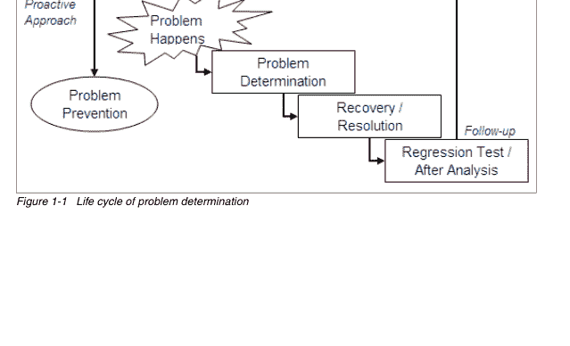

图 1-1 问题定位生命周期

## 1.1 主动方法以最小化问题影响

主动应对问题是重要的方法论。

有时，由于缺乏准备，我们无法快速应对问题。这会影响问题的解决，并可能在客户系统中留下风险。一些可以避免的问题示例，从而最小化对客户系统的影响，包括没有 `dbginfo.sh` 包、没有性能数据、没有独立转储磁盘等。

在设计、系统管理和为问题做准备工作时，最小化问题的影响，并通过在问题发生时快速响应来缩短总周转时间（TAT）。快速响应需要在设计和测试阶段进行准备。

### 1.1.1 设计和实施阶段

在设计和实施阶段应考虑以下三点：

- 如果存在单点故障（SPOF），为其恢复做准备

- 监控系统设计以日常收集信息

- 安装和设置紧急信息收集

请注意，在测试后期或系统集成后实施这些措施很困难，因此提前为故障排除做计划很重要。

#### 为 SPOF 故障恢复做准备

基本上，尽可能在每个组件上采用冗余配置。这对于 Linux on System z 非常重要，因为可以改进可用性。但如果存在任何单点故障（SPOF），请为这些问题准备快速恢复程序。例如，如果 OSA 不是冗余的，则需要网络设备的恢复程序。

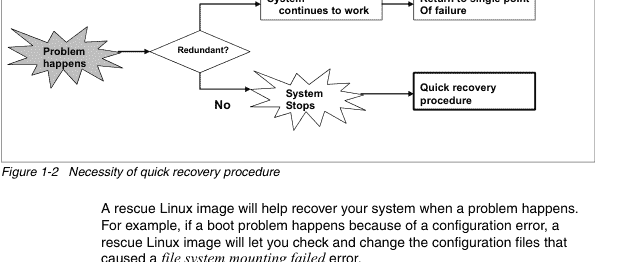

图 1-2 快速恢复程序的必要性

救援 Linux 映像将在问题发生时帮助恢复系统。例如，如果由于配置错误导致启动问题，救援 Linux 映像将允许您检查并修改导致文件系统挂载失败错误的配置文件。

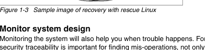

图 1-3 使用救援 Linux 恢复的示例图像

#### 监控系统设计

监控系统在发生故障时也会对您有所帮助。例如，安全追溯性对于发现误操作非常重要，不仅限于安全

故障事件。操作员可以通过监控关键消息警报来察觉问题。

性能监控数据有助于查找服务级别下降的原因。

表 1-1 是系统管理监控需求的示例模板。

请注意，这些并非所有客户的必需项。您可以根据客户的 [服务等级协议（SLA）](https://example.org/SLA) 讨论这些事项。

##### 表 1-1 监控内容模板

| 类别 | 子类别 | 项目 | 描述 |

| :--- | :--- | :--- | :--- |

| A) 数据收集 | A-1) 数据内容 | A-1-1) 安全追溯 | 收集能够追溯越权操作（谁、何时、何地、何事）的日志。 |

| | | A-1-2) 容量管理 | 收集硬件、操作系统和进程的性能数据，以便分析容量趋势并为未来规划做准备。 |

| | | A-1-3) 问题追溯 | 收集每个问题和故障事件的时间线日志，有助于问题分析。 |

| | A-2) 自动保留 | | 在指定时间内自动存储更正后的数据。自动删除过期数据。 |

| | A-3) 数据处理 | | 对于性能数据，应便于处理以供分析，例如，组织在 Excel® 电子表格中。 |

| B) 系统监控 | B-1) 监控内容 | B-1-1) 性能监控 | 基于阈值监控性能状态（例如，系统资源过度消耗）。 |

| | | B-1-2) 服务监控 | 监控服务和系统的状态。如果这些服务停止或状态变差，向操作员发出警报。 |

| | | B-1-3) 状态转换监控 | 向操作员发出关于状态转换的警报（例如，冗余系统接管，批处理作业成功结束）。 |

| | B-2) 用户界面 | | 操作员可以通过图表等 easily 监控。 |

| | B-3) 服务持续时间 | | 监控 24x365。

`提示：` 在讨论内容监控的同时，我们还讨论了如何控制命令响应，包括错误消息（例如来自 Linux 命令和 shell 脚本、z/VM 命令以及 REXX 的消息）。命令响应是识别系统中可能正在发生某事的起点。我们建议不要丢弃命令响应，而是将其重定向到 `/dev/null`。

### 故障排除信息收集的准备工作

在这里，我们讨论可能需要哪些紧急信息。我们建议准备一个脚本，用于收集任何问题的紧急信息。表 1-2 中列出的脚本是用于收集故障排除信息的脚本示例。您的脚本应包含 `dbginfo.sh`，以及保存系统日志（`syslog`）。

您可能需要在此阶段提前准备信息收集。您应该考虑进行的准备工作包括：

- 安装 Linux 工具包的包选择。

- 准备好磁盘设备，以便在需要时执行独立转储。

- 了解数据收集（核心转储等）所需的设置。

- 如果您打算在 z/VM 下运行脚本，还应该启用 `perfsvm` 用户，使其能够收集 z/VM 监控原始数据，并遵循 z/VM 团队在以下地址提供的建议：http://www.vm.ibm.com/perf/tips/collect.html

#### 表 1-2 常用问题诊断工具的包

| 命令 | 包 |

| :--- | :--- |

| `dbginfo.sh` | RHEL4.4（或更高版本）上的 s390utils，SLES 上无需安装 |

| `gcore`, `gstack` | `gdb` |

| `strace` | `strace` |

| `tcpdump` | `libpcap` |

| `lsof` | `lsof` |

| `iostat`, `sar` | `sysstat` |

| `ps`, `top`, `vmstat` | `procs` |

本书的其他章节描述了表 1-2 中列出的每个组件和工具。

##### 1.1.2 测试阶段

您可以在测试阶段排练问题并练习收集信息。这两个操作将提供有价值的信息：

- 故障模拟测试

- 练习收集信息

###### 故障模拟测试

在测试阶段应尽可能经常进行故障测试。您可以检查每个潜在问题的行为、日志和恢复程序。如果目标组件是冗余的，您应该检查它们是否正常工作。这些测试可能包括硬件、软件和应用故障。针对物理组件更换程序的测试也很有帮助。

故障测试时检查以下项目：

- 系统行为

  - 系统行为与预期相同。

  - 影响范围与预期相同。

- 资源使用情况

  - 资源使用量与预期相同。

  - 资源使用量的增加会产生副作用：

    - 自身应用程序性能下降

    - 共享相同资源的其他系统性能下降

    - 导致关键问题（例如，CPU 过载、I/O 挂起、抖动等）

- 冗余检查

  - 系统按预期继续运行或恢复。

- 错误代码和消息

  - 错误代码和消息与预期相同。

  - 选择需要监控的消息。

  - 关键消息在消息和代码手册中有描述。

- 恢复程序

  - 恢复程序正确工作。

表 1-3 表示可以在测试阶段练习的一些潜在问题。对于每个问题，您应该询问的问题是：如果发生这些情况，预期行为是什么。您希望看到日志会说什么，给出了哪些错误代码和消息，以及您是否以及如何从这些事件中恢复。

###### 表 1-3 测试用例示例

| 网络 | | 服务器 | |

| :--- | :--- | :--- | :--- |

| | OSA 电缆拔出/插入 | | Linux 宕机 |


| | OSA chpid 离线 | | LPAR 停止 |
| | 物理交换机故障 | | z/VM 用户宕机 |
| | VSWITCH 故障 | | z/VM 宕机 |
| 存储 | 光纤电缆拔出/插入 | 磁带 | 驱动器故障 |
| | 通道 chpid 离线/在线 | | 库故障 |
| | Director/SAN 交换机故障 | 软件 | 进程故障 |
| | RANK 故障 | | 应用程序故障 |

### 练习收集数据

练习收集故障排除数据非常重要。您可以检查所需信息是否正确收集。此外，您需要能够准备一个快速程序来收集必要信息。您可能希望在之前提到的故障测试期间执行这些排练。

我们建议在排练期间确认以下内容：

- 操作
  - 练习使用 IBM z/VM Performance Toolkit（参见第 38 页的 2.2，“IBM z/VM Performance Toolkit”）和 Linux `sysstat` 包（参见第 62 页的 3.1.3，“系统状态（sysstat）工具”）。例如，您可以创建一些 z/VM 原始监控数据并将其读取到 IBM z/VM Performance Toolkit 中。
- 收集的数据是正确的。
- 额外的系统负载 - 您的系统应该拥有足够的以下内容，以便收集您需要的数据：
  - CPU 和内存
  - 文件大小（足够的文件系统空间）
  - 持续时间
- 了解紧急情况的联系人和阵型。
- 组织系统信息
  - 操作系统、微码、中间件、包、PTF 等的版本列表
  - 硬件配置图

在系统处于活动状态和故障状态时执行排练。这将帮助您了解系统的正确状态以及故障情况下的差异。这些差异可能有助于您在问题发生时快速轻松地确定原因。

## 1.2 问题诊断基础

问题诊断是找出问题是什么以及为什么发生的过程。

- 问题是什么？
  - 理解问题是什么，并与团队（包括 IBM 员工和客户）达成共识。
  - 收集与故障组件相关的正确信息。
- 为什么发生问题？
  - 使用支持信息（日志、跟踪等）指定问题的原因或触发因素。
  - 逐步确定原因，并以各种模式收集信息。
  - 确定复现问题的最有效过程，并找出可复现问题与不可复现问题之间的差异。

这些需要与问题组件相关的正确支持信息。有时您需要复现并收集更多信息。客户要求尽快恢复其系统。然而，恢复后的系统将不会提供有效信息。快速响应和收集正确的信息非常重要。在正确时间收集并适当组织的信息可以加快分析速度。

### 1.2.1 基本问题诊断步骤

在问题发生后的瞬间，您必须了解问题是什么及其对客户的影响，收集所需信息，并决定如何分析这些信息。必须确定分析的优先级。当然，恢复是始终是一项最高优先级的任务，而规避是次要的，但有时在确定原因之前无法做到这些。

分析阶段应包括对原因和解决方案的探索。您应尝试复现该问题。问题复现可能会直接显示问题的原因，或者提供关于原因的某些重要线索。它还将使收集更多信息变得更容易。

图 1-4 展示了问题确定的基本步骤。有时在分析过程中的某些点，有必要将问题升级至每个支持团队，如图 1-4 所示。报告（如图所示）不仅报告结果，还包括关于后续行动的讨论。

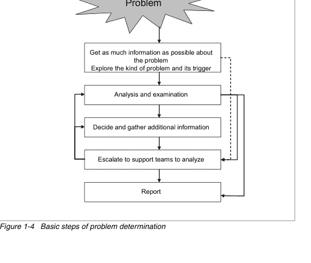

图 1-4 问题确定的基本步骤

按照图 1-5 中所示的顺序确定哪个组件发生故障。首先查看应用程序或中间件，然后查看实际硬件，以确定故障的来源。

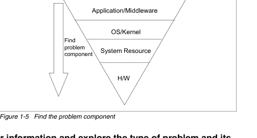

图 1-5 查找故障组件

### 1.2.2 收集信息并探索问题类型及其触发因素

在问题发生后，您应尽快收集和整理问题确定数据。相关各方应就收集哪些数据达成共识。这是问题确定的第一步。通常，问题的原因可以在这一步骤中找到。

> **重要提示：** 一旦发生任何问题，请立即执行 `dbginfo.sh`。如果 Linux 崩溃或挂起，请获取独立转储。

#### 关于问题的信息

尽可能多地收集有关问题的信息，例如：

- 问题的完整描述
- 问题的日期和时间
- 问题出现在哪个系统，以及是否出现在多个系统上
- 系统环境——硬件、软件（含补丁级别）、网络
- 您周围正在发生的其他工作
  - 是否有人在您周围执行可能引发问题的操作（如网络维护停机）？
- 是什么让您决定它是一个问题（影响/日志）
  - 应引用命令或脚本日志。
- 当前状态（持续的问题、已恢复或已规避）
  - 是否有恢复计划或规避计划？
- 范围（多系统或非多功能）——共同术语或差异
- 与日常操作的区别（负载、操作顺序等）
- 过去结果
  - 目标操作是否有类似结果，还是这是一种新行为？
  - 与之前的结果相比，是否存在变化，还是完全相同？
- 相同/类似问题
  - 之前是否发生过相同或类似的问题？
  - 如果之前发生过，请检查必要的信息、规避方法和恢复程序。
  - 过去发生过并且已经解决，我们能否修复问题以防止其再次发生？

#### 影响

应确定问题对以下方面的影响：

- 应用程序
  - 用于生产/用于开发/在实施中
- 业务
  - 系统服务的重要性
  - 状态（已恢复、部分故障或完全故障）

#### 应收集的信息

以下是您应收集的有关问题的信息列表，以帮助您确定问题所在：

- 定义问题的症状（即，启动失败、网络断开、I/O 故障）
- 查找错误组件（硬件、内核、应用程序等）。
  - 我们可能有机会根据症状、错误消息或其他迹象快速找到错误组件。
- 确认当前系统状态。
  - 在恢复之前比在恢复之后能收集更多信息。如果数据被封装或仅存在于内存中，重启可能会清除它。
- 当前系统拓扑结构（硬件、软件、网络）。
- 决定应收集哪些信息。
  - 最初，我们应该为任何问题收集通用信息。如果难以确定必须收集的内容，请联系您的支持团队。

#### 调查策略

与您的团队成员确定一项调查策略。您需要：

- 事先就应收集哪些内容以及何时必须进行该收集达成共识。
- 就恢复、规避、原因等类型达成共识。
- 安排一次数据收集演练。

### 1.2.3 问题分析

在收集了有关问题的所需信息后，您必须检查并分析这些数据，以：

- 确定问题的原因。
- 确定复现问题的方法。
- 确定问题的规避方法（或变通方法）。

**提示：** 在开始分析之前，请确认所收集数据的有效性。应解包封装的信息，并确定其是否可读，或者是否需要使用工具进行格式化才能读取。

#### 确定问题的原因

在决定如何复现问题或规避问题之前，您将必须确定问题的原因。确定问题原因的一些方法包括：

- 根据问题描述和收集的信息指定故障组件。
- 在 Bugzilla (`http://www.bugzilla.org`) 或您的特定硬件和软件技术库中搜索有关该问题的信息。对于 Linux 故障，您还可以通过网络搜索找到有关您问题的信息。
- 调查每个组件的原因。
- 确定是否需要联系支持团队。

#### 确定复现问题的方法

能够复现问题是问题确定和问题解决的一个重要方面。要复现问题，您必须：

1. 确定是什么触发了问题。
   - 是特定命令吗？
   - 是特定交易吗？
   - 是特定操作吗？
   - 它是否发生在系统启动、停止或重启期间？
   - 最近是否对系统应用了任何更改？
2. 检查围绕问题的条件。
   - 检查资源使用情况，如 CPU、内存、I/O 和网络。
   - 检查并行运行的其他交易或进程。
3. 准备测试系统。
   - 使用测试系统。
   - 暂时使用生产系统。
   - 通过复现问题来确认对系统的影响。
4. 使用相关条件和触发器进行测试。

如果问题无法复现，请参阅第 16 页的 1.2.6 “如何处理复杂问题”。

#### 确定规避方法

规避方法是问题的临时解决方案或变通方法（例如，暂时更改操作或修改程序或 shell 脚本）。基本上，它避开了问题的触发因素。如果问题已经被发现，快速恢复程序也是规避方法的一部分。

接受规避方法可能会带来一些风险并导致额外的工作量。您需要与客户讨论此选项。必须定义通过更改程序或脚本来改变操作和工作负载的影响。

注意：有时变通方法可能是实际解决方案。

#### 收集额外信息

有时您可能需要根据额外的信息逐步调查问题。我们需要根据当前调查状态定义所需的信息。在分析问题时，可能需要确定需要更多信息。

### 1.2.4 收集额外信息

在对数据进行分析后发现您没有足够的问题信息后，可能需要收集有关客户环境或类似测试环境的额外信息。您可能需要与团队达成共识，以确定当前调查状态并检查收集更多信息对系统的影响。

#### 共识术语

在收集额外信息之前，您的团队必须就以下问题达成共识：

- 使用当前信息是否发现了任何与问题相关的情况？
- 继续调查问题需要哪些其他信息？
- 收集额外信息需要做什么？
  - 您是否需要复现问题以收集额外数据？请参阅第 14 页的“确定复现问题的方法”。运行测试并收集额外信息。
  - 在日常操作中设置收集信息的工具（设置对生产的影响）。
- 应如何收集额外数据？


- 运行复现测试，查看问题是否再次发生。
- 如果未找到问题，在系统中设置收集信息的工具。

#### 影响

您必须理解收集额外信息的重要性，以及这种信息收集对系统的影响。

- 您可能需要独占使用系统以运行复现测试。
  - 安排使用系统的时间。

### 1.2.5 升级至支持团队以进行分析

如果您无法找到问题的原因，可能需要联系支持团队进行进一步分析。团队会要求您提供额外的信息。他们可能需要这些信息：

- **频率**
  - 问题发生的时间（日期）
  - 问题发生的频率
- **触发条件**（问题发生前是否有先兆事件？）
  - 问题发生时正在发生什么？
  - 最近系统是否发生了变更？
- **可复现性**
  - 复现步骤。
- **所需响应**
  - 调查原因、避免方法、恢复方法及其优先级。

> **注意：** 收集额外信息有时会导致系统负载过重。确保所有参与系统维护的人员都理解收集额外信息的含义和重要性。
>
> 在收集信息时，需考虑测试带来的额外系统负载以及收集信息所需的时间。您可能需要更改系统中某些工具的设置，这些更改对系统的影响包括：
> - 系统额外负载（开销）
> - 数据大小（跟踪、日志等）
> - 对操作的影响
>   - 操作范围、配置、脚本的变化
>   - 问题复现期间的问题检测方法

### 1.2.6 如何处理复杂问题

问题复现有助于确定问题的确切原因。如果问题无法复现，则难以找到原因。收集足够且准确的信息非常重要。

理想情况下，您应尝试在测试环境中复现该问题。如果您知道触发条件，围绕触发条件进行自动化和持续操作是一个良好的起点。自动化测试系统允许您监控问题发生，并在出现问题时停止测试。自动化数据收集也很有帮助。

您的团队应决定测试应持续多长时间，并准备不同类型的测试用例。如果某一类型在指定时间内无法复现问题，请切换到另一种类型的测试用例。

在我们的示例测试用例中，`LVM` 命令挂起。在这种情况下，您应该：

1. 准备一个具有相同内核、`LVM` 和 `DM` 版本的 Linux 测试系统。
2. 创建一个运行 `LVM` 命令的脚本。该脚本不包含用于后台执行的“`&`”，因此如果 `LVM` 命令挂起，脚本将停止。
3. 设置核心转储（`core dump`）。
4. 以两种模式运行脚本：
   - 串行
   - 并行
5. 当脚本并行运行时，问题得以复现。这证明该问题是该版本 `LVM` 的一个规格问题。变更操作以不并行运行 `LVM` 命令，以确保您对问题的理解是正确的。

#### 设置工具以收集信息

您用于收集数据的工具应包括转储、`EREP` 报告和跟踪。获取独立转储会对服务产生影响，因此确保您向团队沟通您的需求及必要性。

如果未找到故障组件，请为所有相关组件设置监控工具，不仅用于收集信息（应用、中间件、操作系统、系统资源、性能），而且如果问题再次发生，请收集与问题相关的数据。

## 1.3 问题解决及后续操作

在确定问题后，您必须修复该问题。应用补丁或更改配置和操作可能会产生副作用。在应用补丁或进行配置更改之前，请确认问题将由此修复。确认不会产生副作用。确保您更新了文档。

在应用修复措施（补丁或更改）之前，我们建议进行预应用测试，以确认问题将无副作用地被修复。该测试应包括尝试复现问题的测试。如果问题发生频率不高，您需要确定需要等待多长时间问题才会再次发生，以确保您确实修复了它。

对于应用补丁或程序修改，您需要在该生产系统或类似生产系统的测试系统中对其进行测试。为了确认问题解决，复现测试应显示明确的结果。

### 1.3.1 对其他系统的扩展检查

检查您所有的其他系统，以确保相同的问题不会发生。具有相同版本、配置和操作的系统可能存在相同的问题。

以下列表提醒您需要关注其他系统的哪些事项：

- 问题条件。检查是否存在其他导致相同问题的条件。检查：
  - 软件版本
  - 事务类型
  - 操作
  - 配置
- 系统扫描
  - 扫描所有可能存在相同条件的系统。
- 应用修复的时间表。
  - 如果系统存在相同问题的可能性很高，请尽快应用修复。
  - 如果可能性较低，请将修复的应用安排在下一个维护周期，或确定是否无需应用修复也是一种选择。

### 1.3.2 更新

在变更应用到系统后，您需要记得更新您的文档、监控程序和问题确定操作，以反映这个新问题。

该文档可能包括您的消息和代码手册。如果应用修复对相同的所有系统产生影响，您应将其包含在文档更新中。丢失该信息可能导致其他问题并使问题确定变得困难。

验证应用修复是否没有产生任何新消息。如果有新消息，例如系统负载增加，请确保您记录并讨论系统的新阈值。

此外，请更新以下内容：

- 新消息或监控消息的变更
  - 添加或更改目标消息（`TEC`、`控制台`、`AOEMF`、`IBM Director` 等）。
  - 添加或更改消息和代码手册。
- 系统额外负载
  - 更改阈值。
  - 添加新的监控内容。
  - 您可能需要从不再必要的监控内容更改为监控新的内容。

在确认问题解决后，回顾您的问题确定操作并相应地更新您的程序。您可能需要更新您的问题确定程序。您可能需要进行的一些更新包括：

- 系统环境
  - 您是否应运行复现测试？
  - 监控系统是否发现了问题？
  - 系统的自动化程度是否足够？
- 问题发生后的即时操作
  - 为这个问题准备的运维手册是否正确？
  - 操作员是否知道正确的程序？
  - 初始操作是否有时间损失？
- 信息收集
  - 是否遗漏了任何问题确定信息？
  - 用于收集信息的资源是否足够？
    - 运维人员
    - 自动化脚本
- 系统资源
- 报告
  - 所有报告是否都包含与每行报告相关的正确信息？
    - 信息缺失
    - 不必要的信息
  - 报告时间是否正确？
  - 与支持团队联系的时机是否正确？

## 1.4 摘要

在本章中，我们描述了一种在 Linux on System z 环境中确定问题原因的方法论。找到问题原因以便更正它的第一步是收集尽可能多的关于问题周边情况的信息。尽可能多地写下关于问题的信息。检查问题是仅在一个系统上发生还是在您的许多系统上发生。确定您或其他人对系统所做的更改是否刚好在问题开始之前发生。

此外，检查问题发生的频率以及它是否是可以复现的问题。您必须拥有一个尽可能接近生产系统的测试系统，以便您可以尝试在那里复现问题。

在本书的其余部分，我们将继续探讨问题确定方法以及 z/VM 和 Linux on System z 上可用于帮助您快速找到问题原因并带来快速解决的工具。

## z/VM 的问题确定工具

在本章中，我们将展示可用于 z/VM 环境中的问题确定和数据收集的工具。在问题确定方面，Linux 和 z/VM 上都有可用的工具。根据问题领域或类别，你需要决定使用哪些工具来帮助确定问题。

由于 Linux 作为 z/VM 的客户操作系统运行，在资源完全由 z/VM 控制的问题确定领域中，基于 Linux 的工具可能存在一定程度的误差。目前，我们建议使用基于 z/VM 的工具或 z/VM 与基于 Linux 的组合工具，以获取关于问题的更细粒度信息。另一方面，对于调试应用程序以及与内核或进程相关的问题，基于 Linux 的工具通常是你最好的选择。

首先，我们将讨论一些 z/VM 系统工具。我们提供一些可用的 CP 命令，以协助你收集有关系统状态的一些基本信息。

此外，我们将展示 IBM z/VM 性能工具包（Performance Toolkit）的功能，并演示如何使用它进行问题确定。我们还概述了 Omegamon 的功能。

### 2.1 z/VM 系统工具

与 Linux 类似，z/VM 操作系统也有命令用于显示系统信息以及系统性能信息。这些命令是控制程序（CP）系统命令。在本节中，我们提供一些你可以使用的 CP 命令来收集有关系统状态的基本信息。

#### 2.1.1 收集技术配置信息

作为信息收集技术的一部分，收集技术配置信息。要收集你的发布级别和服务级别信息，请使用命令 `q cplevel`，如图 2-1 所示。

```
q cplevel
z/VM Version 5 Release 3.0, service level 0703 (64-bit)
Generated at 03/13/08 07:41:44 EDT
IPL at 03/24/08 14:25:10 EDT
```

图 2-1 `q cplevel` 命令的示例输出

其他有助于收集环境配置信息的命令包括：

- 网络配置
  - `q lan`
  - `q nic`
  - `q vswitch`
  - `q v osa`
- 通用及 DASD
  - `q set`（见图 2-2。）
  - `q v dasd`


```
q set
MSG ON , WNG ON , EMSG ON , ACNT OFF, RUN OFF
LINEDIT ON , TIMER OFF , ISAM OFF, ECMODE ON
ASSIST OFF , PAGEX OFF, AUTOPOLL OFF
IMSG ON , SMSG OFF , AFFINITY NONE , NOTRAN OFF
VMSAVE OFF, 370E OFF
STBYPASS OFF , STMULTI OFF 00/000
MIH OFF , VMCONIO OFF , CPCONIO OFF , SVCACCL OFF , CONCEAL OFF
MACHINE XA , SVC76 CP, NOPDATA OFF, IOASSIST OFF
CCWTRAN ON, 370ACCOM OFF, TIMEBOMB IDLE
```

图 2-2 `q set` 命令的输出

#### 2.1.2 indicate

`indicate` 命令是获取 z/VM 系统整体状态信息的极佳来源。`indicate` 命令的响应会根据发出该命令的虚拟机的 CP 类而异。本书中的示例假设你从具有适当 CP 类的虚拟机（如 MAINT 用户 ID）发出命令。

使用 `indicate load` 显示宿主系统的操作负载：

- 系统中每个在线处理器的使用百分比和 CPU 类型
- 关于扩展存储的信息
- 关于迷你磁盘缓存的信息
- 分页速率
- 调度、合格和休眠列表中的用户数量

在图 2-3 中查看 `indicate` 命令的响应。

请注意，Load 是 `indicate` 命令的默认操作数。

```
indicate load
AVGPROC-0004
XSTORE-000004/SEC MIGRATE-0000/SEC
MDC READS-000001/SEC WRITES-000001/SEC HIT RATIO-100%
PAGING-2/SEC STEAL-00%
Q0-00001(00000)                      DORMANT-00022
Q1-00001(00000)    E1-00000(00000)
Q2-00000(00000)    EXPAN-001 E2-00000(00000)
Q3-00002(00000)    EXPAN-001 E3-00000(00000)

PROC 0000-001% CP    PROC 0001-000% CP
PROC 0002-000% CP    PROC 0003-000% CP

LIMITED-00000
Ready; T=0.01/0.01 11:38:16

RUNNING   VMLINUX8
```

图 2-3 `indicate load` 命令

使用 `indicate paging` 执行以下操作：

- 显示处于页面等待状态的虚拟机列表。
- 显示所有系统用户的页面驻留数据。

使用带有 `wait` 操作数的命令来识别当前处于页面等待的虚拟机，并显示每个虚拟机在辅助存储和扩展存储中分配的页数。这是默认行为。

当 `indicate queues` 命令显示系统中相当大比例的活跃用户持续处于页面等待状态时，请使用 `paging wait`。

当带有 `all` 操作数发出时，该命令显示系统中所有用户的页面驻留数据。图 2-4 展示了 `indicate paging wait` 命令的一个示例。

```
indicate paging wait
No users in page wait
Ready; T=0.01/0.01 15:57:33
indicate paging all
MAINT 000000:001396 TEACHOR2 008162:054438 LXORINST 001847:010210
TEACHOR1 020713:241153 LNXMAINT 000000:00175 LNXINST 022184:080382
FTPSERVE 000000:001412 TCPIP 000226:002578 USER15 000000:000875
TCPM AINT 000000:002000 USERI 000000:000887 EREP 000000:001233
OPERSYMP 000000:001266 DISKACNT 000003:001227 LOGNSYSC 000000:000000
DTCVSW2 000004:002518 DTCVSW1 000000:002566 MSERVR 000000:001181
VMSERVU 000000:001181 VMSERVS 000000:001326 OPERATOR 000000:000001
LXOR4 000000:000000 LXOR1 000000:000001 PERFSVM 000000:000000
LXOR3 002022:000001 LXOR14 000000:000901
Ready; T=0.01/0.01 15:57:41

RUNNING VMLINUX8
```

图 2-4 `Indicate paging` 命令

使用 `indicate queues` 命令（见图 2-5）按优先级顺序显示调度列表和合格列表的当前成员。使用 `exp` 操作数发出时，它显示有关正在处理事务的用户扩展信息。

```
indicate queues
MAINT      Q1 R00 00000686/00000666 LXORINST      Q1 PS 00515332/00515287
LXOR1      Q1 PS 00137239/00137193 LXOR3         Q3 PS 00115756/00138801
TCPIP      Q0 PS 00001026/00000447
Ready; T=0.01/0.01 16:02:32
indicate queues exp
MAINT      Q1 R00 00000686/00000666 .I.. .0005 A00
LXOR3      Q3 PS 00115756/00138801 .D.. 99999 A02
TCPIP      Q0 PS 00001026/00000447 .I.. 99999 A03
Ready; T=0.01/0.01 16:02:34

RUNNING    VMLINUX8
```

图 2-5 `Indicate queues` 命令

用户 ID 后面的第一列指示用户 ID 的列表状态：

- Q0：调度列表，并豁免合格列表延迟
- Q1：调度列表，并作为 E1 用户输入
- Q2：调度列表，并作为 E2 用户输入
- Q3：调度列表，并作为 E3 用户输入
- E1：E1 合格列表
- E2：E2 合格列表
- E3：E3 合格列表
- L0：限制列表，并豁免合格列表延迟
- L1：限制列表，且用户作为 E1 用户输入调度列表
- L2：限制列表，且用户作为 E2 用户输入调度列表
- L3：限制列表，且用户作为 E3 用户输入调度列表

关于 `indicate` 命令以及如何解释对该命令的响应的更多信息，可参阅手册 *z/VM CP Commands and Utilities Reference*（z/VM CP 命令和实用程序参考），SC24-6081-05。

#### 2.1.3 query srm

要概览 CP 调度器使用的系统级参数，我们使用 `query srm` 命令。一些问题可能由此系统资源参数设置不当引起。图 2-6 中可以看到 `query srm` 命令的响应。

```
q srm
IABIAS : INTENSITY=90%; DURATION=2
LDUBUF : Q1=100% Q2=75% Q3=60%
STORBUF: Q1=125% Q2=105% Q3=95%
DSPBUF : Q1=32767 Q2=32767 Q3=32767
DISPATCHING MINOR TIMESLICE = 5 MS
MAXWSS : LIMIT=9999%
...... : PAGES=999999
XSTORE : 0%
Ready; T=0.01/0.01 11:42:45

RUNNING VMLINUX8
```

图 2-6 `query srm` 命令

关于如何设置和调整 srm 参数的更详细信息，请参阅 *Linux on IBM System z: Performance Measurement and Tuning*（Linux on IBM System z：性能测量与调优），SG24-69261。

#### 2.1.4 query alloc page

要检查系统可用和已使用的分页空间量，请使用 `query alloc page` 命令。长期高比例的分页空间使用率可能会导致性能问题，如果分页空间不再可用，还可能导致 ABEND。

> **注：** 当大约 90% 的分页空间被使用时，z/VM 会警告分页空间问题。

图 2-7 提供了 `query alloc page` 命令的一个示例。


```
q alloc page
        EXTENT    EXTENT TOTAL  PAGES  HIGH  %
VOID    RDEV    START    END   PAGES  IN USE PAGE USED
------  ----    ------   ------ ------ ------ ------ ---
LX8PAG  CF33      1     3338 600840 280359 597573 46%
                     ------ ------   ------
SUMMARY                 600840 280359     46%
USABLE                  600840 280359     46%
Ready; T=0.01/0.01 13:45:38
                              RUNNING  VMLINUX8
```

图 2-7 `Query alloc page` 命令

#### 2.1.5 VM trace

如 3.2.2 节“何时应运行跟踪”（第 82 页）所述，有时开始跟踪比生成转储更好。你可能会被 IBM 要求

### 软件支持

为了调查问题而运行跟踪。本文描述了如何执行此操作，并提供了一个示例。解释此跟踪超出了本书的范围，但当 IBM 软件服务要求您提供跟踪以调查问题时，您需要知道如何生成跟踪。要在 z/VM 中设置和控制跟踪的执行，我们可以使用 CP 命令 `trace`。

虚拟机跟踪功能允许您跟踪或追踪在虚拟机使用期间发生的几乎任何事件。例如，您可以跟踪指令、I/O 中断、分支以及对存储的更改。您可以将跟踪限制在指定的存储范围以及影响特定设备的事件。

每个被跟踪的事件都会生成一条跟踪条目，这是一条命令响应，您可以将其发送到您的虚拟控制台、虚拟打印机，或两者。跟踪条目由关于该事件的重要信息组成。您可以使用跟踪条目来分析虚拟机的操作并调试问题。

在使用 `trace` 命令之前，您必须了解跟踪陷阱（trace trap）和跟踪集（trace sets）的含义。

- 跟踪陷阱是一个控制单元，允许您告诉 CP 您要跟踪哪个事件以及您希望跟踪该事件的条件。
- 跟踪集是一个由一个或多个同时激活的跟踪陷阱组成的集合。要跟踪不同类型的事件，您可以在不同的跟踪集之间传递控制权。跟踪集也可以不包含任何跟踪陷阱，在这种情况下，该跟踪集被称为空跟踪集（null trace set）。您可以使用空跟踪集来暂时停止跟踪。

在您决定使用 `trace` 后：

1. 选择您想要跟踪的事件。
2. 为跟踪集命名并创建适当的陷阱。
3. 运行您想要跟踪的程序。您可以跟踪在虚拟机中运行的任何内容。根据需要修改现有的跟踪集或创建新的集。

在我们的示例中，我们要跟踪发生在存储位置 `40000` 和 `41000` 之间的所有指令。我们不希望 CP 在捕获事件时停止虚拟机。设置跟踪陷阱的命令如图 2-1 示例所示。由于跟踪可能会产生许多行消息，我们应谨慎收集所有消息以便进一步详细调查。因此，我们使用图 2-1 示例第二行中加粗显示的命令对流控制台消息进行了 spool（缓冲）。随后，我们使用 `q trace` 命令检查了跟踪陷阱的设置。

#### 示例 2-1 trace 命令的示例

```
#cp trace instruction from 40000-41000 run
#cp spool cons * start
#cp q trace
```

```
NAME INITIAL    (ACTIVE)

1   INSTR PSWA 00040000-00041000
    TERM  NOPRINT RUN   SIM
    SKIP 00000 PASS 00000 STOP 00000 STEP 00000
    CMD   NONE
```

现在跟踪已激活，我们发出图 2-8 中显示的命令。我们加载 `vmcp` 模块，该模块允许我们从 Linux 系统的 SSH 会话向 CP 发送命令。然后我们使用 `vmcp` 模块发出了两个 `cp query` 命令。

```
[root@user12 /]# modprobe vmcp
[root@user12 /]# vmcp q n
TEACHOR1 - DSC , USER13 -L0004, LXOR2 -L0008, PERFSVM - DSC
OPERATOR - DSC , TEACHOR2 - DSC , LXOR3 - DSC , LXORINST - DSC
LXOR4 - DSC , LNXINST - DSC , TCPIP - DSC , DTCVSW2 - DSC
DTCVSW1 - DSC , VMSERVR - DSC , VMSERVU - DSC , VMSERVS - DSC
OPERSYMP - DSC , DISKACNT - DSC , EREP - DSC , USER12 -L0003
VSM - TCPIP
[root@user12 /]# vmcp q dasd
DASD 0111 9330 (VDSK) R/W 512000 BLK ON DASD VDSK SUBCHANNEL = 0003
DASD 0190 3390 LX8RES R/O 107 CYL ON DASD CF31 SUBCHANNEL = 000C
DASD 0191 3390 LX8UR1 R/W 10 CYL ON DASD CF36 SUBCHANNEL = 0004
DASD 019D 3390 LX8W01 R/O 146 CYL ON DASD CF34 SUBCHANNEL = 000D
DASD 019E 3390 LX8W01 R/O 250 CYL ON DASD CF34 SUBCHANNEL = 000E
DASD 0291 3390 LX8UR2 R/W 350 CYL ON DASD CF37 SUBCHANNEL = 0005
DASD 0300 3390 LXD43C R/W 10016 CYL ON DASD D43C SUBCHANNEL = 0006
DASD 0400 3390 LXD43D R/W 10016 CYL ON DASD D43D SUBCHANNEL = 0007
DASD 0401 3390 LX8W01 R/O 146 CYL ON DASD CF34 SUBCHANNEL = 0010
DASD 0402 3390 LX8W01 R/O 146 CYL ON DASD CF34 SUBCHANNEL = 000F
DASD 0405 3390 LX8W01 R/O 156 CYL ON DASD CF34 SUBCHANNEL = 0011
[root@user12 /]#
```

图 2-8 生成跟踪消息的 Linux 命令

跟踪消息在 3270 控制台上并行显示。见图 2-9。


```
0000000000040FFC' LGR B9040032 0000000000000015
0000000000000015 CC 2
0000000000041000' LG E3200DD8004 0000000000000DD8 CC 2
-> 0000000000040FA4' STMG EBCFF0780024 >> 000000000747BC48 CC 2
0000000000040FAA' TMLL A7F13F00 CC 2
0000000000040FAE' LGR B90400EF 00000000747BBD0
00000000747BBD0 CC 2
0000000000040FB2' BRZ A7840001 0000000000040FB4 CC 2
0000000000040FB6' AGHI A7FBFD8 CC 2
0000000000040FBA' LARL C010001ADAA3 CC 2
0000000000040FC0' LGR B90400C2 00000001E866BE8
00000001E866BE8 CC 2
0000000000040FC4' STG E3E0F0980024 >> 000000000747BC40 CC 2
0000000000040FCA' LG E3101000004 ???????????????? CC 2
0000000000040FD0' LG E3101020004 ???????????????? CC 2
0000000000040FD6' BASR ODE1 -> 00000000011C588' CC 2
0000000000040FDB' LTR 1222 CC 0
0000000000040FDA' LHI A7280000 CC 0
0000000000040FDE' BRNZ A7740006 0000000000040FEA CC 0
0000000000040FE2' OI 9601C01E >> 00000001E866C06 CC 1
0000000000040FE6' LHI A7280001 CC 1
0000000000040FEA' LGFR B9140022 0000000000000001
HOLDING VMLINUX8
```

### 图 2-9 3270 控制台上的跟踪消息

当您收集了足够的跟踪消息后，可以停止跟踪。如前所述，我们将显示在 3270 控制台上的控制台消息进行了 spool（缓冲），以便用于进一步分析。现在我们需要停止控制台 spool。执行此操作的命令如图 2-10 所示。使用 `cp close console` 命令，控制台消息将被收集并存储为 reader 文件。现在可以将此 reader 文件接收并存储为 CMS 文件以供分析，或发送到另一个系统，或两者兼有。

```
CP TRACE END
Trace ended

CP CLOSE CONS
RDR FILE 0046 SENT FROM USER12 CON WAS 0046 RECS 058K CPY  001 T NOHOLD NOKEEP

CP Q RDR ALL
ORIGINID FILE CLASS RECORDS  CPY HOLD DATE  TIME  NAME  TYPE  DIST
USER12  0045 V DMP 00048723 001 USER 03/24 14:17:32 VMDUMP  FILE  USER12
USER12  0046 T CON 00057686 001 NONE 03/25 15:56:39

RUNNING  VMLINUX8
```

### 图 2-10 停止跟踪

有关 `trace` 命令功能的更详细信息，请参阅手册 *z/VM CP Commands and Utilities Reference*，SC24-6081-05，以及 *z/VM Virtual Machine Operation*，SC24-6128-02。

## 2.1.6 vmdump

如果您的 Linux 客户机系统崩溃，请生成存储转储以进行进一步的问题确定。为此目的，我们使用 CP 命令 `vmdump`。

首先，我们需要一个足够大的迷你磁盘来存储转储。在我们的示例中，我们使用了存储中一个具有 1005000 个块的虚拟磁盘（VDISK）。我们选择以文件模式 B 访问该 VDISK。执行此操作的命令如图 2-11 所示。

```
def vfb-512 as 999 blk 1005000
DASD 0999 DEFINED
Ready; T=0.01/0.01 15:04:42
format 999 b
DMSFOR603R FORMAT will erase all files on disk B(999). Do you wish to continue?
Enter 1 (YES) or 0 (NO).
1
DMSFOR605R Enter disk label:
temp
DMSFOR733I Formatting disk B
DMSFOR732I 1005000 FB-512 blocks formatted on B(999)
Ready; T=0.01/0.01 15:04:50
RUNNING   VMLINUX6
```

### 图 2-11 准备用于存储转储的迷你磁盘

现在我们已经启用了迷你磁盘来存储转储。为了强制系统进入内核恐慌状态，我们使用了一个为此目的编写内核模块。在图 2-12 中，我们看到了我们 Linux 系统 LNXIHS 的 3270 控制台上的内核恐慌消息。现在发出 `vmdump` 命令，生成存储转储并将其存储为 spoolid 为 0017 的 reader 文件。

```
kpanic: module not supported by Novell, setting U taint flag.
kpanic: module license 'unspecified' taints kernel.
ITSO Kernel Panic test.
Invoking a Kernel Panic .. :-( 
Kernel panic - not syncing: Panic
HCPGIR450W CP entered; disabled wait PSW 00020001 80000000 00000000 208BC068

cp vmdump
Command complete

cp q rdr all
ORIGINID FILE CLASS RECORDS CPY HOLD DATE TIME NAME TYPE DIST
LNXIHS 0017 V DMP 00004503 001 NONE 03/24 15:10:24 VMDUMP FILE LNXIHS
LNXIHS 0013 T CON 00000338 001 NONE 09/28 07:57:51 LNXIHS
LNXIHS 0015 T CON 00000474 001 NONE 03/12 08:11:39 LNXIHS
LNXIHS 0014 T CON 00000900 001 NONE 12/08 11:41:29 LNXIHS

CP READ VMLINUX6
```

### 图 2-12 内核恐慌，使用 vmdump 命令生成转储

要将转储转换为允许进一步问题确定的形式，我们需要处理该转储。这意味着我们首先必须从读者池文件（reader spool file）中加载转储，然后将其存储为 CMS 转储文件。为此，请使用 CP 设施 `dumpload`。在图 2-13 中，您可以看到 `dumpload` 设施的执行过程及相应的系统消息。当转储以读者文件形式存储，且您希望将 `dumpload` 生成的输出存储到 a-disk 上时，您可以不带任何选项发出该命令。在我们的示例中，我们希望将处理后的转储文件存储在通过 filemode B 访问的迷你盘上。

```
dumpload spool outfile prb00000 b
HCPEDZ8183I DUMpload z/VM VERSION 5 RELEASE 3.0
HCPEDZ8150I PROCESSING DUMP TO PRB00000 DUMP0001 B
HCPEDZ8167I VIRTUAL MACHINE DUMP FROM z/VM V05R03M0
HCPEDZ8168I VIRTUAL MACHINE DUMP, FORMAT=FILE, DUMPID=
HCPEDZ8156A DO YOU WANT TO PROCESS THIS DUMP? (YES/NO)
yes
Ready; T=0.23/1.08 15:15:49
RUNNING   VMLINUX6
```

### 图 2-13 Dumpload 实用程序

随后，我们将处理后的转储文件从通过 filemode B 访问的迷你盘传输到另一个系统，以便进一步调查。该传输使用 FTP 完成。在图 2-14 中，您可以看到此次传输，包括所有必要的命令及相应的系统消息。


```text
ftp 9.12.4.244
VM TCP/IP FTP Level 530
Connecting to 9.12.4.244, port 21
220 (vsFTPd 2.0.4)
USER (identify yourself to the host):
root
>>>USER root
331 Please specify the password.
Password:
>>>PASS ********
230 Login successful.
Command:
bin
>>>TYPE i
200 Switching to Binary mode.
Command:
put prb0000.dump0001.b dplnxihs
>>>SITE VARrecfm
500 Unknown SITE command.
>>>PORT 9,12,4,89,4,4
200 PORT command successful. Consider using PASV.
>>>STOR dplnxihs
150 Ok to send data.
226 File receive OK.
182284288 bytes transferred in 3.671 seconds. Transfer rate 49655.21 Kbytes/sec.
Command:
quit
>>>QUIT
221 Goodbye.
Ready; T=0.33/0.73 15:24:45
RUNNING  VMLINUX6
```

图 2-14 通过 FTP 将处理后的转储文件传输到另一个系统

有关 `vmdump` 命令和 `dumpload` CP 设施的更多详细信息，请参阅手册 *z/VM CP Commands and Utilities Reference*, `SC24-6081-05`。

### 2.2 IBM z/VM 性能工具包

IBM z/VM 性能工具包（也称为性能工具包）旨在协助操作员和系统程序员或分析人员在以下领域开展工作：

- 全屏模式下的系统控制台操作

所提供的功能旨在简化管理 VM 系统的操作，从而提高操作员的效率和生产力。

- z/VM 系统上的性能监控

增强的实时性能监控器允许系统程序员监控系统性能并分析瓶颈。监控器中包含的功能以及数据显示方式均旨在提高系统程序员在分析系统时的生产力，并使新手也能高效使用此工具。性能工具包可以帮助系统程序员更有效地利用系统资源，提高系统生产力，并改善用户满意度。

IBM z/VM 性能工具包的功能包括：

- 自动监控多个关键性能指标，并在超过用户定义的阈值时通知操作员

- 特殊性能监控模式，带有以下监控显示：

  - 通用 CPU 性能

  - 系统和用户存储器的利用与管理

  - 通道和 I/O 设备性能，包括缓存数据

  - 详细的 I/O 设备性能，包括由真实磁盘包上特定迷你盘引起的 I/O 负载信息

  - 通用用户数据：资源消耗、分页信息、IUCV 和 VMCF 通信、等待状态、响应时间

  - 详细的用户性能，包括虚拟设备的状态和负载

  - 共享文件系统服务器的摘要和详细信息

  - TCP/IP 服务器的配置和性能信息

- Linux 性能数据 - 系统执行空间（SXS）性能数据

- 虚拟网络配置和性能数据

收集的性能数据还用于提供：

- 许多在通用 CPU 性能和存储利用率面板上显示的关键数字的再显示功能，允许浏览最近的测量值（最长可达十二小时）

- 图形历史记录图，可选择最多四个再显示变量，以简单图表形式呈现；如果存在图形数据显示管理器程序（`GDDM`®，5684-007 或 5684-168），也可以以 `GDDM` 图形形式呈现

- 图形变量相关性图（简单图表或 `GDDM` 图形），显示特定变量的值与另一变量值的相关性

**注意：** 在虚拟机控制台上生成图形需要 `GDDM`。但是，使用 WWW 接口通过 Web 浏览器生成图形时，无需额外软件。

供将来参考，累积的性能数据还可用于创建：

- 打印性能报告

- 简单的性能历史文件

- 扩展趋势文件

在容量规划中，磁盘上的历史文件可用于：

- 性能趋势图形

- 数值历史数据分析

#### 2.2.1 操作模式

性能工具包的操作模式包括：

- 基本命令模式（通常称为基本模式）是正常运行模式，允许输入 `CP` 和 `CMS` 命令。此模式会立即显示从 `CP` 接收的任何消息。

- 再显示模式。在基本模式下操作时创建的控制台日志可以在再显示模式下浏览，并且可以使用 `LOCATE` 功能搜索特定字符串（例如，`USERID`）。

- 性能监控模式显示由本机收集的数据关于 CPU、I/O 和用户性能的数据。它允许对 z/VM 系统进行实时性能分析。

- 远程性能监控模式显示由同一 VM 系统或其他 VM 系统上的另一台虚拟机的性能监控器收集的性能数据。

- 互联网接口允许通过标准 Web 浏览器检索和显示相同的性能数据。

- 监控数据扫描模式显示由 z/VM 系统创建的 `MONWRITE` 磁盘文件中的性能数据。

- 趋势文件扫描模式显示趋势文件（`FCXTREND` 磁盘文件）中的性能历史数据。

IBM z/VM 性能工具包是一个功能强大、覆盖面广、报告详细程度高且具备实时监控功能的工具。通过与 Linux 客户机通信并随后收集其数据，它能够生成硬件、LPAR、VM 和 Linux 层面的整合视图。

启动后，您应该看到一个类似于图 2-15 的窗口，顶部有一行标题，一条告知您程序维护级别的信息消息，一个命令输入行，以及显示 `PF` 键用法的底行。

```text
FCX001              Performance Toolkit for VM              Autoscroll 12
FCXBAS500I Performance Toolkit for VM FL530
FCXOMC772I SEGOUT data collection is active. Using segment: PERFOUT
FCXPMN446E Incomplete monitor data: SAMPLE CONFIG size too small
HCPMOF6229E Monitor event collection is already active.
HCPMOG6229E Monitor sample collection is already active.

Command ===>
F1=Help  F2=Redisplay  F3=Quit  F12=Return
```

图 2-15 IBM z/VM 性能工具包初始窗口

文档中将此初始窗口模式描述为基本模式。它允许您以与原生 `CMS` 不太不同的方式工作。为了获取有助于问题确定的信息，我们需要使用 IBM z/VM 性能工具包的性能监控模式。输入命令 `MON` 或 `monitor` 以开始以性能监控模式工作。您的窗口应类似于图 2-16。


```text
FCX124 Performance Screen Selection (FL530 ) Perf. Monitor
General System Data   I/O Data   History Data (by Time)
1. CPU load and trans.      11. Channel load       31. Graphics selection
2. Storage utilization      12. Control units      32. History data files*
3. Reserved                 13. I/O device load*   33. Benchmark displays*
4. Priv. operations         14. CP owned disks*    34. Correlation coeff.
5. System counters          15. Cache extend. func.* 35. System summary*
6. CPU IUCV services        16. DASD I/O assist    36. Auxiliary storage
7. SPOOL file display*      17. DASD seek distance* 37. CP communications*
8. LPAR data                18. I/O prior. queueing* 38. DASD load
9. Shared segments          19. I/O configuration   39. Minidisk cache*
A. Shared data spaces        1A. I/O config. changes 3A. Storage mgmt. data*
B. Virtt. disks in stor.     3B. Proc. load & config*
C. Transact. statistics      User Data               3C. Logical part. load
D. Monitor data              21. User resource usage* 3D. Response time (all)*
E. Monitor settings          22. User paging load*   3E. RSK data menu*
F. System settings           23. User wait states*    3F. Scheduler queues
G. System configuration       24. User response time*  3G. Scheduler data
H. VM Resource Manager       25. Resources/transact.* 3H. SFS/BFS logs menu*
I. Exceptions                26. User communication*  31. System log
K. User defined data*        27. Multitasking users*  3K. TCP/IP data menu*
                            28. User configuration*   3L. User communication
                            29. Linux systems*        3M. User wait states

标记有星号 (*) 的显示上可以找到指向相关或更详细性能数据的指针。

使用光标选择性能屏幕并按 ENTER
Command ===>
F1=Help F4=Top F5=Bot F7=Bkwd F8=Fwd F12=Return
```

### 图 2-16 IBM z/VM 性能工具包主屏幕

IBM z/VM 性能工具包的用户界面由菜单驱动，但您可以通过输入完整或简化的报告名称来快速路径直达特定的您需要的功能。进入报告后，许多报告都包含子菜单，或者通过将光标移至变量下方并按 Enter 键来实现进一步导航。实际上，许多报告包含多层导航，例如，您可以查看 DASD 卷的顺序列表并查看整体活动，此外还可以查看控制器功能。然后您可以深入查看，更详细地查看特定卷，再进一步深入查看微型磁盘设备活动。这种导航功能极大地促进了问题定位，由于增强了可访问性，使得对系统的整体理解（甚至深入到详细级别）变得更容易。各种数据报告分为通用系统数据、I/O 数据、历史数据和用户数据这几组。

初始菜单上未高亮显示的数字对应的性能屏幕项目无法选择，因为尚未收集这些项目的 CP 监控数据。可能的原因包括：

- 所需的监控记录不可用，因为您的 VM 系统的 CP 级别尚未生成它们。
- 所需的监控域尚未启用。
- 第一个监控采样区间尚未结束，我们仍在等待初始的监控记录集。
- 该显示用于无法在该系统上生成的数据（例如，在未分区系统上的 LPAR 数据）。

#### 2.2.2 选择性能屏幕

屏幕被分组为通用系统数据、I/O 数据、用户数据（显示上一个监控采样区间或整体平均值的数据），以及一系列按时间记录的文件，它们显示每个监控采样区间的单独值集。可以通过执行以下操作之一从初始菜单中选择它们：

- 在命令线输入所选性能数据（显示在命令线上）的编号
- 将光标移动到所选显示项（请注意，如果使用制表键，它只会移动到高亮显示的编号）
- 输入所需屏幕的 `short-path` 命令

然后按 Enter 键。

为了获取用于问题定位的有意义数据，您需要了解在性能工具包中从哪里获取这些数据。

收集系统当前状态信息的一个良好起点是通用系统数据类别中的屏幕。从第一个选项开始，我们开始进行系统性能健康检查。选择 `1` 并按 Enter，或将光标置于屏幕上的适当字段并按 Enter。此选项显示整体处理器利用率、系统争用以及用户群信息。用户数据包括用户总数、活动用户数以及正在等待资源（如存储页或 I/O）的用户数。

显示的屏幕如图 2-17 所示。


## 图 2-17 IBM z/VM 性能工具包屏幕 1，CPU 负载和事务 FCX100

```text
FCX100 CPU 2094 SER 7991E Interval 11:27:27 - 11:28:27 Perf. Monitor
CPU Load Vector Facility Status or
PROC TYPE %CPU %CP %EMU %WT %SYS %SP %SIC %LOGLD %VTOT %VEMU REST ded. User
P00 CP 12 1 12 88 1 0 92 12 .. .. ... Master
P01 CP 29 0 29 71 0 0 81 29 .. .. ... Alternate
P02 CP 34 0 34 66 0 0 87 34 .. .. ... Alternate
P03 CP 23 0 23 77 0 0 81 23 .. .. ... Alternate

Total SSCH/RSCH 122/s Page rate 9.6/s Priv. instruct. 263/s
Virtual I/O rate 116/s XSTORE paging 804.9/s Diagnose instr. 1/s
Total rel. SHARE 700 Tot. abs SHARE 0%

Queue Statistics: Q0 Q1 Q2 Q3 User Status:
VMDBKs in queue 0 0 1 6 # of logged on users 25
VMDBKs loading 0 0 0 0 # of dialed users 0
Eligible VMDBKs 0 0 0 0 # of active users 11
El. VMDBKs loading 0 0 0 0 # of in-queue users 7
Tot. WS (pages) 0 0 871 1653k % in-Q users in PGWAIT 0
Expansion factor 0 0 0 0 % in-Q users in IOWAIT 0
85% elapsed time 4.712 .589 4.712 28.27 % elig. (resource wait) 0

Transactions Q-Disp trivial non-trv User Extremes:
Average users .2 .1 .3 Max. CPU % LXOR4 95.1
Trans. per sec. .7 .6 .1 Max. VECT % ....... .....
Av. time (sec) .307 .258 3.061 Max. IO/sec LXOR4 113
UP trans. time .258 3.061 Max. PGS/s LXOR4 9.6
MP trans. time .000 .000 Max. RESPG LXORINST 511413
System ITR (trans. per sec. tot. CPU) 1.4 Max. MDIO LXOR4 1.9

Command ===>
F1=Help F4=Top F5=Bot F7=Bkwd F8=Fwd F12=Return
```

根据从第一个屏幕获得的结果，我们现在可以查看 IBM z/VM 性能工具包菜单的其他区域，收集用于问题定位的信息。例如，若要获取有关每个用户 ID 处理器资源消耗的更多信息，我们显示 21- 用户资源使用页面。此显示如图 2-18 所示。

## 图 2-18 性能工具包屏幕 21，用户资源使用 FCX112

```text
FCX112    CPU 2094  SER 7991E  Interval 11:26:27 - 11:27:27    Perf. Monitor
------    ---- ---- ----    -------- --------    ------------
<---- CPU Load ----> <---- Virtual IO/s ---->
<--Seconds--> T/V
Userid    %CPU TCPU VCPU Ratio Total DASD Avoid Diag98 UR Pg/s User Status
>>Mean>>  3.87 2.321 2.298 1.0 7.7 7.7 .3 .0 .0 .1 ---,---,---
DISKACNT  0.0 0 0 ... 0 0 0 0 0 0 ESA,---,DOR
DTCVSW1  .00 .000 .000 ... .0 .0 .0 .0 .0 .0 ESA,---,DOR
DTCVSW2  .00 .000 .000 ... .0 .0 .0 .0 .0 .0 ESA,---,DOR
EREP     0 0 0 ... 0 0 0 0 0 0 ESA,---,DOR
FTPSERVE 0 0 0 ... 0 0 0 0 0 0 XC,---,DOR
LNXINST  .03 .016 .015 1.1 .0 .0 .0 .0 .0 .0 EME,CL1,DIS
LNXMAINT 0 0 0 ... 0 0 0 0 0 0 ESA,---,DOR
LXORINST .40 .239 .222 1.1 .4 .4 .0 .0 .0 .0 EME,CL2,DIS
LXORI    .18 .107 .093 1.2 .0 .0 .0 .0 .0 .0 EME,CL3,DIS
LXOR3    .18 .108 .100 1.1 1.1 1.0 .0 .0 .0 .0 EME,CL3,DIS
LXOR4    94.1 56.43 56.01 1.0 181 181 1.0 .0 .0 2.6 EME,CL3,DIS
MAINT    0 0 0 ... 0 0 0 0 0 0 ESA,---,DOR
OPERATOR 0 0 0 ... 0 0 0 0 0 0 ESA,---,DOR
OPERSYMP 0 0 0 ... 0 0 0 0 0 0 ESA,---,DOR
PERFSVM  .01 .005 .004 1.3 .2 .2 .1 .0 .0 .1 ESA,---,DOR
TCPIP    .01 .003 .002 1.5 .0 .0 .0 .0 .0 .0 ESA,---,DOR
TCPMAINT 0 0 0 ... 0 0 0 0 0 0 ESA,---,DOR
TEACHOR1 .69 .416 .379 1.1 9.5 9.5 5.8 .0 .0 .0 EME,CL3,DIS
TEACHOR2 1.16 .694 .634 1.1 .5 .5 .0 .0 .0 .0 EME,CL3,DIS
USER1    0 0 0 ... 0 0 0 0 0 0 ESA,---,DOR
USER10   0 0 0 ... 0 0 0 0 0 0 ESA,---,DOR
USER15   0 0 0 ... 0 0 0 0 0 0 ESA,---,DOR
VMSERVR  0 0 0 ... 0 0 0 0 0 0 ESA,---,DOR
Select a user for user details or IDLEUSER for a list of idle users
Command ===>
F1=Help F4=Top F5=Bot F7=Bkwd F8=Fwd F10=Left F11=Right F12=Return
```

例如，如果一个 Linux 系统消耗了大量 CPU 资源，我们可以深入查看并显示有关此特定用户 ID 的更详细信息。为此，请将光标放置在您想要获取更多信息的用户 ID 上，并按 `Enter`。在我们的示例中，我们想要获取更多关于用户 ID `LXOR4` 的信息。出现的屏幕如图 47 页的图 2-19 所示。

### FCX115 CPU 2094 SER 7991E 区间 11:44:02 - 11:44:37 性能监控器

用户 `LXOR4` 的详细数据


# 图 2-19 用户 ID LXOR4 的详细数据，屏幕 FCX115

```
Total CPU : 93.5% Storage def. : 2200MB Page fault rate: 1.8/s
Superv. CPU : 1.7% Resident <2GB: 105456 Page read rate: 16.5/s
Emulat. CPU : 91.8% Resident >2GB: 424406 Page write rate: .1/s
VF total : .....% Proj. WSET : 544391 Pgs moved >2GB>: .0/s
VF overhead : .....% Reserved pgs : 0 Main > XSTORE : 99.9/s
VF emulation: .....% Locked pages : 6 XSTORE > main : 15.1/s
VF load rate: ..../s XSTORE dedic.: OMB XSTORE > DASD : .1/s
I/O rate : 410/s XSTORE pages : 16362 SPOOL pg reads : .1/s
DASD I/O rate: 406/s DASD slots : 22663 SPOOL pg writes: .0/s
UR I/O rate : .0/s IUCV X-fer/s : .0/s MDC insert rate: 344/s
Diag. X'98' : .0/s Share : 100 MDC I/O avoided: 81.4/s
*BLOCKIO : .0/s Max. share : ....
#I/O active : 0 Active :100% PSW wait : 0% I/O act. : 29%
Stacked blk : .. Page wait : 7% CF wait : 0% Eligible : 0%
Stat.: EME,DSC,RNBL I/O wait : 7% Sim. wait: 0% Runnabl e: 86%
Data Space Name Size Mode PgRd/s PgWr/s XRd/s XWr/s Migr/s Steal/s
BASE 2200MB Priv 16.5 .1 15.1 99.9 .1 101
Device activity and status:
0009 3215 .0 000C 254R CL *, EOF NOH NCNT
000D 254P CL A, CO 01, NOH NCNT 000E 1403 CL A, CO 01, NOH NCNT
0190 .0 CF31,RR, 107Cyl,---->0 0191 .0 CF37,WR, 10Cyl,---->0
019D .0 CF34,RR, 146Cyl,---->0 019E .0 CF34,RR, 250Cyl,---->0
0200 3390 .0 8025,WR,3338Cyl,RS/RL 0201 .7 D437,WR,10016Cy,RS/RL
0300 .4 D438,WR,10016Cy,RS/RL 0301 1.0 D439,WR,10016Cy,RS/RL
0302 .0 D43A,WR,10016Cy,RS/RL 0400 403 D43B,WR, 20% MDC eff.
0401 1.3 DB10,WR,3336Cyl,---->2 0402 .0 CF34,RR, 146Cyl,---->0
0405 .0 CF34,RR, 156Cyl,---->0 0500 .0 DA11,WR, 450Cyl,RS/RL
0501 .0 DA11,WR, 450Cyl,RS/RL 0502 .0 DA11,WR, 450Cyl,RS/RL
0503 .0 DA11,WR, 450Cyl,RS/RL 0504 .0 DA11,WR, 450Cyl,RS/RL
0600 OSA .0 QDIO->TEACHOR1 QDIO 0601 OSA .0 QDIO->TEACHOR1 QDIO
0602 OSA 3.5 QDIO->TEACHOR1 QDIO 0650 OSA .0 QDIO->LXOR3 QDIO
0651 OSA .0 QDIO->LXOR3 QDIO 0652 OSA .0 QDIO->LXOR3 QDIO
0700 .0 D436,WR,10016Cy,RS/RL 0701 .0 DA14,WR,3338Cyl,RS/RL
0800 .0 DA12,WR,1500Cyl,RS/RL 0900 .0 DB12,WR,10016Cy,>4886
0901 .0 DB13,RR,10016Cy,---->0 0902 .0 DB14,RR,10016Cy,>1979
Command ===>
F1=Help F4=Top F5=Bot F7=Bkwd F8=Fwd F12=Return
```

随时可以按下 `Enter` 键刷新此显示。在此屏幕上，我们可以看到用户 ID `LXOR4` 的详细状态。因此，我们可以识别出诸如循环、高 I/O 速率等问题。我们可以从此屏幕获取有关 DASD 用户的更多详细信息。为此，将光标置于屏幕上的相应字段中，然后按下 `Enter`。在我们的示例中，我们希望获取有关 CHPID 为 `0201` 的 DASD 的更多信息。结果如图 2-20 第 49 页所示。

# 图 2-20

```
FCX110 CPU 2094 SER 7991E Interval 16:31:00 - 16:31:02 Perf. Monitor

Detailed Analysis for Device D437 ( SYSTEM )
Device type : 3390-9 Function pend.: ...ms Device busy : ...%
VOL SER : LXD437 Disconnected : ...ms I/O contention: ...%
Nr. of LINKS: 2 Connected : ...ms Reserved : ...%
Last SEEK : 8011 Service time : ...ms SENSE SSCH : ...
SSCH rate/s : .0 Response time : ...ms Recovery SSCH : ...
Avoided/s : .0 CU queue time : ...ms Throttle del/s: ...
Status: MDCACHE USED
Path(s) to device D437: 8C 9C 8E A4 84 9D 86 A5
Channel path status : ON ON OFF OFF OFF OFF ON ON

Device Overall CU-Cache Performance Split
DIR ADDR VOLSER IO/S %READ %RDHIT %WRHIT ICL/S BYP/S IO/S %READ %RDHIT
E4 D437 LXD437 .5 0 0 100 .0 .0 .3 0 0 (N)
.1 0 0 (S)
.0 0 0 (F)

MDISK Extent Userid Addr IO/s VSEEK Status LINK VIO/s %MDC
Nr. of LINKS: 2 Connected : ...ms Reserved : : ...%
Last SEEK : 8011 Service time : ...ms SENSE SSCH : ...
SSCH rate/s : .0 Response time : ...ms Recovery SSCH : ...
Avoided/s : .0 CU queue time : ...ms Throttle del/s: ...
Status: MDCACHE USED

Path(s) to device D437: 8C 9C 8E A4 84 9D 86 A5
Channel path status : ON ON OFF OFF OFF OFF ON ON

Device Overall CU-Cache Performance Split
DIR ADDR VOLSER IO/S %READ %RDHIT %WRHIT ICL/S BYP/S IO/S %READ %RDHIT
E4 D437 LXD437 .5 0 0 100 .0 .0 .3 0 0 (N)
.1 0 0 (S)
.0 0 0 (F)

MDISK Extent Userid Addr IO/s VSEEK Status LINK VIO/s %MDC
+-----------------------------------------------
C 1 - 10016 LXORINST 021B .0 0 WR 2 .0 ...
+-----------------------------------------------
Command ===>
F1=Help F4=Top F5=Bot F7=Bkwd F8=Fwd F10=Left F11=Right F12=Return
```


REDISP 屏幕允许您同时查看当天最多的历史数据，但您必须自行检测不同变量之间的相关性。要进入 REDISP 屏幕，请输入命令 `redisp` 或直接从 IBM z/VM Performance Toolkit 主菜单按下 `PF2` 键。显示的屏幕类似于第 51 页的图 2-21。每 60 秒会写入一组新的变量。屏幕上的数据显示列少于实际可用的数据列。要向左或向右导航，请使用 `PF10` 和 `PF11` 键。注意 `ESCN` 字段。这是判断系统是否处于紧急扫描模式的良好指标。该值可以在 0 到 100% 之间（即未完成扫描 1 的需求扫描百分比）。我们在第 11 章“案例研究：响应缓慢的网站”第 313 页中讨论了紧急扫描发生的场景。

```
FCX101 CPU 2094 SER 7991E Interval 09:19:00 - 10:54:27 Perf. Monitor
TIME > PPAG %ST ALO/S FPGS %FR SHAR #TW ESCN %PGSL %PSL XSTAV %XS XAL/S XAG
10:04 2265k 0 72 ... 0 707k 0 53 100 52 2048M 100 168 56
10:05 2265k 0 74 ... 0 708k 0 .. 100 52 2048M 99 2 103
10:06 2265k 0 34 ... 0 709k 0 .. 100 52 2048M 100 92 185
10:07 2265k 0 433 ... 0 709k 1 .. 98 52 2048M 99 0 330
10:08 2265k 0 825 ... 0 708k 2 99 81 52 2048M 96 374 394
10:09 2265k 0 57 ... 0 708k 0 94 81 52 2048M 97 150 224
10:10 2265k 0 340 ... 0 707k 4 80 85 52 2048M 100 935 107
10:11 2265k 0 198 ... 0 707k 7 78 89 52 2048M 100 252 124
10:12 2264k 0 606 ... 0 707k 9 84 92 52 2048M 100 266 165
10:13 2265k 0 157 ... 0 708k 7 90 94 52 2048M 100 222 182
10:14 2265k 0 7 ... 0 708k 0 100 94 52 2048M 100 36 301
10:15 2265k 0 12 ... 0 709k 0 89 95 52 2048M 100 67 413
10:16 2265k 0 9 ... 0 709k 0 100 80 46 2048M 93 27 637
10:17 2265k 0 0 ... 0 709k 0 .. 80 46 2048M 93 0 11
10:18 2265k 0 7 ... 0 709k 0 92 80 46 2048M 93 44 11
10:19 2265k 0 39 ... 0 709k 1 89 80 46 2048M 95 173 654
10:20 2265k 0 34 ... 0 709k 1 69 80 46 2048M 96 157 366
10:21 2265k 0 52 ... 0 709k 6 22 80 46 2048M 98 189 359
10:22 2265k 0 2 ... 0 709k 0 .. 80 46 2048M 97 0 590
10:23 2265k 0 3 ... 0 709k 0 .. 80 46 2048M 97 0 11
10:24 2265k 0 49 ... 0 709k 0 .. 80 46 2048M 96 0 18
10:25 2265k 0 14 ... 0 710k 0 0 80 46 2048M 96 5 30
10:26 2265k 0 11 ... 0 710k 0 33 80 46 2048M 96 19 27
10:27 2265k 0 0 ... 0 710k 0 .. 80 46 2048M 96 0 33
10:28 2264k 0 159 ... 0 709k 1 41 82 46 2048M 100 430 265
10:29 2264k 0 99 ... 0 709k 0 53 84 46 2048M 100 141 324
Enter 'GRAPHICS' command for history graphics selection menu
Command ===>
F1=Help F4=Top F5=Bot F7=Bkwd F8=Fwd F10=Left F11=Right F12=Return
```

图 2-21 远程性能日志显示 (`FCX101`)

**注**：关于如何使用 IBM z/VM Performance Toolkit 进行故障排查的更多信息，请参阅 *Linux on IBM eServer zSeries and S/390: Performance Toolkit for VM* (`SG24-6059`) 以及 *z/VM Performance Toolkit Guide Version 5 Release 3* (`SC24-6156-01`)。

### 2.3 IBM Tivoli OMEGAMON XE on z/VM and Linux

Tivoli OMEGAMON® XE on z/VM and Linux 是名为 Tivoli 企业管理服务的 Tivoli 企业监控代理产品系列之一。这些产品使用通用的共享技术组件来监控各种平台上的大型机和分布式系统，并提供基于工作站的报告，您可以使用这些报告来跟踪趋势并理解和排除系统故障。

Tivoli OMEGAMON XE on z/VM and Linux V4.1.0 是一个允许您通过灵活界面查看从多个系统收集的数据的产品。通过此监控代理，您可以查看从 IBM z/VM Performance Toolkit（也称为 Performance Toolkit）获取的 z/VM 数据。您还可以显示 Linux on System z 的性能数据。这种双重功能使您可以快速解决问题，并帮助更轻松、更有效地管理复杂环境。

OMEGAMON 监控软件提供了一个可通过桌面客户端或浏览器访问的门户。此门户界面允许用户无需登录 Linux 或 z/VM 即可监控系统。该门户为监控所有 Linux 和 z/VM 映像以及 z/OS® 及其子系统、数据库、Web 服务器、网络服务和 WebSphere® MQ 提供了单一控制点。

OMEGAMON 门户显示以下类型的数据：

- 按工作负载名称划分的内存使用情况、磁盘输入和输出 (I/O) 使用量以及分页活动
- 按资源划分的系统级数据，如逻辑分区使用率和分页数据
- 系统级暂存空间使用率
- 已启用网络服务器虚拟机的 TCP/IP 网络统计信息
- HiperSockets™ 利用率数据
- z/VM CPU 数据
- Linux on IBM System z 工作负载统计信息

使用 OMEGAMON 产品检查单个系统或多个系统性能的开始阶段是查看每个系统的高级显示。在我们的环境中，我们只关注 z/VM 及其 Linux 客户机的性能。由于 z/VM 控制所有硬件资源并为 Linux 客户机虚拟化该环境，因此 z/VM 的 OMEGAMON 显示是一个很好的起点。来自 OMEGAMON 显示的以下一系列图表突出了 CPU、磁盘和存储利用率的关键性能指标。

图 2-22 展示了 OMEGAMON 显示的 CPU 利用率图表。

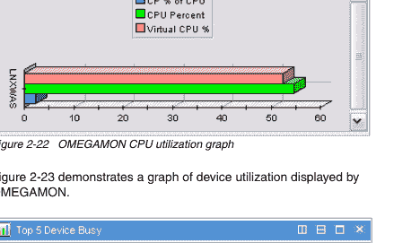

图 2-22 OMEGAMON CPU 利用率图表

图 2-23 展示了 OMEGAMON 显示的设备利用率图表。

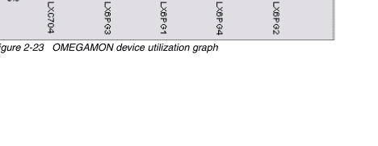

图 2-23 OMEGAMON 设备利用率图表

图 2-24 展示了 OMEGAMON 显示的存储利用率图表。

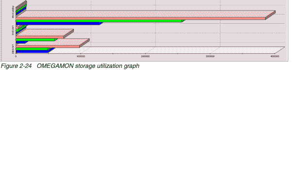

图 2-24 OMEGAMON 存储利用率图表

相同的数据可以通过面板上的选项以文本或表格形式从 OMEGAMON 门户显示。在 System z 环境中，可以在 LPARS 之间共享处理器，这意味着分配给此 z/VM 系统的处理器可能被其他 z/VM、Linux 或 z/OS 系统共享。这意味着系统性能调查必须包含对总硬件复合体的视图。图 2-25 中来自 OMEGAMON 的图表显示了来自我们整个硬件系统的数据。

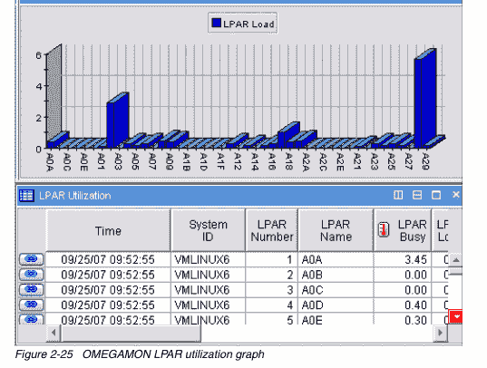

图 2-25 OMEGAMON LPAR 利用率图表


图 2-25 中显示的 LPAR 利用率有一个条形图，显示 System z 上每个 LPAR 的处理器利用率，还有一个包含每个 LPAR 详细信息的表格。表格有滚动条以扩展表格并显示更多列和行。每行的左侧都有一个链接图标，将用户连接到与该行（或 LPAR）相关的其他信息。

仔细检查通过 OMEGAMON 的 z/VM 显示可用的系统性能信息后，性能评估的下一步是查看在 z/VM 上运行的一台或多台 Linux 客户机内部的统计数据。

Linux 客户机概览工作区显示了许多关键性能指标。在图 2-26 中，OMEGAMON 显示了顶级 Linux 系统及其 CPU 利用率、过去 15 分钟的负载，以及系统统计表（上下文切换、换页率、系统运行时长和已登录用户数）。

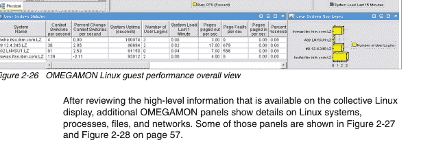

图 2-26 OMEGAMON Linux 客户机性能总体视图

在查看集体 Linux 显示页上可用的高层信息后，其他 OMEGAMON 面板将显示 Linux 系统、进程、文件和网络的详细信息。其中一些面板展示在页码 57 的图 2-27 和图 2-28 中。


图 2-27 OMEGAMON Linux 系统图表

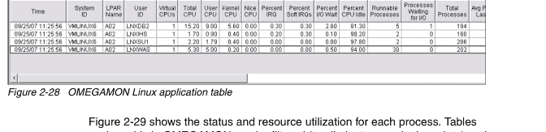

图 2-28 OMEGAMON Linux 应用程序表

图 2-29 显示了每个进程的状态和资源利用率。OMEGAMON 中的此类表格可以过滤（以消除无意义的数据）并排序（将高关注度的数据置于顶部）。

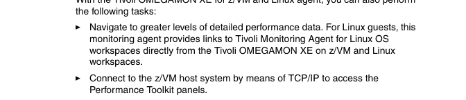

图 2-29 OMEGAMON Linux 进程表

使用 Tivoli OMEGAMON XE for z/VM and Linux agent，您还可以执行以下任务：

- 导航到更详细的性能数据层级。对于 Linux 客户机，此监控代理直接从 Tivoli OMEGAMON XE on z/VM and Linux 工作区提供链接至 Tivoli Monitoring Agent for Linux OS 工作区。

- 通过 TCP/IP 连接到 z/VM 主机系统以访问性能工具包面板。

- 查看有关如何识别和解决性能问题的专家建议。

IBM Tivoli OMEGAMON 为关键系统性能指标提供了默认阈值。当超出阈值时，会生成情况警报，并采取措施自动解决问题。情况控制台日志工作区显示当前激活的情况警报。在图 2-30 中，上面板列出了打开的情况。左下面板显示了过去 24 小时的情况计数。右下面板列出了已被当前用户确认的情况事件。

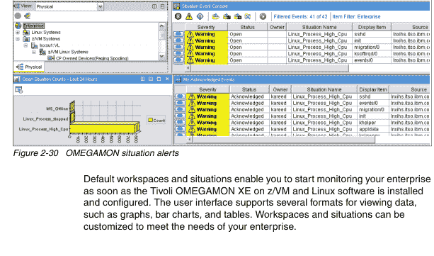

图 2-30 OMEGAMON 情况警报

默认工作区和情况使您在安装和配置 Tivoli OMEGAMON XE on z/VM and Linux 软件后即可开始监控企业。用户界面支持多种数据查看格式，如图表、条形图和表格。可以根据企业需求自定义工作区和情况。

## System z 上 Linux 的问题确定工具

本章讨论在 System z 上的 Linux 进行问题确定时使用的工具。这些工具在 Linux 和 z/VM 中均可用于问题确定。问题领域或类别将决定使用哪些工具来帮助确定问题。我们始终建议使用基于 z/VM 的工具或基于 z/VM 和 Linux 的工具组合，以获取关于问题更详细的信息。

Linux 环境具有几种专门用于问题确定的工具。本章将探讨收集的信息以及这些工具在问题确定中适用的情形。

### 3.1 信息收集工具

正如前一章所述，在开始使用任何专用调试工具之前，我们需要做的首要任务是调查问题原因。为此，我们需要收集关于环境、资源和其他配置的信息。在本节中，我们将讨论可用的各种基于 Linux 的工具。

> **注意：** 这里关于基于 Linux 工具的关键点在于，必须正确理解任何基于 Linux 的工具报告的资源利用率，同时考虑到底层的 z/VM 资源管理。当 Linux 作为客户机运行时，z/VM 会对 Linux 映像进行分时，并优化共享资源池。Linux 工具只能看到它们在 z/VM 中获得的份额。我们强烈建议将基于 Linux 工具收集的资源利用率信息与底层基于 z/VM 的工具进行交叉核对。

通常，这些大多数工具提供特定时间段内的利用率信息，但也有一些工具仅提供快照利用率。因此，在问题确定方法中，我们建议使用 shell 脚本记录特定时间段内的利用率和时间戳，对于仅能报告快照数据的工具而言。通过这样做，您将能够理解特定时间段内利用率的转换。此外，时间戳将有助于您比较从各种工具收集的信息。

#### 3.1.1 dbginfo.sh

为了收集有关 System z 上 Linux 环境的总体快照信息，提供了 `dbginfo.sh` 脚本，它是 `s390-tools` rpm 包的一部分，该包也是 SUSE® 和 RHEL Linux 发行版的默认包。该脚本收集的一些信息包括：

- 来自 proc 文件系统的信息 `[version,cpu,meminfo,slabinfo,modules,partitions,devices ...]`

- System z 特定的设备驱动程序信息：`/proc/s390dbf`

- 内核消息 `/var/log/messages`

- 配置文件 `/etc/[ccwgroup.conf,chandev.conf,modules.conf,fstab]`

- 几个命令：`ps`, `vgdisplay`, `dmesg`

**示例 3-1 dbginfo.sh 执行列表示例**

```
lnx02/: # dbginfo.sh
Create target directory /tmp/DBGINFO-2008-03-13-19-14-59-lnxihs
Change to target directory /tmp/DBGINFO-2008-03-13-19-14-59-lnxihs
Get procs entries
Saving runtime information into runtime.out
Get file list of /sys
Get entries of /sys
Check if we run under z/VM
  Running under z/VM
  Installed CP tool: vmcp
Saving z/VM runtime information into zvm_runtime.out
Copy config files
Copy log files

Collected data was saved to:
/tmp/DBGINFO-2008-03-13-19-14-59-lnxihs.tgz
```

`dbginfo.sh` 脚本也可从 IBM developerWorks® 网站下载：

`http://www.ibm.com/developerworks/linux/linux390/s390-tools-1.6.1.html`

#### 3.1.2 vmstat

`vmstat` 命令显示当前进程的统计信息、实际内存和虚拟内存的使用情况、换页、块 I/O 以及 CPU。最左列显示正在运行的进程数和阻塞的进程数。内存部分显示正在换出的内存、空闲内存、包含 inode 和文件元数据的缓冲区大小，以及从磁盘读取文件的缓存内存。交换部分列出换入和换出。I/O 部分报告读入和写出的块数（kb）。System in 和 cs 分别代表每秒的中断和上下文切换。CPU 部分的表头 `us`、`sy`、`id` 和 `wa` 分别代表用户、系统、空闲、I/O 等待和抢占的 CPU 时间百分比。`vmstat` 命令在识别内存短缺和 I/O 等待问题，以及虚拟 CPU 未由物理 CPU 支持的情况下非常有用。此外，`vmstat` 在信息收集阶段具有较低的性能开销。

在示例 3-2 中，我们可以看到正在发生大量的换页。在我们的案例中，甚至交换空间也已被完全使用。这可能是导致应用程序事务处理率和响应时间下降的原因，在这种情况下，Linux 可能正在将 CPU 周期用于换入和换出页面。在这种情况下，我们对受影响的 Linux 实例进行了内存超额分配以改善响应时间。

**示例 3-2 使用 vmstat 收集交换、内存和 CPU 信息**


```
lnx02:~ # vmstat 30
procs ---memory--- ---swap-- -----io----- -system-- ----cpu----
r b swpd free buff cache si so bi bo in cs us sy id wa st
0 0 713640 7784 1932 28644 0 0 0 7 152 142 0 0 99 0 0
0 0 713632 7784 1972 29096 1 0 1 5 158 141 0 0 99 0 0
0 0 713616 7536 2012 29040 1 0 1 8 159 143 0 0 99 0 0
0 0 713600 7536 2052 28984 1 0 1 3 161 140 0 0 99 0 0
0 0 713596 7412 2092 28916 1 0 1 8 156 143 0 0 99 0 0
0 0 713596 7412 2132 28876 0 0 0 2 152 140 0 0 99 0 0
0 0 719888 9144 2176 29316 1 210 1 217 257 142 0 98 2 0
0 0 718812 12976 2212 29316 122 26 122 32 186 174 1 0 97 1 0
0 0 718668 7340 2240 29228 360 164 360 172 270 259 1 1 93 5 0
1 0 719172 8764 2044 26808 789 453 789 456 360 339 2 2 86 10 0
0 0 718160 10364 808 21968 382 213 416 221 349 346 3 2 91 5 0
0 0 719400 10164 824 21124 264 200 264 202 425 366 3 1 92 4 0
```

### 3.1.3 系统状态 (sysstat) 工具

该包由几个用于收集系统数据的 Linux 工具组成。`sysstat` 包是一个广泛使用的 Linux 标准工具。它包含在您的发行版中，或可从以下网址下载：

http://pagesperso-orange.fr/sebastien.godard/

如果您安装源包，则必须在 System z 上的 Linux 上编译该包才能使用。`sysstat` 包由以下组件组成：

- `sar` 报告工具 - 读取由 `sadc` 创建的二进制文件并将其转换为可读输出
- `sadc` 数据收集器 - 将数据存储为二进制文件
- `iostat` - I/O 利用率
- `mpstat` - 处理器利用率

若要获取更详细的说明，请访问：

http://www.ibm.com/developerworks/linux/linux390/perf/tuning_how_tools.html#sysstat

#### sar

` sar ` 命令用于收集和显示系统数据。它将操作系统中选定的累计活动计数器的内容写入标准输出。基于 `count` 和 `interval` 参数中的值，统计系统会在指定的时间间隔（以秒为单位）内，以指定的次数写入信息。

` sar ` 命令具有众多选项，可提供队列、页面置换、TTY 以及其他许多统计信息。` sar ` 命令的一个重要特性是，它既可以报告系统范围的 CPU 统计信息（在所有处理器之间全局计算；对于以百分比表示的值计算平均值，对于其他值则计算总和），也可以报告每个单独处理器的统计信息。

` sar ` 命令会打印以下信息：

- 进程创建
- 上下文切换
- 所有/单个 CPU 使用率
- 网络使用率
- 磁盘统计信息

在示例 3-3 中，使用 `-d` 选项的 `sar` 命令生成实时磁盘 I/O 统计信息。

##### 示例 3-3 使用 sar 收集磁盘信息

```
lnx02:~ # sar -d 3 3
Linux 2.6.16.46-0.12-default (lnxwas) 03/14/08
18:55:55 DEV tps rd_sec/s wr_sec/s avgrq-sz avgqu-sz await svctm %util
18:55:58 dev9-0 0.00 0.00 0.00 0.00 0.00 0.00 0.00 0.00
18:55:58 dev9-4 0.00 0.00 0.00 0.00 0.00 0.00 0.00 0.00

18:55:58 DEV tps rd_sec/s wr_sec/s avgrq-sz avgqu-sz await svctm %util
18:56:01 dev9-0 0.00 0.00 0.00 0.00 0.00 0.00 0.00 0.00
18:56:01 dev9-4 0.66 0.00 26.58 40.00 0.00 5.00 5.00 0.33

18:56:01 DEV tps rd_sec/s wr_sec/s avgrq-sz avgqu-sz await svctm %util
18:56:04 dev9-0 0.00 0.00 0.00 0.00 0.00 0.00 0.00 0.00
18:56:04 dev9-4 0.00 0.00 0.00 0.00 0.00 0.00 0.00 0.00

Average: DEV tps rd_sec/s wr_sec/s avgrq-sz avgqu-sz await svctm %util
Average: dev9-0 0.00 0.00 0.00 0.00 0.00 0.00 0.00 0.00
Average: dev9-4 0.22 0.00 8.85 40.00 0.00 5.00 5.00 0.11
```

#### sadc

` sadc ` 命令以指定的间隔（以秒为单位的 `interval`）对系统数据进行采样，采样次数由 `count` 指定。它以二进制格式写入指定的 `outfile` 或标准输出。` sadc ` 命令旨在作为 `sar` 命令的后端使用。

示例 3-4 展示了 `sadc` 命令的语法及其使用示例。

##### 示例 3-4 sadc 的语法及示例

```
/usr/lib64/sa/sadc <interval> <count> > out
/usr/lib64/sa/sadc 1 5 >out
```

如果没有 `count` 参数，`sadc` 会一直对数据进行采样，直到被停止。标准输出文件为 `/var/log/sa/sa<day>`，每天在当天结束时写入一次。

#### iostat

要查看 CPU 使用情况的概览，可以使用 `iostat` 命令。该命令提供一个或多个设备和分区的 CPU 统计信息及 I/O 统计信息的监控和报告。

以下命令分析所有磁盘的 I/O 相关数据：

```
iostat -dkx
```

示例 3-5 展示了该命令的输出样本。

##### 示例 3-5 iostat 命令的输出样本

Linux 2.6.9-67. (16315015) 06/04/2008

| Device: | rrqm/s | wrqm/s | r/s | w/s | rsec/s | wsec/s | rkB/s | wkB/s | avgrq-sz | avgqu-sz | await | svctm | %util |
|---|---|---|---|---|---|---|---|---|---|---|---|---|---|
| dasda | 3.41 | 14.09 | 20.35 | 11.20 | 1094.87 | 202.32 | 547.44 | 101.16 | 41.12 | 0.16 | 5.06 | 3.76 | 11.87 |

#### mpstat

要确定处理器使用率，可以使用 `mpstat` 命令。`mpstat` 命令将每个可用处理器的活动写入标准输出，其中处理器 0 是第一个报告的对象。还会报告所有处理器之间的全局平均活动。与 `iostat` 相比，`mpstat` 显示更深入的 CPU 统计信息。

##### 通过 cron 自动采样

` sadc ` 命令收集系统使用数据，并将其写入文件以供后续分析。默认情况下，数据写入 `/var/log/sa/` 目录中的文件。这些文件的名称为 `sa<dd>`，其中 `<dd>` 是当前日期的两位数日期。

通常由 `sa1` 脚本运行 `sadc` 命令。该脚本通过位于 `/etc/cron.d` 中的 `sysstat` 文件由 cron 定期调用。`sa1` 脚本为单个一秒的测量间隔调用 `sadc`。默认情况下，cron 每 10 分钟运行一次 `sa1`，将每个间隔期间收集的数据添加到当前的 `/var/log/sa/sa<dd>` 文件中。


`sar` 命令基于 `sadc` 收集的数据生成系统使用报告。在 Red Hat Linux 中配置为，`sar` 会自动运行以处理由 `sadc` 自动收集的文件。报告文件写入 `/var/log/sa/`，命名为 `sar<dd>`，其中 `<dd>` 是前一天两位数日期的两位数表示。通常由 `sa2` 脚本运行 `sar` 命令。该脚本通过位于 `/etc/cron.d` 中的 `sysstat` 文件由 cron 定期调用。默认情况下，cron 每天在 23:53 运行一次 `sa2`，使其能够生成包含整天数据的报告。

要激活 cron 守护进程，请运行以下命令：

```
service crond start
```

要在指定级别启动服务：

```
chkconfig --level 123456 crond on
```

要检查状态：

```
service --status-all | grep cron
chkconfig --list | grep cron
```

一旦 cron 守护进程和服务启动，它们会使用 `/etc/cron.d/sysstat` 中的定义，如示例 3-6 所示。

### 示例 3-6 通过 cron 自动采样

```
###### run system activity accounting tool every 10 minutes
*/10 * * * * root /usr/lib64/sa/sa1 1 1
###### generate a daily summary of process accounting at 23:53
53 23 * * * root /usr/lib64/sa/sa2 -A
```

### 3.1.4 top

`top` 命令显示进程统计信息和使用 CPU 最多的 Linux 进程列表。可用选项可交互地更改显示的格式和内容。进程列表可以按运行时间、内存使用和处理器使用率进行排序。`top` 显示总进程数、正在运行的进程数量和睡眠状态的进程数量。信息每三秒更新一次，或在选定的间隔更新。这在获取 Linux 系统上正在运行的进程及其 CPU 和内存消耗的快照时非常有用。

从 SLES10 和 RHEL5 开始，`top` 命令包含一个新字段：CPU 窃取时间——即 Linux 想要运行但 z/VM 将 CPU 分配给其他客户机的时间。该字段对于理解 Linux 内部的 CPU 性能特征非常有用。另外，值得注意的是 `top` 是一个资源消耗较大的工具，这意味着激活时性能开销相对较高。

#### 示例 3-7 使用 top 收集进程信息

```
top - 20:59:57 up 8 min, 1 user, load average: 0.68, 0.62, 0.25
Tasks: 53 total, 2 running, 51 sleeping, 0 stopped, 0 zombie
Cpu(s): 0.3%us, 0.0%sy, 0.0%ni, 98.7%id, 0.7%wa, 0.3%hi, 0.0%si, 0.0%st
Mem: 3080964k total, 1029608k used, 2051356k free, 9780k buffers
Swap: 719896k total, 0k used, 719896k free, 234804k cached

PID USER PR NI VIRT RES SHR S %CPU %MEM TIME+ COMMAND
1526 root 17 0 2437m 771m 56m S 0.3 25.7 1:01.09 java
1 root 16 0 848 316 264 S 0.0 0.0 0:00.50 init
2 root RT 0 0 0 0 S 0.0 0.0 0:00.00 migration/0
3 root 34 19 0 0 0 S 0.0 0.0 0:00.00 ksoftirqd/0
4 root 10 -5 0 0 0 S 0.0 0.0 0:00.03 events/0
```

在示例 3-7 中，我们可以轻松确定，与系统中运行的其他进程相比，Java™ 进程消耗了约 25% 的内存和一些 CPU 周期。

### 3.1.5 ps

`ps` 命令是一个用于识别系统上正在运行的程序及其使用的资源的工具。它显示系统中进程的统计和状态信息，例如进程或线程 ID、I/O 活动、CPU 和内存使用情况。此外，我们还可以缩小范围到占据主要使用量的进程。

#### 示例 3-8 使用 ps 收集进程信息

```
lnx02:~# ps au
USER       PID %CPU %MEM   VSZ   RSS TTY      STAT START   TIME COMMAND
root     1464  0.0  0.0   2000   652 ttyS0    Ss+  16:08   0:00 /sbin/mingetty --noclear /dev/ttyS0 dumb
root     1468  0.0  0.0   5132  2652 pts/0    Ss   16:08   0:00 -bash
root     2007  8.7 26.0 2507240 801100 pts/0   Sl   16:40   1:07 /opt/java/bin/java
root     2190  0.0  0.0   2680   988 pts/0    R+   16:53   0:00 ps au
```

`ps` 是一个实用的命令，可以与各种参数组合使用，以获取有关进程所需的相关信息。有关各种参数的更多信息，请参阅相应的 `ps` 手册页。

### 3.1.6 ipcs

`ipcs` 命令报告关于活动进程间通信（IPC）设施的信息。报告将包含当前活动的消息队列、共享内存段和信号量的信息。`ipcs` 命令是一个非常强大的工具，可以提供对内核中 IPC 对象存储机制的洞察。

#### 示例 3-9 使用 IPCS 收集进程间通信（IPC）信息

```
lnx02:~# ipcs
------ Shared Memory Segments ------
key        shmid      owner   perms       bytes      nattch     status
0x0105e8ae 98304      root    660         52428800   1

------ Semaphore Arrays ------
key        semid      owner   perms       nsems
0x0105e8ad 0          root    660         3

------ Message Queues ------
key        msqid      owner   perms       used-bytes messages
```

### 3.1.7 iostat

`iostat` 命令提供设备的 CPU 和输入/输出统计数据。主要而言，`iostat` 命令通过观察设备相对于其平均传输率的活跃时间来监视系统的输入/输出设备。

通过在系统峰值负载期间或运行需要最小化 I/O 延迟的关键应用程序时，使用间隔参数运行 `iostat` 命令开始评估。

#### 示例 3-10 使用 iostat 收集输入/输出信息

```
lnxwas:~ # iostat 5 3
Linux 2.6.16.46-0.12-default (lnxwas) 03/17/08

avg-cpu:  %user %nice %system %iowait %steal %idle
2.34     0.18   0.31   1.21    0.12   95.84

Device:    tps    Blk_read/s   Blk_wrtn/s   Blk_read   Blk_wrtn
dasdb     4.62    91.15      21.18      708616    164648
dasda     0.01    0.08       0.00       632       0

avg-cpu:  %user %nice %system %iowait %steal %idle
56.69    0.00   2.99    0.40     2.79    36.93

Device:    tps    Blk_read/s   Blk_wrtn/s   Blk_read   Blk_wrtn
dasdb     0.20    3.19       0.00       16        0
dasda     0.00    0.00       0.00       0         0
```

在示例 3-10 中，大量的数据块正在被读写到 DASD（直接附加存储设备）。上面提供的统计信息是按磁盘为基础的。

### 3.1.8 netstat


`netstat` 是一个用于检查网络配置和活动的强大工具。`netstat` 命令显示关于已配置网络接口上的流量的信息，例如以下内容：
- 与套接字相关的任何协议控制块的地址以及所有套接字的状态
- 通信子系统中接收、发送和丢弃的数据包数量
- 每个接口的累计统计信息
- 路由及其状态

### 示例 3-11 使用 netstat 收集网络流量信息

```
lnx02:~# netstat -i
Kernel Interface table
Iface MTU Met RX-OK RX-ERR RX-DRP RX-OVR TX-OK TX-ERR TX-DRP TX-OVR Flg
eth0 1492 0 1067003 0 0 0 1053600 0 0 0 BMRU
lo 16436 0 355 0 0 0 355 0 0 0 LRU
```

当使用 `-i` 标志调用时，`netstat` 显示当前已配置的网络接口的统计信息。`MTU` 和 `Met` 字段显示该接口当前的 MTU 和度量值。`RX` 和 `TX` 列显示无错误接收或发送的数据包数量 (`RX-OK`/`TX-OK`) 或损坏的数据包数量 (`RX-ERR`/`TX-ERR`)。当 `netstat` 使用 `-ta` 标志执行时，它会报告系统上的主动和被动连接。

### 示例 3-12 使用 netstat 收集网络连接信息

```
lnx02:~# netstat -ta
Active Internet connections (servers and established)
Proto Recv-Q Send-Q Local Address Foreign Address State
tcp 0 0 *:can-ferret *:* LISTEN
tcp 0 0 *:nfs *:* LISTEN
tcp 0 0 *:51202 *:* LISTEN
tcp 0 0 *:8803 *:* LISTEN
tcp 0 0 *:filenet-cm *:* LISTEN
tcp 0 0 *:can-ferret-ssl *:* LISTEN
tcp 0 0 *:52237 *:* LISTEN
tcp 0 0 *:sunrpc *:* LISTEN
tcp 0 0 *:ftp *:* LISTEN
tcp 0 0 lnx02.itso.ibm.c:54630 lnx03.itso.ibm.c:55000 ESTABLISHED
```

#### 3.1.9 DASD 统计

为了收集 DASD 活动的性能统计信息，在 Linux 中我们有一个 DASD 统计选项。它将特定时间段内的 DASD I/O 活动作为统计数据记录下来。当统计选项启用时，DASD 驱动程序将收集统计数据。

通过开关 `proc` 文件系统中的开关，可以轻松地启用或禁用 DASD 统计信息。参见示例 3-13。

### 示例 3-13 启用和禁用 DASD 统计

```
echo set on > /proc/dasd/statistics
echo set off > /proc/dasd/statistics
```

在示例 3-14 中，我们正在读取整个系统的 DASD 统计信息。通过关闭并重新开启 DASD 统计选项，我们可以重置所有计数器。

### 示例 3-14 使用 DASD 统计选项收集 DASD I/O 统计

```
lnx02:~# cat /proc/dasd/statistics
613 dasd I/O requests
with 9432 sectors(512B each)
_<4 _8 _16 _32 _64 _128 _256 _512 _1k _2k _4k _8k _16k _32k _64k 128k
_256 _512 _1M _2M _4M _8M _16M _32M _64M 128M 256M 512M _1G _2G _4G >4G
Histogram of sizes (512B secs)
0 0 472 107 6 18 9 1 0 0 0 0 0 0 0 0
0 0 0 0 0 0 0 0 0 0 0 0 0 0 0 0
Histogram of I/O times (microseconds)
0 0 0 0 0 0 0 0 117 124 142 156 47 26 1 0
0 0 0 0 0 0 0 0 0 0 0 0 0 0 0 0
Histogram of I/O times per sector
0 0 0 0 11 164 122 161 123 23 9 0 0 0 0 0
0 0 0 0 0 0 0 0 0 0 0 0 0 0 0 0
Histogram of I/O time till ssch
145 50 13 0 0 0 0 0 74 67 238 3 16 7 0 0
0 0 0 0 0 0 0 0 0 0 0 0 0 0 0 0
Histogram of I/O time between ssch and irq
0 0 0 0 0 0 0 0 454 98 7 1 39 13 1 0
0 0 0 0 0 0 0 0 0 0 0 0 0 0 0 0
Histogram of I/O time between ssch and irq per sector
0 0 0 1 74 462 42 12 7 13 2 0 0 0 0 0
0 0 0 0 0 0 0 0 0 0 0 0 0 0 0 0
Histogram of I/O time between irq and end
151 216 223 22 0 1 0 0 0 0 0 0 0 0 0 0
0 0 0 0 0 0 0 0 0 0 0 0 0 0 0 0
##### of req in chanq at enquing (1..32)
0 207 86 64 51 204 0 0 0 0 0 0 0 0 0 0
0 0 0 0 0 0 0 0 0 0 0 0 0 0 0 0
```

### 输出说明

第 1 行包含在观察期间处理的 I/O 请求总数（子通道启动 SSCH 指令）。在此示例中，该值为 613。

第 2 行包含在观察期间传输的 512 字节块数。在此示例中，该值为 9432。

第 3 行和第 4 行包含时间（微秒）或大小（512 字节块），具体取决于上下文。

有关更详细的说明，请参阅以下网站：

http://www.ibm.com/developerworks/linux/linux390/perf/tuning_how_tools_dasd.html

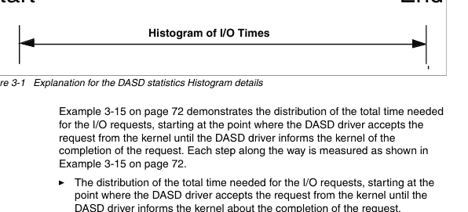

图 3-1 DASD 统计直方图详解

示例 3-15 展示了 I/O 请求所需总时间的分布情况，从 DASD 驱动程序从内核接受请求的时刻开始，直到 DASD 驱动程序向内核通知请求完成为止。沿途的每一步都会像示例 3-15 中那样进行测量。
- I/O 请求所需总时间的分布，从 DASD 驱动程序从内核接受请求的时刻开始，直到 DASD 驱动程序向内核通知请求完成为止。
- I/O 请求被 DASD 驱动程序排队的时间分布。该时间从 DASD 驱动程序从内核接受 I/O 请求开始，到发出 SSCH 结束。通常，这些请求必须等待，因为特定的子通道处于忙碌状态。
- SSCH 和通道结束/设备结束 (CE/DE) 之间的时间分布，即通道子系统和存储子系统处理请求所需的时间。这有助于理解存储子系统的性能。
- DASD 驱动程序从接受 CE/DE 到向内核呈现 IRQ 所需的时间分布。

正如我们讨论过的，上面的示例是整个系统的 DASD 统计信息。若要获取特定 DASD 的 I/O 统计信息，我们可以使用 `tunedasd` 工具。

在示例 3-15 中，我们对挂载了根文件系统的 DASD（即 `/dev/dasd1`）发出 `tunedasd` 命令。

### 示例 3-15 使用 tunedasd 收集特定 DASD 的 I/O 信息


```
lnx02:/usr/src # tunedasd -P /dev/dasd1
137609 dasd I/O requests
with 2419848 sectors(512B each)
_<4 __8 __16 __32 __64 __128 __256 __512 __1k __2k __4k __8k __16k __32k __64k 128k
__256 __512 __1M __2M __4M __8M __16M __32M __64M 128M 256M 512M __1G __2G __4G __4G
Histogram of sizes (512B secs)
0 0 6704 2223 3078 3177 1604 458 160 198 0 0 0 0 0 0
0 0 0 0 0 0 0 0 0 0 0 0 0 0 0 0
Histogram of I/O times (microseconds)
0 0 1204 2352 4727 1116 144 38 1419 1605 2350 2434 1003 575 139 52
142 53 1 2 0 0 0 0 0 0 0 0 0 0 0 0
Histogram of I/O times per sector
3777 3318 490 148 1258 2330 1586 2463 2025 670 317 51 13 2 1 1
1 0 0 0 0 0 0 0 0 0 0 0 0 0 0 0
Histogram of I/O time till ssch
6669 643 272 54 47 12 1 3 859 912 3469 155 312 225 78 31
87 29 0 0 0 0 0 0 0 0 0 0 0 0 0 0
Histogram of I/O time between ssch and irq
0 0 1699 2144 336 47 7 2 6260 1476 422 111 893 290 50 15
21 1 0 0 0 0 0 0 0 0 0 0 0 0 0 0
Histogram of I/O time between ssch and irq per sector
4026 194 18 30 1130 6525 656 365 205 501 98 6 3 2 0 1
1 0 0 0 0 0 0 0 0 0 0 0 0 0 0 0
Histogram of I/O time between irq and end
6735 3105 3541 257 86 22 8 1 3 4 5 6 1 0 0 0
0 0 0 0 0 0 0 0 0 0 0 0 0 0 0 0
##### of req in chanq at enquing (1..32)
0 7584 1154 957 752 3312 0 0 0 0 0 0 0 0 0 0
0 0 0 0 0 0 0 0 0 0 0 0 0 0 0 0
```

## 3.1.10 OProfile

OProfile 是一个用于 Linux 系统的开源性能分析器。它提供对 Linux 系统上所有运行代码的性能分析，包括内核、共享库、应用程序二进制文件等，并根据工作负载的不同，以低开销（范围从 1% 到 8% 不等）提供多种统计信息。它遵循 GNU GPL 许可发布。OProfile 由一个内核驱动、一个用于收集采样数据的守护进程以及用于生成报告的工具组成。

OProfile 通常在 Linux 内核 2.2、2.4、2.6 及更高版本中受到支持。但是，对于 System z 上的 Linux，OProfile 仅支持内核 2.6 或更高版本。对于 SUSE Linux，内核级别必须至少为 `kernel-s390(x)-2.6.5-7.191`，这始于 SLES9 SP2。对于 Red Hat Linux，内核级别必须至少为 `kernel-2.6.9-22.EL`，即 RHEL4 U2。

OProfile 利用 CPU 的性能计数器统计所有运行代码的事件，并将信息聚合为每个二进制映像的性能分析文件。然而，System z 硬件目前不支持 OProfile 使用的这种硬件性能计数器，因此使用计时器中断作为替代。

使用 OProfile 可以分析以下代码：

- 硬件和软件中断处理程序
- 内核模块和内核
- 共享库
- 应用程序

OProfile 的设置涉及通过启用性能分析选项来配置内核源代码。要构建和安装 OProfile，请在解压后的 oprofile 目录中执行示例 3-16 中所示的命令。如本例所示，我们使用了选项 `with-kernel-support`（包含内核支持）。当您的内核版本为 2.6 或更高时，请使用此选项。有关 OProfile 安装说明的更多信息，请参见：

http://oprofile.sourceforge.net/doc/install.html

### 示例 3-16 设置 OProfile

```
./configure --with-kernel-support
make
make install
```

要使用 OProfile 工具，应使用 `sysctl` 命令打开计时器。在所有性能分析完成后，关闭计时器。一旦成功安装 OProfile，必须告知 OProfile 与正在运行的内核对应的 `vmlinux` 文件的位置。如果不需要对内核进行性能分析，则通过传递一个参数来设置 OProfile，告知系统没有 `vmlinux` 文件。两个示例都显示在示例 3-17 中。

### 示例 3-17 基本性能分析配置

```
opcontrol --vmlinux=/boot/vmlinux-`uname -r`
or
opcontrol --no-vmlinux
```

一旦安装并设置好 OProfile，您可以使用 `opcontrol` 命令启动和停止（关闭）性能分析守护进程（参见示例 3-18）。

### 示例 3-18 OProfile 启动和停止命令

```
opcontrol --start / --shutdown
```

`Opcontrol` 接受一个规格说明，指示如何设置每个硬件性能计数器的细节。根据这些设置，对内核或用户空间代码进行性能分析。

示例 3-19 展示了一个 OProfile 报告的示例。

### 示例 3-19 示例 OProfile 性能分析报告

```
lnx02:~# opreport --symbols
CPU: CPU with timer interrupt, speed 0 MHz (estimated)
Profiling through timer interrupt
samples % image name app name symbol name
10181 65.8288 lib_app1 lib_app1 main
3390 21.8526 vmlinux vmlinux .text
1694 10.9199 no-vmlinux no-vmlinux (no symbols)
40 0.2578 vmlinux vmlinux cpu_idle
39 0.2514 libc-2.4.so libc-2.4.so _int_malloc
23 0.1483 vmlinux vmlinux get_page_from_freelist
8 0.0516 vmlinux vmlinux do_wp_page
7 0.0451 vmlinux vmlinux _spin_unlock_irqrestore
5 0.0322 vmlinux vmlinux __handle_mm_fault
4 0.0258 libc-2.4.so libc-2.4.so malloc
4 0.0258 libc-2.4.so libc-2.4.so mbrtowc
1 0.0064 ld-2.4.so ld-2.4.so do_lookup_x
1 0.0064 libc-2.4.so libc-2.4.so _dl_addr
1 0.0064 libc-2.4.so libc-2.4.so _int_free
1 0.0064 libc-2.4.so libc-2.4.so mblen
```

在 System z 上的 Linux 中，OProfile 仅包含内核空间调用图支持。调用图选项受 Linux 内核 2.6 及更高版本支持。使用调用图选项时，可以在输出报告中看到哪些函数正在调用其他函数。OProfile 将在每次采样时记录函数堆栈。要在 OProfile 上启用调用图支持，请设置调用图采样收集速率及最大深度。使用 `'0'` 可禁用调用图功能。启动调用图的示例请参见示例 3-20。

### 示例 3-20 OProfile 调用图功能

```
opcontrol --start --callgraph=<depth> --vmlinux=lib/modules/<Kernel version>/build/vmlinux
```

**注意：** 目前，在 System z 上的 Linux 中，OProfile 仅包含内核空间调用图功能。

示例 3-21 展示了 OProfile 调用图报告的示例。


### 示例 3-21 OProfile 调用图示例

```
lnx02:~ # opreport --callgraph
CPU: CPU with timer interrupt, speed 0 MHz (estimated)
Profiling through timer interrupt
samples % image name app name symbol name
------------------------------------------------------------
15272 48.0720 lib_app1 lib_app1 main
15272 100.000 lib_app1 lib_app1 main [self]
------------------------------------------------------------
14281 44.9526 vmlinux vmlinux .text
14281 100.000 vmlinux vmlinux .text [self]
------------------------------------------------------------
1694 5.3322 no-vmlinux no-vmlinux (no symbols)
1694 100.000 no-vmlinux no-vmlinux (no symbols) [self]
------------------------------------------------------------
147 0.4627 vmlinux vmlinux cpu_idle
147 100.000 vmlinux vmlinux cpu_idle [self]
------------------------------------------------------------
65 0.2046 libc-2.4.so libc-2.4.so _int_malloc
65 100.000 libc-2.4.so libc-2.4.so _int_malloc [self]
------------------------------------------------------------
48 0.1511 vmlinux vmlinux get_page_from_freelist
48 100.000 vmlinux vmlinux get_page_from_freelist [self]
------------------------------------------------------------
39 0.1228 vmlinux vmlinux page_remove_rmap
39 100.000 vmlinux vmlinux page_remove_rmap [self]
------------------------------------------------------------
```

#### 3.1.11 zFCP 统计

借助 zFCP 统计，我们可以将 FCP LUN 的 I/O 活动记录为统计信息。通过此功能，我们可以收集各种统计数据，例如 I/O 请求数据大小或 I/O 延迟。有关 zFCP 统计的概览，请参见图 3-2。

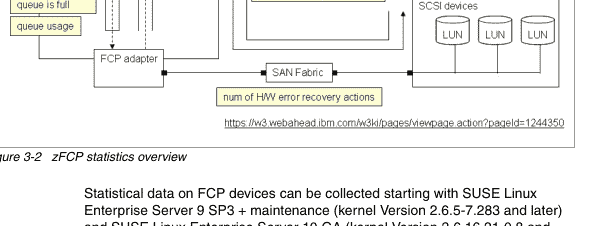

图 3-2 zFCP 统计概览

对 FCP 设备的统计数据收集始于 SUSE Linux Enterprise Server 9 SP3 + 维护更新（内核版本 2.6.5-7.283 及更高版本）和 SUSE Linux Enterprise Server 10 GA（内核版本 2.6.16.21-0.8 及更高版本）。

##### 收集 zFCP 统计

要收集 zFCP 统计信息：

1. 根据您的 Linux 发行版，zFCP 统计文件的查找位置如下：
   - 对于 SLES10 及更高版本，取决于 `debugfs` 的挂载位置，位于 `<mount_point_debugfs>/statistics`。例如，如果 `debugfs` 挂载在目录 `/sys/kernel/debug/`，则所有收集的统计数据都位于 `/sys/kernel/debug/statistics/`。
   - 对于 SLES9，取决于 `proc` 的挂载位置（SLES9 不使用 `debugfs`），位于 `<mount_point_proc>/statistics`。
2. 挂载设备时，会为每个设备（适配器以及 LUN）创建一个子目录。子目录命名为：
   - 对于适配器，名为 `zfcp-<device-bus-id>`
   - 对于 LUN，名为 `zfcp-<device-bus-id><WWPN><LUN>`
3. 每个子目录包含两个文件：一个数据文件和一个定义文件。

要打开设备的数据收集，请参见示例 3-22。

##### 示例 3-22 启用 zFCP 统计

```
echo on=1 > definition
```

要关闭设备的数据收集，请参见示例 3-23。

##### 示例 3-23 禁用 zFCP 统计

```
echo on=0 > definition
```

表 3-1 展示了不同统计类型输出格式的示例。

##### 表 3-1 统计类型示例

| 统计类型 | 输出格式 | 行数 |
|---|---|---|
| Value（值） | `<name> <total>` | 1 |
| range（范围） | `<name> <total> <min> <avg> <max>` | 1 |
| list（列表） | `<name> <Xn> <total for Xn>` | <= entries_max |
| 统计时间 | 输出格式 | 行数 |
|---|---|---|
| array | `<name> "=<Xn> <区间总和> <name> "> <Xm> <区间总和>` | 由 base_interval, scale, range_min, range_max 确定的区间数量 |
| history (mode=increments, mode=products) | `<name> <时间戳> <总和>` | <= entries_max |
| history (mode=range) | `<name> <时间戳> <总和> <最小值> <平均值> <最大值>` | <= entries_max |
| raw | `<name> <时间戳> <序列号> <X> <Y>` | <= entries_max |

使用 SCSI 时延迟的分解（即数据从一个点移动到另一个点所需的最短时间）可以在图 3-3 中看到。

###### zFCP 统计

###### 可获取的 SCSI 延迟分解

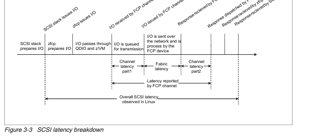

图 3-3 SCSI 延迟分解

SCSI 延迟统计的示例可以在示例 3-24 中看到。

###### 示例 3-24 SCSI 延迟统计示例


```text
cat /proc/statistics/zfcp-0.3c00-0x5005076300c20b8e-0x5500000000000000/data
request_sizes_scsi_write >4096 339
request_sizes_scsi_read <=0 0
request_sizes_scsi_read <=512 0
request_sizes_scsi_read <=1024 0
request_sizes_scsi_read <=1536 0
request_sizes_scsi_read <=2048 0
request_sizes_scsi_read <=2560 0
request_sizes_scsi_read <=3072 0
request_sizes_scsi_read <=3584 0
request_sizes_scsi_read <=4096 16259
request_sizes_scsi_read >4096 0
request_sizes_scsi_nodata <=0 0
request_sizes_scsi_nodata <=512 0
request_sizes_scsi_nodata <=1024 0
:
:
:
request_sizes_scsi_write 137
request_sizes_scsi_read 14308
request_sizes_scsi_nodata 0
request_sizes_scsi_nofit 0
request_sizes_scsi_nomen 0
request_sizes_timedout_write 0
request_sizes_timedout_read 0
request_sizes_timedout_nodata 0
latencies_scsi_write 137
latencies_scsi_read 14308
latencies_scsi_nodata 0
pending_scsi_write 137
pending_scsi_read 14309
occurrence_erp 0
```

### 3.1.12 信息收集工具摘要

为了方便起见，我们提供了一份摘要，列出了您可以在 Linux 环境中使用的用于收集信息的工具（表 3-2）。

表 3-2 Linux 信息收集工具摘要

| 工具 | 描述 | CPU | 内存 | 磁盘 | 网络 |
|---|---|---|---|---|---|
| `vmstat` | 可以在指定时间间隔内获取资源利用率。 | X | X | X | |
| `mpstat` | 可以在指定时间间隔内获取 CPU 利用率。 | X | | | |
| `sar` | 可以在指定时间间隔内获取资源利用率。 | X | X | X | X |
| `top` | 报告每个进程的 CPU 和内存利用率。 | X | X | | |
| `ps` | 报告进程信息、状态和资源利用率。 | X | X | | |
| `free` | 报告内存和交换空间利用率。 | X | X | | |
| `ipcs` | 报告共享内存、信号量和消息队列的利用率。 | | X | | |
| `iostat` | 提供设备 I/O 活动的信息。 | X | | X | |
| `netstat` | 报告网络连接和统计信息。 | | | | X |
| `OProfile` | 报告已执行函数的统计信息。 | X | | | |
| DASD 统计 | 提供 DASD 设备的 I/O 统计信息。 | | | X | |
| zFCP 统计 | 提供每个 FCP LUN 的 I/O 统计信息。 | | | X | |

### 3.2 转储和跟踪

当发生意外系统错误时，系统转储命令会将选定的内核结构复制到转储文件或设备中。转储设备可以动态配置，这意味着可以使用磁带或 DASD 设备来接收系统转储。

系统内核转储包含运行系统的所有重要结构，例如进程表、内核的全局内存段以及每个进程的数据和堆栈段。当我们检查映射到这些结构的系统数据时，我们可以获得有关内核的有价值信息，这些信息可以解释为什么调用转储。此外，转储技术只能在给定时间点获取内核结构的快照。

另一方面，通过跟踪机制，我们可以动态记录系统调用和其他基于应用程序的问题。

#### 3.2.1 何时使用转储

当应用程序失败并停止执行，或者系统因内核恐慌而崩溃时，我们建议进行转储，因为通过转储，我们可以记录并分析系统出现问题时的执行和内存快照。参见图 3-4。

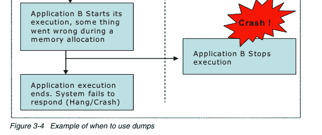

图 3-4 何时使用转储的示例

#### 3.2.2 何时应运行跟踪

与第 81 页的图 3-4 不同，存在应用程序仍在执行但无响应的情况。在这种情况下，我们建议使用跟踪功能，而不是转储。

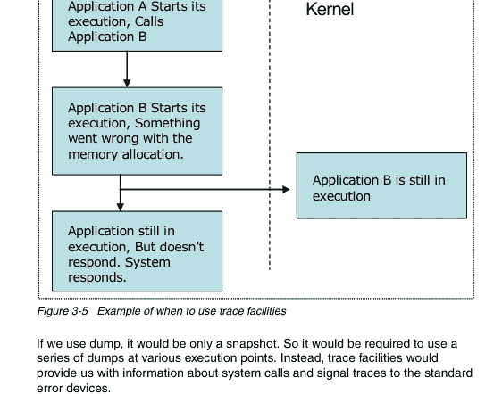

*图 3-5 何时使用跟踪功能的示例*

如果我们使用转储，那将只是一个快照。因此，需要在各个执行点使用一系列转储。相反，跟踪功能可以为我们提供关于系统调用和信号跟踪到标准错误设备的信息。

#### 3.2.3 独立转储

独立转储用于收集整个系统的诊断信息。获取独立转储后，系统无法恢复正常处理——需要 IPL。独立转储在调查系统挂起、内核内存和系统调用状态时非常有用。

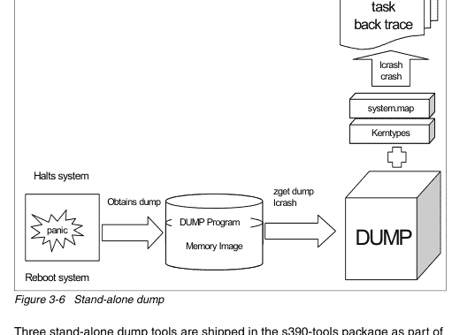

图 3-6 独立转储

`s390-tools` 包中随 `zipl` 包提供了三个独立转储工具：

- 用于 DASD 卷上转储的 DASD 转储工具
- 用于（通道连接的）磁带设备上转储的磁带转储工具
- 用于 SCSI 磁盘上转储的 SCSI 磁盘转储工具

要创建独立转储：

1. 创建用于转储内存的转储设备。我们建议您分配大约内存大小加 10 MB 左右空间作为设备存储。您可以在 `/etc` 目录中的 `zipl.conf` 文件中定义转储设备。
2. 要启动转储，我们必须 IPL 转储设备。这是破坏性的。也就是说，正在运行的 Linux 操作系统将被终止。
3. 重新启动原始 Linux 映像并挂载已创建的转储 DASD。

#### 3.2.4 转储验证

在转储设备挂载到系统上后，我们需要检查转储以识别问题，也称为转储设备的后处理。在 Linux 中，我们有工具来验证转储设备或文件。

##### zgetdump

使用 `zgetdump` 工具读取给定的转储设备并将其内容写入标准输出或重定向到文件。

*示例 3-25 使用 zgetdump 将转储映像转换为文件*

```bash
zgetdump /dev/dasdXX > dump.X
```

##### lcrash

也可以使用 `lcrash`——Linux 转储分析器来验证和检查转储。

*示例 3-26 使用 lcrash 验证转储文件*

```bash
lcrash -i -d /dev/dasdXX
```

要将转储从 DASD 复制到文件系统，请调用带有 `-s`（保存转储）和 `-d`（转储设备）选项的 `lcrash`。`-s` 选项指定结果转储文件（`dumpfile`）的目标目录。

*示例 3-27 使用 lcrash 将转储映像转换为文件*

```bash
lcrash -d /dev/dasdx1 -s dumpfile
```

> **注意：** 在验证转储映像期间，工具应显示消息 `Dump End Marker found: this dump is valid.` 这意味着该转储是一个有效的转储，可用于进一步处理。

###### 使用 lcrash 从独立转储创建报告

如果系统中未找到 `lcrash`，请安装 `lkcdutils`。

要为转储文件创建报告，请执行示例 3-28 中所示的命令。

###### 示例 3-28 要发出的命令

```bash
lcrash -r $System.map dumplin Kerntypes > report.txt
```

从报告中，我们可以获取以下信息：

- 转储摘要
- 日志缓冲区
- 任务列表
- 分配给 CPU 的进程信息

图 3-7 显示了一个 `lcrash` 转储摘要。


# LCRASH CORE FILE REPORT
====================
GENERATED ON:
  Mon Mar 1 18:11:54 2008

TIME OF CRASH:
  Mon Mar 1 15:34:02 2008

PANIC STRING:
  zSeries-dump (CPUID = ff08212320640000)

MAP:
`/boot/System.map-2.6.5-7.282-s390x`
DUMP:
  dump
KERN TYPES:
`/boot/Kerntypes-2.6.5-7.282-s390x`

====================
COREFILE SUMMARY
====================
  The system died due to a software failure.
====================
UTSNAME INFORMATION
====================
  sysname :
  nodename :
  release :
  version :
  machine : s390x

图 3-7 lcrash 报告示例转储摘要

如图 3-7 所示，摘要表明系统因软件故障而崩溃。同样，报告包含如上列出的其他信息，这些信息对于高层次的问题确定非常有用。

图 3-8 展示了一份 lcrash 报告中的任务列表。这可用于查看在该时间点正在运行的所有进程。

```
================
CURRENT SYSTEM TASKS
================

      ADDR   UID PID PPID STATE   FLAGS CPU NAME
================
0x400000  0   0   0    0      0     0   swapper
0x7177b0  0   1   0    1      0x100 -   init
0xf727d0  0   2   1    1      0x40  -   migration/0
0xf72020  0   3   1    1      0x8040 - ksoftirqd/0
0x9927e0  0   4   1    1      0x8140 - events/0
0x992030  0   5   4    1      0x8040 - khelper
0xf8477f0 0   6   4    1      0x8040 - kblockd/0
0xf863810 0  60   4    1      0x8040 - cio
0xf863060 0  61   4    1      0x8040 - cio_notify
0xf86e820 0  62   4    1      0x8040 - kslowcwr
0xf85d050 0 136   4    1      0x8040 - appldata
0xf8a4000 0 138   4    1      0x4040 - pdfflush
0xf8b0080 0 139   4    1      0x4040 - pdflush
0xf8b17f0 0 141   4    1      0x8040 - aio/0
0xf8b7060 0 140   1    1      0x40840 - kswapd0
0xf8f5090 0 198   1    1      0x40  -   kmcheck
0xf8ad020 0 357   1    1      0x40  -   kjournald
0xf86e070 0 358   1    1      0x140 - init
0xee607d0 0 359 358   1      0x100 - boot
0xee60020 0 431 359   1      0x100 - S07boot.localfs
0xea67800 0 449 431   1      0x100 - sulogin
```

图 3-8 报告中的示例任务列表

此外，日志缓冲区还会提供关于那些未出现在控制台或 `dmesg` 中的日志消息的有用信息。但我们建议将转储文件（dumpfile）、系统映射表（system map）、内核类型（kerntypes）以及 lcrash 报告发送给 IBM 支持服务，以便进行进一步调查。

### 3.2.5 核心转储（Core dump）

核心转储记录了进程在崩溃时刻的状态。在大多数 Linux 发行版中，核心转储默认是禁用的。一旦我们在系统中启用了核心转储，下次当应用程序崩溃时，Linux 就能够将核心信息写入文件。

作为一个例子，我们执行了一个简单的程序，该程序会不断创建新的子进程。在某个时刻，Linux 会耗尽进程 ID 和资源，此时应用程序将无法响应，并且会忙于等待其他进程结束，以便它可以启动更多的进程。这是核心转储的一个经典示例，因为我们可以知道该进程的 PID，并可以获取该进程的核心转储以供进一步调查。

在程序开始创建进程后，我们使用 `ps -ef` 命令捕获了该程序的进程 ID（PID）。此时，应用程序无响应，且 Linux 系统的资源也较为匮乏。

在图 3-9 中，我们将以一个示例 PID 为例，获取其核心转储。然后在调试部分，我们将使用 `gdb`、`ltrace` 和 `strace` 等不同工具生成的核心转储进行深入调查。

```
lnx02~ # ps -ef
UID        PID  PPID  C STIME TTY          TIME CMD
root         1     0  0 Mar23 ?        00:00:01 init [3]
root         2     1  0 Mar23 ?        00:00:00 [migration/0]
root         3     1  0 Mar23 ?        00:00:00 [ksoftirqd/0]
root         4     1  0 Mar23 ?        00:00:00 [migration/1]
root         5     1  0 Mar23 ?        00:00:00 [ksoftirqd/1]
postfix   1713  1186  0 05:02 ?        00:00:00 pickup -l -t fifo -u
root      1806  1099  0 06:17 ?        00:00:00 sshd: root@pts/0
root      1809  1806  0 06:17 pts/0    00:00:00 -bash
root      1830  1099  0 06:18 ?        00:00:00 sshd: root@pts/1
root      1834  1830  0 06:18 pts/1    00:00:00 -bash
root      1863  1834  0 06:20 pts/0    00:00:00 ./a.out
root      1864  1863  0 06:20 pts/0    00:00:00 ./a.out
```

图 3-9 进程列表

#### 核心转储的系统与环境设置

在我们开始生成核心转储之前，需要在系统中启用核心转储。这可以通过 `ulimit -c unlimited` 命令来实现。该命令将为当前 shell 及其启动的所有进程启用核心转储功能。

```
lnx02:/etc/security # ulimit -c unlimited
lnx02:/etc/security # ulimit -a
core file size        (blocks, -c) unlimited
data seg size         (kbytes, -d) unlimited
file size             (blocks, -f) unlimited
pending signals       (-i) 4096
max locked memory     (kbytes, -l) 32
max memory size       (kbytes, -m) unlimited
open files            (-n) 1024
pipe size             (512 bytes, -p) 8
POSIX message queues  (bytes, -q) 819200
stack size            (kbytes, -s) 8192
cpu time              (seconds, -t) unlimited
max user processes    (-u) 4096
virtual memory        (kbytes, -v) unlimited
file locks            (-x) unlimited
```

图 3-10 使用 ulimit 启用核心文件大小限制的示例


对于特定用户，我们可以通过 `/etc/security/limits.conf` 或 `ulimits.conf` 文件来设置这些值。也可以在 `.bash_profile` 中添加 "`ulimit -c unlimited`" 来达到相同的效果。

对于系统范围内的核心值设置，我们也可以在 `/etc/init` 脚本中放置核心设置信息，但必须谨慎处理，以防止系统中出现意外的核心转储。

通常情况下，核心文件会生成在当前目录下，但我们也可以设置核心文件的输出位置。这可以通过使用 `sysctl` 命令来实现，或者我们也可以在 `/etc` 目录下的 `sysctl.conf` 文件中永久添加配置。

### 示例 3-29 使用 sysctl 设置输出位置的示例

```
sysctl -w kernel.core_pattern=/<output_dir>/<file_name:core.%h.%t.%e>
```

### 获取核心转储

在 Linux 中有多种方法可以获取核心转储。

#### SIGNAL（信号）

使用 `kill` 命令向进程发送信号。应用程序的 PID 可以从 `'ps -ef'` 进程列表中获取。根据 POSIX 标准，以下是 Linux 中一些重要的信号（如示例 3-30 所示）。我们可以使用任何具有创建核心转储作用的信号。

### 示例 3-30 Linux 中的重要信号

| 信号 | 值 | 动作 | 描述 |
|---|---|---|---|
| SIGINT | 2 | TERM | 来自键盘的中断 |
| SIGQUIT | 3 | CORE | 来自键盘的退出 |
| SIGILL | 4 | CORE | 非法指令 |
| SIGABRT | 6 | CORE | 中止信号 |
| SIGFPE | 8 | CORE | 浮点异常 |
| SIGKILL | 9 | TERM | 杀死信号 |
| SIGSEGV | 11 | CORE | 无效的内存引用 |
| SIGPIPE | 13 | TERM | 管道破裂信号 |
| SIGTERM | 15 | TERM | 终止信号 |

在示例 3-31 中，我们将发送 SIGABRT（中止信号）以获取核心转储。

### 示例 3-31 使用 kill 向进程发送信号

```
kill -6 <PID>
kill -6 1863
```

#### gdb

我们可以使用 `gdb` 创建核心转储。为了创建特定进程的核心转储，我们将有问题的进程 PID 指定为调试参数，一旦进入调试模式，我们就可以从 `gdb` 获取核心转储。在图 3-11 中，`gdb` 在当前目录下创建了一个名为 `core.1863` 的核心转储文件。

```
lnx02:~ # gdb -p 1863
GNU gdb 6.3
Copyright 2004 Free Software Foundation, Inc.
GDB is free software, covered by the GNU General Public License,
and you are
welcome to change it and/or distribute copies of it under certain
conditions.
Type "show copying" to see the conditions.
There is absolutely no warranty for GDB. Type "show warranty" for
details.
This GDB was configured as "s390x-suse-linux".
Attaching to process 1863
Reading symbols from /root/a.out...done.
Using host libthread_db library "/lib64/tls/libthread_db.so.1".
Reading symbols from /lib64/tls/libc.so.6...done.
Loaded symbols for /lib64/tls/libc.so.6
Reading symbols from /lib/ld64.so.1...done.
Loaded symbols for /lib/ld64.so.1
0x00000200000ccd4 in wait () from /lib64/tls/libc.so.6
(gdb) generate-core
Saved corefile core.1863
(gdb) quit
The program is running. Quit anyway (and detach it)? (y or n) y
Detaching from program: /root/a.out, process 1863
```

图 3-11 使用 gdb 获取核心转储的示例

#### gcore

与 `gdb` 类似，在 Red Hat 中，我们默认有一个 `gcore` 命令，用于创建指定进程的核心镜像，以便与 `gdb` 配合使用。默认情况下，核心转储写入当前目录下的 `core.<pid>` 文件。进程标识符 `pid` 必须在命令行中给出。

### 示例 3-32 使用 gcore 创建核心转储的示例

```
gcore <PID>
gcore 1863
```

### 3.2.6 转储技术总结

独立转储（stand-alone dumps）在系统故障（如崩溃或挂起）的情况下非常有效。通过独立转储，我们可以：

- 分析内核恐慌（`kernel panic`）、错误信息（`oops messages`）等。
- 确定导致系统宕机的直接原因。
- 识别故障发生时正在处理的任务。
- 结合内存使用情况分析根本原因。

另一方面，核心转储（core dumps）对于用户空间程序异常终止的问题定位非常有用，并且可以：

- 识别导致该进程出现问题的原因。
- 分析进程在挂起或异常终止时的内存结构。

**表 3-3 转储技术总结**

| 技术 | 用途 | 描述 |
|---|---|---|
| 独立转储 | 内核相关问题，如系统挂起 | 物理内存转储 |
| 核心转储 | 进程问题 | 进程内存转储。通常与 `gdb`、`Sysrq` 等配合使用。 |

### 3.3 调试工具

基于 Linux 的工具是调试应用程序、内核或进程相关问题的最佳选择。在本节中，我们将讨论在问题定位过程中经常使用的一些重要工具。

根据问题定位方法论，首先需要在应用层开始调查问题。如果调查发现应用层不是根本原因，则根据需要进一步向下移动到操作系统层或硬件层。

在调查以下问题时，调试工具至关重要：

- 系统挂起
- 内核相关问题或系统调用状态
- 内核内存相关问题

所有调试技术中最基本且最简单的方法是在应用程序代码中添加打印语句。在执行应用程序时，我们可以通过分析打印语句的输出，缩小问题原因的范围。此外，我们还能立即看到应用层是否导致该问题。如果应用程序导致该问题，通过使用打印语句，我们可以缩小导致问题的应用程序区域，并采取适当的措施。

#### 3.3.1 gdb

GNU 调试器（`gdb`）允许我们在程序执行期间或回顾性地检查其他程序的内部情况，以查看程序崩溃时刻的状态。`gdb` 还允许我们检查和控制代码的执行，对于评估崩溃或一般性错误行为的原因非常有用。`gdb` 提供基于文本的用户界面，可用于调试用多种语言（C、C++ 及其他）编写的程序。`gdb` 可以执行以下操作，这些操作对于调试编译后的程序很有帮助：

- 设置断点
- 显示程序值和属性
- 逐行执行步进
- 查看栈帧信息

`gdb` 通过在 shell 中运行命令 `gdb` 并带有程序名称参数来启动，或者我们在进入 `gdb` 后使用 `file` 命令加载程序进行调试。这两种方法都假设你从与程序相同的目录执行命令。一旦加载了可执行文件的符号，有三种方式可以通过调试器查看进程：

- 使用 `attach` 命令查看正在运行的进程。
- 使用 `run` 命令启动程序。
- 使用核心文件查看进程崩溃时的状态。

在示例 3-33 中，我们执行了一个简单的程序，该程序进行了非法内存引用，并以段错误（segmentation fault）失败。

**示例 3-33 以段错误失败的程序执行**

```
nx02:~# ./segfault
struct1->i : 40
struct1->j : 50
Segmentation fault
```

现在，我们使用 `gdb` 执行这个简单程序，并使用 `gdb` 中的几个选项分析输出。在示例 3-34 中，当程序收到段错误时，`gdb` 返回到提示符。它还列出了发生段错误的位置及行号。仔细观察可以发现，程序试图初始化或读取一个未知的内存位置。此外，从 `gdb` 输出中可以看出，`info locals` 和 `list` 命令获取有关当前选中栈帧的信息。

**示例 3-34 使用 gdb 查看进程的示例**


```
lnx02:~# gdb segfault
GNU gdb 6.3
Copyright 2004 Free Software Foundation, Inc.
GDB is free software, covered by the GNU General Public License, and
you are
welcome to change it and/or distribute copies of it under certain
conditions.
Type "show copying" to see the conditions.
There is absolutely no warranty for GDB. Type "show warranty" for
details.
This GDB was configured as "s390x-suse-linux"...Using host libthread_db
library "/lib64/tls/libthread_db.so.1".

(gdb) run
Starting program: /root/segfault
struct1->i : 40
struct1->j : 50

Program received signal SIGSEGV, Segmentation fault.
0x0000000800000616 in main () at segfault.c:17
17          printf (" non_struct->i : %d \n", non_struct->i);
(gdb) backtrace
#0  0x0000000800000616 in main () at segfault.c:17
(gdb) list
17          printf (" non_struct->i : %d \n", non_struct->i);
18          printf (" non_struct->j : %d \n", non_struct->j);
19       }
(gdb) info locals
temp = {i = 40, j = 50}
struct1 = (struct some_struct *) 0x3fffffff1c8
non_struct = (struct some_struct *) 0x233220534d
(gdb) quit
The program is running.  Exit anyway? (y or n) y
lnx02:~#
```

## 使用 gdb 分析核心文件

如上一节所述，我们为 `segfault` 程序获取了一个核心转储（示例 3-35）。

### 示例 3-35 获取核心转储

```
lnx02:~# ulimit -c unlimited
lnx02:~# ./segfault
    struct1->i : 40
    struct1->j : 50
Segmentation fault (core dumped)
```

该核心文件包含程序终止时所使用的内存页面的完整副本。顺便提一下，“段错误”一词是指程序试图访问分配给它的内存区域之外的受限内存段。

现在，我们调用 GNU 调试器加载核心文件以调试进程。为了调查崩溃原因，我们使用 `print` 命令显示指针 `non_struct->i` 的值。参见示例 3-36。

### 示例 3-36 将核心文件加载到 gdb

```
t2930030:~ # gdb segfault core
GNU gdb 6.3
Copyright 2004 Free Software Foundation, Inc.
GDB is free software, covered by the GNU General Public License, and
you are
welcome to change it and/or distribute copies of it under certain
conditions.
Type "show copying" to see the conditions.
There is absolutely no warranty for GDB. Type "show warranty" for
details.
This GDB was configured as "s390x-suse-linux"...Using host libthread_db
library "/lib64/tls/libthread_db.so.1".

Core was generated by `./segfault'.
Program terminated with signal 11, Segmentation fault.
Reading symbols from /lib64/tls/libc.so.6...done.
Loaded symbols for /lib64/tls/libc.so.6
Reading symbols from /lib/ld64.so.1...done.
Loaded symbols for /lib/ld64.so.1
#0  0x0000000008000616 in main () at segfault.c:17
17      printf (" non_struct->i : %d \n", non_struct->i);
(gdb) backtrace
#0 0x0000000008000616 in main () at segfault.c:17
(gdb) print non_struct->i
Cannot access memory at address 0x233220534d
(gdb) quit
```

在示例 3-36 中，当 `gdb` 试图打印该变量时，它显示了一条消息，表示无法访问该内存位置。这就是发生段错误的原因。

> 注意：有关 `gdb` 的更详细信息，请参见可用的 `gdb` 手册：
>
> http://sourceware.org/gdb/documentation/

### 3.3.2 strace

`strace` 命令是一个强大的调试工具，可用于 System z 架构上的 Linux。`strace` 实用程序拦截并记录进程调用的系统调用以及进程接收的信号。每个系统调用的名称、其参数及其返回值都会打印到标准错误或指定给 `-o` 选项的文件中。使用 `strace` 可以缩短用户空间程序及系统命令的问题定位分析时间。`strace` 实用程序可以用于两种方法的调试：

- 使用 `strace` 实用程序启动程序或应用程序（示例 3-37）。
- 获取已在运行的进程的 `strace` 信息（示例 3-38）。

#### 示例 3-37 获取 ls 命令 strace 信息的示例

```
strace -o out_file -tt -f ls
```

#### 示例 3-38 PID 1834 的 strace

```
strace -o out_file -tt -f -p 1834
```

通过传递特定选项，也可以仅获取指定系统调用的跟踪信息，但当我们尚未缩小问题范围时，我们始终建议获取所有系统调用的跟踪信息。在示例 3-39 中，`strace` 将仅跟踪该进程的信号系统调用。

#### 示例 3-39 仅获取信号系统调用

```
strace -o out_file -tt -ff -e trace=signal -x ./segfault
```

也可以使用 `-e trace=open` 选项仅获取 `open()` 系统调用的跟踪信息。

为了演示 `strace` 的功能，我们编写了一个简单程序，该程序试图打开一个完全未初始化的文件描述符。尽管程序本身没有报错，但使用 `strace` 我们仍能进行调试并发现程序存在某些缺陷。在示例 3-40 中，`strace` 指出该程序试图打开一个不可用的文件。

#### 示例 3-40 使用 strace 调试无效文件描述符问题


```bash
lnx02:~ # strace -o report.txt ./unmemory
Could not open the file
lnx02:~# cat report.txt
execve("./unmemory", ["./unmemory"], [/* 53 vars */]) = 0
uname({sys="Linux", node="lnx02", ...}) = 0
brk(0)                                 = 0x80002000
mmap(NULL, 4096, PROT_READ|PROT_WRITE, MAP_PRIVATE|MAP_ANONYMOUS, -1, 0) = 0x2000001a000
open("/etc/ld.so.preload", O_RDONLY)   = -1 ENOENT (No such file or directory)
open("/etc/ld.so.cache", O_RDONLY)     = 3
fstat(3, {st_mode=S_IFREG|0644, st_size=90768, ...}) = 0
mmap(NULL, 90768, PROT_READ, MAP_PRIVATE, 3, 0) = 0x2000001b000
close(3)                               = 0
open("/lib64/tls/libc.so.6", O_RDONLY) = 3
read(3, "\177ELF\2\1\0\0\0\0\0\0\0\0\0\3\0\26\0\0\0\1\0\0\0"..., 640) = 640
lseek(3, 624, SEEK_SET)                = 624
read(3, "\0\0\0\4\0\0\0\0\20\0\0\0\1GNU\0\0\0\0\0\0\0\2\0\0\0\6"..., 32) = 32
fstat(3, {st_mode=S_IFREG|0755, st_size=1542487, ...}) = 0
mmap(NULL, 1331616, PROT_READ|PROT_EXEC, MAP_PRIVATE, 3, 0) = 0x20000032000
madvise(0x20000032000, 1331616, MADV_SEQUENTIAL|0x1) = 0
mmap(0x20000157000, 118784, PROT_READ|PROT_WRITE, MAP_PRIVATE|MAP_FIXED, 3, 0x124000) = 0x20000157000
mmap(0x20000174000, 12704, PROT_READ|PROT_WRITE, MAP_PRIVATE|MAP_FIXED|MAP_ANONYMOUS, -1, 0) = 0x20000174000
close(3)                               = 0
mmap(NULL, 4096, PROT_READ|PROT_WRITE, MAP_PRIVATE|MAP_ANONYMOUS, -1, 0) = 0x20000178000
munmap(0x2000001b000, 90768)           = 0
brk(0)                                 = 0x80002000
brk(0x80023000)                        = 0x80023000
brk(0)                                 = 0x80023000
open("file.txt", O_RDONLY)             = -1 ENOENT (No such file or directory)
fstat(1, {st_mode=S_IFCHR|0620, st_rdev=makedev(136, 1), ...}) = 0
mmap(NULL, 4096, PROT_READ|PROT_WRITE, MAP_PRIVATE|MAP_ANONYMOUS, -1, 0) = 0x2000001b000
write(1, "Could not open the file \n", 25) = 25
munmap(0x2000001b000, 4096)           = 0
exit_group(0)                         = ?
```

### 3.3.3 `ltrace`

`ltrace` 实用工具可以拦截并记录由执行进程发出的动态库调用以及该进程接收到的信号。它还可以拦截并打印程序执行的所有系统调用。

与 `strace` 类似，`ltrace` 也非常擅长获取跟踪信息。`ltrace` 实用工具可以通过以下两种方法进行调试：

- 使用 `ltrace` 实用工具启动用户程序或应用程序（示例 3-41）。

#### 示例 3-41 获取 `ls` 命令的 `ltrace` 示例

```bash
lnx02:~ # ltrace -o out_file -tt -f echo .hello.
.hello.
lnx02:~ # cat out_file
9901 21:02:44.476858 __libc_start_main(0x800014b0, 2, 0x3ffffa0f348, 0x80003344, 0x80003340 <unfinished ...>
9901 21:02:44.477045 getenv("")
= "LC_ALL"
9901 21:02:44.477126 setlocale(6, "")
= "C"
9901 21:02:44.477687 bindtextdomain("/usr/share/locale", "/usr/share/locale") = "/usr/share/locale"
9901 21:02:44.477791 textdomain("/usr/share/locale")
= "coreutils"
9901 21:02:44.477877 __cxa_atexit(0x80001a84, 0, 0, 0x20000065610, 0x80003828) = 0
9901 21:02:44.477957 getopt_long(2, 0x3ffffa0f348, "", 0x80005028, NULL) = -1
9901 21:02:44.478044 fputs_unlocked(0x3ffffa0f638, 0x2000018ba80, 0x8000162c, 1, 1) = 1
9901 21:02:44.478152 __overflow(0x2000018ba80, 10, 0x8000157c, 0x20000027007, 0) = 10
9901 21:02:44.478335 exit(0 <unfinished ...>
9901 21:02:44.478378 __fpending(0x2000018ba80, 0, 0x80001a84, 0x2000018a8a8, 0)
= 0
9901 21:02:44.478631 ++ exited (status 0) +++
```

- 使用 `ltrace` 实用工具挂接到正在运行的进程的 PID（示例 3-42）。

#### 示例 3-42 PID 1834 的 `ltrace`

```bash
ltrace -o out_file -tt -f -p 1834
```

注意：`ltrace` 无法跟踪线程进程。如果某个进程生成了一个共享同一地址空间的线程（即使用参数 `CLONE_VM` 和 `CLONE_THREAD` 调用 `clone` 系统调用），被跟踪的进程将因收到 `SIGILL` 信号而终止。

这里展示的另一个简单示例是使用 `ltrace` 获取系统调用统计信息，如调用次数、时间和调用列表。在示例 3-43 中，我们将 `ls` 命令作为被跟踪的可执行文件传入。从示例 3-43 中，我们可以看到哪个函数被调用得最多并消耗大量 CPU 周期。通过这种方式，开发人员可以优化其代码以提高运行效率。

#### 示例 3-43 使用 `ltrace` 进行调用跟踪


```bash
lnx02:~ # ltrace -c ls
autoinst.xml  forker      netperf     out_file    segfault    tcp_crr     tcp_stream
threader      vpd.properties
bin          kerntest    netserver   rmfms       segfault.c  tcp_rr      test.c
threader.c
% time     seconds    usecs/call     calls      function
--------------- --------------- ----------- --------- --------------------
34.01      0.004400    4400           1          qsort
15.20      0.001966    19             101        __errno_location
15.13      0.001958    19             102        __ctype_get_mb_cur_max
7.98       0.001033    22             47         __overflow
7.10       0.000919    19             47         strcoll
5.19       0.000671    20             32         readdir
4.13       0.000534    534            1          setlocale
3.49       0.000452    19             23         malloc
2.69       0.000348    20             17         fwrite_unlocked
1.34       0.000173    21             8          getenv
0.58       0.000075    75             1          opendir
0.44       0.000057    19             3          free
0.42       0.000054    54             1          fclose
0.30       0.000039    39             1          isatty
0.26       0.000033    33             1          closedir
0.25       0.000032    32             1          getopt_long
0.24       0.000031    31             1          ioctl
0.24       0.000031    31             1          bindtextdomain
0.19       0.000025    25             1          _setjmp
0.19       0.000024    24             1          _init
0.17       0.000022    22             1          realloc
0.16       0.000021    21             1          __fpending
0.15       0.000020    20             1          textdomain
0.15       0.000019    19             1          __cxa_atexit
------------------------------- ------------------------------- -------------------------------
100.00     0.012937              393 total
```

### 3.3.4 SysRq

SysRq 是一种键盘组合键，无论内核正在执行什么其他操作，只要它没有完全死锁，都会响应该按键。除了内核 oops 或 panic 之外，任何内核问题都不会自动触发内核核心转储。如果系统在某种程度上仍能响应键盘输入，则可以通过魔法 SysRq 键盘组合键手动触发内核核心转储。为此，运行在系统上的内核必须启用 `CONFIG_MAGIC_SYSRQ` 进行编译。这些魔法按键可分别提供当前运行进程和所有进程的堆栈跟踪。系统会生成一个 `/var/log/messages` 文件用于回溯分析。

要为正在运行的内核启用此功能，请执行以下命令。在图 3-12 中，我们列出了 `/proc/sys/kernel/sysrq` 中可能的值。

```text
0 - 完全禁用 sysrq
1 - 启用 sysrq 的所有功能
>1 - 允许使用的 sysrq 功能的位掩码（有关详细功能说明，请参阅下文）：
  2 - 启用控制台日志级别控制
  4 - 启用键盘控制（SAK, unraw）
  8 - 启用进程等调试转储
 16 - 启用 sync 命令
 32 - 启用以只读方式重新挂载
 64 - 启用向进程发送信号（term, kill, oom-kill）
128 - 允许重启/关机
256 - 允许对所有 RT 任务进行 nice 值调整
```

**图 3-12 可为 SysRq 设置的值**

#### 示例 3-44 启用 sysrq

```bash
echo 1 > /proc/sys/kernel/sysrq
```

若要永久启用魔法 SysRq 功能，请在 `/etc/sysconfig/sysctl` 文件中更新 `ENABLE_SYSRQ="yes"`。若要获取有关使用 SysRq 的信息，可以执行 `"echo t > /proc/sysrq-trigger"`。内核跟踪信息将被写入 `"/var/log/messages"`。请参阅示例 3-45。

#### 示例 3-45 来自 /var/log/messages 的 SysRq 报告

```bash
lnx02:/ # echo 1 > /proc/sys/kernel/sysrq
lnx02:/ # echo t > /proc/sysrq-trigger
lnx02:/ # tail /var/log/messages
Mar 25 13:54:34 lnx02 kernel: 00000000efc7bb40 00000000ffe8aa00
00000000f0d92370 00000000fd092050
Mar 25 13:54:34 lnx02 kernel: 0000000000000000 00000000fd092050
00000000846d37b8 00000000efc7ba60
Mar 25 13:54:34 lnx02 kernel: 00000000ff401000 000000000035b1b8
0000000012a652 00000000efc7ba60
Mar 25 13:54:34 lnx02 kernel: 0000000001950d00 00000000fc6e1d00
07000000efc7bb78 07000000efc7bb78
Mar 25 13:54:34 lnx02 kernel: Call Trace:
```

```
Mar 25 13:54:34 lnx02 kernel: [<000000000013db4a>] schedule_timeout+0x9e/0x150
Mar 25 13:54:34 lnx02 kernel: [<00000000001b2080>] do_select+0x4a0/0x5e8
Mar 25 13:54:34 lnx02 kernel: [<00000000001b2514>] sys_select+0x34c/0x588
Mar 25 13:54:34 lnx02 kernel: [<00000000001f2ac>] sysc_noemu+0x10/0x16
```

#### 表 3-4 SysRq 按键分配

| 按键 | 操作 |
|---|---|
| 'r' | 关闭键盘原始模式并将其设置为 XLATE。 |
| 'k' | 安全访问密钥 (SAK) 终止当前虚拟控制台上的所有程序。 |
| 'b' | 立即重启系统，不同步也不卸载磁盘。 |
| 'o' | 关闭系统电源。 |
| 's' | 尝试同步所有已挂载的文件系统。 |
| 'u' | 尝试将所有已挂载的文件系统重新挂载为只读。 |
| 'p' | 将当前寄存器和标志转储到控制台。 |
| 't' | 将当前任务列表及其信息转储到控制台。 |


| `'m'` | 将当前内存信息转储到控制台。 |
| `'v'` | 将 Voyager™ SMP 处理器信息转储到控制台。 |
| `'e'` | 向除 init 外的所有进程发送 SIGTERM。 |
| `'i'` | 向除 init 外的所有进程发送 SIGKILL。 |
| `'I'` | 向包括 init 在内的所有进程发送 SIGKILL。 |
| `'0-8'` | 设置控制台日志级别，控制哪些内核消息将打印到控制台。（例如，设置 `'0'` 将使只有紧急消息（如 PANIC 或 OOPS）才能到达控制台。） |

### 表 3-5 Sysrq 日志级别

| 级别 | 说明 |
|---|---|
| 0 | KERN_EMERG<br>系统无法使用 |
| 1 | KERN_ALERT<br>需要立即采取行动 |
| 2 | KERN_CRIT<br>危急情况 |
| 3 | KERN_ERR<br>错误情况 |
| 4 | KERN_WARNING<br>警告情况 |
| 5 | KERN_NOTICE<br>正常情况 |
| 6 | KERN_INFO<br>通知 |
| 7 | KERN_DEBUG<br>调试 |

**注意：** 有报告指出，使用 SysRq 按键会导致内核恐慌（`kernel panic`）的一些问题。内核已修复这些问题，并且它们在以下版本中不再出现：

- SLES9: `2.6.5-7.252` 及更高版本
- RHEL4: `2.6.9-35` 及更高版本

使用 SysRq 生成的堆栈跟踪有助于分析系统中的异常行为，例如当多个用户空间程序停止响应且键盘输入仍然可用时。通常，SysRq 跟踪会与其他独立转储和核心转储一起使用。

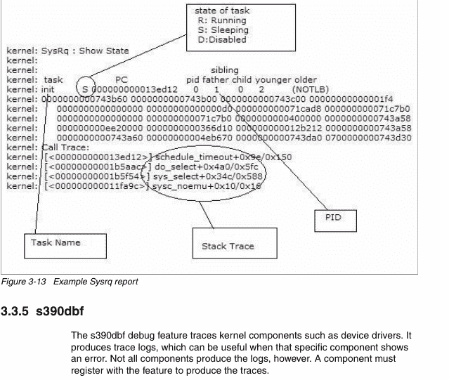

图 3-13 Sysrq 报告示例

#### 3.3.5 s390dbf

`s390dbf` 调试功能可以跟踪内核组件（如设备驱动程序）。它生成跟踪日志，当特定组件显示错误时，这些日志可能很有用。然而，并非所有组件都会生成日志。组件必须注册该功能才能生成跟踪数据。

`/proc` 目录保存了来自 `s390dbf` 工具的调试日志。在路径 `/proc/s390dbf` 下，每个注册的组件都有一个目录。目录条目的名称对应于组件注册时的名称。事件（和异常）调用有三个版本：一个用于记录原始数据，一个用于文本，一个用于数字。每个调试条目包含以下数据：

- 时间戳
- 调用任务的 CPU 编号
- 调试条目级别 (`0..6`)
- 调用者的返回地址

根据要调查的区域选择文件，并选择 `/proc` 目录下的文件：

- `/proc/s390dbf/cio_*` : 通用 I/O
- `/proc/s390dbf/qdio_*` : qdio
- `/proc/s390dbf/qeth_*` : qeth
- `/proc/s390dbf/zfcp_*` : zfcp
- `/proc/s390dbf/dasd_` : DASD
- `/proc/s390dbf/0.0.xxxx` : 每个 DASD 设备

所有调试日志都有一个实际的调试级别（范围从 0 到 6）。默认级别为 3。事件和异常函数具有级别参数。通过向为每个调试日志提供的 `'level'` debugfs 文件写入数字字符串 `"x"`，可以利用 debugfs 文件系统更改实际调试级别。

##### 示例 3-46 s390dbf 日志级别

```
1nx02:/ # cat /proc/s390dbf/qeth_trace/level
2
```

现在，根据所需的跟踪级别，设置日志值，如示例 3-47 所示。

##### 示例 3-47 设置日志级别

```
1nx02:/ # echo 6 > /proc/s390dbf/qeth_trace/level
1nx02:/ # cat /proc/s390dbf/qeth_trace/level
6
```

一旦达到适当的跟踪级别，重现问题以保存 `s390dbf` 跟踪输出。

##### 示例 3-48 将 s390dbf 跟踪保存到文件

```
cat /proc/s390dbf/qeth_trace/hex_ascii > output_file
```

一旦保存了来自 `s390dbf` 设施的跟踪信息，请恢复旧的跟踪级别（示例 3-49）。

##### 示例 3-49 将跟踪级别重置为默认值

```
1nx02:/ # echo 2 > /proc/s390dbf/qeth_trace/level
```

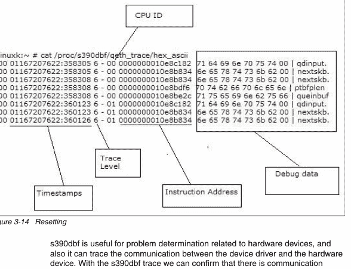

图 3-14 重置

`s390dbf` 对于与硬件设备相关的问题确定很有用，它还可以跟踪设备驱动程序与硬件设备之间的通信。通过 `s390dbf` 跟踪，我们可以确认设备之间存在通信（例如，发往 DASD 设备的 I/O 请求及其返回的状态）。

#### 3.3.6 zFCP/SCSI

zFCP 跟踪功能启用对 `zfcp` 设备驱动程序和光纤通道协议流的调试。在进行任何调试时，zFCP 跟踪应与 SCSI 跟踪一起使用。

可以根据问题目标区域选择以下跟踪信息：

- `loglevel_erp`
- `loglevel_fsf`
- `loglevel_fc`
- `loglevel_qdio`
- `loglevel_cio`
- `loglevel_scsi`
- `loglevel_other`

在示例 3-50 中，我们将启用 zFCP 驱动程序，并将 `loglevel_erp` 的日志级别设置为 1。

##### 示例 3-50 启用 zfcp

```
echo 1 > /sys/bus/ccw/drivers/zfcp/loglevel_erp
```

zFCP 跟踪的日志级别有四个不同的级别，从 0 到 3。数值越大，获取的信息越详细。所有区域的日志级别默认设置为 0，仅输出最少信息。通过设置 `zfcp` 的日志级别，调试消息将写入 `/var/log/messages`。要停止 zFCP 跟踪，请参阅示例 3-51。

##### 示例 3-51 禁用 zfcp

```
echo 0 > /sys/bus/ccw/drivers/zfcp/loglevel_erp
```

示例 3-52 显示了 zFCP 驱动程序的输出。

##### 示例 3-52 loglevel_erp 的 zFCP 跟踪

```
Mar 5 10:56:36 linuxx kernel: zfcp: zfcp_fsf_req_send(4926): calling do_QDIO adapter 0.0.f441, flags=0x2, queue_no=0, index_in_queue=42, count=1, buffers=000000000d5a2260
Mar 5 10:56:36 linuxx kernel: zfcp: zfcp_fsf_req_send(4933): free_count=127
Mar 5 10:56:36 linuxx kernel: zfcp: zfcp_fsf_send_fcp_command_task(3757): Send FCP Command initiated (adapter 0.0.f441, port 0x5005076300cf9b9e, unit 0x5501000000000000
Mar 5 10:56:36 linuxx kernel: zfcp: zfcp_qdio_request_handler(310): adapter 0.0.f441, first=42, elements_processed=1
Mar 5 10:56:36 linuxx kernel: zfcp: zfcp_qdio_zero_sbals(866): zeroing BUFFER 42 at address 000000000d59fa00
Mar 5 10:56:36 linuxx kernel: zfcp: zfcp_qdio_request_handler(326): free_count=128
Mar 5 10:56:36 linuxx kernel: zfcp: zfcp_qdio_request_handler(329): elements_processed=1, free count=128
Mar 5 10:56:36 linuxx kernel: zfcp: zfcp_qdio_response_handler(376): first BUFFERE flags=0x40000000
```

##### SCSI 跟踪

使用 SCSI 跟踪，我们可以获得有关 SCSI 层的重要调试信息。如前所述，将其与 zFCP 跟踪一起使用是有效的。示例 3-53 显示了用于设置 SCSI 跟踪日志级别的命令。

###### 示例 3-53 SCSI 日志级别设置

```
echo 0x9249249 > /proc/sys/dev/scsi/logging_level
```

示例 3-54 显示了一个 SCSI 跟踪示例。


### 示例 3-54 SCSI 跟踪示例

```
Mar 28 22:32:48 T60410A kernel: sd_open: disk=sda
Mar 28 22:32:48 T600410A kernel: scsi_block_when_processing_errors: rtn: 1
Mar 28 22:32:48 T60410A kernel: sd_init_command: disk=sda, block=62, count=8
Mar 28 22:32:48 T60410A kernel: sda : block=6
Mar 28 22:32:48 T60410A kernel: sda : reading 8/8 512 byte blocks.
Mar 28 22:32:48 T60410A kernel: scsi_add_timer: scmd: 000000001e48f900, time: 3000, (00000002090d740)
Mar 28 22:32:48 T60410A kernel: scsi <0:0:1:0> send 0x000000001e48f900 Read (10) 00
00 00 00 00 3e 00 00 08 00
Mar 28 22:32:48 T60410A kernel: buffer = 0x000000001ea5e700, bufflen = 4096, done = 0x000000020810a14, queuecommand 0x00000000208c3f1c
```

通常，`zFCP` 和 `SCSI` 跟踪一起使用，以解决发生在 `SCSI` 和 `zFCP` 区域的问题。在处理目标区域和调整跟踪日志级别时请小心。设置较高的日志级别可能会对性能产生负面影响。

## 网络故障排查

本章讨论了 System z 上 Linux 的网络故障排查。

本章的重点是运行在 `z/VM` 上的 Linux。我们将讨论以下主题：

- System z 上 Linux 的网络选项概述
- System z 上 Linux 中的网络接口检测与配置
- 网络故障排查的艺术
- 案例研究


### 4.1 System z 上 Linux 网络选项概述

System z 上 Linux 可用的网络选项大致可分为两类：物理硬件和虚拟化技术。顾名思义，物理硬件涵盖物理网络接口，或者在 HiperSockets 的情况下，涵盖需要 System z 服务器的网络实现方式。虚拟化技术涵盖计划在 `z/VM` 环境中运行 Linux 的用户可用的网络选项。`z/VM` 操作系统也可以使用任何物理网络选项。因此，作为 `z/VM` 环境中的虚拟机（VM）运行的 Linux 系统可以选择使用任何物理选项、任何虚拟化技术选项，或两者的组合，包括：

- 物理网络选项
  - 开放系统适配器
  - HiperSockets
- 虚拟化技术
  - 来宾局域网 `Guest LAN`
  - `z/VM` 虚拟交换机 `VSwitch`

#### 4.1.1 开放系统适配器

开放系统适配器 `OSA` 卡是 System z 服务器连接外部世界（开放系统）的网络适配器。根据所使用的 `OSA` 卡的具体类型，支持 10 Gigabit 以太网（10 G 或 10 GbE）、Gigabit 以太网（GbE）、1000Base-T 以太网、快速以太网（FENET）、令牌环和异步传输模式（ATM）。对于 Linux 连接，这些卡由硬件 I/O 配置识别为以下通道类型：

- 排队直接 I/O `QDIO`
- 非排队直接 I/O `OSE`

> 注意：关于 `OSA-Express` 操作模式和限制，详情请参阅 IBM Redbooks 出版物《`OSA-Express` 实施指南》，`SG24-5948`。

##### 排队直接 I/O 模式

排队直接 I/O `QDIO` 是一种高效的数据传输机制。它通过使用系统内存队列和信号协议在 `OSA` 卡微处理器和 TCP/IP 协议栈之间直接交换数据，从而减少系统开销并提高吞吐量。

##### 非排队直接 I/O `non-QDIO` 模式

在非 `QDIO` 模式下，数据遵循较长的 I/O 路径。当 Linux 在此模式下运行时，使用 `LCS` 设备驱动程序与设备通信。图 4-1 展示了 `QDIO` 和非 `QDIO` 数据路径之间的区别。

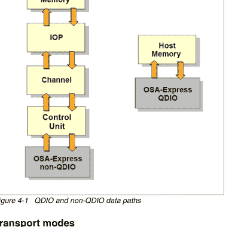

图 4-1 `QDIO` 和非 `QDIO` 数据路径

##### 传输模式

对于 IP 和非 IP 工作负载，当前 `OSA` 卡支持两种传输模式：第 2 层（链路或以太网层）和第 3 层（网络或 IP 层）。每种模式对网络数据的处理方式不同。

第 2 层：

- 使用 MAC 目的地址来识别主机并发送和接收以太网帧。
- 在操作系统 TCP/IP 协议栈和物理网络之间传输以太网帧（而不是 IP 数据报）。
- 不执行 ARP 卸载。ARP 处理由每个操作系统的 TCP/IP 协议栈执行。
- 支持 MAC 级别的单播、多播和广播。

第 3 层具有以下特征：

- 数据基于 IP 地址传输。
- 仅使用 IP 地址来识别局域网段上的主机。
- 所有 ARP 处理由适配器本身执行，而不是由共享该适配器的任何操作系统执行。
- 适配器为所有共享适配器端口的来宾管理单个 MAC 地址。

##### LPAR 到 LPAR 的通信

`OSA` 卡的一个端口可以在多个 LPAR 之间共享。此外，对卡上端口的访问也可以在同一个 LPAR 内的多个 TCP/IP 协议栈之间并发共享。在端口共享时，运行在 `QDIO` 模式下的 `OSA` 卡能够在 LPAR 之间发送和接收 IP 流量，而无需将 IP 数据包通过网络发送。

对于出站数据包，`OSA` 卡使用 TCP/IP 协议栈提供的下一跳地址来确定将数据包发送到何处。如果此下一跳地址已由共享此 `OSA` 卡的另一个 TCP/IP 协议栈注册，则该数据包直接交付给该 TCP/IP 协议栈，而不通过局域网发送。这使得在同一主机系统内部路由 IP 数据包成为可能。

> 注意：端口共享仅支持具有相同传输模式的端口之间，例如第 2 层对第 2 层以及第 3 层对第 3 层。

#### 4.1.2 HiperSockets

`HiperSockets` 在 System z 机器上运行在不同 LPAR 中的服务器之间提供非常快速的 TCP/IP 通信。每个 `HiperSocket` 定义为类型 `IQD` 的 `CHPID`。

为了在同一个 System z 服务器上运行的服务器之间进行通信，`HiperSockets` 在 System z 服务器内存中设置 I/O 队列。然后，数据包在服务器之间以内存速度传输，从而完全消除 I/O 子系统开销和任何外部网络延迟。

`HiperSockets` 的实现基于 `OSA QDIO` 协议。因此，`HiperSockets` 被称为内部 `QDIO` `iQDIO`。`HiperSockets` 在模拟 `OSA` 卡逻辑链路控制（LLC）层的微代码中实现。

从 System z 上 Linux 的角度来看，`HiperSockets` 接口看起来很像 `OSA QDIO` 模式接口。Linux 使用 `qdio` 和 `qeth` 模块来利用 `HiperSockets`。

#### 4.1.3 来宾局域网

从 `z/VM V4.2` 开始，`z/VM` 控制程序（控制程序 `CP`）经过增强，提供了一项名为来宾局域网 `Guest LAN` 的功能。该功能允许你在 `z/VM` 环境中创建多个虚拟局域网段。如图 4-2 所示，来宾局域网没有与外部网络的物理连接。相反，它们必须使用路由器（`z/VM TCP/IP` 或 Linux）。Linux 路由器或 `z/VM TCP/IP` 协议栈必须具有外部接口（例如 `OSA` 卡）以及连接到局域网的接口。

> 注意：虽然 `z/VM` 下与来宾局域网相关的结构和模拟设备是虚拟的，但我们使用“来宾局域网”一词而不是“虚拟局域网”，因为在网络领域，“虚拟局域网” `VLAN` 一词具有不同的含义。

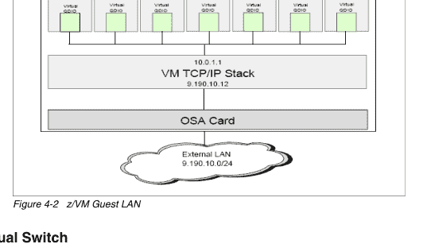

图 4-2 `z/VM` 来宾局域网

#### 4.1.4 虚拟交换机

随 `z/VM V4.4` 推出的 `z/VM` 虚拟交换机 `VSWITCH` 基于早期 `z/VM` 版本提供的来宾局域网技术进行构建。`VSWITCH` 使用 `OSA` 卡端口将来宾局域网连接到外部接口网络。在 `VSWITCH` 定义中，可以指定两个额外的 `OSA` 卡端口作为备份。连接到 `VSWITCH` 的 Linux 来宾与 `OSA` 卡端口以及连接到该物理局域网段的其他机器位于同一个子网中。


z/VM V4.4 的 VSWITCH 实现在 OSI 模型的第 3 层（网络层）运行。它仅支持 IP 数据包的传输，因此只能用于与 TCP/IP 相关的应用程序。在 z/VM V5.1 中，VSWITCH 实现扩展为也能在 OSI 模型的第 2 层（数据链路层）运行。由于 VSWITCH 本质上连接到物理局域网，因此消除了物理局域网段和（内部）来宾局域网段之间中间路由器的需求。

### 4.1.5 System z 上 Linux 网络选项摘要

图 4-3 展示了我们讨论的 System z 上 Linux 网络选项的摘要。

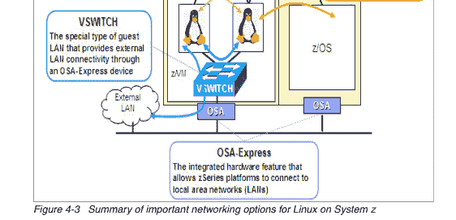

图 4-3 System z 上 Linux 重要网络选项摘要

## 4.2 System z 上 Linux 中的网络接口检测与配置

System z 上 Linux 中的网络接口检测和配置通过多个步骤完成。本节将介绍网络接口检测和配置相关的若干重要要点。

> **注意：** 本章使用 SUSE Linux Enterprise Server 的配置文件以及启动或命令执行消息作为示例。然而，该概念同样适用于 Red Hat Enterprise Linux。

### 4.2.1 Linux 热插拔系统

Linux 热插拔系统用于管理连接到系统的设备。严格来说，Linux 热插拔项目内部有两个功能，称为冷插拔（coldplug）和热插拔（hotplug）。在启动时连接的设备以及某些不太容易检测的设备由冷插拔检测。对于 PCI 设备，有一个应被冷插拔初始化的设备类型的白名单和一个应被跳过的设备类型的黑名单。热插拔用于管理可以动态插入或移除的设备。热插拔还处理内核启动后的任何设备检测任务。

热插拔脚本（也称为 `*.rc` 脚本）为每个扫描到的设备打印一个字符。表 4-1 列出了这些字符及其含义。

表 4-1 Linux 热插拔脚本为每个扫描到的设备打印的字符

| 字符 | 含义 |
|---|---|
| . (句点) | 该设备已经初始化，因此被跳过。 |
| * (星号) | 为此设备生成热插拔事件。 |
| W | 该设备不在白名单中，因此被跳过。 |
| B | 该设备在黑名单中，因此被跳过。 |

### 4.2.2 Linux 下网络接口检测与激活流程

图 4-4 概述了 System z 上 Linux 的网络接口检测流程。热插拔（hotplug）或冷插拔（coldplug）脚本确保以正确的选项加载正确的模块。然后分配接口名称。一旦接口名称分配完毕，系统将读取相应的配置文件并配置网络参数。

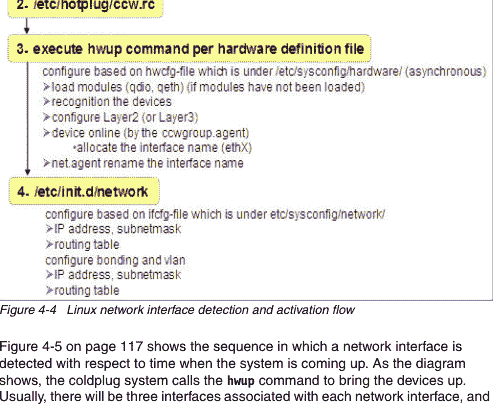

图 4-4 Linux 网络接口检测与激活流程

第 117 页的图 4-5 展示了系统启动时网络接口检测的时间顺序。如图所示，冷插拔系统调用 `hwup` 命令来启动设备。通常，每个网络接口会关联三个接口，而由 `ccwgroup.agent` 负责将这些设备组成一个接口并分配接口名称。一旦接口名称分配完毕，网络脚本将为接口分配 IP 地址及其他参数。根据配置情况，网络接口可能默认启动，也可能需要手动干预才能启动。

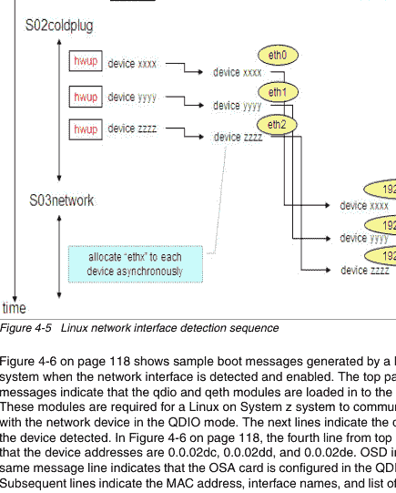

图 4-5 Linux 网络接口检测顺序

第 118 页的图 4-6 展示了 Linux 系统在检测并启用网络接口时生成的示例启动消息。消息的上半部分表明 `qdio` 和 `qeth` 模块已加载到内存中。这些模块是 System z 上的 Linux 系统以 QDIO 模式与网络设备通信所必需的。接下来的行显示了检测到设备的详细信息。在第 118 页的图 4-6 中，从上往下数的第四行表明设备地址为 0.0.02dc、0.0.02dd 和 0.0.02de。同一行消息中的 OSD 表示 OSA 卡片配置为 QDIO 模式。随后的行显示了 MAC 地址、接口名称以及在该卡片上启用的功能列表。

```
load module
qeth: loading QETH base support version 2.3(Revision: 1.79.2.10.5)Revision: 1.37.9)Revision: 1.25.2.2.9)
qeth: loading qeth S/390 OSA-Express driver (SRevision: 1.77.2.73.8)Revision: 1.98.2.33.8)Revision: 1.77.2.9.5)Revision: 1.8.2.2.5)Revision: 1.7.2.3.5)Revision: 1.5.2.7.5)Revision: 1.19.2.18.5 IPv6 :VLAN)
qeth: Device 0.0.02dc0.00d0.00d2e is a QSD Express card (level: 0657)
with link type OSD_1000 (portname: )
qeth: Error in registering MAC address on device 0.0.02dc: <200s
qeth: Device 0.0.05a0.00.05a0.00.05a6 is a GuestLAN QDIO card (level: V52D)
with link type GuestLAN QDIO (portname: )
qeth: Hardware IP fragmentation not supported on eth1
qeth: VLAN enabled
qeth: Multicast enabled
qeth: IPv6 enabled
qeth: Broadcast enabled
qeth: Using SW checksuming on eth1.
qeth: Outbound TSO not supported on eth1
NET: Registered protocol family 17
qeth: MAC address 02:00:00:16:31:89 successfully registered on device eth0
```

图 4-6 System z 上 Linux 中与网络接口检测相关的启动消息

图 4-7 指示了与第三层配置相关的启动消息，以及第二层配置的消息。

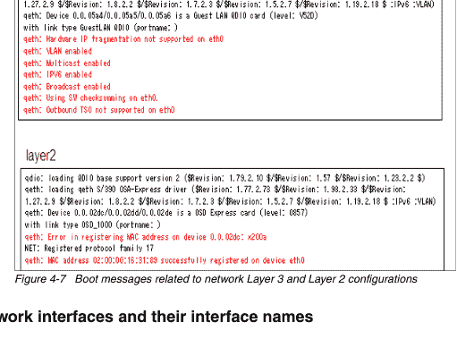

图 4-7 与网络第三层和第二层配置相关的启动消息

### 4.2.3 网络接口及其接口名称

在拥有多个网络接口的系统中，分配给 OSA 设备的接口名称在 Linux 系统重启后可能不一致。这是因为热插拔事件是异步的，多个驱动程序会并行初始化其设备。接口名称的这种不一致性可能会导致某些中间件（如 Oracle®）出现问题。此外，SNMP 和 Linux 监控工具 `sar` 也可能受到此问题的影响。

图 4-8 说明了热插拔事件的异步特性。如图所示，设备 3333 在设备 222 之前配置，因此它被分配了接口名称 eth1，而不是预期的 eth2。设备 2222 现在是 eth2。

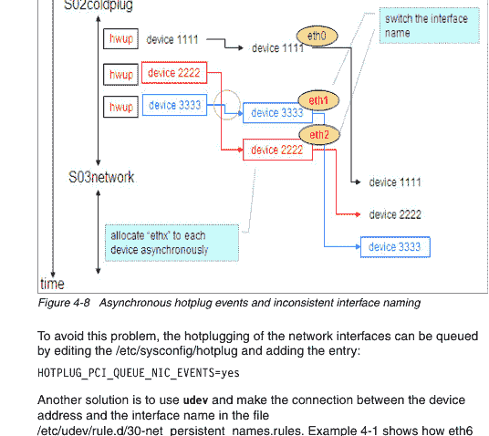

图 4-8 异步热插拔事件和不一致的接口命名

为避免此问题，可以通过编辑 `/etc/sysconfig/hotplug` 并添加以下条目来对网络接口的热插拔进行排队：

```
HOTPLUG_PCI_QUEUE_NIC_EVENTS=yes
```

另一种解决方案是使用 `udev`，并在文件 `/etc/udev/rule.d/30-net_persistent_names.rules` 中建立设备地址与接口名称之间的连接。示例 4-1 展示了如何将 eth6 永久分配给 0.0.05a2。

#### 示例 4-1 将接口名称 eth6 永久分配给设备 0.0.05a2

```
SUBSYSTEM=="net", ACTION=="add", ENV{PHYSDEVPATH}=="*0.0.05a2",
IMPORT="/lib/udev/rename_netiface %k eth6"
```

当使用信道捆绑（channel bonding）时，这个问题不会发生，因为信道捆绑不使用热插拔。因此，设备名称在 Linux 系统重启后保持不变。

### 4.2.4 网络配置文件概述

在本节中，我们将快速浏览在 System z 上运行的 Linux 系统中网络设备的一些重要配置文件。如前所述，本文以 SuSE Linux Enterprise Server 的文件作为示例。

#### /etc/sysconfig/hardware/hwcfg-qeth-ccw-0.0.xxxx 文件


该文件由 `hwup` 和 `hwdown` 命令引用。图 4-9 展示了一个示例 `hwcfg-qeth-ccw-0.0.xxxx` 文件。对于系统中的每个 OSA 设备，都会有一个唯一的 `hwcfg-qeth` 文件。在此情况下，设备为 0.0.02d4，因此确切的文件名为 `hwcfg-qeth-ccw-0.0.02d4`。

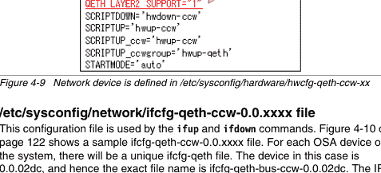

图 4-9 网络设备在 `/etc/sysconfig/hardware/hwcfg-qeth-ccw-xx` 中定义

### `/etc/sysconfig/network/ifcfg-qeth-ccw-0.0.xxxx` 文件

此配置文件由 `ifup` 和 `ifdown` 命令使用。第 122 页的图 4-10 展示了一个示例 `ifcfg-qeth-ccw-0.0.xxxx` 文件。对于系统中的每个 OSA 设备，都会有一个唯一的 `ifcfg-qeth` 文件。在此情况下，设备为 0.0.02dc，因此确切的文件名为 `ifcfg-qeth-bus-ccw-0.0.02dc`。IP 地址、子网掩码、本地 MAC 地址、MTU、自动启动（`STARTMODE`）等都在此文件中配置。当 `STARTMODE=onboot` 时，接口在系统启动期间会自动激活。

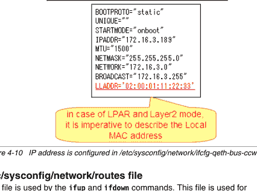

图 4-10 IP 地址在 `/etc/sysconfig/network/ifcfg-qeth-bus-ccw-xxx` 中配置

### `/etc/sysconfig/network/routes` 文件

此文件由 `ifup` 和 `ifdown` 命令使用。该文件用于配置静态网络路由。图 4-11 展示了一个示例网络路由文件。该文件的格式为：目标网络（在此情况下为 192.168.30.0）、下一跳（在此情况下为 172.16.3.131）、子网掩码（255.255.255.0）以及接口名称（在此情况下为 `qeth-bus-ccw-0.005a4`）。图 4-11 中显示的第二行是一个特殊条目，定义默认网关。关键字 `default` 将其标识为默认网关。两个减号（- -）表示它们假定使用默认值。


图 4-11 网络路由在 `/etc/sysconfig/network/routes` 中配置

#### 4.3 网络故障诊断

在快速介绍了 System z 上 Linux 的常见网络选项以及 Linux 下的网络接口检测和配置之后，本节将讨论网络故障诊断。前两节应作为本节的理论基础。

网络问题大致可分为两类：

- 与网络通信相关的问题
- 与网络性能相关的问题

与网络通信相关的问题将在本章中详细讨论。第 5 章“第 163 页的性能故障诊断”专门介绍 System z 上 Linux 的性能故障诊断，同时也讨论了网络性能问题。

##### 4.3.1 与网络通信相关的问题

通信涉及多方。计算机系统也是如此。当计算机系统之间交换数据或消息时，我们说它们在进行通信。当这种消息交换中断时，我们说存在通信问题。因此，在高层级上，系统中的网络通信问题可以是该系统的本地问题，也可以是系统外部的问题（即本地机器网络运行正常）。在我们的讨论中，我们假设本地系统是运行在 System z 服务器上的 Linux 系统，并且我们正尝试从该系统与其他系统进行通信。

###### 本地机器上的故障诊断

当系统无法与其他系统通信时，我们需要问一些逻辑性的问题。你能与网络上的任何系统通信吗？在问题发生之前我们对系统做了哪些更改？我们能与部分系统通信吗？错误日志中是否有任何与问题相关的信息？我们将很快逐一查看这些问题。

###### System z 上 Linux 的网络通信层

第 124 页的图 4-12 展示了 System z 上 Linux 的网络通信层。这样的层次结构对于缩小问题范围非常有用。最底层是硬件（HW）层。OSA 设备属于此层。下一层是虚拟机（VM）层，z/VM 级别进行的虚拟化（例如 VSWITCH）属于此层。下一层，QDIO 和 QETH，代表设备驱动程序。MAC 地址表示由 ARP 层处理。当然，IP地址被映射到 IP 层，所有与 TCP/UDP 相关的组件则映射到 TCP/UDP 层。最后，SSH、FTP、Telnet 等应用程序由应用层表示。

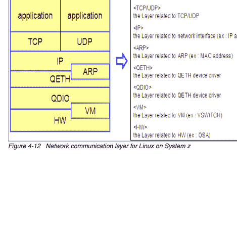

图 4-12 System z 上 Linux 的网络通信层

图 4-13 将 System z 上 Linux 的网络通信层与 OSI 参考模型进行了比较。OSI 参考模型中的硬件层由 HW、VM、QDIO 和 QETH 层组成。OSI 模型中的数据链路层由 ARP 层表示。此外，ARP 层的一部分以及 IP 层共同构成了 OSI 的网络层。OSI 传输层实现为 TCP/UDP 层，最后，System z 上 Linux 网络通信模型中的应用层代表了 OSI 参考模型中的会话层、表示层和应用层。

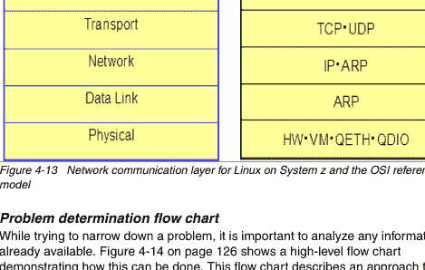

图 4-13 System z 上 Linux 的网络通信层与 OSI 参考模型

###### 问题诊断流程图

在尝试缩小问题范围时，分析现有信息至关重要。第 126 页的图 4-14 展示了一个高层流程图，说明了如何做到这一点。该流程图描述了一种可用于本地系统问题诊断的方法。通常，当出现问题时，首先要做的是捕获尽可能多的错误日志。在某些情况下，错误消息可能会被覆盖。因此，一旦有错误消息可用，立即尝试捕获它们非常重要。检查错误消息有助于我们将问题缩小到某一层或至少一组层。当一个正在运行的系统突然停止工作时，在跳进配置文件进行编辑之前，重要的是要调查在问题发生前系统是否做出了任何更改。在大多数情况下，我们会注意到有变更发生，并且导致了错误。如果问题出现在新安装的系统上，值得检查所有配置是否有错误。有时，在 System z 服务器之外的网络层做出的更改也可能给运行在 System z 服务器上的系统带来问题。因此，与网络支持人员的良好协调也是排除网络故障的重要因素。在某些情况下，可能需要使用网络数据包跟踪工具来缩小或隔离问题。通常，如果是永久性的通信问题，相对于间歇性问题而言，更容易识别和修复。间歇性问题可能需要更多时间来排除故障，并且在修复后可能需要持续观察一段时间，以确保问题确实已解决。

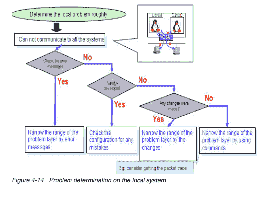

图 4-14 本地系统的问题诊断

在某些情况下，可能没有太多有用的信息可供分析以进行问题诊断。在这种情况下，最好执行特定命令并分析其输出以进行问题诊断。图 4-15 展示了一种使用 `ping` 命令来缩小某些层问题的简单但常见且强大的方法。如图表所示，如果 `ping` 命令的结果是成功的，那么我们可以确定网络电缆已连接，网络接口处于活动状态，并且 IP 通信（网络层）正在进行。在这种情况下，可以确定问题位于 IP 层之上的某处。

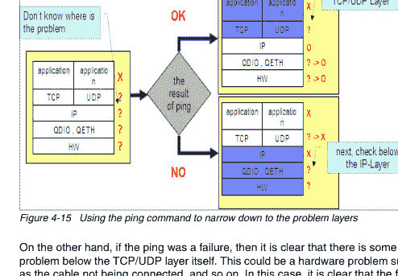

图 4-15 使用 `ping` 命令缩小问题所在的层

另一方面，如果 `ping` 失败，则显然在 TCP/UDP 层本身之下存在某些问题。这可能是硬件问题，例如电缆未连接等。在这种情况下，显然第一级故障排除应从 IP 层及以下开始。

现在，我们讨论如何在每一层进行调查以缩小问题范围。

###### IP 层的调查

由于 `ping` 命令的简单性，在排除故障时，通常最好从 IP 层开始，然后根据情况向上或向下缩小范围。

图 4-16 总结了在 IP 层进行调查时可以执行的一些常见任务。

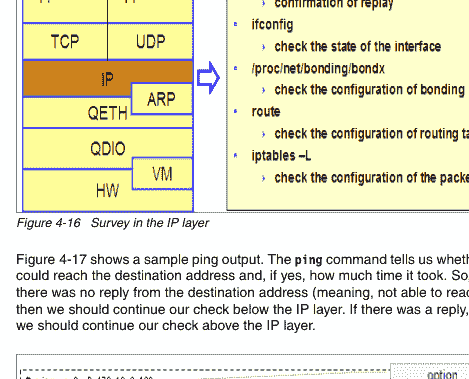

图 4-16 IP 层的调查

图 4-17 显示了 `ping` 命令输出的示例。`ping` 命令告诉我们是否能否到达目标地址，如果可以，则告诉我们要花费多少时间。因此，如果目标地址没有响应（即无法到达），则应继续在 IP 层以下进行检查。如果有响应，则应继续在 IP 层以上进行检查。


### 使用 `ping` 进行诊断

```
######## ping -c 3 -R 172.16.3.189
PING 172.16.3.189 (172.16.3.189) 56(124) bytes of data.
64 bytes from 172.16.3.189: icmp_seq=1 ttl=64 time=17.9 ms
RR: 172.16.3.131
172.16.3.189
172.16.3.189
172.16.3.131

64 bytes from 172.16.3.189: icmp_seq=2 ttl=64 time=0.683 ms  (same route)
64 bytes from 172.16.3.189: icmp_seq=3 ttl=64 time=0.635 ms  (same route)

--- 172.16.3.189 ping statistics ---
3 packets transmitted, 3 received, 0% packet loss, time 2011ms
rtt min/avg/max/mdev = 0.635/6.416/17.936/8.164 ms
```

图 4-17 使用 `ping` 进行诊断

图 4-18 显示了另一个有用命令 `ifconfig` 的输出。图中指出了我们在输出中需要检查的重要事项。

```
######## ifconfig
bond0  Link encap:Ethernet  HWaddr 02:00:00:16:31:89 (1)
       inet addr:172.20.3.189 (2)  Bcast:172.20.3.255  Mask:255.255.255.0 (3)
       inet6 addr: fe80::ff:fe16:3189/64 Scope:Link
       UP (4)  BROADCAST RUNNING MULTICAST  MTU:1500 (5)  Metric:1
       RX packets:437 (6)  errors:0  dropped:0  overruns:0  frame:0
       TX packets:542 (7)  errors:0  dropped:0  overruns:0  carrier:0
       collisions:0 txqueuelen:0
       ...
       RX bytes:36252 (35.4 Kb)  TX bytes:47336 (46.2 Kb)
```

- (1) MAC 地址
- (2) IP 地址
- (3) 子网掩码
- (4) 接口的状态
- (5) MTU
- (6) 接收到的数据包数量
- (7) 发送的数据包数量

图 4-18 使用 `ifconfig` 进行诊断

当 `ifconfig` 命令在没有命令行参数的情况下执行时，仅显示活动的接口（即状态为 `UP` 的接口）。`-a` 命令行参数将强制 `ifconfig` 显示所有已配置的接口，无论其状态如何。图 4-19 显示了使用 `-a` 命令行参数执行 `ifconfig` 命令时的示例输出。

```
######## ifconfig -a
eth0  Link encap:Ethernet  HWaddr 00:11:25:C0:16:00
       BROADCAST MULTICAST  MTU:1500  Metric:1
       RX packets:0  errors:0  dropped:0  overruns:0  frame:0
       TX packets:0  errors:0  dropped:0  overruns:0  carrier:0
eth1  Link encap:Ethernet  HWaddr 02:00:00:00:00:2A
       ...
```

图 4-19 指示接口处于 `DOWN` 状态的 `ifconfig` 命令输出

如果接口已关闭，则故障排除应在 IP 层以下继续进行。如果 IP 地址、子网掩码等未正确显示，则应检查相应的配置文件（对于 SLES 为 `/etc/sysconfig/network/ifcfg-qeth-ccw-0.0.xxxx`）。在二层配置的情况下，该文件还将配置本地 MAC 地址。

`route` 命令在执行时使用 `-n` 选项，显示内核路由表（`netstat -rn` 也会显示类似的输出）。图 4-20 显示了 `route -n` 输出的示例。

```
######## route -n
Kernel IP routing table
Destination Gateway Genmask Flags Metric Ref Use Iface
172.20.3.0 * 255.255.255.0 U 0 0 0 vlan10
172.16.3.0 * 255.255.255.0 U 0 0 0 eth1
192.168.30.0 172.16.3.131 255.255.255.0 UG 0 0 0 eth1
169.254.0.0 * 255.255.0.0 U 0 0 0 eth1
127.0.0.0 * 255.0.0.0 U 0 0 0 lo
0.0.0.0 172.16.3.140 0.0.0.0 UG 0 0 0 eth1
```

图 4-20 检查路由表

有时，由于数据包过滤设置，通信无法发生。可以使用 `iptables` 命令检查数据包过滤（防火墙）配置。图 4-21 显示了 `iptables -L` 输出的示例，该示例指示来自任何主机的 SSH 连接都应被丢弃。

```
######## iptables -L
iptables -L
Chain INPUT (policy ACCEPT)
target prot opt source destination
DROP tcp -- anywhere tcp dpt:ssh
Chain FORWARD (policy ACCEPT)
target prot opt source destination
Chain OUTPUT (policy ACCEPT)
target prot opt source destination

Annotation: DROP the connection by ssh
```

图 4-21 使用 `iptables` 检查数据包过滤配置

### ARP 层排查

图 4-22 总结了 ARP 层的排查命令。

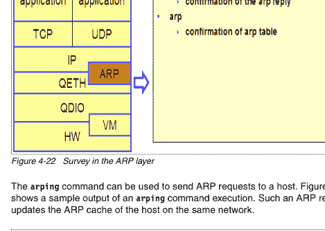

图 4-22 ARP 层排查

`arping` 命令可用于向主机发送 ARP 请求。图 4-23 展示了执行 `arping` 命令时的示例输出。此类 ARP 请求会更新同一网络上主机的 ARP 缓存。

```
######## arping -I bond0 -c 3 172.20.3.182
ARPING 172.20.3.182 from 172.20.3.189 bond0
Unicast reply from 172.20.3.182 [00:03:47:98:77:6A] 0.990ms
Unicast reply from 172.20.3.182 [00:03:47:98:77:6A] 0.957ms
Unicast reply from 172.20.3.182 [00:03:47:98:77:6A] 0.922ms
Sent 3 probes (1 broadcast(s))
Received 3 response(s)
```

图 4-23 使用 `arping` 进行诊断

如果没有响应，则应在 ARP 层以下继续进行故障排除。图 4-24 展示了如何使用 `arp` 命令检查 ARP 表。

```
######## arp
Address (1)          HWtype  HWaddress (2)          Flags Mask (3)  Iface (4)
172.20.3.182         ether   00:03:47:38:77:8A      C               bond0
```

- (1) 对端的 IP 地址
- (2) 对端的 MAC 地址
- (3) 条目类型
  - C ：普通条目，在一段时间后丢弃
  - M ：持久条目
  - P ：代理 ARP 条目
- (4) 接口名称
- ARP 表按接口进行管理

图 4-24 使用 `arp` 命令进行诊断

### QETH 层排查

图 4-25 展示了在 QETH 层中可排查的不同事项。此层中主要需要检查的是 `qeth` 设备驱动程序是否已识别这些设备。第 133 页上的图 4-26 展示了 `/proc/qeth` 文件的示例输出，说明了如何检查网络设备是否已被 `qeth` 设备驱动程序识别。

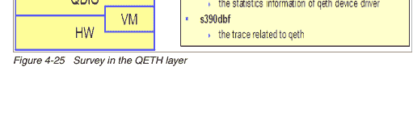

- `/proc/qeth`
  - 检查 `qeth` 设备驱动程序是否已识别这些设备
- `lsqeth`
  - 检查 `qeth` 设备驱动程序是否已识别这些设备
  - 确认 Layer2/Layer3 模式


- `/var/log/messages`
  - 确认与 `qeth` 相关的错误消息
- `/proc/qeth_perf`
  - `qeth` 设备驱动程序的统计数据信息
- `s390dbf`
  - 与 `qeth` 相关的跟踪信息

### 图 4-25 QETH 层排查

如果设备未被识别，则检查 `/etc/sysconfig/hardware/hwcfg-xxx` 中的设备配置。

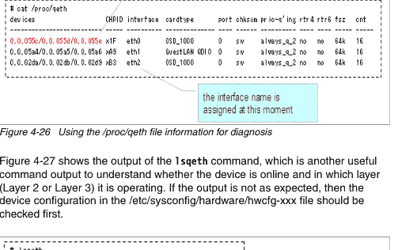

图 4-26 使用 `/proc/qeth` 文件信息进行诊断

图 4-27 展示了 `lsqeth` 命令的输出，这是另一个有助于了解设备是否在线以及它运行在哪一层（Layer 2 或 Layer 3）的有用命令输出。如果输出不符合预期，则首先应检查 `/etc/sysconfig/hardware/hwcfg-xxx` 文件中的设备配置。

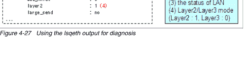

图 4-27 使用 `lsqeth` 输出进行诊断

Linux 中的 `/var/log/messages` 文件捕获了生成的大部分常见消息。这是一个非常重要的文件，系统管理员、开发人员等通常参考它来排查问题。图 4-28 展示了当某个网络设备出现问题时记录在 `/var/log/messages` 文件中的示例消息。示例输出顶部显示的设备名称有助于我们确定问题是否出在我们正在处理的设备上。

```
qeth: check on device 0.0.5600, dstat=x0, ostat=x4 <4>
qeth: irb: 00 c2 40 17 03 77 50 38 00 00 00 00 00 00 00 00
qeth: irb: 00 00 00 00 00 00 00 00 00 00 00 00 00 00 00 00
qeth: irb: 00 00 00 00 00 00 00 00 00 00 00 00 00 00 00 00
qeth: irb: 00 00 00 00 00 00 00 00 00 00 00 00 00 00 02 15 5d
qdio : received check condition on activate queues on device 0.0.5602 (cs=x4, ds=x0).
qeth: Recovery of device 0.0.5600 started ...
bonding: bond1: Link status definitely down for interface eth2, disabling it
bonding: bond1: making interface eth3 the new active one.
```

图 4-28 使用 `/var/log/messages` 信息进行诊断

可以通过检查 `/proc/qeth_perf` 文件来查看 `qdio` 和 `qeth` 驱动程序之间传输的数据包数量。图 4-29 展示了包含 `qeth` 和 `qdio` 之间传输的数据包数量的示例输出。异常大的数据包数量意味着在 `qeth` 驱动程序级别或硬件级别存在问题。

```
######## cat /proc/qeth_perf
For card with devnos 0.0.0240/0.0.0241/0.0.0242 (eth0):
Skb's/buffers received     : 16144394/11280405
Skb's/buffers sent         : 3694744/3694744
...
Inbound do_QDIO time (in us) : 1114771
Inbound do_QDIO count       : 1410050
Outbound handler time (in us) : 4472000
Outbound handler count      : 3694743
Outbound time (in us, incl QDIO) : 45268773
Outbound count              : 3694744
Outbound do_QDIO time (in us) : 41639121
Outbound do_QDIO count      : 3634744

Annotations: the number of packets from QDIO to QETH
Annotations: the number of packets from QETH to QDIO
```

图 4-29 使用 `/proc/qeth_perf` 中的信息进行诊断

用于调试的额外跟踪信息可以在 `/proc/s390dbf/qeth*` 文件中找到。在向 IBM 支持团队报告问题时，需要提供这些文件的内容以供诊断。图 4-30 展示了 `qeth` 的跟踪信息输出。

```
######## cat /proc/s390dbf/qeth_trace/hex_ascii
00 01162707622:358305 6 - 00 0000000010e8c182 71 64 69 6e 70 75 75 74 00 | qd input.
00 01162707622:358305 6 - 00 0000000010e8b834 6e 65 78 74 73 6b 62 00 | nextskb.
00 01162707622:358308 6 - 00 0000000010e8b834 6e 65 78 74 73 6b 62 00 | nextskb.
00 01162707622:358308 6 - 00 0000000010e8bdfc 70 74 62 66 70 70 6c 65 | ptbfplen
00 01162707622:358308 6 - 00 0000000010e8be2c 71 75 65 69 6e 62 75 76 | queinbuf
00 01162707622:360123 6 - 01 0000000010e8c182 71 64 69 6e 70 75 75 74 00 | qd input.
00 01162707622:360126 6 - 01 0000000010e8b834 6e 65 78 74 73 6b 62 00 | nextskb.
:
```

图 4-30 使用 `/proc/s390dbf/qeth_trace/hex_ascii` 中的信息进行诊断

### QDIO 层排查

QDIO 层的排查本质上是检查来自调试器的跟踪信息。第 136 页上的图 4-32 展示了 `/proc/s390dbf/qdio_trace/hex_ascii` 的示例输出。

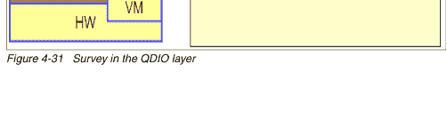

图 4-31 QDIO 层排查

```
######## cat /proc/s390dbf/qdio_trace/hex_ascii
00 01177658169:314293 0 - 01 00000000102097a 71 81 6c 53 20 20 20 38 | qalc 8
00 01177658169:314868 0 - 01 00000000102097a 71 81 6c 53 20 20 20 37 | qalc 7
00 01177658169:394630 2 - 01 000000001025c3a 64 85 6c 73 74 72 67 74 | delytrgt
00 01177658169:394631 2 - 01 000000001025c9a 00 00 00 00 00 00 00 00 | ........
00 01177658169:394632 0 - 01 000000001025d04 71 85 73 74 20 20 20 37 | qest 7
00 01177658169:394663 0 - 01 000000001022f4a 71 85 68 63 20 20 20 37 | qehi 7
00 01177658169:396508 2 - 01 000000001024938 71 61 63 74 20 20 20 37 | qact 7
```

图 4-32 使用 `/proc/s390dbf/qdio_trace/hex_ascii` 中的信息进行诊断

### VM 层排查

图 4-33 总结了 VM 层排查中有用的命令。在 VM 级别进行故障排除时，重要的是要了解何时处于虚拟世界，何时处于真实世界。

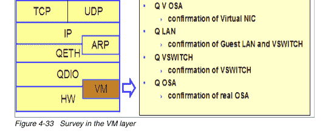

- `Q V NIC`
  - 确认虚拟 NIC
- `Q V OSA`
  - 确认虚拟 NIC
- `Q LAN`
  - 确认 Guest LAN 和 VSWITCH
- `Q VSWITCH`
  - 确认 VSWITCH
- `Q OSA`
  - 确认真实 OSA


# 图 4-33 VM 层排查

图 4-34 展示了 `Q V NIC` 命令的示例输出。此命令输出显示了分配给 VM 用户的虚拟 NIC 的状态。如果虚拟 NIC 编号不正确或设备类型不正确，则需检查 `z/VM` 目录（`USER DIRECT`）。

```
Adapter 05A4 Type: 0010 Name: UNASSIGNED Devices: 3
Port 0 MAC: 02-00-00-00-00-2A VSWITCH: SYSTEM LINUXW
Adapter 1600 Type: HIPERS Name: UNASSIGNED Devices: 3
Port 0 MAC: 02-00-00-00-00-35 LAN: SYSTEM HS001 MFS: 65936
Adapter 1700 Type: 0010 Name: UNASSIGNED Devices: 3
Port 0 MAC: 02-00-00-00-00-33 VSWITCH: SYSTEM VLANTEST
Adapter 1704 Type: 0010 Name: UNASSIGNED Devices: 3
Port 0 MAC: 02-00-00-00-00-34 VSWITCH: SYSTEM VLANTEST
Adapter 1808 Type: 0010 Name: UNASSIGNED Devices: 3
Port 0 MAC: 02-00-00-00-00-2B VSWITCH: SYSTEM BONDTEST
Adapter 180C Type: 0010 Name: UNASSIGNED Devices: 3
Port 0 MAC: 02-00-00-00-00-32 VSWITCH: SYSTEM BONDTEST
```

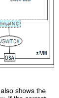

## 图 4-34 使用 `Q V NIC` 输出进行诊断

图 4-35 展示了 `Q V OSA` 的输出。此命令输出还显示了直接连接的 OSA，而 `Q V NIC` 命令不会显示这些。如果未显示正确的 OSA 地址，则需要检查 `USER DIRECT` 文件。

```
CP QUERY VIRTUAL OSA
OSA 055C ON OSA 055C SUBCHANNEL = 0018
055C DEVTYPE OSA CHPID 1F 050
055C 0010-ELIGIBLE 010ASSIST DISABLED
OSA 055D ON OSA 055D SUBCHANNEL = 0019
055D DEVTYPE OSA CHPID 1F 050
055D 0010-ELIGIBLE 010ASSIST DISABLED
OSA 055E ON OSA 055E SUBCHANNEL = 001A
055E DEVTYPE OSA CHPID 1F 050
055E 0010 ACTIVE 010ASSIST DISABLED
055E
055E INP = 01 IOCNT = 00000000 ADP = 015 PROG = 000 UNAVAIL = 113
:
```

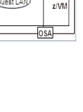

## 图 4-35 使用 `Q V OSA` 输出进行诊断

图 4-36 展示了 `Q LAN` 的输出。该命令输出显示了与 HiperSockets、Guest LAN、`VSWITCH` 等相关的信息。如果 LAN 信息未正确显示，则需要检查 HiperSockets 的 `IOCP` 以及 Guest LAN 和 `VSWITCH` 相关的 `z/VM SYSTEM CONFIG` 文件中的问题。

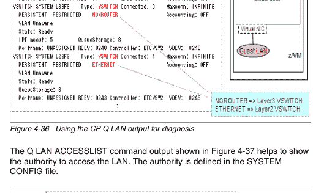

## 图 4-36 使用 `CP Q LAN` 输出进行诊断

图 4-37 中显示的 `Q LAN ACCESLIST` 命令输出有助于显示访问 LAN 的权限。该权限在 `SYSTEM CONFIG` 文件中定义。

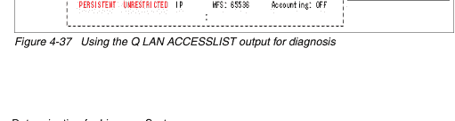

## 图 4-37 使用 `Q LAN ACCESLIST` 输出进行诊断

如图 4-38 所示，`CP Q LAN DETAIL` 命令输出提供了诸如 LAN 上接收和发送的数据包数量、连接到该 LAN 的客户端系统的 IP 地址和 MAC 地址等信息。如果接收和发送的数据包数量快速增加，则可能表明存在问题。

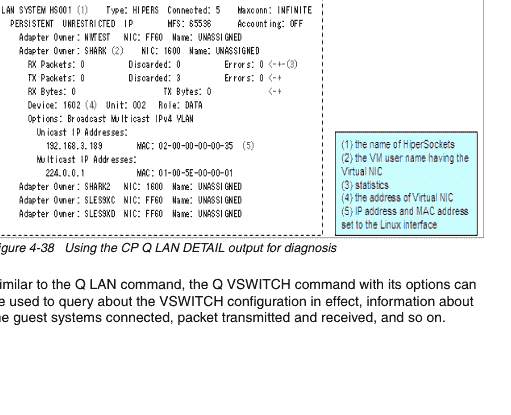

## 图 4-38 使用 `CP Q LAN DETAIL` 输出进行诊断

与 `Q LAN` 命令类似，可以使用带有选项的 `Q VSWITCH` 命令来查询当前生效的 `VSWITCH` 配置、连接的客户端系统信息、发送和接收的数据包等。

`Q OSA` 命令输出将显示有关实际 OSA 卡片的信息。如果未显示预期的设备，则需要检查 `IOCP`。要获取有关 OSA 的更多信息，例如 OSA 地址表 (`OAT`)，可以使用 `z/VM OSA/SF` 工具。图 4-39 显示了 `OSA/SF` 输出的示例。此输出可用于验证已注册的 MAC 地址和 IP 地址。

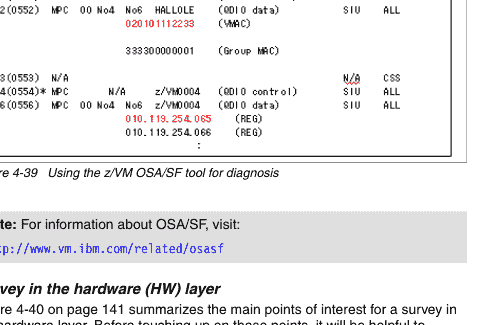

## 图 4-39 使用 `z/VM OSA/SF` 工具进行诊断

注意：有关 `OSA/SF` 的信息，请访问：http://www.vm.ibm.com/related/osasf

# 硬件 (HW) 层调查

第 141 页的图 4-40 总结了硬件层调查的主要关注点。在讨论这些要点之前，解释一个有用的 Linux 内核参数会很有帮助。通常，当 Linux 系统启动时，它会感知所有连接的硬件设备。此外，Linux 还会感知任何动态变化，例如在运行期间添加新设备或移除设备。所有检测到的设备（无论是在系统启动时检测到的还是之后检测到的）都在 `sysfs` 下控制。在 Linux 运行期间，大多数这些设备可以动态地设置为在线或离线。可以使用 `cio_ignore` 内核参数禁用对特定设备的感知。当为设备设置 `cio_ignore` 参数时，该设备在系统重启期间不会被感知，并且无法从 Linux 中将其设置为在线或离线。

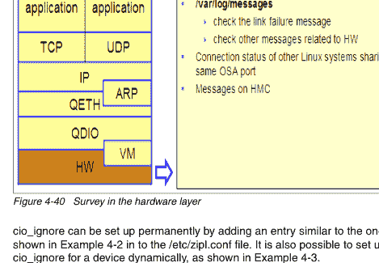

## 图 4-40 硬件层调查

可以通过在 `/etc/zipl.conf` 文件中添加类似于示例 4-2 中所示的条目来永久设置 `cio_ignore`。还可以动态设置设备的 `cio_ignore`，如示例 4-3 所示。

### 示例 4-2 在 `/etc/zipl.conf` 中设置 `cio_ignore` 的示例条目

```
cio_ignore=0.0.1000-0.0.1fff,0.0.3000-0.0.3fff
```

设备 1000-1FFFF、3000-3FFF 未被感知。

### 示例 4-3 使用 `/proc/cio_ignore` 动态设置 `cio_ignore`

```
echo add 0.0.1000 > /proc/cio_ignore
```
将设备 1000 添加到 `cio_ignore` 列表

```
echo free 0.0.2000 > /proc/cio_ignore
```
将设备 2000 从 `cio_ignore` 列表中移除

- `/var/log/messages`
  - 检查链路故障消息
  - 检查其他与 HW 相关的消息
- 共享相同 OSA 端口的其他 Linux 系统的连接状态
- HMC 上的消息

图 4-41 显示了 `lscss` 命令的输出。此输出有助于了解 Linux 学习到的通道路径信息。如果 `lscss` 命令提供的设备地址不正确，请检查 `IOCP`、`z/VM USER DIRECT` 和 `cio_ignore`。使用 `cio_ignore` 设置禁用（或隐藏）的设备不会在 `lscss` 命令中显示。

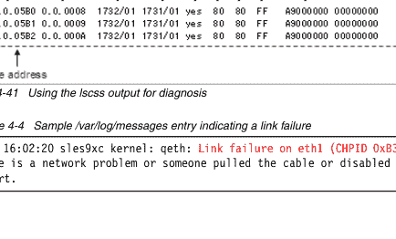

## 图 4-41 使用 `lscss` 输出进行诊断

### 示例 4-4 指示链路故障的 `/var/log/messages` 示例条目

```
Jun 24 16:02:20 sles9xc kernel: qeth: Link failure on eth1 (CHPID 0xB3)
- there is a network problem or someone pulled the cable or disabled
the port.
```


`/var/log/messages` 文件将包含有关链路状态的信息。第 142 页的示例 4-4 显示了 `/var/log/messages` 文件中指示 `eth1` 接口链路故障的示例消息。对于链路故障消息，需要检查的事项包括电缆或与交换机的连接、共享相同 OSA 端口的其他 Linux 系统的状态（如果有），以及硬件管理控制台 `HMC` 上显示的硬件消息和返回代码。

拔出 `eth1` 的电缆

```
Jun 24 16:02:20 sles9xc kernel: qeth: Link failure on eth1 (CHPID 0xB3) - there is a network problem or someone pulled the cable or disabled the port.
Jun 24 16:02:20 sles9xc kernel: bonding: bond0: link status definitely down for interface eth1 disabling it
Jun 24 16:02:20 sles9xc kernel: bonding: bond0: making interface eth2 the new active one.

Jun 24 16:02:40 sles9xc kernel: qeth: Link reestablished on eth1 (CHPID 0xB3). Scheduling IP address reset.
Jun 24 16:02:40 sles9xc kernel: qeth: Recovery of device 0.0.02d4 started ...
Jun 24 16:02:40 sles9xc kernel: qeth: Device 0.0.02d4/0.0.02d5/0.0.02d6 is a OSA Express card (level: 062d)
Jun 24 16:02:40 sles9xc kernel: qeth with link type OSA_100 (portname: )
Jun 24 16:02:40 sles9xc kernel: qeth: MAC address 02:01:11:22:33 successfully registered on device eth1
Jun 24 16:02:40 sles9xc kernel: qeth: Device 0.0.02d4 successfully recovered!
Jun 24 16:02:41 sles9xc kernel: bonding: bond0: link status up for interface eth1, enabling it in 10000 ms
```

插回 `eth1` 的电缆

图 4-42 指示链路 DOWN 和 UP 状态的 `/var/log/messages` 输出

### TCP/UDP 层调查

调查 TCP/UDP 层的一种最佳方法是使用 `netstat` 命令来检查 TCP 或 UDP 套接字的状态。

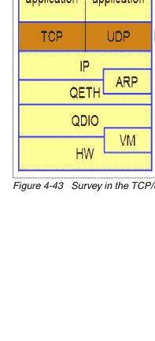

- `netstat -nat`
    - TCP 套接字的状态
- `netstat -nau`
    - UDP 套接字的状态
- `netstat -s`
    - 检查网络统计信息
- `telnet`
    - 检查另一方的 TCP 套接字

图 4-43 TCP/UDP 层调查

图 4-44 和图 4-45 分别显示了使用 `netstat` 命令针对 TCP（即使用 `-t` 选项）和 UDP（即使用 `-u` 选项）套接字的示例输出。从该输出中，我们可以找到本地机器正在通信的端口和目的端口等。通常，当我们尝试连接到一个应用程序时，该应用程序将监听某个端口。因此，应检查 `netstat` 输出，以确认感兴趣的应用程序是否真的在监听该端口，是否已建立连接等。


图 4-44 使用 `netstat -nat` 输出对 TCP 套接字进行诊断


图 4-45 使用 `netstat -nau` 输出对 UDP 套接字进行诊断

注意：由于 UDP 是无状态协议，因此 `netstat -nau` 输出的 State 列将为空白。

另一个有用的 `netstat` 输出如示例 4-5 所示。如果重传分组的数量正在增加，通常这是一个令人担忧的问题。

#### 示例 4-5 `netstat -s` 输出示例

```
######## netstat -s
...
Tcp:
1638 active connections openings
4889 passive connection openings
31 failed connection attempts
474 connection resets received
14 connections established
8310735 segments received
7790702 segments sent out
1860 segments retransmitted
0 bad segments received.
1275 resets sent
...
```

一种非常快速检查系统是否在 TCP 端口上监听的方法是对该系统执行 Telnet 到该端口。由于 UDP 是无状态协议，因此此方法不适用于 UDP。第 147 页的图 4-46 显示了一个示例

使用 `Telnet` 命令建立到 TCP 端口 111 的连接。此处展示了连接成功和连接失败的结果。

#### 示例：连接成功

```
######## telnet 172.16.3.189 111
Trying 172.16.3.189...
Connected to 172.16.3.189.
Escape character is "^\]".

Connection closed by foreign host.
```

指定状态为 `LISTEN` 的 TCP 套接字数量

#### 示例：连接失败

```
######## telnet 172.16.3.189 113
Trying 172.16.3.189...
telnet: connect to address 172.16.3.189: Connection refused
```

图 4-46 使用 `telnet` 诊断 TCP 套接字状态

**注意：** 请记住，当尝试从一台系统连接到另一台系统的特定 TCP 端口时，路径上的所有网络设备必须允许在该端口上建立连接。否则，即使目标系统上的套接字是开放的，连接也可能失败。

### 应用层调查

应用层调查可以通过检查系统上所需进程是否正在运行、检查打开的文件描述符数量等方式进行。


图 4-47 应用层调查。

示例 4-6 展示了一种检查 `sshd` 服务状态的方法。在此情况下，输出指示 SSH 守护进程正在运行。

#### 示例 4-6 检查 SSH 服务器服务状态

```
######## /etc/init.d/sshd status
Checking for service sshd                      running
```

示例 4-7 中显示的示例输出（最后 3 行）表明邮件服务（`master` 和 `qmgr`）正在运行，并且 SSH 守护进程正在运行，有一个用户已连接。

#### 示例 4-7 示例 `ps -ef` 输出（为简化而修改）显示进程

```
######## ps -ef
UID PID PPID C STIME TTY TIME CMD
root 1 0 0 Apr26 ? 00:00:00 init [5]
root 2 1 0 Apr26 ? 00:00:00 [migration/0]
root 3 1 0 Apr26 ? 00:00:12 [ksoftirqd/0]
root 4 1 0 Apr26 ? 00:00:00 [migration/1]
root 5 1 0 Apr26 ? 00:00:42 [ksoftirqd/1]
root 6 1 0 Apr26 ? 00:00:00 [events/0]
root      7      1  0 Apr26 ?        00:00:00 [events/1]
root    25233    1  0 Jun07 ?        00:00:00 /usr/lib/postfix/master
postfix 25244 25233  0 Jun07 ?        00:00:00 qmgr -l -t fifo -u
root    26889 1534  0 11:20 ?        00:00:00 root@pts/2
```


Linux 具有一项功能（`ulimit`），用于限制每个进程打开的文件数量。此限制本质上就是每个进程可以使用的文件描述符数量。Linux 具有一项功能（`ulimit`），它限制了每个进程打开的文件数量。此限制本质上就是每个进程可以使用的文件描述符数量。当 Linux 使用资源（如标准 I/O 和进程间通信）时，需要文件描述符，因为这些资源在虚拟上被视为文件。示例 4-8 显示了进程 ID 为 `4610` 的进程打开的文件描述符数量。

## 示例 4-8 显示进程使用的文件描述符数量的示例输出

```
ls -l /proc/4610/fd
total 7
dr-x------  2 root root   0 May 30 20:04 .
dr-xr-xr-x  3 root root   0 May 30 20:04 ..
lrwx------  1 root root  64 May 30 20:04 0 -> /dev/pts/4
lrwx------  1 root root  64 May 30 20:04 1 -> /dev/pts/4
lrwx------  1 root root  64 May 30 20:04 2 -> /dev/pts/4
lrwx------  1 root root  64 May 30 20:04 3 -> socket:[732707]
lrwx------  1 root root  64 May 30 20:04 4 -> /dev/pts/4
lrwx------  1 root root  64 May 30 20:04 5 -> /dev/pts/4
lrwx------  1 root root  64 May 30 20:04 6 -> /dev/pts/4
```

对于网络应用程序（如 `http` 守护进程），客户端数量受文件描述符限制的限制。因此，当新的客户端无法连接到已经运行的 HTTP 守护进程时，可能是 HTTP 守护进程已达到限制，无法再打开新的文件描述符。

### 本地机器外部的问题确定

当我们确定本地机器的网络工作正常时，则有必要将问题确定任务集中到本地系统外部。同样，在这里也需要提出一些逻辑性问题才能继续。通信问题是仅与特定系统之间的吗？还是与所有其他系统之间的通信都有问题？网络或任何系统上是否进行了更改？关于此问题的简单流程图如图 4-48 所示。


图 4-48 本地机器外部的问题确定

### 数据包跟踪

数据包跟踪是网络问题确定的一种非常强大的技术。数据包跟踪通过监控网络上的数据帮助我们确定问题。通常在本地机器、目标机器以及交换机或路由器等网络设备上进行数据包跟踪。在某些情况下，可能需要在更多的中间网络层进行数据包跟踪，具体取决于网络配置的复杂性。数据包跟踪也有助于我们识别问题所在的层次。示例 4-9 显示了 Linux `tcpdump` 工具的一个示例输出。`tcpdump` 工具用于捕获系统上的网络数据包。


图 4-49 使用数据包跟踪进行问题确定

#### 示例 4-9 tcpdump 示例输出

```
tcpdump -i eth0
20:41:10.810464 IP 172.168.1.2.ibm3494 > lin.itso.pok.ibm.com.ssh: .
ack 1144296 win 63403
20:41:10.810464 IP 172.168.1.2.ibm3494 > lin.itso.pok.ibm.com.ssh: .
ack 1144296 win 65535
20:41:10.810465 IP 172.168.1.2.ibm3494 > lin.itso.pok.ibm.com.ssh: .
ack 1145092 win 64739
20:41:10.810466 IP 172.168.1.2.ibm3494 > lin.itso.pok.ibm.com.ssh: .
ack 1145748 win 64083
20:41:10.810467 IP 172.168.1.2.ibm3494 > lin.itso.pok.ibm.com.ssh: .
ack 1145748 win 65535
20:41:10.810748 IP lin.itso.pok.ibm.com.sshIP lin.itso.pok.ibm.com.ssh
> 172.168.1.2.ibm3494: P 1149028:1149624(596) ack 5461 win 9648win 9648
20:41:10.811267 IP 172.168.1.2.ibm3494 > lin.itso.pok.ibm.com.ssh: P
5461:5513(52) ack 1145748 win 65535
20:41:10.811410 IP lin.itso.pok.ibm.com.ssh > 172.168.1.2.ibm3494: P 1149624:1150476(852) ack 5513 win 9648
20:41:10.811466 IP lin.itso.pok.ibm.com.ssh > 172.168.1.2.ibm3494: P 1150476:1150752(276) ack 5513 win 9648
20:41:10.811572 IP lin.itso.pok.ibm.com.ssh > 172.168.1.2.ibm3494: P 1150752:1151044(292) ack 5513 win 9648
20:41:10.811722 IP lin.itso.pok.ibm.com.ssh > 172.168.1.2.ibm3494: P 1151044:1151208(164) ack 5513 win 9648
20:41:10.811814 IP lin.itso.pok.ibm.com.ssh > 172.168.1.2.ibm3494: P 1151208:1151372(164) ack 5513 win 9648
20:41:10.811904 IP lin.itso.pok.ibm.com.ssh > 172.168.1.2.ibm3494: P 1151372:1151536(164) ack 5513 win 9648
20:41:10.811993 IP lin.itso.pok.ibm.com.ssh > 172.168.1.2.ibm3494: P 1151536:1151700(164) ack 5513 win 9648
```

在数据包跟踪过程中，如果我们无法获取目标节点的 MAC 地址，那么这意味着要么本地节点无法发送 ARP 请求，要么目标无法响应 ARP 请求。如果 `ping` 不工作，那么要么本地系统无法发送 ICMP 回显，要么目标无法回复该请求。

### CISCO SPAN 端口功能

CISCO 交换机具有 SPAN 端口功能，如图 4-50 所示。从 A 发送到 B 的单播数据包可以被复制并发送到 SPAN 端口。SPAN 端口提供交换机端口分析器功能。


图 4-50 CISCO SPAN 功能

### z/VM 中的数据包跟踪

可以使用虚拟 LAN 嗅探器功能（在 z/VM V5.2 或更高版本中可用）来捕获 z/VM Guest LAN 或 VSWITCH 上的数据包。可以使用 `CP TRSOURCE` 命令来跟踪和记录数据传输。要分析输出，可以使用 `IPFORMAT` 实用程序。要使用 z/VM Guest LAN 跟踪功能，需要 C 类或更高权限。

图 4-51 显示了一个 z/VM 数据包跟踪场景。假设我们需要捕获边缘系统和 IHS 系统之间的跟踪信息。


图 4-51 VM 数据包跟踪场景

首先需要定义我们要获取的跟踪。然后，需要激活已定义的跟踪。一旦跟踪被激活，我们需要启动目标系统之间的通信。一旦尝试通信足够长的时间，就需要停止跟踪。下一步是将跟踪信息保存到 CMS 文件，然后使用 `IPFORMAT` 实用程序进行分析。图 4-52 显示了跟踪的定义、跟踪的激活以及跟踪的启动。


图 4-52 z/VM Guest LAN 嗅探步骤 1–3

图 4-53 说明了停止跟踪并将跟踪记录保存到 CMS 文件的操作。还显示了 `IPFORMAT` 命令的执行。


图 4-53 z/VM Guest LAN 嗅探步骤 4-5


图 4-54 显示了跟踪记录文件的内容。这些内容以十六进制格式呈现。`IPFORMAT` 实用程序处理此记录并生成更易于阅读的输出生成。


图 4-54 示例跟踪记录

图 4-55 显示了使用 `IPFORMAT` 实用程序处理后的跟踪记录。


图 4-55 示例 `IPFORMAT` 输出

### 使用数据包跟踪进行问题确定的示例

图 4-56 展示了一个使用数据包跟踪进行问题确定的示例场景。


图 4-56 使用数据包跟踪进行问题确定的示例场景

假设 Linux 系统与客户端之间的通信不正常。当从客户端打开与 Linux 主机的会话时，显示会冻结一会儿，然后恢复正常状态。此外，一段时间后屏幕上也会显示命令类型。为了找到问题，如所示，我们需要获取 Linux 系统、交换机和客户端系统的 Linux 系统跟踪信息。

如图 4-57 所示，我们可以看到客户端和交换机正在持续进行 TCP 重传，但 Linux 系统没有看到这些数据包。因此，客户端没有任何问题，而交换机端口不稳定。OSA 端口和网络端口设置之间可能存在速度不匹配。可以使用 `OSA/SF` 工具来查找 OSA 卡端口设置，例如协商模式、速度等。


图 4-57 示例数据包跟踪（交换机端口故障）

可以将此信息与交换机端的设置进行比较，以确保两者都配置并运行在相同的模式下。如图 4-58 所示，`OSA/SF` 工具显示了 OSA 卡的配置值和活动值。


图 4-58 示例 `OSA/SF` 输出，显示 OSA 卡端口速度设置

#### 4.4 案例研究

在本节中，我们介绍一些涉及实际问题的案例研究。

##### 案例研究 1 - eth0 接口关闭

在此场景中，`eth0` 接口的停用导致 `eth1` 接口停止工作。

###### 问题

我们有一个在该系统上运行的 Linux 系统，具有一个接口 `eth0`。添加了一个新的以太网接口 `eth1`，并重启了系统。系统重启后，使用 `ifconfig` 命令关闭了 `eth0` 接口，以测试使用 `eth1` 接口的通信。但现在 `eth1` 接口无法通信。图 4-59 显示了该场景。


图 4-59 案例研究示例 - `eth0` 接口关闭

###### 分析数据

为了排除故障，我们需要收集以下信息并分析其正确性：

- `/etc/sysconfig/hardware/hwcfg-qeth-bus-ccw-0.0.xxxx`
- `/etc/sysconfig/network/ifcfg-qeth-bus-ccw-0.0.xxxx`
- `dmesg` 命令输出
- `ifconfig` 命令输出
- `/etc/sysconfig/network/routes`
- `netstat -m` 命令输出

###### 分析和结论

检查配置文件后，一切都看起来是正确的。但从由 `route -n` 命令给出的路由表输出中，我们识别出 `eth0` 接口被配置为 `eth1` 的路由接口（默认网关）。因此，当 `eth0` 接口关闭时，由于路由表条目的丢失，`eth1` 接口无法通信。所有通信都是通过 `eth0` 接口完成的。

如果上述方法无法解决问题，则考虑获取数据包跟踪。

##### 案例研究 2 - VSWITCH OSA 接管后连接丢失

假设我们在 z/VM 系统上配置了一个 `VSWITCH`，设备 3700 作为活动 OSA，设备 3800 作为备用 OSA。

###### 问题

当移除连接到活动 OSA（设备 3700）的电缆时，尽管发生了切换到备用 OSA（设备 3800）的操作，但通信仍丢失。

###### 分析数据

分析以下数据：

- 设备 3700 和 3800 的状态
- z/VM TCP/IP 和执行 `ping` 命令的工作站的 ARP 缓存
- z/VM Linux 客户机的路由信息（`route -n` 命令输出）
- `VSWITCH` 的跟踪信息
- `OSA/SF` 查询

###### 分析和结论

从 `OSA/SF` 查询输出中发现，备用 OSA 设备的端口设置为 1000 Mbps 全双工，尽管它连接到的是 100 Mbps 交换机。由于端口速度不匹配，数据未被发送。由于活动 OSA 在拔掉电缆之前能够通信，显然在 IP 层或更高层没有问题。

##### 案例研究 3 - 无法使用 SSH 连接

考虑图 4-60 所示的场景。Linux 系统运行在 System z 上的 z/VM 上。路由器指示客户端系统和 Linux 系统位于不同的网络子网中。

###### 问题

我们无法从客户端使用 `SSH` 连接到 Linux 系统。


图 4-60 案例研究示例 - 无法使用 `SSH` 连接

###### 分析数据

分析以下数据：

- `/etc/sysconfig/hardware/hwcfg-qeth-bus-ccw-0.0.xxxx`
- `/etc/sysconfig/network/ifcfg-qeth-bus-ccw-0.0.xxxx`
- 路由表信息（`route -n` 命令输出）
- 路由器配置
- `tcpdump`

###### 分析和结论

`PING` 或 `FTP` 没有问题。由于 `SSH` 将使用与 `PING` 和 `FTP` 相同的网络路径，因此问题不在于路由表。两个 Linux 系统之间的 `SSH` 工作正常。因此，Linux 系统上的 `SSH` 服务器工作正确。检查路由器配置后发现，连接到 Linux 系统网络段的路由器的 MTU 大小设置为 512。这意味着需要在路由器级别进行数据包分片。但客户端发送的是设置了不分片（DF）位的数据包。这导致连接到 Linux 系统的路由器向客户端发送 ICMP 目的地不可达/需要分片且 DF 位已设置的消息。然而，连接到客户端段的路由器的配置是丢弃此数据包。因此，问题的原因是路由器端的配置。`tcpdump` 对于排除此故障非常有用。

### 性能问题确定

本章讨论 System z 上 Linux 的性能问题确定。我们讨论了：

- 什么是性能问题
- 性能问题确定的一般流程
- 案例研究

#### 5.1 什么是性能问题

通常，当系统用户期望系统提供某些功能，而系统无法满足这些期望时，我们就说该系统存在性能问题。根据用户的期望，这可能有所不同。例如，当系统以 100% 的处理器使用率运行，且用户没有遇到系统响应性或吞吐量方面的问题时，则该系统不存在性能问题。因此，在尝试排除故障之前理解期望很重要。

大多数性能问题是由于系统配置错误或未能满足所有先决条件而引发的。性能问题可能由资源瓶颈（例如，应用程序或中间件消耗了系统上的所有资源）、软件问题（配置不当、软件漏洞等）和硬件问题引起。

#### 5.2 性能问题排查的一般流程

性能问题可能出现在硬件层、操作系统层、中间件层或应用层。图 5-1 展示了按这些层分类的问题排查方法。本章的范围是操作系统层面的问题排查。然而，需要注意以下几点：

- 仅对操作系统层进行调查可能并不总是足够的。
- 有时对单独各层进行调查是不够的，还需要调查其他层。


图 5-1 性能问题排查的层级

CPU、内存和 I/O 都与硬件相关，但这些都是由操作系统管理的资源，因此操作系统层面的问题排查通常集中在这些资源上。如图 5-2 所示，性能问题排查始于理解问题及其发生情况。


- **问题定义**
  - 性能需求是什么？
  - 目标值是多少？
  - 目标值是如何得出的？
  - 问题的影响级别和紧急程度是多少？
- **信息收集**
  - 各层所需的数据不同
    - 配置和参数信息
    - 资源利用率
    - 处理逻辑
    - 等等...
  - 此外，在 PD（问题排查）过程中，会逐渐获取更详细的数据以隔离问题
  - 与常规监控相比，资源利用率的采集间隔可能会更短

图 5-2 性能问题排查 - 定义问题


如图 5-2 所示，第一步是清楚地理解问题。如前所述，理解系统用户的期望以及是什么让他们认为存在性能问题非常重要。了解系统环境以学习影响系统性能的外部因素也很重要。在理解问题描述之后，下一步是收集更多信息，例如配置参数、资源的使用方式以及应用的处理逻辑。随着问题排查工作的推进，为了进行详细分析和隔离问题，会收集更多数据。在问题排查过程中，与正常情况相比，系统资源利用率通常会在更短的时间间隔内被非常频繁地监控，这也是典型的情况。

如图 5-3 所示，从操作系统的角度来看，CPU、内存、磁盘和网络的利用率是问题排查分析的主要数据。虽然这取决于当前的问题，但在大多数情况下，调查始于检查 CPU 限制。其中一个原因是 CPU 限制可能是最容易发现的。


- 在操作系统的观点下，我们主要调查物理资源（CPU、内存、磁盘和网络）的利用率
- 决定从哪里开始故障排查取决于当前的问题

图 5-3 性能问题排查 - 原因调查

如图 5-4（第 168 页）所示，检查系统是否存在任何 CPU 限制。如果系统似乎受到 CPU 限制，则进一步调查以了解是哪个进程和哪个应用程序造成了问题。如果系统没有 CPU 限制，需要考虑的下一个资源是内存。如果存在内存限制，则进一步调查以准确了解发生位置。如果未找到 CPU 和内存限制，接下来要检查的是 I/O 资源限制。对于 I/O 资源，有两个主要子资源：磁盘和网络。如果在 I/O 级别也未观察到资源限制，则可能需要调查图 5-1（第 165 页）中所示的不同层之间的交互。有时，解决一个瓶颈可能会引入另一个瓶颈，这需要解决。


图 5-4 性能问题排查 - 典型的原因调查流程

通常，问题是由变化引起的。这可能是系统配置的变化、资源分配的变化、用于配置的参数变化等等。当在一切运行完美的环境中出现问题时，首先要检查的是是否有任何变化（在环境中、在系统上等）。

如图 5-5 所示，调查、调优和测试是相互关联的活动。这是因为调查会导致解决方案，而测试该解决方案以确认其真正有效很重要。此外，在测试解决方案时，可能会发现该解决方案解决了当前问题但引入了新的瓶颈。在这种情况下，必须调查新识别问题的原因，并找到新的解决方案。


- 当前问题的解决方案可以通过以下方式得出
  - 系统配置变更
  - 资源分配变更
  - 参数变更
  - 资源增强
  - 等等....
- 测试是为了验证由得出的解决方案是否解决了问题
  - 许多变更不是同时执行的
  - 多次验证并找到最佳配置或参数
- 在我们消除一个瓶颈时，有另一种瓶颈被引入或被发现的可能性
  - 在这种情况下，调查新识别瓶颈的原因并得出解决方案

图 5-5 性能问题排查 - 调优和测试

在测试解决方案时，每次只做一个变更很重要。当许多变更同时进行时，如果问题得到解决，将难以确定是哪个变更解决了问题。同时做多个变更也可能引入新问题。这样一来，回滚会变得困难，因为我们可能不知道是哪个变更导致了新问题。多次验证解决方案以找到最佳配置或参数是一个良好的实践。

### 5.2.1 调查所需的数据

收集尽可能多的数据对于任何类型的问题排查都是重要的。性能问题排查也是如此。我们需要收集关于系统配置的信息，例如操作模式（即 `LPAR` 或 `z/VM` 来宾）、分配了多少 CPU、分配了多少内存、分配了多少磁盘、迷你磁盘或专用磁盘、用于磁盘访问的信道路径有多少、使用的网络选项类型（`QDIO`、`iQDIO` 等）、软件版本（内核级别、`z/VM` 服务级别等）以及在系统上运行的应用类型及其性质（即 CPU 密集型、内存密集型、I/O 密集型等）。我们需要了解系统是如何配置的，例如配置的内核参数和资源使用限制（例如，`ulimit`）。另一组重要信息是收集所考虑系统的资源利用率数据。资源利用率数据包括 CPU 利用率、内存利用率、磁盘利用率和网络利用率。对于 CPU 和内存，我们需要知道有多少 CPU 或内存，利用了多少，消耗速度多快，谁在使用它等。对于磁盘和网络，我们需要知道传输了多少数据，执行了多少 I/O 操作来传输数据等。虽然实时统计数据很有用，但为了有效的性能问题排查，需要历史资源利用率数据。如果没有历史数据，应按固定间隔测量资源利用率并分析结果。

有关用于信息收集的常用 Linux 工具的摘要，请参阅第 59 页的第 3 章“System z 上 Linux 的问题排查工具”。

### 5.2.2 CPU 瓶颈

在本节中，我们讨论 CPU 瓶颈。让我们首先简要查看 Linux 和 `z/VM` 是如何使用 CPU 的。

Linux 的 CPU 管理如图 5-6 所示。在任一给定时刻，单个 CPU 上只执行一个进程。准备在 CPU 上执行的进程维护在就绪队列中。Linux 系统从中选取一个进程放入处理器执行。经过一段时间后，Linux 系统会将该进程从 CPU 移出，并放入另一个进程。等待进入就绪队列的进程维护在等待队列中。


图 5-6 Linux CPU 管理

图 5-7 展示了 System z 上的 CPU 共享机制。在 `LPAR` 级别，微码逻辑将物理 CPU 分配给逻辑 CPU。每个 `LPAR` 在其分配的逻辑 CPU 上执行的进程，由微码逻辑以分时方式在物理 CPU 上执行。对于 `z/VM`，虚拟机看到由 `z/VM` 分配的逻辑 CPU。类似于微码逻辑，`z/VM` 负责以分时方式执行来自虚拟机的进程。


图 5-7 System z 上的 CPU 共享

CPU 利用率的计算方式如图 5-8 所示。如图所示，CPU 时间并非指整个时间段，而仅指 CPU 真正被使用的那些时间。例如，当以 5 秒间隔执行 `vmstat` 命令时，该工具会计算在这 5 秒间隔内 CPU 被使用了多少次。


图 5-8 CPU 利用率

正如前文所述，我们通过检查系统配置来开始问题排查。图 5-9 展示了检查 CPU 瓶颈的逻辑流程。通常，在检查当前配置时，我们会了解物理、逻辑和虚拟（`z/VM`）CPU 的配置。然后将 CPU 资源分配设置与硬件上的物理 CPU 资源进行比较，以确保配置正确。


图 5-9 问题排查流程 - 检查配置

一旦配置验证完成，下一步就是调查高 CPU 利用率问题的原因。第 175 页的图 5-10 展示了相应的示意图。在调查 CPU 利用率时，重要的是要记住，需要在多个间隔内收集利用率数据，然后进行分析。必须收集整个系统、每个 CPU 以及每个进程的 CPU 利用率数据。在 `z/VM` 的情况下，需要为每个 VM 收集这些数据，同时还要测量 `z/VM` 的开销。如果 CPU 利用率为 100%，那么瓶颈很可能在 CPU 上。然而，这并不绝对，因为诸如分页（paging）之类的活动会消耗大量的处理周期。因此，如果 CPU 利用率主要因分页操作而达到 100%，那么这就属于内存瓶颈。

图 5-10 问题排查流程 - 调查 CPU 利用率

表 5-1 总结了可用于获取 Linux 下 CPU 利用率的工具。这并非完整列表，这些只是其中一些常用工具。

#### 表 5-1 Linux 下获取 CPU 利用率的工具

| 名称 | 摘要 | 整个系统 | 每个 CPU | 每个进程 |
|---|---|---|---|---|
| `vmstat` | 在指定间隔获取 CPU 利用率。 | X | | |
| `mpstat` | 在指定间隔获取 CPU 利用率。 | X | X | |
| `sar` | 在指定间隔获取 CPU 利用率。 | X | X | |
| `top` | 获取每个进程的 CPU 利用率。 | X | X | X |

- 从各种视角调查 CPU 利用率
  - 整个系统
  - 每个 CPU
  - 每个进程
- 如果使用了 `z/VM`，需要在 `z/VM` 层进行调查
  - 整个系统
  - 每个 VM 客户
  - `z/VM` 开销
- 如果 CPU 利用率为 100%，CPU 瓶颈的可能性较高。
  - 在这种情况下，尚不确定是否真的是 CPU 瓶颈
  - 存在交换处理（swap processing）消耗 CPU 的情况。 => 这种情况属于内存瓶颈
- 确认配置
- 调查 CPU 利用率
- 调查消耗 CPU 的是什么
- 调查系统开销

| 名称 | 摘要 | 整个系统 | 每个 CPU | 每个进程 |
|------|---------|---------------|----------|--------------|


| ps | 获取每个进程的 CPU 利用率。 | | | X |

z/VM Performance Toolkit 能够获取整个系统、每个 CPU 以及每个进程的 CPU 利用率。

### 表 5-2 z/VM 下获取 CPU 利用率的工具

| 名称 | 摘要 | 整个系统 | 每个 CPU | 每个进程 |
|------|---------|---------------|----------|--------------|
| Performance Toolkit | 获取 z/VM 及每个 VM 客户的 CPU 利用率。 | X | X | X |

图 5-11 展示了一个 `vmstat` 输出示例，其中提供了整个系统的 CPU 利用率。


图 5-11 整个系统的 CPU 利用率 - vmstat

图 5-12 展示了一个 `sar` 输出示例，其中提供了整体 CPU 利用率以及每个 CPU 的利用率。


图 5-12 整个系统的 CPU 利用率 - sar

图 5-13 展示了一种情况：从 `vmstat` 输出来看似乎没有 CPU 瓶颈，但 `sar` 和 `mpstat` 的输出表明存在 CPU 瓶颈。在这种多处理器系统中，`vmstat` 的输出将是每个 CPU 利用率的平均值。因此，图 5-13 中显示的 `vmstat` 输出表明系统的 CPU 利用率仅为 50%。然而，`sar` 和 `mpstat` 的输出表明其中一个处理器始终处于 100% 的状态，因此存在瓶颈。

#### vmstat 的输出

```
procs ---memory--- ---swap--- ---io--- ---system--- ---cpu---
r b swpd free buff cache si so bi bo in cs us sy id wa
1 0 0 3755840 24152 186576 0 0 0 52 210 42 6 44 50 0
1 0 0 3755840 24152 186576 0 0 0 203 31 7 43 50 0
1 0 0 3755840 24152 186576 0 0 0 203 29 6 44 50 0
```

> 由于空闲率 `id=50%`，似乎还有余量

#### sar 的输出

```
11:15:42 CPU %user %nice %system %iowait %idle
11:15:43 all 4.50 0.00 45.50 0.00 50.00
11:15:43 0 0.00 0.00 0.00 0.00 100.00
11:15:43 1 9.00 0.00 91.00 0.00 0.00
11:15:44 all 6.00 0.00 44.00 0.00 50.00
11:15:44 0 0.00 0.00 0.00 0.00 100.00
11:15:44 1 12.00 0.00 88.00 0.00 0.00
```

> 因为其中一个 CPU 被完全使用，所以是 CPU 瓶颈

> 一般来说，Linux 在一个处理器上处理一个进程。

> 在多处理器环境中，需注意 CPU 利用率是每个 CPU 利用率的平均值。

#### mpstat 的输出

```
11:15:46 CPU %user %nice %system %iowait %irq %soft %idle intr/s
11:15:46 all 3.50 0.00 46.50 0.00 0.00 0.00 50.00 202.00
11:15:46 0 0.00 0.00 0.00 0.00 0.00 0.00 100.00 0.00
11:15:46 1 7.00 0.00 93.00 0.00 0.00 0.00 0.00 0.00
```

图 5-13 每个 CPU 的利用率

`top` 和 `ps` 命令可用于查找占用 CPU 的单独进程。这些命令能够列出每个进程的 CPU 利用率。第 178 页的图 5-14 展示了 `top` 和 `ps` 的输出示例。从图中可以看出，`top` 命令能够显示每个进程的 CPU 利用率、进程运行在哪个 CPU 上、每个进程使用的 CPU 时间以及每个 CPU 的利用率。


图 5-14 每个进程的 CPU 利用率

图 5-15 展示了 z/VM Performance Toolkit 的输出，其中显示了每个物理处理器的利用率百分比。


图 5-15 使用 z/VM Performance Toolkit 生成的单个处理器利用率报告

根据 Performance Toolkit 的报告屏幕，CPU 利用率显示为所有 CPU 的平均值或总和，具体如下：

- 处理器摘要日志屏幕 (`FCX239`)
  - `Pct Busy`：显示所有 CPU 的平均值，且最大值为 100%

- CPU 负载和事务屏幕 (`FCX100`)
  - `%CPU`：显示每个物理 CPU 的利用率，且最大值为 100%

- 用户资源使用屏幕 (`FCX112`)
  - `%CPU`：显示所有 CPU 的总和，且最大值为 100% x (物理 CPU 数量)

- 按时间划分的常规性能数据屏幕 (`FCX101`)
  - `CPU`：显示所有 CPU 的总和，且最大值为 100% x (物理 CPU 数量)

### 5.2.3 内存瓶颈

为了进一步调查该问题，有必要找出是哪个进程正在消耗 CPU。在 Linux 系统中，这可能是一个用户进程或内核线程。图 5-16 总结了每种情况下的处理要点。


图 5-16 问题定位流程——调查 CPU 消耗源

`kswapd` 是一个 Linux 内核线程，当空闲内存减少时会获取页面。因此，如果 `kswapd` 的 CPU 使用率很高，意味着存在内存短缺，且 CPU 因此被大量消耗。

`kjournald` 是一个 Linux 内核线程，负责提交使用日志（如 ext3 文件系统）的文件系统事务。`kjournald` 的高 CPU 使用率表明，由于大量的磁盘 I/O，大量 CPU 正被消耗用于将文件系统事务提交到日志区域。

`pdflush` 是一个将脏页缓存写入磁盘的内核线程。`pdflush` 的高 CPU 使用率表明存在大量的磁盘 I/O，因为它实际上正在频繁地将脏页缓存写入磁盘。

当 Linux 系统中的软件中断负载增加时，`ksoftirqd` 内核线程会被执行。这是基于每个 CPU 进行的。因此，如果 `ksoftirqd` 占用了超过极小比例的 CPU 时间，则意味着系统正承受沉重的软件中断负载。这可能由极高的磁盘 I/O、繁重的网络流量等引起。

如果我们没有发现某个特定进程占用了大量 CPU，但单个 CPU 的利用率报告为高，会发生什么？仍然有可能 CPU 确实正在被使用。CPU 执行上下文切换所花费的时间被视为系统时间。这是系统开销，因为它没有被任何进程直接占用。这段时间的增加意味着更多的 CPU 被用于上下文切换。其他被视为开销的任务包括交换处理（swapping）和大量的 I/O。如图 5-17 所述，上下文切换次数、交换（swapping）以及大量 I/O 是系统开销增加从而导致高 CPU 利用率的原因。


图 5-17 问题定位流程——调查系统开销

在 z/VM 中，用户时间与仿真时间或服务时间的比率（称为 T/V 比率）是一个衡量用户能否高效使用资源的指标。同样，捕获比率（capture ratio）是一个衡量系统能否高效使用资源的指标。捕获比率是用户时间与（系统时间 + 用户时间）的比率。这在图 5-18 中进行了说明。


图 5-18 VM 开销检查

Linux 在虚拟地址空间中执行每个进程。从虚拟地址到真实地址的转换基于页转换表，以页为单位执行。页大小固定为 4 KB。这在图 5-19 中进行了说明。虚拟内存是应用程序内存请求和物理内存之间的逻辑层。


图 5-19 Linux 内存管理

当主内存不足以让系统执行进程时，系统会尝试将部分数据从主内存移动到磁盘。这个过程称为交换（swapping）或分页（paging）。当系统需要的内存超出可用内存时，会发生交换。但交换有一个缺点，即会拖慢系统速度，因为与主内存相比，磁盘是一种慢速设备。因此，为交换而访问磁盘会拖慢系统。


当需要访问已换出（swapped-out）的页面时，它们会被再次换入（swapped-in）内存。图 5-20 说明了交换过程。


图 5-20 交换（Swapping）

在 z/VM 中，有一个用于执行进程的主存储区域。还有一个扩展存储用于分页。DASD 空间也用于分页。这在图 5-21 中进行了说明。图中的 `CS` 表示主存储，`ES` 表示扩展存储。


图 5-21 z/VM 分页机制

第 186 页的图 5-22 展示了内存瓶颈的问题定位流程。通常，我们首先从检查当前配置开始。根据配置，检查分配为主存储的内存量、作为扩展存储的内存量、每个来宾（z/VM）的虚拟内存设置、中间件的共享内存设置等。当同一内存空间被多个进程共享时，称为共享内存区域。在 Linux 下，这通常与 DB2®、Oracle 等中间件一起使用。可以控制共享内存是否应该被交换。存储应用程序执行所需数据的那部分内存区域在 Java 情况下称为 JVM™ 堆。JVM 的内存利用率无法从操作系统查看，而应从 JVM 端查看。

- 确认配置
- 确认是否发生交换
- 调查内存利用率


图 5-22 内存瓶颈问题定位流程

下一步是检查是否发生交换。图 5-23 对此进行了总结。


图 5-23 问题定位流程——检查交换

图 5-24 说明了如何使用 `free` 命令从 Linux 端检查是否发生交换。


图 5-24 使用 `free` 命令确认交换

图 5-25 说明了如何使用 Performance Toolkit 从 z/VM 端检查分页活动。如果在 2GB> 内存区域存在带来开销的来宾、页面在扩展存储和主存储之间迁移（X>MS 和 MS>X）或页面在扩展存储区域和磁盘存储区域之间迁移（X>DS）时，就会发生分页。工作集大小（Working Set Size, `WSS`）数值过大也会导致分页。


图 5-25 使用 z/VM Performance Toolkit 确认交换

下一步是调查内存被何处消耗。如图 5-26 所示，内存可能被用户进程、共享内存区域、JVM 堆、文件系统缓存等消耗。如本章前文所述，仅有一个内存利用率快照是不够的。我们需要定期生成这些快照以了解问题的性质。


图 5-26 问题定位流程——调查内存利用率

图 5-27 展示了一个 `top` 命令输出的示例，并解释了与内存相关的输出数据。


图 5-27 使用 `top` 命令检查内存利用率

图 5-28 展示了一个 `ipcs` 命令输出的示例，说明了如何检查共享内存的使用情况。


图 5-28 使用 `ipcs` 命令检查内存利用率

Linux 将空闲内存用作文件系统缓存。因此，如果 Linux 长时间运行，发现没有空闲内存是正常的。这种缓存在执行进程时会被释放。

图 5-29 展示了 z/VM Performance Toolkit 的一个示例输出，指示一般存储利用率。该输出指示主存储中用于分页的可用区域利用率、2 GB 内存区域下的页面数量以及扩展存储的利用率，还有许多其他详细信息。如果 2 GB 内存区域下的页面数量超过 1000，则应进行调查。


图 5-29 使用 z/VM Performance Toolkit 确认内存利用率

有时从中间件获取监控数据会很有用。图 5-30 展示了 DB2 和 Oracle 的监控信息示例。

| DB2 快照的一部分 | Oracle Statspack 的一部分 |
| :--- | :--- |
| 缓冲区池数据逻辑读取 = 370 | SGA SGA 大小 扩展 DB 扩展 DB 扩展物理 |
| 缓冲区池数据物理读取 = 54 | 大小 (M) 因子 时间因子 因子 读取 |
| 缓冲区池临时数据逻辑读取 = 0 | 6,622 3 237.747 1.0 5,245,722 |
| 缓冲区池临时数据物理读取 = 0 | 11,284 .5 237.510 1.0 5,194,345 |
| 缓冲区池数据写入 = 3 | 10,896 .8 237.438 1.0 5,199,674 |
| 缓冲区池索引逻辑读取 = 221 | 22,528 1.0 237.438 1.0 5,199,674 |
| 缓冲区池索引物理读取 = 84 | 39,100 1.3 237.438 1.0 5,199,674 |
| 缓冲区池临时索引逻辑读取 = 0 | 33,782 1.5 237.438 1.0 5,199,674 |
| 缓冲区池临时索引物理读取 = 0 | 38,434 1.8 237.387 1.0 5,145,207 |
| 总缓冲区池读取时间 (ms) = 287 | 46,056 2.0 237.387 1.0 5,145,207 |
| 总缓冲区池写入时间 (ms) = 1 |  |
| 非同步池数据页读取 = 9 | SGA 内存摘要 DB/实例: xxxxxxxx 快照: 52-83 |
| 非同步池数据页写入 = 0 |  |
| 非同步池索引读取 = 0 | SGA 区域 开始大小 (字节) 结束大小 (字节) |
| 非同步池索引页读取 = 0 | (如果不同) |
| 非同步池索引页写入 = 0 | 数据库缓冲区 10,200,243,908 |
| 总非同步读取耗时 = 0 | 固定 SGA 2,113,096 |
| 总非同步写入耗时 = 0 | 读取缓冲区 14,689,994 |
| 总数据读取请求耗时 = 3 | 可变大小 4,245,302,358 |
|  | 总和 20,422,320,128 |

*图 5-30 检查中间件的内存使用情况*

### 5.2.4 I/O 瓶颈

I/O 瓶颈要么与磁盘子系统有关，要么与网络子系统有关。我们将在本节中考察这些内容。

#### 磁盘瓶颈

当 CPU 等待磁盘 I/O 操作完成的时间过长时，就会出现磁盘 I/O 瓶颈。如果发生的磁盘 I/O 操作过多或磁盘操作变得过慢，可能会发生这种情况。不用说，磁盘瓶颈会影响系统的吞吐量和响应时间。如第 193 页的图 5-31 所示，故障诊断从检查当前配置开始。随后确认系统中是否发生 I/O 等待。存储子系统配置、System z 配置和 Linux 级别配置是需要检查的配置。存储子系统配置详情包括子系统类型/型号、秩数量、DA 对数、缓存大小、集群配置等。


图 5-31 磁盘瓶颈故障诊断流程

- 存储单元
  - 型号
  - 秩数量、DA 对数量、缓存大小
  - 集群配置
- 连接类型
  - FICON
  - FCP
- 路径
  - 路径数量
  - 多路径（在 FCP 情况下）
- LVM 配置
  - 条带化
  - 文件系统，原始
- 是否存在因 I/O 处理而等待的进程
  - 可以通过检查 CPU 使用率 "iowait" 来发现

在 System z 上的 Linux 使用两种类型的磁盘。一种是通过 FICON® 配置的传统大型机 DASD (ECKD™)。另一种是通过 FCP 配置的 SCSI 磁盘。因此，需要确定连接类型（即 FICON 或 FCP）。从 System z 服务器到存储子系统的连接路径数量也很重要。在 FCP 连接的情况下，必须收集多路径信息。在 Linux 端，如果使用逻辑卷管理器 (`LVM`)，必须检查其配置。还需要收集有关所用文件系统或分区类型的信息。

图 5-32 展示了如何使用 `vmstat` 命令检查 CPU 是否因 I/O 操作完成而等待。它还展示了有多少进程正在等待 I/O 操作完成。


图 5-32 使用 `vmstat` 检查磁盘瓶颈

图 5-33 指出在 Linux 端、System z 服务器端和存储子系统端进行调查时应考虑的要点。


# 图 5-33 故障诊断 - 调查磁盘瓶颈

图 5-34 展示了 `iostat` 命令的示例输出。`iostat` 的输出针对每个设备，对照后将给出存储子系统每个秩的 I/O 详细信息。I/O 操作数 `IOPS` 对应 `r/s` 和 `w/s`。数据传输量对应 `rkB/s` 和 `wkB/s`。平均响应时间对应 `await` 和 `svctm`。如果 `await` 和 `svctm` 之间差异较大，则大量时间花在设备驱动程序队列上且通道忙碌。如果 `svctm` 值较高，则存储子系统（存储服务器）端存在瓶颈。如果 `avgqu-sz` 值较高，意味着正在发生许多 I/O 操作且等待时间也较高。


## 图 5-34 使用 iostat 调查磁盘瓶颈

图 5-35 展示了 z/VM 性能工具包的示例输出，指示 I/O 设备负载和性能。需要关注的关键参数是 `Rate/s`、`Time (msec)` 和 `%Busy`。`Rate/s` 值不应超过存储子系统的实际限制。在正常情况下，`Time (msec)` 列中的连接时间和服务时间预计几乎相同。如果 `%Busy` 值超过 50，则存在性能问题且响应时间较高。为了获得良好的性能，该值应低于 30。


## 图 5-35 使用 z/VM 性能工具包检查 I/O 负载和性能

`DASD` 统计信息是一个用于监控 `DASD` 驱动程序和存储子系统活动的工具。可以使用以下命令激活它：

```
echo set on > /proc/dasd/statistics
```

可以使用以下方式停用它：

```
echo set off > /proc/dasd/statistics
```

图 5-36 展示了 `DASD` 统计信息的示例。`DASD` 统计信息存储在 `/proc/dasd/statistics` 文件中。

```
01 50881 dasd I/O requests
02 with 520816 sectors(512B each)
03 _4 _8 _16 _32 _64 _128 _256 _512 _1k _2k _4k _8k _16k _32k _64k _128k
04 _256 _512 _1M _2M _4M _8M _16M _32M _64M _128M _256M _512M _1G _2G
05 Histogram of sizes (512B sec)
06 0 0 1039 4790 8102 38567 4475 202 105 1422 0 0 0 0 0 0
07 0 0 0 0 0 0 0 0 0 0 0 0 0 0 0 0
08 Histogram of I/O times (microseconds)
09 0 0 0 0 0 0 0 2 8 199 3244 28570 17480 7060 1348
10 1990 182 1 0 0 0 0 0 0 0 0 0 0 0 0 0
11 Histogram of I/O times per sector
12 0 0 0 175 4141 24084 18520 9650 2613 801 113 41 7 0 0 0
13 0 0 0 0 0 0 0 0 0 0 0 0 0 0 0 0
14 Histogram of I/O time t1 till ssch
15 5 1 2 0 0 0 0 0 2 4 301 11627 26330 12278 5156 1959
16 383 118 5 0 0 0 0 0 0 0 0 0 0 0 0 0
17 Histogram of I/O time between ssch and irq
18 0 0 0 0 0 0 0 2594 23886 18720 5307 2225 2725 1217 82
19 23 21 1 0 0 0 0 0 0 0 0 0 0 0 0 0
```

## 图 5-36 DASD 统计信息示例

图 5-37 展示了 `DASD` 统计信息的 I/O 时间直方图。


## 图 5-37 DASD 统计信息 - I/O 时间直方图

请参阅第 69 页的 3.1.9“`DASD` 统计信息”以获取详细解释。

图 5-38 展示了 `DASD` 统计数据分析的示例。


## 图 5-38 DASD 统计信息分析示例

用于记录 FCP LUN `SCSI` 磁盘 I/O 活动的设施是 `zfcp` 统计信息。可以使用此设施获取主机总线适配器 `HBA` 和 `LUN` 的统计信息。

图 5-39 展示了可以使用 `zfcp` 统计信息获取的 `SCSI` 延迟分解。请参阅第 106 页的 3.3.6 "`zFCP/SCSI`" 以获取更详细的解释。表 5-3 指出了基于 `zfcp` 统计信息得出的关于 `HBA` 的结论。


### 表 5-3 主机总线适配器的统计信息

| 描述 | 需要查找的内容 |
|---|---|
| 请求队列队列满状况的数量 | 增加可能表示通道饱和。 |
| 请求队列利用率。值：0 到 128 | 接近 128 的数字可能表示通道饱和。 |
| 响应队列利用率。值：0 到 128 | 接近 128 的数字可能表示通道饱和。 |
| 要求使用紧急缓冲区用于 `SCSI` 命令的低内存状况数量 | 增加表示内存压力，可能是由极端的 I/O 工作负载引起的。 |
| `HBA` 的错误恢复动作数量 | 增加可能表示硬件问题。 |

表 5-4 列出了基于 `zfcp` 统计信息，在对逻辑单元进行检查时应关注的一些事项。

### 表 5-4 逻辑单元统计信息

| 描述 | 需关注的内容 |
|---|---|
| `SCSI` 写命令的请求大小及其出现频率列表 | 通常较大的请求能更好地利用链路，但可能会增加设备延迟。 |
| `SCSI` 读命令的请求大小及其出现频率列表 | 通常较大的请求能更好地利用链路，但可能会增加设备延迟。 |
| 无数据传输的 `SCSI` 命令数量 | 通常仅用于恢复或发现目的，因此该数值应较低。 |
| 写、读和无数据命令的 `SCSI` 超时命令数量 | 增加可能表明存在硬件问题。 |
| 因子通道队列限制而被拒绝的 `SCSI` 命令大小 | 增加可能表明通道饱和。 |
| 因内存限制而被拒绝的 `SCSI` 命令 | 增加可能提示工作负载或内存限制是导致性能下降的原因。 |
| `SCSI` 写命令的延迟范围及其出现频率 | 高延迟表明存储设备或布线存在问题。 |
| `SCSI` 读命令的延迟范围及其出现频率 | 高延迟表明存储设备或布线存在问题。 |
| 无数据传输的 `SCSI` 命令的延迟范围及其出现频率 | 高延迟表明存储设备或布线存在问题。 |
| 写和读操作的待处理 `SCSI` 命令的平均值、最小值和最大值 | 平均值接近最大值（32）可能表明 `zfcp` 内部资源饱和。 |
| 逻辑单元（`LUN`）的错误恢复操作次数 | 增加可能表明存在硬件问题。 |
| 逻辑单元（`LUN`）的 `LUN` 复位和目标复位次数 | 增加可能表明存在硬件问题。 |

图 5-40 展示了 z/VM 性能工具包的一个输出示例。


## 图 5-40 使用 z/VM 性能工具包调查通道瓶颈

此输出显示了通道负载和通道忙碌分布。如前所述，我们建议将通道利用率保持在 50% 以下，以确保良好的性能。如果该值超过 50%，则深入调查以确定性能问题可能更有意义。

- 对于联机应用程序，理想情况下应低于 30%。
- 如果控制单元的一个通道忙碌，而其他通道空闲，这是可以接受的。
- 建议将利用率保持在 50% 以下。

在存储子系统层面调查瓶颈取决于所使用的存储子系统类型及其他许多因素。通常需要在 `RAID` 等级、直接访问（`DA`）对、主机总线适配器（`HBA`）等层面进行调查。根据存储子系统所承载的负载，其中使用的缓存和处理器有时也可能显示出瓶颈。对于顺序 I/O，应关注吞吐量的测量；而对于随机 I/O，则应关注 `IOPS` 和响应时间的测量。有可用工具协助确定存储子系统层面的瓶颈，例如 `IBM TotalStorage®` 磁盘生产力中心。更详细的存储子系统层面分析超出了本书的范围。请参阅您站点使用的存储子系统的文档。

### 网络 I/O 瓶颈

网络子系统的性能取决于系统中的其他资源，如 `CPU` 处理能力、磁盘性能、使用的应用程序等。例如，`HiperSockets` 以实际内存速度运行，但当数据写入磁盘时，磁盘的速度才真正成为瓶颈。


图 5-41 和第 203 页上的图 5-42 展示了网络 I/O 性能问题确定中涉及的不同步骤。使用的网络选项类型（如 `OSA Express`、`HiperSockets`、`VSWITCH/Guest LAN`）、这些网络选项的配置方式（例如，`Layer 2` 或 `Layer 3`、通道绑定、`MTU` 大小等），以及系统所连接的网络环境，是在检查当前配置时需要主要关注的事项。


图 5-41 网络性能问题确定流程


图 5-42 网络性能问题确定 - 调查利用率

### 确认配置

### 网络利用率调查

- 调查每个接口的利用率
    - 发送/接收数据包数量
    - 发送/接收字节数
    - 错误/冲突发生的频率
- `OSA` 卡的利用率
    - 通道利用率
- 分析利用率
    - 可能存在故障
    - Linux 端的带宽瓶颈

在调查网络利用率时，需要调查每个接口的利用率（分析发送和接收的数据包数量、错误和冲突发生的频率等）。如果存在大量冲突数据包，则可能存在硬件故障或网络环境故障的可能性。对于 `OSA` 卡，必须检查通道利用率。通过参考性能报告，调查 `OSA` 或 `HiperSockets` 的带宽是否已满。在 Linux 端检查带宽瓶颈、配置错误等。

注意：`HiperSockets` 性能报告可在以下地址找到：

http://www.vm.ibm.com/perf/reports/zvm/html/iqdio.html

`OSA Express` 性能报告可在以下地址找到：

http://www.vm.ibm.com/perf/reports/zvm/html/layer2.html

如果带宽已满，应检查是否可以通过微调配置参数、使用通道绑定进行负载均衡、优化应用程序以减少传输的数据包（利用压缩等）来解决。


图 5-43 使用 `sar` 检查网络利用率

第 204 页的图 5-43 展示了一个用于调查网络利用率的有用 `sar` 输出示例。图 5-44 展示了 z/VM 性能工具包的三个屏幕，分别为：`HiperSockets` 通道活动屏幕（`FCX231`）、虚拟交换机通道活动屏幕（`FCX240`）和 `QDIO` 设备活动屏幕（`FCX251`）。


图 5-44 使用 z/VM 性能工具包查看网络利用率

有时需要将 Linux 端获取的数据与 z/VM 性能工具包数据结合起来检查，以识别瓶颈。

## 5.2.5 案例研究

在本节中，我们提供了一些案例研究。

### 案例研究 1 - 批处理缓慢

在这个案例研究中，我们检查一个报告为批处理缓慢的问题。

#### 问题

其中一个批处理作业在其计划完成时间之前未能完成。

#### 用于分析的数据

为了排查该问题，我们需要收集并分析以下信息：

- `sar` 输出
- `vmstat` 输出
- `iostat` 输出

#### 分析与结论

图 5-45 展示了根据 `vmstat` 输出制作的图表。从该图表中可以看出，在某些时段内，并非所有 CPU 都被利用。这并不是因为其他进程正在利用 CPU，而是由于应用程序的限制。


图 5-45 基于 `vmstat` 输出的 CPU 利用率报告

图 5-46 展示了使用 `vmstat` 输出中的“运行队列”数据绘制的图表。该系统有 16 个 CPU，因此在任何时刻至少可以有 16 个进程运行。但是，对图表的检查表明，在某些时段内大约只有 10 个进程在运行，所有 CPU 都没有得到有效利用。因此，可以重新配置批处理作业以有效利用所有 CPU，从而缩短运行时间。也可以提高 CPU 利用率（接近 100%）。


图 5-46 基于 `vmstat` 运行队列数据的图表

图 5-47 展示了 CPU 利用率提高的一个示例。


图 5-47 提高后的 CPU 利用率

这是一个典型案例，说明即使系统中所有资源都未被充分利用，也可能出现性能瓶颈。

### 案例研究 2 - 数据库服务器响应缓慢

在本案例研究中，我们考察了一个被报告为数据库服务器响应缓慢的问题。

#### 问题

在数据库服务器上进行的性能测试表明，预期结果并未达到。

#### 分析所需数据

为了排查问题，我们需要收集并分析以下信息：

- `sar`、`vmstat` 和 `iostat` 的输出
- 磁盘配置信息
- Oracle `statspack` 输出

#### 分析与结论

所使用的数据库是 Oracle。从图 5-48 中显示的 Oracle `statspack` 输出可以清楚地看出，日志文件同步（`log file sync`）事件完成时间很长。日志文件同步是当事件发生脏块（`dirty blocks`）从脏缓冲区（`dirty buffer`）写入磁盘时，将日志缓冲区中的更新数据写入在线重做日志文件的事件。

前 5 项耗时事件

| 事件 | 等待次数 | 时间 (秒) | 平均等待 (毫秒) | %总调用时间 |
| :--- | :--- | :--- | :--- | :--- |
| 日志文件同步 | 960,319 | 1,574 | 2 | 48.7 |
| cr 请求重试 | 900 | 836 | 929 | 25.9 |
| 日志文件并行写入 | 514,887 | 316 | 1 | 9.8 |
| CPU 时间 | | 237 | | 7.4 |
| gc 当前块忙碌 | 7,575 | 94 | 12 | 2.9 |

图 5-48 Oracle `statspack` 输出

在对托管重做日志文件的磁盘卷及其磁盘 I/O 进行调查后，发现该逻辑卷没有进行条带化。因此，所有 I/O 都集中在一个磁盘 rank 上，从而产生了瓶颈。将卷条带化到多个 rank 解决了这个问题，因为这使得 I/O 均匀分布在多个磁盘 rank 上，而不是仅集中在某一个上。这是一个由于系统配置不当导致性能瓶颈的例子。

### 案例研究 3 - 使用 OProfile 进行问题定位

在本案例研究中，我们演示了如何使用 `OProfile` 进行问题定位。

#### 问题

独立软件供应商（ISV）中间件和应用程序的移植已完成。在运行峰值负载测试时，发现即使未达到目标响应时间，CPU 利用率也接近 100%。这超出了对该应用程序预估的 CPU 需求。

#### 分析所需数据

为了排查问题，我们需要收集并分析以下信息：

- `sar` 和 `vmstat` 的输出
- 使用 `OProfile` 收集的数据

#### 分析与结论

根据使用 `vmstat` 生成的 CPU 利用率报告，发现峰值负载下的 CPU 利用率为：`usr`: 75%, `sys`: 20%, `iowait`: 5%。由于大部分 CPU 利用率发生在 `usr` 部分且伴随大量 I/O，逻辑上的下一步是检查中间件或应用程序。使用 `OProfile` 收集的 CPU 利用率数据如图 5-49 所示。因此，中间件提供的库 `AAAAAA.so.1` 中的函数 `aaaaaaa` 被频繁调用。这与 ISV 进行了讨论，并针对中间件应用了一个补丁，解决了该问题。

```
CPU: CPU with timer interrupt, speed 0 MHz (estimated)
Profiling through timer interrupt
samples % app name symbol name
168856 37.6918 AAAAAA.so.1 aaaaaaaa
17815 3.9766 vmlinux default_idle
15248 3.4036 vmlinux _spin_unlock_irq
13024 2.9072 BBBBBBBB bbbbbbbb
7354 1.6416 ext3 (no symbols)
5587 1.2471 libc-2.3.4.so memset
5457 1.2181 BBBBBBBB cccccccc
5307 1.1846 CCCCCCCC (no symbols)
5145 1.1485 vmlinux number
5018 1.1201 libc-2.3.4.so _IO_vfscanf
```

图 5-49 使用 `OProfile` 捕获的 CPU 利用率

本示例说明了如何使用 `OProfile` 配合其他工具来排查性能瓶颈。有时，有必要与中间件或应用程序提供商协同工作以解决问题。


#### 存储问题

本章讨论 Linux on System z 的存储问题定位。与本书的其他部分一样，本章的重点是运行在 z/VM 上的 Linux。

在本章中，我们将讨论：

- 如何确定存储相关问题
- 案例研究

##### 6.1 如何确定存储相关问题

要确定您在 Linux 系统上遇到的问题是否与存储相关，您需要了解用于调查存储设备的命令。在本节中，我们将讨论用于不同类型存储设备的不同命令。

要概览您的存储设备，请使用 `lscss` 命令。`lscss` 用于列出由公共 I/O 子系统管理的所有设备或其中一部分。它从 `sysfs` 读取状态，并列出所有通道路径（CHP）信息，无论其是在线还是离线状态。也可以检查通道子系统的状态。

在图 6-1 中，您可以看到 `lscss` 命令及其说明。


图 6-1 I/O 速率增加

如果设备未列在 `lscss` 命令中，请检查以下内容：

- IOCP 定义是否正确？
- 目标设备是否在 z/VM 中正确定义？
- 检查 `cio_ignore` 参数。

如果目标设备的地址列在 `lscss` 命令中，但“Use”列为空白，则根据设备上线的方式，请检查：

- 通过 `zipl.conf` 中的内核参数
  - a. 检查 `zipl.conf` 文件。
  - b. 编辑 `zipl.conf` 后，运行 `zipl` 命令。
- 通过 `initrd`
  - a. 检查 `initrd`，然后运行 `zipl`。
  - b. 检查 `initrd` 中的 `linuxrc` 脚本（以验证流程）。
- 通过 `coldplug`
  - 检查 `/etc/sysconfig/hardware/hwcfg-*`。

如果通道状态不正常，请检查电缆、HMC 等。

###### cio_ignore

Linux 会感知 LPAR 定义的所有设备。所有检测到的设备都在 `sysfs` 下控制，并且可以通过 Linux 命令变更其为在线或离线状态。

`cio_ignore` 是一个内核参数，可以过滤 Linux 检测到的目标设备地址。设置在 `cio_ignore` 上的设备不会被检测到，也不在 `sysfs` 下控制，并且不能通过 Linux 命令变更其为在线或离线状态。这些设备也不会显示在 `lscss` 命令中。

###### 6.1.1 如何检查 DASD 设备

要检查 DASD 设备的状态，请使用 `lsdasd` 命令。使用此命令，您可以获得关于 DASD 设备的一些基本信息。在图 6-2 中，您可以看到 `lsdasd` 命令、系统响应以及如何解读系统消息的说明。

```bash
######## lsdasd
0.0.5481 (ECK D) at ( 94: 0 ) is dasda : active at blocksize 4096, 1803060 blocks, 7043 MB
0.0.c65f (ECK D) at ( 94: 4 ) is dasdb : n/f
```

图 6-2 lsdasd 命令

`dasdview` 命令提供有关 DASD 和卷目录表（VTOC）的更多信息。此命令有许多选项可供选择，以显示您需要的信息：

- `-b` 打印从 'begin' 开始的 DASD 转储
- `-s` 打印大小为 'size' 的 DASD 转储
- `-1` 使用格式 1 进行转储（默认）
- `-2` 使用格式 2 进行转储

'begin' 和 'size' 可以具有以下格式：

x[k|m|b|t|c]

分别代表 x 字节、千字节、兆字节、块、道和柱面

- `-i` 打印一般 DASD 信息和几何参数
- `-x` 打印扩展 DASD 信息
- `-j` 打印卷序列号（卷标识符）
- `-l` 打印有关卷标签的信息
- `-t` 打印目录表（VTOC）
- `-h` 打印此使用说明文本
- `-v` 打印版本号
- `-n` 通过设备号指定设备（需要 devfs）
- `-f` 通过设备节点指定设备

`dasdview` 命令的两个示例显示在图 6-3 和第 215 页的图 6-4 中。

```bash
######## dasdview -i /dev/dasda
--- general DASD information ----------------
device node : /dev/dasda
busid : 0.0.9144
type : ECKD
device type : hex 3390 dec 13200
--- DASD geometry ---------------------------
number of cylinders : hex d0b dec 3339
tracks per cylinder : hex f dec 15
blocks per track : hex c dec 12
blocksize : hex 1000 dec 4096
```

图 6-3 带有 -i 选项的 dasdview 命令

####### 图 6-4 带有 -x 选项的 dasdview 命令

```text
######## dasdview -x /dev/dasda
:
--- extended DASD information ----------------
real device number : hex 5 dec 5
subchannel identifier : hex b dec 11
CU type (SenseID) : hex 3990 dec 14736
CU model (SenseID) : hex e9 dec 233
device type (SenseID) : hex 3390 dec 13200
device model (SenseID) : hex a dec 10
open count : hex 3 dec 3
:
:
```

使用 `fdasd` 命令，你可以查看 DASD 的分区表。图 6-5 展示了一个示例。

####### 图 6-5 fdasd 命令

```text
######## fdasd -p /dev/dasda
:
---------------------------------------- tracks ----------------------------------------
Device    start    end    length    Id    System
/dev/dasda1     2    2744     2743     1 Linux native
/dev/dasda2   2745   50084    47340     2 Linux native
exiting...
```

请注意设备节点（`/dev/dasda1` 和 `/dev/dasda2`）的存在。它们是由 `udev` / 动态设备管理创建的。

###### 6.1.2 如何检查 FCP/SCSI 设备

如果你的 Linux 系统使用 SCSI 设备，可以使用 `lsscsi` 来检查这些设备的状态。此命令从 `sysfs` 读取状态并显示所有在线的 SCSI 设备。

####### 图 6-6 位于第 216 页，展示了 lsscsi 命令输出的示例及说明。


####### 图 6-6 lsscsi 命令

如果 `lsscsi` 未显示目标地址，你可能需要根据磁盘上线的方式检查以下内容：

- 使用 `initrd`
  - a. 修改 `initrd` 后，运行 `zipl`。
  - b. 检查 `initrd` 中的 `linuxrc` 脚本（以验证步骤）。
- `coldplug`（冷插）
  - 检查 `/etc/sysconfig/hardware/hwcfg-*`，特别是 WWPN 和 LUN ID。

检查目标 LUN 是否已映射。使用 `san_disc` 进行验证：

- SAN 交换机区域划分
- LUN 映射
- 线缆连接

###### 6.1.3 需要检查的 FCP/SCSI 设备事项（续）

使用命令 `lszfcp` 可以获得有关在线的 zfcp 适配器、端口和单元更多信息。图 6-7 展示了一个 `lszfcp` 命令的示例。

####### 图 6-7 lszfcp 命令


```text
######## lszfcp -H -D -P
0.0.0        3ec4 host0
0.0.3fc4     host1
0.0.3ec4/0x50050763003008455 rport-0:0-0
0.0.3fc4/0x500507630030c455 rport-1:0-0
0.0.3ec4/0x50050763003008455/0x4050142010000000 0:0:0:0
0.0.3ec4/0x50050763003008455/0x4050402220000000 0:0:0:1
0.0.3fc4/0x500507630030c455/0x4050402220000000 1:0:0:0
0.0.3fc4/0x500507630030c455/0x4051402100000000 1:0:0:1

-H : list information about HBA
-P : list information about ports
-D : list information about units
```

使用 SAN 发现工具和命令 `san_disc`，你可以显示有关 SAN 的信息，例如存储端口上的全球端口名称（`wwpn`）和逻辑单元标识符（`lunid`）。

此功能仅在 SLES9 SP3 和 SLES10 上可用。你需要加载 `zfcp_haapi` 模块。有关 `san_disc` 命令的示例见图 6-8。

### 图 6-8 san_disc 命令

```text
######## san_disc -o HBA_LIST
Number of Adapters: 2
No. Port WWN                Node WWN               SerialNumber     Busid
1   0x50050764012203b3    0x5005076400c4e2d4    IBM5100000004E240  0.0.38c6
2   0x50050764012203b3    0x5005076400c4e2d4    IBM5100000004E240  0.0.39c6

######## san_disc -o PORT_LIST -a 1
No. Port WWN                Node WWN               DID        Type
1   0x50050764012203b3    0x5005076300c0d09     0x0300a0   N_Port
2   0x5005076300c1ad9     0x5005076300c0d09     0x0300a0   N_Port
3   0x50050764012203b3    0x5005076400c4e2d4    0x0300a0   N_Port

######## san_disc -o REPORT_LUNS -a 1 -p 0x500507630c1ad9
Number of LUNs: 4
No. LUN
1   0x6200000000000000
2   0x6201000000000000
3   0x6202000000000000
4   0x6203000000000000
```

### 6.1.4 需要检查的多路径事项

命令 `multipath -ll` 读取 `sysfs` 并显示多路径设备（图 6-9）。

#### 图 6-9 multipath -ll 命令

```text
######## multipath -ll
lu5600 (1IBM_2105.60028721)
[size=953 MB][features="1 queue_if_no_path"][hwhandler="0"]
|-round-robin 0 [prio=2][enabled]
|- 0:0:1:0 sda 8:0 [active][ready]
|- 1:0:1:0 sdb 8:16 [active][ready]
```

`/etc/init.d/multipathd status` 用于检查 `multipathd` 的状态（图 6-10）。

#### 图 6-10 /etc/init.d/multipathd

```text
######## /etc/init.d/multipathd status
Checking for multipathd: running
```

路径检查器的日志存储在 `/var/log/messages` 中（图 6-11）。

#### 图 6-11 路径检查器

```text
Jun 12 15:24:28 xxxxx multipathd: lu5600: event checker started
Jun 12 15:24:28 xxxxx multipathd: path checkers start up
```

如果目标磁盘在 `multipath -ll` 中显示，则必须在 `initrd` 中将磁盘变为在线状态，以便在启动时进行多路径操作。

如果启动后可以使用 `multipath` 命令配置多路径，则磁盘可能通过 `coldplug` 上线：

1. 检查 `initrd` 中的 `linuxrc` 脚本。
2. 修改 `initrd` 后，运行 `zipl`。

验证 `multipath.conf`。`devnode_blacklist` 是一个用于过滤多路径目标设备的参数。如果 `alias` 无效，则使用 `wwid` 作为设备名称。

配置多路径时，会创建名为 `alias` 的文件：

- `/dev/mapper/`
- `/dev/disk/by-name/`

检查 `boot.multipath` 中的分区表：

- 配置多路径。
- 读取分区表。
- 创建 `dev/mapper/aliaspN`（N 为分区号）。

有关 `/dev/mapper` 的示例见图 6-12。

#### 图 6-12 /dev/mapper

```text
######## ls -l /dev/mapper/
total 118
drwxr-xr-x  2 root root    408 May  1 10:55 .
drwxr-xr-x 23 root root 121088 May  1 10:55 ..
crw-------  1 root root    10, 63 May  1 10:54 control
brw-------  1 root root   253,  1 May  1 10:54 lu5201
brw-------  1 root root   253,  3 May  1 10:54 lu5201p1
brw-------  1 root root   253,  2 May  1 10:54 lu5202
brw-------  1 root root   253,  4 May  1 10:54 lu5202p1
brw-------  1 root root   253,  5 May  1 10:55 vgA-lvA
brw-------  1 root root   253,  6 May  1 10:55 vgB-lvB
brw-------  1 root root   253,  0 Jan 25 21:39 vgroot-lvroot
```

### 6.1.5 需要检查的 LVM 事项

当你在 Linux 系统中使用 LVM 时，如果 LVM 内部出现问题，这里有一些你应该检查的事项。

#### 检查 LVM 识别

使用命令 `vgdisplay -v` 可以获得有关 LVM 卷组的有用信息。`vgdisplay -v` 命令的示例见图 6-13，并继续在第 221 页的图 6-14。

## 图 6-13 vgdisplay -v


# vgdisplay -v vgu01

```text
Using volume group(s) on command line
Finding volume group "vgu01"
--- Volume group ---
VG Name               vgu01
System ID
Format                lvm2
Metadata Areas        3
Metadata Sequence No  4
VG Access             read/write
VG Status             resizable
MAX LV                255
Cur LV                1
Open LV               1
Max PV                255
Cur PV                3
Act PV                3
VG Size               5.78 GB
PE Size               4.00 MB
Total PE              1479
Alloc PE / Size       1460 / 5.70 GB
Free PE / Size         19 / 76.00 MB
VG UUID               OUTQJr-Y88K-jKSc-HpE5-720h-4LZs-3pFC8e

Annotations:
the number of meta-data areas
all PVs have meta-data area by default
If in "Exported", "exported/resizable" is displayed.
In this case, it is in "Imported".
num of Open LV
UUID of the VG
(it is recorded in meta-data area of PVs)
```

### 图 6-14 vgdisplay -v（续）

```text
: (continued)
--- Logical volume
LV Name            /dev/vgu01/lvu01
VG Name            vgu01
LV UUID            REW0TH-erkC-Z3P5-yzFb-1a0W-HTLy-c0aMPR
LV Write Access    read/write
LV Status          available
######## open               2
LV Size            5.70 GB
Current LE         1460
Segments            3
Allocation         inherit
Read ahead sectors  0
Block device       253:8
--- Physical volumes
PV Name            /dev/dasd0
PV UUID            5pXoDK-9M1Z-zH4i-iyM0-Jny6-YTCW-8Gz1K0
PV Status          allocatable
Total PE / Free PE 307 / 0
```

VG 中的 LV

LV 的 UUID

（记录在 PV 的元数据区域中）

如果 vg id 已停用，则显示 "NOT available"。

打开该 LV 的进程数量。如果它不为 "0"，则无法停用该 LV。

LV 的设备号（major:minor）

这些具有相同的 major:minor 号。

- `/dev/mapper/vgu01-lvu01`
- `/dev/dm-8`
- `/dev/vgu01/lvu01`

组成 VG 的 PV。

PV 的 UUID

（记录在 PV 的元数据区域中）

使用 `vgscan` 命令，所有扫描到的设备都存储在 `/etc/lvm/.cache` 文件中。目标设备文件名由 `lvm.conf` 中的 `filter` 参数定义。

### 图 6-15 lvm.conf 文件

```text
persistent_filter_cache {
    valid_devices=[
        "/dev/dm-6",
        "/dev/dasdc",
        "/dev/dasdb1",
        "/dev/dasdcl",
        "/dev/dasda1",
        "/dev/dm-5",
        "/dev/mapper/lu5601p1",
        :
        :
    ]
}
```

`vgscan` 命令对 LVM 的识别顺序如下：PVs → VGs → LVs。

除非识别出组成 VG 的所有 PV，否则该 VG 不可用。首先需要在启动时的 `vgscan` 中识别 PV。PV 需要在 initrd 或 `zipl.conf` 中识别。

可以使用 `pvdisplay` 命令来显示已识别的 PV。

如果 PV 已被识别但 VG 未被识别，PV 中的元数据区域可能已损坏。

如果 PV 未被识别（未通过 `pvdisplay` 列出），请检查以下内容：

- 在 `lvm.conf` 中：
  - `filter` 参数
  - `types` 参数
- 检查 `/etc/lvm/.cache` 以验证目标设备文件名。

#### 6.1.5 I/O 统计

关于存储设备的另一个信息来源是 DASD I/O 统计数据。通过 I/O 统计数据，可以收集并存储所有关于存储设备的重要信息到一个文件中，以便进一步分析。您可以根据需要开启或关闭 DASD I/O 统计数据。图 6-16 展示了如何开启和关闭 DASD I/O 统计数据。


图 6-16 开启/关闭 DASD I/O 统计数据

若要重置收集过程，请将 DASD I/O 统计数据关闭后再重新开启。

有关 DASD I/O 统计数据的更多信息，另请参阅第 68 页的 3.1.8 节“netstat”。

##### 6.2 案例研究

在本节中，我们将通过一个涉及实际问题的案例研究进行探讨。在这个案例研究中，我们讨论了一种场景，其中交换速率过高，导致系统吞吐量大幅下降。

我们有一个运行 DB2 数据库的 Linux 客户机系统。由于 DB2 请求的增加，Linux 系统的工作负载也随之增加。我们使用了 z/VM 工具和 Linux 基本工具来监控这种情况。在性能工具包窗口 FCX100 的第一页（图 6-17）中，系统的负载和分页活动均正常。


### FCX100 CPU 2094 SER 2991E Interval 11:02:21 - 11:03:21 Perf. Monitor

```
CPU Load                                      Vector Facility Status or
PROC TYPE %CPU %CP %EMU %WT %SYS %SP %SIC %LOGLD %VTOT %VEMU REST ded. User
P00 CP 10 1 8 90 1 0 96 10 .. .. ... Master
P01 CP 10 1 9 90 0 0 96 10 .. .. ... Alternate
P02 CP 8 1 7 92 0 0 96 8 .. .. ... Alternate
P03 CP 8 1 7 92 0 0 96 8 .. .. ... Alternate

Total SSCH/RSC H 13/s Page rate 6.5/s Priv. instruct. 2266/s
Virtual I/O rate 14/s XSTORE paging 3.7/s Diagnose instr. 3/s
Total rel. SHARE 500 Tot. abs SHARE 0%

Queue Statistics: Q0 Q1 Q2 Q3 User Status:
VMDBKs in queue 0 1 0 6 # of logged on users 24
VMDBKs loading 0 0 0 0 # of dialed users 0
Eligible VMDBKs 0 0 0 0 # of active users 13
El. VMDBKs loading 0 0 0 0 # of in-queue users 7
Tot. WS (pages) 0 669 0 820955 % in-Q users in PGWAIT 0
Expansion factor 0 0 0 0 % in-Q users in IOWAIT 1
85% elapsed time 1.376 .172 1.376 8.256 % elig. (resource wait) 0

Command ===>
F1=Help F4=Top F5=Bot F7=Bkwd F8=Fwd F12=Return
```

图 6-17 IBM z/VM 性能工具包显示正常的负载和分页活动

下一个窗口（图 6-18）显示了运行 DB2 工作负载的 Linux 客户机系统 `LNXDB2` 的详细视图。可以看到，在此阶段，I/O 速率相对较高，但未检测到问题。

### FCX115 CPU 2094 SER 2991E Interval 10:08:37 - 10:08:38 Perf. Monitor

```
Detailed data for user LNXDB2
Total CPU : 2.5% Storage def. : 2048MB Page fault rate: .0/s
Superv. CPU : .3% Resident <2GB: 79391 Page read rate : .0/s
Emulat. CPU : 2.2% Resident >2GB: 37211 Page write rate: .0/s
VF total : ....% Proj. WSET : 168614 Pgs moved >2GB>: .0/s
VF overhead : ....% Reserved pgs : 0 Main > XSTORE : .0/s
VF emulation: ....% Locked pages : 5 XSTORE > main : .0/s
VF load rate: ..../s XSTORE dedic.: 0MB XSTORE > DASD : .0/s
I/O rate : 222/s XSTORE pages : 70160 SPOOL pg reads : .0/s
DASD I/O rate: .0/s DASD slots : 52619 SPOOL pg writes: .0/s
UR I/O rate : .0/s IUCV X-fer/s : .0/s MDC insert rate: .0/s
Diag. X'98' : .0/s Share : 100 MDC I/O avoided: .0/s
*BLOCKIO : .0/s Max. share : ...

#1/O active : 0 Active :100% PSW wait : 97% I/O act. : 0%
Stacked blk : .. Page wait : 0% CF wait : 0% Eligible : 0%
Stat.: EME,PO2,PSWT I/O wait : 0% Sim. wait: 1% Runnabl e : 1%

Proc. %CPU %CP %EM %VECT %VOHD %VEMU VLD/S IO/S Status
00 2.5 .3 2.2 .... .... .... .... 221 EME,PO2,PSWT
01 .0 .0 .0 .... .... .... .... .0 EME,PO2,PSWT

Data Space Name Size Mode PgRd/s PgWr/s XRd/s XWr/s Migr/s Steal/s
BASE 2048MB Priv .0 .0 .0 .0 .0 .0

Device activity and status:
0009 3215 .0 000C 254R CL *, EOF NOH NCNT

Command ===>
F1=Help F4=Top F5=Bot F7=Bkwd F8=Fwd F12=Return
```

图 6-18 Linux 客户机系统的详细视图

在图 6-19（整体系统性能窗口的图像）中，我们可以看到 `XSTORE` 分页已经达到每秒 122 次。这表明存在严重的分页活动。


### 图 6-19 严重的分页活动

```
FCX100    CPU 2094  SER 2991E  Interval 10:07:21 - 10:08:21    Perf. Monitor

CPU Load                                 Vector Facility  Status or
PROC TYPE %CPU %CP %EMU %WT %SYS %SP %SIC %LOGLD %VTOT %VEMU REST ded. User
P00  CP   4    1   3  96   1   0   95     4      ..    ..    ... Master
P01  CP   4    1   3  96   0   0   94     4      ..    ..    ... Alternate
P02  CP   4    1   4  96   0   0   94     4      ..    ..    ... Alternate
P03  CP   4    1   4  96   0   0   94     4      ..    ..    ... Alternate

Total SSCH/RSCH   8/s      Page rate      14.4/s      Priv. instruct.  891/s
Virtual I/O rate  4/s      XSTORE paging  121.8/s    Diagnose instr.   6/s
Total rel. SHARE  400       Tot. abs SHARE 0%

Queue Statistics:   Q0    Q1    Q2    Q3    User Status:
VMDBKs in queue     0     0     0     6     # of logged on users      24
VMDBKs loading      0     0     0     0     # of dialed users         0
Eligible VMDBKs                0     0     0     # of active users        12
El. VMDBKs loading             0     0     0     # of in-queue users       6
Tot. WS (pages)     0     0     0 1007k   % in-Q users in PGWAIT    0
Expansion factor           0     0     0     % in-Q users in IOWAIT   0
85% elapsed time   1.656 .207 1.656 9.936   % elig. (resource wait)   0

Transactions        Q-Disp trivial non-trv   User Extremes:
Average users       .0     .0    .1     Max. CPU %   LNXWAS      6.4
Trans. per sec.     .8     1.7   .5     Max. VECT %  ........   .....
Av. time (sec)      .101   .017  .327   Max. IO/sec  LNXDB2      1.5
UP trans. time                 .017  .327   Max. PGS/s   LNXWAS      8.6
MP trans. time      .000   .000           Max. RESPG   LNXWAS    711653
System ITR (trans. per sec. tot. CPU) 20.2   Max. MDIO    ........   .....

Command ===>
F1=Help  F4=Top  F5=Bot  F7=Bkwd  F8=Fwd  F12=Return
```

几分钟后，我们看到 `LNXDB2` Linux 客户机系统的 I/O 速率增加到每秒 583 次。

```
FCX115    CPU 2094  SER 2991E  Interval 10:12:27 - 10:12:28     Perf. Monitor

Detailed data for user LNXDB2

Total CPU   : 14.3%   Storage def. :   2048MB   Page fault rate:   .9/s
Superv. CPU :  1.4%   Resident <2GB:  77876   Page read rate :   .9/s
Emulat. CPU : 12.9%   Resident >2GB:  33658   Page write rate:   .0/s
VF total    : ....%   Proj. WSET   : 168614  Pgs moved >2GB:  .0/s
VF overhead : ....%   Reserved pgs :     0   Main > XSTORE :   .0/s
VF emulation: ....%   Locked pages :     5   XSTORE > main :   6.4/s
VF load rate: ..../s   XSTORE dedic. :    0MB   XSTORE > DASD :   .0/s
I/O rate    :  583/s   XSTORE pages :  75125   SPOOL pg reads :  .0/s
DASD I/O rate : .0/s   DASD slots   :  52754   SPOOL pg writes:  .0/s
UR I/O rate :  .0/s   IUCV X-fer/s  :   .0/s   MDC insert rate: .0/s
Diag. X'98' :  .0/s   Share        :   100   MDC I/O avoided:  .0/s
*BLOCKIO    :  .0/s   Max. share   :  ...

#I/O active :     0   Active     :100%   PSW wait : 97%   I/O act. : 0%
Stacked blk :  ...   Page wait   :  0%   CF wait  :  0%   Eligible : 0%
Stat.: EME,PO2,PSWT   I/O wait    :  0%   Sim. wait:  1%   Runnable : 2%

Proc.  %CPU  %CP  %EM  %VECT %VOHD %VEMU VLD/S IO/S  Status
00     13.6  1.4 12.2  ....  ....  ....  ....  577  EME,PO2,PSWT
01      .7  .0   .7  ....  ....  ....  ....   5.5  EME,PO2,PSWT

Data Space Name      Size Mode PgRd/s PgWr/s XRd/s XWr/s Migr/s Steal/s
BASE                  2048MB Priv   .9    .0    6.4   .0    .0     .0

Device activity and status:
0009 3215  .0           000C 254R      CL *, EOF   NOH NCNT

Command ===>
F1=Help  F4=Top  F5=Bot  F7=Bkwd  F8=Fwd  F12=Return
```

### 表 6-1 增加情况


```
FCX103    CPU 2094  SER 2991E  Interval 10:11:21 - 10:12:21    Perf. Monitor

Total DPA size            4'013MB          MDCACHE utilization:
Locked pages              14'984kB         Min. size in XSTORE            0kB
Trace table               ......kB         Max. size in XSTORE         1'024MB
Pageable                  3'999MB          Ideal size in XSTORE       314'688kB
Storage utilization       103%             Act. size in XSTORE       274'304kB
Tasks waiting for a frame 0               Bias for XSTORE                1.00
Tasks waiting for a page  1/s             Min. size in main stor.        0kB
                                          Max. size in main stor.     4'096MB
V=R area:                                 Ideal size in main stor.   277'676kB
Size defined              ...kB            Act. size in main stor.   176'692kB
FREE storage              ...kB            Bias for main stor.           1.00
V=R recovery area in use  ...%             MDCACHE limit / user      79'504kB
V=R user                  ........         Users with MDCACHE inserts      2
                                          MDISK cache read rate          0/s
Paging / spooling activity:               MDISK cache write rate       ...../s
Page moves <2GB for trans. 0/s            MDISK cache read hit rate     0/s
Fast path page-in rate    137/s            MDISK cache read hit ratio    71%
Long path page-in rate    2/s
Long path page-out rate   147/s
Page read rate            12/s             VDISKs:
Page write rate           9/s              System limit (blocks)      3882k
Page read blocking factor 23              User limit (blocks)        1005k
Page write blocking factor ...            Main store page frames         0
Migrate-out blocking factor 21            Expanded stor. pages          0
Paging SSCH rate          1/s             Pages on DASD              38680
SPOOL read rate           0/s
SPOOL write rate          0/s

Command ===>
F1=Help  F4=Top  F5=Bot  F7=Bkwd  F8=Fwd  F12=Return
```

### 表 6-2 XSTORE 持续急剧增加

现在 `XSTOR` 页面置换（`XSTORE paging`）急剧增加到每秒 `1556` 次。这意味着由于系统内存不足，整体系统吞吐量非常低，因此页面置换活动非常高。

```
FCX100 CPU 2094 SER 2991E Interval 10:14:21 - 10:15:21 Perf. Monitor

PROC TYPE %CPU %CP %EMU %WT %SYS %SP %SIC %LOGLD %VTOT %VEMU REST ded. User
P00 CP 9 2 7 91 1 0 95 9 .. .. ... Master
P01 CP 7 1 6 93 0 0 96 7 .. .. ... Alternate
P02 CP 7 1 6 93 0 0 96 7 .. .. ... Alternate
P03 CP 11 1 10 89 0 0 95 11 .. .. ... Alternate

Total SSCH/RSCH 12/s Page rate 51.6/s Priv. instruct. 1856/s
Virtual I/O rate 7/s XSTORE paging 1556/s Diagnose instr. 28/s
Total rel. SHARE 500 Tot. abs SHARE 5%

Queue Statistics: Q0 Q1 Q2 Q3 User Status:
VMDBKs in queue 1 1 0 6 # of logged on users 24
VMDBKs loading 0 0 0 0 # of dialed users 0
Eligible VMDBKs 0 0 0 0 # of active users 12
El. VMDBKs loading 0 0 0 0 # of in-queue users 8
Tot. WS (pages) 119 530 0 987786 % in-Q users in PGWAIT 0
Expansion factor 0 0 0 0 % in-Q users in IOWAIT 0
85% elapsed time 1.528 .191 1.528 9.168 % elig. (resource wait) 0

Transactions Q-Disp trivial non-trv User Extremes:
Average users .1 .0 .1 Max. CPU % LNXWAS 16.9
Trans. per sec. 1.4 1.9 .5 Max. VECT % ....... .....
Av. time (sec) .088 .014 .222 Max. IO/sec LNXWAS 1.6
UP trans. time .014 .222 Max. PGS/s LNXSU3 29.7
MP trans. time .000 .000 Max. RESPG LNXWAS 763955
System ITR (trans. per sec. tot. CPU) 12.9 Max. MDC10 ....... .....
Emul. ITR (trans. per sec. emul. CPU) .0 Max. XSTORE LNXDB2 95945

Command ===>
F1=Help F4=Top F5=Bot F7=Bkwd F8=Fwd F12=Return
```

### 表格 6-3 从左数第九列显示了紧急扫描速率

由于此高工作负载、内存不足以及极高的页面置换活动，系统处于所谓的紧急扫描模式。这一点可以在第 230 页的表 6-4 中看到。请注意 `ESCN` 字段，该字段表明系统内存不足并正在寻找空闲页面。

紧急扫描是系统由于某种原因严重存储短缺的一个指标。当存储页面短缺时，系统开始三级扫描过程：扫描 1、扫描 2，然后是最严重的紧急扫描。系统正在采取极端措施来寻找主存储页面，情况如此严重，以至于它将从任何用户那里窃取页面。最终，无论这些页面是否处于非活动、排队或活动状态，它甚至最终会窃取共享段和 `CP` 系统进程中的页面。


```
FCX101    CPU 2094  SER 2991E  Interval 07:44:00 - 10:16:21    Perf. Monitor
TIME > PPAG %ST ALO/S FPGS %FR SHAR #TW ESCN %PGSL %SPSL XSTAV %XS XAL/S XAG
09:51 1000k 108 134 ... 0 95k 5 77 13 66 1024M 97 228 21
09:52 1000k 18 420 ... 0 93k 2 99 14 66 1024M 99 1309 28s
09:53 1000k 30 52 ... 0 94k 0 100 14 66 1024M 99 163 43-
09:54 1000k 102 130 ... 0 94k 0 94 14 66 1024M 99 420 48R
09:55 1000k 103 223 ... 0 94k 0 95 14 66 1024M 99 666 35R
09:56 1000k 103 46 ... 0 95k 0 100 14 66 1024M 99 133 53R
09:57 1000k 103 28 ... 0 96k 0 80 14 66 1024M 99 82 80R
09:58 1000k 103 15 ... 0 96k 0 100 14 66 1024M 99 59 123R
09:59 1000k 103 10 ... 0 96k 0 50 14 66 1024M 99 34 188R
10:00 1000k 103 16 ... 0 96k 0 100 14 66 1024M 99 49 239R
10:01 1000k 103 25 ... 0 96k 0 100 14 66 1024M 99 82 252R
10:02 1000k 103 18 ... 0 96k 0 100 15 66 1024M 99 66 252S
10:03 1000k 103 30 ... 0 96k 1 57 15 66 1024M 99 101 216S
10:04 1000k 103 12 ... 0 96k 0 50 15 66 1024M 99 31 313S
10:05 1000k 103 7 ... 0 96k 0 0 15 66 1024M 99 55 507R
10:06 1000k 103 25 ... 0 96k 0 100 15 66 1024M 98 41 456S
10:07 1000k 102 19 ... 0 97k 1 100 15 66 1024M 99 61 454S
10:08 1000k 102 21 ... 0 97k 1 100 15 66 1024M 99 70 313R
10:09 1000k 102 20 ... 0 97k 2 75 15 66 1024M 99 51 341R
10:10 1000k 103 22 ... 0 97k 1 100 15 66 1024M 99 83 309R
10:11 1000k 103 31 ... 0 97k 1 88 15 66 1024M 99 96 259R
10:12 1000k 103 50 ... 0 97k 1 100 15 66 1024M 99 150 199R
10:13 1000k 104 251 ... 0 96k 1 91 15 66 1024M 99 596 65R
10:14 1000k 106 369 ... 0 95k 0 98 14 66 1024M 99 1067 32S
10:15 1000k 100 295 ... 0 95k 3 98 14 66 1024M 99 819 25R
10:16 1000k 100 57 ... 0 96k 0 100 14 66 1024M 99 95 40R
Enter 'GRAPHICs' command for history graphics selection menu
Command ===>
F1=Help F4=Top F5=Bot F7=Bkwd F8=Fwd F10=Left F11=Right F12=Return
```

### 表格 6-4 z/VM 系统中用户 ID 内存使用情况的摘要

> **注：** 有关紧急扫描的更多信息，请参阅第 313 页的第 11 章，“案例研究：响应缓慢的网站”。

在最后一个窗口中，您可以看到 z/VM 系统中用户 ID 内存使用情况的摘要。您会看到，运行 DB2 工作负载的我们的 Linux 实例分配了大量内存，并且使用了最多的 XSTORE 页面（表 6-5）。

```
FCX113 CPU 2094 SER 2991E Interval 10:17:21 - 10:18:21 Perf. Monitor  
> . > . . . . . .  
Data >---------- Number of Pages ---------->  
Spaces > >-Resident-> <<-Locked-->  
Userid Owned >Resrwd R>2GB R>2GB L<2GB L>2GB XSTOR DASD Stor Nr of  
>System< .0 > 0 21096 19298 0 12 7778 9617 299M Users 24  
COSTA .0 > 0 0 0 0 176 0 32M  
DATAMOVE 0 > 0 0 0 0 228 391 32M  
DIRMAINT 0 > 0 0 0 0 405 1605 32M  
DISKACNT 0 > 0 0 0 0 2252 32M  
DTCVSW1 0 > 0 1 28 1 0 20 2544 32M  
DTCVSW2 0 > 0 29 28 29 5 256 2517 32M  
ERE P 0 > 0 0 0 0 0 1233 32M  
GCS 0 > 0 1 0 1 0 52 16M  
LNXDB2 0 > 0 64606 24293 5 9 96169 52155 2048M  
LN X IHS 0 > 0 37057 61381 42 44 21793 10563 512M  
LN XSU1 0 > 0 5762 8059 6 4 36900 88499 512M  
LN XSU3 0 > 0 1437 1220 7 6 6915 9003 64M  
LN XSU4 0 > 0 489 440 102 156 65 44272 256M  
LN XWAS 0 > 0 394602 367234 8 5 21001 3012 3072M  
MAINT 0 > 0 0 0 0 0 1401 128M  
OPERATOR 0 > 0 0 0 0 0 0 32M  
OPERSYMP 0 > 0 0 0 0 0 1267 32M  
PERF36 0 > 0 45 354 0 0 2507 3236 64M  
PWM 0 > 0 2 1 2 1 70 304 32M  
RS CS 0 > 0 2 36 1 0 0 1218 32M  
TCP IP 0 > 0 470 72 327 52 151 2568 32M  
WMSERV R 0 > 0 1 0 1 0 2 1192 32M  
WMSERV S 0 > 0 1 0 1 0 2 1337 64M  
Select a user for user details  
Command ===>  
F1=Help F4=Top F5=Bot F7=Bkwd F8=Fwd F10=Left F11=Right F12=Return
```

### 表格 6-5 运行 DB2 工作负载的 Linux 实例分配了大量内存，并使用了最多的 XSTORE 页面

**注：** 您还可以使用 `Toolkit → Quick Access Menu` 来发出 `Toolkit → RXFM → Insert_tool` 命令。


##### 合格列表

本章讨论 CP 调度过程以及用于问题定位的 z/VM 工具。我们还讨论了为克服合格列表相关问题所需的纠正措施。

###### 7.1 CP 调度器

当您登录到 z/VM 时，CP 会创建一个控制块，该块是您虚拟机的海量信息的锚点。该块称为虚拟机描述符块（`VMDBK`）。指向该块的指针会在不同的列表之间移动。


图 7-1 z/VM 调度器列表

每个用户都位于以下列表之一中：

- 分派列表（D-list）- 准备好（接近准备好）运行的用户

- 合格列表（E-list）- 想要进入分派列表的用户的“超时”位置。

- 休眠列表 - 空闲用户（据我们所知）


如果您的虚拟机没有执行任何操作，则 `CP` 会将其放置在休眠列表中，这意味着您的虚拟机处于睡眠状态。如果您将其唤醒（例如，通过在控制台上按 Enter 键），它将移动到合格列表，在那里它可以获得系统资源的资格。然而，在分配任何资源之前，虚拟机将由调度器进行检查。调度器会查看您的虚拟机的 `VMDBK`，以查看您过去使用了哪些资源。处理器、存储和页面置换是一些被检查的资源。

如果您刚刚登录，`VMDBK` 中可能没有太多信息，因此调度器会将您视为交互用户，也称为 1 类用户。1 类用户通常是 `CMS` 交互用户或负载非常轻的客用操作系统。当调度器确定有足够可用的资源来满足您的需求，而不会使其他用户陷入困境时，您将被移动到分派列表，在那里您将依次等待您的 `CPU` 时间份额（时间片）。当轮到您时，您的虚拟机将在可用的处理器上运行。

时间片在称为分派器小时间片的特定时间后结束。如果您还有更多工作要做，您可以保留在分派列表中并获得另一个时间片，直到您完成（在这种情况下，您将被移动到休眠列表），或者您需要再次访问调度器，以便它在重新调度您之前重新评估您的资源需求。

调度器可能会在您访问分派列表几次后决定，您并不是真正的交互用户，而是需要更多的处理能力。然后，您将被升级为 2 类用户，并被允许在分派列表中停留更长的时间，以查看您是否随后能够完成工作。

这有一个额外的好处，因为它减少了调度器管理合格用户所需做出的策略决定。2 类用户通常可以是正在编译程序的 `CMS` 用户，或者 `Linux` Web 服务器。

在您作为 2 类用户多次访问分派列表后仍然没有完成工作，调度器将把您升级为 3 类用户，并允许您在分派列表中停留更长时间，以查看您是否能够完成工作。通常，3 类用户将是生产环境中的客用操作系统。

作为更高类别的用户存在缺点。例如，如果系统资源（如页面置换或存储）变得受限，那么调度器将把更高类别的用户保留在合格列表中，并让更低类别的用户运行。然而，有一种类型的用户，称为 0 类用户（其目录条目中有 `OPTIONQUICKDSP`，或已为其发出 `SET QUICKDSP`），永远不会被保留在合格列表中。通常，此用户类型仅用于重要服务器和特殊用户 ID。

### 7.1 用户类

#### 表 7-1 用户类

| 用户类 | 说明 |
| :--- | :--- |
| 0 类 | 此类别表示那些被立即加入调度列表（dispatch list）且没有延迟的用户，无论其当前事务的长度如何，只要他们在合格列表（eligible list）中。 |
| 1 类 | 此类别表示刚刚开始事务的用户，因此假定他们正在处理短事务。 |
| 2 类 | 此类别表示那些在其第一次停留在调度列表期间未完成当前事务的用户，因此假定他们正在运行中等长度的事务。 |
| 3 类 | 此类别表示那些在其第二次停留在调度列表期间未完成当前事务的用户，因此假定他们正在运行长事务。 |

如果你拥有命令权限类 `E`，你可以发出 `CP INDICATE LOAD` 命令来查看这些用户类的信息。参见示例 7-1。`Qn` 表示调度列表中的用户。`En` 表示合格列表中的用户，其中 `n` 是用户的类（0, 1, 2 或 3）。

#### 示例 7-1 INDICATE LOAD 命令

```text
ind
AVGPOC-000% 04
XSTORE-000000/SEC MIGRATE-0000/SEC
MDC READS-000001/SEC WRITES-000000/SEC HIT RATIO-084%
PAGING-0/SEC STEAL-000%
Q0-000000(000000) DORMANT-00016
Q1-000000(000000) E1-000000(000000)
Q2-000000(000000) EXPAN-001 E2-000000(000000)
Q3-000000(000000) EXPAN-001 E3-000000(000000)
PROC 0000-000% CP PROC 0001-000% CP
PROC 0002-000% CP PROC 0003-000% CP
LIMITED-00000
```

#### 抖动（Thrashing）

抖动是一种情况，由服务器在同一时刻需要的存储空间超过了系统中实际存在的存储空间所引起。当 `VM` 没有足够的存储空间来满足每个服务器的需求时，`VM` 开始执行页面换入/换出（paging）。存在一个临界点，`VM` 用于执行页面换入/换出的时间可能比执行实际工作的时间还要多。

`VM` 调度器拥有一种非常复杂的机制来阻止用户发生抖动。它将从存储、页面换入/换出和处理器三个不同的角度来控制抖动。

控制抖动的机制是将用户放入合格列表，这意味着这些用户希望消耗资源，但没有足够的资源来维持它们运行，因此它们不会被调度。当资源足够或特定截止时间过去时，用户将被调度。这可能看起来像是用户挂起了（hung）。它们并没有挂起，它们只是在等待直到有足够资源来高效运行。

### 7.2 SRM 控制

使用 `SET SRM`（系统资源管理器）来更改系统参数。这些参数定义了时间片的大小——即调度器视角下不同用户类对资源的访问权限。这是一个复杂的命令，在使用之前你应该清楚理解其影响。

#### 7.2.1 SRM STORBUF

解决抖动问题的一种方法是设置 `SRM STORBUF` 命令。基本上，这控制了 `VM` 客户用户，即使内存过度承诺，也不将其发送到合格列表。

`SRM STORBUF` 的默认值为 `Q1=125% Q2=105% Q3=95%`。通常，当实际存储利用率超过设定值时，用户会被移动到合格列表。当我们设置各个队列的值为 `Q1=aaa%`、`Q2=bbb%` 和 `Q3=ccc%` 时，如果满足以下条件，用户将从合格列表移动到调度列表：

- 用户是 `E1`：总 `WSS` + 目标 `E1` 用户的 `WSS` <= `DPA` x `aaa%`
- 用户是 `E2`：总 `WSS` + 目标 `E2` 用户的 `WSS` <= `DPA` x `bbb%`
- 用户是 `E3`：总 `WSS` + 目标 `E3` 用户的 `WSS` <= `DPA` x `ccc%`

`WSS` 表示工作集（working sets），`DPA` 表示动态页面区（dynamic paging area）。


图 7-2 示例 `SET SRM STORBUF`

对于大型生产 `Linux` 客户或服务器，我们建议设置 `SRM STORBUF` 值。参见示例 7-2。

#### 示例 7-2 大型服务器的示例 SRM STORBUF 设置

```text
SET SRM STORBUF 300 250 200
```

#### 7.2.2 SRM LDUBUF

通过适当设置 `SRM LDUBUF`，我们可以避免将用户发送到合格列表，而是允许所有用户（`E1`–`E3`）拥有更多的页面空间。默认的 `LDUBUF` 鼓励发生抖动情况。如果你正在经历抖动并且提高了 `LDUBUF`，实际上你会减少完成的工作量。

#### 示例 7-3 默认 SRM LDUBUF 值

```text
LDUBUF : Q1=100% Q2=75% Q3=60%
```

在第 238 页的示例 7-3 中，`LDUBUF` 数值意味着 `Q3` 中的客户仅允许使用你 60% 的页面容量。由于 `Linux` 客户始终处于 `Q3`，这意味着我们的 `Linux` 客户只能使用 60% 的页面容量，因此我们应该提高 `LDUBUF` 设置，这意味着任何队列中的所有客户都能竞争使用 100% 的页面容量。参见示例 7-4。

#### 示例 7-4 Linux 客户的示例 SRM LDUBUF 设置

```text
SET SRM LDUBUF 100 100 100
```

#### 7.2.3 QUICKDSP

使用 `SET QUICKDSP` 来分配或取消分配用户对系统资源的即时访问权限。此选项在针对服务器设置时，允许服务器绕过 `CP` 调度器设置的所有调节器（governors）。通过这种方式，服务器在必要时总是被调度，即使在抖动情况下也是如此。`TCP/IP` 以及更重要的生产 `Linux` 服务器等用户应启用此选项。

注意事项如下：

- 用户 ID 变为事务类 0，并且永远不在合格列表中等待。
- 这会影响基于用户 ID 从 `E` 列表移动到 `D` 列表的决定。
- 用于关键服务器虚拟机（从用户处处理同步请求）以及要求最佳性能的虚拟机。

#### 示例 7-5 SET QUICKDSP 语法

```text
SET QUICKDSP userid ON
```

`QUICKDSP` 设置影响单个用户 ID。它应适用于任何对用户响应时间至关重要的服务器虚拟机或持有关键系统资源的虚拟机。过度将此控制用于其他用户可能会削弱调度器的有效性。

我们还可以通过默认设置为用户启用 `QUICKDSP` 选项，方法是在特定用户的 `USER DIRECTORY` 定义中包含 `SET QUICKDSP` 选项。

### 7.3 其他建议


通常，我们建议对生产客户机和执行关键系统功能的服务器虚拟机启用 `QUICKDSP`。然而，你可能不希望对你的所有测试或非关键客户机启用此设置。允许 VM 调度器创建合格列表可以使其避免一些由于实际存储过度承诺而可能发生的抖动情况。

通过以下两种方法之一来解决此问题：使用 `QUICKDSP` 或更改 `SRM STORBUF` 设置。选择取决于你希望由谁来承担保护系统免于抖动的责任。你越多地使用 `QUICKDSP`，你自身承担的责任就越大。设置适当的 `STORBUF` 值将责任交给 VM 调度器。

下一道防线是保守地设置 Linux 客户机的虚拟存储大小，并为 VM 系统的页面换入/换出进行良好配置。以下是一些指南：

- 将每个 Linux 机器的虚拟存储大小仅设置为运行所需 Linux 应用程序所必需的大小。这将抑制 Linux 客户机将其整个地址空间用于文件缓存的倾向。如果 Linux 文件系统主要受到读操作的冲击，可以用 `MDC` 来弥补。否则，请关闭 `MDC`，因为它会在写入时产生约 11% 的指令路径长度开销，消耗缓存数据的存储，且由于读比例不高而收益甚微。
- 使用整卷用于 VM 页面换入/换出，而不是分卷。换句话说，永远不要在同一个盘（pack）上混合页面 I/O 和非页面 I/O。
- 在页面 CHPID 和页面卷之间实施一对一关系。
- 将页面卷分散到尽可能多的 DASD 控制单元上。
- 如果页面控制单元支持 `NVS` 或 `DASDFW`，请将其开启（适用于 RAID 设备）。
- 提供至少两倍于 Linux 客户机虚拟存储大小总和的 DASD 页面空间（`CP QUERY ALLOC PAGE`）。
- 每个 Linux 客户机至少有一个页面卷是一件好事。如果 Linux 客户机使用同步页面错误，每个 Linux 客户机恰好一卷就足够了。如果客户机使用异步页面错误，每个客户机多于一个卷可能更合适——每个活跃的 Linux 应用程序一卷更为恰当。
- 在 QDIO 密集型环境中，计划每 1.25 MB 闲置的实体 QDIO 适配器将从 2 GB 以下的空闲存储中消耗用于 CP 控制块（影子队列）。如果适配器负载非常高，这个数字可能会上升到每个适配器高达 40 MB。这往往会剧烈冲击 2 GB 以下的存储。CP 倾向于通过使用 `XSTORE` 来解决 2 GB 以下的争用。考虑配置至少 2 GB 到 3 GB 的 `XSTORE`，以支持 2 GB 以下的主存储，即使其他主存储很大也是如此。

### 示例场景

在此场景中，某些客户操作系统运行正常，但其他用户无法登录。在某些情况下，CP（中央处理器）的资源会极度匮乏，导致系统开始“抖动”（thrashing）。所谓“抖动”，是指 CP 主导系统以获取调度用户所需的资源，但始终未能真正完成对用户的调度。已经处于调度列表中的用户可能继续运行。其他用户将显示在合格列表（eligible list）中。

*示例 7-6 合格列表*

```
ind load
AVGPROC-058% 03
XSTORE-000200/SEC MIGRATE-0055/SEC
MDC READS-000022/SEC WRITES-000000/SEC HIT RATIO-100%
PAGING-567/SEC STEAL-075%
Q0-00002(00000) DORMANT-00022
Q1-00005(00000) E1-00000(00000)
Q2-00009(00000) EXPAN-001 E2-00000(00000)
Q3-00012(00000) EXPAN-001 E3-00002(00000)
PROC 0000-058% CP PROC 0001-057% CP
PROC 0002-061% CP PROC 0003-058% CP
LIMITED-00000
```

此问题可能由存储不足引起。使用 `QUERY FRAMES` 命令可显示当前的存储使用情况。如有必要，可以使用 `SET SRM STORBUF` 命令为不同的用户类控制此行为，但这种情况更可能由实际存储不足或存在过多拥有非常大虚拟机的客户引起。请审查所有用户，查看是否有虚拟机可以缩小。

### 与硬件相关的问题

本章介绍 Linux on System z 中硬件的基本配置以及设备识别和管理。我们将描述硬件问题排查的基础知识，并介绍一个案例研究。

#### 8.1 硬件基本配置

图 8-1 介绍了 Linux on System z 使用的典型硬件配置。如果遇到硬件问题，此图可能有助于您理解在基本硬件配置和连接中应查看哪些地方，以了解您的问题可能出现在您自身配置的哪个位置。


图 8-1 Linux on System z 的基本硬件配置

#### 8.2 设备识别与管理

与其他操作系统一样，Linux 使用特殊文件来控制硬件。

本节描述在 Linux on System z 中找到的设备，包括 Linux 设备文件、`sysfs`、`udev`、设备驱动程序、通用 I/O 和 `qdio`，并描述如何确认设备状态。

在 Linux on System z 中最常用的驱动程序包括：

- DASD (`dasd_mod`, `dasd_eckd_mod`, `dasd_fba_mod`)
- TAPE (`tape`, `tape_34xxAC`)
- FCP/SCSI (`zfcp`, `scsi_mod`, `st`, `sg`, `IBMtape`)
- Network (`qeth`)

图 8-2 展示了我们的设备控制。


第 246 页的示例 8-1 显示：

- Linux on System z 中常用的设备驱动程序包括：
  - DASD (`dasd_mod`, `dasd_eckd_mod`, `dasd_fba_mod`)
  - TAPE (`tape`, `tape_34xxAC`)
  - FCP/SCSI (`zfcp`, `scsi_mod`, `st`, `sg`, `IBMtape`)
  - Network (`qeth`)
- 通用 I/O 层是一个执行不依赖于特定设备的通用 I/O 操作的层。发生在通用 I/O 层的操作包括通道路径的识别、设备的检测，以及设备类型和控制单元类型的识别。
- QDIO 驱动程序
  - 队列式直接 I/O (`QDIO`) 是一种高效率的数据传输架构，它极大地提高了 TCP/IP 流量的数据传输速度和效率。它提供了内存与适配器设备之间的直接通信（直接内存访问，DMA）。此外，I/O 处理路径被缩短了。

##### 8.2.1 通用 I/O 层

通用 I/O 层是 System z 特有的中间层，它利用所有硬件和内核特性。它是执行不依赖于特定设备的通用 I/O 操作的层。属于通用 I/O 层的操作包括通道路径的识别、设备的检测，以及设备类型和控制单元类型的识别。Linux 设备使用通用 I/O 层来连接设备驱动程序。

通用 I/O 处理不依赖于正在执行操作的特定设备。通用 I/O 涉及的处理过程如下：

1. 向通道子系统发起 I/O 处理请求。
2. 完成 I/O - 当 I/O 完成时，从硬件接收 I/O 中断。随后调用与硬件对应的设备驱动程序子程序。
3. 通道和子通道的错误处理 - 当发生硬件事件时，会接收到机器检查中断。根据执行的事件开始恢复处理。
4. 识别通道子系统管理的设备涉及获取子通道信息、获取控制单元、设备类型和/或型号，以及检查每个设备的通道路径。

###### 概述

在本节中，我们将概述从 I/O 请求到完成的过程，并包括机器检查中断。

###### 通道命令字

通道命令字（`CCWs`）是对设备的 I/O 请求，也是硬件可理解的指令。`CCWs` 中包含的信息有：

- 硬件指令，如读或写
- 内存中的数据或缓冲区地址
- 输入/输出数据的字节数

指令对于每个设备可能不同。

###### 通道报告字消息

通道报告字（`CRW`）消息提供了 I/O 操作、设备和通道路径的状态（例如，链路连接/断开消息或关于连接设备的消息）。示例 8-1 展示了一个消息示例，其中 FICON 线缆被拔出一次并重新连接。

> *示例 8-1 /var/log/messages*

```
Jul 1 15:03:35 xxxxxxxx kernel: crw_info : CRW reports slct=0, oflw=0, chn=0, rsc=B, anc=0, erc=0, rsid=0
Jul 1 15:03:36 xxxxxxxx kernel: dasd_er: 0.0,c700: default ERP called (255 retries left)
```

图 8-3 演示了 I/O 请求、机器检查中断和 I/O 完成。


在 I/O 请求期间，创建 `CCW` 并执行启动子通道（`SSCH`）指令。

当 I/O 完成时，通过 I/O 中断向操作系统发送通知。状态被存储在中断响应块（`IRB`）中。`IRB` 存储设备状态和通道状态。


在机器检查中断期间，CRW 提供诸如通道链路连接或断开等硬件事件的通知。

## 8.2.2 内核层

Linux 设备驱动程序通过直接访问硬件的特殊内核代码来工作。这个内核层使用 `sysfs` 和 `udev` 等特殊设备文件来识别和管理硬件。图 8-4 显示了这些设备在整体架构中的位置。


Linux 将设备视为文件。如图 8-4（第 247 页）所示，用户空间中有一个使用设备文件控制设备的程序。Linux 内核使用主设备和次设备号来管理设备。主设备号是指示设备驱动程序的号码，次设备号是指示每个设备的号码。

一些设备文件在 Linux 安装时自动创建。从内核版本 2.6 开始，Linux 使用名为 `udev` 的硬件检测器创建设备文件，该检测器还管理文件权限。`udev` 在用户空间中工作，使用内核每当设备添加或从内核中移除时发送的热插拔事件。`udev` 自动和手动创建设备文件。

当新设备到达时，硬件或 z/VM 创建机器检查。Linux 机器检查处理程序处理机器检查，同时 Linux 通用 I/O 层查询通道子系统。新设备在 Linux 设备基础设施中注册，此时会出现新的 `sysfs` 条目并创建热插拔事件。`udev` 检查配置文件并适当创建设备节点。

通过创建并动态删除设备文件，在 `/dev` 目录下只创建已连接到系统的设备的设备文件，这使确认当前连接了哪些设备以及设备是否正确连接变得容易。然而，在 SLES 中，系统中必须存在最少的设备文件，这些文件不会动态删除。

`udev` 进行设备识别的步骤如图 8-5 所示。


*图 8-5 通过热插拔附加新设备的序列*

这些步骤如下：

1. 添加一个新设备，并发生机器检查。
2. 机器检查处理程序通知通用 I/O 层关于新设备的信息。
3. 在通用 I/O 中获取有关所添加设备的信息。在 `sysfs` 中创建一个新条目。
4. 调用热插拔（Hotplug）。
5. 调用 `udev`。
6. `udev` 引用 `sysfs`。
7. 创建设备文件。

`Sysfs` 提供用户空间接口以访问内核空间中的数据结构。`Sysfs` 可以通过热插拔代理和用户操作动态添加和删除。它还允许设置设备与驱动程序的选项（例如日志级别）以及确认设备状态（例如在线或离线）。

`Sysfs` 包含虚拟配置和控制文件，例如：

- 配置 OSA 设备的示例

```
# echo "0.0.0769,0.0.076a,0.0.076b" > /sys/bus/ccwgroup/drivers/geth/group
# echo 1 > /sys/bus/ccwgroup/drivers/geth/0.0.0769/online
```

- 更改日志级别的示例

```
# echo 2 > /sys/bus/ccw/drivers/zfcp/loglevel_qdio
```

- 将通道路径设置为离线/在线的示例

```
# echo offline > /sys/devices/css0/chp0.xx/status
# echo online > /sys/devices/css0/chp0.xx/status
```

- 更改选项设置的示例

```
# echo 1 > /sys/devices/geth/0.0.e18c/layer2
```

## 8.2.3 设备驱动程序

以下是 Linux 在 System z 配置中常见的设备驱动程序、其对应的内核模块（如适用）以及描述和特征：

- DASD 设备驱动程序

    - 内核模块：`dasd_mod`, `dasd_eckd_mod`, `dasd_fba_mod`。
    - 用于访问通道附加 DASD 设备的设备驱动程序。
    - 通道子系统处理路径控制和错误恢复。Linux 不考虑路径的存在。
    - Linux 通过使用设备文件 `/dev/dasda` 进行控制。
        - 第一个分区是 `/dev/dasdx1`，第二个分区是 `/dev/dasdx2`。
        - 最大分区数为 3。

- zfcp 设备驱动程序

    - 用于访问通过光纤通道附加的 SCSI 设备的设备驱动程序。
    - 不使用通道子系统。而是使用 QDIO 的缓冲 I/O。因此，Linux 必须自行处理路径控制和错误恢复。
    - 为了识别 LUN，需要主机总线适配器 (HBA) 以及存储服务器侧的逻辑单元号 (LUN) 的信息。
    - Linux 通过使用设备文件 `/dev` 来识别 LUN。

- 网络设备驱动程序

    - 网络设备由网络设备驱动程序控制。
    - 设备文件和主/次设备号的创建方式与磁盘和磁带相同。
    - 创建接口并将其与设备关联。
    - 接口的默认名称取决于接口类型，例如以太网 (`eth0`, `eth1`)，HyperSockets (`hsio`, `hsi`)。可以更改接口名称 `<geth>`。
    - 使用设备驱动程序来访问 QDIO 模式的 OSA-Express 和 HyperSockets。
    - 不使用通道子系统。而是使用 QDIO 的缓冲 I/O。
    - `qeth` 设备驱动程序需要 3 个子通道才能识别 OSA 设备：
        - 偶数编号的控制读设备。
        - 控制写设备必须是读子通道的设备总线 ID 加一。
        - 数据设备可以是同一 CHPID 上任何空闲的设备总线 ID。

## 8.2.4 确认通道路径和设备状态

本节描述用于确认设备状态的命令和文件。可以确认 `sysfs` 提供的设备状态。即使在正常情况下，确认状态也很重要。


| 类别 | 命令/文件 | 描述和内容 |
| :--- | :--- | :--- |
| **通用** | `lscss` | 通用 I/O 管理 的设备状态 |
| | `/etc/sysconfig/hardware/*` | 设备信息 |
| **DASD** | `lsdasd` | 关于 DASD 的组成信息 |
| | `/sys/bus/ccw/drivers/dasd-eckd/0.0.<addr>` | 关于 DASD 的组成信息 |
| | `/proc/dasd` | 关于 DASD 的组成信息和统计信息 |
| **FCP** | `lsscsi` | SCSI 设备信息 |
| | `/sys/bus/ccw/drivers/zfcp/0.0.<addr>` | 关于 SCSI 设备的组成信息 |
| | `/proc/scsi/IBMtape`, `/proc/scsi/IBMchanger` | FCP 磁带设备信息 |
| **网络** | `lsqeth` | 关于 qeth 网络设备的组成信息 |
| | `/sys/bus/ccwgroup/drivers/qeth/0.0.<addr>` | qeth 网络设备信息 |
| | `/proc/qeth` | qeth 网络设备信息 |

可以使用 `lscss` 命令确认通道路径和设备状态。参见示例 8-2。

### 示例 8-2 确认通道路径状态和设备状态


```
Device        Subchan.    DevType CU Type Use    PIM PAM POM CHPIDs
0.0.0009      0.0.0000    0000/00 3215/00 yes     80  80  FF      00000000 00000000
0.0.000C      0.0.0001    0000/00 2540/00          80  80  FF      00000000 00000000
0.0.000D      0.0.0002    0000/00 2540/00          80  80  FF      00000000 00000000
0.0.000E      0.0.0003    0000/00 1403/00          80  80  FF      00000000 00000000
0.0.0190      0.0.0004    3390/0A 3990/E9          F0  F0  FF      C0C2C1C3 00000000
0.0.019E      0.0.0005    3390/0A 3990/E9          F0  F0  FF      C0C2C1C3 00000000
0.0.019D      0.0.0006    3390/0A 3990/E9          F0  F0  FF      C0C2C1C3 00000000
0.0.0191      0.0.0007    3390/0A 3990/E9          F0  F0  FF      C0C2C1C3 00000000
0.0.05B0      0.0.0008    1732/01 1731/01 yes      80  80  FF      A9000000 00000000
0.0.05B1      0.0.0009    1732/01 1731/01 yes      80  80  FF      A9000000 00000000
0.0.05B2      0.0.000A    1732/01 1731/01 yes      80  80  FF      A9000000 00000000
0.0.0240      0.0.000B    1732/01 1731/01 yes      80  80  FF      BE000000 00000000
0.0.0241      0.0.000C    1732/01 1731/01 yes      80  80  FF      BE000000 00000000
0.0.0242      0.0.000D    1732/01 1731/01 yes      80  80  FF      BE000000 00000000
0.0.0128      0.0.000E    3390/0A 3990/E9 yes      F0  F0  FF      C0C2C1C3 00000000
0.0.0129      0.0.000F    3390/0A 3990/E9 yes      F0  F0  FF      C0C2C1C3 00000000
0.0.3B0C      0.0.0014    1732/03 1731/03          80  80  FF      B6000000 00000000
```

### 通道路径状态

使用 `lscss` 命令并查看标记为 `PIM`、`PAM` 和 `POM` 的列来确认物理路径状态。这些是包含在子通道信息块中的路径状态信息的一部分。参见图 8-6。


图 8-6 确认通道路径状态

### 确认设备状态

要确认 DASD 的状态，请使用位于 `/proc/dasd/devices` 中的 `lsdasd` 命令。

此命令的输出将与示例 8-3 中的输出相似。

#### 示例 8-3 确认 DASD 状态

| 设备 | 类型 | (at) | 卷 | 状态 | 详细信息 |
| :--- | :--- | :--- | :--- | :--- | :--- |
| 0.0.c128 | (ECKD) | at | (94: 0) | 是 dasda : 活动 | at 块大小 4096, 601020 个块, 2347 MB |
| 0.0.c129 | (ECKD) | at | (94: 4) | 是 dasdb : 活动 | at 块大小 4096, 601020 个块, 2347 MB |
| 0.0.c12a | (ECKD) | at | (94: 8) | 是 dasdc : 活动 | at 块大小 4096, 601020 个块, 2347 MB |

要确认 FCP 设备状态，请使用 `lsscsi` 命令，如示例 8-4 所示。

#### 示例 8-4 确认 FCP 设备状态

```
######## lscssi -v
sysfsroot: /sys
[0:0:1:0]      disk      IBM      2105800      .112  /dev/sda
dir: /sys/bus/scsi/devices/0:0:1:0
[/sys/devices/css0/0.0.0007/0.0.f441/host0/0:0:1:0]
```

要确认 OSA 状态，请使用 `lsqeth` 命令（此命令仅适用于 SLES），如示例 8-5 所示。

#### 示例 8-5 lsqeth 命令的输出 - 确认 OSA 设备

```
Device name            : eth0
----------------------
card_type          : GuestLAN QDIO
cdev0             : 0.0.05a0
cdev1             : 0.0.05a1
cdev2             : 0.0.05a2
chpid             : A9
online            : 1
portno            : 0
route4            : no
route6            : no
checksumming      : sw checksumming
state             : UP (LAN ONLINE)
priority_qeueuing : always queue 2
fake_1l           : 0
fake_broadcast    : 0
buffer_count      : 16
add_hhlen         : 0
layer2            : 0
large_send        : no
```

## 8.3 硬件故障排查

本节提供以下内容：

- 检查点的说明，以帮助您判断问题是硬件还是软件引起的。
- 硬件识别及确定每个问题步骤的流程。

### 8.3.1 硬件或软件故障的初步判断

当出现问题时，您首先需要确认该问题。首先收集 `dbginfo.sh` 和 `s390dbf`。确定以下事项：

- 设备是否被识别？
- 性能是否符合预期？
- 设备是否可以使用？

即使设备识别和性能方面可能没有问题，某些错误仍可能会报告，请查看 `/etc` 目录。

确认问题后，检查那些可以轻易观察到的组件（例如，是存储子系统故障？网络故障？）。确定这是否是与 I/O 相关的问题。I/O 故障应最后进行调查。

可能表明硬件问题的消息包括：

- 远程支持设施 (RSF) 通知
- HMC 的图标状态
- LPAR 的检查停止

**区分硬件或软件问题**

要确定是明显的硬件还是软件问题，错误消息和问题范围（单系统或多系统）提供了很好的线索。硬件错误消息显示在 Linux 日志、HMC 上、z/VM 控制台上，或在 IBM z/VM 环境记录编辑和打印 (EREP) 报告中。问题排查流程的流程图如图 8-7 所示。


*图 8-7 硬件和软件问题排查流程图*

**注意：** Linux 上的 `var/log/messages` 不包含在 Linux 挂起、停机或重启期间显示的消息。

### 8.3.2 调查硬件相关消息

z/VM 中的硬件错误消息基本上包含错误代码及其含义。请查阅您 z/VM 版本各组件的消息和代码手册。

我们没有关于 Linux 中硬件消息的手册。从过去案例中搜索消息含义是一种很好的调查方法。您可以在 z/VM 技术问答库和 Bugzilla 中搜索。Linux 源代码中也会有其含义。

这里我们提供一些硬件错误消息的示例。

**DASD 硬件错误消息示例**

Sense data（感测数据）是从 SCSI 设备返回的错误。Sense data 存在于感测缓冲区中。有关 sense data 的更多信息，请参见：


http://www.linux.org/docs/1dphowto/archived/SCSI-Programming-HOWTO/SCSI-Programming-HOWTO-10.html

Sense data 的描述直接在消息中显示。示例 8-6 显示了此 sense data 的一个示例。


关于 DASD 的另一个硬件错误消息示例是设备检查错误。

- 设备检查 `EQC` 通常指示硬件错误。
- 示例 8-7 中的消息指示复位事件的 `EQC`。当通道路径复位后首次访问时，控制单元会返回复位事件。当 `ESCON®` 或 `FICON` 的物理连接断开后发生重连时，通道路径会被复位。
- 当消息显示时，您不会看到连接断开的情况。

### 示例 8-7 `/var/log/messages`

```
Feb 6 01:07:19 xxxxxxxx kernel: dasd_erp(3990): 0.0.7404: Equipment Check - environmental data present
Feb 6 01:07:19 xxxxxxxx kernel: dasd_erp(3990): 0.0.7404: FORMAT 0 - Reserved
Feb 6 01:07:19 xxxxxxxx kernel: dasd_erp(3990): 0.0.7404: dasd_3990_erp_action_4: first time retry
Feb 6 01:07:21 xxxxxxxx kernel: dasd_erp(3990): 0.0.7403: Equipment check or processing error
```

### FCP 设备错误消息示例

在示例 8-8 中，我们看到带有 FCP 连接的磁带机出现错误。

以下消息是在备份到磁带时输出的。如果发生这种情况，首先从错误消息中检查适配器的地址。以下列表参考了示例 8-8：

- 发现地址 `ADISC` 请求失败。
- 端口未与 SAN 网络连接。
- 恢复失败。

### 示例 8-8 `/var/log/messages`

```
Apr 3 07:07:21 xxxxxxxx kernel: zfcp: ELS request rejected/timed out, force physical port reopen (adapter 0.0.1902, port d_id=0x00390001) (1)
Apr 3 07:07:52 xxxxxxxx kernel: zfcp: The adapter 0.0.1902 reported the following characteristics:
Apr 3 07:07:52 xxxxxxxx kernel: WNNN 0x5005076400cd191f, WWPN 0x50050764106077b7, S_ID 0x00390010,
Apr 3 07:07:52 xxxxxxxx kernel: adapter version 0x3, LIC version 0x606, FC link speed 2 Gb/s
Apr 3 07:07:52 xxxxxxxx kernel: zfcp: Switched fabric fibrechannel network detected at adapter 0.0.1902.
Apr 3 07:07:52 xxxxxxxx kernel: zfcp: warning: failed gid_pn nameserver request for wpwn 0x500507630f400d04 for adapter 0.0.1902 (2)
Apr 3 07:07:52 xxxxxxxx kernel: zfcp: port erp failed (adapter 0.0.1902, wpwn=0x500507630f400d04) (3)
```

示例中的 `ELS` 指的是扩展链路服务。在这种情况下，`ELS` 请求目标端口的地址信息。

`gid_pn` 指的是获取端口标识符 - 端口名称。向名称服务器发送端口名称以获取端口 ID。

### 看似硬件错误的消息示例

在这个例子中，我们试图识别未格式化的 DASD。

以下消息（如图 8-9 所示）会显示，但这并不意味着它是硬件错误。如果 DASD 已格式化，错误消息将不会显示。

```
Example 8-9 /var/log/messages
--------------------------------------------------------------------
Mar 17 16:01:05 XXXXXX kernel: unable to read partition table
 dasdaa:<3>dasd_erp(3990): /dev/dasdaa (94:104),29d002b: EXAMINE 24: No Record Found detected - fatal error
 dasd(eckd): Sense data:
 dasd(eckd):device 2900 on irq 43: I/O status report:
 dasd(eckd):in req: 01a04600 CS: 0x40 DS: 0x0E
 dasd(eckd):Failing CCW: 01a046d0
 dasd(eckd):Sense(hex) 0-7: 00 08 00 00 d0 00 00 00
 dasd(eckd):Sense(hex) 8-15: 00 00 00 00 00 00 00 05
 dasd(eckd):Sense(hex) 16-23: 27 00 72 80 20 0a 0f 00
 dasd(eckd):Sense(hex) 24-31: 00 00 40 e2 00 00 00 00
 dasd(eckd):24 Byte: 0 MSG 0, no MSGb to SYSOP
--------------------------------------------------------------------
```

示例 8-10 是另一个看似硬件错误的消息示例。当使用 `ext3` 文件系统时显示此消息。存储系统不支持事务屏障功能。

事务屏障功能是一种用于保持数据完整性的辅助机制。

为避免这种情况，只需在 `zipl.conf` 文件中添加参数 `barrier=off`。

```
Example 8-10 /var/log/messages
--------------------------------------------------------------------
JBD: barrier-based sync failed on dasdx - disabling barriers
--------------------------------------------------------------------
```

### 8.3.3 硬件问题的处理方法

解决硬件问题应采取的方法是首先联系您的硬件支持人员。您需要硬件支持人员进一步调查硬件问题。

他们需要的一些基本信息包括：

1. 机器类型
2. 序列号
3. 机器房电话号码

需要提供给支持人员的信息包括：

1. 问题的描述
2. 问题发生时您正在做什么
3. 发生时间
4. 问题发生前是否更改了任何设置
5. 指定硬件的信息
6. 硬件信息（例如，地址）
7. Linux 上的错误消息
8. 您可以从 `HMC` 获取的信息

#### 指定设备

如果我们能明确指定出错的设备，则可能存在以下两种情况：

1. 某台设备出现错误。
2. 设备状态不正常。

如果我们无法指定出错的设备，则：

1. 性能问题可能是磁盘 I/O，这可能位于不同的存储系统上。
2. 在具有多个 NIC 的环境中，可能存在网络连接问题。

指定出错的设备后，检查状态并区分错误（硬件或软件）。

#### 检查 DASD 识别状态

接下来，您需要通过检查以下内容来查看 DASD 识别的状态：

- 通用 I/O
  - 检查 `lsscss` 输出。
    - 检查是否显示了目标设备的地址。
    - 检查是否收集了 DevType 和 CU 类型。
- 设备驱动程序
  - 检查 `/sys/bus/ccw/drivers/dasd-eckd` 目录。
  - 检查目标设备的符号链接是否位于 `/sys/bus/ccw/drivers/dasd-eckd` 中。
- 在线状态
  - 检查 `lssdasd`。
  - 检查 `lscss`。
  - 检查 `/sys/bus/ccw/drivers/dasd-eckd/0.0.<address>/online`。

#### 检查 FCP 设备识别状态

您需要检查 FCP 设备识别的状态：

- System z 上的 FCP 端口
  - 检查 `lsscss`。


- `Use="yes"` 表示该 FCP 端口在 System z 上处于在线状态。
- `/sys/bus/ccw/drivers/zfcp/0.0.xxxx/online` 含义相同。

### 存储系统上的 FCP 端口
- 检查 `/sys/bus/ccw/drivers/zfcp/0.0.xxxx/` 目录。
- 如果存在以 WWPN 命名的目录，则表示该 FCP 端口在存储系统上处于在线状态。

### LUN 识别
- 检查 `/sys/bus/ccw/drivers/zfcp/0.0.xxxx/yyy...yyy/` 目录（`yyy...yyy` 为 WWPN）。
- 如果存在以 LUN 号命名的目录，则表示该 LUN 已被识别。

### SCSI 磁盘识别
- 检查 `lscss`。
- 检查 `/proc/scsi/scsi`。

### 检查 OSA 识别状态
您需要检查 OSA 识别的状态：

#### 通用 I/O
- 检查 `lscss`。

#### 设备驱动程序
- 检查 `/sys/bus/ccwgroup/drivers/qeth/*` 中与设备相关的符号链接。
- 检查 `/proc/qeth` 中的条目。

#### 在线状态
- 检查 `lscss`。
- 检查 `/proc/qeth` 中的状态。

### 共享设备的排查
在许多 Linux on System z 环境中，系统资源（CPU、内存、通道、网络）是共享的。当发生硬件故障时，所有共享该硬件的系统都会出现相同的问题。

如果难以区分问题是与硬件还是软件相关，可能需要通过更改软件版本或软硬件组合进行额外的测试。

- 更改软件版本。
  - 如果更改软件或硬件版本后故障不再发生，则问题出在软件上。
- 将相同的硬件分配给其他系统。
  - 如果故障在其他系统上发生，则问题出在硬件上。
  - 如果故障在其他系统上没有发生，则问题出在软件上。
- 将不同的硬件分配给同一系统。
  - 如果问题在其他硬件上发生，则问题出在软件上。
  - 如果问题在其他硬件上没有发生，则问题出在硬件上。

### 8.3.4 确定问题是软件还是硬件之后
如果看起来软件是问题所在：
- 确定问题是否位于设备驱动层。
- 确定问题是否位于某个组件上。

如果看起来硬件是问题所在：
- 联系硬件支持人员。
- 准备硬件更换的流程。

如果您无法区分是软件问题还是硬件问题，请复现问题并收集信息：
- 确认问题复现的步骤。
- 在 `s390dbf` 及其他日志和跟踪中设置适当的调试级别。
- 运行问题复现测试。
- 从 `dbginfo.sh` 或其他工具中获取信息。

#### 8.4 案例研究
本节提供了一些硬件问题的案例研究。

##### 8.4.1 内存卡
内存卡问题的特征包括：
- HMC 上显示内存错误消息。
- 远程支持设施（RSF）的通知。
- 共享同一张内存卡的某些 LPAR 中发生了检查点（Check stop）或系统挂起。
- 环境：System z9 LPAR 上的 RHEL4 update 4。
- 收集的信息：来自 HMC OS 消息的系统消息。
- 分析步骤：联系硬件支持人员。
- 结果和解决方案：硬件问题。更换内存卡。
- 提示：如果报告了 RSF，我们可以确定故障是硬件问题。

##### 8.4.2 OSA
OSA 问题的特征可能是：
- **状态：** 网络接口伴随 `qeth` 错误消息断开（示例 8-11）。

```text
Example 8-11 /var/log/messages
qeth: check on device 0.0.3600, dstat=x0, cstat=x4 <4>
qeth: irb: 00 c2 40 17 03 77 50 38 00 04 00 00 00 00 00 00
qeth: irb: 00 00 00 00 00 00 00 00 00 00 00 00 00 00 00 00
qeth: irb: 00 00 00 00 00 00 00 00 00 00 00 00 00 00 00 00
qeth: irb: 00 00 00 00 00 00 00 00 00 00 00 00 00 00 02 00 15 00 5d
qdio : received check condition on activate queues on device 0.0.3602
(cs=x4, ds=x0).
qeth: Recovery of device 0.0.3600 started ...
bonding: bond1: link status definitely down for interface eth2, disabling it
bonding: bond1: making interface eth3 the new active one.
```

- **环境：** System z 上的 SLES9 SP3（与 LPAR 或 z/VM 无关）。
- **收集的信息：** `dbginfo.sh`（特别是 `/var/log/messages`）。
- **分析步骤**
  - `/var/log/messages` 上的子通道状态显示了子通道状态（通道控制检查）。
  - `qeth: check on device...` 中的 `cstat` 显示了子通道状态。
  - 当发生硬件问题时，会报告通道控制检查。
  - 联系您的硬件支持人员。
- **结果和解决方案：** 硬件问题。更换 OSA 卡将解决问题。
- **提示：** 设备状态或子通道代码通常提供线索，有助于区分硬件和软件问题。

##### 8.4.3 DASD 错误
DASD 错误的特征包括：
- **状态：** `/var/log/messages` 中的 DASD 错误消息（参见示例 8-12）。

```text
Example 8-12 /var/log/messages
Apr 19 15:14:09 xx kernel: dasd: 0.0.0104: Interrupt fastpath failed!
Apr 19 15:14:09 xx kernel: dasd: 0.0.0106: Interrupt fastpath failed!
Apr 19 15:14:09 xx kernel: dasd_erp: 0.0.0104: default ERP called (254 retries left)
Apr 19 15:14:09 xx kernel: dasd_erp: 0.0.0106: default ERP called (254 retries left)
Apr 19 15:14:09 xx kernel: dasd_erp: 0.0.0100: default ERP called (255 retries left)
Apr 19 15:14:09 xx kernel: dasd_erp: 0.0.0103: default ERP called (255 retries left)
Apr 19 15:14:10 xx kernel: dasd: 0.0.010c: Interrupt fastpath failed!
```

- **环境：** System z 上的 SLES9 SP3（与 LPAR 或 z/VM 无关）。
- **收集的信息：** `dbginfo.sh`（特别是 `/var/log/messages`）。
- **分析步骤**
  - 搜索错误消息。当执行 I/O 请求时，消息会报告错误。
  - 错误消息显示在同一路径上的某个设备地址。与硬件支持人员确认这是硬件错误还是硬件变更。
- **结果和解决方案：** 硬件临时错误。ESS 同时检测到了 FC 适配器的临时错误。ESS 执行了一次暖启动（大约 2 秒）。如果问题不再出现，ESS 已正常恢复。
- **提示：** 如果错误发生在同一路径上的某个地址，则看起来像是路径错误。

##### 8.4.4 重启时网络接口错误
重启时网络接口错误的特征包括：
- **状态**
  - 重启后 `boot.msg` 中显示“未找到接口”的网络接口消息（示例 8-13）。
  - 绑定接口未配置。
  - 共享 OSA 端口的某些 LPAR 中出现相同的现象。


```text
Example 8-13 /var/log/boot.msg
[1A..done qeth-bus-ccw-0.0.3700 No interface found
[1A..failed qeth-bus-ccw-0.0.3700 No interface found
[1A..failed bond0
        bond0 enslaving interfaces: eth0 eth1
        bond0 IP address: x.xx.xx.x/24 as bonding master
[1A..done bond1
        bond1 Could not get an interface for slave device
'qeth-bus-ccw-0.0.3700'
        bond1 enslaving interfaces: eth2
        bond1 IP address: x.xx.xx.x/24 as bonding master
```

- **环境：** System z 上的 SLES9 SP3（与 LPAR 或 z/VM 无关）。
- **收集的信息：** `dbginfo.sh`。
- **分析步骤：** 由于共享 OSA 端口的某些 LPAR 中出现相同的现象，因此看起来像是硬件问题。

c. 您的硬件支持工程师确认硬件状态正常。

d. 您从 `lscss` 中得知设备故障。

`"DevType";"CU Type"` 是作为来自硬件的 SenseID 响应接收到的。

原因之一是：
- SenseID 未发送到设备。
- SenseID 已发送，但 OSA 没有回复。

e. 从源代码和跟踪（由支持中心）中检查设备初始化过程。当 LACP 开启时，会发送 SenseID。

f. 尝试获取故障发生环境中的调试跟踪信息。设置调试级别：

```
# echo 6 > /proc/s390dbf/cio_msg/level
# echo 6 > /proc/s390dbf/cio_trace/level
```

g. 设置 LCHP 关闭/开启

```
# echo "offline" > /sys/devices/css0/chp0.63/status
# echo "online" > /sys/devices/css0/chp0.63/status
```

h. 获取 `dbginfo`。

如果在 LCHP 关闭后状态仍未变更为在线（online）：
a. 再次检查硬件。
b. 强制从 OSA 获取详细信息。（使用 `forcelog`，即由操作系统工程师获取的错误日志。）确认停机情况发生。

■ 结果与解决方案：硬件问题。
更换 OSA 卡即可解决该问题。

■ 提示：在共享同一个 OSA 端口的某些 LPAR 中发生了相同的现象。
看起来更可能是硬件问题。
当难以确定是硬件故障还是软件故障时，请复现该问题并获取 `s390dbf` 信息。

### 8.4.5 启动过程中的 DASD 识别问题

启动过程中 DASD 识别问题的特征如下：

■ 状态：系统重新引导时无法识别 DASD（参见示例 8-14）。

示例 8-14 `/var/log/boot.msg`

```
Couldn't find device with uid 'cPuNQ1-zYo0-3bo5-gxrc-b5VL-Nomg-prT5qf'.
Couldn't find all physical volumes for volume group vgHPPRRC01arcdest0401.
/dev/dasdca1: lseek 0 failed: invalid argument
/dev/dasdca1: lseek 0 failed: invalid argument
```

■ 环境：System z 上的 SLES9。

■ 收集的信息：
- `/var/log/boot.msg`
- `dbginfo.sh`（包含 `/var/log/messages`）
- `siga no`
- 独立转储

分析步骤：
- 根据 `/var/log/boot.msg`，DASD 被识别为无标签（non-label）（示例 8-15）。
- 根据 `dbginfo` 中的 `/proc/partitions`，DASD 分区大小异常（示例 8-16）。

示例 8-15 `/var/log/boot.msg`

```
dasd(eckd): 0.0.747f: 3390/OC(CU:3990/01) Cyl:10017 Head:15 Sec:224
dasd(eckd): 0.0.747f: (4kB blks): 7212240kB at 48kB/trk compatible disk
dasd1:VOL1/ 0X747f: dasda11
dasd(eckd): 0.0.77a9: 3390/OC(CU:3990/01) Cyl:10017 Head:15 Sec:224
dasd(eckd): 0.0.77a9: (4kB blks): 7212240kB at 48kB/trk compatible disk
dasdca:(non1)/                 : dasdca1
```

示例 8-16 `/proc/partitions`

```
94 149 7212144 dasdal1
94 312 7212240 dasdca
94 313 9223372036854775796 dasdca1
94 244 7212240 dasdbj
```

- 从转储中搜索 `s390dbf` 的 I/O 进程流。
- 由支持中心和开发人员进行搜索。
- DASD 识别功能未能获取卷标信息和分区信息。

结果与解决方案：软件问题。
- 这与在 SLES10 中报告的问题是相同的。
- 使用当前 SLES9 内核的发布补丁。

提示：根据对 `/var/log/boot.msg`、`dbginfo` 和转储信息的检查，确定该问题与 SLES10 中的问题相同。


## 安装和配置问题

本章旨在帮助您识别在安装和配置过程中可能遇到的大多数问题。本章将帮助更轻松地确定问题。

本章涵盖以下内容：
- 了解安装过程
- 收集有关安装的信息
- 场景

### 9.1 了解安装过程

在开始安装 Linux 之前，我们需要检查系统要求（例如，内存、网络、磁盘空间）。要了解这些要求的详细信息，请参阅您首选 Linux 发行商的网站，例如：
- [http://www.novell.com](http://www.novell.com)
- [http://www.redhat.com](http://www.redhat.com)

在 System z 上安装 Linux 有两种方式：
- 在 z/VM 下 - 当 Linux 安装在 z/VM 上时，Linux 发行版被视为客户机系统。
- 在 System z LPAR 上 - 当使用 LPAR 安装 Linux 时，允许其使用系统的一部分物理内存。

可以通过图形界面或文本界面在 System z 上安装 Linux。

如果我们决定使用图形用户界面，您可以使用鼠标导航屏幕、输入文本字段或单击按钮。

要运行图形安装，您可以从 Linux 或 Windows@ 工作站机器上使用以下两个选项之一。您还必须拥有另一台正在运行的服务器。
- X11 转发

从您的 Linux 机器上，打开命令提示符并输入以下内容：

```
$ ssh -X servername.company
```

其中：
- `-X` 是启用 X11 转发的选项。这也可以在配置文件中针对单个主机进行指定。
- `servername.company` 是即将安装 Linux 的服务器机器（例如，Inx.itsc.ibm.com）。

- VNC 客户端

从您的 Linux 或 windows 机器上，可以使用 VNC 客户端访问服务器并安装 Linux。

**注意：** 在大多数情况下，VNC 选项是最佳解决方案。

至少有四种安装方法可用于安装您的 Linux 发行版：
1. 从硬盘或 DASD 安装。
2. 通过 NFS 安装。
3. 通过 FTP 安装。
4. 通过 HTTP 安装。

当我们使用 NFS、FTP 或 HTTP 方法时，我们需要填写额外的屏幕配置。

**注意：** 对于 SuSE SLES 10 和 RHEL 5.1，我们可以选择层 2 连接来连接到 NFS 和 FTP 服务器。

当我们开始安装时，我们首先在某些包可供安装之前做出一些配置决定。为了安装：
1. 语言选择 - 选择您在安装期间希望使用的语言。

**注意：** 此选择仅适用于安装过程。要配置系统将支持的语言，您必须在语言支持配置面板中进行配置。

2. 磁盘分区设置 - 在此选项中，我们可以选择自动分区或手动磁盘分区。在这里我们配置 Linux 使用的分区大小。参见图 9-1。


**注意：** 对于生产服务器，我们强烈建议使用手动磁盘分区选项。

### 3. 网络配置
配置主机名、网关和 DNS。如果有多块网卡，每个设备都有自己的配置屏幕。参见图 9-2。


图 9-2 配置网络

### 4. 防火墙配置
此时，我们可以决定阻止对计算机的访问。我们可以选择“无防火墙”或“启用防火墙”选项。如果勾选了“启用防火墙”，我们可以允许访问某些服务，例如远程登录（SSH）、文件传输（FTP）、邮件服务器（SMTP）和 Web 服务器（HTTP/HTTps）。参见图 9-3。


**注意：** 如果您愿意，可以在系统安装后启用/禁用这些服务。

### 5. 
在后续屏幕中，我们可以选择支持的语言，设置时区和 root 密码，并选择要安装的包。


此后，Linux 将安装完毕并可以使用。

**注意：** 有关在 S/390 架构上详细安装 Linux 的更多信息，可以在 *IBM z/VM and Linux on IBM System z: Virtualization Cookbook for Red Hat Enterprise Linux 4, SG24-7272* 以及以下地址找到：`http://www.ibm.com/ linux`

#### 9.2 收集有关安装过程的信息

**注意：** 本章基于 Red Hat Enterprise Linux 版本 5 编写。当同一主题在 SUSE Linux Enterprise Server 版本 10 中具有不同的文件名或位置时，我们会包含注释。

##### 收集安装期间提供的信息

在安装过程中，所有信息都保存在 `/root/install.log` 文件中，但一旦重启系统，我们就无法访问此文件。在此文件中，我们会遇到关于根据安装选择安装了哪些包及版本的信息。参见示例 9-1。

示例 9-1 `/root/install.log` 的部分内容

```
Installing eel2-devel - 2.16.1-1.el5.s390x

Installing bug-buddy - 1:2.16.0-2.el5.s390x

Installing setroubleshoot - 1.8.11-4.el5.noarch

Installing evolution-data-server-devel - 1.8.0-15.el5.s390

Installing devhelp - 0.12.9-el5.s390

Installing gnome-desktop-devel - 2.16.0-1.fc6.s390

Installing gnome-python2-bonobo - 2.16.0-1.fc6.s390x

Installing sabayon - 2.12.4-3.el5.s390x

Installing eel2-devel - 2.16.1-1.el5.s390

Installing krb5-auth-dialog - 0.7-l.s390x

Installing gtkhtml3 - 3.12.0-1.fc6.s390x

Installing orca - 1.0.0-5.el5.s390x

Installing gnome-python2-gnomevfs - 2.16.0-1.fc6.s390x

Installing gnome-terminal - 2.16.0-3.el5.s390x

Installing libgnome-devel - 2.16.0-6.el5.s390

Installing system-config-date - 1.8.12-1.el5.noarch

Installing nautilus - 2.16.2-6.el5.s390x

Installing alacarte - 0.10.0-1.fc6.noarch

Installing yelp - 2.16.0-13.el5.s390x

Installing eog - 2.16.0.1-6.el5.s390x

Installing gnome-applets - 1:2.16.0-1-19.el5.s390x

Installing ImageMagick - 6.2.8.0-3.el5.4.s390

Installing gnome-system-monitor - 2.16.0-3.el5.s390x

Installing im-chooser - 0.3.3-6.el5.s390x

Installing nautilus-cd-burner - 2.16.0-7.el5.s390x

Installing evince - 0.6.0-8.el5.s390x

Installing nautilus-cd-burner - 2.16.0-7.el5.s390

Installing pirut - 1.2.10-1.el5.noarch

Installing file-roller - 2.16.0-2.fc6.s390x

Installing dogtail - 0.6.1-2.el5.noarch

Installing gnome-power-manager - 2.16.0-7.el5.s390x

Installing gnome-utils - 1:2.16.0-3.el5.s390

Installing gnome-session - 2.16.0-6.el5.s390x
```

###### 收集安装后提供的信息

安装完成后，大多数日志文件位于 `/var/log` 目录中。在此目录下，我们可以找到系统和应用程序的默认日志。应用程序日志的一个示例向我们展示了 `gdm` 和 `cup` 目录，它们分别包含 Gnome Display Manager（Gnome 显示管理器）和 Common UNIX® Printing System（通用 UNIX® 打印系统）的日志。在图 9-5 中，我们可以确认 `/var/log` 目录中还有更多可用的日志。


*图 9-5 /var/log 目录的内容*

关于收集信息，守护进程 `syslogd` 和文件 `syslog.conf` 是理解哪些内容会被打印到 `/var/log/` 文件中的关键。

`Syslogd` 是一个守护进程，它读取消息并将其记录到系统控制台或日志文件中。`syslog.conf` 是该守护进程的配置文件。在 `syslog.conf` 中，我们可以配置要记录什么类型的信息以及这些信息将存储在哪里。

示例 9-2 展示了一个 `syslog.conf` 文件。请注意，所有关于 notice、kern debug 等信息都将被记录在 `/var/log/messages` 中。

*示例 9-2 syslog.conf*


```
######## Log all kernel messages to the console.
######## Logging much else clutters up the screen.
#kern.* /dev/console

######## Log anything (except mail) of level info or higher.
######## Don't log private authentication messages!
*.info;mail.none;authpriv.none;cron.none /var/log/messages

######## The authpriv file has restricted access.
authpriv.* /var/log/secure

######## Log all the mail messages in one place.
mail.* /var/log/maillog

######## Log cron stuff
cron.* /var/log/cron

######## Everybody gets emergency messages
*.emerg *

######## Save news errors of level crit and higher in a special file.
uucp,news.crit /var/log/spooler

######## Save boot messages also to boot.log
local7.* /var/log/boot.log
```

> 注意：对于 SUSE，我们需要配置 `syslog-ng.conf` 以定制我们在 `/var/log/messages` 中希望查看的信息类型。文件 `syslog-ng.conf` 位于 `/etc/syslog-ng` 目录中。

通过分析 `syslog.conf` 的示例，我们注意到 `mail.* /var/log/maillog` 这一行负责将所有与邮件相关的信息写入文件 `/var/log/maillog`。请参阅示例 9-3 以了解具体打印了哪些内容以及是如何打印的。

### 示例 9-3 /var/log/maillog 的部分内容

```
Sep 13 15:40:34 linux postfix[3343]: warning: hostname lnxmr2 is not a fully qualified name - set myhostname or mydomain in /etc/postfix/main.cf
Sep 13 15:40:35 linux postfix/postfix-script: fatal: the Postfix mail system is not running
Sep 13 15:41:38 linux postfix/postfix-script: fatal: the Postfix mail system is not running
Sep 13 15:45:31 lnxmr2 postfix/postfix-script: starting the Postfix mail system
Sep 13 15:45:31 lnxmr2 postfix/master[5627]: daemon started -- version 2.2.9, configuration /etc/postfix
Sep 13 15:47:43 lnxmr2 postfix/postfix-script: refreshing the Postfix mail system
Sep 13 15:47:43 lnxmr2 postfix/master[5627]: reload configuration /etc/postfix
Sep 13 15:47:43 lnxmr2 postfix/master[5627]: daemon started -- version 2.2.9, configuration /etc/postfix
Sep 13 17:55:02 lnxmr2 postfix/postfix-script: fatal: the Postfix mail system is not running
```

`*.info;mail.none;authpriv,none;cron.none /var/log/messages` 这一行负责禁止在文件 `/var/log/messages` 中记录私有认证消息。

请参阅示例 9-4 以了解在文件 `/etc/syslog.conf` 中配置的信息是如何记录在 `/var/log/messages` 中的。

### 示例 9-4 /var/log/messages 的示例


```
Mar 10 12:54:05 linux kernel: klogd 1.4.1, log source = /proc/kmsg started.
Mar 10 12:54:05 linux kernel: AppArmor: AppArmor (version 2.0-19.43r6320) initialized
Mar 10 12:54:05 linux kernel: audit(1205168032.210:2): AppArmor (version 2.0-19.43r6320) initialized
Mar 10 12:54:05 linux syslog-ng[1733]: Changing permissions on special file /dev/xconsole
Mar 10 12:54:05 linux syslog-ng[1733]: Changing permissions on special file /dev/tty10
Mar 10 12:54:05 linux kernel:
Mar 10 12:54:05 linux kernel: ip_tables: (C) 2000-2006 Netfilter Core Team
Mar 10 12:54:06 linux kernel: SCSI subsystem initialized
Mar 10 12:54:10 linux kernel: UCV lowlevel driver initialized
Mar 10 12:54:10 linux kernel: ucv: NETiUCV driver initialized
Mar 10 12:54:12 linux kernel: eth0: no IPv6 routers present
Mar 10 12:54:20 linux zmd: NetworkManagerModule (WARN): Failed to connect to NetworkManager
Mar 10 12:54:27 linux zmd: Daemon (WARN): Not starting remote web server
Mar 10 12:55:54 linux su: (to root) root on none
Mar 10 12:56:30 linux kernel: ip_tables: (C) 2000-2006 Netfilter Core Team
Mar 10 12:56:30 linux SuSEfirewall2: Warning: iptables does not support state matching. Extended IPv6 support disabled.
Mar 10 12:56:30 linux SuSEfirewall2: Setting up rules from /etc/sysconfig/SuSEfirewall2 ...
Mar 10 12:56:30 linux SuSEfirewall2: Warning: no interface active
Mar 10 12:56:30 linux kernel: Netfilter messages via NETLINK v0.30.
Mar 10 12:56:30 linux kernel: ip_conntrack version 2.4 (8192 buckets, 65536 max) - 296 bytes per conntrack
Mar 10 12:56:30 linux SuSEfirewall2: batch committing ...
Mar 10 12:56:31 linux SuSEfirewall2: Firewall rules successfully set
Mar 10 12:56:32 linux SuSEfirewall2: Warning: iptables does not support state matching. Extended IPv6 support disabled.
Mar 10 12:56:32 linux SuSEfirewall2: batch committing ...
Mar 10 12:56:32 linux SuSEfirewall2: Firewall rules unloaded.
Mar 10 12:56:32 linux SuSEfirewall2: Warning: iptables does not support state matching. Extended IPv6 support disabled.
Mar 10 12:56:32 linux SuSEfirewall2: Setting up rules from /etc/sysconfig/SuSEfirewall2 ...
Mar 10 12:56:32 linux SuSEfirewall2: batch committing...
Mar 10 12:56:32 linux SuSEfirewall2: Firewall rules successfully set
Mar 10 12:57:40 linux SuSEfirewall2: Warning: iptables does not support state matching. Extended IPv6 support disabled.
Mar 10 12:57:40 linux SuSEfirewall2: batch committing...
Mar 10 12:57:40 linux SuSEfirewall2: Firewall rules unloaded.
Mar 10 12:57:40 linux SuSEfirewall2: Warning: iptables does not support state matching. Extended IPv6 support disabled.
Mar 10 12:57:40 linux SuSEfirewall2: Setting up rules from /etc/sysconfig/SuSEfirewall2 ...
Mar 10 12:57:40 linux SuSEfirewall2: batch committing...
Mar 10 12:57:40 linux SuSEfirewall2: Firewall rules successfully set
Mar 10 12:59:07 linux syslog-ng[1733]: SIGHUP received, restarting syslog-ng
Mar 10 12:59:08 lxorainst init: Re-reading inittab
Mar 10 12:59:08 lxorainst syslog-ng[1733]: new configuration initialized
Mar 10 13:00:56 lxorainst idown: eth0
Mar 10 13:00:56 lxorainst idown: eth0 configuration: qeth-bus-ccw-0.0.0650
Mar 10 13:00:56 lxinst init: Entering runlevel: 5
Mar 10 13:00:57 lxinst kernel: Kernel logging (proc) stopped.
Mar 10 13:00:57 lxinst kernel: Kernel log daemon terminating.
Mar 10 13:00:57 lxinst ifup: lo
Mar 10 13:00:57 lxinst ifup: lo
Mar 10 13:00:57 lxinst ifup: IP address: 127.0.0.1/8
Mar 10 13:00:57 lxinst ifup: eth0
```

为了更好地理解这一点，我们在以下章节中讨论 `/var/log/messages` 日志的部分内容。

### 关于应用程序的信息（例如，`SuSEfirewall2`）

日志的这一部分展示了关于 `SuSEfirewall2` 应用程序的信息。我们可以注意到，这里包含有关防火墙规则状态处理、警告等信息。此处打印的所有信息都是 `SuSEfirewall2` 配置文件执行的结果。

*示例 9-5* `/var/log/messages` 中的 `SuSEfirewall2` 日志


```
Mar 10 12:56:30 linux SuSEfirewall2: Warning: iptables does not support state matching. Extended IPv6 support disabled.
Mar 10 12:56:30 linux SuSEfirewall2: Setting up rules from /etc/sysconfig/SuSEfirewall2 ...
Mar 10 12:56:30 linux SuSEfirewall2: Warning: no interface active
Mar 10 12:56:30 linux kernel: Netfilter messages via NETLINK v0.30.
Mar 10 12:56:30 linux kernel: ip_tables: v2.4 (8192 buckets, 65536 max) - 296 bytes per conntrack
Mar 10 12:56:30 linux SuSEfirewall2: batch committing...
Mar 10 12:56:31 linux SuSEfirewall2: Firewall rules successfully set
Mar 10 12:56:32 linux SuSEfirewall2: Warning: iptables does not support state matching. Extended IPv6 support disabled.
Mar 10 12:56:32 linux SuSEfirewall2: batch committing...
Mar 10 12:56:32 linux SuSEfirewall2: Firewall rules unloaded.
Mar 10 12:56:32 linux SuSEfirewall2: Warning: iptables does not support state matching. Extended IPv6 support disabled.
Mar 10 12:56:32 linux SuSEfirewall2: Setting up rules from /etc/sysconfig/SuSEfirewall2 ...
Mar 10 12:56:32 linux SuSEfirewall2: batch committing...
Mar 10 12:56:32 linux SuSEfirewall2: Firewall rules successfully set
Mar 10 12:57:40 linux SuSEfirewall2: Warning: iptables does not support state matching. Extended IPv6 support disabled.
Mar 10 12:57:40 linux SuSEfirewall2: batch committing...
Mar 10 12:57:40 linux SuSEfirewall2: Firewall rules unloaded.
Mar 10 12:57:40 linux SuSEfirewall2: Warning: iptables does not support state matching. Extended IPv6 support disabled.
Mar 10 12:57:40 linux SuSEfirewall2: Setting up rules from /etc/sysconfig/SuSEfirewall2 ...
Mar 10 12:57:40 linux SuSEfirewall2: batch committing...
Mar 10 12:57:40 linux SuSEfirewall2: Firewall rules successfully set
```

### 关于 Linux 内核的信息

日志的这一部分展示了关于内核的信息。这些信息在 Linux 启动期间打印。

*示例 9-6 `/var/log/messages` 中的内核日志*

```
Mar 10 12:54:05 linux kernel: klogd 1.4.1, log source = /proc/kmsg started.
Mar 10 12:54:05 linux kernel: AppArmor: AppArmor (version 2.0-19.43r6320) initialized
Mar 10 12:54:05 linux kernel: audit(1205168032.210:2): AppArmor (version 2.0-19.43r6320) initialized
Mar 10 12:54:05 linux kernel:
Mar 10 12:54:05 linux kernel: ip_tables: (C) 2000-2006 Netfilter Core Team
Mar 10 12:54:06 linux kernel: SCSI subsystem initialized
```

3月10日 12:54:10 linux 内核: IUCV 低级驱动初始化完成

3月10日 12:54:10 linux 内核: iucv: NETIUCV 驱动初始化完成

3月10日 12:54:12 linux 内核: eth0: 无 IPv6 路由器存在

### 关于网卡的信息

日志的这一部分（示例 9-7）显示了有关网卡的信息。这些信息是在网卡启动时记录的。如果我们有一块以上的网卡，所有信息设备都将被打印出来。

#### 示例 9-7 `/var/log/messages` 中的网卡日志

```
Mar 10 13:00:57 lxinstd ifup: lo
Mar 10 13:00:57 lxinstd ifup: 1o
Mar 10 13:00:57 lxinstd ifup: IP address: 127.0.0.1/8
Mar 10 13:00:57 lxinstd ifup:
Mar 10 13:00:57 lxinstd ifup: eth0
```

## 9.3 场景

在本节中，我们将讨论在安装或设备配置期间可能发生的常见潜在问题。当我们要讨论安装问题时，我们可以说有两种可能性：

- 安装过程中的问题

  这些问题发生在运行程序接口安装器时，例如，创建分区的问题、软件包依赖关系、未找到设备以及网络设置问题。

- 安装后的问题

  这些问题发生在 Linux 安装成功完成之后，例如，设备配置问题和登录 Linux 的问题。

### 9.3.1 安装过程中的故障

在本节中，我们讨论安装过程中的问题。

#### 场景 1：使用 SuSE v10 和 SP1 时克隆 Linux 系统遇到问题

问题确定：如果我们在安装过程中使用 SP1 的默认设备名称，您的系统将无法克隆。

解决方案：我们可以通过 `YaST` 更改设备命名，或者直接在 `/etc/fstab` 中更改。

```
lnxhs:~ # cat /etc/fstab
/dev/dasdal  /       ext3   acl,user_xattr   1 1
/dev/dasdb1  swap     swap   defaults       0 0
proc     /proc    proc   defaults       0 0
sysfs    /sys     sysfs  noauto       0 0
debugfs    /sys/kernel/debug    debugfs   noauto       0 0
devpts    /dev/pts    devpts   mode=0620,gid=5     0 0
```

*图 9-6 `/etc/fstab` 示例*

### 9.3.2 安装后的故障

在本节中，我们讨论安装后的问题。

#### 场景 1：忘记 root 密码（SuSE 或 Red Hat）

问题描述：我们在安装过程中配置了 root 密码，但在重启后尝试登录时遇到问题。

当我们在安装过程中忘记密码或输入错误时，可能会发生此问题。

解决方案：为了解决这个问题，请使用 Linux 单用户模式或 `init 1` 启动您的 Linux 系统。当您在 Linux 单用户模式或 `init 1` 下启动时，根文件系统以只读方式挂载。启动后，我们将获得提示符访问权限，因此必须键入以下命令：

```
######## passwd  root
```

我们将设置新的 root 密码。使用 `init 6` 重新引导您的系统，或键入以下命令：

```
######## shutdown -r now
```

## 引导问题

本章帮助您识别在引导过程中可能遇到的大多数问题。在第一部分中，我们展示了引导过程通常是如何工作的。这使得问题确定变得更加容易。

本章涵盖以下主题：

- 理解引导过程
- 收集有关引导的信息
- 命令
- 引导问题示例
- 场景


### 10.1 理解引导过程

System z 的 Linux 操作系统在其引导过程中有四个阶段。它们是 IPL、引导加载程序、内核和 Init 阶段。见图 10-1。


现在我们将描述每个处理阶段。

#### 10.1.1 IPL 阶段

初始程序加载器 (IPL) 是大型机术语，用于将操作系统加载到计算机主内存中。IPL 之于大型机，就像 boot（引导）之于其他架构。见图 10-2。


IPL 阶段包括从操作员指定的设备将引导加载程序代码读取到内存中并启动引导加载程序 (`zIPL`)。

DASD、SCSI 磁盘、磁带和 VM 读卡器可以用作 IPL 设备。

#### 10.1.2 引导加载程序阶段

引导加载程序的主要功能是为操作系统启动而加载其他软件。它位于 IPL 设备的起始位置。用于 IBM S/390 和 zSeries 机器的引导加载程序称为 `zIPL`。引导加载程序代码由 `/sbin/zipl` 命令生成并安装到用户指定的 IPL 设备上。图 10-3 显示了 `zIPL` 工作方式的一个示例。


*图 10-3 zIPL 的工作原理*

引导加载器阶段包括加载初始 RAM 磁盘镜像 (`initrd`) 并启动 Linux 内核，然后最终引导 Linux 操作系统。

在加载引导 Linux 内核后，控制权传递给 Linux 内核，如图 10-4 所示。


您可以找到 ziPL 的配置。参见示例 10-1。

##### 示例 10-1 ziPL 的配置

```
[defaultboot]
defaultmenu = menu

:menu
default = 1
prompt = 1
target = /boot/zipl
timeout = 1
1 = ipl

[ipl]
image = /boot/image
target = /boot/zipl
ramdisk = /boot/initrd,0x1000000
parameters =
"root=/dev/disk/by-id/ccw-IBM.750000000BABL81.89e9.10-part1
elevator=deadline TERM=dumb"
```

#### 10.1.3 内核阶段

内核是操作系统的心脏。内核是操作系统的心脏。内核的一些功能是管理系统资源（内存、CPU 等）以及软件和硬件之间的通信。

内核阶段包括探测和初始化硬件，以及初始化内核子系统和解压 `initrd` 并加载一些设备驱动程序。之后，以只读访问方式挂载根文件系统并使用 `fsck` 程序检查文件系统，然后启动 `/sbin/init`。此后内核将休眠，如图 10-5 所示。


*图 10-5 内核阶段*

让我们再多说一点关于每个内核阶段的情况。

- • 基本硬件的识别和初始化

此步骤识别并启动内核中包含的基本硬件（处理器、内存、控制台等）。SMP、页表和 NET 等各种内核子系统的初始化是此步骤的一部分。

首先，Linux 内核在内存中解压缩内核镜像，然后通过 `start_kernel()` 函数初始化几个设备和子系统。

由内核初始化的设备和子系统为：

- 初始化内核页表。
- 输出内核横幅。
- 初始化物理内存。
- 初始化 CPU 缓存 L1/2。
- 初始化调度器。
- 中断、陷阱和任务门的注册。
- 初始化读复制更新 (RCU)。
- 初始化 PID 哈希表。
- 初始化基于类的内核资源管理 (CKRM)。
- 初始化计时器。
- 初始化系统时钟。
- 初始化控制台。
- 初始化 VFS。
- 初始化信号。

当主要硬件的初始化完成时，启动 PID 1 进程，并由 `init()` 函数执行以下处理。

> 注意：PID 1 称为 init 进程，并且在 Linux 关闭之前保持活跃。

- 初始化多处理器。
- 初始化内核扩展功能。
  - 初始化设备管理数据。
  - 初始化网络管理数据。
- 处理初始 RAM 磁盘 (`initrd`)。
- 挂载 `/` 文件系统。
- 运行 `/sbin/init`。

- • 解压初始 RAM 磁盘 (`initrd`)

此过程需要用于挂载根文件系统、加载内核驱动程序模块以及识别在每个服务启动时应识别的设备。

RAM 磁盘映像文件包括驱动程序、基本命令和脚本 (`linuxrc`)，用于挂载真实的根文件系统。挂载后，`linuxrc` 脚本被执行，并发生以下过程：

- 处理 `linuxrc` 脚本
- 挂载 `proc` 和 `sys` 文件系统
- 启动 `udev` 服务
- 加载驱动程序模块 `/lib/modules` 或其子目录
- 识别 DASD 设备并使它们联机
- 识别 FCP 通道并使 FCP 卷联机
- 识别 LVM 卷并激活它们
- 识别真实的根文件系统
- 将路径信息写入 `/proc/sys/kernel/real-root-dev`

根文件系统的挂载准备通过处理 `linuxrc` 脚本完成。

###### 挂载根文件系统

此步骤以只读模式挂载根文件系统。请注意，读写 (`rw`) 挂载是在 init 阶段稍后完成的。在此时点，所有文件系统都使用 `fsck` 命令进行检查。

Linux 内核以只读 (`ro`) 模式挂载根文件系统，并执行 `fsck`。然后可以识别包含真实根文件系统的设备。此时，之前作为根文件系统挂载的 `initrd` 保存在 `/initrd` 目录中。

> 注意：在 SLES9 和 SLES10 中，由于 `/initrd` 不存在，`initrd` 被取消。

以只读方式挂载的原因是防止根文件系统被 `fsck` 破坏和更改。

对于根文件系统，在 init 阶段以读写 (`rw`) 方式重新挂载。

###### 启动 `/sbin/init`

此时 Linux 内核将休眠。`/sbin/init` 和子进程在此之后执行所有的启动处理。

#### 10.1.4 初始化阶段

初始化阶段是进程控制初始化。`init` 是所有进程的父进程。它的主要角色是根据存储在文件 `/etc/inittab` 中的脚本创建进程。该文件通常包含条目，这些条目会导致 `init` 在每个用户可登录的终端行上启动 `getty`。它还控制特定系统所需的自主进程。

`/sbin/init` 控制以下进程：

- 查看在运行级别配置中指定的特定运行级别设置，设置系统的源函数库，并启动适用的进程（遵循 `/etc/inittab`）。
- 运行 `/etc/init.d/boot.*`（识别 LVM 卷、挂载所有文件系统等等）。
- 启动 `/etc/init.d/rc[0-6].d/*` 守护进程。

让我们更深入地了解初始化阶段。

当内核初始化完成时，将执行 `/sbin/init`，并生成 `init` 进程。

`init` 进程初始化的主要角色是根据存储在文件 `/etc/inittab` 中的配置脚本来创建进程。

根据 `/etc/inittab` 处理各种设置、初始化和启动过程。

- 运行级别设置
  - 通常这由 `/etc/inittab` 中 `init default` 的值设置。
  - 指定的运行级别记录在 `/var/run/utmp` 中，并由 `/sbin/runlevel` 引用。
- 运行 `/etc/init.d/boot`
  - 不依赖于运行级别的通用系统初始化
  - 时间设置、初始化交换设备、检查和挂载文件系统、初始化环回设备、初始化配额、初始化 `/proc` 文件系统等等，都在此完成。
- 运行服务脚本
  - 根据运行级别启动各种守护进程：`/etc/init.d/rcX.d/*` 脚本（X 是运行级别）。
  - 每个服务脚本引用的配置文件存储在 `/etc/sysconfig/` 中。
  - 每个运行级别的启动服务由 `chkconfig` 命令和 `inserv` 命令设置。
- 启动 `getty`
  - 在所有守护进程启动后，将启动 `getty`。

现在，我们描述 `/etc/inittab` 配置文件的一些部分。

- `/etc/inittab` 的格式是 `id:runlevels:action:process`。
- `init` 命令在进程启动时执行的一些操作包括：
  - `bootwait` - 该进程在系统启动期间执行。
  - `initdefault` - 系统在启动时在此配置默认运行级别。
  - `once` - 当进入指定运行级别时，进程启动一次。
    - 该进程仅在启动时启动一次。


- `wait` - 当进入指定运行级别时，进程将启动一次，且 `init` 将等待其终止。
- `respawn` - 无论进程何时终止，它都会被重启。

参见示例 10-2 中的 `/etc/inittab` 默认配置。

### 示例 10-2 /etc/inittab 的默认配置

```
######## The default runlevel is defined here
id:5:initdefault:

######## First script to be executed, if not booting in emergency (-b) mode
si::bootwait:/etc/init.d/boot

######## /etc/init.d/rc takes care of runlevel handling
#
######## runlevel 0  is  System halt   (Do not use this for initdefault!)
######## runlevel 1  is  Single user mode
######## runlevel 2  is  Local multiuser without remote network (e.g. NFS)
######## runlevel 3  is  Full multiuser with network
######## runlevel 4  is  Not used
######## runlevel 5  is  Full multiuser with network and xdm
######## runlevel 6  is  System reboot (Do not use this for initdefault!)
#
10:0:wait:/etc/init.d/rc 0
11:1:wait:/etc/init.d/rc 1
12:2:wait:/etc/init.d/rc 2
13:3:wait:/etc/init.d/rc 3
14:4:wait:/etc/init.d/rc 4
15:5:wait:/etc/init.d/rc 5
l6:6:wait:/etc/init.d/rc 6

######## what to do in single-user mode
lS:5:wait:/etc/init.d/rc S
~~:S:respawn:/sbin/sulogin

######## Default HMC/3215/3270 console:
1:2345:respawn:/sbin/mingetty --noclear /dev/ttyS0 dumb
######## VT220(Linux) console:
#2:2345:respawn:/sbin/mingetty --noclear /dev/ttyS1 xterm
######## additional 3270 terminals:
#3:2345:respawn:/sbin/mingetty --noclear /dev/3270/ttycons dumb

######## what to do when CTRL-ALT-DEL is pressed
cn:ctrlaltdel:/sbin/shutdown -r -t 4 now

######## not used for now:
pf:powerwait:/etc/init.d/powerfail start
pn:powerfailnow:/etc/init.d/powerfail now
#pn:powerfail:/etc/init.d/powerfail now
po:powerokwait:/etc/init.d/powerfail stop
sh:12345:powerfail:/sbin/shutdown -h now THE POWER IS FAILING
```

### /etc/init.d/boot 脚本

脚本 `/etc/init.d/boot` 用于：

- 激活 `SELinux`。
- 挂载 `/proc` 文件系统。
- 挂载 `/sys` 文件系统。
- 挂载 `/dev/pts`。
- 启动 `blogd`。
- 执行各种启动脚本（这些脚本位于 `/etc/init.d/boot.d/`）。
- 执行 `/etc/init.d/boot.local` 脚本。
- 停止 `blogd`。

### 执行 /etc/init.d/boot 脚本

放置在 `/etc/init.d/boot.d/` 的脚本由 `/etc/init.d/boot` 脚本调用并执行。它们执行以下进程：

- 加载内核模块
- 激活交换文件系统
- 激活 SUSE 配置配置管理 (`SCPM`)
- 更新库路径
- 设置主机名
- 激活环回设备并挂载它
- 设置调度器的时间片
- 设置 IP 设置（与网络相关的参数设置，如 IP 转发）
- 设置 `/etc/sysctl.conf` 中指定的内核参数设置

**注意：** 在 `/etc/init.d/boot.d` 中，以 `Sxxx` 开头的进程（例如，`S12SuSEfirewall2_init`）在机器启动时开始，而以 `Kxxx` 开头的进程（例如，`K20boot.rootfsck`）在机器启动或关机时用于杀死进程。

### 启动 Getty

当服务启动过程完成后，`getty` 程序由 `init` 进程启动，并显示登录提示。结果是，系统登录成为可能。

#### 10.2 获取启动过程信息的途径

有许多由系统在启动过程中提供的信息收集方式。您可以通过访问日志文件 `/var/log/boot.msg`、`/var/log/oboot.msg` 和 `/var/log/messages` 来收集信息。获取信息的另一种方式是使用 `dmesg` 命令。参见第 297 页的图 10-6。


图 10-6 收集信息。

启动问题的区分是基于启动消息进行的。

在启动期间，我们可以在两个环境中检查日志输出目的地：

- LPAR
  - HMC（默认控制台）的操作系统消息
  - 集成 ASCII 控制台（需要配置）
- VM 下
  - 个人通信 3270 (P-COMM) 屏幕日志
  - HMC 的集成 3270 控制台

启动后，我们可以检查输出目的地：

- `dmesg` 命令
- `/var/log/boot.msg` 文件
- `/var/log/boot.omsg` 文件
- `/var/log/messages`

**注意：** 在故障排除期间，如果系统没有响应，我们可以使用魔术系统请求键 (`Magic SysRq key`) 执行消息转储。这会直接向内核发送请求并显示消息。输出显示在控制台和 `/var/log/message` 中。

以下是关于这些选项的更多信息：

- **`dmesg` 命令** - 诊断消息。`dmesg` 打印出内核提供的信息，但没有关于 IPL 日志的信息。
- `/var/log/boot.msg` 文件包含启动时提供的信息。`/var/log/boot.msg` 文件包含启动时提供的信息。在初始阶段，`/dev/console` 由名为 `blogd` 的守护进程重定向到此文件。
- `/var/log/broot.msg` 文件包含关于上次启动的信息。
- `/var/log/messages` 文件包含由守护进程 `syslogd` 打印出的信息。

示例 10-3 显示了启动加载程序和内核阶段的启动消息。

### 示例 10-3 启动加载程序和内核阶段消息


```
00: Booting default (ipl) ...  
Linux version 2.6.5-7.244-ès390x (geekoo@buildhost) (gcc version 3.3.3 (SuSE Linux))  
#1 SMP Mon Dec 12 18:32:25 UTC 2005  
We are running under VM (64 bit mode)  
On node 0 totalpages: 524288  
DMA zone: 524288 pages, LIFO batch:31  
Normal zone: 0 pages, LIFO batch:1  
HighMem zone: 0 pages, LIFO batch:1  
Built 1 zonelists  
Kernel command line:  
cio_ignore=all,10.0.0009,10.0.05A0-0.0.05A2,10.0.3301-0.0.3  
304 dasd=3301-3304 root=/dev/rootvg/lroot selinux=0 TERM=dumb  
elevator=cfq BOOT_IMAGE=0  
PID hash table entries: 4096 (order 12: 65536 bytes)  
CKRM initialization  
........ initializing ClassType=taskclass> ..........  
........ initializing ClassType=socketclass> ..........  
CKRM initialization done  
Dentry cache hash table entries: 524288 (order: 10, 4194304 bytes)  
Inode-cache hash table entries: 262144 (order: 9, 2097152 bytes)  
Memory: 2047744K/2097152k available (3456k kernel code, 0k reserved,  
1075k data, 116k init)
```

### 10.3.2 内核阶段启动消息

Security Scaffold v1.0.0 初始化完成

SELinux：启动时已禁用。

挂载缓存哈希表项：256（顺序：0，4096 字节）

为了更好地理解这一点，我们将启动日志消息按以下主题进行了拆分：

- 启动内核（引导加载程序阶段）

  `Linux` 版本 2.6.5-7.244-s390x（geeko@buildhost）（gcc 版本 3.3.3 (SuSE Linux)）。

- 显示启动环境（内核启动阶段 - `start_kernel()`）

  我们正在虚拟机下运行（64 位模式）。

- 内核参数（内核启动阶段 - `start_kernel()`）

  内核命令行：

  `cio_ignore=all,10.0.0009,10.0.05A0-0.0.05A2,10.0.3301-0.0.3304 dasd=3301-3304 root=/dev/rootvg/lroot selinux=0 TERM=dumb elevator=cfq BOOT_IMAGE=0`

- 内存初始化（内核启动阶段 - `start_kernel()`）

  内存：2047744k/2097152k 可用（3456k 内核代码，0k 保留，1075k 数据，116k 初始化）。

#### 示例 10-4 内核阶段启动消息

```text
Starting udev
Creating devices
Loading kernel/fs/jbd/jbd.ko
Loading kernel/fs/ext3/ext3.ko
Loading kernel/drivers/md/dm-mod.ko
device-mapper: Allocated new minor_bits array for 1024 devices
device-mapper: 4.4.0-1oct1 (2005-01-12) initialised:
dm-devel@redhat.com
Loading kernel/drivers/md/dm-snapshot.ko
Loading kernel/drivers/s390/block/dasd_mod.ko dasd=3301-3304
Loading kernel/drivers/s390/block/dasd_eckd_mod.ko
dasd(eckd): 0.0.3301: 3390/0A(CU:3990/01) Cyl:3339 Head:15 Sec:224
Using cfq io scheduler
dasd(eckd): 0.0.3301: (4KB blks): 2404080kB at 48kB/trk compatible disk layout
dasd:VOL1/ 0X3301: dasd1 dasd2 dasd3
dasd(eckd): 0.0.3302: 3390/0A(CU:3990/01) Cyl:3339 Head:15 Sec:224
dasd(eckd): 0.0.3302: (4kB blks): 2404080kB at 48kB/trk compatible disk layout
dasdb:VOL1/ 0X3302: dasdb1
dasd(ckd): 0.0.3303: 3390/0A(CU:3990/01) Cyl:3339 Head:15 Sec:224
dasd(eckd): 0.0.3303: (4kB blks): 2404080kB at 48kB/trk compatible disk layout
dasc:VOL1/ 0X3303: dasdc1
dasd(eckd): 0.0.3304: 3390/0A(CU:3990/01) Cyl:3339 Head:15 Sec:224
dasd(eckd): 0.0.3304: (4kB blks): 2404080kB at 48kB/trk compatible disk layout
dasd:VOL1/ 0X3304: dasdd1
Waiting for /dev/mapper/control to appear: ... ok
Reading all physical volumes. This may take a while...
Found volume group "rootvg" using metadata type lvm2
1 logical volume(s) in volume group "rootvg" now active
kjournald starting. Commit interval 5 seconds
EXT3-fs: mounted filesystem with ordered data mode.
VFS: Mounted root (ext3 filesystem) readonly.
Trying to move old root to /initrd ... /initrd does not exist. Ignored.
Unmounting old root
Trying to free ramdisk memory ... failed
Freeing unused kernel memory: 116k freed
```

为了更好地理解这一点，我们将启动日志消息按以下主题进行了拆分：

- 加载设备驱动程序（内核启动阶段 - 处理 `initrd`）

  - 加载 `kernel/fs/jbd/jbd.ko`

  - 加载 `kernel/fs/ext3/ext3.ko`

  - 加载 `kernel/drivers/md/md-mod.ko`

  - 加载 `kernel/drivers/md/dm-snapshot.ko`

  - 加载 `kernel/drivers/s390/block/dasd_mod.ko dasd=3301-3304`

  - 加载 `kernel/drivers/s390/block/dasd_eckd_mod.ko`

- DASD 识别（内核启动阶段 - 处理 `initrd`）

  - `dasd(eckd): 0.0.3301: 3390/0A(CU:3990/01) Cyl:3339 Head:15 Sec:224`

  - 使用 `cfq` io 调度器

  - `dasd(eckd): 0.0.3301: (4kB 块): 2404080kB，每轨道 48kB，兼容磁盘布局`

  - `dasa:VOL1/ 0X3301: dasa1 dasa2 dasa3`

  - `dasd(eckd): 0.0.3302: 3390/0A(CU:3990/01) Cyl:3339 Head:15 Sec:224`

  - `dasd(eckd): 0.0.3302: (4kB 块): 2404080kB，每轨道 48kB，兼容磁盘布局`

  - `dasdb:VOL1/ 0X3302: dasdb1`


- `dasd(eckd)`: `0.0.3303`: `3390/0A(CU:3990/01)` `Cyl:3339` `Head:15` `Sec:224`

- `dasd(eckd)`: `0.0.3303`: `(4kB 块)`: `2404080kB`，每轨道 `48kB`，兼容磁盘布局

- `dasdc:VOL1/ 0X3303`: `dasdc1`

- `dasd(eckd)`: `0.0.3304`: `3390/0A(CU:3990/01)` `Cyl:3339` `Head:15` `Sec:224`

- `dasd(eckd)`: `0.0.3304`: `(4kB 块)`: `2404080kB`，每轨道 `48kB`，兼容磁盘布局

- `dasdd:VOL1/ 0X3304`: `dasdd1`

- 挂载/只读（内核启动阶段 - 处理 `initrd`）

  - VFS：已挂载根文件系统（`ext3` 文件系统）为只读。

### 10.3.3 初始化阶段启动消息

#### 示例 10-5 初始化阶段启动消息

```text
INIT: version 2.85 booting
System Boot Control: Running /etc/init.d/boot
Mounting /proc filesystem..done
Mounting sysfs on /sys..done
Mounting /dev/pts..done
Boot logging started on /dev/ttyS0(/dev/console) at Wed May 2 09:18:50 2007
Mounting shared memory FS on /dev/shm..done
Activating swap-devices in /etc/fstab...
Adding 524872k swap on /dev/dasda2. Priority:42 extents:1
..done
Checking root file system...
fsck 1.38 (30-Jun-2005)
/sbin/fsck.ext3 (1) -- /dev/shm/root? fsck.ext3 -a /dev/shm/root
/dev/shm/root : clean, 84523/814400 files, 1091827/1626112 blocks
..done
EXT3 FS on dm-0, internal journal
Hotplug is already active (disable with NOHOTPLUG=1 at the boot prompt)..done
Scanning SCSI devices and filling /dev/scsi/ SCSI subsystem initialized
osst :I: Tape driver with OnStream support version 0.99.1
osst :I: $Id: osst.c,v 1.70 2003/12/23 14:22:12 wriede Exp $
st : Version 20040318, fixed bufsize 32768, 5/g segs 256
...done
md: Autodetecting RAID arrays.
md: autorun ...
md: ... autorun DONE.
Activating device mapper...
Scanning for LVM volume groups...
Reading all physical volumes. This may take a while...
Found volume group "rootvg" using metadata type lvm2
Activating LVM volume groups...
1 logical volume(s) in volume group "rootvg" now active
..done
Checking file systems....
fsck 1.38 (30-Jun-2005)
Checking all file systems.
/sbin/fsck.ext3 (1) -- /boot? fsck.ext3 -a /dev/dasa1
/dev/dasa1: clean, 25/25728 files, 8784/25716 blocks
/sbin/fsck.ext3 (1) -- /opt? fsck.ext3 -a /dev/dasd1
/dev/dasd1: clean, 2663/300960 files, 327754/600996 blocks
..done
JBD: barrier-based sync failed on dm-0 - disabling barriers
Setting up..done
Mounting local file systems....
proc on /proc type proc (rw)
sysfs on /sys type sysfs (rw)
tmpfs on /dev/shm type tmpfs (rw)
devpts on /dev/pts type devpts (rw,mode=0620,gid=5)
kjournald starting. Commit interval 5 seconds
EXT3 FS on dasda1, internal journal
EXT3-fs: mounted filesystem with ordered data mode.
/dev/dasda1 on /boot type ext3 (rw,acl,user_xattr)
mount: /dev/dasd1 already mounted or /opt busy
..failed
Loading required kernel modules
..done
Setting up the system clock..done
Activating remaining swap-devices in /etc/fstab...
..done
Restore device permissions..done
Creating /var/log/boot.msg
..done
Setting up timezone data...done
Setting scheduling timeslices..unused
Setting up hostname 'sles9x-tak' ..done
Setting up loopback interface lo
lo          IP address: 127.0.0.1/8
..done
Enabling syn flood protection..done
Disabling IP forwarding..done
..done
System Boot Control: The system has been set up
Skipped features: 80C 17BootLocal
System Boot Control: Running /etc/init.d/boot.local
..done
JBD: barrier-based sync failed on dasda1 - disabling barriers
INIT: Entering runlevel: 3
Boot logging started on /dev/ttyS0(/dev/console) at Wed May  2 09:21:40 2007
coldplug scanning ccw: ****..done
scanning input: ..done
Starting syslog services..done
Starting hardware scan on boot
Starting CRON daemon..done
Starting Name Service Cache Daemon...done
Master Resource Control: runlevel 3 has been reached

Welcome to SUSE LINUX Enterprise Server 9 (s390x) - Kernel 2.6.5-7.244-s390x (ttyS0).
itsolinux login: _______________________________
```

为了更好地理解这一点，我们将启动日志消息按以下主题进行了拆分：

- 挂载 `sysfs`

  - `INIT`：版本 `2.85` 正在启动

  - 系统启动控制：正在运行 `/etc/init.d/boot`

  - 挂载 `/proc` 文件系统...完成

  - 在 `/sys` 上挂载 `sysfs`...完成

  - 挂载 `/dev/pts`...完成

- 激活交换分区

  - 正在激活 `/etc/fstab` 中的交换设备...

  - 在 `/dev/dasda2` 上添加 `524872k` 交换空间。优先级：`42`，范围：`1`

- SCSI 设备组织

  - 扫描 SCSI 设备并填充 `/dev/scsi/`，SCSI 子系统已初始化


- `osst` :I：支持 OnStream 的磁带驱动程序版本 0.99.1
- `osst` :I：`$Id: osst.c,v 1.70 2003/12/23 14:22:12 wriede Exp $`
- `st`：版本 20040318，固定缓冲区大小 32768，s/g 段 256
- ...完成

- 激活 LVM
  - 正在扫描 LVM 卷组...
  - 正在读取所有物理卷。这可能需要一些时间...
  - 使用 `lvm2` 元数据类型找到卷组 "`rootvg`"
  - 正在激活 LVM 卷组...
  - 卷组 "`rootvg`" 中有 1 个逻辑卷现在处于活动状态
  - ...完成

- 运行 FSCK
  - 正在检查文件系统...
  - `fsck` 1.38 (30-Jun-2005)
  - 正在检查所有文件系统。
  - `/sbin/fsck.ext3` (1) -- `/boot`? `fsck.ext3 -a /dev/dasa1`
  - `/dev/dasa1`：状态良好，文件 25/25728，块 8784/25716
  `/sbin/fsck.ext3`(1) -- `/opt`?: `fsck.ext3 -a /dev/dasd_d1`
  `/dev/dasd_d1`: 干净，2663/300960 个文件，327754/600996 个块
  ?1A...完成JBD：基于屏障的同步在 `dm-0` 上失败 - 正在禁用屏障
  正在设置...完成

挂载文件系统
挂载本地文件系统...
`proc` 挂载于 `/proc` 类型为 `proc` (rw)
`sysfs` 挂载于 `/sys` 类型为 `sysfs` (rw)
`tmpfs` 挂载于 `/dev/shm` 类型为 `tmpfs` (rw)
`devpts` 挂载于 `/dev/pts` 类型为 `devpts` (rw,mode=0620,gid=5)
`kjournald` 启动中。提交间隔 5 秒
EXT3 文件系统位于 `dasd1a1`，内部日志
EXT3-fs：以有序数据模式挂载文件系统。
`/dev/dasd1` 挂载于 `/boot` 类型为 `ext3` (rw,acl,user_xattr)
`mount`: `/dev/dasd1` 已挂载或 `/opt` 忙碌
设置 `lo` (回环) 网络
设置调度时间片..未使用
设置主机名 '`sles9x-tak'`..完成
设置回环接口 `lo`
`lo` IP 地址: 127.0.0.1/8
..完成

启动多个服务
启动时进行硬件扫描 正在启动 CRON 守护进程..完成
正在启动名称服务缓存守护进程..完成
.完成

引导过程已完成
欢迎使用 SUSE LINUX Enterprise Server 9 (s390x) - Kernel 2.6.5-7.244-s390x (ttyS0)。
`itsolinux` 登录:
304 Linux 在 System z 上的故障排查

### 10.3 命令

在引导过程中可以使用的命令如下：

- `chkconfig`
  更新并查询系统服务的运行级别信息。
  命令 `chkconfig` 具有五个功能：
  - 添加新的服务进行管理。
  - 从管理中移除服务。
  - 列出服务的当前启动信息。
  - 更改服务的启动信息。
  - 检查特定服务的启动状态。

- `dmesg`
  打印或控制内核环形缓冲区。
  命令 `dmesg` 帮助用户打印出启动消息。

- `mkinitrd`
  创建初始 ramdisk 映像以预加载模块。
  命令 `mkinitrd` 自动加载文件系统模块、IDE 模块以及 `/etc/modprobe.conf` 中的所有 `scsi_hostadapter` 条目。

- `lsmod`
  显示 Linux 内核中模块的状态。
  命令 `lsmod` 格式化显示 `/proc/modules` 的内容，展示当前加载了哪些内核模块。

- `insmod`
  将模块插入 Linux 内核。
  命令 `insmod` 将模块插入内核。

- `rmmod`
  从 Linux 内核中移除模块。
  命令 `rmmod` 从内核中移除模块。

- `modprobe`
  向 Linux 内核添加和移除模块。
  命令 `modprobe` 在模块目录 `/lib/modules/<kernel_version>` 中查找所有模块及其他文件，但 `/etc/modprobe.conf`（配置文件）和 `/etc/modprobe.d` 目录除外。

- `zipl`
  用于 IBM S/390 和 zSeries 架构的引导加载程序工具。
  `zipl` 可用于为初始程序加载 (IPL) 准备设备。它支持以下功能：
  - 引导 Linux 内核，可选 ramdisk 和内核命令行
  - 获取当前系统状态的快照（系统转储）
  - 加载数据文件以初始化命名保存段 (NSS)
  `zipl` 工具实现了引导菜单，并包含以下功能：
  - 显示可用配置列表
  - 允许您选择配置
  - 允许您指定额外的内核命令行参数

- `fsck`
  检查和修复 Linux 文件系统。
  `fsck` 用于检查并可选地修复一个或多个 Linux 文件系统。通常，`fsck` 会尝试并行处理不同物理磁盘驱动器上的文件系统，以减少检查所有文件系统所需的总时间。

### 10.4 引导问题示例

当我们讨论引导故障排查时，基本上主要有两类问题：

- Linux 无法完成引导。
  处理在引导过程的某个地方停止。这个问题可能有很多原因。
- 系统在完成引导后工作不正常。
  系统已引导，但 Linux 未正常工作，例如，应自动启动的服务未启动，启动所需的某些设备未被识别，FCP 设备无法被识别，LVM 无法被识别，或者网络连接未建立。

为了更好地理解并定义问题所在，我们使用图 10-7 中的图表来帮助识别引导过程中哪些阶段存在问题。


此时，我们有三种可能性：这发生在安装后立即进行、更改配置后或硬件故障后。

#### 安装后立即出现

由于安装程序的故障，安装可能未正确完成。安装结束后，Linux 无法引导。

#### 更改配置后

当 LVM 配置更改或添加了磁盘时（例如），必要的处理（执行 zIPL 和重新创建 initrd 等）未被执行。

### 10.5 场景

本主题描述了在引导 Linux 系统时可能遇到的问题。对于所有示例，我们使用相同的步骤来确定解决方案。

首先，我们需要询问导致问题的问题，然后进行调查。

#### 10.5.1 IPL 失败

当 IPL 失败时，请向自己提出以下问题：

- **问题描述:** IPL 设备未找到
  **需要回答的问题:**
  - IPL 地址是否正确？
  - IPL 设备地址是否正确？
  - 它是否定义在该 LPAR 的 IOCP 上？
  - z/VM 客户机是否已附加（在 VM 下）？

- **问题描述:** IPL 设备中不存在引导加载程序代码
  **需要回答的问题:**
  - IPL 地址是否正确？
  - zIPL 配置是否正确？
  - 指定的 IPL 设备上是否发生了硬件故障？

可能的解决方案是：
- 确认与 IPL 设备的连接。
- 使用正确的 IPL 地址重新 IPL。
从救援系统执行 `zipl` 命令，如果与 IPL 设备的连接良好且此方法未能解决问题，则重新引入引导加载程序代码。

> *示例 10-6 VM 控制台中的消息示例 - 使用错误地址进行 IPL*

```text
Ready; T=0.01/0.01 23:06:59
IPL 3302 CLEAR
00: HCPGIR450W CP entered; disabled wait PSW 000A0000 0000000F
```

#### 10.5.2 内核引导失败

以下是内核引导时失败的可能原因：

- **问题描述:** 引导加载程序代码中的内核映像已损坏。**需要回答的问题:**
  - 指定的 IPL 设备上是否发生了硬件故障？进行硬件故障排查。
  - `/etc/zipl.conf` 文件中 "`image=`" 行指定的映像文件是否正常？

- **问题描述:** 内核试图保护比系统定义更多的内存。**需要回答的问题:**
  - LPAR 或 VM 用户的存储设置是否正确？
  - 您是否在 `/etc/zipl.conf` 中定义了 "`mem=`" 参数？

可能的解决方案是：
- 使用正确的内核映像文件，通过救援系统重新安装引导加载程序代码。
- 更改 LPAR（或 VM 客户机）存储大小并重新 IPL。
- 使用救援引导，删除 `/etc/zipl.conf` 中的 "`mem=`" 并重新运行 `/sbin/zipl`。


```text
Example 10-7 Message example in VM console - kernel image is destroyed
z/VM V5.2.0   2007-01-16 13:12
Ready; T=0.01/0.01 23:37:21
IPL 3301 CLEAR
00: Booting default (ipl)...
00: HCPGIR453W CP entered; program interrupt loop
```

### 10.5.3 自 init 阶段以来失败

文件系统无法挂载（根文件系统除外）。

Init 无法跳过相关进程，当存在涉及 DISK 的问题时（例如，当存在分区问题时），在处理过程中停止。

- **问题描述:** `fsck` 失败

  - **需要回答的问题:**

    - `/etc/fstab` 描述是否正确？

    - 设备是否正确识别？

- 文件系统是否损坏？

**问题描述：挂载文件系统失败**

需要回答的问题：

- `/etc/fstab` 中的描述是否正确？

- 设备是否被正确识别？

- 文件系统是否未损坏？

可能的解决方案如下：

- **修改 fstab 条目。**

    - 如果存在配置错误，请进行修改。

    - 如果发生文件系统问题，请暂时注释掉该条目，或将 `fsck` 标志设置为关闭（设为 0）。

- **重新制作 initrd。**

    - 设备可能无法通过 coldplug 识别，但重新制作 `initrd` 后可能会被识别。

*示例 10-8 消息示例 - fsck 失败*

```
Checking file systems ...
fsck 1.38 (30-Jun-2005)
Checking all file systems.
?/sbin/fsck.ext3 (1) -- /opt? fsck.ext3 -a /dev/dasdd2
fsck.ext3: No such device or address while trying to open /dev/dasdd2
Possibly non-existent or swap device?
fsck.ext3 /dev/dasdd2 failed (status 0x8). Run manually!
?IA..failedblogd: no message logging because /var file system is not
accessible
fsck failed for at least one filesystem (not /).
Please repair manually and reboot.
The root file system is is already mounted read-write.

Attention: Only CONTROL-D will reboot the system in this
maintenancemode. shutdown or reboot will not work.
Give root password for login: ____________________
```

### 10.5.4 服务启动失败

以下两种情况被认为是导致服务启动失败的原因。

**问题描述：自动启动设置存在问题。**

需要回答的问题：

- 名称以 `Sxx` 开头的符号链接文件是否已部署在 `/etc/init.d/boot.d` 中？

- 该符号链接是否指向正确的启动脚本？

- 符号链接文件（也称为 `symlink` 或 `soft lnk`）是否已部署在 `/etc/init.d/rcx.d` 中？

- 该符号链接是否指向正确的启动脚本？

**问题描述：自动设置有效，但服务未启动。**

需要回答的问题：

- 所需的服务是否已启动？

- 启动脚本是否存在问题？

一个可能的解决方案是对服务执行自动启动设置。使用 `chkconfig` 命令或 `insserv` 命令进行设置，以便在系统启动时启动该服务。


## 案例研究：响应缓慢的网站

在本章中，我们将展示如何在一个典型的三层 Web 服务环境中确定响应时间长和事务率低的背后问题，这也是生产管理员通常报告的一个通用问题。尽管我们的实验室环境在重现该问题方面受到限制，但我们已努力使其反映真实的 Web 应用程序生产环境。本案例研究的范围是以结合的方式提供有关使用各种基于 Linux 和 z/VM 的工具以及其他问题排查经验的信息。

### 11.1 三层 Web 应用程序环境

在该场景中，我们为运行在 System z 上的 Linux 镜像的基于 Web 的应用程序实施了高可用性解决方案。

WebSphere 应用程序服务器 (`WAS`) 是在 System z 上的 Linux 中运行的最通用的中间件产品之一。WebSphere 也是世界上最广泛使用的基于 Java 的应用服务器之一，许多组织使用托管在 WAS 上的 Web 应用程序连接到驻留在同一大型机上的数据。

为了使环境更简单，我们使用 Trade 6 应用程序来重现 Web 服务环境。应用程序数据驻留在 System z 上的 Linux 版 DB2 中。

> **重要提示：** 我们将本案例研究仅限于对硬件资源利用率的问题排查。我们还假设应用程序（IBM HTTP 服务器、`WAS` 和 DB2）已进行最佳调优，以提供最大性能。

#### 11.1.1 Trade 6 Web 服务应用程序

IBM Trade 性能基准测试示例，也称为 Trade 6 应用程序，是一个 WebSphere 端到端基准测试和性能示例应用程序。该 Trade 6 基准测试旨在覆盖 WebSphere 的编程模型。

该应用程序提供真实的工作负载，驱动 WebSphere 对 J2EE™ 1.4 和 Web 服务的实现，包括关键的 WebSphere 性能组件和功能。Trade 6 应用程序模拟了一个股票交易应用程序，允许您买卖股票、查看投资组合、注册新用户等。

在本书中，我们使用 Trade 6 来生成会影响系统性能的工作负载。IBM Trade 应用程序（用于 WebSphere Application Server）可供免费下载，地址为：

```
https://www4.software.ibm.com/webapp/iwm/web/preLogin.do?source=trade6
```

Trade 6 的三个主要组件如下所示，并在图 11-1 中展示：

- **IBM HTTP 服务器**

    - HTTP 服务器接受客户端请求并传递静态内容（HTML 页面、图像和样式表）。动态请求通过服务器插件转发到 WebSphere 应用程序服务器。

- **IBM WebSphere 应用程序服务器**

    - WebSphere 应用程序服务器使用 JavaServer™ 页面 (`JSP`) 和 Java Servlet 创建动态内容。页面是从 DB2 数据库中提取的数据生成的。所有 Trade 版本都依赖于 WebSphere 版本，因此 Trade 6 仅适用于 WebSphere 应用程序服务器 V6。

- **DB2 数据库**

    - DB2 数据库包含关于模拟客户账户和股票交易的关系表。我们使用了 DB2 LUW v8.2。


#### 11.1.2 我们的 Web 服务配置

在 System z 上的 Linux 中部署 Trade 6 时有几种选择：

- 所有组件都可以在单个 Linux 客户机中运行。这被称为单层部署。

- 每个组件都可以在专用的 Linux 客户机中运行。我们将此称为三层部署。

我们为本书选择了三层部署，其中我们在各自的 Linux 客户机中运行 IBM HTTP 服务器、WebSphere 应用程序服务器和 DB2（参见第 317 页的表 11-1）。我们的部署选择如图 11-2 所示。使用三层部署使我们能够根据特定客户机执行的任务，更准确地调整每个 Linux 客户机的虚拟机大小。


图 11-2 三层部署

此外，在测量利用率时，三层部署选项允许我们将特定的资源使用归因于特定的任务。参见表 11-1。

**表 11-1 *Linux 服务器及其配置***

| 服务器 | 应用程序 | 处理器 | 内存 |

| :----- | :---------- | :-------- | :----- |

| LNXIHS | HTTP 服务器 | 1 | 512 MB |

| LNXWAS | WebSphere 应用服务器 | 1 | 3 GB |

| LNXDB2 | DB2 服务器 | 1 | 2 GB |

#### 11.1.3 WebSphere Studio 工作负载模拟器


WebSphere Studio 工作负载模拟器（用于 z/OS 和 OS/390®）是一款应用程序，允许您创建多个虚拟或模拟用户以测试负载和性能。工作负载模拟器由两个组件组成：一个控制器和一个引擎。为了高可扩展性，生成负载测试期间使用的负载的工作负载模拟器引擎安装在 System z 服务器上。由引擎生成的负载可用于测试任何 Web 服务环境（即，被测环境不限于 z/OS）。在我们的情况下，我们对运行在 System z 上的 Linux 客户机中的 WebSphere 应用程序服务器进行了测试。工作负载模拟器支持多个引擎。

## 11.2 问题的症状

当我们开始对 Web 服务环境施加负载时，在某个时间点，工作负载模拟器报告 HTTP 服务器无法接受页面读取请求，并超时。查看示例 11-1 中生成的报告样本。

### 示例 11-1 带有超时消息的工作负载模拟器报告

```
04/01/2008    03:09:23

**************************************************************

04/01/2008    03:09:23    WebSphere Studio Workload Simulator
04/01/2008    03:09:23    Version 03353Z
04/01/2008    03:09:23    (c) Copyright IBM Corp. 2002,2003 All Rights Reserved.

**************************************************************

04/01/2008    03:09:23    IWL0075I Reading options from
04/01/2008    03:09:23    /etc/iwl/common/default.conf.
04/01/2008    03:09:23    IWL0039I Script compilation SUCCESSFUL (180 ms)
04/01/2008    03:09:23    IWL0021I Engine name = Jibe
04/01/2008    03:09:23    IWL0030I Initial number of clients = 150
```
04/01/2008 03:09:23 IWL0080I 最大客户端数 = 300

04/01/2008 03:09:23 IWL0032I 工作线程数 = 32

04/01/2008 03:09:23 IWL0040I 脚本文件名 = `PingJDBCRead_Gold.jxs`

04/01/2008 03:09:23 IWL0020I 百分比元素延迟 = 150%s

04/01/2008 03:09:23 IWL0062I 启动延迟 = 1500 ms

04/01/2008 03:09:23 IWL0064I 最大连接超时 = 30 s

04/01/2008 03:09:23 IWL0065I 最大读/写超时 = 60 s

04/01/2008 03:09:23 IWL0081I 退出前最大错误数 = 500

04/01/2008 03:09:23 IWL0077I 控制台打印 = 开启

04/01/2008 03:09:23 IWL0063I 验证长度检查 = 开启

04/01/2008 03:09:23 IWL0067I 动态 DNS = 关闭

04/01/2008 03:09:23 IWL0022I 动态 cookies = 开启

04/01/2008 03:09:23 IWL0057I XML 统计间隔 = 0 s

04/01/2008 03:09:23 IWL0041I 脚本重复次数 = 0

04/01/2008 03:10:25 IWL0046W 遇到 HTTP 读取超时, server=9.12.4.243, uri=/trade/servlet/PingJDBCRead, clientId=1.

04/01/2008 03:17:07 IWL0046W 遇到 HTTP 读取超时, server=9.12.4.243, uri=/trade/servlet/PingJDBCRead, clientId=18.

为了诊断此问题，我们首先在每台服务器上尝试使用 `top` 命令进行快速检查，以了解具体情况。HTTP 和 DB2 服务器在处理工作负载方面似乎没有问题。通过观察两个服务器中资源的利用方式，我们可以看到这一点，如示例 11-2 所示。

### 示例 11-2 HTTP 服务器利用率

```
top - 18:01:05 up 3 days, 20:59, 1 user, load average: 0.00, 0.00, 0.00
Tasks: 50 total, 2 running, 48 sleeping, 0 stopped, 0 zombie
Cpu(s): 1.0%us, 0.3%sy, 0.0%ni, 98.7%id, 0.0%wa, 0.0%hi, 0.0%si, 0.0%st
Mem: 505168k total, 427472k used, 77696k free, 115524k buffers
Swap: 719896k total, 0k used, 719896k free, 129576k cached

PID USER PR NI VIRT RES SHR S %CPU %MEM TIME+ COMMAND
2598 nobody 20 0 231m 7016 1932 S 0.7 1.4 0:06.30 httpd
28770 nobody 19 0 232m 8152 1900 S 0.7 1.6 0:03.54 httpd
2600 nobody 21 0 230m 6836 1936 S 0.3 1.4 0:06.37 httpd
1 root 16 0 848 316 264 S 0.0 0.1 0:04.13 init
2 root RT 0 0 0 0 S 0.0 0.0 0:00.00 migration/0
3 root 34 19 0 0 0 S 0.0 0.0 0:00.04 ksoftirqd/0
```

正如我们在示例 11-2 中看到的，系统几乎没有利用可用的处理器，但同时，它能够有效地利用可用内存来管理工作负载。然而，对于 DB2 服务器，处理器和内存都未得到充分利用，如示例 11-3 所示。

### 示例 11-3 DB2 服务器利用率

```
top - 18:15:30 up 3 min, 1 user, load average: 0.02, 0.03, 0.00
Tasks: 83 total, 2 running, 81 sleeping, 0 stopped, 0 zombie
Cpu(s): 0.7%us, 0.3%sy, 0.0%ni, 99.0%id, 0.0%wa, 0.0%hi, 0.0%si, 0.0%st
Mem: 2048816k total, 344008k used, 1704808k free, 7876k buffers
Swap: 719896k total, 0k used, 719896k free, 251156k cached

PID USER PR NI VIRT RES SHR S %CPU %MEM TIME+ COMMAND
2390 db2inst1 15 0 172m 11m 8104 S 0 0.6 0:00.13 db2sysc
2413 db2inst1 15 0 172m 11m 8004 S 0 0.6 0:00.06 db2sysc
2462 db2inst1 15 0 172m 11m 7988 S 0 0.6 0:00.03 db2sysc
2469 root 16 0 2640 1300 980 R 0 0.1 0:00.05 top
1 root 16 0 848 316 264 S 0 0.0 0:00.50 init
```

然后我们查看了应用服务器。它消耗了分配给它的所有内存（参见示例 11-4）。因此，我们将范围缩小到应用服务器以进行进一步调查。我们还希望仅从硬件资源的角度了解问题。

### 示例 11-4 WAS 服务器利用率


```
top - 18:15:30 up 3 min, 1 user, load average: 0.02, 0.03, 0.00
Tasks: 53 total, 1 running, 52 sleeping, 0 stopped, 0 zombie
Cpu(s): 0.2%us, 1.3%sy, 0.0%ni, 98.1%wa, 0.0%hi, 0.3%si, 0.0%st
Mem: 2048816k total, 1951484k used, 97332k free, 232k buffers
Swap: 719896k total, 0k used, 719892k free, 44500k cached

PID USER PR NI VIRT RES SHR S %CPU %MEM TIME+ COMMAND
1521 root 17 0 2551m 1.5g 54m S 21.7 78.5 2:24.74 java
68 root 15 0 0 0 1.7 0.0 0:00.40 kswapd0
1 root 17 0 848 68 44 D 0.3 0.0 0:00.51 init
4 root 10 -5 0 0 0 S 0.0 0.0 0:00.06 events/0
2 root RT 0 0 0 0 S 0.0 0.0 0:00.00 migration/0
3 root 34 19 0 0 0 0 S 0.0 0.0 0:00.00 ksoftirqd/0
5 root 17 -5 0 0 0 S 0.0 0.0 0:00.00 khelper
6 root 10 -5 0 0 0 S 0.0 0.0 0:00.00 kthread
8 root 10 -5 0 0 0 S 0.0 0.0 0:00.01 kblockd/0
26 root 20 -5 0 0 0 S 0.0 0.0 0:00.00 cio
27 root 20 -5 0 0 0 S 0.0 0.0 0:00.00 cio_notify
28 root 20 -5 0 0 0 S 0.0 0.0 0:00.00 kslowercw
```

## 11.2.1 问题调查

正如方法论中讨论的，首先要做的是收集有关系统的信息。因此，我们运行 `top` 命令来查看动态资源利用率。在示例 11-5 中，`top` 报告 WebSphere Application Server 使用的 CPU 约为 1%。分配给系统的内存已被完全利用。交换字段应为零。如果不是，则操作系统正在通过使用磁盘空间来模拟存在更多的 RAM，这是一个比实际存储慢得多的过程。

### 示例 11-5 使用 top 获取的 WebSphere Application Server 系统资源利用率报告

```
top - 21:47:10 up 29 min, 1 user, load average: 18.30, 6.12, 2.59
Tasks: 54 total, 2 running, 52 sleeping, 0 stopped, 0 zombie
Cpu(s): 0.3%us, 1.0%sy, 0.0%ni, 0.0%id, 98.3%wa, 0.0%hi, 0.3%si, 0.0%st
Mem: 2048816k total, 2042076k used, 6740k free, 188k buffers
Swap: 719896k total, 317948k used, 401948k free, 67316k cached

  PID USER PR NI VIRT RES SHR S %CPU %MEM TIME+ COMMAND
 1500 root 17 0 2518m 1.6g 54m R 0.1 81.4 4:47.58 java
 1 root 17 0 848 80 56 D 0 0.0 0:00.52 init
 2 root RT 0 0 0 0 S 0.0 0.0 0:00.00 migration/0
 3 root 34 19 0 0 0 S 0.0 0.0 0:00.00 ksoftirqd/0
 4 root 10 -5 0 0 0 S 0.0 0.0 0:00.13 events/0
 5 root 15 -5 0 0 0 S 0.0 0.0 0:00.00 khelper
 6 root 10 -5 0 0 0 S 0.0 0.0 0:00.00 kthread
 8 root 10 -5 0 0 0 S 0.0 0.0 0:00.01 kblockd/0
 26 root 20 -5 0 0 0 S 0.0 0.0 0:00.00 cio
 27 root 20 -5 0 0 0 S 0.0 0.0 0:00.00 cio_notify
 28 root 20 -5 0 0 0 S 0.0 0.0 0:00.00 kslowercw
 56 root 10 -5 0 0 0 S 0.0 0.0 0:00.00 appldata
 66 root 15 0 0 0 0 S 0.0 0.0 0:00.00 pdflush
```

为了获取有关交换的更详细信息，我们运行了 `vmstat` 命令来记录系统的整体资源利用率，其中包含内存、交换、I/O 和 CPU。示例 11-6 中的 `vmstat` 输出显示系统正处于极度痛苦之中。`si` 和 `so` 列（换入和换出）甚至远不为零。这台机器需要更多的内存或者运行更少的程序。有关 `si` 和 `so` 列的更多信息，请运行命令 `man vmstat`。还要注意，CPU 大部分时间几乎处于空闲状态（平均而言，97%）。

### 示例 11-6 使用 `vmstat` 获取的应用服务器资源利用率

| |proc|------memory----|---swap--|----I/O---|--system--|-----CPU-----|
|:---|:---|:---|:---|:---|:---|:---|
|r|b|swpd|free|buff|cache|si|so|bi|bo|in|cs|us|sy|id|wa|st|
|0|0|713640|7784|1932|28644|0|0|0|7|152|142|0|0|99|0|0|
|0|0|713632|7784|1972|29096|1|0|1|5|158|141|0|0|99|0|0|
|0|0|713616|7536|2012|29040|1|0|1|8|159|143|0|0|99|0|0|
|0|0|713600|7536|2052|28984|1|0|1|3|161|140|0|0|99|0|0|
|0|0|713596|7412|2092|28916|1|0|1|8|156|143|0|0|99|0|0|
|0|0|713596|7412|2132|28876|0|0|0|2|152|140|0|0|99|0|0|
|0|0|719888|9144|2176|29316|1|210|1|217|257|142|0|0|98|2|0|
|0|0|718812|12976|2212|29316|122|26|122|32|186|174|1|0|97|1|0|
|0|0|718668|7340|2240|29228|360|164|360|172|270|259|1|1|93|5|0|
|1|0|719172|8764|2044|26808|789|453|789|456|360|339|2|2|86|10|0|
|0|0|718160|10364|808|21968|382|213|416|221|349|346|3|2|91|5|0|
|0|0|719400|10164|824|21124|264|200|264|202|425|366|3|4|92|4|0|
|0|0|719356|7364|864|21384|427|198|427|204|403|426|4|1|90|5|0|
|0|0|719484|7896|1276|27056|1503|603|1762|618|524|557|5|3|75|17|0|
|0|0|716004|8508|1008|26544|1365|673|1372|689|658|637|5|2|78|14|1|
|1|1|719880|8736|596|20972|2040|1103|2043|1106|834|2711|9|4|65|21|1|
|0|0|717044|12112|520|27192|2569|1200|2762|1210|779|897|6|4|59|30|1|
|0|0|719832|8780|496|21124|1820|982|1820|985|890|748|6|3|68|22|1|
|0|0|707740|7908|308|19468|2257|758|2317|765|777|808|6|4|69|21|1|
|0|0|719040|16928|460|22276|1867|1180|2015|1183|700|1280|6|3|65|25|1|
|0|0|706472|8556|312|18492|2620|860|860|867|711|4182|10|4|64|20|1|


从上述报告中，我们可以看到大量的交换（大量的换入和换出活动），这通常是内存或磁盘出现问题的迹象。通常，人们错误地假设在大多数情况下内存是罪魁祸首，因为交换涉及写入和读取内存。然而，始终需要考虑操作系统的其他组件正在执行哪些工作以使该活动成为可能，或者甚至使其变得不必要。

当我们结合在应用服务器系统上面临的问题情况时，我们看到即使应用服务器有大量的页面请求，分配的处理器仍处于未充分利用状态。在我们的

在此情况下，应用程序服务器已经尝试消耗更多内存，这甚至超过了实际分配的物理内存，考虑到 Linux 内核也消耗了一部分物理内存。这也是由 `vmstat` 命令报告的严重交换活动的原因。

### 11.2.2 调查后的调优

根据我们的调查，对于施加在应用程序服务器上的负载，它似乎正在消耗更多内存。因此，我们决定将虚拟机客户的内存增加（超配）到 3 GB。然后，我们使用之前负载运行中选定的相同用户数启动了工作负载。

当负载达到峰值时，我们希望验证问题是否再次出现。同时，我们也在监控工作负载模拟器，查看是否有任何先前生成的错误。

如示例 11-7 所示，我们发现运行应用程序服务器的虚拟机客户机是稳定的，并且没有交换的痕迹。工作负载模拟器在生成负载时也未报告任何像之前那样的超时时错误消息。


### 11.2.3 如果负载增加，问题是否会重现

为了满足好奇心，我们想要增加负载并检查所报告的问题是否是由于内存不足进而引发交换。因此，我们增加了环境中的用户数或负载。我们还开始监控并收集有关服务器的信息。

一段时间后，当负载达到峰值时，工作负载模拟器上再次显示了超时消息。但与之前的负载模拟不同的是，这次 `vmstat` 工具没有报告任何交换或高内存使用率（参见示例 11-8）。

#### 示例 11-8 *在 3 GB 内存下没有交换的 vmstat 报告*

```
procs -----------memory---------- ---swap-- -----io---- -system-- ------cpu-----
r  b   swpd   free    buff    cache si so bi bo in cs us sy id wa st
0  0  0  1561060 10516 235616  0  0  0  3  558 567 14 2 83 0  1
4  0  0  1476736 10548 235584  0  0  1  7  673 607 10 2 88 0  1
1  0  0  1379412 10572 235560  0  0  0  4  650 647 8  2 89 0  1
0  0  0  1273640 10600 235532  0  0  0  7  689 681 8  2 88 0  1
0  0  0  1175308 10616 235516  0  0  0  6  685 689 7  2 90 0  1
0  0  0  1078960 10636 235496  0  0  0  6  702 694 7  2 90 0  1
0  0  0  983935  10676 235456  0  0  0  3  680 684 11 2 86 0  1
1  1  0  886512  10704 235428  0  0  0  5  681 690 7  2 90 0  1
0  0  0  789720  10748 235900  0  0  0  5  683 696 7  2 90 0  1
0  0  0  693744  10788 235860  0  0  0  8  853 685 8  2 89 0  1
0  0  0  598410  10828 235820  0  0  0  2  723 688 7  2 90 0  1
0  0  0  500924  10872 235776  0  0  0  7  682 696 7  2 89 0  1
25 0  0  393160  10912 235736  0  0  0  2  672 681 12 2 85 0  1
0  0  0  392788  10952 235696  0  0  0  7  660 715 11 2 86 0  1
0  0  0  392788  10992 235656  0  0  0  3  658 694 7  2 90  0  1
0  0  0  392788  11032 235616  0  0  0  7  732 713 7  2 90  0  1
0  0  0  392788  11072 235576  0  0  0  4  678 710 9  2 88  0  1
1  0  0  392788  11112 236052  0  0  0  8  769 684 8  2 89  0  1
0  0  0  392788  11152 236012  0  0  0  3  672 703 7  2 90  0  1
0  0  0  392540  11192 235972  0  0  0  7  785 709 7  2 90  0  1
```

从示例 11-8 中可以看出，系统似乎是稳定的，且没有交换的痕迹。正如之前建议的那样，我们考虑从 z/VM 层面交叉核对利用率及其他详细信息。此外，当 Linux 看似稳定但问题仍然存在时，最好从 z/VM 系统收集更多信息以进行进一步调查。

## 11.3 z/VM 的救援

尽管我们有多种基于 z/VM 的问题确定工具可用，但我们直接使用 IBM z/VM 性能工具包开始调查，因为我们要进行比较并缩小问题范围。IBM z/VM 性能工具包提供详细的系统性能统计，以可定制的表格和图形格式呈现。这些报告用于健康检查、问题确定和趋势分析。因此，在工作负载模拟器的峰值负载期间，为了进一步调查，我们开始使用 IBM z/VM 性能工具包记录和监控整个系统。

在性能工具包中查找信息的一个良好起点是通用系统数据和 I/O 数据类别。因此，我们首先注意到的是一些扩展存储器分页的迹象。z/VM 是围绕分页设备层次结构发展而来的。扩展存储器是高速分页设备，而 DASD 是进行块分页的较慢设备。

这意味着扩展存储器可以充当缓冲区，用于那些在工作集之间略有切换的更活跃的用户。这些更活跃的用户不会与来自完全分页场景的用户竞争。

在此环境中，实际存储受到充分限制，因此存在大量的扩展存储器分页。然而，扩展存储器足够大，基本上消除了 DASD 分页。

正如我们在图 11-3 中看到的，在我们关注的时间段内，I/O 操作出现了下降。以此为进一步调查的基础，我们将 CPU 负载与扩展存储器分页速率进行了比较。


**图 11-3** 示例扩展存储器页速率与 I/O 操作的比较

图 11-4 显示了扩展存储器与系统 CPU 负载的对比图。从图中可以看出，大约在 16:00 时存在一些扩展存储器分页，同时我们可以看到不均匀的 CPU 负载。以此为基础，我们开始比较该特定时间的各种其他资源。


*图 11-4 示例扩展存储器页速率与 CPU 使用的比较*

下一个明显感兴趣的统计数据类型是系统页速率，如我们在图 11-5 中看到的。我们可以看到，在缩小后的时间范围内，正在发生大量的系统分页。


**图 11-5** 示例扩展存储器页速率与系统页速率

分页增加可能意味着以下任何一种情况：

- 每秒（或每条命令）在真实存储器中移入/移出的页数增加。
- 每秒（或每条命令）的页 I/O 次数增加。请注意，这与上一项不同，因为我们可以在单个 I/O 中移动多个页。
- 到扩展存储器的分页保持不变或减少，而到 DASD 的分页增加。

请记住，我们进行分页是因为我们无法一次将所有内容放入真实存储器。因此，分页增加是由以下原因引起的：

- 可用存储减少
- 存储需求增加
- 两者的结合

检查存储的推荐方法是 `QUERY FRAMES`，但它仅限在线使用。在我们的情况下，由于性能工具包提供与分页负载选项相同的信息，我们开始从性能工具包监控分页活动。

由于在该时间段内存在高分页，我们开始将系统页速率与其他正在使用的资源进行比较。

在图 11-6 中，我们将系统页速率与正在使用的可分页主存储进行了比较。我们可以看到，在相同的时间段内，可分页主存储从平均利用率跳到了最大利用率。这是一个常见的现象，因为一旦主存储被填满，分页就会开始。


在图 11-7 中，我们可以看到，当存储页速率开始时，没有或极少发生虚拟 I/O 操作。这是不寻常的，因为我们观察到没有 I/O 操作，这意味着处理器将大部分时间用于分页。这种资源利用率的剧烈变化表明系统存在异常且严重的行为。


## 11.4 紧急扫描

当我们进一步深入分析性能工具包提供的动态数据时，我们观察到 `z/VM` 中发生了一些严重的紧急扫描。紧急扫描是系统因某种原因严重短缺存储的指标。当存储页短缺时，系统开始进行三级扫描过程：扫描 1、扫描 2，然后是最严重的紧急扫描。系统在寻找时

主存储页面，且情况非常严重，以至于它会从任何用户那里偷取页面。最终，无论这些用户是不活跃、在队列中还是活跃状态，系统最终甚至会从共享段和 `CP` 系统进程那里偷取页面。

简而言之，在存储方面，系统处于极度混乱的关键状态。这也包括从监控程序和 `MONDCSS`（两个关键的性能相关实体）中偷取页面，在此事件中，性能监控和报告可能会受到损害或中断。

| 表 11-9 | 示例：性能工具包报告紧急扫描（ESC） |
|---|---|
| FCX101 | CPU 2094 SER 2991E Interval 03 : 10:00 -- 03 : 49:21 Perf. Monitor |
| TIME > PPA G%ST AL0/S FPGS %FR SHAR #TWC ESCN %P G S L % S P S L XSTAV %XS XAL/S XAG |
| 15 : 58 | 1000k | 105 | 8 | ... | 0 | 66k | 0 | 100 | 14 | 66 | 1024M | 99 | 15 | 476 |
| 15 : 59 | 1000k | 105 | 7 | ... | 0 | 66k | 0 | 100 | 14 | 66 | 1024M | 99 | 22 | 568 |
| 16 : 00 | 1000k | 105 | 54 | ... | 0 | 66k | 0 | 92 | 14 | 66 | 1024M | 99 | 163 | 191 |
| 16 : 01 | 1000k | 105 | 22 | ... | 0 | 66k | 0 | 100 | 14 | 66 | 1024M | 99 | 68 | 200 |
| 16 : 02 | 1000k | 105 | 14 | ... | 0 | 66k | 0 | 100 | 14 | 66 | 1024M | 99 | 38 | 267 |
| 16 : 03 | 1000k | 105 | 5 | ... | 0 | 67k | 0 | 100 | 14 | 66 | 1024M | 99 | 25 | 367 |
| 16 : 04 | 1000k | 105 | 1 | ... | 0 | 67k | 0 | .. | 14 | 66 | 1024M | 99 | 0 | 654 |
| 16 : 05 | 1000k | 105 | 6 | ... | 0 | 67k | 0 | .. | 14 | 66 | 1024M | 99 | 0 | 12 |
| 16 : 06 | 1000k | 105 | 8 | ... | 0 | 67k | 0 | 100 | 14 | 66 | 1024M | 99 | 22 | 928 |
| 16 : 07 | 1000k | 105 | 5 | ... | 0 | 67k | 0 | 100 | 14 | 66 | 1024M | 99 | 14 | 11 |
| 16 : 08 | 1000k | 105 | 4 | ... | 0 | 67k | 0 | 100 | 14 | 66 | 1024M | 99 | 9 | 13 |
| 16 : 09 | 1000k | 105 | 5k | ... | 0 | 67k | 0 | 100 | 14 | 66 | 1024M | 99 | 10 | 14 |
| 16 : 10 | 999k | 105 | 5 | ... | 0 | 67k | 0 | 100 | 14 | 66 | 1024M | 99 | 17 | 13 |
| 16 : 11 | 1000k | 105 | 6 | ... | 0 | 67k | 0 | 100 | 14 | 66 | 1024M | 99 | 11 | 13 |
| 16 : 12 | 1000k | 105 | 5 | ... | 0 | 67k | 0 | .. | 14 | 66 | 1024M | 99 | 0 | 22 |
| 16 : 13 | 1000k | 105 | 1 | ... | 0 | 67k | 0 | 100 | 14 | 66 | 1024M | 99 | 17 | 16 |

通常，当有一两个客户机（`Linux` 服务器）消耗了大部分可供分配给该客户机的系统页面时，会检测到紧急扫描问题。

此外，`VM` 64 位版本的部分组件仍在 31 位模式下运行，这意味着地址可寻址的上限为 2 GB。在运行 `Linux` 客户机时，这可能会导致某些运行时问题，例如当它们执行 I/O 时。`Linux` 有一个不幸的倾向，即抓取并保留分配给它的所有内存，这有时会导致其中很大一部分被误用于内部 I/O 缓冲区和缓存。

在许多系统中，定义虚拟存储等于或大于 2 GB 的 `Linux` 客户机现在已经很常见。在 `VM v5.2.0` 之前的此特定场景中，为了执行实际 I/O，系统需要使用请求虚拟机 2 GB 线以下的区域。由于这些区域已经由虚拟机本身使用，系统不得不诉诸紧急扫描来查找完成 I/O 任务所需的存储页面。

图 11-8 显示了在我们注意到存在扩展存储分页的同时，发生严重紧急扫描的位置。


*图 11-8 紧急扫描与扩展存储页面速率对比示例*

图 11-9 显示页面速率的增加。同时，我们可以看到 `z/VM` 已进入紧急扫描模式以释放页面。


**注意：** 从 `z/VM v5.3.0` 开始引入了对 `CP` 存储管理更重要的增强功能。页面管理块现在可以定位在 2 GB 线以上。连续帧管理得到了进一步优化，并且在此版本中引入了快速可用列表搜索。有关此问题的更多讨论，请参见：

`http://www.ibm.com/perf/reports/zvm/html/530stor.html`

根据上述调查，很明显，`Linux` 客户机（应用服务器）在 3 GB 的虚拟机中，通过为运行 `WebSphere Application Server` 定义非常大的堆大小，在内存方面存在严重占用。你可以采取一些步骤来一般性地调整系统并帮助避免仍然出现的 `ESCN`，请参见：

`http://www.vm.com/perf/tips/2gsstorag.html`

### 相关出版物

本节中列出的出版物被认为特别适合对本书涵盖的主题进行更详细的讨论。

#### 在线资源

这些网站也是进一步的信息来源：

- 有关 IBM `z/VM` 的更多信息：
  - `http://www.vm.ibm.com`
- `dbginfo.sh` 脚本可从 IBM developerWorks 下载：
  - `http://www.ibm.com/developerworks/linux/linux390/s390-tools-l.6.1.html`
- 系统状态工具：
  - `http://pagesperso-orange.fr/sebastien.godard/`
- `Linux` 手册页：
  - `http://linuxcommand.org`
- 安装 `Oprofile`：
  - `http://oprofile.sourceforge.net/doc/install.html`
- `GDB`：GNU 项目调试器：
  - `http://www.gnu.org/software/gdb/`
  - `http://sourceware.org/gdb/documentation/`
- `SLES10` 信息：
  - `http://www.novell.com`
- `RHEL5` 信息：


- [http://www.redhat.com](http://www.redhat.com)

### 如何获取 Redbooks

你可以在此网站上搜索、查看或下载 Redbooks、Redpapers、Technotes、草稿出版物以及附加材料，还可以订购 Redbooks 的纸质版本：

`ibm.com/redbooks`

### 来自 IBM 的帮助

IBM 支持和下载

`ibm.com/support`

IBM Global Services

`ibm.com/services`

#### 索引

**符号**

- [[X[GEN_DON[_EDIT]_THIS]! 109–117, 119, 121, 123–125, 127, 131–132, 135–137, 142–143, 146, 151, 153, 157–162

**A**

- 应用层 92

**B**

- 基于屏障的同步 302
- blks 268, 299
- 引导过程 267
- `boot.multi path` 219
- 底线 41

**C**

- 缓存 60
- 案例研究 263
- 中心存储 (CS) 328
- 通道子系统 72
- 命令权限 (CP) 234
- 公共 I/O 层 245
- 复杂问题 16
- 配置文件 270
- 基于每台主机 270
- 共识术语 15
- 控制程序 (CP) 22
- 核心转储
  - 经典示例 88
- 核心转储 87
- CP 命令
  - 跟踪 28
- CPU
  - 基准 180
  - 时间 180
  - 类型 23
  - 利用率 53, 63, 170
- `cpu 时间` 235

**D**

- DASD
  - 设备 80, 213, 292
  - 获取 I/O 统计信息 72
  - 统计选项 69
- `dasd` 驱动程序 196
- DASD 转储 213
- DASD 静态 196
- DASD 卷 43, 83
- 有序列表 43
- `dasdview` 命令 214
- DB2 数据库 224, 315
- DB2 服务器 317
- 12月18日 19
- 19
- 04 xxxxxxxx 内核 257
- 默认 ERP 246
- 设备 0,0,3600 264
- 设备 D437 49
- 详细分析 49
- 设备驱动程序 104, 244–245
- 设备文件 244, 247
- 诊断 X98 47, 225
- 磁盘 B 34
- 磁盘 I/O
  - 瓶颈 192
  - 操作 192
- 磁盘存储 (DS) 188
- 调度列表 26, 234
- `dmesg` 命令 297
- `dmesg` 打印 298

**E**

- `elig` 44, 224
- 合格列表
  - 类用户 235
- 合格列表 26, 234
- EME 45, 225
- 最终用户 164, 239
- 环境设置 89
- 错误消息 6, 256, 322
- 错误恢复 199, 250
  - 操作 200
- ESA 45
- `/etc/init.d/boot.script` 295
- EXPAN-001 E2-00000 24, 236
- EXPAN-001 E3-00000 24, 236
- 扩展存储
  - 比较图表 326
  - 扩展存储 (ES) 23, 185, 324
- `ext3` 文件系统 180, 300
- EXT3 FS 302
- 扩展 IPv6 支持 279
- 扩展链接服务 (ELS) 259

**F**

- FCP 连接 193, 258
- FCP 设备
  - 识别 261
- FCP LUN 76
  - I/O 统计 80
- FCP 端口 261
- 文件系统 8, 290, 292
- 文件系统缓存 189
- 文件系统 306
- 防火墙规则 279
- 后续操作 1, 17
- `fsck` 命令 292

**G**

- 粒度信息 21, 59
- 图形数据显示器管理器 (GDDM) 39

**H**

- 硬件错误 257
- 硬件问题 260
- 硬件故障 308
- HCPGIR450W CP 35, 308
- 主机总线适配器 (HBA) 198
- HTTP 服务器 314

**I**

- I/O 操作 47, 225
- I/O 活动 67, 198
- I/O 设备
  - 负载 42, 196
  - 性能 38
- I/O 中断 246
- I/O 负载 38
- I/O 操作 170, 245, 325
- I/O 速率 44, 224
- I/O 请求 247
- I/O 时间 70, 197
- IBM Tivoli OMEGAMON XE 52
- IBM z/VM
  - 性能工具包 21, 42, 323
- IBM z/VM 性能工具包
  - 特性 38
  - 初始屏幕 41
  - 主菜单 50
  - 主屏幕 42
  - 菜单 45
- IBM z/VM 性能工具包命令
  - `redisip` 60
- 理想大小 228
- 初始化阶段 286, 292
- 一点点 293
- 初始程序加载器 (IPL) 287
- 初始集合 43
- 输入/输出 (I/O) 61, 181
- 进程间通信 (IPC) 67
- IP 地址 280
- IP 转发 296
- IPL 地址 308
- IPL 设备 287
- IWLO046W HTTP 318

**J**

- JVM 端 185

**K**

- 内核恐慌 35, 81
  - 系统崩溃 81
- 内核阶段 290
- 内核空间
  - callgraph 特性 75
- 内核版本
  - 2.6.16.21 76
  - 2.6.5 76
- `ksoftirqd` 180

**L**

- Linux 4, 21, 55, 59, 163, 211, 243, 270, 286, 313
- Linux 命令
  - `dasdview` 213
  - `lscss` 212
  - `Isdasd` 213
- `zipf` 213
- Linux 发行版 77, 270
- Linux 环境 59
- Linux 客户机 33, 238, 315, 330
  - SRM LDUBUF 设置示例 239
  - 分页卷 240
  - 虚拟机大小 316
- Linux 映像 60, 314
- Linux 内核
  - 线程 180
- `linux` 内核 279, 322
- Linux 端 187
- Linux 系统 31, 35, 66, 73, 171, 212, 282, 308
- 增加 180
- 移动 171
  - 运行代码 73
- Linux 工具
  - `callgraph` 75
  - `iostat` 68
  - `ipcs` 67
  - `Netstat` 68
  - `Opcontrol` 74
  - `OProfile` 73
  - `ps` 67
  - `systat` 62
  - `top` 66
  - `tuned-ad` 72
  - `vmstat` 61
- `lnxrc` 脚本 213, 292
- 日志级别 102
- zFCP 驱动程序 107
- 逻辑卷
  - 管理器 193
  - `Is` 命令 96
  - `lsssc` 命令 212
  - `lssdasd` 命令 213, 253
  - `lszfcp` 命令 217
- `ltrace` 实用程序 98
- LVM 命令 17
- LVM 卷 292
  - 组 301

##### 3 月 10 日 12 时

- 54
- 56 05 linux 内核 279
- 57 32 linux SuSEfirewall2 279

##### 3 月 10 日 13 时

- 00 40 linux SuSEfirewall2 280
- 57 kinst ifup 280
- MDISK 缓存 228
- 内存使用量 52, 66, 231
- 内存利用率 67, 170
- 中间件 165
- `midn` 66, 319
- MTU 大小 202

**N**

- named saved segments (NSS) 306
- Netfilter 消息 279
- NETIUCV 驱动程序 279
- 网络接口 68, 264
  - 显示统计信息 69
- 网络选项 170, 202
- `ni` 61, 324

**O**

- OMEGAMON 显示 52
- 操作系统 165, 286–287, 320–321
- 系统组织 (OS) 5, 92
- OSA 地址表 (OAT) 140


- OSA 卡 203

- OSA 设备 250

### P

- 分页 CHPID 240

- 一一对应关系 240

- 分页操作 240

- 性能问题

    - CPU 约束 167

    - I/O 资源约束 167

    - 内存 167

    - 内存约束 167

    - 网络利用率 170

- 操作系统级别 166

- 资源瓶颈 164

- 软件问题 164

### M

- 机器类型 260

- 主存储 228

    - 理想大小 228

    - 最大大小 228

- 主/次设备号 251

- 典型原因排查流程 168

- 性能问题 28, 57, 163–164

- 性能问题诊断 163, 165

    - 通用流程 163

- 性能工具包 8, 21, 176, 323, 328

- 分页活动 328

- PF 键使用 41

- 物理卷 267, 300–301

- 问题诊断 2, 9, 21, 59, 163, 165, 233, 269, 285, 313–314

    - 分析时间 96

    - 基本步骤 10

    - 第一步 11

- IBM z/VM 性能工具包 51

- 重要方面 14

- 有意义的数据 43

- proc 目录 104

### Q

- 查询 srm 27

- Queue Statistik 44, 224

- 排队直接 I/O (QDIO) 244

### R

- 读复制更新 (RCU) 291

- 读取器文件 33, 36

- 实存储 237, 320, 324

- Redbooks 网站 334

- 联系我们 xii

- 保留页 47, 225

- 资源利用率 57, 60, 166, 320

    - 历史数据 170

- 响应时间 38, 62, 192

### S

- S/W 版本 262

- 相同编号 322

- 示例输出 191

- sar 83

- SCSI 设备 215, 250, 301

- SCSI 磁盘

    - 转储工具 83

    - 识别 261

- SCSI 跟踪 106

    - 日志级别 108

- 安全访问密钥 (SAK) 101

- 段错误 93

- 服务级别协议 (SLA) 5

- 服务时间 49, 182, 196

- SET QUICKDSP 235

- 设置问题 269

- 单点故障 (SPOF) 3

- SLESS9 SP3 217, 264

- 软件/程序 287

- 指定运行级别 293

- SPOF 故障 4

- SPOOL 页 47, 225

- SRM STORBUF

    - 300 238

    - 设置 240

    - 值 238

- st 51, 62, 230, 244–245, 301, 318

- st 0 62

- st 内存 66, 318

- 独立转储 6, 83

- 状态匹配 279

- 存储页 44, 230, 329

- 存储问题 211

- 存储服务器 195

- 存储子系统 72, 192, 195

    - 实际限制 196

- SUSE Linux 企业服务器

    - 10 Gallium 76

    - 9 SP3 76

- sy 78, 318

- 符号链接 261, 311

- 系统调用 81–82

- 统计信息 99

- 状态 92

- 系统调用状态 83

- System z 4, 20, 59, 163, 172, 211, 243–244, 270, 286, 314

    - Linux 安装 270

### T

- t 24, 88, 182, 214, 295

- T=0.33/0.73 15 24 45 37

- TEACHORT QDIO

    - 0601 OSA 47

    - 0650 OSA 47

- 三层部署 315

- 跟踪信息 105

- 传输时间 44, 226

- 周转时间 (TAT) 3

    - 指示 23

    - 指示负载 23

    - 指示分页 24

    - 指示分页等待 25

    - 指示队列 26

    - 分页等待 24

    - q 跟踪 30

    - 查询分配页 28

    - 查询 sm 27

    - 跟踪 29

    - vmrdump 33

### U

- 用户 LNXDB2 225

    - 详细数据 225

- 用户资源使用情况

    - 页 45

- 用户状态 44, 224

- 用户 ID LXOR4 46

    - 详细状态 48

- 实用程序参考 27

### z/CP

- 收集统计信息的步骤 77

- z/FCP 统计 76–77, 198

- z/FCP 跟踪 106

    - 日志级别 107

### V

- var/log 目录 277

- var/log/boot.msg 文件 297

- VF 仿真 47, 225

- VF 开销 47, 225

- VG 222

- 虚拟机

    - CP 类 23

    - 性能监视器 40

- 虚拟机 (VM) 23, 234–235, 316

- VM 客户机 170, 308, 322

- VM 用户 309

- vmstat 输出 176–177, 321

- 卷目录 (VTOC) 213

- vswitch 23

### W

- 工作集大小

    - 较大值 188

- 工作集大小 (WSS) 188

- 工作负载仿真器 317

### X

- XAL/5 (X5) 51, 230, 330

- XSTORE 页 225

### Z

- z/VM 系统 23, 55, 138, 231, 323

    - 总体状态 23

    - 实时性能分析 40

- z/VM 系统工具

    - cp 关闭控制台 33

    - cp 查询 31

    - dumload 36


### System z 上的 Linux 问题诊断


### System z 上的 Linux 问题诊断


- 学习 System z 上的 Linux 问题诊断方法

- 发现 z/VM 和 System z 上的 Linux 的问题诊断工具

- 利用此处所学内容进行一次案例研究

本 IBM Redbooks 出版物针对客户在 Linux® on System z™ 平台上遇到的一些常见问题进行了阐述。本书提供了一种问题诊断方法和工具，作为一份易于阅读的自助手册，帮助读者诊断问题。

我们从讨论如何在 System z 上的 Linux 环境中进行问题求解开始，然后继续描述 z/VM 和 System z 上的 Linux 中常用的一些问题诊断工具。我们继续讨论网络问题诊断、性能问题诊断和存储问题。

此外，我们还讨论了合格（或资格）列表的构成。

#### 国际技术支持组织

##### 基于实践经验构建技术信息

IBM Redbooks 由 IBM 国际技术支持组织开发。来自世界各地的 IBM 专家、客户和合作伙伴基于现实场景创建及时的技术信息。提供具体建议，帮助您在您的环境中更有效地实施 IT 解决方案。

欲了解更多信息：ibm.com/redbooks

SG24-7599-00                    ISBN 073843129X
