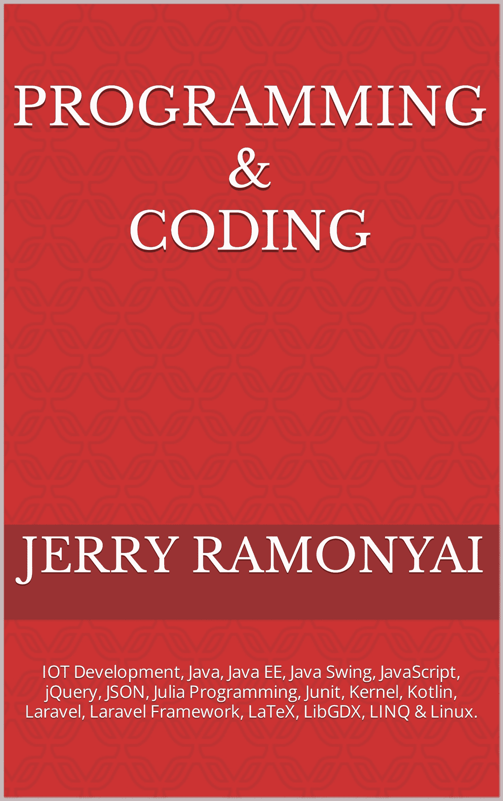
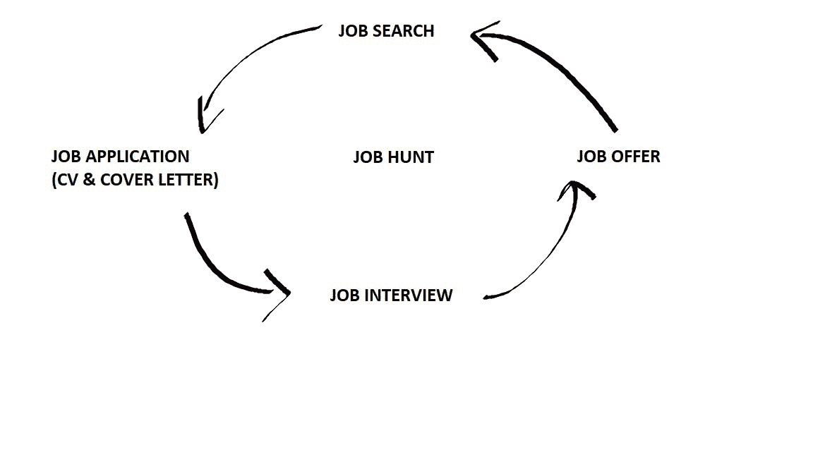
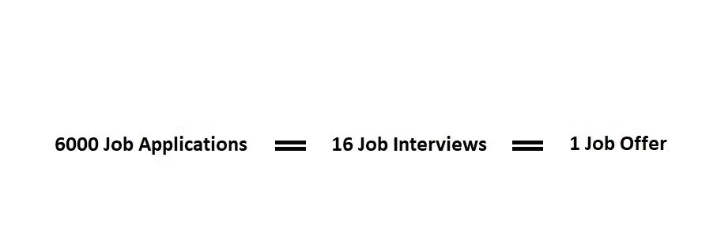
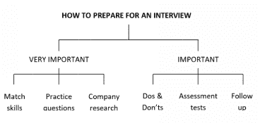
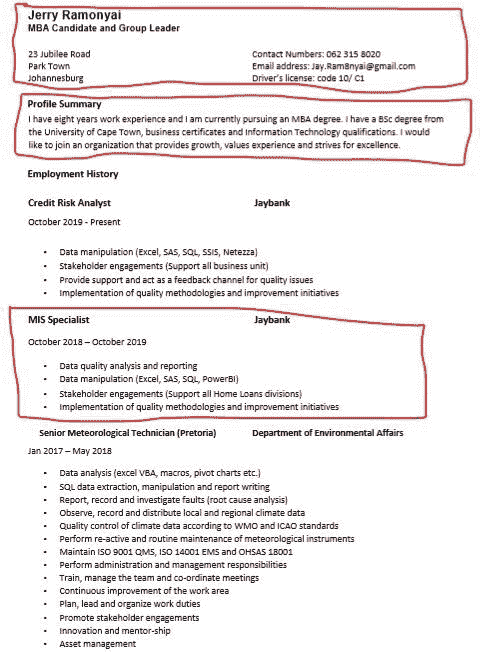
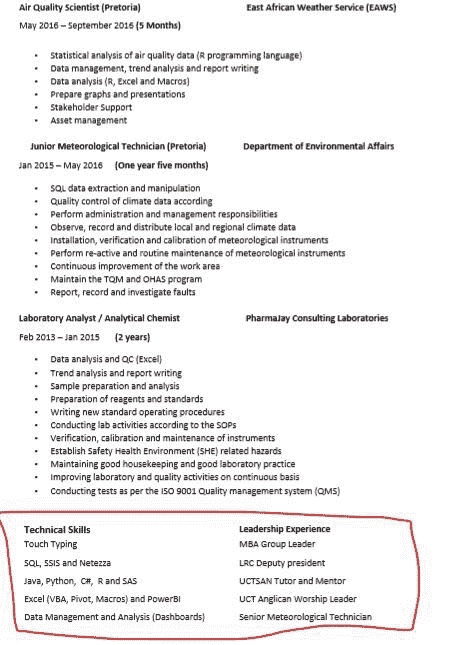
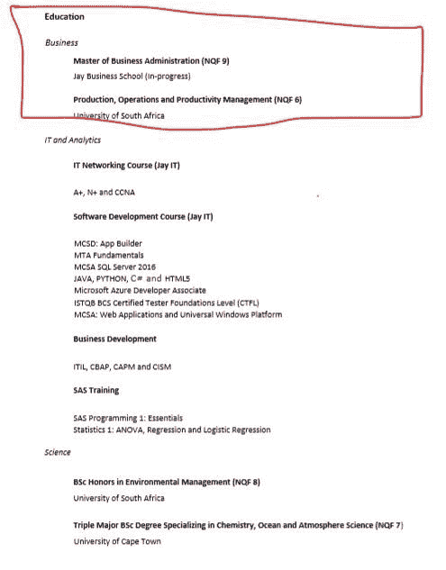
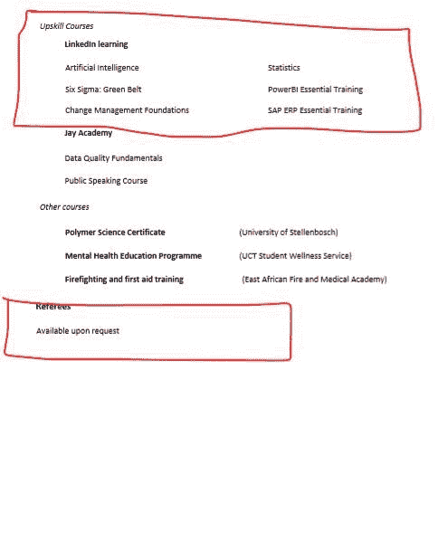

# 编程与编码：IoT 开发、Java、Java EE、Java Swing、JavaScript、jQuery、JSON、Julia 编程、Junit、内核、Kotlin、Laravel、Laravel 框架、LaTeX、LibGDX、LINQ 与 Linux

[@SuccessAnalytiX](https://successanalytics.blogspot.com/) Copyright © 2020 Jerry Ramonyai 版权所有

# 第一部分 智慧

## 科学、工程与技术

业务运营、数据、计算机、人工智能、利润、增长、成功、财富……嘿 Siri，人工智能是什么？

人工智能（AI）是通过机器模拟人类智能过程的过程，例如自然语言处理机器、语音识别机器、机器视觉、专家系统等。它是计算机、机器人或机器执行通常由人类完成的任务的能力，因为这些任务需要人类的智能和判断。人工智能的目标是创建能够思考、学习并执行理智任务（如问题解决、决策、感知和理解人类交流）的计算机和机器。

### 人工智能类型

- 反应型机器
- 有限记忆机器
- 心理理论机器
- 自意识机器

### 人工智能示例

- 制造机器人
- 自动驾驶汽车
- 智能助手
- 主动医疗保健管理
- 疾病制图
- 自动化金融投资（交易）
- 虚拟旅行预订代理
- 社交媒体监控
- 聊天机器人
- Siri

### 机器学习

机器学习是人工智能的一个分支，利用数据分析方法来自动化模型构建活动。机器学习算法使用历史数据作为输入来预测新的输出值。这使得软件应用程序在没有经过显式编程的情况下，能够更准确地预测结果。机器学习用于互联网搜索引擎寻找最佳搜索结果、邮件过滤器查找垃圾邮件、在线商店进行个性化推荐、银行软件检测异常交易、语音识别、自动驾驶汽车等。

### 热门机器学习技能

- `Python`
- `R` 语言
- `SQL`
- `Java`
- `SAS`

### 数学

数学是研究数字及其运算的科学。数学有很多分支，如代数、几何、算术、微积分等。数学让我们的生活变得井条有序，防止混乱，增加推理能力、创造力、抽象思维、空间思维、问题解决能力，甚至是有效的沟通。

### 数学分支

- 代数
- 几何
- 微积分
- 统计学

### 统计学

统计学是数学的一个分支，涉及开发收集、解释和展示数据的方法以分析事情发生的概率。这在机器学习和人工智能非常有用。统计学背后的数学理论高度依赖微积分、线性代数和概率论。概率在统计学中起着关键作用，帮助人们对大群体做出智能且准确的结论。

### 生活中的统计学

- 医学研究
- 天气预报
- 股市
- 消费品
- 决策制定

### 热门统计计算

- 平均值
- 标准差
- 回归
- 假设检验

### 统计分析类型

- 描述性分析
- 诊断分析
- 预测分析
- 规范性分析

### 工程

工程是利用科学和技术解决生活问题的行为。工程师通过发明、设计、建造和测试机器、复杂系统、小装置和材料来开发新的技术解决方案，同时考虑生产的实用性、安全性和成本。

### 工程分支

- 机械工程
- 化学工程
- 土木工程
- 航空航天工程
- 核工程
- 电气与电子工程
- 材料工程

### 科学

科学是通过遵循系统方法论寻找证据对知识的追求和应用。科学方法论包括进行实验、测量结果和分析信息（数据分析）。科学为日常生活提供解决方案，并通过技术实施这些解决方案。

### 科学类型

- 数学
- 计算机与信息科学
- 物理科学
- 化学科学
- 生物科学

### 计算机科学工程

计算机科学是对计算机器和计算本身的研究。它涵盖了从算法到硬件和软件中实现计算系统的实际问题的各种主题。计算机科学专业的学生学习如何使用计算机和计算过程来解决问题、构建网站、编写机器人、挖掘数据等。计算机科学需要对数学和编程有理解。离散数学、线性代数和图论是计算机科学专业最相关的数学课程。

### 计算机工程

计算机工程是工程的一个分支，结合了电气工程和计算机科学领域，以创建新的计算机硬件和软件。计算机工程师参与计算机架构的设计。

### 编程

编程或编码是通过编写系统性的指令与计算机通信的行为。计算机和机器可以理解不同的编程语言以执行特定操作。可以使用多种编程语言，如 `JavaScript`、`Python`、`C++` 等来完成编程或编码。在学习编程时，只需要学习你需要的内容。通过实践在不了解任何编程语言的情况下学习 `SQL`。编程技能在 IT、数据分析、研究、网页设计等许多领域非常重要。

### 编程分类

- 过程化编程
- 函数式编程
- 脚本编程
- 逻辑编程
- 对象导编程

### 如何学习编程

通过实践而不是仅仅阅读来学习。使用在线资源或课程来帮助。理解基础概念。学习数据结构和算法。构建项目。从 `SQL` 开始，它是容易的。`SAS`、`R` 编程语言。

### 编程类型

- 数据压缩
- 错误控制
- 密码编码

### 热门编程语言

- `C++`
- `Javascript`
- `PHP`
- `Python`
- `Go`
- `Swift`
- `Scala`
- `Elm`
- `Ruby`
- `C#`
- `HTML`
- `SQL`

### 软件开发

软件开发是通过创建和维护计算机应用程序（应用）、框架或其他软件的设计、编程、测试和调试代码。

### 软件开发类型

- 前端开发
- 后端开发
- 全栈开发
- 桌面端开发
- Web 开发
- 数据库开发
- 移动开发
- 云计算
- 应用开发
- API 开发

### 软件类型

- 软件
- 免费软件
- 共享软件
- 开源软件
- 系统软件
- 工具软件

### 网络

网络也称为计算机网络，可以定义为两个或多个计算机的连接，用于电子化共享数据。网络帮助从电话信息到视频流的一切。

### 计算机网络类型

- `LAN`（局域网）
- `PAN`（个人区域网）
- `MAN`（市域网）
- `WAN`（广域网）

### 网络职业

- 网络管理员
- 计算机系统专家
- 网络架构师

### 网络优势

- 打印机等设备
- 软件许可费用
- 通信

### SQL

`SQL` 代表结构化查询语言，是一种用于处理数据库的高频编程语言。数据库是数据的系统集合；它是以表格形式存储组织数据的数据结构。你可以将数据库视为电子档案柜。`SQL` 语句用于执行任务，如在数据库上 `insert`、`retrieve` 数据、创建数据库、修改行和列等。数据库管理系统（`DBMS`）允许用户使用 `SQL` 语言与数据库通信。

### 建模

数据库建模是生成数据库逻辑结构的过程，显示决定数据如何存储和访问的关系和约束。这类似于在档案柜上贴标签和名称。四种数据模型是：层次模型、网络模型、实体关系模型和关系模型。`SQL` 因为其基于英语而很容易掌握。它比大多数编程语言简单。它的语法较小，不同概念也少，因此非常受欢迎并广泛使用。你可以在不需要了解任何编程语言的情况下通过实践自学 `SQL`。一旦你掌握了 `SQL` 的基础并知道如何运行查询，就可以获得认证。`SQL statements` 用于 `SQL` 的视觉化呈现。

### 四个主要 SQL 关键字

- `SELECT`
- `INSERT`
- `UPDATE`
- `DELETE`

### 数据库的优势

- 改进数据共享和管理
- 提高数据安全性
- 更可靠的数据集成
- 减少数据不一致性
- 改进数据访问

### 数据库类型

- 集中数据库
- 分布式数据库
- 个人数据库
- 用户端数据库
- 商业数据库
- `NoSQL` 数据库
- 业务数据库
- 关系数据库

### 所需工作

- 数据仓库
- ETL 开发
- 数据库管理
- BI 开发
- 数据科学家
- 软件工程师

### 学习 SQL 的最佳网站

- YouTube
- WiseOwl
- SQLZOO
- Oracle LiveSQL
- W3resource
- Stack Overflow
- GitHub
- SQL Fiddle
- Coding Ground
- khan academy
- Codeacademy
- SQLcourse.com
- FreeCodeCamp

### 四种 DBMS 类型

- 层次数据库
- 网络数据库
- 关系数据库
- 对象导数据库

### DBMS 示例

- `MySQL`
- `PostgreSQL`
- Microsoft Access
- `SQL Server`
- `FileMaker`
- `Oracle`
- `RDBMS`
- `dBASE`
- `FoxPro`

### 数据、信息与技术

数据、信息、批判性思维、知识、智慧、成功、财富……信息是一个。数据可以定义为信息的片段和碎片，如事实、数字、单词、测量、观察或描述。数据产生信息，信息产生知识，智慧是成功的关键要素。

## 大数据

信息是中心，这就是为什么大数据对业务非常重要。大数据是指规模巨大且随时间指数级增长的数据。公司不断收集信息以帮助他们做出良好决策并在领域取得成功。这种信息不断增长，因此被称为大数据。数据库通常以表格形式存储信息。数据库可以存储大量数据（即大数据），并可以轻松地搜索数据、添加新数据或删除旧数据。`SQL` 语句用于执行任务，如在数据库上 `insert`、从数据库 `retrieve` 数据、创建数据库、修改行和列等。数据库管理系统（`DBMS`）允许用户使用 `SQL` 语言与数据库通信。

## 信息技术概述

信息技术（IT）是业务运营的核心。企业严重依赖 IT 来提供其产品和服务。企业完全依赖 IT 来执行其日常运营，然而，这种对 IT 的依赖也是重大风险的来源，因为如果使用不当，IT 系统可能会导致企业无法提供其产品和服务，从而影响企业的运营绩效。企业使用 IT 来提供产品和服务、进行创新、实现战略目标，并通过卓越的运营获得整体竞争优势。

没有信息就没有成功。你必须能够收集和分析信息才能获得成功。这就是为什么阅读如此重要的原因。分析信息是一种思考的形式，人类对信息的需求就像公司对大数据一样。这就是为什么数学如此重要的原因。数学是分析，分析是思考，思考需要信息，而信息通向成功。这就是成功分析。

## 信息技术示例

- 电话和无线电。
- 互联网。
- 视频会议设备。
- 计算机。

## 信息技术职业

- 技术支持。
- Web 开发人员。
- 计算机系统分析师。
- IT 安全。
- 网络工程师。
- 数据库工程师。
- 软件开发人员。

## 大数据分析师所需的 5 项技能

- 编程。
- 数据管理。
- 计算框架。
- 定量分析与统计学。
- 业务知识。

## 高薪大数据工作

- 定量分析师。
- 数据科学家。
- 统计师。
- MI（管理信息）和 BI（商业智能）专家。

## 大数据专业人员技能

- `Qlik View`、`Tableau`、`Power BI` 和 `Excel`。
- `Alteryx`、`Spotfire`、`Scala` 和 `Presto`。
- `SAS`、`R`、`Python`、`Java`、`XML` 和 `HTML`。
- `VB.NET`、`Azure`、`C`、`C++` 和 `C#`。
- `Cloudera`、`Cassandra`、`HDFS` 和 `Teradata`。
- `Oracle`、`SQL`、`NoSQL` 和 `Hadoop`。
- `Informatica`、`IBM`、`AbInitio`、`ERP` 和 `SAP`。
- `AWS`、`Talend`、`Spark`、`Reltio` 和 `DevOps`。

## 大数据

数据管理、决策、信息、增长、成功、财富……

数据科学、数据管理、数据架构、数据工程师、这个数据、那个数据、等等数据……

## 数据管理

数据管理是将数据存储和维护为组织价值资源的实践，以释放其潜力。管理数据需要稳健的数据策略，以及关于如何访问、集成、清洗、治理、存储和为分析准备数据的计划。`Data Architects` 必须设计如何有效高效地使用 IT 基础设施，以支持并最大化组织对数据的使用。

## 数据架构

数据架构是 IT 基础设施如何支持数据战略的概述或计划，展示了数据如何获取、传输、存储、查询和保护。它是一套规则、政策、标准、图表和模型，用于规范和解释数据如何在组织内部使用、存储、管理和整合，以确保数据的有效利用。数据架构的目的是展示数据、业务目标与运营策略之间的关系。

## 数据科学

数据科学是一个多学科领域，利用科学方法、流程、算法和系统来管理数据，并从结构化和非结构化数据中提取知识和洞察。它侧重于通过创建可持续的数据管理方式并寻找确保业务从数据受益的方法，来寻找大数据问题的解决方案。数据科学包含了数据管理和数据分析。它是数学、统计学、业务和技术的融合。

数据科学、信息管理、数据管理、数据工程、数据仓储和数据分析在工作环境中经常互换使用，这是好事，因为它们几乎是同一件事，然而，有些人喜欢花时间试图区分它们。不要这样做。不要故意浪费时间。你有更重要的事情可以花时间去做。正如你将在本书书中看到的，时间是成功的关键要素之一。只要你的职业围绕大数据展开，那么你的职位名称可以是任何与数据相关的名称，这个数据、那个数据、等等数据。你只需要知道 `SQL`、`SAS`、`Excel`、`Python` 和 `R` 即可。至少其中两个。这就是你需要的全部。

## 数据科学工程师的基础技能

- 数据分析（`Microsoft Excel`）。
- 数据库管理（`SQL`）。
- 数据质量知识（`DMBOK` 原则）。

## 数据科学工程师的高级技能

- 使用 `Python`、`R` 或 `SAS` 编程。
- 对概率和统计学的坚实理解。
- 数据可视化工具（`PowerBI`）。

## 数据管理的组件

- 商业智能。
- 数据架构。
- 数据治理。
- 数据集成。
- 数据建模。
- 数据质量。
- 数据安全。
- 数据仓储。

## 大数据工作的常用技能

- `SQL`、`R`、`Python` 或 `SAS` 编程语言。
- `Microsoft Excel`。
- 批判性思维。
- 数据可视化（仪表板）。
- 演示技巧。
- 机器学习和 AI。
- 数据仓储。
- ETL 工具（`SSIS`）。
- 数据 API。
- 编码和编程语言。
- 算法和数据结构知识。

## 数据处理的六阶段

- 数据收集。
- 数据输入。
- 数据处理。
- 数据分析。
- 数据报告。
- 数据存储。

## 开发成功的数据架构

- 评估工具和系统的工作原理。
- 定义业务目标和目的。
- 为数据结构制定整体计划。
- 选择数据管理和可视化工具。

## 如何成为数据科学工程师

- 学习基础数学和统计学。
- 学习编码。
- 理解数据库。
- 学习 `microsoft Excel` 和 `SQL`。
- 获得技术或计算机科学学位。
- 申请工作。

## 大数据工作

- 数据科学家。
- 数据分析师。
- 数据工程师或数据架构师。
- MI 或 BI 分析师。
- 机器学习或 AI 工程师。
- 定量分析师或统计师。

## 常见数据类型

- `Boolean`（真或假）
- `Character`（a, b, c...）
- `Date`（03/01/2021...）
- `Double`（1.54343534532e308）
- 点数（1.234455）
- 整数（1234....）

## 免费数据库管理软件

- `Microsoft SQL server`。
- `SolarWinds`。
- `Dbvisualizer`。
- `Manageengine applications manager`。
- `Oracle rdbms`。
- `Ibm db2`。
- `Teradata`。

## 数据策略

数据策略、信息、决策、增长、成功……

这就是组织使用数据的方式。

## 数据分析（图表与仪表板）

数据管理团队产生的数据帮助分析团队创建仪表板，推动业务并确保商业智能是组织竞争优势的关键要素之一。分析团队接收业务部门的仪表板需求并向数据管理团队请求数据。仪表板创建后，分析团队维护仪表板，数据管理团队维护供给仪表板的数据。创建仪表板的数据需求来自内部分析团队或业务部门。数据管理团队的主要目标是根据可用资源（资金、材料、机器和人力）支持分析团队产生尽可能仪表板。

## 自动化

在项目结束后，将对新仪表板的数据流程进行优化和自动化。

## 可靠性跟踪

对产出进行基准测试，以确保团队的可持续性、一致性和可靠性。

## 敏捷（项目管理方法）

数据管理团队从分析团队接收 90% 的项目。接收需求后，团队将使用敏捷方法尽快完成任务。这涉及到将任务分解为较里程碑，并在每两周的冲刺中完成里程碑。失败和成功的项目都计入这 90%。

## 质量保证与控制

数据管理团队负责项目实施阶段和自动化后的质量监控。数据质量合规性由数据管理团队完成。

## 成功的要素

就业、业务、资源、信息、增长、成功……

成功是一种算法。

### 成长

要在生活中取得成功，你必须不断成长。成长意味着不断向你的大脑输入信息。信息可以来自许多资源，如书籍、视频、音频等。这就是为什么大多数成功人士读的书比任何人都都要多。要获取信息，你需要物质材料和人。要从物质中获取信息，你需要具备管理时间、技术和钱的能力。要从人获取信息，你需要具备激励、鼓励和与他人共情的能力。

## 信息

没有什么知识不是力量。信息以不同的形式、形状和风格存在。你需要在特定的时刻拥有适合你的信息。你的大脑每秒都有不同的视角，这是因为你的大脑每秒都在通过你所有的感官收集信息，因此，如果你在一秒后获取信息，你一秒前收到的信息感知会有所不同。这就是为什么你必须不断学习和成长。这也解释了为什么没有什么知识不是力量，因为当你的视角改变后，无关的信息在一秒后可能变得相关。

## 管理技能

为了能够处理时间、技术和钱，你需要技术技能，如规划、组织、设计和资源控制。这四项技能是关键的管理技能。如果你拥有卓越的管理技能，你将能够有效、高效地利用你的资源，从而获得能够让你取得成功的相关信息。

## 领导力

为了能够激励、鼓励并与他人共情，你需要软技能，如沟通、倾听、正直、团队合作等。这被称为领导力。如果你能有效运用你的领导力，你就能从人们那里获得你想要的所有与成功相关的信息。一个领导者必须意识到人需要被激励，需要被鼓励，并且通过健康和福祉来获得能量。

## 金钱

生活中的每个人都需要收入来源。我们需要钱来生存。我们需要钱购买食物、住所以及生活中所有必需品。最重要的是，我们需要钱来直接或间接地购买信息。这就是为什么生活中的大多数人会工作或创业。找工作、赚钱和致富将在下详细说明。

## 技术

技术是赋予人类获取信息巨大竞争优势的最大物质材料之一。这就是为什么信息技术正在改变世界，这也是为什么第四次工业革命实际上是信息技术。能够让你接近信息的技术才是值得保留的技术。

## 人

大脑是人类非常复杂的器官。大脑存储着人类拥有的所有信息，为了让你能够获取这些信息，此人必须处于正确的情绪状态。要让一个人处于正确的情绪状态，他们所有的需求都需要得到照顾，包括健康、能量和被激励的需求。

## 成功原则

- 自我教育。
- 明智地选择职业。
- 每五年投资一次。
- 偿还坏债。
- 避免生活膨胀。
- 嫁对的人。
- 不要考虑无用的事情。
- 先计划后行动。
- 失败是学习的机会。
- 学习财财知识。
- 管好自己的事。
- 利用税收优势。
- 永停止学习。
- 机会永远在那里。
- 思想和行动创造成功。
- 成长，而非竞争。
- 引导你的思维积极思考。
- 为机会存钱。
- 低于消费水平生活。
- 每日追踪支出。
- 主控自己的生活。
- 不要指责，承担责任。
- 眼放远大。
- 设定 SMART 目标。
- 接受变化。
- 精通时间管理。
- 与赢者在一起。
- 照顾好你的健康。

## 领导力

情绪智能、管理、生产力、信息、成长、成功、财富……

领导力处理人，管理处理其他资源。领导力是确保每个人都能有效、高效地实现目标的能力。生活充满了让人们偏离计划并无法实现目标的问题。当问题出现时，就需要领导力和管理。领导力处理的是人而不是问题。管理处理的是问题而不是人。领导力在保持每个人专注、受激励并赋能以提高生产力方面发挥着巨大作用。领导力的目标是确保每个人都感到平静。领导者应该更多地关注人的福祉，而经理应该关注解决技术问题。

## 权威

领导力不是为了解决技术问题，那是经理的工作。经理的工作是确保他们消除给人们生活带来压力的问题。领导者的工作是确保人们感到平静，因为他们知道经理正在解决问题并进行授权。这意味着领导者必须传达“问题正在解决”的信息，他们必须与人们共情，建立信任，如果问题没有解决，领导者将必须解决可能出现的冲突。经理应该制定一个计划来解决技术问题并分配任务。这意味着你应该知道何时充当领导者，何时充当经理。如果你混淆了两者，你就完蛋了。领导力和管理都是技能，意味着它们是可以学习的。读读书即可。

## 管理与领导力

事情通常不会按照计划进行，当这种情况发生时，你需要有人介入并确保问题得到解决（经理），并确保人们保持专注不恐慌（领导者）。领导者必须给人们希望。这可以通过以身作则和设定一个大家共同关注的愿景来实现。设定要关注的目标有助于人们一直坚持下去，因为知道即使短期内出现问题，他们也有一个明确的目标要实现，人们会一直努力直到实现目标。

## 管理与领导力

管理与领导力是相互依赖的。管理者必须具备领导能力，而领导者也应该具备管理能力。领导者应当领导，这意味着他们应该与人互动，完成后，他们应该处理眼下的问题。管理者应该处理问题，然后通过与人互动来引导他们。

永远不要管理人。要管理问题并引导人。解决问题被称为管理；让人们感到安心被称为领导力。你既需要这两项技能，也应该知道何时以者的身份行动，何时以领导者的身份行动。

教学、指导、辅导和授权。当出现问题时，没有任何人能够解决所有问题，因此领导者和经理需要能够辅导、指导并激励每个人，以便在情况不利时他们准备介入并掌控局面。

## 领导力的核心价值

这是一份优秀的价值观列表，如诚实、自信、尊重、共情等。你应该列一份你想要学习的核心价值观清单，并优先学习和掌握这些价值观。强大的核心价值观是优秀领导者的特质。

## 谈判

你必须能够用更少的资源（即时间、精力和金）完成所有工作。做到这一点的一种方法是对你的资源进行谈判以获得更好的交易条件。由于领导力涉及人，领导者必须学习如何谈判。

这可能包括批量购买资源并谈判以获得更好的折扣。保持职业道德和诚实至关重要。不要滥用你的权力进行谈判并向人们提供低于合理的报酬。生活中的一切都是通过能量连接在一起的，如果你不遵守道德，你释放的负能量将反噬到你身上。那是另一个故事的话了。我会专门写一章节关于谈判。

## 建立关系

领导者必须能够与他们联系的所有保持联系。沟通是一切的核心。领导者必须利用所有可用工具与每个人进行有效高效的沟通，而信息技术正在让这一切成为可能。

## 优秀领导者的价值观

- 诚信
- 授权能力
- 沟通
- 自我意识
- 感恩
- 敏捷
- 影响力
- 共情
- 耐心

# 如何成为优秀的领导者

- 实践个人成长。
- 成为良好的团队伙伴。
- 每天阅读。
- 提供愿景。
- 优化组织结构。
- 设置明确的沟通协议。
- 授权。
- 学习冲突管理策略。
- 教练、指导与教学。
- 诚实且开放地沟通。
- 鼓励人们阅读。
- 培养积极的态度。
- 设置明确的目标和期望。
- 关注结果而非过程。
- 建立自信。
- 回答问题。
- 准确地告诉人们你想让他们做什么。
- 不要让人过度工作。
- 以身作则。
- 不要生气，只需重复你说过的话。

## 如何成为良好的团队伙伴

- 分享信息（询问并回答问题）。
- 关注目标和结果，而不是过程。
- 公平、积极且给予支持。
- 欣赏多样性的好处。
- 学习领导力技能。
- 保持条理。
- 设定明确的目标。
- 拥有强大的价值观。
- 支持承担风险和改变。
- 为每个团队成员设定明确、具体的角色。
- 鼓励多样化思维。
- 公均匀分配工作。
- 关注正确的事。不要偏袒。

## 核心团队合作技能

- 沟通。
- 冲突解决。
- 问题解决。
- 倾听。
- 批判性思维。
- 协作。
- 领导力。
- 谈判。

## 如何教学、指导和教练

- 鼓励主动学习。
- 给出建设性反馈。
- 尊重不同的天赋和学习方式。
- 善于倾听并理解。
- 保持耐心。
- 多读书。
- 不作判断。
- 对不同意见保持开放。
- 给出示例和观点。
- 回答问题。
- 提出开放式问题。
- 学习情绪智能。

## 领导力与管理风格

- 专制型领导。
- 权威型领导。
- 标杆型领导。
- 亲和型领导。
- 放任式（或自由放式）领导。
- 参与型领导。
- 授权型领导。
- 交易型领导。
- 变革型领导。
- 官僚型领导。
- 魅力型领导。
- 教练型领导。
- 民主型领导。
- 协作型领导。
- 指令型领导。
- 愿景型领导。

## 核心领导特质

- 自我发展。
- 团队发展。
- 伦理实践与良好治理。
- 创新。
- 沟通。
- 愿景。
- 共情心。
- 责任感。
- 感恩。
- 慈悲。
- 信心。
- 决策能力。
- 诚信。
- 谦虚。
- 韧性。
- 影响力。
- 积极。
- 启发。
- 战略与批判性思维。
- 开放心态与创造力。
- 灵活。
- 可信赖。
- 诚实。
- 忠诚。
- 印象管理。
- 果断力。
- 倾听。
- 给予反馈。
- 时间管理。
- 规划与执行。
- 组织与授权。
- 激励。
- 智慧。
- 相关知识。

## 时间、技术、管理、生产力、增长、成功、财富……

领导力让人感觉更好，而管理解决问题。你这两项技能都需要。

成功是在个人生活的各个领域持续获得最佳结果的能力。成功带来财富。成功来自持续的增长，而增长由信息带来。为了获取信息，你需要五种主要资源：时间、金、能量、技术和人。无论多少，每个人都有这五种资源。数量并不重要，重要的是你如何利用这些资源来实现成功。

要成功使用这五种资源，你需要两种技能：管理和领导力。领导力技能帮助你有效高效地处理人际关系，以便从人们那里获得想要的所有信息。管理技能帮助你有效高效地利用其他四种资源（时间、金、能量和技术），以便从这其他四种资源中获得想要的所有信息。

### 管理

管理资源意味着规划、组织、设计和控制你的资源（时间、金、能量和技术）。规划包括设定目标并决定用于实现目标的策略。组织包括安排你的资源（时间、金、能量和技术）以实现目标。

建立战略意图。战略意图是你计划在未来实现的以达到根本目的的内容。愿景、使命和价值观声明是用于设定战略意图的工具。你的愿景解释了你想成为什么。你的使命声明解释了为了成为未来想成为的样子，现在应该是什么，它解释了你将如何为生活带来改变。价值观是你为了支持愿景和使命必须遵循的行为。目标是为了实现使命和愿景而必须采取的。你必须制定战略愿景，设定目标，设计实现目标的策略，实施并执行所选策略，评估绩效并启动纠正调整。

#### 管理的四项核心职责

- 规划
- 组织
- 设计
- 控制

### 管理规则

- 明确你的目标并分享你的愿景。
- 为人们创建一个路线图。
- 教学并以身作则。
- 教学并授权。
- 帮助人们解决问题。
- 将大部分时间花在规划上。
- 保持一致。
- 保持透明。
- 认可所有的意见和想法。
- 对每个人区别对待。

## 权力影响力、领导力、管理、人、信息与成功……

权力意味着巨大的责任。权力是行动以及对他产生影响的能力，无论是通过礼貌的方式还是侵略的方式。你可以通过成为一名优秀的领导者以礼貌的方式影响他人。优秀的领导者每天阅读并成长。糟糕的领导者通常由于管理地位而具有侵略性。

影响他人并掌控他人是一项非常有挑战的任务，因为人有情感，如果被对待不好，他们会报复。真正的权影响源于学习人们的情绪、掌握沟通艺术并努力理解人们不同的观点。要影响他人，你必须擅长满足人们的需求。如果人们从你那里获得价值，他们通常会倾听，因此，如果你帮助他们解决需求，你就为他们的生活增加了价值，从而能够影响他们。要让你掌控他人，你必须拥有他们需要的东西。如果人们对你没有任何需求，你就没有权力。人们在生活中需要的一些东西是金钱、时间和信息。如果你能为人们提供这些资源，你就可以影响他们。因为这些资源是成功的要素，每个人都想成功。

### 权力的原则

- 始终留出可用的金钱。
- 比你认识的所有人都要读得多。
- 少说多想。
- 不要暴露。
- 用钱买时间。
- 不要信任任何人。
- 提高你的时间管理技能。
- 计算一切。
- 不要试图给别人留下印象，关注正确的事。
- 每天锻炼。

# 如何影响他人

- 展现你的魅力（同理心）。
- 倾听他人的。
- 关注人们的需求。
- 为他人的生活增值。
- 非常擅长解决冲突。

## 谈判规则

- 多听少说。
- 运用沉默的力量。
- 提问。
- 保持公平。
- 在谈判前明确你想要什么。
- 目标是实现双赢谈判。
- 学习冲突解决策略。
- 做好准备。
- 制定策略。
- 保持简单。

### 批判性思维

思考、计划、确定优先级……

如果你不计划，你就是在计划失败 ——`本杰明·富兰林`。

思考是一种处理信息、建立联系、做出决策和创造新想法的精神活动。思考也可以被看作是在脑中制定待办事项的过程。思考是迈成功的第一步。生活中要做的事情太多了，但只有 20%%的事情会带来成功，因此每个人在行动之前都必须进行思考并相应地确定优先级。采取行动时，从那些带来成功的活动开始。每一个念头都必须写下来。这有助于显化、思维分析和计划。

### 批判性思维

批判性思维是清晰、理性地遵循逻辑来决定该做什么或相信什么的能力。它是一种进行反思性思考的能力，理解观点之间的逻辑联系，并理解事物何地、如何、何时、什么以及为什么是现在这样。它是关于尽可能多提问，直到你获得所需的所有信息。信息引导增长，增长带来成功，成功带来财富。

批判性思维有助于做出良好的决策。你必须能够权衡问题解决方案的优缺点。你必须查看所有可用数据，并根据提供的数据权衡优劣做出明智的决策。大数据之所以流行正是由于这个原因。经理可以使用大数据做出良好的决策。

### 制定待办列表

你应该能够确定事情发生的什么、何时、为什么、何地以及如何。这被称为调度。不这样做会导致灾难，简单直接。把每一个细节都写下来。准备一份待办列表、一个任务日历和每个里程碑的检查清单。这将有助于任务显化、执行过程的可视化以及问题的分析。

### 风险管理

你必须能够计划并管理可能出错的事情。生活中事情通常会出错，这是定数。这是因为与计划不同，生活是时间敏感的，像延迟交货这样简单的事情就可能导致巨大的灾难。你必须预判可能出错的地方，并计划在这种情况下怎么办。这就是风险管理包含的内容。

### 如何进行批判性思考

- 重构信息。
- 评估后果。
- 提问。
- 保持观察力。
- 每天阅读。
- 查看历史数据。
- 研究。
- 寻找事实、数字或科学。
- 善于分析，拆解信息。

### 批判性思维过程

- 观察
- 调查
- 分析
- 解释
- 评估
- 反思

## 决策与问题解决

问题、信息、决策、增长、成功与财富……

失败是学习的机会。解决问题是定义问题、确定问题根源并寻找解决方案的行为。你解决的问题越多，你就变得越富有、越成功。

### 解决问题的过程

- 描述问题。
- 拆解问题。
- 找到根源。
- 研究并阅读直到直到找到解决方案。
- 实施解决方案。
- 衡量结果。

### 解决问题的技能

- 积极倾听。
- 批判性与创造性思维。
- 研究与阅读。
- 沟通。
- 决策。
- 团队合作。

### 决策

决策是收集信息、评估后果并选择一个负面后果较少的选项的过程。优秀的决策者会选择能为所有人带来最佳结果的行动。他们在保持开放心态的同时进行研究、权衡后果并做出理性的决策。

### 决策过程

- 识别替代方案。
- 收集相关信息。
- 权衡后果。
- 选择。
- 采取行动。
- 审查你的决策。

### 创造性思维

创造性思维是以新方式考虑某事的能力，例如对问题有新方法，或从数据集中获得新结果。这是一个你的大脑为问题产生新的、不寻常且有效的解决方案的过程。

### 如何培养创造性思维

- 头脑风暴创意。
- 重新定义问题。
- 保持开放和灵活。
- 使用你的想象力。

## 提高记忆的方法

- 阅读书籍。
- 尝试鱼油补充剂（`Omega 3`）。
- 保持健康体重。
- 少饮酒。
- 运动。
- 尝试冥想。
- 喝咖啡。
- 充足睡眠。
- 少吃添加糖分。

## 技术技能

- 编程/编码。
- 软件熟练度。
- 项目管理。
- 数据分析。
- 技术。
- 写作。
- 会计。
- 工程学。
- 医学。
- 解决问题。

## 人际交往技能

- 团队合作。
- 沟通。
- 职业道德。
- 灵活性与适应能力。
- 决策。
- 时间管理。
- 冲突解决。
- 倾听。
- 谈判。
- 同理心。
- 果断。
- 教练、教学和指导。

## 公演演讲

信息、自信、演讲、金钱、增长、成功、财富……

练习，练习，练习。

### 公演演讲规则

- 研究并了解关于你主题的一切。
- 计划并准备你的演示稿。
- 练习直到你感到自信。
- 阅读关于你具体担忧的内容。
- 视觉化你的成功。
- 做一些深呼吸。
- 专注于你的演讲，而不是观众。
- 不要害怕短暂的沉默。
- 注意你的肢体语言。
- 演讲前喝杯水。
- 演讲当天不要喝咖啡因。
- 积极思考。
- 观看你演讲的录像。
- 保持简单。
- 不要担心与观众的眼神交流。
- 不要担心你的弱点。
- 你不一定要讲故事。
- 逻辑清晰地组织想法。
- 练习带来自信。
- 研究主题直到你充满热情。
- 做你自己。
- 放慢速度。
- 永远说真话。
- 原谅你自己的错误。
- 研究你的观众。
- 定义演讲的目标。
- 准备目标、引言和结论。
- 保持对话的语气。

### 控制你的演讲时间

- 疯狂地练习和研究你的主题。
- 向人们征求反馈。
- 在舞台上移动。
- 缓慢呼吸。
- 恰当运用你的声音。
- 专注于演讲，而不是观众。
- 不要害怕短暂的沉默。
- 注意你的肢体语言。
- 演讲前喝杯水。
- 演讲当天不要喝咖啡因。
- 积极思考。
- 观看你演讲的录像。
- 保持简单。
- 不要担心与观众的眼神交流。
- 不要担心你的弱点。
- 你不一定要讲故事。
- 逻辑清晰地组织想法。
- 练习带来自信。
- 研究主题直到你充满热情。
- 做你自己。
- 放慢速度。
- 永远说真话。
- 原谅你自己的错误。
- 研究你的观众。
- 定义演讲的目标。
- 准备目标、引言和结论。
- 保持对话的语气。
- 疯狂地练习和研究你的主题。
- 向人们征求反馈。
- 在舞台上移动。
- 缓慢呼吸。
- 恰当运用你的声音。
- 练习，排练。
- 避免过度使用动画。
- PowerPoint 演示稿应该有 `10` 张幻灯片。
- 演示稿应该有 `30` 个要点。
- 提前到达。
- 在演讲前做好准备。
- 按时结束。
- 尽可能在每张幻灯片上用词。
- 关注你的肢体语言。
- 如果忘了某些内容，就跳过。
- 参加在线演讲课程。
- 使用技巧提升你的自信。

### 演讲类型

- 信息性演讲。
- 娱乐性演讲。
- 演示性演讲。
- 说服性演讲。
- 特殊场合演讲。
- 推销演讲。

### 演讲技巧

- 流利度。
- 词汇。
- 语法。
- 发音。

## 谈判

挑战、谈判、解决方案、增长、财富……

- 一切都是可谈判的。
- 在谈判前明确你想要什么。
- 目标是实现双赢谈判。
- 运用沉默的力量。
- 询问对方的意见。
- 将公平的报价放在谈判桌上。
- 如果报价不公平，就离开。

- 不要做假设，提问。
- 不要急于成交，保持耐心。
- 不要接受不公平的交易。
- 建立关系。
- 选择蜂蜜而非醋（注：此处原文可能有误，意为选择温和的策略）。
- 你的情绪不要主宰你。
- 专注于协作。
- 在谈判前做好研究。
- 完成你的作业。

### 谈判阶段

- 确定目的。
- 准备。
- 信息交换。
- 讨价。
- 结论。

### 谈判技巧的好处

- 职业发展和增长。
- 冲突解决。
- 团队合作。
- 说服。
- 解决问题。

## 沟通

信息、沟通、增长、成功、财富……

倾听……倾听……

能够高效地沟通是最重要的技能之一。当你沟通时，确保你的信息是清晰、简洁、完整且礼貌的。有效的沟通不在于说，而在于听。理解对方试图传达的信息。沟通是成功的中心，因为信息导致增长，持续增长导致成功。

### 沟通失败

沟通失败是误导性的、无效的或冒犯性的信息。不要为了获取知识而造成伤害。如果你感到愤怒并想说伤害人的话，就离开吧。你将在书中学习情绪智技巧。记住，要成功，你需要获取信息。如果你不擅长控制情绪，就会遇到麻烦。

### 成为良好沟通者的技巧

- 倾听。
- 肢体语言。
- 压力管理。
- 情绪控制。
- 清晰与简洁。
- 信心。
- 开放心态。
- 尊重。

## 倾听

沟通、倾听、信息、增长、成功与财富……

不要打断。倾听是准确接收和解释传递给你的信息的能力。倾听是所有有效高效沟通的关键。如果没有有效倾听的能力，信息很容易被误解，信息就会丢失。成功并不容易实现。倾听是你应该掌握的沟通技能。有效的倾听有助于解决冲突、建立信任、激励他人、提高生产力和增长。在对话的大部分时间里倾听，你就会吸收信息，成为良好的沟通者。

### 如何倾听

注意说话者的言语和非语言，以完全理解他们表达的内容。注意意味着倾听并观察对方而不打断。不要出于任何原因打断对方。如果你想说点，等对方说完后再说。有效的倾听意味着听取对方信息的要点并在脑中或其他地方记录。

### 倾听与问题解决

如果有人向你提问严肃的问题或他们想要你的建议，认真倾听，不要急于回答，尝试不要立即回答，花一两天思考对方说的话，然后再回答。思考需要时间、精力和努力。不要急于回答。只需告诉对方你需要时间处理他们说的话，你会回复他们。这种策略适用于任何情况，即使你不需要思考，也要花时间思考。如果你花时间思考，就会做出明智的决策。

### 积极倾听

积极倾听是一种要求听者完全集中、理解并记住所说内容的技术。你必须同情、反思并提取传递给你的信息的要点。积极倾听用于咨询、培训以及解决争议或冲突。你可以通过认真倾听而不回答来解决许多问题。这被称为`橡鸭`效应。

### 倾听的障碍

倾听是一项非常有挑战性的技能，因为总会有干扰信息传递的因素。对对方信息的干扰可能是肢体动作、内心想法、注意力分散、周围环境的声音或偏见倾听。偏见或选择性倾听是沟通中最大的问题之一。当某人只听他们想听的信息时，偏见倾听是危险的，因为你并没有在倾听。

### 关键倾听技巧

- 注意。
- 释义和总结。
- 不要判断或草率下结论。
- 通过点头显示你在倾听。
- 不要打断。
- 面向对方并保持眼神交流。
- 提问。
- 专注。

## 教练

目标、里程碑、教练、教学、增长……

在正确的时间提供信息。教练是一个针对当前挑战而非过去或未来的过程。

### 教练技能

- 目标设定。
- 倾听。
- 同情。
- 批判性思维。
- 反馈。
- 知识与经验。
- 愿景。
- 自我意识。
- 开放。
- 责任。

## 领导风格

- 交易型领导力。
- 变革型领导力。
- 仆人领导力。
- 民主型领导力。
- 官僚型领导力。
- 放任型领导力。
- 魅力型领导力。
- 愿景型领导力。
- 亲和型领导力。
- 节奏型领导力。

## 教学

教学是帮助人们理解并应用知识、概念和过程的过程。者必须教人们如何实现目标。

### 良好教师的特质

- 沟通技能。
- 倾听技能。
- 友好的态度。
- 职业道德。
- 准备。
- 耐心。
- 创造力。
- 热情。
- 奉献。
- 同理心。
- 领导力。
- 对学科的知识。

### 如何教学

- 告诉人们具体做什么。
- 帮助纠错。
- 提供反馈。
- 使用经验学习。
- 鼓励讨论。
- 推荐书籍。

### 报告写作元素

- 标题页。
- 目录。
- 执行摘要。
- 引言。
- 讨论。
- 结论。
- 建议。
- 参考文献。

### 良好报告的特征

- 简单。
- 清晰。
- 简洁。
- 积极。
- 标点符号。
- 方法。
- 可读性。
- 准确性。

时间是一个非常敏感的问题。非常敏感。每个人每天都有 24 小时，而你每天如何利用这 24 小时，决定了你的成功。你在这 24 小时内所做的每件事都应该围绕着获取尽可能多的信息展开，因为信息确实是成功的核心。

当你睡觉时，你应该深知自己正在为大脑充电，以便在第二天能有效利用大脑来获取尽可能多的信息。当你进食时，你应该知道自己正在为身体补充能量，这样你才有足够的能量去探寻信息。当你在任何事情上浪费时间时，你应该清楚那是在浪费时间，它会让你远离成功。

## 时间管理流程

- 设定一个明确的目标。
- 将你的目标拆解为更小的里程碑。
- 编写待办事项。
- 使用`80/20 Principle`来确定优先顺序。
- 尽量减少干扰。
- 阅读关于你正在从事的事情的内容。
- 回顾你的一天。

## 时间管理技能

- 优先级排序。
- 授权。
- 决策能力。
- 目标设定。
- 问题解决能力。
- 战略性、批判性和分析性思维。
- 进度安排。

## 如何停止拖延

- 识别你拖延的原因。
- 将你的目标拆解为更小的里程碑。
- 设定截止日期。
- 利用积极的社交压力。
- 奖励自己。
- 每隔几分钟在两个任务之间切换。
- 消除干扰。
- 从小开始以获得动力。
- 拆解最困难的任务。
- 不要做完美主义者。
- 不要试图完成每一个任务。
- 设定可以管理的目标。
- 练习积极的自我对话。
- 制定行动计划。
- 关注你的优势。
- 寻求帮助。
- 大量阅读。

## 80/20 生活方式

信息、行为、生活方式、成长与成功……

在`80%`的时间里处理`20%`的任务，这些任务能为你带来`80%`的回报。

# 如何使用 80/20 原则

对于你生活中想要实现的每一个目标，你都必须选择一种有助于你实现该目标的生活方式。如果你想成功，你每年至少要读`12`本书。如果你想富有，你必须工作`80%`的时间，这意味着你所做的一切就是吃、睡觉、工作，并且每月只休息一天去娱乐。这是`80/20`原则的实际应用，将引导你走向成功。

人们渴望成功，但他们不想工作`80%`的时间。这是不可能的。有些人想欺骗成功，他们认为自己很聪明，认为他们现在努力工作，等有钱了就停止努力。事实并非如此。如果你很富有但工作时间少于`80%`，那意味着你正在走下坡路，给点时间，你很快就会变得贫穷。人类被创造是为了在`20%`的时间里娱乐，`80%`的时间里工作。每月休息一天去娱乐，其他时间则应对生活中的不确定性，前提是你确实计算出了一个月月中`80%`的天数。

## 富人的生活方式

每月娱乐一天是富人的生活方式。你要明白，富人享受工作。如果你不喜欢工作，那么你就需要改变这种态度。你必须喜欢工作才能富有。你不必喜欢你的工作，但你必须喜欢工作。你必须喜欢成长。你必须喜欢富有效率。如果你工作时间少于`50%`，你将会贫穷。如果你工作`50%`的时间，你将过光光族。如果你工作`60%`的时间，你会成为中产阶级。如果你工作`80%`的时间，你会富有。如果你工作`90%`的时间，你会非常富有。

## 生活方式、改变与成功

“生活方式”一词定义了人们的行为、感兴趣的事以及他们的信仰。它是你生活的方式，包括爱好的选择、文化兴趣、穿衣风格、朋友，以及最重要的是你把时间花在了哪里。你在闲暇时间的活动定义了你的生活方式。如果你在闲暇时阅读，那么可以说你拥有富人的心态。你必须根据想要实现的目标调整你的生活方式。如果你想减肥，必须减少进食并保持活跃。走楼梯而不是坐电梯，或者把停在离目的地更远的地方然后走过去。

## 奢华、生活方式与成功

奢华的生活方式是大多数人的动力。有足够的钱花在不需要的东西上，这一切都是为了“娱乐”的名义，从现场安保到游泳池、桑拿房和豪车。奢华的生活方式让你享受金钱。金钱是一个很好的动力，被金钱驱动也没有错。然而，大多数人害怕被金钱驱动，因为……嗯，我真的不知道为什么。金钱在惯俗上是所有资源的代表。这是我们共同达成的共识。全世界同意使用货币作为交换媒介，这意味着你可以用它来购买其他资源。既然如此，为什么人们还害怕被金钱驱动呢？这不符合逻辑。对奢华生活方式的需求提供了动力，而动力催生了成功。

## 坏的生活方式

坏的生活方式与运动不足、饮食不健康和滥用药物（吸烟、喝酒、服用止痛药等）有关。人们面临的大多数健康问题都直接或间接地与他们的生活方式有关。这包括疾病、残疾甚至死亡。你可以通过改变你所控制的事物来改变生活方式，例如改变饮食或日常作息。照顾健康对塑造你的生活方式起着巨大作用，包括注意饮食、休息、锻炼、阅读以及避免使用酒精、药物和烟草。与坏生活方式相关的疾病包括动脉粥样硬化、心脏病、中风、肥胖、糖尿病等。这些疾病与吸烟、喝酒、吸毒以及我们食用的垃圾食品有关。良好的生活方式有助于预防这些不必要的问题。不要因为医生这么说就去做，要因为你想成功。医疗问题是昂贵的，它们会分散你的注意力并消耗你的精力，让你难以专注于成功。

## 健康、生活方式与成功

良好的生活方式为你提供能量并帮助你专注于目标。成功与富有效率的生活方式相关。过富有效率的生活意味着你选择有助于提高效率的活动，例如健康饮食、适度饮酒、阅读、每日管理财务等。选择成为那个喜欢富有效率的人。选择工作`80%`的时间。选择成功。

### 使用 80/20 原则优先排序

- 列出你所有的日常任务。
- 识别出三个回报更高的任务。
- 完成这三项关键任务，并将其余授权。

## 积极思考

问题、心态、解决方案、成长、成功、财富……一切始于头脑。积极思考是在任何情况下都关注良好事物的习惯，这对你的生理和心理健康有巨大影响。这简单意味着你在面对生活中的好与坏时，预期事情最终会向好发展，这种思考通常会导致成功，因为它增强了你的信心并让你保持冷静，使你能够轻松地解决问题。要保持冷静并积极思考，你必须了解生活中的万事是如何联系的，以及如何从任何起点走向成功。

# 如何充实你的人生

- 停止抱怨。
- 积极主动。
- 创造你自己的机会。
- 设定目标。
- 花时间进行反思。
- 改变你的内心对话。
- 不断成长。

## 规则

挑战、规则、解决方案、成长、成功、财富……所罗门王提升了这些维度；让我们效仿他。

### 商业规则

- 我们出售的是时间。
- 因果律，你控制一切。
- 成立公司以规避税收。
- 像国王一样，消除竞争对手。
- 对市场做出反应。
- 你在他人身上升级。
- 你就是业务，人就是项目。
- 建立一个盈利的系统，然后授权。
- 低买高卖。
- 简化一切。
- 与所有人合作。

### 生产力规则

- 将每项任务分解到不再产生困惑的程度。
- 哪里不懂就跳过并提问。
- 根据待办清单工作。
- 从有效的方法开始。
- 定义终点并从那里倒推。
- 忘记昨天，从今天开始计划。
- 以计划开始一天，以计划结束一天。

### 成功规则

- 你选择和谁结婚是最重要的决定。
- 并不是所有人都因为分心而不执行。
- 增加你在正确的时间出现在正确地点的概率。
- 每个人都可以启动项目，但并非每个人都能完成它。
- 你现在所做的一切将使你在未来 3 年内受益。
- 进步的反面是借口。
- 个人发展吸引成功。

### 变革管理规则

- 不要告诉人们改变却不告诉他们如何做。
- 你正在通过变革解决什么问题？
- 为了改变而改变对任何人都没有帮助。
- 为了更好的未来状态而改变。
- 不要做得太多、太快。
- 确准确地告诉人们如何改变。
- 给人们资源、辅导和指导。
- 保护人们免受变革的影响。
- 变革是发生在你身上的，而不是针对你。
- 不要立即做决定。
- 寻求建议。
- 查看类似的历史事件。
- 拥有多种动力来源。
- 变革是有趣的。

### 管理规则

- 每天成长。
- 永远不要情绪化，要财务化。
- 停止微观管理。
- 处理行政事务并授权一切事务。
- 管理就是衡量和报告。
- 给每个人法律，而不是惯俗。
- 花时间计划，你将避免所有问题。
- 所有的失败都可以通过计划和阅读避免。
- 不要为了任何事情打破你的规则。
- 设计一份工作到不再产生争议的程度。
- 如果你不管理流程，流程就会管理你。
- CEO 应该是自由的，只负责计划。
- 经理拥有特定信息；初级拥有通用信息。
- 只关注报告。
- 修复系统，而不是人。
- 关注产出。
- 找到能解决问题的人。

### 技术小贴士

- 随时查询你正在做的事情。
- 视频通话时看向摄像头。
- 在`excel`上写你的待办清单。
- 始终打开你的待办清单。
- `CTRL+ALT+TAB`（为了生产力）。
- `CTRL+SHIT+T`（重新打开最近关闭的网页页）。

### 权力规则

- 一个人所做的所有错误都是你的杠杆。
- 关注你应该做的事。
- 不要和人一起工作，要和你的计划工作。
- 遵循规则。
- 注意细节。
- 伟大的领导者是仆人。
- 每个人在自己的职领域都是领导者。
- 永远不要偏离目标。
- 力量来自失败，增加你的失败率。
- 授权领导力。
- 智力是给人类使用的礼物。
- 只要你坚持，一切都会解决。
- 修复你的问题解决者犯错误。
- 每个问题都是设计问题。
- 只在出现问题时提供帮助。
- 为正确的工作找正确的人。
- 杠杆就是力量。

### 信息规则

- 知识消除不必要的情绪。
- 优先阅读你现在应该知道的内容。
- 利用所有资源（互联网、书籍、视频、图片……）。
- 通过实践来记忆（写、背、画、教……）。
- 阅读直到智慧变成直觉。
- 学校，你为信息付钱。
- 阅读教你如何做。
- 阅读是生活的 GPS。
- 如果不阅读，世界将是一个危险的地方。
- 阅读创造愿景。
- 学习、反思、实施并分享。
- 通过实验回答自己的问题。
- 花费`80%`的时间获取信息。
- 一切都可以通过阅读得到改进。
- 有些事情你可以视觉上看到，但无法通过数字看到。
- 愤怒意味着你对主题阅读得不够。
- 为了未来的情绪和问题解决多读。

### 营销规则

- 创建一个博客。
- 使用社交媒体进行营销。
- 避免向人们发垃圾。
- 对市场做出反应。
- 在落地页上收集电子邮件地址。
- 支付网络广告费。
- 听大多数人的，而不是个人的。
- 趋势是你的朋友。
- 意识胜过包装。
- 品牌和声誉胜过产品价格。
- 质量就是营销。

### 赚钱规则

- 少花、多赚，并升级。
- 自动化、系统化和授权。
- 追踪你的金钱并简化一切。
- 不要急于偿还好债。
- 储蓄是为了紧急情况和机会。
- 将工资的 55% 用于必需品。
- 投资 10%。

# 从待办清单开始工作

自律是一种无论你的身体或情感感受如何，都能强迫自己前进并采取行动的能力。要保持自律并执行计划，需要动力、意志力、坚持和目标设定能力。

## 如何提高你的自律

- 明确定义你的目标。
- 承诺并言出必行。
- 避免诱惑。
- 致力于养成习惯。
- 阅读。
- 少参加派对（每月一次）。
- 意志力胜过情绪。
- 原谅自己不完美的自己。
- 保持自发驱动力。
- 喝黑咖啡。
- 为一切事情制定计划（列待办清单）。
- 将你的目标放在每天都能看到的地方。
- 写下你开始的原因。
- 先设定小目标。
- 区分优先级。
- 了解你的优缺点。
- 让别人监督你。
- 认到自律是一个学习过程。
- 停止拖延，开始行动。
- 消除干扰因素。
- 创建一个让你兴奋的常规流程。
- 承担责任。
- 照顾好你的身体。

（此处省略原文后续重复且逻辑破碎的段落，已按文档规范处理）

职业可以被定义为一个人拥有的技能、教育和经验。规划职业将帮助你有效地利用自己的优势，帮助你朝着正确的方向发展，并建立你的信心。不要害怕远大目标，然后将你的目标拆解为更小的里程碑。制定一个十年计划、一个五年计划和一个年度计划。经常回顾你的计划并根据情况进行调整。记住，灵活性和适应能力是关键。

## 建立职业

建立职业可能是一件非常棘的事情。你需要阅读许多书籍、观看许多视频并寻找一位导师。让一个已经建立了成功职业的人担任你的导师，通过仅仅提供不同的视角，就能帮助你解决你将遇到的大部分问题。

设定`SMART`目标，并对未来自己所处的自己有一个愿景。这应该包括你的优势、劣势、机会和威胁。警惕那些在不久将来将消失的职业。始终采取行动，以免错过机会。要负责任，设定好你的标准，并建立一份出色的简历。

你的`CV`就是你的品牌，确保给它精良的设计，维护它并对其进行良好的市场营销。当你向公司发送`CV`时，你实际上是在推销你的品牌。学习营销技能并持续推销你的`CV`。人脉经营是推销品牌的另一种方式。人脉还将帮助你让自己周围充满成功人士，从而能够改善你的视角。你是你周围的人的平均值，所以请明智选择。

## 制定良好职业目标的贴士

在设定目标时，确保你的梦想远大并设定高标准。寻找一个能让你具有竞争优势的职业。这意味着你已经具备了该职业所需的技能。即使你没有工作经验，每个人都有自己擅长的技能。这项技能就是你的竞争优势。

记住，选择一个你感兴趣的职业会有帮助。这意味着在你拥有的所有技能中，哪一个让你最感兴趣，但要始终记住工作需求和职业增长。确保你一直学习到终老。如果你没有在任何机构注册并学习，你就犯了错误。永远不要停止学习。这将帮助你在职业生涯中不断成长，帮助你快速成长，并让你的薪水不断增长。薪水的 10% 应该用于你的学习。我将写一本关于财务的书，解释剩下的钱应该流向何处。

## 职业

医疗领域永远需要人才。牙科医生、医生、正畸医生、执业护士和医生收入非常丰厚。信息是人生中最重要的资源之一。教育是一门销售信息的业务。因此，教育领域的工作将永远存在。

信息技术发展非常快。这使得软件开发者和数据专家的工作需求很大，且薪水很高。统计学家主要在数据分析领域工作，由于 IT 的快速发展，该领域增长得非常快。在我的下一书中，我将讨论 `IT` 领域和数据分析的职业。技术正在改变劳动力市场，导致某些工作的灭绝。这是因为在 IT 的帮助下，这些工作可以更高效、更便宜地完成。

## 如何赚钱

找工作、就业、薪水、财务管理、商业、利润、增长、成功、财富……找工作是赚钱最简单的方法。

### 有效找工作的步骤

#### 管理好你的时间

申请工作是非常耗费时间的。你需要自律并监控自己，记录下你在特定时间内申请了多少份工作。不断改进，并保持一致性。

#### 接受拒绝

你将收到来自许多公司的拒绝邮件。不要被拒绝信息所困扰，你可以从获得的积极回复中学习更多。我会向你展示如何做到。

##### 跟踪你收到的回复

研究你收到的每一个公司的积极回复。再次查看职位描述，并将其与你的 `CV` 进行对比。寻找你的 `CV` 与职位描述的共同之处。那就是他们给你积极回复的原因。

##### 全方位地寻找工作

找不到工作的人，问题在于他们每天只申请一份工作，然后在该月的剩余时间里抱怨失业率。尽可能申请尽可能多的工作。申请、申请、再申请。每天至少申请 50 份工作。

##### 持续改进你的简历

尽可能申请工作的重要点在于，你可以研究就业市场并据此修改简历。不要害怕修改你的 `CV`。每周审查并编辑你的简历。字面意义上的每周一次。

##### 从失败的面试中学习

你申请的工作越多，获得面试的机会就越多。这就是我所说的创造运气。你正在增加获得面试的概率。这不是魔法，而是统计学。你会面试失败，这是肯定的。从你的失败中学习。你需要 16 次面试才能获得你的理想工作。

### 快速找到新工作的方法

#### 采取策略

获得理想工作的策略很简单：尽可能申请尽可能多的工作，监控积极回复，据此修改简历并持续申请。申请得越多，获得的面试就越多。记住，需要 16 次面试才能获得你的理想工作。

#### 建立人脉

不要抱着希望人脉会给你工作的想法去建立人脉。这可能发生，但那不是目标。建立人脉的根本目标是获取改变你求职视角的信息。失败始于心态。人脉会解决这个问题。

##### 筛选职位

如果你处于失业状态，那么你电脑上唯一应该打开的应该是职位搜索引擎。搜索、搜索、搜索。关上这本书，开始找工作吧。这就如此。

##### 了解你的技能

写下你所有的技能并在简历上将它们列成表格。很多人没有这样做。这是一个巨大的错误。现在就去做。这会让你的技能更易于可见。如果你没有技术技能，就写下软技能，例如沟通、领导力、团队合作……

##### 每天花超过 8 小时找工作

如果你失业了，就把找工作当成你的全职工作。每天投入 8 小时，包括周末。当然，如果你对找工作并不认真，你可以在周末休息。

## 找工作贴士

### 准备好你的证书和简历

你的证书应该准备好，以防他们要求，否则只需发送你的 `CV` 来申请工作。如果他们没有要求，不要发送证书，否则你为雇主增加了不必要的工作。

### 找到最适合你的职位搜索引擎

最好的搜索引擎是没有广告、没有杂乱且易于使用的。你希望直接从雇主网站申请工作，因此最好的职位搜索引擎应该有一个过滤招聘板的选项，以便你可以专注于直接来自雇主网站的工作。

### 设定目标

你的目标很简单。你的目标是找工作。通常，需要 16 次面试才能获得一份工作。而需要 350 次申请才能获得一次面试。基本上，你需要 350 乘以 16 次职位申请才能获得一份工作。这就是他们所谓的 `SMART` 目标。

### 在线搜索

第四次工业革命。互联网。这就是我们现在的方式。尽可能多学习计算机知识。在线申请工作。这就是我们现在的办事方式，我会写很多关于技术的书。拿一本来教育自己吧。

### 使用社交媒体

社交媒体是建立人脉的绝佳工具，我在上面提到过为什么建立人脉对求职非常重要。利用社交媒体加入有帮助的群组，并关注正确的人，尤其是招聘人员。

### 申请政府工作

职位搜索引擎的一个优点是它们将所有工作汇聚在一个地方。然而，有时职位搜索引擎不会显示政府工作。确保你手动查找并申请。全方位地寻找。

### 寻求推荐

请你认识的任何一个人去询问他们的经理，工作场所是否有空缺，以便你可以在那里工作。试一下并无大益。

如果你急于快速找到工作，尝试申请那些不需要经验的工作，这些通常是助理类和代表类工作。

## 动力

动力是实现的渴望。无论是在工作、学校、体育还是商业领域，动力都能帮助你实现目标和梦想。

奢侈品（Luxury）可以被定义为我们购买但对人类生存并非必需的昂贵物品。这包括昂贵的汽车、豪宅、小摆件等。奢华的生活方式是人们追求成功并努力赚钱的动力之一。如果使用得当，对奢华生活的追求可以成为一种很好的动力。如果你想过奢华的生活，你就必须努力且聪明地工作，这样才能赚钱并实现目标。

人们想过奢华的生活，是因为人们通常认为只要你有足够的钱，所有的问题都会消失。钱，加上其他资源和良好的性格特质可以解决你的所有问题，然而单靠钱无法解决所有问题。因此，必须记住，无论你有多少钱，无论你的生活方式多么奢侈，你仍然需要强大的核心价值观和领导力，这样你才能将它们与钱结合，高效地解决所有问题，从而带来健康、财富和成功。

### 如何保持动力

- 制定 `SMART` 目标。
- 从失败中学习。
- 从弱点中获更多。
- 记录你的成就。
- 每日回顾目标和进度。
- 设定新目标。
- 喝咖啡。
- 寻找导师。
- 每日锻炼。
- 不要要求自己完美。
- 使用积极的自我暗示。
- 创建待办清单。
- 发挥你的优势并改进你的弱点。
- 认可你的成就。
- 不要放弃，休息并寻求帮助。
- 避免分心。
- 开始开始——无论大小，并不重要。
- 将任务拆解为小的步骤。
- 建立积极心态。
- 在每个里程碑后奖励自己。
- 缩短你的待办清单。
- 设定让你兴奋的里程碑。
- 消除压力。
- 减轻负担。
- 过健康的生活方式。
- 保证睡眠。
- 保持良好的体重。
- 限制酒精摄入。
- 休息片刻。
- 征求反馈。
- 简化你的生活。
- 迈小步。
- 学习新知识。
- 规划你整的一天。
- 不要等正确了才。
- 盯紧目标。
- 散散步。
- 保持专注并记住你的“为什么”。
- 在目标中找到你感兴趣的事。
- 告诉别人你的目标。
- 跟踪你的进度。
- 设定小的、易于处理且可衡量的目标。
- 关注大局。
- 开发口诀。
- 创建常规。
- 思考通过小增量完成。
- 不要把任何事情看作苦差。
- 每天阅读。
- 创建时间表。
- 建立专门的工作区。
- 分小块时间工作。
- 挑战自己。
- 练习良好的自我照顾。
- 关注不一致性。

### 什么在激励人们？

- 钱。
- 学习的欲望。
- 帮助别人的欲望。
- 对美好事物的渴望。
- 控制欲。

### 动力的类型

- 外在动力（为了实现或避免某种结果）。
- 内在动力（成功的内在驱动）。
- 家庭（为爱的人提供的欲望）。

### 如何提升心情

- 微笑。
- 保持忙碌（看喜剧电视节目）。
- 与人聊天。
- 帮助他人。
- 活在当下。

### 如何过奢华的生活

- 精通技术。
- 购买奢侈品牌。
- 保持健康生活。
- 持续学习新技能。
- 建立良好的人际关系。
- 少工作并定期休息。

## 比特币、加密货币与交易

钱、交易、损失、信息、增长、成功、财富……每个人都认为自己可以战胜市场。

加密货币（`crypto`）是一种数字货币，可以使用在线账本来记录和保护在线交易以购买商品和服务，而不是通过银行。加密货币正受到许多关注，因为它有潜力改变目前世界的交易进行方式，然而，大多数人将这种关注误认为是交易的机会。

交易非常有风险，无论你交易的是什么。如果你想从加密货币中赚钱，你所需要做的只是注册一个区块链课程，获得证书，在加密货币领域找份工作，可能他们会付你很多钱，因为这是一个新领域。区块链是交易的数字记录，交易使用稳定的加密签名进行记录，并且记录为了安全目的在整个计算机系统网络中复制和分布。这意味着当你用加密货币（如 `Bitcoin`）买房子时，你不再需要去银行进行交易了，你只需要在手机上买房子，你的交易将被记录并存储在区块链上，它是一个数字账本/记录。这就是加密货币的好处。加密货币的坏处是每个人都想开始交易加密货币，因为他们感受到了热度，但他们没有意识到加密货币的热不是为了交易，而是为了改变全球经济。这种误解导致许多人亏钱。

### 比特币

`Bitcoin` 是一个计算机文件（电子币），存储在你智能手机或电脑的数字钱包应用中，你可以通过数字钱包分享比特币，每一笔交易都记录在名为区块链的公共列表中。你可以轻松地以极低的手续费立即将比特币卖成现金或黄金等资产。你可以像交易股票或外汇一样交易 `Bitcoin`，而且像任何其他交易工具一样，大多数人在交易 `Bitcoin` 时都会亏钱，我会建议你不要交易 `Bitcoin`，直接远离交易即可。

### 交易

交易通常涉及频繁地买卖股票或货币，试图把握市场时机并获取快速利润。目标是低买高卖。有些交易者是日内交易者，这意味着他们整天买卖。大多数交易者在交易 `Bitcoin` 时都会亏钱，我鼓励你停止交易或永远不要开始。这本书会解释如何不通过交易变得富有。如果你还想尝试交易，在丢钱后从错误中学习并永远不要再做。

## 如何交易股票、外汇或加密货币

- 开一个账户。
- 设定预算。
- 学习使用市价单和限价单。
- 研究市场。
- 虚拟交易。
- 衡量你的盈亏。

### 交易平台

- `Ameritrade`
- `Fidelity`
- `Robinhood`
- `Merrill Edge`

### 购买比特币

- 创建账户。
- 验证你的手机。
- 添加支付方式。
- 购买 `Bitcoin`。
- 检查数字钱包。

### 加密货币

- `Bitcoin`（`BTC`）
- `Cosmos`（`ATOM`）
- `Dogecoin`（`DOGE`）
- `Ethereum`（`ETH`）
- `Compound`（`COMP`）
- `Polkadot`（`DOT`）

人们认为可以在交易中获胜，因为他们投入了大量时间阅读技术分析，但他们没有意识到技术分析无法考虑到经济变化。这意味着技术分析是无用的且危险的。这解释了为什么你认识的所有技术分析大师总是亏钱。所以如果你不进行交易，你有更大的机会获胜。

## 成为百万富翁的最佳方法

- 发展你的职业和专业知识。
- 为机会留出钱。
- 投资房地产或基金。
- 创建一个财务计划。
- 永远不要交易（股票、外汇、加密货币……）。

## 百万

职业、增长、资金管理、策略……学习得越多，赚得越多。成为百万富翁从设定目标开始。将你的目标分为更小的时间范围。将你的目标分为每月、每周和每年。每天改变并改进你的目标。这被称为计划，这也是大多数人失败的地方。你可以在任何地方、任何方式成为百万富翁，你只需要保持增长。增长意味着尽可能获取信息。你拥有的信息越多，赚的钱越多。成为百万富翁简单的方法是持续思考如何让钱翻倍，记录下来，执行并重复。当你这样做时，在大脑中分析信息，批判性地思考，成为百万富翁不再是幻想，最重要的是看到机会。成功是机会遇到准备。这包括资金管理、信息和动力。这本书涵盖了这一切。这本书将为你准备。当机会来上门时，你知道该做什么。

### 如何成为百万富翁

- 发展你的职业和专业知识。
- 投资指数基金和房地产。
- 专利化一个想法。
- 建立业务。
- 跟踪你的支出并减少它们。
- 为项目和机会存钱。
- 创建一个让钱增长的计划。
- 学习新技能。
- 寻找机会。
- 低于收入生活。

### 高需求业务

- 税务准备和记账。
- 餐饮服务。
- 网站设计。
- 商业咨询。
- 清洁服务。
- 在线辅导。
- 咨询服务。

### 易启动的业务

- 销售顾问。
- 草坪维护。
- 育儿。
- 清洁服务。
- 工人。
- 写作和翻译。

## 财富

钱、投资、财务规划、现金……努力且聪明。财富由于金钱和其他物质物品的大量积累而带来的安全感和安心的状态。这种舒适状态给了你的大脑足够的自由去练习其他技能，从而提高你的性格，结果是你天生成为领导者。要获得成功，你需要持续增长。每个人在生活中都需要成功。成功是在你所做的大多数事情中获得积极结果的能力。这意味着你能够在财务、社交和个人方面实现目标。在生活的所有领域持续增长的能力将带来巨款。这是因为钱是所有资源的代表，随着你变得成功，你将不断积累比你使用的更多的资源。这些资源将以钱本身或物理物质的形式存在。如此大量的钱和物质导致了财富。

### 财富规则

- 财富取决于你投入了多少。
- 购买别人的时间。
- 寻找创业公司并扩大其规模。
- 为了钱解决问题。
- 少花多赚并升级。
- 解决扩展性问题。
- 阅读财务规划、投资、资产。
- 停止在无用的爱好上浪费时间。
- 采取一种适合你的方法。
- 根据你的计划或待办清单工作。
- 自动化并委托一切。
- 衡量并增加你的投入。
- 将你的技能卖给世界。
- 延迟满足并在 90% 的时间里工作。
- 为失业人员创造工作。
- 90% 的时间待在室内，阅读并创造工作。
- 雇佣优秀的人。
- 按小时给人们付。

### 投资

职业、钱、投资、增长、成功……投资房产。投资……永远不要交易……成为百万富翁。

# 邮件营销类型

- 信息类邮件。
- 数字时报。
- 产品更新。
- 交易类邮件。

## 热门社交媒体应用

- Facebook。
- YouTube。
- WhatsApp。
- 微信。
- Instagram。
- TikTok。
- Twitter。

## 数字化营销的组成

- 内容营销。
- 搜索引擎优化。
- 点击付费营销。
- 社交媒体营销。
- 联盟营销与网红营销。
- 邮件营销。

## 数字化营销的优势

- 增加客户忠诚度。
- 在每个购买阶段提供客户支持。
- 精准定位目标群体。
- 衡量转化率。

# 销售

销售、金钱、信息、增长、成功与财富……

## 如何销售

### 营销的 4P

- 产品
- 价格
- 渠道
- 促销

### 营销的 4A

- 可接受性
- 可负担性
- 可及性
- 认知度

## 产品

产品是你提供给的商品或服务。产品应该满足消费者需求，或者在市场中创造新需求。你应该理解产品的生命周期，并为产品在生命周期的每个阶段制定应对计划。如果产品满足了客户的需求，人们就会想要购买。

## 价格

客户为产品支付的价格应与产品的实际价值和感知价值挂钩，同时考虑供应成本、季节性折扣和竞争对手的价格。你可以提高价格以使产品看起来像奢侈品，也可以降低价格让更多消费者尝试产品，但低价也可能给人一种产品专属性较低的印象。

### 渠道

在决定销售产品的地点时，你应该让产品出现在最有可能购买它们的消费者面前，并计划如何将产品输送到市场。

### 促销

为你的产品制定促销策略。促销产品的目的是向消费者展示他们为什么需要它以及他们从中获得什么。随着互联网的兴起，在线和线下推广你的产品都至关重要。

### 可接受性

产品或服务必须满足或超过客户的需求和期望。可接受性分为两个维度：功能可接受性和心理可接受性。功能可接受是指产品或服务交付客户预期的能力。产品应该是可靠的。心理可接受性通常与品牌或产品的地位有关。人们倾向于购买他们信任的产品。

### 可负担性

目标市场应该在经济上能够负担，并在心理上愿意支付产品的价格。可负担性也有两个维度：经济负担和心理负担。经济负担关注侧重于目标市场是否付得起产品价格。心理负担是指客户对给定价格的支付意愿，产品的价值应相对于产品或服务的成本。

### 可及性

可及性描述了客户能否获得产品以及他们是否可以使用该产品或服务。可及性有两个维度：可用性和便利性。可用性衡量库存是否足以满足客户需求。便利性涉及客户获取产品或服务的难易程度。

### 认知度

客户必须了解产品以及它将如何使他们受益。这将说服客户尝试产品，并提醒现有用户继续购买。认知度的两个维度是产品知识和品牌认知。客户应该信任品牌，并提供有关产品或服务的相关信息。

### 销售流程的六个步骤

1. 寻找潜在客户。
2. 准备演示稿。
3. 接触你的潜在客户。
4. 进行销售演示。
5. 成交（询问潜在客户是否想购买）。
6. 跟进。

### 销售技巧

- 关注客户需求。
- 了解你的客户。
- 建立良好关系。
- 定义你的销售对象。
- 增加价值。
- 提问并倾听你的客户。

## 成功创业者的特质

- 自律。
- 他们为人们的生活增加价值。
- 风险管理能力。
- 人脉拓展。
- 金钱管理能力。
- 灵活性。
- 热情。

## 如何培养创业思维

- 设定明确目标。
- 练习果断。
- 重新定义失败。
- 保持好奇心。
- 成为创造性思考者。
- 采取行动。
- 倾听。
- 顾全局。
- 从经验中学习。
- 产生影响力。
- 计算风险。
- 练习良好的沟通技巧。
- 永不停止阅读。
- 响应市场。
- 增长与改变。

# 增长黑客

销售、信息、增长、成功与财富……增长是整体性的。增长黑客是营销中的一个领域，专注于公司的增长。它关乎如何明智地使用数据来优化和改进客户旅程。增长黑客的支持来自新技术、营销自动化和分析软件的使用。它专门关注增长，并制定公司可以实施以扩大业务的策略。增长黑客的目标是在花费最少资金的情况下获取尽可能多的客户。增长黑客是新的营销方式。增长是整体性的，增长策略应该设计到业务的每一个部分。这意味着增长黑客是让业务的每个部分增长以成功满足客户需求的艺术。

## 数字化营销与增长黑客

数字化营销是在线营销。它是利用互联网和其他数字通信形式来推广品牌并与潜在客户建立联系。这包括电子邮件、社交媒体、网页广告、短信和多媒体信息。数字化营销是在互联网上进行的传统营销。另一方面，增长黑客是利用营销研究研究客户想要什么，然后调整整个运营策略以最好地满足客户，从而导致增长。从营销角度来看，增长黑客是一种数据驱动的精益策略。

数字化营销和增长黑客都使用互联网、移动设备、社交媒体、搜索引擎、展示广告和其他数字渠道来触达消费者。然而，数字化营销关注品牌，而增长黑客则关注通过一切可能的手段实现整个公司的增长。

## 营销增长策略

- 市场渗透。
- 市场开发。
- 产品开发。
- 多样化。

## 在线营销计划

- 研究你的客户。
- 选择你的目标。
- 识别你的独特卖点。
- 开发你的业务品牌。
- 设定目标和预算。
- 培养你的忠实客户。
- 跟踪、监控和优化。

## 如何提高客户服务

- 收集客户数据。
- 创建内容。
- 创建欢迎或激活信息。
- 收集评论。
- 发送促销邮件。

## 网络营销类型

- 社交媒体营销。
- 联盟营销。
- 邮件营销。
- 内容营销。
- 付费广告。
- 移动营销。

## 如何建立成功的品牌

- 定义你希望如何被感知。
- 传达你的承诺。
- 保持一致性。

## 品牌类型

- 品牌或公司品牌。
- 产品品牌。
- 个人品牌。

## 品牌的好处

- 品牌帮助你脱颖而出。
- 品牌带来客户忠诚度。
- 品牌有助于更容易增长。
- 品牌让你记忆深刻。
- 品牌能过滤掉劣质。

## 一个好品牌的组成

- 品牌名称。
- `Logo`。
- 主题语。
- 颜色。

## 有效社交媒体应用

- `Facebook`。
- `Instagram`。
- `Twitter`。
- `Pinterest`。
- `Snapchat`。

## 社交媒体营销技巧

- 决定使用哪些社交媒体平台。
- 创建并优化社交媒体简介。
- 将你的网站与社交媒体页面连接。
- 在网站上添加社交媒体按钮。
- 关注领域内的网红。

## 如何改善客户体验

- 创建清晰的体验。
- 研究你的客户。
- 与客户建立良好关系。
- 捕获客户反馈。

## 如何与客户交流

- 倾听并复述。
- 保持低声。
- 响应客户反馈。

# 广告

产品、广告、金钱、增长、财富……销售解决方案。广告（或 `ad`）是推广产品、服务或品牌，以吸引客户兴趣并增加销售额。广告的目的是影响人们直接或间接地进行购买。

## 广告类型

- 在线广告。
- 展示广告。
- 视频广告。
- 移动广告。
- 原生广告（赞助内容）。
- 社交媒体广告。
- 点击付费广告。
- 印刷广告（报纸、杂志）。
- 直接邮寄广告。
- 广播广告。
- 邮件营销。
- 播客广告。

## 如何成功投放广告

- 谈论你的独特之处。
- 使用强有力的标题。
- 谈论利益。
- 使用短句。
- 号召读者行动。
- 根据需要重新制作你的广告。

## 广告目标

- 介绍产品或品牌。
- 建立认知。
- 获取新客户。
- 差异化。
- 创造创造。
- 增加销售。

### 广告所需技能

- 沟通技巧。
- 创意。
- 韧性。
- 分析/定量技能。
- 媒体趋势知识。
- 问题解决能力。

## 广告技能

- 沟通技巧。
- 创意。
- 韧性。
- 分析/定量技能。
- 媒体趋势知识。
- 问题解决能力。

（注：原文中存在大量重复段落，已已核心核心翻译逻辑）

## 成功创业者的特质

- 自律。
- 他们为人们的生活增加价值。
- 风险管理能力。
- 人脉拓展。
- 金钱管理能力。
- 灵活性。
- 热情。

## 如何培养创业思维

- 设定明确目标。
- 练习果断。
- 重新定义失败。
- 保持好奇心。
- 成为创造性思考者。
- 采取行动。
- 倾听。
- 顾全局。
- 从经验中学习。
- 产生影响力。
- 计算风险。
- 练习良好的沟通技巧。
- 永停止阅读。
- 响应市场。
- 增长与改变。

# 增长黑客

销售、信息、增长、成功与财富……增长是整体性的。增长黑客是营销中的一个领域，专注于公司的增长。它关乎如何明智地使用数据来优化和改进客户旅程。增长黑客的支持来自新技术、营销自动化和分析软件的使用。它专门关注增长，并制定公司可以实施以扩大业务的策略。增长黑客的目标是在花费最少资金的情况下获取尽可能多的客户。增长黑客是新的营销方式。增长是整体性的，增长策略应该设计到业务的每一个部分。这意味着增长黑客是让业务的每个部分增长以成功满足客户需求的艺术。

## 数字化营销与增长黑客

数字化营销是在线营销。它是利用互联网和其他数字通信形式来推广品牌并与潜在客户建立联系。这包括电子邮件、社交媒体、网页广告、短信和多媒体信息。数字化营销是在互联网上进行的传统营销。另一方面，增长黑客是利用营销研究研究客户想要什么，然后调整整个运营策略以最好地满足客户需求，从而导致增长。从营销角度来看，增长黑客是一种数据驱动的精益策略。

数字化营销和增长黑客都使用互联网、移动设备、社交媒体、搜索引擎、展示广告和其他数字渠道来触达消费者。然而，数字化营销关注品牌，而增长黑客则关注通过一切可能的手段实现整个公司的增长。

## 营销增长策略

- 市场渗透。
- 市场开发。
- 产品开发。
- 多样化。

## 在线营销计划

- 研究你的客户。
- 选择你的目标。
- 识别你的独特卖点。
- 开发你的业务品牌。
- 设定目标和预算。
- 培养你的忠实客户。
- 跟踪、监控和优化。

## 如何提高客户服务

- 收集客户数据。
- 创建内容。
- 创建欢迎或激活信息。
- 收集评论。
- 发送促销邮件。

## 网络营销类型

- 社交媒体营销。
- 联盟营销。
- 邮件营销。
- 内容营销。
- 付费广告。
- 移动营销。

## 如何建立成功的品牌

- 定义你希望如何被感知。
- 传达你的承诺。
- 保持一致性。

## 品牌类型

- 品牌或公司品牌。
- 产品品牌。
- 个人品牌。

## 品牌的好处

- 品牌帮助你脱颖而出。
- 品牌带来客户忠诚度。
- 品牌有助于更容易增长。
- 品牌让你记忆深刻。
- 品牌能过滤掉劣质。

## 一个好品牌的组成

- 品牌名称。
- `Logo`。
- 主题语。
- 颜色。

## 有效社交媒体应用

- `Facebook`。
- `Instagram`。
- `Twitter`。
- `Pinterest`。
- `Snapchat`。

## 社交媒体营销技巧

- 决定使用哪些社交媒体平台。
- 创建并优化社交媒体简介。
- 将你的网站与社交媒体页面连接。
- 在网站上添加社交媒体按钮。
- 关注领域内的网红。

## 如何改善客户体验

- 创建清晰的体验。
- 研究你的客户。
- 与客户建立良好关系。
- 捕获客户反馈。

## 如何与客户交流

- 倾听并复述。
- 保持低声。
- 响应客户反馈。

# 广告

产品、广告、金钱、增长、财富……销售解决方案。广告（或 `ad`）是推广产品、服务或品牌，以吸引客户兴趣并增加销售额。广告的目的是影响人们直接或间接地进行购买。

## 广告类型

- 在线广告。
- 展示广告。
- 视频广告。
- 移动广告。
- 原生广告（赞助内容）。
- 社交媒体广告。
- 点击付费广告。
- 印刷广告（报纸、杂志）。
- 直接邮寄广告。
- 广播广告。
- 邮件营销。
- 播客广告。

## 如何成功投放广告

- 谈论你的独特之处。
- 使用强有力的标题。
- 谈论利益。
- 使用短句。
- 号召读者行动。
- 根据需要重新制作你的广告。

## 广告目标

- 介绍产品或品牌。
- 建立认知。
- 获取新客户。
- 差异化。
- 创造创造。
- 增加销售。

### 广告所需技能

- 沟通技巧。
- 创意。
- 韧性。
- 分析/定量技能。
- 媒体趋势知识。
- 问题解决能力。

## 名称、地址与注册

公司以 `Racpro Properties Proprietary Limited` 的名称注册，注册号为 `2003/112233/07`。账销行、独立报告会计师、法律顾问、转让秘书、过户律师、独立估值师和公司秘书的名称及办公地址见附录 A。

## 组织使命

组织使命是组织存在的目的。公司的组织使命反映了此类信息，例如它生产何种类型的的产品或服务、客户群体是谁，以及它所持有的价值。

`Racpro` 将提供安全、实惠、高质量、环保且地理优越的 1、2、3 室分产权住宅单元，面积范围从 `45m2 – 120m2` 不等，每单元价格在 `R599,999 – R1,699,000` 之间。价格包含现代配备的厨具电器。

目标市场是首次购房者、活跃成年人、年轻专业人士、年轻家庭、老年家庭、退休人员以及自租型投资者。`Racpro` 的总部将位于约翰内堡的贝德福德维（`Bedfordview`）。`Racpro` 的物业配套的生活中心配备了完善的礼宾服务和其他全方位增值服务，包括水疗、餐厅、健身房、壁球场、动作运动场、游戏室、电影院、加热游泳池、游乐场以及生活中心内的免费 Wi-Fi。

## 营销计划

### 目标市场

目标市场是指产品或服务所针对的消费者群体。识别目标市场是任何公司制定营销计划过程中至关重要的步骤。`Racpro` 的目标市场将包括拥有稳定收入、生活忙碌且需要便利、现代居住环境的中产阶级专业人士。这包括可以购买三居室公寓的小型家庭、可以购买并租赁公寓的投资者，以及只需要一个居住之地的单身专业人士或情侣。`Racpro` 还将针对房地产投资者，即他们在开售前以折价购买房产，并在开发完成后以高价出售以获取利润。

### 产品

产品是投放市场以供获取、关注或消费的实体物品。`Racpro` 的产品是新建的、高质量的、现代公寓，提供以下功能：

- 电力和水费预付费表。
- 24 小时安保，配备生物识别访问。
- 预留光纤和 `DStv`。
- 现代生活方式中心。
- 免费环保电器。
- 1、2 和 3 居室公寓。
- 靠近购物中心、学校、医疗……
- 带有免费 `wifi` 的生活方式中心。
- 礼宾服务。
- 洗衣店。
- 配有教练的科学健身房。
- 户外健身区。
- 华球场。
- `Littlehill` 蒙特梭利学校。

### 价格

价格定义为支付某物时预期、要求或给出的资金金额。可以通过市场研究确定产品的合适价格。

#### Racpro 公寓价格

- 1 卧室 1 卫从 `R 939 900` 起。
- 2 卧室 2 卫从 `R 1 419 900` 起。
- 3 卧室 2 卫从 `R 1 838 155` 起。
- 无贷款费用和转让费用。

#### 地点

公寓将位于约翰内斯堡市中心，靠近以下地点：

- 农夫市场（`Farmers’ Market`）。
- 绿石购物中心（`Greenstone Mall`）。
- `Stoneridge` 购物中心。
- `Flamingo` 购物中心（已开业）。
- 非购物场（`Mall of Africa`）。
- `Super seedlings` 苗圃中心。
- `Linbro` 商务园区。
- `Longmeadow` 商务园园。
- 桑顿市（`Sandton city`）。
- 梅洛拱廊（`Melrose Arch`）。

### 推广

推广定义为宣传产品或服务以增加销售或公众意识。业务发展中的一个重要因素是有效且具有创意的产品营销和推广。为了有效执行，营销和推广需要一种协调且结构化的方法。`Racpro` 将开展一场动态的营销活动，利用社交媒体作为有效的推广手段。互联网将作为广告和推广的主要来源。

#### SWOT 分析

`SWOT` 分析是组织进行的一种研究，旨在识别其内部优势和劣势，以及外部机会和威胁。

##### 优势

优势是指人或事良好或有利的性质或属性。

- 城市化和不断增长的中产阶级。
- 由于启动成本高，竞争者较少。
- 带有生活方式中心的现代公寓。

##### 机会

机会指的是可以为组织带来竞争优势的有利外部因素。

- 获取更多土地。
- 巨大的市场潜力。
- 扩张到另一个大都市。
- 与其他房地产公司建立合作伙伴关系。
- 政府土地的开发。
- 提高黑人经济赋权水平，实现多元化并获益。

##### 威胁

威胁指的是可能损害组织的因素。

- `Covid19` 导致的经济萧条。
- 腐败的政府可能会吓跑投资者。
- `Covid19` 影响导致关键员工流失。
- 失业率增加导致需求下降。
- 房税法规的变化。

##### 劣势

劣势定义为缺点或缺陷。

- 巨大的启动成本。
- 巨大的风险。
- 区域性业务（仅涵盖豪登省）。

## 竞争分析

竞争分析是对当前和潜在竞争对手优劣的评估。这种分析提供了进攻和防御策略背景，以识别机会和威胁（`Czinkota & Ronkainen, 2010`）。`Racpro` 现房模式的关键差异化在于通过规模效应提供卓越的产品，并在小区内创建生活方式中心。其他房地产开发商不提供像 `Racpro` 这样的大型生活方式中心，房主可以在小区内享受家庭时光，并有足够的活动可以进行。`Racpro` 将小区内建立生活方式中心，那里将有免费 `wifi`、礼宾服务、恒温游泳池、游乐场、水疗中心、餐厅、健身房、华球场、竞技运动场和跑步径。这将确保孩子和父母在小区内度过愉快时光而无需出门，从而节省金钱、时间和精力和精力。`Racpro` 还将与利益利益者建立合作伙伴关系，并使开发单元的价格与市场持平或低于市场水平。

## 营销与销售计划

销售和营销在内部执行（不通过外部房地产中介）。销售和营销将包括以下任务：

- 展示单元内部设计。
- 创建手册、小册子和报纸广告。
- `Racpro` 为其客户提供内部贷款起源服务。
- 公司与南非所有主要银行均有协议，并在贷款起源过程中充当经纪人。
- 公司通过这一过程赚取佣金。

## 企业社会责任

`Racpro` 全力致力于良好的企业经营和社会责任实践原则。这些原则反映在 `Racpro` 的方法以及对供应商开发的关注中，特别是对其子分包商及其员工的开发。`Racpro` 致力于通过公司培训计划以及在职培训开发其员工，并关注其雇佣中此前处于劣势个体的开发。`Racpro` 参与其运营社区内的各项活动，包括一项旨在造福各种基金会和非政府组织的年度慈善活动。

## 运营计划

### 长期目标

长期目标是组织在追求其基本使命寻求实现的特定结果。长期目标代表了追求某些策略的预期结果。`Racpro` 旨在满足南非人对安全、高质量、新开发、高性价比、便利房屋的需求，而无需让房主参与到梦想家园的繁琐日常管理中。`Racpro` 将服务于南非大部分负担不起高收入生活庄园居住但渴望获得同等便利、安全和设施的人群，通过创建分权物业（`sectional title properties`），让他们在 `R599,999 – R1,699,999` 的价格范围内实现这些愿目标。

#### 未来五年的战略目标

- 提供折价预售销售。
- 启动开发项目。
- 获取土地并建造展厅。
- 开始建筑、销售并进行房产看房。
- 保留部分开发库存作为租赁组合。
- 与其他房地产公司建立合作伙伴关系。
- 支持并发展黑人经济赋权。

## 行业描述

行业描述有助于公司了解其与其他生产相似产品或服务的公司之间的地位，这有助于识别它们面临的威胁和机会。南非住宅房地产行业由于城市化和不断增长的中收入人口对优质住房的强烈需求正在增长。金融机构愿意向房主提供抵押贷款以获取房产。位于南非安全生活庄园内的房产估计总值为 6430 亿兰特。南非注册房产中约 12% 是分权单元，另 5.3% 代表庄园开发。在过去的 20 年里，公寓和联排别墅占了 26%。

# 1. 他们想确认关于“你是最佳候选人”的想法

请记住，公司团队存在一个他们正试图填补的空缺，而且他们对想要寻找的人才已经有了心理预期。好消息是，如果他们约你参加面试，意味着他们认为你具备他们所寻找的性格，因此他们想通过问你一系列问题来确认他们的想法。

这些问题构成了面试，根据公司认为对于那个特定的“空缺”什么更重要，这些问题可能是行为面试类，也可能是胜任能力类。因此，了解他们正在寻找什么样的候选人并据此展示自己至关重要，以便让他们看到你正是他们寻找的那种人。

要做到这一点，请研究公司对该职位的要求，并与你的技能、资和经验相匹配，例如，如果公司需要某些 `SQL` 方面的经验，请检查你的简历中是否包含 `SQL`。这将帮助你理解他们正在寻找什么样的人，以及你距离目标有多远。

如果你觉得自己不具备他们寻找的大部分要求，请记住一点：他们已经知道你不具备他们正在寻找的素质，但他们仍然认为你是胜任这份工作的最佳人选，因此只需为面试做好充分准备，就不会出错。

# 2. 他们希望你支持并为你你在简历中所陈的内容提供证据

这是面试中最重要的原因。你所有的面试回答都应该围绕证据（成功案例）。记住，简历是你生活的非常简的总结，因此他们希望你对此进行详述。例如，如果他们问你为什么要雇佣你，他们已经从你的简历中看到你在特定领域拥有经验，并且知道这就是他们需要雇佣你，但他们只是希望你用成功案例（证据）来支持这些经历，并在可能的情况下提供确凿的证据。如果你没有书面证明来支持简历上的某些技能和/或经验，也不要担心，支持你观点的最常见方法是讲述成功案例，这就是他们需要的全部证据。你将在下面的问题中看到，用成功案例支持你的答案是多么简单，但首先，让我们来看看面试的结构。

## 职位面试的类型

### 电话面试

有时这被用作招聘流程，如果你通过了电话面试，将受邀参加另一次面试。请以与任何其他面试相同的专业方式处理每一次电话面试。从专业地接听电话开始。不要太花哨，一句真诚的“你好”就足够了。就像电子邮件地址一样，你的语音箱留言/自动答语音也应该是专业的。

### 面对面面试

这也可以是招聘流程的一部分。如果你通过了它，将受邀参加另一次面试（通常是小组面试），或者你可能会被叫去参加评估测试。要保持专业并为此做好充分准备。有些公司没有冗长的招聘流程，这可能是你参加的唯一面试，之后你就会获得录用意书。好吧，希望确实如此。

## 准备面试

让一切都围绕着你的技能、资历和经验展开。

### 研究公司

当你研究公司时，不要只是浏览他们的网站，要挖掘得更深一些。这将帮助你恰当地回答他们的问题，并帮助你展示你对公司的兴趣，从而使你从那些没有投入时间进行研究的候选人中脱颖而出。研究公司还将帮助你为面试官准备问题。

### 将技能、资历和经验与职位描述匹配

这是面试准备中非常重要的一部分，因为问题将围绕职位要求和职责展开。面试官会通过提问来查看你是否具备所需的特征，以及你是否能够履行职责。将你的技能和资历与工作的要求及职责相匹配，将让你清楚招聘人员在寻找什么样的特征，以及你将被要求承担哪些职责。这将帮助你了解要求的特征中你拥有哪些、不具备哪些，以便你开始研究并学习那些你不具备的特征。这里的诀窍是，千万不要对面试官撒谎你不具备的特征；要诚实并告诉他们你将竭尽全力去学习。

关于这些技能的书籍数胜无数，确保你每天阅读这些书籍以自我提高和发展。如果你没有时间读书，至少在面试前读读关于这些技能中每项的文章。记住，这些只是常见技能，公司还会要求更具体的技能，例如高级`excel`。

### 研究职位描述

确保你了解职位描述中写的所有关于工作职责。问题将集中在职责上，有时招聘人员可能会问非常具体且具有挑战性的问题。例如，如果其中要求之一是具备`AWS`知识，招聘人员可能会问：`AWS`主板的输出电压是多少。这可就深了。不过不用担心，对于高级职位，招聘人员会转问更具体的问题，有时招聘人员只是想看到你的思考过程。基本上，职位要求就像考试大纲，它告诉他们他们将测试你什么，你必须去刻苦钻研。

如果要求之一是具有操作`hplc`机器的经验，而你对该机器完全零经验，那么你需要确保在去面试时已经读过该机器，并且对该机器有深入的知识。当被问及机器时，千万不要撒谎说你有经验，不！直接告诉他们你没有该机器的经验，但你对该机器的工作原理有很好的理解，然后继续展示你通过阅读该机器所获得的知识。现在你知道为什么投入大量时间准备是非常重要的了。

### 准备成功案例并烂熟记于心

在回答面试问题时，使用`SARS`方法。`SARS`代表`Situation`（情况）、`Action`（行动）、`Results`（结果）和`Summary`（总结），这意味着尝试突出显示你所面临的`Situation`、你所采取的行动、结果，然后总结你的故事，以展示它如何与问题相关，可能以及学到的教训如何应用到你申请的工作中。

保持主题，与其漫无章法，宁愿完全什么都不谈。不要只谈论你的技能；要向他们展示你的技能如何为公司造益。例如，不要只说我有气象学的`BSc`学位，而要说：“我有气象学的`BSc`学位，可以从许多方面为公司受益。”看看公司想要什么（职位职责），并告诉他们如何为他们做到。将你的特点与他们的需求匹配。你增加了什么价值（你还有哪些其他对公司有利的价值）。

## 常见面试问题及示例答案

### 问题：介绍一下你自己

**备注：**

面试官并不是让你讲述你的人生故事，他们希望你告诉他们与你申请的职位相关的性格特征。这包括你的经验、资历和技能。不要谈论你喜欢或不喜欢什么。告诉他们你拥有与工作相关的经验、技能和资历。关注你的技能。

记住，你要保持答案简洁且切中重点，所以如果你有很多经验或技能，请提供与工作相关的，展示它们将如何让你受益，从而使你成为最佳候选人。每当你谈到你的技能、教育或经验时，确保提到它是如何使他们受益。给他们一个关于你的经验、教育和技能的简要总结，这与简历中的内容完全一样。如实说即可。

**回答：** 我拥有开普敦大学的化学`BSc`学位。我还有一份`运营与管理`证书，这使我具备提高生产力的员工技能。我有两年实验室分析师的工作经验，期间我获得了在使用`HPLC`、`XRF`等现代仪器等方面的丰富实践经验。在我的上一家公司，我负责编写标准操作程序（`SOP`）和管理实验室设备，我成功将实验室事故数量减少了 5%。我会说我的主要优势是我的沟通能力，这在我的推荐信中显而易见。

### 问题：你的经历中为什么有一段空白？

**备注：**

尽量不要给出与疾病相关的答案，除非你有证明文件。如果你是被解雇的，那么你必须诚实。记住始终保持积极，面试官在邀请你面试之前就已经看到这段空白了。回答这个问题的好方法是告诉他们你在空白期内所做的积极事情，因为这听起来可能像在撒谎。

**回答：** 公司在缩减规模，他们不得不辞掉所有的兼职人员。我是其中之一，但在离开之前他们给了我一封推荐信。这是我的信。在空白期，我写了一本关于思考的小说，并在`Kindle`上出版了。

**另一种回答：** 我休息了一段时间来照顾由于医疗问题需要照顾的姐姐。这是证明。在空白期，我参加了普勒托利亚大学的在线课程以不断增加我的知识。

**另一种回答：** 在离开`Rampsy Consulting`的工作后，我决定我想旅行。我去亚洲呆了两个月，然后在美国呆了两个月。这帮助我有了开阔的视野。

### 问题：你有……的经验吗？

**备注：**

面试官会问你是否具有他们寻找的特定技能的经验，即使他们在简历中看到你拥有该技能。他们必须问，这是流程。如果你没有这项技能，不要犹豫说“不”。

**回答：** 没有，不过这不是问题；我有很强的学习意愿，而且适应能力很快。当我开始上一份工作时并没有任何经验，那份工作需要特定仪器的技术经验，但在两个月内，我已经自学了如何操作所有仪器。三个月后，我被负责管理仪器，十个月后，我写了一篇关于如何操作这些仪器的博客。

我很快学会了使用这些仪器，是因为我良好的人际技巧和沟通能力，以及阅读了大量关于操作仪器的书籍和文章，并总结了这些书籍和文章创建了一个博客。通过与每个人有效沟通并拥有出色的人际技巧，我同事都乐于帮助我学习如何操作仪器。我将同事教给我的和我从其他书中读到的知识结合在一起。

**另一种回答：** 是的，我有操作`HPLC`机器的五年经验。

### 问题：你有……的证书吗？

**备注：**

面试官会问你是否具有他们寻找的特定技能的经验，即使他们在简历中看到你拥有该技能。他们必须问，这是流程。如果你没有这项技能，不要犹豫说“不”。

**回答：** 没有，不过这不是问题；我有很强的学习意愿，而且适应能力很快。我。当我开始上一份工作时并没有任何经验，那份工作需要特定仪器的技术经验，但在两个月内，我已经自学了如何操作所有仪器。三个月后，我被负责管理仪器，十个月后，我写了一篇关于如何操作这些仪器的博客。

我很快学会了使用这些仪器，是因为我良好的人际技巧和沟通能力，以及阅读了大量关于操作仪器的书籍和文章，并总结了这些书籍和文章创建了一个博客。通过与每个人有效沟通并拥有出色的人际技巧，我同事都乐于帮助我学习如何操作仪器。我将同事教给我的和我从其他书中读到的知识结合在一起。

**另一种回答：** 是的，我有操作`HPLC`机器的五年经验。

### 问题：你最大的优势是什么？

**备注：**

要具体，并给出一个与工作相关的例子，展示你的优势与他们正在寻找的匹配。如果你已经在简历中提到过它，不要担心，再次提到也可以。确保你的答案有支持。

**回答：** 我会说我的主要优势是我的沟通能力，这在我的推荐信中显而易见。

### 问题：你最大的缺点或需要改进的地方是？

**备注：**

每个人都有弱点，但不要说一些完全像酒精那样的事情。面试官只是想看看你是否具有自我意识，或者你是否愿意改进它。选一个你拥有的弱点，不要负面地谈论。

**回答：** 我的弱点是缺乏组织能力。这个缺点很耗时，因为我曾花了一整天去寻找。我改进的方法是返回到哪里。

### 问题：你如何应对压力？

**备注：**

面试官想看看你是否是一个在压力下工作良好的人。给出一个你在压力下工作的例子，并使用`SARS`格式回答。

**回答：** 我绝对可以在压力下工作。在之前的公司，我处理不同的任务，这帮助我有效地管理时间。

### 问题：你如何做重大决定？

**备注：**

这个问题的主要目标是了解你是如何建立关系的。面试官正试图看你是否具有良好的职业道德和人际技巧。如果他们问你之前的老板或同事如何描述你，要自信。

**回答：** 我非常擅长做重大决定。我使用的策略是权衡利弊。我确保我有尽可能多的信息以便做出明智的决定；这包括从团队成员那里获得可能的建议。这非常重要。在决策和解决问题方面，我强调在做决定之前尽可能询问信息的重要性。

### 问题：你为什么在我们公司工作？

**备注：**

告诉他们你喜欢公司的地方。

**回答：** 我渴望在贵公司工作，因为我相信我的背景和技能可以为公司的成功做出贡献，确保我完成了要求的一切并付出额外。是的，我的朋友兼导师`Johannes`在公司工作。是他告诉我这个职位的。他告诉了我公司的工作环境，公司对数据完整性的严格程度，以及你们如何为员工提供增长，这就是最吸引我这个职位的地方。

### 问题：未来 3 到 5 年后你希望自己处于什么位置？

**备注：**

面试官想看到你是一个有方向和目标的人。他们还想看你是否愿意投入公司，还是你只是想在这个职位上消磨时间寻找更好的。确保你的答案显示你的目标和方向将为公司带来价值。设定现实的目标。不要说你想看到自己被晋升或你想处于管理位置。

回答这个问题的最佳方法是看你可以如何为职位做出贡献，以及你如何从职位中成长，然后沿着这些思路回答。要具体，将你的职业目标与公司可能的特定职责挂钩。另一个好方法是谈论你的学习。告诉他们你希望在未来五年完成什么样的资历。你也可以陈述你的目标，然后给出你如何实现它的步骤。对公司内部为你开放的职业路径进行研究。

## 职责

1. 操作实验室设备，如`HPLC`、`GC`、`UV`、`AA`、`Karl Fischer`、溶出度槽、`IR`等。
2. 管理实验室设备。
3. 承担实验室设备和仪器的日常维护与清洁工作。
4. 遵守所有健康和安全协议。
5. 精通使用现代实验室设备。
6. 指导并教授新员工工作。
7. 具备计算机基础（电子表格、图形处理和文字处理）。
8. 具有建立和运行分析实验室的经验。
9. 人员管理。
10. 编写标准操作程序（`SOP`）。

## 备选答案

我没有这个领域的经验，但多年来我积累了许多与此工作相关的技能，例如：

1. **计算机技能**：我是一名精通计算机的用户，具备高级 MS Office 技能，包括`Word`、`Excel`、`PowerPoint`、`Access`、`Publisher`，以及`webmail`和`Outlook`等常用电子邮件程序；我在开普敦大学（`UCT`）完成过一个短期计算机技能课程。
2. **多任务管理能力**：2012 年暑假期间，我同时在开普敦大学（`UCT`）参加了词汇力量课程，并在斯特兰堡大学参加了聚合物科学课程，并以优异的成绩完成了课程。此外，在`UCT`修读`BSc`学位期间，我同时选择了三个不同的专业。
3. **团队协作技能**：我曾在马里昂岛工作，那里团队合作是必须的，在那里学到了广泛的团队协作技能。我们是由三个气象学家组成的团队，在一个孤立的岛上，直接负责所有的气象数据和气象仪器的维护工作，这需要有效的团队合作。

## 问题：描述一个为你自己设定的重大目标

**备注：** 请确保你的回答与你所申请的职位相关。清晰地陈述你的目标以及你为什么认为这是一个重大目标。展示你是如何实现这一目标的。

**回答：** 我今年设定的最大目标之一是写一个关于分析化学家使用的技能和设备的博客。我所采取的行动是花费了一个月的研究并学习如何编写和发布博客，然后又花了三个月的时间收集和学习关于分析化学家及其使用设备的文章。在经历了长达四月的研究和学习后，我设计、编写并发布了我的博客。现在我的博客运行良好，并帮助着世界各地的人。谁不想雇佣这样的人呢？

## 问题：什么在职场激励着你？

**备注：** 每个人都有自己的动力来源，可能来自朋友、家人、书籍等。动力是成功的关键之一。工作环境可以建立也可以破坏你的动力。面试官问这个问题是因为他们想知道你在他们的环境中是否会有动力。

回答要得体，不要说你通过在户外活动而获得动力，而你申请的职位是银行柜员。回答这个问题的最好方法是观察公司具备哪些品质，并将其陈述为你的动力；或者观察该职位提供的积极因素，并将其陈述为动力。

**回答：** 完成工作激励着我。我属于那种总是列出待办事项的人，每当我完成一项任务时，就会把它划掉。这让我感到很愉快、充满动力，并且想做更多工作。完成的任务越多，我的动力就越大。

## 问题：你对以前同事有什么不满意的？

**回答：** 没有，我觉得自己很幸运，能和一群优秀的人共事。每个人都努力表现得体，这是我最欣赏他们的一点，也是我非常感激的原因。

## 问题：你和之前的上司之间过什么矛盾？

**备注：** 希望你和之前的上司没有矛盾，这样你就不需要撒谎了。如果有，你必须以一种非常积极的方式来说，使其听起来不像是一个问题。在我看来，你和之前的上司没有任何矛盾。

**回答：** 我与之前的上司之间完全没有过问题；事实上，我们关系非常融洽。我非常擅长与管理层建立关系。要与你的老板保持良好关系，你必须完全按照他们的指示去做，加倍努力并保持良好沟通。

当我还是`Rampsy Consulting Company`的一名新员工时，我的经理要求我做溶解实验并在`UV machine`上读数。我完全按照要求做了，并如实报告了结果。问题是，该产品的结果太低了，导致不合格，但我当时还是个新员工，不知道该怎么办，所以我还是直接报告了结果。我的老板对我很生气，说我应该重新进行分析，如果产品仍然不合格，我应该写一份“不规格报告（out of specification report）”。

为了解决这个问题，我让老板消消气，然后在大家都离开后留在了公司，完全按照要求重新做了一次产品。第二天，我为自己的错误道歉了，并告诉他下次我会确保与他有效沟通并向他确认一切。大约三个月后，我就不再需要向他确认任何事情了，我掌握了需要知道的一切，他也信任了我。

## 问题：我们为什么要雇佣你？

**是的：** 是的，这不是一个容易回答的问题。

**回答：** 因为我的个人能力与这份工作完美契合。我来自`Rampsy Consulting Company`的前主管告诉过我我是一个良好的沟通者，并且一直能取得良好的成果，正如我的推荐信中所示（请提供推荐信）。此外，我在`南非气象局（South African weather Service）`的主管在沟通、团队合作和解决问题能力方面给我了 100 的评分，正如我的年度评估所示（请提供硬证据）。我可以利用这些技能与学生、员工和管理层建立联系。

如果你无法提供证据，不要这样回答这个问题，否则你的回答听起来会很空洞。如果你没有书面证据，你需要以成功故事的形式提供证据，就像下方的另一种示例所示。

**备选回答：** 因为我会不惜一切代价来完成工作并获得良好结果。在`南非气象局`工作期间，即使在休息日也会工作。我记得 2015 年 12 月，雨计坏了，那天正好是我的休息日。值班的人本应该修理雨计，但因为我知道光凭一个人几乎不可能修好它，所以我去了办公室，我们花了一整天时间一起修好了雨计。完工后，雨计运行非常完美。与自动雨计相比，差异仅为 0.003 mm，几乎为零。

**备选回答：** 因为我会不惜一切代价来完成工作并获得良好结果。2012 年，我给自己设定了一个发布博客的目标。在 2012 年底之前，我的博客就上线并运行了。2013 年，我的目标只是创造一些新东西，所以我设计了一种新的洗发水并对其进行了生产。2014 年，我编写并出版了一本书，2015 年我注册了一家公司。

**备注：** 要回答好这个问题，你必须非常具体，并用例子或硬证据支持你的主张。向面试官展示你能胜任这份工作，并且能够交付惊人的成果。试着谈谈你还没有提到的技能。回答这个问题时很容易忘记并开始东言乱语。研究公司和职位，确保你符合他们正在寻找的人。强调你与公司所寻找的相符的优势。

有时研究公司会很疲惫且无聊，因为公司需要你来工作。不要议论其他候选人，要说你比他们更好。

## 问题：你为什么要申请这个职位？

**回答：** 我申请这个职位是因为我喜欢作为气象技术员的工作，因为这是我在学位中学到的知识的实际应用。此外，我钦佩我之前任公司的价值观，我相信我拥有相同的价值观：专业、诚实、卓越和团队合作。此外，公司的愿景是成为世界级的机构，我相信凭借我的教育背景和技能，我是实现这一愿景的最佳人选。

## 问题：你是一个团队协作精神的人吗？

**备注：** 你已经知道团队合作在职场中非常重要。如果你不知道在哪里工作，请看这一点；你能做到吗？

**是的：** 是的，我可以。

**否：** 公司需要团队成员通过合作来取得成功。这是面试中可能被问到的最重要的问题之一，你应该彻底地回答。给出一个成功故事证明你是一个团队协作精神的人，并记住用`STAR`格式组织你的故事。

如果你说自己不是良好的团队协作者，你可以这样做。团队协作精神是一项意味着你可以学习、练习并精通的技能。你需要阅读关于团队合作的文章，然后阅读或收听书籍（越多越好），然后实践你所学。良好的团队协作精神意味着你可以与他人有效沟通，并能够感同他人，理解他们行为的原因。这会帮助你与他人建立联系，并使你成为出色的团队协作者。

**回答：** 我在工作过的两家公司以及大学期间都有过团队工作。尽管大学有时必须独自工作，但我个人更喜欢在团队中工作。我参与团队工作的一个例子是我在马里昂岛（Marion Island）工作时。在马里昂岛的工作完全取决于团队合作和沟通。我们是一个三个人的气象小组，直接负责所有的气象数据和仪器维护，这需要有效的团队合作。

## 问题：你为什么选择这个职业？

**回答：** 因为我想参与产品开发。我迷于整个过程如何从一个想法开始，接着是广泛的研究，然后通过恰当的执行，将元素汇聚成成品，这种过程产生情感共鸣。

## 问题：告诉我一个你提过并采纳的建议？

**备注：** 面试官只是想看你是否是一个有创意的人。有时他们只是想看你是否是一个积极的人以及是否为团队做过贡献。这显示了责任感。你的回答必须展示你在需要时会建议和推荐。举一个你在工作中通过独特方法解决问题的例子。如果你在工作中没有任何贡献，就提到你在个人生活中提出的建议。这是一个向面试官展示如果他们雇佣你，公司将受益的好机会。

**回答**：我在上一家公司只工作了两年，那里公司已经很完善，所以提出新想法是一个挑战，因为在那两年里我们没有遇到任何大问题。然而，我在大学期间提出了一个被采纳的想法。

在大学的最后一年，化学课程协调员告诉我们要买分子实验盒，因为考试需要它们。那个实验盒很便宜，只有`R200`。问题是，`R200`对学生来说是一笔大钱，而且这笔钱还能换一瓶不错的杰克丹士，现在可是个很划算的交易。

总之，大多数学生没有买实验盒，这对他们产生了很大影响，令人惊讶的是这种情况每年都会发生。于是，我去课程协调员那里建议大学将学费增加`R200`，然后免费提供实验盒。我的协调员笑了，说这是最棒的主意，于是他在明年实施了它。

**备选回答**：我引入了电子记录。我以前工作的公司使用纸质册子进行分析。我们有很多册子，所以每个客户都有文件，填满了书架但没有特定的顺序。

问题是，我们总是被大量的工作淹没，有时我们会忘记把册子放回它们所属的地方，结果下一个人想进行分析时不知道去哪里找册子。所以那个人得跑一整天浪费时间找册子。有时情况更糟，你找了一整天一个册子，以为是别人弄丢了，结果发现公司根本就没有那个册子。

为了解决这个问题，我提出了一个我想称为电子记录的系统。我的系统非常简单，我创建了一个`excel`记录模板，这样每次使用册子时都要写下你的名字、日期和册子标题。下一个使用册子的人去查记录就知道上一个使用的人是谁。

结果是惊人的；这种方法为大家节省了大量时间，让大家可以关注更紧迫的事情。

- 如果你能在文件夹里找到本小册，就可以看到是谁最后使用了它，并询问他们。
- 如果到处找不到本小册，你可以搜索电子表格，查看公司是否拥有该本小册，这样你就可以停止寻找，专注于更紧迫的事情。
- 并且人们开始将小册归还各自的文件夹，因为他们知道下一个人会知道他们是导致小册丢失的责任的人。

## 备选答案

我在上一家公司面临的问题之一是，溶解过程需要时间，因为溶解浴中的水加热需要很长时间。为了解决这个问题，我建议早晨第一个进行溶解的人不要等浴槽加热升后再放入培养基，而是应该在上班后就放入培养基，让浴槽温度与容器温度同步升高。

这节省了时间。我的建议非常出色，立即被采纳了。

## 问题：你会带什么去办公室？

### 回答

我将带上我丰富的知识和气象专业技能，但最重要的是，我将带来卓越的团队合作和沟通能力。我之所以说这些技能非常重要，是因为每个办公室都有他们想要实现的目标，如果没有团队合作和有效的沟通，办公室将无法实现其目标。

因此，通过这两项技能，我可以帮助办公室实现目标，并通过对这些技能和其他技能的不断改进，在未来几年持续取得成就。正如我已经解释过的，我来自前公司的推荐信证明了我具备良好的沟通能力，并一直取得良好的成果；此外，我的主管在目前公司今年的绩效考核中对我的沟通能力和团队合作能力打了`100 %`的高分。

## 问题：告诉我是你在上一份工作中遇到过的冲突

### 回答

到目前为止，我还没有遇到过任何冲突，我只工作了三年。然而，如果我与某人发生冲突，我会对他产生同情，并尝试从他们的角度来看问题。

据说，对于每一次冲突，每个人本都可以做一些事情来避免冲突。个人的成长来自于研究你本可以做什么来避免冲突，并且永远不再犯同样的错误。

## 问题：但你的资历过高了……

### 注意事项

并没有所谓的“资历过高”，但既然你需要一份工作，让我们看看你如何以礼貌的方式回答这个问题。

### 回答

我真的考虑过这个问题，我可以找到一份符合我资历的工作，但我认为成为一名气象技术员会更有成就感，因为我很了解这个行业，并且对此充满热情。

所以，关键在于找到一份能够实现我热忱的工作，而不是仅仅一份符合我资历却让我发现我不喜欢它。

## 问题：你为什么要离开？

### 回答

我真的需要一个可以被管理、发展，并且可以获得指导和导师的环境。

## 备选答案

我需要承担更多的责任；凭借我丰富的实验室经验，我觉得我正处于可以承担更多责任的好位置。

## 问题：你如何应对变化？

### 回答

我非常擅长处理变化。我从一个每天与化学品打交道的实验室分析师，转变为与化学品完全无关的气象技术员，现在我是一名数据专家。

我确保自己在入职培训期间掌握所有的内容，并且通过阅读书籍、文章，最重要的是参加课程来付出加倍的努力。

## 备选答案

此外，我曾在马里恩岛（Marion Island）工作过，那里的环境完全不同。马里恩岛是印度洋非洲南部的一个偏远岛屿。岛上没有文明，只有科学家在那里研究。

我们与一个`20`人的科学家小组住了一年，这需要卓越的团队合作和适应变化的能力。因此，我读了沟通技巧书籍（提到具体书籍）和团队合作书籍来提升自己的技能。结果，我的主管在半年度绩效考核中给我的评分是`24.25`满`25`。

## 备选答案

我的工作时间从每天`8 到 5`变成了轮班制。轮班制很有挑战性，因为你没有每天固定的`8 到 5`作息。但由于我卓越的规划能力，我喜欢轮班工作。

## 备选答案

我在开普敦大学（`UCT`）学习过，那里非常多元化，有很多国际学生，所以你必须学习不同国家和大陆的各种文化，以便每天与他们互动。

因此，我开始阅读关于如何与每个人成功沟通的书籍。结果，我交到了很多朋友和学习伙伴，这也是我能以三主修学位毕业的解释之一。

## 备选答案

我在斯泰滕博斯大学（`University of Stellenbosch`）参加了一个短期课程。斯泰滕博斯在各方面与开普敦不同，他们的规则、居住区、工作道德等。因此，我必须快速适应。

课程结束时，我获得了证书。不要提供太多信息，也不要太少。

## 问题：管理还是领导更重要？

### 回答

管理和领导是两个非常不同的概念，很容易混淆。领导属于管理。当你进行管理时，你可以计划、组织和设计计划，但要让员工执行你的计划，你需要激励他们，而这就是领导——激励你的员工去完成工作。

在我以前的公司`Rampsy`，我们公司要求进行对比溶解，这需要在两周内完成`30`种不同的曲线溶解；这在非常短的时间内是一项大量工作。

通常，一个人一周只能完成`5`次曲线溶解，但我的经理给了我两周内完成对比溶解的任务。这意味着我必须在短短两周内完成`30`次不同的溶解。

为了做到这一点，我制定了一个周密的计划，我将早来晚去，以便我能每天至少完成`3`次溶解。我确保把一切都安排得井良好，这样就不会犯任何错误。在`10`天内，我完成了所有`30`任务。

## 问题：你曾在压力下工作过吗？

### 回答

这是为了你。通过`SARS`技术完成任务。

## 问题：你对我们有什么想问的吗？

### 注意事项

现在这很有趣，面试官会问这个问题。是的，面试官问这个问题是为了评估你是否适合这家公司。这就是提问发挥用场的地方，你想在做决定前了解情况。

在面试中提问非常重要，它显示了你对公司的兴趣，所以你的问题越真实，显示出的兴趣就越大。关注与面试相关的问题，特别是公司非常看重的问题。

记住保持简短并提出专业的问题；这不是询问休假、休息日、产假等时候。只需遵循书中告诉你的做法，时间会有你问这些问题的，相信我。

如果你没有问题，就不要问。告诉他们你没有问题。

## 备选答案

我对这家公司做了很多研究，我确定它拥有我需要的一切，所以我没有问题了。我在其他面试中通常问的问题是公司是否支持员工进修，但我已经知道你们是支持的。不要每次都用这个答案，要提问。

## 备选答案

不，我没有问题。他们可能会问你确定吗，然后你回答`是的`，我确定。

## 面试结束

面试后，给每位面试官发送一封感谢信，最好在当天。利用它来重申你的兴趣，并提及讨论过的话题。

# 研究组成

- 标题
- 背景信息
- 研究目的
- 研究目标
- 研究问题/假设
- 研究课题
- 研究意义
- 文献综述
- 研究方法论
- 研究策略
- 目标总体与抽样
- 数据/收集
- 数据分析
- 报告撰

## 文献综述

文献综述是对与研究主题相关的书籍、学术文章及任何其他来源进行评估，以根据所正在调查的研究问题对这些作品进行批判性评价。

## 研究方法论

研究方法论是研究将采用的具体程序或技术，它描述了研究中所应用的假设、原则和过程。它还解释了所使用的问题类型、假设；设计和数据收集方法。

## 目标总体与抽样

总体是指任何共享某些共同特征的完整实体群体，通过向这些实体提问来收集所需信息。抽样方法是指选择构成目标总体部分的参与者，以确保实现对更大总体的泛化。

## 数据/收集

数据收集是指收集信息以对研究问题进行批判性评估的过程。它还解释了研究人员如何为研究学习产生或收集数据。

## 数据分析

数据分析是指对数据进行检查、分组、制表、总结、测试或重新组合以解决研究问题。数据分析的目标使数据产生意义。

## 研究类型

- 定量研究
- 定性研究
- 描述性研究
- 分析性研究
- 应用研究
- 基础研究
- 探索性研究
- 结论性研究
- 理论研究
- 实验研究

## 最常用的研究方法

- 参与观察
- 调查
- 访谈
- 焦点小组
- 实验
- 案例研究
- 二手数据分析
- 混合方法（上述方法的结合）

## 调查类型

- 在线调查
- 纸质调查
- 电话调查
- 一一面试

# 观点

让我们回顾：面试技巧。

## 不要恐慌

始终记住，面试只是你与面试官之间的对话，讨论你的技能、资历经验，其他一切都是专业上的时间浪费。只需专注于你的技能、资历经验，就不会出错。

## 准备好简历副本

在一个专门用于面试的漂亮文件夹里准备好你的`CV`。根据统计数据，获得一份工作大约需要`16`次面试。所以，收好那个文件夹。你可能还需要用几次。

## 保持积极态度

永远不要对你之前的工作发表负面评价。当他们向你展示东西时，给出积极的评价。永远不要对你的一天或其他任何事情说任何否定的话。

## 不要漫谈

保持答案简短扼要。根据需要详细阐述以表达你的观点，但不要漫谈。不要说话超过两分钟。

我知道两分钟听起来没什么，但把你的故事写下来并录音，你会惊讶于自己在两分钟内能表达这么多。使用`SARS`技术将帮助你的故事更简洁。保持主题；与其东拉西，宁愿什么都不说。

## 做好准备

回顾书中解释的所有六个步骤，帮助你充分准备。如果你准备不足，不要恐慌，否则你面试失败不是因为准备不足，而是因为你在恐慌。请阅读上面关于如何不恐慌的指南。

## 成功案例

这一切取决于证据；你必须用例子或物理证据支持你所说的任何话。提供的证据越越越好，不要泛泛而谈，要详细解释。

## 清单

列出你准备面试时需要做的一切事项的清单，或使用书中提供的清单。

## 问题……问题……问题……

确保你至少练习了`40`个常见的面试问题。确保你对职位要求和职责了如指掌，因为问题将围绕这些内容展开。

## 成长

个人成长和发展是人类可以学习的最重要技能之一。列出你过去参加的面试中所犯的所有错误，以及你如何修复它们。

如果你找不到修复错误的方法，就一直继续阅读面试书籍，你最终会找到答案，或者使用互联网或询问他人。在社交网络如此发达的今天，你利用它们来获得益处。

# 如何增强信心

找出你的公司对你申请的那个特定职位最看重哪些技能。不需要很多，例如，对于大多数财务职位，最需要的技能是`MS Excel`和数据分析。

始终记住保持专业，即使面试官可能很开玩笑甚至有些不专业。

了解什么构成了公司的完美候选人，并表现得像那个人。检查所需的技能、资历和经验。职位名称并不重要。

记住控制你的呼吸；缓慢呼吸以增强信心。此外，面试前走动或在面试期间喝冷水有助于增强信心。

紧张是可以的，这对面试官来说并不意外。尽力放松，不要为微小错误感到过大压力。

记住呼吸并思考你的答案。通常，当人们被问及无法回答的问题时，会开始恐慌。记住，面试的问题只有寥几个，面试官并不期望你回答所有问题，因此，如果你读了这本书，你应该能够正确回答大多数问题。

不要担心那些你答错的其他问题，如果你不知道答案，不要犹豫直接说。

如果你不知道答案，立即承认，大声思考你的思考过程并让他们知道你正在思考，承认你不知道。这显示出你投入了其中并且想要好好回答。

永远不要在面试中尝试发挥创造力，完全按照准备好的回答。即使他们问你一个具有创造力的问题，也坚持基础。创造力会体现在你的基础答案中，而不是去刻意追求。

# 面试指南

## 应该做的（Dos）

- 微笑
- 保持冷静
- 保持眼神交流
- 如果快速转身说话，请放慢速度
- 准备一份你的故事清单
- 穿西装（蓝色、灰色或黑色，配白色衬衫）
- 在保持眼神交流并微笑的同时，进行坚定但不要用力过猛的握手
- 站起来迎接面试官（很高兴见到你）
- 将简历装在整洁专业的文件夹里带上
- 关闭手机
- 尝试用 STAR 法则来组织你的回答

## 不应该做的（What not to do）

- 不要来得太早。
- 不要迟到。
- 不要喷过多的香水。
- 不要害怕重复简历中已有的。
- 回答时不要给出主观意见。提供证据和成功案例。

记住，这些人已经想雇佣你了，他们信任你，他们已经看到了你是一个什么样的人，他们只是想确认这一点。所以，不要试图表现得与众，遵循基础即可。闭嘴，回答他们的问题，然后离开。这些人永远不会面试他们不想雇佣的人。记住，他们是站在你这边，而不是针对你。

## 遵循基础

### 准与忌

- 信心与恐慌
- 着装规范与礼仪
- 技巧与流程

## 无需经验的工作

- 客户代表
- 房地产经纪人
- 销售代表
- 医疗助理
- 行政助理
- 兽医助理
- 客户服务专家
- 法律助理
- 育儿员或照顾宠物
- 自由职业
- 在线工作

## 如何快速找到工作

- 研究你收到的反馈
- 创建一份最完美的简历（通过不断修改）
- 在简历上将你的技能表格化
- 精通职位面试技巧
- 确保你的社交媒体上没有负面信息
- 持续提高你的技能
- 申请职位比市场上任何人都多

## 如何建立成功的职业

- 设定目标
- 简历品牌化
- 了解你的优缺点
- 承担责任并设定你的标准
- 找一位导师
- 建立人脉并申请工作

### 撰写良好职业目标的技巧

- 梦想远大
- 确定你的竞争优势
- 灵活且适应能力强
- 将职位要求与你的教育背景匹配
- 评估你目前的技能
- 记住你的兴趣
- 考虑工作的增长和需求

以下是根据金钱和需求排名的热门工作。

- 统计师
- 医疗领域
- 技术领域（软件开发人员和数据科学）
- 金融
- 教育
- 技术性工作（工程等）
- 商务服务（包括咨询、管理和销售）

### 由于信息技术导致需求减少的职位列表

- 旅行社代理
- 收银员和银行柜员
- 邮递员
- 体育裁判
- 电话营销员
- 秘书

## 如何在没有工作经验的情况下工作

- 筛选职位（这意味着每天申请超过`50`个职位）
- 研究筛选收到的反馈，研究你在哪些领域最受青睐。
- 专注于这些领域并继续每天申请`50`个职位。
- 记住，需要申请`5600`次才能获得你的理想工作。每天申请`50`个，需要`4`个月才能获得理想工作。

## 如何享受你的工作

- 保持积极的态度
- 拥有与工作无关的个人生活
- 创建待办事项列表
- 需要时委任务
- 定期进行短暂休息
- 让你的工作环境更愉快
- 计划并回顾你的一天
- 努力且聪明地工作
- 建立常规

## 电话面试技巧

- 穿得得体。这可以让你感到很专业并认真对待事情。
- 确保你在一个有桌子的安静房间里。
- 准备好你申请的职位描述以及写好的笔记（技能、资质和经验）。这就像是一场开卷考试。记住在收到面试邀请时，要求对方将职位描述发给你。
- 如果你喜欢，可以站着。科学表明站立时说话更清晰。这是因为你的膈肌会放松，胸部打开，所以你呼吸和说话更轻松。你可以走动，如果你感到害怕，这有助于你放松。
- 确保信号良好，如果信号不好，不要强行继续，而是要求用另一个号码拨打。
- 如果没有听清问题，请询问。
- 确保说话声音大到能被听到，不要说得太快。
- 不要漫谈，保持你的回答清晰明了。
- 微笑，这有助于你放松并听起来更有自信。
- 保持冷静放松，不要害怕停顿思考，当他们保持时不要恐慌，他们可能在做记录。

## 面试技巧

- 将你的技能、资质和经验与职位要求匹配。职位名称并不重要。重要的是你的技能、资质或教育背景与职位说明相似。
- 练习如何回答面试问题。一种方法是写下做过的技能、资质和经验，然后背诵它们，增加获得机会的机会。
- 研究公司。
- 练习评估测试（如果有）。永远不要在没有练习的情况下去参加评估测试。
- 了解面试中该做什么和不做什么（包括着装规范）。
- 跟进。

### 你可以在职位面试中问的问题示例

- 你们员工共同的性格特征是什么？
- 如果我想多付出一份努力，我需要做什么？
- 如果你雇佣我，每天对我期望的首要任务是什么？
- 你们支持想要进一步学习的员工吗？
- 你们公司的核心关注领域是海洋学、气象学和化学。你认为你们的第一大特征是什么？
- 我在你们的网站上读过一篇关于公司计划开设水文学部门的文章，那是两年前的事了。该计划还在进行吗？
- 我应该如何以及何时与你跟进？
- 根据我的背景和技能，你认为我在这个职位上最大的挑战是什么？
- 在目前的职位上，你们公司认为成功代表什么？

## 求职工具

- 社交媒体
- 应用程序
- 电子邮件
- 搜索引擎

## 求职步骤

- 始终更新你的简历
- 在公司网站上完成在线简介
- 有效利用互联网
- 搜索并申请工作
- 准备面试
- 准备评估测试
- 通过面试
- 仔细选择你的推荐人
- 获得录用通知

## 任何员工所需的顶级技能

- 敏锐度
- 良好的沟通能力
- 团队合作
- 谈判技巧
- 解决问题 / 分析能力
- 领导力
- 压力管理
- 信心

## 从哪里获取关于公司的信息

- 公司网站
- 谷歌
- 与他们的雇主交流
- 在`indeed`等职位搜索引擎上阅读公司评论
- 新闻稿

## 关于公司的了解内容

- 他们的使命、愿景和价值观（通常在公司网站上）
- 公司奖励和成就
- 公司部门和规模
- 公司声誉
- 他们的产品和竞争对手
- 了解行业表现。（通常在股市网站如`moneyweb`）

## 如何将你的技能、资质和经验与职位描述匹配

- 将职位描述总结为技能、经验、知识和职责，并写下使用的关键词。
- 总结你的技能、资质和经验。写下关键词

比较这两个总结并看是否匹配。这就是你在面试中讨论的内容——你的技能、资质和经验如何匹配职位描述。记住，面试是你和面试官之间的对话，主题是你的技能、经验和教育；仅此而已。

进行研究、学习，并确保你对所欠的技能以及你要求的职责有深入的了解。这些将帮助你回答关于你从未接触过的领域的技术问题。然而，如果你不知道某些内容，请务必诚实，因为面试官很可能知道你不知道问题的答案，他们只是想看看你是否诚实。没有人想雇佣一个谎者，即使是政客也是如此。

## 雇主寻找的常见技能

- 沟通能力
- 团队协作
- 职业道德
- 分析与解决问题的能力
- 人际交往能力
- 灵活性
- 计算机技能
- 细节关注度
- 领导力
- 组织能力

## 面试技巧

- 深入了解该职位的每一个细节。
- 准备成功案例并进行练习。
- 面试官更感兴趣的是你如何回答问题的，他们更关注你的思维过程，并想了解你是如何思考。
- 根据职位描述列出你可能被问到的问题清单，并尝试找到答案。回答问题时始终务必使用 `SARS` 技术，并用成功案例作为示例。
- 尝试寻找该特定岗位的面试题并进行练习。
- 找到与你所面试职位相同的人并向他们请教。这些人可能是你认识的人、同事、职场前辈，甚至是社交媒体（如 `LinkedIn`）上的陌生人。
- 浏览互联网查看该特定岗位常问的问题。

## 雇主在候选人寻找的职业道德特质包括：

- 自律
- 团队意识
- 诚实
- 敬业精神
- 积极的态度
- 同理心
- 尊重
- 责任感

## 回答面试问题

- 用故事和案例回答问题
- 确保你的故事遵循 `SARS` 技术
- 提前准备并练习成功案例
- 准备好要问面试官的问题

 CV Template    

