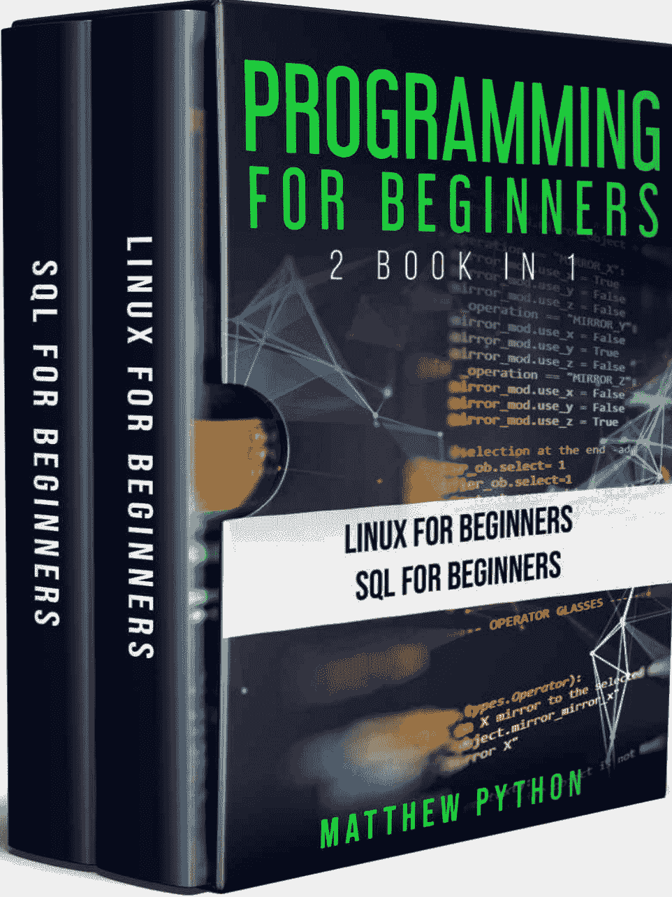

# 初学者编程指南（2合1）：Linux 入门指南与 SQL 入门指南



# SQL 入门 导言

什么是 SQL？

我们为什么要写这本书？

如何使用这本书？

安装 MySQL

## MySQL 函数

第 9 章：SQL 中的变量与存储例

SQL 中的变量

什么是存储例？

存储过程

存储过程的优势

如何创建存储过程？

修改存储过程

如何删除存储例？

存储函数

第 10 章：SQL 控制流工具

If .Else 语句

Case 语句

循环

什么是游标？

While 语句

Repeat

数据科学与 SQL 的数学概念

a) 基数 (Cardinality)

b) 选择性 (Selectivity)

c) 直方图 (Histogram)

d) 聚类 (Clustering)

e) 表之间的关系

f) 统计

内置函数与计算

用户自定义函数

使用标量创建函数

使用表值创建函数

## 系统函数

聚合函数

类型转换函数

日期函数

数学函数

字符函数

其他系统函数

## 第13 章：SQL编程中的项目与练习

SQL 编程中的项目

图书管理系统

如何设计？

SQL 练习示例

SQL 的应用

结论

这本介绍和使用 Linux 操作系统的易上手初学者入门指南。介绍了如何进行简易安装、配置，学习基础命令、基础知识以及技术概述。

## 引言

Linux 是 UNIX way 系统的前身，它在诞生初期就席卷了计算机行业。作为 Linux 核心内核以其创建者林斯·托瓦尔斯（Linux Torvalds）的名字命名。Linux 操作系统目前是地球上最常用的开源操作系统。

直白地说，学习 Linux 是当今竞争性世界中最核心的技能之一。Linux 运行在几乎所有的数据库和网络环境中。高阶企业使用 Linux 来维护其网络和数据库。Android 作为著名的操作系统之一，也运行在 Linux 内核之上。几乎每个程序员在职业生涯的某一个阶段都会倾向于使用 Linux 来完成任务。

除了许多优点外，Linux 还提供了比 Windows 更稳定、流畅的性能。这是一本关于 Linux 的全面初学者介绍，包含了许多通俗易懂的示例和 Shell 代码。

## 什么是 Linux？

Linux 是在内核帮助下运行的操作系统，周围是应用程序和扩展。每个应用程序都以某种方式与内核连接。简单来说，系统的每个部分都使用 Linux 内核来高效运行。硬件和网络通信都需要内核的支持才能高效运行。许多人误认为 Linux 内核是一个操作系统，但它只是一个完整操作系统的一个组件。

不同的发行版厂商（如 Red Hat、Debian、Arch）采用内核提供的功能，并添加了更多工具和库来构建完整的操作系统。每个 Linux 发行版厂商都会遵循某些指南并使用内核自定义自己的操作系统。例如，Parrot Linux 作为一个黑客操作系统，在用户安装发行时为其提供了不同的渗透测试工具。

## 为什么 Linux 在当今世界至重要？

首先，Linux 是程序员和黑客的必备工具，因为它更加可靠和健壮。由于维护成本低廉，几乎 50% 的内网和互联网应用使用 Linux 作为主操作系统。运行在 Linux 上的 Apacheget 主要用于基于服务器的应用程序。

Linux 还支持许多硬件系统，且所需的硬件较少。出于这个原因，许多小型企业期待在基于 Linux 的系统的帮助下开启业务。基于 Linux 的系统也被用于未来技术，如人工智能、数据科学、大数据、数据分析、增强现实（AR）和虚拟现实（VR）。

## 本本书涵盖了什么？

这本书是为初学者提供的全面通俗介绍。在开始阶段，我们将详细介绍 Linux 及其历史。随着学习深入，我们将详细学习安装步骤和 SSH 客户端。书中还提供了一个章节，将在其中详细讨论 Linux 命令。将详细解释不同的 Linux 核心概念，如进程管理、文件管理。本书的最后一部分将涉及高级 Shell 编程和日志分析，这对于一个高效的 Linux 科学家来说是必要的。

## 如何完美利用这本书？

本书在任何需要时都会提供详细的概念和编程代码。要完美利用这本书，请练习这些概念并将它们应用到你自己的项目中。它也可以作为一份快速参考手册。

感谢下载本书。让我们开始探索 Linux 这个美丽而令人兴奋的世界吧。我们出发吧！

## 第一章：什么是 Linux？

随着技术的出现，世界飞速发展。计算机让许多事情变得简单，并成为执行自动化和复杂任务的明显选择。第一代计算机消耗大量资源，并占据大型房间来存储几 KB 的信息。过去，执行基础数学运算的计算机仅供商业和军事目的使用，无法供大众使用。

由于这种操作系统，像 Minix 这样的系统通常价格昂贵，且负担不起。然而，随着 Macintosh 和 Windows 的出现，情况发生了迅速变化，家庭也拥有了计算机。即使这些革命性的操作系统也被商业化了，其源代码仍然保密。

随后在某一个一天，Linux 内核的创建改变了开源系统的格局。现在，在25 年后，Linux 是所有专家、数据库专业人士、渗透测试人员和开发者最喜的操作系统，有数百种免费和商业许可的 Linux 发行版可用。

本章将为你提供关于该操作系统、开源革命、Unix 操作系统、Linux 历史，以及目前可用的一些最基础、最流行的发行版的全面通俗介绍。让我们开始吧！

### 什么是操作系统？

操作系统充当人类与计算机之间的通信桥梁，让事情变得更容易。人类使用自然语言进行交流，而计算机则使用机器语言与其资源通信并接收指令。

从实践上讲，人类无法以二进制语言输入指令，因为这需要花费大量的时间和技能。这是程序员开始开发一种作为人机之间媒介的接口的唯一原因。随着时间的推移，程序员理解了这种发明的潜力，并开始整合许多实用的操作，如图形界面、内存管理、进程管理以及高级安全性。

最流行的操作系统是 Windows，它通常与 Mac 竞争商业市场。Linux 也是一种操作系统，但对任何人都开放，任何人都可以修改内核来创建自己的 Linux 发行版。这种特殊别的操作系统被称为开源操作系统。在下一节中，我们将详细解释开源及其影响和挑战。

### 什么是开源？

开源系统和软件的设计理念是与软件或操作系统一起共享源代码。当所需的用户获得开源系统时，他被完全允许更改源代码以包含新功能，或将其集成到硬件系统中以开发衍生产品。

Linux 是完全的开源系统，这也是其用户量快速增加的原因之一。Linux 用户群由技术专家、程序员和黑客组成。然而，随着 Ubuntu、CentOS 等 Linux 发行版的发展，Linux 在普通用户中占据了良好的份额。

### 开源系统的目标是什么？

- 1) 低风险

开源系统通常不会破产，因为它们不是由个人维护，而是由一群热情的体贴的程序员维护的。

- 2) 高质量

开源编程软件通常质量很高，因为不同的贡献者尝试添加新功能并在发现漏洞时尽快修复。像 Windows 等商业操作系统修复漏洞较慢，有时会导致黑客利用漏洞进行攻击。一个著名的例子是勒索病毒，它利用 Windows 的一个漏洞攻击了成千上万的计算机。

- 3) 低成本

开源系统大多由通过参与项目增加专业知识和技能的贡献者开发。这些程序员不将开发作为收入来源，而是为了让大家的情况变得更好。

- 4) 不同的许可协议

开源系统还根据创建者的决定提供不同许可的使用。如果你期待为开源革命做出贡献，建议详细学习 GPL、BSD、Apache、MPL、MIT 等不同的许可。

## Linux 简史

在20世纪70年代初，在那段被认为是计算机文艺复兴的时期，已经出现了开源开发的痕迹。UNIX 是最受欢迎的企业系统之一，程序员使用它来开发可以随处运行的软件。然而，当 UNIX 决定将其所有集成资源商业化时，开源社区遭受了打击，这使得开源社区难以有效地开发应用程序。

几家公司试图让回归正常，但直到1984年理查德·斯尔曼（Richard Stallman）启动 GNU 开源计划，情况才开始好转。随后 GCC 编译器的发布，使得程序员能够为自己的环境创建相应的程序。这些资源帮助程序员创建了许多具有创新的应用程序。

在所有项目中，1991年，一个由来自赫尔辛基大学的年轻学生创建的项目在社区中脱颖而出。它主要是一个操作系统，由一个内核组成，内核包含不同的库，可以用于集成和开发第三方应用程序及发行版。这位年轻的学生林纳斯·托瓦尔斯（Linux Torvalds）对这种反响感到非常意外，他开始认真启动该项目并进入了全面开发阶段。这个项目被称为“Linux”。

到1994年，Linux 在人气和用户群方面都经历了爆炸式增长。同年，一位名为 Bob Young 的程序员将不同的库集成到内核中，并发布了名为红帽 Linux（Red Hat Linux）的商业发行版面向企业。随着红帽 Linux 的成功，人们理解了 Linux 系统的优势，并开始将其集成到不同的技术系统中。直到今天，林纳斯·托瓦尔斯在全球数十万热心程序员的帮助下，仍然从家里运营内核。


2019年，Linux 在技术版图中占据了 15% 的份额，由数百个可以用于不同用途的 Linux 发行版组成。例如，Kali Linux 就是专门为黑客开发的 Linux 发行版。

## Linux 与 Windows 有何不同

尽管 Windows 占据了大部分份额，但由于其稳健的性能、简单的界面和先进的安全机制，Linux 被认为是所有操作系统中最好的。在本节中，我们将介绍帮助 Linux 占据操作系统顶层位置的所有特征。

### a) 开源

如前所述，Linux 是少数允许将其所有源代码供任何人使用的操作系统之一。对于技术上足够优秀能够根据自己的需求更改源代码的热心人士来说，他们会发现 Linux 非常有用。

### b) 随处可用

随着技术的进步，硬件技术也随之发展，导致低端系统无法运行最新的 Windows 版本。然而，通过 Linux，你可以找到不同的轻量级发行版来配备你的低端个人电脑。著名的移动操作系统 Android 也运行在 Linux 内核上。Linux 还可以被集成到如 Arduino 等嵌入式系统中。基本上，Linux 可以从手机到汽车无处不在，使其成为少数提供这种灵活性的操作系统之一。

### c) 程序员的梦想之源

程序员经常依赖 Linux 系统来调试、编程和测试他们的源代码。Linux 平台为几乎所有可用编程语言提供了各种集成开发环境（IDE）。先进的科学和人工智能项目通常依赖 Linux 系统来协作和组织它们的资源。程序员也可以依赖 Windows 系统开发应用程序，但 Linux 的结果速度快使得软件的调试和部署非常高效。

### d) 更好的定制性

Windows 和 Mac 出各种原因限制用户遵循其基础用户界面。希望定制化系统的用户需要安装第三方软件，而这通常是昂贵的。对于喜爱精美界面的极客来说，Linux 是最佳选择，因为它提供了数百个内置主题，并提供如 KDE 和 GNOME 等不同的可定制环境。

### e) 先进的更新系统

Linux 提供了一种快速且可靠的方式来更新操作系统。由于维护企业系统的贡献者较少，Windows 和 Mac 在发现漏洞后通常需要很长时间才能提供更新。相比之下，由于资源开发迅速，Linux 在极短时间内为用户提供更新。不同的 Linux 发行版使用不同的预制更新安装程序，并可以根据用户的选择使用不同的过滤器进行定制。

### f) 强大的终端

任何有一点极客精神的人都能理解微软充满 Bug 的命令提示符。Linux 中的终端是操作由内核运行的不同系统的路径。你可以使用预构建和自定义的命令来控制整个系统。你甚至可以使用 Linux 终端编辑系统文件，而 Windows 往往限制用户仅使用基本的命令提示符。

### g) 高安全性

Linux 通过其匿名性特性提供了高级别的安全性。某些 Linux 发行版甚至在系统中提供了 TOR 代理链。Windows 由于防御系统较差，经常受到病毒和蠕虫的攻击。

### h) 支持社区

Linux 拥有慷慨的程序员和经验丰富的社区，当你面临问题时，他们乐意提供帮助。Windows 也提供支持论坛，但高级系统错误只能通过专家解决。

除了这些优势之外，Linux 是免费且易于安装的。Linux 这种快速优势帮助它们占据了25%的市场份额，并经常被企业使用。Linux 用户不需要使用杀病毒软件。在下一节中，我们将讨论一些流行的发行版。

到此，我们完成了 Linux 的基础介绍。在下一章，我们将详细介绍不同 Linux 系统的安装步骤。让我们开始吧。

## 流行的 Linux 发行版

Linux 发行版是作为独立操作系统提供的软件包。它们使用 Linux 提供的预构建库进行开发，并与编译后的应用程序集成。在这里我们将介绍一些著名的发行版。

### 1) 红帽企业 Linux (Red Hat Enterprise Linux)

红帽 Linux 是最早使用 Linux 内核开发的 Linux 发行版之一。它现在是世界上最常用的企业系统之一。它以强大的性能、稳定详细的统计数据闻名。红帽 Linux 常被企业用于维护数据库、网络和其他技术系统。红帽 Linux 还根据其提供的定制提供付费发行版。

### 2) Manjaro Linux

Manjaro Linux 是使用 Arch Linux 的著名 Linux 发行系统之一。Arch Linux 是一个高级用户集成系统，支持更快的软件安装。与其他发行版不同，一切都是预装的，对初学者来说非常完美。Manjaro 还提供了优秀的定制选项。根据互联网显示，Manjaro 是 2018 年下载最多的 Linux 发行版。

### 3) Ubuntu

Ubuntu 是让 Linux 对普通用户变得简单的 Linux 发行版。Ubuntu 使用 Debian 数据库来同步应用程序并自动提供更新。它轻量、快速且稳定。Ubuntu 通常预装在配置较低的笔记本电脑和电脑中，以获得更好的性能。

### 4) Linux Mint

Linux Mint 因其易导航的界面而流行。它提供更快的更新，也可以安装在低端电脑上。它非常轻量且通常没有 Bug。Linux Mint 是拥有专门贡献者的流行 Linux 发行版之一。

## 第2 章：Linux 的安装

如果操作得当，安装是一个简单的过程。Windows 系统通常很复杂且耗费大量时间，而 Linux 的安装程序非常简洁，且通常在短时间内完成。然而，由于可用的 Linux 发行版非常多，具体的步骤会略有不同。在本节中，我们将尝试解释安装步骤，以便你能够在虚拟机或通过启动设备安装任何 Linux 操作系统。请跟随操作以了解相关内容。

注意：

在开始安装程序之前，进行先期规划总是好的。务必详细了解你尝试安装的 Linux 发行版。根据指南文件列出所需的物品清单。

在下节中，我们将详细讨论在进行安装程序之前需要注意的规划。

- a) 始终确保你满足所有系统要求

不同的操作系统有不同的安装要求。务必在 Linux 发行版网站上交叉检查要求，如果你确定了前提条件，即可继续进行安装程序。即使不满足要求，也可以安装 Linux，但在使用操作系统时可能会遇到性能问题。因此，如果你使用的是配置较低的旧电脑，建议始终使用轻量级 Linux 发行版。

- b) 你会丢失 Windows 吗？

操作系统有不同的安装类型。你可以将 Linux 版本作为全新安装，也可以在同一系统中同时运行 Windows 和 Linux。然而，双启动系统可能会降低操作系统的性能。如果你不愿继续使用 Windows，那么双启动是完美选择。如果你的硬件支持较高的配置，也可以尝试使用虚拟机，因为低端电脑上的虚拟机会有很多 Bug。

- c) 准备好你所有的硬件

在安装过程中，确保所有的硬件都就绪。部分 Linux 发行版会在你在安装过程中输入有关硬件设备（如 CD-ROM、网卡等）的详细信息。

- d) 了解 Linux 文件系统

安装 Linux 最重要的前提是详细了解 Linux 文件管理系统。在安装期间，必须选择分区信息。请确保你对此了如指掌。我们将在本章节的后续部分中详细讨论分区。

## 推荐的最低系统配置

经过仔细考虑，我们在此向你展示 Linux 操作系统所需的最低系统要求：

- 1) 一个良好的 Intel 处理器

建议使用支持 486 或更高版本 Intel 微处理器的系统。为了获得更好的性能，非常推荐使用 AMD 和 Pentium 处理器。

- 2) 1GB RAM

建议至少保持 1GB RAM 以获得更好的性能。随着 RAM 大小的增加，Linux 系统的性能会指数级增长。

- 3) 20GB 空闲硬盘空间

大部分硬盘空间将被 Linux 系统文件占用。然而，建议至少保持 20GB 的空闲硬盘空间，以提供流畅的性能。

在下一节中，我们将详细讨论 Linux 分区系统。

首先，Linux 处理文件系统与 Windows 完全相反。Windows 通常使用本地磁盘 Local disk C、Local disk D 等来表示硬盘……而 Linux 则将它们表示为 `/dev/sda`、`/dev/sdb` 等……这里是第一个 Linux 硬盘系统，并以此类推。

## 什么是分区？

分区是将硬盘分为不同的部分以继续系统安装的过程。有不同的分区方案，例如 MBR 分区方案。在安装 Linux 系统时有不同的分区技术。我们将在本节中用通俗易懂的语言讨论其中一些。

从技术上讲，有三种分区方案，即主分区、扩展分区和逻辑分区。

通常，许多 Linux 发行版系统使用以下方案进行安装：

- a) 系统的重要部分，挂载为 `/root` [这包含系统文件，且通常不可编辑]

- b) 硬盘中非常小的一部分，用于 RAM 内存。通常，此分区系统被称为 `swap`（交换分区）

- c) 用于存储文件的普通硬盘分区。这通常表示为 `/home`。

在安装过程中，你通常可以根据自己的需求选择分区系统的大小。通过此，我们对分区有了良好的理解，在接下来的节中；我们将详细讨论安装程序。我们将使用 Linux Mint 作为示例操作系统以便更好地理解。

## 使用启动介质安装 Linux Mint


Linux Mint 是受欢迎的 Linux 发行版之一，以其简单易用而闻名。我们将安装程序分为若干步骤，以便更好地更清晰地理解。你可以对任何尝试安装的 Linux 发行版使用相同的步骤。

## 1) 始终研究要求

与之前一样，了解你将安装的发行版非常重要。进入 Linux Mint 网站，了解系统要求并进行交叉检查。找出你的电脑是支持 64 位还是 32 位的系统。这非常重要，因为你需要下载带有相应选项的 iso 文件。

### 如何知道你的系统是 32 位还是 64 位的？

进入 Windows 的控制面板并点击属性选项卡。你可以找到计算机支持的系统类型。你甚至可以使用设备信息选项卡查看所有系统规格。许多高级的 Linux 发行版现在需要更高的规格才能使用。

## 2) 下载文件

在初步研究之后，现在是时候下载安装程序了。有很多第三方网站提供安装文件，但始终建议从官方网站下载安装文件，因为许多安装文件中包含了用于提取你敏感信息的木马。你可以重新验证 64 位加密密钥以检查你的安装文件是否为正版。

在安装下载页面选择 64 位或 32 位系统文件并将其保存到硬盘中。在安装过程中，你会被要求选择一个桌面环境，如 `XFCE` 或 `GNOME`。桌面环境是图形用户界面，每个都有其自己的优势。在选择图形界面之前做好良好的研究。我们推荐 `XFCE`，因为它在所有电脑上都很稳定。如果你的硬件规格较高，你也可以尝试 `GNOME`。

## 3) 制作启动 USB

Linux 可以使用启动设备安装。你可以使用 `NERO` 等光刻刻录软件将安装文件刻录到 CD 中以制作成启动 CD。然而，如今 CD 驱动器正在逐渐消失，建议使用启动 USB 以便更方便地安装。

要制作启动 USB，你需要使用如 `Rufus`、`Universal USB Installer` 等软件。有很多软件提供完全相同的功能。下面我们将讨论它们用于将启动安装文件安装到 USB 中的使用的程序。

- a) 通常，你需要选择发行版文件和你正尝试安装的操作系统名称。
- b) 将你准备作为启动 USB 的闪存盘（Pen drive）插入系统，驱动器将出现在第三个选项中。点击格式化驱动器选项进行纯净安装。
- c) 然后点击开始启动程序。注意电源，任何意外都可能导致需要重新执行整个过程。

程序完成后，你将收到一个提示。拔掉硬件并使用它启动安装程序。

即使正确执行了所有步骤，如果你的系统对启动 USB 没有响应，那么你需要更改 BIOS 设置中的设置。每个制造商为你的系统使用不同的 BIOS 程序。对 BIOS 设置和 UEFI 设置进行良好的研究以启动启动 USB 模式。有时你可能需要禁用安全启动（`secure boot`）选项以立即生效。

## 4) 备份

将您的所有数据以系统文件或云端的形式进行备份是非常关重要的。每个操作系统都提供了简单的技术来备数据数据。

## 5) 安装步骤

在您插入可启动 USB 盘并进入启动菜单后，Linux 现场安装程序将启动。点击“现在安装”，安装便开始了。现在我们将详细介绍安装过程中出现的各个步骤。

### 选择语言

第一个界面会要求您安装所需的语言。通常情况下，如果您对母语作为主要语言感到熟悉，会选中英语，您可以直接选择它。

### 安装第三方插件

在接下来的步骤中，您将收到一个提示，要求安装第三方音乐添加组件。这是一个仅针对 Linux Mint 提供的专属音乐播放器和解码器。选择许可选项并继续安装程序中的下一个步骤。

### 选择安装类型

在此界面中，您需要选择您想要执行的安装程序类型。此界面通常有三个选项，我们将在下文中解释。

- i) 双启动安装

如果您选择此选项，Linux Mint 将与您正在使用的 Windows 操作系统一起安装。用户通常由于对 Windows 的适应性而选择此项。但是，由于分配的资源较少，当选择双启动时，Linux 的性能和稳定性会降低。

- ii) 自动安装

此选项会完全清除系统内存并自动为用户进行分区。如果您是初学者并担心分区方法错误，请选择此选项以让操作变得更简单。

- iii) 手动安装

此选项仅推荐给高级用户，因为您需要在此处手动输入分区详情。您需要自己选择交换内存（`swap memory`）和系统内存分区。请仔细阅读我们之前提到的分区系统，以避免遇到任何故障。

无论您选择哪种选项，Linux Mint 都会带您进入下一个界面。

### 时区和键盘布局

在这些界面中，请选择您所所在的时区和您打算使用的键盘布局。对于中文和日语等第二语言，有很多键盘选项。

### 输入用户详细信息

在此界面中，您通常需要为用户账户输入用户名和密码。输入详细信息并点击“安装”按钮后，将开始安装程序。

一段时间后，操作系统将成功安装，您可以使用之前输入的详细信息登录账户。

如果您在支持社区中遇到任何错误，请查阅故障排除指南以解决最常见的问题。同时也建议更改 BIOS 设置。

进入系统后，您的图形用户界面位于“设置”部分。Linux 为用户提供了大量的定制能力。请尝试各种图形界面。

至此，我们已经完成了关于使用可启动介质安装 Linux Mint 的详细描述。在下一节中，我们将介绍使用虚拟机的安装程序。

虚拟机通常用于在系统内运行操作系统。一些最流行的虚拟机软件是 `VirtualBox` 和 `VMware`。在这些软件的帮助下，您可以轻松从当前的操作系统运行另一个操作系统。

### VirtualBox 的优点

- 1) 非常易用，且易于在两个操作系统之间切换。
- 2) 如果您具有安全背景，建议尝试虚拟箱。任何病毒或蠕虫都不会影响原始操作系统。
- 1) 需要高规格（如内存）来提供流畅的性能。
- 2) 有时可能会突然停止，并引起挫败感。

在下节中，我们将提供在虚拟机上安装 Linux Mint 的分步操作说明。

有不同类型的虚拟机软件，如 Oracle `VirtualBox` 和 `VMware`。在书中，我们将使用 `VirtualBox`。在您的操作系统中安装该软件，就可以开始在虚拟机中使用 Linux Mint 了。

通常，虚拟机镜像可以在网上找到以便更快访问。然而，您甚至可以创建一个虚拟机。

通常，虚拟机镜像可以在网上找到以便更快访问。您可以从 Linux Mint 官方网站下载之前提到的分区系统，选择 RAM 等内存需求。

将调用相应的程序服务来完成某些工作。包括 Linux mint 系统在内的许多主流 Linux 系统默认使用的终端是 `Bash`（Bourne-Again Shell）解释器。

主流 Linux 系统选择 `Bash` 解释器作为命令行终端，是因为具有以下四个优势。读者在未来的学习和生产工作中可以领略 Linux 系统命令行的美感，并发自内心地爱上它们。

- 1. 使用向上和向下方向键检索之前执行过的 Linux 命令
- 3. 强大的批处理能力
- 4. 具有实用的环境功能

由于 Linux 中已经有了像 `Bash` 这样好用的“翻译器”，因此必须学习如何与它通信。为了准确高效地完成各种任务，仅仅依靠命令本身是不够的，还需要根据实际情况灵活地调整各种命令的参数。

当你读完这本书并积累了一些经验后，一定能够理解 Linux 命令的奥秘。执行 Linux 命令的常用格式如下：

## 命令名称 [参数] [附加细节]

注意，命令名、命令参数和命令对象之间应该用空格隔开。

命令对象通常指的是要处理的文件、目录、用户和其他资源。

命令参数可以是长格式（完整选项名）或短格式（单个字母的缩写），分别以 `--` 和 `-` 为前缀。

Linux 初学者无法执行命令大多是因为参数相对复杂，且参数值需要根据不同的命令和要求进行更改。因此，如果你想灵活地匹配各种参数并实现所需的功能，需要长期的经验。

命令参数的长格式和短格式示例

长格式：`man --usage`

在下一节中，我们将详细讨论一些基础 Linux 命令。请跟上！

## 基础命令

### 1) echo 命令

`echo` 命令用于从终端输出字符串或变量中提取值，其格式为

```
"echo [输入字符串 | $ 输入变量]"
```

例如，向终端屏幕输出指定字符串 "This is an example" 的命令为：

```
[root@sample ~]# echo This is an example
```

该命令将在终端屏幕上显示以下信息：

```
This is an example
```

### 2) date 命令

`date` 函数可以帮助我们以“`date [选项][+指定格式]`”的格式显示和设置系统的时间或日期。

例如，压缩文件根据“年-月-日”的格式自动打包为 "`information-2019-8-2.tar.gz`"。用户只需要查看文件名即可获取每个文件备份时间的大致情况。

默认格式查看当前系统时间的 `date` 命令如下：


```
[root@sample ~]# date
Sat Oct 2 6:21:43 IST 2019
```

将系统当前时间设置为 2019 年 11 月 1 日 9:30 的 `date` 命令如下：

```
[root@sample ~]# date -s "20191101 9:30:00"
Sat Nov 1 09:30:00 %j in IST 2019
```

`date` 命令中的参数 `%j` 可用于查看今天是当年的第几天。这个参数可以很好地区分新旧备份时间，即数字越大越接近当前时间。

### 3. reboot 命令

`reboot` 函数可以帮助我们重启系统，格式为 `reboot`。

由于重启电脑涉及硬件资源的管理权限，因此默认可以使用 `root` 管理员重启电脑。

命令如下：

```
[root@sample ~]# reboot
```

### 4. power off 命令

`poweroff` 函数可以帮助我们关闭系统，格式为 `poweroff`。

该命令与 `reboot` 命令相同，涉及硬件资源的管理权限。因此，默认只有 `root` 管理员可以关闭电脑。

命令如下：

```
[root@sample~]# poweroff
```

### 5. wget

`wget` 函数可以帮助我们在终端中以"`wget [参数] 下载地址`"的格式下载网络文件。
如果你没有任何 Linux 系统的管理经验，目前只需要知道 `wget` 命令的参数和功能，然后查看接的演示实验。

```
[root@sample ~]# wget {在此处输入 URL 地址}
```

接下来，我们使用 `wget` 命令递归下载网站所有的页面数据和文件，下载后将自动保存到当前路径下的命名目录中。

执行此操作的命令是 `wget -r -p {在此处输入 URL 和路径}`。

`ps` 函数可以帮助我们以"`ps [参数]`"的格式查看系统中的进程状态，

估计读者第一次执行此命令时会感到惊讶——怎么会有这么多输出值，又要怎么看呢？

Linux 系统中一直有很多进程在运行。如果能对其进行合理管理，就可以优化系统性能。在 Linux 系统中有五种常见的进程状态，即运行（run）、中断（interrupt）、非中断（non-interrupt）、僵死（zombie）和停止（stop）。

如前所述，Linux 系统中的命令参数可以分为长短。在 Linux 系统中，有五种常见的进程状态，即运行、中断、非中断、僵死和停止。

### 7. top 命令

`top` 函数可以帮助我们动态监控进程活动和系统负载等信息，格式为 `top`。`top` 命令非常强大，完全被视为 Linux 中的“增强版 Windows 管理器”。

```
2232
```

`kill` 函数可以帮助我们以"`kill [参数] [进程 PID]`"的格式终止指定的服务进程

接下来，我们使用 `kill` 命令终止由上述 `pidof` 的进程。命令如下。此操作的效果等同于强制停止 `ftp` 服务。

```
[root@sample ~]# kill 2233
```

### 10. killall 命令

`killall` 函数可以帮助我们终止与特定服务名称相对应的所有进程，格式为："`killall [参数] [服务名称]`"。

# 第 4 章：基础 Linux 命令

在上一章中，我们学习了一些 Linux 管理员和用户使用的非常基础的 Linux 命令。在本章中，我们将通过查看不同类别的卓越命令（如系统命令、目录命令和文本命令）来进一步提高你的技能。不建议背诵所有这些命令，但在阅读本书时通过亲自测试，可以更好地理解这些命令的重要性。让我们开始吧！

## 系统命令

对于 Linux 学习者来说，学习系统命令对于提高系统效率至关重要。本节将帮助你学习与内核和网络相关的命令。所有命令都非常实用且具有重大的意义。

### 1) 获取网络信息的命令

这条单一命令可以帮助你了解很多网络信息。当你在终端中输入此命令时，网络状态等信息会瞬间显示。

这是该命令的格式：

```
root @ sample: ifconfig
```

输出将显示 IP 地址、子网掩码和物理 MAC 地址等信息。如果你使用了任何 VPN 或 MAC 修改器等第三方软件，将显示自定义后的值。

该命令的示例输出：

```
inet 212.23.21.12 subnet 223.12.11.12 Broadcast 121.11.232.12
```

### 2) 获取硬件信息的命令

Linux 中的这条特殊命令可以帮助你了解许多关于系统和内核的静态信息。你可以了解内核类型、硬件处理器信息和操作系统等细节。

你只需要输入以下命令：

```
root @ sample: uname {parameter}
```

你可以输入 `-a` 作为参数来显示该命令可以处理的所有信息。

然而，如果你不习惯通过终端访问信息，也可以查看系统文件夹中的 Linux 发行版发布文件获取相同的细节。

### 3) 获取运行时间详情的命令

`uptime` 命令具有经典用途，用于了解系统更新时间以及在处理系统负载时需要检查的其它额外信息。这条终端命令将帮助我们轻松应对资源短缺问题。

这是该命令：

```
root @ sample: uptime
```

输出将提供如下所示的系统运行时间的有效信息：

```
12:23:12 up 23 min, 6 users, load average: 0.21, 0.03, 0.43
```

### 4) 释放资源的命令

这条命令赋予你释放资源以防止系统突然停止的能力。突然停机可能会影响许多进入系统的服务和进程。Linux 管理员始终有必要跟踪资源。

这是该命令的格式：

```
root @ sample: free -h
```

这里的 `h` 参数可以用于以更合理、更符合人类习惯的方式显示系统信息。

### 5) 获取用户信息的命令

Linux 用户通常会监控其命令中出现的许多用户。为了查看所有用户，Linux 提供了一个名为 `who` 的命令。该命令还会显示用户进入系统的起始时间。

这是该命令和输出：

```
root @ sample: who
```

```
root 1 2019-07-12 23:12
```

### 6) 查看过去执行过的命令的命令

就像浏览器提供你访问过的所有网站的历史记录一样，Linux 系统提供了一个命令，显示用户在系统中执行的最新 1000 条命令。你也可以在命令配置文件中自定义要显示的命令数量。

这是该命令：

```
root @ sample: history
```

### 7) 显示报告的命令

Linux 提供了一个特殊的命令来以报告的形式显示并整理所有资源。这种报告分析非常复杂，通常需要高级的故障排除知识才能理解报告内容。如果你是新手用户，学习 `sos report` 是一项非常重要的任务。

新手用户可以生成 `sos` 报告并将其到文件，以便其远程解决小问题。然而，对于复杂问题，`sos` 报告可能并不有效。

这是该命令：

```
root @ sample: sosreport
```

不过，请确保你认可将敏感内容发送给远程 Linux 管理员。

到此，我们完成了对 Linux 系统命令的详细解释。在下一节中，我们将讨论成为专家 Linux 管理员所必要的目录命令。

## 目录命令

确定工作目录对于在系统中执行命令至关重要。在安装过程或压缩等复杂任务期间，需要输入关于工作目录的详情。我们还将讨论可以帮助我们更改工作目录的命令。初学者应该尝试精通目录命令以提高他们的专业知识。

### 1) 获取当前目录的命令

这条命令可以用于显示你所在的当前目录。它被简单地命名为 `pwd`，并精确地显示你所在的工作目录。

这是它的命令：

```
root @ sample: pwd
```

输出将如下：

```
/home/samplefolder
```

### 2) 切换工作目录的命令

这是 Linux 中常用的命令。通过使用这条命令，你可以轻松地切换目录。这通常是最常用的命令，因为在使用 Linux shell 窗口时，它简单灵活，可以帮助你切换目录。

以下是该命令提供的一些额外功能：

- a) `cd` ---> 你可以使用此参数切换到上一个目录
- b) `cd..` ----> 使用此参数你可以轻松切换到上级目录
- c) `cd~` > 通过使用此参数，你可以瞬间跳转到用户的家目录。你也可以通过命令末尾添加用户名跳转到任何用户的家目录。

这是该命令：

```
root @ sample: cd /home/sampleanalysis
```

### 3) 查看工作目录详情的命令

这条命令帮助你查看目录中存在的所有文件。你可以根据喜好使用不同的参数查看文件。通过使用如 `-a` 的参数，你甚至查看隐藏文件。

这是该命令：

```
root @ sample: ls -a
```


这条命令将显示所有存在的文件。如果目录有很多文件，显示结果可能需要一些时间。

文件目录管理是一项必须学习的技能。我希望你在这一节中学到了有效信息。下一节将处理一组文本命令，方便你处理资源。

## 文本命令

文本是交换信息的常用方式之一。在 Linux 中，可以使用提供的许多命令轻松读取文本文件。在本节中，我们将详细讨论一些最实用的文本命令。

### 1) cat

这条命令可用于读取小型纯文本文件。这通常由 Linux 管理员使用，因为很多文本文件的行数很少。你也可以使用参数 `-n` 来显示行号。

这是该功能的命令：

```
root @ sample: cat -n examplefile.txt
```

### 2) more

`cat` 设计用于小型文本文件，当用于长文本时可能会出现很多问题。因此，建议使用专门为此功能设计的 `more` 命令。该命令窗口还会显示你已阅读内容的百分百分比。

这是该功能的命令：

```
root @ sample: more examplefile.txt
```

### 3) head

`head` 是一个 Linux 文本命令，可以读取文本文件顶部自定义的行。这在检查文本文档时非常有用。参数 `-n` 定义了使用此命令可以读取的行数。

这是该功能的命令：

```
root @ sample: head -n 15 examplefile.txt
```

### 4) tail

`tail` 是一个 Linux 文本命令，工作方式与 `head` 命令完全相反。当你使用 `tail` 命令时，可以读取文本文档的末部分。像之前一样，你可以使用 `-n` 参数定义使用此命令可以读取的行数。`tail` 命令特别方便

```
root @ sample: tail -n 15 examplefile.txt
```

### 5) tr

这是一个特殊的 Linux 命令，用于替换文本文件中的字符。你可能在微软 Word 中发现过此功能。在这里，我们可以使用各种参数轻松地替换手动文本。你甚至同时将两个不同的字符替换为同一个字符。为了实现此命令功能，你们都需要学习额外的逻辑运算符。

### 6) wc

### 7) stat

### 8) cut

以下是该命令：

```
root @ sample: cut -n 2 /home/example.txt
```

在这里，`-n` 参数定义了划分的列数。

### 9) diff

这是一个特殊的文本命令，用于查找文本文件之间的差异。它可以用于比较已更新的草稿。这非常有用，可以帮助你关注不同之处。

以下是操作步骤：

- 1) 首先，使用 `cat` 命令查看想要比较的两个文件。
- 2) 之后使用 `diff` 命令比较两个文件，结果将在处理后显示。

以下是该命令：

```
root @ sample: cat example1.txt
```

```
root @ sample: cat example2.txt
```

```
root @ sample: diff --brief example1.txt example2.txt
```

通过此，我们已经完成了对文本命令的简要且彻底的解释。

希望你已经学习了关于处理不同功能的 Linux 命令的宝贵信息。在下一章中，我们将讨论 Linux 中的 SSH 和其他网络功能。

## 第 5 章：Linux 中的网络

在当今世界，网络对于世界的运行至关重要。最大的网络 Internet 是通过不同的协议和通信机制连接系统构建的。在学习操作系统时，有必要了解它提供的所有网络功能。

Linux 在连接到网络时提供了许多用于交换数据的协议。与普通的用户名和密码组合相比，这些协议通过密钥进行加密要安全得多。在本章中，我们将详细讨论 Linux 系统中可用的 SSH 以及其他传输协议。

SSH 是 Secure Shell（安全外壳）的缩写，旨在向关联的远程机器发送命令。这在团队工作以及尝试发送可以操作系统的命令时非常方便。

SSH 以其加密通信而闻名。传输的每条消息都不会被攻击者劫持。许多 Linux 应用使用此协议来交换远程信息。

在深入研究 Linux SSH 之前，我们将讨论一些对 Linux 学习者至关重要的基础网络概念。请继续阅读！

## 我们如何识别网络中的系统？

使用 IP 地址。网络协议地址的设计是为了识别网络中的系统并向其发送信号。有不同的 IP 版本，如 IPv4 和 IPv6。

除了网络地址外，每个连接的系统（移动手机、笔记本电脑或个人电脑）都包含一个指定的物理地址，即 MAC 地址。与 IP 地址不同，这些地址通常不容易被篡改。

网站也是名为 Internet 的网络枢纽的一部分，通常由 IP 地址表示。但在实际操作中，无法为尝试访问的每个网站记住 IP 地址，因此它们使用类似于电话簿的系统 DNS（域名系统）来表示，在 DNS 中，IP 地址由我们日常生活中使用的域名表示。

## 一些基础 Linux 网络命令

本节将为你提供一些用于执行基础网络任务的常用命令。不要被这些命令吓，我们将在接下来的章节中详细讨论这些命令。

### a) 如何找到你的 IP 地址？

每个 Linux 系统都会分配一个网络地址，可以使用以下命令轻松获知。

打开你的 shell 并输入命令：

```
ifconfig
```

当你按下回车时，你将得到显示不同参数的输出。

以下是示例输出：

```
indent addr ----c 164.232.121.1

HWaddr---- 23:ab:23:45:f3:6r
```

你可以使用以下命令获取系统的默认网关：

```
ip route
```

### b) 如何获取分配的 IP 地址

上一节向你解释了如何查找系统的 IP 地址，在本节中，我们将讨论如何获取分配的 IP 地址。

通常情况下，Linux 使用 DHCP 服务器分配 IP 地址。为系统手动安排网络地址需要大量时间。因此，为了方便用户并避免地址冲突，Linux 使用 DHCP 服务器自动分配一个与网络中任何其他地址都不相同的 IP 地址。

一旦你连接到以太网，就会使用 DHCP 服务器 分配一个新的 IP 地址。然而，如果你仍然无法连接到网络地址，可以使用以下命令强制分配网络地址。

```
sudo dhclient
```

你还有机会释放 IP 地址并分配一个不同的。你可以使用不同的命令来实现目标。

以下是该操作的命令：

```
sudo dhclient -r
```

通过 DHCP 服务器分配的 IP 地址通常是动态的。每当你尝试检查 IP 地址时，它们可能已经发生了非常快的变化。它自动运行，并从地址池中分配可用的网络地址。

例如，在一个拥有私有网络的大学里，每个连接的系统都会获得一个动态 IP 地址，该地址在一段时间内持续变化，以获得系统的更高的安全性。

**注意：**

某些服务器/网站需要静态地址来实现它们提供的功能。静态意味着不改变的网络地址。你可以通过以下步骤分配静态地址。

这通过 Linux 提供的图形界面进行。在界面中输入网关、IP 地址和子网掩码，然后回车使更改生效。

接下来，我们将学习如何在 Linux 系统上配置服务。然而，在此之前，必须确保主机之间的顺畅通信。如果网络不通，即使服务部署正确，用户也无法顺畅访问。因此，配置网络和确保网络连通性是学习部署 Linux 服务之前的最后一个重要知识点。

## 网络管理器 (Network Manager)

许多 Linux 发行版默认使用 Network Manager 提供网络服务。这是一个守护进程，用于动态管理网络配置并保持网络设备连接。Network Manager 服务可以使用 `nmcli` 命令进行管理。`nmcli` 是一个基于命令行的网络配置工具，具有丰富的功能和参数。

它可以轻松查看网络信息或网络状态：

```
[root@sample ~]# nmcli connection show
```

此外，Linux 系统支持网络会话功能，允许用户在配置文件之间快速切换（类似于防火墙）。

如果我们需要在公司使用笔记本电脑手动指定网络的 IP 地址，回到家里时我们将使用 DHCP 自动分配 IP 地址。这需要繁琐且频繁地修改 IP 地址，但在使用网络会话功能后将变得简单得多。

你可以使用 `nmcli` 命令并按照“connection add typeypeifname”的格式创建一个网络会话。使用 `con-name` 参数指定公司使用的网络会话名称，然后使用 `if` 参数指定机器的网卡名称。使用 `autoconnect` 参数设置默认不自动激活网络会话，并使用 `ip4` 和 `gw4` 参数手动指定。

```
[root@sample~]# nmcli connection add conname {名称} ifname {网卡名称}
```


使用 `nmcli` 命令配置的网络会话是持久的，所以当我们回家时可以方便地启动家中的会话，网卡可以通过 DHCP 自动获取地址。

如果你是虚拟机，请将虚拟机的网卡（网络适配器）切换到桥接模式并重启虚拟机。

## SSH

SSH（安全外壳）是一种提供安全远程登录的协议，是目前远程管理 Linux 的首选方式。在此之前通常使用 FTP 或 Telnet 进行远程登录。然而，由于它们在网络中明文传输账户密码和数据信息，因此非常不稳定，容易受到黑客攻击。这会导致篡改传输的数据或直接获取服务器的账户密码。

如果你想使用 SSH 协议远程管理 Linux 系统，你需要部署并配置 ssh 服务。`sshd` 是基于 SSH 协议开发的管理服务程序。它不仅方便快捷，还提供了两种安全验证方法：

- 密码认证 - 使用账户和密码进行身份验证；
- 密钥认证 - 在本地生成密钥对，将密钥对中的公钥上传到服务器并与服务器中的公钥进行对比。这种方法比那种更安全。

前面的段落多次强调了“Linux 系统中的一切都是文件”，因此修改 Linux 系统中服务程序的运行参数是一个过程

修改程序配置文件。

`sshd` 服务的配置信息保存在 `/etc/ssh/sshd_config` 文件。运维人员通常将包含最重要配置的文件称为主配置文件，该文件有许多以 `#` 开头的注释行。为了让这些配置参数生效，在修改参数后需要删除前面的 `#` 号。

以下是在特定 IP 地址上启动 SSH 服务的命令。

```bash
[root@sample ~]# ssh 162.34.232.12
```

如果禁止以 root 管理员身份远程登录服务器，黑客通过密码破解攻击的概率将大大降低。使用 Vim 编辑器打开 `sshd` 服务的的主配置文件，删除第 34 行 `yes` 参数前的井号 (`#`)，并将参数值更改为 `no`，这样 root 管理员将不再被允许远程登录。记住找到文件并退出。

再次强调，在修改配置文件后，通用服务程序不会立即获取最新参数。如果你想让新的配置文件生效，需要手动重启相应的服务程序。最好将此服务程序添加到启动项中，这样当系统下次启动时，服务程序将自动运行并继续为用户提供服务。

```bash
[root@sample ~]# restart sshd
```

```bash
[root@sample ~]# enable sshd
```

这样，当 root 管理员再次尝试访问 `sshd` 服务程序时，系统将提示无法访问的错误信息。虽然 `sshd` 服务参数相对简单，但这是 Linux 系统中配置服务程序的正确方法。我们所做的是从其他示例中进行推理并学习如何灵活地使用它们，即使以后遇到不熟悉的服务，我们也能处理它们。

## 基于 SSH 密钥的认证

如上一节所述，SSH 密钥认证是 Linux 中最常用的服务之一。要使用密钥认证，你需要将编码后的公钥上传到 SSH 服务器。

务必以普通用户身份创建密钥，因为 root 限制会导致其他人无法进行认证。

这里我们解释生成和导入 SSH 密钥的逐步步骤：

- 1) 第一步中，我们将创建一个带有输入密码短选项的密钥对。你需要确认密码短，然后将生成你的加密密钥。

以下是命令：
```bash
root@sample: ssh-keygen
```

- 2) 你也可以生成一个不带密码短的密钥。但是，建议在使用 SSH 服务时使用密码短，这可以提供额外的安全层。

- 3) 现在在下一步中，你需要仔细地将密钥导入到远程系统。这里是无缝完成此操作的命令：

```bash
ssh-copy-id sk@132.23.22.11
```

如果你以后想处理基于密钥的 SSH，可以将其禁用。

## 通过 Telnet 连接

Telnet 是一个著名的 Linux 网络管理工具，可以帮助我们通过认证程序连接到远程计算机。Telnet 像 SSH 一样能够无限制地连接到远程计算机。虽然没有 SSH 安全，但它也有自己的优点。

首先，它很容易安装并内置在许多 Linux 发行版中。如果没有提供 Telnet，可以通过 `wget` 下载器安装它。

Telnet 的机制是使用基本的密码认证模式。使用以下命令连接 Telnet。

```bash
root@sample: telnet {输入主机名}
```

此处的主机名指的是我们尝试连接的远程机器的 IP 地址。

例如，你可以连接到 localhost 来连接同一网络中的计算机。

```bash
root@sample: telnet localhost
```

在执行执行此命令后，我们将收到一个输入用户名和密码的提示。

连接成功后，你可以进一步执行命令在远程机器上运行。可以使用如下提供的 `logout` 命令轻松使用 Telnet。

```bash
root@sample: telnet logout
```


## 加密

加密是对信息进行编码和解码的技术。它通过特定的算法（密钥）将可以直接读取的明文信息转换为密文形式。密钥是密文的钥匙，分为私钥和公钥。在传输数据时，如果你担心被他人监控或截获，可以在传输前用公钥加密数据，然后传输。这样，只有拥有私钥的用户才能解密数据，即使其他人截获了数据，通常也很将其解密为明文。

简而言之，在生产环境中使用密码验证密码始终面临被黑客破解或嗅探器截获的风险。如果密钥认证方法配置正确，`sshd`服务程序将更加安全。我们将进行以下特定配置，步骤如下：

- 步骤 1：在客户端主机上生成一个“密钥对”。
- 步骤 2：将客户端主机生成的公钥传输到远程主机。
- 步骤 3：将服务器设置为仅允许密钥认证并拒绝传统的密码认证方法。记住在修改配置文件后保存并重启`sshd`服务程序。
- 步骤 4：当客户端尝试登录服务器时，无需输入密码即可成功登录。

## SCP

`SCP` (secure copy) 是一种基于`SSH`协议的网间安全传输命令。

其格式为 `"scp [参数] 本地文件 远程账户@远程 IP 地址:远程目录"`。

与 `cp` 命令不同，`cp` 命令只能复制本地文件，而 `scp` 不仅可以在网络传输数据，还能加密所有数据。例如，如果你想通过网络从一个主机传输文件，且两个主机恰好都是 Linux 系统，就可以方便地使用 `scp` 命令。

当使用 `scp` 命令从本地复制到远程时，首先需要以绝对路径的形式知道本地文件的存储位置。如果你想传输整个文件夹的数据，还需要添加 `-r` 参数进行递归操作。

然后写下远程主机的 IP 地址，远程服务器将要求认证。当前用户名是 `root`，密码是远程服务器的密码。如果你想使用指定用户的身份认证，可以使用 `user@host` 的参数格式。

最后，需要在远程主机的 IP 地址后加上冒号，并写下要发送到远程的目录。只要参数正确且用户身份验证通过，传输即可开始。

此外，`scp` 命令也可以用于从远程主机下载文件到本地。例如，你可以下载远程主机的系统版本信息，这样就不需要先登录远程主机再传输文件，节省了大量麻烦。

## 第 6 章：Linux 扩展功能

本章是一份全面的指南，解释了 Linux 系统拥有的各种单项功能。我们将详细讨论目录权限、压缩和文件系统，并在必要时介绍相应的命令。本章将扩展到关于 Linux 中更复杂主题的章节。请继续读下去！

### 文件和目录权限

Linux 是一个专业的操作系统，经常用于拥有大量用户的企业和工业领域。给每个人都赋予权限将导致灾难。黑客也可能通过操纵一名员工来获取整个系统的访问权限。正因如此，Linux 为用户提供了一套完善的文件和目录权限。

本节将帮助你理解 Linux 如何处理多个用户和组，以及一些可以帮助你理解其机制的命令。首先，我们将详细讨论 Linux 中存在的用户类型。

- 1) Root 用户
  Root 用户是系统的管理员或控制器。Root 用户通常拥有高权限，可以编辑系统中的任何文件内容。他还要负责维护系统中的其他所有用户。如果有人获取了 root 用户的访问权限，他就拥有了摧毁整个系统的权力。

- 2) 普通用户（Normal users）
  这些是 root 基础下的另一组用户。普通用户通常由 root 用户分为组，并根据他们的需求赋予不同的权限。例如，在一家 IT 公司中，程序员只被赋予他们正在工作的项目文件的访问权限，而安全分析师被赋予访问公司正在进行的所有项目的权限。

### 权限类型

Linux 或任何其他操作系统通常会根据其决定赋予用户以下三种权限。

- 1) 读（Read）
  分配到此权限级别的用户只能读取现有的内容。他们不允许以任何方式编辑文件。这些用户被称为低访问权限系统用户。

- 2) 读和写（Read and Write）
  分配到此权限级别的用户不仅可以读取系统文件，还可以写入文件。

- 3) 读、写和执行（Read, write and execute）
  分配到此权限级别的用户不仅可以读写，还可以执行程序。由于其敏感性，root 用户通常不会给用户赋予这些权限。

以下是向个人所有者和组授予权限的一些方法：

- 1) `chown`
  这是一个允许单个用户的命令。
  `chown [username] [location]`
  在 `username` 列中输入你想要赋予权限的用户名，在 `location` 中输入你正在使用的文件路径/名称。

- 2) `chgrp`
  这是另一个用于向组分配权限的命令。如之前提到的，在企业中，某些用户组仅被允许访问少数功能。例如，程序员只能访问项目文件，而测试人员可以访问一个项目所包含的所有内容。
  root 用户使用 `chgrp` 给程序员组分配以访问程序文件的权限。这里是该命令：`chgrp [groupname]`

在上一节中，我们讨论了权限的授予，在下一节中，我们将讨论帮助我们确认权限是否已分配的命令。请继续读下去！

你可以使用以下命令来检查你想要查看的文件权限。

- 1) `ls`
  `ls -l [filename]`
  当我们输入以下命令时，系统会自动定义权限状态。

- 2) `stat`
  `stat [filename]`

#### 使用 `chmod` 更改权限

程序员在使用 Linux 系统时经常使用 `chmod` 来更改权限。`chmod` 赋予系统完全访问权限，只能由 root 用户执行。
`chmod 777 [filename]`

你对 777 代表什么感到困惑吗？
- 读 - 4
- 写 - 2
- 执行 - 1

如果三者相加，就是 7，而三个 7 代表正在对所有所有者、组和其他所有用户进行更改。因此，通过输入 777，权限会在整个系统中发生更改。

在下一节中，我们将详细讨论压缩和归档，并附带大量的示例。

### 压缩和归档

在讨论 Linux 中可以压缩文件的各种命令之前，了解一下压缩是有意义的。

什么是压缩？

压缩是通过各种算法和技术缩小文件大小的过程。如果你是 Windows 用户，你可能用过 WinRAR 之类的软件，它使用压缩技术来缩小体积。流行的压缩格式有 `rar`、`zip`、`7z`。

然而，Linux 使用一种名为 `tar` 的更复杂的格式。Linux 压缩通常有两种类型。

- 1) 有损（Lossy）
  有损是指文件大小减小但会丢失某些质量的一种。例如，多媒体文件使用有损技术。

- 2) 无损（Lossless）
  无损是另一种压缩类型，需要在不丢失任何信息的情况下压缩数据。例如，文本文档使用这种技术。

#### a) Tar 命令

在压缩时最重要的一点是首先对其进行归档。`Tar` 被称为磁带存档（tape archive）。我们将在后续章节讨论 `tar` 命令。

### 文件系统和存储设备

在讨论各种压缩命令之前，文件系统是分类存储的一种重要方法。Windows 和 Mac 都使用不同的程序来维护它。Linux 使用树形结构，`/root` 被描述为树根。我们将在本节中学习这些内容。

如果需要安装任何硬盘，它们通常会被挂载。在使用硬盘后，可以轻松地卸载。

#### 设备在哪里表示？

在 Windows 中，当插入硬盘时，它们通常显示设备显示。然而，Linux 将所有设备表示在 `/dev` 中。为了进行实验，你可以简单输入以下命令查看所有存在的设备：

```
cd /dev
ls -l
```

#### Linux 如何表示设备？

旧时代的 Linux 使用 `fd0`、`hda` 表示软磁盘驱动器硬盘。现在我们获得的是使用 SATA 分区系统的硬盘。这些使用 `sda`、`sdb`、`sdc`... 等名称表示。

这里的 a、b、c 代表文件系统使用的序列化概念。a 代表第一个硬盘，b 代表第二个硬盘，以此此类推。甚至这些硬盘也可以根据分区进一步划分，并可以轻松使用 `sda1`、`sda2`、`sda3`... 进行表示。

### 变得安全和匿名

安全是如今互联网和计算机用户的一个重要关注。即使是声誉良好的公司，Windows 和 Apple 也经常因从用户那里收集大量数据而受到批评。无论它们的意图如何，现在我们的数据是不安全的。

另一方面，Linux 是一种没有企业的开源操作系统，通常非常好以匿名功能而闻名。许多黑客偏好 Linux 是因为它具有先进的功能和工具，这些工具不会让他们变得暴露在互联网服务提供商面前。作为一名 Linux 初学者，深入了解 Linux 提供的匿名服务非常重要。跟随下文了解更多细节。

#### 追踪

你所做的几乎一切都可能被政府或 ISP 追踪。由于国家审查，某些防火墙会限制你访问本国家的网站。

##### 它们是如何被追踪的？

你通过互联网发送的每一条信息都是通过数据包发送的。数据包包含了你的 IP 地址和目标地址。因此，如果你的提供商检查日志文件，就很容易追溯到你。

##### 如何避免追踪？

我们将为你提供三种逃避追踪并在互联网上过匿名生活的最佳方法。所有方法在实践中都被证明能提高你的隐私安全性。

- a) 代理服务器 (Proxy servers)

众所周知的代理是通信双方的中间人。当你尝试向目标发送消息或请求时，数据包会通过代理服务器传输到达目的地。因此，目标会将代理服务器识别为主要请求者并向其发送信息。你可以获取私有和公共代理来更好地管理你的互联网使用。

接收响应后，代理服务器会将响应发送给我们，我们将通过浏览器或网络应用程序看到它。这个准确的过程可以帮助你保持匿名。

- b) TOR 代理 (TOR proxy)

`TOR` 是匿名客户端之一，可以帮助你免受额外的互联网追踪。`TOR` 也用于查看暗网。`TOR` 是由独立网络工程师开发的项目，用于整合来自大量计算机的代理链。当你在系统中启动 `TOR` 服务时，你的所有数据将发送到可用的 `TOR` 代理，并进一步发送到全球多个秘密的 `TOR` 。

即使政府尝试检查日志，也很难追踪到你的源。然而，由于代理服务器接收到大量请求，`TOR` 的速度较。

- c) VPN

`VPN` 是另一种加密你信息的方法。`VPN` 可以让你访问被封锁的网站。通过使用虚拟专用网络，你可以轻松地变得匿名。有许多优质 `VPN` 服务，如 Hide my ass、Nord VPN。

### 自动化任务

自动化是 Linux 应用服务器技术和数据库维护的领先原因之一。许多系统管理员使用自动化脚本来检查系统的必要要求。自动化不仅节省时间，还能帮助我们从不同的角度理解事物。在下一节中，我们将讨论一些可以帮助我们创建自动化任务的概念。

### crontab & cron 守护进程

在 Linux 中，有一个名为 `cron daemon` 的进程，它可以接收参数并在特定时间后执行或在满足条件时执行。

如前所述，守护进程（Daemon）是一个可以操作系统的后台进程。Linux 用户可以在 `crontab` 中输入命令，为特定时间调度任务。

当时间到达时，后台运行的 `cron daemon` 就会启动程序。例如，我们可以使用 `crontab` 在空闲 30 分钟后关闭系统。你只需要将其添加到 `crontab` 中。

`Crontab` 甚至可以在几个月或几年后执行任务。你可以找到 `crontab` 的各种参数来执行复杂操作，例如重启后删除日志文件等。

虽然自动化任务可以处理各种任务，但建议使用此功能备份你的数据。

### 备份 (Backing up)

备份对于使用 Linux 的用户来说非常重要，因为其中可能包含敏感信息。然而，人们往往容易忘记这个简单的任务。建议每周备份一次文件。借助 `crontab` 的帮助，你可以为你需要的时间调度备份。

以下是命令：


crontab backup time

至此，我们完成了一个描述 Linux 额外功能所有内容的综合章节。在下一章中，我们将详细讨论进程管理。

# 第 7 章：Linux 中的进程管理

首先，在深入研究用于进程管理的不同命令之前，我们需要对进程是什么有一个良好的理解。

## 什么是进程？

通常，操作系统是在某些程序的帮助下编译的，以解决不同的任务。所有这些程序都通过图形界面系统地安排，该界面作为执行任务的媒介。

程序是解决问题的逐步指令。程序员使用逻辑和分析性算法来创建可以处理不同指令的复杂程序。当程序启动时，它被存储在内存中并开始执行。

每当程序启动或初始化时，它被称为进程。进程通常由操作系统用 ID 表示，以便更好地监控资源。Linux 操作系统使用各种先进系统技术来处理和优先考虑进程。在本章中，我们将通过 Linux 命令详细讨论进程的不同用例。跟随下文！

## 进程 ID (Process id)

进程 ID 缩写为 `PID` 在 Linux 系统中通常用数字表示进程。每个进程都分配有一个 `PID`。Linux 在启动过程中启动的第一个进程是 `PID 1`，所有其他进程的 `PID` 都长得多。

通常，父进程和子进程可以很容易识别，因为父进程的 `PID` 较短，子进程的 `PID` 较长。

## 父进程 (Parent process)

父进程是一种使用 `fork()` 函数发起系统用的进程。当使用 `fork()` 时，可以很容易启动子进程。

例如，在 Linux 中打开 LibreOffice 时会启动一个进程。一段时间后，用户在界面上点击“检查更新”，父进程调用系统函数 `fork()` 来启动一个检查更新的子进程。

一个父进程可以启动多个子进程。然而，无限数量的子进程并不是问题，因为系统资源可能会因为突然流量而卡住。

## 子进程 (Child Process)

子进程是由父进程启动的进程。它在许多方面与父进程相似，甚至具有相似的 `PID`。如果子进程意外结束或被中断，一个信号将发送到父进程以通知。子进程通常由 `fork()` 调用并通常自行结束。这种自销毁有助于节省系统资源。

## pstree

`pstree` 是 Linux 中的一个命令，显示 Linux 系统拥有的树形进程结构或顺序进程结构。

`pstree` 是分类组织的，使得我们可以从端点看到所有进程。所有进程的排列方式使得子进程和父进程可以容易地被注意到。

命令如下：

```
pstree
```

打开你的命令行并输入上述命令，查看 Linux 系统中运行的所有进程的树结构。

## PS 命令

`PS` 也称为进程状态命令，是一种特殊的 Linux 工具，用于显示存在于多个参数的进程。`ps` 命令已成为 Linux 管理员手手工具，因为它可以帮助根据要求过滤进程。

在本节中，我们将描述一些可以帮助你理解 `ps` 命令范围的命令。建议在你的 Linux 系统上输入命令以获得定制的学习体验。

### a) `ps`

这是一个基础命令，可用于显示当前 shell 中存在的所有进程。记住，这个简单的 `ps` 命令只会显示在当前 shell 中运行的进程，而不是整个系统。

此处命令：

```
ps
```

### b) 显示所有进程

这组命令用于显示当前 Linux 系统中正在运行的进程。它们也可以被设置为以各种格式显示。

#### i) `ps -e`

此命令显示 Linux 系统中存在的所有进程。输入以下命令可以显示 `PID`（进程 ID）和进程运行的时间。

#### 2) `ps -ef`

此命令也显示所有进程，但显示方式包含了 `PPID`（父进程 ID）。

#### 3) `ps -x`

使用此命令，你可以显示由用户表示的每一个进程。如果你是 root 用户，它将显示系统上运行的所有进程。

#### 4) 显示特定用户的进程

在这些命令行执行中，将显示特定用户的所有进程。你只需要获取 root 权限并输入以下命令格式即可获取该用户处理的所有进程：

```
ps -fu [username]
ps -fu Raymond
```

输出将显示所有由 `Raymond` 运行的进程。

#### 5) 所有以 root 运行的进程

这是一个特殊命令，帮助我们显示所有以 root 权限运行的进程。请作为 root 用户输入以下命令来查看你正在运行的所有进程：

```
ps -U root -u root
```

#### 6) 组运行的所有进程

如之前所解释，Linux 系统也支持组，组是用户的逻辑集合。使用以下命令，你将显示系统中由特定组运行的所有进程：

```
ps -fG programmers
```

这些是 `ps` 命令在 Linux 系统提供的一些示例。精通 `ps` 命令可以帮助 Linux 管理员。

## 前台进程与后台进程

通常，当我们在 Linux 系统的 shell 中工作时，在打开的进程关闭之前，你无法启动新进程。这类进程被称为前台进程，通常会冻结 shell 直到进程关闭。

例如，输入列出目录中存在的所有 50,000 个文件的命令。

你只需要在目录位置输入以下命令：

```
ls
```

因为有许多文件要显示，进程需要一些时间来显示文件的信息。此时你会发现，你无法在 shell 窗口中做任何事情，因为正在运行的前台进程导致了冻结。

然而，Linux 系统提供了将任何进程作为后台进程运行的选项。你只需要输入命令、加一个空格、输入符号 `&` 然后执行命令。这样，你就可以轻松地将任何进程作为后台进程运行。

命令如下：

```
ls &
```

## 守护进程 (Daemons)

守护进程是指通常在后台运行且无需用户通知的进程。这种特定进程对于软件提供的所有功能具有极高的责任。

## init 进程

`init` 进程是一个在 Linux 系统引导过程中通常启动的特殊进程。它的 `PID` 为 `1`，且 `init` 进程由内核启动。`init` 进程就像 Linux 系统存在的所有进程的母进程。

## 进程状态生命周期

Linux 进程中的每一个实体一样都遵循生命周期。根据 Linux 指南，进程的生命有不同的阶段。即使它们在实践中对我们并不直观，学习进程生命周期也可以帮助你从不同的角度看待问题。

根据资源，进程的生命周期有五个阶段：

- 1) 运行 `Running`：这是指定进程已准备好运行，或在启动时已开始运行的状态。
- 2) 可中断 `Interruptible`：可中断是进程生命周期中的一个阶段，等待其他信号以继续执行。子进程等待父进程的 `for()` 系统调用以继续。这是该进程状态的完美示例。
- 3) 不中断 `Uninterruptible`：这是一种进程状态，由于未接收到进程执行任务所需的信号，进程将结束。这可能是由于资源过载或硬件问题导致的。
- 4) 停止 `Stopped`：这是一种进程状态，由于未接收到需要执行的信号，进程将停止（注：原文此处描述逻辑略有跳跃）。
- 5) 僵尸 `Zombie`：这是一种进程状态，进程已结束但仍留在进程表中等待父进程回收（注：原文此处描述略有简化，已根据进程生命周期逻辑翻译为僵尸状态）。

## 5 rm 命令

`rm` 命令专门用于删除文件或目录，格式为 `rm [parameter] file`。

在 Linux 系统中删除文件时，系统默认会询问你是否想要删除。如果你不想一直看到这种重复的确认信息，可以在 `rm` 命令后加上 `-f` 参数来强制删除。

此外，如果你想删除一个目录，需要在 `rm` 命令后添加 `-r` 参数，否则你无法删除它。

让我们尝试删除之前创建的 `extra.log` 和 `linux.log` 文件：

```
[root@sample ~]# rm linux.log
```
```
rm: remove regular empty file
```
```
[root@sample ~]# rm -f extra.log
```
```
[root@sample ~]# ls
```
```
[root@sample~]#
```

所有文件都通过以下 Linux 命令的帮助被删除了。

## 6 dd 命令

`dd` 函数可以帮助我们根据指定的大小和数据块数量复制文件或转换文件，格式为 `dd [parameter]`。

`dd` 命令是一个重要且具有特征的命令，它允许用户根据指定的大小和数据块数量复制文件内容。当然，如果你喜欢，也可以在复制过程中转换数据。Linux 系统中有一个设备文件 `/dev/zero`，每次在课上解释它时，都充满了哲学色彩。

由于这个文件不占用存储空间但可以提供无尽的数据，因此它可以作为 `dd` 命令的输入文件来生成指定大小的文件。

例如，我们可以使用 `dd` 命令从 `/dev/zero` 设备文件中获取 2500MB 的数据块，然后将其保存为名为 `2500_file` 的文件。

理解此命令后，你可以随心所创建任何大小的文件：

```
[root@sample ~]# dd if=/dev/zero of=2500_file count=1 bs=2500M
```

`dd` 命令的功能不仅限于复制文件。如果你想将光驱复制为 iso 格式的镜像文件，在 Windows 系统中你需要使用第三方软件，但在 Linux 系统中，你可以直接使用 `dd` 命令压制光驱镜像文件并将其转换为可以直接使用的 iso 镜像：
```


[root@sample ~]# `dd if=/dev/cd of=Mint-server.Com.iso`

考虑到某些读者难以理解 `bs` 块的大小与 `count` 块数量之间的关系，让我们举一个例子来解释。
假设胃口（即需求）是一个固定值，用来盛饭的勺子大小是 `bs`，而用勺子盛饭的次数是 `count`。如果用户想吃饱（满足需求），就需要平衡勺子的大小（`bs` 大小）与使用勺子的次数（`count` 块）。勺子越大，盛饭的次数就越少。从上面可以看出，`bs` 和 `count` 都用于指定容量的大小。只要需求可以满足，它们就可以进行任意的组合和匹配。

## 7 file 命令

`file` 函数可以帮助你以“文件名”的格式查看文件类型。

在 Linux 系统中，由于文本、目录、设备等都统称为文件，而我们无法仅通过后缀判断具体的文件类型，因此我们需要使用 `file` 命令来查看文件类型。

```
[root@sample ~]# file snake-ks.cfg
```
snake-ks.cfg: ASCII text

由于硬件或工作操作系统的不同，读者在实验配置时可能会出错。请耐心仔细观察操作步骤。不要气馁。在下一节中，我们将讨论 Linux 中的一些高级命令功能。

## 打包压缩与搜索命令

在网络上，人们越来越倾向于传输压缩格式的文件，因为在相同网络速度下，压缩文件体积较小，传输时间短。接下来，我们将学习如何在 Linux 中打包、压缩和解压文件，并让用户根据关键词在文本文件中搜索匹配信息，并在整个文件系统中根据名称或属性搜索特定文件。虽然本节只有 3 个命令，但其功能复杂且有许多参数，因此将在章末进行说明。

### 1. tar 命令

`tar` 是可以实现文件深度压缩的级机制之一。查看下节以了解更多信息。

在 Linux 系统中，有很多常用格式，其中 `tar.tar`、`tar.gz` 或 `tar.bz2` 常用。首先，`-c` 参数用于创建，`-x` 参数用于提取。`-z` 参数用于使用 `gzip`，`-j` 参数用于使用 `bzip2`。`-v` 参数用于详细显示。`-f` 参数特别重要，代表文件名。`-C` 参数用于指定目录。

让我们演示打包、压缩和解压的操作：

```
[root@sample ~]# tar -cvf example.tar.gz /etc
```

接下来，将压缩文件提取到目录：

```
[root@sample ~]# tar -xvf example.tar.gz -C /
```

### 2. grep 命令

`grep` 函数可以帮助我们在文本中进行关键词搜索，并以 `grep [options] [file]` 的格式显示结果。

`grep` 命令是最广泛使用的文本搜索工具。尽管有很多参数，但大多数基本上不使用。如果 IT 培训的水平只能停留在“技术搬运工”水平而不能总结高质量的知识，对学生来说不是好事。我们只介绍两个常用的参数：`-n` 参数用于显示搜索信息的行号；`-v` 参数用于反选信息（即不包含关键词的行）。

这两个参数几乎可以满足你未来 80% 的工作需求。至于数百个参数，即使以后遇到，再用主 `grep` 命令去查询也太晚了。

在 Linux 系统中，`/etc/passwd` 文件存储了所有用户信息信息。可以使用 `grep` 命令找出当前系统中所有不允许登录的用户信息：

```
root@sample ~]# grep /sbin/nologin /etc/passwd
```

### 3. find 命令

`find` 函数可以帮助我们根据指定的标准查找文件，格式为 `find [path] criteria operation`。

这已经多次提到“Linux 系统中的一切都是文件”。在 Linux 系统中，搜索工作通常通过 `find` 命令完成，可以使用不同的文件特征作为搜索标准（如文件名、大小、修改时间、权限等信息）。一旦匹配成功，信息将显示在屏幕上。

这里我们需要关注 `-exec` 参数的重要作用。该参数用于将 `find` 命令找到的结果交给后续命令进行进一步处理。由于 `find` 命令对参数有特殊要求，尽管 `exec` 是长格式，但它仍然只需要一个减号 `-`。

根据文件系统层次结构标准（FHS）协议，Linux 中的配置文件保存在 `/etc` 目录下。如果你想获取该目录下所有以 host 开头的文件列表，可以执行以下命令：

```bash
[root@sample ~#] find /dev -name "example*" -display
```

如果你想在整个系统中搜索所有具有 SUID 权限的文件，只需使用 `-2000` 参数：

```bash
[root@sample ~#] find / -select -2000 -display
```

高级实验：在整个文件系统中查找所有属于 Linux 用户的文件，并将它们复制到 `/root/results` 目录。

本次实验的重点是 `-exec {} \;` 参数，其中 `{}` 代表 `find` 命令搜索的每一个文件，且命令必须以 `\` 结尾。

通过此，我们对 Linux 高级命令做了一个很好的介绍。在下一章中，我们将详细讨论 Linux 文本编辑器。

## 第 9 章：在 Linux 中使用文本编辑器

本章首先解释了如何使用 Vim 编辑器编写和修改文档，然后通过逐一配置主机、系统网卡和软件仓库参数文件，帮助读者深入理解 Vim 编辑器的许多功能。

此外，在日常工作中，我们必须编写文档，而这些都是通过文本编辑器完成的。

因此，我们选择使用 Vim 文本编辑器，它默认安装在所有的 Linux 操作系统上，是一个优秀的文本编辑器。

## Vim 文本编辑器

Vim 能被许多厂商和用户认可的原因是 Vim 编辑器有三种模式：命令模式、行模式和编辑模式。每种模式都支持多种命令快捷键，这大大提高了工作效率，用户在习惯后会感到非常舒适。为了高效地操作文本，我们必须首先理解这三种模式之间的操作差异以及不同模式之间的切换方法。

每次运行 Vim 编辑器时，默认进入命令模式。此时，需要切换到所需的界面来编写文档。然而，在编写文档后，需要返回命令模式，才能进入行模式来保存或退出文档。在 Vim 中，无法直接从输入模式切换到行模式。

此命令主要用于在 Vim 编辑器环境中保存或退出文件，并允许用户执行外部命令或跳转到编写文档中的指定行。要切换到行模式，在命令模式下输入一个冒号 `:`。

到此，大家对在 Linux 系统中编写文档有了理论基础。接下来，我们将开始编写一个简单的脚本文档。

## 使用 Vim 编写文档

编写脚本文档的第一步是给文档命名，命名为 `sample.txt`。如果文档存在，则打开它；如果不存在，则创建一个临时输入文件。

打开 txt 文档后，默认进入 Vim 编辑器的命令模式。此时，只能执行此模式下的命令，不能随意输入文本内容。我们需要切换到输入模式来编写文档。

如所述，可以使用 `a`、`I` 和 `O` 三个键分别从命令模式切换到输入模式。其中，`A` 键和 `I` 键分别在光标后和光标位置进入输入模式，而 `O` 键会在光标下方创建一个空行。此时，你可以按下 `A` 键进入编辑器的输入模式。

进入输入模式后，可以随意输入文本内容。Vim 编辑器不会将你输入的文本作为命令执行。

编写完成后，保存并退出必须先按下键盘上的 `Esc` 键从输入模式返回命令模式。

然后输入：`wq!`

切换到行模式以完成保存退出操作。

当输入 `wq!` 命令时，意味着强制保存并退出文档。然后你可以使用 `cut` 命令查看保存的文档内容。

是否很有用？！继续编辑此文档。由于要在原始文本内容下方添加额外内容，在命令模式下按下 `o` 键进入输入模式更高效。

## Vim 编辑器的应用

接下来，将为读者安排三个由浅入深的小任务。为了彻底精通 Vim 编辑器的使用，每个人必须逐一完成。不要偷懒。如果在完成这三个任务期间忘记了相关命令，可以返回前面的章节进行进一步复习和掌握。

为了在本地局域网上查找特定的主机，或者区分不同的主机，除了 IP 地址外，主机必须配置主机名，主机可以通过此名称（类似于域名）互相访问。在 Linux 系统中，主机名大部分保存在 `/etc/hostname` 文件中，将 `/etc/hostname` 文件的内容修改为 "sample"如下：

- 步骤 1：使用 Vim 编辑器修改 /etc/hostname 主机名文件。
- 步骤 2：删除原始主机名并追加 "titlesample"。注意，使用 Vim 编辑器修改主机名文件后，将在行模式下执行 `wq!` 命令来保存并退出文档。
- 步骤 3：保存并退出文档，然后使用 `hostname` 命令检查修改是否成功。

```bash
[root@sample ~]## vim /etc/titlesample
```
sample

主机名功能可以帮助我们查看当前的主名，但有时主机名的更改不会立即同步到系统。因此，如果修改后没有显示原始主机名，你可以重启虚拟机再次查看：

```bash
[root@sample ~]# titlesample
```
sample


# 第 10 章：Linux 下的 编程

Linux 使用脚本语言来自动化任务并执行通常复杂且枯燥的功能。没有这些脚本，开发者和 Linux 管理员将花费无限的时间来确保系统安全并进行检查。出于这个正当理由，任何想要精通 Linux 的人来说，掌握脚本语言是必须的。有很多脚本语言，如 Perl、Bash、Ruby 和 Python。

## 为什么选择 Python？

在这么多语言可供选择的情况下，初学者来说选择一个适合自己的完美语言往往让人无所措。我们并没有强制你选择 Python 作为主语言，因为编程语言的选择始终是个人的。始终尝试不同的语言，并选择一个让你感到更舒服的。然而，从不同的 Linux 程序员和管理员那里学到，Python 因其多功能性、简单性和健壮性，是最受欢迎和最喜爱的脚本语言之一。

Python 也非常容易学习，有很多资源可以帮助你掌握编程技能，并遵循不同的开源项目来增强你的技能。Python 以适应性强闻名；根据情况，它可以既用于简单的文本分析任务，也用于复杂的 IP 过滤任务。Python 成功的另一个原因是它极其易读，不需要太多的缩进。

Python 还拥有一个优秀的社区，由大量的第三方包和自动化脚本组成。基于所有这些原因，我们强烈建议你尝试开发你的 Linux 脚本技能。

在下一节中，我们将详细讨论 Python 的基础。Python 是一个庞大的话题，有很多资源可以提高你的技能。在本节中，我们将讨论一些对 Linux 脚本至关重要的主题。请跟上节奏！

## 用于 Linux 的 Python 编程

在了解 Python 基础之前，建议学习如何在系统中安装第三方模块。模块在许多方面让程序员的运行变得简单。Python 提供了一个名为 `pip` 的模块管理器，用于方便地安装模块。

使用以下命令安装 `pip` ：

```bash
srujan> apt-get install python3 pip
```

```bash
pip3 install <module>
```

使用以下命令安装任何所需的模块。你可以查看 GitHub 或 `pip` 网站来查看可下载的不同模块。程序员对模块的选择也取决于对处理包的喜好和舒适度。

每个模块都包含一个文本文件，该文件解释了关于该模块的所有信息以及可以执行任务的命令。尝试使用模块，如果你遇到任何错误，请快速在 Google 上搜索，或者在 GitHub 上的该模块社区寻求支持。

还有一个名为 `wget` 的包管理器，用于下载不同领域的第三方模块。

通过这些，我们对模块有了良好的理解，在下一节中；我们将详细深入脚本编程。

## 在哪里创建 Python 程序？

有许多 Python IDE 可用于执行 Python 程序。然而，我们推荐使用 JetBrains 作为 Python 程序员可用的最简单且免费的 IDE 之一。

一个建议：

编程不是一项轻松的任务。掌握程序员开发复杂程序时运用的逻辑能力需要大量时间。经验丰富的程序员经常处理错误。犯错和卡在调试中是常有的事。始终将其视为学习过程，并从错误中学习，以创建能够完成你任务的脚本。

## 变量

变量是一个特殊的实体，可以用于重复相同的任务或处理信息。具体来说，变量是可重用的数据，可以用于不同的数学运算和字符串操作。

```python
a = 3
```

```python
b = 'Example'
```

## 注释

注释用于为程序提供额外信息。它们通常是为了帮助程序员而创建。在程序中通常由 `#` 定义。

这是一个示例：

```python
### This is a comment in Python
```

## 函数

函数是多次重复相同任务的简单方法。你可以使用函数调用在任何需要的时候调用它们。例如，加法函数可以随时方便地帮助你相加三个数字。

这是一个示例：

```python
a = 3
b = 2
fun(sum)
sum = a+b
```

## 循环

循环是使用逻辑实体反复重复任务的简单方法。有很多循环，如 For、while 和 do-while 循环。

这是一个示例：

```python
for (i=0)
    a=2
    b=4
    if ( a>2):
        print(" This is done")
```

## 控制语句

控制语句用于在编程中做出决策。通过使用控制语句，你可以在真或假之间选择。

这是一个示例：

```python
if ( a>2)
    print ( " This is red")
else
    print(" This is white")
```

通过这些，我们完成了对 Python 编程的简要描述。你甚至可以深入学习类（Classes）和对象（Objects）。将编程语言视为一种武器，并用它来实现不同的任务。在下一节中，我们将深入讨论 shell 编程。跟上节奏！

# 第 11 章：高级 shell 编程

由于我们在之前的章节中已经学会了如何正确地组合多个 Linux 命令，下一个任务是正确地组合多个 Linux 命令以使它们协同工作，以便我们可以更高效地处理数据。

在详细学习几个高级 shell 概念之前，我们将详细讨论自定义 bash 提示符。请跟上节奏！

## 自定义 Bash 提示符

Bash 看起来通常很无聊。所以，为了让你的工作 bash 环境变得愉快，可以使用不同的命令或更改来改变外观。

要记住最重要的就是备份 `~/.bashrc` 文件，因为我们将在这里编辑内容来更改 bash shell 的外观。

你可以使用 `vi` 编辑器编辑内容，也可以使用你喜欢的任何文本编辑器。

```bash
PS1="sample">
```

将此命令添加到文件内容的末尾并更新文件。现在回到 Linux shell 并执行它。你可以看到 bash 解释器中名称的变化。你可以替换为你喜欢的文本。

你甚至可以在 bash 解释器 shell 中更改颜色并添加 emoji。你只需要更改字符串并插入你所需的颜色代码或 emoji 代码。

## 交互式和非交互式 shell

你应该了解 shell 环境中通常有三种类型的 shell。它们分别是登录 shell（Login shell）、交互式 shell（Interactive shell）和非交互式 shell（Non-interactive shell）。我们将在本节讨论这三个 shell。

- a) 登录 shell

登录 shell 只在你通过 `SSH` 或其他方式登录系统时发生。通过登录，它将加载运行所需的所有实体。你所有的自定义环境变量和 bash 功能也将被加载。

- b) 交互式 shell

交互式 shell 是一种特殊的 shell，如果你输入 shell 类型它就会启动。例如；在交互式 shell 中，当你进入 shell 环境时操作将开始。

- c) 非交互式 shell

这是另一种 shell 类型，界面甚至不会出现。通常 bash 脚本会自动与这种类型交互。

我们对 bash 环境有了良好的介绍，在下一节中我们将详细讨论重定向命令、别名（Aliases）和环境变量等高级主题。

在修改用户密码时，通常需要输入两次密码进行确认，这在编写自动化脚本时会成为一个致命缺陷。通过将管道符 `|` 与 `passwd` 命令的 `--stdin` 参数结合，我们可以使用一条命令完成密码重置操作：

```
root@sample~# echo "advance" | user --input root
```

你觉得学习管道操作符命令是不是太晚了？玩转管道符号的玩法有很多种。例如，在发送邮件时，默认方法是交互式的。我们可以使用一个结合管道符号的命令语句，将编辑后的内容与标题“打包”在一起，最后使用该命令发送邮件。

如果读者是 Linux 新手，可能会认为上述命令组合已经非常复杂了，但有运维经验的读者会觉得这操作起来简直是隔靴撒痒。他们希望写出更高级、更强大且方便的命令。

例如，通过重定向技术，可以一次性对多行信息进行打包并输入或输出，让日常工作更高效。

当然，我们不能误认为管道命令只能在命令组合中使用一次。我们可以这样使用它：“第一个命令 | 第二个命令 | 第三个命令”。

每个人可能都遇到过忘记写某个命令的尴尬。作为 Linux 运维人员，我们有时会遇到文件名就在嘴边却想不起来的情况。如果你记得文件的前几个字母，并想搜索所有包含该关键词的文件，该怎么做呢？

再举一个例子，假设你想批量查看所有硬盘文件的相关权限属性，一种方法如下：

```
root@sample~# ls -l /adv/attribute
```

幸运的是，我们只有 3 个硬盘文件和分区。如果有几百个，估计我做这些操作要花上一天。这说明这种方法的效率真的很低。虽然我们只只会解释 Linux 系统的存储结构和 `FHS`（文件系统层次结构标准），但到目前我们应该已经学会一些简单的规则了。

例如，这些硬盘设备文件都以 `sda` 开头并存储在 `/dev` 目录下。因此，即使我们不知道硬盘的分区号和具体分区的数量，仍然可以使用通配符。顾其名，通配符是匹配信息的常用符号。


例如，星号（`*`）代表零或多个字符，问号（`?`）代表单个字符，括号中的数字 `[0-9]` 表示匹配 0 到 9 之间的单个数字，而括号中的字母 `[abc]` 表示匹配 a、b 或 c 中的任意一个。

为了更好地理解用户的表达式，Shell 解释器还提供了极其丰富的转义字符来处理输入的特殊数据。

四个最常用的转义字符如下：

- 反斜杠（`\`）：使紧随反斜杠的变量变为简单字符串。
- 单引号（`\'`）：将所有变量转义为简单字符串。
- 双引号（`""`）：其中的属性将被保留而不进行转义处理。
- 反引号（`` `` ``）：返回执行命令后的结果。

## 创建别名 (Alias)

别名就像 Linux 命令界面中的“快捷拨号”。我们经常使用某些命令，在命令行界面中反复输入这些命令很令人沮丧。别名是 Linux 提供的一个选项，用于为你最常用的命令创建自定义快捷方式。学习并掌握别名可以指数级地提高你的工作效率。

### a) 查看当前别名

首先，查看已经存在的别名非常重要。因此，输入以下命令来了解 Linux 系统所有存在的别名。

```
$ alias
```

```
$ ll
```

现在，所有可用的别名都会列出来。

### b) 创建别名

创建别名非常简单直接。然而，如果你能将正在使用的命令整理在一个文本文件中供参考，那就好了。

这里是创建别名的模板：

```
alias {这里是快捷方式} = "原始的 Linux 命令"
```

这里有一个真实的 Linux 示例供你参考：

```
alias sx = " cd /var/home/desktop"
```

但是，你应该记住别名不是永久的，如果你删除了任何系统或 bash 文件，它们就会被卸载。有些高级技术可以为 Linux 内核创建永久别名。

### c) 删除别名

还有一个命令可以轻松地从系统中删除别名。

该命令如下：

```
unalias {输入别名名称}
```

示例：

```
unalias sx
```

通过这些，我们已经对别名进行了很好的解释。在接下来的章节中我们将详细讨论环境变量。

## 环境变量 (Environmental variables)

变量是计算机用于存储变量值的数据类型。在 Linux 系统中，变量名通常大大写，这是一个非常公认的规范。我们可以通过变量名直接提取对应的变量值。

Linux 系统中的环境变量用于定义系统运行环境的一些参数，例如每个用户不同的家目录和邮件存储位置。

原因显而易见，为了让 Linux 系统正常运行并为用户提供服务，需要数百个环境变量协同工作。我们不需要一个地查看学习每个变量，但应该在有限的空间内关注最重要的内容。

为了帮助 Linux 系统构建一个可以通过环境变量为用户提供服务的环境，需要数百个变量协同工作。当然，你不需要阅读每一个变量，但你应该告诉读者最有价值的籍书中最重要的内容。

正如前面提到的，Linux 系统中万一切皆文件，Linux 命令也不例外。那么，用户执行命令后到底发生了什么？简单来说，Linux 命令的执行分为四步：

- 第一步：判断用户输入的是否绝对或相对路径（例如 `/bin/ls`），如果是，则直接执行。
- 第二步：Linux 系统检查用户输入的命令是否为“别名”，即用自定义命令名替换原始命令名。你可以使用 `alias = 命令` 的格式创建别名。要取消别名，使用 `unalias` 命令。当我们使用 `rm` 命令删除文件时，Linux 系统会询问我们是否删除。实际上，这是 Linux 特意设置的 rm 别名，以防止用户误删文件。
- 第三步：Shell 解释器判断用户输入的是内部命令还是外部命令。内部命令是解释器内部的指令，可以直接执行。但大多数用户输入的是外部命令，这些命令会被交给第四步进一步处理。`type 命令名` 可以判断用户输入的是内部命令还是外部命令。
- 第四步：系统在多个 PATH 中搜索用户输入的命令，定义这些路径的变量叫做 path，可以简单理解为“解释器的小助手”。它的功能是告诉解释器要执行的命令可能存储在哪里，解释器会听从地逐一搜索这些位置。`PATH` 是由多个路径值组成的变量，每个值用冒号隔开。路径的添加和删除会影响解释器对 Linux 命令的搜索。

这里有一个更经典的问题：“为什么不能将当前目录 () 加入 PATH？”

原因是虽然可以将当前目录 () 添加到 `PATH` 变量，但在某些情况下用户可以避免输入命令所在路径的麻烦。但是，如果黑客在公共目录 `/tmp` 中存储了与 `ls` 或 `cd` 命令同名的木马文件，而用户恰好在公共目录下执行了这些命令……

目录，他极可能会被发现。

因此，作为谨慎且经验丰富的运维人员，在接管 Linux 系统后，他们在执行命令之前一定会检查 `PATH` 变量中是否存在任何可疑目录。

此外，读者也会觉得环境变量对于之前的 `PATH` 变量示例特别有用。我们可以使用 `env` 命令查看 Linux 系统中所有的环境变量。

Linux 作为一个多用户多任务的操作系统，可以为每个用户提供一个独立且合适的工作环境。因此，同一个变量会因为用户身份的不同而具有不同的值。例如，我们使用以下命令来查看不同用户身份下 `HOME` 变量的值。

事实上，变量由固定的变量名和用户或系统设置的变量集组成。我们可以完全根据自己创建变量来满足需求。

在下一节中，我们将讨论高级 Shell 概念。请跟上！

## 高级 Shell 概念

Shell 解释器可以被视为人类与计算机硬件之间的“翻译器”。它被用用户与 Linux 系统之间的通信媒介。除了支持各种变量和参数外，Shell 终端解释器还提供了高级编程语言特有的控制结构特性，如循环和分支。要在 Shell 中正确使用这些特性，准确发布命令特别为重要。

Shell 命令以两种方式工作：交互式和批处理。

- 交互式：用户立即执行每个命令。
- 批处理：用户预先编写 Shell 脚本，Shell 将一次性执行脚本中的许多命令。

之前学习的许多 Linux 命令、正则表达式、管道符号、数据流重定向等语法规则都将用于 Shell 脚本中，内部函数需要模块化并通过逻辑语句进行处理，最终最终形成日常生活中看到的 Shell 脚本。

查看 `SHELL` 变量，可以看到当前系统已默认使用 Bash 作为命令行终端解释器：

```
[root@sample ~]# echo $SHELL
```

```
/bin/bash
```

预计读者在读完下文关于 Shell 脚本的复杂描述后，会会感到疲惫且不被冷落。然而，上述内容指的是高级 Shell 脚本的编写原理。使用 `Vim` 编辑器将 Linux 命令顺序写入文件，这就是一个简单的脚本。

例如，如果你想查看当前工作路径并列出当前目录下的所有文件和属性信息，实现此功能的脚本应该像这样：

```
[root@sample ~]# vim srujan.sh
```


# Shell 脚本与计划任务

Shell 脚本文件的名称可以任意，但为了避免被误认为是普通文件，建议添加 `.sh` 后缀以指示它是一个脚本。

在上面的 `.sh` 脚本中，有三个不同的元素；脚本声明 (`#`) 用于告诉系统使用哪种 Shell 解释器来执行脚本；第二行的注释信息 (`#`) 是脚本功能的介绍信息以及一些命令，让其他人在以后看到脚本内容时能快速了解脚本的功能或某些警告信息。第三和第四行的可执行语句是是我们通常执行的 Linux 命令。

除了使用上述 bash 解释器命令直接运行 Shell 脚本文件外，运行脚本的第二种方法是通过完整路径。然而，默认情况下会由于权限不足而提示错误信息。此时只需要为脚本文件添加执行权限。

然而，像上面的脚本程序只能执行某些预定义的功能，这太僵化了。为了让 Shell 脚本程序更好地满足用户的一些实时需求并灵活地完成工作，脚本程序必须像执行命令一样接收用户输入的参数。

Linux 系统中的 Shell 脚本语言已经考虑了这些，并内置了用于接收参数的变量。变量之间可以使用空格。例如，`$` 对应当前 Shell 脚本程序的名称，`$#` 对应参数总数，`*` 对应所有位置的参数值，`$?` 对应显示上一次命令执行的返回值，而 `$1`, `$2`, `$3` ... 分别对应第 n 位置的参数值。

虽然此时可以使用 Linux 命令、管道符、重定向和条件测试语句编写最基础的 Shell 脚本，但此类脚本并不适用于生产环境。因为它无法根据实际工作需求调整特定的执行命令，也无法根据某些条件自动执行。例如，我们需要批量创建 1000 个用户。首先，我们需要判断这些用户是否存在。如果不存在，则通过脚本中的循环语句自动按顺序创建。

## 通过高级 Shell 脚本实现自动化

丰富的系统运维工程师可以使 Linux 在指定时间内自动启动或停止服务或命令，无需人工干预，实现运维的自动化。虽然我们已经有了强大的脚本程序来执行某些批处理，但如果你仍然每天凌晨 2 点点回车执行脚本程序，那就太痛苦了。

计划任务分为一次计划任务和长期计划任务，可以理解为：

- 一次计划任务：今晚 11:30 启动网站服务。
- 长期计划任务：每周一凌晨 3:25 将 `/home/linux` 目录打包并备份到 `takeback.tar.gz`。

顾名之，一次计划任务只执行一次，通常用于满足临时需求。我们可以使用 `at` 命令来实现此。如果你想查看已设置但尚未执行的一次性任务，可以使用 `at -l` 命令。使用 `at` 命令设置一次性任务时，默认采用交互方法。例如，使用以下命令在今晚设置服务：

```
[root@sample ~]# at 23:30
```

如果读者想挑战更困难但也简单的方法，可以将之前学习的管道符放在两个命令之间，让 `at` 命令接收 `echo` 命令的输出，从而实现非交互方式创建计划任务。

```
[root@sample ~]# echo "systemctl restart service" | at 23:30
```

```
2 Fri May 12 23:00 2019
[root@sample ~]# at -l
```

```
2 Fri May 12 23:00 2019
```

如果我们误设置两个一次性任务，可以使用以下命令轻松删除其中一个：

```
[root@sample ~]# atrm 2
```

```
[root@sample ~]# at -l
```

```
3 Fri May 12 23:00 2019
```

如果我们想让 Linux 系统定期地执行某些特定任务，Linux 系统默认启用的 `cron` 服务非常完美。创建和编辑计划任务的命令是 `crontab -e`，查看计划任务的命令是 `crontab -l`，删除计划任务的命令是 `crontab -r`。此外，如果你以管理员身份登录，还可以为 `crontab` 添加 `-u` 参数来编辑其他人的任务。

在正式部署计划任务之前，请阅读简洁公式“分钟、小时、日、月、周”。这是使用 `cron` 服务设置任务的参数格式。需要注意的是，如果某些字段未设置，使用星号 (`*`) 占位。

假设每周一、三、五凌晨 3:25，需要 `tar` 命令将某个网站的数据目录打包为备份文件。我们可以使用 `crontab -e` 命令创建计划任务。

```
[root@sample ~]# crontab -e
[root@sample ~]# crontab -l
```

需要注意的是，除了可以使用逗号（,）来分别表示多个时间段外，例如，“8,9,12”表示 8 月、9 月和 12 月。减号（-）也可以表示连续的时间段（例如，如果“day”字段的值为“12-15”，则意味着每个月的 12 号到 15 号）。任务之间的间隔通过正斜杠（/）表示（例如，“*/2”表示每 2 分钟执行一次任务）。

如果你需要在 `cron` 服务中同时为定时任务包含多个命令语句，请每行只写一个命令语句。例如，我们这里添加了另一个定时任务，其功能是在周一至周五凌晨 1 点自动清空 `/tmp` 目录下的所有文件。

特别需要注意的是，在 `cron` 服务的定时任务参数中，所有命令必须使用绝对路径编写。如果你不知道绝对路径，请使用 `whereis` 命令进行查询，`rm` 命令的路径是下方输出信息中加粗的部分。

```bash
[root@sample ~]# whereis rm
```

到此，我们已经完成了高级 Shell 编程的简要介绍。在下一章节中，我们将详细讨论日志分析和文件传输。请关注！

# 第 12 章：Linux 日志管理

日志的创建是为了分析或排故障问题。每当攻击发生时，或者你想回顾过去的操作时，执行最符合逻辑的操作就是调查日志文件。几乎每个操作系统都为用户提供日志文件以便理解。作为一种被技术人员频繁使用的操作系统，与 Windows 和 Mac 等普通日常使用的操作系统相比，Linux 在日志分析方面提供了多得的功能和选项。

通常，管理员和用户只有在系统发生突发故障或危机时才会接触日志文件。然而，如果你想对问题给出快速且敏捷的解决方案，最好对日志进行彻底分析。本章将带你使用各种命令对 Linux 日志分析进行简要且深入的介绍。

## 什么是日志？

日志是 Linux 系统涉及的每个应用程序的时间线事件的持续存储。Linux 日志会自动将它们存储在系统中以便于故障排除。

必须记住，Linux 应用程序可以在它们指定的目录下创建日志文件。例如，Google Chrome 浏览器使用 `chrome` 目录来存储日志。Linux 系统规范允许应用程序在所需的位置保留日志。

每个 Linux 系统都会生成日志并将其存储在 `/var/log` 目录。记住，只有 `root` 用户可以编辑或读取这些日志文件。Linux 为每个系统生成日志。内核系统、包管理器、启动过程、数据库资源以及其他所有系统过程都会产生日志。

日志文件存储了系统处理的所有错误，攻击者可以借此了解 `root` 和其他用户执行的所有活动。日志文件就像手中的武器，既可以用于善目的，也可以用于坏目的。

取证调查人员通常使用日志系统寻找利用系统的攻击踪迹。然而，黑客通常非常智能，经常会操纵或更改日志文件为不可读的格式。

在下一节中，我们将详细讨论日志分析。请关注！

## 为什么日志分析很重要？

曾有许多事件破坏了整个公司的声誉并耗尽了资源。蠕虫攻击和病毒往往累积发生，如果有机会分析系统中正在运行的日志，就可以被阻止。

跨国公司在使用 Linux 时通常会构建自己的日志系统，而少数公司已经预装了日志系统。事实上，Linux 提供了一些出色的第三方工具，可以以最好的结果完成日志分析。

## Linux 日志分析

日志文件包含大量价值信息，但由于格式复杂，通常非常难以提取。然而，有很多工具可以让 Linux 用户处理得更容易。最著名的实用技术是使用 `Grep` 来查找日志文件。

如今许多公司已经开发了高级分析工具来分析日志文件。这些服务在对你所有日志文件进行仔细分析后，提供日志摘要和图表。

在本节中，我们将解释执行日志分析的一些常用方法

### 1) grep

`Grep` 是一个搜索工具，在 Windows 中也可以搜索日志文件。`Grep` 遵循基本模型并完美地搜索纯文本。`Grep` 使用各种参数来搜索文件。在这里我们将解释一个示例以便更好地理解。

要完美地利用 `grep`，你需要知道你在搜索什么。在没有任何线索的情况下找到结果并不是一个自动过程。因此，请头风暴并写下能给你提供有效结果的搜索字符串。

例如，“user sample”字符串表示名为 `sample` 的用户访问了系统。因此，要检查该参数的日志文件，请输入以下命令并等待结果：

```bash
grep "user sample" /var/log/Auth.log
```


输出将给出包含搜索字符串的行结果。你可以使用各种参数进一步分析其时间。`Grep` 是 Linux 管理员应该注意的最重要工具之一。

下一种日志分析技术是使用正则表达式

### 2) 正则表达式

正则表达式传统上用于移除结果中不必要的垃圾。正则表达式帮助我们获得精确的结果。

示例：

例如，假设在“6324”端口发生了开放端口攻击，并且有人获取了访问权限。我们需要通过端口号查找身份验证信息。

当我们尝试使用精确数字进行搜索时，将得到许多与时间戳、URL 重合的结果。为了获取这些结果，可以使用正则表达式：

```bash
grep -P "(?<=port:)6324" /var/log/Auth.log
```

另一种执行日志分析的方法是使用搜索方法。

搜索方法用于获取成功搜索前后的日志行。这种方法是理解的。这种方法可以帮助你理解搜索的优势。

例如，服务器收到了海量的匿名请求。这种搜索技术可以分析是否存在正在进行的破解攻击。在下一节中，我们将详细讨论 syslog 文件。

## Syslog

`Syslog` 是 Linux 发行版为用户提供的通用日志功能。它是一个接收应用程序日志请求并根据用户要求将其发送回服务器或地址的服务的服务。

### syslog 如何工作？

`Syslog` 是一个在整个 Linux 系统中激活日志系统的配置工具。当 `syslog` 启动时，会发生很多事情，我们将对此进行详细解释。

- 首先，`syslog` 使用服务搜索项。该条目位于 `/etc/syslog`。在服务成功启动后，可以执行。
- 服务启动后，`syslog` 监控 Linux 中运行的所有应用程序并持续监控配置文件。
- 如果在应用程序日志文件和 `syslog` 配置之间发现相似之处，则会将特定的日志消息存储在单独的日志或根据用户指令处理。这就是 `syslog` 的工作方式。在下一节中，我们将详细讨论 syslog 条目分析。

## syslog 条目分析

通常有四个决定日志功能的分析因素。对于理解日志细节非常重要。

1. `Facility`（设施）
2. `Priority`（优先级）
3. `Selector`（选择器）
4. `Action`（动作）

在本节中，我们将对所有四个概念进行简要讨论，以便你对日志分析有良好的理解。

### 1) Facility

该实体存储发送日志报告的文件或应用程序的信息。有很多可用应用程序，如文件传输协议、邮件等。

在这里我们将讨论一些重要的 syslog 设施。

- `auth`：当你在日志文件中发现它时，记住它代表授权的敏感信息。一些示例包括登录、获取。
- `cron`：`Cron` 是 Linux 系统中可用的自动调度器功能。所有调度器传递的日志消息都可以通过此设施找到。
- `Kern`：正如我们所知的，内核是运行 Linux 系统最重要的实体。通常内核向其他系统发送不同的消息。此设施可以帮助我们挖掘有关内核的信息。
- `Mail`

邮件协议非常重要，因为现在大量的通信都依赖于它。通过此功能，你可以查看消息、接收者以及许多其他日志信息。

e) `Ftp`

文件传输协议（`Ftp`）是 Linux 提供的一项服务，用于向远程计算机传输文件。在此过程中会记录大量信息，这些信息可以通过该功能轻松获取。

还有许多其他功能可以用于进行更好的日志分析。

### 2) 优先级 (Priority)

优先级是日志系统中存在的重要参数之一。查看需要快速处理的日志文件是有意义的。你可以根据优先级轻松地过滤日志文件。这里是一些需要了解的重要优先级因素。

a) `emerg`

当系统出现极其关键的情况时使用此项。

b) `Alert`

警报使让我们记住系统即将面临的灾难。必须进行持续的日志分析，以便回顾警报并处理它们。

c) `err`

这是另一个需要尽快查看的参数。错误会导致系统功能停止。

## 选择器与操作 (Selector and Action)

通过上述参数，我们可以轻松地过滤出有效且所需的日志。现在通过这些过滤器，会有大量的日志被跟踪。然而，查看每一条存在的日志并不可靠。因此，我们使用选择器和操作功能来进一步过滤出我们正在寻找的日志文件。

例如：通过使用选择器和操作，我们可以只过滤出处理系统的紧急日志文件。

在继续下一节之前，我们需要了解消息选择器（Message selector）和消息操作（Message action）。

a) 消息选择器

消息选择器是用于从提供的日志文件集中检查哪些日志是重要且必要的的功能。

### b) 消息操作

消息操作是一个参数，它让我们决定对所选的消息可以做什么。你可以通过编程的方式，让它们被发送到服务器或文本文件中。

许多像 `Loggy` 这样的公司正在开发软件，通过根据你的要求自动处理一切来使其变得简单。如果你感兴趣，可以研究第三方日志解决方案。

## 日志操作与 Logger 命令 (Logging Actions and Logger Command)

以下是 Linux 管理员需要学习的常用日志操作，以便更好地组织资源。

- a) 将所有日志消息发送给用户或定义的服务器。这通常是自动完成的。你只需要在此输入信息即可。
- b) 你可以将所有选定的日志消息发送给所有用户和特定用户。记住在尝试发送给所有用户时使用星号 `*`。
- c) 你还可以将选定的日志消息发送到网络或远程网络中激活的 `syslog`。这在你与团队工作时会非常有用。

`logger` 命令是 Linux 为用户提供的一种特殊实用程序，用于更好的日志分析。你可以轻松地输入优先级等参数来获取有效信息。在下一节中，我们将详细讨论日志轮（Log Rotation）并结束本章。

## 日志轮 (Log Rotation)

日志文件通常较小。然而，随着时间的推移，Linux 系统会产生大量的日志文件。日志文件可能会迅速填满空间并导致效率低下。因此，建议使用 Linux 系统提供的日志轮功能，根据预定义的策略自动发送你的日志文件。

正如我们之前讨论过的，这是自动的，并由 Linux 系统的 `crondemon` 控制。`logrotate` 工具也可以压缩日志文件以减小大小。

使用 `logrotate` 是一项复杂的任务，需要你创建一个单独的配置文件获得获得结果。在本节中，我们将解释一个让日志轮在你的系统中运行的简要步骤。跟随操作！

- 1) 启动示例配置文件

首先查看 `logrotate.conf` 文件并赋予其 root 权限。你可以在配置文件中更改旋转时间，例如每周或每月。

使用并填充如 `rotate`、`compress` 等参数，以实质性增加日志轮机制的影响。

- 2) 将该配置文件添加到系统日志中

现在你需要将此日志轮配置文件发送到 `/etc/logrotate.d` 进行链接。

- 3) 自定义

在这一步中，你可以自定义各种选项，如 `log rotate`、`shared scripts` 以提高系统效率。

完成所有自定义后，你需要做的就是使用以下命令开始运行：

```
root@sample : logrotate /etc/logrotate.conf --debug
```


到此，我们已经完成了这本书。我们在本章中详细讨论了许多示例和概念。希望你阅读这本书的体验很愉快。

## 结论

很高兴你完成了这本书。希望你从书中中学到了许多有价值的信息。我们用精确的信息详细讨论了各种 Linux 命令和 Linux 特性。

现在该做什么？

读完这本书后，最好能在你的 Linux 系统中实验这些现有的命令。查看 Linux 论坛和博客以进一步增强你的技能。

Linux 是以不同形式存在的操作系统。经验可以帮助你爱上 Linux。尝试不同的 Linux 发行版并尝试不同的 Linux 工具。

通过阅读各种 Linux 书籍和博客使自己知识丰富。如果你遇到任何错误，尝试通过 Google 搜索来了解它们。GitHub 仓库也是一个巨大的知识库。

希望你从书中中学到了很多知识。祝你一切顺利！

# SQL

## 针对初学者

为初学者提供的基础且易懂的指南，用于介绍和理解结构化查询语言

[Matthew Python]

## 引言

SQL Server 用于 Microsoft 应用平台以及所有其他分析、集成服务，以其适应性和功能性而闻名。

## 什么是 SQL？

结构化查询语言 `SQL` 是管理和操作关系型数据库的标准语言。

## 为什么我们写这本书？

SQL 的资源非常丰富。但只有少数书籍能够理解标准。

## 如何使用这本书？

首先，浏览一下现有的内容并理解通俗易懂的解释。

# 第一章：什么是 SQL？

数据库是计算机技术的重要部分，在过去的几十年中经历了巨大的增长。每个互联网或 Web 应用程序都由显示和收集的数据。

在过去的十年里，计算机领域兴起过多种类型的 DBMS 技术，如层次型和网络型 DBMS。然而，由于许多原因，它们并没有被证明是行的。最成功的数据库管理系统是关系型 DBMS，它使用表格 `Tables` 表示数据。更高级的应用使用面向对象的 DBMS 来处理信息。然而，这在技术上处理的是关系型 DBMS。

## 数据库的优势

如前所述，如今如今在现实世界中无处不在，并且能力得到了极大地增强。甚至有内置数据库来存储信息并用于应用程序。铁路、航空公司等许多旅游来源都高度依赖数据库来分类获取实时信息。数据库还以云的形式存储在互联网上，可以降低小微公司的成本。像 Google、Amazon 等许多跨国公司收集大量信息并将其存储在远程数据库中，以测试和开发机器学习算法。

就像编程语言一样，数据库需要一种语言来有效地查询和更新数据库中的信息。为了这一特定目的，开发了数据库查询语言。在接下来的章节中，我们将详细讨论数据库查询语言和 SQL。请继续阅读！

## 什么是数据库查询语言？

不能被使用和操作的数据是没有意义的。为了这一特定目的，开发了数据库查询语言。它们通常使用两个核心概念，即数据定义语言 `DDL` 和数据操作语言 `DML` 来查询和更新信息。最流行、最受欢迎的数据库查询语言是 SQL，它是基于此构建。

## 什么是 SQL？

用一句话定义 SQL，它是广为人熟知的结构化查询语言。SQL 作为工业应用的先驱技能，在几年前就占据了热门的数据库查询市场。SQL 处理关系型数据库，使用各种高级机制创建、修改、更新和删除实体。SQL 还可以帮助数据库变得更安全、更高效。

SQL 之变得流行是因为它对每个设备的快速适应能力，也由于于支持 SQL 作为查询语言的数据库的发展。例如，`MySQL` 和 `Oracle` 使用 SQL 作为主要的查询语言。

SQL 还有一个对应物 No SQL，它不仅不支持 SQL 概念，还包含额外的高级概念。No SQL 用于高级系统，但 SQL 对于小型企业网络来说要理想得多。

## 准备编码

与任何其他编程语言一样，在深入学习之前，你需要理解你正在尝试学习的语言本质。对 SQL 的优势做一个清晰的笔记，并记录你可能会遇到的常见错误。

列出需要安装的应用程序列表，并检查所有软件的系统要求。

## 安装 MySQL 应用程序

`MySQL` 是微软为无数机构和小型企业提供的工具之一。目前有几种昂贵的认证课程可供选择，以便更好地理解这些数据库的管理。在书中，我们在解释了可用 SQL Server 版本后，连贯地向你解释安装程序。

### SQL Server 软件类型：

微软提供了广泛的软件以更好地部署服务。如果没有足够的数据，购买巨大的资源是没用的。对于海量数据，依靠少量资源也是没有意义的，因为会导致持续的停机，这可能会困扰你的用户服务。正因如此，`MySQL` 有如下所示的不同类型。

- a) Express（快速版）

这是一个小型全能版本，包含了个人或小企业开始运行所需的简单资源和工作工具。

- b) Standard（标准版）

标准版通常建议具有中等处理数据的小型企业使用。与快速版相比，它可以更快地监控操作并处理数据。

- c) Enterprise（企业版）

企业版是全球最常用的 SQL 服务器之一。它具有广泛的功能，中大型公司均可以使用。它包含许多服务，如报告、分析、审计。由于其复杂性，企业版的费用比普通版本高。

- d) Developer（开发者版）

此版本的 SQL 服务器专门供开发者在环境环境中测试和操作功能。所有开发者都使用此版本来对他们处理的逻辑实体进行实验。你可以轻松地点击将开发者版本的许可转换为企业版。

- e) Web（Web 版）

此版本的 SQL 服务器主要为处理 Web 应用程序而开发。许多中期托管服务使用此版本来存储少量数据。

### SQL 软件包含哪些组件？

SQL Server 软件由需要安装的各种组件组成。我们将在后续章节详细讨论。以下是一些常用的 SQL 服务器管理器。

- a) 服务器管理系统 `Server management system`

这是最重要的组件，每个存在的服务器都在这里注册、创建、管理或删除。这是数据库管理员与运行中的数据库交互的工作界面。

- b) 服务器管理器 `Server configuration manager`

该组件帮助我们提供有关网络协议和参数的详细自定义信息。

- c) SQL Server 分析器 `SQL Server profiler`

这是帮助监控通过系统运行的所有活动的组件。

### 安装软件前需要考虑什么？

- 1. 对你正在安装的软件进行彻底研究。你可以进一步参考文档或在线资源来检查最低系统要求和组件信息。
- 2. 学习组件。充分理解 SQL 企业版提供的分析、报告等不同组件。如今，许多行业的数据库管理员必须对发现进行分析和报告。
- 3. 学习现有的身份验证模式，并对它们进行深入研究。

### 安装步骤：

以下解释了如何在 Windows 系统中安装和配置 MySQL 数据库。具体步骤如下：

- 1) 双击部署的 MySQL 安装文件，弹出对话框并开始安装程序。
- 2) 接受条款和条件后，点击“安装”按钮开始安装。
- 3) 几秒后，勾选“启动 MySQL 配置向导”复选框，点击“完成”按钮弹出对话框。
- 4) 使用默认设置，注意 MySQL 使用的默认端口为 `3306`，可以在安装期间修改为其他端口（如 `3307`），除非 `3306` 端口已被占用，否则不要修改默认端口号。

注意：安装 MySQL 数据库时，必须记住上述步骤设置的默认用户密码，这是我们访问 MySQL 数据库时使用的。

- 5) 此时，MySQL 已成功安装。如果你想查看 MySQL 安装目录下的 `my.ini` 文件。`my.ini` 文件可以查看 MySQL 服务器的数量、在机器上的安装位置、数据库文件的存储位置以及 MySQL 数据库的编码。
- 6) 使用 SQL Server 时，有时需要满足不同需求，在服务器上创建服务器组，注册服务器修改用户登录方法配置网络连接等。你也需要手动输入这些信息。
- 7) 在下一步中，在“新服务器属性”对话框的“组名称”文本框中输入要创建的服务器组名称，并在“组描述”文本框中输入该组的简要描述。输入完成后，点击“确定”按钮完成服务器组的创建。
- 8) 在下一步中，将弹出“新服务器注册”对话框。在新服务器注册对话框有两个选项卡：“通用”和“连接属性”。

“通用”选项卡包含设置信息，如服务器类型、服务器名称、登录身份验证方法、用户名、密码、已注册服务器名称、已注册服务器描述等。

“连接属性”选项卡包含设置信息，如要连接的服务器中的数据库、连接到服务器时使用的网络协议、发送的网络数据包大小、连接时等待建立的秒数、连接后等待任务执行的秒数等。

您应该仔细输入这些信息以进入下一个阶段。

- 9) 在“服务器身份验证”选项中，重新选择已登录用户的身份验证方法。选择完成后，点击“确定”按钮，将弹出一个“Microsoft SQL Server Management Studio”提示，提示重启 SQL Server 后所做的更改将不会生效。
- 10) 现在点击界面上的“完成”按钮，您就可以准备好使用 SQL 服务器来维护网络和 Web 应用数据了。

## 启动和停止 Oracle 数据库实例

启动 Oracle 数据库实例的过程分为三个步骤：启动实例、加载数据库和打开数据库。用户可以根据实际需要不同的模式启动数据库。

Oracle 数据库实例在启动时必须读取初始化参数文件以获取有关启动的参数配置信息。如果启动语句未指定 `pfile`，Oracle 将首先读取默认位置的服务器初始化参数文件 `spfile`。如果没有找到默认服务器初始化参数文件，将读取默认位置的文本初始化参数文件。

下面将分别解释启动语法中列出的几种 `STARTUP` 模式。

```


# NOMOUNT 模式

此启动模式仅创建实例（即创建 Oracle 实例的各种内存结构和服务进程），不加载数据库，也不打开任何数据文件。

代码和运行结果如下：

```
SQL> connect system/sample instance as connect;
```

## 2. MOUNT 模式

此模式启动实例、加载数据库并保持数据库关闭状态。

将数据库实例启动到 `MOUNT` 模式时，代码和运行结果如下：

```
SQL> shutdown {Enter the condition}
```

## 3. OPEN 模式

此模式启动实例、加载并打开数据库是标准的启动模式。想要对数据库执行各种操作的用户必须使用 `OPEN` 模式启动数据库实例。

将数据库实例启动到 `OPEN` 模式，代码和运行结果如下：

```
SQL> startup
```

与启动数据库实例一样，关闭数据库实例也分为三个步骤，即关闭数据库、卸载数据库和关闭 Oracle 实例。

关闭的 SQL 语句如下：

```
SHUTDOWN [Enter the parameter here]
```

## 1. NORMAL 方法

这种方法被称为正常关闭。如果对关闭数据库的时间没有限制，它通常用于关闭数据库。

代码和运行结果如下：

```
SQL> shutdown normal;
```


数据库将根据语法立即关闭。

## 2. TRANSACTIONAL 方法

这种方法被称为事务关闭。其主要任务是确保所有活动事务都能提交，并在尽可能短的时间关闭数据库。

## 3. ABORT 模式

这种方法被称为终止关闭方法，是强制性且破坏性的。使用此方法将强制中断任何数据库操作，可能会丢失某些数据信息并影响数据库的完整性。除非无法使用其他三种方法关闭数据库，否则应尽可能避免使用此方法。

## 启动 MySQL Workbench

MySQL Workbench 是由 MySQL AB 发布的可视化数据库设计软件；其前身是 FabForce 的 DB Designer。MySQL Workbench 是为开发者、DBA 和数据库架构师设计的统一可视化工具。它提供了高级数据建模、灵活的 SQL 编辑器和全面的管理工具。它可以在 Windows、Linux 和 Mac 上使用。

要在 Windows 中使用，请点击 SQL Server 端并选择 workbench 选项打开界面。如果您使用的是 Linux 和 Mac，在进入 SQL 实例后需要输入命令 `workbench`。

## 编写第一个 MySQL 代码

首先，当您尝试编写第一个 MySQL 代码时，获取一个良好的文本编辑器来编写查询是非常重要的。SQL 软件通常为用户提供查询工具。详细学习语法非常重要。第一次编写的代码总是很笨拙的，很容易让你失去耐心。但请记住，在通过代码让事情变得更好之前，有很多东西要学。

在第三章中，我们将详细查看 SQL 语句。但现在，在下一章中，我们将学习从 SQL 服务器管理软件本身创建实例。让我们开始吧！

## 第 2 章：数据库的定义

本章将介绍了 SQL 管理服务器的使用以及针对系统特性执行不同的操作。我们将从创建表开始，一直到使用 SQL Server Management Studio 创建触发器。这一章非常直观，将向您介绍 SQL 软件提供的界面。随着学习深入，我们将使用数据定义语言和数据操纵语言讨论各种高级 SQL 查询语句。现在，让我们学习 SQL 服务器管理系统的所有功能。

服务器管理系统由实例上列出的所有服务器组成，我们需要点击想要操作的服务器。当我们点击服务器时，它会要求授权信息。身份验证对于数据库的安全至关重要。

## 管理数据库

连接数据库后，您将对服务器拥有完全控制权。管理功能将允许您更改信息。

## 对象管理器

对象管理器是所有实例的树形视图。它是 SQL 软件中最友好的界面之一。

## 创建服务器组

通常，SQL 允许用户为数据库创建组。在高级应用程序系统中，这被加密密钥所取代。

## 启动和停止服务器

可以使用可用的选项轻松启动或停止数据库。您只需要点击按钮结束数据库。

## 创建数据库

首先，进入对象管理器并选择您所需的服务器。在通过验证后，点击左侧窗格，它将列出选项。在这些选项中选择“新建数据库”来创建实例。您甚至可以选择对象属性并更改某些信息。例如，您可以输入数据类型信息。您甚至可以为数据库提供行列数。点击界面上的创建按钮后，更改将会发生。

## 修改表

您可以使用 SQL Server Management Studio 轻松更改表中的列数。面板提供了一个名为修改的选项。您可以更改数据库的所有属性，并且几秒内就会生效。

通过此修改选项，您可以更改主键和外键值，以便执行复杂的查询。

## 管理表

管理是 SQL 软件中完全不同的选项。当您点击管理实例时，将显示所有属性。您可以查看所有可用的数据值和类型并进行更改。例如，您可以更改列的长度并将数据类型从小数更改为整数。这一切只需点击一下。

您甚至可以查看数据库的 ER 图，以理解实体和实例之间的关系。

## 删除表

删除的操作与管理和创建类似。首先，选择您想要删除的表。右键点击表并点击删除实例选项。进入选项后，您将收到一个是否删除的提示。如果您点击“是”，该表中的所有数据将被删除。无法从 SQL 服务器管理软件恢复已删除的列。但是，您可以使用 SQL 服务器可用的恢复模型来恢复已删除的表。

### 创建模式（Schema creation）

Schema 是数据库拥有的一组指令。人们通常会对 schema 这个术语感到困惑，但它仅仅是一个自定义的数据库。始终建议创建 schema，因为你将非常熟悉实例（instance）中的选项。对于数据库管理员来说，创建 schema 是一种良好的做法。

要创建 schema，你只需要输入数据库对象并点击名为“创建模式（create schema）”的选项。当你点击时，将给出列的所有属性，你只需要手动输入它们。这就是 schema 的创建方式，而且界面中甚至有删除该 schema 的选项。

### 创建数据（Creating Data）

向数据库或表中输入数据是所有数据库管理员都应该意识到的重要知识点之一。要使用 SQL Server 创建数据，你需要开始理解系统的本质。

你只需要进入创建数据的选项，并用你选择的列值来填充它即可。你甚至可以使用此项功能创建属于不同数据类型的数据。

### 插入数据（Inserting data）

应该插入数据以便进行查询。由于可能出现的复杂性，通常无法从 SQL Server 软件导入海量数据。然而，如果你不愿插入数据，我们将解释一种简单的方法。

首先，创建一个 Excel 文档并在列中填充值。使用此文件并点击数据库选项侧边栏的插入数据（insert data）选项。之后，所有值都将被插入，并可以使用其他可用选项轻松更新。

本章只是对 SQL Server 软件的简要介绍。我们可能已经介绍了数据库通常处理的某些概念。在下一章中，我们将详细介绍 DDL 语句。让我们开始吧！

# 第三章：数据定义语言（Chapter 3: The Data Definition Language）

结构化查询语言使用 DDL 语句来创建数据库和表等实体。它还使用 DML 语句来更改或改变数据库的结构。在书中，我们将通过大量的示例详细讨论所有这些语句。现在，我们将开始学习为了更好地理解所有 SQL 查询语句所需的某些概念。请跟上！

## SQL 核心对象（SQL essential objects）

SQL 对象是理解我们正在处理的语言本质的一种简易方法。就像任何编程语言一样，SQL 依赖于不同的对象让程序员能够理解其意义。以下是一些对象，以便你更好地理解该主题。

- a) 常量（Constants）

SQL 中的常量也称为字面量（literal values），描述任何数据的恒定值。常量通常是字母数字或十六进制值。

- b) 标识符（Identifiers）

标识符是 SQL 中开发的一种特殊功能，用于轻松识别数据库中的实体、索引和表。一些著名的标识符有 `@`、`#`。

- c) 注释（Comments）

SQL 中的注释与所有其他编程语言一样，用于为程序员记录有用信息。大多数数据库管理员使用两个并排的连字符来编写注释。

- d) 保留关键字（Reserved keywords）

这些是 SQL 软件从根本上定义的规定关键字，不允许任何用户使用。SQL 程序员应该从文档中引用保留关键字。

- e) 数据类型（Data types）

数据库表和列拥有的所有值通常被归类不同的类型，称为数据类型。SQL 提供了多种数据类型，如数值（Numeric）、字符（Character）、时间类型（Temporal）、二进制（Binary）和位（Bit）。

- f) 文件存储选项（File storage options）

所有 SQL Server 数据都使用文件流（Filestream）等存储选项进行存储。它使用 `VARBINARY` 等高级策略来存储正在处理的信息。许多版本还使用稀疏列（sparse columns）来存储数据。

- g) 函数（Functions）

函数是旨在给出结果的特殊特征操作。SQL 为用户提供了各种聚合函数（aggregate）和标量函数（scalar）。我们将在后续章节中详细讨论函数。

这些是更好地理解我们即将讨论的后续概念所需的某些核心 SQL 对象。

## 数据库的 DDL 和表创建（DDL for the database and Table creation）

数据定义语言语句用于在数据库系统中创建数据库对象。它们可以根据给定的规范创建作为列的表实体、视图（views）。数据定义语言语句还负责移除或删除列、表和视图。数据定义语句是用户特定的，并取决于用户提供的参数。

通常，存在的数据库对象分为物理（physical）和逻辑（logical）两种类型。所有发送到磁盘的数据等物理对象都应该仔细观察。逻辑对象负责创建诸如表和视图等实体。

需要创建的主要 DDL 对象是启动数据库。如果不创建数据库，就没有机会创建其他实体。

## 创建数据库（Create a database）

在上节中，我们解释了如何使用 SQL Server Studio 创建数据库，在本节中，我们将讨论使用 SQL 查询创建数据库。

以下是创建数据库的 DDL 语句：

```
CREATE DATABASE (在此处输入参数)
```


现在，我们将讨论用于创建数据库的参数。

- 1) 数据库名称（Name of the database） - 此参数用于为数据库创建一个有效名称。你不能使用实例中已存在的数据库名称。保留关键字也不能作为数据库名称。所有数据库名称存储在系统文件中，如果有根访问权限，可以轻松更改。

- 2) 附加（Attach） - 使用此参数，你可以指定此数据库是否需要附加到其他数据库的文件。

- 3) 文件规范（File specifications） - 此参数定义了许多与数据库相关的信息，如名称、大小和内部信息。

- 4) 日志（Logging） - 你可以使用此参数定义用于系统文件日志的文件。

使用这些参数，你可以轻松创建数据库。在下一节中，我们将讨论创建快照。

# 创建数据库快照（Create a database snapshot）

你可能已经知道什么是快照了。快照指的是实体的完整副本。这是创建数据库快照的 SQL 语句：

```
CREATE DATABASE {快照名称} AS SNAPSHOT
```

现在，我们将讨论用于创建数据库的参数。

- 1) 数据库名称（Database name） - 使用此参数可以为数据库创建一个名称。

- 2) AS SNAPSHOT - 使用此参数可以输入数据库名称。记住数据库应该在同一个实例中。

- 3) 位置（Location） - 使用此参数可以为快照指定位置。默认情况下，快照存储在临时目录。

在下一节中，我们将讨论附加和分离数据库。

# 附加和分离数据库（Attaching and detachable databases）

SQL 中存在不同的数据库，通常需要使用其他数据库的信息。SQL 提供使用 `ATTACH` 语句附加数据。记住，如果你愿意附加数据，该数据库中的所有内容都将被导入。这完全适用于合并过程。

注意：谨慎处理系统数据库文件，因为它们会导致灾难性的系统故障。在分离任何数据之前，务必参考文档。

# 创建表（Create a table）

表是数据库中的逻辑实体。通常由行和列组成并处理不同的数据类型。

这是创建表的 SQL 语句：

```
CREATE TABLE {表名} {在此处输入参数}
```

现在，我们将详细讨论 DDL 语句涉及的参数。

- 1) 表名（Name of the table） - 通过使用此参数可以为表命名。高级 SQL Server 操作允许更改列名和类型的选项。

- 2) 模式和约束（Schemas and Constraints） - 模式和约束是复杂的话，我们将在后续章节中详细讨论它们。但现在，将它们想象成分组对象并提供特定值的简单方法。

- 3) NULL - 这是一个特殊的参数，帮助我们定义列中是否允许空值。这种类型的用户规范是约束的示例。

- 4) tempdb - 这是一个参数，其中创建的所有数据、表和列在会话结束时自动销毁。

# 表中的唯一约束 DDL（Unique constraint DDL in tables）

约束是为维护数据库完整性而定义的一组规则。因此，这些被称为完整性约束。使用约束对数据库有很大影响，并可以产生良好的可靠数据。有了约束，维护数据库也容易。

约束通常由 DBMS 根据 SQL 标准处理，数据库程序员和管理员需要学习约束并为它们定义以便加速结果。

## 约束类型：

约束主要有两种类型，即声明式约束和过程化约束。在本章中，我们将主要使用 DDL 语句讨论声明式约束，例如主键和外键。在接下来的章节中，我们将介绍其他语句。请继续关注！

### 1) DEFAULT

这是一个特殊的约束，用于选择具有相同或完全值的列或列组。语句中的 Unique 定义了所选列的可更新性，且值可以被轻松识别。

注意：

记住在定义任何约束之前，你需要先定义它的列名。

以下是 SQL 语句：

```
CONSTRAINT {列名} UNIQUE [ 输入参数]{输入值}
```

现在，我们将详细讨论以下 DDL SQL 语句拥有的参数。

- 1) Constraint（约束）这将 将定义我们将在语句中使用的约束。约束通常跟在我们要应用的列名之后。
- 2) Type of Index（索引类型）此参数整体解释该索引是否为聚集索引。聚集通常指的是规范索引值。
- 3) Null - 你也可以使用参数来定义你的约束列是否可以接受空值。通过使用此参数，你为任何后续操作提供了额外的查询信息。

### 2) PRIMARY KEY

如之前所述，主键是一个唯一值，可以被识别或用于与其他表进行查询。主键可以是其他数据库的外键。对于任何准备好进行查询操作的数据库，主键通常是必不可少的。

作为剩余约束的主键可以用于创建（Creating）和修改（Altering）数据库对象。这就是为什么它们被显式用于创建更改数据结构的 DDL 和 DML 语句。

以下是主键的 SQL 语句：

```
CONSTRAINT {列名} PRIMARY KEY {输入参数值}
```

现在我们将详细讨论这些参数以便你更好地理解。

- 1) Constraint（约束）如前所述，主键是一种约束，将主键定义为约束以获得预期的结果是非常重要的。你也可以在定义约束的情况下使用主键，但这通常会导致数据操作损坏。
- 2) Column name（列名）在 SQL 操作语句中，你还需要定义操作过程将要发生在该表的列名。
- 3) Null and Clustering（空与聚集）我们还将定义 DDL 语句是否愿意接受空值。某些语句还会提供有关聚集格式的细微信息。

注意：

记住，删除主键列不会删除已创建的键值，但将无法成功检索。

### 3) CHECK

这是可用最重要的约束之一，因为它充当模式化操作，并将限制输入的值。check 子句将显式检查可用的约束并产生结果。

以下是 SQL 语句：

```
CONSTRAINT {列名} CHECK {逻辑表达式}
```

现在我们将详细讨论这些参数。

- 1) Check（检查）此语句将评估给定的表达式进行彻底检查。在创建表或列之前，数据库系统将查看此 DDL 语句并开始检查资源。
- 2) Replication（复制）这是一个定义在表达式评估后数据库过程应该继续还是停止的语句。如果过程中出现任何故障，许多数据库操作都会报错。
- 3) Logical expression（逻辑表达式）逻辑表达式通常是条件语句、循环语句以及运算符的组合，用于进行逻辑相等或操作。许多 SQL 程序员使用此来反击黑者的暴力攻击。当实体不满足逻辑表达式时，将导致停止。

到此，我们已经解释了 SQL 提供的几个重要约束。在下一节中，我们将详细讨论外键及其 DDL 语句。请继续关注！

## 表中的外键 DDL

我们已经讨论了可以用于检索结果的主键值。相反，第一个表中的主键是第二个表的外键。从理论上解释，一个表的每个主键都是其他表的外键。

外键被显式用于连接两个表，也可以用于成功修改数据库。它是一个不可整合的约束，用于根据逻辑表达式重新排列列。

以下是 SQL 语句：

```
CONSTRAINT {列名} FOREIGN KEY (在此输入参数) REFERENCES {逻辑值} {CHECK}
```

在这里，我们将深入讨论这些参数。

- 1) Define constraint（定义约束）首先，在语句中有必要将外键描述为一种约束，以维护数据库的完整性。
- 2) Define column（定义列）现在需要查看可以作为外键工作的列。你可能已经理解外键是其他表的主键。
- 3) Reference values（引用值）在此参数中，你需要输入所有导致自动成功确定外键的细节。它将检查可用的主键并与后续进行比较。
- 4) Logical Values（逻辑值）此约束参数用于确定外键的逻辑实体。你可以用它与任何外键表达式值进行检查。
- 5) CHECK - 如前所述，可以使用 check 来查看数据库管理员提供的任何逻辑或等效值。

外键通常被称为源表的子表。另一个表被称为主表或目标表。在处理外键操作时，我们还需要处理引用完整性约束。这些是提供执行操作的插入和更新规则的约束。

到此，我们完成了对外键语句的简要介绍。在下一节中，我们将查看处理删除和删除 DDL 语句。

## 表中的删除和删除 DDL

删除是一个过程，所有创建的数据库对象将被发送到垃圾状态。通俗地说，删除不会删除创建的对象。有多种方法可以恢复删除的数据。因此，在学习删除 DDL 语句之前，请理解无法让它们完全消失。

显式使用 `DROP` 命令进行删除。这适用于所有存在的实体。

以下是用于删除的 DDL 语句：

```
DROP {实体名称} {名称}
```


现在，我们将详细讨论你尝试删除对象的参数和值。

- 1) `Object name`（对象名称）在第一个参数中，你需要选择要删除对象的名称。例如，如果你尝试删除数据库，则使用“`database`”。有很多数据库对象，如表、列、视图、触发器、索引和约束。
- 2) `Name of the objects`（对象名称）在此参数中，你只需要输入你尝试删除的列、数据库或索引的名称。

你可以使用逻辑表达式和值同时删除多个数据库。

## 创建视图的 DDL

视图是高级虚拟表，可以代替连续的 Where 子句来执行查询。视图是一个复杂的主题，我们将在书的第五章讨论它们。现在，让我们详细查看视图的 DDL 语句。

### 为什么视图是必要的？

视图通常用于高级查询和增加数据库管理安全性。视图很容易创建，但由于对大量资源的需求，通常难以维护。如果你正在尝试创建视图，强烈建议使用高级资源。

以下是 SQL 语句：

```
VIEW {在此处输入名称} {在此处输入参数}
```

在这里，我们将讨论维护视图（`views`）所需的参数和语句。

- 1) `Create` - 使用此 DDL 语句你可以在数据库中创建并初始化视图。你可以使用资源和过程等不同功能来创建视图。
- 2) `Alter` - 使用此语句，你可以轻松更改视图的结构。更改视图有时会导致程序错误。因此，在操作时要做好系统突然停止的心理准备。
- 3) `Drop` - 使用此语句，你可以从系统中完全删除视图。删除视图可能会导致其他备用查询失效。

至此，我们已经完成了本章对 SQL DDL 语句的详细解释。在下一章节中，我们将讨论一个名为“连接（Joins）”的复杂主题。连接对于执行复杂查询非常重要。请继续跟进！

# 第 4 章：SQL 命令：连接 & UNION

数据库通常由具有不同列值和类型的表组成。然而，数据库中的某些表包含相同的实体，可以用于精确查询两个数据库列。为了使用这种技术检索数据，我们在 SQL 中使用 `JOINS`。在本章中，我们将详细讨论连接及其类型。请继续跟进！

## 什么是连接（Joins）？

通常，我们可以使用 `SELECT` 语句来查询列和行。然而，`SELECT` 语句仅适用于单表，因此对于复杂的查询操作没有用。这时连接派上了用场，它们可以通过表中存在的共同列从两个或多个表中查询数据。

## 什么是联合（Unions）？

联合用于从两个或多个表中检索数据。连接和联合之间的唯一区别是，连接只使用一个 `SELECT` 语句，而联合则使用不同数量的 `SELECT` 语句来实现结果。

## 如何实现连接？

连接通常使用两种类型的语法实现。显式语法（Explicit syntax）处理两个表的笛卡尔积。而隐式语法（implicit syntax）处理 `Where` 子句。始终建议使用显式功能，因为它便于查询的运行和操作。本章将讨论许多遵循显式语法的查询。

## 笛卡尔积（Cartesian product）

在学习连接的高级功能之前，了解简单的笛卡尔积是非常重要的。

笛卡尔积是一种简单的数学运算，它与任何实体限制进行乘法。通过使用笛卡尔积，你可以与另一个表的任何列进行组合。

用通俗易懂的话理解笛卡尔积是将两个表并排放在。例如，如果表 A 有 10 行，表 B 有 5 行，那么笛卡尔积总共有 50 行。

尽管笛卡尔积非常简单，但它经常被充分讨论，因为它会产生巨大的输出表。

SQL 中的这种笛卡尔积明确称为交叉连接（`cross join`）。然而，随着时间的推移，服务器由于数据量巨大，限制了交叉连接的操作。

以下是供你参考的 SQL 语句：

```
SELECT * { CROSS JOIN } {在此处输入参数}
```

## SQL 内连接（Inner Join）

如果说交叉连接讨论的是两个表的笛卡尔积，那么连接讨论的就是表的自然连接（natural join）。

什么是自然连接？

为了解释自然连接，我们需要意识到我们尝试定位的表。会有两个表，称为源表（Source table）和目标表（Target table）。源表是我们使用 `SELECT` 语句提取列的表，而目标表是在使用 `JOIN` 语句后使用的表。

为了更好地理解自然连接，我们将在三个场景下讨论这一概念。请继续跟进！

### 场景 1：

如果两个表中都只有一个列

解释：

为了演示这个例子，我们将引入两个表，称为 College 和 Place。

College 表有 4 列，命名为 - BRANCH, BRANCH_NAME, HOD, STREAM

Place 表有 6 列，命名为 - PLACE_ID, STREET, PINCODE, TOWN, COUNTY, STREAM

现在，如果我们仔细观察，会发现两个表都包含一个名为 STREAM 的相似列。该列可以被作外键来执行自然连接。

以下是执行自然连接的 SQL 语句：

```
SELECT {在此处输入列} FROM ( 源表) JOIN ( 目标表)
```

注意：

始终在第二个参数位置输入你想要检索的所有列。对于上述表，我们将输入 `Stream` 作为参数以使连接正常运行。

### 场景 2：

如果有两个以上相同的列

解释：

如果你在目标表和源表中观察到两个以上相同的列，那么只输入一个列来检索你所需的列是非常重要的。这种连接被称为纯自然连接（pure natural join）。输入一个列可以识别所有其他列并给出结果。

以下是 SQL 语句：

```
SELECT {在此处输入列 } FROM { 源表 } JOIN { 目标表 } AND { 链接列 }
```

### 场景 3：

通过 USING 子句检索列

解释：

如果有两个列而你只需要一列，你可以使用 `USING` 列来检索你希望的列。

以下是 SQL 语句：

```
SELECT {在此处输入列 } FROM { 源表 } JOIN { 目标表 } USING { 所需列 }
```

至此，我们已经对内连接（inner join）进行了详尽且完整的介绍，在下一节中，我们将通过几个示例讨论左连接（Left joins）和右连接（Right joins）。在讨论这些之前，让我们先讨论等值连接（equijoins）和非等值连接（non-equijo），以便更好地理解这些概念。虽然这些概念并不完全负责右连接和左连接，但它们对于全面理解该主题至关重要。请继续跟进！

## 什么是等值连接（Equijoin）？

等值连接指的是在连接条件中使用等于 "=" 的运算符来比较连接的列。查询结果将列出连接表中的所有列，包括重复列。连接条件中的连接列类型必须是可比较的，但不一定相同。例如，它可以都是字符类型或都是日期类型；也可以是整数类型和实数类型，因为它们都是数值类型。

虽然连接条件中的列类型可以不同，但在应用程序中使用相同类型更好，因为系统需要大量时间进行类型转换。

## 什么是非等值连接（Non-equijoin）？

SQL 同时支持等值连接和非等值连接。非等值连接指的是在连接条件未使用相等运算符以外的比较运算符来比较连接的列值。某些运算符是关系运算符和否定运算符，如 <。

## SQL RIGHT & LEFT JOIN

SQL 右连接和左连接基于外部连接（external join）的概念。之前节描述的内连接比较来自 FROM 子句中表中记录的每一列，并返回所有满足连接条件的记录。

然而，有时需要显示表中的所有记录，包括不满足连接条件的记录。在这种情况下，就需要外部连接。使用外连接可以轻松查询连接结果中的其他记录。外部连接的查询结果是内部连接查询结果的扩展。

## SQL 自连接

自连接是指同一张表与其自身的连接。所有数据库一次只处理表中的某一行。用户可以访问某行中的所有列，但仅限于该行。如果同时需要表中的两个不同行的信息，则需要将表与其自身进行连接。

为了更好地理解自连接，可以将一个表看是两个独立的表。在 `FROM` 子句中，表被列出两次。为了区分，必须给每个表指定一个别名以区分这两个副本。

至此，我们已经完成了对 SQL 连接（Join）的介绍，在下一节中，我们将讨论 SQL 合并。请继续！

## SQL UNION

在 SQL Server 中，合并查询通过 `UNION` 操作符完成。`UNION` 操作可以通过合并来自多个表的数据来显示，但与连接不同，UNION 不是通过在句中添加多个表并指定连接条件来实现，而是通过合并多个查询的结果。

使用 `UNION` 操作符时应注意以下几点：

- (1) 两个查询语句的列数需要与数据类型兼容。
- (2) 最终结果集的列名来自第一个 `SELECT` 语句的列名。
- (3) 在合并查询中，除非使用 `ALL` 关键字，否则最终结果集默认会删除重复行。
- (4) 查询结果将自动对 `SELECT` 列表中的列从左到右排序，无论查询相对于 `UNION` 操作符的位置如何。

以下是语法：

```
SELECT {UNION}
```


下面将使用服务器管理工具解释如何通过 `UNION` 合并多个结果集。

操作步骤如下：

(1) 依次选择“开始” → “所有程序” → “SQL Server Management Studio”。在弹出的连接对话框中，选择“SQL Server验证”，登录名为“您的选择”，密码为空。

(2) 在“Microsoft SQL Management Studio”窗口中，点击“新建查询（New Query）”按钮，然后在代码编辑区域输入相应的代码，并点击工具栏上的“运行（Run）”按钮。结果将显示在窗口中。

`SQL UNION {输入参数}` 合并 `{在此输入列名}`

### SQL UNION ALL

当使用 `UNION` 语句合并查询语句中的结果集时，`UNION` 语句会自动删除重复行并自动对结果集进行排序。`UNION ALL` 语句不会删除结果集中的重复行，也不会自动排序。在大多数情况下，`UNION` 语句用于合并，而 `UNION ALL` 语句仅用于特殊情况。

例如：

- (1) 知道有重复行并想保留这些重复行。
- (2) 知道可能没有重复。
- (3) 我不在乎是否有重复行。

`UNION ALL` 语句仅在上述情况下使用，其他情况下使用 `UNION` 语句更好。

## 使用 UNION ALL 保留重复行

操作步骤如下：

- (1) 依次选择“开始” → “所有程序” → “SQL Server Management Studio”。在弹出的连接对话框中，选择“SQL Server验证”，登录名为“您的选择”，密码为空。
- (2) 在“Microsoft SQL Management Studio”窗口中，点击“新建查询（New Query）”按钮，然后在代码编辑区域输入相应的代码，并点击工具栏上的“运行（Run）”按钮。结果将显示在窗口中。

`SQL UNION {输入参数}` 重复 `{在此输入列名}`

## 通过 UNION 语句提高查询结果的可读性

`UNION` 语句不仅可以合并 `SELECT` 语句的查询结果，还可以提高查询结果的可读性。也就是说，通过为结果中的列名创建别名，可以更好地反映查询结果的含义。

通过文本确定 UNION 中的数据源

在 `UNION` 中，数据源由文本确定，主要通过向结果集中添加一个新列，并通过新列确定表中的数据源。这种方法可以确保两个表中的重复行不被删除，并可以显示重复行来自不同的表。

至此，我们已经完成了对连接（JOINS）和合并（UNIONS）的简要说明。在下一章中，我们将讨论 SQL 中的一些高级概念，如视图（Views）和安全模型。让我们开始吧！

视图被称为虚拟表，在物理磁盘上不存在。视图有不同的类型，例如索引视图，这与本处的解释不同。在本章中，我们将解释各种 DDL 和 DML 语句，帮助我们理解关于视图的一些独特见解。请继续！

## 如何添加视图

使用以下 SQL 语句唯一标识并创建视图。

```
CREATE VIEW {在此输入参数}
```

在这里我们将解释与该语句一起的不同参数。请继续！

- 1) 视图名称 - 使用此参数可以为您定义的视图选择一个名称。
- 2) 列名列表 - 使用此参数可以为您的视图中存在的所有列命名。以列表格式给出名称，以便 DDL 语句能够识别该格式。
- 3) 加密 - 通过使用此参数，您为正在尝试创建的视图提供了额外的安全性。这种加密增加了数据库系统的安全性。
- 4) 模式（Schema） - 对于外行人士来说，模式是数据库中组合使用的一组规则。即使是视图也可以包含在此模式定义中。然而，如果您尝试删除或更改受模式限制的视图内容，可能会遇到错误。因此，在确定的情况下请始终绑定模式。
- 5) 元数据（Metadata） - 此参数将帮助您为所有视图创建引用信息。所有列名都将列出来，并在必要时可以帮助您快速检查。

通过以上，我们对视图有了良好的理解。在下一节中，我们将讨论视图的一些独特优势。请继续！

### 视图的优势

- (1) 视图主要用于限制列和行的值。视图具有访问表的一个或多个部分的选项。这使得视图相比于其他数据库概念具有独特优势。
- (2) 视图还可以用于消除其他高级操作，如连接（joins）。无需创建复杂的连接操作，只需使用视图即可结果。
- (3) 您可以控制所处理的列的范围。视图也是数据库安全的一个很好的高级层。

如果您不熟悉 SQL 语句，可以使用 SQL Server 管理系统来创建视图。您需要做的只是选择所需的表和列，并定义一个创建视图的语句。它很方便，但受限于其操作。

## 如何创建一个可更新的视图

视图是特殊的数据库对象，通常可以使用 `ALTER` 语句进行更新。更改视图可能会导致系统的几处中断。因此，建议将视图视为高级系统操作。在这里我们将详细描述。

修改视图的 SQL 语句：

```
ALTER VIEW {输入参数}
```

您甚至可以使用 `SELECT` 语句选择您想要更改的列。所有高级 `SELECT` 操作都可用于结果。

## 如何删除视图

由于其习惯复杂性，删除视图是一个很难讨论的话题。如果您使用此 DDL 语句，选定的视图将从系统中删除。技巧在于，所有包含您尝试删除的视图的视图也将被删除。视图之间的不利链接非常难以处理。

以下是 SQL 语句：

```
DROP VIEW {在此输入视图名}
```


注意：

假设如果用于创建视图的表被删除，则不会导致视图被破坏。视图是在不涉及任何主要数据的情况下存在的主要实体。

### 修改视图

1. 在“Microsoft SQL Management Studio”窗口中，展开相应的服务器，双击“Database”节点，选择相应的数据库，点击“View”图标，在右侧详细面板中选择要修改的视图，点击鼠标右键，并在弹出的快捷菜单中选择“Design”命令。
2. 在打开的视图设计器窗口（与之前出现的窗口类似），用户可以根据创建视图的方法修改视图的定义。
3. 修改完成后，点击“Save”图标将修改保存到视图中。

然而，这个过程非常繁琐，在处理巨大的修改时可能会很费力。在下一节中，我们将讨论如何使用 `ALTER` 语句修改视图。

## 使用 DML 语句处理视图

SQL 中的 `ALTER VIEW` 语句可以修改视图。`ALTER VIEW` 语句的语法与 `CREATE VIEW` 语句相比，仅在于多了一个 `ALTER` 单词。

以下是语法：

```
ALTER VIEW {View name} {Enter parameters}
```

这表明 `ALTER VIEW` 语句与 `CREATE VIEW` 语句非常相似。如果原始视图在创建时使用了 `CHECK OPTION`，那么只有当这些选项在 `ALTER VIEW` 中也包含这些选项时，才能对其进行修改。

注意：`ALTER VIEW` 语句不支持向现有视图中添加、删除或更改一个或多个单独列的类型。

`ALTER VIEW` 语句没有为数据定义语言添加功能。`ALTER VIEW` 语句没有提供更改视图定义的快捷方式。如前所述，该语句除名称（`ALTER` 代替 `CREATE`）之外的所有方面都与 `CREATE VIEW` 语句相同。

因此，在修改视图时，你也可以使用 `DROP VIEW` 语句删除现有视图，并使用新结构执行 `CREATE VIEW` 语句重新创建视图。

然而，使用 `ALTER VIEW` 语句比顺序执行 `DROP VIEW`/`CREATE VIEW` 语句具有优势。当通过 `DROP VIEW` 语句删除视图时，数据库管理系统会自动删除在该视图上创建的触发器。

然后，当重建视图时，系统既不会恢复视图上的触发器，也不会对具有原始视图权限的用户（或角色）授予任何访问权限。

同样，如果你通过执行 `DROP VIEW` 语句然后执行 `CREATE VIEW` 语句重建视图来修改视图，你必须重新输入原始视图上所有触发器的代码，并向允许使用原始视图的用户、角色和账户授予访问权限。

相反，如果执行 `ALTER VIEW` 语句对视图定义进行相同的修改，则不需要执行 `DROP VIEW` 语句，原始视图上授予的触发器和权限将保留在新视图上。

## 通过视图添加数据

除了通过视图显示数据外，你还可以使用 `INSERT` 语句通过视图向视图的基础表添加数据。在视图上使用 `INSERT` 语句添加数据时，必须满足以下规则：

- (1) 使用 `INSERT` 语句向数据表插入数据时，用户必须具有插入数据的权限。
- (2) 由于视图只引用了表中的某些字段，因此在通过视图插入数据时，只能显式指定视图中引用的字段的值。对于表中未被引用的字段，你必须知道如何在不指定值的情况下填充数据。
- (3) 视图不能包含多个字段值的组合，或包含使用统计函数的结果。
- (4) 视图不能包含 `DISTINCT` 或 `GROUP BY` 子句。
- (5) 如果视图中使用 `WITH CHECK OPTION`，该子句将检查插入的数据是否符合视图定义中 `SELECT` 语句设置的。如果插入的数据不符合此条件，SQL Server 将拒绝插入数据。
- (6) 你不能在一条语句中对多个底层表使用数据修改语句。因此，如果你想向引用多个数据表的视图添加数据，必须使用多个多个 语句来添加。

以下是语法：

```
INSERT {Name of the view} {Data values}
```

## 通过视图简化复杂查询

在 SQL 中编写多表连接是很常见的，因为几乎所有的查询都包括从两个或多个表中提取和关联数据。因此，创建和使用连接表视图要比重复输入相同的查询要简单得多。

此外，许多不 SQL 且没有时间深入学习 SQL 的管理员只知道编写简单的表查询。

通过使用视图合并多个表，管理员将拥有一个包含多个表数据的单表，并可以使用单表 `SELECT` 语句从数据库中获取所需的数据，这极地简化了复杂 SQL 语句的使用。

## 加密视图

视图创建后，系统会将此视图的定义存储在系统表注释中。你可以通过执行系统存储过程 `sp_helptext` 或直接打开系统表来查看视图的定义。

SQL Server 提供了 `WITH ENCRYPTION` 子句来保护视图定义，这可以防止其他用户查看视图代码，或在发布 SQL 时隐藏源代码。

以下是语法：

```
CREATE VIEW {Enter encryption here}
```


## 通过视图限制用户对列的访问

视图是虚拟表，几乎可以在任何允许引用表的地方使用。然而，视图不是存储在硬盘上的物理表（类似于数据库中的其他表和索引）。视图由 `SELECT` 语句组成，从一个或多个基础表（或其他视图）的行和列中提取数据。使用视图的实际好处之一是可以隐藏某些其他人不想看到的表。

本章的第二节将涉及安全操作。

## 数据库安全

数据库安全通常分为四个概念，即加密、跟踪、验证和授权。

- a) 加密

加密是一个使用不同的加密算法将我们处理的数据转换为随机不可用数据的过程。只有当你拥有所需的解密密钥时，才能处理这种加密算法。
- b) 验证

验证是数据库验证用户凭据并呈现实例数据的过程。验证是一个复杂的过程，随着时间的推移，技术性不断提高。验证通常使用称为密码的密码进行。一些先进的数据库系统会要求你提供磁卡或指纹进行验证。
- c) 授权

验证后，服务器检查资源并提供你被授权的实例。如果你处理许多管理员，授权是非常重要的。有时你可能由于任何原因撤销某个特定用户的访问。授权撤销可以顺畅地实现这一点。
- d) 更改跟踪

先进行业使用跟踪系统跟踪其员工。任何具有恶意意图的员工都可以被此功能轻易发现。跟踪系统记录执行的每个 `SQL` 查询语句。所有语句都记录在案，并可以供高级权限的用户查看。

在了解 `SQL` 的基本安全模型后，我们将详细讨论这些概念。让我们开始吧！

## SQL 的安全模型

`SQL` 的安全模型非常基础，涉及三个主要特征，如下文所示。

### a) 主体 (Principals)

主体是拥有数据库特定访问权限的用户实体。例如，`USER A` 拥有数据库的主体权限，而 `USER B` 没有数据库权限。`SQL` 通过创建 Microsoft 组使得安全功能变得简单化。管理员可以方便地使用组来授予权限。

### b) 可保护实体 (Securables)

即使在允许组访问后，`SQL` 安全性仍然可以帮助限制谁可以访问什么内容。例如，在一个组织中，程序员可能无法访问后端服务器信息，而安全分析师可以同时查看后端和前端服务器。所有可保护实体都可以使用架构（`schema`）来定义。架构中的任何冲突都会导致程序错误，从而导致数据丢失。

### c) 权限 (Permissions)

权限是针对每个存在的文件组和文件的单独权限。这是 Linux 为每个现有用户提供的一项高级安全功能。使用此功能可以从递归地产生良好的安全标准。

## 创建和删除角色

为了方便数据库管理，`SQL Server` 引入了角色（`role`）的概念，它是某些权限的聚合。角色被用于现在的许多管理系统中，可以认为它是 `SQL Server` 分配权限的基础。角色与组类似。只要管理员向角色分配权限，用户就能继承特定的角色以实现分配权限的目的。使用角色不仅可以快速划分权限，还可以方便地更改权限。因此，它不仅增加了数据库的安全性，还方便了数据库管理员。

### 角色的划分

`SQL Server` 中的角色分为两类，即：

- 服务器级角色。
- 数据库级角色。

尽管它们都被称为角色，但这两个角色所代表的含义是不同的。以下是这两个角色分别代表的含义的详细描述。

### 1. 服务器级角色和权限

服务器级角色也可以称为“固定服务器角色”。其主要原因是服务器级角色是无法更改的（包括不能添加）。在 `SQL Server` 中，已经定义了角色，总共 9 个角色。你可以在 `SQL Management Studio` 的对象资源管理器中查看。

### 2. 数据库级角色

数据库级角色分为两部分：一部分是数据库中预定义的“固定数据库角色”，另一部分是自创建的“自定义数据库角色”。在特定的数据库中总共可以看到 10 个角色。

## 如何创建角色？

创建角色指的是数据库角色的创建。数据库中预定义的角色可能无法满足实际工作的需求。此时，数据库管理员必须创建符合实际业务需求的角色。

以下是创建角色的步骤：

- 1) 打开 `SQL Server Management Studio` 并查找你需要的实例。
- 2) 在 `SSMS` 对象资源管理器中进入你需要操作的数据库。
- 3) 右键点击 `Security` 节点以打开功能列表项。
- 4) 在弹出的功能列表中，输入 `New` 并选择 `Database Role` 列表。选择数据库角色后，将弹出创建新数据库角色的对话框。
- 5) 填写创建角色所需的详细信息（如名称和其他细节），并点击 `Finish` 以完成数据库角色。

一旦创建了数据库角色，它就可以永久地存储在 `SQL Server` 中。当实际业务需要时，可以随时将角色分配给特定用户。

为数据库用户分配角色可以在创建用户或角色时完成，也可以在已创建的用户上进行修改。这些特殊功能被称为权限（`privileges`），我们将在下文中讨论。请继续阅读！

## 授予和撤销权限

角色可以看作权限的组合。当用户拥有某个角色时，他会继承该角色所拥有的权限集。此外，`SQL Server` 允许开发者使用 `DCL`（数据控制语言）来控制权限。

你可以使用某些语句授予和撤销权限。为了方便你更好地理解，我们将简要讨论它们。

### 1) GRANT (授予)

通过使用此语句，你可以向某些用户授予所有角色。如果没有赋予此权限，操作将难以按照你的预期进行。

以下是 `SQL` 语句：

```
GRANT {Enter parameters} USER {Enter user names}
```


### 2) REVOKE (撤销)

通过使用此语句，你可以停止之前授予用户的权限或特殊权限。通过此语句，你可以轻松减少用户的访问权限，以维护系统的安全性。

到此，我们完成了本章关于视图和数据库安全的简要解释。在下一章中，我们将讨论备份和恢复方法。让我们开始吧！

## 第6章：数据库管理

数据库管理是一系列复杂的场景过程，需要极其小心地处理。我们将详细讨论备份、恢复和还原等各种任务。还将提到有关这些主题的理论知识，以便对该主题进行进一步分析。让我们深入研究吧！

## 为什么数据库会出现数据丢失？

数据突然丢失有很多原因。它们可能是程序错误，也可能是自然灾害（如地震）。在这里，我们将详细讨论其中一些原因，以便你更好地理解。

- a) 程序错误

当我们处理涉及复杂数据的程序时，可能会遇到`buffer overflow`等程序错误。这些程序错误通常会导致数据的突然丢失。

- b) 人为错误

这类错误通常发生在管理发生变化时。错误地删除了主数据库会导致所有相关人员的状况变得措手不及。

- c) 人为错误和磁盘错误

当发生意外崩溃或硬件故障时，也可能丢失数据。

- d) 自然灾害

数据丢失也由于自然灾害（地震、洪水）。

在下一节中，我们将讨论各种恢复模型以及一些备份恢复方法。

## 恢复模型

恢复模型是一个独立的标准，解释了在还原过程中你愿意丢失的数据量。这些恢复模型根据数据库需求处理事务日志。

SQL Server 数据库通常支持三种恢复模型，如下：

### a) 全恢复模型 (Full Recovery model)

如果你不担心随之而来的大量数据，全恢复模型是最佳选择。它记录所有事务并可以成功恢复每个提交的事务。然而，如果你打算使用全恢复模型，你需要意识到巨大的资源。同样重要的是，全恢复模型的恢复时间较长。

### b) 批量日志恢复模型 (Bulk-Logged Recovery model)

批量日志恢复模型仅在一个特定过程中有所不同。在全恢复模型中，你只能恢复到最后一个可用事务。当你处理批量恢复文件时，这种方法被证明是实用。为了这一特定目的，SQL 服务器提供了批量日志恢复模型来根据你的需求更改恢复点。

### c) 简单恢复模型 (Simple recovery model)

读者可以理解，简单恢复模型是备份恢复最简单的形式，适用于数据变化频繁的数据库。在该模型的备份下，事务日志不会被备份，因此其备份效率较高。

由于不备份事务日志，该模型的管理比其他模型简单。在此模式下，当发生检查点（`checkpoint`）时，数据库会截断已提交的事务日志以删除所有活动虚拟日志。由于系统会自动清理日志，这种模式下的日志文件增长并不很快，但某些操作会导致日志快速增长（例如导入大量数据），读者需要了解这一点。

更少的数据更新。

SQL 语句：

这里是更改系统恢复模式的语句。

```
SET RECOVERY [在此处输入恢复模型]
```

到此，我们已经完成了关于恢复模式的简短讨论，在接下来的章节中，我们将详细介绍经过验证的备份程序。请继续阅读！

## 数据库备份方法

首先，对适用于你的 SQL Server 版本且可用的备份程序进行完整研究。备份是将数据存储在磁盘和存储设备等备份设备中的过程。备份可以帮助你在发生突发和困难的情况下避免数据丢失。如果你是数据库管理员，那么了解微软为其用户提供的各种数据库备份方法是非常重要的。在这里我们提供有关这些方面的详细有效信息。请继续阅读！

- a) 完整数据库恢复

这种恢复模型，其中所有现有的系统信息和架构都存储在备份设备中。这种数据库备份方法存储了目前为止的所有事务方法（无论它们是否已提交）。完整数据库备份以动态方式最常用，因为它需要更多时间来执行。

- b) 差异备份

这种备份方法现今被工业界广泛使用，以缩短时间范围。这种备份方法的核心概念是仅备份上次备份后留下的数据更改。因此，所有发生的新数据和事务都将被备份到设备中。这种方法消耗的时间和资源较少，通常推荐用于工业。

- c) 事务日志备份

事务日志备份仅备份加载到日志文件的数据和事务。系统中的任何其他物理更改都无法恢复，因为事务日志不包含关于它的任何信息。通常建议仅在资源非常匮乏的情况下才使用事务日志备份。

- d) 文件或文件组备份

这是一种特殊的数据库备份方法，你可以根据自定义输入恢复一组文件或仅恢复单个文件。如果你有很多大批量文件（Bulk files）以及你认为必要的少量小文件，则建议使用此方法。为了执行此备份，建议以更好的方式存储单个文件。

到此，我们对 SQL 数据库备份的理论理解给出了很好的介绍。在接下来的章节中，我们将学习数据库管理员执行任务需要学习的实际操作。

### a) 使用 SQL 语句备份

SQL 查询是备份操作的一种简单方式。所有所解释的备份方法都有一个参数，在执行任何操作之前，参考你对应版本的备份语句是非常重要的。

需要记住最重要的 SQL 语句是

```
BACKUP DATABASE {在此处输入参数}
```


在参数中，你被要求输入正在使用的备份设备。磁盘和磁带可能用于执行这些操作。现在某些服务也提供云服务器来存储你的备份信息。

## b) 使用 SQL Server Studio 备份

`SQL Server Management Studio`（`SSMS`）为创建的任何服务器提供了单独的备份选项。你可以点击该特定服务器的对象选项并创建备份设备。`SQL Server Studio`最实用的功能是它可以用于调度备份操作。你可以同时选择主数据库和生产数据库来调度此操作。

到此，我们已经对数据库备份程序进行了简短的讨论，在接下来的章节中，我们将讨论可用的数据库恢复选项。请继续阅读！

## 数据库恢复

与数据备份对应的是数据恢复。当数据出现问题时，管理员可以使用备份的数据覆盖损坏的数据，实现数据恢复的目的。本节将介绍如何从数据库恢复数据。

当数据库发生意外时，可以从一个或多个备份中恢复数据。这个过程被称为数据恢复。

## 如何修改恢复模型？

数据库允许修改当前的恢复模型。修改相对简单。该操作可以在`SSMS`工具中使用图形界面界面完成，而无需重启数据库服务。

需要将数据库的简单恢复模型更改为完整恢复模型。

操作步骤如下：

- 1 点击 `[开始]` | `[程序]` | `[Microsoft SQL Server]` | `[SQL Server Management Studio]` 菜单启动 `SSMS` 工具。
- 2 连接到服务器，服务器类型为“Database Engine”。
- 3 在资源管理器的 `[Database]` 节点下找到你选择的数据库。
- 4 右键点击数据库，并点击功能列表中的 `[Properties]` 列表项以打开 `[Database Properties]` 对话框。
- 5 点击属性对话框中的 `[Options]` 选项卡进入选项页面。
- 6 点击 `[Recovery Mode]` 下拉列表并选择“Complete”恢复模式。
- 7 点击 `[OK]` 按钮成功恢复恢复模式。

到此，我们可以成功恢复被误删或因任何人为错误而遗除的数据。在接下来的章节中，我们将详细讨论数据库恢复。

## 从数据库导入/导出数据

数据库允许数据迁移或备份。`SQL Server`可以使用导入和导出数据向导来完成相关操作。通过“导入和导出数据向导”的帮助，开发者可以快速地导入或导出数据。在导出数据时，他们可以根据需要选择导出的对象。下文描述了如何使用此工具导入和导出数据。

## 数据导出

数据导出通常在数据备份或传输期间使用。本节将使用示例来解释数据的导出操作。

导出指定的数据。

- 1) 启动 `SQL Server` 导入导出向导。
- 2) 点击 `[Next]` 按钮进入数据源选择界面，可以在此处选择数据源。
数据源类型为 `SQL Server Native Client`，服务器名称为 `SQL Server` 安装名称，要导出的数据库已选择，在此处选择。
- 3) 点击 `[Next]` 按钮进入目标选择窗口。在此窗口中，选择导出的位置并填写相关信息。
在此窗口中，你需要选择 `Excel` 格式的文件路径并选择默认 `Excel` 版本。此选项指示机器上已安装的 `Excel` 版本。
- 4) 点击 `[Next]` 按钮进入指定表复制或查询的对话框。此窗口中有两个选项。
这两个选项的功能如下：
- * 箭头 1：表示从指定的数据库中选择了要导出的表或视图。此项将导出选中对象中的所有数据。通常用于单表备份。
- * 箭头 2：表示使用自定义查询语句获取查询结果并导出结果，更适用于综合数据导出。
- 5) 点击 `[Next]` 按钮进入选择源表和源视图窗口，可以在此处直接选择要导出的表或视图。
- 6) 在完成向导对话框中，你可以查看执行的操作列表。如果读者没有需要修改的部分，可以点击 `[Finish]` 按钮。如果有任何需要修改的部分，可以点击 `[Back]` 按钮返回之前的配置窗口进行导出和修改。
- 7) 最后一步是执行所有等待的操作。在此窗口中，你可以查看执行状态、消息等。在这里你可以看到行数已导出到表。

## 数据导入

数据导入和导出是相反的过程。数据导入是将 `SQL Server` 支持的格式导入到指定的表中。

选择要导入的表后，如有，可以点击 `[Edit Mapping]` 按钮对导入的数据进行详细设置。使用此项，你可以设置是否删除表中的现有数据、设置映射字段的名称等。

到此，我们已经完成了对数据库管理的简要介绍。在接下来的章节中，我们将详细讨论数据选择和查询。请跟上！

## 第7章：数据

在本章中，我们将详细讨论 `SQL` 服务器处理的各种数据操作。数据是运行数据库的单一实体，通常需要各种高级架构操作才能完美运行。我们将在本章中讨论约束，然后讨论如何从数据库中更新、转动和删除数据。这是一个理论章节，我们将从理论角度回顾在第3章中讨论过的许多 `DDL` 语句。请跟上！

首先，我们将从对数据的简要且标准的描述开始。正如各处描述的那样，数据是对我们拥有的存储的技术性描述。`SQL` 和其他数据库查询语言使用各种语法和语义过程来查询和处理数据。查询语言通过让我们使用少数语法和语句（如 `DDL`、`DML`）来操纵或更改数据，简化了程序员的任务。所有这些语句都与数据交互，为我们提供所需的结果。

为了理解数据的重要性，我们首先需要理解约束及其完整性的重要。我们在第3章中简单地学习了约束，但现在我们将解释数据中的约束。让我们开始吧！

## MySQL 中的约束

简单来说，约束就是限制。这些限制用于控制哪些数据可以放置在列或多个列中。

约束的主要重要性在于，通过它们，我们可以为存在的数据库对象或实体提供一致性。如果没有约束，很难跟踪每一个自动值并对其进行修改。有了约束，如果列中出现任何错误，你将立即收到错误或警告。这些约束还可以帮助我们停止创建由于系统值更改而未指向任何列的“孤立行”。

约束几乎是在创建数据库或表等实体时创建的。手动更新约束不是良好的做法，但在技术上是可能的。

约束主要为数据库操作提供三种高级操作。我们将在下一节中详细介绍每种操作。

### a) RESTRICT（限制）

可以使用此语句通过约束限制任何列操作。通过使用 `restrict` 语句，你可以删除或更新数据库系统中存在的实体值。

### b) CASCADE（级联）

级联是系统实体，表示继续执行被约束程序停止的操作。此语句可用于更新和删除系统实体值。

### c) SET NULL（置空）

`NULL` 是一种通常与数据库创建没有关联的操作。许多操作可能因为错误输入空值而突然停止。这种约束设置有助于我们控制处理的空值操作。

到此，我们已经对约束进行了详尽的介绍，现在我们将继续关于向数据库中插入数据（转动）的讨论。

## 数据的转动

在讨论这些数据库操作的实际观点之前，你需要创建一个数据库来执行这些操作。

## 练习：

使用我们在第3章中解释过的 `DDL` 语句创建两个数据库。插入完美的数据类型以使这些数据库处于良好的工作状态。同时，在创建时尝试使用约束。

如果你在创建过程中遇到任何错误，请通过 Google 调试错误。如果你尝试自己清除错误，编程是非常趣的。

创建数据库后，现在是时候向数据库插入这些转动数据了。由于我们目前没有数据，我们将使用 `SQL` 语言提供的 `Insert` 语句来获取所需的结果。

插入数据时需要记住的事项：

- 1) 你需要显式提到你正尝试插入数据的表名。表名的任何拼写错误可能导致难以撤销的各种错误。因此，务必仔细写出你尝试插入数据的表名。
- 2) 在第二步中，你需要提到你正在插入数据的精确列名。你可以使用各种条件表达式来规范你可以输入键值的列。为了便于理解，所有列名都应该用逗号分隔。
- 3) 在最后一步中，你需要输入想要插入到列中的值。如果表结构中存在任何约束，你可能会因为数据类型错误而遇到错误。因此，务必重新验证你尝试插入的数据。例如，`HashMap` 值不能插入到字符数据类型的列中，并立即导致错误。

注意：

没有必要为表中存在的每一列提供值。某些表的值可能在后期阶段才输入。然而，如果数据库管理员不允许任何空值，则必须在表的每一列中输入值。

在插入数据之前，必须为表提供主键值。如果不提供，将来将无法生成高级查询。通常，人们在插入数据之前寻找生成主键的自动选项。但如果你是单一管理员，建议通过查看已提供的最高键值来手动更新主键值。

众所周知，`SQL` 使用 `insert` 语句将数据转动到表中。这是该语句：

```
INSERT {Parameters}
```


此处的参数是实例名，值是你正在插入的值类型。如果数据输入成功，你将收到成功消息。在成功消息之后，你可以使用 `SELECT` 语句查看插入的数据。[我们将在下一章中详细讨论各种 `SELECT` 操作]

## 数据插入后发生了什么？

- 1) 插入数据后，你会发现数据库服务器自动有了主键值。
- 2) 如果有任何空值，它们将在结果中显示为 `null`。
- 3) 某些数据类型（如日期）在显示时会自动转换为数值。不要慌。

### 注意：

如果你插入了列值但没有为这些列提供数据，你将收到错误。

在下一节中，我们将详细讨论更新数据。

## 更新数据

更新数据是数据库提供的最重要的功能之一。如果没有更新，数据库将局限于静态功能。数据库的动态能力是技术革命最重要的原因之一。

### 实际示例：

你开始从你的 Twitter 账户发推。当你发布信息时，它会自动插入到你的推数据库中。在初始位置，你的推文有 0 次转发。几分钟后，你获得了第一次转发，1 次计数被插入你的远程数据库。但一段时间后，你又获得了另一次转发。这时推文算法不是将此转发值插入到另一列，而是直接更新已有的数据值。现在计数变为 2。

这是更新数据说明的完美示例。在下一节中，我们将详细讨论 `update` 语法。

### 这是 SQL 语句：

```
UPDATE {enter parameters here} {enter conditions}
```

参数是我们正尝试更改数据的实例。而条件被描述为 `WHERE` 语句条件，帮助我们准确筛选出需要插入数据的列。

## 需要记住什么？

- 1) `WHERE` 条件是用于成功查询列以更新数据的最重要语句。
- 2) 你可以在 `WHERE` 子句中使用条件语句或 `case` 语句来生成需要更新的列。
- 3) 通常 `id` 值可以使用 `update` 语句轻松更新。

如果你不确定如何更新某些列，则可以从 SQL 管理 服务器轻松地更新值。然而，如果你使用 SQL 语句，你可以创建复杂的自动更新数据库列中数据的算法。

在下一节中，我们将详细讨论删除数据。

## 删除数据

删除是数据库操作中的一项基本程序。删除操作可能会导致部分成功，因为恢复功能可以帮助你找回数据。然而，这些恢复程序会占用大量的空间。

如果你确定要永久删除数据，那么使用在本节中将描述的以下 SQL 语句是非常重要的。

### 实际示例：

许多互联网和网络应用程序依赖删除操作来处理其服务器拥有的数据。例如，你可以轻松使用数据库提供的删除选项删除任何 Facebook 帖子或推文。从技术角度来说，当你输入删除选项时，插入你的远程账户数据库中的内容将通过删除操作被删除。几乎没有网站提供恢复状态或推文的功能，因为除非创建了特殊的算法，否则这在技术上是不可能的。（例如，Google Drive 提供了恢复选项来恢复你删除的照片）。

### 以下是 SQL 语句：

```
DELETE FROM {parameters} WHERE {conditions}
```

在这些参数中，我们需要输入想要删除的表实例（表名）和列名。如果你尝试同时删除相似的列，条件可能会非常复杂。当处理删除操作时，表中会发生很多变化。主键值通常会更改，因为 SQL 服务器会自动更新主键值。

到此，我们完成了对数据各种操作的简要描述。在下一章中，我们将详细讨论 SQL 提供的选择操作和函数。让我们开始吧！

# 第8 章：数据的选择

本章是对上一节所处理内容的进阶后续。在本章中，我们将详细讨论更多细节，如选择子句（Selection clauses）、别名和索引。本章的第二节将介绍一些 SQL 函数作为参考。让我们开始吧！

## 选择和过滤角色与列

如前面的章节所示，选择是查询列并产生结果的重要技术之一。选择对于方便你方便地显示结果也是至关重要的。换句话说，查询主要是为了选择所需的列。理解 SQL 选择操作将帮助我们理解 SQL 服务器的各种技术功能，如过滤、分组和连接。

## 查询是如何工作的？

查询是 SQL 服务器的主要工作流。没有查询操作，在技术上是不可能维护或管理数据库操作的。

为了成功查询，数据库会检查以下基本要点：

- 1) 授权用户是否具有执行此语句的权限？如果没有，则终止语句并显示权限错误。
- 2) 如果用户已授权，SQL 服务器将检查该授权用户是否具有检索其请求数据的权限？如果没有，则终止程序并向用户显示数据检索错误。
- 3) 如果作者已授权并拥有数据权限，那么 SQL 服务器将检查用户输入的 SQL 语法。如果 SQL 语法正确，将启动查询过程并向终端用户显示结果。如果 SQL 语法错误，则将显示语法错误。

如果输入的语句满足这三个复杂条件，那么你的语句将发送到查询优化器以详细分析语法。

## 什么是查询优化器？

查询优化器是一个帮助你分析给定语法 结构的系统。优化器会首先检查所有存在的 `from` 子句，然后查看所有支持的索引。在分析完所有子句后，优化器将为提供的查询操作选择最佳执行方式。它将根据提供的资源进行处理。

### 接下来会发生什么？

在查询优化器选择了执行程序后，它会被发送到你正在使用的工具。这个工具就是 SQL 应用程序本身。然后，SQL 应用程序将执行程序并为查询操作显示结果。如果操作成功，将显示结果；否则将出现错误。查询过程也有可能没有结果。

在了解 `SELECT` 函数之前，有必要了解 `FROM` 子句的重要性。

## FROM

`FROM` 是一个简单的 SQL 子句，帮助你指定一个实例。在使用 `SELECT` 语句时，必须指定一个实例来选择列。这就是 `FROM` 子句帮助你从数据库中选择列的地方。

这里是一个 SQL 语句：

```
FROM {instance name}
```

在这里，实例名属于数据库名或表名。你也可以单独输入列或键值来提取信息。

既然我们已经有了关于 `FROM` 语句的足够知识，我们将详细讨论 `SELECT` 子句。

## SELECT

`SELECT` 语句通常用于通过给定的逻辑实体选择提供的列。`select` 子句通常很简单，但有时可能会导致复杂的查询操作。

通常，`select` 语句由 SQL 服务器在查询操作的最后执行，因为在没有更新和更改表的情况下，技术上是不可能选择内容的。出于这个原因，`SELECT` 语句通常最后执行，并且花费的时间比其他查询操作长得多。

以下是 SQL 语句：

```
SELECT {Table or column values}
-> FROM {Instance name}
```

现在，我们将讨论语法中存在的参数。

- 1) 表/列值 - 在此实例中，你需要输入想要通过此查询选择的所有列。你可以使用逻辑表达式来自动指定你需要选择的列。如果你想选择所有列，可以使用星号 `*`。
- 2) 实例名称 - 在这里，我们需要输入需要从其检索列的数据库名。如果不提到 `FROM` 语句，技术上是不可能选择列的。

用一句话说，`Select` 子句用于确定查询操作的所有列。

## 使用 `SELECT` 语句还可以做什么？

- 1) 你可以使用索引来生成查询结果中的所有列。
- 2) 你可以使用逻辑表达式来生成分组结果。
- 3) 你可以使用 SQL 提供的内置函数。
- 4) 如果满足需求，你可以从零开始构建索引。

记住，我们在结尾涵盖了索引的各种功能。在下一章中，我们将详细讨论别名。

## 别名（Aliases）

别名是为查询生成的列名。通常，别名是用于查询结果。然而，它们也可以通过逻辑表达式生成自定义列名。

以下是 SQL 语句：

```
ALIAS {Column name} {Logical expression}
```


## 创建大量数据

在查询大量数据时，可以应用索引技术。索引是一种特殊的数据库对象，它包含一个或多个列的结构。有效使用索引可以提高效率。本节重点关注索引的创建和相关工作。

数据量的增加。

(2) 索引需要大量的存储空间。除了数据表占用数据空间外，每个索引也占用了一定的物理空间。如果要建立聚集索引，所需的空间将更大。

(3) 无论在什么情况下，添加、删除和修改数据时索引都会在一个独立的机制中运行，这会降低系统的整体性能。

## 索引分类

SQL Server 数据库页中的数据根据存储结构可以分为两种：聚集索引和非聚集索引。

### 聚集索引

聚集索引（也称为“clustered index”）意味着表中数据行的物理存储顺序与索引的顺序一致。聚集索引由上层和下层组成：上层是索引页，包含表中的索引页并用于数据检索；下层是数据页，包含实际数据并存储表中的数据。

在表的某列上创建聚集索引时，表中的数据将根据列的索引顺序进行重新排序，并对表进行修改。因此，每个表只能创建一个聚集索引。聚集索引建立在经常搜索或顺序访问的列上。

### 非聚集索引

非聚集索引（也称为“nonclustered index”）不会改变表中数据行的物理存储位置。数据与索引分开存储，并通过索引携带的指针与数据相关。非聚集索引类似于教科书中的索引。

数据存在于一个地方，索引存在另一个地方，索引拥有一个指向数据存储位置的指针。索引中的项按索引键值的顺序存储，而表中的信息以另一种顺序存储（这可以通过非聚集索引指定）。

一个表可以包含多个非聚集索引，并且为在表中查找数据时常用的每个列创建一个非聚集索引。

创建聚集索引的方法与非聚集索引相似，都使用 `CREATE INDEX` 语句，区别在于需要指定 `CLUSTERED` 子句来创建聚集索引。

## 如何创建索引？

你只需要输入以下创建索引的语法。如上所述，创建聚集索引需要一个单独的参数。

语法如下：

```
CREATE INDEX {Parameters}
```

在这些参数中，我们将定义它是聚集索引还是非聚集索引。

你也可以使用 SQL Server 管理软件通过点击创建索引。

## MySQL 函数

函数是重复任务的简单方法。函数由一组可以在逻辑执行和表达式使用的代码组成。SQL 为数据库用户提供了许多标量和聚合函数。

## 为什么要使用函数？

例如，你可以使用 SQL 函数来查找列值的最大值或最小值。你也可以从零开始创建函数来自动重复任务。

SQL 函数是一个复杂的课题，我们有一个专门的章节来查看 SQL 提供的某些数学和标量函数。目前，在下一章中，我们将讨论存储例和过程。请继续关注！

## 第 9 章：SQL 中的变量与存储例

在本章中，我们将详细讨论存储过程及其相关概念。存储过程用于自动化 SQL 服务器中的任务。作为数据库管理员，学习这些过程有许多优势。在深入研究存储例和过程之前，我们将讨论 SQL 中的变量。让我们开始吧！

## SQL 中的变量

变量是表示系统内存块的实体。该内存块可以被系统检索或使用。许多自定义函数和存储过程都使用变量。

变量通常有两种类型，即局部变量和全局变量。但应该记住，用户只被赋予创建变量的权限。全局变量始终由 SQL 服务器生成，用户往往解释。所有变量都以符号 `@` 开头。因此，如果你注意到 `@` 符号，它代表一个变量。

### 如何开始使用变量？

如，变量主要用于存储例和过程。我们可以使用 `DECLARE` 语句在系统中开始初始化变量。语法如下。

```
DECLARE {Enter variable name} {Enter the value}
```

你可以使用 `SET` 语句给变量赋值。你只需要按照所示所示初始化值即可。

```
SET @VARIABLE = 'Enter value here'
```

所有变量都用于选择和查询。变量也可以显式地创建自定义函数。我们将在接下来的章节中详细讨论。目前，这足够理解过程的基本结构了。让我们开始吧！

## 什么是存储例？

存储例（stored routine）是数据库中的 Transact-SQL 程序，能够实现特定的功能。它是数据库应用程序中广泛使用的数据对象。在 SQL Server 中，除了使用系统函数操作数据外，还可以使用 SQL 程序编写自定义函数。

存储例被广泛使用，可以包含几乎所有的 Transact-SQL 语句，例如数据访问语句、过程控制语句、错误处理语句等。它们的使用非常灵活。

## 存储过程

首先，存储过程是用 SQL 语言编写的、可以实现指定函数的程序。其次，该程序由 SQL Server 编译并存储在 SQL 数据库中。用户可以调用这些过程。

### 存储过程的优势

- **执行速度快且效率高**：由于存储过程预先编译成二进制代码，SQL Server 不需要在每次执行时重新编译代码。
- **模块化编程**：存储过程创建后，可以在不同的程序中多次调用，无需重写代码。
- **减少网络流量**：由于存储过程存储在数据库服务器上，网络仅传输存储过程名称和参数，减少了流量。
- **安全性**：存储过程可以作为安全机制。当用户需要访问数据但没有权限时，可以使用存储过程来访问数据。

在 SQL Server 中，存储过程分为三类：

- **默认过程**：默认过程通常以 `sp_` 开头，是 SQL Server 自己创建、管理和使用的特殊存储过程。不要修改或删除它们。物理上，默认过程存储在主数据库中，但逻辑上它们出现在数据库架构中。
- **扩展过程**：扩展存储过程通常以 `xp_` 开头。扩展存储过程允许使用其他语言（如 C++）创建外部存储过程，其内容不存在于 SQL，而是以 DLL 的形式单独存在。然而，此功能在未来的 SQL Server 版本可能会删除，因此尽量不要使用。
- **用户存储过程**：由用户创建的存储过程，可以向客户端输入参数、返回表或结果、消息等。

你可以使用 SQL 语句或 SQL Server Management Studio（SSMS）创建存储过程。然而，创建存储过程的关键在于编写 Transact-SQL（T-SQL）程序。因此，这里仅介绍使用 SQL 创建存储过程的方法。

具体的语法格式如下：

```
CREATE {在此处输入逻辑} PROCEDURE
```

## 使用输入参数创建存储过程

数据库中使用的大多数存储过程都有参数。这些参数的作用是在存储过程和调用程序（或调用语句）之间传输数据。当数据从调用程序传输到存储过程中，它将由过程中的输入参数接收；而当数据从存储过程传输到调用程序时，将通过输出参数传输。

## 使用输出参数创建存储过程

如果你想将存储过程中的数据传递给调用者，应该使用存储过程中的输出参数。输出参数通过 `OUTPUT` 关键字指定。

## 使用多个 SQL 语句创建存储过程

存储过程可以包含多个 SQL 语句和 DBMS 提供的编程语句。此时，在调用存储过程后将返回多个查询结果集。

## 修改存储过程

在使用存储过程时，一旦发现存储过程无法完成所需的功能或功能需求发生变化，就需要对原有的存储过程进行修改。

使用 `ALTER PROCEDURE` 语句修改存储过程

`ALTER PROCEDURE` 语句是 Transact-SQL 语言提供的，用于修改存储过程。

其语法代码如下：

```
ALTER {在此处输入逻辑} PROCEDURE
```

在下一节中，我们将讨论删除存储例。

## 如何删除存储例？

当存储例不再需要时，应该删除它。这里有两种删除方法：一种是使用 SSMS 界面操作，另一种是使用 Transact-SQL 语言提供的删除语句。

使用 `DROP PROCEDURE` 语句删除存储过程

要删除存储过程，请使用 `DROP PROCEDURE` 语句，其语法格式如下：

```
DROP PROCEDURE {在此处输入例的名称}
```

然而，请理解你可以轻松备份已创建的所有存储例。

## 默认活动过程

SQL Server 中的许多管理活动是通过一种称为系统过程的特殊过程执行的。前缀为 "sp_" 的默认活动过程可以轻松执行。你可以从任何数据库执行系统存储过程，而无需使用 master 数据库名称来完全限定存储过程名称。

## 存储函数

存储过程和存储函数之间存在细微区别：存储函数可以在表达式中使用以执行语句，而存储过程是一个独立的实体。存储函数帮助其他实体完成任务。

以下是语法：

```
CREATE FUNCTION {在此处输入名称}{在此处输入参数}
```


通过此语法，你可以创建存储函数。参数由数据类型和索引信息组成。

到此，我们完成了对存储过程和例的详细解释。在下一章中，我们将查看一些可以验证表达式的控制流工具。让我们开始吧！

# 第 10 章：SQL 中的控制流工具

Linux SQL 提供了各种逻辑表达式和语句来查询系统中存在的数据。你可能已经在其他各种编程语言中听过这些控制流语句了。SQL 也提供了各种工具，我们现在将在本章中详细讨论它们。让我们开始吧！

在深入研究这些语句之前，有必要理解这些逻辑在非排他约束上可能表现不佳。因此，如果你对使用的逻辑万无一失，则必须检查表和列所拥有的约束。

## If..Else 语句

我们将讨论第一个控制流工具是条件语句。它在 SQL 语句中通常表示为 `if-else`。

首先，什么是条件逻辑？

条件逻辑通常定义为一种根据提供的情况选择所需路径的语句。它最初有两个选择。但如果我们构建了嵌套条件语句，就可以轻松地为语句构建无限选择。然而，请记住，每当我们决定使用嵌套条件语句时，逻辑的复杂性随之增加。

在 SQL 数据库中，条件逻辑使用 `CASE` 表达式表示。

以下是一个 SQL 语句：

```
CASE
WHEN {在此处输入逻辑} THEN {在此处输入第一条路径}
ELSE {在此处输入第二条路径}
```

解释：

- 1) 这里的 `case` 代表我们要处理的控制流工具。`CASE` 通常代表本章中涉及的所有控制流。
- 2) 在接下来的语法中，我们将遇到 `WHEN`，它在条件控制流中充当 `if` 语句的作用。`WHEN` 子句检查自身与给定的逻辑。
- 3) 逻辑通常很简单，也可以使用复杂的语句进行处理。如果逻辑不被接受，语句将立即跳转到下一个语法。
- 4) 出现的 `THEN` 语句用于提供在逻辑表达式成功后需要执行的结果。
- 5) 在下一步，我们将处理 `ELSE` 和拥有的逻辑语句。
- 6) 最后一步插入 `END` 子句以停止条件控制流语句。

到此，我们完成了对条件语句的完整介绍。条件 `if` 子句可获取结果并做出快速决策。SQL 查询通常依赖条件判断来获取快速查询。

注意：`case` 表达式表示为活动或非活动以获得准确的结果。

## Case 语句

像 Oracle 和 SQL Server 等许多数据库服务器在其系统中提供了大量的内置函数。几乎所有函数都提供了条件控制流。SQL Server 与所有它们一样，使用 `CASE` 表达式提供了 `if-then-else` 逻辑。`CASE` 表达式是控制流语句的高级版本，在内置查询操作中被广泛使用。

为什么 `CASE` 表达式很重要？

`CASE` 表达式的第一个优势是它们被几乎每个存在的数据库使用。因此，如果你通常使用数据库的关联，创建逻辑实体对你来说要简单得多。

`CASE` 语句的第二个优势是它们可以用于多个数据库操作，如 `SELECT`、`UPDATE` 和 `delete`。

我们将在下一节中详细讨论 `CASE` 表达式。我们将详细讨论 `case` 表达式和简单 `case` 表达式。这两种类型的 `Case` 表达式通常由存在的语句组成。

### a) 搜索型 case 表达式 (Searched case expressions)

这种 `case` 表达式是一种循环 `case` 表达式，可以在进入替代方案之前插入许多条件。它被命名为搜索，是因为逻辑实体从语句池中搜索正确的那个。如果没有语句满足条件，则执行 `else` 语句。

其语法如下：

```
CASE
WHEN {logic} {result}
WHEN {logic} {result}
WHEN {logic} {result}
...
...
...
ELSE {result}
END
```

### b) 简单型 case 表达式 (Simple case expressions)

简单 `case` 表达式在大部分方面与第一种相似。唯一的区别是 `CASE` 表达式将有一个值可以被轻松确定。这根据情况大大降低了复杂性。

其语法如下：

```
CASE {在此处输入参数}
WHEN {logic} {result}
WHEN {logic} {result}
WHEN {logic} {result}
...
...
...
ELSE {result}
END
```

现在我们将主要介绍 SQL 中的循环以及 `While` 语句。

## 循环

循环对于任何编程语言来说通常非常重要。SQL 也不例外。循环通常会重复直到满足给定的条件，然后执行存在的逻辑表达式。如果你根据单个条件执行数据，循环将非常有用。SQL 中有很多循环，例如 `repeat` 和 `While`。我们现在将详细讨论这两种。

在讨论 `while` 循环之前，必须解释游标（cursors），因为很多游标循环是用于创建游标的。

## 什么是游标？

游标允许开发者从多条数据的结果集中一次提取一条记录，从而使用户能够更灵活地处理 SQL 操作返回的结果集。例如，常用的 `SELECT` 查询语句可以返回一个结果集，而用户需要从结果集中逐条读取每条记录。此时，可以使用游标来完成此操作。

游标是一个类似于 C 语言指针的结构，它包含结果集和指向结果集中记录的游标位置。游标被用作遍历结果集的指针（每次指向一行）。读者可以理解为游标的数据缓冲区，它存储了查询结果，用户可以通过 SQL 语句从此缓冲区中提取数据。

在使用 SQL 语句处理数据时，所有符合条件的数据都可以被操作，在许多情况下，这些符合条件的数据需要逐一操作。如果没有游标，这种操作将由前端高级编程语言完成。

这不仅浪费了程序所在的服务器资源，还浪费了网络资源，增加了整个数据操作周期并降低了用户体验。游标可以有效地在数据库服务器上解决此类问题。

游标的使用应该分步骤进行。它主要由四个步骤组成：声明游标、打开游标、遍历游标中的数据和关闭游标。当读者开始学习游标时，可以通过努力记住这些步骤来获得结果。

游标必须在使用之前创建。然而，对创建游标的位置没有特殊要求，只要保证在使用游标的代码之前创建它即可。声明游标创建的关键语句是 `DECLARE CURSOR`。一旦游标成功创建，它的名称将用作用户标识符，即通过游标名称调用游标。

以下是 SQL 语句：

```
DECLARE CURSOR { While execution statement }
```

`While` 循环对于声明游标非常重要。我们现在将详细讨论 `While` 循环。

## While 语句

在 `while` 语句中，SQL 语句首先持续检查逻辑表达式并验证其是否满足。如果不满足，则关闭循环。如果满足，则执行语句并再次进入循环语句。只要条件满足，循环就会继续。

以下是 SQL：

```
WHILE {Condition}
THEN {Execution}
```


## Repeat

`Repeat` 是 SQL 提供的一个系统函数，它可以重复执行自身。你只需要将函数名作为参数传递即可。这在某种程度上类似于编程语言中的递归。然而，如果操作不当，你可能会遇到错误。请小心使用 `Repeat` 函数。

到此，我们完成了对 SQL 中控制流工具的简要说明。在下一章中，我们将讨论 SQL 操作所需的本质统计和数学知识。让我们开始吧！

# 第 11 章：基础 SQL 数学与统计学

数学、统计和数据紧密相连并相互作用。各种与数据相关的主题如数据分析、数据挖掘和数据库查询语言都依赖于数学关系和统计学。在书中，我们决定为你介绍一些数学和统计学概念，以扩展你的 SQL 技能并执行复杂操作。然而，这是一个独立的课题，解释所有内容超出了本书的范围。

## 数据科学与 SQL 的数学概念

### a) 基数 (Cardinality)

一列中不同 `Distinct_Keys` 的数量被称为基数。主键列的基数等于表中的总行数。基数水平影响列的数据分布。

如果一列的基础基数非常低，则该列的数据分布将非常不均匀。由于列的分布不均匀，SQL 查询可能会建立索引或进行全表扫描。在进行 SQL 优化时，如果怀疑列数据分布不平衡，我们可以使用 `select column, count(*) from table group by column order by 2 desc` 来查看列的分布。

这是增加 SQL 优化的基数详细过程。

### b) 选择性 (Selectivity)

基数与总数之比乘以 100% 就是该列的选择性。

在优化 SQL 时，单独查看列的基数是没有意义的。基数必须与总行数比较才有意义。这就是为什么我们引入了选择性的概念。

### c) 直方图 (Histogram)

如前所述，当列的基数很低时，该列的数据分布将不平衡。数据分布不均会导致在查询该列时产生错误的执行计划，可能是全表扫描或索引扫描。

如果对低基数的列未收集直方图统计，基于成本的优化器 `CBO` 将认为列分布是平衡的。在进行 SQL 优化时，通常需要帮助 `CBO` 计算更准确的行数 `Rows`。

注意：我们说的是更准确的 `Rows`。`CBO` 无法计算精确的 `Rows`，因为在对表收集统计信息时，统计信息通常不是按照 100% 标准采样收集的。

即使按照 100% 标准采样收集了表的统计信息，表中的数据也会随时变化。此外，目前计算行数的数学公式也存在缺陷。`CBO` 永远无法计算精确的 `Rows`。

如果 `CBO` 每次都能计算精确的 `Rows`，那么我相信我们现在只需要关注业务逻辑、表设计、`SQL` 编写以及如何构建索引，而不需要担心 SQL 产生错误的执行计划。

在我们看来，读者只需要知道直方图用于在估计低基数且分布不均列的行数时，帮助 `CBO` 获取更准确的 `Rows`。

### d) 聚类 (Clustering)

如何防止簇因子影响 SQL 查询性能？

事实上，答案已经给出了。簇因子只影响索引扫描和索引全扫描。当索引范围足够时，索引不需要回表，或者返回的数据量非常小，无论簇因子有多大，对 SQL 查询性能的都几乎没有影响。

再次，在进行 SQL 优化时，通常需要建立合适的复合索引以消除回表，或建立复合索引以将回表降至最低。

如果你无法避免回表，如何消除回表对 SQL 查询性能的影响？

当我们将表中的所有数据块缓存到缓冲区缓存 `buffer cache` 中，此时无论多大

聚类因子对 SQL 查询性能不会产生多大影响，因为不需要物理 I/O，而且内存中所有数据块的访问速度非常快。

### e) 表之间的关系

在关系型数据库中，表之间是关联的。在关联时，我们必须理解表之间的关系。表之间有三种关系：一种是 1:1 关系，另一种是 1:n 关系，最后是 n:n 关系。理解表关系对 SQL 优化、`SQL` 等价重写、表设计优化以及表和数据库分区非常有帮助。

当两个表关联时，如果这两个表属于 1:1 关系，关联返回的结果也属于 1 关系，且数据不会重复。如果两个表属于 1:n 关系，关联返回的结果属于 n 关系。如果两个表属于 N:N 关系，关联返回的结果会产生局部范围的笛卡尔积。N:N 关系通常不存在于内/外连接中，只存在于半连接或反连接中。

### f) 统计信息

如前所述，只有大表才会导致性能问题，那么优化器如何知道表有多大呢？这需要收集表的统计信息。本节提到的基数、直方图和聚类因子的概念需要提前收集统计信息才能获取。

统计信息类似于战争中的侦察。如果情报工作没有做好，战争就会失败。同样，如果没有正确收集表的统计信息，或者没有及时更新，SQL 的执行计划就会偏，导致 SQL 出现性能问题。收集统计是为了让优化器选择最佳执行计划，并最小代价查询表中的数据。

统计信息主要分为表统计信息、列统计信息、索引统计信息、系统统计信息、数据字典统计信息和动态性能表统计信息。

到此，我们已经对 SQL 查询语言相关的某些数学和统计学高级概念进行了彻底解释。你可以参考高级资料利用这些概念实现清晰的优化。我们建议你亲自实验，以熟悉各种高级查询过程。

在下一章中，我们将讨论函数的各种细节。我们将同时查看系统函数和自定义函数。请关注以了解更多信息！

# 第 12 章：内置函数与计算

本章对函数进行了全面介绍，涉及大量的系统函数和标量函数。我们将通过语法解释几乎所有的函数。本章具有实操性，我们建议你在学习本章时结合自己的系统进行操作。

## SQL 函数类型

通常，SQL 中的函数有两种类型。第一种是 SQL Server 支持的系统函数，用户不需要为它们创建逻辑表达式。第二种是用户函数，你可以通过变量和其他 SQL 编程概念创建自己的用户函数。首先，我们将在下一节详细讨论用户函数。让我们开始吧！

## 自定义函数

某些函数（如 `GETDATE` 和 `SUM`）的使用很容易学习。这些函数都是函数。在下文的自定义函数部分将介绍这些函数。某些自定义函数的使用方式与前面提到的系统函数相同，例如标量函数。

在 SQL Server 中，根据函数返回值的形式，自定义函数分为两类：标量函数和表值函数，其中表值函数又分为内联表值函数和多语句表值函数。

## 使用标量创建函数

如果函数返回标量数据类型，则该函数是标量值的。你可以使用多个 Transact-SQL 语句定义标量值函数。

标量函数的语法如下：

```
CREATE FUNCTION [输入授权信息] {输入函数名}
```

## 使用表值创建函数

如果函数返回 `TABLE` 类型的值，则该函数是表值的。根据函数体的定义，表值函数分为内联函数或多语句函数。

### 1. 内联函数

如果 `RETURNS` 子句指定的 `TABLE` 不包含字段列表，则该函数是内联的。这种类型的函数由单个 `SELECT` 语句定义。函数返回的表的字段（包括数据类型）来自定义函数的 `SELECT` 语句的字段列表。

内联函数的语法如下：

```
CREATE FUNCTION [ 授权信息] {函数名}
```

### 2. 多语句函数类型

如果 `RETURNS` 子句指定的 `TABLE` 具有字段及其数据类型，则该函数是多语句表值函数。多语句函数的体内允许包含多个语句。

以下是多语句函数的语法格式：

```
CREATE FUNCTION [ 授权信息名称] {函数名}
```

## 系统函数

在 SQL Server 中，系统函数是指随 SQL Server 软件自带的函数。它们主要分为聚合函数、数据类型转换函数、日期函数、数学函数和其他常用函数。本节将详细描述这些类型的系统函数。

## 聚合函数

聚合函数是系统中最常用的函数类型。它主要计算一组值并返回一个值。聚合函数主要包括 `SUM`（求和函数）、`AVG`（平均值函数）、`MIN`（最小值函数）、`MAX`（最大值函数）、`COUNT`（数量函数）。

下面的示例解释了每种函数的使用。

### 1. SUM 函数

`SUM` 函数主要用于计算一组值的和。我们可以使用此函数轻松地计算表中列数。该函数有很多实际示例。

其基本语法如下：

```
SUM (输入列名)
```

### 2. AVG 函数

`AVG` 函数用于计算一组值的平均值。我们可以使用此函数执行多个系统操作。平均函数可以帮助我们扩展统计功能能力。

其基本语法如下：

```
AVG (输入列名)
```

### 3. MIN 函数

`MIN` 函数用于一组值的最小值。在基于任何实体进行排序和过滤时，通常会考虑它。

其基本语法如下：

```
MIN (输入列名)
```

### 4. MAX 函数

`MAX` 函数用于一组值的最大值。这通常被用于从提供的样本或数据中生成降序样本。

其基本语法如下：

```
MAX (输入列名)
```

### 5. COUNT 函数

`COUNT` 函数用于一组值的数量。我们可以使用此列计算所有可用实体。你可以使用自己的逻辑表达式来扩展该函数的能力。

其基本语法如下：

```
COUNT (输入列名)
```


## 类型转换函数

类型转换函数也经常用于数据库中，例如将日期和数字转换为指定的字符串格式，或将字符串转换为有效的日期或数字类型，等等。

在 SQL Server 中，提供了两个数据类型转换函数：`CONVERT()` 和 `CAST()`。

下文将描述这两个函数的用法。

### 1. `convert()` 函数

首先，这是一个基础的实体函数，可以用于处理任何格式。

`CONVERT()` 函数的语法格式为：

`CONVERT(数据类型名称 {[尺寸详细信息 ]}, 在此处输入表达式,[数据值])`

其中，

- `Datatype`（数据类型）：指示要转换的数据。如果你想转换为 `CHAR`、`VARCHAR`、`BINARY` 或 `VARBINARY` 数据类型，则还必须设置数据类型的长度。
- `Expression`（表达式）：表达式，要转换的数据值或列名是数据类型。
- `style`（样式）：用于设置日期格式。如果你想将日期数据转换为字符数据，可以使用 `style` 参数设置日期的显示格式。
`style` 参数可以取两个值。如果取自第一类，则返回日期的年份为 2 位数；如果取自第二类，则返回的年份为 4 位数。

### 2. `cast()` 函数

`CAST()` 函数也是一种数据类型转换函数，它比 `CONVERT` 更容易使用，但在转换数据类型时并不方便。因此，通用数据类型转换使用 `CAST()` 函数，而数据类型转换使用 `CONVERT()` 函数。

`CAST()` 函数的语法格式为：

`CAST (表达式名称 AS {(在此处输入参数)})[(size)]`

其中，

- `expression`（表达式）表示一个逻辑实体
- `data type`（数据类型）是一种用户数据类型。如果是像 `CHAR`、`VARCHAR`、`NUMERIC` 等数据类型，可以选择长度参数来设置长度。

## 日期函数

日期函数允许你处理 `DateTime` 值。SQL Server 支持 `GETDATE`、`DATEADD`、`DATEDIFF`、`DATENAME` 和 `DATEPART` 等日期函数。

- 1. `GETDATE`

`GETDATE` 函数用于获取指定格式的当前系统时间：

```
GETDATE()
```

例如，在查询分析器中输入以下 `SELECT` 语句并运行它以获取当前系统时间。

```
SELECT GETDATE()
```

你将获得当前系统日期作为输出结果。这是一个自调用函数，可以用于自动化作业调度事件。

- 2. `DATEADD` 函数

`DATEADD` 函数用于向指定的日期添加年、月、日或时间。它的返回值是日期数据。

格式为：

```
DATEADD(在此处输入参数)
```

其中，`datepart` 参数指定要对日期的哪个部分（如年、月等）增加（减少）值。

一旦你了解了该参数的可用值，就可以控制添加日期的哪个部分。

例如，

```
DATEADD(输入数字为 5 的年份参数)
```

它向当前时间的“年”增加 5 年，并返回 5 年后的日期。

```
DATEADD(输入数字为 5 的月份参数)
```

它向当前时间的“月”增加 5 个月，并返回 5 个月后的日期。

注意：`datepart` 参数值也可以缩写，例如，`DATEADD()` 也是当前时间增加 5 个月。

### 3. `datediff` 函数

`DATEDIFF` 函数用于获取两天之间的差异，并以数值格式返回数据：

`DATEDIFF(概念参数,date1,date2)`

日期参数的描述与上述相同。`date1` 和 `date2` 是日期或日期格式的字符串。

### 4. `DateName` 函数

`DATENAME` 函数用于获取日期的某个部分并以字符串格式返回：

`DATENAME(在此处输入参数, 日期)`

参数的描述与上述相同。日期是一个日期或格式字符串。

例如，假设当前日期为 2019 年 3 月 24 日，`DATENAME(month, GETDATE())` 的结果是字符串 `'03$`，而 `DATENAME(dd, GETDATE())` 的结果是字符串 `'24'`。

除了上述日期时间函数外，SQL Server 还有三个函数：`YEAR`、`MONTH` 和 `DAY`，分别用于获取日期数据的年、月、日部分。这三个函数的返回值都是数值。

在下一节中，我们将讨论 SQL 提供的数学函数。

## 数学函数

数学函数允许对数值型数据进行处理。它们是通用的，可以在任何逻辑表达式中方便地处理和调用。由于函数非常直观，数学表达式高度依赖于给定的函数参数值。你只需要在 SQL 查询语句中调用函数即可。

下面提供了一个使用数学函数的简单示例。

示例：

使用数学函数计算 60 度角的正弦值。

分析：60 度角的弧度值应该通过使用 `RADIANS` 函数计算，首先应使用 `SIN` 函数计算弧度的正弦值，最后对结果进行四舍五入。

在查询分析器中输入以下 `SELECT` 语句并运行。

`Select round (sin (radians (60.0)), 1) as ' sine of 60 degrees'`

注意：别名 `as (sine value of 60 degrees)` 放在单引号中，是因为别名中包含数字。

## 字符函数

字符函数允许对字符数据进行处理。

为了让读者感受到使用字符函数查询数据的方便，以下是一个说明字符函数用法的示例。

查询名为学生的专业。

## SQL 练习示例

1) 为图书管理系统创建 `bookname`、`bookdetails` 和 `userdetails` 表。

2) 使用 `insert` 语句向表中添加数据。插入所有不同类型的数据。

3) 尝试使用 `ALTER` 语句修改部分数据。

4) 使用 `Drop` 语句删除 `bookname` 表中的某些列。

## 实现图书管理系统

在学习了向表中填充数据之后，现在是时候将它们连接起来了。

- a) 使用连接（`joins`）将它们关联并获取主键
- b) 识别任意两个表中的外键
- c) 为表创建不同类型的连接
- d) 为 `bookinfo` 表创建、修改和删除视图

## 为图书管理创建函数

在学习了表之间的数据连接之后，现在是时候为图书管理系统创建一些函数了。

- a) 使用 `Max`、`Min` 等系统函数过滤 `bookinfo` 表中的列
- b) 创建用于书籍检索的用户自定义函数
- c) 删除用户自定义函数
- d) 将二维码接口函数链接到图书管理系统中，你应该尝试这一点

这些是图书管理系统的一些练习，你应该尝试并获得结果。如果你遇到任何错误，请始终记住 Google 是你的朋友。

你可以通过 GitHub 和其他共享平台来扩展你的技能。我们在详细解释 SQL 的某些应用后将结束本书。让我们开始吧！

## SQL 的应用

- 1) 访问数据

SQL 最重要的应用是访问数据并复用或修改它们。这是这种查询语言的工作原理。利用这一原理，数据可以轻松地导出或导入到各种云端或远程服务器。

### 2) 数据分析

如今数据分析非常重要，因为可以访问大量数据。熟练掌握 SQL 可以让你轻松地学习分析算法并应用这些查询来获取经过筛选的信息。

### 3) 数据科学家

SQL 是数据科学家需要学习的最重要技能之一。数据科学家实现并创新各种算法以发现数据中的模式。这些模式可以帮助我们更多地理解我们正在处理的科技系统。

### 4) 互联网应用

SQL 几乎用于所有的可用 Web 应用程序。许多托管服务使用结构化查询语言来存储用户数据。许多像 Facebook 这样的跨国公司依赖 SQL。甚至 Android 手机也依赖 MySQL 版本来远程存储数据。

### 5) 机器学习算法

机器学习是一门从反复失败中学习的科学。SQL 可用于查询数据，以减少数据过拟合或欠拟合的情况。机器学习是计算机的未来，而 SQL 对其成功至关重要。

### 6) 移动应用

Android 和 iOS 移动设备通常使用 SQL 查询数据库作为文件管理系统，以实现数据的加密和解密。SQL 适用于任何系统，并在移动行业取得了巨大成功。许多移动应用开发者学习 SQL 以创建可以操作系统数据的应用程序。

这些只是归功于 SQL 的一些实际应用。SQL 及其子语言还有许多其他应用。

到此，我们完成了一本生动解释了许多概念的简明书籍。我们很高兴这是一份辛勤工作的成果，既可以作为参考，也可以作为学习材料。我们希望你读到了……我们在阅读这本书时很快乐。学习一本书本身并不会让你成为数据库管理员。你所做的只是将书中中学的知识应用到实际场景和项目中。祝一切顺利！

## 结论

很高兴你完成了这本书。希望你从这本书书中学到了许多有价值的信息。我们已经用精确的信息详细讨论了各种 SQL 命令和 SQL 特性。

## 现在该做什么？

读完这本书后，最好你可以在你的 SQL 服务器系统中使用介绍的这些命令进行实验。查看 SQL 论坛和博客以进一步提升你的技能。

通过阅读各种 SQL 书籍和博客让自己自己的知识变得丰富。如果你遇到任何错误，请尝试通过在 Google 上搜索来了解它们。GitHub 仓库也是一个巨大的知识库。

希望你从书中学学到了很多知识。祝你一切顺利！
