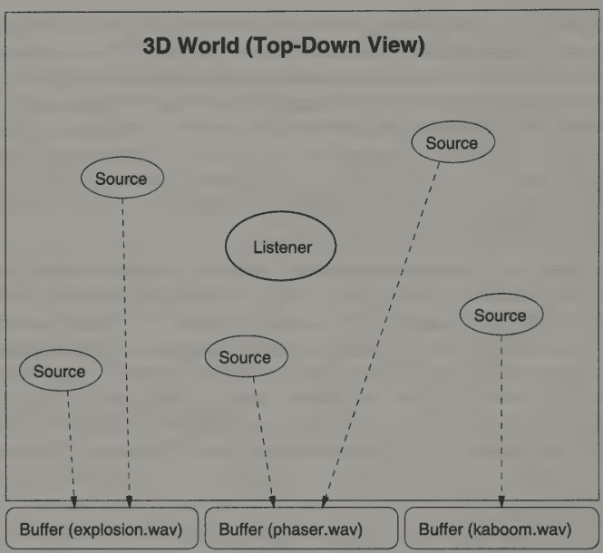
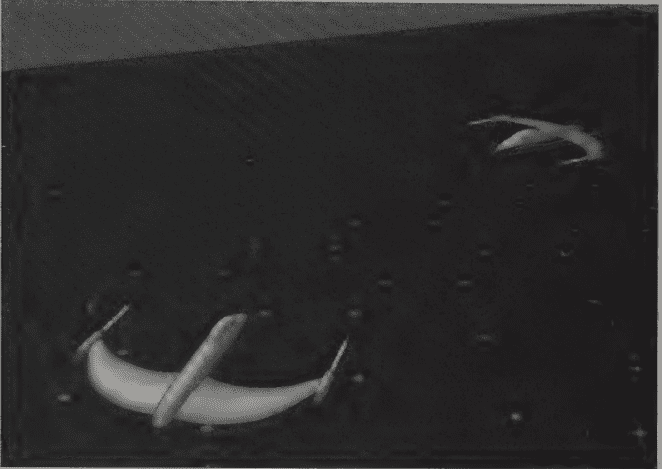

# Linux 游戏编程

## 前言

当约翰邀请我为这本书撰写前言时，我感到非常荣幸。在过去的几年里，我拥有了一个难得的机会，一个能够近距离接触世界上许多最受欢迎（以及一些不那么受欢迎）游戏的源代码的机会。我有机会将这些游戏移植到 Linux 操作系统，这是一项充满汗水、有时也夹杂着咒骂，但始终让我感到自豪和喜悦的工作。

在这些书页中，你会发现约翰花费一年时间，通过挖掘我们的想法、不断实验和积累经验所获得的智慧结晶。书中包含的许多信息从未被集中记录在一个地方，因此无论你是想开发开源游戏的初学者，还是经验丰富的专业人士，我相信你都会发现感兴趣的内容。约翰在呈现 Linux 游戏开发工具方面做了出色的工作。

祝阅读愉快！

Sam Lantinga

SDL 的作者

## 1. 复数 - 构成

第一部分

话题引入

在黑板上写出10个单数形式的单词，

- 学生提问，

  做"联想链" → 愉快的

1.9) 4 天. 复习人称代词 - 一个学生

句子 1-8. 提问学生，其他人听 → 学生

02 写到黑板上，其他人看向/朝向前面并大声或小声朗读/跟随某个学生 2). 下面和 2 名学生（或从 2

他们永远不想太粗鲁...» 整理和一个结果 bul) 那个

两名学生来到前面，一名学生读句子。大的可以

学生阅读并且

如考试中 b 点所述，学生翻译句子，难的单词，学生

开心。2 名学生互相朗读课文，其他人走上前来，看看

他们如何一起努力，把错误写到黑板上，注意到什么？和学生讨论

哈利姆现在在吃。只是走向

一行，曾经名词，因为方框是空的！句子被放置并找出规则。复数-

使用和了解

- 所有

单数和复数。

## 序言

几年前，我在当地书店的计算机区浏览时，碰到了另一位计算机爱好者。他自我介绍是一名游戏程序员，提到了他参与过的几个项目，并向我讲述了他最新的迷恋：Linux。当时这对我来说意义不大，但我将这次对话存档以备将来参考，最终我记起了这个名字，并在我的家用电脑上安装了 Linux。

最初的几个月并不容易。Linux 与 DOS 或 Windows 大相径庭，需要一些时间来适应。但坚持得到了回报，很快我就对 Linux 有了足够的信心，决定永久切换。开发工具很棒，而且给我留下深刻印象的是，代码错误几乎不会导致系统崩溃。一旦意识到我一直错过了什么，我就再也不想回到 Windows 了。

除了玩游戏。一群学校的朋友曾经举办网络游戏聚会（用圈内人的话说叫 *每吨），而他们玩的所有游戏都依赖 Windows 和 DOS。我不情愿地在一个硬盘上保留了最小化的 Windows 副本，这样就不会被排除在"每吨"之外。

Linux 对开发人员来说是一个很棒的操作系统，对于不介意最初学习曲线的普通用户也是如此。但直到最近，Linux 对游戏来说一直很差劲。这不是因为任何技术缺陷；Linux 拥有充足的性能和稳定性来支持高性能多媒体应用。然而，它确实缺乏游戏开发者的支持。多亏 SDL 和 OpenAL 等可移植游戏编程工具包，这种情况正在开始改变。Linux 仍然鲜见原创游戏开发，但 Linux 用户现在可以访问许多主要商业游戏的*移植*（转换）版本，主要由 Loki Software, Inc. 制作。

## 序言

自从我的第一台 Commodore 64 电脑以来，游戏编程一直是我的爱好之一，当我离开 Windows 世界转向 Linux 时，我不打算放弃它。SVGALib 库让我支撑了一段时间，但 SDL 很快取代它成为我编写 Linux 游戏的最爱方式。在 Linux 贸易展上遇到 Loki 团队后，我认为 Linux 游戏是认真的，于是萌生了写一本相关书籍的想法。一年后，这本书终于完成了，希望你阅读愉快。

## 本书适合的读者

本书适合任何想要学习如何为 Linux 编写游戏的人。我假设你已掌握 Linux 的基本操作；如果你知道如何启动 X、打开终端、复制文件和启动文本编辑器，你就可以开始了。我还假设你对 C 编程语言有合理的掌握。翻阅一下这本书，看看能否理解示例的语法。我们会介绍所有必要的库调用，所以如果你看到一堆不熟悉的函数名不要担心，但你应该能够理解大部分实际代码。不需要有多媒体编程的先前经验，所以如果你从未有过hack图形寄存器或将像素推入内存的变态快感，也不用担心。一切都会有的！

虽然这不是一本传统意义上的参考手册，但第 4、5、6 和 8 章为我们介绍的大多数 API 函数提供了参考框。我希望即使是有经验的多媒体程序员也能在这里找到有用的东西。

本书不会讨论 3D 编程。已经有许多关于 OpenGL 的优秀书籍，而且只有少量 OpenGL 编程与 Linux 直接相关。然而，我将演示如何使用 SDL 作为 GLUT 工具包的有效替代方案；参见第 140 页。

## 在线资源

我决定不随书附带 CD-ROM。这个选择既是个人意愿也是务实考虑。书的 CD 往往会丢失或损坏，无论一个人多么努力地将其保存在安全的地方。CD 插页通常不可能在不损坏书籍的情况下打开。最后，

## 序言

光盘中包含的数据（ presumably 本书将要介绍的库和示例）在书籍付印时可能就会过时。

因此，我们建立了一个网站，收录了书中所有示例以及指向所需各种库的链接。你可以从 `http://www.nostarch.com` 或 `http://www.lokigames.com` 访问该网站。欢迎与朋友和同事分享示例代码，并将其用于你的项目中；代码压缩包中包含了详细的许可信息。

## 致谢

没有众多人的帮助，这本书不可能完成。No Starch Press 与之合作非常愉快，即使我在项目进行到一半时将 SGML 换成了 LaTeX，并且提到我需要打印稿而非 Word 文档用于校对。我感谢 No Starch 的每一个人——特别是 Karol Jurado 和 Bill Pollock——感谢他们的耐心和对一位初出茅庐作者的包容。还要感谢 Amanda Staab 让 *Programming Linux Games* 为世人所知。

我要感谢 Loki 团队的成员们，他们让 2000 年的夏天变得趣味盎然；特别感谢 Sam Lantinga 忍受我 endless 的 SDL 和帧缓冲控制台问题，Joe Valenzuela 帮助我快速上手 OpenAL，以及 Lance Colvin 在那个夏天为我提供住处。Scott Draeker 总是在那里回答问题并提供反馈，即使是在截止日期不断逼近、目录内容不断变化的时候。没有他持续的支持，这本书不可能完成。

以下这些人在不同方面帮助了我，值得请他们喝一杯虚拟的啤酒。名单很长，但写这本书的过程也是如此漫长。开始吧：Martin Donlon 启动了 SDL 文档项目，并在撰写第 4 章时为我提供了有用的提示；Ray Kelm 就 Win32 可移植性问题发表了意见；Matt Friedly（`http://phluid.acid.org`）允许我在 Penguin Warrior 中使用他的一些追踪音乐（`reflux.ogg`）；我在佐治亚理工的室友 Daniel Larsen、Matt Might、Anthony Chen 和 Frank Cheng，忍受了我奇怪的编程时间和对文档糟糕的 API 的沮丧；Mike Phillips 提供了出色的截图（遗憾的是由于与游戏公司法务部门打交道几乎绝无可能，我未能使用这些截图）；我的 IBM Model M 键盘，无论我的拳头多么用力都没有坏；Loki 的 Andy Mecham 带来的烟火娱乐；Nicholas Vining 帮我测试代码并让我参与了 Kosmos Online 项目；Steve Shack 指出了不准确之处；Mathew Lang 以狂热游戏玩家的眼光仔细审阅了第 1 章；Lee Nau 指出了错误；David Megginson 和 Andreas Umbach 提供了截图；Damon Ragno、Michele Bini 和 Mitch Allmond 帮我测试了网络代码；Terry Hendrix 说我疯了（抱歉忘了你的真名；每个上网的人都知道你是无处不在的"Mongoose"）；Erik de Castro Lopo 提供了 libsndfile；Jason Wong、Andrew Buckner 和其他 netfeters 提供了截图和意见；David Hedbor、Steven Fuller、Dan Olson、Mike Delaney、Anoakie Turner 和一个叫 Nerf 的机器人让 IRC 变得有趣；Brian Crowder、Ryan Gordon、Michael Vance、汇编大师 Andrew Henderson、Daniel Vogel、Bernd Kreimeier、Terry Warner、David Ranger、Kris Doyle、Brad Harris、Steven Reinemund、Patrick Buchanan（绝对不要与同名总统候选人混淆）、Kyle Johnson、Josh Litherland、Ola Nordström、Amir Ebrahimi、Sonny Rao、David Shea、Moshe Jacobson、Lincoln Durey、Stéphane Peter、Mike Imamura、Pedro Pla，以及任何我可能遗漏的人。写书是一个漫长而相当乏味的过程。你们让这一切变得容易多了。

我还要感谢多年来所有的老师。我无法在此一一列举（你也不太可能想看这样的名单），但我要特别感谢 Richard Newcomb 博士，他是一位真正杰出的高中微积分老师，并且让我开始使用 TeX；Greg Novinski 在 Cistercian 的八年里引导我远离麻烦；Gregory Schweers 神父、Jackie Greenfield、Gary Nied 和 Tom Pruit 博士教会我写作；Mark Ripperger 神父满足了我对编程和电子的嗜好；Denis Farkasfalvy 神父，感谢几年前那件事，我相信他还记得。

当然还有我的父母。没有他们的鼓励和支持，我不可能写出这本书。

John Hall

亚特兰大，佐治亚州

# 第 1 章

## 游戏的结构

1991 年，一位名叫 Linus Torvalds 的芬兰大学生开始在业余时间开发一种新的操作系统。他并非独自工作，也没有对所做之事大肆宣扬；相反，他谦逊地邀请世界各地的程序员加入他的项目，他将其命名为"Linux"。这个松散的学生、专业人士和爱好者团队通过互联网协作，期望学习一些编程知识并享受乐趣。Linus 从未想过他的项目会催生整个行业。

从那以后，Linux 已发展成为适用于各种硬件平台的通用操作系统。拥有超过 1000 万用户（这个数字还在不断增长），Linux 平台为电脑游戏提供了可观的受众群体。除了类 UNIX 操作系统通常承担的服务器任务外，它现在还支持加速 3D 图形、环境音效和无缝的游戏手柄处理。尽管 Linux 仍在不断发展，但它已经成为一个严肃游戏开发的稳固环境。

本书介绍了让程序员能够为 Linux 编写 2D 和 3D 游戏的工具包和环境。我们将学习如何在屏幕上绘制动画图形，如何通过几种不同的软件库播放高质量的数字音效，以及如何配置 OpenGL 以创建流畅的 3D 图形。读完本书，你将了解 Linux 游戏的运作原理，以及如何为这个平台创建自己的游戏。

本书*不*涉及游戏设计、3D 图形数学或高级 OpenGL 编程。这些主题最好留给专门的书籍来阐述；我不可能在此做到面面俱到。不过，通过本书获得的知识，你将能够为日后攻克这些主题做好准备。

在我们开始讨论 Linux 游戏编程之前，让我们快速浏览一下游戏行业的现状，以便你更好地理解这类项目涉及的内容。

## 游戏类型概览

电脑游戏往往属于多种截然不同的类型之一。许多玩家对某些类型有强烈的偏好，这对游戏设计师来说是一个重要考量。而且，游戏概念的呈现方式对其成功有着巨大影响。

### 模拟游戏

*模拟*类型涵盖了广泛的游戏，从飞行模拟器到机甲战斗场景。理想的模拟器在图形、音效和游戏物理方面提供高度的真实感。一些流行的模拟游戏有 Heavy Gear II、MechWarrior 和 Microsoft Flight Simulator。任何模拟游戏的基本目标都是让玩家掌控某些令人兴奋的事物，某些他或她在现实生活中可能无法接触到的事物。模拟游戏追求沉浸感。

模拟游戏（sims）基本上处于两个极端。一些模拟追求绝对真实，试图以几乎完全准确的现实生活描绘来娱乐玩家。这些"游戏"有时甚至被用于现实生活中的培训目的。另一些模拟，如 Heavy Gear 和 MechWarrior 系列，则用真实感换取纯粹的娱乐价值。这些游戏只是 loosely 基于现实；它们模拟的是虚构载具，具有非凡而几乎不可能的能力。（有趣的是，MechWarrior 和 Heavy Gear 电脑游戏是基于纸笔角色扮演游戏的。）

模拟游戏带来了严峻的开发挑战。由于一款优秀的现代模拟需要高质量的 3D 图形、精细的载具模型

# 游戏的构成

用于模拟真实世界物理的物理系统、逼真的输入响应、网络功能，以及为电脑控制的玩家加入一定人工智能的需求，使得构建一款当代模拟游戏绝非易事。

是什么让模拟游戏获得成功？让我们来看两个例子：一款"写实"模拟器和一款"动作"模拟器。《微软模拟飞行》是一款风靡 PC 平台的飞行模拟器（事实上，它由同一批开发者长期迭代而来，最早可追溯到 Commodore 64 时代），它结合了逼真的操控、出色的 3D 画面和有趣的飞机机型，地形看起来也与真实世界相当接近¹。经验丰富的飞行员当然能区分《微软模拟飞行》和真正的飞机，但它依然是一款令人愉快的模拟游戏。

《微软模拟飞行》试图让玩家感觉自己正坐在驾驶舱里，而不是坐在高性能电脑的键盘后面囤积赘肉。尽管这款游戏无法在 Linux 下运行（除非可能通过 WINE²），但如果你想编写一款飞行模拟器，它绝对值得参考。

另一方面，Flight Gear 项目目前正在为 Linux 开发一款免费的飞行模拟器。该模拟器已经具备逼真的物理模型和出色的地形引擎，预计最终将成为有史以来最优秀的飞行模拟器之一。Flight Gear 可以移植到多个平台，因为它几乎完全基于开放技术。

Activision 出品的《重装机甲 II》是动作模拟器的一个好例子。它让玩家操控一台数吨重的 Gear（一种双腿行走、装备重火力的载具），并凭借逼真的画面、简洁却实用的操控系统、损伤模拟和有趣的游戏玩法而获得成功。玩家可以完全掌控自己的 Gear，在游戏中自由行动（不过通常最好的策略是完成任务且不被干掉）。《重装机甲 II》赋予玩家一种力量感和兴奋感，这使其成为一种愉快的体验。Activision 还发行了多部与《重装机甲》系列非常相似的《机甲战士》作品。

最后，我个人最喜欢的模拟游戏之一（很多年前）是 Corncob 3D，一款完全脱离现实的共享软件 DOS 飞行模拟器。它伪装成飞行模拟器，实际上是一款经典的"抵御外星入侵、保卫地球"游戏，包含大量任务、导弹和混乱场面。当然，以今天的标准来看，这款游戏很可笑。但它在当时的低端硬件上运行流畅，而且玩起来非常有趣。Corncob 3D 是一款以牺牲写实性来换取娱乐价值的模拟器好例子。

### 第一人称射击游戏

*第一人称射击游戏*是当今最受欢迎的游戏类型之一。它们通常剧情薄弱（当然也有例外）、敌人成群、爆炸连天、血腥四溅。大多数第一人称射击游戏的基本前提，就是把玩家置于充满阴险怪物和强大武器的敌对环境中，以获得肾上腺素飙升的快感。多年来，这些游戏的品质不断提升，并开始达到非常高的真实感。《雷神之锤 3》《半条命》和《命运战士》都是流行作品，它们都能在 Linux 上运行（尽管《半条命》不是 Linux 原生游戏，需要 WINE 库才能运行）。

高品质的第一人称射击游戏很难制作，这不仅因为它们编程难度大（OpenGL 等标准 3D 库已使其有所简化），还因为它们需要精细的 3D 角色模型和关卡。3D 游戏引擎编程要求扎实的线性代数知识和某些数据结构的牢固掌握。不过，对数学感兴趣的人很可能会发现 3D 游戏编程既具挑战性又富有回报。

Valve 的《半条命》是最成功的第一人称射击游戏之一，它将典型 FPS 的刺激感与引人入胜的剧情、惊人逼真的敌人和出色的多人模式结合在一起。《半条命》基于《雷神之锤 II》的渲染技术，但相似之处仅此而已。与《雷神之锤》系列不同，《半条命》拥有剧情、优秀的单人模式以及网络游戏支持，还有更复杂的虚拟环境（包含可移动物体和载具）。

另一款有趣的第一人称射击游戏（同样基于 Quake II 引擎）是 Activision 的《命运战士》。评论界批评它暴力过度（因此在德国被"列入索引"，在其他地区则被定为成人级），《命运战士》将传统的第一人称射击动作与惊人的真实感结合在一起，甚至能正确模拟枪伤造成的身体损伤。它还拥有一条贯穿游戏始终的扎实剧情。总的来说，如果你不对暴力感到不适，这是一部非常值得一玩的作品。（我不会讨论围绕这个话题高度情绪化的政治争议。）

当前的一种趋势是将第一人称 3D 技术与角色扮演游戏相结合。《杀出重围》就是这样一个例子，它是一款基于虚幻引擎的角色扮演游戏。《杀出重围》已移植到 Linux，我强烈建议你去尝试一下。

### 即时战略游戏

被称为*即时战略*（*RTS*）的游戏类型包括《星际争霸》《命令与征服》和《横扫千军》等热门作品——这些游戏允许玩家从俯视视角指挥军队的各个单位，战斗胜利通常会带来更好的装备和士兵。由于胜利通常取决于玩家的战术，它们被视为策略游戏。RTS 游戏往往具有很高的重玩价值，让人乐此不疲。

RTS 游戏相对来说比较容易编程，因为除个别例外，它们不涉及 3D 图形或复杂数学；然而，*优秀*的 RTS 游戏却很难制作，而且往往凤毛麟角。它们通常需要一定的人工智能（AI）编程来控制单人模式中的模拟对手——这是一个引人入胜的领域，但我们把它留给其他资料去讨论。

### 回合制策略游戏

*回合制策略*（*TBS*）游戏与即时战略游戏类似，但游戏玩法被划分为多个回合，通常没有时间限制，因此玩家有时间思考和放松，这赋予了游戏与快节奏策略游戏截然不同的感觉。TBS 游戏不靠反应速度取胜，而是靠周密规划，这往往使它们更难，也更能吸引许多玩家。Sid Meier 的《文明 II》因其平衡性和重玩价值而被广泛认为是最佳回合制策略游戏。

#### 看似简单，实则复杂


我曾以为 TBS 游戏很容易编写，直到我看了《半人马座阿尔法星》（Sid Meier's Alpha Centauri，简称 SMAC）的源代码。大多数玩家并未意识到，SMAC 实际上使用了一种名为*体素*的 3D 技术来即时渲染单位，并绘制具有高度感知的地形，还使用了透视纹理映射和动态调色板映射（通过自修改汇编代码实现）。《半人马座阿尔法星》显然不容易移植到 Linux。虽然不使用如此高深的技术也能写出好的 TBS 游戏，但别以为 TBS 类型是条轻松的出路——它的复杂性可能具有欺骗性。

### 角色扮演游戏

*角色扮演游戏*（RPG）源自《龙与地下城》角色扮演系统。³ 在这类游戏中，玩家扮演一个或多个角色们进行某种任务。角色扮演游戏将玩家置于一个充满可能性的世界中；优秀的RPG能够给玩家带来沉浸感和真实的互动体验，让他们能够有效地成为另一个人。

角色扮演游戏的质量更多地取决于其故事情节、互动性和深度，而非画面效果。《网络创世纪》（Ultima Online）是一款优秀的在线RPG范例。尽管其画面并不出众，但其游戏深度却令人难以置信，因为它允许玩家在虚拟世界中进行复杂的互动。不过，《创世纪》并非严格意义上的"硬核"RPG；真正铁杆的RPG玩家往往偏爱其他类型的RPG，例如Simutronics公司（http://www.simutronics.com）发行的那些。

### 益智游戏

益智游戏受到的关注比其他游戏类型少，但它们值得一提。益智游戏通过需要思考和耐心的问题向玩家发起挑战。这一类型包括从简单的推箱子游戏（Boxxel和极易让人上瘾的Sokoban）到动画般无处不在的俄罗斯方块等各种游戏。

一款成功的益智游戏通常具有挑战性（但并非不可能完成）、赏心悦目（画面也不能忽视），并且可重复游玩（一次性通关的益智游戏通常在第二次玩时就不那么有趣了，玩家也不喜欢这样）。制作益智游戏的难度取决于具体的游戏；有些极其复杂，涉及大量的美术和图形处理，而有些则实现起来很简单。

KSokoban的截图，这是KDE平台上的一个Sokoban版本

### 多人地下城

多人地下城（通常称为MUD）是大型多人在线游戏，通常托管在互联网服务器上，通过专门的MUD客户端程序访问。MUD非常受欢迎，因为你的对手是真实的人，而不是电脑控制的机器人。MUD本质上是基于文本的角色扮演游戏，让玩家沉浸在拥有魔法物品、巫术和战斗的世界中。希望托管自己游戏的MUD爱好者通常会获取预先编写好的MUD服务器程序，并通过配置文件和脚本语言开发他们自己的"世界"。如果他们做得好，可能会吸引大量玩家，这是非常令人满意的。两个流行的MUD服务器程序是ROM和DikuMud，可以从互联网上下载。互联网上有数千个私人的基于ROM的MUD。

MUD相对容易创建，但编写MUD服务器并非易事，需要扎实的C语言或类似语言基础以及网络编程知识。创建MUD数据文件几乎不需要编程知识，但需要大量创意。一个好的MUD拥有有趣的游戏世界可供探索，并且种族与能力之间保持良好的平衡。此外，一些MUD容易出现"神明模式"问题，即服务器运营者的滥用职权；虽然这显然取决于玩家，但良好的设计可以减轻这种不良影响。

如果你从未尝试过"mudding"，不妨试一试。一个好的MUD可以提供真正有趣的体验。你可以在互联网上找到各种MUD；只需在网页上搜索"mud"即可。

### 快速窥探内部

大多数游戏在幕后有很多共同之处。一款"典型"游戏（如果存在这种东西的话）的*引擎*，即主代码，可以逻辑上划分为几个子系统：输入子系统、显示子系统、音频子系统、网络子系统、更新子系统和主循环。这些子系统很少被如此标注，但你在任何给定的游戏引擎中都能找到所有这些组件。每个子系统通常由几个独立的源文件实现；小型游戏中可能只有两三个，但在大型制作中很容易达到一百个甚至更多。我们现在将简要介绍这些子系统，并在本书的其余部分探索实现每个子系统的可能方法。

### 这段代码太糟糕了！

如果你曾经瞥见过大型商业游戏背后的代码，请不要将其视为关于正确软件设计或编码的范例！游戏通常最初是设计良好的软件，有时甚至能够以可容忍的内部组织状态上架，但更多时候，游戏的代码在开发最后几个月会陷入混乱。

你可能会问，为什么？游戏行业是不稳定的、充满风险和竞争极其激烈的。游戏工作室似乎一直处于满足发布截止日期、抢在竞争对手之前推出游戏、实现玩家所要求的功能的斗争中，以免他们被一堆卖不出去的游戏甩在身后。这往往导致极其仓促和粗糙的代码。不幸的是，如果后来有人试图为游戏添加扩展包或将游戏移植到另一个操作系统，这常常会导致严重的问题。

### 输入子系统

输入子系统通过输入设备（如键盘或游戏手柄）接收用户的指令，并记录这些指令以供进一步处理。虽然输入设备编程并不困难，但应该谨慎处理，因为有缺陷的输入处理很容易毁掉一款原本优秀的游戏。Apogee公司的《Rise of the Triad》（几年前的一款第一人称射击游戏）的第一个版本就存在特别糟糕的输入处理问题，直到这个问题被修复之前，这款游戏都让人玩得十分恼火。

输入子系统最重要的工作之一是同时支持多种输入设备。编写良好的输入子系统应该能够几乎不费力地集成任何类型的非主流游戏控制器（像SDL这样的库使这变得更容易一些，但在编码时仍然值得牢记）。有些玩家更喜欢使用游戏手柄而不是鼠标，输入子系统应该能够在不修改主游戏代码的情况下适应这一偏好。就游戏而言，游戏手柄应该表现为一个通用设备，能够产生"左"、"右"、"上"和"下"指令。我们将在第4章讨论SDL的输入处理和抽象，稍后还会涉及Linux下输入处理的底层内容。

市场上几乎所有的游戏都允许你按照自己的喜好重新映射键盘和其他输入设备，而这是玩家所要求的功能。许多人使用的是键位布局不同的非美国键盘，如果你不允许他们配置游戏以适应自己的键盘，就会失去大量潜在玩家。幸运的是，这并不难实现；可以通过一个简单的查找表来完成。允许玩家存储和读取多种按键映射也是个好主意，以防有朋友偏爱不同的配置。

### 显示子系统

显示子系统以令人印象深刻的视觉效果向玩家传达游戏状态，无论是通过简单的2D图形，还是先进的3D渲染（使用哪种类型的图形并不重要，只要它们适合这款游戏）。无论显示子系统产生哪种类型的图形，代码结构基本上都是相同的。

### 游戏的解剖

显示子系统负责充分利用可用的显示硬件。认真的游戏玩家常常会在他们的机器上装备花哨的3D显卡，这能为3D游戏带来巨大的性能和质量提升。然而，这种性能提升不是自动的，需要程序员付出特别的努力，通常是通过*API*（*应用程序编程接口*，本质上是一个大型例程库）如OpenGL来实现的。3D加速超出了本书的范围，但我们将演示如何在第4章中让OpenGL运行起来。

在你展示自己的图形代码之前，你需要一些可显示的内容。虽然程序员为测试目的开发临时美术资源很常见，但很少有人是熟练的艺术家，他们通常会发现有必要请一位熟练的数字艺术家来制作合格的游戏美术资源。玩家是一群挑剔的人，他们对低于标准的 graphics 最不能容忍。游戏程序员应该花费大量时间来开发良好的图形引擎，而设计师应该将获取优质美术资源作为游戏的优先事项。

### 音频子系统

尽管在过去几年中，计算机音频技术没有像计算机渲染技术那样被大肆宣传，但游戏的音频子系统与其图形子系统同等重要。幸运的是，在计算机上产生高质量的声音不像产生高质量的图形那样困难。

播放声音很容易（通常只需调用多媒体工具包中的几个函数），但为游戏制作制作级品质的声音效果与制作图形一样是一门艺术，应该交给专业人士来做。出色的声音效果可以提升游戏的氛围，而糟糕的声音效果则会严重损害游戏的潜力。

3D增强音频是计算机声音技术的最新趋势之一，现代声卡（如创新的SB Live!系列）支持四扬声器环绕声，以及支持3D的音效处理来模拟多普勒效应和其他复杂的声波交互。（简单的双声道立体声对于当今3D游戏的沉浸式环境来说已经不够了。）事实上，一些声卡甚至可以在硬件中加速这些效果。几个competing 3D sound APIs have emerged, and we will discuss one of these (OpenAL) in Chapter 5.

### 网络子系统

多人游戏如今非常流行，可以合理假设这一趋势将会持续。网络子系统通过网络将游戏与其他计算机连接起来，使多名玩家能够参与游戏。网络编程已不再像过去那样困难，尤其是在我们所熟知的互联网出现之后。尽管如此，网络子系统必须极其健壮和灵活，因为 unsurprisingly，玩家对游戏过程中的网络故障相当 intolerant。

基本上，网络子系统会通知网络中的其他计算机当前的游戏状态，以保持玩家同步。这可能相当棘手，因此明智的做法是在设计游戏时就考虑网络功能。你可能会发现，像 Apple 的 OpenPlay 这样的网络库能让这项工作变得轻松一些。

最重要的是，不要把网络支持作为事后补充来实现，因为它通常会影响整个游戏的设计。决定你的游戏是否适合网络对战，并将这一需求纳入基本游戏设计中；这样做可以避免日后设计师要求添加多人功能时带来的麻烦。

### 更新子系统

游戏通常需要跟踪大量快速变化的数据，包括玩家状态以及每个敌人的状况——这些信息必须逐帧更新以保持游戏运行。更新子系统负责管理这些数据。

更新子系统是游戏的*大脑*。它向玩家强制执行游戏的移动规则，"扮演"每个敌人的角色（这可能涉及一定的人工智能），确保每个对象都在允许的边界内，并造成伤害。几乎可以说，其他游戏模块仅仅是更新子系统的接口。

### 游戏的解剖结构

尽管将更新子系统随意扔进游戏循环（在下一节讨论）中可能很诱人，但不要这样做。如果不保持合理的秩序，游戏项目往往会很快失控，而且更新子系统通常在整个开发周期中 steadily 增长；从一开始就使更新系统成为一个独立的模块。如果你不注意代码组织，最终会得到像《文明：权倾天下》（无意冒犯，Activision）背后那 50 万行意大利面条式代码。

### 游戏循环

游戏循环（见图 1-1）是"粘合"各种游戏子系统的*胶水*。它本质上是一个贯穿整个游戏的 while 循环，每秒循环 30 到 60 次。游戏循环调用正确的例程来收集玩家和网络输入，更新游戏中所有对象的状态，绘制下一帧图形，并生成音频。虽然这个过程听起来很复杂，但实际上相当简单，因为所有这些功能都由游戏的输入、网络、图形和音频子系统提供。

游戏循环应在其他子系统初始化完成后立即启动，并在玩家退出游戏时结束。在某些情况下，将菜单系统与主游戏循环分开可能是个好主意，但这样做实际上可能会使游戏代码变得复杂。通过正确编写的游戏循环，游戏就变成了一个"状态机"，根据其当前状态基于玩家输入采取行动。

组织也很重要，因为游戏循环对其他子系统进行排序。这不应该是一个随意的决定；例如，从网络子系统收集的数据通常会影响其他子系统的决策，因此应该首先调用它。图形子系统可能应该放在最后，因为它反映了所有其他子系统生成的数据。

如你所见，游戏引擎在概念上很简单，但细节决定成败。在下一章中，我们将熟悉用于 Linux 游戏编程的工具，然后我们将开始使用使这一切成为可能的库和接口。如果你已经熟悉 gcc 和 gdb 等开发工具，你可能希望快速浏览第二章，然后进入第三章或第四章。

## 第二章

### Linux 开发工具

作为一个由计算机极客创建的操作系统，Linux 提供了一个特别友好的编程环境。尽管一开始可能有些令人生畏和困惑，但在度过最初的学习曲线后，它提供了巨大的能力。在本章中，我们将从游戏开发者的角度来考察基本的 Linux 编程工具。

如果你已经熟悉 Linux 或 UNIX 编程，本章的某些部分对你来说可能不那么有趣。我们将在遇到这些工具时详细介绍它们，因此跳过本章的部分内容不会使你感到无所适从。

### 编程编辑器

在我们深入 Linux 游戏编码主题之前，我们需要一种编写源代码的方式。虽然 pico 和 joe 等简单编辑器足以应对一些简单任务，但它们不足以用于编程。最好使用支持语法高亮、括号匹配等功能的文本编辑器。让我们看看几种更流行的代码编辑器。如果你从未在类 UNIX 系统上编写过代码，尝试这些编辑器以找出最适合你编程风格的一个会是个好主意。本章并不打算成为这些编辑器的参考手册或教程；而是为那些从未在类 UNIX 平台上编写过代码的人提供一个起点。

#### vi

vi（发音为 *vee-eye* 或 *vie*）是一款相当古老的文本编辑器，拥有忠实的用户群体。它难以掌握，但一旦你学会了它的按键方式和 quirks，就很难再使用其他编辑器了。vi 几乎在任何 Linux 配置上都工作良好；它几乎不需要处理器能力，内存占用也很小。它还有一个很好的优点，即几乎在你遇到的每个类 UNIX 系统上都存在，包括大多数 Linux 系统。vi 是每个主要 Linux 发行版的标准组件。

尽管 vi 是来自每个人通过慢速文本终端工作的时代的古老编辑器，但它的用户已经对它进行了大幅改进，一些现代版本（如 vim）能够进行语法高亮等 nice 功能。该编辑器的几个版本也可用于 X Window 系统，具有下拉菜单和便捷的快捷方式。然而，这些版本摒弃了 vi 最大的特性之一：它几乎可以在任何类型的终端上使用。vi 可以通过低速 telnet 连接、本地终端，甚至从 Palm Pilot 和其他不寻常的设备上高效使用。其极简界面几乎不需要终端提供什么功能。vi 的图形版本抛弃了这一特性，因此几乎不能被视为原始 vi 编辑器的替代品。

vi 实际上是指令式 ex 编辑引擎的全屏界面。ex 也可以在 vi 编辑器之外作为命令行工具使用，它可以被用来为 shell 脚本添加编辑能力。例如，shell 脚本可能会调用 ex 来自动编辑配置文件。ex 命令可以在 vi 编辑器内指定，尽管关于 ex 的详细教程超出了本章的范围。

vi 是一款*基于模式*的编辑器，这是主要的困惑来源。vi 有两种主要模式：*命令模式*和*插入模式*。命令模式严格用于向 vi 发出指令。例如，可以使用此模式移动到文档中的某一行并删除一个单词。命令模式*不能*用于在文档中输入文本。你在命令模式下输入的任何内容都会被解释为 vi 命令（实际上有如此多可能的 vi 命令，以至于你在命令模式下输入的几乎所有内容都会执行某些操作）。另一方面，插入模式严格用于在文档中输入文本。大多数命令在此模式下不被识别，你输入的任何内容都将被插入到文档中。

vi 最初启动时进入命令模式。要进入插入模式，请按 **i**。要切换回命令模式，请按 Escape 键。这种模式切换起初可能显得有些麻烦，但经过一些练习后就会变得驾轻就熟。

#### Emacs

GNU Emacs 无疑是一款巨无霸级的文本编辑器（甚至有人将其视为一个操作系统）。它基于一种独特的 Lisp 编程语言变体构建；编辑器几乎所有功能都是通过可定制的 Emacs Lisp 实现的。Emacs 在程序员中拥有一批忠实拥趸，部分原因在于这款编辑器的方方面面都可以由用户自行修改。我开始撰写本书时使用的是 NEdit，但最终转投了 Emacs，因为它在 Linux 控制台上运行良好，而且不需要鼠标。（我也有点 Lisp 爱好者情结，从这点来说 Emacs 再合适不过了。）

Emacs 起初并不比 vi 更难学；只是需要学的东西更多。它的基本命令和快捷键不难习惯，但要精通 Emacs 却是一项重大工程。Emacs 内置了邮件和新闻客户端、几乎涵盖所有你想使用的语言的编辑模式、多种文档阅读器，甚至还有可选的 IRC 客户端和网页浏览器。其中许多功能都定义了自己独有的命令键设置，这让潜在用户需要学习的内容大大增加。作为回报，Emacs 提供了极为强大的功能；毫不夸张地说，你可以将登录 shell 设为 Emacs，从此不再离开它的环境。

要开始入手 Emacs，请运行编辑器（命令通常是 `emacs`），按 **Ctrl-h**，然后按 **t**。Emacs 教程将会打开，你可以通过它来学习基本按键和编辑模式。

除了"正宗"的 GNU Emacs，还有几款编辑器在功能和用法上与之非常相似。XEmacs¹ 是从 GNU Emacs 分出的代码分支，增加了一些功能并改进了界面。JED² 是一款面向程序员的编辑器，与 Emacs 相似但功能较少、内存占用更小。

¹ http://www.xemacs.org

² http://space.mit.edu/%7Edavis/jed.html

Emacs 是那些欣赏丰富功能（也许有些令人应接不暇）且不介意学习曲线陡峭的用户理想的编辑器。对于那些希望使用脚本语言为编辑器添加自定义功能的人来说，它也非常出色（事实上，已有完整应用程序是用 Emacs Lisp 写成的）。Emacs 几乎在每一个 Linux 发行版中都有提供，也可以直接从 GNU 项目的 FTP 服务器³ 或其镜像站获取。

#### NEdit

NEdit，即"Nirvana 编辑器"，是费米实验室⁴ 出品的一款非常顺手的代码编辑器。它既不像 Emacs 那样可以无限定制，也不像 vi 那样无处不在，但却更容易学习（因为它的快捷键与许多流行的文字处理器相似），且功能足以应对严肃的工作。NEdit 的主要缺点是需要 X Window System 才能运行。如果你选择日常使用 NEdit，最好至少对另一款编辑器有所了解。本书的部分内容就是用 NEdit 撰写的（后来我换成了 Emacs）。尽管 NEdit 先前版本的许可证对大多数 Linux 发行商来说不太友好，但自 5.1 版起，NEdit 的许可证已改为 GNU 通用公共许可证。该编辑器现在真正成为了自由软件，目前由一支志愿者团队积极开发维护。

### 在 Linux 下编译程序

我们在这里要讨论的是游戏编程，而非 C 语言基础，所以不会讨论语言本身；不过，你可能从未在 UNIX 下使用过 C 编译器。本节将演示如何在 Linux（更准确地说，GNU/Linux）编程环境中编译和链接程序。这其实没什么复杂的；编译器提供了数百个命令行选项，但大多数对我们的目的而言都不必要。

³ ftp://ftp.gnu.org

⁴ http://www.nedit.org

#### Nirvana 编辑器


`gcc` 是 Linux 上最流行的 C 编译器。它由自由软件基金会为 GNU 项目开发，可在多种平台上使用。`gcc` 是自由软件，几乎在每一个 Linux 发行版中都作为标准组件包含在内。Linux 上还有其他 C/C++ 编译器（如 `Kai C++` 和尚未发布的 `Metrowerks CodeWarrior`），但绝大多数 Linux 软件开发都使用 `gcc`。有些人嫌弃 `gcc`（及其 C++ 兄弟 `g++`）古怪或不完整，但实际上它至少与其他主流 C 编译器一样出色。

`gcc` 的基本工作是将 C 源代码编译成可执行程序。要编译一个或多个文件，只需在命令行中将它们传给 `gcc`，如下所示：

```
$ gcc file1.c file2.c file3.c
```

如果没有严重错误，`gcc` 会在当前目录中创建一个名为 `a.out` 的可执行文件。否则，你会收到描述编译器遇到问题的警告和错误信息，`gcc` 也不会生成任何编译输出。如果在命令行中列出多个文件，`gcc` 会分别编译它们并尝试链接成一个可执行文件，如果任何单个文件产生错误则会停止。如果传给 `gcc` 的文件以 `.o`（目标文件）或 `.a`（静态库）结尾，它会直接将它们链接到可执行文件中。这使得 `gcc` 可以作为链接器的简单接口。

## 警告

> 你可能习惯使用 shell 的制表符补全功能来补全文件名。用 `gcc` 时要小心这样做；很容易因为不小心补错了文件名而意外覆盖源文件。这听起来似乎显而易见，但我因此丢失过工作成果。

将 C 源文件编译成目标文件而非可执行文件通常很有用。目标文件不能直接执行，但包含了源代码的机器码翻译，多个目标文件可以组合成完整的程序。要创建目标文件，请向 `gcc` 提供 `-c` 选项。这会指示 `gcc` 跳过最后的链接阶段，并为命令行中列出的每个源文件写入一个目标文件。

`gcc` 是一款功能强大且复杂的工具，支持大量命令行选项。我们在此列出最重要的几项。

- `-ansi`：禁用非 ANSI 扩展，如 `asm` 和 `inline` 关键字。如果你关注 ANSI C 编译器之间的可移植性，这个选项可能是个好主意。然而，大多数程序员不会如此谨慎地对待标准，严格的 ANSI 模式往往会破坏大量现有软件。

- `-c`：编译成目标（`.o`）文件而非可执行文件。这对创建库很重要。

- `-D symbol`：在预处理器中定义给定符号。这个选项便于根据系统配置设置条件编译。我们将在一些示例中使用它来切换不同版本的代码。

#### `-o filename`

输出到给定的文件名，而非默认的 `a.out`。例如，`-o foo` 会将程序编译成名为 `foo` 的可执行文件（Windows 下为 `foo.exe`）。

#### `-l libname`

尝试链接给定的库，遵循标准库命名约定。例如，`-lSDL` 会链接 `libSDL.so`。更多信息请参阅本章后面关于共享库的讨论。

#### `-L directory`

为库指定额外的目录。例如，`/usr/X11R6/lib` 通常不在库路径中，因此 X 程序通常会指定 `-L/usr/X11R6/lib`。

#### `-O n`

设置优化级别（从 1 到 6）。默认情况下不执行优化。养成用 `-O2` 编译代码的习惯是合理的；它不会太大地改变代码结构，而且你通常仍可用 `gdb` 调试它。在某些情况下，这个选项能显著加快编译后代码的运行速度。成品几乎都应该启用优化进行编译。

#### `-pedantic`

启用对 ANSI C 标准的严格解释。如果你希望 `gcc` 对你马虎的编程习惯唠叨几句，请用 `-pedantic -W -Wall` 编译。

`gcc` 就介绍到这里！它有一些怪癖和晦涩的功能，但我们会在需要时逐步了解。⁵ 与大多数 GNU 工具一样，`gcc` 配有出色的在线文档。特别是，请参阅 `man` 手册或 `info` 节点以了解 `gcc` 的命令行选项说明。

> ⁵ Richard Stallman 的著作《Using and Porting gcc》是深入研究 `gcc` 的权威指南。

## 使用 Make 工具

大多数游戏开发项目都包含多个源文件，原因很简单：在单个文件中管理数千行代码是不现实的。由于大型项目可能涉及许多源文件，如果自上次编译以来只有一个文件被更改，那么重新编译所有内容将是浪费的。然而，如果所有文件都在命令行上一次传递给 `gcc`，就会发生这种情况。例如，Linux 版本的《文明：权倾天下》包含超过 500,000 行 C++ 代码，分布在 100 多个文件中，整个源代码树的完整重新编译需要近一个小时（而借助 Make 的部分重建通常只需 15 到 20 分钟）。

Make 工具通过在更改后自动确定哪些文件实际需要重新编译来加速软件开发。Make 还消除了重建程序时输入冗长命令行的需要，因为它存储了所有必需的命令并在需要时调用它们。

尽管 Make 有很多功能，但其基本用法非常简单。它基于*目标（targets）*，即维护程序组件（目标文件、库等）的一组指令。目标指定要跟踪的组件名称、组件所依赖的源文件和其他目标，以及重建目标的命令。构建组件的指令称为*规则（rules）*，组件所依赖的文件列表称为*依赖项（dependencies）*。当 `make` 被调用以处理某个目标时，它首先检查该目标的依赖列表。如果自上次重建目标以来任何依赖项已被更改，则执行目标的规则。Make 还会递归地重建依赖列表中任何过时的目标。这对于大型模块化编程项目来说极为方便。

### 创建 Makefiles

Make 在名为 `Makefile` 或 `makefile` 的文件中查找目标和规则。该文件可以包含任意数量的目标。如果 Make 未带命令行选项启动，它会自动尝试重建遇到的第一个目标。考虑以下 makefile：

```
program: file1.c file2.c graphics.a
    gcc -c file1.c file2.c
    gcc file1.o file2.o graphics.a -lSDL -o program
```

```
graphics.a: graphics.c draw.c
        gcc -c graphics.c draw.c
        ar rcs graphics.a graphics.o draw.o
        ranlib graphics.a
```

该文件描述了如何构建名为 `program` 的可执行文件和名为 `graphics.a` 的静态库。（不要担心构建库的命令——我们将在本章后面讨论库。）`program` 依赖于 `file1.c`、`file2.c` 和 `graphics.a`。如果自上次构建 `program` 以来其中任何一项已被修改，Make 将重建 `program`。`graphics.a` 也是一个目标，它依赖于 `graphics.c` 和 `draw.c`。每个目标下面的缩进行是规则。如果需要重建 `program`，Make 将执行提供的两条规则。这些行必须以制表符（tab）缩进；空格不行。Make 对语法相当挑剔。

#### 变量替换

Make 工具提供了对环境变量的便捷访问。Makefiles 可以设置、组合和检索环境变量作为文本字符串，并将这些变量包含在目标和规则中。通常使用变量 `CC` 来表示 C 编译器命令（在我们的例子中是 `gcc`），`CFLAGS` 表示要传递给编译器的标准命令行选项集，`LDFLAGS` 表示要传递给链接器的选项（链接器通常就是 C 编译器，但有时也用 `ld` 命令显式调用）。例如，前面的 makefile 可以重写如下以利用变量替换：

```
CC=gcc
CFLAGS=-O2 -W -Wall -pedantic
LIBS=-lSDL -lpthread

program: file1.c file2.c graphics.a
        $(CC) $(CFLAGS) -c file1.c file2.c
        $(CC) file1.o file2.o graphics.a $(LIBS) -o program
```

```
graphics.a: graphics.c draw.c
	$(CC) $(CFLAGS) -c graphics.c draw.c
	ar rcs graphics.a graphics.o draw.o
	ranlib graphics.a
```

如您所见，变量通过 `$(VARNAME)` 符号替换到 makefile 中。这是字面文本替换，发生在规则被其他方式处理之前。如果您想在不影响其旧内容的情况下向变量末尾添加内容怎么办？您可以尝试类似这样的操作：

```
FOO=bar
FOO=$(FOO) baz
FOO=$(FOO) qux
```

乍一看，`FOO` 变量似乎最终会具有值 `bar baz qux`。然而，Make 通常不会在变量被使用之前（在目标中）对其求值，因此 `FOO` 实际上最终得到字符串 `$(FOO) qux`。这个问题有两种解决方案。GNU Make（Linux 系统上的默认 Make）提供了一个 `:=` 赋值运算符，它会导致右侧在变量被赋值之前求值。它还提供了一个 `+=` 运算符，用于直接追加到变量。一个更可移植的解决方案是将 `bar`、`baz` 和 `qux` 赋值给三个不同的变量，然后将它们全部组合在一起：

```
BAR=bar
BAZ=baz
QUX=qux
FOO=$(BAR) $(BAZ) $(QUX)
```

这个（hack 的）解决方案允许变量 `FOO` 在规则中使用时被正确构造。然而，这是一种相当丑陋的方式，因此我们建议使用 GNU Make 扩展。

尽管使用变量可能会加长 makefile，但它们可以提供很好的抽象。变量使得在整个构建过程中修改选项变得容易，而无需更改整个 makefile。

#### 隐式规则

由于 C 文件几乎总是用 `cc` 命令编译（在 Linux 机器上是 `gcc` 命令的符号链接），因此确实没有必要为项目中的每个源文件指定构建规则。Make 允许*隐式*构建规则。也就是说，如果某个目标后面没有规则且不指定任何依赖项（或者它根本不存在），Make 将尝试根据目标的文件扩展名使用*默认*构建规则。

例如，假设 `foo.c` 是一个包含函数 `bar` 的 C 源文件，而 `main.c` 是一个包含调用 `bar` 的 `main` 函数的 C 源文件。以下 makefile 将构建程序。注意没有 `foo.o` 的目标——它被 `foo` 目标引用，Make 假设它应该通过编译文件 `foo.c` 来创建目标。（实际上，Make 知道几种不同的源文件类型，C 可能是最常见的。）当 Make 自动调用 C 编译器时，它会将 `CFLAGS` 变量添加到命令行。

```
CFLAGS=-O2 -W -Wall -pedantic
foo: foo.o main.c
	gcc foo.o main.c -o foo
```

#### 伪目标

程序员经常将 Make 用于构建可执行文件以外的目的。它实际上是一个通用的项目管理工具。例如，我目前使用 makefile，这样我就不必删除一堆文件，然后运行 `LATEX`、`MakeIndex` 和 `dvips` 来预览这本书。考虑以下 makefile：

```
foo: foo.c
	gcc foo.c -o foo

clean:
	rm *.o
	rm foo
```

`clean` 目标没有依赖项，因此只有在命令行上特别请求时才会构建。`make clean` 命令会导致删除所有目标文件以及可执行文件 `foo`，因此用于强制完全重建项目。程序员通常会在其 makefile 中包含一个 `clean` 目标以方便使用。

在更一般的意义上，Make 经常被用作复杂命令的简单接口。用于此目的的目标实际上并不描述构建过程，而是当目标被请求时要执行的一组命令。但是，如果这些"伪"目标与当前目录中的文件名相同，会发生什么呢？例如，如果有一个名为 `clean` 的文件怎么办？Make 会检测到这个文件存在，并决定不构建该目标。

为此，Make 提供了一个名为 `.PHONY` 的特殊伪目标。`.PHONY` 像其他目标一样接受依赖列表，但没有构建规则。`.PHONY` 的依赖项被标记为伪目标，无论是否存在同名文件，都会在请求时始终构建。以下是使用 `.PHONY` 目标重写的先前 makefile。

```
foo: foo.c
	gcc foo.c -o foo

.PHONY: clean

clean:
	rm *.o
	rm foo
```

## 错误处理

发生错误时，Make 会立即停止并打印错误消息（除了失败命令已打印的内容外）。Make 通过执行规则的返回代码来检测错误：返回代码为零表示成功，任何其他值表示错误。大多数 UNIX 命令都遵循此约定。如果 makefile 本身存在语法错误，Make 会抱怨并退出。

### 使用库

库提供了一种将代码打包成可重用二进制模块的方式。Linux 软件可以使用两种类型的库：*静态*库和*共享*库。静态库就是一组被归档到单个文件中的目标文件，并附带符号表。静态库的文件扩展名为 `.a`，它们可以像普通目标文件一样链接到程序中。共享库与静态库类似，不同的是它永久驻留在单独的文件中，且永远不会直接链接到应用程序中。共享库由操作系统的动态链接器在运行时链接。

#### 静态库

静态库的创建和使用非常简单。一旦你创建好想打包成库的目标文件，就可以使用 `ar` 工具将它们合并：

```
$ ar rcs something.a file1.o file2.o file3.o
```

`ar` 是一个简单的归档工具。`r` 选项指定操作模式：它告诉 `ar` 将给定文件添加到归档中，替换掉同名文件。`c` 选项指示如果归档不存在则应创建它。最后，`s` 告诉 `ar` 这是一个目标文件归档（即静态库），应添加符号表。你也可以选择省略 `s` 标志，使用 `ranlib` 工具来添加符号表；结果文件将是等效的。

使用静态库时，把它传给 `gcc`，就像传普通目标文件一样。`gcc` 会识别 `.a` 文件扩展名作为目标文件归档。

#### 共享库

共享库的管理比静态库稍微复杂一些，但它们通常值得额外付出努力。共享库不存储在使用它们的可执行文件中；它们是独立的文件，在运行时链接到可执行文件中。在很多情况下，共享库可以在不重新编译依赖它们的程序的情况下进行更新。操作系统可以将共享库加载到内存中一次，供多个应用程序使用。

共享库遵循非常严格的命名方案，目的是将不兼容的版本分开。每个共享库应给定一个唯一的基名称（或称 *soname*），形式为 `libFooBar.so.n`，其中 `n` 是主版本号。每当破坏向后兼容性时，*主*版本号应递增。*次*版本号和修订号（表示不应影响兼容性的轻微修订）添加到基名称末尾，因此最终名称看起来类似 `libFooBar.so.2.1.3`。

`ldconfig` 工具对可能存在的各种库版本施加合理性约束。它在特定的一组目录中搜索库，通常在 `/etc/ld.so.conf` 或环境变量 `LD_LIBRARY_PATH` 中指定。对于找到的每个名称形式为 `libSomething.so.m.n.r` 的库，它会为 `libSomething.so.m` 创建一个符号链接。如果两个库有相同的基名称，`ldconfig` 会创建指向较新版本的符号链接。应用程序引用这些符号链接，而不是库的完整名称。如果安装了库的新版本，`ldconfig` 会更新符号链接，所有使用该库的应用程序将自动引用新版本。

### 创建共享库

创建共享库很简单。首先，使用 `-fPIC` 标志将源代码编译成目标文件。这会使 `gcc` 输出位置无关代码，这对动态链接器更友好。然后使用 `gcc` 的 `-shared` 标志进行链接。你还需要告知链接器你想使用的 soname。要了解具体做法，请看下面的示例：

```
$ gcc -fPIC -c foo.c bar.c
$ gcc -shared -Wl,-soname,libFooBar.so.1 foo.o bar.o -o \
    libFooBar.so.1.1.1
$ su
Password:
# install -m 0755 libFooBar.so.1.1.1 /usr/lib
# ldconfig
# ln -s /usr/lib/libFooBar.so.1 /usr/lib/libFooBar.so
# exit
```

第一条命令生成目标文件 `foo.o` 和 `bar.o`，第二条命令创建共享库。注意使用 `-Wl` 标志直接向

### 使用共享库

共享库非常灵活。一旦它们链接到应用程序中，就充当程序的一部分，只是实际链接是在运行时完成的。共享库还可以通过 `dlopen` C 接口手动加载和访问。

要将正确安装的共享库链接到应用程序中，使用 `gcc` 的 `-l` 选项。例如，要链接 `/usr/lib/libFooBar.so`（这是指向 `/usr/lib/libFooBar.so.1` 的符号链接），指定 `-lFooBar`。如果库存放在非标准目录中（例如 `/usr/X11R6/lib` 中的 X 库），使用 `-L` 选项（`-L/usr/X11R6/lib`）。当应用程序运行时，运行时链接器尝试通过名称定位库，并将其符号与应用程序认为应该拥有的符号匹配。如果有任何符号缺失，链接器会报告错误，应用程序加载失败。否则，共享库就成为应用程序的一部分。

`dlopen`/`dlsym` 是使用共享库的另一种方法。该接口允许你手动打开和访问共享对象文件。例如，假设 `libfoo.so` 是一个包含函数 `bar` 的共享对象文件。以下示例将打开该文件并调用函数：

```
#include <dlfcn.h>
/* dlfcn.h 提供 dlopen() 接口 */

int main()
{
    void *handle;
    void (*bar)(void);

    /* 打开库并保存句柄 */
    handle = dlopen("libfoo.so",RTLD_NOW);
    if (handle == NULL) {
```


```c
/* dlerror() 返回错误信息 */
printf("dlopen failed: %s\n", dlerror());
return 1;
}

/* 尝试查找 bar() 的地址 */
bar = dlsym(handle, "bar");
if (bar == NULL) {
    printf("dlsym failed: %s\n", dlerror());
    return 1;
}

/* 很好，我们找到了 bar()，所以调用它 */
bar();

/* 关闭 libfoo.so */
dlclose(handle);

return 0;
}
```

`dlopen` 中的 `RTLD_NOW` 标志指示 `dlopen` 应立即尝试解析共享库依赖的所有符号。（共享库可能依赖其他库，所以这是一个需要认真考虑的问题。）另一个选项是 `RTLD_LAZY`，它指示动态链接器在遇到符号时再进行解析。

有时动态加载的库需要访问父应用程序中的符号。要允许这些符号被解析，使用 `-rdynamic` 选项和 `--export-dynamic` 链接器选项编译应用程序。（正确语法是 `-Wl,--export-dynamic`。）`-rdynamic` 选项允许将共享库中未解析的符号与父应用程序中的符号匹配，而 `--export-dynamic` 选项指示链接器生成适合此用途的额外符号信息。

### Linux 链接器特性

Linux 链接器 GNU `ld` 是一个复杂但有个性的工具。虽然对 `ld` 的完整讨论远超出本书范围，但这里有一些可能让你更轻松的小提示。

`ld`（因此也包括 `gcc`）对命令行上库和对象的指定顺序很敏感。如果 `libfoo.so` 依赖 `libbar.so`，你必须先指定 `libfoo.so`（尽管这可能违反直觉）。原因是 `ld` 只在链接时跟踪未解析的符号。如果 `libfoo.so` 和 `libbar.so` 相互依赖，其中一个库需要指定两次（例如，`-lfoo -lbar -lfoo`）。这与 Visual C++ 链接器的行为不同，从 Windows 移植游戏时会造成困扰。如果链接器找不到某个符号但你确信已提供正确的库，请仔细检查它们在命令行上指定的顺序。

Linux 运行时链接器对 setuid root 可执行文件不遵循 `LD_LIBRARY_PATH` 环境变量。这有点烦人，但对安全很重要；考虑一下允许用户修改以 root 用户身份运行的可执行文件的库搜索路径会带来什么后果。

名称冲突很烦人，尤其是因为它们可能极难追踪。当符号（例如全局变量）在目标文件之间合并时，`-warn-common` 标志会导致打印警告。

最后，请记住某些 Linux 发行版（值得注意的是 Red Hat，至少在本书撰写时）不将 `/usr/local/lib` 识别为库目录，因此放在那里的任何库都将无法访问。你可以通过编辑 `/etc/ld.so.conf` 来解决这个问题。编辑完库路径列表后，记得运行 `ldconfig` 程序。

### 调试 Linux 应用程序

Linux 编程环境提供交互式调试支持。`gcc` 编译器可以生成用于调试的符号信息，并且有多个调试器可用。我们将首先演示如何为可执行文件添加调试信息，然后简要介绍两个流行的 Linux 调试环境。

#### 为调试而编译

为了让调试器以对人类有用的方式分析可执行文件的行为，它需要确定程序中的变量以及函数入口点。这需要编译器提供一定的支持；应用程序必须专门针对调试进行编译，否则符号调试器将毫无用处。要编译带有必要调试支持（特别是支持 `gdb` 调试器）的程序，请使用 `-ggdb` 标志：

```bash
$ gcc -ggdb foo.c -o foo
```

调试时建议禁用优化（也就是说，不要使用 `-On` 编译器选项）。尽管 `gcc` 和 `gdb` 允许你调试经过优化的可执行文件，但结果可能会有些令人意外（因为优化，就其定义而言，会改变程序的内部结构）。

虽然程序员有时会使用 `-fomit-frame-pointer` 编译器选项以期提升性能，但在大多数情况下，该选项与调试不兼容。（它会导致编译器省略通常用于跟踪重要位置信息的指令。）为调试而编译的可执行文件会增大其体积，而且很可能会降低其运行性能；因此，面向公开发布的可执行文件不应以调试模式编译。

#### `gdb`

GNU 调试器 `gdb` 是 Linux 上的主要调试器。它可以单步执行程序、在程序运行时检查变量，并分析 `core` 文件（内存转储文件，通常命名为 `core`，在应用程序崩溃时自动生成，被亲切地称为"core pies"）。`gdb` 是一个极其强大的工具，但它的界面很可能会让初学者感到困惑。

`gdb` 是一个基于文本的交互式调试器。一旦程序被加载到调试器中，`gdb` 就会接受命令来指导程序的运行。命令有很多，但也有一个很好的在线帮助功能。只需键入 `help` 即可查看索引。

#### 一个简单的例子

下面的程序本应打印从 0 到 9 的数字。然而，它存在一个 bug。`for` 循环后面多了一个分号，导致 `printf` 语句与循环分离。这是一个相当常见的错误，修复起来很简单，但往往很难找到。`gdb` 非常适合 pinpointing（pinpoint）这类错误，因为它能让你准确地看到程序中正在发生的情况。

```c
#include <stdio.h>

int main()
{
    int i;
    for (i = 0; i < 10; i++);
        printf("Counter is now %i\n", i);
    return 0;
}
```

首先，我们编译并测试这个程序：

```bash
$ gcc -ggdb buggy.c -o buggy
$ ./buggy
Counter is now 10
```

哎呀！这不应该发生——我们将使用 `gdb` 来找出问题所在。要将程序加载到 `gdb` 中，请在命令行上传递程序的名称：

```text
$ gdb buggy
GNU gdb 4.18
Copyright 1998 Free Software Foundation, Inc.
$license notice removed$

This GDB was configured as "i386-redhat-linux"...}
```

`gdb` 现在已经准备好接受命令了。我们将设置一个断点（`gdb` 在此处暂停进程以供检查的位置），然后启动程序：

```text
(gdb) b main
Breakpoint 1 at 0x80483d6: file buggy.c, line 6.
(gdb) r
Starting program: /home/overcode/book/test/buggy

Breakpoint 1, main () at buggy.c:6
6         for (i = 0; i < 10; i++);
```

`b` 命令（breakpoint 的缩写）在指定的函数名上设置断点。我们也可以指定行号或实际的内存地址。在本例中，`gdb` 报告断点 #1 已成功添加到源文件 `buggy.c` 的第 6 行。`r` 命令启动程序的执行。由于我们在 `main` 函数上设置了断点，`gdb` 立即暂停程序并打印当前行（恰好是带有错误的 `for` 循环）。我们现在使用 `n`（next）命令进行单步执行：

```text
(gdb) n
7              printf("Counter is now %i\n",i);
```

`n` 命令会运行程序，直到它到达不同的代码行，所以这是预期的结果。执行完这行代码后，程序应该会继续循环。让我们看看发生了什么：

```text
(gdb) n
Counter is now 10
8              return 0;
```

这不好——程序跳转到了第 8 行，这意味着循环不再运行了。现在可以很明显地看出，第 7 行不属于循环的一部分。我们可以使用 `l`（list）命令快速查看源代码：

```text
(gdb) l
3      int main()
4      {
5             int i;
6             for (i = 0; i < 10; i++);
7                    printf("Counter is now %i\n",i);
8             return 0;
9      }
```

希望此时程序员会注意到多余的分号并修复问题。（人们会希望程序员在 `gdb` 会话之前就已经发现了它，但我们都会犯愚蠢的错误。）`gdb` 并不能消除研究源代码以查找错误的需求——它只是帮助你聚焦于正确的区域。

#### 访问数据

`gdb` 可以报告程序当前作用域中可访问的任何变量的值。它还可以在程序运行时修改变量。要查看变量，请使用 `p`（print）命令。`p foo` 会报告 `foo` 的当前值（如果 `foo` 在程序当前位置可见的话）。还有一个 `printf` 命令，其行为与其 C 语言同名函数非常相似。要修改变量，请使用 `set var varname=value` 命令。

程序员经常需要跟踪变量在程序运行过程中的变化。使用 `gdb`，你可以定义一个变量列表，每次程序暂停时都会显示这些变量。`display` 命令将变量添加到此列表中，`undisplay` 命令则将它们移除。

`gdb` 的监视点（watchpoints）对于追踪变量损坏非常有用。监视点是放置在内存位置上的硬件陷阱。如果该内存位置被读取或写入，`gdb` 将捕获该访问并暂停程序以供检查。由于监视点独立于特定编程语言的语义，因此它们可用于追踪由错误放置的指针引起的内存损坏。有三种类型的监视点：仅写入（write-only）、仅读取（read-only）和访问（access）。仅写入监视点检测修改但不检测读取，仅读取监视点检测读取但不检测修改，访问监视点则检测对给定内存地址的任何类型的访问。`watch`、`rwatch` 和 `awatch` 命令分别对应这些类型的监视点。这三个命令都以符号名称作为参数。使用 `enable` 和 `disable` 命令来切换监视点。`info breakpoints` 打印所有断点和监视点的列表。

#### 查看堆栈

检查调用堆栈通常很有用。程序常常因为传递给 C 库的数据无效而崩溃（特别是 `free` 函数），而普通的 `gdb` 崩溃报告只会列出崩溃实际发生的函数的名称和内存地址。这在典型的、对这些函数进行数百次调用的程序中基本上毫无用处；困惑的程序员根本不会知道错误的库调用发生在何处。例如，以下是深夜程序员最糟糕的噩梦（除了在未知账户中发现运行的 `eggdrop` 副本之外）：

```text
Program received signal SIGSEGV, Segmentation fault.
0x401371eb in free () from /lib/libc.so.6
```

此消息表明 C 库本身发生了崩溃，这是由对 `free` 的无效调用引起的。这些信息对我们几乎毫无用处，因为大多数非平凡的 C 程序都会对 `free` 进行数百次调用。由于段错误发生在我们程序之外的函数中（更重要的是，在不包含调试信息的函数中），`gdb` 无法简单地告诉我们崩溃位置的行号。

`gdb` 通过其 `backtrace` 命令解决了这个问题。当程序在 `gdb` 下崩溃时，`backtrace` 将显示当前堆栈上所有处于活动状态的函数名称。在这个特定的程序中，`backtrace` 为我们提供了以下信息：

```text
(gdb) backtrace
#0  0x401371eb in free () from /lib/libc.so.6
#1  0x804b85e in ParseSurf (f=0x8112568, buf=0xbfffd6f0 "SURF 0x10")
    at ac3dfile.c:252
#2  0x804c71f in ParseObject (scene=0x8112620, f=0x8112568,
    buf=0xbfffe34c "OBJECT poly") at ac3dfile.c:545
#3  0x804c7c3 in ParseObject (scene=0x8112620, f=0x8112568,
    buf=0xbffff380 "OBJECT world") at ac3dfile.c:559
#4  0x804cb74 in AC3D_LoadSceneFile (filename=0xbffff957 "crash.ac")
    at ac3dfile.c:829
#5  0x804d7a2 in main (argc=3, argv=0xbffff7e4) at ac3dembed.c:15
```

啊哈！无效的 `free` 调用发生在程序执行 `ac3dfile.c` 的第 252 行、函数 `ParseSurf` 中时。我们现在确切地知道错误的 `free` 调用是在哪里进行的，并且可以使用标准的调试技术来弄清楚为什么这一行特别导致了崩溃。

让自己置身于这种情况：`free` 中的崩溃通常是由堆损坏导致的，而当程序超出已分配的内存缓冲区时，就可能发生堆损坏。

`backtrace` 的输出在程序以某种方式破坏栈的情况下将毫无用处。如果发生这种情况，你将面临挑战，但至少你会知道要寻找可能导致栈破坏的内存访问。如果你感觉特别有冒险精神，可以尝试在栈中的某个地址上设置观察点，但它可能很容易被合法访问以及错误触发。

#### 远程调试

Linux 是一个支持网络的多用户操作系统，这使得远程调试变得极其容易。远程调试（即，在与程序运行不同的控制台上进行调试）在你处理占用屏幕或键盘的应用程序时非常有用（游戏经常就是这种情况）。任何曾经调试过全屏 OpenGL 游戏的人都可以证明远程调试的重要性。

`gdb` 支持两种类型的远程调试。它提供了通过串行连接进行调试的支持，这对于内核调试很有用，但对于游戏开发来说可能有些大材小用。当无法保证操作系统本身的稳定性时（因而无法保证调试器的稳定性），串行调试非常重要。`gdb` 还能够附加到已经运行的程序。你以正常方式启动有缺陷的应用程序（编译时包含调试信息），然后从另一台计算机通过远程登录启动 `gdb`。接着将 `gdb` 附加到有缺陷的应用程序上。现在你可以使用调试器，而不用担心失去对控制台的控制。注意 `gdb` 与应用运行在相同的计算机上；只是从远程终端进行控制。

要将 `gdb` 附加到正在运行的程序，首先使用 `file` 命令，加上你要调试的可执行文件的名称：

```text
(gdb) file foo
Reading symbols from foo...done.
```

`gdb` 现在已准备好附加到正在运行的 `foo` 副本。使用 `attach` 命令，加上正在运行的应用程序的进程 ID：

```text
(gdb) attach 3691
Attaching to program: /home/overcode/test/foo, Pid 3691
Reading symbols from /usr/X11R6/lib/libX11.so.6...done.
Reading symbols from /lib/libc.so.6...done.
Reading symbols from /lib/ld-linux.so.2...done.
0x4016754e in __select () from /lib/libc.so.6
```

调试器已暂停 `foo`，你现在可以使用正常的 `gdb` 调试命令，就像你直接在 `gdb` 下启动 `foo` 一样。

#### 调试多线程应用程序

游戏经常使用多个执行线程来平稳协调游戏引擎的各个部分。不幸的是，多线程一直是源码级调试器的眼中钉。`gdb` 可以在本地调试多线程应用程序，但它无法附加到已经运行的应用程序的多个线程。这是因为 Linux 下的线程是作为共享地址空间的独立进程实现的，每个线程都有单独的进程 ID。`gdb` 需要在线程创建时就捕获它们，以便进行调试。

当 `gdb` 暂停一个多线程应用程序时，它会同时暂停所有线程。这使你可以在线程之间切换并检查程序，而不用担心后台会发生什么变化。然而，请记住，单步执行多线程应用程序可能导致在某些线程中执行多行代码；`gdb` 只直接控制其中一个线程的执行。

在 `gdb` 中使用线程并不特别困难。`info threads` 命令打印应用程序拥有的线程列表，`thread id` 命令在线程之间切换。`gdb` 为程序的线程分配自己的线程 ID；这些 ID 显示在 `info threads` 输出的最左列。要对一个或多个线程应用 `gdb` 命令，使用 `thread apply ids`，其中 `ids` 是线程 IDesser ID 的列表或"all"。

不幸的是，多线程会给观察点带来问题。`gdb` 只能可靠地检测当前线程内的内存变化；它可能无法检测到另一个线程引起的变化。观察点在多线程应用程序中仍然有用，但你必须自己确定是哪个线程引起了变化。

#### `ddd`

许多人觉得 `gdb` 界面难以忍受，因此创建了几个前端。也许最知名的前端是数据展示调试器，即 `ddd`。这个程序为 `gdb` 添加了一个友好的界面，这可能限制了对硬核 `gdb` 粉丝的用途，但 certainly 使初学者的生活变得更加轻松。

`ddd` 只需要极少的介绍，因为它与 `gdb` 提供的功能非常相似（这也是有原因的；它就是 `gdb`，只是套了一个 GUI 外壳）。要使用 `ddd` 开始调试会话，从 File 菜单选择 **Open Program**。然后你可以设置断点，并使用 `ddd` 的工具栏和菜单控制执行。`ddd` 允许你在打开相应的可执行文件后附加到正在运行的程序。如果你需要 `gdb` 提供但 `ddd` 没有的功能，可以通过屏幕底部的控制台直接向 `gdb` 发送命令。

#### 错误追踪

调试中一个非常重要但经常被忽视的方面是跟踪与已识别错误相关的信息。游戏开发团队在游戏开发和测试期间可能会轻松收到数百个错误报告，组织这些报告至关重要，以便开发人员能够轻松验证和解决错误。错误追踪软件对于严谨的游戏开发操作来说，其重要性与调试器本身不相上下。


Mozilla项目的Bugzilla已经成为最好且使用最广泛的错误追踪系统之一。Bugzilla是一个基于Web的系统，用Perl编写，设计用于与流行的Apache Web服务器和MySQL数据库服务器配合使用。有了它，用户可以报告错误，检查已报告的错误是否已解决，以及浏览其他已报告的错误。Bugzilla受Mozilla公共许可证保护，可以自由使用和修改。如果MySQL和Apache已经配置好，它的安装相对简单。要查看Bug的实际应用，请访问`http://bugzilla.mozilla.org`。

## 使用CVS进行项目管理

协作是在合理时间内完成大型编程任务的唯一途径，但即使只有两三个开发人员参与项目，协调也可能变得困难。特别需要注意的是，确保一个程序员的工作不会覆盖另一个的工作。将软件的开发版本和发布版本分开也很重要。

这些问题由*版本控制*软件解决。这些工具的功能各不相同，但我们将讨论最流行的工具——并发版本系统（CVS）。CVS是一个用于管理*仓库*的工具，仓库就是带有额外控制信息的源码目录树。仓库中的每个项目称为一个*模块*。模块最初被*导入*仓库，之后可以添加额外的文件。单个开发人员可以*检出*模块，进行修改，完成后将更新后的文件*提交*回主源码仓库。CVS记录对每个文件所做的更改，并允许单个文件或整个目录树用版本标记。开发人员还可以创建单独的源码树*分支*，如果他们打算进行重大且可能有危险的修改。成功的分支以后可以*合并*回主源码树。

如果两个开发人员对同一文件做出（冲突的）修改怎么办？一些版本控制系统通过"强"文件锁定从物理上阻止这种情况，但CVS允许这样做。在发生冲突的情况下，CVS将阻止最近的修改提交到仓库。相反，它会向开发人员提供一个*拒绝文件*，列出有问题的源码行。然后开发人员必须手动合并两组更改，然后重新提交文件。如果没有开发人员之间的一点协调，这显然会是一个持续的麻烦；CVS不能取代沟通和管理。最好首先避免冲突，但它们有时是不可避免的。

CVS是一个免费工具，这一事实在它在Linux开发社区几乎被普遍接受的过程中发挥了作用。没有CVS，自由软件就不会有今天的成就。

### CVS简明教程

我们现在将通过一个完整的例子来讲解如何使用CVS管理一个小项目。假设我们有四个文件：`Makefile`、`foo.c`、`foo.h`和`main.c`。这些构成一个小型编程项目，但它们的内容与我们的目的无关。我们想从这些文件创建一个CVS模块，以便其他开发人员可以加入。目前我们假设所有开发人员都可以本地访问托管仓库的机器，不过也可以远程使用CVS。

#### 创建CVS模块

第一步是创建仓库，如果还不存在的话。一个仓库可以托管任意数量的模块，软件团队通常会为所有项目使用一个中央仓库（这有利于例行备份等）。要创建仓库，将`CVSROOT`环境变量设置为合适的位置，然后执行命令`cvs init`。这将创建CVS仓库目录并初始化几个重要的控制文件。该位置的`CVSROOT`不是特别重要，但要确保你的账户对其有写入权限。如果仓库已经存在，请确保`CVSROOT`环境变量已设置为仓库的位置。

```
$ export CVSROOT=/home/overcode/cvs
$ cvs init
```

> **警告**
>
> 不要在与你希望添加到仓库的项目相同的目录中创建CVS仓库。这会导致无限循环。CVS在某些方面相当*脑残*，但它仍然是一个有用的工具。

现在我们需要将初始的源代码文件导入到仓库中。假设我们位于项目目录中，并且`CVSROOT`已正确设置，我们使用命令`cvs import -m "Some descriptive comment" projname vendor label`，其中*projname*是项目的名称（目前为"foobar"），*vendor*是负责该项目的组织名称（对我们来说不太重要），*label*是软件进度的标识，例如`initial`或`start`。此命令会将项目的文件复制到CVS仓库中指定的项目名下。该项目现在由CVS控制，原始文件可以安全删除。

就我们的教程而言，正确的导入命令是`cvs import -m "CVS Example" example xyz start`。此命令必须从包含四个源文件的目录中执行，并且`CVSROOT`必须指向已初始化的仓库。

```
$ cvs import -m "CVS Example" example xyz start
N example/foo.h
N example/foo.c
N example/main.c
N example/Makefile

No conflicts created by this import
```

### 使用CVS项目

一旦项目进入CVS，多个开发者可以安全地访问项目文件，而不必过于担心相互冲突。每个开发者应该制作他或她自己的项目工作副本（使用`cvs checkout projname`命令）。对于我们的教程，切换到一个新目录并输入`cvs checkout example`。CVS会将四个示例文件复制到一个名为`example`的新目录中。你现在可以对文件进行任何修改，其他开发者可以通过检出他们自己的项目副本来加入。

> **警告**
>
> 尽量避免直接在CVS仓库中编辑文件。这样做完全违背了CVS的目的，而且肯定会给下一个提交工作副本到仓库的人带来巨大麻烦。CVS控制的文件被标记为只读，以帮助防止这种情况发生。CVS的设计初衷并不是要成为一个麻烦（实际上恰恰相反），但它需要用户的一些配合。

当你完成对项目文件的修改后，应该将它们提交回仓库，供其他人使用。例如，假设我们已经修正了`foo.c`中的一个错误，并且希望将这个修改整合到主源代码树中。从包含我们工作副本的目录中，我们会输入`cvs commit -m "Description of changes"`。

```
$ cvs commit -m "Fixed a typo."
cvs commit: Examining .
Checking in foo.c;
/home/overcode/testcvs/example/foo.c,v  <--  foo.c
new revision: 1.1; previous revision: 1.0
done
```

如果有人对`foo.c`的主副本做了冲突的修改怎么办？简单地覆盖这些更改是不好的；那个人可能已经花了大量时间在上面。CVS显然不知道如何重写源代码来整合更改（超出某些非常有限的能力），所以我们必须介入并自己合并这些更改。交互可能看起来像这样：

```
$ cvs commit
cvs commit: Examining .
cvs commit: Up-to-date check failed for 'foo.c'
cvs [commit aborted]: correct above errors first!
```

此响应表明其他人已经修改了`foo.c`，因此这个文件需要特别注意。要纠正这个问题，我们需要执行CVS更新，这将比较我们修改后的版本与服务器上的版本，并产生冲突列表。

```
$ cvs update
cvs update: Updating .
RCS file: /home/overcode/testcvs/example/foo.c,v
retrieving revision 1.4
retrieving revision 1.5
Merging differences between 1.4 and 1.5 into foo.c
rcsmerge: warning: conflicts during merge
cvs update: conflicts found in foo.c
C foo.c
```

文件`foo.c`现在包含类似diff的信息，显示哪些行需要合并。我们应该编辑文件，决定如何解决冲突的代码行，移除CVS的信息，并执行另一次`cvs commit`。除非对主文件做了更多修改，CVS将接受第二次提交。

### CVS修订号

CVS自动为源代码仓库中的文件分配修订号。这些数字在每次成功提交后递增。它们用于CVS系统内部参考，通常与产品的实际版本号不对应。

### 添加和删除文件

要将文件添加到CVS模块（即，要求CVS开始控制你工作目录中新添加的文件），请使用`cvs add`命令。例如，要将名为`qux.c`的文件添加到`foo`模块，你会使用命令`cvs add qux.c`。你可以指定通配符，但这样做时要小心。要将目录添加到CVS模块，只需在该目录中添加一个或多个文件。

从CVS中删除文件有点棘手。有一个`cvs remove`命令，但它只能在相关文件不再存在时使用。例如，假设你错误地将`qux.c`添加到了CVS。要删除它，你首先必须删除或重命名`qux.c`的工作副本，然后运行`cvs remove`命令。这确实很烦人，但它至少让你在从源代码树中移除文件之前三思。CVS实际上从不删除这些文件；相反，它将它们存储在一个名为`Attic`的特殊目录中，通常可以从那里恢复它们。

### 分支源代码树

开发者经常有很好的想法，但有时这些想法有风险或难以实现。CVS允许开发者创建源代码树的分支，这样他们就可以测试这些想法而不会影响其他人的工作。如果这些实验性分支行之有效，CVS可以将它们合并回主源代码树。分支还有助于创建源代码树的发布快照，以便在主开发过程继续的同时维护各个发布版本。例如，如果Linux内核团队使用CVS（实际上并不使用），"前沿"内核可能在主树中，而每个主要发布版本（2.2、2.4等）都会有自己的分支用于持续维护（如安全补丁和驱动程序向后移植）。

要分支源代码仓库，请使用带有`-b`（分支）选项的`cvs rtag`（远程标签）命令。这将创建当前源代码树的新分支，并用一个名称标记它。例如，假设我们想给`example`树添加一个`gltweak`分支（presumably用于OpenGL调整）：

```
$ cvs rtag -b gltweak example
cvs rtag: Tagging example/foo.h
cvs rtag: Tagging example/foo.c
cvs rtag: Tagging example/main.c
cvs rtag: Tagging example/Makefile
```

大多数CVS命令允许你使用`-r`选项选择分支。要检出新的`gltweak`分支，请使用`cvs co -r gltweak example`。（同样，你会使用`cvs update -r gltweak example`将已检出的源代码树更新到分支的新副本。）一旦你检出了标记的分支，该目录的所有后续更新和提交将自动引用该分支而不是主源代码树。可以使用`cvs update -j branchname`命令将分支合并回主树（当然，这可能会产生冲突，就像任何其他合并一样）。

你可能已经注意到`cvs rtag`命令操作的是CVS仓库而不是检出的代码副本。你可以同样轻松地对现有目录进行标记（在这种情况下，分支将在提交时实际创建）。如果你决定在重大hacking过程中事情变得失控，这可能会有用。此命令就是简单的`cvs tag`。

分支当然有用，但要谨慎使用。除非你仔细管理这类事情，否则很容易把源代码仓库搞得一团糟。

### 远程访问CVS

CVS非常适合互联网的大规模分布式环境。它通过客户端/服务器模式支持远程访问。设置CVS服务器并不太难，但这超出了本节⁶的范围。然而，了解如何访问远程CVS服务器很重要，因为它们经常用于互联网上与Linux相关的项目。

`CVSROOT`通常指向本地机器上的目录，但它也可以指定远程CVS站点。远程`CVSROOT`的一般语法是

```
:pserver:username@hostname:path
```

⁶ SourceForge (http://www.sourceforge.net) 为开源开发者提供免费的远程CVS仓库。

*用户名*必须存在于远程CVS站点，不过许多项目会提供供公众使用的用户名。*路径*指定了远程计算机上CVS仓库的目录位置。

远程CVS访问与本地访问类似，但你必须首先使用`cvs login`命令登录远程站点。例如，假设你想从Loki Software的公共CVS服务器获取最新版本的SDL：

```
$ export CVSROOT=:pserver:guest@cvs.lokigames.com:/cvs
$ cvs login
(Logging in to guest@cvs.lokigames.com)
CVS password: guest
$ cvs checkout SDL
cvs server: Updating SDL
...
```

由于源代码模块可能会变得非常庞大，CVS为带宽受限的用户提供了压缩选项。`-zn`选项要求CVS在下载时使用压缩，其中*n*是从0到9的数字。CVS实际上使用GNU的gzip程序进行压缩，*n*指定要使用的gzip压缩级别。对于通过慢速连接进行CVS更新，压缩是一个非常不错的选择。

## 其他实用工具

UNIX充满了实用的编程工具；遗憾的是我们无法在此一一介绍。本节指出几种在编程项目中经常用到的标准shell工具。这些工具的完整说明请参阅相应的在线手册页。

### 使用grep快速搜索文本

程序员经常需要在源代码中搜索特定字符串。例如，程序员可能需要检查某个OpenGL函数的实现方式，但不知道哪个源文件包含该函数的代码。`grep`工具可以快速地在任意数量的文件中搜索给定的文本。

grep基于*正则表达式*。正则表达式（*regex*）是一种用于匹配文本的模式。[^7] 如果某个字符串的所有字符都以某种方式被正则表达式描述，则该正则表达式*匹配*该文本字符串。grep的基本工作是搜索文本文件，并打印出匹配给定正则表达式的所有行。关于正则表达式的解释，请参阅grep(1)手册页（在shell提示符下输入`man grep`）。

### 使用diff和patch更新源代码

如果你使用过CVS，你可能已经见识过diff和patch（或类似的等价工具）的实际应用。源代码往往变化很快，但具体的改动通常很小且是孤立的。如果另一位开发者正在协作一个项目，交换整个源代码树是没有意义的；更好的做法是只发送自上次更新以来发生变化的那部分源代码树。diff是一个用于比较两个文件或目录并生成*增量(delta)*（或*补丁(patch)*）的工具，该增量可用于将一个文件或目录转换为另一个。增量可以通过patch工具来应用。CVS内部使用这种补丁技术来跟踪项目修订，而无需维护整个项目的多个副本。Linux内核开发团队使用补丁来交换代码改进。

diff的基本用法非常简单。要创建一个描述如何将文件`foo`转换为文件`bar`的增量文件，只需将这两个文件提供给diff，并通过重定向捕获diff的输出：

```
$ diff foo bar > foo.patch
```

`foo.patch`现在包含文件`foo`和`bar`之间差异的描述，该文件足以让patch工具将`foo`转换为`bar`。

[^7]: 请勿将正则表达式与*glob*混淆，后者提供了一种更简单（且功能较弱）的字符串匹配方式。大多数UNIX shell（例如bash）使用glob来匹配文件名，这让许多UNIX用户感到困惑。

> **警告**
>
> 在命令行上指定diff的文件时，务必将原始文件放在*前面*，新文件放在*后面*。程序员经常会按错误的顺序生成增量。这是一件坏事！

要使用增量补丁文件，请在命令行上向patch工具提供文件名，并在标准输入上提供增量信息。以下示例使用我们刚刚生成的`foo.patch`增量将`foo`补丁为`bar`：

```
$ cat foo.patch | patch foo
```

或者，等价地，

```
$ patch foo < foo.patch
```

patch工具通常会打印状态信息以指示其成功或失败。补丁通常会成功，但如果要补丁的文件自增量生成以来已被以其他方式修改，则可能会失败。patch工具尝试从这种情况中恢复，但有时可能需要手动执行补丁操作。这并不太困难，但如果可能的话，你会希望避免这种情况。

`patch`还可以处理整个目录。假设你在`new/`目录中对源代码树进行了修改，而在`old/`目录中有原始源代码树的副本。可以使用以下命令生成两个目录的完整diff：

```
$ diff -ubr old/ new/ > foo.patch
```

此命令使diff递归扫描每个目录，比较同名文件，并为整个文件集输出完整的补丁数据。`-b`选项指示diff忽略空白字符的变化（例如缩进）。如果你的代码涉及一种缩进有意义的语言（例如Python），显然应该省略此选项。要应用使用此命令生成的补丁，请切换到包含要补丁的源代码树的目录，并将文件提供给patch工具：

```
$ patch -p1 < foo.patch
```

`-p1`选项告诉patch，它已经在要补丁的目录中（该目录很可能与生成补丁文件的目录名称不同），并且它应该忽略遇到的每个文件名的第一部分。

## 是时候继续前进了

还有很多有用的工具我们没有提到（或者没有充分介绍），但我们已经涵盖了游戏编程中最有价值的工具。gcc和gdb无疑是最重要的（当然，在拥有一个对程序员友好的文本编辑器之后），熟练掌握它们对你大有裨益。

是时候继续前进了。下一章将介绍你可能用于Linux游戏编程的工具包，之后我们将开始使用SDL库进行编程。

# 第3章

## Linux游戏API


我仍然记得我读过的第一本游戏编程书籍。由 Dave Roberts 所著，书名为 *PC Game Programming Explorer*，它通过一款名为 Alien Alley 的游戏来演示游戏编程。这实际上是一款不错的游戏，尤其是对于作为书籍示例的游戏而言：它的图形流畅，artwork 一流，而且在我那台性能相当低的系统上运行良好。今天我写这样一款游戏会很容易，甚至只需几个小时。但对于一个游戏编程新手来说，它似乎是一座高不可攀的丰碑。

在基于 DOS 的游戏时代，程序员通常直接向计算机硬件发出指令来编写游戏。当时市场上只有少数几种流行的声卡类型，而且许多至少与 Creative Labs 的 Sound Blaster 部分兼容。输入设备的编程非常简单：访问鼠标只需要几条汇编语言指令（记得的人知道是中断 33h），读取摇杆位置只需十几行代码，而且还有几种简单的方法来收集键盘输入。视频编程是当时游戏开发中最困难的部分：尽管几乎每台计算机都有 VGA 兼容的显示芯片，但要从中榨取快速流畅的图形需要相当的技巧与国内开发技巧（由于 PC 架构的一些脑残限制）。事实上，Alien Alley 的大部分代码都是视频代码。

时代已经变了，arguably 是变好了。如今很少有游戏程序员真正编写寄存器级别的视频代码；相反，他们依赖预先编写的接口（如 OpenGL、SDL 和 DirectDraw）。直接硬件黑客很有趣，但它会减慢游戏开发速度，而且通常会产生不可移植的代码（不幸的是，许多"老派"游戏极难移植到现代环境中）。即使我能找到随我的 *PC Game Programming Explorer* 副本附带的软盘，我也怀疑能否在合理的时间内将 Alien Alley 移植到 Linux，仅仅因为它依赖于原始 VGA 图形适配器的某些硬件级特性。

DOS 程序被赋予对整个系统的完全控制权；它们可以自由访问内存或硬件端口，而且实际上被允许将操作系统推到一边。另一方面，Linux 程序通常不被允许直接访问系统的硬件；它们必须使用 Linux 内核提供的接口，或者获取特殊权限，这要求程序在类似神一样的 root 账户下执行（这是一个潜在的安全风险）。Linux 内核还阻止程序直接访问系统的某些内存区域。作为这些限制的回报，Linux 能够防止应用程序相互干扰，从而确保系统的稳定性和安全性。

底线是我们可能希望避免直接与系统的多媒体硬件对话，而是使用众多现有库之一来实现这一目的。这节省时间和精力，而且库通常比为特定游戏编写的代码更加完善和稳定。

本章将介绍 Linux 下可用的各种游戏编程工具包。大多数是免费和开源的（事实上，如今我对任何不是这样的 Linux 工具包都持谨慎态度）。如果你打算使用这些工具包，请熟悉 GNU 库通用公共许可证（LGPL）的条款：在某些条件下，使用 LGPL 库合法开发闭源商业软件是*可能的*；这一点一直是开发者中常见的困惑来源。

多媒体编程是一个广泛的领域，因此我们将我们的介绍分为几个类别。某些软件包提供多种类型的功能，它们将被多次提及。最后，某些功能由 Linux 内核本身提供，在这种情况下，我们将简单地称为"内核"或"Linux。"

## 图形 API

Linux 提供了多种图形编程选项。如今大多数 Linux 游戏都在某种程度上使用了 X 窗口系统，因为它几乎无处不在、支持完善，而且速度至少还算可以接受。¹ 最近，Linux 帧缓冲设备接口在游戏领域逐渐崭露头角，这一接口具有很大的潜力。最后，SVGALib 提供了一种对 SVGA 兼容视频设备进行极高速访问的方式。

### SVGALib

顾名思义，SVGALib 是一个用于编程 Super VGA 兼容视频硬件的库，它速度极快，因为它直接访问系统的视频硬件。SVGALib 最近已失宠，原因包括其不便的接口、未能完全支持当今许多视频芯片组，以及需要 root 权限。此外，它已知会与 X 窗口系统冲突，在某些情况下与 Linux 的新帧缓冲设备系统不兼容。虽然 SVGALib 仍在开发中，但可以合理预测其使用将会持续下降。

SVGALib 附带了一个名为 vgagl 的姊妹库（不要与 OpenGL 库混淆）。vgagl 库提供了更高级别的绘图和位块传输（blitting）功能，让 SVGALib 程序员的工作轻松一些。SVGALib 还包含了用于键盘和鼠标访问的子库。

如果你确实想折腾 SuperVGA 显卡，不介意偶尔锁死控制台，也不太在意广泛的兼容性，那么 SVGALib 可能值得一看。否则，你的开发精力可能还是花在其他地方更好。

> ¹ X 窗口系统具有令人难以置信的灵活性，作为游戏平台其实并不差。然而，它的设计要求所有图形数据必须通过某些预定义的通道，而且在大多数情况下需要使用扩展才能达到可接受的游戏性能（这些扩展包括共享内存访问和 XVideo 扩展）。X 从未真正为当今这种高速图形处理水平而设计。有些人认为应该用新系统取代 X，但我相信它只是需要在某些方面进行一些改进。X 有很多优势。

### GGI

通用图形接口（General Graphics Interface，GGI）是一个庞大、通用、多目标的图形库，为游戏和其他应用程序提供完整的图形系统。它的配套库 GII 提供可移植的输入设备支持，使用它的游戏应该可以轻松移植到任何平台。GGI 并不依赖于任何一种访问图形设备的方法；相反，它提供了一套"后端"系统，可以支持几乎所有 remotely 类似于图形设备的东西。GGI 项目还在开发基于内核的图形基础设施 KGI。GGI 是自由软件，以 GNU LGPL 分发。GGI 项目的网站是 http://www.ggi-project.org。

### SDL

简单直接媒体层（Simple DirectMedia Layer，SDL）是一个跨平台多媒体库，专为商业游戏移植而开发。（事实上，它已经被用于将许多游戏从 Windows 移植到 Linux，包括 Loki 的大部分作品。）SDL 支持几乎所有主流操作系统，包括 Linux、Windows、BeOS 和 MacOS。除了快速的图形支持外，SDL 还提供了播放声音、访问 CD-ROM 驱动器以及实现可移植多线程的接口。

SDL 对于自由软件项目来说也是一个优秀的库：它以 GNU LGPL 发布，包含了程序员编写快速、可移植游戏所需的一切。SDL 积累了一系列用户贡献的库，为游戏开发者提供额外的功能。

我们将在后面详细讨论 SDL 库。SDL 的网站是 http://www.libsdl.org，一群热心的 SDL 爱好者（包括我自己）² 聚集在 IRC 的 irc.openprojects.net, #sdl 频道。

> ² 我在 IRC 上的名字是 "overcode"。不难找到我。

### ClanLib

ClanLib 是一个 C++ 游戏编程库，与 SDL 一样，强调平台独立性和对系统底层多媒体资源的最佳利用。ClanLib 以 GNU LGPL 发布，设计非常整洁且可扩展。

ClanLib 是比 SDL 更高级别的库：如果说 SDL 提供了一组相对较小的 C 函数来以可移植的方式访问计算机硬件，那么 ClanLib 则提供了完整的 C++ 游戏开发基础设施。本书将介绍 SDL 而非 ClanLib，但 ClanLib 当然是一个有力的竞争者。你可以在 http://www.clanlib.org 找到更多关于 ClanLib 的信息。

### OpenGL

OpenGL 是由 Silicon Graphics 设计、由图形行业领袖组成的架构审核委员会（ARB）开发的 3D 图形 API。虽然它最初并非作为游戏编程库而设计，但 OpenGL 已经成为硬件加速 3D 图形的便捷接口标准，因此非常适合游戏开发。Mesa 3D 图形库是 OpenGL 规范的自由实现，目前已有基于 Mesa 的 Linux 驱动程序支持几款流行的 3D 加速卡。

很遗憾，我们无法在这里详细讲解 OpenGL（3D 图形本身就是一个独立的主题），但至少会演示如何在 SDL 程序中访问 OpenGL。这种特定的组合使我们能够使用硬件加速 OpenGL 的渲染能力，同时享受 SDL 提供的各种便利设施，这是一个开发游戏的优秀平台。Loki Software 已成功使用 SDL 和 OpenGL 将多款商业游戏移植到 Linux，包括《Heavy Gear II》和《Soldier of Fortune》。

有关 OpenGL更多信息，请参阅 OpenGL ARB 最新版本的*OpenGL 编程指南*，或访问 http://www.opengl.org。

### Plib

Plib 是 Steve Baker 编写的几个独立游戏编程库的统称。该库的目的是基于 OpenGL GLUT 工具包构建一个可用的游戏编程环境（下一章将详细介绍 GLUT）。这个集合包括 sg（"Simple Geometry"，用于快速 3D 数学的例程）、ssg（"Simple Scene Graph"，用于操作 3D 场景数据）、pui（"Picoscopic User Interface"，简单的菜单和对话框系统）、sl（"Sound Library"，可移植的声音接口）以及其他几个有用的组件。Plib 可在 http://plib.sourceforge.net 获取。这些库是自由软件，以 GNU LGPL 提供。

### Glide

Glide 是 3Dfx 的原生 3D 编程库，专为 3Dfx 图形芯片设计。它是一个比 OpenGL 低得多的库，主要作为所有基于 3Dfx 芯片组的视频卡的一致接口。由于 3Dfx 在 3D 加速器领域已不再拥有事实上的垄断地位，Glide 最近失去了一定的流行度。随着 Linux 下加速 OpenGL 的出现，在新游戏项目中使用 Glide 的理由已经寥寥无几，而现在 3Dfx 已经倒闭，这更不成问题了。这里提到它只是因为它在过去几年中曾是一个有影响力的 API。

### Xlib

一些游戏程序员回避所有这些"对程序员友好"的库，而选择直接使用 X 窗口系统（通过原生的 Xlib API）。虽然有经验的程序员可能以此获得小幅性能提升，但代价是牺牲了可移植性和简洁性。

Xlib 使用起来并不算特别困难，但它的设计意图是作为构建其他工具包的基础，而非用于编写实际应用程序的库。Xlib 对我来说有点过于冗长，但你可能会觉得它很有趣。如果你曾经用 Win32 API 编写过应用程序，你就会对 Xlib 编程有相当的了解，只不过在大多数情况下 Xlib 需要更多的库调用才能完成任何事情。请记住，SDL 和 ClanLib 等工具包已经使用了 Xlib 的许多技巧来达到它们的性能水平，如果你直接为 Xlib 编码，你就是在重复这项工作。

如果你有兴趣学习 Xlib（无论是否打算实际使用它，这可能都是一个不错的练习），你都应该从 X Window System 官方文档系列中获取一两本参考书。更多信息请参见参考书目。

## 图形用户界面工具包

许多游戏使用菜单和对话框让用户进行配置更改和选择游戏类型。在很多情况下，为特定项目构建一个临时接口是可行的，但具有复杂设置的游戏可能会受益于更完善的用户界面工具包。有很多优秀的 GUI 包可供选择。

### GTK+

GTK+（以前仅称 GTK）最初是为 GNU 图像处理程序提供用户界面而开发的，它是一个庞大的 GUI 库，与久经考验的 Motif 工具包有些相似。GTK+ 建立在名为 GDK 的抽象层之上，使 GTK+ 摆脱了输入收集和像素格式转换等底层问题。

GTK+ 用纯 C 实现，但提供了 C++ 包装库。它的编程模型需要一些时间来适应，但它足够强大，可以为大型应用程序构建界面。将 GDK/GTK+ 移植到 X Window System 或 Microsoft Windows 以外的平台将是一件非常麻烦的事，所以如果你打算为 framebuffer 控制台开发游戏，基本上可以忘掉它。

GTK+ 项目位于 http://www.gtk.org。

### Tk

Tk 工具包最初是为 Tcl 脚本语言创建的窗口接口，但后来它进入了许多其他环境。它是一个可扩展且灵活的 GUI 工具包，支持 X11、Windows 和 MacOS。Tk 与 Tcl 绑定，但你仍然可以用 C 开发应用程序，仅使用 Tcl 来构建界面。（如果你不介意额外做一些工作，可以完全绕过 Tcl，但 Tk 并不是为此设计的。）

Tk 与 Tcl 使用相同的（极其宽松的）许可证，可以在任何类型的应用程序中修改和使用，限制很少。更多信息请访问 http://www.tcltk.org。

### Fltk

Fltk 代表"fast, light toolkit"（快速、轻量工具包）。这是一个非常小的 C++ GUI 工具包，可在多个不同平台上工作（并且很容易移植到其他平台）。Fltk 对底层平台要求很少，这使它成为集成到现有图形系统（例如游戏）中的良好选择。该工具包在 GNU LGPL 下发布，更多信息请访问 http://www.fltk.org。

### Qt

Qt 是一个全面的、可移植的 C++ 应用程序开发系统。它与微软的 MFC 工具包有一些相似之处，但在实现上令人耳目一新地不同。Qt 可在 UNIX 和 Windows 之间移植，甚至还有适用于手持设备的可嵌入版本。把 Qt 称为 GUI 工具包其实不太公平；它确实有这个功能，但它还提供了基本数据结构、文件 I/O、网络以及图像加载和保存。

TrollTech（一家友好的挪威自由软件公司）创建并维护 Qt 作为商业产品，如果你打算在专有软件中使用 Qt，需要购买许可证。Linux 版本在 GNU 通用公共许可证和定制的 Q 公共许可证下均可使用，但这些许可证要求所有未获授权的 Qt 应用程序必须是自由的。Qt 非常适合创建自由软件和进行严肃的商业开发，但如果你对小型、非自由的开发感兴趣，它可能不是你想要的。

有关 Qt 的更多信息请访问 http://www.trolltech.com。

### SDL GUI 支持

没有"官方"的 SDL GUI 工具包，但有一些用户贡献的库填补了这个空缺。SDL_gui 库提供了帧、菜单和控件等基本功能，而 SDL_console 库实现了一个

## 音频 API

Linux 支持当今大多数声卡。内核级声音支持有两个竞争标准——OSS 和 ALSA——但幸运的是，两者都不难使用，而且游戏通常同时支持两者。

### OSS

开放声音系统（OSS）是 Linux 原始的音频编程接口。由 4Front Technologies 维护，OSS 提供了一致的内核级声音硬件接口。它的 API 不是特别美观，但如果你闭上眼睛，假装自己在做一些有趣的事情，你几乎可以忘记它。

OSS 支持当今大多数声卡，但有些较新的驱动程序不是免费的，需要商业 OSS 许可证。OSS 的免费部分（OSS/Free）包含在 Linux 内核中（不再由 4Front 直接维护）。

OSS 程序有两种类型："友善"的和"粗鲁"的。友善的 OSS 程序几乎可以在任何声称兼容 OSS 的平台上工作，包括供应商提供的驱动程序、FreeBSD 的声音系统和 ALSA 的 OSS 仿真模块。事实上，大多数 OSS 程序基本上都是友善的。粗鲁的 OSS 程序会对驱动程序做一些不寻常的事情，例如内存映射驱动程序的 DMA 缓冲区。虽然 OSS 的维护者不鼓励这样做，但有些人还是这么做了（Quake 3 就是一个显著的例子）。我们将在第 5 章讨论各种 OSS 编程技术。

有关 OSS 的更多信息请访问 4Front Technologies 的 http://www.4front.com。

### ALSA

高级 Linux 声音架构（ALSA）是一个社区项目，旨在全面超越 OSS。ALSA 团队创建了一套完整的内核级声卡驱动程序、易于使用的编程接口以及 OSS 仿真功能。ALSA 并非没有一些怪癖，但它是 OSS 声音支持的可行替代方案，而且除了少数例外，支持 OSS 的游戏通常也与 ALSA 兼容。很高兴看到 ALSA 越来越受欢迎，因为它具有很多功能和很大的潜力。ALSA 唯一严重的问题是它有点像移动目标；其 API 经常变化。有关 ALSA 的更多信息，请访问 http://www.alsa-project.org。我们将在第 5 章介绍 ALSA 编程。

### ESD

Enlightened Sound Daemon（ESD，也称为 EsounD）是一个声音服务器，允许多个应用程序共享单个声卡。支持 ESD 的应用程序将其声音流发送到 ESD，ESD 在内部将它们混合成单个输出流。有些人喜欢 ESD，有些人讨厌它；它有不少技术问题，但在大多数情况下效果还是可以接受的。ESD 的主要问题（除了它的缺陷和缺乏文档）是音频数据通过网络传输需要时间这一基本事实，这导致声音实际到达声卡之前有显著的延迟。ESD 目前使用固定大小的缓冲区，无论网络类型或声卡类型如何。这种延迟可能对游戏体验造成相当大的干扰，但对于音乐播放和其他不需要精确计时的事物来说通常不是问题。

最近一些声卡驱动程序开始支持多设备打开；也就是说，驱动程序允许多个程序同时使用声卡。这使得 ESD 或多或少过时了，但目前这些驱动程序还只占少数。

ESD 是一个优秀的软件包，但除了头文件中的一些零星注释和用户编写的各种启用了 ESD 的项目外，编程信息非常稀少。我们将在第 5 章介绍 ESD 编程的基础知识。

### OpenAL

开放音频库（OpenAL）是一个环境 3D 音频库，支持几乎所有主要平台。它旨在提供专有（且通常不兼容）3D 音频系统（如 EAX 和 A3D）的开放替代品。OpenAL 可以通过模拟衰减（声音随距离衰减）、多普勒效应（运动导致的频率变化）和材料密度来增加游戏的真实感。OpenAL 已被用于多个 Linux 游戏移植，包括《Heavy Gear II》和《Sid Meier's Alpha Centauri》。

OpenAL 网站是 http://www.openal.org，我们将在第 5 章介绍其 API。

## 脚本库

### Tcl


工具命令语言（Tcl）是一种非常简单的扩展语言，旨在自动化各种工具。它经常落败，因为有些人试图将其用作 Perl 的替代品（事实并非如此），但其简单的语法和方便的扩展机制使其成为游戏脚本的理想候选。Tcl 擅长处理字符串，但对于高容量 Rizdavid、一个 fuzz、一个 qux、crow、一个 blar、一个 bizz、一个 qux、一个 furt 和一个 tit 来说，它是一个糟糕的选择。在玩笑中，我们 go 自以为是的；希望也许他们也能找到一种方法来平衡可能性和必要性。我们将在第 6 章用 Tcl 实现游戏脚本引擎。

命令行 Tcl 解释器和扩展库可从 `http://www.scriptics.com` 获取源码和二进制文件。虽然 Tcl 是商业维护的，但它是自由软件。

## Guile 和 MzScheme

Scheme 是一种现代编程语言，深受 Lisp 影响。它主要由 Guy Steele 于 1979 年设计，自那时以来已经发展了很多。Scheme 倾向于吓跑新手，因为它的前缀表示法、大量使用递归，以及它是一个 Lisp 衍生语言这一简单事实，但高级用户通常发现它是一种极具表达力的语言。Scheme 可以被非常快速地解析和执行，而且它足够强大，可以作为一个出色的游戏脚本语言。在我们的脚本示例中选择使用 Tcl 而非 Scheme 是一个艰难的决定，但我认为 Tcl 会让示例更加直观易懂。不过，Scheme 可能会提供更好的性能。

Guile 是官方 GNU 扩展语言。它是一个相当完整的 Scheme 实现，但其文档极其稀少。你可以在 `http://www.gnu.org/guile` 找到它。

MzScheme 是莱斯大学（及其他机构）的一个完整且积极维护的 Scheme 系统。它几乎完全实现了最新的官方 Scheme 标准（R5RS），并以各种方式扩展了语言，使其作为通用编程语言更加实用。MzScheme 既可以作为独立的 Scheme 解释器，也可以作为可嵌入的脚本库使用。如果你有兴趣将 Scheme 用作扩展语言，MzScheme 将是一个绝佳的选择。它可以在 `http://www.cs.rice.edu/PLT` 获取。

## Python 和 Perl

你可能已经熟悉 Python 和 Perl，而且你可能已经精通其中一种语言。虽然它们最常用作独立的脚本语言，但 Python 和 Perl 也可以嵌入到应用程序中，以提供模块化的脚本支持。我们不会在这本书中使用这些语言（我们会使用 Tcl），但它们的脚本接口并不太难（与 Tcl 非常相似，我们将在第 6 章讨论）。Perl 在字符串处理方面表现出色，而 Python 则带有一些面向对象的特点。哪种语言更适合游戏开发，谁也说不准。

Perl 和 Python 分别可以从 `http://www.perl.org` 和 `http://www.python.org` 获取，每种语言都附带大量在线文档。

## 网络 API

网络游戏很火，而且势头不减。Linux 有几种网络接口，但几乎所有这些接口都围绕着 BSD 套接字 API，它多年前就成为 UNIX 的标准组成部分。

### BSD 套接字

套接字是一种 UNIX 文件描述符，它标识的是网络连接而非磁盘上的文件。套接字可以被想象成电话听筒；它们是通信端点，数据可以通过它们双向传输。套接字最常与 TCP/IP 一起使用，TCP/IP 是互联网背后的协议栈。

使用 TCP/IP 套接字编程的优势在于，TCP/IP 是一种极其多用途的协议。几乎每一个操作系统中都可以找到某种版本的 BSD 套接字 API，包括 Linux、Windows、BeOS 和 Mac OS。TCP/IP 既可以用于本地（LAN）网络，也可以用于广域（WAN）网络，而且该协议可以根据特定游戏的性质进行调整。

第 7 章重点讨论套接字编程。即使你决定使用额外的工具包以方便开发，理解套接字和底层网络协议的工作原理也很重要。

### OpenPlay

OpenPlay 是 NetSprocket 的继任者，后者是苹果公司的网络游戏支持库。它是一个跨平台库（用 C 语言实现），可以在 Linux 以及 Windows 和 MacOS 上编译。OpenPlay 根据苹果公共源代码许可证发布，这是一种企业友好的许可证，似乎受到了 GNU GPL 的间接启发。OpenPlay 是一个实质性的 API，旨在与微软封闭专有的 DirectPlay 竞争。OpenPlay 前景可期，但其 Linux 移植仍在开发中。

OpenPlay for Linux 是否会流行起来还有待观察。一些 Linux 开发人员似乎不信任苹果公司（并非总是有理性原因的），但 OpenPlay 的完整移植版本将提供很多功能。OpenPlay 可在苹果的公共源代码网站 `http://publicsource.apple.com` 获取。

### IPX 和 SPX

互联网数据包交换（IPX）是一种简单的网络协议，类似于互联网底层的 IP 协议，而顺序数据包交换（SPX）是一种更高级别的协议，类似于互联网的 TCP 协议。这些协议（通常统称为 IPX）是由 Novell 公司为其 NetWare 产品线设计的。IPX 已经失宠，但仍在许多游戏中使用。IPX 适用于小型私有局域网，但不适合大型网络。如果你选择在游戏中支持 IPX，Linux 内核提供了必要的网络代码（通过标准的 BSD 套接字接口）。用相同的网络代码同时支持 TCP/IP 和 IPX 并不十分困难。

## 文件处理

游戏经常需要从文件中加载图像和音频样本。考虑到如今复杂的文件格式和压缩技术，这可能有点棘手。幸运的是，你通常可以避免自己进行这种解码——对于你可能想要加载的几乎每一种图像或声音文件类型，都有兼容 Linux 的库。其中许多库是自由软件。

### libpng 和 libjpeg

这两个库分别允许你加载便携式网络图形（`.png`）和 JPEG（`.jpg`）图像。PNG 是一种优秀的通用图像格式，它在压缩图像时不会丢失细节。它基于完全开放的规范，并且被图像处理程序广泛支持。JPEG 是一种较早的"有损"图像格式，它在处理风景和其他自然场景方面表现不错，但在处理精确图像（如线条艺术）时会产生明显较差的结果。JPEG 也是一个开放标准。

如果你需要为游戏添加对 PNG 或 JPEG 图像的支持，这些库是最佳选择。除非你有大量闲暇时间，否则不建议尝试自己实现这两种格式。我们将在本书中使用这些库，虽然是间接使用：SDL_image 库（第 4 章）链接它们以提供无缝的 PNG 和 JPEG 加载支持。

`libpng` 是官方 PNG 参考库，可在 `http://www.libpng.org` 获取。`libjpeg` 由独立 JPEG 小组在 `http://www.ijg.org` 维护。这些库包含在大多数 Linux 发行版中。

### libaudiofile 和 libsndfile

`libaudiofile` 和 `libsndfile` 是从文件中加载音频数据的库。每个库都可以读写多种文件格式。这两个库之间有很多功能重叠，但它们的接口不同。`libsndfile` 可能是两个中更方便的，我们将在第 5 章中使用它来加载波形文件。`libaudiofile` 的接口稍微晦涩一些（但也许来看一看更强大），但使用起来可能有点烦人。

`libsndfile` 由 Erik de Castro Lopo 设计和编写，可在 GNU LGPL 许可证下获取。`libaudiofile` 最初由硅谷图形公司为其多媒体工作站实现，但后来已基本重新实现为自由软件，并被 GNOME 项目正式采纳。

你可以在 `libsndfile` 的主页 `http://www.zip.com.au/%7Eerikd/libsndfile/` 或第 5 章中找到更多关于 `libsndfile` 的信息。

`libaudiofile` 可在 `http://www.68k.org/%7Emichael/audiofile/` 获取，但它包含在大多数 Linux 发行版中。你可能需要自己下载 `libsnd_BUILTIN`。这是值得的麻烦。

### Ogg Vorbis

Ogg Vorbis 是一种新的音频压缩方案，旨在与 MP3 和即将推出（受阻）的 SDMI 格式竞争。Vorbis 没有专利限制，使用 `libvorbis` 库可以轻松将其支持嵌入到应用程序中。虽然 Ogg Vorbis 仍在开发中，但比特流格式已经最终确定（意味着 Vorbis 的未来版本不会破坏兼容性），而且在撰写本文时，它已经比 MP3 稍微更好地压缩了音频数据（预计很快还会有进一步改进）。让我们为 Ogg 项目背后的人们鼓掌喝彩！

我们将在第 5 章中使用 Ogg Vorbis 来实现游戏音乐。Vorbis 库可以在 `http://www.vorbis.com` 免费下载。

## SDL MPEG 库，SMPEG

SDL MPEG 库是一个免费的 MPEG-1 视频和音频库，带有浓厚的 SDL 色彩。如果你想为基于 SDL 的游戏或应用程序添加 MPEG-1 视频或 MP3 音频播放功能，SMPEG 是一个绝佳的选择。不过，对于非 SDL 程序来说，它可能不是理想的解决方案（因为 SMPEG 直接输出到 SDL 表面）。

MPEG-1 是一种流行的压缩视频格式，基于离散余弦变换和运动预测。它是有损的（也就是说，它会丢弃它认为重要性较低的视频数据），但通常能产生良好的效果，并且常用于游戏过场动画。MPEG-2 是一种较新的视频编解码器，以较低的压缩比为代价获得更高的质量，但它受专利限制，因此 SMPEG 不支持它。

SMPEG 库可在 `http://www.lokigames.com` 的开发区获取。Loki Software 为其游戏商业化维护它，但 SMPEG 是自由软件。

## zlib

zlib（发音为 *zee-lib* 或 *zeta-lib*）是一个通用数据压缩库，实现了 gzip 格式。它的接口与 `stdio` 的 `fopen` 和 `fwrite` 函数非常相似，经常被用作这些函数的直接替代品。当你需要不错的压缩效果又不想自己编写代码时，zlib 是一个不错的选择。

这个库使用非常广泛，而且很有可能已经安装在你的 Linux 系统上了。你可以从 `http://www.gzip.org` 下载 zlib 的源代码。

## 进入代码！

基础工作足够了。是时候写点代码了。在下一章中，我们将讨论 SDL 库，这是一个用于可移植图形和音频的一站式商店。我们还将开始制作 Penguin Warrior，一个完整的 Linux 游戏，我们将在几章中逐步开发它。

# 第四章

## 精通 SDL

简单直接媒体层（Simple DirectMedia Layer，SDL）是一个跨平台多媒体库，已被无数免费游戏和若干商业项目所采用。SDL 利用平台底层的多媒体能力，在多个操作系统之间提供一致且开放的 API。在本章中，我们将从 Linux 游戏编程的角度，浏览 SDL 的各个方面。

SDL 的全称 *Simple DirectMedia Layer*（简单直接媒体层）概括了该库的设计理念。SDL 简单易学易用：其 API 定义良好（尽管近期新增的部分文档略显稀少），简洁清晰，切中要点。它在可能的情况下提供对计算机多媒体能力的直接访问，并在某些底层支持缺失的领域尽力进行补偿。最后，SDL 是一个轻薄且行为良好的代码层，而非一个包罗万象的庞然大物。我们可以单独使用 SDL 的各个组件，这通常是可取的；也可以将 SDL 集成到非游戏应用程序中以提供特殊的多媒体能力。例如，某个游戏可能使用 SDL 处理音频，而使用其他工具包处理图形；或者某个办公套件可能使用 SDL 来显示视频片段。不过，SDL 最重要的用途还是游戏编程。

SDL 库由若干子 API 组成，提供对视频、音频、输入处理、多线程、OpenGL 渲染上下文以及各种其他便利功能的跨平台支持。我们将从图形编程开始我们的探索之旅。不过，在跳入表面（surface）和像素的世界之前，让我们先来看看使这一切成为可能的硬件。

### 计算机图形硬件

每台个人计算机都配备了某种视频控制器。这组芯片负责根据特定内存区域（即 *帧缓冲区*，*framebuffer*）中的数据，在屏幕上生成图像。除了这些基础工作之外，视频控制器通常还通过提供硬件加速绘图功能来协助软件。视频控制器通常位于可更换的 *显卡*（*video cards*）上，随着视频技术的发展可以轻松升级。

显卡包含一个称为 *CRTC* 的单元，这是 *cathode ray tube controller*（阴极射线管控制器）的缩写。这个设备（可以是独立芯片，也可以是另一芯片的一部分）指示显示器定期重新绘制其画面。计算机屏幕上的图像由荧光表面上的水平线组成，显示器的硬件从上到下更新这些线。每个完成的图像称为一次 *刷新*（*refresh*）。CRTC 指示显示器每秒至少执行 60 次新刷新。刷新之间的短暂停顿称为 *垂直回扫*（*vertical retrace*），因为此时显示器的电子束返回到屏幕顶部。无论帧缓冲区中的数据变化得多快，显示器都要等到下一次刷新时才会更新。因此，视频硬件的刷新率对游戏开发者来说至关重要。

计算机屏幕上的图像被划分为离散的彩色区域，称为 *像素*（*pixels*，*pictorial elements* 的缩写）。每个像素都可以由显卡单独控制。显示的 *分辨率*（*resolution*）指定了横向和纵向的像素数量；例如，分辨率为 640×480 的屏幕是一个由 640 列和 480 行组成的 *矩阵*（*matrix*）。显卡使用一种称为 *RAMDAC*（*random access memory digital-analog converter*，随机存取存储器数模转换器）的设备，将这些单个像素从帧缓冲内存传输到显示器。显卡制造商喜欢吹嘘其 RAMDAC 组件的速度。

由于屏幕上有大量像素（从 64,000 到超过一百万），生成完整图像可能是一个繁重的过程，尤其是当程序需要每秒多次改变整个屏幕内容时。视频芯片制造商在这个问题上投入了大量研究，并创建了视频加速芯片来协助这项工作。视频加速器可以通过使用专用硬件执行耗时的更新来加速图形应用程序（如游戏）。例如，视频加速器通常可以通过执行高速复制来提供帮助。

### 帧缓冲区

帧缓冲区是描述屏幕图像的内存区域，每个屏幕像素对应一个内存位置。帧缓冲区的精确格式由视频芯片组决定，但最常见的是一种简单的数组（这称为 *线性帧缓冲区*，*linear framebuffer*）。要改变屏幕上某个像素的颜色，程序必须计算该像素在数组中的位置（使用公式 `width × y + x`），确定所需颜色的正确表示形式，然后将该颜色表示存储到帧缓冲区中。显卡随后会在下一次屏幕刷新时将新的像素颜色发送给显示器。

像素几乎总是由一至四个字节的值表示，但这些值的确切格式取决于当前的视频模式。以下方案用于在帧缓冲区中指定像素颜色：

#### 索引色

像素值是预设颜色值表的索引，该表称为 *颜色映射*（*colormap*）或 *调色板*（*palette*）。此表中的每个条目由红、绿、蓝强度级别组成。视频卡在处理时将索引转换为实际的颜色强度（显示器电子枪的信号）。这些视频模式通常每个像素使用一个字节，屏幕上一次只能显示区区 256 种颜色。调色板通常可以随意更改（但调色板的更新要到下一次刷新时才会显示）。聪明的程序员偶尔利用调色板来实现动画技巧和特殊效果。索引色模式提供极快的性能，但可同时显示的颜色相对较少。

#### 高彩色

像素值每个为 16 位（2 字节）。这些位被划分为红、绿、蓝字段。高彩色模式通常将 5 位分配给红色，6 位分配给绿色，5 位分配给蓝色，但你不能假定总是如此。高彩色提供卓越的性能潜力和不错的色谱表示，并且经常被用于游戏编程。然而，它缺乏专业图形所需的色深。这是目前游戏编程中最重要的像素格式。高彩色也称为 *High Color*，但大多数人使用更短的术语。

#### 真彩色

像素值每个为 24 位，为每个颜色通道分配 1 字节。真彩色模式编程极其简单（因为它们不需要位移或掩码操作），但由于视频数据量的增加，它们往往相当缓慢。某些真彩色模式为每个像素使用 32 位，简单地浪费第 4 个字节。这在许多情况下提高了性能，因为 32 位处理器通常更高效地访问按 4 字节边界对齐的数据。

#### 直接色

像素值被划分为三个位字段，每个字段是特定颜色通道调色板的索引。也就是说，直接色为红、绿、蓝分别提供独立的调色板。这种方案结合了索引色的优点和真彩色出色的色深。直接色很少用于游戏编程（它主要是高端图形工作站的特性），此处提及仅是为了内容完整。

尽管视频模式的多样性看起来像是严重的编程噩梦，但许多游戏干脆只选择支持一种模式（例如高彩色），并在启动时通知显卡使用该模式。如果显卡不支持某种特定模式，通常可以实时进行像素格式之间的转换，且只有轻微的性能损失。有时还可以按与色深无关的方式编写程序。

### SDL 视频 API

SDL 使用称为 *表面*（*surfaces*）的结构来操作图形数据。表面仅仅是用于存储矩形像素区域的一块内存。你可以将表面视为通用的视频数据块。表面具有宽度、高度和特定的像素格式，正如帧缓冲区一样。实际上，SDL 将显卡的帧缓冲区表示为一种特殊的表面。存储在表面中的矩形数据区域通常称为*位图*或*像素图*。

表面最重要的特性是它们可以非常快速地在彼此之间复制。也就是说，一个表面的像素可以传输到另一个表面大小相同的矩形区域。这种操作称为*光栅化*（blit），或*块图像传输*（block image transfer）。光栅化是游戏编程的基础部分，因为它们允许用预先绘制好的图形（通常由艺术家使用图像处理软件创建）来合成完整图像。由于帧缓冲区是一个表面，因此可以通过单次光栅化操作将整个图像发送到屏幕。SDL 提供了一个用于在表面之间执行快速光栅化的函数，它甚至可以实时转换不同像素格式的表面。

大多数游戏几乎完全依赖表面光栅化来进行绘制（而不是用单个像素绘制）。例如，考虑一下游戏《文明：权倾天下》（Call To Power，它使用 SDL 移植到了 Linux）。除了用于指示路径和网格点的线条之外，你能看到的每个角色和建筑都存储在内存表面中，并通过光栅化绘制到屏幕上。游戏的所有艺术作品都是由艺术家创作并存储在文件中的。游戏的屏幕图像几乎完全由这些预先绘制好的图形组装而成。


我们现在将研究一系列 SDL 视频编程示例。最好编译并运行每个示例，并调整它们直到你理解其工作原理。不必担心输入所有示例；它们可以在本书的网页上找到。在本章的其余部分（以及后续章节中），我们会用如下引用标记重要的结构和函数：

| 函数 | `PrepNuke(kilotons, target)` |
| --- | --- |
| 概要 | 设置一枚战术核弹并将其瞄准目标。 |
| 参数 | `kilotons`—所需核弹的威力等级。 |
|  | `target`—核弹的目标。0 表示随机选择目标。*请小心。* |

如果一开始你不理解某个特定函数或结构成员的相关性，不必担心；其中一些是作为高级 SDL 用户的参考呈现的。大多数应该在本章结束时能够理解。

### 设置显示

在我们开始写入帧缓冲区之前，我们需要告诉显卡我们的期望。它需要知道我们想要的屏幕分辨率，以及帧缓冲区中预期的像素格式。SDL 可以使用 `SDL_SetVideoMode` 函数为我们处理这些。以下示例演示如何将显示设置为特定的视频模式，并为绘制准备帧缓冲区：

#### 代码清单 4-1（`initializing-sdl.c`）

```c
/* 初始化 SDL 的示例。 */

#include <SDL/SDL.h>
#include <stdio.h>
#include <stdlib.h>

int main()
{
    SDL_Surface *screen;

    /* 初始化 SDL 的视频系统并检查错误 */
    if (SDL_Init(SDL_INIT_VIDEO) != 0) {
        printf("Unable to initialize SDL: %s\n", SDL_GetError());
        return 1;
    }

    /* 确保程序退出时调用 SDL_Quit！ */
    atexit(SDL_Quit);

    /* 尝试设置 640x480 高彩色视频模式 */
    screen = SDL_SetVideoMode(640, 480, 16, SDL_FULLSCREEN);
    if (screen == NULL) {
        printf("Unable to set video mode: %s\n", SDL_GetError());
        return 1;
    }

    /* 如果执行到这里，说明一切正常 */
    printf("Success!\n");

    return 0;
}
```

该程序包含 `SDL.h` 头文件，位于 `SDL` 子目录中。这是 SDL 的主头文件；所有 SDL 应用程序都应包含它。它还包含两个标准头文件，用于 `printf` 和 `atexit` 函数。

我们首先调用 `SDL_Init` 来初始化 SDL。此函数接受一个经过 OR 运算的参数列表，以指示应初始化哪些子系统；我们只对视频子系统感兴趣，因此我们传递 `SDL_INIT_VIDEO`。除非发生错误，否则此函数应返回零以表示成功。我们还使用 C 语言的 `atexit` 机制来请求在程序退出之前调用 `SDL_Quit`。此函数确保 SDL 正确关闭。

| 函数 | `SDL_Init(flags)` |
| --- | --- |
| 概要 | 初始化 SDL 的一个或多个子系统。 |
| 返回值 | 成功时返回零，失败时返回负数。 |
| 参数 | `flags`—要初始化的子系统。这是一个经过 OR 运算的标志列表。可能的标志包括 `SDL_INIT_VIDEO` 和 `SDL_INIT_AUDIO` 等。 |

接下来，我们使用 `SDL_SetVideoMode` 函数来通知煤油灯图结构的关系传递闭包。如果发生这种情况，SDL 不会告诉我们；而是会在内部模拟请求的模式。这通常是可以接受的，因为模拟代码相对较快，而且我们通常宁愿自己不用处理多种模式。`SDL_SetVideoMode` 返回一个指向表示帧缓冲区的表面的指针。如果出现问题，此函数返回 `NULL`。

| 函数 | `SDL_SetVideoMode(width, height, bpp, flags)` |
| --- | --- |
| 概要 | 创建窗口或初始化视频适配器，为 SDL 视频输出做准备。 |
| 返回值 | 成功时返回指向有效 `SDL_Surface` 结构的指针，失败时返回 `NULL`。 |
| 参数 | `width`—所需视频模式的宽度（*x* 分辨率）。 |
|  | `height`—所需视频模式的高度（*y* 分辨率）。 |
|  | `bpp`—所需的色深。可能的值是 8、15、16、24 或 32。0 让 SDL 选择任何支持的模式。 |
|  | `flags`—模式标志。可能的值有 `SDL_FULLSCREEN`（请求全屏视频模式）、`SDL_DOUBLEBUF`（请求双缓冲视频设置）、`SDL_HWSURFACE`（请求用于快速更新的硬件帧缓冲区）、`SDL_OPENGL`（请求 OpenGL 上下文）等。我们稍后将在后面讨论其中大部分。 |

最后，我们报告成功并退出。C 库自动调用 `SDL_Quit`（因为我们用 `atexit` 注册了它），SDL 将视频显示恢复为其原始模式。

| 函数 | `SDL_Quit()` |
| --- | --- |
| 概要 | 彻底关闭 SDL，无论其当前状态如何。 |

| 函数 | `SDL_QuitSubSystem()` |
| --- | --- |
| 概要 | 关闭 SDL 的特定组件，使其他组件保持不变。安全地关闭子系统两次；SDL 在内部跟踪其状态。 |
| 参数 | `Mauris`—要关闭的子系统的 OR 运算位掩码。这些是与您传递给 `SDL_Init` 的标志相同的标志。要仅关闭音频子系统而不接触视频子系统，您将使用 `SDL_QuitSubSystem(SDL_INIT_AUDIO)`。 |

现在我们已经创建了一个 SDL 应用程序，我们需要编译它。SDL 应用程序很容易编译；假设正确安装了 SDL，它们只需要几个标志和库。标准 SDL 发行版包含一个名为 `sdl-config` 的程序（类似于 GTK+ 工具包附带的 `gtk-config` 和 `glib-config` 脚本），用于向 `gcc` 提供适当的命令行参数。命令 `sdl-config --cflags` 生成应传递给编译器的选项列表，`sdl-config --libs` 生成应链接的库列表。无论库的位置或版本如何，这些选项都允许 SDL 应用程序正确编译。以下命令将正确构建 SDL 应用程序：

```sh
$ gcc sdltest.c -o sdltest `sdl-config --cflags --libs`
```

或者，要分别编译和链接使用 SDL 库的多个源文件：

```sh
$ gcc -c file1.c `sdl-config --cflags`
$ gcc -c file2.c `sdl-config --cflags`
$ gcc file1.o file2.o -o mygame `sdl-config --libs`
```

注意使用反引号替换（标准的 shell 功能）将 `sdl-config` 的输出插入命令行。当然，也可以自己运行 `sdl-config` 并将其输出手动插入命令行，但这会降低 `makefile` 的可移植性。`sdl-config` 在特定的 Linux 安装上产生以下输出：

```sh
$ sdl-config --cflags
-I/usr/include/SDL -D_REENTRANT
$ sdl-config --libs
-L/usr/lib -lSDL -lpthread
```

### 直接表面绘制

将数据放入 SDL 表面很简单。每个 `SDL_Surface` 结构都包含一个 `pixels` 成员。这是一个指向原始图像的 `void *`，如果我们知道表面设置的像素类型，就可以直接写入。在访问此数据之前，我们必须调用 `SDL_LockSurface` 函数（因为某些表面位于特殊的内存区域，需要特殊处理）。当我们完成表面操作后，必须调用 `SDL_UnlockSurface` 来释放它。

图像的宽度和高度由结构的 `w` 和 `h` 成员给出，像素格式由 `format` 成员（类型为 `SDL_PixelFormat`）指定。SDL 通常会以更高的分辨率模拟非标准的屏幕分辨率，而像素格式结构的 `pitch` 成员表示帧缓冲区的实际宽度。在计算 `pixels` 缓冲区的偏移量时，你应该始终使用 `pitch` 而不是 `w`，否则你的应用程序在某些配置下可能无法工作。

| 结构 | `SDL_Surface` |
| --- | --- |
| 概述 | 表示一个视频表面。 |
| 成员 | `flags`——表面标志的按位或掩码。例如，如果这是一个硬件（视频内存）表面，`flags` 的 `SDL_HWSURFACE` 位将被设置。*只读。* |
|  | `format`——指向此表面像素格式信息的指针（一个 `SDL_PixelFormat` 结构）。*只读。* |
|  | `w`——此表面的宽度（以像素为单位）。*只读。* |
|  | `h`——此表面的高度（以像素为单位）。*只读。* |
|  | `pitch`——内存中每条扫描线的像素数。这通常与表面的宽度不同——注意！始终使用 `pitch` 进行像素偏移计算。*只读。* |
|  | `pixels`——指向构成此图像的实际数据的空指针。*仅在调用 `SDL_LockSurface` 后可读写。* |

| 函数 | `SDL_LockSurface(surf)` |
| --- | --- |
| 概述 | “锁定”一个表面，使其像素可供直接访问。你可以使用 `SDL_MUSTLOCK(surf)` 来确定特定表面是否需要锁定；有些表面不需要。不要对锁定后的表面调用 `SDL_BlitSurface`。 |
| 返回值 | 成功时返回非 `NULL`，失败时返回 `NULL`。 |
| 参数 | `surf`——要锁定的表面。 |

#### 函数 `SDL_UnlockSurface(surf)`

**概述** “解锁”一个表面。在完成对锁定表面的绘制后立即使用此函数。

**参数** `surf`——要解锁的表面。

我们的下一个示例使用 SDL 像素格式信息在屏幕上绘制单个像素。我们选择了使用 16 位（高彩色）模式用于演示目的，但其他模式的编程同样简单。请记住，以这种方式绘制像素总是很慢——千万不要考虑在真实程序中用此代码进行大量绘制！

### 代码清单 4-2（`direct-pixel-drawing-sdl.c`）

```c
/* 使用 SDL 直接访问像素的示例。 */

#include <SDL/SDL.h>
#include <stdio.h>
#include <stdlib.h>

Uint16 CreateHicolorPixel(SDL_PixelFormat * fmt, Uint8 red,
                          Uint8 green, Uint8 blue)
{
    Uint16 value;

    /* 这一系列位移位操作使用来自
       SDL_Format 结构的信息，从 8 位红、绿、蓝数据
       正确组合成一个 16 位像素值。 */
    value = ((red >> fmt->Rloss) << fmt->Rshift) +
            ((green >> fmt->Gloss) << fmt->Gshift) +
            ((blue >> fmt->Bloss) << fmt->Bshift);

    return value;
}

int main()
{
    SDL_Surface *screen;
    Uint16 *raw_pixels;
    int x, y;
```

```c
/* 初始化 SDL 的视频系统并检查错误。 */
if (SDL_Init(SDL_INIT_VIDEO) != 0) {
    printf("Unable to initialize SDL: %s\n", SDL_GetError());
    return 1;
}

/* 确保程序退出时调用 SDL_Quit！ */
atexit(SDL_Quit);
```

```c
/* 尝试设置 256x256 高彩色（16 位）视频模式。
   这将设置某种 16 位模式，但我们不会
   事先知道具体的像素格式。如果
   显卡无法处理高彩色模式，SDL 将
   模拟它。 */
screen = SDL_SetVideoMode(256, 256, 16, 0);
if (screen == NULL) {
    printf("Unable to set video mode: %s\n", SDL_GetError());
    return 1;
}
```

```c
/* 视频内存可能很奇怪，有时在修改之前需要
   "锁定"它。SDL 通过
   SDL_LockSurface 函数对此进行抽象。 */
SDL_LockSurface(screen);
```

```c
/* 获取指向视频表面内存的指针。 */
raw_pixels = (Uint16 *) screen->pixels;
```

```c
/* 我们现在可以安全地写入视频表面。我们将绘制一个
   漂亮的渐变图案，沿着 X 和 Y 轴变化红蓝分量。
   注意用于计算每个像素在帧缓冲区中
   偏移量的公式。
   （pitchbits 是内存中每条扫描线的字节数。） */
for (x = 0; x < 256; x++) {
    for (y = 0; y < 256; y++) {
        Uint16 pixel_color;
        int offset;
        pixel_color = CreateHicolorPixel(screen->format,
                                         x, 0, y);
        offset = (screen->pitch / 2 * y + x);
        raw_pixels[offset] = pixel_color;
```

```c
    }
}

/* 绘制完成，解锁表面。 */
SDL_UnlockSurface(screen);

/* 通知 SDL 屏幕已被更改。这是
   必要的，因为 SDL 的屏幕表面并不总是真正的
   帧缓冲区；它有时在后台被模拟。 */
SDL_UpdateRect(screen, 0, 0, 0, 0);

/* 暂停几秒钟，让观众惊叹不已。 */
SDL_Delay(3000);

return 0;
}
```

代码的注释已经给出了逐步说明，但有几个点需要澄清。这个程序采用了一种非常通用的方法来构建高彩色像素值；该方法适用于 SDL 识别的任何高彩色格式。尽管我们可以为每种可能的高彩色数据布局编写单独的（更快的）例程，但这样做需要大量工作，而且只能略微提高性能。565（5 位红色、6 位绿色和 5 位蓝色）像素格式可能是最广泛使用的格式，并且可以合理优化，但 556 和 555 也并非罕见。此外，位字段的顺序也不能保证是红-绿-蓝顺序。我们的 `CreateHicolorPixel` 例程通过引用 `SDL_PixelFormat` 结构中的数据来解决这个问题。例如，该例程使用结构的 `Rloss` 成员来确定需要从 8 位红色分量中丢弃多少位，然后使用 `Rshift` 成员来确定红色位在 16 位像素值中的位置。作为一个有趣的实验，可以让程序打印出这些字段，并确定你的视频卡给了 SDL 哪种特定的高彩色布局。我的视频卡（XFree86 3.3.6 下的 Matrox G400）恰好使用 565 格式。

### 结构 `SDL_PixelFormat`

#### 概述

包含有关表面像素组成的信息。

#### 成员

- `palette`——指向此表面调色板的指针（类型为 `SDL_Palette`，如果这是调色板图像。
- `BitsPerPixel`——此表面的颜色深度。可能的值为 8、15、16、24 或 32。
- `BytesPerPixel`——每个像素所需的字节数。这通常是 `BitsPerPixel / 8`，向上取整到最接近的整数。
- `Rloss`——需要从 8 位红色颜色值中移除的位数，以便它能适应分配的空间。例如，565 视频模式允许 5 位红色颜色数据，因此 `Rloss` 将是 3。`SDL_PixelFormat` 还包含 `Gloss`、`Bloss` 和 `Aloss` 成员，分别用于绿色、蓝色和 alpha 通道。
- `Rshift`——红色值需要移位的位数，以便将其定位到正确的位字段。还有类似的 `Gshift`、`Bshift` 和 `Ashift` 成员。
- `Rmask`——用于从像素值中提取红色分量的位掩码。还有类似的 `Gmask`、`Bmask` 和 `Amask` 成员。
- `colorkey`——用于颜色键位块传输的颜色值。使用 `SDL_SetColorKey` 设置此值。关于颜色键位块传输的更多内容稍后介绍。
- `alpha`——与此 `SDL_PixelFormat` 结构关联的表面的透明度值。使用 `SDL_SetAlpha` 设置此值。关于 alpha 位块传输的更多内容稍后介绍。

另一个重要问题涉及 `SDL_UpdateRect` 函数。正如我们之前提到的，如果视频卡本身无法提供某个模式，SDL 有时会模拟视频模式。例如，如果视频卡不支持请求的 24 位模式，SDL 可能会选择 16 位模式，并返回一个为 24 位像素设置的假帧缓冲区。这将允许你的程序以便继续正常运行，SDL 会自动将 24 位转换为 16 位（会有轻微的性能损失）。`SDL_UpdateRect` 函数通知 SDL 屏幕的某一部分已经更新，它应当执行适当的转换来显示该区域。如果程序不使用这个函数，它仍然可能工作。不过，为保险起见，建议在帧缓冲表面发生变化时调用此函数。

**函数** `SDL_UpdateRect(surface, left, top, right, bottom)`


**摘要**：更新表面的特定区域。通常用于使更改显示在屏幕上（见上文）。

**参数**

- `surface` — 要更新的表面。通常是屏幕。
- `left` — 要更新区域的起始 *x* 坐标。如果所有坐标均为零，`SDL_UpdateRect` 将更新整个表面。
- `top` — 要更新区域的起始 *y* 坐标。
- `right` — 要更新区域的结束 *x* 坐标。
- `bottom` — 要更新区域的结束 *y* 坐标。

最后，如果你运行程序，你可能会注意到它是在窗口中运行，而不是占据整个屏幕。要更改这一点，请将 `SDL_SetVideoMode` 调用中的零替换为常量 `SDL_FULLSCREEN`。不过要小心；全屏应用程序更难调试，而且崩溃时往往会把系统搞得一团糟。在确定你的应用程序不会崩溃之前，最好使用正常的窗口模式。

### 使用 Blits 绘图

你已经了解了如何直接绘制像素到表面，而且你完全可以仅用这项技术来创建整个游戏。然而，有一种更好的方法可以将大量数据绘制到屏幕上。我们的下一个示例将从文件加载整个表面，并通过单个 SDL 表面复制函数将其绘制出来。话不多说，以下是代码。

### 代码清单 4-3（blitting-surfaces-sdl.c）

```c
/* Example of simple blitting with SDL. */

#include <SDL/SDL.h>
#include <stdio.h>
#include <stdlib.h>

int main()
{
    SDL_Surface *screen;
    SDL_Surface *image;
    SDL_Rect src, dest;

    /* Initialize SDL's video system and check for errors. */
    if (SDL_Init(SDL_INIT_VIDEO) != 0) {
        printf("Unable to initialize SDL: %s\n", SDL_GetError());
        return 1;
    }

    /* Make sure SDL_Quit gets called when the program exits! */
    atexit(SDL_Quit);

    /* Attempt to set a 256x256 hicolor (16-bit) video mode.
       Since 256x256 is rarely a valid video mode, SDL will
       most likely emulate this resolution with a different
       video mode. */
    screen = SDL_SetVideoMode(256, 256, 16, 0);
    if (screen == NULL) {
        printf("Unable to set video mode: %s\n", SDL_GetError());
        return 1;
    }

    /* Load the bitmap file. SDL_LoadBMP returns a pointer to a
       new surface containing the loaded image. */
    image = SDL_LoadBMP("test-image.bmp");
    if (image == NULL) {
        printf("Unable to load bitmap.\n");
        return 1;
    }

    /* The SDL blitting function needs to know how much data
       to copy. We provide this with SDL_Rect structures, which
       define the source and destination rectangles. The areas
       should be the same; SDL does not currently handle image
       stretching. */
    src.x = 0;
    src.y = 0;
    src.w = image->w; /* copy the entire image */
    src.h = image->h;

    dest.x = 0;
    dest.y = 0;
    dest.w = image->w;
    dest.h = image->h;

    /* Draw the bitmap to the screen. We are using a hicolor
       video mode, so we don't have to worry about colormap
       silliness. It is not necessary to lock surfaces before
       blitting; SDL will handle that. */
    SDL_BlitSurface(image, &src, screen, &dest);

    /* Ask SDL to update the entire screen. */
    SDL_UpdateRect(screen, 0, 0, 0, 0);

    /* Pause for a few seconds as the viewer gasps in awe. */
    SDL_Delay(3000);

    /* Free the memory that was allocated to the bitmap. */
    SDL_FreeSurface(image);

    return 0;
}
```

如你所见，位图文件通过 `SDL_LoadBMP` 函数加载到内存中。该函数返回一个指向包含图像的 `SDL_Surface` 结构的指针，如果图像无法加载，则返回 `NULL` 指针。一旦文件成功加载，位图就表示为一个普通的 SDL 表面，程序可以将其绘制到屏幕或任何其他表面上。位图使用动态分配的内存，不再需要时应当释放。`SDL_FreeSurface` 函数释放分配给位图的内存。

### 函数

```c
SDL_LoadBMP(filename)
```

**摘要**

将 **.bmp** 图像文件从磁盘加载到 SDL 表面。

**返回值**

指向新分配的、包含已加载图像的 *SDL_Surface* 的指针。

**参数**

`filename` — 要加载的位图文件的名称。

`SDL_BlitSurface` 函数执行一个表面到另一个表面的 blit 操作，并在必要时进行像素格式转换。该函数接受四个参数：源表面（要从中复制的图像）、定义源表面要复制的矩形区域的 `SDL_Rect` 结构、目标表面（要复制到的图像），以及另一个指示图像应绘制到目标表面坐标的 `SDL_Rect` 结构。这两个矩形必须具有相同的宽度和高度（SDL 目前不执行拉伸），但区域的 *x* 和 *y* 起始坐标可以不同。

### 函数

```c
SDL_BlitSurface(src, srcrect, dest, destrect)
```

**摘要**

将一个表面（源）的全部或部分 blit 到另一个表面（目标）。

**参数**

- `src` — 源表面。指向有效的 *SDL_Surface* 结构的指针。
- `srcrect` — 源表面要复制的区域。这是指向 `SDL_Rect` 结构的指针。如果为 `NULL`，SDL 将尝试复制整个表面。
- `dest` — 目标表面。
- `destrect` — 要用源表面替换的目标表面区域。目标表面的宽度和高度无关紧要；SDL 只关心 *x* 和 *y* 坐标。

#### 结构 `SDL_Rect`

**摘要**：指定像素区域。用于裁剪和 blitting。

**成员**

- `x` — 起始 *x* 坐标。
- `y` — 起始 *y* 坐标。
- `w` — 区域的宽度，以像素为单位。
- `h` — 区域的高度，以像素为单位。

一旦你理解了使用表面的基础知识，使用 SDL 生成图形其实并没有什么复杂之处。如果你还不熟悉 `SDL_BlitSurface` 函数，在继续之前可能需要先练习一下前面的示例。例如，加载几个位图，将它们相互绘制，然后再 blit 到屏幕上。

### 色键与透明度

游戏经常需要模拟透明效果。例如，假设你有一个游戏角色的位图，背景是纯色，你想在游戏关卡中绘制这个角色。按原样绘制角色会很滑稽；背景也会被绘制出来，角色会被一块纯色包围。只绘制实际属于角色部分的像素，而不是其纯色背景，这样会好得多。你可以使用*色键（colorkey）*来实现这一点。SDL 越来越多地提供对这种技术的支持，甚至还提供了对 RLE（游程编码）色键加速的支持（一种加速绘制的巧妙技巧）。RLE 为 blitting 色键图像提供了巨大的性能提升，但它仅适用于在程序运行过程中不会被修改的位图（因为修改 RLE 图像需要解包和重新打包图像）。

色键是程序声明为透明的特定像素值。（在 SDL 中，这是通过 `SDL_SetColorKey` 函数完成的。）当图像被 blit 时，与图像色键匹配的像素不会被复制。在我们关于游戏角色的示例中，你可以将色键设置为纯色背景的颜色，这样它就不会被绘制。因此，色键使得组合非矩形对象的矩形图像变得简单。

> Tuxedo T. Penguin，Linux 世界的英雄

**函数**：`SDL_SetColorKey(surface, flags, colorkey)`

**简介**：调整 `SDL_Surface` 的颜色键信息。

**参数**

- `surface` — 要修改的 surface。
- `flags` — 颜色键标志的按位或组合。`SDL_SRCCOLORKEY` 为此 surface 启用颜色键 blitting。`SDL_RLEACCEL` 启用行程长度编码加速，可以加速颜色键操作（但也可能显著降低 `SDL_LockSurface` 的速度）。
- `colorkey` — 如果设置了 `SDL_SRCCOLORKEY`，此参数指定用作颜色键的像素值。

下面的示例使用颜色键 blit 来绘制 Linux 企鹅 Tux 的图像，并将其叠加到另一张图像上。Tux 存储在一个纯蓝色背景上，因此我们将使用蓝色（RGB 0, 0, 255）作为颜色键。作为对比，我们也会绘制不使用颜色键的相同企鹅图像。

### 代码清单 4–4（colorkeys-sdl.c）

```c
/* 在 SDL 中使用颜色键 blitting 的示例。 */

#include <SDL/SDL.h>
#include <stdio.h>
#include <stdlib.h>

int main()
{
    SDL_Surface *screen;
    SDL_Surface *background;
    SDL_Surface *image;
    SDL_Rect src, dest;
    Uint32 colorkey;

    /* 初始化 SDL 的视频系统并检查错误。 */
    if (SDL_Init(SDL_INIT_VIDEO) != 0) {
        printf("Unable to initialize SDL: %s\n", SDL_GetError());
        return 1;
    }

    /* 确保程序退出时调用 SDL_Quit！ */
    atexit(SDL_Quit);

    /* 尝试设置 640x480 高彩色（16 位）视频模式。 */
    screen = SDL_SetVideoMode(640, 480, 16, 0);
    if (screen == NULL) {
        printf("Unable to set video mode: %s\n", SDL_GetError());
        return 1;
    }

    /* 加载位图文件。 */
    background = SDL_LoadBMP("background.bmp");
    if (background == NULL) {
        printf("Unable to load bitmap.\n");
        return 1;
    }

    image = SDL_LoadBMP("penguin.bmp");
    if (image == NULL) {
        printf("Unable to load bitmap.\n");
        return 1;
    }

    /* 绘制背景。 */
    src.x = 0;
    src.y = 0;
    src.w = background->w;
    src.h = background->h;
    dest.x = 0;
    dest.y = 0;
    dest.w = background->w;
    dest.h = background->h;
    SDL_BlitSurface(background, &src, screen, &dest);

    /* 不使用颜色键绘制企鹅。 */
    src.x = 0;
    src.y = 0;
    src.w = image->w;
    src.h = image->h;
    dest.x = 30;
    dest.y = 90;
    dest.w = image->w;
    dest.h = image->h;
    SDL_BlitSurface(image, &src, screen, &dest);

    /* 企鹅存储在蓝色背景上。我们可以
       使用 SDL_MapRGB 函数来获取
       纯蓝色的正确像素值。 */
    colorkey = SDL_MapRGB(image->format, 0, 0, 255);

    /* 我们现在启用此 surface 的颜色键并再次
       绘制它。要关闭颜色键，我们会将
       SDL_SRCCOLORKEY 标志替换为零。 */
    SDL_SetColorKey(image, SDL_SRCCOLORKEY, colorkey);
    src.x = 0;
    src.y = 0;
    src.w = image->w;
    src.h = image->h;
    dest.x = screen->w - image->w - 30;
    dest.y = 90;
    dest.w = image->w;
    dest.h = image->h;
    SDL_BlitSurface(image, &src, screen, &dest);

    /* 要求 SDL 更新整个屏幕。 */
    SDL_UpdateRect(screen, 0, 0, 0, 0);

    /* 暂停几秒钟，让观众惊叹不已。 */
    SDL_Delay(10000);

    /* 释放分配给位图的内存。 */
    SDL_FreeSurface(background);
    SDL_FreeSurface(image);

    return 0;
}
```

*使用和不使用颜色键的 Tux*

### 加载其他图像格式

SDL 内置支持加载 **.bmp** 文件，但这是一个相当有限的文件格式。具体来说，它仅支持最少的压缩，并且不提供 alpha 通道。（请参阅下一节。）SDL_image 附加库为 SDL 增加了对多种不同格式的支持，包括流行的 **.png**、**.jpg** 和 **.gif** 格式。

SDL_image 使用起来非常简单。在系统上安装该库后，程序应包含 `SDL/SDL_image.h` 并链接 `-lSDL_image`。假设这成功完成，程序就可以使用 `IMG_Load` 函数加载任何支持的图像文件格式。下一节将演示此函数。

```bash
$ gcc program.c -o program `sdl-config --libs --cflags` -lSDL_image
```

还有许多其他 SDL 附加库可用，熟悉它们是物有所值的。在许多情况下，它们可以为您节省大量的编码工作。目前有用于处理 TrueType 字体、访问网络、混音音效、播放音乐（包括 MIDI）以及管理图形用户界面的库。这些库大多具有可移植性，但也有少数是特定于操作系统的。有关这些库的更多信息，请访问 http://www.libsdl.org。

### Alpha 混合

尽管图形和声音只是成功游戏的一部分，但视觉效果令人印象深刻的游戏往往比图形乏味的游戏更有趣。游戏程序员经常添加特殊效果来使他们的图形脱颖而出。Alpha 混合是一种特殊效果，它为 surface 添加不同程度的半透明效果。

大多数图像使用三个颜色通道（红、绿、蓝）来描述每个像素。Alpha 混合添加了第四个，即 *alpha* 通道。因此，支持 alpha 的图像通常称为 *RGBA* 图像。每个像素的 alpha 值表示该_pixel 的不透明度。Alpha 值为零表示像素完全透明，较高的 alpha 值表示逐渐增加的不透明度。Alpha 通道可以根据程序的需要即时创建，也可以与在图形软件包中创建的图像一起存储。


要将 RGBA 像素绘制到另一个像素上，`alpha` 函数简单地执行两个像素的加权平均，分别处理每个颜色通道。假设一个像素具有 RGB 值 `(50,20,30)`，`alpha` 值为 `50`。这个 `alpha` 值对应约 20% 的不透明度（80% 透明度），因为量程是 0 到 255。如果此像素绘制在具有 RGB 值 `(60,80,100)` 的像素之上，结果像素将从第一个像素获取 20% 的颜色，从第二个像素获取 80% 的颜色，因此其最终 RGB 值将为 `(58,68,86)`。这个加权平均可以用简单的算术计算。不幸的是，乘法和除法对于大多数处理器来说是相对较慢的操作，因此 `alpha` 混合通常会带来显著的性能下降，除非有视频加速器支持。

SDL 提供对 `alpha` 混合的完整支持。如果图像已包含 `alpha` 数据（来自图像处理程序），可以使用 `SDL_SetAlpha` 函数启用 `alpha` 混合（如您在下一个示例中将看到的）。如果图像不包含 `alpha` 通道，仍然可以进行混合，但整个 `surface` 将具有相同的不透明度值。这称为 `per-surface` `alpha` 混合。`Per-surface` `alpha` 混合也是通过 `SDL_SetAlpha` 设置的。

| 函数 | `SDL_SetAlpha(surface, flags, alpha)` |
| --- | --- |
| 简介 | 在特定 `surface` 上启用 `alpha` 混合。 |
| 参数 | `surface`—要修改的 `surface`。 |
| | `flags`—`alpha` 混合标志的按位或组合。`SDL_SRCALPHA` 启用 `alpha` 混合，`SDL_RLEACCEL` 启用 RLE 加速（具有与 `SDL_SetColorKey` 下所述相同的影响）。 |
| | `alpha`—`Per-surface` `alpha` 值。`255` 表示完全 `opaque`，`0` 表示完全透明。 |

### 伟大的 Alpha 翻转

SDL 过去将 `alpha` 值解释为 *透明度*，而非 *不透明度*（换句话说，`alpha` 值现在与以前的意思完全相反——它们现在像几乎所有其他图形系统中的 `alpha` 值一样工作）。旧的方式在 SDL 圈子内没有问题，但它使得移植依赖于正确 `alpha` 支持的应用程序变得非常麻烦。这个特性已经被修复，并在 SDL 开发邮件列表上宣布为"伟大的 Alpha 翻转"。

这种反转实际上不应该有影响，除非您打算使用真正古老的、不知道这一变化的 SDL 代码。

下一个示例演示这两种类型的 `alpha` 混合。由于 `.bmp` 文件不支持 `alpha` 通道，¹ 我们将使用 SDL_image 库从 `.png`（便携式网络图形）文件读取图像。我们的示例需要三个图像文件：一张 640×480 的背景图像，一张 100×100 的具有 `alpha` 通道的图像，以及一张 100×100 没有 `alpha` 通道的图像。² 您可以从本书的网站获取这些图像，或者自己制作。

### 代码清单 chapter 4–5（`alpha-sdl.c`）

```c
/* 使用 SDL 进行 alpha 混合的示例。 */

#include <SDL/SDL.h>
#include <SDL/SDL_image.h>
#include <stdio.h>
#include <stdlib.h>

int main()
{
    SDL_Surface *screen;
```

> ¹ `.bmp` 的某些变体确实支持 `alpha` 通道，但大多数图像处理程序不会写入这种格式。SDL 最终可能会也可能不会支持带有 `alpha` 数据的 `bitmap` 文件。

> ² 我使用 GNU 图像处理程序（The GIMP，http://www.gimp.org）创建了这些图像。即使你不是一个艺术家，这也是一个值得学习的程序。

```c
SDL_Surface *background;
SDL_Surface *image_with_alpha;
SDL_Surface *image_without_alpha;
SDL_Rect src, dest;
```

```c
/* Initialize SDL's video system and check for errors. */
if (SDL_Init(SDL_INIT_VIDEO) != 0) {
    printf("Unable to initialize SDL: %s\n", SDL_GetError());
    return 1;
}
```

```c
/* Make sure SDL_Quit gets called when the program exits! */
atexit(SDL_Quit);
```

```c
/* Attempt to set a 320x200 hicolor (16-bit) video mode. */
screen = SDL_SetVideoMode(320, 200, 16, 0);
if (screen == NULL) {
    printf("Unable to set video mode: %s\n", SDL_GetError());
    return 1;
}
```

```c
/* Load the bitmap files. The first file was created with
   an alpha channel, and the second was not. Notice that
   we are now using IMG_Load instead of SDL_LoadBMP. */
image_with_alpha = IMG_Load("with-alpha.png");
if (image_with_alpha == NULL) {
    printf("Unable to load bitmap.\n");
    return 1;
}
```

```c
image_without_alpha = IMG_Load("without-alpha.png");
if (image_without_alpha == NULL) {
    printf("Unable to load bitmap.\n");
    return 1;
}
```

```c
background = IMG_Load("background.png");
if (background == NULL) {
    printf("Unable to load bitmap.\n");
    return 1;
}
```

```c
/* Draw the background. */
src.x = 0;
src.y = 0;
src.w = background->w;
src.h = background->h;
dest.x = 0;
dest.y = 0;
dest.w = background->w;
dest.h = background->h;
SDL_BlitSurface(background, &src, screen, &dest);
```

```c
/* Draw the first image, which has an alpha
   channel. We must specifically enable alpha
   blending. */
SDL_SetAlpha(image_with_alpha, SDL_SRCALPHA, 0);
src.w = image_with_alpha->w;
src.h = image_with_alpha->h;
dest.w = src.w;
dest.h = src.h;
dest.x = 40;
dest.y = 50;
SDL_BlitSurface(image_with_alpha, &src, screen, &dest);
```

```c
/* Draw the second image, which has no alpha
   channel. Instead, we will set a 50% transparency
   factor for the entire surface. */
SDL_SetAlpha(image_without_alpha, SDL_SRCALPHA, 128);
src.w = image_without_alpha->w;
src.h = image_without_alpha->h;
dest.w = src.w;
dest.h = src.h;
dest.x = 180;
dest.y = 50;
SDL_BlitSurface(image_without_alpha, &src, screen, &dest);
```

```c
/* Ask SDL to update the entire screen. */
SDL_UpdateRect(screen, 0, 0, 0, 0);
```

```c
/* Pause for a few seconds as the viewer gasps in awe. */
SDL_Delay(3000);
```

```c
/* Free the memory that was allocated to the bitmaps. */
SDL_FreeSurface(background);
SDL_FreeSurface(image_with_alpha);
SDL_FreeSurface(image_without_alpha);

return 0;
}
```

仔细查看这个程序的输出。请注意，背景图像只在第一张图像的外边缘处透出，而在第二张图像的整个区域中均匀透出。这是因为第一张图像为每个像素使用了独立的 `alpha` 值，而第二张图像为其所有像素使用了相同的 `alpha` 值。

### 通过 SDL 实现流畅动画

现在你可以在 SDL 表面上绘制简单的位图图形了（而且你也可以轻松学会使用其他多媒体库来实现）。然而，游戏并不是由静态画面构成的。大多数游戏都大量使用*动画*——即对流畅运动的模拟——来为玩家提供愉悦且视觉震撼的体验。

计算机动画的基本思想是在严格控制的短时间内，快速在屏幕上绘制一系列逐步变化的位图图像。如果执行得当，这会欺骗人眼，使其感知到平滑的运动而非离散的步骤。动画序列中的每一次屏幕更新称为一*帧*，在单位时间内绘制的帧数称为*帧率*。动画的质量取决于帧率以及每帧之间动画对象移动的距离。

欺骗眼睛并非易事。如果位图移动过快，或者完成的帧显示得不够频繁，这种幻觉就会瓦解，观看者将开始把每一帧都看作单独的图像。这种"抖动"的动画可能会让人非常分心，必须不惜一切代价避免。

### 第一次尝试

下面的代码清单使用 SDL 在屏幕上动画显示 100 只企鹅。这些企鹅比上一章的要小一些，但绘制方式相同。在你的计算机上运行这个示例，作为与后续示例比较的基础。

#### 代码清单 4-6（`sdl-anim1.c`）

```c
/* Animation with SDL -- first attempt. */

#include <SDL/SDL.h>
#include <stdio.h>
#include <stdlib.h>

#define NUM_PENGUINS   100
#define MAX_SPEED       6

/* This structure stores the information for one
   on-screen penguin. */
typedef struct penguin_s {
    int x, y;                   /* position on the screen */
```

```c
int dx, dy;              /* movement vector */
} penguin_t, *penguin_p;

/* Array of penguins. */
static penguin_t penguins[NUM_PENGUINS];

/* These are now global variables, for convenience. */
static SDL_Surface *screen;
static SDL_Surface *penguin;

/* This routine loops through the array of penguins and
   sets each to a random starting position and direction. */
static void init_penguins()
{
    int i;

    for (i = 0; i < NUM_PENGUINS; i++) {
        penguins[i].x = rand() % screen->w;
        penguins[i].y = rand() % screen->h;
        penguins[i].dx = (rand() % (MAX_SPEED * 2)) - MAX_SPEED;
        penguins[i].dy = (rand() % (MAX_SPEED * 2)) - MAX_SPEED;
    }
}

/* This routine moves each penguin by its motion vector. */
static void move_penguins()
{
    int i;

    for (i = 0; i < NUM_PENGUINS; i++) {
        /* Move the penguin by its motion vector. */
        penguins[i].x += penguins[i].dx;
        penguins[i].y += penguins[i].dy;

        /* Turn the penguin around if it hits the edge
           of the screen. */
        if (penguins[i].x < 0 || penguins[i].x > screen->w - 1)
            penguins[i].dx = -penguins[i].dx;
        if (penguins[i].y < 0 || penguins[i].y > screen->h - 1)
            penguins[i].dy = -penguins[i].dy;
    }
}
```

```c
/* This routine draws each penguin to the screen surface. */
static void draw_penguins()
{
	int i;
	SDL_Rect src, dest;

	for (i = 0; i < NUM_PENGUINS; i++) {

		src.x = 0;
		src.y = 0;
		src.w = penguin->w;
		src.h = penguin->h;

		/* The penguin's position specifies its
		   center. We subtract half of its width
		   and height to get its upper left corner. */
		dest.x = penguins[i].x - penguin->w / 2;
		dest.y = penguins[i].y - penguin->h / 2;
		dest.w = penguin->w;
		dest.h = penguin->h;

		SDL_BlitSurface(penguin, &src, screen, &dest);
	}
}
```

```c
int main()
{
	SDL_Surface *background;
	SDL_Rect src, dest;
	int frames;

	/* Initialize SDL's video system and check for errors. */
	if (SDL_Init(SDL_INIT_VIDEO) != 0) {
		printf("Unable to initialize SDL: %s\n", SDL_GetError());
		return 1;
	}

	/* Make sure SDL_Quit gets called when the program exits! */
	atexit(SDL_Quit);
```


```c
/* Attempt to set a 640x480 hicolor (16-bit) video mode. */
screen = SDL_SetVideoMode(640, 480, 16, 0);
if (screen == NULL) {
    printf("Unable to set video mode: %s\n", SDL_GetError());
    return 1;
}

/* Load the bitmap files. */
background = SDL_LoadBMP("background.bmp");
if (background == NULL) {
    printf("Unable to load bitmap.\n");
    return 1;
}

penguin = SDL_LoadBMP("smallpenguin.bmp");
if (penguin == NULL) {
    printf("Unable to load bitmap.\n");
    return 1;
}

/* Set the penguin's colorkey. */
SDL_SetColorKey(penguin,
                SDL_SRCCOLORKEY,
                (Uint16) SDL_MapRGB(penguin->format,
                0, 0, 255));

/* Initialize the penguin position data. */
init_penguins();

/* Animate 300 frames (approximately 10 seconds). */
for (frames = 0; frames < 300; frames++) {

    /* Draw the background image. */
    src.x = 0;
    src.y = 0;
    src.w = background->w;
    src.h = background->h;
    dest = src;

    SDL_BlitSurface(background, &src, screen, &dest);
}
```

```c
/* Put the penguins on the screen. */
draw_penguins();

/* Ask SDL to update the entire screen. */
SDL_UpdateRect(screen, 0, 0, 0, 0);

/* Move the penguins for the next frame. */
move_penguins();
}

/* Free the memory that was allocated to the bitmap. */
SDL_FreeSurface(background);
SDL_FreeSurface(penguin);

return 0;
}
```

尽管这段动画在您的特定系统上可能运行流畅，但它有两个方面并非最优。

首先，SDL 可能正在使用也可能没有使用显卡的真实帧缓冲进行绘制。如果它使用了帧缓冲，企鹅图形将直接绘制到屏幕上，而显示器的刷新可能发生在帧正在合成的时候。这可能导致某些帧出现半拉或未显示的图像。这些问题分别被称为*剪切*和*闪烁*，它们甚至比抖动的动画更加令人分心。

其次，企鹅位图的像素存储格式与屏幕的像素不同，这迫使 SDL 在绘制图像时在像素格式之间进行转换。这非常耗时，因此降低了动画的帧率。

第一个问题可以通过一种称为*双缓冲*的技术来解决。通过向`SDL_SetVideoMode`指定`SDL_DOUBLEBUF`和`SDL_HWSURFACE`标志，您可以指示 SDL*始终*使用一个虚假的（屏幕外的）帧缓冲，即使可以直接使用帧缓冲。

这个屏幕外的帧缓冲被称为*双缓冲*或*后缓冲*。后缓冲可以通过`SDL_Flip`函数快速显示到屏幕上。（注意，`SDL_UpdateRect`函数不用于双缓冲。）

使用第二个帧缓冲来合成完整帧，可以确保所有内容都可以通过一次精心计时的块传输显示到屏幕上，而不是我们企鹅示例中执行的 100 次块传输。因此，双缓冲显著减轻了剪切和闪烁的问题。

**函数** `SDL_Flip(surf)`

**简介** 在双缓冲 SDL 显示上交换前缓冲和后缓冲。如果显示不是双缓冲的，`SDL_Flip`只是更新整个屏幕。

**参数** `surf` — 指向主视频表面的指针（由`SDL_SetVideoMode`返回）。

# 警告

`SDL_DOUBLEBUF`和`SDL_HWSURFACE`标志实际上在某些情况下可能会损害性能或引入新的错误。提供一个游戏选项来关闭这些标志也不是个坏主意。

第二个问题同样很容易避免。`SDL_DisplayFormat`函数将图像的像素转换为快速块传输的正确格式。此函数接受一个表面作为输入，并创建一个新的可以无需转换即可显示的表面。然后旧表面可以用`SDL_FreeSurface`释放。

**函数** `SDL_DisplayFormat(surface)`

**简介** 将图像转换为适合快速块传输到屏幕上的最优格式。

**返回值** 成功时指向新分配的`SDL_Surface`的指针，失败时为`NULL`。*不要忘记释放原始表面——此函数创建一个新表面，不会触及旧表面。这是非常常见的内存泄漏。*

**参数** `surface` — 指向要转换的表面的指针。

# 警告

`SDL_DisplayFormat`函数会破坏图像的 alpha 通道，因为 alpha 混合或多或少排除了快速块传输（至少没有硬件加速的情况下）。不要在用于 alpha 混合的图像上使用此函数。

企鹅动画的一帧

## 改进版本

我们的下一个示例整合了这两种改进，resulting 动画明显更加流畅。由于代码基本没有变化，我们将不会重复整个示例，只展示`main`函数。

代码清单 4–7（`sdl-anim2.c`）

```c
int main()
{
    SDL_Surface *temp;
    SDL_Surface *background;
    SDL_Rect src, dest;
    int frames;
```

```c
/* Initialize SDL's video system and check for errors. */
if (SDL_Init(SDL_INIT_VIDEO) != 0) {
    printf("Unable to initialize SDL: %s\n", SDL_GetError());
    return 1;
}
```

```c
/* Make sure SDL_Quit gets called when the program exits! */
atexit(SDL_Quit);
```

```c
/* Attempt to set a 640x480 hicolor (16-bit) video mode
   with a double buffer. */
screen = SDL_SetVideoMode(640, 480, 16, SDL_DOUBLEBUF);
if (screen == NULL) {
    printf("Unable to set video mode: %s\n", SDL_GetError());
    return 1;
}
```

```c
/* Load the background image and convert it to the display's
   pixel format. This conversion will drastically improve the
   performance of SDL_BlitSurface, as it will not have to
   convert the surface on the fly. */
temp = SDL_LoadBMP("background.bmp");
background = SDL_DisplayFormat(temp);
if (background == NULL) {
    printf("Unable to load bitmap.\n");
    return 1;
}
SDL_FreeSurface(temp);
```

```c
/* Load the penguin image. */
temp = SDL_LoadBMP("smallpenguin.bmp");
if (temp == NULL) {
    printf("Unable to load bitmap.\n");
    return 1;
}
```

```c
/* Set the penguin's colorkey. Ask for RLE acceleration,
   a technique that can significantly speed up colorkey
   blits. */
SDL_SetColorKey(temp,
                SDL_SRCCOLORKEY | SDL_RLEACCEL,
                (Uint16) SDL_MapRGB(temp->format, 0, 0, 255));
```

```c
/* Convert the penguin to the display's format. We do this after
   we set the colorkey, since colorkey blits can sometimes be
   optimized for a particular display. */
penguin = SDL_DisplayFormat(temp);
if (penguin == NULL) {
    printf("Unable to convert bitmap.\n");
    return 1;
}
SDL_FreeSurface(temp;
```

```c
/* Initialize the penguin position data. */
init_penguins();
```

```c
/* Animate 300 frames (approximately 10 seconds). */
for (frames = 0; frames < 300; frames++) {
```

```c
    /* Draw the background image. */
    src.x = 0;
    src.y = 0;
    src.w = background->w;
    src.h = background->h;
    dest = src;

    SDL_BlitSurface(background, &src, screen, &dest);
```

```c
    /* Put the penguins on the screen. */
    draw_penguins();
```

```c
    /* Ask SDL to swap the back buffer to the screen. */
    SDL_Flip(screen);
```

```c
    /* Move the penguins for the next frame. */
    move_penguins();
}
```

```c
/* Free the memory that was allocated to the bitmap. */
SDL_FreeSurface(background);
SDL_FreeSurface(penguin);
```

```c
return 0;
}
```

此示例产生的动画得到了显著改善，主要归功于更快的块传输。由于我们现在显式地使用屏幕外表面进行绘制，我们相对安全地避免了剪切和闪烁。性能现在取决于 X 服务器（这将因底层硬件而异）。

## 输入和事件处理

SDL 使用*事件*的概念来报告用户的输入和窗口管理操作。例如，当用户移动鼠标、按下按键或调整 SDL 视频窗口大小时，都会产生事件。程序可以使用*事件循环*来监听 SDL 的事件。SDL 将未处理的事件存储在一个称为*事件队列*的内部列表中。这个队列允许 SDL 在每次执行事件更新时收集尽可能多的。

共有四类主要事件：键盘事件、鼠标事件（移动和按钮点击）、窗口事件（获得和失去焦点，以及“退出”请求）和系统相关事件（来自窗口系统的原始消息，否则 SDL 会忽略）。SDL 为每种事件提供了结构类型来记录，这些结构由`SDL_Event`联合封装。`type`成员指示了`SDL_Event`结构存储的特定事件类型。大多数 SDL 应用程序使用`switch`语句来识别和处理各种类型的事件。

| 结构 | `SDL_Event` |
| --- | --- |
| 简介 | 用于从 SDL 接收事件的结构。更具体地说，是所有可能事件类型的联合。 |
| 成员 | `type` — 指示事件类型的枚举。每种事件类型对应于`SDL_Event`联合中的一个专门的事件结构。有关事件类型及其在`SDL_Event`中的对应项的列表，请参见 SDL API 中的`SDL_events.h`；数量相当多。 |

由于每个事件都代表着与应用程序主窗口或控制台的某种交互，SDL 事件子系统与视频子系统紧密相关。由于这两个子系统无法从逻辑上分离，一个 another，它们都使用`SDL_INIT_VIDEO`参数传递给`SDL_Init`进行初始化。单独使用事件子系统而不使用视频子系统是没有意义的。

## 处理鼠标事件

鼠标是一种相当简单的输入设备。鼠标（或轨迹球）通过固定的度量单位报告其位置变化。例如，相对于鼠标垫向前移动 1 英寸、向左移动 2 英寸，可能对应于 400 个垂直鼠标单位和 −800 个水平鼠标单位。这些单位称为*米奇（mickeys）*，其确切含义因鼠标而异。重要的是要认识到，在最底层，鼠标没有屏幕区域或指针的概念；它仅仅测量相对运动。

下面的代码清单演示了使用 SDL 事件接口进行简单鼠标事件处理。

### 代码清单 4–8（`mouse-events-sdl.c`）


```c
/* Example of simple mouse input with SDL. */

#include <SDL/SDL.h>
#include <stdio.h>
#include <stdlib.h>

int main()
{
    SDL_Surface *screen;
    SDL_Event event;

    /* Initialize SDL's video system and check for errors. */
    if (SDL_Init(SDL_INIT_VIDEO) != 0) {
        printf("Unable to initialize SDL: %s\n", SDL_GetError());
        return 1;
    }

    /* Make sure SDL_Quit gets called when the program exits! */
    atexit(SDL_Quit);

    /* Attempt to set a 256x256 hicolor (16-bit) video mode. */
    screen = SDL_SetVideoMode(256, 256, 16, 0);
    if (screen == NULL) {
        printf("Unable to set video mode: %s\n", SDL_GetError());
        return 1;
    }

    /* Start the event loop. Keep reading events until there
       is an error, or the user presses a mouse button. */
    while (SDL_WaitEvent(&event) != 0) {

        /* SDL_WaitEvent has filled in our event structure
           with the next event. We check its type field to
           find out what happened. */
        switch (event.type) {

            /* The next two event types deal
               with mouse activity. */
            case SDL_MOUSEMOTION:
                printf("Mouse motion. ");

                /* SDL provides the current position. */
                printf("New position is (%i,%i). ",
                       event.motion.x, event.motion.y);

                /* We can also get relative motion. */
                printf("That is a (%i,%i) change.\n",
                       event.motion.xrel, event.motion.yrel);
                break;

            case SDL_MOUSEBUTTONDOWN:
                printf("Mouse button pressed. ");

                printf("Button %i at (%i,%i)\n",
                       event.button.button,
                       event.button.x, event.button.y);
                break;

                /* The SDL_QUIT event indicates that
                   the windows "Close" button has been
                   pressed. We can ignore this if we
                   need to, but that tends to make
                   users rather impatient. */
            case SDL_QUIT:
                printf("Quit event. Bye.\n");
                exit(0);
        }
    }

    return 0;
}
```

此程序的开头与我们早期的某个 SDL 视频示例完全相同。事实上，它就是我们早期的一个视频示例，只是去掉了绘图代码。我们需要打开一个窗口才能接收事件，但窗口的内容并不重要。一旦窗口打开，程序就会启动事件循环并开始监控鼠标。

假设用户快速将鼠标从窗口相对位置的坐标 (10,10) 移动到 (25,30)。SDL 会将此报告为 `SDL_MOUSEMOTION` 事件。事件结构的 `motion.x` 和 `motion.y` 字段将分别包含 25 和 30。`xrel` 和 `yrel` 字段将包含 15 和 20，因为鼠标向右移动了 15 像素，向下移动了 20 像素。这段运动有可能被拆分为两个或多个鼠标事件（取决于用户移动鼠标的速度等因素），但可以通过在多个动画帧上平均鼠标运动来处理。

SDL 的事件处理模型在大多数情况下已经足够，但有时程序只需要知道鼠标的当前位置，而不关心它是如何到达那里的。程序可以完全绕过事件接口，使用 `SDL_GetMouseState` 函数。不幸的是，此函数不会自动读取鼠标的当前状态；它只是报告最近读取的坐标。如果选择绕过事件系统，则必须定期调用 `SDL_PumpEvents` 函数，以确保程序获得最新的输入设备信息。

### 函数 `SDL_GetMouseState(x, y)`

#### 摘要

返回鼠标指针的当前坐标。这与通过事件接口提供的信息相同，但有时轮询输入设备比收集事件更方便。

#### 返回值

鼠标按钮的状态，类型为 `Uint8`（可以通过与 `SDL_BUTTON(num)` 宏进行 AND 运算来测试）。将鼠标的 x 和 y 坐标存储在给定的指针中。

#### 参数

- `x`—指向应接收鼠标 x 坐标的整数的指针。
- `y`—指向应接收鼠标 y 坐标的整数的指针。

### 函数 `SDL_WaitEvent(event)`

#### 摘要

从 SDL 的事件队列中检索下一个事件。如果没有事件，则等待直到有事件可用或发生错误。成功时，将新事件复制到提供的 `SDL_Event` 结构中。

#### 返回值

成功时返回 1，失败时返回 0。

#### 参数

`event`—指向应接收事件的 `SDL_Event` 结构的指针。

### 函数 `SDL_PollEvent(event)`

#### 摘要

从 SDL 的事件队列中检索下一个事件。如果没有事件，则立即返回。成功时，将新事件复制到提供的 `SDL_Event` 结构中。

#### 返回值

如果有事件可用则返回 1，否则返回 0。

#### 参数

`event`—指向应接收事件的 `SDL_Event` 结构的指针。

### 函数 `SDL_PumpEvents()`

#### 摘要

检查所有输入设备是否有新数据。只有在你打算绕过正常事件系统时才需要调用此函数；`SDL_WaitEvent` 和 `SDL_PollEvent` 会自动调用它。如果不调用此函数，`SDL_GetKeyState` 和 `SDL_GetMouseState` 不太可能返回正确的信息。通常将此函数放在游戏循环的顶部。

# 警告

SDL 的事件处理并非完全线程安全。特别是，收集新输入的函数（`SDL_PollEvent`、`SDL_WaitEvent` 和 `SDL_PumpEvents`）只能由最初设置视频模式的线程（使用 `SDL_SetVideoMode`）调用。但是，从另一个线程调用 `SDL_PeepEvents` 函数（此处未讨论）是安全的。

可以让 SDL 建立一个完全独立的事件处理线程，但这只是部分实现，通常不可移植。最佳做法是在游戏的主线程中处理输入。

### 处理键盘事件

SDL 的键盘事件处理与其鼠标事件处理类似，但键盘事件结构稍微复杂一些。

SDL 为键盘上的每个键分配一个虚拟键码（virtual keysym）。这些代码在某种程度上映射到操作系统的键盘扫描码（而扫描码又映射到键盘硬件产生的代码），但 SDL 在后台负责处理映射。SDL 为每个虚拟键码提供一个预处理器符号；例如，Escape 键对应于符号 `SDLK_ESCAPE`。每当需要直接检查某个特定键的状态（按下或释放）时，就使用这些代码，而 SDL 也使用它们来报告按键事件。虚拟键码由 `SDLKey` 类型表示。

键盘上的“特殊”键呢，例如 Ctrl、Alt 和 Shift？这些确实对应于虚拟键码，它们可以像普通键一样处理（可以在 `SDL_keysym.h` 中找到它们的键码）；然而，它们也被视为修饰键（modifier）。每个按键事件都携带了按键时哪些修饰键生效的信息。修饰键用 OR 运算组合的位标志表示；例如，左 Ctrl 和 Alt 键的组合将被标记为 `KMOD_LCTRL | KMOD_LALT`。SDL 提供了 `SDLMod` 枚举来表示这些组合。注意，SDL 对左右修饰键进行了区分。

下面的示例打印出有关 SDL 键盘事件的信息。它打印每个键的虚拟键码，给出该键的符号名称，并指示按键时左 Shift 键是否处于按下状态。

### 代码清单 4–9（keyboard-events-sdl）

```c
/* Example of simple keyboard input with SDL. */

#include <SDL/SDL.h>
#include <stdio.h>
#include <stdlib.h>

int main()
{
    SDL_Surface *screen;
    SDL_Event event;

    /* Initialize SDL's video system and check for errors. */
    if (SDL_Init(SDL_INIT_VIDEO) != 0) {
        printf("Unable to initialize SDL: %s\n", SDL_GetError());
        return 1;
    }

    /* Make sure SDL_Quit gets called when the program exits! */
    atexit(SDL_Quit);

    /* Attempt to set a 256x256 hicolor (16-bit) video mode. */
    screen = SDL_SetVideoMode(256, 256, 16, 0);
    if (screen == NULL) {
        printf("Unable to set video mode: %s\n", SDL_GetError());
        return 1;
    }
```

```c
printf("Press 'Q' to quit.\n");
```

```c
/* Start the event loop. Keep reading events until there
   is an error, or the user presses a mouse button. */
while (SDL_WaitEvent(&event) != 0) {
    SDL_keysym keysym;
```

```c
    /* SDL_WaitEvent has filled in our event structure
       with the next event. We check its type field to
       find out what happened. */
    switch (event.type) {
```

```c
    case SDL_KEYDOWN:
        printf("Key pressed. ");
        keysym = event.key.keysym;
        printf("SDL keysym is %i. ", keysym.sym);
        printf("(%s) ", SDL_GetKeyName(keysym.sym));
```

```c
        /* Report the left shift modifier. */
        if (event.key.keysym.mod & KMOD_LSHIFT)
            printf("Left Shift is down.\n");
        else
            printf("Left Shift is up.\n");
```

```c
        /* Did the user press Q? */
        if (keysym.sym == SDLK_q) {
            printf("'Q' pressed, exiting.\n");
            exit(0);
        }
```

```c
        break;
```

```c
    case SDL_KEYUP:
        printf("Key released. ");
        printf("SDL keysym is %i. ", keysym.sym);
        printf("(%s) ", SDL_GetKeyName(keysym.sym));

        if (event.key.keysym.mod & KMOD_LSHIFT)
            printf("Left Shift is down.\n");
        else
            printf("Left Shift is up.\n");
```

```c
        break;

    case SDL_QUIT:
        printf("Quit event. Bye.\n");
        exit(0);
    }
}

return 0;
}
```

需要注意的是，无论按键被按住多长时间，一次按键只会产生一个事件。游戏通常将键盘作为一组控制按钮来使用，而不是作为字符输入设备，因此通常键重复功能对它们没有用处。不过，你可以使用 `SDL_EnableKeyRepeat` 函数来启用键重复。例如，这在实现对话框中的文本输入框时可能会很有用。

| 函数 | `SDL_EnableKeyRepeat(delay, rate)` |
| --- | --- |
| 概要 | 启用键重复。这对于游戏通常是禁用的，但它有其用途，并且在正常打字时几乎总是启用的。 |
| 参数 | `delay`—按键初次按下后等待重复其事件所等待的毫秒数。`delay` 为 0 时禁用键重复。典型值在 250–500 范围内。`rate`—重复之间的毫秒数。典型值为 30。 |

与鼠标类似，也可以直接读取键盘的状态，绕过事件接口。没有直接获取单个键状态的函数，但程序可以以数组的形式获取整个键盘的快照。`SDL_GetKeyState` 函数返回指向 SDL 内部键盘状态数组的指针，该数组使用 `SDLK_keysym` 常量进行索引。数组中的每个条目都是一个简单的 `Uint8` 标志，指示该键当前是否按下。请记住在读取键盘状态数组之前调用 `SDL_PumpEvents`，否则数组的数据将无效。

#### 函数 `SDL_GetKeyState(numkeys)`

#### 摘要

将整个键盘的快照检索为数组。数组中的每个条目对应于一个 `SDLK_name` 常量，其中 1 表示对应的键当前被按下，0 表示该键当前处于释放状态。这个数组指针在程序运行期间永远不会改变；它是 SDL 的内部数据结构之一。请确保定期调用 `SDL_PumpEvents`，否则键盘状态数据将永远不会更新。

#### 返回值

指向 SDL 键盘状态数组的指针。将数组的大小存储在 `numkeys` 中。

#### 参数

`numkeys`—指向用于接收键数组大小的整数的指针。大多数程序不关心这个，直接传递 `NULL`。

### 处理摇杆事件

SDL 提供了一套完整的摇杆管理接口。现代游戏不能再假设玩家会使用传统的双按钮、双轴摇杆；许多摇杆配备了可编程按钮、方向帽、轨迹球和节流阀。此外，一些资深玩家喜欢同时使用多个摇杆。除了物理限制（例如计算机上的端口数量或内核提供的底层支持可用性）之外，SDL 可以管理任意数量的摇杆，以及任意数量的附加按钮、方向帽和轨迹球。如果 Linux 内核将一个设备识别为摇杆，SDL 也会如此。

摇杆轴（方向控制）产生指示其位置的简单线性值。SDL 在 −32,768 到 32,767 的范围内报告这些值。例如，摇杆的最左位置会在轴 0 上产生 −32,768 的值，而最右位置会产生 32,767。SDL 为摇杆运动提供了 `SDL_JOYAXISMOTION` 事件类型。

方向帽（摇杆顶部的小型方向控制）有时被表示为附加的轴，但它们更常通过单独的 `SDL_JOYHATMOTION` 事件类型来报告。方向帽位置是相对于四个罗盘方向和四个对角线来报告的。这些位置按顺时针编号，以北为 1 开始。中心位置为 0。³

# 警告


在假设你的摇杆代码不工作之前，请尝试运行 Linux 内核摇杆驱动附带的测试程序。如果内核不知道如何处理你的摇杆，SDL 也不会知道，你的代码将无法工作。

SDL 摇杆事件接口的工作方式符合你的预期：每当摇杆轴或按钮的值发生变化时，它就会生成一个事件。它还包含用于直接轮询摇杆状态的函数。SDL 摇杆接口相当简单，所以我们不会再花更多时间在上面。

#### 代码清单 4–10（`joystick-events-sdl.c`）

```c
/* Example of simple joystick input with SDL. */

#include <SDL/SDL.h>
#include <stdlib.h>
#include <stdio.h>

int main()
{
    SDL_Event event;
    SDL_Joystick *js;
    int num_js, i, quit_flag;

    /* Initialize SDL's joystick and video subsystems. */
    if (SDL_Init(SDL_INIT_JOYSTICK | SDL_INIT_VIDEO) != 0) {
        printf("Error: %s\n", SDL_GetError());
        return 1;
    }
```

³ 更新版本的 SDL 允许你使用简单的位掩码而不是数字来访问摇杆方向帽位置。此更改自 SDL 1.2 起生效。

```c
atexit(SDL_Quit);

/* Create a 256x256 window so we can collect input events. */
if (SDL_SetVideoMode(256, 256, 16, 0) == NULL) {
    printf("Error: %s\n", SDL_GetError());
    return 1;
}

/* Find out how many joysticks are available. */
num_js = SDL_NumJoysticks();
printf("SDL recognizes %i joystick(s) on this system.\n",
        num_js);
if (num_js == 0) {
    printf("No joysticks were detected.\n");
    return 1;
}

/* Print out information about each joystick. */
for (i = 0; i < num_js; i++) {

    /* Open the joystick. */
    js = SDL_JoystickOpen(i);

    if (js == NULL) {
        printf("Unable to open joystick %i.\n", i);
    } else {
        printf("Joystick %i\n", i);
        printf("\tName:      % /\n", SDL_JoystickName(i));
        printf("\tAxes:      %i\n", SDL_JoystickNumAxes(js));
        printf("\tTrackballs: %i\n", SDL_JoystickNumBalls(js));
        printf("\tButtons:   %i\n", SDL_JoystickNumButtons(js));

        /* Close the joystick. */
        SDL_JoystickClose(js);
    }
}
```

```c
/* We'll use the first joystick for the demonstration. */
js = SDL_JoystickOpen(0);
if (js == NULL) {
    printf("Unable to open joystick: %s\n", SDL_GetError());
}
```

```c
/* Loop until the user presses Q. */
quit_flag = 0;
while (SDL_WaitEvent(&event) != 0 && quit_flag == 0) {
    switch (event.type) {

    case SDL_KEYDOWN:

        if (event.key.keysym.sym == SDLK_q) {
            printf("Q pressed. Exiting.\n");
            quit_flag = 1;
        }

        break;
```

```c
        /* This event is generated when an axis on an open
           joystick is moved. Most joysticks have two axes,
           X and Y (which will be reported as axes 0 and 1). */
```

```c
    case SDL_JOYAXISMOTION:

        printf("Joystick %i, axis %i movement to %i\n",
               event.jaxis.which, event.jaxis.axis,
               event.jaxis.value);

        break;
```

```c
        /* The SDL_JOYBUTTONUP and SDL_JOYBUTTONDOWN events
           are generated when the state of a joystick button
           changes. */
```

```c
    case SDL_JOYBUTTONUP:
        /* fall through to SDL_JOYBUTTONDOWN */
```

```c
    case SDL_JOYBUTTONDOWN:

        printf("Joystick %i button %i: %i\n",
               event.jbutton.which,
               event.jbutton.button, event.jbutton.state);
```

## 基于 SDL 的多线程编程

多线程是指程序能够在同一地址空间中同时执行多个部分的能力。这一特性对游戏开发者很有用；例如，程序员可以选择使用单独的线程来处理视频和音乐播放，使它们能够同时运行。如果正确使用，多线程可以简化游戏编程，并使最终效果更流畅、更高效。在多处理器系统上，线程可以显著提升性能，因为每个线程都可以在单独的处理器上运行（不过这取决于操作系统）。

主流操作系统存在多种不同的线程编程库。Windows 和 Linux 使用完全不同的线程接口，而 Solaris（Sun Microsystems 的 UNIX 版本）则同时支持其自身的线程 API 和 Linux 使用的 API。SDL 通过其自身的一套可移植线程函数解决了这种跨平台不一致的问题。

线程本质上是异步的过程调用，它们立即返回，但继续在后台运行。SDL 线程的入口点是一个指向 `void` 函数的指针，该函数接受一个 `void` 指针作为参数。线程拥有各自的栈，但它们共享应用程序的全局变量、堆、代码和文件描述符。你可以使用 `SDL_CreateThread` 函数启动新线程。`SDL_CreateThread` 返回一个指向线程句柄（类型为 `SDL_Thread`）的指针，可用于与新线程交互。SDL 提供了终止线程（`SDL_KillThread`）和等待它们执行完成（`SDL_WaitThread`）的函数。等待线程完成有时被称为连接（joining）该线程。

| 函数 | `SDL_CreateThread(func, data)` |
|:---|:---|
| 概要 | 在一个独立的 SDL 线程中启动 `func`，以 `data` 作为参数。执行适用于当前平台的底层线程调用（在 Linux 的情况下为 `pthread_create`）。 |
| 返回值 | 指向 `SDL_Thread` 结构的指针，表示新创建的进程。 |
| 参数 | `func`—新线程的入口点。该函数应接受一个 `void *` 参数并返回一个整数。 |
|  | `data`—原样传递给 `func` 的 `void *`。供你自行使用，传递 `NULL` 也完全安全。 |

| 函数 | `SDL_KillThread(id)` |
|:---|:---|
| 概要 | 立即终止一个 SDL 线程。如果该线程可能正在执行某些重要操作，最好请求它自行结束，而不是直接终止。 |
| 参数 | `id`—指向标识你要终止的线程的 `SDL_Thread` 结构的指针。 |

| 函数 | `SDL_WaitThread(id)` |
|:---|:---|
| 概要 | 等待一个 SDL 线程终止。这也被称为*连接*（joining）一个线程。 |
| 参数 | `id`—指向标识你要连接的线程的 `SDL_Thread` 结构的指针。 |

多线程编程需要格外小心。如果两个线程同时尝试修改同一个全局变量会发生什么？你无法确定哪个线程会成功，这可能导致奇怪且难以追踪的 bug。如果有任何可能两个线程会同时修改某个重要的数据结构，最好用*互斥锁*（mutual exclusion flag，互斥标志）来保护该结构。互斥锁是一个简单的标志，用于指示某个结构是否正在被使用。每当线程需要访问受互斥锁保护的结构时，它应该先设置（锁定）该互斥锁。如果另一个线程需要访问该结构，它必须等待互斥锁解锁。这可以防止线程发生冲突，但前提是它们都遵守互斥锁。SDL 的互斥锁本质上是建议性的；它们不会物理阻塞访问。

| 函数 | `SDL_CreateMutex` |
|:---|:---|
| 概要 | 创建一个互斥锁。 |
| 返回值 | 指向新创建的互斥锁的指针。该互斥锁初始为未锁定状态。 |

| 函数 | `SDL_DestroyMutex` |
|:---|:---|
| 概要 | 释放一个互斥锁。 |
| 参数 | `mutex`—指向要销毁的互斥锁的指针。 |

| 函数 | `SDL_mutexP(mutex)` |
|:---|:---|
| 概要 | 锁定一个互斥锁。如果互斥锁已经被锁定，则等待其解锁后再锁定。如果你不喜欢传统的 P/V 命名，可以通过 `SDL_LockMutex` 宏来访问此函数。 |
| 参数 | `mutex`—指向要锁定的互斥锁的指针。 |

| 函数 | `SDL_mutexV(mutex)` |
|:---|:---|
| 概要 | 解锁一个互斥锁。每个 `SDL_mutexP` 调用都应该对应一个 `SDL_mutexV` 调用。如果你不喜欢传统的 P/V 命名，可以通过 `SDL_UnlockMutex` 宏来访问此函数。 |
| 参数 | `mutex`—指向要解锁的互斥锁的指针。 |

下面的示例创建了三个线程，它们递增一个全局变量并输出其值。使用互斥锁来同步对该变量的访问，以便多个线程可以无冲突地修改该变量。

### 代码清单 4-11（`sdl-threading.c`）

```c
/* SDL 可移植线程 API 的示例。 */

#include <stdio.h>
#include <stdlib.h>
#include <SDL/SDL.h>

/* 我们必须单独包含 SDL_thread.h。 */
#include <SDL/SDL_thread.h>

static int counter = 0;
SDL_mutex *counter_mutex;

/* 三个线程将运行，直到设置此标志。 */
static int exit_flag = 0;

/* 此函数是一个线程入口点。 */
int ThreadEntryPoint(void *data)
{
    char *threadname;

    /* 任何内容都可以作为线程数据传递。
       我们将其用作线程名称。 */
    threadname = (char *) data;

    /* 循环直到 main() 设置退出标志。 */
    while (exit_flag == 0) {
        printf("This is %s! ", threadname);

        /* 获取对计数器变量的锁定。 */
        SDL_mutexP(counter_mutex);

        /* 我们现在可以安全地修改计数器。 */
        printf("The counter is currently %i\n", counter);
        counter++;

        /* 释放对计数器变量的锁定。 */
        SDL_mutexV(counter_mutex);

        /* 延迟随机一段时间。 */
        SDL_Delay(rand() % 3000);
```

```c
printf("%s is now exiting.\n", threadname);

return 0;
}

int main()
{
    SDL_Thread *thread1, *thread2, *thread3;

    /* 创建一个互斥锁来保护计数器。 */
    counter_mutex = SDL_CreateMutex();

    printf("Press Ctrl-C to exit the program.\n");

    /* 创建三个线程。为每个线程提供一个名称
       作为其数据。 */
    thread1 = SDL_CreateThread(ThreadEntryPoint, "Thread 1");
    thread2 = SDL_CreateThread(ThreadEntryPoint, "Thread 2");
    thread3 = SDL_CreateThread(ThreadEntryPoint, "Thread 3");

    /* 让线程运行直到计数器达到 20。 */
    while (counter < 20)
        SDL_Delay(1000);

    /* 向线程发出退出信号。 */
    exit_flag = 1;
    printf("exit_flag has been set by main().\n");

    /* 给它们时间来注意到标志并退出。 */
    SDL_Delay(3500);

    /* 销毁计数器互斥锁。 */
    SDL_DestroyMutex(counter_mutex);

    return 0;
}
```

如果你使用过其他线程编程库（例如 Win32 的线程或 POSIX pthread 库），你会注意到 SDL 的线程 API 有些许不完整。例如，SDL 不允许程序更改线程的调度优先级或其他底层属性。这些特性高度依赖于操作系统，要在各平台上一致地支持它们会很困难。如果你的游戏需要更完整的线程功能，你可以考虑使用平台相关的线程工具包，但这会使你的游戏更难移植到其他平台。不过，SDL 的线程 API 对于游戏几乎所需的任何功能来说都已经足够了。

### SDL 音频编程

游戏编程中一个常被忽视但至关重要的领域是声音。计算机声音处理与计算机图形学一样是一门科学，但格式转换、混音和播放的基础知识是相当直接的。本节讨论计算机音频的基础知识，并探讨 SDL 的音频编程接口。

### 使用 PCM 表示声音

计算机声音基于脉冲编码调制，即 `PCM`。如你所知，视频表面中的像素以固定间隔编码光学图像的平均颜色强度，更多的像素可以更精确地表示原始图像。PCM 数据的用途相同，只不过它表示声波中连续间隔的平均强度。每个 PCM 数据的“像素”被称为*采样*。这些采样出现的速率就是声音数据的*采样率*或*频率*。采样率以标准 SI 频率单位赫兹（Hz）表示。更高的采样率可以更精确地表示原始声波。

单个 PCM 采样通常为每个声道 8 或 16 位（1 或 2 字节）（单声道为一个声道，立体声为两个声道），游戏品质的声音通常以 22,050 或 44,100 Hz 采样。采样可以表示为有符号或无符号数字。16 位采样显然比 8 位采样能够更精确地表达声音的强度，但它的数据量是后者的两倍。在 44,100 Hz、16 位采样的情况下，一秒钟的声音数据将占用近 90 千字节的存储空间，立体声则是其两倍。游戏

|  | 单声道 |  | 立体声 |  |
|:---|---:|---:|---:|---:|
|  | 8 位 | 16 位 | 8 位 | 16 位 |
| 11025 Hz | 11,025 | 22,050 | 22,050 | 44,100 |
| 22050 Hz | 22,050 | 44,100 | 44,100 | 88,200 |
| 44100 Hz | 44,100 | 88,200 | 88,200 | 176,400 |

表 4-1：各种声音格式的存储消耗（每秒字节数）

程序员必须在声音质量和游戏占用的磁盘空间之间做出权衡。幸运的是，近年来随着廉价高速互联网的普及以及 CD-ROM 驱动器的几乎普遍可用，这种权衡已不再是那么严重的问题。


正如原始像素数据通常以`.bmp`文件形式存储在磁盘上一样，原始 PCM 声音样本通常以`.wav`文件形式存储在磁盘上。SDL 可以通过`SDL_LoadWAV`函数读取这些文件。还有其他几种 PCM 声音格式（如`.au`和`.snd`），但我们目前仅讨论`.wav`文件。（目前还没有类似于 SDL_image 库的音频文件库——你有兴趣为我们写一个吗？）

| 函数 | `SDL_LoadWAV(file, spec, buffer, length)` |
|---|---|
| 简介 | 将 RIFF`.wav`音频文件加载到内存中。 |
| 返回值 | 成功时返回非 NULL，失败时返回 NULL。用相关信息填充给定的`SDL_AudioSpec`结构，将`*buffer`设置为新分配的样本缓冲区，并将`*length`设置为样本数据的大小（以字节为单位）。 |
| 参数 | `file`—要加载的文件名。更通用的`SDL_LoadWAV_RW`函数提供了从非文件源加载`.wav`数据的方法（事实上，`SDL_LoadWAV`只是`SDL_LoadWAV_RW`的包装器）。<br><br>`spec`—指向应接收加载声音的采样率和格式的`SDL_AudioSpec`结构的指针。<br><br>`buffer`—指向应接收新分配的样本缓冲区的`Uint8 *`的指针。<br><br>`length`—指向应接收缓冲区长度（以字节为单位）的`Uint32`的指针。 |

| 函数 | `SDL_FreeWAV(buffer)` |
|---|---|
| 简介 | 释放先前调用`SDL_LoadWAV`分配的内存。这是必要的，因为数据可能不是用`malloc`分配的，或者可能受其他因素影响。仅将此函数用于释放由 SDL 分配的样本数据；使用`free`释放你自己的声音缓冲区。 |
| 参数 | `buffer`—要释放的样本数据。 |

| 结构体 | `SDL_AudioSpec` |
|---|---|
| 简介 | 包含有关特定声音格式的信息：采样率、样本大小等。被`SDL_OpenAudio`和`SDL_LoadWAV`等函数使用。 |
| 成员 | `freq`—声音的频率，以每秒样本数为单位。对于立体声，这意味着每个通道每秒一个样本（即，44,100 Hz 的立体声实际上是每秒 88,200 个样本）。<br><br>`format`—样本格式。可能的值为`AUDIO_S16`和`AUDIO_U8`。（还有其他格式，但它们不常见且未完全支持——我是通过惨痛经历才知道这一点的。）<br><br>`silence`—对应于静默的 PCM 样本值。通常为 0（对于 16 位有符号格式）或 128（对于 8 位无符号格式）。由 SDL 计算。只读。<br><br>`channels`—交错通道的数量。通常为 1（单声道）或 2（立体声）。<br><br>`samples`—音频传输缓冲区中的样本数。典型值为 4,096。<br><br>`size`—音频传输缓冲区的大小（以字节为单位）。由 SDL 计算。只读。<br><br>`callback`writer—指向 SDL 应调用的函数的指针，以获取更多样本数据进行播放。 |

尽管有必要考虑大小问题，但 PCM 数据便于处理。关键在于要认识到 PCM 只是一组近似能量波的测量值。强声波会产生较大的 PCM 样本值，而弱声波会产生较小的值。要增大或减小 PCM 声波的音量，只需将每个样本乘以一个常数。要创建音量渐隐效果，将每个样本乘以逐渐变大或变小的值。要在两个样本之间淡入淡出，只需执行权重变化的平均。波是可叠加的；程序可以通过将样本相加（或取平均）来简单地组合（混合）声音。请记住，二进制数有其限制；将样本乘以较大的常数或将太多样本相加可能会导致溢出，从而产生失真声音。

### 向声卡提供数据

声卡在概念上很简单：它接受连续的 PCM 样本流，并通过一组扬声器或耳机重新创建原始声波。因此，你的基本任务就是不断向声卡提供 PCM 样本。这有点技巧性。如果你想要 44.1 千赫兹（kHz）的声音（存储在音频 CD 上的音质），你必须每秒向声卡提供 44,100 个样本，每个通道一个。对于 16 位样本和两个通道（立体声），这相当于 176,400 字节的声音数据（见表 4）！此外，时间至关重要。任何数据中断都会导致明显的声音故障。

让游戏每秒停止 44,100 次以向声卡提供更多数据，这既困难又效率极低。幸运的是，计算机为我们提供了一些帮助。大多数现代计算机架构包含一种称为直接内存访问（DMA）的功能。DMA 支持高速后台内存传输。这些传输用于多种目的，但最常见的用途是将大量数据传输到声卡、硬盘和视频加速器。你可以定期给计算机的 DMA 控制器提供几千个 PCM 样本的缓冲区以传输到声卡，DMA 控制器可以在传输完成时提醒程序，以便它可以发送下一批样本。

操作系统驱动程序会为你处理 DMA；你只需要确保你能足够快地生成音频数据。这有时通过`回调`函数来完成。每当计算机的声卡硬件向 SDL 请求更多声音数据时，SDL 就会调用你程序的音频回调函数。回调函数必须快速地将更多声音数据复制到给定的缓冲区中。这通常涉及将多个声音混合在一起。

这个方案有一个小问题：由于你是以块的形式向声卡发送数据的，因此任何新声音在播放之前总会有轻微的延迟。例如，假设我们的程序需要播放枪声。它可能会将该声音添加到要混合到输出流中的内部声音列表中。然而，声卡可能还没有准备好接收更多数据，因此混合后的样本将不得不等待。这种效应称为延迟，你应该尽可能地将其最小化。你可以在初始化声卡时指定较小的声音缓冲区来减少延迟，但你无法现实地消除它（这在真实性方面通常不是问题；现实中存在延迟，因为光的传播速度比声音快得多）。

### SDL 音频播放示例

我们已经讨论声音编程的细节够久了；现在是时候看一个示例了。这个示例比我们之前的示例稍长一些，但代码相当直接。

### 代码清单 4-12（`audio-sdl.c`）

```c
/* SDL 音频混合示例。 */

#include <SDL/SDL.h>
#include <stdio.h>
#include <stdlib.h>
#include <assert.h>
```

```c
/* 已加载声音的结构体。 */
typedef struct sound_s {
    Uint8 *samples;     /* 原始 PCM 样本数据 */
    Uint32 length;      /* 声音数据的大小（以字节为单位） */
} sound_t, *sound_p;
```

```c
/* 当前正在播放声音的结构体。 */
typedef struct playing_s {
    int active;         /* 如果应播放此声音则为 1 */
    sound_p sound;      /* 要播放的声音数据 */
    Uint32 position;    /* 声音缓冲区中的当前位置 */
} playing_t, *playing_p;
```

```c
/* 所有活动音效的数组。 */
#define MAX_PLAYING_SOUNDS      10
playing_t playing[MAX_PLAYING_SOUNDS];
```

```c
/* 此值越高，每个当前播放的声音就越响。
   但是，如果同时播放的声音太多，高值可能会导致失真。
   请自行尝试调整此值。 */
#define VOLUME_PER_SOUND        SDL_MIX_MAXVOLUME / 2
```

```c
/* 此函数由 SDL 在声卡需要更多样本进行播放时调用。
   它可能从另一个线程调用，因此我们应该小心处理。 */
void AudioCallback(void *user_data, Uint8 *audio, int length)
{
    int i;

    /* 清空音频缓冲区，以便我们可以将样本混合到其中。 */
    memset(audio, 0, length);

    /* 混合每个声音。 */
    for (i = 0; i < MAX_PLAYING_SOUNDS; i++) {
        if (playing[i].active) {
            Uint8 *sound_buf;
            Uint32 sound_len;

            /* 定位此声音的当前缓冲区位置。 */
            sound_buf = playing[i].sound->samples;
            sound_buf += playing[i].position;
```

```c
/* 确定需要混音的采样数量。 */
if ((playing[i].position + length) >
    playing[i].sound->length) {
    sound_len = playing[i].sound->length -
        playing[i].position;
} else {
    sound_len = length;
}

/* 将此声音混入音频流。 */
SDL_MixAudio(audio, sound_buf, sound_len,
             VOLUME_PER_SOUND);

/* 更新声音缓冲区的位置。 */
playing[i].position += length;

/* 是否已到达声音的末尾？ */
if (playing[i].position >= playing[i].sound->length) {
    playing[i].active = 0;  /* 标记为非活动状态 */
}
            }
        }
    }
}
```

```c
/* 此函数使用 SDL_LoadWAV 加载声音并将其转换为指定的采样格式。
   成功返回 0，失败返回 1。 */
int LoadAndConvertSound(char *filename, SDL_AudioSpec *spec,
                        sound_p sound)
{
    SDL_AudioCVT cvt;      /* 格式转换结构体 */
    SDL_AudioSpec loaded;  /* 已加载数据的格式 */
    Uint8 *new_buf;

    /* 以其原始采样格式加载 WAV 文件。 */
    if (SDL_LoadWAV(filename,
                    &loaded, &sound->samples,
                    &sound->length) == NULL) {
        printf("Unable to load sound: %s\n", SDL_GetError());
        return 1;
    }
```

```c
/* 构建用于转换采样的转换结构体。
   此结构体包含 SDL 在采样格式之间快速转换所需的数据。 */
if (SDL_BuildAudioCVT(&cvt, loaded.format,
                      loaded.channels, loaded.freq,
                      spec->format, spec->channels,
                      spec->freq) < 0) {
    printf("Unable to convert sound: %s\n", SDL_GetError());
    return 1;
}
```

```c
/* 由于转换 PCM 采样可能导致数据量增大（例如，将 8 位单声道转换为 16 位立体声），
   我们需要为转换后的数据分配新的缓冲区。
   幸运的是，SDL_BuildAudioCVT 已提供了必要的信息。 */
cvt.len = sound->length;
new_buf = (Uint8 *) malloc(cvt.len * cvt.len_mult);
if (new_buf == NULL) {
    printf("Memory allocation failed.\n");
    SDL_FreeWAV(sound->samples);
    return 1;
}
```

```c
/* 将声音采样复制到新缓冲区。 */
memcpy(new_buf, sound->samples, sound->length);
```

```c
/* 在新缓冲区上执行转换。 */
cvt.buf = new_buf;
if (SDL_ConvertAudio(&cvt) < 0) {
    printf("Audio conversion error: %s\n", SDL_GetError());
    free(new_buf);
    SDL_FreeWAV(sound->samples);
    return 1;
}
```

```c
/* 用转换后的数据替换原始数据。 */
SDL_FreeWAV(sound->samples);
sound->samples = new_buf;
sound->length = sound->length * cvt.len_mult;
```

```c
/* 成功！ */
```

```c
printf("'%s' was loaded and converted successfully.\n",
        filename);

    return 0;
}
```

```c
/* 移除所有当前正在播放的声音。 */
void ClearPlayingSounds(void)
{
    int i;

    for (i = 0; i < MAX_PLAYING_SOUNDS; i++) {
        playing[i].active = 0;
    }
}
```

```c
/* 将声音添加到当前播放列表中。
   AudioCallback 将在下次被调用时（可能在几分之一秒内）
   开始将此声音混入音频流。 */
int PlaySound(sound_p sound)
{
    int i;

    /* 为此声音查找空闲槽位。 */
    for (i = 0; i < MAX_PLAYING_SOUNDS; i++) {
        if (playing[i].active == 0)
            break;
    }

    /* 如果没有空闲槽位，则报告失败。 */
    if (i == MAX_PLAYING_SOUNDS)
        return 1;

    /* 'playing' 结构体会被音频回调函数访问，
       因此在访问它们之前应先获取锁。 */
    SDL_LockAudio();
    playing[i].active = 1;
    playing[i].sound = sound;
    playing[i].position = 0;
```

```c
    SDL_UnlockAudio();

    return 0;
}

int main()
{
    SDL_Surface *screen;
    SDL_Event event;
    int quit_flag = 0;   /* 需要退出时设置此标志。 */

    /* 音频格式规格。 */
    SDL_AudioSpec desired, obtained;

    /* 我们加载的声音及其格式。 */
    sound_t cannon, explosion;

    /* 初始化 SDL 的视频和音频子系统。
       视频子系统对于接收事件是必要的。 */
    if (SDL_Init(SDL_INIT_VIDEO | SDL_INIT_AUDIO) != 0) {
        printf("Unable to initialize SDL: %s\n", SDL_GetError());
        return 1;
    }

    /* 确保程序退出时调用 SDL_Quit。 */
    atexit(SDL_Quit);

    /* 退出前还需要调用此函数。SDL_Quit 不会正确关闭音频设备。 */
    atexit(SDL_CloseAudio);

    /* 尝试设置 256x256 高彩色（16 位）视频模式。 */
    screen = SDL_SetVideoMode(256, 256, 16, 0);
    if (screen == NULL) {
        printf("Unable to set video mode: %s\n", SDL_GetError());
        return 1;
    }

    /* 打开音频设备。声卡驱动会尝试提供我们请求的格式，
       但可能无法成功。
       'obtained' 结构体将被填入实际的格式数据。 */
```

```c
desired.freq = 44100;       /* 期望的输出采样率 */
desired.format = AUDIO_S16; /* 请求有符号 16 位采样 */
desired.samples = 4096;     /* 这个值有些随意 */
desired.channels = 2;       /* 请求立体声 */
desired.callback = AudioCallback;
desired.userdata = NULL;   /* 我们不需要此参数 */
if (SDL_OpenAudio(&desired, &obtained) < 0) {
    printf("Unable to open audio device: %s\n", SDL_GetError());
    return 1;
}
```


```c
/* 加载我们的声音文件并将其转换为声卡的格式。 */
if (LoadAndConvertSound("cannon.wav", &obtained, &cannon) != 0) {
    printf("Unable to load sound.\n");
    return 1;
}
```

```c
if (LoadAndConvertSound("explosion.wav", &obtained, &explosion) != 0) {
    printf("Unable to load sound.\n");
    return 1;
}
```

```c
/* 清除播放声音列表。 */
ClearPlayingSounds();
```

```c
/* SDL 的音频初始处于暂停状态。启动它。 */
SDL_PauseAudio(0);
```

```c
printf("Press 'Q' to quit. C and E play sounds.\n");
```

```c
/* 启动事件循环。持续读取事件，直到出现事件错误或退出标志被设置。 */
while (SDL_WaitEvent(&event) != 0 && quit_flag == 0) {
    SDL_keysym keysym;

    switch (event.type) {
    case SDL_KEYDOWN:
        keysym = event.key.keysym;
```

```c
/* 如果用户按下了 Q 键，则退出。 */
if (keysym.sym == SDLK_q) {
    printf("'Q' pressed, exiting.\n");
    quit_flag = 1;
}

/* 'C' 键发射炮弹。 */
if (keysym.sym == SDLK_c) {
    printf("Firing cannon!\n");
    PlaySound(&cannon);
}

/* 'E' 键播放爆炸声。 */
if (keysym.sym == SDLK_e) {
    printf("Kaboom!\n");
    PlaySound(&explosion);
}

break;

case SDL_QUIT:
    printf("Quit event. Bye.\n");
    quit_flag = 1;
}

/* 暂停并锁定音频系统，以便安全地删除我们的声音数据。 */
SDL_PauseAudio(1);
SDL_LockAudio();

/* 退出前释放声音数据，以防万一。 */
free(cannon.samples);
free(explosion.samples);

/* 此时输出已暂停，并且我们确定回调函数不再活跃，
   因此可以安全地解锁音频系统。 */
SDL_UnlockAudio();

return 0;
```

我们首先像往常一样初始化 `SDL`，添加 `SDL_INIT_AUDIO` 位标志来指定 `SDL` 应准备好音频子系统以供使用。同时我们也初始化了视频子系统，目的是接收键盘事件。接下来我们安装了两个 `atexit` 钩子：一个用于通常的 `SDL_Quit` 函数，另一个专门在关闭时关闭音频设备。后者很重要，因为未能正确关闭音频设备可能导致程序退出时出现段错误。此时声卡实际上还没有准备好输出；我们只是搭建了 `SDL` 的基本基础设施。

下一步是为合适的采样格式初始化声卡。我们的程序构建一个 `SDL_AudioSpec` 结构体并填入期望的声音参数，然后调用 `SDL_OpenAudio` 来准备声卡。由于请求的采样格式可能不可用，`SDL_OpenAudio` 会将*实际的*采样格式存储在作为第二个参数传递的 `SDL_AudioSpec` 结构体中。我们可以使用此结构体将声音数据转换为正确的播放格式。我们的程序请求 44 kHz 的有符号 16 位采样。8 位声音质量不足，而 `SDL` 不支持无符号 16 位采样。

**函数**  `SDL_OpenAudio(desired, obtained)`

**概要** 以指定的速率和采样格式初始化计算机的音频硬件以进行播放。如果请求的格式不可用，`SDL` 将选择最接近的匹配项。此函数不允许你选择特定的音频设备；如果需要这样做，请查看 `SDL_InitAudio` 函数（此处未记录，因为 `SDL_Init` 通常会处理该问题）。

**返回值**  成功返回 `0`，失败返回 `-1`。成功时，会将音频设备的实际速率和采样格式填入 `obtained`（可能与你请求的不完全一致）。

**参数**  `desired`——指向包含期望声音参数的 `SDL_AudioSpec` 结构体的指针。

`obtained`——指向一个 `SDL_AudioSpec` 结构体的指针，该结构体将接收 `SDL` 能够获取的声音参数。

- **函数** `SDL_CloseAudio()`

  **简介** 关闭由 `SDL_OpenAudio` 打开的音频设备。最好在完成播放后尽快调用此函数，以便其他程序可以使用音频硬件。

- **函数** `SDL_PauseAudio(state)`

  **简介** 暂停或恢复音频播放。播放最初处于暂停状态，因此你需要至少调用一次此函数来开始播放。

  **参数** `state`——`1` 表示暂停播放，`0` 表示开始播放。

现在声卡已初始化并准备好接收数据，我们的程序加载两个 `.wav` 声音文件，并将它们转换为正确的播放格式。它使用 `SDL_OpenAudio` 提供的信息来执行此转换。使用 `SDL` 的转换例程的唯一诀窍是确保有足够的内存来存储转换后的数据。例如，假设声卡需要 44 kHz 的 16 位立体声，但 `.wav` 文件包含 11 kHz、8 位单声道样本。转换后将产生八倍于原来的样本数据。`SDL` 执行就地样本转换，因此我们的程序必须确保已分配足够大的缓冲区。最终结果是我们不能简单地转换 `SDL_LoadWAV` 函数返回的缓冲区；我们必须分配自己的缓冲区，并将加载的样本复制到其中。

- **函数** `SDL_BuildAudioCVT(cvt, srcfmt, srcchan, srcfreq, destfmt, destchan, destfreq)`

  **简介** 构建一个包含在样本格式之间进行转换所需信息的结构体（从 `src` 到 `dest`）。使用 `SDL_ConvertAudio` 来实际执行转换。

  - **返回值**：成功时返回 `0`，失败时返回 `-1`。
  - **参数**：
    - `cvt`——指向一个 `SDL_AudioCVT` 结构体的指针，该结构体将接收转换信息。
    - `srcfmt`——源样本数据的样本格式。这对应于 `SDL_AudioSpec` 的 `format` 成员。
    - `srcchan`——源样本数据中的通道数。`1` 表示单声道，`2` 表示立体声。
    - `srcfreq`——源样本数据的频率，单位为赫兹。
    - `destfmt`——目标样本数据的样本格式。
    - `destchan`——目标样本数据中的通道数。
    - `destfreq`——目标样本数据的频率，单位为赫兹。

- **函数** `SDL_ConvertAudio(cvt)`

  **简介** 在 `cvt->buf`（长度为 `cvt->len` 字节）的音频数据缓冲区中就地转换样本格式，该格式由先前对 `SDL_BuildAudioCVT` 的调用设置。确保 `cvt->buf` 足够大以容纳结果样本数据。

  **参数** `cvt`——如上所述的音频转换结构体。

我们的程序现在准备混合和播放声音。它通过以零为参数调用 `SDL_PauseAudio` 来取消暂停 `SDL` 音频系统。现在 `SDL` 将每秒多次调用音频回调函数来请求声音数据。`SDL` 音频回调接受三个参数：一个用户定义的指针（来自 `SDL_AudioSpec` 结构体的 `userdata` 字段）、一个空的音频缓冲区，以及一个表示缓冲区长度的整数。回调必须用请求数量的音频数据填充音频缓冲区，这通常涉及实时混合来自几种不同音效样本。我们的回调函数只是遍历正在播放的数组，并从每个当前正在播放的音效中混合下一块样本。我们降低每个音效的音量，以防止最终结果溢出并产生失真。

# 警告

`SDL` 音频回调通常从 `SDL` 内部的单独线程调用。`SDL_LockAudio` 和 `SDL_UnlockAudio` 函数提供了一种方便的方式来保护音频相关结构免受并发问题的影响。`SDL_LockAudio` 临时禁用音频回调，`SDL_UnlockAudio` 则启用它。此功能通过简单的互斥锁实现。

程序的其余部分根据键盘输入播放声音。要播放声音，我们将其添加到播放列表并标记为活动状态。音频回调函数随后在下一次执行时开始将此声音混合到输出中。

一旦事件循环退出，我们的程序会暂停并锁定音频系统，以便可以安全地删除两个声音（否则它们可能仍在播放）。在关闭音频系统之前最好先解锁它。`atexit` 随后使用 `SDL_CloseAudio` 和 `SDL_Quit` 关闭 `SDL`。

# 警告

请小心处理 `SDL_LoadWAV` 返回的指针。它们可能在共享内存中分配，因此使用普通的 `free` 函数释放它们是不安全的。相反，始终使用 `SDL_FreeWAV` 来释放这些指针。但是，使用 `free` 来释放你自己分配的声音缓冲区是完全安全的——前提是这些缓冲区当前未在播放。

## 将 OpenGL 与 SDL 集成

OpenGL 库是 Linux 下加速 3D 图形的事实标准。由 Silicon Graphics 设计，作为其高性能图形工作站的编程接口，OpenGL 已被大多数主要平台采纳为首选的 3D API。它被用于许多游戏以及专业工程应用中。微软的 Direct3D 是游戏行业中 OpenGL 的主要竞争对手，但 Direct3D 不是跨平台解决方案。SDL 隐藏了初始化 OpenGL 的平台相关细节，使其在任何主要平台上实现加速 3D 图形变得简单。

OpenGL 使用起来并不困难，但初始化有些棘手。它基于*渲染上下文*，这些结构封装了有关当前 3D 视图设置和渲染加速硬件的信息。通常，OpenGL 要求每个将生成 3D 图形的窗口都有一个渲染上下文。GLX 渲染上下文并不难处理，但 SDL 以平台无关的方式为我们处理了这一点。

### SDL vs. GLUT

GL Utility Toolkit（GLUT）是一个简单的 OpenGL 支持库，隐藏了渲染上下文和输入设备的细节。它由 Mark Kilgard（来自 Silicon Graphics，最近在 NVIDIA）创建，作为一个简单的 OpenGL 演示环境。GLUT 旨在作为学习 OpenGL 和创建概念验证应用的平台，但它并非设计为通用多媒体库。这限制了它对游戏程序员的用处。GLUT 非常适合试用 OpenGL 或尝试新想法而无需不必要的开销，但 SDL 是严肃游戏开发的更好平台。

不幸的是，OpenGL 或多或少接管了 SDL 视频子系统。如果 OpenGL 已初始化，直接访问帧缓冲区的任何尝试，以及任何向帧缓冲区的位块传输，都可能导致崩溃。这不是一个非常严重的限制，因为 OpenGL 本身是一个功能完备的图形库。你仍然可以创建和写入屏幕外表面，甚至可以将 SDL 表面用作 OpenGL 纹理。SDL 的其余部分（音频、输入等）不受 OpenGL 影响。

以下示例初始化支持 OpenGL 的 SDL 并渲染一个彩色的 3D 三角形。如果你想编译并运行此程序，你需要 Mesa 3D 图形库（`http://www.mesa3d.org`）或其他 Linux OpenGL 实现的副本。使用 `-I/usr/X11R6/include` 和 `-L/usr/X11R6/lib` 标志编译和链接程序，以确保可以找到正确的头文件和库。此外，你需要编译支持 OpenGL 视频的 SDL 副本。

### 代码清单 4-13（`opengl-sdl.c`）

```c
/* Example of OpenGL rendering through SDL. */

#include <SDL/SDL.h>
#include <GL/gl.h>
#include <stdio.h>
#include <stdlib.h>

int main()
{
    int i;

    /* Initialize SDL as usual. */
    if (SDL_Init(SDL_INIT_VIDEO) != 0) {
        printf("Error: %s\n", SDL_GetError());
        return 1;
    }

    atexit(SDL_Quit);

    /* Enable OpenGL double buffering. */
    SDL_GL_SetAttribute(SDL_GL_DOUBLEBUFFER, 1);

    /* Set the color depth (16-bit 565). */
    SDL_GL_SetAttribute(SDL_GL_RED_SIZE, 5);
    SDL_GL_SetAttribute(SDL_GL_GREEN_SIZE, 6);
    SDL_GL_SetAttribute(SDL_GL_BLUE_SIZE, 5);

    /* Create a 640x480, 16 bit window with support for
       OpenGL rendering. Unfortunately we won't know
       whether this is hardware accelerated. */
    if (SDL_SetVideoMode(640, 480, 16, SDL_OPENGL) == NULL) {
        printf("Error: %s\n", SDL_GetError());
        return 1;
    }

    /* Set a window title. */
    SDL_WM_SetCaption("OpenGL with SDL!", "OpenGL");

    /* We can now use any OpenGL rendering commands. */
    glViewport(80, 0, 480, 480);
    glMatrixMode(GL_PROJECTION);
    glLoadIdentity();
    glFrustum(-1.0, 1.0, -1.0, 1.0, 1.0, 100.0);
    glClearColor(0, 0, 0, 0);
    glMatrixMode(GL_MODELVIEW);
    glLoadIdentity();
    glClear(GL_COLOR_BUFFER_BIT);

    glBegin(GL_TRIANGLES);
    glColor3f(1.0, 0, 0);
    glVertex3f(0.0, 1.0, -2.0);
    glColor3f(0, 1.0, 0);
    glVertex3f(1.0, -1.0, -2.0);
    glColor3f(0, 0, 1.0);
    glVertex3f(-1.0, -1.0, -2.0);
    glEnd();

    glFlush();

    /* Display the back buffer to the screen. */
    SDL_GL_SwapBuffers();

    /* Wait a few seconds. */
    SDL_Delay(5000);

    return 0;
}
```

我们的程序开始时像往常一样初始化 `SDL`，并通过 `atexit` 注册 `SDL_Quit`。对于使用 OpenGL 的程序来说，`SDL_Quit` 尤其重要；Linux 的 OpenGL 支持本来就不够稳定，如果忘记正确关闭它，可能会导致严重问题。接下来，我们使用 `SDL_GL_SetAttribute` 函数来请求双缓冲和 565 高彩色像素权重。最后，我们创建一个 640×480、16 位的输出窗口。我们不关心 `SDL_SetVideoMode` 返回的视频表面，因此只需检查返回值不是 `NULL`。此时，`SDL` 已初始化并支持 OpenGL，我们现在可以使用任何 OpenGL 渲染命令（其语义超出本文讨论范围）在后缓冲区上绘图。[^4] `SDL_GL_SwapBuffers` 函数的作用与 2D 图形中的 `SDL_Flip` 相同：它将 OpenGL 的后缓冲区显示到屏幕上，从而实现平滑且无闪烁的动画。

[^4]: 原文脚注标记。


现在渲染上下文已经建立，我们可以像使用 GLUT 或依赖平台的 OpenGL 工具包一样使用 OpenGL，同时还可以使用 SDL 强大的输入和音频子系统。SDL 提供了创建高质量、可移植 3D 游戏所需的一切。Loki Software 的大多数 3D 游戏移植项目都使用 SDL 来完成 OpenGL 渲染。

| Function | `SDL_GL_SetAttribute(attr, value)` |
| --- | --- |
| Synopsis | 设置 OpenGL 上下文属性。有效属性定义在 `SDL_video.h` 中。示例请参见代码清单 4-13。 |
| Parameters | `attr`—要设置的属性。 |
| 832 | `value`—要分配给属性的整数值。 |

| Function | `SDL_GL_SwapBuffers()` |
| --- | --- |
| Synopsis | 交换双缓冲 SDL OpenGL 上下文中的前缓冲区和后缓冲区。类似于 `glutSwapBuffers`。 |

### Penguin Warrior

现在，你应该已经熟悉 SDL 的基本机制。你可以初始化显示器、绘制像素、混合位图，甚至设置 SDL 以进行 OpenGL 渲染。然而，除非你知道如何在实际项目中使用这些技能，否则它们没有任何用处。在本书的其余部分，我们将开发一款名为 Penguin Warrior 的小型可玩游戏。游戏将包含视差图形、粒子系统、网络功能、背景音乐和环境音效。

要把这么多内容塞进一个示例中并不容易。不过，我们不会一次性完成所有内容。在本章中，我们将编写基本引擎，只实现足够的功能，让单人玩家驾驶飞船在视差背景中飞行和欣赏风景。环境音效、音乐和网络游戏功能将在后续章节中添加。本书结束时，我们将创建出一款简单而有趣的多人游戏。由于源代码规模较大，本书不会列出 Penguin Warrior 的完整代码。你可以在本书网站提供的代码清单压缩包中的 `pw-ch4/` 子目录里找到本章文件。

设计 Penguin Warrior 的目的是展示本书中的几个主题，因此它并不是正式设计流程的产物。正式的设计流程是一个庞大而复杂的主题，值得单独写成一本书。本游戏旨在演示游戏编程，而不是游戏设计。游戏引擎的设计目标是易于理解，而不是易于商业化。不过，如果你认为可以将它制作成一款商业游戏，那就放手去做吧！

闲话少说，我们开始吧。

### Creating Graphics

任何严肃的游戏开发团队都应该至少聘用一名美术人员，可能还需要更多。专业美术人员几乎总能比程序员制作出质量更高的游戏美术资源。不过，程序员制作临时美术资源通常也很有用。通过创建一套低质量的测试资源，包括模型、图像，甚至音效，程序员可以更清楚地了解应该向美术人员提出什么要求。这些临时资源可以避免美术人员和程序员之间产生误解和挫败感。在美术人员制作更高质量的正式资源时，临时资源也能让程序员有东西可用。

我使用共享软件 AC3D 建模工具⁵ 创建了 Penguin Warrior 的宇宙飞船模型，并使用免费的 POV-Ray 3.1 光线追踪器⁶ 从不同角度渲染模型。我在 GIMP 中绘制了星空背景。虽然这些图形达不到专业品质，但它们实现了预期目的，而且制作过程很有趣。

在 AC3D 中创建飞船模型后，我将其导出到 POV-Ray，手动调整 `.pov` 文件中的摄像机位置，并添加一个时钟变量，使模型能够自动旋转。我编写了一个脚本，以 4 度为旋转增量，自动渲染模型的 96×96 图像，从而省去了手动旋转模型的繁琐工作。整个渲染过程在一台速度较快的笔记本电脑上只需几分钟。最后，我使用免费的 ImageMagick 软件包将各个飞船图像组装成一条长条，并保存为位图文件。这个具体流程是我在多个项目中逐步发展出来的，不过，使用 POV-Ray 创建 3D 图形还有其他方法。POV-Ray 值得学习。即使你不是美术人员，它也可以成为创建原型图形的优秀工具；而在大师手中，它还能生成令人惊叹的图像。

### Implementing a Parallaxing Scroller in SDL

由于游戏发生在外太空，人们自然会期待在背景中看到星星。这些星星应该随着玩家飞行而移动或滚动。虽然这种滚动与飞行员在太空中实际看到的景象只有很微弱的相似之处，但它是太空游戏中的常见效果，而本游戏并不打算成为一款真实的模拟器。

Penguin Warrior 在绘制每一帧动画之前，通过使用单独的图块（小型位图）覆盖整个屏幕来绘制星空背景。背景图像通常既大又容易重复，因此程序可以通过按照预定模式组合图块，在运行时生成背景图像。Penguin Warrior 生成一个由随机图块索引组成的二维数组，然后通过组装这些图块来绘制完整的星空背景。一个由 `20 × 20` 个 `64 × 64` 图块组成的数组，可以生成一张虚拟的 `1280 × 1280` 图像，而所需内存只占直接存储整张图像的一小部分。这种技术非常适合随机图案，也被用于生成 StarCraft 和 Civilization 等游戏中的复杂战场。

如果图块本身质量很差，平铺可能会产生难看的结果。请记住“垃圾进，垃圾出”的原则。不过，除此之外，平铺唯一真正的缺点就是会增加代码复杂度。无论你采用哪种技术绘制游戏背景，都必须在每一帧重新绘制整个屏幕。只要使用标准的 SDL 优化技术，这通常不会成为问题，例如在使用图像表面之前调用 `SDL_DisplayFormat`，并尽可能避免使用 alpha。

视差效果与此有什么关系？下次你坐在行驶中的汽车里时，可以看看侧窗外。我们往往认为远处的物体相对于近处的物体移动得更慢，这是理所当然的。这种效果称为视差，你可以利用它使 2D 图形看起来更加真实。你不应该只在背景中绘制一层图块，而是应该绘制两层，其中一层显然必须是透明或半透明的。这些图层以不同速度在玩家身边滚动，从而产生纵深感。

要创建视差效果，你需要两组背景图块：一组带有色键（透明），另一组不带色键。你还需要两个图块索引数组，其中一个数组的大小是另一个的两倍，前提是我们希望顶层以底层两倍的速度滚动。

视差滚动本身并不复杂。唯一的难点是要足够快地完成滚动，避免破坏平滑效果。为此，你需要挤出 SDL 所能提供的每一点性能。

闲话少说，让我们深入代码！下面的代码来自本章 Penguin Warrior 源代码目录中的 `background.c` 文件。最好运行游戏并观察视差效果，因为使用屏幕截图很难展示运动效果。

## 代码清单 4–14（`background.c`）

```c
#include <time.h>

#include "gamedefs.h"

#include "background.h"

#include "resources.h"

/* 用于存储世界瓦片的二维数组

   （通过索引）。 */

static int front_tiles[PARALLAX_GRID_WIDTH][PARALLAX_GRID_HEIGHT];

static int back_tiles[PARALLAX_GRID_WIDTH][PARALLAX_GRID_HEIGHT];
```

```c
/* 这是一个简单的自定义伪随机数生成器。

   它不是很好的生成器，但足以满足我们

   的需求。永远不要信任 C 库中包含的 rand()。

   它的质量因实现而异，而且很容易

   在生成的数字中遇到模式。至少这个

   在某种程度上是一致的。

   （注意：你可以通过取 rand() 输出的高位

    来获得相当不错的随机性，但你仍然会受制于

    具体的实现。） */

static Sint32 seed = 0;
```

```c
static void initrandom()
{
    seed = time(NULL);
}
```


`static unsigned int getrandom()`

```
{
    Sint32 p1 = 1103515245;
    Sint32 p2 = 12345;
    seed = (seed * p1 + p2) % 2147483647;
    return (unsigned) seed / 3;
}
```

```
/* 通过分配随机瓦片来设置星空背景。
   这应该在 LoadGameData() 之后调用。 */
void InitBackground()
{
    int x, y;
    initrandom();
    for (x = 0; x < PARALLAX_GRID_WIDTH; x++) {
        for (y = 0; y < PARALLAX_GRID_HEIGHT; y++) {
            front_tiles[x][y] = getrandom() % num_star_tiles;
            back_tiles[x][y] = getrandom() % num_star_tiles;
        }
    }
}
```

```
/* 根据全局"摄像机"位置在屏幕上绘制背景。
   摄像机标记了我们在任何给定时间可以看到的
   640x480 的世界区域。这通常在玩家飞船附近。 */
void DrawBackground(SDL_Surface * dest, int camera_x, int camera_y)
{
    int draw_x, draw_y;   /* 屏幕上的绘制位置 */
    int start_draw_x, start_draw_y;
    int tile_x, tile_y;   /* back_tiles[][] 数组中的索引 */
    int start_tile_x, start_tile_y;

    /* 将摄像机位置映射为瓦片索引。 */
    start_tile_x = ((camera_x / PARALLAX_BACK_FACTOR) /
                    TILE_WIDTH) % PARALLAX_GRID_WIDTH;
    start_tile_y = ((camera_y / PARALLAX_BACK_FACTOR) /
                    TILE_HEIGHT) % PARALLAX_GRID_HEIGHT;
    start_draw_x = -((camera_x / PARALLAX_BACK_FACTOR) %
                     TILE_WIDTH);
    start_draw_y = -((camera_y / PARALLAX_BACK_FACTOR) %
                     TILE_HEIGHT);

    /* 使用嵌套循环扫描屏幕，绘制
       瓦片行。 */
    tile_y = start_tile_y;
    draw_y = start_draw_y;
    while (draw_y < SCREEN_HEIGHT) {
        tile_x = start_tile_x;
        draw_x = start_draw_x;
        while (draw_x < SCREEN_WIDTH) {
            SDL_Rect srcrect, destrect;
            srcrect.x = TILE_WIDTH * back_tiles[tile_x][tile_y];
            srcrect.y = 0;
            srcrect.w = TILE_WIDTH;
            srcrect.h = TILE_HEIGHT;
            destrect.x = draw_x;
            destrect.y = draw_y;
            destrect.w = TILE_WIDTH;
            destrect.h = TILE_HEIGHT;
            SDL_BlitSurface(back_star_tiles, &srcrect,
                            dest, &destrect);
            tile_x++;
            tile_x %= PARALLAX_GRID_WIDTH;
            draw_x += TILE_WIDTH;
        }
        tile_y++;
        tile_y %= PARALLAX_GRID_HEIGHT;
        draw_y += TILE_HEIGHT;
    }
}
```

```
void DrawParallax(SDL_Surface * dest, int camera_x, int camera_y)
{
    int draw_x, draw_y;  /* 屏幕上的绘制位置 */
    int start_draw_x, start_draw_y;
    int tile_x, tile_y;  /* back_tiles[][] 数组中的索引 */
    int start_tile_x, start_tile_y;

    /* 将摄像机位置映射为瓦片索引。 */
    start_tile_x = ((camera_x / PARALLAX_FRONT_FACTOR) /
                    TILE_WIDTH) % PARALLAX_GRID_WIDTH;
    start_tile_y = ((camera_y / PARALLAX_FRONT_FACTOR) /
                    TILE_HEIGHT) % PARALLAX_GRID_HEIGHT;
    start_draw_x = -((camera_x / PARALLAX_FRONT_FACTOR) %
                     TILE_WIDTH);
    start_draw_y = -((camera_y / PARALLAX_FRONT_FACTOR) %
                     TILE_HEIGHT);

    /* 使用嵌套循环扫描屏幕，绘制
       瓦片行。 */
    tile_y = start_tile_y;
    draw_y = start_draw_y;
    while (draw_y < SCREEN_HEIGHT) {
        tile_x = start_tile_x;
        draw_x = start_draw_x;
        while (draw_x < SCREEN_WIDTH) {
            SDL_Rect srcrect, destrect;
            srcrect.x = TILE_WIDTH * front_tiles[tile_x][tile_y];
            srcrect.y = 0;
            srcrect.w = TILE_WIDTH;
            srcrect.h = TILE_HEIGHT;
            destrect.x = draw_x;
            destrect.y = draw_y;
            destrect.w = TILE_WIDTH;
            destrect.h = TILE_HEIGHT;
            SDL_BlitSurface(front_star_tiles, &srcrect,
                            dest, &destrect);
            tile_x++;
            tile_x %= PARALLAX_GRID_WIDTH;
            draw_x += TILE_WIDTH;
        }
        tile_y++;
        tile_y %= PARALLAX_GRID_HEIGHT;
        draw_y += TILE_HEIGHT;
    }
}
```

`InitBackground` 函数通过随机生成瓦片地图来初始化背景绘制系统，分别用于顶层和底层背景。这些数据存储在 `front_tiles` 和 `back_tiles` 数组中（分别可以容纳 20×20 和 40×40 个瓦片）。这段代码没有对随机数生成器进行播种，因此每次生成的地图都是相同的。

`DrawBackground` 根据 `camera_x` 和 `camera_y` 变量中的坐标，用适当的背景瓦片填充屏幕。这些变量在其他地方更新；它们通常跟踪飞船在世界中的位置。

`DrawParallax` 与 `DrawBackground` 类似，但它绘制的是（半透明的）视差层。它对摄像机坐标进行缩放，使视差层比实心层移动得更快。这两个函数从 `front_star_tiles` 和 `back_star_tiles` 数组中获取它们的星空瓦片，这些数组是多个 ×64 瓦片的条带，存储在同一个表面中并从同一个位图文件加载。瓦片绘制循环使用简单的计算来确定所需瓦片在条带中的位置，并依靠 `SDL_BlitSurface` 将条带的正确矩形复制到屏幕上。这是一种常见且强大的技术——与其将图形作为单独的表面加载，通常更方便使用图像编辑器将它们组装成条带，然后根据需要从条带的各个部分进行复制。

如果你不太理解这段代码的工作原理，可以尝试在方格纸上画出绘制过程。基本概念非常简单，但很容易出错。

### 一个简单的粒子系统

*粒子系统*是一组微小的对象，通常用单个像素或小的 alpha 混合图像绘制，在模拟的物理系统控制下运动。粒子系统可用于模拟烟雾轨迹、飞溅的火花、灰尘效果，以及几乎任何涉及小物质碎片的其他效果。在图形加速器的帮助下，粒子系统可以用来创造令人惊叹的效果。它们可以以多种方式实现，Penguin Warrior 中的粒子系统实现只是其中一种可能的方法。

Penguin Warrior 使用粒子系统来模拟爆炸。每当一个物体爆炸时，Penguin Warrior 就会在战场上释放数千个单独可见的小点（*粒子*）。每个粒子被赋予一个随机方向和速度，从爆炸中心发出。每个粒子还根据其速度被赋予一种颜色（大致近似于粒子的热度）。这实际上是对爆炸相当糟糕的模拟，但它看起来很令人印象深刻，而这才是最重要的（因为粒子对实际游戏玩法没有影响）。

我们在 Penguin Warrior 中将粒子绘制为单个像素，但使用小图像的 alpha 混合代替可能是一个有趣的实验。（这会更慢，你可能需要减少系统中的粒子数量以免损失性能。）半透明混合粒子可以产生高质量的视觉效果。

让我们看看 Penguin Warrior 的粒子代码。

### 代码清单 4-15（particle.c）

```
#include <math.h>
#include <stdlib.h>
#include "gamedefs.h"
#include "particle.h"

particle_t particles[MAX_PARTICLES];
int active_particles = 0;

static void AddParticle(particle_p particle);
static void DeleteParticle(int index);
static Uint16 CreateHicolorPixel(SDL_PixelFormat * fmt, Uint8 red,
                                    Uint8 green, Uint8 blue);
```

```
static void AddParticle(particle_p particle)
{
    /* If there are already too many particles, forget it. */
    if (active_particles >= MAX_PARTICLES)
        return;
    particles[active_particles] = *particle;
    active_particles++;
}
```

```
/* Removes a particle from the system (by index). */
static void DeleteParticle(int index)
{
    /* Replace the particle with the one at the end
       of the list, and shorten the list. */
    particles[index] = particles[active_particles - 1];
    active_particles--;
}
```

```
/* Draws all active particles on the screen. */
void DrawParticles(SDL_Surface * dest, int camera_x, int camera_y)
{
    int i;
    Uint16 *pixels;

    /* Lock the target surface for direct access. */
    if (SDL_LockSurface(dest) != 0)
        return;
    pixels = (Uint16 *) dest->pixels;

    for (i = 0; i < active_particles; i++) {
        int x, y;
        Uint16 color;

        /* Convert world coords to screen coords. */
        x = particles[i].x - camera_x;
        y = particles[i].y - camera_y;
        if ((x < 0) || (x >= SCREEN_WIDTH))
            continue;
        if ((y < 0) || (y >= SCREEN_HEIGHT))
            continue;

        /* Find the color of this particle. */
        color = CreateHicolorPixel(dest->format,
                                   particles[i].r,
                                   particles[i].g,
                                   particles[i].b);

        /* Draw the particle. */
        pixels[(dest->pitch / 2) * y + x] = color;
    }

    /* Release the screen. */
    SDL_UnlockSurface(dest);
}
```

```
/* Updates the position of each particle. Kills particles with
   zero energy. */
void UpdateParticles(void)
{
    int i;
    for (i = 0; i < active_particles; i++) {
        particles[i].x += particles[i].energy *
            cos(particles[i].angle * PI / 180.0) * time_scale;
        particles[i].y += particles[i].energy *
            -sin(particles[i].angle * PI / 180.0) * time_scale;

        /* Fade the particle's color. */
        particles[i].r--;
        particles[i].g--;
        particles[i].b--;
        if (particles[i].r < 0)
            particles[i].r = 0;
        if (particles[i].g < 0)
            particles[i].g = 0;
        if (particles[i].b < 0)
            particles[i].b = 0;

        /* If the particle has faded to black, delete it. */
        if ((particles[i].r + particles[i].g +
             particles[i].b) == 0) {
            DeleteParticle(i);
            /* DeleteParticle replaces the current particle with
               the one at the end of the list, so we'll need to
               take a step back. */
            i--;
        }
    }
}
```


```c
/* Creates a particle explosion of the given relative
   size and position. */

void CreateParticleExplosion(int x, int y, int r, int g, int b,
                             int energy, int density)
{
    int i;
    particle_t particle;

    /* Create a number of particles proportional to the size
       of the explosion. */

    for (i = 0; i < density; i++) {
        particle.x = x;
        particle.y = y;
        particle.angle = rand() % 360;
        particle.energy = (double)(rand() % (energy * 1000)) /
                          1000.0;

        /* Set the particle's color. */

        particle.r = r;
        particle.g = g;
        particle.b = b;

        /* Add the particle to the particle system. */

        AddParticle(&particle);
    }
}
```

```c
/* This is directly from another code listing. It creates a
   16-bit pixel. */

static Uint16 CreateHicolorPixel(SDL_PixelFormat *fmt,
                                 Uint8 red, Uint8 green,
                                 Uint8 blue)
{
    Uint16 value;

    /* This series of bit shifts uses the information from the
       SDL_Format structure to correctly compose a 16-bit pixel
       value from 8-bit red, green, and blue data. */

    value = (((red >> fmt->Rloss) << fmt->Rshift) +
             ((green >> fmt->Gloss) << fmt->Gshift) +
             ((blue >> fmt->Bloss) << fmt->Bshift));

    return value;
}
```

我们的粒子系统限制为最多 10,000 个粒子。这应该足够了，因为屏幕上同时出现的爆炸很少会超过两三个。这个限制是任意的；我曾用五倍于此数量的粒子测试过这段代码，但超过一定限度后就会明显影响游戏的帧率。

`CreateParticleExplosion` 是粒子系统的主要接口。这个函数创建指定数量的粒子，给定颜色和最大速度，从指定原点向外爆发。我们通过多次调用 `CreateParticleExplosion` 来创建爆炸效果，使用不同的速度和颜色。这将使我们能够模拟色彩丰富的爆炸，其中较热的粒子更接近爆炸中心。请记住，我们并不太关心物理上的精确性——有人说游戏编程就是在尽可能走捷径的同时，不欺骗玩家获得良好的体验。如果一次爆炸看起来不错，那它就是好的。

另外两个重要的粒子系统例程是 `UpdateParticles` 和 `DrawParticles`。前者重新计算每个粒子的位置和颜色，并检查是否应将其从系统中移除。当粒子褪色至黑色时被移除，因此变得不可见（因为背景也大多是黑色的）。后者为每个当前可见的粒子绘制一个像素。注意，我们使用了前面示例中的 `CreateHicolorPixel` 例程，因此我们承诺使用 16 位帧缓冲区。修改它以支持 8 位或 24 位表面也相当简单，但我怀疑这是否值得付出努力。

粒子系统的用途极为广泛，你可以轻松创建自定义版本的 `CreateParticleExplosion` 来模拟各种类型的爆炸。游戏 *Heavy Gear II* 使用了数十种不同类型的粒子模拟，从雨水到烟雾应有尽有。

### 游戏时序

尝试在配备慢速视频系统的计算机上运行我们的 SDL 动画示例，然后在支持 X 的尖端加速器计算机上运行。你会发现两者之间存在很大的速度差异，这种差异对游戏来说是一个严重的问题。虽然尽可能快地绘制帧很重要（如果可能的话，每秒 30 到 60 帧），但确保这不会让拥有慢速硬件的玩家获得不公平的优势也很重要（因为速度通常与难度相对应）。

你有两种选择来处理这种性能差异：你可以将帧率锁定在某个特定值，并直接拒绝在跟不上的机器上运行；或者你可以测量帧率并相应调整游戏速度。大多数游戏使用后者，以免排除使用慢速计算机的玩家。事实证明，这实现起来并不十分困难。

## 精通 SDL

Penguin Warrior 不是以每帧像素数来指定游戏对象的移动，而是使用每单位时间的像素数（几乎任何时间单位都可以，但我们将以 1/30 秒为基线，这样每秒 30 帧的性能将不需要调整游戏速度）。为了计算每帧中每个游戏对象应该移动多远，我们确定自上次更新以来已经过去了多少时间，并相应地调整移动距离。我们在每帧开始时用一个全局变量 `time_scale` 来更新这些信息。每次需要移动对象时，我们都用这个量来缩放距离。我们还将这种缩放应用于加速和转向。

看看 Penguin Warrior 的代码，了解这是如何实现的。这并不复杂，而且它让游戏在任何计算机上都能以最高性能运行。

有了视差滚动代码、粒子系统、时序机制以及一些其他 SDL 技巧，我们现在拥有了一个可以正常工作的游戏引擎，尽管它很简单。它缺少声音、其他玩家和武器，但我们稍后会添加这些。是时候暂时放下 SDL 和 Penguin Warrior，去稍微令人抓狂的 Linux 音频世界游览一番了。

## Linux 音频编程

硬件制造商通常不愿向独立开发者发布编程规范。这曾一度阻碍了 Linux 的发展，并导致某些设备的驱动程序不够理想。然而，近期 Linux 流行度的激增吸引了人们对该项目的关注，硬件支持也已大幅改善。如今，大多数消费级音频硬件在 Linux 下都能获得完全支持，一些制造商甚至为其硬件贡献了开源驱动程序。本章将讨论 Linux 声音编程的起伏历程，并介绍几个重要的 API。

如果你尚未阅读第 4 章，建议先回顾其对声音采样、缓冲区和频率的基础解释（从第 125 页开始）。本章将假设你熟悉这些基础知识，我们不会再花时间赘述。

本章将描述一个完整的 Linux 声音文件播放器——名为 Multi-Play——的开发过程。在这个实际应用的开发过程中，我们将研究如何从磁盘加载声音数据，并探讨在 Linux 下播放声音的四种常用方法。到本章结束时，你将知道如何使用任何主要 API 将声音集成到 Linux 游戏中。本章最后将讨论 OpenAL 环境音效库，该库在创建逼真的 3D 环境音效方面非常有用。

Linux 存在两套相互竞争的声音驱动程序。虽然 Linux 的怀疑论者听到这点可能会大喊：“啊哈！碎片化！”，但这种竞争提高了标准，产生了一组质量高得多的声音驱动程序。Linux 现在几乎支持市面上所有的声卡。其中一套驱动程序非常一致、完整且稳定，而另一套则经常为了干净地集成尖端功能而打破兼容性。这两套驱动程序在很大程度上是可互操作的，因此 Linux 用户可以兼得两者之长。

最初的 Linux 声音 API 是开放声音系统（OSS）。OSS 由一组内核模块组成，为数百种不同的声卡提供通用的编程接口。其中一些模块（OSS/Free）随 Linux 内核免费分发，另一些则由 4Front Technologies¹ 以仅二进制形式付费提供。OSS 模块编写精良且有商业支持，但其编程接口仍有改进空间。尽管如此，OSS 在 Linux 音频领域多少已成为事实标准，支持 OSS 几乎可以保证你的应用能在大多数声音硬件上运行。

高级 Linux 声音架构（ALSA）项目² 创建了另一套 Linux 声音驱动程序。ALSA 包括一组内核模块以及一个编程库，为大量且不断增长的声卡提供支持。ALSA 库比 OSS 基于 `ioctl` 的接口方便得多，并且有一个简单的仿真驱动程序来支持那些不使用原生 ALSA API 的程序。也许 ALSA 和 OSS 之间最显著的区别在于，ALSA 是一个由志愿者维护的自由软件项目，而 OSS 是一个商业项目，可以通过保密协议支持最新的硬件。每种方式各有优势。ALSA 最大的问题在于它尚未完全准备好成为主流；其编程接口随每个主要版本而变化（但这种变化正在放缓）。许多人仅出于其 OSS 兼容模式而使用 ALSA，因为许多应用并不直接支持 ALSA。

- ¹ <http://www.4front-tech.com>
- ² <http://www.alsa-project.org>

了解了这个简要对比后，你的游戏应该使用哪个声音接口？如果你能容忍其不断演变的 API，ALSA 对程序员来说更友好一些。它有一个设计精良（尽管在变化）的接口，功能丰富。OSS 目前拥有更广泛的用户基础，但其编程接口相当简陋。如果同时提供对两种 API 的支持不现实，我建议为 OSS 编码，然后使用 ALSA 的仿真设施进行测试。另一种方法是使用更高级的库，如 SDL 或 OpenAL，它们可以与任一接口协同工作。

## Multi-Play 简介

Multi-Play 是一个简单的命令行声音文件播放器。它支持普通 OSS、使用直接 DMA 缓冲区访问的 OSS、ESD 和 ALSA，并支持多种声音文件格式。由于其设计初衷是清晰地展示音频编程，Multi-Play 缺少一些在最终用户播放程序中可能发现的功能，例如对非标准频率和采样大小的支持。你可以随意在自己的项目中使用 Multi-Play 代码片段，甚至可以将完整的播放器开发成成品。它的意义更像是一块罗塞塔石碑，以几种不同的方式执行相同的基本任务（声音播放）。

由于 Multi-Play 旨在演示音频编程的机制（而非真正用于日常使用），它不会补偿某些类型的“错误”。例如，ESD 在某些情况下无法正确处理 8 位采样，但 Multi-Play 仍会尝试使用它们（而最终用户播放器可能会自动将 8 位采样转换为 16 位采样以供 ESD 播放）。它还会盲目尝试将驱动程序设置为声音文件指定的采样率。这在某些情况下可能无法工作，因为驱动程序通常不支持奇怪的采样率。高质量的播放器应尝试补偿这个问题。然而，对于大多数游戏开发情况，这通常是不必要的。

Multi-Play 的完整代码可在网站上获取；此处根据需要进行了摘录。获取并编译一份代码副本是个好主意。实践是学习任何新编程领域的最佳方式。

### 加载声音文件

SDL 提供了一个方便的 `SDL_LoadWAV` 函数，但对于不使用 SDL 的程序来说没什么用处，而且它只能读取 wave（`.wav`）文件格式。更好的选择是由 Erik de Castro Lopo 维护的 libsndfile 库，它包含了加载几乎所有常见声音格式的例程。这个库易于使用，并且采用 GNU LGPL 许可证（以前是采用限制更严格的 GPL）。你也可以考虑 Michael Pruett 的 libaudiofile 库，这是一个最初由 Silicon Graphics 开发的 API 的自由实现。不过，它比 libsndfile 使用起来稍微复杂一些。

## 使用 libsndfile

libsndfile 库使得从大量声音文件格式中读取采样数据变得非常容易。任何受支持格式的声音文件都可以通过一个库函数打开，然后可以用统一的接口读取单个采样，无论文件格式的编码或压缩方式如何。你的程序仍然需要考虑采样数据的大小和有无符号性，但 libsndfile 提供了必要的信息。

`sndfile_open_read` 函数用于打开一个声音文件以供读取。该函数接受一个文件名和一个指向 `SF_INFO` 结构的指针，并返回一个指向 `SNDFILE` 结构的指针。`SF_INFO` 结构表示声音数据的格式：其采样率、采样大小和有无符号性。`sf_open_read` 会填充这个结构；在大多数情况下，你的程序不需要提供这些信息。`sf_open_read` 返回的 `SNDFILE` 结构是一个文件句柄；其内容由 libsndfile 内部使用，对我们来说不重要。如果请求的文件无法打开，`sf_open_read` 返回 `NULL`。对于好奇的人来说，libsndfile 确实提供了 `sf_open_write` 功能用于写入声音文件，但这超出了我们目前的需求。

打开声音文件并获得 `SNDFILE` 指针后，你的程序就可以从中读取采样了。libsndfile 提供了将采样读取为短整型、整型或双精度浮点型的函数。每个采样（8 位或 16 位）称为一个项目（item），一对立体声采样（或一个单声道采样）是一个帧（frame）。libsndfile 允许你读取单个项目或完整的帧。`sf_readf_short`、`sf_readf_int` 和 `sf_readf_double` 函数从 `SNDFILE` 中读取帧到各种类型的缓冲区中。`sf_readf_double` 可以选择将采样缩放到 [−1..1] 区间，这对高级音频处理很方便。我们将在下一个示例中演示这个函数。

当程序从 `SNDFILE` 中读取完声音数据后，应该使用 `sf_close` 函数关闭文件。

### 函数：`sf_open_read(filename, info)`

#### 摘要

打开一个声音文件（如 `.wav` 或 `.au` 文件）以供读取。

#### 返回值

指向表示已打开文件的 `SNDFILE` 结构的指针。填充提供的 `SF_INFO` 结构，包含有关声音数据的信息。

#### 参数

- `filename` — 要打开的文件名称。
- `info` — 指向应接收声音数据信息的 `SF_INFO` 结构的指针。

### 结构：`SF_INFO`

#### 摘要

关于声音文件中所包含数据的信息。

#### 成员

- `samplerate` — 声音数据的采样率，单位为赫兹。
- `samples` — 声音文件每个通道中包含的采样数。（总采样数为 `channels * samples`。）
- `channels` — 声音文件中包含的通道数。单声道通常为 1，立体声通常为 2。
- `pcmbitwidth` — 每个采样的位数。
- `format` — 采样格式。格式常量在 `sndfile.h` 中定义。本章仅使用了 libsndfile 功能的一小部分——它能够理解多种编码格式，不仅仅是原始 PCM。

### 函数：`sf_readf_type(sndfile, buffer, frames)`

#### 摘要

从已打开的声音文件中读取 PCM 数据，并以特定数据类型返回（无论采样的原始格式如何）。可能的类型有 `short`、`int` 和 `double`。该函数的 `double` 版本带有一个额外的布尔标志，指示 libsndfile 是否应将采样值归一化到 [−1..1] 范围。

#### 返回值

成功读取的帧数。

#### 参数

- `sndfile` — 指向已打开的 `SNDFILE` 句柄的指针。
- `buffer` — 指向数据缓冲区的指针。
- `frames` — 要读取的帧数。（一帧由来自每个通道的一个采样组成。）

### 函数：`sf_close(sndfile)`

#### 摘要

关闭一个声音文件。

#### 参数

- `sndfile` — 指向要关闭的 `SNDFILE` 的指针。

## 代码清单 5–1（`mp-loadsound.c`）

```c
/* Sound loader for Multi-Play. */

#include <stdio.h>
#include <stdlib.h>
#include <sndfile.h>

/* Loads a sound file from disk into a newly allocated buffer.
   Sets *rate to the sample rate of the sound, *channels to the
   number of channels (1 for mono, 2 for stereo), *bits to the
   sample size in bits (8 or 16), *buf to the address of the
   buffer, and *buflen to the length of the buffer in bytes.
   16-bit samples will be stored using the host machine's
   endianness (little endian on Intel-based machines, big
   endian on PowerPC, etc.)
   8-bit samples will always be unsigned. 16-bit will always be signed.
   Channels are interleaved.
   Requires libsndfile to be linked into the program.
   Returns 0 on success and nonzero on failure. Prints an
   error message on failure. */

int LoadSoundFile(char *filename, int *rate, int *channels,
                  int *bits, u_int8_t **buf, int *buflen)
{
    SNDFILE *file;
    SF_INFO file_info;
    short *buffer_short = NULL;
}
```


```c
u_int8_t *buffer_8 = NULL;

int16_t *buffer_16 = NULL;

int i;

/* Open the file and retrieve sample information. */

file = sf_open_read(filename, &file_info);

if (file == NULL) {
    printf("Unable to open '%s'.\n", filename);
    return -1;
}

/* Make sure the format is acceptable. */

if ((file_info.format & 0x0F) != SF_FORMAT_PCM) {
    printf("'%s' is not a PCM-based audio file.\n", filename);
    sf_close(file);
    return -1;
}

if ((file_info.pcmbitwidth != 8) &&
    (file_info.pcmbitwidth != 16)) {
    printf("'%s' uses an unrecognized sample size.\n", filename);
    sf_close(file);
    return -1;
}

/* Allocate buffers. */

buffer_short = (short *)malloc(file_info.samples *
                               file_info.channels *
                               sizeof(short));

buffer_8 = (u_int8_t *)malloc(file_info.samples *
                              file_info.channels *
                              file_info.pcmbitwidth / 8);

buffer_16 = (int16_t *)buffer_8;

if (buffer_short == NULL || buffer_8 == NULL) {
    printf("Unable to allocate enough memory for '%s'.\n", filename);
    fclose(file);
    free(buffer_short);
    free(buffer_8);
    return -1;
}

/* Read the entire sound file. */

if (sf_readf_short(file, buffer_short, file_info.samples) ==
    (size_t)-1) {
    printf("Error while reading samples from '%s'.\n", filename);
    fclose(file);
    free(buffer_short);
    free(buffer_8);
    return -1;
}

/* Convert the data to the correct format. */

for (i = 0; i < file_info.samples * file_info.channels; i++) {
    if (file_info.pcmbitwidth == 8) {
        /* Convert the sample from a signed short to an
           unsigned byte */

        buffer_8[i] = (u_int8_t)((short)buffer_short[i] + 128);
    } else {
        buffer_16[i] = (int16_t)buffer_short[i];
    }
}

/* Return the sound data. */

*rate = file_info.samplerate;
*channels = file_info.channels;
*bits = file_info.pcmbitwidth;
*buf = buffer_8;
*buflen = file_info.samples * file_info.channels *
          file_info.pcmbitwidth / 8;

/* Close the file and return success. */

sf_close(file);
free(buffer_short);
return 0;
```

这个例程作为 Multi-Play 的文件加载器。它首先用 `sf_open` 打开一个声音文件，检查采样是否为纯 PCM 格式（libsndfile 确实支持其他采样类型），并验证采样是 8 位还是 16 位（同样，其他采样类型是可能的，但不太常见）。然后它为采样分配内存。由于短整型的大小可能因平台而异，这个例程采取了一种保险的方法：分配一个临时的 `short` 类型缓冲区来加载文件，然后将采样复制到 `int16_t` 或 `u_int8_t` 的缓冲区中。这有点浪费，一个生产级的声音播放器可能会采取不同的方法（比如使用 `sizeof` 来确定 `short` 的大小并处理特定情况）。采样数据现在在内存中了，该例程将数据传回给调用者并返回零。

libsndfile 将所有 PCM 采样视为有符号的，并将它们读取为 `short`、`int` 或 `double`。每个采样实际使用的位数由 `SF_INFO` 结构的 `pcmbitwidth` 字段指示。由于我们的声音播放器将把所有 8 位采样视为无符号的，所有 16 位采样视为有符号的（这是声音播放的通常约定），我们的加载器通过加 128 将 8 位采样转换为无符号的（使它们进入 `[0..255]` 范围）。16 位采样不需要特殊处理，因为 libsndfile 以主机的字节序返回采样（Intel 机器上为小端序，其他许多机器上为大端序）。

## 其他选项

如果出于某种原因 libsndfile 不符合你的喜好，还有几种其他选择。你可以使用 libaudiofile 库，它拥有略微不同的 API 和类似的功能。libaudiofile 已经存在很长时间了，并且被广泛使用。你也可以自己实现一个 wave 文件加载器，但这需要额外的工作量。原始的 wave 文件格式结构非常简单，基本上只包含一个 RIFF 头部和一块原始采样数据。不幸的是，某些 wave 文件使用了奇怪的方式编码，这些文件必须被特别处理或拒绝。像 libsndfile 和 libaudiofile 这样的库会自动处理这些古怪之处。

另一个选项是将你的声音文件转换成更容易加载的简单格式。SoX（Sound eXchange）工具很适合这个用途。SoX 可以将声音文件重写为原始的、无头部的数据，然后你就可以用 C 库的 `fopen` 和 `fread` 函数来加载。这种方法的主要缺点是声音将完全未压缩（假设它最初是压缩的），而且你必须手动跟踪声音的采样格式。这通常很麻烦，因此最好使用库来加载声音文件。

## 使用 OSS

OSS API 基于设备文件和 `ioctl` 机制。UNIX *设备文件*是代表系统中的设备而非普通数据存储空间的文件。要使用设备文件，应用程序通常使用 C 库的 `open` 函数按名称打开它，然后使用标准的 `read` 和 `write` 函数与之交换数据。内核识别该文件为设备并截获数据。对于声卡来说，这些数据就是原始 PCM 采样。设备文件传统上位于 UNIX 系统的 `/dev` 目录中，但从技术上说它们可以存在于文件系统的任何位置。主要的 OSS 设备文件是 `/dev/dsp` 和 `/dev/audio`。

这就解释了程序如何将采样送入声卡，但声卡的其他属性呢，比如采样格式和采样率？这正是 `ioctl` 的用武之地。`ioctl` 函数（与 `read` 或 `write` 一样，是一个系统调用）允许你向设备文件发送特殊命令，通常是在用 `write` 发送数据之前配置设备。`ioctl` 是一个底层接口，但只要你有所操作设备文件的充分文档（这就是本书的价值所在），它其实并没有什么困难之处。OSS 提供了一个头文件（`soundcard.h`），其中包含了它支持的各种 `ioctl` 调用的符号。使用 `ioctl` 时要小心；它的数据直接传递给内核，发送意外数据可能会导致系统出现问题（尽管这会被认为是内核的 bug；如果你发现这样的 bug，请报告它）。

在讨论如何提高 OSS 在游戏中的性能之前，让我们先看一下 Multi-Play 的 OSS 后端的代码。

### 代码清单 5–2（`mp-oss.c`）

```c
/* Basic sound playback with OSS. */

#include <stdio.h>
#include <unistd.h>
#include <fcntl.h>
#include <sys/ioctl.h>
#include <sys/soundcard.h>
#include <sys/mman.h>

/* Plays a sound with OSS (/dev/dsp), using default options.
   samples - raw 8-bit unsigned or 16-bit signed sample data
   bits - 8 or 16, indicating the sample size
   channels - 1 or 2, indicating mono or stereo
   rate - sample frequency
   bytes - length of sound data in bytes

   Returns 0 on successful playback, nonzero on error. */

int PlayerOSS(u_int8_t *samples, int bits, int channels,
              int rate, int bytes)
{
    /* file handle for /dev/dsp */

    int dsp = 0;

    /* Variables for ioctl's. */

    unsigned int requested, ioctl_format;
    unsigned int ioctl_channels, ioctl_rate;

    /* Playback status variables. */

    int position;

    /* Attempt to open /dev/dsp for playback (writing). */

    dsp = open("/dev/dsp", O_WRONLY);

    /* This could very easily fail, so we must handle errors. */

    if (dsp == -1) {
        perror("OSS player: error opening /dev/dsp for playback");
        return -1;
    }

    /* Select the appropriate sample format. */

    switch (bits) {
    case 8:
        ioctl_format = AFMT_U8;
        break;
    case 16:
        ioctl_format = AFMT_S16_NE;
        break;
    default:
        printf("OSS player: unknown sample size.\n");
        return -1;
    }

    /* We've decided on a format. We now need to pass it to OSS.
       ioctl is a very generalized interface. We always pass data
       to it by reference, not by value, even if the data is a
       simple integer. */

    requested = ioctl_format;

    if (ioctl(dsp, SNDCTL_DSP_SETFMT, &ioctl_format) == -1) {
        perror("OSS player: format selection failed");
        close(dsp);
        return -1;
    }

    /* ioctl's usually modify their arguments. SNDCTL_DSP_SETFMT
       sets its integer argument to the sample format that OSS
       actually gave us. This could be different than what we
       requested. For simplicity, we will not handle this
       situation. */

    if (requested != ioctl_format) {
        printf("OSS player: unsupported sample format.\n");
        close(dsp);
        return -1;
    }

    /* We must inform OSS of the number of channels
       (mono or stereo) before we set the sample rate. This is
       due to limitations in some (older) sound cards. */

    ioctl_channels = channels;

    if (ioctl(dsp, SNDCTL_DSP_CHANNELS, &ioctl_channels) == -1) {
        perror("OSS player: unable to set the number of channels");
        close(dsp);
        return -1;
    }

    /* OSS might not have granted our request, even if the ioctl
       succeeded. */

    if (channels != ioctl_channels) {
        printf("OSS player: unable to set the number of channels.\n");
        close(dsp);
        return -1;
    }

    /* We can now set the sample rate. */

    ioctl_rate = rate;

    if (ioctl(dsp, SNDCTL_DSP_SPEED, &ioctl_rate) == -1) {
        perror("OSS player: unable to set sample rate");
        close(dsp);
        return -1;
    }

    /* OSS sets the SNDCTL_DSP_SPEED argument to the actual
       sample rate, which may be different from the requested rate.
       In this case, a production-quality player would upsample or
       downsample the sound data. We'll simply report an error. */

    if (rate != ioctl_rate) {
        printf("OSS player: unable to set the sample rate.\n");
        close(dsp);
        return -1;
    }

    /* Feed the sound data to OSS. */

    position = 0;

    while (position < bytes) {
        int written, blocksize;

        /* We'll send audio data in 4096-byte chunks. */
```


这是五个 Multi-Play 播放器后端中的第一个，也是与 OSS 相关的三个中的一个。这些播放器是自包含的，在内部处理所有必要的初始化和清理工作。它们的参数是显而易见的：要播放的声音缓冲区以 `u_int8_t` 指针的形式传入，有关采样格式和播放速率的各种信息则以整数形式传入。

我们的播放器首先打开 `/dev/dsp` 设备文件。一个生产级的播放器可能会提供某种命令行选项来指定不同的 OSS 设备，但 `/dev/dsp` 在大多数系统上都是有效的。如果文件成功打开，播放器就开始通过 `ioctl` 接口设置适当的播放参数。

配置驱动程序的第一步是设置采样大小。我们的加载器支持 8 位无符号和 16 位有符号采样，这也是我们的播放器唯一需要处理的情况。在选择适当的常量（默认字节序的 16 位有符号采样对应代码 `AFMT_S16_NE`，8 位无符号采样对应 `AFMT_U8`）之后，它调用 `ioctl` 并传入 `SNDCTL_DSP_SETFMT`。如果驱动程序不支持请求的格式，这个 `ioctl` 调用可能会失败，但除非用户拥有极其老旧的声卡，否则这种情况不太可能发生。我们也可以使用 `AFMT_S16_LE` 或 `AFMT_S16_BE` 来分别显式设置小端或大端字节序。如果这个 `ioctl` 成功，播放器会以类似的方式设置声道数和采样率。先设置声道数再设置采样率很重要，因为某些声卡在单声道和立体声模式下有不同的限制。

现在声音驱动已经配置完毕，我们的播放器可以开始向设备发送采样了。我们的播放器使用标准的 UNIX `write` 函数以 4,096 字节为增量传输采样。由于声卡以有限的速率播放采样（由采样频率指定），这些 `write` 调用可能会阻塞（延迟到声卡准备好接收更多采样），从而限制程序其余部分的速度。这在游戏中是不可接受的，因为游戏通常有比等待声卡更重要的事情要做。我们将在下一节讨论避免阻塞的方法。

当全部采样数据传输到声卡后，我们的播放器关闭 `/dev/dsp` 设备并返回零。

## 现实检验

OSS 网站有两篇关于 OSS 编程的主要文档：Audio Programming 和 Making Audio Complicated。前者描述了 OSS 编程的基本方法，相当容易理解。后者的命名恰如其分；声音编程很快就会沦为混乱的主题。我们现在将介绍一些游戏实际开发中必须了解的棘手细节。不幸的是，我们刚刚讨论的这个简单示例是远远不够的。

# Linux 音频编程

## 第 5 章

在游戏声音编程中（尤其是在 OSS 中），最棘手的问题之一是如何让声音播放流与游戏的其他部分保持同步。SDL 提供了一个很好的回调机制，当声卡需要更多采样时会通知你的程序，但 OSS 没有回调系统。如果你试图在声卡还没播放完之前就写入太多采样，`write` 函数将会阻塞（也就是说，它会一直等到可以完成写入才会返回）。结果，你整个程序的时序就会依赖于 OSS 的播放速度。这很不好。

与此密切相关的问题是延迟。游戏中的声音不可避免地会比屏幕上的动作稍微滞后一点；所有游戏都有这种情况，只要延迟只有一小部分秒（最好低于 1/10 秒），就不是问题。不幸的是，OSS 有相当多的内部缓冲空间，如果你盲目地调用 `write` 将其填满，延迟就会飙升。想象一下玩 Quake 时，开枪后几秒钟才听到枪声——你可能会笑出声来，然后换成别的游戏！

OSS 将采样存储在一个内部缓冲区中，该缓冲区被划分为大小相等的片段。每个片段存储大约 1/2 秒的音频数据（导致潜在的延迟为 1/2 秒）。当声卡完成一个片段的播放时，它会跳转到下一个片段。如果下一个片段还没有被填充采样，声卡就会播放那里碰巧存在的内容，从而导致音频 glitch。理想情况下，你要比声卡超前几个片段，以避免跳音同时保持延迟最小。你可以在一定范围内指定片段的数量和每个片段的大小。

要设置 OSS 的内部片段大小，发送带有位域编码参数的 `SNDCTL_DSP_SETFRAGMENT ioctl`：

```c
int ioctl_frag;

/* Set the fragment parameters. See the text for an explanation. */

ioctl_frag = 10;        /* fragment size is 2^10 = 1024 bytes */

ioctl_frag += 3 * 65536; /* fragment count is 3 */

if (ioctl(dsp,SNDCTL_DSP_SETFRAGMENT,&ioctl_frag) != 0) {

	/* handle error */

}
```

这个 `ioctl` 应该在打开音频设备后尽快调用；在第一次 `write` 调用之后它就无效了，而且在应用了其他设置之后也可能无效。它的无符号整数参数被分成两个位域。低 16 位指定片段大小，以 2 的幂表示。例如，低 16 位的值为 10 表示请求片段大小为 2^10，即 1,024 字节。参数的高 16 位指定要分配的片段数量。在这个例子中，我们只请求三个片段，这意味着如果我们想要避免 glitch，就必须相当密切地关注音频设备。

我们的下一个任务是摆脱阻塞式的 `write` 调用。我们可以使用 OSS 的缓冲区信息 `ioctl` 来避免阻塞：

```c
for (;;) {

    audio_buf_info info;

    /* Ask OSS if there is any free space in the buffer. */

    if (ioctl(dsp,SNDCTL_DSP_GETOSPACE,&info) != 0) {

        perror("Unable to query buffer space");

        close(dsp);

        return 1;

    }

    /* Any empty fragments? */

    if (info.fragments > 0) break;

    /* Not enough free space in the buffer. Waste time. */

    usleep(100);

}
```

这个添加到主播放循环中的代码（就在实际的 `write` 调用之前）简单地查询 OSS 以检查是否有空片段。如果至少有一个片段可用，我们就可以安全地写入一块采样数据而不会阻塞。如果输出声音缓冲区中没有空间，我们就用 `usleep` 函数来消磨时间。游戏可能会利用这段时间做一些 productive 的事情，比如更新视频显示。我们使用 `SNDCTL_DSP_GETOSPACE ioctl` 来检查片段的可用性。这个 `ioctl` 返回一个结构体（定义在 `soundcard.h` 中），其中包含关于 OSS 内部缓冲区的各种统计信息。

# 警告

一般来说，对 OSS 参数进行微调（比如设置自定义片段大小）是安全的；它们不太可能破坏与大多数驱动程序甚至 ALSA 的 OSS 模拟器的兼容性。我用的是一台带有 ALSA 声卡驱动程序的笔记本电脑来创建这些代码示例。ALSA 的 OSS 模拟并不完美，这些示例在 ALSA 和 OSS 下的表现略有不同。重要的是要在尽可能多的系统上测试音频代码，并且要同时用 ALSA 和 OSS 测试。音频编程涉及大量的精细调整；在一个拥有数千种不同声卡的世界里，这远非精确的科学。

## 通过直接 DMA 缓冲区访问实现更高性能

有时，OSS 将采样写入声音设备的基本机制无法提供足够的性能。OSS 提供了一种替代方案，但它既不美观也不简单。可以使用 UNIX 的 `mmap` 函数来获得对声卡驱动程序 DMA 缓冲区的直接访问。DMA 缓冲区是声卡硬件定期扫描以获取采样的内存区域；它相当于原始视频 framebuffer 的音频版本。如果你的程序能以某种方式访问 DMA 缓冲区，它就可以直接混合并发送片段到声卡，无需任何驱动程序干预。延迟仍然是一个问题，但这种技术绕过了驱动程序的内部缓冲，因此赋予你将延迟推到极限的能力（代价是可能出现跳音或其他异常）。

直接 DMA 缓冲区访问绝对不可移植。已知它与某些配置不兼容（包括我的笔记本电脑，这让我很懊恼），但它可能在大多数带有“正常”声卡的基于 Linux 的系统上工作。这个特定的例子确实在我的 FreeBSD 4.1 系统上工作过，但有明显的断续感。到目前为止，它在我的一台 Linux 系统上工作过。我们建议尽量避免使用这种技术，或者至少提供一个“安全”的替代方案，以防 DMA 初始化失败。你有没有曾经因为某个 OSS 应用程序（比如 Quake 3）无法在 ALSA 或 ESD 模拟驱动下工作而感到沮丧？直接 DMA 访问很可能是原因。然而，这些应用程序确实享有改进的音频性能和更低的 CPU 使用率。

下一个播放器后端直接访问 DMA 缓冲区。它使用了 4Front Technologies 原始的 `mmap_test.c` 示例中的基本技术，但主循环中采用了略有不同的缓冲方案。这个播放器后端已在多款声卡上成功测试，但它与 ALSA 的 OSS 模拟驱动程序不兼容。

### 代码清单 5–3（`mp-dma.c`）

```c
/* DMA sound playback with OSS. */

#include <stdio.h>

#include <unistd.h>

#include <fcntl.h>

#include <sys/ioctl.h>

#include <sys/soundcard.h>

#include <sys/mman.h>

/* Plays a sound with OSS (/dev/dsp), using direct DMA access.

   Returns 0 on successful playback, nonzero on error. */

int PlayerDMA(u_int8_t *samples, int bits,

              int channels, int rate, int bytes)

{
```

```c
    /* file handle for /dev/dsp */

    int dsp = 0;

    /* Variables for ioctl's. */

    unsigned int requested, ioctl_format, ioctl_channels,

        ioctl_rate, ioctl_caps, ioctl_enable;

    audio_buf_info ioctl_info;

    /* Buffer information. */

    int frag_count, frag_size;

    u_int8_t *dmabuffer = NULL;

    int dmabuffer_size = 0;

    int dmabuffer_flag = 0;

    /* Playback status variables. */

    int position = 0, done = 0;
```

```c
/* Attempt to open /dev/dsp for playback. We need to open for

   read/write in order to mmap() the device file. */

dsp = open("/dev/dsp",O_RDWR);

/* This could very easily fail, so we must handle errors. */

if (dsp < 0) {

    perror("DMA player: error opening /dev/dsp for playback");

    goto error;

}

/* Select the appropriate sample format. */

switch (bits) {

case 8: ioctl_format = AFMT_U8; break;

case 16: ioctl_format = AFMT_S16_NE; break;

default: printf("DMA player: unknown sample size.\n");

    goto error;

}

/* We've decided on a format. We now need to pass it to OSS. */

requested = ioctl_format;

if (ioctl(dsp,SNDCTL_DSP_SETFMT,&ioctl_format) == -1) {

    perror("DMA player: format selection failed");

    goto error;

}

/* ioctl's usually modify their arguments. SNDCTL_DSP_SETFMT

   sets its integer argument to the sample format that OSS

   actually gave us. This could be different than what we

   requested. For simplicity, we will not handle this

   situation. */

if (requested != ioctl_format) {

    printf("DMA player: unsupported sample format.\n");

    goto error;

}

/* We must inform OSS of the number of channels (mono or stereo)

   before we set the sample rate. This is due to limitations in

   some (older) sound cards. */

ioctl_channels = channels;

if (ioctl(dsp,SNDCTL_DSP_CHANNELS,&ioctl_channels) == -1) {

    perror("DMA player: unable to set the number of channels");

    goto error;

}
```

# Linux 音频编程

```c
}

/* OSS might not have granted our request, even if the ioctl

   succeeded. */

if (channels != ioctl_channels) {

    printf("DMA player: unable to set the number of channels.\n");

    goto error;

}

/* We can now set the sample rate. */

ioctl_rate = rate;

if (ioctl(dsp,SNDCTL_DSP_SPEED,&ioctl_rate) == -1) {

    perror("DMA player: unable to set sample rate");

    goto error;

}

/* OSS sets the SNDCTL_DSP_SPEED argument to the actual sample rate,

   which may be different from the requested rate. In this case, a

   production-quality player would upsample or downsample the sound

   data. We'll simply report an error. */

if (rate != ioctl_rate) {

    printf("DMA player: unable to set the sample rate.\n");

    goto error;

}

/* Now check for DMA compatibility. It's quite possible that the
```


`driver` won't support this. It would be a *very* good idea to provide a fallback in case DMA isn't supported—there are some sound cards that simply don't work with the DMA programming model at all.

```c
if (ioctl(dsp, SNDCTL_DSP_GETCAPS, &ioctl_caps) != 0) {
    perror("DMA player: unable to read sound driver capabilities");
    goto error;
}

/* The MMAP and TRIGGER bits must be set for this to work.
   MMAP gives us the ability to access the DMA buffer directly,
   and TRIGGER gives us the ability to start the sound card's
   playback with a special ioctl. */

if (!(ioctl_caps & DSP_CAP————————) ||
    !(ioctl_caps & DSP_CAP_TRIGGER)) {
    printf("DMA player: this sound driver is not capable of DMA.");
    goto error;
}

/* Query the sound driver for the actual fragment
   configuration so that we can calculate the total size of
   the DMA buffer. Note that we haven't selected a particular
   fragment size or count. Fragment boundaries are meaningless
   in a mapped buffer; we're really just interested in the
   total size. */

if (ioctl(dsp, SNDCTL_DSP_GETOSPACE, &ioctl_info) != 0) {
    perror("DMA player: unable to query buffer information");
    goto error;
}

frag_count = ioctl_info.fragstotal;
frag_size = ioctl_info.fragsize;
dmabuffer_size = frag_count * frag_size;

/* We're good to go. Map a buffer onto the audio device. */

dmabuffer = mmap(
    NULL,
    dmabuffer_size,  /* length of region to map */
    PROT_WRITE,       /* select the output buffer
                         (PROT_READ alone selects
                          input) */

    /* NOTE: I had to add PROT_READ to
       make this work with FreeBSD.
       However, this causes the code to
       fail under Linux. SNAFU. */

    MAP_FILE | MAP_SHARED,  /* see the mmap()
                               manual page */
    dsp,                     /* opened file to map */
    0                        /* start at offset zero */
);

/* This could fail for a number of reasons. */

if (dmabuffer == (u_int8_t *)MAP_FAILED) {
    perror("DMA player: unable to mmap a DMA buffer");
    goto error;
}

/* Clear the buffer to avoid static at the beginning. */

memset(dmabuffer, 0, dmabuffer_size);

/* The DMA buffer is ready! Now we can start playback by
   toggling the device's PCM output bit. Yes, this is a
   very hacky interface. We're actually using the OSS
   "trigger" functionality here. */

ioctl_enable = 0;

if (ioctl(dsp, SNDCTL_DSP_SETTRIGGER, &ioctl_enable) != 0) {
    perror("DMA player: unable to disable PCM output");
    goto error;
}

ioctl_enable = PCM_ENABLE_OUTPUT;

if (ioctl(dsp, SNDCTL_DSP_SETTRIGGER, &ioctl_enable) != 0) {
    perror("DMA player: unable to enable PCM output");
    goto error;
}

/* The done variable simply makes sure that the last chunk
   actually gets played. We'll play a brief period of silence
   after the last data chunk. */

while (done < 4) {
    struct count_info status;
    int i;

    /* Find the location of the DMA controller within the
       buffer. This will be exact at least to the level of
       a fragment. */

    if (ioctl(dsp, SNDCTL_DSP_GETOPTR, &status) != 0) {
        perror("DMA player: unable to query playback status");
        goto error;
    }

    /* Our buffer is comprised of several fragments. However,
       in DMA mode, it is safe to treat the entire buffer as
       one big block.

       We will divide it into two logical chunks. While the
       first chunk is playing, we will fill the second with
       new samples, and vice versa. With a small buffer, we
       will still enjoy low latency.

       status.ptr contains the offset of the DMA controller
       within the buffer. */

    if (dmabuffer_flag == 0) {
        /* Do we need to refill the first chunk? */

        if (status.ptr < dmabuffer_size / 2) {
            int amount;

            /* Copy data into the DMA buffer. */

            if (bytes - position < dmabuffer_size / 2) {
                amount = bytes - position;
            } else {
                amount = dmabuffer_size / 2;
            }

            for (i = 0; i < amount; i++) {
                dmabuffer[i + dmabuffer_size / 2] =
                    samples[position + i];
            }

            /* Zero the rest of this half. */

            for (; i < dmabuffer_size / 2; i++) {
                dmabuffer[i + dmabuffer_size / 2] = 0;
            }

            /* Update the buffer position. */

            position += amount;

            /* Next update will be the first chunk. */

            dmabuffer_flag = 1;

            /* Have we reached the end? */

            if (position >= bytes) {
                done++;
            }
        }
    } else if (dmabuffer_flag == 1) {
        /* Do we need to refill the first chunk? */

        if (status.ptr >= dmabuffer_size / 2) {
            int amount;

            /* Copy data into the DMA buffer. */

            if (bytes - position < dmabuffer_size / 2) {
                amount = bytes - position;
            } else {
                amount = dmabuffer_size / 2;
            }

            for (i = 0; i < amount; i++) {
                dmabuffer[i] = samples[position + i];
            }

            /* Zero the rest of this half. */

            for (; i < dmabuffer_size / 2; i++) {
                dmabuffer[i] = 0;
            }

            /* Update the buffer position. */

            position += amount;

            /* Next update will be the second chunk. */

            dmabuffer_flag = 0;

            /* Have we reached the end? */

            if (position >= bytes) {
                done++;
            }
        }
    }

    WritePlaybackStatus(position, bytes, channels, bits, rate);
    printf(" (%i)\r", dmabuffer_flag);
    fflush(stdout);

    /* Wait a while. A game would normally do the rest of its
       processing here. */

    usleep(50);
}

printf("\n");

munmap(dmabuffer, dmabuffer_size);
close(dsp);

return 0;

/* Error handler. gotos are normally bad,
   but they make sense here. */

error:

if (dmabuffer != NULL) {
    munmap(dmabuffer, dmabuffer_size);
}

if (dsp > 0) {
    close(dsp);
}

return -1;
}
```

程序像往常一样开始，加载一个声音文件并通过`ioctl`设置一些 OSS 参数。然后它查询 OSS 设备的功能并检查 DMA 兼容性。如果声卡支持这种 DMA 访问类型，`DSP_CAP_MMAP`和`DSP_CAP_TRIGGER`位将会被设置。（不过初始化仍然可能失败。）程序向 OSS 查询缓冲区片段的大小和数量，将它们相乘以获得声音缓冲区的总字节数。接下来，它使用`mmap`将一个缓冲区映射到声音设备。

`mmap`是一个奇特的野兽。它可以用于多种用途，但最常见的用途是将内存缓冲区映射到文件上（这样访问内存就会导致对文件的访问）。这提供了一种非常便捷的方式从磁盘加载大型数据结构；你可以简单地将文件映射到内存中，然后用`memcpy`抓取数据。OSS 使用它来提供一种便捷的方式，将声卡的 DMA 缓冲区映射到程序的地址空间。我们将`mmap`的完整讨论留给其他资料，但它在这种情况下的使用相当简单。

有了 DMA 缓冲区并且声卡配置妥当后，程序通过切换驱动程序的 PCM 输出使能位来“触发”声卡的 DMA。触发功能旨在让应用程序精确控制播放时序，但它也可以兼作启动 DMA 传输的方式。一旦 DMA 控制器启动，不关闭 OSS 就无法停止它。在我看来这是一个缺陷，但只是一个小问题。（要有效地停止播放，只需用零填充缓冲区。）在这个位被清除然后重置之后，DMA 控制器（要么是声卡的一部分，要么是主板芯片组的组件）将反复循环遍历 DMA 缓冲区，并将其找到的内容直接发送到声卡。要播放声音，我们只需将样本复制到 DMA 缓冲区中。

这是棘手的部分。DMA 控制器是一个单独的硬件，一旦启动，我们几乎无法控制它的操作。它以可预测的速率扫过 DMA 缓冲区，到达末尾时返回到缓冲区的开头。我们需要确保始终在 DMA 控制器路径的前方保持一组新鲜的样本数据。我们选择了一种看起来相当有效的简单方法。DMA 缓冲区包含几个（可能是四个或五个）数据片段，每个 1,024 字节。我们忽略这种组织方式，将缓冲区视为一个整体块。当 DMA 控制器忙于扫描缓冲区的前半部分时，我们（迅速地）用新样本填充后半部分。当控制器越过中点标记时，我们更新缓冲区的前半部分。我们可以通过将缓冲区分成更多段来降低延迟，但这种情况很少有必要。当整个音频片段播放完毕后，我们的程序会取消映射 DMA 缓冲区并关闭 OSS。

如您所见，直接访问 DMA 缓冲区是从 OSS 中榨取性能的强大工具，但您不应依赖它的可用性，甚至不应依赖其可靠的检测。如果它在某个声卡上或在不同的操作系统下无法工作，请不要感到惊讶。SDL 工具包仅在用户明确要求时使用 DMA（通过环境变量），但它不是一种可以默认使用的安全机制。

关于 OSS 的内容就到这里！归根结底，就是通过`ioctl`配置文件描述符，并通过`write`发送样本。有关 OSS `ioctl`调用的列表，请参见表 5。

### 使用 ALSA 播放声音

ALSA 是一个设计精良的 API，但不幸的是它的设计仍在进行中。原生的 ALSA API 似乎在每个主要版本中都会略有变化，因此它 somewhat 是一个移动靶。我们将描述当前最新的版本，即 0.5.x 系列。对于那些对 ALSA 的演进感到沮丧的人，请记住 OSS 提供了一个 somewhat 丑陋但一致的 API，可以*立即*使用，而 ALSA 项目正在努力决定如何把它做*对*（据我所见，他们做得非常出色）。最终的产品将比 OSS 更加完善和易用。目前，ALSA 的 OSS 仿真模块似乎工作得足够好，而喜欢冒险的人可能会喜欢直接使用其 API。

考虑到这一点，让我们看看 Multi-Play ALSA 后端。

#### 代码清单 5-4（`mp-alsa.c`）

```c
/* 使用 ALSA 播放声音。 */

#include <stdio.h>
#include <errno.h>
#include <sys/types.h>
#include <sys/time.h>
#include <sys/asoundlib.h>
```


## LINUX 音频编程

### OSS ioctl 调用

| ioctl 调用 | 用途 |
|------------|------|
| `SNDCTL_DSP_SETFMT` | 设置 OSS 使用特定的采样格式。接受一个指向包含 `AFMT_*format*` 常量（定义于 `sys/soundcard.h`）的整数的指针。修改此整数以反映 OSS 能够获得的格式。 |
| `SNDCTL_DSP_CHANNELS` | 设置通道数。接受一个指向包含 1（单声道）或 2（立体声）的整数的指针。 |
| `SNDCTL_DSP_SPEED` | 设置声音设备的采样率。接受一个指向包含所需采样率的整数的指针。修改此整数以反映 OSS 能够获得的最接近的匹配值。 |
| `SNDCTL_DSP_SETFRAGMENT` | 设置声音驱动程序的片段大小。接受一个指向整数的指针。高 16 位定义所需的片段数量，低 16 位定义每个片段的大小为 2 的幂（例如，值为 10 将导致片段大小为 2^10^，即 1,024 字节）。片段数量和大小的最小值和最大值有合理的限制，且 OSS 保留拒绝您选择的权利。 |
| `SNDCTL_DSP_GETOSPACE` | 查询声音驱动程序中可用的缓冲区空间。接受一个指向 `audio_buf_info` 结构（定义于 `sys/soundcard.h`）的指针。填充该结构以提供有关驱动程序缓冲区片段的信息。 |
| `SNDCTL_DSP_GETCAPS` | 查询声音驱动程序的能力。接受一个指向整数的指针。将该整数设置为支持的 `DSP_CAP_*func*` 函数的位掩码（定义于 `sys/soundcard.h`）。 |

**表 5-1：** 一些重要的 OSS ioctl 调用

### 使用 ALSA 播放声音

```c
/* 使用高级 Linux 声音架构（ALSA）播放声音。

   成功播放返回 0，出错返回非零值。 */

int PlayerALSA(u_int8_t *samples, int bits,

               int channels, int rate, int bytes)

{

    int i;

    /* ALSA 有点冗长，而且通常需要

       大量的结构。 */

    int alsa_device, alsa_card;

    char *alsa_card_name;

    snd_ctl_t *alsa_ctl;

    snd_ctl_hw_info_t alsa_hw_info;

    snd_pcm_t *alsa_pcm;

    snd_pcm_channel_params_t alsa_params;

    /* 播放状态变量。 */

    int position;

    /* 扫描 ALSA 声卡和设备。每张卡有一个小于

       snd_cards() 的整数 ID。我们按顺序扫描第一个可用的

       声卡以演示 ALSA 的组织方式，但我们可以立即

       通过 snd_defaults_pcm_card() 和

       snd_defaults_pcm_device() 函数找到默认的声卡和

       PCM 设备编号。 */

    alsa_pcm = NULL;

    for (alsa_card = 0; alsa_card < snd_cards(); alsa_card++) {

        /* 尝试打开此声卡。 */

        if (snd_ctl_open(&alsa_ctl,alsa_card) < 0)

            continue;

        /* 检索声卡信息。 */

        if (snd_ctl_hw_info(alsa_ctl,&alsa_hw_info) < 0) {

            snd_ctl_close(alsa_ctl);

            continue;

        }

        snd_ctl_close(alsa_ctl);

        /* 在此声卡上查找合适的设备。 */

        alsa_pcm = NULL;

        for (alsa_device = 0; alsa_device < alsa_hw_info.pcmdevs;

             alsa_device++) {

            if (snd_pcm_open(&alsa_pcm,alsa_card,

                              alsa_device,SND_PCM_OPEN_PLAYBACK) < 0)

                continue;

            /* 设备成功打开。 */

            break;

        }

        if (alsa_pcm != NULL) break;

    }

    /* 我们是否成功打开了设备？ */

    if (alsa_card == snd_cards()) {

        printf("ALSA player: unable to find a configured device.\n");

        return -1;

    }

    /* 打印设备信息。 */

    if (snd_card_get_longname(alsa_card,&alsa_card_name) < 0)

        alsa_card_name = "(unknown)";

    printf("ALSA player: using device %i:%i (%s)\n",

           alsa_card, alsa_device, alsa_card_name);

    /* 为加载的声音数据配置设备。 */

    memset(&alsa_params,0,sizeof (alsa_params));

    alsa_params.channel = SND_PCM_CHANNEL_PLAYBACK;

    /* 使用流模式。在此模式下，我们不需要给 ALSA

       提供完整的块；我们可以在获得数据时发送给它。块

       模式是 mmap() 功能所需的。与 OSS 不同，ALSA 的

       mmap() 功能相当可靠，并且可以通过库函数轻松访问。

       不过我们在这里不会使用它；没有必要。 */

    alsa_params.mode = SND_PCM_MODE_STREAM;

    alsa_params.format.interleave = 1;

    /* 我们假设是小端样本。您可能希望使用

        GNU C 库的 endian.h 中的数据以支持其他

        字节序。为简单起见，我们忽略了这种情况。 */

    if (bits == 8)

        alsa_params.format.format = SND_PCM_SFMT_U8;

    elseif (bits == 16)

        alsa_params.format.format = SND_PCM_SFMT_S16_LE;

    else {

        printf("ALSA player: invalid sample size.\n");

        return -1;

    }

    alsa_params.format.rate = rate;

    alsa_params.format.voices = channels;

    alsa_params.start_mode = SND_PCM_START_DATA;

    alsa_params.stop_mode = SND_PCM_STOP_ROLLOVER;

    alsa_params.buf.block.frag_size = 4096;

    alsa_params.buf.block.frags_min = 1;

    alsa_params.buf.block.frags_max = 2;

    if ((i = snd_pcm_plugin_params(alsa_pcm,&alsa_params)) < 0) {

        printf("ALSA player: unable to set parameters.\n");

        snd_pcm_close(alsa_pcm);

        return -1;

    }

    if (snd_pcm_plugin_prepare(alsa_pcm.

                               SND_PCM_CHANNEL_PLAYBACK) < 0) {

        printf("ALSA player: unable to prepare playback.\n");

        snd_pcm_close(alsa_pcm);

        return -1;

    }

    /* 将声音数据喂给 ALSA。 */

    position = 0;

    while (position < bytes) {

        int written, blocksize;

        int fd;

        if (bytes-position < 4096)

            blocksize = bytes-position;

        else

            blocksize = 4096;

        /* 写入声音设备。 */

        written = snd_pcm_plugin_write(alsa_pcm,

                                      ργ

                                       &samples[position],

                                       blocksize);

        /* 如果 ALSA 暂时无法接受更多数据，它会

           返回 -EAGAIN。

           如果这是游戏的音效代码，我们可能

           只是继续游戏循环并在下一次尝试写入数据。

           在游戏中，您可能还希望将设备设置为非阻塞模式

           （参见 snd_pcm_nonblock_mode() 函数）。 */

        if (written == -EAGAIN) {

            /* 浪费一些时间。

               这可以防止我们使用 100% 的 CPU。 */

            usleep(1000);

            written = 0;

        } else {

            if (written < 0) {

                perror("\nALSA player: write error");

                snd_pcm_close(alsa_pcm);

                return -1;

            }

        }

        /* 更新位置。 */

        position += written;

        /* 打印一些信息。 */

        WritePlaybackStatus(position, bytes,

                             channels, bits, rate);

        printf("\r");

        fflush(stdout);

    }

    printf("\n");
```

### ALSA 声卡状态管理

```c
/* Wait until ALSA's internal buffers are empty,

    then stop playback.

    This will make sure that the entire sound clip

    has played. */

snd_pcm_channel_flush(alsa_pcm, SND_PCM_CHANNEL_PLAYBACK);

snd_pcm_close(alsa_pcm);

return 0;

}
```


ALSA 与 OSS 相比是一大变化。毫无疑问，这是一个受欢迎的变化：它提供了基于库的接口，而不是一套半直观且文档不足的 ioctl 系统。ALSA 基于*声卡*和*设备*。声卡就是一块声音硬件，而设备是该声卡提供的逻辑功能块（如 PCM 采样或 MIDI 音序）。一个声卡通常包含多个设备。声卡和设备的编号从零开始。

编写 ALSA 音频播放器的第一步是找到合适的声卡和设备。我们的程序循环遍历可能的声卡，从零到`snd_cards`函数返回的上限，在每个声卡上尝试寻找可用的 PCM 输出设备。如果此循环成功，`alsa_pcm`变量最终将指向一个已打开的 PCM 播放设备。我们可以直接跳到`snd_defaults_pcm_card`和`snd_defaults_pcm_device`函数建议的声卡和设备来省去一些工作，但这个循环更好地展示了 ALSA 的组织结构。

ALSA 设备以*状态*标记。PCM 播放设备可以是*未就绪*（未初始化）、*就绪*（已初始化但无法处理声音）、*已准备*（收到音频数据后立即开始）、*运行中*（实际正在回放采样）、*欠载*（因采样接收不够快而处于悬停状态）或*暂停*。

PCM 设备在收到初始配置数据时进入就绪状态，在调用`snd_pcm_playback_prepare`时进入已准备状态。在播放采样之前，必须将 ALSA 设备置于已准备状态。这个状态系统看起来可能有些过度，但它们使 ALSA 编程比 OSS 编程更可预测。给定特定状态，你总是可以预期声卡设备的一组特定响应。*已准备*和*就绪*之间的区别允许你设置 ALSA 设备在几乎没有提前通知的情况下开始播放。这对游戏来说几乎不是问题，但对其他应用可能很重要。

在打开 PCM 输出设备后，我们的播放器清空一个`snd_pcm_channel_params`结构，并填入有关我们声音数据的相关信息。首先清零这段内存很重要；结构中某些字段只有在设置了特定位时才被视为有效，而我们通常不想碰这些字段。

注意`mode`、`start_mode`和`stop_mode`字段。`mode`应为`SND_PCM_MODE_STREAM`或`SND_PCM_MODE_BLOCK`。块模式可以获得更高的性能，但它要求所有数据传输都是片段大小的偶数倍（此处为 4,096 字节），并且不允许使用插件函数。这些限制实际上不会成为问题；如果我们用完采样，可以只发送零（表示静音），并且我们可以手动处理格式转换。

块模式还允许你使用`snd_pcm_mmap`，这很好但对我们的示例来说有些过度。起始和停止模式告诉 ALSA 何时开始播放以及如何处理欠载情况。我们的播放器使用`SND_PCM_START_DATA`指示 ALSA 在我们发送第一块数据时立即开始播放，并使用`SND_PCM_STOP_ROLLOVER`要求 ALSA 在数据用完时*不要*停止播放。（相反，它会循环播放已有的数据，直到获得更多数据。）

理论上，欠载永远不会发生，除非应用程序跟不上声卡的速度（这不太可能）。当结构中的所需信息全部设置完毕后，我们的程序通过`snd_pcm_plugin_params`将其发送给 ALSA。

最后，我们的程序使用`snd_pcm_plugin_prepare`函数将声音设备切换到已准备状态，然后开始写入 PCM 数据。我们检测`snd_pcm_plugin_write`的错误，并单独处理`EAGAIN`情况。当设备（可能）没有处于错误状态，但无法立即响应时会发生此错误，例如当它还没有准备好接收更多数据时。

如果发生这种情况，我们会用`usleep`浪费一点时间然后重试。如果去掉`usleep`，程序可能会在紧循环中消耗大量 CPU。在游戏编程场景中，你可能希望利用这段时间做有用的工作（例如，你可以继续游戏循环，在另一次迭代中再尝试音频写入）。

当我们的播放器完成向 ALSA 设备写入采样后，它调用`snd_pcm_channel_flush`以确保输出缓冲区已完成播放，然后使用`snd_pcm_close`函数关闭设备。

ALSA 是一个极其强大的音频系统，这个简单的播放器只触及了它能力的皮毛。它为游戏程序员提供了很多功能，但不幸的是，它还没有像 OSS 那样得到普遍支持。如果幸运的话，这个 API 会流行起来，我们就可以永远摆脱 OSS 糟糕的接口了。⁴

---

³ 我们在这里使用的“插件”函数相比普通 ALSA 函数有一些优势。特别是，当底层硬件通常无法使用特定采样格式时，它们可以处理格式转换。这允许你，比如说，在 8 位声音设备上使用 16 位采样。插件函数的代价是无法直接访问缓冲区的——你不能与它们一起使用 ALSA 的`mmap`功能。不要被名字所迷惑；插件函数是 ALSA 库的一部分，它们不需要你做任何额外的工作。

⁴ 在理想世界中，4Front Technologies 会全力支持 ALSA 项目，开始编写商业 ALSA 驱动而不是 OSS 驱动。竞争是好的，但没有理由它不能在一个单一的、设计良好的 API 中进行。唉，这不太可能发生，但如果能实现，对 Linux 来说将永远是件好事。

### 与 ESD 共享声卡

OSS 和 ALSA 有一个严重的弱点：它们只允许一个应用程序同时使用声卡。这种独占性可能相当恼人，因为许多用户喜欢在使用电脑时听 MP3 音乐或网络电台，而这些应用会与其他应用争夺声卡。一些第三方 OSS 驱动（如 Creative 的 Sound Blaster Live 驱动）允许多个应用程序共享声音设备，但 4Front Technologies 的驱动通常不允许。

ESD 是一个支持网络的实时声音混音器。任意数量的支持 ESD 的应用程序都可以无缝共享计算机的声音硬件；ESD 将它们的音流混合在一起，就像我们在 SDL 声音演示中将多个采样混合在一起一样。

ESD 是一个基于服务器的音频工具包，运行中的 ESD 服务器甚至可以接受来自远程机器的连接。ESD 接口比低级 OSS 接口灵活性稍差（例如，它不允许直接访问声卡的 DMA 缓冲区），但它提供了选择采样格式和将采样发送到声卡所需的基本功能。

ESD 还具有缓存采样的能力，以便可以用单个命令回放。它不直接与系统的声音硬件交互，而是使用当前存在的任何低级声音 API（OSS 或 ALSA）。

不幸的是，ESD 有一个严重的延迟问题；超过半秒的延迟很常见，这对大多数游戏来说完全无法接受。没有简单的方法可以减少这种延迟。ESD 使用固定缓冲区（目前为 4,096 字节，由`ESD_BUF_SIZE`常量指定），无法更改。

即使可以减小缓冲区大小，ESD 仍会因内部混音和网络开销而经历高延迟。因此它不太适合游戏；它的真正用途是在不占用音频设备的情况下播放背景音乐。尽管如此，OpenAL 和 SDL 音频子系统等几个音频工具包提供了对 ESD 的可选支持。我们在下一个示例之后讨论延迟问题的可能变通方法。

下一个播放器通过本地 ESD 连接播放声音。修改代码以连接远程机器上的 ESD 服务器将是轻而易举的；编程接口是相同的。如果你稍微摆弄一下这段代码，你会注意到 ESD 固有的极端延迟。

#### 代码清单 5–5（`mp-esd.c`）

```c
/* Sound playback with ESD. */

#include <unistd.h>
#include <stdio.h>
#include <esd.h>

/* Plays a sound with the Enlightened Sound Daemon (ESD).

   Returns 0 on successful playback, nonzero on error. */

int PlayerESD(u_int8_t *samples, int bits, int channels, int rate, int bytes)
{
    /* ESD data socket. */

    int esd = 0;
    int esd_flags;
```

## Linux 音频编程

```c
/* Playback status variables. */

int position;

/* Select the appropriate ESD flags. */

switch (channels) {
case 1: esd_flags = ESD_MONO; break;
case 2: esd_flags = ESD_STEREO; break;
default:
    printf("ESD player: unknown number of channels.\n");
    return -1;
}

switch (bits) {
    /* ESD sometimes has problems with 8-bit sound. */

case 8: esd_flags |= ESD_BITS8; break;
case 16: esd_flags |= ESD_BITS16; break;
default:
    printf("ESD player: unknown sample size.\n");
    return -1;
}

/* Open ESD with the desired parameters. */

esd = esd_play_stream(esd_flags | ESD_PLAY | ESD_STREAM,
                      rate, NULL, "PlayerESD");

if (esd < 0) {
    printf("ESD player: unable to connect to ESD.\n");
    return -1;
}

/* Feed the sound data to ESD. */

position = 0;

while (position < bytes) {
    int written, blocksize;

    /* ESD has a fixed buffer size. */

    if (bytes-position < ESD_BUF_SIZE)
        blocksize = bytes-position;
    else
        blocksize = ESD_BUF_SIZE;
```

```c
/* Write to the sound device. */

written = write(esd, &samples[position], blocksize);

if (written == -1) {
    perror("\nESD player: write error");
    close(esd);
    return -1;
}

/* Update the position. */

position += written;

/* Print some information. */

WritePlaybackStatus(position, bytes, channels, bits, rate);

printf("\r");
fflush(stdout);
}

printf("\n");

close(esd);

return 0;
}
```

既然我们已经艰难地闯过 OSS 略显挑剔的接口，ESD 也就不足为奇了。我们修改后的播放器使用`esd_play_stream`打开与 ESD 服务器的连接，然后通过返回的套接字简单地将采样送入 ESD。（关于套接字的更多信息，请参见第 7 章；目前只需把套接字看作一个简单的文件句柄。）

播放完声音片段后，它使用`esd_close`关闭套接字。这与我们的第一个 OSS 编程示例非常相似。你会发现，由于 ESD 的内部缓冲，程序退出后声音仍会持续播放长达整整一秒。请记住，ESD 是一个服务器，你的程序通过网络套接字与其通信；ESD 服务器不会在你的程序退出时关闭。

正如我们前面简要提到的，ESD 允许应用程序将采样缓存到服务器本身，这样它们就可以被快速检索并播放，而无需再次写入。这很方便，因为它将混音任务委托给 ESD，并显著降低了延迟。

将数百个大采样上传到 ESD 服务器显然是个糟糕的主意（因为它们会一直驻留在内存中，直到被删除），但在游戏运行期间上传一组相当小的声音片段应该没有问题。然而，尽管这看起来很有用，但有一个问题：声音片段上传后无法调整音量。

游戏中经常改变声音的音量以表示它们与听者位置的相对距离，而 ESD 的采样缓存无法实现这一点。尽管如此，对于某些游戏来说，这一限制可能并不构成问题，而且采样缓存可能是一种避免极端延迟的实用方法。

ESD 库实际上支持两种类型的服务器连接。我们已经见过第一种，用于声音播放。大多数 ESD 应用程序只需要这种类型的连接。第二种类型提供了一条控制服务器的通道。

通过`esd_open_sound`获得控制连接句柄后，应用程序可以锁定 ESD 守护进程（阻止其他所有客户端连接）、临时关闭 ESD 的声音播放功能（并释放`/dev/dsp`设备），或管理采样缓存。控制连接在不再需要时应使用`esd_close`关闭。

要将采样上传到 ESD 的缓存，先建立控制连接，然后调用`esd_sample_cache`。这将返回一个整数缓存 ID，你可以在以后引用该声音片段。使用`write`上传完整采样，并确保检查`write`的返回值，以验证整个采样都已上传。

最后，使用片段的 ID 调用`esd_confirm_sample_cache`，以检查 ESD 是否收到了所有数据。采样上传后，你可以使用采样 ID 调用`esd_sample_play`来播放它。程序在退出前应显式删除所有缓存的采样，方法是为每个采样 ID 调用`esd_sample_free`。

ESD 是一个有用但略有缺陷的声音接口，如果你能在不让自己头疼的情况下支持它，那就应该支持。许多游戏支持 ESD，因为他们知道其延迟会很烦人，但一些用户仍然希望使用它。

| 函数 | `esd_play_stream(flags, rate, host, progname)` |
| --- | --- |
| **概要** | 打开与本地或远程 ESD 服务器的连接，并准备播放音频流。 |
| **返回值** | 连接到 ESD 服务器的已打开文件描述符。可能是管道或套接字。失败时返回 < 0。 |
| **参数** | `flags`—ESD 播放标志。典型标志组合请参见清单 5-5。 |
| | `rate`—播放采样率。 |
| | `host`—远程 ESD 服务器的主机名，或 `NULL` 以连接本地服务器。 |
| | `progname`—本程序的名称（会出现在 ESD 的客户端列表中）。 |

| 函数 | `esd_close(fd)` |
| --- | --- |
| **概要** | 关闭 ESD 连接。 |
| **参数** | `fd`—要关闭的文件描述符。 |

### 构建 Multi-Play

你已经看到 Multi-Play 如何处理输出；现在该充实这个应用程序了。Multi-Play 很简单。除了能够以五种不同方式播放声音之外，它几乎没有其他花哨功能。话不多说，下面是 Multi-Play 的主代码：

#### 代码清单 5-6（`multi-play.c`）

```c
/* Multi-Play's main file. */
```

```c
/* Selectively enable compilation of parts of the player. */

#ifndef DISABLE_OSS
#define ENABLE_OSS
#endif
```

```c
#ifndef DISABLE B DISABLE_ALSA
#define ENABLE_ALSA
#endif

#include <stdio.h>
#include <sndfile.h>
#include <endian.h>

/* sys/types.h provides convenient typedefs, such as int8_t. */

#include <sys/types.h>

/* ESD header. */

#ifdef ENABLE_ESD
#include <esd.h>
#endif

/* ALSA header. */

#ifdef ENABLE_ALSA
#include <sys/asoundlib.h>
#endif

/* Prototypes. */

void WritePlaybackStatus(int position, int total, int channels,
                         int bits, int rate);

int LoadSoundFile(char *filename, int *rate, int *channels,
                  int *bits, u_int8_t **buf, int *buflen);

int PlayerOSS(u_int8_t *samples, int bits,
              int channels, int rate, int bytes);

int PlayerOSS2(u_int8_t *samples, int bits,
               int channels, int rate, int bytes);

int PlayerDMA(u_int8_t *samples, int bits,
              int channels, int rate, int bytes);

int PlayerESD(u_int8_t *samples, int bits,
              int channels, int rate, int bytes);

int PlayerALSA(u_int8_t *samples, int bits,
               int channels, int rate, int bytes);
```


代码注释说明加载器代码位于单独的文件中，以便组织书籍内容。

```c
/* The loader code is in a separate file for book organization. */

#include "mp-loadsound.c"
```

代码注释说明可以选择性地包含 OSS 播放器代码。

```c
#ifdef ENABLE_OSS

# include "mp-oss.c"

# include "mp-oss2.c"

# include "mp-dma.c"

#endif
```

代码注释说明可以选择性地包含 ESD 播放器代码。

```c
#ifdef ENABLE_ESD

# include "mp-esd.c"

#endif
```

代码注释说明可以选择性地包含 ALSA 播放器代码。

```c
#ifdef ENABLE_ALSA

# include "mp-alsa.c"

#endif
```

代码注释说明以下函数会写入播放状态行，且不包含换行符。该函数纯粹用于美观。

```c
void WritePlaybackStatus(int position, int total,
                         int channels, int bits, int rate)
{
    int i;

    printf("[");
    for (i = 0; i < (10*position/total); i++)
        printf("-");

    printf("|");

    for (; i < 10; i++)
        printf("-");

    printf("] %3i%% ", (100*position/total));

    printf("%2i-bit %s @ %i KHz",
           bits,
           (channels == 1 ? "mono  " : "stereo"),
           rate/1000);
}
```

代码注释说明以下函数会打印命令行用法摘要。

```c
void usage(char *progname)
{
    printf("Usage: %s player filenames\n", progname);
    printf("  Available players are:\n");

#ifdef ENABLE_OSS
    printf("  --oss     Normal OSS output, somewhat latent.\n");
    printf("  --oss2    Normal OSS output, less latency.\n");
    printf("  --dma     Direct DMA access with OSS.\n");
#endif

#ifdef ENABLE_ESD
    printf("  --esd     Output to ESD.\n");
#endif

#ifdef ENABLE_ALSA
    printf("  --alsa    Normal ALSA output.\n");
#endif
}
```

代码注释说明以下是主播放器程序。

```c
int main(int argc, char *argv[])
{
    char *filename;
    int arg;
    enum { OSS, OSS2, OSSDMA, ESD, ALSA } player;

    /* Variables for the loaded sound. */

    u_int8_t *samples = NULL;
    int sample_size;
    int sample_rate;
    int sample_bytes;
    int num_channels;

    if (argc < 3) {
        usage(argv[0]);
        return 1;
    }

    /* Decide which player to use. */

    if (0) { }

#ifdef ENABLE_OSS
    else if (!strcmp(argv[1],"--oss"))
        player = OSS;

    else if (!strcmp(argv[1],"--oss2"))
        player = OSS2;

    else if (!strcmp(argv[1],"--dma"))
        player = OSSDMA;
#endif

#ifdef ENABLE_ESD
    else if (!strcmp(argv[1],"--esd"))
        player = ESD;
#endif

#ifdef ENABLE_ALSA
    else if (!strcmp(argv[1],"--alsa"))
        player = ALSA;
#endif

    else {
        usage(argv[0]);
        return 1;
    }

    /* Treat the rest of the command line as filenames to play. */

    for (arg = 2; arg < argc; arg++) {
        filename = argv[arg];

        /* Load the sound data. */

        if (LoadSoundFile(filename, &sample_rate, &num_channels,
                          &sample_size, &samples,
                          &sample_bytes) != 0) {
            printf("Skipping '%s'.\n", filename);
            continue;
        }

        switch (player) {

#ifdef ENABLE_OSS
        case OSS:
            if (PlayerOSS(samples, sample_size, num_channels,
                          sample_rate, sample_bytes) != 0)
                printf("Sound playback with OSS failed.\n");
            break;

        case OSS2:
            if (PlayerOSS2(samples, sample_size, num_channels,
                           sample_rate, sample_bytes) != 0)
                printf("Sound playback with OSS2 failed.\n");
            break;

        case OSSDMA:
            if (PlayerDMA(samples, sample_size, num_channels,
                          sample_rate, sample_bytes) != 0)
                printf("Sound playback with DMA failed.\n");
            break;
#endif

#ifdef ENABLE_ESD
        case ESD:
            if (PlayerESD(samples, sample_size, num_channels,
                          sample_rate, sample_bytes) != 0)
                printf("Sound playback with ESD failed.\n");
            break;
#endif

#ifdef ENABLE_ALSA
        case ALSA:
            if (PlayerALSA(samples, sample_size, num_channels,
                           sample_rate, sample_bytes) != 0)
                printf("Sound playback with ALSA failed.\n");
            break;
#endif

        default:
            printf("Bug!\n");
            return 1;
        }

        free(samples);
    }

    return 0;
}
```

主文件采用了相当常见的选择性编译技术，以便单独禁用各种后端。这很有用，例如，如果你想在带有 OSS 但没有 ALSA 或 ESD 的系统上构建该播放器。在这种情况下，你可以使用 `-DDISABLE_ALSA -DDISABLE_ESD` 来编译该播放器。（你或许还记得，`-D` 选项相当于在程序顶部添加一个预处理器 `#define`。）播放器后端通过 `#include` 简单地添加到主文件中。这对于小型项目来说是一种可接受的方式，但更大的项目更合适为每个模块使用单独的头文件和对象文件。

Multi-Play 至少需要两个命令行选项：播放器后端的名称和要播放的文件列表。播放器后端包括 `--oss`（简单的 OSS 播放器）、`--oss2`（低延迟版本的 OSS 播放器）、`--dma`（启用 DMA 的播放器）、`--alsa`（ALSA 播放器）和 `--esd`（ESD 播放器）。其余的命令行参数被视为文件名并按顺序播放。

编译 Multi-Play 很简单，但需要链接几个库才能正常工作。除了 `libsndfile.so` 共享库外，Multi-Play 还需要 ALSA 和 ESD 的库（如果编译时支持这些播放器的话）。以下命令在我特定的配置（Linux，带有正常工作的 ALSA 和 ESD 安装）上构建 Multi-Play：

```bash
$ gcc multi-play.c -o multi-play -lasound -lesd -lsndfile
```

或者，若要构建不包含 ALSA 支持的版本：

```bash
$ gcc -DDISABLE_ALSA multi-play.c -o multi-play -lesd -lsndfile
```

由于这些文件在不同的 Linux 配置中可能位于不同的位置，为该程序设置一个 GNU Autoconf 脚本可能是值得的。第 10 章讨论了 Autoconf 的功能，但将完整的讨论留给其他资料。

编译完 Multi-Play 后，试一下吧。它几乎可以处理任何常见的（未压缩的）音频文件格式。Multi-Play 的主要限制是它不能直接从磁盘流式传输音频数据，因此整个声音文件必须加载到内存中。流式传输可能是一个有趣的项目。我们不会在这里进一步讨论 Multi-Play，因为本书中的主要编码项目是 Penguin Warrior。

## 使用 OpenAL 的环境音频

OpenAL（简称 AL）是一个可移植的环境音频库。除了与声卡交互（最有可能通过另一个音频 API，如 OSS），它还提供了模拟真实世界物理对音频影响的能力，包括多普勒效应（由于相对运动导致的声音表观频率变化）和衰减（随距离增加的强度损失）。这些效果可以为游戏环境增加大量的深度和真实感。OpenAL 设计为在多个平台上由多个供应商进行硬件加速，因此它是一个完全开放的标准（由一个非常类似于 OpenGL 的审查委员会控制）。OpenAL 可以免费下载、修改和用于任何类型的应用程序，但须遵守 GNU LGPL 的条款。尽管 OpenAL 仍在快速演进中，但它目前在 Linux、Windows 和其他几个平台上已经可以使用了。

并非每个应用程序都需要环境音频，有时坚持使用 SDL 的音频系统、OSS 或 ALSA 是更好的选择。例如，对于声音文件播放器或录音程序来说，使用 OpenAL 可能很傻。然而，OpenAL 足够灵活，可以处理几乎任何环境音频情况以及背景音乐等基本项目，因此非常适合作为游戏的通用音频库。在本章稍后，我们将使用 OpenAL 为 Penguin Warrior 添加环境音频和音乐支持。首先，让我们谈谈 OpenAL 的基本术语和理念。

## OpenAL 基础

OpenAL 是一个音频渲染库（与 OSS 这样的简单缓冲区播放系统相对）。它从 3D 世界中称为*监听器*（*listener*）的某个点的角度播放声音。声音来自空间中称为*声源*（*source*）的点，每个声源可以是静止的或移动的。每个声源连接到一个*缓冲区*（*buffer*），即一块原始 PCM 声音数据，描述了当监听器正好在它上方时声源的声音。多个声源可以共享同一个缓冲区（就像 Quake 这样的游戏中多面砖墙可以使用同一个纹理），但不能将多个缓冲区分配给同一个声源。⁵ 声源、缓冲区和监听器都被视为*对象*，在你了解哪些属性（位置、速度等）与每种类型相关之后，它们都很容易使用。

> ⁵ 这很合理——声源应该代表来自空间中某个特定点的特定噪声。如果你想让多个声音来自同一个地方，就在该位置放置多个声源。

### 3D 世界（俯视视角）



对象属性是与 OpenAL 相处的关键。OpenAL 不是为给定对象的每个可能属性提供单独的设置函数，而是为对象可以拥有的每个属性定义符号名称，并提供一些通用函数。例如，OpenAL 没有提供 `alSetSourcePosition` 和 `alSetSourceOrientation` 这样的函数，而是提供了一个单独的 `alSourcefv` 函数来修改声源对象的向量属性。`alSourcefv(obj, AL_POSITION, pos)` 会将声源对象 `obj` 的位置设置为 `pos` 中的向量。（这里的向量只是一个包含三个 `ALfloat` 值的数组。）OpenAL 规范列出了每种类型对象可以拥有的所有可能属性，你可以在本章稍后 Penguin Warrior 的代码中找到一些更重要的属性。

## 这看起来很眼熟……

如果你觉得 OpenAL 的设计是对 OpenGL 3D 图形库的一种拙劣模仿，那么你猜对了！OpenGL 是一个非常干净且设计精良的 API，拥有广泛的用户群体，而 OpenAL 的设计者们认为效仿其风格会是个不错的选择。这非常合理，尤其因为 OpenAL 也被用于为 OpenGL 应用程序提供音频支持。面向 OpenGL 的数据结构通常可以轻松地迁移到 OpenAL。

特别是，OpenAL 采用了 OpenGL 独特的函数命名方式；例如，一个将 Foo 类型对象的 `AL_BAR` 属性设置为浮点数数组的前几项的函数调用看起来像这样：`alFooi_v(foo_id, AL_BAR, position)`。在这个例子中，`foo_id` 是要修改的对象的“名称”（整数标识符），`AL_BAR` 是要修改的对象属性，而 `fv` 表示该函数处理的是一个浮点数向量。OpenAL 函数名总是以 `al` 或 `AL` 开头。

一旦你掌握了基础知识，OpenAL 甚至比 OSS 更容易使用。首先你需要一个*设备*（device）和一个*上下文*（context）。设备代表一个已初始化的声卡（可能具有硬件加速功能），而上下文是一段代表 OpenAL 当前状态的数据。每个上下文代表一个监听器和多个源，所有处理这些对象的命令都会影响当前上下文。由于几乎所有与 OpenAL 相关的内容都存储在当前上下文中，因此可以维护多个上下文并根据需要切换它们。（不过在大多数情况下这可能没什么用处。）一次只能有一个当前上下文。

`alcOpenDevice` 函数打开一个音频设备并使其准备好供 OpenAL 使用。它通常通过查找受支持的音频接口（OSS、ALSA 或 ESD）并执行该接口所需的初始化步骤来完成。这个函数接受一个参数，即设备标识符。在大多数情况下，你可以将其设置为 `NULL`；只有在你想要请求特定输出设备时才有用（而这样做会迅速丧失可移植性）。如果找不到可用设备，`alcOpenDevice` 返回 `NULL`；如果一切顺利，则返回指向设备结构的指针。如果你无法打开设备，就不要再费心进行任何其他 OpenAL 调用了；几乎所有操作都需要有效的上下文，而上下文需要有效的音频设备。


一旦获得了可用的设备，你就应该创建一个上下文。`alcCreateContext` 创建一个 OpenAL 上下文并将其与特定的音频设备关联。它接受两个参数：一个打开的设备和一个属性列表。这些属性让你可以请求特定的采样频率或刷新率；在大多数情况下，`NULL` 就足够了。即使有有效的音频设备，`alcCreateContext` 也可能失败，所以务必检查错误。

一旦拥有了 OpenAL 上下文，你就可以开始工作了。最好使用 `alcMakeContextCurrent` 显式地将你的新上下文设为当前上下文。（在单个应用程序中使用多个上下文是可能的，但并不常见；在这种情况下，任何给定时刻只有一个上下文是当前上下文，你需要手动在它们之间切换。）

有了上下文之后，你就可以添加源和缓冲区，配置监听器，并开始播放。一旦 OpenAL 开始运行，你可以随时添加、删除或修改对象；你所做的任何更改几乎都会立即影响输出的音频流。OpenAL 在后台持续运行，除非你决定在其 3D 世界中更改某些内容，否则不需要关注它。

源和监听器是特定于某个上下文的，你对这些类型对象所做的更改不会影响其他上下文。缓冲区不属于任何特定的 OpenAL 上下文，但你需要先有一个上下文才能创建它们（因为 OpenAL 使用当前上下文来报告错误）。因此，在删除最后一个上下文之前，你需要先销毁所有缓冲区。在没有有效上下文的情况下对 OpenAL 进行任何操作都要小心。

现在你已经对这个 API 及其功能有了一些了解，让我们将 OpenAL 用作 Penguin Warrior 的音效引擎吧。

| 项目 | 内容 |
| --- | --- |
| 函数 | `alcOpenDevice(device)` |
| 概要 | 打开一个适合 OpenAL 输出的音频设备。 |
| 返回值 | 成功时返回指向 `ALCdevice` 结构的指针，失败时返回 `NULL`。失败时，可以使用 `alcGetError` 获取错误信息。 |
| 参数 | `device` — 与平台相关的设备标识符。除非你有充分的理由使用其他值，否则应设为 `NULL`。 |

| 项目 | 内容 |
| --- | --- |
| 函数 | `alcCloseDevice(device)` |
| 概要 | 关闭先前通过 `alcOpenDevice` 调用打开的设备。切勿关闭当前正在使用的设备；先销毁正在使用它的任何上下文。 |
| 参数 | `device` — 指向要关闭的 `ALCdevice` 的指针。 |

| 项目 | 内容 |
| --- | --- |
| 函数 | `alcCreateContext(device, params)` |
| 概要 | 创建一个 OpenAL 上下文。 |
| 返回值 | 成功时返回有效的 OpenAL 上下文（作为 `ALvoid` 指针），失败时返回 `NULL`。失败时，可以使用 `alcGetError` 获取错误信息。 |
| 参数 | `device` — 指向有效 `ALCdevice` 的指针。`params` — 指向配置标志数组的指针，如 OpenAL 规范中所述。`NULL` 通常就足够了。（OpenAL 会选择它能找到的最佳采样率和格式，所以几乎没有必要干预。） |

| 项目 | 内容 |
| --- | --- |
| 函数 | `alcMakeContextCurrent(context)` |
| 概要 | 将某个上下文设为当前上下文。一次只能有一个当前上下文，在进行任何非 `alc` 的 OpenAL 调用之前，必须设置一个当前上下文。这不太可能会失败，但你可以通过 `alcGetError() != ALC_NO_ERROR` 检查错误。 |
| 参数 | `context` — 指向要设为当前的上下文的指针。 |

| 项目 | 内容 |
| --- | --- |
| 函数 | `alcDestroyContext(context)` |
| 概要 | 销毁一个 OpenAL 上下文。在程序退出前这样做是个好主意。切勿销毁当前上下文；先调用 `alcMakeContextCurrent(NULL)`。 |
| 参数 | `context` — 指向要销毁的上下文的指针。 |

### 源和缓冲区函数

#### `alGenSources(count, buffer)`

**概要：** 在当前 OpenAL 上下文中创建 `count` 个源，并将它们的名称（整数 ID）存储在 `buffer` 中。这不太可能失败，但你可以通过 `alGetError() != AL_NO_ERROR` 测试错误。程序退出前不必清理其源（销毁上下文时会自动处理），但你可以使用 `alDeleteSources` 函数来完成（该函数接受相同的参数）。

**参数：**

- `count` — 要生成的源的数量。
- `buffer` — 指向足以容纳生成的源名称的 `ALuint` 缓冲区的指针。

#### `alGenBuffers(count, buffer)`

**概要：** 生成 `count` 个缓冲区。缓冲区不绑定到任何特定的 OpenAL 上下文，但出于错误处理的目的，`alGenBuffers` 必须在一个活动上下文中执行。这不太可能失败，但像往常一样，你可以通过 `alGetError` 函数测试错误。你可以使用 `alDeleteBuffers` 函数删除缓冲区（该函数接受相同的参数）。

**参数：**

- `count` — 要生成的缓冲区的数量。
- `buffer` — 指向足以容纳生成的缓冲区名称的 `ALuint` 缓冲区的指针。

#### `alSourcePlay(sourceid)`

**概要：** 开始播放一个源。使用通过 `AL_BUFFER` 属性分配给该源的缓冲区。如果源的 `AL_LOOPING` 属性非零，播放将永远不会停止；否则，当缓冲区播放完一次后就会停止。

**参数：**

- `sourceid` — 当前上下文中要播放的源的名称。

#### `alSourceStop(sourceid)`

**概要：** 立即停止播放一个源。

**参数：**

- `sourceid` — 当前上下文中要停止的源的名称。

#### `alBufferData(bufferid, format, data, size, freq)`

**概要：** 设置缓冲区的 PCM 采样数据。这类似于将纹理数据发送到 OpenGL。

**参数：**

- `bufferid` — 要修改的缓冲区的名称。
- `format` — 采样数据的格式。有效的格式有 `AL_FORMAT_MONO08`、`AL_FORMAT_MONO16`、`AL_FORMAT_STEREO08` 和 `AL_FORMAT_STEREO16`。OpenAL 会根据需要在不同格式之间转换；无需以特定格式提供数据。
- `data` — 指向原始采样数据的 `ALvoid` 指针。OpenAL 会将此数据复制到它自己的缓冲区中；你可以在 `alBufferData` 调用后立即释放此指针。
- `size` — 采样数据的大小，以字节为单位。

## 为 Penguin Warrior 添加环境音效

Penguin Warrior 如何利用环境音效呢？嗯，目前在游戏世界中导航相当困难。定位对手飞船可能非常烦人，因为目前还没有雷达或方向指示器。对手可能在任何地方，而找到他、她或它的唯一方法就是四处乱飞，直到目视接触。我们可以通过使用 OpenAL 模拟对手的引擎噪音来让游戏变得武器音效。^{6}

为此，我们当然要将监听器（listener）放置在玩家在世界中的位置和朝向上，将一个声源（source）置于敌方飞船顶部，并将该声源绑定到一个听起来有点像引擎的缓冲（buffer）上。若要模拟武器音效，我们会在敌方顶部再创建一个声源，并选择合适的缓冲作为武器声音。简单吗？是的。有效吗？OpenAL 做得非常出色。^{7}

### 源文件

在本章中，我们为企鹅战士（Penguin Warrior）添加了源文件 `audio.c`、`audio.h`、`music.c` 和 `music.h`。此外，我们现在需要将游戏与 libsndfile、libopenal 和 libvorbis 进行链接（`-lsndfile -lopenal -lvorbis`）。

要编译本章版本的企鹅战士，你需要从 http://www.openal.org 获取最新版本的 OpenAL，以及从 http://www.vorbis.com 获取 Vorbis 音频压缩库。我们将在本章稍后讨论 Vorbis 代码；现在，我们先专注于 OpenAL 方面的内容。

除了 `audio.c` 中的主要工作外，我们还会对 `main.c` 和 `resources.c` 做一些简单的修改。这些修改应该很容易发现和理解。

你可以在本章企鹅战士代码的源码包 `pw-ch5/` 子目录中找到。

> ^{6} 声音在太空中无法传播，但带有弧形机翼和激光炮的高机动性飞船也一样不能。至少目前还不能。

> ^{7} OpenAL 的滤波和输出相当可靠，但它的一些效果在低端声卡上可能会产生奇怪的结果。企鹅战士的环境音频在我的主电脑（配备 Ensoniq ES1373 声卡）上运行良好，但多普勒音效在我的笔记本电脑（集成 Yamaha 声卡和小音箱）上听起来却很糟糕。OpenAL 可以为游戏增色不少，但有些玩家可能会希望能有一个禁用高级环境效果的选项。

## LINUX 音频编程

## 代码清单 5–7（`audio.c`）


```c
#include <math.h>
#include <stdio.h>
#include <stdlib.h>
#include "audio.h"
#include "resources.h"

/* Include the OpenAL headers. */
#include <AL/al.h>
#include <AL/alc.h>

/* Factor to control attenuation of audio.
   We'll divide all coordinates by this factor each time we update
   the source positions. OpenAL does provide a cleaner way to do
   this, but it changed recently. */
#define DISTANCE_FACTOR 50.0

/* We'll set this flag to 1 after audio has been
   successfully initialized. */
int audio_enabled = 0;

/* Our OpenAL context. This is just like an OpenGL context,
   if you're familiar with GL's workings. A context represents
   a combination of a particular output device, a sampling
   frequency, and so on. */
ALvoid *audio_context = NULL;

/* An output device. We'll set this to AL's default
   in InitAudio(). */
ALCdevice *audio_device = NULL;

/* Our sources. Sources are objects in 3D space that emit sound.
   We're ignoring the fact that there's no sound in space. */
static ALuint opponent_engine_source;
static ALuint opponent_phaser_source;
/* There is no player engine source; see note
   in StartAudio below. */
static ALuint player_phaser_source;

void InitAudio()
{
    int err;

    /* Create a context with whatever settings are available.
       We could replace NULL with a list of parameters.

       We use alcGetError instead of alGetError for error detection.
       This is because error conditions are stored within contexts,
       and it's pretty meaningless to retrieve an error code from
       something that does not yet exist. */

    audio_device = alcOpenDevice(NULL);
    if (audio_device == NULL)
        fprintf(stderr, "Warning: NULL device.\n");
    else
        fprintf(stderr, "Got a device.\n");
    audio_context = alcCreateContext(audio_device, NULL);

    err = alcGetError();
    if (err != ALC_NO_ERROR || audio_context == NULL) {
        fprintf(stderr, "Unable to create an OpenAL context (%s).\n",
                alGetString(err));
        return;
    }

    /* Make sure we have a chance to clean up. */
    atexit(CleanupAudio);

    /* Now make the context current. The current context is the
       subject of all OpenAL API calls. Some calls will even
       segfault if there isn't a valid current context. */
    alcMakeContextCurrent(audio_context);
    if (alcGetError() != ALC_NO_ERROR) {
        fprintf(stderr, "Unable to make OpenAL context current.\n");
        goto error_cleanup;
    }

    /* Good. Now create some sources (things that make noise).
       These will be assigned buffers later. Sources don't do
       anything until you associate them with buffers (which
       contain PCM sound data). */

    alGenSources(1, &opponent_engine_source);
    alGenSources(1, &opponent_phaser_source);
    alGenSources(1, &player_phaser_source);

    if (alGetError() != AL_NO_ERROR) {
        fprintf(stderr, "Unable to allocate audio sources.\n");
        goto error_cleanup;
    }

    /* Ready to go. */
    audio_enabled = 1;
    printf("Audio enabled. OpenAML information:\n");
    printf("  Version:   %s\n", alGetString(AL_VERSION));
    printf("  Renderer:  %s\n", alGetString(AL_RENDERER));
    printf("  Vendor:    %s\n", alGetString(AL_VENDOR));
    printf("  Extensions: %s\n", alGetString(AL_EXTENSIONS));

    return;

/* Invoked on error. Cleans up the context. */
error_cleanup:
    alcMakeContextCurrent(NULL);
    alcDestroyContext(audio_context);
}

void CleanupAudio()
{

    /* If OpenAL is initialized, clean up. */
    if (audio_enabled) {
        /* Never try to destroy an active context. */
        alcMakeContextCurrent(NULL);

        alcDestroyContext(audio_context);
        alcCloseDevice(audio_device);
        audio_context = NULL;

        audio_enabled = 0;
    }

}

void UpdateAudio(player_p player, player_p opponent)
{
    ALfloat position[3];
    ALfloat velocity[3];
    ALfloat orientation[6];

    /* Is audio enabled? */
    if (!audio_enabled)
        return;

    /* The player is the listener. Set the listener's position to
       the player's position. */
    position[0] = (ALfloat)player->world_x / DISTANCE_FACTOR;
    position[1] = (ALfloat)player->world_y / DISTANCE_FACTOR;
    position[2] = (ALfloat)0.0;
    alListenerfv(AL_POSITION, position);

    /* Set the player's orientation in space. The first three
       values are the "up" vector (sticking out of the ship's
       cockpit), and the next three are the "at" vector (sticking
       out of the ship's nose). */
    orientation[0] = 0;
    orientation[1] = 0;
    orientation[2] = 1.0;
    orientation[3] = cos(player->angle*PI/180.0);
    orientation[4] = -sin(player->angle*PI/180.0);
    orientation[5] = 0;
    alListenerfv(AL_ORIENTATION, orientation);

    /* To properly simulate the Doppler effect, OpenAL needs to
       know the listener's velocity (as a vector). */
    velocity[0] = (ALfloat)player->velocity *
        cos(player->angle*PI/180.0) / DISTANCE_FACTOR;
    velocity[1] = (ALfloat)player->velocity *
        -sin(player->angle*PI/180.0) / DISTANCE_FACTOR;
    velocity[2] = (ALfloat)0.0;
    alListenerfv(AL_VELOCITY, velocity);

    /* The player's weapon is obviously at the location of the
       player. This source won't do anything until we add
       weapons to the game. */
    alSourcefv(player_phaser_source, AL_POSITION, position);
    alSourcefv(player_phaser_source, AL_VELOCITY, velocity);

    /* Now for the enemy's information. */
    position[0] = (ALfloat)opponent->world_x / DISTANCE_FACTOR;
    position[1] = (ALfloat)opponent->world_y / DISTANCE_FACTOR;
    position[2] = (ALfloat)0.0;
    alSourcefv(opponent_engine_source, AL_POSITION, position);
    alSourcefv(opponent_phaser_source, AL_POSITION, position);

    velocity[0] = (ALfloat)opponent->velocity *
        cos(opponent->angle*PI/180.0) / DISTANCE_FACTOR;
    velocity[1] = (ALfloat)opponent->velocity *
        -sin(opponent->angle*PI/180.0) / DISTANCE_FACTOR;
    velocity[2] = (ALfloat)0.0;
    alSourcefv(opponent_engine_source, AL_VELOCITY, velocity);
    alSourcefv(opponent_phaser_source, AL_VELOCITY, velocity);

}

void StartAudio()
{
    /* Activate the opponent's engine noise. We won't attach an
       engine noise to the player, because quite frankly it would
       be annoying, though perhaps a bit more realistic. */
    if (audio_enabled) {
        alSourcei(opponent_engine_source, AL_BUFFER,
                  engine_sound.name); /* assign a buffer */
        alSourcei(opponent_engine_source, AL_LOOPING,
                  1);   /* enable looping */
        alSourcePlay(opponent_engine_source);
                  /* set it to playback mode */
    }
}

void StopAudio()
{
    /* Stop all sources. */
    if (audio_enabled) {
        alSourceStop(opponent_engine_source);
        alSourceStop(opponent_phaser_source);
        alSourceStop(player_phaser_source);
    }
}
```

`Penguin Warrior` 的音频接口非常直接。`main.c` 在启动时调用 `InitAudio`，在退出时调用 `CleanupAudio`。在每一帧动画中，游戏循环调用 `UpdateAudio`，并传入指向当前玩家数据结构的指针，以更新音频源的位置和速度。`StartAudio` 实际启动播放（通过使用 `alSourcePlay` 将相关源设置为播放模式），而 `StopAudio` 则停止所有源的播放。我们需要在第 9 章为这个接口添加更多功能，以便触发武器和爆炸音效，但目前这已经足够了。

`InitAudio` 完成了大部分的 OpenAL 设置工作。它使用 `alcOpenDevice` 打开设备，使用 `alcCreateContext` 创建上下文，并使用 `alcMakeContextCurrent` 将上下文设为当前。然后它使用 `alcGenSources` 为游戏中所有发声对象（双方的引擎和武器）创建源。源和缓冲区始终由整数句柄表示（类型为 `ALuint` 或简单的 `unsigned int`）。实际的源、监听器和缓冲区数据结构对我们来说并不重要；它们隐藏在 OpenAL 内部，我们通过将它们的句柄传递给各种 OpenAL 对象函数来访问它们。最后，`InitAudio` 设置一些环境参数（多普勒效应和距离衰减的相对距离），打印一些关于 OpenAL 库的信息，然后成功返回。

`UpdateAudio` 让 OpenAL 了解游戏世界的状态。它使用 `alListenerfv` 将监听器设置为玩家飞船的位置和方向，并使用 `alSourcefv` 定位每个源。这些函数期望以向量形式接收信息：位置和速度使用三元素的 3D `<x,y,z>` 向量，方向使用六元素的 `<ux,uy,uz><fx,fy,fz>` 一对 3D 向量（指示对象的“上”向量和“前”向量）。由于游戏发生在二维平面中，这些向量的 `z` 坐标将始终保持不变。（参见图 5-1，了解如果我们用恒定 `z` 坐标将其带入 3D 空间时游戏的样子。）

`CleanupAudio` 负责安全地关闭 OpenAL。这并不太困难；它停用并销毁当前上下文，关闭音频设备，并将音频标记为禁用。与任何多媒体工具包一样，在完成后干净地关闭 OpenAL 是个好主意。程序退出时让 OpenAL 上下文挂起可能是安全的，但如果你的 OpenAL 库恰好使用了声卡的硬件加速功能，这样做可能会很混乱。




图 5-1：在 3D 空间中渲染的 Penguin Warrior

最后，`resources.c` 中有一些新的声音文件加载代码。`LoadSoundFile` 函数（此处未显示）改编自 Multi-Play 的基于 `libsndfile` 的加载器代码。与返回已加载样本的缓冲区不同，`LoadSoundFile` 创建一个新的 OpenAL 缓冲区并将样本数据复制到其中。这段代码应该很容易理解；缓冲区的工作方式与源大致相同，因为它们也是 OpenAL 对象。不过，调用 `LoadSoundFile` 时有一个重要的前提条件：由于它使用 OpenAL API，因此务必确保 OpenAL 已经初始化。这意味着我们需要在启动时在 `LoadResources` 之前调用 `InitAudio`。

瞧！Penguin Warrior 现在有了环境音频。试试看。你应该能够不看屏幕就定位到对手，特别是如果你的声卡支持环绕声的话。现在来谈谈音乐。

## 使用 Ogg Vorbis 实现游戏音乐

除非过去几年你一直住在岩石下，否则你肯定听说过 MP3。由于高质量的 PCM 音频数据可能占用大量空间（在某些情况下每 10 秒超过一兆字节），原始 PCM 样本并不是存储音乐和其他长音频片段的理想方式。一张典型的音乐专辑可能会占用数百兆字节。当音乐通过物理介质分发时这不是问题——普通光盘可以容纳约 650 兆字节——但通过互联网下载音乐时这是不切实际的。MP3 压缩系统通过压缩音频数据（有时高达 90%）同时保留大部分原始音质，为这个问题提供了解决方案。⁸ MP3 是一个开放标准（意味着任何人都可以了解其工作原理），但它受到专利限制（意味着任何编写 MP3 编码软件而不购买许可证的人都可能被起诉）。不用说，这在（普遍反专利的）在线社区的某些群体中引起了极大的忧虑。虽然免费的 `SMPEG` 库可以处理 MP3 音频（并已在至少一个商业游戏中使用），但还有更好的选择。

Xiphophorous 公司，一个名字怪异但聪明的黑客团队，此前因流行的 `CD Paranoia` 程序而闻名，他们创建了 MP3 的替代方案，称为 *Ogg Vorbis*。Vorbis 编解码器（*coder/decoder*，编码器/解码器）提供的音频压缩与 MP3 非常相似（在某些情况下略好），没有专利限制，对所有人免费使用。Ogg 作为流媒体基础设施，在单个比特流或文件中支持多个 Vorbis 流，并对多种类型的损坏具有鲁棒性。Ogg Vorbis 团队创建了 `libvorbisfile` 库，让程序员可以轻松地为应用程序添加 Ogg Vorbis 支持，他们还创建了一组命令行工具来处理 Ogg Vorbis（`.ogg`）文件。Vorbis 代码仍在开发中，但比特流格式已经确定，未来的版本将向后兼容。（也就是说，你支持 Vorbis 的软件将能够处理所有未来版本的 Vorbis 比特流规范。）

据我所知，使用 Ogg Vorbis 作为高质量游戏音乐没有什么真正的缺点，除了解码可能需要大量的 CPU 处理能力（尤其是在陈旧的、寄存器匮乏的 CPU 架构如 x86 上）。MP3 通常在低数据速率（质量/大小权衡中的重要因素）和低端处理器上比 Vorbis 提供更好的性能，但这两项都在向有利于 Vorbis 的方向改善。现代 Linux 机器应该能够在后台无压力地解码高质量的 Vorbis 流。

有关 Ogg Vorbis 项目的更多信息，可在`http://www.xiph.org/ogg/vorbis/index.html`或`irc.openprojects.net`上的`#vorbis`频道获取。

## 处理 Vorbis 文件

虽然 SDL 支持 Ogg Vorbis 音乐（通过外部的 `SDL_mixer` 库），但如果你使用的是 OSS 或 OpenAL，这并没有太大帮助。幸运的是，Vorbis API 非常简单，借助 `libvorbisfile` 实用库，一个完整的 Vorbis 客户端可以用不到 50 行代码编写。

解码 Ogg Vorbis 流正如你所想象的：Vorbis 库接收编码数据包流，返回 PCM 样本流。涉及单个物理流中多个逻辑比特流的问题会带来一点额外的复杂性，但如果你只对实现游戏音乐感兴趣，你或多或少可以避免这个问题（尽管你可以利用这个功能在同一音乐数据文件中存储多个音轨）。创建逻辑比特流很容易——只需用`cat`命令将两个`.ogg`文件合并到一个文件中。

我们将在下一节深入探讨处理 Ogg Vorbis 流的具体细节，但以下是基本要点的概述：

1. 安装 Ogg Vorbis 开发套件，可从`http://www.xiph.org/ogg/vorbis/index.html`获取。在撰写本文时，你至少需要 `libao`、`libogg`、`libvorbis` 和 `libvorbisfile`。这些都相当容易配置和安装。

2. 包含 `vorbis/vorbisfile.h` 和 `vorbis/codec.h`（假设是标准安装的 Ogg Vorbis 库）。

3. 按顺序链接 `libvorbisfile.so`、`libvorbis.so` 和 `libogg.so`（`-lvorbisfile -lvorbis -logg`）。

4. 创建一个用于存储解码后 PCM 数据的缓冲区。Xiphophorus 文档建议使用 4,096 字节的缓冲区，但游戏通常需要比这更大的音乐片段。

5. 使用标准 stdio 接口（`fopen`）打开你希望播放的 `.ogg` 文件，并用 `ov_open` 准备一个 `OggVorbis_File` 结构体。`ov_open` 成功后，不要再触碰原始的 `FILE` 结构体。使用 `ov_info` 函数获取有关该数据流的相关信息。

6. 使用 `ov_read` 填充 PCM 样本缓冲区。此函数并不总是返回所请求的数据量；如果没有，请反复调用它以积累足够的数据量。使用你选择的音频 API 播放缓冲区。重复此过程，直到 `ov_read` 返回零，表示数据流结束。

7. 使用 `ov_clear` 关闭 `OggVorbis_File`。`libvorbisfile` 会自动关闭原始文件。

就是这样！如果你希望正确处理逻辑比特流，需要再添加一些代码，但也不是什么难事。现在让我们把 Ogg Vorbis 用起来——你猜对了，就是 Penguin Warrior。

| 函数 | `ov_open(file, ovfile, initial, initialsize)` |
| --- | --- |
| 简介 | 准备一个 `OggVorbis_File` 结构体以供解码。如果你需要使用文件以外的数据源，可能应该使用 `ov_open_callbacks` 接口，而不是 `ov_open`。 |
| 返回值 | 成功时返回零，失败时返回错误码。 |

> ⁹ 似乎 `ov_read` 无论请求多少数据，处理量都不会超过 4,096 字节。我确信这有充分的理由，但我想不通。

### 参数

- **file**—指向已打开 `FILE` 的指针（来自 `fopen`）。你无需关闭此文件——`libvorbisfile` 会处理这点。
- **ovfile**—指向 `OggVorbis_File` 结构体的指针。
- **initial**—`char *`，指向你已从文件读取的任何数据。通常为 `NULL`。
- **initialsize**—`initial` 的字节大小。通常为零。

### 函数：`ov_clear(ovfile)`

**简介**

关闭 `OggVorbis_File`。

**参数**

- **ovfile**—要关闭的 `OggVorbis_File`。

### 函数：`ov_info(ovfile, stream)`

**简介**

获取有关 Ogg Vorbis 数据流的信息。

**返回值**

指向描述给定数据流的 `vorbis_info` 结构体的指针。

**参数**

- **ovfile**—指向要查询的 `OggVorbis_File` 的指针。
- **stream**—逻辑比特流编号。`-1` 选择当前比特流。

### 函数：`ov_read(ovfile, buffer, length, beflag, samplesize, signedflag, stream)`

**简介**

从 Ogg Vorbis 数据流读取 PCM 数据。

**返回值**

成功时返回成功解码的字节数，遇到任何类型的（可能可恢复的）数据故障时返回 `OV_HOLE`，请求的逻辑流无效时返回 `OV_EBADLINK`，没有更多数据可解码时返回零。

**参数**

- **ovfile**—指向要解码的 `OggVorbis_File` 的指针。
- **buffer**—指向接收解码样本的缓冲区的指针。原型为 `char *`，但当然你可以使用任何类型的缓冲区。
- **length**—要解码的最大字节数。不保证 `libvorbisfile` 会返回这么多数据——这只是一个上限。`libvorbisfile` 似乎每次调用 `ov_read` 最多返回 4,096 字节。
- **beflag**—1 表示请求大端样本，否则为 0。（基于 Intel 的机器是小端；许多其他机器不是。你可以从 `endian.h` 头文件中查知这点。）
- **samplesize**—每个样本的字节数。`libvorbisfile` 很贴心地给了我们选择，这样我们就不必自己转换样本大小了。对于 8 位样本这显然为 1，16 位样本为 2。
- **signedflag**—1 表示请求有符号样本，0 表示请求无符号样本。实际上，16 位样本几乎总是有符号的（–32,768..32,767），而 8 位样本几乎总是无符号的（0..255）。
- **stream**—指向整数的指针，接收 `libvorbisfile` 当前正在处理的逻辑比特流的编号。

### 结构体：`vorbis_info`

**简介**

包含有关 Ogg Vorbis 数据流的基本信息。

**成员**

- **version**—Vorbis 编码器版本。这大多没什么用，因为如今的解码器设计为与所有未来的 Vorbis 编码器版本兼容。
- **channels**—此数据流中的声道数。1 表示单声道，2 表示立体声。
- **rate**—此数据流的 PCM 采样频率。虽然比特率（每秒音频编码数据的比特数）可以在整个数据流中变化，但采样频率将始终保持不变。采样率可以在逻辑比特流之间变化。

## 为 Penguin Warrior 添加音乐

Penguin Warrior 需要一些音乐。音乐可以为游戏增添很多氛围，并能显著影响玩家的情绪。如果没有快节奏的配乐，Doom 的第一关还会那么刺激吗？如果没有神秘、冰冷、机械的背景曲调，Descent 的第一关还会那么引人入胜吗？`http://phluid.acid.org` 的 Matt Friedly 好心地允许我们使用他的一些音乐用于这款游戏，我们需要编写一些代码来播放它。这些音乐最初是 `.s3m`（Scream Tracker）模块，¹⁰ 但现在已经是 Ogg Vorbis 数据流了（本章 Penguin Warrior 目录中的 `reflux.ogg`）。

我们需要一种通过 OpenAL 播放 Ogg Vorbis 音乐的方法。

这对几乎任何其他音频 API 来说都直截了当，但我们需要对 OpenAL 做一些调整，才能让它播放流式立体声音乐而不产生不想要的环境效果。背景音乐实际上不应该来自空间中的任何特定位置，而且应该以立体声播放。立体声环境音频并不存在，因为我们所说的立体声效果实际上只是扬声器定位的产物。幸运的是，OpenAL 确实提供了一个“后门”（通过扩展）来将立体声注入缓冲区。我们稍后会使用这个后门。

我们还有另一个问题：由于音乐文件往往非常庞大且解码耗时，将整个音轨加载到 OpenAL 缓冲区中显然不是个好主意。对于小文件（几兆字节或更少）可能还行，但那仍然是大量的内存浪费。我们还能如何播放音乐呢？到目前为止，我们只处理过固定不变的简单 OpenAL 缓冲区。事实证明，OpenAL 定义了一种特殊的缓冲区用于流式音频数据。流式缓冲区不像大多数缓冲区那样接收固定大小的 PCM 数据；相反，它们一开始是空的，并在数据到达时播放（只要它能及时到达）。这使得我们可以在程序运行过程中逐步解码音乐。我们只需要确保解码速度足够快，能够跟上 OpenAL 的节奏。

¹⁰ Scream Tracker 是一款相当古老但编写精良的软件，用于从预先录制好的样本中组合音乐。

流式缓冲区使用起来很简单。`alGenStreamingBuffers_LOKI` 函数在当前 OpenAL 上下文中创建一个或多个流式缓冲区，`alBufferAppendData_LOKI` 函数族则将 PCM 数据添加到流式缓冲区的末尾。

### 函数：`alGenStreamingBuffers_LOKI(count, buffers)`

**简介**

生成 `count` 个流式缓冲区。语义与 `alGenBuffers` 相同。

**参数**

- **count**—要生成的缓冲区数量。
- **buffer**—指向足以容纳生成缓冲区名称的 `ALuint` 缓冲区的指针。

现在我们对 OpenAL 音乐播放的基本原理有了了解，让我们深入研究 Penguin Warrior 的音乐代码。

### 代码清单 5–8（`music.c`）

```c
#include <assert.h>
#include <stdio.h>
#include <stdlib.h>
#include <AL/al.h>
#include <AL/al_ext.h>   /* for alBufferAppendWriteData_LOKI */
#include <vorbis/codec.h>
#include <vorbis/vorbisfile.h>

#include "audio.h"
#include "music.h"
#include "resources.h"

/* We'll set this flag to 1 after music has been
   successfully initialized. */
int music_enabled = 0;

/* We'll set this to 1 as soon as we start playback,
   and to 0 when there's no more data. */
int music_playing = 0;

/* OpenAL 用于流式播放音乐的源和缓冲区。 */

static ALuint music_source = 0;

static ALuint music_buffer = 0;

/* Ogg Vorbis 流信息。 */

static OggVorbis_File music_file;

static vorbis_info *music_info = NULL;

static int music_section = -1;    /* 流可以包含多个

                                     部分。这让 Ogg Vorbis

                                     告诉我们正在处理

                                     哪个部分。 */

static int music_file_loaded = 0; /* 已加载文件时为 1，

                                     未加载时为 0。 */

/* 用于解码音乐的缓冲区。我们使用 ALshort，因为

   我们总是向 Vorbis 请求 16 位采样。如果您遇到

   跳音或其他异常，请增大此缓冲区的大小。 */

#define MUSIC_BUF_SIZE 65536

static ALshort buf[MUSIC_BUF_SIZE];

static int buf_count = 0;    /* 缓冲区中的采样数。 */

static int buf_pos = -1;    /* 缓冲区内的播放位置。 */

void InitMusic()

{

    /* 检查 InitAudio 是否成功。我们将使用

       多声道 OpenAL 流式缓冲区进行输出，

       因此需要初始化 OpenAL。 */

    if (!audio_enabled) {

      printf("Unable to initialize music.\n");

      return;

    }

    /* 生成一个流式缓冲区。 */

    alGenStreamingBuffers_LOKI(1, &music_buffer);

    /* 为音乐创建一个源。 */

    alGenSources(1, &music_source);

    /* 将源的位置设置为相对于

         听者的位置。这样我们就不必在

         每次听者移动时更新其位置。 */

    alSourcei(music_source, AL_SOURCE_RELATIVE, AL_TRUE);

    /* 将流式缓冲区分配给音乐源。 */

    alSourcei(music_source, AL_BUFFER, music_buffer);

    /* 检查错误。 */

    if (alGetError() != AL_NO_ERROR) {

        printf("Music initialization failed.\n");

        return;

    }

    printf("Music enabled.\n");

    music_enabled = 1;

}
```


```c
void CleanupMusic()
{
    if (music_enabled) {
        /* 停止音乐播放。 */
        alSourceStop(music_source);

        /* 删除缓冲区和源。 */
        alDeleteBuffers(1, &music_buffer);
        alDeleteSources(1, &music_source);

        /* 关闭音乐文件（如果有打开的话）。 */
        if (music_file_loaded) {
            ov_clear(&music_file);
            music_file_loaded = 0;
        }

        music_enabled = 0;
    }
}
```

```c
int LoadMusic(char *filename)
{
    FILE *f;

    /* 首先，用标准 stdio 接口打开文件。 */
    f = fopen(filename, "r");
    if (f == NULL) {
        printf("Unable to open music file %s.\n", filename);
        return -1;
    }

    /* 现在将其传递给 libvorbis。 */
    if (ov_open(f, &music_file, NULL, 0) < 0) {
        printf("Unable to attach libvorbis to %s.\n", filename);
        fclose(f);
        return -1;
    }

    /* 检索关于此流的信息。 */
    music_info = ov_info(&music_file, -1);

    printf("Reading %li Hz, %i-channel music from %s.\n",
            music_info->rate,
            music_info->channels,
            filename);

    music_file_loaded = 1;

    return 0;
}

void StartMusic()
{
    /* 如果音乐已启用且文件准备就绪，
       开始播放。 */
    if (music_enabled && music_file_loaded) {
        alSourcePlay(music_source);
        music_playing = 1;
    }
}

void StopMusic()
{
    if (music_enabled) {
        alSourceStop(music_source);
        music_playing = 0;
    }
}
```

```c
void UpdateMusic()
{
    int written;
    int format;

    if (music_enabled && music_file_loaded) {

        /* 我们需要获取更多数据吗？ */
        if (buf_pos == -1) {

            buf_count = 0;
            buf_pos = 0;

            if (music_playing) {
                /* libvorbisfile 并不总是返回
                   请求的全部数据量，因此循环
                   直到我们获得完整的数据块。 */
                while (music_playing && buf_count <
                       MUSIC_BUF_SIZE) {
                    int amt;
                    amt = ov_read(&music_file,
                                  (char *)&buf[buf_count],
                                  (MUSIC_BUF_SIZE-buf_count)*2,
                                  0, 2, 1, &music_section) / 2;

                    buf_count += amt;

                    /* 流到结尾了吗？ */
                    if (amt == 0) {
                        printf("End of music stream.\n");
                        music_playing = 0;
                        break;
                    }
                }

            } else {
                /* 没有更多音乐了，因此用零
                   填充缓冲区。 */
                buf_count = MUSIC_BUF_SIZE;
                memset(buf, 0, MUSIC_BUF_SIZE*2);
            }
        }

        /* 确定正确的格式。
           这随时可能改变。
           （虽然可能不会，但 Vorbis 允许这样做） */
        if (music_info->channels == 1)
            format = AL_FORMAT_MONO16;
        else
            format = AL_FORMAT_STEREO16;

        /* 如果我们有数据缓冲区，将其追加到播放
           缓冲区。alBufferAppendWriteData_LOKI 类似于
           文档完善的 alBufferAppendData，但它允许我们
           指定数据的内部存储格式。这
           防止 OpenAL 将立体声数据转换为单声道。
           （使用此函数，我们应该能获得立体声播放。） */
        if (buf_count != 0) {

            written = alBufferAppendWriteData_LOKI(music_buffer,
                                                   format,
                                                   &buf[buf_pos],
                                                   MUSIC_BUF_SIZE-buf_pos,
                                                   music_info->rate,
                                                   format);

            /* 检查（不太可能的）错误。如果出了问题，
               禁用音乐。 */
            if (written < 0 || alGetError() != AL_NO_ERROR) {
                printf("OpenAL error, disabling music.\n");
                CleanupMusic();
            }

            /* 根据写入的数据量更新缓冲区位置。
               如果已经播放完整个缓冲区，将
               位置设置为 -1，以便下次调用
               UpdateMusic 时重新填充缓冲区。 */
            buf_pos += written;
            if (buf_pos >= buf_count)
                buf_pos = -1;
        }
    }
}
```

`music.c` 的整体结构应该相当清晰。`InitMusic` 创建一个流式缓冲区和一个与之配套的源。它将源设置为相对模式，这意味着它的位置将作为一个相对于听者的向量来确定（因此默认的 `< 0,0,0 >` 位置将始终保持在听者正上方，无论听者移动到哪里）。这会将环境音频效果排除在我们的音乐流之外——你 obviously 无法从一副耳机中检测到衰减或多普勒效应。

`CleanupMusic` 删除流式缓冲区和相对源。没什么令人惊喜的地方。

`LoadMusic` 设置音乐系统以播放新的 Ogg Vorbis 文件。它用 `fopen` 打开文件，用 `ov_open` 将其转换为 `OggVorbis_File` 结构，并用 `ov_info` 获取关于采样率和声道数的信息。一旦文件准备就绪，`LoadMusic` 设置 `music_file_loaded` 标志，让播放代码知道可以开始播放了。

`StartMusic` 调用 `alSourcePlay` 开始播放。在 `UpdateMusic` 解码并写入一些 PCM 数据到流式缓冲区之前，实际上不会发生任何事情，但此时它已经准备就绪。`StopMusic` 则正好相反；它调用 `alSourceStop` 结束播放。

最后，音乐系统的核心：`UpdateMusic` 负责实际解码和写入音乐数据。它用 `ov_read` 解码数据块，循环直到获取到所需的数据量，并用 `alBufferAppendWriteData_LOKI` 将数据写入流式缓冲区。这个函数很容易理解，尽管它的名字很长：它将一个 PCM 数据缓冲区添加到流式缓冲区的末尾，保留请求的采样格式。这就是我们之前提到的后门。函数名末尾的 `_LOKI` 表示这是一个供应商特定的 OpenAL 扩展，不属于核心规范。然而，由于 Loki Software 负责了大部分 OpenAL 规范，可以确信 `_LOKI` 扩展将成为任何未来 OpenAL 实现的一部分。

| 函数 | `alBufferAppendWriteData_LOKI(buffer, format, data, size, freq, iformat)` |
|:---|:---|
| 简介 | 将 PCM 数据添加到流式缓冲区的末尾，在内部保留请求的采样格式。这通常用于保留多声道（立体声）声音，在 OpenAL 中通常会被转换为单声道。 |

**返回**

成功追加到缓冲区的采样数。由于流媒体缓冲区的空间有限，有必要检查部分写入的情况。

**参数**

- `buffer` — 要追加数据的缓冲区名称（整数 ID）。
- `format` — 输入数据的采样格式。为 `AL_FORMAT_*` 常量之一。
- `data` — 指向要追加的原始 PCM 数据的指针。
- `size` — 数据的长度，以采样数为单位（不是字节，也不是帧）。一个立体声帧包含两个采样。
- `freq` — 输入数据的采样频率。
- `iformat` — 期望的内部存储格式。OpenAL 会以此格式在内部存储数据。

游戏循环应当非常频繁地调用 `UpdateMusic`。如果你查看 `main.c`，会发现我们实际上已将 `UpdateMusic` 放入了独立的线程中，通过 `SDL_CreateThread` 启动。这确保了 `UpdateMusic` 能够以固定间隔被调用（通过 `SDL_Delay` 计时），而不受游戏循环速度的影响。由于流媒体缓冲区会预先存储几秒钟的音频，timing 并不是绝对关键的，但游戏循环的减速可能会导致音乐中出现零星的卡顿。当音乐系统在独立线程中运行时，这就不会构成问题了。OpenAL 是线程安全的，因此同时从多个线程调用 OpenAL 函数不会造成任何问题。

这就是全部内容了。OpenAL 的流媒体缓冲区接口可能在不久的将来发生变化，但这些变化应该很容易集成到我们的音乐系统中。新系统已经就位，但一个令人沮丧的晚上已经证明它尚未达到生产质量。如果流媒体缓冲区接口消失，你可以在本书的网站上找到更新的源代码清单。

哇，这真是漫长的旅程。对我来说，是时候玩一局《命令与征服》了，然后 hopefully 去呼吸点新鲜空气。下一章将讨论脚本系统以及它们能为游戏做什么。在那一章中，我们将通过为 Penguin Warrior 添加一个脚本化的对手来实践脚本技术。

以及专业和/或通用能力（毕业生属性）的激活，包括但不限于：学科特定知识、知识应用、沟通、社会责任、文化和智力开放性，以及协作、反思和独立的工作方式。

在过去一年左右的时间里，我一直在努力构建 Master of Teaching 项目中多门课程的工作结合式教学模式。这涉及到获得必要的批准，以便以更具工作结合性的模式来开设这些课程。

当我参与为大学的数字学习团队运行一系列研讨会时，这些研讨会旨在帮助他们审视对虚拟学习环境的使用，并根据大学现有平台所提供的功能来重塑他们的方法，我抓住机会将这些研讨会塑造成更广泛战略的一部分，并练习我的引导技能。

Green（2009，第104页）指出，有效的学习迁移的一个关键要素是存在支持性的组织环境和文化。我感兴趣的是，确保我在引导空间中塑造学习环境、背景和文化的方式，能够创造可能促进学习迁移的条件。为此，我需要追问，正如 King 等人（2002）所做的那样，我是否确保了我的学习机会在所有领域都具有相关性，包括人际领域、个人内在领域和技术领域？我是否引导学习者关注相关性的各个方面？我是否提供了参考和实践的机会来建立自我效能感（Bandura，1977）？

主要受到我与六岁儿童的拼读测试（Phonics Test）相关经验的影响，以及联盟政府（随后放弃）在澳大利亚学校推行同样测试的推动。我的担忧是，拼读测试是一个通过测试来改善识字教学的错误尝试的例子。我与同事 Claire Scovell 合写了一篇题为 "The Advanced富文本问题" 的论文，并提交给了《Australian Journal of Education》，该论文被接受并发表（见人名，2023）。

International硬盘 continued to support me in the personsblarena The Editing has the function as: 以及建立专业关系；领导与管理；个人特质；以及自我发展，这些都是人员领导力的关键。在这一层级，人员领导力在直接工作部门内部和外部都是同等必需的。归根结底，这是关于培养一个富有成效的工作环境，让员工能够在其中茁壮成长。在我担任 ADG Teaching Quality 职务初期，我收到了领导团队的一份评分，要求我 "与 PVC 建立更积极的专业工作关系"，这是一个有益的教训。

- 学术委员会的艰辛：成为一名学术委员会成员
- T Elaine 怎么了？担任系主任

## 第六章：Linux 下的游戏脚本

如今游戏往往非常庞大，程序员通常无暇顾及关卡设计和角色行为的细节。例如，游戏《Soldier of Fortune》（已移植到 Linux）占用超过 700 兆字节的磁盘空间，其中只有一小部分包含实际代码。大部分空间被 3D 世界数据、角色模型和脚本所占用。

脚本允许游戏创作者控制地图和游戏角色的行为与人工智能，而无需实际修改游戏的编译代码。正如高级语言（如 C 和 Java）允许程序员完成在纯汇编语言中几乎不可能完成的任务（由于开发时间和复杂性），游戏脚本语言允许游戏开发者快速实现那些在游戏引擎中直接实现并不切实际的功能。脚本是特殊的专用程序，通常用定制的脚本语言编写，将游戏世界联结在一起。游戏脚本语言通常是专门为特定游戏设计的，但程序员有时会选择为游戏使用现成的脚本语言。脚本还允许非程序员创建游戏世界，并且可以为游戏增添大量的真实感。

在本章中，我们将使用 Tcl 脚本语言为 Penguin Warrior 添加一个脚本化的对手。尽管 Tcl 既不是最快的脚本语言，也不是最流行的，但将其嵌入程序并用自定义命令扩展极其简单，而且这门语言非常容易学习。然而，在学习如何将 Tcl 库接入我们的游戏引擎之前，让我们先了解一下 Tcl 语言本身。如果你只对学习如何连接脚本引擎感兴趣，或者碰巧对 Tcl 有厌恶感，你可能希望略读下一节。

### Tcl 速成课程

Tcl 是一门极其简单的语言；事实上，Tcl 唯一最大的问题是人们常常试图对其过于简单的语法进行过度揣测。一旦我们了解了 Tcl 语法的基础，我们就将考察可嵌入的 Tcl 脚本库，并学习如何将其功能添加到 Penguin Warrior 中。我们将保持简洁；这不是一本关于脚本语言的书，也不是一篇关于 Tcl 编码细节的长篇大论。

Tcl 几乎完全基于替换。它没有数据类型的概念；数字和字符串是同一回事，在内部以字符串表示，并在需要时进行转换。¹ Tcl 程序由词组成。每行的第一个词是一个命令，该行中其余的词则是该命令的参数。Tcl 提供了许多命令，但你也可以轻松添加自己的命令，无论是以脚本形式还是以原生 C 代码形式。Tcl 没有关键字；一切都是用命令实现的，甚至连 `for` 和 `while` 这样的高级结构也不例外。

Tcl 中有两种类型的字符串。第一种类型由花括号（`{ }`）界定。这些字符串不受 Tcl 正常替换规则的影响（我们稍后讨论）。第二种类型由双引号界定。这些字符串受替换和反斜杠转义的影响。（反斜杠转义的工作方式与 C 语言中相同。）第一种字符串的处理速度稍快一些，因此这是一个


> ¹ 关注性能的读者不必担心将所有变量视为字符串所带来的影响。Tcl 在内部会做一些"巫术"来避免不必要的转换；例如，如果 Tcl 发现某个变量明显包含浮点数，它会以适当的二进制格式存储，而不是作为字符串。这改善了内存使用和性能。然而，这种优化是在幕后进行的，你可以将所有事物都视为字符串。

在可能的情况下使用它们也是个好主意。它们对于包裹整个脚本来说也更方便一些，因为你不必转义引号。

让我们来看一个简单的 Tcl 脚本。

# 代码清单 6-1（`basictcl.tcl`）

```tcl
# 一个非常基础的 Tcl 示例。

# 使用两种字符串类型打印 "Hello, world!"。
puts "Hello, world! (using quotes)"
puts {Hello, world! (using braces)}

# 演示简单的变量替换。
set foo {Foo!}
puts "This is the variable foo: $foo"

# 这个不会被替换，因为字符串在花括号中。
puts {This is not the variable foo: $foo}

# 改变变量 foo 的值。
set foo {Bar!}
puts "The variable foo is now $foo."

# 从控制台（标准输入）读取一个字符串。
puts -nonewline {Please enter your name: }
flush stdout
set name [gets stdin]
puts "You entered: $name"
```

通过在 Tcl shell（`tclsh`）中运行来试试这个脚本。`tclsh` 只是一个命令行工具，它提供了一个嵌入式 Tcl 解释器的接口（我们将要集成到 Penguin Warrior 中的同一个解释器库）。从脚本的输出可以看到，花括号中的字符串不会被扫描替换，而引号中的字符串会被处理。变量通过 `$name` 符号插入字符串中（`$name` 也可以工作，如果变量名包含特殊字符，这种符号可能会很有用）。变量替换在字符串外部也能工作。

这个脚本还使用了*命令替换*，它通过方括号（`[ ]`）调用。任何一组方括号中的文本都会作为单独的 Tcl 脚本求值，方括号会被替换为脚本的结果。我们的示例使用命令替换将变量赋值为 `gets` 命令的输出。命令替换在引号字符串内部和外部都被允许。

如果你没有 Tcl 解释器，脚本的输出应该类似这样：

```text
$ tclsh basictcl.tcl
Hello, world! (using quotes)
Hello, world! (using braces)
This is the variable foo: Foo!
This is not the variable foo: $foo
The variable foo is now Bar!.
Please enter your name: John
You entered: John
```

## 商业维护的免费软件

Tcl 是免费开源软件，几乎没有使用限制，但它由 Scriptics 公司商业化支持（最近被 Ajuba 收购，然后又被 Interwoven 收购）。Tcl 包含在大多数 Linux 发行版中，你也可以从 `ftp://ftp.scriptics.com` 单独下载。除了可嵌入的脚本库之外，Tcl 发行版还附带了一个名为 `tclsh` 的命令行脚本加载器和 shell。这个 shell 适合学习 Tcl 和编写快速任务的脚本。Tcl 实际上可以作为传统 shell 脚本语言的强大替代品。Scriptics 开发但不再维护一个名为 TclPro 的商业 Tcl 开发系统。它现在已开源，公众可以在 SourceForge[^2] 上获取。TclPro 包括字节码编译器、图形调试器、代码检查器和其他可能对大规模 Tcl 开发有用的工具。

[^2]: http://www.sourceforge.net

## 内置的 Tcl 命令

让我们来看看 Tcl 的一些内置命令。其中一些命令是必需的，一些只是锦上添花。一般来说，你应该尽可能使用内置命令，而不是自己编写，因为 C 代码的执行速度比解释执行的 Tcl 快得多。性能在为实时游戏编写脚本时是非常值得关注的，尤其是当你使用一种本身就不算快的语言时。

### 递归求值

有时候能够将任意文本片段作为独立脚本求值是很不错的。`eval` 命令将其参数（或多个参数）作为完整的脚本求值，如果没有致命错误则返回脚本的结果。除了提供一种清晰的方式来实现控制结构之外，`eval` 还有用之处在于强制解释器对字符串执行多轮替换。Tcl 的强大之处在于它将所有内容都视为文本，并在执行前进行替换。如果一个包含 `$foo` 文本的变量被替换到字符串中，并且该字符串再次被求值（用 `eval`），Tcl 会尝试将变量 `foo` 的值替换到最终字符串中。考虑以下示例：

```text
$ tclsh
% set foo {$bar}
$bar
% set bar {Hello, world!}
Hello, world!
% eval puts $foo
Hello, world!
```

Tcl 在实际求值代码之前会自动对每一行代码进行替换，这立即将示例中的最后一行输入转换为 `eval puts $bar`。对 `eval` 的显式调用强制再进行一轮替换，将代码转换为 `puts Hello, world!`。这个技巧对于游戏脚本非常有用；Tcl 的数组支持非常薄弱，通常更实际的做法是动态创建变量名（如 `missile3` 和 `ship5`）。你可以以各种方式滥用 `eval`。稍后你会看到如何使用 `eval` 创建控制结构。

## 求值数学表达式

Tcl 本身不支持数学运算；相反，数学表达式作为输入传递给 `expr` 命令，该命令将其结果作为字符串返回。`expr` 引入了自己的一种迷你语言（在其 manpage 中有文档说明），它可以处理你期望命令行计算器能理解的几乎任何表达式。你可以使用正常的 Tcl 替换来将变量引入数学表达式。例如，`set bar [expr $foo + sin($angle)]` 将 `angle` 变量的正弦值加到 `foo` 上，并将结果保存在变量 `bar` 中。然后你可以通过将 `$bar` 替换到语句中来使用这个值。

如果你只需要递增或递减变量，`incr` 命令比 `expr` 高效得多。例如，`incr foo -2` 等同于 `set foo [expr $foo - 2]`，但会稍微快一点。

`expr` 并不像你可能认为的那么慢，但尽可能避免使用它肯定是个好主意。Tcl 是为灵活性和简单性设计的，而不是速度。它更擅长字符串处理而不是数字运算；如果你决定在自己的项目中使用 Tcl，请记住这一点。

## 列表

Tcl 没有内置的列表或数组支持。相反，它提供了一组函数，用于将特殊格式的字符串视为列表。这显然不是管理大量数据的最有效方式，但相当优雅，并且符合 Tcl 简单性和一致性的哲学。Tcl 确实对其数据存储机制进行了一定程度的运行时优化，但不要指望这种优化能做很多事情。如果你需要在脚本中存储大量数据，可以考虑使用关联数组（我们在这里不会涉及）或将数据存储在 C 程序中。

Tcl 列表只是空格分隔元素的字符串。例如，字符串 `foo bar baz qux` 可以视为四元素列表。如果单个元素包含空格，请将其用花括号括起来，以防止被当作多个元素。例如，`foo {Hello, world!} bar` 是一个三元素列表。你可以手动创建列表，也可以使用 Tcl 的 `list` 命令。例如，`list foo {Hello, world} bar` 将返回一个三元素列表。然而，由于 Tcl 列表只是字符串，`list` 实际上只是一个用于快速将一堆字符串组装在一起的命令。这对于涉及多轮替换的奇怪构造很方便。

`lindex` 命令通过索引检索 Tcl 列表的元素，从零开始。例如，`lindex {foo bar baz qux} 2` 返回 `baz`，即列表的第三个元素。`lreplace` 命令允许你编辑列表中的元素，`linsert` 命令允许你在列表中插入元素。有关这些命令的更多信息，请参阅 Tcl 的 manpage。

### 控制命令

Tcl 没有 `if` 语句（几乎所有其他语言都有的特性），但它有一个 `if` 命令。这种区别实际上只是一种技术性细节；该命令的工作方式完全符合你的预期。它接受一个表达式（与 `expr` 命令所期望的格式相同）和一两段代码。如果表达式求值结果为被认为是"真"的值（非零），则递归执行第一段代码。如果表达式求值结果为"假"（零）且提供了第二段代码，前面带有 `else` 标记，则执行第二段代码。这些代码只是包含在花括号中的字符串。

同样，Tcl 提供了一个 `while` 命令，它在表达式为真时执行一段代码。这是不言自明的。自己用 Tcl 实现 `while` 命令会极其简单（但相当没有意义）。

我们最后要讨论的 Tcl 控制命令是 `switch` 命令，它允许程序快速将一个字符串与多个其他字符串进行比较，一旦其中一个字符串匹配就执行一段代码。这种匹配可以通过精确比较（`-exact`）、globbing（大多数 UNIX shell 用于比较文件名的匹配类型，允许使用星号和问号作为通配符）和正则表达式来完成。例如，以下 `switch` 命令将变量 `foo` 中的字符串与字符串 `bar`、`baz` 和 `qux` 进行比较：

```tcl
switch $foo {
    bar     { puts "Bar!" }
    baz     { puts "Baz!" }
    qux     { puts "Qux!" }
    default { puts "Nothing!" }
}
```

`switch` 命令的其他匹配模式更为强大。要使用 globbing 或 regex 匹配，请将 `-glob` 或 `-regexp` 作为第一个参数添加到 `switch`。然而，这些模式在游戏脚本中不太可能有用，而且它们的速度远不如普通字符串匹配快。

## 过程（Procedures）

Tcl 过程是用 Tcl 而非 C 语言实现的命令。它们可以接受任意数量的参数，并可以选择返回单个值。Tcl 提供了 `proc` 命令来创建过程。一旦创建了过程，就可以通过名称调用它，就像调用其他任何 Tcl 命令一样。例如，以下脚本创建了一个用于计算两个数平均值的 `avg` 命令：

```tcl
proc avg { a b } {
  return [expr ($a + $b) / 2]
}
```

`proc` 接受三个参数：要定义的命令名称、它所接受的参数列表，以及与该命令关联的脚本（作为字符串）。由于所有 Tcl 变量（除关联数组外，我们这里不讨论）都是字符串，因此除了名称之外，无需指定关于参数的任何其他信息。当命令执行时，传递给命令的参数将作为具有这些名称的变量使用。

Tcl 处理局部变量和全局变量的方式与其他大多数语言略有不同。除非另行指定，否则所有变量名称都假定为*局部*变量；也就是说，全局变量通常无法在过程体中可见。例如，以下代码是错误的：

```tcl
set status {Ok}

proc printstatus { } {
  puts "Status: $status"
}
```

这里，`status` 是一个全局变量，因此默认情况下 `printstatus` 无法访问它。要解决这个问题，请使用 `global` 命令引入需要访问的全局变量：

```tcl
set status {Ok}

proc printstatus {} {
  global status
  puts "Status: $status"
}
```

这很烦人，但它确实让 Tcl 能够对其变量命名空间搜索进行一些优化。应避免过度使用全局变量，因为它们经常导致不必要的副作用和糟糕的编程。

Tcl 还提供了另外两个命令：`upvar` 和 `ulevel`，它们允许你在栈帧之间链接变量。这对于实现控制结构很重要（例如，纯 Tcl 实现的 `while` 命令很可能依赖 `uplevel` 来防止变量消失），但我们将在 Tcl 的在线文档中介绍这些命令。

## 错误处理

Tcl 命令可能因多种原因而失败，做好准备来处理这种情况是个好主意。错误条件通常会会使解释器停止，但你可以使用 `catch` 命令来捕获错误，防止它们导致脚本崩溃。这个命令非常简单；如果你将一块代码放在 `catch` 块中，它就无法使解释器崩溃。`catch` 命令在没有发生灾难性错误时返回零，在有失败发生时返回非零。你甚至可以嵌套 `catch` 块以实现细粒度的错误检测。请记住，`catch` 只是另一个 Tcl 命令，而不是特殊语法。

## 将 Tcl 与 C 接口

关于 Tcl 语言的内容已经够多了；我们主要关注的是向游戏中添加脚本引擎。Penguin Warrior 目前相当无聊。除了四处飞行之外，真的没什么可做的。现在是时候添加一个由 Tcl 脚本控制的电脑对手了，当然，还有一些重型武器用于战斗。为此，我们需要将 Tcl 库链接到我们的程序中，并使用其 C 接口来创建一些特定于 Penguin Warrior 的命令。

### 链接 Tcl 库

首先，我们需要在使用 Tcl 作为扩展语言之前能够访问 Tcl 库。幸运的是，这相当容易。一旦你在系统上安装了库和 C 头文件，就可以包含 `tcl.h` 并将你的程序与 `libtcl.so` 链接（使用 `-ltcl` 标志）。你还需要链接标准数学库（`-lm`）。要注意，某些发行版会试图通过重命名 Tcl 库来反映特定的版本号，所以你可能需要四处找找。尝试编译一个简单的 "Hello, world!" 程序与 Tcl 库。如果成功了，你就可以开始了。在本章中，我们假设你的系统有合适的 `libtcl.so`，并且你知道在哪里找到它。你可能需要相应地修改 Penguin Warrior 的 makefile。

如果你的 Linux 发行版没有附带可正常工作的 Tcl 库，你可以从 `ftp://ftp.scriptics.com` 下载。按照包中附带的安装说明进行操作。撰写本文时的当前版本是 8.3，但更高版本可能也能同样正常工作。

### 执行脚本

每个 Tcl 会话在内部都由一个 `Tcl_Interp` 结构表示。该结构跟踪脚本的文本、其激活栈及其变量。Tcl 中的所有内容都是动态分配的，因此创建多个这样的结构也没什么坏处。（然而，通常一个就足够了。）`Tcl_CreateInterp` 返回指向新 `Tcl_Interp` 结构的指针，`Tcl_DeleteInterp` 则清除不再需要的解释器。Penguin Warrior 是一个简单的游戏，它将所有脚本运行都在一个解释器中。

一旦你有了一个 `Tcl_Interp` 可以使用，就可以向它提供脚本。有两种方法可以将 Tcl 代码送入解释器：你可以提前加载脚本文件并以字符串形式通过 `Tcl_Eval` 函数传递给 Tcl，或者你可以使用 `Tcl_EvalFile` 函数直接从文件运行脚本。选择实际上只是方便性的问题；Tcl 不关心它是如何获得输入的。一旦 Tcl 有了脚本可以处理，它会尽可能快地遍历脚本，将任何新定义的命令或变量赋值添加到其指令集中，并执行它找到的任何其他内容。`Tcl_Eval` 保存它执行的最后一个命令的结果以供以后使用（从某种意义上说，它是脚本的返回值）。

## Linux 下的游戏脚本

让我们看看这是如何具体实现的。

### 代码清单 6–2（`tclshell.c`）

```c
/* 一个简单但功能完整的 Tcl shell。 */

#include <stdio.h>
#include <stdlib.h>
#include <tcl.h>

int main()
{
    Tcl_Interp *interp;
    char input[16384];

    /* 创建解释器结构。 */
    interp = Tcl_CreateInterp();
    if (interp == NULL) {
        printf("Unable to create interpreter.\n");
        return 1;
    }

    /* 在此处添加自定义命令。 */

    /* 无限循环（我们将在文件结束时退出）。 */
    for (;;) {
        int result;
        char *message;

        /* 打印提示符并使其立即显示。 */
        printf("> ");
        fflush(stdout);

        /* 读取最多 16k 的输入。 */
        if (fgets(input, 16383, stdin) == NULL) {
            printf("End of input.\n");
            break;
        }

        /* 将输入作为脚本求值。 */
        result = Tcl_Eval(interp, input);
```

```c
/* 打印返回码和结果。 */
switch (result) {
case TCL_OK:
    message = " OK ";
    break;
case TCL_ERROR:
    message = "ERR ";
    break;
case TCL_CONTINUE:
    message = "CONT";
    break;
default:
    message = " ?? ";
    break;
}

printf("[%s] %s\n", message, Tcl_GetStringResult(interp));
}

/* 删除解释器。 */
Tcl_DeleteInterp(interp);

return 0;
}
```

这个程序实现了一个非常简单的命令行 Tcl shell。它从标准输入收集输入（最多 16K），使用 `Tcl_Eval` 对其进行求值，并打印结果以及发生的任何错误。

要编译这个 Tcl shell，你需要 Tcl 库和浮点数学库：


```bash
$ gcc -W -Wall -pedantic tclshell.c -o tclshell -ltcl -lm
```

你的 Tcl 库可能有不同的名称；如果它无法通过 `-ltcl` 链接，请尝试 `-ltcl8.2` 或 `-ltcl8.3`。如果这些都不行，在`/usr/lib`或`/usr/local/lib`中查找以`libtcl`开头的名称并使用该名称。（这种情况下 Autoconf 会派上用场；更多内容见第 10 章。）

去试试这个程序吧。给它输入一些本章前面的脚本或任何你能想到的东西。请记住，这个简单的 shell 无法处理不完整的语句；例如，你不能在一行输入`proc foo { } {`，然后期望在下一行继续。你可以用文件结束符（Ctrl-D）或内置的`exit`命令退出。

## `Tcl_Interp`

### 成员

- `result`—最近设置的结果，以字符串形式。（你可以使用`Tcl_GetObjResult`将 Tcl 解释器的最近结果作为 Tcl 对象获取。）
- `freeProc`—如果在此解释器上调用`Tcl_DeleteInterp`，则要调用的函数。只有当你将`result`指针设置为属于你拥有的内存，并且希望在指针丢失之前有机会释放它时，才需要使用这个。
- `errorLine`—如果`Tcl_Eval`返回`TCL_ERROR`，这将包含错误所在的行号。只读。

## `Tcl_CreateInterp()`

### 概述

分配一个新的`Tcl_Interp`结构并准备好接收脚本。

### 返回值

指向新`Tcl_Interp`的指针，出错时返回`NULL`。

## `Tcl_DeleteInterp(interp)`

### 概述

关闭并删除一个 Tcl 解释器。

### 参数

- `interp`—指向要删除的`Tcl_Interp`的指针。

## `Tcl_Eval(interp, script)`

### 概述

在给定的解释器中评估一个字符串。

### 返回值

成功时返回几种代码之一（通常是`TCL_OK`），失败时返回`TCL_ERROR`。

### 参数

- `interp`—用于评估脚本的 Tcl 解释器。
- `script`—包含完整 Tcl 脚本以供评估的字符串。

## `Tcl_EvalFile(interp, filename)`

### 概述

在给定的解释器中评估一个脚本文件。

### 返回值

成功时返回几种代码之一（通常是`TCL_OK`），失败时返回`TCL_ERROR`。

### 参数

- `interp`—用于评估脚本文件的 Tcl 解释器。
- `filename`—要执行的脚本的文件名。

## 理解命令和对象

Tcl 将数据表示为对象（`Tcl_Obj`类型）。这种抽象结构使 Tcl 能够处理字符串、整数和浮点数，而无需在类型之间进行不必要的转换。`Tcl_Obj`是一种抽象数据类型，你应该避免直接操作它。Tcl 提供了用于创建和访问`Tcl_Obj`变量（作为字符串、整数和双精度浮点数）的函数。库可以在需要时将`Tcl_Obj`对象在不同变量类型之间转换；例如，如果你创建一个整数变量，然后尝试将其作为字符串访问，Tcl 将在后台执行此转换。你可以创建的变量数量没有真正的限制，但你或许应该再三考虑是否要创建超过几百个（这很少是必要的，而且性能可能会受到影响）。

`Tcl_CreateObjCommand`创建一个新命令并将其添加到给定的解释器中。^3 它接受一个指向`Tcl_Interp`的指针、一个命令名称、一个指向处理函数的指针、一个可选的“客户端数据”（整数）以及一个指向清理函数的指针。每当从 Tcl 内部调用新命令时，解释器会将控制权交给处理函数并等待结果。它还会将特定命令的客户端数据传递给处理函数；此数据没有定义的用途，因此你可以将其用于几乎任何事情。例如，你可以在一个处理函数中实现几个不同的命令，并使用客户端数据来决定执行哪段代码。清理函数是可选的。Tcl 在需要从解释器中删除命令时调用它，但它仅在少数情况下有用。我们通常将其设置为`NULL`。

| 函数 | `Tcl_CreateObjCommand(interp, name, proc, clientdata, deleteproc)` |
| --- | --- |
| 概述 | 向给定的 Tcl 解释器添加一个新命令。有关此函数的确切用法，请参见清单 6-3。 |
| 返回值 | `Tcl_Command`类型的命令句柄。 |
| 参数 | `interp`—接收新命令的解释器。 |
|  | `name`—新命令的名称，以字符串形式。 |
|  | `proc`—命令处理程序。有关命令处理程序的示例，请参见清单 6-3。 |
|  | `clientdata`—供你自己使用的`ClientData`类型数据（整数）。Tcl 每次调用`proc`时都会将此整数值传递给它。你可以用它来“多宿主”命令（用同一个处理程序服务多个命令）。 |
|  | `deleteproc`—删除此命令时调用的函数（或删除包含此命令的解释器时）。此函数应返回`void`并接受一个`ClientData`类型的参数（与上面列出的`clientdata`相同）。如果此命令不需要任何特定的清理，只需传递`NULL`。 |

> ^3 还有一个`Tcl_CreateCommand`函数，但由于性能原因，此接口已过时。事实上，你会发现很多 Tcl 库函数都已过时。整个库在不久前进行了一次彻底的 overhaul，大幅提升了性能，但留下了一大堆过时的接口。它们仍然可以工作，但最好避免使用它们。

相当简单，对吧？不要担心细节；当我们实现 Penguin Warrior 的脚本引擎时，它们会变得清晰起来。让我们开始吧！

## 一个简单的脚本引擎

是时候展示一些成果了。我们对 Tcl 及其库的了解足以让我们为游戏创建一个简单而实用的脚本接口。然后，我们就能够将电脑玩家的 AI 实现为一个易于修改的脚本。

### 源文件

在本章中，我们将向 Penguin Warrior 添加三个文件：`scripting.c`、`scripting.h`和`pw.tcl`。第一个是嵌入 Tcl 库的 C 源代码，第二个是声明我们脚本接口的头文件，第三个是我们的脚本引擎将自动执行的 Tcl 脚本。此外，我们将把 Penguin Warrior 链接到`libtcl.so`共享库。

脚本引擎的基本工作是在游戏引擎和脚本之间提供一个接口。理想情况下，从游戏引擎的角度来看，脚本将表现得像任何其他玩家一样。它会观察周围环境，制定计划，为控制飞船提供输入给游戏引擎，并最终摧毁目标。我们将在下一节中更多地讨论这个项目的 Tcl 方面。现在，我们将集中精力构建 Tcl 库接口。

我们的脚本需要一些信息，以及在游戏世界中引起变化的能力。首先，我们需要给它提供世界中两个玩家的位置，以及他们的航向和速度。这将使脚本有足够的对手动玩家来说，这需要这些信息。其次，我们需要让脚本有能力控制对方飞船的油门、航向告和武器。有几种可能的方式可以将这种控制权提供给脚本。

我们可以定义 Tcl 命令来获取这些信息并控制对方飞船。Tcl 命令很容易创建，它们提供了不错的性能，而且我们可以让它们以任何我们想要的格式返回信息。然而，处理函数可能会变得有点混乱，尤其是如果我们想让一个处理函数处理多个 Tcl 命令。相反，我们将使用全局变量进行通信。我们的脚本引擎将定义包含每艘飞船信息的变量，并且每次调用脚本时都会更新这些变量。我们的脚本将能够修改其中一些变量（例如油门和角度），而脚本引擎将在每一帧将这些修改返回给主游戏引擎。Tcl 通过`Tcl_LinkVar`命令使这变得简单。

| 字段 | 描述 |
| --- | --- |
| 函数 | `Tcl_LinkVar(interp, name, addr, type)` |
| 概述 | 将 Tcl 变量链接到 C 变量，以便对 Tcl 变量的任何访问都将导致对 C 变量的访问。这是在脚本和 C 程序之间共享数据的便捷方式。 |
| 返回值 | 成功时返回`TCL_OK`，失败时返回`TCL_ERROR`。 |
| 参数 | `interp`—执行链接的 Tcl 解释器。 |
|  | `name`—要创建的 Tcl 变量的名称。 |
|  | `addr`—OSF 名称应该引用的 C 变量的指针。 |
|  | `type`—C 变量的数据类型。有效类型有`TCL_LINK_INT`、`TCL_LINK_DOUBLE`、`TCL_LINK_BOOLEAN`（`int`）和`TCL_LINK_STRING`。 |

为了演示自定义 Tcl 命令，我们将创建一个用于控制对方飞船武器的命令。它将被称为`fireComputerWeapons`，并且必须遵守与人类玩家相同的射击限制。此函数在我们添加武器之前（在第 9 章中）实际上不会执行任何操作。

多亏了 Tcl 库，实现这一切并不太难。以下是我们的脚本系统（`scripting.c`）的完整内容：

### 代码清单 6–3（`scripting.c`）

```c
#include <stdio.h>
#include <stdlib.h>
#include <string.h>
#include <tcl.h>
#include "scripting.h"

/* Our interpreter. This will be initialized by InitScripting. */
static Tcl_Interp *interp = NULL;

/* Prototype for the "fireWeapon" command handler. */
static int HandleFireWeaponCmd(ClientData client_data,
                                           Tcl_Interp * interp,
                                           int objc, Tcl_Obj * CONST objv[]);

/* Ship data structures (from main.c). */
extern player_t player, opponent;

/* Sets up a Tcl interpreter for the game. Adds commands
   to implement our scripting interface. */
void InitScripting(void)
{

    /* First, create an interpreter and make sure it's valid. */
    interp = Tcl_CreateInterp();
    if (interp == NULL) {
        fprintf(stderr, "Unable to initialize Tcl.\n");
        exit(1);
    }

    /* Add the "fireWeapon" command. */
    if (Tcl_CreateObjCommand(interp, "fireWeapon",
                             HandleFireWeaponCmd, (ClientData) 0,
                             NULL) == NULL) {
        fprintf(stderr, "Error creating Tcl command.\n");
        exit(1);
    }

    /* Link the important parts of our player data structures
       to global variables in Tcl. (Ignore the char * typecast;
       Tcl will treat the data as the requested type, in this
```

```c
case double.) */
Tcl_LinkVar(interp, "player_x", (char *) &player.world_x,
            TCL_LINK_DOUBLE);
Tcl_LinkVar(interp, "player_y", (char *) &player.world_y,
            TCL_LINK_DOUBLE);
Tcl_LinkVar(interp, "player_angle", (char *) &player.angle,
            TCL_LINK_DOUBLE);
Tcl_LinkVar(interp, "player_accel", (char *) &player.accel,
            TCL_LINK_DOUBLE);
Tcl_LinkVar(interp, "computer_x", (char *) &opponent.world_x,
            TCL_LINK_DOUBLE);
Tcl_LinkVar(interp, "computer_y", (char *) &opponent.world_y,
            TCL_LINK_DOUBLE);
Tcl_LinkVar(interp, "computer_angle", (char *) &opponent.angle,
            TCL_LINK_DOUBLE);
Tcl_LinkVar(interp, "computer_accel", (char *) &opponent.accel,
            TCL_LINK_DOUBLE);
```

```c
/* Make the constants in gamedefs.h available to the script.
   The script should play by the game's rules, just like the
   human player.

   Tcl_SetVar2Ex is part of the Tcl_SetVar family of functions,
   which you can read about in the manpage. It simply sets a
   variable to a new value given by a Tcl_Obj structure. */
Tcl_SetVar2Ex(interp, "world_width", NULL,
            Tcl_NewIntObj(WORLD_WIDTH), 0);
Tcl_SetVar2Ex(interp, "world_height", NULL,
            Tcl_NewIntObj(WORLD_HEIGHT), 0);
Tcl_SetVar2Ex(interp, "player_forward_thrust", NULL,
            Tcl_NewIntObj(PLAYER_FORWARD_THRUST), 0);
Tcl_SetVar2Ex(interp, "player_reverse_thrust", NULL,
            Tcl_NewIntObj(PLAYER_REVERSE_THRUST), 0);
```

```c
/* Cleans up after our scripting system. */
void CleanupScripting(void)
{
    if (interp != NULL) {
        Tcl_DeleteInterp(interp);
    }
}
```

```c
/* Executes a script in our customized interpreter. Returns 0
   on success. Returns -1 and prints a message on standard error
   on failure.

   We'll use this to preload the procedures in the script. The
   interpreter's state is maintained after Tcl_EvalFile. We will
   NOT call Tcl_EvalFile after each frame - that would be
   hideously slow. */
int LoadGameScript(char *filename)
{
    int status;

    status = Tcl_EvalFile(interp, filename);
    if (status != TCL_OK) {
        fprintf(stderr, "Error executing %s: %s\n", filename,
                Tcl_GetStringResult(interp));
        return -1;
    }

    return 0;
}
```


`HandleFireWeaponCmd`函数处理来自Tcl脚本的`fireWeapon`命令。目前该函数为空实现，仅向标准错误输出打印一条消息，并重置Tcl解释器的结果，最后返回`TCL_OK`表示成功。

```
/* Handles "fireWeapon" commands from the Tcl script. */
static int HandleFireWeaponCmd(ClientData client_data,
                                 Tcl_Interp * interp,
                                 int objc, Tcl_Obj * CONST objv[])
{
    /* Do nothing for now. We'll add weapons to the game later on. */
    fprintf(stderr, "Computer is firing weapon. Not implemented.\n");

    /* Return nothing (but make sure it's a valid nothing). */
    Tcl_ResetResult(interp);

    /* Succeed. On failure we would set a result with Tcl_SetResult
       and return TCL_ERROR. */
    return TCL_OK;
}
```

`RunGameScript`函数运行游戏脚本的更新函数（名为`playComputer`），成功时返回0，失败时返回-1。

```
/* Runs the game script's update function (named "playComputer").
   Returns 0 on success, -1 on failure. */
int RunGameScript()
```

```
{
    int status;

    /* Call the script's update procedure. */
    status = Tcl_Eval(interp, "playComputer");
    if (status != TCL_OK) {
        fprintf(stderr, "Error in script: %s\n",
                Tcl_GetStringResult(interp));
        return -1;
    }

    /* Enforce limits on the script. It can still "cheat" by turning
       its ship more quickly than the player or by directly modifying
       its position variables, but that's not too much of a problem.
       We can more or less trust the script (it's part of the game). */
    if (opponent.accel > PLAYER_FORWARD_THRUST)
        opponent.accel = PLAYER_FORWARD_THRUST;
    if (opponent.accel < PLAYER_REVERSE_THRUST)
        opponent.accel = PLAYER_REVERSE_THRUST;
    while (opponent.angle >= 360)
        opponent.angle -= 360;
    while (opponent.angle < 0)
        opponent.angle += 360;

    return 0;
}
```

除了这段代码之外，我们还需要在`main.c`中添加一些相当明显的钩子（用于初始化脚本引擎并在每帧调用`RunGameScript`），并创建一个`pw.tcl`脚本。我们稍后会讨论这个脚本。让我们来剖析一下这段代码。

`InitScripting`设置一个全新的Tcl解释器，并将我们游戏的接口添加到该解释器中。此时，我们的接口只包含一个函数（目前为空）和一些变量。我们利用了Tcl的变量链接功能，它可以让Tcl变量跟踪一个C变量。在Tcl脚本中对链接变量的每次访问都会转化为对相应C变量的访问。

下一个值得关注的函数是`LoadGameScript`。我们的游戏使用这个函数在启动时加载`pw.tcl`脚本中的内容。`Tcl_EvalFile`与`Tcl_Eval`的工作方式完全相同，只是它从文件而不是字符串中读取输入。如果它返回的不是`TCL_OK`，`LoadGameScript`就会打印一条错误消息并报告失败。

`RunGameScript`是我们脚本引擎的核心。这个函数负责在每一帧中把控制权交给脚本，让敌方飞船自主驾驶并开火。为此，`RunGameScript`调用`Tcl_Eval`来执行`playComputer`脚本命令。如果没有错误，`RunGameScript`会对脚本的行为进行一些基本检查，然后返回。`Tcl_Eval`会处理其余的一切。

最后，`CleanupScripting`函数释放Tcl解释器。这没什么好意外的。

我们现在有了一个可以工作的脚本引擎。如果你想看看它的运行情况，可以在源代码存档的`ph-ch6`子目录中找到这个版本的Penguin Warrior代码。

现在让我们来谈谈如何创建一个像样的游戏脚本。我们不会达到《星际迷航》级别的人工智能，但希望我们能让（人类）玩家的日子过得艰难一些。

## 设计游戏脚本

我们的游戏脚本肩负着一个简单的使命：追踪并摧毁玩家。它能够驾驶飞船、控制推力并激活武器。它还能获取玩家在当前世界中的位置。乍一看，我们的脚本应该像这样：

1. 确定玩家相对于我们脚本所在飞船的位置，并找出指向那个方向的角。
2. 判断顺时针还是逆时针转向能最快到达那个角度。
3. 如果玩家在我们前方，就开火。
4. 重复以上步骤。

这些步骤在Tcl中实现起来应该不会太难。让我们试一试。

# 代码清单 6–4（`pwscript-firsttry.tcl`）

```
# Penguin Warrior game script (Tcl).
# A first attempt.

proc playComputer { } {
    global computer_x computer_y computer_angle computer_accel
    global player_x player_y player_angle player_accel

    # Global constants. These are initially set by InitScripting().
    global world_width world_height
    global player_forward_thrust player_reverse_thrust

    # Find our distance from the player.
    set distance [getDistanceToPlayer]

    # If we're close enough to the player, fire away!
    if {$distance < 200} {
        fireWeapon
    }

    # Figure out the quickest way to aim at the player.
    set target_angle [getAngleToPlayer]
    set arc [expr {$target_angle - $computer_angle}]
    if {$arc < 0} {
        set arc [expr {$arc + 360}]
    }

    # Turn 15 degrees at a time, same as the player.
    if {$arc < 180} {
        set computer_angle [expr {$computer_angle + 15}]
    } else {
        set computer_angle [expr {$computer_angle - 15}]
    }

    # Apply a reasonable amount of thrust.
    set computer_accel 5

    # That's it! Exit from Tcl_Eval and go back to the C-based engine.
}
```

```
# 返回玩家与对手之间的距离（以像素为单位）。
# 这只是勾股定理公式。
proc getDistanceToPlayer { } {
    global computer_x computer_y player_x player_y

    set xdiff [expr {$computer_x - $player_x}]
    set ydiff [expr {$computer_y - $player_y}]

    return [expr {sqrt($xdiff * $xdiff + $ydiff * $ydiff)}]
}
```

```
# 返回从对手到玩家的角度（以度为单位）。
# 使用基本的三角函数（反正切）。
proc getAngleToPlayer { } {
    global computer_x computer_y player_x player_y

    set x [expr {$player_x - $computer_x}]
    set y [expr {$player_y - $computer_y}]

    set theta [expr {atan2(-$y,$x)}]
    if {$theta < 0} {
        set theta [expr {2*3.141592654 + $theta}]
    }

    return [expr {$theta * 180/3.141592654}]
}
```

试试这个脚本，它位于`pw-chapter6`目录中，名为`pwscript-firsttry.tcl`；你需要创建符号链接或将其复制到`pw.tcl`，游戏才能找到它。从名字就可以看出，它还不完全符合我们的期望。是的，电脑的飞船确实会跟随玩家，如果有武器的话，它可能会很快获胜。问题是这个脚本*太*厉害了——它不给玩家公平的机会。电脑的飞船基本上不可能避开。一旦它成功跟在玩家后面，就很难摆脱。这会让游戏变得很无聊（除了武器还不能用之外）。

所以我们需要让电脑在游戏中稍微弱一点。有几个办法。我们可以限制它的速度或转向速率，但那样会显得虚假（而且可能很容易被察觉）。更好的办法是给电脑的AI增加一些深度，让它表现得更像人类，而不是一个一根筋的机器。人类玩家会刻意避开敌人的火力线，并定期抓住进攻机会。如果我们的脚本也遵循这种行为，就会更有趣。

为了实现这一点，我们将使用一个简单的*状态机*。电脑的飞船将始终处于*攻击*或*规避*模式之一，并且根据它在世界中的位置以及玩家飞船的位置，它可能随时在这两种状态之间切换。在攻击模式下，它会朝玩家的方向航行，如果距离足够近就开火；在规避模式下，它会瞄准游戏世界中某个随机目标（非玩家）。当它离玩家太近时，会切换到规避模式；当它到达随机选择的世界中的某一点时，会切换回攻击模式。从玩家的角度来看，电脑控制的飞船似乎会俯冲攻击，然后迅速跑开。经过适当调整，这看起来非常类似于人类玩家的行为。

以下是实现这一点的代码：

## 代码清单 6–5（`pwscript-improved.tcl`）

```
# Penguin Warrior 游戏脚本（Tcl）。
# 此版本实现了两种状态：
# 攻击和规避。在攻击状态下，对手会
# 追踪玩家并开火。在与玩家达到一定距离后，
# 它会切换到规避状态，瞄准世界中的
# 一个随机点。

# 我们当前状态的名称，攻击或规避。
set state attack

# 要瞄准的坐标。在攻击状态下，这些将被
# 设置为玩家的位置。在规避状态下，这些
# 将被设置为随机值。
set target_x 0
set target_y 0

proc playComputer { } {
    global computer_x computer_y computer_angle computer_accel
    global player_x player_y player_angle player_accel
    global target_x target_y state

    # 全局常量。这些最初由 InitScripting() 设置。
    global world_width world_height
    global player_forward_thrust player_reverse_thrust

    if {[string equal $state attack]} {
        #
        # 攻击状态的代码
        #

        # 在攻击模式下，我们的目标是玩家。
        set target_x $player_x
        set target_y $player_y

        # 如果我们离玩家太近，切换到规避模式。
        set distance [getDistanceToTarget]
        if {$distance < 30} {
            set state evade

            # 设置一个无效目标，以便规避状态会
            # 生成一个新的目标。
            set target_x -1

            return
        }
    }
```

```
# 如果距离很远，加速。如果距离很近，松开油门。
if {$distance > 100} {
    set computer_accel $player_forward_thrust
} elseif {$distance > 50} {
    set computer_accel [expr {$player_forward_thrust/3}]
} else {
    set computer_accel 0
}

# 如果距离玩家足够近，开火！
if {$distance < 200} {
    fireWeapon
}

} else {
    #
    # 规避状态的代码
    #

    # 我们已经到达目标了吗？
    #（在合理的容差范围内）
    if {abs($target_x - $computer_x) < 10 &&
        abs($target_y - $computer_y) < 10} {
        puts "Going back into ATTACK mode."
        set state attack
        return
    }

    # 我们需要寻找新的目标吗？
    if {$target_x < 0} {
        # 选择世界中的一个随机点
        # 作为我们的目标。
        set target_x [expr {int(rand()*$world_width)}]
        set target_y [expr {int(rand()*$world_height)}]

        puts "Selected new EVADE target."
    }

    set computer_accel $player_forward_thrust

}
```

```
# 状态无关的代码

# 找出瞄准目的地的最快方式。
set target_angle [getAngleToTarget]
set arc [expr {$target_angle - $computer_angle}]
if {$arc < 0} {
    set arc [expr {$arc + 360}]
}

if {$arc < 180} {
    set computer_angle [expr {$computer_angle + 3}]
} else {
    set computer_angle [expr {$computer_angle - 3}]

}
```

```
# 返回目标坐标与对手
# 之间的距离（以像素为单位）。
proc getDistanceToTarget { } {
    global computer_x computer_y target_x target_y

    set xdiff [expr {$computer_x - $target_x}]
    set ydiff [expr {$computer_y - $target_y}]

    return [expr {sqrt($xdiff * $xdiff + $ydiff * $ydiff)}]
}
```

```
# 返回从对手到目标坐标的
# 角度（以度为单位）。使用基本的
# 三角函数（反正切）。
proc getAngleToTarget { } {
    global computer_x computer_y target_x target_y

    set x [expr {$target_x - $computer_x}]
    set y [expr {$target_y - $computer_y}]

    set theta [expr {atan2(-$y,$x)}]
    if {$theta < 0} {
        set theta [expr {2*3.141592654 + $theta}]
    }
```

```
return [expr {$theta * 180/3.141592654}]
}
```


我们使用一个全局变量来跟踪当前所处的状态，并用一个简单的条件语句来测试当前状态。添加更多状态以创建更真实的对手应该是很简单的。（这可能是一个有趣的项目。）请注意，我们的脚本不再让对手单纯追逐玩家，而是让它移动到一个目标坐标。在攻击模式下，每次调用脚本时，目标坐标都会更新以反映玩家当前的位置，所以效果是一样的。

大多数游戏会采用更复杂的状态机（也称为*自动机*）来赋予电脑控制的角色生命；事实上，`Penguin Warrior`的状态机非常简单。然而，它也相当有效。如果你还没有尝试过，试试这个新脚本（将`pw-improved.tcl`重命名为`pw.tcl`），观察对手的行为。好多了！现在如果有武器的话，这将是一场值得打的战斗。别担心；我们将在第9章完成`Penguin Warrior`时添加这个功能。

## 将脚本应用于现实世界

`Penguin Warrior`有点像一个教学示例。当然，它是一个可玩的游戏（或者很快就会是），但你不会期望在电脑商店的货架上找到它，或在游戏网站上看到好评。但我们用来创建`Penguin Warrior`的材料都是工业级的，如果我不能将它们应用于"现实世界"，这本书就没有意义了。为此，让我们看看在更大的项目中实现脚本系统所涉及的一些问题。请记住，本讨论适用于任何脚本语言：`Tcl`、`Scheme`、`Perl`、`Python`、`librep`，或你能在`Freshmeat`⁴上找到的任何其他语言。

⁴ `http://www.freshmeat.net`


## 单上下文与多上下文

假设你正在开发一款类似《星际争霸》的游戏（一款实时战略游戏，世界中同时有数百个由电脑控制的对手），并且你想用 Tcl 来实现脚本编写。你显然希望在每一帧至少调用一次 `Tcl_Eval` 来执行部分脚本。问题是，你要为游戏中的每个角色创建单独的 `Tcl_Interp`，还是让所有角色共用同一个解释器？如果是后者，你是为每个角色调用一次解释器，还是为整个群体调用一次？（缺少更好的术语，我们将加载了脚本的解释器称为*上下文*。）

对于《星际争霸》这样的游戏，为每个角色使用单独的解释器可能是个糟糕的主意；即使这可能让脚本系统更容易组织，但那将是对内存和脚本加载时间的可怕浪费。不过，在只有少量角色的情况下，使用多个脚本上下文可能是可取的。

如果你决定为整个游戏使用单一解释器，你仍然需要决定是在每一帧进行一次调用，让它处理所有不同的角色（大概通过某种循环），还是为每个角色分别调用。

## 我们能信任脚本吗？

对于单人游戏来说，安全性其实并不重要；如果玩家想作弊，那又怎样？话虽如此，你不妨直接公布一份作弊代码列表。但在多人游戏中，这是个巨大的问题。你几乎可以肯定会遇到一些破坏者试图搞砸其他人的游戏体验。如果游戏依赖于解释性（而非编译性）脚本来运行规则，就会有问题。某人*一定会*弄清楚如何修改代码，而如果没有适当的防护措施，这会让游戏对其他玩家变得不公平。

这个问题在开源软件中变得更加严重。每个人都可以访问所有代码，任何人都可以按自己的喜好修改它。除非其他玩家有办法判断某人的游戏副本是否被修改过，否则就无法阻止作弊者破坏乐趣，除非玩家们从一开始就相互信任。

Penguin Warrior 对脚本滥用完全开放。脚本可以本质上是直接控制任一艘飞船，而且没有任何限制。如果安全性是个问题，我们就必须添加一个限制检查系统，以防止脚本进行非法移动。即便如此，游戏的源代码仍然对所有人可见和可修改。多人游戏可以通过让所有玩家连接到一个受信任的中央服务器来避免这个问题。我们将在下一章讨论多人游戏的安全性。

## 脚本性能

脚本解释器通常优化得相当好，但除非脚本被编译，否则它们总是与处理器之间至少隔着一层代码。解释性代码与原生代码之间的确切速度比因语言而异，但如果脚本运行速度只有等效 C 代码的十分之一左右，也不要感到惊讶。（同样，根据很多因素，它可能更好也可能更差；如果你关心这个问题，就进行基准测试。）要获得合理的性能，你需要考虑你所选语言的特性。例如，Tcl 在列表处理方面不是很快（不过最近已经有了很大改善），而 Scheme 则擅长列表处理。之前提到的"一个解释器，一次调用"模型可能不太适合 Tcl，但这个模型在 Scheme 中会非常自然。另外，不要被大多数脚本系统的"编译"模式所迷惑；`TclPro` 和 `MzScheme` 都可以"编译"程序，但这只不过是隐藏源代码而已。代码仍然以与平常相同的方式被解释，除了初始解析阶段。（不过，如果你想隐藏脚本源代码，`TclPro` 的 `.tbc` 或 `MzScheme` 的 `.zo` 字节码格式可能会很有用。）

另一个性能问题与内存管理有关。Tcl 使用引用计数来确定何时可以安全地回收未使用的变量内存，而 Scheme 和大多数其他类 Lisp 语言使用复杂得多的"垃圾回收"技术。Scheme 有很多使用垃圾回收的理由，但这意味着 Scheme 程序在任何给定时刻通常会使用比实际需要更多的内存。垃圾回收经常突然发生，它可能导致程序出现明显的延迟。有一些方法可以避免这个问题（例如在单独的线程中运行脚本系统，或在自己安排的安全时间进行垃圾回收），但在尝试使用这些库之一之前，你最好了解这些特性。

## 谁在编写脚本？

最后要指出的是，编写游戏脚本的人往往不是程序员。脚本是创建地图和角色的一部分，这项任务通常落在艺术家和游戏设计师身上。这些人无疑是聪明的，但他们可能并不精通编程。这实际上是游戏中使用脚本语言的主要原因之一：它们允许非程序员对游戏的行为方式做出微小改动，而无需触碰主源代码。脚本语言通常比 C 和 C++ 简单得多。但即使设计良好的脚本系统，有些人可能也难以理解语言或接口。唯一的真正解决方案是：充分记录你的脚本接口，选择一种直观的语言，并准备好教给你的脚本编写者。几乎任何人都可以不太费力地学会类似 Tcl 的东西，所以要有耐心。

## LINUX 下的游戏脚本

本章我们已经涵盖了很多内容，但游戏脚本涉及的远不止这些。如果你对游戏脚本系统感兴趣，请打开浏览器访问 Gamasutra⁵，搜索关于脚本的文章。Gamasutra 经常在重大产品发布后刊登游戏团队的回顾文章，从这些专业人士的经验中可以获得很多见解。

⁵ http://www.gamasutra.com

---

## 编写脚本

在开始使用脚本之前，你需要先创建它。在为视频或电影撰写脚本时，你需要确保所写材料的基调适合你的受众，同时仍然忠于你的原始信息。脚本包含将要出现在视频中的所有内容：从对话到视觉元素的所有内容。

脚本作为整个制作过程的蓝图，因此至关重要的是，一切都要经过妥善规划和深思熟虑，最终产品才能成功。脚本通常在故事板之后完成，尽管这个过程有一些变体。

---

## Linux 网络游戏

这一切都始于 id Software 的《毁灭战士》（Doom）。一旦拥有调制解调器的电脑数量（主要用于浏览当时的公告板（BBS）系统）达到临界规模，构建玩家不必坐在同一台显示器前甚至不在同一房间的多人游戏就变得可行了。类似的还有其他游戏，但《毁灭战士》才是真正让人们开始思考网络游戏的那款。

坦率地说，调制解调器对调制解调器的《毁灭战士》是个巨大的麻烦。两个玩家必须拥有完全相同版本的游戏、相同的地图（`.wad`）文件，以及参数正确的兼容调制解调器。连接建立后很难或无法改变游戏设置，所以玩家们通常必须提前通过电话商定这些。如果连接失败（这经常发生），很难知道下一次电话铃声是朋友打来解释问题的，还是他的电脑在尝试重拨。尽管如此，与城镇另一端的真人对战的魅力足以让《毁灭战士》的死亡竞赛成为当时最受欢迎的游戏之一，并开启了在线游戏的新时代。

你很幸运！如今你不必为调制解调器初始化字符串而烦恼，也不必设计自己的传输协议来为游戏添加多人支持。相反，你可以依赖操作系统对 TCP/IP（互联网的主力协议）的支持以及用户现有的互联网连接。再也不必玩弄中断、串口或不可靠的线路了（尽管当时编程撸一个满是 bug 的 UART 芯片汇编代码确实挺有趣的）。多亏了互联网，编写能与地球另一端可靠通信的代码变得轻而易举。当然，我们都知道电脑和互联网的首要用途就是游戏，对吧？

本章将探讨让我们能够为 Linux 编写多人游戏所涉及的协议和技术。我们将快速浏览一下 TCP/IP 和互联网的基本架构；然后讨论 Linux 的网络接口。最后，我们将为 Penguin Warrior 添加双人网络对战支持。

### 互联网协议

互联网就是一堆相互通信的计算机。互联网的语言是*TCP/IP*，这是一组协议（通信标准），可在广域网上提供可靠的数据交换。*Internet Protocol*（IP）是一个简单的地址和路由系统，让计算机能够相互发送短消息，但不保证消息能完整到达甚至不保证送达。*Transmission Control Protocol*（TCP）是一个更高层的系统，构建于 IP 之上，管理可靠的点对点数据传输。你可以在没有 TCP 的情况下使用 IP，但 TCP 依赖于 IP。其他协议如*Internet Control Message Protocol*（ICMP）提供错误报告和其他有用服务。这些构成 TCP/IP 的协议共同提供了发送数据到世界任何地方并确保送达所需的一切。

从应用（游戏）编程的角度来看，我们主要使用两种协议。正如刚才提到的，TCP 适合在两台计算机之间建立可靠的数据传输连接。以少许开销为代价，它确保一端发送的每个字节都能无损且按序到达另一端。TCP 被称为*流*协议，因为它实现了两点之间的受保护数据流。这是互联网的主力协议。几乎所有应用都使用 TCP，包括万维网（HTTP）和文件传输（FTP）。我们将使用 TCP 来连接多人版 Penguin Warrior。

另一方面，*User Datagram Protocol*（UDP）既不可靠也不基于连接。它是一种*数据报*协议——也就是说，它允许应用程序通过互联网发送简短的消息（称为数据报），但不保证数据何时到达另一端（假设是如果网络资源允许的话，数据很可能会到达）。数据包可能乱序到达、延迟很久，或者干脆丢失。不过，如果确实到达了，UDP 能保证它们是正确且未损坏的。UDP 不提供流量控制。发送 UDP 数据包的速度很容易超过网络的处理能力，这种情况下有些数据包就会消失。此外，数据报存在最大尺寸限制（取决于系统）。这个限制从来不会太低（否则 UDP 就没用了），但你不能指望 UDP 每个数据包能发送超过几百字节的数据。尽管 UDP 不可靠，它在很多场景下仍然很有用。我们不会为 Penguin Warrior 使用 UDP，因为这会大大增加代码复杂度，而性能提升却微乎其微。

### 地址与端口

互联网上的每台计算机，无论是通过高速线路还是低端的拨号调制解调器连接，都有一个唯一的*IP 地址*。这个四字节数字确定了计算机的确切网络位置，并为底层 IP 协议提供了足够的信息，将数据片段从世界任何地方路由到该计算机。有些计算机（主要是专用服务器）长期保持相同的（*静态*）IP 地址，但在大多数情况下，计算机每次登录网络时都会被分配新的（*动态*）地址。在通过互联网与远程主机交换数据之前，你需要知道它的 IP 地址。IP 地址通常写作四个一字节的部分，用点号分隔（例如，我所在大楼的路由器地址是 `128.61.59.1`）。这被称为 IP 地址的*点分*表示法。关于 IP 地址和路由机制的更详尽讨论，我们留给其他资料，因为它们大多与我们的游戏编程需求无关（而且相当枯燥）。

### 名称解析

如果单台计算机上的多个程序需要同时发送和接收数据包会怎样？网络软件似乎难以决定将哪些数据包发送给哪个程序。这将会是一团糟，尤其是在需要同时处理数百个客户端的服务器上。TCP/IP 通过*端口*的概念解决了这个问题。端口就是一个数字，用于标识特定的接收程序。某些端口号被保留给 FTP 和 HTTP 等基本网络服务，但大多数端口可供程序申请和使用。你可以把端口想象成大型货运中心的装卸码头编号。数据包总是同时标有目标 IP 地址和接收端口号。当数据包进来时，网络软件按端口号分类，然后发送给对应的程序。稍后我们深入 socket 代码时，会看到这是如何工作的。

人类更擅长记住名字而非数字。因此，IP 地址可能难以追踪。*Domain Name System*（DNS）通过将短名称与 IP 地址关联起来，让互联网对人类来说更易理解。DNS 是一个分布式数据库——它遍布整个互联网。与 IP 地址对应的 DNS 名称称为*主机名*，主机名通常属于某个*顶级域名*（TLD）。例如，我的系统主机名是 `neutron`，它属于 `patentburner.com` 域名（完整名称为 `neutron.patentburner.com`）。如果你将这个名称输入网页浏览器或其他网络客户端[1]，程序会意识到你输入的不是 IP 地址，于是调用 DNS。DNS 首先检索庞大的 `com` 数据库，找到 `patentburner` DNS 服务器的联系信息，然后查询该服务器是否有名为 `neutron` 的机器。`patentburner` DNS 服务器（位于朋友的 Linux 主机上）在表中定位 `neutron`，找到其 IP 地址，并通过 UDP 协议返回这些信息。所有这一切都在后台进行——网络客户端只需发起一次系统调用即可启动查找。我们将在本章后面演示这一过程。

[1] 求你了，别用 `nmap`！

### Socket 编程入门

请记住，DNS 并非 TCP/IP 协议栈的一部分，没有它互联网照样能工作（但人类要找到感兴趣的网站会麻烦得多）。

够简单吧？好，让我们动手试试。

BSD sockets API 是当今最流行的 TCP/IP 网络接口之一[2]。还有其他选择，但 BSD sockets 已成为 Linux 和 UNIX 系统的事实标准。BSD sockets API 并不漂亮，但好用得足以流行开来。（你也可以这样评价整个 UNIX。）

以下是一个相当精简的概览。网络编程是个大课题，并非本书的重点。

#### 套接字

*Socket*就是一个文件描述符（类似于普通 `open` 函数返回的描述符），代表一个网络上下文。通常 socket 充当 TCP 连接的端点，但它们也适用于 UDP 事务。一旦 socket 准备就绪，你就可以使用熟悉的 `read` 和 `write` 函数通过网络传输数据，就像操作普通文件一样。用一个已经被用滥的比喻来说，socket 就像连接到电话网络的手持听筒。一旦连接到另一端的端点（通过发起或接听呼叫），你就可以使用这个听筒与另一端的人或事物交谈或聆听。

你可以使用 `socket` 函数创建一个全新的、未连接的 socket。这个函数接受三个参数来控制 socket 的属性。第一个参数指定 socket 的通信域；有几种可能，但 `PF_INET` 可能是我们需要的。这要求一个为 IP 版本 4 配置的 socket，适用于互联网。下一个参数可以是 `SOCK_STREAM` 或 `SOCK_DGRAM`，分别用于请求流式套接字或数据报套接字。最后一个参数指定套接字的通信协议。`IPPROTO_TCP` 是合适的选择（对于 TCP 和 UDP 均适用）。

> Socket 接口不限于任何特定协议，但最常用于 TCP/IP。

| 函数 | `socket(domain, type, protocol)` |
| --- | --- |
| 简介 | 创建一个新的套接字，即一个类似于文件描述符的通信端点。 |
| 返回值 | 一个新的套接字文件描述符（short 类型的小整数），出错时返回 -1。 |
| 参数 | `domain`—通信域。有关可选值列表，请参阅 socket 手册页或系统头文件。最可能的选择是 `PF_INET`，用于 Internet 套接字。 |
| | `type`—套接字类型。对于 `PF_INET`，有效选项为 `SOCK_DGRAM`（用于 UDP 套接字）或 `SOCK_STREAM`（用于 TCP 套接字）。 |
| | `protocol`—该套接字将使用的协议。对于 TCP 和 UDP，应使用 `IPPROTO_IP`。 |

继续这个比喻，电话只有在连接到某个对象时才有用。同样，套接字也只有在你建立连接之后才能派上用场，无论是请求与远程主机的连接，还是接受传入的连接。这两者都不难，但套接字 API 使其显得有些繁琐。

### 连接 TCP 套接字

要建立 Internet 连接，你首先需要填充一个 `sockaddr_in` 结构体，其中包含有关远程主机的信息——最重要的是其 IP 地址和期望的远程端口号。准备好这些信息后，你可以调用 `connect` 来发起连接尝试。这很可能会失败，所以做好准备——Internet 可算不上**可靠**的典范。`connect` 接受三个参数。第一个是要连接的套接字，第二个是指向有效 `sockaddr_in` 结构体的指针，第三个是地址结构体的长度（这是必要的，因为 `connect` 不针对任何特定协议，而不同的协议使用不同的地址长度）。`connect` 在成功时返回 0，失败时返回 -1。

### 函数 `connect(sock, addr, addr_len)`

**简介** 尝试与给定地址处的服务器建立网络连接。

**返回值** 成功时返回 0，失败时返回 -1。与大多数旧 UNIX 函数一样，`connect` 在失败时会将全局 `errno` 变量设置为相应的错误代码。

**参数**

- `sock`—要连接的套接字。
- `addr`—地址结构体。不同的协议使用不同版本的地址结构体。`sockaddr_in` 是 Internet 套接字的正确版本。
- `addr_len`—地址结构体的大小，以字节为单位。`sizeof(addr)` 即可满足需求。

`sockaddr_in` 指定连接尝试的目标目的地。这是一个专门针对 Internet 的、更通用的 `sockaddr` 地址结构体的版本。要使用它，将其 `sin_family` 字段设置为 `AF_INET`（Internet 地址族），将 `sin_addr` 设置为期望的 IP 地址，并将 `sin_port` 设置为要连接的端口号。不过这里有个陷阱。我们已经提到过字节序——不同 CPU 架构上的字节排列方式——而在网络编程中，这确实会成为实际问题。四字节 IP 地址 `128.61.41.1` 在网络上传输时，应该是字节 128、61、41、1 的顺序，还是 1、41、61、128 的顺序？这听起来可能是个愚蠢的问题，但人类存储信息的"显而易见"的方式对 CPU 来说毫无意义，而且假定任何给定的处理器架构会如何处理也是不安全的。同样的问题也影响端口号，因为它们是双字节整数。

TCP/IP 定义了明确的*网络字节序*，规定了多字节值的正确排列方向。这个顺序到底是什么其实并不重要。^3 每个支持 BSD 套接字的系统都有一组宏，用于在网络字节序和本地字节序之间转换值。在原生使用兼容字节序的系统上，这些宏什么都不做，但它们仍然存在以保证可移植性。

> ^3 大端序。作为对比，Intel x86 处理器使用小端序，也就是说，如果你在 x86 上开发而不加注意，这*确实会*给你带来麻烦。

| 宏 | 用途 |
| --- | --- |
| `htons(value)` | 将 `value`（一个 16 位整数）转换为网络字节序。使用该宏来转换 `sockaddr_in` 结构体的端口号。 |
| `htonl(value)` | 将 `value`（一个 32 位整数）转换为网络字节序。使用该宏来转换 `sockaddr_in` 结构体的 IP 地址。 |
| `ntohs(value)` | 将 `value`（一个网络字节序的 16 位整数）转换回系统的本机字节序。 |
| `ntohl(value)` | 将 `value`（一个网络字节序的 32 位整数）转换回系统的本机字节序。 |

*表 7-1：用于与网络字节序相互转换的宏*

参见表 7-1 了解这些宏的列表。我们将在本章的示例中使用它们。*即使你的机器已经使用网络字节序，你也应该始终在适当的地方使用这些宏。*

套接字 API 中有几个相关的函数可以帮助你将字符串转换为 IP 地址、执行 DNS 查找等。看一下清单 7-1。它是一个简单的 TCP/IP 客户端，建立与给定主机名或 IP 地址的 TCP 连接，并持续读取数据直到停止。你可以用任何简单的 TCP 服务器来测试这个程序。它无法与 Telnet 服务器一起工作，因为 Telnet 使用一种简单但难以理解的握手协议。我们将在下一节开发一个服务器程序。

- **结构体** `sockaddr_in`
- **简介** 指定连接尝试的目标。
- **成员**
  - `sin_port`—要连接的远程系统上的端口。一个网络字节序的 16 位整数。
  - `sin_addr`—远程系统的 IP 地址。这是一个 `in_addr` 类型的结构体，包含一个 `s_addr` 成员。`s_addr` 是期望的网络字节序 32 位 IP 地址。

### 代码清单 7-1（`tcpclient.c`）

```


/* A simple TCP/IP client program that uses sockets. */

```c
#include <stdio.h>
#include <stdlib.h>
#include <errno.h>
#include <string.h>
#include <signal.h>
#include <unistd.h>      /* Tasty UNIX mojo. */
#include <netinet/in.h>  /* IPv4 socket address structres. */
#include <netdb.h>       /* Access to DNS lookups. */
#include <arpa/inet.h>   /* inet_ntop function. */
#include <sys/socket.h>  /* Socket functions. */

struct hostent *hostlist;  /* List of hosts returned
                              by gethostbyname. */
char dotted_ip[15];        /* Buffer for converting
                              the resolved address to
                              a readable format. */
int port;                  /* Port number. */
int sock;                  /* Our connection socket. */
struct sockaddr_in sa;     /* Connection address. */
```

```c
/* This function gets called whenever the user presses
   Ctrl-C. See the signal(2) manpage for more information. */
void signal_handler(int signum)
{
    switch (signum) {
    case SIGINT:
        printf("\nReceived interrupt signal. Exiting.\n");
        close(sock);
        exit(0);
    default:
        printf("\nUnknown signal received. Ignoring.\n");
    }
}
```

```c
int main(int argc, char *argv[])
{
    /* Make sure we received two arguments,
       a hostname and a port number. */
    if (argc < 3) {
        printf("Simple TCP/IP client.\n");
        printf("Usage: %s <hostname or IP> <port>\n", argv[0]);
        return 1;
    }

    /* Look up the hostname with DNS. gethostbyname
       (at least most UNIX versions of it) properly
       handles dotted IP addresses as well as hostnames. */
    printf("Looking up %s...\n", argv[1]);
    hostlist = gethostbyname(argv[1]);
    if (hostlist == NULL) {
        printf("Unable to resolve %s.\n", argv[1]);
        return 1;
    }

    /* Good, we have an address. However, some sites
       are moving over to IPv6 (the newer version of
       IP), and we're not ready for it (since it uses
       a new address format). It's a good idea to check
       for this. */
    if (hostlist->h_addrtype != AF_INET) {
        printf("%s doesn't seem to be an IPv4 address.\n",
               argv[1]);
        return 1;
    }

    /* inet_ntop converts a 32-bit IP address to
       the dotted string notation (suitable for printing).
       hostlist->h_addr_list is an array of possible addresses
       (in case a name resolves to more than on IP). In most
       cases we just want the first. */
    inet_ntop(AF_INET, hostlist->h_addr_list[0], dotted_ip, 15);
    printf("Resolved %s to %s.\n", argv[1], dotted_ip);

    /* Create a socket for the connection. */
    sock = socket(PF_INET, SOCK_STREAM, IPPROTO_IP);
```

## 基于 Linux 的网络游戏

```c
    if (sock < 0) {
        printf("Unable to create a socket: %s\n",
               strerror(errno));
        return 1;
    }
```

```c
    /* Fill in the sockaddr_in structure. The address is
       already in network byte order (from the gethostbyname
       call). We need to convert the port number with the htons
       macro. Before we do anything else, we'll zero out the
       entire structure. */
    memset(&sa, 0, sizeof(struct sockaddr_in));
```

```c
    port = atoi(argv[2]);
    sa.sin_port = htons(port);
```

```c
    /* The IP address was returned as a char * for
       various reasons.
       Just memcpy it into the sockaddr_in structure. */
    memcpy(&sa.sin_addr, hostlist->h_addr_list[0],
           hostlist->h_length);
```

```c
    /* This is an Internet socket. */
    sa.sin_family = AF_INET;
```

```c
    /* Connect! */
    printf("Trying %s on port %i...\n", dotted_ip, port);
    if (connect(sock, (struct sockaddr *)&sa, sizeof(sa)) < 0) {
        printf("Unable to connect: %s\n",
               strerror(errno));
        return 1;
    }
```

```c
    printf("Connected! Reading data. Press Ctrl-C to quit.\n");
```

```c
    /* Install a signal handler for Ctrl-C (SIGINT).
       See the signal(2) manpage for more information. */
    signal(SIGINT, signal_handler);
```

```c
    /* Read data until we encounter an error. */
    for (;;) {
        char ch;
```

```c
        int amt;

        /* Read one byte at a time.
           This is quite inefficient. */
        amt = read(sock, &ch, 1);

        /* ALWAYS check for errors on network reads.
           They are MUCH less reliable than local
           file accesses. */
        if (amt < 0) {
            printf("\nRead error: %s\n",
                   strerror(errno));
            break;
        } else if (amt == 0) {
            /* A zero-byte read means the connection
               has been closed. read waits until it
               can return at least one byte. */
            printf("\nConnection closed by remote system.\n");
            break;
        }

        /* Write the character to stdout. */
        putchar(ch);
        fflush(stdout);
    }

    /* Close the connection. */
    printf("Closing socket.\n");
    close(sock);
    return 0;
}
```


让我们从头开始。网络程序通常需要包含大量额外的头文件。除了常见的`stdio.h`和`stdlib.h`之外，我们还需要（按任意顺序）`unistd.h`（实用的类 UNIX 函数）、`netinet/in.h`（用于`in_addr`和`sockaddr_in`类型）、`netdb.h`（用于 DNS）、`arpa/inet.h`（用于`inet_ntop`及其他转换函数），以及`sys/socket.h`（用于 socket 及相关函数）。更麻烦的是，这些头文件在不同的 socket 实现之间（即不同的 UNIX 发行版之间）可能有所差异。在这种情况下，"霰弹枪式包含"策略或许并非坏主意——如果不确定，那就全部包含进来。（更好的办法是使用 Autoconf。）

我们在`main`函数中首先查找远程系统的 IP 地址。用户可以在命令行中传入 IP 地址或主机名，我们使用`gethostbyname`将其转换为 32 位的 IP 地址。`gethostbyname`接收一个字符串参数，该参数可以是点分表示法的 IP 地址或主机名，并返回一个指向结构的指针，该结构包含一系列可能的地址。

| 函数 | `gethostbyname(hostname)` |
| --- | --- |
| 概述 | 对给定主机名执行 DNS 或`/etc/hosts`查询。UNIX 实现也能正确处理点分 IP 地址。（近期某个版本的 Windows 则不能；不过到现在可能已经修复了。） |
| 返回值 | 指向`hostent`结构的指针，该结构包含一系列可能的 IP 地址。单个主机名可能对应多个 IP 地址。大多数情况下，你应该直接取列表中的第一个地址。如果查询失败，`gethostbyname`返回 NULL。 |
| 参数 | `hostname`—要查询的主机名（如`neutron.patentburner.com`），或点分表示法的 IP 地址（如`128.61.59.45`）。 |

一旦获得了远程系统的有效 IP 地址，我们就准备`sockaddr_in`结构。`sockaddr_in`需要网络字节序的值。`gethostbyname`返回的 IP 地址可以直接使用，但我们需要手动转换端口号（使用`htons`）。我们使用的是互联网（IPv4），而非 IPv6 或 IPX 网络，因此将`sockaddr_in`结构的地址族设置为`AF_INET`。

现在是时候真正建立连接了。我们调用`connect`，传入 socket 和地址结构。如果连接成功，socket 就准备好了，我们可以通过它读写数据。

更有趣的 TCP 客户端此时可能会对 socket 做一些实际的操作，但我们的客户端只是读取数据直到连接断开。对于普通文件，你可以相当确信`read`会返回你请求的全部数据量，除非到达文件末尾。Socket 则要不稳定得多。互联网并非可靠的媒介，数据传输需要时间。`read`很有可能不会返回你请求的全部字节数（但只要连接仍然存活，它总会返回至少一个字节）。

最后，我们关闭 socket 并退出。`close`尝试干净地关闭指定的 socket，在此之前发送所有剩余数据。默认情况下，`close`立即返回，让网络系统在后台执行关闭操作。

## 信号处理程序

清单 7-1 使用信号处理程序捕获中断（Ctrl-C 按键）。如果你是 UNIX 编程的新手，这可能对你来说很新鲜；信号在其他操作系统中并不常见。信号只是操作系统通知运行中程序重要事件的一种方式，比如中断（`SIGINT`）、程序请求的定时警报（`SIGALRM`），甚至是内存访问违规（`SIGSEGV`）。默认情况下，大多数信号会被忽略或在程序不参与的情况下处理，但你可以使用`signal`函数将某个处理函数与特定信号关联起来。

| 函数 | `read(sock, ptr, len)` |
| --- | --- |
| 概述 | 尝试从给定的 socket 读取`len`字节的数据到`buf`中。 |
| 返回值 | 读取的字节数，出错时返回 −1。如果 socket 已关闭（通常是因为另一端断开连接），`read`返回零。如果被信号中断，`read`也返回零（这不一定表示错误）。如果发生这种情况，全局变量`errno`（在`errno.h`中）将被设置为`EINTR`。 |
| 参数 | `sock`—要读取的 socket。`ptr`—用于填充数据的缓冲区。`len`—要读取的最大字节数。`read`实际返回的数据量可能少于此值。 |

| 函数 | `write(sock, buf, len)` |
| --- | --- |
| 概述 | 尝试将`buf`中的`len`字节数据写入给定的 socket。 |
| 返回值 | 与`read`相同。较小的`write`通常会处理全部数据量，但较大的`write`调用可能会超出网络系统的缓冲区空间。 |
| 参数 | `sock`—要写入的 socket。`buf`—包含待发送数据的缓冲区。`len`—缓冲区中的数据量。请做好`write`无法一次处理所有这些数据的准备。 |

## 接收 TCP 连接

接收网络连接比发起连接稍微复杂一点。首先你必须创建一个 socket 并将其绑定到一个地址。*绑定*只是告诉网络软件，某个 socket 应该与本地系统上的某个特定端口关联起来。（否则，内核会随机选择一个，这对大多数类型的服务器来说是不行的。）你可以使用`bind`函数将 socket 绑定到本地端口。绑定 socket 之后，你应该告知网络系统这是一个监听 socket（不是用于发起连接的），并且网络系统应该关注该端口号的连接请求。你可以使用`listen`函数来实现这一点。

一旦 socket 准备就绪，你就可以进入接受循环，在其中反复调用`accept`来处理传入的连接。每次`accept`调用都会返回一个新的 socket（与你绑定到端口的那个不同），该 socket 已与某个客户端连接。使用完这些客户端 socket 后，你用`close`关闭它们。当你准备停止接受新连接时，关闭监听 socket。

值得注意的是，多个客户端可以同时连接到同一个端口号。网络软件会确保数据被路由到正确的 socket。其具体机制超出了我们当前讨论的范围。

### 函数 `bind(sock, addr, addr_len)`

**简介** 将套接字与本地接口上的端口相关联（绑定）。

**返回值** 成功返回 0，失败返回 −1。

**参数** `sock`——要绑定的套接字（文件描述符）。

`addr`——套接字要绑定的本地地址。这是一个指向`sockaddr`结构的指针。对于 Internet 套接字，这应该是一个`sockaddr_in`结构。`sin_addr`应设置为所需的本地 IP 地址（或为所有本地 IP 地址设置为`INADDR_ANY`），`sin_port`应设置为所需的端口号。大多数系统只有一个 IP 地址，但此调用也支持具有多个网络设备的系统。除非有特别原因，否则请使用`INADDR_ANY`。

`addr_len`——地址结构的大小，以字节为单位。对于 Internet 套接字，这应该只是`sizeof(struct sockaddr_in)`。

### 函数 `listen(sock, queue)`

**简介** 通知网络系统（在 Linux 的情况下是内核）`sock`是一个监听（服务器）套接字，而不是普通的客户端套接字。这使得套接字能够接受传入的连接。`listen`还设置网络系统应允许在连接队列中堆积的传入连接数量。

**参数** `sock`——要设为监听器的套接字。

`queue`——连接队列的期望大小。这是可以在不被接受的情况下尝试连接到此服务器的客户端数量。如果你使用线程在后台处理客户端，合理的数字可能是 5 或 10。否则，你必须根据预期的客户端负载来确定此值。

### 函数 `accept(sock, addr, addr_len)`

**简介** 从给定套接字接收传入的连接。将有关客户端的信息（其 IP 地址和端口号）存储在`addr`中。如果没有待处理的连接（没有人尝试连接），`accept`会等待（除非处于非阻塞模式，这超出了我们当前的范围）。

**返回值** 成功返回 0，失败返回 –1。

**参数** `sock`——用于检查传入连接的监听套接字。`addr`——指向`sockaddr`结构（Internet 套接字为`sockaddr_in`）的指针，将接收有关连接客户端的信息。`addr_len`——指向整数的指针，用于接收地址结构的大小。对于 Internet 套接字，这将是`sizeof(struct sockaddr_in)`。

现在让我们创建一个服务器，它可以与我们上一节编写的客户端通信。

### 代码清单 7-2（`tcpserver.c`）

```c
/* Simple TCP/IP server program. */

#include <stdio.h>
#include <stdlib.h>
#include <errno.h>
#include <string.h>
#include <signal.h>
#include <unistd.h>
#include <netinet/in.h>
#include <netdb.h>
#include <arpa/inet.h>
#include <sys/socket.h>

char dotted_ip[15]; /* Buffer for converting the resolved
                       address to a readable format. */

int listener;             /* Our listening socket. */
int client;               /* The current client's socket. */
int port;                 /* Port we're accepting connections on. */
struct sockaddr_in sa;    /* Connection address. */
socklen_t sa_len;         /* Length of sa. This is a bit redundant
                             in simple cases, but sockets aren't just
                             for TCP/IP. */

/* This function gets called whenever the user presses Ctrl-C.
   See the signal(2) manpage for more information. */
void signal_handler(int signum)
{
    switch (signum) {
    case SIGINT:
        printf("\nReceived interrupt signal. Exiting.\n");
        close(client);
        close(listener);
        exit(0);
    default:
        printf("\nUnknown signal received. Ignoring.\n");
    }
}

int main(int argc, char *argv[])
{
    /* Make sure we received two arguments,
       a hostname and a port number. */
    if (argc < 2) {
        printf("Simple TCP/IP uptime server.\n");
        printf("Usage: %s <port>\n", argv[0]);
        return 1;
    }

    port = atoi(argv[1]);

    /* Create the listener socket. This socket will queue
       incoming connections. */
    listener = socket(PF_INET, SOCK_STREAM, IPPROTO_IP);
    if (listener < 0) {
        printf("Unable to create a listener socket: %s\n",
               strerror(errno));
        return 1;
    }

    /* Now bind the listener to a local address. This uses
       the same sockaddr_in structure as connect. */
    sa_len = sizeof(sa);
    memset(&sa, 0, sa_len);
    sa.sin_family = AF_INET;
    sa.sin_port = htons(port);
    sa.sin_addr.s_addr = htonl(INADDR_ANY); /* Listen on
                                              all interfaces. */
    if (bind(listener, &sa, sa_len) < 0) {
        printf("Unable to bind to port %i: %s\n",
               port,
               strerror(errno));
        return 1;
    }

    /* Let the networking system know we're accepting
       connections on this socket. Ask for a connection
       queue of five clients. (If more than five clients
       try to connect before we call accept, some will
       be denied.) */
    if (listen(listener, 5) < 0) {
        printf("Unable to listen: %s\n",
               strerror(errno));
        return 1;
    }

    /* Ready! Now accept connections until the user presses
       Ctrl-C. */
    signal(SIGINT, signal_handler);

    for (;;) {
        char sendbuf[1024];
        int sent, length;
        FILE *uptime;

        client = accept(listener, &sa, &sa_len);
        if (client < 0) {
            printf("Unable to accept: %s\n",
                   strerror(errno));
            close(listener);
            return 1;
        }

        /* We now have a live client. Print information
           about it and then send something over the wire. */
        inet_ntop(AF_INET, &sa.sin_addr, dotted_ip, 15);
        printf("Received connection from %s.\n", dotted_ip);

        /* Use popen to retrieve the output of the
           uptime command. This is a bit of a hack, but
           it's portable and it works fairly well.
           popen opens a pipe to a program (that is, it
           executes the program and redirects its I/O
           to a file handle). */
        uptime = popen("/usr/bin/uptime", "r");
        if (uptime == NULL) {
            strcpy(sendbuf, "Unable to read system's uptime.\n");
        } else {
            sendbuf[0] = '\0';
            fgets(sendbuf, 1023, uptime);
            pclose(uptime);
        }

        /* Figure out how much data we need to send. */
        length = strlen(sendbuf);
        sent = 0;

        /* Repeatedly call write until the entire
```


```c
/* buffer is sent. */

while (sent < length) {
    int amt;

    amt = write(client, sendbuf + sent, length - sent);

    if (amt <= 0) {
        /* Zero-byte writes are OK if they
           are caused by signals (EINTR).
           Otherwise they mean the socket
           has been closed. */

        if (errno == EINTR)
            continue;
        else {
            printf("Send error: %s\n", strerror(errno));
            break;
        }
    }

    /* Update our position by the number of
       bytes that were sent. */

    sent += amt;
}

close(client);
}

return 0;
}
```

我们的服务器首先创建一个套接字并将其绑定到本地端口。它将地址指定为`INADDR_ANY`，因为我们没有特定的网络接口要求。（你可以使用这种方式将套接字绑定到多宿主系统中的某一个特定 IP 地址，但游戏通常不需要担心这个。）然后它使用`listen`将套接字设置为具有五个客户端连接队列的监听器。

接下来是`accept`循环，服务器在此实际接收和处理传入的连接。循环的每次迭代处理一个客户端。每个客户端都会收到 Linux `uptime`程序输出的副本。（注意使用`popen`创建此管道。）服务器使用简单的`write`循环将此数据发送给客户端。

如果你富有冒险精神，可以尝试修改此程序以处理多行输出（例如，`netstat`程序的输出）。

### 处理多个客户端

Linux 是一个多任务操作系统，编写能同时处理多个客户端的程序很容易。有千万种方法可以做到这一点，但在我看来，最简单的是为每个客户端创建一个单独的线程。（请参阅`pthread_create`手册页。）但是要注意——某些套接字 API 函数不是线程安全的，不应由多个线程同时调用。

如果你有兴趣学习如何编写健壮的基于 UNIX 的网络服务器，我推荐 *UNIX Network Programming* [9] 这本书。在我撰写本章时，它提供了极大的帮助。另一个有用的参考资料是 *The Pocket Guide to TCP/IP Sockets* [3]，它对套接字 API 进行了更为精简和简洁的介绍。

### 使用 UDP 套接字

UDP 是一种无连接协议。如果说 TCP 可以比作电话通话，那么 UDP 更像是邮政服务。它处理的是单独寻址的数据包，这些数据包不是更大流的一部分。UDP 非常适合毫不顾忌地将游戏更新数据疯狂地发送到网络上。它们可能不会全部到达，但应该有足够多的数据包到达以保持游戏流畅运行。

正如我们对 TCP 所做的那样，我们将用发送方和接收方来演示 UDP。开始吧：

### 代码清单 7-3（`udpsender.c`）

```c
/* Simple UDP packet sender. */

#include <stdio.h>
#include <stdlib.h>
#include <errno.h>
#include <string.h>
#include <signal.h>
#include <unistd.h>
#include <netinet/in.h>
#include <netdb.h>
```

## 基于 Linux 的网络游戏开发

```c
#include <arpa/inet.h>
#include <sys/socket.h>

struct hostent *hostlist;    /* gethostbyname 返回的
                               主机列表。 */

char dotted_ip[15];          /* 用于将解析后的地址
                               转换为可读格式
                               的缓冲区。 */

int port;                    /* 端口号。 */
int sock;                    /* 我们的连接套接字。 */
struct sockaddr_in sa;       /* 连接地址。 */
int packets_sent = 0;

/* 当用户按下 Ctrl-C 时会调用此函数。
   更多信息请参阅 signal(2) 手册页。 */

void signal_handler(int signum)
{
    switch (signum) {
    case SIGINT:
        printf("\nReceived interrupt signal. Exiting.\n");
        close(sock);
        exit(0);
    default:
        printf("\nUnknown signal received. Ignoring.\n");
    }
}

int main(int argc, char *argv[])
{
    /* 确保我们收到了两个参数，
       一个主机名和一个端口号。 */

    if (argc < 3) {
        printf("Simple UDP datagram sender.\n");
        printf("Usage: %s <hostname or IP> <port>\n", argv[0]);
        return 1;
    }

    /* 使用 DNS 查找主机名。gethostbyname
       （至少大多数 UNIX 版本）能够正确
       处理带点 IP 地址以及主机名。 */

    printf("Looking up %s...\n", argv[1]);
    hostlist = gethostbyname(argv[1]);

    if (hostlist == NULL) {
        printf("Unable to resolve %s.\n", argv[1]);
        return 1;
    }

    /* 很好，我们有了一个地址。但是，有些站点
       正在转向 IPv6（IP 的较新版本），
       而我们尚未准备好（因为它使用了
       新的地址格式）。最好检查一下
       这种情况。 */

    if (hostlist->h_addrtype != AF_INET) {
        printf("%s doesn't seem to be an IPv4 address.\n", argv[1]);
        return 1;
    }

    /* inet_ntop 将 32 位 IP 地址转换为
       点分字符串表示法（适合打印）。
       hostlist->h_addr_list 是可能的地址数组
       （以防一个名称解析为多个 IP）。在大多数情况下，
       我们只需要第一个。 */

    inet_ntop(AF_INET, hostlist->h_addr_list[0], dotted_ip, 15);
    printf("Resolved %s to %s.\n", argv[1], dotted_ip);

    /* 创建一个 SOCK_DGRAM 套接字。 */

    sock = socket(PF_INET, SOCK_DGRAM, IPPROTO_IP);

    if (sock < 0) {
        printf("Unable to create a socket: %s\n", strerror(errno));
        return 1;
    }

    /* 填充 sockaddr_in 结构体。地址已经是
       网络字节序（来自 gethostbyname 调用）。
       我们需要使用 htons 宏转换端口号。
       在做其他任何事情之前，我们会将整个
       结构体清零。 */

    memset(&sa, 0, sizeof(struct sockaddr_in));
    port = atoi(argv[2]);
    sa.sin_port = htons(port);

    /* IP 地址由于各种原因以 char * 形式返回。
       只需将其 memcpy 到 sockaddr_in 结构体中即可。 */

    memcpy(&sa.sin_addr, hostlist->h_addr_list[0], hostlist->h_length);

    /* 这是一个 Internet 套接字。 */

    sa.sin_family = AF_INET;

    printf("Sending UDP packets. Press Ctrl-C to exit.\n");

    /* 为 Ctrl-C (SIGINT) 安装信号处理程序。
       更多信息请参阅 signal(2) 手册页。 */

    signal(SIGINT, signal_handler);

    /* 每隔 1 秒发送数据包，直到用户按下 Ctrl-C。 */

    for (;;) {
        char message[255];

        sprintf(message, "Greetings! This is packet %i.", packets_sent);

        /* 发送一个包含上述字符串的数据包。
           这同样可以是二进制数据，
           比如游戏更新数据包。 */

        if (sendto(
                sock,             /* 初始化的 UDP 套接字 */
                message,          /* 要发送的数据 */
                strlen(message)+1,/* 消息长度 + 末尾 NULL */
                0,                /* 无特殊标志 */
                &sa,              /* 目标地址 */
                sizeof(struct sockaddr_in)) <= (int)strlen(message)) {

            printf("Error sending packet: %s\n", strerror(errno));
            close(sock);
            return 1;
        }

        printf("Sent packet.\n");

        /* 要观察数据包丢失，请移除下面的
           sleep 调用。警告：这将会淹没网络。 */

        sleep(1);
        packets_sent++;
    }

    /* 永远不会执行到这里。 */

    return 0;
}
```

这个程序的开头与 TCP 客户端非常相似。它使用 DNS 查找远程系统的 IP 地址，准备地址结构体，并创建套接字。但是，它从不调用`connect`。地址结构体就像是一个地址印章，UDP 把它盖在每个发出的数据包上。本示例使用`sendto`函数通过 UDP 发送数据。还有其他方法可以实现，但`sendto`是最常用的。它接收一个已初始化的 UDP 套接字、一个数据缓冲区和一个有效的地址结构体。`sendto`尝试组装一个 UDP 数据包并将其发送到网络中。由于这是 UDP，因此无法保证这个数据包是否真的会被发送出去。

| 函数 | `sendto(sock, buf, length, flags, addr, addr_len)` |
| --- | --- |
| 摘要 | 向指定地址发送 UDP 数据报。 |
| 返回值 | 发送的字节数，或在出错时返回 `-1`。不保证消息一定会被发送出去（尽管可能性很大）。 |
| 参数 | `sock`—已初始化的 `SOCK_DGRAM` 套接字。 |
| | `buf`—要发送的数据缓冲区。 |
| | `length`—缓冲区的大小。这受系统相关的大小限制。 |
| | `flags`—消息标志。除非有特定原因需要使用某个标志，否则应为零。 |
| | `addr`—指定消息目标的 `sockaddr_in` 地址结构体。 |
| | `addr_len`—地址结构体的大小。使用 `sizeof(addr)` 即可。 |

如果你想测试网络的容量（或者只是为了惹恼系统管理员），可以将发送程序中的 `sleep` 调用移除。这将使程序以尽可能快的速度发送数据包。在游戏中这样做并不是好主意——明智的做法是限制传输速度，以便其他应用程序可以与你的游戏共存于网络中。（我试过了，我的网络集线器像圣诞树一样亮了起来。）

现在来看接收端：

### 代码清单 7–4（`udpreceiver.c`）

```c
/* Simple UDP packet receiver. */

#include <stdio.h>
#include <stdlib.h>
#include <errno.h>
#include <string.h>
#include <signal.h>
#include <unistd.h>
#include <netinet/in.h>
#include <netdb.h>
#include <arpa/inet.h>
#include <sys/socket.h>

int port;              /* 端口号。 */
int sock;              /* 我们的连接套接字。 */
struct sockaddr_in sa; /* 连接地址。 */
socklen_t sa_len;      /* sa 的大小。 */

/* 当用户按下 Ctrl-C 时会调用此函数。
   更多信息请参阅 signal(2) 手册页。 */

void signal_handler(int signum)
{
    switch (signum) {
    case SIGINT:
        printf("\nReceived interrupt signal. Exiting.\n");
        close(sock);
        exit(0);
    default:
        printf("\nUnknown signal received. Ignoring.\n");
    }
}

int main(int argc, char *argv[])
{
    /* 确保我们收到了一个参数，
       即要监听的端口号。 */

    if (argc < 2) {
        printf("Simple UDP datagram receiver.\n");
        printf("Usage: %s <port>\n", argv[0]);
        return 1;
    }

    /* 创建一个 SOCK_DGRAM 套接字。 */

    sock = socket(PF_INET, SOCK_DGRAM, IPPROTO_IP);

    if (sock < 0) {
        printf("Unable to create a socket: %s\n", strerror(errno));
        return 1;
    }

    /* 填充 sockaddr_in 结构体。地址已经是
       网络字节序（来自 gethostbyname 调用）。
       我们需要使用 htons 宏转换端口号。
       在做其他任何事情之前，我们会将整个
       结构体清零。 */

    memset(&sa, 0, sizeof(struct sockaddr_in));
    port = atoi(argv[1]);
    sa.sin_port = htons(port);
    sa.sin_addr.s_addr = htonl(INADDR_ANY);  /* 监听
                                                 所有接口 */

    /* 这是一个 Internet 套接字。 */

    sa.sin_family = AF_INET;

    /* 绑定到一个端口，以便网络软件知道
       我们对接收哪个端口的数据包感兴趣。 */

    if (bind(sock, (struct sockaddr *)&sa, sizeof(sa)) < 0) {
        printf("Error binding to port %i: %s\n",
               port,
               strerror(errno));
        return 1;
    }
```


```c
printf("Listening for UDP packets. Press Ctrl-C to exit.\n");

/* 为 Ctrl-C (SIGINT) 安装信号处理程序。

   更多信息请参阅 signal(2) 手册页。 */

signal(SIGINT, signal_handler);

/* 收集数据包，直到用户按下 Ctrl-C。 */

for (;;) {
    char buf[255];

    /* 接收下一个数据报。 */

    if (recvfrom(sock,       /* UDP 套接字 */
                 buf,        /* 接收缓冲区 */
                 255,        /* 最多接收字节数 */
                 0,          /* 无特殊标志 */
                 &sa,        /* 发送方地址 */
                 &sa_len) < 0) {
        printf("Error receiving packet: %s\n",
               strerror(errno));
        return 1;
    }

    /* 宣布我们已收到某些内容。 */

    printf("Got message: '%s'\n", buf);
}

/* 永远不会执行到这里。 */

return 0;
```

`UDP` 接收程序的启动方式与我们的 `TCP` 服务器非常相似，只是它不调用 `listen` 或 `accept`（因为 `UDP` 当然是无连接的）。在绑定到本地端口后，程序调用 `recvfrom` 来接收数据报。数据报是独立的包；你必须么一次性全部接收，要么完全不接收（不像 `TCP`，它提供的是字节流，你可以逐个读取）。`recvfrom` 是一个阻塞调用；它会一直等待直到有数据报到达才会返回。

**函数** `recvfrom(sock, buf, length, flags, addr, addr_len)`

**简介** 从本地端口接收 `UDP` 数据报。

**返回值** 接收到的字节数，出错时返回 `−1`。

**参数**

- `sock`—已用 `bind` 与本地端口关联的初始化 `SOCK_DGRAM` 套接字。
- `buf`—用于接收传入数据的缓冲区。
- `length`—最大接收字节数。
- `flags`—消息标志。除非有特定原因需要使用标志，否则应设为零。
- `addr`—`sockaddr_in` 地址结构，用于接收发件人的信息。
- `addr_len`—地址结构的大小。使用 `sizeof(addr)` 即可。

这就是 `UDP`！现在该把这些知识（至少是 `TCP`）应用到 Penguin Warrior 上了。

## 多人 Penguin Warrior

到目前为止，Penguin Warrior 只支持电脑控制的对手，而且还是相当不智能的那种。不过，和人类对战比和 Tcl 脚本对战要有趣得多。

就游戏而言，这将是一个简单的网络系统。它将使用简单的 `TCP` 方案来保持游戏同步，不会使用 `UDP`。（对于像 Penguin Warrior 这样的游戏来说，那将是大材小用。）它会假设客户端是安全的（即，它们没有被黑客攻击以用于作弊）。尽管如此，它应该能让你了解构建支持网络的游戏需要些什么。

## 网络游戏模型

网络游戏的最终目标是让两个或更多玩家同时参与同一个游戏世界。无论他们是相互竞争还是在对抗其他对手时合作，这都不太重要。所有可网络化的游戏都需要解决相同的基本问题：让玩家了解正在运行的游戏状态。以下是一些更常见的解决方法：

### 客户端/服务器

每个玩家使用游戏的本地副本（客户端）连接到单一的中央机器（游戏服务器或专用服务器），该机器掌握游戏规则并作为游戏状态的最高权威。客户端向服务器发送更新，服务器向每个客户端发送权威更新。在这种模式下，服务器永远是对的。在客户端/服务器游戏环境中很难作弊，因为每个客户端都与同一个服务器通信，而服务器对每个人应用相同的规则。这是大多数大型在线游戏最常见的设置。

### 点对点

这种方法适用于像 Penguin Warrior 这样的小型游戏。每个玩家的计算机维护游戏状态的本地副本，并在有任何变化时通知所有其他计算机。这种系统的主要问题是玩家很容易通过修改他们的游戏本地副本来作弊。点对点多人游戏中没有中心化的“裁判”。

### 客户端即服务器

在某些情况下，将游戏服务器代码内置到游戏本身中是方便的，这样任何拥有快速计算机和相当快速网络连接的玩家都可以为朋友“主持”多人游戏。这种方法比点对点模式稍微不容易作弊，但不可信赖的玩家可以暗中修改服务器以获得优势。

认为闭源二进制游戏对作弊免疫是错误的想法；Ultima Online 和 Diablo 就是相反的证据。任何有足够空闲时间的 `3l33t h@x0ring d00d` 用十六进制编辑器都能对这些游戏为所欲为。如果你担心可能的作弊问题，唯一真正的解决方案是使用一种强制玩家之间平等的设计。（Penguin Warrior 没有使用这样的设计；在多人游戏中作弊将是非常简单的。）

## Penguin Warrior 的网络系统

为了简单起见，Penguin Warrior 将使用点对点模型。游戏的一个副本将充当 `TCP` 服务器，另一个将以 `TCP` 客户端身份连接。哪个角色分配给哪个玩家并不重要；连接建立后，玩家完全平等。一旦两个玩家连接成功，他们将开始相互交换更新数据包。每个更新数据包将包含发送该包的玩家的世界坐标（换句话说，它说“我在这个位置；现在回复你的位置”）。玩家将尽快来回发送这些数据包（有一个小的速度限制以防止网络拥塞）。当连接断开时（即，当其中一个玩家退出游戏时），游戏结束。这很简单，但在相当快速的网络上（不是调制解调器连接）应该能很好地工作。

## 源文件

Penguin Warrior 网络系统由 `network.c`、`network.h` 以及对 `main.c` 的一些重大修改组成。你可以在这本书源代码归档的 `pw-ch7/` 目录中找到本章的代码。网络支持不需要额外的库；这是内置于操作系统中的。

当玩家开火或被击中时会发生什么？更新数据包也包含这方面的字段信息。每当玩家开火时，网络系统会发送一个设置了“fire”标志的数据包。然后另一名玩家应该显示适当的移动弹丸。玩家自己跟踪他们的弹丸；如果你按下开火按钮并向对手发射一梭子弹，你的 Penguin Warrior 副本负责跟踪弹丸到达各自的 destination。[^4] 如果你的游戏副本判定另一名玩家被击中，它会在下一个发出的网络数据包中发送这一信息。

作为参考，这是 Penguin Warrior 更新数据包的结构：

```c
typedef struct net_pkt_s {
    Sint32 my_x, my_y;
    Sint32 my_angle;
    Sint32 my_velocity;
    Uint8 fire;
    Uint8 hit;
} net_pkt_t, *net_pkt_p;
```

它没什么复杂的内容（这很好，因为这个结构每秒要通过网络发送很多次）。注意，数值以 `Sint32`（SDL 有符号 32 位整数类型）而不是 `double`（游戏内部使用的类型）发送。

> [^4]: 武器实际上并不存在于这个版本的游戏中。我们将在第 9 章添加它们。不过，我们处理武器的协议已经就位了。

`double` 的确切含义和编码可能因平台而异。它可能不会（在大多数平台上它是标准的 IEEE 双精度浮点数），但墨菲定律表明我们不应该把任何事情视为理所当然。通过应用简单的网络编码公式（由 `network.h` 中的宏给出），我们确保无论涉及什么 CPU 类型，我们的坐标都会完整无损地到达另一端。

## 警告

在编写单人游戏或为特定机器编码时，你往往可以忽略字节序问题，但与微软的旗舰产品不同，Linux 并不局限于深奥的 x86 CPU 架构。如果你的网络游戏或应用有任何可能需要与另一种类型的系统交换数据（例如，PC 和 UltraSPARC 之间的多人游戏），注意字节序和其他编码问题就很重要。永远不要假设基本数据类型在任何两个平台上会完全相同。sockets API 可以通过其网络字节序宏提供帮助，SDL 也提供类似的宏来确保特定的字节序。

编码时间到了！这是 `network.c`，它实现了基于 `TCP` 的基本双人协议。

### 代码清单 7–5（network.c）

```c
#include <stdio.h>
#include <stdlib.h>
#include <unistd.h>
#include <sys/socket.h>
#include <arpa/inet.h>
#include <string.h>
#include <errno.h>
#include <netdb.h>
#include "network.h"

void CreateNetPacket(net_pkt_p pkt, player_p player,
                     int firing, int hit)
{
    /* Fill in all of the relevant values,
       using our conversion macro to preclude endianness
       problems. */

    pkt->my_x = DOUBLE_TO_NET(player->world_x);
    pkt->my_y = DOUBLE_TO_NET(player->world_y);
    pkt->my_angle = DOUBLE_TO_NET(player->angle);
    pkt->my_velocity = DOUBLE_TO_NET(player->velocity);
    pkt->fire = (Uint8)firing;
    pkt->hit = (Uint8)hit;
}

void InterpretNetPacket(net_pkt_p pkt,
                        double *remote_x, double *remote_y,
                        double *remote_angle,
                        double *remote_velocity,
                        int *firing, int *hit)
{
    /* Decode the values in the packet and store
       them in the appropriate places. */

    *remote_x = NET_TO_DOUBLE(pkt->my_x);
    *remote_y = NET_TO_DOUBLE(pkt->my_y);
    *remote_angle = NET_TO_DOUBLE(pkt->my_angle);
    *remote_velocity = NET_TO_DOUBLE(pkt->my_velocity);
    *firing = (int)pkt->fire;
    *hit = (int)pkt->hit;
}

int ConnectToNetgame(char *hostname, int port, net_link_p link)
{
    int sock;
    struct sockaddr_in addr;
    struct hostent *hostlist;

    /* Resolve the host's address with DNS. */

    hostlist = gethostbyname(hostname);
    if (hostlist == NULL || hostlist->h_addrtype != AF_INET) {
        fprintf(stderr, "Unable to resolve %s: %s\n",
                hostname,
                strerror(errno));
        return -1;
    }

    /* Save the dotted IP address in the link structure. */

    inet_ntop(AF_INET, hostlist->h_addr_list[0],
              link->dotted_ip, 15);

    /* Load the address structure with the server's info. */

    memset(&addr, 0, sizeof(struct sockaddr_in));
    addr.sin_family = AF_INET;
    memcpy(&addr.sin_addr, hostlist->h_addr_list[0],
           hostlist->h_length);
    addr.sin_port = htons(port);

    /* Create a TCP stream socket. */

    sock = socket(PF_INET, SOCK_STREAM, IPPROTO_TCP);
    if (sock < 0) {
        fprintf(stderr, "Unable to create socket: %s\n",
                strerror(errno));
        return -1;
    }

    printf("Attempting to connect to %s:%i...\n",
           link->dotted_ip, port);

    /* Ready to go! Connect to the remote machine. */

    if (connect(sock, (struct sockaddr *)&addr,
                sizeof(addr)) < 0) {
        fprintf(stderr, "Unable to connect: %s\n",
                strerror(errno));
        close(sock);
        return -1;
    }

    /* Copy the socket and the address into the link structure. */

    link->sock = sock;
    link->addr = addr;

    printf("Connected!\n");

    return 0;
}

int WaitNetgameConnection(int port, net_link_p link)
{
    int listener, sock;
    struct sockaddr_in addr;
    socklen_t addr_len;

    /* Create a listening socket. */

    listener = socket(PF_INET, SOCK_STREAM, IPPROTO_IP);
    if (listener < 0) {
        fprintf(stderr, "Unable to create socket: %s\n",
                strerror(errno));
        return -1;
    }

    /* Set up the address structure for the listener. */

    addr_len = sizeof(addr);
    memset(&addr, 0, addr_len);
    addr.sin_family = AF_INET;
    addr.sin_port = htons(port);
    addr.sin_addr.s_addr = htonl(INADDR_ANY);

    /* Bind the listener to a local port. */

    if (bind(listener, &addr, addr_len) < 0) {
        fprintf(stderr, "Unable to bind to port %i: %s\n",
                port, strerror(errno));
        close(listener);
        return -1;
    }

    /* Make this a listening socket. */

    if (listen(listener, 1) < 0) {
        fprintf(stderr, "Unable to listen: %s\n",
                strerror(errno));
        close(listener);
        return -1;
    }

    printf("Waiting for connection on port %i.\n", port);

    /* Accept a connection. */

    if ((sock = accept(listener, (struct sockaddr *)&addr,
                       &addr_len)) < 0) {
```


```c
fprintf(stderr, "Unable to accept connection: %s\n",
        strerror(errno));

close(listener);

return -1;

}
```

```c
/* Ready to go! Save this info in the link structure. */

link->sock = sock;

link->addr = addr;

inet_ntop(AF_INET, &addr.sin_addr, link->dotted_ip, 15);

printf("Connected!\n");

return 0;

}
```

```c
int ReadNetgamePacket(net_link_p link, net_pkt_p pkt)
{
    int remaining, count;

    remaining = sizeof(struct net_pkt_s);
    count = 0;

    /* Loop until a complete packet arrives.
       This could block indefinitely, but it
       typically won't, and it's of less importance
       since the networking code runs in a separate
       thread. */

    while (remaining > 0) {
        int amt;

        /* Read as much as possible. */

        amt = read(link->sock, ((char *)pkt) + count, remaining);

        /* If read returns a positive value, or zero
           with errno == EINTR, there is no error. */

        if (amt <= 0 && errno != EINTR) {
            fprintf(stderr, "ReadNetgamePacket: read failed: %s\n",
                    strerror(errno));
            return -1;
        }
```

```c
/* Increment the counters by the amount read. */

remaining -= amt;

count += amt;

}

return 0;

}
```

```c
int WriteNetgamePacket(net_link_p link, net_pkt_p pkt)
{
    int remaining, count;

    remaining = sizeof(struct net_pkt_s);
    count = 0;

    /* Loop until we've written the entire packet. */

    while (remaining > 0) {
        int amt;

        /* Try to write the rest of the packet.
           Note the amount that was actually written. */

        amt = write(link->sock, ((char *)pkt) + count, remaining);

        /* Same error semantics as ReadNetgamePacket. */

        if (amt <= 0 && errno != EINTR) {
            fprintf(stderr, "WriteNetgamePacket: read failed: %s\n",
                    strerror(errno));
            return -1;
        }

        /* Increments the counters by the number of
           bytes written. */

        remaining -= amt;

        count += amt;
    }

    return 0;
}
```

```c
void CloseNetgameLink(net_link_p link)
{
```

```c
/* Close the socket connection. */

close(link->sock);

link->sock = -1;

}
```

前两个函数`CreateNetPacket`和`InterpretNetPacket`帮助我们处理网络数据包。对于内部的游戏状态变量，我们几乎可以随意处理，但在通过网络高速与另一个程序通信时，组织性就变得非常重要了。这些函数在游戏状态和网络数据包结构之间进行转换，这样我们的主代码就不需要担心数据的“线格式”了。

`ConnectToNetgame`尝试通过网络连接到 Penguin Warrior 的另一个实例。通过 DNS 解析远程系统的 IP 地址后，它尝试建立普通的 TCP 套接字连接，并将已连接的套接字存储在提供的`net_link_t`结构中。Penguin Warrior 不进行任何同步或协商；它假设任何响应连接请求的都是使用相同协议的 Penguin Warrior 实例。在开始游戏之前，通过链路交换一些小的数据片段来确认这一点，这是一件很简单的事情。

下一个函数`WaitNetgameConnection`等待 Penguin Warrior 的一个实例连接到给定的端口号。这是`ConnectToNetgame`的对应函数。它由我们之前讨论过的简单 TCP 服务器代码组成。重要的是要认识到这不是一个客户端/服务器游戏；“服务器”之所以这样称呼，只是因为它等待另一个玩家，即“客户端”，来连接。连接建立后，连接的两端之间就没有区别了。

`ReadNetgamePacket`和`WriteNetgamePacket`通过网络发送和接收完整的游戏更新数据包。我们可能可以简单地使用`read`或`write`调用，但无法保证这两个调用中的任何一个会处理请求的完整数据量。为了处理这个问题，`ReadNetgamePacket`和`WriteNetgamePacket`会跟踪传输的数据量，并循环直到完整的数据包被处理。将这些例程改编为通用的套接字读写工具是很简单的。

最后，`CloseNetgameLink`关闭多人游戏连接。它使用常规的`close`函数来关闭套接字。TCP/IP 协议会自动处理这一点，无需进一步交互。

## 基于 Linux 的网络游戏

这就是网络代码的全部内容。其他所有内容都在`main.c`中。我们不会在这里重新打印它，因为那样会大量重复，但值得一看其中的变化。我们添加了`UpdateNetworkPlayer`来发送和接收更新数据包，以及一个新线程（通过`NetworkThread`启动），用于在后台运行网络通信（这样主循环的速度就不会受网络延迟的限制）。另外请注意，玩家数据结构现在受互斥锁保护，以便网络线程和主循环可以安全地访问它们而不会相互冲突。

## 网络游戏性能

任何玩过多人动作游戏的人都可能经历过这种挫败感：正要瞄准击杀，游戏却突然慢到无法玩的地步。互联网是巨大的，其性能范围从稳定到不稳定。不幸的是，多人游戏需要非常高水平的持续性能，而在这个动荡的媒介中，确保游戏正常运行就落在了游戏开发者的肩上。在本节中，我们将对网络性能做一些观察，并建议一些从互联网中榨取可接受性能的方法。

玩家经常抱怨网络性能慢。有两个主要因素导致这个问题。**丢包**是指网络过载或不可靠时随机丢失信息的趋势。我们在讨论 UDP 时已经提到过这一点——如果你发送一个 UDP 数据包到网络上，它可能会到达目的地，也可能到不了。TCP 检测并纠正丢失的数据包，但它们会严重干扰通信过程并扼杀性能。你无法做太多来防止丢包，除非你自己打算安装高速通信线路；你只能尽量减少它对游戏的影响。处理丢包最常见的方法就是简单地忽略它。TCP 会阻塞传输管道，直到数据包完整到达另一端，而到那时候，可能早就该发送下一次更新了。（在这种情况下，纠错实际上损害了游戏性能。）UDP 没有这个问题。

网络性能差的另一个罪魁祸首是**延迟**，即给定信息通过网络传输所需的时间。延迟既取决于底层网络的速度，也取决于其当前的流量负载。除非你的游戏使用预测或其他聪明的策略，否则玩家将始终会因为交换网络数据包所需的时间而不同步。对于快速连接上的互联网游戏来说，合理的平均延迟是 100 毫秒（ms），任何游戏都应该能够处理这个数值。然而，如果涉及慢速网络设备（调制解调器），平均延迟很容易上升到 500 到 1000 毫秒的范围，在这个水平下，延迟会变得相当令人分心。（例如，玩家可能发射武器，一秒钟后才看到效果。）一些游戏使用统计方法来猜测其他玩家在下一个更新间隔会做什么，这可以使多人游戏更加流畅。对于《企鹅战士》这样的游戏来说，预测技术可能有些杀鸡用牛刀，但《雷神之锤》和《半条命》大量使用这种技术。

## 安全问题

出于某种原因，许多玩家以扰乱他人正常游戏进程为乐。《暗黑破坏神》和《网络创世纪》的玩家可以使用各种程序来篡改底层游戏代码，以获得不公平的优势。《半条命》多人模组《反恐精英》的粉丝们经常遇到“皮肤作弊者”，他们修改玩家模型使自己隐形或让敌人更容易被发现。作弊是在线游戏中不幸的一部分。有很多聪明的人，他们以在游戏中获得不公平优势为乐。这还不算完，这些人经常把他们的作弊工具分享给朋友，问题呈指数级增长。虽然没有任何游戏能完全抵御决心坚定的作弊者，但良好的设计可以使作弊变得非常困难。

实际上这个问题相当简单。大多数大型在线游戏使用客户端/服务器模型（见第 301 页）。客户端/服务器游戏理论上应该在服务器端完成所有游戏世界的处理和错误检查，不给客户端留下任何重要的东西。如果总是这样的话，被破解的客户端将毫无作用，像《半条命》这样的游戏就不会有作弊者了。

然而，出于基本的性能原因，很少有游戏真正这样运作。如果客户端必须将所有事情都通过服务器运行，性能将会惨不忍睹。大多数游戏至少让客户端做一些预加载、预测或碰撞检测。这些工作对玩家来说是隐藏的，除非有人破解程序来不公平地利用这些信息。这正是《雷神之锤》发生的事情，当时 id Software 发布了它的源代码。《雷神之锤》对游戏客户端过于信任，不知廉耻的玩家很快利用了这一点。

解决这个问题的唯一方法是确保分配给客户端的任何职责都可以由服务器验证，并限制客户端获取的游戏状态信息量。玩家能够并且会找出如何修改游戏来报告虚假更新信息或滥用其接收到的信息。在一个充满十六进制编辑器、协议嗅探器和像我这样无聊的大学生的世界里，没有任何游戏能免于修改。要预料到这一点，并确保它不会造成任何伤害。

我们现在将暂时搁置《企鹅战士》，以便编写一些帧缓冲控制台代码。我们将在第 9 章重新拾起这个游戏，并添加所有缺失的功能，包括武器、玩家间聊天和即时计数器。我们还将把第 5 章、第 6 章和本章的代码合并成一个最终版本，包含所有子系统。到第 9 章结束时，《企鹅战士》将成为一个功能齐全的 Linux 游戏。

能够访问、添加和维护一定质量的视频内容也是教师分享剪辑的一个合理理由，这在今天的免费网络工具中是一项相对简单的任务。如果视频网站对视频库进行编程（或提供）搜索功能、分类、社区审核，甚至可能是维基类型的实现（能够修复或改进描述、注释和分组），那么它们支持这些功能也不会成为负担。

如果视频能与其他视频在儿童的废弃物品剪辑中同步，还能与其他更动态的材料（如问题、真实场景和脑力锻炼）同步，那也将非常有用。访问定制化的“视频课程计划”（PDF 或其他格式）也可能为复杂课程提供（例如，将 YouTube 视频与 Word 文档或 Open Office 等效物结合）。迄今为止最有效的视频学习架构是将教育视频与其他相关学科内容整合或紧密链接；可汗学院提供与其视频链接的“游戏化”练习（类似于电子游戏成就的铜/银/金奖牌）的方法非常出色，但大多数其他在线视频教育资源甚至不允许点赞/点踩或非正式的链接贡献作为第一条评论。作为一名教师，我重视精选链接和清晰的课程 episode 流程，以帮助我决定是否以及如何在教育环境中使用给定视频；也许其他人也是如此。

有些人还没有讲座视频，找不到或无法形成那种形式；音量被调大，背景音乐在低质量下显得很强；还有一次更晚的。本可以更早分享或审核，“——DaleColumn。”“全部”显示了 [...] 长度质量分布：正是 [...] 良好音质的另一个因素是 [...] 学生如果花费更多精力就不太可能观看。计数和测量的工具不如 [...] 在 [...] 中快速搜索以找到（某物）常见。年龄和学科类别的分类方法在 [...] 意义上也应该相当简单。总之，可以看到所提出的简单视频播放器具有很大的教育用途价值。祝任何试图在现实中实现这一点的人编程顺利，再次感谢有机会学习教育应用程序，特别是英语工具和涉及的 YouTube 链接。某些主题讲得太多，数学太少。大部分一些角落似乎还可以接受偏见 pep。2011 年。其他似乎在 [...] 处旋转，大部分缺失 [...] 链接。

# 第八章：使用 Linux 控制台进行游戏开发

尽管 X Window System 是 Linux 最常见的图形系统，但 Linux 2.2 内核引入了一种新的游戏编程选择。Linux 内核团队希望将 Linux 移植到缺乏原生文本模式视频适配器的系统上（例如 Macintosh），于是他们设计了一种*帧缓冲控制台*，在普通基于像素的显示设备上模拟合适的字符模式。人们很快发现，帧缓冲控制台即 frame buffer console。

## 设置帧缓冲设备

虽然内核配置超出了本书的范围，但这里有一些注意事项需要说明。

目前，Linux 内核支持 3Dfx Voodoo3、3DLabs Permedia2、ATI Mach64 以及多款 Matrox 显卡的帧缓冲设备。它还支持通用的 VESA 2.0 兼容显卡（功能受限，例如无法进行模式切换）。每个内核版本都会增加更多显卡的支持。如果你的显卡受支持，你可以重新编译内核以启用帧缓冲设备支持。请阅读内核源码树中`Documentation/fb`目录下的信息获取相关说明。

一旦使用正常工作的帧缓冲设备启动后，你可以使用`fbset`工具（`http://www.cs.kuleuven.ac.be/%7Egeert/`）来更改视频模式并调整各种帧缓冲参数。请确保你安装了适当的`/etc/fb.modes`文件（稍后详述）。

如果你的显卡未被直接支持，也并非无计可施。你可能仍然可以通过通用的 VESA 2.0 驱动程序获得帧缓冲支持。这并非适用于所有显卡（因为许多显卡不具备 VESA 2.0 兼容性），但值得一试。如果 VESA 驱动程序无法工作，那你目前就无计可施了。

## 初探帧缓冲编程

我们将从一个与帧缓冲控制台交互的简单示例开始。这个示例不会做任何复杂的事情——它只是会在帧缓冲的中间绘制一个白色像素。我们稍后再来探讨模式切换和像素打包。

**代码清单 8-1（`simplefb.c`）**

```c
/* 一个简单的帧缓冲控制台示例。 */

#include <stdio.h>
#include <stdlib.h>
#include <fcntl.h>
#include <errno.h>
#include <string.h>
#include <unistd.h>
#include <asm/page.h>
#include <sys/mman.h>
#include <sys/ioctl.h>
#include <asm/page.h>
#include <linux/fb.h>

int main(int argc, char *argv[])
{
    char *fbname;
    int fbdev;
    struct fb_fix_screeninfo fixed_info;
    struct fb_var_screeninfo var_info;
    struct fb_cmap colormap;
    u_int16_t r, g, b;
    u_int8_t pixel_r, pixel_g, pixel_b;
    int x, y;
    u_int32_t pixel_value;
    void *framebuffer;
    int framebuffer_size;
    int ppc_fix;

    /* 允许用户在命令行指定备用帧缓冲设备。
       默认为 /dev/fb0。 */

    if (argc >= 2)
        fbname = argv[1];
    else
        fbname = "/dev/fb0";

    printf("Using framebuffer device %s.\n", fbname);
```

## 在 Linux 控制台中进行游戏

```c
/* 打开帧缓冲设备。 */

fbdev = open(fbname, O_RDWR);

if (fbdev < 0) {
    printf("Error opening %s.\n", fbname);
    return 1;
}
```

```c
/* 获取固定的屏幕信息。
   这是针对此特定显示器
   永远不会改变的信息。 */

if (ioctl(fbdev, FBIOGET_FSCREENINFO, &fixed_info) < 0) {
    printf("Unable to retrieve fixed screen info: %s\n",
           strerror(errno));
    close(fbdev);
    return 1;
}
```

```c
/* 打印出一些固定信息。 */

printf("Framebuffer ID:    %s\n", fixed_info.id);
```


```c
printf("Framebuffer type:  ");

switch (fixed_info.type) {
    case FB_TYPE_PACKED_PIXELS:
        printf("packed pixels\n");
        break;

    case FB_TYPE_PLANES:
        printf("planar (non-interleaved)\n");
        break;

    case FB_TYPE_INTERLEAVED_PLANES:
        printf("planar (interleaved)\n");
        break;

    case FB_TYPE_TEXT:
        printf("text (not a framebuffer)\n");
        break;

    case FB_TYPE_VGA_PLANES:
        printf("planar (EGA/VGA)\n");
        break;

    default:
        printf("no idea what this is\n");
}

printf("Bytes per scanline: %i\n", fixed_info.line_length);

printf("Visual type:       ");

switch (fixed_info.visual) {
    case FB_VISUAL_TRUECOLOR:
        printf("truecolor\n");
        break;

    case FB_VISUAL_PSEUDOCOLOR:
        printf("pseudocolor\n");
        break;

    case FB_VISUAL_DIRECTCOLOR:
        printf("directcolor\n");
        break;

    case FB_VISUAL_STATIC_PSEUDOCOLOR:
        printf("fixed pseudocolor\n");
        break;

    default:
        printf("other (mono perhaps)\n");
}
```

```c
/* 现在获取可变的屏幕信息。

   这包含有关当前视频模式的更多信息。

   （请注意，这在某些帧缓冲设备上

   实际上是固定的——许多设备不支持模式切换。） */

if (ioctl(fbdev, FBIOGET_VSCREENINFO, &var_info) < 0) {
    printf("Unable to retrieve variable screen info: %s\n",
           strerror(errno));

    close(fbdev);
    return 1;
}
```

```c
/* 打印出一些信息。 */

printf("Bits per pixel:    %i\n", var_info.bits_per_pixel);

printf("Resolution:        %ix%i (virtual %ix%i)\n",
       var_info.xres, var_info.yres,
       var_info.xres_virtual, var_info.yres_virtual);

printf("Scrolling offset:  (%i,%i)\n",
       var_info.xoffset, var_info.yoffset);

printf("Red channel:       %i bits at offset %i\n",
       var_info.red.length, var_info.red.offset);

printf("Green channel:     %i bits at offset %i\n",
       var_info.red.length, var_info.green.offset);

printf("Blue channel:      %i bits at offset %i\n",
       var_info.red.length, var_info.blue.offset);
```

```c
/* 现在对帧缓冲进行内存映射。

   根据 SDL 源代码，有必要

   对 PowerPC 上有缺陷的 mmap 实现

   进行补偿。对于其他架构来说，

   这应该不是问题。（此修复取自 SDL_fbvideo.c） */

ppc_fix = (((long)fixed_info.smem_start) -
           ((long) fixed_info.smem_start & ~(PAGE_SIZE-1)));

framebuffer_size = fixed_info.smem_len + ppc_fix;

framebuffer = mmap(NULL,
                   framebuffer_size,
                   PROT_READ | PROT_WRITE,
                   MAP_SHARED,
                   fbdev,
                   0);

if (framebuffer == NULL) {
    printf("Unable to mmap framebuffer: %s\n",
           strerror(errno));

    close(fbdev);
    return 1;
}

printf("Mapped framebuffer.\n");
```

```c
/* 好的，现在我们准备绘制像素。

   我们有几种可能的情况：

   a) 当前模式是索引色（伪彩色）。

      我们需要设置一个调色板条目。

   b) 当前模式是真彩色（打包像素）。

      不需要处理调色板；没有调色板。

   c) 当前模式是 DirectColor（每通道调色板）。

      我们需要设置一个调色板条目。

   d) 当前模式是静态伪彩色

      （索引色，但使用我们无法更改的固定调色板）。

      这可能在 16 色模式下的 VGA 适配器上找到。

      我们将忽略这种情况（在 16 色设备上玩游戏

      很不理想，而且很麻烦）。 */
```

```c
/* 根据视觉类型采取适当的操作。 */

if ((fixed_info.visual == FB_VISUAL_PSEUDOCOLOR) ||
    (fixed_info.visual == FB_VISUAL_DIRECTCOLOR)) {
    /* 我们想要一个白色像素。

       每个调色板值都是 16 位的。 */

    r = 0xFFFF;
    g = 0xFFFF;
    b = 0xFFFF;

    /* 设置单个调色板条目。

       占用颜色 255。 */

    colormap.start = 255;
    colormap.len = 1;
    colormap.red = &r;
    colormap.green = &g;
    colormap.blue = &b;
    colormap.transp = NULL;

    if (ioctl(fbdev, FBIOPUTCMAP, &colormap) < 0) {
        printf("WARNING: unable to set colormap.\n");

        /* 这并不致命，但我们的像素

           可能不会正确显示。 */
    }

    pixel_r = 255;
    pixel_g = 255;
    pixel_b = 255;

    /* 这在伪彩色和

       DirectColor 模式下都有效。 */

    pixel_value = 0xFFFFFFFF;
} else if (fixed_info.visual == FB_VISUAL_TRUECOLOR) {
    /* 白色像素。 */

    pixel_r = 0xFF;
    pixel_g = 0xFF;
    pixel_b = 0xFF;

    /* 我们之前在处理 SDL 时也使用了

       这种像素打包技术。 */

    pixel_value = (((pixel_r >> (8-var_info.red.length)) <<
                        var_info.red.offset) +
                   ((pixel_g >> (8-var_info.green.length)) <<
                        var_info.green.offset) +
                   ((pixel_b >> (8-var_info.blue.length)) <<
                        var_info.blue.offset));
} else {
    printf("Unsupported visual.\n");
    pixel_value = 0;
}
```

```c
/* 现在绘制像素。帧缓冲接口允许某些模式

   使用比显示器分辨率更大的帧缓冲

   （这称为虚拟分辨率）。在这种情况下，

   帧缓冲的一部分是不可见的。我们可以从

   可变信息结构中检索可见矩形的起始坐标。 */

x = var_info.xres / 2 + var_info.xoffset;
y = var_info.yres / 2 + var_info.yoffset;

switch (var_info.bits_per_pixel) {
    case 8:
        *((u_int8_t *)framebuffer +
          fixed_info.line_length * y + x) =
            (u_int8_t)pixel_value;
        break;

    case 16:
        *((u_int16_t *)framebuffer +
          fixed_info.line_length/2 * y + x) =
            (u_int16_t)pixel_value;
        break;

    case 24:
        /* 24 位模式通常比其他模式慢，

           因为像素未按字边界对齐。

           这就是为什么 32 位模式通常优于

           24 位模式的原因。 */

        *((u_int8_t *)framebuffer +
          (fixed_info.line_length * y + 3 * x)) =
            (u_int8_t)pixel_r;

        *((u_int8_t *)framebuffer +
          (fixed_info.line_length * y + 3 * x) + 1) =
            (u_int8_t)pixel_g;

        *((u_int8_t *)framebuffer +
          (fixed_info.line_length * y + 3 * x) + 2) =
            (u_int8_t)pixel_b;
        break;

    case 32:
        *((u_int32_t *)framebuffer +
          fixed_info.line_length/4 * y + x) =
            (u_int32_t)pixel_value;

    default:
        printf("Unsupported depth.\n");
}

/* 关闭 fbdev。 */

munmap(framebuffer, framebuffer_size);
close(fbdev);

return 0;
}
```


好吧，也许这终究没那么简单。不过，它看起来也没有那么糟。下面是一个概述。

首先，我们打开一个帧缓冲设备。这通常由文件`/dev/fb0`表示。有些用户可能更喜欢不同的设备，因此我们接受来自命令行的可选设备名称。我们使用`open`函数和`O_RDWR`（读/写）标志来打开它。

设备打开后，我们就可以查询它获取信息，并准备使用。我们使用`ioctl`系统调用来完成这些操作（参见第 170 页）。帧缓冲设备信息有两种类型：固定信息和可变信息。固定信息是只读的；你可以使用`FBIOGET_FSCREENINFO` ioctl 获取它，但无法更改它。这些固定信息由`fb_fix_screeninfo`结构体表示，它包括帧缓冲设备标识、有关此设备支持的视觉（像素格式）的信息，以及用于内存映射帧缓冲的地址。

可变帧缓冲信息由`fb_var_screeninfo`结构体表示，描述了当前视频模式的几何和时序。你可以使用`FBIOGET_VSCREENINFO`获取它。你也可以对此结构体进行调整，然后使用`FBIOPUT_VSCREENINFO`将其发送回帧缓冲驱动程序。（这实际上是使用帧缓冲控制台更改视频模式的唯一方法——挺有意思的吧？）

现在我们已经获得了关于当前帧缓冲设备的所有可能需要的信息，我们想要绘制一些东西。为此，我们必须将帧缓冲设备内存映射（参见第 186 页）到我们的地址空间中。这确实有点奇怪，但最终我们会得到指向视频卡帧缓冲内存的直接指针。这就是我们进行任何 2D 图形编程所需的一切。一旦我们访问了帧缓冲，屏幕就属于我们，可以进行位块传输或像素绘制了。

剩下要做的就是计算出偏移量，并将正确的像素值放入帧缓冲中，对吧？嗯，是的，但别急。有很多细节需要处理，特别是因为我们无法提前确定帧缓冲的像素格式，甚至无法确定它的色深。首先，我们必须区分索引色（伪彩色）以及 packed pixel（高彩色和真彩色）模式。对于前者，我们需要根据需求配置调色板。接下来我们还需要考虑帧缓冲可能使用的各种位深度和像素打包方案。像素打包不是问题，因为`fb_var_screeninfo`结构体为我们提供了所有需要的位偏移量。大多数颜色深度都很容易处理。唯一真正特殊的是 24 位真彩色（因为 C 语言没有提供 24 位的数据类型）。

一旦我们在屏幕中央绘制了一个像素（那可是来之不易的一个像素！），就可以使用`munmap`解除内存映射帧缓冲的映射，并关闭帧缓冲设备。剩下的就是历史了。

### 设置帧缓冲视频模式

大多数图形接口允许程序通过指定所需的分辨率和颜色深度来简单地更改视频模式。帧缓冲设备则完全不同。要设置新的视频模式，你必须为所需模式指定底层视频时序。这听起来并不像那么糟糕。在大多数兼容帧缓冲的系统上，`/etc/fb.modes`中有一个模式时序和分辨率的数据库，而且这些时序足够标准化，即使在模式数据库配置不当的情况下，它们也很可能在大多数系统上工作。不过，理想情况下，每个系统都应该有一个配置正确的`/etc/fb.modes`文件，其中只包含该系统特定视频硬件和显示器的有效模式定义。

一旦你知道了要设置的模式时序，就可以通过`ioctl`调用将它们提供给帧缓冲驱动程序。如果驱动程序支持模式切换（并非所有驱动程序都支持），视频卡将切换到新模式，你就可以开始在调整过大小的帧缓冲上进行绘制了。在模式切换后重新映射帧缓冲是个不错的主意。

**警告**

帧缓冲设备是一种共享资源，它不会为使用它的程序清理善后。如果你的程序更改了视频模式或编辑了调色板条目，它们应该在退出前将其恢复。为此安装一个`atexit`处理程序是明智的做法（类似于`SDL_Quit`）。

我个人认为这种设计严重不当（程序很容易让控制台处于无法使用的状态），但它现在已经根深蒂固了。创建一个恢复帧缓冲状态的脚本可能是个好主意，以防你在程序运行失败后发现自己无法使用显示器。

一些程序通过在设置视频模式前打开一个新的虚拟终端，然后在退出时切换回旧终端来部分解决这个问题。

### 视频扫描的工作原理

视频模式可以通过几个关键属性来描述。用户甚至程序员通常只用分辨率和颜色深度来谈论视频模式，偶尔提到刷新率。

描述视频模式的更精确方式是列出视频扫描过程中涉及的各种时间间隔。无论这些信息如何呈现给用户或程序员，它们都必须在某个时刻提供；CRTC 单元需要这些信息才能在显示器上扫描图像。尽管这些数字一开始可能显得神秘，但一旦理解了它们的含义，使用起来就很简单了。

图 8-1 说明了单次视频刷新中涉及的不同组成部分。显示器的电子束（见第 4 章开头）从左上角开始，从左到右反复扫描，同时从屏幕顶部移动到底部。每次水平扫描称为一条扫描线。这个过程一开始有几轮无效的扫描。这段时间称为上边距，它的作用是让电子束就位，为实际的图像绘制过程做准备。上边距以扫描线为单位测量。

现在电子束已经定位到显示器可见部分的左上角，它可以开始产生像素了。它通过执行等于显示模式垂直分辨率（图 8-1 的情况下为 480 条扫描线）次数的扫描来生成完整图像。每次扫描开始于一个称为左边距的消隐期（死区），结束于另一个称为右边距的消隐期。这两个边距以像素为单位测量，实际的绘制发生在它们之间。紧接右边距之后，来自视频卡的短暂水平同步脉冲指示显示器开始新的扫描线。同步脉冲与下一条扫描线开始之间的间隔称为水平回扫。

一次完整的刷新以下边距和最后的垂直同步脉冲结束，两者都以扫描线计时。接收到垂直同步脉冲后，显示器将电子束移回左上角，为下一次刷新做准备。下边距开始到随后上边距结束之间的时间称为垂直回扫。（这是更新视频内存的理想时机，因为视频硬件此时不在更新显示。）

### 使用 Linux 控制台进行游戏

因此，要完全描述一个视频模式，我们需要以下信息：

- `dotclock`：点时钟频率（绘制一个像素所需的时间）
- `hres`：水平分辨率（以点时钟计）
- `vres`：垂直分辨率（以点时钟计）
- `hsync`：水平同步脉冲长度（以点时钟计）
- `vsync`：垂直同步脉冲长度（以点时钟计）
- `left`：左边距（以点时钟计）
- `right`：右边距（以点时钟计）
- `upper`：上边距（以扫描线计）
- `lower`：下边距（以扫描线计）

我们可以使用这些信息来计算视频模式的另一个重要属性：刷新率。高质量的视频模式应该至少每秒刷新 75 次，以减少眼睛疲劳。让我们计算图 8-1 所示视频模式的刷新率，该模式的点时钟频率为 25.175 MHz（这是该模式特有的任意值；这些时序来自标准视频模式数据库）。如果每秒有 2517.5 万个点时钟，每个点时钟大约持续 39,722 皮秒（一皮秒为 10^-12 秒）。那么每条完整的扫描线（包括两个边距和同步脉冲）需要 (48 + 640 + 16 + 96) × 39,722 = 31,777,600 皮秒来绘制。整个刷新包含 33 + 480 + 10 条扫描线，再加上垂直同步脉冲的 2 条扫描线，总共 525 条扫描线。如果每条扫描线持续 31,777,600 皮秒，整个过程大约需要 0.01668 秒完成，刷新率为 59.9 Hz（文档中通常四舍五入为 60 Hz）。这不是一个很好的刷新率，但对于某些应用来说是可以接受的。

### 模式数据库

如果当前帧缓冲设备支持模式切换，并且你知道要设置的模式的精确时序，那么更改视频模式只需一次`ioctl`调用即可。你将在下一个示例中看到这一点。但找到正确的时序可能有点麻烦。

正如我已经提到的，帧缓冲设备系统（更具体地说是`fbset`工具）在文件`/etc/fb.modes`中维护一个有效模式时序的数据库。尽管从编写解析器的角度来看，这个文件的结构还有改进空间，但理解起来并不困难。`fb.modes`是一个纯文本数据库，包含一个或多个`mode`部分。以下是我手头`fb.modes`中的一个示例模式部分：

```text
mode "640x480-60"

    # D: 25.175 MHz, H: 31.469 kHz, V: 59.94 Hz

    geometry 640 480 640 480 8

    timings 39722 48 16 33 10 96 2

endmode
```

以井号（`#`）开头的行是注释，以`geometry`开头的行指定模式的几何参数（物理分辨率、虚拟分辨率和颜色深度），以`timings`开头的行指定模式的时序参数。

系统管理员（或安装`fbset`工具的任何人）有责任为本地系统提供正确的模式和时序。`fbset`分发的默认模式数据库对大多数视频卡都有效，说实话大多数人懒得去改它。它包含了适用于大多数视频卡和面板的合理数值。

`fbmodedb.c`和`fbmodedb.h`包含了解析`/etc/fb.modes`的代码。你可以在清单存档中找到这些代码；它没有有趣到需要在这里全文列出。

### 示例

我们准备设置一个视频模式。我们将使用`fbmodedb.c`来处理`/etc/fb.modes`数据库，并使用`FBIOPUT_VSCREENINFO` `ioctl`将我们的期望模式传达给帧缓冲驱动程序。代码如下：

## 在 Linux 控制台中进行游戏开发

代码清单 8-2（`modeswitch.c`）

```c
/* An example of framebuffer mode switching. */

#include <stdio.h>

#include <stdlib.h>

#include <fcntl.h>

#include <errno.h>

#include <string.h>

#include <unistd.h>

#include <asm/page.h>

#include <sys/mman.h>

#include <sys/ioctl.h>

#include <asm/page.h>

#include <linux/fb.h>

#include "fbmodedb.h"
```

```c
int main(int argc, char *argv[])
{
    char *fbname;

    int fbdev;

    struct fb_fix_screeninfo fixed_info;

    struct fb_var_screeninfo var_info, old_var_info;

    FbModeline *modelist;

    FbModeline *selected;

    u_int8_t pixel_r, pixel_g, pixel_b;

    int x, y;

    u_int32_t pixel_value;

    void *framebuffer;

    int framebuffer_size;

    int ppc_fix;
```

```c
    /* Let the user specify an alternate framebuffer

       device on the command line. Default to

       /dev/fb0. */

    if (argc >= 2)

        fbname = argv[1];

    else

        fbname = "/dev/fb0";

    printf("Using framebuffer device %s.\n", fbname);
```

```c
/* Open the framebuffer device. */

fbdev = open(fbname, O_RDWR);

if (fbdev < 0) {

    printf("Error opening %s.\n", fbname);

    return 1;

}

/* Get the variable screen info. */

if (ioctl(fbdev, FBIOGET_VSCREENINFO, &var_info) < 0) {

    printf("Unable to retrieve variable screen info: %s\n",

           strerror(errno));

    close(fbdev);

    return 1;

}

/* Back up this info so we can restore it later. */

old_var_info = var_info;

/* Load the modes database. */

modelist = FB_ParseModeDB("/etc/fb.modes");

if (modelist == NULL) {

    printf("Unable to load /etc/fb.modes.\n");

    close(fbdev);

    return 1;

}

/* Switch into a 640x480 mode. Take the first one we find. */

selected = modelist;

while (selected != NULL) {

    if (selected->xres == 640 && selected->yres == 480)

        break;

    selected = selected->next;

}

if (selected == NULL) {

    printf("No 640x480 modes found in /etc/fb.modes.\n");

    FB_FreeModeDB(modelist);

    close(fbdev);

    return 1;

}
```

```c
/* Copy the timing data into the variable info structure. */

var_info.xres = selected->xres;

var_info.yres = selected->yres;

var_info.xres_virtual = var_info.xres;

var_info.yres_virtual = var_info.yres;

var_info.pixclock = selected->dotclock;

var_info.left_margin = selected->left;

var_info.right_margin = selected->right;

var_info.upper_margin = selected->upper;

var_info.lower_margin = selected->lower;

var_info.hsync_len = selected->hslen;

var_info.vsync_len = selected->vslen;

/* Ask for 16bpp. */

var_info.bits_per_pixel = 16;

/* This is a bitmask of sync flags. */

var_info.sync = selected->hsync * FB_SYNC_HOR_HIGH_ACT +

                selected->vsync * FB_SYNC_VERT_HIGH_ACT +

                selected->csync * FB_SYNC_COMP_HIGH_ACT +

                selected->extsync * FB_SYNC_EXT;

/* This is a bitmask of mode attributes. */

var_info.vmode = selected->laced * FB_VMODE_INTERLACED +

                 selected->doublescan * FB_VMODE_DOUBLE;

var_info.activate = FB_ACTIVATE_NOW;

/* Set the mode with an ioctl. It may not accept the exact

   parameters we provide, in which case it will edit the

   structure. If our selection is completely unacceptable,

   the ioctl will fail. */

if (ioctl(fbdev, FBIOPUT_VSCREENINFO, &var_info) < 0) {

    printf("Unable to set variable screen info: %s\n",

           strerror(errno));

    close(fbdev);

    return 1;

}

printf("Mode switch ioctl succeeded.\n");

printf("Got resolution %ix%i @ %ibpp.\n",

       var_info.xres,
```

```c
var_info.yres,

var_info.bits_per_pixel);

/* Retrieve the fixed screen info. */

if (ioctl(fbdev, FBIOGET_FSCREENINFO, &fixed_info) < 0) {

    printf("Unable to retrieve fixed screen info: %s\n",

           strerror(errno));

    close(fbdev);

    return 1;

}

/* Now memory-map the framebuffer.

   According to the SDL source code, it's necessary to

   compensate for a buggy mmap implementation on the
```


PowerPC. This should not be a problem for other

architectures. (This fix is lifted from `SDL_fbvideo.c`) */

```
ppc_fix = (((long)fixed_info.smem_start) -
           ((long) fixed_info.smem_start & ~(PAGE_SIZE-1)));
framebuffer_size = fixed_info.smem_len + ppc_fix;
framebuffer = mmap(NULL,
                   framebuffer_size,
                   PROT_READ | IPAOTWRITE,
                   MAP_SHARED,
                   fbdev,
                   0);
if (framebuffer == NULL) {
    printf("Unable to mmap framebuffer: %s\n",
           strerror(errno));
    close(fbdev);
    return 1;
}
printf("Mapped framebuffer.\n");
if ((fixed_info.visual == FB_VISUAL_TRUECOLOR) &&
    (var_info.bits_per_pixel == 16)) {
    /* White pixel. */
    pixel_r = 0xFF;
    pixel_g = 0xFF;
    pixel_b = 0xFF;
```

```
/* We used this same pixel-packing technique
   back when we were working with SDL. */
pixel_value = (((pixel_r >> (8-var_info.red.length)) <<
               var_info.red.offset) +
              ((pixel_g >> (8-var_info.green.length)) <<
               var_info.green.offset) +
              ((pixel_b >> (8-var_info.blue.length)) <<
               var_info.blue.offset));
/* Draw a pixel in the center of the screen. */
x = var_info.xres / 2 + var_info.xoffset;
y = var_info.yres / 2 + var_info.yoffset;
*((u_int16_t *)framebuffer +
  fixed_info.line_length/2 * y + x) =
        (u_int16_t)pixel_value;
} else {
    printf("Unsupported visual. (Asked for 16bpp.)\n");
    pixel_value = 0;
}
/* Wait a few seconds. */
sleep(5);
/* Restore the old video mode. */
old_var_info.activate = FB_ACTIVATE_NOW;
if (ioctl(fbdev, FBIOPUT_VSCREENINFO, &old_var_info) < 0) {
    printf("Warning: Unable to restore video mode: %s\n",
           strerror(errno));
}
/* Close the fbdev. */
munmap(framebuffer, framebuffer_size);
close(fbdev);
return 0;
}
```

我们首先打开 framebuffer 设备并读取显示器信息，这与代码清单 8-1 中的做法相同。然而，我们不再尝试适应当前的视频模式，而是试图根据 `/etc/fb.modes` 中的模式数据强制切换到 640x480、16 位模式。

`fbmodedb.c` 中的例程让这一切变得简单。¹ `FB_ParseModeDB` 接收一个 framebuffer 模式数据库文件的名称（几乎总是 `/etc/fb.modes`），并返回一个 `FbModeline` 模式结构体的链表（在 `fbmodedb.h` 中定义）。要设置这些模式之一，我们只需将 `FbModeline` 的值复制到 `fb_var_screeninfo` 结构中并调用适当的 `ioctl`。如果 `ioctl` 成功，我们就大功告成了。如果失败，我们或许可以尝试其他模式获得更好的结果。但在这个程序中，我们只是在失败时直接退出。

在我们绘制一个像素并等待几秒钟让用户欣赏我们的杰作之后，我们通过在原始的 `fb_var_screeninfo` 结构上调用 `FBIOPUT_VSCREENINFO` `ioctl`（设置 `FB_ACTIVATE_NOW` 标志）来恢复旧模式。这应该不会失败，因为这些值最初是由驱动程序报告的，而且已知是有效的。

请注意，现在这个程序简单多了，因为我们只支持 16 位高彩色绘制。编写跨模式的视频代码既繁琐又耗时。然而，这个限制意味着用户必须拥有一个能够切换到 16 位模式的 framebuffer；VESA framebuffer 根本无法切换模式。

你应该将 `fbmodedb.c` 与本程序一起编译：

```
$ gcc -W -Wall -pedantic fbmodedb.c modeswitch.c -o modeswitch
```

整个过程感觉有点"混乱"，说实话，它的失败率相当高。另一种切换模式的方法是通过 `popen` 调用 `fbset` 程序，在命令行上传递所需的模式。例如，`popen("fbset -g 1024 768 1024 768 16", "r")` 会尝试设置 1024x768、16 位的视频模式。务必使用 `pclose` 关闭 `popen` 管道。程序的返回码由 `pclose` 报告。

唯一剩下的问题是如何在完成后恢复原始视频模式。一种可能的选项是调用 `fbset` 工具进入视频模式

> ¹ 允许在任何程序中使用 `fbmodedb.c` 和 `fbmodedb.h`，但必须在源代码中注明出处。我最初编写它是为了纳入 SDL。

## Use the Source, Luke!

The Linux framebuffer interface is not very well documented. In order to gain a clear enough understanding of the API to write this section of the book, I had to read through quite a bit of source code. It was actually rather enjoyable; blazing a trail through uncharted and undocumented territory is what programming is all about.

The best framebuffer reference I came across is the SDL source code. Its framebuffer-handling routines are well written, widely tested, and fairly comprehensive. Although it certainly is possible to pick up framebuffer programming by studying the `fb.h` header and the small amount of documentation included with the kernel, SDL made the overall structure of the interface much easier to understand. If you find yourself in a difficult or obscure coding situation, look for some code that already does what you're trying to accomplish. You just might save yourself a considerable amount of time.

### 控制台输入处理

在先前的章节中，我们使用 SDL 来管理输入设备的处理。然而，使用帧缓冲控制台时，我们就无法享受这样的便利了。因此，我们需要开发其他方式来访问键盘和其他输入设备。

首先解决键盘输入问题。我们可以通过将终端置于原始模式并设置一些属性来实现。这种方法虽然不够优雅，但行之有效。接下来的问题是鼠标支持，这来自 GPM 程序（几乎存在于每个 Linux 系统中，作为标准的控制台鼠标接口）。我们将简要介绍这两者，更详细的论述请参阅内核的头文件和 SDL 源代码。

#### 从终端获取键盘输入

当程序在帧缓冲控制台下运行时，它实际上是运行在一个经过特殊配置的 Linux 虚拟终端（VT）中，因此受到正常终端键盘处理的影响。如果我们只是想读取文本行（例如使用 `fgets`），这没问题，但游戏需要比这复杂得多的输入处理。幸运的是，可以通过 `ioctl` 调用来重新配置虚拟终端，以获得近乎直接的键盘扫描码访问。这可能会变得复杂，所以我们这里只深入探讨基础知识。如果你的输入处理需求更复杂，你可以尝试 SDL 的输入代码或 `libgii` 库（一种输入设备接口，旨在补充 GGI 图形库）。

#### 扫描码的疯狂

在硬件层面，键盘不过是一组连接到网格的按钮、一个用于检测按钮按下的微控制器，以及一根与计算机通信的串行线缆。当你按下按键时，微控制器检测到其网格中的短路，并生成一个 *kscan*（键盘扫描）码。它通过线缆将此码发送到计算机的主板，在那里另一个微控制器将其转换为一个或多个 *scancode*（扫描码）字节。操作系统通过 60h 端口从主板的键盘控制器读取扫描码。

X Window 系统直接处理扫描码（如果你有兴趣，从内核获取它们很容易），但内核可以进一步将扫描码转换为 *keycodes*（键码）。键码是八位值，其中低七IFS位表示按键（这没问题，因为大多数键盘的按键数少于 128 个），第八位表示按下或释放。

到目前为止，这似乎很容易处理；疯狂之处在哪里？问题在于将本地字符集（例如 ASCII）的值与键码关联起来。即使我们可能不需要根据按键生成文本^2，我们很可能需要知道 128 个可能的键码中哪一个对应于，比如说，左箭头键。这尤其麻烦，因为键盘的修饰键（Shift、Alt、Ctrl 等）会影响生成的符号。有八种可能的修饰键，它们的任何组合都可能导致按键产生不同的符号。每个键码/修饰键组合都与一个 *keymap*（键位映射）相关联，该映射包含该按键应生成的字符。一般情况下，如果我们想为每个键码生成本地字符集代码，我们必须处理 $2^8 = 256$ 个可能的键位映射（尽管大多数游戏可以只使用第一个键位映射，因为它们通常只需要唯一标识每个按键，而不是生成可打印文本）。内核提供了一个 `ioctl` 用于查找特定键位映射上特定键关联的符号。

> 2 如果你确实需要根据按键生成文本，将键盘重新设置为 xlate 模式可能是个好主意（同时禁用行缓冲；参见清单 8-3 中的 `tcsetattr` 调用）。你可以自己完成全部转换，但有很多烦人的怪癖需要处理。

#### 原始模式的真相

内核提供三种主要的键盘操作模式：*xlate*、*mediumraw* 和 *raw*。xlate 模式是默认模式，完全不适合游戏，因为它只报告按键按下而忽略释放（因此无法维护类似 `SDL_GetKeyState` 的键盘状态表）。Mediumraw 模式报告按下和释放的键码数据。最后，raw 模式提供直接的扫描码数据。最适合游戏的模式可能是 mediumraw 模式，因为它告知我们按下和释放事件，并且免去了我们解释扫描码序列的麻烦（这些序列有些晦涩）。如果你正尝试将旧的 DOS 游戏移植到 Linux，raw 模式可能是更好的选择（因为它会给出与这些游戏直接从硬件读取的相同扫描码）。

要将键盘置于 mediumraw 模式，我们首先需要它的文件描述符。这实际上是当前 TTY（需要是虚拟终端）或系统控制台的文件描述符。找到合适的文件描述符后（参见示例代码），我们可以发送 `KDSKBMODE` `ioctl`，参数为 `K_MEDIUMRAW`（对于 raw 模式，你会使用 `K_RAW`）。注意，这并不会以任何方式影响键盘本身——它只是调整内核对按键事件的报告方式。

#### 代码清单 8-3（keycodes.c）

在 mediumraw 模式下，键盘上的每个按键（包括左右 Shift、Ctrl 和 Alt 键）在按下和释放时都会产生唯一的键码。我们可以将此数据作为字节从终端的文件描述符读取。

清单 8-3 演示了将键盘驱动程序置于 mediumraw 模式并读取键码数据。这个程序与大多数 Linux 发行版附带的 `showkey` 程序非常相似。（实际上，`showkey` 的源代码对我理解这一混乱机制很有帮助。）

```
/* Simple keycode viewer, very similar to the showkey program.
   Run it from a virtual terminal. If something goes wrong and
   you can't use your console, press Alt-SysRq-R to get the
   keyboard out of raw mode (this assumes Magic SysRq is
   compiled into your kernel -- it's very useful!)
   This code was not derived from showkey, but credit goes to
   its authors for guidance. */
```

```
#include <unistd.h>
#include <fcntl.h>
#include <stdio.h>
#include <stdlib.h>
#include <termios.h>
#include <sys/ioctl.h>
#include <linux/keyboard.h>
#include <linux/kd.h>
```

```
/* Checks whether or not the given file descriptor is associated
   with a local keyboard.
   Returns 1 if it is, 0 if not (or if something prevented us from
   checking). */
int is_keyboard(int fd)
{
    int data;
    /* See if the keyboard driver groks this file descriptor. */
    data = 0;
    if (ioctl(fd, KDGKBTYPE, &data) != 0)
        return 0;
```

```
/* In current versions of Linux, the keyboard driver always
    answers KB_101 to keyboard type queries. It's probably
    sufficient to just check whether the above ioctl succeeds
    or fails. */
if (data == KB_84) {
    printf("84-key keyboard found.\n");
    return 1;
} else if (data == KB_101) {
    printf("101-key keyboard found.\n");
    return 1;
}
/* Sorry, this didn't check out. */
return 0;
}
```

```
int main()
{
    struct termios old_term, new_term;
    int kb = -1; /* keyboard file descriptor */
    char *files_to_try[] = {"/dev/tty", "/dev/console", NULL};
    int old_mode = -1;
    int i;
    /* First we need to find a file descriptor that represents the
       system's keyboard. This should be /dev/tty, /dev/console,
       stdin, stdout, or stderr. We'll try them in that order.
       If none are acceptable, we're probably not being run
       from a VT. */
    for (i = 0; files_to_try[i] != NULL; i++) {
        /* Try to open the file. */
```


我们首先搜索可以与键盘驱动通信的文件描述符。对于每个候选描述符，我们使用`KDGKBTYPE` ioctl 查询键盘类型。如果该文件描述符不代表本地键盘，此操作将会失败。一旦获得可用的文件描述符，我们就使用`tcgetattr`和`tcsetattr`来关闭缓冲、回显和信号生成。这将终端置于一种更简单的模式——任何输入都会立即显示为输入（而通常输入系统会提供简单的行编辑模式，并自动将每个字符打印到终端）。我们通过`KDSKBMODE` ioctl 将键盘驱动切换到 mediumraw 模式，完成设置阶段。

现在我们只需从终端的文件描述符读取并打印数据，使用`0x80`（二进制为`10000000`）的掩码来区分按键按下与释放。除了 Escape 键极有可能映射为`1`之外，我们无法真正推断任何特定键的含义。用户可以随意重新映射键盘，但在几乎所有情况下，非字母键的键码与 ASCII 映射相同。字母则有点棘手，因为标准 ASCII 未考虑重音符号、元音变音符号以及其他语言特有的字符变体。我将在下一个示例中演示解决该问题的一种方法。

当用户按下 Escape 键（或重新映射后的任何键码`1`）时，我们退出 mediumraw 模式，恢复旧的终端属性，然后退出。读取键码就是如此简单！在游戏中，你可能希望在单独的线程中收集输入，或者使用`select`来避免在`read`调用上阻塞。但输入收集的机制相当简单。

## 避免控制台死锁

在你进行游戏开发的某个时刻，你的程序可能会在无法干净恢复键盘状态的情况下崩溃。每个人都会遇到这种情况。幸运的是，Linux 最近（至少从 2.2 版本开始）添加了一项"魔法 SysRq"功能，用于在此类紧急情况下重新获得系统控制权。如果此功能已编译到内核中（我强烈建议启用），你可以通过按`Alt-SysRq-R`将键盘驱动切换回 xlate 模式。你可以通过`Alt-SysRq-Q`获取其他 SysRq 功能的列表。

不启用 Magic SysRq 功能的唯一真正原因是本地安全性，但这对大多数工作站来说不是问题。如果有人能物理接触你的机器，安全性就已经被攻破了。

## 解释键码

如果我们不知道键码对应于实际键盘上的哪个键，那么键码就没什么用处。把你正在使用的键映射的键码写下来很容易，但在其他键盘布局上它们可能会有所不同。幸运的是，内核记录了每个键码的对应关系，我们可以通过（又一个）ioctl 来查询。下一个示例扩展了清单 8-3，增加了按键识别功能。它没有处理键盘上的所有内容，但其余部分应该很容易添加。此代码应适用于不需要 Unicode（UTF-8）的任何区域设置。也可以添加 Unicode translation，但这会使代码变得更加复杂。如果你需要参考，SDL 执行 Unicode translation。

### 代码清单 8-4（keynames.c）

```
/* Our key-mapping table. This will contain printable characters
   for some keys. */
char keymap[NR_KEYS];
```

```
/* We'll assign names to certain keys. */
char *keynames[NR_KEYS];

/* Locates the arrow keys and the Escape key in the kernel's keymaps.
   Fills in the appropriate globals. */
void init_keymap(int kb)
{
    struct kbentry entry;
    int keycode;

    for (keycode = 0; keycode < NR_KEYS; keycode++) {
        keymap[keycode] = ' ';
        keynames[keycode] = "(unknown)";

        /* Look up this key. If the lookup fails, ignore.
           If it succeeds, KVAL(entry.kb_value) will be the
           8-bit representation of the character the kernel
           has mapped to this keycode. */
        entry.kb_table = 0;
        entry.kb_index = keycode;
        if (ioctl(kb, KDGKBENT, &entry) != 0) continue;

        /* Is this a printable character?
           NOTE: we do not handle Unicode translation here.
           See the SDL source (SDL_fbevents.c) for
           an example of how this can be done.
           Add in KT_LATIN and KT_ASCII if you want a wider
           range of characters. They're omitted here because
           some characters do not print cleanly. */
        if (KTYP(entry.kb_value) == KT_LETTER) {
            keymap[keycode] = KVAL(entry.kb_value);
            keynames[keycode] = "(letter)";
        }

        /* Since the arrow keys are useful in games, we'll pick
           them out of the swarm. While we're at it, we'll grab
           Enter, Ctrl, and Alt. */
        if (entry.kb_value == K_LEFT)
            keynames[keycode] = "Left arrow";
        if (entry.kb_value == K_RIGHT)
            keynames[keycode] = "Right arrow";
        if (entry.kb_value == K_DOWN)
            keynames[keycode] = "Down arrow";
        if (entry.kb_value == K_UP)
            keynames[keycode] = "Up arrow";
        if (entry.kb_value == K_ENTER)
            keynames[keycode] = "Enter";
        if (entry.kb_value == K_ALT)
            keynames[keycode] = "Left Alt";
        if (entry.kb_value == K_ALTGR)
            keynames[keycode] = "Right Alt";
    }
}
```

```
/* Manually plug in keys that the kernel doesn't
    normally map correctly. */
keynames[29] = "Left control";
keynames[97] = "Right control";
keynames[125] = "Left Linux key";  /* usually mislabelled */
keynames[126] = "Right Linux key"; /* with a Windows(tm) logo */
keynames[127] = "Application key";
```

以下是前面提到的清单 8-3 的完整代码，展示了如何打开键盘并读取键码：

```
kb = open(files_to_try[i], O_RDONLY);

if (kb < 0) continue;

/* See if this is valid for our purposes. */
if (is_keyboard(kb)) {
    printf("Using keyboard on %s.\n", files_to_try[i]);
    break;
}
```

```
close(kb);
```

```
/* If those didn't work, not all is lost. We can try the
   3 standard file descriptors, in hopes that one of them
   might point to a console. This is not especially likely. */
if (files_to_try[i] == NULL) {
    for (kb = 0; kb < 3; kb++) {
        if (is_keyboard(i)) break;
    }
    printf("Unable to find a file descriptor associated with "\
           "the keyboard.\n" \
           "Perhaps you're not using a virtual terminal?\n");
    return 1;
}
```

```
/* Find the keyboard's mode so we can restore it later. */
if (ioctl(kb, KDGKBMODE, &old_mode) != 0) {
    printf("Unable to query keyboard mode.\n");
    goto error;
}
```

```
/* Adjust the terminal's settings. In particular, disable
   echoing, signal generation, and line buffering. Any of
   these could cause trouble. Save the old settings first. */
if (tcgetattr(kb, &old_term) != 0) {
    printf("Unable to query terminal settings.\n");
    goto error;
}

new_term = old_term;
new_term.c_iflag = 0;
new_term.c_lflag &= ~(ECHO | ICANON | ISIG);
```

```
/* TCSAFLUSH discards unread input before making the change.
   A good idea. */
if (tcsetattr(kb, TCSAFLUSH, &new_term) != 0) {
    printf("Unable to change terminal settings.\n");
}
```

### GAMING WITH THE LINUX CON LIMITS

```
/* Put the keyboard in mediumraw mode. */
if (ioctl(kb, KDSKBMODE, K_MEDIUMRAW) != 0) {
    printf("Unable to set mediumraw mode.\n");
    goto error;
}

printf("Reading keycodes. Press Escape (keycode 1) to exit.\n");

for (;;) {
    unsigned char data;

    if (read(kb, &data, 1) < 1) {
        printf("Unable to read data. Trying to exit nicely.\n");
        goto error;
    }

    /* Print the keycode. The top bit is the pressed/released
       flag, and the lower seven are the keycode. */
    printf("%s: %2Xh (%i)\n",
           (data & 0x80) ? "Released" : " Pressed",
           (unsigned int)data & 0x7F,
           (unsigned int)data & 0x7F);

    if ((data & 0x7F) == 1) {
        printf("Escape pressed.\n");
        break;
    }
}
```

```
/* Shut down nicely. */
printf("Exiting normally.\n");
ioctl(kb, KDSKBMODE, old_mode);
tcsetattr(kb, 0, &old_term);
if (kb > 3)
    close(kb);
return 0;

error:
printf("Cleaning up.\n");
fflush(stdout);

/* Restore the previous mode. Users hate it when they can't
   use the keyboard. */
if (old_mode != -1) {
    ioctl(kb, KDSKBMODE, old_mode);
    tcsetattr(kb, 0, &old_term);
}

/* Only bother closing the keyboard fd if it's not stdin, stdout,
   or stderr. */
if (kb > 3)
    close(kb);
return 1;
```


该程序的主要新增内容是`init_keymaps`函数，因此我们没有重新打印程序的其余部分。该函数使用`KDGKBENT` ioctl查找第一个键映射中每个键码的信息。（如果我们要进行 Unicode translation，则需要查看其他 255 个键映射，并根据当前按下的修饰键执行查找。）对于识别为可打印字符（字母）的字符，我们将内核提供的字符值记录在表中。我们还尝试识别一些其他重要键并用字符串标记它们。内核莫名其妙地无法区分左 Ctrl 键和右 Ctrl 键（即使它们具有不同的键码，内核仍将它们视为单一的 keysym），因此我们通过手动方式处理这些和其他特殊键。

希望你现在对 Linux 控制台键盘接口已有足够的了解，可以为帧缓冲控制台游戏实现键盘输入。作为结束语，我建议锁定用户的键盘是*非常*糟糕的想法，因此安装信号处理程序和`atexit`回调以便在紧急情况下将键盘恢复为 xlate 模式可能是明智之举。如果你在某个时候会编写有缺陷的代码，请尽量让它远离你的控制台输入子系统！

## 警告

当键盘驱动处于原始模式（raw）或中等原始模式（mediumraw）时，它无法识别通常用于切换虚拟终端的 Alt+Fn 组合键。由于游戏通常运行很长时间，你必须自行实现这一功能。这留给读者作为练习。（提示：使用`VT_ACTIVATE` ioctl在虚拟终端之间切换，并使用`VT_WAITACTIVE`等待用户切换回你的控制台。内核会处理视频模式切换，但它不一定会保留屏幕内容或调色板。如果遇到困难，可以查看 SDL 源代码中的`SDL_fbevents.c`。）

### 使用 GPM 进行鼠标输入

键盘输入足以让你初步接触 fbcon 游戏编程，但更高级的项目通常还需要鼠标输入。有两种选择：自己实现完整的鼠标驱动程序（读取和处理多种类型鼠标的数据包），或者要求用户运行 GPM 控制台鼠标服务器。我推荐后者——它几乎随附于每一个 Linux 发行版，并且支持几乎所有常见的鼠标类型。SDL 两种方式都支持，因此它既能兼容 GPM 广泛的硬件，也能在没有 GPM 的系统上工作。

编写鼠标硬件程序超出了我们目前的范围。它简单到只需十几行代码就能实现，但不同鼠标类型之间的细节有所差异。如果你有兴趣这样做，我再次建议你参考 SDL 的源代码。GPM 的源代码也可能会有所帮助。

GPM 是一个小型守护程序（分离的后台进程），通常在系统的启动脚本中加载。一旦 GPM 被激活，它会解码鼠标输入，并通过 libgpm 客户端库将此数据提供给其他程序（GPM 客户端）。根据应用程序的需求，GPM 可以在两个抽象层次上运行。较低级别的接口提供简单的鼠标事件轮询。在此模式下，应用程序使用`Gpm_GetEvent`来获取包含鼠标当前状态信息的`Gpm_Event`结构体。`Gpm_GetEvent`会阻塞直到数据可用，但应用程序可以使用`select`系统调用来检查数据，然后再进入阻塞读取。

如果这种简单的事件接口不符合你的应用程序需求，GPM 还提供了一个基于*感兴趣区域*（ROIs）的高级回调接口。该接口主要用于为现有的字符模式应用程序添加鼠标支持，与游戏编程关系不大。GPM 随附的文档中详细讨论了这一机制。

这两种接口都由`gpm.h`头文件和 libgpm 客户端库提供。

代码清单 8-5 展示了如何使用 GPM 读取鼠标输入。

### 代码清单 8-5（mouse.c）

```c
/* Very basic example of reading mouse data from GPM. */

#include <sys/time.h>
#include <sys/types.h>
#include <errno.h>
#include <string.h>
#include <signal.h>
#include <unistd.h>
#include <stdio.h>
#include <gpm.h>

/* Signal handler and a global variable for
   detecting Ctrl-C and shutting down. */
int quit = 0;

void sighandler(int sig)
{
    quit = 1;
}

int main(int argc, char *argv[])
{
    int gpm;
    Gpm_Connect gpm_connect;
    Gpm_Event gpm_event;
    char spinner[] = "|/-\\";
    int spinner_pos = 0;

    /* Exit on Ctrl-C. */
    signal(SIGINT, sighandler);

    /* This specifies the events we're interested in. */
    gpm_connect.eventMask = GPM_MOVE | GPM_UP | GPM_DOWN;

    /* Don't give a "default" treatment to any events. */
    gpm_connect.defaultMask = 0;

    /* These are used for multiple clients on a single console. */
    gpm_connect.minMod = 0;
    gpm_connect.maxMod = 0xFFFF;

    /* Connect to the GPM server. */
    gpm = Gpm_Open(&gpm_connect, 0);
    if (gpm < 0) {
        printf("Unable to connect to GPM.\n");
        return 1;
    }

    /* Now read mouse events until the user presses Ctrl-C. */
    while (!quit) {
        int result;
        struct timeval tv;
        fd_set fds;

        /* The return value of Gpm_Open is a file descriptor,
           and there's no point in polling for input if there's
           no data waiting on this descriptor. We use select to
           wait for data. */
        FD_ZERO(&fds);
        FD_SET(gpm, &fds);
        tv.tv_sec = 0;
        tv.tv_usec = 10000;  /* Brief timeout to slow things down
                                a bit. This would be zero in a
                                game loop. */
        result = select(gpm+1, &fds, NULL, NULL, &tv);
        if (result < 0) {
            if (errno == EINTR) continue; /* EINTR is not bad. */
            printf("select failed: %s\n",
                   strerror(errno));
            break;
        }
        if (result > 0) {
            /* Get the next mouse event. */
            if (Gpm_GetEvent(&gpm_event) != 1) {
                printf("Unable to read an event.\n");
                break;
            }

            /* Print out the event.
               X and Y are the coordinates of the mouse pointer.
               DX and DY are the relative motion of the mouse since
               the last event. Games are probably more interested in
               this than the actual position (especially since the
               X and Y coordinates are constrained to an arbitrary
               range).
               Buttons gives a bitmask of pressed mouse buttons. */
            printf("X: %4i  Y: %4i  DX: %4i  DY: %4i  Buttons: %3i\n",
                   gpm_event.x, gpm_event.y,
                   gpm_event.dx, gpm_event.dy,
                   gpm_event.buttons);
        } else {
            /* If no data is ready, burn time with a dumb little
               spinning character. */
            printf("%c\r", spinner[spinner_pos++]);
            fflush(stdout);
            if (spinner[spinner_pos] == '\0') spinner_pos = 0;
        }
    }

    /* Shut down the GPM connection. */
    Gpm_Close();
    return 0;
}
```


这个程序几乎是自解释性的，但有几点需要说明。`GPM` 的客户端库灵活得惊人。我无法想象它的功能中大部分与游戏相关的用途（事实上，我们根本不会触及它的大部分功能）。`GPM` 在让同一控制台上的多个客户端正确交互方面付出了大量努力。当你意识到实际上只需要它的三个 API 函数，并且可以忽略与之相关的大部分选项时，`GPM` 编程会变得简单得多。

`Gpm_Open` 函数打开与 `GPM` 的新连接。应用程序可以根据需要多次连接 `GPM`（它们以栈的形式增长），但我们只需要一个连接。`Gpm_Open` 接受一个 `Gpm_Connect` 结构体，其中包含有关该连接应报告的事件和修饰键的信息。`eventMask` 告诉 `GPM` 要报告哪些事件。`GPM` 事件有两种类型：原始（raw）和加工（cooked）。原始事件是基本的鼠标操作，如移动和按钮点击。我们希望了解所有这些事件。加工事件是更高级别的解释动作，如双击和三击。这些不那么重要。事件掩码 `GPM_MOVE | GPM_UP | GPM_DOWN` 要求 `GPM` 报告所有移动、按钮按下和按钮释放，但不报告其他内容。我们将 `minMod` 和 `maxMod` 分别设置为 0 和 65,535。`GPM` 能够根据修饰键（`Ctrl`、`Alt` 等）多路复用鼠标输入，但我们可以忽略这一点，因为我们希望无论按下哪些键都能收到事件。

`Gpm_Open` 返回一个连接到 `GPM` 服务器的文件描述符。通过这个文件描述符传输的协议并不重要，`GPM` 库会为我们处理这些。但这是一个有效的 UNIX 文件描述符，我们可以用它做各种有趣的事情，特别是 `select`。请参阅代码中的注释，以了解这如何融入整体。

# 警告

`GPM` 是在 GNU 通用公共许可证下发布的。这意味着非 GPL 应用程序不能合法地与 `libgpm` 库进行链接。如果你需要为一个非自由软件的应用程序提供控制台鼠标支持，你需要自己支持这些设备，或者使用 `GPM` 的 `repeater` 选项（它将鼠标的协议转换为相当简单的 MSC 协议，并通过一个命名管道提供——参见 `gpm(8)` 手册页）。

GNU GPL 可能看起来像是一个严重的麻烦，但就像《星际迷航》中的最高指导原则一样，它服务于一个比表面上更明显的高远目标。不过，我并不是来宣扬自由软件的美德的，所以就到此为止吧。

关于帧缓冲控制台编程的讨论到此结束。如果你读完了这一章，你现在知道了如何为 Linux 帧缓冲控制台编写游戏，包括快速的视频、键盘和鼠标处理。我仍然推荐在大多数情况下使用 `SDL`，但有时在更低层次上做事也很有趣。

在下一章中，我们将把第 4、5、6 章的所有内容整合到一起，完成 Penguin Warrior 的最终可玩版本。我们最终将增加武器、护盾和计分器。终于，Penguin Warrior 将从测试平台成长为一个完整的多人游戏！

# 弗里德里希·荷尔德林

## 许佩里翁的命运之歌

你们在上面光明中漫步于柔软的土地上，极乐的神灵！

灿烂的神之气息轻抚着你们，

如同女艺术家的手指拨动神圣的琴弦。

无命运地，如沉睡的婴儿般呼吸着的天界众人，

奇隆你那狂热的鲜花，充满致命的雾气，毫不费力，

幸福啊幸福：然而在黑暗的地球上有一个沉睡者

无法企及，还有一首歌，即使以精神

那在那里漫步的，因为那里有人在漫步。

我们之间有什么，在那神话般的

我们，如在火热的胸膛上，

我们，如在波涛汹涌的胸膛上，

无命运地，如沉睡的婴儿般呼吸着的天界众人

但对我们，唉，对我们，

没有安息，我们很快

被突如其来的事物围绕盘旋，而荒芜地

骤然坠入黑夜，一根歌唱中被撕裂的绳索。

如此，神的云雾袭击我们，然后逃离

隐秘地，从下方，如同永远的

而我们这些美好的人，如同从毒药中，

这是否奇怪，我们无法忍受你，

哦，太阳！以及在你的荣耀之下

我们，你的仆役，从黎明时分起，

在这里，陷入眩晕，在那道路

如此说道，仿佛一个春日，而他的眼睛低垂

他沉默并微笑，而他的面容

而对我，它也在心中倾泻而出

如此漫步，在军队的迷宫旁

只需两次打击，还有箭，世界

但还有大地，无眠的，那苍白的

如同从摇篮开始，直至坟墓，一个神秘的

在天空，泡沫般的，绽放着

雪在反光中，如同

蜂群高入

金色的葡萄，那

# 第 9 章

### 完成 Penguin Warrior

在本书的过程中，我们开发了一个名为 Penguin Warrior 的小型 Linux 游戏。然而，目前它缺乏许多能使其成为一款有趣游戏的特性。玩家可以在一个小世界中飞行，但除此之外没有太多可做的。在本章中，我们将把 Penguin Warrior 变成一个完整、可玩的视频游戏。大部分机制已经到位，所以这将是一个相对简短的讨论。在完成 Penguin Warrior 的过程中，我们会涉及一些不太适合放在别处的主题。我们将从给游戏添加武器开始。

### 添加武器

没有武器的视差射击游戏算什么？Penguin Warrior 中的飞船需要一些相位炮。我们已经为网络和音频子系统添加了必要的支持，所以这个功能不难添加。我们需要以下内容：

- 一个将相控光束绘制到帧缓冲区的例程。我们将使用光束武器而不是投射武器。光束看起来很酷，而且它们比投射物需要更少的记录工作。

- 碰撞检测代码，以确定相控光束是否命中目标。这将涉及求解一个二次方程来计算光线与目标中心之间的距离。如果这个距离小于物体的近似半径，该例程将报告命中。

- 限制每个玩家开火速率的代码。我们显然不希望玩家待在一个地方并按住开火按钮来使用持续的旋转死亡射线。机器人已经在 MindRover 游戏中这样做了，这足够烦人了；我们不允许在 Penguin Warrior 中这样。

我们将依次解决这些问题。

#### 绘制相位炮

就我们的目的而言，相控光束是一条射线（即，一条从某点开始并朝特定方向无限延伸的直线）。¹ 为了绘制这些企鹅相控光束，我们需要一个通用的直线绘制例程。

我们应该如何在帧缓冲区上的两点之间绘制一条线？乍一看这似乎不是难题，但快速完成它却有点技巧。从给定的起点开始，我们需要以一定的步长跨越帧缓冲区迭代，以便我们恰好落在终点坐标上。在每一步，我们绘制一个像素。挑战在于如何不重复绘制同一个点，同时不留下线上的空洞。一种可能的算法如下：

- 确定哪个轴的跨度更大。这是*主轴*，另一个是*副轴*。例如，一条基本垂直的线具有垂直的主轴和水平的副轴。

- 计算比值 `r = minor / major`，考虑主轴跨度为零的特殊情况。

- 从起点迭代到终点。对于每一步，在主轴方向移动一个像素，在副轴方向移动 `r` 个像素。（`r` 将小于 1，因此这需要使用浮点数学来完成。）在每一步绘制一个像素。

这个算法有效（如果你愿意可以编写代码实现），但它不够快。如果将浮点数学替换为定点（一种有用的技术，我们留给其他资料介绍），性能可能是可以接受的，但还有更好的画线方法。

让我们分析我们的算法。在每一步，我们在主轴方向移动一个像素，在副轴方向移动 `r = minor span / major span` 个像素。我们刚才概述的方法在例程开始时计算 `r`，并反复将其加到副轴的坐标上。这个浮点运算是算法的主要开销之一，我们希望尽可能消除它。²

为了优化这个算法，我们需要研究除法的本质。假设你想将 15 除以 4。一个显而易见的方法是直接累加 4 直到超过 15，然后取比该数小 1 的数作为答案（在这个例子中是 3，余数为 3）。这被称为*增量除法*，我们可以利用它来实现更快的直线绘制。

沿着线的主轴的每一步，我们将通过将线的副轴跨度加到运行总和上来执行增量除法的一步。当这个总和超过主轴的跨度时，我们将沿副轴移动一步，并从总和中减去主轴跨度。用变量表示，算法看起来像这样：

1. 将 `x` 和 `y` 设置为起始坐标，`major` 和 `minor` 设置为主轴和副轴的跨度，`sum` 设置为 0。

2. 在 `(x, y)` 处绘制一个像素。

3. 将主轴的坐标（`x` 或 `y`）加 1。

4. 将 `minor` 加到 `sum`。

5. 如果 `sum >= major`，将副轴的坐标（`x` 或 `y`）加 1，并从 `sum` 中减去 `major`。（通过减去 `major` 而不是将 `sum` 设为 0，我们保留了余数。这很重要。）

6. 如果 `(x, y)` 已经到达最终坐标，绘制最后一个像素并退出。否则，返回步骤 2。

这被称为*Bresenham 直线算法*，该算法的变体如今被广泛使用。这个算法的关键优势在于它使用纯整数数学，从而避免了代价高昂的浮点到整数转换。其他文本经常以更概念化的层次呈现这个算法（将 `sum` 标记为 `error` 并将其描述为绘制像素偏离直线真实路径的偏差），但我发现这些描述有些令人困惑。

代码清单 9-1 用 `SDL` 实现了 Bresenham 算法。

#### 代码清单 9-1 (bresline.c)

```
/* Example of Bresenham line drawing with SDL. */

#include <SDL/SDL.h>

#include <stdlib.h>

#include <stdio.h>

/* Draws a line of the given color on surf from (x0, y0)
   to (x1, y1). Does not perform clipping against the
   edges of the surface.

   Uses the Bresenham line drawing algorithm. */

void DrawLine16(SDL_Surface *surf, int x0, int y0,
                int x1, int y1, Uint16 color)
{
    Uint16 *buffer;
    int drawpos;
    int xspan, yspan;
    int xinc, yinc;
    int sum;
    int i;

    /* 如果我们需要在绘制像素前锁定这个 surface，就执行锁定。 */
    if (SDL_MUSTLOCK(surf)) {
        if (SDL_LockSurface(surf) < 0) {
            printf("Error locking surface: %s\n",
                   SDL_GetError());
            abort();
        }
    }

    /* 获取 surface 的数据指针。 */
    buffer = (Uint16 *)surf->pixels;

    /* 计算线条在 x 和 y 方向上的跨度。 */
    xspan = x1-x0+1;
    yspan = y1-y0+1;

    /* 计算主轴的正确增量。
       考虑负跨度的情况（例如 x1 < x0）。 */
    if (xspan < 0) {
        xinc = -1;
        xspan = -xspan;
    } else xinc = 1;

    if (yspan < 0) {
        yinc = -surf->pitch/2;
        yspan = -yspan;
    } else yinc = surf->pitch/2;

    i = 0;
    sum = 0;

    /* 这是当前在缓冲区的偏移量。我们使用这个
       变量，这样就不必在每一步都计算偏移量；
       我们只需按正确的量递增它即可。
       不再将 x 坐标加 1，而是将 drawpos 加 1。
       不再将 y 坐标加 1，而是将 surface 的
       pitch（扫描线宽度）加到 drawpos 上。 */
    drawpos = surf->pitch/2 * y0 + x0;

    /* 根据主轴的不同，我们的循环会有所不同。 */
    if (xspan < yspan) {
        /* 沿主轴遍历每个像素。 */
        for (i = 0; i < yspan; i++) {
            /* 绘制像素。 */
            buffer[drawpos] = color;

            /* 更新增量除法。 */
            sum += xspan;

            /* 如果已经达到被除数，前进并重置。 */
            if (sum >= yspan) {
                drawpos += xinc;
                sum -= yspan;
            }

            /* 递增绘制位置。 */
            drawpos += yinc;
        }
    } else {
        /* 见上面的注释。这段代码是等价的。 */
        for (i = 0; i < xspan; i++) {
            buffer[drawpos] = color;
            sum += yspan;
            if (sum >= xspan) {
                drawpos += yinc;
                sum -= xspan;
            }
            drawpos += xinc;
        }
    }

    /* 解锁 surface。 */
    SDL_UnlockSurface(surf);
}

int main()
{
    SDL_Surface *screen;

    /* 初始化 SDL。 */
    if (SDL_Init(SDL_INIT_VIDEO) < 0) {
        printf("Error initializing SDL: %s\n", SDL_GetError());
        return 1;
    }
    atexit(SDL_Quit);

    /* 设置 640x480 的视频模式。强制 16 位高彩色。 */
    if ((screen = SDL_SetVideoMode(640, 480, 16, 0)) == NULL) {
        printf("Error setting a 640x480, 16-bit video mode: %s\n",
               SDL_GetError());
        return 1;
    }

    /* 在屏幕上绘制一条对角线。 */
    DrawLine16(screen, 0, 0, 639, 479, 0xFFFF);
    SDL_UpdateRect(screen, 0, 0, 0, 0);

    /* 暂停。 */
    SDL_Delay(5000);

    return 0;
}
```

我本来可以附上一张截图，但没什么可看的（看起来就像一条白线）。如果你不完全理解这个算法的具体原理，别担心。布雷森汉姆算法是那种你可以直接套用现成代码而不太会出问题的算法。当然，最好确切理解你的代码在做什么，所以如果你仍然困惑，我建议你方便的时候找一本关于图形算法的书来看看。³

顺便一提，布雷森汉姆算法可以应用于多种插值问题，包括纹理映射和位图缩放。还有比我这里展示的更简单的版本更优化的一些布雷森汉姆算法变体。

如果一条线不完全在屏幕边界内会怎样？`DrawLine16` 假设线条的坐标都在屏幕内。如果你用 `(-10, -20)` 和 `(1000, 3000)` 这样的坐标调用 `DrawLine16`，程序很可能会崩溃。由于企鹅战士的显示器只显示一个大型游戏世界的一小部分，某个相位光束的起点或终点很可能位于当前显示区域之外。

我们可以通过*裁剪*相位光束来解决这个问题，使其适配屏幕的矩形区域。`ClipLineAgainstRectangle` 函数接收一条线段和一个矩形作为输入，并调整线段的坐标，使其只包含可见部分。如果线段至少部分可见，`ClipLineAgainstRectangle` 返回 1；否则返回 0。我们将通过这个函数来过滤相位光束，确保不会给 `DrawLine16` 传入无效坐标。

### 源文件

本节代码可在源代码包的 `lines/` 目录中找到。`bresline.c` 是用 `SDL` 实现的布雷森汉姆算法的简单实现，`lineclip.c` 包含 `ClipLineAgainstRectangle` 例程。后者冗长乏味，所以我们没有在本章中列出它的代码。

### 检测相位光束命中

现在我们需要一种方法来确定相位光束是否命中了目标。但究竟什么是“命中”，什么是“未命中”？如果光束穿过目标的边界圆（一个包围物体的圆），就算命中。对于企鹅战士来说，这个边界圆的直径将等于飞船图形的宽度。

我们如何找到物体中心与线条之间的距离？看图 9-1。我们将相位光束视为向量 `v₁`，将从光源指向目标的向量称为 `v₂`。我们想找到从 `v₁` 上某一点到目标的最短线段的长度（即 `v₂` 的末端）。最短的线段（我们称之为相位光束与目标之间的距离）与 `v₁` 形成 90 度角。

我们可以通过*投影*来找到这条线段在 `v₁` 上的位置。我们将背后的数学留给其他资料，但可以用以下公式找到这个点：

```
v₁ₓ = x₂ - x₁
v₁ᵧ = y₂ - y₁
v₂ₓ = a - x₁
v₂ᵧ = b - y₁
pₓ = ((v₁ₓv₂ₓ + v₁ᵧv₂ᵧ)v₁ₓ) / ((v₁ₓv₁ₓ)² + (v₁ᵧv₁ᵧ)²)
pᵧ = ((v₁ₓv₂ₓ + v₁ᵧv₂ᵧ)v₁ᵧ) / ((v₁ₓv₁ₓ)² + (v₁ᵧv₁ᵧ)²)
```


这本质上是用向量*v₁*和*v₂*的点积来缩放的归一化向量*v₁*。之所以有效，是因为两个向量的点积与它们之间夹角的余弦成正比。一旦我们知道了坐标(*pₓ*, *pᵧ*)，就可以轻松计算相位光束与目标之间的距离*d*：

```
d = √((pₓ - a)² + (pᵧ - b)²)
```

源文件`weapon.c`中的`CheckPhaserHit`例程实现了这个公式。有了上面所示的数学，代码就很简单了。

*图 9-1：测试相位光束的接近程度*

### 施加合理的开火速率

尽管一直按住开火按钮，让死亡之线从飞船前端射出会很有趣，但这会让游戏缺乏竞争性。为了避免这个问题，我们将实现一个相位光束"充能"系统。玩家只能在相位光束达到一定充能等级时开火，充能等级由一个小的屏幕指示器显示。相位光束需要几秒钟才能完全充能，开火时会快速放电。

每个玩家有一个实时充能计数，每秒增加 30。为了实现这种统一的充电方式，主循环在每一帧开始时将全局`time_scale`变量（见第 158 页）加到这个计数上。每当玩家开火时，充能计数会减少一定数值。玩家可以采用多种策略来应对有限的充能量。

通过`main.c`、`network.c`和`weapon.c`中的一些额外技巧，企鹅战士现在有了功能完整的相位光束。但还没完全完成——还需要分数和武器充能计数器。我们接下来会添加这些。

### 创建状态显示

到目前为止，你可以在企鹅战士的世界中驾驶飞船并向人类或电脑对手开火。但是，除非你在游戏窗口后面保持控制台可见，否则很难知道游戏中发生了什么。企鹅战士需要一个屏幕状态显示。

但是，既然我们能做点特别的，为什么要用普通的基于字体的⁴状态显示呢？在另一个项目的过程中（实际上是一次随性的咖啡因驱动编程 session），我写了一套在 SDL surface 上模拟发光二极管（LED）的例程。该库以任何 8 位 SDL surface 作为输入，并绘制一个模拟的 LED 面板来表示图像。除了图像处理，该库还支持在模拟显示器上绘制字符的功能。代码很简单，但效果很酷。

LED 库并不真正是一个 SDL 扩展包；它只是一些例程⁴碰巧遵循了 SDL 的命名约定。它尚不足够作为一个 SDL 扩展库发布。我们将直接把它的例程集成到 Penguin Warrior 的源代码中，作为`status.c`。

LED 显示器被表示为 8 位 SDL 表面。显示器中的每个灯对应于表面的一个像素。如果像素的颜色值为 0，则对应的灯关闭；否则为开启。表面的调色板被忽略，因为一个灯只有两种可能的状态。使用 8 位 SDL 表面很方便，因为它允许我们使用 SDL 常规的`SDL_BlitSurface`函数来绘制模拟的 LED 显示器。我们可以通过锁定表面并编辑其`pixels`成员来单独访问 LED 显示器的灯。

清单 9-2 使用 LED 模拟器为 Penguin Warrior 实现了一个状态显示系统。

### 代码清单 9-2（status.c）

```c
#include <SDL/SDL.h>

#include <stdio.h>

#include <stdlib.h>

#include "gamedefs.h"

#include "font5x5.h"  /* A simple 5x5 ASCII font, stored

                        as strings of X's.

                        The font gets compiled into

                        the program. */
```

```c
/* ====================
   LED display routines.
   ==================== */

typedef struct LED_Display {
    SDL_Surface *led_surface;
    int phys_w, phys_h;
    int virt_w, virt_h;
    int virt_x, virt_y;
    SDL_Surface *on_image;
    SDL_Surface *off_image;
} LED_Display;

static int LED_CreateDisplay(LED_Display *disp, int cols, int rows,
                             int vcols, int vrows, char *on, char *off);
static void LED_FreeDisplay(LED_Display *disp);
static void LED_DrawDisplay(LED_Display *disp, SDL_Surface *dest,
                            int x, int y);
static void DrawChar5x5(SDL_Surface *dest, char ch, Uint8 color,
                        int x, int y);
```

```c
/* Initializes an LED display. The parameters are as follows:
    cols, rows - Physical size of the LED display, in LEDs.
    vcols, vrows - Size of the LED display's framebuffer, in LEDs.
                   The visible area of the display can be scrolled.
    on, off - Filenames of the bitmaps to use for the "on" LED and
              the "off" LED.
    Returns 0 on success, -1 on error. */
```

```c
static int LED_CreateDisplay(LED_Display *disp, int cols, int rows,
                             int vcols, int vrows, char *on, char *off)
{
    SDL_Color c;
    int i;

    memset(disp, 0, sizeof (LED_Display));

    disp->led_surface = SDL_CreateRGBSurface(SDL_SWSURFACE, vcols, vrows,
                                             8, 0, 0, 0, 0);
    if (disp->led_surface == NULL)
        return -1;

    disp->virt_w = vcols;
    disp->virt_h = vrows;
    disp->phys_w = cols;
    disp->phys_h = rows;
    disp->virt_x = 0;
    disp->virt_y = 0;

    for (i = 0; i < 256; i++) {
        c.r = i;
        c.g = i;
        c.b = i;
        SDL_SetColors(disp->led_surface, &c, i, 1);
    }

    SDL_LockSurface(disp->led_surface);
    memset(disp->led_surface->pixels, 0,
        disp->led_surface->pitch * vrows);
    SDL_UnlockSurface(disp->led_surface);

    disp->on_image = SDL_LoadBMP(on);
    if (disp->on_image == NULL) return -1;
    disp->off_image = SDL_LoadBMP(off);
    if (disp->off_image == NULL) return -1;

    /* Add alpha for a nice overlay effect. */
    SDL_SetAlpha(disp->off_image, SDL_SRCALPHA, 128);

    return 0;
}
```

```c
/* Frees an LED display's memory. */
static void LED_FreeDisplay(LED_Display *disp)
{
    if (disp->led_surface != NULL)
        SDL_FreeSurface(disp->led_surface);
    if (disp->on_image != NULL)
        SDL_FreeSurface(disp->on_image);
    if (disp->off_image != NULL)
        SDL_FreeSurface(disp->off_image);
    memset(disp, 0, sizeof (LED_Display));
}
```

```c
/* Renders an LED display to an SDL surface, starting
   at (x,y) on the destination. */
static void LED_DrawDisplay(LED_Display *disp,
                            SDL_Surface *dest, int x, int y)
{
    int row, col;
    SDL_Rect srcrect, destrect;
    Uint8 *leds;

    srcrect.w = disp->on_image->w;
    srcrect.h = disp->on_image->h;
    srcrect.x = 0;
    srcrect.y = 0;
    destrect = srcrect;

    SDL_LockSurface(disp->led_surface);
    leds = (Uint8 *)disp->led_surface->pixels;

    for (row = 0; row < disp->phys_h; row++) {
        for (col = 0; col < disp->phys_w; col++) {
            int led;
            destrect.x = col * disp->on_image->w + x;
            destrect.y = row * disp->on_image->h + y;
            led = leds[(row + disp->virt_y) *
                disp->led_surface->pitch + col + disp->virt_x];
            if (led) {
                SDL_BlitSurface(disp->on_image, &srcrect,
                    dest, &destrect);
            } else {
                SDL_BlitSurface(disp->off_image, &srcrect,
                    dest, &destrect);
            }
        }
    }
    SDL_UnlockSurface(disp->led_surface);
}
```

```c
/* Draws a 5x5 bitmapped character to the given 8-bit
   SDL surface. */
static void DrawChar5x5(SDL_Surface *dest, char ch,
                         Uint8 color, int x, int y)
{
    char *data;
    Uint8 *pixels;
    int sx, sy;

    data = Font5x5[(int)ch];
    if (SDL_MUSTLOCK(dest))
        SDL_LockSurface(dest);
    pixels = (Uint8 *)dest->pixels;

    for (sy = 0; sy < 5; sy++) {
        for (sx = 0; sx < 5; sx++) {
            if (data[5*sy+sx] != ' ') {
                pixels[dest->pitch*(y+sy)+x+sx] = color;
            } else {
                pixels[dest->pitch*(y+sy)+x+sx] = 0;
            }
        }
    }
    SDL_UnlockSurface(dest);
}
```

> 5 实际上，SDL 在进行位块传输时确实使用了调色板。实际颜色并不重要，只要条目 0（关闭的 LED）与其他条目不同即可。

> ```c
> /* ==================================
>    End of LED stuff.
>    Back to the world of Penguin Warrior.
>    ================================== */
> ```

```c
/* A temporary buffer for the characters currently on the display. */
#define SCROLLER_BUF_SIZE 10
char scroller_buf[SCROLLER_BUF_SIZE];

/* Message to scroll. This can be changed. */
const char *scroller_msg = "Welcome to Penguin Warrior";
int scroller_pos = 0;
int scroller_ticks = 0;
```

```c
/* Various LED displays that appear on the Penguin Warrior screen. */
LED_Display player_score, player_shields, player_charge;
LED_Display opponent_score, opponent_shields;
LED_Display status_msg;
```

```c
int InitStatusDisplay(void)
{
    if (LED_CreateDisplay(&player_score, 12, 5, 12, 5,
                "led-red-on.bmp", "led-red-off.bmp") < 0)
        return -1;
    if (LED_CreateDisplay(&player_shields, 12, 1, 12, 1,
                "led-red-on.bmp", "led-red-off.bmp") < 0)
        return -1;
    if (LED_CreateDisplay(&player_charge, 80, 1, 80, 1,
                "led-red-on.bmp", "led-red-off.bmp") < 0)
        return -1;
    if (LED_CreateDisplay(&opponent_score, 12, 5, 12, 5,
                "led-red-on.bmp", "led-red-off.bmp") < 0)
        return -1;
    if (LED_CreateDisplay(&opponent_shields, 12, 1, 12, 1,
                "led-red-on.bmp", "led-red-off.bmp") < 0)
        return -1;
    if (LED_CreateDisplay(&status_msg, 56, 5, 66, 5,
                "led-green-on.bmp", "led-green-off.bmp") < 0)
        return -1;
    memset(scroller_buf, 0, SCROLLER_BUF_SIZE);
    return 0;
}
```

```c
void CleanupStatusDisplay(void)
{
    LED_FreeDisplay(&player_score);
```


```c
LED_FreeDisplay(&player_shields);

LED_FreeDisplay(&player_charge);

LED_FreeDisplay(&opponent_score);

LED_FreeDisplay(&opponent_shields);

LED_FreeDisplay(&status_msg);

}
```

```c
void SetStatusMessage(const char *msg)
{
    scroller_pos = 0;
    scroller_msg = msg;
}
```

```c
void SetPlayerStatusInfo(int score, int shields, int charge)
{
    char buf[3];
    Uint8 *pixels;
    int i;

    /* Set the score counter. */

    sprintf(buf, "%2i", score);
    DrawChar5x5(player_score.led_surface, buf[0], 1, 0, 0);
    DrawChar5x5(player_score.led_surface, buf[1], 1, 6, 0);

    /* Set the shield bar. */

    SDL_LockSurface(player_shields.led_surface);
    pixels = (Uint8 *)player_shields.led_surface->pixels;

    for (i = 0; i < 12; i++) {
        if (i < shields * 12 / 100)
            pixels[i] = 1;
        else
            pixels[i] = 0;
    }

    SDL_UnlockSurface(player_shields.led_surface);

    /* Set the phaser charge bar. */

    SDL_LockSurface(player_charge.led_surface);
    pixels = (Uint8 *)player_charge.led_surface->pixels;

    for (i = 0; i < 80; i++) {
        if (i < charge * 80 / PHASER_CHARGE_MAX)
            pixels[i] = 1;
        else
            pixels[i] = 0;
    }

    SDL_UnlockSurface(player_charge.led_surface);
}
```

```c
void SetOpponentStatusInfo(int score, int shields)
```

# 完成企鹅战士

```c
{
    char buf[3];
    Uint8 *pixels;
    int i;

    /* Set the score counter. */

    sprintf(buf, "%2i", score);
    DrawChar5x5(opponent_score.led_surface, buf[0], 1, 0, 0);
    DrawChar5x5(opponent_score.led_surface, buf[1], 1, 6, 0);

    /* Set the shield bar. */

    SDL_LockSurface(opponent_shields.led_surface);
    pixels = (Uint8 *)opponent_shields.led_surface->pixels;

    for (i = 0; i < 12; i++) {
        if (i < shields * 12 / 100)
            pixels[i] = 1;
        else
            pixels[i] = 0;
    }

    SDL_UnlockSurface(opponent_shields.led_surface);
}
```

```c
void UpdateStatusDisplay(SDL_Surface *screen)
{
    int i;

    /* Update the scroller.

       This is not linked to the global time_scale, since speed

       really doesn't matter. The only effect of a high framerate

       would be that the scrolling message would move faster. */

    if ((scroller_ticks % 6) == 0) {
        char ch;

        for (i = 0; i < SCROLLER_BUF_SIZE - 1; i++) {
            scroller_buf[i] = scroller_buf[i + 1];
        }

        if (scroller_msg[scroller_pos] == '\0') {
            ch = ' ';
            scroller_pos--;
        } else {
            ch = scroller_msg[scroller_pos];
        }

        scroller_pos++;
        scroller_buf[i] = ch;

        status_msg.virt_x = 0;

        for (i = 0; i < SCROLLER_BUF_SIZE; i++) {
            DrawChar5x5(
                status_msg.led_surface,
                scroller_buf[i],
                1,
                6 * i,
                0
            );
        }
    } else {
        status_msg.virt_x++;
    }

    scroller_ticks++;

    LED_DrawDisplay(&player_score, screen, 0, 0);
    LED_DrawDisplay(&player_shields, screen, 0, 48);
    LED_DrawDisplay(&player_charge, screen, 0, 471);
    LED_DrawDisplay(&opponent_score, screen, 544, 0);
    LED_DrawDisplay(&opponent_shields, screen, 544, 48);
    LED_DrawDisplay(&status_msg, screen, 96, 0);
}
```

`status.c` 分为两部分。第一部分实现了前面描述的 LED 模拟器，第二部分使用这个模拟器为企鹅战士创建游戏状态显示。企鹅战士的状态显示由六个部分组成：每位玩家的计分板和护盾块、滚动消息横幅、以及本地玩家的相位炮充能读数。每个部分都有自己的 `LED_Display` 结构。

要使用状态显示系统，游戏引擎在启动时调用 `InitStatusDisplay`，然后在每一帧执行 `UpdateStatusDisplay`。每当游戏统计数据（分数、护盾等级或相位炮充能）发生变化时，游戏调用 `SetPlayerStatusInfo` 或 `SetOpponentStatusInfo` 来更新信息。它可以通过 `SetStatusMessage` 设置新的横幅消息。LED 模拟器在每一帧重新绘制面板。虽然 alpha 混合位图相对较慢，但与游戏循环的其余部分相比，这个更新可以忽略不计。图 9-3 展示了新的状态显示系统。

企鹅战士终于完成了！它是一个相对较小的游戏，但包含了你在更大制作中能找到的所有主要元素，而且引擎性能相当合理。下一节讨论我在整个项目中本可以采取的一些不同做法。

## 回顾

我创建企鹅战士是为了演示 Linux 环境下的游戏编程。我在考虑第四章该写什么的时候开始编写它，并在整本书中不断增加功能来演示出现的各种主题。除了整本书的整体规划之外，没有正式的设计流程。企鹅战士的结果还不错，但与大多数游戏相比，它极其简单。冒着虚伪的风险，我强烈建议你在设计游戏时投入充分的思考。写出看起来不错的游戏很容易；写出玩得开心的游戏要困难得多。诚然，企鹅战士没有太多深度。

我本可以做得不同吗？以下是一些想到的事情。

- 我本可以使用 C++ 而不是 C。C++ 非常适合游戏编程，因为游戏通常在一定程度上模拟物理对象之间的交互。事实上，任何面向对象的编程语言在这方面都会有所帮助。关于 C++ 的优缺点有很多争论，这也是许多邮件列表上圣战的话题。
- 企鹅战士会从更复杂的网络系统中受益。当前的基于 TCP 的系统，客户端轮流交换数据包，虽然简单，但其性能高度依赖于底层网络的质量。基于 UDP 的协议实现起来更复杂，但可能提供更好的性能。
- 事后看来，Tcl 并不是脚本引擎的特别好选择。在这个例子中它能工作，但对于数字运算或管理大量数据来说，它不是一个很好的解决方案。如果我要重写第六章，我可能会选择 Lisp 的变体，比如 Scheme。
- 资源管理总是一个挑战。企鹅战士目前的实现使用了一种临时性的资源加载程序，但这项任务可以用更通用、更灵活的方式完成。每个资源（声音片段或图形）可以有一个符号名称，资源管理器可以按需加载它们。
- 如果源代码树有一个 GNU Autoconf 脚本，构建起来会容易得多。就目前而言，你通常需要调整 makefile 来构建游戏。虽然这对开发者来说没问题，但可能会让最终用户感到困惑。

还有一些游戏特性可以作为企鹅战士的不错补充（也许对感兴趣的读者来说是好的周末项目）：

- 更多武器。许多游戏允许玩家从战场上拾取“道具”。也许企鹅战士可以有漂浮的能量企鹅供玩家寻找。
- 用于追踪对手的雷达屏幕。Alpha 混合可以为这样的显示添加不错的效果。
- 让两个脚本控制的对手通过网络对战的能力。这没有实际用途，但看着很有趣。

这就是企鹅战士的全部内容了。下一章讨论你必须应对的各种 Linux 发行版和包管理器，以及 FreeBSD 的可移植性。它还讨论了 Loki Setup 工具，这是一个用于以发行版无关方式安装游戏的程序。

## 科学

科学是一种系统性的实践，它以可检验的解释和预测的形式构建和组织关于宇宙的知识。

- 经验证据必须是可观察和可测量的。
- 假设必须是可检验和可证伪的。
- 理论解释广泛的观察结果。
- 定律描述自然界中的数学关系。

科学方法通常包括进行观察、提出问题、形成假设、开展实验、分析数据和得出结论。

同行评审仍然是科学验证的基石，确保研究在发表之前达到严格的标准。

现代科学涵盖众多学科，从物理、化学到生物和社会科学，每个学科都有专门的方法论和理论框架。

> “我们能体验到的最美妙的事物就是神秘。它是所有真正艺术和科学的源泉。”

# 第十章

## 人人自有 Linux 发行版

你可能已经注意到互联网上有很多 Linux 发行版。其中一些是大型商业运作（Red Hat、SuSE、Caldera），一些是庞大的社区努力（Debian），还有一些不太适合归入任何一类（我个人最喜欢的，Slackware）。竞争是好事，但这种多样性有时会导致发行版之间的不兼容，当你向公众发布作品时，必须应对这些问题。

一旦你的游戏准备好见天日，你需要想出一种让用户安装它的方法。这可以简单到只是一个包含游戏源代码和数据文件的 `.tar.gz` 归档（tarball），也可以复杂到基于 CD-ROM 的图形化安装系统。无论你决定怎么做，最好遵循 Linux 文件系统标准，并考虑各种 Linux 发行版之间的差异。如果不这样做，你至少会惹恼用户，甚至可能造成严重问题。从好的方面来看，一个包装良好的程序可以给人留下良好的第一印象。

## 源代码还是二进制？

你需要做的第一个决定是，是否发布游戏的源代码。一般来说，这是一件好事，而且如果你使用的是遵循 GNU 通用公共许可证的库，这或多或少是强制性的。发布项目的源代码意味着 bug 可能会更快被发现（因为所有人都可以参与进来帮你追踪），其他程序员也有机会从你的代码中学习。Linux 之所以能存在，正是因为其开放源代码的开发模式，许多 Linux 倡导者对开源与闭源有着强烈的看法。关于自由软件、开源软件以及各自理念的更多信息，请参阅自由软件基金会² 和开源促进会³。

有时发布项目的代码是不可能的或不切实际的。例如，保密协议、出版合同和游戏引擎许可证可能会阻止你将项目代码公开。在这种情况下，你只能用二进制形式分发游戏。不幸的是，这样做可能会疏远一部分铁杆开源和自由软件倡导者。

仅分发二进制文件是可行的，但你需要花些心思来准备二进制文件。Linux 下的二进制分发与 Windows 下的二进制分发有所不同（在 Windows 下，源代码分发几乎闻所未闻）。通过源代码分发，用户可以将游戏调整为在特定机器上良好运行（也可以按自己的喜好修改游戏），但二进制版本通常是一刀切的。由于各种 Linux 发行版附带不同版本的基本支持软件（特别是 C 库），某个二进制文件可能无法在某些系统上运行。⁴

¹ GNU GPL 在这方面比 LGPL 严格得多。有关这些许可证的更多信息，请参阅 http://www.gnu.org。SDL 在 LGPL 下发布，可以在特定条件下用于闭源游戏。

² http://www.fsf.org

³ http://www.opensource.org

⁴ Microsoft Windows 也有同样的问题。大多数应用程序供应商通过在每个应用程序副本中附带基本系统库（特别是 MFC 运行时、Visual Basic 库和 Visual C++ 运行时）来解决这个问题。你很可能会在任何给定的 Windows 系统上找到同一库的多个副本，Windows 用户有时也会遇到

## 本地配置

正如我们所说，每个 Linux 发行版都略有不同，它们对 Linux 文件系统标准的实现方式有自己的理解（稍后会详细介绍），而且 `etc/` 目录树也略有不同。此外，用户通常可以选择安装哪些库和其他支持包，这意味着你不能指望任何特定的开发库一定存在。出于这些原因，让大型程序在给定的 Linux 安装上正确编译和链接可能是一项相当大的挑战。

有几种方法可以解决这个问题。一些开发人员选择在项目的 makefile 中直接指定本地配置选项。例如，以下行可能出现在一个基于 OpenGL 的项目的 makefile 中：

```makefile
### Configuration section

CC=		gcc

CFLAGS=	-O2 -W -Wall -pedantic

X11LIBS=	-L/usr/X11R6/lib -lX11 -lXt -lXext

GLLIBS=	-lGL -lGLU -lglut

### End of configuration.
```

这有点投机取巧，但在某些情况下已经足够。所有必需的库都列在 makefile 中一个容易找到的位置，这样用户就可以快速配置项目以在其系统上编译。程序应该会附带一个 `README` 文件来解释如何操作。然而，对 makefile、C 语言或编程一无所知的一般用户可能会觉得这个方案有点令人望而生畏。

一个更好的选择是 GNU Autoconf 工具。Autoconf 是一套复杂的 m4 脚本⁵，可以自动为各种系统配置源代码树。基于源代码树中各处 `Makefile.am` 文件中的信息，Autoconf（更具体地说是 Automake 程序）会生成一个名为 `configure` 的脚本，该脚本将配置项目的 makefiles，以便为当前系统正确构建和安装所有内容。理想情况下，启用 Autoconf 的程序非常容易安装，只需执行以下命令序列：

⁵ m4 是一种非常简单但功能强大的宏语言，人们似乎要么热爱它，要么痛恨它。

```bash
$ tar xvfz fooblaster-1.1.tar.gz

$ cd fooblaster-1.1

$ ./configure

$ make

$ make install
```


如果你曾在 Linux 系统上安装过软件，这看起来应该很熟悉。当然，这个例子只是为了说明 Autoconf 有多方便——不阅读文档就盲目安装程序可能是个坏主意（或者不输入`./configure --help`来获取配置选项列表）。

这个黑盒脚本到底做了什么？你可能已经注意到，启用 Autoconf 的源代码树中充满了名为`Makefile.in`的文件。`configure`脚本首先收集有关本地系统的信息，然后遍历源代码目录，将这些文件转换为项目的最终 makefiles。在将每个`Makefile.in`复制为相应的`Makefile`时，`configure`会添加大量描述系统的环境变量，以及 C 程序可用于定制的特殊预处理器符号。然后，Make 工具的简单调用就可以构建完全配置好的程序。值得注意的是，你永远不需要手动修改`configure`脚本；正确的做法是编辑`Makefile.am`并生成一个新的脚本。

Autoconf 的设置可能相当复杂，我们将具体细节的讨论留给其他资料。如果你计划向用户提供大型源代码树，学习 Autoconf 绝对值得投入精力。

## Linux 并非孤军：支持 FreeBSD

Linux 并不是免费操作系统领域的唯一竞争者。⁶ FreeBSD 是一个非常相似的系统，拥有活跃且知识渊博的用户社区。虽然 FreeBSD 理论上可以开箱即用地运行 Linux 二进制文件，但一些差异有时会阻止 Linux 应用程序（和游戏）正常工作。除了这些 minor 的小问题外，FreeBSD 相当容易支持（鉴于其用户群， certainly worthwhile），所以在开发时记住以下几点是个好主意：

- 支持 FreeBSD 的一半工作是建立构建环境。这应该很容易：几乎所有 Linux 库在 FreeBSD 下也都可用，所有熟悉的 GNU 开发工具也是如此。一旦你的应用程序在 FreeBSD 下编译成功，剩下的就是小菜一碟。这是使用 Autoconf 的一个好理由；在`configure`脚本的一点帮助下，你的项目很有可能完全不需要为 FreeBSD 做任何修改。

注意，GNU Make 工具在 FreeBSD 下名为`gmake`。FreeBSD 自带的 Make 工具实际上是 BSD Make，它与 GNU Make  somewhat 不兼容。如果你计划使用 Autoconf，你肯定需要 GNU Make。

- FreeBSD 的文件系统与典型的 Linux 发行版文件系统非常相似，你应该相应地处理它。我们将在本章稍后讨论文件系统的礼貌规范。

- 作为原始 BSD 的后裔，FreeBSD 没有`proc/`文件系统（Linux 内核用它发布有关系统的实时信息）。大多数情况下，你可能不应该碰`proc/`（因为其确切布局取决于当前版本的内核），但有时它是获取系统统计数据的唯一明智方法。如果你的程序依赖于`proc/`，你可能需要进行一些移植工作。

> ⁶ 虽然我在这里将 Linux 称为一个完整的操作系统，但更准确的术语应该是"基于 Linux 的系统"，或者如自由软件基金会所偏好的，"基于 Linux 的 GNU 系统"。FreeBSD 是 whole shebang——也就是说，与 Linux 不同，FreeBSD 包含一个完整的操作系统，包括内核和一组软件。只有一个 FreeBSD 发行版，由一群组织良好的志愿者团队协调。

FreeBSD 没有`/etc/mtab`文件（该文件通常包含当前已挂载文件系统的列表）。当我们将 Loki Software 的 CD-ROM 检测代码从 Linux 移植到 FreeBSD 时，这种差异导致了问题。我通过基于`mount`程序的输出做了一个快速 hack 来修复它，但另一位程序员后来发现 FreeBSD 有一个便捷的系统调用可以获取相同的信息。

FreeBSD 的内核与 Linux 完全不同。当你运行新移植的程序时，轻微的内部差异可能会导致一些古怪的行为。例如，网络、内存映射（`mmap`）和线程调度可能会有不同的表现，因为这些函数与内核紧密相关。这些通常不是致命的问题，但如果你打算正式支持 FreeBSD，彻底测试你的应用程序是个好主意。

不幸的是，FreeBSD 目前还没有帧缓冲设备接口。当然，如果你的应用程序使用了 SDL 这样的抽象层，这无关紧要，但需要使用 Linux 帧缓冲接口的程序就没那么幸运了。不过，FreeBSD 确实支持直接渲染基础设施（Direct Rendering Infrastructure），这是一个最初为 Linux 创建的极速 3D 驱动系统。

还有其他几个免费的类 UNIX 操作系统可供选择（特别是 NetBSD 和 OpenBSD），支持它们也是很好的。你必须决定愿意花费多少开发时间和精力来移植你的作品。如果你开发的是自由软件，其他人可能会帮助你完成这项工作。每个人都喜欢看到自己喜爱的操作系统上出现新软件，而且将大量代码移植到新平台可能是非常令人满意的。

## 打包系统

简单的源代码 tar 包可能是分发 Linux 应用程序或游戏的最简单方式，在某些情况下这完全可以接受（尤其是项目利用了 Autoconf 的情况下）。然而，源代码 tar 包有几个缺点：

- 虽然它们对开发者友好，但源代码 tar 包对新手并不友好。新的 Linux 用户通常不习惯从源代码构建和安装软件。（当然，他们可能最终想要学习如何这样做；这确实不太困难。）

- 有些系统并不是作为开发工作站设计的，因此没有构建源代码树所需的编译器和库。

- 很多人只想下载和安装软件，而不必编译任何东西。除了从源代码构建项目所需的时间外，二进制分发通常比源代码分发更小。

由于这些以及其他原因，许多 Linux 开发者会提供他们软件的预编译包。每个 Linux 发行版对"包"的确切定义都有自己的理解，因此开发者通常只选择一到两个主要发行版来支持。两种最常见的包类型是 Red Hat 的 RPM 和 Debian 的 DEB。这两种都不是其"父"Linux 发行版所特有的；SuSE、Caldera 和 TurboLinux 都基于 RPM，而 Debian 的包系统也被 Corel Linux 和 Storm Linux 采用（它们实际上是 Debian 的衍生版本）。

与源代码 tar 包相比，包系统提供了一些额外的功能。包管理器通常可以用一条命令安装包（对于 RPM，`rpm -i package.rpm`就能完成所有操作），它们会跟踪所有已安装的文件以便日后移除，还可以方便版本升级。最重要的是，包管理器可以帮助强制执行*依赖关系*。例如，如果你的游戏需要 SDL 库的 1.1.6 或更高版本，包管理器会确保系统已安装该版本，然后才允许用户安装游戏。

如果你想学习如何制作自己的 RPM 包，可以看看 Edward C. Bailey 的著作 *Maximum RPM*。（这本书也可以在网上完整获取，网址是 http://www.rpmdp.org/rpmbook/。）RPM 绝不是个简单的工具，但像 Autoconf 一样，如果你打算维护复杂的 Linux 软件包，它是值得学习的。Debian 包的制作甚至比 RPM 还要棘手一些，但 Debian 项目的开发者网站⁷上有详细说明。

## 制作 Slackware 包

与 RPM 和 Debian 包不同，Slackware Linux 的包非常容易创建。要制作 Slackware 包，将你的程序安装到一个*假的根目录*中。（例如，将文件复制到`tmp/foobar/usr/bin/`而不是`usr/bin/`。）你程序的所有可安装文件都应该在那里，但不要有其他东西；没有必要复制与你的程序无关的任何内容。确保每个文件的权限正确，并且所有符号链接都已就位。当假的根目录树准备好后，运行`makepkg`脚本（Slackware 附带）来创建一个可以用 Slackware 的`installpkg`脚本安装的`.tgz`包。`.tgz`包实际上只是带有一些额外信息的 tar 包；你甚至可以手动安装它们（但这不是个好主意）。

当你花时间为用户喜爱的发行版创建包时，用户会非常感激——这可以为他们节省大量工作，并帮助他们保持系统的有序性。然而，维护包确实需要一些工作。如果你只能选择支持一种包类型，那 probably 应该是 RPM。如果你想为某个特定的发行版维护包，但没有时间这样做，可以在网上问问看。很可能有人喜欢为那个发行版制作包，并且不介意搭把手。

作为结束语，我想指出，只提供`.rpm`或`.deb`包而不同时提供一个简单的`.tar.gz`选项是个非常糟糕的主意；很多用户（包括我自己）更喜欢完全避开包管理器，亲手安装所有东西。

⁷ http://www.debian.org/devel

## 图形化安装的美好：Loki 的安装程序

包和 tar 包是开源和自由软件分发的主要内容，但它们可能无法满足你的需求。现成的盒装软件通常包含一个漂亮的图形化安装程序，将软件从 CD-ROM 复制到用户的硬盘，并执行各种设置任务。用一个简单的 shell 脚本就能轻松实现这一点，但那样不会好看（Linux 版本的 Maple，一个优秀的计算机辅助数学系统，使用 shell 脚本进行安装，确实很难看）。一个编写糟糕的安装脚本可能会给初次使用的玩家留下对整个游戏的坏印象，而游戏行业的竞争太过激烈，我们不能让这种情况发生。

Loki Software, Inc. 开发了 Loki Setup 来满足其对简单、一致且可移植的安装系统的需求。Setup 从 XML 文件中读取产品特定的安装脚本，然后向用户展示一个基于 GTK 的安装向导。如果 X11 不可用，Setup 提供等效的基于终端的界面。Setup 可以检查磁盘空间、复制文件、运行脚本，并在一切完成后启动新安装的应用程序。Loki Setup 是自由软件，在 GNU GPL 下发布。（由于 Setup 程序与它安装的软件是分开的，你仍然可以将 Loki Setup 用于非自由软件，而不会受到 GPL 的影响。）

要了解如何使用 Setup 为 CD-ROM 作品进行安装，让我们看看 Loki 的 Heavy Gear II CD。这是一个重要的商业作品，最初为 Windows 编写，后来移植到 Linux。我们从顶层目录开始：

```
./autorun.inf
./binaries.tar.gz
./data.tar.gz
./icon.bmp
./icon.xpm
./README
./setup.sh
```

`setup.sh`是一个 shell 脚本，它会调用适合系统架构的安装程序二进制文件。这些二进制文件位于`setup.data`，我们稍后会查看。该脚本使用`uname -m`命令的输出定位正确的子目录。`autorun.inf`是一个Windows自动运行文件，用于处理那些误将此Linux游戏在Windows机器上安装的用户。各种图标和tarball是游戏特定的文件。

现在来看`bin/`目录：

```
./bin
./bin/x86
./bin/x86/glibc-2.1
./bin/x86/glibc-2.1/hg2
./bin/x86/glibc-2.1/libMesaMatroxGL.so.3.2.000121
./bin/x86/glibc-2.1/libMesaVoodooGL.so.1.2.030300
./bin/x86/glibc-2.1/libMesaVoodooGL.so.1.2.030100
```

该目录包含Heavy Gear II的x86二进制文件，以及为Matrox和3Dfx显卡预编译的OpenGL驱动程序。由于Linux的OpenGL支持正在快速变化，在打包游戏时包含一份合适驱动程序的工作副本是个好主意，以防驱动程序的下一个版本无**法**正常工作。（Linux下的3D图形支持预计将在不久的将来随着DRI成为新标准而趋于稳定，但目前对Linux的3D图形来说尚属动荡时期。）

接下来是`setup.data/`目录，Setup程序从中获取大部分信息：

```
./setup.data
./setup.data/bin
./setup.data/bin/alpha
./setup.data/bin/alpha/glibc-2.1
./setup.data/bin/alpha/glibc-2.1/setup.gtk
./setup.data/bin/alpha/setup
./setup.data/bin/ppc
./setup.data/bin/ppc/glibc-2.1
./setup.data/bin/ppc/glibc-2.1/setup.gtk
./setup.data/bin/ppc/setup
./setup.data/bin/sparc64
./setup.data/bin/sparc64/glibc-2.1
./setup.data/bin/sparc64/glibc-2.1/setup.gtk
./setup.data/bin/sparc64/setup
./setup.data/bin/x86
./setup.data/bin/x86/glibc-2.1
./setup.data/bin/x86/glibc-2.1/setup.gtk
./setup.data/bin/x86/setup
./setup.data/linkGL.sh
./setup.data/setup.glade
./setup.data/splash.xpm
```

该目录树包含四种不同架构的Setup二进制文件，提供GTK和终端两种界面。GTK二进制文件需要GNU libc 2.1或更高版本，因此它被放在单独的目录中。`setup.sh`脚本仅在glibc 2.1可用时才会运行此二进制文件。纯终端版本采用静态链接，`setup.sh`会无论系统的C库版本如何都运行它。`setup.glade`是Setup向导的Glade GUI模板，`splash.xpm`是用于安装界面的Heavy Gear II标志版本，而`setup.xml`则是XML安装脚本。

CD的其余部分由Heavy Gear II的数据文件和过场动画组成。Setup根据`setup.xml`脚本将这些文件复制到选定的安装目录（可能是`usr/local/games/hg2/`）。

`setup.xml`相当简单。XML可能被过度炒作，但这个脚本实际上很好地利用了该语言。⁸以下是Heavy Gear II的安装脚本：

```
<?xml version="1.0" standalone="yes"?>
<install product="hg2" desc="Heavy Gear II" version="1.0"
         readme="README" postinstall="sh setup.data/linkGL.sh $*">
    <option install="true" help="Required for play"
            arch="x86" libc="glibc-2.1">
        Base Install
        <binary arch="any" libc="any" symlink="hg2"
                icon="icon.xpm" name="Heavy Gear II">
            hg2
        </binary>
```

> ⁸不必担心，你不需要了解太多XML知识就能使用Setup。你可以直接复制现有脚本并根据你的特定应用程序进行调整。如果你曾经用HTML或SGML编写过网页或文档，XML的语法应该会看起来非常熟悉。

```
<files>
    data.tar.gz
    binaries.tar.gz
    icon.bmp
    icon.xpm
    README
</files>
</option>
<option install="true">
    GL Drivers (STRONGLY recommended)
    <option>
        3dfx Voodoo Mesa 3.2 GL library
        <binary arch="any" libc="any">
            libMesaVoodooGL.so.1.2.030100
        </binary>
    </option>
    <option>
        3dfx Voodoo Mesa 3.3 GL library
        <binary arch="any" libc="any">
            libMesaVoodooGL.so.1.2.030300
        </binary>
    </option>
    <option>
        Matrox G200/G400 Mesa 3.2 GL library
        <binary arch="any" libc="any">
            libMesaMatroxGL.so.3.2.000121
        </binary>
    </option>
</option>
<option>
    Movies
    <files>
        shell/movies/asteroid.mpg
        shell/movies/flight.mpg
        shell/movies/gate.mpg
        shell/movies/intro.mpg
        (more MPEG movies)
        shell/movies/sc37.mpg
        shell/movies/sc3j.mpg
        shell/movies/title.mpg
```

```
</files>
</option>
</install>
```


该XML文件的根元素标记为`install`，它包含完整安装过程所需的选项。`install`部分的标志包括产品名称、版本号、简要描述、信息文件的名称（在本例中为`README`），以及在文件复制到用户硬盘后运行的shell脚本。你可以选择性地包含`preinstall`脚本（在复制文件之前执行）、`/usr/local/games`以外的默认安装路径、用于卸载产品的`preuninstall`和`postuninstall`脚本（默认情况下，`Setup`将只删除它安装的目录树），以及其他几个标志（在`Setup`源代码包中有文档说明）。

`install`通常包含几个`option`元素。这些元素指定可能安装的文件集。如果`option`节点包含`install="true"`属性，`Setup`将默认安装它。你可以嵌套`option`部分来指定文件的逻辑分组。如果用户取消勾选某个选项，`Setup`将屏蔽任何嵌套选项。你还可以为选项指定`libc`或架构要求，从而方便地发布支持多种不同架构的CD。`Setup`还提供国际化支持。

在用户选择适当的文件集并点击"开始安装"按钮后，`Setup`执行以下任务：

1. 运行`preinstall`脚本，如果有的话（本例中没有）。
2. 创建安装目录，在本例中为`usr/local/games/hg2/`。显然，用户必须对该文件系统的这部分具有写权限；否则`Setup`将拒绝继续。
3. 将选定的文件集从CD-ROM复制到安装目录。
4. 在安装目录中写入卸载脚本。该脚本仅删除所有已复制的文件，并提供快速卸载软件的方法。该脚本还执行在`setup.xml`中指定的任何`preuninstall`或`postuninstall`脚本。
5. 运行`postinstall`脚本，如果有的话。
6. 如果`setup.xml`中指定了`README`文件，为用户提供查看的机会。
7. 提供立即运行程序的选项。

尽管`Setup`主要是为CD-ROM光盘设计的，但只要它能找到所需的文件，你也可以轻松地让它在其他情况下工作。你可以在Loki的网站⁹获取你自己的Loki Setup副本。`Setup`包包含源代码以及Charlie Morris编写的XML脚本格式完整文档。

> ⁸ http://www.lokigames.com

### 理解Linux文件系统标准

Linux从Linus Torvald的个人项目发展成为完整的多用户操作系统，其文件系统经历了漫长的演变过程。曾几何时，人们认为每个Linux发行版使用不同的文件系统是不行的，因此有人努力推动制定一个标准。这份文件最初被称为*Linux文件系统标准*（Linux Filesystem Standard），现已发展为*文件系统层级标准*（Filesystem Hierarchy Standard，FHS），旨在适用于所有类UNIX操作系统。大多数Linux发行版在遵守FHS方面做得相当不错，这使希望支持尽可能多的系统的应用程序（和游戏）程序员的工作变得更加轻松。

我们不会在此重复FHS的内容；它相当长，你可以在http://www.pathname.org/fhs浏览全文。我们将简要概述文件系统，然后提供一些关于你的游戏应该将文件放在何处的提示。遵循这些提示将让你的用户满意，并有望降低你的游戏损坏某人文件系统的可能性。我们先从典型Linux机器上的顶级目录概述开始。¹⁰

- **/** 顶层目录。不要在此处放置任何内容。¹¹
- **bin/** 系统启动所需的重要二进制文件。除非你有充分的理由（如果你的产品是游戏，这不太可能），否则不要碰这个目录。
- **boot/** Linux内核和各种引导加载程序信息。
- **dev/** 设备文件，如`dsp`。你可能需要访问其中一些，但不太可能需要进行修改。
- **etc/** 系统范围的配置文件。游戏配置文件几乎肯定不属于这里。

> ¹⁰ 大部分信息直接来自*文件系统层级标准*2.1版。
> ¹¹ FHS禁止合规的发行版添加新的顶层目录，但有些发行版仍然这么做。

`home/`
: 每个用户的主目录。例如，我的主目录是`home/overcode/`。程序和脚本可以通过`HOME`环境变量获取当前用户的主目录。`home/`有时实际上存储在`usr/home/`中，并链接到`home/`。

`lib/`
: 系统库和内核模块。除非你的应用程序需要特殊的内核模块（这非常不太可能，而且潜在非常危险），否则不要在这里放置任何东西。

`mnt/`
: 临时文件系统挂载点。例如，软盘和CD-ROM经常挂载在这里。

`opt/`
: 一个有些争议但已标准化的位置，供应用程序添加自己的目录树。与`/usr/local`非常相似，大致相当于Windows中的`Program Files`文件夹。

`proc/`
: 动态生成的系统信息。可以看，但不要碰。

`root/`
: root用户的小天地。除非这恰好是当前的主目录，否则不要碰它（它可能已经被设置为读写保护了）。

`sbin/`
: 系统管理二进制文件。我不明白游戏为什么需要触碰这个目录，除非可能是为了收集系统信息。

`tmp/`
: 临时目录。你可以在这里放任何东西，但礼貌的做法是自己清理。不要指望`tmp/`里的东西会保留太久。有些系统每周都会清理`tmp/`。

`usr/`
: FHS将其称为"二级层次结构"，`usr/`包含与根目录非常相似的第二级目录结构，但用途不同。我们很快就会看到`usr/`的一些子目录。

`var/`
: 根据FHS，这是可变数据。`var/`是日志、电子邮件、状态信息以及对于`tmp/`来说太重要的临时文件的家园。（`var/tmp/`中的文件保证在系统重启后仍然保留。）

### usr/

`usr/`通常是系统上最大的顶级目录。它几乎容纳了系统所有的数据文件、应用程序二进制文件（至少是不在`opt/`中的那些），以及一些本地配置文件。以下是典型的`usr/`结构：

- **usr/X11R6/** X窗口系统。从更正确的角度来说，它应该在别处，但这个位置已经根深蒂固，FHS为此破例。
- **usr/bin/** 用户二进制文件。在某些情况下，你的安装程序将二进制文件或符号链接放在这里是可以接受的；见下文。
- **usr/games/** 游戏。如果你的游戏很小（一两个文件），你可能希望它安装在这里。不过，如果你不使用包管理器，`usr/local/games/`可能是更好的选择。
- **usr/include/** C编译器的头文件目录。如果你的游戏需要安装某种开发库（也许作为源代码构建的一部分），它的头文件应该放在这里，以便C编译器能找到它们。不过，把它们放在`usr/include/`的子目录里是比较礼貌的做法。SDL将它的头文件放在`usr/include/SDL`或`usr/local/include/`中。
- **usr/lib/** 非关键库。系统应该能够在不依赖存储在`usr/lib/`中的库的情况下运行。像SDL和GTK这样的包通常把它们的共享库放在这里（或`usr/local/lib/`）。关键库（`lib/`）和非关键库（`usr/lib/`）之间的区别对于维护Linux系统非常重要。
- **usr/local/** 功能上与`opt/`类似。这个目录不应该由任何包管理器控制。（RPM包通常安装到`usr/`而不是`usr/local/`。）如果你打算使用Loki的安装程序来进行安装，你可能希望安装到`usr/local/`。应用程序在`usr/local/`下创建自己的子目录并不少见（而在`usr/`下创建子目录则是非常糟糕的作风）。`usr/local/`包含`include/`和`lib/`子目录，它们分别或多或少地等同于`usr/include/`和`usr/lib/`。FHS规定，`usr/local/`应该由发行版安装程序留空，并且在系统升级期间不应该被触碰。

**usr/sbin/** 额外的系统管理二进制文件。虽然这个目录包含与`sbin/`相同类型的程序（即主要供root使用的程序），但它不应该包含对系统绝对关键的东西。例如，网络流量监控工具和基本网络工具的改进版本可能放在`usr/sbin/`中，而所有Linux系统共有的基本系统管理程序应该放在`sbin/`中。

**usr/share/** 根据FHS，这是与架构无关的数据。这个目录通常包含各种程序数据文件。例如，Emacs的Lisp脚本存放在`usr/share/emacs/`中。把你自己的数据文件放在这里（在单独的子目录中）也是合理的。

你的游戏应该安装在哪里？如果你使用具有删除和验证已安装文件能力的包管理器进行安装，直接使用`usr/`（包括`usr/bin/`、`usr/games/`、`usr/lib/`和`usr/share/`）是可以接受的。例如，如果你的游戏叫FooBall，它可能会将可执行文件安装到`usr/games/fooball`，将数据文件安装到`usr/share/fooball/`。然而，如果你的游戏使用自己的安装系统而不是包管理器，最好使用`usr/local/games/fooball`和`usr/local/share/fooball/`。安装到`opt/fooball/`也是可以的。基本规则是，在没有包管理器参与的情况下，你不应该触碰`usr/`；相反，你应该使用`usr/local/`和`opt/`。

这些地方适用于可执行文件和数据文件，但配置信息呢？大多数用户对`usr/`中的任何东西没有写权限（当然对`etc/`也没有），而且要求你的程序在root账户下运行是非常糟糕的主意（主要是出于安全原因）。每个用户的配置文件（最高分、窗口/视频模式信息、存档等）可以放在每个用户的主目录中，你可以通过`HOME`环境变量获取（在C中，`getenv("HOME")`应该可以搞定）。例如，Loki的所有游戏都使用`$HOME/.loki/`来达到这个目的。系统范围的配置文件，如果有的话，可以放在`usr/local/etc`中。但你可能希望将大多数选项留给个别用户。

这结束了我们关于在Linux下安装软件的讨论。在下一章，我们将谈论……等等，没有更多章节了！

我们已经彻底浅尝了使用Linux进行游戏编程。还有很多我们没有涵盖的内容，但希望你现在已经看到足够多，可以自己继续探索了。Linux是否会成为主要游戏平台，谁也说不准，但如果我们希望这成为现实，我们有责任带头冲锋。祝游戏黑客愉快。

### J.S.B. 的祈愿文

1823年夏天，贝多芬住在海岑多夫（下奥地利州），并创作《庄严弥撒》以及其他各种作品。著名的祈愿肖像画也出自这个时期，如今保存在维也纳音乐之友协会。

这幅画展现了作曲家沉思的姿态，右手放在乐谱纸上，仿佛正沉浸于思绪之中，构思着新的作品。

失聪天才在逆境面前创作的神话，在这里达到了一个高峰。但正如贝多芬的许多情况一样，美丽传说的背后隐藏着更为复杂的真相。

一方面，这幅画并非在海岑多夫创作，而是1820年就在维也纳完成的。另一方面，它展现的不是作曲家工作的场景，而是约瑟夫·卡尔·施蒂勒创作的一幅理想化表现。

然而，这里所说的真正的祈愿文，出自贝多芬于1823年7月1日写给"大公爵夫人玛丽亚·利奥波尔迪娜"的一封信，他在信中请求她支持《庄严弥撒》。

这封信的原件如今已遗失，信中除了通常的客套话外，还包含了对该作品的资金支持的迫切请求，贝多芬将此作品视为自己最好的作品。

注：维也纳音乐之友协会如今收藏了大量贝多芬的手稿信件和乐谱，这些对于音乐学具有不可估量的价值。

这批藏品主要是通过大公鲁道夫的努力，以及后来各种收藏家的捐赠而建立的。

因此，一位普鲁士军官曾这样评价贝多芬："他是一个完全不修边幅的人，除了自己的艺术之外，忽视一切。"

这个判断是否完全公正，请读者自行评判。事实是，贝多芬在晚年，尽管失聪且健康不佳，仍然创作了一些他最伟大的作品。

这位作曲家于1827年3月26日在维也纳去世，在长期患病后，很可能死于肝硬化。他的葬礼是一个重大事件，数千人参加。

他的遗产在无数至今仍在演奏和赞赏的作品中延续。

## 术语表

**alpha混合（alpha blending）**

一种将两个像素值合并的操作，用以模拟一定程度的透明度。该操作在逐像素的基础上进行，使用一个称为alpha值的附加数据来表示每个像素的半透明程度。第92页。

**动画（animation）**

欺骗人眼使其感知到运动的艺术。第4章。

**伪影（artifact）**

一种（通常是轻微的）音频或显示故障，通常由意外情况、性能不足或系统负载过重引起。常见的伪影有*撕裂（shearing）*和闪烁。伪影是不好的。

**位块传输（blit）**

两块图形数据之间的快速复制。位块传输是二维计算机图形中最基本的操作之一。这个词本身源于*块图像传输（block image transfer）*。第83页。

**色图（colormap）**

*参见调色板（palette）*。

**直接色（direct color）**

一种不太常见但功能强大的显示模式，其中每个像素值被分成三个位域，每个位域索引一个独立的表。从这些表中提取的值用作该像素的红、绿、蓝分量。直接色本质上是一种强大的*索引色（indexed）*和*真彩色（true color）*的混合模式。第71页。

**双缓冲（double buffering）**

在离屏缓冲区中绘制下一帧动画，并在适当时机快速*位块传输*到屏幕的技术。这通过将所有实际显示更新限制在非常短且精心控制的时序间隔内，降低了各种显示*伪影*出现的可能性。第102页。

**引擎（engine）**

游戏的核心。游戏引擎协调输入处理、图形、音频、网络和游戏规则，为玩家呈现有趣的体验。引擎经常被游戏公司之间授权使用，以加快游戏开发。例如，id Software将其Quake引擎的衍生版本授权给多家其他游戏开发工作室。第11页。

**第一人称射击游戏（first-person shooter, FPS）**

一种游戏类型，玩家以第一人称视角（即通过角色的眼睛）控制角色。例子包括id的Quake系列、Activision的《荣誉勋章》和Valve的《半条命》。第4页。

**帧缓冲区（framebuffer）**

代表屏幕数据的内存块。帧缓冲区通常为屏幕上的每个*像素*包含一到两个字节的信息。第71页。

**高彩色（hicolor）**

也称高颜色。一系列16位*RGB*显示模式，每个颜色分量有5或6位。第71页。

**索引显示模式（indexed display mode）**

一种显示模式，其中每个像素值被解释为预定义红、绿、蓝值表（*调色板*）的索引。第71页。

**延迟（latency）**

在计算机音频播放中，指新播放的样本实际到达扬声器所需的时间。这应该只是很小的一部分秒。ESD等网络混音器以及（程度较轻的）aRts以产生高延迟而闻名。第176、196页。

**互斥锁（mutex）**

互斥锁。用于多线程编程中，防止两个线程同时尝试修改同一块数据。第121页。

**packed pixel（填充像素）**

与*高彩色（hicolor）*或*真彩色（true color）*同义。该术语指的是每个像素的颜色分量被打包到位域中。第71页。

**页面翻转（page flipping）**

*双缓冲*的硬件加速版本。在这种情况下，离屏缓冲区和*帧缓冲区*是相同的，可以通过更新显卡寄存器随时切换（"翻转"）。这消除了位块传输的需要。如果在设置视频模式时同时指定了`SDL_HWSURFACE`和`SDL_DOUBLEBUF`，SDL会尝试使用硬件页面翻转。（使用`SDL_Flip`函数来执行每帧的页面翻转。）

**调色板（palette）**

用于*索引*视频模式中，指定每种可能颜色值的红、绿、蓝分量。调色板本质上是一个RGB值表，通常存储在显卡寄存器中。第71页。

**粒子系统（particle system）**

一组独立的微小物体，每个都有位置和运动路径。粒子系统可用于模拟从飞散的碎片到车辆尾气的任何效果。第153页。

**PCM**

脉冲编码调制。存储和播放数字音频样本的最常见方式。每个PCM样本代表给定时刻声波的振幅。第125页。

**像素（pixel）**

屏幕上的一个颜色点。像素在屏幕上以精确的网格排列，它们的颜色每秒更新50到100次。每个像素都有独特的颜色，通常以其红、绿、蓝分量来指定，这种颜色数据存储在计算机图形硬件可访问的内存中。较少被称为*pels*。名称源于*图像元素（pictorial element）*。第70页。

**即时战略游戏（real-time strategy, RTS）**

一种游戏类型，玩家控制一组角色进行某种征服或战斗，通常以俯视视角进行。例子包括Westwood Studios的*命令与征服（Command and Conquer）*系列和Blizzard Entertainment的*星际争霸（StarCraft）*。第6页。

**RGB显示模式（RGB display mode）**

一种显示模式，其中每个像素值直接以其红、绿、蓝强度表示。每个分量通常用5到8位指定，具体取决于特定模式。两种流行的RGB格式是*高彩色（hicolor）*和*真彩色（true color）*。第71页。

**样本（sample）**

单个音频数据片段。类似于像素。计算机声音片段由在规则时间间隔采集的数千个样本组成。*参见PCM*。

**撕裂（shearing）**

一种常见的显示*伪影*，发生在程序在视频控制器刷新屏幕的*同时*尝试在屏幕上绘制时。结果是图像仅在屏幕上部分绘制了一瞬间。这并非灾难性的，通常不被注意，但可能会变得分散注意力。

**表面（surface）**

在SDL中，表示一块图形数据的结构。DirectX称它们为缓冲区。第72页。

**三缓冲（triple buffering）**

类似于*双缓冲*的技术，但使用两个离屏表面而非一个（总共三个表面）。三缓冲可用于利用图形加速。某些视频适配器能够在后台复制数据，三缓冲允许程序在视频硬件忙于交换另外两个缓冲区时绘制到第三个缓冲区。

**真彩色（true color）**

24位*RGB*显示模式，每个颜色分量有8位。第71页。

**回合制策略游戏（turn-based strategy, TBS）**

一种在某些方面类似于*即时战略*的游戏类型，但游戏分为不同的回合，通常不限制时间。冒着概括的风险，TBS游戏涉及更多思考和周密计划，而*RTS*游戏需要快速思考。例子包括文明（Civilization）系列和席德·梅尔的半人马座阿尔法星（Sid Meier's Alpha Centauri, SMAC）。第7页。

**体素（voxel）**

体积像素（Volumetric Pixel）的缩写。体素用于创建复杂物体的快速但详细的渲染。体素最熟悉的用途是地形渲染，但该技术也已应用于许多其他场景（例如，席德·梅尔的半人马座阿尔法星中的角色渲染，基于Caviar动画库）。体素本质上是三维空间中的像素，如果对场景的几何体设置一些限制，整个体素场景可以极快地渲染。

## 参考文献

- [1] Michael Abrash. *图形编程之道*. The Coriolis Group, 第二版, 1996. Mike Abrash撰写的杂志文章合集，内容松散相关且经过部分修订，他是图形编程和代码优化方面的权威。对基本图形技术（如Bresenham算法）进行了详尽的解释。

- [2] Robert J. Chassell. *Emacs Lisp编程入门*. Free Software Foundation, Boston, MA, 1997. 一本通过GNU Emacs的Lisp脚本机制来充分利用该编辑器的指南。

- [3] Michael J. Donahoo和Kenneth R. Calvert. *TCP/IP套接字简明指南*. Morgan Kaufmann Publishers, San Francisco, CA, 2001. 一本关于套接字编程的简明指南。

- [4] Michael K. Johnson和Erik W. Troan. *Linux应用程序开发*. Addison Wesley Longman, Reading, MA, 1998. 作者称之为从Linux视角撰写的UNIX编程书籍。我向任何希望进一步了解传统UNIX编程及其在Linux世界中应用的人推荐此书。

- [5] Leslie Lamport. $\LaTeX$：*文档排版系统*. Addison Wesley Longman, Reading, MA, 第二版, 1994. $\LaTeX$的权威指南。在此提及，仅仅是因为我在写作时它对我的思维方式产生了重大影响。

- [6] John K. Ousterhout. *Tcl与Tk工具包*. Addison Wesley Longman, Reading, MA, 1994. 关于Tcl/Tk的原著，由该语言的创造者撰写。虽然很久没有更新，但提供了对该语言的理念和设计的深入见解。

- [7] Dave Roberts. *PC游戏编程探索*. The Coriolis Group, Scottsdale, AZ, 1994. 尽管按今天的技术来看无疑已经过时，但这本书提供了对各种视频技术和滚动游戏引擎设计的深入见解。

- [8] Bruce Schneier. *应用密码学*. John Wiley and Sons, New York, 第二版, 1996. 一本关于密码学和计算机安全的优秀书籍。在多个层次上解释密码系统。对于理解如何实现安全的多人游戏可能有用。

- [9] W. Richard Stevens. *UNIX网络编程*, 第1卷. Prentice Hall PTR, Upper Saddle River, NJ, 第二版, 1998. 一本对UNIX下的TCP/IP及相关协议进行极其详细和完整介绍的指南。以极其详尽的细节涵盖套接字编程。

- [10] Mason Woo, Jackie Neider, Tom Davis, 和Dave Shreiner. *OpenGL编程指南*. Addison Wesley Longman, Reading, MA, 第三版, 1999. 对OpenGL渲染API非常详尽和精确的tour。任何3D图形程序员必备之书。

# 索引

4Front Technologies, 162

`accept`, 287

**alBufferAppendWriteData_LOKI**, 234

**alBufferData**, 213

**alcCloseDevice**, 211

**alcCreateContext**, 210, 211

**alcDestroyContext**, 211

**alcMakeContextCurrent**, 210, 211

**alcOpenDevice**, 209, 210

**alGenBuffers**, 212

**alGenSources**, 212

**alGenStreamingBuffers**, 228

alpha混合, 92–97, 399

半人马座阿尔法, 7

ALSA, 62, 162
- 示例, 187–193
- 组织结构, 193
- 概述, 162
- 设计理念, 187
- 播放状态, 193
- 使用, 187–195

**alSourcePlay**, 212

**alSourceStop**, 213

动画, 97–107, 399

Apple公共源代码许可证, 65

`ar`, 29

伪影, 399

音频子系统, *参见* 引擎, 音频子系统

audiofile库, *参见* libaudiofile

Autoconf, 381

自动机, 265

二进制与源代码分发, 380

**bind**, 286

绑定（到本地端口）, 285

位图, 73

位块传输, 73, 83–87, 399

错误跟踪, 42

**CC**（变量）, 25

CD Paranoia, 222

**CFLAGS**（变量）, 25

文明II, 7

ClanLib, 57
- 与SDL的比较, 57

编解码器, 222

色键, 87–91

色彩映射表, 71, 399

命令与征服, 6

编译, 20–23

配置脚本, *参见* GNU Autoconf

**connect**, 277

核心派, 34

Corncob 3D, 4

CRTC, 70

CVS, 42–49
- 添加文件, 46
- 分支, 47
- 提交, 45
- 压缩, 49
- 示例, 43–48
- 锁定, 43
- 模块, 42
- 概述, 42
- 项目设置, 43–45
- 远程, 48
- 删除文件, 47
- 解决冲突, 45
- 版本号, 46
- 标记, 47

CVSROOT（变量）, 43

调试, 33–41
- 错误跟踪, 42
- 编译用于调试, 33
- 使用`ddd`, 41
- 使用`gdb`, 34–40

Deus Ex, 6

设备文件, 170

`diff`工具, 50–52

DikuMud, 10

直接色（显示模式）, 72, 399

显示模式, 71–72

显示子系统, *参见* 引擎, 显示子系统

Linux发行版, 379, 381

`dlopen`, 31

DMA, 128

DNS, 274–275

多普勒效应, 13, 207

DOS, 53, 54

双缓冲, 102, 399

龙与地下城, 7

编辑器, 17–20
- Emacs, 19–20
- JED, 19
- NEdit, 20
- vi, 18–19
- XEmacs, 19

Emacs（操作系统）, 19–20

字节序, 169, 175, 277

引擎, 400
- 音频子系统, 13–14
- 定义, 11
- 显示子系统, 12–13
- 游戏循环, 15–16
- 输入子系统, 12
- 网络子系统, 14
- 更新子系统, 14–15

环境音频, 13

ESD, 62, 163
- 缓存样本, 199
- 控制连接, 199
- 示例, 196–198
- 延迟, 196
- 概述, 195

`esd_close`, 198, 200

`esd_confirm_sample_cache`, 199

`esd_open_sound`, 199

`esd_play_stream`, 198, 199

`esd_sample_cache`, 199

`esd_sample_play`, 199

`fb.modes`, 326, 330

`fb_fix_screeninfo`, 325

`fb_var_screeninfo`, 325

`fbdev`, 315

文件系统层次结构, *参见* 文件系统层次结构标准

文件系统层次结构标准, 393–397

第一人称射击游戏, *参见* 游戏类型, 第一人称射击游戏

闪烁, 102

Flight Gear, 3

Fltk, 60

帧, 164

帧缓冲, 70–71, 400
- 线性, 71

帧缓冲设备, 315–337
- 检查, 316
- 配置, 318
- 绘制像素, 318
- 优缺点, 316
- 设置视频模式, 326–337

自由软件, 380

FreeBSD
- 支持, 383–384

游戏循环, 15–16

`gcc`, 20–23
- 添加静态库, 29
- 基本用法, 21
- 命令行选项, 22–23
- 创建目标文件, 22
- 作为链接器接口, 22

`gdb`, 34–40
- 添加断点, 36
- 附加到进程, 39
- 回溯, 38
- 功能, 34
- 检查栈, 37
- 示例, 35–37
- 列出源代码, 36
- 远程调试, 39
- 单步执行, 36
- 窥探数据, 37
- 线程, 40
- 观察点, 37

GDK, 59

游戏类型, 2
- 第一人称射击游戏, 4–6, 400
- MUD, 10–11
- 益智, 9
- 即时战略, 6–7, 401
- 角色扮演, 7–8
- 模拟, 2–4
- 回合制策略, 7, 402

`gethostbyname`, 283

GGI, 56
- KGI, 56

Glide, 58

GLUT
- 与SDL的比较, 141

GNU Autoconf, 381

GPM, 348–353
- 客户端, 348
- 事件, 348
- ROI, 349

`Gpm_Close`, 352

`Gpm_Connect`, 352

`Gpm_Event`, 348

`Gpm_GetEvent`, 348

`Gpm_Open`, 352

图形硬件, 70–71
- 加速, 70

`grep`工具, 49–50

GTK+, 59

Guile, 64

Half-Life, 5

堆损坏, 39

Heavy Gear II, 2

高彩色（显示模式）, 71, 400

主机字节序, 277

主机名, *参见* dns

ICMP（Internet控制消息协议）, 272

索引色（显示模式）, 71, 400

输入自定义, 12

输入子系统, *参见* 引擎, 输入子系统

`ioctl`, 170

IP地址, 273
- 动态, 273
- 静态, 273

IPX/SPX, 65–66

JED（文本编辑器）, 19

`joe`（文本编辑器）, 17

JPEG图像, 66
- 与PNG的比较, 66

键盘输入
- 从终端, 338–348

键盘输入模式, 339

键码, 338
- 转换为字符, 345–348

KGI, *参见* GGI, KGI

延迟, 129, 311, 400

`ld`, 32–33
- 名称冲突, 33
- 搜索路径, 33

`LD_LIBRARY_PATH`（变量）, 33

`ldconfig`, 30

`LDFLAGS`（变量）, 25

LGPL许可证, 54

`libaudiofile`, 67, 164, 170
- 与`libsndfile`的比较, 67

`libjpeg`, 66

`libpng`, 66

库, 29–32
- 共享库, 29–32
  - 优点, 29
  - 创建, 30–31
  - 安装, 30
  - 命名, 29
  - 使用, 31–32
- 静态库, 29
  - 使用, 29

`libsndfile`, 67, 164
- 关闭文件, 165
- 与`libaudiofile`的比较, 67
- 示例, 166–169
- 打开文件, 164
- 读取数据, 164
- 使用, 164–169

`libvorbisfile`, 222

线段, 356–362
- Bresenham算法, 358
- 与物体的距离, 363

Linux
- 功能, 1
- 起源, 1

Linux文件系统, *参见* 文件系统层次结构标准

`listen`, 286

Loki安装程序, 387–392
- XML格式, 389

Make工具, 24–28
- 优点, 24
- 依赖关系, 24
- 环境, 25
- 错误处理, 28
- makefile, 24
  - 示例, 24
  - 缩进, 25

## 索引

- 规则, 24
  - 隐含的, 27
- 目标, 24
  - 伪目标, 27–28
- 变量, 25–26

- MechWarrior, 2
- 内存保护, 54
- 米基（mickeys）, 108
- Microsoft Flight Simulator, 2
- **mmap**, 178, 186
- 控制台的鼠标输入, *参见 GPM*
- MP3, 67, 68, 222
  - 专利问题, 222
  - 质量损失, 222
- MPEG-1, 68
- Multi-Play, 163–206
  - ALSA后端, 187–193
  - 命令行选项, 205
  - 编译, 206
  - 示例, 166–169
  - 主文件, 200–205
  - OSS后端, 171–174
- 多人地下城, *参见 游戏类型, MUD*
- **mutex**, 400
- MzScheme, 64

- NEdit（文本编辑器）, 20
- 网络字节序, 277
- 网络游戏安全, 312–313
- 网络游戏模型, 301–302
- 网络子系统, *参见 引擎, 网络子系统*

- 目标文件
  - 创建, 22
- Ogg（比特流格式）, *参见 Ogg Vorbis*
- Ogg Vorbis, 67, 222–235

- CPU使用率, 223
- 链接, 223–224
- 专利问题
  - 缺乏, 222
- 支持, 223–235

- 开放声音系统, *参见 OSS*
- 开源, 380
- OpenAL, 63, 206–221
  - 缓冲区, 207
    - 创建, 212
    - 加载, 213
  - 上下文, 209
  - 设计理念, 209
  - 设备, 209
    - 打开, 209
  - 监听器, 207
  - 命名约定, 209
  - 对象, 207
    - 属性, 207
  - 概述, 206–207
  - 音源, 207
    - 创建, 212
    - 开始播放, 212
    - 停止, 213
- OpenGL, 57
- OpenPlay, 65
- OSS, 61, 162
  - 阻塞, 175, 177
  - 兼容性, 61
  - 片段, 176
    - 调整, 176–177
  - **ioctl** 列表, 187
  - 延迟, 176
  - 许可, 61
  - 内存映射DMA, 178
    - 示例, 179–185
  - 概述, 162
  - 设置采样格式, 175
  - 简单示例, 171–174
  - 同步, 175
  - 使用, 170–187

OSS/Free, 162

`ov_clear`, 225

`ov_info`, 225

`ov_open`, 224

`ov_read`, 225

`packed pixel`（显示模式）, 401

`packet loss`, 311

`page flipping`, 401

`palette`, 71, 401

`parallaxing`, 148

`particle systems`, 153–158, 401

`patch` utility, 50–52

PCM, 125, 401

`mixing`, 128

Penguin Warrior

（缺乏的）设计过程, 145

`graphics`, 146–147

`overview`, 144, 145

`parallaxing scroller`, 147–153

`particle system`, 153, 158

`timing`, 158–159

Perl, 64

`.PHONY`（Make目标）, 参见 Make utility, targets, phony

`pico`（文本编辑器）, 17

`pitch`, 参见 SDL, surfaces, pitch

`pixels`, 70, 401

`pixmap`, 73

Plib, 57–58

PNG images, 66

compared with JPEG, 66

`ports`（TCP/IP）, 274

`proc/` filesystem, 383

puzzle games, 参见 genres, puzzle

Python, 64

Qt, 60

licensing, 60

Quake 3, 5, 178

RAMDAC, 70

`ranlib`, 29

`read`, 284

real-time strategy games, 参见 genres, real-time strategy

`refresh`, 70

regular expressions, 50

`resolution`, 70

RGB（显示模式）, 402

Rise of the Triad, 12

role-playing games, 参见 genres, role-playing

ROM（MUD system）, 10

`samples`, 125, 402

signed versus unsigned, 169

versus frames, 164

`sampling rate`, 125

`scancodes`, 338

Scheme, 63–64

Guile, 64

MzScheme, 64

Scriptics, Inc., 240

scripting engine

`contexts`, 266–267

`data exchange`, 252

`performance`, 267–268

`security`, 267

`task`, 252

scripts

`automations`, 265

`designing`, 258–265

`skill level of writers`, 268

`state machines`, 261

SDL, 56

- alpha blending, 92–97
- animation, 97–107
- audio, 125–140
  - callback, 129
  - example, 129–140
  - initializing, 137
  - latency, 129
  - mixing, 128
- basic usage, 74–77
- blitting, 83–87
- colorkeys, 87–91
- compared with ClanLib, 57
- compared with GLUT, 141
- compiling with, 76–77
- direct drawing, 77
- direct keyboard access, 115
- double buffering, 102
- event queue, 107
- events, 107–120
  - event types, 107
  - joystick, 116–120
  - keyboard, 112–116
  - mouse, 108–112
  - thread safety, 112
- fbdev target, 317
- full screen, 83
- GUI toolkits, 60–61
- hat switches, 116
- input, 参见 SDL, events
- loading BMP images, 85
- loading non-BMP images, 92
- modifier keys, 112
- OpenGL contexts, 140–144
- overview, 69
- page flipping, 401
- pixel packing, 81
- platforms, 56
- surfaces, 402
  - blitting, 73
  - overview, 72
  - pitch, 78
- threads, 120–125
  - entry point, 120
  - joining, 120
  - synchronization, 121
- transparency, 参见 SDL, colorkeys
- video programming, 72–107
- virtual keysyms, 112

`sdl-config` utility, 77

`SDL_AudioSpec`, 127, 137

`SDL_BlitSurface`, 86

`SDL_BuildAudioCVT`, 138

`SDL_CloseAudio`, 138, 140

`SDL_ConvertAudio`, 139

`SDL_CreateMutex`, 122

`SDL_CreateThread`, 120, 121

`SDL_DestroyMutex(mutex)`, 122

`SDL_DisplayFormat`, 103

`SDL_EnableKeyRepeat`, 115

`SDL_Event`, 107

`SDL_Flip`, 102, 103, 401

`SDL_FreeWAV`, 127

`SDL_Gasbag`, 参见 Andy Mecham

`SDL_GetKeyState`, 115, 116

`SDL_GetMouseState`, 110, 111

`SDL_GL_SetAttribute`, 143, 144

`SDL_GL_SwapBuffers`, 144

`SDL_image` library, 66

`SDL_Init`, 75

## INDEX

- `SDL_INIT_AUDIO`, 75
- `SDL_INIT_VIDEO`, 75
- `SDL_KillThread`, 120, 121
- `SDL_LoadBMP`, 85
- `SDL_LoadWAV`, 126, 138, 164
- `SDL_LockMutex`, 122
- `SDL_LockSurface`, 77, 78
- `SDL_mixer`, 223
- `SDL_mutexP(mutex)`, 122
- `SDL_mutexV(mutex)`, 122
- `SDL_OpenAudio`, 137
- `SDL_PauseAudio`, 138, 139
- `SDL_PixelFormat`, 78, 82
- `SDL_PollEvent`, 111
- `SDL_PumpEvents`, 112, 115
- `SDL_Quit`, 75, 76
- `SDL_Rect`, 86, 87
- `SDL_SetAlpha`, 93
- `SDL_SetColorKey`, 87, 88
- `SDL_SetVideoMode`, 74, 75
- `SDL_Surface`, 78
- `SDL_Thread`, 120
- `SDL_UnlockMutex`, 122
- `SDL_UnlockSurface`, 77, 79
- `SDL_UpdateRect`, 82, 83
- `SDL_WaitEvent`, 111
- `SDL_WaitThread`, 120, 121
- `SDLMod`, 113
- `sf_close`, 165, 166
- `SF_INFO`, 164, 165
- `sf_open_read`, 164, 165
- `sf_readf_type`, 164
- `sf_readf_type`, 166
- shearing, 102, 402
- signal handlers, 284
- simulations, *参见* genres, simulation
- Slackware

- 制作软件包, 386
- sloppy coding, 11
- SMPEG library, 68, 222
- `SNDFILE`, 164
- sndfile library, *参见* libsndfile
- `sockaddr_in`, 276, 278
- `socket`, 276
- sockets, 65, 275–300
- Sokoban, 9
- Soldier of Fortune, 5
- sound hardware, 128
- source versus binary distribution, 380
- SoX, 170
- StarCraft, 6
- state machines, 261
- stream protocol, 273
- surface, 402
- SVGALib, 55

- tab补全, 22
- tarball分发, 384
  - 与软件包对比, 385
- Tcl, 59, 63
  - 内置命令, 241–245
  - 命令替换, 239
  - 数据, 238
  - 执行代码, 246
  - 作为扩展语言, 245–258
  - 解释器对象, 246
  - 链接, 246, 248
  - 对象, 250
  - 获取, 240
  - 性能问题, 238
  - 简单示例, 239
  - 字符串, 238
  - tclsh, 239
  - 教程, 238–245

变量链接, 253

变量替换, 239

`Tcl_CreateInterp`, 249

`Tcl_CreateObjCommand`, 251

`Tcl_DeleteInterp`, 249

`Tcl_Eval`, 250

`Tcl_EvalFile`, 250

`Tcl_Interp`, 249

`Tcl_LinkVar`, 253

`tclsh`, 239

TCP（Transmission Control Protocol）, 272

TCP clients, 276–285

TCP servers, 285–292

TCP/IP, 65, 272

Tetris, 9

threads, 120–125

timing, 158–159

Tk, 59–60

Torvalds, Linus, 1

Total Annihilation, 6

triple buffering, 402

true color（显示模式）, 72, 402

turn-based strategy games, 参见 genres, turn-based strategy

UDP（User Datagram Protocol）, 273, 292–300

Ultima Online, 8

update subsystem, 参见 engine, update subsystem

version control, 42

vertical retrace, 70

vi（文本编辑器）, 18–19

video card, 70

video modes, 参见 display modes

video scanning, 327–329

Vorbis（音频编解码器）, 参见 Ogg Vorbis

`vorbis_info`, 226

voxels, 7, 403

`.wav` files, 164

`write`, 285

X Window System, 55

Xlib, 58–59

XVideo extension, 55

XEmacs（文本编辑器）, 19

Xiphophorus, 222

`zlib`, 68

## No Starch Press 更多实用好书

### LINUX 手册

#### 日常使用的技巧与技术

作者：MICHAEL STUTZ

《Linux 手册》向各级别Linux用户展示了如何执行各种日常计算机任务，例如：编辑和格式化文本；处理数字音频；创建和处理图形。快速参考、"食谱"式格式包含分步"菜谱"。

2001年, 400页, $29.95 ($44.95 加币)
ISBN 1-886411-48-4

### VMWARE 手册

#### VMware Workstation 完整指南

作者：BRIAN WARD

本VMware软件指南允许用户在单台计算机上同时运行多个操作系统，由VMware, Inc.协助开发，涵盖设备模拟；客户机操作系统配置；网络与文件传输等。随书CD-ROM包含适用于Linux和Windows的VMware演示版本，以及所讨论的所有实用工具。

2001年11月, 350页, 附CD-ROM, $39.95 ($55.95 加币)
ISBN 1-886411-72-7

### ZOPE 手册

#### 如何构建和交付Web应用程序

作者：BEEHIVE

《Zope 手册》全面介绍了这款领先的开源Web应用服务器，它允许开发者创建和管理动态的、基于Web的业务应用程序。涵盖的主题包括：DTML编程；用户、角色和权限；ZClasses；ZCatalog；数据库；Python编程；调试；以及外部数据源的使用。

2001年9月, 350页, $39.95 ($59.95 加币)
ISBN 1-886411-57-3

## LINUX 音乐与音效

## Linux 音频软件的安装、配置与使用

作者：DAVE PHILLIPS

*Linux 音乐与音效*涵盖音乐与音效的录制、存储、播放和编辑，以及广泛的Linux音乐与音效应用程序。CD-ROM包含超过100个MIDI应用程序，包括数字音频和音乐记谱软件、游戏和实用工具。

2000年，408页，附CD-ROM，$39.95（CDN $59.95）  
ISBN 1-886411-34-4

## LINUX 问题解决者

## 系统管理员的实践解决方案

作者：BRIAN WARD

本书是解决与打印、网络、备份、崩溃恢复以及编译或升级内核相关技术问题的必备指南。CD-ROM为本书提供支持，包含配置文件和许多Linux发行版中未包含的大量程序。

2000年，283页，附CD-ROM，$34.95（CDN $53.95）  
ISBN 1-886411-35-2

- **电话：**  
1 (800) 420-7240或  
(415) 863-9900  
周一至周五，  
上午9点至下午5点（太平洋时间）

**传真：**  
(415) 863-9950  
全天24小时，  
每周7天

- **电子邮件：**  
SALES@NOSTARCH.COM  

**网站：**  
HTTP://WWW.NOSTARCH.COM  

**邮寄地址：**  
No Starch Press  
555 De Haro Street, Suite 250  
San Francisco, CA 94107  
USA

Linux Journal的行业专家团队编写了一整套面向Linux操作系统用户、程序员和IT专业人员的参考资料。请访问当地书店或Linux Journal网站了解其他Linux Journal Press产品。您还可以在http://www.linuxjournal.com在线索取免费月刊杂志Linux Journal。

## 更新

本书经过仔细审阅以确保技术准确性，但书籍付印后难免会有一些内容发生变化。请访问本书网站http://www.nostarch.com/plg_updates.htm获取更新、勘误及其他信息。

## 注释

房间里座无虚席。...

## 获取免费试刊！

自1994年以来，Linux Journal一直为读者提供在快节奏的Linux世界中保持领先地位所需的信息。在杂志中，您会发现精彩的编程技巧、与行业领先创新者的访谈、简洁的产品评论以及面向新手和专业Linux用户的详尽操作指南。

SSC点对点加密基础设施——Freenet

## LINUX JOURNAL

Linux社区月刊 • 2001年4月

**精彩内容**
- Firefox II：防火墙风云
- Dwww III
- 用Python 2.0混合编程
- 管理您的财务：Gnucash教程

## 为网络供电

## 服务互联网

- 开源Web服务器集群
- 用Bastille保护Linux
- 经济型电子邮件方案
- 用于Apache的Java Servlets：Jakarta Tomcat

美国 $6.00 加拿大 $8.50
www.linuxjournal.com

探索运营商级Web集群

▼ 撕下并寄出下方的邮资已付卡片，获取您的免费试刊。▼

www.linuxjournal.com

- **是的！**请开始我的订阅并送我一本免费的*Linux Journal*试刊。
  - 1年（$22美国）
  - 2年（$39美国）
- 不用了，只送我一期免费的*Linux Journal*试刊。

| 姓名 |
| 职位 |
| 公司 |
| 地址 |
| 城市 | 州 |
| 邮政编码 | 国家 |
| 电话 | 电子邮件 |

付款方式：○ 记账* ○ 支票随附
信用卡：○ Visa ○ MasterCard ○ American Express
信用卡号：__________ 到期日：__________
签名：__________

subs@ssc.com | www.linuxjournal.com | +1 850-682-7644

*免费试刊优惠仅在美国有效。非美国地区的费率请参见Linux Journal网站。记账选项仅在美国有效，所有支票必须以美元开具，且须由设有美国分支机构的银行开出。请预留6–8周以收到您的首期杂志。

|||||

在美国境内邮寄无需邮资

## 商业回邮

一类邮件 许可证号1908 西雅图 华盛顿州

邮资由收件人支付

LINUX JOURNAL
邮政信箱 55549
西雅图 华盛顿州 98155-9950

## 使用 SDL、OPENAL 及其他 API 编写您自己的 Linux 游戏

《Programming Linux Games》是开发Linux游戏的完整权威指南，由Loki Software的游戏大师们编写。您将找到对Linux图形和音频接口的详细讲解，以及游戏开发的基础课程。学习如何：

- 使用简单直接媒体层（SDL）库构建强大的滚动游戏引擎（包含环境音效和嵌入式脚本系统）
- 用OSS、ALSA、ESD和OpenAL播放音效和音乐
- 使用Ogg Vorbis管理压缩音频流
- 用TCP/IP套接字构建多人游戏
- 为Linux帧缓冲控制台编写游戏
- 为您的游戏构建专业级的安装脚本
- 将您的游戏分发给Linux社区

> "本书包含的许多信息从未被集中记录在一处，因此无论您是希望开始开源游戏的初学者，还是经验丰富的专业人士，我相信您都会找到感兴趣的内容。"—— SDL作者Sam Lantinga前言

## 关于作者

Loki Software, Inc.（www.lokigames.com）将最畅销的PC游戏移植到Linux。Loki支持多个开源开发项目，包括OpenAL™（跨平台环境音频库）和SMPEG（适用于Linux的通用MPEG视频/音频播放器）。John R. Hall是佐治亚理工学院的计算机科学学生，也是Loki Software的签约人员。
