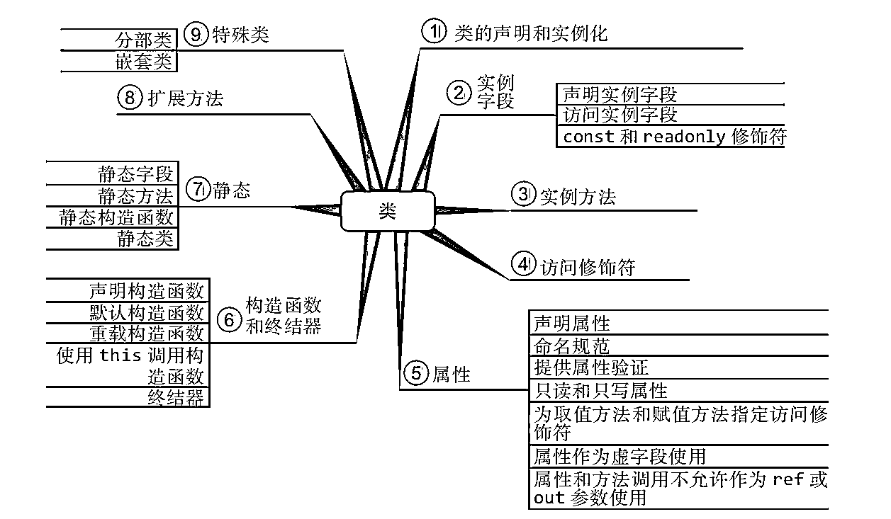

# 前言

在软件工程的发展历史中，用于编写计算机程序的方法经历了几次思维模式的重大转变。每种思维模式都以前一种为基础，宗旨都是增强代码的组织，并降低复杂性。本书将带领你体验相同的思维模式转变过程。

本书开始几章会指导你学习顺序编程结构。在这种编程结构中，语句按编写顺序执行。该结构的问题在于，随着需求的增加，复杂性也会指数级增加。为降低复杂性，将代码块转变成方法，从而产生了结构化编程模型。在这种模型中，可以从一个程序中的多个位置调用同一个代码块，而不需要复制代码。但即使有这种结构，程序还是会很快变得臃肿不堪，需要进一步抽象。所以，在此基础上人们又提出了面向对象编程的概念，这将在第六章中讨论。在此之后，你将继续学习其他编程方法，比如基于接口的编程和 LINQ（以及它促使集合 API 发生的改变），并最终学习通过特性（attribute）进行初级的声明性编程（第十八章）。

本书有以下三个主要职能。

·全面讲述 C#语言，其内容已远远超过了一本简单的教程，可为你进行高效率软件开发打下坚实基础。

·对于已熟悉 C#的读者，本书探讨了一些较为复杂的编程思想，并深入讨论了语言较新版本（C# 8.0 和.NET Framework 4.8/.NET Core 3.1）的新功能。

·它是你永远的案头参考——即便在你精通了这种语言之后。

成功学习 C#的关键在于，要尽可能快地开始编程。不要等自己成为一名理论“专家”之后才开始写代码。所以不要犹豫，马上开始写程序吧。作为迭代开发思想的追随者，我希望即使一名刚开始学习编程的新手，在第二章结束时也能动手编写基本的 C#代码。

许多主题本书没有讨论。你在本书中找不到 ASP.NET、Entity Framework、Xamarin、智能客户端开发以及分布式编程等主题。虽然这些主题与.NET 有关，但它们都值得用专门的书分专题讲述。幸好市面上已经有丰富的图书供读者选择。本书重点在于 C#及基类库中的类型。读完本书之后，你在上述任何领域继续深入学习都会游刃有余。

本书面向的读者

写作本书时，我面临的一个挑战是如何在持续吸引高级开发者眼球的同时，不因使用 assembly、link、chain、thread 和 fusion^( [\[1\]](part0005.xhtml#ch1_back) ) 等字眼而打击初学者的信心，否则许多人会以为这是一本讲冶金而不是程序设计的书。本书的主要读者是已经有一定编程经验，并想多学一种语言来“傍身”的开发者。但我还是小心地编排了本书的内容，使之对各种层次的开发者都有足够大的价值。

·初学者： 假如你是编程新手，本书将帮助你从入门级程序员过渡为 C#开发者，消除以后在面临任何 C#编程任务时的畏惧心理。本书不仅要教会你语法，还要教你养成良好的编程习惯，为将来的编程生涯打下良好基础。

·熟悉结构化编程的程序员： 学习外语最好的方法就是“沉浸法”^( [\[2\]](part0005.xhtml#ch2_back) ) 。类似地，学习一门计算机语言最好的方法就是在动手中学习，而不是等熟知了它的所有“理论”之后再动手。基于这个前提，本书最开始的内容是那些熟悉结构化编程的开发者很容易上手的。到第五章结束时，这些开发者应该可以开始写基本的控制流程序。然而，要成为真正的 C#开发者，记住语法只是第一步。为了从简单程序过渡到企业级开发，C#开发者必须从对象及其关系的角度来思考问题。为此，第六章的“初学者主题”开始介绍类和面向对象开发。历史上的 C、COBOL 和 FORTRAN 等结构化编程语言虽然仍在发挥作用，但作用会越来越小，所以，软件工程师们应该逐渐开始了解面向对象开发。C#是进行这一思维模式转变的理想语言，因为它本来就是基于“面向对象开发”这一中心思想来设计的。

·熟悉“基于对象”和“面向对象”理念的开发者： C++、Python、TypeScript、Visual Basic 和 Java 程序员都可归于此类。对于分号和大括号，他们可是一点儿都不陌生！简单浏览一下第一章的代码，你会发现，从核心上讲，C#类似于你熟知的 C 和 C++风格的语言。

·C#专家： 对于已经精通 C#的读者，本书可供你参考不太常见的语法。此外，对于在其他地方强调较少的一些语言细节以及微妙之处，我提出了自己的见解。最重要的是，本书提供了编写可靠和易维护代码的指导原则及模式。另外，在你教别人学 C#时，本书也颇有助益。从 C# 3.0 到 C# 8.0 最重要的一些增强包括：

■字符串插值（第二章）

■隐式类型的变量（第三章）

■元组（第三章）

■可空引用类型（第三章）

■模式匹配（第四章）

■扩展方法（第六章）

■分部方法（第六章）

■默认接口成员（第八章）

■匿名类型（第十二章）

■泛型（第十二章）

■ Lambda 语句和表达式（第十三章）

■表达式树（第十三章）

■匿名类型（第十五章）^( [\[3\]](part0005.xhtml#ch3_back) ) 

■标准查询操作符（第十五章）

■查询表达式（第十六章）

■动态编程（第十八章）

■用任务编程库（TPL）和 async 进行多线程编程（第二十章）

■用 PLINQ 进行并行查询处理（第二十一章）

■并发集合（第二十二章）

考虑到许多人还不熟悉这些主题，本书围绕它们展开了详细的讨论。涉及高级 C#开发的还有“指针”这一主题，该主题将在第二十三章讨论。即使是有经验的 C#开发者，也未必能很透彻地理解这一主题。

本书特色

本书是语言参考书，遵循核心 C#语言规范（C# Language Specification）。为了帮助读者理解各种 C#构造，书中用大量例子演示了每一种特性，而且为每个概念都提供了相应的指导原则和最佳实践，以确保代码能顺利编译，避免留下隐患，并获得最佳的可维护性。

为增强可读性，所有代码均进行了特殊格式处理，而且每章内容都用思维导图来概括。

C#设计规范

本书新版本最重大的改进之一就是增加了大量“设计规范”，下面是取自第十七章的例子。

设计规范

·要确保自定义比较逻辑产生一致的“全序”。

区分知道语法的程序员和能因地制宜写出最高效代码的专家的关键就是这些设计规范。专家不仅能让代码通过编译，还会遵循最佳实践，降低出现 bug 的概率，并使代码的维护变得更容易。设计规范强调了一些关键原则，开发时务必注意。

示例代码

本书大多数代码都能在公共语言基础结构（Common Language Infrastructure，CLI）的任何实现上运行，但重点还是 Microsoft .NET Framework 和.NET Core 这两个实现。很少使用平台或厂商特有的库，除非需要解释只和那些平台相关的重要概念（例如，解释如何正确处理 Windows 单线程 UI）。

下面是一个示例代码清单。

代码清单 1.19　注释代码

```powershell
$firstName = $null # Variable for storing the first name
$lastName = $null  # Variable for storing the last name

Write-Output 'Hey you!'
Write-Host -NoNewline 'Enter your first name: '
$firstName = Read-Host
Write-Host -NoNewline 'Enter your last name: '
$lastName = Read-Host

<# Display a greeting to the console
   using composite formatting. #>
Write-Output ("Your full name is {0} {1}." -f $firstName, $lastName)
# This is the end of the program listing
```

原图代码已改写为 PowerShell 脚本。

下面解释具体的格式：

·注释使用斜体。

```powershell
<# Display a greeting to the console
   using composite formatting. #>
```

·关键字加粗。

```powershell
function Main {
}
```

·有的代码突出显示，是为了指出这些代码与之前的有区别，或是为了演示正文介绍的概念。

```powershell
Write-Output $valerie
$miracleMax = 'It would take a miracle.'
Write-Output $miracleMax
```

突出显示的可能是一整行，也可能是一行中的几个字符。

```powershell
Write-Output ("The palindrome `"$palindrome`" is $($palindrome.Length) characters.")
```

·省略号表示无关代码已省略。

```powershell
# ...
```

·代码清单后列出了对应的控制台输出。由用户输入的内容加粗显示。

输出 1.7

```powershell
Hey you!
Enter your first name: Inigo
Enter your last name: Montoya

Your full name is Inigo Montoya.
```

虽然我也可以在书中提供完整代码以方便复制，但这样会分散大家的注意力。因此，你需要在自己的程序中修改示例代码。书中的代码主要省略了错误检查，比如异常处理。另外，代码没有显式包含 using System 语句，所有例子都需要该语句。

请登录华章网站（[www.hzbook.com](http://www.hzbook.com) ）或访问[`IntelliTect.com/EssentialCSharp`](https://IntelliTect.com/EssentialCSharp) 下载示例代码。

思维导图

每章开头都有一幅“思维导图”作为提纲，目的是为读者提供针对每章内容的快速参考。下面是一个例子（摘自第六章）。



每章主题显示在思维导图的中心，高级主题围绕中心展开。利用思维导图，读者可方便地搭建自己的知识体系，可以从一个主题出发，更清楚地理解其周边的各个具体概念，避免中途纠缠于一些不相干的枝节问题。

分类解说

根据编程水平的不同，可以利用书中的标志来帮助自己轻松找到适合自己的内容。

·初学者主题： 特别针对入门级程序员提供的定义或解释。

·高级主题： 可以让有经验的开发者将注意力放在他们最关心的内容上。

·标注： 用有底纹的标注框强调关键点，引起读者的注意。

·语言对比： 分散在正文中的补充内容描述了 C#和其他语言的关键差异，为熟悉其他语言的读者提供指引。

本书内容组织

总体来说，软件工程的宗旨就是管理复杂性。本书基于该宗旨来组织内容。第一章～第五章介绍结构化编程，学习这些内容后，可以立即开始写一些功能简单的代码。第六章～第十章介绍 C#的面向对象构造，新手应在完全理解这几章的内容之后，再开始接触本书其余部分更高级的主题。第十二章～第十四章介绍更多用于降低复杂性的构造，讲解当今几乎所有程序都要用到的通用设计模式。理解了它们之后，才可以更轻松地理解如何通过反射和特性来进行动态编程。后续章节将广泛运用它们来实现线程处理和互操作性。

本书最后专门用一章（第二十四章）讲解 CLI。这一章在开发平台的背景下对 C#语言进行了描述。之所以要放到最后，是因为它非 C#特有，且不涉及语法和编程风格问题。不过，该章适合在任何时候阅读，或许最恰当的时机是在阅读完第一章之后。

下面是每一章的内容提要。（章号加黑表明那一章含有 C# 7.0 和 C# 8.0 的内容。）

·第一章 ：本章在展示了用 C#写的 HelloWorld 程序之后对其进行细致分析。目的是让读者熟悉 C#程序的“外观和感觉”，并理解如何编译和调试自己的程序。另外，还简单描述执行 C#程序的上下文及其中间语言（Intermediate Language，IL）。

·第二章 ：任何有用的程序都要处理数据，本章介绍 C#的基元数据类型。

·第三章 ：本章深入讲解数据类型的两大类别——值类型和引用类型。然后讲解隐式类型局部变量、元组、可空修饰符以及 C# 8.0 引入的可空引用类型。最后深入讨论基元数组结构。

·第四章 ：计算机最擅长重复性操作，为利用该能力，需知道如何在程序中添加循环和条件逻辑。本章还讨论 C#操作符、数据转换和预处理器指令。

·第五章 ：本章讨论方法及其参数的细节，其中包括通过参数来传值、传引用和通过 out 参数返回数据。C# 4.0 新增了默认参数，本章将解释如何使用。

·第六章 ：前面已学过类的基本构成元素，本章合并这些构造，以获得具有完整功能的类型。类是面向对象技术的核心，它定义了对象模板。本章还包括 C# 8.0 中新引入的可空属性。

·第七章 ：继承是许多开发者的基本编程手段，C#更是提供了一些独特构造，比如 new 修饰符。本章讨论继承语法的细节，其中包括重写（overriding）。

·第八章 ：本章讨论如何利用接口来定义类之间的“可进行版本控制的交互契约”（versionable interaction contract）。C#同时包含显式和隐式接口成员实现，可实现一个额外的封装等级，这是其他大多数语言所不支持的。随着默认接口成员的引入，该章有一节讨论接口版本控制。

·第九章 ：尽管不如定义引用类型那么频繁，但有时确有必要定义行为和 C#内置基元类型相似的值类型。本章介绍如何定义结构（struct），同时也强调其特殊性。

·第十章 ：本章讨论更高级的类型定义，解释如何实现操作符，比如+和转型操作符，并描述如何将多个类封装到一个库中。此外，还演示如何定义命名空间和 XML 注释，并讨论如何基于垃圾回收机制来设计令人满意的类。

·第十一章 ：本章延伸讨论第五章引入的异常处理机制，描述如何利用异常层次结构创建自定义异常。此外，还强调了异常处理的一些最佳实践。

·第十二章： 泛型或许是 C# 1.0 最缺少的功能。本章全面讨论自 2.0 引入的泛型机制。此外，C# 4.0 增加了对协变和逆变的支持，本章将在泛型背景中探讨它们。

·第十三章： 正因为有了委托，C#才与其前身语言（C 和 C++等）有了显著不同，它定义了在代码中处理事件的模式。这几乎完全消除了写轮询例程的必要。Lambda 表达式是使 C# 3.0 的 LINQ 成为可能的关键概念。通过学习本章，你将知道 Lambda 表达式是在委托的基础上构建起来的，它提供了比委托更优雅和简洁的语法。本章内容是后面讨论的集合 API 的基础。这里还介绍了另一个 C# 2.0 特性——匿名方法。

·第十四章： 封装起来的委托（称为事件）是公共语言运行时（Common Language Runtime，CLR）的核心构造。

·第十五章： 通过讨论 Enumerable 类的扩展方法，介绍 C# 3.0 引入的一些简单而强大的改变。Enumerable 类造就了集合 API，即“标准查询操作符”，本章对其进行详细讨论。

·第十六章 ：如果只使用标准查询操作符，会形成让人难以辨认的长语句。查询表达式提供了一种类似 SQL 风格的语法，有效解决了该问题。本章会详细讨论这种表达式。

·第十七章 ：构建用于操纵业务对象的自定义 API 时，经常需要创建自定义集合。本章讨论了具体做法，还介绍了能使自定义集合的构建变得更简单的上下文关键字。

·第十八章 ：20 世纪 80 年代末，程序结构的思维模式发生了根本性的变化，面向对象的编程是这个变化的基础。类似地，特性（attribute）使声明性编程和嵌入元数据成为可能，因而引入了一种新的思维模式。本章探讨特性的方方面面，并讨论如何通过反射机制来获取它们。本章还讨论如何通过基类库（Base Class Library，BCL）中的序列化框架来实现文件的输入和输出。C# 4.0 新增了 dynamic 关键字，能将所有类型检查都移至运行时进行，因而极大地扩展了 C#的能力。

·第十九章 ：大多数现代程序都要求用线程执行长时间运行的任务，同时确保对并发事件的快速响应。随着程序越来越复杂，必须采取其他措施来保护这些高级环境中的数据。多线程应用程序的编写比较复杂。本章讨论如何操纵线程，并提供一些最佳实践来避免将多线程应用程序弄得一团糟。

·第二十章 ：本章深入研究基于任务的异步模式及其附带的 async/await 语法。它为多线程编程提供了一种极其简化的方法。此外，还包括异步流的 C# 8.0 概念。

·第二十一章 ：引入性能改进的一种简单方法是使用 parallel 对象或并行 LINQ 库并行迭代数据。

·第二十二章 ：本章以第二十一章为基础，演示如何利用一些内建线程处理模式来简化对多线程代码的显式控制。

·第二十三章： 必须意识到 C#是一种相对年轻的语言，许多现有的代码是用其他语言写成的。为了用好这些现有代码，C#通过 P/Invoke 提供了对互操作性（调用非托管代码）的支持。此外，C#允许使用指针，也允许执行直接内存操作。虽然使用了指针的代码要求特殊权限才能运行，但它具有与 C 风格的 API 完全兼容的能力。

·第二十四章 ：事实上，C#被设计成一种在 CLI 顶部工作的最有效的编程语言。本章讨论 C#程序与底层“运行时”及其规范的关系。

希望本书能作为你建立 C#专业能力的丰富资源，并且在精通 C#后你仍能将其作为对较少使用的领域的参考。

Mark Michaelis

IntelliTect.com/mark

[\[1\]](part0005.xhtml#ch1) 上述每个单词在计算机和冶金领域都有专门的含义，所以作者用它们开了一个玩笑。例如，assembly 既是“程序集”，也是“装配件”；thread 既是“线程”，也是“螺纹”。——译者注

[\[2\]](part0005.xhtml#ch2) 沉浸法，即 immersion approach，是指想办法让学习者泡到一个全外语的环境中，比如孤身一人在国外生活或学习。——译者注

[\[3\]](part0005.xhtml#ch3) 英文原书此处有误，这里已根据正文内容（匿名类型包括在第十五章中）修改。——编辑注