# 第一章　C#概述

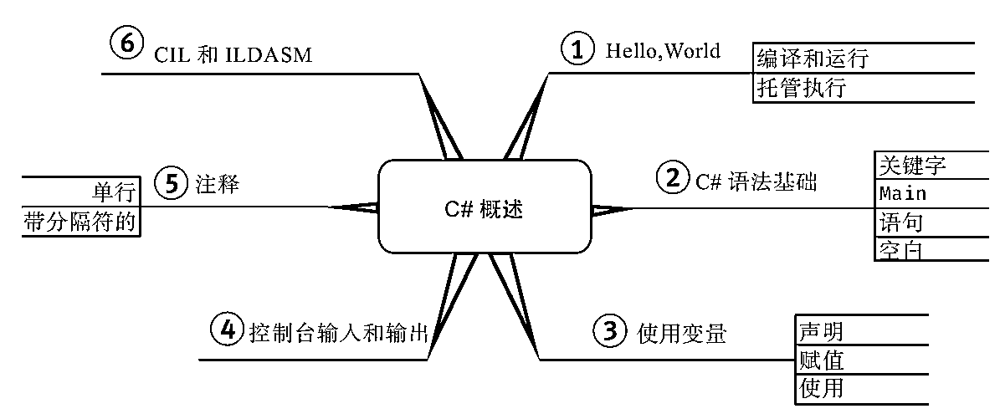

C#编程语言可以为各种不同的系统平台开发应用软件和程序组件。它支持的系统平台包括：移动设备、游戏主机、Web 应用、物联网、微服务以及桌面应用。此外，C#是完全免费的。实际上，由于 C#是开源软件，因此你可以自由地查看其代码，并对其进行修改和重新发布；当然，也可以向开源社区贡献自己对 C#的改进。作为一种语言，C#基于其前身 C 风格编程语言（C、C++、Java）的功能而设计，这使得拥有其他编程经验的开发者可以快速地掌握 C#程序开发^( [\[1\]](part0008.xhtml#ch1_back) ) 。

本章用传统 HelloWorld 程序介绍 C#，重点是 C#语法基础，包括定义 C#程序入口。通过本章的学习，你将熟悉 C#的语法风格和结构，能开始写最简单的 C#程序。讨论 C#语法基础之前，将简单介绍托管执行环境，并解释 C#程序在运行时如何执行。最后讨论变量声明、控制台输入/输出以及基本的 C#代码注释机制。

[\[1\]](part0008.xhtml#ch1) 第一次 C#设计会议在 1998 年召开。

## 1.1　Hello, World

学习新语言最好的办法就是写代码。第一个例子是经典 HelloWorld 程序，它在屏幕上显示一些文本。代码清单 1.1 展示了完整 HelloWorld 程序，我们将在之后的小节编译并运行代码。

代码清单 1.1　用 C#编写的 HelloWorld^( [\[1\]](part0009.xhtml#ch1_back) ) 

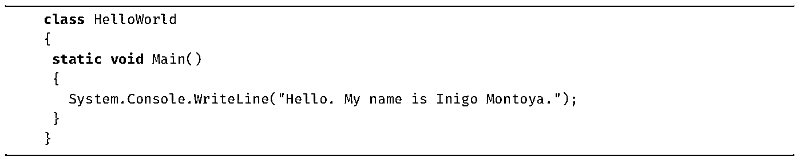

注意 　C#是区分大小写的语言，大小写不正确会使代码无法成功编译。

有 Java、C 或者 C++编程经验的读者很快就能看出相似的地方。类似于 Java，C#也从 C 和 C++继承了基本的语法^( [\[2\]](part0009.xhtml#ch2_back) ) 。语法标点（比如分号和大括号）、特性（比如区分大小写）和关键字（比如 class、public 和 void）对于这些程序员来说并不陌生。初学者和其他语言背景的程序员通过这个程序能很快体会到这些构造的直观性。

### 1.1.1　创建、编辑、编译和运行 C#源代码

写好 C#代码后需要编译和运行。这时要选择使用哪个.NET 实现（或者说.NET 框架）。这些实现通常打包成一个软件开发包（Software Development Kit，SDK），其中包括编译器、运行时执行引擎、“运行时”能访问的语言可访问功能框架（参见 1.7.1 节），以及可能和 SDK 捆绑的其他工具（比如供自动化生成的生成引擎）。由于 C#自 2000 年便已公布，目前有多个不同的.NET 框架供选择（参见 1.7 节）。

取决于开发的目标操作系统以及你选择的.NET 框架，每种.NET 框架的安装过程都有所区别。有鉴于此，建议访问[`dotnet.microsoft.com/download`](https://dotnet.microsoft.com/download) 了解具体的下载和安装指示。如有必要，先选好.NET 框架，再根据目标操作系统选择要下载的包。虽然我可以在这里提供更多细节，但.NET 下载站点为支持的各种组合提供了最新、最全的指令。

如不确定要使用的.NET 框架，就默认选择.NET Core。它可运行于 Linux、macOS 和 Microsoft Windows，是.NET 开发团队投入最大的实现。另外，由于它具有跨平台能力，所以本书优先使用.NET Core。

有许多源代码编辑工具可供选择，包括最基本的 Windows 记事本、Mac/macOS TextEdit 和 Linux vi。但建议选择一个稍微高级点的工具，至少应支持彩色标注。支持 C#的任何代码编辑器都可以。如果还没有特别喜欢的，推荐开源编辑器 Visual Studio Code（[`code.visualstudio.com`](https://code.visualstudio.com) ）。为了让 Visual Studio Code 更好地支持 C#程序开发，请参考图 1.1 下载安装 C#扩展模块。如果在 Windows 或 Mac 上工作，也可考虑 Microsoft Visual Studio 2019（或更高版本），详情参考[`visualstudio.microsoft.com/vs/`](https://visualstudio.microsoft.com/vs/) 。两者都是免费的。

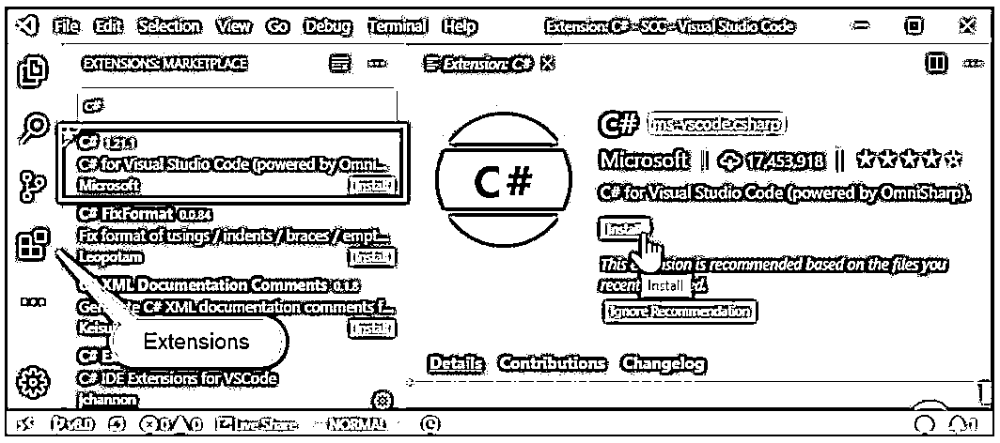

图 1.1　为 Visual Studio Code 下载安装 C#扩展模块

后两节我会提供这两种编辑器的操作指示。Visual Studio Code 依赖命令行接口（CLI）工具 dotnet CLI 创建初始的 C#程序基架并编译和运行程序。Windows 和 Mac 则一般使用 Visual Studio 2019。

使用 dotnet CLI

dotnet 命令 dotnet.exe 是 dotnet 命令行接口（或称 dotnet CLI），可用于生成 C#程序的初始代码库并编译和运行程序^( [\[3\]](part0009.xhtml#ch3_back) ) 。注意这里的 CLI 代表“命令行接口”（Command-Line Interface）。为避免和代表“公共语言基础结构”（Common Language Infrastructure）的 CLI 混淆，本书在提到 dotnet CLI 时都会附加 dotnet 前缀。无 dotnet 前缀的 CLI 才是“公共语言基础结构”。安装好之后，验证可以在命令行上执行 dotnet。

以下是在 Windows、macOS 或 Linux 上创建、编译和执行 HelloWorld 程序的指示：

1.在 Microsoft Windows 上打开命令提示符，在 Mac/macOS 上打开 Terminal 应用。（也可考虑使用跨平台命令行接口 PowerShell^( [\[4\]](part0009.xhtml#ch4_back) ) 。）

2.在想要放代码的地方新建一个目录。考虑./HelloWorld 或./EssentialCSharp/HelloWorld 这样的名称。在命令行上执行：

3.导航到新目录，使之成为命令行的当前目录：

4.在 HelloWorld 目录中执行 dotnet new console 命令来生成程序基架（或称程序项目）。这会生成几个文件，最主要的是 Program.cs 和项目文件：

5.运行生成的程序。这会编译并运行由 dotnet new console 命令创建的默认 Program.cs 程序。程序内容和代码清单 1.1 相似，只是输出变成“Hello World!”。

虽然没有显式请求、编译（或生成）程序项目，但 dotnet run 命令在执行时隐式执行了这一步。

6.编辑 Program.cs 文件并修改代码使之和代码清单 1.1 一致。用 Visual Studio Code 打开并编辑 Program.cs 会体验到支持 C#的编辑器的好处，代码会用彩色标注不同类型的构造。

若想用 Visual Studio Code 打开和编辑项目，请在 HelloWorld 目录中执行

命令。（也可以参考输出 1.1，那里展示的命令行命令在 Bash 和 PowerShell 中均可使用。）

7.重新运行程序：

输出 1.1 展示了上述步骤的输出^( [\[5\]](part0009.xhtml#ch5_back) ) 。

输出 1.1

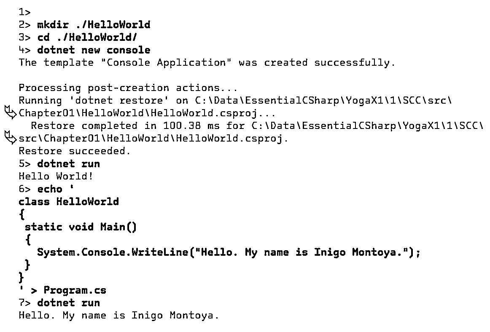

使用 Visual Studio 2019

在 Visual Studio 2019 中的操作相似，只是不用命令行，而是用集成开发环境（IDE）。有菜单可选，不必一切都在命令行上进行。

1.启动 Visual Studio 2019。

2.在开始页面上点击“Create a new project”按钮。（如果开始页面未出现，请选择“File”｜“Start Window”菜单打开开始页面，或者直接通过“File”｜“New Project”（Ctrl+Shift+N）菜单创建项目。）

3.在搜索框（Ctrl+E）中输入“Console App”并选择“Console App（.NET Core）——Visual C#”，如图 1.2 所示。

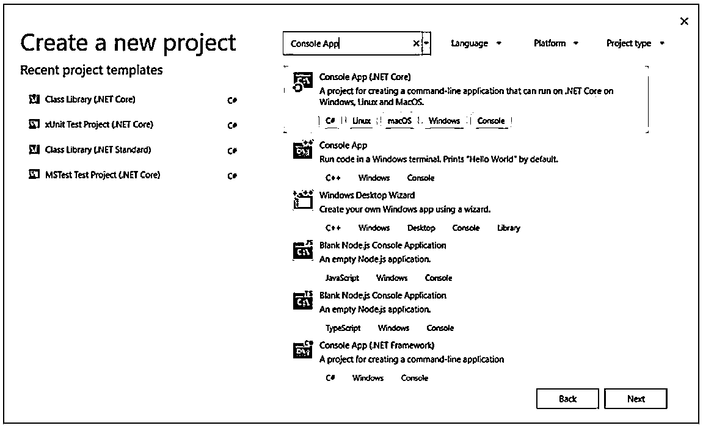

图 1.2　“新建项目”对话框

4.在“Project name”框中输入 HelloWorld。在“Location”处选择你的工作目录。如图 1.3 所示。

5.项目创建好后会打开 Program.cs 文件供编辑，如图 1.4 所示。

6.选择“Debug”｜“Start Without Debugging”（Ctrl+F5）来生成并运行程序。会显示如输出 1.2 所示的命令窗口，只是第一行目前为“Hello World! ”。

7.将 Program.cs 修改成代码清单 1.1 的样子。

8.返回程序并重新运行，获得如输出 1.2 所示的结果。

输出 1.2

调试

IDE 最重要的一个功能是调试。请在 Visual Studio 或者 Visual Studio Code 中按照以下额外步骤试验其调试功能：

1.光标定位到 System.Console.WriteLine 这一行，选择“调试”｜“切换断点”（F9）在该行激活断点。

2.选择“调试”｜“开始调试” （F5）重新启动应用程序，但这次激活了调试功能。如果你正在使用 Visual Studio Code，第一次启动程序时会弹出对话框，询问该程序的运行环境。请选择“.NET Core”，这样 Visual Studio Code 便会自动生成 launch.json 和 task.json 两个与运行有关的配置文件。然后再次选择“调试”｜“开始调试”（F5）启动应用程序。注意程序会在断点所在行停止执行。此时可将鼠标放到某个变量（例如 args）上以观察它的值。还可以拖动左侧黄箭头将程序执行从当前行移动到当前方法内的另一行。

3.要继续执行，选择“调试”｜“继续”（F5）或者点击工具栏上的“继续”按钮。

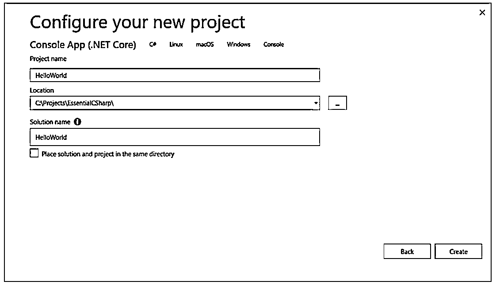

图 1.3　设置新项目的对话框

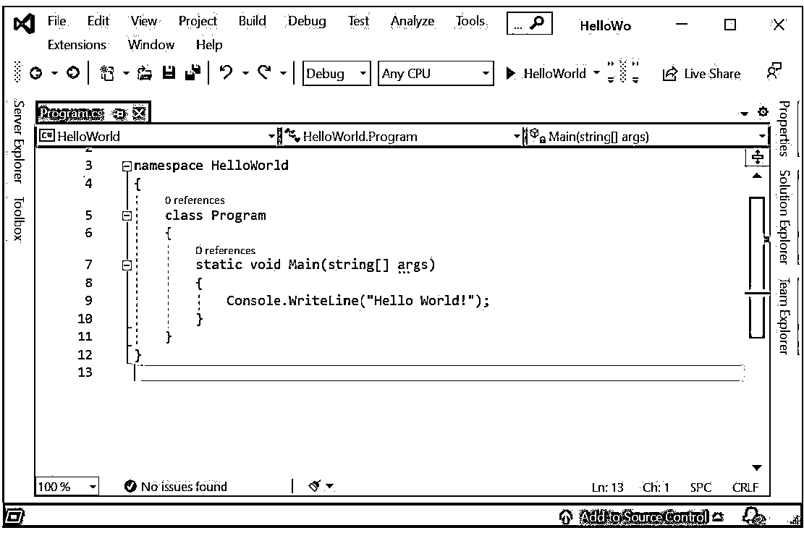

图 1.4　编辑 Program.cs 文件

若要继续深入学习如何使用 Visual Studio 2019 进行程序调试，请访问网站[`itl.tc/vsdebugging`](http://itl.tc/vsdebugging) 。

在 Visual Studio Code 中，程序输出会显示在 Debug Console（调试控制台）窗口中。（选择“View”（视图）｜“Debug Console”（调试控制台）或 Ctrl+Shift+V 打开调试控制台观察程序输出结果。）若要继续深入学习如何使用 Visual Studio Code 进行程序调试，请访问网站[`code.visualstudio.com/docs/editor/debugging`](https://code.visualstudio.com/docs/editor/debugging) 。

### 1.1.2　创建项目

无论 dotnet CLI 还是 Visual Studio 都会自动创建几个文件。第一个是名为 Program.cs 的 C#文件。虽然可选择任何名称，但一般都用 Program 这一名称作为控制台程序起点。.cs 是所有 C#文件的标准扩展名，也是编译器默认要编译成最终程序的扩展名。为了使用代码清单 1.1 中的代码，可打开 Program.cs 文件并将其内容替换成代码清单 1.1 的内容。保存更新文件之前，注意代码清单 1.1 和默认生成的代码相比，唯一功能上的差异就是引号间的文本。还有就是后者多了 using System;指令，这是一处语义上的差异。

语言对比：Java——文件名必须匹配类名

Java 要求文件名和类名一致。C#虽然也常遵守这一约定，却并非必需。在 C#中，一个文件可以包含多个类。而且从 C# 2.0 开始，类的代码可通过所谓的分部类拆分到多个文件中。你了解得越多，就越有能力针对特定应用程序的需求做出最合适的体系结构选择。

虽然并非一定需要，但通常都会为 C#项目生成一个项目文件。项目文件的内容随不同应用程序类型和.NET 框架而变。但至少会指出哪些文件要包含到编译中、要生成什么应用程序类型（控制台、Web、移动、测试项目等）、支持什么.NET 框架、调试或启动应用程序需要什么设置，以及代码的其他依赖项（称为库）。例如，代码清单 1.2 列出了前面刚创建过的.NET Core 控制台应用的项目文件。

代码清单 1.2　示例.NET Core 控制台应用的项目文件

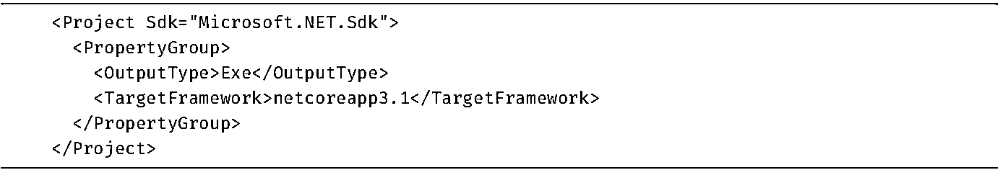

注意应用程序标识为.NET Core 版本 3.1（netcoreapp3.1）的控制台应用（Exe）。其他所有设置（比如要编译哪些 C#文件）则沿用默认值。例如，和项目文件同一目录（或子目录）中的所有\*.cs 文件都会包含到编译中。

### 1.1.3　编译和执行

dotnet build 命令生成名为 HelloWorld.dll 的程序集 （assembly）^( [\[6\]](part0009.xhtml#ch6_back) ) 。扩展名.dll 代表“动态链接库”（Dynamic Link Library，DLL）。对于.NET Core，所有程序集都使用.dll 扩展名。控制台程序也不例外，就像本例这样。.NET Core 应用程序的编译输出默认放到子目录./bin/Debug/netcoreapp3.1/。之所以使用 Debug 这个名称，是因为默认配置就是 debug。该配置造成输出为调试进行优化，而不是为性能而优化。编译好的输出本身不能直接执行。相反，需用 CLI 来寄宿（host）代码。对于.NET Core 应用程序，这要求 dotnet.exe 进程作为应用程序的寄宿进程。这就是为什么总是需要用 dotnet run 命令来运行应用程序。必要时也可以将应用程序及其所需的运行时文件打包在一起，生成一个可以独立运行且无须另外安装 dotnet 运行时库可执行文件。具体方法请参考后面的高级主题“发布可独立运行的可执行文件”。

高级主题：发布可独立运行的可执行文件

生成一个可以独立运行，而不依赖于 dotnet 命令的可执行文件是完全可行的。要做到这一点，需要执行 dotnet publish 命令，并且通过命令参数--runtime（-r）来指定需要兼容的目标平台。例如，如需兼容大部分 Linux 平台，可以在 CSPROJ 文件所在的目录下执行上述命令，并使用 linux-x64 参数：

执行上述命令后，会生成一个目录（./bin/Debug/netcoreapp3.1/linux-x64/publish/），里面包含了运行 HelloWorld 程序所需的所有文件。有了这些便不需要在目标平台事先安装 dotnet 运行时库。若要运行 HelloWorld 程序，只需要直接运行其可执行文件即可：

（在 Windows 上，可执行文件会带有扩展名“.exe”，但是在运行可执行文件时不需要写出该扩展名。）

需要注意的是，在上面的示例中生成的可执行文件只能在 linux-x64 兼容平台上运行。若要支持更多其他平台，则需要为每一个平台生成对应的可执行文件。除了 Linux 之外，其他目标平台还包括 win-x64 和 osx-x64 等。（访问网址[`itl.tc/ridcatalog`](http://itl.tc/ridcatalog) 可以查看兼容平台的完整列表。）

按照前面的方法生成的目录里面，除了应用程序自己的可执行文件之外，还有将近 200 个依赖文件。实际上也可以生成单一的可独立运行的文件。若要生成单一文件，需要为生成命令加上-p:PublishSingleFile=true 参数：

第十章将会介绍更多关于-p 参数的内容。

### 1.1.4　使用本书源代码

本书源代码^( [\[7\]](part0009.xhtml#ch7_back) ) 包含解决方案文件 EssentialCSharp.sln，它组合了全书所有代码。Visual Studio 和 dotnet CLI 都能生成、运行和测试这些源代码。

或许最简单的方式是将源代码拷贝到早先创建的 HelloWorld 程序中并执行。但是，解决方案包含了各章的项目文件，还提供了一个菜单来选择要执行的代码清单。详情参见以下两节。

使用 dotnet CLI

要用 dotnet CLI 生成并执行代码，请打开命令提示符，将当前目录设为 EssentialCSharp.sln 文件所在的目录。执行 dotnet build 命令编译所有项目^( [\[8\]](part0009.xhtml#ch8_back) ) 。

要运行特定项目的源代码，导航到项目文件所在目录并执行 dotnet run 命令。另外，在任何目录都可以执行 dotnet run-p <projectfile>命令。其中<projectfile>是要执行的项目文件的路径（例如 dotnet run-p .\\src\\Chapter01\\Chapter01.csproj）。随后会运行程序，并提示运行的是哪个代码清单。

许多代码清单都在 Chapter\[??\].Tests 目录中提供了相应的单元测试。其中\[??\]是章的编号。要执行测试，在相应目录中执行 dotnet test 命令（在 EssentialCSharp.sln 所在目录执行该命令，则所有单元测试都会执行）。

使用 Visual Studio

在 Visual Studio 中打开解决方案文件后，选择“Build”（生成）｜“Build Solution”（生成解决方案）或 F6 来编译代码。要执行某一章的项目，需要先将该章的项目设为启动项目。例如，要执行第一章的示例，请右击 Chapter01 项目并选择“Set as StartUp Project”（设为启动项目）。若不这样做，执行时输入非启动项目所在章的代码清单编号会抛出异常。

设置好正确项目后，选择“Debug”（调试）｜“Start Without Debugging”（开始执行（不调试））或 Ctrl+F5 来运行项目。如需调试则按 F5。运行时程序会提示输入代码清单的编号（例如 18.33）。如前所述，只能输入已启动项目中的代码清单。

许多代码清单都有对应的单元测试。要执行测试，打开测试项目（Chapter\[??\].Tests），导航到与代码清单对应的测试（比如 HelloWorldTests）。双击它在代码编辑器中显示。右击要测试的方法（比如 public void Main\_InigoHello()），右击并选择“Run Tests”（运行测试）（Ctrl+R, T）或“Debug Tests”（调试测试）（Ctrl+R, Ctrl+T）。

[\[1\]](part0009.xhtml#ch1) 如果不知道 Inigo Montoya 是谁，请找《公主新娘》（The Princess Bride）这部电影看看。

[\[2\]](part0009.xhtml#ch2) C#语言设计者从 C/C++规范中删除了他们不喜欢的特性，同时创建了他们喜欢的。开发组还有其他语言的资深专家。

[\[3\]](part0009.xhtml#ch3) 该命令行工具发布于 C# 7.0 问世前后。它调用 C#编译器 csc.exe 来编译开发者编写的程序。

[\[4\]](part0009.xhtml#ch4) https://github.com/PowerShell/PowerShell

[\[5\]](part0009.xhtml#ch5) 加粗的是由用户输入的内容。

[\[6\]](part0009.xhtml#ch6) 如果用 Microsoft .NET Framework 创建控制台应用程序，编译好的代码会放到一个 HelloWorld.exe 文件中。如已安装 Microsoft .NET Framework，可直接执行该文件。

[\[7\]](part0009.xhtml#ch7) 本书源代码（以及和 C#早期版本相关的某些章）可从 https://IntelliTect.com/EssentialCSharp 下载。推荐直接从 GitHub 下载，网址是 https://github.com/IntelliTect/EssentialCSharp。

[\[8\]](part0009.xhtml#ch8) 先用 Visual Studio 2019 编译一遍，因为有些包需要安装。——译者注

## 1.2　C#语法基础

成功编译并运行 HelloWorld 程序之后，我们来分析代码，了解它的各个组成部分。首先熟悉一下 C#关键字以及可供开发者选择的标识符。

初学者主题：关键字

为了帮助编译器解释代码，C#中的某些单词具有特殊地位和含义，它们称为关键字 。编译器根据关键字的固有语法来解释程序员写的表达式。在 HelloWorld 程序中，class、static 和 void 均是关键字。

编译器根据关键字识别代码的结构与组织方式。由于编译器对这些单词有着严格的解释，所以只能将关键字放在特定位置。如违反规则，编译器会报错。

### 1.2.1　C# 关键字

表 1.1 总结了 C#关键字。

C# 1.0 之后没有引入任何新的保留关键字 ，但在后续版本中，一些构造使用了上下文关键字 ，它们在特定位置才有意义，在其他位置则无意义^( [\[1\]](part0010.xhtml#ch1_back) ) 。这样大多数 C# 1.0 代码都能兼容后续版本^( [\[2\]](part0010.xhtml#ch2_back) ) 。

### 1.2.2　标识符

和其他语言一样，C#用标识符标识程序员编码的构造。在代码清单 1.1 中，HelloWorld 和 Main 均为标识符。分配标识符之后，以后将用它引用所标识的构造。因此，开发者应分配有意义的名称，不要随性而为。

好的程序员总能选择简洁而有意义的名称，这使代码更容易理解和重用。清晰和一致是如此重要，以至于“框架设计准则”（[`t.cn/RD6v4RB`](http://t.cn/RD6v4RB) ）建议不要在标识符中使用单词缩写^( [\[3\]](part0010.xhtml#ch3_back) ) ，甚至不要使用不被广泛接受的首字母缩写词。即使被广泛接受（如 HTML），使用时也要一致。不要一会儿这样用，一会儿那样用。为避免滥用，可限制所有首字母缩写词都必须包含到术语表中。总之，要选择清晰（甚至是详细）的名称，尤其是在团队中工作，或者开发要由别人使用的库的时候。

标识符有两种基本的大小写风格。第一种风格被.NET 框架创建者称为 Pascal 大小写 （PascalCase），这是因为它曾经在 Pascal 编程语言中很流行，它要求标识符的每个单词首字母大写，例如 ComponentModel、Configuration 和 HttpFileCollection。注意在 HttpFileCollection 中，由于首字母缩写词 HTTP 的长度超过两个字母，所以仅首字母大写。第二种风格是 camel 大小写 （camelCase），除第一个字母小写，其他约定一样，例如 quotient、firstName、httpFileCollection、ioStream 和 theDreadPirateRoberts。

表 1.1　C#关键字

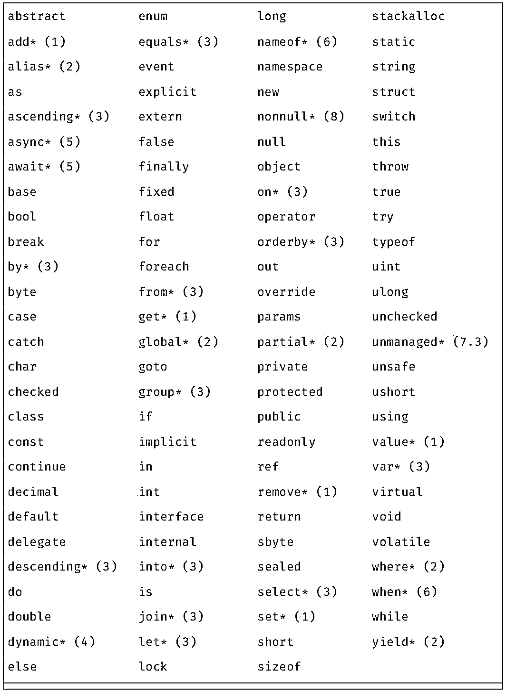

\*这些是上下文关键字，括号中的数字（n）代表加入该上下文关键字的 C#版本。

设计规范

·要更注重标识符的清晰而不是简短。

·不要在标识符名称中使用单词缩写。

·不要使用不被广泛接受的首字母缩写词，对于那些已经被广泛接受的缩写词，在使用时也要保持一致。

下划线虽然合法，但标识符一般不要包含下划线、连字号或其他非字母/数字字符。此外，C#不像其前辈那样使用匈牙利命名法（为名称附加类型缩写前缀）。这避免了数据类型改变时还要重命名变量，也避免了数据类型前缀经常不一致的情况。

极少数情况下，有的标识符（比如 Main）可能在 C#语言中具有特殊含义。

设计规范

·要把两个字母的首字母缩写词全部大写，除非它是 camelCase 标识符的第一个单词。

·包含三个或更多字母的首字母缩写词，仅第一个字母才要大写，除非该缩写词是 camelCase 标识符的第一个单词。

·在 camelCase 标识符开头的首字母缩写词中，所有字母都不要大写。

·不要使用匈牙利命名法（不要为变量名称附加类型前缀）。

高级主题：关键字

虽然罕见，但关键字附加“@”前缀可作为标识符使用，例如可命名局部变量@return。类似地（虽不符合 C#大小写规范），也可将方法命名为@throw()并且跟随一对括号，形如：@throw()。

在 Microsoft 的实现中，还有 4 个未文档化的保留关键字：\_\_arglist，\_\_makeref，\_\_reftype，\_\_refvalue。它们仅在罕见的互操作情形下才需要使用，平时完全可以忽略。注意这 4 个特殊关键字以双下划线开头。C#设计者保留将来把这种标识符转化为关键字的权利。为安全起见，自己不要创建这样的标识符。

### 1.2.3　类型定义

C#所有代码都出现在一个类型定义的内部，最常见的类型定义以关键字 class 开头。如代码清单 1.3 所示，类定义 是 class identifier {...}形式的代码块。

类型名称（本例是 HelloWorld）可以随便取，但根据约定，它应当使用 PascalCase 风格。就本例来说，可选择的名称包括 Greetings、HelloInigoMontoya、Hello 或者简单地称为 Program。（对于包含 Main()方法的类，Program 是个很好的名称。Main()方法的详情稍后讲述。）

代码清单 1.3　基本的类声明

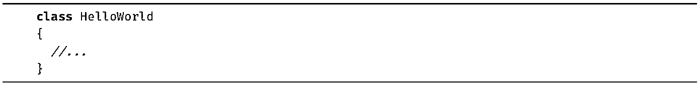

设计规范

·要用名词或名词短语命名类。

·要为所有类名使用 PascalCase 大小写风格。

程序通常包含多个类型，每个类型包含多个方法。

### 1.2.4　Main 方法

初学者主题：什么是方法？

语法上说，C#方法 是已命名代码块，由一个方法声明（例如 static void Main()）引入，后跟一对大括号（{}），其中包含零条或多条语句。方法可执行计算或操作。与书面语言中的段落相似，方法提供了结构化和组织代码的一种方式，使之更易读。更重要的是，方法可以重用，可从多个地方调用，所以避免了代码的重复。方法声明除了引入方法并定义方法名，还要定义传入和传出方法的数据。在代码清单 1.4 中，Main()连同后面的{...}便是 C#方法的例子。

C#程序从 Main 方法开始执行。该方法以 static void Main()开头。在命令控制台中输入 dotnet run HelloWorld.exe 执行程序时，程序将启动并解析 Main 的位置，然后执行其中第一条语句。如代码清单 1.4 所示。

代码清单 1.4　HelloWorld 分解示意图

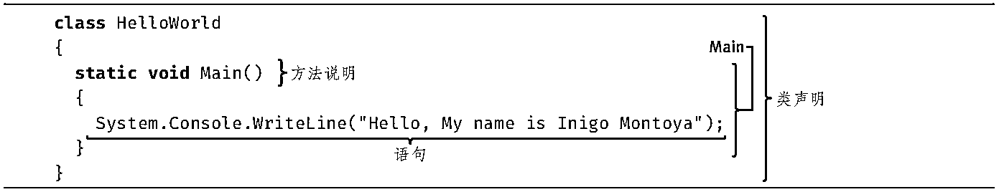

虽然 Main 方法声明可进行某种程度的变化，但关键字 static 和方法名 Main 是始终都需要的。

高级主题：Main 方法声明

C#要求 Main 方法返回 void 或 int，而且要么无参，要么接收一个字符串数组。代码清单 1.5 展示了 Main 方法的完整声明。

代码清单 1.5　带有参数和返回类型的 Main 方法

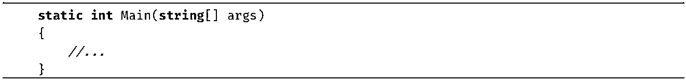

args 参数是用于接收命令行参数的字符串数组。但数组第一个元素不是程序名称，而是可执行文件名称^( [\[4\]](part0010.xhtml#ch4_back) ) 后的第一个命令行参数，这和 C 和 C++不同。用 System.Environment.CommandLine 获取执行程序所用的完整命令。

Main 返回的 int 是状态码，标识程序执行是否成功。返回非零值通常意味着错误。

语言对比：C++/Java——main()

Main 返回的 int 是状态码，标识程序执行是否成功。返回非零值通常意味着错误。此外，从 C#7.1 开始，Main 方法也支持 async/await 修饰词。

注意 　全部小写问题

与 C 风格的“前辈”不同，C#的 Main 方法名使用大写 M，和 C#的 PascalCase 命名约定一致。

将 Main 方法指定为 static 意味着这是“静态”方法，可用类名.方法名的形式调用。若不指定 static，用于启动程序的命令控制台还要先对类进行实例化 ，然后才能调用方法。第六章将用整节篇幅讲述静态成员。

Main()之前的 void 表明方法不返回任何数据（将在第二章进一步解释）。

C#和 C/C++一样使用大括号封闭构造（比如类或者方法）的主体。例如，Main 方法主体就是用大括号封闭起来的。本例方法主体仅一条语句。

### 1.2.5　语句和语句分隔符

Main 方法只含一条语句，即 System.Console.WriteLine();，它在控制台上输出一行文本。C#通常用分号标识语句 结束。每条语句都由代码要执行的一个或多个行动构成。声明变量、控制程序流程或调用方法都是语句的例子。

语言对比：Visual Basic——基于行的语句

有的语言以行为基本单位，这意味着如果不加上特殊标记，语句便不能跨行。在 Visual Basic 2010 以前，Visual Basic 一直是典型的基于行的语言。它要求在行末添加下划线表示语句跨越多行。从 Visual Basic 2010 起，行连续符在大多情况下是可选的。

高级主题：无分号的语句

C#的许多编程元素都以分号结尾。不要求分号的一个例子是 switch 语句。由于大括号总是包含在 switch 语句中，所以 C#不要求语句后跟分号。事实上，代码块本身就被视为语句（它们也由语句构成），不要求以分号结尾。类似地，有的编程元素（比如 using 指令）虽然分号显示为后缀但不被视为语句。

由于换行与否不影响语句的分隔，所以可将多条语句放到同一行，C#编译器认为这一行包含多条指令。例如，代码清单 1.6 在同一行包含了两条语句。执行时在控制台窗口分两行显示 Up 和 Down。

代码清单 1.6　一行上的多条语句

C#还允许一条语句跨越多行。同样地，C#编译器根据分号判断语句结束位置。在代码清单 1.7 中，HelloWorld 程序里原本单行的 WriteLine()代码被分成多行书写。

代码清单 1.7　一条语句跨越多行

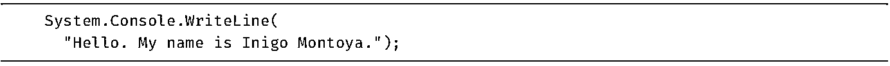

### 1.2.6　空白

分号使 C#编译器能忽略代码中的空白。除少数特殊情况，C#允许代码随意插入空白而不改变语义。在代码清单 1.6 和代码清单 1.7 中，在语句中或语句间换行，甚至不换行都可以，对编译器最终创建的可执行文件没有任何影响。

初学者主题：什么是空白？

空白是一个或多个连续的格式字符（比如制表符、空格和换行符）。删除单词间的所有空白肯定会造成歧义，删除引号字符串中的任何空白也会如此。

程序员经常利用空白对代码进行缩进来增强可读性。来看看代码清单 1.8 和代码清单 1.9 展示的两个版本的 HelloWorld 程序。

代码清单 1.8　不缩进

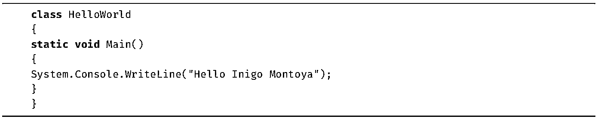

代码清单 1.9　删除一切可以删除的空白

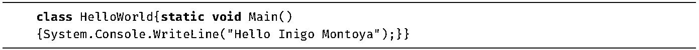

虽然这两个版本看起来和原始版本颇有不同，但 C#编译器认为所有版本无差别。

初学者主题：用空白格式化代码

为增强可读性，用空白对代码进行缩进很有必要。写代码时要遵循制订好的编码标准和约定，以增强代码的可读性。

本书约定每个大括号都单独占一行，并缩进大括号内的代码。如一对大括号嵌套了第二对大括号，第二对大括号中的代码也缩进。

这不是强制性的 C#标准，只是风格偏好。

[\[1\]](part0010.xhtml#ch1) 例如在 C# 2.0 设计之初，语言设计者将 yield 指定成关键字。在 Microsoft 发布的 C# 2.0 编译器的 alpha 版本中（该版本分发给了数千名开发者），yield 以一个新关键字的身份存在。但语言设计者最终选择使用 yield return 而非 yield，从而避免将 yield 作为新关键字。除非与 return 连用，否则它没有任何特殊意义。

[\[2\]](part0010.xhtml#ch2) 偶尔也有不兼容的情况，比如 C# 2.0 要求为 using 语句提供的对象必须实现 IDisposable 接口，而不能只是实现 Dispose()方法。还有一些少见的泛型表达式，比如 F(G＜A,B＞(7))在 C# 1.0 中代表 F((G＜A),(B＞7))，而在 C# 2.0 中代表调用泛型方法 G＜A,B＞，传递实参 7，结果传给 F。

[\[3\]](part0010.xhtml#ch3) 有两种单词缩写：一种是“Abbreviation”，比如 Professor 缩写为 Prof.；另一种是“Contraction”，比如 Doctor 缩写为 Dr。——译者注

[\[4\]](part0010.xhtml#ch4) 也就是程序名称，比如 HelloWorld.exe。——译者注

## 1.3　使用变量

前面我们已接触了最基本的 C#程序，下面声明局部变量。变量声明后可以赋值，可将值替换成新值，并可在计算和输出等操作中使用。但变量一经声明，数据类型就不能改变。在代码清单 1.10 中，string max 就是变量声明。

代码清单 1.10　变量声明和赋值

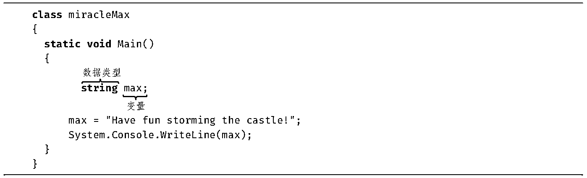

初学者主题：局部变量

变量 是存储位置的符号名称，程序以后可对该存储位置进行赋值和修改。局部 意味着变量在方法或代码块（一对大括号{}）内部声明，其作用域“局部”于当前代码块。所谓“声明变量”就是定义一个变量，你需要：

1.指定变量要包含的数据的类型；

2.为它分配标识符，即变量名。

### 1.3.1　数据类型

代码清单 1.10 声明的是 string 类型的变量。本章还使用了 int 和 char。

·int 是指 C#的 32 位整型。

·char 是字符类型，长度为 16 位，足以表示无代理项的 Unicode 字符^( [\[1\]](part0011.xhtml#ch1_back) ) 。

下一章将更详细地探讨这些以及其他常见数据类型。

初学者主题：什么是数据类型？

数据类型 （或对象类型）是具有相似特征和行为的个体的分类。例如，animal（动物）就是一个类型，它对具有动物特征（多细胞、具有运动能力等）的所有个体（猴子、野猪和鸭嘴兽等）进行了分类。类似地，在编程语言中，类型是被赋予了相似特性的一些个体的定义。

### 1.3.2　变量的声明

代码清单 1.10 中的 string max 是变量声明，它声明名为 max 的 string 变量。还可在同一条语句中声明多个变量，办法是指定数据类型一次，然后用逗号分隔不同标识符，如代码清单 1.11 所示。

代码清单 1.11　一条语句声明两个变量

由于声明多个变量的语句只允许提供一次数据类型，因此所有变量都具有相同类型。

C#变量名可用任何字母或下划线（\_）开头，后跟任意数量的字母、数字或下划线。但根据约定，局部变量名采用 camelCase 命名（除了第一个单词外，其他每个单词的首字母大写），而且不包含下划线。

设计规范

·要为局部变量使用 camelCase 风格命名。

### 1.3.3　变量的赋值

局部变量声明后必须在读取前赋值。一个办法是使用\=操作符 ，或者称为简单赋值操作符 。操作符是一种特殊符号，标识了代码要执行的操作。代码清单 1.12 演示了如何利用赋值操作符指定 miracleMax 和 valerie 变量要指向的字符串值。

代码清单 1.12　更改变量值

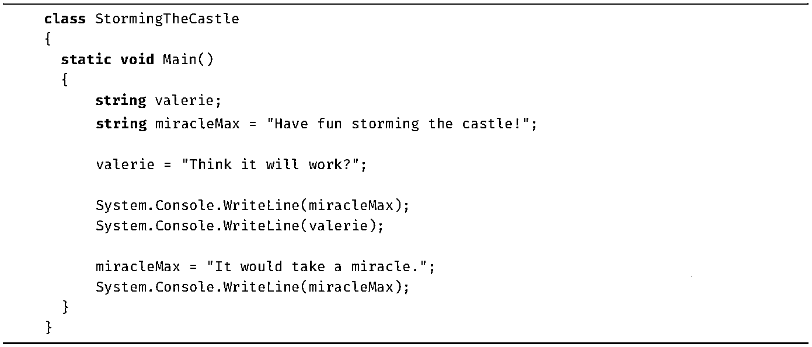

从中可以看出，既可在声明变量的同时赋值（比如变量 miracleMax），也可在声明后用另一条语句赋值（比如变量 valerie）。要赋的值必须放在赋值操作符右侧。

运行编译好的程序生成如输出 1.3 所示的结果。

输出 1.3

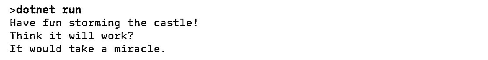

本例列出了 dotnet run 命令，以后会省略，除非要附加额外参数来指定程序的运行方式。

C#要求局部变量在读取前“明确赋值”。此外，赋值作为一种操作会返回一个值。所以 C#允许在同一语句中进行多个赋值操作，如代码清单 1.13 所示。

代码清单 1.13　赋值会返回值，该值可用于再次赋值

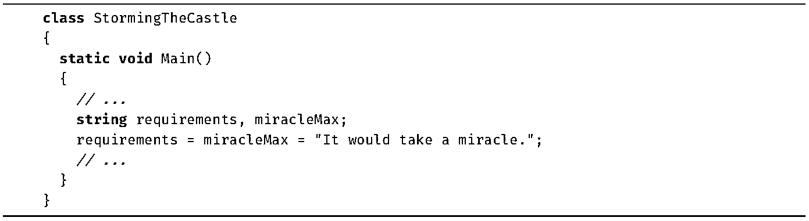

### 1.3.4　变量的使用

赋值后就能用变量名引用值。因此，在 System.Console.WriteLine(miracleMax)语句中使用变量 miracleMax 时，程序在控制台上显示：“Have fun storming the castle!”也就是 miracleMax 的值。更改 miracleMax 的值并执行相同的 System.Console.WriteLine(miracleMax)语句，会显示 miracleMax 的新值，即 It would take a miracle.。

高级主题：字符串不可变

所有 string 类型的数据，不管是不是字符串字面值^( [\[2\]](part0011.xhtml#ch2_back) ) ，都是不可变的（不可修改）。例如，无法将字符串"Come As You Are."改成"Come As You Age."。也就是说，不能修改变量最初引用的数据，只能重新赋值，让它指向内存中的新位置。

[\[1\]](part0011.xhtml#ch1) 某些语言的文字编码要用两个 16 位值表示。第一个代码值称为“高位代理项”（high surrogate），第二个称为“低位代理项”（low surrogate）。在代理项的帮助下，Unicode 可以表示 100 多万个不同的字符。美国和欧洲地区很少使用代理项，东亚各国则很常用。——译者注

[\[2\]](part0011.xhtml#ch2) 即 literal，是指以文本形式嵌入的数据。literal 有多种译法，没有一种占绝对优势。最典型的译法是“字面值”“文字常量”和“直接量”。本书采用“字面值”。——译者注

## 1.4　控制台输入和输出

本章已多次使用 System.Console.WriteLine 将文本输出到命令控制台。除了能输出数据，程序还需要能接收用户输入的数据。

### 1.4.1　从控制台获取输入

可用 System.Console.ReadLine()方法获取控制台输入的文本。它暂停程序执行并等待用户输入。用户按回车键，程序继续。System.Console.ReadLine()方法的输出，也称为返回值 ，其内容即用户输入的文本字符串。代码清单 1.14 和输出 1.4 是一个例子。

代码清单 1.14　使用 System.Console.ReadLine()

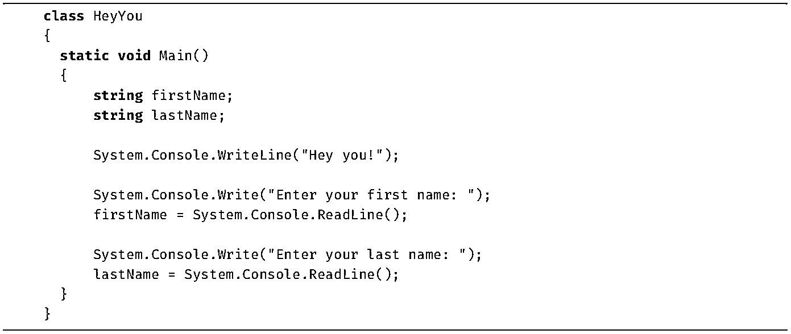

输出 1.4

在每条提示信息后，程序都用 System.Console.ReadLine()方法获取用户输入并赋给变量。在第二个 System.Console.ReadLine()赋值操作完成之后，firstName 引用值 Inigo，而 lastName 引用值 Montoya。

高级主题：System.Console.Read()

除了 System.Console.ReadLine()还有 System.Console.Read()方法。但后者返回与读取的字符值对应的整数，没有更多字符可用就返回–1。为获取实际字符，需将整数转型为字符，如代码清单 1.15 所示。

代码清单 1.15　使用 System.Console.Read()

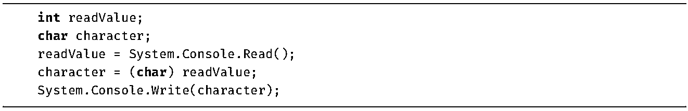

注意，除非用户按回车键，否则 System.Console.Read()方法不会返回输入。按回车键之前不会对字符进行处理，即使用户已输入了多个字符。

C# 2.0 新增了 System.Console.ReadKey()方法。它和 System.Console.Read()方法不同，返回的是用户的单次按键输入。可用它拦截用户按键操作，并执行相应行动，比如校验按键或是限制只能按数字键。

### 1.4.2　将输出写入控制台

代码清单 1.14 是用 System.Console.Write()而不是 System.Console.WriteLine()方法提示用户输入名和姓。System.Console.Write()方法不在输出文本后自动添加换行符，而是保持当前光标位置在同一行上。这样用户输入就会和提示内容处于同一行。代码清单 1.14 的输出清楚演示了 System.Console.Write()的效果。

下一步是将通过 System.Console.ReadLine()获取的值写回控制台。在代码清单 1.16 中，程序在控制台上输出用户的全名。但这段代码使用了 System.Console.WriteLine()的一个变体，利用了从 C# 6.0 开始引入的字符串插值 功能。注意在 Console.WriteLine 调用中为字符串字面值附加的$前缀。它表明使用了字符串插值。输出 1.5 是对应的输出。

代码清单 1.16　使用字符串插值来格式化

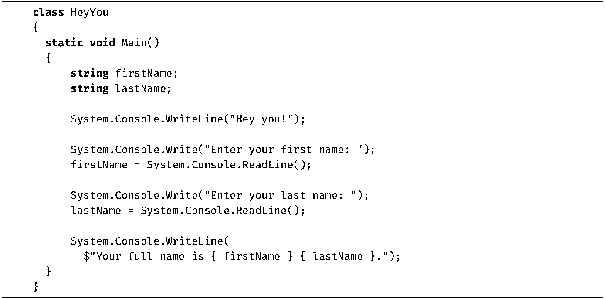

输出 1.5

代码清单 1.16 不是先用 Write 语句输出"Your full name is"，再用 Write 语句输出 firstName，用第三条 Write 语句输出空格，最后用 WriteLine 语句输出 lastName。相反，是用 C# 6.0 的字符串插值功能一次性输出。字符串中的大括号被解释成表达式。编译器会求值这些表达式，转换成字符串并插入当前位置。不需要单独执行多个代码段并将结果整合成字符串，该技术允许一个步骤完成全部操作，从而增强了代码的可读性。

C# 6.0 之前则采用不同的方式，称为复合格式化 。它要求先提供格式字符串 来定义输出格式，如代码清单 1.17 所示。

代码清单 1.17　使用复合格式化

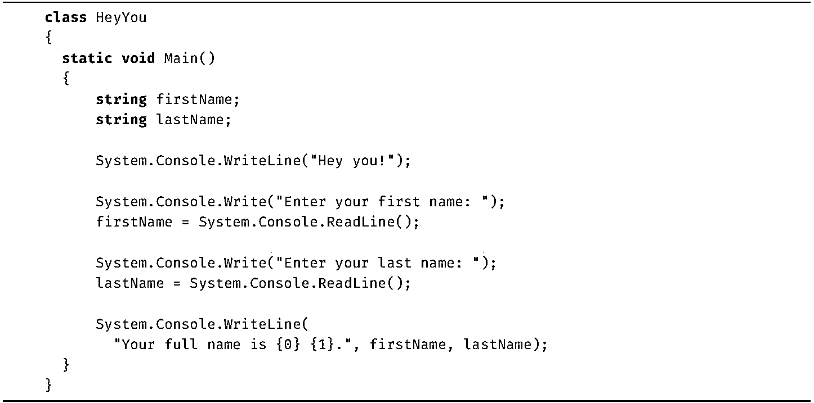

本例的格式字符串是 Your full name is {0} {1}.。它为要在字符串中插入的数据标识了两个索引占位符。每个占位符的顺序对应格式字符串之后的实参。

注意索引值从零开始。每个要插入的实参，或者称为格式项 ，按照与索引值对应的顺序排列在格式字符串之后。在本例中，由于 firstName 是紧接在格式字符串之后的第一个实参，所以它对应索引值 0。类似地，lastName 对应索引值 1。

注意，占位符在格式字符串中不一定按顺序出现。例如，代码清单 1.18 交换了两个索引占位符的位置并添加了一个逗号，从而改变了姓名的显示方式（参见输出 1.6）。

代码清单 1.18　交换索引占位符和对应的变量

输出 1.6

占位符除了能在格式字符串中按任意顺序出现，同一占位符还能在一个格式字符串中多次使用。另外，也可省略占位符。但每个占位符都必须有对应的实参。

注意 　由于 C# 6.0 风格的字符串插值几乎肯定比复合格式化更容易理解，本书默认使用前者。

### 1.4.3　注释

本节修改代码清单 1.17 来添加注释。注释不会改变程序的执行，只是使代码变得更容易理解。代码清单 1.19 中展示了新代码，输出 1.7 是对应的输出。

代码清单 1.19　为代码添加注释

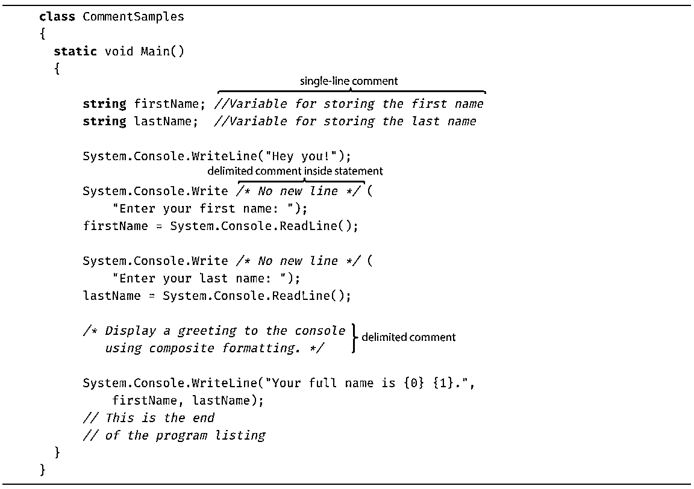

输出 1.7

虽然插入了注释，但编译并执行后产生的输出和以前是一样的。

程序员用注释来描述和解释自己写的代码，尤其是在语法本身难以理解的时候，或者是在另辟蹊径实现一个算法的时候。只有检查代码的程序员才需要看注释，编译器会忽略注释，因而生成的程序集中看不到源代码中的注释的一丝踪影。

表 1.2 总结了 4 种不同的 C#注释。代码清单 1.19 使用了其中两种。

第十章将更全面地讨论 XML 注释，以及如何利用它们来生成文档。届时会讨论各种 XML 标记。

编程史上确有一段时期，如代码没有详尽的注释，都不好意思说自己是专业程序员。然而时代变了。没有注释但可读性好的代码，比需要注释才能说清楚的代码更有价值。如开发者发现需要写注释才能说清楚代码块的功用，则应考虑重构，而不是洋洋洒洒写一堆注释。写注释来重复代码本来就讲得清的事情，只会使代码变得臃肿并降低可读性，还容易过时，因为将来代码可能更改了但注释却没有来得及更新。

表 1.2　C#注释类型

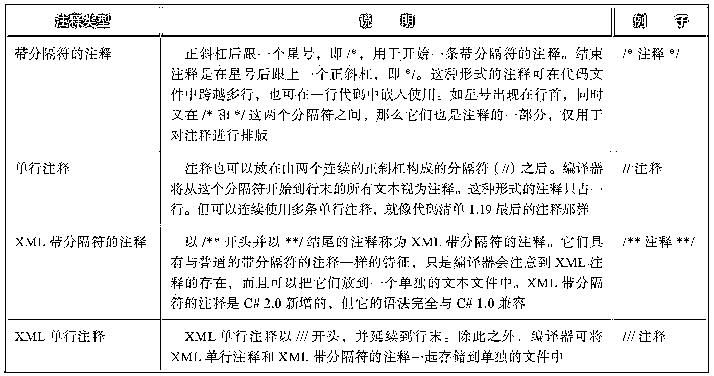

设计规范

·不要使用注释，除非代码本身“一言难尽”。

·要尽量写清楚的代码而不是通过注释澄清复杂的算法。

初学者主题：XML

XML（Extensible Markup Language，可扩展标记语言）是一种简单而灵活的文本格式，常用于 Web 应用程序以及应用程序间的数据交换。XML 之所以“可扩展”，是因为 XML 文档中包含的是对数据进行描述的信息，也就是所谓的元数据 （metadata）。下面是示例 XML 文件：

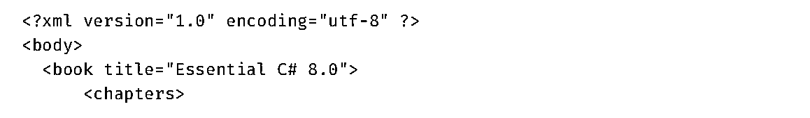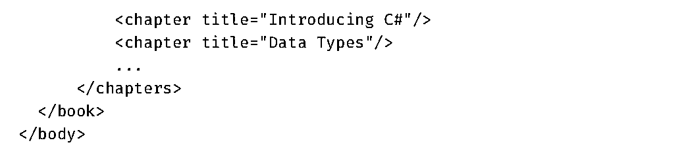

文件以 header 元素开始，描述 XML 文件版本和字符编码方式。之后是一个主要的 book 元素。元素以尖括号中的单词开头，比如<body>。结束元素需要将同一单词放在尖括号中，并为单词添加正斜杠前缀，比如</body>。除了元素，XML 还支持属性。title="Essential C#"就是 XML 属性的例子。注意 XML 文件包含了对数据（比如“Essential C#”“Data Types”等）进行描述的元数据（书名、章名等）。这可能形成相当臃肿的文件，但优点是可通过描述来帮助解释数据。

## 1.5　托管执行和 CLI

处理器不能直接解释程序集。程序集用的是另一种语言，即公共中间语言（Common Intermediate Language，CIL），或称中间语言（IL）^( [\[1\]](part0013.xhtml#ch1_back) ) 。C#编译器将 C#源代码文件转换成中间语言。为了将 CIL 代码转换成处理器能理解的机器码 ，还要完成一个额外的步骤（通常在运行时进行）。该步骤涉及 C#程序执行的一个重要元素：VES（Virtual Execution System，虚拟执行系统 ）。VES 也称为运行时 （runtime）。它根据需要编译 CIL 代码，这个过程称为即时编译 或 JIT 编译 （just-in-time compilation）。如代码在像“运行时”这样的一个“代理”的上下文中执行，就称为托管代码 （managed code），在“运行时”的控制下执行的过程则称为托管执行 （managed execution）。之所以称为“托管”，是因为“运行时”管理着诸如内存分配、安全性和 JIT 编译等方面，从而控制了主要的程序行为。执行时不需要“运行时”的代码称为本机代码 （native code）或非托管代码 （unmanaged code）。

注意 　“运行时”既可能指“程序执行的时候”，也可能指“虚拟执行系统”。为明确起见，本书用“执行时”表示“程序执行的时候”，用“运行时”表示负责管理 C#程序执行的代理^( [\[2\]](part0013.xhtml#ch2_back) ) 。

“运行时”规范包含在一个包容面更广的规范中，即 CLI（Common Language Infrastructure，公共语言基础结构 ）规范^( [\[3\]](part0013.xhtml#ch3_back) ) 。作为国际标准，CLI 包含了以下几方面的规范。

·VES 或“运行时”。

·CIL。

·支持语言互操作性的类型系统，称为 CTS（Common Type System，公共类型系统 ）。

·编写通过 CLI 兼容语言访问的库的指导原则（这部分内容见公共语言规范 （Common Language Specification，CLS））。

·使各种服务能被 CLI 识别的元数据（包括程序集的布局或文件格式规范）。

在“运行时”执行引擎的上下文中运行，程序员不需要直接写代码就能使用几种服务和功能，包括：

·语言互操作性： 不同源语言间的互操作性。语言编译器将每种源语言转换成相同中间语言（CIL）来实现这种互操作性。

·类型安全： 检查类型间转换，确保兼容的类型才能相互转换。这有助于防范缓冲区溢出（这是产生安全隐患的主要原因）。

·代码访问安全性： 程序集开发者的代码有权在计算机上执行的证明。

·垃圾回收： 一种内存管理机制，自动释放“运行时”为数据分配的空间。

·平台可移植性： 同一程序集可在多种操作系统上运行。要实现这一点，一个显而易见的限制就是不能使用平台特有的库。所以平台依赖问题需单独解决。

·BCL（基类库）： 提供开发者能（在所有.NET 框架中）依赖的大型代码库，使其不必亲自写这些代码。

注意 　本节只是简单介绍了 CLI，目的是让你熟悉 C#程序的执行环境。此外，本节还提及了本书后面会用到的一些术语。第二十四章会专门探讨 CLI 及其与 C#开发者的关系。虽然那一章在本书的最后，但其内容实际并不依赖之前的任何一章。所以，要想多了解一下 CLI，随时都可以直接翻阅那一章。

### CIL 和 ILDASM

前面说过，C#编译器将 C#代码转换成 CIL 代码而不是机器码。处理器只理解机器码，所以 CIL 代码必须先转换成机器码才能由处理器执行。可用 CIL 反汇编程序将程序集解构为 CIL。通常使用 Microsoft 特有的文件名 ILDASM 来称呼这种 CIL 反汇编程序（ILDASM 是 IL Disassembler 的简称），它能对程序集执行反汇编，提取 C#编译器生成的 CIL。

反汇编.NET 程序集的结果比机器码更易理解。许多开发者害怕即使别人没有拿到源代码，程序也容易被反汇编并曝光其算法。其实无论是否基于 CLI，任何程序防止反编译唯一安全的方法就是禁止访问编译好的程序（例如只在网站上存放程序，不把它分发到用户机器）。但假如目的只是减小别人获得源代码的可能性，可考虑使用一些混淆器（obfuscator）产品。这种产品会读取 IL 代码，转换成一种功能不变但更难理解的形式。这可以防止普通开发者访问代码，使程序集难以被反编译成容易理解的代码。除非程序需要对算法进行高级安全防护，否则混淆器足以确保安全。

高级主题：HelloWorld.exe 的 CIL 输出

在不同 CLI 实现中，使用 CIL 反汇编程序的命令也有所区别。如果是.NET Core，可以访问[`itl.tc/ildasm`](http://itl.tc/ildasm) 了解详情。代码清单 1.20 展示了运行 ILDASM 创建的 CIL 代码。

代码清单 1.20　示例 CIL 输出

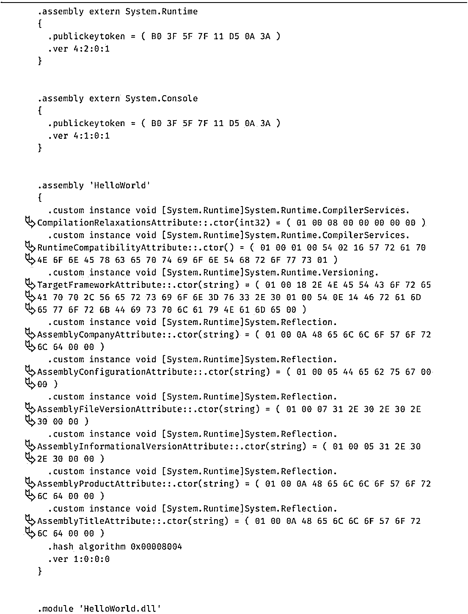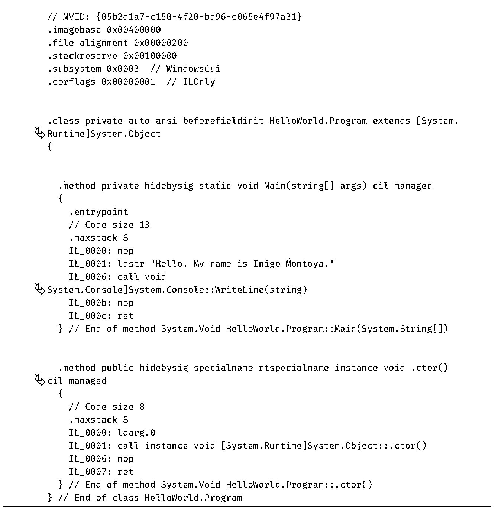

最开头是清单（manifest）信息。其中不仅包括被反编译的模块的全名（HelloWorld.dll），还包括它依赖的所有模块和程序集及其版本信息。

基于这样的 CIL 代码清单，最有趣的可能就是能相对比较容易地理解程序所做的事情，这比阅读并理解机器码（汇编程序）容易多了。上述代码出现了对 System.Console.WriteLine()的显式引用。CIL 代码清单包含许多外围信息，如果开发者想要理解 C#模块（或任何基于 CLI 的程序）的内部工作原理，但又拿不到源代码，只要作者没有使用混淆器，理解这样的 CIL 代码清单还是比较容易的。事实上，一些免费工具（比如 Red Gate Reflector、ILSpy、JustDecompile、dotPeek 和 CodeReflect）都能将 CIL 自动反编译成 C#^( [\[4\]](part0013.xhtml#ch4_back) ) 。

[\[1\]](part0013.xhtml#ch1) CIL 的第三种说法是 Microsoft IL (MSIL)。本书用 CIL 一词，因其是 CLI 标准所采纳的。C#程序员交流时经常使用 IL 一词，因为他们都假定 IL 是指 CIL 而不是其他中间语言。

[\[2\]](part0013.xhtml#ch2) “运行时”（runtime）作为名词使用时一律添加引号。——译者注

[\[3\]](part0013.xhtml#ch3) Miller, J., and S.Ragsdale.2004.The Common Language Infrastructure Annotated Standard.Boston: Addison-Wesley.

[\[4\]](part0013.xhtml#ch4) 注意反汇编（disassemble）和反编译（decompile）的区别。反汇编得到的是汇编代码，反编译得到的是所用语言的源代码。——译者注

## 1.6　多个.NET 框架

本章之前说过，目前存在多个.NET 框架。Microsoft 的宗旨是在最大范围的操作系统和硬件平台上提供.NET 实现，表 1.3 列出了最主要的实现。

表 1.3　主要.NET Framework 实现

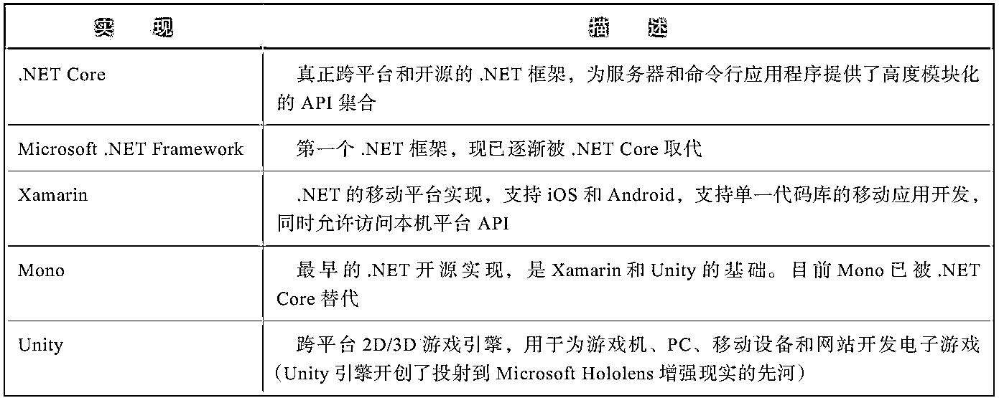

除非特别注明，否则本书所有例子都兼容.NET Core 和 Microsoft .NET Framework。但由于.NET Core 才是.NET 的未来，所以本书配套代码（从[`github.com/IntelliTect/EssentialCSharp`](http://github.com/IntelliTect/EssentialCSharp) 或[`bookzhou.com`](http://bookzhou.com) 下载）都配置成默认使用.NET Core。

注意 　全书都用“.NET 框架”指代.NET 实现所支持的任何框架。相反，用“Microsoft .NET Framework”指代只在 Windows 上运行，最初由 Microsoft 在 2001 年发布的.NET 框架实现。

### 1.6.1　应用程序编程接口

数据类型（比如 System.Console）的所有方法（常规地说是成员）定义了该类型的应用程序编程接口（Application Programming Interface，API）。API 定义软件如何与其他组件交互，所以单独一个数据类型还不够。通常，是一组数据类型的所有 API 结合起来为某个组件集合创建一个 API。以.NET 为例，一个程序集中的所有类型（及其成员）构成了该程序集的 API。类似地，.NET Core 或 Microsoft .NET Framework 中的所有程序集构成了更大的 API。通常将这一组更大的 API 称为框架，所以我们用“.NET 框架”一词指代.NET Core 或 Microsoft .NET Framework 的所有程序集公开的 API。API 通常包含一组接口和协议（或指令），帮助你使用一系列组件进行编程。事实上，对于.NET 来说，协议本身就是.NET 程序集的执行规则。

### 1.6.2　C#和.NET 版本控制

.NET 框架的开发周期有别于 C#语言，这造成底层.NET 框架和对应的 C#语言使用了不同的版本号。例如，使用 C# 5.0 编译器将默认基于 Microsoft .NET Framework 4.6 来编译。表 1.4 简单总结了 Microsoft .NET Framework 和.NET Core 的 C#和.NET 版本。

表 1.4　C#和.NET 版本

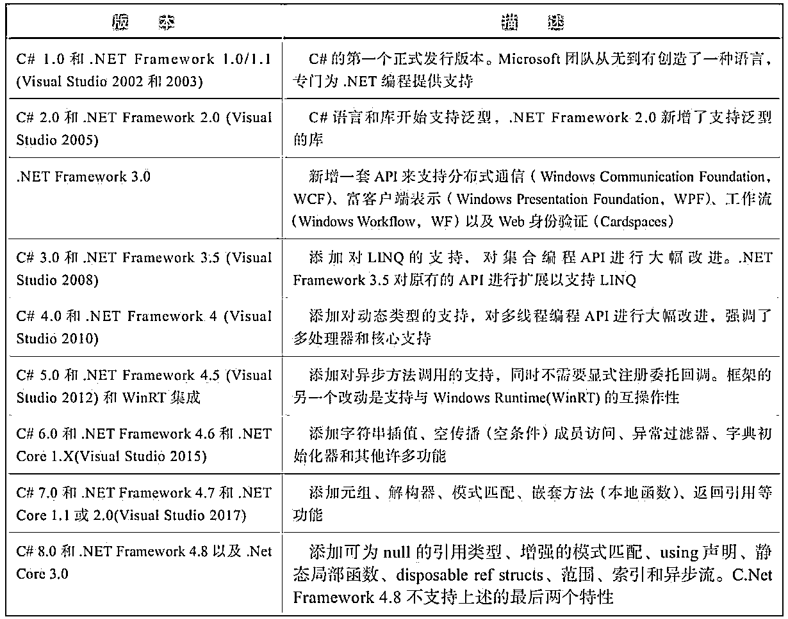

随 C# 6.0 增加的最重要的一个框架功能或许是对跨平台编译的支持。换言之，不仅能用 Windows 上运行的 Microsoft .NET Framework 编译，还能使用 Linux 和 macOS 上运行的.NET Core 实现来编译。虽然.NET Core 的功能比完整的 Microsoft .NET Framework 少，但足以使整个 ASP.NET 网站在非 Windows 和 IIS 的系统上运行。这意味着同一个代码库可编译并执行在多个平台上运行的应用程序。.NET Core 是一套完整的 SDK，包含从.NET Compiler Platform（即“Roslyn”，本身在 Linux 和 macOS 上运行）到.NET Core“运行时”的一切，另外还提供了像 dotnet 命令行实用程序（dotnet CLI，自 C# 7.0 引入）这样的工具。

### 1.6.3　.NET Standard

有这么多不同的.NET 实现，每个.NET 框架还有这么多版本，而且每个实现都支持一套不同的、但多少有点重叠的 API，这造成框架分叉得越来越厉害。这增大了写跨.NET 框架可重用代码的难度，因为要检查特定 API 是否支持。为降低复杂度，微软推出了.NET Standard 来定义不同版本的标准应支持哪些 API。换言之，要相容于某个.NET Standard 版本，.NET 框架必须支持该标准所规定的 API。但由于许多实现已经发布，所以哪个 API 要进入哪个标准的决策树在一定程度上基于现有实现及其与.NET Standard 版本号的关联。

写作本书时最新发布的.NET 标准为 2.1 版，但遗憾的是，最新的.NET Framework 4.8 仍然执行.NET Standard 2.0，这意味着它不支持 C# 8.0 里面的范围、索引和异步流。不过除此之外，.NET Framework 4.8 中的所有基础框架都实现了.NET Standard 2.0，这意味着它不但为所有的旧 API 统一了执行标准，而且使得采用了.NET Standard 2.0 的应用程序可以跨平台编译。

在微软的计划中，不同版本的.NET Framework 源代码都将会被合并到.NET Core 5.0 代码库中，这使得未来的.NET Core 5.0 将成为一个集.NET Framework、.NET Core 和 Xamarin/Mono 于一体的整合产品。到那时，.NET 标准将会失去意义。换句话说，将来我们不再需要注意哪些 API 执行的是哪一个标准，因为.NET Framework 都将来自同一个代码库，并且它们的 API 都执行完全相同的标准。若要了解更多的信息，请访问网站[`itl.tc/net5unification`](http://itl.tc/net5unification) 。

## 1.7　小结

本章对 C#进行了初步介绍。通过本章你熟悉了基本 C#语法。由于 C#与 C++风格语言的相似性，本章许多内容可能都是你所熟悉的。但 C#和托管代码确实有一些独特性，比如会编译成 CIL 等。C#的另一个关键特征在于它完全面向对象。即使是在控制台上读取和写入数据这样的事情，也是面向对象的。面向对象是 C#的基础，这一点将贯穿全书。

下一章探讨 C#的基本数据类型，并讨论如何将这些数据类型应用于操作数来构建表达式。