# 第二章　数据类型

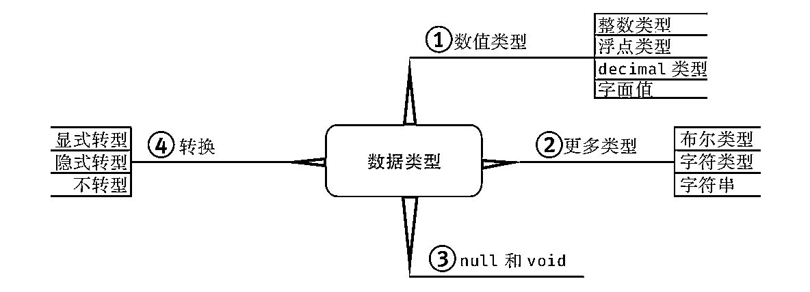

理解了第一章的 HelloWorld 程序，你对 C#语言、它的结构、基本语法以及如何编写最简单的程序就有了初步的理解。本章讨论基本 C#类型，继续巩固 C#的基础知识。

本书到目前为止只用过少量内建数据类型，而且只是一笔带过。C#中有大量类型，而且可以合并类型来创建新类型。但 C#中有几种类型非常简单，是其他所有类型的基础，它们称为预定义类型 （predefined type）或基元类型 （primitive type）。C#语言的基元类型包括八种整数类型、两种用于科学计算的二进制浮点类型、一种用于金融计算的十进制浮点类型、一种布尔类型以及一种字符类型。本章将探讨这些基元数据类型，并更深入地研究 string 类型。

## 2.1　基本数值类型

C#的基本数值类型都有关键字与之关联，包括整数类型、浮点类型以及 decimal 类型。decimal 是特殊的浮点类型，能存储大数字而无表示错误。

### 2.1.1　整数类型

C#中有八种整数类型，可选择最恰当的一种来存储数据以避免浪费资源。表 2.1 总结了每种整数类型。

表 2.1　整数类型

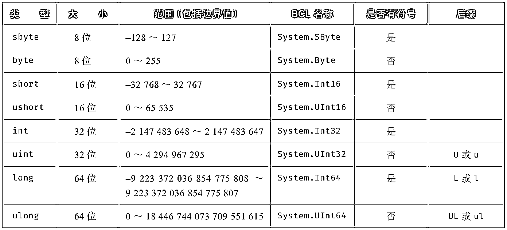

表 2.1（以及表 2.2 和表 2.3）专门有一列给出了每种类型的完整名称，本章稍后会讲述后缀问题。C#所有基元类型都有短名称和完整名称。完整名称对应 BCL（基类库）中的类型名称。该名称在所有语言中都相同，对程序集中的类型进行了唯一性标识。由于基元数据类型是其他类型的基础，所以 C#为基元数据类型的完整名称提供了短名称（或称为缩写）。其实从编译器的角度看，两种名称完全一样，最终都生成相同的代码。事实上，检查最终生成的 CIL 代码，根本看不出源代码具体使用的名称。

C#支持完整 BCL 名称和关键字，导致开发者不确定在什么时候应该用什么。不要时而用这个，时而用那个，最好坚持用一种。C#开发者一般用 C#关键字。例如，用 int 而不是 System.Int32，用 string 而不是 System.String（甚至不要用 String 这种简化形式）。

设计规范

·要在指定数据类型时使用 C#关键字而不是 BCL 名称（例如，使用 string 而不是 String）。

·要一致而不要变来变去。

坚持一致可能和其他设计规范冲突。例如，虽然规范说要用 C#关键字取代 BCL 名称，但有时需维护公司遗留下来的风格相反的文件（或文件库）。这时只能维持原风格，而不是强行引入新风格，造成和原来的约定不一致。但话又说回来，如原有“风格”实际是不好的编码实践，有可能造成 bug，严重妨碍维护，还是应尽量全盘纠正问题。

语言对比：C++—— short 数据类型

C/C++的 short 数据类型是 short int 的缩写。而 C#的 short 是一种实际存在的数据类型。

### 2.1.2　浮点类型

浮点数精度可变。除非用分数表示时，分母恰好是 2 的整数次幂，否则用二进制浮点类型无法准确表示该数。将浮点变量设为 0.1，很容易表示成 0.099 999 999 999 999 999 或者 0.100 000 000 000 000 000 1（或者其他非常接近 0.1 的数）。另外，像阿伏伽德罗常数这样非常大的数字（6.02×10²³ ），即使误差为 10⁸ ，结果仍然非常接近 6.02×10²³ ，因为原始数字实在是太大了。根据定义，浮点数的精度与它所代表的数字的大小成正比。准确地说，浮点数精度由有效数位的个数决定，而不是由一个固定值（比如±0.01）决定。从.NET Core 3.0 开始，double 型浮点数可以表示的有效数字最多为 17 位，float 型为最多 9 位（前提是该数字不是由字符串转换获得的，具体解释请参考后面的高级主题“关于浮点类型的补充说明”）。

C#支持表 2.2 所示的两个浮点数类型。为了方便理解，二进制数被转换成十进制数。

表 2.2　浮点类型

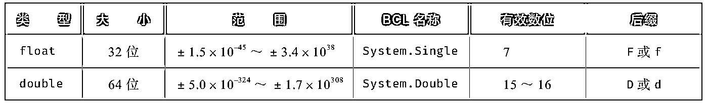

如表 2.2 所示，二进制数位被转换成 15 个十进制数位，余数构成第 16 个十进制数位。具体地说，1.7×10³⁰⁷ ～1×10³⁰⁸ 的数只有 15 个有效数位。但 1×10³⁰⁸ ～1.7×10³⁰⁸ 的数有 16 个。decimal 类型的有效数位范围与此相似。

高级主题：关于浮点类型的补充说明

浮点数类型（float 或者 double）采用二进制浮点数来存储数值，这种方法会在小数部分产生舍入误差（rounding error）问题。当使用十进制数来表示实数时，无法用有限个数字来表示 1/3 所代表的数；类似地，当使用二进制小数来表示数值时，也无法用有限个比特位来表示 11/10 所代表的数（因为其对应的二进制小数为 1.000 110 011 001 100 110 1……）。因此，在实际运算当中，用十进制和二进制所表示的实数都存在舍入误差问题。作为对比，C#的 decimal 类型在其所允许的精度范围之内不会有误差。decimal 类型将在下一节详细介绍^( [\[1\]](part0017.xhtml#ch1_back) ) 。

decimal 类型数据的公式描述为：±N\*10k，其中：

·N 为尾数，是一个 96 位的正整数；

·k 为指数，其取值范围为-28<=k<=0。

浮点数类型数据的公式描述为：±N\*2k，其中：

·N 在 float 型浮点数中为 24 位正整数，而在 double 型浮点数中为 53 位正整数；

·k 在 float 型浮点数中的取值范围为-149<=k<=+104，而在 double 型浮点数中的取值范围为-1074<=k<=+970^( [\[2\]](part0017.xhtml#ch2_back) ) 。

### 2.1.3　decimal 类型

C#还提供了 128 位精度的十进制浮点类型（参见表 2.3）。它适合大而精确的计算，尤其是金融计算。

表 2.3　decimal 类型

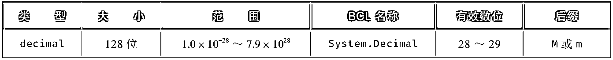

和浮点数不同，decimal 类型保证范围内的所有十进制数都是精确的。所以，对于 decimal 类型来说，0.1 就是 0.1，而不是近似值。不过，虽然 decimal 类型具有比浮点类型更高的精度，但它的范围较小。所以，从浮点类型转换为 decimal 类型可能发生溢出错误。此外，decimal 的计算速度稍慢（虽然差别不大以至于完全可以忽略）。

### 2.1.4　字面值

字面值 （literal value）表示源代码中的固定值。例如，假定希望用 System.Console.WriteLine()输出整数值 42 和 double 值 1.618 034（黄金分割比例），可以使用如代码清单 2.1 所示的代码。

代码清单 2.1　指定字面值

```powershell
Write-Output 42
Write-Output 1.618034
```

输出 2.1 展示了代码清单 2.1 的结果。

输出 2.1

```powershell
42
1.618034
```

初学者主题：硬编码值的时候要慎重

直接将值放到源代码中称为硬编码 （hardcoding），因为以后若是更改了值，就必须重新编译代码。因为可能会为维护带来不便，所以开发者在硬编码值的时候必须慎重。

例如，可以考虑从一个外部来源获取值，比如从一个配置文件中。这样以后需要修改值的时候，就不需要重新编译代码了。

默认情况下，输入带小数点的字面值，编译器会自动把它解释成 double 类型。相反，整数值（没有小数点）通常默认为 32 位 int，前提是该值不是太大，以至于无法用 int 来存储。如果值太大，编译器会把它解释成 long。此外，C#编译器允许向非 int 的数值类型赋值，前提是字面值对于目标数据类型来说合法。例如，short s=42 和 byte b=77 都是允许的。但这一点仅对字面值成立。不使用额外的语法，b=s 就是非法的，具体参见 2.4 节。

前面说过 C#有许多数值类型。在代码清单 2.2 中，一个字面值被直接放在 C#代码中。由于带小数点的值默认为 double 类型，所以如输出 2.2 所示，结果是 1.61803398874989（最后一个数字 5 丢失了），这符合我们预期的 double 值的精度。

代码清单 2.2　指定 double 字面值

```powershell
Write-Output 1.618033988749895
```

输出 2.2

```powershell
1.618033988749895
```

要显示具有完整精度的数字，必须将字面值显式声明为 decimal 类型，这是通过追加一个 M（或者 m）来实现的，如代码清单 2.3 和输出 2.3 所示。

代码清单 2.3　指定 decimal 字面值

```powershell
Write-Output 1.618033988749895
```

输出 2.3

```powershell
1.618033988749895
```

代码清单 2.3 的输出符合预期：1.618033988749895。注意 d 表示 double，之所以用 m 表示 decimal，是因为这种数据类型经常用于货币（monetary）计算。

还可以使用 F 和 D 作为后缀，将字面值分别显式声明为 float 或者 double。对于整数数据类型，相应后缀是 U、L、LU 和 UL。整数字面值的类型是像下面这样确定的：

·无后缀的数值字面值按以下顺序解析成能存储该值的第一个数据类型：int，uint，long，ulong。

·带后缀 U 的数值字面值按以下顺序解析成能存储该值的第一个数据类型：uint，ulong。

·带后缀 L 的数值字面值按以下顺序解析成能存储该值的第一个数据类型：long，ulong。

·如后缀是 UL 或 LU，就解析成 ulong 类型。

注意字面值的后缀不区分大小写。但一般推荐大写，避免出现小写字母 l 和数字 1 不好区分的情况。

设计规范

·要使用大写的字面值后缀（例如 1.618033988749895M）。

有时数字很大，很难辨认。为解决可读性问题，C# 7.0 新增了对数字分隔符的支持。如代码清单 2.4 所示，可在书写数值字面值的时候用下划线（\_）分隔。

代码清单 2.4　使用数字分隔符

```powershell
Write-Output 9814072356
```

本例将数字转换成千分位，但只是为了好看，C#不要求这样。可在数字第一位和最后一位之间的任何位置添加分隔符。事实上，还可以连写多个下划线。

有时可考虑使用指数记数法，避免在小数点前后写许多个 0。指数记数法要求使用 e 或 E 中缀，在中缀字母后面添加正整数或者负整数，并在字面值最后添加恰当的数据类型后缀。例如，可将阿伏伽德罗常数作为 float 输出，如代码清单 2.5 和输出 2.4 所示。

代码清单 2.5　指数记数法

```powershell
Write-Output 6.023E23
```

输出 2.4

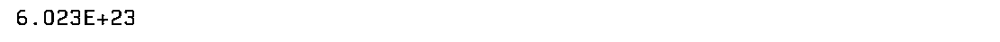

初学者主题：十六进制记数法

一般使用十进制记数法，即每个数位可用 10 个符号（0～9）表示。还可使用十六进制记数法，即每个数位可用 16 个符号表示：0～9，A～F（允许小写）。所以，0x000A 对应十进制值 10，而 0x002A 对应十进制值 42（2×16+10）。不过，实际的数是一样的。十六进制和十进制的相互转换不会改变数本身，改变的只是数的表示形式。

每个十六进制数位都用 4 个二进制位表示，所以一个字节可表示两个十六进制数位。

前面讨论数值字面值的时候只使用了十进制值。C#还允许指定十六进制值。为值附加 0x 前缀，再添加希望使用的十六进制数字，如代码清单 2.6 所示。

代码清单 2.6　十六进制字面值

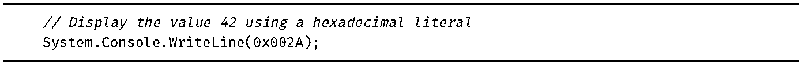

输出 2.5 展示了结果。注意，代码输出的仍然是 42，而不是 0x002A。

输出 2.5


从 C# 7.0 起可将数字表示成二进制值，如代码清单 2.7 所示。

代码清单 2.7　二进制字面值

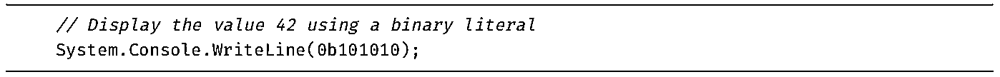

语法和十六进制语法相似，只是使用 0b 前缀（允许大写 B）。参考第四章的初学者主题“位和字节”了解二进制记数法以及二进制和十进制之间的转换。

注意从 C# 7.2 起，数字分隔符可以放到代表十六进制的 x 或者代表二进制的 b 后面（称为前导数字分隔符）。

高级主题：将数字格式化成十六进制

要显示数值的十六进制形式，必须使用 x 或 X 数值格式说明符。大小写决定了十六进制字母的大小写。代码清单 2.8 展示了一个例子。

代码清单 2.8　十六进制格式说明符的例子

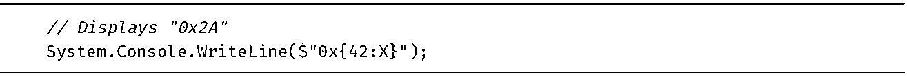

输出 2.6 展示了结果。

输出 2.6

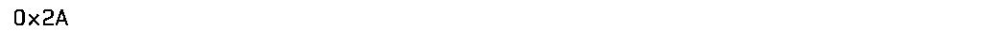

注意数值字面值（42）可随便使用十进制或十六进制形式，结果一样。另外，格式说明符前要添加冒号。

高级主题：round-trip 格式化

执行 System.Console.WriteLine(1.618033988749895);语句默认显示 1.61803398874989，最后一个数位被丢弃。为了更准确地标识 double 值的字符串形式，可以使用格式字符串和 round-trip 格式说明符 R（或者 r）进行转换。例如，string.Format("{0:R}", 1.618033988749895)会返回结果 1.6180339887498949。

将 round-trip 格式说明符返回的字符串转换回数值肯定能获得原始值。所以在代码清单 2.9 中，如果没有使用 round-trip 格式，两个数就不相等了。

代码清单 2.9　使用 R 格式说明符进行格式化

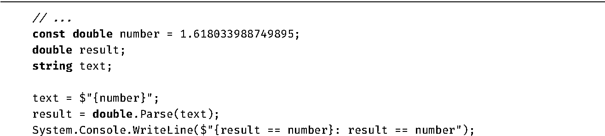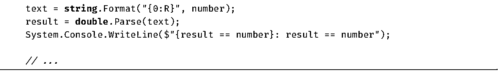

输出 2.7 显示了结果。

输出 2.7

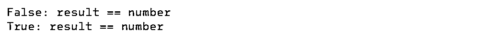

第一次为 text 赋值没有使用 R 格式说明符，所以 double.Parse(text)的返回值与原始数值不同。相反，在使用了 R 格式说明符之后，double.Parse(text)返回的就是原始值。

如果还不熟悉 C 语言风格的==语法，可以理解为 result==number 在 result 等于 number 的前提下会返回 true，result!=number 则相反。下一章将讨论赋值和相等性操作符。

[\[1\]](part0017.xhtml#ch1) 如果读者不理解为何无法用有限个比特位来表示 11/10，请自行搜索十进制小数转换二进制小数的计算方法。——译者注

[\[2\]](part0017.xhtml#ch2) C#与大部分通用编程语言一样，采用 IEEE754 格式来存储浮点数。简单地说，该格式由三部分组成，其中包含一个 24 或 53 位的二进制小数作为尾数（即前述中的 N），以及一个 8 或 11 位的二进制整数作为指数（即前述中的 k），它指定了 N 中的小数点应当移动的位数，最后还有 1 位标志整个浮点数的正负。——译者注

## 2.2　更多基本类型

迄今为止只讨论了基本数值类型。C#还包括其他一些类型：bool、char 和 string。

### 2.2.1　布尔类型

另一个 C#基元类型是布尔（Boolean）或条件类型 bool。它在条件语句和表达式中表示真或假。允许的值包括关键字 true 和 false。bool 的 BCL 名称是 System.Boolean。例如，为了在不区分大小写的前提下比较两个字符串，可以调用 string.Compare()方法并传递 bool 字面值 true，如代码清单 2.10 所示。

代码清单 2.10　不区分大小写比较两个字符串

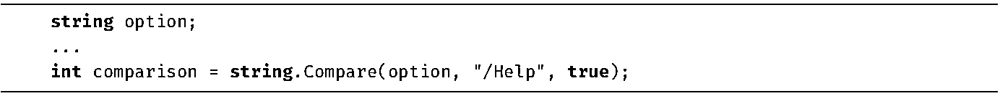

本例在不区分大小写的前提下比较变量 option 的内容和字面值/Help，结果赋给 comparison。

虽然理论上一个二进制位足以容纳一个布尔类型的值，但 bool 实际大小是一个字节。

### 2.2.2　字符类型

字符类型 char 表示 16 位字符，取值范围对应于 Unicode 字符集。从技术上说，char 的大小和 16 位无符号整数（ushort）相同，后者取值范围是 0～65 535。但 char 是 C#的特有类型，在代码中要单独对待。

char 的 BCL 名称是 System.Char。

初学者主题：Unicode 标准

Unicode 是一个国际性标准，用来表示大多数语言中的字符。它使得计算机系统可以构建本地化应用程序，更加方便地显示不同语言文化的语言和特色字符。

高级主题：16 位不足以表示所有 Unicode 字符

令人遗憾的是，不是所有 Unicode 字符都能用一个 16 位 char 表示。刚开始提出 Unicode 的概念时，它的设计者以为 16 位已经足够。但随着支持的语言越来越多，才发现当初的假定是错误的。结果是，一些 Unicode 字符要由一对称为“代理项”的 char 构成，总共 32 位。

输入 char 字面值需要将字符放到一对单引号中，比如'A'。所有键盘字符都可这样输入，包括字母、数字以及特殊符号。

有的字符不能直接插入源代码，需进行特殊处理。首先输入反斜杠（\\）前缀，再跟随一个特殊字符代码。反斜杠和特殊字符代码统称为转义序列 （escape sequence）。例如，\\n 代表换行符，而\\t 代表制表符。由于反斜杠标志转义序列开始，所以要用\\\\表示反斜杠字符。

代码清单 2.11 输出用\\'表示的一个单引号。

代码清单 2.11　使用转义序列显示单引号

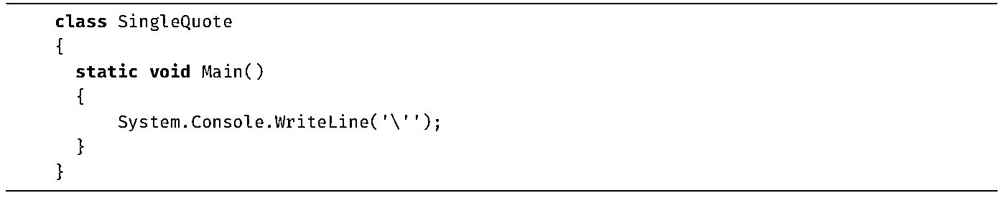

表 2.4 总结了转义序列以及字符的 Unicode 编码。

表 2.4　转义字符

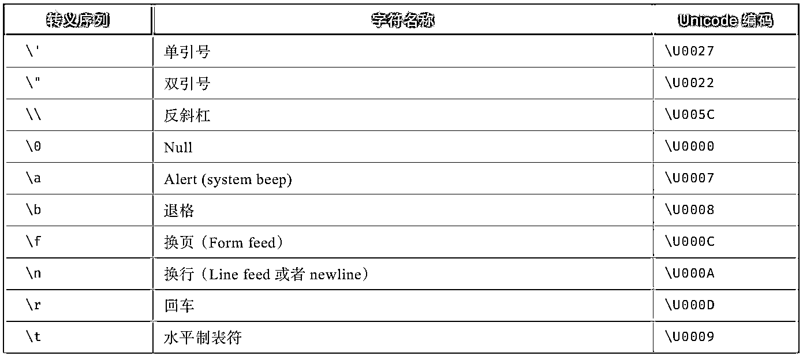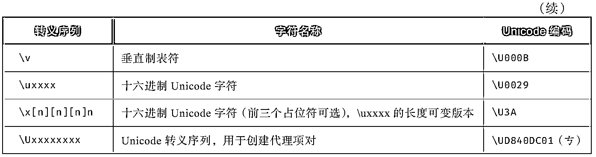

可用 Unicode 编码表示任何字符。为此，请为 Unicode 值附加\\u 前缀。可用十六进制记数法表示 Unicode 字符。例如，字母 A 的十六进制值是 0x41，代码清单 2.12 使用 Unicode 字符显示笑脸符号（:)），输出 2.8 展示了结果。

代码清单 2.12　使用 Unicode 编码显示笑脸符号

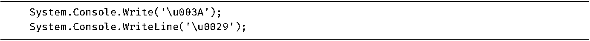

输出 2.8


### 2.2.3　字符串

零或多个字符的有限序列称为字符串 。C#的基本字符串类型是 string，BCL 名称是 System.String。对于已熟悉了其他语言的开发者，string 的一些特点或许会出人意料。除了第一章讨论的字符串字面值格式，还允许使用逐字前缀@，允许用$前缀进行字符串插值。最后，string 是一种“不可变”类型。

字面值 

为了将字面值字符串输入代码，要将文本放入双引号（"）内，就像 HelloWorld 程序中那样。字符串由字符构成，所以转义序列可嵌入字符串内。

例如，代码清单 2.13 显示两行文本。但这里没有使用 System.Console.WriteLine()，而是使用 System.Console.Write()来输出换行符\\n。输出 2.9 展示了结果。

代码清单 2.13　用字符\\n 插入换行符

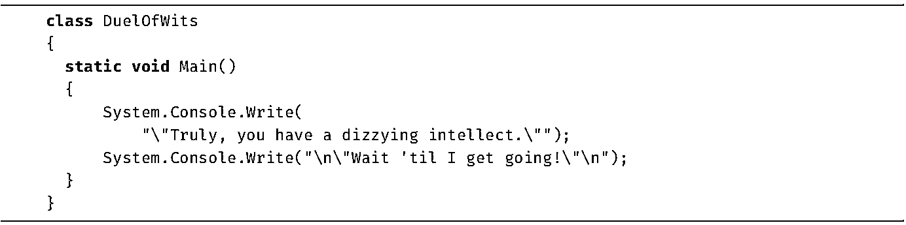

输出 2.9

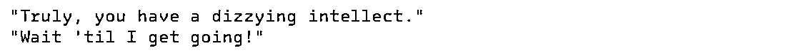

双引号要用转义序列输出，否则会被用于定义字符串开始与结束。

C#允许在字符串前使用@符号，指明转义序列不被处理。结果是一个逐字字符串字面值 （verbatim string literal），它不仅将反斜杠当作普通字符，还会逐字解释所有空白字符。例如，代码清单 2.14 的三角形会在控制台上原样输出，其中包括反斜杠、换行符和缩进。输出 2.10 展示了结果。

不使用@字符，这些代码甚至无法通过编译。事实上，即便将形状变成正方形，避免使用反斜杠，代码仍然不能通过编译，因为不能将换行符直接插入不以@符号开头的字符串中。

代码清单 2.14　使用逐字字符串字面值来显示三角形

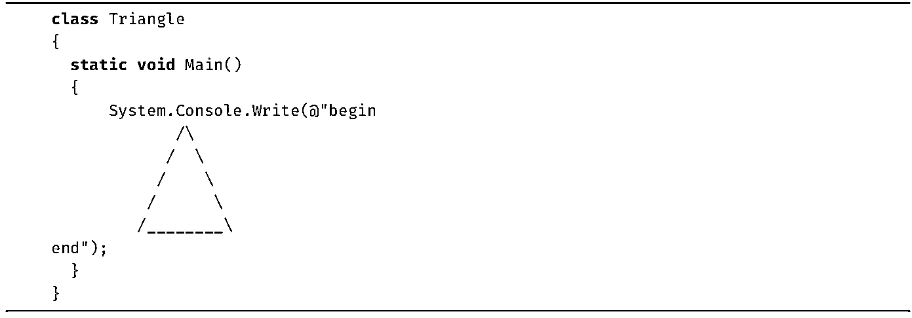

输出 2.10


以@开头的字符串唯一支持的转义序列是""，代表一个双引号，不会终止字符串。

语言对比：C++——在编译时连接字符串

和 C++不同，C#不自动连接字符串字面值。例如，不能像下面这样指定字符串字面值：


必须用+操作符连接（但如果编译器能在编译时计算结果，最终的 CIL 代码将包含连接好的字符串）。

假如同一字符串字面值在程序集中多次出现，编译器在程序集中只定义字符串一次，且所有变量都指向它。这样一来，假如在代码中多处插入包含大量字符的同一个字符串字面值，最终的程序集只反映其中一个的大小。

字符串插值 

如第一章所述，从 C# 6.0 起，字符串可用插值技术嵌入表达式。语法是在字符串前添加$符号，并在字符串中用一对大括号嵌入表达式。例如：


其中，firstName 和 lastName 是引用了变量的简单表达式。

注意逐字和插值可组合使用，但要先指定$，再指定@（或者在 C# 8.0 开头的@$"..."），例如：

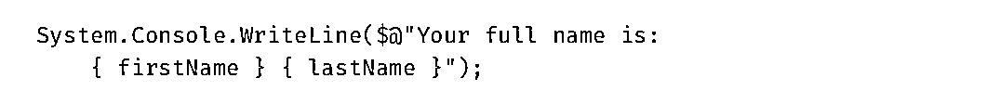

由于是逐字字符串，所以按字符串的样子分两行输出。在大括号中换行则起不到换行效果：


上述代码在一行中输出字符串内容。注意此时仍需@符号，否则无法编译。

高级主题：理解字符串插值的内部工作原理

字符串插值是调用 string.Format()方法的语法糖。例如以下语句：


会被转换成以下形式的 C#代码：

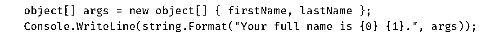

这就和复合字符串一样实现了某种程度的本地化支持，而且不会因为字符串造成编译后代码注入。

字符串方法 

和 System.Console 类型相似，string 类型也提供了几个方法来格式化、连接和比较字符串。

表 2.5 中的 Format()方法具有与 Console.Write()和 Console.WriteLine()方法相似的行为。区别在于，string.Format()不是在控制台窗口中显示结果，而是返回结果。当然，有了字符串插值后，用到 string.Format()的机会减少了很多（本地化时还是用得着）。但在幕后，字符串插值编译成 CIL 后都会转换为调用 string.Concat()和 string.Format()来处理字符串字面值。

表 2.5　string 的静态方法

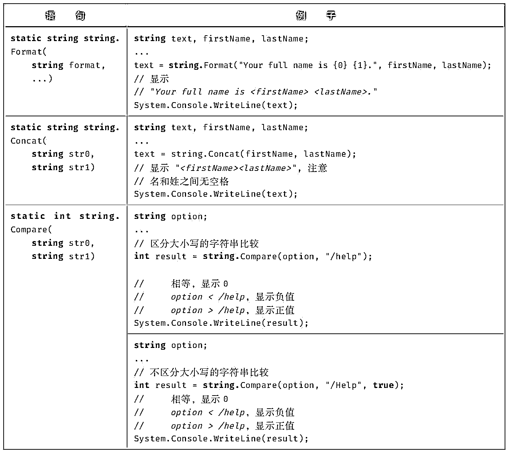

表 2.5 列出的都是静态方法 。这意味着为了调用方法，需在方法名（例如 Concate）之前附加方法所在类型的名称（例如 string）。但 string 类还有一些实例方法 。实例方法不以类型名作为前缀，而是以变量名（或者对实例的其他引用）作为前缀。表 2.6 列出了部分实例方法和例子。

表 2.6　string 的实例方法

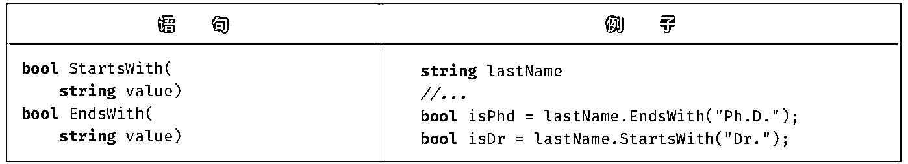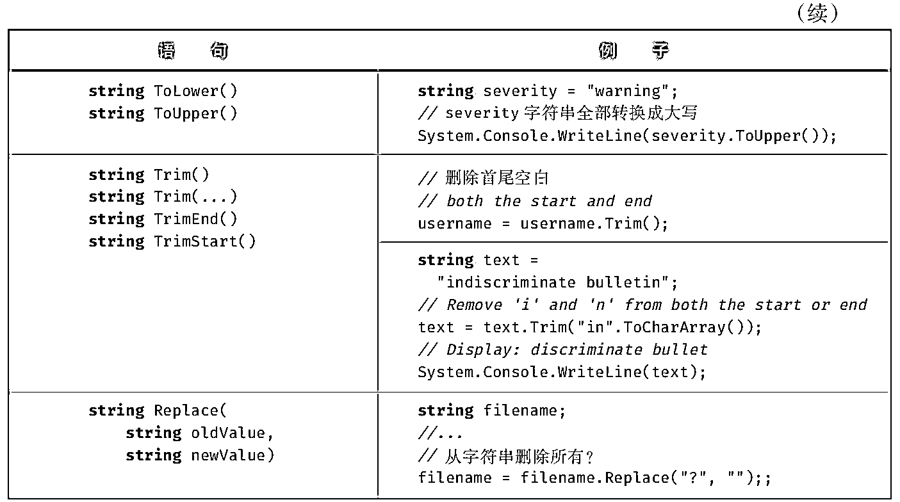

高级主题：using 和 using static 指令

之前调用静态方法需附加命名空间和类型名前缀。例如在调用 System.Console.WriteLine 时，虽然调用的方法是 WriteLine()，且当前上下文无其他同名方法，但仍然必须附加命名空间(System)和类型名(Console)前缀。可利用 C# 6.0 新增的 using static 指令避免这些前缀，如代码清单 2.15 所示。

代码清单 2.15　using static 指令

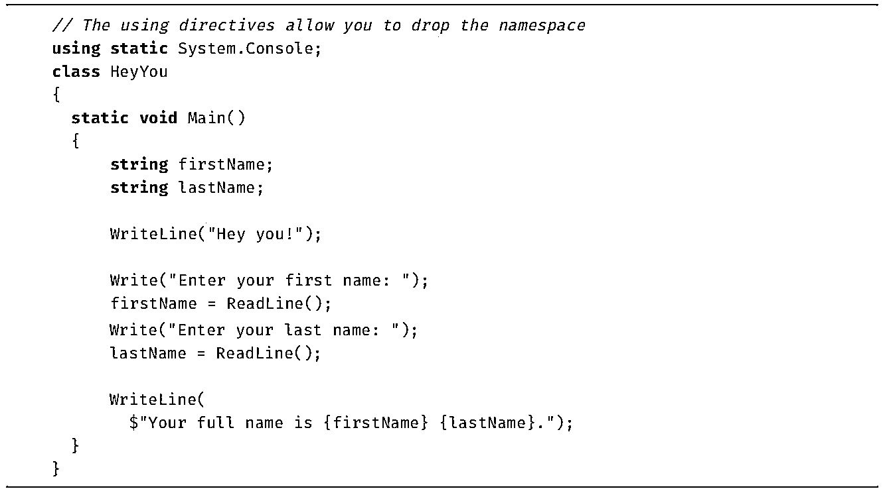

using static 指令需添加到文件顶部^( [\[1\]](part0018.xhtml#ch1_back) ) 。每次使用 System.Console 类的成员，都不再需要添加 System.Console 前缀。相反，直接使用其中的方法名即可。注意该指令只支持静态方法和属性，不支持实例成员。

类似地，using 指令用于省略命名空间前缀（例如 System）。和 using static 不同，using 作用于它所在的整个文件（或命名空间），而非仅作用于静态成员。使用 using 指令，不管在实例化时，在调用静态方法时，还是在使用 C# 6.0 新增的 nameof 操作符时，都可省略对命名空间的引用。

字符串格式化 

无论使用 string.Format()还是 C# 6.0 字符串插值来构造复杂格式的字符串，都可以通过一组覆盖面广且复杂的格式化模式组合来显示数字、日期、时间、时间段等。例如，给定 decimal 类型的 price 变量，则 string.Format("{0,20:C2}", price)和等价的插值字符串$"{price,20:C2}"都使用默认的货币格式化规则将 decimal 值转换成字符串。即添加本地货币符号，小数点后四舍五入保留两位，整个字符串在 20 个字符的宽度内右对齐。因篇幅有限，无法详细讨论所有可能的格式字符串，请在 MSDN 文档中查阅“composite formatting”（组合格式化）（[`itl.tc/CompositeFormatting`](http://itl.tc/CompositeFormatting) ）获取字符串格式化的完整说明。

要在插值或格式化的字符串中添加实际的左右大括号，可连写两个大括号来表示。例如，插值字符串$"{{{price:C2}}}"可生成字符串"{$1,234.56}"。

换行符 

输出换行所需的字符由操作系统决定。Microsoft Windows 的换行符是\\r 和\\n 这两个字符的组合，UNIX 则是单个\\n。为消除平台之间的不一致，一个办法是使用 System.Console.WriteLine()自动输出空行。为确保跨平台兼容性，可用 System.Environment.NewLine 代表换行符。换言之，System.Console.WriteLine("Hello World")和 System.Console.Write("Hello World"+System.Environment.NewLine)等价。注意在 Windows 上，System.WriteLine()和 System.Console.Write(System.Environment.NewLine)等价于 System.Console.Write("\\r\\n")而非 System.Console.Write("\\n")。总之，要依赖 System.WriteLine()和 System.Environment.NewLine 而不是\\n 来确保跨平台兼容。

设计规范

·要依赖 System.WriteLine()和 System.Environment.NewLine 而不是\\n 来确保跨平台兼容。

高级主题：C#属性

下一节提到的 Length 成员实际不是方法，因为调用时没有使用圆括号。Length 是 string 的属性 （property），C#语法允许像访问成员变量（在 C#中称为字段 ）那样访问属性。换言之，属性定义了称为赋值方法（setter）和取值方法（getter）的特殊方法，但用字段语法访问那些方法。

研究属性的底层 CIL 实现，发现它编译成两个方法：set\_<PropertyName>和 get\_<PropertyName>。但这两个方法不能直接从 C#代码中访问，只能通过 C#属性构造来访问。第六章更详细地讨论了属性。

字符串长度 

判断字符串长度可以使用 string 的 Length 成员。该成员是只读属性 。不能设置，调用时也不需要任何参数。代码清单 2.16 演示了如何使用 Length 属性，输出 2.11 是结果。

代码清单 2.16　使用 string 的 Length 成员

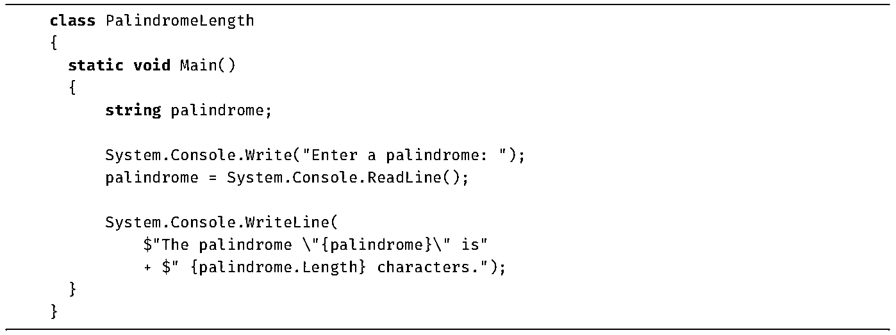

输出 2.11


字符串长度不能直接设置，它是根据字符串中的字符数计算得到的。此外，字符串长度不能更改，因为字符串不可变 。

字符串不可变 

string 类型的一个关键特征是它不可变 （immutable）。可为 string 变量赋一个全新的值，但出于性能考虑，没有提供修改现有字符串内容的机制。所以，不可能在同一个内存位置将字符串中的字母全部转换为大写。只能在其他内存位置新建字符串，让它成为旧字符串大写字母版本，旧字符串在这个过程中不会被修改。代码清单 2.17 展示了一个例子。

代码清单 2.17　错误，string 不可变

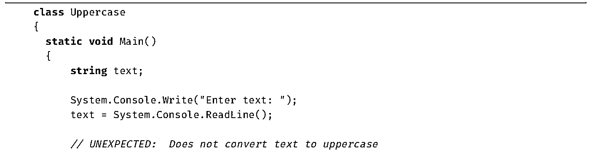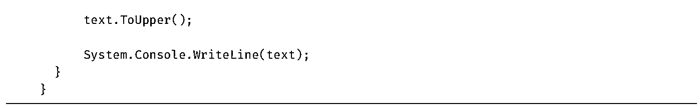

输出 2.12 展示了结果。

输出 2.12


从表面上看，text.ToUpper()似乎应该将 text 中的字符转换成大写。但由于 string 类型不可变，所以 text.ToUpper()不会进行这样的修改。相反，text.ToUpper()会返回新字符串，它需要保存到变量中，或直接传给 System.Console.WriteLine()。代码清单 2.18 给出了纠正后的代码，输出 2.13 是结果。

代码清单 2.18　正确的字符串处理

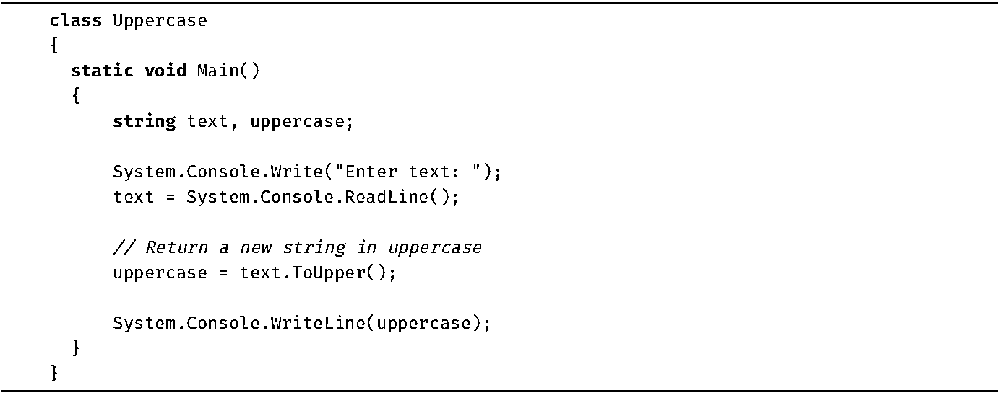

输出 2.13


如忘记字符串不可变的特点，很容易会在使用其他字符串方法时犯下和代码清单 2.17 相似的错误。

要真正更改 text 中的值，将 ToUpper()的返回值赋回给 text 即可。如下例所示：

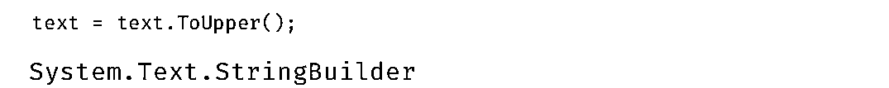

如有大量字符串需要修改，比如要经历多个步骤来构造一个长字符串，可考虑使用 System.Text.StringBuilder 类型而不是 string。StringBuilder 包含 Append()、AppendFormat()、Insert()、Remove()和 Replace()等方法。虽然 string 也提供了其中一些方法，但两者关键的区别在于，在 StringBuilder 上，这些方法会修改 StringBuilder 本身中的数据，而不是返回新字符串。

### 2.2.4　null 和 void

与类型有关的另外两个关键字是 null 和 void。null 值表明变量不引用任何有效的对象^( [\[2\]](part0018.xhtml#ch2_back) ) 。void 表示无类型，或者没有任何值。

null 

null 也可以用作“文字”的一种类型，表明变量为“空”，不指向任何位置。将一个变量设为 null，会明确地将其设置为“空”（即不指向任何数据）。事实上，甚至可以检查引用是否为空。

将 null 赋给引用类型的变量和根本不赋值是不一样的概念。换言之，赋值了 null 的变量已设置，而未赋值的变量未设置。使用未赋值的变量会造成编译时错误。

将 null 值赋给 string 变量和为变量赋值""也是不一样的概念。null 意味着变量无任何值，而""意味着变量有一个称为“空白字符串”的值。这种区分相当有用。例如，编程逻辑可将为 null 的 homePhoneNumber 解释成“家庭电话未知”，将为""的 homePhoneNumber 解释成“无家庭电话”。

高级主题：可空修饰符

声明一个变量时，在其名称后面加一个问号，则表示该变量可以被设置为 null。这便是可空修饰符。代码清单 2.19 演示了使用可空修饰符声明一个整型变量，并为其设置 null 值。

代码清单 2.19　将 null 赋给整型变量

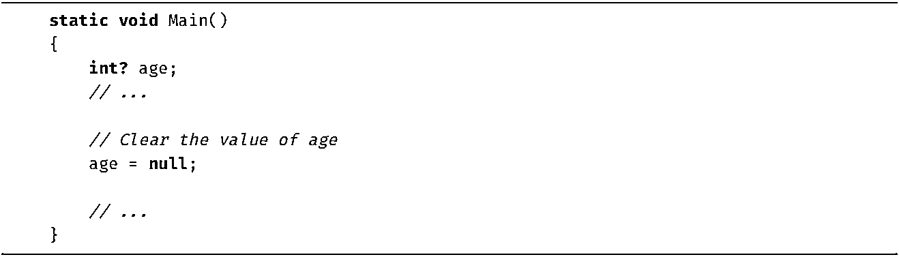

到目前为止，我们已经介绍了 C#里的很多数据类型。但是在 C# 2.0 引入可空修饰符之前，前面提到过的任何数据类型都无法被设置为 null，唯一的例外是 string。这是因为 string 是引用类型，而其他的都是值类型。关于值类型和引用类型的更多知识将在第三章详细讲述。

此外，在 C# 8.0 之前，可空修饰符不能用于引用类型（比如 string）变量的声明中。这是因为引用类型变量默认可被赋值为 null，所以可空修饰符对于引用类型变量是多余的。

高级主题：可空引用类型

在 C# 8.0 之前，因为引用类型变量默认可被赋值为 null，所以那时没有“可空引用类型”的概念。然而从 C# 8.0 开始，这一默认行为变为了可配置行为。声明引用类型变量时可以使用可空修饰符，将变量声明为可空；或者不使用该修饰符，将变量默认地声明为不可复制为 null。这样一来，在 C# 8.0 里便有了“可空引用类型”的概念。当这一概念被启用时，将没有可空修饰符的变量设置为 null 将会产生警告信息。

目前我们已经介绍过唯一引用类型为 string。若要声明一个可空的 string 变量，可以使用类似“string? homeNumber=null;”的写法。

在 C# 8.0 或后续版本中，若要启用“可空引用类型”的概念，需要在声明可空引用类型变量之前的任意位置放置“#nullable enable”语句。

名为 void 的“类型” 

有时 C#语法要求指定数据类型但不传递任何数据。例如，假定方法无返回值，C#就允许在数据类型的位置放一个 void 关键字。HelloWorld 程序（代码清单 1.1）的 Main 方法声明就是一个例子。在返回类型的位置使用 void 意味着方法不返回任何数据，同时告诉编译器不要指望会有一个值。void 本质上不是数据类型，它只是指出没有数据类型这一事实。

语言对比：C++

无论是 C++还是 C#，void 都有两个含义：标记方法不返回任何数据，以及代表指向未知类型的存储位置的一个指针。C++程序经常使用 void\*\*这样的指针类型。C#也可用相同的语法表示指向未知类型的存储位置的指针。但这种用法在 C#中比较罕见，一般仅在需要与非托管代码库进行互操作时才会用到。

语言对比：Visual Basic——返回 void 相当于定义子程序

在 Visual Basic 中，与 C#的“返回 void”等价的是定义子程序（Sub/End Sub）而非返回值的函数。

[\[1\]](part0018.xhtml#ch1) 放在命名空间声明之前。

[\[2\]](part0018.xhtml#ch2) 英文单词 null 的含义为“空”，因此本书将它的衍生词 nullable 译作“可空”，例如将 nullable reference type 译作“可空引用类型”。——译者注

## 2.3　数据类型转换

考虑到各种.NET framework 实现预定义了大量类型，加上代码也能定义无限数量的类型，所以类型之间的相互转换至关重要。会造成转换的最常见操作就是转型 或强制类型转换 （casting）。

考虑将 long 值转换成 int 的情形。long 类型能容纳的最大值是 9 223 372 036 854 775 808，int 则是 2 147 483 647。所以转换时可能丢失数据——long 值可能大于 int 能容纳的最大值。有可能造成数据丢失（因为数据尺寸或精度改变）或抛出异常（因为转换失败）的任何转换都需要执行显式转型 。相反，不会丢失数据，而且不会抛出异常（无论操作数的类型是什么）的任何转换都可以进行隐式转型 。

### 2.3.1　显式转型

C#允许用转型操作符 执行转型。通过在圆括号中指定希望变量转换成的类型，表明你已确认在发生显式转型时可能丢失精度和数据，或者可能造成异常。代码清单 2.20 将一个 long 转换成 int，而且显式告诉系统尝试这个操作。

代码清单 2.20　显式转型的例子

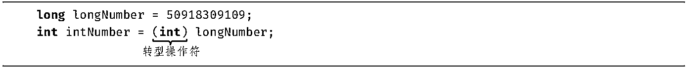

程序员使用转型操作符告诉编译器：“相信我，我知道自己正在干什么。我知道值能适应目标类型。”只有程序员像这样做出明确选择，编译器才允许转换。但这也可能只是程序员“一厢情愿”。执行显式转换时，如数据未能成功转换，“运行时”还是会抛出异常。所以，要由程序员负责确保数据成功转换，或提供错误处理代码来处理转换不成功的情况。

高级主题：checked 和 unchecked 转换

C#提供了特殊关键字来标识代码块，指出假如目标数据类型太小以至于容不下所赋的数据，会发生什么情况。默认情况下，容不下的数据在赋值时会悄悄地溢出。代码清单 2.21 展示了一个例子。

代码清单 2.21　整数值溢出

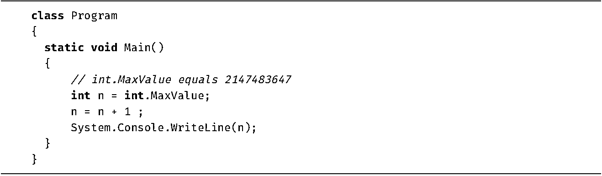

输出 2.14 展示了结果。

输出 2.14

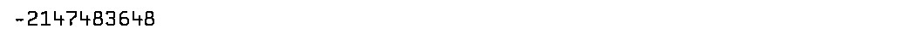

代码清单 2.21 向控制台写入值-2147483648。但将上述代码放到一个 checked 块中，或在编译时使用 checked 选项，就会使“运行时”引发 System.OverflowException 异常。代码清单 2.22 给出了 checked 块的语法。

代码清单 2.22　checked 块示例

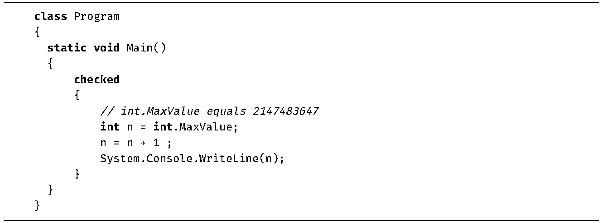

输出 2.15 展示了结果。

输出 2.15

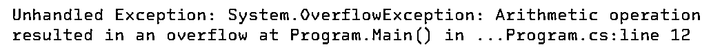

checked 块的代码在运行时发生赋值溢出将抛出异常。

C#编译器提供了一个命令行选项将默认行为从 unchecked 改为 checked。此外，C#还支持 unchecked 块来强制不进行溢出检查，块中溢出的赋值不会抛出异常，如代码清单 2.23 所示。

代码清单 2.23　unchecked 块示例

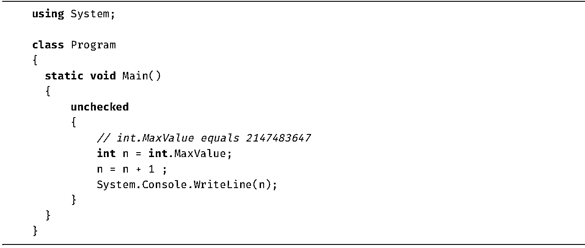

输出 2.16 展示了结果。

输出 2.16

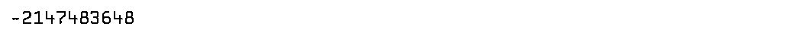

即使开启了编译器的 checked 选项，上述代码中的 unchecked 关键字也会阻止“运行时”抛出异常。

读者可能奇怪，在不检查溢出的前提下，在 int.MaxValue 上加 1 的结果为什么是-2147483648。这是二进制的回绕（wrap around）语义造成的。int.MaxValue 的二进制形式是 01111111111111111111111111111111，第一位(0)代表这是正值。递增该值触发回绕，下个值是 10000000000000000000000000000000，即最小的整数(int.MinValue)，第一位(1)代表这是负值。在 int.MinValue 上加 1 变成 10000000000000000000000000000001(-2147483647)并如此继续。

转型操作符不是万能药，它不能将一种类型任意转换为其他类型。编译器仍会检查转型操作的有效性。例如，long 不能转换成 bool。因为没有定义这种转换，所以编译器不允许。

语言对比：数值转换成布尔值

一些人可能觉得奇怪，C#居然不存在从数值类型到布尔类型的有效转型，因为这在其他许多语言中都是很普遍的。C#不支持这样的转换，是为了避免可能发生的歧义，比如-1 到底对应 true 还是 false？更重要的是，如下一章要讲到的那样，这还有助于避免用户在本应使用相等操作符的时候使用赋值操作符。例如，可避免在本该写成 if(x==42){...}的时候写成 if(x=42){...}。

### 2.3.2　隐式转型

有些情况下，比如从 int 类型转换成 long 类型时，不会发生精度的丢失，而且值不会发生根本性的改变，所以代码只需指定赋值操作符，转换将隐式 地发生。换言之，编译器判断这样的转换能正常完成。代码清单 2.24 直接使用赋值操作符实现从 int 到 long 的转换。

代码清单 2.24　隐式转型无须使用转型操作符


如果愿意，在允许隐式转型的时候也可强制添加转型操作符，如代码清单 2.25 所示。

代码清单 2.25　隐式转型也使用转型操作符

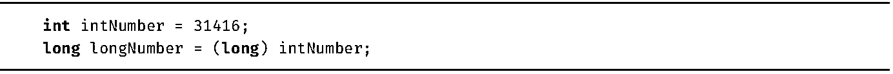

### 2.3.3　不使用转型操作符的类型转换

由于未定义从字符串到数值类型的转换，因此需要使用像 Parse()这样的方法。每个数值数据类型都包含一个 Parse()方法，允许将字符串转换成对应的数值类型。如代码清单 2.26 所示。

代码清单 2.26　使用 float.Parse()将 string 转换为数值类型


还可利用特殊类型 System.Convert 将一种类型转换成另一种。如代码清单 2.27 所示。

代码清单 2.27　使用 System.Convert 进行类型转换

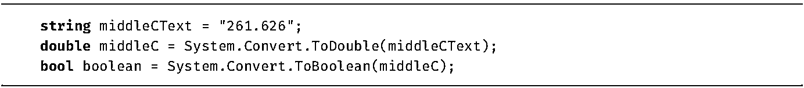

但 System.Convert 只支持少量类型，且不可扩展，允许从 bool、char、sbyte、short、int、long、ushort、uint、ulong、float、double、decimal、DateTime 和 string 转换到这些类型中的任何一种。

此外，所有类型都支持 ToString()方法，可用它提供类型的字符串表示。代码清单 2.28 演示了如何使用该方法，输出 2.17 展示了结果。

代码清单 2.28　使用 ToString()转换成一个 string

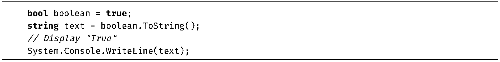

输出 2.17


大多数类型的 ToString()方法只是返回数据类型的名称，而不是数据的字符串表示。只有在类型显式实现了 ToString()的前提下才会返回字符串表示。最后要注意，完全可以编写自定义的转换方法，“运行时”的许多类都存在这样的方法。

高级主题：TryParse()

从 C# 2.0（.NET 2.0）起，所有基元数值类型都包含静态 TryParse()方法。该方法与 Parse()非常相似，只是转换失败不是抛出异常，而是返回 false，如代码清单 2.29 所示。

代码清单 2.29　用 TryParse()代替抛出异常

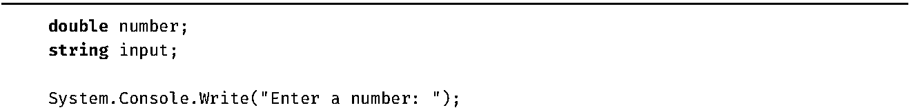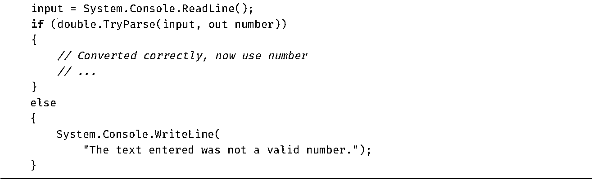

输出 2.18 展示了结果。

输出 2.18


上述代码从输入字符串解析到的值通过 out 参数（本例是 number）返回。

TryParse()除了可以解析数值类型之外，也可以解析枚举类型。

注意从 C# 7.0 起不用先声明只准备作为 out 参数使用的变量。代码清单 2.30 展示了修改后的代码。

代码清单 2.30　TryParse()的 out 参数声明在 C# 7.0 中可以内联了

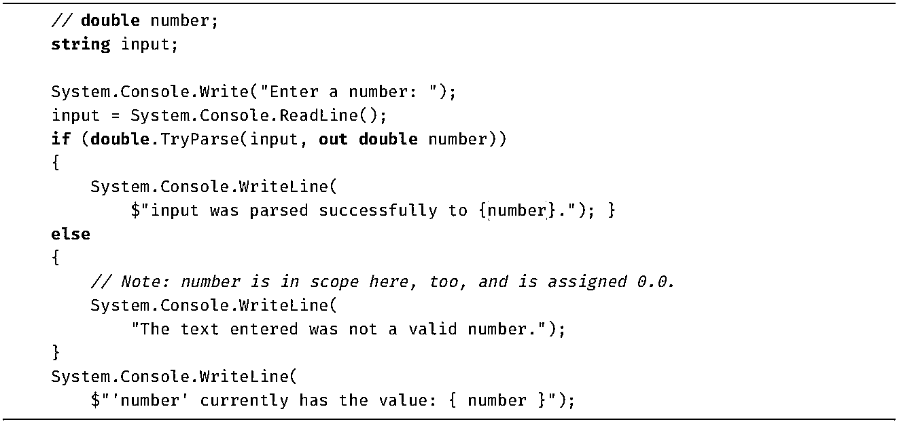

注意先写 out 再写数据类型。这样定义的 number 变量在 if 语句内部和外部均可使用，而不管 TryParse()向 if 语句返回 true 还是 false。

Parse()和 TryParse()的关键区别在于，如果转换失败，TryParse()不会抛出异常。string 到数值类型的转换是否成功，往往取决于输入文本的用户。用户完全可能输入无法成功解析的数据。使用 TryParse()而不是 Parse()，就可以避免在这种情况下抛出异常（由于预见到用户会输入无效数据，所以要想办法避免抛出异常）。

## 2.4　小结

即使是有经验的程序员，也要注意 C#引入的几个新编程构造。例如，本章探讨了用于精确金融计算的 decimal 类型。此外，本章还提到布尔类型 bool 不会隐式转换成整数，防止在条件表达式中误用赋值操作符。C#其他与众不同的地方还包括：允许用@定义逐字字符串，强迫字符串忽略转义字符；字符串插值，可在字符串中嵌入表达式；C#的 string 数据类型不可变。

下一章将继续讨论数据类型。要讨论值类型和引用类型，我们还要讨论如何将数据元素组合成元组和数组。