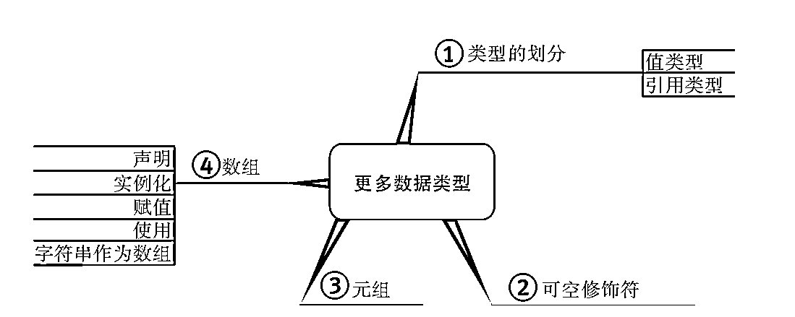
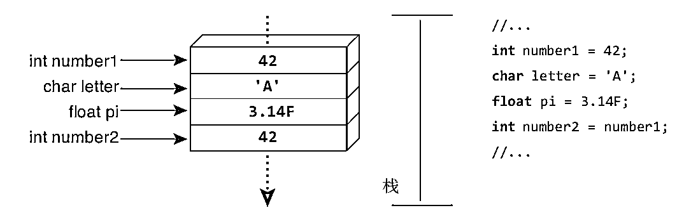
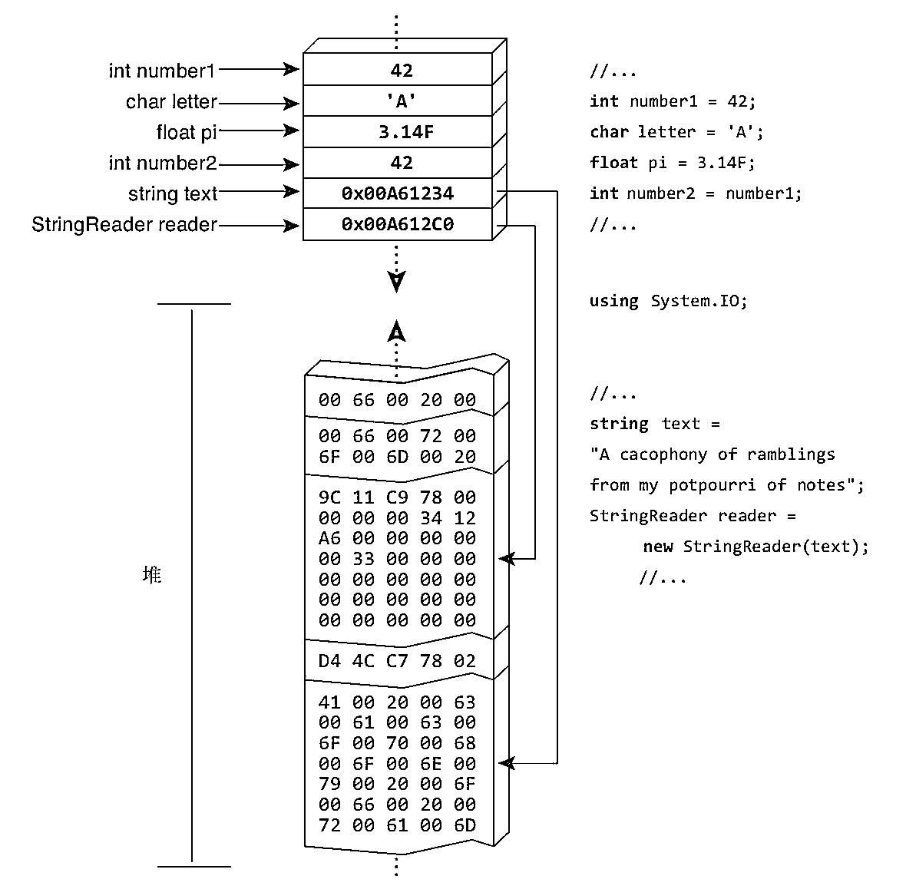
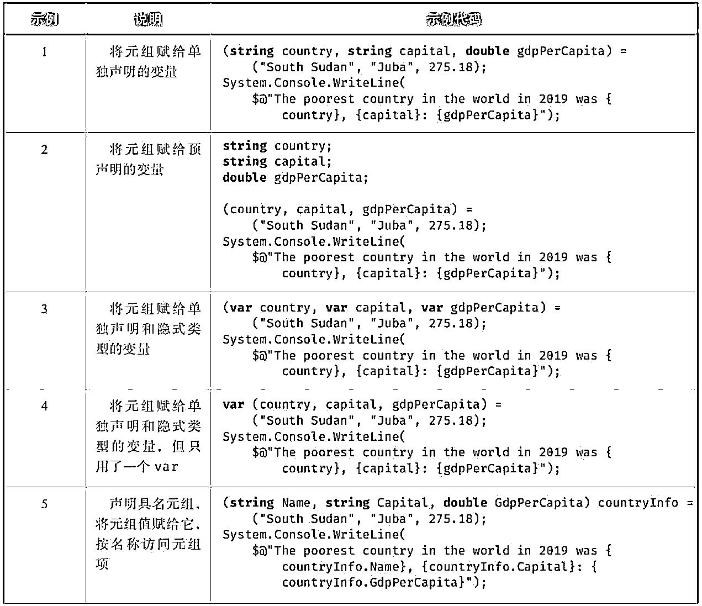
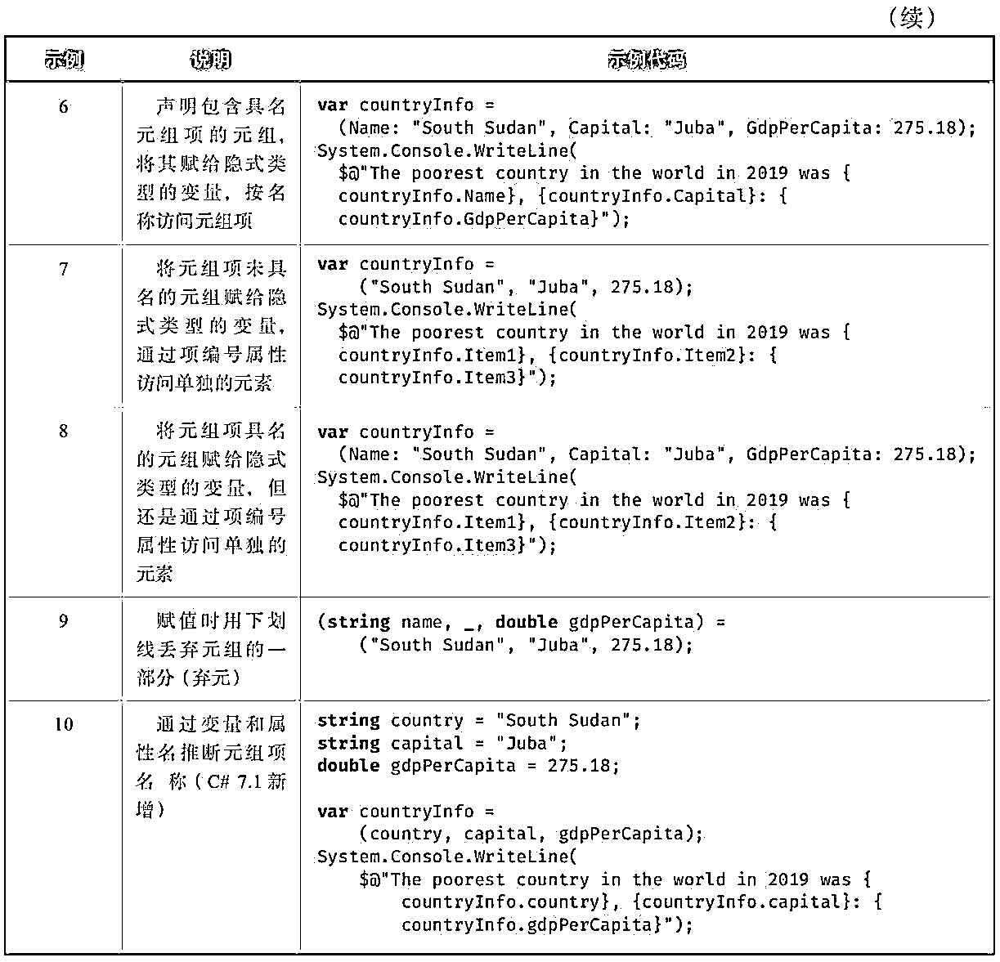
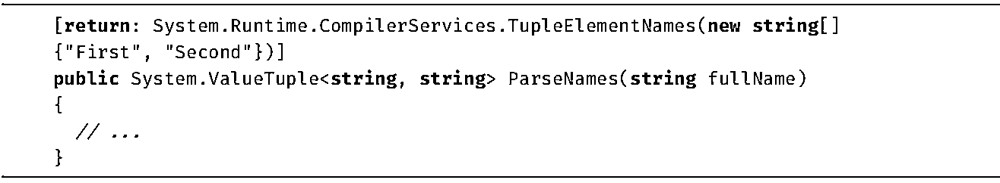
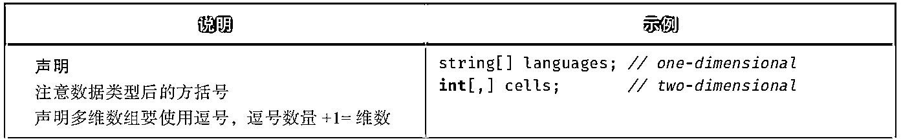
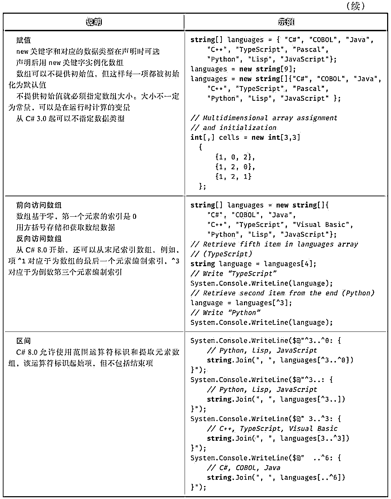
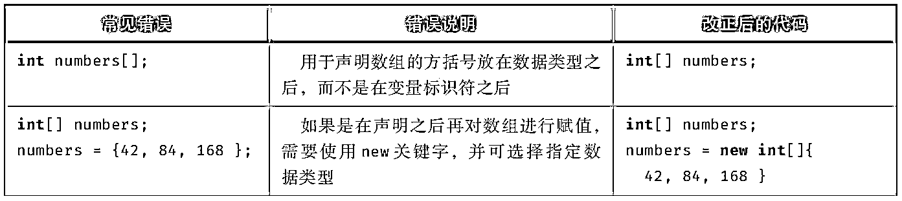
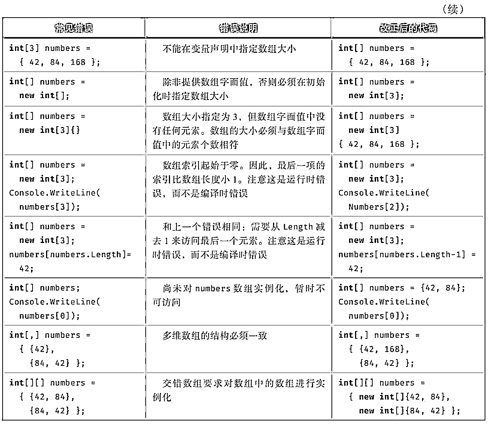

# 第三章　更多数据类型



第二章讨论了所有预定义类型，简单提到了引用类型和值类型的区别。本章继续讨论数据类型，深入解释类型划分。

此外，本章还要讨论将数据元素合并成元组的细节，这是 C# 7.0 引入的一个功能（PowerShell 中对应的是用逗号分隔的多值赋值，以及函数返回多个值）。最后讨论如何将数据分组到称为数组 的集合中。首先深入理解值类型和引用类型。

## 3.1　类型的划分

一个类型要么是值类型 ，要么是引用类型 。区别在于拷贝方式：值类型的数据总是拷贝值；而引用类型的数据总是拷贝引用。

### 3.1.1　值类型

除了 string，本书目前讲到的所有预定义类型都是值类型。值类型直接包含值。换言之，变量引用的位置就是内存中实际存储值的位置。因此，将一个值赋给变量 1，再将变量 1 赋给变量 2，会在变量 2 的位置创建值的拷贝，而不是引用变量 1 的位置。这进一步造成更改变量 1 的值不会影响变量 2 的值。图 3.1 对此进行了演示。number1 引用内存中的特定位置，该位置包含值 42。将 number1 的值赋给 number2 之后，两个变量都包含值 42。但修改其中任何一个值都不会影响另一个值。



图 3.1　值类型的实例直接包含数据

类似地，将值类型的实例传给输出命令（如 Write-Output）这样的命令也会生成内存拷贝。在命令（方法）内部对参数值进行的任何修改都不会影响调用函数中的原始值。由于值类型需要创建内存拷贝，因此定义时不要让它们占用太多内存（通常应该小于 16 字节）。

### 3.1.2　引用类型

相反，引用类型的变量存储对数据存储位置的引用，而不是直接存储数据。要去那个位置才能找到真正的数据。所以为了访问数据，“运行时”要先从变量中读取内存位置，再“跳转”到包含数据的内存位置。“运行时”的这种操作称为“解引用”。为引用类型的变量分配实际数据的内存区域称为堆 （heap），如图 3.2 所示。

引用类型不像值类型那样要求创建数据的内存拷贝，所以拷贝引用类型的实例比拷贝大的值类型实例更高效。将引用类型的变量赋给另一个引用类型的变量，只会拷贝引用而不需要拷贝所引用的数据。事实上，每个引用总是处理器的“原生大小”：32 位处理器拷贝 32 位引用，64 位处理器拷贝 64 位引用，以此类推。显然，拷贝对一个大数据块的引用要比拷贝整个数据块快得多。

由于引用类型只拷贝对数据的引用，所以两个不同的变量可引用相同的数据。如果两个变量引用同一个对象，则当通过一个变量更改了对象的内部数据时，可以通过另一个变量看到对象内部数据的变化。无论赋值还是方法调用都会如此。因此，如果在方法内部更改引用类型的数据，控制返回调用者之后，将看到更改后的结果。有鉴于此，如果对象在逻辑上是固定大小、不可变的值，就考虑定义成值类型。如果逻辑上是可引用、可变的东西，就考虑定义成引用类型。

除了 string 和自定义类（如第六章中定义的 Employee 类），本书目前讲到的所有类型都是值类型。但大多数类型都是引用类型。虽然偶尔需要自定义的值类型，但更多的还是自定义的引用类型。



图 3.2　引用类型的实例指向堆

## 3.2　将变量声明为可空

将一个变量的值设置为空往往非常实用。例如，当指定一个数量值时，如果数量未知或者用户未提供数值，那么应该输入什么呢？一个可能的办法是指定特殊值，比如-1 或 int.MaxValue，但这些毕竟都是有效的整数值，有时很难分辨一个特殊值意味着真实数值或是无效值。因此，更好的解决方案是允许将变量赋值为 null，以便区分真实数值和无效值。此外，null 值对于数据库编程来说尤为重要，因为很多数据库都允许字段的值为 null。如果不允许将变量赋值为 null，则在读取数据库记录时便会产生很多问题。

在 C# 中，你可以将类型声明为可空或不可空，这意味着可以使用可空修饰符 将类型声明为允许或不允许空值。（从 C# 2.0 开始允许将值类型变量声明为可空，从 C# 8.0 开始，引用类型变量也可以声明为可空。）为声明一个能被赋值为 null 的变量，要使用可空修饰符：?。例如，int? number=null 将声明一个可空的 int 型变量，并将其值初始化为 null。需要注意的是，使用可空变量时也存在一些陷阱，需要开发者更加小心谨慎。

注释：PowerShell 对可空值类型的支持来自 .NET：可直接使用 [Nullable[int]]（即 System.Nullable<int>）声明可空的整型变量，例如 [Nullable[int]]$number = $null。注意 [int?] 这种类型加速器写法在 PowerShell 中不存在；而对 [int32] 这样的普通值类型变量赋 $null，得到的只会是该类型的默认值 0，而不是真正的 null。

### 3.2.1　对 null 值引用类型变量进行解引用

支持将变量赋值为 null 是一件好坏参半的事：这样做本来非常有意义，可惜其缺点也不容忽视。虽然将 null 赋值给一个变量，或者作为参数去调用一个方法并不会直接产生问题，但是如果对一个值为 null 的引用类型变量进行解引用（例如调用其方法），则会引发 System.NullReferenceException 异常——例如，调用 text.GetType()，当 text 值为 null 时，该异常便会发生。在产品级的代码中如果发生了 System.NullReferenceException 异常，则是一个无可否认的 bug，因为这个异常通常意味着程序员在调用方法之前忘记了检查 null 值。更糟糕的是，对 null 值的检查依赖于程序员能够意识到一个变量的值可能为 null，而这种意识显然非常不可靠，因此，一个更好的方案是在默认情况下不允许将变量赋值为 null，而若想要赋值为 null，则必须用可空修饰符进行显式声明。这种显式声明的一个暗含的意义是：如果程序员主动声明一个变量可以被赋值为 null，则他便需要对可能出现的 null 值担负更多的责任。

到目前为止，我们尚未讨论用于检查 null 值的操作符和语句。后面的“高级主题：检查 null 值”将会介绍一些简要方法。在第四章中将介绍更多细节。

高级主题：检查 null 值

判断一个变量的值是否为 $null 的方法很多，其中最简单使用最广泛的便是在 if 语句中用 -eq 与 $null 比较。代码清单 3.1 中演示了这一方法。

代码清单 3.1　检查 null 值

```powershell
$number = $null
if ($null -eq $number) {
    Write-Output "'number' requires a value and cannot be null"
} else {
    Write-Output "'number' doubled is $($number * 2)."
}
```

在上面的代码中，if 语句用 -eq 判断 number 变量是否为 $null（把 $null 写在运算符左侧是 PowerShell 社区的习惯写法，可避免因右侧对象重写相等性逻辑而产生意外），并且根据判断结果执行不同的操作。至于 C# 的 is 操作符以及"最好用 is 而不是 =="的说法，则与 PowerShell 无关，这里不再展开。

另一个在 C# 6.0 中引入的用于处理 null 值的操作符叫作“null 值条件（null-conditional）操作符”（?.）。该操作符会先判断一个变量是否为 null，再对其进行解引用。例如 int? length=text?.length; 这句代码会先判断 text 变量是否为 null。如果是，则将 length 变量也赋值为 null，而不会发生异常；反之，如果 text 引用了有效的字符串值，则将 length 赋值为字符串长度。（PowerShell 没有 ?. 操作符；等效的做法是显式判断，例如 if ($null -eq $text) { $length = $null } else { $length = $text.Length }。）

在第四章中，我们将更加详细地介绍 if 语句。PowerShell 中没有 C# 的 null 值条件操作符（?.）和 is 操作符，检查 null 值通常直接用 -eq / -ne 与 $null 比较。

### 3.2.2　可空值类型

一个值类型变量存储的是一个实际的值，而不是一个引用，并且值类型变量本质上也不应该拥有 null 值。尽管如此，在实际中，当我们调用一个值类型变量的方法或者访问其属性时，仍然认为是在对该值类型变量进行解引用。虽然技术上不太正确，但是当人们谈论解引用时，普遍并不在意一个变量是值类型还是引用类型^( [\[1\]](part0023.xhtml#ch1_back) ) 。

高级/初学者主题：对值为 null 的值类型变量解引用

（注释：在 PowerShell 中，可空值类型同样由 [Nullable[T]] 提供，下面关于 HasValue、ToString()、GetType() 等行为的说明在 PowerShell 中依然适用。）

技术上讲，一个用可空修饰符声明的值类型变量仍然是值类型，而不会变成引用型。即使当它被赋值为 null 时，会拥有一些与 null 值引用变量相同的行为，但这不是因为该变量存储了 null 值。因此，对一个被赋值为 null 的值类型变量进行解引用时，大部分情况下不会发生 null 值异常^( [\[2\]](part0023.xhtml#ch2_back) ) 。值类型变量的方法和属性，比如 HasValue、ToString()，甚至与等值判断相关的 GetHashCode()和 Equals()等，都是基于模板类 Nullable<T>实现的，因此不会因为值类型变量为 null 而发生异常。（当对一个被赋值为 null 的值类型变量进行解引用时，不会发生 System.NullReferenceException 异常，但是可能发生 System.InvalidOperationException 异常，以便提醒程序员去检查 null 值。）唯一的例外是如果对一个值为 null 的值类型变量调用 GetType()方法，仍然会发生 System.NullReferenceException 异常。这是因为它不是虚方法，因此无法被 Nullable<T>重载，因此保留了默认行为，即发生 System.NullReferenceException 异常^( [\[3\]](part0023.xhtml#ch3_back) ) 。

### 3.2.3　可空引用类型

在 C# 8.0 之前，所有引用类型变量都可以被赋值为 null。但这一规则导致了大量 bug 的产生。这是因为避免 null 值异常需要程序员能够预见到一个变量可能为 null，从而在程序中编写保护性代码，但实际中这种预见性很难做到万无一失。此外，引用类型变量默认为可空，且其初始值默认为 null 也使得这一问题变得更糟。例如，在代码清单 3.2 中有一个名为 text 的引用型局部变量，其值尚未初始化，如果此时对其进行解引用，编译器会报告错误“use of unassigned local variable 'text'”（使用未赋值的局部变量'text'）。为了解决这个编译错误，最简单的办法是在声明变量时将其初始化为 null，而不是为其寻找一个更合理的值。但这样一来，程序员便有可能掉进陷阱中：为了简单地解决编译错误，声明一个变量并将其初始化为 null，并且寄希望于该变量被真正使用之前能够被幸运地设置一个有效的值，然而这种期待有可能会落空。

（注释：PowerShell 中的情况不同——未赋值的变量默认为 $null，使用它不会产生编译错误，但一旦对 $null 解引用就会在运行时抛错，参见代码 3.2 的注释。）

代码清单 3.2　对未赋值的变量进行解引用

```powershell
# PowerShell does not perform C# nullable-reference analysis.
# An uninitialized variable is $null and fails when dereferenced.
$text = $null
$text.Length  # Runtime error: cannot call a method on a null-valued expression.
```

总之，引用型变量默认可以被赋值为空，是造成 System.NullReferenceException 异常的罪魁祸首。而编译器的赋值检查则很容易将程序员引入歧途，除非他们特别小心谨慎地编程才能躲避陷阱。

为了显著地改善这种情况，C#团队在 C# 8.0 中将可空性概念同样赋予了引用类型变量，即所谓的可空引用类型。至此，引用类型变量和值类型变量都可以声明时被指定为可空或者不可空。在 C# 8.0 中，声明任何类型的变量时，默认都为不可空。

不幸的是，支持使用可空修饰符声明引用类型，并将不使用空修饰符的引用类型声明默认为不可空，这对从早期版本的 C#升级的代码有重大影响。考虑到 C# 7.0 和更早版本支持将 null 赋值给所有引用类型声明（即 string text=null），所有代码都会在 C# 8.0 中编译失败吗？

确保兼容旧代码对于 C#团队来说非常重要，因此 C#在默认情况下并不支持引用类型的可空性特性。要想启用此特性，需要使用#nullable 语句，或者在项目属性配置中启用该特性。（PowerShell 没有可空引用类型这一机制，以下关于 #nullable 的内容都只适用于 C# 项目，仅供了解。）

首先，可以在程序代码中使用下面语句来启用引用类型的可空性特性：

```powershell
#nullable enable
```

该语句在#nullable 后面输入三个可选值：enable、disable 和 restore。restore 的作用是将可空性设置恢复为项目全局设置的值。上面的代码清单 3.2 演示了在 C# 中通过 #nullable 语句启用该特性后的效果。正是该语句使得编译器不再会因为 string? Text; 语句而发出警告。

启用引用类型的可空性特性的另一个方法是在项目属性中添加设置。该特性默认为不启用。如果要启用它，可以找到项目的.csproj 文件，并加入代码清单 3.3 中的设置。

代码清单 3.3　通过修改.csproj 文件在项目全局范围内启用可空性特性

```powershell
# PowerShell has no project-wide nullable-reference compiler setting.
# Use explicit $null checks in PowerShell code instead.
```

本书附带的全部示例代码（[`github.com/EssentialCSharp`](https://github.com/EssentialCSharp) ）都在项目全局范围内启用了可空性特性。也可以在 dotnet 命令行参数中通过/p 参数设置该特性是否启用：

```powershell
dotnet build /p:Nullable=enable
```

该命令行参数会取代项目代码中所有对可空性特性的设置。（这些都是 C# 编译层面的机制，PowerShell 脚本不能使用编译参数。）

[\[1\]](part0023.xhtml#ch1) 可空值类型是 C# 2.0 引入的。

[\[2\]](part0023.xhtml#ch2) 这里指的是前文提到的 System.NullReferenceException 异常。——译者注

[\[3\]](part0023.xhtml#ch3) 通常只有一种解引用情形可能会发生 System.InvalidOperationException 异常。假设有一个可空值类型变量被赋值为 null，例如，int? x=null;（PowerShell 中为 [Nullable[int]]$x = $null），此时如果将它显示转换为一个不可空的值类型，例如，int y=(int)x;，此时 C#会试图对变量 x 进行解引用，并发生上述异常。——译者注

## 3.3　隐式类型的局部变量

C# 3.0 新增上下文关键字 var 来声明隐式类型的局部变量 。声明变量时，如果能用确定类型的表达式初始化它，C# 3.0 及以后的版本就允许变量的数据类型为“隐式的”，无须显式声明。PowerShell 的变量本来就是动态类型的，声明时一般不需要指定类型，因此代码清单 3.4 中直接用 $text、$uppercase 这样的变量，效果上就相当于 C# 的 var。

代码清单 3.4　字符串处理

```powershell
$text = Read-Host 'Enter text'
$uppercase = $text.ToUpperInvariant()
Write-Output $uppercase
```

上述代码清单和代码清单 2.18 相比，在 C# 中有两处不同。首先，text 不显式声明为 string 类型，而是声明为 var。但 var 告诉编译器根据声明时所赋的值来推断数据类型（原书中这里是 System.Console.ReadLine()，改写为 PowerShell 后成了 Read-Host）。PowerShell 不需要类型标注，所以改写后的代码里看不到 var。

其次，text 和 uppercase 变量都在声明时初始化。在 C# 中，带 var 的变量必须在声明时初始化，否则会造成编译时错误；编译器会根据初始化表达式推断数据类型，就好像程序员显式指定了类型。PowerShell 中未初始化的变量默认为 $null，没有这个编译期限制。

在 C# 中，虽然允许用 var 取代显式数据类型，但在数据类型不是很明显的情况下最好不要用 var。例如，还是应该将 text 和 uppercase 显式声明为 string。这不仅可使代码更易理解，还相当于你亲自确认了等号右侧表达式返回的是你希望的数据类型。使用 var 变量时，右侧数据类型应显而易见，否则应避免用 var 声明变量。（PowerShell 没有 var 关键字；若需要在脚本中固定变量的数据类型，可像 [string]$text 这样用类型加速器显式声明。）

设计规范

·避免使用隐式类型的局部变量，除非所赋的值的数据类型显而易见。

语言对比：C++/Visual Basic/JavaScript——void\*、Variant 和 var

隐式类型的变量不等价于 C++的 void\*、Visual Basic 的 Variant 或 JavaScript 的 var。这三种情况的变量声明都不严格，因为可将一个不同的类型重新赋给这些变量，这类似于在 C#中将变量声明为 object 类型。相反，C#的 var 由编译器严格确定类型，确定了就不能变。另外，类型检查和成员调用都会在编译时进行验证。（PowerShell 的变量按动态类型处理，与上述“不严格”的变量类似：PowerShell 在运行时对数据进行类型转换和成员解析，而不是在编译时。这一特性使脚本更灵活，但也更容易出现类型相关的运行时错误。）

高级主题：匿名类型

C# 3.0 添加 var 的真正目的是支持匿名类型。匿名类型是在方法内部动态声明的数据类型，而不是通过显式的类定义来声明。PowerShell 中没有匿名类型，但可以使用 [pscustomobject] 在脚本中动态构造一个带属性的对象，作用与之类似，如代码清单 3.5 所示。（第十五章会深入讨论匿名类型。）

代码清单 3.5　使用匿名类型声明隐式局部变量

```powershell
$patent1 = [pscustomobject]@{ Title = 'Bifocals'; YearOfPublication = 1784 }
$patent2 = [pscustomobject]@{ Title = 'Phonograph'; YearOfPublication = 1877 }
Write-Output "$($patent1.Title) ($($patent1.YearOfPublication))"
Write-Output "$($patent2.Title) ($($patent2.YearOfPublication))"
```

输出 3.1 展示了结果。

输出 3.1

```text
Bifocals (1784)
Phonograph (1877)
```

代码清单 3.5 演示了如何将匿名类型的值赋给隐式类型(var)局部变量。C# 3.0 支持连接（关联）数据类型或将特定类型的大小缩减至更少数据元素，所以才配合设计了这种操作。但自从 C# 7.0 引入元组语法后，匿名类型几乎就用不着了。

## 3.4　元组

有时需要合并数据元素。例如，2019 年全球最贫穷的国家是首都位于 Juba（朱巴）的南苏丹，人均 GDP 为 275.18 美元。利用目前讲过的编程构造，可将上述每个数据元素存储到单独的变量中，但它们相互无关联。换言之，看不出 275.18 和南苏丹有什么联系。为解决该问题，第一个方案是在变量名中使用统一的后缀或前缀，第二个方案是将所有数据合并到一个字符串中，但缺点是需要解析字符串才能处理单独的数据元素。

C# 7.0 提供了第三个方案：元组 （tuple）。元组允许在一条语句中完成对所有变量的赋值。PowerShell 天生就支持这类多值赋值：右侧用逗号分隔的值会作为一个数组，一次性赋给左侧的多个变量。如下所示：

```powershell
$country, $capital, $gdpPerCapita = 'South Sudan', 'Juba', 275.18
```

表 3.1 总结了元组的其他语法形式。

表 3.1　元组声明和赋值的示例代码



前四个例子虽然右侧是元组，但左侧仍然是单独的变量，只是用元组语法 一起赋值。在这种语法中，两个或更多元素以逗号分隔，放到一对圆括号中进行组合。（我使用“元组语法”一词是因为编译器为左侧生成的基础数据类型技术上说并非元组。）结果是虽然右侧的值合并成元组，但在向左侧赋值的过程中，元组已被解构为它的组成部分。例 2 左边被赋值的变量是事先声明好的，但例 1、3 和 4 的变量是在元组语法中声明的。由于只是声明变量，所以命名和大小写应遵循第一章的设计规范，例如有一条是“要为局部变量使用 camelCase 风格命名。”

（注释：在 PowerShell 中，右侧的逗号列表其实是一个数组（或由逗号连接的元素列表），赋值时按位置解构到左侧各变量，与 C# 元组的底层类型并不相同。）

虽然隐式类型(var)在例 4 中用元组语法平均分配给每个变量声明，但这里的 var 绝不可以替换成显式类型（如 string）。元组宗旨是允许每一项都有不同数据类型，所以为每一项都指定同一个显式类型名称跟这个宗旨冲突（即使类型真的一样，编译器也不允许指定显式类型）。

例 5 在左侧声明一个元组，将右侧的元组赋给它。注意元组含具名项，随后可引用这些名称来获取右侧元组中的值。这正是能在输出语句（如 Write-Output）中使用 countryInfo.Name、countryInfo.Capital 和 countryInfo.GdpPerCapita 语法的原因。在左侧声明元组造成多个变量组合到单个元组变量（countryInfo）中。然后可利用元组变量来访问其组成部分。如第四章所述，这样的设计允许将该元组变量传给其他方法。那些方法能轻松访问元组中的项。（PowerShell 中达到类似效果的做法，是把多个值放进一个数组变量，或用 [pscustomobject] 把带名称的属性打包在一个对象里。）

前面说过，用元组语法定义的变量应遵守 camelCase 大小写规则。但该规则并未得到彻底贯彻。有人提倡当元组的行为和参数相似时（类似于元组语法出现之前用于返回多个值的 out 参数），这些名称应使用参数命名规则。另一个方案是 PascalCase 大小写，这是类型成员（属性、函数和公共字段，参见第五章和第六章的讨论）的命名规范。个人强烈推荐 PascalCase 规范，从而和 C#/.NET 成员标识符的大小写规范一致。但由于这并不是被广泛接受的规范，所以我在设计规范“考虑为所有元组项名称使用 PascalCase 大小写风格”中使用“考虑”而非“要”一词，

设计规范

·要为元组语法的变量声明使用 camelCase 大小写规范。

·考虑为所有元组项名称使用 PascalCase 大小写风格。

例 6 提供和例 5 一样的功能，只是右侧元组使用了具名元组项，左侧使用了隐式类型声明。但元组项名称会传入隐式类型变量，所以 WriteLine 语句仍可使用它们。当然，左侧可使用和右侧不同的元组项名称。C#编译器允许这样做但会显示警告，指出右侧元组项名称会被忽略，因为此时左侧的优先。

不指定元组项名称，被赋值的元组变量中的单独元素仍可访问，只是名称是 Item1、Item2、......，如例 7 所示。事实上，即便提供了自定义名称，ItemX 名称始终都能使用，如例 8 所示。但在使用 Visual Studio 这样的 IDE 工具时，ItemX 属性不会出现在“智能感知”的下拉列表中。这是好事，因为自己提供的名称理论上应该更好。如例 9 所示，可用下划线丢弃部分元组项的赋值，这称为弃元 （discard）。

例 10 展示的元组项名称推断功能是自 C# 7.1 引入的。如本例所示，元组项名称可根据变量名（甚至属性名）来推断。

元组是在对象中封装数据的轻量级方案，有点像你用来装杂货的购物袋。和稍后讨论的数组不同，元组项的数据类型可以不一样，没有限制^( [\[1\]](part0025.xhtml#ch1_back) ) ，只是它们由编译器决定，不能在运行时改变。另外，元组项数量也是在编译时硬编码好的。最后，不能为元组添加自定义行为（扩展方法不在此列）。如果需要和封装数据关联的行为，则应使用面向对象编程并定义一个类，具体在第六章讲述。

高级主题：System.ValueTuple<...>类型

在表 3.1 的示例中，C#为赋值操作符右侧的所有元组实例生成的代码都基于一组泛型值类型（结构），例如 System.ValueTuple<T1, T2, T3>。类似地，同一组 System.ValueTuple<...>泛型值类型用于从例 5 开始的左侧数据类型。元组类型唯一包含的方法是跟比较和相等性测试有关的方法，这符合预期。

既然自定义元组项名称及其类型没有包含在 System.ValueTuple<...>定义中，为什么每个自定义元组项名称都好像是 System.ValueTuple<...>类型的成员，并能以成员的形式访问呢？让人（尤其是那些熟悉匿名类型实现的人）惊讶的是，编译器根本没有为那些和自定义名称对应的“成员”生成底层 CIL 代码，但从 C#的角度看，又似乎存在这样的成员。

对于表 3.1 的所有具名元组例子，编译器在元组剩下的作用域中显然知道那些名称。事实上，编译器（和 IDE）正是依赖该作用域通过项的名称来访问它们。换言之，编译器查找元组声明中的项名称，并允许代码访问还在作用域中的项。也正是因为这一点，IDE 的“智能感知”不显示底层的 ItemX 成员。它们会被忽略，替换成显式命名的项。

编译器能判断作用域中的元组项名称，这一点还好理解，但如果元组要对外公开，比如作为另一个程序集中的一个方法的参数或返回值使用（另一个程序集可能看不到你的源代码），那么会发生什么？其实对于作为 API（公共或私有）一部分的所有元组，编译器都会以“属性”（attribute）的形式将元组项名称添加到成员元数据中。例如，代码清单 3.6 展示了编译器为以下方法生成的 CIL 代码的 C#形式：

```powershell
function Split-Name([string]$fullName) {
    $parts = $fullName.Split(' ')
    return $parts[0], $parts[1]
}
```

代码清单 3.6　编译器为返回 ValueTuple 的方法生成的 CIL 代码



另外要注意，如显式使用 System.ValueTuple<...>类型，C# 7.0 就不允许使用自定义的元组项名称。所以表 3.1 的例 8 如果将 var 替换成该类型，编译器会警告所有项的名称将被忽略。

下面总结了和 System.ValueTuple<...>有关的其他注意事项：

·共有 8 个泛型 System.ValueTuple<...>，前 7 个最大支持七元组。第 8 个是 System.ValueTuple<T1, T2, T3, T4, T5, T6, T7, TRest>，可为最后一个类型参数指定另一个 ValueTuple，从而支持 n 元组。例如，编译器自动为 8 个参数的元组生成 System.ValueTuple<T1, T2, T3, T4, T5, T6, T7, System.ValueTuple<TSub1>>作为底层实现类型。System.Value<T1>的存在只是为了补全，很少使用，因为 C#元组语法要求至少两项。

·有一个非泛型 System.ValueTuple 类型作为元组工厂使用，提供了和所有 ValueTuple 元数^( [\[2\]](part0025.xhtml#ch2_back) ) 对应的 Create()方法。C# 7.0 以后基本用不着 Create()方法，因为像 var t1=("Inigo Montoya", 42)这样的元组字面值实在太好用了。（在 PowerShell 中，$t1 = 'Inigo Montoya', 42 这样的逗号列表就能表示类似的元素组合。）

·C#程序员实际编程时完全可以忽略 System.ValueTuple 和 System.ValueTuple<T>。

还有一个元组类型是 Microsoft .NET Framework 4.5 引入的 System.Tuple<...>。当时是想把它打造成核心元组实现。但在 C#中引入元组语法时才意识到值类型性能更佳，所以量身定制了 System.ValueTuple<...>，它在所有情况下都代替了 System.Tuple<...>（除非要向后兼容依赖 System.Tuple<...>的遗留 API）。

[\[1\]](part0025.xhtml#ch1) 数据类型不可以为指针。我们将在第二十三章详细介绍指针。

[\[2\]](part0025.xhtml#ch2) 元数的英文是 arity，源自像 unary（arity=1）、binary（arity=2）、ternary（arity=2）这样的单词。——译者注

## 3.5　数组

第一章没有提到的一种特殊的变量声明就是数组声明。利用数组声明，可在单个变量中存储同一种类型的多个数据项，而且可利用索引来单独访问这些数据项。PowerShell 的数组同样从索引零开始，所以我们说数组基于零。与 C# 不同，PowerShell 还额外支持负数索引（比如 [-1] 表示最后一个元素），其作用对应 C# 8.0 的“index from end”操作符。

初学者主题：数组

可用数组变量声明同类型多个数据项的集合。每一项都用名为索引 的整数值进行唯一性标识。PowerShell 数组的第一个数据项使用索引 0 访问。程序员需要小心确保访问数组时的索引值小于数组的数据项总数。由于数组基于零，因此数组中最后一个数据项的索引值为数据项总数量减 1。在 PowerShell 中，还可以用负数索引从末尾反向访问：索引值 -1 表示最后一个元素。（这对应 C# 8.0 的“index from end”操作符，3.5.3 节将详细讨论。）

初学者可将索引想象成偏移量。第一项距数组开头的偏移量是 0，第二项偏移量是 1，以此类推。

数组是几乎所有编程语言的基本组成部分，所有开发者都应学习。虽然 C#编程经常用到数组，初学者也确实应该掌握，但大多数程序现在都用泛型集合类型而非数组来存储数据集合。如果只是为了熟悉数组的实例化和赋值，可略读下一节。表 3.2 列出了要注意的重点。泛型集合将在第十五章详细讲述。

此外，3.5.5 节还会讲到数组的一些特点。

表 3.2　数组的重点



### 3.5.1　数组的声明

PowerShell 用方括号（类型加速器）声明数组变量。首先指定数组元素的类型，再输入变量名，两者都放在方括号内并位于变量名前，如 [string[]]$languages。代码清单 3.7 声明字符串数组变量 languages。

代码清单 3.7　声明数组

```powershell
[string[]]$languages
```

显然，数组声明的第一部分标识了数组中存储的元素的类型。作为声明的一部分，方括号指定了数组的秩 （rank），或者说维数。本例声明一维数组。类型和维数构成了 languages 变量的数据类型。

语言对比：C++和 Java——数组声明

在 PowerShell 中，元素类型和表示数组的方括号组合成一个类型加速器（如 [string[]]），放在变量名之前。这样所有类型信息都在一起，而不是像 C++和 Java 那样分散于标识符前后。（C# 的写法 string[] languages 与之对应，差别在于方括号和类型的位置。）

代码清单 3.7 定义的是一维数组。方括号中的逗号用于定义额外的维。例如，代码清单 3.8 为井字棋（tic-tac-toe）棋盘定义了一个二维数组。

代码清单 3.8　声明二维数组

```powershell
[int[,]]$cells
```

代码清单 3.8 定义了一个二维数组。第一维对应从左到右的单元格，第二维对应从上到下的单元格。可用更多逗号定义更多维，数组总维数等于逗号数加 1。注意，某一维上的元素数量不是变量声明的一部分。这是在创建（实例化）数组并为每个元素分配内存空间时指定的。

### 3.5.2　数组实例化和赋值

声明数组后，可用 @( ) 语法填充它的值——圆括号中以逗号分隔一个数据项列表。代码清单 3.9 声明一个字符串数组，将圆括号中的 9 种语言名称赋给它。

代码清单 3.9　声明数组的同时赋值

```powershell
$languages = @('C#', 'COBOL', 'Java', 'C++', 'TypeScript', 'Visual Basic', 'Python', 'Lisp', 'JavaScript')
```

列表第一项成为数组的第一个元素，第二项成为第二个，以此类推。我们使用 @( ) 定义数组字面值。

只有在同一条语句中声明并赋值，才能使用代码清单 3.9 的赋值语法。声明后在其他地方赋值，PowerShell 允许直接再次使用 @( )；若希望变量保持 string[] 类型，可像代码清单 3.10 那样进行显式类型转换。

代码清单 3.10　声明数组后再赋值

```powershell
$languages = [string[]]@('C#', 'COBOL', 'Java', 'C++', 'TypeScript', 'Visual Basic', 'Python', 'Lisp', 'JavaScript')
```

自 C# 3.0 起不必在 new 后指定数组类型（string）。编译器能根据初始化列表中的数据类型推断数组类型。在 PowerShell 中，@( ) 生成的是 System.Object[] 数组；如果需要特定元素类型的强类型数组，仍要显式指定类型加速器（如 [string[]]），方括号不可缺少。

C#支持将 new 关键字作为声明语句的一部分，所以可以在声明时赋值。PowerShell 中可用类型加速器的 ::new 方法实现同等效果（见代码清单 3.13）。

代码清单 3.11　声明数组时用 new 赋值

```powershell
$languages = [string[]]@('C#', 'COBOL', 'Java', 'C++', 'TypeScript', 'Visual Basic', 'Python', 'Lisp', 'JavaScript')
```

new 关键字的作用是指示“运行时”为数据类型分配内存，即指示它实例化数据类型（本例是数组）。在 PowerShell 中，可用 [string[]]::new(9) 这种静态方法调用来实例化数组。

数组赋值时只要使用了 new 关键字，就可在方括号内指定数组大小，如代码清单 3.12 所示。

代码清单 3.12　声明数组时用 new 关键字赋值并指定数组大小

```powershell
$languages = [string[]]@('C#', 'COBOL', 'Java', 'C++', 'TypeScript', 'Visual Basic', 'Python', 'Lisp', 'JavaScript')
```

指定的数组大小必须和圆括号中的元素数量匹配。另外，也可分配数组但不提供初始值，如代码清单 3.13 所示。

代码清单 3.13　分配数组但不提供初始值

```powershell
$languages = [string[]]::new(9)
```

分配数组但不指定初始值，“运行时”会将每个数组元素初始化为它们的默认值，如下所示：

·引用类型（比如 string），都初始化为 $null。

·可空的值类型初始化为 $null。

·不可空的值类型初始化为 0。

·bool 初始化为 $false。

·char 初始化为\x0。

非基元值类型以递归方式初始化，每个字段都被初始化为默认值。所以，其实并不需要在使用数组前初始化它的所有元素。

由于数组大小不需要作为变量声明的一部分，所以可以在运行时指定数组大小。例如，代码清单 3.14 根据用户在 Read-Host 调用中输入的大小创建数组。

代码清单 3.14　在运行时确定数组大小

```powershell
$size = [int](Read-Host 'How many items on the list?')
[string[]]$groceryList = [string[]]::new($size)
```

C#以类似的方式处理多维数组。每一维的大小以逗号分隔。代码清单 3.15 初始化一个没有开始走棋的井字棋棋盘。

代码清单 3.15　声明二维数组

```powershell
$cells = [int[,]]::new(3, 3)
```

还可以像代码清单 3.16 那样，将井字棋棋盘初始化成特定的棋子布局。

代码清单 3.16　初始化二维整数数组

```powershell
$cells = [int[,]]::new(3, 3)
$cells[0, 0] = 1; $cells[0, 1] = 0; $cells[0, 2] = 2
$cells[1, 0] = 1; $cells[1, 1] = 2; $cells[1, 2] = 0
$cells[2, 0] = 1; $cells[2, 1] = 2; $cells[2, 2] = 1
```

数组包含三个 int\[\]类型的元素，每个元素大小一样（本例中凑巧也是 3）。注意每个 int\[\]元素的大小必须完全一样。也就是说，像代码清单 3.17 那样的声明是无效的。

代码清单 3.17　大小不一致的多维数组会造成错误

```powershell
# Rectangular arrays require equal lengths in every dimension.
$cells = [int[,]]::new(3, 3)
```

表示棋盘并不需要在每个位置都使用整数。另一个办法是为每个玩家都单独提供虚拟棋盘，每个棋盘都包含一个 bool 来指出玩家选择的位置。代码清单 3.18 对应于一个三维棋盘。

代码清单 3.18　初始化三维数组

```powershell
$cells = New-Object 'bool[,,]' 2, 3, 3
$cells[0, 0, 0] = $true
$cells[0, 0, 2] = $true
$cells[1, 1, 1] = $true
```

本例初始化棋盘并显式指定每一维的大小。New-Object 表达式除了指定大小，还提供了数组的字面值。bool[,,] 类型的字面值被分解成两个 bool[,] 类型的二维数组（大小均为 3×3）。每个二维数组都由三个 bool 数组（大小为 3）构成。

如前所述，多维数组（这种普通多维数组也称为“矩形数组”）每一维的大小必须一致。还可定义交错数组 （jagged array），也就是由数组构成的数组。交错数组的语法稍微有别于多维数组，而且交错数组不需要具有一致的大小。所以，可以像代码清单 3.19 那样初始化交错数组。

代码清单 3.19　初始化交错数组

```powershell
$cells = @(
    [int[]](1, 0, 2, 0),
    [int[]](1, 2, 0),
    [int[]](1, 2),
    [int[]](1)
)
```

交错数组不用逗号标识新维。相反，交错数组定义由数组构成的数组。代码清单 3.19 在 int\[\]后添加\[\]，表明数组元素是 int\[\]类型的数组。

注意，交错数组要求为内部的每个数组都创建数组实例。这个例子使用 [int[]] 类型转换实例化交错数组的内部元素。在 PowerShell 中，如果遗漏了这层类型转换，PowerShell 不会报错，而是把内部元素创建为 System.Object[] 数组，强类型检查也就随之失效。

### 3.5.3　数组的使用

使用方括号（称为数组访问符 ）访问数组元素。为获取第一个元素，要指定 0 作为索引。代码清单 3.20 将 languages 变量中的第 5 个元素（索引 4）的值存储到变量 language 中。

代码清单 3.20　声明并访问数组

```powershell
$languages = @('C#', 'COBOL', 'Java', 'C++', 'TypeScript', 'Visual Basic', 'Python', 'Lisp', 'JavaScript')
$language = $languages[4]
Write-Output $language
$language = $languages[-3]
Write-Output $language
```

在 C# 8.0 中，你可以使用相对于末尾元素的索引来访问数组，该操作需要用到反向索引操作符（index from end operator），有时也称作 ^ 操作符或者“帽子操作符”。PowerShell 从一开始就支持用负数索引实现相同的功能。以代码清单 3.20 中的数组 languages 为例。索引 [-1] 访问的是数组最后一个元素，[-9] 访问的是第一个元素，而 [-3] 则访问倒数第三个元素，即“Python”。

在 C# 中，既然索引 ^1 代表数组中最后一个元素，那么 ^0 则代表了最后一个元素的下一个位置。类似地，当不带反向操作符的正向索引值等于数组长度时（比如上例中的 languages 数组的长度 9），也代表最后一个元素的下一个位置。由于该位置上没有元素，因此无法访问该位置。此外，C# 数组的索引值也不允许为负数。而 PowerShell 恰好相反：负数索引就是用来从末尾反向访问的，[-1] 就是最后一个元素，所以 C# 中“末尾元素的下一个位置”这个概念在 PowerShell 中并不存在。

这里有必要说明 C# 与 PowerShell 在反向索引上的差异。C# 的正向索引从 0 开始，反向索引则用 ^ 操作符标记（从 ^1 开始），数组本身不允许使用负数。为了支持区间索引，C# 团队特意设计了 ^ 操作符，而不是像 Python 那样直接使用负数。PowerShell 则采用 Python 式的负数索引：-1 是最后一个元素，-2 是倒数第二个，依此类推。对于习惯索引从 0 开始的人来说可以这样记忆：既然末尾元素的正向索引是“数组长度-1”，次末尾元素是“数组长度-2”，那么反向索引就是相应的负数。数组中同一个元素的正向索引值与反向索引值的绝对值之和总是等于数组长度（例如长度为 9 的数组，首元素正向索引 0、反向索引 -9，两者绝对值之和为 9；末元素正向索引 8、反向索引 -1，8 加 1 也是 9）。

最后要注意：负数索引不局限于使用字面量数字，也可以使用任何能计算出整数的表达式，例如，

```powershell
# 第一个元素，等价于 C# 的 ^languages.Length 索引。
$languages[0]
```

可以访问数组的首元素。

还可用方括号语法将数据存储到数组中。代码清单 3.21 交换了"C++"和"Java"的顺序。

代码清单 3.21　交换数组中不同位置的数据

```powershell
$languages = @('C#', 'COBOL', 'Java', 'C++', 'TypeScript', 'Visual Basic', 'Python', 'Lisp', 'JavaScript')
$language = $languages[3]
$languages[3] = $languages[2]
$languages[2] = $language
```

多维数组的元素用每一个维的索引来标识，如代码清单 3.22 所示。

代码清单 3.22　初始化二维整数数组

```powershell
$cells = [int[,]]::new(3, 3)
$cells[0, 0] = 1; $cells[0, 1] = 0; $cells[0, 2] = 2
$cells[1, 0] = 0; $cells[1, 1] = 2; $cells[1, 2] = 0
$cells[2, 0] = 1; $cells[2, 1] = 2; $cells[2, 2] = 1
$cells[1, 0] = 1
```

交错数组元素的赋值稍有不同，这是因为它必须与交错数组的声明一致。第一个索引指定“由数组构成的数组”中的一个数组。第二个索引指定是该数组中的哪一项（参见代码清单 3.23）。

代码清单 3.23　声明交错数组

```powershell
$cells = @(
    [int[]](1, 0, 2),
    [int[]](0, 2, 0),
    [int[]](1, 2, 1)
)
$cells[1][0] = 1
```

长度

像代码清单 3.24 那样获取数组长度。

代码清单 3.24　获取数组长度

```powershell
Write-Output "There are $($languages.Length) languages in the array."
```

数组长度固定，除非重新创建数组，否则不能随便更改。此外，越过数组的边界 （或长度）会造成“运行时”报错。用无效索引（指向的元素不存在）来访问（检索或者赋值）数组时就会发生这种情况。例如在代码清单 3.25 中，用数组长度作为索引来访问数组就会出错。

代码清单 3.25　访问数组越界会抛出异常

```powershell
$languages = [string[]]::new(9)
# Runtime error: valid indexes are 0 through 8.
$languages[4] = $languages[9]
```

注意 　Length 属性返回数组元素个数，而不是返回最高索引值。languages 变量的 Length 属性是 9，而 languages 数组的最高索引是 8，是从起点能到达的最远位置，当使用大于 8 的索引来访问 languages 数组时，运行时会报告错误。

语言对比：C++——缓冲区溢出错误

非托管 C++并非总是检查是否越过数组边界。这个错误不仅很难调试，而且有可能造成潜在的安全问题，也就是所谓的缓冲区溢出。相反，CLR 能防止所有 C#（和托管 C++）代码越界，消除了托管代码中发生缓冲区溢出的可能。

在 C# 8.0 中，使用 ^0 访问数组也会遇到同样问题：既然 ^1 是末尾元素，那么 ^0 就是末尾元素的下一个位置，该元素并不存在。（PowerShell 中 -0 就等于 0，也就是第一个元素，所以不存在这种越界写法。）

为避免越界，应使用长度检查来验证数组长度大于 0。访问数组最后一项时，使用 [-1] 或 Length-1 而不是硬编码的值。例如，代码清单 3.26 修改了上个代码清单，在索引中使用了 Length（减 1 获得最后一个元素的索引）。

代码清单 3.26　在数组索引中使用 Length-1

```powershell
$languages = [string[]]::new(9)
$languages[4] = $languages[$languages.Length - 1]
```

（当然，上面代码中访问数组前没有检查数组元素是否为 null。在实际开发中，应当进行检查。）

设计规范

·访问数组之前应当检查数组变量是否为 null，而不应该假设数组变量总是指向一个有效的数组。

·访问数组时，应当从 Length 属性获得数组长度，而不应该使用假设的长度。

·在 PowerShell 中，应当用 [-1] 来访问末尾元素，而不必再使用 Length-1。

Length 返回数组中元素的总数。因此，如果你有一个多维数组，比如大小为 2×3×3 的 bool cells\[,,\]数组，那么 Length 会返回元素总数 18。

对于交错数组，Length 返回外部数组的元素数。因为交错数组是“数组构成的数组”，所以 Length 只作用于外部数组，只统计它的元素数（也就是具体由多少个数组构成），而不管各内部数组共包含了多少个元素。

区间 

PowerShell 为数组提供了类似的访问方法：数组切片。简单地说，数组切片就是将原数组中特定长度的一段连续元素提取出来形成新数组。我们将数组中一段连续的元素称为区间，用区间操作符 .. 表示。在使用时，可将区间操作符写在两个索引值（包括负数索引）之间来表示区间，其中两个索引值为可选项。例如，$languages[0..2] 表示取索引 0 到 2 的三个元素。代码清单 3.27 展示了区间操作符的应用示例。

代码清单 3.27　区间操作符的应用示例

```powershell
$languages = @('C#', 'COBOL', 'Java', 'C++', 'TypeScript', 'Visual Basic', 'Python', 'Lisp', 'JavaScript')
Write-Output "0..3: $($languages[0..2] -join ', ')"
Write-Output "^3..^0: $($languages[-3..-1] -join ', ')"
Write-Output "3..^3: $($languages[3..5] -join ', ')"
Write-Output "..^6: $($languages[0..2] -join ', ')"
Write-Output "6..: $($languages[6..8] -join ', ')"
Write-Output "..: $($languages -join ', ')"
```

需要特别说明的是，C# 8.0 的区间操作符是半闭半开的：写在它左侧的索引所代表的元素被包含在区间内，而写在右侧的索引所代表的元素则不被包含。因此 C# 中的区间 0..3 所代表的是从第 0 号元素开始的 3 个元素，索引值 3 所在的元素不包含在该区间内。而 PowerShell 的区间操作符两端都是闭区间：0..3 包含索引 0、1、2、3 共 4 个元素。因此，把书中的 C# 区间改写成 PowerShell 时，需要把右侧的索引值减 1（例如 C# 的 0..3 写成 PowerShell 的 0..2）。代码清单 3.27 中的区间 [-3..-1] 则提取数组最后 3 个元素。

区间操作符两侧的索引都可以省略。省去了开始索引（如 $languages[..2]），表示从首元素到该索引为止的区间；省去了截止索引（如 $languages[6..]），表示从该索引开始到末尾元素的区间。两个索引均省略时，直接使用整个数组变量即可。代码清单 3.27 里的第 4 到第 6 个例子展示了各种写法。

最后值得一提的是，在 .NET/C# 中，索引（System.Index）和区间（System.Range）是一等类型，它们的应用不局限于访问数组。下面的高级主题将具体介绍。PowerShell 本身没有对应的一等类型，但负数索引和 .. 区间操作符在数组、字符串等索引操作中都能直接使用。

高级主题：System.Index 和 System.Range

在 C#中，反向索引和区间不是单纯的整数，而是专门的一等类型（System.Index 和 System.Range）。PowerShell 没有这两种类型，这里介绍它们只是为了帮助理解反向索引和区间的设计原理。在 C#中，使用反向操作符便是一种显式声明索引类型值的方式。索引类型可以在数组访问器的方括号之外单独使用。例如，可以显式声明一个索引类型变量并用字面量数值为它赋值：System.Index index = 4。此外，普通的正整数也可以被直接赋值给一个 System.Index 类型变量。System.Index 类型拥有两个属性：一个名为 Value，其类型为 int；另一个名为 IsFromEnd，其类型为 bool。后者显然是用于标记索引变量当前为正向还是反向。

此外，用于代表区间的类型为 System.Range（同样仅在 C#/.NET 中存在）。与索引类型类似，你可以定义该类型的变量。若要将区间设置为代表全部元素，可以将其赋值为 System.Range range = ..^0，甚至 System.Range range = ..。System.Range 有两个属性——Start 和 End，它们都是 System.Index 类型。

在这两个类型的帮助下，你便可以设计自己的集合类，并让它像数组一样支持反向索引和区间。（第十七章将详细介绍如何创建自己的集合类。）

更多数组方法 

数组提供了更多方法来操作数组中的元素，其中包括 Sort()、BinarySearch()、Reverse()和 Clear()等，如代码清单 3.28 所示。

代码清单 3.28　更多数组方法

```powershell
$languages = @('C#', 'COBOL', 'Java', 'C++', 'TypeScript', 'Visual Basic')
[Array]::Sort($languages)
$searchString = 'COBOL'
$index = [Array]::BinarySearch($languages, $searchString)
Write-Output "The wave of the future, $searchString, is at index $index."
Write-Output "First Element`tLast Element"
Write-Output "$($languages[0])`t$($languages[-1])"
[Array]::Reverse($languages)
Write-Output "$($languages[0])`t$($languages[-1])"
[Array]::Clear($languages, 0, $languages.Length)
Write-Output "$($languages[0])`t$($languages[-1])"
Write-Output "After clearing, the array size is: $($languages.Length)"
```

输出 3.2 展示了结果。

输出 3.2

```text
The wave of the future, COBOL, is at index 2.
First Element Last Element
C# TypeScript
TypeScript C#
After clearing, the array size is: 6
```

这些方法通过 System.Array 类提供。大多数都一目了然，但注意以下两点：

·使用 BinarySearch()方法前要先对数组进行排序。如果值不按升序排序，会返回不正确的索引。目标元素不存在会返回负值，在这种情况下，可应用按位求补运算符~index 返回比目标元素大的第一个元素的索引（如果有的话）^( [\[1\]](part0026.xhtml#ch1_back) ) 。

·Clear()方法不删除数组元素，不将长度设为零。数组大小固定，不能修改。所以 Clear()方法将每个元素都设为其默认值（$null、0 或 $false）。这解释了在调用 Clear()之后输出数组时，输出命令（如 Write-Output）为什么会创建一个空行。

语言对比：Visual Basic ——允许改变数组大小

Visual Basic 提供 Redim 语句来更改数组元素数量。虽然没有等价的 C#关键字，但.NET 2.0 提供了 System.Array.Resize()方法来重新创建数组，并将所有元素拷贝到新数组。

数组实例成员 

类似于字符串，数组也有不从数据类型而是从变量访问的实例成员。Length 就是一个例子，它通过数组变量来访问，而非通过类。其他常用实例成员还有 GetLength()、Rank 和 Clone()。

获取特定维的长度不是用 Length 属性，而是用数组的 GetLength()实例方法，调用时需指定返回哪一维的长度，如代码清单 3.29 所示。

代码清单 3.29　获取特定维的大小

```powershell
$cells = New-Object 'bool[,,]' 2, 3, 3
Write-Output $cells.GetLength(0)
Write-Output $cells.Rank
```

结果如输出 3.3 所示。

输出 3.3

```text
2
```

输出 2，这是第一维的元素个数。

还可访问数组的 Rank 成员获取整个数组的维数。例如，cells.Rank 返回 3（见代码清单 3.29）。

将一个数组变量赋给另一个默认只拷贝数组引用，而不是数组中单独的元素。要创建数组的全新拷贝需使用数组的 Clone()方法。该方法返回数组拷贝，修改新数组不会影响原始数组。

### 3.5.4　字符串作为数组使用

访问 string 类型的变量类似于访问字符数组。例如，可调用 palindrome\[3\]获取 palindrome 字符串的第 4 个字符。注意由于字符串不可变，所以不能向字符串中的特定位置赋值。所以，对于 palindrome 字符串来说，不可以使用 palindrome[3] = 'a' 这样的写法（在 PowerShell 中会直接抛出运行时异常）。代码清单 3.30 使用数组访问符判断命令行上的参数是不是选项（选项的第一个字符是短划线）。

代码清单 3.30　查找命令行选项

```powershell
param([string[]]$args)
if ($args[0][0] -eq '-') {
    # This parameter is an option
}
```

上述代码使用了要在第四章讲述的 if 语句。注意，第一个数组访问符\[\]获取字符串数组 args 的第一个元素，第二个数组访问符则获取该字符串的第一个字符。上述代码等价于代码清单 3.31。

代码清单 3.31　查找命令行选项（简化版）

```powershell
param([string[]]$args)
$arg = $args[0]
if ($arg[0] -eq '-') {
    # This parameter is an option
}
```

不仅可用数组访问符单独访问字符串中的字符，还可使用字符串的 ToCharArray()方法将整个字符串作为字符数组返回，再用 System.Array.Reverse()方法反转数组中的元素，如代码清单 3.32 所示，该程序判断字符串是不是回文。

代码清单 3.32　反转字符串

```powershell
$palindrome = Read-Host 'Enter a palindrome'
$reverse = $palindrome.Replace(' ', '').ToLowerInvariant()
$temp = $reverse.ToCharArray()
[Array]::Reverse($temp)
if ($reverse -eq (-join $temp)) {
    Write-Output "`"$palindrome`" is a palindrome."
} else {
    Write-Output "`"$palindrome`" is NOT a palindrome."
}
```

输出 3.4 展示了结果。

输出 3.4

```text
Enter a palindrome: NeverOddOrEven
"NeverOddOrEven" is a palindrome.
```

这个例子使用 -join 操作符根据反转好的字符数组拼接成新字符串（在 C# 中，这一操作对应 new string(...)）。

### 3.5.5　常见数组错误

前面描述了三种不同类型的数组：一维、多维和交错。一些规则和特点约束着数组的声明和使用。表 3.3 总结了一些常见错误，有助于巩固对这些规则的了解。阅读时最好先看“常见错误”一栏的代码（先不要看错误说明和改正后的代码），看自己是否能发现错误，检查你对数组及其语法的理解。

表 3.3　常见数组编程错误



[\[1\]](part0026.xhtml#ch1) 假定这个不存在的目标元素已插入数组并排好序。——译者注

## 3.6　小结

本章首先讨论了两种不同的类型：值类型和引用类型。它们是 .NET 程序员必须理解的基本概念，虽然读代码时可能看不太出来，但它们改变了类型的底层机制。

讨论数组前先讨论了两种语言构造。首先讨论了可空值类型：在 .NET 中，值类型变量可以被声明为可空（C# 用可空修饰符 ?，PowerShell 中对应 [Nullable[int]] 这类类型加速器），允许程序员明确指定一个变量是否可以为空。然后讨论了元组：C# 7.0 引入的新语法可以处理元组，而不必显式地和底层数据类型打交道。在 PowerShell 中，这类多值组合通常用逗号分隔的多值赋值或 [pscustomobject] 来达成。

最后讨论了 PowerShell 的数组语法，并介绍了各种数组处理方式。许多开发者刚开始不容易熟练掌握这些语法。所以提供了一个常见错误列表，专门列出与数组编码有关的错误。

下一章将讨论表达式和控制流程语句。本章最后出现过几次的 if 语句会一并讨论。