# 第四章　操作符和控制流程

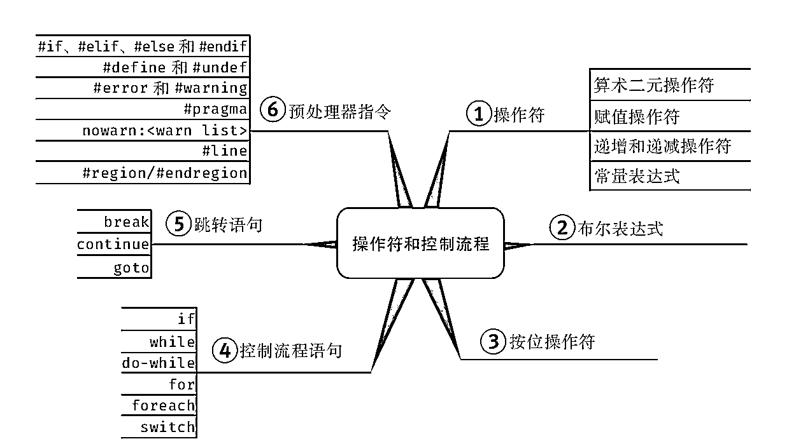

本章学习操作符、控制流程语句和 C#预处理器。操作符提供了对操作数执行各种计算或操作的语法。控制流程语句控制程序的条件逻辑，或多次重复一节代码。在介绍 if 控制流程语句后，本章将探讨布尔表达式的概念，许多控制流程语句都要嵌入这种表达式。还会提到整数不能转换为 bool（显式转型也不行），并讨论这个设计的好处。本章最后讨论 C#预处理器指令。

## 4.1　操作符

第二章学习了预定义数据类型，本节学习如何将操作符应用于这些数据类型来执行各种计算。例如，可对声明好的变量执行计算。

初学者主题：操作符

操作符 对称为操作数 的值（或变量）执行数学或逻辑运算或操作来生成新值（称为结果 ）。例如，代码清单 4.1 有两个操作数 4 和 2，它们被减法操作符（-）组合到一起，结果赋给变量 difference。

代码清单 4.1　简单的操作符例子

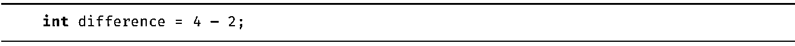

通常将操作符划分为三大类：一元、二元和三元，分别对应着需要一个、两个和三个操作数的操作符。此外，有些操作符以符号的形式呈现，例如+、-、?.或者??等，而另一些操作符则为关键词，例如 default 和 is。本节讨论最基本的一元和二元操作符，三元操作符将在本章后面简略介绍。

### 4.1.1　一元正负操作符

有时需要改变数值的正负号。这时一元负操作符（-）就能派上用场。例如，代码清单 4.2 将当前的美国国债金额变成负值，指明这是欠款。

代码清单 4.2　指定负值^( [\[1\]](part0029.xhtml#ch1_back) ) 

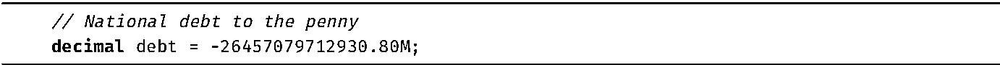

使用一元负操作符等价于从零减去操作数。一元正操作符（+）对值几乎^( [\[2\]](part0029.xhtml#ch2_back) ) 没有影响。它在 C#语言中是多余的，只是出于对称性的考虑才加进来。

### 4.1.2　二元算术操作符

二元操作符要求两个操作数。C#为二元操作符使用中缀记号法：操作符在左右操作数之间。除赋值之外的每个二元操作符的结果必须以某种方式使用（例如作为另一个表达式的操作数）。

语言对比：C++——仅有操作符的语句

和上面提到的规则相反，C++甚至允许像 4+5;这样的二元表达式作为独立语句使用。在 C#中，只有赋值、调用、递增、递减、await 和对象创建表达式才能作为独立语句使用。

代码清单 4.3 是使用二元操作符（更准确地说是二元算术操作符）的例子。算术操作符的每一边都有一个操作数，计算结果赋给一个变量。除了二元减法操作符（-），其他二元算术操作符还有加法（+）、除法（/）、乘法（\*）和取余操作符（%，有时也称为取模操作符）。

代码清单 4.3　使用二元操作符

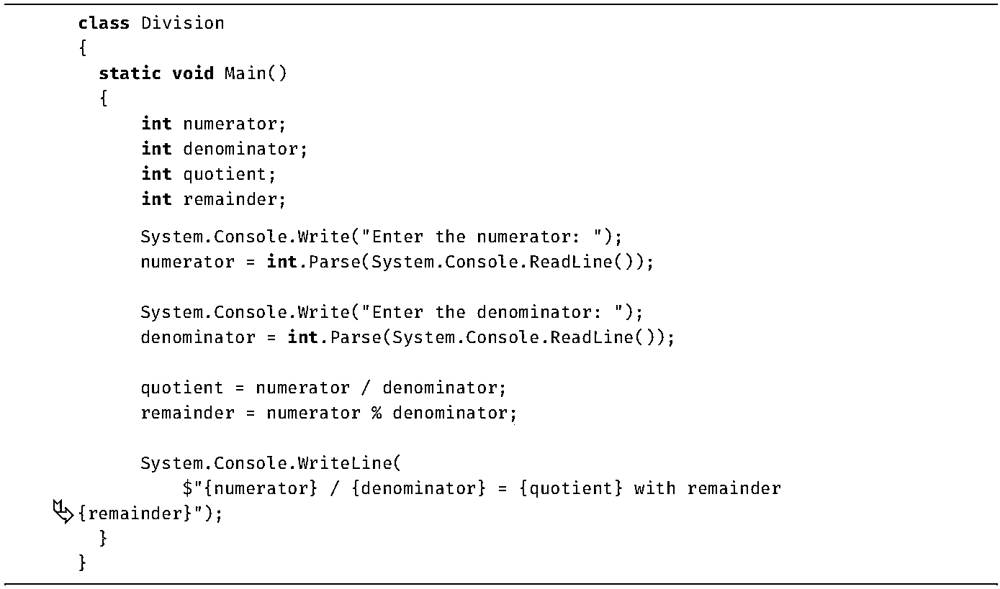

输出 4.1 展示了结果。

输出 4.1

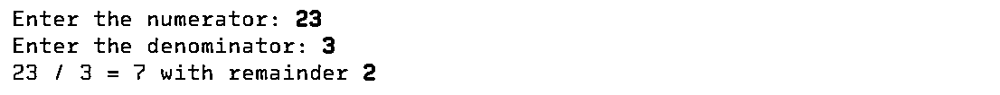

在突出显示的赋值语句中，除法和取余操作先于赋值发生。操作符的执行顺序取决于它们的优先级 和结合性 。迄今为止用过的操作符的优先级如下：

1.\*、/和%具有最高优先级。

2.+和-具有较低优先级。

3.=在 6 个操作符中优先级最低。

所以上例中的语句行为符合预期，除法和取余先于赋值进行。

如忘记对二元操作符的结果进行赋值，会出现如输出 4.2 所示的编译错误。

输出 4.2

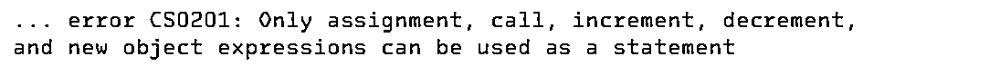

初学者主题：圆括号、结合性、优先级和求值

包含多个操作符的表达式可能让人分不清楚每个操作符的操作数。例如在表达式 x+y\*z 中，很明显表达式 x 是+操作符的操作数，z 是\*操作符的操作数。但 y 是+还是\*的操作数？

圆括号 清楚地将操作数与操作符关联。如希望 y 是被加数，可以写为(x+y)\*z。如希望是被乘数，可以写为 x+(y\*z)。

但包含多个操作符的表达式不一定非要添加圆括号。编译器能根据结合性和优先级判断执行顺序。结合性 决定相似操作符的执行顺序，优先级 决定不相似操作符的执行顺序。

二元操作符可以“左结合”或“右结合”，具体取决于“位于中间”的表达式是从属于左边的操作符，还是从属于右边的操作符。例如，a-b-c 被判定为(a-b)-c，而不是 a-(b-c)。这是因为减法操作符为“左结合”。C#的大多数操作符都是左结合的，赋值操作符右结合。

对于不相似操作符，要根据操作符优先级决定位于中间的操作数从属于哪一边。例如，乘法优先级高于加法，所以表达式 x+y\*z 求值为 x+(y\*z)而不是(x+y)\*z。

但通常好的实践是坚持用圆括号增强代码可读性，即使这样“多余”。例如在执行摄氏-华氏温度换算时，(c\*9.0/5.0)+32.0 比 c\*9.0/5.0+32.0 更易读，即使完全可以省略圆括号。

很明显，相邻的两个操作符，高优先级的先于低优先级的执行。例如 x+y\*z 是先乘后加，乘法结果是加法操作符的右操作数。但要注意，优先级和结合性只影响操作符自身的执行顺序，不影响操作数的求值顺序。

在 C#中，操作数总是从左向右求值。在包含三个方法调用的表达式中，比如 A()+B()\*C()，首先求值 A()，然后 B()，然后 C()，然后乘法操作符决定乘积，最后加法操作符决定和。不能因为 C()是乘法操作数，A()是加法操作数，就认为 C()先于 A()发生。

设计规范

·要用圆括号增加代码的易读性，尤其是在操作符优先级不是让人一目了然的时候。

语言对比：C++——操作数求值顺序

和上述规则相反，C++规范允许不同的实现自行选择操作数求值顺序。对于 A()+B()\*C()这样的表达式，不同的 C++编译器可选择以不同顺序求值函数调用，只要乘积是某个被加数即可。例如，可以选择先求值 B()，再 A()，再 C()，再乘法，最后加法。

将加法操作符用于字符串 

操作符也可用于非数值类型。例如，可用加法操作符连接两个或更多字符串，如代码清单 4.4 所示。

代码清单 4.4　将二元操作符应用于非数值类型

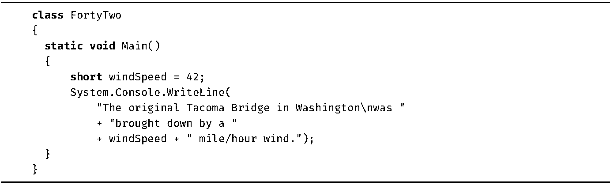

输出 4.3 展示了结果。

输出 4.3

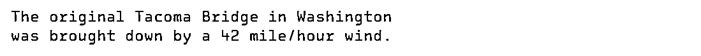

由于不同语言文化的语句结构迥异，所以开发者注意不要对准备本地化的字符串使用加法操作符。类似地，虽然可用 C# 6.0 的字符串插值技术在字符串中嵌入表达式，但其他语言的本地化仍然要求将字符串移至某个资源文件，这使字符串插值没了用武之地。在这种情况下，复合格式化更理想。

设计规范

·要在字符串可能会本地化时用复合格式化而不是加法操作符来连接字符串。

在算术运算中使用字符 

第二章介绍 char 类型时提到，虽然 char 类型存储的是字符而不是数字，但它是“整数的类型”（意味着基于整数）。可以和其他整型一起参与算术运算。但不是基于存储的字符来解释 char 类型的值，而是基于它的基础值。例如，数字 3 用 Unicode 值 0x33（十六进制）表示，换算成十进制值是 51。数字 4 用 Unicode 值 0x34 表示，或十进制 52。如代码清单 4.5 所示，3 和 4 相加获得十六进制值 0x67，即十进制 103，等价于字母 g。

代码清单 4.5　将加法操作符应用于 char 数据类型

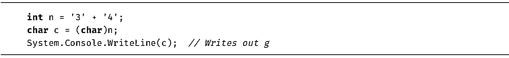

输出 4.4 展示了结果。

输出 4.4

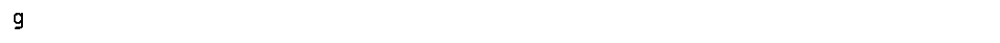

可利用 char 类型的这个特点判断两个字符相距多远。例如，字母 f 与字母 c 有 3 个字符的距离。为获得这个值，可以用字母 f 减去字母 c，如代码清单 4.6 所示。

代码清单 4.6　判断两个字符之间的“距离”

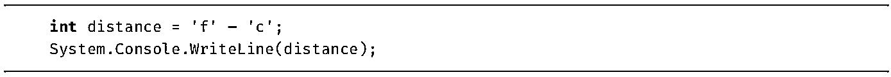

输出 4.5 展示了结果。

输出 4.5

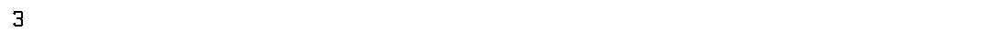

浮点类型的特殊性 

浮点类型 float 和 double 有一些特殊性，比如它们处理精度的方式。本节通过一些实例帮助认识浮点类型的特殊性。

float 具有 7 位精度，能容纳值 1 234 567 和值 0.123 456 7。但这两个 float 值相加的结果会被取整为 1 234 567，因为小数部分超过了 float 能容纳的 7 位有效数字。这种类型的取整有时是致命的，尤其是在执行重复性计算或检查相等性的时候（参见稍后的“高级主题：浮点类型造成非预期的不相等”）。

二进制浮点类型内部存储二进制分数而不是十进制分数。所以一次简单的赋值就可能引发精度问题，例如 double number=140.6F。140.6 的准确值是分数 703/5，但分母不是 2 的整数次幂，所以无法用二进制浮点数准确表示。实际分母是用 float 的 16 位有效数字能表示的最接近的一个值。

由于 double 能容纳比 float 更精确的值，所以 C#编译器实际将该表达式求值为 double number=140.600006103516，这是最接近 140.6F 的二进制分数，但表示成 double 比 140.6 稍大。

设计规范

·避免在需要准确的十进制小数算术运算时使用二进制浮点类型，应使用 decimal 浮点类型。

高级主题：浮点类型造成非预期的不相等

比较两个值是否相等，浮点类型的不准确性可能造成严重后果。有时本应相等的值被错误地判断为不相等，如代码清单 4.7 所示。

代码清单 4.7　浮点类型的不准确性造成非预期的不相等

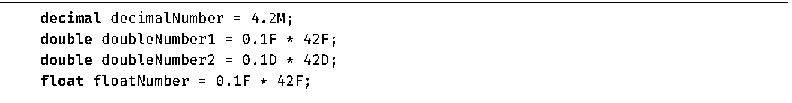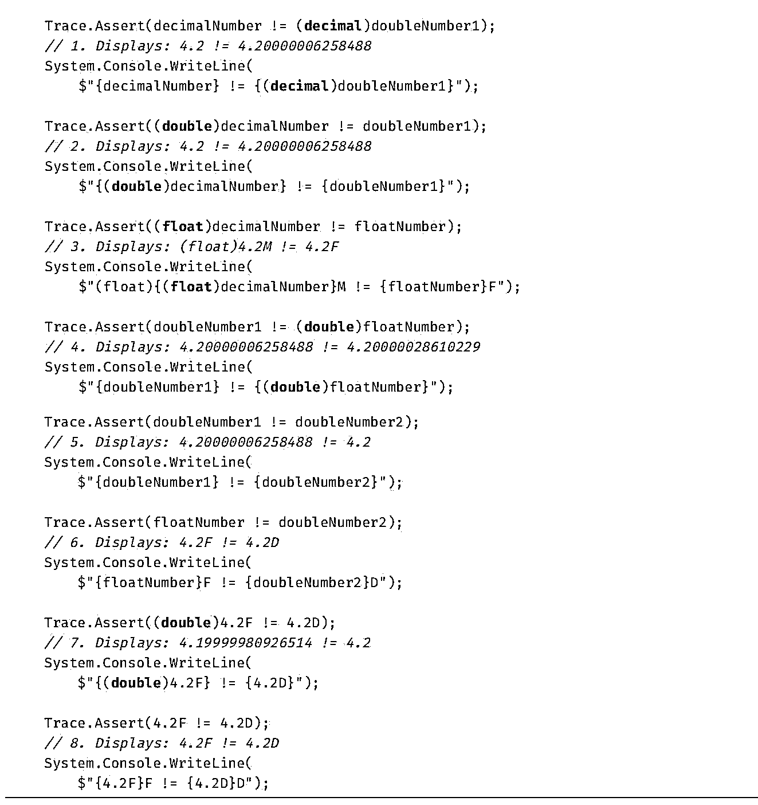

输出 4.6 展示了结果。

输出 4.6

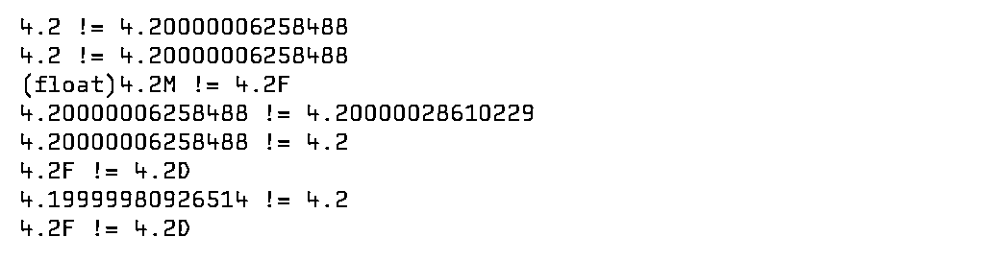

Assert()方法在实参求值为 false 时提醒开发者“断言失败”^( [\[3\]](part0029.xhtml#ch3_back) ) 。但上述代码中的所有 Assert()语句都求值为 true。所以，虽然值理论上应该相等，但由于浮点数的不准确性，它们被错误地判断为不相等。

设计规范

·避免将二进制浮点类型用于相等性条件式。要么判断两个值之差是否在容差范围之内，要么使用 decimal 类型。

浮点类型还有其他特殊性。例如，整数除以零理论上应出错。int 和 decimal 等数据类型确实会如此。但 float 和 double 允许结果是特殊值，如代码清单 4.8 和输出 4.7 所示。

代码清单 4.8　浮点数被零除的结果是 NaN

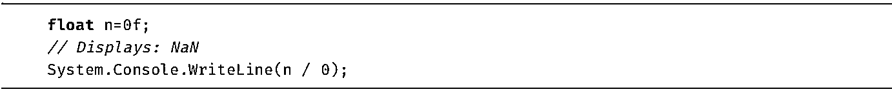

输出 4.7

数学中的特定算术运算是未定义的，例如 0 除以它自己。在 C#中，浮点 0 除以 0 会得到“Not a Number”（非数字）。打印这样的一个数实际输出的就是 NaN。类似地，获取负数的平方根（System.Math.Sqrt(-1)）也会得到 NaN。

浮点数可能溢出边界。例如，float 的上边界约为 3.4×10³⁸ 。一旦溢出，结果数就会存储为“正无穷大”（∞）。类似地，float 的下边界是–3.4×10³⁸ ，溢出会得到“负无穷大”（–∞）。代码清单 4.9 分别生成正负无穷大，输出 4.8 展示了结果。

代码清单 4.9　溢出 float 值边界

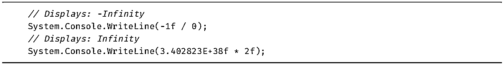

输出 4.8

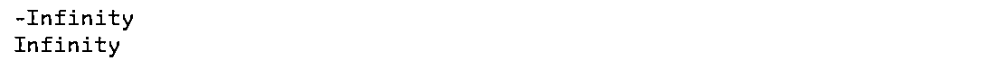

进一步研究浮点数，发现它能包含非常接近零但实际不是零的值。如值超过 float 或 double 类型的阈值，值可能表示成“负零”或者“正零”，具体取决于数是负还是正，并在输出中表示成-0 或者 0。

### 4.1.3　复合赋值操作符

第一章讨论了简单的赋值操作符（=），它将操作符右边的值赋给左边的变量。复合赋值操作符将常见的二元操作符与赋值操作符结合。以代码清单 4.10 为例。

代码清单 4.10　常见的递增计算

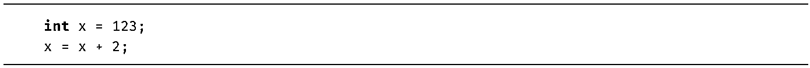

在上述赋值运算中，首先计算 x+2，结果赋回 x。由于这种形式的运算相当普遍，所以专门有一个操作符集成了计算和赋值。+=操作符使左边的变量递增右边的值，如代码清单 4.11 所示。

代码清单 4.11　使用+=操作符

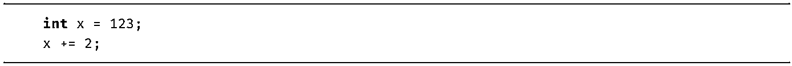

上述代码等价于代码清单 4.10。

还有其他复合赋值操作符提供了类似的功能。赋值操作符还可以和减法、乘法、除法和取余操作符合并，如代码清单 4.12 所示。

代码清单 4.12　其他复合赋值操作符

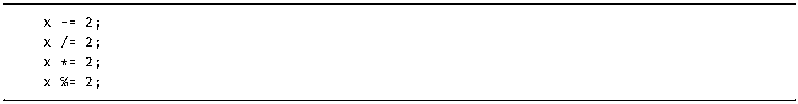

### 4.1.4　递增和递减操作符

C#提供了特殊的一元操作符来实现计数器的递增和递减。递增操作符 （++）每次使一个变量递增 1。所以，代码清单 4.13 每行代码的作用都一样。

代码清单 4.13　递增操作符

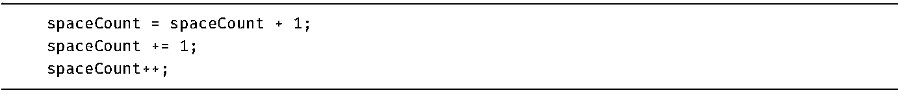

类似地，递减操作符 （--）使变量递减 1。所以，代码清单 4.14 每行代码的作用都一样。

代码清单 4.14　递减操作符

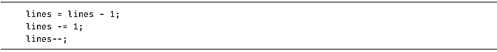

初学者主题：循环中的递减示例

递增和递减操作符在循环（比如稍后要讲到的 while 循环）中经常用到。例如，代码清单 4.15 使用递减操作符逆向遍历字母表的每个字母。

代码清单 4.15　降序显示每个字母的 ASCII 值

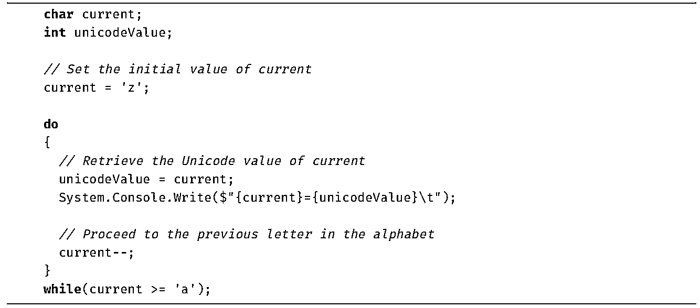

输出 4.9 展示了结果。

输出 4.9

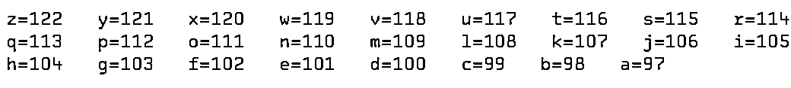

递增和递减操作符用于控制特定操作的执行次数。本例还要注意递减操作符可以应用于字符（char）数据类型。只要数据类型支持“下一个值”和“上一个值”的概念，就适合使用递增和递减操作符。

以前说过，赋值操作符首先计算要赋的值，再执行赋值。赋值操作符的结果是所赋的值。递增和递减操作符与此相似。也是计算要赋的值，执行赋值，再返回结果值。所以赋值操作符可以和递增或递减操作符一起使用。但如果不仔细，可能得到令人困惑的结果。如代码清单 4.16 和输出 4.10 所示。

代码清单 4.16　使用后缀递增操作符

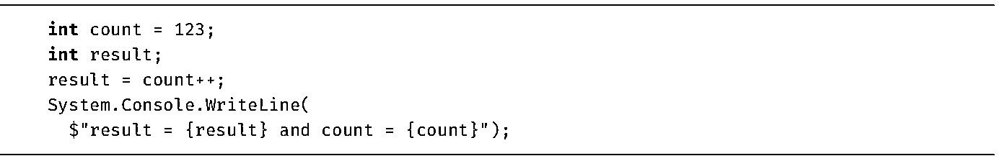

输出 4.10

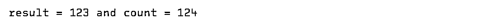

赋给 result 的是 count 递增前的值。递增或递减操作符的位置决定了所赋的值是操作数计算之前还是之后的值。如希望 result 的值是递增/递减后的结果，需要将操作符放在想递增/递减的变量之前，如代码清单 4.17 所示。

代码清单 4.17　使用前缀递增操作符

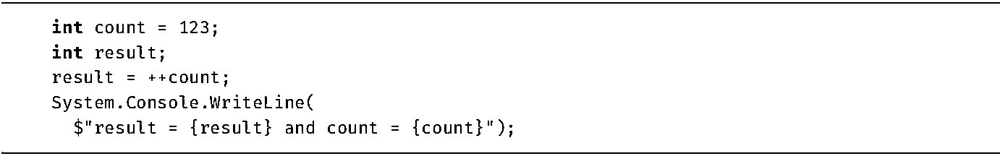

输出 4.11 展示了代码清单 4.17 的结果。

输出 4.11

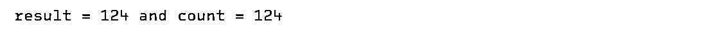

本例的递增操作符出现在操作数之前，所以表达式生成的结果是递增后赋给变量的值。假定 count 为 123，那么++count 将 124 赋给 count，生成的结果是 124。相反，后缀形式 count++将 124 赋给 count，生成的结果是递增前 count 所容纳的值，即 123。无论后缀还是前缀形式，变量 count 都会在表达式的结果生成之前递增，区别在于结果选择哪个值。代码清单 4.18 和输出 4.12 展示了前缀和后缀操作符在行为上的差异。

代码清单 4.18　对比前缀和后缀递增操作符

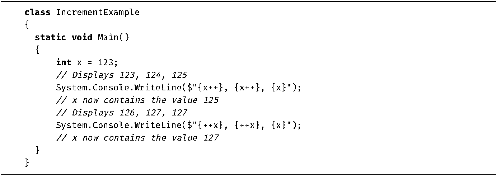

输出 4.12

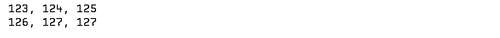

在代码清单 4.18 中，递增和递减操作符相对于操作数的位置影响了表达式的结果。前缀操作符的结果是变量递增/递减之后的值，而后缀操作符的结果是变量递增/递减之前的值。在语句中使用这些操作符应该小心。若心存疑虑，最好独立使用这些操作符（自成一个语句）。这样不仅代码更易读，还可保证不犯错。

语言对比：C++——由实现定义的行为

以前说过，C++的不同实现可任意选择表达式中的操作数的求值顺序，而 C#总是从左向右。类似地，在 C++中实现递增和递减时，可按任何顺序执行递增和递减。例如在 C++中，对于 M(x++, x++)这样的调用，假定 x 初值是 1，那么既可以调用 M(1,2)，也可以调用 M(2,1)，具体由编译器决定。C#则总是调用 M(1,2)，因为 C#做出了两点保证：第一，传给调用的实参总是从左向右计算；第二，总是先将已递增的值赋给变量，再使用表达式的值。这两点 C++都不保证。

设计规范

·避免递增和递减操作符的让人迷惑的用法。

·在 C、C++和 C#之间移植使用了递增和递减操作符的代码要小心。C 和 C++的实现遵循的不一定是和 C#相同的规则。

高级主题：线程安全的递增和递减

虽然递增和递减操作符简化了代码，但两者执行的都不是原子级别的运算。在操作符执行期间，可能发生线程上下文切换，造成竞争条件。可用 lock 语句防止出现竞争条件。但对于简单递增和递减运算，一个代价没有那么高的替代方案是使用由 System.Threading.Interlocked 类提供的线程安全方法 Increment()和 Decrement()。这两个方法依赖处理器的功能来执行快速和线程安全的递增和递减运算（详情参见第十九章）。

### 4.1.5　常量表达式和常量符号

第三章讨论了字面值，或者说直接嵌入代码的值。可用操作符将多个字面值合并到常量表达式 中。根据定义，常量表达式是 C#编译器能在编译时求值的表达式（而不是在运行时才能求值），因为其完全由常量操作数构成。然后，可用常量表达式初始化常量符号，从而为常量值分配名称（类似于局部变量为存储位置分配名称）。例如，可用常量表达式计算一天中的秒数，结果赋给一个常量符号，并在其他表达式中使用该符号。

代码清单 4.19 中的 const 关键字的作用就是声明常量符号。由于常量和“变量”相反（“常”意味着“不可变”），以后在代码中任何修改它的企图都会造成编译时错误。

代码清单 4.19　声明常量

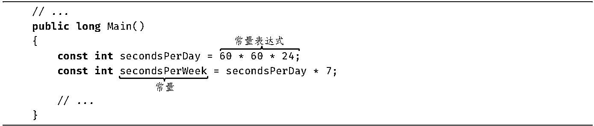

注意赋给 secondsPerWeek 的也是常量表达式。表达式中所有操作数都是常量，编译器能确定结果。

设计规范

·不要用常量表示将来可能改变的任何值。π和金原子的质子数是常量。金价、公司名和程序版本号则应该是变量。

[\[1\]](part0029.xhtml#ch1) 这是 2020 年 7 月 1 日的美国国债数据，数据来自 www.treasurydirect.gov。

[\[2\]](part0029.xhtml#ch2) 一元+操作符定义为获取 int、unit、long、ulong、float、double 和 decimal 类型（以及这些类型的可空版本）的操作数。作用于其他类型（例如 short）时，操作数会相应地转换为上述某个类型。

[\[3\]](part0029.xhtml#ch3) 为了使上述代码顺利编译，请添加 using System.Diagnostics;指令。——译者注

## 4.2　控制流程概述

本章后面的代码清单 4.45 展示了如何以一种简单方式查看一个数的二进制形式。但即便如此简单的程序，不用控制流程语句也写不出来。控制流程语句控制程序的执行路径。本节讨论如何基于条件检查来改变语句的执行顺序。之后将学习如何通过循环构造来反复执行一组语句。

表 4.1 总结了所有控制流程语句。注意“常规语法结构”这一栏给出的只是常见的语句用法，不是完整的词法结构。表 4.1 中的 embedded-statement 是除了加标签的语句或声明之外的任何语句，但通常是代码块。

表 4.1　控制流程语句

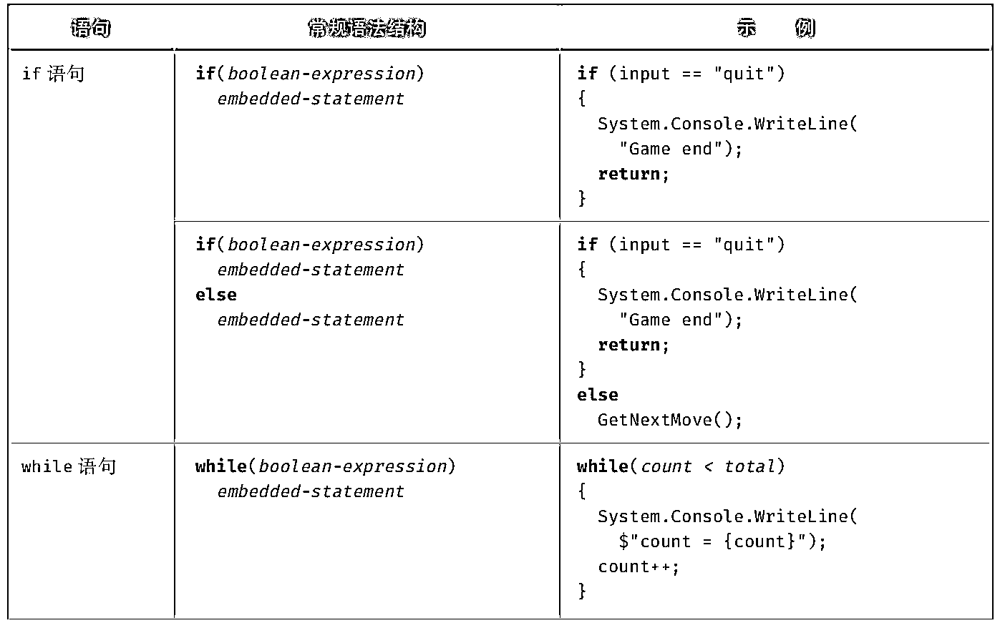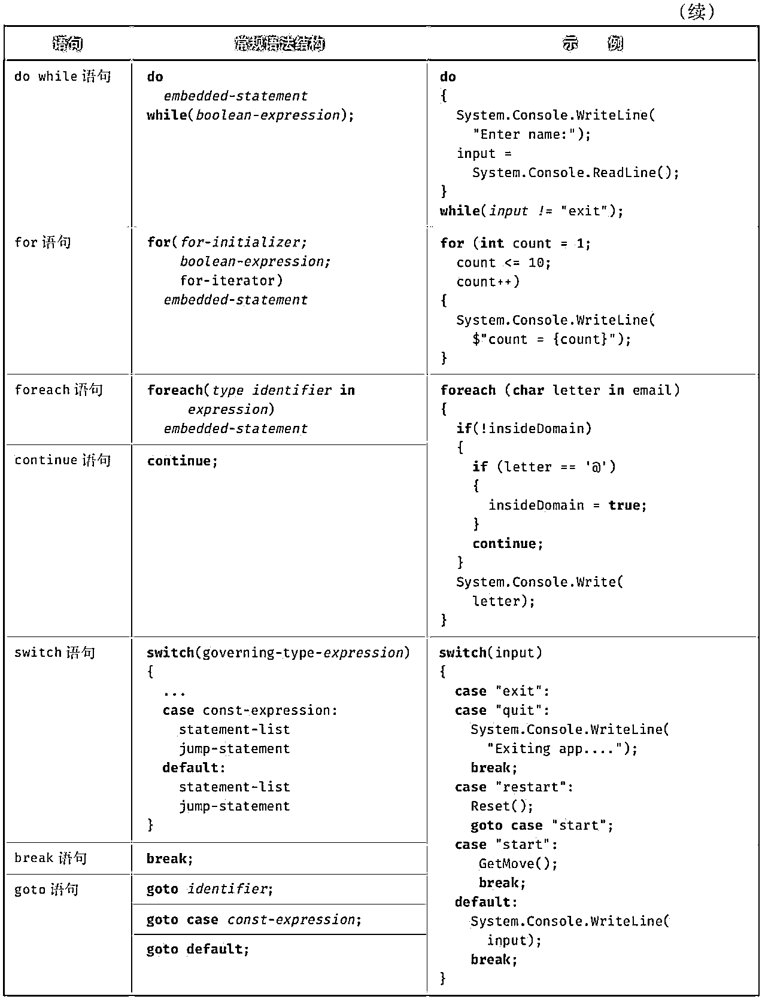

表 4.1 的每个 C#控制流程语句都出现在井字棋程序中，可直接查看第四章的源代码文件 TicTacToe.cs（[`itl.tc/EssentialCSharpSCC`](http://itl.tc/EssentialCSharpSCC) ）。程序显示井字棋棋盘，提示每个玩家走棋，并在每一次走棋之后更新。

本章剩余部分将详细讨论每一种语句。讨论了 if 语句后，要先解释代码块、作用域、布尔表达式以及按位操作符的概念，再讨论其他控制流程语句。由于 C#和其他语言存在很多相似性，部分读者可能发现该表格非常熟悉。这部分读者可直接跳到 4.9 节，或直接跳到本章小结。

### 4.2.1　if 语句

if 语句是 C#最常见的语句之一。它对称为条件 （condition）的布尔表达式 （返回 true 或 false 的表达式）进行求值，条件为 true 将执行后续语句（consequence-statement）。if 语句可以有 else 子句，其中包含在条件为 false 时执行的替代语句（alternative-statement）。常规形式如下：

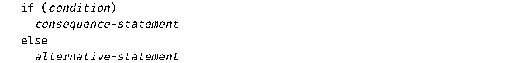

在代码清单 4.20 中，玩家输入 1，程序将显示"Play against computer selected."（人机对战）；否则显示"Play against another player."（双人对战）。

代码清单 4.20　if/else 语句示例

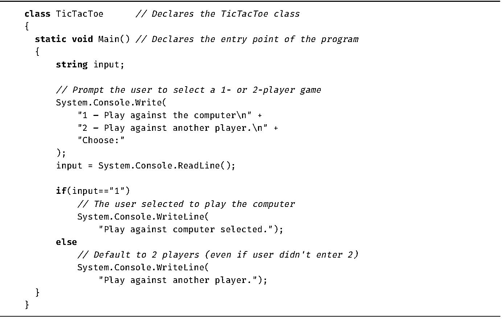

### 4.2.2　嵌套 if

代码有时需要多个 if 语句。代码清单 4.21 首先判断玩家是否通过输入小于或等于 0 的数表示要求退出，若不是就检查用户是否知道井字棋的最大走棋步数。

代码清单 4.21　嵌套 if 语句

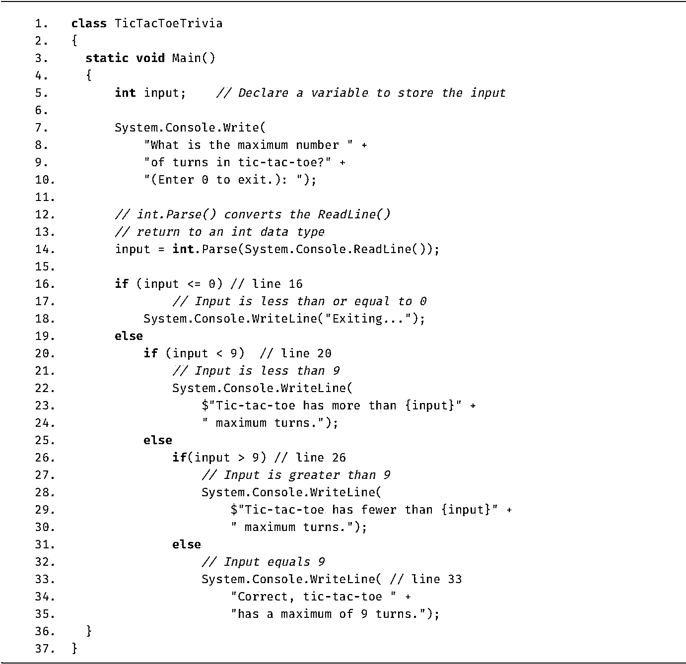

输出 4.13 展示了结果。

输出 4.13

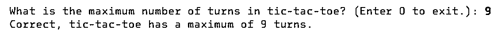

假定第 14 行显示提示时玩家输入 9，那么执行路径如下：

1.第 16 行： 检查 input 是否小于 0。因为不是，所以跳到第 20 行。

2.第 20 行： 检查 input 是否小于 9。因为不是，所以跳到第 26 行。

3.第 26 行： 检查 input 是否大于 9。因为不是，所以跳到第 33 行。

4.第 33 行： 显示答案正确。

代码清单 4.21 使用了嵌套 if 语句。为分清嵌套，代码行进行了缩进。但如第一章所述，空白不影响执行路径。有没有缩进和换行，代码执行起来都一样。代码清单 4.22 展示了嵌套 if 语句的另一种形式，与代码清单 4.21 等价。

代码清单 4.22　if/else 的连贯格式

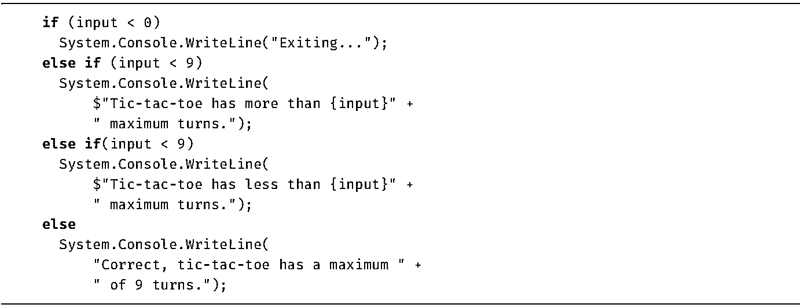

虽然后一种格式更常见，但无论哪种情况，都应选择代码最易读的格式。

上述两个代码清单的 if 语句都省略了大括号。但正如马上就要讲到的那样，这和设计规范不符。规范提倡除了单行语句之外都使用代码块。

## 4.3　代码块

在前面的 if 语句示例中，if 和 else 之后仅跟随了一个 System.Console.WriteLine();语句，如代码清单 4.23 所示。

代码清单 4.23　不需要代码块的 if 语句

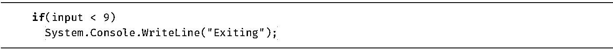

可用大括号将多个语句合并成代码块 ，以实现在符合条件时执行多个语句。例如代码清单 4.24 中突出显示的用于计算半径的代码块。

代码清单 4.24　跟随了代码块的 if 语句

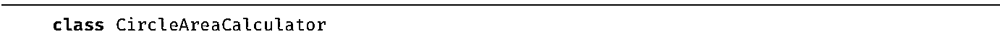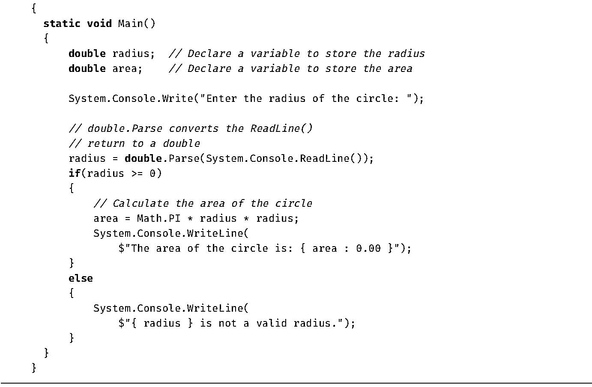

输出 4.14 展示了结果。

输出 4.14

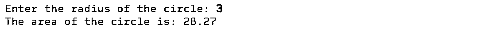

在这个例子中，if 语句检查 radius（半径）是不是正数。如果是，就计算并显示圆的面积；否则显示消息指出半径无效。

注意第一个 if 之后跟随了两个语句，它们被封闭在一对大括号中。大括号将多个语句合并成代码块 。

如去掉代码清单 4.24 中用于创建代码块的大括号，在布尔表达式返回 true 的前提下，只有紧接在 if 语句之后的那条语句才会执行。无论布尔表达式求值结果是什么，后续的语句都会执行。代码清单 4.25 展示了这种无效的代码。

代码清单 4.25　依赖缩进造成无效的代码

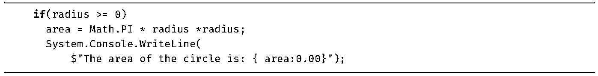

在 C#中，缩进仅用来增强代码的可读性。编译器会忽略它，所以上述代码在语义上等价于代码清单 4.26。

代码清单 4.26　使用大括号的 if 语句

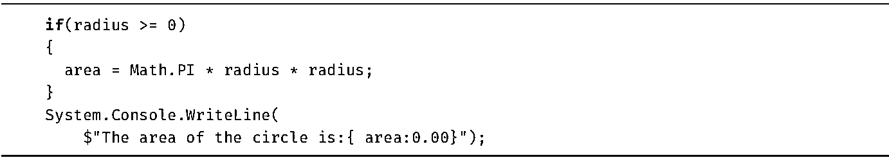

程序员必须防止此类不容易发现的错误。一种比较极端的做法是，无论如何都在控制流程语句之后包括代码块，即使其中只有一个语句。事实上，设计规范是除非是最简单的单行 if 语句，否则避免省略大括号。

虽然比较少见，但也可独立使用代码块，它在语义上不属于任何控制流程语句。换言之，大括号可自成一体（例如没有条件或循环），这完全合法。

上述两个代码清单的π值用 System.Math 类的 PI 常量表示。编程时不要硬编码π和 e（自然对数的底），请用 System.Math.PI 或 System.Math.E。

设计规范

·除非使用最简单的单行 if 语句，否则避免省略大括号

## 4.4　代码块、作用域和声明空间

代码块 经常被称为作用域 ，但两个术语并不完全可以互换。具名事物的作用域是源代码的一个区域。可在该区域使用非限定名称（前面不加限定前缀的名称）引用该事物。局部变量的作用域就是封闭它的代码块。这正是经常将代码块称为“作用域”的原因。

作用域经常和声明空间 混淆。声明空间是具名事物的逻辑容器。该容器中不能存在同名的两个事物。代码块不仅定义了作用域，还定义了局部变量声明空间。同一个声明空间中，不允许声明两个同名的局部变量。在声明局部变量的代码块外部，没有办法用局部变量的名称引用它，这时说局部变量“超出作用域”。类似地，不能在同一个类中声明具有 Main()签名的两个方法。（方法的规则有一些放宽：在同一个声明空间中，允许存在签名不同的两个同名方法。方法的签名包括它的名称和参数的数量/类型。）

简单地说，作用域决定一个名称引用什么事物，而声明空间决定同名的两个事物是否冲突。在代码清单 4.27 中，是在 if 语句主体声明局部变量 message，这就将它的作用域限制在 if 主体。要纠正错误，必须在 if 语句外部声明该变量。

代码清单 4.27　变量在其作用域外无法访问

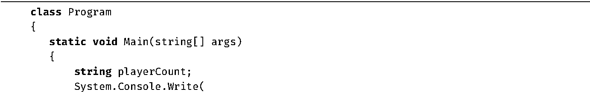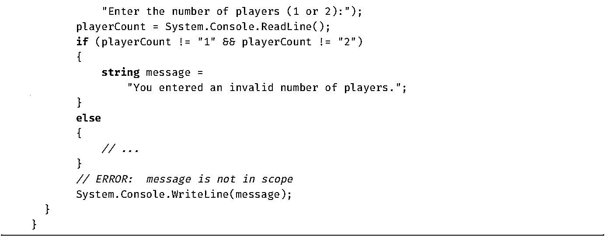

输出 4.15 展示了结果。

输出 4.15

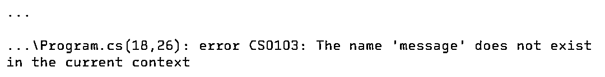

局部变量名称必须唯一的声明空间包含最初声明局部变量的块中以文本形式包含的所有子代码块。C#编译器禁止一个代码块中声明（或作为参数声明）的局部变量在其子代码块中重复声明。总之，一个变量的声明空间是当前代码块以及它的所有子代码块。在代码清单 4.27 中，由于 args 和 playerCount 在方法的代码块（方法主体）中声明，所以在这个代码块的任何地方（包括子代码块）都不能再次声明。

message 这个名称仅在 if 块中可用，在外部不能使用。类似地，playerCount 在整个方法（包括 if 和 else 子代码块）中引用的都是同一个变量。

语言对比：C++——局部变量作用域

在 C++中，对于块中声明的局部变量，它的作用域从声明位置开始，到块尾结束。声明前对局部变量的引用会失败，因为局部变量此时不在作用域内。如果此时有另一个同名的事物在作用域中，C++会将名称解析成对那个事物的引用，而这可能不是你的原意。C#的规则稍有不同，对于声明局部变量的那个块，局部变量都在作用域中，但声明前引用它属于非法。换言之，此时局部变量合法存在，但使用非法。只有在声明后的位置使用才合法。这是 C#防止像 C++那样出现不容易察觉之错误的众多规则之一。

## 4.5　布尔表达式

if 语句中包含在圆括号内的部分是布尔表达式 ，称为条件 。代码清单 4.28 突出显示了条件。

代码清单 4.28　布尔表达式

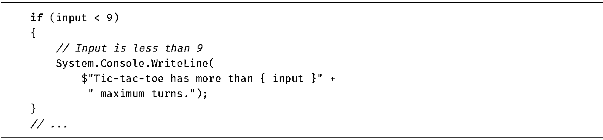

许多控制流程语句都要使用布尔表达式，其关键特征在于总是求值为 true 或 false。input<9 要成为布尔表达式就必须返回 bool 值。例如，编译器不允许将布尔表达式写成 x=42，因为它的作用是对 x 进行赋值，并返回新值，而不是检查 x 的值是否等于 42。

语言对比：C++——错误地使用=来代替==

C#消除了 C/C++的一个常见的编码错误。代码清单 4.29 在 C++中不会出错。

代码清单 4.29　C++允许将赋值作为条件

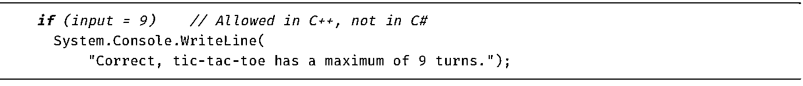

虽然上述代码表面上是检查 input 是否等于 9，但正如第一章讲过的那样，=代表的是赋值操作符，而不是检查相等性的操作符。从赋值操作符返回的是赋给变量的值，本例中就是 9。然而，作为 int 的 9 无法被判定为布尔表达式，所以是 C#编译器不允许的。C 和 C++将非零整数视为 true，将零视为 false。相反，C#要求条件必须是布尔类型，不允许整数。

### 4.5.1　关系操作符和相等操作符

关系和相等操作符判断一个值是否大于、小于或等于另一个值。表 4.2 总结了所有关系和相等操作符。它们都是二元操作符。

表 4.2　关系和相等操作符

和其他许多编程语言一样，C#使用相等操作符==来测试相等性。例如，判断 input 是否等于 9 要使用 input==9。相等操作符使用两个等号，赋值操作符则使用一个。C#的惊叹号代表 NOT，所以用于测试不等性的操作符是!=。

关系和相等操作符总是生成 bool 值，如代码清单 4.30 所示。

代码清单 4.30　将关系操作符的结果赋给 bool 变量

井字棋程序的完整代码清单使用相等操作符判断玩家是否退出游戏。代码清单 4.31 的布尔表达式包含一个 OR（||）逻辑操作符，下一节将详细讨论它。

代码清单 4.31　在布尔表达式中使用相等操作符

### 4.5.2　逻辑操作符

逻辑操作符 获取布尔操作数并生成布尔结果。可用逻辑操作符合并多个布尔表达式来构成更复杂的布尔表达式。逻辑操作符包括|、||、&、&&和^，对应 OR、AND 和 XOR（异或）。OR 和 AND 的|和&版本很少用，原因稍后讨论。

OR 操作符 

在代码清单 4.31 中，如果玩家输入 quit，或直接按回车键而不输入任何值，就认为想退出程序。为了允许玩家以两种方式退出，程序使用了逻辑 OR 操作符||。||操作符对两个布尔表达式进行求值，任何 一个为 true 就返回 true，如代码清单 4.32 所示。

代码清单 4.32　使用 OR 操作符

注意使用布尔 OR 操作符时，不一定每次都要对操作符两边的表达式进行求值。和 C#的所有操作符一样，OR 操作符从左向右求值，所以假如左边求值为 true，那么右边可以忽略。换言之，如 hourOfTheDay 的值为 33，那么(hourOfTheDay > 23)会返回 true，所以 OR 操作符会忽略右侧表达式。这种短路 求值方式同样适合布尔 AND 操作符。注意，此处不需要括号，逻辑操作符的优先级低于关系操作符。然而，对于新手读者来说，在子表达式中加括号更为清晰。

AND 操作符 

布尔 AND 操作符&&在两个操作数求值都为 true 的前提下才返回 true。任何操作数为 false 都会返回 false。

代码清单 4.33 判断当前小时数是否大于 10 且小于 24^( [\[1\]](part0033.xhtml#ch1_back) ) 。如同时满足这两个条件，就输出一条消息表明当前是工作时间。和 OR 操作符一样，AND 操作符也并非每次都要对右边的表达式进行求值。如左边的操作数返回 false，则不管右边的操作数是什么，最终结果肯定为 false，所以“运行时”会忽略右边的操作数。

代码清单 4.33　使用 AND 操作符

XOR 操作符 

^符号是异或（Exclusive OR，XOR）操作符。若应用于两个布尔操作数，那么只有在两个操作数中仅有一个为 true 的前提下，XOR 操作符才会返回 true，如表 4.3 所示。

与布尔 AND 和 OR 操作符不同，布尔 XOR 操作符不支持短路运算。它始终都要检查两个操作数，因为除非确切知道两个操作数的值，否则不能判定最终结果。注意将表 4.3 的 XOR 操作符换成!=操作符，结果完全一样。

表 4.3　XOR 运算表

### 4.5.3　逻辑求反操作符

逻辑求反操作符 （!）有时也称为 NOT 操作符，作用是反转一个 bool 数据类型的值。它是一元操作符，只需一个操作数。代码清单 4.34 演示了它如何工作，输出 4.16 展示了结果。

代码清单 4.34　使用逻辑求反操作符

输出 4.16

valid 最开始的值为 false。求反操作符对 valid 的值取反，将新值赋给 result。

### 4.5.4　条件操作符

可用条件操作符取代 if-else 语句来选择两个值中的一个。条件操作符同时使用一个问号和一个冒号，常规格式如下：

条件操作符是三元操作符，需要三个操作数：condition、consequence 和 alternative。（由于它是 C#中唯一的三元操作符，因此通常称为三元操作符，但用它的名称来称呼它比用操作数数量更清楚。）类似于逻辑操作符，条件操作符也采用了某种形式的短路求值。如 condition 求值为 true，则条件操作符只求值 consequence；否则只求值 alternative。操作符的结果是被求值的表达式。

代码清单 4.35 展示了如何使用条件操作符。该程序的完整清单是 Chapter03\\TicTacToe.cs。

代码清单 4.35　条件操作符

程序作用是交换当前玩家。它检查当前值是否为 2。这是条件语句的 condition 部分。如结果为 true，条件操作符返回 consequence 值 1；否则返回 alternative 值 2。和 if 语句不同，条件操作符的结果必须赋给某个变量（或作为参数传递），不能自成语句。

设计规范

·考虑使用 if/else 语句而不是过于复杂的条件表达式。

C#语言要求条件操作符的 consequence 和 alternative 表达式类型一致，而且在判定类型时不会检查表达式的上下文。例如，f ? "abc" : 123 不是合法的条件表达式，因为 consequence 和 alternative 分别是字符串和数字，相互不能转换。即使 object result=f ? "abc" : 123;这样的语句，C#编译器也会认为非法，因为兼容两个表达式的类型（这里是 object）在条件表达式的外部。

[\[1\]](part0033.xhtml#ch1) 程序员典型的工作时间。

## 4.6　关于 null 的编程

第三章提到，null 值非常重要，但它也带来了一些挑战，比如：通过引用型变量调用一个对象的方法之前，需要确保该变量的值不为 null。此外，有时为一个值为 null 的变量设置一个恰当的有效值也不是一件容易的事。

除了可以使用相等操作符甚至关系操作符来检查 null 值之外，还有很多其他方式可以让程序很好地处理 null 值情形。比如，C# 7.0 中被加强的 is 操作符就比相等操作符更适合检查 null 值，此外，空合并操作符（包括 C# 8.0 中的空合并操作符赋值语句）、空条件操作符也可以帮助处理 null 值。当编译器不知道一个变量的值是否为 null，但是程序员相信其值不为 null 时，还可以用空包容操作符告诉编译器该变量不会为 null。下面我们先从简单的判断 null 值开始介绍相关知识。

### 4.6.1　检查 null 值

下面的表 4.4 介绍了多种可以检查 null 值的方法。

表 4.4　检查 null 值的方法

检查 null 值的方法很多，自然会带来一个疑问：使用哪一个方法更好？在 C# 6.0 以及更早，相等操作符、不等性操作符，以及 is object 是仅有的选择。C# 7.0 加强了 is 操作符后，也可以用 is null 来检测。事实上使用 is null 更好，因为它的行为不会被更改，因此不用担心程序的效率问题。从 C# 8.0 开始，也可以用 is {}来代替 is object，只不过它有些不够直观。

总之，在 C# 7.0 之后，推荐使用 is object 或者 is null，而在 C# 7.0 之前，如果能确保没有重载相等操作符，则推荐使用==null 来判断 null 值，因为这个语法清晰易懂，如果不确定是否有重载，则使用 Object.ReferenceEquals(<target>, null)来判断会更加稳妥。

上面 4.4 中的第 2 行和第 3 行所涉及的模式匹配操作符将在第七章进行更详细的介绍。

### 4.6.2　空合并操作符与空合并赋值操作符

空合并操作符 ??能简单地表示“如果这个值为空，就使用另一个值”，其形式如下：

??操作符支持短路求值。如 expression1 不为 null，就返回 expression1 的值，另一个表达式不求值。如 expression1 求值为 null，就返回 expression2 的值。和条件操作符不同，空合并操作符是二元操作符。

代码清单 4.36 是使用空合并操作符的例子。

代码清单 4.36　空合并操作符

如果 GetFileName()方法返回 null，空合并操作符便会将 fullName 设置为"default.txt"。否则，fullName 被设置为 GetFileName()方法返回的值。

空合并操作符能完美“链接”。例如，对于表达式 x ?? y ?? z，x 不为 null 将返回 x；x 为 null 且 y 不为 null 将返回 y；否则返回 z。也就是说，从左向右选出第一个非 null 表达式。之前所有表达式都为 null，就选择最后一个。在代码清单 4.36 中，对变量 directory 的赋值便是空合并操作符链接特性的应用示例。

C# 8.0 引入了空合并赋值操作符，可以简单地理解为：如果等于号左侧的变量不为 null，则维持其原值不变，否则将用等于号右侧表达式的值对等于号左侧的变量进行赋值。代码清单 4.36 中，对变量 fullName 的赋值使用了空合并赋值操作符。

### 4.6.3　空条件操作符

由于调用成员前经常要检查变量的值是否为 null，因此 C# 6.0 引入了?.操作符，称为空条件操作符 ，如代码清单 4.37 所示。

代码清单 4.37　空条件操作符

调用方法或属性（Length）前，空条件操作符检查操作数（第一个 segments）是否为 null。segments?.Length 逻辑上等价于以下代码（虽然在 C# 6.0 语法中 segments 只求值一次）：

关于空条件操作符，有非常重要的一点需要注意：它产生的运算结果永远是可空类型。在前面的例子中，即使 string.Length 是一个不可空的 int 类型值，但当我们通过可空操作符来访问 Length 属性时，得到的将是一个可空的 int 值（即 int?）。

空条件操作符也可以用于访问数组。例如通过 segments?\[0\]将在 segments 不为 null 的前提下获得数组的首元素。通过空条件操作符访问数组的情形并不多见，因为能够这样做的前提是：你不确定数组变量是否不为 null，但确切地知道数组的元素数量，或者至少知道将要访问的元素是存在的。

空条件操作符最方便之处在于可“链接”（使用或者不使用空合并操作符均可）。例如，在下面的示例代码中，ToLower()和 StartsWith()都只有在 segments 以及 segments\[0\]均不为 null 的前提下才会调用：

上面代码假设 segments 数组中的元素有可能为 null。因此，segments 数组应该像下面这样来声明（假设使用 C# 8.0）：

上面代码将 segments 数组及其元素均声明为可空。

空条件表达式链接起来后，如第一个操作数为 null，表达式求值会被短路，调用链中不再发生其他调用。也可以在整个表达式的末尾追加空合并操作符，这样一来，如果前面的表达式运算的结果为 null，则可以自动获得默认值：

与空条件操作符不同的是，空合并操作符未必返回可空的值。在上面的代码中，如果空合并操作符右侧的值不为空，而整个表达式恰好返回了这个值，则此时返回的是字符串字面量"intellitech.com"，显然是一个不可空的值。

此外，注意不要遗漏额外的空条件操作符。例如，假定（只是假定）ToLower()也返回 null 会发生什么？这样在调用 StartsWith()时仍会抛出 NullReferenceException 异常。但这并不是说一定要使用一个空条件操作符链，而是说应关注程序逻辑。本例由于 ToLower()永远不为空，所以无须额外的空条件操作符。

虽然有点怪（和其他操作符行为相比），但只在调用链最后才生成可空值类型的值。结果是在 Length 上调用点（.）操作符只允许调用 int（而非 int?）的成员。但将 segments?.Length 放到圆括号中（从而强制先求值 int?）就可以在 int?的返回值上调用 Nullable<T>类型的特殊成员（HasValue 和 Value）了。

### 4.6.4　空包容操作符

你可能注意到了，在代码清单 4.37 中，调用 Join()方法时使用了一个叹号：

这段代码先检查了 length 变量是否为有效值。根据代码中的逻辑，如果 length 不为 null 并且不等于 0，则说明 segments 数组也不为 null 并且有大于 0 个元素，所以此时可以安全地调用 Join()方法。

然而，编译器有能力做出同样的判断。但是，由于 Join()方法要求第二个参数不为空，因此如果直接将未赋值的可空型变量 segments 作为参数，则会产生编译器警告。在 C# 8.0 中可以使用空包容操作符 (!)来避免该警告。该操作符告诉编译器程序员可以保证某个变量一定不为 null 值，从而在编译时，编译器会相信程序员的保证而不再产生警告信息。（但是在程序执行的时候，运行时库仍然会检查 null 值。）

不幸的是，上面代码中的例子存在一定的风险，因为前面 length 那一行中的空条件操作符给人一种安全的错觉，认为 segments 数组不为空，则数组里面的元素也一定存在。但实际上即便在一个非空的数组中，也可以存在值为 null 的元素。

高级主题：空条件操作符应用于委托

空条件操作符本身已是极好的功能。它和委托调用配合，更是解决了自 C# 1.0 版本以来的一个大问题。注意下例代码清单 4.38 中，先将 PropertyChange 事件处理程序赋给一个局部拷贝（propertyChanged），再执行空检查，非空则引发事件。这是以最简单的线程安全的方式来调用事件，可防范在空检查和引发事件之间发生的事件被取消的风险。但该模式并不直观，经常会有开发者不遵守。结果就是抛出让人摸不着头脑的 NullReferenceException。幸好，C# 6.0 的空条件操作符解决了该问题。现在，委托值的空检查从以下代码：

代码清单 4.38　空条件操作符在事件处理程序中的应用

变成了以下更优雅的代码：

事件即委托，所以通过空条件操作符和 Invoke()来调用委托也完全可行。

## 4.7　按位操作符

几乎所有编程语言都提供了一套按位操作符来处理值的二进制形式。

初学者主题：位和字节

计算机的所有值都表示成 1 和 0 的二进制形式，这些 1 和 0 称为二进制位 （bit）。8 位一组称为字节 （byte）。一个字节中每个连续的位都对应 2 的一个乘幂。其中，最右边的位对应 2⁰ ，最左边的对应 2⁷ ，如图 4.1 所示。

图 4.1　对应的占位值

在许多情况下，尤其是在操作低级设备或系统服务的时候，信息是以二进制数据的形式获取的。操作这些设备和服务需要处理二进制数据。

如图 4.2 所示，每个框都对应 2 的某个乘幂。字节（8 位构成的一个数）的值是含有 1 的所有位的 2 的乘幂之和。

图 4.2　计算无符号字节的值

对于有符号的数，二进制转换则有很大的不同。有符号的数（long、short、int）使用 2 的补数记数法表示。所以将负数加到正数上时，加法运算可以照常进行，就好像两个数都是正数。使用这种记数法，负数在行为上有别于正数。负数通过最左侧的 1 来标识。如果最左边的位置包含 1，就要将含有 0 的位置加到一起，而不是将含有 1 的位置加到一起。每个位置都对应负的“2 的乘幂”。此外结果还要减 1。图 4.3 对此进行了演示。

图 4.3　计算有符号字节的值

所以，1111 1111 1111 1111 对应-1，1111 1111 1111 1001 对应-7，而 1000 0000 0000 0000 对应 16 位整数能容纳的最小负值。

### 4.7.1　移位操作符

有时要将一个数的二进制值向右或向左移位。左移时，所有位都向左移动由操作符右侧的操作数指定的位数。移位后在右边留下的空位由零填充。右移位操作符原理相似，只是朝相反方向移位；但如果是负数，左侧填充 1 而非 0。两个移位操作符是>>和<<，分别称为右移位和左移位操作符。除此之外，还有复合移位和赋值操作符<<=和>>=。

例如 int 值-7，其二进制形式为 1111 1111 1111 1111 1111 1111 1111 1001。代码清单 4.39 使其右移 2 个位置。

代码清单 4.39　使用右移位操作符

输出 4.17 展示了代码清单 4.39 的结果。

输出 4.17

右移位时最右侧的位在边界处“离开”，左边的负数位标识符右移两个位置，腾出来的空白位置用 1 填充。最终结果是-2。

虽然传说 x << 2 比 x\*4 快，但不要将移位操作符用于乘除法。20 世纪 70 年代的一些 C 编译器可能确实如此，但现代微处理器都对算术运算进行了完美的优化。通过移位进行乘除令人迷惑，而且假如维护代码的人忘记移位操作符的优先级低于算术操作符，还很容易造成错误。

### 4.7.2　按位操作符

有时需要对两个操作数执行逐位的逻辑运算，比如 AND、OR 和 XOR 等，这分别是用&、|和^操作符来实现的。

初学者主题：理解逻辑操作符

假定有如图 4.4 所示的两个数，按位操作符从最左边的位开始逐位进行逻辑运算，直到最右边的位为止。值 1 被视为 true，值 0 被视为 false。

图 4.4　12 和 7 的二进制形式

所以，对图 4.4 的两个值执行按位 AND 运算，会逐位比较第一个操作数（12）和第二个操作数（7），得到二进制值 000000100，也就是十进制 4。另外，这两个值的按位 OR 运算结果是 00001111，也就是十进制 15。XOR 结果是 00001011，也就是十进制 11。

代码清单 4.40 演示了如何使用这些按位操作符，结果如输出 4.18 所示。

代码清单 4.40　使用按位操作符

输出 4.18

在代码清单 4.40 中，值 7 称为掩码 ，作用是通过特定的操作符表达式，公开（expose）或消除（eliminate）第一个操作数中特定的位。注意和 AND (&&)操作符不同，&操作符总是两边求值，即使左边为 false。类似地，OR 操作符的|版本也不进行“短路求值”。即使左边的操作数为 true，右边也要求值。总之，AND 和 OR 操作符的按位版本不进行“短路求值”。

将一个数转换成二进制需迭代它的每一位。代码清单 4.41 展示了如何将整数转换成二进制形式的字符串，输出 4.19 展示了结果。

代码清单 4.41　获取二进制形式的字符串表示

输出 4.19

注意，每次 for 循环（稍后就会讨论）都使用右移位赋值操作符创建与变量 value 中的每一位对应的掩码。使用按位操作符&，可判断一个特定的位是否已设置（是否设为 1）。如掩码测试生成非零结果，就将 1 写到控制台，否则写 0。这样可真实反映一个无符号长整数的二进制形式。

注意(mask & value) !=0 中的圆括号是必需的，因为不相等测试的优先级高于 AND 操作符。不显式添加圆括号就相当于 mask & (value !=0)。这没有任何意义，&左侧是一个 ulong，右侧是一个 bool。

本例仅供参考，有内建的 CLR 方法 System.Convert.ToString(value, 2)可直接执行这个转换。第二个参数指定进制（2 代表二进制，10 代表十进制，16 代表十六进制）。

### 4.7.3　按位复合赋值操作符

按位操作符也可以和赋值操作符合并，即&=、|=和^=。例如，可让变量与一个数进行 OR 运算，结果赋回初始变量，代码清单 4.42 进行了演示。

代码清单 4.42　使用逻辑赋值操作符

输出 4.20 展示了结果。

输出 4.20

使用 fields &=mask 这样的表达式将位映射与掩码合并，会从 fields 中消除 mask 中没有设置的位。相反，fields &=~mask 从 fields 中消除 mask 中已设置的位。

### 4.7.4　按位取反操作符

按位取反操作符反转操作数的每一位，操作数可以是 int、uint、long 和 ulong 类型。例如，~1 返回 1111 1111 1111 1111 1111 1111 1111 1110，而~(1<<31)返回 0111 1111 1111 1111 1111 1111 1111 1111。

## 4.8　控制流程语句

在更详细地探讨了布尔表达式之后，我们就可以更清楚地描述 C#支持的控制流程语句。有经验的程序员已熟悉了其中许多语句，所以可快速浏览本节内容，找出 C#特有的信息。特别是 foreach 循环，它对许多程序员来说是新的。

### 4.8.1　while 和 do/while 循环

目前学习的都是只执行一遍的程序。但计算机的关键优势之一是能多次执行相同操作。为此需要创建指令循环。本节讨论的第一个指令循环是 while 循环，它是最简单的条件循环。while 语句的常规形式如下：

条件（condition）必须是布尔表达式，只要它求值为 true，作为循环主体的语句（statement）就会反复执行。如果条件求值为 false，就跳过循环主体，从它之后的语句执行。注意循环主体会一直执行，即使这个过程中条件变成 false。除非回到“循环顶部”重新求值条件，而且结果是 false，否则循环不会退出。代码清单 4.43 用一个斐波那契计算器演示了 while 循环语句的用法。  

代码清单 4.43　while 循环示例

斐波那契数 是斐波那契数列 的成员，数列中所有数都是数列中前两个数之和。数列最开头两个数是 1 和 1。代码清单 4.43 中提示输入整数，使用 while 循环寻找比输入的数大的第一个斐波那契数。

初学者主题：何时使用 while 循环

本章剩余部分会讲到其他使代码块反复执行的循环结构。术语循环主体指的是 while 结构中执行的语句（通常是代码块）。这是因为在达成退出条件之前，代码会一直“循环”。需要明白在什么时候选择什么循环结构。如条件为 true 就一直执行某个操作，就选择 while 结构。for 主要用于重复次数已知的循环，比如从 0～n 的计数。do/while 类似于 while 循环，区别在于循环主体至少执行一次。

do/while 循环与 while 循环非常相似，只是最适合需要循环 1～n 次的情况，而且 n 在循环开始前无法确定。这个模式经常用于提示用户输入。代码清单 4.44 是从井字棋程序中提取出来的。

代码清单 4.44　do/while 循环示例

代码清单 4.44 在每次迭代 ^( [\[1\]](part0036.xhtml#ch1_back) ) 或循环开始的时候将 valid 设为 false。接着提示并获取用户输入的数。虽然这部分在代码中省略了，但接下来的操作是检查输入是否正确。如正确，就将 true 赋给 valid。由于代码使用 do/while 而不是 while 语句，所以至少提示用户输入一次。

do/while 循环的常规形式如下：

和所有控制流程语句一样，循环主体通常是代码块，以便执行多个语句。但也可将单一语句作为循环主体（标签语句和局部变量声明除外）。

### 4.8.2　for 循环

for 循环反复执行代码块直至满足指定条件。这一点与 while 循环非常相似。区别在于，for 循环有一套内建的语法规定了如何初始化、递增以及测试一个计数器的值。该计数器称为循环变量 。由于循环语法中专门有一个位置是为递增/递减操作保留的，所以递增/递减操作符经常作为 for 循环的一部分使用。

代码清单 4.45 展示了如何使用 for 循环显示整数的二进制形式。输出 4.21 展示了结果。

代码清单 4.45　使用 for 循环

输出 4.21

代码清单 4.45 执行位掩码 64 次，对用户输入的数中的每一位都应用一次。for 循环头部包含三个部分。第一部分声明并初始化变量 count，第二部分描述 for 循环主体的执行条件，第三部分描述如何更新循环变量。for 循环的常规形式如下：

下面解释了 for 循环的各个部分。

·initial（初始化）执行首次迭代前的初始化操作。在代码清单 4.45 中，它声明并初始化 count 变量。initial 表达式不一定非要声明新变量。例如，可事先声明好变量，在 for 循环中只将其初始化。也可完全省略该部分。如在这里声明变量，其作用域仅限于 for 语句头部和主体。

·condition（条件）指定循环结束条件。条件为 false 终止循环，这和 while 循环一样。只有条件求值为 true 才会执行 for 循环主体。本例在 count 大于或等于 64 时退出循环。

·loop（循环）表达式在每次迭代后求值。本例的循环表达式 count++会在 mask 右移位（mask >>=1）之后，对条件求值之前执行。第 64 次迭代时 count 递增到 64，造成条件变成 false，因而终止循环。

·statement（语句）是在条件表达式为 true 时执行的“循环主体”代码。

代码清单 4.45 的 for 循环的执行步骤可用以下伪代码表示：

1.声明 count 并将其初始化为 0。

2.如 count 小于 64，转到步骤 3；否则转到步骤 7。

3.计算 bit 并显示它。

4.对 mask 执行右移位。

5.count 递增 1。

6.跳回步骤 2。

7.继续执行循环主体之后的语句。

for 语句头部三部分均可省略。for(;;){...}完全有效，只要有办法从循环中退出以避免无限循环（缺失的条件默认为常量 true）。

initial 和 loop 表达式支持多个循环变量，如代码清单 4.46 所示。

代码清单 4.46　使用多个表达式的 for 循环

结果如输出 4.22 所示。

输出 4.22

initial 部分声明并初始化两个循环变量。尽管看起来复杂，但起码像是在一个语句中声明多个局部变量，还算正常。loop 部分则看起来不正常，因为它包含以逗号分隔的表达式列表，而非单一表达式。

设计规范

·如果被迫要写包含复杂条件和多个循环变量的 for 循环，考虑重构方法使控制流程更容易理解。

任何 for 循环都能改写成 while 循环：

设计规范

·事先知道循环次数，且循环中要用到控制循环次数的“计数器”时，要使用 for 循环。

·事先不知道循环次数而且不需要计数器时，要使用 while 循环。

### 4.8.3　foreach 循环

C#最后一个循环语句是 foreach，它迭代数据项集合，设置循环变量来依次表示其中每一项。循环主体可对数据项执行指定操作。foreach 循环的特点是每一项只迭代一次：不会像其他循环那样出现计数错误，也不可能越过集合边界。

foreach 语句的常规形式如下：

下面解释了 foreach 语句的各个部分。

·type 为代表 collection 中每一项的 variable 声明数据类型。可将类型设为 var，编译器将根据集合类型推断数据项类型。

·variable 是只读变量，foreach 循环自动将 collection 中的下一项赋给它。variable 的作用域限于循环主体。

·collection 是代表多个数据项的表达式，比如数组。

·statement 是每次迭代都要执行的循环主体。

来看代码清单 4.47 展示的一个简单 foreach 循环。

代码清单 4.47　使用 foreach 循环判断剩余走棋

输出 4.23 展示了代码清单 4.47 的结果。

输出 4.23

执行到 foreach 语句时，将 cells 数组的第一项，也就是值'1'赋给 cell 变量。然后执行 foreach 循环主体。if 语句判断 cell 的值是否等于'O'或'X'，两者都不是就在控制台上输出 cell 的值。下次循环将数组的下个值赋给 cell，以此类推。

必须记住，foreach 循环期间禁止修改循环变量（这里是 cell）。另外，循环变量从 C# 5.0 开始的行为稍微有别于之前的版本。在循环主体中通过 Lambda 表达式或匿名方法使用循环变量需注意该差别。详情参见第十三章。

初学者主题：何时使用 switch 语句

有时需要在连续几个 if 语句中比较同一个值，如代码清单 4.48 的 input 变量所示。

代码清单 4.48　用 if 语句检查玩家输入

代码验证用户输入的文本，确定是一步有效的井字棋走棋。例如，假定 input 的值是 9，那么程序不得不执行 9 次求值。显然，更好的思路是只在一次求值之后就跳转到正确的代码。这种情况下应使用 switch 语句。

### 4.8.4　基本 switch 语句

当将一个值和多个常量值比较时，switch 比 if 语句更易理解。其常规形式如下：

下面解释了 switch 语句的各个部分。

·expression 是要和不同常量比较的值。该表达式的类型决定了 switch 的“主导类型”。允许的主导类型包括 bool、sbyte、byte、short、ushort、int、uint、long、ulong、char、任何枚举（enum）类型（详情参见第九章）以及上述所有值类型的可空类型以及 string。

·constant 是和主导类型兼容的任何常量表达式。

·一个或多个 case 标签（或 default 标签），后跟一个或多个语句（称为一个 switch 小节）。上例只显示了两个 switch 小节。代码清单 4.49 的 switch 语句包含三个。

·statements 是在 expression 的值等于某个标签指定的 constant 值时执行的一个或多个语句。这组语句的结束点必须“不可到达”^( [\[2\]](part0036.xhtml#ch2_back) ) 。换言之，不能“直通”或“贯穿”到下个 switch 小节。所以，最后一个语句通常是跳转语句，比如 break、return 或 goto。

设计规范

·不要使用 continue 作为跳转语句退出 switch 小节。尽管 switch 在循环中时这样写合法，但很容易对之后的 switch 小节中出现的 break 产生困惑。

switch 语句应至少有一个 switch 小节，switch(x){}合法但会产生一个警告。另外，虽然一般情况下应避免省略大括号，但一个例外是应省略 case 和 break 语句的大括号，因为这两个关键字本身就指示了块的开始和结束。

代码清单 4.49 的 switch 语句在语义上等价于代码清单 4.48 的一系列 if 语句。

代码清单 4.49　将 if 语句替换成 switch 语句

代码清单 4.49 中的 input 是要测试的表达式。由于 input 是字符串，所以主导类型是 string。如 input 的值是"1"，"2"，…，"9"，那么走棋有效（valid=true），然后更改相应的单元格，使之与当前用户的标记（X 或 O）匹配。遇到 break 语句会立即跳转到 switch 语句之后的语句。

下一个 switch 小节描述如何处理空字符串""或"quit"。若 input 等于这两个值之一，就将 valid 设为 true。没有和测试表达式匹配的其他 case 标签，就执行 switch 的 default 小节。

语言对比：C++—— switch 语句贯穿

在 C++中，如 switch 小节不以跳转语句结尾，控制会“贯穿”（直通）至下个 switch 小节并执行其中的代码。由于在 C++中容易出错，所以 C#不允许控制从一个 switch 小节自然贯穿到下一个。C#的设计者认为这样可以更好地防止 bug 并增强代码的可读性。如希望 switch 小节执行另一个 switch 小节中的代码，要显式使用 goto 语句来实现，详情参见 4.9.3 节。

switch 语句有几点要注意：

·无任何小节的 switch 语句会产生编译器警告，但语句仍能通过编译。

·各小节可为任意顺序，default 小节不一定要出现在 switch 语句最后，甚至可以省略。

·C#要求每个 switch 小节（包括最后一个小节）的结束点“不可到达”。这意味着 switch 小节通常以 break、return、throw 或 goto 结尾。

C# 7.0 为 switch 语句引入了模式匹配，switch 表达式可使用任何数据类型，而非只能使用前面描述的有限几个。这样 switch 语句就可基于 switch 表达式的类型使用（可在 case 标签中声明变量）。最后，模式匹配 switch 语句支持条件表达式，所以不仅可以用类型来标识应执行的 case 标签，还可以在 case 标签末尾使用布尔表达式标识该标签的执行条件。第七章更多地讨论了模式匹配 switch 语句。

[\[1\]](part0036.xhtml#ch1) 每一次循环都称为一次“迭代”。——译者注

[\[2\]](part0036.xhtml#ch2) C#语言规范对结束点和可到达性的解释是这样的：“每个语句都有一个结束点（end point）。直观地讲，语句的结束点是紧跟在语句后面的那个位置。复合语句（包含嵌入语句的语句）的执行规则规定了当控制到达一个嵌入语句的结束点时所采取的操作。例如，当控制到达块中某个语句的结束点时，控制就转到该块中的下一个语句。如果执行流程可能到达某个语句，则称该语句可到达（reachable）。相反，如果某个语句不可能被执行，则称该语句不可到达（unreachable）。”——译者注

## 4.9　跳转语句

循环的执行路径可以改变。事实上，可用跳转语句退出循环，或者跳过一次循环迭代的剩余部分并开始下一次迭代——即使循环条件当前仍然为 true。本节介绍让执行路径从一个位置跳转到另一个位置的几种方式。

### 4.9.1　break 语句

C#使用 break 语句退出循环或 switch 语句。任何时候遇到 break 语句，控制都会立即离开循环或 switch。代码清单 4.50 演示了井字棋程序的 foreach 循环。

代码清单 4.50　发现赢家就用 break 跳出循环

输出 4.24 展示了结果。

输出 4.24

代码清单 4.50 发现有玩家取胜后就执行 break 语句。break 强迫它所在的循环（或 switch 语句）终止，控制转移到循环（或 switch 语句）后的下一个语句。在本例中，如果位比较返回 true（当前棋盘上已有玩家取胜）就执行 break 语句，跳出当前 foreach 循环并显示赢家。

初学者主题：用按位操作符处理棋子分布

完整井字棋代码清单使用按位操作符判断哪个玩家取胜。首先，代码将每个玩家的落子位置保存到名为 playerPositions 的位映射中（用一个数组保存两个玩家的位置）。

最开始，playerPositions 的两个位置都是 0。玩家每次走棋，与落子位置对应的位都设为 1。例如，假定玩家选择在单元格 3 落子，则 shifter 设为 3 – 1。减 1 是因为 C#数组基于 0，应将 0 而非 1 视为第一个位置。接着用移位操作 000000000000001 << shifter 设置 position，即与单元格 3 对应的位。其中 shifter 的当前值是 2。最后将当前玩家的 playerPositions 设为 0000000000000100（因为 0 基，所以还是要减 1）。代码清单 4.51 使用|=合并之前和当前走棋。

代码清单 4.51　设置与玩家每次走棋对应的位

之后就可迭代与棋盘上的取胜布局对应的每一个掩码，判断当前玩家是否得到了一个取胜布局，就像代码清单 4.50 展示的那样。

### 4.9.2　continue 语句

循环主体可能有很多语句。如果想在符合特定条件时中断当前迭代，放弃执行剩余语句，可以使用 continue 语句跳到当前迭代的末尾，并开始下一次迭代。C#的 continue 语句允许退出当前迭代（无论剩下多少语句没有执行）并跳到循环条件。如循环条件仍为 true，循环继续。

代码清单 4.52 使用 continue 语句只显示电子邮件地址的域部分。输出 4.25 展示了结果。

代码清单 4.52　判断电子邮件地址的域

输出 4.25

在代码清单 4.52 中，在遇到电子邮件地址的域部分之前，需一直使用 continue 语句来跳至电子邮件地址的下一个字符。

一般都可以用 if 语句代替 continue 语句，这样还能增强可读性。continue 语句的问题在于，它在一次迭代中提供了多个控制流程，从而影响了可读性。代码清单 4.53 重写上面的例子，将 continue 语句替换成 if/else 构造来改善可读性。

代码清单 4.53　将 continue 替换成 if 语句

### 4.9.3　goto 语句

早期编程语言不像 C#这些现代语言那样具备完善的“结构化”控制流程，它们要依赖简单的条件分支（if）和无条件分支（goto）语句来满足控制流程的需求。这样得到的程序难以理解。许多资深程序员觉得 goto 语句在 C#中继续存在很反常。但 C#确实支持 goto，而且只能利用 goto 在 switch 语句中实现贯穿（直通）。在代码清单 4.54 中，如果设置了/out 选项，就使用 goto 语句跳转到 default，/f 选项的处理与此相似。

代码清单 4.54　演示带 goto 的 switch 语句

输出 4.26 演示了如何执行代码清单 4.54 的代码。

输出 4.26

要跳转到标签不是 default 的其他 switch 小节，可以使用 goto case constant;语法；其中 constant 是在目标标签中指定的常量。要跳转到没有和 switch 小节关联的语句，在目标语句前添加标识符和冒号，并在 goto 语句中使用该标识符。例如，可以写标签语句 myLabel : Console.WriteLine();，然后用 goto myLabel;跳到那里。幸好，C#禁止通过 goto 跳入代码块。只能用 goto 在代码块内部跳转或跳到一个包围当前块的代码块。通过这个限制，C#避免了在其他语言中可能遇到的大多数滥用 goto 的情况。

一般认为使用 goto 是不“优雅”的，不仅使代码难以理解，而且会令结构变差。要多次或者在不同情况下执行某个代码小节，要么使用循环，要么将代码重构为方法。

设计规范

·避免使用 goto。

## 4.10　C#预处理器指令

控制流程语句在运行时求值条件表达式。相反，C#预处理器在编译时调用。预处理器指令告诉 C#编译器要编译哪些代码，并指出如何处理代码中的特定错误和警告。C#预处理器指令还可告诉 C#编译器有关代码组织的信息。

语言对比：C++——预处理

C 和 C++等语言用预处理器对代码进行整理，根据特殊的记号来执行特殊的操作。预处理器指令通常告诉编译器如何编译文件中的代码，而并不参与实际的编译过程。相反，C#编译器将预处理器指令作为对源代码执行的常规词法分析的一部分。其结果就是，C#不支持更高级的预处理器宏，它最多只允许定义常量。事实上，“预处理器”在 C++中显得很贴切，但在 C#中就属于用词不当。

每个预处理器指令都以#开头，而且必须一行写完。换行符（而不是分号）标志着预处理器指令的结束。

表 4.5 总结了所有预处理器指令。

表 4.5　预处理器指令

由于本书中的示例代码都不完整，因此如果直接编译，会经常产生编译警告。对于示例代码来说，这些警告可以忽略。为了关闭特定的编辑警告，可以在源代码文件中添加#pragma disable-warning 指令。表 4.6 列举了几个在本书代码中被关闭的警告。

表 4.6　几个在本书代码中被关闭的警告

在本书示例代码中，会经常看到上面几个警告代号被#pragma warning disable 指令关闭。

### 4.10.1　排除和包含代码

我们经常用预处理器指令控制何时以及如何包含代码。例如，要使代码兼容 C# 2.0（及以后版本）和 1.0 的编译器，可指示在遇到 1.0 编译器时排除 C# 2.0 特有的代码。井字棋程序示例和代码清单 4.55 对此进行了演示。

代码清单 4.55　遇到 C# 1.x 编译器就排除 C# 2.0 代码

本例调用了 System.Console.Clear()方法，只有 2.0 或更高版本才支持。使用#if 和#endif 预处理器指令，这行代码只有在定义了预处理器符号 CSHARP2PLUS 的前提下才会编译。

预处理器指令的另一个应用是处理不同平台之间的差异，比如用 WINDOWS 和 LINUX #if 指令将 Windows 和 Linux 特有的 API 包围起来。开发者经常用这些指令取代多行注释（/\*...\*/），因为它们更容易通过定义恰当的符号或通过搜索/替换来移除。

预处理器指令最后一个常见用途是调试。用#if DEBUG 指令将调试代码包围起来，大多数 IDE 都支持在发布版中移除这些代码。IDE 默认将 DEBUG 符号用于调试编译，将 RELEASE 符号用于发布生成。

为了处理 else-if 条件，可以在#if 指令中使用#elif 指令，而不是创建两个完全独立的#if 块，如代码清单 4.56 所示。

代码清单 4.56　使用#if、#elif 和#endif 指令

### 4.10.2　定义预处理器符号

可用两种方式定义预处理器符号。第一种是使用#define 指令，如代码清单 4.57 所示。

代码清单 4.57　#define 例子

第二种方式是在编译时使用 define 选项，输出 4.27 演示了在 dotnet 命令行上的用法。

输出 4.27

多个定义以分号分隔。使用 define 编译器选项的优点是不需要更改源代码，所以可用相同的源代码文件生成两套不同的二进制程序。

要取消符号定义，可以采取和使用#define 相同的方式来使用#undef 指令。

### 4.10.3　生成错误和警告

有时要标记代码中潜在的问题。为此，可以插入#error 和#warning 指令来分别生成错误和警告消息。代码清单 4.58 使用井字棋例子，警告代码无法防止玩家多次输入同一步棋。输出 4.28 展示了结果。

代码清单 4.58　用#warning 定义警告

输出 4.28

包含#warning 指令后，编译器会主动发出警告，如输出 4.28 所示。可用这种警告标记代码中潜在的 bug 和可能改善的地方。它是提醒开发者任务尚未完结的好帮手。

### 4.10.4　关闭警告消息

警告指出代码中可能存在的问题，所以很有用。但有的警告可安全地忽略。C# 2.0 和之后的编译器提供了预处理器指令#pragma 来关闭或还原警告，如代码清单 4.59 所示。

代码清单 4.59　使用预处理器指令#pragma 禁用#warning 指令

注意，编译器输出时会在警告编号前附加 CS 前缀。但在用#pragma 禁用警告时可以不添加该前缀。

重新启用警告仍是使用#pragma 指令，只是需要在 warning 后添加 restore 选项，如代码清单 4.60 所示。

代码清单 4.60　使用预处理器指令#pragma 还原警告

上述两条指令正好可以将一个特定的代码块包围起来——前提是已知该警告不适用于该代码块。

经常被禁用的警告是 CS1591。该警告在使用/doc 编译器选项生成 XML 文档，但并未注释程序中的所有公共项时显示。

### 4.10.5　nowarn:<warn list>选项

除了#pragma 指令，C#编译器通常还支持 nowarn:<warn list>选项。它可以获得与#pragma 相同的结果，只是不用把它加进源代码，而是把它作为编译器选项使用。除此之外，nowarn 选项会影响整个编译过程，而#pragma 指令只影响该指令所在的那个文件。例如输出 4.29 在命令行上关闭了 CS0219 警告。

输出 4.29

### 4.10.6　指定行号

用#line 指令改变 C#编译器在报告错误或警告时显示的行号。该指令主要由自动生成 C#代码的实用程序和设计器使用。在代码清单 4.61 中，真实行号显示在最左侧。

代码清单 4.61　#line 预处理器指令

在上例中，使用#line 指令后，编译器会将实际发生在 125 行的警告报告在 113 行上发生，如输出 4.30 所示。

输出 4.30

在#line 指令后添加 default，会反转之前的所有#line 的效果，并指示编译器报告真实的行号，而不是之前使用#line 指定的行号。

### 4.10.7　可视编辑器提示

C#提供了只有在可视代码编辑器中才有用的两个预处理器指令：#region 和#endregion。像 Microsoft Visual Studio 这样的代码编辑器能搜索源代码，找到这些指令，并在写代码时提供相应的编辑器功能。C#允许用#region 指令声明代码区域。#region 和#endregion 必须成对使用，两个指令都可选择在指令后跟随一个描述性字符串。此外，可将一个区域嵌套到另一个区域中。

代码清单 4.62 是井字棋程序的例子。

代码清单 4.62　#region 和#endregion 预处理器指令

Visual Studio 检查上述代码，在编辑器左侧提供树形控件来展开和折叠由#region 和#endregion 指令界定的代码区域，如图 4.5 所示。

图 4.5　Microsoft Visual Studio 的折叠区域

### 4.10.8　启用可空引用类型

第三章中提到过，可以在代码中使用#nullable 指令来启用或者禁用 C#对启用可空引用类型的支持。#nullable enable 启用可空引用类型，而#nullable disable 则禁用该类型。此外，#nullable restore 将可空引用类型的可用状态恢复为整个工程的全局设置状态。即在工程文件中，通过 Nullable 节点设置的状态。

## 4.11　小结

本章首先介绍了 C#赋值和算术操作符。接着讲解了如何使用操作符和 const 关键字声明常量表达式。但并没有按顺序讲解所有 C#操作符。讨论关系和逻辑比较操作符之前先介绍了 if 语句，并强调了代码块和作用域等重要概念。最后讨论的操作符是按位操作符，强调了掩码的用法。然后讨论了其他控制流程语句，比如循环、switch 和 goto。本章最后讨论了 C#预处理器指令。

本章早些时候已讨论了操作符优先级，但表 4.7 的总结最全面，其中包括了几个尚未讲到的操作符。

表 4.7　操作符优先级\*

\*各行优先级从高到低排列。

要复习第 1～3 章的内容，或许最好的办法是将井字棋程序（Chapter04\\TicTacToe.cs）彻底搞清楚。通过研究该程序，可慢慢领悟如何将自己学到的东西合并成完整程序。