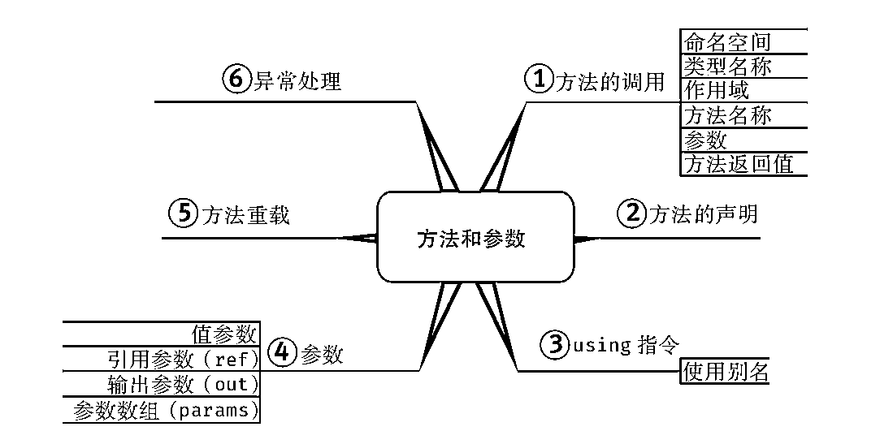
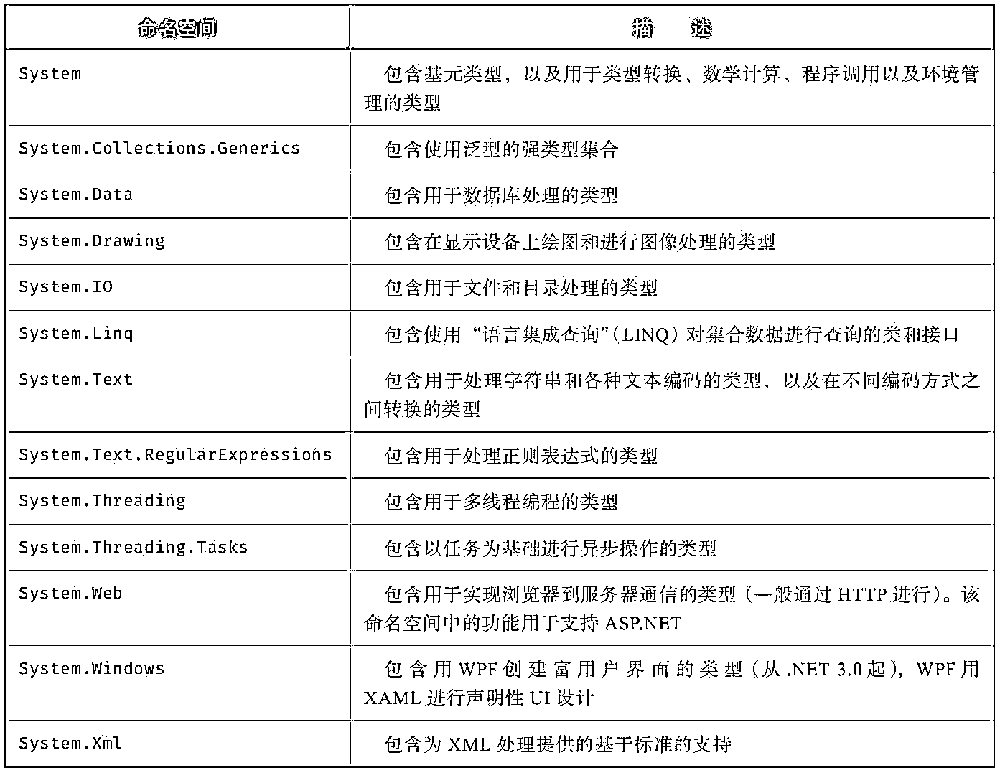
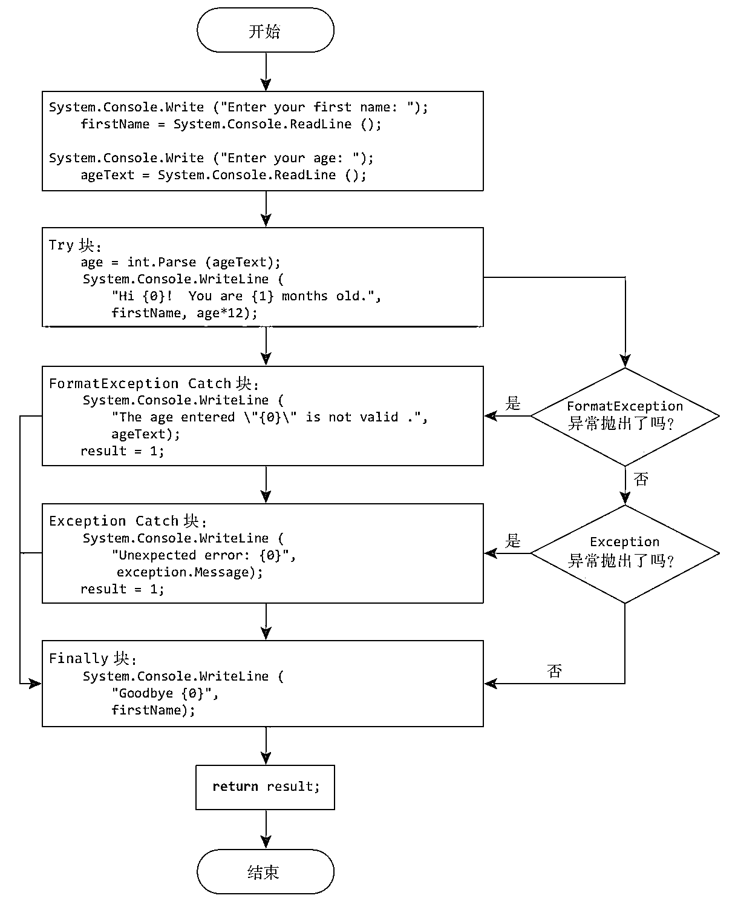
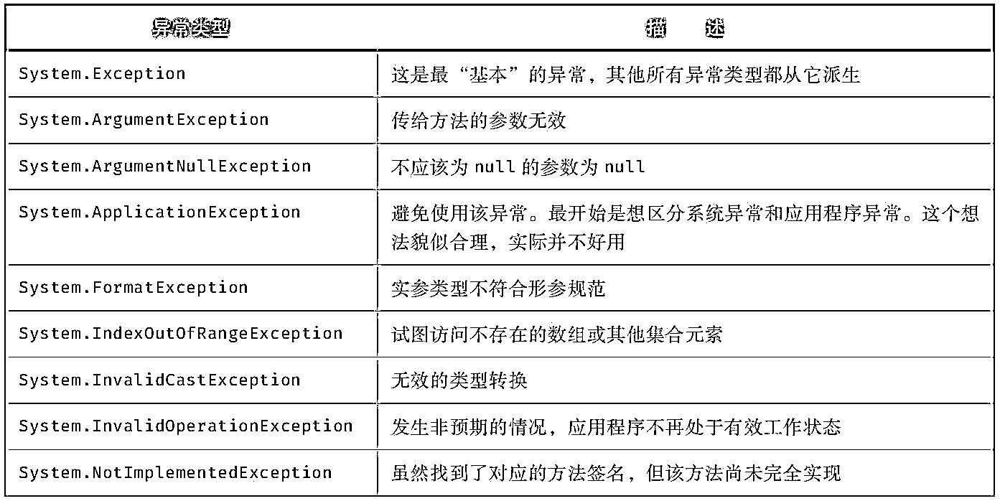
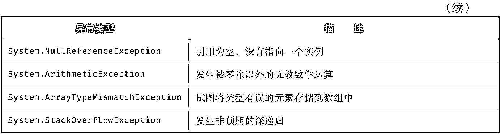

# 第五章　方法和参数



基于目前学到的 C#编程知识，你应该能写一些简单、直观的程序，它们由一组语句构成，和 20 世纪 70 年代的那些程序差不多。但编程技术自 20 世纪 70 年代以来有了长足进步，随着程序变得越来越复杂，需要新的思维模式来管理这种复杂性。“过程式”或“结构化”编程的基本思路就是提供对语句分组来构成单元的构造。此外，可通过结构化编程将数据传给一个语句分组，在这些语句执行完毕后返回结果。

除了方法定义和调用的基础知识，本章还将讨论一些更高级的概念，包括递归、方法重载、可选参数和具名参数。注意目前和直至本章末尾讨论的都是静态方法（第六章详述）。PowerShell 的函数没有 C# 那种 static/实例之分——脚本或模块顶层定义的函数天然就是可随时调用的顶层类型，本节的内容正好对应 C# 的静态方法语境。

其实从第一章的 HelloWorld 脚本起就已开始学习如何定义方法。在 C# 中，那个例子定义的是 Main() 方法；在 PowerShell 中，脚本顶层语句直接顺序执行，相当于一个隐式的主函数主体。本章将更详细地学习方法的创建，包括如何用 PowerShell 的 [ref] 参数模拟 C# 的 ref 和 out，让参数向方法传递变量而不是值。最后介绍一些基本的错误处理技术。

## 5.1　方法的调用

初学者主题：什么是方法

在 C# 程序中，目前所写的所有语句其实都在一个名为 Main() 的方法内；在 PowerShell 中，脚本顶层语句直接按顺序执行，等价于 C# 的 Main()。随着程序逐渐变大，把所有逻辑堆在一个主方法里很快就会变得难以维护，且可读性越来越差。

方法 组合一系列语句以执行特定操作或计算特定结果。它能为构成程序的语句提供更好的结构和组织。假定要用 Main()方法统计某个目录下源代码的行数，不是在一个巨大的 Main()方法中写所有代码，而是提供更简短的版本，隐藏每个方法的实现细节，如代码清单 5.1 所示。

代码清单 5.1　语句组合成方法

```powershell
# LineCount.Main: coordinate work through focused functions
$lineCount = 0
$files = $null
Display-HelpText
$files = Get-Files
$lineCount = Get-LineCount $files
Show-LineCount $lineCount
```

这里没有将所有语句都放到脚本主体中，而是把它们划分在多个函数中。例如，程序先用一系列 Write-Output 语句显示帮助文本，这些语句全部放在 Display-HelpText 函数中。类似地，用 Get-Files 函数获取要统计行数的文件。最后调用 Get-LineCount 函数实际统计行数，调用 Show-LineCount 函数显示结果。一眼就能看清楚整个程序的结构，因为函数名清楚地描述了函数的作用。

设计规范

·要为方法名使用动词或动词短语。

方法总是和类型（通常是类 ）关联。类型将相关方法分为一组。

方法通过实参 接收数据，实参由方法的参数 或形参^( [\[1\]](part0041.xhtml#ch1_back) ) 定义。参数是调用者 （发出方法调用的代码）用于向被调用的方法（例如 Write-Output、Read-Host、Get-Files、Get-LineCount 等）传递数据的变量。在代码清单 5.1 中，$files 和 $lineCount 分别是传给 Get-LineCount 和 Show-LineCount 函数的实参。方法通过返回值 将数据返回调用者。在代码清单 5.1 中，Get-Files 函数调用的返回值被赋给 $files。

这里重新讨论一下第一章讲过的 Write-Output 和 Read-Host 等 cmdlet。这次要从方法调用的角度讨论，而不是强调控制台的输入和输出细节。代码清单 5.2 展示了这些 cmdlet 的应用。

代码清单 5.2　简单方法调用

```powershell
Write-Output 'Hey you!'
$firstName = Read-Host 'Enter your first name'
$lastName = Read-Host 'Enter your last name'
Write-Output "Your full name is $firstName $lastName."
```

方法调用由方法名称、实参列表和返回值构成。调用 .NET 静态方法时，完全限定的方法名称包括命名空间、类型名和方法名，每部分以句点分隔，在 PowerShell 中写作 [System.Console]::WriteLine() 的形式。而调用函数和 cmdlet 时经常只使用方法名称，而不必完全限定。

### 5.1.1　命名空间

命名空间是一种分类机制，用于分组功能相关的所有类型。命名空间是分级的，级数任意，但超过 6 级就很罕见了。一般从公司名开始，然后是产品名，最后是功能领域。例如在 Microsoft.Win32.Networking 中，最外层的命名空间是 Microsoft，它包含内层命名空间 Win32，后者又包含嵌套更深的 Networking 命名空间。

命名空间主要用于按功能领域组织类型，以便查找和理解这些类型。此外，命名空间还有助于防范类型名称冲突。两个都叫 Button 的类型只要在不同命名空间，比如 System.Web.UI.WebControls.Button 和 System.Windows.Controls.Button，编译器就能区分。

在 C# 中，Console 类型位于 System 命名空间。System 命名空间包含用于执行大量基本编程活动的类型。几乎所有 C#程序都要使用 System 命名空间中的类型。表 5.1 总结了其他常用命名空间。PowerShell 的命令按模块（Module）组织，而非命名空间；若要在脚本中直接使用 .NET 类型，仍需写出完整类型名称，例如 [System.Text.StringBuilder]。

调用方法并非一定要提供命名空间。例如，假定要调用的方法与发出调用的方法在同一个命名空间，就没必要指定命名空间。在 PowerShell 中，脚本文件顶部可以使用 using namespace 指令（作用类似 C# 的 using 指令）导入命名空间，之后即可用简化的类型名称引用该命名空间中的 .NET 类型。但 PowerShell 自带或用户导入的 cmdlet 已可直接调用，无需任何命名空间限定。

表 5.1　常用命名空间



设计规范

·要为命名空间使用 PascalCase 大小写。

·考虑组织源代码文件目录结构以匹配命名空间层次结构。

### 5.1.2　类型名称

调用静态方法时，如果目标方法和调用者不在同一个类型（或基类）中，就需要添加类型名称限定符。（本章稍后会介绍如何用 using static 指令省略类型名称。）例如，从 HelloWorld.Main()中调用静态方法 Console.WriteLine()时就需要添加类型名称 Console。但和命名空间一样，如果要调用的方法是调用表达式所在类型的成员，C#就允许在调用时省略类型名称（代码清单 5.4 展示了一个例子）。之所以不需要类型名称，是因为编译器能够根据调用位置推断类型。显然，如果编译器无法进行这样的推断，就必须将类型名称作为方法调用的一部分。PowerShell 中调用 .NET 静态方法统一写作 [类型名]::方法名，例如 [Console]::WriteLine()；而调用函数/cmdlet 时直接写名称即可。

类型本质上是对方法及其相关数据进行分组的一种方式。例如，Console 类型包含常用的 Write()、WriteLine()和 ReadLine()等方法。所有这些方法都在同一个“组”中，都从属于 Console 类型。

### 5.1.3　作用域

第四章讲过，事物的“作用域”是可用非限定名称引用它的那个区域。两个方法在同一个类型中声明，一个方法调用另一个就不需要类型限定符，因为这两个方法具有整个包容类型的作用域。类似地，类型的作用域是声明它的那个命名空间。所以，特定命名空间的一个类型中的方法调用不需要指定该命名空间。

### 5.1.4　方法名称

每个方法调用都要指定一个方法名称。如前所述，它可能用也可能不用命名空间和类型名称加以限定。方法名称之后是圆括号中的实参列表，每个实参以逗号分隔，对应于声明方法时指定的形参。

### 5.1.5　形参和实参

方法可获取任意数量的形参，每个形参都具有特定的数据类型。调用者为形参提供的值称为实参 ，每个实参都要和一个形参对应。例如，以下方法调用有三个参数：

```powershell
Copy-Item -LiteralPath $oldFileName -Destination $newFileName -ErrorAction Stop
```

该方法位于 File 类中，后者位于 System.IO 命名空间中。方法声明为有三个参数，第一个和第二个是 string 类型，第三个是 bool 类型。本例传递 string 变量 oldFileName 和 newFileName 代表旧的和新的文件名，第三个参数传递 false，用于判断在新文件名存在的情况下文件拷贝失败的情形。

### 5.1.6　方法返回值

和 Write-Output 不同，代码清单 5.2 中的 Read-Host 可以接受提示文本，并返回用户输入的字符串。可利用返回值将调用方法所产生的结果返回调用者。因为 Read-Host 有返回值，所以可将返回值赋给变量 $firstName。还可将方法的返回值作为另一个方法的实参使用，如代码清单 5.3 所示。

代码清单 5.3　将方法返回值作为实参传给另一个方法调用

```powershell
Write-Host 'Enter your first name: ' -NoNewline
Write-Output "Hello $(Read-Host)!"
```

代码清单 5.3 不是先为变量赋值，再在 Write-Output 调用中使用这个变量。相反，是在一条 Write-Output 的字符串插值表达式里直接调用 Read-Host。运行时会先执行 Read-Host，返回值直接嵌入字符串，而不是先存入一个变量。

并非所有方法都返回数据，Write-Host 就是如此（它只向控制台写信息，不把数据送入输出流）。稍后会讲到 C# 中这种方法指定了 void 返回类型，好比在 HelloWorld 的例子中，Main 的返回类型就是 void。PowerShell 则通过“不向输出流写入任何对象”来表达没有返回值。

### 5.1.7　对比语句和方法调用

代码清单 5.3 演示了语句和方法调用的差异。该语句在 Write-Output 的字符串插值中调用了 Read-Host，因此一次执行里包含两个方法调用。语句通常包含一个或多个表达式，本例有两个表达式都是方法调用。所以，方法调用构成了语句的不同部分。

虽然在一个语句中包含多个方法调用能减少编码量，但不一定能增强可读性，而且很少能带来性能上的优势。开发者应更注重代码的可读性，而不要将过多精力放在写简短的代码上。

注意 　通常，开发者应更注重代码的可读性，而不要将过多精力放在写简短的代码上。为了使代码一目了然，进而在长时间里更容易维护，可读性是关键。

[\[1\]](part0041.xhtml#ch1) 以后不需要区分形参和实参时一般以“参数”代之。——译者注

## 5.2　方法的声明

本节描述如何声明包含参数或返回类型的方法。代码清单 5.4 演示了这些概念，输出 5.1 展示了结果。

代码清单 5.4　声明方法

```powershell
function Get-UserInput([string]$prompt) { Read-Host $prompt }
function Get-FullName([string]$firstName, [string]$lastName) { "$firstName $lastName" }
function Show-Greeting([string]$fullName, [string]$initials) { Write-Output "Hello $fullName! Your initials are $initials" }
function Get-Initials([string]$firstName, [string]$lastName) { "$($firstName[0]). $($lastName[0])." }
Write-Output 'Hey you!'
$firstName = Get-UserInput 'Enter your first name: '
$lastName = Get-UserInput 'Enter your last name: '
$fullName = Get-FullName $firstName $lastName
$initials = Get-Initials $firstName $lastName
Show-Greeting $fullName $initials
```

输出 5.1

```powershell
Hey you!
Enter your first name: Inigo
Enter your last name: Montoya
Hello Inigo Montoya! Your initials are I. M.
```

代码清单 5.4 声明了 5 个函数。脚本主体调用 Get-UserInput，然后调用 Get-FullName 和 Get-Initials。后三个函数都返回一个值，而且都要获取实参。最后调用 Show-Greeting，它不通过返回值返回数据。C#的每个方法都必须在某个类型中，本例的包容类型是 IntroducingMethods 类；而 PowerShell 的函数可以定义在脚本或模块的顶层，不要求有容纳它的类。即使第一章讨论的 Main() 方法在 C# 中也必须在某个类型中。

语言对比：C++/Visual Basic——全局方法

C#不支持全局方法，一切都必须在类型声明中。这正是 Main()方法标记为 static 的原因——它等价于 C++的全局方法和 Visual Basic 的“共享”方法。PowerShell 函数没有这个限制：脚本顶层或模块中定义的函数天然就是“全局”的，也无需 static 关键字。

初学者主题：用方法进行重构

将一组语句转移到一个方法中，而不是把它们留在一个较大的方法中，这是一种重构 形式。重构有助于减少重复代码，因为可从多个位置调用方法，而不必在每个位置都重复这些代码。重构还有助于增强代码的可读性。编码时的一个最佳实践是经常检查代码，找出可重构的地方。尤其是那些不好理解的代码块，最好把它们转移到方法中，用有意义的方法名清晰定义代码的行为。与简单地为代码块加上注释相比，重构效果更好，因为看方法名就知道方法要做的事情。

例如，代码清单 5.4 的脚本主体具有与第一章代码清单 1.16 中差不多的行为。虽然两者都容易看懂，但代码清单 5.4 更简洁。只需扫一眼脚本主体就可理解该程序（暂时不用关心被调用的每个函数的实现细节）。

在 Visual Studio 或 VS Code 中可选定一组语句，右击并选择“快速操作和重构 ”（Ctrl+.）菜单命令，然后在弹出的小窗口中选择“提取方法”命令，将该块提取到其自己的方法中，自动插入代码以从原始位置调用新方法。

### 5.2.1　参数声明

注意 Get-UserInput、Get-FullName 和 Get-Initials 函数的声明。可在函数声明的圆括号中添加参数列表 （讨论泛型时会讲到，方法也可以有类型参数列表 。如根据上下文能分清当前讲的是哪种参数，就直接把它们称为“参数列表”中的“参数”）。列表中的每个参数都包含参数类型和参数名称，每个参数以逗号分隔。PowerShell 的 function 用 param() 块或直接在各个参数名前加类型实现同样的效果，例如 function Get-Name([string]$name) { ... }。

大多数参数的行为和命名规范与局部变量一致。因此参数名采用 camelCase 大小写形式。另外，不能在方法中声明与参数同名的局部变量，因为这会创建同名的两个“局部变量”。PowerShell 的命名约定与此不同：函数名采用 Verb-Noun 形式（PascalCase），参数名通常也用 PascalCase（如 -LiteralPath）；函数内部可以给参数变量重新赋值，这会直接修改该参数的值，不存在“同名局部变量冲突”。

设计规范

·要为参数名使用 camelCase 大小写。

### 5.2.2　方法返回类型声明

Get-UserInput、Get-FullName 和 Get-Initials 函数除了定义参数，还定义了方法返回类型 。很容易就可分辨一个方法是否有返回值，因为在声明这种方法时，会在方法名之前添加一个数据类型。上述所有方法的返回数据类型都是 string。虽然方法可指定多个参数，但返回类型只能有一个。PowerShell 的函数没有显式的返回类型声明——函数将写入输出流（pipeline）的所有对象作为返回值，未写入任何对象的函数实际没有任何输出。

如 Get-UserInput 和 Get-Initials 函数所示，具有返回类型的方法几乎总是包含一个或多个 return 语句将控制返回给调用者。return 语句以 return 关键字开头，后跟计算返回值的表达式。在 PowerShell 中，return 语句不仅将控制返回给调用者，还会把 return 关键字之后的值写入函数的输出流——这正是函数“返回值”的途径；但 PowerShell 函数无须以 return 结尾，函数内部产生的任何未经捕获的输出都会成为返回值的一部分。

如果方法有返回类型，它的主体必须没有“不可到达的结束点”。换言之，方法不能在不返回值的情况下碰到大括号而自然结束。为保证这一点，最简单的办法就是将 return 语句作为方法的最后一个语句。但这并非绝对，return 语句并非只能在方法末尾出现。例如，方法中的 if 或 switch 语句可以包含 return 语句，如代码清单 5.5 所示。（PowerShell 没有这一编译期约束——函数未以 return 结尾也能通过解析；未显式返回的数据若没有其他来源，函数就没有输出。）

代码清单 5.5　方法中间的 return 语句

```powershell
function Invoke-MyMethod {
    $command = Get-CommandText
    switch ($command) {
        'quit' { return $false }
        # ... other cases omitted
        default { return $true }
    }
}
```

（注意，return 语句将控制转移出 switch，所以不需要用 break 语句防止非法“贯穿”switch 部分。）

在代码清单 5.5 中，方法最后一个语句不是 return 语句，而是 switch 语句。但编译器判断方法的每条执行路径最终都是 return 语句，所以方法结束点“不可到达”。这样的方法是合法的，即使它不以 return 语句结尾。在 PowerShell 中相应场景也一样——switch 的每个分支都以 return 结束，函数不会从 switch 之后“漏”过去。

如果 return 之后有“不可到达”的语句，编译器会发出警告，指出有永远执行不到的语句。（PowerShell 解析器不提供这类警告。）

虽然 C#允许提前返回，但为了增强代码的可读性，并使代码更易维护，应尽量确定单一的退出位置，而不是在方法的多个代码路径中散布多个 return 语句。

指定 void 作为返回类型表示该方法没有返回值。所以，这种方法不支持向变量赋值，也无法在调用位置^( [\[1\]](part0042.xhtml#ch1_back) ) 作为参数传递。void 调用只能作为语句使用。此外，return 在这种方法内部可选。如指定 return，它之后不能有任何值。例如代码清单 5.4 的 Main()方法的返回值是 void，方法中没有使用 return 语句。而 DisplayGreeting()有 return 语句，但 return 之后没有添加任何值。

PowerShell 没有 void 类型声明。想让函数“不返回数据”，只需让函数不向输出流写入任何对象；空泛的 return（不带值）仅用于提前结束函数，也不会产生输出。注意 Write-Host 只把文本写到控制台（信息流），不会成为函数返回值的一部分。

虽然从技术上说方法只能有一个返回类型，但返回类型可以是一个元组。从 C# 7.0 起，多个值可通过 C#元组语法打包成元组返回，如代码清单 5.6 的 GetName()方法所示。

代码清单 5.6　用元组返回多个值

```powershell
function Get-UserInput([string]$prompt) { Read-Host $prompt }
function Get-Name {
    [pscustomobject]@{ First = Get-UserInput 'Enter your first name: '; Last = Get-UserInput 'Enter your last name: ' }
}
$name = Get-Name
Write-Output "Hello $($name.First) $($name.Last)!"
```

技术上仍然只返回一个数据类型，即一个 ValueTuple<string, string>，但实际可以返回任意数量（当然要合理）。这是因为 C# 7.0 起支持元组语法。PowerShell 没有内建的元组类型语法；代码清单 5.6 用 [pscustomobject] 把多个值打包成一个对象返回，需要时按属性名取值即可。

### 5.2.3　表达式主体方法

有些方法过于简单。为简化这些方法的定义，C# 6.0 引入了表达式主体方法 ，允许用表达式代替完整方法主体。代码清单 5.4 的 GetFullName()方法就是一例：

```powershell
function Get-FullName([string]$firstName, [string]$lastName) { "$firstName $lastName" }
```

表达式主体方法不是用大括号定义方法主体，而是用=>操作符（第十三章详述）。该操作符的结果数据类型必须与方法返回类型匹配。换言之，虽然没有显式的 return 语句，但表达式本身的返回类型必须与方法声明的返回类型匹配。

PowerShell 没有与 => 等价的表达式主体方法语法。不过，PowerShell 函数体可以直接写一个表达式，函数会把它产生的值作为输出——这已经实现了类似“一行函数”的效果，只是不需要专门的语法形式。

语言对比：C++——头文件

和 C++不同，C#类从来不将实现与声明分开。C#不区分头文件（.h）和实现文件（.cpp）。相反，声明和实现在同一个文件中。（C#确实支持名为“分部方法”的高级功能，允许将方法的声明和实现分开。但考虑到本章的目的，我们只讨论非分部方法。）这样就不需要在两个位置维护冗余的声明信息。

初学者主题：命名空间

如前所述，命名空间 是分类和分组相关类型的一种机制。在一个类型所在的命名空间中，能找到和它相关的其他类型。此外，不同命名空间中重名的两个或更多类型没有歧义。

[\[1\]](part0042.xhtml#ch1) call site，就是发出调用的地方，可理解成调用了一个目标方法的表达式或代码行。——译者注

## 5.3　using 指令

完全限定的名称可能很长、很笨拙。可将一个或多个命名空间的所有类型“导入”文件，这样在使用时就不需要完全限定。这可通过 using 指令（通常在文件顶部）来实现。例如代码清单 5.7 中的 Console 就没有附加 System 前缀，因为代码清单顶部使用了一个 using System 指令。PowerShell 的命令（cmdlet）本就按名称直接调用，不需要先“导入命名空间”；这一节及后续内容主要作为 C# 背景知识介绍。

代码清单 5.7　using 指令的例子

```powershell
# PowerShell cmdlets do not require C# namespace qualification.
Write-Output 'Hello, my name is Inigo Montoya'
```

代码清单 5.7 的结果如输出 5.2 所示。

输出 5.2

```powershell
Hello, my name is Inigo Montoya
```

虽然添加了 using System，但使用 System 的某个子命名空间中的类型时还是不能省略 System。例如，要访问 System.Text 中的 StringBuilder 类型，必须另外添加一个 using System.Text 指令或者对类型进行完全限定（System.Text.StringBuilder），而不能只是写 Text.StringBuilder。简单地说，using 指令不“导入”任何嵌套命名空间 中的类型。嵌套命名空间（由命名空间中的句点符号来标识）必须显式导入。

语言对比：Java——import 指令中的通配符

Java 允许使用通配符导入命名空间，例如：

* * *

```
import javax.swing.\*;

```

* * *

相反，C#不允许在 using 指令中使用通配符，每个命名空间都必须显式导入。

语言对比：Visual Basic .NET——项目范围的 Imports 指令

和 C#不同，Visual Basic .NET 允许为整个项目（而非只是单个文件）使用与 using 指令等价的 Imports 指令。换言之，Visual Basic .NET 提供了 using 指令的一个命令行版本，它对项目的所有文件起作用。

通常，程序要使用一个命名空间中的许多类型，就应考虑为该命名空间使用 using 指令，避免对该命名空间中的所有类型都进行完全限定。正是这个原因，几乎所有 C#文件都在顶部添加了 using System 指令。在本书剩余的部分，代码清单会经常省略 using System 指令，但其他命名空间指令都会显式地包含。

使用 using System 指令的一个有趣结果是，可以使用不同的大小写形式来表示字符串数据类型：String 或者 string。前者的基础是 using System 指令，后者使用的是 string 关键字。两者在 C#中都引用 System.String 数据类型，最终生成的 CIL 代码毫无区别^( [\[1\]](part0043.xhtml#ch1_back) ) 。PowerShell 中同理：`[string]` 是 `[System.String]` 的类型加速器，二者指同一个 .NET 类型，且 PowerShell 类型名不区分大小写。

高级主题：嵌套 using 指令

using 指令不仅可以在文件顶部使用，还可以在命名空间声明的顶部使用。例如，声明新命名空间 EssentialCSharp 时，可在该声明的顶部添加 using 指令，如代码清单 5.8 所示。

代码清单 5.8　在命名空间声明中使用 using 指令

```powershell
# Namespace-scoped imports have no direct PowerShell equivalent.
Write-Output 'Hello, my name is Inigo Montoya'
```

输出 5.3 展示了结果。

输出 5.3

```powershell
Hello, my name is Inigo Montoya
```

在文件顶部和命名空间声明的顶部使用 using 指令的区别在于，后者的 using 指令只在声明的命名空间内有效。如果在 EssentialCSharp 命名空间前后声明了新命名空间，新命名空间不会受别的命名空间中的 using System 指令的影响。但我们很少写这样的代码，特别是根据约定，每个文件只应该有一个类型声明。

### 5.3.1　using static 指令

using 指令允许省略命名空间限定符来简化类型名称。而 using static 指令允许将命名空间和类型名称都省略，只需写静态成员名称。例如，using static System.Console 指令允许直接写 WriteLine()而不必写完全限定名称 System.Console.WriteLine()。基于这个技术，代码清单 5.2 可改写为代码清单 5.9。

PowerShell 没有 using static 指令。调用 .NET 静态成员时仍须写类型名，例如 [Console]::WriteLine()。若想省略类型名，可自定义一个函数或别名包装目标方法。

代码清单 5.9　using static 指令

```powershell
Write-Output 'Hey you!'
$firstName = Read-Host 'Enter your first name'
$lastName = Read-Host 'Enter your last name'
Write-Output "Your full name is $firstName $lastName."
```

本例不会降低代码的可读性。WriteLine()、Write()和 ReadLine()明显与控制台指令有关。事实上，我们可以说代码显得比以往更简单、更清晰。

但这并非绝对，有的类定义了重叠的行为名称（方法名），例如文件和目录都提供了 Exists()方法。在定义了 using static 指令的前提下直接调用 Exists()无利于区分。类似地，如果你写的类定义了行为名称重叠的成员，例如 Display()和 Write()，读者会容易混淆。

编译器不允许这种歧义存在。两个成员如具有相同的签名（通过 using static 指令或者是单独声明的成员），调用它们时就会产生歧义，会造成编译错误。

### 5.3.2　使用别名

还可利用 using 指令为命名空间或类型取一个别名。别名 是在 using 指令起作用的范围内可以使用的替代名称。别名的两个最常见的用途是消除两个同名类型的歧义和缩写长名称。例如在代码清单 5.10 中，CountDownTimer 别名引用了 System.Timers.Timer 类型。仅添加 using System.Timers 指令不足以完全限定 Timer 类型，原因是 System.Threading 也包含 Timer 类型，所以在代码中直接用 Timer 会产生歧义。

PowerShell 中 Set-Alias 只能为命令创建别名，不能为 .NET 类型创建别名；遇到同名类型时，应按代码清单 5.10 的写法使用完整类型名称加以区分。

代码清单 5.10　声明类型别名

```powershell
# Use a fully qualified type name when .NET type names are ambiguous.
$timer = [System.Timers.Timer]::new()
# Distinguish this from [System.Threading.Timer].
```

由于 Timer 现在是别名，所以“Timer”引用没有歧义。这时如果要引用 System.Threading.Timer 类型，必须完全限定或定义不同的别名。

[\[1\]](part0043.xhtml#ch1) 我更喜欢使用 string 关键字，但无论选择哪一种表示方法，都应在项目中保持一致。

## 5.4　Main()的返回值和参数

到目前为止，可执行体的所有 Main()方法采用的都是最简单的声明。这些 Main()方法声明不包含任何参数或非 void 返回类型。但 C#支持在执行程序时提供命令行参数，并允许从 Main()方法返回状态标识符。PowerShell 脚本通过 param() 块或内置的自动变量 $args 获取命令行参数，并用 exit 设置进程退出码。

“运行时”通过一个 string 数组参数将命令行参数传给 Main()。要获取参数，访问数组就可以了，代码清单 5.12 对此进行了演示。程序的目的是下载指定 URL 位置的文件。第一个命令行参数指定 URL，第二个指定存盘文件名。代码首先检查参数数量（$args.Count），根据结果采取不同操作：

1.如果没有两个参数，就显示一条错误消息，指出必须提供 URL 和文件名；

2.如果有两个参数，表明用户提供了 URL 和存盘文件名。

代码清单 5.12　向 Main()传递命令行参数

```powershell
param([string[]]$args)
if ($args.Count -ne 2) {
    Write-Error 'You must specify the URL and target file name.'
    Write-Output 'Usage: Downloader.ps1 <URL> <TargetFileName>'
    exit 1
}
Invoke-WebRequest -Uri $args[0] -OutFile $args[1]
exit 0
```

代码清单 5.12 的结果如输出 5.4 所示。

输出 5.4

```powershell
Downloader.ps1
ERROR: You must specify the URL and target file name.
Usage: Downloader.ps1 <URL> <TargetFileName>
```

成功获取存盘文件名，就用它保存下载的文件。否则应显示帮助文本。Main()方法还会返回一个 int，而不是像往常那样返回 void。返回值对于 Main()声明来说是可选的。但如果有返回值，程序就可以将状态码返回给调用者（比如脚本或批处理文件）。根据约定，非零返回值代表出错。在 PowerShell 中，代码清单 5.12 用 exit 0 表示成功、exit 1 表示出错，效果等同。

虽然所有命令行参数都可通过字符串数组传给 Main()，但有时需要从非 Main()的方法中访问参数。这时可用 System.Environment.GetCommandLineArgs()方法以 Main (string\[\]args)将参数传递到 Main()的相同形式返回由命令行参数构成的数组。（在 PowerShell 中，该静态方法同样可用；此外 $args、$MyInvocation 等也能查看调用信息。）

高级主题：消除多个 Main()方法的歧义

假如一个程序的两个类都有 Main()方法，可以选取其中一个类作为程序的入口点。在 Visual Studio 中找到“解决方法资源管理器”面板，右键单击项目图标，在弹出的菜单中点击“属性”命令。属性设置页面将会显示在窗口右侧。请确保“应用程序”选项卡处于选中状态。在页面中找到“启动对象”下拉选单。在这里可以选择作为入口点的类名称。如果使用命令行编译程序，也可以通过设置 StartupObject 属性来设置入口点的类。例如：

```powershell
dotnet build -p:StartupObject=AddisonWesley.Program2
```

上例中，AddisonWesley.Program2 是具有 Main()方法的命名空间和类名称。

PowerShell 脚本没有“多个 Main() 入口点”这一概念——每个 .ps1 文件本身就是一个可直接执行的入口；若要在一个脚本中区分入口逻辑，用参数或条件分支决定即可，不需要设置 StartupObject。

初学者主题：调用栈和调用点

代码执行时，方法可能调用其他方法，其他方法可能调用更多方法，以此类推。在代码清单 5.4 的简单情况中，脚本主体调用 Get-UserInput，后者调用 Read-Host，后者又在内部调用更多 .NET 方法。每次调用新方法时，“运行时”都创建一个“栈帧”或“活动帧”，其中包含的内容涉及传给新调用的实参、新调用的局部变量以及方法返回时应该从哪里恢复等。这样形成的一系列栈帧称为调用栈 ^( [\[1\]](part0044.xhtml#ch1_back) ) 。随着程序复杂度的提高，每个方法调用另一个方法时，这个调用栈都会变大。但当调用结束时，调用栈会发生收缩，直到调用另一个方法。我们用栈展开 （stack unwinding）^( [\[2\]](part0044.xhtml#ch2_back) ) 一词描述从调用栈中删除栈帧的过程。栈展开的顺序通常与方法调用的顺序相反。方法调用完毕，控制会返回调用点 （call site），也就是最初发出方法调用的位置。这些概念在 PowerShell 中同样成立，函数调用一样会压栈、展开。

[\[1\]](part0044.xhtml#ch1) async 或迭代器方法除外，它们的活动记录转移到堆上。

[\[2\]](part0044.xhtml#ch2) unwind 一般翻译成“展开”，但这并不是一个很好的翻译。wind 和 unwind 源于生活。把线缠到线圈上称为 wind；把线从线圈上松开称为 unwind。同样地，调用方法时压入栈帧，称为 wind；方法执行完毕弹出栈帧，称为 unwind。——译者注

## 5.5　高级方法参数

之前的例子一直是通过方法的 return 语句返回数据。本节描述方法如何通过自己的参数返回数据，以及方法如何获取数量可变的参数。

### 5.5.1　值参数

参数默认采用传值 方式。换言之，参数值会拷贝到目标参数中。例如在代码清单 5.13 所示的 C# 示例中，调用 Combine()时 Main()使用的每个变量值都会拷贝给 Combine()方法的参数；转换后的 PowerShell 版本用 Join-Path 组合路径，同样不会修改原来的变量。输出 5.5 展示了结果。

代码清单 5.13　以传值方式传递变量

```powershell
$driveLetter = 'C:'
$folderPath = 'Data'
$fileName = 'index.html'
$fullName = Join-Path (Join-Path $driveLetter $folderPath) $fileName
Write-Output $fullName
```

输出 5.5

```powershell
C:\Data\index.html
```

Combine()方法返回前，即使将 null 值赋给 driveLetter、folderPath 和 fileName 等变量，脚本顶层对应的变量仍会保持其初始值不变，因为在调用方法时，只是将变量的值拷贝了一份给方法。调用栈在一次调用的末尾“展开”的时候，拷贝的数据会被丢弃。PowerShell 函数默认同样按值传递参数——脚本中的 $driveLetter 等变量不会被函数内部的修改影响。

初学者主题：匹配调用者变量与参数名

在代码清单 5.13 中，调用者中的变量名与被调用方法中的参数名匹配。这是为了增强可读性，名称是否匹配与方法调用的行为无关。被调用方法的参数和发出调用的方法的局部变量在不同声明空间中，相互之间没有任何关系。

高级主题：比较引用类型与值类型

就本节来说，传递的参数是值类型还是引用类型并不重要。重要的是被调用的方法是否能将值写入调用者的原始变量中。由于现在是生成原始值的拷贝，所以怎么更改都影响不到调用者的变量。但不管怎样，都有必要理解值类型和引用类型的变量的区别。

从名字就能看出，对于引用类型的变量，它的值是对数据实际存储位置的引用。“运行时”如何表示引用类型变量的值，这是“运行时”的实现细节。一般都是用数据实际存储的内存地址来表示，但并非一定如此。

如引用类型的变量以传值方式传给方法，拷贝的就是引用（地址）本身。这样虽然在被调用的方法中还是更改不了引用（地址）本身，但可以更改地址处的数据。

相反，对于值类型的参数，参数获得的是值的拷贝，所以被调用的方法怎么都改变不了调用者的变量。

### 5.5.2　引用参数

来看看代码清单 5.14 的例子，它调用方法来交换两个值，输出 5.6 展示了结果。

代码清单 5.14　以传引用的方式传递变量

```powershell
function Swap-Value([ref]$first, [ref]$second) {
    $temp = $first.Value
    $first.Value = $second.Value
    $second.Value = $temp
}
$first = 'hello'
$second = 'goodbye'
Swap-Value ([ref]$first) ([ref]$second)
Write-Output "first = `"$first`", second = `"$second`""
```

输出 5.6

```powershell
first = "goodbye", second = "hello"
```

赋给 first 和 second 的值被成功交换。这要求以传引用 的方式传递变量。比较本例的 Swap-Value 调用与代码清单 5.13 的路径组合调用，不难发现两者最明显的区别就是本例用 [ref] 类型标注参数（对应 C# 的 ref 关键字），这使参数以传引用的方式传递，被调用的函数可用新值更新调用者的变量。

如果被调用的方法将参数指定为 ref，调用者调用该方法时提供的实参应该是附加了 ref 前缀的变量（而不是值）。这样调用者就显式确认了目标方法可对它接收到的任何 ref 参数进行重新赋值。此外，调用者应初始化传引用的局部变量，因为被调用的方法可能直接从 ref 参数读取数据而不先对其进行赋值。例如在代码清单 5.14 中，$temp 直接从 $first 获取数据，认为 $first 变量已由调用者初始化。PowerShell 中对应做法是：函数参数声明为 [ref]，调用时用 [ref] 类型转换包装变量，并通过 .Value 属性读写其值。事实上，ref 参数只是传递的变量的别名。换言之，引用参数的作用只是为现有变量分配参数名，而非创建新变量并将实参的值拷贝给它。

### 5.5.3　输出参数

如前所述，用作 ref 参数的变量必须在传给方法前赋值，因为被调用的方法可能直接从变量中读取值。例如，前面的 Swap 方法必须读写传给它的变量。但方法经常要获取一个变量引用，并向变量写入而不读取。这时更安全的做法是以传引用的方式传入一个未初始化的局部变量。

为此，代码需要用关键字 out 修饰参数类型。例如代码清单 5.15 中的 TryGetPhoneButton()方法，它返回与字符对应的电话按键。

PowerShell 没有 out 关键字。要实现“只写不读”的传出参数，可用 [ref] 参数并在函数内写入 .Value（调用方无须预先赋值，但需提供变量作为容器）。不过更符合 PowerShell 习惯的做法是直接返回结果——代码清单 5.15 就改写为返回按键字符串，再用返回值接收。

代码清单 5.15　仅传出的变量

```powershell
function ConvertTo-PhoneButton([char]$character) {
    switch -Regex ($character.ToString().ToLowerInvariant()) {
        '[abc]' { return '2' }; '[def]' { return '3' }; '[ghi]' { return '4' }; '[jkl]' { return '5' }
        '[mno]' { return '6' }; '[pqrs]' { return '7' }; '[tuv]' { return '8' }; '[wxyz]' { return '9' }
        '[0-9]' { return $character.ToString() }
        default { return '_' }
    }
}
foreach ($word in $args) {
    foreach ($character in $word.ToCharArray()) { Write-Host (ConvertTo-PhoneButton $character) -NoNewline }
    Write-Host
}
```

输出 5.7 展示了代码清单 5.15 的结果。

输出 5.7

```powershell
PS> .\ConvertToPhoneNumber.ps1 CSharpIsGood
274277474663
```

在本例中，如果能成功判断与 character 对应的电话按键，TryGetPhoneButton()方法就返回 true。方法还使用 out 修饰的 button 参数返回对应的按键。转换后的 PowerShell 版本（代码清单 5.15）不区分“成功标志”和“结果”两个出口，而是直接返回按键字符串。

out 参数功能上与 ref 参数完全一致，唯一区别是 C#语言对别名变量的读写有不同的规定。如参数被标记为 out，编译器会核实在方法所有正常返回的代码路径中，是否都对该参数进行了赋值。如发现某个代码执行路径没有对 button 赋值，编译器就会报错，指出代码没有对 button 进行初始化。在代码清单 5.15 中，方法最后将下划线字符赋给 button，因为即使无法判断正确的电话按键，也必须对 button 进行赋值。（PowerShell 不进行这类编译期检查。）

使用 out 参数时一个常见的编码错误是忘记在使用前声明 out 变量。从 C# 7.0 起可在调用方法前以内联的形式声明 out 变量。代码清单 5.15 在 TryGetPhoneButton(character, out char button)中使用了该功能，之前完全不需要声明 button 变量。而在 C# 7.0 之前，必须先声明 button 变量，再用 TryGetPhoneButton(character, out button)调用方法。

C# 7.0 的另一个功能是允许完全放弃 out 参数。例如，可能只想知道某字符是不是有效的电话按键，而不实际返回对应数值。这时可用下划线放弃 button 参数：TryGetPhoneButton(character, out \_)。（这些都是 C# 语言特性，PowerShell 没有对应语法。）

在 C# 7.0 元组语法之前，开发者声明一个或多个 out 参数来解决方法只能有一个返回类型的限制。例如，为了返回两个值，可以正常返回一个，另一个写入作为 out 参数传递的别名变量。虽然这种做法既常见也合法，但通常都有更好的方案能达到相同目的。例如，用 C# 7.0 写代码时，返回两个或更多值应首选元组语法。而在 C# 7.0 之前可考虑改成两个方法，每个方法返回一个值。如果非要一次返回两个，还可以使用 System.ValueTuple 类型（要求引用 System.ValueTuple NuGet 包，但不使用 C# 7.0 语法）。

注意 　所有正常的代码路径都必须对 out 参数赋值。

### 5.5.4　只读传引用

C# 7.2 支持以传引用的方式传入只读值类型。该特性以传引用的方式传入值类型参数，并且让该参数不能被方法修改。这样不仅避免了每次调用方法都创建值类型的拷贝，而且不用担心值类型参数被修改。换言之，其作用是在传值时减少拷贝量，同时把它标识为只读，从而增强性能。该语法要为参数添加 in 修饰符。例如：

```powershell
# PowerShell parameters are passed by value by default.
function Get-Number([int]$number) { $number }
```

使用 in 修饰符，方法中对 number 的任何重新赋值操作（例如 number++）都会造成编译错误，并指示 number 只读。PowerShell 没有 in 修饰符：参数默认按值传递，也不存在编译期只读检查；若需只读语义，需自行约定或通过复制值来保护。

### 5.5.5　返回引用

C# 7.0 新增的另一个功能返回对变量的引用。例如，代码清单 5.16 定义了一个方法返回图片中的第一个红眼像素。PowerShell 没有“返回引用”或 ref 局部变量；若希望调用者观察到后续修改，应返回可变对象（如代码清单 5.16 中演示的 [pscustomobject]），或改用 [ref] 参数。

代码清单 5.16　ref Return 和 ref 局部变量声明

```powershell
# PowerShell has no direct equivalent for C# ref returns or ref locals.
# Use mutable objects or [ref] parameters when callers must observe changes.
$state = [pscustomobject]@{ Text = 'Inigo Montoya' }
$state.Text = 'Updated value'
Write-Output $state.Text
```

### 5.5.6　参数数组

到目前为止，方法的参数数量都是在声明时确定好的。但有时我们希望参数数量可变。以代码清单 5.13 的路径组合为例，它传递了驱动器号、文件夹路径和文件名等参数。如路径中包含多个文件夹，调用者希望将额外的文件夹连接起来以构成完整路径，那么应该如何写代码？也许最好的办法就是为文件夹传递一个字符串数组，其中包含不同的文件夹名称。但这会使调用代码变复杂，因为需要事先构造好数组并将数组作为参数传递。

为简化编码，C#提供了一个特殊关键字，允许在调用方法时提供数量可变的参数，而不是事先就固定好参数数量。讨论方法声明前，先注意一下代码清单 5.17 中的调用代码。

PowerShell 没有 params 关键字。要让函数或命令接收可变数量的参数，常用的手段是“展开”（splatting）：把参数先放进数组或哈希表，再用 $cmd @args（数组）或 $cmd @params（哈希表）传入；高级函数还可以用 [Parameter(ValueFromRemainingArguments)] 收集剩余实参。代码清单 5.17 演示了用数组容纳路径各部分再逐段拼接的写法。

代码清单 5.17　传递长度可变的参数列表

```powershell
$parts = @((Get-Location).Path, 'bin', 'config', 'index.html')
$fullName = Join-Path $parts[0] (Join-Path $parts[1] (Join-Path $parts[2] $parts[3]))
Write-Output $fullName
$fullName = Join-Path $env:SystemRoot (Join-Path 'Temp' 'index.html')
Write-Output $fullName
$parts = @('C:\', 'Data', 'HomeDir', 'index.html')
$fullName = $parts[0] + ($parts[1..($parts.Count - 1)] -join '\')
Write-Output $fullName
```

输出 5.8 展示了代码清单 5.17 的结果。

输出 5.8

```powershell
C:\Data\markin\config\index.html
C:\Windows\System32\Temp\index.html
C:\Data\HomeDir\index.html
```

第一个 Combine()调用提供了 4 个参数。第二个只提供了 3 个。最后一个调用传递一个数组来作为参数。换言之，Combine()方法接受数量可变的参数，要么是以逗号分隔的字符串参数，要么是单个字符串数组。前者称为方法调用的“展开”（expanded）形式，后者称为“正常”（normal）形式。（代码清单 5.17 的 PowerShell 版本改用 Join-Path 拼接路径，并用数组保存路径的各段。）

为了获得这样的效果，Combine()方法需要：

1.在方法声明的最后一个参数前添加 params 关键字；

2.将最后一个参数声明为数组。

像这样声明了参数数组 之后，每个参数都作为参数数组的成员来访问。Combine()方法迭代 paths 数组的每个元素并调用 System.IO.Path.Combine()。该方法自动合并路径中的不同部分，并正确使用平台特有的目录分隔符。注意 PathEx.Combine()完全等价于 Path.Combine()，只是能处理数量可变的参数，而非只能处理两个。（PowerShell 的对应思路见上文“展开”（splatting）的说明。）

参数数组要注意以下几点：

·参数数组不一定是方法的唯一参数，但必须是最后一个。由于只能放在最后，所以最多只能有一个参数数组。

·调用者可指定和参数数组对应的零个实参，这会使传递的参数数组包含零个数据项。

·参数数组是类型安全的——实参类型必须兼容参数数组的类型。

·调用者可传递一个实际的数组，而不是传递以逗号分隔的实参列表。最终生成的 CIL 代码一样。

·如目标方法的实现要求一个最小的参数数量，请在方法声明中显式指定必须提供的参数。这样一来，遗漏必需的参数会导致编译器报错，而不必依赖运行时错误处理。例如，使用 int Max(int first, params int\[\] operands)而不是 int Max(params int\[\] operands)，确保至少有一个整数实参传给 Max()。（PowerShell 中可用高级函数的 [Parameter(Mandatory)] 或显式必需参数达到类似效果。）

可用参数数组将数量可变的多个同类型参数传给方法。本章后面的 5.7 节将讨论如何支持不同类型的、数量可变的参数。

设计规范

·能处理任何数量（包括零个）额外实参的方法要使用参数数组。

关于前面代码清单 5.17 中的路径拼接，这里有一个补充说明：该代码是为了演示如何容纳可变数量的路径片段而刻意编写的。实际上 System.IO.Path.Combine()方法已经有一个现成的重载版本可以接受参数数组，PowerShell 中也可以直接用 Join-Path 逐段拼接或把数组展开后传入。

## 5.6　递归

“递归 调用方法”或者“用递归 实现方法”意味着方法调用它自身。有时这是实现算法最简单的方式。代码清单 5.18 统计目录及其子目录中的所有 C#源代码文件（\*.cs）的代码行数。

代码清单 5.18　返回目录中所有.cs 文件的代码行数

```powershell
param([string[]]$args)
$directory = if ($args.Count -gt 0) { $args[0] } else { (Get-Location).Path }
function Get-FileLineCount([string]$path) { (Get-Content -LiteralPath $path | Where-Object { $_.Trim() }).Count }
function Get-DirectoryLineCount([string]$path) {
    $count = 0
    Get-ChildItem -LiteralPath $path -Filter '*.cs' -File | ForEach-Object { $count += Get-FileLineCount $_.FullName }
    Get-ChildItem -LiteralPath $path -Directory | ForEach-Object { $count += Get-DirectoryLineCount $_.FullName }
    $count
}
$totalLineCount = Get-DirectoryLineCount $directory
Write-Output $totalLineCount
```

注①：该代码可用 using 语句改进，但因为我们还没有讲到，所以暂时不使用。

输出 5.9 展示了代码清单 5.18 的结果。

输出 5.9

```powershell
104
```

程序首先将第一个命令行参数传给 Get-DirectoryLineCount，或直接使用当前目录（如果没有提供参数）。方法首先迭代当前目录中的所有文件，累加每个.cs 文件包含的源代码行数。处理好当前目录之后，将子目录传给 Get-DirectoryLineCount 函数以处理每个子目录。同样的过程针对每个子目录反复进行，直到再也没有更多子目录可供处理。

不熟悉递归的读者刚开始可能觉得非常烦琐。但事实上，递归通常都是最简单的编码模式，尤其是在和文件系统这样的层次化数据打交道的时候。不过，虽然可读性不错，但一般不是最快的实现。如果必须关注性能，开发者应该为递归实现寻求一种替代方案。至于具体如何选择，通常取决于如何在可读性与性能之间取得平衡。

初学者主题：无限递归错误

用递归实现方法时，常见错误是在程序执行期间发生栈溢出（stack overflow）。这通常是由无限递归 造成的。假如方法持续地调用自身，永远抵达不了标志递归结束的位置，就会发生无限递归。必须仔细检查每个使用了递归的方法，验证递归调用是有限而非无限的。

下面以伪代码的形式展示了一个常用的递归模式：

* * *

```
M(x)
{
  if x 已达最小，不可继续分解^(
[\[1\]](part0046.xhtml#aid-3GM)

)

    返回结果
  else
    (1) 采取一些操作使问题变得更小
    (2) 递归调用 M 来解决更小的问题
    (3) 根据(1)和(2)计算结果
    返回结果
}

```

* * *

不遵守这个模式就可能出错。例如，如果不能将问题变得更小，或者不能处理所有可能的“最小”情况，就会递归个不停。

[\[1\]](part0046.xhtml#ch1) 或者说“if 满足递归结束条件（base case）”。——译者注

## 5.7　方法重载

代码清单 5.18 中的 Get-DirectoryLineCount 函数用来统计\*.cs 文件中的源代码行数。但要统计\*.h/\*.cpp 文件或\*.vb 文件的代码行数，它（以及原来 C# 版的 DirectoryCountLines()）就无能为力了。我们希望有这样一个方法，它能获取文件扩展名作为参数，同时保留现有方法定义，以便默认处理\*.cs 文件。

一个类中的所有方法都必须有唯一签名，C#依据方法名、参数数据类型或参数数量的差异来定义唯一性。注意方法返回类型不计入签名。两个方法只是返回类型不同会造成编译错误（即使返回的是两个不同的元组）。如一个类包含两个或多个同名方法，就会发生方法重载 。对于重载的方法，参数数量或数据类型肯定不同。

PowerShell 函数不支持这种按签名重载的方式：在同一个作用域内用相同名称重复定义函数，后定义的会覆盖先定义的。要在 PowerShell 中实现“多种调用方式”，应改用参数集（ParameterSetName）、带默认值的参数，或在函数内部按参数情况分支处理。

注意 　方法的唯一性取决于方法名、参数数据类型或参数数量的差异。

方法重载是一种操作性多态 （operational polymorphism）。如由于数据变化造成同一个逻辑操作具有许多（“多”）形式（“态”），就会发生“多态”。以 WriteLine()方法为例，可向它传递一个格式字符串和其他一些参数，也可只传递一个整数。两者的实现肯定不同。但在逻辑上，对于调用者该方法就是负责输出数据。至于方法内部如何实现，调用者并不关心。代码清单 5.19 是一个例子，输出 5.10 展示了结果。

代码清单 5.19　使用重载统计\*.cs 文件的行数

```powershell
param([string[]]$args)
if ($args.Count -gt 1) { $totalLineCount = Get-DirectoryLineCount $args[0] $args[1] }
elseif ($args.Count -gt 0) { $totalLineCount = Get-DirectoryLineCount $args[0] }
else { $totalLineCount = Get-DirectoryLineCount (Get-Location).Path }
Write-Output $totalLineCount
```

注①：该代码可用 using 语句改进，但因为我们还没有讲到，所以暂时不使用。

输出 5.10

```powershell
PS> .\LineCounter.ps1 *.CS
28
```

方法重载的作用是提供调用方法的多种方式。如本例所示，在脚本主体中调用时，可选择是否传递要搜索的目录和文件扩展名。

本例修改 DirectoryCountLines()的无参版本，让它调用单一参数的 int Directory-CountLines(string directory)。这是实现重载方法的常见模式，基本思路是：开发者只需在一个方法中实现核心逻辑，其他所有重载版本都调用那个方法。如核心实现需要修改，在一个位置修改就可以了，不必兴师动众修改每一个实现。通过方法重载来支持可选参数时该模式尤其有用。注意这些参数的值在编译时不能确定，不适合使用 C# 4.0 新增的“可选参数”功能。（PowerShell 版本则通过条件分支把不同调用情况汇集到同一个 Get-DirectoryLineCount 函数。）

注意 　将核心功能放到单一方法中供其他重载方法调用，以后就只需在核心方法中修改，其他方法将自动受益。

## 5.8　可选参数

C# 4.0 新增了对可选参数 的支持。声明方法时将常量值赋给参数，以后调用方法时就不必为每个参数提供实参，如代码清单 5.20 所示。

代码清单 5.20　使用可选参数的方法

```powershell
param([string[]]$args)
if ($args.Count -gt 1) { $totalLineCount = Get-DirectoryLineCount $args[0] $args[1] }
elseif ($args.Count -gt 0) { $totalLineCount = Get-DirectoryLineCount $args[0] }
else { $totalLineCount = Get-DirectoryLineCount (Get-Location).Path }
Write-Output $totalLineCount
# An optional extension defaults to *.cs.
```

在代码清单 5.20 中，DirectoryCountLines()方法的单参数版本已被移除（注释掉），但脚本主体似乎仍在调用该方法（指定一个参数）。如调用时不指定 extension（扩展名）参数，就使用声明时赋给 extension 的值（本例中是\*.cs）。这样在调用代码时就可以不为该参数传递值。而在 C# 3.0 和更早的版本中，将不得不声明一个额外的重载版本。注意可选参数一定要放在所有必需参数（无默认值的参数）后面。C# 还要求默认值必须是常量或其他能在编译时确定的值，这一点极大地限制了“可选参数”的应用。例如，在 C# 中不能像下面这样声明方法：

```powershell
# Compute runtime-dependent defaults in the function body rather than a parameter default.
param([string]$directory = (Get-Location).Path, [string]$extension = '*.cs')
```

这是由于 Environment.CurrentDirectory 不是常量。而因为"\*.cs"是常量，所以 C#允许它作为可选参数的默认值。注意这是 C# 的限制：PowerShell 的参数默认值在每次调用时求值，可以直接写 (Get-Location).Path 这类运行时表达式，不必迁就到函数体内计算。

设计规范

·要尽量为所有参数提供好的默认值。

·要提供简单的方法重载，必需参数的数量要少。

·考虑从最简单到最复杂的组织重载。

C# 4.0 新增的另一个方法调用功能是具名参数 。调用者可利用具名参数为一个参数显式赋值，而不是像以前那样只能依据参数顺序来决定哪个值赋给哪个参数，如代码清单 5.21 所示。PowerShell 的 cmdlet 和函数本就使用 -参数名 值 的形式传参，具名参数是它的常规用法。

代码清单 5.21　调用方法时指定参数名

```powershell
function Show-Greeting([string]$firstName, [string]$middleName = $null, [string]$lastName = $null) {
    Write-Output "Hello $firstName $middleName $lastName"
}
Show-Greeting -firstName 'Inigo' -lastName 'Montoya'
```

代码清单 5.21 从脚本主体中调用 Show-Greeting 时将值赋给一个具名参数。调用时，两个可选参数（$middleName 和 $lastName）只指定了 $lastName。如一个方法有大量参数，其中许多都可选（访问 Microsoft COM 库时很常见），那么具名参数语法肯定能带来不少便利。但注意代价是牺牲了方法接口的灵活性。过去（至少就 C#来说）参数名可自由更改，不会造成调用代码无法编译的情况。但在添加了具名参数后，参数名就成为方法接口的一部分。更改名称会导致使用具名参数的代码无法编译。

设计规范

·要将参数名视为 API 的一部分；如果要强调 API 之间的版本兼容性，就避免改变名称。

对于有经验的 C#开发者，这是一个令人吃惊的限制。但该限制自.NET 1.0 开始就作为 CLS 的一部分存在了。另外，Visual Basic 一直都支持用具名参数调用方法。因此，库开发者应该早已养成了不更改参数名的习惯，这样才能成功地与其他.NET 语言进行互操作，不会因为版本的变化而造成自己开发的库失效。C# 4.0 只是像其他许多.NET 语言早就要求的那样，对参数名的更改进行了相同的限制。

方法重载、可选参数和具名参数这几种技术一起使用，会导致难以一眼看出最终调用的是哪个方法。只有在所有参数（可选参数除外）都恰好有一个对应的实参（不管是根据名称还是位置），而且该实参具有兼容类型的情况下，才说一个调用适用于 （兼容于）一个方法。虽然这限制了可调用方法的数量，但不足以唯一地标识方法。为进一步区分方法，编译器只使用调用者显式标识的参数，忽略调用者没有指定的所有可选参数。因此，假如由于其中一个方法有可选参数使得两个方法都适用，编译器最终将选择无可选参数的方法。（以上是 C# 的编译期重载解析规则；PowerShell 不做重载解析——同名函数只有一个定义，参数绑定在运行时完成。）

高级主题：方法解析

编译器从一系列“适用”的方法中选择最终调用的方法时，依据的是哪个方法最具体。假定有两个适用的方法，每个都要求将实参隐式转换成形参的类型，最终选择的是形参类型更具体（派生程度更大）的方法。

例如，假定调用者传递一个 int，那么接受 double 的方法将优先于接受 object 的方法。这是由于 double 比 object 更具体。有不是 double 的 object，但没有不是 object 的 double，所以 double 更具体。

如果有多个适用的方法，但无法从中挑选出最具唯一性的，编译器就会报错，指明调用存在歧义。

例如，给定以下方法：

```powershell
function Invoke-Object([object]$thing) { }
function Invoke-Double([double]$thing) { }
function Invoke-Long([long]$thing) { }
function Invoke-Integer([int]$thing) { }
```

调用 Method(42)会解析成 Method(int thing)，因为存在从实参类型到形参类型的完全匹配。如删除该版本，重载解析会选择 long 版本，因为 long 比 double 和 object 更具体。

C#规范包含额外的规则来决定 byte、ushort、uint、ulong 和其他数值类型之间的隐式转换。但在写程序时最好是使用显式转型，方便别人理解你想调用哪个目标方法。（PowerShell 没有这套重载解析规则，上面的规则仅用于理解 C# 的行为。）

## 5.9　用异常实现基本错误处理

本节将探讨如何利用异常处理 机制来解决错误报告的问题。方法利用异常处理将有关错误的信息传给调用者，同时不需要使用返回值或显式提供任何参数。代码清单 5.22 略微修改了第一章的 HeyYou 程序（代码清单 1.16）。这次不是请求用户输入姓氏，而是请求输入年龄。

代码清单 5.22　将 string 转换成 int

```powershell
Write-Output 'Hey you!'
$firstName = Read-Host 'Enter your first name'
$ageText = Read-Host 'Enter your age'
$age = [int]::Parse($ageText)
Write-Output "Hi $firstName! You are $($age * 12) months old."
```

输出 5.11 展示了结果。

输出 5.11

```powershell
Hey you!
Enter your first name: Inigo
Enter your age: 42
Hi Inigo! You are 504 months old.
```

Read-Host 的返回值存储在 $ageText 变量中，然后用 [int]::Parse() 把它转换为 int（对应 C# 的 int.Parse()）。该方法获取代表数字的 string 值并转换为 int 类型。

初学者主题：42 作为字符串和整数

C#要求每个非空值都有一个良好定义的类型。换言之，数据不仅值很重要，它的类型也很重要。所以，字符串 42 和整数 42 完全不同。字符串由 4 和 2 这两个字符构成，而 int 是数值 42。PowerShell 也区分 '42'（字符串）和 42（整数），但它在需要时会自动转换类型，这点比 C# 宽松。

基于转换好的字符串，Write-Output 语句以月份为单位打印年龄（$age\*12）。

但是，用户完全有可能输入一个无效的整数字符串。例如，输入“forty-two”会发生什么？Parse()方法不能完成这样的转换。它希望用户输入只含数字的字符串。如果 Parse()方法接收到无效值，它需要某种方式将这一事实反馈给调用者。（PowerShell 中的 [int]::Parse() 与 C# 的 int.Parse() 行为一致。）

### 5.9.1　捕捉错误

为通知调用者参数无效，[int]::Parse()会抛出异常 ^( [\[1\]](part0049.xhtml#ch1_back) ) 。抛出异常会终止执行当前分支，跳到调用栈中用于处理异常的第一个代码块。PowerShell 的 try/catch/finally 语义与此一致，抛出的是 .NET 异常对象。

由于当前尚未提供任何异常处理，所以程序会向用户报告发生了未处理的异常 。如系统中没有注册任何调试器，错误信息会出现在控制台上，如输出 5.12 所示。

输出 5.12

```powershell
Hey you!
Enter your first name: Inigo
Enter your age: forty-two
Exception: Input string was not in a correct format.
```

显然，像这样的错误消息并不是特别有用。为解决问题，需要提供一个机制对错误进行恰当的处理，例如向用户报告一条更有意义的错误消息。

这个过程称为捕捉异常 。代码清单 5.23 展示了具体的语法，输出 5.13 展示了结果。

代码清单 5.23　捕捉异常

```powershell
$firstName = Read-Host 'Enter your first name'
$ageText = Read-Host 'Enter your age'
$result = 0
try {
    $age = [int]::Parse($ageText)
    Write-Output "Hi $firstName! You are $($age * 12) months old."
} catch [System.FormatException] {
    Write-Output "The age entered, '$ageText', is not valid."
    $result = 1
} catch {
    Write-Output "Unexpected error: $($_.Exception.Message)"
    $result = 1
} finally { Write-Output "Goodbye $firstName" }
exit $result
```

输出 5.13

```powershell
Enter your first name: Inigo
Enter your age: forty-two
The age entered, 'forty-two', is not valid.
Goodbye Inigo
```

首先用 try 块 将可能抛出异常的代码（$age = [int]::Parse($ageText)）包围起来。这个块以 try 关键字开始。try 关键字告诉编译器：开发者认为块中的代码有可能抛出异常，如果真的抛出了异常，那么某个 catch 块 要尝试处理这个异常。

try 块之后必须紧跟着一个或多个 catch 块（或一个 finally 块）。catch 块（参见稍后的“高级主题：常规 catch”）可指定异常的数据类型。只要数据类型与异常类型匹配，对应的 catch 块就会执行。但假如一直找不到合适的 catch 块，抛出的异常就会变成一个未处理的异常，就好像没有进行异常处理一样。图 5.1 展示了最终的程序流程。

例如，假定输入“forty-two”，[int]::Parse()会抛出 System.FormatException 类型的异常，控制会跳转到后面的一系列 catch 块（System.FormatException 表明字符串格式不正确，无法进行解析）。由于第一个 catch 块就与 [int]::Parse()抛出的异常类型匹配，所以会执行这个块中的代码。但假如 try 块中的语句抛出的是不同类型的异常，执行的就是第二个 catch 块，因为所有异常都是 System.Exception 类型。

如果没有 System.FormatException catch 块，那么即使 [int]::Parse() 抛出的是一个 System.FormatException 异常，也会执行 System.Exception catch 块。这是由于 System.FormatException 也是 System.Exception 类型（System.FormatException 是泛化异常类 System.Exception 的一个更具体的实现）。

虽然 catch 块的数量随意，但处理异常的顺序不要随意。catch 块必须从最具体到最不具体排列。System.Exception 数据类型最不具体，所以它应该放到最后。System.FormatException 排在第一，因为它是代码清单 5.23 所处理的最具体的异常。

无论 try 块的代码是否抛出异常，只要控制离开 try 块，finally 块 就会执行。finally 块的作用是提供一个最终位置，在其中放入无论是否发生异常都要执行的代码。finally 块最适合用来执行资源清理。事实上，完全可以只写一个 try 块和一个 finally 块，而不写任何 catch 块。无论 try 块是否抛出异常，甚至无论是否写了一个 catch 块来处理异常，finally 块都会执行。代码清单 5.24 演示了一个 try/finally 块，输出 5.14 展示了结果。



图 5.1　异常处理控制流程

代码清单 5.24　有 finally 块但无 catch 块

```powershell
$firstName = Read-Host 'Enter your first name'
$ageText = Read-Host 'Enter your age'
try {
    $age = [int]::Parse($ageText)
    Write-Output "Hi $firstName! You are $($age * 12) months old."
} finally { Write-Output "Goodbye $firstName" }
```

输出 5.14

```powershell
Enter your first name: Inigo
Enter your age: forty-two
Exception: Input string was not in a correct format.
Goodbye Inigo
```

细心的读者能看出蹊跷。“运行时”是先报告未处理的异常，再运行 finally 块。这种行为该如何解释？

首先，该行为合法，因为对于未处理的异常，“运行时”的行为是它自己的实现细节，任何行为都合法！“运行时”选择这个特定的行为是因为它知道在运行 finally 块之前，异常就已经是未处理的了。“运行时”已检查了调用栈上的所有栈帧，发现没有任何一个关联了能和抛出的异常匹配的 catch 块。

一旦“运行时”发现未处理的异常，就会检查是否在机器上安装了调试器，因为用户可能是软件开发者，正要对这种错误进行分析。如果是，就允许用户在运行 finally 块之前将调试器与进程连接。没有安装调试器，或用户拒绝调试，默认行为就是在控制台上打印未处理的异常，再看是否有任何 finally 块可供运行。注意由于这是“实现细节”，所以“运行时”并非一定要运行 finally 块，它完全可以选择做其他事情。

设计规范

·避免从 finally 块显式抛出异常（因方法调用而隐式抛出的异常可以接受）。

·要优先使用 try/finally 而不是 try/catch 块来实现资源清理代码。

·要在抛出的异常中描述异常为什么发生。如果可能，顺带说明如何防范更佳。

高级主题：Exception 类继承

从 C# 2.0 起，所有异常都派生自 System.Exception 类。（从其他语言抛出的异常类型如果不是从 System.Exception 派生，会自动由一个从中派生的对象“封装”。）所以，它们都可以用 catch(System.Exception exception)块进行处理。但更好的做法是写专门的 catch 块来处理更具体的派生类型（例如 System.FormatException），从而获取有关异常的具体信息，有的放矢地处理，避免使用大量条件逻辑来判断具体发生了什么类型的异常。

这正是 C#规定 catch 块必须从“最具体”到“最不具体”排列的原因。例如，用于捕捉 System.Exception 的 catch 语句不能出现在捕捉 System.FormatException 的 catch 语句之前，因为 System.FormatException 较 System.Exception 具体。

一个方法可以抛出许多异常类型。表 5.2 总结了.NET Framework 的一些较为常见的类型。

表 5.2　常见异常类型



高级主题：常规 catch

可指定一个无参的 catch 块，如代码清单 5.25 所示。

代码清单 5.25　常规 catch 块

```powershell
try { $age = [int]::Parse($ageText) }
catch [System.FormatException] { Write-Output "The age entered, '$ageText', is not valid." }
catch { Write-Output "Unexpected error: $($_.Exception.Message)" }
finally { Write-Output "Goodbye $firstName" }
```

没有指定数据类型的 catch 块称为常规 catch 块 ，等价于获取 object 数据类型的 catch 块，例如 catch(object exception){...}。由于所有类最终都从 object 派生，所以没有数据类型的 catch 块必须放到最后。

常规 catch 块很少使用，因为没办法捕捉有关异常的任何信息。此外，C#不允许抛出 object 类型的异常，只有使用 C++这样的语言写的库才允许任意类型的异常。PowerShell 的 throw 可以抛出任意对象（例如直接 throw '错误信息'），不过 PowerShell 会把它包装成错误记录，捕获时仍按异常类型匹配。

从 C# 2.0 起异常的行为稍微有别于之前的版本。在 C# 2.0 中，如果遇到用另一种语言写的代码，而且它会抛出不是从 System.Exception 类派生的异常，那么该异常对象会被封装到一个 System.Runtime.CompilerServices.RuntimeWrappedException 中，后者从 System.Exception 派生。换言之，在 C#程序集中，所有异常（无论它们是否从 System.Exception 派生）都会表现得和从 System.Exception 派生一样。

结果就是，捕捉 System.Exception 的 catch 块会捕捉之前的块没有捕捉到的所有异常，同时，System.Exception catch 块之后的一个常规 catch 块永远得不到调用。所以，从 C# 2.0 开始，假如在捕捉 System.Exception 的 catch 块之后添加了一个常规 catch 块，编译器就会报告一条警告消息^( [\[2\]](part0049.xhtml#ch2_back) ) ，指出常规 catch 块永远不会执行。

设计规范

·避免使用常规 catch 块，用捕捉 System.Exception 的 catch 块代替。

·避免捕捉无法从中完全恢复的异常。这种异常不处理比不正确处理更好。

·避免在重新抛出前捕捉和记录异常。要允许异常逃脱（传播），直至它被正确处理。

### 5.9.2　使用 throw 语句报告错误

C#允许开发者从代码中抛出异常；PowerShell 用 throw 语句达到同样效果。代码清单 5.26 和输出 5.15 对此进行了演示。

代码清单 5.26　抛出异常

```powershell
try {
    Write-Output 'Begin executing'
    Write-Output 'Throw exception...'
    throw [System.Exception]::new('Arbitrary exception')
    Write-Output 'End executing'
} catch [System.FormatException] {
    Write-Output 'A FormatException was thrown'
} catch {
    Write-Output "Unexpected error: $($_.Exception.Message)"
}
Write-Output 'Shutting down...'
```

输出 5.15

```powershell
Begin executing
Throw exception...
Unexpected error: Arbitrary exception
Shutting down...
```

如代码清单 5.26 的箭头所示，抛出异常会使执行从异常的抛出点跳转到与抛出的异常类型兼容的第一个 catch 块^( [\[3\]](part0049.xhtml#ch3_back) ) 。本例是第二个 catch 块处理抛出的异常，它在屏幕上输出一条错误消息。在代码清单 5.26 中，由于没有 finally 块，所以随后执行 try/catch 块后的 Write-Output 语句。

抛出异常需要有异常的实例。代码清单 5.26 用 [System.Exception]::new('Arbitrary exception') 创建这样的实例（对应 C# 的 new 关键字）。大多数异常类型都允许在抛出该类型的异常时传递消息，以便在发生异常时获取消息。

有时 catch 块能捕捉异常，但不能正确或完整地处理。这时可让该 catch 块重新抛出异常，具体方法是使用一个独立 throw 语句，不要在它后面指定任何异常，如代码清单 5.27 所示。

代码清单 5.27　重新抛出异常

```powershell
catch {
    Write-Output "Rethrowing unexpected error: $($_.Exception.Message)"
    throw
}
```

注意代码清单 5.27 中的 throw 语句是“空”的，没有指定要抛出的异常对象。在 PowerShell 中，catch 块内直接写 throw（不带值）会重新抛出当前异常并尽量保留原始错误信息；若写 throw $_.Exception 之类的表达式，则会替换成当前上下文生成的错误记录。调试时一般需要知道原始调用栈。

设计规范

·要在捕捉并重新抛出异常时使用空的 throw 语句，以便保留调用栈。

·要通过抛出异常而不是返回错误码来报告执行失败。

·不要让公共成员将异常作为返回值或者 out 参数。抛出异常来指明错误，不要把它们作为返回值来指明错误。

避免使用异常处理来处理预料之中的情况 

开发者应避免为预料之中的情况或正常控制流程抛出异常。例如，开发者应事先料到用户可能在输入年龄时输入无效文本^( [\[4\]](part0049.xhtml#ch4_back) ) ，所以不要用异常来验证用户输入的数据。相反，应在尝试转换前对数据进行检查（甚至可以考虑从一开始就防止用户输入无效数据）。异常是专为跟踪例外的、事先没有预料到的、可能造成严重后果的情况而设计的。为预料之中的情况使用异常，会造成代码难以阅读、理解和维护。

在第二章中我们曾使用 [int]::Parse()方法将字符串转换为整型数值（对应 C# 的 int.Parse()）。Parse()方法的问题在于，由于用户输入的内容有可能不是正确的数字，所以只能调用 Parse()尝试转换一下，并且做好捕捉转换失败异常的准备。但是抛出异常的成本相对较高，因此如果能够有不抛异常的转换方法会更好。基于这个原因，应该使用 TryParse()系列转换方法，比如 [int]::TryParse()。该方法要求通过 [ref] 参数（对应 C# 的 out 关键字）返回转换结果，因为它的返回值是 bool 类型，被用于表示转换是否成功。代码清单 5.28 演示了使用 [int]::TryParse()方法执行转换。

代码清单 5.28　使用 int.TryParse()执行转换

```powershell
if ([int]::TryParse($ageText, [ref]$age)) {
    Write-Output "Hi $firstName! You are $($age * 12) months old."
} else {
    Write-Output "The age entered, '$ageText', is not valid."
}
```

使用 TryParse()方法就无须再为字符串到数值的转换使用 try/catch 块。

前文提到了抛出异常的成本较高，这里的成本主要是指程序的运行效率。此外，和大多数语言一样，C#在抛出异常时会产生些许性能损失——相较于大多数操作都是纳秒级的速度，它可能造成毫秒级的延迟。人们平常注意不到这个延迟——除非异常没有得到处理。例如，执行代码清单 5.22 的程序并输入一个无效年龄，由于异常没有得到处理，所以当“运行时”在环境中搜索可以加载的调试器时，你会感觉到明显延迟。幸好，程序都已经在关闭了，性能好坏也无谓了。

设计规范

·不要用异常处理正常的、预期的情况，用它们处理异常的、非预期的情况。

[\[1\]](part0049.xhtml#ch1) 本书使用“抛出异常”而非“引发异常”。——译者注

[\[2\]](part0049.xhtml#ch2) 具体警告消息是“上一个 catch 子句已捕获所有异常。抛出的所有非 System.Exception 派生的异常均被包装在 System.Runtime.CompilerServices.RuntimeWrappedException 中”。——译者注

[\[3\]](part0049.xhtml#ch3) 技术上说也可能被一个兼容的 catch 筛选器捕捉。

[\[4\]](part0049.xhtml#ch4) 通常，开发者必须假定用户会采取非预期的行为，所以应防卫性地写代码，提前为所有想得到的“愚蠢用户行为”制订对策。

## 5.10　小结

本章讨论了方法的声明和调用细节，包括如何用 [ref] 参数（对应 C# 的 ref 和 out）传递/返回变量，而非其值。除方法声明，本章还介绍了基本的异常处理机制。

为写出容易理解的代码，要利用“方法”这种基本编程单元。但不要在一个方法中包含大量语句，而应当学会用方法为代码“分段”，一个方法通常不要超过 10 行代码。将较大的任务分解成多个较小的子任务来重构代码，可以使代码更容易理解和维护。

下一章将讨论类并解释它如何将方法（行为）和字段（数据）封装为一个整体。