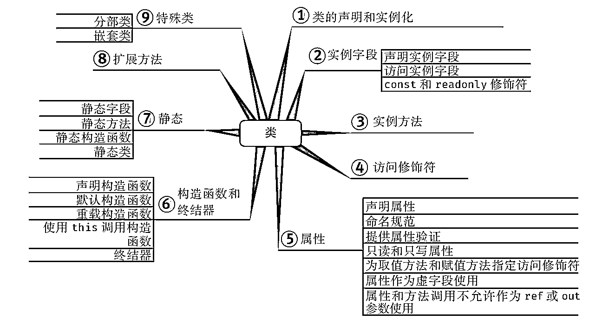
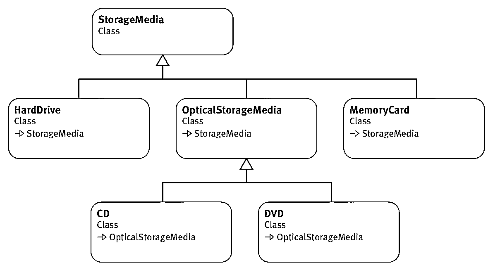
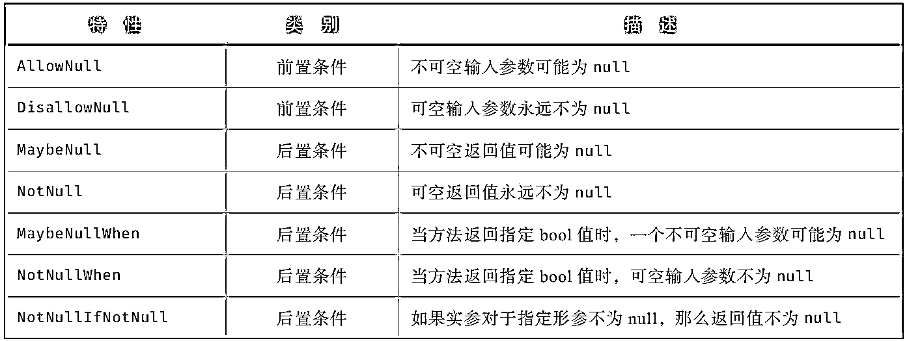
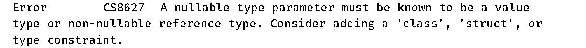

# 第六章　类



第一章简单介绍了如何声明一个名为 HelloWorld 的新类。第二章介绍了 C#内置的基元类型。学习了控制流程以及如何声明方法之后，就可以学习如何定义自己的类型了。这是任何 C#程序的核心构造。正是由于 C#支持类以及根据类来创建对象，所以我们说 C#是一种面向对象的语言。

本章介绍 C#面向对象编程的基础知识。重点在于如何定义类 ，可将类理解成对象的模板。

在面向对象编程中，之前学过的所有结构化的、基于控制流的编程构造仍然适用。但将那些构造封装在类中，可以创建更大、更有条理以及更容易维护的程序。从结构化的、基于控制流程的程序转向面向对象的程序，是因为面向对象编程提供了一个额外的组织层次。结果是较小的程序在某种程度上得到了简化。但更重要的是，现在更容易创建较大的程序，因为程序中的代码得到了更好的组织。

面向对象编程的一个关键优势是不必从头创建新程序，而是可以将现有的一系列对象组装到一起，用新功能扩展类，或添加更多的类。

还不熟悉面向对象编程的读者应阅读“初学者主题”获得对它的初步了解。“初学者主题”以外的内容将着重讨论如何使用 C#进行面向对象编程，并假定读者已熟悉了面向对象思维模式。

为支持封装，C#必须支持类、属性、访问修饰符以及方法等构造。本章着重讨论前三种，方法已在第五章讨论。掌握这些基础知识之后，第七章将讨论如何通过面向对象编程实现继承和多态性。

PowerShell 从 5.0 版起也提供了 class 关键字，语法与 C# 类似，但语义更简化：没有 public/private/protected/internal 访问修饰符（只有 hidden，且它只隐藏成员、不构成真正的访问隔离），没有属性的 get/set 访问器语法，也没有分部类、扩展方法、嵌套类等特性。本章的代码清单已改写为 PowerShell 类，凡与 C# 语义有明显差异之处，正文中都会加注说明。

初学者主题：面向对象编程(OOP)

如今，成功编程的关键在于提供恰当的组织和结构，以满足大型应用程序的复杂需求。面向对象编程能很好地实现该目标。有多好呢？可以这样说，开发者一旦熟悉了面向对象编程，除非写一些极为简单的程序，否则很难回到结构化编程。

面向对象编程最基本的构造是类。一组类构成了编程抽象、模型或模板，通常对应现实世界的一个概念。例如，OpticalStorageMedia（光学存储媒体）类可能有一个 Eject()方法，用于从播放机弹出光盘。OpticalStorageMedia 类是现实世界的 CD/DVD 播放机对象的编程抽象。

类是面向对象编程的三个主要特征——封装、继承和多态性——的基础。

封装 

封装旨在隐藏细节。必要的时候细节仍可访问，但通过巧妙地封装细节，大的程序变得更容易理解，数据不会被不慎修改，代码也变得更容易维护（因为对一处代码进行修改所造成的影响被限制在封装的范围之内）。方法就是封装的一个例子。虽然可以将代码从方法中拿出直接嵌入调用者的代码中，但将特定的代码重构成方法，能享受到封装所带来的好处。

继承 

考虑这个例子：DVD 是光学存储媒体的一个类型。它具有特定的存储容量，能容纳一部数字电影。CD 也是光学存储媒体的一个类型，但它具有不同特征。CD 上的版权保护有别于 DVD 的版权保护，两者存储容量也不同。无论是 CD 还是 DVD，它们都有别于硬盘、U 盘和软盘。虽然所有这些都是“存储媒体”，但分别具有不同的特征——即使一些基本功能也是不同的，比如所支持的文件系统，以及媒体的实例是只读的还是可读可写的。

面向对象编程中的继承允许在这些相似但又不同的物件之间建立“属于”（is a）关系。可合理地认为 DVD 和 CD 都“属于”存储媒体。因此它们都具有存储能力。类似地，CD 和 DVD 都“属于”光学存储媒体，后者又“属于”存储媒体。

为上面提到的每种存储媒体类型都定义一个类，就得到一个类层次结构 ，它由一系列“属于”关系构成。例如，可将基类型（所有存储媒体都从它派生）定义成 StorageMedia（存储媒体）。CD、DVD、硬盘、U 盘和软盘都属于 StorageMedia。但 CD 和 DVD 不必直接从 StorageMedia 派生。相反，可从中间类型 OpticalStorageMedia（光学存储媒体）派生。可用一幅 UML（Unified Modeling Language，统一建模语言）风格的类关系图来查看类层次结构，如图 6.1 所示。



图 6.1　类层次结构

继承关系至少涉及两个类，其中一个是另一个更具体的版本。图 6.1 中的 HardDrive 是更具体的 StorageMedia。反之不成立，因为 StorageMedia 的一个实例并非肯定是 HardDrive。如图 6.1 所示，继承涉及的类可能不止两个。

更具体的类型称为派生类型 或子类型 。更常规的类型称为基类型 或者超类型 。也经常将基类型称为“父”类型，将派生类型称为它的“子”类型。虽然这种说法很常见，但会带来混淆。“子”毕竟不是一种“父”！本书将采用“派生类型”和“基类型”的说法。

为了从一个类型派生 或继承 ，需对类型进行特化 ，这意味着要对基类型进行自定义，为满足特定需求而调整它。基类型可能包含所有派生类型都适用的实现细节。

继承最关键的一点是所有派生类型都继承了基类型的成员。派生类型中可以修改基类型的成员，但无论如何，派生类型除了自己显式添加的成员，还包含了基类型的成员。

可用派生类型以一致性的层次结构组织类。在这个层次结构中，派生类型比它们的基类型更特别。

多态性 

多态性这个词由一个表示“多”（poly）的词根和一个表示“态”（morph）的词根构成。讲到对象时，多态性意味着一个方法或类型可具有多种形式的实现。假定有一个媒体播放机，它既能播放音乐 CD，也能播放包含 MP3 歌曲的 DVD。但 Play()方法的具体实现会随着媒体类型的变化而变化。在一个音乐 CD 对象上调用 Play()方法，或者在一张音乐 DVD 上调用 Play()方法，都能播放出音乐，因为每种类型都理解自己具体如何“播放”。媒体播放机唯一知道的就是公共基类型 OpticalStorageMedia 以及它定义了 Play()方法签名的事实。多态性使不同类型能自己处理一个方法的实现细节，因为多个派生类型都包含了该方法，每个派生类型都共享同一个基类型（或接口），后者也包含了相同的方法签名。

## 6.1　类的声明和实例化

定义类首先指定关键字 class，后跟一个标识符，如代码清单 6.1 所示。PowerShell 同样用 class 关键字定义类（需要 PowerShell 5.0 及以上版本）。

代码清单 6.1　定义类

```powershell
class Employee {
}
```

该类的所有代码放到类声明之后的大括号中。虽然并非必须，但一般应该将每个类都放到它自己的文件中，用类名对文件进行命名。这样可以更容易地寻找定义了一个特定类的代码。

设计规范

·不要在一个源代码文件中放多个类。

·要用所含公共类型的名称命名源代码文件。

定义好新类后，就可以像使用.NET Framework 内置的类那样使用它了。换言之，可声明该类型的变量，或定义方法来接收该类型的参数。代码清单 6.2 对此进行了演示。

代码清单 6.2　声明类类型的变量

```powershell
class Program {
    static [void] IncreaseSalary([Employee]$employee) { }
}
$employee1 = $null
$employee2 = $null
```

初学者主题：对象和类

在非正式场合，类和对象这两个词经常互换着使用。但它们具有截然不同的含义。类 是模板，定义了对象在实例化时看起来像什么样子。所以，对象 是类的实例。类就像模具，定义了零件的样子。对象就是用这个模具创建的零件。从类创建对象的过程称为实例化 ，因为对象是类的实例。

现已定义了一个新的类类型，接着可实例化该类型的对象。效仿它的前任语言，C#使用 new 关键字实例化对象（参见代码清单 6.3）。PowerShell 则用类型调用 ::new() 创建实例，例如 [Employee]::new()。

代码清单 6.3　实例化一个类

```powershell
$employee1 = [Employee]::new()
$employee2 = [Employee]::new()
Increase-Salary $employee1
Increase-Salary $employee2
```

毫不奇怪，声明和赋值既能在同一行上完成，也能分行完成。

和以前使用的基元数据类型（如 int）不同，不能用字面值指定一个 Employee。相反，要用 new 操作符指示“运行时”为 Employee 对象分配内存、初始化对象，并返回对实例的引用。PowerShell 的 [Employee]::new() 完成同样的工作。

虽然有专门的 new 操作符分配内存，但没有对应的操作符回收内存。相反，“运行时”会在对象变得不可访问之后的某个时间自动回收内存。具体是由垃圾回收器 回收。它判断哪些对象不再由其他活动对象引用，然后安排一个时间回收对象占用的内存。这样就不能在编译时判断在程序的什么位置回收并归还内存。

这个简单的例子中没有数据或方法与 Employee 关联，这样的对象完全没用。下一节重点讲述如何为对象添加数据。

初学者主题：封装（第一部分）——对象将数据和方法组合到一起

假定接收到一叠写有员工名字的索引卡、一叠写有员工姓氏的索引卡以及一叠写有他们工资的索引卡，那么除非知道每一叠卡片都按相同顺序排列，否则这些索引卡没有什么作用。即使符合这个条件，也很难使用上面的数据，因为要判断一个人的全名需要搜索两叠卡片。更糟的是，如丢掉其中的一叠卡片，就没有办法再将名字与姓氏和工资关联起来。这时需要的是一叠员工卡片，每个员工的数据都组合到一张卡片中。换言之，要将名字、姓氏和工资封装到一起。

日常生活中的封装 是将一系列物品装入封套。类似地，面向对象编程将方法和数据装入对象。这提供了所有类成员 （类的数据和方法）的一个分组，使它们不再需要单独处理。不需要将名字、姓氏和工资作为三个单独的参数传给方法。相反，可在调用时传递对一个员工对象的引用。一旦被调用的方法接收到对象引用，就可以向对象发送消息（例如调用像 AdjustSalary()这样的方法）来执行特定的操作。

语言对比：C++——delete 操作符

程序员应将 new 的作用理解成实例化对象而不是分配内存。在堆和栈上分配对象都支持 new 操作符，这进一步强调了 new 不是关于内存分配的，也不是关于是否有必要进行回收的。

所以，C#不需要 C++中的 delete 操作符。内存分配和回收是“运行时”的细节。这使开发者可以将注意力更多地放在业务逻辑上。然而，虽然“运行时”会管理内存，但它不会管理其他资源，比如数据库连接、网络端口等。和 C++不同，C#不支持隐式确定性资源清理（在编译时确定的位置进行隐式对象析构）。幸好，C#通过 using 语句支持显式确定性资源清理，通过终结器支持隐式非确定性资源清理。

## 6.2　实例字段

面向对象设计的一个核心部分是分组数据来建立特定结构。本节讨论如何在 Employee 类中添加数据。在面向对象术语中，在类中存储数据的变量称为成员变量 。这个术语在 C#中很好理解，但更标准、更符合规范的术语是字段 ，它是与包容类型关联的具名存储单元。实例字段 是在类的级别上声明的变量，用于存储与对象（实例）关联的数据。PowerShell 类没有独立的“字段/属性”区分：在类体顶层声明的类型化变量（如 [string]$FirstName）实际上就是一个自动实现的可读写属性。

### 6.2.1　声明实例字段

代码清单 6.4 对 Employee 进行了修改，在其中包含了三个字段：FirstName、LastName 和 Salary。（为了描述方便，下面示例以及后续相关示例均没有被标记为 C# 8.0，但是实际上 Salary 字段的声明使用了 C# 8.0 中的可空引用类型。）

代码清单 6.4　声明字段

```powershell
class Employee {
    [string]$FirstName
    [string]$LastName
    [string]$Salary
}
```

添加好字段后，就可随同每个 Employee 实例存储一些基本数据。在 C# 中本例会添加访问修饰符 public 作为字段前缀；为字段添加 public 前缀，意味着可从 Employee 之外的其他类访问该字段中的数据（参见本章后面的 6.5 节）。PowerShell 类没有 public 关键字，成员默认就对外可见（详见 6.5 节关于 hidden 的说明）。

和局部变量声明一样，字段声明包含字段所引用的数据类型。此外，还可在声明的同时初始化为字段，如代码清单 6.5 的 Salary 字段所示。

代码清单 6.5　在声明时设置字段的初始值

```powershell
# Non-nullable field uninitialized warning disabled while code is incomplete
# (PowerShell has no equivalent compile-time warning.)
class Employee {
    [string]$FirstName
    [string]$LastName
    [string]$Salary = "Not enough"
}
```

字段命名和编码的设计规范稍后在介绍了 C#“属性”之后给出。现在将暂时使用不符合规范的写法。因为这个原因，上面示例中的代码会触发下面两个编译器警告^( [\[1\]](part0053.xhtml#ch1_back) ) ：

·CS0469：从未对字段“……”赋值，字段将一直保持其默认值 null。

·CS8618：不可为 null 的字段“……”必须包含非 null 值。

在上面示例中，FirstName 和 LastName 会因为没有被赋值而触发 CS8618 警告。

为了描述方便，这里暂时忽略警告，并用#pragma warning disable 将它们关闭。在本章后面，随着示例代码的不断完善，将不再需要关闭这些警告。PowerShell 没有这类编译期警告，也没有 #pragma warning disable；上面的警告列表仅用于说明 C# 的原始示例。

### 6.2.2　访问实例字段

可设置和获取字段中的数据。注意字段不包含 static 修饰符，这意味着它是实例字段。只能从其包容类的实例（对象）中访问实例字段，无法直接从类中访问（换言之，不创建实例就不能访问）。

代码清单 6.6 展示了 Program 类更新后的样子，并展示了它利用 Employee 类的情况。输出 6.1 展示了结果。

代码清单 6.6　访问字段

```powershell
$employee1 = [Employee]::new()
$employee1.FirstName = "Inigo"
$employee1.LastName = "Montoya"
$employee1.Salary = "Too Little"
Increase-Salary $employee1
"{0} {1}: {2}" -f $employee1.FirstName, $employee1.LastName, $employee1.Salary

function Increase-Salary([Employee]$employee) {
    $employee.Salary = "Enough to survive on"
}
```

输出 6.1


代码清单 6.6 实例化两个 Employee 对象，这和之前的例子一样。接着设置每个字段，调用 IncreaseSalary()来更改工资，然后显示与 employee1 引用的对象关联的每个字段。

注意首先必须指定要操作哪个 Employee 实例。所以，在对字段进行赋值和访问（取值）时都要添加 employee1 变量作为字段名的前缀。

[\[1\]](part0053.xhtml#ch1) 警告语有可能因为编译器的语言版本不同而有轻微变化。——译者注

## 6.3　实例方法

在脚本主体中直接调用格式化语句并对姓名进行格式化其实是笨办法。更好的办法是在 Employee 类中提供方法专门进行格式化。将功能修改成由 Employee 提供，而不是作为 Program 类的成员，这符合类的封装原则。为什么不把与员工姓名相关的方法放到包含姓名数据的类中呢？代码清单 6.7 演示了如何创建这样的一个方法。

代码清单 6.7　从包容类内部访问字段

```powershell
class Employee {
    [string]$FirstName
    [string]$LastName
    [string]$Salary
    [string] GetName() { return "$($this.FirstName) $($this.LastName)" }
}
```

和第五章的同名方法相比，这里的 GetName()没有太多特别之处，只是方法现在访问对象中的字段，而非访问局部变量。此外，方法声明没有用 static 来标记。本章稍后会讲到，静态方法不能直接访问类的实例字段。相反，必须先获得类的实例才能调用实例成员——无论该实例成员是方法还是字段。

添加 GetName()方法后就可以在更新后的脚本代码中使用它，如代码清单 6.8 和输出 6.2 所示。

代码清单 6.8　从包容类外部访问字段

```powershell
class Program {
}

$employee1 = [Employee]::new()
$employee1.FirstName = "Inigo"
$employee1.LastName = "Montoya"
$employee1.Salary = "Too Little"
Increase-Salary $employee1
"{0}: {1}" -f $employee1.GetName(), $employee1.Salary
```

输出 6.2


## 6.4　使用 $this 表示当前实例

可在类的实例成员内部获取对该类的引用。C#允许用关键字 this 显式指出当前访问的字段或方法是包容类的实例成员。调用任何实例成员时 this 都是隐含的，它返回对象本身的实例。PowerShell 类用 $this 表示当前实例，作用完全相同。来看看代码清单 6.9 中的 SetName()方法。

代码清单 6.9　使用 this 显式标识字段的所有者

```powershell
class Employee {
    [string]$FirstName
    [string]$LastName
    [string]$Salary
    [string] GetName() { return "$($this.FirstName) $($this.LastName)" }
    [void] SetName([string]$newFirstName, [string]$newLastName) {
        $this.FirstName = $newFirstName
        $this.LastName = $newLastName
    }
}
```

本例使用关键字 this 指出字段 FirstName 和 LastName 是类的实例成员。

虽然可为所有本地类成员引用添加 this 前缀，但设计规范是若非必要就不要在代码中“添乱”。所以，this 关键字只在必要时才应使用。本章后面的代码清单 6.12 是必须使用 this 的例子。代码清单 6.9 和 6.10 则不是。在代码清单 6.9 中，舍弃 this 不会改变代码含义。而代码清单 6.10 可修改字段的命名规范并遵循参数的命名规范来避免局部变量和字段之间的歧义。

初学者主题：依靠编码样式避免歧义

在 SetName()方法中没必要使用 this 关键字，因为 FirstName 显然有别于 newFirstName。但现在假定参数不叫做 newFirstName，而叫做 FirstName（使用 PascalCase 风格的大小写规范），如代码清单 6.10 所示。

代码清单 6.10　使用 this 避免歧义

```powershell
class Employee {
    [string]$FirstName
    [string]$LastName
    [string]$Salary
    [string] GetName() { return "$($this.FirstName) $($this.LastName)" }
    # Caution: parameter names use PascalCase
    [void] SetName([string]$FirstName, [string]$LastName) {
        $this.FirstName = $FirstName
        $this.LastName = $LastName
    }
}
```

本例要引用 FirstName 字段就必须显式指明它所在的 Employee 对象。this 就像在脚本代码中使用的 $employee1 变量前缀（参见代码清单 6.8），它引用要在其上调用 SetName()方法的对象。

代码清单 6.10 不符合 C#命名规范，即参数要像局部变量那样使用 camelCase 大小写风格来命名（除第一个单词，其他每个单词首字母大写）。这可能造成难以发现的 bug，因为将 FirstName（本来想引用字段）赋值给 FirstName（参数），代码仍能编译并运行。为避免该问题，最好是为参数和局部变量采用与字段和属性不同的命名规范。本章稍后会演示该规范的实际应用。PowerShell 的参数名通常就用 PascalCase，因此这种命名在 PowerShell 中反而符合习惯；区分字段与参数的关键仍是 $this 前缀。

语言对比：Visual Basic——使用 Me 访问类的实例

C#关键字 this 完全等价于 Visual Basic 关键字 Me。

代码清单 6.9 和代码清单 6.10 中的 GetName()方法没有使用 this 关键字，它确实可有可无。但假如存在与字段同名的局部变量或参数（参见代码清单 6.10 的 SetName()方法），省略 this 将访问局部变量或参数而非字段。这时 this 就是必需的。

还可使用 this 关键字显式访问类的方法。例如，可在 SetName()方法内使用 this.GetName()输出新赋值的姓名（参见代码清单 6.11 和输出 6.3）。

代码清单 6.11　this 作为方法名前缀

```powershell
class Employee {
    [string]$FirstName
    [string]$LastName
    [string] GetName() { return "$($this.FirstName) $($this.LastName)" }
    [void] SetName([string]$newFirstName, [string]$newLastName) {
        $this.FirstName = $newFirstName
        $this.LastName = $newLastName
        Write-Output "Name changed to '$($this.GetName())'"
    }
}
$employee = [Employee]::new()
$employee.SetName("Inigo", "Montoya")
```

输出 6.3


有时需要使用 this 传递对当前对象的引用。如代码清单 6.12 中的 Save()方法所示。

代码清单 6.12　在方法调用中传递 this

```powershell
class Employee {
    [void] Save() { [DataStorage]::Store($this) }
}

class DataStorage {
    # Save an employee object to a file named with the employee name
    static [void] Store([Employee]$employee) {
    }
}
```

Save()方法调用 DataStorage 类的 Store()方法。但需要向 Store()方法传递准备进行持久化存储的 Employee 对象。这是使用关键字 this 来完成的，它传递了正在其上调用 Save()方法的 Employee 对象的实例。

### 存储和载入文件

在 DataStorage 内部，Store()方法的实现要用到 System.IO 命名空间中的类，如代码清单 6.13 所示。Store()内部首先要实例化一个 FileStream 对象，将它与一个对应员工全名的文件关联。FileMode.Create 参数指明如<firstname><lastname>.dat 文件不存在，就新建一个；如文件存在，就覆盖它。接着创建一个 StreamWriter 对象将文本写入 FileStream。数据用 WriteLine()方法写入，就像向控制台写入一样。

代码清单 6.13　将数据持久化存储到文件

```powershell
using namespace System.IO
class DataStorage {
    # Save an employee object to a file named with the Employee name.
    # Error handling not shown.
    static [void] Store([Employee]$employee) {
        # Create a file and write the employee data to it.
        $path = "$($employee.FirstName)$($employee.LastName).dat"
        $employee | Export-Clixml -Path $path
    }
}

# Write all the data associated with the employee
$employee | Export-Clixml -Path $path
```

注①：该代码可用 using 语句改进，但因为我们还没有讲到，所以暂时不使用。

写入完成后应关闭 FileStream 和 StreamWriter，避免它们在等待垃圾回收期间处于“不确定性打开”状态。上述代码不含任何错误处理机制，所以如抛出异常，两个 Close()方法都得不到调用。

文件载入过程与存储过程相似，如代码清单 6.14 和输出 6.4 所示。

代码清单 6.14　从文件获取数据

```powershell
class DataStorage {
    static [Employee] Load([string]$firstName, [string]$lastName) {
        # Open an existing file or else report an error.
        $path = "$firstName$lastName.dat"
        [Employee]$employee = Import-Clixml $path
        return $employee
    }
}

$employee1 = $null
$employee2 = [Employee]::new()
$employee2.SetName("Inigo", "Montoya")
$employee2.Save()
# Modify employee2 after saving
Increase-Salary $employee2
# Load employee1 from the saved version of employee2
$employee1 = [DataStorage]::Load("Inigo", "Montoya")
"{0}: {1}" -f $employee1.GetName(), $employee1.Salary
```

注①：该代码可用 using 语句改进，但因为我们还没有讲到，所以暂时不使用。

输出 6.4


代码清单 6.14 使用 StreamReader 而非 StreamWriter 展示和存储相反的过程。同样地，一旦数据读取完毕，就要在 FileStream 和 StreamReader 上调用 Close()方法。

输出 6.4 没有在 Inigo Montoya:之后显示任何工资信息，因为只有在调用 Save()之后，才会通过调用 IncreaseSalary()将 Salary 设为 Enough to survive on。

注意脚本顶层代码可在员工实例上调用 Save()，但载入新员工调用的是 [DataStorage]::Load()。需要载入员工时，一般还没有可在其中载入（数据）的员工实例，所以 Employee 类的实例方法不可调用。除了在 DataStorage 类本身上调用 Load，另一个办法是为 Employee 类添加静态 Load()方法（详情参见 6.8 节），这样就可以调用 [Employee]::Load()——注意是直接在 Employee 类上调用，而不是在它的实例上调用。

注意代码清单顶部包含 using System.IO 指令，这样可直接访问每个 IO 类，无须为其附加完整的命名空间前缀。（PowerShell 中可写 using namespace System.IO，同样需放在脚本顶部；也可以直接使用完整类型名。）

## 6.5　访问修饰符

之前声明字段时，曾为字段声明添加关键字 public 作为前缀。public 是访问修饰符 ，它标识了所修饰成员的封装级别。可选择六个访问修饰符：public、private、protected、internal、protected internal 和 private protected。本节介绍前两个。

PowerShell 类不支持这些访问修饰符。它只提供一个 hidden 修饰符，作用是把成员从默认的成员枚举（如 Get-Member、IntelliSense）中隐藏；但被 hidden 标注的成员仍可直接读写，因此它并不提供真正的访问控制。

初学者主题：封装（第二部分）——信息隐藏

除了组合数据和方法，封装的另一个重要作用是隐藏对象的数据和行为的内部细节。方法在某种程度上也能做到这一点：在方法外部，调用者看见的只有方法声明，看不见内部实现。但面向对象编程更进一步，它能控制类成员在类外部的可视程度。类外部不可见的成员称为私有成员 。

在面向对象编程中，封装的作用不仅仅是组合数据和行为，还能隐藏类中的数据和行为的实现细节，使类的内部工作机制不暴露。这减少了调用者对数据进行不恰当修改的几率，同时防止类的使用者根据类的内部实现来编程（以后若实现发生变化，程序将不得不跟着变）。

访问修饰符的作用是提供封装。public 显式指明可从 Employee 类的外部访问被它修饰的字段。例如，可以从 Program 类中访问那些字段。

但如果 Employee 类要包含一个 Password 字段，那么应该如何设计？这时应允许在一个 Employee 对象上调用 Logon()方法来验证密码，但不应允许从类的外部访问 Employee 对象的 Password 字段。

为隐藏 Password 字段，禁止从它的包容类的外部访问，应使用 private 访问修饰符代替 public，如代码清单 6.15 所示。这样 Password 字段就只能在 Employee 类内部访问了。PowerShell 中没有 private；清单 6.15 用 hidden 做了力所能及的近似，但它不能真正阻止外部代码读写该成员。

代码清单 6.15　使用 private 访问修饰符

```powershell
class Employee {
    [string]$FirstName
    [string]$LastName
    [string]$Salary
    # working with decrypted passwords for elucidation
    # only - this is not recommended.
    hidden [string]$Password
    hidden [bool]$IsAuthenticated
    [bool] Logon([string]$password) {
        if ($this.Password -eq $password) {
            $this.IsAuthenticated = $true
        }
        return $this.IsAuthenticated
    }
    [bool] GetIsAuthenticated() { return $this.IsAuthenticated }
}

$employee = [Employee]::new()
$employee.FirstName = "Inigo"
$employee.LastName = "Montoya"
# Password is private, so it cannot be accessed from outside the class
# Write-Output "Password = $($employee.Password)"
```

虽然代码清单 6.15 没有演示使用 private 来修饰方法，但实际可以这么做。

注意，如果不为类成员添加访问修饰符，默认就是 private。也就是说，成员默认私有。公共成员必须显式指定。PowerShell 与此相反：类成员默认就可从外部访问，没有“默认私有”的规则，hidden 也只是隐藏而非禁止访问。

## 6.6　属性

上一节演示了如何使用 private 关键字封装密码，禁止从类的外部访问。但这种形式的封装通常过于严格。例如，可能希望字段在外部只读，但内部可以更改。又例如，可能希望允许对类中的一些数据执行写操作，但需要验证对数据的更改。再例如，可能希望动态构造数据。为满足这些需求，传统方式是将字段标记为私有，再提供取值和赋值方法（getter 和 setter）来访问和修改数据。代码清单 6.16 将 FirstName 和 LastName 更改为私有字段。每个字段的公共取值和赋值方法用于访问和更改它们的值。PowerShell 没有真正的私有字段，代码清单 6.16 用 hidden 近似私有支持字段，并显式提供 GetFirstName/SetFirstName 之类的方法。

代码清单 6.16　声明取值和赋值方法

```powershell
class Employee {
}

class Employee {
    hidden [string]$FirstName
    # FirstName getter
    [string] GetFirstName() { return $this.FirstName }
    # FirstName setter
    [void] SetFirstName([string]$newFirstName) {
        if (-not [string]::IsNullOrEmpty($newFirstName)) {
            $this.FirstName = $newFirstName
        }
    }
    hidden [string]$LastName
    # LastName getter
    [string] GetLastName() { return $this.LastName }
    # LastName setter
    [void] SetLastName([string]$newLastName) {
        if (-not [string]::IsNullOrEmpty($newLastName)) {
            $this.LastName = $newLastName
        }
    }
}
```

遗憾的是，这一更改会影响 Employee 类的可编程性。无法再用赋值操作符来设置类中的数据。此外也导致只能调用方法来访问数据。

### 6.6.1　声明属性

考虑到经常都会用到这种编程模式，C#的设计者决定为它提供显式的语法支持。新语法称为属性 （property），如代码清单 6.17 和输出 6.5 所示。PowerShell 没有 get/set 访问器语法：类体顶层的类型化变量本身就是自动实现的属性，需要验证逻辑时得退回到显式的 Get/Set 方法（如代码清单 6.16 所示）。

代码清单 6.17　定义属性

```powershell
$employee = [Employee]::new()
# Call the FirstName property's setter
$employee.FirstName = "Inigo"
# Call the FirstName property's getter

[System.Console]::WriteLine($employee.FirstName)

class Employee {
    # FirstName property
    [string]$FirstName
    hidden [string]$_FirstName
}
```

输出 6.5


在这个代码清单中，最引人注目的不是属性本身，而是 Program 类的代码。现在其实已经没有 FirstName 和 LastName 字段了，但这一点从 Program 类本身看不出来。访问员工名字和姓氏所用的代码根本没有改变。仍然可以使用简单的赋值操作符对姓或名进行赋值，例如 employee.FirstName="Inigo"。

属性的关键在于，它提供了从编程角度看类似于字段的 API。但事实上并不存在这样的字段。属性声明看起来和字段声明一样，但跟随在属性名之后的是一对大括号，要在其中添加属性的实现。属性的实现由两个可选的部分构成。其中，get 标志属性的取值方法（getter），直接对应代码清单 6.16 定义的 GetFirstName()和 GetLastName()方法。访问 FirstName 属性需调用 employee.FirstName。类似地，set 标志属性的赋值方法（setter），它实现了字段的赋值语法：

```powershell
$employee.FirstName = "Inigo"
```

属性的定义使用了三个上下文关键字。其中，get 和 set 关键字分别标识属性的取值和赋值部分。此外，赋值方法可用 value 关键字引用赋值操作的右侧部分。所以，当 Program.Main()调用 employee.FirstName="Inigo"时，赋值方法中的 value 被设为"Inigo"，该值可以赋给\_FirstName 字段。代码清单 6.17 的属性实现是最常见的。调用取值方法时，比如 Console.WriteLine(employee2.FirstName)，会获取字段（\_FirstName）值并将其写入控制台。（PowerShell 类不支持 get/set/value 这套访问器关键字，清单 6.17 中的 _$FirstName 只是普通成员。）

从 C# 7.0 起可用表达式主体方法声明属性的取值和赋值方法，如代码清单 6.18 所示。

代码清单 6.18　用表达式主体成员定义属性

```powershell
class Employee {
    # FirstName property
    [string]$FirstName
    hidden [string]$_FirstName
    # LastName property
    [string]$LastName
    hidden [string]$_LastName
}
```

代码清单 6.18 用两种不同的语法实现属性，实际编程时请统一。

### 6.6.2　自动实现的属性

从 C# 3.0 起属性语法有了简化版本。在属性中声明支持字段（比如上例的\_FirstName），并用取值方法和赋值方法来获取和设置该字段——由于这是十分常见的设计，而且代码比较琐碎（参考 FirstName 和 LastName 的实现就知道了），所以现在编译器允许在声明属性时不添加取值或赋值方法，也不声明任何支持字段。一切都自动实现。代码清单 6.19 展示如用何该语法定义 Title 和 Manager 属性，输出 6.6 是结果。PowerShell 的类型化类变量本来就相当于自动实现的属性，因此这里无需额外语法。

代码清单 6.19　自动实现的属性

```powershell
$employee1 = [Employee]::new()
$employee2 = [Employee]::new()
# Call the FirstName property's setter
$employee1.FirstName = "Inigo"
# Call the FirstName property's getter

[System.Console]::WriteLine($employee1.FirstName)
# Assign an auto-implemented property
$employee2.Title = "Computer Nerd"
$employee1.Manager = $employee2
# Print employee1's manager's title
[System.Console]::WriteLine($employee1.Manager.Title)

class Employee {
    [string]$FirstName
    hidden [string]$_FirstName
    [string]$LastName
    hidden [string]$_LastName
    [string]$Title
    [string]$Salary = "Not Enough"
}
```

输出 6.6


自动实现的属性简化了写法，也使代码更易读。此外，如未来需添加一些额外的代码，比如要在赋值方法中进行验证，那么虽然要修改现在的属性声明来包含实现，但调用它们的代码不必进行任何修改。

本书剩余部分主要使用这种语法，而不强调它是从 C# 3.0 才引入的。

关于自动实现的属性，最后要注意从 C# 6.0 开始可以像代码清单 6.19 最后一行进行初始化：

```powershell
[string]$Salary = "Not Enough"
```

在 C# 6.0 之前，只能通过方法（包括构造函数，本章稍后会讲到）来初始化属性。但现在可以用字段初始化那样的语法在声明时初始化自动实现的属性。PowerShell 同样允许在类中声明变量时直接给出初始值，例如 [string]$Salary = "Not Enough"。

### 6.6.3　属性和字段的设计规范

由于可以写显式的赋值和取值方法而不是属性，所以有时会疑惑该用属性还是方法。一般原则是方法代表行动，而属性代表数据。属性旨在简化对简单数据的访问。调用属性的成本不应比访问字段高出太多。

至于命名，注意在代码清单 6.19 中属性名是 FirstName，它的支持字段名变成了\_FirstName。其实就是添加了下划线前缀的 PascalCase 大小写。对于为属性提供支持的私有字段，其他常见的命名规范还有\_firstName 和像局部变量那样^( [\[1\]](part0057.xhtml#ch1_back) ) 的 camelCase 大小写规范。不过，应尽量避免 camelCase 大小写，因为局部变量和参数也经常采用这种大小写，会造成名称的重复。另外，为符合封装原则，属性的支持字段不应声明为 public 或 protected。

设计规范

·要使用属性简化对简单数据的访问（只进行简单计算）。

·避免从属性取值方法抛出异常。

·要在属性抛出异常时保留原始属性值。

·如果不需要额外逻辑，要优先使用自动实现的属性，而不是属性加简单支持字段。

无论私有字段使用哪一种命名方案，属性都要使用 PascalCase 大小写规范。因此，属性应使用 LastName 和 FirstName 等形式的名词、名词短语或形容词。事实上，属性和类型同名的情况也不罕见，例如 Person 对象中的 Address 类型的 Address 属性。

设计规范

·考虑为支持字段和属性使用相同的大小写风格，为支持字段附加“\_”前缀。但不要使用双下划线，它是为 C#编译器保留的。

·要使用名词、名词短语或形容词命名属性。

·考虑让某个属性和它的类型同名。

·避免用 camelCase 大小写风格命名字段。

·如果有意义的话，要为 Boolean 属性附加“Is”“Can”或“Has”前缀。

·要将所有实例字段声明为私有（并通过属性公开）。

·要用 PascalCase 大小写风格命名属性。

·要优先使用自动实现的属性而不是字段。

·如果没有额外的实现逻辑，要优先使用自动实现的属性而不是自己写完整版本。

### 6.6.4　提供属性验证

在代码清单 6.20 中，注意 Employee 的 Initialize()方法使用属性而不是字段进行赋值。虽然并非必须如此，但这样做的结果是，无论在类的内部还是外部，属性的赋值方法中的任何验证都会得到调用。例如，假定更改 LastName 属性，在把 value 赋给\_LastName 之前检查它是否为 null 或空字符串，那么会发生什么？（实际上，即使字段的类型为不可空，这一步检查仍然有必要，因为调用者有可能将可空引用类型特性禁用了，或者方法有可能在 C# 7.0 或更早期版本中被调用，那时可空引用类型尚未出现。）PowerShell 版本没有属性赋值器，所以校验放在显式的 SetLastName 方法中，并且必须在每个写入点主动调用它。

代码清单 6.20　提供属性验证

```powershell
class Employee {
    [void] Initialize([string]$newFirstName, [string]$newLastName) {
        # Use property inside the Employee class as well
        $this.FirstName = $newFirstName
        $this.LastName = $newLastName
    }
    # LastName property (validation is done in the setter equivalent below)
    [string]$LastName
    hidden [string]$_LastName
    [void] SetLastName([string]$value) {
        if ($null -eq $value) {
            # In C# 6.0 replace "value" with nameof(value)
            throw [System.ArgumentNullException]::new("value")
        }
        $value = $value.Trim()
        if ($value -eq "") {
            throw [System.ArgumentException]::new("LastName cannot be blank.", "value")
        }
        $this._LastName = $value
    }
}

hidden [string]$_LastName
```

在新实现中，如果为 LastName 赋了无效的值（要么从同一个类的另一个成员赋值，要么在 Program.Main()内直接向 LastName 赋值），代码就会抛出异常。拦截赋值，并通过字段风格的 API 对参数进行验证，这是属性的优点之一。PowerShell 无法自动拦截赋值，只能约定所有写路径都经过 SetLastName 之类的校验方法。

一个好的实践是只从属性的实现中访问属性的支持字段。换言之，要一直使用属性，不要直接调用字段。许多时候，即使在属性所在的类中，也不应该从属性实现的外部访问其支持字段。这样只要为属性添加了验证代码，整个类就能马上利用这个逻辑^( [\[2\]](part0057.xhtml#ch2_back) ) 。

虽然很少见，但确实能在赋值方法中对 value 进行赋值。如代码清单 6.20 所示，调用 value.Trim()会移除新姓氏值左右的空白字符。

在 C# 6.0 之前，程序员需要使用字面量"value"作为异常的 paramName 参数。从 C# 6.0 开始，可以使用 nameof(value)代替字面量。下面的“高级主题：nameof 操作符”将做更详细的介绍。在本章后面，我将统一使用 nameof(value)的写法。如果想要在 C# 5.0 或更早期版本中测试示例代码，请将其改为字面量"value"。

高级主题：nameof 操作符

属性验证时如判断新赋值无效，就需要抛出 ArgumentException()或 Argument-NullException()类型的异常。两个异常都获取 string 类型的实参 paramName 来标识无效参数的名称。代码清单 6.20 为该参数传递"value"，但从 C# 6.0 起可用 nameof 操作符来改进。该操作符获取一个标识符（比如 value 变量）作为参数，返回该名称的字符串形式（本例是"value"）。代码清单 6.20 在报告第二个错误时也使用了 nameof 的方法。

nameof 操作符的优点在于，以后若标识符名称发生改变，重构工具能自动修改 nameof 的实参。如果不用重构工具，代码将无法编译，强迫开发者手动修改实参。对于属性验证代码，参数始终是 value，不可修改。所以，这里使用 nameof 操作符的意义不大。但不管怎样，所有 paramName 参数都应坚持使用 nameof 操作符，保持与以下设计规范一致：对于 ArgumentNullException 和 ArgumentNullException 等要获取 paramName 参数的异常，总是为该参数使用 nameof 操作符。更多信息将在第十八章介绍。

设计规范

·避免从属性外部（即使是从属性所在的类中）访问属性的支持字段。

·创建 ArgumentException()或 ArgumentNullException()类型的异常时，要为 paramName 参数使用 nameof (value)（解析为"value"），"value"是属性赋值方法隐含的参数名。

### 6.6.5　只读和只写属性

通过移除属性的取值方法或赋值方法，可以改变属性的可访问性。只有赋值方法的属性是只写属性，这种情况较罕见。类似地，只提供取值方法会得到只读属性，任何赋值企图都会造成编译错误。例如，为了使 Id 只读，可以像代码清单 6.21 那样编码。PowerShell 类无法把属性限制为只读或只写，也没有相应的编译错误；只能通过约定或只暴露 Get 方法来模拟。

代码清单 6.21　C# 6.0 之前定义只读属性

```powershell
class Program {
    static [void] Main() {
        $employee1 = [Employee]::new()
        $employee1.Initialize(42)
        # ERROR: Property or indexer 'Employee.Id'
        # cannot be assigned to; it is read-only
        # $employee1.Id = "490"
    }
}
class Employee {
    [void] Initialize([int]$id) {
        # Use field because Id property has no setter; it is read-only
        $this._Id = $id.ToString()
    }
    # Id property declaration
    [string]$Id
    hidden [string]$_Id
}
```

代码清单 6.21 从 Employee 的 Initialize()方法（而不是属性）中对字段赋值（\_Id=id）。通过属性来赋值会造成编译错误，如 Program.Main()中注释掉的 employee1.Id="490";代码所示。

C# 6.0 开始支持只读自动实现的属性 ，如下所示：

```powershell
[bool[,,]]$Cells = [bool[,,]]::new(2, 3, 3)
```

这对 C# 6.0 之前的方式是一项重大改进，尤其是需要处理太多只读属性的时候，例如数组或代码清单 6.21 的 Id。PowerShell 没有“只读属性”的修饰符，声明时赋值后仍可被外部重新赋值（除非自定义类暴露只读方法）。

只读自动实现属性的一个重点在于，和只读字段一样，编译器要求通过一个初始化器（或通过构造函数）来初始化。上例使用了初始化器（初始化列表），但稍后就会讲到，也可在构造函数中对 Cells 进行赋值。

由于规范是不要从属性外部访问支持字段，所以在 C# 6.0 之后，几乎永远用不着之前的语法（比如代码清单 6.21）。相反，应总是使用只读自动实现属性。唯一例外是在字段和属性类型不匹配的时候。例如字段是 int 类型，只读属性是 double 类型。

设计规范

·如属性值不变，要创建只读属性。

·如属性值不变，从 C# 6.0 起要创建只读自动实现的属性而不是只读属性加支持字段。

### 6.6.6　属性作为虚字段

可以看出属性的行为与虚字段相似。有时甚至根本不需要支持字段。相反，可让属性的取值方法返回计算好的值，而让赋值方法解析值，并将值持久存储到其他成员字段中。注意代码清单 6.22 中 Name 属性的实现。输出 6.7 展示了结果。

代码清单 6.22　定义属性

```powershell
$employee1 = [Employee]::new()
$employee1.Name = "Inigo Montoya"
[System.Console]::WriteLine($employee1.Name)

class Employee {
    # FirstName property
    [string]$FirstName
    hidden [string]$_FirstName
    # LastName property
    [string]$LastName
    hidden [string]$_LastName
}

# Name property
[string]$Name

# setter equivalent: split the assigned value into first and last names
[string[]]$names = $value.Split([char[]]@(' '))
if ($names.Length -eq 2) {
    $FirstName = $names[0]
    $LastName = $names[1]
} else {
    # Throw an exception if the full name was not assigned
    throw [System.ArgumentException]::new(
        "Assigned value '$value' is invalid", "value")
}
[string]$Initials = "$($FirstName[0])$($LastName[0])"
```

输出 6.7


Name 属性的取值方法连接 FirstName 和 LastName 属性的返回值。事实上，所赋的姓名并没有真正存储下来。向 Name 属性赋值时，右侧的值会解析成名字和姓氏部分。

### 6.6.7　取值和赋值方法的访问修饰符

如前所述，好的实践是不要从属性外部访问其字段，否则为属性添加的验证逻辑或其他逻辑可能失去意义。遗憾的是，C# 1.0 不允许为属性的取值和赋值方法指定不同封装级别。换言之，不能为属性创建公共取值方法和私有赋值方法，使外部类只能对属性进行只读访问，而允许类内的代码向属性写入。

C# 2.0 的情况发生了变化，允许在属性的实现中为 get 或 set 部分指定访问修饰符（但不能为两者都指定），从而覆盖为声明属性指定的访问修饰符。代码清单 6.23 展示了一个例子。PowerShell 类没有单独的 getter/setter，自然也无法分别设置访问级别。

代码清单 6.23　为赋值方法指定访问修饰符

```powershell
class Program {
    static [void] Main() {
        $employee1 = [Employee]::new()
        $employee1.Initialize(42)
        # ERROR: The property or indexer 'Employee.Id'
        # cannot be used in this context because the set
        # accessor is inaccessible
        # $employee1.Id = "490"
    }
}
class Employee {
    [void] Initialize([int]$id) { $this.Id = $id.ToString() }
    # Id property declaration (private setter, C# 2.0 and higher)
    [string]$Id
    hidden [string]$_Id
}
```

为赋值方法指定 private 修饰符，属性对于除 Employee 的其他类来说就是只读的。在 Employee 类内部，属性可读且可写，所以可在构造函数中对属性进行赋值。为取值或赋值方法指定访问修饰符时，注意该访问修饰符的“限制性”必须比应用于整个属性的访问修饰符更“严格”。例如，将属性声明为较严格的 private，但将它的赋值方法声明为较宽松的 public，就会发生编译错误。

设计规范

·要为所有属性的取值和赋值方法应用适当的可访问性修饰符。

·不要提供只写属性，也不要让赋值方法的可访问性比取值方法更宽松。

### 6.6.8　属性和方法调用不允许作为 ref 或 out 参数值

C#允许属性像字段那样使用，只是不允许作为 ref 或 out 参数值传递。ref 和 out 参数内部要将内存地址传给目标方法。但由于属性可能是无支持字段的虚字段，也有可能只读或只写，所以不可能传递存储地址。同样的道理也适用于方法调用。如需将属性或方法调用作为 ref 或 out 参数值传递，首先必须将值拷贝到变量再传递该变量。方法调用结束后，再将变量的值赋回属性。PowerShell 的 [ref] 同样只能包装变量，不能直接包装属性或方法调用的结果。

高级主题：属性的内部工作机制

代码清单 6.24 展示了取值方法和赋值方法在 CIL 代码中以 get\_FirstName()和 set\_FirstName()的形式出现。

代码清单 6.24　属性的 CIL 代码

```text
.field private string _FirstName
.method public hidebysig specialname instance string
        get_FirstName() cil managed
{
    .maxstack 1
    IL_0000: ldarg.0
    IL_0001: ldfld string Employee::_FirstName
    IL_0006: ret
}
.method public hidebysig specialname instance void
        set_FirstName(string 'value') cil managed
{
    .maxstack 8
    IL_0000: ldarg.0
    IL_0001: ldarg.1
    IL_0002: stfld string Employee::_FirstName
    IL_0007: ret
}
.property instance string FirstName()
```

除了外观与普通方法无异，注意属性在 CIL 中也是一种显式的构造。如代码清单 6.25 所示，取值方法和赋值方法由 CIL 属性调用，而 CIL 属性是 CIL 代码中的一种显式构造。因此，语言和编译器并非总是依据一个惯例来解释属性。相反，正是由于反正最后都会回归 CIL 属性，所以编译器和代码编辑器能随便提供自己的特殊语法。

代码清单 6.25　属性是 CIL 的显式构造

```text
.property instance string FirstName()
{
    .get instance string Program::get_FirstName()
    .set instance void Program::set_FirstName(string)
}
// End of property Program::FirstName
```

注意在代码清单 6.24 中，作为属性一部分的取值方法和赋值方法包含了 specialname 元数据。IDE（比如 Visual Studio）根据该修饰符在“智能感知”（IntelliSense）中隐藏成员。

自动实现的属性在 CIL 中看起来和显式定义支持字段的属性几乎完全一样。C#编译器在 CIL 中生成名为<PropertyName>k\_BackingField 的字段。该字段应用了名为 System.Runtime.CompilerServices.CompilerGeneratedAttribute 的特性（参见第十八章）。无论取值还是赋值方法都用同一个特性修饰（与代码清单 5.23 和 5.24 的实现相同）。

[\[1\]](part0057.xhtml#ch1) 我个人更喜欢\_FirstName，下划线就足够了，名称前的 m 太多余。另外，使用与属性名称相同的大小写规范，Visual Studio 代码模板扩展工具中就可以只设置一个字符串，而不必为属性名和字段名各设一个。

[\[2\]](part0057.xhtml#ch2) 本章后面会讲到，一个例外是：在字段被标记为只读时，只能在构造函数中设置值。从 C# 6.0 起可直接对只读属性赋值，完全用不着只读字段了。

## 6.7　构造函数

现在已为类添加了用于存储数据的字段，接着应考虑数据的有效性。代码清单 6.3 展示了可用 new 操作符实例化对象（PowerShell 中即 [Employee]::new()）。但这样可能创建包含无效数据的员工对象。实例化 employee1 后得到的是姓名和工资尚未初始化的 Employee 对象。代码清单 6.3 中在实例化员工之后立即对尚未初始化的字段进行赋值。但假如忘了初始化，编译器也不会发出警告。结果是得到含有无效姓名的 Employee 对象。（在 C# 8.0 中，不可空引用类型变量会触发一个编译器警告，建议使用可空引用类型，以便避免默认的 null 值。无论如何，在实例化一个类的对象时，一定要对其字段进行初始化，以确保字段都具有有效值。PowerShell 没有这类编译期警告，但同样应通过构造函数完成初始化。）

### 6.7.1　声明构造函数

为解决该问题，必须提供一种方式在创建对象时指定必要的数据。这是用构造函数来实现的，如代码清单 6.26 所示。

代码清单 6.26　定义构造函数

```powershell
class Employee {
    # Employee constructor
    Employee([string]$firstName, [string]$lastName) {
        $this.FirstName = $firstName
        $this.LastName = $lastName
    }
    [string]$FirstName
    [string]$LastName
    [string]$Salary = "Not Enough"
}
```

定义构造函数需创建一个无返回类型的方法，方法名必须和类名完全一样。构造函数是“运行时”用来初始化对象实例的方法。PowerShell 类同样支持构造函数，语法与 C# 一致，例如 Employee([string]$firstName, [string]$lastName) { ... }。本例的构造函数获取员工名字和姓氏作为参数，允许程序员在实例化 Employee 对象时指定这些参数的值。代码清单 6.27 演示了如何调用构造函数。

代码清单 6.27　调用构造函数

```powershell
$employee = [Employee]::new("Inigo", "Montoya")
$employee.Salary = "Too Little"
[System.Console]::WriteLine(
    "{0} {1}: {2}", $employee.FirstName, $employee.LastName, $employee.Salary)
```

注意 new 操作符返回对完成实例化的对象的一个引用（虽然在构造函数的声明或实现中没有显式指定返回类型，也没有使用返回语句）。另外已移除了名字和姓氏的初始化代码，因为现在是在构造函数内部初始化。本例由于没有在构造函数内部初始化 Salary，因此对工资进行赋值的代码仍然予以保留。

开发者应注意既在声明中又在构造函数中赋值的情况。如果字段在声明时赋值（比如代码清单 6.5 中的 string Salary="Not enough"），那么只有在这个赋值发生之后，构造函数内部的赋值才会发生。所以，最终生效的是构造函数内部的赋值，它会覆盖声明时的赋值。如果不细心，很容易就会以为对象实例化后保留的是声明时的字段值。因此，有必要考虑一种编码风格，避免同一个类中既在声明时赋值，又在构造函数中赋值。

高级主题：new 操作符的实现细节

new 操作符内部和构造函数是像下面这样交互的。new 操作符从内存管理器获取“空白”内存，调用指定构造函数，将对“空白”内存的引用作为隐式的 this 参数传给构造函数。构造函数链剩余的部分开始执行，在构造函数之间传递引用。这些构造函数都没有返回类型（行为都像是返回 void）。构造函数链上的执行结束后，new 操作符返回内存引用。现在，该引用指向的内存处于完成初始化的形式。

### 6.7.2　默认构造函数

必须注意，一旦显式添加了构造函数，在脚本中实例化 Employee 就必须指定名字和姓氏。因此，代码清单 6.28 的代码无法编译（PowerShell 中调用时同样会报错）。

代码清单 6.28　默认构造函数不再可用

```powershell
$employee = $null
# ERROR: No overload because method 'Employee' takes '0' arguments
$employee = [Employee]::new()
```

如果类没有显式定义的构造函数，C#编译器会在编译时自动添加一个。该构造函数不获取参数，称为默认构造函数 。一旦为类显式添加了构造函数，C#编译器就不再自动提供默认构造函数。因此，在定义了 Employee(string firstName, string lastName)之后，编译器不再添加默认构造函数 Employee()。虽然可以手动添加，但会再度允许构造没有指定员工姓名的 Employee 对象。（PowerShell 类的行为与此一致：没有定义构造函数时 [Employee]::new() 可用；一旦定义了任何构造函数，无参形式就不再存在，除非显式再定义一个无参构造函数。）

没必要依赖编译器提供的默认构造函数。程序员任何时候都可显式定义默认构造函数，比如用它将某些字段初始化成特定值。无参构造函数就是默认构造函数。

### 6.7.3　对象初始化器

C# 3.0 新增了对象初始化器 ^( [\[1\]](part0058.xhtml#ch1_back) ) ，用于初始化对象中所有可以访问的字段和属性。具体地说，调用构造函数创建对象时，可在后面的一对大括号中添加成员初始化列表。每个成员的初始化操作都是一个赋值操作，等号左边是可以访问的字段或属性，右边是要赋的值，如代码清单 6.29 所示。PowerShell 没有对象初始化器语法，创建对象后需用赋值语句逐个设置属性（代码清单 6.29 正是这个写法）。

代码清单 6.29　使用显式成员赋值调用对象初始化器

```powershell
$employee1 = [Employee]::new("Inigo", "Montoya")
# Object initializer equivalent
$employee1.Title = "Computer Nerd"
$employee1.Salary = "Not enough"
```

注意，使用对象初始化器时要遵守相同的构造函数规则。这实际只是一种语法糖，最终生成的 CIL 代码和创建对象实例后单独用语句对字段及属性进行赋值无异。C#代码中的成员初始化顺序决定了在 CIL 中调用构造函数后的属性和字段赋值顺序。

总之，构造函数退出时，所有属性都应初始化成合理的默认值。利用属性的赋值方法的校验逻辑，可制止将无效数据赋给属性。但偶尔一个或多个属性的值可能导致同一个对象的其他属性暂时包含无效值。这时应推迟抛出异常，直到对象实际使用这些相关属性时再决定是否抛出异常。

设计规范

·要为所有属性提供有意义的默认值，确保默认值不会造成安全漏洞或造成代码执行效率大幅下降。

·要允许属性以任意顺序设置，即使这会造成对象暂时处于无效状态。

高级主题：集合初始化器

C# 3.0 还增加了集合初始化器 ，采用和对象初始化器相似的语法，用于在集合实例化期间向集合项赋值。它借用数组语法来初始化集合中的每一项。例如，为初始化 Employee 列表，可在构造函数调用之后的一对大括号中指定每一项，如代码清单 6.30 所示。PowerShell 没有集合初始化器语法，需要像代码清单 6.30 一样先创建集合，再逐个调用 Add() 添加元素。

代码清单 6.30　调用集合初始化器

```powershell
$employees = [System.Collections.Generic.List[Employee]]::new()
$employees.Add([Employee]::new("Inigo", "Montoya"))
$employees.Add([Employee]::new("Kevin", "Bost"))
```

像这样为新集合实例赋值，编译器生成的代码会按顺序实例化每个对象，并通过 Add()方法把它们添加到集合。

高级主题：终结器

构造函数定义了在类的实例化过程中发生的事情。为定义在对象销毁过程中发生的事情，C#提供了终结器。和 C++的析构器不同，终结器不是在对一个对象的所有引用都消失后马上运行。相反，终结器是在对象被判定“不可到达”之后的不确定时间内执行。具体地说，垃圾回收器会在一次垃圾回收过程中识别出带有终结器的对象。但不是立即回收这些对象，而是将它们添加到一个终结队列中。一个独立的线程遍历终结队列中的每一个对象，调用其终结器，然后将其从队列中删除，使其再次可供垃圾回收器处理。第十章深入讨论了这个过程以及资源清理的主题。PowerShell 类没有终结器语法，资源清理应借助 try/finally 或 .NET 对象的 Dispose()。

### 6.7.4　重载构造函数

构造函数可以重载。只要参数数量和类型有区别，可同时存在多个构造函数。PowerShell 类同样支持构造函数重载，会按实参的数量和类型选择匹配的构造函数（已实测确认）。例如，如代码清单 6.31 所示，可提供一个构造函数，除了获取员工姓名还获取员工 ID，或者只获取员工 ID。

代码清单 6.31　重载构造函数

```powershell
class Employee {
    Employee([string]$firstName, [string]$lastName) {
        $this.FirstName = $firstName
        $this.LastName = $lastName
    }
    Employee([int]$id, [string]$firstName, [string]$lastName) {
        $this.Id = $id
        $this.FirstName = $firstName
        $this.LastName = $lastName
    }
    # FirstName and LastName set inside Id property setter.
    [int]$Id
    [string]$FirstName
    [string]$LastName
    [string]$Salary = "Not Enough"
}
```

这样当脚本根据姓名来实例化员工对象时，既可只传递员工 ID，也可同时传递姓名和 ID。例如，在创建新员工时调用同时获取姓名和 ID 的构造函数，而从文件或数据库加载现有员工时调用只获取 ID 的构造函数。

和方法重载一样，多个构造函数使用少量参数支持简单情况，使用附加的参数支持复杂情况。应优先使用可选参数而不是重载，以便在 API 中清楚地看出“默认”属性的默认值。例如，构造函数签名 Person(string firstName, string lastName, int? age=null)清楚指明如果 Person 的年龄未指定就默认为 null。（PowerShell 函数和类的构造函数都支持参数默认值，但默认值在运行时求值，这一点与 C# 要求编译期常量不同。）

注意，从 C# 7.0 开始支持构造函数的表达式主体成员实现（即 => 语法）。PowerShell 类没有表达式主体成员，构造函数必须写成完整的方法体，例如，

```powershell
class Employee {
    # FirstName and LastName set inside Id property setter.
    Employee([int]$id) {
        $this.Id = $id
        # Look up employee name...
    }
    [int]$Id
    [string]$FirstName
    [string]$LastName
    [string]$Salary = "Not Enough"
}
```

在本例中，我们通过设置 Id 属性来间接地为 FirstName 和 LastName 成员赋值。不幸的是，C# 编译器无法检测到这种间接赋值，因此认为这两个成员未赋值，并且从 C# 8.0 开始发出警告，建议将这两个成员声明为可空。事实上，因为我们明确知道已经为它们赋值，所以将该警告关闭。（PowerShell 没有这种编译期可空性分析，也不会因此产生警告。）

设计规范

·如果构造函数的参数只是用于设置属性，那么构造函数参数（camelCase）要使用和属性（PascalCase）相同的名称，区别仅仅是首字母的大小写。

·要为构造函数提供可选参数，并且提供便利的重载构造函数，用好的默认值初始化属性。

·要允许以任何顺序设置属性，即使这会导致暂时无效的对象状态。

### 6.7.5　构造函数链：使用 this 调用另一个构造函数

注意，代码清单 6.31 对 Employee 对象进行初始化的代码在好几个地方重复，所以必须在多个地方维护。虽然本例代码量较小，但完全可以从一个构造函数中调用另一个构造函数，以避免重复输入代码。这称为构造函数链 ，用构造函数初始化器 实现。构造函数初始化器会在执行当前构造函数的实现之前，判断要调用另外哪一个构造函数，如代码清单 6.32 所示。（PowerShell 类不支持构造函数链，没有 : this(...) 这样的构造函数初始化器语法，因此只能把公共赋值重复写出来，或抽到单独的初始化方法中。）

代码清单 6.32　从一个构造函数中调用另一个

```powershell
class Employee {
    Employee([string]$firstName, [string]$lastName) {
        $this.FirstName = $firstName
        $this.LastName = $lastName
    }
    Employee([int]$id, [string]$firstName, [string]$lastName) {
        # PowerShell has no ": this(...)" constructor chaining,
        # so the shared assignments are repeated here.
        $this.FirstName = $firstName
        $this.LastName = $lastName
        $this.Id = $id
    }
    # FirstName and LastName set inside Id property setter.
    [int]$Id
    [string]$FirstName
    [string]$LastName
    [string]$Salary = "Not Enough"
}
```

针对相同对象实例，为了从一个构造函数中调用同一个类的另一个构造函数，C#语法在一个冒号后添加 this 关键字，再添加被调用构造函数的参数列表。本例是获取三个参数的构造函数调用获取两个参数的构造函数。但通常采取相反的调用模式——参数最少的构造函数调用参数最多的构造函数，为未知参数传递默认值。（PowerShell 类没有这套语法，如代码清单 6.32 的注释所述，只能改为重复赋值。）

初学者主题：集中初始化

如代码清单 6.32 所示，在 Employee(int id)构造函数的实现中不能调用 this(firstName, lastName)，因为该构造函数没有 firstName 和 lastName 这两个参数。要将所有初始化代码都集中到一个方法中，必须创建单独的方法，如代码清单 6.33 所示。（PowerShell 连构造函数链都不支持，这种“集中初始化”的做法反而是唯一的替代方案。）

代码清单 6.33　提供初始化方法

```powershell
class Employee {
    # FirstName and LastName set inside Initialize() method.
    Employee([string]$firstName, [string]$lastName) {
        [int]$id = 0
        # Generate an employee ID...
        $this.Initialize($id, $firstName, $lastName)
    }
    Employee([int]$id, [string]$firstName, [string]$lastName) {
        $this.Initialize($id, $firstName, $lastName)
    }
    Employee([int]$id) {
        [string]$firstName = ""
        [string]$lastName = ""
        # Look up employee data
        $this.Initialize($id, $firstName, $lastName)
    }
    hidden [void] Initialize([int]$id, [string]$firstName, [string]$lastName) {
        $this.Id = $id
        $this.FirstName = $firstName
        $this.LastName = $lastName
    }
}

hidden [void] Initialize([int]$id, [string]$firstName, [string]$lastName) {
    $this.Id = $id
    $this.FirstName = $firstName
    $this.LastName = $lastName
}
```

本例是将方法命名为 Initialize()，它同时获取员工的名字、姓氏和 ID。注意，在 C# 中仍然可以从一个构造函数中调用另一个构造函数，就像代码清单 6.32 展示的那样；PowerShell 只能通过 Initialize() 这类方法集中初始化。

通过 Id 属性来设置 FirstName 和 LastName 可以避免触发编译器警告（这属于 C# 的编译期可空性检查），与之类似，通过 Initialize 方法来赋值也可以做到这一点。因此在上面示例中不会有警告产生；PowerShell 本就没有此类警告。

[\[1\]](part0058.xhtml#ch1) object initializer 有时也称为“对象初始化列表”。——译者注

## 6.8　不可空引用类型属性与构造函数

下面这个编译器警告在本章中一再地被忽略和关闭（这是 C# 8.0 可空引用类型分析的一部分；PowerShell 没有编译期可空性检查，不会产生此类警告，本节内容主要作为 C# 语义背景了解）：

在一个类中，如果定义了不可空引用类型的字段或者默认实现的属性^( [\[1\]](part0059.xhtml#ch1_back) ) ，则在其宿主类完成实例化之前，这些字段和属性的值需要先被初始化，否则，它们只能拥有默认的 null 值，而这显然与“不可空”相悖。

但问题是，有时候这类字段和属性可能已经被间接地初始化了，超出了构造函数的直接作用域，因此超出了编译器代码分析的作用域，即便通过构造函数调用的方法或属性能够初始化也是如此^( [\[2\]](part0059.xhtml#ch2_back) ) 。下面是一些会出现上述问题的情形：

·在代码清单 6.20 中，不可空字段\_LastName 被属性 LastName 的 set 方法赋值。该方法在赋值之前对输入值做了是否为 null 或空串的简单校验。

·在代码清单 6.22 中，Name 属性为另一个不可空的属性赋值。

·在代码清单 6.32 和 6.33 中，集中初始化方法 Initialize()在构造函数中被调用。

·除上述例子之外，当类被外部的其他代理模块实例化并初始化时，如果该类有公共不可空属性，也会引发上述问题^( [\[3\]](part0059.xhtml#ch3_back) ) 。

在大部分情况下，不可空引用型字段和自动实现的不可空属性的初始化，都通过构造函数调用属性或方法间接完成。遗憾的是，C#编译器无法识别对不可空引用型字段或属性的间接赋值，即便该间接赋值发生在构造函数里。（为了方便阐述，本节中提及不可空字段或属性时，均指引用型。）PowerShell 没有这套编译期分析，因此这些警告和对应技巧在 PowerShell 中都不存在；不过“赋值前检查 null”的习惯仍然值得保留。

此外，所有不可空字段和属性都需要确保它们在任何时候都不会被设置成 null 值。对于字段来说，这需要将对它们的存取封装在相应的属性里，并在其赋值方法中对输入值进行校验。（请记住，若要使属性的赋值校验起到作用，需要遵循的设计规范是：将字段声明为私有，从而不让它被类外部代码直接访问。PowerShell 类没有 private，只有 hidden；hidden 只是从 Get-Member 中隐藏，成员仍可被直接读写，因此无法提供真正的封装保证。）基于这个方法，一个实现完整的可读写的不可空引用型属性便可以确保不会被赋值为 null 值。

不可为 null 的自动实现属性需要限制为只读封装，在实例化期间分配任何值，并在分配之前验证为非 null。对于自动实现的不可空属性永远不要允许可读写方式，尤其当这种属性具有公共的赋值方法时更是如此，因为自动实现的赋值方法不会检查 null 值情况，从而无法避免在程序的其他地方意外地将它赋值为 null。虽然可以通过在构造函数中对不可空字段进行赋值来避免编译器警告，但这样显然是不够的。该属性是读写的，因此可以在实例化后将其赋值为 null，该属性便不是不可空的。（PowerShell 类中的类型化变量就是自动属性，且没有只读修饰符，赋值后随时可被改写，因此只能靠约定和显式校验方法来保证非空。）

### 6.8.1　可读写的引用型不可空属性

代码清单 6.34 展示了如何既使用可读写的引用型不可空属性，又避免产生不可空属性未初始化的编译器警告。这样做的最终效果是在编译器看来该属性/字段为可空（因此不会产生警告），而在调用者看来该属性/字段不允许被设置为空。（PowerShell 没有这套编译期分析，下面的代码只是演示“显式校验 null”的写法。）

代码清单 6.34　为不可空属性提供 null 值检查

```powershell
class Employee {
    Employee([string]$name) { $this.Name = $name }
    [string]$Name
    hidden [string]$_Name
    # Setter equivalent: reject null before updating the backing field.
    [void] SetName([string]$value) {
        $this._Name = $value ?? throw [System.ArgumentNullException]::new('value')
    }
}
```

上面代码能够达到前述目的的原理如下：

1.字段\_Name 被声明为可空，因此编译器不会产生警告。

2.字段被声明为私有，因此无法直接被类的外部存取。（PowerShell 只有 hidden，隐藏≠不可访问，这一点无法照搬。）

3.字段对应的属性 Name 中，赋值方法具有对 null 值的检查，并且会拒绝接受 null 值。这一点协同前一点一起确保了字段\_Name 不会为空。

4.取值方法中使用空包容操作符(!)声明其返回的值不会是 null，而实际上其返回值也确实不会为 null，这一点由赋值方法所保证。（空包容操作符 ! 是 C# 语法；PowerShell 没有对应的编译期标注，也不支持用 ! 做非空断言。）

虽然将不应该为空的字段声明为可空看起来不太正确，但是由于编译器无法识别对不可空字段的间接赋值，因此有时确实需要这样做。好在程序员可以通过字段的私有性，以及精细设计的取值、赋值方法，实现没有编译警告的可读写的不可空属性。（PowerShell 中没有编译警告，也不需要这些变通；直接用显式校验方法即可。）

### 6.8.2　自动实现的只读引用型属性

前文提到如果一个不可空的引用型字段有自动实现的属性，则该属性应该为只读，从而避免该字段被意外设置为 null 值。但是即便做到了这一点，在构造函数里为该字段进行赋值时，仍然需要检查 null 值，如代码清单 6.35 所示。

代码清单 6.35　在构造函数中为不可空引用型字段赋值时的 null 值检查

```powershell
class Employee {
    Employee([string]$name) {
        $this.Name = $name ?? throw [System.ArgumentNullException]::new('name')
    }
    [string]$Name
}
```

你可能会产生这样的疑问：当一个不可空的引用型字段有自动实现的属性时，是否可以让它拥有私有的赋值方法？毕竟这样做，对类的外部来说，该属性仍然是只读的。这种做法看起来可行，问题是，你能否保证在编写该类的其他部分程序时，不会意外地将该属性设置为 null 值？一个类从外部接收到 null 值的情形，不只会在构造函数中发生。事实上，这种情形随时有可能发生，但是对 null 值的检查却非常容易被忽略。（PowerShell 没有私有赋值方法，这类访问控制无从实现。）

设计规范

·当类的不可空引用型字段需要对应的属性时，要将该字段声明为可空，并且要编写完整实现的属性方法，而不要采用自动实现的方式。在赋值方法中要做好 null 值检查，在取值方法中要使用空包容操作符。（后一项是 C# 专有语法，PowerShell 中只需保证校验方法覆盖所有写入路径。）

·不可空的引用型字段要在构造函数内完成赋值。

·如果一定要为不可空的引用型字段使用自动实现的属性，要将属性声明为只读。

·在操作任何引用型字段或属性时，都要检查 null 值。

[\[1\]](part0059.xhtml#ch1) 只写了 get 和 set 关键字但没有写出具体代码的属性。——译者注

[\[2\]](part0059.xhtml#ch2) 或者可能通过外部代理，如反射，参见第十八章。

[\[3\]](part0059.xhtml#ch3) 例如，MSTest 中的 TestContext 属性，或者那些通过依赖注入初始化的属性。

## 6.9　可空特性

在很多情况下，明确告诉编译器你需要处理空值，并需要为此添加一些防护措施，比笼统地关闭空值功能或者关闭空值警告更有意义。若要实现这一点，可以将一些元数据（metadata）作为特性（attribute）包含在代码中。第十八章将更加深入地介绍特性这一概念。在 System.Diagnostics.CodeAnalysis 命名空间中定义了 7 种不同的可空特性，有些属于前置条件，有些属于后置条件。（见表 6.1）这些特性服务于 C# 编译器的可空性分析；PowerShell 没有对应的编译期分析，附加这些特性不会产生任何效果，本节仅作为 C# 语义说明。

表 6.1　可空特性



这些可空特性对编程很有帮助，因为有时将数据定义为可空或者不可空，并不足以提高程序的健壮性。为了弥补这种不足，你可以使用可空特性对方法的输入数据（使用前置条件可空特性）和输出数据（使用后置条件可空特性）进行描述。前置条件可空特性用来描述调用者输入的数据是否可以为空值，而后置条件可空特性用来描述调用者将接收到的数据会不会为空值。代码清单 6.36 中的两个名为“TryGet……”的函数展示了一个可空特性的应用示例。

代码清单 6.36　NotNullWhen 和 NotNullIfNotNull 特性的应用示例

```powershell
using namespace System.Diagnostics.CodeAnalysis

# C#: static bool TryGetDigitAsText(char number, [NotNullWhen(true)] out string? text)
function Test-TryGetDigitAsText([char]$number, [ref]$text) {
    $text.Value = switch ($number) {
        '1' { "one" }
        '2' { "two" }
        '9' { "nine" }
        default { $null }
    }
    return $text.Value -is [string]
}

# C#: [return: NotNullIfNotNull("text")] static string? TryGetDigitsAsText(string? text)
function Try-GetDigitsAsText([string]$text) {
    if ($null -eq $text) { return $null }
    $result = ""
    foreach ($character in $text.ToCharArray()) {
        $digitText = $null
        if (Test-TryGetDigitAsText $character ([ref]$digitText)) {
            if ($result -ne "") { $result += '-' }
            $result += $digitText.ToLower()
        }
    }
    return $result
}
```

观察上面代码你会注意到，即便 digitText 变量被定义为可空，后面在调用其 ToLower 方法时也没有使用空合并操作符。如果编译这段代码，会发现此处甚至不会产生编译器警告。这是因为在 TryGetDigitAsText()方法的定义中，输出变量 text 被标记了 NotNullWhen(true)特性。它告诉编译器，如果该方法返回 true（即 NotNullWhen 特性中指定的值），则 digit text 不会为 null。NotNullWhen 是一个后置条件特性，因此它的条件是否成立会在方法结束后再被评估。有了这个认识，再次观察代码，可以注意到 ToLower 方法的调用发生在 if 判断的内部，因此只有当 TryGetDigitAsText()返回 true，该调用才会发生。而根据 NotNullWhen 特性的描述，此时 digitText 变量一定不会是 null，所以这里既不需要使用空合并操作符，也不会产生编译器警告。（以上推理完全建立在 C# 编译器的可空性分析之上。PowerShell 没有这种分析，特性也不起作用；若 $digitText 为 $null，调用 .ToLower() 会直接抛出错误，因此实际脚本中仍需显式判空。）

上面代码中的第二个方法 TryGetDigitsAsText()^( [\[1\]](part0060.xhtml#ch1_back) ) 也采用了类似的可空特性描述。它用前置条件特性 NotNullIfNotNull 声明了：如果输入参数 text 不为 null，则函数返回值也不为 null。（同样，这只影响 C# 编译器，PowerShell 运行时不会据此做任何检查。）

高级主题：用可空特性修饰泛型类型

在泛型编程中，我们经常希望将泛型类型声明为可空。但是，由于可空值类型（派生于 Nullable\<T\>）与可空引用类型本质上是完全不同的数据类型，因此如果要将泛型类型声明为可空，则必须将该泛型类型约束为值类型或者引用类型，否则，将会产生下面的编译错误（这是 C# 的类型系统约束，PowerShell 的泛型写法不同，也没有可空修饰符，不会出现该编译错误）：



但是，一个方法的逻辑有时候对于值类型和引用类型完全相同，如果因为上述原因而被迫写两份没有差别的代码，则会令人非常沮丧。更糟的是，如果采用类型约束，则由于类型约束无法产生不同的方法签名，导致无法使用重载，因此不得不将两份相同的代码写在两个不同名的方法中。在这种情况下，更好的解决办法是使用可空特性，如代码清单 6.37 所示。

代码清单 6.37　为可能的 null 返回值使用 MaybeNull 特性

```powershell
# C#: [return: MaybeNull] static T GetObject<T>(IEnumerable<T>, Func<T, bool>)
function Get-Object($sequence, [scriptblock]$match) {
    $sequence | Where-Object $match | Select-Object -First 1
}
```

上面代码中的 GetObject 方法从 sequence 集合中寻找能够使 match 预测函数返回 true 的元素。如果这样的元素存在，则返回该元素；否则，返回 null 值。遗憾的是，C# 编译器不允许在没有类型约束的情况下采用 T?这样的写法^( [\[2\]](part0060.xhtml#ch2_back) ) ，而如果忽略可空修饰符，则会产生编译器警告。为了解决这个问题，可以使用后置条件可空特性 MaybeNull 来代替可空修饰符。（PowerShell 没有 T? 语法，也没有这类警告；函数返回 $null 是允许的。）

[\[1\]](part0060.xhtml#ch1) 注意该方法的名称与第一个方法不同。其中“Digits”一词多了字母“s”。——译者注

[\[2\]](part0060.xhtml#ch2) 即为没有类型约束的泛型类型添加可空修饰符。——译者注

## 6.10　解构函数

构造函数允许获取多个参数并把它们全部封装到一个对象中。但在 C# 7.0 之前没有一个显式的语言构造来做相反的事情，即把封装好的项拆分为它的各个组成部分。当然可以将每个属性手动赋给变量，但如果有太多这样的变量，就需要大量单独的语句。自 C# 7.0 推出元组语法后，该操作得到极大简化。如代码清单 6.38 所示，可声明一个 Deconstruct()方法来做这件事情。（PowerShell 没有“解构”这一语言特性，即不会因为定义了 Deconstruct() 就自动支持元组赋值；只能像代码清单 6.38 那样显式调用方法，并通过 [ref] 取回各值。）

代码清单 6.38　解构用户自定义类型

```powershell
class Employee {
    [void] Deconstruct(
        [ref]$id, [ref]$firstName, [ref]$lastName, [ref]$salary) {
        $id.Value = $this.Id
        $firstName.Value = $this.FirstName
        $lastName.Value = $this.LastName
        $salary.Value = $this.Salary
    }
}

$employee.Deconstruct(
    [ref]$id, [ref]$firstName, [ref]$lastName, [ref]$salary)
[System.Console]::WriteLine("{0} {1}: {2}", $firstName, $lastName, $salary)
```

该方法可直接调用。如第五章所述，PowerShell 用 [ref] 代替 out：调用前准备好变量，并以内联形式传入 ([ref]$变量)，方法内通过 .Value 读写。

从 C# 7.0 起可直接将对象实例赋给一个元组，从而隐式调用 Deconstruct()方法（称为解构函数 ）。这时可认为被赋值的变量已声明。例如（这是 C# 语法；PowerShell 中的 $firstName, $lastName, $salary = ... 只是把右侧的多个值按位置赋给多个变量，不会调用 Deconstruct()）：

```powershell
$firstName, $lastName, $salary = $employee.FirstName, $employee.LastName, $employee.Salary
```

该语法生成的 CIL 代码和代码清单 6.38 突出显示的语法完全一样，只是更简单（而且更让人注意不到调用了 Deconstruct()方法）。注意只允许用元组语法向那些和 out 参数匹配的变量赋值。不允许向元组类型的变量赋值，例如（PowerShell 无此限制，也无此语法，下面的写法只是构造一个 ValueTuple 值）：

```powershell
# C#: (int, string, string, string) tuple;
$tuple = [System.ValueTuple[int, string, string, string]]::new()
```

也不允许向元组中的具名项赋值：

```powershell
$id, $firstName, $lastName, $salary = $employee.Id, $employee.FirstName, $employee.LastName, $employee.Salary
```

为声明解构函数，方法名必须是 Deconstruct，其签名是返回 void 并接收两个或更多 out 参数。基于该签名，可将对象实例直接赋给一个元组而无须显式方法调用。（PowerShell 没有这种“按约定名自动识别”的机制，Deconstruct() 只会在被显式调用时执行。）

## 6.11　静态成员

我们在第一章的 HelloWorld 例子中简单接触过 static 关键字。本节将完整定义 static。PowerShell 的类同样支持 static 成员（静态字段/属性、静态方法、静态构造函数），用 [[类名]::成员] 访问。

先考虑一个例子。假定每个员工 Id 值都必须不重复，一个解决方案是通过计数器来跟踪每个员工 ID。但如果值作为实例字段存储，每次实例化对象都要创建新的 NextId 字段，造成每个 Employee 对象实例都要消耗那个字段的内存。最大的问题在于，每次实例化 Employee 对象，以前实例化的所有 Employee 对象的 NextId 值都需要更新为下一个 ID 值。所以需要一个单独的字段，它能由所有 Employee 对象实例共享。

语言对比：C++/Visual Basic——全局变量和函数

和以前的许多语言不同，C#没有全局变量或全局函数。C#的所有字段和方法都在类的上下文中。在 C#中，与全局字段或函数等价的是静态字段或方法。“全局变量/函数”和“C#静态字段/方法”在功能上没有差异，只是静态字段/方法可包含访问修饰符（比如 private），从而限制访问并提供更好的封装。（PowerShell 没有这种限制——脚本可以在类之外直接定义变量和函数，它们对脚本作用域可见；但若想使用类的静态成员，仍需像 C# 一样通过类名访问。）

### 6.11.1　静态字段

使用 static 关键字定义能由多个实例共享的数据，如代码清单 6.39 所示。

代码清单 6.39　声明静态字段

```powershell
class Employee {
    Employee([string]$firstName, [string]$lastName) {
        $this.FirstName = $firstName
        $this.LastName = $lastName
        $this.Id = [Employee]::NextId
        [Employee]::NextId++
    }
    static [int]$NextId
    [int]$Id
    [string]$FirstName
    [string]$LastName
    [string]$Salary = "Not Enough"
}
```

本例用 static 修饰符将 NextId 字段声明为静态字段 。和 Id 不同，所有 Employee 实例都共享同一个 NextId 存储位置。Employee 构造函数先将 NextId 的值赋给新 Employee 对象的 Id，然后立即递增 NextId。创建另一个 Employee 类时，由于 NextId 的值已递增，所以新 Employee 对象的 Id 字段将获得不同的值。

和实例字段 （非静态字段）一样，静态字段也可在声明时初始化，如代码清单 6.40 所示。

代码清单 6.40　声明时向静态字段赋值

```powershell
class Employee {
    static [int]$NextId = 42
}
```

和实例字段不同，未初始化的静态字段将获得默认值（0、null、false 等），即 default(T)的结果，其中 T 是类型名。所以，没有显式赋值的静态字段也是可以访问的。（PowerShell 中的类型化类成员同样默认初始化为该类型的默认值；已实测确认静态字段与实例字段均如此。）

每创建一个对象实例，非静态字段（实例字段）都要占用一个新的存储位置。静态字段从属于类而非实例。因此，我们使用类名从类外部访问静态字段。代码清单 6.41 展示了一个新的 Program 类（使用代码清单 6.39 的 Employee 类）。（PowerShell 脚本不需要 Program 类和 static Main()，顶层代码可直接执行；代码清单为了与 C# 结构对照而保留了这一外壳，实际脚本中把那些语句直接写在脚本顶层即可。）

代码清单 6.41　访问静态字段

```powershell
using namespace System
class Program {
}

static [void] Main() {
    [Employee]::NextId = 1000000
    $employee1 = [Employee]::new("Inigo", "Montoya")
    $employee2 = [Employee]::new("Princess", "Buttercup")
    [System.Console]::WriteLine("{0} {1} ({2})",
        $employee1.FirstName, $employee1.LastName, $employee1.Id)
    [System.Console]::WriteLine("{0} {1} ({2})",
        $employee2.FirstName, $employee2.LastName, $employee2.Id)
    [System.Console]::WriteLine("NextId = $([Employee]::NextId)")
}
```

输出 6.8 显示了代码清单 6.41 的结果。

输出 6.8


设置和获取静态字段 NextId 的初始值是通过类名 Employee，而不是通过对类的实例的引用。只有在类（或派生类）内部的代码中才能省略类名。换言之，Employee(...)构造函数不需要使用 Employee.NextId。因为这些代码已经在 Employee 类的上下文中，所以不需要专门指出上下文。变量作用域是可以不加限定来引用的程序代码区域，而静态字段的作用域是类（及其任何派生类）。（PowerShell 类中出于清晰起见，通常仍写完整的 [Employee]::NextId。）

虽然引用静态字段的方式与引用实例字段的方式稍有区别，但不能在同一个类中定义同名的静态字段和实例字段。由于引用错误字段的概率很高，C#的设计者决定禁止这样的代码。所以，重复的名称在声明空间中会造成编译错误。（PowerShell 的类同样不允许同名静态成员和实例成员共存，定义时会直接报解析错误，已实测确认。）

初学者主题：类和对象都能关联数据

类和对象都能关联数据。将类想象成模具，将对象想象成根据该模具浇铸的零件，可以更好地理解这一点。

例如，一个模具拥有的数据可能包括：到目前为止已用模具浇铸的零件数、下个零件的序列号、当前注入模具的液态塑料的颜色以及模具每小时生产零件数量。类似地，零件也拥有它自己的数据：序列号、颜色以及生产日期/时间。虽然零件颜色就是生产零件时在模具中注入的塑料的颜色，但它显然不包含模具中当前注入的塑料颜色数据，也不包含要生产的下个零件的序列号数据。

设计对象时，程序员要考虑字段和方法应声明为静态还是基于实例。一般应将不需要访问任何实例数据的方法声明为静态方法，将需要访问实例数据的方法（实例不作为参数传递）声明为实例方法。静态字段主要存储对应于类的数据，比如新实例的默认值或者已创建实例的个数。而实例字段主要存储和对象关联的数据。

### 6.11.2　静态方法

和静态字段一样，直接在类名后访问静态方法（比如 [Console]::ReadLine()）。访问这种方法不需要实例。

代码清单 6.42 展示了一个声明和调用静态方法的例子。

代码清单 6.42　为 DirectoryInfoExtension 类定义静态方法

```powershell
class DirectoryInfoExtension {
    static [void] CopyTo(
        [System.IO.DirectoryInfo]$sourceDirectory, [string]$target,
        [System.IO.SearchOption]$option, [string]$searchPattern) {
        if ($target[$target.Length - 1] -ne [System.IO.Path]::DirectorySeparatorChar) {
            $target += [System.IO.Path]::DirectorySeparatorChar
        }
        if (-not [System.IO.Directory]::Exists($target)) {
            [System.IO.Directory]::CreateDirectory($target)
        }
        foreach ($file in [System.IO.Directory]::GetFiles(
                $sourceDirectory.FullName, $searchPattern)) {
            [System.IO.File]::Copy(
                $file, $target + [System.IO.Path]::GetFileName($file), $true)
        }
        # Copy subdirectories (recursively)
        if ($option -eq [System.IO.SearchOption]::AllDirectories) {
            foreach ($element in [System.IO.Directory]::GetDirectories(
                    $sourceDirectory.FullName)) {
                [DirectoryInfoExtension]::CopyTo(
                    $element, $target + [System.IO.Path]::GetFileName($element),
                    $option, $searchPattern)
            }
        }
    }
}

$directory = [System.IO.DirectoryInfo]::new(".\Source")
$directory.MoveTo(".\Root")
[DirectoryInfoExtension]::CopyTo(
    $directory, ".\Target", [System.IO.SearchOption]::AllDirectories, "*")
```

DirectoryInfoExtension.CopyTo()方法获取一个 DirectoryInfo 对象，将基础目录结构拷贝到新位置。

由于静态方法不通过实例引用，所以 this 关键字在静态方法中无效（PowerShell 中则是 $this 不可用）。此外，要在静态方法内部直接访问实例字段或实例方法，必须先获得对字段或方法所属的那个实例的引用。（C# 中的 Main()就是静态方法；PowerShell 脚本没有这个入口点。）

该方法本应由 System.IO.Directory 类提供，或作为 System.IO.DirectoryInfo 类的实例方法提供。但两个类都没提供，所以代码清单 6.42 在一个全新的类中定义该方法。本章后面讲述扩展方法的小节会解释如何使它表现为 DirectoryInfo 类的实例方法。

### 6.11.3　静态构造函数

除了静态字段和方法，C#还支持静态构造函数 ，用于对类（而不是类的实例）进行初始化。静态构造函数不显式调用。相反，“运行时”在首次访问类时自动调用静态构造函数。“首次访问类”可能发生在调用普通构造函数时，也可能发生在访问类的静态方法或字段时。由于静态构造函数不能显式调用，所以不允许任何参数。（PowerShell 7 的类同样支持静态构造函数，语法和时序一致；它会在首次访问类的静态成员或实例化对象时自动执行，已实测确认。）

静态构造函数的作用是将类中的静态数据初始化成特定值，尤其是在无法通过声明时的一次简单赋值来获得初始值的时候。代码清单 6.43 展示了一个例子。

代码清单 6.43　声明静态构造函数

```powershell
class Employee {
    static Employee() {
        $randomGenerator = [Random]::new()
        [Employee]::NextId = $randomGenerator.Next(101, 999)
    }
    static [int]$NextId = 42
}
```

本例将 NextId 的初始值设为 100～1000 的随机整数。由于初始值涉及方法调用，所以 NextId 的初始化代码被放到一个静态构造函数中，而没有作为声明的一部分。

如本例所示，假如对 NextId 的赋值既在静态构造函数中进行，又在声明时进行，那么当初始化结束时，最终获得什么值？观察 C#编译器生成的 CIL 代码，发现声明时的赋值被移动了位置，成为静态构造函数中的第一个语句。所以，NextId 最终包含由 randomGenerator.Next(101, 999)生成的随机数，而不是声明 NextId 时所赋的值。结论是静态构造函数中的赋值优先于声明时的赋值，这和实例字段的情况一样。（PowerShell 中行为一致：静态字段的声明初始化先执行，静态构造函数随后执行并覆盖该值，已实测确认。）

注意没有“静态终结器”的说法。还要注意不要在静态构造函数中抛出异常，否则会造成类型在应用程序^( [\[1\]](part0062.xhtml#ch1_back) ) 剩余的生存期内无法使用。（这两点对 PowerShell 的静态构造函数同样适用。）

高级主题：最好在声明时进行静态初始化（而不要使用静态构造函数）

静态构造函数在首次访问类的任何成员之前执行，无论该成员是静态字段、其他静态成员，还是实例构造函数。为支持这个设计，编译器添加代码来检查类型的所有静态成员和构造函数，以确保首先运行静态构造函数。

如果没有静态构造函数，编译器会将所有静态成员初始化为它们的默认值，而且不会添加对静态构造函数的检查。结果是静态字段会在访问前得到初始化，但不一定在调用静态方法或任何实例构造函数之前。有时对静态成员进行初始化的代价比较高，而且访问前确实没必要初始化，所以这个设计能带来一定的性能提升。有鉴于此，请考虑要么以内联方式初始化静态字段（而不要使用静态构造函数），要么在声明时初始化。

设计规范

·考虑要么以内联方式初始化静态字段（而不要使用静态构造函数），要么在声明时初始化。

### 6.11.4　静态属性

属性也可声明为 static。代码清单 6.44 将 NextId 数据包装成属性。（此处代码对应 C# 的私有 setter 写法；PowerShell 无法用 static 配对私有赋值，代码中的注释只作说明。）

代码清单 6.44　声明静态属性

```powershell
class Employee {
    static [int]$NextId
    hidden static [int]$_NextId
    # private setter equivalent:
    # [Employee]::_NextId = $value
}
```

使用静态属性几乎肯定比使用公共静态字段好，因为公共静态字段在任何地方都能调用，而静态属性至少提供了一定程度的封装。（在 PowerShell 类中，带类型的静态变量本身就是一个静态属性，两者并无差异。）

从 C# 6.0 开始，整个 NextId（含不可访问的支持字段）都可简化实现为带初始化器的自动实现属性（PowerShell 的静态类型变量正是这种形式）：

```powershell
static [int]$NextId = 42
```

### 6.11.5　静态类

有的类不含任何实例字段。例如，假定 SimpleMath 类包含与数学运算 Max()和 Min()对应的函数，如代码清单 6.45 所示。

代码清单 6.45　声明静态类

```powershell
# Static classes were introduced in C# 2.0
class SimpleMath {
    # params allows the number of parameters to vary
    static [int] Max([int[]]$numbers) {
        # Check that there is at least one item in numbers
        if ($numbers.Length -eq 0) {
            throw [System.ArgumentException]::new(
                "numbers cannot be empty", "numbers")
        }
        $result = $numbers[0]
        foreach ($number in $numbers) {
            if ($number -gt $result) { $result = $number }
        }
        return $result
    }
    # params allows the number of parameters to vary
    static [int] Min([int[]]$numbers) {
        # Check that there is at least one item in numbers
        if ($numbers.Length -eq 0) {
            throw [System.ArgumentException]::new(
                "numbers cannot be empty", "numbers")
        }
        $result = $numbers[0]
        foreach ($number in $numbers) {
            if ($number -lt $result) { $result = $number }
        }
        return $result
    }
}

class Program {
    static [void] Main([string[]]$args) {
        $numbers = [int[]]::new($args.Length)
        for ($count = 0; $count -lt $args.Length; $count++) {
            $numbers[$count] = $args[$count].Length
        }
        [System.Console]::WriteLine(
            "Longest argument length = $([SimpleMath]::Max($numbers))")
        [System.Console]::WriteLine(
            "Shortest argument length = $([SimpleMath]::Min($numbers))")
    }
}
```

该类不包含任何实例字段（或方法），创建能实例化的类没有意义。所以用 static 关键字修饰该类。声明类时使用 static 关键字有两方面的意义。首先，它防止程序员写代码来实例化 SimpleMath 类。其次，防止在类的内部声明任何实例字段或方法。既然类无法实例化，实例成员当然也就没有了意义。以前代码清单中的 Program 类也应设计成静态类，因为它只包含静态成员。（PowerShell 没有 static class 关键字，这种写法会直接报解析错误；在 PowerShell 中只需把成员声明为 static，并靠约定不去实例化。）

静态类的另一个特点是 C#编译器自动在 CIL 代码中把它标记为 abstract 和 sealed。这会将类指定为不可扩展 。换言之，不能从它派生出其他类。（PowerShell 没有静态类，也没有等价机制；由于类的继承本身受限，通常不构成实际问题。）

第五章说过，可为 SimpleMath 这样的静态类使用 using static 指令。例如，在代码清单 6.45 顶部添加 using static SimpleMath;指令，就可在不添加 SimpleMath 前缀的前提下调用 Max（这是 C# 语法；PowerShell 没有 using static，必须写完整的 [SimpleMath]::Max）：

```powershell
[System.Console]::WriteLine(
    "Longest argument length = $([SimpleMath]::Max($numbers))")
```

[\[1\]](part0062.xhtml#ch1) 更准确的说法是“应用程序域”（AppDomain），即“操作系统进程”在 CLR 中的虚拟等价物。

## 6.12　扩展方法

考虑用于处理文件系统目录的 System.IO.DirectoryInfo 类。该类支持的功能包括列出文件和子目录（DirectoryInfo.GetFiles()）以及移动目录（DirectoryInfo.Move()）。但它不直接支持拷贝功能。如果需要这样的方法就得自己实现，如本章前面的代码清单 6.42 所示。

当初声明的 DirectoryInfoExtension.CopyTo()是标准静态方法。但 CopyTo()方法在调用方式上有别于 DirectoryInfo.Move()。这是令人遗憾的一个设计。理想情况是为 DirectoryInfo 添加一个方法，用以在获得一个实例的情况下将 CopyTo()作为实例方法来调用，例如 directory.CopyTo()。

C# 3.0 引入了扩展方法 的概念，能模拟为其他类创建实例方法。只需更改静态方法的签名，使第一个参数成为要扩展的类型，并在类型名称前附加 this 关键字，如代码清单 6.46 所示。（PowerShell 没有扩展方法，既不能给现有类型追加方法，也不会把静态方法的第一个参数自动转换成调用者；代码清单 6.46 中 $directory.CopyTo(...) 的写法在 PowerShell 中会失败，必须显式调用 [DirectoryInfoExtension]::CopyTo($directory, ...)。）

代码清单 6.46　DirectoryInfoExtension 的静态 CopyTo()方法

```powershell
class DirectoryInfoExtension {
    static [void] CopyTo(
        [System.IO.DirectoryInfo]$sourceDirectory, [string]$target,
        [System.IO.SearchOption]$option, [string]$searchPattern) {
    }
}

$directory = [System.IO.DirectoryInfo]::new(".\Source")
$directory.CopyTo(".\Target", [System.IO.SearchOption]::AllDirectories, "*")
```

该设计允许为任何类添加“实例方法”，即使那些不在同一个程序集中的类。但查看 CIL 代码，会发现扩展方法是作为普通静态方法调用的。（PowerShell 只能沿用后一种形式，即普通静态方法调用。）

扩展方法的要求如下（均为 C# 规则；PowerShell 不支持扩展方法，不存在对应语法）：

·第一个参数是要扩展或者操作的类型，称为“被扩展类型”。

·为指定扩展方法，要在被扩展的类型名称前附加 this 修饰符。（PowerShell 无此修饰符。）

·为了将方法作为扩展方法来访问，要用 using 指令导入扩展类型^( [\[1\]](part0063.xhtml#ch1_back) ) 的命名空间，或将扩展类型和调用代码放在同一命名空间。（PowerShell 用 using namespace 导入的是 .NET 命名空间，不涉及扩展方法的查找。）

如扩展方法的签名和被扩展类型中现有的签名匹配（换言之，假如 DirectoryInfo 已经有一个 CopyTo()方法了），扩展方法永远不会得到调用，除非是作为普通静态方法。（该优先级规则是 C# 编译器的解析行为，PowerShell 中不存在扩展方法调用，因此无从谈起。）

注意，通过继承（将于第七章讲述）来特化类型要优于使用扩展方法。扩展方法无益于建立清楚的版本控制机制，因为一旦在被扩展类型中添加匹配的签名，就会覆盖现有扩展方法，而且不会发出任何警告。如果对被扩展的类的源代码没有控制权，该问题将变得更加突出。另一个问题是，虽然 Visual Studio 的“智能感知”支持扩展方法，但假如只是查看调用代码（也就是调用了扩展方法的代码），是不易看出一个方法是不是扩展方法的。（PowerShell 没有扩展方法，因此这些权衡主要作为 C# 设计经验参考。）

总之，扩展方法要慎用。例如，不要为 object 类型定义扩展方法。第八章将讨论扩展方法如何与接口配合使用。扩展方法很少在没有这种配合的前提下定义。（PowerShell 中这些建议自然不适用，因为根本没有扩展方法可用。）

设计规范

·避免随便定义扩展方法，尤其是不要为自己无所有权的类型定义。

[\[1\]](part0063.xhtml#ch1) 即对“被扩展的类型”进行扩展的那个类型，或者说声明扩展方法的那个类型。——译者注

## 6.13　封装数据

除了本章前面讨论的属性和访问修饰符，还有其他几种特殊方式可将数据封装到类中。例如，还有另外两个字段修饰符：const（声明局部变量时见过）和 readonly。（PowerShell 类不支持 const 或 readonly 成员；只能改用静态字段加约定，代码清单中的注释说明了这种替代。）

### 6.13.1　const

和 const 值一样，const 字段（称为常量字段）包含在编译时确定的值，运行时不可修改。像π这样的值就很适合声明为常量字段。（PowerShell 没有常量字段，静态字段虽可共享，但仍可被改写。）代码清单 6.47 展示了如何声明常量字段。

代码清单 6.47　声明常量字段

```powershell
# PowerShell classes have no const members; static fields are the equivalent.
class ConvertUnits {
    static [float]$CentimetersPerInch = 2.54
    static [int]$CupsPerGallon = 16
}
```

常量字段自动成为静态字段，因为不需要为每个对象实例都生成新的字段实例。但将常量字段显式声明为 static 会造成编译错误。另外，常量字段通常只声明为有字面值的类型（例如，string、int 和 double 等）。Program 或 System.Guid 等类型则不能用于常量字段。（PowerShell 中没有 const 字段，这些限制不适用；静态字段可以是任意类型。）

在 public 常量表达式中，必须使用随着时间推移不会发生变化的值。圆周率、阿伏伽德罗常数和赤道长度都是很好的例子。以后可能发生变化的值就不合适。例如，版本号、人口数量和汇率都不适合作为常量。

设计规范

·要为永远不变的值使用常量字段。

·避免为将来会发生变化的值使用常量字段。

高级主题：public 常量应该是恒定值

public 常量应恒定不变，因为如果修改它，在使用它的程序集中不一定能反映出最新改变。如果一个程序集引用了另一个程序集中的常量，那么常量值将直接编译到引用程序集中。所以，如果被引用程序集中的值发生改变，而引用程序集没有重新编译，那么引用程序集将继续使用原始值而非新值。将来可能改变的值应指定为 readonly，不要指定为常量。（这是 C# 程序集编译模型下的问题；PowerShell 脚本没有这种常量内联机制。）

### 6.13.2　readonly

和 const 不同，readonly 修饰符只能用于字段（不能用于局部变量），它指出字段值只能从构造函数中更改，或在声明时通过初始化器指定。（PowerShell 类没有 readonly 修饰符，无法让成员在构造后不可变；代码清单中的注释反映的是 C# 编译错误。）代码清单 6.48 演示了如何声明 readonly 字段。

代码清单 6.48　声明 readonly 字段

```powershell
class Employee {
    Employee([int]$id) { $this._Id = $id }
    hidden [int]$_Id
    [int]$Id
    # Error: A readonly field cannot be assigned to (except
    # in a constructor or a variable initializer)
    # [void] SetId([int]$id) { $this._Id = $id }
}
```

和 const 字段不同，每个实例的 readonly 字段值都可以不同。事实上，readonly 字段的值可在构造函数中更改。此外，readonly 字段可以是实例或静态字段。另一个关键区别是，可在执行时为 readonly 字段赋值，而非只能在编译时。由于 readonly 字段必须通过构造函数或初始化器来设置，所以编译器要求这种字段能从其属性外部访问。但除此之外，不要从属性外部访问属性的支持字段。（PowerShell 没有 readonly，成员在任何时候都可写入。）

和 const 字段相比，readonly 字段的另一个重要特点是不限于有字面值的类型。例如，可声明 readonly System.Guid 实例字段（PowerShell 只能声明普通变量，无法阻止后续重新赋值）：

```powershell
# PowerShell has no static readonly field modifier.
[Guid]$ComIUnknownGuid = "00000000-0000-0000-C000-000000000046"
```

声明为常量则不行，因为没有 GUID 的 C#字面值形式。

由于规范要求字段不要从其包容属性外部访问，所以从 C# 6.0 起 readonly 修饰符几乎完全没有了用武之地。相反，总是选择本章前面讨论的只读自动实现属性就可以了，如代码清单 6.49 所示。（PowerShell 既没有 readonly 字段，也没有只读自动属性，因此只能靠约定不重新赋值。）

代码清单 6.49　声明只读自动实现的属性

```powershell
class TicTacToeBoard {
    # Set both players' moves to all false (blank)
}

[bool[,,]]$Cells = [bool[,,]]::new(2, 3, 3)
# Error: The property Cells cannot be assigned to because it is read-only
```

无论用 C# 6.0 只读自动实现属性还是 readonly 修饰符，确保数组引用的“不可变”性质都是一项有用的防卫性编程技术。它确保数组实例保持不变，同时允许修改数组中的元素。不施加只读限制，很容易就会误将新数组赋给成员，这样会丢弃现有数组而不是更新其中的数组元素。换言之，向数组施加只读限制，不会冻结数组的内容。相反，它只是冻结数组实例（以及数组中的元素数量），因为不可能重新赋值来指向一个新的数组实例。数组中的元素仍然可写。（PowerShell 无法施加这种引用级只读约束，数组变量随时可被替换。）

设计规范

·从 C# 6.0 开始，要优先选择只读自动实现的属性而不是只读字段。

·在 C# 6.0 之前，要为预定义对象实例使用 public static readonly 字段。

·如要求版本 API 兼容性，在 C# 6.0 或更高版本中，避免将 C# 6.0 之前的 public readonly 字段修改成只读自动实现属性。

## 6.14　嵌套类

除了定义方法和字段，在类中还可定义另一个类。这种类称为嵌套类 。假如一个类在它的包容类外部没有多大意义，就适合设计成嵌套类。（PowerShell 类不支持嵌套类，在类体内再声明 class 会导致解析错误，只能把类定义在脚本的同一层级。）

假定有一个类用于处理程序的命令行选项。通常，像这样的类在每个程序中的处理方式都是不同的，没有理由使 CommandLine 类能够从包含 Main()的类的外部访问。（PowerShell 没有 Main()，也没有 private 修饰符，无法通过嵌套把类隐藏起来。）代码清单 6.50 演示了这样的一个嵌套类。

代码清单 6.50　定义嵌套类

```powershell
# Command line is nested within Program
class Program {
    # Define a nested class for processing the command line
    hidden class CommandLine {
        CommandLine([string[]]$arguments) {
        }
    }
}

for ($argumentCounter = 0; $argumentCounter -lt $arguments.Length; $argumentCounter++) {
    switch ($argumentCounter) {
        0 { $Action = $arguments[0].ToLower(); break }
        1 { $Id = $arguments[1]; break }
        2 { $FirstName = $arguments[2]; break }
        3 { $LastName = $arguments[3]; break }
    }
}
static [void] Main([string[]]$args) {
    $commandLine = [CommandLine]::new($args)
    switch ($commandLine.Action) {
        "new" { # Create a new employee
        }
        "update" { # Update an existing employee's data
        }
        "delete" { # Remove an existing employee's file
        }
        default {
            [System.Console]::WriteLine(
                "Employee.exe new|update|delete <id> [firstname] [lastname]")
        }
    }
}
```

本例的嵌套类是 Program.CommandLine。和所有类成员一样，包容类内部没必要使用包容类名称前缀，直接把它引用为 CommandLine 就好。（PowerShell 不支持嵌套类，代码清单中的嵌套声明只是结构示意。）

嵌套类的独特之处是可以为类自身指定 private 访问修饰符。由于类的作用是解析命令行，并将每个实参放到单独字段中，所以 Program.CommandLine 在该应用程序中只和 Program 类有关系。使用 private 访问修饰符可限定类的作用域，防止从类的外部访问。只有嵌套类才能这样做。（PowerShell 类没有 private，也没有嵌套类，无法实现这种作用域限定。）

嵌套类中的 this 成员引用嵌套类而非包容类的实例。嵌套类要访问包容类的实例，一个方案是显式传递包容类的实例，比如通过构造函数或方法参数。（PowerShell 中使用 $this，但同样没有嵌套关系可利用。）

嵌套类另一个有趣的地方在于它能访问包容类的任何成员，其中包括私有成员。反之则不然，包容类不能访问嵌套类的私有成员。（PowerShell 的 hidden 成员本就可在任何地方直接访问，不存在这类访问控制关系。）

嵌套类用得很少。要从包容类型外部引用，就不能定义成嵌套类。另外要警惕 public 嵌套类，它们意味着不良的编码风格，可能造成混淆和难以阅读。（PowerShell 中根本不能使用嵌套类。）

设计规范

·避免声明公共嵌套类型。少数高级自定义场景才需考虑。

语言对比：Java——内部类

Java 不仅支持嵌套类，还支持内部类（inner class）。内部类对应和包容类实例关联的对象，而非仅仅和包容类有语法上的包容关系。C#允许在外层类中包含嵌套类型的一个实例字段，从而获得相同的结构。一个工厂方法或构造函数可确保在内部类的实例中也设置对外部类的相应实例的引用。（C# 与 Java 的这些特性在 PowerShell 中都没有对应物。）

## 6.15　分部类

从 C# 2.0 起支持分部类 。分部类是一个类的多个部分，编译器可把它们合并成一个完整的类。虽然可在同一个文件中定义两个或更多分部类，但分部类的目的就是将一个类的定义划分到多个文件中。这对生成或修改代码的工具尤其有用。通过分部类，由工具处理的文件可独立于开发者手动编码的文件。（PowerShell 没有分部类，一个类的所有成员必须写在同一个 class 声明中；代码清单里的多个 class 同名定义会直接报错。）

### 6.15.1　定义分部类

C# 2.0（和更高版本）使用 class 前的上下文关键字 partial 来声明分部类，如代码清单 6.51 所示。（PowerShell 无 partial 关键字。）

代码清单 6.51　定义分部类

```powershell
# File: Program1.cs
# PowerShell has no partial classes; all members must live in one class.
class Program {
}

# File: Program2.cs
class Program {
}
```

本例将 Program 的每个部分都放到单独文件中（参见注释）。

除了用于代码生成器，分部类另一个常见的应用是将每个嵌套类都放到它们自己的文件中。这符合编码规范“将每个类定义都放到它自己的文件中”。例如，代码清单 6.52 将 Program.CommandLine 类放到和核心 Program 成员分开的文件中。（PowerShell 既无分部类也无嵌套类，这里的分文件拆分无法照搬。）

代码清单 6.52　在分部类中定义嵌套类

```powershell
# File: Program.cs
class Program {
    static [void] Main([string[]]$args) {
        $commandLine = [CommandLine]::new($args)
        switch ($commandLine.Action) {
        }
    }
}
# File: Program+CommandLine.cs
# (PowerShell has no partial classes; the nested class must be declared above.)
class CommandLine {
}
```

不允许用分部类扩展编译好的类或其他程序集中的类。只能利用分部类在同一个程序集中将一个类的实现拆分成多个文件。（PowerShell 中没有分部类，也没有对应的“跨文件合并同一个类”的机制。）

### 6.15.2　分部方法

C# 3.0 引入分部方法 的概念，对 C# 2.0 的分部类进行了扩展。分部方法只能存在于分部类中，而且和分部类相似，主要作用是为代码生成提供方便。（PowerShell 不支持分部类，因此也不存在分部方法。）

假定代码生成工具能根据数据库中的 Person 表为 Person 类生成对应的 Person.Designer.cs 文件。该工具检查表并为表中每一列创建属性。问题在于，工具经常都不能生成必要的验证逻辑，因为这些逻辑依赖于未在表定义中嵌入的业务规则。所以，Person 类的开发者需要自己添加验证逻辑。Person.Designer.cs 是不好直接修改的，因为假如文件被重新生成（例如，为了适应数据库中新增的一个列），所做的更改就会丢失。相反，Person 类的代码结构应独立出来，使生成的代码在一个文件中，自定义代码（含业务规则）在另一个文件中，后者不受任何重新生成动作的影响。如 6.15.1 节所示，分部类很适合将一个类打散成多个文件。但这样可能还不够，我们经常还需要分部方法 。

分部方法允许声明方法而不需要实现。但如果包含了可选的实现，该实现就可放到某个姊妹分部类定义中，该定义可能在单独的文件中。（PowerShell 没有这种“声明可留空、实现在别处”的机制；代码清单中的空方法体就是唯一的对应写法，且无法在类外补充实现。）代码清单 6.53 展示了如何为 Person 类声明和实现分部方法。

代码清单 6.53　为 Person 类声明和实现分部方法

```powershell
# File: Person.Designer.cs
# PowerShell has no partial classes or partial methods.
class Person {
    #region Extensibility Method Definitions
    [void] OnLastNameChanging([string]$value) { }
    [void] OnFirstNameChanging([string]$value) { }
    #endregion
    [string]$LastName
    hidden [string]$_LastName
    [string]$FirstName
    hidden [string]$_FirstName
}

# File: Person.cs (the partial method implementation)
[void] OnLastNameChanging([string]$value) {
    if ($null -eq $value) {
        throw [System.ArgumentNullException]::new('value')
    }
    if ($value.Trim().Length -eq 0) {
        throw [System.ArgumentException]::new(
            "LastName cannot be empty.", 'value')
    }
}
```

Person.Designer.cs 包含 OnLastNameChanging()和 OnFirstNameChanging()方法的声明。此外，LastName 和 FirstName 属性调用了它们对应的 Changing 方法。虽然这两个方法只有声明而没有实现，但却能成功通过编译。关键在于方法声明附加了上下文关键字 partial，其所在的类也是一个 partial 类。（PowerShell 没有 partial，类外也不能再为类补充方法定义，因此代码清单把实现直接写在类内。）

代码清单 6.53 只实现了 OnLastNameChanging()方法。这个实现会检查建议的新的 LastName 值，无效就抛出异常。注意两个地方的 OnLastNameChanging()签名是匹配的。

分部方法必须返回 void。假如其不返回 void 又未提供实现，调用未实现的方法返回什么才合理？为避免对返回值进行任何无端的猜测，C#的设计者决定只允许方法返回 void。类似地，out 参数在分部方法中不允许。需要返回值可以使用 ref 参数。（这是 C# 分部方法的限制，PowerShell 不适用。）

总之，分部方法使生成的代码能调用并非一定要实现的方法。此外，如果没有为分部方法提供实现，CIL 中不会出现分部方法的任何踪迹。这样在保持代码规模尽量小的同时，还保证了高的灵活性。（PowerShell 没有编译期裁剪，也没有分部方法。）

## 6.16　小结

本章讲解了 PowerShell 中的类以及面向对象程序设计，讨论了字段声明，并讨论了如何在类的实例上访问它们。可以看到，PowerShell 的 class（5.0 起提供）覆盖了字段、属性、方法、构造函数重载、静态成员等核心概念，但在访问控制、构造函数链、嵌套类、分部类、扩展方法、const/readonly 等方面与 C# 存在明显差距，正文中已逐处注明。

是在每个实例上都存储一份数据，还是为一个类型的所有实例统一存储一份？本章详细讲解了应如何取舍。静态数据同类关联，而实例数据在每个对象上存储。

本章以方法和数据的访问修饰符为背景探讨了封装问题，介绍了 C#属性，并解释了如何用它封装私有字段。PowerShell 没有 private 和 get/set 访问器，封装只能依靠 hidden（仅隐藏）和显式的校验方法。

下一章我们将学习如何通过“继承”关联不同的类，并继续探索面向对象带来的好处。