# 第七章　继承

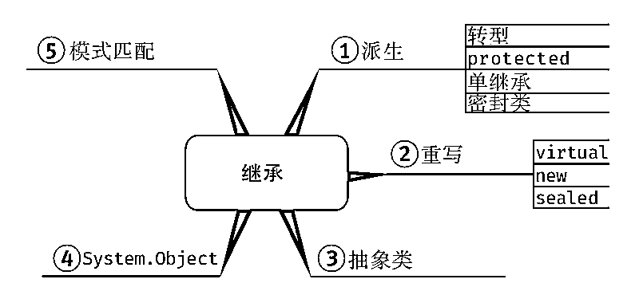

第六章讨论了一个类如何通过字段和属性来引用其他类。本章将讨论如何利用类的继承关系建立类层次结构。

初学者主题：继承的定义

第六章已简单介绍了继承。下面是对已定义的术语的简单回顾。

·派生/继承：对基类进行特化，添加额外成员或自定义基类成员。

·派生类型/子类型：继承了较常规类型的成员的特化类型。

·基/超/父类型：其成员由派生类型继承的常规类型。

继承建立了“属于”（is-a）关系。派生类型总是隐式属于基类型。如同硬盘属于存储设备，从存储设备类型派生的其他任何类型都属于存储设备。反之则不成立。存储设备不一定是硬盘。

注意 　代码中的继承用于定义两个类的“属于”关系，派生类是对基类的特化。

## 7.1　派生

经常需要扩展现有类型来添加功能（行为和数据）。继承正是为了该目的而设计的。例如，假定已经有 Person 类，可创建 Employee 类并在其中添加 EmployeeId 和 Department 等员工特有的属性。也可采取相反的操作。例如，假定已有在 PDA（个人数字助理）中使用的 Contact 类，现在想为 PDA 添加日历支持。可为此创建 Appointment 类。但不是重新定义这两个类都适用的方法和属性，而是对 Contact 类进行重构 。具体地说，将两者都适用的方法和属性从 Contact 移至名为 PdaItem 的基类中，并让 Contact 和 Appointment 都从该基类派生，如图 7.1 所示。

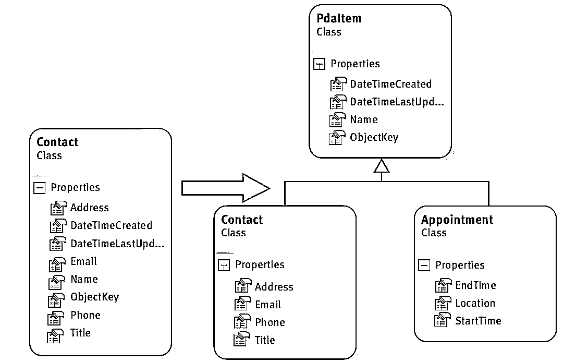

图 7.1　重构成基类

在本例中，两者共用的项是 Created、LastUpdated、Name 和 ObjectKey 等。通过派生，基类 PdaItem 定义的方法可从 PdaItem 的所有子类中访问。

定义派生类要在类标识符后添加冒号，接着添加基类名称，如代码清单 7.1 所示。

代码清单 7.1　从一个类派生出另一个类

```powershell
class PdaItem {
    [string] $Name
    [datetime] $LastUpdated
}

class Contact : PdaItem {
    [string] $Address
    [string] $Email
    [string] $Phone
    [string] $Title
}
```

原图代码已改写为 PowerShell 类定义。

代码清单 7.2 展示如何访问 Contact 中定义的属性。

代码清单 7.2　使用继承的属性

```powershell
$contact = [Contact]::new()
$contact.Name = 'Inigo Montoya'
```


虽然 Contact 没有直接定义 Name 属性，但 Contact 的所有实例都可访问来自 PdaItem 的 Name 属性，并把它作为 Contact 的一部分使用。此外，从 Contact 派生的其他任何类也会继承 PdaItem 类（或者 PdaItem 的父类）的成员。该继承链没有限制，每个派生类都拥有由其所有基类公开的所有成员（参见代码清单 7.3）。换言之，虽然 Customer 不直接从 PdaItem 派生，它依然继承了 PdaItem 的成员。

注意 　通过继承，基类的每个成员都出现在派生类构成的链条中。

代码清单 7.3　一个接一个继承构成了继承链

```powershell
class PdaItem { }
class Appointment : PdaItem { }
class Contact : PdaItem { }
class Customer : Contact { }
```


代码清单 7.3 中的 PdaItem 显式地从 object 派生。虽然允许这样写，但没有必要。所有类都隐式派生自 object。

注意 　除非明确指定基类，否则所有类都默认从 object 派生。

### 7.1.1　基类型和派生类型之间的转型

如代码清单 7.4 所示，由于派生建立了“属于”关系，所以总是可以将派生类型的值直接赋给基类型的变量。

代码清单 7.4　隐式基类型转换

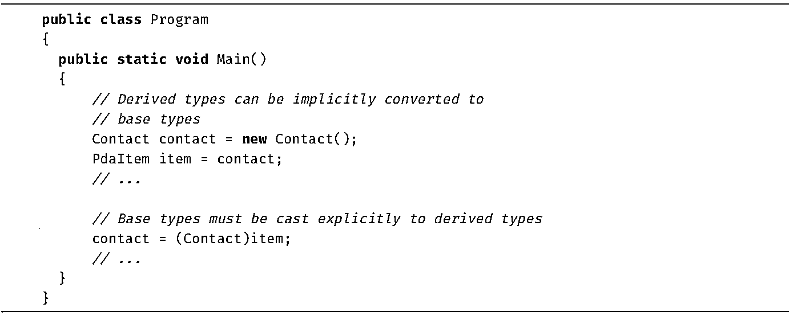

派生类型 Contact“属于”PdaItem 类型，可直接赋给 PdaItem 类型的变量。这称为隐式转型 ，不需要添加转型操作符。而且根据规则，转换总会成功，不会抛出异常。

反之则不成立。PdaItem 并非一定“属于”Contact。它可能是一个 Appointment 或其他派生类型。所以从基类型转换为派生类型要求执行显式转型 ，而显式转型在运行时可能失败。如代码清单 7.4 所示，执行显式转型要求在原始引用名称前，将要转换成的目标类型放到圆括号中。

执行显式转型，相当于程序员要求编译器信任他，或者说程序员告诉编译器他知道这样做的后果。只要圆括号中的目标类型确实从基类型派生，C#编译器就允许这个转换。虽然在编译的时候，C#编译器允许在可能兼容的类型之间执行显式转型，但 CLR 仍会在运行时验证该显式转型。如果对象实例不属于目标类型，将抛出异常。

即使类型层次结构允许隐式转型，C#编译器也允许添加转型操作符（虽然多余）。例如，将 contact 赋给 item 可以像下面这样添加转型操作符：

```powershell
$item = [PdaItem] $contact
```


甚至在无须转型时也能添加转型操作符：

```powershell
$contact = [Contact] $item
```


注意 　派生类型能隐式转型为它的基类。相反，基类向派生类的转换要求显式的转型操作符，因为转换可能失败。虽然编译器允许可能有效的显式转型，但“运行时”会坚持检查，无效转型将抛出异常。

初学者主题：在继承链中进行类型转换

隐式转型为基类不会实例化新实例，而是令同一个实例引用基类型，它现在提供的功能（可访问的成员）是基类型的。这类似于将 CD-ROM 驱动器说成是一种存储设备。由于并非所有存储设备都支持弹出操作，所以 CDROM 转型为存储设备后不再支持弹出。如调用 storageDevice.Eject()，即使被转型的对象原本是支持 Eject()方法的 CDROM 对象，也无法通过编译。

类似地，将基类向下转型为派生类会引用更具体的类型，类型可用的操作也会得到扩展。但这种转换有限制，被转换的必须确实是目标类型（或者它的派生类型）的实例。

高级主题：定义自定义转换

类型间的转换并不限于单一继承链中的类型。完全不相关的类型也能相互转换，比如在 Address 和 string 之间转换。关键是要在两个类型之间提供转型操作符。C#允许类型包含显式或隐式转型操作符。如转型可能失败，比如从 long 转型为 int，开发者应定义显式转型操作符。这样可提醒别人只有在确定转型会成功的时候才执行转换，否则就准备好在失败时捕捉异常。执行有损转换时也应优先执行显式转型而不是隐式转型。例如，将 float 转型为 int，小数部分会被丢弃。即使接着执行一次反向转换（int 转型回 float），丢失的部分也找不回来。

代码清单 7.5 展示了隐式转型操作符的例子（GPS 坐标转换成 UTM 坐标）。

代码清单 7.5　定义转型操作符

```powershell
class GPSCoordinates { }
class UTMCoordinates {
    static [UTMCoordinates] FromGps([GPSCoordinates] $coordinates) {
        # 转换实现
        return [UTMCoordinates]::new()
    }
}
```

PowerShell 没有 C# 用户定义的 implicit/explicit 转换操作符，故以显式工厂方法表达同一转换意图。

本例实现从 GPSCoordinates 向 UTMCoordinates 的隐式转换。可以写类似的转换来反转上述过程。将 implicit 替换成 explicit 就是显式转换。

### 7.1.2　private 访问修饰符

派生类继承除构造函数和析构器之外的所有基类成员。但继承并不意味着一定能访问。例如在代码清单 7.6 中，private 字段\_Name 不可以在 Contact 类中使用，因为私有成员只能在声明它们的类型中访问。

代码清单 7.6　私有成员继承但不能访问

```powershell
class PdaItem {
    hidden [string] $_Name
    [string] $Name
}

class Contact : PdaItem { }

$contact = [Contact]::new()
$contact.Name = 'Inigo Montoya'
# $contact._Name 不能作为公共 API 访问
```


根据封装原则，派生类不能访问基类的 private 成员^( [\[1\]](part0069.xhtml#ch1_back) ) 。这就强迫基类开发者决定一个成员是否能由派生类访问。本例的基类定义了一个 API，其中\_Name 只能通过 Name 属性更改。假如以后在 Name 属性中添加了验证机制，那么所有派生类不需要任何修改就能马上享受到验证带来的好处，因为它们从一开始就不能直接访问\_Name 字段。

注意 　派生类不能访问基类的私有成员。

### 7.1.3　protected 访问修饰符

public 或 private 代表两种极端情况，中间还可进行更细致的封装。可在基类中定义只有派生类才能访问的成员。以代码清单 7.7 的 ObjectKey 属性为例。

代码清单 7.7　protected 成员只能从派生类访问

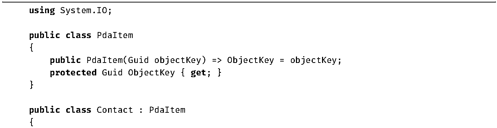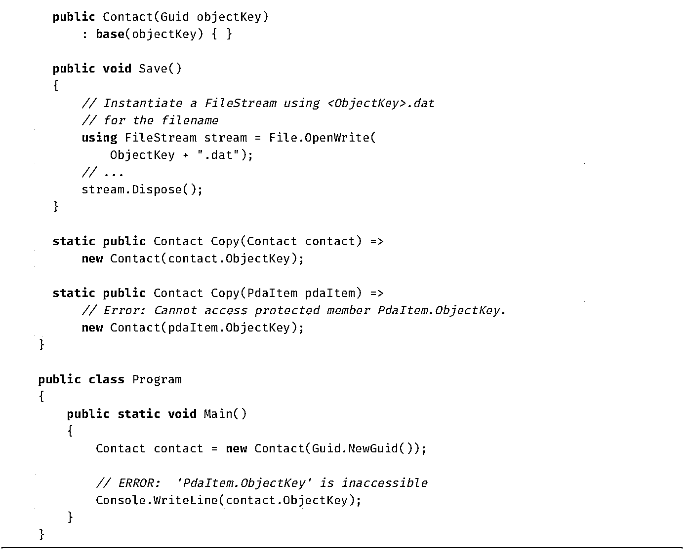

ObjectKey 用 protected 访问修饰符定义。结果是在 PdaItem 的外部，它只能从 PdaItem 的派生类中访问。由于 Contact 从 PdaItem 派生，所以 Contact 的所有成员都能访问 ObjectKey。相反，由于 Program 不是从 PdaItem 派生，所以在 Program 内使用 ObjectKey 属性会造成编译错误。

注意 　基类的受保护成员只能从基类及其派生链的其他类中访问。

Contact.Copy (PdaItem pdaItem)方法有一个容易被忽视的重要细节。开发者经常会惊讶地发现，即使 Contact 从 PdaItem 派生，从 Contact 类内部也无法访问一个 PdaItem 实例的受保护 ObjectKey。这是由于万一 PdaItem 是一个 Address，Contact 不应访问 Address 的受保护成员。因此，封装阻止了 Contact 修改 Address 的 ObjectKey。成功转型为 Contact（例如：((Contact)pdaItem).ObjectKey）可绕过该限制。基本规则是，要从派生类中访问受保护成员，必须能在编译时确定它是派生类（或者它的某个子类）中的实例。

### 7.1.4　扩展方法

扩展方法从技术上说不是类型的成员，所以不可继承。但因为每个派生类都可作为它的任何基类的实例使用，所以对一个类型进行扩展的方法也可扩展它的任何派生类型。如扩展基类（比如 PdaItem），所有扩展方法在派生类中也能使用。但和所有扩展方法一样，实例方法有更高的优先级。如果继承链中出现一个兼容的签名，那么它将优先于扩展方法。

我们很少为基类写扩展方法。扩展方法的一个基本原则是，如果手上有基类的代码，直接修改基类会更好。即使基类代码不可用，程序员也应考虑在基类或个别派生类实现的接口上添加扩展方法。第八章将具体讨论接口，并讨论它们如何与扩展方法配合使用。

### 7.1.5　单继承

继承树中的类在理论上数量是无限的。例如，Customer 派生自 Contact，Contact 派生自 PdaItem，PdaItem 派生自 object。但 C#是单继承 编程语言，C#编译成的 CIL 语言也是一样。这意味着一个类不能直接从两个类派生。例如，Contact 不能既直接派生自 PdaItem，又直接派生自 Person。

语言对比：C++——多继承

C#的单继承是其在面向对象方面与 C++的主要区别之一。

极少数需要多继承类结构的时候，一般的解决方案是使用聚合 （aggregation）。换言之，不是一个类从另一个类继承，而是一个类包含另一个类的实例。C# 8.0 提供了新方法专门用于实现聚合，我们将在第八章详细介绍。

### 7.1.6　密封类

为正确设计类，使其他人能通过派生来扩展功能，需对它进行全面测试，验证派生能成功进行。代码清单 7.8 将类标记为 sealed 来避免非预期的派生，并避免因此而出现的问题。

代码清单 7.8　用密封类禁止派生

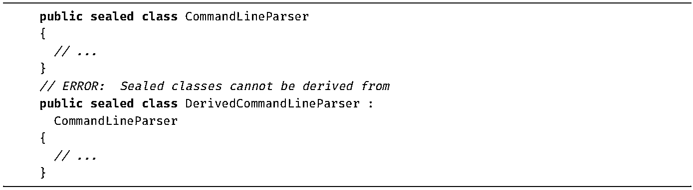

密封类用 sealed 修饰符禁止从其派生。string 类型就是用 sealed 修饰符禁止派生的例子。

[\[1\]](part0069.xhtml#ch1) 一个极少见的例外情况为派生类同时是基类的一个嵌套类。

## 7.2　重写基类

基类除构造函数和析构器之外的所有成员都会在派生类中继承。但某些情况下，一个成员可能在基类中没有得到最佳的实现。下面以 PdaItem 的 Name 属性为例。在由 Appointment 类继承的时候，它的实现或许是可以接受的。然而，对于 Contact 类，Name 属性应该返回 FirstName 和 LastName 属性合并起来的结果。类似地，对 Name 进行赋值时，应分解成 FirstName 和 LastName。换言之，对于派生类，基类属性的声明是合适的，但实现并非总是合适的。因此，需要一种机制在派生类中使用自定义的实现来重写 （override，覆盖或覆写）基类中的实现。

### 7.2.1　virtual 修饰符

C#支持重写实例方法和属性，但不支持字段和任何静态成员的重写。为进行重写，要求在基类和派生类中都显式执行一个操作。基类必须将允许重写的每个成员都标记为 virtual。如一个 public 或 protected 成员没有包含 virtual 修饰符，就不允许子类重写该成员。

语言对比：Java——默认虚方法

Java 的方法默认为虚，希望非虚的方法必须显式密封。相反，C#默认非虚。

代码清单 7.9 展示了属性重写的一个例子。

代码清单 7.9　重写属性

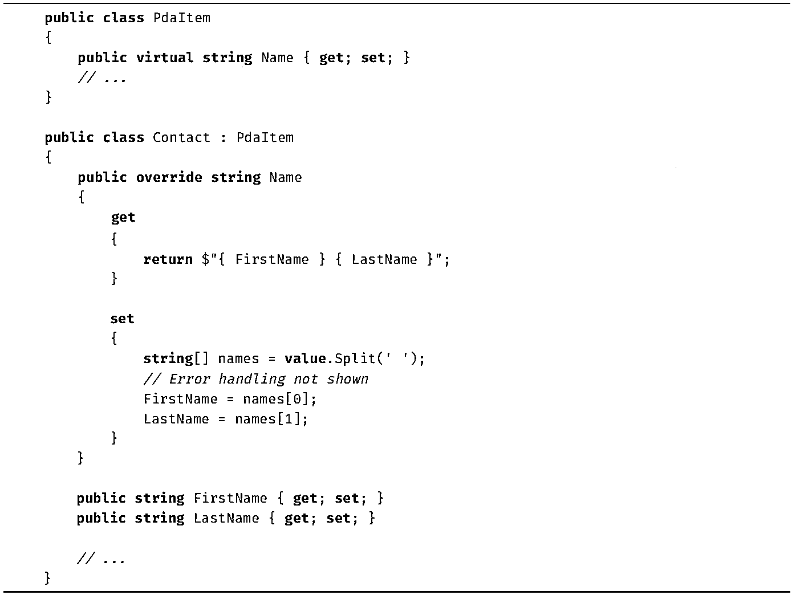

PdaItem 的 Name 属性使用了 virtual 修饰符，Contact 的 Name 属性则用关键字 override 修饰。本例拿掉 virtual 会报错，拿掉 override 会生成警告，稍后将详细讨论。C#要求显式使用 override 关键字重写方法。换句话说，virtual 标志着方法或属性可在派生类中被替换（重写）。

语言对比：Java 和 C++——隐式重写

与 Java 和 C++不同，C#应用于派生类的 override 关键字是必需的。C#不允许隐式重写。为重写方法，基类和派生类成员必须匹配，而且要有对应的 virtual 和 override 关键字。此外，override 关键字意味着派生类的实现会替换基类的实现。

重写成员会造成“运行时”调用最深的或者说派生得最远的（most derived）实现，如代码清单 7.10 所示。

代码清单 7.10　“运行时”调用虚方法派生得最远的实现

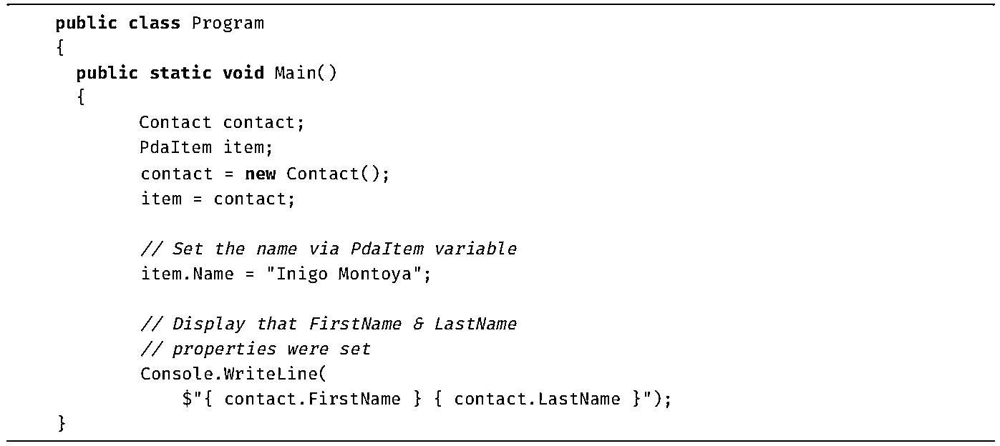

输出 7.1 展示了代码清单 7.10 的结果。

输出 7.1


代码清单 7.10 调用 item.Name 来设置姓名。虽然 Name 被声明为一个 PdaItem 的属性，但是这里设置的仍然是 contact 的 FirstName 和 LastName。这里的规则是：“运行时”遇到虚方法时会调用虚成员派生得最远的重写方法。本例实例化一个 Contact 并调用 Contact.Name，因为 Contact 包含 Name 派生得最远的实现。

虚方法只提供默认实现，这种实现可由派生类完全重写。但由于继承设计的复杂性，所以请事先想好是否需要虚方法。

这一决定对程序的未来发展非常重要，因为如果定义了一个虚方法，而将来又希望将其改为非虚方法，则很有可能破坏那些已经重写了该方法的派生类。因此，一旦一个虚方法已经被公布，则必须保持不变。基于这一点，在决定一个方法是否为虚方法时一定要仔细斟酌，或者也可以用 private protected 来限制它的影响范围。

语言对比：C++——构造期间对方法调用的调度

C++在构造期间不调度虚方法。相反，在构造期间，类型与基类型关联，而不是与派生类型关联，虚方法调用的是基类的实现。C#则相反，会将虚方法调用调度给派生得最远的类型。这是为了与以下设计规范保持一致：“总是调用派生得最远的虚成员，即使派生的构造函数尚未完全执行完毕。”但无论如何，在 C#中应尽量避免出现这种情况^( [\[1\]](part0070.xhtml#ch1_back) ) 。

最后要说的是，虚暗示着实例，只有实例成员才可以是 virtual 的。CLR 根据实例化期间指定的具体类型判断将虚方法调用调度到哪里。所以 static virtual 方法毫无意义，编译器也不允许。

### 7.2.2　new 修饰符

如果重写方法没有使用 override 关键字，编译器会生成警告消息，如输出 7.2 和 7.3 所示。

输出 7.2

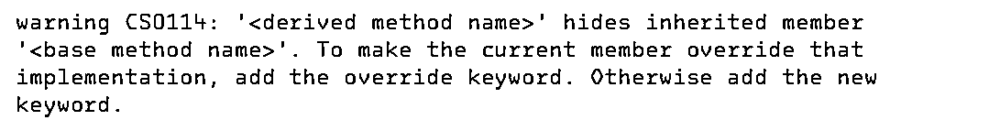

输出 7.3

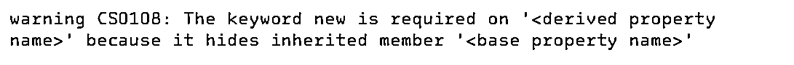

一个明显的解决方案是添加 override 修饰符（假定基类成员是 virtual 的）。但正如警告文本指出的那样，还可使用 new 修饰符。请思考表 7.1 总结的情形——这种情形称为脆弱的基类 （brittle base class 或者 fragile base class）。

Person.Name 非虚表明程序员 A 希望 Display()方法总是使用 Person 的实现，即便传给它的数据类型是 Person 的派生类型 Contact。但程序员 B 希望在变量数据类型为 Contact 的任何情况下都使用 Contact.Name（程序员 B 其实并不知道 Person.Name 属性，因为它最开始并不存在）。为允许添加 Person.Name，同时不破坏两个程序员预期的行为，你不能假定该属性是 virtual 的。此外，由于 C#要求重写成员显式使用 override 修饰符，所以必须采用其他某种形式的语法，确保基类新增的成员不会造成派生类编译失败。

表 7.1　在什么时候使用 new 修饰符

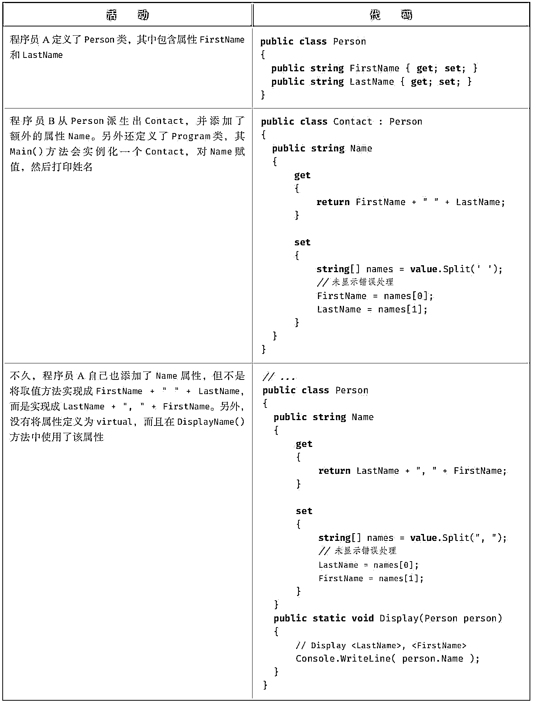

这种语义要用 new 修饰符实现，它在基类面前隐藏了派生类重新声明的成员。这时不是调用派生得最远的成员。相反，是搜索继承链，找到使用 new 修饰符的那个成员之前的、派生得最远的成员，然后调用该成员。如继承链仅包含两个类，就使用基类的成员，就像是派生类没有声明那个成员（如派生的实现重写了基类成员）。虽然编译器会生成如输出 7.2 或 7.3 所示的警告，但假如既没有指定 override，也没有指定 new，就默认为 new，从而维持了版本的安全性。

来看看代码清单 7.11 的例子，输出 7.4 展示了结果。

代码清单 7.11　对比 override 与 new 修饰符

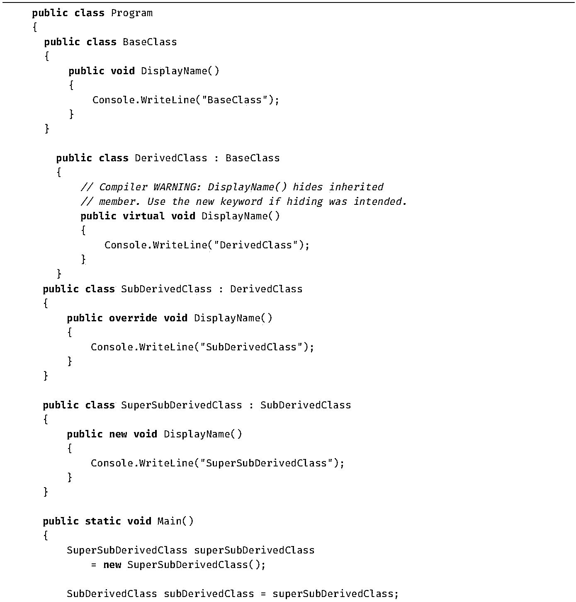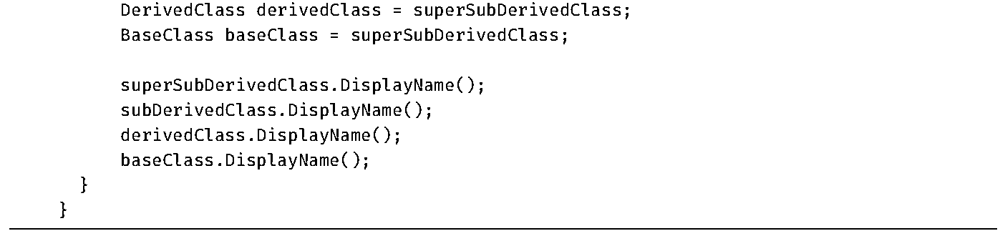

输出 7.4

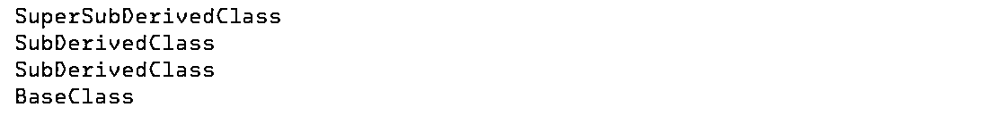

之所以会得到输出 7.4 的结果，是因为以下几个原因。

·SuperSubDerivedClass.DisplayName()显示 SuperSubDerivedClass，它下面没有派生类了。

·SubDerivedClass.DisplayName()是重写了基类虚成员的派生得最远的成员。使用了 new 修饰符的 SuperSubDerivedClass.DisplayName()被隐藏。

·DerivedClass.DisplayName()是虚方法，而 SubDerivedClass.DisplayName()是重写了它的派生得最远的成员。和前面一样，使用了 new 修饰符的 SuperSubDerived-Class.DisplayName()被隐藏。

·BaseClass.DisplayName()没有重新声明任何基类成员，而且非虚。所以，它会被直接调用。

就 CIL 来说，new 修饰符对编译器生成的代码没有任何影响，但它会生成方法的 newslot 元数据特性。从 C#的角度看，它唯一的作用就是移除编译器警告。

### 7.2.3　sealed 修饰符

为类使用 sealed 修饰符可禁止从该类派生。类似地，虚成员也可密封，如代码清单 7.12 所示。这会禁止子类重写基类的虚成员。例如，假定子类 B 重写了基类 A 的一个成员，并希望禁止子类 B 的派生类继续重写该成员，就可考虑使用 sealed 修饰符。

代码清单 7.12　密封成员

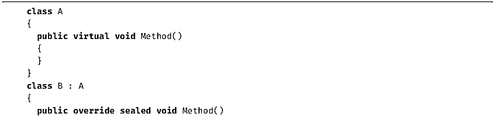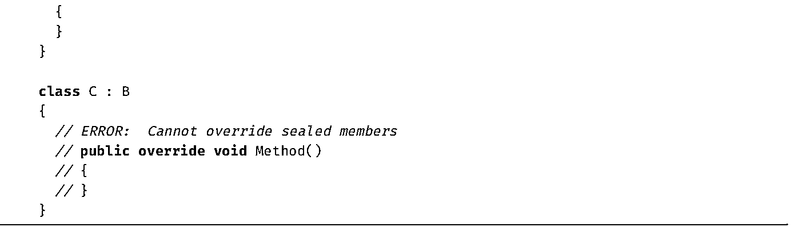

本例为 B 类的 Method()声明使用 sealed 修饰符将禁止 C 重写 Method()。

除非有很好的理由，一般很少将整个类标记为密封。事实上，人们越来越倾向于将类设置成非密封类，因为单元测试需要创建仿制对象^( [\[2\]](part0070.xhtml#ch2_back) ) 来代替真正的实现。有时对单独虚成员进行密封的代价过高，还不如将整个类密封。但一般都倾向于对单独成员进行有针对性的密封（例如，可能需要依赖基类的实现来获得正确的行为）。

### 7.2.4　base 成员

重写成员时经常需要调用其基类版本，如代码清单 7.13 所示。

代码清单 7.13　访问基类成员

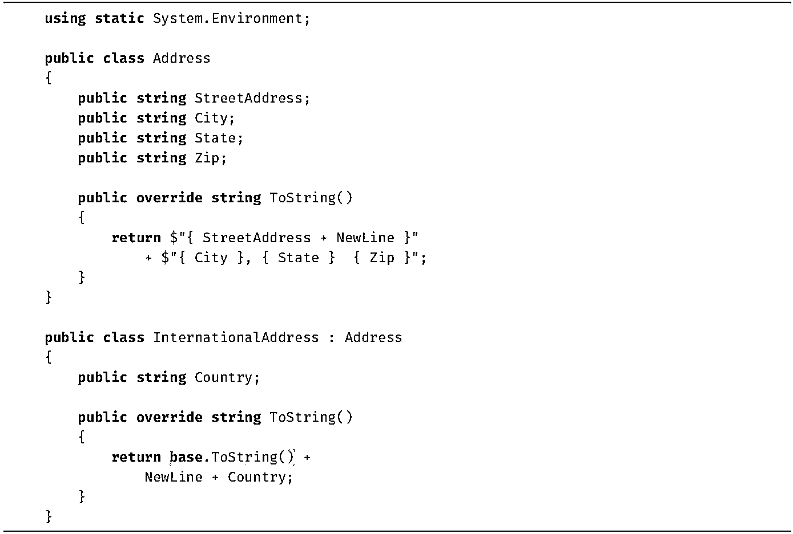

在代码清单 7.13 中，InternationalAddress 从 Address 继承并实现了 ToString()。调用基类的实现需使用 base 关键字。base 的语法和 this 几乎完全一样，也允许作为构造函数的一部分使用（稍后详述）。

另外，即使在 Address.ToString()实现中也要使用 override 修饰符，因为 ToString()也是 object 的成员。用 override 修饰的任何成员都自动成为虚成员，子类能进一步“特化”实现。

注意 　用 override 修饰的任何方法自动为虚。只有基类的虚方法才能重写，所以重写后的方法还是虚方法。

### 7.2.5　调用基类的构造函数

实例化派生类时，“运行时”首先调用基类构造函数，防止绕过基类的初始化机制。但假如基类没有可访问的（非私有）默认构造函数，我们就不知道如何构造基类，C#编译器将会报错。

为避免因为缺少可访问的默认构造函数而造成错误，程序员需要在派生类构造函数的头部显式指定要运行哪一个基类构造函数，如代码清单 7.14 所示。

代码清单 7.14　指定要调用的基类构造函数

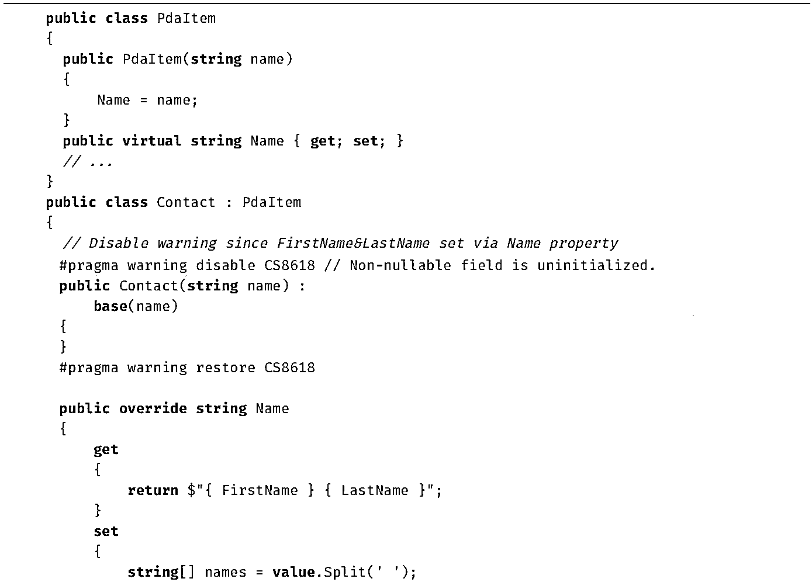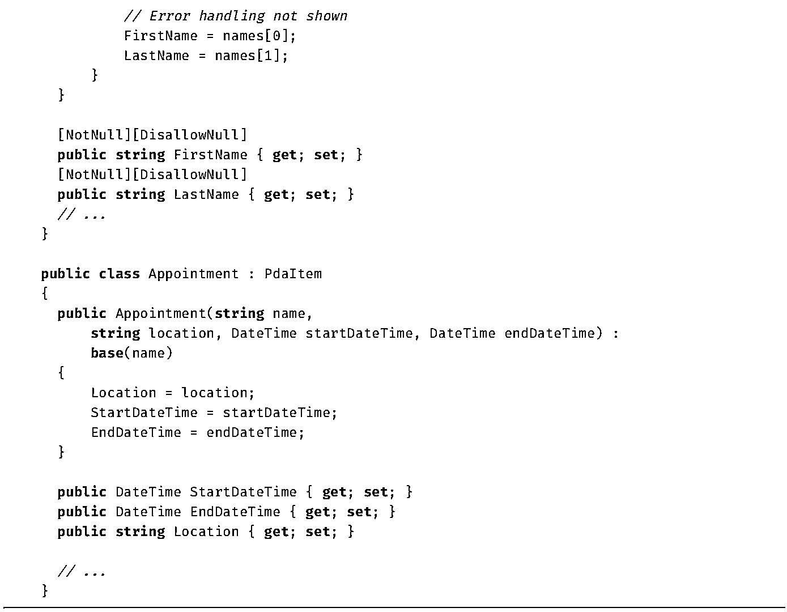

通过在代码中明确指定基类构造函数，“运行时”就知道在调用派生类构造函数之前要调用哪一个基类构造函数。

[\[1\]](part0070.xhtml#ch1) 综上所述，不要在构造函数中调用会影响所构造对象的任何虚方法。原因是假如这个虚方法在当前要实例化的类型的派生类型中进行了重写，就会调用重写的实现。但在继承层次结构中，字段尚未完全初始化。这时调用虚方法将导致无法预测的行为。——译者注

[\[2\]](part0070.xhtml#ch2) mock object，也称为测试替身或者 test double。——译者注

## 7.3　抽象类

前面许多继承的例子都定义了一个名为 PdaItem 的类，它定义了在 Contact 和 Appointment 等从它派生的类型对象中通用的方法和属性。但是，PdaItem 本身不适合实例化，PdaItem 的实例没有意义，只有作为基类，在从其派生的一系列数据类型之间共享默认的方法实现，才是 PdaItem 类真正的意义。这意味着 PdaItem 应被设计成抽象类 ，而不是具体类 。抽象类是仅供派生的类，无法实例化抽象类，只能实例化从它派生的类。不抽象、可直接实例化的类称为具体类。

虽然抽象类是面向对象设计中非常基础的概念之一，但是从 C# 8.0 和.NET Core 3.0 开始，接口（interface）已经实现了抽象类所拥有的全部功能，甚至还有更多新特性。虽然第八章提供了新接口功能的详细信息，但理解有关抽象成员的概念是一个先决条件，因此我们将在这里提供抽象类的详细信息。

初学者主题：抽象类

抽象类 代表抽象实体。其抽象成员 定义了从抽象实体派生的对象应包含什么，但这种成员不包含实现。抽象类的大多数功能通常都没有实现。一个类要从抽象类成功地派生，必须为抽象基类中的抽象方法提供具体的实现。

定义抽象类要求为类定义添加 abstract 修饰符，如代码清单 7.15 所示。

代码清单 7.15　定义抽象类

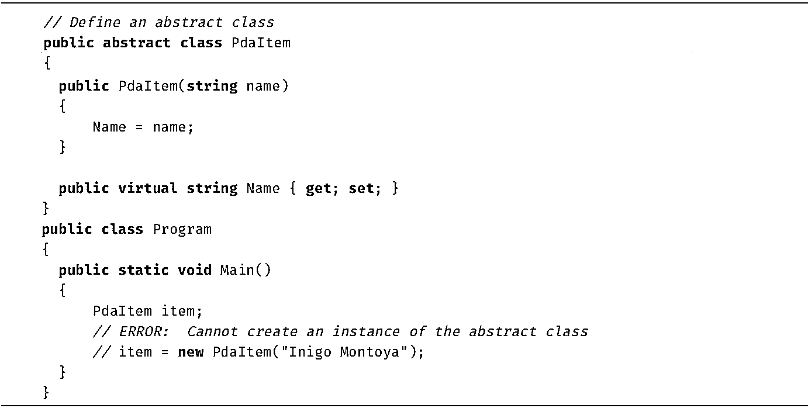

不能实例化只是一个次要特点，抽象类的主要特点在于它包含抽象成员 。抽象成员是没有实现的方法或属性，作用是强制所有派生类提供实现。来看看代码清单 7.16 的例子。

代码清单 7.16　定义抽象成员

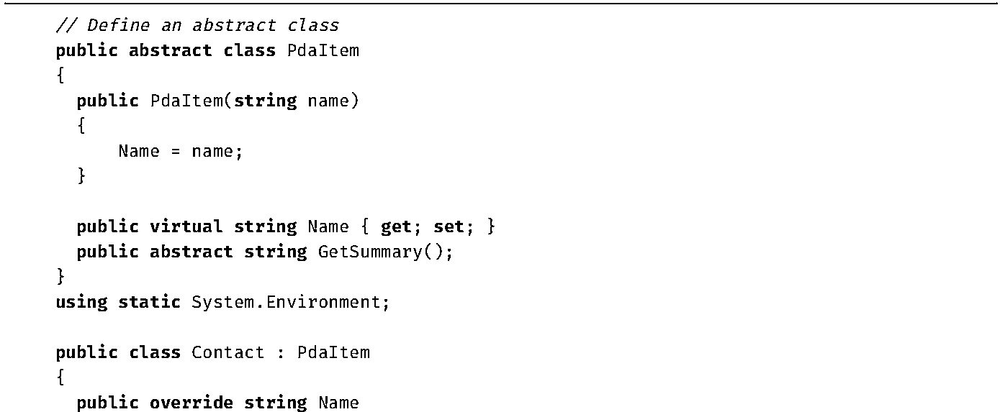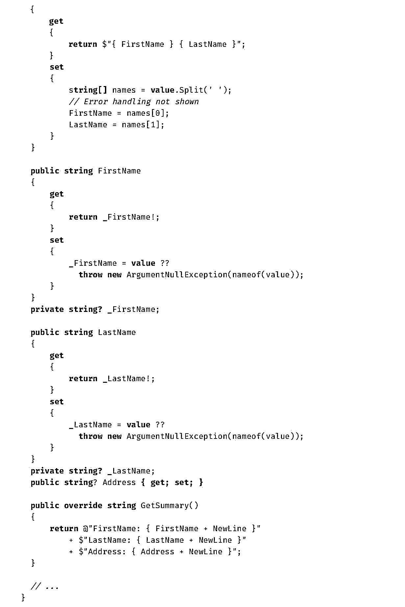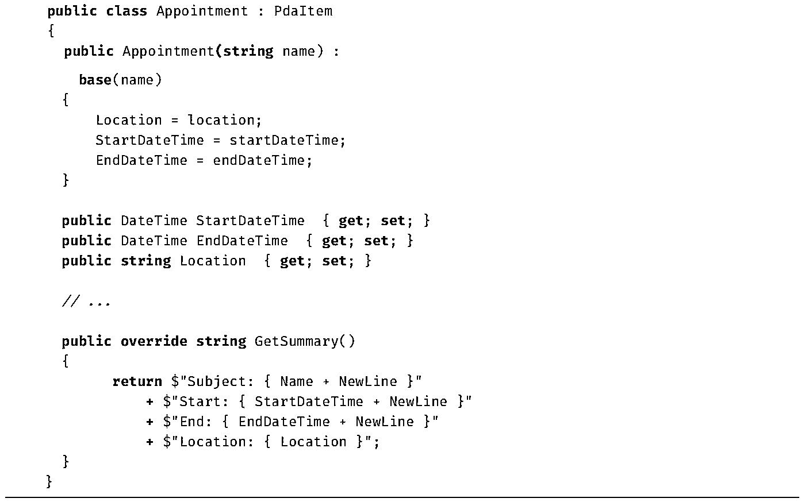

代码清单 7.16 将 GetSummary()定义为抽象成员，所以它不包含任何实现。随即，代码在 Contact 中重写它并提供具体实现。由于我们将抽象成员设计为被重写，所以自动为虚（但不能显式这样声明）。此外，抽象成员不能声明为私有，否则派生类看不见它们。

开发具有良好设计的对象层次结构殊为不易。所以在编程抽象类型时，一定要自己实现至少一个（最好多个）从抽象类型派生的具体类型，以检验自己的设计。

如果在 Contact 中没有提供 GetSummary()方法的实现，则编译器会报告错误。

注意 　抽象成员必须被重写，所以自动为虚，但不能用 virtual 关键字显式声明。

语言对比：C++——纯虚函数

C++使用神秘的“=0”表示法来定义抽象函数。这些函数在 C++中称为纯虚函数。与 C#相反，C++不要求类本身有任何特殊的声明。和 C#的抽象类修饰符 abstract 不同，当 C++类包含纯虚函数时，不需要对该类的声明进行任何特殊处理。

注意 　通过声明抽象成员，抽象类的编程者清楚地指出：为了建立具体类与抽象基类（本例是 PdaItem）之间的“属于”关系，派生类必须实现抽象成员——抽象类无法为这种成员提供恰当的默认实现。

初学者主题：多态性

相同成员签名在不同类中有不同实现，这称为多态性 （polymorphism）。英语“poly”代表“多”，“morph”代表“形态”，多态性是指同一个签名可以有多个实现。同一个签名不能在一个类中多次使用，所以该签名的每个实现必然包含在不同类中。

多态性的基本设计思想是：只有对象自己才知道如何最好地执行特定操作，通过规定调用这些操作的通用方式，多态性还促进了代码重用，因为通用的东西不必重复编码。例如，假定有多种类型的文档，每种文档都知道具体如何执行自己这种文档的 Print()操作，那么不是定义单个 Print()方法，该方法中包含 switch 语句来处理每种文档类型的特殊打印逻辑，而是利用多态性调用与想要打印的文档类型对应的 Print()方法。例如，为字处理文档类调用 Print()，会根据字处理文档的特点进行打印；而为图形文档类调用同一个方法，会根据图形文档的特点进行打印。无论如何，对于任意文档类型，打印它唯一要做的就是调用 Print()，其他不用考虑。

避免使用 switch 语句实现具体打印逻辑有利于维护。首先，具体的实现位于不同文档类的上下文中，而不是位于另一个较远的地方，这符合封装原则。其次，以后添加新文档类型不需要更改 switch 语句。相反，唯一要做的就是在新的文档类型中实现 Print()签名。

抽象成员是实现多态性的一个手段。基类指定方法签名，派生类提供具体实现，如代码清单 7.17 所示。

代码清单 7.17　利用多态性列出 PdaItem

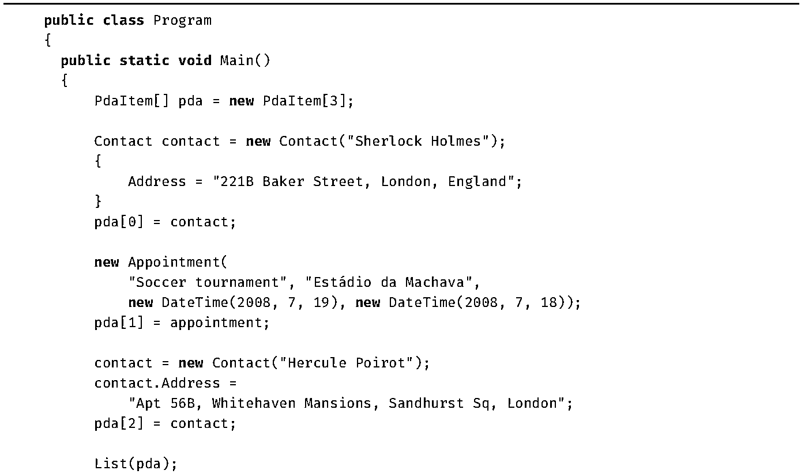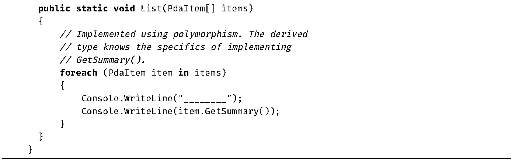

代码清单 7.20 的结果如输出 7.5 所示。

输出 7.5

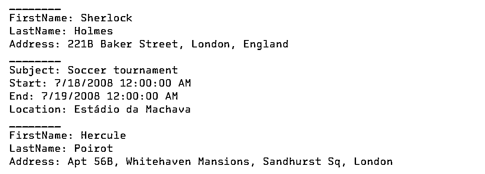

这样就可调用基类的方法，但方法具体由派生类来实现。输出 7.5 证明 List()方法能成功显示 Contact 和 Address 对象，而且每种对象都以自定义方式显示。调用抽象 GetSummary()方法实际上是调用每个实例特有的重写方法。

## 7.4　所有类都从 System.Object 派生

任何类，不管是自定义类，还是系统内建的类，都定义好了如表 7.2 所示的方法。

表 7.2　System.Object 的成员

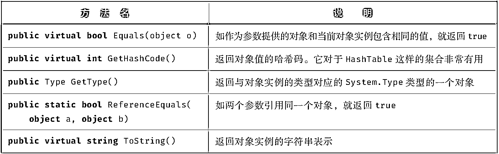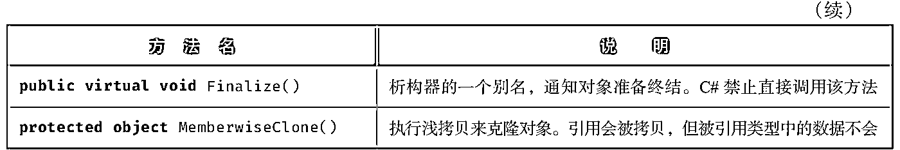

所有这些方法都通过继承为所有对象所用，所有类都直接或间接从 object 派生。即使字面值也支持这些方法。所以，下面这种看起来颇为奇怪的代码实际是合法的：


即使类定义没有显式指明自己从 object 派生，也肯定是从 object 派生的。所以在代码清单 7.18 中，PdaItem 的两个声明会产生完全一致的 CIL。

代码清单 7.18　不显式指定从哪里派生，就隐式派生自 System.Object

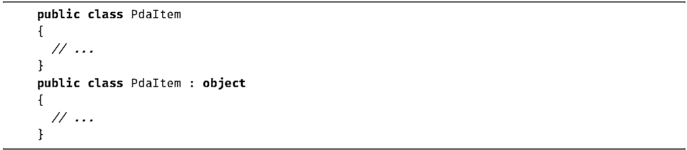

如 object 的默认实现不好用，程序员可重写三个虚方法，第十章将详细介绍具体做法。

## 7.5　用 is 操作符进行模式匹配

虽然 C#从 1.0 开始便有了 is 操作符，但是它直到 C# 7.0 和 8.0 之后，在模式匹配方面才有了长足的进步。不过其中大部分新特性只有在与 switch 语句配合使用时，才会发挥作用。我们将在下一节详细介绍在 switch 语句中使用模式匹配。

### 7.5.1　使用 is 操作符验证基础类型

由于 C#允许在继承链中向下转型，因此有时需要在转换前判断基础类型是什么。此外，在没有实现多态性的情况下，一些要依赖特定类型的行为也可能要事先确定类型。C#用 is 操作符判断基础类型，如代码清单 7.19 所示。

代码清单 7.19　用 is 操作符判断基础类型

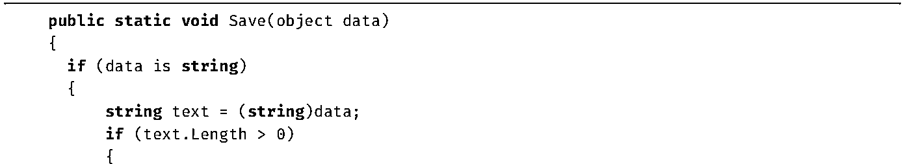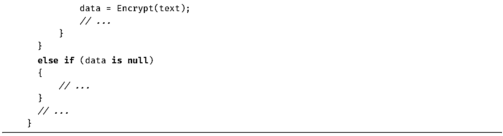

在代码清单 7.19 中，只有基础类型是 string 才加密数据。这比直接加密好，因为许多基础类型并非 string 的类型也支持转型为 string。

虽然在方法开头执行空检查可能更清晰，但本例是稍后检查，目的是演示即使目标为空，is 操作符也会返回 false，所以 else if 的空检查仍会执行。

注意通过显式转型，程序员宣布自己负责创建清晰的代码逻辑来避免无效的强制类型转换。如可能发生无效转型，应首选使用 is 操作符并完全避免异常。is 操作符的好处是能创建一个显式转型可能失败但又没有异常处理开销的代码路径。此外，从 C# 7.0 开始，is 操作符除了用于类型检查，也可以用于声明变量并且赋值。

### 7.5.2　type、var 和 const 的模式匹配

C# 7.0 增强了 is 操作符来支持模式匹配 （pattern matching）。上个例子核实数据是 string 后，仍然必须把它转型为 string（前提是想把它作为 string 来访问）。更好的方案是执行类型的检查，如结果为 true，就同时声明该类型的变量，并将结果赋给该变量。C# 7.0 引入了模式匹配特性后，我们可以对 type、var 和 const 进行模式匹配。而 C# 8.0 在此基础上又增加了元组（tuple）模式匹配、按序模式匹配、属性模式匹配，以及递归模式匹配。is 操作符的这些新用法通常可以替代该操作符早期的基本用法。

表 7.3 列举了 C# 7.0 中模式匹配的新方法。

表 7.3　使用 is 操作符对 type、var 和 const 进行模式匹配

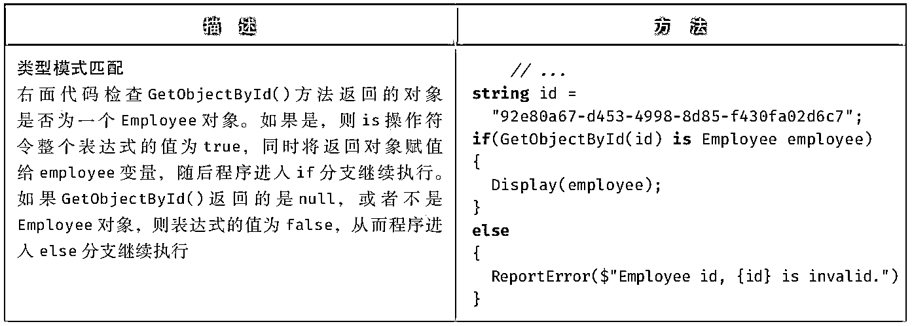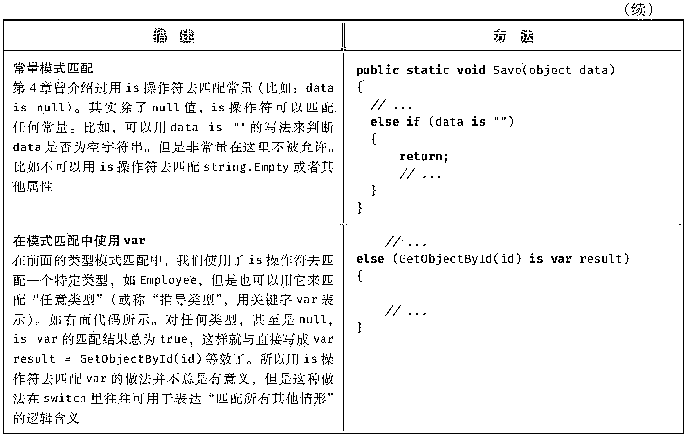

C# 8.0 增加了元组模式匹配、按序模式匹配、属性模式匹配，以及递归模式匹配，这使得模式匹配变得更复杂了一些。

### 7.5.3　元组模式匹配

可以将一批常量放在一个元组中，并使用 is 操作符进行元组模式匹配，并且也可以对元组中的变量进行类型模式匹配和赋值。如代码清单 7.20 所示。

代码清单 7.20　使用 is 操作符进行元组模式匹配

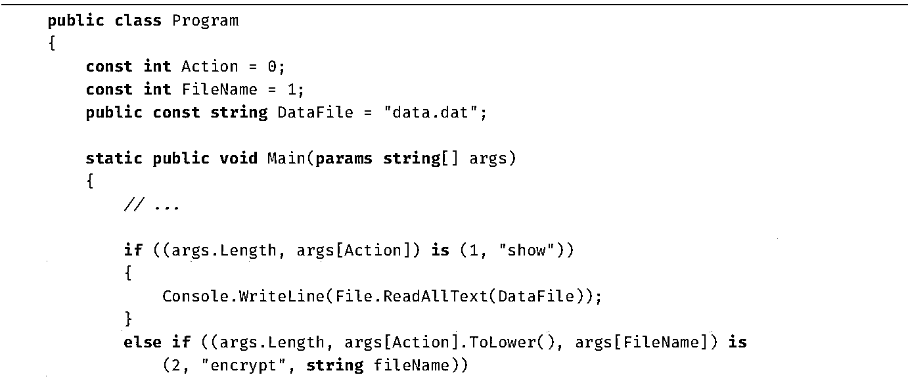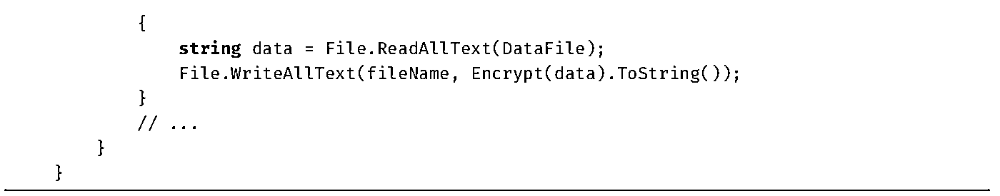

在本例中，我们将 args 数组的长度及元素放到元组中进行模式匹配。第一个 if 分支检查数组是否有且仅有一个值为"show"的元素；第二个分支检查数组中是否有两个元素，并且第一个元素是否为"encrypt"（加密）。如果条件满足，则把第三个元素赋值为 fileName 变量。元组中的元素既可以是常量（匹配常量），也可以是变量（匹配变量的类型）。有一点需要注意的是，在上面的代码中，由于元组实例会在 is 操作符被执行之前先创建，所以不能把第一个和二个条件分支调换顺序，否则当 args 只有一个元素时（即"show"的情形），args\[FileName\]会导致访问不存在的元素。

### 7.5.4　顺序模式匹配

在 C# 7.0 引入的解构函数（见第六章）的基础之上，C# 8.0 实现了顺序模式匹配。由于解构函数可以隐含的构造一个元组实例，因此一个具有解构函数的类可以完美匹配元组模式匹配的语法。如代码清单 7.21 所示。

代码清单 7.21　使用 is 操作符进行顺序模式匹配

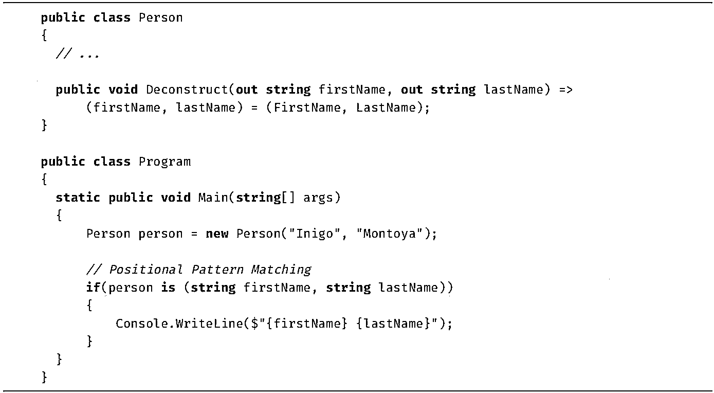

在上面的示例代码中，我们没有去匹配常量，而是匹配了元组中的变量类型，并且为那些变量赋值。在顺序模式匹配中，也可以匹配常量。

### 7.5.5　属性模式匹配

属性模式匹配语法允许在对一个对象进行模式匹配时，不仅指定属性值，而且指定属性名称。如代码清单 7.22 所示。

代码清单 7.22　使用 is 操作符进行属性模式匹配

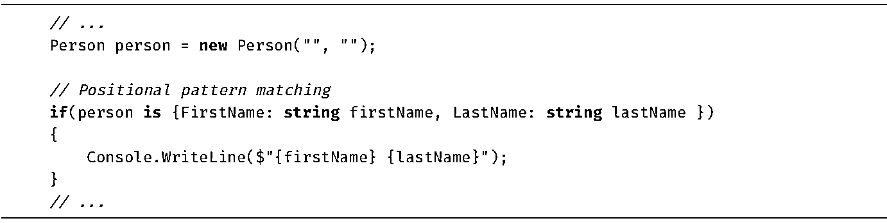

初看代码清单 7.22 会感觉和代码清单 2.1 顺序模式匹配很相似，但这两份代码之间有两个重要区别。首先，属性模式匹配采用大括号而不是小括号来指定匹配值；其次，在属性模式匹配中，匹配值的顺序不重要，因为它依靠属性名将匹配值与被匹配的属性相对应。然而匹配值的顺序在元组和顺序模式匹配中却非常重要。此外，属性模式匹配还会检查 null 值。

### 7.5.6　递归模式匹配

如前所述，is 操作符的模式匹配功能通常需要与 switch 语句配合使用才能发挥功效，但是递归模式匹配可能是唯一的例外。代码清单 7.23 看起来有些不可理喻，但它的主要目的是设计一个相对复杂的数据结构，以便展示递归模式匹配在匹配复杂数据结构时所发挥的作用。

代码清单 7.23　使用 is 操作符进行递归模式匹配

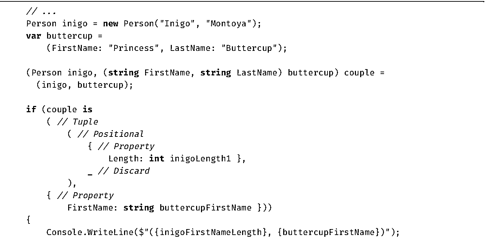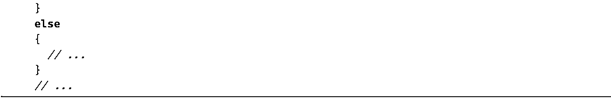

在本例中，couple 变量的类型如下^( [\[1\]](part0073.xhtml#ch1_back) ) ：

* * *

```
(Person, (string, string))

```

* * *

在本例的代码中，if 分支使用 is 操作符对 couple 变量进行了递归模式匹配。首先匹配的是外层元组(inigo, buttercup)。对于外层元组中的 initgo 变量，由于 Person 类具有解构函数，因此先使用顺序模式匹配，去匹配其第一个字段，即 Person 类的 FirstName 字段，然后再使用属性模式匹配，去匹配 FirstName 字段的 Length 属性。Person 类的第二字段 LastName 被一个下划线标记为忽略。最后，对于外层元组中的 buffercup 变量，再次采用属性模式匹配去匹配它的 FirstName 字段并赋值给 buffercupFirstName 临时变量。

is 操作符的属性模式匹配的优势在于其可以用属性名来直接选取希望匹配的元素或字段，但它也有局限性。不同于使用了 when 子句的 switch 语句（第四章），is 操作符的属性模式匹配不支持判定性表达式——例如判定 FirstName 和 LastName 字段的 Length 大于 0。使用递归模式匹配时另一个需要注意的问题是程序的可读性。在代码清单 7.23 中，即便加了足够的注释，其递归模式匹配部分的代码仍然显得有些难懂。而如果没有注释，则代码会变得更加晦涩，例如：


即便如此，模式匹配在 switch 语句中仍然能够发挥重要作用。

[\[1\]](part0073.xhtml#ch1) 上面的类型可以理解为一个外层元组里面嵌套一个内层元组。外层元组有两个元素，其一为 Person 类型的对象，另一个便是内层元组。而内层元组有也两个元素，均为 string 类型。——译者注

## 7.6　switch 语句中的模式匹配

代码清单 7.23 是一个简单的 if-else 语句，但可设想用一个类似的例子来检查多个字符串。虽然还是可以使用 if 语句，但为了提供更好的可读性，应考虑其匹配表达式能支持任何类型的 switch 语句。代码清单 7.24 展示了将日期类型格式化为多种形式的一个例子。

代码清单 7.24　switch 语句中的模式匹配

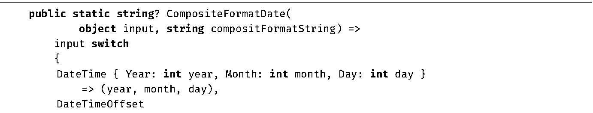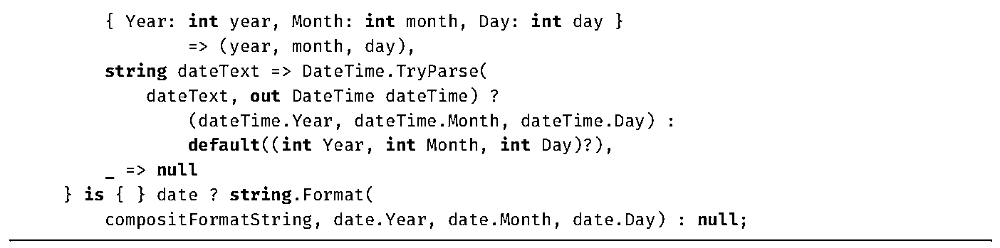

上面的示例中，第一个 case 语句使用类型模式匹配来判断输入值是否为 DateTime 类型。如果判断值为 true，则进而使用属性模式匹配来声明 year、month 和 day 变量并赋值；最后将这些变量包装为一个元组(year, month, day)并返回。DateTimeOffet 类型的 case 用相同的方法处理。

string 类型的 case 语句并没有使用模式识别，而是使用了前面章节里介绍过的 TryParse 方法。如果该方法调用不成功，则返回一个 default((int Year, int Month, int Day)?)，这将产生一个该类型的 null 值。这样做是因为这里不能直接返回一个无类型的 null 值，没有从(int Year, int Month, int Day)类型向无类型 null 值转换的方法，所有使用一个可空的元组对象以便让编译器能够准确地推断出整个 switch 表达式的类型。除了使用可空类型之外，也可以用强制转换的方法：(((int Year, int Month, int Day)?) null)将无类型的 null 转换为正确的类型。此外，可空操作符在本例中也非常重要，它允许在转换失败时，整个表达式 input switch {} is {} date 的值为 null。

注意，代码清单 7.24 中没有使用任何 when 子句来连接判定行语句。实际上可以像下面这样：


用 when 将时间进一步限定为将来某时刻。

## 7.7　避免对多态类对象使用模式匹配

尽管模式匹配功能很重要，但是在使用 is 运算符之前，应该考虑到由多态引起的潜在问题。在多态设计中，通过不断编写新的派生类（子类），以及在派生类中重写虚方法，能够将程序的行为不断扩展和改变。例如，将姓名属性 Name 添加到基类 PdaItem 中，然后便可以从 PdaItem 的不同子类对象中，获取不同的 Name 值。虽然也可以编写一个长长的 switch 语句，用类型模式匹配来判断一个对象属于 PdaItem 的哪一个子类，并据此返回不同的 Name 值。但是这二者相比，显然多态设计更好。因为前者允许从 PdaItem 任意派生新的子类，无须修改代码，便可自动获得新的 Name 值，而后者需要为新子类添加新的 case 语句以便返回新的 Name 值。

不过，多态也不总是能够更好地解决问题。当类的继承体系无法满足程序要求时，多态便无法运作。例如，如果需要处理来自不相关系统中的多个类，则无法将它们整合在同一个继承体系中，并用多态来解决问题。此外，假如正在使用来自第三方的，无法被修改的代码，则很可能也无法利用多态来重写代码的行为。

在代码清单 7.24 中使用日期时间类便是这样的例子。再如，假设要为一个高速路管理系统增加计费功能。需要根据不同汽车来选择不同的收费标准。如果此时汽车类已经存在于现有系统中，不但无法修改，而且在其基类中也没有计费属性，那么我们就无法利用多态来实现不同汽车的不同计费标准，而很可能只能采用 switch 加类型模式匹配的方案。

高级主题：使用 as 操作符进行转换

is 操作符的优点是允许验证一个数据项是否属于特定类型。as 操作符则更进一步，它会像一次转型所做的那样，尝试将对象转换为特定数据类型。但和转型不同的是，如对象不能转换，as 操作符会返回 null。这一点相当重要，因为它避免了可能因为转型而造成的异常。代码清单 7.25 演示了如何使用 as 操作符。

代码清单 7.25　使用 as 操作符进行数据类型转换

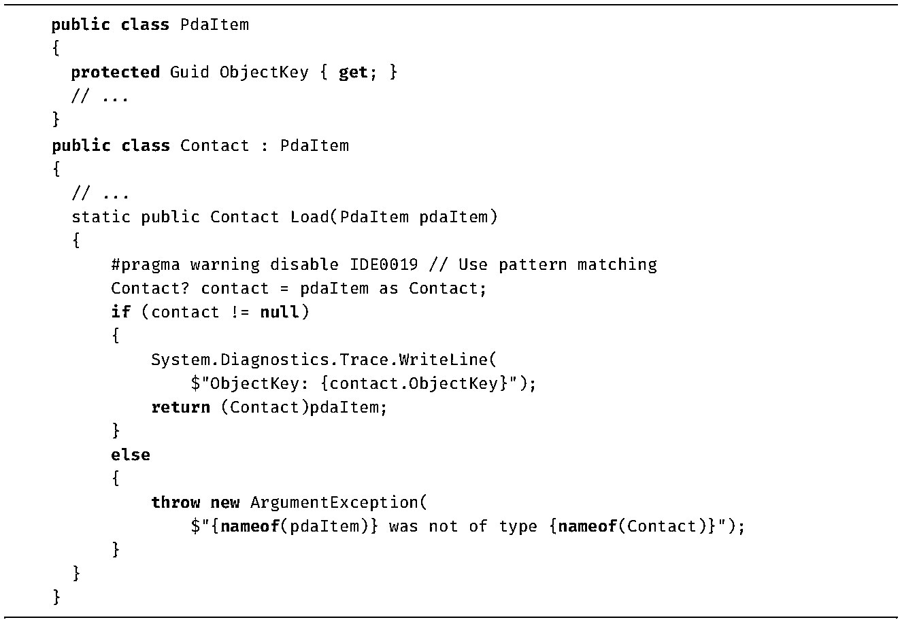

使用 as 操作符可避免用额外的 try-catch 代码处理转换无效的情况，因为 as 操作符提供了尝试执行转型但转型失败后不抛出异常的一种方式。

is 操作符相较于 as 操作符的一个优点是后者不能成功判断基础类型。as 能在继承链中向上或向下隐式转型，也提供了支持转型操作符的类型。但 as 不能判断基础类型（而 is 能）。此外，as 运算符仅适用于引用类型，而 is 运算符适用于所有类型。

更重要的是，as 操作符一般要求采取额外的步骤对被赋值的变量执行空检查。由于模式匹配 is 操作符自动包含该检查，所以几乎再也用不着 as 操作符了——前提是使用 C# 7.0 或更高版本。

## 7.8　小结

本章讨论了如何从一个类派生，并添加额外的方法和属性来“特化”该类。讨论了如何使用 private 和 protected 访问修饰符控制封装级别。

本章还详细讨论了如何重写基类实现，以及如何使用 new 修饰符隐藏基类实现。C#提供 virtual 修饰符来控制重写，它告诉派生类的程序员需要重写哪些成员。要完全禁止派生，需要为类使用 sealed 修饰符。类似地，为成员使用 sealed 修饰符，会禁止子类继续重写该成员。

我们简单讨论了所有类型都是从 object 派生的，第十章将进一步讨论，届时会讲解 object 的三个虚方法为重写提出的具体规则和原则。但在此之前，首先要掌握在面向对象编程的基础上发展起来的另一种编程模式：接口。这是第八章的主题。

本章最后讨论了联合使用 is 操作符与 switch 语句来进行模式匹配的方法。C# 7.0 和 8.0 均为这种模式匹配方法了更强大的扩展功能。但是，模式匹配也未必是万能的，尤其当可以使用多态设计时，多态往往会是更好的选择。