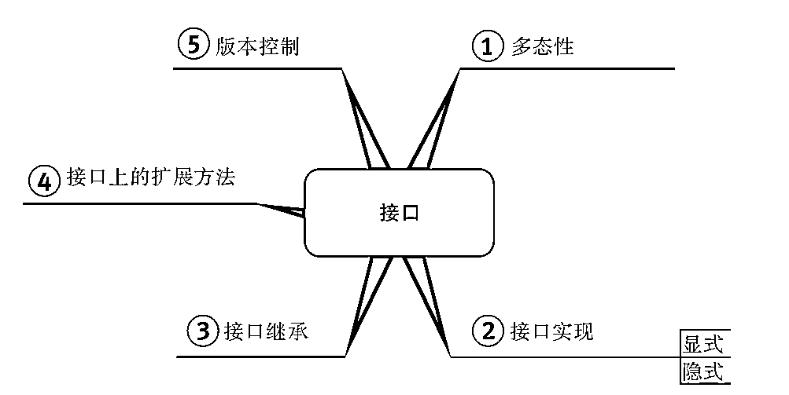
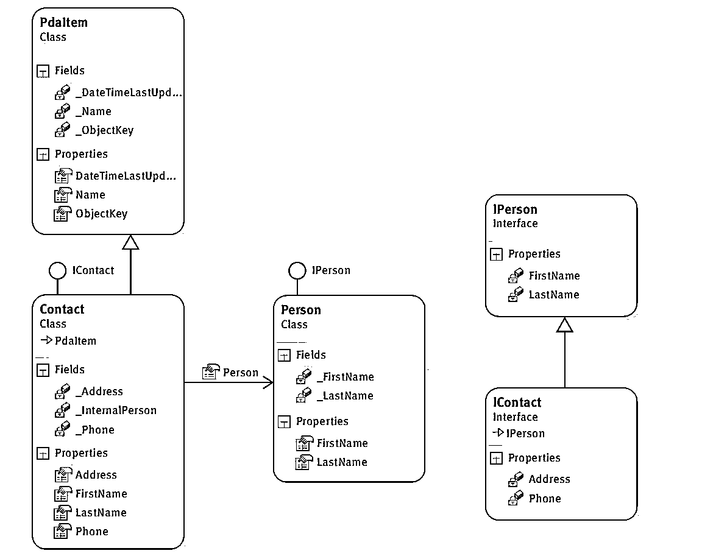
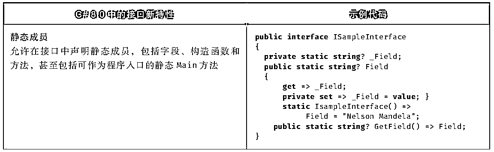
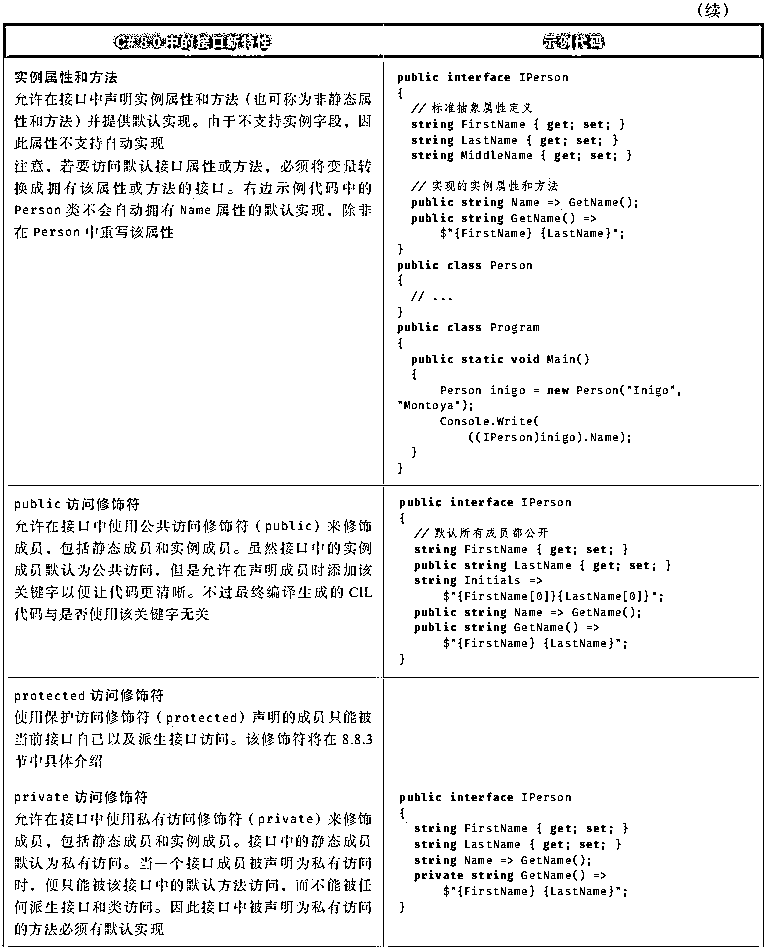
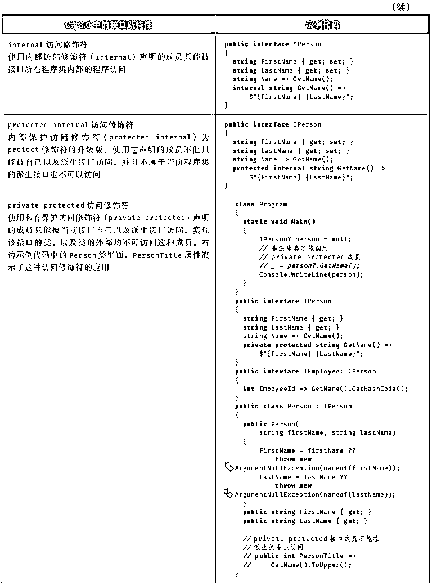
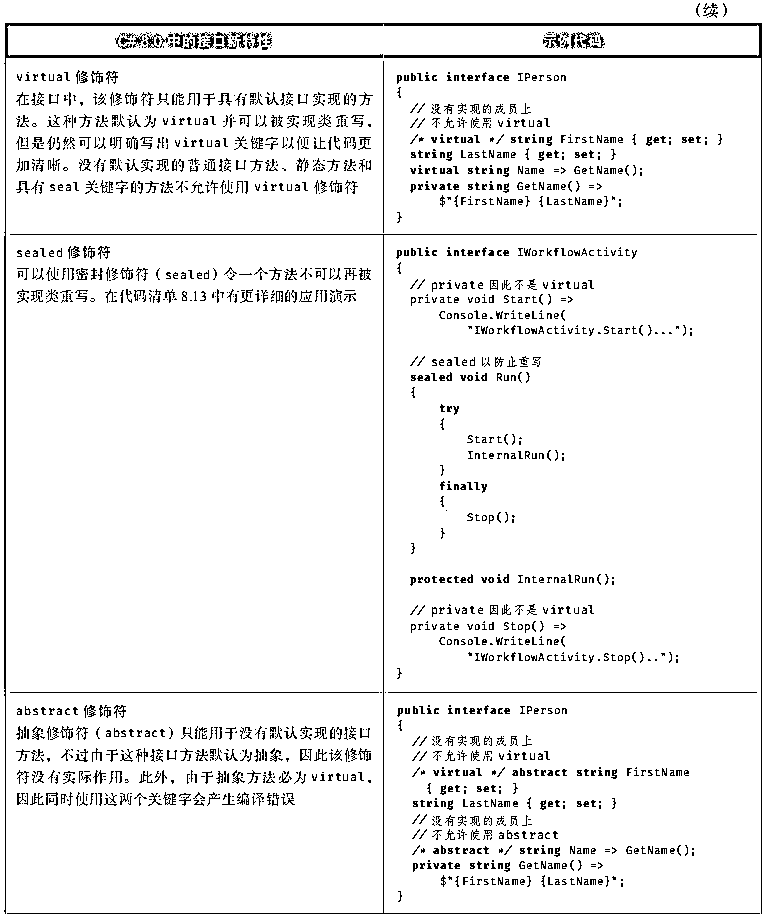
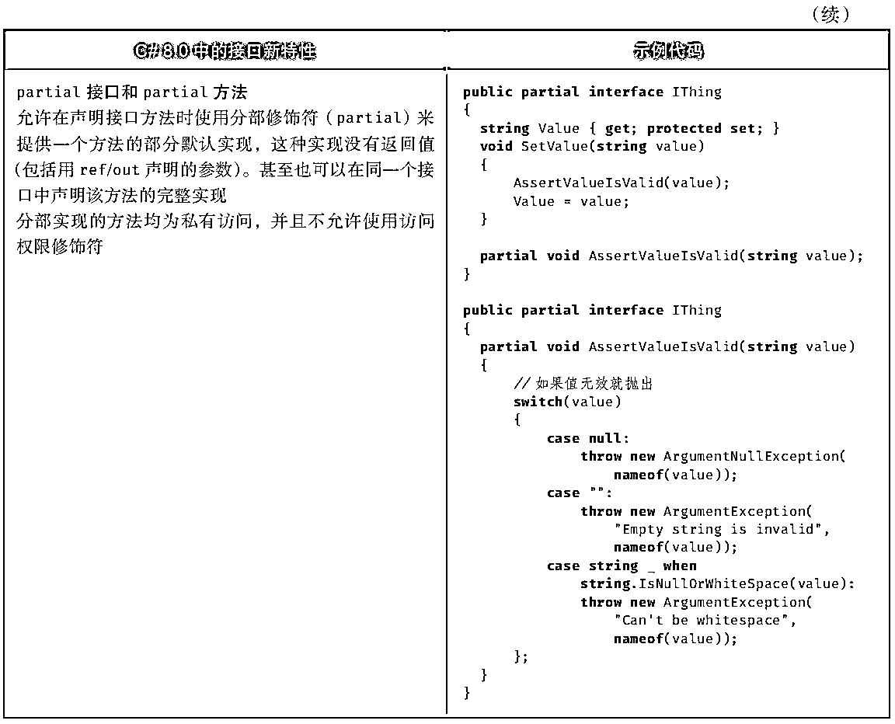
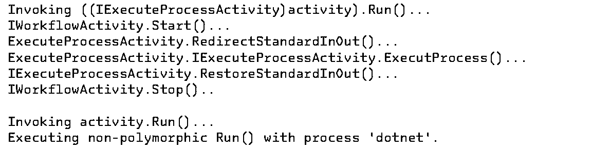
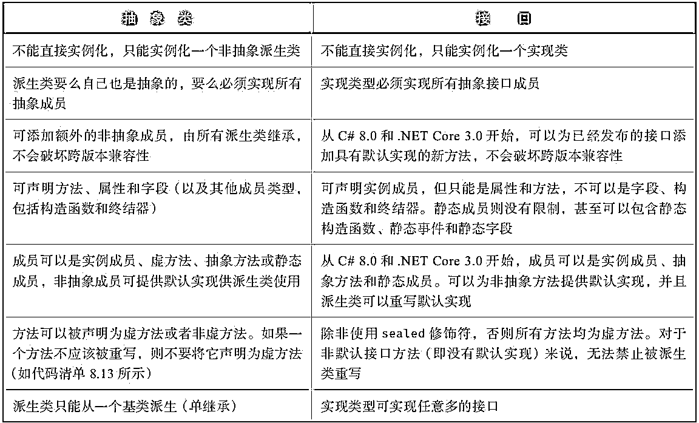

# 第八章　接口



多态性并非只能通过继承来实现（像第七章讨论的那样），还可以通过接口实现。和抽象类相似的是，接口也定义了一组成员，调用者可认为这些成员已实现。但是，在 C# 8.0 之前，接口与抽象类的不同之处曾经在于：接口不能包含任何实现。但是这一限制从 C# 8.0 开始被取消了。尽管如此，接口中除了版本信息之外，是否该包含其他实现逻辑在业界仍然富有争议。

类型通过实现接口来定义其功能。接口实现关系是一种“能做”（can do）关系：类型“能做”接口所规定的事情。在“实现接口的类型”和“使用接口的代码”之间，接口订立了“契约”^( [\[1\]](part0077.xhtml#ch1_back) ) 。实现接口的类型必须使用接口要求的签名来定义方法。本章除了讨论接口的实现和使用之外，也会介绍接口的默认实现成员，以及这一新特性所带来的新的思想方法和额外的复杂性。

[\[1\]](part0077.xhtml#ch1) contract，MSDN 文档称为“协定”。——译者注

> 注：PowerShell 语言没有 `interface` 关键字，也不支持在类定义中实现 .NET 接口（例如 `class Foo : [System.IComparable]` 会报错）。本章正文及代码清单中的“接口”写法仅为说明 C# 的接口概念而保留，在 PowerShell 中只能近似地用抽象基类约定，或依赖成员存在性判断（如 `$x -is [类型]`、`Get-Member`）来模拟“契约”语义。

## 8.1　接口概述

> 注：本章出现的 `interface` 类型定义在 PowerShell 中无法解析。为便于理解，代码清单保留原书接口的写法，但要在 PowerShell 中运行，须将各接口改写成普通的（抽象）基类，并让实现类从该基类派生。

初学者主题：为什么需要接口

接口有用是因为和抽象类不同，它能完全隔离实现细节和提供的服务。接口就像电源插座。电如何输送到插座是实现细节：可能是煤电、核电或太阳能发电；发电机可能在隔壁，也可能在很远的地方。插座订立了“契约”。它以特定频率提供特定电压，要求使用该接口的电器提供兼容的插头。电器不必关心电如何输送到插座，只需提供兼容的插头。

来看看下面这个例子：目前有许多文件压缩格式，包括.zip、.7-zip、.cab、.lha、.tar、.tar.gz、.tar.bz2、.bh、.rar、.arj、.arc、.ace、.zoo、.gz、.bzip2、.xxe、.mime、.uue 以及.yenc 等。如果为每种压缩格式都单独创建一个类，则每个压缩实现都可能有不同的方法签名，无法在它们之间提供标准调用规范。虽然方法可在基类中声明为抽象成员，但如果都从一个通用基类派生，会用掉唯一的基类机会（C#只允许单继承）。不同的压缩实现没什么通用的代码可以放到基类中，从而使基类实现变得毫无意义。重点是，基类除了允许共享成员签名，还允许共享实现；但接口只允许共享成员签名，不允许共享实现。

所以此时不是共享一个通用基类，而是每个压缩类都实现一个通用接口。接口订立契约，类必须履行该契约才能同实现该接口的其他类交互。虽然存在着多种压缩算法，但假如它们都实现了 IFileCompression 接口以及该接口的 Compress()和 Uncompress()方法，那么在需要压缩和解压时，只需执行到 IFileCompression 接口的一次转型，然后调用其成员方法即可，根本不用关心具体是什么类在实现那些方法。这实现了多态性，每个压缩类都有相同的方法签名，但签名的具体实现不同。

代码清单 8.1 展示了示例接口 IFileCompression。根据约定（该约定是如此根深蒂固，以至于不好改动），接口名称采用 PascalCase 规范并附加“I”前缀。

代码清单 8.1　定义接口

```powershell
interface IFileCompression {
    [void] Compress([string]$targetFileName, [string[]]$fileList)
    [void] Uncompress([string]$compressedFileName, [string]$expandDirectoryName)
}
```

IFileCompression 定义了一个类为了同其他压缩类协作而必须实现的方法。接口的强大之处在于，调用者可随便切换不同的实现而不需要修改调用代码。

在 C# 8.0 之前，接口不能包含实现和数据。注意其中的方法声明用分号取代了大括号。在接口中，属性看起来类似于自动实现的属性，因为它既没有实现代码，也没有对应的字段，但其实这是因为字段（数据）不能在接口声明中出现。

从 C# 8.0 开始，关于接口的很多限制被放宽了。其主要目的是让接口在发布之后，仍然可以在一定限度之内做一些改变。本章将在 8.8.2 节再开始介绍这些新特性。在那之前，我们的重点仍然是基于接口来实现多态性。因为这才是接口最能发挥作用的地方。了解了这一传统知识之后，才能更容易地理解新功能在哪些方面做出了改变。所以让我们暂时先不提 C# 8.0，姑且认为接口中不能包含任何数据和实现。等到进入 C# 8.0 的领域之后再学习新规则。

接口声明的成员描述了在实现该接口的类型中必须能访问的成员。而所有非公共成员的目的都是阻止其他代码访问成员。所以，C#不允许为接口成员使用访问修饰符。所有成员都自动公共。

设计规范

·接口名称要使用 Pascal 大小写，加“I”前缀。

## 8.2　通过接口实现多态性

来看看代码清单 8.2 的例子。任何类要通过 ConsoleListControl 类显示，就必须实现 IListable 接口定义的成员。换言之，实现了 IListable 接口的任何类都可用 ConsoleListControl 显示它自身。IListable 接口目前只要求只读属性 CellValues。

代码清单 8.2　实现和使用接口

```powershell
interface IListable {
    [string[]]$CellValues
}

class Contact {
    [string]$FirstName; [string]$LastName; [string]$Address; [string]$Phone
    Contact([string]$firstName,[string]$lastName,[string]$address,[string]$phone) {
        $this.FirstName=$firstName; $this.LastName=$lastName; $this.Address=$address; $this.Phone=$phone
    }
    [string[]]$CellValues
    [string] ToString() { return "$($this.FirstName) $($this.LastName)" }
}

class Publication {
    [string]$Title; [string]$Author; [int]$Year
    Publication([string]$title,[string]$author,[int]$year) { $this.Title=$title; $this.Author=$author; $this.Year=$year }
    [string[]]$CellValues
}

$contacts = @([Contact]::new('Dick','Traci','123 Main St., Spokane, WA 99037','123-123-1234'), [Contact]::new('Andrew','Littman','1417 Palmary St., Dallas, TX 55555','555-123-4567'))
$publications = @([Publication]::new('The End of Poverty: Economic Possibilities for Our Time','Jeffrey Sachs',2006), [Publication]::new('Orthodoxy','G.K. Chesterton',1908))
$contacts | ForEach-Object { $_.CellValues }
$publications | ForEach-Object { $_.CellValues }
```

代码清单 8.2 的结果如输出 8.1 所示。

输出 8.1


在代码清单 8.2 中，ConsoleListControl 可显示看似无关的类（Contact 和 Publication）。一个类能否显示，只取决于是否实现了必需的接口。ConsoleListControl.List()方法依赖多态性正确显示传给它的对象集。每个类都有自己的 CellValues 实现，将类转换成 IListable 就可调用特定的实现。

## 8.3　接口实现

声明类来实现接口类似于从基类派生——要实现的接口和基类名称以逗号分隔（基类在前，接口顺序任意）。类可实现多个接口，但只能从一个基类直接派生，如代码清单 8.3 所示。

代码清单 8.3　实现接口

```powershell
class Contact : IListable {
    [string]$FirstName; [string]$LastName; [string]$Phone; [string]$Address
    Contact([string]$firstName,[string]$lastName,[string]$phone,[string]$address) { $this.FirstName=$firstName; $this.LastName=$lastName; $this.Phone=$phone; $this.Address=$address }
    [int] CompareTo([object]$obj) {
        if ($null -eq $obj) { return 1 }
        if ($obj -is [Contact]) { return $this.LastName.CompareTo($obj.LastName) }
        throw [ArgumentException]::new('The parameter is not a Contact')
    }
    [string[]]$CellValues
}
```

实现接口时，接口的所有抽象成员都必须实现。抽象类既可以将接口方法映射为抽象方法，也可以将它实现为非抽象方法并在方法中抛出 NotImplementedException 异常，但无论如何都要提供接口成员的一个“实现”。例如，给定以下接口定义：

```powershell
class IFoo {
    [void] Bar()
}
```

在抽象类中可将接口方法映射成自己的抽象方法，将真正的实现留给子类去完成：

```powershell
class Foo {
    [void] Bar() { throw [NotImplementedException]::new() }
}
```

也可拿掉 abstract 关键字并添加方法主体：

```powershell
class Foo {
    [void] Bar() { throw [NotImplementedException]::new() }
}
```

接口的重点在于永远不能实例化，即不能用 new 创建接口。因此接口没有构造函数或终结器。只有实例化实现了接口的类型，才能使用接口实例。此外，接口不能包含静态成员。接口为多态性而生，而假如没有实现接口的那个类型的实例，多态性就没什么价值了。

每个接口成员的行为和抽象方法相似，都是强迫派生类实现成员，但不能为接口成员显式添加 abstract 修饰符。

在类型中实现接口成员时有两种方式：显式 和隐式 。之前看到的是隐式实现，是用类型的公共成员实现接口成员。

> 注：显式/隐式接口实现都是 C# 特有的语法，PowerShell 类没有接口实现机制，也没有对应的显式/隐式之分；仅当使用 PowerShell 调用 .NET 类型时，才需要处理 .NET 接口成员的显式实现问题。

### 8.3.1　显式成员实现

显式实现的方法只能通过接口本身调用，最典型的做法是将对象转型为接口。例如在代码清单 8.4 中，是将 Contact 对象转型为 IListable 来调用 Contact 类显式实现的 CellValues 成员。

代码清单 8.4　调用显式接口成员实现

```powershell
$contact = [Contact]::new('Inigo','Montoya','','')
# Access an interface-shaped member through the interface contract.
$values = $contact.CellValues
```

本例是在同一个语句中执行强制类型转换和调用 CellValues。也可在调用 CellValues 之前将 contact2 赋给一个 IListable 变量。

在接口成员名称前附加接口名称前缀来显式实现接口成员，如代码清单 8.5 所示。

代码清单 8.5　显式接口实现

```powershell
class Contact {
    hidden [string[]]$IListable_CellValues
    Contact([string]$firstName,[string]$lastName,[string]$phone,[string]$address) { $this.IListable_CellValues=@($firstName,$lastName,$phone,$address) }
    [string[]] GetCellValues() { return $this.IListable_CellValues }
}
```

代码清单 8.5 通过为属性名附加 IListable 前缀来显式实现 CellValues。此外，由于显式接口实现直接和接口关联，所以没必要使用 virtual、override 或者 public 来修饰它们。事实上，这些修饰符是不被允许的。这些成员不被视为类的公共成员，标注 public 有误导之嫌。

> 注：业务上确需表达“只通过特定契约类型访问”时，PowerShell 可用常规方式完成，比如将成员定义为 `hidden` 或提供专门的访问方法；但 C# 的“显式接口实现”机制本身在 PowerShell 中不存在。

注意，在派生类中实现接口方法时，不允许使用 override（重写）关键字。不过，在派生类中实现接口方法时，我们仍然会称之为“重写”。

### 8.3.2　隐式成员实现

代码清单 8.5 的 CompareTo()没有附加 IComparable 前缀，所以是隐式实现的。要隐式实现成员，只要求成员是公共的，且签名与接口成员签名相符。接口成员实现不需要 override 关键字或者其他任何表明该成员与接口关联的指示符。此外，由于成员像其他类成员那样声明，所以可像调用其他类成员那样直接调用隐式实现的成员：

```powershell
$result = $contact1.CompareTo($contact2)
```

换言之，隐式成员实现不要求执行转型，因为成员可直接调用，没有在实现它的类型中被隐藏起来。

显式实现不允许的许多修饰符对于隐式实现都是必须或可选的。例如，隐式成员实现必须是 public 的。而 virtual 是可选的，具体取决于是否允许派生类重写实现。去掉 virtual 会导致成员被密封。

> 注：“隐式成员实现必须是 public、virtual 可选、去掉 virtual 会密封”等规则依赖 C# 的访问修饰符与 virtual/override 体系，在 PowerShell 类中均不适用。

### 8.3.3　显式与隐式接口实现的比较

对于隐式和显式实现的接口成员，关键区别不在于成员声明的语法，而在于通过类型的实例（而不是接口）访问成员的能力。

建立类层次结构时需要建模真实世界的“属于”（is a）关系——例如，长颈鹿“属于”哺乳动物。这些是“语义”（semantic）关系。而接口用于建模“机制”（mechanism）关系。PdaItem“不属于”一种“可比较”（comparable）的东西，但它仍可实现 IComparable 接口。该接口和语义模型无关，只是实现机制的细节。显式接口实现的目的就是将“机制问题”和“模型问题”分开。要求调用者先将对象转换为接口（比如 IComparable），然后才能认为对象“可比较”，从而显式区分你想在什么时候和模型沟通，以及在什么时候处理实现机制。

一般来说，最好的做法是将一个类的公共层面限制成“全模型”，尽量少地涉及无关的机制。遗憾的是，有的机制在.NET 中是不可避免的。实际上，你不能获得长颈鹿的哈希码，或者将长颈鹿转换成字符串。但可获得 Giraffe（长颈鹿）类的哈希码（GetHashCode()），并把它转换成字符串（ToString()）。将 object 作为通用基类，.NET 混合了模型代码和机制代码——即使混合程度仍然比较有限。

可通过回答以下问题来决定显式还是隐式实现：

·成员是不是核心的类功能？

以 Contact 类的 CellValues 属性实现为例。该成员并非 Contact 类型的一个密不可分的部分，仅仅是辅助成员，可能只有 ConsoleListControl 类才会访问它。所以没必要把它设计成 Contact 对象的一个直接可见的成员，使本来就很庞大的成员列表变得更拥挤。

再来看看 IFileCompression.Compress()成员。在 ZipCompression 类中包含隐式的 Compress()实现是一个非常合理的选择，因为 Compress()是 ZipCompression 类的核心功能，所以应当能从 ZipCompression 类直接访问。

·接口成员名称作为类成员名称是否恰当？

假定 ITrace 接口的 Dump()成员将类的数据写入跟踪日志。在 Person 或者 Truck（卡车）类中隐式实现 Dump()会混淆该方法的作用^( [\[1\]](part0080.xhtml#ch1_back) ) 。所以，更好的选择是显式实现，确保只能通过 ITrace 数据类型调用 Dump()，使该方法不会产生歧义。总之，假如成员的用途在实现类中不明确，就考虑显式实现。

·是否已经有相同签名的类成员？

显式接口成员实现不会在类型的声明空间添加具名元素。所以，如果类型已存在可能冲突的成员，那么显式接口成员可与之同签名。

大多数时候都是凭直觉选择隐式或显式接口成员实现。但在选择时参考上述问题可做出更稳妥的选择。由于从隐式变成显式会造成版本中断，因此较稳妥的做法是全部显式实现接口成员，使它们以后能安全地变成隐式。另外，隐式还是显式不需要在所有接口成员间保持一致，所以完全可以将部分成员定义成显式，将其他定义成隐式。

[\[1\]](part0080.xhtml#ch1) Dump 本来的意思是“转储”类的数据，但用于 Truck 类会把它同“卸货”联系起来，从而造成混淆。——译者注

## 8.4　在实现类和接口之间转换

类似于派生类和基类的关系，实现类可隐式转换为接口，无须转型操作符。因为实现类的实例总是包含接口的全部成员，所以总是能成功转换为接口类型。

虽然从实现类型向接口的转换总是成功，但可能有多个类型实现了同一个接口。所以，无法保证从接口向实现类型的向下转型能成功。接口必须显式转型为它的某个实现类型。

## 8.5　接口继承

一个接口可以从另一个接口派生，派生的接口将继承“基接口”的所有成员。如代码清单 8.6 所示，直接从 IReadableSettingsProvider 派生的接口是显式基接口。

> 注：接口之间的继承仅在 C# 中成立，PowerShell 没有接口类型，无法表达“接口派生接口”。如需在 PowerShell 中获得类似分层契约的效果，只能通过类继承（派生基类继承基类的成员）来近似。

代码清单 8.6　从一个接口派生出另一个接口

```powershell
interface IReadableSettingsProvider {
    [string] GetSetting([string]$name,[string]$defaultValue)
}
interface ISettingsProvider : IReadableSettingsProvider {
    [void] SetSetting([string]$name,[string]$value)
}
class FileSettingsProvider : ISettingsProvider {
    [void] SetSetting([string]$name,[string]$value) { }
    [string] GetSetting([string]$name,[string]$defaultValue) { return $defaultValue }
}
```

本例的 ISettingsProvider 从 IReadableSettingsProvider 派生，所以会继承其成员。如后者还有一个显式基接口，ISettingsProvider 也将继承其成员。派生层次结构中的完整接口集只是基本接口的累积。

注意，假如显式实现 GetSetting()，那么必须通过 IReadableSettingsProvider 进行。在代码清单 8.7 中，通过 ISettingsProvider 进行将无法编译。

代码清单 8.7　未提供正确的包容接口

```powershell
# The inherited interface declares GetSetting; implement the base contract directly.
class FileSettingsProvider : ISettingsProvider {
    [string] GetSetting([string]$name,[string]$defaultValue) { return $defaultValue }
}
```

编译代码清单 8.7，会获得如输出 8.2 所示的错误信息。

输出 8.2


伴随这个输出，还有一条错误信息指出 IReadableSettingsProvider.GetSetting()尚未实现。显式实现接口成员时，必须在完全限定的接口成员名称中引用最初声明它的接口的名称。

即使类实现的是从基接口（IReadableSettingsProvider）派生的接口（ISettingsProvider），仍可明确声明自己要实现这两个接口，如代码清单 8.8 所示。

代码清单 8.8　在类声明中使用基接口

```powershell
class FileSettingsProvider : ISettingsProvider, IReadableSettingsProvider {
    [void] SetSetting([string]$name,[string]$value) { }
    [string] GetSetting([string]$name,[string]$defaultValue) { return $defaultValue }
}
```

在这个代码清单中，类的接口实现并没有改变。虽然突出显示的接口实现声明纯属多余，但它提供了更好的可读性。

提供多个接口，而非单独提供一个复合接口，这个决策在很大程度上依赖于接口设计者对实现类有什么要求。提供一个 IReadableSettingsProvider 接口，设计者告诉实现者只需实现设置的读取功能，不需要实现写入，从而减轻了实现者的负担。

相反，实现 ISettingsProvider 的前提是任何类都不可能只能写入而不能读取设置。所以，ISettingsProvider 和 IReadableSettingsProvider 之间的继承关系强迫 FileSettingsProvider 类同时实现这两个接口。

最后要说的是，虽然“继承”这个词用得没错，但更准确的说法是接口代表契约，一份契约可指定另一份契约也必须遵守的条款。所以，ISettingsProvider : IReadableSettingsProvider 从概念上是说 ISettingsProvider 契约还要求遵守 IReadableSettingsProvider 契约，而不是说 ISettingsProvider“属于一种”IReadableSettingsProvider。话虽这么说，但为了和标准的 C#术语保持一致，本章剩余部分仍会使用继承关系术语。

## 8.6　多接口继承

就像类能实现多个接口那样，接口也能从多个接口继承，而且语法和类的继承与实现语法一致，如代码清单 8.9 所示。

代码清单 8.9　多接口继承

```powershell
interface IReadableSettingsProvider { [string] GetSetting([string]$name,[string]$defaultValue) }
interface IWriteableSettingsProvider { [void] SetSetting([string]$name,[string]$value) }
interface ISettingsProvider : IReadableSettingsProvider, IWriteableSettingsProvider { }
```

很少有接口没有成员。但如果要求同时实现两个接口，这种情况就很正常。代码清单 8.9 和代码清单 8.6 的区别在于，现在可以在不提供任何读取功能的前提下实现 IWriteableSettingsProvider。代码清单 8.6 的 FileSettingsProvider 不受影响，但假如它使用的是显式成员实现，就要以稍微不同的方式指定成员从属于哪个接口。

## 8.7　接口上的扩展方法

扩展方法的一个重要特点是除了能作用于类，还能作用于接口。所使用的语法和用于类时的语法一样。方法的第一个参数是要扩展的接口，该参数必须附加 this 修饰符。代码清单 8.10 展示了在 Listable 类上声明、作用于 IListable 接口的一个扩展方法。

> 注：接口上的扩展方法建立在“接口 + 扩展方法”两个 C# 特性之上，二者 PowerShell 均不支持。不过，对象集合这一层仍可用 PowerShell 的管道（如 `ForEach-Object`）达到类似“对集合统一操作”的目的。

代码清单 8.10　接口扩展方法

```powershell
class Listable {
    static [void] List([object[]]$items,[string[]]$headers) {
        foreach ($item in $items) { $item.CellValues }
    }
}
$contacts | ForEach-Object { $_.CellValues }
$publications | ForEach-Object { $_.CellValues }
```

注意本例被扩展的不是 IListable（虽然也可以）而是 IListable\[\]。这证明 C#不仅能为特定类型的实例添加扩展方法，还允许为该类型的对象集合添加。对扩展方法的支持是实现 LINQ 的基础。IEnumerable 是所有集合都要实现的基本接口。通过为 IEnumerable 定义扩展方法，所有集合都能享受 LINQ 支持。这显著改变了对象集合的编程方式，该主题将在第十五章详细讨论。

初学者主题：接口图示

UML 图中^( [\[1\]](part0084.xhtml#ch1_back) ) 的接口可能有两种形式。第一种，可将接口显示成与类继承相似的继承关系。在图 8.1 中，IPerson 和 IContact 之间的关系就是这样的。第二种，可以使用小圆圈显示接口，一般将这种小圆圈称为“棒棒糖”（lollipop），如图 8.1 的 IPerson 和 IContact 所示。



图 8.1　通过聚合和接口解决单继承限制

在图 8.1 中，Contact 从 PdaItem 派生并实现 IContact。此外，它还聚合了 Person 类，后者实现了 IPerson。虽然 Visual Studio Class Designer 不支持，但接口有时也可使用与派生关系相似的箭头来显示。例如，在图 8.1 中，Person 可以连接一条箭头线到 IPerson，而不是画一个“棒棒糖”来表示。

[\[1\]](part0084.xhtml#ch1) UML 是 Unified Modeling Language 的简称，即“统一建模语言”，是用图示来建模对象设计的一个标准规范。

## 8.8　版本升级

在 C# 8.0 以前，如组件或应用程序正在供其他开发者使用，创建新版本时不要修改接口。接口在实现接口的类和使用接口的类之间订立了契约，修改接口相当于修改契约，会使基于接口写的代码失效。

> 注：本节的“接口版本升级”全部建立在 C# 接口机制之上，PowerShell 中不存在接口，因此以下版本兼容策略仅作为 C# 的概念背景来理解，没有对应的 PowerShell 语法。

更改或删除特定接口成员的签名明显会造成现有代码的中断，因为除非进行修改，否则对该成员的任何调用都不再能够编译。更改类的 public 或 protected 成员签名也会这样。但和类不同，在接口中添加成员也可能造成代码无法编译——除非进行额外的修改。问题在于，实现接口的任何类都必须完整地实现，必须提供针对所有成员的实现。添加新接口成员后，编译器会要求开发者在实现接口的类中添加新的接口成员。

从 C# 8.0 开始，“接口不可变更”这条原则有了少许变化。C# 8.0 允许在接口中为方法提供默认实现。这样一来，虽然仍然不可以在已经发布的接口中修改或删除现有的方法，但是可以添加新方法，并通过提供默认实现，来避免破坏基于该接口开发的现有程序。在 C# 8.0 之前，若要在不破坏现有程序的前提下添加新方法，只能添加新接口。接下来会对新老办法做逐一介绍。

设计规范

·不要为已发布的接口添加成员，除非提供默认实现。

### 8.8.1　C# 8.0 之前的接口版本升级

来看看代码清单 8.11 的 IDistributedSettingsProvider 接口，它很好地演示了如何以一种版本兼容的方式扩展现有接口。假定最开始只定义了 ISettingsProvider 接口（如代码清单 8.6 所示）。但新版本要求设置可以来自多个 URI（比如，每台机器有自己的设置）。为此创建了 IDistributedSettingsProvider，它从 ISettingsProvider 派生。

代码清单 8.11　一个接口从另一个派生

```powershell
interface IDistributedSettingsProvider : ISettingsProvider {
    [string] GetSetting([string]$uri,[string]$name,[string]$defaultValue)
    [void] SetSetting([string]$uri,[string]$name,[string]$value)
}
```

该设计的重点在于，其他实现了 ISettingsProvider 的程序员可选择升级实现来包含 IDistributedSettingsProvider，也可选择忽略它。

但如果不是新建接口，而是在现有的 ISettingsProvider 接口中添加与机器相关的方法，那么在新的接口定义下，实现该接口的类就不再能成功编译，并且如果不编译而直接运行，也会发生运行时异常。这个造成版本中断的变更，不但对源代码有影响，也对运行时有影响。

开发阶段当然能随便修改接口，虽然开发者可能要为此付出不少劳动（为了面面俱到）。但发布了就不要修改。相反，此时应创建第二个接口（可从原始接口派生）。

（代码清单 8.11 包含描述接口成员的 XML 注释，第十章会详细解释。）

### 8.8.2　C# 8.0 之后的接口版本升级

到目前为止，我们只提到了 C# 8.0 对接口的功能扩充，但尚未做具体介绍。从本节开始，我们将放弃旧版本对接口的功能限制，进而介绍一个新概念：默认接口方法 。在 C# 8.0 之前，对已经发布的接口做任何修改都将导致基于该接口的程序被破坏。也就是说，一个接口一旦被发布，就不可以再被修改。从 C# 8.0 和.NET Core 3.0 开始，微软提供了一个新功能，它允许在接口中加入方法的实现。即接口中的方法也可以包含实现代码。请看代码清单 8.12 中 CellColors 属性的示例：

> 注：“默认接口方法”是 C# 8.0/.NET 3.0 在接口上引入的特性，PowerShell 类没有接口，因此下面关于默认接口实现的内容只作概念性了解即可，无法在 PowerShell 中直接使用相同语法。

代码清单 8.12　用默认接口方法来升级接口

```powershell
interface IListable {
    [string[]]$CellValues
    [ConsoleColor[]]$CellColors
}
class Contact : IListable {
    [string[]]$CellValues
    # Uses IListable's default color behavior when no override is supplied.
}
class Publication : IListable {
    [string[]]$CellValues
    [ConsoleColor[]]$CellColors
}
```

观察上面的代码会发现，CellColors 属性的取值方法拥有实现代码。即便该方法出现在接口中，这样做依然可行。这个特性被称为默认接口方法，它允许为现有接口增加新方法时，同时提供默认实现代码。因此所有基于该接口编写的老程序，可以不做相应的修改，也仍然能够编译和运行。上面示例中，Contact 类实现了 IListable 接口，却并没有实现 CellColors 属性的取值方法，而是依赖于 IListable 接口方法的默认实现。

当然，对于拥有默认实现的接口方法，仍然可以像传统方法一样，在实现类中对它们进行重写，以便修改它们的行为。因此该新特性并不影响基于接口而实现的多态性。

传统接口方法的主要目的是实现多态性，而默认接口方法在此目的之上，还对程序升级改造提供了更好的帮助。即便如此，如果将默认接口方法用于这两个目的之外的其他意图，便很可能是一个设计缺陷。表 8.1 列举了其他新特性以及它们的局限性。

表 8.1　默认接口实现的其他特性



表 8.1 中有几点需要强调。

首先，如果希望提供属性存取方法的默认接口实现，则不可以使用编译器自动实现。这是因为接口中不允许声明实例字段（非静态字段），因此编译器无法找到对应的字段来自动实现属性存取方法。

其次，请注意静态成员和实例成员（非静态成员）的默认访问权限不同。静态成员默认为私有访问，而实例成员则默认为公共访问，这是因为接口中的静态方法必须有默认实现，而静态字段也有相应的实体，这样它们就与普通类中的静态方法和字段非常接近。而类中的静态成员就默认为私有访问，因此接口中的静态成员在访问权限上也与类保持一致。与之对应，接口实例成员（方法和属性）的主要用途是为了实现多态，因此其默认访问权限也要尽量接近 C# 8.0 之前的一贯风格。

### 8.8.3　基于保护访问成员实现额外的封装和多态

在设计类时，添加虚（virtual）方法一定要小心。因为虚方法可以被派生类重写，而你无法预知一个虚方法将被如何重写。因此不要在虚方法中实现比较关键的代码，否则这些关键代码甚至有可能在将来的重写版本中被丢失。

> 注：本节依赖 C# 的“接口中的 protected/sealed/virtual 默认成员”机制（C# 8.0 特性），PowerShell 类没有接口，也没有 protected/sealed/virtual 关键字，因此下面描述的封装策略无法照搬到 PowerShell 中。若要在 PowerShell 中保证“只能按固定顺序执行”，需自行将 Start()/Stop()/Run() 封装成对象内部的公开方法，靠方法设计而非关键字来约束调用。

代码清单 8.13 中有一个用于执行操作的虚方法 Run()，试图设计一个工作流程操作（WorkFlowActivity）类，如果编写 WorkFlowActivity 类的程序员期待 Run()方法被调用时，另外两个用于启动和停止的关键方法 Start()和 Stop()一定会被调用，那么这个期待便有可能落空，而 Run()方法在将来的程序扩展中可能失败。

代码清单 8.13　鲁莽地依赖虚方法实现

```powershell
class WorkflowActivity {
    hidden [void] Start() { 'Start' }
    [void] Run() {
        $this.Start()
        # Do something...
        $this.Stop()
    }
    hidden [void] Stop() { 'Stop' }
}
```

如果 Run()方法在某个派生类中被重写，则关键的 Start()和 Stop()方法有可能没有被调用。

假设工作流程操作的完整实现要求如下封装：

·Run()方法不可以被重写；

·Start()和 Stop()方法不可以被外界调用，因为它们的调用顺序需要被包装类（这里为 IWorkFlowActivity）完全控制。

·代码中在标记为“Do something…”（做事情）的部分应该可以被替换为任意代码。

·即使 Start()和 Stop()方法需要被重写，实现它们的类也未必需要去调用它们，因为何时调用它们属于整个业务逻辑中基础实现的一部分。

·派生类也可以实现一个 Run()方法，但当调用 IWorkFlowActivity 的 Run()方法时，派生类的 Run()方法应该不会被调用。

为了实现上述要求，C# 8.0 提供了保护访问的接口方法。它与普通类中的保护访问方法有很大区别。代码清单 8.14 展示了这种不同，并在输出 8.3 中展示了运行结果。

代码清单 8.14　强制对 Run()封装

```powershell
class WorkflowActivity {
    hidden [void] Start() { 'IWorkflowActivity.Start()...' }
    [void] Run() {
        try { $this.Start(); $this.InternalRun() }
        finally { $this.Stop() }
    }
    hidden [void] InternalRun() { }
    hidden [void] Stop() { 'IWorkflowActivity.Stop()...' }
}
class ExecuteProcessActivity : WorkflowActivity {
    [string]$ExecutableName
    ExecuteProcessActivity([string]$executablePath) { $this.ExecutableName=$executablePath }
    [void] Run() { "Executing non-polymorphic Run() with process '$($this.ExecutableName)'." }
}
$activity = [ExecuteProcessActivity]::new('dotnet')
$activity.Run()
```

输出 8.3



让我们看看上面代码为何能实现前面提出的封装要求：

·IWorkFlowActivity 中的 Run()方法被声明为 sealed，因此派生类无法将它重写，任何时候，只要是对着 IWorkFlowActivity 调用 Run()方法，都会执行唯一的那个实现版本。

·IWorkFlowActivity 的 Start()和 Stop()方法被声明为 private，因为它们对于任何不属于 IWorkFlowActivity 的类都是不可见的。即便 IExecuteProcessActivity 也有类似的启动和停止操作，但 IWorkFlowActivity 并不允许 Start()和 Stop()方法被改写。

·IWorkFlowActivity 中声明了一个 protected 的 InternalRun()方法，需要在 IExecuteProcessActivity（包括 ExecuteProcessActivity）中被具体实现或者被重写。但需要注意到的是，由于该方法在接口中被声明为 protected，因此在最终的实现类 ExecuteProcessActivity 中不可以调用它。在继承体系中，该方法只能被派生接口调用。不过或许这样更好，因为 InternalRun()不应该脱离 Start()、InternalRun()、Stop()这样的顺序而被随意调用。

·protected 的接口方法也可以被实现类重写，重写时需要显示写出接口名称。比如代码中的 RedirectStandardInOut()和 RestoreStandardInOut()在实现类 ExecuteProcessActivity 中被重写，但应该注意到，在声明它们时使用了 IExecute-ProcessActivity 前缀。不过与 InternalRun()类似，由于它们都是 protected，因此不能被实现类 ExecuteProcessActivity 直接调用。例如 ExecuteProcess-Activity 不能调用 RedirectStandardInOut()和 RestoreStandardInOut()，即使它们是同一类别的实现。

·RedirectStandardInOut()和 RestoreStandardInOut()并没有直接声明为 virtual，但由于它们默认为 virtual，因此在继承体系中可以不断被重写。而最终被调用的版本，根据实例实际的类型而定。在本例中，IExecuteProcessActivity 和 Execute-ProcessActivity 里面都有对 RedirectStandardInOut()和 RestoreStandardInOut()的实现（或者重写），而实际调用的是 ExecuteProcessActivity 里面的版本。

·如果一个方法被声明为 sealed，则它不能再被重写。如果在继承体系中，多个类实现了签名相同的方法，则这些方法可以共存。最终会调用哪一个，根据调用该方法时，点号左边的类型来确定^( [\[1\]](part0085.xhtml#ch1_back) ) 。在上面示例中，IWorkFlowActivity 和 ExecuteProcessActivity 里都有 Run()方法，而该方法为 sealed，因此当 Program.Main()调用((IExecuteProcessActivity)activity).Run()时，则调用的是继承体系最上游的 IWorkFlowActivity 中的 Run()方法。即使 activity 变量的类型是 ExecuteProcessActivity，但是调用的也并不是该类中的那个 Run()方法。

总之，保护访问的接口方法以及其他一系列新特性共同实现了一个更加清晰、可靠的封装机制，虽然代价是相对比较复杂。

[\[1\]](part0085.xhtml#ch1) 对于可被重写的方法，点号左边的强制类型转换不会影响调用方法的哪一个版本，而是由实例被创建的实际类型决定。而对于不可被重写的方法，则可以由强制类型转换来随时选择想要调用的方法。——译者注

## 8.9　扩展方法与默认接口成员

当需要向一个已经发布了的接口添加功能时，相比起扩展方法（6.9 节）和派生新接口，什么情况下选择添加默认接口方法更好？要做出明智的选择，可以从如下一些事实开始思考：

·这些方法都可以实现基于相同方法签名的重写。

·扩展方法可以在任何程序集里面实现，并不局限于接口所在的程序集。

·虽然允许为属性的存取添加默认接口方法，但由于接口中不允许添加实例字段，因此如果属性的存取方法需要实现复杂一些的计算，则无法在默认接口方法中实现。

·也可以利用扩展方法为字段实现类似于属性的“存取方法”（如 GetData()），以便在其中实现复杂一些的计算。这样就不必局限于 C# 8.0 和.NET Core 3.0 框架了。

·从旧接口派生出新接口，便可以在其中自由地添加新功能。这样既不用担心向上兼容问题，也不用局限于新版本的 C#和.NET 框架。

·派生出新接口的方法需要通过修改实现类来实现新接口。

·默认接口方法需要通过该接口来调用，而不能通过接口的实现类的实例来调用^( [\[1\]](part0086.xhtml#ch1_back) ) 。即便在接口的实现类中，若要调用默认接口方法，也必须通过接口来调用。

·接口中的 protected 成员只能被当前接口及其派生接口访问，实现类并不能访问这种成员。

·默认接口方法可以被实现类重写，这使得不同的实现类可以为特定方法提供不同的实现。然而扩展方法不能够被类重写，对它的调用在编译时就已经确定了。因此，对于扩展方法，当从库中调用该方法时，实现类作者无法为该方法提供不同的实现。例如，System.Linq.Enumerable.Count()方法通过将链表转换成为一个特殊实现的基于索引的集合来获得元素计数。因此如果想获得高效率，必须提供一个基于链表的接口。作为对比，若使用默认接口方法，则可以根据特定类的实际情况，重写该方法以便提供最优实现。

总之，当要添加新的属性方法时，如果需要支持比 C# 8.0 和.NET Core 3.0 更早期的框架，则派生新接口是唯一选择，否则可以考虑利用默认接口方法来添加新属性。而如果只是要添加新方法而不是属性，则也可以考虑扩展方法。

设计规范

·若需对已经发布的接口添加新方法，优先考虑扩展方法或者派生新接口。

·如果无法控制接口所允许的多态性，则采用扩展方法更加稳妥。

·如果要添加新的属性方法，而且既要支持多态性，又要支持早期 C#和.NET，则只能派生新接口。

[\[1\]](part0086.xhtml#ch1) 这里指的是代码清单 8.14 中调用 Run()方法的那种方式。——译者注

## 8.10　比较接口和抽象类

接口引入了另一个类别的数据类型（是少数不扩展 System.Object 的类型之一^( [\[1\]](part0087.xhtml#ch1_back) ) ）。但和类不同，接口永远不能实例化。只能通过对实现接口的一个对象的引用来访问接口实例。不能用 new 操作符创建接口实例，因此接口不能包含任何构造函数或终结器。此外，在 C# 8.0 之前，接口不允许静态成员。

> 注：接口和抽象类在 PowerShell 类中都不存在，表 8.2 的比较是 C# 层面的概念讨论，供理解设计思想时参考。

接口近似于抽象类，有一些共同特点，比如都缺少实例化能力。表 8.2 对它们进行了比较。鉴于抽象类和接口各有优缺点，须根据表 8.2 中的比较和遵循的准则做出成本效益决策，以做出正确的选择。

表 8.2　抽象类和接口的比较



设计规范

·若要实现多态性，在 C# 8.0 之前应当优先考虑抽象类，而在 C# 8.0 和.NET Core 3.0 之后则应当优先考虑接口。

·如果一个类已经有父类，若要再为它添加父类，考虑定义接口。

总之，在可以使用 C# 8.0 和.NET Core 3.0 的前提下，C# 8.0 的接口几乎成为抽象类的功能超集。虽然接口不允许声明实例字段，但是可以先声明属性，以访问属性来代替存取字段。这样，将来在实现类中只要简单地声明相应字段即可。此外，接口不但具有类似多继承的功能，而且 C# 8.0 还为了接口提供了更有利于封装的保护访问权限机制。因此从 C# 8.0 和.NET Core 3.0 开始，若要实现多态性，并且将契约与实现解耦，则应该优先考虑接口。

[\[1\]](part0087.xhtml#ch1) 此外还有指针类型和类型参数类型。但每个接口类型都可转换为 System.Object，并允许在接口的任何实例上调用 System.Object 的方法，所以这个区别或许有点儿吹毛求疵。

## 8.11　比较接口和特性

有时用无任何成员的接口（不管是不是继承的）来描述关于类型的信息。例如，有人会创建名为 IObsolete 的标记接口（marker interface）指出某类型已被另一类型取代。一般认为这是对接口机制的“滥用”：接口应表示类型能执行的功能，而非陈述关于类型的事实。所以这时不要使用标记接口，改为使用特性（attribute）。详情参见第十八章。

设计规范

·避免使用无成员的标记接口，改为使用特性。

## 8.12　小结

接口是 C#面向对象编程的关键元素，提供了和抽象类相似的功能，但没有浪费单继承的机会，还支持实现多个接口。从 C# 8.0 和.NET Core 3.0 开始，接口允许为方法添加默认实现。在不要求兼容老版本的 C#和.NET 的前提下，这几乎使得接口成为抽象类的功能超集。

C#的接口可显式或隐式实现，具体取决于实现类是直接公开接口成员，还是通过到接口的强制转换来公开。此外，对显式和隐式的决定是在接口成员的级别上做出的。一个成员可以是隐式的，而同一接口的另一个成员可以是显式的。

> 注：就 PowerShell 而言，本章接口相关的语法全部不适用（没有 interface、abstract、virtual 等关键字）。当需要借助 .NET 现成接口时，可在 PowerShell 中直接调用实现了该接口的 CLR 类型；但无法用 PowerShell 类自己定义接口或实现接口。

第九章探讨值类型，讨论定义自定义值类型的重要性。同时指出值类型可能引入的一些问题。