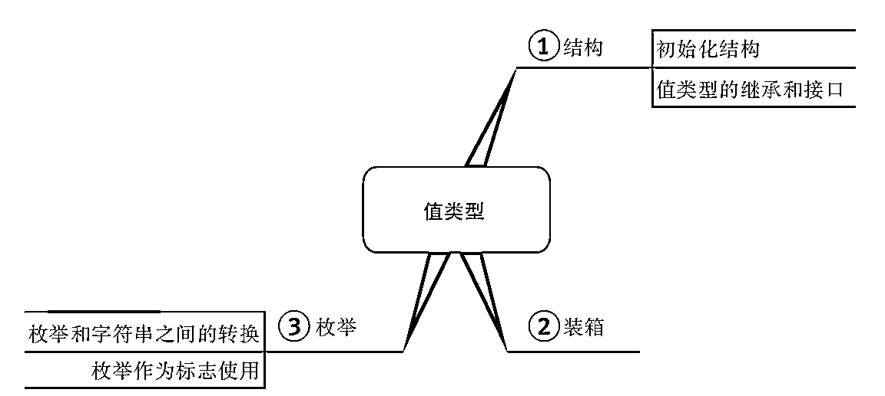
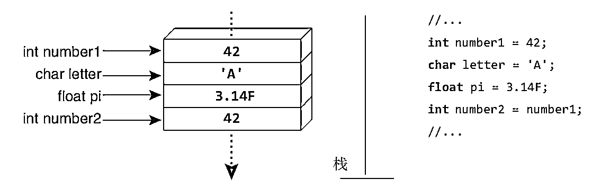
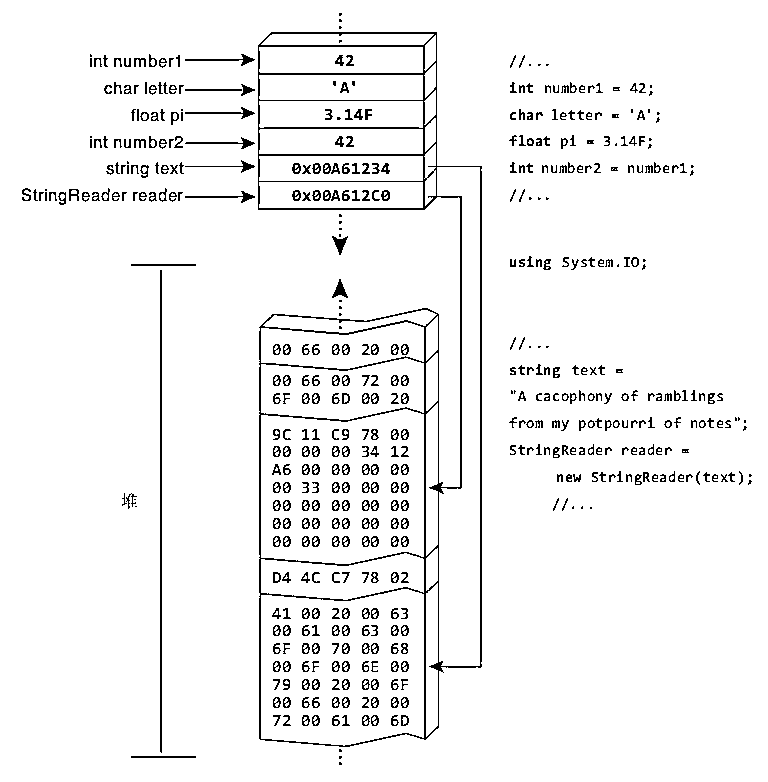
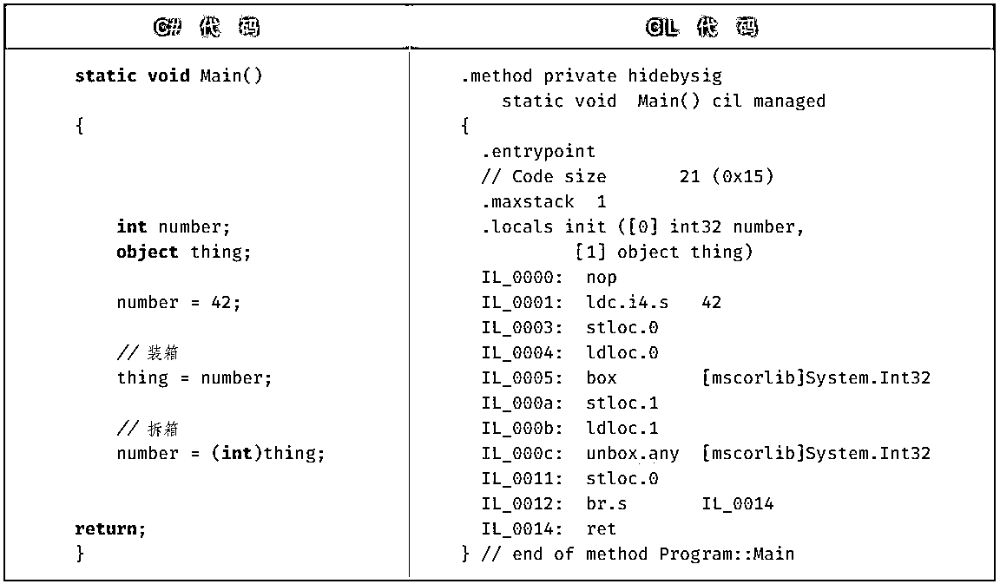
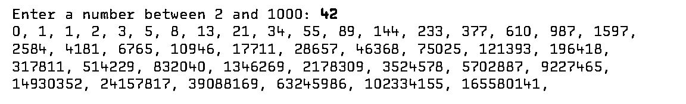

# 第九章　值类型



到目前为止，本书已使用了大量值类型，例如 int。本章不仅要讨论值类型的使用，还要讨论如何自定义值类型。有两种自定义值类型。第一种是结构。本章讨论如何利用结构定义新的值类型，使之具有与第二章讨论的大多数预定义类型相似的行为。关键在于，任何新定义的值类型都有它自己的数据和方法。第二种是枚举。本章将讨论如何利用枚举定义常量值的集合。

初学者主题：类型的分类

迄今为止讨论的所有类型分为两个类别：引用类型和值类型。两者区别在于拷贝策略。不同策略造成每种类型在内存中以不同方式存储。为巩固之前所学，这里重新总结一下值类型和引用类型，以便温故而知新。

值类型 

值类型的变量直接包含数据，如图 9.1 所示。换言之，变量名称直接和值的存储位置关联。因此，将原始变量的值赋给另一个变量，会在新变量的位置创建原始变量值的内存拷贝。两个变量不可能引用同一个内存位置（除非其中一个或两个是 out 或 ref 参数，根据定义，这种参数是另一个变量的别名）。更改一个变量的值不会影响另一个变量。



图 9.1　值类型的变量直接包含数据

值类型的变量就像上面写了数字的纸。要更改数字，可以擦除并写不同的数字。可将数字从这张纸拷贝到另一张纸。但两张纸相互独立。在一张上面擦除和替换不影响另一张。

类似地，例如将值类型的实例传给 Console.WriteLine()的方法会创建一个内存拷贝，具体就是从实参的存储位置到形参的存储位置建立一份内存拷贝。在方法内部对形参变量进行任何修改都不会影响调用者中的原始值。由于值类型要求创建内存拷贝，所以定义时不要让它们消耗太多内存（一般小于 16 字节）。


设计规范

·避免创建消耗内存大于 16 字节的值类型。

值类型的值一般只是短时间存在。通常作为表达式的一部分，或用于激活方法。在这些情况下，值类型的变量和临时值经常存储在称为栈的临时存储池中。（用词不太恰当，临时池并非一定要从栈中分配存储。事实上，它经常选择从可用的寄存器中分配存储。不过这属于实现细节。）

临时池清理起来的代价低于需要垃圾回收的堆。不过，值类型要比引用类型更频繁地拷贝，会对性能造成一定影响。总之，不要觉得“值类型因为能在栈上分配所以更快”。

引用类型 

相反，引用类型变量的值是对一个对象实例的引用（参见图 9.2）。引用类型的变量存储的是引用（通常作为内存地址实现），要去那个位置找到对象实例的数据。因此，为了访问数据，“运行时”要从变量读取引用，进行“解引用”^( [\[1\]](part0090.xhtml#ch1_back) ) 才能到达实际包含实例数据的内存位置。

所以，引用类型的变量关联了两个存储位置：直接和变量关联的存储位置，以及由变量中存储的值引用的存储位置。



图 9.2　引用类型指向堆

引用类型的变量也像是一张上面总是写了东西的纸。例如，假定一张纸上写了家庭地址“123 Sesame Street, New York City”。纸是变量，地址是对一幢建筑物的引用。纸和上面写的地址都不是建筑物本身，而且纸在哪里跟建筑物在哪里没有任何关系。在另一张纸上拷贝该引用，两张纸的内容都引用同一幢建筑物。以后将建筑物漆成绿色，可观察到两张纸引用的建筑物变成绿色，因为引用的还是同样的东西。

处理直接与变量（或临时值）关联的存储位置时，方式和处理与值类型变量关联的存储位置没有区别。如已知变量仅短时间存在，就在临时存储池中分配。对于引用类型的变量，它的值要么是 null，要么是对需要进行垃圾回收的堆上的一个存储位置的引用。

值类型的变量直接存储实例的数据；相反，要进行一次额外的“跳转”才能访问到与引用关联的数据。首先要对引用进行“解引用”来找到实际数据的存储位置，然后才能读取或写入数据。拷贝引用类型的值时拷贝的只是引用，这个引用非常小。（引用的大小保证不超过处理器的“bit size”，32 位机器是 4 字节的引用，64 位机器是 8 字节的引用，以此类推。）拷贝值类型的值会拷贝所有数据，这些数据可能很大。因此，有时拷贝引用类型的效率更高。这正是设计规范要求值类型不得大于 16 字节的原因。如拷贝值类型的代价比拷贝引用高出四倍，就应考虑把它设计成引用类型了。

由于引用类型只拷贝对数据的引用，因此两个变量可引用相同的数据。此外，通过一个变量对数据的更改可通过另一个变量观察到。赋值和方法调用都会如此。

还是继续前面的例子，将建筑物的地址传给方法，将生成包含引用的那张纸的拷贝，并将该拷贝传给方法。方法无法改变原始纸张的内容来引用不同的建筑物。但如果方法将引用的建筑物漆成别的颜色，当方法返回时，调用者将观察到这个变化。

[\[1\]](part0090.xhtml#ch1) 引用（reference）是地址；解引用（dereference）是从地址获取资源。后者还有“提领”和“用引”等译法。——译者注

## 9.1　结构

除了 string 和 object 是引用类型，其他所有 C#内建类型（比如 bool 和 int）都是值类型。框架还提供了其他大量值类型。开发者甚至能定义自己的值类型。

定义自己的值类型使用和定义类及接口相似的语法。区别在于值类型使用关键字 struct，如代码清单 9.1 所示。该值类型表示的是高精度角，即用度、分、秒来表示的角度。1 度=60 分=3600 秒。该系统在导航系统中使用，赤道海平面上沿子午线航行 1 分所走过的弧线正好 1 海里^( [\[1\]](part0091.xhtml#ch1_back) ) 。

代码清单 9.1　定义结构

```powershell
class Angle {
    [int]$Degrees
    [int]$Minutes
    [int]$Seconds
    Angle([int]$degrees, [int]$minutes, [int]$seconds) {
        $this.Degrees = $degrees; $this.Minutes = $minutes; $this.Seconds = $seconds
    }
    [Angle] Move([int]$degrees, [int]$minutes, [int]$seconds) {
        return [Angle]::new($this.Degrees + $degrees, $this.Minutes + $minutes, $this.Seconds + $seconds)
    }
}
# Value types have no direct PowerShell class equivalent; class instances are references.
```

上述代码定义值类型 Angle 来存储角度（无论经度还是纬度）的时、分、秒。这样生成的 C#类型称为结构 。

注意 Angle 结构不可变（immutable，不可修改），因为所有属性都用 C# 6.0 的只读自动实现属性功能来声明。在 C# 6.0 之前要创建只读属性，程序员需声明仅含一个取值方法（getter）的属性，该取值方法访问一个 readonly 字段中的数据（参见代码清单 9.3）。从 C# 6.0 起，定义不可变类型就不需要这么多代码了。

从 C# 7.2 起甚至可在编译时验证结构只读，只需像下面这样声明：

```powershell
# PowerShell classes do not support readonly struct declarations.
class Angle {}
```

编译时发现某个字段非只读或某个属性含赋值方法（setter）将报错。

有时候，我们可能只希望将个别方法，或者将属性的取值方法设置为只读，因为逻辑上它们不应当修改实例的状态，但实际上却有这个能力。因此，如果需要对结构的只读性进行更加精细的控制，在 C# 8.0 中，可以只在声明个别成员，而不是整个结构时使用 readonly 关键字。比如代码清单 9.1 中的 Move()方法就适合使用 readonly 关键字：

```powershell
# Keep methods side-effect free to emulate a readonly member.
[Angle] Move([int]$degrees, [int]$minutes, [int]$seconds) { ... }
```

（如果结构体被整体声明为只读，仍然可以在个别成员上使用 readonly 关键字，只是这样做没有额外的效果。）

当只读成员直接修改字段、通过属性方法修改字段，或者调用其他非只读方法时，会引发编译时错误。通过将个别成员声明为只读，程序员可以清晰地表达成员方法的行为意图。注意，对于非自动实现的属性方法，可以分别给取值方法或者赋值方法添加 readonly 关键字（虽然将赋值方法声明为只读一般没有意义），而如果要将整个属性声明为只读，则可以将 readonly 关键字写在整个属性的名字前面。


注意 　虽然语言本身未作要求，但好的实践是使值类型不可变。换言之，值类型一旦实例化，就不能修改该实例。要修改应创建新实例。代码清单 9.1 提供了一个 Move()方法，它不修改 Angle 的实例，而是返回一个全新实例。该实践出于两方面的考虑。首先，值类型应表示值。两个整数相加，其中任何一个都不应改变。所以，应该使两个加数不可变，生成第三个值作为结果。其次，值类型拷贝的是值而非引用，很容易混淆并错误地以为对一个值类型变量的变动会造成另一个值类型的变动，就像引用类型那样。


设计规范

·要创建不可变的值类型。

有趣的是，元组类型（System.ValueTuple）是个例外。要了解为何它没有被设计为不可变的值类型，可以阅读文章：[`intellitect.com/WhyTupleBreaksTheImmutableRules`](https://intellitect.com/WhyTupleBreaksTheImmutableRules) 。

### 9.1.1　初始化结构

除了属性和字段，结构还可包含方法和构造函数，但不可包含用户自定义的默认（无参）构造函数。相反，C#编译器自动生成默认构造函数将所有字段初始化为默认值。具体就是将引用类型的字段初始化为 null，数值类型初始化为零，Boolean 类型初始化为 false。

为确保局部值类型变量被构造函数完整初始化，结构中的每个构造函数都必须初始化结构的所有字段（和只读自动实现属性）。注意在 C# 6.0 中初始化只读自动实现属性已经足够，不用初始化它的支持字段，因为该字段未知。未初始化结构的所有数据将发生编译时错误。另外要注意，C#不允许在结构声明中初始化字段。例如在代码清单 9.2 中，如果不将 int\_Degrees=42;那一行注释掉会发生编译时错误。

代码清单 9.2　在结构声明中初始化字段会报错

```powershell
# PowerShell initializes fields when the class is instantiated; there is no declaration-time struct-field error.
class Angle { [int]$Degrees = 42 }
```

如果不用 new 操作符来调用构造函数从而显式实例化结构，结构中的所有数据都隐式初始化为对应数据类型的默认值。但值类型中的所有数据都必须显式初始化来避免编译时错误。这带来一个问题：一个值类型在什么时候会隐式初始化而不显式实例化呢？实例化含有未赋值的值类型字段的一个引用类型，或者实例化值类型的一个数组而不使用数组初始化器（初始化列表）时，就会发生这种情况。

为满足结构初始化要求，所有显式声明的字段都必须初始化。这种初始化必须直接进行。例如在代码清单 9.3 中，初始化属性（如果未注释掉）而不是字段的构造函数将造成编译错误。

代码清单 9.3　不初始化字段就访问属性

```powershell
# Initialize fields before reading computed properties.
class Angle {
    hidden [int]$_Degrees
    hidden [int]$_Minutes
    hidden [int]$_Seconds
    Angle([int]$degrees, [int]$minutes, [int]$seconds) {
        $this._Degrees=$degrees; $this._Minutes=$minutes; $this._Seconds=$seconds
    }
    [int]$Degrees; [int]$Minutes; [int]$Seconds
}
```

访问 Degrees 会隐式访问 this.Degrees，但除非编译器知道所有字段都已初始化，否则访问 this 非法。为解决该问题，要像代码清单 9.3 未注释掉的构造函数那样直接初始化字段。

考虑到结构的字段初始化要求、简洁的 C# 6.0 只读自动实现属性语法，以及“避免从包容属性外部访问字段”这一设计规范，所以从 C# 6.0 起在结构中应首选只读自动实现属性而非字段。


设计规范

·要确保结构的默认值有效。封装并不能阻止访问默认的“全零”值。

高级主题：将 new 用于值类型

为引用类型使用 new 操作符，“运行时”会在托管堆上创建对象的新实例，将所有字段初始化为默认值，再调用构造函数，将对实例的引用以 this 的形式传递。new 操作符最后返回对实例的引用，该引用被拷贝到和变量关联的内存位置。相反，为值类型使用 new 操作符，“运行时”会在临时存储池中创建对象的新实例，将所有字段初始化为默认值，调用构造函数，将临时存储位置作为 ref 变量以 this 的形式传递。结果是值被存储到临时存储位置，然后可将该值拷贝到和变量关联的内存位置。

和类不同，结构不支持终结器。结构以值的形式拷贝，不像引用类型那样具有“引用同一性”，因此难以知道什么时候能安全执行终结器并释放结构占用的非托管资源。垃圾回收器知道在什么时候没有了对引用类型实例的“活动”引用，可在此之后的任何时间运行终结器。但“运行时”没有任何机制能跟踪值类型在特定时刻有多少个拷贝。

语言对比：C++——struct 定义带公共成员的类型

在 C++中，对于用 struct 和 class 声明的类型，区别在于默认的可访问性是公共还是私有。两者在 C#中的区别则大得多，在于类型的实例是以值还是引用的形式拷贝。

### 9.1.2　值类型的继承和接口

所有值类型都隐式密封。此外，除枚举之外的所有值类型都派生自 System.ValueType。这意味着结构的继承链总是从 object 到 System.ValueType 到结构。

值类型也能实现接口。框架内建的许多值类型都实现了 IComparable 和 IFormattable 这样的接口。

System.ValueType 规定了值类型的行为，但没有包含任何附加成员。System.ValueType 重写了 object 的所有虚成员。在结构中重写基类方法的规则和类基本一样（参见第十章），但一个区别在于，对于值类型，GetHashCode()的默认实现是将调用转发给结构中的第一个非空字段。此外，Equals()大量利用了反射。所以，假如一个值类型在集合中频繁使用，尤其是使用了哈希码的字典类型的集合，那么值类型应该同时包含对 Equals()和 GetHashCode()的重写以获得好的性能。详情参见第十章。


设计规范

·如需比较相等性，要在值类型上重写相等性操作符（Equals()，==和!=）并考虑实现 IEquatable<T>接口。

[\[1\]](part0091.xhtml#ch1) 1 海里=1852 米。——编辑注

## 9.2　装箱

我们知道值类型的变量直接包含它们的数据，而引用类型的变量包含对另一个存储位置的引用。但将值类型转换成它实现的某个接口或 object 时会发生什么？结果必然是对一个存储位置的引用。该位置表面上包含引用类型的实例，但实际包含值类型的值。这种转换称为装箱 （boxing），它具有一些特殊行为。从值类型的变量（直接引用其数据）转换为引用类型（引用堆上的一个位置）会涉及以下几个步骤：

1.首先在堆上分配内存。它将用于存放值类型的数据以及少许额外开销（SyncBlockIndex 和方法表指针）。这些开销使对象看起来像引用类型的托管对象实例。

2.接着发生一次内存拷贝动作，当前存储位置的值类型数据拷贝到堆上分配好的位置。

3.最后，转换结果是对堆上的新存储位置的引用。

相反的过程称为拆箱 （unboxing）。具体是核实已装箱值的类型兼容于要拆箱成的值的类型，再拷贝堆中存储的值，结果是堆上存储的值的拷贝。

装箱和拆箱之所以重要，是因为装箱会影响性能和行为。除了学习如何在 C#代码中识别它们之外，开发者还应通过查看 CIL，在一个特定的代码片段中统计 box/unbox 指令数量。如表 9.1 所示，每个操作都有对应的指令。

表 9.1　CIL 中的装箱代码



装箱和拆箱如果不是很频繁，性能问题不大。但有时装箱很容易被忽视，而且会非常频繁地发生，这可能大幅影响性能。代码清单 9.4 和输出 9.1 展示了一个例子。ArrayList 类型维护的是对象引用列表，所以在列表中添加整数或浮点数会造成对值进行装箱以获取引用。

代码清单 9.4　容易忽视的 box 和 unbox 指令

```powershell
# ArrayList stores objects; prefer a generic PowerShell array to avoid boxing.
$totalCount = [int](Read-Host 'Enter a number between 2 and 1000')
$list = [System.Collections.ArrayList]::new()
[void]$list.Add([double]0); [void]$list.Add([double]1)
for ($i=2; $i -lt $totalCount; $i++) {
    [void]$list.Add([double]$list[$i-1] + [double]$list[$i-2])
}
$list | ForEach-Object { Write-Host "$_" -NoNewline; Write-Host ', ' -NoNewline }
```

输出 9.1



代码编译后在 CIL 中生成 5 个 box 指令和 3 个 unbox 指令。

1.前两个 box 指令是在对 list.Add()的初始调用中发生的。方法的签名是 int Add (object value)。所以，传给该方法的任何值类型都会被装箱。

2.接着是在 for 循环内部 Add()调用中的两个 unbox 指令。因为 ArrayList 包含 object，ArrayList 的索引操作符返回的总是 object。但为了将两个值加到一起，需要将它们转换回 double。从 object 向值类型的转换作为 unbox 调用来实现。

3.现在要获取加法运算的结果并将其放到 ArrayList 实例中，这又造成了一次 box 操作。注意，前两个 unbox 指令和这个 box 指令是在一次循环迭代中发生的。

4.foreach 遍历 ArrayList 中的每一项并把它们的值赋给 count。但 ArrayList 包含的是对象引用，所以每次赋值都要执行 unbox 操作。

5.对于 foreach 循环中调用的 Console.WriteLine()方法，它的签名是 void Console.Write(string format, object arg)，所以每次调用都要执行从 double 到 object 的装箱。

每次装箱都涉及内存分配和拷贝，每次拆箱都涉及类型检查和拷贝。如所有操作都用已拆箱的类型完成，就可避免内存分配和类型检查。显然，可通过避免许多装箱操作来提升代码性能。例如上例的 foreach 循环可将 double 换成 object 来改进。另一个改进是将 ArrayList 数据类型更改为泛型集合（参见第十二章）。但这里的重点在于，有的装箱操作很容易被人忽视，开发者要留意那些可能反复装箱并大幅影响性能的情况。

还有一个装箱相关问题也发生在运行时。假如修改最开始的两个 Add()调用，不是使用强制类型转换（或 double 字面值），而是直接在数组列表中插入整数。因为 int 会隐式转型为 double，所以这个修改似乎没什么大不了。但后来在 for 循环中以及在 foreach 循环对 count 的赋值中转型为 double 就会出问题。这相当于是在 unbox 操作后执行从已装箱 int 向 double 的内存拷贝。该操作要成功必须先转型为 int，否则代码会在执行时引发 InvalidCastException 异常。代码清单 9.5 展示了注释掉的一个类似的错误，在它后面才是正确的转型方式。

代码清单 9.5　必须先拆箱为基础类型

```powershell
$number = 42
$boxed = [object]$number
# Unbox to the original value type before converting to another type.
$bigNumber = [double][int]$boxed
```

高级主题：lock 语句中的值类型

C#支持用于同步代码的 lock 语句。该语句实际编译成 System.Threading.Monitor 的 Enter()和 Exit()方法。两个方法必须成对调用。Enter()记录由其唯一的引用类型参数传递的一个 lock，这样使用同一个引用调用 Exit()时就可释放该 lock。值类型的问题在于装箱，所以每次调用 Enter()或 Exit()都会在堆上创建新值。将一个拷贝的引用同另一个拷贝的引用比较总是返回 false。所以，无法将 Enter()与对应的 Exit()钩到一起。因此，不允许在 lock()语句中使用值类型。

代码清单 9.6 揭示了更多的运行时装箱问题，输出 9.2 展示了结果。

代码清单 9.6　容易忽视的装箱问题

```powershell
class Angle {
    [int]$Degrees; [int]$Minutes; [int]$Seconds
    Angle([int]$d,[int]$m,[int]$s) { $this.Degrees=$d; $this.Minutes=$m; $this.Seconds=$s }
    [void]MoveTo([int]$d,[int]$m,[int]$s) { $this.Degrees=$d; $this.Minutes=$m; $this.Seconds=$s }
}
$angle = [Angle]::new(25,58,23)
# PowerShell class references are not boxed value-type copies; mutations affect the same object.
$objectAngle = [object]$angle
$angle.MoveTo(26,58,23)
$objectAngle.Degrees
```

输出 9.2


代码清单 9.6 使用了 Angle 结构和 IAngle 接口。注意 IAngle.MoveTo()使 Angle 成为可变（mutable）值类型。这带来了一些问题。通过演示这些问题，你将理解使值类型不可变（immutable）的重要性。

在代码清单 9.6 的 Example 1 中，初始化 angle 后把它装箱到 objectAngle 变量中。接着，Example 2 调用 MoveTo()将\_Degrees 更改为 26。但正如输出演示的那样，这次不会发生实际的改变。这里的问题是，为了调用 MoveTo()，编译器要对 objectAngle 进行拆箱，并且（根据定义）创建值的拷贝。值类型拷贝的是值，这正是它们叫值类型的原因。虽然结果值在执行时被成功修改，但值的这个拷贝会被丢弃。objectAngle 引用的堆位置未发生任何改变。

如前所述，值类型的变量就像上面写了值的纸。对值进行装箱相当于对纸进行复印，将复印件放到箱子中。对值进行拆箱是复印箱子中的纸。编辑第二个复印件不影响箱子中的纸。

在 Example 3 中，类似的问题在反方向上发生。这次不是直接调用 MoveTo()，而是将值强制转换为 IAngle。转换为接口类型会对值进行装箱，所以“运行时”将 angle 中的数据拷贝到堆，并返回对该箱子的引用。接着，方法修改被引用的箱子中的值。angle 中的数据保持未修改状态。

最后一种情况（Example 4），向 IAngle 的强制类型转换是引用转换而不是装箱转换。值已通过向 object 的转换而装箱了。所以，这次转换不会发生值的拷贝。对 MoveTo()的调用将更新箱子中存储的\_Degrees 值，代码的行为符合预期。

从这个例子可以看出，可变值类型容易使人迷惑，因为往往修改的是值的拷贝，而不是真正想要修改的存储位置。如第一时间避免使用可变值类型，就不会有这样的迷惑了。


设计规范

·避免可变值类型。

高级主题：如何在方法调用期间避免装箱

任何时候在值类型上调用方法，接收调用的值类型（在方法主体中用 this 表示）必须是变量而不是值，因为方法可能尝试修改接收者。显然，它必须修改接收者的存储位置，而不是修改接收者的值的拷贝再丢弃该拷贝。代码清单 9.6 的 Example 2 和 Example 4 演示了在已装箱值类型上调用方法时，这一事实对性能的影响。

在 Example 2 中，拆箱逻辑上生成已装箱的值，而不是生成对包含已装箱拷贝的“堆上存储位置”（箱子）的引用。那么，哪个存储位置作为 this 传给方法调用呢？不可能是堆上箱子的位置，因为拆箱生成那个值的拷贝而不是对存储位置的引用。

在需要值类型的变量但只有一个值可用的情况下，会发生以下两件事之一：要么是 C#编译器生成代码来创建一个新的临时存储位置，将值从箱子拷贝到新位置，使临时存储位置成为所需的变量；要么不允许该操作并报错。本例采用第一个策略。新的临时存储位置成为该调用的接收者。MoveTo()方法完成修改后，该临时存储位置被丢弃。

每次“拆箱后调用”，无论方法是否真的修改变量都会重复该过程：对已装箱值执行类型检查，拆箱以生成已装箱值的存储位置，分配临时变量，将值从箱子拷贝到临时变量，再调用方法并传递临时存储位置。显然，如果不修改变量，很多工作都可避免。但 C#编译器不知道一个方法会不会修改接收者，所以只好“宁错杀，不放过”。

在已装箱值类型上调用接口方法，所有这些开销都可被避免。这时预期的接收者是箱子中的存储位置。如接口方法要修改存储位置，修改的是已装箱的位置。执行类型检查、分配新的临时存储和生成拷贝的开销可被避免。相反，“运行时”直接将箱子中的存储位置作为结构方法调用的接收者。

代码清单 9.7 调用 int 值类型实现的 IFormattable 接口中的 ToString()的双参数版本。在本例中，方法调用的接收者是已装箱值类型，但在调用接口方法时不会拆箱。

代码清单 9.7　避免拆箱和拷贝

```powershell
$number = 42
$boxed = [object]$number
# .NET interface calls can be made without an explicit unbox in PowerShell.
([System.IFormattable]$boxed).ToString('X', $null)
```

你或许会问，如果将值类型的实例作为接收者来调用 object 声明的虚方法 ToString()会发生什么？实例会装箱、拆箱还是什么？这要视情况而定：

·如果接收者已拆箱，而且结构重写了 ToString()，将直接调用重写的方法。没必要以虚方式调用，因为方法不能被更深的派生类重写了。所有值类型隐式密封。

·如果接收者已拆箱，而且结构没有重写 ToString()，就必须调用基类的实现，该实现预期的接收者是一个对象引用。所以，接收者被装箱。

·如果接收者已装箱，而且结构重写了 ToString()，就将箱子中的存储位置传给重写方法而不拆箱。

·如果接收者已装箱，而且结构没有重写 ToString()，就将对箱子的引用传给基类的实现，该实现预期的正是一个引用。

## 9.3　枚举

对比如代码清单 9.8 所示的两个代码片段。

代码清单 9.8　比较整数 switch 和枚举 switch

```powershell
enum ConnectionState { Disconnected; Connecting; Connected; Disconnecting }
$connectionState = [ConnectionState]::Connected
switch ($connectionState) {
    ([ConnectionState]::Connected) { 'connected'; break }
    ([ConnectionState]::Connecting) { 'connecting'; break }
    default { 'other' }
}
```

两者在可读性上区别明显。在第二个代码片段中，各个 case 让人一目了然。不过，两者在运行时的性能完全一样，因为第二个代码片段在每个 case 中使用了枚举值 。

枚举是可由开发者声明的值类型。枚举的关键特征是在编译时声明了一组具名常量值，这使代码更易读。代码清单 9.9 是一个典型的枚举声明。

代码清单 9.9　定义枚举

```powershell
enum ConnectionState {
    Disconnected
    Connecting
    Connected
    Disconnecting
}
```


注意 　用枚举替代布尔值能改善可读性。例如，SetState(DeviceState.On)的可读性优于 SetState(true)。

使用枚举值需要为其附加枚举名称前缀。例如，使用 Connected 值的语法是 ConnectionState.Connected。枚举值名称不要包含枚举名称，避免出现像 ConnectionState.ConnectionState-Connected 这样啰唆的写法。根据约定，除了位标志（稍后讨论）之外的枚举名称应该是单数形式。例如，应该是 ConnectionState 而不是 ConnectionStates。

枚举值实际作为整数常量实现。默认第一个枚举值是 0，后续每一项都递增 1。但可以显式地为枚举赋值，如代码清单 9.10 所示。

代码清单 9.10　定义枚举类型

```powershell
enum ConnectionState {
    Disconnected = 0
    Connecting = 10
    Connected = 11
    Joined = 11
    Disconnecting = 12
}
```

Disconnected 仍然具有默认值 0，Connecting 则被显式赋值为 10，所以它后面的 Connected 会被赋值为 11。随后，Joined 也被赋值为 11，也就是赋给 Connected 的值（此时不需要为 Connected 附加枚举名称前缀，因为目前正处在枚举的作用域内）。最后，Disconnecting 自动递增 1，所以值是 12。

枚举总是具有一个基础类型，可以是除 char 之外的任意整型。事实上，枚举类型的性能完全取决于基础类型的性能。默认基础类型是 int，但可用继承语法指定其他类型。例如在代码清单 9.10 中，使用的不是 int 而是 short。为保持一致性，这里的语法模拟了继承的语法，但并没有真正建立继承关系。所有枚举的基类都是 System.Enum，后者从 System.ValueType 派生。另外，这些类都是密封的，不能从现有枚举类型派生以添加额外成员。


设计规范

·考虑使用默认 32 位整型作为枚举基础类型。只有出于互操作性或性能方面的考虑才使用较小的类型，只有创建标志（flag）数超过 32 个的标志枚举才使用较大的类型。（本章将在后面详细介绍“标志枚举”。）

枚举不过是基础类型上的一组名称，对于枚举类型的变量，它的值并不限于声明中命名的值。例如，由于整数 42 能转型为 short，所以也能转型为 ConnectionState，即使它没有对应的 ConnectionState 枚举值。值能转换成基础类型，就能转换成枚举类型。

该设计的优点在于可在未来的 API 版本中为枚举添加新值，同时不会破坏早期版本。另外，枚举值为已知值提供了名称，同时允许在运行时分配未知的值。该设计的缺点在于编码时须谨慎，要主动考虑到未命名值的可能性。例如，将 case ConnectionState.Disconnecting 替换成 default，并认定 default case 唯一可能的值就是 ConnectionState.Disconnecting，那么就是不明智的。相反，应显式处理 Disconnecting 这一 case，而让 default case 报告一个错误，或者执行其他无害的行为。然而，正如前面讲到的，从枚举转换为基础类型以及从基础类型转换为枚举类型都涉及显式转型，而不是隐式转型。例如，假定方法签名是 void ReportState(ConnectionState state)，就不能调用 ReportState(10)。唯一的例外是传递 0，因为 0 能隐式转换为任何枚举。

虽然允许在代码将来的版本中为枚举添加额外的值，但这样做时要小心。在枚举中部插入枚举值，会使其后的所有枚举值发生顺移（例如，在 Connected 之前添加 Flooded 或 Locked 值，会造成 Connected 值改变）。这会影响根据新枚举来重新编译的所有版本。不过，任何基于旧枚举编译的代码都会继续使用旧值。除了在列表末尾插入新的枚举值，避免旧枚举值改变的另一个办法是显式赋值。


设计规范

·考虑在现有枚举中添加新成员，但要注意兼容性风险。

·避免创建代表“不完整”值（如版本号）集合的枚举。

·避免在枚举中创建“保留给将来使用”的值。

·避免包含单个值的枚举。

·要为简单枚举提供值 0 来代表无。注意若不显式初始化，0 就是默认值。

枚举和其他值类型稍有不同，因为枚举的继承链是从 System.ValueType 到 System.Enum，再到枚举。

### 9.3.1　枚举之间的类型兼容性

C#不支持不同枚举数组之间的直接转型。但 CLR 允许，前提是两个枚举具有相同的基础类型。为避开 C#的限制，技巧是先转型为 System.Array，如代码清单 9.11 末尾所示。

代码清单 9.11　枚举数组之间的转型

```powershell
enum ConnectionState1 { Disconnected; Connecting; Connected; Disconnecting }
enum ConnectionState2 { Disconnected; Connecting; Connected; Disconnecting }
# Convert through the underlying integer values when changing enum types.
$states = [ConnectionState1[]]([ConnectionState2[]](42))
```

这个例子利用了 CLR 的赋值兼容性比 C#宽松这一事实。（还可用同样的技巧进行非法转换，比如 int\[\]转换成 uint\[\]。）但使用该技巧时务必慎重，因为 C#规范没有说这个技巧在不同 CLR 实现中都能发挥作用。

### 9.3.2　在枚举和字符串之间转换

枚举的一个好处是 ToString()方法（通过 System.Console.WriteLine()这样的方法来调用）会输出枚举值标识符：

```powershell
[System.Diagnostics.Trace]::WriteLine("The connection is currently $([ConnectionState]::Disconnecting)")
```

上述代码将输出 9.3 的文本写入跟踪缓冲区（trace buffer）。

输出 9.3


字符串向枚举的转换刚开始较难掌握，因为它涉及由 System.Enum 基类提供的一个静态方法。代码清单 9.12 展示了在不利用泛型（参见第十二章）的前提下如何做，输出 9.4 展示了结果。

代码清单 9.12　使用 Enum.Parse()将字符串转换为枚举

```powershell
$priority = [System.Threading.ThreadPriority]::Parse([System.Threading.ThreadPriority], 'Idle')
$priority
```

输出 9.4


Enum.Parse()的第一个参数是类型，用关键字 typeof()指定。这是在编译时判断类型的一种方式，可把它看成类型值的字面值（参见第十八章）。

Microsoft.NET Framework 4 之前没有 TryParse()方法，所以为它之前的平台写的代码应包含恰当的异常处理机制，以防范字符串和枚举值标识符不匹配的情况。Microsoft.NET Framework 4 的 TryParse<T>()方法使用了泛型，但类型参数可以推断出来。所以，可以像代码清单 9.13 那样转换为枚举。

代码清单 9.13　使用 Enum.TryParse<T>()将字符串转换成枚举

```powershell
[System.Threading.ThreadPriority]$priority = 0
if ([System.Enum]::TryParse('Idle', [ref]$priority)) { $priority }
```

该技术的优点在于，不必使用异常处理机制来防范转换不成功的情况，检查 TryParse<T>()返回的 Boolean 结果就可以了。

不管是用“Parse”还是“TryParse”模式来编码，从字符串向枚举的转换都是不可本地化的。因此，如果本地化是一项硬性要求，只有对那些不公开给用户的消息，开发者才可进行这种形式的转换。


设计规范

·如果字符串必须本地化成用户语言，避免枚举/字符串直接转换。

### 9.3.3　枚举作为标志使用

开发者许多时候不仅希望枚举值独一无二，还希望能对其进行组合以表示复合值。以 System.IO.FileAttributes 为例。如代码清单 9.14 所示，该枚举用于表示文件的各种特性：只读、隐藏、存档等。在前面定义的 ConnectionState 枚举中，每个值都是互斥的。而 FileAttributes 枚举值允许而且本来就设计为自由组合。例如，一个文件可能同时只读和隐藏。为支持该行为，每个枚举值都是位置唯一的二进制位。

代码清单 9.14　枚举作为位标志

```powershell
# PowerShell can use the .NET flags enum directly.
[System.IO.FileAttributes]$attrs = [System.IO.FileAttributes]::ReadOnly -bor [System.IO.FileAttributes]::Hidden
```


注意 　位标志枚举名称通常是复数，因为它的值代表一个标志（flag）的集合。

使用按位 OR 操作符联接（join）枚举值，使用 Enum.HasFlags()方法（Microsoft.NET Framework 4.0 后加入）或按位 AND 操作符测试特定位是否存在。代码清单 9.15 展示了这两种情况。

代码清单 9.15　为标志枚举值使用按位 OR 和 AND^( [\[1\]](part0093.xhtml#ch1_back) ) 

```powershell
$fileName = 'enumtest.txt'
$file = Get-Item $fileName
$file.Attributes = [System.IO.FileAttributes]::Hidden -bor [System.IO.FileAttributes]::ReadOnly
if (($file.Attributes -band [System.IO.FileAttributes]::Hidden) -ne [System.IO.FileAttributes]::Hidden) { throw 'File is not hidden.' }
if (-not ($file.Attributes.HasFlag([System.IO.FileAttributes]::ReadOnly))) { throw 'File is not read-only.' }
```

输出 9.5 展示了代码清单 9.15 的结果。

输出 9.5


本例用按位 OR 操作符将文件同时设为只读和隐藏。枚举中的每个值不一定只对应一个标志。完全可为常用值组合定义额外的标志，如代码清单 9.16 所示。

代码清单 9.16　为常用组合定义枚举值

```powershell
enum DistributedChannel {
    None = 0
    Transacted = 1
    Queued = 2
    Encrypted = 4
    Persisted = 16
    FaultTolerant = 19 # Transacted -bor Queued -bor Persisted
}
$channel = [DistributedChannel]19
```

一个好习惯是在标志枚举中包含值为 0 的 None 成员，因为无论是枚举类型的字段，还是枚举类型的一个数组中的元素，其初始默认值都是 0。避免最后一个枚举值对应像 Maximum（最大）这样的东西，因为 Maximum 可能被解释成有效枚举值。要检查枚举是否包含某个值，请使用 System.Enum.IsDefined()方法。


设计规范

·要用 FlagsAttribute 标记包含标志的枚举。

·要为所有标志枚举提供等于 0 的 None 值。

·避免将标志枚举中的零值设定为“所有标志都未设置”之外的其他意思。

·考虑为常用标志组合提供特殊值。

·不要包含“哨兵”值（如 Maximum），这种值会使用户困惑。

·要用 2 的乘方确保所有标志组合都不重复。

高级主题：FlagsAttribute

如决定使用位标志枚举，枚举的声明应该用 FlagsAttribute 来标记。该特性应包含在一对方括号中（具体参见第十八章），并放在枚举声明之前，如代码清单 9.17 所示。

代码清单 9.17　使用 FlagsAttribute

```powershell
# [Flags] is already applied to System.IO.FileAttributes.
$fileName = 'enumtest.txt'
New-Item $fileName -ItemType File -Force | Out-Null
$file = Get-Item $fileName
$file.Attributes = [System.IO.FileAttributes]::Hidden -bor [System.IO.FileAttributes]::ReadOnly
$file.Attributes
[System.IO.FileAttributes]::Parse([System.IO.FileAttributes], $file.Attributes.ToString())
Remove-Item $fileName
```

输出 9.6 展示了代码清单 9.17 的结果。

输出 9.6


该特性指出枚举值可以组合。它还改变了 ToString()和 Parse()方法的行为。例如，为用 FlagsAttribute 修饰的枚举调用 ToString()方法，会为已设置的每个枚举标志输出对应的字符串。在代码清单 9.17 中，file.Attributes.ToString()返回 ReadOnly,Hidden。而如果没有用 FlagsAttributes 修饰，返回的就是 3。如两个枚举值相同，ToString()返回第一个。但如前所述，因为无法本地化，所以使用时需谨慎。

将值从字符串解析成枚举也是可行的。每个枚举值标识符都以逗号分隔。

注意 FlagsAttribute 不会自动分配唯一的标志值，也不会核实它们有唯一的值。那样做也没有意义，因为经常都需要重复值和组合值。相反，应显式分配每个枚举项的值。

[\[1\]](part0093.xhtml#ch1) 注意 Linux 不支持 FileAttributes.Hidden 值。

## 9.4　小结

本章首先讨论如何创建自定义值类型。因为修改值类型很容易写出令人困惑或者含有 bug 的代码，而且值类型一般用于建模不可变的值，所以最好使值类型不可变。我们还讨论了如何对值类型进行“装箱”，作为引用类型以多态的形式对待。

装箱容易使人犯迷糊，容易在执行时（而非编译时）出问题。虽然需要清楚认识它以避免问题，但也不必过于紧张。值类型很有用，具有性能上的优势，不要害怕用它。值类型渗透到本书几乎每一章，容易出问题的时候并不多。虽然罗列了装箱可能发生的问题，并用代码进行了演示，但现实中其实很少遇到相同情形。遵守“不要创建可变值类型”这一规范，就可避免其中的多数问题。这正是你在内建值类型中没有遇到这些问题的原因。

或许最容易出的问题就是循环内的反复装箱操作。不过，泛型显著减少了装箱。而且即使没有泛型，该问题对性能造成的影响也微乎其微，除非你确定某个算法因为装箱而成为性能瓶颈。

另外，自定义值类型（struct）平时用得较少。虽然它们在 C#开发中扮演了重要角色，但相较于类，自定义结构的数量还是非常少的——只有在需要与非托管代码进行互操作的时候，才需要大量用到自定义结构。


设计规范

·不要定义结构，除非它逻辑上代表单个值，消耗 16 字节或更少存储空间，不可变，而且很少装箱。

本章还介绍了枚举。枚举类型是大多数编程语言都有的标准构造，在改进 API 可用性与代码可读性方面功不可没。

第十章将介绍更多设计规范，帮助你创建“合式”（well-formed）的值类型和引用类型。首先讨论如何重写对象的虚成员，以及如何定义操作符重载方法。这两个主题同时适用于结构和类，但更重要的意义还是在于完善结构定义，使其做到“合式”。
