# 第十章　合式类型

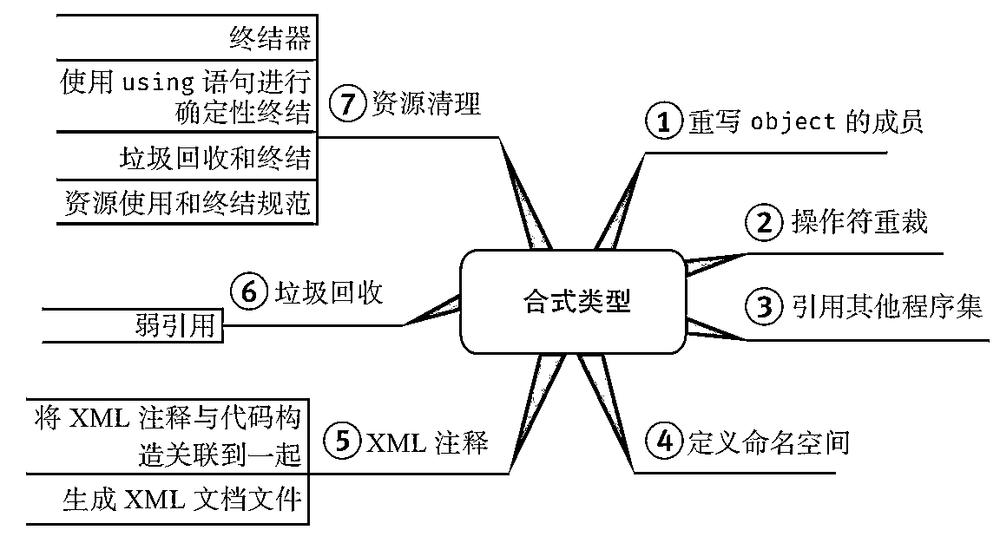

第六章讲述了用于定义类和结构的大多数构造。但目前的类型定义并不完美，还缺少一些合用且完备的功能。本章将讨论如何完善类型定义。

## 10.1　重写 object 的成员

第六章说过，object 是终极基类，所有类和结构都从它派生，还讨论了 object 提供的方法，并提到其中一些是虚方法。本节讨论对虚方法进行重写的细节。

### 10.1.1　重写 ToString()

在对象上调用 ToString()默认返回类的完全限定名称。例如，在一个 System.IO.FileStream 对象上调用 ToString()会返回字符串"System.IO.FileStream"。但 ToString()对于某些类应返回更有意义的结果。以 string 类为例，ToString()应返回字符串值本身。类似地，返回一个 Contact 的姓名显然更有意义。代码清单 10.1 重写了 ToString()，返回 Coordinate（坐标）的字符串表示。

代码清单 10.1　重写 ToString()

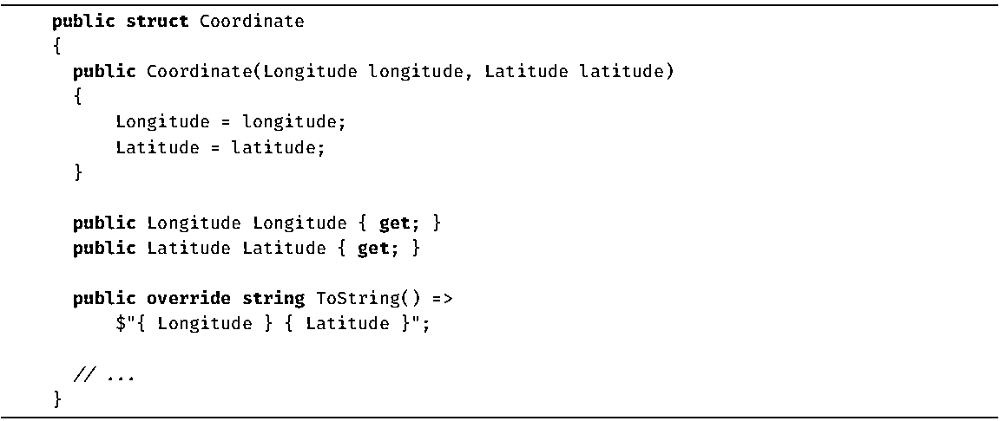

Console.WriteLine()和 System.Diagnostics.Trace.Write()等方法会调用对象的 ToString()方法，所以可重写 ToString()输出比默认实现更有意义的信息。总之，如果能输出更能说明问题的诊断信息（特别是当目标用户是开发者时），就应当考虑重写 ToString()方法，毕竟 object.ToString()默认时只是输出类型名称，对用户不太友好。至少，应该尽量避免从 ToString()方法返回空字符串或 null，因为那样做会给使用者带来很大困扰。在 IDE 中调试或者向日志文件写入时，ToString()相当有用。考虑到这个原因，字符串不要太长（不要超过屏幕宽度）。不过，由于缺乏本地化和其他高级格式化功能，所以它不太适合向最终用户显示文本。

设计规范

·如需返回有用的、面向开发者的诊断字符串，就要重写 ToString()。

·考虑尽量使 ToString()返回的字符串简短。

·不要从 ToString()返回空字符串来代表“空”（null）。

·不要从 ToString()抛出异常或造成可观察到的副作用（改变对象状态）。

·如果返回值与语言文化相关或要求格式化（例如 DateTime），就要重载 ToString (string format)或实现 IFormattable。

·考虑从 ToString()返回独一无二的字符串以标识对象实例。

### 10.1.2　重写 GetHashCode()

重写 GetHashCode()远比重写 ToString()复杂。但底线是重写 Equals()就要重写 GetHashCode()，否则编译器会显示警告。将类作为哈希表集合（比如 System.Collections.Hashtable 和 System.Collections.Generic.Dictionary）的键（key）使用也应重写 GetHashCode()。

哈希码（hash code）作用是生成和对象值对应的数字，从而高效地平衡哈希表 ^( [\[1\]](part0096.xhtml#ch1_back) ) 。要获得良好的 GetHashCode()实现，请参照以下实现原则（“必须”是指必须满足的要求，“性能”是指为了增强性能而需要采取的措施，“安全性”是指为了保障安全性而需要采取的措施）：

·必须： 相等的对象必然有相等的哈希码（若 a.Equals(b)，则 a.GetHashCode()==b.GetHashCode()）。

·必须： 在特定对象的生存期内，即使对象的数据发生了改变，GetHashCode()也应始终返回相同的值。通常可以将对象的哈希码保存在某个恰当的位置（后文将简称为“缓存”），并让 GetHashCode()返回缓存值，从而确保其返回值不变。但是，不要通过对比哈希码来判断两个对象是否相等，因为数据相等的两个对象可能有不相等的哈希码，反之，数据不相等的两个对象，也可能有相等的哈希码。

·必须： GetHashCode()不应引发任何异常；GetHashCode()总是成功返回一个值。

·性能： 哈希码应尽可能唯一。但由于哈希码只是返回一个 int，所以只要一种对象包含的值比一个 int 能够容纳得多（这就几乎涵盖所有类型了），那么哈希码肯定存在重复。一个很容易想到的例子是 long，因为 long 的取值范围大于 int，所以假如规定每个 int 值都只能标识一个不同的 long 值，那么肯定剩下大量 long 值没法标识。

·性能： 可能的哈希码值应当在 int 的范围内平均分布。例如，创建哈希码时如果没有考虑到字符串在拉丁语言中的分布主要集中在初始的 128 个 ASCII 字符上，就会造成字符串值的分布非常不平均，所以不能算是好的 GetHashCode()算法。

·性能： GetHashCode()的性能应该优化。GetHashCode()通常在 Equals()实现中用于“短路”一次完整的相等性比较（哈希码都不同，自然没必要进行完整的相等性比较了）。所以，当类型作为字典集合中的键类型使用时，会频繁调用该方法。

·性能： 两个对象的细微差异应造成哈希值的极大差异。理想情况下，1 位的差异应造成哈希码平均 16 位的差异。这有助于确保不管哈希表如何对哈希值进行“装桶”（bucketing），也能保持良好的平衡性。

·安全性： 攻击者应难以伪造具有特定哈希码的对象。攻击手法是向哈希表中填写大量哈希为同一个值的数据。然后，哈希表的实现会变得效率低下，导致 DOS（拒绝服务）攻击。

当然，许多原则是相互对立的。很难有一种哈希算法既快又满足所有这些要求。和任何设计问题一样，好的解决方案必然是综合考虑的结果。

代码清单 10.2 展示了如何为 Coordinate 类型实现 GetHashCode()。

代码清单 10.2　实现 GetHashCode()

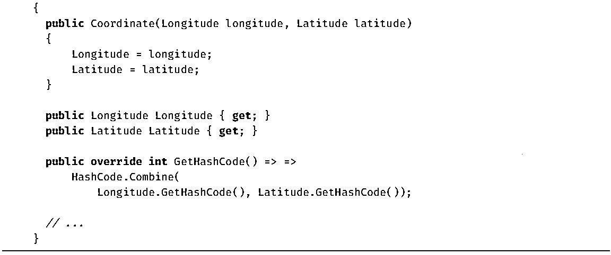

有很多现成的算法可以帮助计算符合要求的对象哈希码，不过最简单的方法莫过于调用 System.HashCode 的 Combine()方法（Combine：组合）。一个对象中往往有一些特征字段，这些字段的值的组合在不同对象里不同。可以对这些字段分别调用它们的 GetHasCode()方法，然后将获得的哈希码送入 HashCode.Combine()方法获得整个对象的哈希码。（对于数值型字段，比如 int 或者 float 等等，不要错误的用其本身值做法哈希码，而应当同样使用 GetHasCode()方法。）ValueTuple 总是使用 HashCode.Combine()方法来计算哈希码，因此一个简便的方法是将对象的特征字段放入临时的 ValueTuple 对象，然后调用 ValueTuple 的 GetHasCode()方法来获得该对象的哈希码。

此外需要注意的是，上面代码中的 Coordinate 没有缓存哈希码的值，这是由于参与执行哈希码计算的每个字段都只读，所以它们的值不会变，因此最终的哈希码也不会改变。但假如计算得到的值可能改变，或者在缓存值之后能显著优化性能，就应该对哈希码进行缓存。但是，如果决定缓存哈希代码，则在检查相等性时不要使用哈希代码。这样做可能会导致具有不可变标识属性的对象无法通过标识检查，因为哈希代码是在标识属性更改之前计算的。

### 10.1.3　重写 Equals()

重写 Equals()而不重写 GetHashCode()，会得到如输出 10.1 所示的一个警告。

输出 10.1

一些程序员认为重写 Equals()是再简单不过的事情。但事实上，其中存在大量容易被人忽视的细节，必须通盘考虑和测试。

1.“对象同一性”和“相等的对象值” 

两个引用假如引用同一个实例，就说这两个引用是同一的。object（因而延展到所有派生类型）提供名为 ReferenceEquals()的静态方法来显式检查对象同一性，如图 10.1 所示。

但引用同一性只是“相等性”的一个例子。两个对象实例的成员值部分或全部相等，也可以说它们相等。来看代码清单 10.3 中对两个 ProductSerialNumber 的比较。

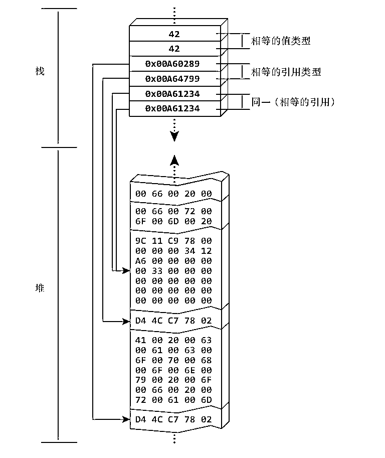

图 10.1　同一性

代码清单 10.3　重写相等性操作符

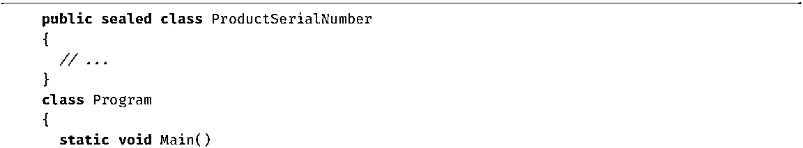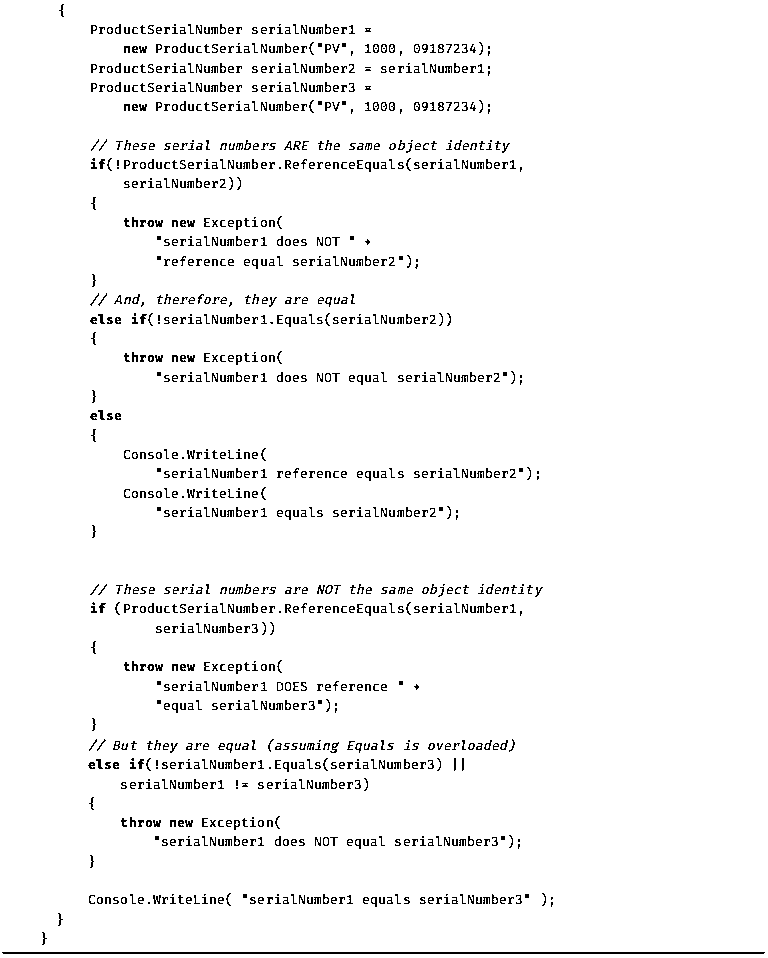

代码清单 10.3 的结果如输出 10.2 所示。

输出 10.2

正如最后一个 ReferenceEquals()断言所演示的，serialNumber1 和 serialNumber3 引用不相等。但两者用相同的值来构造，而且逻辑上和同一个物理产品关联。假如一个实例基于数据库中的数据创建，另一个基于人工输入的数据创建，两个实例就应该相等，从而确保产品不会在数据库中重复（被重复录入）。两个同一的引用显然是相等的，但两个引用不相等的对象也可能是相等的对象。对象标识不同，不一定关键数据不同。

只有引用类型才可能引用相等，因此提供了对同一性概念的支持。为值类型调用 ReferenceEquals()总是返回 false，因为值类型转换成 object 时要装箱。即使向 ReferenceEquals()的两个参数传递同一个值类型变量，结果也是 false，因为两个值会单独装箱。代码清单 10.4 演示了这个行为。因为每个实参都“装到不同的箱子”中，所以永远不会引用相等。

注意 　为值类型调用 ReferenceEquals()总是返回 false。

代码清单 10.4　值类型本身不可能引用相等

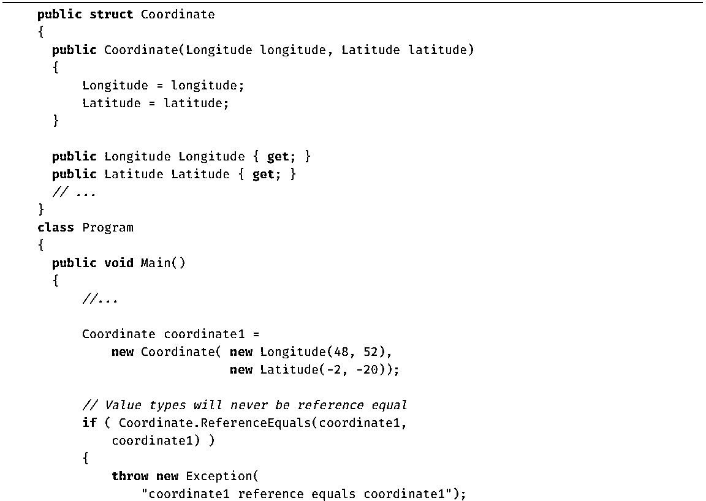

第九章将 Coordinate 定义成引用类型。本例将它定义成值类型（struct），因为经纬度数据的组合在逻辑上被认为是一个值，且大小不超过 16 字节（第九章的 Coordinate 聚合 Angle 而不是 Longitude 和 Latitude）。将 Coordinate 声明为值类型的另一个理由在于，它是支持特定运算的复数（complex number）。相反，像 Employee 这样的引用类型不是一个能以数值方式操作的值，而是对实际存在的一个对象的引用。

2.实现 Equals() 

判断两个对象是否相等（包含相同的标识数据）使用的是对象的 Equal()方法。在 object 中，该虚方法的实现只是调用 ReferenceEquals()判断同一性。这显然并不充分，所以一般都有必要用更恰当的实现重写 Equals()。

注意 　object.Equals()的实现只是简单调用了一下 ReferenceEquals()。

两个对象要相等 ，其标识数据（identifying data）必须相等。例如，对于 ProductSeria-lNumber 对象，ProductSeries、Model 和 Id 必须相同。但对于 Employee 对象，可能比较 EmployeeId 就足够了。只有重写才能解决 object.Equals()实现不充分的问题。例如，值类型就重写了 Equals()实现，使用类型包含的字段进行比较。

重写 Equals()的步骤如下：

（1）检查是否为 null。

（2）检查数据类型是否相同。

（3）调用一个指定了具体类型的辅助方法，它的操作数是具体要比较的类型而不是 object（例如代码清单 10.5 中的 Equals(Coordinate obj)方法）。

（4）可能要检查哈希码是否相等来短路一次全面的、逐字段的比较。（相等的两个对象不可能哈希码不同。）

（5）如基类重写了 Equals()，就检查 base.Equals()。

（6）比较每一个标识字段（关键字段），判断是否相等。

（7）重写 GetHashCode()。

（8）重写==和!=操作符（参见下一节）。

代码清单 10.5 展示了一个示例 Equals()实现。

代码清单 10.5　重写 Equals()

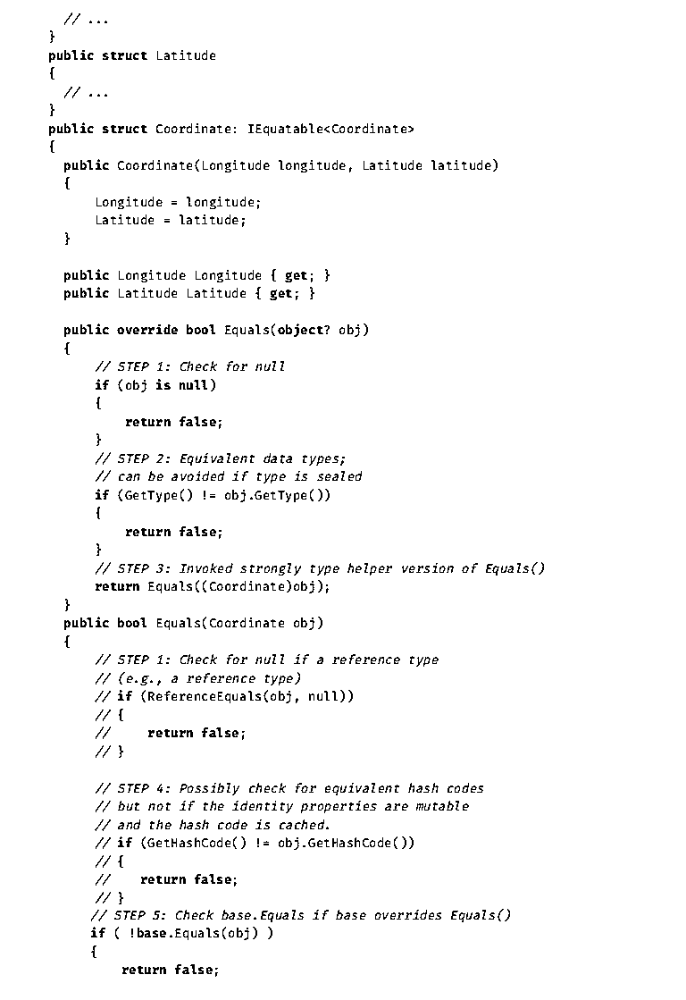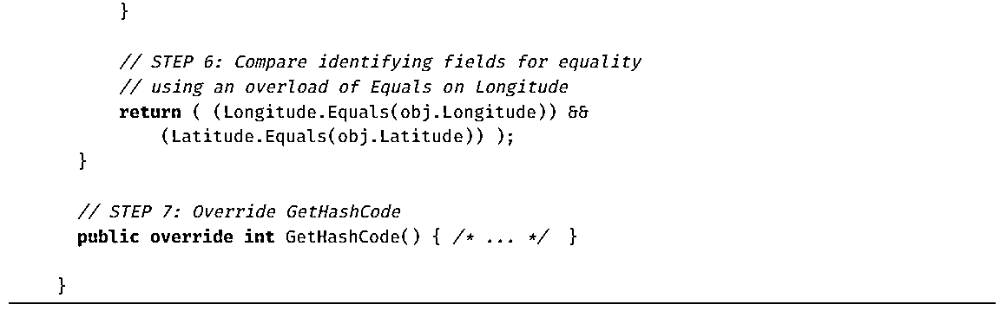

该实现的前两个检查很容易理解。但注意如果类型密封，步骤 2 可以省略。（这里的“步骤”以代码中的为准。）

步骤 4～6 在 Equals()的一个重载版本中进行，它获取 Coordinate 类型的对象作为参数。这样在比较两个 Coordinate 对象时，就可完全避免执行 Equals(object? obj)及其 GetType()检查。

由于 GetHashCode()没有缓存，而且效率比不上步骤 6，因此 GetHashCode()比较代码被注释掉，没有实际执行。类似地，也没有使用 base.Equals()，因为基类没有重写 Equals()（断言中检查 base 是不是 object 类型，但没有检查基类是否重写了 Equals()。而调用 base.Equals()要求基类重写 Equals()）。无论如何，由于 GetHashCode()并非一定返回“独一无二”的值（它只能表明操作数不同），所以不能仅依赖它判断两个对象是否相等。再次强调，如果一个对象的哈希码被缓存，而该对象的数据可能改变，则不要将它的哈希码用于任何比较操作，因为这种情况下哈希码无法让比较运算得到任何有意义的结果。

如果 base.Equals()方法没有被实现，步骤 5 也可以被跳过。但是如果将来又加入了 base.Equals()方法，则可能遗漏了重要的检查。因此，最好默认地添加对 base.Equals()的检查。

类似于 GetHashCode()，Equals()永远不应引发任何异常。对象相互之间应该能随意比较，这样做永远都不应该造成异常。

设计规范

·要一起实现 GetHashCode()、Equals()、==操作符和!=操作符，缺一不可。

·要用相同算法实现 Equals()、==和!=。

·不要在 GetHashCode()、Equals()、==和!=的实现中抛出异常。

·避免在可变引用类型上重载相等性操作符（如重载的实现速度过慢，也不要重载）。

·要在实现 IEquitable 时实现与相等性相关的所有方法。

### 10.1.4　用元组重写 GetHashCode()和 Equals()

如前所述，Equals()和 GetHashCode()的实现相当烦琐，实际代码又比较模板化。Equals()需要比较包含的所有标识（关键）数据结构，同时避免无限递归或空引用异常。GetHashCode()则需要通过 XOR 运算来合并所有非空标识（关键）数据结构的唯一哈希码。现在利用 C# 7.0 元组就相当简单了。

对于 Equals(Coordinate coordinate)，可将每个标识（关键）成员合并到一个元组中，并将它们和同类型的目标实参比较：

可能有人质疑改为显式比较每个标识（关键）成员的可读性会好一些，但我把这留给读者自行判断。元组(System.ValueTuple<...>)内部使用了 EqualityComparer<T>，它依赖 IEquatable<T>的类型参数实现（其中只包含一个 Equals<T>(T other)成员）。因此，正确重写 Equals 需遵循以下规范：重写 Equals()要实现 IEquatable<T>。这样你的自定义数据类型将使用 Equals()的自定义实现而不是 Object.Equals()。

GetHashCode()用元组来实现之后发生了翻天覆地的变化。不需要对标识（关键）成员执行复杂的 XOR 运算，只需实例化所有这些成员的一个元组，返回该元组的 GetHashCode()结果：

从 C# 7.3 起元组实现了==和!=，这其实一开始就应该实现，我们将在 10.2 节讨论该主题。

[\[1\]](part0096.xhtml#ch1) 也就是要提供良好的随机分布，使哈希表获得最佳性能。——译者注

## 10.2　操作符重载

10.1 节讨论了如何重写 Equals()，并指出类还应实现==和!=。实现操作符的过程称为操作符重载 。本节的内容不只适合==和!=操作符，还适合其他支持的操作符。

例如，string 支持用+操作符连接两个字符串。这或许并不奇怪，string 毕竟是预定义类型，可能获得了特殊的编译器支持。但 C#允许为任何类或结构添加+操作符支持。事实上，除了 x.y、f(x)、new、typeof、default、checked、unchecked、delegate、is、as、=和=>之外，其他所有操作符都支持。尤其要注意不能实现赋值操作符。=操作符的行为无法改变。

重载的操作符无法通过 IntelliSense 呈现。除非故意要使类型表现得像基元类型（比如数值类型），否则不要重载操作符。

### 10.2.1　比较操作符

重写 Equals()后可能出现不一致的情况。对两个对象执行 Equals()可能返回 true。但==操作符可能返回 false，因为==默认也只是执行引用相等性检查。为解决该问题，有必要重载相等（==）和不相等（!=）操作符。

从很大程度上说，这些操作符的实现都可以将逻辑委托给 Equals()进行，反之亦然。但首先要执行一些初始的 null 检查，如代码清单 10.6 所示。

代码清单 10.6　实现==和!=操作符

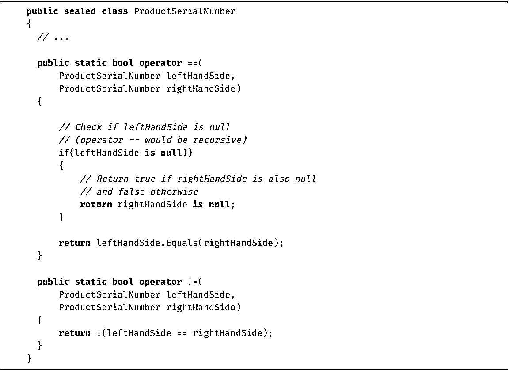

注意本例用 ProductSerialNumber 类而不是 Coordinate 结构演示针对引用类型的逻辑，要考虑到空值的复杂性。

不要在相等性操作符的重写函数里使用相等性操作符（leftHandSide==null），否则会引起递归调用，造成只有栈溢出才会终止的死循环。相反，应使用 is null（C# 7.0 以后）或者 ReferenceEquals()检查是否为空。

设计规范

·避免在==操作符的重载实现中使用该操作符。

### 10.2.2　二元操作符

可将一个 Arc 加到一个 Coordinate 上。但到目前为止，代码一直没有提供对加操作符的支持。相反，需自己定义这样的一个方法，如代码清单 10.7 所示。

代码清单 10.7　添加操作符

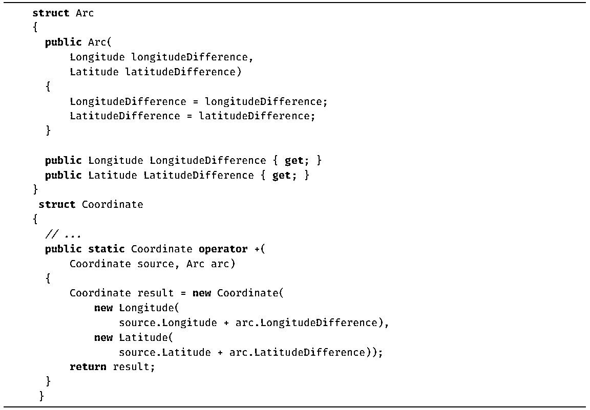

+、-、\*、/、%、&、|、^、<<和>>操作符都作为二元静态方法实现，其中至少有一个参数的类型是包容类型（当前正在实现该操作符的类型）。方法名由 operator 加操作符构成。如代码清单 10.8 所示，定义好-和+二元操作符之后就可在 Coordinate 上加减 Arc。注意 Longitude 和 Latitude 也需实现+操作符，它们由 source.Longitude+arc.LongitudeDifference 和 source.Latitude+arc.LatitudeDifference 调用。

代码清单 10.8　调用-和+二元操作符

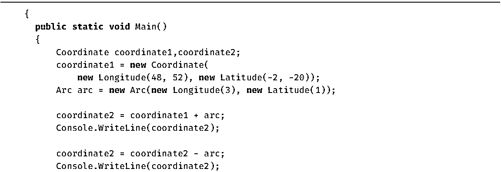

代码清单 10.8 的运行结果如输出 10.3 所示。

输出 10.3

Coordinate 的-和+操作符会在加减 Arc 后返回坐标位置。这就允许将多个操作符和操作数串联起来，例如 result=((coordinate1+arc1)+arc2)+arc3。另外，通过让 Arc 支持相同的操作符（参见本章后面的代码清单 10.9），就连圆括号都可以省略。之所以允许这样写，是因为第一个操作数（coordinate1+arc1）的结果也是 Coordinate，可把它加到下一个 Arc 或 Coordinate 类型的操作数上。

相反，假定重载一个-操作符，获取两个 Coordinate 作为参数，并返回 double 值来代表两个坐标之间的距离。由于 Coordinate 和 double 相加没有定义，所以不能像前面那样串联多个操作符和操作数。定义返回不同类型的操作符要当心，因为这样做有违直觉。

### 10.2.3　二元操作符复合赋值

如前所述，赋值操作符不能重载。但只要重载了二元操作符，就自动重载了其复合赋值形式（+=、-=、\*=、/=、%=、&=、|=、^=、<<=和>>=），所以能直接使用下面这样的代码：

它等价于：

### 10.2.4　条件逻辑操作符

和赋值操作符相似，条件逻辑操作符不能显式重载。但由于逻辑操作符&和|可以重载，而条件操作符由逻辑操作符构成，所以实际能间接重载条件操作符。x && y 可以作为 x & y 处理，其中 y 必须求值为 true。类似地，在 x 求值为 false 的时候，x || y 可以作为 x | y 处理。要允许将类型求值为 true 或 false（比如在 if 语句中），就需要重载 true/false 一元操作符。

### 10.2.5　一元操作符

一元操作符的重载和二元操作符很相似，但只获取一个参数，该参数也必须是包容类型（正在重载操作符的类型）。代码清单 10.9 为 Longitude 和 Latitude 重载了+和-操作符。然后，在 Arc 中重载相同的操作符时使用了这些操作符。

代码清单 10.9　重载-和+一元操作符

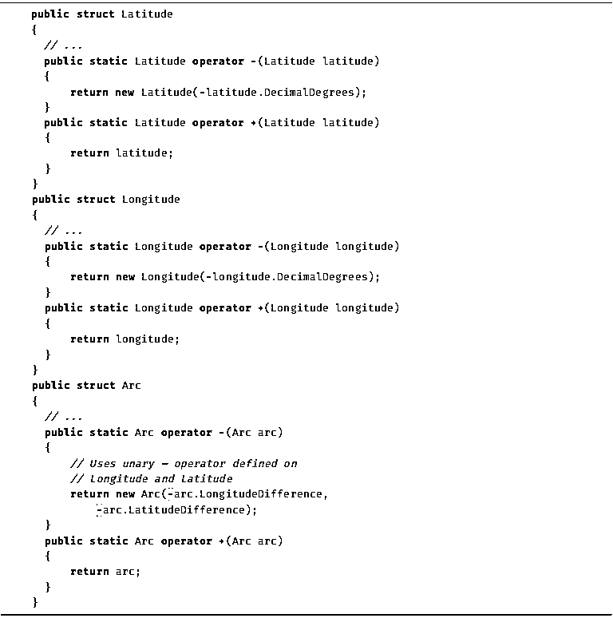

和数值类型一样，代码清单 10.9 中的+操作符没有任何实际效果，提供它只是为了保持对称。

重载 true 和 false 时多了一个要求，即两者都要重载。签名和其他操作符重载相同，但返回的必须是一个 bool 值，如代码清单 10.10 所示。

代码清单 10.10　重载 true 和 false 操作符

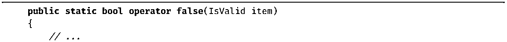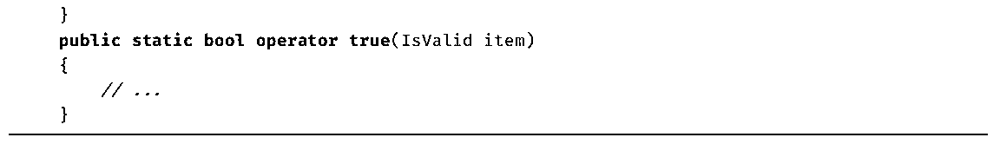

重载了 true 和 false 操作符的类型可在 if、do、while 和 for 语句的控制表达式中使用。

### 10.2.6　转换操作符

目前，Longitude、Latitude 和 Coordinate 还不支持其他类型转换。例如，没办法将 double 转换为 Longitude 或 Latitude 实例。类似地，也不支持使用 string 向 Coordinate 赋值。幸好，C#允许定义方法来处理一种类型向另一种类型的转型，还允许在方法声明中指定该转换是隐式的还是显式的。

高级主题：转型操作符（()）

从技术上说，实现显式和隐式转换操作符并不是重载转型操作符（()）。但由于效果一样，所以一般都将“实现显式或隐式转换”说成“定义转型操作符”。

定义转换操作符在形式上类似于定义其他操作符，只是“operator”成了转换的结果类型。另外，operator 要放在表示隐式或显式转换的 implicit 或 explicit 关键字后面，如代码清单 10.11 所示。

代码清单 10.11　在 Latitude 和 double 之间提供隐式转换

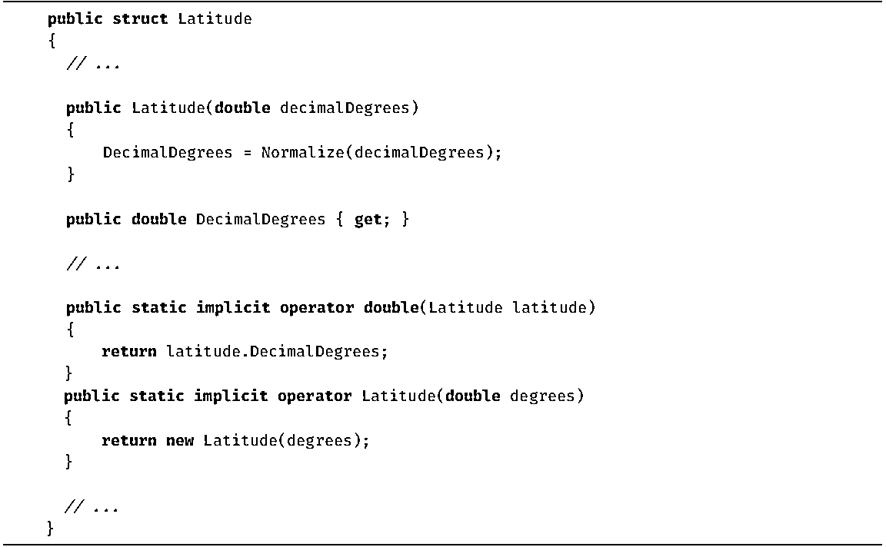

定义好这些转换操作符之后，就可将 double 隐式转型为 Latitude 对象，或者将 Latitude 对象隐式转型为 double。假定为 Longitude 也定义了类似的转换，那么为了创建 Coordinate 对象，可以像下面这样写：

注意 　实现转换操作符时，为了保证封装性，要么返回值、要么参数必须是包容类型。C#不允许在被转换类型的作用域之外指定转换^( [\[1\]](part0097.xhtml#ch1_back) ) 。

### 10.2.7　转换操作符规范

定义隐式和显式转换操作符的差别主要在于，后者能避免导致不良行为的不小心执行的隐式转换。使用显式转换操作符通常是出于两方面的考虑。首先，会抛出异常的转换操作符始终都应该是显式的。例如，从 string 转换为 Coordinate 时，提供的 string 不一定具有正确格式（这极有可能发生）。由于转换可能失败，所以应将转换操作符定义为显式，从而明确要进行转换的意图，并要求用户确保格式正确，或者由你提供代码来处理可能发生的异常。通常采用的转换模式是：单方向（string 到 Coordinate）显式，反方向（Coordinate 到 string）隐式。

第二个要考虑的是某些转换是有损的。例如，虽然完全可以从 float（4.2）转换成 int，但前提是用户知道 float 小数部分会丢失这一事实。任何转换只要会丢失数据，而且不能成功转换回原始类型，就应定义成显式转换。如显式转换出乎意料地丢失了数据，或转换无效，考虑引发 System.InvalidCastException。

设计规范

·不要为有损转换提供隐式转换操作符。

·不要从隐式转换中抛出异常。

[\[1\]](part0097.xhtml#ch1) 换言之，转换操作符只能从它的包容类型转换为其他某个类型，或从其他某个类型转换为它的包容类型。——译者注

## 10.3　引用其他程序集

不需要将所有代码都放到单独一个二进制文件中，C#和底层 CLI 框架允许将代码分散到多个程序集中。这样就可在多个可执行文件中重用程序集。

初学者主题：类库

HelloWorld.exe 程序是你写过的最简单的程序之一。现实世界的程序复杂得多，而且随着复杂性的增加，有必要将程序分解成多个小的部分，以便控制复杂性。为此，开发者可将程序的不同部分转移到单独的编译单元中，这些单元称为类库 ，或简称为库 。然后，程序可引用并依赖于类库来提供自己的一部分功能。这样两个程序就可依赖同一个类库，从而在两个程序中共享该类库的功能，并减少所需的编码量。

通过这样的方式，特定功能只需编码一次并放到类库中。然后，多个程序可引用同一个类库来提供该功能。以后，如开发者修正了 bug，或者在类库中添加了新功能，所有程序都能获得增强的功能，因为它们现在引用的是改善过的类库。

我们写的代码通常都能使多个程序受益。例如，地图软件、支持地理位置的数码照片软件或者一个普通的命令行分析程序都可利用之前写的 Longitude，Latitude 和 Coordinate 类。这些类只需只写一次，就在多个不同的程序中使用。所以，最好把它们分组到一个程序集（称为库或类库）中以便重用，而不是只在单独一个程序中写好。

要创建库而不是控制台项目，请遵循和第一章描述的一样的指令，只是 dotnet CLI 要将模板从 console 替换成"Class library"或 classlib。类似地，如使用 Visual Studio 2019，在“新建项目”窗口中利用“搜索”框查找“类库”并选择“类库(.NET Standard) – Visual C#”。项目名称填入 GeoCoordinates。在“解决方案”下拉框中选择“添加到解决方案”。最后一步可简化在当前项目（比如 HelloWorld 项目）中添加项目引用的过程。

接着将代码清单 10.9 中每个结构的代码放到单独文件中（文件名就是结构名）并生成项目。这样可将 C#代码编译成单独的 GeoCoordinates.dll 程序集文件，它位于.\\bin\\的一个子目录中。

### 10.3.1　引用库

有了库之后需要从程序中引用它。以代码清单 10.8 用 Program 类创建的新控制台程序为例，现在需要添加对 GeoCoordinates.dll 程序集的引用，指定库的位置，并在程序中嵌入元数据来唯一地标识库。可通过几种方式实现。第一种方式是引用库项目文件（\*.csproj），指出库的源代码在哪个项目中，并在两个项目之间建立依赖关系。编译好库之后才能编译引用了该库的程序。该依赖关系会导致在编译程序时先编译库（如果还没有编译的话）。

第二种方式是引用程序集文件本身。换言之，引用编译好的库（\*.dll）而不是项目。如果库和程序分开编译，比如由企业内的另一个团队编译，这种方式就非常合理。

第三种方式是引用 NuGet 包，详情参见 10.3.2 节。

注意库和包并非只能由控制台程序引用。事实上，任何程序集都能引用其他任何程序集。经常是一个库引用另一个库，创建一个依赖链。

### 10.3.2　用 dotnet CLI 引用项目或库

第一章讨论了如何创建包含一个 Main 方法（程序开始执行的入口）的控制台程序。为添加对新建程序集的引用，可在第一章的操作完成后添加一条额外的命令来添加引用：

package 参数后添加了要由项目引用的程序集文件路径。也可不引用程序集，而是引用项目文件。如前所述，这样在生成程序时会首先编译类库（如果还没有编译的话）。优点是当程序编译时，会自动寻找编译好的类库程序集（无论在 debug 还是 release 目录中）。下面是引用项目文件所需的命令行：

如拥有类库的源代码，而且这些代码经常修改，请考虑引用项目文件而不是编译好的程序集。引用了程序集之后，代码清单 10.8 的 Program 类源代码就可以编译了。

### 10.3.3　用 Visual Studio 2019 引用项目或库

第一章还讨论了用 Visual Studio 创建包含一个 Main 方法的控制台程序。为添加对 GeoCoordinates 程序集的引用，可选择“项目”｜“添加引用”。单击左侧的“项目”｜“解决方案”标签，单击“浏览”来找到 GeoCoordinates 项目或 GeoCordinates.dll 并添加对它的引用。和 dotnet CLI 一样，随后可用代码清单 10.8 的 Program 类源代码编译程序。

### 10.3.4　NuGet 打包

Microsoft 从 Visual Studio 2010 起引入了称为 NuGet 的库打包系统，目的是在项目之间和企业之间方便地共享库。库程序集通常就是一个编译好的文件。它可能关联了配置文件、附加的资源和元数据。遗憾的是，在 NuGet 之前没有清单来标识所有依赖项。另外，也没有标准的提供者或包库来查找想引用的程序集。

NuGet 解决了这两个问题。NuGet 不仅包含一个清单来标识作者、公司、依赖项等，还在 NuGet.org 提供了一个默认包提供者以便上传、更新、索引和下载包。可在项目中引用一个 NuGet 包（\*.nupkg），从你事先配置好的 NuGet 提供者 URL 处自动安装。

NuGet 包提供了一个清单文件（\*.nuspec），其中列出了包中所含的所有附加元数据。还提供了你可能想要的所有附加资源，包括本地化文件、配置文件、内容文件等等。最后，NuGet 包将所有单独的资源合并成单个 ZIP 文件（虽然使用.nupkg 扩展名）。所以，用\*.zip 扩展名重命名文件，就可用任何常规压缩工具打开并检查文件内容。

### 10.3.5　用 dotnet CLI 引用 NuGet 包

用 dotnet CLI 在项目中添加 NuGet 包需执行以下命令：

该命令检查指定包已注册的 NuGet 包提供者并下载它。（还可使用 dotnet restore 命令显式触发下载。）

可用 dotnet pack 命令创建本地 NuGet 包。该命令生成 GeoCoordinates.1.0.0.nupkg 文件，然后可用 add ...package 命令引用它。

程序集名称后的数字对应包的版本号。要显式指定版本号，请编辑项目文件（\*.csproj），为 PropertyGroup 元素添加一个<Version>...</Version>子元素。

### 10.3.6　用 Visual Studio 2019 引用 NuGet 包

以第一章创建的 HelloWorld 项目为基础，可用 Visual Studio 2019 添加一个 NuGet 包：

1.选择“项目”｜“管理 NuGet 程序包”，如图 10.2 所示。

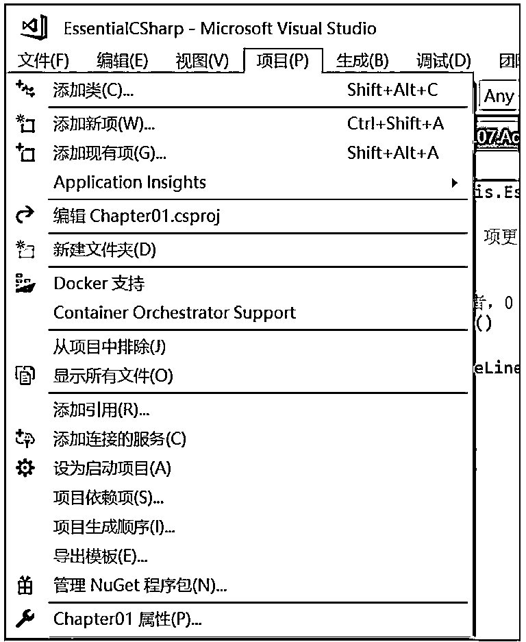

图 10.2　“项目”菜单

2.单击“浏览”标签（一般“已安装”标签会被默认选中，因此请点击“浏览”标签以确保其被选中），在“搜索”（Ctrl+E）框中输入 Microsoft.Extensions.Logging.Console。注意可以只输入部分名称（比如 Logging.Console），如图 10.3 所示。

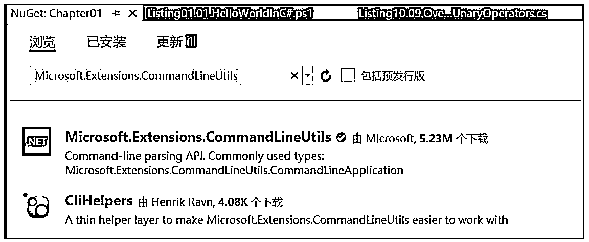

图 10.3　浏览 NuGet 包

3.单击“安装”将包安装到项目。

完成这些步骤即可开始使用 Microsoft.Extensions.Logging.Console 库（它的全部依赖库也会被同时添加到项目中）。和 dotnet CLI 一样，可用 Visual Studio 生成自己的 NuGet 包，方法是选择“生成”｜“打包<项目名称>”。类似地，可在项目属性的“打包”标签页中指定包的版本号。

### 10.3.7　调用被引用的包或项目

添加了对包的引用后，就好比它的所有源代码都已包含到自己的项目中。代码清单 10.12 展示了如何使用 Microsoft.Extensions.Logging.Console 库（请自行添加相应的 using 指令），输出 10.4 展示了结果。

代码清单 10.12　调用 NuGet 包

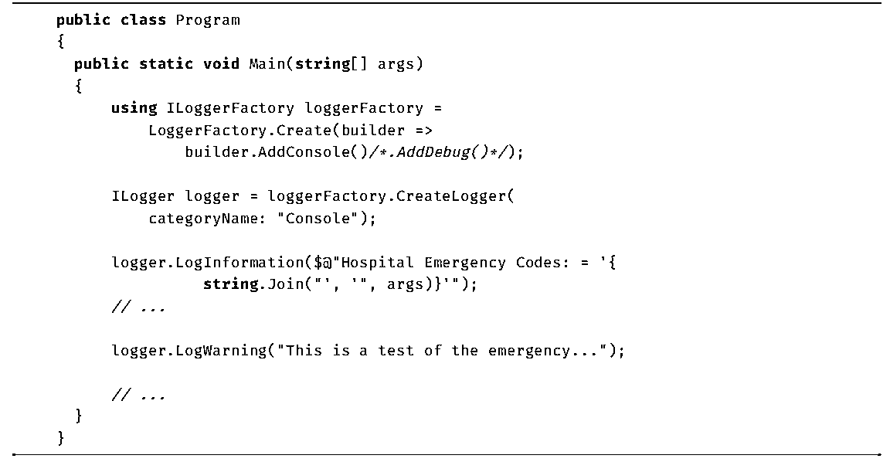

输出 10.4

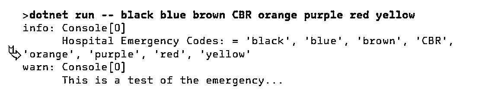

Microsoft.Extensions.Logging.Console 库用于在控制台（即命令行窗口）上输出数据。在上面的例子中，我们向控制台输出了一条信息和一条警告。

如果你还引用了 Microsoft.Extensions.Logging.Debug 库，可以在上面例子中的.AddConsole()之前或者之后加一个.AddDebug()，这样便会将输出 10.4 中的数据输出在 Visual Studio 的调试输出窗口。（在 Visual Studio 中，选择“调试”｜“窗口”｜“输出”菜单命令便可打开该窗口。在 Visual Studio Code 中，选择“View”｜“Debug Console”可以打开类似的窗口。）

包含 Microsoft.Extensions.Logging.Console 库的 NuGet 包有三个依赖项^( [\[1\]](part0098.xhtml#ch1_back) ) 。在 Visual Studio 的“解决方案资源管理器”窗口的树形列表中，可以在“依赖项”｜“包”中看到该包及其依赖项。通过添加 NuGet 包，将自动添加所有依赖项。

[\[1\]](part0098.xhtml#ch1) Microsoft 有可能在该包的新版本中添加更多依赖项。——译者注

## 10.4　类型封装

类封装行为和数据，而程序集封装一组类型。开发者可将一个系统分解成多个程序集，在多个应用程序之间共享，或将它们与第三方提供的程序集集成。

### 10.4.1　类型声明中的 public 或 internal 访问修饰符

不添加任何访问修饰符的类或结构体会被默认声明为内部访问（等同于使用关键字 internal 来声明），而嵌套类型（即声明在类中的类）则默认被声明为私有访问。这种类无法从程序集外部访问。即使另一个程序集引用了该类所在的程序集，被引用程序集中的所有 internal 类都无法访问。

类似于为类成员使用 private 和 protected 访问修饰符来指定不同封装级别，C#允许为类添加访问修饰符以控制类在程序集中的封装级别。可用的访问修饰符包括 public 和 internal。想在程序集外部可见的类必须标记成 public。因此，在编译 Coordinates.dll 程序集之前，需要像代码清单 10.13 那样将类型声明修改为 public。

代码清单 10.13　使类型在程序集外部可用

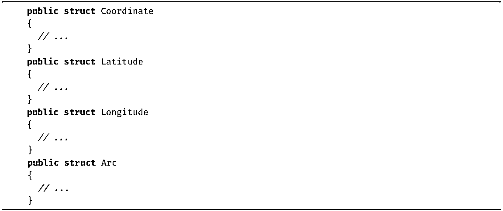

类似地，class 和 enum 声明也可指定为 public 或 internal^( [\[1\]](part0099.xhtml#ch1_back) ) 。

internal 访问修饰符并非只能用于类型声明，还能用于类型的成员。所以，可将某个类型标记为 public，而只将其中一些方法标记为 internal，确保成员只在程序集内部可用。成员的可访问性无法大于它所在的类型。例如，将类声明为 internal，它的 public 成员也只能从程序集中访问。

### 10.4.2　protected internal 类型成员修饰符

protected internal 是另一种类型成员访问修饰符。这种成员可从其所在程序集的任何位置以及类型的派生类中访问（即使派生类在不同程序集中）。由于默认是 private，所以随便指定别的一个访问修饰符（public 除外），成员的可见性都会稍微增大。

注意 　protected internal 成员可从所在程序集的任何位置以及类型的派生类中访问（即使派生类不在同一个程序集中）。

初学者主题：类型成员的可访问性修饰符

表 10.1 提供了完整的访问修饰符列表。

表 10.1　可访问性修饰符

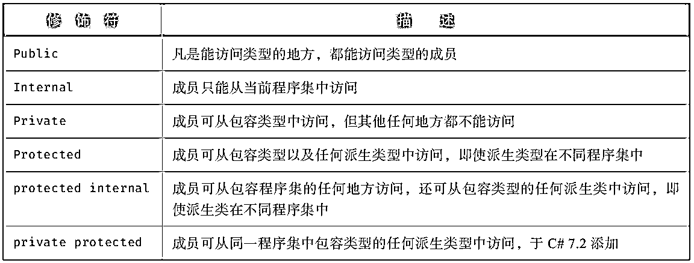

[\[1\]](part0099.xhtml#ch1) 嵌套类可使用其他类成员能使用的任何访问修饰符（例如 private）。但在类作用域外部，唯一可用的访问修饰符是 public 和 internal。

## 10.5　定义命名空间

第二章讲过，任何数据类型都用命名空间与类型名称的组合来标识。事实上，CLR 对“命名空间”一无所知。类型名称都是完全限定的，其中包含了命名空间。早先定义的类没有显式声明命名空间。这些类自动声明为默认的全局命名空间的成员。但这极有可能造成名称冲突。试图定义两个同名类时，冲突就会发生。一旦开始引用第三方程序集，名称冲突概率变得更大。

更重要的是，CLI 框架内部有成千上万个类型，外部则更多。所以，为特定问题寻找适当的类型可能十分困难。

解决问题的方案是组织所有类型，用命名空间 对它们进行逻辑分组。例如，System 命名空间外部的类通常应该放到与公司名、产品名或者“公司名+产品名”对应的命名空间中。例如，来自 Addison-Wesley 的类应该放到 Awl 或 AddisonWesley 命名空间中，而来自 Microsoft 的类（System 中的类除外）应该放到 Microsoft 命名空间中。命名空间的第二级是不会随着版本升级而改变的稳定产品名称。事实上，稳定性在所有级别上都是关键。改变命名空间名称会影响版本兼容性，所以应该避免。有鉴于此，不要使用容易变化的名称（组织层次结构、短期品牌等）。

命名空间应使用 PascalCase 大小写，但如果你的品牌使用非传统大小写，也可以使用和品牌相符的大小写。（一致性是关键，所以如果面临两难选择——是 PascalCase 还是品牌名称，就使用一致性最好的。）用 namespace 关键字创建命名空间，并将类分配给该命名空间，如代码清单 10.14 所示。

代码清单 10.14　定义命名空间

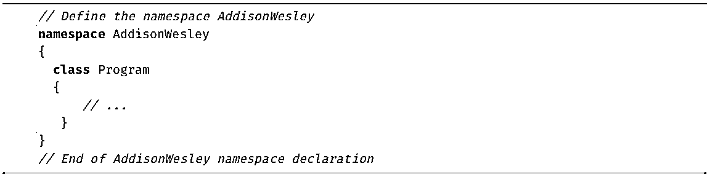

命名空间大括号之间的所有内容都从属于该命名空间。在代码清单 10.14 中，Program 被放到命名空间 AddisonWesley 中，所以它的全名是 AddisonWesley.Program。

注意 　CLR 中没有“命名空间”这种东西。类型名称必然完全限定。

和类相似，命名空间也支持嵌套，以便对类进行层次化的组织。例如，与网络 API 相关的所有系统类都放到 System.Net 命名空间中，而与 Web 相关的放到 System.Web 中。

有两个办法嵌套命名空间。第一个办法是逐级嵌套（和类一样），如代码清单 10.15 所示。

代码清单 10.15　逐级嵌套命名空间

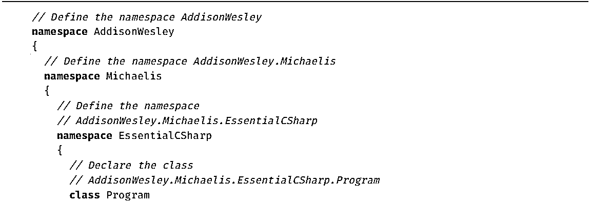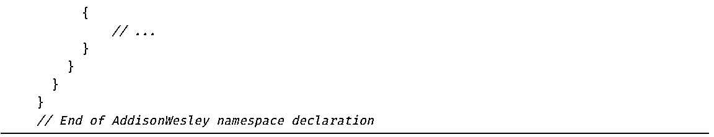

这样嵌套会将 Program 类分配给 AddisonWesley.Michaelis.EssentialCSharp 命名空间。

第二个办法是在 namespace 声明中使用完整命名空间名称，每个标识符都以句点分隔，如代码清单 10.16 所示。

代码清单 10.16　使用句点分隔每个标识符，从而嵌套命名空间

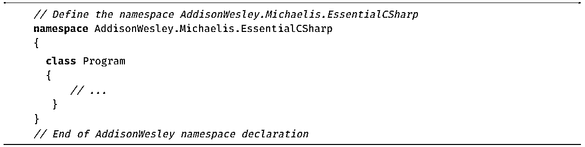

无论像代码清单 10.15 或代码清单 10.16 那样，还是采取两者的组合方式来声明命名空间，最终的 CIL 代码都完全一致。同一个命名空间可多次出现，可在多个文件中出现，甚至可跨越多个程序集。例如，规范是将每个类放到单独的文件中。所以可为每个类定义一个文件，并用同一个命名空间声明把类包容起来。

由于命名空间是组织类型的关键，所以经常都用命名空间组织所有类文件。具体是为每个命名空间都创建一个文件夹，将 AddisonWesley.Fezzik.Services.Registration Service 这样的类放到和名称对应的文件夹层次结构中。

使用 Visual Studio 项目时，如项目名是 AddisonWesley.Fezzik，就创建子文件夹 Services，将 RegistrationService.cs 放到其中。然后创建另一个子文件夹 Data，在其中放入和程序中的实体有关的类，比如 RealestateProperty、Buyer 和 Seller。

设计规范

·要为命名空间附加公司名前缀，防止不同公司使用同一个名称。

·要为命名空间二级名称使用稳定的、不随版本升级而变化的产品名称。

·不要定义没有明确放到一个命名空间中的类型。

·考虑创建和命名空间层次结构匹配的文件夹结构。

## 10.6　XML 注释

第一章介绍了注释。但 XML 注释更胜一筹，它不仅仅是向其他审阅代码的程序员显示的注解。XML 注释遵循随 Java 开始流行起来的实践准则。虽然 C#编译器在最终生成的可执行文件中忽略所有注释，但开发者可利用命令行选项，指示编译器^( [\[1\]](part0101.xhtml#ch1_back) ) 将 XML 注释提取到单独的 XML 文件中。这样就可根据 XML 注释生成 API 文档。此外，C#编辑器可解析代码中的 XML 注释，并对其进行分区显示（例如，可使用有别于其他代码的一种颜色），或者解析 XML 注释数据元素并向开发者显示。

图 10.4 演示 IDE 如何利用 XML 注释向开发者提示如何编码。这种提示能为大型应用程序的开发提供重要帮助，尤其是多个开发者需要共享代码的时候。但为了让它起作用，开发者必须花时间在代码中输入 XML 注释内容，然后指示编译器创建 XML 文件。下一节将解释具体如何做。

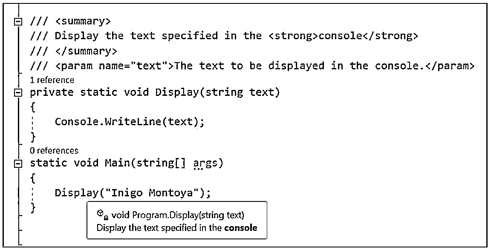

图 10.4　利用 XML 注释在 Visual Studio IDE 中显示编码提示

从 Visual Studio 2019 开始，可以在注释中使用简单的 HTML 标签，并且会在编码提示中产生相应的效果。比如，将 console 写在<strong>和</strong>之间会使 console 一词显示为如图 10.4 中的黑体。

### 10.6.1　将 XML 注释和编程构造关联

来看看代码清单 10.17 展示的 DataStorage 类。

代码清单 10.17　使用 XML 注释添加代码注释

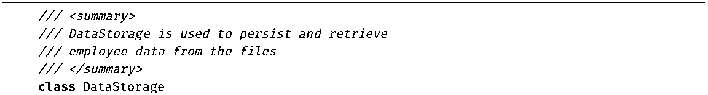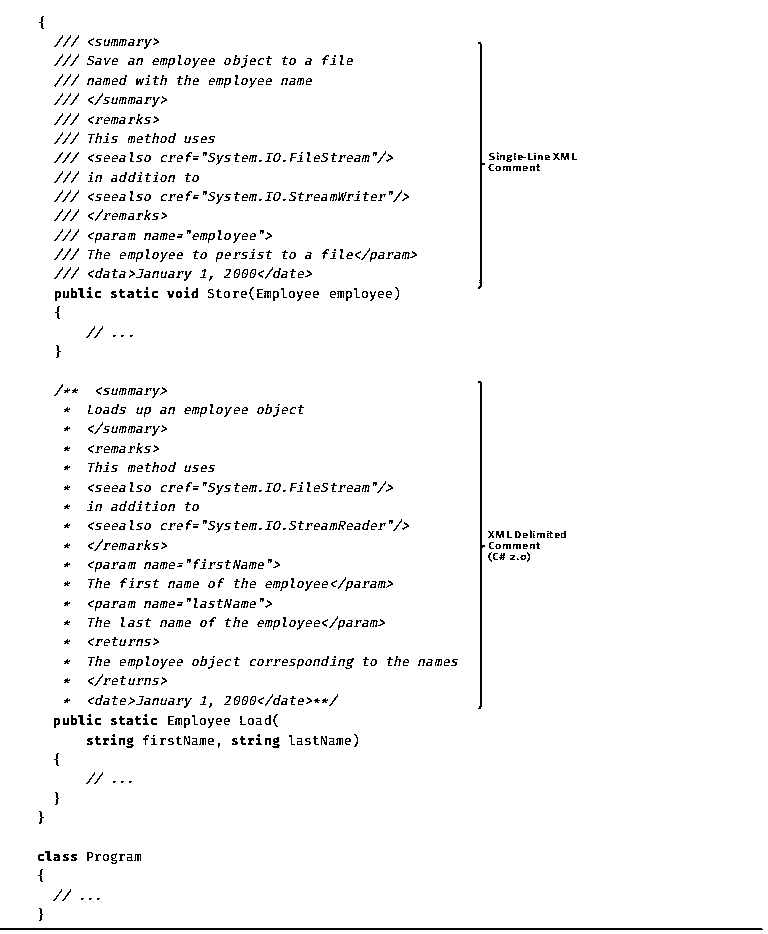

代码清单 10.17 既使用了跨越多行的 XML 带分隔符的注释，也使用了每行都要求单独使用一个///分隔符的 XML 单行注释。

由于 XML 注释旨在提供 API 文档，所以一般只和 C#声明（比如代码清单 10.17 中的类或方法）配合使用。如试图将 XML 注释嵌入代码，同时不和一个声明关联，就会造成编译器显示一个警告。编译器判断是否关联的依据很简单——如 XML 注释恰好在一个声明之前，两者就是关联的。

虽然 C#允许在注释中使用任意 XML 标记，但 C#标准明确定义了一组可以使用的标记。<seealso cref="System.IO.StreamWriter"/>是使用 seealso 标记的一个例子。该标记在文本和 System.IO.StreamWriter 类之间创建了一个链接。

### 10.6.2　生成 XML 文档文件

编译器检查 XML 注释格式是否正确，如果格式不正确，则显示警告。生成 XML 文件需要为 ProjectProperties 元素添加一个 DocumentationFile 子元素：

该子元素导致在生成期间使用<程序集名称>.xml 作为文件名在输出目录生成一个 XML 文件。代码清单 10.18 展示了最终生成的 CommentSamples.XML 文件的内容。

代码清单 10.18　CommentSamples.xml

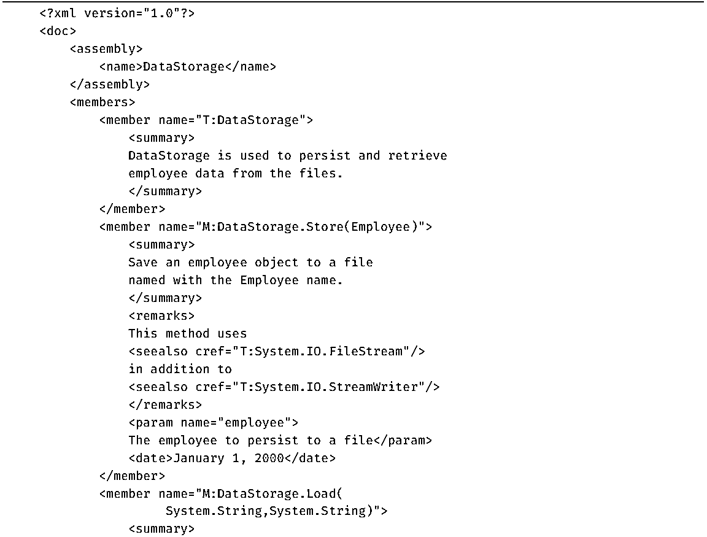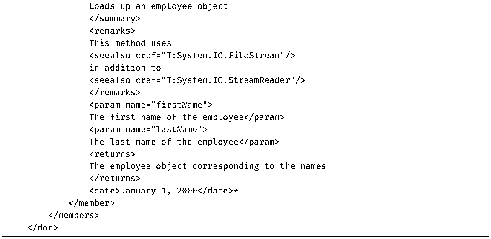

文件只包含将元素关联回对应 C#声明所需的最基本的元数据。这一点需要注意，因为为了生成任何有意义的文档，一般都有必要将 XML 输出和生成的程序集配合起来使用。幸好，可利用一些工具（比如免费的 GhostDoc 和开源项目 NDoc^( [\[2\]](part0101.xhtml#ch2_back) ) ）来生成文档。

设计规范

·如果签名不能完全说明问题，要为公共 API 提供 XML 文档，其中包括成员说明、参数说明和 API 调用示例。

[\[1\]](part0101.xhtml#ch1) C#标准没有硬性规定要由 C#编译器还是单独的实用程序来提取 XML 数据。但所有主流 C#编译器都通过一个编译开关提供了该功能，而不是通过一个额外的实用程序。

[\[2\]](part0101.xhtml#ch2) 请访问 http://ndoc.sourceforge.net，更多地了解这个工具。

## 10.7　垃圾回收

垃圾回收是“运行时”的核心功能，旨在回收不再被引用的对象所占用的内存。这句话的重点是“内存”和“引用”。垃圾回收器只回收内存，不处理其他资源，比如数据库连接、句柄（文件、窗口等）、网络端口以及硬件设备（比如串口）。此外，垃圾回收器根据是否存在任何引用来决定要清理什么。这暗示垃圾回收器处理的是引用对象，并且只回收堆上的内存。另外，还意味着假如维持对一个对象的引用，就会阻止垃圾回收器重用对象所用的内存。

高级主题：.NET 中的垃圾回收

垃圾回收器的许多细节都依赖于 CLI 框架，所以各不相同。本节讨论最常见的 Microsoft .NET 框架实现。

.NET 的垃圾回收器采用 mark-and-compact 算法^( [\[1\]](part0102.xhtml#ch1_back) ) 。一次垃圾回收周期开始时，它识别对象的所有根引用 。根引用是来自静态变量、CPU 寄存器以及局部变量或参数实例（以及本节稍后会讲到的 f-reachable 对象）的任何引用。基于该列表，垃圾回收器可遍历每个根引用所标识的树形结构，并递归确定所有根引用指向的对象。这样，垃圾回收器就可识别出所有可达对象 。

执行垃圾回收时，垃圾回收器不是枚举所有访问不到的对象；相反，它将所有可达对象紧挨着放到一起，从而覆盖不可访问的对象（也就是垃圾，或者不可达对象）所占用的内存。

为定位和移动所有可达对象，系统要在垃圾回收器运行期间维持状态的一致性。为此，进程中的所有托管线程都会在垃圾回收期间暂停。这显然会造成应用程序出现短暂的停顿。不过，除非某次垃圾回收耗时特别长或者垃圾回收过于频繁，否则这个停顿是不太引人注意的。为尽量避免在不恰当的时间执行垃圾回收，System.GC 对象包含一个 Collect()方法。可在执行关键代码之前调用它（执行这些代码时不希望 GC 运行）。这样做不会阻止垃圾回收器运行，但会显著减小它运行的可能性——前提是关键代码执行期间不会发生内存被大量消耗的情况。

.NET 垃圾回收的特别之处在于，并非所有垃圾都一定会在一个垃圾回收周期中清除。研究对象的生存期会发现：相较于长期存在的对象，最近创建的对象更有可能需要垃圾回收。为此，.NET 垃圾回收器支持“代”（generation）的概念，它会以更快的频率尝试清除生存时间较短的对象（新生对象）。而那些已在一次垃圾回收中“存活”下来的对象（老对象）会以较低的频率清除。具体地说，共有 3 代对象。一个对象每次在一个垃圾回收周期中存活下来，它都会移动到下一代，直至最终移动到第二代（从第零代开始）。相较于第二代对象，垃圾回收器会以更快的频率对第零代的对象执行垃圾回收。

在.NET 的 beta 测试阶段，一些舆论认为它的性能比不上非托管代码，但时间已经证明，.NET 的垃圾回收机制是相当高效的。更重要的是，它带来了开发过程的总体效率的提高——虽然在极少数情况下，因为要对特定算法进行优化，托管代码的性能会出现打折扣的情况。

### 弱引用

迄今为止讨论的所有引用都是强引用 ，因其维持着对象的可访问性，阻止垃圾回收器清除对象所占用的内存。此外，框架还支持弱引用 。弱引用不阻止对对象进行垃圾回收，但会维持一个引用。这样，对象在被垃圾回收器清除之前可以重用。

弱引用是为创建起来代价较高（开销很大），而且维护开销特别大的引用对象而设计的。例如，假定一个很大的对象列表要从一个数据库中加载并向用户显示。在这种情况下，加载列表的代价是很高的。一旦列表被用户关闭，就应该可以进行垃圾回收。但假如用户多次请求这个列表，那么每次都要执行代价高昂的加载动作。解决方案是使用弱引用。这样就可使用代码检查列表是否被清除。如尚未被清除，就重新引用同一个列表。这样，弱引用就相当于对象的一个内存缓存。缓存中的对象可被快速获取。但假如垃圾回收器已回收了这些对象的内存，就还是要重新创建它们。

如认为引用对象（或对象集合）应该进行弱引用，就把它赋给 System.WeakReference（参见代码清单 10.19）。

代码清单 10.19　使用弱引用

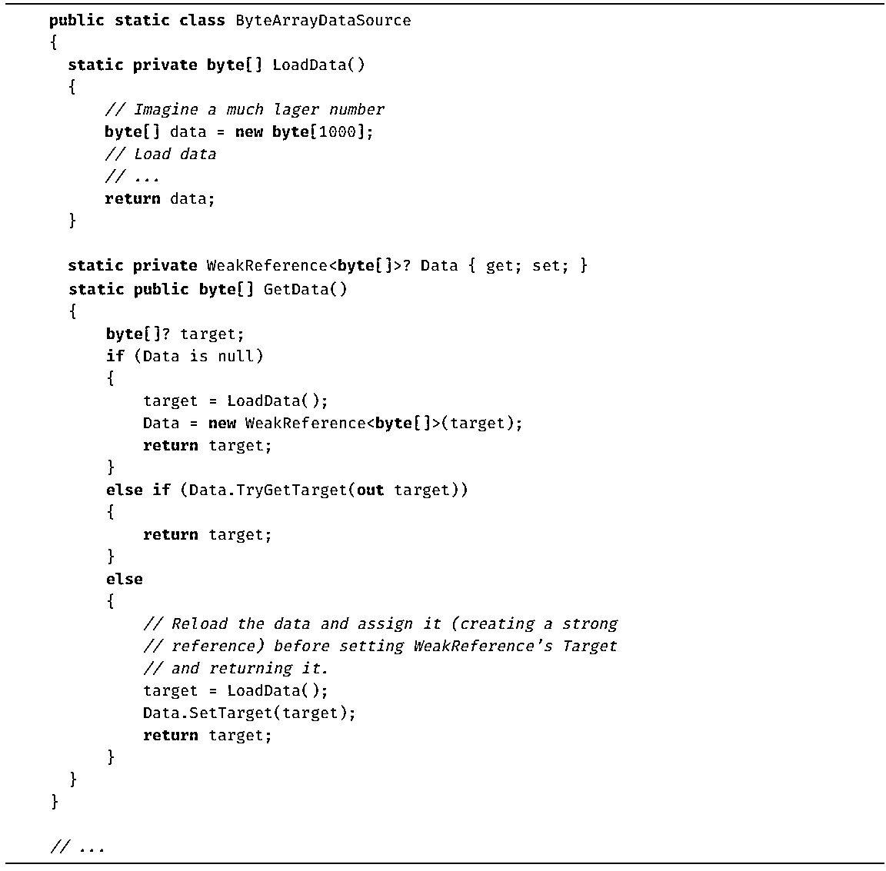

上面代码使用了泛型编程，该编程范式会在第十二章介绍。目前可以暂时忽略代码中的“<byte\[\]>”。虽然 WeakReference 类也有非泛型版本，但是一般很少被使用。

代码的主要逻辑体现在 GetData()方法中。该方法确保返回特定的数据，要么返回缓存的数据，要么重新加载。GetData()方法首先检查 Data 属性是否为 null。如果是，则加载数据并赋值给局部变量 target。这样新加载的数据便有了一个引用，确保不会被垃圾回收器清除。然后我们创建一个指向新加载的数据的 WeakReference 类对象，并将它赋值给 Data 属性。最后便可以返回 WeakReference 类对象了。不要跳过局部变量而直接将数据的引用交给 WeakReference 类对象，否则在数据被清除之前，可能没有机会将它返回。（不要这样做：new WeakReference<byte\[\]>(LoadData())。）

如果 Data 属性不为 null，则根据声明它一定有一个 WeakReference 类对象。这时调用 TryGetTarget()方法提取数据引用并直接赋值给局部变量 target，以避免被垃圾回收器清除。然后便可返回数据。

最后，如果 TryGetTarget()方法提取不出数据，则同样加载新数据，调用 SetTarget()方法重新设置 Data 属性，然后返回数据。

[\[1\]](part0102.xhtml#ch1) 所谓 mark-and-compact 算法，mark 是指先确定所有可达对象，compact 是指移动这些对象，使它们紧挨着存放。整个过程有点儿像磁盘碎片整理。注意 MSDN 文档中把 compact 不恰当地翻译成“压缩”。——译者注

## 10.8　资源清理

垃圾回收是“运行时”的重要职责。但要注意，垃圾回收旨在提高内存利用率，而非清理文件句柄、数据库连接字符串、端口或其他有限的资源。

### 10.8.1　终结器

终结器 （finalizer）允许程序员写代码来清理类的资源。但和使用 new 操作符显式调用构造函数不同，终结器不能从代码中显式调用。没有和 new 对应的操作符（比如像 delete 这样的操作符）。相反，是垃圾回收器负责为对象实例调用终结器。因此，开发者不能在编译时确定终结器的执行时间。唯一确定的是终结器会在对象最后一次使用之后，并“通常”在应用程序正常关闭前的某个时间运行。这里“通常”一词是为了强调事实上终结器有可能不会被调用。尤其当程序被强行关闭时。例如，计算机关机，或者程序被调试器强行终止，终结器都很有可能不会被调用。此外，在.NET Core 环境中，甚至在正常情况下，终结器在程序结束前也有可能不会被调用。出于这个原因，我们将在下一节介绍如何用其他方法实现对象的终结操作。

注意 　编译时不能确定终结器的确切运行时间。

终结器的声明与 C++析构器的语法完全一致。如代码清单 10.20 所示，终结器声明要求在类名之前添加一个“~”字符。

代码清单 10.20　定义终结器

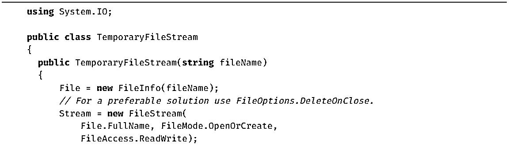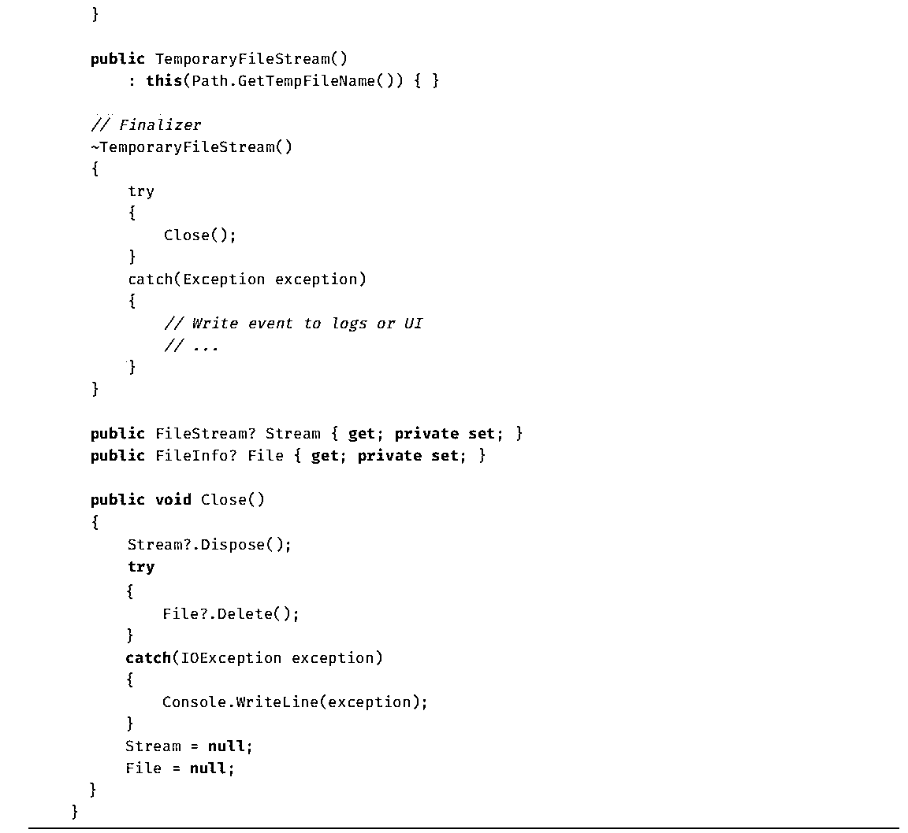

终结器不允许传递任何参数，所以不可重载。此外，终结器不能显式调用。调用终结器的只能是垃圾回收器。因此，为终结器添加访问修饰符没有意义（也不支持）。基类中的终结器作为对象终结调用的一部分被自动调用。

注意 　终结器不能显式调用，只有垃圾回收器才能调用。

由于垃圾回收器负责所有内存管理，所以终结器不负责回收内存。相反，它们负责释放像数据库连接和文件句柄这样的资源，这些资源需通过一次显式的行动来进行清理，而垃圾回收器不知道具体如何采取这些行动。

代码清单 10.20 中的终结器的主要目的是调用 File.Delete()，将在构造函数中创建的临时文件删除。但是它首先调用了 FileStream 对象的 Dispose()方法将该对象销毁。FileStream 类有自己的终结器，并具有与 Dispose()相同的效果，因此通常不是必须要调用其 Dispose()方法。但在这里我们需要确保该 FileStream 对象的销毁先于 File.Delete()发生，否则 Delete()无法删除文件。反之，如果不主动销毁 FileStream 对象，则不能预测它的终结器与 TemporaryFileStream 对象的终结器哪一个先被调用，导致不能预测文件能否被删除。从另一方面说，假如上面的程序对对象销毁的顺序性没有要求，则没有必要在 TemporaryFileStream 的终结器里调用 FileStream 对象的 Dispose()方法。在设计程序时，应该避免实现没有必要的终结器。

注意终结器在自己的线程中执行，这使它们的执行变得更不确定。这种不确定性使终结器中（调试器外）未处理的异常变得难以诊断，因为造成异常的情况是不明朗的。从用户的角度看，未处理异常的引发时机显得相当随机，跟用户当时执行的任何操作都没有太大关系。有鉴于此，一定要在终结器中避免异常。为此需采取一些防卫性编程技术，比如空值检查（参见代码清单 10.20）。实际上，通常应该在终结器中捕获所有可能发生的异常，并通过其他途径进行汇报，而不是放任这些异常逃逸，留给系统默认处理。更好的方式是将异常捕获并记录在日志文件中或者显示在用户界面的诊断信息区等。就这个原因，我们在上面的代码中将 File.Delete()包围在 try/catch 块中。

对于执行终结器来说，另一个可能的选择是调用 System.GC.WaitForPendingFinalizers()。它将使当前线程暂停，当所有被垃圾回收的对象的终结器被调用完成后恢复运行。

### 10.8.2　使用 using 语句进行确定性终结

终结器的问题在于不支持确定性终结（也就是预知终结器在何时运行）。相反，终结器是对资源进行清理的备用机制。假如类的使用者忘记显式调用必要的清理代码，就得依赖终结器清理资源。

例如，假定 TemporaryFileStream 不仅包含终结器，还包含 Close()方法。该类使用了一个可能大量占用磁盘空间的文件资源。使用 TemporaryFileStream 的开发者可显式调用 Close()回收磁盘空间。

很有必要提供进行确定性终结的方法，来避免依赖终结器不确定的计时行为。即使开发者忘记显式调用 Close()，终结器也会调用它。虽然终结器运行得会晚一些（相较于显式调用 Close()），但该方法肯定会得到调用。

由于确定性终结的重要性，基类库为这个使用模式包含了特殊接口，而且 C#已将这个模式集成到语言中。IDisposable 接口用名为 Dispose()的方法定义了该模式的细节。开发者可针对资源类调用该方法，从而 dispose^( [\[1\]](part0103.xhtml#ch1_back) ) 当前占用的资源。代码清单 10.21 演示了 IDisposable 接口以及调用它的一些代码。

代码清单 10.21　使用 IDisposable 清理资源

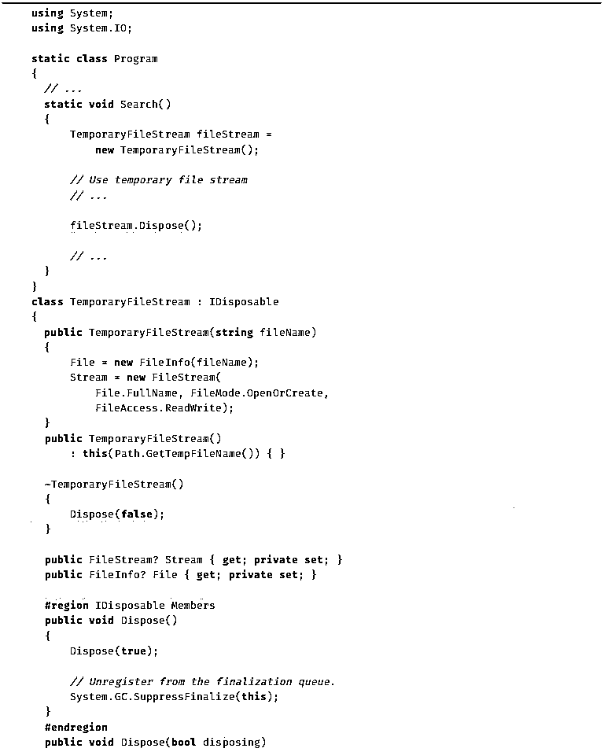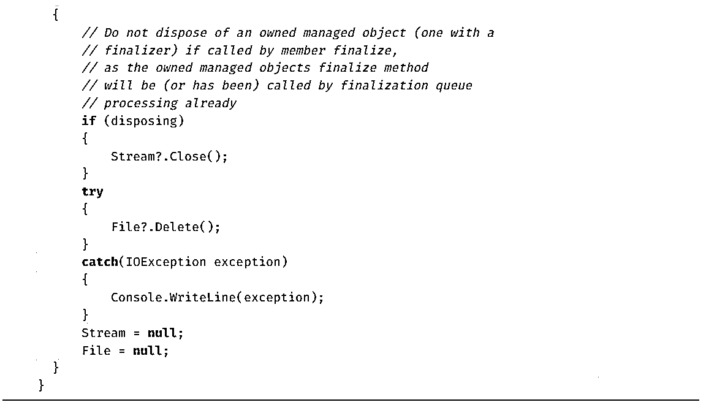

Program.Search()在用完 TemporaryFileStream 之后显式调用 Dispose()。Dispose()负责清理和内存无关的资源（本例是一个文件），这些资源不会由垃圾回收器隐式清理。但在执行过程中，仍有一个漏洞会阻止 Dispose()执行。实例化 TemporaryFileStream 后，调用 Dispose()前，有可能发生一个异常。这造成 Dispose()得不到调用，资源清理不得不依赖于终结器。为避免这个问题，调用者需要实现一个 try/finally 块。但开发者不需要显式地写一个这样的块。因为 C#为此提供了 using 语句。最终代码如代码清单 10.22 所示。

代码清单 10.22　执行 using 语句

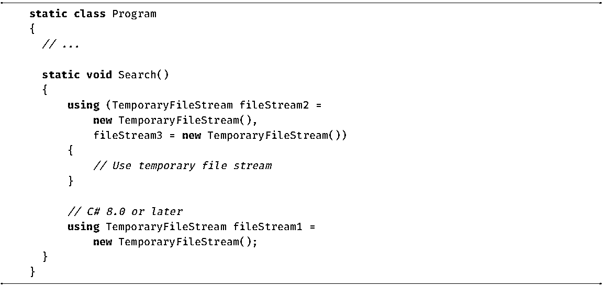

在第一块高亮代码中，最终生成的 CIL 代码与写一个显式的 try/finally 块完全一样。如果自己写 try/finally 块，那么 fileStream.Dispose()应该在 finally 块中调用。总之，using 语句只是提供了 try/finally 块的语法快捷方式。

可在 using 语句内实例化多个变量，只需用逗号分隔每个变量即可。关键是所有变量都具有相同的类型，都实现了 IDisposable。为强制使用同一类型，数据类型只能指定一次，而不是在每个变量声明之前都指定一次。

从 C# 8.0 开始，using 语句有一个简化的写法：可以在声明单个变量的语句之前使用 using 关键字，就像代码清单 10.22 中第二块高亮代码所示的那样。这种写法每次只能声明一个变量，并且也要求其类型实现了 IDisposable 接口。当程序的运行越过了变量的作用区间（在本例中为 search()方法的结束大括号）后，该变量的 Dispose()方法便会被自动调用。此外，用 using 关键字声明的变量还有一个限制，就是这种变量不能再被赋值为其他值。

### 10.8.3　垃圾回收、终结和 IDisposable

代码清单 10.21 还有另外几个值得注意的地方。第一，IDisposable.Dispose()方法包含对 System.GC.SuppressFinalize()的调用，作用是从终结（f-reachable）队列中移除 TemporaryFileStream 类实例。这是因为所有清理都在 Dispose()方法中完成了，而不是等着终结器执行。

不调用 SuppressFinalize()，对象的实例会包括到 f-reachable 队列中。该队列中的对象已差不多准备好了进行垃圾回收，只是它们还有终结方法没有运行。这种对象只有在其终结方法被调用之后，才能由“运行时”进行垃圾回收。但垃圾回收器本身不调用终结方法。相反，对这种对象的引用会添加到 f-reachable 队列中，并由一个额外的线程根据执行上下文，挑选合适的时间进行处理。讽刺的是，这造成了托管资源的垃圾回收时间的推迟——而许多这样的资源本应更早一些被清理。推迟是因为 f-reachable 队列是“引用”列表。所以，对象只有在它的终结方法得到调用，而且对象引用从 f-reachable 队列中删除之后，才会真正变成“垃圾”。

注意 　有终结器的对象如果不显式 dispose，其生存期会被延长，因为即使对它的所有显式引用都不存在了，f-reachable 队列仍然包含对它的引用，使对象一直生存，直至 f-reachable 队列处理完毕。

正是由于这个原因，Dispose()才调用 System.GC.SuppressFinalize，告诉“运行时”不要将该对象添加到 f-reachable 队列，而是允许垃圾回收器在对象没有任何引用（包括任何 f-reachable 引用）时清除对象。

第二，Dispose()调用了 Dispose(bool disposing)方法，并传递实参 true。结果是为 Stream 调用 Dispose()方法（清理它的资源并阻止终结）。接着，临时文件在调用 Dispose()后立即删除。这个重要的调用避免了一定要等待终结队列处理完毕才能清理资源的限制。

第三，终结器现在不是调用 Close()，而是调用 Dispose(bool disposing)，并传递实参 false。结果是即使文件被删除，Stream 也不会关闭（disposed）。原因是从终结器中调用 Dispose(bool disposing)时，Stream 实例本身还在等待终结（或者已经终结，系统会以任意顺序终结对象）。所以，在执行终结器时，拥有托管资源的对象不应清理，那应该是终结队列的职责。

第四，同时创建 Close()和 Dispose()方法需谨慎。只看 API 并不知道 Close()会调用 Dispose()。所以开发者搞不清楚是否需要显式调用 Close()和 Dispose()。

第五，若要提高终结器在程序结束之前被调用的可能性，可以将终结器中的代码实现并注册到 AppDomain.CurrentDomain.ProcessExit 事件处理器中。这个方法即便在.NET Core 中也有效。只要程序没有异常终止，可以保证代码被执行。（下一节将具体介绍）

设计规范

·要只为使用了稀缺或昂贵资源的对象实现终结器方法，即使终结会推迟垃圾回收。

·要为有终结器的类实现 IDisposable 接口以支持确定性终结。

·只有当类包含必须释放的资源，而该资源自己又没有终结器的时候，才要在类中实现终结器。

·要重构终结器方法来调用与 IDisposable 相同的代码，可能就是调用一下 Dispose()方法。

·不要在终结器方法中抛出异常。

·若要提高终结器在程序结束之前被调用的可能性，考虑将终结器中的代码实现在事件处理器里并注册到 AppDomain.CurrentDomain.ProcessExitevent 中。

·如果一个类同时注册了 AppDomain.CurrentDomain.ProcessExitevent 事件，又实现了 Dispose()，一定要在 Dispose()方法中解除注册的事件。

·要从 Dispose()中调用 System.GC.SuppressFinalize()，以使垃圾回收更快地发生，并避免重复性的资源清理。

·要保证 Dispose()可以重入（可被多次调用）。

·要保持 Dispose()的简单性，把重点放在终结所要求的资源清理上。

·避免为自己拥有的、带终结器的对象调用 Dispose()。相反，依赖终结队列清理实例。

·避免在终结方法中引用未被终结的其他对象。

·要在重写 Dispose()时调用基类的实现。

·考虑在调用 Dispose()后将对象状态设为不可用。对象被 dispose 之后，调用除 Dispose()之外的方法应引发 ObjectDisposedException 异常。（Dispose()应该能多次调用。）

·要为含有可 dispose 字段（或属性）的类型实现 IDisposable 接口，并 dispose 这些字段引用的对象。

·要在派生类的 Dispose()中调用基类的 Dispose()。

语言对比：C++——确定性析构

虽然终结器类似于 C++析构器，但由于编译时无法确定终结器的执行时间，因此两者实际存在相当大的差别。垃圾回收器调用 C#终结器是在对象最后一次使用之后、应用程序关闭之前的某个时间。相反，只要对象（而非指针）超出作用域， C++析构器就自动调用。

虽然运行垃圾回收器可能代价相当高，但事实上垃圾回收器拥有足够的判断力，会一直等到处理器占用率较低的时候才运行。在这一点上，我们认为它优于确定性析构器。确定性析构器会在编译时定义的位置运行——即使当前处理器处于重负荷下。

高级主题：在程序结束之前强制释放资源

从.NET Core 开始，程序结束时终结器不一定会被调用。若要提高终结器被调用的可能性，需要为相应的代码进行注册。因此在下面的代码清单 10.23 中请注意 SampleUnmanagedResource 构造函数中与 ProcessExit 相关的代码。（这段代码涉及了 LINQ，事件注册和一些特殊特性，我们将分别在后面的第 12、14、18 章具体介绍。）

代码清单 10.23　注册程序退出事件处理器

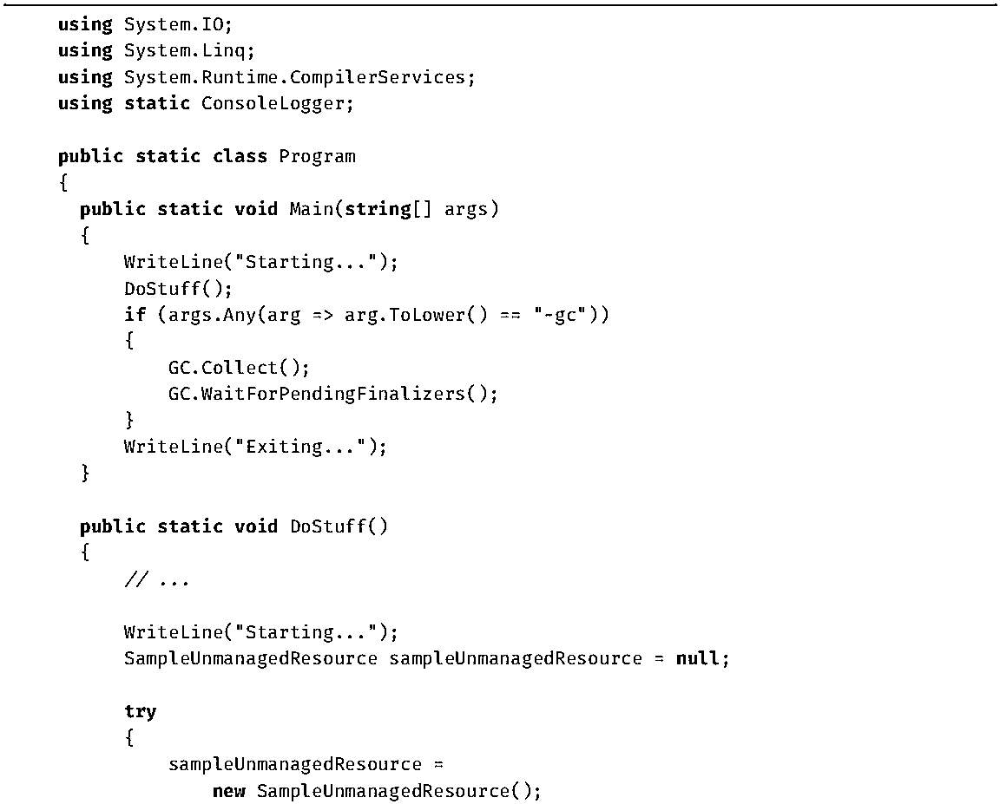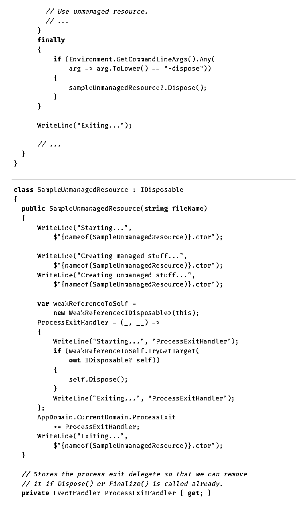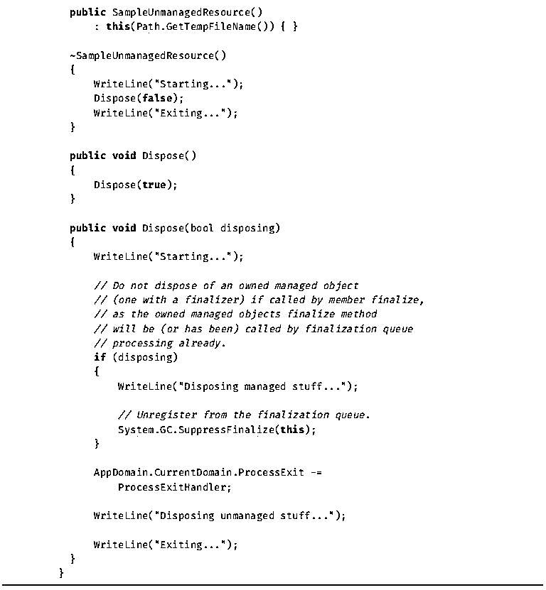

没有参数传递给程序时的输出如输出 10.5 所示。

输出 10.5

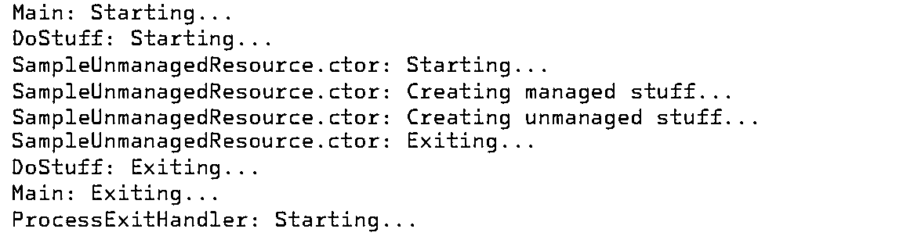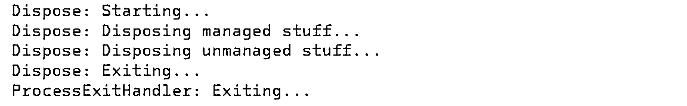

上面代码首先调用 DoStuff()方法创建了 SampleUnmanagedResource 类实例。

创建 SampleUnmanagedResource 类实例的时候，其构造函数会被调用。我们在其构造函数中调用 WriteLine()向控制台输出文字，用来模拟创建托管资源和创建非托管资源的动作^( [\[2\]](part0103.xhtml#ch2_back) ) 。接着，我们声明了一个“委托”（delegate），或称事件处理器，它将在程序退出时执行。在事件处理器中，我们通过一个指向 SampleUnmanagedResource 实例的 WeakReference 对象来调用其 Dispose()方法，并且该调用仅当 SampleUnmanagedResource 实例存在时才会发生。WeakReference 确保了 ProcessExit 事件处理器不会抓住 SampleUnmanagedResource 的实例不放，从而导致在该实例无法被垃圾回收器销毁。最后，我们通过 AppDomain.CurrentDomain.ProcessExit 注册事件处理器，并且把事件处理器保存到 ProcessExitHandler 属性中。将它保存到属性中的目的是在 Dispose()方法中将事件处理器注销，以避免 Dispose()方法被重复调用。

回到 DoStuff()方法中，我们检查命令行参数，看在程序启动时是否附加了“-Dispose”选项。如果是，则调用 Dispose()方法，从而终结器和 ProcessExit 事件处理器便不会再被调用。在这种情况下，DoStuff()方法返回时 SampleUnmanagedResource 的实例便不会有基础引用。当垃圾回收器运行时，便会看到这个没有引用的实例，于是便会将它放入待终结队列。

当程序开始结束的时候，如果 SampleUnmanagedResource 实例的 Dispose()方法和终结器均未被执行，则 AppDomain.CurrentDomain.ProcessExit 事件便会执行并调用 SampleUnmanagedResource 注册的事件处理器，于是 Dispose()方法便会在事件处理器中被调用。代码清单 10.21 中的 Dispose()方法有重要的一点：它会注销事件处理器，从而避免 Dispose()方法被重复调用。

值得注意的是，虽然你可以随时调用 GC.Collect()触发垃圾回收器工作，然后紧接着调用 GC.WaitForPendingFinalizers()等待所有没有基础引用的对象的终结器被调用，并且理论上你也可以在程序即将结束时执行此操作以确保释放资源，但是这个做法也有其局限性。首先，如果你正在开发一个程序库，便没有机会在程序结束时做这件事，因为程序库里没有 Main()方法。其次，很多看似简单的东西，比如普通的静态字段，它们都是有基础引用的，因此无法被垃圾回收器回收。所以，最稳妥的方式还是注册 ProcessExit 事件处理器。

高级主题：从构造函数传播的异常

即使有异常从构造函数传播出来，对象仍会实例化，只是没有新实例从 new 操作符返回。如类型定义了终结器，对象一旦准备好进行垃圾回收，就会运行该方法（即使只构造了一部分的对象，终结方法也会运行）。另外要注意，如构造函数过早共享它的 this 引用，即使构造函数抛出异常，也能访问该引用。不要让这种情况发生。

高级主题：对象复活

调用对象的终结方法时，对该对象的引用都已消失。垃圾回收前唯一剩下的步骤就是运行终结代码。但完全可能无意中重新引用一个待终结的对象。这样，被重新引用的对象就不再是不可访问的，所以不能当作垃圾被回收掉。但假如对象的终结方法已经运行，那么除非显式标记为要进行终结（使用 GC.ReRegisterFinalize()方法），否则终结方法不一定会再次运行。

显然，像这样的对象复活是非常罕见的，而且通常应该避免发生。终结代码应该简单，只清理它引用的资源。

[\[1\]](part0103.xhtml#ch1) dispose 在本书没有翻译。在英语语境中，它的意思是“摆脱”或“除去”（get rid of）一个东西，尤其是在这个东西很难除去的情况下。MSDN 文档把它翻译成“释放”，意思是显式释放或清理对象包装的资源。之所以认为“释放”不恰当，除了和 release 一词冲突之外，还因为 dispose 强调了“清理资源”，而且在完成（它包装的）资源的清理之后，对象本身的内存并不会释放。所以，“dispose 一个对象”或者“close 一个对象”真正的意思是：清理对象中包装的资源（比如它的字段所引用的对象），然后等待垃圾回收器自动回收该对象本身占用的内存。——译者注

[\[2\]](part0103.xhtml#ch2) 在上面代码的中先找到 SampleUnmanagedResource 类的构造函数，然后可以在其中找到 WriteLine(“Creating managed stuff...＂, ……)和 WriteLine(＂Creating unmanaged stuff...＂, ……)两行代码。它们向控制台打印了两行文字“正在创建托管资源……”和“正在创建非托管资源……”。这两行输出文字用来模拟实际创建两种资源的操作。——译者注

## 10.9　推迟初始化

上一节讨论了如何用 using 语句确定性地 dispose 对象，以及在没有进行确定性 dispose 的时候终结队列如何清理资源。

与此相关的模式称为推迟初始化 或者推迟加载 。使用推迟初始化，可在需要时才创建（或获取）对象，而不是提前创建好——尤其是它们永远都不使用的前提下。来考虑代码清单 10.24 中的 FileStream 属性。

代码清单 10.24　推迟加载属性

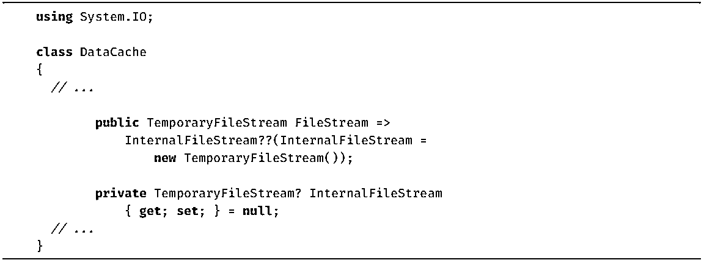

在 FileStream 表达式主体属性中，我们在直接返回 InternalFileStream 的值之前检查它是否为空。如为空，就先实例化 TemporaryFileStream 对象，在返回新实例前先把它赋给 InternalFileStream。这样只有当调用 FileStream 属性的 get 访问器方法时才实例化属性要求的 TemporaryFileStream 对象。如果 get 访问器方法永不调用，那么 TemporaryFileStream 对象永不实例化。这样就可省下进行实例化所需的时间。显然，如实例化代价微不足道或不可避免（而且不适合推迟这个必然要做的事情），就应直接在声明时或在构造函数中赋值。

高级主题：为泛型和 Lambda 表达式使用推迟加载

从 C# 4.0 和 Microsoft .NET Framework 4.0 开始，CLR 添加了一个新类来帮助进行推迟初始化，这个类就是 System.Lazy<T>。代码清单 10.25 演示了如何使用。

代码清单 10.25　使用 System.Lazy<T>推迟加载属性

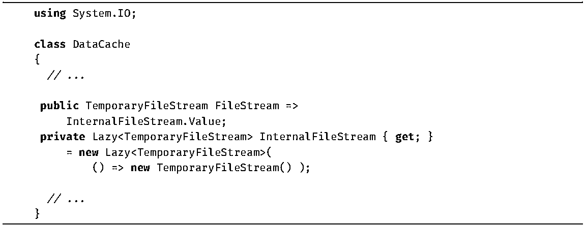

System.Lazy<T>获取一个类型参数（T），该参数标识了 System.Lazy<T>的 Value 属性要返回的类型。不是将一个完全构造好的 TemporaryFileStream 赋给属性的支持字段，相反，赋给它的是 Lazy<TemporaryFileStream>的一个实例（一个轻量级的调用），将 TemporaryFileStream 本身的实例化推迟到访问 Value 属性（进而访问 FileStream 属性）的时候才进行。

如除了类型参数（泛型）还使用了委托，甚至可提供一个函数指定在访问 Value 属性值时如何初始化对象。代码清单 10.25 演示了如何将委托（本例是一个 Lambda 表达式）传给 System.Lazy<T>的构造函数。

注意，Lambda 表达式本身，即()=> new TemporaryFileStream()，是直到调用 Value 时才执行的。Lambda 表达式提供了一种方式为将来发生的事情传递指令，但除非显式请求，否则那些指令不会执行。

一个显然的问题便是，什么时候调用 System.Lazy<T>会比代码清单 10.24 中的方法更好？实际上它们几乎没有区别。在不考虑并行执行的情况下，代码清单 10.24 中的方法更简单一点，但这个方法中的实例化操作在多线程情况下可能会引起竞争问题（race condition）。这是因为它先判断 InternalFileStream 属性是否为 null，如果是则创建实例。而在其实例被创建之前，多个线程有可能同时发现该属性为 null，从而多次创建实例。而 System.Lazy<T>则没有这个问题，它提供了一个线程安全机制，会确保只创建一个实例。

## 10.10　小结

本章围绕如何构建健壮的类库展开了全面讨论。所有主题也适用于内部开发，但它们更重要的作用是构建健壮的类。最终目标是构建更健壮、可编程性更好的 API。同时涉及健壮性和可编程性的主题包括“命名空间”和“垃圾回收”。涉及可编程性的其他主题还有“重写 object 的虚成员”“操作符重载”以及“用 XML 注释来编档”。

异常处理通过定义一个异常层次结构，并强迫自定义异常进入该层次结构，从而充分地利用了继承。此外，C#编译器利用继承来验证 catch 块顺序。第十一章将解释为什么继承是异常处理的核心部分。