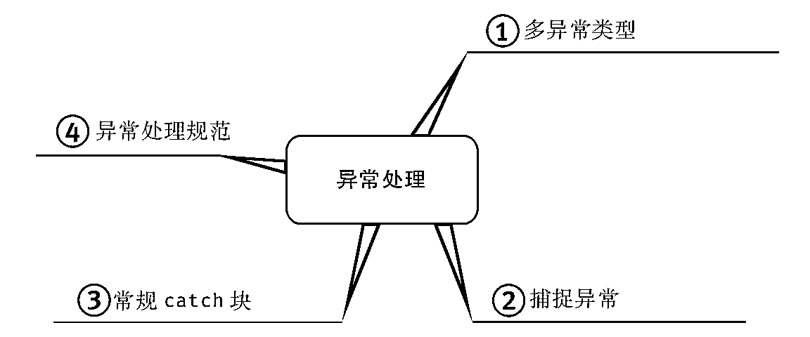
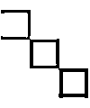
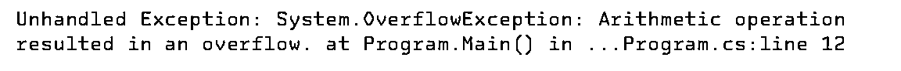
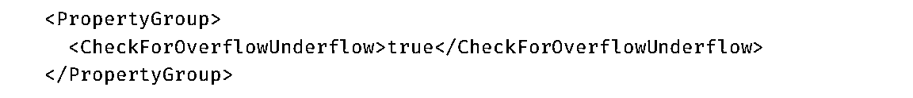
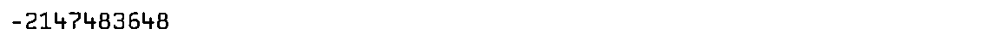

# 第十一章　异常处理



第五章讨论了如何使用 try/catch/finally 块执行标准异常处理。在那一章中，catch 块主要捕捉 System.Exception 类型的异常。本章将讨论异常处理的更多细节，包括其他异常类型、定义自定义异常类型以及用于处理每种异常类型的多个 catch 块。本章还将详细描述异常对继承的依赖。

## 11.1　多异常类型

代码清单 11.1 抛出 System.ArgumentException 而不是第五章演示的 System.Exception。C#允许代码抛出从 System.Exception 直接或间接派生的任何异常类型。

用关键字 throw 抛出异常实例。所选的异常类型应该能最好地说明发生异常的背景。

代码清单 11.1　抛出异常

```powershell
class TextNumberParser {
    static [int] Parse([string] $textDigit) {
        if ($null -eq $textDigit) { throw [ArgumentNullException]::new('textDigit') }
        $digitTexts = @('zero','one','two','three','four','five','six','seven','eight','nine')
        $result = [Array]::IndexOf($digitTexts, $textDigit.ToLower())
        if ($result -lt 0) { throw [ArgumentException]::new('The argument did not represent a digit', 'textDigit') }
        return $result
    }
}
```

以代码清单 11.1 的 TextNumberParser.Parse()方法为例。调用 Array.IndexOf()时，在 textDigit 为空的前提下利用了 C# 7.0 的 throw 表达式功能。C# 7.0 之前不支持 throw 表达式，只支持 throw 语句，所以需要两个单独的语句：一个进行空检查，另一个抛出异常。但这样就无法在同一个语句中嵌入 throw 和空合并操作符(??)。

程序不是抛出 System.Exception，而是抛出更合适的 ArgumentException，因为类型本身指出什么地方出错（参数异常），并包含了特殊的参数来指出具体是哪一个参数出错。

ArgumentNullException 和 NullReferenceException 这两个异常很相似。前者应在错误传递了空值时抛出。空值是无效参数的特例。非空的无效参数则应抛出 Argument-Exception 或 ArgumentOutOfRangeException。一般只有在底层“运行时”解引用 null 值（想调用对象的成员，但发现对象的值为空）时才抛出 NullReferenceException。开发者不要自己抛出 NullReferenceException。相反，应在访问参数前检查它们是否为空，为空就抛出 ArgumentNullException，这样能提供更具体的上下文信息，比如参数名等。如果在实参为空时可以无害地继续，请一定使用 C# 6.0 的空条件操作符（?.）来避免“运行时”抛出 NullReferenceException。

参数异常类型（包括 ArgumentException、ArgumentNullException 和 ArgumentOutOf-RangeException）的一个重要特点是构造函数支持用一个字符串参数来标识参数名。C# 6.0 以前需硬编码一个字符串（例如"textDigit"）来标识参数名。参数名发生更改，开发者必须手动更新该字符串。幸好，C# 6.0 增加了一个 nameof 操作符，它获取参数名标识符并在编译时生成参数名，如代码清单 11.1 的 nameof(textDigit)所示。它的好处在于，现在 IDE 可利用重构工具（比如自动重命名）自动更改标识符，包括在作为实参传给 nameof 操作符的时候。另外，如参数名发生更改（不是通过重构工具），在传给 nameof 操作符的标识符不复存在时会报告编译错误。从 C# 6.0 起，编程规范在抛出参数异常时总是为参数名使用 nameof 操作符。第十八章完整解释了 nameof 操作符。目前只需知道 nameof 返回所标识的实参的名称。

还有几个直接或间接从 System.SystemException 派生的异常仅供“运行时”抛出，其中包括 System.StackOverflowException、System.OutOfMemoryException、System.Runtime.InteropServices.COMException、System.ExecutionEngineException 和 System.Runtime.InteropServices.SEHException。不要自己抛出这些异常。类似地，不要抛出 System.Exception 或 System.ApplicationException。它们过于宽泛，为问题的解决提供不了太多帮助。相反，要抛出最能说明问题的异常。虽然开发者应避免创建可能造成系统错误的 API，但假如代码的执行达到一种再执行就会不安全或者不可恢复的状态，就应该果断地调用 System.Environment.FailFast()。这会向 Windows Application 事件日志写入一条消息，然后立即终止进程。（如用户事先进行了设置，消息还会发送给“Windows 错误报告”。）

设计规范

·要在向成员传递了错误参数时抛出 ArgumentException 或者它的某个子类型。抛出尽可能具体的异常（例如 ArgumentNullException）。

·不要抛出 System.SystemException 或者它的派生类型。

·不要抛出 System.Exception、System.NullReferenceException 或者 System.Application-Exception。

·考虑在程序继续执行会变得不安全时调用 System.Environment.FailFast()来终止进程。

·要为传给参数异常类型的 paramName 实参使用 nameof 操作符。接收这种实参的异常类型包括 ArgumentException、ArgumentOutOfRangeException 和 ArgumentNullException。

## 11.2　捕捉异常

可通过捕捉特定的异常类型来识别并解决问题。换言之，不需要捕捉异常并使用一个 switch 语句，根据异常消息来决定要采取的操作。相反，C#允许使用多个 catch 块，每个块都面向一个具体的异常类型，如代码清单 11.2 所示。

代码清单 11.2　捕捉不同的异常类型

```powershell
try {
    throw [InvalidOperationException]::new('Arbitrary exception')
}
catch [System.ComponentModel.Win32Exception] {
    if ($_.Exception.NativeErrorCode -eq 42) {
        # Handle Win32Exception where ErrorCode is 42
    }
    else { throw }
}
catch [ArgumentException] {
    # Handle ArgumentException
}
catch [InvalidOperationException] {
    $exceptionHandled = $false
    # Handle InvalidOperationException
    if (-not $exceptionHandled) { throw }
}
catch [Exception] {
    # Handle Exception
}
finally {
    # Handle any cleanup code here as it runs regardless of whether there is an exception
}
```

代码清单 11.2 总共有 5 个 catch 块，每个处理一种异常类型。发生异常时，会跳转到与异常类型最匹配的 catch 块执行。匹配度由继承链决定。例如，即使抛出的是 System.Exception 类型的异常，由于 System.InvalidOperationException 派生自 System.Exception，因此 InvalidOperationException 与抛出的异常匹配度最高。最终，将由 catch(InvalidOperationException...)捕捉到异常，而不是由 catch(Exception ...)块捕捉。

从 C# 6.0 起，catch 块支持一个额外的条件表达式。不是只根据异常类型来匹配，现在可以添加 when 子句来提供一个 Boolean 表达式。条件为 true 时，catch 块才处理异常。

代码清单 11.2 在 when 子句中使用的是一个相等性比较操作符，但可以在这里使用任何条件表达式。例如，可以执行一次方法调用来验证条件。

也可以在 catch 主体中用 if 语句执行条件检查。但这样做会造成该 catch 块先成为异常的“处理程序”，再执行条件检查，导致难以在条件不满足时改为使用一个不同的 catch 块。而使用异常条件表达式 ，就可先检查程序状态（包括异常），而不需要先捕捉再重新抛出异常。

条件子句使用需谨慎。如条件表达式本身抛出异常，新异常会被忽略，且条件被视为 false。因此，要避免异常条件表达式抛出异常。

catch 块必须按从最具体到最常规的顺序排列以避免编译错误。例如，将 catch (Exception ...)块移到其他任何一种异常之前都会造成编译错误。因为之前的所有异常都直接或间接从 System.Exception 派生。

catch 块并非一定需要具名参数，例如 catch (SystemException){...}。事实上，如下一节所述，最后一个 catch 甚至连类型参数都可以不要。

## 11.3　重新抛出现有异常

注意在捕捉 InvalidOperationException 的 catch 块中，虽然当前 catch 块的范围内有一个异常实例（exception）可供重新抛出，但还是使用了一个未注明要抛出什么异常的 throw 语句（一个独立的 throw 语句）。如选择抛出具体异常，会更新所有栈信息来匹配新的抛出位置。这会导致指示异常最初发生位置的所有栈信息丢失，使问题变得更难诊断。有鉴于此，C#支持不指定具体异常、但只能在 catch 块中使用的 throw 语句。这使代码可以检查异常，判断是否能完整处理该异常，不能就重新抛出异常（虽然没有显式指定这个动作）。结果是异常似乎从未被捕捉，也没有任何栈信息被替换。

高级主题/初学者主题：抛出现有异常而不替换栈信息

C# 5.0 新增了一个机制，允许抛出之前抛出的异常而不丢失原始异常中的栈跟踪信息。这样即使在 catch 块外部也能重新抛出异常，而不是像以前那样只能在 catch 块内部使用 throw;语句来重新抛出。虽然很少需要这样做，但偶尔需要包装或保存异常，直到程序执行离开 catch 块。例如，多线程代码可能用 AggregateException 包装异常。System.Runtime.ExceptionServices.ExceptionDispatchInfo 类专门用来处理这种情况。你需要使用它的静态方法 Capture()和实例方法 Throw()。

代码清单 11.3 演示了如何在不重置栈跟踪信息或使用空 throw 语句的前提下重新抛出异常。

代码清单 11.3　使用 ExceptionDispatchInfo 重新抛出异常

```powershell
$task = WriteWebRequestSizeAsync($url)
try {
    while (-not $task.Wait(100)) {
        Write-Host -NoNewline '.'
    }
}
catch [System.AggregateException] {
    $exception = $_.Exception.Flatten()
    [System.Runtime.ExceptionServices.ExceptionDispatchInfo]::Capture(
        $exception.InnerException ?? $exception).Throw()
}
```

ExceptionDispatchInfo.Throw()值得注意的一个地方是，编译器不认为它是像普通 throw 语句那样的一个返回语句。例如，如方法签名返回一个值，但没有值从 ExceptionDispatchInfo.Throw()所在的代码路径返回，编译器就会报错，指出没有返回值。所以，开发者有时不得不在 ExceptionDispatchInfo.Throw()后面跟随一个 return 语句，即使该语句在运行时永远不会执行（相反是抛出异常）。

语言对比：Java——异常指示符

C#没有与 Java 异常指示符(exception specifiers)对应的东西。通过异常指示符，Java 编译器可验证一个函数（或函数的调用层次结构）中抛出的所有可能的异常是已被捕捉到还是被声明为可以重新抛出。C#团队考虑过这种设计，但认为它的好处不足以抵消维护所带来的负担。所以，最终的决定是没必要维持一个特定调用栈上所有可能异常的列表。当然，这也造成不能轻松判断所有可能的异常。事实上，Java 也做不到这一点。由于可能调用虚方法或使用晚期绑定（比如反射），因此编译时不可能完整分析一个方法可能抛出的异常。

## 11.4　常规 catch 块

C#要求代码抛出的任何对象都必须从 System.Exception 派生。但并非所有语言都如此要求。例如，C++允许抛出任意对象类型，包括不是从 System.Exception 派生的托管异常。不管是不是从 System.Exception 派生的所有异常在进入程序集之后，都会被“包装”成从 System.Exception 派生。结果是捕捉 System.Exception 的 catch 块现在可捕捉前面的块不能捕捉的所有异常。

C#还支持常规 catch 块 ，即 catch{}，其行为和 catch(System.Exception exception)块完全一致，只是没有类型名或变量名。此外，常规 catch 块必须是所有 catch 块的最后一个。由于常规 catch 块在功能上完全等价于 catch(System.Exception exception)块，而且必须放在最后，所以在同一个 try/catch 语句中，假如这两个 catch 块同时出现，编译器就会显示一条警告消息，因为常规 catch 块永远得不到调用。

高级主题：常规 catch 块的内部原理

事实上，与常规 catch 块对应的 CIL 代码是一个 catch(object)块。这意味着不管抛出什么类型，常规 catch 块都能捕捉到它。有趣的是，不能在 C#代码中显式声明 catch(object)块。所以，没办法捕捉一个非 System.Exception 派生的异常，并拿一个异常实例仔细检查问题。

事实上，来自 C++等语言的非托管异常通常会造成 System.Runtime.Interop-Services.SEHException 类型的异常，它从 System.Exception 派生。所以，常规 catch 块不仅能捕捉非托管类型的异常，还能捕捉非 System.Exception 托管类型的异常，比如 string 类型。

## 11.5　异常处理规范

异常处理为它前面的错误处理机制提供了必要的结构。但若使用不当，仍有可能造成一些令人不快的后果。以下规范是异常处理的最佳实践。

·只捕捉能处理的异常 。

通常，一些类型的异常能处理，但另一些不能。例如，试图打开使用中的文件进行独占式读/写访问会抛出一个 System.IO.IOException。捕捉这种类型的异常，代码可向用户报告该文件正在使用，并允许用户选择取消或重试。只应捕捉那些已知怎么处理的异常。其他异常类型应留给栈中较高的调用者去处理。

·不要隐藏（bury）不能完全处理的异常。 

新手程序员常犯的一个错误是捕捉所有异常，然后假装什么都没有发生，而不是向用户报告未处理的异常。这可能导致严重的系统问题逃过检测。除非代码执行显式的操作来处理异常，或显式确定异常无害，否则 catch 块应重新抛出异常，而不是在捕捉了之后在调用者面前隐藏它们。catch(System.Exception)和常规 catch 块大多数时候应放在调用栈中较高的位置，除非在块的末尾重新抛出异常。

·尽量少用 System.Exception 和常规 catch 块。 

几乎所有异常都从 System.Exception 派生。但某些 System.Exception 的最佳处理方式是不处理，或尽快得体地关闭应用程序。这些异常包括 System.OutOfMemory-Exception 和 System.StackOverflowException 等。所幸从 CLR 4 开始，这些异常被默认为“不可恢复”的，所以即使捕捉而又不重新抛出，CLR 也会强制重新抛出这类异常。这些属于运行时异常，开发者不能写代码从中恢复。所以，最好的做法就是关闭应用程序——在 CLR 4 和更高版本中，这是“运行时”会强制采取的操作。CLR 4 之前的代码在捕捉到这种异常后，也只应运行清理或紧急代码（比如保存任何易失的数据），然后马上关闭应用程序，或使用 throw;语句重新抛出。

·避免在调用栈较低的位置报告或记录异常。 

新手程序员倾向于异常一发生就记录它，或者向用户报告。但由于当前正处在调用栈中较低的位置，而这些位置很少能完整处理异常，所以只好重新抛出异常。像这样的 catch 块不应记录异常，也不应向用户报告。如异常被记录，又被重新抛出（调用栈中较高的调用者可能做同样的事情），就会造成重复出现的异常记录项。更糟的是，取决于应用程序的类型，向用户显示异常可能并不合适。例如，在 Windows 应用程序中使用 System.Console.WriteLine()，用户永远看不到显示的内容。类似地，在无人值守的命令行进程中显示对话框，可能根本不会被人看到，而且可能使应用程序冻结在这个位置。日志记录和与异常相关的用户界面应保留到调用栈中较高的位置。

·在 catch 块中使用 throw;而不是 throw <异常对象>语句。 

可在 catch 块中重新抛出异常。例如，可在 catch(ArgumentNullException exception)的实现中包含一个 throw exception 调用。但像这样重新抛出，会将栈追踪重置为重新抛出的位置，而不是重用原始抛出位置。所以，只要不是重新抛出不同的异常类型，或者不是想故意隐藏原始调用栈，就应使用 throw;语句，允许相同的异常在调用栈中向上传播。

·想好异常条件来避免在 catch 块中重新抛出异常。 

如果发现会捕捉到不能恰当处理所以需要重新抛出的异常，那么最好优化异常条件，从一开始就避免捕捉。

·避免在异常条件表达式中抛出异常。 

如提供了异常条件表达式，要避免在表达式中抛出异常，否则会造成条件变成 false，新异常被忽略。因此，可考虑在一个单独的方法中执行复杂的条件检查，用 try/catch 块包装该方法调用来显式处理异常。

·避免以后可能变化的异常条件表达式。 

如异常条件可能因本地化等情况而改变，预期的异常条件将不被捕捉，进而改变业务逻辑。因此，要确保异常条件不会因时间而改变。

·重新抛出不同异常时要小心。 

在 catch 块中重新抛出不同的异常，不仅会重置抛出点，还会隐藏原始异常。要保留原始异常，需设置新异常的 InnerException 属性（该属性通常可通过构造函数来赋值）。只有以下情况才可重新抛出不同的异常。

a）更改异常类型可更好地澄清问题。 

例如，在对 Logon(User user)的一个调用中，如遇到用户列表文件不能访问的情况，那么重新抛出一个不同的异常类型，要比传播 System.IO.IOException 更合适。

b）私有数据是原始异常的一部分。 

在上例中，如文件路径包含在原始的 System.IO.IOException 中，就会暴露敏感的系统信息，所以应该使用其他异常类型来包装它（当然前提是原始异常没有设置 InnerException 属性）。有趣的是，CLR v1 的一个非常早的版本（比 alpha 还要早的一个版本）有一个异常会报告“安全性异常：无足够权限确定 c:\\temp\\foo.txt 的路径”。

c）异常类型过于具体，以至于调用者不能恰当地处理。 

例如，不要抛出数据库系统的专有异常，而应抛出一个较常规的异常，避免在调用栈较高的位置写数据库的专有代码。

设计规范

·避免在调用栈较低的位置报告或记录异常。

·不该捕捉的异常不要捕捉。要允许异常在调用栈中向上传播，除非能通过程序准确处理栈中较低位置的错误。

·如理解特定异常在给定上下文中发生的原因，并能通过程序处理错误，就考虑捕捉该异常。

·避免捕捉 System.Exception 或 System.SystemException，除非是在顶层异常处理程序中先执行最终的清理操作再重新抛出异常。

·要在 catch 块中使用 throw;而不是 throw <异常对象>语句。

·要先想好异常条件，避免在 catch 块重新抛出异常。

·重新抛出不同异常时要当心。

·避免在异常条件表达式中抛出异常。

·避免以后可能变化的异常条件表达式。

## 11.6　自定义异常

必须抛出异常时，应首选框架内建的异常，因其构建良好，能被很好地理解。例如，首选的不是抛出自定义的“无效参数”异常，而应抛出 System.ArgumentException。但假如使用特定 API 的开发者需采取特殊行动（例如要用不同逻辑处理错误），就适合定义一个自定义异常。例如，某个地图 API 接收到邮编无效的地址时不应抛出 System.ArgumentException，而应抛出自定义 InvalidAddressException。这里的关键在于调用者是否愿意编写专门的 InvalidAddressException catch 块来进行特殊处理，而不是用一个常规 System.ArgumentException catch 块。

定义自定义异常时，从 System.Exception 或者其他异常类型派生就可以了。代码清单 11.4 展示了一个例子。

代码清单 11.4　创建自定义异常

```powershell
class DatabaseException : System.Exception {
    DatabaseException([string] $message, [System.Data.SqlClient.SqlException] $exception)
        : base($message, $exception) { ... }

    DatabaseException([string] $message, [System.Data.OracleClient.OracleException] $exception)
        : base($message, $exception) { ... }

    DatabaseException() { ... }

    DatabaseException([string] $message) { ... }

    DatabaseException([string] $message, [Exception] $exception)
        : base($message, $exception) { ... }
}
```

可用该自定义异常包装多个专有的数据库异常。例如，由于 Oracle 和 SQL Server 会为类似的错误抛出不同的异常，所以可创建自定义异常，将数据库专有异常标准化到一个通用异常包装器中，使应用程序能以标准方式处理。这样不管应用程序的后端数据库是 Oracle 还是 SQL Server，都可在调用栈较高的位置用同一个 catch 块处理。

自定义异常唯一的要求是必须从 System.Exception 或者它的某个子类派生。此外，使用自定义异常时应遵守以下最佳实践。

·所有异常都应该使用“Exception”后缀，彰显其用途。

·所有异常通常都应包含以下三个构造函数：无参构造函数、获取一个 string 参数的构造函数以及同时获取一个字符串和一个内部异常作为参数的构造函数。另外，由于异常通常在抛出它们的语句中构造，所以还应允许其他任何异常数据成为构造函数的一部分。（当然，假如特定数据是必需的，而某个构造函数无法满足要求，则不应创建该构造函数。）

·避免使用深的继承层次结构（一般应小于 5 级）。

如需重新抛出与捕捉到的不同的异常，内部异常将发挥重要作用。例如，假定一个数据库调用抛出了 System.Data.SqlClient.SqlException，但该异常在数据访问层捕捉到，并作为一个 DatabaseException 重新抛出，那么获取 SqlException（或内部异常）的 DatabaseException 构造函数会将原始 SqlException 保存到 InnerException 属性中。这样，在请求与原始异常有关的附加细节时，开发者就可从 InnerException 属性（例如 exception.InnerException）中获取异常。

设计规范

·避免异常继承层次结构过深。

·如果异常不以有别于现有 CLR 异常的方式处理，就不要创建新异常。相反，应抛出现有的框架异常。

·要创建新异常类型来描述特别的程序错误。这种错误无法用现有的 CLR 异常来描述，而且需要采取有别于现有 CLR 异常的方式以程序化的方式处理。

·要为所有自定义异常类型提供无参构造函数。还要提供获取消息和内部异常的构造函数。

·要为异常类的名称附加“Exception”后缀。

·要使异常能由“运行时”序列化。

·考虑提供异常属性，以便通过程序访问关于异常的额外信息。

高级主题：可序列化异常

可序列化对 象 是“运行时”可以持久化成一个流（例如文件流），然后根据这个流来重新实例化的对象。某些分布式通信技术可能要求异常使用该技术。为支持序列化，异常声明应包含 System.SerializableAttribute 特性或实现 ISerializable。此外，必须包含一个构造函数来获取 System.Runtime.Serialization.SerializationInfo 和 System.Runtime.Serialization.StreamingContext。代码清单 11.5 展示了使用 System.SerializableAttribute 的一个例子。

代码清单 11.5　定义可序列化异常

```powershell
class DatabaseException : System.Exception {
    # Used for deserialization of exceptions
    DatabaseException(
        [System.Runtime.Serialization.SerializationInfo] $serializationInfo,
        [System.Runtime.Serialization.StreamingContext] $context)
        : base($serializationInfo, $context) { ... }
}
```

这个 DatabaseException 例子演示了可序列化异常对特性和构造函数的要求。

注意在.NET Core 的情况下，直到它支持.NET Standard 2.0 才可使用 System.SerializableAttribute。如代码要实现跨框架编译（包括低于 2.0 的某个.NET Standard 版本），请考虑将自己的 System.SerializableAttribute 定义成一个 polyfill。polyfill 是技术的某个早期版本的“填空”代码，目的是添加功能，或至少为缺失的东西提供一个 shim^( [\[1\]](part0112.xhtml#ch1_back) ) 。

[\[1\]](part0112.xhtml#ch1) polyfill 和 shim 这两个术语源自 JavaScript。shim 是一个库，用于将新 API 引入旧环境，但只使用该环境已有的技术。而 polyfill 是一段代码（或插件），用于提供开发者希望环境原生支持的技术，从而丰富 API。所以，一个 polyfill 就是环境 API 的一个 shim。通常我们检查环境是否支持一个 API，不支持就加载一个 polyfill。这样在两种情况下都可使用 API。两个词都是家装术语，polyfill 是腻子（把缺损的地方填充抹平），shim 是垫圈或垫片（截取 API 调用、修改传入参数，最后自行处理对应操作或者将操作交由其他地方执行。垫片可以在新环境中支持老 API，也可以在老环境里支持新 API。一些程序并没有针对某些平台开发，也可以通过使用垫片来辅助运行）。——译者注

## 11.7　重新抛出包装的异常

有时，栈中较低位置抛出的异常在高处捕捉到时已没有意义。例如，假定服务器上因磁盘空间耗尽而抛出 System.IO.IOException。客户端捕捉到该异常，却理解不了为什么居然会有 I/O 活动。类似地，假定地理坐标请求 API 抛出 System.UnauthorizedAccessException（和调用的 API 完全无关的异常），调用者理解不了 API 调用和安全性有什么关系。从调用 API 的代码的角度看，这些异常带来的更多是困惑而不是帮助。所以不应向客户端公开这些异常，而是捕捉异常，并抛出一个不同的异常，比如 InvalidOperationException（或自定义异常），从而告诉用户系统处于无效状态。这种情况下一定要设置“包装异常”（wrapping exception）的 InnerException 属性（一般是通过构造函数调用，例如 new InvalidOperationException(String, Exception)）。这样，就有一个额外的上下文供较接近所调用框架的人进行诊断。

包装并重新抛出异常时要记住，原始栈跟踪（提供了“原始异常”抛出位置的上下文）将被替换成新的栈跟踪（提供了“包装异常”抛出位置的上下文）。幸好，将原始异常嵌入包装异常，原始栈跟踪仍然可用。

最后，记住异常的目标接收者是写代码来调用（可能以不正确的方式调用）你的 API 的程序员。所以，要提供尽量多的信息来描述他哪里做错了以及如何修正（后者可能更重要）。异常类型是这个沟通机制的重要一环。所以，要精心选择类型。

设计规范

·如果低层抛出的特定异常在高层运行的上下文中没有意义，考虑将低层异常包装到更恰当的异常中。

·要在包装异常时设置内部异常属性。

·要将开发者作为异常的接收者，尽量说清楚问题和解决问题的办法。

初学者主题：checked 和 unchecked 转换

正如第二章的“高级主题：checked 和 unchecked 转换”讨论的那样，C#提供了特殊的关键字来标识代码块，指出假如目标数据类型太小，以至于不能包含所赋的数据，那么“运行时”应该怎么办。默认情况下，假如目标数据类型容不下所赋的数据，那么数据会被截短。代码清单 11.6 展示了一个例子。

代码清单 11.6　溢出一个整数值

```powershell
# int.MaxValue equals 2147483647
$n = [int]::MaxValue
$n = $n + 1
Write-Output $n
```

输出 11.1 展示了结果。

输出 11.1


会在控制台上显示值-2147483648。但将代码放到 checked 块中或者在编译时使用 checked 选项就会造成“运行时”抛出 System.OverflowException 异常。checked 块使用关键字 checked，它的语法如代码清单 11.7 所示。

代码清单 11.7　checked 块示例

```powershell
try {
    # int.MaxValue equals 2147483647
    $n = [int]::MaxValue
    $n = [int]($n + 1)
    Write-Output $n
}
catch [System.OverflowException] {
    throw
}
```

如计算只涉及常量，那么计算默认就是 checked 的。输出 11.2 展示了代码清单 11.7 的结果。

输出 11.2



从输出 11.2 的结果可以看出，在 checked 块内，如果在运行时发生溢出的赋值，就会抛出异常。此外，依据 Windows 版本以及是否安装了调试器，可能会出现一个对话框，提示用户选择向 Microsoft 发送错误信息、检查解决方案或者对应用程序进行调试。另外，只有在调试编译中才会出现位置信息（Program.cs:line X）。调试编译请使用微软的 csc.exe 编译器的/Debug 选项。

若要将整个工程设置为 unchecked 或者 checked，可以在工程文件（\*.csproj）将 CheckForOverflowUnderflow 属性设置为 false 或者 true。



除此之外，C#还支持 unchecked 块，它会将数据截短，不会报告溢出错误，如代码清单 11.8 所示。

代码清单 11.8　unchecked 块示例

```powershell
# int.MaxValue equals 2147483647
$n = [int]::MaxValue
$n = $n + 1
Write-Output $n
```

输出 11.3 展示了代码清单 11.8 的结果。

输出 11.3



即使编译时打开了 checked 选项，上述代码执行期间，unchecked 关键字也会阻止“运行时”抛出异常。

如果不允许使用语句（比如在初始化字段的时候），那么可以使用 checked 和 unchecked 表达式，如下例所示：

```powershell
$number = [int]::MaxValue + 1
```

## 11.8　小结

抛出异常会显著影响性能。发生异常需加载和处理大量额外的运行时栈信息，整个过程会花费可观的时间。正如第五章指出的那样，只应使用异常来处理异常情况。API 应提供相应的机制来检查是否抛出了异常，而不是非要调用特定 API 来判断是否抛出异常。

第十二章介绍泛型，这是自 C# 2.0 引入的功能，能显著增强用 C# 1.0 写的代码。事实上，它使 System.Collections 命名空间几乎完全失去用处，而 2.0 之前的几乎每个项目都使用了该命名空间。