# 第十二章　泛型

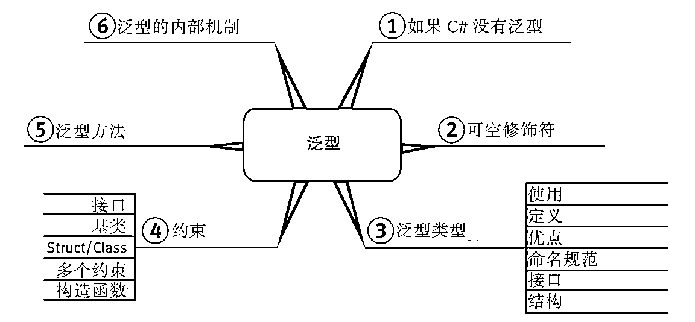

随着项目日趋复杂，需要更好的方式重用和定制现有软件。C#通过泛型 来促进代码重用，尤其是算法重用。

泛型在词义上等价于 Java 泛型类型和 C++模板。在三种语言中，该功能都使算法和模式只需实现一次，而不必为每个类型都实现一次。但相较于 Java 泛型和 C++模板，C#泛型在实现细节和对类型系统的影响方面差异甚大。方法之所以强大，因为它能够将相同的运算逻辑作用于不同的参数值上，产生不同的运算结果，从而实现对运算逻辑代码的重用。但其局限性在于，方法的参数类型不变，因此代码无法在不同的数据类型之间重用。相比之下，在泛型编程里，数据类型也是一种参数，这使得同一份代码不仅可以作用于不同的输入数值，而且可以作用于不同的数据类型。

> 注：PowerShell 语言本身不支持定义泛型类型或泛型方法——在类名/函数名后写类型参数（如 `class Stack[T] { }`）会直接解析失败。但 PowerShell 运行在 .NET 之上，可以直接**使用** .NET 的泛型类型，例如 `[System.Collections.Generic.Stack[Cell]]`、`[System.Collections.Generic.List[string]]`；调用 .NET 泛型方法时可用 `::方法名[类型](...)` 显式指定类型实参。本章关于泛型定义、约束、协变/逆变的讨论，作为理解 .NET 泛型内部机制的背景来读即可。

## 12.1　如果 C#没有泛型

开始讨论泛型前，先看看一个没有使用泛型的类 System.Collections.Stack。它表示一个对象集合，加入集合的最后一项是从集合中获取的第一项（称为后入先出或 LIFO）。Push()和 Pop()是 Stack 类的两个主要方法，分别用于在栈中添加和移除数据项。代码清单 12.1 展示了 Stack 类的 Pop()和 Push()方法声明。

代码清单 12.1　System.Collections.Stack 类的方法签名

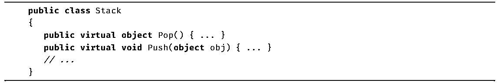

程序经常使用栈类型的集合实现多次撤销（undo）操作。例如，代码清单 12.2 利用 Stack 类在 Etch A Sketch 游戏程序中执行撤销。

代码清单 12.2　在 Etch A Sketch 游戏程序中支持撤销

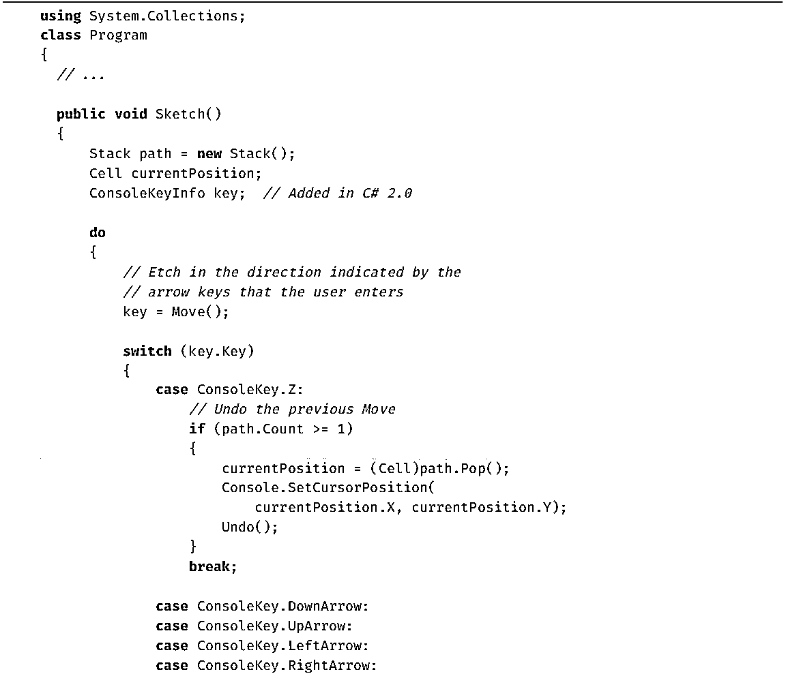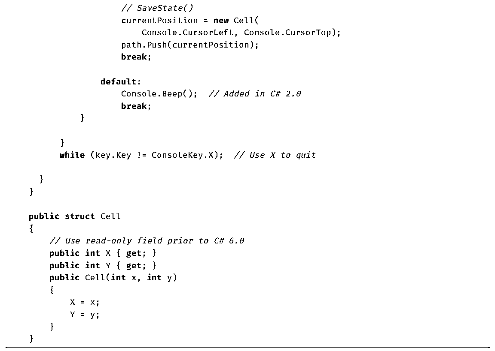

代码清单 12.2 的结果如输出 12.1 所示。

输出 12.1

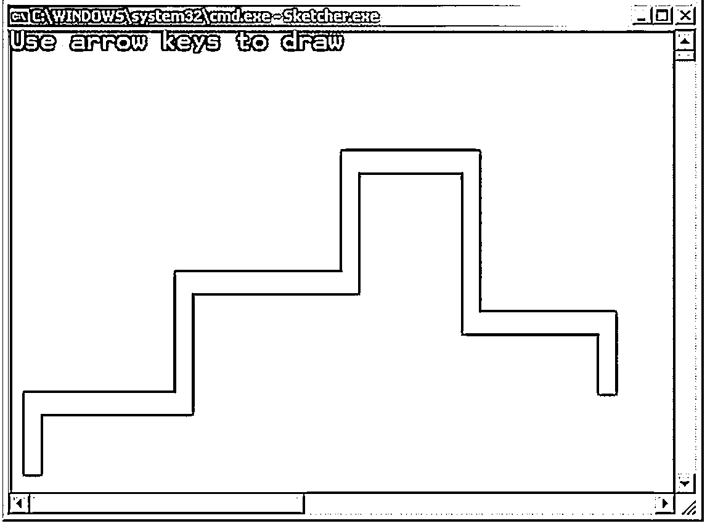

path 是声明为 System.Collections.Stack 的一个变量。要利用 path 保存上一次移动，只需使用 path.Push(currentPosition)方法，将一个自定义类型 Cell 传入 Stack.Push()方法。如用户输入 Z（或按 Ctrl+Z），表明需撤销上一次移动。为此，程序使用一个 Pop()方法获取上一次移动，将光标位置设为上一个位置，然后调用 Undo()。

虽然代码能正常工作，但 System.Collections.Stack 类存在重大缺陷。如代码清单 12.1 所示，Stack 类收集 object 类型的值。由于 CLR 的每个对象都从 object 派生，所以 Stack 无法验证放到其中的元素是不是希望的类型。例如，传递的可能不是 currentPosition 而是 string，其中 X 和 Y 坐标通过小数点连接。不过，编译器必须允许不一致的数据类型。因为栈类被设计可以获取任意对象，包括较具体的类型。

> 注：PowerShell 没有编译期类型检查，`System.Collections.Stack` 和 .NET 泛型集合都能接受任意对象。调用泛型集合的方法时，若传入类型不完全匹配，PowerShell 通常会做隐式转换（例如向 `List[string]` 添加 `1` 会变成字符串 `"1"`），也可能在运行时抛出异常——但不会像 C# 那样在编写代码时由编译器拦下。因此泛型的“编译期类型安全”在 PowerShell 中体现为 .NET 方法签名的运行时约束。

此外，使用 Pop()方法从栈中获取数据时，必须将返回值转型为 Cell。但假如 Pop()返回的不是 Cell，就会抛出异常。通过强制类型转换将类型检查推迟到运行时进行会使程序变得更脆弱。在不用泛型的情况下创建支持多种数据类型的类时，一个根本的问题是它们必须支持一个公共基类（或接口）——通常是 object。

为使用 object 的方法使用 struct 或整数这样的值类型，情况变得更糟。将值类型的实例传给 Stack.Push()方法，“运行时”将自动对它进行装箱。类似地，获取值类型的实例时需要显式拆箱，将从 Pop()获取的对象引用转型为值类型。引用类型转换为基类或接口，对性能的影响可忽略不计，但值类型装箱的开销较大，因为必须分配内存、拷贝值以及进行垃圾回收。

C#鼓励“类型安全”。许多类型错误（比如将整数赋给 string 变量）能在编译时被捕捉。目前的根本问题是 Stack 类不是类型安全的。在不使用泛型的前提下，要修改 Stack 类来确保类型安全，强迫它存储特定的数据类型，只能创建如代码清单 12.3 所示的一个特殊 Stack 类。

代码清单 12.3　定义特殊 Stack 类

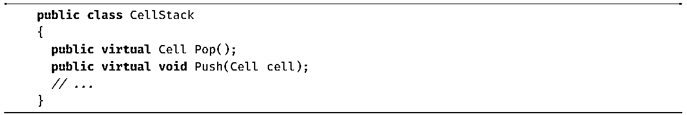

由于 CellStack 只能存储 Cell 类型的对象，所以该解决方案要求对栈的各个方法进行自定义实现，所以不是理想的解决方案。例如，为实现类型安全的整数栈，就需要另一个自定义实现。所有实现看起来都差不多。最终将产生大量重复、冗余的代码。

初学者主题：另一个例子——可空值类型

第三章讲过，可在声明值类型变量时使用可空修饰符？声明允许包含 null 值的变量。C#从 2.0 起才支持该功能，因其需要泛型才能正确实现。在引入泛型之前，程序员主要有两个选择。

第一个选择是为需要处理 null 值的每个值类型都声明可空数据类型，如代码清单 12.4 所示。

代码清单 12.4　为各个值类型声明可以存储 null 的版本

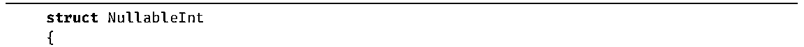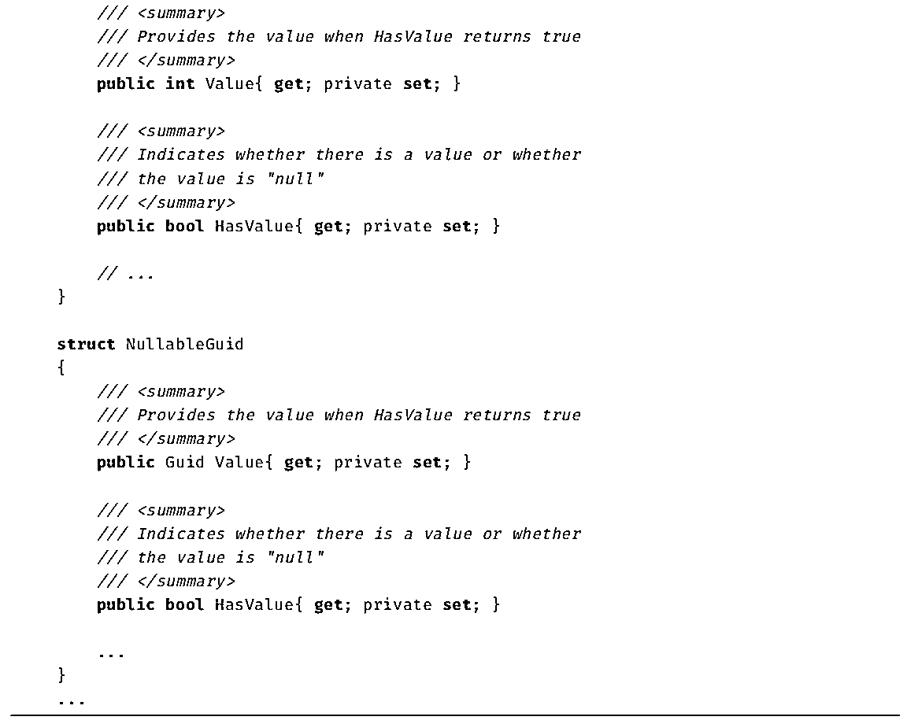

代码清单 12.4 只显示了 NullableInt 和 NullableGuid 的实现。如程序需要更多可空值类型，就不得不创建更多 struct，并修改属性来使用所需的值类型。如可空值类型的实现发生改变（例如，为了支持从基础类型向可空类型的隐式转换），就不得不修改所有可空类型声明。

第二个选择是声明可空类型，在其中包含 object 类型的 Value 属性，如代码清单 12.5 所示。

代码清单 12.5　声明可空类型，其中包含 object 类型的 Value 属性

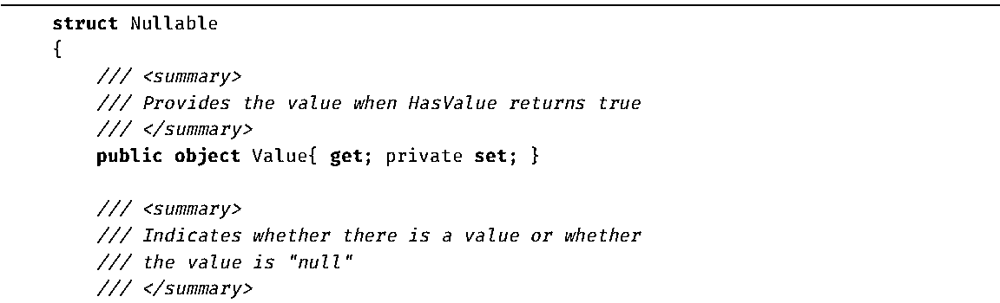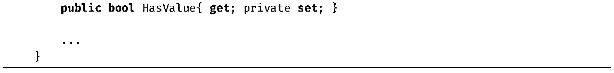

虽然该方案只需可空类型的一个实现，但“运行时”在设置 Value 属性时总是对值类型装箱。另外，从 Nullable.Value 获取基础值需要一次强制类型转换，而该操作在运行时可能无效。

两个方案都不理想。为解决问题，C# 2.0 引入了泛型。事实上，可空类型是作为泛型类型 Nullable<T>实现的。

## 12.2　泛型类型概述

可利用泛型创建一个数据结构，该数据结构能进行特殊化以处理特定类型。程序员定义这种参数化类型 ，使泛型类型的每个变量都具有相同的内部算法，但数据类型和方法签名可随为类型参数提供的类型实参而变。

为减轻开发者的学习负担，C#的设计者选择了与 C++模板相似的语法。所以， C#泛型类和结构要求用尖括号声明泛型类型参数 以及提供泛型类型实参 ^( [\[1\]](part0117.xhtml#ch1_back) ) 。

### 12.2.1　使用泛型类

代码清单 12.6 展示了如何指定泛型类使用的实际类型。为指示 path 变量使用 Cell 类型，在实例化和声明语句中都要用尖括号记号法指定 Cell。换言之，声明泛型类型的变量（本例是 path）时要指定泛型类型使用的类型实参。代码清单 12.6 展示了新的泛型 Stack 类。

代码清单 12.6　使用泛型 Stack 类实现撤销

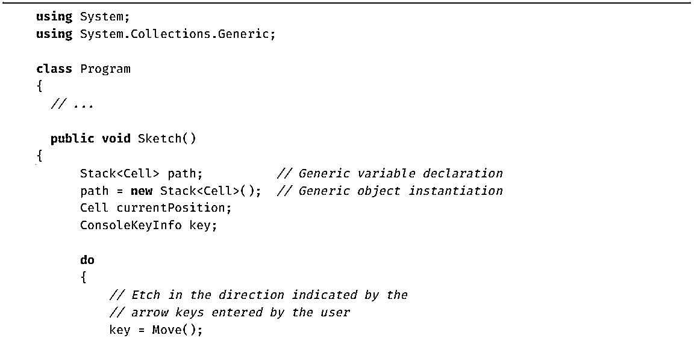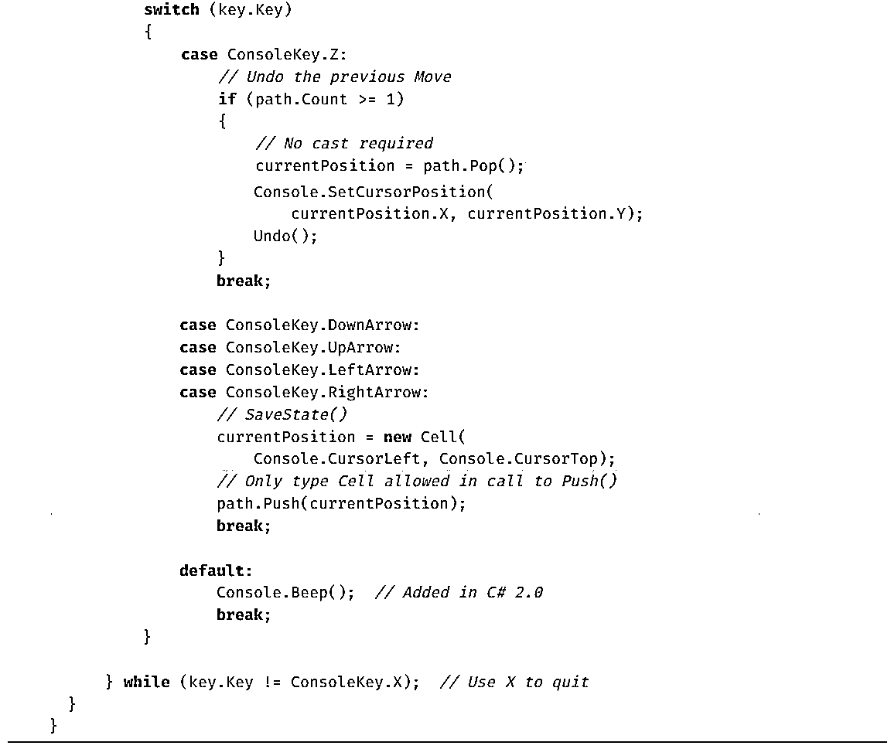

代码清单 12.6 的结果如输出 12.2 所示。

输出 12.2

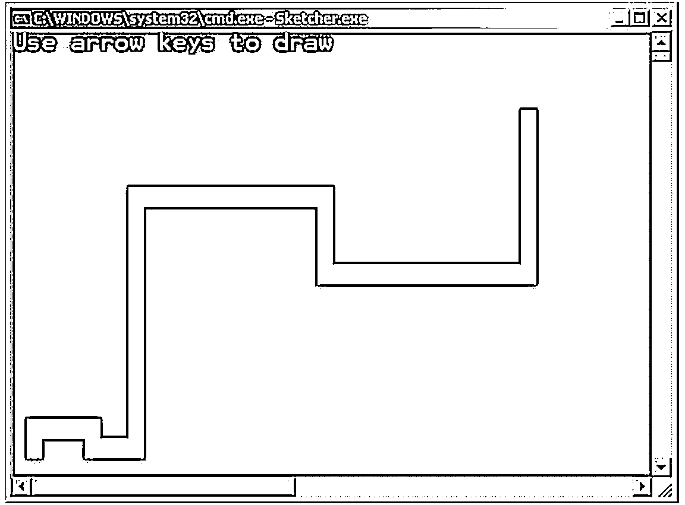

代码清单 12.6 声明并初始化 System.Collections.Generic.Stack<Cell>类型的 path 变量。尖括号中指定栈中的元素类型为 Cell。结果是添加到 path 以及从 path 取回的每个对象都是 Cell 类型。所以，不再需要对 path.Pop()的返回值进行转型，也不需要在 Push()方法中确保只有 Cell 类型的对象才能添加到 path。

### 12.2.2　定义简单泛型类

泛型允许开发者创建算法和模式，并为不同数据类型重用代码。代码清单 12.7 创建泛型 Stack<T>类，它与代码清单 12.6 使用的 System.Collections.Generic.Stack<T>类相似。在类名之后，需要在一对尖括号中指定类型参数 （本例是 T）。以后可向泛型 Stack<T>提供类型实参来“替换”类中出现的每个 T。这样栈就可以存储指定的任何类型的数据项，不需要重复代码，也不需要将数据项转换成 object。代码清单 12.7 将类型参数 T 用于内部 Items 数组、Push()方法的参数类型以及 Pop()方法的返回类型。

> 注：PowerShell 不能声明像 `Stack<T>` 这样的泛型类（`class Stack[T] { }` 会解析失败）。在 PowerShell 中只能使用 .NET 已经定义好的泛型类型。

代码清单 12.7　声明泛型类 Stack<T>

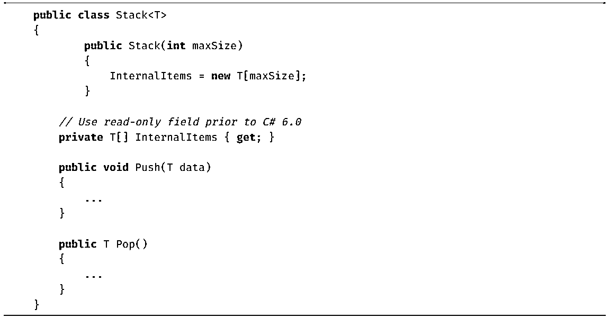

### 12.2.3　泛型的优点

使用泛型类而不是非泛型版本（比如使用 System.Collections.Generic.Stack<T>类而不是原始的 System.Collections.Stack 类型）有以下几方面的优点：

1.泛型促进了类型安全。它确保在参数化的类中，只有成员明确希望的数据类型才可使用。在代码清单 12.7 中，参数化栈类限制为 Stack<Cell>的所有实例使用 Cell 数据类型。例如，执行 path.Push("garbage")会造成编译时错误，指出没有 System.Collections.Generic.Stack<T>.Push(T)方法的重载版本能处理字符串"garbage"，因其不能被转换成 Cell。

2.编译时类型检查减小了在运行时发生 InvalidCastException 异常的概率。

3.为泛型类成员使用值类型，不再造成到 object 的装箱转换。例如，path.Pop()和 path.Push()不需要在添加一个项时装箱，或者在删除一个项时拆箱。

4.C#泛型缓解了代码膨胀。泛型类型既保持了具体类版本的优势，又没有具体类版本的开销（例如，没必要定义像 CellStack 这样的一个具体类）。

5.性能得以提高。一个原因是不再需要从 object 的强制转换，从而避免了类型检查。另一个原因是不需要为值类型装箱。

6.内存消耗减少。由于避免了装箱，因此减少了堆上的内存消耗。

7.代码可读性更好。一个原因是转型检查次数变少了。另一个原因是减少了针对具体类型的实现。

8.支持“智能感知”的代码编辑器现在能直接处理来自泛型类的返回参数。没必要为了使“智能感知”工作起来而对返回数据执行转型。

最核心的是，泛型允许写代码来实现模式，并在以后出现这种模式的时候重用该实现。模式描述了在代码中反复出现的问题，而泛型类型为这些反复出现的模式提供了单一的实现。

> 注：上面第 1、2、3、5 条所说的“编译时类型安全”“避免装箱”都是 C# 的优势。PowerShell 没有静态类型检查：向泛型集合传入错误类型时，通常由 .NET 方法签名在运行时处理（可能隐式转换，也可能抛异常），而不是在编写代码时被编译器拦下。

### 12.2.4　类型参数命名规范

和方法参数的命名相似，类型参数的命名应尽量具有描述性。此外，为了强调它是类型参数，名称应包含 T 前缀，例如 EntityCollection<TEntity>。

唯一不需要使用描述性类型参数名称的时候是描述不增加任何值的时候。例如，在 Stack<T>中使用 T 就够了，因为 T 足以说明问题——栈适合任意类型。

12.3 节将介绍约束。一个好的实践是使用对约束进行描述的类型名称。例如，假定约束类型参数必须实现 IComponent，则类型名称可以是“TComponent”。

设计规范

·要为类型参数选择有意义的名称，并为名称附加“T”前缀。

·考虑在类型参数的名称中指明约束。

### 12.2.5　泛型接口和结构

C#全面支持泛型，其中包括接口和结构。语法和类的语法完全一样。要声明泛型接口，将类型参数放到接口名称后的一对尖括号中即可，比如代码清单 12.8 中的 IPair<T>。

> 注：PowerShell 没有 `interface` 关键字，也没有 `struct` 关键字，因此不能声明泛型接口或泛型结构；只能使用 .NET 现有的泛型接口（如 `IComparable[T]`、`IEnumerable[T]`）和泛型结构（如 `ValueTuple`）。

代码清单 12.8　声明泛型接口

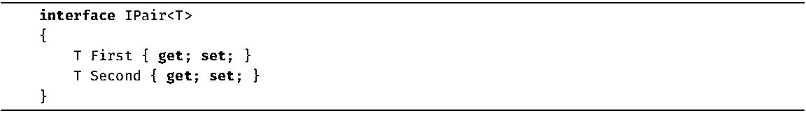

该接口代表一个数对，或者说一对相似对象，比如一个点的平面坐标、一个人的生身父母，或者一个二叉树的节点，等等。数对中的两个数据项具有相同的类型。

实现接口的语法与实现非泛型类的语法相同。如代码清单 12.9 所示，一个泛型类型的类型实参可成为另一个泛型类型的类型参数，这既合法又普遍。接口的类型实参是类所声明的类型参数。此外，本例使用结构而不是类，目的是演示 C#对自定义泛型值类型的支持。

代码清单 12.9　实现泛型接口

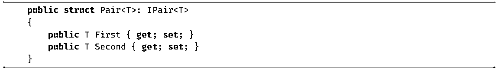

对泛型接口的支持对集合类尤其重要。使用泛型最多的地方就是集合类。假如没有泛型，开发者就要依赖 System.Collections 命名空间中的一系列接口。和它们的实现类一样，这些接口只能使用 object 类型，结果是进出这些集合类的所有访问都要执行转型。使用类型安全的泛型接口，就可避免转型。

高级主题：在类中多次实现同一个接口

相同泛型接口的不同构造被视为不同类型，所以类或结构能多次实现“同一个”泛型接口。来看看代码清单 12.10 的例子。

代码清单 12.10　在类中多次实现接口

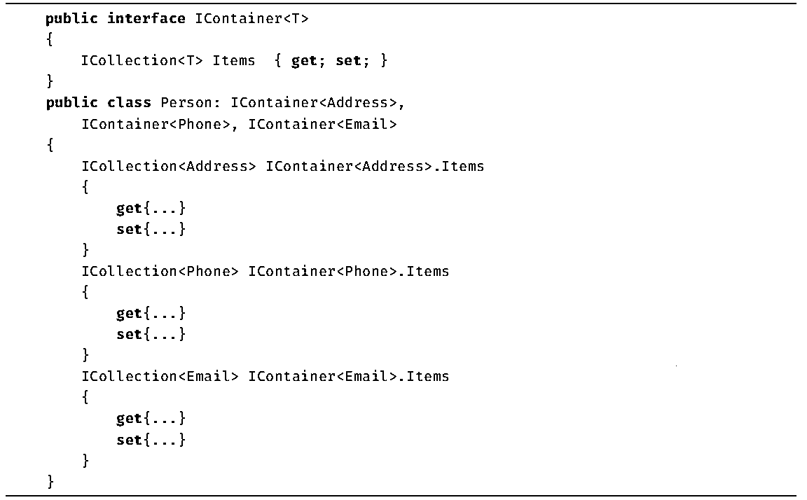

在本例中，Items 属性通过显式接口实现多次出现，每次类型参数都有所不同。没有泛型这是不可能的。在没有泛型的情况下，编译器只允许一个显式的 IContainer.Items 属性。

但像这样实现“同一个”接口的多个版本是不好的编码风格，因为它会造成混淆（尤其是在接口允许协变或逆变转换的情况下）。此外，Person 类的设计也似乎有问题，因为一般不会认为人是“能提供一组电子邮件地址的东西”。与其实现接口的三个版本，不如实现三个属性：EmailAddresses、PhoneNumbers 和 MailingAddresses，每个属性都返回泛型接口的相应构造。

设计规范

·避免在类型中实现同一泛型接口的多个构造。

### 12.2.6　定义构造函数和终结器

令人惊讶的是，泛型类或结构的构造函数（和终结器）不要求类型参数。换言之，不要求写成 Pair<T>(){...}这样的形式。在代码清单 12.11 的数对例子中，构造函数声明为 public Pair(T first, T second)。

代码清单 12.11　声明泛型类型的构造函数

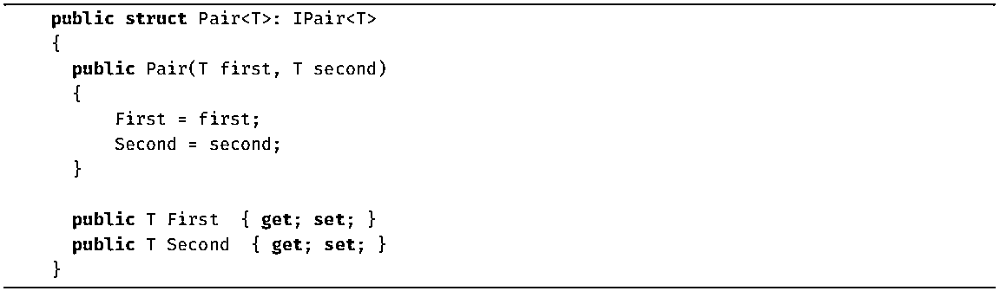

### 12.2.7　用 default 操作符指定默认值

代码清单 12.11 的构造函数获取 First 和 Second 的初始值，并将它们赋给 First 和 Second。由于 Pair<T>是结构，所以提供的任何构造函数都必须初始化所有字段和自动实现的属性。但这带来一个问题。

假定有一个 Pair<T>的构造函数，它在实例化时只对数对的一半进行初始化。如代码清单 12.12 所示，定义这样的构造函数会造成编译时错误，因为在构造结束时，字段 Second 仍处于未初始化的状态。我们无法给 Second 设置初始值，因为在编写这个构造函数时还不知道它的类型 T 具体是什么。如果它是个引用类型，还可以用 null 来初始化，但如果它是个不可空的数值类型，null 就帮不上忙了。

代码清单 12.12　不初始化所有字段造成编译时错误

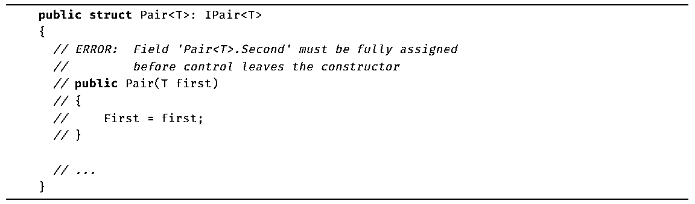

为应对这样的局面，C#提供了 default 操作符。可用 default(int)指定 int 的默认值。相应地，从 C#7.1 开始，也可用 default(T)作为未知类型的 T 的默认值来初始化 Second，如代码清单 12.13 所示。

代码清单 12.13　用 default 操作符初始化字段

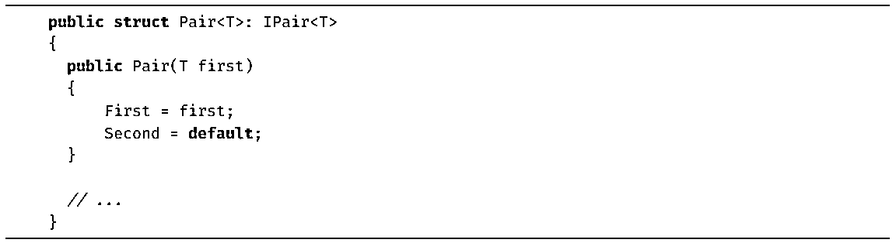

default 操作符可为任意类型提供默认值，包括类型参数。

> 注：PowerShell 没有 `default` 操作符（`default(int)` 会被当作调用名为 `default` 的命令，运行时提示“无法将 'default' 识别为 cmdlet…”）。PowerShell 中未赋值的变量通常就是 `$null`；需要某个值类型的零值时，可用 `[int]::new()`、`[int]0` 等写法，或直接依赖 .NET 的默认初始化。

在 C# 7.1 以前，default 操作符的括号里必须指定具体的类型。从 C# 7.1 起，只要能推断出数据类型，使用 default 时就可不指定参数。例如，在变量初始化或赋值时，可用 Pair<T> pair=default 代替 Pair<T> pair=default (Pair<T>)。另外，如方法返回 int，直接写 return default 就可以了，编译器能从方法返回类型中推断出应返回一个 default(int)。其他能进行这种推断的场合包括默认参数（可选）值以及方法调用中传递的实参。

如果用 default(T?)为可空类型变量设置默认值，则其值会被设置为 null。此外，任何引用类型的默认值也是 null。在 C# 8.0 中如果启用了可空引用类型，为不可空引用类型变量设置默认值将产生编译器警告。如果在为旧版本编译器编写的代码中含有为引用类型变量设置默认值的语句，当将代码转移到 C# 8.0 之后的新编译器中时，会产生编译器警告。因此，除非 null 确实为合理值，否则应该避免为引用类型变量设置默认值，更好的做法是等到合理值出现时再为引用类型变量赋值。在代码清单 12.13 中，Second 变量的合理值在构造函数中尚未出现，因为不可避免将它设置为 null。为了避免编译器警告，应该将其声明为可空的泛型类型变量，即写为 T?的形式，并且用 struct/class 约束将其指定为引用类型。（一个更具概括性的准则是：对于泛型类型来说，除非将其约束为引用类型，否则不要为其设置默认值。）

### 12.2.8　多个类型参数

泛型类型可使用任意数量的类型参数。前面的 Pair<T>例子只包含一个类型参数。为存储不同类型的两个对象，比如一个“名称/值”对，可创建类型的新版本来声明两个类型参数，如代码清单 12.14 所示。

代码清单 12.14　声明具有多个类型参数的泛型

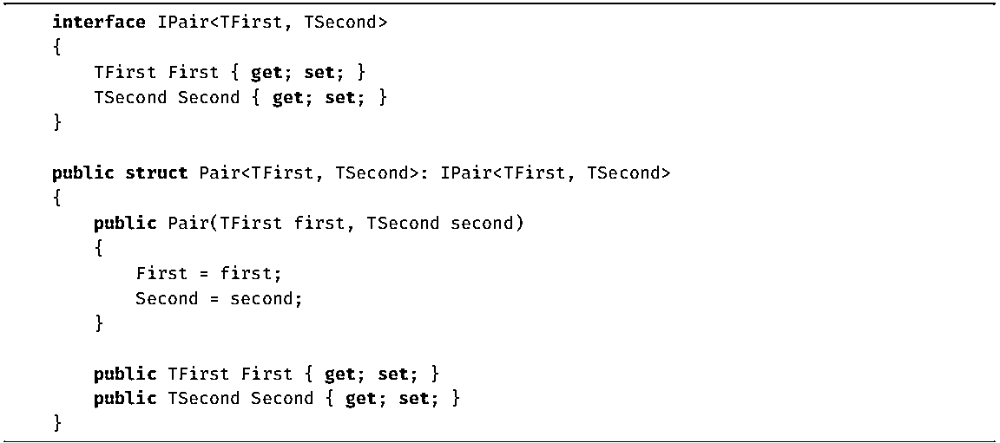

使用 Pair<TFirst, TSecond>类时，只需在声明和实例化语句的尖括号中指定多个类型参数。调用方法时，则提供与方法参数匹配的类型。如代码清单 12.15 所示。

代码清单 12.15　使用具有多个类型参数的类型

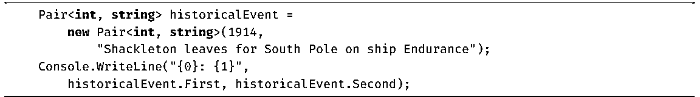

类型参数的数量（或者称为元数 ，即 arity）区分了同名类。例如，由于类型参数的数量不同，所以可在同一命名空间中定义 Pair<T>和 Pair<TFirst, TSecond>。此外，由于在语义上的密切联系，仅元数不同的泛型应放到同一个 C#文件中。

设计规范

·要将只是类型参数数量不同的多个逻辑相关的泛型类放到同一个文件中。

初学者主题：元组——无尽的元数

第三章提到，自 C# 7.0 起支持元组语法。在其内部，实现元组语法的底层类型实际是泛型，具体说就是 System.ValueTuple。和 Pair<...>一样，同一个名字可因元数不同而重用（每个类都有不同数量的类型参数），如代码清单 12.16 所示。

代码清单 12.16　通过元数的区别来重载类型定义

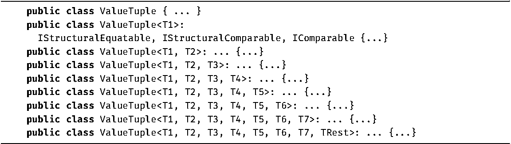

这一组 ValueTuple<...>类出于和 Pair<T>与 Pair<TFirst, TSecond>类相同的目的而设计，只是它们加起来最多能同时处理 8 个类型参数。但使用代码清单 12.16 的最后一个 ValueTuple，可在 TRest 中存储另一个 ValueTuple。这样元数实际就是无限的。另外，如使用 C# 7.0 的元组语法，甚至根本不用关心具体使用哪一个重载版本。

在这一组元组类中，非泛型的 ValueTuple 类很有意思。该类有 8 个静态工厂方法^( [\[2\]](part0117.xhtml#ch2_back) ) 用于实例化各个泛型元组类型。虽然每个泛型类型都可用自己的构造函数直接实例化，但 ValueTuple 类型的工厂方法允许推断类型参数。该功能在 C# 7.0 中无关紧要，因为代码可简化成 var keyValuePair=("555-55-5555", new Contact("Inigo Montoya"))（假定无具名项）。但如代码清单 12.17 所示，在 C# 7.0 之前，Create()方法结合类型推断显得更简单。

代码清单 12.17　比较 System.ValueTuple 的不同实例化途径

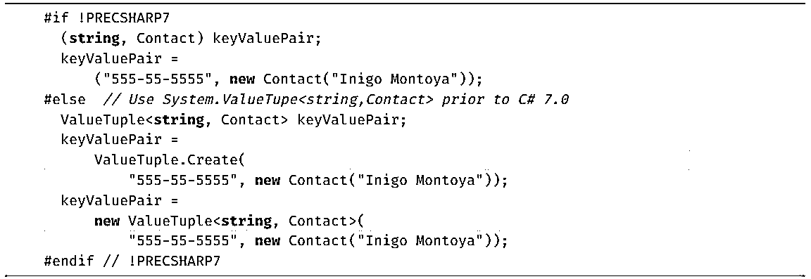

显然，当 ValueTuple 变大（元数增大）时，如果不用 Create()工厂方法，要指定的类型参数的数量会变得非常庞大。

注意 C# 4.0 引入了一个类似的元组类 System.Tuple。但自 C# 7.0 起基本用不着它了（除非要向后兼容），因为元组语法实在太好用了，而且底层的 System.ValueTuple 是值类型，性能上也获得了大幅提高。

基于框架库声明了 8 个不同 System.ValueTuple 类型这一事实，可推断 CLR 类型系统并不支持所谓的“元数可变”泛型类型。方法可以通过“参数数组”获取任意数量的实参，但泛型类型不可以。每个泛型类型的元数都必须固定。

### 12.2.9　嵌套泛型类型

嵌套类型自动获得包容类型的类型参数。例如，假如包容类型声明类型参数 T，则所有嵌套类型都是泛型，也可使用类型参数 T。如嵌套类型包含自己的类型参数 T，它会隐藏包容类型的类型参数 T。在嵌套类型中引用 T，引用的是嵌套类型的 T 类型参数。幸好，在嵌套类型中重用相同的类型参数名，会造成编译器报告一条警告消息，防止开发者因为不慎而使用了同名参数，如代码清单 12.18 所示。

代码清单 12.18　嵌套泛型类型

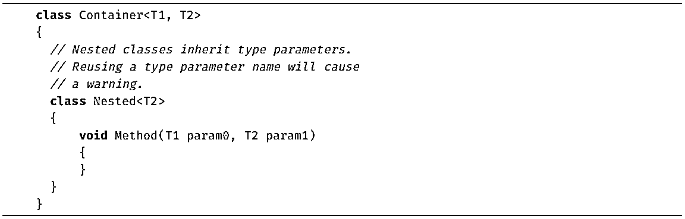

包容类型的类型参数能从嵌套类型中访问，这类似于能从嵌套类型中访问包容类型的成员。规则很简单：在声明类型参数的类型主体的任何地方都能访问该类型参数。

设计规范

·避免在嵌套类型中用同名参数隐藏外层类型的类型参数。

[\[1\]](part0117.xhtml#ch1) 本章很少区分类型参数和类型实参（实际上作者也不是特别严格），因为不影响理解。——译者注

[\[2\]](part0117.xhtml#ch2) “生产”对象的方法就是“工厂”方法。——译者注

## 12.3　约束

泛型允许为类型参数定义约束 ，强迫作为类型实参提供的类型遵守各种规则。来看看代码清单 12.19 的 BinaryTree<T>类。

> 注：PowerShell 不能在自定义类型上声明泛型约束（没有 `where T : ...` 语法）。约束是 .NET 泛型类型自身的元数据；在 PowerShell 中使用这些类型（如 `[System.Collections.Generic.List[string]]`）时，约束由 .NET 在类型加载或方法绑定阶段检查。

代码清单 12.19　声明无约束的 BinaryTree<T>类

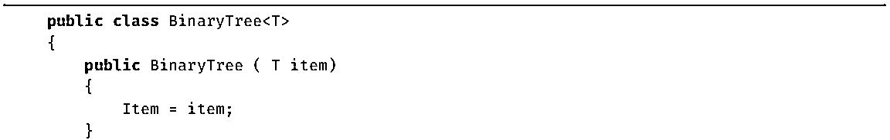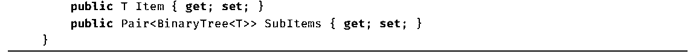

（一个有趣的地方是，BinaryTree<T>内部使用了 Pair<T>。能这样做的原因很简单——Pair<T>是另一个类型。）

现在，假定当 Pair<T>中的值赋给 SubItems 属性的时候，你希望二叉树对这些值进行排序。为实现排序，SubItems 的赋值方法（称为 setter）使用当前所提供键的 CompareTo()方法，如代码清单 12.20 所示。

代码清单 12.20　类型参数需支持接口

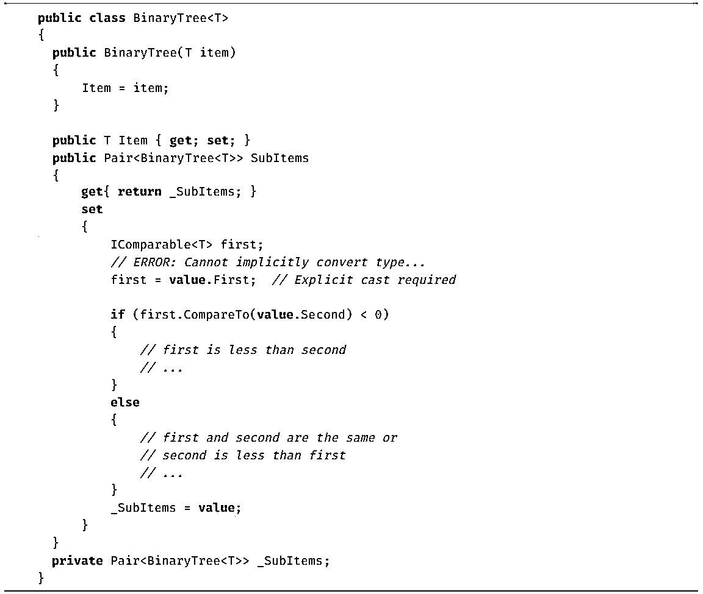

编译时，类型参数 T 是无约束的泛型。所以，编译器认为 T 当前只有从基类型 object 继承的成员，因为 object 是所有类型的终极基类（换言之，只能为类型参数 T 的实例调用像 ToString()这样的已经由 object 定义的方法）。结果是编译器显示一个编译错误，因为 object 类型没有定义 CompareTo()方法。

可将 T 参数强制转换为 IComparable<T>接口来访问 CompareTo()方法，如代码清单 12.21 所示。

代码清单 12.21　类型参数需支持接口，否则会抛出异常

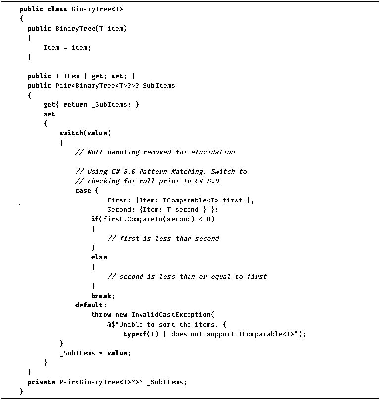

遗憾的是，现在如果声明一个 BinaryTree<SomeType>类的变量，但类型参数 SomeType 没有实现 IComparable<SomeType>接口，这时我们不得不通过抛出 InvalidCastException 异常来表示缺乏必要的接口，因为没有实现这个接口的对象无法进行比较操作。这就失去了用泛型增强类型安全的意义。

为避免该异常，而是生成编译时错误，C#允许为泛型类中声明的每个类型参数提供可选的约束 列表。约束描述了泛型要求的类型参数的特征。声明约束需要使用 where 关键字，后跟一对“参数:要求”。其中，“参数”必须是泛型类型中声明的一个参数，而“要求”描述了类型参数要能转换成的类或接口，是否必须有默认构造函数，或者是引用还是值类型。

### 12.3.1　接口约束

二叉树节点正确排序需使用 BinaryTree 类的 CompareTo()方法。为此，最高效的做法是为 T 类型参数施加约束，规定 T 必须实现 IComparable<T>接口。具体语法如代码清单 12.22 所示。

代码清单 12.22　声明接口约束

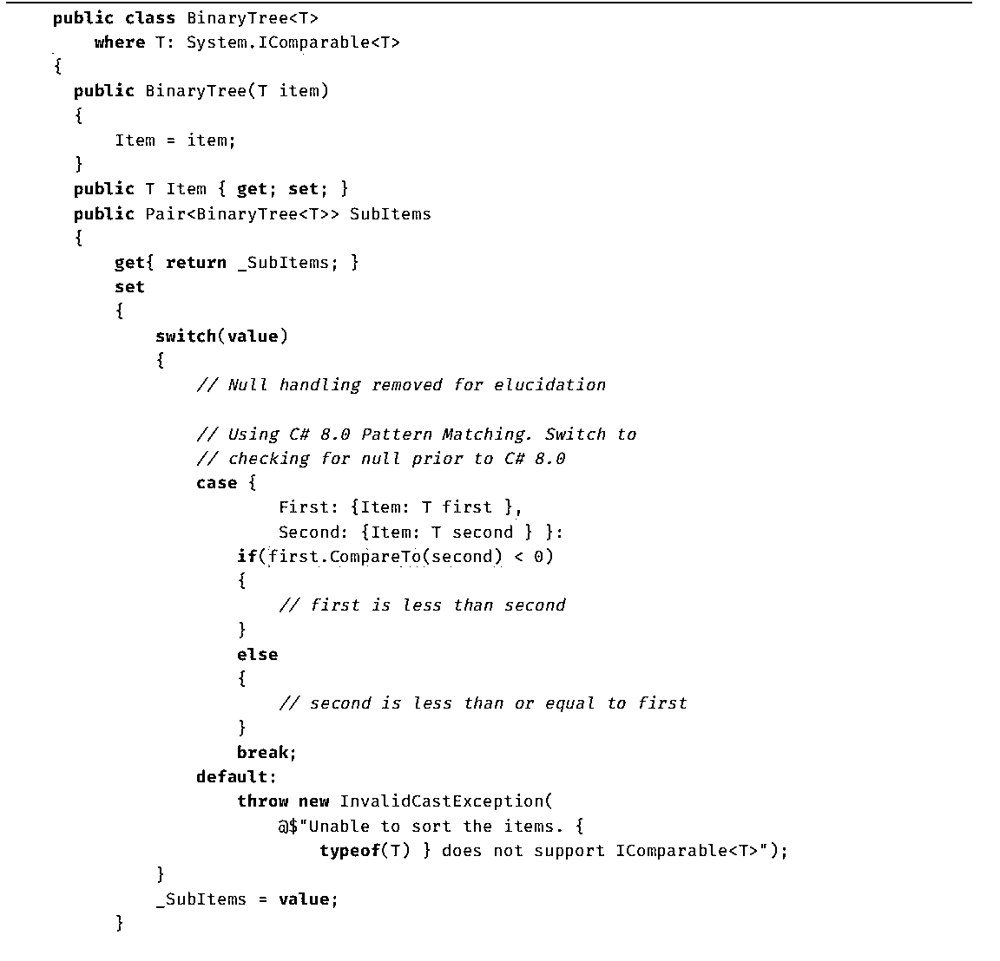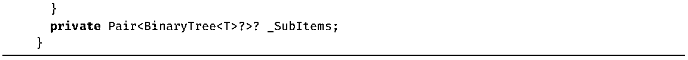

代码清单 12.22 中的代码改动不大，但它将错误检查提前至编译阶段，从而避免了在运行过程中出错，这一点非常重要。上面代码添加了接口约束之后，编译器会确保每次使用 BinaryTree 类的时候，所提供的类型参数都实现了 IComparable<T>接口。此外，调用 CompareTo()方法不需要先将变量显式转型为 IComparable<T>接口。即使访问显式实现的接口成员也不需要转型（其他情况下若不转型会导致成员被隐藏）。调用 T 的某个方法时，编译器会检查它是否匹配所约束的任何接口的任何方法。

试图使用 System.Text.StringBuilder 作为类型参数来创建一个 BinaryTree<T>变量，会收到一个编译错误，因为 StringBuilder 没有实现 IComparable<StringBuilder>。输出 12.3 展示了这样的一个错误。

输出 12.3

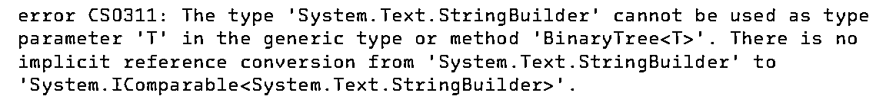

为规定某个数据类型必须实现某个接口，需声明一个接口类型约束 。这种约束避免了非要转型才能调用一个显式的接口成员实现。

### 12.3.2　类型参数约束

有时要求能将类型实参转换为特定的类型。这是用类型参数约束 做到的，如代码清单 12.23 所示。

代码清单 12.23　声明类类型约束

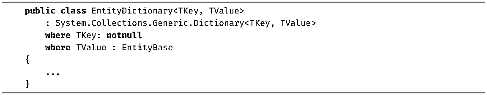

在代码清单 12.23 中，EntityDictionary<TKey, TValue>要求为类型参数 TValue 提供的所有类型实参都能隐式转换为 EntityBase 类。这样就可在泛型实现中为 TValue 类型的值使用 EntityBase 的成员，因为约束已确保所有类型实参都能隐式转换为 EntityBase 类。

类类型约束的语法和接口约束基本相同。但假如同时指定了多个约束，那么类类型约束必须第一个出现（就像在类声明中，基类必须先于所实现的接口出现）。和接口约束不同的是不允许多个类类型约束，因为不可能从多个不相关的类派生。类似地，类类型约束不能指定密封类或者不是类的类型。例如，C#不允许将类型参数约束为 string 或 System.Nullable<T>。否则只有单一类型实参可供选择，还有什么“泛型”可言？如类型参数被约束为单一类型，类型参数就没有存在的必要了，直接使用那个类型即可。

一些“特殊”类型不能作为类类型约束，详情参见稍后的“高级主题：约束的限制”。

从 C# 7.3 开始，可以使用 System.Enum 作为约束来确保类型参数为一个枚举类型。但是不能用 System.Array 将类型参数约束为一个集合。然而我们依然可以用很多其他集合类或接口来替代，因此这一局限影响并不大，详见第十五章。

高级主题：委托约束

C# 7.3 允许使用 System.Delegate 和 System.MulticastDelegate 两个类来将类型参数约束为委托类型。有了它们便可以安全地将多个委托对象进行组合（使用静态的 Combine()方法）和分离（使用静态的 Remove()方法）。虽然泛型类型无法以强类型的方式调用委托，但是还是可以通过调用 DynamicInvoke()方法来调用委托。该方法通过内部使用反射来实现其功能。泛型类型除了通过 DynamicInvoke()来调用委托之外，还可以在编译时通过 T 的直接引用来调用 Combine()方法然后强制转换为所需的类型。代码清单 12.24 演示了这一做法。

代码清单 12.24　声明类类型约束

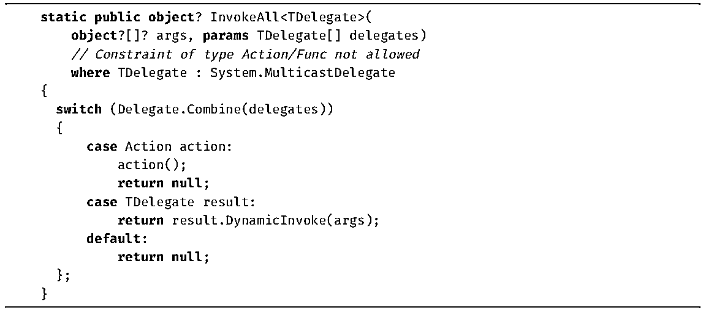

上面例子先尝试将委托转换为 Action 来直接调用，如果不行，再尝试转换为 TDelegate 来调用其 DynamicInvoke()方法。

注意，在非泛型代码中，我们明确知道 T 的类型，因此可以用 Combine()组合之后直接调用：

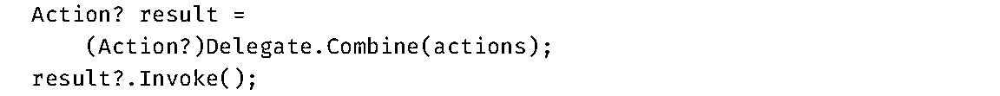

注意代码清单 12.24 中 where 所在的那一行：代码在那里声明类型参数约束。若要约束为委托类型，必须使用 System.Delegate 或 System.MulticastDelegate，而不能使用具体的委托类，比如 Action，Func<T>或者相关类型。

### 12.3.3　非托管约束

在 C# 7.3 中可以将类型参数约束为非托管类型，包括：sbyte、byte、short、ushort、int、uint、long、ulong、char、float、double、decimal、bool、枚举、指针或者只包含非托管字段的结构。有了这个约束，你可以在代码中对 T 使用如 sizeof 操作符或者执行 stackalloc 操作（将在第二十二章介绍）。

在 C# 8.0 之前，当使用结构作为类型参数约束时，结构不能为泛型。从 C# 8.0 开始，在这种情况下结构也可以是泛型的。例如，即便 T 被约束为非托管类型，也可以像这样使用：Thing<Thing<int>>。

### 12.3.4　非空约束

在代码清单 12.23 中还有一个类型约束，即非空约束。使用关键字 notnull 声明。当使用可空类型作为类型参数时，该关键字会触发编译器警告。例如，如果在代码中做声明：EntityDictionary<string?, EntityBase>，则会触发警告：Nullability of type argument 'string?' doesn't match 'notnull' constraint（string 参数的可空性与 notnull 约束不符）。

notnull 约束不能与 struct 或 class 约束共同使用，因为 struct 和 class 默认不可空（下一节会介绍）。

### 12.3.5　struct/class 约束

另一个重要的泛型约束是将类型参数限制为任何非可空值类型或任何引用类型。如代码清单 12.25 所示，不是指定 T 必须从中派生的一个类，而是直接使用关键字 struct 或 class。

代码清单 12.25　规定类型参数必须是值类型

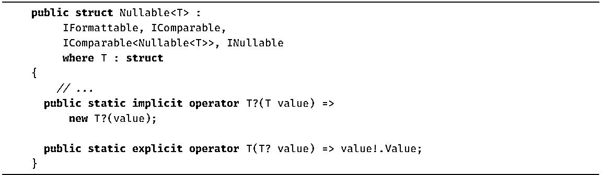

注意一个容易混淆的地方，class 约束不是将类型实参限制为类类型，而是限制为引用类型，所以类、接口、委托和数组类型都符合条件。

在 C# 8.0 中，如果启用了可空引用类型，则当以 class 作为类型参数约束时，默认是不可空的。因此如果将该类型参数指定了一个可空类型时将产生编译器警告。可以在声明约束时使用可空修饰符来改变约束。例如，第十章曾介绍过的 WeakReference<T>泛型类型的声明是这样的：

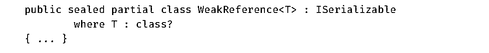

这个约束的含义为：类型参数 T 为可空的引用类型。

与 class 不同，当 struct 被用于类型参数约束时，不允许使用可空修饰符，但可以在提供参数时使用可空修饰符来表明该参数的可空性。例如，代码清单 12.25 中的隐式转换和显式转换操作符使用 T 和 T?来限定类型参数 T 是否可空。换句话说，在这种情况下类型参数的具体约束在使用该泛型类的具体位置才明确。

class 约束要求引用类型，struct 和 class 约束一起使用会产生冲突，所以是不允许的。

struct 约束有一个很特别的地方：可空值类型不符合条件。为什么？可空值类型作为泛型类型 Nullable<T>来实现，而后者本身向 T 应用了 struct 约束。如可空值类型符合条件，就可定义毫无意义的 Nullable<Nullable<int>>类型。双重可空的整数当然没有意义。（如同预期的那样，快捷语法 int??也不允许。）

### 12.3.6　多个约束

可为任意类型参数指定任意数量的接口类型约束，但类类型约束只能指定一个（就像类可实现任意数量的接口，但只从一个类派生）。所有约束都在一个以逗号分隔的列表中声明。约束列表跟在泛型类型名称和一个冒号之后。如果有多个类型参数，每个类型参数前面都要使用 where 关键字。在代码清单 12.26 中，泛型 EntityDictionary 类声明了两个类型参数：TKey 和 TValue。TKey 类型参数有两个接口类型约束，而 TValue 类型参数有一个类类型约束。

代码清单 12.26　指定多个约束

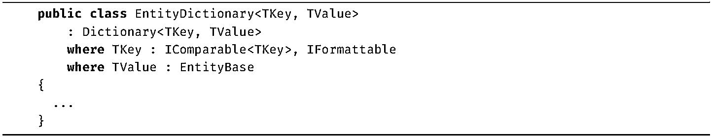

本例的 TKey 有多个约束，而 TValue 只有一个。一个类型参数的多个约束默认存在 AND 关系。例如，假定提供类型 C 作为 TKey 的类型实参，C 必须实现 IComparable<C>和 IFormattable。

注意，两个 where 子句之间并不存在逗号。

### 12.3.7　构造函数约束

有时要在泛型类中创建类型实参的实例。在代码清单 12.27 中，EntityDictionary<TKey, TValue>类的 MakeValue()方法必须创建与类型参数 TValue 对应的类型实参的实例。

代码清单 12.27　用约束规定必须有默认构造函数

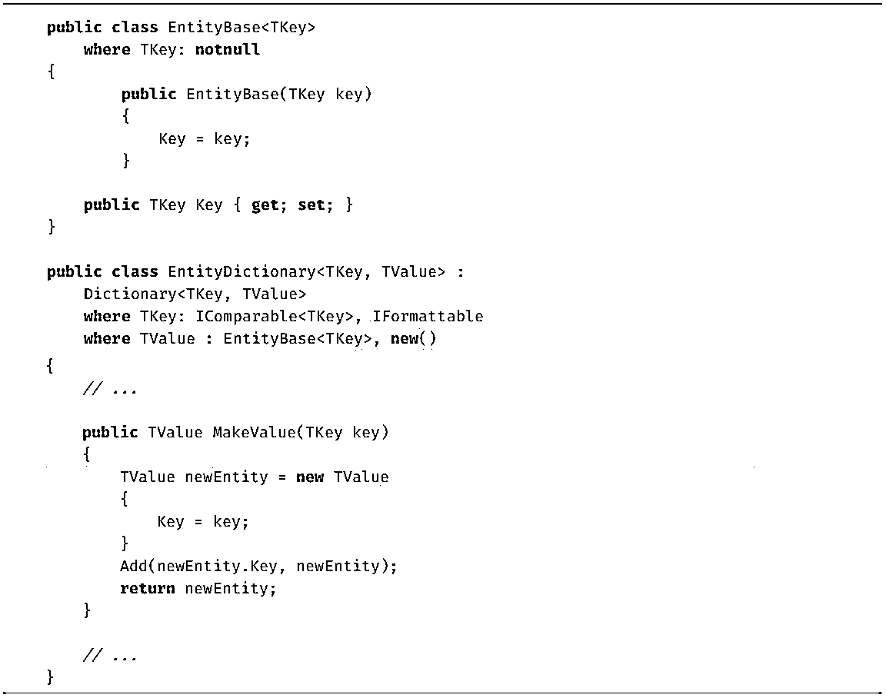

并非所有对象都肯定有公共默认构造函数，所以编译器不允许为未约束的类型参数调用默认构造函数。为克服编译器的这一限制，要在指定了其他所有约束之后添加 new()。这就是所谓的构造函数约束 ，它要求类型实参必须有默认构造函数。只能对默认构造函数进行约束。不能为有参构造函数指定约束。

代码清单 12.27 中有一个构造函数约束，它要求 TValue 的类型必须拥有一个没有参数的构造函数（即默认构造函数）。但这是构造函数约束能做的所有事。你无法进一步要求类型参数的构造函数必须接收什么样的参数。例如，你可能想要求 TValue 类的构造函数接收一个 TKey 类型的参数，但目前无法做到这一点。代码清单 12.28 展示了这种错误的构造函数约束。

代码清单 12.28　构造函数约束只能要求默认构造函数

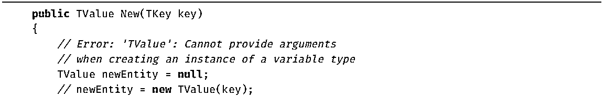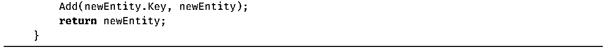

如果被实例化的类的构造函数必须接收参数，可以将类型参数约束为一个工厂接口，然后由工厂接口的实现类来构造 TValue 实例而不是在 EntityDictionary 类中构造。代码清单 12.29 演示了这一方法。

代码清单 12.29　使用工厂接口代替构造函数约束

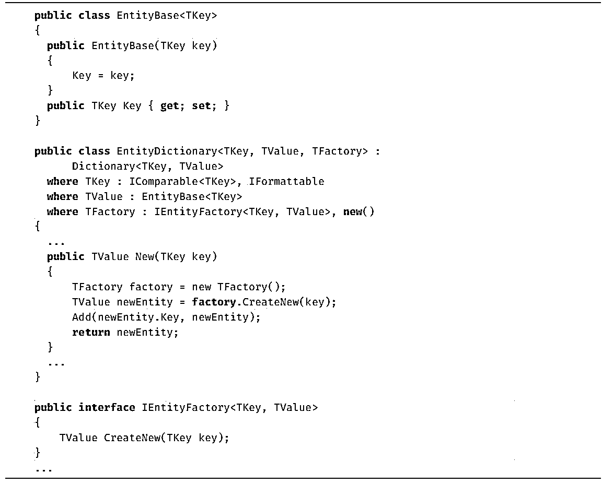

上述方法允许向 TValue 的工厂提供 TKey 类型的参数，而不必受到只能使用默认构造函数的限制。它不再需要为 TValue 声明构造函数约束，因为现在由 TFactory 负责构造实例。（12.29 中的代码还有一个可以改进的地方：若能将工厂对象缓存以备将来重复使用会更好。如果需要支持多线程环境，可以使用 Lazy<T>。）

代码清单 12.30 中代码声明了可以在 EntityDictionary<TKey, TValue, TFactory>中使用的 Order 类和 Order 类的工厂类。

代码清单 12.30　声明可以在 EntityDictionary<...>中使用的 Order 对象。

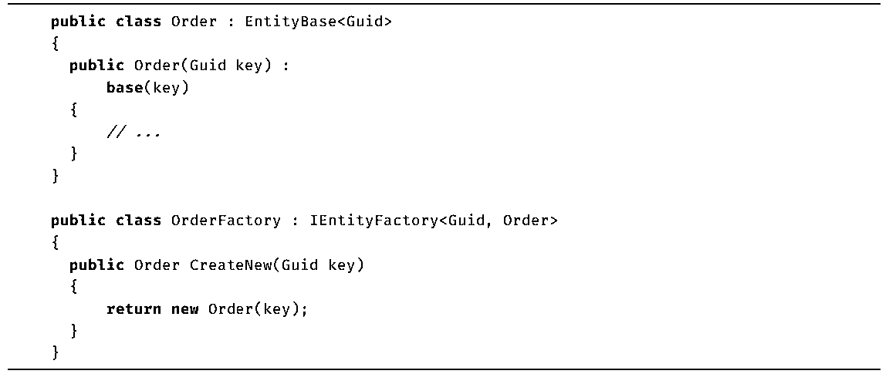

### 12.3.8　约束继承

无论泛型类型参数，还是它们的约束，都不会被派生类继承，因为泛型类型参数不是成员。（记住，类继承的特点在于派生类拥有基类的所有成员。）经常采取的做法是使新泛型类型从其他泛型类型派生。因为派生的泛型类型的类型参数现在是泛型基类的类型实参，所以类型参数必须具有等同（或更强）于基类的约束。是不是很拗口？来看看代码清单 12.31 的例子。

在代码清单 12.31 中，EntityBase<T>要求基类指示符 EntityBase<U>为 T 提供的类型实参 U 实现 IComparable<U>，所以子类 Entity<U>要对 U 进行相同的约束，否则会造成编译时错误。这使程序员在使用派生类时能注意到基类的约束，避免在使用派生类的时候发现了一个约束，却不知道该约束来自哪里。

代码清单 12.31　显式指定继承的约束

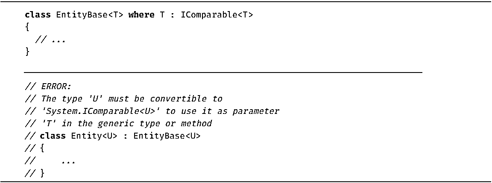

本章要到后面才会讲到泛型方法。但简单地说，方法也可以泛型，也可向类型参数应用约束。那么，当虚泛型方法被继承并重写时，约束是如何来处理的呢？和泛型类声明的类型参数相反，重写虚泛型方法时，或者创建显式接口方法实现^( [\[1\]](part0118.xhtml#ch1_back) ) 时，约束是隐式继承的，不可以重新声明。代码清单 12.32 对此进行了演示。

代码清单 12.32　禁止虚成员重复继承的约束

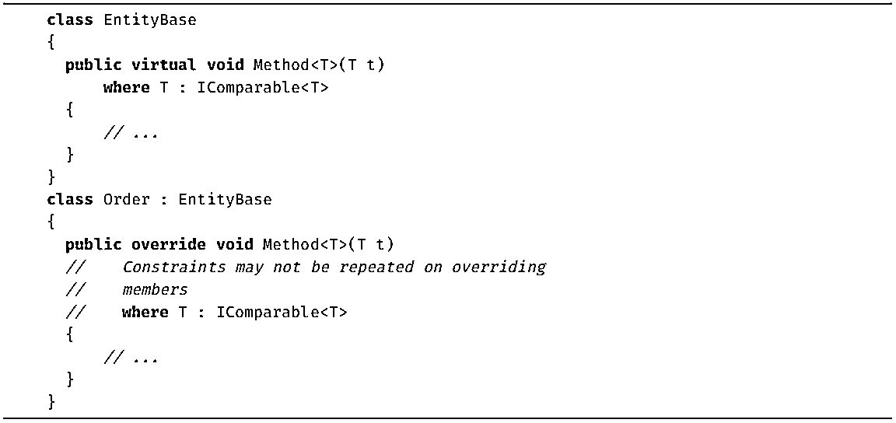

在泛型类继承的情况下，不仅可以保留基类本来的约束（这是必需的），还可添加额外的约束，从而对派生类的类型参数进行更大的限制。但重写虚泛型方法时，需遵守和基类方法完全一样的约束。额外的约束会破坏多态性，所以不允许新增约束。另外，重写版本的类型参数约束是隐式继承的。

高级主题：约束的限制

约束进行了一些适当的限制，以避免产生无意义的代码。例如，写了类类型约束，就不能再写 struct/class 约束；而写了这两种类型约束就不能在写 notnull 约束。另外，不能限制从一些特殊类型继承，比如 object、数组或 System.ValueType。而从 C# 7.3 开始可以使用 System.Enum（或 enum）、System.Delegate 和 System.MulticastDelegate 约束了。但是委托约束不能为具体的委托类型，例如 Action、Func<T>或者相关类型。

有时候，一些约束声明非常有用，但是尚未被实现的。使用构造函数约束时只能支持默认构造函数就是一个典型的例子。下面讨论另一些不支持的约束。

不支持操作符约束 

所有泛型都隐式允许==和!=比较，以及对对象的隐式转换，因为一切都是对象。

你无法通过约束来强制一个类型参数必须实现一些特定的方法或操作符，如果非常需要实现这样的约束，只能通过接口约束（限制方法）和类类型约束（限制方法和操作符）来提供不完整的实现。因此，代码清单 12.33 的泛型 Add()方法是不能工作的。

代码清单 12.33　约束表达式不能提出对操作符的要求

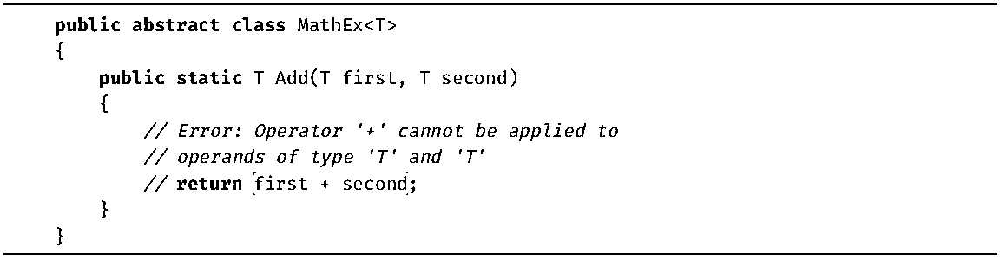

在这个例子中，方法假定+操作符可以在为 T 提供的所有类型实参上使用。但没有约束能限制类型实参必须支持+操作符，所以发生了一个错误。这里只能使用一个类类型约束，限制从实现了+操作符的类继承。

更一般地说，不能限制类型使用静态方法。

不支持 OR 条件 

假如为一个类型参数提供多个接口或类约束，编译器认为不同约束之间总是存在一个 AND 关系。例如，where T : IComparable<T>，IFormattable 要求同时支持 IComparable<T>和 IFormattable。不能在约束之间指定 OR 关系。因此，代码清单 12.34 的写法是不允许的。

代码清单 12.34　不允许使用 OR 来合并两个约束

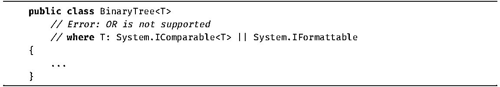

如支持 OR，编译器就无法在编译时判断要调用哪一个方法。

[\[1\]](part0118.xhtml#ch1) 如第八章所述，显式接口方法实现（Explicit Interface Method Implementation，EIMI）是指在方法名前附加接口名前缀。——译者注

## 12.4　泛型方法

通过前面的学习，你知道可以在泛型类中轻松添加方法来使用类型声明的泛型类型参数。在迄今为止的所有泛型类例子中，我们一直是这样做的。但这些不是泛型方法。

泛型方法要使用泛型类型参数，这一点和泛型类型一样。在泛型或非泛型类型中都能声明泛型方法。在泛型类型中声明，其类型参数要和泛型类型的类型参数有区别。为声明泛型方法，要按照与泛型类型一样的方式指定泛型类型参数，也就是在方法名之后添加类型参数声明，例如代码清单 12.35 中的 MathEx.Max<T>和 MathEx.Min<T>。

> 注：PowerShell 不能定义泛型函数/方法（`function Foo[T] { }` 会把 `Foo[T]` 当作函数名的一部分，并非类型参数）。不过可以调用 .NET 的泛型方法：显式指定类型实参时用 `::方法名[类型](...)`，例如 `[System.Linq.Enumerable]::Empty[int]()`；PowerShell 不提供 C# 那样的方法类型推断。

代码清单 12.35　定义泛型方法

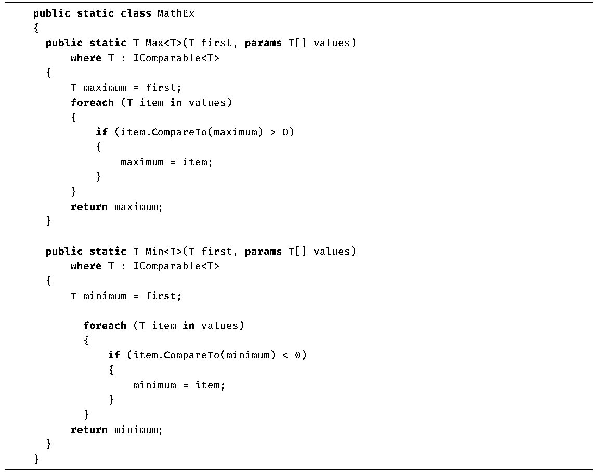

本例声明的是静态方法，但这并非必需。注意和泛型类型相似，泛型方法可包含多个类型参数。类型参数的数量（元数）可用于区分方法签名。换言之，只要类型参数的数量不同，两个方法可以有相同的名称和形参类型。

### 12.4.1　泛型方法类型推断

使用泛型类型时，是在类型名称之后提供类型实参。类似地，调用泛型方法时，是在方法名之后提供类型实参。代码清单 12.36 展示了用于调用 Min<T>和 Max<T>方法的代码。

代码清单 12.36　显式指定类型参数

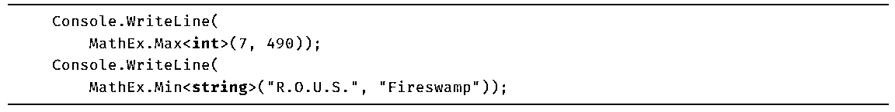

输出 12.4 展示了代码清单 12.36 的结果。

输出 12.4

int 和 string 是调用泛型方法时提供的类型实参。但类型实参纯属多余，因为编译器能根据传给方法的实参推断类型。显然，清单 12.36 中 Max 的调用者希望类型参数为 int，因为两个方法参数都是 int 类型。为避免多余的编码，当编译器可以逻辑推断出想要的类型参数时，调用时可以不指定类型实参。这称为方法类型推断 。代码清单 12.37 展示了一个例子，结果如输出 12.5 所示。

代码清单 12.37　根据方法实参推断类型

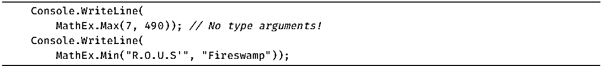

输出 12.5

方法类型推断要想成功，实参类型必须与泛型方法的形参“匹配”以推断出正确的类型实参。一个有趣的问题是，推断自相矛盾怎么办？例如，使用 MathEx.Max(7.0, 490)调用 Max<T>，从第一个方法实参推断出类型实参是 double，从第二个推断出是 int，自相矛盾。在 C# 2.0 中这确实会造成错误。但经过更全面的分析，就知道这个矛盾能够解决。因为每个 int 都能转换成 double，所以 double 是类型实参的最佳选择。从 C# 3.0 开始改进了方法类型推断算法，允许编译器进行这种更全面的分析。

如分析仍然不够全面，不能推断出正确类型，那么要么对方法实参进行强制类型转换，向编译器澄清推断时应使用的参数类型，要么放弃类型推断，显式指定类型实参。

还要注意，推断时算法只考虑泛型方法的实参、实参类型以及形参类型。本来其他因素也可考虑在内，比如方法的返回类型、方法返回值所赋给的变量的类型以及对方法类型参数的约束，但这些都被算法忽视了。

### 12.4.2　指定约束

泛型方法的类型参数也允许使用与泛型类型的类型参数相同的方法指定约束。例如，可指定类型参数必须实现某个接口，或必须能转换成某个类类型。约束在参数列表和方法主体之间指定，如代码清单 12.38 所示。

代码清单 12.38　约束泛型方法的类型参数

注意 Show<T>的实现没有直接使用 IComparable<T>接口的任何成员，所以你可能奇怪为什么需要约束。记住，BinaryTree<T>类需要这个接口（参见代码清单 12.39）。

代码清单 12.39　BinaryTree<T>需要 IComparable<T>类型参数

因为 BinaryTree<T>类在其 T 上需要此约束，并且 Show<T>将其 T 用作对应于约束类型参数的类型参数，所以 Show<T>需要确保在其方法类型参数上满足类的类型参数约束。

高级主题：泛型方法中的转型

有时应避免使用泛型——例如在使用它会造成一次转型操作被“隐藏”的时候。来看看下面这个方法，它的作用是将一个流转换成给定类型的对象：

formatter 负责将数据从流中移除，把它转换成 object。为 formatter 调用 Deserialize()，会返回 object 类型的数据。如使用 Deserialize()的泛型版本进行调用，那么会写出下面这样的代码：

上述代码的问题在于，对于方法的调用者来说，Deserialize<T>()似乎类型安全。但仍然会为调用者隐式（而非显式）执行一次转型。下面是等价的非泛型调用：

运行时转型可能失败，所以方法不像表面上那样类型安全。Deserialize<T>方法是纯泛型的，会向调用者隐藏转型动作，这存在一定风险。更好的做法是使方法成为非泛型的，返回 object，使调用者注意到它不是类型安全的。开发者在泛型方法中执行转型时，假如没有约束来验证转型的有效性，那么一定要非常小心。

设计规范

·避免用看似类型安全的泛型方法误导调用者。

## 12.5　协变性和逆变性

刚接触泛型类型的人经常问一个问题：为什么不能将 List<string>类型的表达式赋给 List<object>类型的变量。既然 string 能转换成 object，string 列表也应兼容于 object 列表呀？但实际情况并非如此，这个赋值动作既不类型安全，也不合法。用不同类型参数声明同一个泛型类的两个变量，这两个变量不是类型兼容的——即使是将一个较具体的类型赋给一个较泛化的类型。也就是说，它们不是协变量 （covariant）。

> 注：协变/逆变是 .NET 泛型类型系统在编译期的规则。PowerShell 变量是动态类型的，把 `List[string]` 对象赋给任意变量都能成功，不会经历 C# 那样的协变转换检查；对象本身仍是 `List[string]`，向其中添加不适用元素时由 .NET 方法在运行时处理（可能隐式转换或抛异常）。PowerShell 不能声明 `out`/`in` 变体修饰符，但可以正常使用 .NET 中已声明为协变/逆变的接口和委托（如 `IEnumerable[out T]`、`Func[in T, out TResult]`）。

“协变量”是借鉴自范畴论的术语，意思很容易明白。假定两个类型 X 和 Y 具有特殊关系，即每个 X 类型的值都能转换成 Y 类型。如 I<X>和 I<Y>也总是具有同样的特殊关系，就说“I<T>对 T 协变”。使用仅一个类型参数的泛型类型时，可以简单地说“I<T>是协变的”。从 I<X>向 I<Y>的转换称为协变转换 。

例如，泛型类 Pair<Contact>和 Pair<PdaItem>的实例就不是类型兼容的，即使两者的类型实参兼容。换言之，编译器禁止隐式或显式地将 Pair<Contact>转换为 Pair<PdaItem>，即使 Contact 从 PdaItem 派生。类似地，从 Pair<Contact>转换为接口类型 IPair<PdaItem>也会失败，如代码清单 12.40 所示。

但为什么不合法？为什么 List<T>和 Pair<T>不是协变的？代码清单 12.41 展示了假如 C#语言允许不受限制的泛型协变性，那么会发生什么。

代码清单 12.40　在类型参数不同的泛型之间转换

代码清单 12.41　禁止协变性以维持同质性（homogeneity）

一个 IPair<PdaItem>中可包含地址，但 Pair<Contact>对象只能包含联系人，不能包含地址。若允许不受限制的泛型协变性，类型安全将完全失去保障。

现在应该很清楚为什么字符串列表不能作为对象列表使用了。在字符串列表中不能插入整数，但在对象列表中可以，所以从字符串列表转换成对象列表一定要被视为非法，使编译器能预防错误。

### 12.5.1　使用 out 类型参数修饰符允许协变性

你或许已经注意到了，不限制协变性之所以会造成刚才描述的问题，是因为泛型 Pair <T>和泛型 List<T>都允许向其内容写入。如创建只读 IReadOnlyPair<T>接口，只允许 T 从接口中“出来”（换言之，作为方法或只读属性的返回类型），永远不“进入”接口（换言之，不作为形参或可写属性的类型），就不会出问题了，如代码清单 12.42 所示。

代码清单 12.42　理论上的协变性

通过限制泛型类型声明，让它只向接口的外部公开数据，编译器就没理由禁止协变性了。在 IReadOnlyPair<PdaItem>实例上进行的所有操作都将 Contact（从原始 Pair<Contact>对象）向上转换为基类 PdaItem——这是完全有效的转换。没有办法将地址“写入”实际是一对联系人的对象，因为接口没有公开任何可写属性。

代码清单 12.42 的代码仍然编译不了。但从 C# 4 开始加入了对安全协变性的支持。要指出泛型接口应该对它的某个类型参数协变，就用 out 修饰符来修饰该类型参数。代码清单 12.43 展示了如何修改接口声明，指出它应该允许协变。

代码清单 12.43　用 out 类型参数修饰符实现协变

用 out 修饰 IReadOnlyPair<out T>接口的类型参数，会导致编译器验证 T 是否真的只用作“输出”（方法的返回类型和只读属性的返回类型），且永远不用于形参或属性的赋值方法。验证通过，编译器就会放行对接口的任何协变转变。代码清单 12.42 进行了这个修改之后，程序就能成功编译和执行了。

协变转换存在一些重要限制：

·只有泛型接口和泛型委托（第十三章）才可以协变。泛型类和结构永远不是协变的。

·提供给“来源”和“目标”泛型类型的类型实参必须是引用类型，不能是值类型。例如，一个 IReadOnlyPair<string>能协变转换为 IReadOnlyPair<object>，因为 string 和 object 都是引用类型。但 IReadOnlyPair<int>不能转换为 IReadOnlyPair<object>，因为 int 不是引用类型。

·接口或委托必须声明为支持协变，编译器必须验证协变所针对的类型参数确实只用在“输出”位置。

### 12.5.2　使用 in 类型参数修饰符允许逆变性

协变性的反方向称为逆变性 （contravariance）。同样地，假定 X 和 Y 类型彼此相关，每个 X 类型的值都能转换成 Y 类型。如果 I<X>和 I<Y>类型总是具有相反的特殊关系——也就是说，I<Y>类型的每个值都能转换成 I<X>类型——就说“I<T>对 T 逆变”。

大多数人都觉得逆变理解起来比协变难。“比较器”（comparer）是逆变的典型例子。假定有一个派生类型 Apple（苹果）和一个基类型 Fruit（水果）。它们明显具有特殊关系。Apple 类型的每个值都能转换成 Fruit。

现在，假定有一个接口 ICompareThings<T>，它包含方法 bool FirstIsBetter(T t1, T t2)来获取两个 T，返回一个 bool 指明第一个是否比第二个好。

提供类型实参会发生什么？ICompareThings<Apple>的方法获取两个 Apple 并比较它们。ICompareThings<Fruit>的方法获取两个 Fruit 并比较它们。由于所有 Apple 都是 Fruit，所以凡是需要一个 ICompareThings<Apple>的地方，都可安全地使用 ICompareThings<Fruit>类型的值。转换方向变反了，这正是“逆变”一词的由来。

毫不奇怪，为了安全地进行逆变，对协变接口的限制必须反着来。对某个类型参数逆变的接口只能在“输入”位置使用那个类型参数。这种位置主要就是形参，极少见的是只写属性的类型。如代码清单 12.44 所示，用 in 修饰符声明类型参数，从而将接口标记为逆变。

代码清单 12.44　使用 in 类型参数修饰符指定逆变性

注意和协变性相似，逆变性要求在声明接口的类型参数时使用修饰符 in。in 指示编译器核对 T 未在属性的取值方法（getter）中使用，也没有作为方法的返回类型使用。核对无误，就启用接口的逆变转换。

逆变转换存在与协变转变相似的限制：只有泛型接口和委托类型才能是逆变的，发生变化的类型实参只能是引用类型，而且编译器必须能验证接口的安全逆变。

接口可以一个类型参数协变，另一个逆变。但除了委托之外其实很少需要这样做。例如，Func<A1, A2, ..., R>系列委托是返回类型 R 协变，所有实参类型逆变。

最后要注意，编译器要在整个源代码的范围内检查协变性和逆变性类型参数修饰符的有效性。以代码清单 12.45 的 PairInitializer<in T>接口为例。

代码清单 12.45　可变性的编译器验证

如果对协变性和逆变性研究得不是很透彻，可能认为既然 IPair<T>只是一个输入参数，所以在 IPairInitializer 上将 T 限制为 in 是有效的。但 IPair<T>接口不能安全变化，所以不能用可以变化的类型实参构造它。因为 IPair<T>不是类型安全的，所以编译器一开始就不允许将 IPairInitializer<T>接口声明为逆变。

### 12.5.3　数组对不安全协变性的支持

之前一直将协变性和逆变性描述成泛型类型的特点。在所有非泛型类型中，数组最像泛型。如同平时思考泛型“list of T”或泛型“pair of T”一样，也可以用相同的模式思考“array of T”。由于数组同时支持读取和写入，基于刚学到的协变和逆变知识，你可能以为数组既不能安全逆变，也不能安全协变。只有在从不写入时才能安全协变，只有在从不读取时才能安全逆变。两个限制似乎都不现实。

遗憾的是，C#确实支持数组协变，即使这样并不类型安全。例如，Fruit\[\] fruits=new Apple\[10\]在 C#中完全合法。但如果接着写 fruits\[0\]=new Orange();，“运行时”就会抛出异常来报告违反了类型安全性。将 Orange 赋给 Fruit 数组并非总是合法（因为后者实际可能是一个 Apple 数组），这对开发者造成了极大的困扰。但这个问题并非只是 C#才有。事实上，使用了“运行时”所实现的数组的所有 CLR 语言都存在相同问题。

尽量避免使用不安全的数组协变。每个数组都能转换成只读（进而安全协变）的 IEnumerable<T>接口。换言之，IEnumerable<Fruit> fruits=new Apple\[10\]既类型安全又合法，因为在只有只读接口的前提下，无法在数组中插入一个 Orange。

设计规范

·避免不安全的数组协变。相反，考虑将数组转换成只读接口 IEnumerable<T>，以便通过协变转换来安全地转换。

## 12.6　泛型的内部机制

在之前的章节中，我们描述了对象在 CLI 类型系统中的广泛应用。所以，假如告诉你泛型也是对象，相信你一点儿都不会觉得奇怪。事实上，泛型类的“类型参数”成了元数据，“运行时”在需要时会利用它们构造恰当的类。所以，泛型支持继承、多态性以及封装。可用泛型定义方法、属性、字段、类、接口和委托。

> 注：本节描述的是 .NET 运行时对泛型的实现机制，与调用语言无关；PowerShell 运行在 .NET 上，使用泛型类型时同样受益于这些机制（值类型泛型的具体化、引用类型泛型共享等）。PowerShell 自身不能生成参数化 CIL。

为此，泛型需要来自底层“运行时”的支持。将泛型引入 C#语言，编译器和框架需共同发力。例如，为避免装箱，对于基于值的类型参数，其泛型实现和引用类型参数的泛型实现是不同的。

高级主题：泛型的 CIL 表示

泛型类编译后与普通类无太大差异。编译结果无非就是元数据和 CIL。CIL 是参数化的，接受在代码中别的地方由用户提供的类型。代码清单 12.46 声明了一个简单的 Stack 类。

代码清单 12.46　Stack<T>声明

编译类所生成的参数化 CIL 如代码清单 12.47 所示。

代码清单 12.47　Stack<T>的 CIL 代码

首先注意第二行 Stack 之后的'1。这是元数（参数数量），声明了泛型类要求的类型实参的数量。对于像 EntityDictionary<TKey, TValue>这样的声明，元数是 2。

此外，在生成的 CIL 中，第二行显示了施加在类上的约束。可以看出 T 类型参数有一个 IComparable 约束。

继续研究 CIL 代码，会发现类型 T 的 items 数组声明进行了修改，使用“感叹号表示法”包含了一个类型参数，这是自 CIL 开始支持泛型后引入的新功能。感叹号指出为类指定的第一个类型参数的存在，如代码清单 12.48 所示。

代码清单 12.48　CIL 用感叹号表示法来支持泛型

除了在类的头部包含元数和类型参数，并在代码中用感叹号指出存在类型参数之外，泛型类和非泛型类的 CIL 代码并无太大差异。

高级主题：实例化基于值类型的泛型

用值类型作为类型参数首次构造一个泛型类型时，“运行时”会将指定的类型参数放到 CIL 中合适的位置，从而创建一个具体化的泛型类型。总之，“运行时”会针对每个新的“参数值类型”创建一个新的具体化泛型类型。

例如，假定声明一个整数 Stack，如代码清单 12.49 所示。

代码清单 12.49　Stack<int>定义

第一次使用 Stack<int>类型时，“运行时”会生成 Stack 类的一个具体化版本，用 int 替换它的类型参数。以后，每当代码使用 Stack<int>的时候，“运行时”都重用已生成的具体化 Stack<int>类。代码清单 12.50 声明 Stack<int>的两个实例，两个实例都使用已由“运行时”为 Stack<int>生成的代码。

代码清单 12.50　声明 Stack<T>类型的变量

如果以后在代码中创建另一个 Stack，但用不同的值类型作为它的类型参数（比如 long 或自定义结构），“运行时”会生成泛型类型的另一个版本。使用具体化值类型的类，好处在于能获得较好的性能。另外，代码能避免转换和装箱，因为每个具体的泛型类都原生包含值类型。

高级主题：实例化基于引用类型的泛型

对于引用类型，泛型的工作方式稍有不同。使用引用类型作为类型参数首次构造一个泛型类型时，“运行时”会在 CIL 代码中用 object 引用替换类型参数来创建一个具体化的泛型类型（而不是基于所提供的类型实参来创建一个具体化的泛型类型）。以后，每次用引用类型参数实例化一个构造好的类型，“运行时”都重用之前生成好的泛型类型的版本——即使提供的引用类型与第一次不同。

例如，假定现在有两个引用类型，一个 Customer 类和一个 Order 类，而且创建了 Customer 类型的一个 EntityDictionary，如下例所示：

访问这个类之前，“运行时”会生成 EntityDictionary 类的一个具体化版本。它不是将 Customer 作为指定的数据类型来存储，而是存储 object 引用。假定下一行代码创建 O\`rder 类型的一个 EntityDictionary：

和值类型不同，不会为使用 Order 类型的 EntityDictionary 创建 EntityDictionary 类的一个新的具体化版本。相反，会实例化基于 object 引用的 EntityDictionary 的一个实例，orders 变量将引用该实例。

为确保类型安全性，会分配 Order 类型的一个内存区域，用于使替换类型参数的每个 object 引用都指向该内存区域。

假定随后用一行代码来实例化 Customer 类型的 EntityDictionary：

和之前使用 Order 类型来创建 EntityDictionary 类一样，现在会实例化基于 object 引用的 EntityDictionary 的另一个实例，其中包含的指针被设为引用一个 Customer 类型。由于编译器为引用类型的泛型类创建的具体化类被减少到了一个，所以泛型极大地减少了代码量。

泛型引用类型的类型参数在发生变化时，“运行时”使用的是相同的内部泛型类型定义。但假如类型参数是值类型，就不是这个行为了。例如，Dictionary<int, Customer>、Dictionary<Guid, Order>和 Dictionary<long, Order>要求不同的内部类型定义。

语言对比：Java——泛型

Java 完全是在编译器中实现泛型，而不是在 JVM（Java 虚拟机）中。这样做是为了防止因为使用了泛型而需要分发新的 JVM。

Java 的实现使用了与 C++中的“模板”和 C#中的“泛型”相似的语法，其中包括类型参数和约束。但由于它不区分对待值类型和引用类型，因此未修改的 JVM 不能为值类型支持泛型。所以，Java 中的泛型不具有 C#那样的执行效率。Java 编译器需要返回数据的时候，都会插入来自指定约束的自动向下转型（如果声明了这样的一个转型的话），或者插入基本 Object 类型（如果没有声明的话）。此外，Java 编译器在编译时生成一个具体化类型，它随即用于实例化任何已构造类型。最后，由于 JVM 没有提供对泛型的原生支持，所以在执行时无法确定一个泛型类型实例的类型参数，“反射”的其他运用也受到了严重限制。

## 12.7　小结

自 C# 2.0 引入的泛型类型和泛型方法从根本上改变了 C#开发者的编码风格。在 C# 1.0 代码中，凡是使用了 object 的地方，在 C# 2.0 和更高的版本中都最好用泛型来代替。至少，集合问题应考虑用泛型来解决。通过消除强制类型转换、消除装箱性能惩罚和减少重复代码而提高的类型安全性与性能都是显著的改进。

> 注：对 PowerShell 而言，本章的实用结论是：可以**使用** .NET 泛型集合（如 `List[T]`、`Dictionary[TKey,TValue]`）以获得类型化 API 和性能优势，但**无法自己定义**泛型类型、泛型接口、泛型方法或泛型约束；相关语法在 PowerShell 中会解析失败。

第十五章将讨论最常用的泛型命名空间 System.Collections.Generic。该命名空间几乎完全由泛型类型构成。它清楚演示了如何修改最初使用 object 的类型来使用泛型。但在深入接触这些主题之前，先要探讨一下 Lambda 表达式。作为 C# 3.0（和以后版本）最引人注目的一项增强，它极大地改进了操作集合的方式。