# 第十三章　委托和 Lambda 表达式

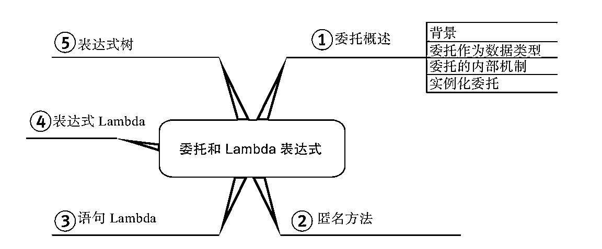

前几章全面讨论了如何创建类来封装数据和操作。随着创建的类越来越多，会发现它们的关系存在固定模式。一个常见模式是向方法传递对象，该方法再调用对象的一个方法。例如，向方法传递一个 IComparer<int>引用，该方法本身可在你提供的对象上调用 Compare()方法。在这种情况下，接口的作用只不过是传递一个方法引用。第二个例子是在调用新进程时，不是阻塞或反复检查（轮询）进程是否完成。理想情况是让方法异步运行并调用一个回调 函数，当异步调用结束时通过该函数来通知调用者。

似乎不需要每次传递一个方法引用时都定义新接口。本章讲述如何创建和使用称为委托 的特殊类，它允许像处理其他任何数据那样处理对方法的引用。然后讲述如何使用 Lambda 表达式 快速而简单地创建自定义委托。

Lambda 表达式自 C# 3.0 引入。C# 2.0 支持用一种称为匿名方法 的不太优雅的语法创建自定义委托。C# 2.0 之后的每个 C#版本都支持匿名方法以保持向后兼容，但新写的代码应该弃用它，代之以 Lambda 表达式。本章将通过“高级主题”来描述如何使用匿名方法。只有要使用遗留的 C# 2.0 代码时才需了解这些主题，否则可以忽略。

本章最后讨论表达式树，它允许在运行时使用编译器对 Lambda 表达式进行分析。

> 注：PowerShell 没有 C# 的 Lambda 表达式（`=>`）和匿名方法（`delegate {...}`）语法——两者在 PowerShell 里都由脚本块（scriptblock，即 `{ ... }`）承担。因此本章按 C# 版本讲述的匿名方法／语句 Lambda／表达式 Lambda 演进史，在 PowerShell 中并不存在；脚本块统一承担“可传递的代码块”这一角色。下文各节的注会指出对应的 PowerShell 写法。

## 13.1　委托概述

经验丰富的 C 和 C++程序员长期以来利用“函数指针”将对方法的引用作为实参传给另一个方法。C#使用委托 提供相似的功能。委托允许捕捉对方法的引用，并像传递其他对象那样传递该引用，像调用其他方法那样调用被捕捉的方法。来看看下面的例子。

### 13.1.1　背景

虽然效率不高，但冒泡排序或许是最简单的排序算法了。代码清单 13.1 展示了 BubbleSort()方法。

代码清单 13.1　BubbleSort()方法

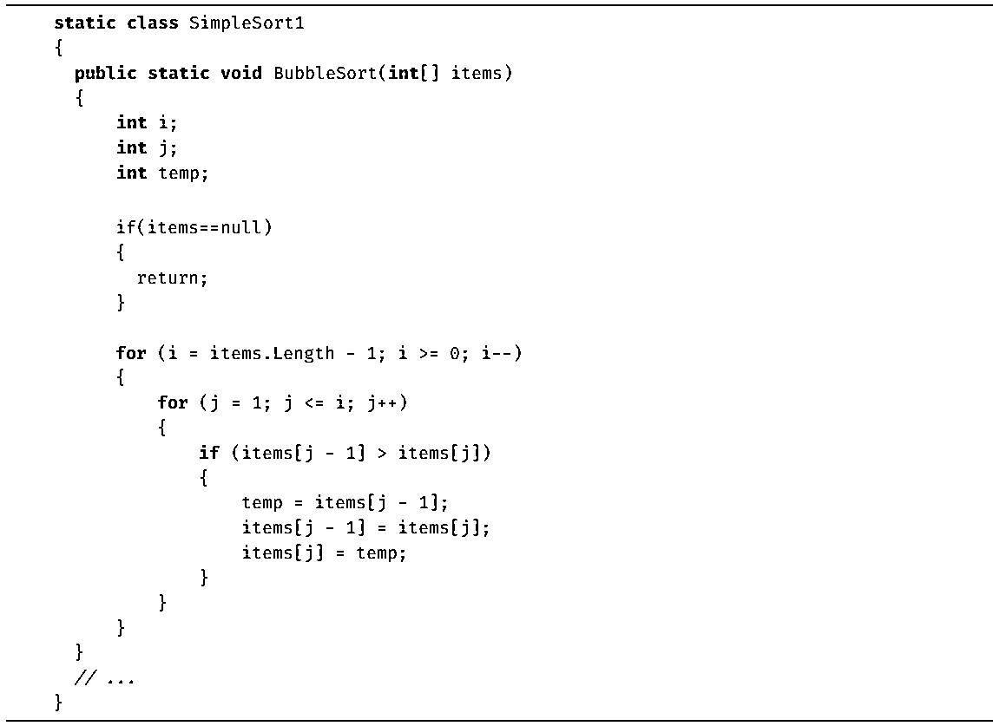

该方法对整数数组执行升序排序。

为了能选择升序或降序，有两个方案：一是拷贝上述代码，将大于操作符替换成小于操作符，但拷贝这么多代码只是为了改变一个操作符，似乎不是一个好主意；二是传递一个附加参数，指出如何排序，如代码清单 13.2 所示。

代码清单 13.2　BubbleSort()方法，升序或降序

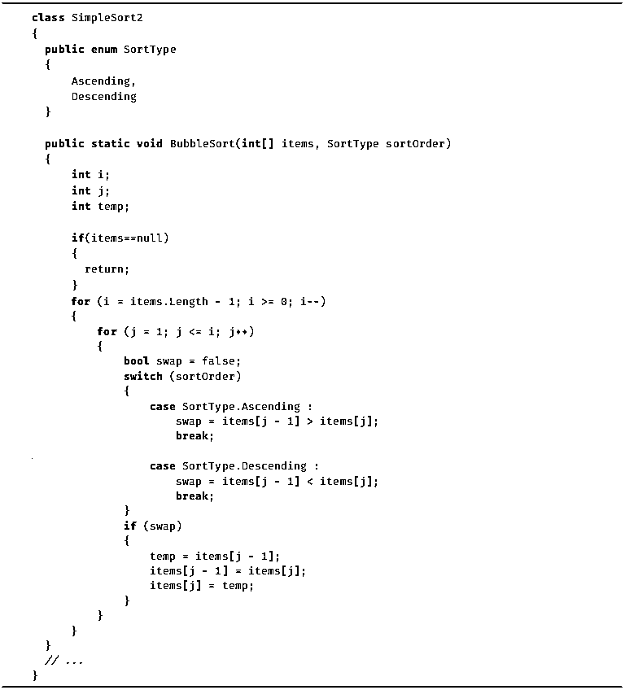

但上述代码只照顾到了两种可能的排序方式。如果想按字典顺序排序（即 1，10，11，12，2，20，……），或者按其他方式排序，SortType 值以及对应的 switch case 的数量很快就会变得非常“恐怖”。

### 13.1.2　委托数据类型

为增强灵活性和减少重复代码，可将比较方法作为参数传给 BubbleSort()方法。为了能将方法作为参数传递，要有一个能表示方法的数据类型。该数据类型就是委托 ，因为它将调用“委托”给对象引用的方法。可将方法名作为委托实例。从 C# 3.0 开始还可使用 Lambda 表达式作为委托来内联一小段代码，而不必非要为其创建方法。从 C# 7.0 开始则支持创建本地函数（嵌套方法）并将函数名用作委托。代码清单 13.3 修改 BubbleSort()方法来获取一个 Lambda 表达式参数。本例的委托数据类型是 Func<int, int, bool>。

> 注：PowerShell 没有 `Func<int, int, bool>` 这样的泛型类型字面量写法，但可直接使用 .NET 的泛型委托类型 `[System.Func[int,int,bool]]`（可简写为 `[Func[int,int,bool]]`）。把脚本块强制转换成该类型就得到委托，例如 `[Func[int,int,bool]] { param($a,$b) $a -gt $b }`。

代码清单 13.3　带委托参数的 BubbleSort()方法

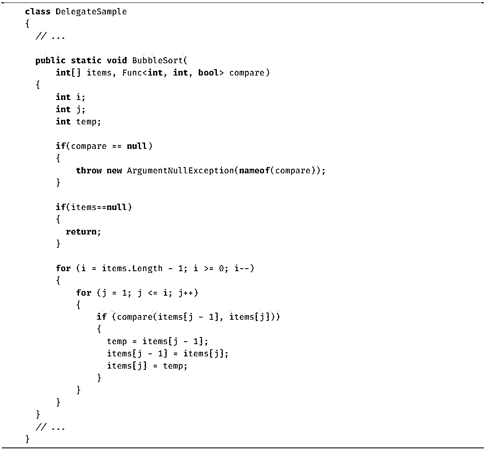

Func<int, int, bool>类型的委托代表对两个整数进行比较的方法。在 BubbleSort()方法中，可用由 compare 参数引用的 Func<int, int, bool>实例来判断哪个整数更大。由于 compare 代表方法，所以调用它的语法与调用其他任何方法无异。在本例中，Func<int, int, bool>委托获取两个整数参数，返回一个 bool 值来指出第一个整数是否大于第二个：

注意，Func<int, int, bool>委托是强类型的，代表返回 bool 值并正好接受两个整数参数的方法。和其他任何方法调用一样，对委托的调用也是强类型的。如果实参数据类型不兼容，那么 C#编译器会报错。

> 注：PowerShell 没有编译期类型检查：把脚本块转换成委托是运行时行为，转换时通常不会校验参数个数或类型，错误往往到 `Invoke()` 时才暴露；而且 PowerShell 会做隐式类型转换（例如向 `Func[string,...]` 传数字会被转成字符串）。

## 13.2　声明委托类型

前面描述了如何定义使用委托的方法，展示了如何将委托变量当作方法来发出对委托的调用。但还必须学习如何声明委托类型。声明委托类型要使用 delegate 关键字，后跟像是方法声明的内容。该方法的签名就是委托能引用的方法的签名。正常方法声明中的方法名要替换成委托类型的名称。例如，代码清单 13.3 的 Func<...>是这样声明的：

> 注：PowerShell **没有** `delegate` 关键字，不能声明自定义委托类型：在类中写 `delegate bool Comparer(...)` 会解析失败，在顶层写则会被当成命令调用而报“找不到命令”。日常应直接使用 .NET 内建的 `[Action[...]]`、`[Func[...]]`、`[Predicate[...]]`；确实需要自定义委托类型时，可用 `Add-Type` 编译一段 C# 代码来定义。

（in/out 类型修饰符自 C# 4.0 引入，本章稍后会讨论。）

### 13.2.1　常规用途的委托类型：System.Func 和 System.Action

幸好从 C# 3.0 起很少需要（甚至根本不必）自己声明委托。为减少定义自己的委托类型的必要，.NET 3.5“运行时”库（对应 C# 3.0）包含一组常规用途的委托，其中大多为泛型。System.Func 系列委托代表有返回值的方法，而 System.Action 系列代表返回 void 的方法。代码清单 13.4 展示了这些委托的签名。

代码清单 13.4　Func 和 Action 委托声明

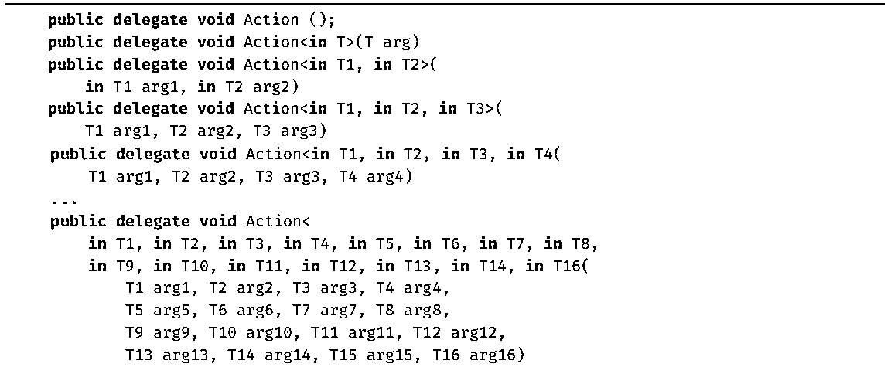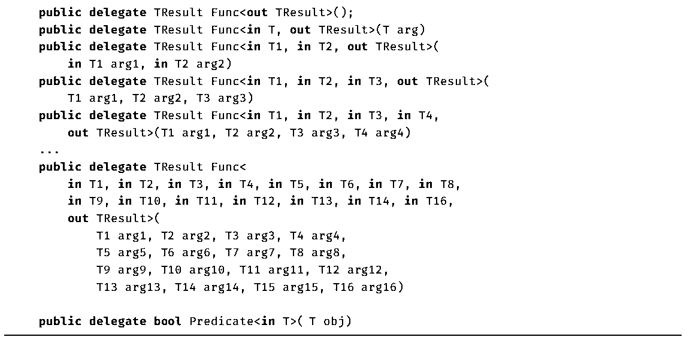

由于是泛型委托定义，所以可用它们代替自定义委托（稍后详述）。

代码清单 13.4 的第一组委托类型是 Action<...>，代表无返回值并支持最多 16 个参数的方法。如果需要返回结果，则使用第二组 Func<...>委托。Func<...>的最后一个类型参数是 TResult，即返回值的类型。Func<...>的其他类型参数按顺序对应委托参数的类型。例如，代码清单 13.3 的 BubbleSort 方法要求返回 bool 并获取两个 int 参数的一个委托。

清单中最后一个委托是 Predicate<in T>。若用一个 Lambda 返回 bool，则该 Lambda 称为谓词 （predicate）。通常用谓词筛选或识别集合中的数据项。换言之，向谓词传递一个数据项，它返回 true 或 false 指出该项是否符合条件。而在我们的 BubbleSort()例子中，是接收两个参数来比较它们，所以要用 Func<int, int, bool>而不是谓词。

> 注：`System.Action`、`System.Func`、`System.Predicate` 等 .NET 泛型委托类型在 PowerShell 中可以直接使用，写法为 `[System.Func[int,int,bool]]` 这类方括号形式。将脚本块（或静态方法引用）转换成该类型即可得到委托实例，例如 `[System.Predicate[int]] { param($x) $x -gt 0 }`。

设计规范

·考虑定义自己的委托类型带来的可读性，是否比使用预定义泛型委托类型所带来的便利性更重要。

高级主题：声明委托类型

如前所述，借助从 Microsoft .NET Framework 3.5 开始提供的 Func 和 Action 委托，许多时候都无须定义自己的委托类型。但若能显著提高代码可读性，还是应考虑声明自己的委托类型。例如，名为 Comparer 的委托使人对其用途一目了然，而 Func<int, int, bool>这种呆板的名字只能看出委托的参数和返回类型。代码清单 13.5 展示如何声明获取两个 int 并返回 bool 的 Comparer 委托类型。

代码清单 13.5　声明委托类型

基于新的委托数据类型，可用 Comparer 替换 Func<int, int, bool>来更新代码清单 13.3 的方法签名：

就像类能嵌套在其他类中一样，委托也能嵌套在类中。如果委托声明出现在另一个类的内部，委托类型就成为嵌套类型，如代码清单 13.6 所示。

代码清单 13.6　声明嵌套委托类型

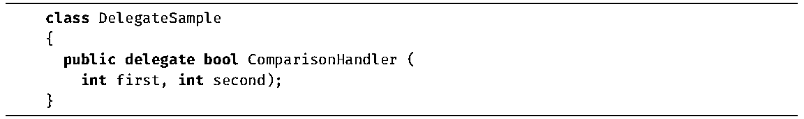

本例声明委托数据类型 DelegateSample.ComparisonHandler，因其被定义成 DelegateSample 中的嵌套类型。如果仅在包容类中有用，就应考虑嵌套。

### 13.2.2　实例化委托

本节讲述使用委托来实现 BubbleSort()方法的最后一步，在此将学习如何调用方法并传递委托实例（即 Func<int, int, bool>类型的一个实例）。实例化委托需要和委托类型自身签名对应的一个方法。方法名无关紧要，但签名剩余部分必须兼容委托签名。代码清单 13.7 展示了与委托类型兼容的 GreaterThan()方法。

代码清单 13.7　声明与 Func<int, int, bool>兼容的方法

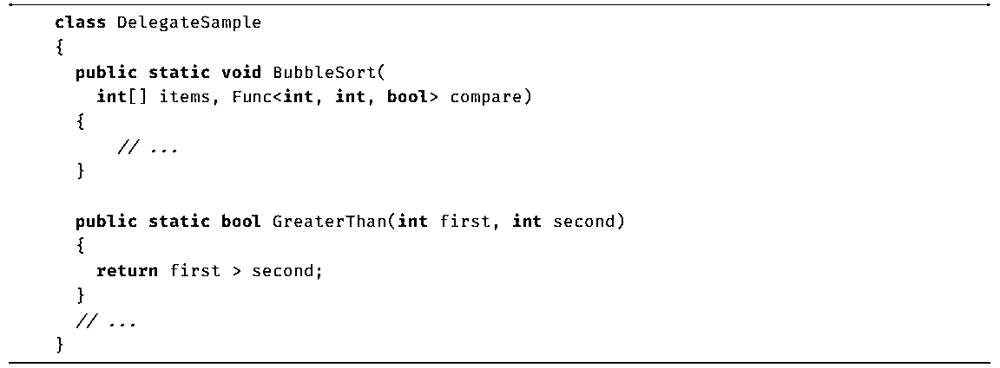

定义好方法后，可调用 BubbleSort()并传递要由委托捕捉的方法名作为实参，如代码清单 13.8 所示。

代码清单 13.8　方法名作为实参

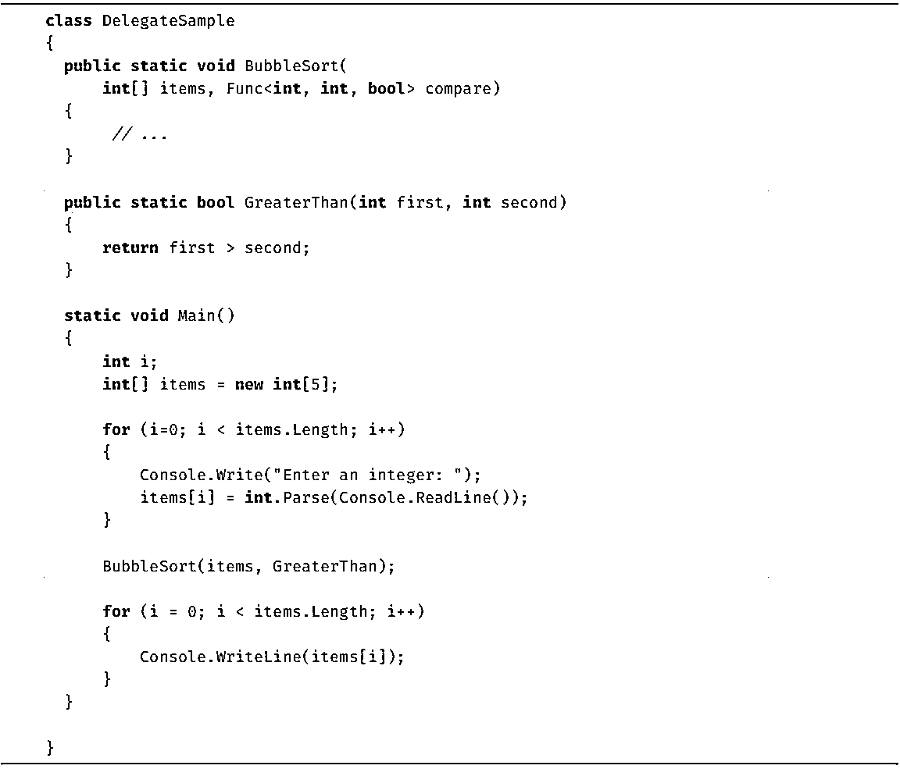

注意委托是引用类型，但不需要用 new 实例化。从 C# 2.0 开始，从方法组 （为方法命名的表达式）向委托类型的转换会自动创建新的委托对象。

> 注：PowerShell 也支持“方法组→委托”的转换，但要求通过类型转换显式进行，且主要适用于静态方法，例如 `[Func[double,double]] [Math]::Sqrt`（已验证）。实例方法的引用是重载组（`PSMethod`），一般无法直接转换成某个具体委托类型，需要再用脚本块包一层。PowerShell 中也不存在 C# 意义的“方法组”一等表达式。

高级主题：C# 1.0 中的委托实例化

在代码清单 13.8 中，调用 BubbleSort()时传递方法名（GreaterThan）即可实例化委托。C#的第一个版本要求如代码清单 13.9 所示的较复杂的语法来实例化委托。

代码清单 13.9　C# 1.0 中将委托作为参数传递

本例使用 Comparer 而非 Func<int, int, bool>，因为后者在 C# 1.0 中不可用。

之后的版本支持两种语法。本书只使用更现代、更简洁的语法。

高级主题：委托的内部机制

委托实际是特殊的类。虽然 C#标准没有明确说明类的层次结构，但委托必须直接或间接派生自 System.Delegate。事实上，.NET 委托总是派生自 System.MulticastDelegate，后者又从 System.Delegate 派生，如图 13.1 所示。

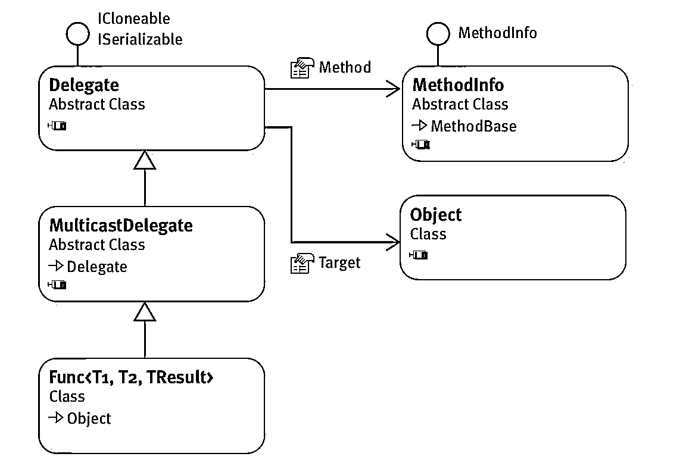

图 13.1　委托类型的对象模型

第一个属性是 System.Reflection.MethodInfo 类型。MethodInfo 描述方法签名，包括名称、参数和返回类型。除了 MethodInfo，委托还需要一个对象实例来包含要调用的方法。这正是第二个属性 Target 的作用。在静态方法的情况下，Target 为 null。MulticastDelegate 类的作用将在第十四章详细描述。

注意所有委托都不可变（immutable）。换言之，委托创建好后无法更改。如果变量包含委托引用，并想引用不同的方法，则只能创建新委托再把它赋给变量。

> 注：委托不可变、且都派生自 `System.MulticastDelegate` 这些底层事实对 PowerShell 同样成立，因为脚本块转换出来的就是同一套 .NET 委托对象。但 PowerShell 脚本块本身是 `System.Management.Automation.ScriptBlock` 对象，不是委托；脚本块可以直接用 `& $sb` 或 `$sb.Invoke()` 调用。

虽然所有委托数据类型都间接从 System.Delegate 派生，但 C#编译器不允许声明直接或间接从 System.Delegate 或者 System.MulticastDelegate 派生的类。代码清单 13.10 的代码无效。

代码清单 13.10　System.Delegate 不能是显式的基类

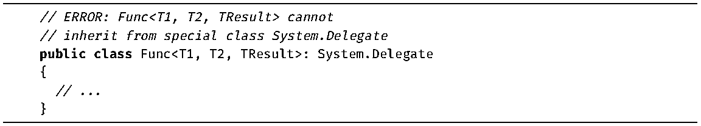

> 注：这条限制来自 CLR 而非 C# 语言本身，PowerShell 类同样不能从 `System.Delegate`/`System.MulticastDelegate` 派生。

通过传递委托来指定排序方式显然比本章开头的方式灵活得多。例如，要改为按字母排序，只需添加一个委托，比较时将整数转换为字符串。代码清单 13.11 是按字母排序的完整代码，输出 13.1 展示了结果。

代码清单 13.11　使用其他与 Func<int, int, bool>兼容的方法

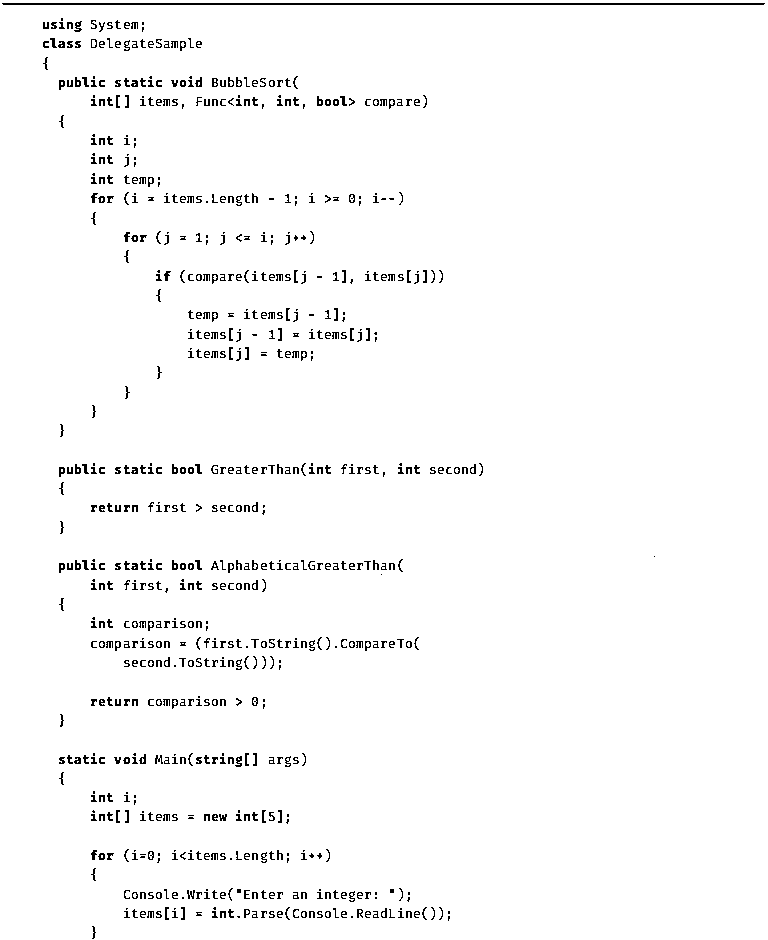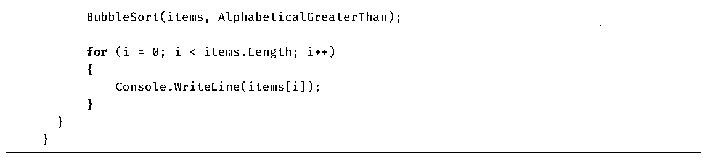

输出 13.1

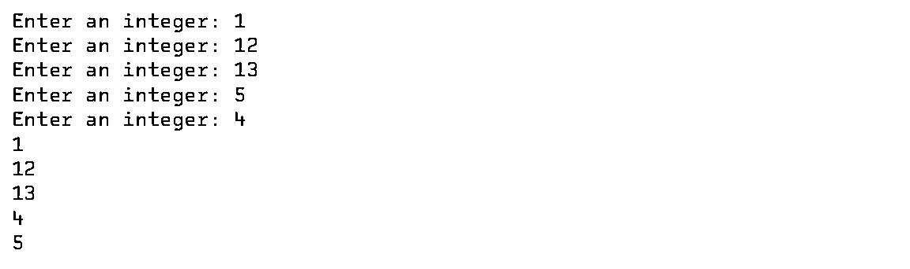

按字母排序与按数值排序的结果不同。和本章开头描述的方式相比，现在添加一个附加的排序机制是多么简单！要按字母排序，唯一要修改的就是添加 Alphabetical-GreaterThan 方法，在调用 BubbleSort()的时候传递该方法。

## 13.3　Lambda 表达式

代码清单 13.7 和代码清单 13.11 展示了如何将表达式 GreaterThan 和 Alphabetical-GreaterThan 转换成与这些具名方法的参数类型和返回类型兼容的委托类型。你可能已注意到了，GreaterThan 方法的声明（public static bool GreaterThan(int first, int second)）比主体（return first > second;）冗长多了。这么简单的方法居然需要如此复杂的准备，这实在说不过去，而这些“前戏”的目的只是使其能转换成委托类型。

为解决问题，C# 2.0 引入了非常精简的语法创建委托，C# 3.0 则引入了更精简的。C# 2.0 的称为匿名方法 ，C# 3.0 的称为 Lambda 表达式 。这两种语法统称为匿名函数 。两种都合法，但新代码应优先使用 Lambda 表达式。除非要专门讲述 C# 2.0 匿名方法，否则，本书都使用 Lambda 表达式^( [\[1\]](part0126.xhtml#ch1_back) ) 。

Lambda 表达式本身分为两种：语句 Lambda 和表达式 Lambda 。图 13.2 展示了这些术语的层次关系。

> 注：PowerShell 没有 `=>` Lambda 操作符，脚本块就是它的“匿名函数”。对应写法如 `{ param($first, $second) $first -lt $second }`。脚本块没有“语句 Lambda”与“表达式 Lambda”的区分，主体总是由若干语句组成；向 .NET 方法传委托时需先把脚本块转换成相应委托类型（见上文注），而 PowerShell 自己的 cmdlet（如 `Where-Object`、`ForEach-Object`）则直接接受脚本块。

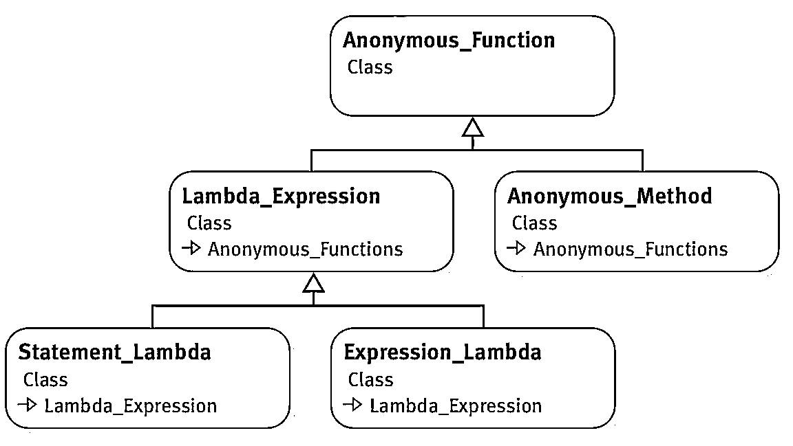

图 13.2　与匿名函数有关的术语

### 13.3.1　语句 Lambda

Lambda 表达式的目的是在需要基于很简单的方法生成委托时，避免声明全新成员的麻烦。Lambda 表达式有几种不同的形式。例如，语句 Lambda 由形参列表、Lambda 操作符=>和代码块构成。

代码清单 13.12 展示了和代码清单 13.8 的 BubbleSort 调用等价的功能，只是用语句 Lambda 代表比较方法，而不是创建完整的 GreaterThan 方法。如你所见，语句 Lambda 包含 GreaterThan 方法声明中的大多数信息，形参和代码块都在，但方法名和修饰符没有了。

代码清单 13.12　用语句 Lambda 创建委托

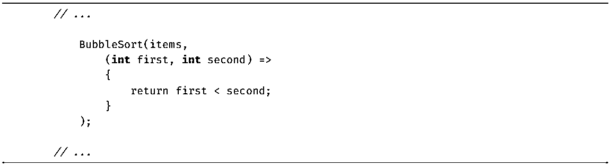

当查看含有 Lambda 操作符的代码时，可自己在脑海中将该操作符替换成“用于”（go/goes to）。例如在代码清单 13.12 中，可将 BubbleSort()的第二个参数理解成“将整数 first 和 second 用于返回（first 小于 second）的结果”。

如你所见，代码清单 13.12 的语法和代码清单 13.8 几乎完全一样，只是比较方法现在合理地出现在转换成委托类型的地方，而不是随便出现在别的地方并只能按名称来查找。方法名不见了，这正是此类方法称为“匿名函数”的原因。返回类型不见了，但编译器知道 Lambda 表达式要转换成返回类型为 bool 的委托。编译器检查语句 Lambda 的代码块，验证每个 return 语句都返回 bool。public 修饰符不见了，因为方法不再是包容类的一个可访问成员，没必要描述它的可访问性。类似地，static 修饰符也不见了。围绕方法进行的“前戏”大大减少了。

但语法还能精简。我们已从委托类型推断 Lambda 表达式返回 bool。类似地，还能推断两个参数都是 int，如代码清单 13.13 所示。

代码清单 13.13　在语句 Lambda 中省略参数类型

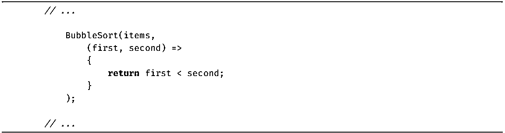

通常，只要编译器能从 Lambda 表达式所转换成的委托推断出类型，所有 Lambda 表达式就都不需要显式声明参数类型。不过，若指定类型能使代码更易读，C#也允许这样做。在不能推断的情况下，C#要求显式指定 Lambda 参数类型。显式指定一个 Lambda 参数类型，所有参数类型都必须显式指定，而且必须和委托参数类型完全一致。

> 注：脚本块的 `param()` 列表本身也不写类型，例如 `{ param($a, $b) $a -lt $b }`。PowerShell 不根据上下文推断参数类型，参数的实际类型由调用时传入的值决定，且不做静态检查。

设计规范

·如果类型对于读者显而易见，或者是无关紧要的细节，就考虑在 Lambda 形参列表中省略类型。

语法或许还能进一步精简，如代码清单 13.14 所示。假如只有单个参数，且类型可以推断，Lambda 表达式就可拿掉围绕参数列表的圆括号。但假如无参，或参数不止一个，或者包含显式指定了类型的单个参数，Lambda 表达式就必须将参数列表放到圆括号中。

代码清单 13.14　单个输入参数的语句 Lambda

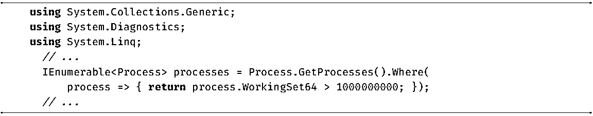

在代码清单 13.14 中，Where()返回对物理内存占用超过 1GB 的进程的一个查询。

代码清单 13.15 包含的则是一个无参语句 Lambda。空参数列表要求圆括号。还要注意，代码清单 13.15 的语句 Lambda 主体包含多个语句。虽然语句 Lambda 允许包含任意数量的语句，但一般都限制在两三个语句之内。

代码清单 13.15　无参语句 Lambda

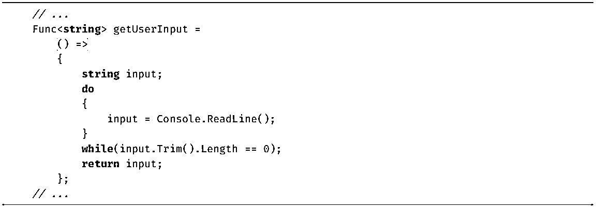

### 13.3.2　表达式 Lambda

语句 Lambda 的语法比完整的方法声明简单得多，可以不指定方法名、可访问性和返回类型，有时甚至可以不指定参数类型。表达式 Lambda 则更进一步。在代码清单 13.12 到代码清单 13.15 中，所有语句 Lambda 的代码块都只有一个 return 语句。其实在这种 Lambda 块中，唯一需要的就是要返回的表达式。这正是表达式 Lambda 的作用，它只包含要返回的表达式，完全没有语句块。代码清单 13.16 等价于代码清单 13.12，只是使用了表达式 Lambda 而不是语句 Lambda。

代码清单 13.16　使用表达式 Lambda 传递委托

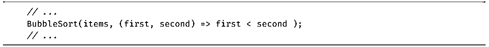

通常，可像阅读语句 Lambda 那样将表达式 Lambda 中的=>理解成“用于”。但在委托作为“谓词”使用时（返回布尔值），将=>理解成“满足……条件”（such that 或 where）会更清楚一些。所以，代码清单 13.16 的 Lambda 可读成：“first 和 second 满足 first 小于 second 的条件”。

类似于 null 字面值，匿名函数不和任何类型关联。其类型由转换成的类型决定。也就是说，目前为止的所有 Lambda 表达式并非天生就是 Func<int, int, bool>或 Comparer 类型。它们只是与那个类型兼容，能转换成它。所以，不能对匿名方法使用 typeof()操作符。另外，只有在将匿名方法转换成具体类型后才能调用 GetType()。

> 注：PowerShell 中脚本块是 `System.Management.Automation.ScriptBlock` 类型的普通对象，创建后即可调用 `GetType()`（`{ 1 }.GetType()` 返回 `ScriptBlock`）。PowerShell 也没有 C# 的 `typeof` 操作符：`typeof(int)` 会被当作命令调用而失败；表示类型应使用方括号字面量，如 `[int]`。

表 13.1 总结了关于 Lambda 表达式的其他注意事项。

表 13.1　Lambda 表达式的注意事项和例子

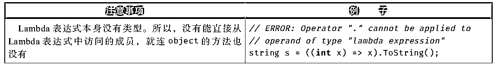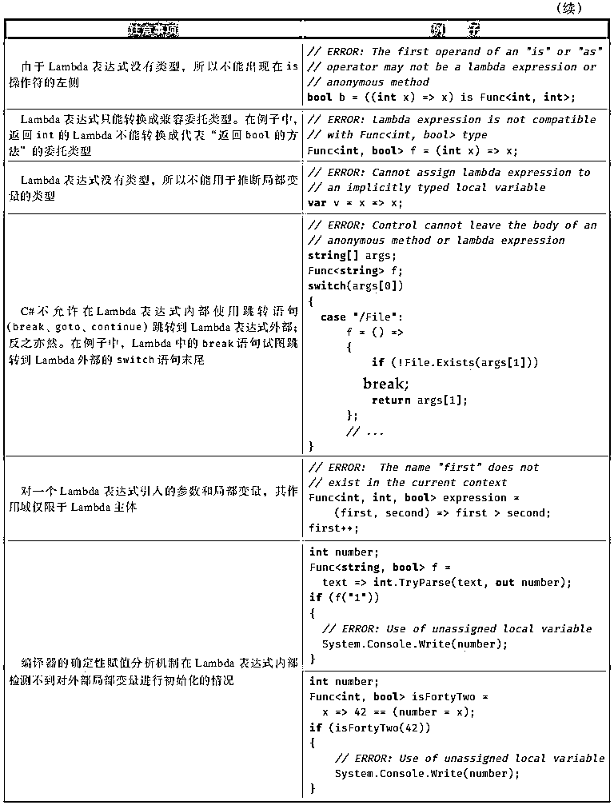

[\[1\]](part0126.xhtml#ch1) 作者在这里故意区分了匿名函数和匿名方法。一般情况下，两者可以互换使用。如果非要区分，那么编译器生成的全都是“匿名函数”，这才是最开始的叫法。从 C# 2.0 开始引入了“匿名方法”功能，它的作用就是简化生成匿名函数而需要写的代码。在新的 C#版本中（3.0 和以后），更是建议用 lambda 表达式来进一步简化语法，不再推荐使用 C# 2.0 引入的“匿名方法”。但归根结底，所有这些语法糖都是为了更简单地生成匿名函数。——译者注

## 13.4　匿名方法

C# 2.0 不支持 Lambda 表达式，而是使用称为匿名方法 的语法。匿名方法像语句 Lambda，但缺少使 Lambda 变得简洁的许多功能。匿名方法必须显式指定每个参数的类型，而且必须有代码块。参数列表和代码块之间不使用 Lambda 操作符=>。相反，是在参数列表前添加关键字 delegate，强调匿名方法必须转换成委托类型。代码清单 13.17 展示了如何重写代码清单 13.7、代码清单 13.12 和代码清单 13.15 来使用匿名方法。

代码清单 13.17　在 C# 2.0 中传递匿名方法

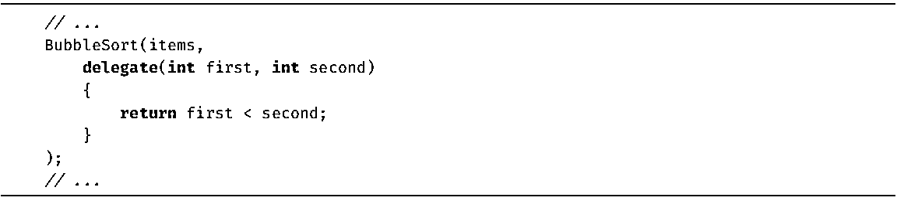

所以在 C# 3.0 和以后的版本中，可用两种相似的方式定义匿名函数，这多少令人有点遗憾。

> 注：PowerShell 从未有过 C# 2.0 式的匿名方法语法，本节属于 C# 版本历史；在 PowerShell 中脚本块统一承担匿名函数角色。下一小节的“无参匿名方法”等 C# 细节在 PowerShell 中没有对应物。

设计规范

·避免在新代码中使用匿名方法语法，优先使用更简洁的 Lambda 表达式语法。

但有一个小功能是匿名方法支持但 Lambda 表达式不支持的：匿名方法在某些情况下能完全省略参数列表。

高级主题：无参匿名方法

和 Lambda 表达式不同，匿名方法允许完全省略参数列表，前提是主体中不使用任何参数，而且委托类型只要求“值”参数。（也就是说，不要求将参数标记为 out 或 ref。）例如，对于以下匿名方法表达式：

它可转换成要求返回 bool 的任意委托类型，不管委托需要多少个参数。这个功能较少使用，但阅读遗留代码时可能用得着。

高级主题：“Lambda”源起

“匿名方法”挺好理解，看起来和普通的方法声明相似，只是无方法名。但“Lambda”是怎么来的？

Lambda 表达式的概念来自阿隆佐·邱奇（Alonzo Church），他于 20 世纪 30 年代发明了用于函数研究的λ演算（lambda calculus）系统。用邱奇的记号法，如果函数要获取参数 x，最终的表达式是 y，就将希腊字母λ作为前缀，再用点号分隔参数和表达式。所以，C#的 Lambda 表达式 x=>y 用邱奇的记号法应写成λx.y。

由于在 C#代码中不便输入希腊字母，而且点号在 C#中有太多含义，所以 C#委托选择“胖箭头”（fat arrow）记号法（=>）。“Lambda 表达式”提醒人们匿名函数的理论基础是λ演算，即使根本没有使用希腊字母λ。

## 13.5　委托没有结构相等性

.NET 委托类型不具备结构相等性 （structural equality）。也就是说，不能将一个委托类型的对象引用转换成一个不相关的委托类型，即使两者的形参和返回类型完全一致。例如，不能将一个 Comparer 引用赋给一个 Func<int, int, bool>类型的变量，即使两者都代表获取两个 int 并返回一个 bool 的方法。非常遗憾，如果需要结构一致但不相关的新委托类型，为了使用该类型的委托，唯一的办法就是创建新委托并让它引用旧委托的 Invoke 方法。例如，假定有 Comparer 类型的变量 c，需要把它的值赋给 Func<int, int, bool>类型的变量 f，那么可以这样写：f=c.Invoke;。

但通过 C# 4.0 添加的对可变性的支持，现在可在某些委托类型之间进行引用转换。来考虑一个逆变的例子：由于 void Action<in T>(T arg)有 in 类型参数修饰符，所以可将 Action<object>类型的委托引用赋给 Action<string>类型的变量。

许多人都觉得委托的逆变不好理解。只需记住，适合任何对象的行动必定适合任何字符串。反之则不然，只适合字符串的行动不适合每个对象。类似地，Func 系列委托类型对它的返回类型协变，这通过 TResult 的 out 类型参数修饰符来指示。所以，Func<string>类型的委托引用可以赋给 Func<object>类型的变量。

> 注：PowerShell 是动态类型语言，不存在委托类型的“结构相等性”及引用转换限制：任意脚本块都可按需转换成任意兼容的委托类型。若要把已有委托 `$c` 当作另一种委托类型使用，用脚本块间接调用即可，例如 `[Func[int,int,bool]] { param($a,$b) $c.Invoke($a,$b) }`。C# 4.0 的 `in`/`out` 协变、逆变仍作用于 .NET 泛型委托类型本身（已验证 `[Action[object]]` 赋给 `[Action[string]]` 可行），但 PowerShell 代码通常无需关心。

代码清单 13.18 展示了委托的协变和逆变。

代码清单 13.18　委托的可变性

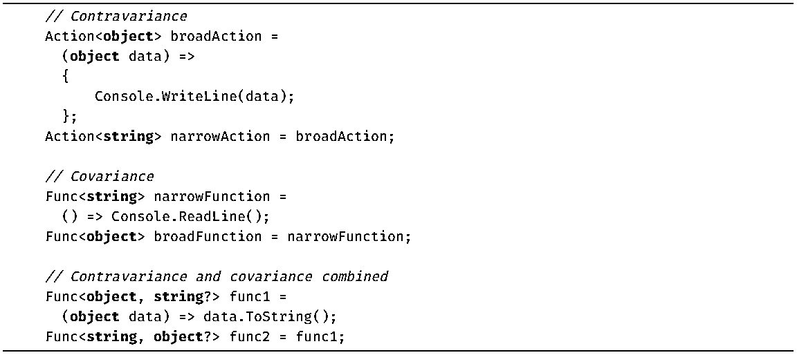

代码清单最后一部分在一个例子中合并了两种可变性的概念，演示假如同时涉及 in 和 out 类型参数，协变性和逆变性是如何同时发生的。

实现泛型委托类型的引用转换，是 C# 4.0 添加协变和逆变转换的关键原因之一。（另一个原因是为 IEnumerable<out T>提供协变支持。）

高级主题：Lambda 表达式和匿名方法的内部机制

CLR 不知道何谓 Lambda 表达式（和匿名方法）。相反，编译器遇到匿名方法时，会把它转换成特殊的隐藏类、字段和方法，从而实现你希望的语义。也就是说，C#编译器为这个模式生成实现代码，避免开发者自己去实现。例如，给定代码清单 13.12、13.13、13.16 或 13.17，C#编译器将生成如代码清单 13.19 所示的代码。

代码清单 13.19　与 Lambda 表达式的 CIL 代码等价的 C#代码

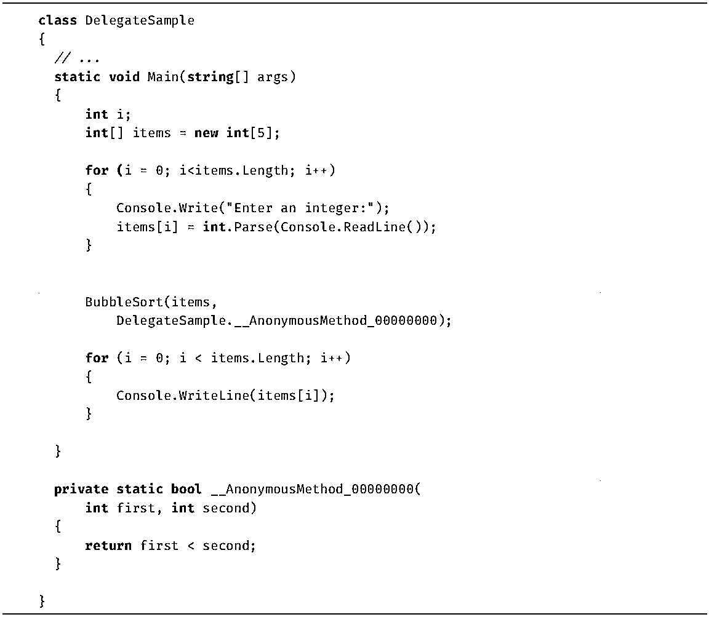

在本例中，匿名方法被转换成单独的、由编译器内部声明的静态方法。该静态方法再实例化成一个委托并作为参数传递。毫不奇怪，编译器生成的代码有点像代码清单 13.8 的原始代码，也就是后来用匿名函数进行简化的代码。但在涉及“外部变量”时，编译器执行的代码转换要复杂得多，不是只将匿名函数重写成静态方法那样简单。

## 13.6　外部变量

在 Lambda 表达式外部声明的局部变量（包括包容方法的参数）称为该 Lambda 的外部变量 。（this 引用虽然技术上说不是变量，但也被视为外部变量。）如果 Lambda 表达式主体使用一个外部变量，那么就说该变量被该 Lambda 表达式捕捉 。代码清单 13.20 利用外部变量统计 BubbleSort()执行了多少次比较。输出 13.2 展示了结果。

代码清单 13.20　在 Lambda 表达式中使用外部变量

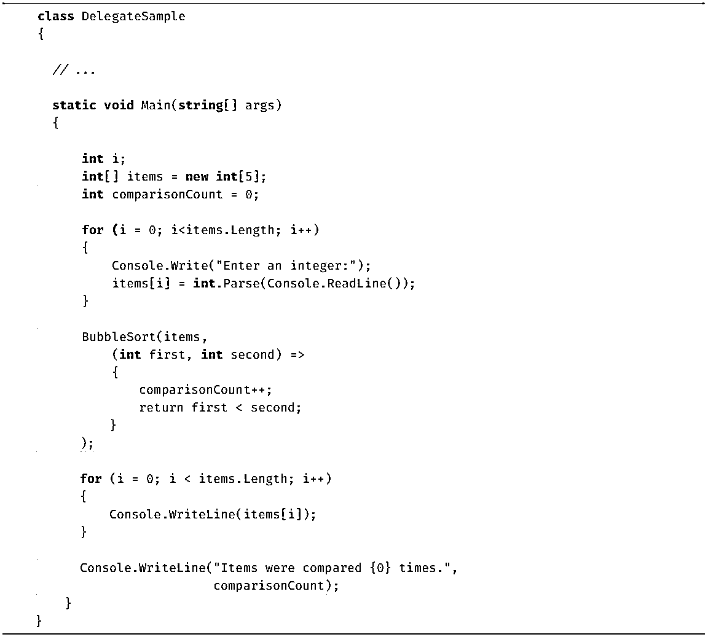

输出 13.2

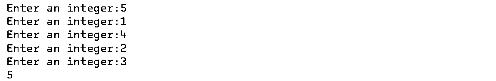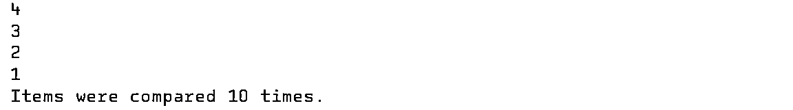

comparisonCount 在 Lambda 表达式外部声明，在其内部递增。调用 BubbleSort()方法之后，在控制台上输出 comparisonCount 的值。

局部变量的生存期一般和它的作用域绑定。一旦控制离开作用域，变量的存储位置就不再有效。但如果从 Lambda 表达式创建的委托捕捉了外部变量，该委托可能具有比局部变量一般情况下更长（或更短）的生存期。委托每次被调用时，都必须能安全地访问外部变量。在这种情况下，被捕捉的变量的生存期被延长了。这个生存期至少和存活时间最长的委托对象一样长。（也许更长：编译器如何生成代码来延长外部变量生存期是一种实现细节，可能会发生变化。）

总之，C#编译器生成在匿名函数和声明它的方法之间共享 comparison-Count 的 CIL 代码。

> 注：PowerShell 脚本块也会“捕捉”外层变量，但机制不同：脚本块保留对变量所在作用域的引用，调用时才读取变量的当前值，不存在 C# 编译器生成的闭包类；变量的生存期由作用域与脚本块引用共同维持。若要在创建脚本块时锁定变量当时的值，用 `.GetNewClosure()` 生成快照，例如 `$c=5; $sb={ $c }.GetNewClosure(); $c=9; & $sb` 输出 5（已验证）。

高级主题：外部变量的 CIL 实现

C#编译器为捕捉外部变量的匿名函数生成的 CIL 代码要比为什么都不捕捉的简单匿名方法生成的 CIL 代码复杂。代码清单 13.21 是与“实现代码清单 13.20 的外部变量的 CIL 代码”对应的 C#代码。

代码清单 13.21　与外部变量 CIL 代码对应的 C#代码

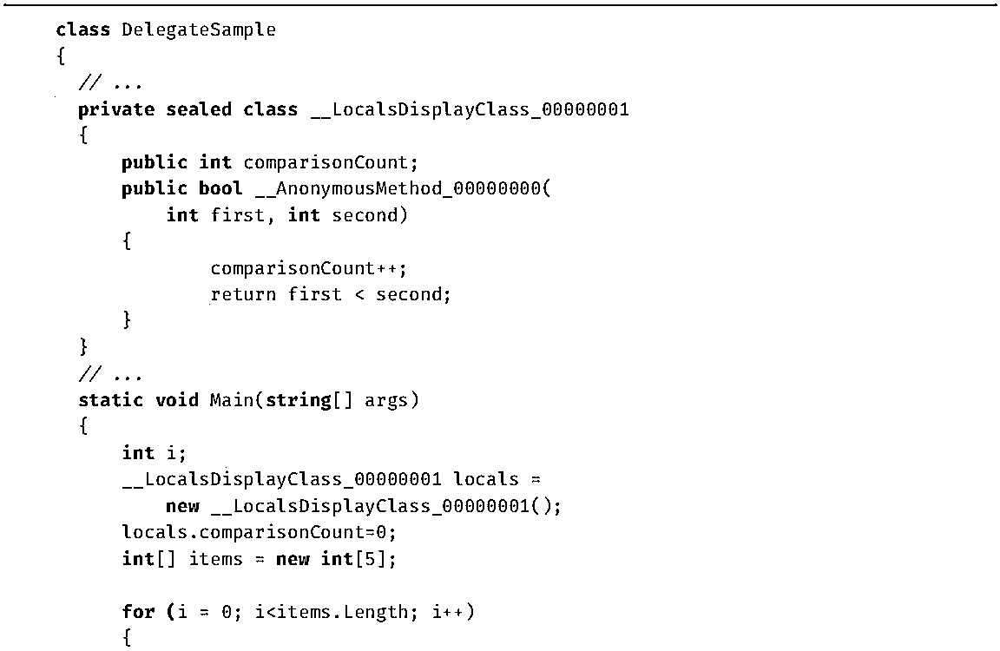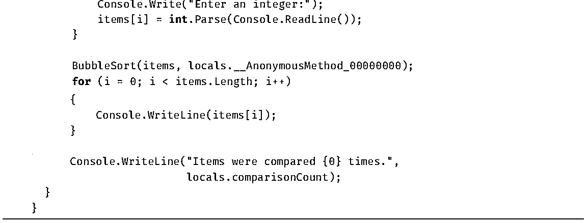

注意，被捕捉的局部变量永远不会被“传递”或“拷贝”到别的地方。相反，被捕捉的局部变量（comparisonCount）作为实例字段（而非局部变量）实现，从而延长了其生存期。所有使用局部变量的地方都改为使用那个字段。

生成的\_\_LocalsDisplayClass 类称为闭包 （closure），它是一个数据结构（一个 C#类），其中包含一个表达式以及对表达式进行求值所需的变量（C#中的公共字段）。

高级主题：不小心捕捉循环变量

思考一下代码清单 13.22 的输出是什么。

代码清单 13.22　在 C# 5.0 中捕捉循环变量

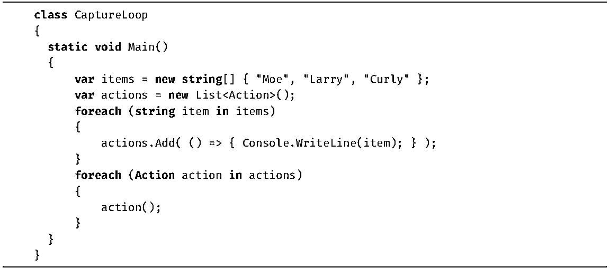

大多数人都觉得结果应该如输出 13.3 所示。在 C# 5.0 中确实如此。但在之前的 C#版本中，结果如输出 13.4 所示。

输出 13.3　C# 5.0 的输出

输出 13.4　C# 4.0 的输出

Lambda 表达式捕捉变量并总是使用其最新的值——而不是捕捉并保留变量在委托创建时的值。这通常正是你希望的行为。例如，代码清单 13.20 捕捉变量 comparisonCount，目的正是确保递增时使用其最新的值。循环变量没什么两样。捕捉循环变量时，每个委托都捕捉同一个循环变量。循环变量发生变化时，捕捉它的每个委托都看到了变化。所以无法指责 C# 4.0 的行为——虽然这几乎肯定不是代码作者想要的。

C# 5.0 对此进行了更改，认为每一次循环迭代，foreach 循环变量都应该是“新”变量。所以，每次创建委托，捕捉的都是不同的变量，不再共享同一个变量。但注意这个更改不适用于 for 循环。用 for 循环写类似的代码，for 语句头中声明的任何循环变量在被捕捉时，都被看成是同一个外部变量。要写在 C# 5.0 和之前的版本中行为一致的代码，请使用如代码清单 13.23 所示的模式。

代码清单 13.23　C# 5.0 之前的循环变量捕捉方案

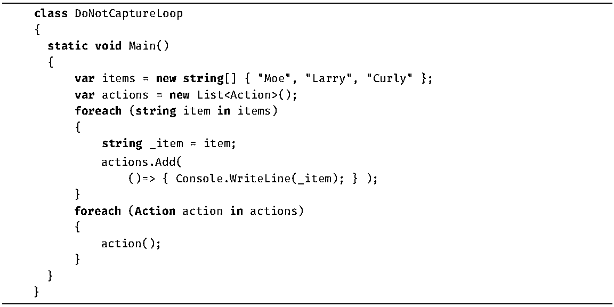

这样可保证每次循环迭代都有一个新变量，每个委托捕捉的都是一个不同的变量。

> 注：PowerShell 捕捉循环变量的行为与 **C# 4.0** 一致：循环里创建的脚本块共享同一个循环变量，调用时全部读到循环结束后的最后值（验证：循环结束后调用各脚本块，输出 3,3,3）。若要让每次迭代各自持有值，可对每个脚本块调用 `.GetNewClosure()`（输出 1,2,3），或先把当前值复制到新变量再引用。PowerShell 没有 C# 5.0 的 `foreach` 新变量语义，`for`、`foreach` 都一样。

设计规范

·避免在匿名函数中捕捉循环变量。

## 13.7　表达式树

Lambda 表达式提供了一种简洁的语法来定义代码中“内联”的方法，使其能转换成委托类型。表达式 Lambda（但不包括语句 Lambda 和匿名方法）还能转换成表达式树 。委托是对象，允许像传递其他任何对象那样传递方法，并在任何时候调用该方法。表达式树也是对象，允许传递编译器对 Lambda 表达式的分析。但这个分析有什么用呢？显然，编译器的分析在生成 CIL 时对编译器有用，但是在程序执行时，代表这种分析的一个对象对开发者有什么用呢？下面看一个例子。

> 注：PowerShell **不能**把脚本块转换成表达式树：`[System.Linq.Expressions.Expression[System.Func[int,bool]]] { param($x) $x -gt 3 }` 会报“无法将 ScriptBlock 转换为 Expression`1”的错误（已验证）。C# 编译器“根据类型自动选择生成委托还是表达式树”的 LINQ 机制在 PowerShell 中不存在；PowerShell 的管道（`Where-Object` 等）总在本地执行，不会把代码序列化后发给远程服务器。

### 13.7.1　Lambda 表达式作为数据使用

来看看以下代码中的 Lambda 表达式：

假定 persons 是 Person 的一个数组，和 Lambda 表达式实参对应的 Where 方法形参具有委托类型 Func<Person, bool>。编译器生成方法来包含 Lambda 表达式主体代码，再创建委托实例来代表所生成的方法，并将该委托传给 Where 方法。Where 方法返回一个查询对象，一旦执行查询，就将委托应用于数组的每个成员来判断查询结果。

现在假定 persons 不是 Person 的一个数组，而是代表远程数据库表的对象，表中含有数百万人的数据。表中每一行的信息都可从服务器传输到客户端，客户端可创建一个 Person 对象来代表该行。调用 Where 将返回代表查询的一个对象。现在客户端如何请求查询结果？

一个技术是将几百万行数据从服务器传输到客户端。为每一行都创建 Person 对象，根据 Lambda 创建委托，再针对每个 Person 执行委托。概念上和数组的情况一致，但代价过于高昂。

第二个技术则要好很多，它是将 Lambda 的含义（筛选掉姓名不是 Inigo Montoya 的每一行）发送给服务器。数据库服务器本来就很擅长快速执行这种筛选。然后，服务器只将符合条件的少数几行传输到客户端，而不是先创建几百万个 Person 对象，再把它们几乎全部否决。客户端只创建由服务器判断并与查询匹配的对象。但怎样将 Lambda 的含义发送给服务器呢？

这正是要在语言中添加表达式树 的原因。转换成表达式树的 Lambda 表达式对象代表的是对 Lambda 表达式进行描述的数据，而不是编译好的、用于实现匿名函数的代码。由于表达式树代表数据而非编译好的代码，所以能在执行时分析 Lambda，用分析得到的数据来构造一个针对数据库执行的查询。如代码清单 13.24 所示，Where()方法获得的表达式树可转换成 SQL 查询并传给数据库。

代码清单 13.24　将表达式树转换成 SQL where 子句

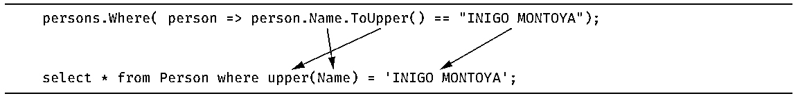

传给 Where()的表达式树指出 Lambda 实参由以下几部分构成：

·对 Person 对象的 Name 属性的读取

·对 string 的 ToUpper()方法的调用

·常量值"INIGO MONTOYA"

·相等性操作符==

Where()方法获取这些数据，并通过检查数据和构造 SQL 查询字符串将这些数据转换成 SQL where 子句。但表达式树并非只能转换成 SQL 语句。可构造表达式树计算程序（evaluator），将表达式转换成任意查询语言。

### 13.7.2　表达式树作为对象图使用

在执行时，转换成表达式树的 Lambda 成为一个对象图，其中包含来自 System.Linq.Expressions 命名空间的对象。图中的“根”对象代表 Lambda 本身，该对象引用了代表参数、返回类型和主体表达式的对象，如图 13.3 所示。对象图包含编译器根据 Lambda 推断出来的所有信息。执行时可利用这些信息创建查询。另外，根 Lambda 表达式有一个 Compile 方法，能动态生成 CIL 并创建实现了指定 Lambda 的委托。

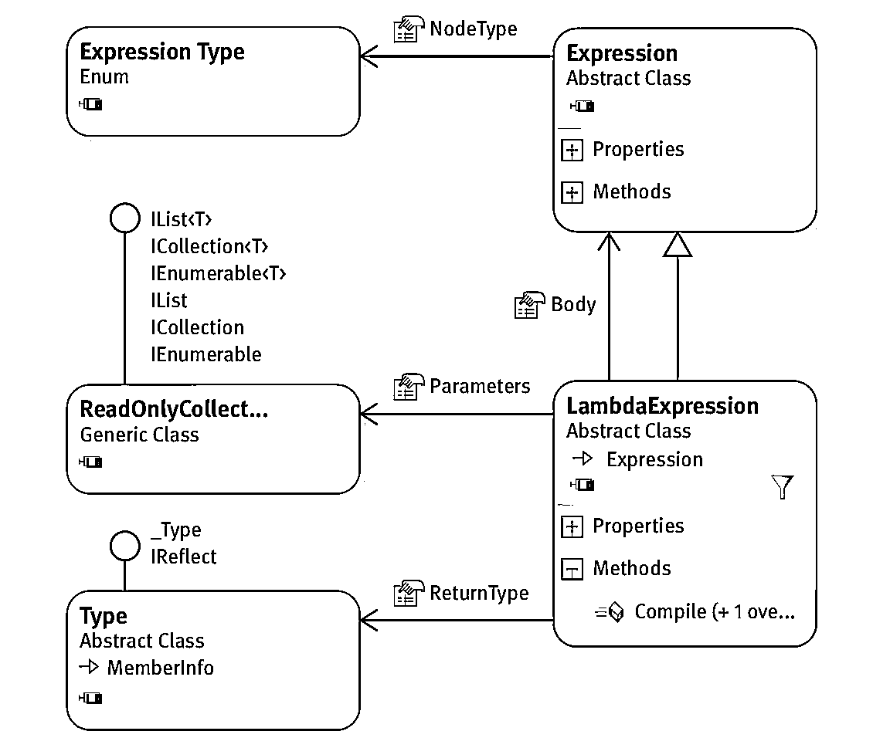

图 13.3　Lambda 表达式树类型

图 13.4 展示了一个 Lambda 主体中的一元和二元表达式的对象图中的类型。

UnaryExpression 代表-count 这样的表达式。它具有 Expession 类型的单个子操作数（Operand）。BinaryExpression 有两个子表达式：Left 和 Right。两个类型都通过 NodeType 属性标识具体的操作符，而且两者都从基类 Expression 派生。还有其他 30 多个表达式类型，比如 NewExpression、ParameterExpression、MethodCallExpression、LoopExpression 等，能表示 C#和 Visual Basic 中的几乎所有表达式。

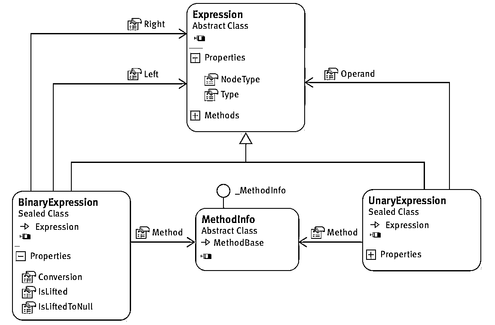

图 13.4　一元和二元表达式树类型

### 13.7.3　比较委托和表达式树

不管转换成委托还是表达式树的 Lambda 表达式都会在编译时进行全面的语义分析，从而验证其有效性。转换成委托的 Lambda 造成编译器将 Lambda 作为方法生成，并生成代码在执行时创建对那个方法的委托。转换成表达式树的 Lambda 造成编译器生成代码，在执行时创建 LambdaExpression 的一个实例。但在使用 LINQ 时，编译器怎么知道是生成委托、在本地执行查询，还是生成表达式树将查询信息发送给远程数据库服务器呢？

像 Where()这样用于生成 LINQ 查询的方法是扩展方法。扩展 IEnumerable<T>接口的方法获取委托参数，扩展 IQueryable<T>接口的方法获取表达式树参数。所以，编译器能根据查询的集合类型判断是从作为实参提供的 Lambda 创建委托还是表达式树。例如以下 Where()方法：

System.Linq.Enumerable 类中声明的扩展方法签名是：

System.Linq.Queryable 类中声明的扩展方法签名是：

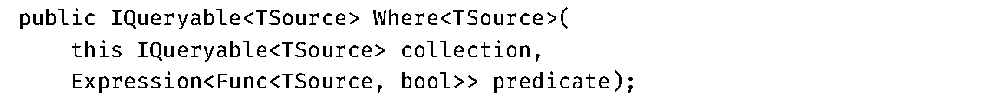

编译器根据 persons 在编译时的类型决定使用哪个扩展方法：如果是能转换成 IQueryable<Person>的类型，就选择来自 System.Linq.Queryable 的方法。它将 Lambda 转换成表达式树。执行时，persons 引用的对象接收表达式树数据，用那些数据构造 SQL 查询，在请求查询结果时将查询传给数据库。所以，调用 Where 的结果是一个对象。一旦请求查询结果，就将查询发送给数据库并生成结果。

如果 persons 不能隐式转换成 IQueryable<Person>，但能隐式转换成 IEnumerable <Person>，就选择来自 System.Linq.Enumerable 的方法，Lambda 被转换成委托。所以，调用 Where 的结果是一个对象，一旦请求查询结果，就将生成的委托作为谓词应用于集合的每个成员，生成与谓词匹配的结果。

> 注：PowerShell 不支持扩展方法语法，不能对集合直接调用 `Where()`；需要按静态方法调用，例如 `[System.Linq.Enumerable]::Where($arr, [Func[int,bool]] { param($x) $x -gt 3 })`（已验证）。`IQueryable`/`Queryable` 那套表达式树机制在 PowerShell 中一般用不到，惯用做法是 `Where-Object`、`ForEach-Object` 等管道 cmdlet，它们在本地逐项执行。

### 13.7.4　检查表达式树

如前所述，将 Lambda 表达式转换成 Expression<TDelegate>将创建表达式树而不是委托。本章前面讲过如何将(x,y)=>x>y 这样的 Lambda 转换成 Func<int, int, bool>这样的委托类型。要将同样的 Lambda 转换成表达式树，只需把它转换成 Expression <Func<int, int, bool>>，如代码清单 13.25 所示。然后就可检查生成的对象，显示和它的结构相关的信息，并可显示更复杂的表达式树的信息。

> 注：PowerShell 中无法进行这种转换：把脚本块强制转换成 `Expression<Func<int,int,bool>>` 会直接失败，只能像下一条注那样手工构造表达式树对象。

代码清单 13.25　检查表达式树

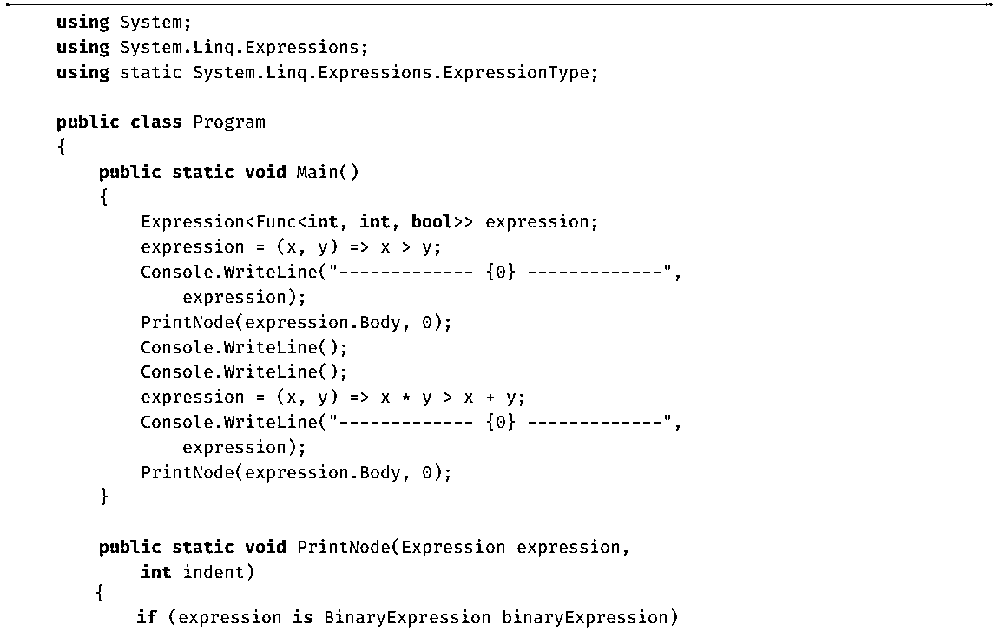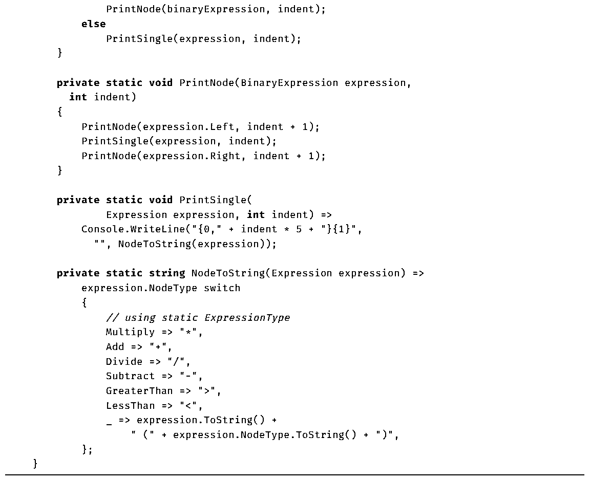

注意，将表达式树的实例传给 Console.WriteLine()方法，会自动将表达式树转换成一个描述性的字符串。为表达式树生成的所有对象都重写了 ToString()，以便在调试时能一眼看出表达式树的内容。

如输出 13.5 所示，Main()中的 Console.WriteLine()语句将表达式树主体打印成文本。

输出 13.5

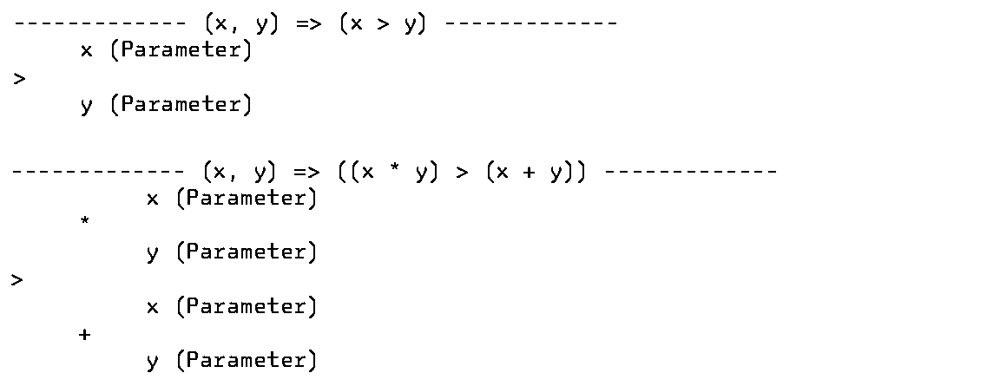

注意，表达式树是数据集合，可通过遍历数据将其转换成另一种格式。本例将表达式树转换成描述性字符串，但也可转换成另一种查询语言中的表达式。

PrintNode()方法使用递归证明表达式树由零个或者多个其他表达式树构成。代表 Lambda 的“根”树通过其 Body 属性引用 Lambda 的主体。每个表达式树节点都包含枚举类型 ExpressionType 的一个 NodeType 属性，描述了它是哪一种表达式。有多种表达式类型，例如 BinaryExpression、ConditionalExpression、LambdaExpression、MethodCall-Expression、ParameterExpression 和 ConstantExpression。每个类型都从 Expression 派生。

注意，虽然表达式树库包含的对象能表示 C#和 Visual Basic 的大多数语句，但两种语言都不支持将语句 Lambda 转换成表达式树。只有表达式 Lambda 才能转换成表达式树。

> 注：虽然脚本块不能转换成表达式树，`System.Linq.Expressions` 只是一组普通 .NET 类型，仍可在 PowerShell 中手工构造和遍历节点，例如 `[System.Linq.Expressions.Expression]::Add([System.Linq.Expressions.Expression]::Parameter([int],'x'), [System.Linq.Expressions.Expression]::Constant(5))` 可构造出 `(x + 5)`（已验证）。但不存在“由编译器分析脚本块生成表达式树”的机制。

## 13.8　小结

本章首先讨论委托以及如何把它作为方法引用或回调来使用。可用委托传递一组能在不同位置调用的指令（而不是立即调用）。

Lambda 表达式语法取代（但不是消除）了 C# 2.0 的匿名方法语法。不管哪种语法，程序员都可直接将一组指令赋给变量，而不必显式定义一个包含这些指令的方法。这使得程序员可以在方法内部动态地编写指令——这是一个很强大的概念，它通过 LINQ API 大幅简化了集合编程。

本章最后讨论了表达式树的概念，描述了它们如何编译成对象来表示对 Lambda 表达式的语义分析，而不是表示委托实现本身。该功能用于支持像 Entity Framework 和 LINQ to XML 这样的库。这些库解释表达式树，并在除匿名函数之外的上下文中使用它。

“Lambda 表达式”这个术语兼具“语句 Lambda”和“表达式 Lambda”的意思。换言之，语句 Lambda 和表达式 Lambda 都是 Lambda 表达式。

本章提到但未详述的一个概念是多播委托。下一章将讲解如何利用它实现事件的“发布—订阅”模式。