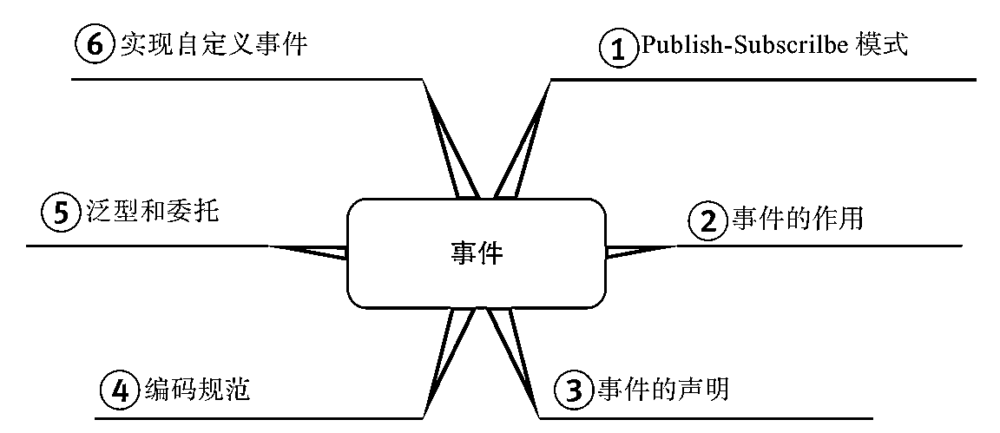
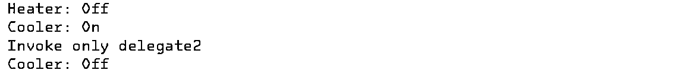
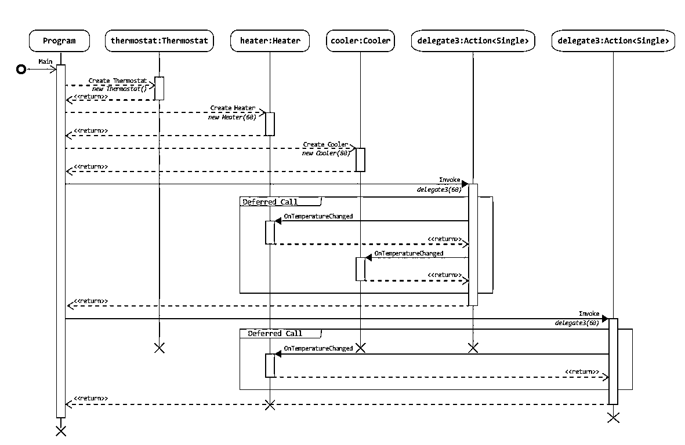
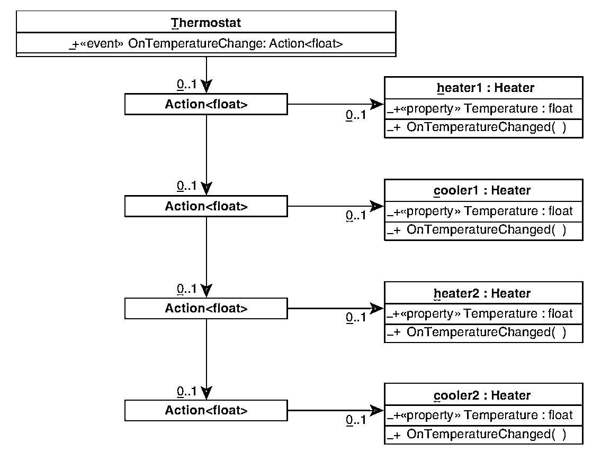
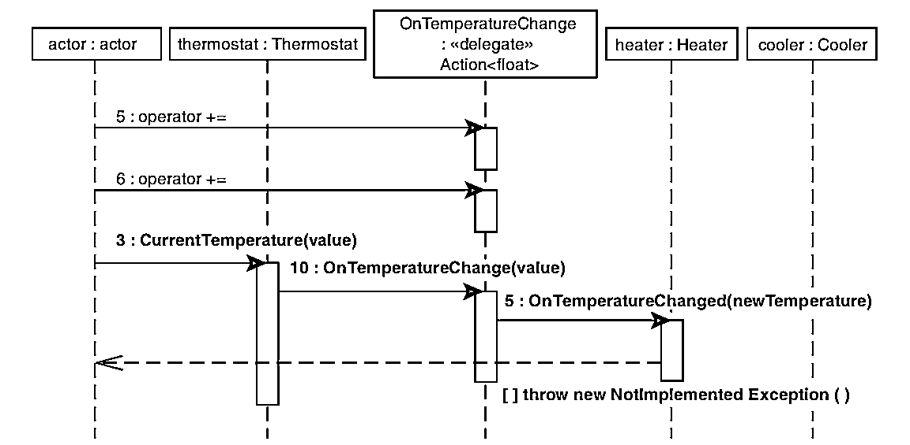
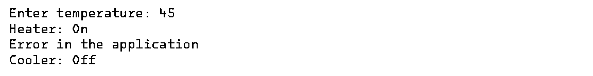

# 第十四章　事件



上一章讲述了如何用委托类型的实例引用方法，并通过委托调用方法。委托本身又是一个更大的模式（pattern）的基本单位，该模式称为 Publish-Subscribe（发布—订阅）或者 Observer（观察者）^( [\[1\]](part0132.xhtml#ch1_back) ) 。委托的使用及其对 Publish-Subscribe 模式的支持是本章的重点。本章描述的所有内容几乎都能单独用委托实现。但本章强调的“事件”构造提供了额外的“封装性”，使 Publish-Subscribe 模式更容易实现，更不容易出错。

第十三章的所有委托都只引用一个方法。但一个委托值是可以引用一系列方法的，这些方法将顺序调用。这样的委托称为多播委托 。这样单一事件（比如对象状态的改变）的通知就可以发布给多个订阅者。

虽然事件在 C# 1.0 中就有了，但 C# 2.0 泛型的引入显著改变了编码规范，因为使用泛型委托数据类型意味着不再需要为每种可能的事件签名声明一个委托。所以，本章的最低起点是 C# 2.0。但仍在使用 C# 1.0 的读者也不是不能使用事件，只是必须声明自己的委托数据类型（参见第十三章）。

[\[1\]](part0132.xhtml#ch1) C#的多播委托实现是一个通用模式，目的是避免大量手工编码。该模式称为 Observer 或者 Publish-Subscribe，它要应对的是要将单一事件的通知（比如对象状态发生的一个变化）广播给多个订阅者（subscriber）的情况。——译者注

## 14.1　使用多播委托实现 Publish-Subscribe 模式

来考虑一个温度控制的例子。一个加热器（Heater）和一个冷却器（Cooler）连接到同一个恒温器（Thermostat）。为控制设备开关需要通知它们温度变化。恒温器将温度变化发布给多个订阅者——也就是加热器和冷却器^( [\[1\]](part0133.xhtml#ch1_back) ) 。下一节研究具体代码。

### 14.1.1　定义订阅者方法

首先定义 Heater 和 Cooler 对象，如代码清单 14.1 所示。

代码清单 14.1　Heater 和 Cooler 事件订阅者的实现

```powershell
class Cooler {
    [float]$Temperature
    Cooler([float]$temperature) { $this.Temperature = $temperature }
    [void] OnTemperatureChanged([float]$newTemperature) {
        if ($newTemperature -gt $this.Temperature) { Write-Output 'Cooler: On' }
        else { Write-Output 'Cooler: Off' }
    }
}

class Heater {
    [float]$Temperature
    Heater([float]$temperature) { $this.Temperature = $temperature }
    [void] OnTemperatureChanged([float]$newTemperature) {
        if ($newTemperature -lt $this.Temperature) { Write-Output 'Heater: On' }
        else { Write-Output 'Heater: Off' }
    }
}
```

除了温度比较，两个类几乎完全一样（事实上，在 OnTemperatureChanged 方法中使用一个比较方法委托，两个类还能再减少一个）。每个类都存储了启动设备所需的温度。此外，两个类都提供了 OnTemperatureChanged()方法。调用 OnTemperatureChanged()方法的目的是向 Heater 和 Cooler 类指出温度已发生改变。在方法的实现中，用 newTemperature 同存储好的触发温度进行比较，从而决定是否让设备启动。

两个 OnTemperatureChanged()方法都是订阅者（或侦听者）方法，其参数和返回类型必须与来自 Thermostat 类的委托匹配。（Thermostat 类的详情接下来就会讨论。）

### 14.1.2　定义发布者

Thermostat 类负责向 heater 和 cooler 对象实例报告温度变化。代码清单 14.2 展示了 Thermostat 类。

代码清单 14.2　定义事件发布者 Thermostat

```powershell
class Thermostat {
    [scriptblock[]]$OnTemperatureChange
    [float]$CurrentTemperature
}
```

Thermostat 包含一个名为 OnTemperatureChange 的属性，它属于 Action<float>委托类型。OnTemperatureChange 存储了订阅者列表。注意，只需一个委托字段即可存储所有订阅者。换言之，来自一个发布者的温度变化通知会同时被 Cooler 和 Heater 实例接收。

> 注：改编版中 `OnTemperatureChange` 是 `[scriptblock[]]` 数组，而不是 C# 的 `Action<float>` 委托。数组在这里充当“订阅者列表”：`+=` 向数组追加一个脚本块，并不对应委托的 `System.Delegate.Combine()`；也没有 `GetInvocationList()`，没有委托的引用赋值语义（详见下文诸注）。

Thermostat 的最后一个成员是 CurrentTemperature 属性。它负责设置和获取由 Thermostat 类报告的当前温度值。

### 14.1.3　连接发布者和订阅者

最后将所有这些东西都放到一个 Main()方法中。代码清单 14.3 展示了一个示例 Main()。

代码清单 14.3　连接发布者和订阅者

```powershell
$thermostat = [Thermostat]::new()
$heater = [Heater]::new(60)
$cooler = [Cooler]::new(80)
$thermostat.OnTemperatureChange += { param($temperature) $heater.OnTemperatureChanged($temperature) }
$thermostat.OnTemperatureChange += { param($temperature) $cooler.OnTemperatureChanged($temperature) }
$temperature = Read-Host 'Enter temperature'
$thermostat.CurrentTemperature = [float]$temperature
```

代码通过+=操作符直接赋值向 OnTemperatureChange 委托注册了两个订阅者，即 heater.OnTemperatureChanged 和 cooler.OnTemperatureChanged。

从用户获取的值用于设置 thermostat（恒温器）的 CurrentTemperature（当前温度）。但目前还没有写任何代码将温度变化发布给订阅者。

### 14.1.4　调用委托

Thermostat 类的 CurrentTemperature 属性每次发生变化，你都希望调用委托 向订阅者（heater 和 cooler）通知温度的变化。为此需要修改 CurrentTemperature 属性来保存新值，并向每个订阅者发出通知，如代码清单 14.4 所示。

代码清单 14.4　调用委托（尚未检查 null 值）

```powershell
class Thermostat {
    [float]$CurrentTemperature
    Thermostat() { $this._CurrentTemperature = 0 }
    hidden [float]$_CurrentTemperature
    [void] SetTemperature([float]$value) {
        if ($value -ne $this._CurrentTemperature) {
            $this._CurrentTemperature = $value
            # Incomplete: invoke subscribers after checking for null.
            foreach ($subscriber in $this.OnTemperatureChange) { & $subscriber $value }
        }
    }
}
```

对 CurrentTemperature 的赋值包含向订阅者通知 CurrentTemperature 变化的特殊逻辑。只需执行 C#语句 OnTemperatureChange(value);即可向所有订阅者发出通知。该语句将温度的变化发布给 cooler 和 heater 对象。执行一个调用，即可向多个订阅者发出通知——这正是“多播委托”的由来。

> 注：在改编版中不存在“一条语句调用整个委托链”的多播调用——`[scriptblock[]]` 数组需要显式 `foreach` 逐个调用（代码清单 14.4 已这样改写）。

在 C# 8.0 中，如果像上面代码中那样直接调用 OnTemperatureChange 委托，编译器会发出关于 null 值解引用的警告。这意味着需要进行空值检查。

### 14.1.5　检查空值

代码清单 14.4 遗漏了事件发布代码的一个重要部分。假如当前没有订阅者注册接收通知，则 OnTemperatureChange 为 null，执行 OnTemperatureChange(value)语句会抛出 NullReferenceException 异常。避免该问题需在触发事件之前检查空值。代码清单 14.5 演示了如何在调用 Invoke()前使用 C# 6.0 的空条件操作符来达成目标。

> 注：PowerShell 没有 `?.` 空条件操作符——写成 `$x?.Member` 会被解析成名为 `$x?` 的变量（PowerShell 也没有 `?[]`）。因此改编版改用显式 `if ($null -ne ...)` 判断，代码清单 14.5 与后续清单都已这样改写。PowerShell 7 只支持空合并 `??` 与三元 `? :`。

代码清单 14.5　调用委托

```powershell
# Invoke subscribers only when the list is non-empty.
if ($null -ne $thermostat.OnTemperatureChange) {
    foreach ($subscriber in $thermostat.OnTemperatureChange) { & $subscriber $value }
}
```

注意是在空条件检测后再调用 Invoke()。虽然可以拿掉问号，只用点操作符来调用该方法，但意义不大，因为那样相当于直接调用委托（参考代码清单 14.4 的 On-TemperatureChange(value)）。空条件操作符的优点在于，它采用特殊逻辑防范在执行空检查后订阅者调用一个过时处理程序（空检查后有变）导致委托再度为空。

高级主题：在 C# 6.0 之前调用委托

遗憾的是，C# 6.0 之前不存在这种特殊的、不会被干扰的空检查逻辑。如代码清单 14.6 所示，老版本 C#中的实现要稍微麻烦一些。

代码清单 14.6　C# 6.0 之前先执行空检查再调用委托

```powershell
# Copy the subscriber list before checking it, avoiding a race with removal.
$localOnChange = $thermostat.OnTemperatureChange
if ($null -ne $localOnChange) {
    foreach ($subscriber in $localOnChange) { & $subscriber $value }
}
```

不是一上来就检查空值，而是先将 OnTemperatureChange 赋给第二个委托局部变量 localOnChange。这个简单的修改可确保在检查空值和发送通知之间，如一个不同的线程移除了所有 OnTemperatureChange 订阅者，将不会引发 NullReferenceException 异常。

> 注：“拷贝引用再检查再调用”这份防竞态意图可以由 PowerShell 套用——`$local = $thermostat.OnTemperatureChange` 拷贝的是数组引用，之后若另一线程把该属性整体重新赋成新数组，`$local` 仍指向旧数组。但 PowerShell 数组本身没有 C# 委托“`+=`/`-=` 产生新实例并替换引用”的语义，见下注。

本书剩下的所有例子都依赖 C# 6.0 的空条件操作符进行委托调用。

设计规范

·要在调用委托前检查它的值是不是空值。

·要从 C# 6.0 起在调用 Invoke()前使用空条件操作符。

高级主题：将“-=”操作符应用于委托会返回新实例

既然委托是引用类型，肯定有人会感觉疑惑：为什么赋值给一个局部变量，再用那个局部变量就能保证 null 检查的线程安全性？因为 localOnChange 指向的位置就是 OnTemperatureChange 指向的位置，所以很自然的结论是：OnTemperatureChange 中发生的任何变化都将在 localOnChange 中反映。

但实情并非如此。事实上，对 OnTemperatureChange-=<subscriber>的任何调用都不会从 OnTemperatureChange 删除一个委托，而使它包含的委托比之前少一个。相反，该调用会赋值一个全新的多播委托，原始多播委托不受任何影响（localOnChange 指向的正是原始的那个）。

> 注：这里讨论的是 C# 委托（引用类型）的“`-=` 产生新委托实例、原引用不受影响”语义。PowerShell 的 `[scriptblock[]]` 数组没有 `-=` 操作符；把属性整体重新赋值成新数组后，旧数组引用仍被 `$local` 持有——防竞态效果与 C# 类似，但数组内容的增删是元素级操作，不存在新委托实例整体替换的机制。

高级主题：线程安全的委托调用

如前所述，由于订阅者可由不同线程从委托中增删，所以有必要像前面描述的那样条件性地调用委托，或者在空检查前将委托引用拷贝到局部变量中。虽然这样能防范调用空委托，但不能防范所有可能的竞态条件。例如，一个线程拷贝委托，另一个将委托重置为 null，然后原始线程调用委托之前的值（该值已过时），向一个已经不在列表中的订阅者发送通知。在多线程程序中，订阅者应确保在这种情况下的健壮性，随时做好调用一个“过时”订阅者的准备。

### 14.1.6　委托操作符

合并 Thermostat 例子中的两个订阅者要使用“+=”操作符。它获取第一个委托并将第二个委托添加到委托链。第一个委托的方法返回后会调用第二个委托。从委托链中删除委托则要使用“-=”操作符，如代码清单 14.7 所示。

代码清单 14.7　使用+=和-=委托操作符

```powershell
$delegate1 = { param($t) $heater.OnTemperatureChanged($t) }
$delegate2 = { param($t) $cooler.OnTemperatureChanged($t) }
$delegates = @($delegate1, $delegate2)
Write-Output 'Invoke both delegates:'
foreach ($delegate in $delegates) { & $delegate 90 }
Write-Output 'Invoke only delegate2'
$delegates = @($delegate2)
& $delegates[0] 30
```

代码清单 14.7 的结果如输出 14.1 所示。

输出 14.1



如代码清单 14.8 所示，还可使用“+”和“–”操作符合并委托。

代码清单 14.8　使用+和-委托操作符

```powershell
$delegate1 = { param($t) $heater.OnTemperatureChanged($t) }
$delegate2 = { param($t) $cooler.OnTemperatureChanged($t) }
Write-Output 'Combine delegates using + equivalent:'
$delegates = @($delegate1, $delegate2)
foreach ($delegate in $delegates) { & $delegate 60 }
Write-Output 'Uncombine delegates using - equivalent:'
$delegates = @($delegate1)
foreach ($delegate in $delegates) { & $delegate 60 }
```

使用赋值操作符会清除之前的所有订阅者，并允许用新订阅者替换。这是委托很容易让人犯错的一个设计，因为在本来应该使用“+=”操作符的时候，很容易就会错误地写成“=”。解决方案是使用本章稍后要讲述的事件。

无论“+”“–”还是它们的复合赋值版本（“+=”和“–=”），内部都用静态方法 System.Delegate.Combine()和 System.Delegate.Remove()来分别实现。两个方法都获取 delegate 类型的两个参数。第一个方法 Combine()连接两个参数，将两个委托的调用列表按顺序连接到一起。第二个方法 Remove()则搜索由第一个参数指定的委托链，删除由第二个参数指定的委托。此外，既然 Remove()方法有可能返回 null，我们可以使用 C# 8.0 提供的空包容操作符来要求编译器假设委托对象存在。

> 注：`System.Delegate.Combine()`/`Remove()` 只适用于真正的 .NET 委托对象，对 `[scriptblock[]]` 数组无效。改编版对“增删订阅者”用数组操作：`+=` 追加元素；删除则重建数组（如代码清单 14.19 的 `Where-Object` 过滤）。注意 PowerShell 数组**不支持 `-=`**：`$arr -= $sb` 会报“减法失败，因为 [System.Object[]] 不具有名为 'op_Subtraction' 的方法”（已实测）。另外脚本块用 `-eq` 比较是**引用比较**（两个内容相同的字面脚本块也不相等），要移出某个订阅者应保留对它的引用。

Combine()方法的一个有趣的地方是两个参数都可为 null。任何参数为 null，Combine()返回非空的那个。两个都为 null，Combine()返回 null。这解释了为什么调用 thermostat.OnTemperatureChange+=heater.OnTemperatureChanged;不会抛出异常（即使 thermostat.OnTemperatureChange 的值仍然为 null）。

### 14.1.7　顺序调用

图 14.1 展示了 heater 和 cooler 的顺序通知。



图 14.1　委托调用顺序图

虽然代码中只是一个简单的 OnTemperatureChange()调用，但这个调用会广播给两个订阅者，使 cooler 和 heater 都会收到温度发生变化的通知。添加更多订阅者，它们也会收到通知。

虽然一个 OnTemperatureChange()调用造成每个订阅者都收到通知，但它们仍然是顺序调用的，而不是同时，因为它们全都在一个执行线程上调用。

高级主题：多播委托的内部机制

要理解委托是如何工作的，你需要复习 13.2.2 节，那里第一次在高级主题中探讨了 System.Delegate 类型的内部机制。delegate 关键字是派生自 System.Multicast-Delegate 的一个类型的别名。System.MulticastDelegate 则从 System.Delegate 派生，后者由一个对象引用（以满足非静态方法的需要）和一个方法引用构成。创建委托时，编译器自动使用 System.MulticastDelegate 类型而不是 System.Delegate 类型。MulticastDelegate 类包含对象引用和方法引用，这和它的 Delegate 基类一样。但除此之外，它还包含对另一个 System.MulticastDelegate 对象的引用。

向多播委托添加方法时，MulticastDelegate 类会创建委托类型的一个新实例，在新实例中为新增的方法存储对象引用和方法引用，并在委托实例列表中添加新的委托实例作为下一项。所以 MulticastDelegate 类事实上维护着一个 Delegate 对象链表。

> 注：MulticastDelegate 的“委托链表”内部机制不适用于脚本块数组。改编版把订阅者放进 `[scriptblock[]]` 数组，`+=` 追加元素，调用顺序由数组索引决定——顺序是稳定的，不存在 CLI 规范“不保证顺序”的问题；也没有 Combine/Remove 的链表语义。图 14.2 展示了恒温器的概念图。



图 14.2　链接到一起的多播委托

调用多播委托时，链表中的委托实例被顺序调用。通常，委托按它们添加的顺序调用，但 CLI 规范并未对此做出规定，而且该顺序可能被覆盖，所以程序员不应依赖特定调用顺序。

### 14.1.8　错误处理

错误处理使对顺序通知的了解变得至关重要。一个订阅者抛出异常，链中的后续订阅者就收不到通知。例如，修改 Heater 的 OnTemperatureChanged()方法使其抛出异常会发生什么？如代码清单 14.9 所示。

代码清单 14.9　OnTemperatureChanged()抛出异常

```powershell
$thermostat.OnTemperatureChange += { throw [InvalidOperationException]::new() }
# A terminating exception stops subsequent subscribers unless handled.
$thermostat.CurrentTemperature = [float](Read-Host 'Enter temperature')
```

图 14.3 是更新过的顺序图。虽然 cooler 和 heater 已订阅接收消息，但 Lambda 表达式异常中止了链，造成 cooler 对象收不到通知。



图 14.3　委托调用顺序图（已添加异常）

为避免该问题，使所有订阅者都能收到通知（不管之前的订阅者有过什么行为），必须手动遍历订阅者列表，并单独调用它们。代码清单 14.10 展示了需要在 CurrentTemperature 属性中进行的更新。结果如输出 14.2 所示。

代码清单 14.10　处理来自订阅者的异常

```powershell
$exceptions = [System.Collections.Generic.List[Exception]]::new()
foreach ($subscriber in $thermostat.OnTemperatureChange) {
    try { & $subscriber $value }
    catch [Exception] { $exceptions.Add($_.Exception) }
}
if ($exceptions.Count -gt 0) {
    throw [AggregateException]::new('Subscriber errors occurred.', $exceptions)
}
```

输出 14.2



代码清单 14.10 演示了可以从委托类的 GetInvocationList()方法获得一份订阅者列表。枚举列表中的每一项以返回单独的订阅者。随后将每个订阅者调用都放到一个 try/catch 块中，就可以先处理好任何出错的情形，再继续循环迭代。本例即使订阅者抛出异常，cooler 仍能收到温度变化通知。所有通知都发送完毕之后，代码清单 14.10 通过抛出 AggregateException 来报告所有已发生的异常。AggregateException 包装一个异常集合，集合中的异常可通过 InnerExceptions 属性访问。结果是所有异常都得到报告，同时所有订阅者都不会错过通知。

> 注：脚本块数组没有 `GetInvocationList()`。改编版直接 `foreach ($subscriber in $arr) { & $subscriber ... }`，天然逐一调用列表中的脚本块，效果与 GetInvocationList() 枚举一致；每个订阅者单独 try/catch 再收集异常的写法（代码清单 14.10）在 PowerShell 中照常可用，`[System.AggregateException]` 也支持。

### 14.1.9　方法返回值和传引用

还有一种情形需要遍历委托调用列表而非直接调用一个委托。这种情形涉及的委托要么不返回 void，要么具有 ref 或 out 参数。在恒温器的例子中，OnTemperatureChange 委托是 Action<float>类型，它返回 void，而且没有 ref 或 out 参数。结果是没有数据返回给发布者。这一点相当重要，因为调用委托可能将一个通知发送给多个订阅者。如每个订阅者都返回值，就无法确定应该使用哪个订阅者的返回值。

如修改 OnTemperatureChange，让它不是返回 void，而是返回枚举值，指出设备是否因温度的改变而启动，新的委托就应该是 Func<float, Status>，其中 Status 是包含元素 On 和 Off 的枚举。因为所有订阅者方法都要使用和委托一样的方法签名，所以都必须返回状态值。由于 OnTemperatureChange 可能和一个委托链对应，所以需要遵循和错误处理一样的模式。也就是说，必须使用 GetInvocationList()方法遍历每一个委托调用列表来获取每一个单独的返回值。类似地，使用 ref 和 out 参数的委托类型也需特别对待。虽然极少数情况下需采取这样的做法，但一般原则是通过只返回 void 来彻底避免该情形。

> 注：脚本块数组逐个 `& $subscriber $value` 时无法简单地复用某个订阅者的返回值：多次 `return`/输出会被 PowerShell 打包成一个数组，而非像委托链那样“丢弃非 void 的返回值”。若订阅者需要回传结果，惯用做法是写进外部变量/集合而不是依赖返回值；`ref`/`out` 参数没有直接对应（PowerShell 可用 `[ref]` 近似）。

[\[1\]](part0133.xhtml#ch1) 本例使用“恒温器”（thermostat）这个词，因为人们习惯于它在加热或冷却系统中的使用。但从技术上说，“温度计”（thermometer）一词更恰当。

## 14.2　理解事件

到目前为止使用的委托存在两个重要问题。C#使用关键字 event（事件）来解决这些问题。本节描述如何使用事件，以及它们是如何工作的。

> 注：PowerShell **没有** `event` 关键字——在类声明中写 `event System.EventHandler E` 会解析失败（报“类方法声明列表缺少…”，已实测）。因此本章 C# 用 event 提供的“只能在本类中触发、外部只能订阅”这一整套封装在 PowerShell 中无法原样照搬；改编版用公开的 `[scriptblock[]]` 数组模拟“订阅者列表”，并把“增删”行为封装成公开方法（见代码清单 14.19 的改编）。若订阅真正的 .NET 对象事件，PowerShell 另有事件子系统，见 14.3 小结的注。

### 14.2.1　事件的作用

本章前面已全面描述了委托是如何工作的。但委托结构中存在的缺陷可能造成程序员在不经意中引入 bug。问题和封装有关，事件的订阅和发布都不能得到充分的控制。使用事件的好处是，只有直接持有一个事件对象的类可以调用这个事件对象，其他的类只能使用+=或-=向这个事件对象添加或删除对事件的订阅。

1.对订阅的封装 

如前所述，可用赋值操作符将一个委托赋给另一个。遗憾的是，这可能造成 bug。来看看代码清单 14.11 的例子。

代码清单 14.11　错误使用赋值操作符“=”而不是“+=”

```powershell
# Assignment replaces all existing subscribers (the bug that += avoids).
$thermostat.OnTemperatureChange = @({ param($t) $heater.OnTemperatureChanged($t) })
$thermostat.OnTemperatureChange = @({ param($t) $cooler.OnTemperatureChanged($t) })
```

代码清单 14.11 和代码清单 14.7 如出一辙，只是不是使用“+=”操作符，而是使用简单赋值操作符=。其结果就是，当代码将 cooler.OnTemperatureChanged 赋给 On-TemperatureChange 时，heater.OnTemperatureChanged 会被清除，因为一个全新的委托链替代了之前的链。在本该使用“+=”操作符的地方使用了赋值操作符“=”，由于这是一个十分容易犯的错误，所以最好的解决方案是根本不要为包容类外部的对象提供对赋值操作符的支持。event 关键字的作用就是提供额外的封装，因此要避免不小心取消其他订阅者。

2.对发布的封装 

委托和事件的第二个重要区别在于，事件确保只有包容类才能触发事件通知。来看看代码清单 14.12 的例子。

代码清单 14.12　从事件包容者的外部触发事件

```powershell
# External callers should not be able to raise the event.
$thermostat.OnTemperatureChange += { param($t) $heater.OnTemperatureChanged($t) }
$thermostat.OnTemperatureChange += { param($t) $cooler.OnTemperatureChanged($t) }
# Raising belongs inside Thermostat, not outside it.
```

代码清单 14.12 的问题在于，即使 thermostat 的 CurrentTemperature 没有变化，Program 也能调用 OnTemperatureChange 委托。所以 Program 触发了对所有 thermostat 订阅者的一个通知，告诉它们温度发生变化，而事实上 thermostat 的温度没有变化。和之前一样，委托的问题在于封装不充分。Thermostat 应禁止其他任何类调用 OnTemperatureChange 委托。

### 14.2.2　声明事件

C#用 event 关键字解决上述两个问题。虽然看起来像是一个字段修饰符，但 event 定义了新的成员类型，如代码清单 14.13 所示。

代码清单 14.13　为 Event-Coding（事件编码）模式使用 event 关键字

```powershell
class TemperatureArgs : System.EventArgs {
    [float]$NewTemperature
    TemperatureArgs([float]$newTemperature) { $this.NewTemperature = $newTemperature }
}

class Thermostat {
    [scriptblock[]]$OnTemperatureChange = @()
    [float]$CurrentTemperature
}
```

新的 Thermostat 类进行了 4 处修改。首先，OnTemperatureChange 属性被移除了。相反，OnTemperatureChange 被声明为公共字段。表面上似乎并不是在解决早先描述的封装问题。因为现在需要的是增强封装，而不是让字段变成公共来削弱封装。但我们进行的第二处修改是在字段声明前添加 event 关键字。这一处简单的修改提供了所需的全部封装。添加 event 关键字后，会禁止为公共委托字段使用赋值操作符（比如 thermostat.OnTemperatureChange=cooler.OnTemperatureChanged）。此外，只有包容类才能调用向所有订阅者发出通知的委托（例如，不允许在类的外部执行 thermostat.OnTemperature-Change (42)）。换言之，event 关键字提供了必要的封装来防止任何外部类发布一个事件或删除之前不是由其添加的订阅者。这样就完美解决了普通委托存在的两个问题，这是在 C#中提供 event 关键字的关键原因之一。

普通委托另一个潜在缺陷在于很容易忘记在调用委托前检查 null 值（C# 6.0 起应使用空条件操作符）。这可能造成非预期的 NullReferenceException 异常。幸好，如代码清单 14.13 所示，通过 event 关键字提供的封装，可在声明时（或在构造函数中）采用一个替代方案。注意在声明事件时，我赋的值是 delegate{}，这是一个空白委托，代表包含零个订阅者的一个集合。通过赋值空白委托，就可引发事件而不必检查是否有任何订阅者。（该行为类似于向变量赋一个包含零个元素的数组，这样调用一个数组成员时就不必先检查变量是否为 null。）当然，如委托存在被重新赋值为 null 的任何可能，那么仍需进行 null 值检查。但因为 event 关键字限制赋值只能在类中发生，所以要重新对委托进行赋值，只能在类中进行。如果从未在类中赋过 null 值，则不必在每次调用委托时检查 null^( [\[1\]](part0134.xhtml#ch1_back) ) 。

> 注：C# 用空白委托 `delegate{}` 初始化事件，避免触发前判空。改编版用 `[scriptblock[]]$OnTemperatureChange = @()` 赋空数组：`foreach` 对空数组不执行循环体，天然免判空。另验证过对值为 `$null` 的 `[scriptblock[]]` 属性执行 `+=` 也会得到单元素数组（`$null` 被当作空数组处理），不会报错。

### 14.2.3　编码规范

为获得希望的功能，唯一要做的就是将原始委托变量声明更改为字段并添加 event 关键字。进行这两处修改后，就可提供全部必要的封装，其他功能没有变化。但在代码清单 14.13 中，委托声明还进行了另一处修改。为遵循标准的 C#编码规范，要将 Action<float>替换成新的委托类型 EventHandler<TemperatureArgs>，这是一个 CLR 类型，其声明如代码清单 14.14 所示。

> 注：`System.EventHandler[TEventArgs]` 是普通 .NET 泛型委托类型，PowerShell 中可以写出 `[System.EventHandler[TemperatureArgs]]` 这类类型字面量（已实测）。但脚本块的参数列表不写类型，`param([object]$sender, [TemperatureArgs]$e)` 只是声明时标注，PowerShell 没有编译器强制“sender 必须是 object、e 必须派生自 EventArgs”的约定；这门约定在 PowerShell 中只是风格建议。

代码清单 14.14　泛型 EventHandler 类型

```powershell
# EventHandler-style callback: sender plus event arguments.
$handler = {
    param([object]$sender, [TemperatureArgs]$eventArgs)
    # Handle the event here.
}
```

结果是 Action<TEventArgs>委托类型中的单个温度参数被替换成两个新参数，一个代表发送者（发布者），一个代表事件数据。这一处修改并不是 C#编译器强制的。但声明准备作为事件使用的委托时，约定就是传递这些类型的两个参数。

第一个参数 sender 应包含调用委托的类的实例。如一个订阅者方法注册了多个事件，该参数就尤其有用。例如，假定两个 Thermostat 实例都注册了 heater.OnTemperature-Changed 事件，那么任何一个 Thermostat 实例都可能触发对 heater.OnTemperatureChanged 的调用。为判断具体是哪个 Thermostat 实例触发了事件，要在 Heater.OnTemperature-Changed()内部利用 sender 参数进行判断。当然，静态事件无法做出这种判断，此时要为 sender 传递 null 值。

第二个参数 TEventArgs e 是 Thermostat.TemperatureArgs 类型。TemperatureArgs 的重点在于它从 System.EventArgs 派生。（事实上，一直到 Microsoft.NET Framework 4.5，都通过一个泛型约束来强制从 System.EventArgs 派生。）System.EventArgs 唯一重要的属性是 Empty，用于指出没有事件数据。但从 System.EventArgs 派生出 TemperatureArgs 时添加了一个属性，名为 NewTemperature，用于将温度从恒温器传递给订阅者。

简单总结一下事件的编码规范：第一个参数 sender 是 object 类型，包含对调用委托的对象的一个引用（静态事件则为 null）。第二个参数是 System.EventArgs 类型（或者从 System.EventArgs 派生，但包含了事件的附加数据）。调用委托的方式和以前几乎完全一样，只是要提供附加的参数。代码清单 14.15 展示了一个例子。

代码清单 14.15　触发事件通知

```powershell
# Pass the publisher as sender and include event data.
$eventArgs = [TemperatureArgs]::new($value)
foreach ($subscriber in $this.OnTemperatureChange) { & $subscriber $this $eventArgs }
```

通常将 sender 指定为容器类（this），因其是唯一能为事件调用委托的类。

在本例中，订阅者除了通过 TemperatureArgs 实例来访问当前温度，还可将 sender 参数强制转型为 Thermostat 来访问当前温度。但 Thermostat 实例上的当前温度可能由一个不同的线程改变。如因状态改变而引发事件，常见编程模式是连同新值传递旧值，这样可控制哪些状态变化是被允许的。

设计规范

·要在调用委托前验证它的值不为 null。（C# 6.0 起应使用空条件操作符。）

·发送非静态事件时，要将发送事件的类本身作为 sender 的值传递。

·发送静态事件时，要将 sender 的值设置为 null。

·不要为 eventArgs 传递 null 值。

·要为 TEventArgs 使用 System.EventArgs 类型或者它的派生类型。

·考虑使用 System.EventArgs 的子类作为事件参数类型（TEventArgs），除非确定事件永远不需要携带任何数据。

### 14.2.4　泛型和委托

上一节指出，在定义事件类型时，规范是使用委托类型 EventHandler<TEventArgs>。理论上任何委托类型都可以，但按照约定，第一个参数 sender 是 object 类型，第二个参数 e 是从 System.EventArgs 派生的类型。C# 1.0 委托的一个麻烦的地方在于，一旦事件处理程序^( [\[2\]](part0134.xhtml#ch2_back) ) 的参数发生改变，就不得不声明新的委托类型。每次从 System.EventArgs 派生（这是相当常见的一个情形），都要声明新的委托数据类型来使用新的 EventArgs 派生类型。例如，为了使用代码清单 14.15 的事件通知代码中的 TemperatureArgs，必须声明委托类型 TemperatureChangeHandler 并将 TemperatureArgs 作为参数，如代码清单 14.16 所示。

代码清单 14.16　使用自定义委托类型

```powershell
# A custom callback can use a descriptive event-argument parameter.
$thermostat.OnTemperatureChange += {
    param($sender, [TemperatureArgs]$newTemperature)
    Write-Output $newTemperature.NewTemperature
}
```

虽然通常应优先使用 EventHandler<TEventArgs>，而非创建 TemperatureChange-Handler 这样的自定义委托类型，但后者也是有一些优点的。具体地说，使用自定义类型，可以使用事件特有的参数名。例如代码清单 14.16 调用委托来引发事件时，第二个参数名是 newTemperature，而非一个让人摸不着头脑的 e。

使用自定义委托类型的另一个原因涉及 C# 2.0 之前定义的 CLR API。处理遗留代码时，不难遇到具体的委托类型而不是事件的泛型形式。但无论如何，在 C# 2.0 和之后使用事件的大多数情形中，都没必要声明自定义委托数据类型。

设计规范

·考虑为事件处理程序使用 System.EventHandler<T>而非手动创建新的委托类型，除非必须用自定义类型的参数名加以澄清。

高级主题：事件的内部机制

事件限制外部类只能使用+=或-=向发布者添加或删除对事件的订阅。此外，还禁止除包容类之外的其他任何类调用事件。为此，C#编译器获取带有 event 关键字修饰符的 public 委托变量，在内部将委托声明为 private，并添加了两个方法和两个特殊的事件块。简单地说，event 关键字是编译器生成适合封装逻辑的 C#快捷方式。来看看代码清单 14.17 的事件声明示例。

代码清单 14.17　声明 OnTemperatureChange 事件

```powershell
# Public subscription list; only Thermostat should invoke it.
[scriptblock[]]$OnTemperatureChange = @()
```

C#编译器遇到 event 关键字后生成的 CIL 代码等价于代码清单 14.18 的 C#代码。

代码清单 14.18　与编译器生成的事件 CIL 代码对应的 C#代码

```powershell
# The event's add/remove accessors maintain the private subscriber list.
$thermostat.OnTemperatureChange += $handler
$thermostat.OnTemperatureChange -= $handler
```

换言之，代码清单 14.17 的代码会导致编译器自动对代码进行扩展，生成大致如代码清单 14.18 所示的代码。（“大致”一词不可或缺，因为为了简化问题，和线程同步有关的细节从代码清单中拿掉了。）

C#编译器获取原始事件定义，原地定义一个私有委托变量。结果是从任何外部类中都无法使用该委托——即使是从派生类中。

接着定义 add\_OnTemperatureChange()和 remove\_OnTemperatureChange()方法。其中，OnTemperatureChange 后缀是从原始事件名称中截取的。这两个方法分别实现“+=”和“-=”赋值操作符。如代码清单 14.18 所示，这两个方法是使用本章前面讨论的静态方法 System.Delegate.Combine()和 System.Delegate.Remove()来实现的。传给方法的第一个参数是私有的 EventHandler<TemperatureArgs>委托实例 OnTemperatureChange。

在从 event 关键字生成的代码中，或许最奇怪的就是最后一部分。其语法与属性的取值和赋值方法非常相似，只是方法名变成了 add 和 remove。其中，add 块负责处理“+=”操作符，将调用传给 add\_OnTemperatureChange()。类似地，remove 块处理“-=”操作符，将调用传给 remove\_OnTemperatureChange()。

必须重视这段代码与属性代码的相似性。本书之前讲过，C#在实现属性时会创建 get\_<propertyname>和 set\_<propertyname>，然后将对 get 和 set 块的调用传给这些方法。显然，事件的语法与此非常相似。

另外要注意，最终的 CIL 代码仍然保留了 event 关键字。换言之，事件是 CIL 代码能够显式识别的一样东西，并非只是一个 C#构造。在 CIL 代码中保留等价的 event 关键字，所有语言和编辑器都能将事件识别为一个特殊的类成员并正确处理。

### 14.2.5　实现自定义事件

编译器为“+=”和“-=”生成的代码是可以自定义的。例如，假定改变 OnTemperature-Change 委托的作用域，使它成为 protected 而不是 private。这样从 Thermostat 派生的类也能直接访问委托，而无须受到和外部类一样的限制。为此，C#允许使用和代码清单 14.16 一样的属性语法。换言之，C#允许添加自定义的 add 和 remove 块，为事件封装的各个组成部分提供自己的实现。代码清单 14.19 展示了一个例子。

代码清单 14.19　自定义 add 和 remove 处理程序

```powershell
# Custom add/remove behavior can control subscriber ordering.
class CustomThermostat {
    hidden [scriptblock[]]$Subscribers = @()
    [void] AddSubscriber([scriptblock]$handler) { $this.Subscribers = @($handler) + $this.Subscribers }
    [void] RemoveSubscriber([scriptblock]$handler) { $this.Subscribers = @($this.Subscribers | Where-Object { $_ -ne $handler }) }
}
```

在本例中，存储每个订阅者的委托\_OnTemperatureChange 变成了 protected。此外，add 块的实现交换了两个委托存储的位置，使添加到链中的最后一个委托是接收通知的第一个委托。不过由于 C#不保证同一个事件对象中所有接收者接收事件的顺序，因此开发者不能依赖 Combine()方法中参数的顺序来断定事件实际接收的顺序。

> 注：PowerShell 没有事件的自定义 `add`/`remove` 访问器语法。改编版用类的公开方法 `AddSubscriber(...)`/`RemoveSubscriber(...)` 封装 `[scriptblock[]]` 列表来模拟（见代码清单 14.19）。其中 `RemoveSubscriber` 用 `Where-Object { $_ -ne $handler }` 过滤，注意脚本块的 `-ne` 是引用比较。

[\[1\]](part0134.xhtml#ch1) 虽然很少见，但请注意，当事件包含在结构中时，此模式不起作用。

[\[2\]](part0134.xhtml#ch2) 本书按约定俗成的译法将 event handler 翻译成“事件处理程序”，但请把它理解成“事件处理方法”（在 VB 中，则理解成“事件处理 Sub 过程”）。——译者注

## 14.3　小结

本章讨论了事件。注意若不用到事件，唯一适合与委托变量配合使用的就是方法引用。换言之，由于事件提供了额外的封装性，而且允许在必要时自定义实现，所以最佳做法就是始终为 Publish-Subscribe 模式使用事件。

> 注：本节的发布—订阅全部用 `[scriptblock[]]` 数组模拟。实际面向 .NET 对象的异步事件（如 `System.Timers.Timer` 的 `Elapsed`），PowerShell 自带事件子系统：`Register-ObjectEvent` 订阅对象事件，`Register-EngineEvent`/`New-Event` 定义并引发引擎事件，`Get-Event`/`Wait-Event`/`Unregister-Event` 查看、等待和注销。但注意 `Register-ObjectEvent -Action` 的处理块是**异步**运行在后台任务中的，与本章的同步顺序调用模型不同。

可能需要一段时间的练习，才能脱离示例代码熟练进行事件编程。但只有熟练之后，才能更好地理解本书后面章节中将要讲述的异步、多线程编码。