# 第十五章　支持标准查询操作符的集合接口

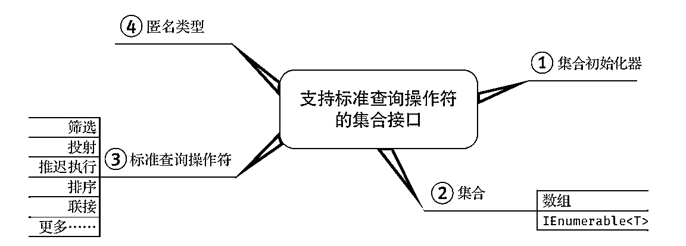

集合在 C# 3.0 中通过称为语言集成查询 （Language Integrated Query，LINQ）的一套编程 API 进行了大刀阔斧的改革。通过一系列扩展方法和 Lambda 表达式，LINQ 提供了一套功能超凡的 API 来操纵集合。事实上，在本书前几版中，“集合”这一章是被放在“泛型”和“委托”这两章之间的。但由于 Lambda 表达式是 LINQ 的重中之重，现在只有先理解了委托（Lambda 表达式的基础），才好展开对集合的讨论。第十三章与第十四章已为理解 Lambda 表达式打下了良好基础，从现在起将连续用三章的篇幅来详细讨论集合。本章的重点是标准查询操作符 ，它通过直接调用扩展方法来发挥 LINQ 的作用。

> 注：PowerShell 没有 LINQ——它是 C# 编译器支持的扩展方法语法。PowerShell 的等价物是**管道**：把集合沿 `|` 传给 cmdlet（如 `Where-Object`、`ForEach-Object`、`Sort-Object`、`Group-Object`）逐项处理。必须使用 .NET 的 LINQ 方法时，只能按静态方法调用，如 `[System.Linq.Enumerable]::Where($arr, [Func[int,bool]]{param($x) $x -gt 3})`（见 15.3 节的注）。

介绍了集合初始化器（collection initializer）之后，本章探讨各种集合接口及其相互关系。这是理解集合的基础，请务必掌握。在讲解集合接口的同时，还将介绍 C# 3.0 新增的为 IEnumerable<T>定义的扩展方法，这些方法是标准查询操作符的基础。

有两套与集合相关的类和接口：支持泛型的和不支持泛型的。本章主要讨论泛型集合接口。通常，只有组件需要和老版本在“运行时”进行互操作才使用不支持泛型的集合类。这是因为任何非泛型的东西，现在都有了一个强类型的泛型替代物。虽然要讲的概念同时适合两种形式，但我们不会专门讨论非泛型版本^( [\[1\]](part0136.xhtml#ch1_back) ) 。

本章最后深入讨论匿名类型，该主题仅在第三章的几个“高级主题”中进行了简单介绍。有趣的是，匿名类型目前已因 C# 7.0 引入的“元组”而失色。章末将进一步讨论元组。

[\[1\]](part0136.xhtml#ch1) 事实上，.NET Standard 和.NET Core 已移除了非泛型集合。

## 15.1　集合初始化器

集合初始化器 （collection initializers）^( [\[1\]](part0137.xhtml#ch1_back) ) 允许采用和数组声明相似的方式，在集合实例化期间用一组初始成员构造该集合。不用集合初始化器，就只能在集合实例化好之后将成员显式添加到集合——使用像 System.Collections.Generic.ICollection<T>的 Add()方法类似的操作。而使用集合初始化器，Add()调用将由 C#编译器自动生成，不必由开发者显式编码。代码清单 15.1 展示了如何用集合初始化器初始化集合。

> 注：PowerShell 用数组字面量 `@(...)`、`@('a','b')` 和字典/哈希表字面量 `@{...}` 直接构造集合，没有 C#“集合初始化器→自动生成 Add() 调用”的编译步骤，也不要求集合实现 ICollection<T>。C# 各版本初始化语法的差异在 PowerShell 中不适用。

代码清单 15.1　集合初始化

```powershell
$sevenWorldBlunders = @('wealth without work','pleasure without conscience','knowledge without character','commerce without morality','science without humanity','worship without sacrifice','politics without principle')
```

该语法不仅和数组初始化的语法相似，也和对象初始化器（参见 6.7.3 节）的语法相似，都是在构造函数调用的后面添加一对大括号，再在大括号内添加初始化列表。如调用构造函数时不传递参数，则数据类型名称之后的圆括号可选（和对象初始化器一样）。

成功编译集合初始化器需满足几个基本条件。理想情况下，应用集合初始化器的集合类型应实现 System.Collections.Generic.ICollection<T>接口，从而确保集合包含 Add()方法，以便由编译器生成的代码调用。但这个要求可以放宽，集合类型可以只实现 IEnumerable<T>而不实现 ICollection<T>，但要将一个或多个 Add()方法定义成接口的扩展方法（C# 6.0）或者集合类型的实例方法。当然，Add()方法要能获取与集合初始化器中指定的值兼容的参数。

字典的集合初始化语法稍微复杂一些，因为字典中的每个元素都同时要求键（key）和值（value）。代码清单 15.2 展示了语法。

代码清单 15.2　用集合初始化器初始化一个 Dictionary<>

```powershell
$colorMap = @{ Error = 'Red'; Warning = 'Yellow'; Information = 'Green'; Verbose = 'White' }
```

代码清单 15.2 用了两个不同版本的初始化。第一个演示 C# 6.0 引入的新语法，它通过赋值操作符明确哪个值和哪个键关联，准确传达“名称/值”对的意图。第二个语法（C# 6.0 起仍支持）使用大括号关联名称和值。

之所以允许为不支持 ICollection<T>的集合使用初始化器，是因为以下两方面。首先，大多数集合（实现了 IEnumerable<T>的类型）都没有同时实现 ICollection<T>。其次，由于要匹配方法名，而且方法的签名要和集合的初始化项兼容，所以可以在集合中初始化更加多样化的数据项。例如，初始化器现在支持 new DataStore(){a, {b, c}}——前提是一个 Add()方法的签名兼容于 a，而另一个 Add()方法兼容于 b, c。

[\[1\]](part0137.xhtml#ch1) 也可翻译为“集合初始化列表”。——译者注

## 15.2　IEnumerable 使类成为集合

根据定义，.NET 的集合本质上是一个类，它至少实现了接口 IEnumerable。这个接口很关键，因为它包含遍历集合所必需的方法。

> 注：PowerShell 中数组、`List<T>`、管道输出等可枚举对象都能被 `foreach` 和管道处理，日常使用不要求集合类实现 `IEnumerable<T>`。PowerShell 类可以实现非泛型 `System.Collections.IEnumerable`（已实测，提供 `GetEnumerator()` 返回 `IEnumerator` 即可正常枚举）；但实现 `IEnumerable<T>` 会失败——该接口还继承了非泛型 `IEnumerable.GetEnumerator()`，需要两个同名但返回类型不同的方法，而 PowerShell 不支持显式接口实现或仅按返回类型重载，会报“GetEnumerator ... does not have an implementation”（已实测）。

第四章讲述了如何用 foreach 语句遍历由多个元素构成的数组。foreach 的语法很简单，而且不用事先知道有多少个元素。但“运行时”根本不知 foreach 语句为何物。相反，正如下面要描述的那样，C#编译器会对代码进行必要的转换。

### 15.2.1　foreach 之于数组

代码清单 15.3 演示了一个简单的 foreach 循环，它遍历一个整数数组并打印每个整数。

代码清单 15.3　对数组执行 foreach

```powershell
$array = 1..6
foreach ($item in $array) { Write-Output $item }
```

C#编译器在生成 CIL 时，为这段代码创建了一个等价的 for 循环，如代码清单 15.4 所示。

代码清单 15.4　编译器实现的数组 foreach 操作

```powershell
$array = 1..6
for ($counter = 0; $counter -lt $array.Length; $counter++) { Write-Output $array[$counter] }
```

在本例中，注意 foreach 要依赖对 Length 属性和数组索引操作符（\[\]）的支持。知道 Length 属性的值之后，C#编译器才可用 for 语句遍历数组中的每一个元素。

> 注：把 `foreach` 编译成长度—索引循环是 C# 编译器的行为。PowerShell 的 `foreach` 是语言自带语句，直接按枚举协议遍历数组或 `IEnumerable` 对象；对字符串、标量等不可枚举的值，则把它当作单个元素处理（已实测：`foreach ($s in 'abc')` 只得到一项 `abc`）。PowerShell 也不做 C# 编译器那样的 `GetEnumerator()` duck-typing 回退。

### 15.2.2　基于 IEnumerable 遍历集合

代码清单 15.4 的代码对数组来说没有任何问题，因为数组长度固定，而且肯定支持索引操作符（\[\]）。但不是所有类型的集合都包含已知数量的元素。另外，包括 Stack<T>、Queue<T>以及 Dictionary<TKey, TValue>在内的许多集合类都不支持按索引检索元素。因此，需要一种更常规的方式遍历元素集合。迭代器（iterator）模式应运而生。只要能确定第一个和下一个元素，就不需要事先知道元素总数，也不需要按索引获取元素。

System.Collections.Generic.IEnumerator<T>和非泛型 System.Collections.IEnumerator 接口的设计目标就是允许用迭代器模式来遍历元素集合，而不是使用如代码清单 15.4 所示的长度——索引（Length-Index）模式。图 15.1 展示了它们的类关系图。

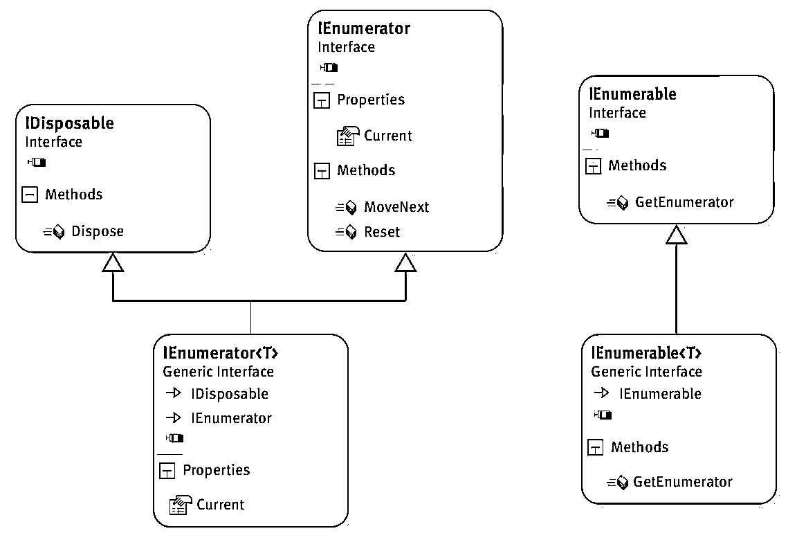

图 15.1　IEnumerator<T>和 IEnumerator 接口

IEnumerator<T>从 IEnumerator 派生，后者包含三个成员。第一个成员 bool MoveNext()从集合的一个元素移动到下一个元素，同时检测是否已遍历完集合中的每个元素。第二个成员是只读属性 Current，用于返回当前元素。Current 在 IEnumerator<T>中进行了重载，提供了类型特有的实现。利用集合类的这两个成员，只需用一个 while 循环即可遍历集合，如代码清单 15.5 所示（Reset()方法一般抛出 NotImplementedException 异常，所以永远都不应调用它。要重新开始枚举，只需创建一个新的枚举数^( [\[1\]](part0138.xhtml#ch1_back) ) ）。

代码清单 15.5　使用 while 遍历集合

```powershell
$stack = [System.Collections.Generic.Stack[int]]::new()
foreach ($number in $stack) { Write-Output $number }
```

在代码清单 15.5 中，MoveNext()方法在越过集合末尾之后将返回 false，避免循环时还要对元素计数。

代码清单 15.5 使用的集合类型是 System.Collections.Generic.Stack<T>。还有其他许多集合类型。Stack<T>是“后入先出”（last in, first out，LIFO）的集合。注意类型参数 T 标识所有集合项的类型。泛型集合的一个关键特点是将一种类型的对象全都收拢到集合中。程序员在添加、删除或访问集合中的项时，必须理解这些项的数据类型是什么。

本例只是演示了 C#编译器生成的代码的要点，但和真实的 CIL 代码并不完全一致，因其遗漏了两个重要的实现细节：交错和错误处理。

状态共享 

代码清单 15.5 的问题在于，如同时有两个循环交错遍历同一个集合（一个 foreach 嵌套了另一个 foreach，两者都用同一个集合），则集合必须维持当前元素的一个状态指示器，确保调用 MoveNext()时能正确定位下一个元素。现在的问题是，交错的循环可能相互干扰（如循环由多个线程执行，将发生同样的问题）。

为解决该问题，集合类不直接支持 IEnumerator<T>和 IEnumerator 接口。如图 15.1 所示，还有第二个接口 IEnumerable<T>，它唯一的方法就是 GetEnumerator()。该方法的作用是返回支持 IEnumerator<T>的一个对象。在这里，不是由集合类来维持状态。相反，是由一个不同的类（通常是嵌套类，以便访问到集合内部）来支持 IEnumerator<T>接口，并负责维护循环遍历的状态。枚举数相当于一个“游标”或“书签”。可以有多个书签，每个书签都独立于其他书签。移动一个书签来遍历集合不会干扰到其他书签。基于这个模式，代码清单 15.6 展示了与 foreach 循环等价的 C#代码。

代码清单 15.6　由一个单独的枚举数来维持状态

```powershell
$stack = [System.Collections.Generic.Stack[int]]::new()
$enumerator = $stack.GetEnumerator()
while ($enumerator.MoveNext()) { Write-Output $enumerator.Current }
```

高级/初学者主题：清理状态

因为是由实现了 IEnumerator<T>接口的类来维持状态，所以在退出循环之后，有时需要对状态进行清理（之所以退出循环，要么是由于所有循环迭代都已结束，要么是中途抛出了异常）。为此，IEnumerator<T>接口从 IDisposable 派生。实现 IEnumerator 的枚举数不一定要实现 IDisposable。但只要实现了 IDisposable，就会同时调用 Dispose()方法（将在遍历循环退出后调用 Dispose()）。代码清单 15.7 展示了和最终的 CIL 代码等价的 C#代码。

代码清单 15.7　对集合执行遍历的编译结果

```powershell
$enumerator = $stack.GetEnumerator()
try { while ($enumerator.MoveNext()) { Write-Output $enumerator.Current } }
finally { $enumerator.Dispose() }
```

注意，由于 IEnumerator<T>支持 IDisposable 接口，所以可用 using 关键字简化代码清单 15.7 的 C#代码，如代码清单 15.8 所示。

> 注：PowerShell 没有 C# 的 `using` 资源语句（`using ($obj) { ... }` 是解析错误）。等价的写法是 `try { ... } finally { $enumerator.Dispose() }`（见代码清单 15.7 的改写），或者直接使用 `foreach` 语言语句，无需手工释放。

代码清单 15.8　使用 using 的错误处理和资源清理

```powershell
foreach ($number in $stack) { Write-Output $number }
```

但要记住 CIL 本身并不直接支持 using 关键字，因此实际上代码清单 15.7 的 C#代码才更准确地对应遍历集合的 CIL 代码。

高级主题：没有 IEnumerable 的 foreach

C#编译器不要求一定要实现 IEnumerable/IEnumerable<T>才能对一个数据类型进行遍历。相反，编译器采用称为“Duck typing”的概念^( [\[2\]](part0138.xhtml#ch2_back) ) ，也就是查找会返回“包含 Current 属性和 MoveNext()方法的一个类型”的 GetEnumerator()方法。Duck typing 按名称查找方法，而不依赖接口或显式方法调用。当 Duck typing 找不到可枚举模式的恰当实现时，编译器才会检查集合是否实现了接口。

> 注：这种“先按名称查找 GetEnumerator()、失败再回退到接口”的次序是 C# 编译器的规则。PowerShell 不按 GetEnumerator() 方法做 duck typing：它只枚举数组、实现了 `IEnumerable` 的对象等已知可枚举形态，其余对象按单个元素处理。

### 15.2.3　foreach 循环内不要修改集合

第四章讲过，编译器禁止对 foreach 变量（number）赋值。如代码清单 15.7 所示，对 number 赋值并不会改变集合元素本身。所以，为避免产生混淆，C#编译器干脆禁止了此类赋值。

另外，在 foreach 循环执行期间，集合中的元素计数不能变，集合项本身也不能修改。例如，假定在 foreach 循环中调用 stack.Push(42)，那么 iterator 应该忽略还是集成对 stack 的更改？或者说，iterator 应该遍历新添加的项，还是应该忽略该项并假定状态没变（仍为迭代器当初实例化时的状态）？

由于存在上述歧义，所以假如在 foreach 循环期间对集合进行修改，重新访问枚举数就会抛出 System.InvalidOperationException 异常，指出在枚举数实例化之后，集合已发生了变化。

[\[1\]](part0138.xhtml#ch1) MSDN 文档将 enumerator 翻译为“枚举数”。枚举数在最开始的时候定位在集合第一个元素前。——译者注

[\[2\]](part0138.xhtml#ch2) Duck typing 来自英国谚语：If it walks like a duck and quacks like a duck, it must be a duck。（如果它走起路来像一只鸭子，叫起来像一只鸭子，那么肯定是一只鸭子。）对于 C#这样的动态语言，它的意思是说，可将一个对象传给正在期待一个特定类型的方法，即使它并非继承自该类型。唯一要做的就是支持该方法想要使用的、由原本期待的类型定义的方法和属性。就当前的情况来说，是指对象要想被当成是一只鸭子，只需实现 Quack()方法，不需要实现 IDuck 接口。——译者注

## 15.3　标准查询操作符

将 System.Object 的方法排除在外，实现 IEnumerable<T>的任何类型只需实现 Get-Enumerator()这一个方法。但看问题不能只看表面。事实上，任何类型在实现 IEnumerable<T>之后，都有超过 50 个方法可供使用，其中还不包括重载版本。而为了享受到所有这一切，除了 GetEnumerator()之外，根本不需要显式实现其他任何方法。附加功能由 C# 3.0 开始引入的扩展方法提供，所有方法都在 System.Linq.Enumerable 类中定义。所以，为了用到这些方法，只需简单地添加以下语句：

* * *

```
using System.Linq;

```

* * *

IEnumerable<T>上的每个方法都是标准查询操作符 ，用于为所操作的集合提供查询功能。后续小节将探讨一些最重要的标准查询操作符。许多例子都要依赖如代码清单 15.9 所示的 Inventor 或 Patent 类。

> 注：PowerShell 没有 `using System.Linq;` 这类 C# 指令，也不存在“实现 IEnumerable<T> 后自动拥有 50 多个扩展方法”的机制——扩展方法在 PowerShell 中不能按实例方法调用。需要使用 LINQ 方法时，要按静态方法调用 `[System.Linq.Enumerable]::方法名(...)`；更常规的做法是直接用 PowerShell 的管道以及 `Where-Object`/`ForEach-Object` 等 cmdlet（本小节下面的清单已这样改写）。

代码清单 15.9　用于演示标准查询操作符的示例类

```powershell
class Patent {
    [string]$Title
    [string]$YearOfPublication
    [string]$ApplicationNumber
    [long[]]$InventorIds
    Patent([string]$title, [string]$year, [long[]]$inventorIds) {
        $this.Title = $title
        $this.YearOfPublication = $year
        $this.InventorIds = $inventorIds
    }
    [string] ToString() { return "$($this.Title) ($($this.YearOfPublication))" }
}

class Inventor {
    [long]$Id
    [string]$Name
    [string]$City
    [string]$State
    [string]$Country
    Inventor([string]$name, [string]$city, [string]$state, [string]$country, [long]$id) {
        $this.Name = $name; $this.City = $city; $this.State = $state; $this.Country = $country; $this.Id = $id
    }
    [string] ToString() { return "$($this.Name) ($($this.City), $($this.State))" }
}

$inventors = @(
    [Inventor]::new('Benjamin Franklin','Philadelphia','PA','USA',1),
    [Inventor]::new('Orville Wright','Kitty Hawk','NC','USA',2),
    [Inventor]::new('Wilbur Wright','Kitty Hawk','NC','USA',3),
    [Inventor]::new('Samuel Morse','New York','NY','USA',4),
    [Inventor]::new('George Stephenson','Wylam','Northumberland','UK',5),
    [Inventor]::new('John Michaelis','Chicago','IL','USA',6),
    [Inventor]::new('Mary Phelps Jacob','New York','NY','USA',7)
)
$patents = @(
    [Patent]::new('Bifocals','1784',[long[]](1)),
    [Patent]::new('Phonograph','1877',[long[]](1)),
    [Patent]::new('Kinetoscope','1888',[long[]](1)),
    [Patent]::new('Electrical Telegraph','1837',[long[]](4)),
    [Patent]::new('Flying Machine','1903',[long[]](2,3)),
    [Patent]::new('Steam Locomotive','1815',[long[]](5)),
    [Patent]::new('Droplet Deposition Apparatus','1989',[long[]](6)),
    [Patent]::new('Backless Brassiere','1914',[long[]](7))
)
```

代码清单 15.9 还提供了一些示例数据。输出 15.1 展示了结果。

输出 15.1

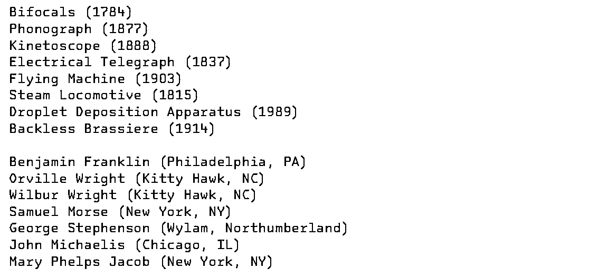

### 15.3.1　使用 Where()来筛选

为了从集合中筛选数据，需提供筛选器方法来返回 true 或 false 以指明特定元素是否应被包含。获取一个实参并返回 Boolean 值的委托表达式称为谓词 （predicate）。集合的 Where()方法依据谓词来确定筛选条件。代码清单 15.10 展示了一个例子。（从技术上说，Where()方法的结果是一个对象 ，它封装了根据一个给定谓词对一个给定序列进行筛选的操作。）输出 15.2 展示了结果。

代码清单 15.10　使用 System.Linq.Enumerable.Where()来筛选

```powershell
$patentsPriorTo1900 = $patents | Where-Object { $_.YearOfPublication.StartsWith('18') }
```

输出 15.2


注意代码将 Where()的输出赋还给 IEnumerable<T>。换言之，IEnumerable<T>.Where()输出的是一个新的 IEnumerable<T>集合。具体到代码清单 15.10，就是 IEnumerable<Patent>。

> 注：PowerShell 的 `Where-Object` 输出是流式的（逐项产生），赋给变量时若有多项会自动成为数组：没有 `IEnumerable<Patent>` 这样的静态类型标注，也不需要把结果转换回某个接口类型。

许多人不知道的是，Where()方法的表达式实参并非一定在赋值时求值。这一点适合许多标准查询操作符。在 Where()的情况下，表达式传给集合，“保存”起来但不马上执行。相反，只有在需要遍历集合中的项时，才会真正对表达式进行求值。例如，foreach 循环（例如代码清单 15.9 的 Print()方法中的那一个）会导致表达式针对集合中的每一项进行求值。至少从概念上说，应认为 Where()方法只是描述了集合中应该有什么，而没有描述具体应该如何遍历数据项并生成新集合（并在其中填充数量可能减少了的数据项）。

### 15.3.2　使用 Select()来投射

由于 IEnumerable<T>.Where()输出的是一个新的 IEnumerable<T>集合，所以完全可以在这个集合的基础上再调用另一个标准查询操作符。例如，从原始集合中筛选好数据后，可以接着对这些数据进行转换，如代码清单 15.11 所示。

代码清单 15.11　使用 System.Linq.Enumerable.Select()来投射

```powershell
$patentsOf1800s = $patents | Where-Object { $_.YearOfPublication.StartsWith('18') } | ForEach-Object { $_.Title }
```

代码清单 15.11 创建了一个新的 IEnumerable<string>集合。虽然添加了一个 Select()调用，但并未造成输出的任何改变。但这纯属巧合，因为 Print()中的 Console.WriteLine()调用恰好会使用 ToString()。事实上，针对每个数据项都会发生一次转换：从原始集合的 Patent 类型转换成 items 集合的 string 类型。

> 注：`Select()` 的投射在 PowerShell 中对应 `ForEach-Object`（别名 `%`）：`$patents | ForEach-Object { $_.Title }` 就是取出 Title 的转换，管道输出同样是流式的。

代码清单 15.12 展示了使用 System.IO.FileInfo 的一个例子。

代码清单 15.12　使用 System.Linq.Enumerable.Select()和 new 来投射

```powershell
$files = Get-ChildItem -File -Path $rootDirectory -Filter $searchPattern
```

fileList 是 IEnumerable<string>类型。但利用 Select 的投射功能，可将集合中的每一项转换成 System.IO.FileInfo 对象。

最后关注一下元组。创建 IEnumerable<T>集合时，T 可以是元组，如代码清单 15.13 和输出 15.3 所示。

代码清单 15.13　投射成元组

```powershell
$items = Get-ChildItem -File -Path $rootDirectory -Filter $searchPattern | ForEach-Object { [pscustomobject]@{ FileName = $_.Name; Size = $_.Length } }
```

输出 15.3

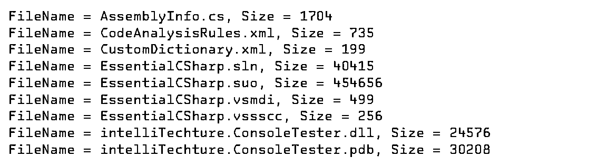

在为元组生成的 ToString()方法中，会自动添加用于显示属性名称及其值的代码。

> 注：PowerShell 没有 C# 的匿名类型/元组字面量。改编版用 `[pscustomobject]@{ 属性=值 }` 构造带具名属性的对象；PS7 也可用 `[System.ValueTuple[...]]`（别名 `[tuple[...]]`）构造值类型元组。注意 `[pscustomobject]` 的 `ToString()` 返回**空字符串**，控制台显示的 `属性=值` 来自 PowerShell 的格式化视图（见 15.4 节的注）。

用 select()进行“投射”是很强大的一个功能。上一节讲述如何用 Where()标准查询操作符在“垂直”方向上筛选集合^( [\[1\]](part0139.xhtml#ch1_back) ) （减少集合项数量）。现在使用 Select()标准查询操作符，还可在“水平”方向上减小集合规模（减少列的数量）或者对数据进行完全转换。可综合运用 Where()和 Select()来获得原始集合的子集，从而满足当前算法的要求。这两个方法各自提供了一个功能强大的、对集合进行操纵的 API。以前要获得同样的效果，必须手动写大量难以阅读的代码。

高级主题：并行运行 LINQ 查询

随着多核处理器的普及，人们迫切希望能简单地利用这些额外的处理能力。为此，需要修改程序来支持多线程，使工作可以在计算机的不同内核上同时进行。代码清单 15.14 演示了使用并行 LINQ（PLINQ）来达到这个目标的一个途径。

代码清单 15.14　并行执行 LINQ 查询

```powershell
$items = Get-ChildItem -File -Path $rootDirectory -Filter $searchPattern | ForEach-Object {
    [pscustomobject]@{ FileName = $_.Name; Size = $_.Length }
}
# Parallel equivalent: PowerShell 7's ForEach-Object -Parallel
$items = Get-ChildItem -File -Path $rootDirectory -Filter $searchPattern | ForEach-Object -Parallel {
    [pscustomobject]@{ FileName = $_.Name; Size = $_.Length }
}
```

在代码清单 15.14 中，简单修改代码即可实现并行。唯一要做的就是利用 Microsoft.NET Framework 4 引入的标准查询操作符 AsParallel()，它是静态类 System.Linq.ParallelEnumerable 的成员。使用这个简单的扩展方法，“运行时”一边遍历 fileList 中的数据项，一边返回结果对象。两个操作并行发生。本例中的每个并行操作开销不大（虽然只是相对于其他正在进行的操作），但在执行 CPU 密集型处理时（比如加密或压缩），累积起来的开销还是相当大的。在多个 CPU 之间并行执行，执行时间将根据 CPU 的数量成比例缩短。

> 注：PowerShell 没有 LINQ 的 `AsParallel()`。PS7 提供 `ForEach-Object -Parallel { ... }`（代码清单 15.14 已这样改写），但每个输入项在独立 runspace 中执行，开销较大，适合 CPU 密集型任务；可用 `$using:` 引用外部变量，但并发写外部变量仍需自行同步。竞态条件的警示同样适用。

但有一点很重要（这也是为什么将 AsParallel()放在“高级主题”而不是正文中讨论的原因），并行执行可能引入竞态条件（race conditions）。也就是说，一个线程上的一个操作可能会与一个不同的线程上的一个操作混合，造成数据被破坏。为避免该问题，需要向多个线程共享访问的数据应用同步机制，在必要时强制保证操作的原子性。但同步本身可能引入死锁，造成执行被“冻结”，使并行编程变得更复杂。

第十九章至第二十二章将更多地讨论该问题和其他多线程主题。

### 15.3.3　使用 Count()对元素进行计数

对数据项集合执行的另一个常见操作是获取计数。LINQ 为此提供了 Count()扩展方法。

代码清单 15.15 演示了如何使用重载的 Count()来统计所有元素的数量（无参）或者获取一个谓词作为参数，只对谓词表达式标识的数据项进行计数。

代码清单 15.15　使用 Count()对元素进行计数

```powershell
Write-Output "Patent Count: $($patents.Count)"
Write-Output "Patent Count in 1800s: $(($patents | Where-Object YearOfPublication -like '18*').Count)"
```

虽然 Count()语句写起来简单，但 IEnumerable<T>没有变，所以执行的代码仍会遍历集合中的所有项。有 Count 属性的集合应首选属性，而不要用 LINQ 的 Count()方法（这是一个容易忽视的差异）。幸好，ICollection<T>包含了 Count 属性，所以如果集合支持 ICollection<T>，在它上面调用 Count()方法会对集合进行转型，并直接调用 Count。但如果不支持 ICollection<T>，Enumerable.Count()就会枚举集合中的所有项，而不是调用内建的 Count 机制。如果计数的目的只是为了看这个计数是否大于 0（if(patents.Count() > 0){...}），那么首选做法是使用 Any()操作符（if(patents.Any()) {...}）。Any()只尝试遍历集合中的一个项，成功就返回 true，而不会遍历整个序列。

> 注：PowerShell 中直接取 `.Count` 即可（如 `($patents | Where-Object ...).Count`），没有 LINQ `Count()`/`Any()` 的区别。实测 `(5).Count` 为 1、`$null.Count` 为 0。过滤本身就会遍历集合；若只关心“是否存在”，可用 `Where-Object` 取首个结果后判断。

设计规范

·要在检查是否有项时使用 System.Linq.Enumerable.Any()而不是调用 patents.Count()方法。

·要使用集合的 Count 属性（如果有的话），而不是调用 System.Linq.Enumerable.Count()方法。

### 15.3.4　推迟执行

使用 LINQ 时要记住的一个重要概念是推迟执行。来看看代码清单 15.16 和输出 15.4。

代码清单 15.16　使用 System.Linq.Enumerable.Where()来筛选

```powershell
$patents = $patents | Where-Object {
    $result = $_.YearOfPublication.StartsWith('18')
    if ($result) { Write-Output "`t$_" }
    $result
}
Write-Output '1. Patents prior to the 1900s:'
$patents
Write-Output "2. A second listing of patents prior to the 1900s:"
Write-Output "There are $($patents.Count) patents prior to 1900."
Write-Output '3. A third listing of patents prior to the 1900s:'
$patents = @($patents)
Write-Output "There are $($patents.Count) patents prior to 1900."
```

输出 15.4

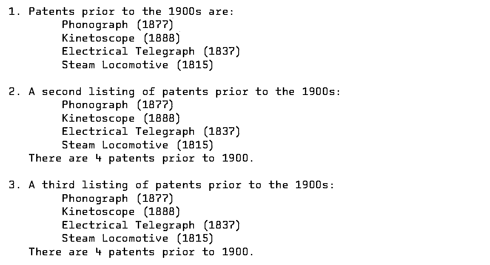

注意 Console.WriteLine("1.Patents prior…)先于 Lambda 表达式执行。这是很容易被人忽视的一个地方^( [\[2\]](part0139.xhtml#ch2_back) ) 。任何谓词通常都只应做一件事情：对一个条件进行求值。它不应该有任何“副作用”（即使是像本例这样打印到控制台的动作）。

为理解背后发生的事情，记住 Lambda 表达式是可以四处传递的委托（方法引用）。在 LINQ 和标准查询操作符的背景下，每个 Lambda 表达式都构成了要执行的总体查询的一部分。

Lambda 表达式在声明时不执行。事实上，Lambda 表达式中的代码只有在 Lambda 表达式被调用时才开始执行。图 15.2 展示了具体顺序。

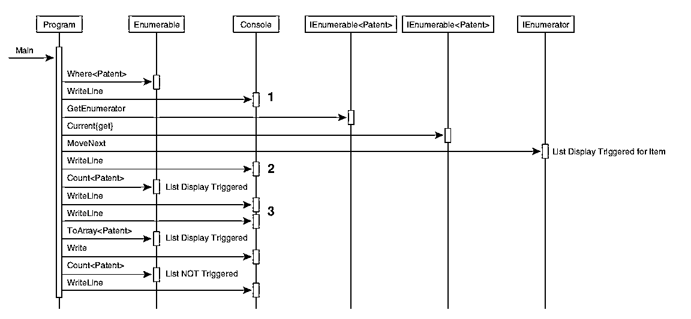

图 15.2　调用 Lambda 表达式时的操作顺序

如图 15.2 所示，代码清单 15.16 中的三个调用都触发了 Lambda 表达式的执行，每次都不明显。假如 Lambda 表达式执行的代价比较高（比如查询数据库），那么为了优化代码，很重要的一点就是尽量减少 Lambda 表达式的执行。

首先，foreach 循环触发了 Lambda 表达式的执行。本章前面说过，foreach 循环被分解成一个 MoveNext()调用，而且每个调用都会导致为原始集合中的每一项执行 Lambda 表达式。在循环迭代期间，“运行时”为每一项调用 Lambda 表达式，判断该项是否满足谓词。

其次，调用 Enumerable 的 Count()函数，会再次为每一项触发 Lambda 表达式。这同样很容易被人忽视，因为以前可能习惯了使用 Count 属性。

最后，调用 ToArray()（或 ToList()、ToDictionary()、ToLookup()）会为集合中的每一个元素计算 Lambda 表达式的值。但是，使用这些“ToXXX”方法来转换集合是相当有用的。这样返回的是已由标准查询操作符处理过的集合。在代码清单 15.16 中，转换成数组意味着在最后一个 Console.WriteLine()语句中调用 Length 时，patents 指向的基础对象实际是一个数组（它显然实现了 IEnumerable<T>），所以调用的 Length 由 System.Array 实现，而不是由 System.Linq.Enumerable 实现。因此，用“ToXXX”方法转换成集合类型之后，一般可以安全地操纵集合（直接调用另一个标准查询操作符）。但注意这会导致整个结果集都加载到内存（在此之前可能驻留在一个数据库或文件中）。除此之外，“ToXXX”方法会创建基础数据的“快照”，所以重新查询“ToXXX”方法的结果时，不会返回新的结果。

强烈建议好好体会一下图 15.2 展示的顺序图，拿实际的代码去对照一下，理解由于标准查询操作符存在“推迟执行”的特点，所以可能在不知不觉间触发标准查询操作符。开发者应提高警惕，防止出乎预料的调用。查询对象代表的是查询而非结果。向查询要结果时，整个查询都会执行（甚至可能是再次执行），因为查询对象不确定结果和上次执行的结果（如果存在的话）是否一样。

> 注：PowerShell 没有 LINQ 的“查询对象/延迟执行”模型。管道是流式的：`Where-Object` 边接收边处理，不会先缓存全部元素；但 PowerShell 语句一写下就会执行，不存在可重复枚举的“查询对象”。若要显式延迟，可把逻辑写成函数或 `& { foreach ($x in $coll) { if (<条件>) { $x } } }`，每次枚举时才执行；`@(...)` 会立即物化结果。反复枚举的开销依然存在，只是来源是重复运行管道而非查询重放。

注意 　要避免反复执行，一个查询在执行之后，有必要把它获取的数据缓存起来。为此，可以使用一个“ToXXX”方法（比如 ToArray()）将数据赋给一个局部集合。将“ToXXX”方法的返回结果赋给一个集合，显然会造成查询的执行。但在此之后，对已赋好值的集合进行遍历，就不会再涉及查询表达式。一般情况下，如果“内存中的集合快照”是你所想要的，那么最好的做法就是将查询表达式赋给一个缓存的集合，避免无谓的遍历。

### 15.3.5　使用 OrderBy()和 ThenBy()来排序

另一个常见的集合操作是排序。这涉及对 System.Linq.Enumerable 的 OrderBy()的调用，如代码清单 15.17 和输出 15.5 所示。

代码清单 15.17　使用 System.Linq.Enumerable.OrderBy()/ThenBy()排序

```powershell
$items = $patents | Sort-Object YearOfPublication, Title
```

输出 15.5

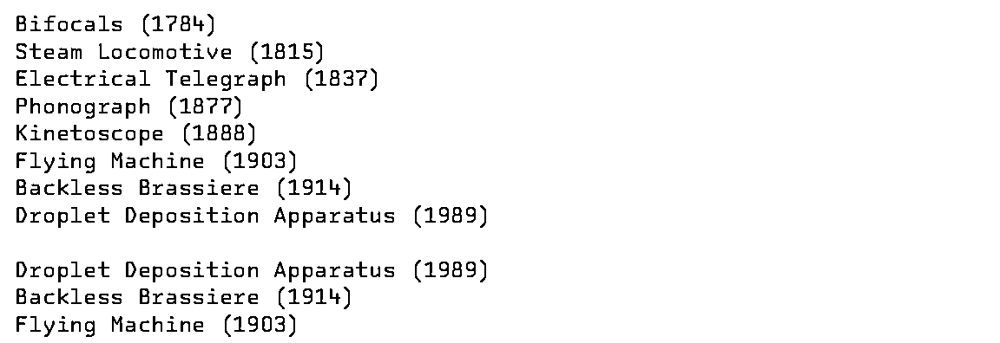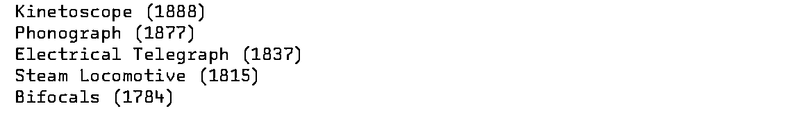

OrderBy()获取一个 Lambda 表达式，该表达式标识了要据此进行排序的键。在代码清单 15.17 中，第一次排序使用专利的发布年份（YearOfPublication）作为键。

但要注意，OrderBy()只获取一个称为 keySelector 的参数来排序。要依据第二个列来排序，需使用一个不同的方法 ThenBy()。类似地，更多的排序要使用更多的 ThenBy()。

OrderBy()返回的是一个 IOrderedEnumerable<T>接口，而不是一个 IEnumerable <T>。此外，IOrderedEnumerable<T>从 IEnumerable<T>派生，所以能为 OrderBy()的返回值使用全部标准查询操作符（包括 OrderBy()）。但假如重复调用 OrderBy()，会撤销上一个 OrderBy()的工作，只有最后一个 OrderBy()的 keySelector 才真正起作用。所以，注意不要在上一个 OrderBy()调用的基础上再调用 OrderBy()。

> 注：PowerShell 用 `Sort-Object` 一次给出所有排序键：`$patents | Sort-Object YearOfPublication, Title`；`-Descending` 对全部键降序，`-Unique` 去重。没有 `OrderBy`/`ThenBy` 的区分，也没有 `IOrderedEnumerable<T>`，不会出现“重复 OrderBy 撤消前一次排序”的问题。

指定额外排序条件需使用扩展方法 ThenBy()。ThenBy()扩展的不是 IEnumerable<T>而是 IOrderedEnumerable<T>。该方法也在 System.Linq.Extensions.Enumerable 中定义，声明如下：

```powershell
# Equivalent signature:
# Then-By receives an ordered sequence and a key selector.
$items = $items | Sort-Object FirstKey | Sort-Object SecondKey
```

总之，要先使用 OrderBy()，再执行零个或多个 ThenBy()调用来提供额外的排序“列”。OrderByDescending()和 ThenByDescending()提供了相同的功能，只是变成按降序排序。升序和降序方法混用没有问题，但进一步排序就要用一个 ThenBy()调用（无论升序还是降序）。

关于排序，还有两个重要问题需要注意。首先，要等到开始访问集合中的成员时，才会实际开始排序，那时整个查询都会被处理。显然，除非拿到所有需要排序的项，否则无法排序，因为无法确定是否已获得第一项。排序被推迟到开始访问成员时才开始，这要“归功”于本章前面讨论的“推迟执行”。其次，执行后续的数据排序调用时（例如，先调用 Orderby()，再调用 ThenBy()，再调用 ThenByDescending()），会再次调用之前的 keySelector Lambda 表达式。换言之，如果先调用 OrderBy()，那么在遍历集合时，会调用对应的 keySelector Lambda 表达式。如果接着调用 ThenBy()，会导致那个 OrderBy()的 keySelector 被再次调用。

设计规范

·不要为 OrderBy()的结果再次调用 OrderBy()。附加的筛选依据用 ThenBy()指定。

初学者主题：联接（join）操作

来考虑两个对象集合，如图 15.3 的维恩图所示。左边的圆包含所有发明者，右边的圆包含所有专利。交集中既有发明者也有专利。另外，凡是发明者和专利存在一个匹配，就用一条线来连接。如图所示，每个发明者都可能有多项专利，而每项专利可能有一个或者多个发明者。每项专利至少有一个发明者，但某些情况下，一个发明者可能还没有任何专利。

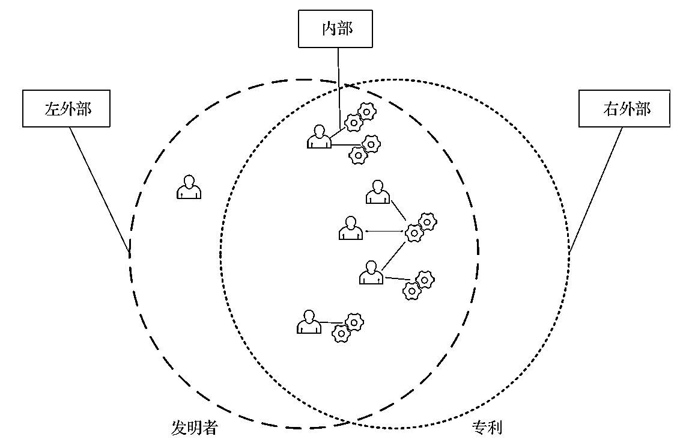

图 15.3　发明者和专利集合的维恩图

在交集中将发明者与专利匹配，这称为内部联接 （inner join）。结果是一个“发明者–专利”集合，在每一对“发明者–专利”中，专利和发明者都同时存在。左外部联接 （left outer join）包含左边那个圆中的所有项，不管它们是否有一项对应的专利。在本例中，右外部联接 （right outer join）和内部联接一样，因为所有专利都有发明者。此外，谁在左边，谁在右边，这是任意指定的，所以左外联接和右外联接实际并无区别。但如果执行完全外部联接 （full outer join），就需同时包含来自两侧的记录，只是极少需要执行这种联接罢了。

对于发明者和专利的关系，另一个重要特点在于它是“多对多 ”关系。每一项专利都可能有一个或多个发明者（例如飞机由莱特兄弟发明）。此外，每个发明者都可能有一项或多项专利（本杰明·富兰克林发明了双焦距眼镜和留声机）。

还有一个常见的关系是“一对多 ”关系。例如，公司的一个部门可能有多个员工。但每个员工同时只能隶属于一个部门。（然而，在“一对多”关系中引入时间因素，就可使之成为“多对多”关系。例如，一名员工可能从一个部门调换到另一个部门，所以随着时间的推移，他可能和多个部门关联，形成“多对多”关系。）

代码清单 15.18 展示了员工和部门数据的示例，输出 15.6 是结果。

代码清单 15.18　示范员工和部门数据

```powershell
class Department {
    [long]$Id
    [string]$Name
    Department([string]$name, [long]$id) { $this.Id = $id; $this.Name = $name }
    [string] ToString() { return $this.Name }
}
class Employee {
    [int]$Id
    [string]$Name
    [string]$Title
    [int]$DepartmentId
    Employee([string]$name, [string]$title, [int]$departmentId) {
        $this.Name = $name; $this.Title = $title; $this.DepartmentId = $departmentId
    }
    [string] ToString() { return "$($this.Name) ($($this.Title))" }
}
$departments = @(
    [Department]::new('Corporate',0), [Department]::new('Human Resources',1),
    [Department]::new('Engineering',2), [Department]::new('Information Technology',3),
    [Department]::new('Philanthropy',4), [Department]::new('Marketing',5)
)
$employees = @(
    [Employee]::new('Mark Michaelis','Chief Computer Nerd',0),
    [Employee]::new('Michael Stokesbary','Senior Computer Wizard',2),
    [Employee]::new('Brian Jones','Enterprise Integration Guru',2),
    [Employee]::new('Anne Beard','HR Director',1),
    [Employee]::new('Pat Dever','Enterprise Architect',3),
    [Employee]::new('Kevin Bost','Programmer Extraordinaire',2),
    [Employee]::new('Thomas Heavey','Software Architect',2),
    [Employee]::new('Eric Edmonds','Philanthropy Coordinator',4)
)
```

输出 15.6


后面讨论如何联接数据时会用到这些数据。

### 15.3.6　使用 Join()执行内部联接

在客户端上，对象和对象的关系一般已经建立好了。例如，文件和其所在目录的关系是分别由 DirectoryInfo.GetFiles()方法和 FileInfo.Directory 方法预先建立好的。但从非对象存储（nonobject stores）加载的数据则一般不是这种情况。相反，这些数据需联接到一起，以便以适合数据的方式从一种对象类型切换到下一种。

以员工和公司部门为例。代码清单 15.19 将每个员工都联接到他的部门，然后列出每个员工及其对应部门。由于每个员工都只隶属于一个（而且只有一个）部门，所以列表中的数据项的总数等于员工总数——每个员工保证只出现一次（每个员工都被正规化 了）。这段代码的结果如输出 15.7 所示。

代码清单 15.19　使用 System.Linq.Enumerable.Join()进行内部联接

```powershell
$items = foreach ($employee in $employees) { $department = $departments | Where-Object Id -eq $employee.DepartmentId; [pscustomobject]@{ Name=$employee.Name; Title=$employee.Title; Department=$department } }
```

输出 15.7


Join()的第一个参数称为 inner，指定了 employees 要联接到的集合，即 departments。接着两个参数都是 Lambda 表达式，指定两个集合要如何联接。第一个 Lambda 表达式是 employee=> employee.DepartmentId，这个参数称为 outerKeySelector，指定每个员工的键是 DepartmentId。下一个 Lambda 表达式是 department=> department.Id，将 Department 的 Id 属性指定为键。换言之，每个员工都联接到 employee.DepartmentId 等于 department.Id 的部门。最后一个参数指定最终要选择的结果项。本例是一个元组，包含 Employee 的 Id（最后未打印）、Name、Title 和联接 department 对象的 Department 属性。

注意在输出结果中，Engineering 多次显示，工程部的每个员工都会显示一次。在本例中，调用 Join()生成了所有部门和所有员工的一个笛卡儿乘积 。换言之，假如一条记录在两个集合中都能找到，且指定的部门 ID 相同，就创建一条新记录。这种类型的联接是内部联接 。

也可以反向联接，即将部门联接到每个员工，从而列出所有“部门–员工”匹配。注意输出的记录数要多于部门数，因为每个部门都可能包含多个员工，而每个匹配的情形都要输出一条记录。和前面一样，工程部门会多次显示，为每个在这个部门的员工显示一次。

代码清单 15.20（输出 15.8）和代码清单 15.19（输出 15.7）相似，区别在于两者的对象（Departments 和 Employees）是相反的。Join()的第一个参数变成了 employees，表明 departments 要联接到 employees。接下来两个参数是 Lambda 表达式，指定了两个集合如何联接。其中，department=> department.Id 针对的是 departments，而 employee=> employee.DepartmentId 针对的是 employees。和以前一样，凡是 department.Id 等于 employee.EmployeeId 的情形，都会发生一次联接。最后的元组参数包含部门 Id、部门名称和员工姓名（冒号前的名称可以拿掉，这里只是为了澄清）。

代码清单 15.20　使用 System.Linq.Enumerable.Join()执行的另一个内部联接

```powershell
$items = foreach ($department in $departments) {
    foreach ($employee in ($employees | Where-Object DepartmentId -eq $department.Id)) {
        [pscustomobject]@{ Id = $department.Id; Name = $department.Name; Employee = $employee }
    }
}
$items | ForEach-Object { $_.Name; Write-Output "`t$($_.Employee)" }
```

输出 15.8

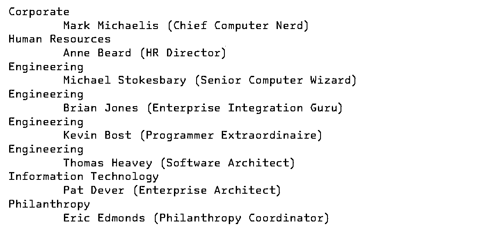

除了排序和联接对象集合，经常还要对具有相似特征的对象进行分组。对于员工数据，可按部门、地区、职务等对员工进行分组。代码清单 15.21 展示如何使用 GroupBy()标准查询操作符进行分组，输出 15.9 展示了结果。

代码清单 15.21　使用 System.Linq.Enumerable.GroupBy()对数据项进行分组

```powershell
$groups = $employees | Group-Object DepartmentId
foreach ($group in $groups) { $group.Group; Write-Output "Count: $($group.Count)" }
```

输出 15.9

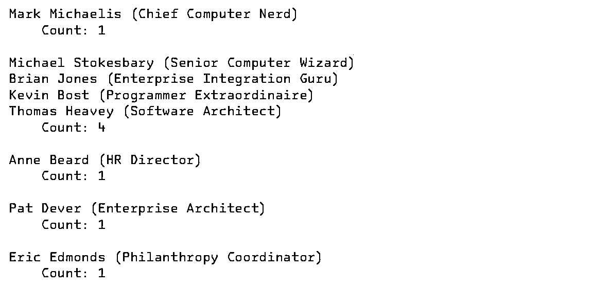

注意 GroupBy()返回 IGrouping<TKey, TElement>类型的数据项，该类型有一个属性指定了作为分组依据的键（employee.DepartmentId）。但没有为组中的数据项准备一个属性。相反，由于 IGrouping<TKey, TElement>从 IEnumerable<T>派生，所以可以用 foreach 语句枚举组中的项，或者将数据聚合成像计数这样的东西（employeeGroup.Count()）。

> 注：改用 PowerShell 的 `Group-Object` 后，每个分组对象有 `Name`（键）、`Group`（组内项数组）、`Count` 属性，等价于 LINQ 的 `IGrouping<TKey, TElement>`；枚举组内项用 `$group.Group`。

### 15.3.7　使用 GroupJoin()实现“一对多”关系

代码清单 15.19 和代码清单 15.20 几乎完全一致。改变一下元组定义，两个 Join()调用就可产生相同的输出。如果要创建员工列表，代码清单 15.19 提供了正确结果。在代表所联接员工的两个元组中，Department 都是其中一个数据项。但代码清单 15.20 不理想。既然支持集合，表示部门的理想方案是显示一个部门的所有员工的集合，而不是为每个“部门–员工”关系都创建一个元组。代码清单 15.22 展示了创建集合的具体做法，输出 15.10 展示了结果。

代码清单 15.22　使用 System.Linq.Enumerable.GroupJoin()创建子集合

```powershell
$items = foreach ($department in $departments) {
    $departmentEmployees = @($employees | Where-Object DepartmentId -eq $department.Id)
    [pscustomobject]@{ Id = $department.Id; Name = $department.Name; Employees = $departmentEmployees }
}
foreach ($item in $items) {
    Write-Output $item.Name
    foreach ($employee in $item.Employees) { Write-Output "`t$employee" }
}
```

输出 15.10

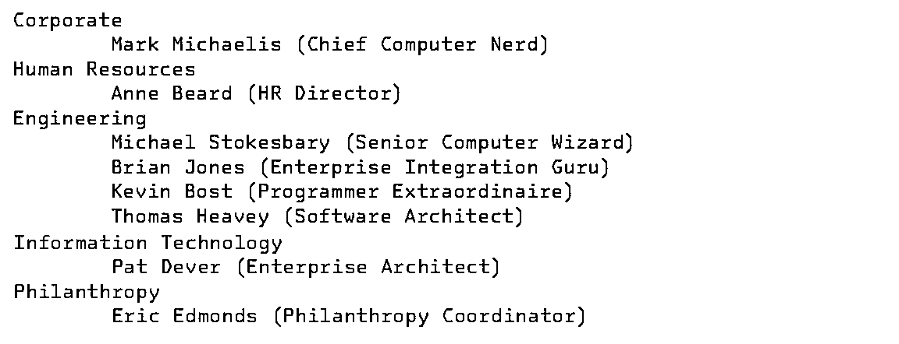

为获得理想结果要使用 System.Linq.Enumerable 的 GroupJoin()方法。参数和代码清单 15.19 差不多，区别在于最后一个元组参数。在代码清单 15.22 中，Lambda 表达式的类型是 Func<Department, IEnumerable<Employee>, (long Id, string Name, IEnumerable <Employee>Employees)>。注意是用第二个类型参数（IEnumerable<Employee>）将每个部门的员工集合投射到结果的部门元组中。这样在最终生成的集合中，每个部门都包含一个员工列表。

> 注：PowerShell 没有 `Join()`/`GroupJoin()` 方法。改编版用嵌套 `foreach` + `Where-Object` 手工完成联接（代码清单 15.19/15.20/15.22）：外层遍历一个集合，内层用 `Where-Object DepartmentId -eq $department.Id` 过滤另一个集合；把员工集合直接赋给 `Employees` 属性即得到“一对多”的子集合。

（熟悉 SQL 的读者会注意到，和 Join()不同，SQL 没有与 GroupJoin()等价的东西，这是由于 SQL 返回的数据基于记录，不分层次结构。）

高级主题：使用 GroupJoin()实现外部联接

前面描述的内部联接称为同等联接 （equi-joins），因为它们基于同等的键求值——只有在两个集合中都有对象时，它们的记录才会出现在结果集中。但在某些情况下，即使对应的对象不存在，也有必要创建一条记录。例如，虽然 Marketing 部门还没有员工，但在最终的部门列表中不应该把它忽略掉。更好的做法是列出这个部门的名称，同时显示一个空白的员工列表。为此，可以执行一次左外部联接，这是通过组合使用 GroupJoin()、SelectMany()和 DefaultIfEmpty()来实现的。如代码清单 15.23 和输出 15.11 所示。

> 注：PowerShell 没有 `DefaultIfEmpty()`；改编版用 `if ($matches.Count -eq 0) { $matches = @($null) }` 补一条空记录（代码清单 15.23），再用 `Sort-Object Id -Unique` 去重，效果与左外部联接一致。

代码清单 15.23　使用 GroupJoin()和 SelectMany()实现外部联接

```powershell
$items = foreach ($department in $departments) {
    $matches = @($employees | Where-Object DepartmentId -eq $department.Id)
    if ($matches.Count -eq 0) { $matches = @($null) }
    foreach ($employee in $matches) {
        [pscustomobject]@{ Id = $department.Id; Name = $department.Name; Employee = $employee }
    }
}
$items = $items | Sort-Object Id -Unique
```

输出 15.11

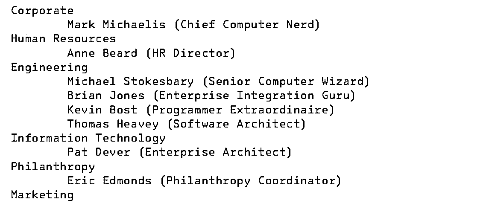

### 15.3.8　调用 SelectMany()

偶尔需要处理集合的集合。代码清单 15.24 展示了一个例子。teams 数组包含两个球队，每个都有一个包含了球员的字符串数组。

代码清单 15.24　调用 SelectMany()

```powershell
$players = $worldCup2006Finalists | ForEach-Object Players
```

在输出中，代码清单 15.24 会按每个球员在代码中出现的顺序逐行显示其姓名。Select()和 Select-Many()的区别在于，Select()会返回两个球员数组，每个都对应原始集合中的球员数组。Select()可以一边投射一边转换，但项的数量不会发生改变。例如，teams.Select (team=> team.Players)会返回一个 IEnumerable<string\[\]>。

> 注：PowerShell 输出集合元素时会自动“展开”（unrolling）：`$teams | ForEach-Object { $_.Players }` 会把每个球队的球员逐个输出，天然等价 `SelectMany()`。若要保留“球队→球员数组”的层次（等价 `Select()`），需在脚本块内用 `@(...)` 包住或放入 `[pscustomobject]` 属性，避免被展开；译者示例中的 `$tokens = $text | ForEach-Object { $_.Split(' ') }` 正是直接利用了展开。

而 SelectMany()遍历由 Lambda 表达式（之前由 Select()选择的数组）标识的每一项，并将每一项都放到一个新集合中。新集合整合了子集合中的所有项。所以，不像 Select()那样返回两个球员数组，SelectMany()是将选择的每个数组都整合起来，把其中的项整合到一个集合中^① 。

①注：作者的这个例子过于复杂以至于可能不好理解。下面是一个简单的例子：

```powershell
$text = @('Zhou Jing', 'walking in', 'the sideway')
$tokens = $text | ForEach-Object { $_.Split(' ') }
foreach ($line in $tokens) { foreach ($token in $line) { Write-Host -NoNewline "$token-" } }
```

如果使用 Select()，那么获得的 tokens 是一个 string\[\]数组，还需遍历每个 string\[\]，才能解析出其中的 string。相反，如换用 SelectMany()，不仅代码量减少了，也更容易理解：

```powershell
$text = @('Zhou Jing', 'walking in', 'the sideway')
$tokens = $text | ForEach-Object { $_.Split(' ') }
foreach ($token in $tokens) { Write-Host -NoNewline "$token-" }
```

——译者注

### 15.3.9　更多标准查询操作符

代码清单 15.25 展示了如何使用由 Enumerable 提供的一些更简单的 API。输出 15.12 展示了结果。

代码清单 15.25　更多的 System.Linq.Enumerable 方法调用

```powershell
$even = 0..9 | Where-Object { $_ % 2 -eq 0 }
$odd = 0..9 | Where-Object { $_ % 2 -eq 1 }
```

输出 15.12

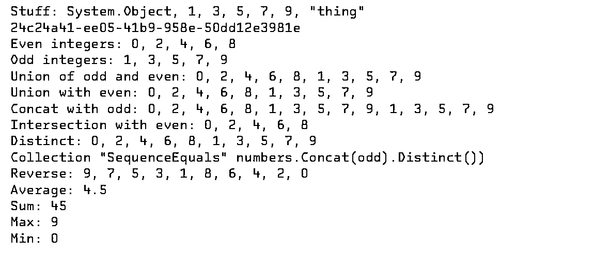

在代码清单 15.25 中，所有 API 调用都不需要 Lambda 表达式。表 15.1 和表 15.2 对这些方法进行了总结。System.Linq.Enumerable 提供了一系列聚合函数（表 15.2），它们能枚举集合并计算结果。本章已利用了其中一个聚合函数 Count()。

注意，表 15.1 和表 15.2 列出的所有方法都会触发“推迟执行”。

表 15.1　更简单的查询操作符

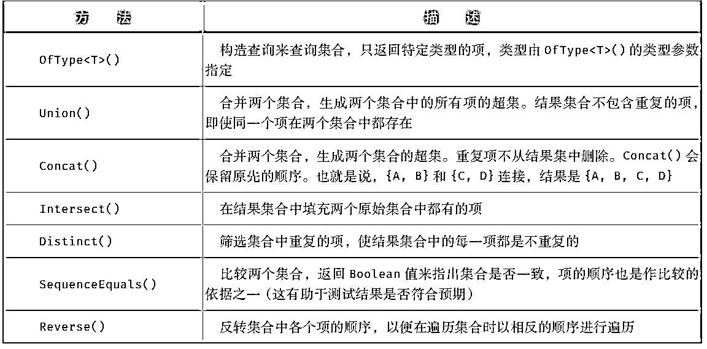

表 15.2　System.Linq.Enumerable 提供的聚合函数

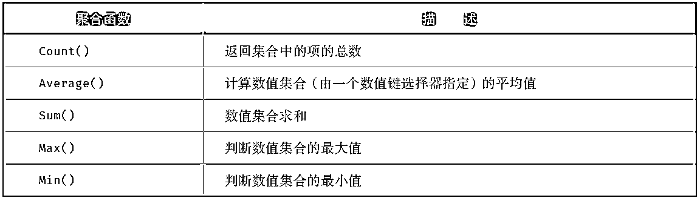

高级主题：IQuerable<T>的 Queryable 扩展

有个接口几乎和 IEnumerable<T>完全一样，这就是 IQueryable<T>。由于 IQueryable <T>是从 IEnumerable<T>派生的，所以它有 IEnumerable<T>的“全部”成员——但只有那些直接声明的，例如 GetEnumerator()。扩展方法是不会被继承的。所以，IQueryable<T>没有 Enumerable 的任何扩展方法。但它有一个类似的扩展类，称为 System.Linq.Queryable。Enumerable 为 IEnumerable<T>添加的几乎所有方法，Queryable 都会为 IQueryable<T>添加。因此，IQueryable<T>提供了一个非常相似的编程接口。

> 注：PowerShell 没有 `IQueryable<T>`、`Queryable` 或 LINQ Provider，不会把代码或表达式树翻译成 SQL 发往远程执行。访问数据库通常用 `Invoke-Sqlcmd`、ADO.NET 驱动或数据库模块，取回 .NET 对象后再用管道处理；“表达式树”机制见第十三章的注。

那么，是什么使 IQueryable<T>显得与众不同呢？答案是可通过它实现自定义的 LINQ Provider（LINQ 提供程序）。LINQ Provider 将表达式分解成各个组成部分。一经分解，表达式就可转换成另一种语言，可序列化以便在远程执行，可通过异步执行模式来注入，等等。简单地说，LINQ Provider 为标准集合 API 提供了“解释”机制。利用这种潜力无限的功能，可注入与查询和集合有关的行为。

例如，可利用 LINQ Provider 将查询表达式从 C#转换成 SQL，然后在远程数据库中执行。这样 C#程序员就可继续使用他熟悉的面向对象语言，将向 SQL 的转换留给底层的 LINQ Provider 去完成。通过这种类型的表达式，程序语言可轻松协调“面向对象编程”和“关系数据库”。

在 IQueryable<T>的情况下，尤其要警惕推迟执行的问题。例如，假定一个 LINQ Provider 负责从数据库返回数据，那么不是不顾选择条件，直接从数据库中获取数据。相反，Lambda 表达式应提供 IQueryable<T>的一个实现，其中可能要包含上下文信息，比如连接字符串，但不要包含数据。除非调用 GetEnumerator()（甚至 MoveNext()），否则不会发生真正的数据获取操作。然而，GetEnumerator()调用一般是隐式发生的，比如在用 foreach 遍历集合，或者调用一个 Enumerable 方法时（比如 Count<T>()或 Cast<T>()）。很明显，针对此类情况，开发者需提防在不知不觉中反复调用代价高昂的、可能涉及推迟执行的操作。例如，假定调用 GetEnumerator()会通过网络来分布式地访问数据库，就应避免因调用 Count()或 foreach 而不经意地造成对集合的重复遍历。

[\[1\]](part0139.xhtml#ch1) 将集合想象成一个表格就好理解了。在表格的垂直方向上，Where()可以减少集合中的项的数量。——译者注

[\[2\]](part0139.xhtml#ch2) 这行代码被故意放到了 Lambda 表达式的后面，但却先于 Lambda 表达式执行。——译者注

## 15.4　匿名类型之于 LINQ

C# 3.0 通过 LINQ 显著增强了集合处理。令人印象深刻的是，为支持这个高级 API，语言本身只进行了 8 处增强。而正是由于这些增强，才使 C# 3.0 成为语言发展史上的一个重要里程碑。其中两处增强是匿名类型和隐式局部变量。但随着 C# 7.0 元组语法的发布，匿名类型终于也要“功成身退”了。事实上，在本书这一版中，所有之前使用匿名类型的 LINQ 例子都更新为使用元组。不过，本节仍然保留了对匿名类型的讨论。如果不用 C# 7.0（或更高版本），或者要处理 C# 7.0 之前写的代码，仍然可以通过本节了解一下匿名类型。（当然，如果不需要使用 C# 6.0 或更老的版本来编程，则完全可以跳过本节。）

> 注：PowerShell 没有 C# 的“匿名类型”（编译器生成的私有类型）。习惯上用 `[pscustomobject]@{ ... }` 构造属性包来充当匿名对象；所有此类对象都是同一个 `PSCustomObject` 类型，不存在 C# 的“类型兼容/不可变”规则（代码清单 15.28 的注释已说明可在 PowerShell 中重新赋值属性）。

### 15.4.1　匿名类型

匿名类型是编译器声明的数据类型，而不是像第六章那样通过显式的类定义来声明。和匿名函数相似，当编译器看到匿名类型时，会执行一些后台操作来生成必要的代码，允许像显式声明的那样使用它。代码清单 15.26 展示了这样的一个声明。

代码清单 15.26　使用匿名类型的隐式局部变量

```powershell
$patent1 = [pscustomobject]@{ Title = 'Bifocals'; YearOfPublication = '1784' }
$patent2 = [pscustomobject]@{ Title = 'Phonograph'; YearOfPublication = '1877' }
```

输出 15.13 展示了执行这个程序的结果。

输出 15.13

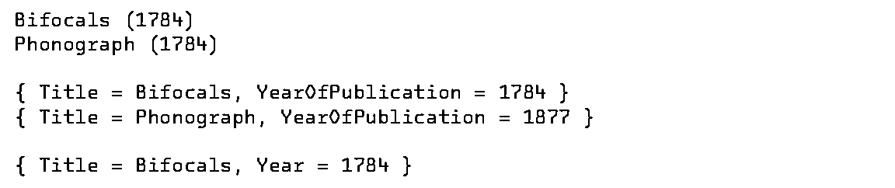

匿名类型纯粹是一项 C#语言功能，不是“运行时”中的新类型。编译器遇到匿名类型时，会自动生成 CIL 类，其属性对应于在匿名类型声明中命名的值和数据类型。

初学者主题：隐式类型的局部变量(var)

匿名类型没有名称，所以不可能将局部变量显式声明为匿名类型。相反，局部变量的类型要替换成 var。但不是说隐式类型的变量就没有类型了，而是说它们的类型在编译时确定为所赋值的数据类型。将匿名类型赋给隐式类型的变量，在为局部变量生成的 CIL 代码中，它的数据类型就是编译器生成的类型。类似地，将一个 string 赋给隐式类型的变量，在最终生成的 CIL 中，变量的数据类型就是 string。事实上，对于隐式类型的变量，假如赋给它的是非匿名的类型（比如 string），那么最终生成的 CIL 代码和直接声明为 string 类型并无区别。如果声明语句是：

* * *

```
string text="This is a test of the...";

```

* * *

那么和以下隐式类型的声明相比：

* * *

```
var text="This is a test of the...";

```

* * *

最终生成的 CIL 代码完全一样。遇到隐式类型的变量时，编译器根据所赋的数据类型来确定该变量的数据类型。遇到显式类型的局部变量时（而且声明的同时已赋值），比如：

* * *

```
string s="hello";

```

* * *

编译器首先根据左侧明确声明的类型来确定 s 的类型，然后分析右侧的表达式，验证右侧的表达式是否适合赋给该类型的变量。但对于隐式类型的局部变量，这个过程是相反的：首先分析右侧的表达式，确定它的类型，再用这个类型替换“var”（在逻辑上）。

> 注：PowerShell 没有 `var`，也不做编译期类型推断：`$text = 'hello'` 的类型由所赋值的运行时类型决定，之后可改赋其他类型；若需要限制类型，用类型约束 `[string]$text = 'hello'`。C# 关于 var 的编译规则在 PowerShell 中不适用。

虽然 C#匿名类型没有名称，但它仍然是强类型的。例如，类型的属性完全可以访问。在代码清单 15.26 中，Console.WriteLine 语句在内部调用 patent1.Title 和 patent2.YearOfPublication。调用不存在的成员会造成编译时错误。在 IDE 中，就连“智能感知”功能都能很好地支持匿名类型。

隐式类型的变量要少用。匿名类型确实无法事先指定数据类型，只能使用 var。但将非匿名类型的数据赋给变量时，首选的还是显式数据类型，而不要使用 var。常规原则是在让编译器验证变量是你希望的类型的同时，保证代码的易读性。为此，应该只有在赋给变量的类型是显而易见的前提下，才使用隐式类型的局部变量。例如在以下语句中：

* * *

```
var items=new Dictionary<string, List<Account>>();

```

* * *

可以清楚地看出赋给 items 变量的数据是什么类型，所以像这样编码显得简洁和易读。相反，假如类型不是那么容易被看出，例如将方法返回值赋给变量，最好还是使用显式类型的变量：

* * *

```
Dictionary<string, List<Account>> dictionary=GetAccounts();

```

* * *

### 15.4.2　用 LINQ 投射成匿名类型

可基于匿名类型创建一个 IEnumerable<T>集合，其中 T 是匿名类型，如代码清单 15.27 和输出 15.14 所示。

代码清单 15.27　投射成匿名类型

```powershell
$items = Get-ChildItem -File -Path $rootDirectory -Filter $searchPattern | ForEach-Object { [pscustomobject]@{ FileName = $_.Name; Size = $_.Length } }
```

输出 15.14

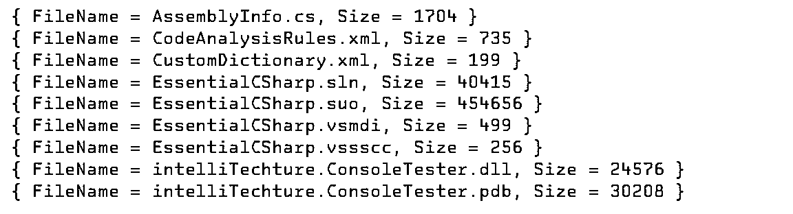

通过为匿名类型生成的 ToString()方法，输出匿名类型会自动列出属性名及其值。

用 select()进行“投射”是很强大的一个功能。之前讲述了如何用 Where()标准查询操作符在“垂直”方向上筛选集合（减少集合项数量）。现在使用 Select()标准查询操作符，还可在“水平”方向上减小集合规模（减少列的数量）或者对数据进行完全转换。利用匿名类型，可对任意对象执行 Select()操作，只提取原始集合中满足当前算法的内容，而不必声明一个新类来专门包含这些内容。

### 15.4.3　匿名类型和隐式局部变量的更多注意事项

在代码清单 15.26 中，匿名类型的成员名称通过 patent1 和 patent2 中的赋值来显式确定（例如 Title="Phonograph"）。但假如所赋的值是属性或字段调用，就无须指定名称。相反，名称将默认为字段或属性名。例如，定义 patent3 时使用了属性名称 Title，而不是赋值给一个显式指定的名称。如输出 15.13 所示，最终获得的属性名称由编译器决定，这些名称与从中获取值的属性是匹配的。

patent1 和 patent2 使用了相同的属性名称和相同的数据类型。因此，C#编译器只为这两个匿名类型声明生成一个数据类型。但 patent3 迫使编译器创建第二个匿名类型，因为用于存储专利年份的属性名（Year）有别于 patent1 和 patent2 使用的名称（YearOfPublication）。除此之外，如果 patent1 和 patent2 中的两个属性的顺序发生交换，那么这两个匿名类型就不再是“类型兼容”的。换言之，两个匿名类型要在同一个程序集中做到类型兼容^( [\[1\]](part0140.xhtml#ch1_back) ) ，属性名、数据类型和属性顺序都必须完全匹配。只要满足这些条件，类型就是兼容的——即使它们出现在不同的方法或类中。代码清单 15.28 演示了类型不兼容的情况。

代码清单 15.28　类型安全性和匿名类型的“不可变”性质

```powershell
$patent1 = [pscustomobject]@{ Title = 'Bifocals'; YearOfPublication = '1784' }
$patent2 = [pscustomobject]@{ YearOfPublication = '1877'; Title = 'Phonograph' }
$patent3 = [pscustomobject]@{ YearOfPublication = $patent1.YearOfPublication; Year = $patent1.YearOfPublication }

# PowerShell 中两个 PSCustomObject 都是同一类型的实例，
# 属性名称或顺序不同不会造成类型不兼容。
$patent1 = $patent2     # 允许
$patent1 = $patent3     # 允许

# PowerShell 的 PSCustomObject 可变（不同于 C# 匿名类型的只读属性）
$patent1.Title = 'Swiss Cheese'
```

前两个编译时错误证明类型不兼容，无法从一个转换成另一个。第三个编译时错误是由于重新对 Title 属性进行赋值造成的。匿名类型“不可变”（immutable），一经实例化，再更改它的某个属性，就会造成编译时错误。

虽然代码清单 15.28 没有显示，但记住无法声明具有隐式数据类型参数（var）的方法。因此，在创建匿名类型的方法的内部，只能以两种方式将匿名类型的实例传到外部。首先，如果方法参数是 object 类型，则匿名类型的实例可传到方法外部，因为匿名类型将隐式转换。第二种方式是使用方法类型推断。在这种情况下，匿名类型的实例以一个方法的“类型参数”的形式传递，编译器能成功推断具体类型。所以，使用 Function(patent1)调用 void Method<T>(T parameter)会成功编译——尽管在 Function()内部，parameter 允许的操作仅限于 object 支持的那些。

虽然 C#支持像代码清单 15.26 那样的匿名类型，但一般不建议像那样定义它们。匿名类型与 C# 3.0 新增的“投射”功能相配合，能提供许多重要的功能，比如本章之前讨论的集合联接/关联（joining/associating）。但除非真的需要（比如聚合来自多个类型的数据），否则一般不要定义匿名类型。

匿名方法推出时，语言的开发者已经有了一个重大突破：能动态声明临时类型而不必显式声明一个完整类型。尽管如此，正如我们之前描述的那样，它还是存在几处缺陷。幸好，C# 7.0 元组没有这些缺陷，而且事实上，它们从根本上消除了再用匿名类型的必要。具体地说，相较于匿名类型，元组具有以下优点：

·提供具名类型，任何能使用类型的地方都能使用元组，包括声明和类型参数。

·在实例化元组的方法外部也能使用该元组。

·避免生成很少使用的类型，发生类型“污染”。

元组和匿名类型的一个区别在于，匿名类型事实上是引用类型，而元组是值类型。哪个有利取决于类型的使用模式。如类型经常拷贝，且内存占位超过 128 位，引用类型可能更佳。否则元组更佳，也是更好的默认选择。

高级主题：匿名类型的生成

虽然 Console.WriteLine()的实现是调用 ToString()，但注意在代码清单 15.26 中，Console.WriteLine()的输出并不是默认的 ToString()（默认的 ToString()输出的是完全限定的数据类型名称）。相反，现在输出的是一列成对的 PropertyName=value，匿名类型的每个属性都有一对这样的输出。之所以会得到这样的结果，是因为编译器在生成匿名类型的代码时重写了 ToString()方法，对输出进行了格式化。类似地，生成的类型还重写了 Equals()和 GetHashCode()的实现。

> 注：C# 匿名类型会重写 `ToString()`，输出 `属性=值`；PowerShell 的 `[pscustomobject]` 的 `ToString()` 返回**空字符串**（实测长度为 0）。控制台里看到 `Name=Value` 形式的显示来自 PowerShell 的格式化系统，而不是对象的 `ToString()`；显示哪些列及其顺序由格式化视图决定。

正是由于 ToString()会被重写，所以一旦属性的顺序发生了变化，就会导致最终生成一个全新的数据类型。假如不是这样设计，而是为属性顺序不同的两个匿名类型（它们可能在完全不同的类型中，甚至可能在完全不同的命名空间中）生成同一个 CIL 类型，那么一个实现在属性顺序上发生的变化，就会对另一个实现的 ToString()输出造成显著的、甚至可能是令人无法接受的影响。此外，程序执行时可能反射一个类型，并检查类型的成员——甚至动态调用成员（所谓动态调用成员，是指在程序运行期间，根据具体情况决定调用哪个成员）。两个貌似相同的类型在成员顺序上有所区别，就可能造成出乎预料的结果。为避免这些问题，C#的设计者决定：如果属性顺序不同，则生成两个不同的类型。

高级主题：集合初始化器之于匿名类型

匿名类型不能使用集合初始化器，因为集合初始化器要求执行一次构造函数调用，但根本没办法命名这个构造函数。解决方案是定义像下面这样的方法：

```powershell
function New-AnonymousList { param($item) ,$item }
```

由于能进行方法类型推断，因此类型参数可以隐式，不用显式指定。所以，采用这个方案，就可成功创建匿名类型的集合。

初始化匿名类型的集合的另一个方案是使用数组初始化器。由于无法在构造函数中指定数据类型，匿名数组初始化器允许使用 new\[\]来实现数组初始化语法，如代码清单 15.29 所示。

代码清单 15.29　初始化匿名类型数组

```powershell
$worldCup2006Finalists = @(
    [pscustomobject]@{
        TeamName = 'France'
        Players = @('Fabien Barthez', 'Gregory Coupet', 'Mickael Landreau', 'Eric Abidal')
    },
    [pscustomobject]@{
        TeamName = 'Italy'
        Players = @('Gianluigi Buffon', 'Angelo Peruzzi', 'Marco Amelia', 'Cristian Zaccardo')
    }
)
```

最终的变量是由匿名类型的项构成的数组。由于是数组，所以每一项的类型必须相同。

[\[1\]](part0140.xhtml#ch1) 即最终只生成一个 CIL 类型。——译者注

## 15.5　小结

本章描述了 foreach 循环的内部工作机制以及为了执行它需要什么接口。此外，开发者经常都要筛选集合来减少数据项的数量。另外，还经常要对集合进行投射，使数据项改换一种不同的格式。针对这些问题，本章讨论了如何用标准查询操作符（通过 LINQ 引入的在 System.Linq.Enumerable 类上的扩展方法）来执行集合处理。

介绍标准查询操作符时，我们详细描述了推迟执行的原理，并提醒开发者注意这个问题。一个不经意的调用可能重新执行表达式，无谓地枚举集合内容。推迟执行会造成标准查询操作符被“隐式”地执行。这是影响代码执行效率的一个重要因素，尤其是查询开销比较大的时候。程序员应将查询对象视为查询而不是结果。而且，即使查询已经执行过，它也有可能要再次从头执行，因为查询对象不知道结果和上次执行是否一样。

之所以将代码清单 15.23 放到“高级主题”，是因为连续调用多个标准查询操作符有一定的复杂性。虽然可能经常遇到这样的需求，但并非一定要直接依赖标准查询操作符。C# 3.0 支持“查询表达式”。这是一种类似 SQL 的语法，可利用它来更方便地操纵集合，关键是写出来的代码更容易理解。这将是下一章的主题。

本章最后详细讨论了匿名类型，解释了为什么 C# 7.0 之后改为元组更佳。