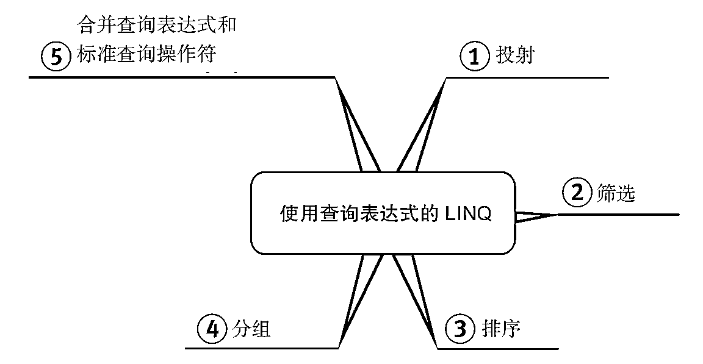
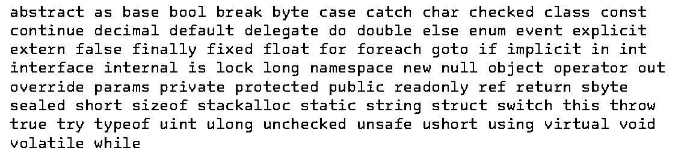
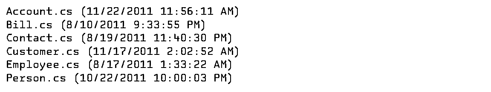
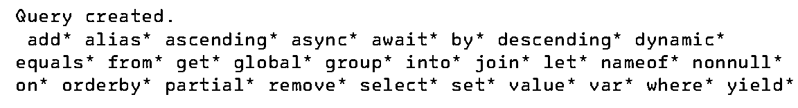
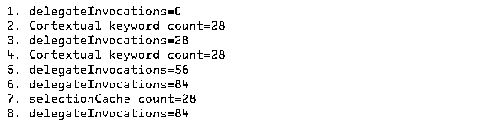
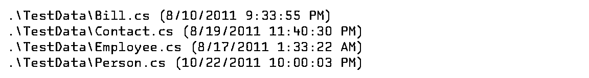
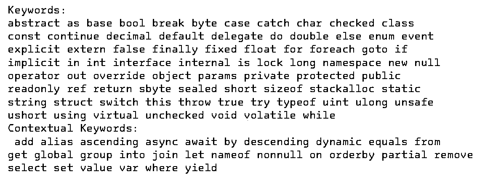
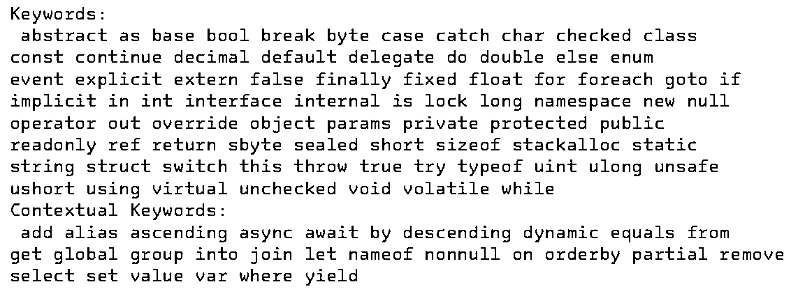
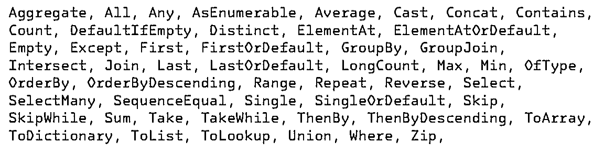

# 第十六章　使用查询表达式的 LINQ



上一章的代码清单 15.23 展示了一个同时使用标准查询操作符 GroupJoin()、Select-Many()和 Distinct()的查询。结果是一个跨越多行的语句。相较于只用老版本 C#的功能来写的语句，它显得更复杂，更不好理解。但是，要处理富数据集的现代程序经常需要这种复杂的查询，所以语言本身花些功夫把它们变得更易读就好了。像 SQL 这样的专业查询语言虽然容易阅读和理解，但又缺乏 C#语言的完整功能。这正是 C#语言的设计者决定在 C# 3.0 中添加查询表达式 语法的原因，它使许多标准查询操作符都能转换成更易读的、SQL 风格的代码。

本章将介绍查询表达式，并用它们改写第十五章的许多查询。

## 16.1　查询表达式概述

开发者经常对集合进行筛选 来删除不想要的项，以及对集合进行投射 将其中的项变成其他形式。例如，可以筛选一个文件集合来创建新集合，其中只包含.cs 文件，或者只包含超过 1MB 的文件。还可投射文件集合来创建新集合，其中只包含两项数据：文件的目录路径以及目录的大小。查询表达式为这两种常规操作提供了直观易懂的语法。代码清单 16.1 展示了用于筛选字符串集合的一个查询表达式，结果如输出 16.1 所示。

代码清单 16.1　简单查询表达式

```powershell
$keywords = @('abstract','add','alias','as','ascending','async','await','by','base','bool','break','byte','case','catch','char','checked','class','const','continue','decimal','default','delegate','descending','do','double','dynamic','else','enum','event','equals','explicit','extern','false','finally','fixed','float','for','foreach','from','global','group','if','implicit','in','int','interface','internal','is','lock','long','namespace','new','null','object','operator','orderby','out','override','params','partial','private','protected','public','readonly','ref','remove','return','sbyte','sealed','select','set','short','sizeof','stackalloc','static','string','struct','switch','this','throw','true','try','typeof','uint','ulong','unchecked','unsafe','ushort','using','value','var','virtual','void','volatile','where','while','yield')
$selection = $keywords | Where-Object { $_ -notmatch '\*' }
$selection | ForEach-Object { Write-Host -NoNewline "$_ " }
```

输出 16.1



查询表达式将 C#保留关键字集合赋给 selection。where 子句筛选出非上下文关键字（不含星号的那些）。

查询表达式总是以“from 子句”开始，以“select 子句”或者“group...by 子句”结束。这些子句分别用上下文关键字 from、select 或 group...by 标识。from 子句中的标识符 word 称为范围变量 （range variable），代表集合中的每一项。这类似于 foreach 循环变量代表集合中的每一项。

熟悉 SQL 的开发者会发现，查询表达式采用了和 SQL 非常相似的语法。这个设计是有意的，目的是使 SQL 的熟手很容易掌握 LINQ。但两者存在一些明显区别。其中最明显的是 C#查询的子句顺序是 from、where 和 select。而对应的 SQL 查询是首先 SELECT 子句，然后 FROM 子句，最后 WHERE 子句。

之所以要采用这个设计，一个目的是支持 IDE 的“智能感知”功能，以便通过界面元素（比如下拉列表）描述给定对象的成员。由于最开始出现的是 from，并将字符串数组 Keywords 指定为数据源，所以代码编辑器推断出范围变量 word 是 string 类型。这样 Visual Studio IDE 的“智能感知”功能就可立即发挥作用——在 word 后输入成员访问操作符（一个圆点符号），将只显示 string 的成员。

相反，如果 from 子句出现在 select 之后（就像 SQL 那样），from 子句之前的任何圆点操作符都无法确定 word 的数据类型是什么，所以无法显示 word 的成员列表。例如在代码清单 16.1 中，将无法预测到 Contains()可能是 word 的一个成员。

C#查询表达式的顺序其实更接近各个操作在逻辑上的顺序。对查询进行求值时，首先指定集合（from 子句），再筛选出想要的项（where 子句），最后描述希望的结果（select 子句）。

最后，C#查询表达式的顺序确保范围变量的作用域规则与局部变量的规则一致。例如，子句（一般是 from 子句）必须先声明范围变量，然后才能使用它。这类似于局部变量必须先声明再使用。

### 16.1.1　投射

查询表达式的结果是 IEnumerable<T>或 IQueryable<T>类型的集合^( [\[1\]](part0143.xhtml#ch1_back) ) 。T 的实际类型从 select 或 group by 子句推断。例如在代码清单 16.1 中，编译器知道 keywords 是 string\[\]类型，能转换成 IEnumerable<string>，所以推断 word 是 string 类型。查询以 select word 结尾，意味着查询表达式的结果肯定是字符串集合，所以查询表达式的类型是 IEnumerable<string>。

注：PowerShell 管道输出的是对象流（可枚举序列），与 C# 中 IEnumerable<T> 的角色相当，但 PowerShell 没有编译期的类型推断过程；集合元素的类型由管道中实际对象的类型决定。

在本例中，查询的“输入”和“输出”都是字符串集合。但“输出”类型可以有别于“输入”类型，select 子句中的表达式可以是完全不同的类型。代码清单 16.2 和输出 16.2 展示了一个例子。

代码清单 16.2　使用查询表达式来投射

```powershell
Get-ChildItem -Path $rootDirectory -Filter $searchPattern -File |
    ForEach-Object { $_ } |
    ForEach-Object { '{0} ({1})' -f $_.Name, $_.LastWriteTime }
```

输出 16.2



查询表达式的结果是一个 IEnumerable<FileInfo>，而不是 Directory.GetFiles()返回的 IEnumerable<string>数据类型。查询表达式的 select 子句将 from 子句的表达式所收集到的东西投射到完全不同的数据类型中。

本例选择 FileInfo 是因为它恰好有两个想要输出的字段：文件名和上一次写入时间。如果想要 FileInfo 对象没有的信息，就可能找不到现成的类型。这时可以考虑元组（C# 7.0 之前则使用匿名类型），它能简单、方便地投射你需要的数据，同时不必寻找或创建一个显式的类型。代码清单 16.3 产生和代码清单 16.2 相似的输出，但它通过元组语法而不是 FileInfo。

代码清单 16.3　在查询表达式中使用元组

```powershell
Get-ChildItem -Path $rootDirectory -Filter $searchPattern -File |
    Select-Object Name, LastWriteTime |
    ForEach-Object { '{0} ({1})' -f $_.Name, $_.LastWriteTime }
```

本例在查询结果中只投射出了文件名和它的上一次写入时间。如处理的数据规模不大（比如 FileInfo），像代码清单 16.3 这样的投射对效率的提升并不是特别明显。但假如数据量非常大，而且检索这些数据的代价非常高（例如要通过 Internet 从一台远程计算机上获取），那么像这样在“水平”方向上投射，从而减少与集合中每一项关联的数据量，效率的提升将非常明显。使用元组（C# 7.0 之前使用匿名类型），执行查询时可以不必获取全部数据，而是只在集合中存储和获取需要的数据。

例如，假定大型数据库的某个表包含 30 个以上的列。不用元组，开发者要么使用含有不需要信息的对象，要么定义一些小的专用类，这些类只存储需要的特定数据。而元组允许由编译器（动态）定义类型，其中只包含当前情况所需的数据。其他情况则投射其他需要的属性。

初学者主题：查询表达式和推迟执行

第十五章已讲过“推迟执行”的主题，同样的道理也适用于查询表达式。来考虑代码清单 16.1 中对 selection 的赋值。创建查询和向变量赋值不会执行查询；相反，只是生成代表查询的对象。换言之，查询对象创建时不会调用 word.Contains("\*")方法。查询表达式只是存储了一个选择条件（查询标准）。以后在遍历由 selection 变量所标识的集合时会用到这个条件。

注：在 PowerShell 中，`$keywords | Where-Object …` 这样的管道在赋值时会立即执行，并不具备 C# 查询表达式的推迟执行语义。要想推迟执行，只能把管道包在脚本块（scriptblock）里，如代码清单 16.4 所示，再在需要时用调用操作符 `&` 执行。

为了体验这具体是如何发生的，来看看代码清单 16.4 和输出 16.3。

代码清单 16.4　推迟执行和查询表达式（例 1）

```powershell
function Is-Keyword {
    param([string] $word)
    if ($word -match '\*') {
        Write-Host -NoNewline ' '
        return $true
    }
    return $false
}
$selection = { $keywords | Where-Object { Is-Keyword $_ } }
Write-Host 'Query created.'
& $selection | ForEach-Object { Write-Host -NoNewline $_ }
```

输出 16.3



注意在代码清单 16.4 中，foreach 循环内部是没有输出空格的。上下文关键字之间的空格是在 IsKeyword()方法中输出的，这证明了在代码遍历 selection 的时候 IsKeyword()方法才会得到调用，而不是在对 selection 赋值的时候就调用。所以，虽然 selection 是集合（毕竟它的类型是 IEnumerable<T>），但在赋值时，from 子句之后的一切都用作选择条件。遍历 selection 时才会真正应用这些条件。

来考虑第二个例子，如代码清单 16.5 和输出 16.4 所示。

代码清单 16.5　推迟执行和查询表达式（例 2）

```powershell
$delegateInvocations = 0
# 注：PowerShell 管道在赋值时立即执行。因此下面赋值后 $delegateInvocations
# 已经非零，C# 版的“赋值后保持为零”在 PowerShell 中不成立（见正文说明）。
$selection = $keywords | Where-Object { $_ -match '\*' } |
    ForEach-Object { $delegateInvocations++; $_ }
Write-Host "1. delegateInvocations=$delegateInvocations"
Write-Host "2. Contextual keyword count=$(@($selection).Count)"
Write-Host "3. delegateInvocations=$delegateInvocations"
Write-Host "4. Contextual keyword count=$(@($selection).Count)"
Write-Host "5. delegateInvocations=$delegateInvocations"
$selectionCache = @($selection)
Write-Host "6. delegateInvocations=$delegateInvocations"
Write-Host "7. selectionCache count=$($selectionCache.Count)"
Write-Host "8. delegateInvocations=$delegateInvocations"
```

```powershell
Write-Host "delegateInvocations: $delegateInvocations"
Write-Host "selection cache count: $($selectionCache.Count)"
Write-Host "delegateInvocations: $delegateInvocations"
```

输出 16.4



代码清单 16.5 不是定义一个单独的方法，而是用一个语句 Lambda 来统计方法调用次数。

输出中有两个地方值得注意。第一个要注意的地方是，在 selection 被赋值之后，delegate-Invocations 保持为零。在对 selection 进行赋值时，还没有发生对 Keywords 的遍历。如果 Keywords 是属性，那么属性调用会发生。换言之，from 子句会在赋值时执行。但除非代码开始遍历 selection 中的值，否则无论投射、筛选，还是 from 子句之后的一切都不会执行。与其说对 selection 进行赋值，不如说只是用它定义了一个查询。

注：以上描述的是 C# 查询表达式的推迟执行行为。PowerShell 的管道在赋值时就完成了遍历（见代码清单 16.5 中的注），因此这里“赋值后 delegateInvocations 保持为零”的情况在 PowerShell 中不会出现。若要在 PowerShell 中获得推迟执行的效果，需将管道包进脚本块。

但一旦调用 ToList()，selection 或者 Items 等暗示容器或集合的名称就显得恰当了，因为我们要开始对集合中的项进行计数。换言之，变量 selection 扮演着双重角色，第一是保存查询，第二是作为可从中获取数据的容器。

第二个要注意的地方是，每次为 selection 调用 Count()，都会对每个被选择的项执行 func。由于 selection 兼具查询和集合两个角色，所以请求计数要求再次执行查询，遍历 selection 引用的 IEnumerable<string>集合并统计数据项个数。C#编译器不知道是否有人修改了数组中的字符串而造成计数发生变化，所以每次都要重新计数，保证答案总是正确和最新的。类似地，对 selection 执行 foreach 循环，也会针对 selection 中的每一项调用 func。调用 System.Linq.Enumerable 提供的其他所有扩展方法时，这个道理都是适用的。

注：对 PowerShell 而言，`$selection` 一旦赋值即为普通数组（已缓存结果），后续 `@($selection).Count` 不会再重新执行管道；这与 C#版每次 Count() 都重新查询的行为不同。若需要“每次求值都重新筛选”的语义，应使用脚本块并在循环内通过 `&` 调用。

高级主题：实现推迟执行

推迟执行通过委托和表达式树来实现。委托允许创建和操纵方法引用，方法含有可在以后调用的表达式。类似地，可利用表达式树创建和操纵与表达式有关的信息，这种表达式能在以后检查和处理。

在代码清单 16.5 中，where 子句的谓词表达式和 select 子句的投射表达式由编译器转换成表达式 Lambda，再转换成委托。查询表达式的结果是包含了委托引用的对象。只有在遍历查询结果时，查询对象才实际地执行委托。

注：以上讨论的是 C# 编译器如何为查询表达式生成表达式树/委托。PowerShell 中没有查询表达式语法，负责“推迟执行”的角色由脚本块（scriptblock）承担——脚本块就是可稍后调用的一段代码，见代码清单 16.4。

### 16.1.2　筛选

代码清单 16.1 用 where 子句筛选出除了上下文关键字之外的其他 C#关键字。where 子句在“垂直”方向上筛选集合，结果集合将包含较少的项（每个数据项都相当于数据表中的一行记录）。筛选条件用谓词 表示。所谓谓词，本质上就是返回 bool 值的 Lambda 表达式，例如 word.Contains()（代码清单 16.1）或者 File.GetLastWriteTime(file) <DateTime.Now.AddMonths(-1)（代码清单 16.6 和输出 16.5）。

代码清单 16.6　用 where 子句进行筛选

```powershell
Get-ChildItem -Path $rootDirectory -Filter $searchPattern -File |
    Where-Object { $_.LastWriteTime -lt (Get-Date).AddMonths(-1) } |
    ForEach-Object { "{0} ({1})" -f $_.FullName, $_.LastWriteTime }
```

输出 16.5



### 16.1.3　排序

在查询表达式中对数据项进行排序的是 orderby 子句，如代码清单 16.7 所示。

代码清单 16.7　使用 orderby 子句进行排序

```powershell
Get-ChildItem -Path $rootDirectory -Filter $searchPattern -File |
    Sort-Object @{Expression={$_.Length};Descending=$true}, Name |
    ForEach-Object { $_.Name }
```

代码清单 16.7 使用 orderby 子句来排序由 Directory.GetFiles()返回的文件，首先按文件长度降序排序，再按文件名升序排序。多个排序条件以逗号分隔。在这个例子中，如果两个文件的长度相同，则再按文件名排序。ascending 和 descending 是上下文关键字，分别指定以升序或降序排序。将排序顺序指定为升序或降序是可选的（例如，filename 就没有指定）。没有指定排序顺序就默认为 ascending。

### 16.1.4　let 子句

代码清单 16.8 的查询与代码清单 16.7 的查询非常相似，只是 IEnumerable<T>的类型实参是 FileInfo。注意该查询有一个问题：FileInfo 要创建两次（在 orderby 和 select 子句中）。

代码清单 16.8　投射一个 FileInfo 集合并按文件长度排序

```powershell
Get-ChildItem -Path $rootDirectory -Filter $searchPattern -File |
    Sort-Object Length, Name |
    ForEach-Object { "{0} ({1})" -f $_.Name, $_.LastWriteTime }
```

遗憾的是，虽然结果正确，但代码清单 16.8 会为来源集合中的每一项都实例化 FileInfo 对象两次。可用 let 子句避免这种无谓的、可能非常昂贵的开销，如代码清单 16.9 所示。

代码清单 16.9　用 let 避免多余的实例化

```powershell
Get-ChildItem -Path $rootDirectory -Filter $searchPattern -File |
    Sort-Object Length, Name |
    Select-Object Name, Length
```

let 子句引入一个新的范围变量，它容纳的表达式值可在查询表达式剩余部分使用。可添加任意数量的 let 子句，只需把它放在第一个 from 子句之后、最后一个 select/group by 子句之前。

### 16.1.5　分组

另一个常见的数据处理情形是对相关数据项进行分组。在 SQL 中，这通常涉及对数据项进行聚合以生成 summary 、total 或其他聚合值（aggregate value）。但 LINQ 的表达力更强一些。LINQ 表达式允许将单独的项分组到一系列子集合中，还允许那些组与所查询的集合中的项关联。例如，可将 C#的上下文关键字和普通关键字分成两组，并自动将单独的单词与这两个组关联。代码清单 16.10 和输出 16.6 对此进行了演示。

代码清单 16.10　分组查询结果

```powershell
$groups = $keywords | Group-Object { $_ -notmatch '\*' }
foreach ($group in $groups) {
    Write-Host "Contextual keyword: $($group.Name)"
    $group.Group | ForEach-Object { Write-Host "  $_" }
}
```

输出 16.6



代码清单 16.10 中有几个地方需要注意。首先，查询结果是一系列 IGrouping<bool, string>类型的元素。第一个类型实参指出 by 关键字后的“group key”（分组依据）表达式是 bool 类型，第二个类型实参指出 group 关键字后的“group element”（分组元素）表达式是 string 类型。也就是说，查询将生成一系列分组，将同一个 Boolean key 应用于组内的每个 string。

由于含有 group by 子句的查询会生成一系列集合，所以对结果进行遍历的常用模式是创建嵌套 foreach 循环。在代码清单 16.10 中，外层循环遍历各个分组，打印关键字的类型作为标题。嵌套的 foreach 循环则在标题下打印组中的每个关键字。

由于这个查询表达式的结果本身是一个序列，所以可像查询其他任何序列那样查询它。代码清单 16.11 和输出 16.7 展示了如何创建附加的查询，为生成一系列分组的查询增加投射。（下一节会讨论查询延续，将展示如何采用更顺眼的语法为一个完整的查询添加额外的查询子句。）

代码清单 16.11　在 group by 子句后面选择一个元组

```powershell
$groups = $keywords | Group-Object { $_ -notmatch '\*' }
$groups | ForEach-Object {
    [pscustomobject]@{ IsContextualKeyword = [bool]$_.Name; Items = $_.Group }
} | ForEach-Object {
    Write-Host "Contextual keyword: $($_.IsContextualKeyword)"
    $_.Items | ForEach-Object { Write-Host "  $_" }
}
```

输出 16.7



group 子句使查询生成由 IGrouping<TKey, TElement>对象构成的集合——这和第十五章讲过的 GroupBy()标准查询操作符一致。随后的 select 子句用元组将 IGrouping <TKey, TElement>.Key 重命名为 IsContextualKeyword，并命名了子集合属性 Items。进行这些修改后，嵌套的 foreach 循环就可使用 wordGroup.Items，而不必像代码清单 16.10 那样直接使用 wordGroup。另外，有的人认为还可以在元组中添加一个属性来表示子集合中的数据项的个数。但这个功能已由 LINQ 的 wordGroup.Items.Count()方法提供，所以直接把它添加到元组中是没有必要的。

### 16.1.6　使用 into 实现查询延续

如代码清单 16.11 所示，一个现有的查询可作为第二个查询的输入。但要将一个查询的结果作为另一个的输入，没必要写全新的查询表达式。相反，可以使用上下文关键字 into，通过查询延续子句 来扩展任何查询。查询延续是语法糖，能简单地表示“创建两个查询并将第一个用作第二个的输入”。into 子句引入的范围变量（代码清单 16.11 中的 groups）成为查询剩余部分的范围变量；之前的任何范围变量在逻辑上是之前查询的一部分，不可在查询延续中使用。代码清单 16.12 重写了代码清单 16.11，使用查询延续，而不是使用两个查询。

代码清单 16.12　用查询延续子句扩展查询

```powershell
$groups = $keywords |
    Where-Object { $_ -notmatch '\*' } |
    Group-Object { $_ -notmatch '\*' } |
    ForEach-Object { [pscustomobject]@{ IsContextualKeyword=[bool]$_.Name; Items=$_.Group } }
```

```powershell
$groups | ForEach-Object {
    Write-Host "Contextual keyword: $($_.IsContextualKeyword)"
    $_.Items | ForEach-Object { Write-Host "  $_" }
}
```

使用 into 在现有查询结果上运行附加查询，这不是只有以 group 子句结尾的查询才有的福利。相反，它可用于所有查询表达式。查询延续简单地实现了在查询表达式中使用其他查询表达式的结果。into 相当于一个“管道操作符”，它将第一个查询的结果“管道传送”给第二个查询。用这种方式可以链接任意数量的查询。

### 16.1.7　用多个 from 子句“平整”序列的序列

经常需要将一个序列的序列“平整”（flatten）成单个序列。例如，一系列客户中的每个客户都可能关联了一系列订单，或者一系列目录中的每个目录都关联了一系列文件。SelectMany 序列操作符（第十五章讨论过）可以连接所有子序列。要用查询表达式语法做相同的事情，可以使用多个 from 子句，如代码清单 16.13 所示。

代码清单 16.13　多个选择

```powershell
$keywords | ForEach-Object { $_.ToCharArray() } | ForEach-Object { [string]$_ }
```

上述查询生成字符序列 a,b,s,t,r,a,c,t,a,d,d,\*,a,l,i,a,…。还可用多个 from 子句生成笛卡尔乘积 ——几个序列所有可能的组合，如代码清单 16.14 所示。

代码清单 16.14　笛卡尔乘积

```powershell
foreach ($word in $keywords) {
    foreach ($number in 1,2,3) { [pscustomobject]@{ Word=$word; Number=$number } }
}
```

这个查询生成的是一系列对，包括(abstract, 1),(abstract, 2),(abstract, 3), (as, 1), (as, 2), …。

初学者主题：不重复的成员

经常需要在集合中只保留不重复的项——丢弃重复项。查询表达式没有专门的语法来做到这一点。但如第十五章所述，可通过查询操作符 Distinct()来实现这个功能。为了向查询表达式应用查询操作符，表达式必须放到圆括号中，防止编译器以为对 Distinct()的调用是 select 子句的一部分。代码清单 16.15 和输出 16.8 展示了一个例子。

代码清单 16.15　从查询表达式获取不重复的成员

```powershell
[System.Linq.Enumerable].GetMembers() |
    Select-Object -ExpandProperty Name -Unique |
    ForEach-Object { Write-Host -NoNewline "$_ " }
```

输出 16.8



在这个例子中，typeof(Enumerable).GetMembers()返回 System.Linq.Enumerable 的所有成员（方法和属性等）的列表。但许多成员是重载的，有的甚至不止一次。为避免同一个成员多次显示，为查询表达式调用了 Distinct()。这样就可避免在列表中显示重复名称。（typeof()和反射的细节将在第十八章讲述。）

[\[1\]](part0143.xhtml#ch1) 在实际应用中，查询表达式输出的几乎总是 IEnumerable＜T＞或者它的派生类型。但理论上不一定非要这样。完全可以实现查询操作符方法来返回其他类型。语言不要求查询表达式的结果必须能转换成 IEnumerable＜T＞。

## 16.2　查询表达式只是方法调用

令人惊讶的是，在 C# 3.0 中引入查询表达式并未对 CLR 或 CIL 进行任何改动。相反，C#编译器只是将查询表达式转换成一系列方法调用。代码清单 16.16 摘录了代码清单 16.1 的查询表达式。

代码清单 16.16　简单查询表达式

```powershell
$selection = $keywords | Where-Object { $_ -notmatch '\*' }
```

编译之后，代码清单 16.16 的表达式会转换成一个由 System.Linq.Enumerable 提供的 IEnumerable<T>扩展方法调用，如代码清单 16.17 所示。

代码清单 16.17　查询表达式转换成标准查询操作符语法

```powershell
$selection = $keywords | Where-Object { $_ -notmatch '\*' }
```

如第十五章所述，Lambda 表达式随后由编译器进行转换来生成一个方法。方法主体就是 Lambda 的主体，使用时会分配一个对该方法的委托。

每个查询表达式都能（而且必须能）转换成方法调用，但不是每一系列的方法调用都有对应的查询表达式。例如，扩展方法 TakeWhile<T>(Func<T, bool> predicate)就没有与之等价的查询表达式。该扩展方法只要谓词返回真，就反复返回集合中的项。

如果一个查询既有方法调用形式，也有查询表达式形式，那么哪个更好？这个问题没有固定答案，有的查询更适合使用查询表达式，有的查询使用方法调用反而更易读。

设计规范

·要用查询表达式使查询更易读，尤其是涉及复杂的 from，let，join 或 group 子句时。

·当查询所涉及的操作没有对应的查询表达式语法时，考虑使用标准查询操作符（方法调用形式），例如 Count()、TakeWhile()或者 Distinct()。

## 16.3　小结

本章介绍了一种新语法，即查询表达式。熟悉 SQL 的读者很快就会看出查询表达式和 SQL 共通的地方。但查询表达式还引入了一些附加功能，比如分组成一套层次化的新对象集合，这是 SQL 不支持的。查询表达式的所有功能都可通过标准查询操作符（方法调用）来提供，但查询表达式往往提供了更简单的语法。但无论使用标准查询操作符（方法调用）还是查询表达式，结果都大幅改进了开发者编码集合 API 的方式。现在，熟悉面向对象编程的开发者可以更顺畅地同关系数据库打交道了。

下一章继续讨论集合。将具体讨论一些.NET Framework 集合类型，并解释如何创建自定义集合。