# 第十七章　构建自定义集合

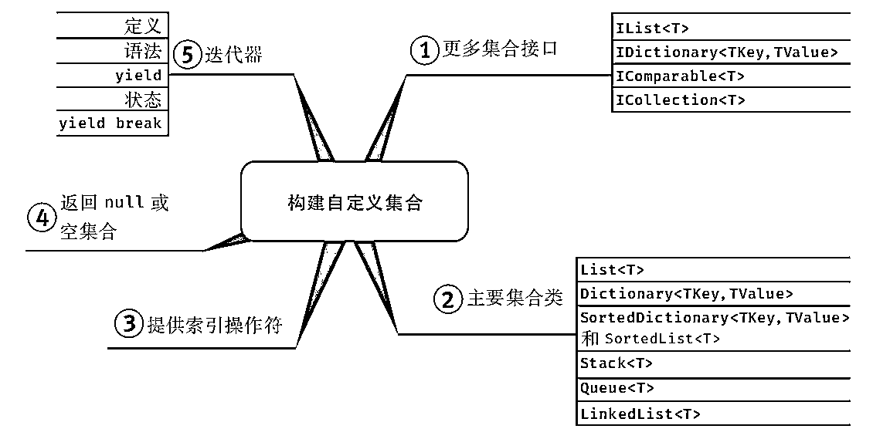

第十五章讨论了标准查询操作符，它们是由 IEnumerable<T>提供的一套扩展方法，适合所有集合。但它们并不能使所有集合都适合所有任务，仍需要有其他集合类型。有的集合适合根据键来搜索，有的则适合根据位置来访问。有的集合像“队列”（先入先出），有的则像“栈”（先入后出）。还有一些根本没有顺序。

.NET Framework 针对多种场景提供了一系列集合类型。本章将介绍其中部分集合类型及其实现的接口，还将介绍如何创建支持标准集合功能（比如索引）的自定义集合，讨论如何用 yield return 语句创建类和方法来实现 IEnumerable<T>。利用 C# 2.0 引入的这个功能，可以简单地实现能由 foreach 语句遍历的集合。

.NET Framework 有许多非泛型集合类和接口，但它们主要是为了向后兼容。泛型集合类不仅更快（因为避免了装箱开销），还更加类型安全。所以，新代码应该总是使用泛型集合类。本书假定你主要使用泛型集合类型。

## 17.1　更多集合接口

前面讨论了集合如何实现 IEnumerable<T>，这是实现集合元素遍历（枚举）功能的主要接口。更复杂的集合还实现了许多其他接口。图 17.1 展示了集合类实现的接口的层次结构。

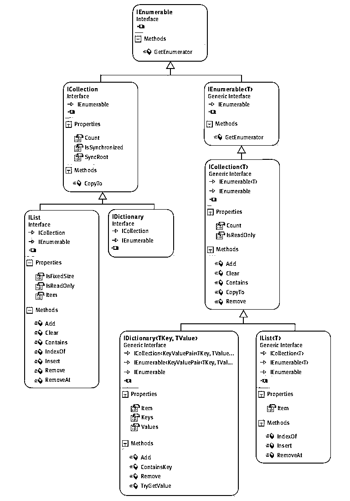

图 17.1　泛型集合类接口层次结构

这些接口提供了一种标准的方式来执行常规任务，包括遍历、索引和计数。本节将讨论这些接口（至少所有泛型的那些），先从图 17.1 底部的接口开始，逐渐上移。

### 17.1.1　IList<T>和 IDictionary<TKey, TValue>

可将英语字典看成是一个定义集合：查找“键”（被定义的单词）即可快速找到定义。类似地，字典集合类是值的集合：每个值都可通过关联的、唯一的键来快速访问。但要注意，英语字典一般按照“键”的字母顺序存储定义。字典类也可选择这样，但一般都不会这样做。除非文档专门指定了排序方式，否则最好将字典集合看成是键及其关联值的无序列表。类似地，一般不说查找“字典中的第 6 个定义”。字典类一般只按键索引，不按位置。

列表则相反，它按特定顺序存储值并按位置访问它们。从某种意义上说，列表是字典的一个特例，其中“键”总是一个整数，“键集”总是从 0 开始的非负整数的连续集合。但由于两者存在重大差异，所以有必要用完全不同的类来表示列表。

所以，选择集合类来解决数据存储或者数据获取问题时，首先要考虑的两个接口就是 IList<T>和 IDictionary<TKey, TValue>。这两个接口决定了集合类型是侧重于通过位置索引来获取值，还是侧重于通过键来获取值。

实现这两个接口的类都必须提供索引器。对于 IList<T>，索引器的操作数是要获取的元素的位置：索引器获取一个整数，以便访问列表中的第 n 个元素。对于 IDictionary <TKey, TValue>，索引器的操作数是和值关联的键，以便对值进行访问。

### 17.1.2　ICollection<T>

IList<T>和 IDictionary<TKey, TValue>都实现了 ICollection<T>。此外，即使集合没有实现 IList<T>或 IDictionary<TKey, TValue>，也极有可能实现了 ICollection<T>（但并非绝对，因为集合可以实现要求较少的 IEnumerable 或 IEnumerable<T>）。ICollection<T>从 IEnumerable<T>派生，包含两个成员：Count 和 CopyTo()。

·Count 属性返回集合中的元素总数。表面看只需要用一个 for 循环就可以遍历集合的每个元素。但要真正做到这一点，集合还必须支持按索引来获取（检索）值，而这个功能是 ICollection<T>接口不包括的（虽然 IList<T>包括）。

·CopyTo()方法允许将集合转换成数组。该方法包含一个 index 参数，允许指定在目标数组的什么位置插入元素。注意，要使用这个方法，必须初始化目标数组并使其具有足够大的容量：从 index 开始，一直到能装下 ICollection<T>中的所有元素。

## 17.2　主要集合类

共有 5 种主要的集合类，区别在于数据的插入、存储以及获取方式。所有泛型类都位于 System.Collections.Generic 命名空间，等价的非泛型版本位于 System.Collections 命名空间。

### 17.2.1　列表集合：List<T>

List<T>类的性质和数组相似。关键区别是随着元素增多，这种类会自动扩展（与之相反，数组长度固定）。此外，列表可通过显式调用 TrimToSize()或 Capacity 来缩小（参见图 17.2）。

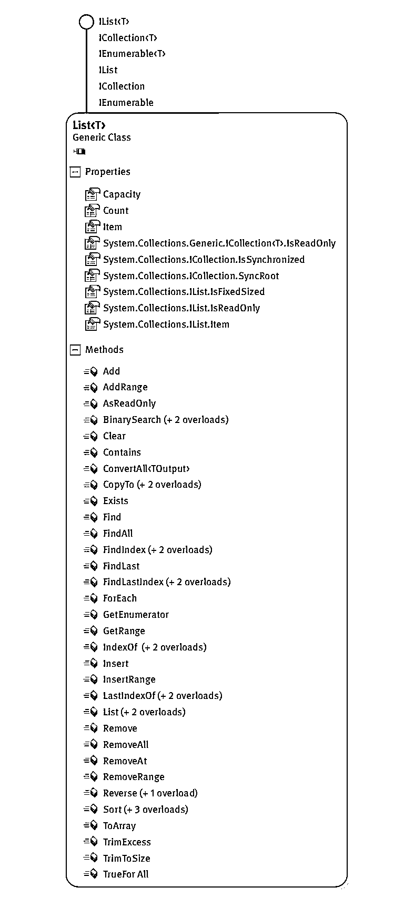

图 17.2　List<>类关系图

这种类称为列表集合 ，和数组一样，其独特功能是每个元素都可根据索引来单独访问。因此可用索引操作符来设置和访问列表元素，索引参数值就是元素在集合中的位置。代码清单 17.1 展示了一个例子，输出 17.1 展示了结果。

代码清单 17.1　使用 List<T>

```powershell
$list = [System.Collections.Generic.List[string]]@(
    'Sneezy', 'Happy', 'Dopey', 'Doc', 'Sleepy', 'Bashful', 'Grumpy'
)

$list.Sort()
Write-Output ("In alphabetical order {0} is the first dwarf while {1} is the last." -f `
    $list[0], $list[6])

$list.Remove('Grumpy')
```

原图代码已改写为 PowerShell 脚本。

输出 17.1

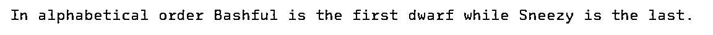

C#的索引从 0 开始，代码清单 17.1 中的索引 0 对应第一个元素，而索引 6 对应第七个元素。按索引获取元素不会产生搜索操作，而只需快速和简单地“跳”到一个内存位置。

List<T>是有序集合。Add()方法将指定项添加到列表末尾。所以在代码清单 17.1 中，在调用 Sort()之前，"Sneezy"是第一项，而"Grumpy"是最后一项。调用 Sort()之后，列表按字母顺序排列，而不是按添加时的顺序。有的集合能在元素添加时自动排序，但 List<T>不能。需显式调用 Sort()以排序元素。

移除元素使用的是 Remove()或 RemoveAt()方法，它们分别用于移除指定元素或移除指定索引位置的元素。

高级主题：自定义集合排序

你可能好奇代码清单 17.1 中的 List<T>.Sort()方法是如何知道怎样按字母顺序排列列表元素的。string 类型实现了 IComparable<string>接口，它有一个 CompareTo()方法。该方法返回一个整数来指出所传递的元素是大于、小于还是等于当前元素。如元素类型实现了泛型 IComparable<T>接口或非泛型 IComparable 接口，排序算法就默认用它决定排列顺序。

但如果元素类型没有实现 IComparable<T>，或者默认的比较逻辑不符合要求，又该怎么办呢？指定非默认排列顺序可调用 List<T>.Sort()的一个重载版本，它获取一个 IComparer<T>作为实参。

IComparable<T>和 IComparer<T>的区别很细微，却很重要。前者说“我知道如何将我自己和我的类型的另一个实例进行比较”，后者说“我知道如何比较给定类型的两个实例”。

当可采取多种方式对一个数据类型进行排序，但没有一种占绝对优势时，就适合使用 IComparer<T>接口。例如，Contact（联系人）对象集合可能按姓名、地点、生日、地区或者其他许多条件来排序。这时就不该固定一个排序策略并让 Contact 类实现 IComparable<Contact>，而应创建几个不同的类来实现 IComparer<Contact>。代码清单 17.2 展示了 LastName, FirstName 比较的一个示例实现。

代码清单 17.2　实现 IComparer<T>

```powershell
using namespace System.Collections.Generic

class Contact {
    [string] $FirstName
    [string] $LastName

    Contact([string] $firstName, [string] $lastName) {
        $this.FirstName = $firstName
        $this.LastName  = $lastName
    }
}

class NameComparison : IComparer[Contact] {
    [int] Compare([Contact] $x, [Contact] $y) {
        if ([object]::ReferenceEquals($x, $y)) { return 0 }
        if ($null -eq $x) { return 1 }
        if ($null -eq $y) { return -1 }

        $result = [NameComparison]::StringCompare($x.LastName, $y.LastName)
        if ($result -eq 0) {
            $result = [NameComparison]::StringCompare($x.FirstName, $y.FirstName)
        }
        return $result
    }

    static [int] StringCompare([string] $x, [string] $y) {
        if ([object]::ReferenceEquals($x, $y)) { return 0 }
        if ($null -eq $x) { return 1 }
        if ($null -eq $y) { return -1 }
        return $x.CompareTo($y)
    }
}
```

原图代码已改写为 PowerShell 类定义。PowerShell 使用 `IComparer[Contact]` 实现自定义比较器。

要先按 LastName 排序，再按 FirstName 排序，调用 `$contactList.Sort([NameComparison]::new())` 即可。

### 17.2.2　全序

实现 IComparable<T>或 IComparer<T>时必须生成一个全序 （total order）。CompareTo 的实现必须为任何可能的数据项排列组合提供一致的排序结果。排序必须满足一些基本条件。例如，每个元素都和它自己相等。如果元素 X 等于元素 Y，元素 Y 等于元素 Z，那么全部三个元素（X，Y，Z）都必须互等。如果元素 X 大于 Y，那么 Y 必须小于 X。而且不能存在“传递悖论”：不能 X 大于 Y，Y 大于 Z，但 Z 大于 X。如果没有提供全序，排序算法的行为就是“未定义”的，可能产生令人不解的排序结果，可能崩溃，可能进入无限循环，等等。

例如，观察代码清单 17.2 的比较器（comparer）是如何确保全序的，它连实参是 null 的情况都考虑到了。不能“任何一个元素为 null 就返回零”，否则可能出现两个非 null 元素等于 null 但不互等的情况。

设计规范

·要确保自定义比较逻辑产生一致的“全序”。

### 17.2.3　搜索 List<T>

在 List<T>中查找特定元素可以使用 Contains()、Indexof()、LastIndexOf()和 BinarySearch()方法。前三个除了 LastIndexOf()从最后一个元素开始之外，其他都从第一个元素开始搜索。它们检查每个元素，直到发现目标元素。这些算法的执行时间与发现匹配项之前实际搜索的元素数量成正比。注意集合类不要求所有元素都唯一。如果集合中有两个或更多元素相同，则 IndexOf()返回第一个索引，LastIndexOf()返回最后一个。

BinarySearch()采用快得多的二叉搜索算法，但要求元素已排好序。BinarySearch()方法的一个有用的功能是假如元素没有找到，会返回一个负整数。该值的按位取反（~）结果是“大于被查找元素的下一个元素”的索引。没有更大的值则是元素的总数。这样就可在列表的特定位置方便地插入新值，同时还能保持已排序状态，如代码清单 17.3 所示。

代码清单 17.3　对 BinarySearch()的结果进行按位取反

```powershell
$list = [System.Collections.Generic.List[string]]::new()
$list.Add('public')
$list.Add('protected')
$list.Add('private')
$list.Sort()

$search = $list.BinarySearch('protected internal')
if ($search -lt 0) {
    # 按位取反得到应插入的位置
    $list.Insert(-bnot $search, 'protected internal')
}

foreach ($accessModifier in $list) {
    Write-Output $accessModifier
}
```

原图代码已改写为 PowerShell 脚本。

要注意的是，假如列表事先没有排好序，那么不一定能找到指定元素，即使它确实在列表中。代码清单 17.3 的结果如输出 17.2 所示。

输出 17.2


高级主题：使用 FindAll()查找多个数据项

有时必须在列表中找到多个项，而且搜索条件要比搜索一个特定的值复杂得多。为此，System.Collections.Generic.List<T>包含了一个 FindAll()方法。FindAll()获取 Predicate<T>类型的一个参数，它是对称为“委托”的一个方法的引用。代码清单 17.4 演示了如何使用 FindAll()方法。

代码清单 17.4　演示 FindAll()及其谓词参数

```powershell
$list = [System.Collections.Generic.List[int]]::new()
$list.Add(1)
$list.Add(2)
$list.Add(3)
$list.Add(2)

$results = $list.FindAll({
    param($value)
    ($value % 2) -eq 0
})

foreach ($number in $results) {
    Write-Output $number
}
```

原图代码已改写为 PowerShell 脚本。

调用 FindAll()时传递了一个委托实例 Even()，后者在整数实参是偶数的前提下返回 true。FindAll()获取委托实例，并为列表中的每一项调用 Even()（此时利用了 C# 2.0 的委托类型推断）。每次返回值为 true 时，相应的项就添加到一个新的 List<T>实例中。检查完列表中的每一项之后就返回该实例。第十三章已详细讨论了委托。

注：原图把筛选逻辑放在名为 Even() 的方法里，再作为委托传给 FindAll()；PowerShell 版直接把脚本块作为 `Predicate[int]` 委托传入（见代码清单 17.4），由语言自动完成转换，因此没有单独的 Even() 方法。

### 17.2.4　字典集合：Dictionary<TKey, TValue>

另一种主要集合类是字典类，具体就是 Dictionary<Tkey, Tvalue>（参见图 17.3）。和列表集合不同，字典类存储的是“名称/值”对。其中，名称相当于独一无二的键，可利用它像在数据库中利用主键来访问一条记录那样查找对应的元素。这会为访问字典元素带来一定的复杂性，但由于利用键来进行查找效率非常高，所以这是一个有用的集合。注意，键可以是任意数据类型，而非只是字符串或数值。

要在字典中插入元素，一个选择是使用 Add()方法，并向它传递键和值作为参数，如代码清单 17.5 所示。

代码清单 17.5　向 Dictionary<TKey, TValue>添加项

```powershell
# C# 6.0 之前使用 {"Error", ConsoleColor.Red} 这种初始化语法
$colorMap = [System.Collections.Generic.Dictionary[string, System.ConsoleColor]]::new()
# 利用索引器（键作为索引）插入初始项
$colorMap['Error']       = [System.ConsoleColor]::Red
$colorMap['warning']     = [System.ConsoleColor]::Yellow
$colorMap['Information'] = [System.ConsoleColor]::Green

$colorMap.Add('Verbose', [System.ConsoleColor]::White)
```

原图代码已改写为 PowerShell 脚本。

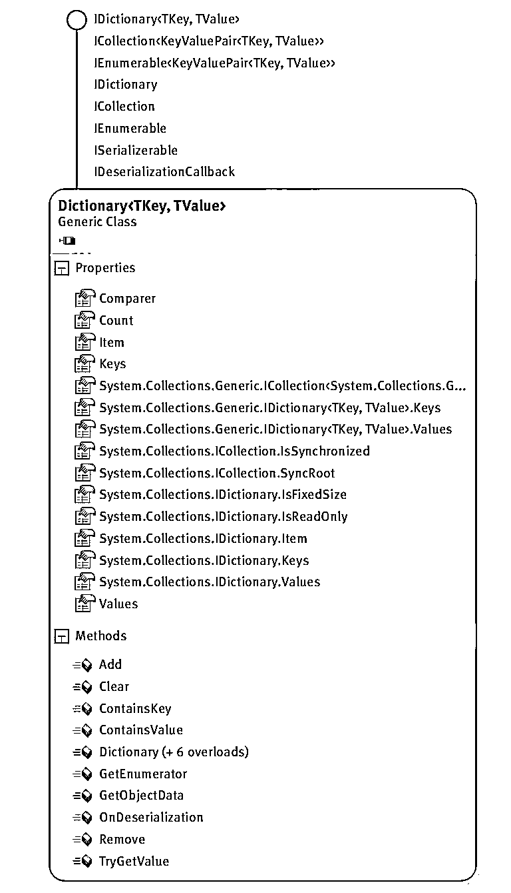

图 17.3　Dictionary 类关系图

代码清单 17.5 通过 C# 6.0 字典初始化语法（参见 15.1 节）初始化字典，为"Verbose"这个键插入值 ConsoleColor.White。如存在已具有该键的元素，将抛出 System.Argument-Exception 异常。添加元素的另一个选择是使用索引器，如代码清单 17.6 所示^( [\[1\]](part0148.xhtml#ch1_back) ) 。

代码清单 17.6　使用索引器在 Dictionary<TKey, TValue>中插入项

```powershell
$colorMap = [System.Collections.Generic.Dictionary[string, System.ConsoleColor]]::new()
$colorMap['Error']       = [System.ConsoleColor]::Red
$colorMap['warning']     = [System.ConsoleColor]::Yellow
$colorMap['Information'] = [System.ConsoleColor]::Green

# 键不存在时插入新项
$colorMap['Verbose'] = [System.ConsoleColor]::White
# 键已存在时替换原有的值
$colorMap['Error']   = [System.ConsoleColor]::Cyan
```

原图代码已改写为 PowerShell 脚本。PowerShell 的索引器赋值与 C# 语义一致：键不存在则插入，键已存在则覆盖。

在代码清单 17.6 中，要注意的第一件事情是索引器不要求整数。相反，索引器的操作数的类型由第一个类型实参（string）指定。索引器设置或获取的值的类型由第二个类型实参（ConsoleColor）指定。

要注意的第二件事情是同一个键（"Error"）使用了两次。第一次赋值时，没有与指定键对应的字典值，所以字典集合类插入具有指定键的新值。第二次赋值时，具有指定键的元素已经存在，所以此时不是插入新元素，而是删除旧值 ConsoleColor.Red，将新值 ConsoleColor.Cyan 与键关联。

从字典读取键不存在的值将抛出 KeyNotFoundException 异常。可用 ContainsKey()方法在访问与一个键对应的值之前检查该键是否存在，以免抛出异常。

Dictionary<TKey, TValue>作为“哈希表”实现：这种数据结构在根据键来查找值时速度非常快——无论字典中存储了多少值。相反，检查特定值是否在字典集合中相当花时间，其性能和搜索无序列表一样是“线性”的——该操作使用 ContainsValue()方法，它顺序搜索集合中的每个元素。

移除字典元素用 Remove()方法，需要向它传递键而不是元素的值作为参数。

因为在字典中添加一个值同时需要键和值，所以 foreach 循环变量必须是一个 KeyValuePair<TKey, TValue>。代码清单 17.7 演示了如何用 foreach 遍历字典中的键和值，输出 17.3 展示了结果。

代码清单 17.7　使用 foreach 遍历 Dictionary<TKey, TValue>

```powershell
$colorMap = [System.Collections.Generic.Dictionary[string, System.ConsoleColor]]::new()
$colorMap['Error']       = [System.ConsoleColor]::Red
$colorMap['warning']     = [System.ConsoleColor]::Yellow
$colorMap['Information'] = [System.ConsoleColor]::Green
$colorMap['Verbose']     = [System.ConsoleColor]::White

foreach ($item in $colorMap.GetEnumerator()) {
    Write-Host -ForegroundColor $item.Value $item.Key
}
```

原图代码已改写为 PowerShell 脚本。字典的每一项都是 `KeyValuePair<TKey, TValue>`，分别用 `Key` 和 `Value` 属性访问键和值。

输出 17.3

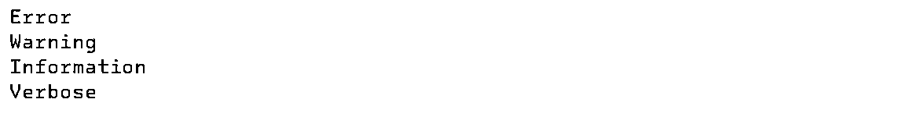

注意数据项的显示顺序是它们添加到字典的顺序，和添加到列表一样。字典的实现通常按照添加时的顺序枚举键和值，但这既不是必需的，也没有编入文档，所以不要依赖它。

设计规范

·不要对集合元素的顺序进行任何假定。如果集合的文档没有指明它按特定顺序枚举，就不能保证以任何特定顺序生成元素。

可利用 Keys 和 Values 属性只处理字典类中的键或值。返回的数据类型是 ICollection<T>。返回的是对原始字典集合中的数据的引用，而不是返回拷贝。字典中的变化会在 Keys 和 Values 属性返回的集合中自动反映。

高级主题：自定义字典相等性

为判断指定的键是否与字典中现有的键匹配，字典必须能比较两个键的相等性。这就像列表必须能比较两个项来判断其顺序一样（参见 17.2.1 节的“高级主题：自定义集合排序”）。值类型的两个实例进行比较，默认是检查两者是否包含了一样的数据。引用类型的两个实例则是检查是否引用同一个对象。但偶尔也需要在两个实例不包含相同的值，或者不引用同一样东西的情况下判定它们相等。

例如，你可能想用代码清单 17.2 中的 Contact 类型创建一个 Dictionary<Contact, string>，并希望假如两个 Contact 对象具有相同的 FirstName 和 LastName，就判定两者相等——无论两个对象是否引用相等。以前是实现 IComparer<T>对列表进行排序。类似地，可以提供 IEqualityComparer<T>的一个实现来判断两个键是否相等。该接口要求两个方法：一个返回 bool 值指出两个项是否相等，另一个返回“哈希码”来实现字典的快速索引。代码清单 17.8 展示了一个例子。

代码清单 17.8　实现 IEqualityComparer<T>

```powershell
using namespace System.Collections.Generic

class Contact {
    [string] $FirstName
    [string] $LastName

    Contact([string] $firstName, [string] $lastName) {
        $this.FirstName = $firstName
        $this.LastName  = $lastName
    }
}

class ContactEquality : IEqualityComparer[object] {
    [bool] Equals([object] $x, [object] $y) {
        if ([object]::ReferenceEquals($x, $y)) { return $true }
        if ($null -eq $x -or $null -eq $y) { return $false }
        return ($x.LastName -eq $y.LastName) -and ($x.FirstName -eq $y.FirstName)
    }

    [int] GetHashCode([object] $x) {
        if ($null -eq $x) { return 0 }
        $h1 = if ($null -eq $x.FirstName) { 0 } else { $x.FirstName.GetHashCode() }
        $h2 = if ($null -eq $x.LastName)  { 0 } else { $x.LastName.GetHashCode() }
        # 压缩为 32 位正数，避免溢出
        return [int](($h1 * 23 + $h2) -band 0x7FFFFFFF)
    }
}
```

原图代码已改写为 PowerShell 类定义。此处以 `IEqualityComparer[object]` 实现，这样比较器可直接用于 `Dictionary[Contact, string]`。

调用构造函数 `[System.Collections.Generic.Dictionary[Contact, string]]::new([ContactEquality]::new())`，即可创建使用了该相等性比较器的字典。

初学者主题：相等性比较的要求

如第十章所述，相等性和哈希码算法有几条重要规则。集合更需遵守这些规则。就像列表排序要求自定义的排序器提供“全序”一样，哈希表也对自定义的相等性比较提出了一些要求。其中最重要的是如果 Equals()为两个对象返回 true，GetHashCode()必须为同样的对象返回相同的值。反之则不然：两个不相等的项可能具有相同的哈希码。（事实上必然有两个不相等的项具有相同的哈希码，因为总共只有 2³² 个可能的哈希码，不相等的对象多于这个数字！）

第二个重要要求是至少当数据项在哈希表中的时候，对它的 GetHashCode()调用必须生成相同的结果。但要注意，在程序两次运行期间，两个“看起来相等”的对象并不一定产生相同的哈希码。例如，可以今天为指定联系人分配一个哈希码，两周后当程序再次运行时，为该联系人分配不同的哈希码，这完全合法。不要将哈希码持久存储到数据库中，并指望每次运行程序都不变。

理想情况下，GetHashCode()的结果应该是“随机”的。也就是说，输入的小变化应造成输出的大变化，结果应在整数区间大致均匀地分布。但是，很难设计出既非常快又产生非常良好分布的输出，应尝试在两者之间取得平衡。

最后，GetHashCode()和 Equals()千万不能抛出异常。例如，代码清单 17.8 就非常小心地避免了对空引用进行解引用。

下面总结了一些基本点：

·相等的对象必然有相等的哈希码。

·实例生存期间（至少当其在哈希表中的时候），其哈希码应一直不变。

·哈希算法应快速生成良好分布的哈希码。

哈希算法应避免在所有可能的对象状态中抛出异常。

### 17.2.5　已排序集合：SortedDictionary<TKey, TValue>和 SortedList<T>

已排序集合类（参见图 17.4）的元素是排好序的。具体地说，对于 SortedDictionary <TKey, TValue>，元素是按照键排序的；对于 SortedList<T>，元素则是按照值排序的。如修改代码清单 17.7 的代码来使用 SortedDictionary<string, ConsoleColor>而不是 Dictionary<string, ConsoleColor>，将获得如输出 17.4 所示的结果。

输出 17.4

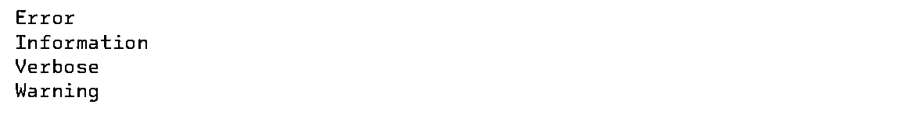

注意元素按键而不是按值排序。

由于要保持集合中元素的顺序，所以相对于无序字典，已排序集合插入和删除元素要稍慢一些。由于已排序集合必须按特定顺序存储数据项，所以既可按键访问，也可按索引访问。按索引访问请使用 Keys 和 Values 属性，它们分别返回 IList<TKey>和 IList<TValue>实例。结果集合可像其他列表那样索引。

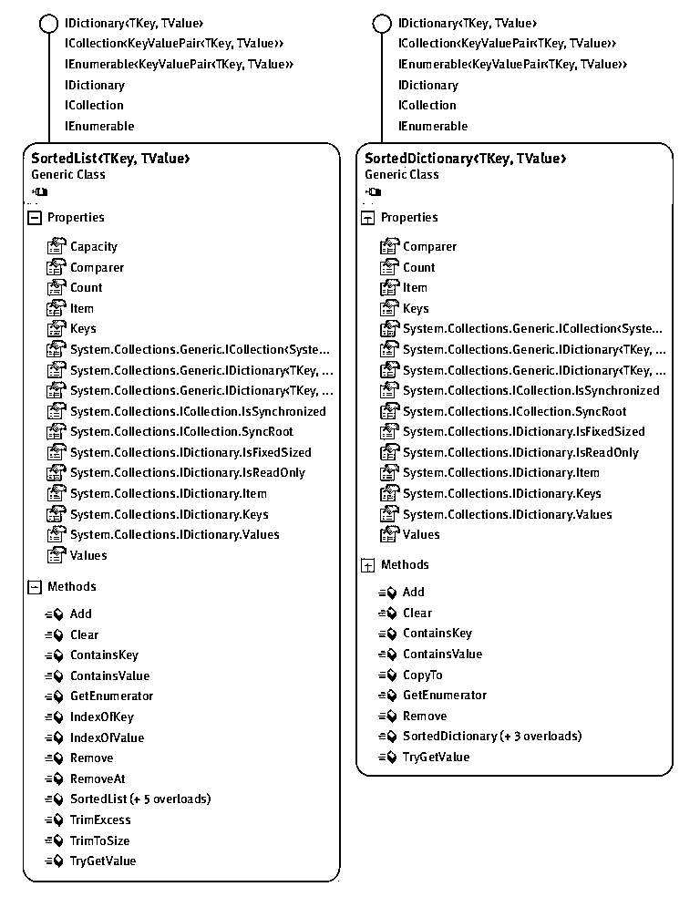

图 17.4　SortedList<>和 SortedDictionary<>类关系图

### 17.2.6　栈集合：Stack<T>

第十二章讨论了栈集合类（如图 17.5 所示）。栈集合类被设计成后入先出集合。两个关键的方法是 Push()和 Pop()。

·Push()将元素送入集合。元素不必唯一。

·Pop()按照与添加时相反的顺序获取并删除元素。

为了在不修改栈的前提下访问栈中的元素，要使用 Peek()和 Contains()方法。Peek()返回 Pop()将获取的下一个元素。

和大多数集合类一样，Contains()判断一个元素是否在栈的某个地方。和所有集合一样，还可以用 foreach 循环来遍历栈中的元素。这样可访问栈中任何地方的值。但要注意，用 foreach 循环访问值不会把它从栈中删除。只有 Pop()才会。

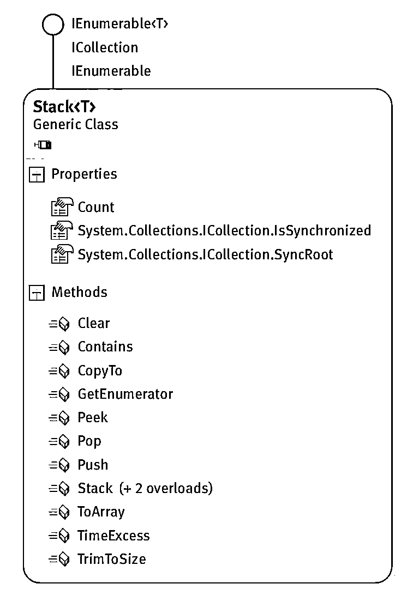

图 17.5　Stack<T>类关系图

### 17.2.7　队列集合：Queue<T>

如图 17.6 所示，队列集合类与栈集合类基本相同，只是遵循先入先出排序模式。代替 Pop()和 Push()的分别是 Enqueue()和 Dequeue()方法，前者称为入队方法，后者称为出队方法。队列集合像是一根“管子”。Enqueue()方法在队列的一端将对象放入队列，Dequeue()从另一端移除它们。和栈集合类一样，对象不必唯一。另外，队列集合类会根据需要自动增大。队列缩小时不一定回收之前使用的存储空间，因为这会使插入新元素的动作变得很昂贵。如确定队列将长时间保持大小不变，可用 TrimToSize()方法提醒它你希望回收存储空间。

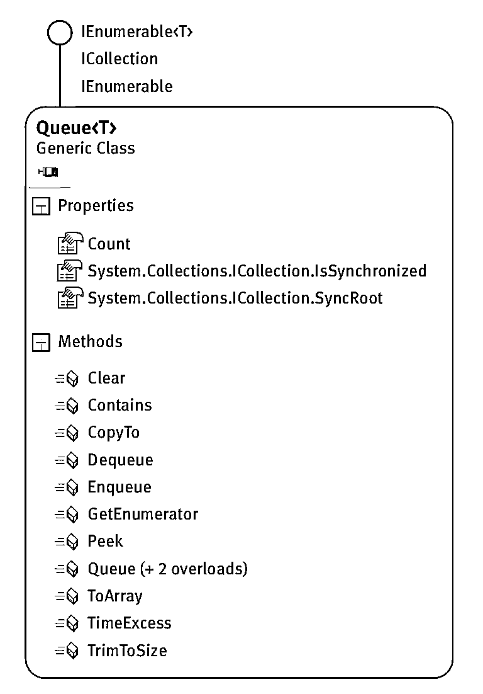

图 17.6　Queue<T>类关系图

### 17.2.8　链表：LinkedList<T>

System.Collections.Generic 还支持一个链表集合，允许正向和反向遍历。图 17.7 展示了类关系图。注意没有对应的非泛型类型。

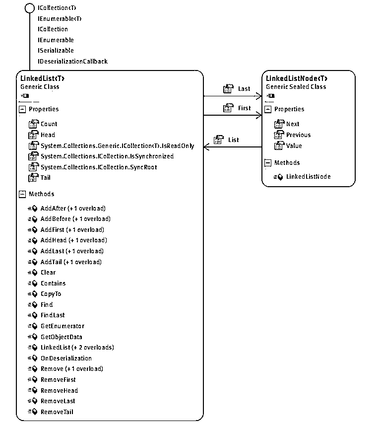

图 17.7　LinkedList<T>和 LinkedListNode<T>类关系图

[\[1\]](part0148.xhtml#ch1) 索引器即索引操作符，即\[\]。——译者注

## 17.3　提供索引器

数组、字典和列表都提供了索引器 （indexer）以便根据键或索引来获取/设置成员。如前所述，为了使用索引器，只需将索引放到集合后的方括号中。可定义自己的索引器，代码清单 17.9 用 Pair<T>展示了一个例子。

代码清单 17.9　定义索引器

```powershell
enum PairItem {
    First
    Second
}

class Pair {
    [object] $First
    [object] $Second

    Pair($first, $second) {
        $this.First  = $first
        $this.Second = $second
    }

    # PowerShell 类不支持自定义索引器，改用按索引枚举取值的方法
    [object] GetItem([PairItem] $index) {
        switch ($index) {
            ([PairItem]::First)  { return $this.First }
            ([PairItem]::Second) { return $this.Second }
        }
        throw [System.NotImplementedException]::new(
            "The enum $($index.ToString()) has not been implemented")
    }
}
```

原图代码已改写为 PowerShell 类定义。PowerShell 类不支持 C# 的 `this[...]` 索引器声明，故以 `GetItem()` 方法表达同一语义，参数类型用枚举约束以避免传入不存在的项。

索引器的声明和属性很相似，但不是使用属性名，而是使用关键字 this，后跟方括号中的参数列表。主体也像属性，也有 get 和 set 块。如代码清单 17.9 所示，参数不一定是 int。事实上，索引可获取多个参数，甚至可以重载。本例使用 enum 防止调用者为不存在的项提供索引。

C#编译器为索引器创建的 CIL 代码是名为 Item 的特殊属性，它获取一个实参。接受实参的属性不可以在 C#中显式创建，所以 Item 属性在这方面相当特殊。使用了标识符 Item 的其他任何成员，即使它有完全不同的签名，都会和编译器创建的成员冲突，所以不被允许。

注：以上描述的是 C# 编译器的索引器机制。PowerShell 脚本类不支持索引器声明（代码清单 17.9 改为 `GetItem()` 方法），因此不存在 C# 编译器生成的 `Item` 属性，`IndexerName` 特性在 PowerShell 中也没有对应物（见代码清单 17.10 的注）。

高级主题：使用 IndexerName 指定索引器属性名称

如前所述，索引器（\[ \]）的 CIL 属性名称默认为 Item。但可用 IndexerNameAttibute 指定一个不同的名称。代码清单 17.10 将名称更改为"Entry"。

代码清单 17.10　更改索引器的默认名称

```powershell
# 原 C# 代码用 IndexerName("Entry") 特性为索引器换名
# PowerShell 类没有索引器，故以具名方法替代，方法名即等价于该名称
class Pair {
    [object] GetEntry([PairItem[]] $branches) {
        # ...
    }
}
```

原图代码已改写为 PowerShell 类定义。PowerShell 中不存在索引器及其 CIL 名称，`IndexerName` 特性无对应物，故仅以方法名表达“入口”的语义。

这个更改对于索引的 C#调用者来说没有任何区别，它只是为不直接支持索引器的语言指定了名称。

该特性只是一个编译器指令，它指示为索引器使用不同的名称。特性不会实际进入编译器生成的元数据，所以不能通过反射获得这个名称。

高级主题：定义参数可变的索引操作符

索引器还可获取一个可变的参数列表。例如，代码清单 17.11 为第十二章讨论（下一节也会讨论）的 BinaryTree<T>定义了一个索引器。

代码清单 17.11　定义接受可变参数的索引器

```powershell
class BinaryTree {
    [object] $Value
    [object[]] $SubItems = @()

    BinaryTree($value) {
        $this.Value = $value
    }

    # 对应原索引器 this[params PairItem[] branches]
    [BinaryTree] GetItem([PairItem[]] $branches) {
        $currentNode = $this
        # 空数组或 null 都指代根节点
        $totalLevels  = if ($null -eq $branches) { 0 } else { $branches.Length }
        $currentLevel = 0

        while ($currentLevel -lt $totalLevels) {
            $currentNode = $currentNode.SubItems[[int] $branches[$currentLevel]]
            if ($null -eq $currentNode) {
                # 该位置上的二叉树为 null
                throw [System.IndexOutOfRangeException]::new()
            }
            $currentLevel++
        }
        return $currentNode
    }
}
```

原图代码已改写为 PowerShell 类定义。PowerShell 以数组参数 `[PairItem[]]` 表达 C# 的 `params` 可变参数。

branches 中的每一项都是一个 PairItem，指出二叉树中向下导航到哪个分支。例如：

```powershell
$tree.GetItem([PairItem[]]@([PairItem]::Second, [PairItem]::First)).Value
```

将检索位于第一个分支中第二个项的值，然后是该分支中的第一个分支。

## 17.4　返回 null 或者空集合

返回数组或集合时，必须允许返回 null，或者返回不包含任何数据项的集合实例，从而指出包含零个数据项的情况。通常，更好的选择是返回不含数据项的集合实例。这样可避免强迫调用者在遍历集合前检查 null 值。例如，假定现在有一个长度为零的 IEnumerable<T>集合，调用者可立即用一个 foreach 循环来安全遍历集合，不必担心生成的 GetEnumerator()调用会抛出 NullReferenceException 异常。应考虑使用 Enumerable.Empty<T>()方法来简单地生成给定类型的空集合。

但这个准则也有例外的时候，比如 null 被有意用来表示有别于“零个项目”的情况。例如，网站用户名集合可能用 null 表示出于某种原因未能获得最新集合，在语义上有别于空集合。

设计规范

·不要用 null 引用表示空集合。

·考虑改为使用 Enumerable.Empty<T>()方法。

## 17.5　迭代器

第十五章详细探讨了 foreach 循环的内部工作方式。本节将讨论如何利用迭代器 （iterator）为自定义集合实现自己的 IEnumerator<T>、IEnumerable<T>和对应的非泛型接口。迭代器用清楚的语法描述了如何循环遍历（也就是迭代）集合类中的数据，尤其是如何使用 foreach 来遍历。迭代器使集合的用户能遍历集合的内部结构，同时不必了解结构的内部实现。

高级主题：迭代器源起

1972 年，麻省理工学院的 Barbara Liskov 和一组科学家开始研究新的编程方法，他们将重点放在对用户自定义数据的抽象上。为了检验他们的工作，他们创建了一种名为 CLU 的语言。这种语言提出了一个名为“集群”（cluster，注意前三个字母是 CLU）的概念，这是当今程序员使用的主要数据抽象概念——对象——的前身。

在他们的研究过程中，团队意识到 CLU 语言虽然能从最终用户使用的类型中抽象出一些数据表示，但经常都不得不揭示数据的内部结构，才能使其他人正确使用它。为摆脱这方面的困扰，他们创建了一种名为迭代器的语言结构。（当年由 CLU 提出的许多概念最终都在面向对象编程中成为非常基本的东西。）

类要支持用 foreach 进行迭代，就必须实现枚举数（enumerator）模式。如第十五章所述， C#的 foreach 循环结构被编译器扩展成 while 循环结构，它以从 IEnumerable<T>接口获取的 IEnumerator<T>接口为基础。

枚举数模式的问题在于手动实现比较麻烦，因为它需要维持对集合中的当前位置进行描述所需的全部状态。对于列表集合类型，这个内部状态可能比较简单，当前位置的索引就足够。但对于需要以递归方式遍历的数据结构（比如二叉树），状态就可能相当复杂。为此，C# 2.0 引入了迭代器的概念，它使一个类可以更容易地描述 foreach 循环如何遍历它的内容。

### 17.5.1　定义迭代器

迭代器是实现类的方法的一个途径，是更复杂的枚举数模式的语法简化形式。C#编译器遇到迭代器时，会把它的内容扩展成实现了枚举数模式的 CIL 代码。因此，迭代器的实现对“运行时”没有特别的依赖。由于 C#编译器在生成的 CIL 代码中仍然采用枚举数模式，所以在使用迭代器之后，并不会带来真正的运行时性能优势。不过，选择使用迭代器，而不是手动实现枚举数模式，能显著提高程序员的编程效率。先看看迭代器在代码中如何定义。

### 17.5.2　迭代器语法

迭代器提供了迭代器接口（也就是 IEnumerable<T>和 IEnumerator<T>这两个接口的组合）的一个快捷实现。代码清单 17.12 通过创建一个 GetEnumerator()方法为泛型 BinaryTree<T>类型声明了一个迭代器。然后要添加对迭代器接口的支持。

代码清单 17.12　迭代器接口模式

```powershell
class BinaryTree : System.Collections.IEnumerable {
    [object] $Value
    [object[]] $SubItems = @()

    BinaryTree($value) {
        $this.Value = $value
    }

    #region IEnumerable
    [System.Collections.IEnumerator] GetEnumerator() {
        # 迭代器实现见 17.5.6 的代码清单 17.16
        return @(Get-TreeItems -Tree $this).GetEnumerator()
    }
    #endregion IEnumerable

    [object] GetValue() { return $this.Value }
    [object[]] GetSubItems() { return $this.SubItems }

    # 对应 C# 的 getter-only 自动属性 SubItems
    [void] SetSubItems([object[]] $items) {
        $this.SubItems = $items
    }
}

function Get-TreeItems {
    param([BinaryTree] $Tree)
    $Tree.GetValue()
    foreach ($item in $Tree.GetSubItems()) {
        if ($null -ne $item) { Get-TreeItems -Tree $item }
    }
}
```

原图代码已改写为 PowerShell 类定义。由于 PowerShell 类不支持 C# 的属性声明，这里以存取方法表达 `Value` 与 `SubItems`。

如代码清单 17.12 所示，还要为 GetEnumerator()方法提供一个实现。

### 17.5.3　从迭代器生成值

迭代器类似于函数，但它不是返回（return）一个值，而是生成（yield）一系列值。在 BinaryTree<T>的情况下，迭代器生成的值的类型是提供给 T 的类型实参。如果使用 IEnumerator 的非泛型版本，那么生成的值就是 object 类型。

正确实现迭代器模式需维护一些内部状态，以便在枚举集合时跟踪记录当前的位置。在 BinaryTree<T>的情况下，要记录的是树中哪些元素已被枚举，哪些还没有。迭代器由编译器转换成“状态机”来跟踪记录当前位置，它还知道如何将自己移动到下一个位置。

每次迭代器遇到 yield return 语句都生成一个值，之后控制立即回到请求数据项的调用者。（这里有一个有趣的点是，控制确实会立即返回，这与 return 语句不同。一个 return 语句会触发 finally 块被执行，而 yield return 则不会。）然后，当调用者请求下一项时，会紧接在上一个 yield return 语句之后执行。代码清单 17.13 顺序返回 C#内建的数据类型关键字。

注：以上描述的是 C# 迭代器按需暂停/恢复的 `yield return` 机制。PowerShell 没有 `yield return`，等价做法是在函数中把值输出到管道、由调用方收集为序列（见代码清单 17.13、17.16 的注）；PowerShell 函数不维护迭代器状态机，而是运行到完成后一次性产生整个序列。

代码清单 17.13　顺序生成(yield)一些 C#关键字

```powershell
class CSharpBuiltInTypes : System.Collections.IEnumerable {
    [System.Collections.IEnumerator] GetEnumerator() {
        # 原图用一系列 yield return 逐个生成
        return @(
            'object', 'byte', 'uint', 'ulong', 'float',
            'char', 'bool', 'ushort', 'decimal', 'int',
            'sbyte', 'short', 'long', 'void', 'double', 'string'
        ).GetEnumerator()
    }
}

$keywords = [CSharpBuiltInTypes]::new()
foreach ($keyword in $keywords) {
    Write-Output $keyword
}
```

原图代码已改写为 PowerShell 脚本。PowerShell 没有 `yield return` 语句，等价写法是返回一个可枚举序列；`foreach` 的遍历语义与 C# 完全一致。

代码清单 17.13 的结果如输出 17.5 所示。

输出 17.5

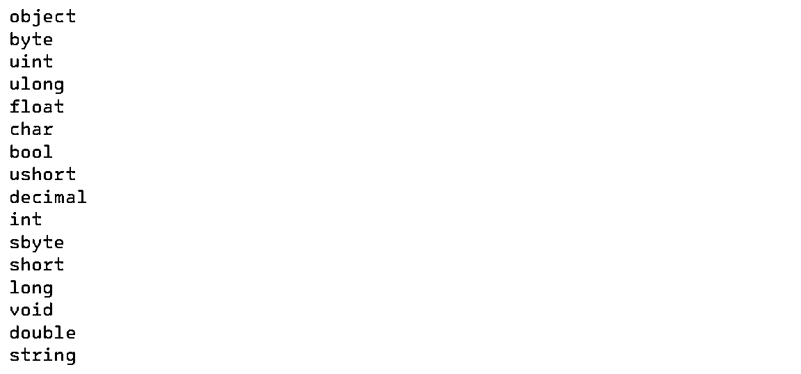

输出的是 C#内建类型的一个列表。

### 17.5.4　迭代器和状态

GetEnumerator()在 foreach 语句（比如代码清单 17.13 的 foreach (string keyword in keywords)）中被首次调用时，会创建一个迭代器对象，其状态被初始化为特殊的“起始”状态，表示迭代器尚未执行代码，所以尚未生成任何值。只要 foreach 语句继续，迭代器就会一直维持其状态。循环每一次请求下一个值，控制就会进入迭代器，从上一次离开的位置继续。该位置是根据迭代器对象中存储的状态信息来判断的。foreach 语句终止，迭代器的状态就不再保存了。

总是可以安全地再次调用迭代器。如有必要，会创建新的枚举器对象。

图 17.8 展示了所有事件的发生顺序。记住，MoveNext()方法由 IEnumerator<T>接口提供。

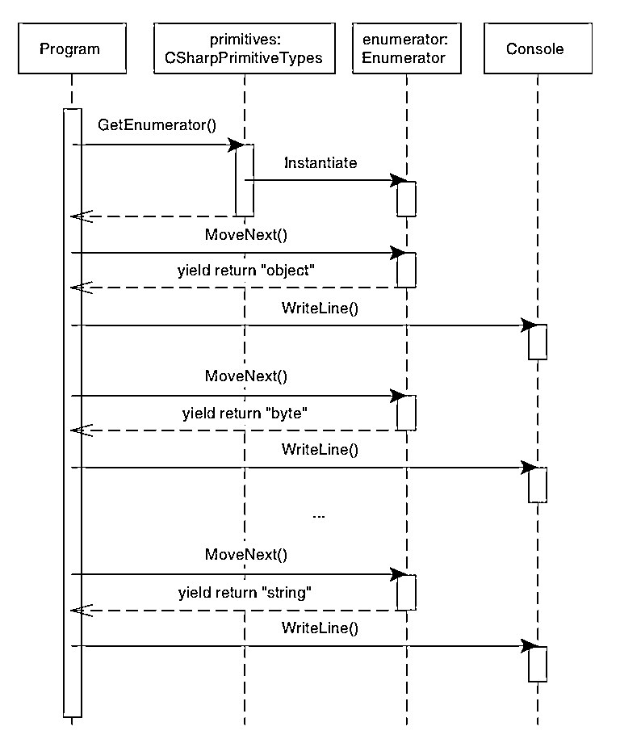

图 17.8　yield return 顺序示意图

在代码清单 17.13 中，foreach 语句在名为 keywords 的一个 CSharpBuiltInTypes 实例上发起对 GetEnumerator()的调用。获得迭代器实例（由 iterator 引用）后，foreach 的每次循环迭代都以一个 MoveNext()调用开始。迭代器内部生成一个值，并把它返回给 foreach 语句。执行了 yield return 语句之后，GetEnumerator()方法暂停并等待下一个 MoveNext()请求。现在回到循环主体，foreach 语句在屏幕上显示生成的值。然后，它开始下一次循环迭代，再次在迭代器上调用 MoveNext()。注意第二次循环执行的是第二个 yield return 语句。同样地，foreach 在屏幕上显示 CSharpBuiltInTypes 生成的值，并开始下一次循环迭代。这个过程会一直继续下去，直至迭代器中没有更多的 yield return 语句。届时 foreach 循环将终止，因为 MoveNext()返回 false。

### 17.5.5　更多的迭代器例子

修改 BinaryTree<T>之前必须修改 Pair<T>，以使用迭代器来支持 IEnumerable<T>接口。代码清单 17.14 展示了如何生成 Pair<T>中的每个元素（其实就两个元素，First 和 Second）。

代码清单 17.14　使用 yield 来实现 BinaryTree<T>

```powershell
class Pair : System.Collections.IEnumerable {
    [object] $First
    [object] $Second

    Pair($first, $second) {
        $this.First  = $first
        $this.Second = $second
    }

    #region IEnumerable
    [System.Collections.IEnumerator] GetEnumerator() {
        # 等价于两个 yield return 语句
        return @($this.First, $this.Second).GetEnumerator()
    }
    #endregion IEnumerable
}
```

原图代码已改写为 PowerShell 类定义。原图中的两个 `yield return` 由返回含两个元素的序列的枚举器表达。

在代码清单 17.14 中，遍历 Pair<T>数据类型将循环迭代两次。第一次是通过 yield return First，第二次是通过 yield return Second。在 GetEnumerator()中每次遇到 yield return 语句，状态都会保存，而且执行似乎“跳出”GetEnumerator()方法的上下文并回到循环主体。第二次循环迭代开始时，GetEnumerator()从 yield return Second 语句恢复执行。

System.Collections.Generic.IEnumerable<T>从 System.Collections.IEnumerable 继承。所以实现 IEnumerable<T>还需实现 IEnumerable。在代码清单 17.14 中，这个实现是显式进行的。不过这个实现很简单，就是调用了一下 IEnumerable<T>的 GetEnumerator()实现。因为 IEnumerable<T>和 IEnumerable 之间的类型兼容性（通过继承），所以从 IEnumerable.GetEnumerator()中调用 IEnumerable<T>.GetEnumerator()始终合法。由于两个版本的 GetEnumerator()的签名完全一致（返回类型不是签名的区分因素），所以要么必须其中一个实现是显式的，要么必须两个都显式。考虑到 IEnumerable<T>的版本提供了额外的类型安全性，所以我们选择显式实现 IEnumerable 的实现。

代码清单 17.15 使用 Pair<T>.GetEnumerator()方法在连续两行上显示"Inigo"和"Montoya"。

代码清单 17.15　通过 foreach 来使用 Pair<T>.GetEnumerator()

```powershell
$fullName = [Pair]::new('Inigo', 'Montoya')
foreach ($name in $fullName) {
    Write-Output $name
}
```

原图代码已改写为 PowerShell 脚本。关于 GetEnumerator()的调用在 foreach 循环中也是隐式进行的，与 C#相同。

注意对 GetEnumerator()的调用在 foreach 循环中是隐式进行的。

### 17.5.6　将 yield return 语句放到循环中

在前面的 CSharpBuiltInTypes 和 Pair<T>中，我们对每个 yield return 语句都进行硬编码，但实际并不需要如此。可用 yield return 语句从循环结构中返回值。在代码清单 17.16 中，GetEnumerator()中的 foreach 每一次执行都会返回下一个值。

代码清单 17.16　将 yield return 语句放到循环中

```powershell
class BinaryTree : System.Collections.IEnumerable {
    [object] $Value
    [object[]] $SubItems = @()

    BinaryTree($value) {
        $this.Value = $value
    }

    #region IEnumerable
    [System.Collections.IEnumerator] GetEnumerator() {
        return @(Get-TreeItems -Tree $this).GetEnumerator()
    }
    #endregion IEnumerable
}

function Get-TreeItems {
    param([BinaryTree] $Tree)

    # 返回本节点的元素
    $Tree.Value

    # 遍历 pair 中的每个元素
    foreach ($subTree in $Tree.SubItems) {
        if ($null -ne $subTree) {
            # pair 中的每个元素也是树，故递归遍历
            foreach ($item in Get-TreeItems -Tree $subTree) {
                $item
            }
        }
    }
}
```

原图代码已改写为 PowerShell 脚本。PowerShell 没有 `yield return`，改为把序列写入管道；递归调用 `Get-TreeItems` 的效果等同于原图中 `foreach (T item in tree) yield return item;`。

在代码清单 17.16 中，第一次循环迭代会返回二叉树的根元素。第二次循环迭代时，将遍历由两个子元素构成的一个 pair。假如子元素 pair 包含非空的值，就进入子节点并生成它的元素。注意 foreach(T item in tree)是对子节点的递归调用。

与 CSharpBuiltInTypes 和 Pair<T>的情况一样，我们现在就可以使用 foreach 循环来遍历一个 BinaryTree<T>。代码清单 17.17 对此进行了演示，输出 17.6 展示了结果。

代码清单 17.17　将 foreach 用于 BinaryTree<string>

```powershell
# JFK
$jfkFamilyTree = [BinaryTree]::new('John Fitzgerald Kennedy')
$jfkFamilyTree.SubItems = @(
    [BinaryTree]::new('Joseph Patrick Kennedy'),   # 祖父（父系）
    [BinaryTree]::new('Rose Elizabeth Fitzgerald') # 祖母（母系）
)
$jfkFamilyTree.SubItems[0].SubItems = @(
    [BinaryTree]::new('Patrick Joseph Kennedy'),
    [BinaryTree]::new('Mary Augusta Hickey')
)
$jfkFamilyTree.SubItems[1].SubItems = @(
    [BinaryTree]::new('John Francis Fitzgerald'),
    [BinaryTree]::new('Mary Josephine Hannon')
)

foreach ($name in $jfkFamilyTree) {
    Write-Output $name
}
```

原图代码已改写为 PowerShell 脚本。

输出 17.6


高级主题：递归迭代器的危险性

代码清单 17.16 在遍历二叉树时创建新的“嵌套”迭代器。这意味着当值由一个节点生成时，值由节点的迭代器生成，再由父节点的迭代器生成，再由父节点的迭代器生成……直到最后由根的迭代器生成。如果有 n 级深度，值就要在包含 n 个迭代器的一个链条中向上传递。对于很浅的二叉树，这一般不是问题。但不平衡的二叉树可能相当深，造成递归迭代的高昂成本。

设计规范

·考虑在迭代较深的数据结构时使用非递归算法。

高级/初学者主题：struct 与 class

将 Pair<T>定义成一个 struct 而不是 class，会造成一个有趣的副作用：SubItems.First 和 SubItems.Second 不能被直接赋值——即使赋值方法是 public 的。若将赋值方法修改为 public，以下代码会造成编译错误，指出 SubItems 不能被修改，“因为它不是变量”。

```powershell
# 原 C# 代码（演示 struct 语义，此处会报编译错误）：
#   jfkFamilyTree.SubItems.First =
#       new BinaryTree<string>("Joseph Patrick Kennedy");
# PowerShell 中没有值类型的 struct，Pair 是引用类型，
# 因此 SubItems.First 可直接赋值，不存在"因为它不是变量"的编译错误。
```

上述代码的问题在于，SubItems 是 Pair<T>类型的属性，是一个 struct。因此，当属性返回值时，会生成 SubItems 的一个拷贝，该拷贝在语句执行完毕之后就会丢失。所以，对一个马上就要丢失的拷贝上的 First 进行赋值，显然会引起误解。幸好，C#编译器禁止这样做。

为解决问题，可以选择不赋值 First（代码清单 17.17 用的就是这种方式），为 Pair<T>使用 class 而不是 struct，不创建 SubItems 属性而改为使用字段，或者在 BinaryTree<T>中提供属性以直接访问 SubItems 的成员。

### 17.5.7　取消更多的迭代：yield break

有时需要取消更多的迭代。为此，可以包含一个 if 语句，不执行代码中余下的语句。但也可使用 yield break 使 MoveNext()返回 false，使控制立即回到调用者并终止循环。代码清单 17.18 展示了一个例子。

代码清单 17.18　用 yield break 取消迭代

```powershell
class Pair : System.Collections.IEnumerable {
    [object] $First
    [object] $Second

    Pair($first, $second) {
        $this.First  = $first
        $this.Second = $second
    }

    # 对应原 GetNotNullEnumerator()：任一元素为 null 即取消迭代
    [System.Collections.IEnumerable] GetNotNullEnumerator() {
        if ($null -eq $this.First -or $null -eq $this.Second) {
            # 等价于 yield break：立即终止，不产生值
            return [object[]]@()
        }
        return [object[]]@($this.Second, $this.First)
    }

    [System.Collections.IEnumerator] GetEnumerator() {
        return @($this.First, $this.Second).GetEnumerator()
    }
}
```

原图代码已改写为 PowerShell 类定义。`yield break` 以返回空序列表达，两个元素任一为 null 时迭代器立即取消。

上述代码中，Pair<T>类中的任何一个元素为 null，都会取消迭代。

yield break 语句类似于在函数顶部放一个 return 语句，判断函数无事可做的时候就执行。执行该语句可避免进行更多迭代，同时不必使用 if 块来包围余下的所有代码。另外，它使设置多个出口成为可能，所以使用时需谨慎，因为阅读代码时如果不小心，就可能错过某个靠前的出口。

高级主题：迭代器是如何工作的

C#编译器遇到一个迭代器时，会根据枚举数模式将代码展开成恰当的 CIL。在生成的代码中，C#编译器首先创建一个嵌套的私有类来实现 IEnumerator<T>接口，以及它的 Current 属性和 MoveNext()方法。Current 属性返回与迭代器的返回类型对应的一个类型。在代码清单 17.14 中，Pair<T>包含的迭代器能返回一个 T 类型。C#编译器检查包含在迭代器中的代码，并在 MoveNext 方法和 Current 属性中创建必要的代码来模拟它的行为。对于 Pair<T>迭代器，C#编译器生成的是大致一一对应的代码（参见代码清单 17.19）。

代码清单 17.19　与迭代器的 CIL 代码等价的 C#代码

```powershell
enum PairItem {
    First
    Second
}

# 展开后的迭代器：手动实现枚举数模式（Current + MoveNext）
class PairEnumerator : System.Collections.IEnumerator {
    [object] $First
    [object] $Second
    [int]    $state = 0
    [object] $Current

    PairEnumerator($first, $second) {
        $this.First  = $first
        $this.Second = $second
    }

    [bool] MoveNext() {
        switch ($this.state) {
            0 { $this.Current = $this.First;  $this.state = 1; return $true }
            1 { $this.Current = $this.Second; $this.state = 2; return $true }
        }
        $this.state = -1
        return $false
    }

    [void] Reset() {
        throw [System.NotSupportedException]::new()
    }
}

class Pair : System.Collections.IEnumerable {
    [object] $First
    [object] $Second

    Pair($first, $second) {
        $this.First  = $first
        $this.Second = $second
    }

    [System.Collections.IEnumerator] GetEnumerator() {
        # 相当于 C# 编译器生成的嵌套枚举数类的实例化
        return [PairEnumerator]::new($this.First, $this.Second)
    }
}
```

原图代码已改写为 PowerShell 类定义。原图展示了 C# 编译器把 `yield return` 展开成状态机后的等价代码（含 `Current` 属性和 `MoveNext()` 方法、`yield break` 对应返回 `$false`）；此处以手写枚举数类 `PairEnumerator` 表达同一结构。

因为编译器拿掉了 yield return 语句，而且生成的类和手工编写的类基本一致，所以 C#迭代器的性能与手工实现枚举数模式一致。虽然性能没有提升，但开发效率显著提高了。

高级主题：上下文关键字

许多 C#关键字都是“保留”的，除非附加@前缀，否则不可以作为标识符使用。yield 关键字是上下文关键字，不是保留关键字。可以合法地声明名为 yield 的局部变量（虽然这样会令人混淆）。事实上，C# 1.0 之后加入的所有关键字都是上下文关键字，这是为了防止升级老程序来使用语言的新版本时出问题。

如果 C#的设计者为迭代器选择使用 yield value;而不是 yield return value;，就会造成歧义。例如，yield(1+2);是生成值，还是将值作为实参传给一个名为 yield 的方法呢？

由于以前本来就不能在 return 或 break 之前添加标识符 yield，所以 C#编译器知道在这样的“上下文”中，yield 必然是关键字而非标识符。

### 17.5.8　在一个类中创建多个迭代器

之前的迭代器例子实现了 IEnumerable<T>.GetEnumerator()。这是 foreach 要隐式寻找的方法。有时需要不同的迭代顺序，比如逆向迭代、筛选结果或者遍历对象投射等。为了在类中声明额外的迭代器，可将它们封装到返回 IEnumerable<T>或 IEnumerable 的属性或方法中。例如，要逆向遍历 Pair<T>中的元素，可提供如代码清单 17.20 所示的 GetReverseEnumerator()方法。

代码清单 17.20　在返回 IEnumerable<T>的方法中使用 yield return

```powershell
class Pair : System.Collections.IEnumerable {
    [object] $First
    [object] $Second

    Pair($first, $second) {
        $this.First  = $first
        $this.Second = $second
    }

    # 返回的是可枚举序列，而不是枚举数
    [System.Collections.IEnumerable] GetReverseEnumerator() {
        return [object[]]@($this.Second, $this.First)
    }

    [System.Collections.IEnumerator] GetEnumerator() {
        return @($this.First, $this.Second).GetEnumerator()
    }
}

$game = [Pair]::new('Redskins', 'Eagles')
foreach ($name in $game.GetReverseEnumerator()) {
    Write-Output $name
}
```

原图代码已改写为 PowerShell 脚本。注意返回的是可枚举集合（等同于 `IEnumerable<T>`），而不是枚举数（`IEnumerator<T>`）。

注意返回的是 IEnumerable<T>，而不是 IEnumerator<T>。这有别于 IEnumerable<T>.GetEnumerator()，后者返回的是 IEnumerator<T>。Main()中的代码演示了如何使用 foreach 循环来调用 GetReverseEnumerator()。

### 17.5.9　yield 语句的要求

只有在返回 IEnumerator<T>或者 IEnumerable<T>类型（或者它们的非泛型版本）的成员中，才能使用 yield return 语句。主体包含 yield return 语句的成员不能包含简单 return 语句（也就是普通的、没有添加 yield 的 return 语句）。如果成员使用了 yield return 语句，则 C#编译器会生成必要的代码来维护迭代器的状态。相反，如方法使用 return 语句而非 yield return，就要由程序员负责维护自己的状态机，并返回其中一个迭代器接口的实例。另外，我们知道，在有返回类型的方法中，所有代码路径都必须用一个 return 语句返回值（前提是代码路径中没有抛出异常）。类似地，迭代器中的所有代码路径都必须包含一个 yield return 语句（如果这些代码路径要返回任何数据的话）。

注：本小节及随后的列表列出的是 C# 语言对 `yield` 使用位置的编译期限制。PowerShell 没有 `yield return`，这些限制不适用于 PowerShell 脚本；把值输出到管道不受上述位置限制。

yield 语句的其他限制包括如下方面（违反将造成编译错误）：

·yield 语句只能在方法、用户自定义操作符或者索引器/属性的 get 访问器方法中出现。成员不可获取任何 ref 或 out 参数。

·yield 语句不能在匿名方法或 Lambda 表达式（参见第十三章）中出现。

·yield 语句不能在 try 语句的 catch 和 finally 块中出现。此外，yield 语句在 try 块中出现的前提是没有 catch 块。

## 17.6　小结

本章讨论了主要集合类及其对应接口的支持。每个类都着重于依据键、索引或 FIFO/LIFO 等条件来插入和获取数据项。还讨论了如何遍历集合。另外，本章解释了如何使用自定义迭代器来定义自定义集合。迭代器的作用就是遍历集合中的每一项。（迭代器涉及上下文关键字 yield，C#看到它会生成底层 CIL 代码来实现 foreach 循环所用的迭代器模式。）

下一章将讨论反射。之前我们简单地接触过它，但几乎没怎么解释。可通过反射在运行时检查 CIL 代码中的某个类型的结构。