# 第十八章　反射、特性和动态编程

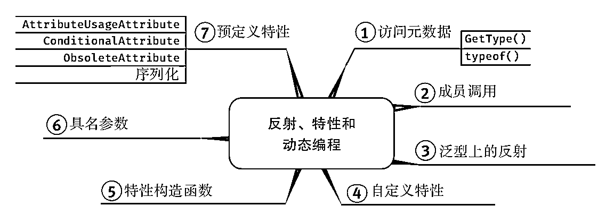

特性（attribute）的作用是在程序集中插入额外元数据，将元数据同编程构造（比如类、方法或者属性）关联。本章讨论框架内建特性的细节，并讨论如何创建自定义特性。要使用自定义特性就必须识别它们。这是通过反射（reflection）来实现的。本章首先讨论反射，其中包括如何用它在运行时实现动态绑定——依据的是编译时按成员名称（或元数据）的成员调用。像代码生成器这样的工具会频繁用到反射。此外，在执行时调用目标未知的情况下，也要用到反射。

本章最后讨论了动态编程，这是 C# 4.0 新增的功能，可利用它简化对动态数据的处理（这种动态数据要求执行时而非编译时绑定）。

## 18.1　反射

可利用反射做下面这些事情。

·访问程序集中类型的元数据。其中包括像完整类型名和成员名这样的构造，以及对一个构造进行修饰的任何特性。

·使用元数据在运行时动态调用类型的成员，而不是使用编译时绑定。

反射 是指对程序集中的元数据进行检查的过程。以前当代码编译成一种机器语言时，关于代码的所有元数据（比如类型和方法名）都会被丢弃。相反，当 C#编译成 CIL 时，它会维持关于代码的大部分元数据。此外，可利用反射枚举程序集中的所有类型，找出满足特定条件的那些。我们通过 System.Type 的实例来访问类型的元数据，该对象包含了对类型实例的成员进行枚举的方法。此外，可在被检查类型的特定对象上调用那些成员。

人们基于反射发展出了一系列前所未有的编程模式。例如，反射允许枚举程序集中的所有类型及其成员。可在此过程中创建对程序集 API 进行编档所需的存根（stub）。然后，可将通过反射获取的元数据与通过 XML 注释（使用/doc 开关）创建的 XML 文档合并，从而创建 API 文档。类似地，程序员可利用反射元数据来生成代码，从而将业务对象（business object）持久化（序列化）到数据库中。可在显示对象集合的列表控件中使用反射。基于该集合，列表控件可利用反射来遍历集合中的一个对象的所有属性，并在列表中为每个属性都定义一个列。此外，通过调用每个对象的每个属性，列表控件可利用对象中包含的数据来填充每一行和每一列——即使对象的数据类型在编译时未知。

Microsoft.NET Framework 所提供的 XmlSerializer、ValueType 和 DataBinder 类也在其部分实现中利用了反射技术。

### 18.1.1　使用 System.Type 访问元数据

读取类型的元数据，关键在于获得 System.Type 的一个实例，它代表了目标类型实例。System.Type 提供了获取类型信息的所有方法。可用它回答以下问题：

·类型的名称是什么（Type.Name）？

·类型是 public 的吗（Type.IsPublic）？

·类型的基类型是什么（Type.BaseType）？

·类型支持任何接口吗（Type.GetInterfaces()）？

·类型在哪个程序集中定义（Type.Assembly）？

·类型的属性、方法、字段是什么（Type.GetProperties()、Type.GetMethods()、Type.GetFields()等）？

·都有什么特性在修饰一个类型（Type.GetCustomAttributes()）？

还有其他成员未能一一列出，但总而言之，它们都提供了与特定类型有关的信息。很明显，现在的关键是获得对类型的 Type 对象的引用。主要通过 object.GetType()和 typeof()来达到这个目的。

注意，GetMethods()调用不能返回扩展方法，扩展方法只能作为实现类型的静态成员使用。

1.GetType() 

object 包含一个 GetType()成员。因此所有类型都包含该方法。调用 GetType()可获得与原始对象对应的 System.Type 实例。代码清单 18.1 对此进行了演示，它使用来自 DateTime 的一个 Type 实例。输出 18.1 展示了结果。

代码清单 18.1　使用 Type.GetProperties()获取对象的 public 属性

```powershell
$dateTime = [DateTime]::new()
$type = $dateTime.GetType()
foreach ($property in $type.GetProperties()) {
    Write-Host $property.Name
}
```

输出 18.1


程序在调用 GetType()后遍历 Type.GetProperties()返回的每个 System.Reflection.PropertyInfo 实例并显示属性名。成功调用 GetType()的关键在于获得一个对象实例。但有时这样的实例无法获得。例如，静态类无法实例化，无法调用 GetType()。

2.typeof() 

获得 Type 对象的另一个办法是使用 typeof 表达式。typeof 在编译时绑定到特定的 Type 实例，并直接获取类型作为参数。泛型类型是一个例外，因为泛型类型的具体类型信息需要在运行时才能确定。代码清单 18.2 演示了如何为 Enum.Parse()使用 typeof。

代码清单 18.2　使用 typeof()创建 System.Type 实例

```powershell
[System.Diagnostics.ThreadPriorityLevel] $priority =
    [System.Enum]::Parse(
        [System.Diagnostics.ThreadPriorityLevel], 'Idle')
```

Enum.Parse()获取标识了一个枚举的 Type 对象，然后将一个字符串转换成特定的枚举值。在本例中，它将"Idle"转换成 System.Diagnostics.ThreadPriorityLevel.Idle。

类似地，下一节的代码清单 18.3 在 CompareTo(object obj)方法中使用 typeof 表达式验证 obj 参数的类型确实符合预期：

```powershell
if ($obj.GetType() -ne [Contact]) {
    # ...
}
```

typeof 表达式在编译时求值，使一次类型比较（例如和 GetType()调用返回的类型比较）能判断对象是否具有希望的类型。

### 18.1.2　成员调用

反射并非仅可用于获取元数据，还可以用于动态调用它引用的成员。假定现在定义一个类来代表应用程序的命令行，并把它命名为 CommandLineInfo^( [\[1\]](part0154.xhtml#ch1_back) ) 。对于这个类来说，最困难的地方在于如何在类中填充启动应用程序时的实际命令行数据。但利用反射，可将命令行选项映射到属性名，并在运行时动态设置属性。代码清单 18.3 对此进行了演示。

代码清单 18.3　动态调用成员

```powershell
using namespace System.Diagnostics

class CommandLineInfo {
    [bool] $Help
    [string] $Out
    [ProcessPriorityClass] $Priority = [ProcessPriorityClass]::Normal
}

# 将命令行选项与属性名匹配，并在运行时动态赋值
class CommandLineHandler {

    static [void] Parse([string[]] $args, [object] $commandLine) {
        $errorMessage = $null
        if (-not [CommandLineHandler]::TryParse($args, $commandLine, [ref] $errorMessage)) {
            throw [System.InvalidOperationException]::new($errorMessage)
        }
    }

    static [bool] TryParse([string[]] $args, [object] $commandLine,
        [ref] [string] $errorMessage) {
        $success = $false
        $errorMessage.Value = $null
        foreach ($arg in $args) {
            if ($arg[0] -eq '/' -or $arg[0] -eq '-') {
                # 去除选项前的斜杠/短横线
                $optionParts = $arg -split ':', 2
                $option = $optionParts[0].Remove(0, 1)

                $property = $commandLine.GetType().GetProperty(
                    $option,
                    [System.Reflection.BindingFlags]::IgnoreCase -bor
                    [System.Reflection.BindingFlags]::Instance -bor
                    [System.Reflection.BindingFlags]::Public)

                if ($null -ne $property) {
                    if ($property.PropertyType -eq [bool]) {
                        # 最后一个参数用于处理索引器
                        $property.SetValue($commandLine, $true, $null)
                        $success = $true
                    }
                    elseif ($property.PropertyType -eq [string]) {
                        $property.SetValue($commandLine, $optionParts[1], $null)
                        $success = $true
                    }
                    elseif ($property.PropertyType -eq [ProcessPriorityClass]) {
                        try {
                            $property.SetValue(
                                $commandLine,
                                [Enum]::Parse([ProcessPriorityClass], $optionParts[1], $true),
                                $null)
                            $success = $true
                        }
                        catch [ArgumentException] {
                            $success = $false
                            $errorMessage.Value =
                                "The option '$($optionParts[1])' is invalid for '$option'"
                        }
                    }
                    else {
                        $success = $false
                        $errorMessage.Value =
                            "Data type '$($property.PropertyType)' on $($commandLine.GetType()) is not supported."
                    }
                }
                else {
                    $success = $false
                    $errorMessage.Value = "option '$option' is not supported."
                }
            }
        }
        return $success
    }

    static [void] DisplayHelp() {
        # 显示命令行帮助
        Write-Host @"
Compress.exe /Out:<filename> /Help
             /Priority:RealTime|High|AboveNormal|Normal|BelowNormal|Idle
"@
    }
}

$commandLine = [CommandLineInfo]::new()
$errorMessage = $null
if (-not [CommandLineHandler]::TryParse($args, $commandLine, [ref] $errorMessage)) {
    Write-Host $errorMessage
    [CommandLineHandler]::DisplayHelp()
}

if ($commandLine.Help) {
    [CommandLineHandler]::DisplayHelp()
}
elseif ($commandLine.Priority -ne [ProcessPriorityClass]::Normal) {
    # 更改线程优先级
}
```

PowerShell 类中的成员在脚本内可见，可近似对应原例中嵌套在 `Program` 中的 private 类。反射的 `GetProperty()`/`SetValue()` 依然可以访问它，这正是本节要演示的行为。

虽然程序很长，但代码结构是相当简单的。Main()首先实例化一个 CommandLineInfo 类。这个类型专门用来包含当前程序的命令行数据。每个属性都对应程序的一个命令行选项，具体的命令行如输出 18.2 所示。

输出 18.2


CommandLineInfo 对象被传给 CommandLineHandler 的 TryParse()方法。该方法首先枚举每个选项，并分离出选项名（比如 Help 或 Out）。确定名称后，代码在 Command-LineInfo 对象上执行反射，查找同名的一个实例属性。找到属性就通过一个 SetValue()调用并指定与属性类型对应的数据来完成对属性的赋值。SetValue()的参数包括要设置值的对象、新值以及一个额外的 index 参数（除非属性是索引器，否则该参数为 null）。上述代码能处理三种属性类型：bool、string 和枚举。在枚举的情况下，要解析选项值，并将文本的枚举等价值赋给属性。如 TryParse()调用成功，方法会退出，用来自命令行的数据初始化 CommandLineInfo 对象。

有趣的是，虽然 CommandLineInfo 是嵌套在 Program 中的一个 private 类，但 Command-LineHandler 在它上面执行反射是没有任何问题的，甚至可以调用它的成员。换言之，只要设置了恰当的权限，反射就可绕过可访问性规则。例如，Out 是 private 的，TryParse()方法仍可向其赋值。考虑到这一点，CommandLineHandler 可转移到一个单独的程序集中，并在多个程序之间共享，每个程序都有它们自己的 Command LineInfo 类。

本例用 PropertyInfo.SetValue()调用 CommandLineInfo 的一个成员。Property-Info 还包含一个 GetValue()方法，用于从属性中获取数据。对于方法，则有一个 Method-Info 类可供利用，它提供了一个 Invoke()成员。MethodInfo 和 PropertyInfo 都从 MemberInfo 继承（虽然并非直接），如图 18.1 所示。

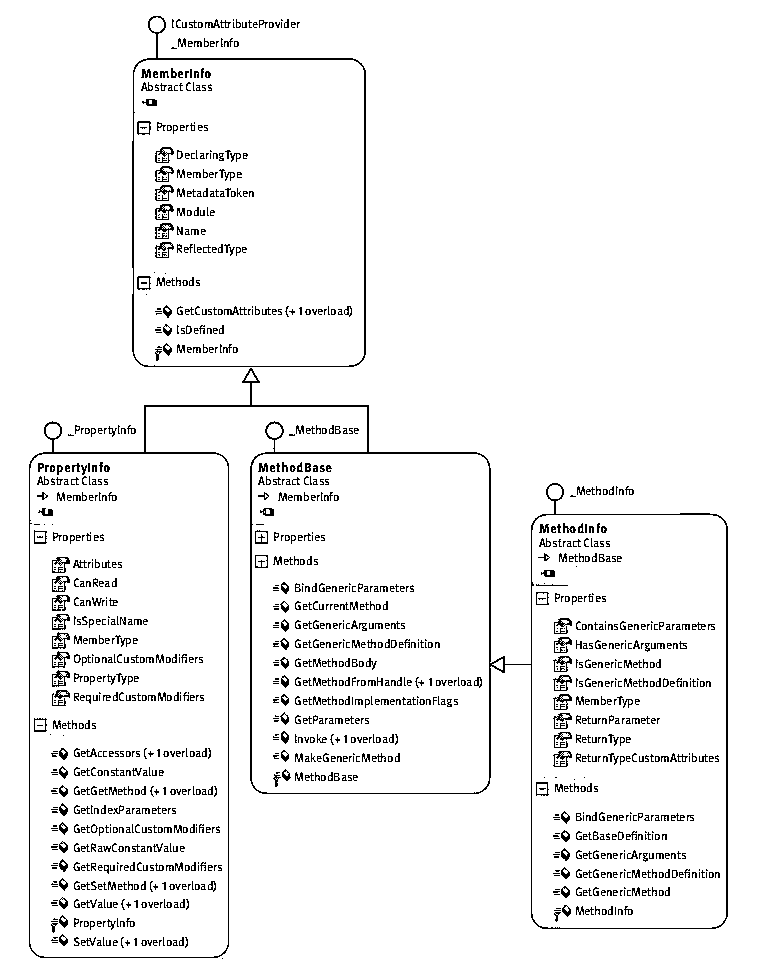

图 18.1　MemberInfo 的派生类

### 18.1.3　泛型类型上的反射

CLR 2.0 引入泛型类型后也带来了更多的反射功能。在泛型类型上执行运行时反射，可判断类或方法是否包含泛型类型，以及其中可能包含的任何类型参数/类型实参。

1.判断类型参数的类型 

我们曾对非泛型类型使用 typeof 操作符来获取 System.Type 的实例。类似地，也可对泛型类型或泛型方法中的类型参数使用 typeof 操作符。代码清单 18.4 对 Stack 类的 Add 方法的类型参数应用了 typeof 操作符。

代码清单 18.4　声明 Stack<T>类

```powershell
class Stack<T> {
    [void] Add([T] $i) {
        $t = [T]     # 等价于 C# 中的 typeof(T)
        # ...
    }
}
```

获得类型参数的 Type 对象实例以后，就可在类型参数上执行反射，从而判断它的行为，并针对具体类型来调整 Add 方法，使其能更有效地支持这种类型。

2.判断类或方法是否支持泛型 

CLR 2.0 的 System.Type 类新增了一系列方法来判断给定类型是否支持泛型参数和泛型实参。泛型实参是在实例化泛型类时提供的类型参数。如代码清单 18.5 所示，可查询 Type.ContainsGenericParameters 属性判断类或方法是否包含尚未设置的泛型参数。

代码清单 18.5　泛型反射

```powershell
$type = [System.Nullable``1]
Write-Host $type.ContainsGenericParameters
Write-Host $type.IsGenericType

$type = [System.Nullable[DateTime]]
Write-Host $type.ContainsGenericParameters
Write-Host $type.IsGenericType
```

`[System.Nullable``1]` 是 PowerShell 中开放泛型类型的写法（两个反引号加类型参数个数），对应 C# 的 `typeof(System.Nullable<>)`。

输出 18.3 展示了代码清单 18.5 的结果。

输出 18.3


Type.IsGenericType 是指示类型是否泛型的 Boolean 属性。

3.为泛型类或方法获取类型参数 

可调用 GetGenericArguments()方法从泛型类获取泛型实参（或类型参数）的列表。这样得到的是由 System.Type 实例构成的一个数组，这些实例的顺序就是它们作为泛型类的类型参数被声明的顺序。代码清单 18.6 反射一个泛型类型，获取它的每个类型参数。输出 18.4 展示了结果。

代码清单 18.6　泛型类型反射

```powershell
$s = [System.Collections.Generic.Stack[int]]::new()
$t = $s.GetType()
foreach ($type in $t.GetGenericArguments()) {
    Write-Host "Type parameter: $($type.FullName)"
}
```

输出 18.4


[\[1\]](part0154.xhtml#ch1) .NET Standard 1.6 添加了 CommandLineUtils NuGet 包来提供命令行解析机制。

## 18.2　nameof 操作符

第十一章简单介绍了 nameof 操作符，当时是用它在参数异常中提供参数名：

```powershell
throw [System.ArgumentException]::new(
    'The argument did not represent a digit', 'textDigit')
```

C# 6.0 引入的这个上下文关键字生成一个常量字符串来包含被指定为实参的任何程序元素的非限定名称。本例的 textDigit 是方法实参，所以 nameof(textDigit)返回"textDigit"（因为这个行动在编译时发生，所以 nameof 从技术上说不是反射。在这里介绍它是因为它最终接收的是有关程序集及其结构的数据）。

你可能好奇为什么要用 nameof(textDigit)而不是简单地写"textDigit"（尤其是后者似乎更容易看懂）。有两方面的好处：

·C#编译器确保 nameof 操作符的实参是有效程序元素。这样如果程序元素名称发生变化，或者出现拼写错误，编译时就能知道出错。

·相较于字符串字面值，IDE 工具使用 nameof 操作符能工作得更好。例如，“查找所有引用”工具能找到 nameof 表达式中提到的程序元素，在字符串字面值中就不行。自动重命名重构也能工作得更好。

在前面的代码中，nameof(textDigit)生成的是参数名，但它实际支持任何程序元素。例如，代码清单 18.7 用 nameof 将属性名传给 INotifyPropertyChanged.Property-Changed。

代码清单 18.7　动态调用成员

```powershell
using namespace System.ComponentModel

class Person : System.ComponentModel.INotifyPropertyChanged {
    [System.ComponentModel.PropertyChangedEventHandler] $PropertyChanged

    Person([string] $name) { $this.Name = $name }

    hidden [string] $_Name = [string]::Empty

    [string] Name {
        get { return $this._Name }
        set {
            if ($this._Name -ne $value) {
                $this._Name = $value
                # 使用 C# 6.0 的条件空引用等价写法
                if ($null -ne $this.PropertyChanged) {
                    $this.PropertyChanged.Invoke(
                        $this,
                        [System.ComponentModel.PropertyChangedEventArgs]::new('Name'))
                }
            }
        }
    }
}
```

PowerShell 没有 `nameof` 运算符，原代码 `nameof(Name)` 生成常量字符串 `"Name"`，此处直接传入同一字符串。

注意无论只提供非限定名称 Name（因其在作用域中），还是使用完全（或部分）限定名称 Person.Name，结果都是最后一个标识符（Person.Name 就只取 Name）。现在仍然可用 C# 5.0 的 CallerMemberName 参数特性来获取属性名，详情参见[`t.cn/Ew4X3Pw`](http://t.cn/Ew4X3Pw) 。

## 18.3　特性

详细讨论特性 （attribute）前，先来研究一个演示其用途的例子。代码清单 18.3 的 Command-LineHandler 例子根据与属性名匹配的命令行选项来动态设置类的属性。但假如命令行选项是无效属性名，这个办法就失效了。例如，/?就无法被支持。另外，也没有办法指出选项是必须还是可选。

特性完美解决了该问题，它不依赖于选项名与属性名的完全匹配。可利用特性指定与被修饰的构造（本例就是命令行选项）有关的额外元数据。可用特性将一个属性修饰为 Required（必须），并提供/?选项别名。换言之，特性是将额外数据关联到属性（以及其他构造）的一种方式。

特性要放到所修饰构造前的一对方括号中。例如，代码清单 18.8 修改 Command-LineInfo 类来包含特性。

代码清单 18.8　用特性修饰属性

```powershell
class CommandLineInfo {
    [CommandLineSwitchAlias('?')]
    [bool] $Help

    [CommandLineSwitchRequired]
    [string] $Out

    [System.Diagnostics.ProcessPriorityClass] $Priority =
        [System.Diagnostics.ProcessPriorityClass]::Normal
}
```

在代码清单 18.8 中，Help 和 Out 属性均用特性进行了修饰。这些特性的目的是允许使用别名/?来取代/Help，以及指出/Out 是必需的参数。思路是从 CommandLineHandler.TryParse()方法中启用对选项别名的支持。另外，如解析成功，可检查是否指定了所有必需的开关。

在同一构造上合并多个特性有两个办法。既可在同一对方括号中以逗号分隔多个特性，也可将每个特性放在它自己的一对方括号中，如代码清单 18.9 所示。

代码清单 18.9　用多个特性来修饰一个属性

```powershell
# 每个特性各占一对方括号
[CommandLineSwitchRequired]
[CommandLineSwitchAlias('FileName')]
[string] $Out

# 多个特性放在同一对方括号中，以逗号分隔
[CommandLineSwitchRequired, CommandLineSwitchAlias('FileName')]
[string] $Out
```

除了修饰属性，特性还可修饰程序集、类、构造函数、委托、枚举、事件、字段、泛型参数、接口、方法、模块、参数、返回值和结构。大多数构造都可以像代码清单 18.9 那样使用方括号语法来应用特性。但该语法不适用于返回值、程序集和模块。

程序集的特性用于添加有关程序集的额外元数据。例如，Visual Studio 的“.NET Framework 项目向导”（该向导不支持.NET Core 生成的项目）会生成一个 AssemblyInfo.cs 文件，其中包含与程序集有关的大量特性。代码清单 18.10 展示了该文件的一个例子。

代码清单 18.10　AssemblyInfo.cs 中保存的程序集特性

```powershell
using namespace System.Reflection
using namespace System.Runtime.CompilerServices
using namespace System.Runtime.InteropServices

# 程序集的常规信息由以下特性控制。
# 修改这些特性值即可修改与程序集关联的信息。
[assembly: AssemblyTitle('CompressionLibrary')]
[assembly: AssemblyDescription('')]
[assembly: AssemblyConfiguration('')]
[assembly: AssemblyCompany('IntelliTect')]
[assembly: AssemblyProduct('CompressionLibrary')]
[assembly: AssemblyCopyright('Copyright © IntelliTect 2020')]
[assembly: AssemblyTrademark('')]
[assembly: AssemblyCulture('')]

# 将 ComVisible 设为 false 可使此程序集中的类型对 COM 组件不可见。
# 如需从 COM 访问此程序集中的某个类型，请将该类型上的
# ComVisible 特性设为 true。
[assembly: ComVisible($false)]

# 以下 GUID 用于类型库的 ID（如果此项目对 COM 公开）。
[assembly: Guid('417a9609-24ae-4323-b1d6-cef0f87a42c3')]

# 程序集的版本信息由以下四个值构成：
#
#       主版本
#       次版本
#       生成号
#       修订号
#
# 可以指定所有值，也可以使用 '*' 默认生成号和修订号：
# [assembly: AssemblyVersion('1.0.*')]
[assembly: AssemblyFileVersion('1.0.0.0')]
```

PowerShell 脚本编译为程序集的方式与 C# 项目不同，`[assembly: ...]` 特性在 C# 的 AssemblyInfo.cs 中使用；在 PowerShell 中同样的元数据通常通过模块清单（`.psd1`）指定。此处保留原代码结构以说明程序集特性的写法。

assembly 特性定义类似公司、产品和程序集版本号的事物。类似地，作用于模块的特性需使用 module:前缀。assembly 和 module 特性的限制是它们必须位于 using 指令之后，任何命名空间或类声明之前。代码清单 18.10 的特性由 Visual Studio 项目向导生成，所有项目都应包括，以便使用与可执行文件或 DLL 的内容有关的信息来标记生成的二进制文件。

return 特性（如代码清单 18.11 所示）出现在方法声明之前，语法结构类型没有变。

代码清单 18.11　指定 return 特性

```powershell
[return: System.ComponentModel.Description(
    'Returns true if the object is in a valid state.')]
[bool] IsValid() {
    # ...
    return $true
}
```

除了 assembly:和 return:，C#还允许显式指定 module:、class:和 method:等目标，分别对应于修饰模块、类和方法的特性。但正如前面展示的那样，class:和 method:是可选的。

使用特性的一个方便之处在于，语言会自动照顾到特性的命名规范，也就是名称必须以 Attribute 结束。前面所有例子都没有主动添加该后缀——但事实上，所用的每个特性都符合命名规范。因为虽然在应用特性时可以使用全名（DescriptionAttribute、AssemblyVersionAttribute 等），但 C#规定后缀可选。应用 特性时通常都不添加该后缀。只有在自己定义特性或者以内联方式使用特性时才需添加后缀，例如 typeof(Description-Attribute)。

注意，基于.NET Core 的程序不使用 AssemblyInfo.cs 文件，而是直接在\*.CSPROJ 工程文件中指定程序集特性。代码清单 18.12 演示了在编译时通过\*.CSPROJ 文件向基于.NET Core 的程序集注入特性。

代码清单 18.12　添加自定义特性

```xml
<Project>
  <PropertyGroup>
    <Company>Addison Wesley</Company>
    <Copyright>Copyright © Addison Wesley 2020</Copyright>
    <Product>Essential C# 8.0</Product>
    <Version>8.0</Version>
  </PropertyGroup>
</Project>
```

这些特性将被转换到 CIL 编译结果中，如输出 18.5 所示。

输出 18.5

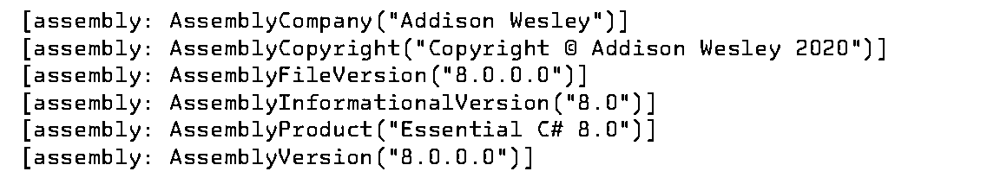

设计规范

·要向有公共类型的程序集应用 AssemblyVersionAttribute。

·考虑应用 AssemblyFileVersionAttribute 和 AssemblyCopyrightAttribute 以提供有关程序集的附加信息。

·要应用以下程序集信息属性：

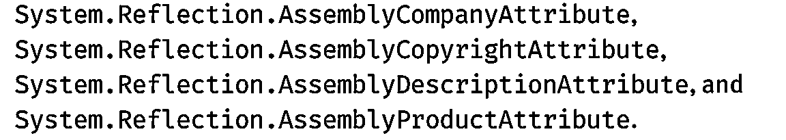

### 18.3.1　自定义特性

很容易创建自定义特性。特性是对象，所以定义特性要定义类。从 System.Attribute 派生后，一个普通的类就变成特性。代码清单 18.13 创建一个 CommandLineSwitchRequire-dAttribute 类。

代码清单 18.13　定义自定义特性

```powershell
class CommandLineSwitchRequiredAttribute : System.Attribute {
}
```

有了这个简单的定义之后，就可像代码清单 18.8 演示的那样使用该特性。但目前还没有代码与这个特性对应。所以，应用了该特性的 Out 属性暂时无法影响命令行解析。

设计规范

·要为自定义特性类添加 Attribute 后缀。

### 18.3.2　查找特性

除了提供属性来返回类型成员，Type 还提供了一些方法来获取对类型进行修饰的特性。类似地，所有反射类型（比如 PropertyInfo 和 MethodInfo）都包含成员来获取对类型进行修饰的特性列表。代码清单 18.14 定义方法来返回命令行上遗漏的、但必须提供的开关的一个列表。

代码清单 18.14　获取自定义特性

```powershell
using namespace System.Collections.Specialized
using namespace System.Reflection

class CommandLineSwitchRequiredAttribute : System.Attribute {

    static [string[]] GetMissingRequiredOptions([object] $commandLine) {
        $missingOptions = [System.Collections.Generic.List[string]]::new()
        $properties = $commandLine.GetType().GetProperties()
        foreach ($property in $properties) {
            $attributes = $property.GetCustomAttributes(
                [CommandLineSwitchRequiredAttribute], $false)
            if ($attributes.Length -gt 0 -and
                $null -eq $property.GetValue($commandLine, $null)) {
                $missingOptions.Add($property.Name)
            }
        }
        return $missingOptions.ToArray()
    }
}
```

用于查找特性的代码很简单。给定一个 PropertyInfo 对象（通过反射来获取），调用 GetCustomAttributes()，指定要查找的特性，并指定是否检查任何重载的方法。另外，也可调用 GetCustomAttributes()方法而不指定特性类型，从而返回所有特性。

虽然可将查找 CommandLineSwitchRequiredAttribute 特性的代码直接放到 Command-LineHandler 的代码中，但为了获得更好的对象封装，应将代码放到 CommandLineSwitc-hRequiredAttribute 类自身中。这是自定义特性的常见模式。对于放置查找特性的代码来说，还有什么地方比特性类的静态方法中更好呢？

### 18.3.3　使用构造函数初始化特性

调用 GetCustomAttributes()返回的是一个 object 数组，该数组能成功转型为 Attribute 数组。因为本例的特性没有任何实例成员，所以在返回的特性中，唯一提供的元数据信息就是它是否出现。但特性还可封装数据。代码清单 18.15 定义一个 Command-LineAliasAttribute 特性。该自定义特性用于为命令行选项提供别名。例如，既可输入/Help，也可输入缩写/?。类似地，可将/S 指定为/Subfolders 的别名，指示命令遍历所有子目录。

代码清单 18.15　提供特性构造函数

```powershell
class CommandLineSwitchAliasAttribute : System.Attribute {
    CommandLineSwitchAliasAttribute([string] $alias) {
        $this.Alias = $alias
    }

    [string] $Alias
}
```

```powershell
class CommandLineInfo {
    [CommandLineSwitchAlias('?')]
    [bool] $Help
}
```

支持该功能需为特性提供一个构造函数。具体地说，针对别名，需提供构造函数来获取一个 string 参数。类似地，如希望允许多个别名，构造函数要获取 params string 数组作为参数。

向某个构造应用特性时，只有常量值和 typeof()表达式才允许作为实参。这是为了确保它们能序列化到最终的 CIL 中。这意味着特性构造函数应要求恰当类型的参数。例如，提供构造函数来获取 System.DateTime 类型的实参没有多大意义，因为 C#没有 System.DateTime 常量。

从 PropertyInfo.GetCustomAttributes()返回的对象会使用指定的构造函数实参来初始化，如代码清单 18.16 所示。

代码清单 18.16　获取特性实例并检查其初始化

```powershell
$property = [CommandLineInfo].GetProperty('Help')
$attribute = [CommandLineSwitchAliasAttribute]$property.GetCustomAttribute(
    [CommandLineSwitchAliasAttribute], $false)
if ($null -ne $attribute -and $attribute.Alias -eq '?') {
    Write-Host 'Help(?)'
}
```

PowerShell 没有 C# 的 `?.` 条件访问运算符，因此这里写成显式的空值检查。

除此之外，如代码清单 18.17 和代码清单 18.18 所示，可在 CommandLineAliasAttribute 的 GetSwitches()方法中使用类似的代码返回由所有开关（包括来自属性名的那些）构成的一个字典集合，将每个名称同命令行对象的对应特性关联。

代码清单 18.17　获取自定义特性实例

```powershell
using namespace System.Reflection

class CommandLineSwitchAliasAttribute : System.Attribute {
    CommandLineSwitchAliasAttribute([string] $alias) {
        $this.Alias = $alias
    }

    [string] $Alias

    static [System.Collections.Generic.Dictionary[string, PropertyInfo]] GetSwitches(
        [object] $commandLine) {

        $options = [System.Collections.Generic.Dictionary[string, PropertyInfo]]::new()
        $properties = $commandLine.GetType().GetProperties(
            [BindingFlags]::Public -bor [BindingFlags]::Instance)

        foreach ($property in $properties) {
            $options.Add($property.Name, $property)

            $attributes = $property.GetCustomAttributes(
                [CommandLineSwitchAliasAttribute], $false)
            foreach ($attribute in $attributes) {
                $options.Add($attribute.Alias.ToLower(), $property)
            }
        }
        return $options
    }
}
```

代码清单 18.18　更新 CommandLineHandler.TryParse()以处理别名

```powershell
using namespace System.Reflection

class CommandLineHandler {

    static [bool] TryParse([string[]] $args, [object] $commandLine,
        [ref] [string] $errorMessage) {

        $success = $false
        $errorMessage.Value = $null
        $options = [CommandLineSwitchAliasAttribute]::GetSwitches($commandLine)

        foreach ($arg in $args) {
            if ($arg[0] -eq '/' -or $arg[0] -eq '-') {
                $optionParts = $arg -split ':', 2
                $option = $optionParts[0].Remove(0, 1).ToLower()

                $property = $null
                if ($options.TryGetValue($option, [ref] $property)) {
                    $success = [CommandLineHandler]::SetOption(
                        $commandLine, $property, $optionParts, [ref] $errorMessage)
                }
                else {
                    $success = $false
                    $errorMessage.Value = "option '$option' is not supported."
                }
            }
        }
        return $success
    }

    static [bool] SetOption([object] $commandLine, [PropertyInfo] $property,
        [string[]] $optionParts, [ref] [string] $errorMessage) {

        $success = $false
        if ($property.PropertyType -eq [bool]) {
            # 最后一个参数用于处理索引器
            $property.SetValue($commandLine, $true, $null)
            $success = $true
        }
        elseif ($optionParts.Length -lt 2 -or $optionParts[1] -eq '') {
            # 没有为该开关提供值
            $success = $false
            $errorMessage.Value = "You must specify the value for the '$($property.Name)' option."
        }
        elseif ($property.PropertyType -eq [string]) {
            $property.SetValue($commandLine, $optionParts[1], $null)
            $success = $true
        }
        elseif ($property.PropertyType -eq [System.Diagnostics.ProcessPriorityClass]) {
            $success = [CommandLineHandler]::TryParseEnumSwitch(
                $commandLine, $optionParts, $property, [ref] $errorMessage)
        }
        else {
            $success = $false
            $errorMessage.Value =
                "Data type '$($property.PropertyType.ToString())' on $($commandLine.GetType().ToString()) is not supported."
        }
        return $success
    }
}
```

设计规范

·如特性有必需的属性值，要提供只能取值的属性（没有公共赋值函数）。

·要为具有必需属性的特性提供构造函数参数来初始化属性。每个参数的名称都和对应的属性同名（大小写不同）。

·避免提供构造函数参数来初始化和可选参数对应的特性属性（因此还要避免重载自定义特性构造函数）。

### 18.3.4　System.AttributeUsageAttribute

大多数特性只修饰特定构造。例如，用 CommandLineOptionAttribute 修饰类或程序集没有意义，因为特性在这些上下文中是没有意义的。为避免不恰当地使用特性，可用 System.AttributeUsageAttribute 修饰自定义特性（是的，特性可以修饰自定义特性）。代码清单 18.19 演示了如何限制一个特性（即 CommandLineOptionAttribute）的使用。

代码清单 18.19　限制特性能修饰哪些构造

```powershell
[System.AttributeUsage([System.AttributeTargets]::Property)]
class CommandLineSwitchAliasAttribute : System.Attribute {
    CommandLineSwitchAliasAttribute([string] $alias) {
        $this.Alias = $alias
    }
    [string] $Alias
}
```

如代码清单 18.20 所示，只要特性被不恰当地使用，就会导致输出 18.6 所示的编译时错误。

代码清单 18.20　AttributeUsageAttribute 限制了能应用特性的目标

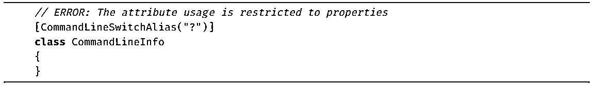

输出 18.6

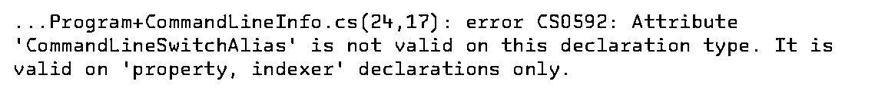

AttributeUsageAttribute 的构造函数获取一个 AttributesTargets 标志（flag）。该枚举提供了“运行时”允许特性修饰的所有可能目标的列表。例如，要允许用 CommandLine-SwitchAliasAttribute 修饰字段，应该像代码清单 18.21 那样更新 AttributeUsage-Attribute 类。

代码清单 18.21　使用 AttributeUsageAttribute 限制特性的使用

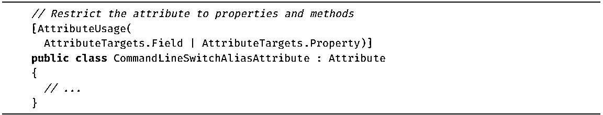

设计规范

·要向自定义特性应用 AttributeUsageAttribute 类。

### 18.3.5　具名参数

AttributeUsageAttribute 除了能限制特性所修饰的目标，还可指定是否允许特性在一个构造上进行多次拷贝。代码清单 18.22 展示了具体的语法。

代码清单 18.22　使用具名参数

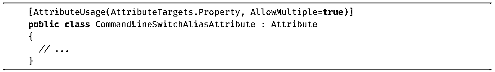

该语法有别于之前讨论的构造函数初始化语法。AllowMultiple 是具名参数 （named parameter），它类似于 C# 4.0 为可选方法参数引入的“具名参数”语法。具名参数在特性构造函数调用中设置特定的公共属性和字段——即使构造函数不包括对应参数。具名参数虽然可选，但它允许设置特性的额外实例数据，同时无须提供对应的构造函数参数。在本例中，AttributeUsageAttribute 包含一个名为 AllowMultiple 的公共成员。所以在使用特性时，可通过一次具名参数赋值来设置该成员。对具名参数的赋值只能放到构造函数的最后一部分进行。任何显式声明的构造函数参数都必须在它之前完成赋值。

有了具名参数后，就可直接对特性的数据进行赋值，而不必为特性属性的每一种组合都提供对应的构造函数。由于一个特性的许多属性都是可选的，所以具名参数许多时候都非常好用。

初学者主题：FlagsAttribute

第九章讲述了枚举，并用一个“高级主题”介绍了 FlagsAttribute。这是.NET Framework 所定义的一个特性，应用于包含了一组标志（flag）值的枚举。本“初学者主题”复习了 FlagsAttribute，先从代码清单 18.23 开始。

代码清单 18.23　使用 FlagsAttribute

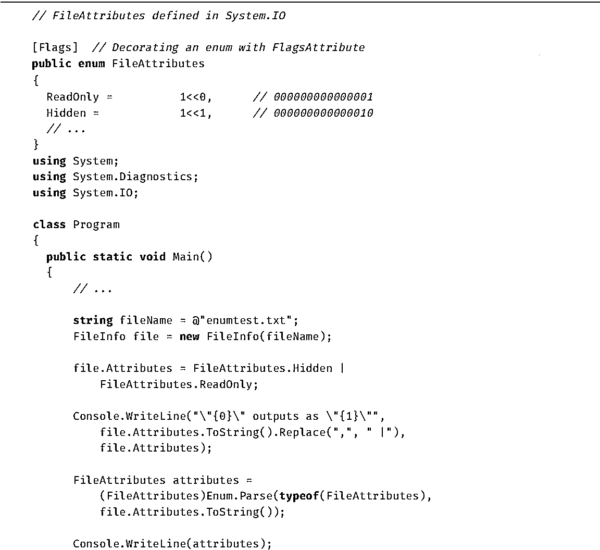

输出 18.7 展示了代码清单 18.23 的结果。

输出 18.7


作为标志的枚举值可组合使用。此外，它改变了 ToString()和 Parse()方法的行为。例如，为 FlagsAttribute 所修饰的枚举调用 ToString()，会为已设置的每个枚举标志输出对应字符串。在代码清单 18.23 中，file.Attributes.ToString()返回"ReadOnly, Hidden"。相反，如果没有 FlagsAttribute 标志，返回的就是 3。如果两个枚举值相同，则 ToString()返回第一个。然而，正如以前说过的那样，使用需谨慎，这样转换得到的文本是无法本地化的。

将值从字符串解析成枚举也是可行的，只要每个枚举值标识符都以一个逗号分隔即可。

需要注意的是，FlagsAttribute 并不会自动指派唯一的标志值，也不会检查它们是否具有唯一值。但还是必须显式指派每个枚举项的值。

1.预定义特性 

AttributeUsageAttribute 特性有一个特点是本书迄今为止创建的所有自定义特性都不具备的。该特性会影响编译器的行为，导致编译器有时会报告错误。和早先用于获取 CommandLineRequiredAttribute 和 CommandLineSwitchAliasAttribute 的反射代码不同，AttributeUsageAttribute 没有运行时代码，而是由编译器内建了对它的支持。

AttributeUsageAttribute 是预定义特性。这种特性不仅提供了与它们修饰的构造有关的额外元数据，而且“运行时”和编译器在利用这种特性的功能时，行为也有所不同。AttributeUsageAttribute、FlagsAttribute、ObsoleteAttribute 和 Conditional-Attribute 等都是预定义特性。它们都包含了只有 CIL 提供者（CIL provider）或编译器才能提供的特定行为。原因是没有可用的扩展点用于额外的非自定义特性，而自定义特性又是完全被动的。代码清单 18.23 演示了两个预定义特性，第十九章还会演示另外几个。

2.System.ConditionalAttribute 

在一个程序集中，System.Diagnostics.ConditionalAttribute 特性的行为有点儿像#if/#endif 预处理器标识符。但使用 System.Diagnostics.ConditionalAttribute 并不能从程序集中清除 CIL 代码。我们利用它为一个调用赋予无操作 （no-op）行为。换言之，使其成为一个什么都不做的指令。代码清单 18.24 演示了这个概念，输出 18.8 是结果。

代码清单 18.24　使用 System.ConditionalAttribute 清除调用

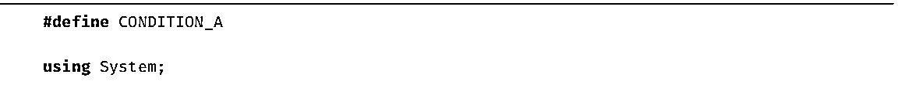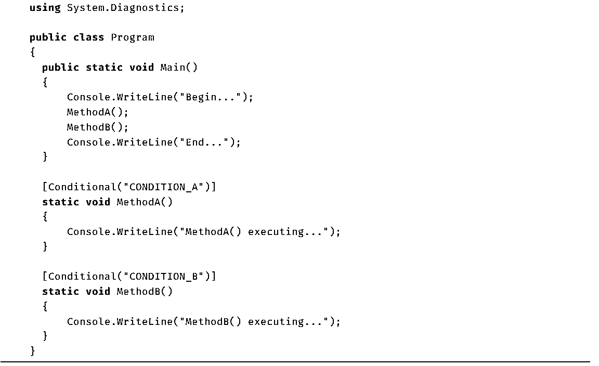

输出 18.8


本例定义了 CONDITION\_A，所以 MethodA()正常执行。但没有使用#define 或 csc.exe/ Define 选项来定义 CONDITION\_B。所以，在这个程序集中，对 Program.MethodB()的所有调用都会“什么都不做”。

从功能上讲，ConditionalAttribute 类似于用一对#if/#endif 把方法调用包围起来。但它的语法显得更清晰，因为开发者只需为目标方法添加 ConditionalAttribute 特性，无须对调用者本身进行任何修改。

C#编译器在编译时会注意到被调用方法上的特性设置，假定预处理器标识符存在，它就会清除对方法的任何调用。还要注意，ConditionalAttibute 不影响目标方法本身的已编译 CIL 代码（除了添加特性元数据）。ConditionalAttibute 会在编译时通过移除调用的方式来影响调用点。这进一步区分了跨程序集调用时的 ConditionalAttribute 和#if/#endif。由于被这个特性修饰的方法仍会进行编译并包含在目标程序集中，所以具体是否调用方法，不是取决于被调用者所在程序集中的预处理器标识符，而是取决于调用者所在程序集中的预处理器标识符。换言之，如创建第二个程序集并在其中定义 CONDITION\_B，那么第二个程序集中对 Program.MethodB()的任何调用都会执行。许多需要进行跟踪和测试的情形下，这都是一个好用的功能。事实上，对 System.Diagnostics.Trace 和 System.Diagnostics.Debug 的调用就是利用了这一点（ConditionalAttribute 和 TRACE/DEBUG 预处理器标识符配合使用）。

由于只要预处理器标识符没有定义，方法就不会执行，所以假如一个方法包含了 out 参数，或者返回类型不为 void，就不能使用 ConditionalAttribute，否则会造成编译时错误。之所以要进行这个限制，是因为如果不限制的话，在被这个特性修饰的方法中，有可能出现任何代码都不会执行的情况。这就不知道该将什么返回给调用者。类似地，属性不能用 ConditionalAttribute 修饰。ConditionalAttribute 的 AttributeUsage（参见上一节）设为 AttributeTargets.Class（自.NET Framework 2.0 起）和 AttributeTargets.Method。这允许你将该特性用于方法或类。但用于类时比较特殊，因为只允许为 System.Attribute 的派生类使用 ConditionalAttribute。

用 ConditionalAttribute 修饰自定义特性时，只有在调用程序集中定义了条件字符串的前提下，才能通过反射来获取该自定义特性。没有这样的条件字符串，就不能通过反射来查找自定义特性。

3.System.ObsoleteAttribute 

前面讲过，预定义特性会影响编译器和/或“运行时”的行为。ObsoleteAttribute 是特性影响编译器行为的另一个例子。ObsoleteAttribute 用于编制代码版本，向调用者指出一个特定的成员或类型已过时。代码清单 18.25 展示了一个例子。如输出 18.8 所示，一个成员在使用 ObsoleteAttribute 进行了修饰之后，对调用它的代码进行编译，会导致编译器显示一条警告（也可选择报错）。

代码清单 18.25　使用 ObsoleteAttribute

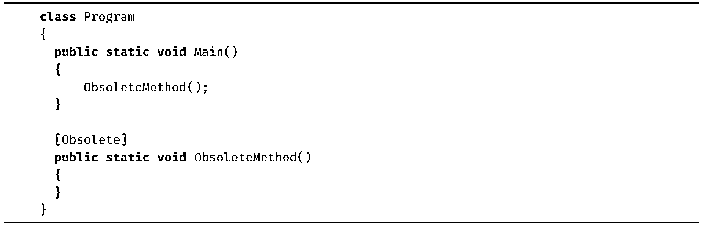

输出 18.9


本例的 ObsoleteAttribute 只是显示警告。但该特性还提供了另外两个构造函数。第一个是 ObsoleteAttribute(string message)，能在编译器生成的报告过时的消息上附加额外的消息参数。最好在消息中告诉用户用什么来替代已过时的代码。第二个构造函数是 bool error 参数，来指定是否强制将警告视为错误。

ObsoleteAttribute 允许第三方向开发者通知已过时的 API。警告（而不是错误）允许原来的 API 继续发挥作用，直到开发者更新其调用代码为止。

## 18.4　使用动态对象进行编程

随着动态对象在 C# 4.0 中的引入，许多编程情形都得到了简化，以前无法实现的一些编程情形现在也能实现了。从根本上说，使用动态对象进行编程，开发者可通过动态调度机制对设想的操作进行编码。“运行时”会在程序执行时对这个机制进行解析，而不是由编译器在编译时验证和绑定。

为什么要推出动态对象？从较高的级别上说，经常会有对象天生就不适合赋予一个静态类型。例子包括从 XML/CSV 文件、数据库表、Internet Explorer DOM 或者 COM 的 IDispatch 接口加载数据，或者调用用动态语言写的代码（比如调用 IronPython 对象中的代码）。C# 4.0 的动态对象提供了一个通用解决方案用于与“运行时”环境对话。这种对象在编译时不一定有定义好的结构。在 C# 4.0 的动态对象的初始实现中，提供了以下 4 个绑定方式。

（1）针对底层 CLR 类型使用反射。

（2）调用自定义 IDynamicMetaObjectProvider，它使一个 DynamicMetaObject 变得可用。

（3）通过 COM 的 IUnknown 和 IDispatch 接口来调用。

（4）调用由动态语言（比如 IronPython）定义的类型。

我们将讨论前两种方式。它们的基本原则也适用于余下的情况——COM 互操作性和动态语言互操作性。

### 18.4.1　使用 dynamic 调用反射

反射的关键功能之一就是动态查找和调用特定类型的成员。这要求在执行时识别成员名或其他特征，比如一个特性（参见代码清单 18.3）。但 C# 4.0 新增的动态对象提供了更简单的办法来通过反射调用成员。但该技术的限制在于，编译时需要知道成员名和签名（参数个数，以及指定的参数是否和签名类型兼容）。代码清单 18.26（输出 18.10）展示了一个例子。

代码清单 18.26　使用“反射”的动态编程

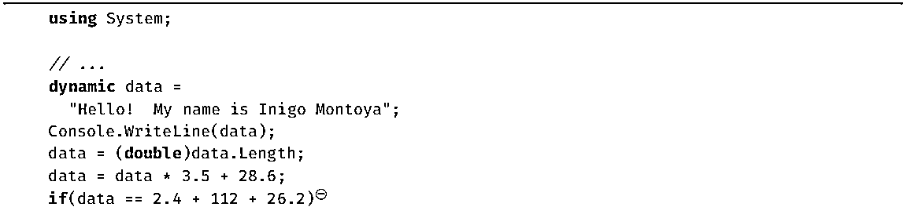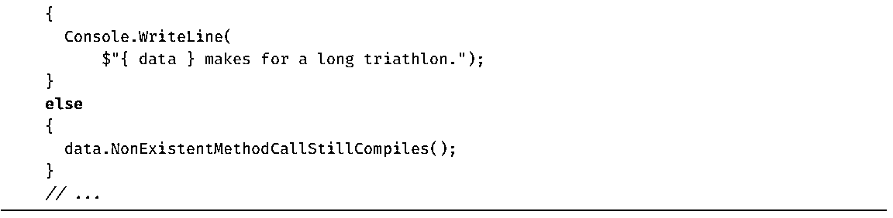

注①：铁人三项赛游泳、自行车和跑步部分的距离（以英里为单位）。

输出 18.10


本例子不是用显式的代码判断对象类型，查找特定 MemberInfo 实例并调用它。相反，data 声明为 dynamic 类型，并直接在它上面调用方法。编译时不会检查指定成员是否可用，甚至不会检查 dynamic 对象的基础类型是什么。所以，只要语法有效，编译时就可发出任何调用。在编译时，是否有一个对应的成员是无关紧要的。

但类型安全没有被完全放弃。对于标准 CLR 类型（比如代码清单 18.26 使用的那些），一般在编译时为非 dynamic 类型调用的类型检查器会在执行时为 dynamic 类型调用。因此，执行时发现事实上没有这个成员，调用该成员就会抛出一个 Microsoft.CSharp.Runtime-Binder.RuntimeBinderException。

注意，这个技术不如本章早些时候描述的反射技术灵活，虽然它的 API 无疑要简单一些。使用动态对象时，一个关键区别在于需要在编译时识别签名，而不是在运行时再判断这些东西（比如成员名），就像之前解析命令行实参时所做的那样。

### 18.4.2　dynamic 的原则和行为

代码清单 18.26 和之前的几段描述揭示了 dynamic 数据类型的几个特征：

·dynamic 是通知编译器生成代码的指令

dynamic 涉及一个解释机制。当“运行时”遇到一个 dynamic 调用时，它可以将请求编译成 CIL，再调用新编译的调用（参见稍后的“高级主题：dynamic 揭秘”）。

将类型指定成 dynamic，相当于从概念上“包装”（wrap）了原始类型。这样便不会发生编译时验证。此外，在运行时调用一个成员时，“包装器”（wrapper）会解释调用，并相应地调度（或拒绝）它。在 dynamic 对象上调用 GetType()可揭示出 dynamic 实例的基础类型——并不是返回 dynamic 类型。

·任何能转换成 object 的类型都能转换成 dynamic

代码清单 18.26 成功将一个值类型（double）和一个引用类型（string）转型为 dynamic。事实上，所有类型都能成功转换成 dynamic 对象。存在从任何引用类型到 dynamic 的隐式转换。类似地，存在从值类型到 dynamic 的隐式转换（装箱转换）。此外，dynamic 到 dynamic 也存在隐式转换。这看起来可能很明显，但 dynamic 不是简单地将“指针”（地址）从一个位置拷贝到另一个位置，它要复杂得多。

·从 dynamic 到一个替代类型的成功转换要依赖基础类型的支持

从 dynamic 对象转换成标准 CLR 类型是显式转型，例如(double)data.Length。一点都不奇怪，如果目标类型是值类型，那么需要一次拆箱转换。如基础类型支持向目标类型的转换，对 dynamic 执行的转换也会成功。

·dynamic 类型的基础类型在每次赋值时都可能改变

隐式类型的变量（var）不能重新赋值成一个不同的类型。和它不同，dynamic 涉及一个解释机制，要先编译再执行基础类型的代码。所以，可将基础类型实例更换为一个完全不同的类型。这会造成另一个解释调用位置（interception call site），需在调用前编译它。

·验证基础类型上是否存在指定签名要推迟到运行时才进行——但至少会进行

以方法调用 data.NonExistentMethodCallStillCompiles()为例，编译器几乎不会验证 dynamic 类型是否真的存在这样的一个操作^( [\[1\]](part0157.xhtml#ch1_back) ) 。这个验证要等到代码执行时，由“运行时”执行。如代码永不执行，即使它的外层代码已经执行（比如 data.NonExistent-MethodCallStillCompiles()的情况），也不会发生验证和对成员的绑定。

·任何 dynamic 成员调用都返回 dynamic 对象

调用 dynamic 对象的任何成员都将返回一个 dynamic 对象。例如，data.ToString()会返回一个 dynamic 对象而不是基础的 string 类型。但在执行时，在 dynamic 对象上调用 GetType()会返回代表运行时类型的一个对象。

·指定成员在运行时不存在将抛出 Microsoft.CSharp.RuntimeBinder.Runtime-BinderException 异常

执行时试图调用一个成员，“运行时”会验证成员调用有效（例如，在反射的情况下，签名是类型兼容的）。如方法签名不兼容，“运行时”会抛出 Microsoft.CSharp.Runtime-Binder.RuntimeBinderException。

·用 dynamic 来实现的反射不支持扩展方法

和使用 System.Type 实现的反射一样，用 dynamic 实现的反射不支持扩展方法。仍然只有在实现类型（比如 System.Linq.Enumerable）上才可以调用扩展方法，不能直接在 dynamic 类型上调用。

·究其根本，dynamic 是一个 System.Object

由于任何对象都能成功转换成 dynamic，而 dynamic 能显式转换成一个不同的对象类型，因此 dynamic 在行为上就像 System.Object。类似于 System.Object，它甚至会为它的默认值返回 null（default(dynamic)），表明它是引用类型。dynamic 特殊的动态行为只在编译时出现，这个行为是将它同一个 System.Object 区分开的关键。

高级主题：dynamic 揭秘

ILDASM 揭示出在 CIL 中，dynamic 类型实际是一个 System.Object。事实上，如果没有任何调用，dynamic 类型的声明和 System.Object 没有区别。但一旦调用它的成员，区别就变得明显了。

为调用成员，编译器要声明 System.Runtime.CompilerServices.CallSite<T>类型的一个变量。T 视成员签名而变化。但即使简单如 ToString()这样的调用，也需实例化 CallSite<Func<CallSite,object,string>>类型。另外还会动态定义一个方法，该方法可通过参数 CallSite site，object dynamicTarget 和 string result 进行调用。其中，site 是调用点本身。dynamicTarget 是要在上面调用方法的 object，而 result 是 ToString()方法调用的基础类型的返回值。注意不是直接实例化 CallSite<Func<CallSite \_site, object dynamicTarget, string result>>，而是通过一个 Create()工厂方法来实例化它。这个方法接受一个 Microsoft.CSharp.RuntimeBinder.CSharpConvertBinder 类型的参数。在得到 CallSite<T>的一个实例后，最后一步是调用 CallSite<T>.Target()来调用实际的成员。

在执行时，框架会在幕后用“反射”来查找成员并验证签名是否匹配。然后，“运行时”生成一个表达式树，它代表由调用点定义的动态表达式。表达式树编译好后，就得到了和本来应由编译器生成的结果相似的 CIL。这些 CIL 代码在调用点缓存下来，并通过一个委托调用来实际地触发调用。由于 CIL 现已缓存于调用点，所以后续调用不会再产生反射和编译的开销。

### 18.4.3　为什么需要动态绑定

除了反射，还可定义动态调用的自定义类型。例如，假定需要通过动态调用来获取一个 XML 元素的值。可以不使用代码清单 18.27 的强类型语法，而是像代码清单 18.28 那样通过动态调用来调用 person.FirstName 和 person.LastName。

代码清单 18.27　不用 dynamic 在运行时绑定到 XML 元素

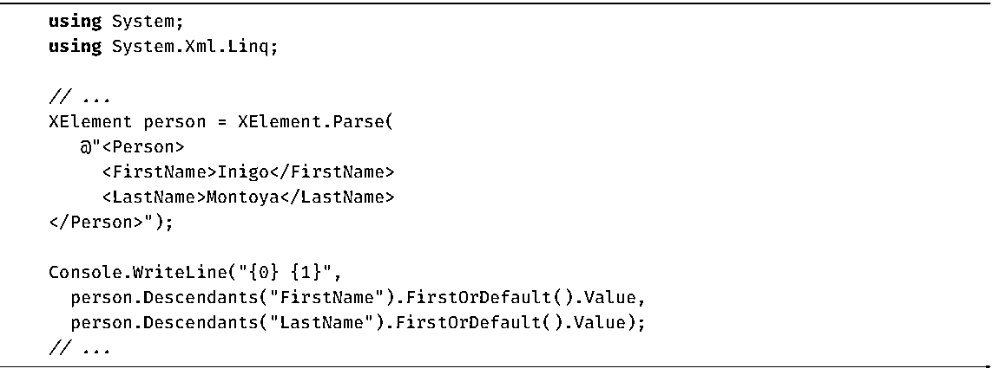

虽然代码清单 18.27 的代码看起来并不复杂，但和代码清单 18.28 相比就显得比较“难看”了。代码清单 18.28 使用动态类型的对象来达到和代码清单 18.27 一样的目的。

代码清单 18.28　使用 dynamic 在运行时绑定到 XML 元素

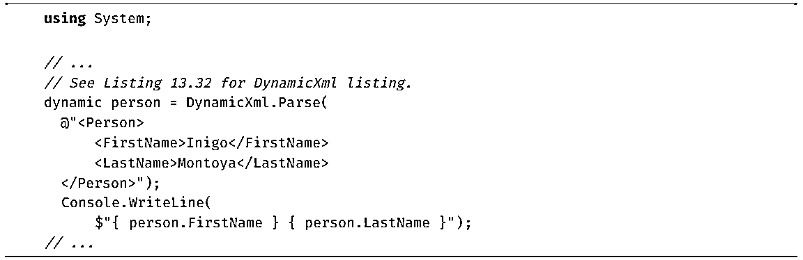

优势是明显的，但这是不是说动态编程优于静态编译呢？

### 18.4.4　比较静态编译和动态编程

代码清单 18.28 的功能和代码清单 18.27 一样，但有一个很重要的区别。代码清单 18.27 是完全静态类型的。也就是说，所有类型及其成员签名在编译时都得到了验证。方法名必须匹配，而且所有参数都要通过类型兼容性检查。这是 C#的一项关键特色，也是全书一直在强调的。

相反，代码清单 18.28 几乎没有静态类型的代码，person 变量是 dynamic 类型。所以，不会在编译时验证 person 是否真的有一个 FirstName 或 LastName 属性（或其他成员）。此外，在 IDE 中写代码时，没有“智能感知”功能可帮你判断 person 的任何成员。

类型变得不确定，似乎会造成功能的显著削弱。作为 C# 4.0 的新增功能，为什么 C#会允许出现这样的情况？

让我们再次研究代码清单 18.28。注意用于获取"FirstName"元素的调用：Element.Descendants("LastName").FirstOrDefault().Value。

在这个代码清单中，是用一个字符串（"LastName"）标识元素名。但编译时没有验证该字符串是否正确。如大小写和元素名不一致，或者名称存在一个空格，编译还是会成功——即使调用 Value 属性时会抛出一个 NullReferenceException。除此之外，编译器根本不会验证是否真的存在一个"FirstName"元素，如果不存在，则还是会抛出 NullReferenceException。换言之，虽然有编译时类型安全的好处，但在访问 XML 元素中存储的动态数据时，这种类型安全性没有多大优势。

在编译时对所获取元素的验证方面，代码清单 18.28 不见得比代码清单 18.27 更好。如发生大小写不匹配，或者不存在 FirstName 元素的情况，仍会抛出一个异常^( [\[2\]](part0157.xhtml#ch2_back) ) 。但将代码清单 18.28 用于访问名字的调用（person.FirstName）和代码清单 18.27 的调用进行比较，前者显然更简洁。

总之，某些情况下类型安全性不会（而且也许不能）进行特定检查。这时执行只在运行时验证的动态调用（而不是同时在编译时验证），代码会显得更易读、简洁。当然，如果能在编译时验证，静态类型的编程就是首选的，因为这时也许能选用一些易读、简洁的 API。但当它的作用不大的时候，就可利用 C# 4.0 的动态功能写更简单的代码，而不必刻意追求类型安全性。

### 18.4.5　实现自定义动态对象

代码清单 18.28 包含一个 DynamicXml.Parse(...)方法调用，它本质上是 DynamicXml 的一个工厂方法调用。DynamicXml 是自定义类型，而不是 CLR 框架的内建类型。但 DynamicXml 没有实现 FirstName 或 LastName 属性。实现这两个属性会破坏在执行时从 XML 文件获取数据的动态支持（我们的目的不是访问 XML 元素基于编译时的实现）。换言之，DynamicXml 不是用反射来访问它的成员，而是根据 XML 内容动态绑定到值。

定义自定义动态类型的关键是实现 System.Dynamic.IDynamicMetaObjectProvider 接口。但不必从头实现接口。相反，首选方案是从 System.Dynamic.DynamicObject 派生出自定义的动态类型。这样会为众多成员提供默认实现，你只需重写那些不合适的。代码清单 18.29 展示了完整的实现。

代码清单 18.29　实现自定义动态对象

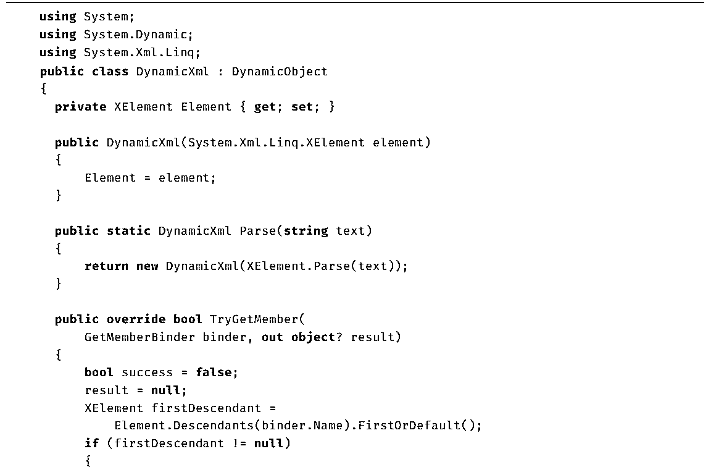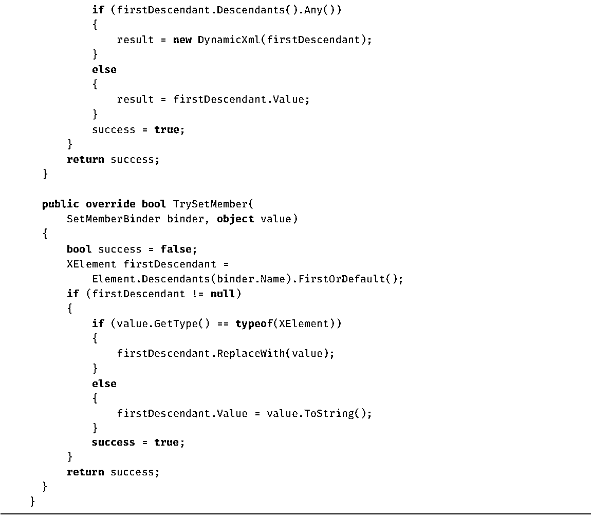

本例要实现的核心动态方法是 TryGetMember()和 TrySetMember()（假定还要对元素进行赋值）。实现这两个方法就可支持对动态取值和赋值属性的调用。实现起来还相当简单。首先检查包含的 XElement，查找和 binder.Name（要调用的成员名称）同名的一个元素。如存在一个对应的 XML 元素，就取回（或设置）值。如果元素存在，则返回值设为 true，否则设为 false。如返回值为 false，会立即导致“运行时”在进行动态成员调用的调用点处抛出一个 Microsoft.CSharp.RuntimeBinder.RuntimeBinderException。

如需其他动态调用，可利用 System.Dynamic.DynamicObject 支持的其他虚方法。代码清单 18.30 展示了所有可重写的成员。

代码清单 18.30　System.Dynamic.DynamicObject 的可重写成员

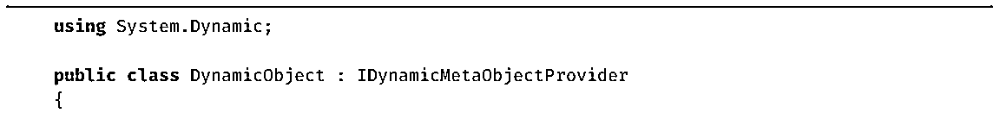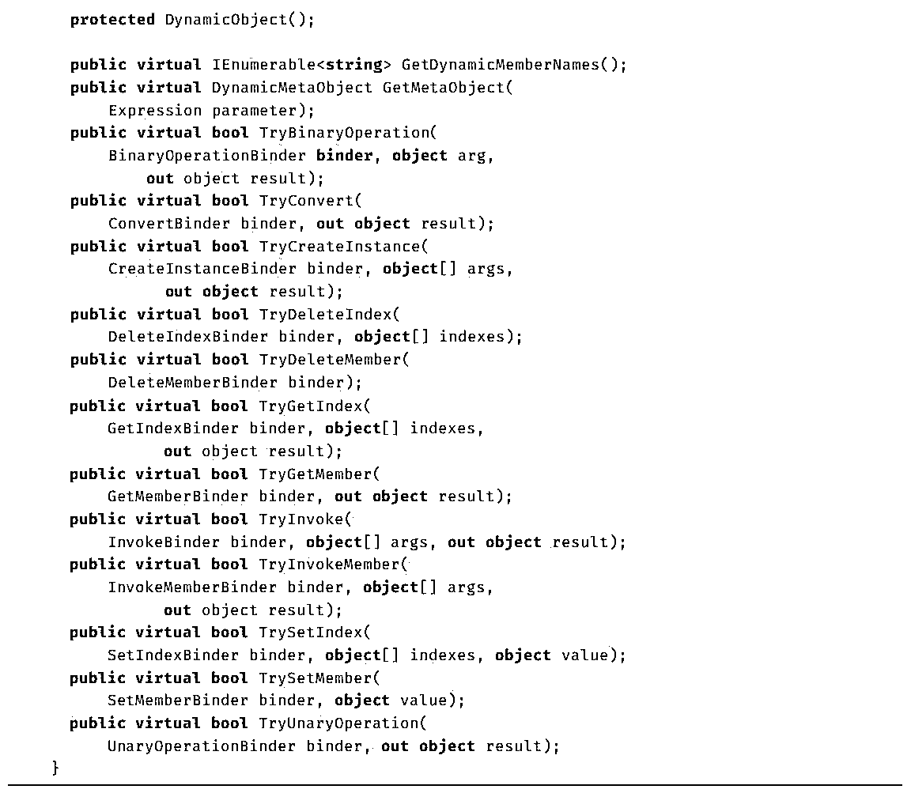

如代码清单 18.30 所示，几乎一切都有对应的成员实现——从转型和各种运算，一直到索引调用。此外，还有一个 GetDynamicMemberNames()方法用于获取所有可能的成员名。

[\[1\]](part0157.xhtml#ch1) 这个方法是作者杜撰的，实际并不存在，但仍然能通过编译。——译者注

[\[2\]](part0157.xhtml#ch2) 不能在 FirstName 属性调用中使用空格，但 XML 也不支持在元素名中使用空格。所以这个问题可以放到一边。

## 18.5　小结

本章讨论了如何利用反射来读取已编译成 CIL 的元数据。可利用反射执行所谓的晚期绑定，也就是在执行时而非编译时定义要调用的代码。虽然完全可以利用反射来部署一个动态系统，但相较于静态链接的（在编译时链接）、定义好的代码，它的速度要慢得多。因此，它更适合在开发工具中使用。

还可利用反射获取以特性的形式对各种构造进行修饰的附加元数据。通常，自定义特性是使用反射来查找的。可以定义自己的特性，将自选的附加元数据插入 CIL 中。然后在运行时获取这些元数据，并在编程逻辑中使用它们。

许多人都认为，正是特性的出现，才使“面向方面编程”（aspect-oriented programming）的概念变得清晰起来。这种编程模型使用像特性这样的构造来添加额外功能（术语叫横切关注点），平常只关注主要功能（术语叫主关注点）。C#要实现真正的“面向方面编程”尚需假以时日。但特性指明了一个清晰的方向，朝这个方向前进，可以在不损害语言稳定性的同时，享受各种各样的新功能。

本章最后讲解了从 C# 4.0 开始引入的功能——使用新的 dynamic 类型进行动态编程。这一节讨论了静态绑定在处理动态数据时存在的局限（不过，在 API 是强类型的前提下，静态绑定仍是首选）。

下一章将讨论多线程处理，届时会将特性用于线程同步。