# 第十九章　多线程概述

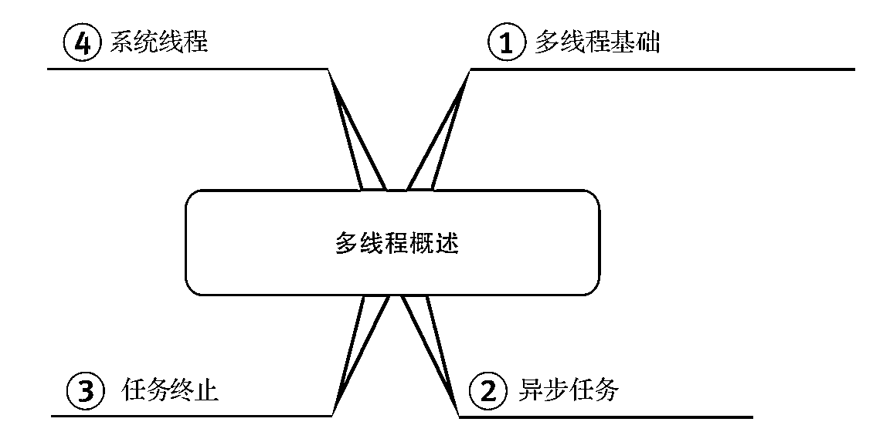

过去十年有两个重要趋势对软件开发产生了巨大影响。第一，不再通过时钟速度和晶体管密度来降低计算成本（如图 19.1 所示）。相反，现在是通过制造包含多 CPU（多核心）的硬件来降低成本。

第二，现在的计算会遇到各种延迟 。简单地说，延迟是获得结果所需的时间。延迟主要有两个原因。处理复杂的计算任务时产生处理器受限延迟 （Processor-bound latency）：假定一个计算需要执行 120 亿次算术运算，而总共的处理能力是每秒 60 亿次，那么从请求结果到获得结果至少有 2 秒钟的处理器受限延迟。相反，I/O 受限延迟 （I/O-bound latency）是从外部来源（如磁盘驱动器、Web 服务器等）获取数据所产生的延迟。任何计算要从远程 Web 服务器获取数据，至少都会产生相当于几百万个处理器周期的延迟。

这两种延迟为软件开发者带来了巨大的挑战。既然现在计算能力大增，如何在有效利用它们快速获得结果的同时不损害用户体验？如何防止创建不科学的 UI，在执行高延迟的操作时发生卡顿或冻结？另外，如何在多个处理器之间分配 CPU 受限的工作来缩短计算时间？

图 19.1　时钟速度发展历史

为保证 UI 响应迅速，同时高效利用 CPU，标准技术是写多线程 程序，“并行”执行多个计算。遗憾的是，多线程逻辑很难写好，我们将用四章的篇幅讨论多线程处理的困难性，以及如何使用高级抽象和新的语言功能来减轻负担。

在要讨论的高级抽象中，首先是随同.NET 4.0 发布的并行扩展库。它包含了两个基本组件：TPL （Task Parallel Library，任务并行库），我们将在本章介绍，以及 PLINQ （Parallel LINQ，并行 LINQ），我们将在第二十一章介绍。另一个高级抽象是 TAP （Task-based Asynchronous Pattern，基于任务的异步模式）以及配套的 C# 5.0（及更高版本）语言支持。

虽然强烈建议使用这些高级抽象，但本章仍会花一些篇幅讲解老版本.NET“运行时”支持的低级线程处理 API。此外，可从本书配套网站下载本书前几版（从 Essential C# 3.0 起）的多线程处理章节，网址是[`IntelliTect.com/EssentialCSharp`](http://IntelliTect.com/EssentialCSharp) 。如果你想完全理解多线程编程中的资源，而不需要更高的功能，你仍然可以访问那些材料。

本章首先为多线程编程新手提供一系列“初学者主题”。

## 19.1　多线程基础

初学者主题：多线程术语

多线程术语太多，容易混淆，所以在此先把它们定义好。

CPU （中央处理器）或者核心/内核 ^( [\[1\]](part0160.xhtml#ch1_back) ) 是实际执行程序的硬件单元。每台机器至少有一个 CPU，虽然多 CPU 机器也不少见。许多现代 CPU 都支持同时多线程 （Intel 称为超线程 ），使一个 CPU 能表现为多个“虚拟”CPU。

进程 （process）是某个程序当前正在执行的实例。操作系统的一项基本功能就是管理进程。每个进程都包含一个或多个线程。程序中可用 System.Diagnostics 命名空间的 Process 类的实例来访问进程。

在语句和表达式的级别上，C#编程本质上就是在描述控制流 （flow of control）。本书到目前为止一直假设程序仅一个“控制点”。可想象程序启动后，控制点像“光标”（cursor）一样进入 Main 方法，并随着各种条件、循环、方法调用等的执行在程序中移动。线程 （thread）就是这个控制点。System.Threading 命名空间包含用于处理线程（具体就是 System.Threading.Thread 类）的 API。

单线程 程序的进程仅包含一个线程。多线程 程序的进程则包含两个或更多线程。

在多线程程序中运行具有正确行为的代码，就说代码是线程安全 的。代码的线程处理模型 是指代码向调用者提出的一系列要求，只有满足这些要求才能保障线程安全。例如，许多类的线程处理模型都是“静态方法可从任意线程调用，但实例方法只能从分配实例的那个线程调用”。

任务 是可能出现高延迟的工作单元，作用是产生结果值或者希望的副作用。任务和线程的区别是：任务代表需要执行的一件工作，而线程代表做这件工作的工作者。任务的意义在于其副作用，由 Task 类的实例表示。生成给定类型的值的任务用 Task<T>类表示，后者从非泛型 Task 类型派生。它们都在 System.Threading.Tasks 命名空间中。

线程池 是多个线程的集合，通过一定逻辑决定如何为线程分配工作。有任务要执行时，它分配池中的一个工作者线程执行任务，并在任务结束后解除分配，从而使该线程在下次请求额外工作时可用。

初学者主题：多线程处理的目标和实现

多线程处理主要用于两个方面：实现多任务和解决延迟。

用户随随便便就会同时运行几十乃至上百个进程。可能一边编辑 PPT 和电子表格，一边在网上浏览、听音乐、接收即时通信和电子邮件通知，还不时看一看角落的小时钟。每个进程都在干活，谁都不是机器唯一关注的任务。这种多任务处理通常在进程级实现，但有时也需要在一个进程中进行这样的多任务处理。

考虑到本书的目的，我们主要用多线程技术解决延迟问题。例如，为了在导入大文件时允许用户点击“取消”，开发者可创建一个额外的线程来执行导入。这样，用户随时都能点击“取消”，不必冻结 UI 直至导入完成。

如核心数量足够，每个线程都能分配到一个，那么每个线程都相当于在一台单独的机器上运行。但大多数时候都是线程多核心少。即使目前流行的多核机器也只有屈指可数的核心，而每个进程都可能运行数十个线程。

为缓解粥（CPU 核心）少僧（线程）多的矛盾，操作系统通过称为时间分片 （time slicing）的机制来模拟多个线程并发运行。操作系统以极快的速度从一个线程切换到另一个，给人留下所有线程都在同时执行的错觉。处理器执行一个线程的时间周期称为时间片 （time slice）或量子 （quantum）。在某个核心上更改执行线程的行动称为上下文切换 （context switch）。

该技术的效果和光纤电话线相似。光纤线相当于处理器，每个通话都相当于一个线程。一条（单模式）光纤电话线每次只能发送一个信号，但同时可以有许多人通过同一条电话线打电话。由于光纤信道的速度极快，所以能在不同的对话之间快速切换，使人感觉不到自己的对话有中断的现象。类似地，一个多线程进程所包含的每个线程都能“不中断”地一起运行。

无论是真正的多核并行运行，还是使用时间分片技术来模拟，我们说“一起”进行的两个操作是并发 （concurrent）的。实现这种并发操作需要以异步 方式调用它，被调用操作的执行和完成都独立于调用它的控制流。异步分配的工作与当前控制流并行执行，就实现了并发性。并行编程 （parallel programming）是指将一个问题分解成较小的部分，异步 （asynchronously）发起对每一部分的处理，最终使它们全部都并发执行。

初学者主题：性能问题

执行 I/O 受限操作的线程会被操作系统忽略，直到 I/O 子系统返回结果。所以，从 I/O 受限线程切换到处理器受限线程能提高处理器利用率，防止处理器在等待 I/O 操作完成期间闲置。

但上下文切换有代价：必须将 CPU 当前的内部状态保存到内存，还必须加载与新线程关联的状态。类似地，如线程 A 正在用一些内存做大量工作，线程 B 正在用另一些内存做大量工作，在两者之间进行上下文切换，可能造成从线程 A 加载到缓存的全部数据被来自线程 B 的数据替换（或相反）。如线程太多，切换开销就会开始显著影响性能。添加更多线程会进一步降低性能，直到最后处理器的大量时间被花在从一个线程切换到另一个线程上，而不是花在线程的执行上。

即使忽略上下文切换的开销，时间分片本身对性能也有巨大影响。例如，假定有两个处理器受限的高延迟任务，分别计算 10 亿个数的平均值。假定处理器每秒能执行 10 亿次运算。如两个任务分别和一个线程关联，且两个线程分别有自己的核心，那么显然能在 1 秒钟之内获得两个结果。

但是，如一个处理器由两个线程共享，时间分片将在一个线程上执行几十万次操作，再切换到另一个线程，再切换回来，如此反复。每个任务都要消耗总共 1 秒钟的处理器时间，所以两个结果都要在 2 秒钟之后才能获得，平均完成时间是 2 秒（同样地，这里忽略了上下文切换的开销）。

如分配两个任务都由一个线程执行，而且严格按前后顺序执行，则第一个任务的结果在 1 秒后获得，第二个在第 2 秒后获得，平均完成时间是 1.5 秒（一个任务要么 1 秒完成，要么 2 秒完成，所以平均 1.5 秒完成）。

设计规范

·不要以为多线程必然会使代码更快。

·要在通过多线程来加快解决处理器受限问题时谨慎衡量性能。

初学者主题：线程处理的问题

前面说过，多线程的程序写起来既复杂又困难，但未曾提及原因。其实根本原因在于单线程程序中一些成立的假设在多线程程序中变得不成立了。问题包括缺乏原子性、竞态条件、复杂的内存模型以及死锁。

大多数操作都不是原子性的 

当一个操作为原子操作时，它要么尚未开始，要么已经完成。从外部看，其状态永远不会是“进行中”。例如以下代码：

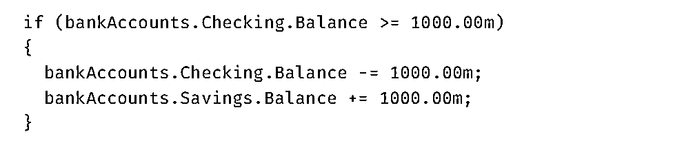

上述代码检查银行账户余额，条件符合就从中取钱，向另一个账户存钱。这个操作必须是原子性的。换言之，为了使代码能正确执行，永远不能发生操作只是部分完成的情况。例如，假定两个线程同时运行，可能两个都验证账户有足够的余额，所以两个都执行转账，而剩余的资金其实只够进行一次转账。事实上，局面会变得更糟。在上述代码中，没有任何一个操作是原子性的。就连复合加/减（或读/写）decimal 类型的属性在 C#中都不属于原子操作。因此，它们在多线程的情况下全都属于“部分完成”——只是部分递增或递减。因为部分完成的非原子操作而造成了不一致状态，这是竞态条件 的一种特例。

竞态条件所造成的不确定性 

如前所述，一般通过时间分片来模拟并发性。在缺少线程同步（我们将在第二十二章详细讨论）构造的情况下，操作系统会在它认为合适的任何时间在任何两个线程之间切换上下文。结果是当两个线程访问同一个对象时，无法预测哪个线程“竞争胜出”并抢先运行。例如，假定有两个线程运行上述代码段，可能一个胜出并一路运行到尾，而另一个线程甚至还没有开始。也可能在第一个线程执行完余额检查后立即发生上下文切换，第二个胜出，并一路运行到尾。

对于包含竞态条件的代码，其行为取决于上下文切换时机。这造成了程序执行的不确定性。一个线程中的指令相对于另一个线程中的指令，两者的执行顺序是未知的。最糟的情况是包含竞态条件的代码 99.9%的时间都具有正确行为。1000 次只有那么一次，另一个线程在竞争中胜出。正是这种不确定性使多线程编程显得很难。

因为竞态条件难以重现，所以保证多线程代码的品质主要依赖于长期压力测试、专业的代码分析工具以及专家对代码进行的大量分析和检查。此外，比这些更重要的是“越简单越好”原则。为追求极致性能，本来一个锁就能搞定的事情，有的开发者会诉诸像互锁（Interlocked 类）和易变（Volatile 类）这样的更低级的基元构造。这会使局面复杂化，代码更容易出错。在好的多线程编程中，“越简单越好”或许才是最重要的原则。

第二十二章会介绍一些应对竞态条件的技术。

内存模型的复杂性 

竞态条件（两个控制点以无法预测且不一致的速度“竞争”代码的执行）本来就很糟了，但还有更糟的。假定两个线程在两个不同的进程中运行，但都要访问同一个对象中的字段。现代处理器不会在每次要用一个变量时都去访问主内存。相反，是在处理器的“高速缓存”（cache）中生成本地拷贝。该缓存定时与主内存同步。这意味着在两个不同的处理器上，两个线程以为自己在读写同一个位置，实际看到的可能不是对方对那个位置的实时更新，获得的结果可能不一致。简单地说，这里是处理器同步缓存的时机产生了竞态条件。

锁定造成死锁 

显然，肯定有什么机制能将非原子操作转变成原子操作，要求操作系统对线程进行调度以防止竞态条件，并确保处理器的高速缓存在必要时同步。C#程序解决所有这些问题的主要机制是 lock 语句。它允许开发者将一部分代码设为“关键”（critical）^( [\[2\]](part0160.xhtml#ch2_back) ) 代码，一次只能有一个线程执行它。如多个线程试图进入关键区域，操作系统只允许一个，其他将被挂起^( [\[3\]](part0160.xhtml#ch3_back) ) 。操作系统还确保在遇到锁的时候处理器高速缓存正确同步。

但锁自身也有问题（另外还有性能开销）。最容易想到的是，假如不同线程以不同顺序来获取锁，就可能发生死锁 。这时线程会被冻结，彼此等待对方释放它们的锁，如图 19.2 所示。

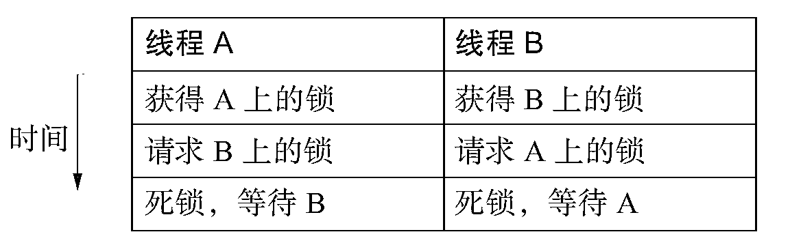

图 19.2　死锁时间线

此时，每个线程都只有在对方释放了锁之后才能继续，线程阻塞，造成代码彻底死锁。第二十二章将讨论各种锁定技术。

设计规范

·不要假设在单线程代码中的原子性操作在多线程代码中也是原子性的。

·不要以为所有线程看到的都是一致的共享内存。

·要确保同时拥有多个锁的代码总是以相同的顺序获取它们。

·避免所有竞态条件，程序行为不能受操作系统调度线程的方式的影响。

[\[1\]](part0160.xhtml#ch1) 从技术上说，“CPU”总是指物理芯片，而“核心”或“内核”可以指物理 CPU，也可以指虚拟 CPU。在本书中两者的区别并不重要，两个词都能用。

[\[2\]](part0160.xhtml#ch2) 更好的翻译是“临界”，例如，critical region 的传统说法是“临界区”。——译者注

[\[3\]](part0160.xhtml#ch3) 使线程睡眠、自旋或者先自旋再恢复睡眠模式再如此反复。

## 19.2　异步任务

多线程编程的复杂性来自以下几个方面：

1.监视异步操作的状态，知道它于何时完成 。为判断一个异步操作在什么时候完成，最好不要采取轮询线程状态的办法，也不要采取阻塞并等待的办法。

2.线程池 。线程池避免了启动和终止线程的巨大开销。此外，线程池避免了太多线程的创建，防止系统将大多数时间花在线程的切换而不是运行上。

3.避免死锁 。在防止数据同时被两个不同的线程访问的同时避免死锁。

4.为不同的操作提供原子性并同步数据访问 。为不同的操作组（指令序列）提供同步，可确保将一系列操作作为整体来执行，并可由另一个线程恰当地中断。锁定机制防止两个不同的线程同时访问数据。

此外，任何时候只要有需要长时间运行的方法，就可能需要多线程编程——即异步调用该方法。不幸的是，在 C# 5.0 之前，编写多线程程序需要比较底层的 API，即 System.Threading.Thread 类。这套 API 完全无法避免多线程编程的复杂性。

随着编写的多线程代码越来越多，开发者总结出了一系列常见情形以及应对这些情形的编程模式。于是 C# 5.0 总结了常见的多线程编程模式，并推出了 System.Threading.Tasks.Task。在这个新 API 的帮助下，C#程序能够更好地应对一种称为“异步任务模式”（TAP）的常见多线程编程模式。为了实现这个新的 API，C# 5.0 不但利用了来自.NET 4.0 的“并行任务库”（TPL），而且添加一些新的编程语言特性。

本节和 19.3 节将详细介绍 TPL，然后讨论如何利用上下文关键字 async 和 await 简化 TAP 编程。

### 19.2.1　为何使用 TPL

创建线程代价高昂，而且每个线程都要占用大量虚拟内存（例如 Windows 默认 1 MB）。前面说过，更有效的做法是使用线程池：需要时分配线程，为线程分配异步工作，运行至完成，再为后续异步工作重用线程，而不是在工作结束后销毁再重新创建线程。

在.NET Framework 4 和后续版本中，TPL 不是每次开始异步工作时都创建一个线程，而是创建一个 Task，并告诉任务调度器 有异步工作要执行。此时任务调度器可能采取多种策略，但默认是从线程池 请求一个工作者线程。线程池会自行判断怎么做最高效。可能在当前任务结束后再运行新任务，或者将新任务的工作者线程调度给特定处理器。线程池还会判断是创建全新线程，还是重用之前已结束运行的现有线程。

通过将异步工作的概念抽象到 Task 对象中，TPL 提供了一个能代表异步工作的对象，还提供了面向对象的 API 与工作交互。通过提供代表工作单元的对象，TPL 使我们能通过编程将小任务合并成大任务，从而建立起一个工作流程，详情稍后讨论。

任务是对象，其中封装了以异步方式执行的工作。这听起来有点儿耳熟，委托不也是封装了代码的对象吗？区别在于，委托是同步的，而任务是异步 的。如果执行委托（例如一个 Action），当前线程的控制点会立即转移到委托的代码。除非委托结束，否则控制不会返回调用者。相反，启动任务，控制几乎立即返回调用者，无论任务要执行多少工作。任务通常在另一个线程上异步执行（第二十章中会讲到，也可只用一个线程来异步执行任务，而且这样还有一些好处）。简单地说，任务将委托从同步执行模式转变成异步。

### 19.2.2　理解异步任务

我们之所以知道当前线程上执行的委托于何时完成，是因为除非委托完成，否则调用者什么也做不了。但怎么知道任务于何时完成，怎么获得结果（如果有的话）？下面来看一个将同步委托转换成异步任务的例子。在这个例子中，工作者线程向控制台写入句号，主线程写入减号（短横线）。

启动任务将从线程池获取一个新线程，创建第二道“执行”，并在那里执行委托。主线程上的执行和平常一样，启动任务（Task.Run()）后正常继续。如代码清单 19.1 所示。

代码清单 19.1　调用异步任务

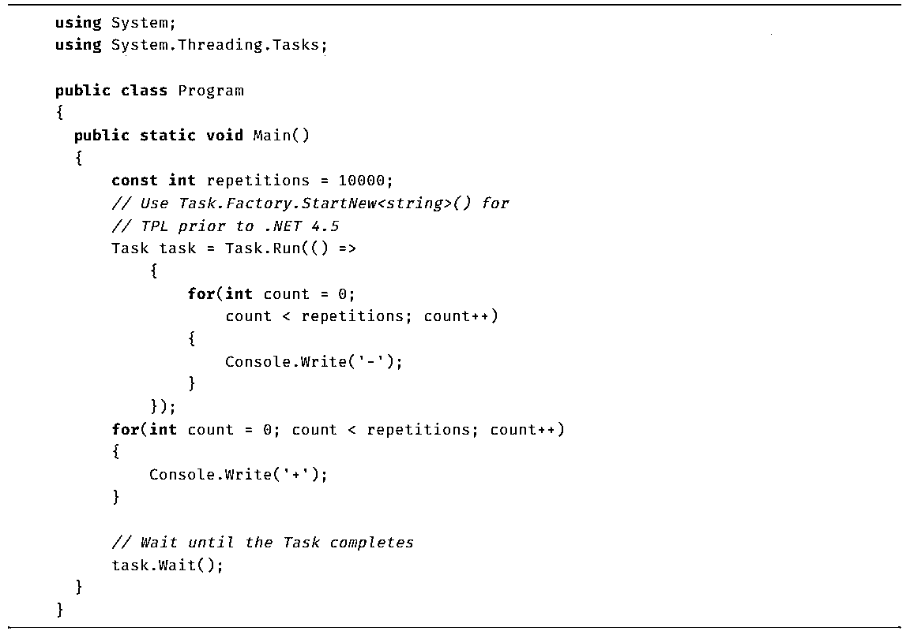

新线程要运行的代码由传给 Task.Run()方法的委托（本例是 Action 类型）来定义。该委托（以 Lambda 表达式的形式）在控制台上反复打印连字号。主线程的循环几乎完全一样，只是它打印加号。

注意，一旦调用 Task.Run()，作为实参传递的 Action 几乎立即开始执行。这称为“热”任务，意味着它已触发并开始执行。“冷”任务则相反，需要在显式触发之后才开始异步工作。

虽然一个 Task 也可通过 Task 构造函数实例化成“冷”状态，但这个做法一般只适合以下模式：创建一个 Task 对象，把它传给另一个方法，由后者决定在什么时候调用 Start 方法来调度任务。由于创建 Task 对象并立即调用 Start 是常见编程模式，所以通常都像本例那样直接调用 Task 的静态 Run 方法。

注意，调用 Run()之后将无法确定“热”任务的确切状态。具体行为由操作系统和它的载荷（.NET 框架）以及配套的任务库决定。该组合决定了 Run()是立即执行任务的工作者线程，还是推迟到有更多资源的时候执行。事实上，轮到调用线程再次执行时，“热”任务说不定已经完成了。调用 Wait()将强迫主线程等待分配给任务的所有工作完成。

本例仅一个任务，但理所当然可能有多个任务异步执行。一个常见情况是要等待一组任务完成，或等待其中一个完成，当前线程才能继续。这分别用 Task.WaitAll()和 Task.WaitAny()方法实现。

前面描述了任务如何获取一个 Action 并以异步方式运行它。但假如任务执行的工作要返回结果呢？这时可用 Task<T>类型来异步运行一个 Func<T>。我们知道如果以同步方式执行委托，除非获得结果，否则控制不会返回。而异步执行 Task<T>，可从一个线程轮询它，看它是否完成，完成就获取结果^( [\[1\]](part0161.xhtml#ch1_back) ) 。代码清单 19.2 演示如何在一个控制台应用程序中做这件事情。注意这个例子用到了 PiCalculator.Calculate()方法，该方法将在第二十一章详细讲述。

代码清单 19.2　轮询一个 Task<T>

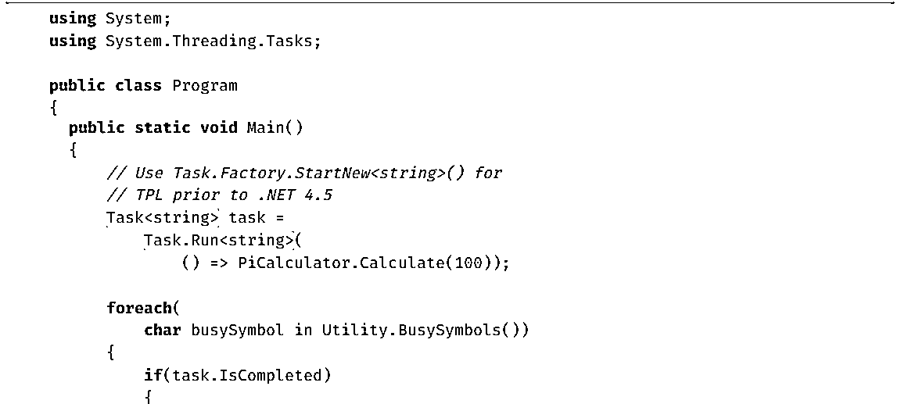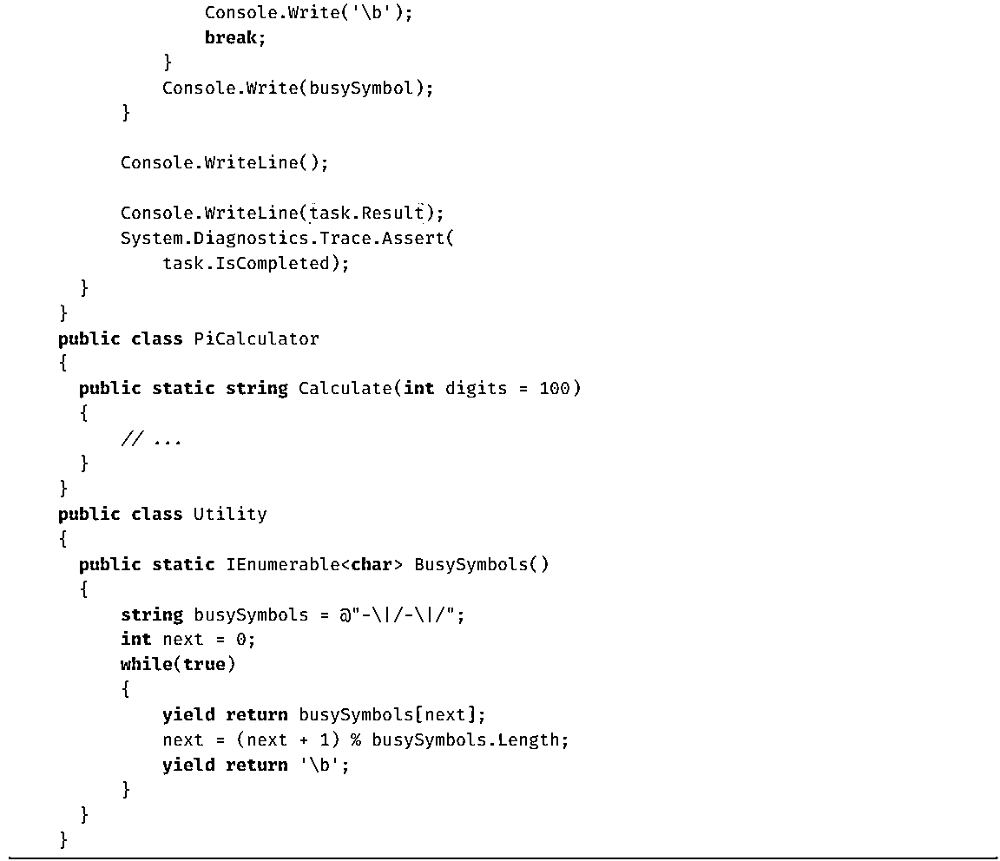

在这个代码清单中，任务的数据类型是 Task<string>。该泛型类型包含一个 Result 属性，可从中获取由 Task<string>执行的 Func<string>的返回值。

注意代码清单 19.2 没有调用 Wait()。相反，读取 Result 属性自动造成当前线程阻塞，直到结果可用（如果还不可用的话）。在本例中，我们知道在获取结果时，结果肯定已经准备好了。

除了 Task<T>的 IsCompleted 和 Result 属性，还有其他几个地方需要注意。

·任务完成后，IsCompleted 属性被设为 true——不管是正常结束还是出错（即抛出异常并终止）。更详细的任务状态信息可通过读取 Status 属性来获得，该属性返回 TaskStatus 类型的值，可能的值包括 Created、WaitingForActivation、WaitingToRun、Running、WaitingForChildrenToComplete、RanToCompletion、Canceled 和 Faulted。任何时候只要 Status 为 RanToCompletion、Canceled 或者 Faulted，IsCompleted 就为 true。当然，如任务在另一个线程上运行，读取的状态值是“正在运行”，那么任何时候状态都可能变成“已完成”，甚至可能刚读取属性值就变。其他许多状态也是如此，就连 Created 都可能变化（如果由一个不同的线程启动它）。只有 RanToCompletion、Canceled 和 Faulted 可被视为最终状态，不会再变。

·任务可用 Id 属性的值来唯一地标识。静态 Task.CurrentId 属性返回当前正在执行的 Task（发出 Task.CurrentId 调用的任务）的标识符。这些属性在调试时特别有用。

·可用 AsyncState 为任务关联额外的数据。例如，假定要用多个任务计算一个 List<T>中的值。为此，每个任务都将值的索引包含到 AsyncState 属性中。这样当任务结束后，代码可用 AsyncState（先转型成 int）访问列表中的特定索引位置^( [\[2\]](part0161.xhtml#ch2_back) ) 。

还有一些有用的属性将在 19.4 节进行讨论。

### 19.2.3　任务延续

前面多次提到程序的“控制流”，但一直没有把控制流最根本的地方说出来：控制流决定了接下来要发生的事情 。对于 Console.WriteLine(x.ToString());这样一个简单的控制流，它指出如果 ToString 正常结束，接下来发生的事情就是调用 WriteLine，将刚才的返回值作为实参传给它。“接下来发生的事情”就是一个延续 （continuation）。控制流中的每个控制点都有一个延续。在上例中，ToString 的延续是 WriteLine（WriteLine 的延续是下一个语句运行的代码）。延续的概念对于 C#编程来说过于平常，大多数程序员根本没意识到它，不知不觉就用了。C#编程其实就是在延续的基础上构造延续，直至整个程序的控制流结束。

注意在普通 C#程序中，给定代码的延续会在该代码完成后立即执行。一旦 ToString()返回，当前线程的控制点立即执行对 WriteLine 的同步调用^( [\[3\]](part0161.xhtml#ch3_back) ) 。还要注意，任何给定的代码实际都有两个可能的延续：“正常”延续和“异常”延续。如当前代码抛出异常，执行的就是后者。

而异步方法调用（比如开始一个 Task）会为控制流添加一个新维度。执行异步 Task 调用，控制流立即转到 Task.Start()之后的语句。与此同时，Task 委托的主体也开始执行了。换言之，在涉及异步任务的时候，“接下来发生的事情”是多维的。发生异常时的延续仅仅是一个不同的执行路径。相反，异步延续是多了一个并行的执行路径。

异步任务使我们能将较小的任务合并成较大的任务，只需描述好异步延续就可以了。和普通控制流一样，任务可用多个不同的延续来处理错误情形。而通过操纵延续，可将多个任务合并到一起。有几种技术可以实现这一点，最容易想到的就是 ContinueWith()方法，如代码清单 19.3 和输出 19.1 所示。

代码清单 19.3　调用 Task.ContinueWith()

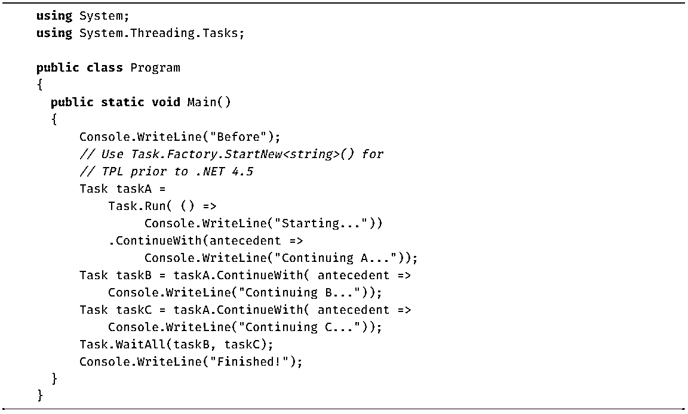

输出 19.1

可用 ContinueWith()“链接”两个任务，这样当先驱任务 完成后，第二个任务（延续任务 ）自动以异步方式开始。例如在代码清单 19.3 中，Console.WriteLine("Starting...")是先驱任务的主体，而 Console.WriteLine("Continuing A...")是它的延续任务主体。延续任务获取一个 Task 作为实参（antecedent），这样才能从延续任务的代码中访问先驱任务的完成状态。先驱任务完成时，延续任务自动开始，异步执行第二个委托，刚才完成的先驱任务作为实参传给那个委托。此外，由于 ContinueWith()方法也返回一个 Task，所以 Task 自然可以作为另一个 Task 的先驱使用。以此类推，就可以建立起任意长度的连续任务链。

为同一个先驱任务调用两次 ContinueWith()（例如在代码清单 19.3 中，taskB 和 taskC 都是 taskA 的延续任务），先驱任务（taskA）就有两个延续任务。先驱任务完成时，两个延续任务将异步执行。注意，同一个先驱的多个延续任务无法在编译时确定执行顺序。输出 19.1 只是恰巧 taskC 先于 taskB 执行。再次运行程序就不一定了。不过，taskA 总是先于 taskB 和 taskC 执行，因为后者是 taskA 的延续任务，它们不可能在 taskA 完成前开始。类似地，肯定是 Console.WriteLine("Starting...")委托先完成再执行 taskA (Console.WriteLine("Continuing A..."))，因为后者是前者的延续任务。此外，Finished!总是最后显示，因为对 Task.WaitAll(taskB, taskC)的调用阻塞了控制流，直到 taskB 和 taskC 都完成才能继续。

ContinueWith()有许多重载版本，有的要获取一个 TaskContinuationOptions 值，以便对延续链的行为进行调整。这些值都是位标志，可用逻辑 OR 操作符（|）组合。表 19.1 列出了部分标志值，详情参见 MSDN 文档^( [\[4\]](part0161.xhtml#ch4_back) ) 。

表 19.1　TaskContinuationOptions 枚举值列表

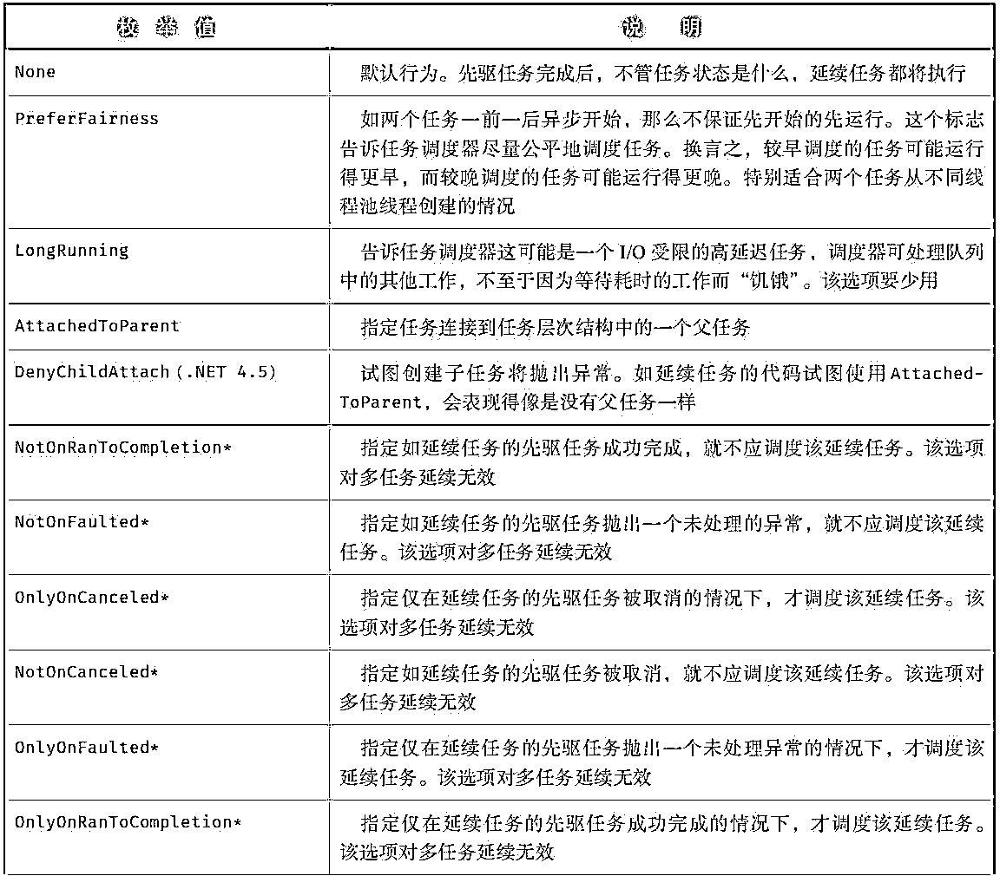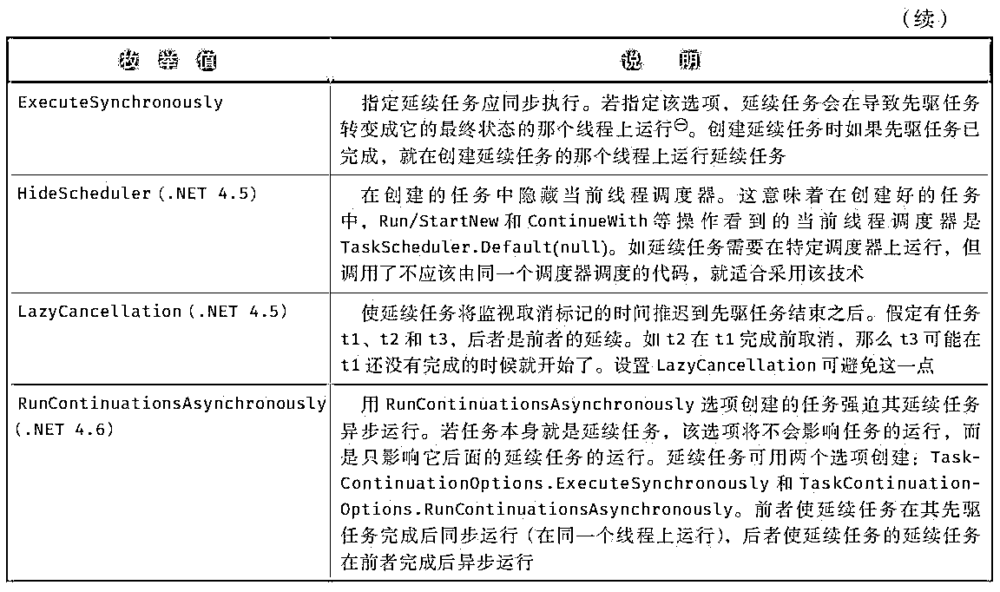

注①：该枚举值指定两个 Task“同步运行”，或者说强制用一个线程运行。也就是说，用此 ContinueWith()指定的操作（一个委托），会使用该 Task 的先驱 Task 所用的那个线程。例如，

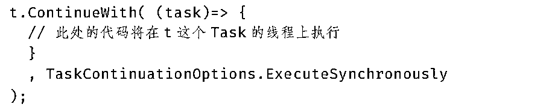

——译者注

带星号（\*）的项指出延续任务在什么情况下执行。可利用它们创建类似于“事件处理程序”的延续任务，根据先驱任务的行为来进行后续操作。代码清单 19.4 演示了如何为先驱任务准备多个延续任务，根据先驱任务的完成情况来有条件地执行。

代码清单 19.4　用 ContinueWith()登记事件通知

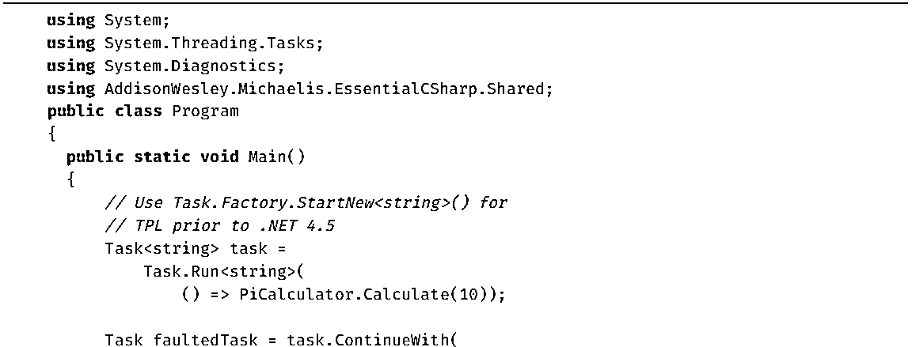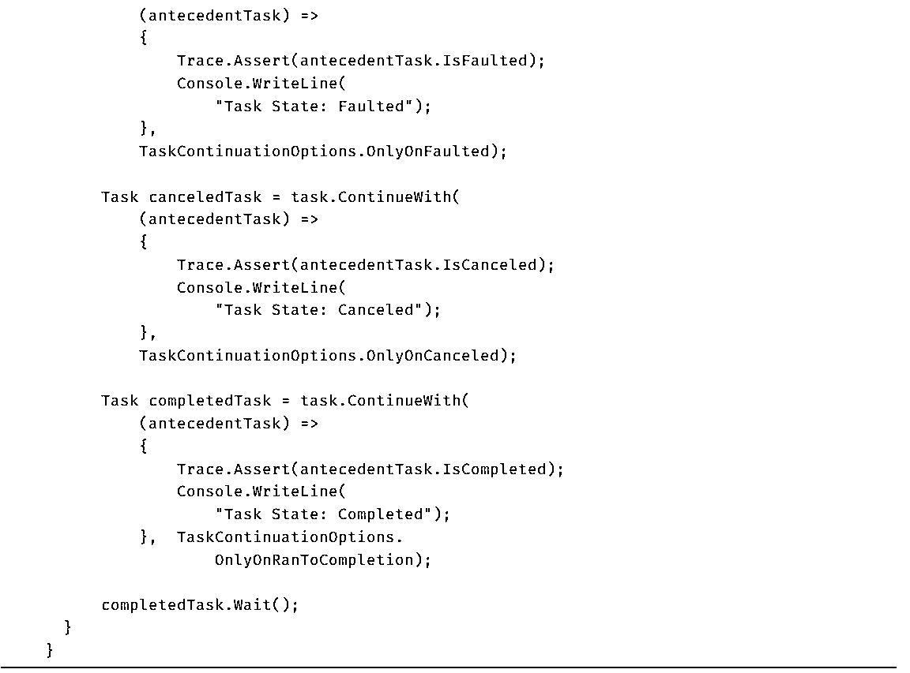

这个代码清单实际是为先驱任务上的“事件”登记“侦听者”。事件（任务正常或异常完成）一旦发生，就执行特定的“侦听”任务。这是很强大的功能，尤其是对于那些 fire-and-forget^( [\[5\]](part0161.xhtml#ch5_back) ) 的任务——任务开始，和延续任务挂钩，然后就可以对它不管不问了。

在代码清单 19.4 中，注意最后的 Wait()调用在 completedTask 上发生，不是在 task 上（task 是用 Task.Run()创建的原始先驱任务）。虽然每个委托的 antecedentTask 都是对先驱任务（task）的引用，但在委托侦听者外部，实际可以丢弃对原始 task 的引用。然后只依赖以异步方式开始执行的延续任务，不需要后续代码来检查原始 task 的状态。

本例是调用 completedTask.Wait()，确保主线程不在输出“任务完成”信息前退出，如输出 19.2 所示。

输出 19.2

调用 completedTask.Wait()显得有点不自然，因为我们知道原始任务能成功完成。但是，在 canceledTask 或 faultedTask 上调用 Wait()会抛出异常。那些延续任务仅在先驱任务取消或抛出异常时才运行。但那些事件在本程序中不可能发生，所以任务永远不会被安排运行。如等待它们完成，将抛出异常。代码清单 19.1 的延续选项恰好互斥，所以当先驱任务运行完成，而且与 completedTask 关联的任务开始执行时，任务调度器会自动取消与 canceledTask 和 faultedTask 关联的任务。取消的任务的最终状态是 Canceled。所以，在这两种任务上调用 Wait()（或者其他会导致当前线程等待任务完成的方法）将抛出一个异常，指出任务已取消。

要使编码显得更自然，一个办法或许是调用 Task.WaitAny(completedTask, canceledTask, faultedTask)，它能抛出一个 AggregateException 以便处理。

### 19.2.4　用 AggregateException 处理 Task 上的未处理异常

同步调用的方法可包装到 try 块中，用 catch 子句告诉编译器发生异常时应执行什么代码。但异步调用不能这么做。不能用 try 块包装 Start()调用来捕捉异常，因为控制会立即从调用返回，然后控制会离开 try 块，而这时离工作者线程发生异常可能还有好久。一个解决方案是将任务的委托主体包装到 try/catch 块中。抛出并被工作者线程捕捉的异常不会造成问题，因为 try 块在工作者线程上能正常地工作。但对于工作者线程不捕捉的未处理的异常来说就麻烦了。

自 CLR 2.0 起^( [\[6\]](part0161.xhtml#ch6_back) ) ，任何线程上的未处理异常都被视为严重错误，会触发“Windows 错误报告”对话框，并造成应用程序异常中止。所有线程上的所有异常都必须被捕捉，否则应用程序不允许继续。（要了解处理未处理异常的高级技术，请参见稍后的“高级主题：处理 Thread 上的未处理异常”。）幸好，异步任务中的未处理异常有所不同。在这种情况下，任务调度器会用一个“catchall”异常处理程序来包装委托。如果任务抛出未处理的异常，那么该处理程序会捕捉并记录异常细节，避免 CLR 自动终止进程。

如代码清单 19.4 所示，为处理出错的任务，一个技术是显式创建延续任务作为那个任务的“错误处理程序”。检测到先驱任务抛出未处理的异常，任务调度器会自动调度延续任务。但如果没有这种处理程序，同时在出错的任务上执行 Wait()（或其他试图获取 Result 的动作） ，就会抛出一个 AggregateException，如代码清单 19.5 和输出 19.3 所示。

代码清单 19.5　处理任务的未处理异常

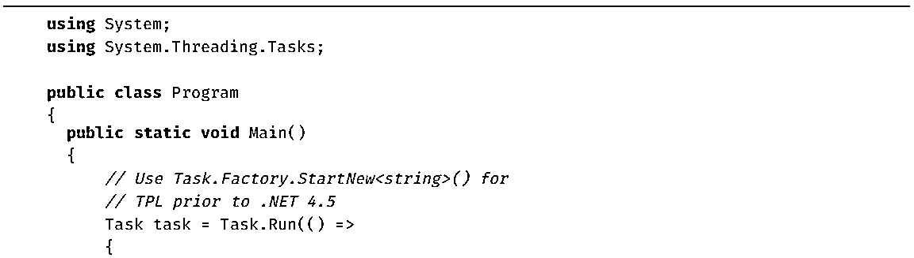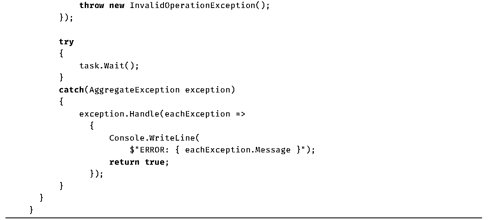

输出 19.3

之所以叫“集合异常”（AggregateException），是因为它可能包含从一个或多个出错的任务收集到的异常。例如，异步执行 10 个任务，其中 5 个抛出异常。为报告所有 5 个异常并用一个 catch 块处理，框架用 AggregateException 来收集异常，并把它们当作一个异常来报告。此外，由于编译时不知道工作者任务将抛出一个还是多个异常，所以未处理的出错任务总是抛出一个 AggregateException。代码清单 19.5 和输出 19.3 演示了这一行为。虽然工作者线程上抛出的未处理异常是 InvalidOperationException 类型，主线程捕捉的仍是一个 AggregateException。另外，如你预期的那样，捕捉异常需要一个 Aggregate-Exception catch 块。

AggregateException 包含的异常列表通过 InnerExceptions 属性获取。可遍历该属性来检查每个异常并采取相应的对策。另外，如代码清单 19.5 所示，可用 Aggregate-Exception.Handle()方法为 AggregateException 中的每个异常都指定一个要执行的表达式。但要注意，Handle()方法的重要特点在于它是谓词。所以，针对 Handle()委托成功处理的任何异常，谓词应返回 true。任何异常处理调用若为一个异常返回 false，Handle()方法将抛出新的 AggregateException，其中包含由这种异常构成的列表。

还可查看任务的 Exception 属性来了解出错任务的状态，这样不会在当前线程上重新抛出异常。在代码清单 19.6 中，已知一个任务会抛出异常，我们通过在它的延续任务上等待来进行演示^( [\[7\]](part0161.xhtml#ch7_back) ) 。

代码清单 19.6　使用 ContinueWith()观察未处理的异常

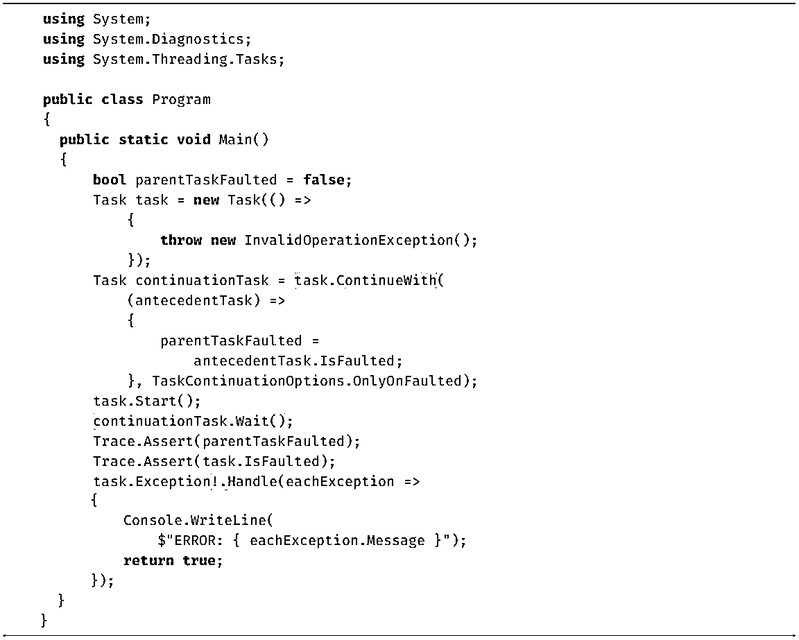

注意，为获取原始任务上的未处理异常，我们使用了 Exception 属性（并且使用空包容操作符，因为该属性肯定不为空）。结果和输出 19.3 一样。

如任务中发生的异常完全没有被观察到——也就是说：a）它没有在任务中被捕捉；b）完全没有观察到任务完成，例如通过 Wait()、Result 或访问 Exception 属性；c）完全没有观察到出错的 ContinueWith()——那么异常可能完全未处理，最终成为进程级的未处理异常。在.NET 4.0 中，像这样的异常会由终结器线程重新抛出并可能造成进程崩溃。但在.NET 4.5 中，这个崩溃被阻止了（虽然可以配置 CLR 使其还是像以前那样崩溃）。

无论哪种情况，都可通过 TaskScheduler.UnobservedTaskException 事件来登记未处理的任务异常。

高级主题：处理线程上的未处理异常

如前所述，任何线程上的未处理异常默认都将造成应用程序终止。未处理异常代表严重的、事前没意识的 bug，而且异常可能因为关键数据结构损坏而发生。由于不知道程序在发生异常后可能干什么，所以最安全的策略是立即关闭整个程序。

理想情况是在任何线程上都不抛出未处理异常。否则说明程序存在 bug，最好在交付客户前修复。但有人认为在发生未处理异常时，不应马上关闭程序，而是先保存工作数据，并记录异常以方便进行错误报告和调试。这要求用一种机制来登记未处理异常通知。

在 Microsoft .NET Framework 和.NET Core 2.0（和之后的版本）中，每个 AppDomain 都提供了这样的机制。为观察 AppDomain 中的未处理异常，必须添加一个 Unhandled-Exception 事件处理程序。无论主线程还是工作者线程，AppDomain 中的线程发生的所有未处理异常都会触发 UnhandledException 事件。注意该机制的目的只是通知，不允许应用程序从未处理异常中恢复并继续执行。事件处理程序运行完毕，应用程序会显示“Windows 错误报告”对话框并退出（如果是控制台应用程序，异常详细信息还会在控制台上显示）。

代码清单 19.7 展示如何创建另一个线程来抛出异常，并由 AppDomain 的未处理异常事件处理程序进行处理。由于只是演示，为确保不受到线程计时问题的干扰，使用 Thread.Sleep 插入了一定的人工延迟。结果如输出 19.4 所示。

代码清单 19.7　登记未处理异常

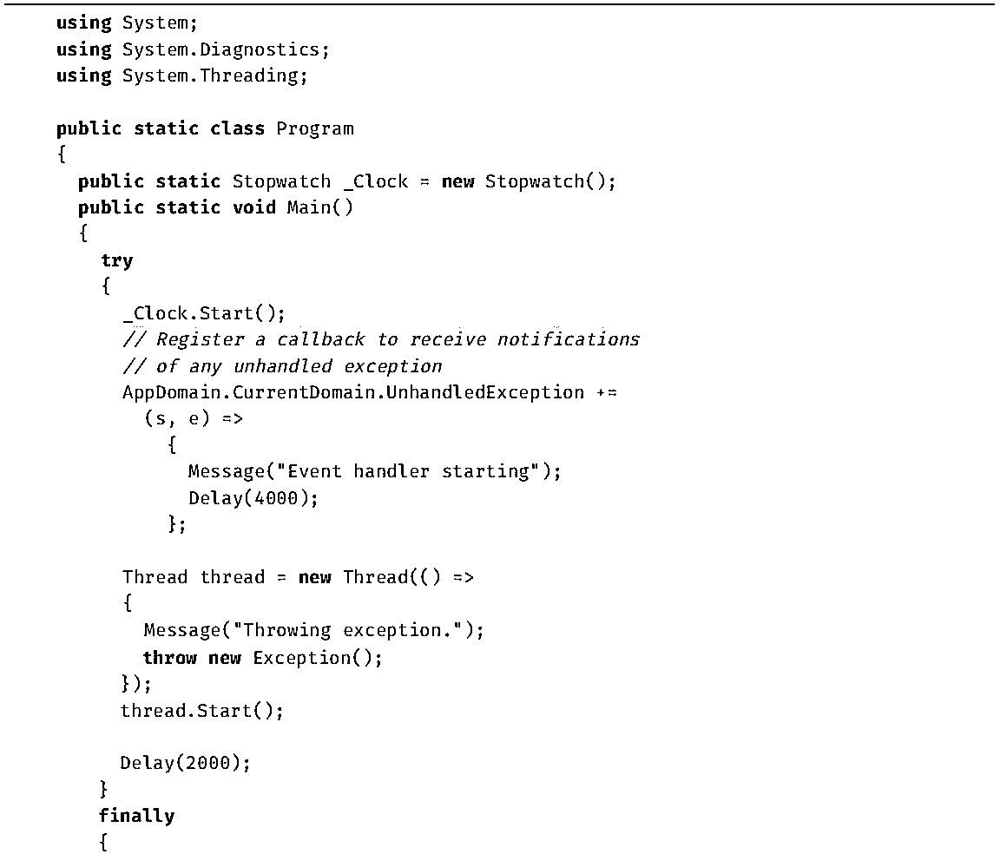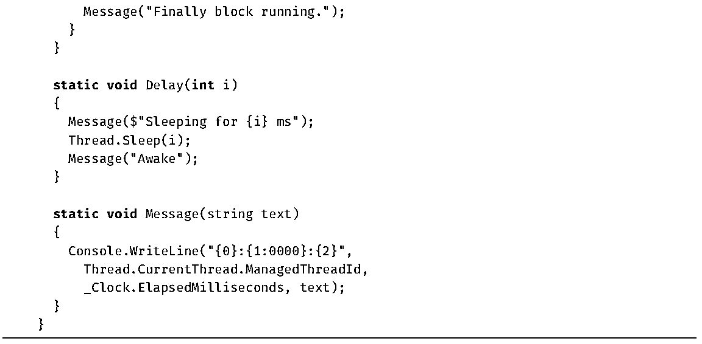

输出 19.4

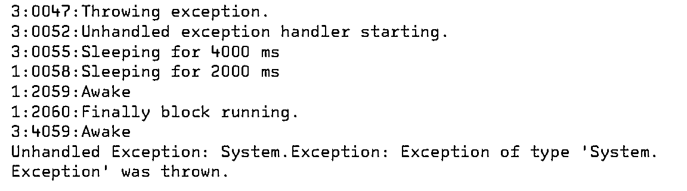

如输出 19.4 所示，新线程分配线程 ID 3，主线程分配线程 ID 1。操作系统调度线程 3 运行一会儿，抛出未处理异常，调用事件处理程序，然后进入睡眠。很快，操作系统意识到线程 1 可以调度了，但它的代码是立即睡眠。线程 1 先醒来并运行 finally 块，两秒钟后线程 3 醒来，未处理线程终于使进程崩溃。

执行事件处理程序，进程等处理程序完成后再崩溃，这是很典型的一个顺序，却无法保证。一旦程序发生未处理异常，一切都会变得难以预料：程序现在处于一种未知的、不稳定的状态，其行为可能出乎意料。在这个例子中，CLR 允许主线程继续运行并执行它的 finally 块，即使它知道当控制进入 finally 块时，另一个线程正处于 AppDomain 的未处理异常事件处理程序中。

要更深刻地理解这个事实，可试着修改延迟，使主线程睡眠得比事件处理程序长一些。这样 finally 块将不会运行！线程 1 被唤醒前，进程就因为未处理的异常而销毁了。根据抛出异常的线程是不是由线程池创建的，还可能得到不同的结果。因此，最佳实践就是避免所有未处理异常，不管在工作者线程中，还是在主线程中。

这跟任务有什么关系？如果关机时有未完成的任务将系统挂起怎么办？下一节将讨论任务取消。

设计规范

·避免程序在任何线程上产生未处理异常。

·考虑登记“未处理异常”事件处理程序以进行调试、记录和紧急关闭。

·要取消未完成的任务而不要在程序关闭期间允许其运行。

[\[1\]](part0161.xhtml#ch1) 使用轮询需谨慎。像本例这样从一个委托创建任务，任务会被调度给线程池的一个工作者线程。这意味着当前线程会一直循环，直到工作者线程上的工作结束。虽然这个技术可行，但可能无谓地消耗 CPU 资源。如果不将任务调度给工作者线程，而是将任务调度给当前线程在未来某个时间执行，这样的轮询技术就会变得非常危险。当前线程将一直处于对任务进行轮询的循环中。之所以会成为无限循环，是因为除非当前线程退出循环，否则任务不会结束。

[\[2\]](part0161.xhtml#ch2) 用任务异步修改集合需谨慎。任务可能在不同的工作者线程上运行，而集合可能不是线程安全的。更安全的做法是任务完成后在主线程填充集合。

[\[3\]](part0161.xhtml#ch3) 记住之前说过的同步和异步的区别。——译者注

[\[4\]](part0161.xhtml#ch4) 网址是 http://t.cn/EAvbLNI。

[\[5\]](part0161.xhtml#ch5) 军事术语，导弹发射后便不再理会，自动寻的。——译者注

[\[6\]](part0161.xhtml#ch6) 在 CLR 1.0 中，工作者线程上的未处理异常会终止线程，但不终止应用程序。这样一来，有 bug 的应用程序可能所有工作者线程都死了，主线程却还活着——即使程序已经不再做任何事情。这为用户带来了困扰。更好的策略是通知用户应用程序处于不良状态，并在它造成损害前将其终止。

[\[7\]](part0161.xhtml#ch7) 如前所述，一般都不等待出错时才执行的延续，因为大多数时候都不会安排它运行。代码仅供演示。

## 19.3　取消任务

本章之前描述了为什么野蛮中断线程来取消正由该线程执行的任务不是一个好的选择。TPL 使用的是协作式取消 （cooperative cancellation），一种安全地取消不再需要的任务的得体、健壮和可靠的技术。支持取消的任务要监视一个 CancellationToken 对象（位于 System.Threading 命名空间）。任务定期轮询它，检查是否发出了取消请求。代码清单 19.8 演示了取消请求和对请求的响应。输出 19.5 是结果。

代码清单 19.8　使用 CancellationToken 取消任务

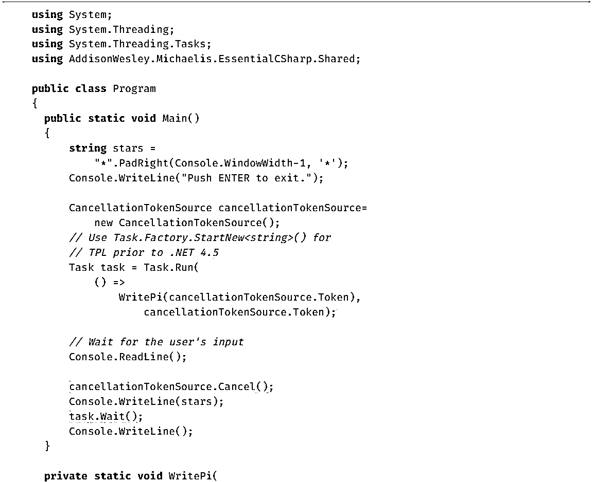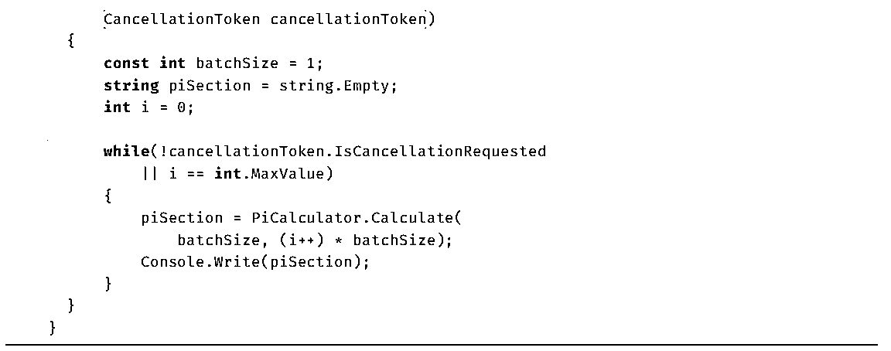

输出 19.5

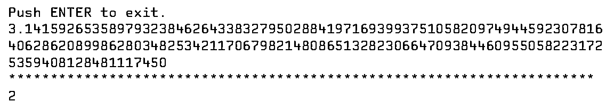

启动任务后，一个 Console.Read()会阻塞主线程。与此同时，任务继续执行，计算并打印 pi 的下一位。用户按 Enter 键后，执行就会遇到一个 CancellationTokenSource.Cancel()调用。在代码清单 19.8 中，对 task.Cancel()的调用和对 task.Wait()的调用是分开的，两者之间会打印一行星号。目的是证明在观察到取消标记^( [\[1\]](part0162.xhtml#ch1_back) ) 之前，极有可能发生一次额外的循环迭代。如输出 19.5 所示，星号后多输出了一个 2。之所以会出现这个 2，是因为 CancellationTokenSource.Cancel()没有“野蛮”地中断正在执行的 Task。任务会继续运行，直到它检查标记，发现标记的所有者已请求取消任务，这时才会得体地关闭任务。

调用 Cancel()实际会在从 CancellationTokenSource.Token 拷贝的所有取消标记上设置 IsCancellationRequested 属性。但要注意以下几点。

·提供给异步任务的是 CancellationToken 而不是 CancellationTokenSource。Cance-llationToken 使我们能轮询取消请求，而 CancellationTokenSource 负责提供标记，并在它被取消时发出通知，如图 19.3 所示。通过传递 CancellationToken 而不是 CancellationTokenSource，我们不必担心 CancellationTokenSource 上的线程同步问题，因为后者仍然只能由原始线程访问。

·CancellationToken 是结构，所以能拷贝值。CancellationTokenSource.Token 返回的是标记的副本。由于 CancellationToken 是值类型，创建的是拷贝，因此能以线程安全的方式访问 CancellationTokenSource.Token——只能从 WritePi()方法内部访问。

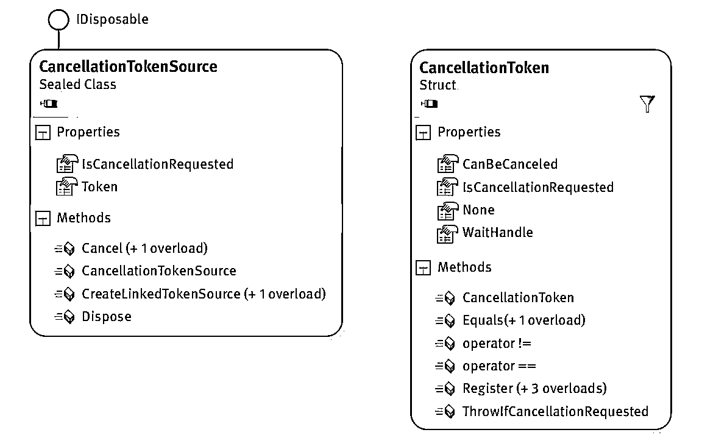

图 19.3　CancellationTokenSource 和 CancellationToken 类关系图

为监视 IsCancellationRequested 属性，CancellationToken 的一个拷贝（从 Cance-llationTokenSource.Token 获取）传给任务。代码清单 19.7 每计算一位就检查一下 Cance-llationToken 参数上的 IsCancellationRequested 属性。如属性返回 true，while 循环退出。线程中断（abort）是在一个随机位置抛出异常，而这里是用正常控制流退出循环。通过频繁的轮询，我们可以保证代码能及时响应取消请求。

关于 CancellationToken，要注意的另一个要点是重载的 Register()方法。可通过该方法登记在标记（token）取消时立即执行的一个行动。换言之，可调用 Register()方法在 CancellationTokenSource 的 Cancel()上登记一个侦听器委托。

在代码清单 19.7 中，由于在任务完成前取消任务是预料之中的行为，所以没有抛出 System.Threading.Tasks.TaskCanceledException。因此，task.Status 会返回 Task-Status.RanToCompletion，没有任何迹象显示任务的工作实际已被取消了。虽然本例不需要这样的报告，但需要的话 TPL 也能提供。如取消任务会在某些方面造成破坏（例如，导致无法返回一个有效的结果），那么 TPL 为了报告这个问题，采用的模式就是抛出一个 TaskCanceledException（派生自 System.OperationCanceledException）。不是显式抛出异常，而是由 CancellationToken 包含一个 ThrowIfCancellationRequested()方法来更容易地报告异常，前提是有一个可用的 CancellationToken 实例。

在抛出 TaskCanceledException 的任务上调用 Wait()（或获取 Result），结果和在任务中抛出其他任何异常一样：这个调用会抛出 AggregateException。该异常意味着任务的执行状态可能不完整。在成功完成的任务中，所有预期的工作都成功执行。相反，被取消的任务可能只部分工作完成——工作的状态不可信。

本例演示了一个耗时的处理器受限操作（pi 可以无限地计算下去）如何监视取消请求并做出相应的反应。但某些时候，即使目标任务没有显式编码也能取消。例如，本章稍后讨论的 Parallel 类就默认提供了这样的行为。

设计规范

·在程序退出时，要先终止正在执行的任务，而不要对它放任不管。

### 19.3.1　Task.Run()是 Task.Factory.StartNew()的简化形式

.NET 4.0 获取任务的一般方式是调用 Task.Factory.StartNew()。.NET 4.5 提供了更简单的调用方式 Task.Run()。和 Task.Run()相似，Task.Factory.StartNew()在 C# 4.0 中用于调用一个需创建一个额外线程的 CPU 密集型方法。

在.NET 4.5（C# 5.0）中则应默认使用 Task.Run()，除非它满足不了一些特殊要求。例如，要用 TaskCreationOptions 控制任务，要指定其他调度器，或出于性能考虑要传递对象状态，这时就应考虑 Task.Factory.StartNew()。只有需要将创建和调度分开时（这种情况很少见），才应考虑在用构造函数实例化线程后添加一个 Start()调用。

代码清单 19.9 是使用 Task.Factory.StartNew()的一个例子。

代码清单 19.9　使用 Task.Factory.StartNew()

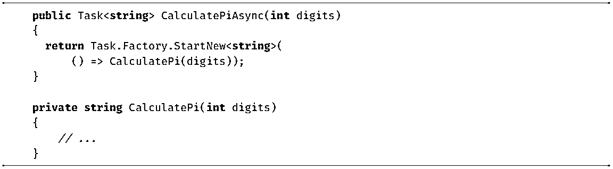

### 19.3.2　长时间运行的任务

线程池假设工作项是处理器受限的，而且运行时间较短。这些假设的目的是控制创建的线程数量，防止因为过多分配昂贵的线程资源以及超额预订处理器而导致过于频繁的上下文切换和时间分片。

但如果事先知道一个任务要长时间运行，会长时间“霸占”一个底层线程资源，就可通知调度器任务不会太快结束工作。这个通知有两方面的作用。首先，它提醒调度器或许应该为该任务创建专用线程（而不是使用来自线程池的）。其次，它提醒调度器可能应调度比平时更多的线程。这会导致更多的时间分片，但这是好事。我们不希望长时间运行的任务霸占整个处理器，让其他短时间的任务没机会运行。短时间运行的任务能利用分配到的时间片在短时间内完成大部分工作，而长时间运行的任务基本注意不到因为和其他任务共享处理器而产生的些许延迟。为此，需要在调用 StartNew()时使用 TaskCreationOptions.LongRunning 选项（Task.Run()不支持 TaskCreationOptions 参数），如代码清单 19.10 所示。

代码清单 19.10　协作执行耗时任务

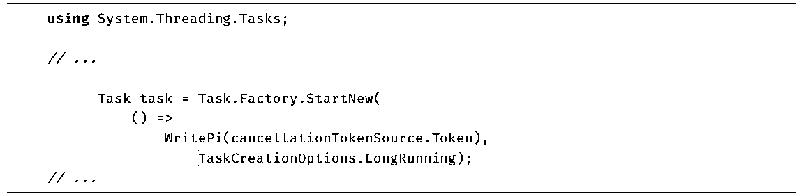

设计规范

·要告诉任务工厂新建的任务可能长时间运行，使其能恰当地管理它。

·要少用 TaskCreationOptions.LongRunning。

### 19.3.3　对任务进行资源清理

注意 Task 还支持 IDisposable。这是必要的，因为 Task 可能在等待完成时分配一个 WaitHandle。由于 WaitHandle 支持 IDisposable，所以依照最佳实践，Task 也支持 IDisposable。但注意之前的示例代码既没有包含 Dispose()调用，也没有通过 using 语句来隐式调用。相反，依赖的是程序退出时的自动 WaitHandle 终结器调用。

这导致了两个后果。首先，句柄存活时间变长了，因而会消耗更多资源。其次，垃圾回收器的效率变低了，因为被终结的对象存活到了下一代。但在 Task 的情况下，除非要终结大量任务，否则这两方面的问题都不大。因此，虽然从技术上说所有代码都应该对任务进行 dispose（资源清理），但除非对性能的要求极为严格，而且做起来很容易（换言之，确定任务已经结束，而且没有其他代码在使用它们），否则就不必麻烦了。

[\[1\]](part0162.xhtml#ch1) token 按照 MSDN 文档翻译成“标记”，一般都说“令牌”。——译者注

## 19.4　使用 System.Threading

并行扩展库相当有用，因为它允许使用更高级的抽象——任务，而不必直接和线程打交道。但有的时候，要处理的代码是在 TPL 和 PLINQ 问世之前（.NET 4.0 之前）写的，也有可能某个编程问题不能直接用它们解决。这时可以考虑直接使用 System.Threading.Thread。该 API 提供了对操作系统线程的封装，并提供了一些额外功能。

Thread 类中的 Sleep()方法为很多人所熟知，但实际开发中应当避免使用它。这个方法告诉操作系统在一段时间之内不要给当前线程分配 CPU 时间，从而使线程休眠。这个做法看起来合理，而且经常可以找出不少貌似需要这么做的情形，但实际上这往往意味着程序的逻辑有改进的空间。在系统中，创建和运行一个线程是一件开销较大的操作。我们开创线程的目的是让它产出更多的工作结果，而不是让它休眠。就像没人雇佣员工是为了让他们睡觉一样。这里有几个有效的用例。

第一个例子是在线程中加一个时间为 0 的休眠，意为告诉操作系统：该线程希望将自己没用完的时间片转让给其他正在等待执行的线程。线程让出时间片之后会不经过真正的休眠，直接等待下一次被调度执行。第二个例子是在测试代码中模拟一个正在处理一些高延迟操作的线程，但实际不需要让一个处理器开做一些毫无意义的算术。应仔细审查生产代码中的其他用途，以确保没有更好的方法来获得所需的效果。

System.Threading 中另一个类是 ThreadPool。它的设计初衷是为了限制程序创建线程的数量，以避免对系统运行效率产生负面影响。这是因为当系统中的活跃线程数量大于 CPU 的逻辑核心数量时，系统将会使用分配时间片的方式来模拟并行执行，然而用这种方式实现的“并行”执行其实要比分先后执行慢很多。此外，虽然 ThreadPool 本身能够很好的工作，但是它既不擅长处理长期执行的任务，也并没有为线程之间的同步提供足够的功能。基于这些原因，我们需要一套抽象程度更高的 API 将 ThreadPool 作为底层实现包装起来。而 TPL 就是这样的 API。有了它，就应该避免直接使用 ThreadPool。

若要了解在.NET 4.0 之前人们使用的其他多线程技术，请参考《C# 3.0 本质论》中有关多线程的章节。

设计规范

·避免在正式产品中使用 Thread.Sleep()。

·要使用任务相关 API 来代替 System.Threading 中的其他 API，比如 Thread、ThreadPool 等。

## 19.5　总结

在本章开始部分，我们介绍了一些多线程编程中的难题，比如：原子性问题、死锁，以及由于资源竞争而导致的程序不确定性或者不良行为。然后深入了解了并行任务库（TPL）以及基于它而实现的异步任务模式（TAP）。这是一套新 API，帮助创建和调度基于任务的工作单元。我们介绍了如何用这套 API 将小工作单元逐步搭建成较大的工作项。

在第 20 和 21 章，我们将介绍用于解决更多不同应用场景的其他高级抽象，以便进一步简化 TAP 模式的设计和实现。

在第二十二章，我们将介绍如何同步资源访问，从而避免发生操作原子性问题和死锁问题。