# 第二十章　基于任务的异步模式编程

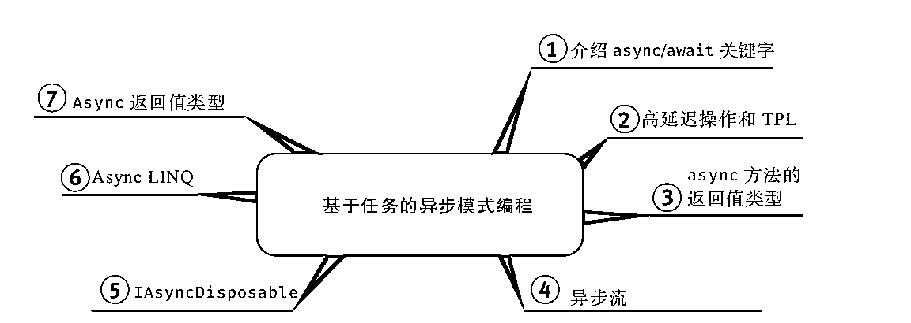

在第十九章中我们了解到，任务是一个用于操作异步工作的抽象概念。多个任务可以被自动安排到多个线程中并行执行，类似于大程序由多个小方法组成，大一些的任务也可以被分解为若干小任务去完成。

但是，异步执行的任务也有缺点。其最主要的缺点便是会颠倒程序的逻辑，使得整个程序变得难于理解。本章将从一个发送 Web 请求的示例程序开始逐步展开介绍。示例程序会首先采用同步调用的方式发送 Web 请求，即发送请求之后便开始等待，直到 Web 服务器返回数据。由于 Web 请求是一个典型的高延迟 I/O 操作，因此接下来我们用异步任务来重写这个程序，这时你会看到，虽然在等待 Web 服务器返回的时候程序不再“卡死”，但是程序的逻辑开始变得令人费解。最后我们将使用来自 C# 5.0 的 async/await 关键字来解决这个困境。这一对关键字会大大简化异步任务程序设计，显著提高异步代码的可读性。

本章的最后将介绍 C# 8.0 带来的异步流：异步迭代器的定义以及使用方法。

## 20.1　同步执行高延迟操作

代码清单 20.1 使用 WebClient 下载网页并且统计下载内容中特定单词出现的次数。输出 20.1 为该示例程序的运行结果。

代码清单 20.1　同步 Web 请求

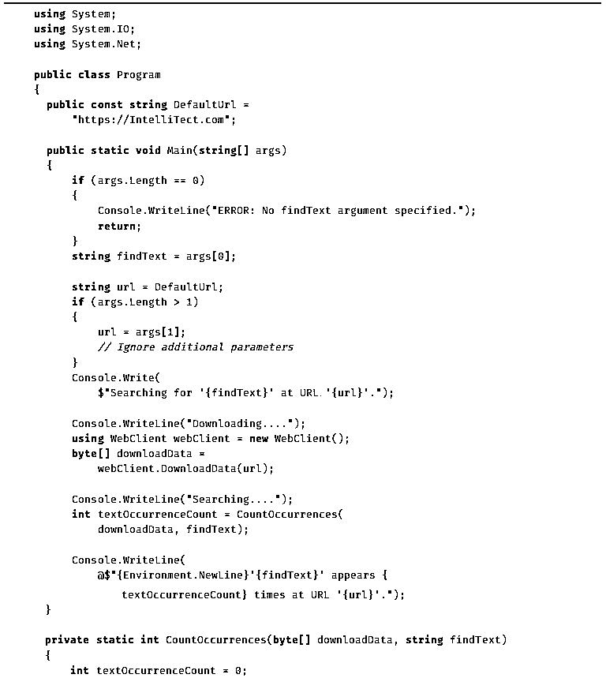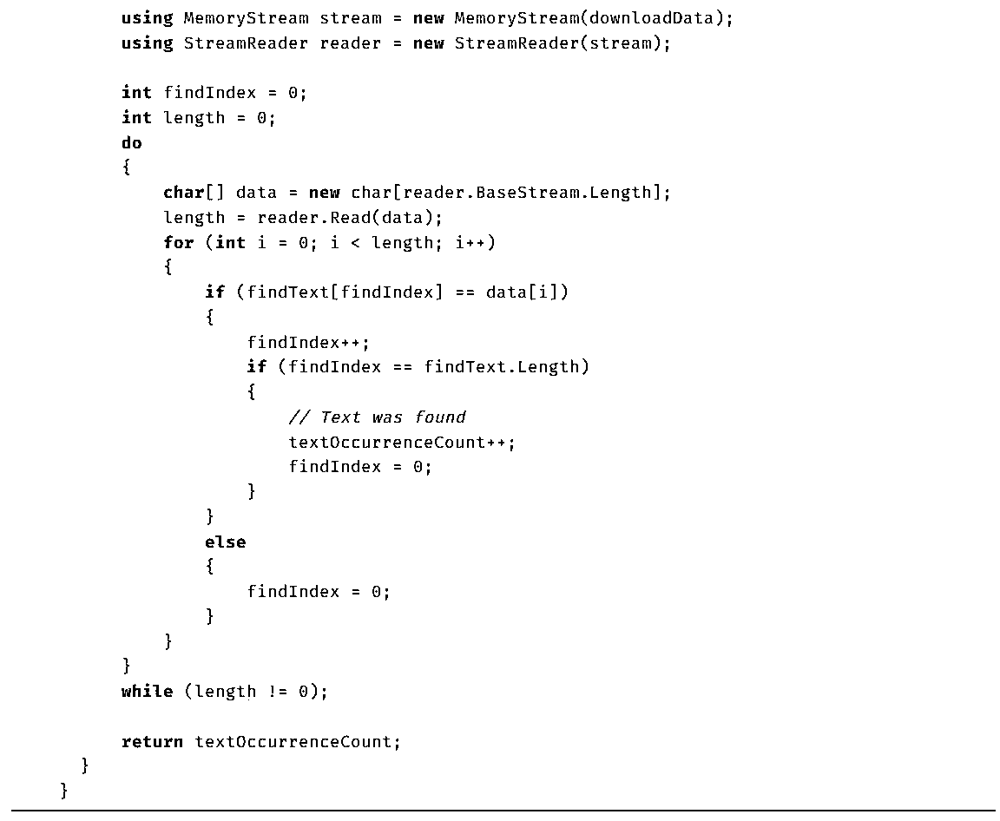

输出 20.1

代码清单 20.1 的逻辑相对直接，只使用了常见的 C#语句。程序从命令行参数中获得了网址和关键词之后，便创建一个 WebClient 类对象，并调用它的同步方法 DownloadData()来下载网页内容。数据下载完成后，调用 CountOccurrences()方法处理下载的数据。该方法将数据加载到 MemoryStream 对象中，然后利用 StreamReader 类的 Read()方法提取数据并在其中检索 findText 变量所指定的关键词。（虽然 WebClient 类的 DownloadString()方法更方便，但是为了方便在后面的代码清单 20.2 和 20.3 中改为异步调用，这里使用 DownloadData()。）

上面代码中的方法有一个问题：发起 Web 请求的线程会被 I/O 操作阻塞，直到操作完成才能恢复，而这将浪费一个线程的运算能力，它本可以在等待过程中做其他更有意义的工作。例如，我们可以在等待和缓慢接收网络数据的过程中向用户显示一个动态的进度。遗憾的是，在上面代码中，“Downloading…”（下载中……）和“Searching…”（检索中……）是在调用相应操作之前，而不是之中打印出来的。虽然这样做在这里并不重要，但想象一下，我们希望同时执行额外的工作，或者至少提供一个动态繁忙指示器。

## 20.2　使用 TPL 实现异步执行高延迟操作

为了在高延迟操作的过程中可以并行执行其他操作，代码清单 20.2 利用 TPL 实现了基于任务的异步调用。

代码清单 20.2　异步 Web 请求

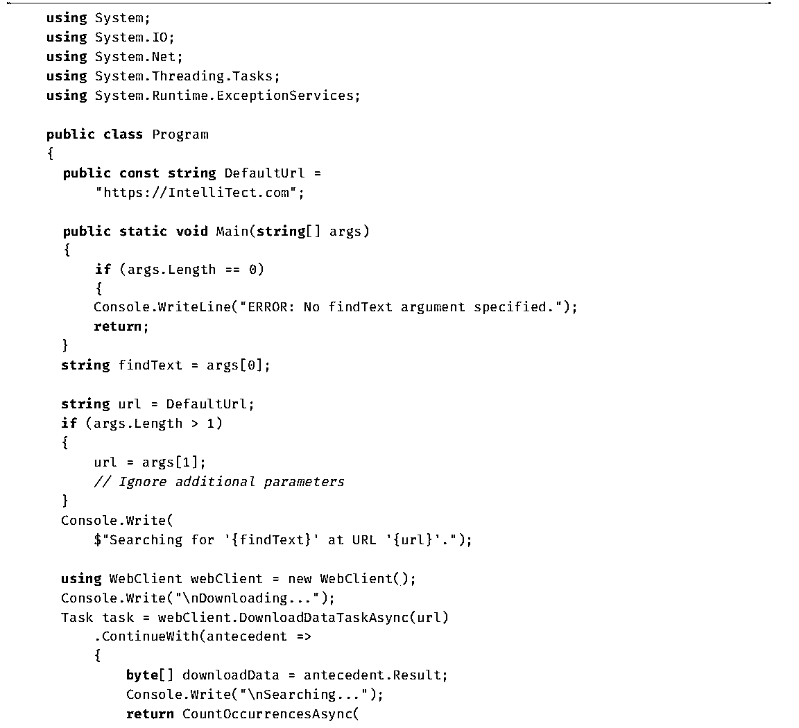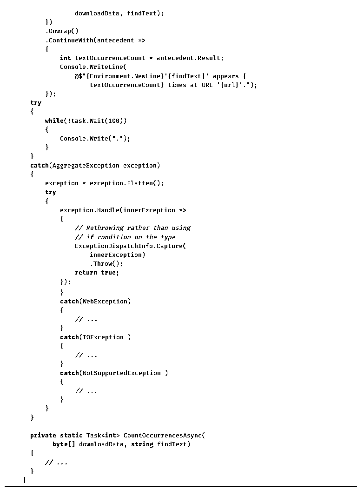

其输出与代码清单 20.1 相似，唯一的区别是，在下载网页和检索关键词的过程中，在“Download…”和“Searching…”两行打印的后面会显示更多的点，其数量取决于操作的实际耗时。这些点用于提示用户：操作正在正常进行中，请耐心等待。

当代码清单 20.2 执行时，它会在页面下载时向控制台打印带有附加句点的“Downloading…”；“Searching…”的情况也差不多。结果是，代码清单 20.2 不只是将四个句点（....）打印到控制台，而是能够在下载文件和搜索其文本所需的时间内连续打印句点。

但是，为了实现这个有用的异步特性，我们需要付出的代价是代码变得更加复杂。TPL 相关的语句不断地介入到业务流程的代码中。我们无法在异步操作 WebClient.DownloadDataTaskAsync(url)的后面直接写上检索关键词的代码（即调用异步版本的 CountOccurrences()），为了让异步操作正常工作，需要使用 ContinueWith()语句、调用 Unwrap()以及实现一套复杂的 try/catch 处理。更多细节请参考“高级主题：利用 TPL 实现异步请求的复杂性”。也正因为如此，我们应该庆幸从 C# 5.0 开始可以使用 async/await 关键字轻松实现基于任务的异步模式。

高级主题：利用 TPL 实现异步请求的复杂性

第一个 ContinueWith()语句用于决定 WebClient.DownloadDataTaskAsync(url)之后将做什么。程序在这个 ContinueWith()语句中将调用 CountOccurrencesAsync(downloadData, findText)，该方法返回的是另一个异步任务，其类型为 Task<int>。最后这个新异步任务将被直接返回 ContinueWith()语句，因此第一个 ContinueWith()语句实际的返回值类型为 Task<Task<byte\[\]>>。

接下来我们需要调用 Unwrap()，否则，第二个 ContinueWith()语句中的 antecedent 变量也将会是 Task<Task<byte\[\]>>，以至于我们不得不调用两次 Result()方法。第一次获得 Task<byte\[\]>任务对象，第二次才能获得该任务的执行结果数据，而这第二次对 Rusult()方法的调用又将被阻塞，直到 DownloadDataTaskAsync()操作完成并产生可被获得的结果（即下载的网页）。为了避免操作 Task<Task<TResult>>这样的结构所带来的麻烦，我们在第二个 ContinueWith()语句之前先调用一次 Unwrap()将外层 Task 脱去。这样不但方便后续操作，也有助于实现错误处理和请求取消。

然而，上述复杂性并没有止步于异步任务和 ContinueWith()语句，其后的错误处理也使得程序的复杂性又上升了一个维度。前文曾提到过，TPL 在异步任务遇到各种错误时一般会抛出 AggregateException 异常。但是由于我们需要在 ContinueWith()块内部调用 Result()方法提取任务结果，所以有时不得不在工作线程内部转发 AggregateException 异常。

前面章节曾介绍过多种方法用于处理这些异常：

1.我们可以通过 ContinueWith()方法给每一个返回异步任务对象的\*Async 方法添加下一步任务。但是这样做就无法利用流式 API 将多个 ContinueWith()语句按顺序串接在一起。此外，这个方案会迫使我们将错误处理逻辑深入地镶嵌到控制流程之中，从而无法依靠更强大的异常处理机制。

2.我们可以在每一个任务的委托里面放置 try/catch 块，以确保异常不会跑出任务，但是这个方案也不完美。首先，有些异常（比如由调用 antecedent.Result 产生的异常）被包装在 AggregateException 异常里面。捕获这种异常后需要先解包装拿到内部异常再处理。解包装后，要么再次将内部异常抛出，然后再次利用 try/catch 块处理，要么依次判断内部异常的类型再分别处理。显然，这样的异常处理代码非常臃肿，而更糟的是，由于每一个任务的委托里面都需要有独立的 try/catch 块，也就需要将这样臃肿的异常处理代码不断重复。即便有些异常处理的代码完全相同，也不得不重复写出。最后，主程序调用 task.Wait()时也可能抛出异常，因为 webClient.DownloadDataTaskAsync()或者 CountOccurrencesAsync()都可能抛出异常。这样的异常没有别的地方能够捕获，因此仍然不可避免将一部分异常处理放在主程序里。

3.代码清单 20.2 中的程序并没有直接捕获从 DownloadDataTaskAsync()里面抛出的异常，相反，它在 Main 方法中将 task.Wait()包裹在 try/catch 块中。因为可以肯定如果捕获到了异常，则其类型一定是 AggregateException，所以该 try/catch 块只有一个针对该异常的捕获块。捕获到该异常后，调用 AggregateException.Handle()来获得内部异常（即代码中的 innerException 对象），然后使用 ExceptionDispatchInfo 类将所获得内部异常重新抛出。使用该类能够从异常信息中避免丢失原始调用栈。可以看到，AggregateException.Handle()被包裹在第二个 try/catch 块中，而该块则负责捕获各种具体的异常类型，并分别进行处理。注意，在所有异常处理之前，我们调用了 AggregateException 异常类的 Flatten()方法。AggregateException 类型的异常对象有可能层层嵌套而将真正的内部异常包裹在最里面，这时 Flatten()方法可以确保移除不需要的 AggregateException 包裹层而将内部异常提取出来。

代码清单 20.2 中的代码采用了上述第三种方案。实际上，这就是最佳方案了。虽然它不能降低异常处理的复杂性，但是能够尽量避免将异常处理代码混入主要控制流程之中。

总之，虽然采用异步任务的代码清单 20.2 与同步版本的代码清单 20.1 拥有非常相似的逻辑流程，即两个版本都要先请求网页，然后等待下载完成。如果下载成功，则检索关键词；否则，分析异常类型，执行相应处理。但是，显然，由于代码清单 20.2 采用了异步任务，因此比同步版本的代码清单 20.1 更加难以阅读、理解和维护。同步版本的程序只使用了基本的控制语句，而异步版本则不得不使用很多 lambda 表达式将任务逻辑实现于委托当中。

而这只是一个简单的示例程序。想象一下，在下载网页的时候，如果连接失败需要重试三次，那么在同步版本的程序中，只需增加一个循环即可，但在异步版本中应该怎么做？如果程序一次接受并处理多个网址而不是一个，又该怎么做？而如果要同时实现这些特性呢？这些特性在同步程序里实现往往相当直接，而在异步程序里，事情就会变得非常混乱。若要将一个同步程序重新实现为异步版本，即使其控制流程非常简单，程序也会很快变得复杂起来。

## 20.3　使用 async/await 实现基于任务的异步模式

为了解决前述的困境，代码清单 20.3 使用了 C# 5.0 引入的 async/await 关键字来实现异步执行。async/await 关键字让编译器来承担异步程序的复杂性，从而使程序员可以集中精力实现真正的业务逻辑。只需要在应该异步执行的代码上用 async/await 关键字来标记一下，编译器就可以帮你做好所有复杂的工作。你不必再考虑串接 ContinueWith()语句、调用 Results()方法获取结果、调用 Unwrap()方法，以及复杂的错误处理等。如果有后继任务需要等待前驱任务先成功完成再执行，编译器也会自动安排恰当的线程来实现这个要求。在程序中，通常不允许由两个线程同时操作 UI（用户界面），而使用 async/await 关键字便可以轻松解决这个问题（可参考 20.11 节）。

在代码清单 20.3 中你可以看到 async/await 如何简单地让编译器在编译期识别异步代码^( [\[1\]](part0168.xhtml#ch1_back) ) 。

代码清单 20.3　通过基于任务的异步模式实现异步高延迟操作

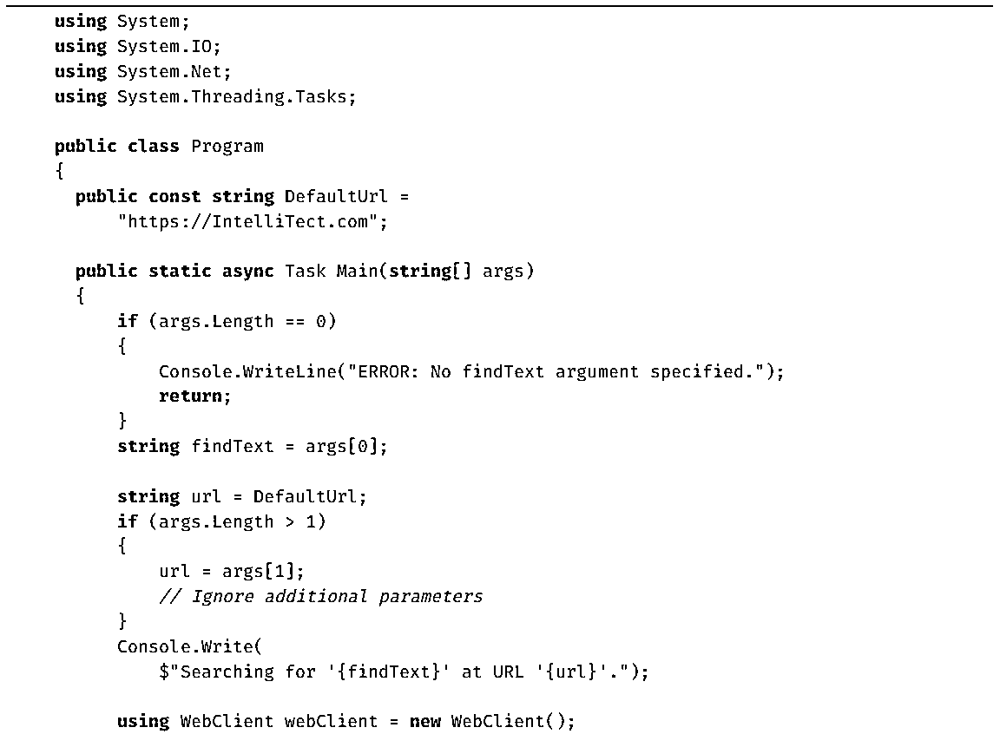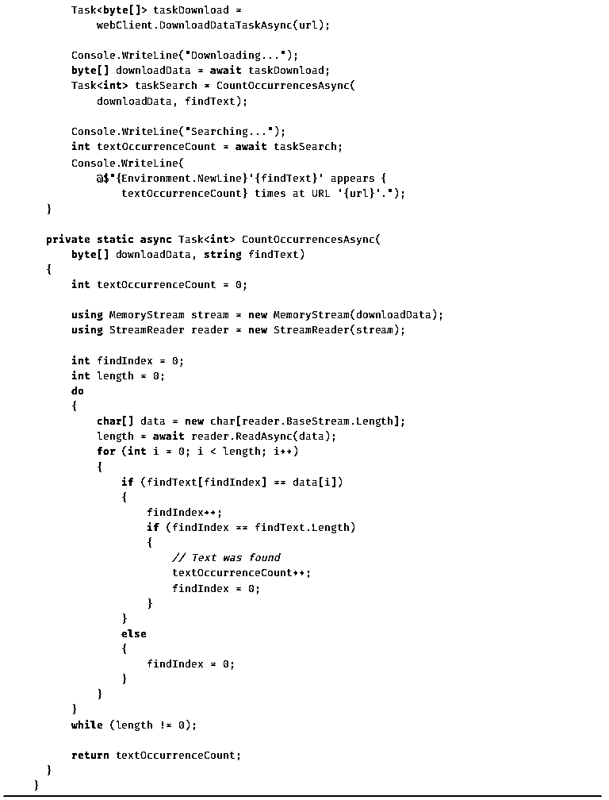

代码清单 20.3 和 20.1 中的代码看起来差别不大，却可以在下载过程中不断打印点号以提示进度。这刚好体现了 async/await 关键字的优越性：只需通过很小的改动，便可将同步代码改为异步模式。

仔细观察上面代码中的异步编程模式，首先会发现 CountOccurrencesAsync()方法与代码清单 20.1 中有两处不同。其一，方法签名上使用了 async 关键字，表明当该方法被调用时将发生异步执行。其二，该方法返回的是一个 Task<int>类型对象而不是一个单纯的 int。任何具有 async 关键字的方法都必须返回一个有效的异步返回值类型 ^( [\[2\]](part0168.xhtml#ch2_back) ) 。这可以是 void（表示不返回任何对象），也可以是一个 Task、Task<T>、ValueTask<T>（从 C# 7.0 开始）或 IAsyncEnumerable<T>/IAsyncEnumerator<T>（从 C# 8.0 开始）。在这个示例代码中，CountOccurrencesAsync()方法需要返回关键字出现的次数，因为它返回 Task<int>以便让调用者提取数据。而如果一个异步方法实际上并不返回数据，也可以返回 Task 类对象，至少可以让调用者获取异步任务的执行状态，比如可以检查异步任务是否已完成。其次，对于异步执行的方法，习惯上会在名称的末尾添加“Async”词尾，以便指名该方法的执行方式。最后，在 CountOccurrencesAsync()方法内部，当需要调用其他异步方法并且等待其执行结果时，可以在调用时使用 await 操作符。在示例代码中，调用 reader.ReadAsync()方法时便使用了这个操作符，这是因为 StreamReader.ReadAsync()与 CountOccurrencesAsync()一样，都是异步方法。

回到 Main()方法，可以看到类似的变化。当调用 CountOccurrencesAsync()方法时，使用了 await 操作符，从而掩盖了异步任务带来的复杂性。当使用 await 直接调用异步方法时，可以将其返回值直接赋值给其逻辑上的返回值类型，比如本例中的 int（而不再需要 Task<int>）。如果一个异步方法的返回值类型为无类型参数的 Task，则可以认为该方法实际上不返回数据。

请注意，在上面代码中，CountOccurrencesAsync()方法的声明如下：

虽然该方法的实际返回值类型为 Task<int>，但当使用 await 操作符调用时，其返回值为 int：

从这里我们可以看到 await 操作符带来的一个方便特性：它会自动将逻辑上的返回值从 Task 对象中提取出来。

如果在异步操作的执行期间可以在一定程度上同时执行其他代码，那么可以直到并行的工作结束再调用 await 去等待和提取异步操作的结果。在前面的代码中，调用 webClient.DownloadDataTaskAsync(url)的代码就是这样的例子。它没有用 await 简单地等待该方法结束，而是在异步任务下载数据的同时输出点号。直到 taskDownload.Wait(100)返回 true 才调用 await 提取下载数据。

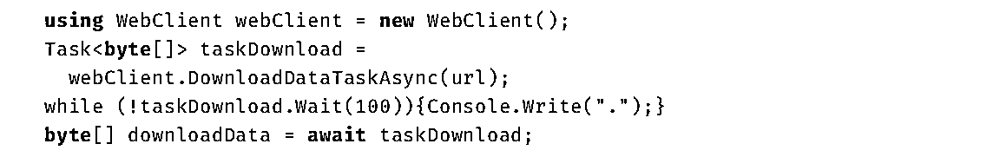

除了提取异步任务的返回数据之外，await 操作符还会告诉 C#编译器将其后的代码放到恰当的线程中去执行。这其实是使用 await 操作符的一个更关键的好处，它可以避免很多错误的发生。

为了更好地解释控制流程，图 20.1 将每一个异步任务及其执行的内容画在了不同的列中。这张图可以帮助你消除两个错误概念。

·错误概念 1：具有 async 关键字的方法被调用时会自动运行于子线程中。 这个观点绝对错误。即使一个方法具有 async 关键字，它也会默认地运行于调用者的线程中。如果该方法内没有用 await 等待任何“可等待”的任务，那么它便会像普通方法一样在调用者的线程中同步执行。该方法需要启动异步任务以便开始真正的异步执行，只使用 async 关键字并不会改变执行线程。此外，从调用者的角度看，调用具有 async 关键字的方法与调用普通方法并无差别。它仅仅是一个只能返回某一种异步类型的方法。例如，在前面的示例程序中，CountOccurrencesAsync()方法返回的是一个 Task<int>对象。收到这个返回值后，可以用 await 等待这个异步任务完成。

·错误概念 2：await 关键字会将当前线程暂停直到被等待的任务完成。 这个观点也不正确。当调用一个具有 async 关键字的异步方法时，当前线程会像调用普通方法一样，进入到被调用的异步方法中执行。而当在异步方法中首次遇到 await 关键字时，当前的“执行路线”便会被分成两条“岔路”，一条“岔路”仍然是当前线程，它会立即返回到调用者那里，继续执行后续代码；另一条“岔路”一般是一个自动分配的子线程，这个子线程会等待 await 关键字右边的异步任务完成，之后继续执行异步方法中的后续代码。此时，已经回到调用者的当前线程与继续执行异步方法的子线程并行执行。因此当前线程并不会被 await 关键字暂停，而是会从它开始“分叉”。

实际上，async 关键字的存在有两个意义。首先它明确提示阅读代码的人：该方法有可能会被编译器根据需要自动改写。其次它告诉编译器：在该方法内遇到 await 关键字时，那条语句将被异步执行。

从 C# 7.1 开始，Main 方法也可以是 async 的，因此我们在代码清单 20.3 中，将 Main 声明为 public static async Task Main(string\[\] args)。这样便可在 Main 方法内使用 await 操作符来执行其他异步方法了。不过，执行了异步操作之后，我们通过异步返回值来提取真正的返回数据，并且必须在程序结束之前，明确等待所有异步任务都结束，这样才能避免发生意外状况。

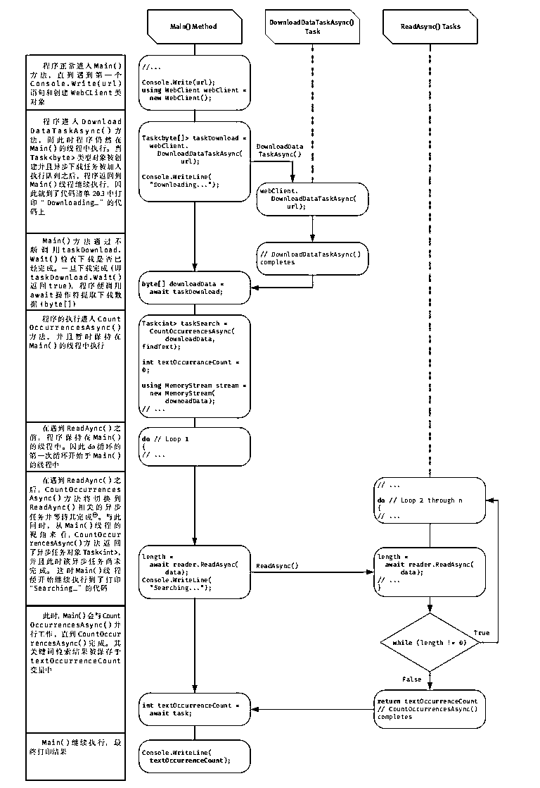

图 20.1　异步任务的执行次序

注①：实际上，此时 CountOccurrencesAsync()方法将切换到与 Main()不同的线程中。

特别地，C# 5.0 和 6.0 都规定 await 操作符不能在异常处理的 catch 语句或者 finally 语句中使用。然而，从 C# 7.0 开始，这个限制已经被取消。这一改变对编程很有帮助，我们可以在程序最外层的 catch 块中捕获所有尚未处理的异常，并且在程序被迫结束之前将出错信息保存在日志中。由于保存日志往往是一件比较耗时的操作，因此很有必要异步执行。

[\[1\]](part0168.xhtml#ch1) 书中的代码清单 20.3 不包含显示进度的代码，因此完全退化为同步模式的代码清单 20.1。若要正确理解作者的意图，请务必参考 Github 上随书附带的代码：https://github.com/IntelliTect/EssentialCSharp/blob/v8.0/src/Chapter20/Listing20.03.AsynchronousHighLatencyUsingTaskAsynchronyPattern.cs。——译者注

[\[2\]](part0168.xhtml#ch2) 从技术上讲，还可以返回实现 GetAwaiter()方法的任何类型。请参阅 20.8 节的“高级主题：有效异步返回值类型的扩展”。

## 20.4　异步返回值 ValueTask<T>

我们通常创建异步方法的目的是执行一些耗费时间的高延迟任务。由于异步方法必须返回 Task 或者 Task<T>对象，因此在返回之前需要先创建这两种类型之一的对象。返回 null 并不是个好主意，因为这样会迫使调用者总是去检查返回值是否为 null，非常恼人。实际上，相比异步任务，创建 Task 或 Task<T>对象的开销基本可以忽略。

如果异步方法提早返回该怎么办？假设要编写一个压缩指定数据块的方法，如果数据块很大，则有必要让压缩运算异步执行；但如果数据块很小甚至长度为 0，则无须异步执行，而只要同步运算一下便可直接返回结果。这种情况下，创建并返回 Task 或者 Task<T>对象便会成为没有必要的开销。在 C# 5.0 以及更早，对于这种情形我们没有更好的办法，但从 C# 7.0 开始，有了一种新的异步返回类型，它的 GetAwaiter()方法可以对这种情形有所帮助。具体请参考 20.8 节中的“高级主题：有效异步返回值类型的扩展”。

例如，如 C# 7.0 配套的.NET 框架提供了 ValueTask<T>类型。当异步方法无须执行异步任务，而是提前返回时，该类型可以提供轻量级的对象构造；反之，则可以转换为全功能的异步返回类型。代码清单 20.4 是一个压缩的示例程序，它展示了当需要提前返回时使用 ValueTask<T>类型的示例。

代码清单 20.4　从异步方法中返回 ValueTask<T>类型

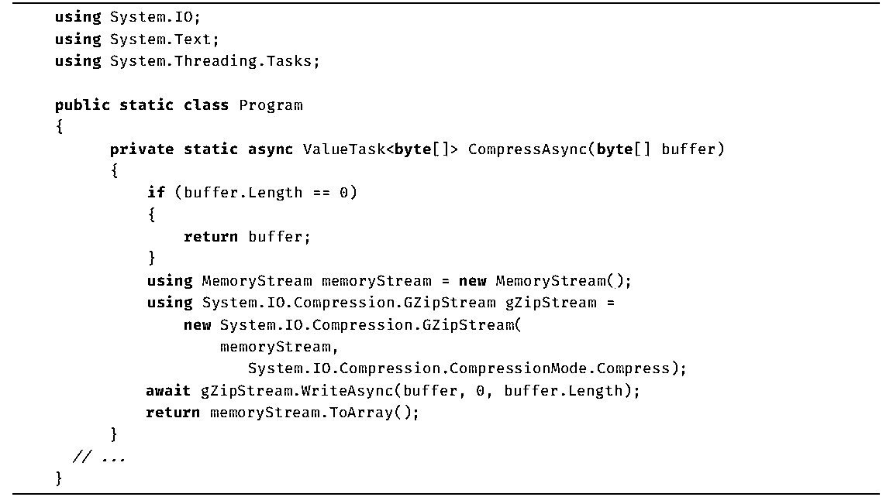

值得注意的是，即使异步方法 GZipStream.WriteAsync()返回的是 Task<T>对象，但是对它执行 await 的异步方法仍然可以返回 ValueTask<T>类型。实际上，无论上面的压缩方法使用 ValueTask<T>还是 Task<T>作为返回值，其内部代码均无须修改。

面对 ValueTask<T>、Task 和 Task<T>，应该如何正确选择其一来使用呢？如果一个异步方法没有返回值，只需使用 Task（没有非泛型版本的 ValueTask<T>，因为它没有任何好处）。如果异步方法中的操作有可能异步完成，或者有可能缓存常见的结果 Task 对象，则首选 Task<T>。例如，如果一个异步方法需要返回 bool 值，那么返回 ValueTask<bool>就不如 Task<bool>，因为事实上一个 Task<bool>对象只会包含 true 或 false 两个可能的值，所以可以预先创建两个包含两种可能值的对象并缓存起来，从而在异步方法即将退出时直接返回缓存的对象。事实上，异步框架会自动执行此操作，当返回同步完成的异步 Task<bool>方法时，总是会返回缓存的 Task<bool>对象。但是，如果操作可能同步完成并且不能有效地缓存所有常见的返回值，则 ValueTask<T>是更合适的选择。

初学者主题：常见的异步返回值类型解析

跟在 await 关键字后面的表达式一般为 Task、Task<T>或 ValueTask<T>类型。从语法的角度来看，对 Task 类型的 await 操作本质上等同于一个返回 void 的表达式。实际上，由于编译器甚至不知道任务是否返回结果，更不用说它是哪种类型，因此执行这种表达式等同于调用返回 void 的方法，也就是说，你只能在单行语句中使用它。代码清单 20.5 展示了一些 await 表达式。

代码清单 20.5　一些 await 表达式

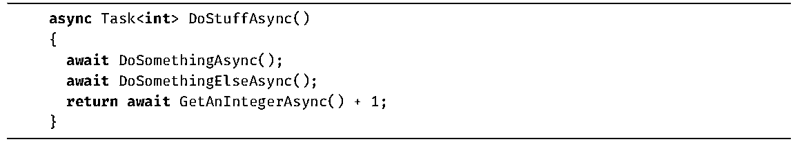

这里我们假设第一个方法返回一个 Task，而不是 Task<T>或 ValueTask<T>。在上面的代码中，由于我们假设前两个 await 语句中的异步任务不返回结果，因此它们都是单纯的语句；假设第三个 await 语句中的异步任务返回 Task<int>，因此可以将这条语句写成 DoStuffAsync()返回的任务值的运算式。

## 20.5　异步流

C# 8.0 提供了实现异步流 的能力，本质上是将异步模式与使用迭代器相结合。第十五章介绍过 C#中的集合都建立在 IEnumerable<T>和 IEnumerator<T>之上。前者有 GetEnumerator<T>()方法，它返回一个 IEnumerator<T>对象。使用该对象便可对集合进行迭代访问。有时，我们可能希望一个异步方法可以用 IEnumerable<T>或 IEnumerator<T>作为返回值，并且在方法内部异步地产生可供调用者获取的集合元素。但是异步方法返回的对象必须支持 GetAwaiter()方法，就像 Task、Task<T>和 ValueTask<T>所做的那样。因此这里就产生了矛盾：你不能同时使用异步方法和迭代器。如果要在异步方法中迭代一个集合，你不能将结果随时传递给调用者，只能先将所需的迭代做完。

为了解决这个问题，C# 8.0 提供了 yield return 语句帮助实现异步集合以及异步迭代。使用该语句，你可以在异步方法中异步地产生可被迭代的数据。

下面来看一个例子。假设要实现一个异步方法 EncryptFilesAsync()，接受一个给定的目录，对目录里的文件进行加密。代码清单 20.6 给出了实现方法。

代码清单 20.6　异步流

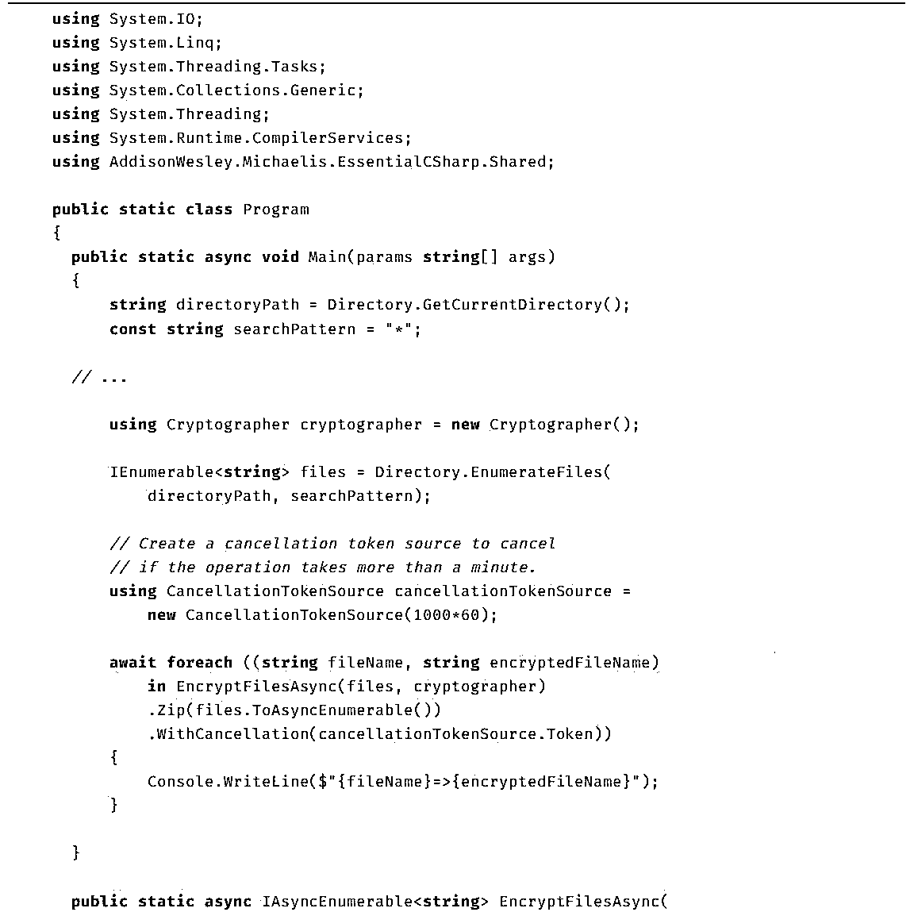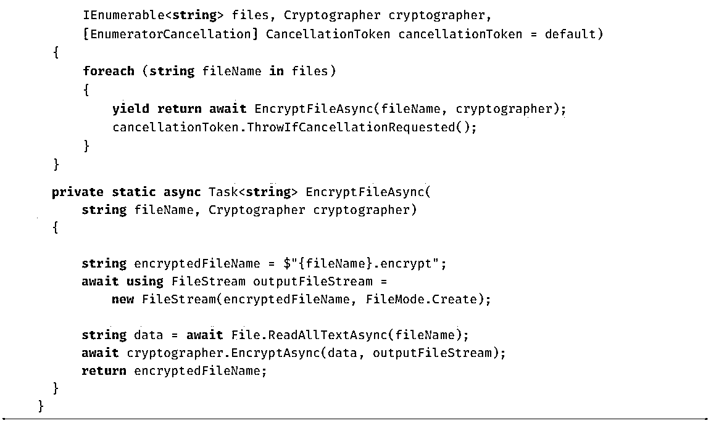

代码清单 20.6 始于 Main()方法，其中有一个 C# 8.0 引入的新语句——async foreach，我们用它来迭代异步方法 EncryptFilesAsync()的返回值。（稍后再介绍 WithCancellation()的作用。）在 EncryptFilesAsync()方法的内部使用 foreach 循环迭代每个指定的文件。在该 foreach 循环中，对每个指定的文件，都调用另一个异步方法 EncryptFileAsync()方法进行处理^( [\[1\]](part0170.xhtml#ch1_back) ) 。该方法中有两个异步方法调用：第一个是调用 File.ReadAllTextAsync()，它读取文件的所有内容。一旦内容读到内存中后，代码便调用 EncryptAsync()方法进行加密，然后将加密后的新文件返回到前面的 foreach 循环中，接着再通过 yield return 语句将新文件名返回给 Main()方法中的 async foreach 代码块。该示例代码展示了向调用者提供异步迭代器的方法。这里的关键是：（1）EncryptFilesAsync()方法使用 async 声明为异步方法；（2）该方法返回 IAsyncEnumerable<T>对象而不是 Task<T>（代码中的 T 为字符串）；（3）在异步方法中使用 yield return 向调用者异步地提供可迭代的数据；（4）调用者使用 await foreach 对异步流进行异步迭代。

GetAsyncEnumerator()的声明中包含一个 CancellationToken 参数。由于 await foreach 循环生成调用 GetAsyncEnumerator()的代码，因此注入取消令牌并提供取消的方法是通过 WithCancellation()扩展方法（如图 20.2 所示，IAsyncEnumerable<T>上没有直接使用 WithCancellation()方法）。要支持异步流方法中的取消，需要添加可选的 CancellationToken 和 EnumeratorCancellationAttribute，如 EncryptFilesAsunc 方法声明所示：

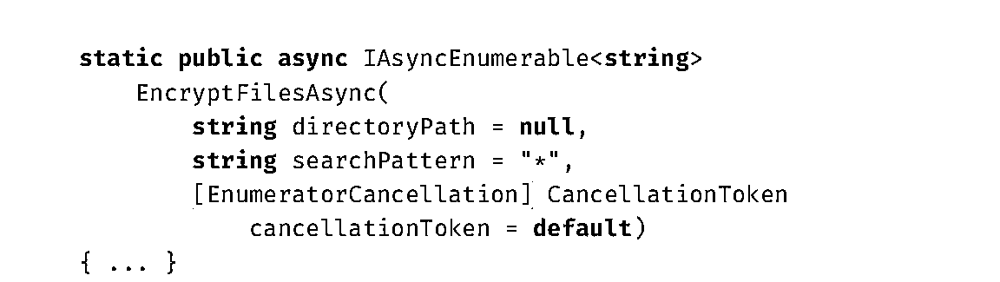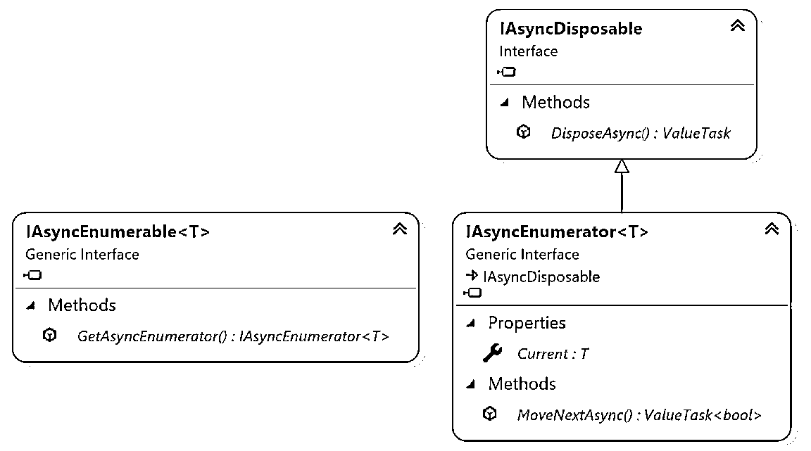

图 20.2　IAsycnEnumerable<T>以及相关接口

在代码清单 20.6 中，我们实现了一个异步方法返回 IAsyncEnumerable<T>接口对象，因此调用者可以将它当作异步流来迭代。如果一个集合类不支持异步迭代器，也可以像代码清单 20.7 所展示的那样，自行实现一个类，让它继承 IAsyncEnumerable<T>接口并实现 GetAsyncEnumerator()方法。这样便也可以使用 await foreach 对其进行迭代。

代码清单 20.7　使用 await foreach 迭代异步流

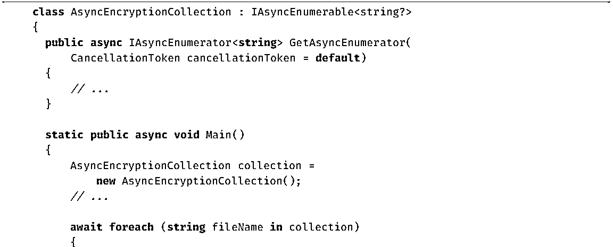

再次强调一点：一个方法被声明为异步的（使用 async 关键字）不会自动导致对它的调用并行运行。所以仅仅因为 EncryptFilesAsync()方法是异步的，并不意味着迭代每个文件并调用 File.ReadAllTextAsync()和 Cryptographer.EncryptAsync()将并行发生。为了保证并行执行，需要在异步方法中使用 await 执行其他异步任务，或使用类似 System.Threading.Tasks.Parallel.ForEach()的方法（参见第二十一章）。

IAsyncEnumerable<T>接口及其伙伴接口 IAsyncEnumerator<T>是图 20.2 中所示的 C# 8.0 新增功能。这些异步接口与它们的同步版本（IEnumerable<T>和 IEnumerator<T>）相对应。请注意，IAsyncDisposable.DisposeAsync()和 IAsyncEnumerator<T>.MoveNextAsync()方法都是 IEnumerators<T>中等效方法的异步版本，而 Current 属性则不是异步的。（此外，在异步实现中没有 Reset()方法。）

[\[1\]](part0170.xhtml#ch1) 第二个方法名称中的文件“File”一词为单数，没有字母 s。——译者注

## 20.6　IAsyncDisposable 接口以及 await using 声明和语句

IAsyncDisposable 是 IDisposable 的异步版本，因此可以使用 C# 8.0 中新的 await using 声明 或语句 来调用它。在代码清单 20.6 中，声明 outputFileStream 时便使用了 await using 声明，这是因为 FileStream 不但实现了 IAsyncEnumerable<T>，也实现了 IAsyncDisposable。与 using 声明一样，用 async using 声明的变量也不能被重新赋值。

await using 语句与 using 语句的语法完全相同：

只要一个类型实现了 IAsyncDisposable 或者仅仅具有 DisposeAsync()方法，便可使用 await using 声明或语句来声明变量。C#编译器在声明周围以及变量超出作用域之前注入了一个 try/finally 块，并在 finally 块中调用 await DisposeAsync()^( [\[1\]](part0171.xhtml#ch1_back) ) 。这样便可确保所有资源都被清除。

请注意，IAsyncDisposable 和 IDisposable 不通过继承相互关联。因此，它们的实现也不相互依赖：其中一个可以在没有另一个的情况下单独实现。

[\[1\]](part0171.xhtml#ch1) 在 finally 块中使用 await 是 C#6.0 新增的。

## 20.7　使用 LINQ 和 IAsyncEnumerable

在代码清单 20.6 的 await foreach 语句中，我们使用了 LINQ AsyncEnumberable.Zip()将加密后的文件名与原文件名相关联。

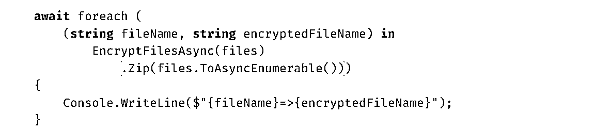

正如你所希望的，AsyncEnumerable 为 IAsyncEnumerable<T>提供了 LINQ 功能。但是，这个库并没有在 BCL 里。若要在程序中使用异步 LINQ，需要在工程中添加 System.Linq.Async NuGet 包。

AsyncEnumerable 就定义在 System.Linq 中（而不是在一个具有异步功能且完全不同的命名空间中）。它包含了标准的 LINQ 操作符的异步版本，例如，上面代码中使用的 Where()、Select()和 Zip()方法。因为它们是在 IAsyncEnumerable 而不是在 IEnumerable<T>中的扩展方法，所以被认为是“异步版本”的方法。此外，AsyncEnumerable 还包括一系列名字以\*Async()、\*AwaitAsync()和\*AwaitWithCancellationAsync()结尾的方法。代码清单 20.8 列举了这些方法的 Select\*()版本。

代码清单 20.8　AsyncEnumerable 中 Select\*()方法的声明

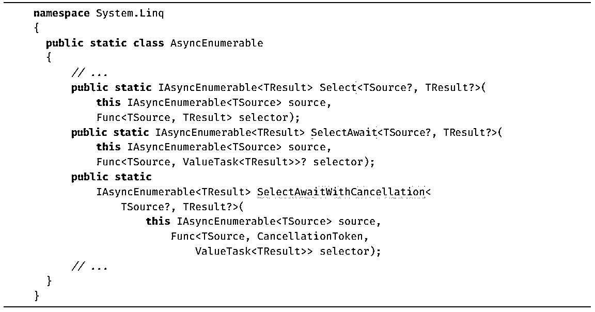

与 Enumerable 版本相匹配的方法名称（在本例中为 Select()）大都具有类似的“实例”方法签名，但 TResult 和 TSource 是例外。名称中带有“Await”的两个方法签名都采用了异步签名，其中包括一个返回 ValueTask<T>的选择器。例如，可以通过 SelectAwait()来调用代码清单 20.6 中的 EncryptFileAsync()方法，如下所示：

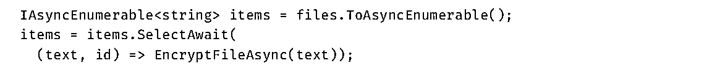

需要注意的一点是：EncyryptFileAsync()方法返回的是一个 ValueTask<T>对象，这是为了符合\*Await()和\*AwaitWithCancellationAsync()的要求，当然后者还允许指定一个用于取消操作的 token。

另一个值得一提的异步 LINQ 方法是代码清单 20.6 中使用的 ToAsyncEnumerable()方法。由于异步 LINQ 方法使用 IAsyncEnumerable<T>接口，因此需要使用 ToAsyncEnumerable()将 IEnumerable<T>转换为 IAsyncEnumerable<T>。类似地，可以用 ToEnumerable()方法进行相反的转换。（当然，在面前的示例代码中，我们刻意地使用了 files.ToAsyncEnumerable()来获取 IAsyncEnumerable<string>接口，其目的是展示 ToAsyncEnumerable()的应用。）

异步 LINQ 方法的“标量”版本与 IEnumerable<T>类似，也具有\*Await()、\*AwaitAsync()和\*AwaitWithCancellation()系列方法。关键的区别在于它们都返回一个 ValueTask<T>对象。以下代码展示了使用 AverageAsync()方法的示例：

这样我们就可以利用 await 将其返回值直接提取成为 double 类型，从而可以忽略其实际的类型：ValueTask<double>。

## 20.8　返回 void 的异步方法

我们研究了几种有效的异步返回类型，包括 Task、Task<T>、ValueTask<T>和现在的 IAsyncEnumerable<T>，所有这些都支持 GetAwaiter()方法。但是，有一种允许使用的返回值类型（也可以说它并不是一种类型）不支持 GetAwaiter()。此返回值类型也可用于异步方法，它就是 void。我们接下来将简称它为“异步 void”方法 。在大多数情况下，应避免使用 async void 方法，甚至可以完全忽略它的存在。与那些支持 GetAwaiter()的返回值类型不同，当一个异步方法返回 void 时，调用者无法得知该异步任务何时完成。如果发生异常，则返回 void 的异步方法便无法报告异常。在这种情况下，在 async void 方法上抛出的任何异常都可能最终出现在 UI 的 SynchronizationContext 上——实际上，最终会成为一个未处理的异常（请参阅第十九章中的“高级主题：处理线程上的未处理异常”）。

如果通常应避免使用 async void 方法，那么为什么没有将它们彻底禁止？这是因为 async void 方法可用于编写异步的事件处理程序。如第十四章所述，事件处理程序应被声明为 EventHandler<T>，它具有以下形式的签名：

因此，为了符合与 EventHandler<T>签名相匹配，异步事件处理程序需要返回 void。或许你会有疑问：是否可以修改 EventHandler<T>的签名？问题是，（如第十四章所述）一个事件可能有多个订阅者，而从多个订阅者那里检索返回值是不直观且烦琐的。出于这个原因，指导原则是：尽量避免使用 async void 方法，除非它们是事件处理程序的订阅者。当然，在这种情况下，它们应该避免抛出异常。或者，也可以提供一个同步上下文来接收同步事件通知，如启动任务（例如 Task.Run()）以及处理所有未处理的异常。代码清单 20.9 和对应的输出 20.2 提供了如何执行此操作的示例。

代码清单 20.9　捕获 async void 方法中的异常

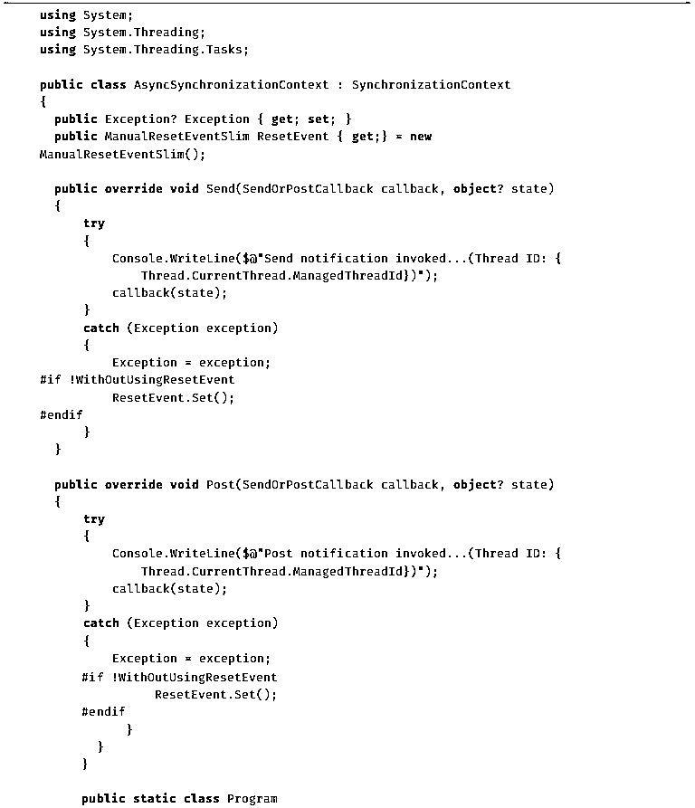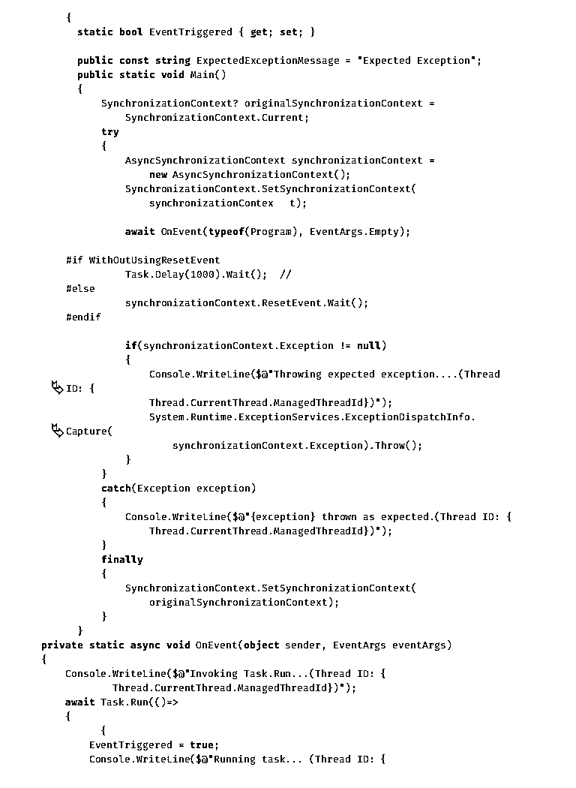

输出 20.2

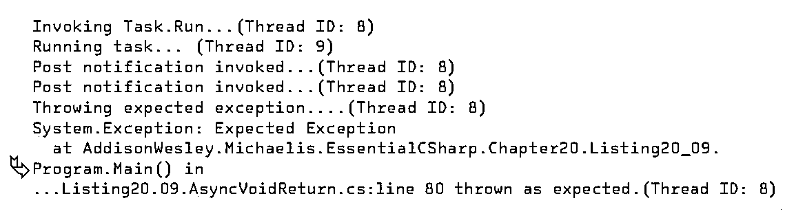

代码清单 20.9 中的代码起初按顺序执行，直到 OnEvent()中的 await Task.Run()开始运行。该异步任务完成后，控制将传递给 AsyncSynchronizationContext 中的 Post()方法。Post()执行完成后，接下来 Console.WriteLine("throw Exception...")方法开始执行，然后抛出异常。此异常由 AsyncSynchronizationContext.Post()方法捕获并传递回 Main()。

在这个例子中，我们使用 Task.Delay()来推迟异步任务的结束，确保程序不会在 Task.Run()调用之前结束。在现实中，如第二十二章将会介绍的，使用 ManualResetEventSlim 将是首选方法。

高级主题：有效异步返回值类型的扩展

await 关键字后面的表达式的类型通常为 Task、Task<T>、ValueTask<T>，偶尔为 void，或者在 C# 8.0 中也可以为 IAsyncEnumerable<T>或 IAsyncEnumerator<string>。从规则上讲，await 支持的返回类型比这几种具体类型更一般化：它要求类型为可等待类型，即包含一个名为 GetAwaiter()的方法。该方法生成并返回一个对象，该对象具有编译器重写程序逻辑所需的一些属性和方法。具体来说，该对象需要实现 INotifyCompletion 接口并且有一个 GetResult()方法。通过这个一般化的规则，系统可以很容易地被第三方扩展。换句话说，如果你想设计自己的非基于任务的异步系统，而是使用一些其他类型来表示异步工作，可以通过遵循上述规则来实现支持 await 语法。

在 C# 8.0 之前，异步方法不允许返回除 void、Task、Task<T>或 ValueTask<T>以外的内容，无论在方法内部等待哪种类型。但是 C# 8.0 利用更通用的 GetAwaiter()规则实现了对 IAsyncEnumerable<T> / IAsyncEnumerator<string>异步返回值的支持。

## 20.9　异步 Lambda 表达式和本地函数

正如一个 Lambda 表达式可以简便地转换为委托一样，C# 5.0（及更高版本）也允许将包含 await 表达式的 Lambda 表达式转换为委托：只需要在 Lambda 表达式之前添加 async 关键字即可。在代码清单 20.10 中，我们首先将一个异步 Lambda 赋值给 Func<string, Task> writeWebRequestSizeAsync 变量，然后使用 await 操作符来调用它。

代码清单 20.10　用 Lambda 表达式实现异步服务器-客户端交互

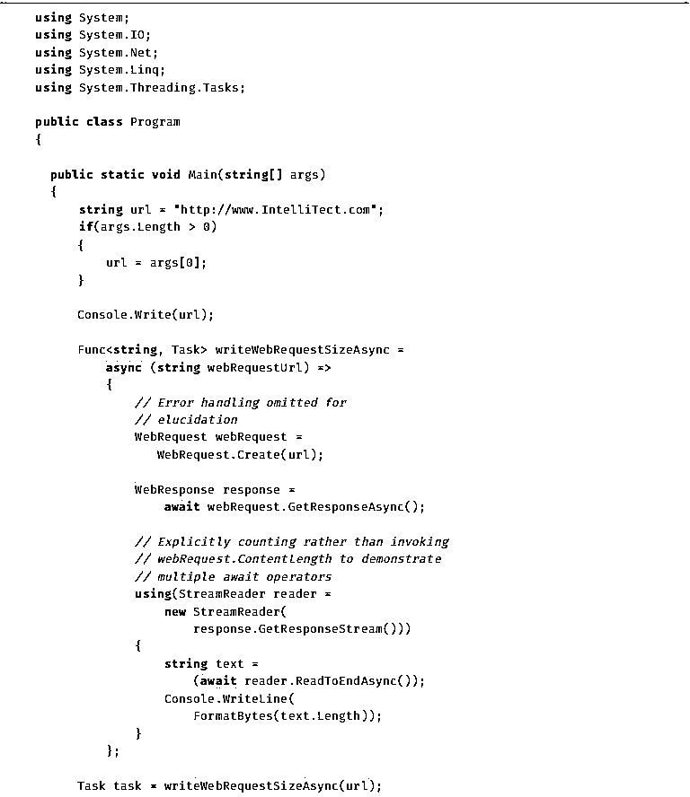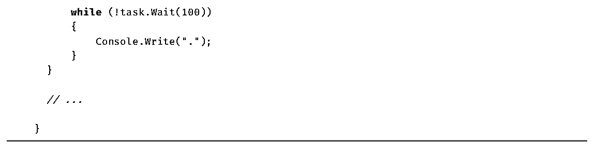

类似地，在 C# 7.0（及更高版本）中，也可以使用本地函数来代替 Lambda 表达式。例如，可以将代码清单 20.10 中的 Lambda 表达式（从表达式开始到=>操作符为止）改为如下形式：

函数主体中的其他内容，包括一对大括号，都不用修改。

注意，async Lambda 表达式与普通的 async 方法拥有相同的限制：

·async Lambda 表达式的返回值必须也是符合规则的类型。

·重新改写的 Lambda 表达式使用 return 语句通知调用者异步任务已经完成。

·在执行刚进入异步 Lambda 表达式时，也会先同步执行直到遇到第一个 await 语句才开始异步执行。

·await 之后的所有指令将作为从异步方法返回处的延续执行（如果可等待任务已经完成，则将简单地同步执行而不是作为延续）。

·async Lambda 表达式也可以通过 await 操作符来调用（代码清单 20.10 没有体现这一点）。

初学者主题/高级主题：实现自定义的异步方法

通过使用 await 关键字调用其他异步任务来实现异步方法相对容易。但是最终总是需要创建一个“最外层”的异步方法来返回异步任务对象。例如，考虑创建一个用于运行其他命令行程序的异步方法，其最终目标是可以获得所运行的程序的输出。这样的方法可被声明如下：

最简单的实现方法是依赖 Task.Run()并调用 System.Diagnostics.Process 的 Start()和 WaitForExit()方法。然而当被调用的进程本身拥有自己的一个或多个线程集合时，在当前进程中创建一个额外的线程是不必要的。要实现 RunProcessAsync()方法并在调用的进程完成时返回调用者的同步上下文，我们可以依赖 TaskCompletionSource<T>对象，如代码清单 20.11 所示。

代码清单 20.11　实现自定义异步方法

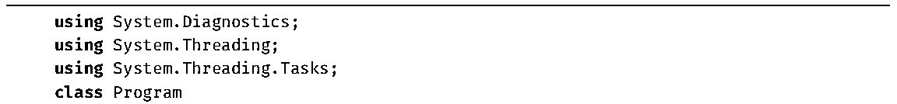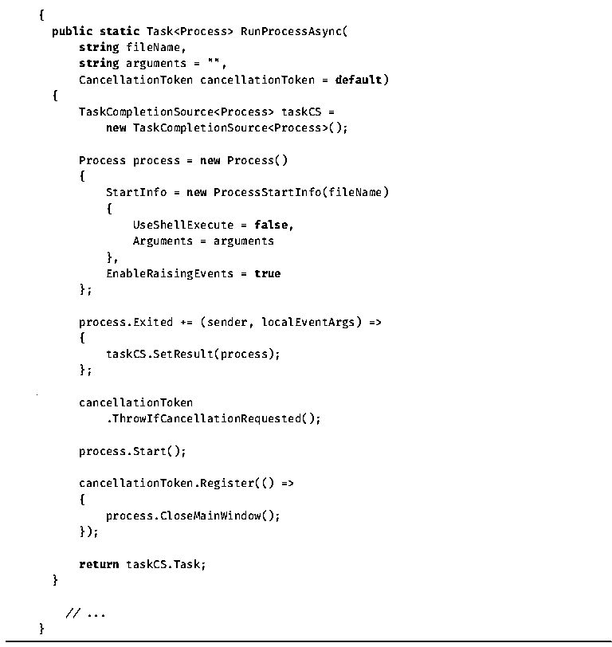

请暂时忽略上面代码中的高亮部分，先观察一下当进程结束时使用事件进行通知的方式。由于 System.Diagnostics.Process 支持进程退出时通告，因此我们注册此通告并在回调中调用 TaskCompletionSource.SetResult()。清单 20.11 中的代码遵循一个相当常见的模式。可以使用它来创建异步方法，而不必求助于 Task.Run()。

异步方法需要的另一个重要特性是取消机制。TAP（基于任务的异步模式）依赖于与 TPL（基于任务的并行库）相同的取消机制，即使用 System.Threading.CancellationToken。代码清单 20.11 突出显示了实现取消机制所需的代码。在这个例子中，我们允许在进程开始之前取消，以及尝试关闭应用程序的主窗口（如果有的话）。更激进的方法是调用 Process.Kill()，但此方法可能会导致正在执行的程序出现问题。

请注意，在进程开始之前，我们不会注册取消事件。这避免了在进程实际开始之前触发取消时可能引发的任何竞争条件错误。

最后一个有必要实现的功能是进度显示。代码清单 20.12 是 RunProcessAsync()的完整版本。

代码清单 20.12　带有进度显示的自定义异步方法

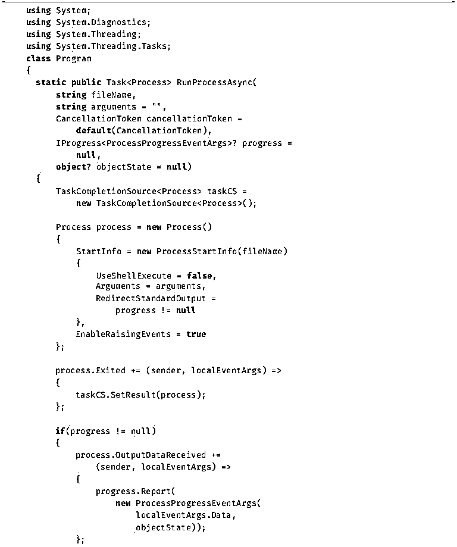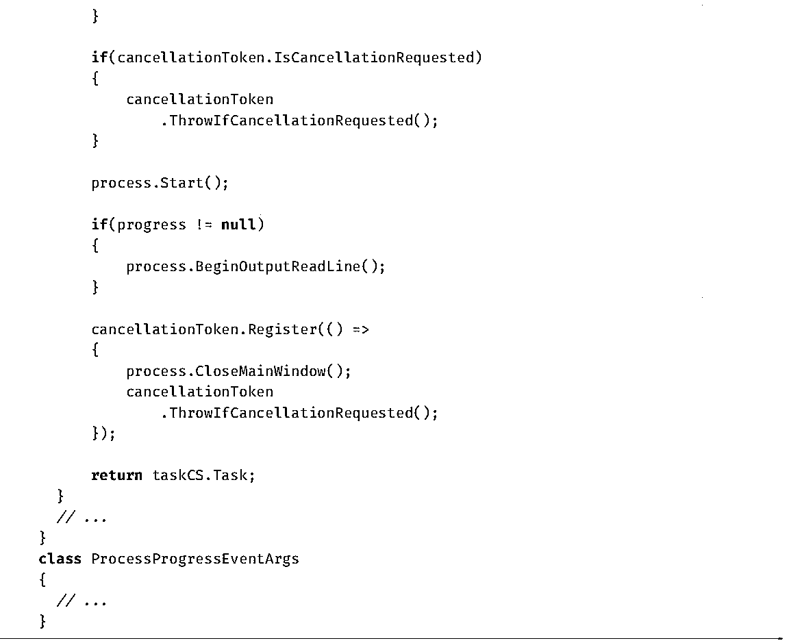

准确地了解异步方法中发生的事情可能很困难，但这远没有比试图弄清楚 Lambda 表达式中的异步代码在做什么更困难。因此，在编写异步程序时请记住以下要点：

·当程序执行到 await 关键字时，它右侧的表达式会生成一个异步任务^( [\[1\]](part0174.xhtml#ch1_back) ) ，同时当前程序的执行会返回到调用者那里。从此开始，调用者后续的语句便和异步方法（假设它尚未完成）并行执行。

·异步任务完成后，异步方法内的程序便从 await 之后恢复执行。如果等待的任务产生结果，则获得该结果，否则抛出异常。

·异步方法中的 return 语句导致与方法调用相关联的异步任务完成。如果 return 语句有值，则返回的值成为任务的执行结果。

[\[1\]](part0174.xhtml#ch1) 从技术上讲，它是一种可等待类型，如“高级主题：有效异步返回值类型的扩展”中所述。

## 20.10　任务调度器和同步上下文

本章有时会提到任务调度器及其在将任务分配给线程方面的作用。从编程的角度看，任务调度器是 System.Threading.Tasks.TaskScheduler 类的一个实例。默认情况下，这个类使用线程池来适当地调度任务，并确定如何安全有效地执行它们，包括何时重用、销毁这些任务，或是创建额外的任务。

也可以创建自己的任务调度器实例。通过从 TaskScheduler 类派生一个新的类来对如何调度任务定制适合自己的算法。此外，通过静态方法 FromCurrentSynchronizationContext()可以获得一个特殊的 TaskScheduler 实例，它可以将任务调度到当前线程（或更准确地说，调度到与当前线程关联的同步上下文 ），而不是不同的工作线程^( [\[1\]](part0175.xhtml#ch1_back) ) 。

任务执行所在的同步上下文以及后续任务执行的同步上下文很重要，因为对任务的等待（比如使用 await 关键字）需要参考同步上下文（假设有同步上下文）中的信息才能高效且安全地执行。代码清单 20.13（连同输出 20.3）与代码清单 19.3 类似，不同之处在于它在显示消息时还会打印出线程 ID。

代码清单 20.13　调用 Task.ContinueWith()

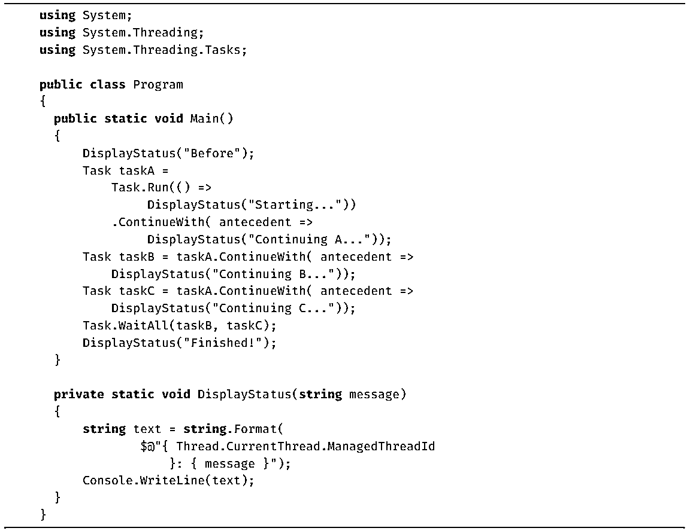

输出 20.3

仔细观察输出便会注意到：线程 ID 有时会更改，有时会重复。在这种简单的控制台应用程序中，同步上下文（可从 SynchronizationContext.Current 访问）为默认的 null 值。默认同步上下文导致由线程池来决策线程分配问题。这解释了为什么线程 ID 在任务之间不断变化：有时线程池认为使用新线程效率更高，有时它决定重用现有线程会更好。

所幸，C#会根据不同的应用程序类型自动设置恰当的同步上下文。例如，如果创建任务的代码在 ASP.NET 创建的线程中运行，则该线程将具有 AspNetSynchronizationContext 类型的同步上下文。相反，如果代码在 Windows UI 应用程序（即 Windows Presentation Foundation (WPF)或 Windows Forms）中创建的线程中运行，则该线程将分别具有 DispatcherSynchronizationContext 或 WindowsFormsSynchronizationContext 的同步上下文。（对于控制台应用程序和 Windows Services，线程将有一个默认 SynchronizationContext 的实例。）由于 TPL 会访问同步上下文，并且该同步上下文根据执行情况而变化，所以 TPL 能够将任务安排在既高效又安全的上下文中执行。

要修改代码以便利用同步上下文，必须设置同步上下文和使用 async/await 来确保同步上下文信息被采用^( [\[2\]](part0175.xhtml#ch2_back) ) 。

可以创建自定义的同步上下文并使用它来提高程序在某些特定情况里的性能。但是，描述如何执行此操作超出了本书的范围。

[\[1\]](part0175.xhtml#ch1) 例如，请参见 C#5.0 之前的多线程模式中的清单 C.8，https://IntelliTect.com/EssentialCSharp5。

[\[2\]](part0175.xhtml#ch2) 有关如何设置线程的同步上下文以及如何使用任务调度器将任务调度到该线程的简单示例，请参见 C#5.0 之前的多线程模式中的清单 C.8，https://IntelliTect.com/EssentialCSharp。

## 20.11　在 Windows UI 程序中使用 async/await

在 UI 上下文中同步总是特别重要。例如，Windows UI 程序使用消息泵来处理诸如鼠标单击或者移动等事件消息。此外，UI 是单线程的，因此与任何 UI 组件（例如，文本框）的交互必须始终发生在单个 UI 线程中。async/await 模式的主要优点之一是：它利用同步上下文来确保出现在 await 语句之后的代码始终在与调用 await 语句相同的同步上下文中执行。这种方法的价值在于它消除了显式切换回 UI 线程来更新界面控件的需要。

代码清单 20.14 展示了一个 WPF 程序处理鼠标点击的示例，从中可以看到这种方法带来的好处。

代码清单 20.14　在 WPF 程序中同步高延迟调用

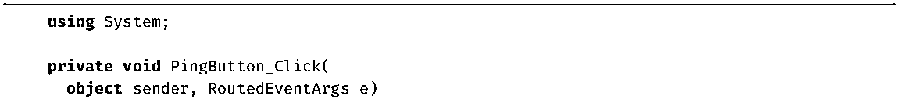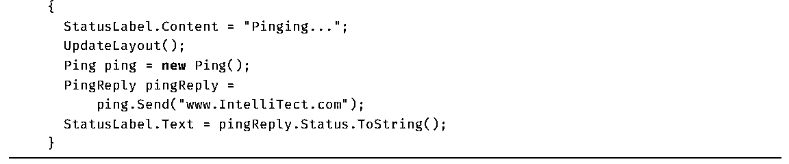

由于 StatusLabel 是一个 WPF 中的 System.Windows.Controls.TextBlock 标签界面控件，并且我们在 PingButton\_Click()事件处理器中更新了标签控件的 Content 属性两次，因此一个合理的假设是“Pinging...”文字将被一直显示在界面标签上，直到 Ping.Send()返回之后才改变。Ping.Send()返回之后，标签再次更新为 Send()任务返回的信息。然而，熟悉 Windows UI 框架的人都知道，事实上情况并非如此。程序会先将一条带有“Pinging...”的消息发送到 Windows 的消息泵中以使用界面显示更新，但由于 UI 线程正忙于执行 PingButton\_Click()方法，因此不会处理 Windows 消息泵。当 UI 线程被释放并可以查看 Windows 消息泵时，第二个界面更新请求也已经等候在消息队列中，用户能够观察到的唯一显示是界面最终的状态^( [\[1\]](part0176.xhtml#ch1_back) ) 。

代码清单 20.15 中高亮的代码使用 TAP 修正了这个问题。

代码清单 20.15　在 WPF 程序中使用 await 同步高延迟调用

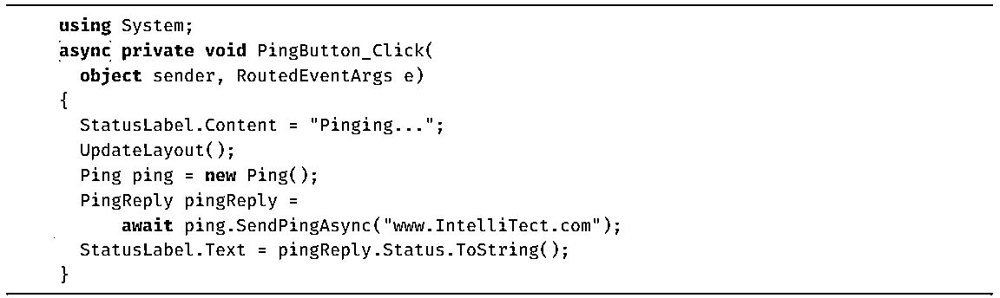

这个修改提供了两个优点。首先 ping 改为异步调用，这样就释放了调用者线程去处理 Windows 消息泵，这样便可以处理对 StatusLabel.Content 的更新，从而可以向用户显示“Pinging...”文字。其次，当等待 ping.SendTaskAsync()完成时，它将始终在与调用者相同的同步上下文中执行。此外，因为同步上下文特别适用于 Windows UI，所以它是单线程的。因此，异步任务的结果将始终返回给同一个线程，即 UI 线程。换句话说，TPL 不是立即执行后续代码，而是查询同步上下文，将 ping 任务返回的信息发布到消息泵。接下来，由于 UI 线程监视消息泵，因此在获得继续工作的消息时，它会调用 await 调用之后的代码。（因此，后续代码的调用与处理消息泵的调用者在同一线程上。）

TAP 编程模式充分考虑了代码可读性问题。请注意在代码清单 20.15 中，返回 pingReply.Status 的调用似乎在 await 语句之后自然地发生，清楚地表明它将在前一行之后立即执行。然而，出于多种原因，如果不使用 TAP 而是从底层开始编写真正的异步程序，则程序代码将很可能变得令人费解。

初学者主题：再次审视 await 操作符

在单个方法中可以无限次地使用 await。事实上，这样的语句并不只能够一个接一个地写。相反，await 语句可以放入循环中反复调用，从而使代码的逻辑看起来非常自然。请观察代码清单 20.16 中的示例程序。

代码清单 20.16　在循环中使用 await 操作符

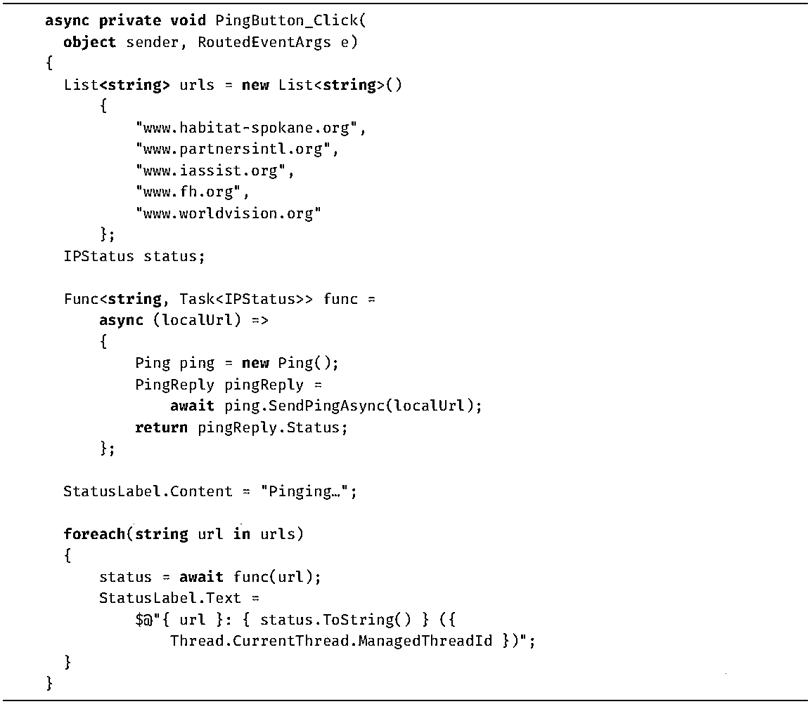

无论 await 语句是在迭代中出现还是作为单独的语句出现，它们都将串行执行，即一个接一个地按照调用线程调用它们的顺序执行。其底层实现是在 Task.ContinueWith()的语义等价实现中将它们串在一起，而且 await 操作符之间的所有其他代码都将在调用者的同步上下文中执行。

UI 程序对 TAP 的需求是导致 TAP 创建的关键应用场景之一。第二种情况发生在服务器上，当来自客户端的请求要求从数据库中查询整个表数据时，由于查询可能很耗时，因此应该创建一个新线程，而不是使用分配给线程池的有限数量线程中的一个。这种方法的问题在于从数据库查询的工作完全在另一台机器上执行。没有理由阻塞整个线程，因为该线程通常不处于活动状态。

总之，TAP 的创建是为了解决以下这些问题：

·当程序需要执行高延迟操作时，不希望 UI 线程被阻塞。

·当线程所做的全部事情就是等待一个任务完成时，为非 CPU 密集型工作创建新线程（或任务）就会显得成本高昂。

·当任务完成时（通过使用新线程或通过回调），经常需要将线程同步上下文切换回启动任务的原始调用者。

TAP 提供了一种既适用于 CPU 密集型又适合于非 CPU 密集型的异步调用新模式——所有.NET 语言都明确支持。

[\[1\]](part0176.xhtml#ch1) 即只能观察到 pingReply.Status.ToString()返回的字符串，而看不到“Pinging...”文字。

## 20.12　小结

本章的大部分内容都集中在 C# 5.0 引入的基于任务的异步模式上，该模式具有 async/await 语法。本章还提供了详细的示例，展示了利用 TAP 编程比仅仅依赖 TPL 要简单得多，尤其是在将代码从同步实现转换为异步实现时。本章介绍了使用 TAP 编写异步方法的返回类型要求。总而言之，async/await 功能通过自动重写你的程序来管理由较小任务组成较大任务的执行连接，从而使得使用 Task 对象对复杂工作流进行编程变得更加容易。

接下来重点介绍异步流和 C# 8.0 引入的 IAsyncEnumerable<T>数据类型。介绍如何利用这些功能来创建异步迭代器以及如何使用 async foreach 语句来使用它们。

到目前为止，除了并行迭代（第二十一章的主题）和线程同步（第二十二章的主题）之外，读者应该对如何编写异步代码打下了一个坚实的基础。