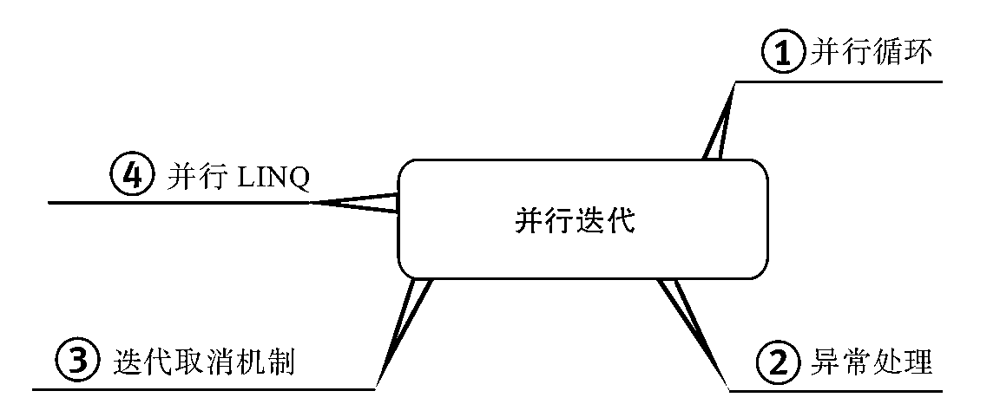
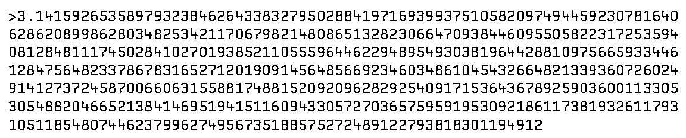
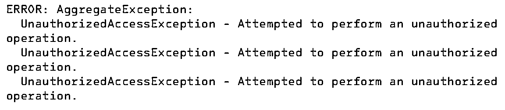
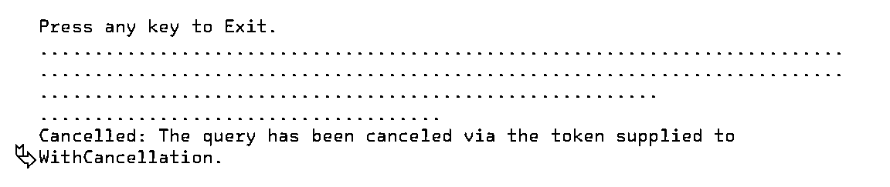

# 第二十一章　并行迭代



第十九章提到，随着计算机硬件成本的逐渐下降，计算机的 CPU 速度变得更快，CPU 数量以及每个 CPU 中的内核数量也在不断增加。总的来说，在这些趋势的影响下，提高计算并行化以便充分利用增加的计算能力变得越来越经济。在本章中，我们将着眼于并行循环，这是利用增加的计算能力的最简单方法之一。本章的大部分内容既包含初学者主题，也包含高级主题。

## 21.1　并行执行循环迭代

观察代码清单 21.1 中所示的 for 循环语句和相关代码，以及输出 21.1 中的相应结果。示例代码调用 PiCalculator.Calculate()方法计算 pi 值的一部分十进制展开，其中参数是所需的总位数以及起始位数。代码中使用的数学方法与本书内容无关，因此将不会深入谈论。但是这个计算的有趣之处在于它是可并行化的，也就是说，将大型任务（例如，计算 pi 的 100 万个十进制数字）拆分为任意数量的可以并行运行的小任务非常容易。通常这类计算很容易通过添加并行数量来提高速度。

代码清单 21.1　计算 pi 值的串行算法

```powershell
# PiCalculator.Calculate() 的数学实现与本书内容无关，此处从略
class PiCalculator {
    static [string] Calculate([int] $digits, [int] $startingAt) {
        # 计算 pi 值十进制展开的 digits 位，从 startingAt 位开始
        return ''
    }
}

$totalDigits = 100
$batchSize = 10
$pi = ''
$iterations = $totalDigits / $batchSize
for ($i = 0; $i -lt $iterations; $i++) {
    $pi += [PiCalculator]::Calculate($batchSize, $i * $batchSize)
}
[Console]::WriteLine($pi)
```

输出 21.1



上面代码中的 for 循环同步而且顺序地执行每一次迭代。但是，由于计算 pi 值的算法可以将计算拆分为独立的部分，因此，只要能做到以正确的顺序将最终的结果组装起来，就没有必要按顺序计算这些部分。想象一下，如果可以让这个循环的所有迭代同时运行会发生什么：每个处理器可以进行一次迭代，并与执行其他迭代的其他处理器并行执行。这样一来，由于迭代可以同时执行，因此理论上处理器的数量越来越多，计算所需的总时间会越来越少。

TPL（基于任务的并行库）提供了一个方便的方法 Parallel.For()，它正是用来实现将顺序的循环并行化的。代码清单 21.2 展示了如何将代码清单 21.1 中的串行算法改为并行执行。

代码清单 21.2　计算 pi 值的并行算法

```powershell
$totalDigits = 100
$batchSize = 10
$pi = ''
$iterations = $totalDigits / $batchSize
$sections = [string[]]::new($iterations)
[System.Threading.Tasks.Parallel]::For(
    0, $iterations,
    [Action[int]] {
        param($i)
        $sections[$i] = [PiCalculator]::Calculate($batchSize, $i * $batchSize)
    })
$pi = -join $sections
[Console]::WriteLine($pi)
```

原图在循环内使用 `+=` 逐段拼接字符串；并行版本改为先将各段存入 `$sections` 数组，循环结束后用 `-join` 一次性组装，这正是正文所描述的避免竞争条件和错误顺序的做法。

代码清单 21.2 的输出与输出 21.1 相同，但是在拥有更多 CPU 的计算机上，其执行时间会显著减少。Parallel.For()API 的设计看起来类似于标准的 for 循环。第一个参数是 fromInclusive 值（即循环起始值，循环将从该值开始），第二个参数是 toExclusive 值（即循环结束值，循环将在到达该值之前结束），最后一个参数是 Action<int>，作为循环体执行。当以 Lambda 表达式作为最后一个参数时，代码看起来便与 for 循环语句很像，不同之处在于现在每个迭代都可以并行执行。与 for 循环一样，在所有迭代完成之前，对 Parallel.For()的调用不会完成。换句话说，当执行到达 string.Join()语句时，pi 值的计算将全部完成。

请注意，用于最终组装 pi 值的代码不在循环中。由于 pi 值计算的部分很可能不会按顺序完成，因此如果在每个独立迭代完成时组装一部分结果，则很可能无法得到正确的组装顺序。除了可能的错误顺序之外，由于代码中的+=操作符不是原子操作，因此还可能引发竞争条件错误。为了解决这两个问题，pi 值的每一部分都先暂存在一个数组中，并且确保两次迭代不会访问数组中的同一个元素。只有在计算完 pi 值的所有部分后，才用 string.Join()将它们组合起来。换句话说，我们将组装结果的操作推迟到 Parallel.For()循环完成之后。这样就避免了上述的两个可能的错误。

TPL 使用与任务调度相同的线程池技术来确保并行循环的性能良好：它将确保 CPU 不会被过度调度等。

设计规范

如果一个对 CPU 资源占用较大的计算可以很容易被分割为多个彼此完全独立的部分以任意顺序执行，则要使用并行循环。

TPL 也为 foreach 循环提供了类似的并行方法，如代码清单 21.3 所示。

代码清单 21.3　基于 foreach 的并行循环

```powershell
function Encrypt-Files([string] $directoryPath, [string] $searchPattern) {
    $files = [System.IO.Directory]::EnumerateFiles(
        $directoryPath, $searchPattern,
        [System.IO.SearchOption]::AllDirectories)
    [System.Threading.Tasks.Parallel]::ForEach(
        $files,
        [Action[string]] { param($fileName) Encrypt-Item $fileName })
}
```

上面代码并行地将 files 集合中的所有文件进行加密。TPL 将决定效率最高的线程数量。

高级主题：TPL 如何自动调整执行效率

TPL 中默认的任务调度器基于线程池，采用多种启发式算法来调整线程数量，确保程序以最佳性能工作。它使用的两种启发式算法为爬山算法 和工作窃取算法 。

爬山算法在开始阶段不断创建新线程来运行任务，然后监控这些任务的性能。当发现性能开始下降时就减少线程，使性能回升到最佳。

TPL 不会将等待执行的任务与任何特定线程相关联。但是，如果正在某个线程上运行的任务本身创建了另一个任务，则新创建的任务会自动与该线程相关联。当新的子任务被调度运行时，它通常与创建它的任务在同一线程上运行。工作窃取算法能够识别工作量过度饱和以及过度枯竭的线程。工作量不足的线程会从过于繁忙的线程“窃取”任务。

这些算法的关键特性是它们使 TPL 能够动态调整自己的性能，以减轻处理器核心的调度过度、调度不足所产生的性能问题，并平衡可用处理器之间的工作。

TPL 通常可以很好地调整自己的性能，但是你也可以向它提供一些运行状况的“提示”以帮助它做得更好。19.3.2 节中描述的 TPL TaskCreationOptions.LongRunning 选项就是这种提示的一个示例。你还可以明确地告诉任务调度器你认为有多少线程最适合为并行循环提供服务。有关更多详细信息，请参阅本章后面的“高级主题：并行循环选项”。

初学者主题：在并行循环中处理 AggregateException 异常

TPL 会捕获与任务相关的异常状况并抛出 AggregateException 异常。当前任务或者子任务都有可能引发这个异常。这个异常在并行循环中会产生这样的问题：每个并行迭代都可能产生一个异常，因此需要将这些异常收集到一个聚合异常中。请观察代码清单 21.4 及其输出 21.2 中的结果。

代码清单 21.4　并行循环中的异常处理

```powershell
function Encrypt-Files([string] $directoryPath, [string] $searchPattern) {
    $files = [System.IO.Directory]::EnumerateFiles(
        $directoryPath, $searchPattern,
        [System.IO.SearchOption]::AllDirectories)
    try {
        [System.Threading.Tasks.Parallel]::ForEach(
            $files,
            [Action[string]] { param($fileName) Encrypt-Item $fileName })
    } catch [System.AggregateException] {
        $exception = $_.Exception
        [Console]::WriteLine('ERROR: {0}:', $exception.GetType().Name)
        foreach ($item in $exception.InnerExceptions) {
            [Console]::WriteLine(" {0} - {1}", $item.GetType().Name, $item.Message)
        }
    }
}
```

输出 21.2 



上面的代码中只有一个捕捉 System.AggregateException 异常的 catch 块，但在输出中却看到了三条异常信息。输出中显示的 UnauthorizedAccessException 是从 AggregateException 的 InnerExceptions 属性中获得。在 Parallel.ForEach<T>()循环中，每一个迭代都有可能发生异常，而所有被抛出过的异常都会被包装进 System.AggregateException，并通过 InnerExceptions 属性提供给异常处理程序。

### 取消并行循环

异步任务不会阻塞调用者线程，除非调用者明确要求等待任务完成（比如使用 await 关键字）。在这一点上并行循环与异步任务不同。并行循环一旦开始执行，在所有迭代完成之前不会自行返回。因此，当需要取消并行循环时，通常需要从执行并行循环的线程以外的线程发起取消请求。在代码清单 21.5 中，我们使用 Task.Run()调用 Parallel.ForEach<T>()。通过这种方式，可以异步地查询并行循环的执行状态，并且还可以允许代码提示用户“按任意键退出”。

代码清单 21.5　取消并行循环

```powershell
function Encrypt-Files([string] $directoryPath, [string] $searchPattern) {
    $stars = ''.PadRight([Console]::WindowWidth - 1, '*')
    $files = [System.IO.Directory]::GetFiles(
        $directoryPath, $searchPattern,
        [System.IO.SearchOption]::AllDirectories)
    $cts = [System.Threading.CancellationTokenSource]::new()
    $parallelOptions = [System.Threading.Tasks.ParallelOptions]::new()
    $parallelOptions.CancellationToken = $cts.Token
    [void] $cts.Token.Register({ [Console]::WriteLine('Canceling...') })
    [Console]::WriteLine('Press any key to exit.')
    $task = [System.Threading.Tasks.Task]::Run([Action] {
        try {
            [System.Threading.Tasks.Parallel]::ForEach(
                $files, $parallelOptions,
                [Action[string, System.Threading.Tasks.ParallelLoopState]] {
                    param($fileName, $loopState)
                    Encrypt-Item $fileName
                })
        } catch [System.OperationCanceledException] {
            # 取消属于预期行为，忽略该异常
        }
    })
    # 等待用户输入
    [void] [Console]::Read()
    # 取消并行循环
    $cts.Cancel()
    [Console]::Write($stars)
    $task.Wait()
}
```

原图由两幅截图构成（image01435.jpeg 与 image01436.jpeg），此处合并为一处完整代码。

并行循环使用与任务相同的取消令牌机制。ForEach()方法的其中一个重载版本接收一个 ParallelOptions 类型参数。你需要先创建一个 CancellationTokenSource 对象作为取消令牌，然后创建一个 ParallelOptions 类型的并行参数对象并将取消令牌包装进参数对象，最后在并行 ForEach()时提供参数对象，便可将取消令牌与即将运行的并行循环相关联。当需要时可以调用已关联令牌的 Cancel()方法提前终止并行循环。

请注意，如果取消并行循环，框架会通过检查 IsCancellationRequested 属性来阻止任何尚未开始的迭代启动，而正在执行的迭代将继续运行到它们各自的正常终点。此外，即使在所有迭代均已完成后调用 Cancel()，框架仍会发送取消事件。（可通过 cts.Token.Register()注册监听事件。）

除了监听取消事件外，ForEach()方法还会通过抛出 OperationCanceledException 异常来通知执行被取消。鉴于本示例中的取消是预期的，所以异常被捕获并被忽略，程序利用捕获异常的机会显示“comceling...”，然后在退出前显示一行星号。

高级主题：并行循环选项

可以通过 Parallel.For()和 Parallel.ForEach<T>()带有 ParallelOptions 参数的重载版本控制最大并行度（即计划同时运行的线程数）。虽然这样做通常不是必需的，但是在某些特定情况下，开发者可能对特定算法或环境有更多了解，因此更改最大并行度有时很有意义。这些情况包括但不限于：

·当需要分析或者调试程序问题时，可以通过将最大并行度设定为 1 以确保循环的每一次迭代都顺序执行。

·影响并行度的外部因素（如硬件配置等）明确已知。例如，如果并行操作需要使用多个 USB 端口，那么创建多于可用端口数量的线程很可能没有意义。

·应用场景中具有长时间运行的循环迭代（例如，几分钟或几小时）。线程池无法区分长时间运行的迭代和阻塞，因此最终可能导致引入许多新线程，而所有这些线程都将被 for 循环迭代消耗。随着时间的推移，这会导致进程中出现大量线程。

要控制最大并行度，需要设置 ParallelOptions 对象上的 MaxDegreeOfParallelism 属性。

可以使用 ParallelOptions 对象的 TaskScheduler 属性来指定自定义任务调度程序。例如，应用程序中有一个用于响应用户单击“下一步”按钮的异步事件处理程序。如果用户多次点击该按钮，你可能希望使用自定义任务调度程序来优先调度最新创建的任务，而不是优先调度等待时间最长的任务。任务调度程序可以决定任务执行的优先顺序。

ParallelOptions 对象还有一个 CancellationToken 属性，该属性可用于与循环通信，通知循环不再进一步迭代。此外，循环的调用者也可以通过该属性得知循环是否被取消执行。

高级主题：中断并行循环

与标准 for 循环支持 break 关键字一样，Parallel.For()循环也支持“breaking”（中断）循环并取消任何进一步迭代的操作。然而，由于涉及并行执行，因此这里的“中断”表示在中断迭代之后不应开始新的迭代，但是所有当前正在执行的迭代都将继续运行完成。

如前面的“高级主题：并行循环选项”中所述，要中断并行循环，可以使用取消令牌并在另一个线程上取消它。除此之外，也可以使用 Parallel.For()方法的另一个重载版本，该版本的循环体委托方法接受两个参数：索引和 ParallelLoopState 对象。当希望在循环体内部中断循环时可以调用 ParallelLoopState 对象的 Break()或 Stop()方法。Break()方法指示不再需要执行索引值高于当前值的迭代；Stop()方法表明根本不需要运行更多的迭代。

例如，假设有一个 Parallel.For()循环将执行 10 次迭代。其中一些迭代可能比其他迭代运行得更快，并且任务调度程序不保证它们会以任何特定顺序运行。假设迭代 1 已经完成；迭代 3、5、7 和 9 正在“进行中”并被安排到四个不同的线程；迭代 5 和 7 都调用 Break()。在这种情况下，迭代 6 和 8 就永远不会开始了，但是迭代 2 和 4 仍会被调度执行。迭代 3 和 9 仍将正常运行完成，因为它们在中断发生时已经开始了。

Parallel.For()和 Parallel.ForEach<T>()方法返回 ParallelLoopResult 对象，该对象包含了有关循环执行情况及结果的信息。此对象具有以下属性：

1.IsCompleted 是一个 boolean 类型属性，它标志着是否所有迭代都被调度执行。

2.LowestBreakIteration 属性为发出终止循环指令的最小迭代号，类型为 long?。如果为 null，则说明循环正常结束，没有被打断。

所以在前面的“10 次迭代”的示例中，循环停止后，IsCompleted 值将为 false，而 LowestBreakIteration 值将为 5。

## 21.2　并行执行 LINQ 查询

正如可以使用 Parallel.For()并行执行循环一样，也可以使用 Parallel LINQ API（简称 PLINQ）并行执行 LINQ 查询。一个简单的非并行 LINQ 表达式示例如代码清单 21.6 所示，在代码清单 21.7 中，我们将其修改为并行运行。

代码清单 21.6　LINQ Select()

```powershell
# Encrypt-Item —— 对单个字符串执行加密的辅助函数，实现从略
function Encrypt-Item([string] $item) {
    # 返回加密后的字符串
}

function Encrypt-Data(
    [System.Collections.Generic.IEnumerable[string]] $data) {
    return @($data | ForEach-Object { Encrypt-Item $_ })
}
```

C# 版本借助 `Select(item => Encrypt(item)).ToList()` 一次完成投射与列表化；PowerShell 中用管道加 `ForEach-Object` 表达同样的投射，`@()` 则对应 `ToList()`。

在代码清单 21.6 中，LINQ 查询使用 Select()标准查询方法来加密字符串序列中的每个字符串并将结果序列转换为列表^( [\[1\]](part0180.xhtml#ch1_back) ) 。由于在这个操作中，每个加密都可能是一个高延迟的处理器绑定操作，因此可以考虑分配给另一个 CPU 上的工作线程。

代码清单 21.7 展示了如何修改代码清单 21.6，以便并行执行加密字符串的代码。

代码清单 21.7　并行 LINQ Select()

```powershell
function Encrypt-DataParallel(
    [System.Collections.Generic.IEnumerable[string]] $data) {
    $parallelQuery = [System.Linq.ParallelEnumerable]::AsParallel($data)
    $result = $parallelQuery | ForEach-Object { Encrypt-Item $_ }
    return @($result)
}
```

原图由 image01438.jpeg 与 image01439.jpeg 两幅截图构成，此处合并。与代码清单 21.6 相比，唯一的差别是加上 `AsParallel()`，将普通 LINQ 查询变为 PLINQ 查询。

如代码清单 21.7 所示，启用并行支持只需要非常小的更改，所涉及的只是一个标准查询方法 AsParallel()，它可以在静态类 System.Linq.ParallelEnumerable 中找到。这个简单的扩展方法告诉运行时可以并行执行查询。结果是在具有多个可用 CPU 的机器上，执行查询所花费的总时间可以显著缩短。

System.Linq.ParallelEnumerable 是在 Microsoft .NET Framework 4.0 中引入的，用于启用 PLINQ 的引擎，包括在 System.Linq.Enumerable 上可用的查询方法的超集。因此，它提供的 API 可为所有常见查询方法提供性能改进，包括用于排序、过滤（Where()）、投影（Select()）、连接、分组和聚合的那些方法。代码清单 21.8 展示了如何进行并行排序。

代码清单 21.8　并行 LINQ 和标准查询方法

```powershell
$parallelGroups = [System.Linq.ParallelEnumerable]::OrderBy(
    [System.Linq.ParallelEnumerable]::AsParallel($data),
    [Func[string, string]] { param($item) $item })

# 确认项总数仍与原始数量相同
[System.Diagnostics.Trace]::Assert(
    [System.Linq.Enumerable]::Count($data) -eq
    [System.Linq.ParallelEnumerable]::Sum(
        $parallelGroups,
        [Func[string, int]] { param($item) $item.Length }))
```

原图中 `OrderBy()` 的结果类型是 `OrderedParallelQuery<string>`。C# 里对字符串元素调用 `item.Count()` 得到的其实是字符个数，在 PowerShell 中对应 `$item.Length`。

如代码清单 21.8 所示，调用并行版本只涉及调用 AsParallel()扩展方法。请注意，并行标准查询方法返回的结果类型是 ParallelQuery<T>或 OrderedParallelQuery<T>，两者都会提示编译器应该继续使用并行版本的标准查询操作。

由于查询表达式只是个语法糖，它与代码清单 21.5 和 21.6 中使用的方法调用形式的查询方法本质相同，因此查询表达式也可以和 AsParallel()一起使用。清单 21.9 显示了使用查询表达式语法并行执行分组操作的示例。

代码清单 21.9　并行 LINQ 和查询表达式

```powershell
# 并行分组查询等价于下面的方法调用链
$parallelGroups = [System.Linq.ParallelEnumerable]::GroupBy(
    [System.Linq.ParallelEnumerable]::OrderBy(
        [System.Linq.ParallelEnumerable]::AsParallel($data),
        [Func[string, string]] { param($text) $text }),
    [Func[string, char]] { param($text) $text[0] })

# 确认项总数仍与原始数量相同
[System.Diagnostics.Trace]::Assert(
    [System.Linq.Enumerable]::Count($data) -eq
    [System.Linq.Enumerable]::Count($parallelGroups))
```

原图由 image01441.jpeg 与 image01442.jpeg 两幅截图构成，此处合并。正文中的查询表达式 `from text in data.AsParallel() orderby text group text by text[0]` 在此以其等价的标准查询方法调用形式表达。原图断言写的是 `parallelGroups.Sum(item => item.Count())`，即把各分组的元素个数相加；此处按「分组项数之和等于原序列长度」的语义还原为两侧 `Count()` 比较。

在前面的示例代码中，各种循环迭代或查询转换为并行执行都很简单。然而有一点需要尤其注意：不要让多个线程同时不恰当地访问和修改同一内存，这样做会导致竞争条件错误。我们将在第二十二章中深入讨论这部分内容。

本章前面提到过，Parallel.For()和 Parallel.ForEach<T>()方法将收集并行迭代期间抛出的任何异常，然后抛出一个包含所有原始异常的聚合异常，而 PLINQ 操作也不例外。也就是说，它们也有可能出于类似的原因返回多个异常：当查询逻辑在每个元素上并行运行时，在每个元素上执行的代码可以独立抛出异常。不出所料，PLINQ 采用与并行循环和 TPL 完全相同的方式应对这种情况：并行查询期间抛出的多个异常可通过 AggregateException 的 InnerExceptions 属性访问获得。因此，只要将 PLINQ 查询包装在具有 System.AggregateException 异常类型的 try/catch 块中，即可处理每次迭代中未处理的任何异常。

### 取消 PLINQ 查询

并不意外的是，取消请求模式也可用于 PLINQ 查询。代码清单 21.10（和输出 21.3）提供了一个示例。PLINQ 与并行循环有两点相似之处：首先，取消的 PLINQ 查询也会抛出 System.OperationCanceledException 类型的异常；其次，执行 PLINQ 查询也是在调用线程上的同步操作。因此，一种常见的技术是将并行查询包装在运行于另一个线程上的任务中，以便当前线程可以在必要时取消它，这种方法本质上与代码清单 21.5 中使用的解决方案相同。

代码清单 21.10　取消 PLINQ 查询

```powershell
# Encrypt-Item —— 对单个字符串执行加密的辅助函数，实现从略
function ParallelEncrypt(
    [System.Collections.Generic.List[string]] $data,
    [System.Threading.CancellationToken] $cancellationToken) {

    $governor = 0
    $parallelQuery = [System.Linq.ParallelEnumerable]::WithCancellation(
        [System.Linq.ParallelEnumerable]::AsParallel($data),
        $cancellationToken)

    return [System.Linq.Enumerable]::ToList(
        [System.Linq.ParallelEnumerable]::Select(
            $parallelQuery,
            [Func[string, string]] {
                param($item)
                # 控制输出进度点的频率：每 100 次加密打印一个点
                if ([System.Threading.Interlocked]::CompareExchange(
                        [ref] $governor, 0, 100) % 100 -eq 0) {
                    [Console]::Write('.')
                }
                [System.Threading.Interlocked]::Increment([ref] $governor) | Out-Null
                Encrypt-Item $item
            }))
}

function Read-ConsoleWithBackoff(
    [System.Threading.CancellationToken] $cancellationToken =
        [System.Threading.CancellationToken]::None) {

    $maxDelay = 1025
    $delay = 0
    while (-not $cancellationToken.IsCancellationRequested) {
        if ([Console]::KeyAvailable) {
            return [Console]::Read()
        }
        Start-Sleep -Milliseconds $delay
        if ($delay -lt $maxDelay) { $delay = $delay * 2 + 1 }
    }
    $cancellationToken.ThrowIfCancellationRequested()
    throw '上一行应抛出异常，使本行永远不会执行'
}

$originalColor = [Console]::ForegroundColor
$cts = [System.Threading.CancellationTokenSource]::new()

$task = [System.Threading.Tasks.Task]::Run(
    [Action] { ParallelEncrypt $data $cts.Token },
    $cts.Token)

[Console]::WriteLine('Press any key to Exit.')
$cancelTask = [System.Threading.Tasks.Task]::Run(
    [Func[int]] { Read-ConsoleWithBackoff $cts.Token },
    $cts.Token)

try {
    [System.Threading.Tasks.Task]::WaitAny($task, $cancelTask)
    # 取消尚未结束的那个任务
    $cts.Cancel()
    $task.Wait()
    [Console]::ForegroundColor = [ConsoleColor]::Green
    [Console]::WriteLine("`ncompleted successfully")
} catch [System.OperationCanceledException] {
    [Console]::ForegroundColor = [ConsoleColor]::Red
    [Console]::WriteLine("`ncancelled: $($_.Exception.Message)")
} finally {
    [Console]::ForegroundColor = $originalColor
}
```

原图由三幅截图构成（image01443.jpeg、image01444.jpeg、image01445.jpeg），此处合并为一处完整代码。原图的 `ConsoleReadAsync()` 方法在 PowerShell 中改写为 `Read-ConsoleWithBackoff` 函数，保留了「按键轮询 + 指数退避延迟」的逻辑。打印进度点的 `$governor` 计数器使用 `[System.Threading.Interlocked]` 保证线程安全，与 C# 原图一致。

输出 21.3



与并行循环或异步任务类似，取消 PLINQ 查询也需要使用取消令牌 CancellationToken，可以通过创建 CancellationTokenSource 的对象获得取消令牌。然而 PLINQ 支持取消的方式略有不同：通过 IEnumerable 的 AsParallel()方法返回的 ParallelQuery<T>对象包含一个 WithCancellation()扩展方法，取消令牌对象需要通过该方法传入，PLINQ 并没有为每个查询方法提供一个重载版本以接受取消令牌对象。CancellationTokenSource 的对象通过 WithCancellation()传入之后，便可以调用其 Cancel()方法取消并行查询，因为它检查 Cancellation Token 上的 IS Cancellation Requested 属性。

如前所述，取消 PLINQ 查询将抛出异常而不是返回完整结果。如果 PLINQ 查询可能需要取消，一种常见的做法是将查询包装在 try 块中并捕获 OperationCanceledException。代码清单 21.10 中使用的第二种常用技术是将 CancellationToken 传递给 ParallelEncrypt()并作为 Run()的第二个参数。这将导致 task.Wait()抛出一个 AggregateException，其 InnerException 属性将被设置为 TaskCanceledException。然后可以捕获聚合异常，就像从并行操作中捕获任何其他异常一样。

[\[1\]](part0180.xhtml#ch1) 代码中的 ToList()操作即转换为列表。——译者注

## 21.3　小结

在本章中，我们讨论了如何将 TPL Parallel 类用于 for 和 foreach 类型的循环。此外，通过 System.Linq 中包含的 AsParallel()扩展方法，演示了如何并行执行 LINQ 查询。通过这些示例代码不难看出：并行迭代是引入并行执行的最简单方法之一。尽管仍然需要注意竞争条件和死锁，但如果不在并行循环的迭代中共享数据，则与直接使用异步任务相比，这些问题发生的可能性要小得多。最后留给程序员的问题就是从程序中找到可以从并行执行中受益的 CPU 密集型的代码块，并将它们转换成并行执行。