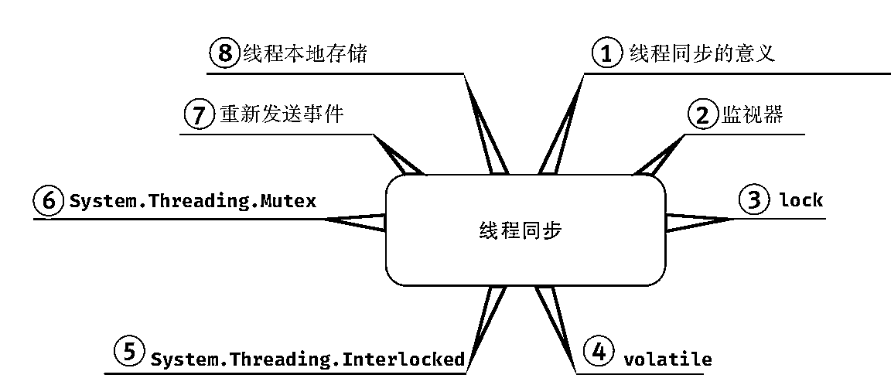
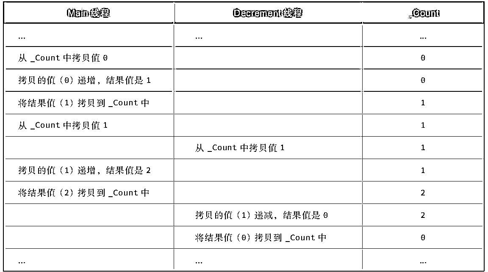
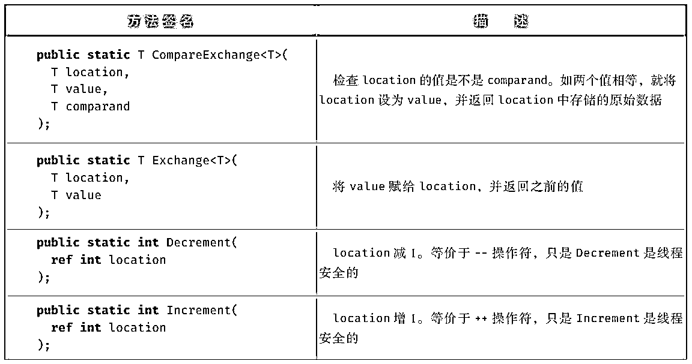
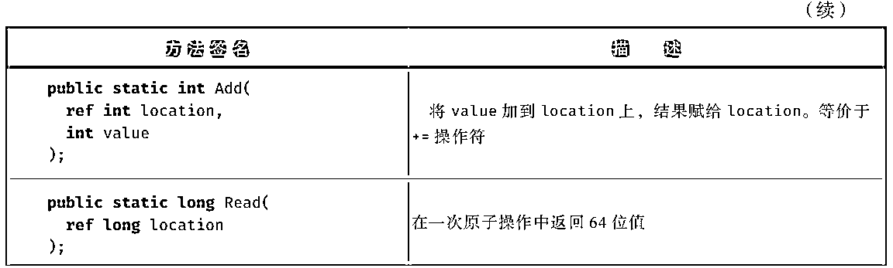
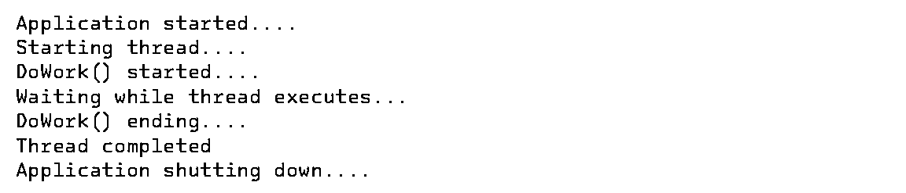
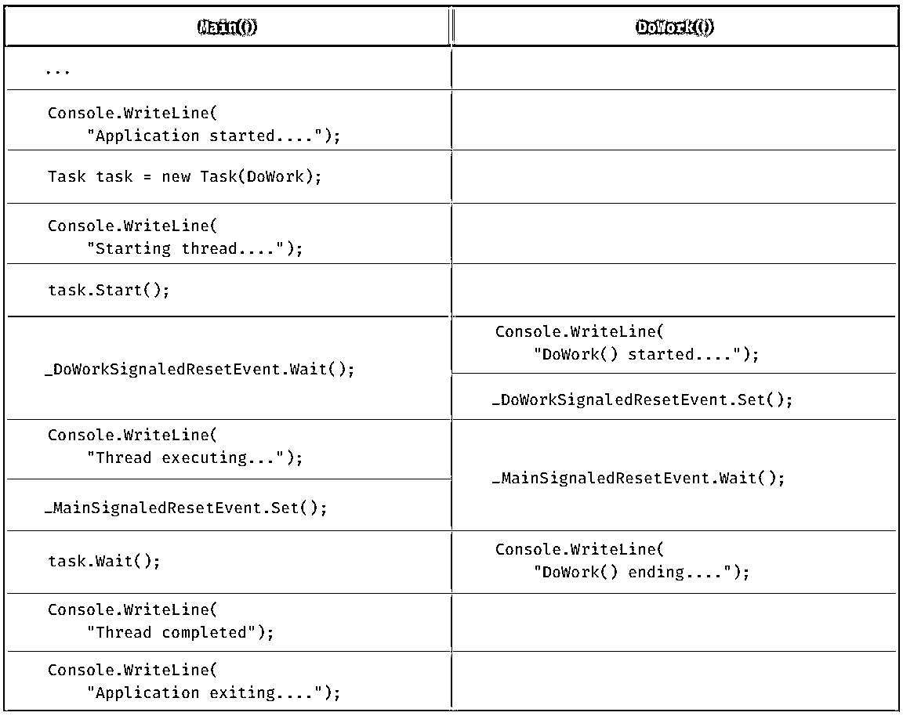
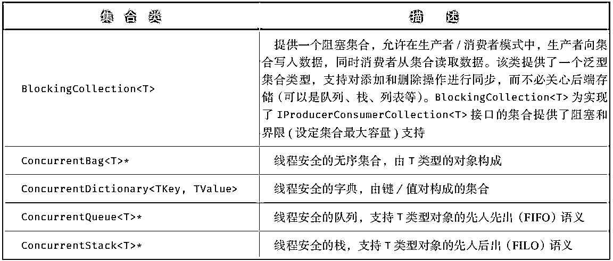

# 第二十二章　线程同步



第二十一章讨论了使用 TPL 和 PLINQ 进行多线程编程的细节，但刻意避开了线程同步的主题。它的作用是在避免死锁的同时防止出现竞态条件。线程同步是本章的主题。

先来看一个访问共享数据时不进行线程同步的多线程例子。这会造成竞态条件，数据完整性会被破坏。从这个例子出发，我们解释为何需要线程同步。然后介绍进行线程同步的各种机制和最佳实践。

在本书前几版中，本章还用大量篇幅讨论了额外的多线程处理模式，并讨论了各种计时器回调机制。但由于现在有了 async/await 模式，所以这些机制基本都被替换掉了，除非要针对 C# 5.0/.NET 4.5 之前的框架进行编程。

注意本章只用 TPL，所以这些示例在 Microsoft .NET Framework 4 之前的版本中无法编译。但除非特别标识为 Microsoft .NET Framework 4 API，否则限定 Microsoft .NET Framework 4 唯一的原因就是使用了 System.Threading.Tasks.Task 类来执行异步操作。所以，只需修改代码来实例化一个 System.Threading.Thread，再调用 Thread.Join()来等待线程执行，大多数例子都可以在早期的 Microsoft .NET Framework 上编译了。

不过，本章用来开始任务的 API 是自.NET 4.5 引入的 System.Threading.Tasks.Task.Run()。如第十九章所述，该方法比 System.Threading.Tasks.Task.Factory.StartNew()好，因其更简单，且能满足大多数需要。如必须使用.NET 4，请将 Task.Run()改为 Task.Factory.StartNew()，其他任何地方都不需要修改。（正是由于这个原因，如只是使用了这个方法，本章不专门强调代码是“.NET 4.5 专用”的。）

## 22.1　线程同步的意义

运行新线程是相当简单的编程任务。多线程编程的复杂性在于识别多个线程能同时安全访问的数据。程序必须对这种数据进行同步，通过防止同时访问来实现“安全”。来看看代码清单 22.1 的例子。

代码清单 22.1　未同步的状态

```powershell
$script:_Total = [int]::MaxValue
$script:_Count = [long]0

function Decrement {
    # 递减
    for ($i = 0; $i -lt $script:_Total; $i++) {
        $script:_Count--
    }
}

# .NET 4.5 之前使用 [System.Threading.Tasks.Task]::Factory.StartNew()
$task = [System.Threading.Tasks.Task]::Run([Action] { Decrement })

# 递增
for ($i = 0; $i -lt $script:_Total; $i++) {
    $script:_Count++
}

$task.Wait()
Write-Host "Count = $script:_Count"
```

输出 22.1 展示了代码清单 22.1 的一个可能的输出结果。

输出 22.1


注意代码清单 22.1 的输出不是 0。如 Decrement()是直接（顺序）调用的，输出就是 0。然而，异步调用 Decrement()会发生竞态条件，因为\_Count++和\_Count--语句中单独的步骤会发生交错。（第十九章开头的“初学者主题：多线程术语”讲过，一个 C#语句可能涉及好几个步骤。）来看看表 22.1 的示例执行情况。

表 22.1 展示了并行执行（或线程上下文切换）的情况。从一列中的指令切换到另一列，就会发生线程上下文切换。一行结束之后的\_Count 值在最后一列中显示。在这个示例执行中，\_Count++执行了两次，而\_Count--只执行了一次。然而，最终的\_Count 值是 0，而不是 1。将结果拷贝回\_Count 相当于取消同一个线程读取\_Count 以来对\_Count 值进行的任何修改。

表 22.1　示例伪代码执行



代码清单 22.1 的问题在于它造成了一个竞态条件。多个线程同时访问相同的数据元素时，就会出现这个情形。正如这个示例执行过程展示的那样，多个线程同时访问相同的数据元素，可能破坏数据的完整性（即使是在一台单处理器的电脑上）。为解决这个问题，代码必须围绕数据进行同步。若能同步多个线程对代码或数据的并发访问，就说这些代码和数据是线程安全 的。

关于变量读写的原子性，有一个重点需要注意。假如类型的大小不超过一个本机（指针大小的）整数，“运行时”就保证该类型不会被部分性地读取或写入。所以，64 位操作系统保证能够原子性地读写一个 long（64 位）。但 128 位变量（比如 decimal）的读写就不保证是原子性的。所以，通过写操作来更改 decimal 变量时，可能会在仅仅拷贝了 32 位之后被打断，造成以后读取一个不正确的值，这称为一次 torn read（被撕裂的读取）。

初学者主题：多个线程和局部变量

注意局部变量没必要同步。局部变量加载到栈上，而每个线程都有自己的逻辑栈。因此，针对每个方法调用，每个局部变量都有自己的实例。局部变量在不同方法调用之间默认不共享；同样地，在多个线程之间也不共享。

但这不是说局部变量完全没有并发性问题，因为代码可能轻易向多个线程公开局部变量^( [\[1\]](part0183.xhtml#ch1_back) ) 。例如，在循环迭代之间共享一个局部变量的并行 for 循环就会公开变量，使其能被并发访问，从而造成一个竞态条件，如代码清单 22.2 所示。

代码清单 22.2　未同步的局部变量

```powershell
$x = 0
# 并行 for 循环中，多个线程并发访问 $x，造成竞态条件
# 注意：脚本块传给 [Parallel]::For 会因工作线程缺少运行空间而报错；
# 本清单用于演示竞态条件的语义，实际并行请用 ForEach-Object -Parallel。
[System.Threading.Tasks.Parallel]::For(
    0,
    [int]::MaxValue,
    [Action[int]]{
        param($i)
        $script:x++
        $script:x--
    })

Write-Host "Count = $x"
```

本例在一个并行 for 循环中访问 x（一个局部变量），使多个线程可以同时修改它，造成和代码清单 22.1 非常相似的竞态条件。即使 x 新增和递减相同的次数，输出也不一定是 0。

### 22.1.1　用 Monitor 同步

为同步多个线程，防止它们同时执行特定代码段，需要用监视器 （monitor）来阻止第二个线程进入受保护的代码段，直到第一个线程退出那个代码段。监视器功能由 System.Threading.Monitor 类提供。为标识受保护代码段的开始和结束位置，需分别调用静态方法 Monitor.Enter()和 Monitor.Exit()。

代码清单 22.3 演示了显式使用 Monitor 类来进行同步。要记住的重点是，在 Monitor.Enter()和 Monitor.Exit()这两个调用之间，所有代码都要用 try/finally 块包围起来。否则受保护代码段内发生的异常可能造成 Monitor.Exit()永远无法调用，无限阻塞其他线程。

代码清单 22.3　显式使用监视器来同步

```powershell
# 同步对象：私有只读字段
$script:_Sync = [object]::new()
$script:_Total = [int]::MaxValue
$script:_Count = [long]0

function Decrement {
    for ($i = 0; $i -lt $script:_Total; $i++) {
        $lockTaken = $false
        try {
            [System.Threading.Monitor]::Enter($script:_Sync, [ref]$lockTaken)
            $script:_Count--
        }
        finally {
            if ($lockTaken) {
                [System.Threading.Monitor]::Exit($script:_Sync)
            }
        }
    }
}

# .NET 4.5 之前使用 [System.Threading.Tasks.Task]::Factory.StartNew()
$task = [System.Threading.Tasks.Task]::Run([Action] { Decrement })

# 递增
for ($i = 0; $i -lt $script:_Total; $i++) {
    $lockTaken = $false
    try {
        [System.Threading.Monitor]::Enter($script:_Sync, [ref]$lockTaken)
        $script:_Count++
    }
    finally {
        if ($lockTaken) {
            [System.Threading.Monitor]::Exit($script:_Sync)
        }
    }
}

$task.Wait()
Write-Host "Count = $script:_Count"
```

PowerShell 没有 C# 的 `lock` 关键字，这里显式使用 `[System.Threading.Monitor]::Enter()`/`Exit()` 并配合 try/finally 表达相同的同步模式。

输出 22.2 展示了代码清单 22.3 的结果。

输出 22.2


Monitor.Enter()和 Monitor.Exit()这两个调用通过共享作为参数传递的同一个对象引用（本例是\_Sync）来关联。获取 lockTaken 的 Monitor.Enter()重载方法是从.NET 4.0 开始才有的。在此之前没有 lockTaken 参数，无法可靠地捕捉 Monitor.Enter()和 try 块之间发生的异常。让 try 块紧跟在 Monitor.Enter()调用的后面，在发布（release）代码中非常可靠，因为 JIT 禁止出现像这样的任何异步异常。但除 try 块以外的其他任何东西紧跟在 Monitor.Enter()后面，包括编译器可能在调试（debug）代码中注入的任何指令，都可能妨碍 JIT 可靠地从 try 块中返回。所以，如果真的发生异常，它会造成锁的泄漏（锁一直保持已获取的状态），而不是执行 finally 块并释放锁。另一个线程试图获取锁的时候，就可能造成死锁。总之，在.NET 4.0 之前，总是在 Monitor.Enter()之后跟随一个 try/finally{Monitor.Exit(\_Sync))}块。

Monitor 还支持 Pulse()方法，允许线程进入“就绪队列”（ready queue），指出下一个就轮到它获得锁（并可开始执行）。这是同步生产者–消费者模式的一种常见方式，目的是保证除非有“生产”，否则就没有“消费”。拥有监视器（通过调用 Monitor.Enter()）的生产者线程调用 Monitor.Pulse()通知消费者线程（它可能已调用了 Monitor.Enter()），一个项（item）已准备好供消费，所以请“准备好”（get ready）。一个 Pulse()调用只允许一个线程（本例的消费者）进入就绪队列。生产者线程调用 Monitor.Exit()时，消费者线程将取得锁（Monitor.Enter()结束）并进入关键执行区域^( [\[2\]](part0183.xhtml#ch2_back) ) 以开始“消费”那个项。消费者处理好等待处理的项以后，就调用 Exit()，从而允许生产者（当前正由 Monitor.Enter()阻塞）再次生产其他项。在本例中，一次只有一个线程进入就绪队列，确保没有“生产”就没有“消费”，反之亦然。

### 22.1.2　使用 lock 关键字

由于多线程代码要频繁使用 Monitor 来同步，同时 try/finally 块很容易被人遗忘，所以 C#提供了特殊关键字 lock 来处理这种锁定同步模式。代码清单 22.4 演示了如何使用 lock 关键字，结果如输出 22.3 所示。

代码清单 22.4　用 lock 关键字同步

```powershell
# 同步对象：私有只读字段
$script:_Sync = [object]::new()
$script:_Total = [int]::MaxValue
$script:_Count = [long]0

function Decrement {
    for ($i = 0; $i -lt $script:_Total; $i++) {
        [System.Threading.Monitor]::Enter($script:_Sync)
        try {
            $script:_Count--
        }
        finally {
            [System.Threading.Monitor]::Exit($script:_Sync)
        }
    }
}

# .NET 4.5 之前使用 [System.Threading.Tasks.Task]::Factory.StartNew()
$task = [System.Threading.Tasks.Task]::Run([Action] { Decrement })

# 递增
for ($i = 0; $i -lt $script:_Total; $i++) {
    [System.Threading.Monitor]::Enter($script:_Sync)
    try {
        $script:_Count++
    }
    finally {
        [System.Threading.Monitor]::Exit($script:_Sync)
    }
}

$task.Wait()
Write-Host "Count = $script:_Count"
```

PowerShell 没有 C# 的 `lock` 关键字，这里用 `[System.Threading.Monitor]::Enter()`/`Exit()` 配 try/finally 来表示等价的锁定同步。

输出 22.3


将要访问\_Count 的代码段锁定了之后（用 lock 或者 Monitor），Main()和 Decrement()方法就是线程安全的。换言之，可从多个线程中同时安全地调用它们。（C# 4.0 之前的概念是一样的，只是编译器生成的代码要依赖于没有 lockTaken 参数的 Monitor.Enter()方法，而且 Monitor.Enter()要在 try 块之前调用。）

同步以牺牲性能为代价。例如，代码清单 22.4 的执行时间比代码清单 22.1 长得多，这证明与直接递增和递减\_Count 相比，lock 的速度相对较慢。

即使为了同步的需要可以忍受 lock 的速度，也不要在多处理器计算机中不假思索地添加同步来避免死锁和不必要的同步（也许本来可以并行执行的）。对象设计的最佳实践是对可变的静态状态进行同步（永远不变的东西不必同步），不同步任何实例数据。如允许多个线程访问特定对象，那么必须为对象提供同步。任何要显式地和线程打交道的类通常应保证实例在某种程度上的线程安全。

初学者主题：返回 Task 但不用 await

注意在代码清单 22.1 中，虽然 Task.Run(()=>Decrement())返回一个 Task，但并未使用 await 操作符。原因是在 C# 7.1 之前，Main()不支持使用 async。但如代码清单 22.5 所示，现在可以重构代码来使用 await/async 模式。

代码清单 22.5　C# 7.1 的 async Main()

```powershell
# 同步对象：私有只读字段
$script:_Sync = [object]::new()
$script:_Total = [int]::MaxValue
$script:_Count = [long]0

function Decrement {
    for ($i = 0; $i -lt $script:_Total; $i++) {
        [System.Threading.Monitor]::Enter($script:_Sync)
        try {
            $script:_Count--
        }
        finally {
            [System.Threading.Monitor]::Exit($script:_Sync)
        }
    }
}

# .NET 4.5 之前使用 [System.Threading.Tasks.Task]::Factory.StartNew()
$task = [System.Threading.Tasks.Task]::Run([Action] { Decrement })

# 递增
for ($i = 0; $i -lt $script:_Total; $i++) {
    [System.Threading.Monitor]::Enter($script:_Sync)
    try {
        $script:_Count++
    }
    finally {
        [System.Threading.Monitor]::Exit($script:_Sync)
    }
}

# C# 中用 await task 等待任务；PowerShell 脚本顶层不支持 async/await，
# 故用 GetAwaiter().GetResult() 达到相同效果
$task.GetAwaiter().GetResult()
Write-Host "Count = $script:_Count"
```

### 22.1.3　lock 对象的选择

无论使用 lock 关键字还是显式使用 Monitor 类，都必须小心地选择 lock 对象。

在前面的例子中，同步变量\_Sync 被声明为私有和只读。声明为只读是为了确保在 Monitor.Enter()和 Monitor.Exit()调用之间，其值不会发生改变。这就在同步块的进入和退出之间建立了关联。类似地，将\_Sync 声明为私有，是为了确保类外的同步块不能同步同一个对象实例，这会造成代码阻塞。

假如数据是公共的，那么同步对象可以是公共的，使其他类能用同一个同步对象实例来同步。但这会更难防止死锁。幸好对这个模式的需求很少。对于公共数据，最好完全在类的外部同步，允许调用代码为它自己的同步对象获取锁。

同步对象不能是值类型，这一点很重要。在值类型上使用 lock 关键字，编译器会报错。（但如果显式访问 System.Threading.Monitor 类，而不是通过 lock，那么编译时不会报错。相反，代码会在调用 Monitor.Exit()时抛出异常，指出无对应的 Monitor.Enter()调用。）使用值类型时，“运行时”会创建值的拷贝，把它放到堆中（装箱），并将装箱的值传给 Monitor.Enter()。类似地，Monitor.Exit()会接收到原始变量的一个已装箱拷贝。结果是 Monitor.Enter()和 Monitor.Exit()接收到了不同的同步对象实例，所以两个调用失去了关联性。

### 22.1.4　为什么要避免锁定 this、typeof(type)和 string

一个貌似合理的模式是锁定代表类中实例数据的 this 关键字，以及为静态数据锁定从 typeof(type)（例如 typeof(MyType)）获取的类型实例。在这种模式下，使用 this 可为与特定对象实例关联的所有状态提供同步目标；使用 typeof(type)则为一个类型的所有静态数据提供同步目标。但这样做的问题在于，在另一个完全不相干的代码块中，可能创建一个完全不同的同步块，而这个同步块的同步目标可能就是 this（或 typeof(type)）所指向的同步目标。换言之，虽然只有实例自身内部的代码能用 this 关键字来阻塞，但创建实例的调用者仍可将那个实例传给一个同步锁。

结果就是对两套不同的数据进行同步的两个同步块可能相互阻塞。虽然看起来不太可能，但共享同一个同步目标可能影响性能，极端的时候甚至会造成死锁。所以，请不要在 this 或 typeof(type)上锁定。更好的做法是定义一个私有只读字段，除了能访问它的那个类之外，没有谁能在它上面阻塞。

要避免的另一个锁定类型是 string，这是因为要考虑到字符串留用^( [\[3\]](part0183.xhtml#ch3_back) ) （string interning）问题。如同一个字符串常量在多个位置出现，那么所有位置都可能引用同一个实例，使锁定的范围大于预期。

总之，锁定的目标应该是 object 类型的单位同步上下文实例（per-synchronization context instance，例如前面说的私有只读字段）。

设计规范

·避免锁定 this、typeof()或字符串

·要为同步目标声明 object 类型的一个单独的只读同步变量。

### 22.1.5　避免用 MethodImplAttribute 同步

.NET 1.0 引入的一个同步机制是 MethodImplAttribute。和 MethodImplOptions.Synchronized 方法配合，该特性能将一个方法标记为已同步，确保每次只有一个线程执行方法。为此，JIT 编译器本质上会将方法看成是被 lock(this)包围；如果是静态方法，则看成是已在类型上锁定。像这样的实现意味着，方法以及在同一个类中的其他所有方法，只要用相同的特性和枚举参数进行了修饰，它们事实上就是一起同步的，而不是“各顾各”。换言之，在同一个类中，如果两个或多个方法都用该特性进行了修饰，那么每次只能执行其中一个。一个方法执行时，除了会阻塞其他线程对它自己的调用，还会阻塞对类中其他具有相同修饰的任何方法的调用。此外，由于同步在 this 上（更糟的情况是在类型上）进行，所以上一节讲过的 lock(this)（更糟的情况是针对静态数据，在从 typeof(type)获取的类型上锁定）存在的问题在这里同样会发生。因此，最佳实践是完全避免使用该特性。

设计规范

·避免用 MethodImplAttribute 同步。

### 22.1.6　将字段声明为 volatile

编译器和/或 CPU 有时会对代码进行优化，使指令不按照它们的编码顺序执行，或干脆拿掉一些无用指令。若代码只在一个线程上执行，像这样的优化无伤大雅。但对于多个线程，这种优化就可能造成出乎预料的结果，因为优化可能造成两个线程对同一字段的读写顺序发生错乱。

解决该问题的一个方案是用 volatile 关键字声明字段。该关键字强迫对 volatile 字段的所有读写操作都在代码指示的位置发生，而不是在通过优化而生成的其他某个位置发生。volatile 修饰符指出字段容易被硬件、操作系统或另一个线程修改。所以这种数据是“易变的”（volatile），编译器和“运行时”要更严谨地处理它。

一般很少使用 volatile 修饰符。即便使用，也可能因为疏忽而使用不当。lock 比 volatile 更好，除非对 volatile 的用法有绝对的把握。

### 22.1.7　使用 System.Threading.Interlocked 类

到目前为止讨论的互斥（排他）模式提供了在一个进程（AppDomain）中处理同步的一套基本工具。但是，用 System.Threading.Monitor 进行同步代价很高。除了使用 Monitor，还有一个备选方案，它通常直接由处理器支持，而且面向特定的同步模式。

代码清单 22.6 将\_Data 设为新值——只要它之前的值是 null。正如方法名（Compare-Exchange）揭示的那样，这是一个比较/交换（Compare/Exchange）模式。在这里，不需要手动锁定具有等价行为的比较和交换代码。相反，Interlocked.CompareExchange()方法内建了同步机制，它同样会检查 null 值，如果值等于第二个参数的值，就更新第一个参数。表 22.2 总结了 Interlocked 类支持的其他同步方法。

代码清单 22.6　用 System.Threading.Interlocked 同步

```powershell
$script:_Data = $null

# 若 _Data 为 null，则将其设为 $newValue
function Initialize($newValue) {
    [System.Threading.Interlocked]::CompareExchange([ref]$script:_Data, $newValue, $null)
}
```

`[ref]` 在 PowerShell 中用于按引用传递参数，对应于 C# 的 `ref _Data`。

表 22.2　Interlock 提供的与同步相关的方法



其中大多数方法都进行了重载，支持其他数据类型（例如 long）签名。表 22.2 提供的是常规签名和描述。

注意，Increment()和 Decrement()可以在代码清单 22.5 中替换同步的“++”和“--”操作符，这样可获得更好的性能。还要注意，如一个不同的线程使用一个非 Interlocked 提供的方法来访问 location，那么两个访问将不会得到正确的同步。

### 22.1.8　多个线程时的事件通知

开发者容易忽视触发事件时的同步问题。代码清单 22.7 展示了非线程安全的事件发布代码。

代码清单 22.7　触发事件通知

```powershell
# 以下片段位于类方法内部，$this 指当前实例
# 非线程安全
if ($null -ne $OnTemperatureChanged) {
    # 调用订阅者
    & $OnTemperatureChanged $this ([TemperatureEventArgs]::new($value))
}
```

只要该方法和事件订阅者之间没有竞态条件，代码就是有效的。但这段代码不是原子性的，所以多个线程可能造成竞态条件。从检查 OnTemperatureChange 是否为 null 到实际触发事件这段时间里，OnTemperatureChange 可能被设为 null，导致抛出一个 NullReferenceException。换言之，如委托可能由多个线程同时访问，就需同步委托的赋值和触发。

C# 6.0 为这个问题提供了轻松的解决方案。使用空条件操作符就可以了。

```powershell
# PowerShell 没有 C# 的空条件操作符（?.）。这里用显式 null 检查表达相同意图。
if ($null -ne $OnTemperature) {
    & $OnTemperature $this ([TemperatureEventArgs]::new($value))
}
```

C# 中 `OnTemperature?.Invoke(...)` 被专门设计为原子性操作，所以这个委托调用实际是原子性的。显然，关键在于记得使用空条件操作符。PowerShell 脚本层无法保证“检查 + 调用”的原子性，需要线程安全的委托调用时请采用代码清单 22.8 的拷贝再触发模式。

而在 C# 6.0 之前，虽然要写更多的代码，但线程安全的委托调用也不是很难实现。关键在于，用于添加和删除侦听器的操作符是线程安全的，而且是静态的（操作符重载通过静态方法完成）。为修正代码清单 22.7 使其变得线程安全，需创建一个拷贝，检查拷贝是否为 null，再触发该拷贝（参见代码清单 22.8）。

代码清单 22.8　线程安全的事件通知

```powershell
# 先把委托拷贝到局部变量，再对局部变量做 null 检查并触发
$localOnChange = $OnTemperatureChanged
if ($null -ne $localOnChange) {
    # 调用订阅者
    & $localOnChange $this ([TemperatureEventArgs]::new($value))
}
```

由于委托是引用类型，所以有人觉得奇怪：为什么赋值一个局部变量，再触发那个局部变量，就足以使 null 检查成为线程安全的操作？由于 localOnChange 和 OnTemperature-Change 指向同一位置，所以有人会认为：OnTemperatureChange 中的任何改变都会在 localOnChange 中反映出来。

但实情并非如此。对 OnTemperatureChange+=<listener>的任何调用都不会为 OnTemperatureChange 添加新委托。相反，会为它赋予一个全新多播委托，而不会对原始多播委托（localOnChange 也指向该委托）产生任何影响。这就使代码成为线程安全的，因为只有一个线程会访问 localOnChange 实例。增删侦听器，OnTemperatureChange 会成为全新的实例。

### 22.1.9　同步设计最佳实践

考虑到多线程编程的复杂性，有几条最佳设计实践可供参考。

1.避免死锁 

同步的引入带来了死锁的可能。两个或更多线程都在等待对方释放一个同步锁，就会发生死锁。例如，线程 1 请求\_Sync1 上的锁，并在释放\_Sync1 锁之前，请求\_Sync2 上的锁。与此同时，线程 2 请求\_Sync2 上的锁，并在释放\_Sync2 锁之前，请求\_Sync1 上的锁。这就埋下了发生死锁的隐患。假如线程 1 和线程 2 都在获得第二个锁之前成功获得了它们请求的第一个锁（分别是\_Sync1 和\_Sync2），就会实际地发生死锁。

死锁的发生必须满足以下 4 个基本条件。

（1）排他或互斥 （Mutual exclusion）：一个线程（Thread A）独占一个资源，没有其他线程（Thread B）能获取相同的资源。

（2）占有并等待 （Hold and wait）：一个排他的线程（Thread A）请求获取另一个线程（Thread B）占有的资源。

（3）不可抢先 （No preemption）：一个线程（Thread A）占有的资源不能被强制拿走（只能等待 Thread A 主动释放它锁定的资源）。

（4）循环等待条件 （Circular wait condition）：两个或多个线程构成一个循环等待链，它们锁定两个或多个相同的资源，每个线程都在等待链中下一个线程占有的资源。

移除其中任何一个条件，都能阻止死锁的发生。

有可能造成死锁的一个情形是，两个或多个线程请求独占对相同的两个或多个同步目标（资源）的所有权，且以不同顺序请求锁。如果开发者小心一些，保证多个锁总是以相同顺序获得，就可避免该情形。发生死锁的另一个原因是不可重入 （reentrant）的锁。如果来自一个线程的锁可能阻塞同一个线程（换言之，线程重新请求同一个锁），这个锁就是不可重入的。例如，假定 Thread A 获取一个锁，然后重新请求同一个锁，但锁已被它自己拥有而造成阻塞，那么这个锁就是不可重入的，额外的请求会造成死锁。

lock 关键字生成（通过底层 Monitor 类）的代码是可重入的。但如 22.1.10 节要讲到的那样，有些类型的锁不可重入。

2.何时提供同步 

前面讲过，所有静态数据都应该是线程安全的。所以，同步需围绕可变的静态数据进行。这通常意味着程序员应声明私有静态变量，并提供公共方法来修改数据。在需要多线程访问的情况下，这些方法要在内部处理好同步问题。

相反，实例数据不需要包含同步机制。同步会显著降低性能，并增大争夺锁或死锁的概率。除了显式设计成由多个线程访问的类之外，程序员在多个线程中共享对象时，应针对要共享的数据解决好它们自己的同步问题。

3.避免不必要的锁定 

在不破坏数据完整性的前提下，要尽量避免不必要的同步。例如，在线程之间使用不可变的类型，避免对同步的需要（这个方式的价值在 F#这样的函数式编程语言中得到了证明）。类似地，避免锁定本来就是线程安全的操作，比如对小于本机（指针大小）整数的值的读写，这种操作本来就是原子性的。

设计规范

·不要以不同顺序请求相同两个或更多同步目标的排他所有权。

·要确保同时持有多个锁的代码总是相同顺序获得这些锁。

·要将可变的静态数据封装到具有同步逻辑的公共 API 中。

·避免同步对不大于本机（指针大小）整数的值的简单读写操作，这种操作本来就是原子性的。

### 22.1.10　更多同步类型

除 System.Threading.Monitor 和 System.Threading.Interlocked 之外，还存在着其他几种同步技术。

1.System.Threading.Mutex 

System.Threading.Mutex 在概念上和 System.Threading.Monitor 类几乎完全一致（没有 Pulse()方法支持），只是 lock 关键字用的不是它，而且可命名不同的 Mutex 来支持多个进程之间的同步。可用 Mutex 类同步对文件或者其他跨进程资源的访问。由于 Mutex 是跨进程资源，所以从.NET 2.0 开始允许通过一个 System.Security.AccessControl.MutexSecurity 对象来设置访问控制。Mutex 类的一个用处是限制应用程序不能同时运行多个实例，如代码清单 22.9 所示。

代码清单 22.9　创建单实例应用程序

```powershell
# 从程序集完整名称获取 mutex 名称
$mutexName = [System.Reflection.Assembly]::GetEntryAssembly().FullName

# firstApplicationInstance 指示当前是否为第一个应用程序实例
$firstApplicationInstance = $false
$mutex = [System.Threading.Mutex]::new(
    $false, $mutexName, [ref]$firstApplicationInstance)

if (-not $firstApplicationInstance) {
    Write-Host 'This application is already running.'
}
else {
    Write-Host 'ENTER to shut down'
    Read-Host | Out-Null
}

$mutex.Dispose()
```

PowerShell 没有 C# 的 `using` 语句，这里在结尾显式调用 `Dispose()` 清理 mutex。

运行应用程序的第一个实例，会得到输出 22.4 的结果。

输出 22.4


保持第一个实例的运行状态，再运行应用程序的第二个实例，会得到输出 22.5 的结果。

输出 22.5


在上例中，应用程序在整个计算机上只能运行一次，即使它由不同的用户启动。要限制每个用户最多只能运行一个实例，需要在为 mutexName 赋值时添加 System.Environment.UserName（要求 Microsoft .NET Framework 或.NET Standard 2.0）作为后缀。

Mutex 派生自 System.Threading.WaitHandle，所以它包含 WaitAll()、WaitAny()和 SignalAndWait()方法，可自动获取多个锁（这是 Monitor 类不支持的）。

2.WaitHandle 

Mutex 的基类是 System.Threading.WaitHandle。后者是由 Mutex、EventWaitHandle 和 Semaphore 等同步类使用的一个基础同步类。WaitHandle 的关键方法是 WaitOne()，它有多个重载版本。这些方法会阻塞当前线程，直到 WaitHandle 实例收到信号或者被设置（调用 Set()）。WaitOne()的几个重载版本允许等待不确定的时间：void WaitOne()，等待 1 毫秒；bool WaitOne(int milliseconds)，等待指定毫秒；bool WaitOne(TimeSpan timeout)，等待一个 TimeSpan。对于那些返回 Boolean 的版本，只要 WaitHandle 在超时前收到信号，就会返回一个 true 值。

除了 WaitHandle 实例方法，还有两个核心静态成员：WaitAll()和 WaitAny()。和它们的实例版本相似，这两个静态成员也支持超时。此外，它们要获取一个 WaitHandle 集合（以一个数组的形式），使它们能响应来自集合中的任何 WaitHandle 的信号。

关于 WaitHandle 最后要注意的一点是，它包含一个 SafeWaitHandle 类型的、实现了 IDisposable 的句柄。所以，当不再需要 WaitHandle 时要对它们进行资源清理（dispose）。

3.重置事件类：ManualResetEvent 和 ManualResetEventSlim 

前面说过，如不加以控制，一个线程的特定指令相对于另一个线程中的指令的执行时机是不确定的。对这种不确定性进行控制的另一个办法是使用重置事件（reset event）。虽然名称中有事件一词，但重置事件和 C#的委托以及事件没有任何关系。重置事件用于强迫代码等候另一个线程的执行，直到获得事件已发生的通知。它们尤其适合用来测试多线程代码，因为有时需要先等待一个特定的状态，才能对结果进行验证。

重置事件类型包括 System.Threading.ManualResetEvent 和 Microsoft .NET Framework 4 新增的轻量级版本 System.Threading.ManualResetEventSlim。（如同稍后的“高级主题”讨论的那样，还有第三个类型，即 System.Threading.AutoResetEvent，但程序员应避免用它，尽量用前两个类型。）它们提供的核心方法是 Set()和 Wait()（ManualResetEvent 提供的称为 WaitOne()）。调用 Wait()方法会阻塞一个线程的执行，直到一个不同的线程调用 Set()，或者直到设定的等待时间结束（超时）。代码清单 22.10 演示了具体过程，输出 22.6 展示了结果。

代码清单 22.10　等待 ManualResetEventSlim

```powershell
$script:_MainSignaledResetEvent = [System.Threading.ManualResetEventSlim]::new()
$script:_DoWorkSignaledResetEvent = [System.Threading.ManualResetEventSlim]::new()

function DoWork {
    Write-Host 'DoWork() started....'
    $script:_DoWorkSignaledResetEvent.Set()
    $script:_MainSignaledResetEvent.Wait()
    Write-Host 'DoWork() ending....'
}

Write-Host 'Application started....'
Write-Host 'Starting task....'
# .NET 4.5 之前使用 [System.Threading.Tasks.Task]::Factory.StartNew()
$task = [System.Threading.Tasks.Task]::Run([Action] { DoWork })

# 阻塞，直到 DoWork() 已经开始
$script:_DoWorkSignaledResetEvent.Wait()
Write-Host ' waiting while thread executes...'
$script:_MainSignaledResetEvent.Set()
$task.Wait()
Write-Host 'Thread completed'
Write-Host 'Application shutting down....'

$script:_MainSignaledResetEvent.Dispose()
$script:_DoWorkSignaledResetEvent.Dispose()
```

PowerShell 没有 C# 的 `using` 语句，这里在结尾显式调用 `Dispose()`；`ManualResetEventSlim` 实现了 `IDisposable`。

输出 22.6



代码清单 22.10 首先实例化并启动一个新的 Task。表 22.3 展示了执行路径，其中每一列都代表一个线程。如代码出现在同一行，表明不确定哪一边先执行。

表 22.3　采用 ManualResetEvent 同步的执行路径



调用重置事件的 Wait()方法（或调用 ManualResetEvent 的 WaitOne()方法）会阻塞当前调用线程，直到另一个线程向其发出信号，并允许被阻塞的线程继续。但除了阻塞不确定时间之外，Wait()和 WaitOne()还有一些重载版本，允许用一个参数（毫秒或 TimeSpan 对象）指定最长阻塞时间，从而阻塞当前线程确定的时间。如指定了超时期限，在重置事件收到信号前超时，WaitOne()将返回 false 值。ManualResetEvent.Wait()还有一个版本可获取一个取消标记，从而允许取消请求（参见第十九章的描述）。

ManualResetEventSlim 和 ManualResetEvent 的区别在于，后者默认使用核心同步，而前者进行了优化——除非万不得已，否则会尽量避免使用核心机制。因此，ManualReset-EventSlim 的性能更好，虽然它可能占用更多 CPU 周期。一般情况下应选用 Manual-ResetEventSlim，除非需要等待多个事件，或需跨越多个进程。

注意重置事件实现了 IDisposable，所以不需要的时候应对其进行资源清理（dispose）。代码清单 22.10 用一个 using 语句来做这件事情。（CancellationTokenSource 包含一个 ManualResetEvent，这正是它也实现了 IDisposable 的原因。）

System.Threading.Monitor 的 Wait()和 Pulse()方法在某些情况下提供了和重置事件类似的功能，虽然两者不尽相同。

高级主题：尽量用 ManualResetEvent 和信号量而不要用 AutoResetEvent

还有第三个重置事件，即 System.Threading.AutoResetEvent。和 ManualReset-Event 相似，它允许线程 A 通知线程 B（通过一个 Set()调用）线程 A 已抵达代码中的特定位置。区别在于，AutoResetEvent 只解除一个线程的 Wait()调用所造成的阻塞：线程 A 在通过自动重置的门之后会自动恢复锁定。使用自动重置事件，很容易在编写生产者线程时发生失误，导致它的迭代次数多于消费者线程。因此，一般情况下最好使用 Monitor 的 Wait()/Pulse()模式，或者使用一个信号量（如少于 n 个线程能参与一个特定的阻塞）。

和 AutoResetEvent 相反，除非显式调用 Reset()，否则 ManualResetEvent 不会恢复到未收到信号之前^( [\[4\]](part0183.xhtml#ch4_back) ) 的状态。

4.Semaphore/SemaphoreSlim 和 CountdownEvent 

Semaphore/SemaphoreSlim 在性能上的差异和 ManualResetEvent/ManualResetEventSlim 一样。ManualResetEvent/ManualResetEventSlim 提供了一个要么打开要么关闭的锁（就像一道门）。和它们不同的是，信号量（semaphore）只限制在一个关键执行区域中同时通过 n 个调用。信号量本质上是保持了对资源池的一个计数。计数为 0 就阻止对资源池更多访问，直到其中的一个资源返回。有可用资源后，就可把它拿给队列中的下一个已阻塞请求。

CountdownEvent 和信号量相似，只是它实现的是反向同步。不是阻止对已枯竭资源池的访问，而是只有在计数为 0 时才允许访问。例如，假定一个并行操作是下载多只股票的价格。只有在所有价格都下载完毕之后，才能执行一个特定的搜索算法。这种情况下可用 CountdownEvent 对搜索算法进行同步，每下载一只股票，就使计数递减 1。计数为 0 才开始搜索。

注意 SemaphoreSlim 和 CountdownEvent 自 Microsoft .NET Framework 4 引入。.NET 4.5 为前者添加了一个 SemaphoreSlim.WaitAsync()方法，允许在等待进入信号量时使用 TAP^( [\[5\]](part0183.xhtml#ch5_back) ) 。

5.并发集合类 

Microsoft.NET Framework 4 还引入了一系列并发集合类。这些类专门用来包含内建的同步代码，使它们能支持多个线程同时访问而不必关心竞态条件。表 22.4 总结了这些类。

表 22.4　并发集合类



\*实现了 IProducerConsumerCollection<T>的集合类

可利用并发集合实现的一个常见模式是生产者和消费者的线程安全访问。实现了 IProducerConsumerCollection<T>的类（表 22.4 中用\*标注）是专门为了支持这个模式而设计的。这样一个或多个类可将数据写入集合，而一个不同的集合将其读出并删除。数据添加和删除的顺序由实现了 IProducerConsumerCollection<T>接口的单独集合类决定。

.NET/dotnet Core Frameworks 还以 NuGet 包的形式提供了一个额外的不可变集合库，称为 System.Collections.Immutable。不可变集合的好处在于能在线程之间自由传递，不用关心死锁或居间更新的问题。由于不可修改，所以中途不会发生更新。这使集合天生就是线程安全的（不需要为访问加锁）。

### 22.1.11　线程本地存储

某些时候，使用同步锁可能导致让人无法接受的性能和伸缩性问题。另一些时候，围绕特定数据元素提供同步可能过于复杂，尤其是在以前写好的原始代码的基础上进行修补时。

同步的一个替代方案是隔离，而实现隔离的一个办法就是使用线程本地存储 。利用线程本地存储，线程就有了专属的变量实例。这样就没有同步的必要了，因为对只在单线程上下文中出现的数据进行同步是没有意义的。线程本地存储的实现有两个例子，分别是 ThreadLocal<T>和 ThreadStaticAttribute。

1.ThreadLocal<T> 

为了使用 Microsoft .NET Framework 4 和后续版本提供的线程本地存储，需要声明 ThreadLocal <T>类型的一个字段（在编译器生成的闭包类^( [\[6\]](part0183.xhtml#ch6_back) ) 的前提下，则是一个变量）。这样每个线程都有字段的一个不同实例。代码清单 22.11 和输出 22.7 对此进行了演示。注意，虽然字段是静态的，但却有一个不同的实例。

代码清单 22.11　用 ThreadLocal<T>实现线程本地存储

```powershell
# ThreadLocal<T>：每个线程都拥有 _Count 的独立实例
$script:_Count = [System.Threading.ThreadLocal[double]]::new([Func[double]] { 0.01134 })

function Decrement {
    $script:_Count.Value = -$script:_Count.Value
    for ($i = 0; $i -lt [short]::MaxValue; $i++) {
        $script:_Count.Value--
    }
    Write-Host "Decrement Count = $($script:_Count.Value)"
}

$thread = [System.Threading.Thread]::new([ThreadStart] { Decrement })
$thread.Start()

# 递增
for ($i = 0; $i -lt [short]::MaxValue; $i++) {
    $script:_Count.Value++
}
$thread.Join()
Write-Host "Main Count = $($script:_Count.Value)"
```

输出 22.7


如输出 22.7 所示，在执行 Main()的线程中，Count 的值永远不会被执行 Decrement()的线程递减。对于 Main()的线程，初值是 0.01134，终值是 32767.01134。Decrement()具有类似的值，只是它们是负的。由于 Count 基于的是 ThreadLocal<T>类型的静态字段，所以运行 Main()的线程和运行 Decrement()的线程在\_Count.Value 中存储有独立的值。

2.用 ThreadStaticAttribute 提供线程本地存储 

用 ThreadStaticAttribute 修饰静态字段（如代码清单 22.12 所示）是指定静态变量每线程一个实例的第二个办法。虽然和 ThreadLocal<T>相比，这个技术有一些小缺点，但它的优点在于 Microsoft.NET Framework 4 之前的版本也支持。（另外，由于 ThreadLocal<T>基于 Thread-StaticAttribute，所以如果涉及大量重复的、小的迭代处理，后者消耗的内存会少一些，性能也会好一些。）

代码清单 22.12　用 ThreadStaticAttribute 实现线程本地存储

```powershell
# [ThreadStatic] 字段的初始化器只在初始化类型的线程（主线程）上运行，
# 其他线程看到的仍是默认值（double 的默认值为 0）。
# PowerShell 变量不能直接加 [ThreadStatic]，这里用不带值工厂的
# ThreadLocal<T> 模拟同一语义。
$script:_Count = [System.Threading.ThreadLocal[double]]::new()
$script:_Count.Value = 0.01134   # 只有当前（主）线程被初始化

function Decrement {
    for ($i = 0; $i -lt [short]::MaxValue; $i++) {
        $script:_Count.Value--
    }
    Write-Host "Decrement Count = $($script:_Count.Value)"
}

$thread = [System.Threading.Thread]::new([ThreadStart] { Decrement })
$thread.Start()

# 递增
for ($i = 0; $i -lt [short]::MaxValue; $i++) {
    $script:_Count.Value++
}
$thread.Join()
Write-Host "Main Count = $($script:_Count.Value)"
```

由于 `ThreadLocal<T>` 未被赋值的线程返回 `default(double)`，所以 `Decrement()` 线程上的 `_Count` 从 0 开始，与 C# 中 `[ThreadStatic]` 字段初始化器不作用于其他线程的表现一致。

代码清单 22.12 的结果如输出 22.8 所示。

输出 22.8


和代码清单 22.11 一样，执行 Main()的线程中的 Count 值永远不会被执行 Decrement()的线程递减。对于 Main()线程，初值是负的\_Total，终值是 0。用 Thread-StaticAttribute 修饰后，每个线程的 Count 值都是线程专属的，不可跨线程访问。

注意和代码清单 22.11 不同，“Decrement Count”所显示的终值无小数位，意味着它永远没有被初始化为 0.01134。虽然\_Count 在声明时赋了值（本例是 static double \_Count=0.01134），但只有和“正在运行静态构造函数的线程”关联的线程静态实例（也就是线程本地存储变量\_Count）才会被初始化。在代码清单 22.12 中，只有正在执行 Main()的那个线程中，才有一个线程本地存储变量被初始化为 0.01134。由 Decrement()递减的\_Count 总是被初始化为 0（(default(double)，因为\_Count 是一个 double)。类似地，如构造函数初始化一个线程本地存储字段，只有调用那个线程的构造函数才会初始化线程本地存储实例。因此，好的编程实践是在每个线程最初调用的方法中对线程本地存储字段进行初始化。但这样做并非总是合理，尤其是在涉及 async 的时候。在这种情况下，计算的不同部分可能在不同线程上运行，每一部分都有不同的线程本地存储值。

决定是否使用线程本地存储时，需要进行一番性价比分析。例如，可考虑为一个数据库连接使用线程本地存储。取决于数据库管理系统，数据库连接可能相当昂贵，为每个线程都创建连接不太现实。另一方面，如锁定一个连接来同步所有数据库调用，会造成可伸缩性的急剧下降。每个模式都有利与弊，具体实现应具体分析。

使用线程本地存储的另一个原因是要将经常需要的上下文信息提供给其他方法使用，同时不显式地通过参数来传递数据。例如，假如调用栈中的多个方法都需要用户安全信息，就可使用线程本地存储字段而不是参数来传递数据。这样使 API 更简洁，同时仍能以线程安全的方式将信息传给方法。这要求你保证总是设置线程本地数据。这一点在 Task 或其他线程池线程上尤其重要，因为基础线程是重用的。

[\[1\]](part0183.xhtml#ch1) 虽然在 C#的层级上是局部变量，但在 CIL 的层级上是字段，而字段能从多个线程访问。

[\[2\]](part0183.xhtml#ch2) 即 critical execution region，MSDN 文档中翻译成“关键执行区域”，也有人称为“临界执行区域”。该区域禁止多个线程同时访问。——译者注

[\[3\]](part0183.xhtml#ch3) MSDN 文档中将 interning 翻译成“拘留”，专供字符串留用的表称为“拘留池”。本书采用“留用”。——译者注

[\[4\]](part0183.xhtml#ch4) 调用 Set()允许线程继续（收到信号），Reset()则使线程阻塞（恢复到没有收到信号的状态）。AutoResetEvent 的问题在于每次只“放行”一个线程。——译者注

[\[5\]](part0183.xhtml#ch5) WaitAsync()方法实现了“异步地同步”。线程得不到锁，可直接返回并执行其他工作，而不必在那里傻傻地阻塞。以后当锁可用时，代码可恢复执行并访问锁所保护的资源。——译者注

[\[6\]](part0183.xhtml#ch6) 闭包（closure）是由编译器生成的数据结构（一个 C#类），其中包含一个表达式以及对表达式进行求值所需的变量（C#中的公共字段）。变量允许在不改变表达式签名的前提下，将数据从表达式的一次调用传递到下一次调用。——译者注

## 22.2　计时器

有时需要将代码执行推后一段时间，或注册在指定时间后发出通知。例如，可能要以固定周期刷新屏幕，而不是每当数据有变化就刷新。实现计时器的一个方式是利用 C# 5.0 的 async/await 模式和.NET 4.5 加入的 Task.Delay()方法。如第十九章所述， TAP 的一个关键功能就是 async 调用之后执行的代码会在支持的线程上下文中继续，从而避免 UI 跨线程问题。代码清单 22.13 是使用 Task.Delay()方法的一个例子。

代码清单 22.13　Task.Delay()作为计时器使用

```powershell
# 25 个番茄钟工作周期，每个周期显示分钟和秒的进度
function Tick {
    param([System.Threading.CancellationToken] $token)
    for ($minute = 0; $minute -lt 25; $minute++) {
        Write-Host "Minute $minute"
        for ($second = 0; $second -lt 60; $second++) {
            # Task.Delay(1000) 设置一个倒计时器，1 秒后触发并执行之后的代码
            [System.Threading.Tasks.Task]::Delay(1000, $token).Wait()
            if ($token.IsCancellationRequested) { break }
            Write-Host "  Second $second"
        }
        if ($token.IsCancellationRequested) { break }
    }
}
```

原 C# 为 `async Task TickAsync()` 并用 `await Task.Delay(1000)`；PowerShell 脚本层不支持 `await`，这里用 `Task.Delay(...).Wait()` 阻塞等待，保持计时器语义。

对 Task.Delay(1000)的调用会设置一个倒计时器，1 秒后触发并执行之后的延续代码。

在 C# 5.0 中，TAP 专门使用同步上下文解决了 UI 跨线程问题。在此之前，则必须使用 UI 线程安全（或者可以配置成这样）的特殊计时器类。System.Windows.Forms.Timer、System.Windows.Threading.DispatcherTimer 和 System.Timers.Timer（要专门配置）都是 UI 线程友好的。其他计时器（比如 System.Threading.Timer）则为性能而优化。

高级主题：使用 STAThreadAttribute 控制 COM 线程模型

使用 COM，4 个不同的单元线程处理模型决定了与 COM 对象之间的调用有关的线程处理规则。幸好，只要程序没有调用 COM 组件，这些规则以及随之而来的复杂性就从.NET 中消失了。处理 COM 互操作的常规方式是将所有.NET 组件都放到一个主要的、单线程的单元中，具体做法就是用 System.STAThreadAttribute 修饰进程的 Main 方法。这样在调用大多数 COM 组件的时候，就不必跨越单元的边界。此外，除非执行 COM Interop 调用，否则不会发生单元的初始化。这种方式的缺点在于，其他所有线程（包括 Task 的那些）都默认使用一个多线程单元（Multithreaded Apartment，MTA）。因此，从除了主线程之外的其他线程调用 COM 组件时，一定要非常小心。

COM 互操作不一定由开发者显式执行。微软在实现 Microsoft .NET Framework 中的许多组件时，采取的做法是创建一个运行时可调用包装器（Runtime Callable Wrapper，RCW），而不是用托管代码重写所有 COM 功能。因此，经常会不知不觉发出 COM 调用。为确保这些调用始终都是从单线程的单元中发出，最好的办法就是使用 System.STAThreadAttribute 来修饰所有 Windows Form 可执行文件的 Main 方法。

## 22.3　小结

本章首先探讨了各种同步机制，以及如何利用各种类来避免出现竞态条件。讨论了 lock 关键字，它在幕后利用了 System.Threading.Monitor。其他同步类包括 System.Threading.Interlocked、System.Threading.Mutex、System.Threading.WaitHandle、重置事件、信号量和并发集合类。

虽然多线程编程方式一直在改进，多线程程序的同步仍然容易出问题。为此需要遵守许多最佳编程实践，包括坚持按相同顺序获取同步目标，以及用同步逻辑包装静态成员。

本章最后讨论了 Task.Delay()方法，这个自.NET 4.5 引入的 API 在 TAP 的基础上实现了计时器。

下一章将探讨另一项复杂的.NET 技术：使用 P/Invoke 将调用从.NET 封送（marshalling）到非托管代码中。还讨论了“不安全代码”，我们将利用这一概念直接访问内存指针，如同在非托管代码（比如 C++）中所做的那样。