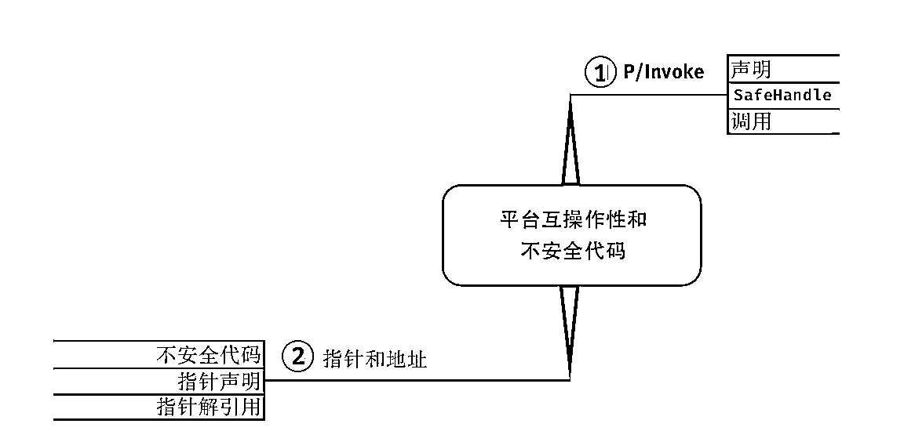
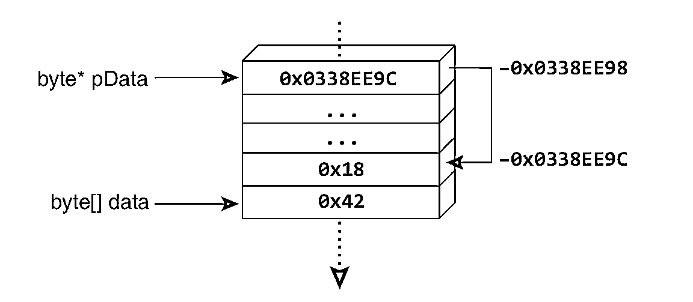

# 第二十三章　平台互操作性和不安全代码



C#功能强大还很安全（基础构架完全托管）。但它有时仍然“不给力”，只能放弃它所提供的所有安全性，退回到内存地址和指针的世界。C#主要通过两种方式提供这方面的支持。第一种是使用平台调用（Platform Invoke，P/Invoke）来调用非托管 DLL 所公开的 API。第二种是使用不安全代码 ，它允许访问内存指针和地址。

本章主要讨论与非托管代码的交互以及不安全代码的使用。最后演示如何用一个小程序判断计算机的处理器 ID。代码执行以下操作。

1.调用一个操作系统 DLL，请求分配一部分内存来执行指令。

2.将一些汇编指令写入已分配的内存区域。

3.将一个地址位置注入汇编指令。

4.执行汇编程序代码。

这个例子实际运用了本章介绍的 P/Invoke 和不安全代码，展示了 C#的强大功能，并证明了可从托管代码中访问非托管代码。

## 23.1　平台调用

任何时候只要想调用现有非托管代码库，想访问操作系统未由任何托管 API 公开的非托管代码，或者想避免类型检查/垃圾回收的运行时开销以发挥一个特定算法的最大性能，最终都必然会调用非托管代码。CLI 通过 P/Invoke 提供该功能，它允许对非托管 DLL 所导出的函数执行 API 调用。

本节只调用了 Windows API。虽然其他平台没有这些 API，但完全可以为其他平台上的原生 API 使用 P/Invoke，或者用 P/Invoke 调用自己的 DLL（中的函数）。规范和语法是一样的。

### 23.1.1　声明外部函数

确定要调用的目标函数以后，P/Invoke 的下一步便是用托管代码声明函数。和类的所有普通方法一样，必须在类的上下文中声明目标 API，但要为它添加 extern 修饰符，从而把它声明为外部函数 。代码清单 23.1 演示了具体做法。

代码清单 23.1　声明外部方法

```powershell
# PowerShell 通过 Add-Type 声明 Win32 P/Invoke 方法。
Add-Type -Namespace Interop -Name NativeMethods -MemberDefinition @'
    [DllImport("kernel32.dll", EntryPoint = "GetCurrentProcess")]
    public static extern IntPtr GetCurrentProcessHandle();
'@
$processHandle = [Interop.NativeMethods]::GetCurrentProcessHandle()
```

本例的类是 VirtualMemoryManager，它将包含与内存管理相关的函数（函数直接由 System.Diagnostics.Processor 类提供，所以真正写这个程序时没必要声明）。注意方法返回一个 IntPtr。该类型将在下一节解释。

extern 方法永远没有主体，而且几乎总是静态方法。具体实现由对方法声明进行修饰的 DllImport 特性指定。该特性要求最起码提供定义了函数的 DLL 的名称。“运行时”根据方法名判断函数名。但也可用 EntryPoint 具名参数明确提供一个函数名来覆盖此默认行为。.NET 平台自动尝试调用 API 的 Unicode（...W）或 ASCII（...A）版本。

本例的外部函数 GetCurrentProcess()获取当前进程的一个“伪句柄”（pseudohandle）。在调用中会使用该伪句柄进行虚拟内存分配。以下是非托管声明：

```powershell
# 原生签名：PowerShell 通过 Add-Type 映射 HANDLE 为 [IntPtr]。
$processHandle = [Interop.NativeMethods]::GetCurrentProcessHandle()
```

### 23.1.2　参数的数据类型

确定目标 DLL 和导出的函数后，最困难的一步是标识或创建与外部函数中的非托管数据类型对应的托管数据类型^( [\[1\]](part0187.xhtml#ch1_back) ) 。代码清单 23.2 展示了一个较难的 API。

代码清单 23.2　VirtualAllocEx() API

```powershell
# PowerShell 映射 Win32 VirtualAllocEx 的原生签名。
# HANDLE/LPVOID/SIZE_T 使用 [IntPtr]，DWORD 使用 [uint32]。
```

VirtualAllocEx()分配操作系统特别为代码执行或数据指定的虚拟内存。要调用它，托管代码需要为每种数据类型提供相应的定义——虽然在 Win32 编程中，HANDLE、LPVOID、SIZE\_T 和 DWORD 在 CLI 托管代码中通常是未定义的。代码清单 23.3 展示了 VirtualAllocEx()的 C#声明。

代码清单 23.3　在 C#中声明 VirtualAllocEx() API

```powershell
Add-Type -Namespace Interop -Name VirtualMemoryManager -MemberDefinition @'
    [DllImport("kernel32.dll")]
    public static extern IntPtr GetCurrentProcess();
    [DllImport("kernel32.dll", SetLastError = true)]
    public static extern IntPtr VirtualAllocEx(IntPtr hProcess, IntPtr lpAddress, IntPtr dwSize, uint flAllocationType, uint flProtect);
'@
```

托管代码的一个显著特征是，像 int 这样的基元数据类型不会随处理器改变大小。无论 16 位、32 位还是 64 位处理器，int 始终是 32 位。不过在非托管代码中，内存指针会随处理器而变化。因此，不要将 HANDLE 和 LPVOID 等类型映射为 int，而应把它们映射为 System.IntPtr，其大小将随处理器内存布局而变化。本例还使用了一个 AllocationType 枚举类型，详情参见本章后面的 23.1.8 节。

代码清单 23.3 一个有趣的地方在于，IntPtr 不仅能存储指针，还能存储其他东西，比如数量。IntPtr 并非只能表示“作为整数存储的指针”，它还能表示“指针大小的整数”。IntPtr 不需要包含指针，包含指针大小的内容即可。许多东西只有指针大小，但不一定是指针。

### 23.1.3　使用 ref 而不是指针

许多时候，非托管代码会为传引用（pass-by-reference）参数使用指针。在这种情况下，P/Invoke 不要求在托管代码中将数据类型映射为指针。相反，应将对应参数映射为 ref 或 out，具体取决于参数是输入/输出，还是仅输出。代码清单 23.4 的 lpflOldProtect 参数便是一例，其数据类型是 PDWORD，返回指针，指针指向一个变量，变量接收“指定页区域第一页的上一个访问保护”^( [\[2\]](part0187.xhtml#ch2_back) ) 。

代码清单 23.4　使用 ref 和 out 而不是指针

```powershell
Add-Type -Namespace Interop -Name MemoryProtection -MemberDefinition @'
    [DllImport("kernel32.dll", SetLastError = true)]
    public static extern bool VirtualProtectEx(IntPtr hProcess, IntPtr lpAddress, IntPtr dwSize, uint flNewProtect, ref uint lpflOldProtect);
'@
```

文档中 lpflOldProtect 被定义为\[out\]参数（虽然签名没有强制要求），但在随后的描述中，又指出该参数必须指向一个有效的变量，而不能是 NULL。文档出现这种自相矛盾的说法，难免令人迷惑，但这是一个很常见的情况。针对这种情况，我们的指导原则是为 P/Invoke 类型参数使用 ref 而不是 out，因为被调用者总是能忽略随同 ref 传递的数据，反之则不然。

其他参数与 VirtualAllocEx()差不多，唯一例外的是 lpAddress，它是从 Virtual-AllocEx()返回的地址。此外，flNewProtect 指定了确切的内存保护类型：PAGE\_EXECUTE、PAGE\_READONLY 等。

### 23.1.4　为顺序布局使用 StructLayoutAttribute

有些 API 涉及的类型无对应托管类型。调用这些 API 需要用托管代码重新声明类型。例如，可用托管代码来声明非托管 COLORREF 结构，如代码清单 23.5 所示。

代码清单 23.5　从非托管的 struct 中声明类型

```powershell
# 顺序布局结构需由 Add-Type 定义；PowerShell class 不支持 StructLayout。
Add-Type -TypeDefinition @'
using System.Runtime.InteropServices;
[StructLayout(LayoutKind.Sequential)]
public struct ColorRef {
    public byte Red; public byte Green; public byte Blue; private byte Unused;
    public ColorRef(byte red, byte green, byte blue) { Red=red; Green=green; Blue=blue; Unused=0; }
}
'@
```

Microsoft Windows 所有与颜色相关的 API 都用 COLORREF 来表示 RGB 颜色（红、绿、蓝）。

以上声明的关键之处在于 StructLayoutAttribute。默认情况下，托管代码可以优化类型的内存布局，所以内存布局可能不是从一个字段到另一个字段顺序存储。要强制顺序布局，使类型能直接映射，而且能在托管和非托管代码之间逐位拷贝，你需要添加 StructLayoutAttribute 并指定 LayoutKind.Sequential 枚举值。（从文件流读写数据时，如要求顺序布局，也要这样修饰。）

由于 struct 的非托管（C++）定义没有映射到 C#定义，所以在非托管结构和托管结构之间不存在直接映射关系。开发者应遵循常规的 C#设计规范来构思，即类型在行为上是像值类型还是像引用类型，以及大小是否很小（小于 16 字节才适合设计成结构）。

### 23.1.5　错误处理

Win32 API 编程的一个不便之处在于，错误经常以不一致的方式来报告。例如，有的 API 返回一个值（0、1、false 等）来指示错误，有的 API 则以某种方式设置一个 out 参数。除此之外，了解错误细节还需额外调用 GetLastError() API，再调用 FormatMessage()来获取对应的错误消息。总之，非托管代码中的 Win32 错误报告很少通过异常来生成。

幸好，P/Invoke 设计者专门提供了处理机制。为此请将 DllImport 特性的 SetLastError 具名参数设为 true。这样就可实例化一个 System.ComponentModel.Win32Exception()。在 P/Invoke 调用之后，会自动用 Win32 错误数据来初始化它，如代码清单 23.6 所示。

代码清单 23.6　Win32 错误处理

```powershell
$pointer = [Interop.VirtualMemoryManager]::VirtualAllocEx($processHandle, [IntPtr]::Zero, [IntPtr]$size, 0x3000, 0x40)
if ($pointer -eq [IntPtr]::Zero) { throw [ComponentModel.Win32Exception]::new([Runtime.InteropServices.Marshal]::GetLastWin32Error()) }
$oldProtect = [uint32]0
if (-not [Interop.MemoryProtection]::VirtualProtectEx($processHandle, $pointer, [IntPtr]$size, 0x40, [ref]$oldProtect)) { throw [ComponentModel.Win32Exception]::new([Runtime.InteropServices.Marshal]::GetLastWin32Error()) }
```

这样开发者就可提供每个 API 所用的自定义错误检查，同时仍可通过标准方式报告错误。

代码清单 23.1 和代码清单 23.3 将 P/Invoke 方法声明为内部或私有。除了最简单的 API，通常应将方法封装到公共包装器中，从而降低 P/Invoke API 调用的复杂性。这样能增强 API 的可用性，同时更有利于转向面向对象的类型结构。代码清单 23.6 的 AllocExecutionBlock()声明就是一个很好的例子。

设计规范

·如果非托管方法使用了托管代码的约定，比如结构化异常处理，就要围绕非托管方法创建公共托管包装器。

### 23.1.6　使用 SafeHandle

P/Invoke 经常涉及用完需要清理的资源（如句柄）。但不要强迫开发者记住这一点并每次都手动写代码。相反，应提供实现了 IDisposable 接口和终结器的类。例如在代码清单 23.7 中，VirtualAllocEx()和 VirtualProtectEx()会返回一个地址，该资源需调用 VirtualFreeEx()进行清理。为提供内建的支持，可以定义一个从 System.Runtime.Interop-Services.SafeHandle 派生的 VirtualMemoryPtr 类。

代码清单 23.7　使用 SafeHandle 的托管资源

```powershell
# PowerShell 用 IDisposable 包装非托管资源；没有 SafeHandle 的直接脚本语法。
class VirtualMemoryPtr : System.IDisposable {
    [IntPtr] $Pointer
    VirtualMemoryPtr([int] $size) { $this.Pointer = [IntPtr]::Zero }
    Dispose() { $this.Pointer = [IntPtr]::Zero }
}
```

System.Runtime.InteropServices.SafeHandle 包含抽象成员 IsInvalid 和 ReleaseHandle()。可在后者中放入资源清理代码，前者指出是否已执行了资源清理代码。

有了 VirtualMemoryPtr 之后，内存的分配就变得很简单。实例化类型，指定所需的内存分配即可。

### 23.1.7　调用外部函数

声明好的 P/Invoke 函数可像调用其他任何类成员一样调用。注意导入的 DLL 必须在路径中（编辑 PATH 环境变量，或放在与应用程序相同的目录中）才能成功加载。代码清单 23.6 和代码清单 23.7 已对此进行了演示。不过，它们要依赖于某些常量。

由于 flAllocationType 和 flProtect 是标志（flag），所以最好的做法是为它们提供常量或枚举。但不要期待由调用者定义这些东西。应将它们作为 API 声明的一部分来提供。如代码清单 23.8 所示。

代码清单 23.8　将 API 封装到一起

```powershell
$allocationType = [uint32](0x2000 -bor 0x1000) # MEM_RESERVE | MEM_COMMIT
$protection = [uint32]0x40                    # PAGE_EXECUTE_READWRITE
$freeType = [IntPtr]0x4000                    # MEM_DECOMMIT
```

枚举的好处在于将所有值组合到一起。另外，还将作用域严格限定在这些值之内。

### 23.1.8　用包装器简化 API 调用

无论错误处理、结构还是常量值，优秀的 API 开发者都应该提供一个简化的托管 API 将底层 Win32 API 包装起来。例如，代码清单 23.9 用简化了调用的公共版本重载了 Virtual-FreeEx()。

代码清单 23.9　包装底层 API

```powershell
Add-Type -Namespace Interop -Name MemoryFree -MemberDefinition @'
    [DllImport("kernel32.dll", SetLastError = true)]
    public static extern bool VirtualFreeEx(IntPtr hProcess, IntPtr lpAddress, IntPtr dwSize, IntPtr dwFreeType);
'@
function Free-VirtualMemory {
    param([IntPtr]$ProcessHandle, [IntPtr]$Address, [IntPtr]$Size)
    if (-not [Interop.MemoryFree]::VirtualFreeEx($ProcessHandle,$Address,$Size,[IntPtr]0x4000)) { throw [ComponentModel.Win32Exception]::new([Runtime.InteropServices.Marshal]::GetLastWin32Error()) }
}
```

### 23.1.9　函数指针映射到委托

P/Invoke 的最后一个要点是非托管代码中的函数指针映射到托管代码中的委托。例如，为了设置计时器，需提供一个到期后能由计时器回调的函数指针。具体地说，需传递一个与回调签名匹配的委托实例。

### 23.1.10　设计规范

鉴于 P/Invoke 的独特性，写这种代码时应谨记以下设计规范。

设计规范

·不要无谓重复现有的、已经能执行非托管 API 功能的托管类。

·要将外部方法声明为私有或内部。

·要提供使用了托管约定的公共包装器方法，包括结构化异常处理、为特殊值使用枚举等。

·要为非必需参数选择默认值来简化包装器方法。

·要用 SetLastErrorAttribute 将使用 SetLastError 错误码的 API 转换成抛出 Win32-Exception 的方法（在 Windows 上）。

·要扩展 SafeHandle 或实现 IDisposable 并创建终结器来确保非托管资源被高效清理。

·要在非托管 API 需要函数指针的时候使用和所需方法的签名匹配的委托类型。

·要尽量使用 ref 参数而不是指针类型。

[\[1\]](part0187.xhtml#ch1) 有关 Win32 API 声明的一个非常有用的网上资源是 www.pinvoke.net。该网站为众多 API 提供了一个很好的起点。从头写一个外部 API 调用的时候，可通过它避免一些容易忽视的问题。

[\[2\]](part0187.xhtml#ch2) MSDN 文档如此。

## 23.2　指针和地址

有时需要用指针直接访问和操纵内存。这对特定操作系统交互和某些时间关键的算法来说是必要的。C#通过“不安全代码”构造提供这方面的支持。

### 23.2.1　不安全代码

C#的一个突出优势在于它是强类型的，且支持运行时类型检查。但仍可绕过这个机制直接操纵内存和地址。例如，在操纵内存映射设备或实现时间关键（time-critical）算法的时候就需要这样做。为此，只需将代码区域指定为 unsafe（不安全）。

不安全代码是一个显式的代码块和编译选项，如代码清单 23.10 所示。unsafe 修饰符对生成的 CIL 代码本身没有影响。它只是一个预编译指令，作用是向编译器指出允许在不安全代码块内操纵指针和地址。此外，不安全并不意味着非托管。

代码清单 23.10　为不安全代码指定方法

```powershell
# PowerShell 没有 unsafe 修饰符；低级指针操作需放入 Add-Type 编译的 C# 类型。
```

可将 unsafe 用作类型或者类型内部的特定成员的修饰符。

此外，C#允许用 unsafe 标记代码块，指出其中允许不安全代码，如代码清单 23.11 所示。

代码清单 23.11　指定不安全代码块

```powershell
# PowerShell 没有 unsafe 代码块；指针操作只能由互操作组件实现。
```

unsafe 块中的代码可以包含指针之类的不安全构造。

注意 　必须向编译器显式指明要支持不安全代码。

不安全代码可能造成缓冲区溢出并暴露其他安全漏洞，所以需显式通知编译器允许不安全代码。为此，可在 CSPROJ 文件中将 AllowUnsafeBlocks 设为 true，如代码清单 23.12 所示。

代码清单 23.12　设置 AllowUnsafeBlocks

```xml
<!-- PowerShell 脚本不需要 AllowUnsafeBlocks；若使用 Add-Type 编译 unsafe C#，需在编译项目中启用该选项。 -->
<PropertyGroup><AllowUnsafeBlocks>true</AllowUnsafeBlocks></PropertyGroup>
```

还可在运行 dotnet build 命令时通过命令行传递属性，如输出 23.1 所示。

输出 23.1


如直接调用 C#编译器，则可使用/unsafe 开关，如输出 23.2 所示。

输出 23.2


还可在 Visual Studio 中打开项目属性窗口，勾选“生成”标签页中的“允许不安全代码”。

允许“不安全代码”后，就可直接操纵内存并执行非托管指令。由于这可能带来安全隐患，所以必须显式允许以认同随之而来的风险。有句话叫“能力越大，责任越大”。

### 23.2.2　指针声明

代码块标记为 unsafe 之后，接着要知道如何写不安全代码。首先，不安全代码允许声明指针。来看以下例子。

```powershell
# PowerShell 不支持 byte*；可用 [IntPtr] 表示原生地址，但不能直接解引用。
$pointer = [IntPtr]::Zero
```

假设 pData 不为 null，那么它的值指向包含一个或多个连续字节的内存位置，pData 的值代表这些字节的内存地址。符号\*之前指定的类型是被引用物 （referent）类型 ，或者说是指针指向的那个位置存储的值的类型。在本例中，pData 是指针，而 byte 是被引用物类型，如图 23.1 所示。



图 23.1　指针包含的只是实际数据所在的地址

因为指针是指向内存地址的整数，所以不会被垃圾回收。C#不允许非托管类型 以外的被引用物类型。换言之，不能是引用类型，不能是泛型类型，而且内部不能包含引用类型。所以，以下声明是无效的：

```powershell
# 字符串是引用类型，不能声明 string*。
$message = 'text'
```

以下声明也不正确：

```powershell
# PowerShell 不支持指针变量；通过 [IntPtr] 保存原生地址。
$pointer = [IntPtr]::Zero
```

其中，ServiceStatus 的定义如代码清单 23.13 所示。问题仍然是 ServiceStatus 中包含了一个 string 字段。

代码清单 23.13　无效的被引用物类型示例

```powershell
# 含有 string 引用的对象不能映射为非托管指针结构。
$status = [pscustomobject]@{ State=0; Description='Running' }
```

除了只含非托管类型的自定义结构之外，其他有效的被引用物类型还包括枚举、预定义值类型（sbyte、byte、short、ushort、int、uint、long、ulong、char、float、double、decimal 和 bool）以及指针类型（比如 byte\*\*）。void\*指针也有效，代表指向未知类型的指针。

语言对比：C/C++——指针声明

C/C++要求像下面这样一次声明多个指针：

```powershell
$p1 = [IntPtr]::Zero
$p2 = [IntPtr]::Zero
```

注意 p2 之前的\*，它使 p2 成为一个 int\*，而不是一个 int。相比之下，C#总是把\*和数据类型放在一块儿，如下所示：

```powershell
$p1 = [IntPtr]::Zero
$p2 = [IntPtr]::Zero
```

结果是两个 int\*类型的变量。两种语言在一个语句中声明多个数组的语法是一致的：

```powershell
$array1 = [int[]]::new(10)
$array2 = [int[]]::new(10)
```

指针是全新的类型。有别于结构、枚举和类，指针的终极基类不是 System.Object，甚至不能转换成 System.Object。相反，它们能（显式）转换成 System.IntPtr（后者能转换成 System.Object）。

### 23.2.3　指针赋值

指针定义好后，访问前必须赋值。和引用类型一样，指针可包含 null 值，这也是它们的默认值。指针保存的是一个位置的地址。所以要对指针进行赋值，首先必须获得数据的地址。

可显式将一个 int 或 long 转换为指针。但除非事先知道一个特定数据值在执行时的地址，否则很少这样做。相反，要用地址操作符（&）来获取值类型的地址，如下所示：

```powershell
$bytes = [byte[]]::new(8)
$pointer = [IntPtr]::Zero
```

问题在于托管环境中的数据可能发生移动，导致地址无效。编译器显示的错误消息是：“只能获取固定语句初始值设定项内的未固定表达式的地址”^( [\[1\]](part0188.xhtml#ch1_back) ) 。在本例中，被引用的字节出现在一个数组内，而数组是引用类型（在内存中可能移动的类型）。引用类型出现在内存堆（heap）上，可被垃圾回收或转移位置。对一个可移动类型中的值类型字段进行引用，会发生类似的问题：

```powershell
# PowerShell 不支持对托管字符串取地址。
$message = 'message'
$length = $message.Length
```

无论采用哪种方式，为了将数据的地址赋给指针，要求如下：

·数据必须属于一个变量。

·数据必须是非托管类型。

·变量需要用 fixed 固定，不能移动。

如数据是一个非托管变量类型，但是不固定，就用 fixed 语句固定可移动的变量。

1.固定数据 

要获取可移动数据项的地址，首先必须把它固定下来，如代码清单 23.14 所示。

代码清单 23.14　fixed 语句

```powershell
$bytes = [byte[]]::new(24)
$handle = [Runtime.InteropServices.GCHandle]::Alloc($bytes, [Runtime.InteropServices.GCHandleType]::Pinned)
try { $pointer = $handle.AddrOfPinnedObject() } finally { $handle.Free() }
```

在 fixed 限定的代码块中，赋值的数据不会再移动。在本例中，bytes 会固定不动（至少在 fixed 语句结束之前如此）。

fixed 语句要求指针变量在其作用域内声明。这样可防止当数据不再固定时访问到 fixed 语句外部的变量。但最终是由程序员来保证不会将指针赋给在 fixed 语句范围之外也能生存的变量（API 调用中可能有这样的变量）。不安全代码的“不安全”是有原因的。需确保安全地使用指针，不要依赖“运行时”来帮你确保安全性。类似地，对于在方法调用后就不会生存的数据，使用 ref 或 out 参数也会出问题。

由于 string 是无效被引用物类型，所以定义 string 指针似乎无效。但和 C++一样，在内部，string 本质上就是指向字符数组第一个字符的指针，而且可用 char\*来声明字符指针。所以，C#允许在 fixed 语句中声明 char\*类型的指针，并可把它赋给一个 string。fixed 语句防止字符串在指针生存期内移动。类似地，在 fixed 语句内允许其他任何可移动类型，只要它们能隐式转换为其他类型的指针即可。

可用缩写的 bytes 取代冗长的&bytes\[0\]赋值，如代码清单 23.15 所示。

代码清单 23.15　没有地址或数组索引器的固定语句

```powershell
$bytes = [byte[]]::new(24)
$handle = [Runtime.InteropServices.GCHandle]::Alloc($bytes, [Runtime.InteropServices.GCHandleType]::Pinned)
try { $pointer = $handle.AddrOfPinnedObject() } finally { $handle.Free() }
```

取决于执行频率和时机，fixed 语句可能导致内存堆中出现碎片（fragmentation），这是由于垃圾回收器不能压缩^( [\[2\]](part0188.xhtml#ch2_back) ) 已固定的对象。为解决该问题，最好的做法是在执行前期就固定好代码块，而且宁可固定较少的几个大块，也不要固定许多的小块。遗憾的是，这又和另一个原则发生了冲突，即“应该尽量缩短固定时间，降低在数据固定期间发生垃圾回收的概率”。.NET 2.0（及更高版本）添加了一些能避免过多碎片的代码，从而在某种程度上减少了这方面的问题。

有时需要在方法主体中固定一个对象，并保持固定直至调用另一个方法。用 fixed 语句做不到这一点。这时可用 GCHandle 对象提供的方法来不确定地固定对象。但若非绝对必要，否则不应这样做。长时间固定对象很容易导致垃圾回收器不能高效地“压缩”内存。

2.在栈上分配 

应该为一个数组使用 fixed 语句，防止垃圾回收器移动数据。但另一个做法是在调用栈上分配数组。栈上分配的数据不会被垃圾回收，也不会被终结器清理。和被引用物类型一样，要求 stackalloc（栈分配）数据是非托管类型的数组。例如，可以不在堆上分配一个 byte 数组，而是把它放在调用栈上，如代码清单 23.16 所示。

代码清单 23.16　在调用栈上分配数据

```powershell
# PowerShell 没有 stackalloc；普通数组由 .NET 托管堆分配。
$bytes = [byte[]]::new(42)
```

由于数据类型是非托管类型的数组，所以“运行时”可为该数组分配一个固定大小的缓冲区，并在指针越界时回收该缓冲区。具体地说，它会分配 sizeof(T)\*E，其中 E 是数组大小，T 是被引用物的类型。由于只能为非托管类型的数组使用 stackalloc，“运行时”为了回收缓冲区并把它返还给系统，只需对栈执行一次展开（unwind）操作，这就避免了遍历 f-reachable 队列（参见第十章的垃圾回收和终结器部分）并对 reachable（可达）数据进行压缩的复杂性。但结果是无法显式释放 stackalloc 数据。

注意栈是一种宝贵的资源。耗尽栈空间会造成程序崩溃。应尽一切努力防止耗尽。如程序真的耗尽了栈空间，最理想的情况是程序立即关闭/崩溃。一般情况下，程序只有不到 1 MB 的栈空间（实际可能更少）。所以，在栈上分配缓冲区要控制大小。

### 23.2.4　指针解引用

指针要进行解引用才能访问指针引用的一个类型的值。这要求在指针类型前添加一个间接寻址操作符\*。例如以下语句：

* * *

```
byte data=\*pData;

```

* * *

它的作用是解引用 pData 所引用的 byte 所在的位置，并生成一个 byte 类型的变量。该变量提供对该位置单个 byte 的读/写访问。

在不安全代码中这样做会使本来“不可变”的字符串变得可以被修改，如代码清单 23.17 所示。虽然不建议这样做，但它确实揭示了执行低级内存处理的可能性。

代码清单 23.17　修改“不可变”字符串

```powershell
# PowerShell 字符串不可变；通过构造新字符串表达修改。
$text = 'S5280ft'; Write-Host -NoNewline "$text = "; $text = 'Smile'; Write-Host $text
```

代码清单 23.17 的结果如输出 23.3 所示。

输出 23.3


本例获取初始地址，并用前递增操作符使其递增被引用物类型的大小（sizeof(char)）。接着用间接寻址操作符\*解引用出地址，并为该地址分配一个不同的字符。类似地，对指针使用“+”和“–”操作符，会使地址增大或减小\*sizeof(T)的量，其中 T 是被引用物的类型。

类似地，比较操作符（==、!=、<、>、<=和=>）也可用于指针比较，它们实际会转变成地址位置值的比较。

不能对 void\*类型的指针进行解引用。void\*数据类型代表指向一个未知类型的指针。由于数据类型未知，所以不能解引用到另一种类型。相反，要访问 void\*引用的数据，必须把它转换成其他任何指针类型的变量，然后对后一种类型执行解引用。

可用索引操作符而不是间接寻址操作符来实现与代码清单 23.17 相同的行为，如代码清单 23.18 所示。

代码清单 23.18　在不安全代码中用索引操作符修改“不可变”字符串

```powershell
$text = 'S5280ft'; $characters = $text.ToCharArray()
$characters[1]='m'; $characters[2]='i'; $characters[3]='l'; $characters[4]='e'
Write-Host (-join $characters)
```

代码清单 23.18 的结果如输出 23.4 所示。

输出 23.4


代码清单 23.17 和代码清单 23.18 中的修改会导致出乎意料的行为。例如，假定在 Console.WriteLine()语句后重新为 text 赋值"S5280ft"，再重新显示 text，那么输出结果仍是 Smile，这是由于两个相同的字符串字面值的地址会优化成由两个变量共同引用的一个字符串字面值。在代码清单 23.17 的不安全代码之后，即使明确执行以下赋值：

```powershell
$text = 'S5280ft'
```

字符串赋值在内部实际仍然是一次地址赋值，所赋的地址是修改过的"S5280ft"位置，所以 text 永远不会被设置成你希望的值。

### 23.2.5　访问被引用物类型的成员

指针解引用将生成指针基础类型的变量。然后可用成员访问“点”操作符来访问基础类型的成员。但根据操作符优先级规则，\*x.y 等价于\*(x.y)，而这可能不是你所希望的。如果 x 是指针，正确的代码就是(\*x).y。当然，这个语法并不好看。为了更容易地访问解引用的指针的成员，C#提供了特殊的成员访问修饰符：x->y 是(\*x).y 的简化形式，如代码清单 23.19 所示。

代码清单 23.19　直接访问被引用物类型的成员

```powershell
$angle = [pscustomobject]@{ Hours=30; Minutes=18; Seconds=0 }
Write-Host ('{0}° {1}'' {2}"' -f $angle.Hours,$angle.Minutes,$angle.Seconds)
```

代码清单 23.19 的输出结果如输出 23.5 所示。

输出 23.5


[\[1\]](part0188.xhtml#ch1) 英文版显示为“You can only take the address of \[an\] unfixed expression inside a fixed statement initializer”。——译者注

[\[2\]](part0188.xhtml#ch2) 此压缩非彼压缩，这里只是约定俗成地将 compact 翻译成“压缩”。不要以为“压缩”后内存会增多。相反，这里的“压缩”更接近于“碎片整理”。事实上，compact 正确的意思是“变得更紧凑”。但从 20 世纪 80 年代起，人们就把它看成是 compress 的近义词而翻译成“压缩”，以讹传讹至今。——译者注

## 23.3　通过委托执行不安全代码

本章最后提供一个完整的例子，演示了用 C#所能做的最“不安全”的事情：获取内存块指针，用机器码字节填充它，让委托引用新代码并执行委托。本例用汇编代码判断处理器 ID。如果在 Windows 上运行，就打印处理器 ID。如代码清单 23.20 所示。

代码清单 23.20　指定不安全代码块

```powershell
# CPUID 机器码和可执行委托依赖 C# unsafe；PowerShell 不能直接执行该字节缓冲区。
if ($env:OS -eq 'Windows_NT') { (Get-CimInstance Win32_Processor | Select-Object -First 1).Name }
else { Write-Host '此示例仅适用于 Windows' }
```

代码清单 23.20 的输出结果如输出 23.6 所示。

输出 23.6


## 23.4　小结

本书之前已展示了 C#语言的强大功能、灵活性、一致性以及精妙的结构。本章则证明了虽然 C#语言提供了如此高级的编程功能，但还是能执行一些很底层的操作。

结束本书之前，还将用一章的篇幅简单描述底层执行框架，将重心从 C#语言本身转向更宽泛的 C#程序所依托的平台。