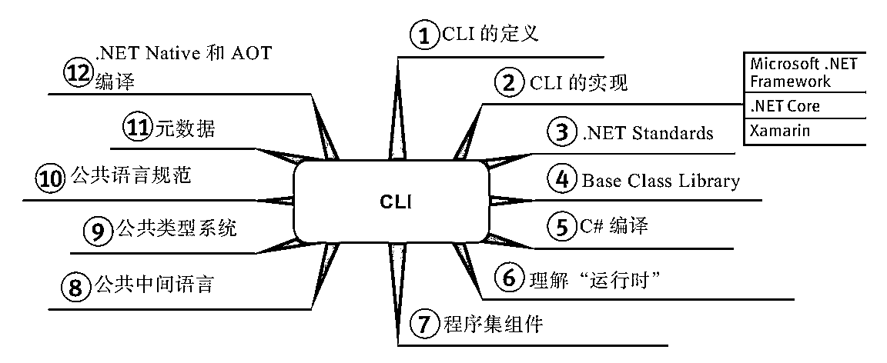
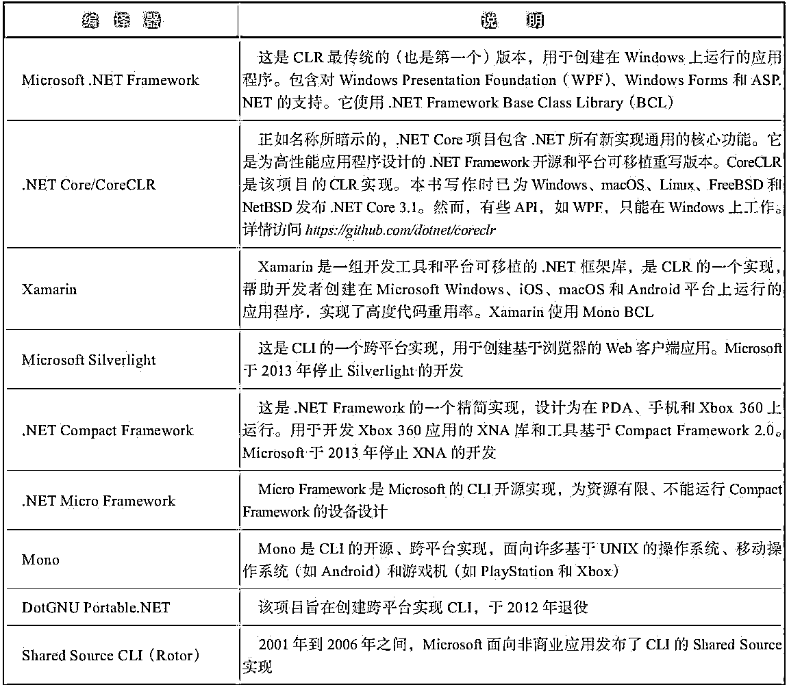
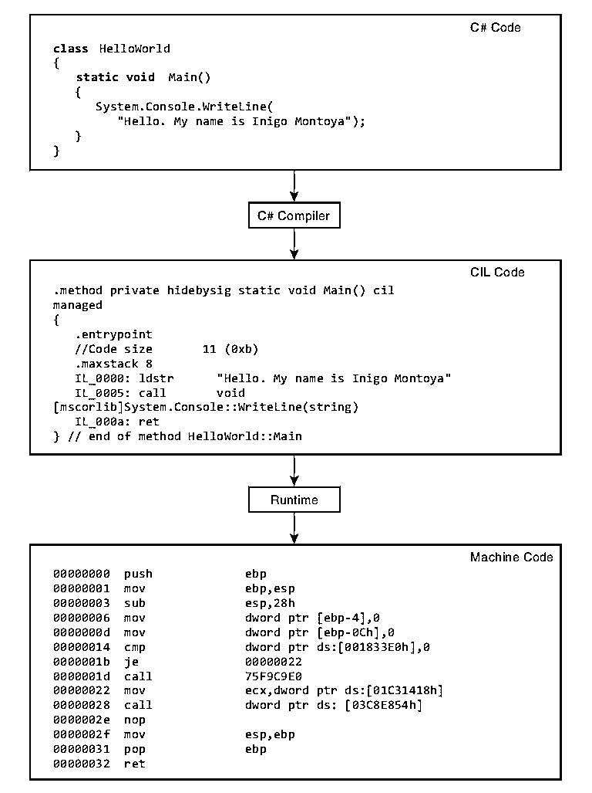
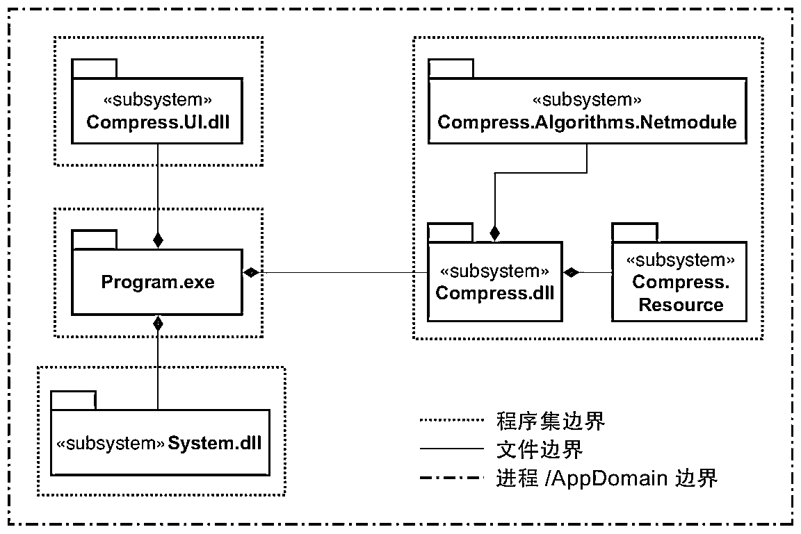
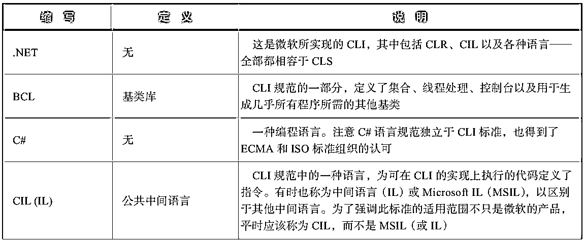
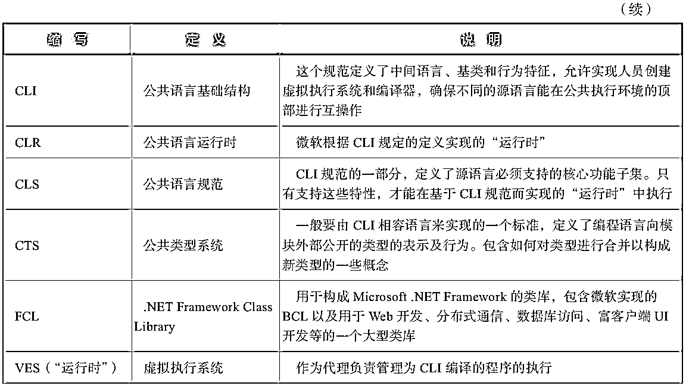

# 第二十四章　公共语言基础结构

除了语法本身，C#程序员还应关心 C#程序的执行环境。本章讨论 C#如何处理内存分配和回收、执行类型检查、与其他编程语言互操作、跨平台执行，以及如何支持元数据编程。换句话说，本章要研究 C#语言编译时和执行时所依赖的公共语言基础结构（Common Language Infrastructure，CLI）。本章描述了在运行时管理 C#程序的执行引擎，介绍了 C#如何与同一个执行引擎管辖的各种语言相适应。由于 C#语言与这个基础结构密切相关，所以该基础结构的大多数功能都可在 C#中使用。

注：PowerShell 同样运行在 .NET（CLI 的实现）之上，脚本在执行时也会被编译为 CIL，所以本章关于 CLI/CIL/运行时/垃圾回收的讨论对 PowerShell 同样成立。文中以“C#编译器”为例说明的是整个 .NET 平台的机制，并非 PowerShell 不支持这些概念。

## 24.1　CLI 的定义

C#生成的不是处理器能直接解释的指令，而是一种中间语言指令。这种中间语言就是公共中间语言（Common Intermediate Language，CIL）。第二个编译步骤通常在执行时发生。在这个步骤中，CIL 被转换为处理器能理解的机器码。但代码要执行，仅仅转换为机器码还不够。C#程序还需要在一个代理的上下文中执行。负责管理 C#程序执行的代理就是虚拟执行系统（Virtual Execution System，VES），它的一个更常见、更通俗的称呼是“运行时”^( [\[1\]](part0192.xhtml#ch1_back) ) ，它负责加载和运行程序，并在程序执行时提供额外的服务（比如安全性、垃圾回收等）。

CIL 和“运行时”规范包含在一项国际标准中，即公共语言基础结构 （Common Language Infrastructure，CLI）^( [\[2\]](part0192.xhtml#ch2_back) ) 。CLI 是理解 C#程序的执行环境以及 C#如何与其他程序和库（甚至是用其他语言编写的）进行无缝交互的一个重要规范。注意 CLI 没有规定标准具体如何实现，但它描述了一个 CLI 框架在符合标准的前提下应具有什么行为。这为 CLI 实现者提供了足够大的灵活性，放手让他们在必要的情况下大胆创新，但同时又能提供足够多的结构，使一个平台创建的程序能在另一个不同的 CLI 实现上运行，甚至能在另一个不同的操作系统上运行。

注意 　CIL 和 CLI 这两个缩写词一定要仔细区分。充分理解它们的含义，避免混淆。

CLI 标准包含以下更详细的规范：

·虚拟执行系统（VES，即常说的“运行时”）

·公共中间语言（Common Intermediate Language，CIL）

·公共类型系统（Common Type System，CTS）

·公共语言规范（Common Language Specification，CLS）

·元数据（Metadata）

·框架（Framework）

本章将进一步拓宽你对 C#的认识，让你能从 CLI 的角度看问题。CLI 是决定 C#程序如何运行以及如何与其他程序和操作系统进行交互的关键。

[\[1\]](part0192.xhtml#ch1) “运行时”或者说 runtime 在这里并不是指“在运行的时候”。如果说到时间，我不会加引号，或者会直接说执行时。加了引号的“运行时”特指“虚拟执行系统”这个代理，它负责管理 C#程序的执行。——译者注

[\[2\]](part0192.xhtml#ch2) 本章提到的 CLI 全是指公共语言基础结构（Common Language Infrastructure），不要和 Dotnet CLI 中的命令行接口（Command-Line Interface）混淆了。

## 24.2　CLI 的实现

目前 CLI 的主要实现包括.NET Core（在 Windows、UNIX/Linux 和 mac OS 上运行）、.NET Framework for Windows 和 Xamarin（一个致力于跨平台的应用程序框架，目前支持 iOS、mac OS 和 Android 应用）。每个实现都包含一个 C#编译器和一组框架类库。各自支持的 C#版本以及库中确切的类集合都存在显著区别。另外，许多实现目前仅存历史意义。表 24.1 对这些实现进行了总结。

列表中的 CLI 实现内容虽然多，但实际只有三个框架最重要。

Microsoft .NET Framework 

Microsoft .NET Framework 是第一个.NET CLI 实现（2000 年 2 月发布）。它是最成熟的框架，提供了最大的 API 集合。可用它构建 Web、控制台和 Microsoft Windows 客户端应用程序。.NET Framework 最大的限制在于只能在 Microsoft Windows 上运行（事实上，它根本就是和 Microsoft Windows 捆绑的）。Microsoft .NET Framework 包含许多子框架，主要包括：

·.NET Framework Base Class Library (BCL) ：提供代表内建 CLI 数据类型的类型，用于支持文件 IO、基础集合类、自定义特性、字符串处理等。BCL 为 int 和 string 等 C#原生类型提供定义。

·ASP.NET ：用于构建网站和基于 Web 的 API。该框架自 2002 年发布以来，一直是基于 Microsoft 技术的网站的基础。目前正在被 ASP.NET Core 取代，后者支持操作系统可移植性，连同显著的性能提升，并提供了更新的 API 来实现更好的模式一致性。

·Windows Presentation Foundation (WPF) ：这个 GUI 框架用于构建在 Windows 上运行的富 UI 应用程序。WPF 不仅提供了一组 UI 组件，还支持名为 XAML 的一种宣告式语言，能实现应用程序 UI 的层次化定义。

表 24.1　CLI 的实现

Microsoft .NET Framework 经常简称为“.NET Framework”。注意用的是大写 F。这是区分它和 CLI 常规实现以及“.NET 框架”（.NET framework）的关键。

.NET Core 

.NET Core 是.NET CLI 的跨平台实现。是.NET Framework 的开源重写版本，致力于高性能和跨平台兼容性。

.NET Core 由.NET Core Runtime(Core CLR)、.NET Core 框架库和一组 dotnet 命令行工具构成，可用于创建和生成各种情况下的应用。这些组件包含在.NET Core SDK 中。如按本书示例操作，那么你已熟悉了.NET Core 和 dotnet 工具。

.NET Core API 通过.NET Standard（稍后讲述）兼容于现有.NET Framework、Xamarin 和 Mono 实现。

.NET Core 目前的重点在于构建高性能和可移植的控制台应用，它还是 ASP.NET Core 和 Windows 10 UWP 应用程序的.NET 基础。随着支持的操作系统越来越多，.NET Core 还会延伸出更多框架。

Xamarin 

这个跨平台开发工具为 Android、mac OS 和 iOS 提供了应用程序 UI 开发支持。随着.NET Standard 2.0 的发布，还可用它创建在 Windows 10、Xbox One 和 HoloLens 上运行的 UWP 应用。Xamarin 最强大的地方在于一个代码库可创建在多种操作系统上运行的、看起来像是平台原生的 UI。

## 24.3　.NET Standard

以前很难写一个能在多个操作系统（甚至同一个操作系统的不同.NET 框架）上使用的 C#代码库。问题在于，每个框架的框架 API 都有一套不同的类（以及/或者那些类中的方法）。.NET Standard 通过定义所有框架都必须实现以相容于指定版本的.NET Standard 的一组.NET API 来解决该问题。这样只要一个.NET 框架相容于某个目标.NET Standard 版本，开发者使用的就是一套一致的 API。如果希望只写一次核心应用程序逻辑便可在.NET 的任何现代实现上使用，最轻松的方式就是创建“类库(.NET Standard)”项目（Visual Studio 2017 的一个项目类型，或者 dotnet CLI 的类库模板）。.NET Core 编译器会确保库中所有代码只引用目标.NET Standard 适用的类和方法。

类库作者需谨慎挑选要支持的标准。.NET Standard 版本越高，越不用担心自己的 API 实现是低版本.NET Standard 所缺失的。但定位高版本.NET Standard 的缺点在于不同.NET 框架之间的移植性较差。例如，如希望库支持.NET Core 1.0，就要将目标定在.NET Standard 1.6，结果是无法用到 Microsoft .NET Framework 通用的反射 API。总之，如果你想偷懒，就定位较高版本的.NET Standard；如果可移植性比减少工作量更重要，就定位较低版本的.NET Standard。

欲知详情，包括.NET 框架实现及其版本与.NET Standard 版本的对应关系，请访问[`docs.microsoft.com/en-us/dotnet/standard/net-standard`](https://docs.microsoft.com/en-us/dotnet/standard/net-standard) 。

## 24.4　基类库

除了提供 CIL 代码可以执行的运行时环境，CLI 还定义了一套称为基类库 （Base Class Library，BCL）的核心类库。BCL 包含的类库提供基础类型和 API，允许程序以一致的方式和“运行时”及底层操作系统交互。BCL 包含对集合、简单文件访问、安全性、基础数据类型（例如 string）、流等的支持。

类似地，Microsoft 专用的框架类库 （Framework Class Library，FCL）包含对富客户端 UI、Web UI、数据库访问、分布式通信等的支持。

## 24.5　将 C#编译成机器码

第一章的 HelloWorld 代码清单显然是 C#代码，所以要执行就得用 C#编译器编译它。但处理器仍然不能直接解释编译好的代码（称为 CIL）。还需另外一个编译步骤将 C#编译结果转换为机器码。此外，执行时还涉及一个代理，它为 C#程序添加额外的服务，这些服务是无须显式编码的。

所有计算机语言都定义了编程的语法和语义。由于 C 和 C++之类的语言会直接编译成机器码，所以这些语言的平台是底层操作系统和机器指令集，即 Microsoft Windows、Linux 和 macOS 等。但 C#不同，它的底层上下文是“运行时”（或 VES）。

CIL 是 C#编译器的编译结果。之所以称为公共中间语言 （Common Intermediate Language），是因为还需一个额外的步骤将 CIL 转换为处理器能理解的东西（图 24.1 显示了这个过程）。

换言之，C#编译需要两个步骤：

1.C#编译器将 C#转换为 CIL。

2.将 CIL 转换为处理器能执行的指令。

“运行时”能理解 CIL 语句，并能将它们编译为机器码。通常要由“运行时”内部的一个组件 执行从 CIL 到机器码的编译。该组件称为即时 （just-in-time，JIT）编译器 。程序安装或执行时，便可能发生 JIT 编译，或者说即时编译 （jitting）。大多数 CLI 实现都倾向于执行时编译 CIL，但 CLI 本身并没有规定应该在什么时候编译。事实上，CLI 甚至允许 CIL 像许多脚本程序那样解释执行，而不是编译执行。此外，.NET 包含一个 NGEN 工具，允许在运行程序之前将代码编译成机器码。这个执行前的编译动作必须要在实际运行程序的计算机上进行，因为它会评估机器特性（处理器、内存等），以便生成更高效的代码。在程序安装时（或者在它执行前的任何时候）使用 NGEN，好处在于可以避免在程序启动时才执行 JIT 编译以缩短程序的启动时间。

从 Visual Studio 2015 开始，C#编译器还支持.NET 原生编译。可在创建应用程序的部署版本时将 C#代码编译成原生机器码，这和使用 NGEN 工具相似。UWP 应用利用了这个功能。

图 24.1　C#编译成机器码

## 24.6　运行时

即使“运行时”将 CIL 代码转换为机器码并开始执行，也在继续管理代码的执行。在“运行时”这样的一个代理上下文中执行的代码称为托管代码，在“运行时”控制下的执行过程称为托管执行。对执行的控制转向数据，数据就成为托管数据，因为数据所需的内存是由“运行时”自动分配和回收的。

略有微词的是，公共语言运行时 （CLR）这个术语从技术上讲并不是 CLI 的一个专业术语。CLR 更像是微软专门针对.NET 框架实现的“运行时”。不管怎样，CLR 正在逐渐成为运行时的一个常用代名词，而技术上更准确的术语虚拟执行系统 （VES）很少在 CLI 规范之外的地方用到。

由于代理控制程序执行，所以能将额外的服务注入程序，即使程序员没有显式指定需要这些服务。因此，托管代码提供了一些信息来允许附加这些服务。例如，托管代码允许定位与类型成员有关的元数据，支持异常处理，允许访问安全信息，并允许遍历栈。本节剩余部分将描述通过“运行时”和托管执行来提供的一些附加服务。CLI 没有明确要求提供所有这些服务，但目前的 CLI 框架都实现了它们。

### 24.6.1　垃圾回收

垃圾回收 是根据程序的需要自动分配和回收内存的过程。对于没有自动系统来做这件事的语言来说，这是一个重大的编程问题。没有垃圾回收器，程序员就必须记住要亲自回收他们分配的所有内存。忘记这样做，或对同一个内存分配反复这样做，会在程序中造成内存泄漏或损坏。对于 Web 服务器这样长时间运行的程序，情况还会变得更严重。由于“运行时”内建了垃圾回收支持，所以程序员可将精力集中在程序功能上，而不是为了内存管理疲于奔命。

语言对比：C++——确定性析构

垃圾回收器具体如何工作并不是 CLI 规范的一部分。因此，每个实现所采取的方案略有不同（事实上，垃圾回收器不是 CLI 明确要求的）。C++程序员要逐渐习惯的一个重要概念是：被垃圾回收的对象不一定会进行确定性回收。所谓确定性 （deterministically）回收，是指在良好定义的、编译时知道的位置进行回收。事实上，对象可在它们最后一次被访问和程序关闭之间的任何时间进行垃圾回收。这包括在超出作用域之前回收，或者等到一个对象实例能由代码访问之后回收。

应该注意，垃圾回收器只负责内存管理。它没有提供一个自动的系统来管理和内存无关的资源。因此，如需采取显式的行动来释放资源（除内存之外的其他资源），使用该资源的程序员应通过特殊的 CLI 兼容编程模式来帮助清理这些资源（详情参见第十章）。

初学者主题：.NET 的垃圾回收

CLI 的大多数实现都使用一个分代的（generational）、支持压缩的（compacting）以及基于标记并清除（mark-and-sweep）的算法。之所以说它是分代的，是因为只存活过短暂时间的对象与已经在垃圾回收时存活下来（原因是对象仍在使用）的对象相比，前者会被更早地清理掉。这一点符合内存分配的常规模式：已知活得久的对象，会比最近才实例化的对象活得更久。

此外，.NET 垃圾回收器使用了一个 mark-and-sweep 算法。在每次执行垃圾回收期间，它都标记出将要回收的对象，并将剩余对象压缩到一起，确保它们之间没有“脏”空间。使用压缩机制来填充由回收的对象腾出来的空间，通常会使新对象能以更快速度实例化（与非托管代码相比），这是因为不必搜索内存为一次新的分配寻找空间。与此同时，这个算法还降低了执行分页处理的概率，因为同一个页中能存储更多的对象，这也有利于性能的提升。

垃圾回收器会考虑到机器上的资源以及执行时对资源的需求。例如，假定计算机的内存尚剩余大量空间，垃圾回收器就很少运行，并很少花时间去清理那些资源。相比之下，不基于垃圾回收的平台和语言很少进行这样的优化。

初学者主题：类型安全

“运行时”提供的关键优势之一就是检查类型之间的转换。我们把它称为“运行时”的类型检查 能力。通过类型检查，“运行时”防止了程序员不慎引入可能造成缓冲区溢出安全漏洞的非法类型转换。此类安全漏洞是最常见的计算机入侵方式之一。因此，让“运行时”自动杜绝此类漏洞，对于安全性来说是很有利的。运行时提供的类型检查可以确保以下几点。

·变量和变量引用的数据都是有类型的，而且变量类型兼容于它所引用的数据的类型。

·可局部分析一个类型（而不必分析使用了该类型的所有代码），确定需要什么权限来执行该类型的成员。

·每个类型都有一组编译时定义的方法和数据。“运行时”强制性地规定什么类能访问那些方法和数据。例如，标记为“private”的方法只能由它的包容类型访问。

高级主题：绕过封装和访问修饰符

只要有相应的权限，就可通过反射 机制绕过封装和访问修饰符。反射机制提供了晚期绑定功能，允许浏览类型的成员，在对象的元数据中查找特定构造的名称，并可调用类型的成员。

### 24.6.2　平台可移植性

C#程序具有平台可移植性 ，支持在不同操作系统上的执行（称为跨平台支持）。换言之，程序能在多种操作系统上运行，不管具体的 CLI 实现是什么。这里说的可移植性并非只是为每个平台重新编译代码那么简单。相反，针对一个平台编译好的 CLI 模块应该能在任何一个 CLI 兼容平台上运行，而不需要重新编译。为获得这种程度的可移植性，代码的移植工作必须由“运行时”的实现来完成，而不是由应用程序的开发者来完成（感谢.NET Standard）。当然，为实现这种理想化的可移植性，前提是不能使用某个平台特有的 API。开发跨平台应用程序时，开发者可将通用代码包装或重构到跨平台兼容库中，然后从平台特有代码中调用库，从而减少实现跨平台应用程序所需的代码量。

### 24.6.3　性能

许多习惯于写非托管代码的程序员会一语道破天机：托管环境为应用程序带来了额外开销，无论它有多简单。这要求开发者做出取舍：是不是可以牺牲运行时的一些性能，换取更高的开发效率以及托管代码中更少的 bug 数量？事实上，从汇编程序转向 C 这样的高级语言，以及从结构化编程转向面向对象开发时，我们都在进行同样的取舍。大多时候都选择了开发效率的提升，尤其是在硬件速度越来越快但价格越来越便宜的今天。将较多时间花在架构设计上，相较于穷于应付低级开发平台的各种复杂性，前者更有可能带来大幅的性能提升。另外，考虑到缓冲区溢出可能造成安全漏洞，托管执行变得更有吸引力了。

毫无疑问，特定的开发情形（比如设备驱动程序）是不适合托管执行的。但随着托管执行的功能越来越强，对其性能的担心会变得越来越少。最终，只有在要求精确控制的场合，或者要求必须拿掉“运行时”的场合，才需要用到非托管执行^( [\[1\]](part0197.xhtml#ch1_back) ) 。

此外，“运行时”的一些特别设计可以使程序的性能优于本机编译。例如，由于到机器码的转换在目标机器上发生，所以生成的编译代码能与那台机器的处理器和内存布局完美匹配。相反，非 JIT 编译的语言是无法获得这一性能优势的。另外，“运行时”能灵活响应执行时的一些突发状况。相反，已直接编译成机器码的程序是无法照顾到这些情况的。例如，在目标机器上的内存非常富余的时候，非托管语言仍然会刻板地执行既定计划，在编译时定义的位置回收内存（确定性析构）。相反，支持 JIT 编译的语言只有在运行速度变慢或者程序关闭的时候才会回收内存。虽然 JIT 编译为执行过程添加了一个额外的编译步骤，但 JIT 编译器能带来代码执行效率的大幅提升，使程序最终性能仍然优于直接编译成机器码的程序。总之，CLI 程序不一定比非 CLI 程序快，但性能是有竞争力的。

[\[1\]](part0197.xhtml#ch1) 事实上，微软已明确指出，托管开发将成为未来开发 Windows 应用程序的主流方式。即使那些和操作系统集成的应用程序，也将主要采用这种开发方式。

## 24.7　程序集、清单和模块

CLI 规定了一个源语言编译器的 CIL 输出规范。编译器输出的通常是一个程序集。除了 CIL 指令本身，程序集还包含一个清单（manifest），它由下面这些内容构成：

·程序集定义和导入的类型

·程序集本身的版本信息

·程序集依赖的其他文件

·程序集的安全权限

清单本质上是程序集的一个标头（header），提供了与程序集的构成有关的所有信息，另外还有对这个程序集进行唯一性标识的信息。

程序集可以是类库，也可以是可执行文件本身。而且，一个程序集能引用其他程序集（后者又可引用更多程序集）。由此而构建的一个应用程序是由许多组件构成的，而不是一个巨大的、单一的程序。这是现代编程平台要考虑的一个重要特性，因为它能显著提高程序的可维护性，并允许一个组件在多个应用程序中共享。

除了清单，程序集还将 CIL 代码包含到一个或多个模块中。通常，程序集和清单被合并成一个单独的文件，就像第一章的 HelloWorld.exe 一样。但也可将模块单独放到它们自己的文件中，然后使用程序集链接器（al.exe）来创建一个程序集文件，其中包括对每个模块进行引用的清单^( [\[1\]](part0198.xhtml#ch1_back) ) 。这不仅提供了另一种手段将程序分解成单独的组件，还实现了使用多种不同源语言来开发一个程序集。

模块和程序集这两个术语偶尔可以互换。但在谈及 CLI 兼容程序或库的时候，首选术语是程序集。图 24.2 解释了不同的组件术语。

图 24.2　带有模块的程序集以及它们引用的文件

注意程序集和模块都能引用文件，比如本地化为特定语言的资源文件。尽管很少见，但两个不同的程序集也可引用同一个模块或文件。

虽然程序集可包含多个模块和文件，但整个文件组只有一个版本号，而且该版本号被放在程序集的清单中。因此，在一个应用程序内，最小的可版本化的组件就是程序集，即使那个程序集由多个文件构成。在不更新程序集清单的情况下更改任何引用的文件（甚至只是为了发布一个补丁），都会违背清单以及整个程序集本身的完整性。考虑到这方面的原因，程序集成为了一个逻辑性的组件构造，或者一个部署单元。

注意 　程序集是可以版本化和安装的最小单元。构成程序集的单独模块则不是最小单元。

虽然程序集（逻辑构造）可由多个模块构成，但大多数程序集都只包含一个模块。此外，微软现在提供了 ILMerge.exe 实用程序，能将多个模块及其清单合并成单文件程序集。

由于清单包含对程序集所有依赖文件的引用，所以可根据清单判断程序集的依赖性。此外，在执行时，“运行时”只需检查清单就可确定它需要什么文件。只有发行供多个应用程序共享的库的工具供应商（比如微软）才需要在部署时注册那些文件。这使部署变得非常容易。通常，人们将基于 CLI 的应用程序的部署过程称为 xcopy 部署 。这个名字源于 Windows 著名的 xcopy 命令，作用是直接将文件拷贝到指定目的地。

语言对比：COM DLL 注册

和微软以前的 COM 文件不同，CLI 程序集几乎不需要任何类型的注册，只需将组成一个程序的所有文件拷贝到一个特定的目录，然后执行程序，即可完成部署。

[\[1\]](part0198.xhtml#ch1) 部分原因在于主流 CLI IDE——Visual Studio .NET——缺乏相应的功能来处理由多个模块构成的程序集。当前的 Visual Studio .NET 没有提供集成的工具来构建由多个模块构成的程序集。在使用此类程序集的时候，“智能感知”不能完全发挥作用。

## 24.8　公共中间语言

公共语言基础结构 （CLI）这个名称揭示了 CIL 和 CLI 的一个重要特点：支持多种语言在同一个应用程序内的交互（而不是源代码跨越不同操作系统的可移植性）。所以，CIL 不只是 C#的中间语言，还是其他许多编程语言的中间语言，比如 Visual Basic .NET、Java 风格的 J#、Smalltalk、C++等（写作本书时有 20 多种，包括 COBOL 和 FORTRAN 的一些版本）。编译成 CIL 的语言称为源语言 （source language），而且各自都有一个自定义的编译器能将源语言转换为 CIL。编译成 CIL 后，当初使用的是什么源语言便无关紧要了。这个强大的功能使不同的开发小组能进行跨单位的协作式开发，而不必关心每个小组使用的是什么语言。这样一来，CIL 就实现了语言之间的互操作性以及平台可移植性。

注意 　CLI 的一个强大功能是支持多种语言。这就允许使用多种语言来编写一个程序，并允许用一种语言写的代码访问用另一种语言写的库。

## 24.9　公共类型系统

不管编程语言如何，最终生成的程序在内部都要操作数据类型。因此，CLI 还包含了公共类型系统 （Common Type System，CTS）。CTS 定义了类型的结构及其在内存中的布局，另外还规定了与类型有关的概念和行为。除了与类型中存储的数据有关的信息，CTS 还包含了类型的操作指令。由于 CTS 的目标是实现语言间的互操作性，所以它规定了类型在语言的外部边界处的表现及行为。最后要由“运行时”负责在执行时强制执行 CTS 建立的各种规定。

在 CTS 内部，类型分为以下两类。

·值 （Value）是用于表示基本类型（比如整数和字符）以及以结构的形式提供的更复杂数据的位模式（bit pattern）。每种值类型都对应一个单独的类型定义，这个单独的类型定义不存储在位本身中。单独的类型定义是指提供了值中每一位的含义，并对值所支持的操作进行了说明的类型定义。

·对象 （Object）则在其本身中包含了对象的类型定义（这有助于实现类型检查）。每个对象实例都有唯一性标识。此外，对象提供了用于存储其他类型（值或对象引用）的位置，这些位置称为槽（slot）。和值类型不同，更改槽中的内容不会改变对象标识。

以上两个类别直接对应声明每种类型时的 C#语法。

## 24.10　公共语言规范

和 CTS 在语言集成上的优势相比，实现它的成本微不足道，所以大多数源语言都支持 CTS。但 CTS 语言相容性规范还存在着一个子集，称为公共语言规范 （Common Language Specification，CLS）。后者侧重库的实现。它面向的是库开发者，为他们提供编写库的标准，使这些库能从大多数源语言中访问——无论使用库的源语言是否相容于 CTS。之所以称为公共语言规范，是因为它的另一个目的是鼓励 CLI 语言提供一种方式来创建可供互操作的库——或者说能从其他语言访问的库。

例如，虽然一种语言提供对无符号整数（unsigned integer）的支持是完全合理的，但这样的一个类型并未包含在 CLS 中。因此，一个类库的开发者不应对外公开无符号整数。否则，在不支持无符号整数的、与 CLS 规范相容的源语言中，开发者就不愿选用这样的库。因此，理想情况下，一个库要想从多种语言访问，就必须遵守 CLS 规范。注意，CLS 并不关心那些没有对外公开给程序集的类型。

另外注意，可在创建非 CLS 相容的 API 时让编译器报告一条警告消息。为此，请使用 System.CLSCompliant 这个程序集特性，并为参数指定 true 值。

## 24.11　元数据

除了执行指令，CIL 代码还包含与程序中包含的类型和文件有关的元数据 。元数据包含以下内容：

·程序或类库中每一个类型的描述；

·清单信息，包括与程序本身有关的数据，以及它依赖的库；

·在代码中嵌入的自定义特性，提供与特性所修饰的构造有关的额外信息。

元数据并不是 CIL 中可有可无的东西。相反，它是 CLI 实现的一个核心组件。它提供了类型的表示和行为信息，并包含一些位置信息，描述了哪个程序集包含哪个特定的类型定义。为了保存来自编译器的数据，并使这些数据可以在执行时由调试器和“运行时”访问，它扮演了一个关键性的角色。这些数据不仅可在 CIL 代码中使用，还能在机器码执行期间访问，确保“运行时”能继续执行任何必要的类型检查。

元数据为“运行时”提供了一个机制来处理原生代码和托管代码混合执行的情况。同时，它还加强了代码和代码执行的可靠性，因为它能使一个库从一个版本顺利迁移到下一个版本，用加载时的实现取代编译时定义的绑定。

元数据的一个特殊部分是清单，其中包含与一个库及其依赖性有关的所有标头信息。所以，元数据的清单部分使开发者可以判断一个模块的依赖文件，其中包括与依赖文件特定版本和模块创建者签名相关的信息。在执行时，“运行时”通过清单确定要加载哪些依赖库，库或主要程序是否被篡改，以及是否丢失了程序集。

元数据还包含自定义特性 ，这些特性可对代码进行额外的修饰。特性提供了与可由程序在执行时访问的 CIL 指令有关的额外元数据。

元数据在执行时通过反射 机制来使用。利用反射机制，我们可在执行期间查找一个类型或者它的成员，然后调用该成员，或判断一个特定构造是否使用了一个特性进行修饰。这样就实现了晚期绑定 ——换言之，可在执行时（而不是编译时）决定要执行的代码。反射机制甚至还用于生成文档，具体做法是遍历元数据，并将其拷贝到某种形式的帮助文档中（详情参见第十八章）。

## 24.12　.NET Native 和 AOT 编译

.NET Native 功能（由.NET Core 和最近的.NET Framework 实现支持）用于创建平台特有的可执行文件。这称为 AOT（Ahead Of Time）编译。

.NET Native 由于避免了对代码进行 JIT 编译，所以使用 C#编程也能达到原生代码的性能和更快的启动速度。.NET Native 编译应用程序时会将.NET FCL 静态链接到应用程序，还会在其中包含为静态预编译优化的.NET Framework 运行时组件。这些特别创建的组件针对.NET Native 进行了优化，提供了比标准.NET 运行时更好的性能。编译步骤不会对你的应用程序进行任何改动。可自由使用.NET 的所有构造和 API，也能依赖托管内存和内存清理，因为.NET Native 会在你的可执行文件中包含.NET Framework 的所有组件。

## 24.13　小结

本章介绍了许多新术语和缩写词，它们对于理解 C#程序的运行环境具有重要意义。许多三字母缩写词比较容易混淆。表 24.2 简单总结了作为 CLI 一部分的术语和缩写词。

表 24.2　常见 C#相关缩写词

