# Python 精华教程 (开发者库) 第1版


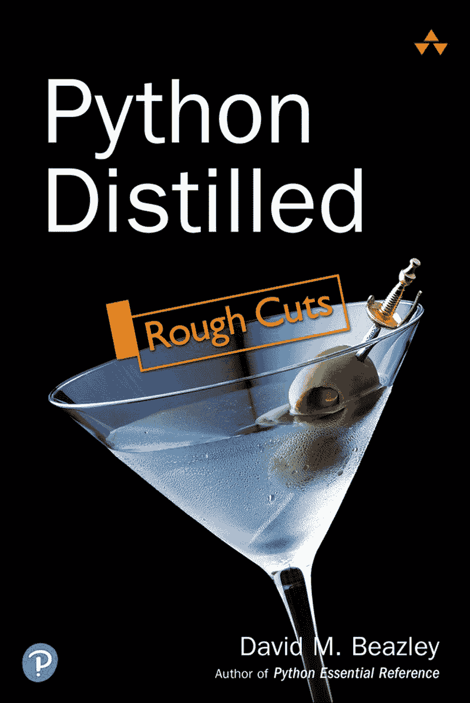


## 前言

自从我编写《Python 程序设计》（Python Essential Reference）以来已经过去了 20 多年。那时，Python 是一门小得多的语言，标准库中带有一组实用的“电池”（batteries）。它大部分内容都能装进你的大脑里。《程序设计》反映了那个时代。它被设计成一本小书，你可以随身携带，在荒岛或秘密地下室编写一些 Python 代码。在随后的三次修订中，《程序设计》在很大程度上演变为成为一个紧凑但完整的语言参考的愿景——因为如果你要在假期里编写 Python 代码，为什么不想使用它的所有功能呢？

今天，距离上一版出版已经过去了多年，Python 的世界已大不相同。Python 不再是一个小众语言，它已经壮大了。

## Python 基础

本章概述了 Python 语言的核心内容。主题包括变量、数据类型、表达式、控制流、函数、类以及输入输出。本章以对模块、脚本编写、包以及关于组织大型程序的建议的讨论结束。本章并不旨在对每个功能的全面覆盖，也不涉及围绕大型 Python 项目的所有工具。然而，经验丰富的程序员应该能够根据这里的材料推导出编写更高级的程序。鼓励初学者在终端窗口和基础文本编辑器等简单环境中尝试示例。

### 运行 Python


Python 程序由解释器执行。Python 解释器可能在许多不同的环境中运行，从 IDE、浏览器到终端窗口皆有。然而，在这一切之下，解释器的核心是一个文本应用程序，可以通过在如 `bash` 等终端命令 shell 中输入 `python` 来启动。由于 Python 2 和 Python 3 可能会安装在同一台机器上，你可能需要输入 `python2` 或 `python3` 来选择版本。本书假设 Python 版本为 `3.8` 或更高版本。当解释器启动时，会出现一个提示符，你可以在其中向所谓的“读取-评估-打印循环”（或 REPL）输入程序。例如，在下面的输出中，解释器显示了其版权信息并向用户提供了 `>>>` 提示符，用户在此输入了熟悉的“Hello World”程序：

```
Python 3.8.0 (default, Feb 3 2019, 05:53:21)

[GCC 4.2.1 Compatible Apple LLVM 8.0.0 (clang-800.0.38)] on darwin

Type "help", "copyright", "credits" or "license" for more information.

>>> print('Hello World')

Hello World

>>>
```

某些环境可能会显示不同的提示符，如下所示 `ipython`（Python 的替代 shell）的输出。

```
Python 3.8.0 (default, Feb 4, 2019, 07:39:16)

Type 'copyright', 'credits' or 'license' for more information

IPython 6.5.0 -- An enhanced Interactive Python. Type '?' for help.

In [1]: print('Hello World')

Hello World

In [2]:
```

无论你看到的具体输出是什么，其底层原理都是相同的。如果你输入一个命令，它就会运行，你会立即看到输出。

Python 的交互模式是其最用的功能之一，因为你可以输入任何有效语句并立即看到结果。这对于调试和实验非常有用。包括作者在内的许多人甚至将交互式 Python 作为他们的桌面计算器。例如：

```
>>> 6000 + 4523.50 + 134.25

10657.75

>>> _ + 8192.75

18850.5

>>>
```

当你交互式地使用 Python 时，变量 `_` 存储上一次操作的结果。如果你想在后续语句中使用上一次操作的结果，这非常有用。该变量仅在交互式工作时被定义，因此你不会在保存的程序中使用它。

你可以通过输入 `quit()` 或 EOF（文件结束）字符退出交互式解释器。在 UNIX 上，EOF 是 `Ctrl+D`；在 Windows 上，它是 `Ctrl+Z`。

## Python 程序

如果你想创建一个可以反复运行的程序，请将语句放在文本文件中，如下所示：

```
### hello.py

print('Hello World')
```

Python 源文件是 UTF-8 编码的文本文件，通常具有 `.py` 后缀。`#` 字符表示到行尾的注释。只要你记得使用 UTF-8 编码，可以在源代码中自由地使用国际（Unicode）字符（这通常是大多数编辑器的默认设置，但如果不确定，检查你的编辑器设置也无妨）。

要执行 `hello.py` 文件，请如下向解释器提供文件名：

```
shell % python3 hello.py

Hello World

shell %
```

通常会在程序的第一行使用 `#!` 来指定解释器，如下所示：

```
#!/usr/bin/env python3

print('Hello World')
```

如果你在 Unix 上赋予此文件执行权限（例如使用 `chmod +x hello.py`），你就可以在 shell 中输入 `hello.py` 来运行程序。

在 Windows 上，你可以双击 `.py` 文件，或在 Windows 启动菜单的“运行”命令中输入程序名称来启动它。如果提供了 `#!` 行，它将用于选择解释器版本（Python 2 与 3）。请注意，程序的执行可能会在一个控制窗口中进行，该窗口在程序执行完成后立即消失（通常在你能读到其输出之前）。对于调试，在 Python 开发环境中运行程序可能会更好。

解释器按顺序执行语句，直到到达输入文件的末。在此时，程序终止，Python 退出。

### 基本类型、变量和表达式

Python 提供了一组基本类型，如整数、浮点数和字符串：

```
42               # int

4.2              # float

'forty-two'      # str

True             # bool
```

变量是一个引用值的名称。值代表某种类型的对象（例如，整数、浮点数、字符串等）。

```
x = 42
```

有时你可能会看到类型显式地绑定到名称上。例如，

```python
x: int = 42
```

类型的出现仅仅是辅助提高代码可读性的提示，并可能供第三方代码检查工具使用。否则，它会被完全忽略。它并不会阻止你稍后分配不同类型的值。

表达式是基本类型、名称和运算符的组合，产生一个值：

```
2 + 3 * 4            # -> 14
```

下面的程序展示了变量和表达式的使用：

```python
### interest.py

### 初始金额
principal = 1000
### 利率
rate = 0.05
### 年数
years = 5

while year <= years:
    # 复利
    principal = principal * (1 + rate)
    print(f'{year:>3d} {principal:0.2f}')
    year += 1
```

执行时，对应的输出如下：

```
1 1050.00
2 1102.50
3 1157.62
4 1215.51
5 1276.28
```

### 算术运算符

Python 拥有一组标准的数学运算符如表 1 所示。这些运算符的含义与其他大多数语言中的含义相同。

除法运算符（`/`）应用于整数时会产生浮点数。因此 `7/4` 是 `1.75`。整除运算符（`//`，也称为地板除）将结果截断为整数，并同时适用于整数和浮点数。取模运算符返回除法 `x // y` 的余数。例如，`7 % 4` 是 `3`。对于浮点数浮点数，取模运算符返回 `x // y` 的浮点余数，即 `x – (x // y) * y`。

此外，表 2 中的内置函数提供了更多常用的数值操作。


`round()` 函数实现了“银行舍入法”（Banker’s Rounding）。如果舍入的值到两个倍数的距离相等，则舍入到最近的偶数倍（例如，`0.5` 舍入到 `0.0`，`1.5` 舍入到 `2.0`）。

整数提供了几个额外的运算符来支持位操作，如表 3 所示。

## 表 3：位操作运算符

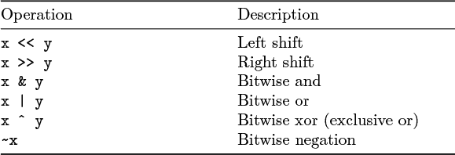

人们通常会将这些运算符与二进制整数配合使用。例如：

```
a = 0b11001001

mask = 0b11110000

x = (a & mask) >> 4    # x = 0b1100 (12)
```

在此示例中，`0b11001001` 是二进制表示一个整数值的方法。你可以将其写为十进制 `201` 或十六进制 `0xc9`，但如果你正在处理位，二进制会让你更容易直观地看到自己在做什么。

位运算符的语义假设整数是以二补码二进制表示的，并且符号位向左无限扩展。如果你正在处理旨在映射到硬件原生整数的原始位模式，则需要小心。这是因为 Python 不会截断位或允许值溢出——相反，结果在量级上会变得任意大。你需要自己确保结果具有适当的大小，或在需要时进行截断。

要比较数字，请使用表 4 中的比较运算符：

## 表 4：比较运算符

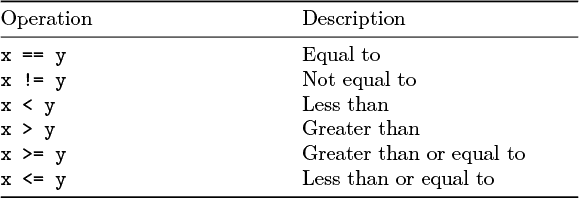

比较的结果是一个布尔值 `True` 或 `False`。

`and`、`or` 和 `not` 运算符可以形成与逻辑真相关的复杂的布尔表达式（不要与上述位运算符混淆）。这些运算符的行为如表 5 所示。

## 表 5：逻辑运算符


如果一个值字面上是 `False`、`None`、数值为零或为空，则它被视为“假”。否则，它被视为“真”。

编写更新一个值的表达式是常见的。例如：

```
x = x + 1

y = y * n
```

对于这些操作，你可以编写以下简写操作：

```
x += 1

y *= n
```

这种简写形式的更新可以用于任何 `+`、`-`、`*`、`**`、`/`、`//`、`%`、`&`、`|`、`ˆ`、`<<`、`>>` 运算符。Python 没有其他语言中常见的自增减运算符。

### 条件与控制流

`while`、`if` 和 `else` 语句用于循环和条件代码执行。这是一个示例：

```
if a < b:
    print('Computer says Yes')

else:
    print('Computer says No')
```

`if` 和 `else` 子句的体通过缩进表示。`else` 子句是可选的。要创建一个空子句，请使用 `pass` 语句，如下所示：

```
if a < b:
    pass      # 什么都不做

else:
    print('Computer says No')
```

要处理多个测试用例，请使用 `elif` 语句，如下：

```
if suffix == '.htm':
    content = 'text/html'

elif suffix == '.jpg':
    content = 'image/jpeg'

elif suffix == '.png':
    content = 'image/png'

else:
    raise RuntimeError(f'Unknown content type {suffix!r}')
```

如果你在测试的同时进行赋值，可以使用如下的条件表达式：

```
maxval = a if a > b else b
```

这等同于较长的写法：

```
if a > b:
    maxval = a

else:
    maxval = b
```

有时，你可能会看到使用 `:=` 运算符将变量赋值和条件结合在一起。这被称为赋值表达式（或者更通俗地称为“海象运算符”，因为 `:=` 看起来像一只侧卧的海象——推测是在是在装死）。例如：

```
x = 0

while (x := x + 1) < 10:    # 打印 1, 2, 3, ..., 9
    print(x)
```

使用括号包裹赋值表达式是强制要求的。

`break` 语句可提前终止循环。它只适用于最内层的循环。例如：

```
x = 0

while x < 10:
    if x == 5:
        break # 停止循环。移动到下面的 Done
    print(x)
    x += 1

print('Done')
```

`continue` 语句用于跳过循环体的剩余部分并返回循环顶部。例如：

```
x = 0

while x < 10:
    x += 1
    if x == 5:
       continue   # 跳过 print(x)。回到循环开始。
    print(x)

print('Done')
```

### 文本字符串

要定义字符串面量量请如下所示使用单引号、双引号或三引号将它们括起来：

```
a = 'Hello World'

b = "Python is groovy"

c = '''Computer says no.'''

d = """Computer still says no."""
```

用于开始字符串的相同类型的引号必须用于结束它。三引号字符串捕获终止三引号之前出现的所有文本，而单引号和双引号字符串必须在逻辑上一行内指定。当字符串面量的内容跨多行文本时（如下所示），三引号字符串非常有用：

```
print('''Content-type: text/html

<h1> Hello World </h1>

Click <a href="http://www.python.org">here</a>.

''')
```

紧邻的字面量（字符串面量）合并成单个字符串。因此，上面的示例也可以写成：

```
print(
  'Content-type: text/html\n'
  '\n'
  '<h1> Hello World </h1>\n'
  'Clock <a href="http://www.python.org">here</a>'
)
```


非字符串值可以使用 `str()`、`repr()` 或 `format()` 函数转换为字符串表示形式。示例如下：

```
s = 'The value of x is ' + str(x)

s = 'The value of x is ' + repr(x)

s = 'The value of x is ' + format(x, '4d')
```

尽管 `str()` 和 `repr()` 都会创建字符串，但它们的输出通常不同。`str()` 产生的是当你使用 `print()` 函数时得到的输出，而 `repr()` 创建的字符串是你在程序中输入的、用以精确表示对象的值的字符串。例如：

```
>>> s = 'hello\nworld'

>>> print(str(s))

hello

world

>>> print(repr(s))

'hello\nworld'

>>>
```

在调试时，建议在生成输出时使用 `repr(s)`。`repr()` 会向你展示关于该值及其类型更精确的信息。

`format()` 函数用于将单个值转换为带有特定格式的字符串。例如：

```
>>> x = 12.34567

>>> format(x, '0.2f')

'12.35'

>>>
```

传递给 `format()` 的格式代码与你在生成格式化输出时在 f-strings 中使用的代码相同。例如，上面的代码可以用以下代码替换：

```
>>> f'{x:0.2f}'

'12.35'

>>>
```

### 文件输入

以下程序打开一个文件并按行读取其内容作为文本字符串：

```
with open('data.txt') as file:
    for line in file:
        print(line, end='') # end='' 忽略额外的换行符
```

`open()` 函数返回一个新的文件对象。在其之之前的 `with` 语句声明了一个语句块（或上下文），在该块中文件（`file`）将被使用。一旦控制离开该块，文件将自动关闭。如果你不使用 `with` 语句，代码需要如下所示：

```
file = open('data.txt')

for line in file:
    print(line, end='') # end='' 忽略额外的换行符

file.close()
```

忘记调用 `close()` 这一额外步骤很容易，因此通常最好使用 `with` 语句让文件自动为你关闭。

`for` 循环逐行遍历文件，直到没有更多数据可用为止。

如果你想将整个文件作为字符串读取，请这样使用 `read()` 方法：

```
with open('data.txt') as file:
    data = file.read()
```

如果你想分块读取大文件，可以如下所示给 `read()` 方法提供一个大小提示：

```
with open('data.txt') as file:
    while (chunk := file.read(10000)):
        print(chunk, end='')
```

此示例中使用的 `:=` 运算符将值赋值给变量并返回其值，以便 `while` 循环进行测试并跳出。当到达文件末尾时，`read()` 返回空字符串。编写上述函数的另一种方法是使用 `break`，如下：

```
with open('data.txt') as file:
    while True:
        chunk = file.read(10000)
        if not chunk:
            break
        print(chunk, end='')
```

要让程序的输出到文件中，请如示例所示向 `print()` 函数提供一个文件参数：

```
with open('out.txt', 'wt') as out:
    while year <= numyears:
        principal = principal * (1 + rate)
        print(f'{year:>3d} {principal:0.2f}', file=out)
        year += 1
```

此外，文件对象支持 `write()` 方法，可用于写入字符串数据。例如，上一个示例中的 `print()` 函数可以这样写：

```
out.write(f'{year:3d} {principal:0.2f}\n')
```

默认情况下，文件包含编码为 UTF-8 Unicode 的文本。如果你在使用不同的文本编码，在打开文件时使用额外的 `encoding` 参数。例如：

```
with open('data.txt', encoding='latin-1') as file:
    data = file.read()
```

有时你可能想读取在键盘上交互式输入的数据。要这样做，请使用 `input()` 函数。例如：

```
name = input('Enter your name : ')
print('Hello', name)
```

`input()` 返回直到终止换行符之前的所有输入文本，换行符不包含在内。

### 列表

列表是任意对象的有序集合。通过在方括号中包含值来创建列表，如下：

```
names = [ 'Dave', 'Paula', 'Thomas', 'Lewis' ]
```

列表通过从零开始整数索引。使用索引运算符访问并修改列表的单个元素：

```
a = names[2]         # 返回列表的第三个元素，'Thomas'

names[2] = 'Tom'     # 将第三个元素改为 'Tom'

print(names[-1])     # 打印最后一个元素 ('Lewis')
```

要向列表末尾添加新元素，使用 `append()` 方法：

```
names.append('Alex')
```

要在列表的特定位置插入元素，使用 `insert()` 方法：

```
names.insert(2, 'Aya')
```

要遍历列表中的元素，使用 `for` 循环：

```
for name in names:
    print(name)
```

你可以通过使用切片运算符提取或重新分配列表的一部分：

```
b = names[0:2]      # b -> ['Dave', 'Paula']

c = names[2:]       # c -> ['Aya', 'Tom', 'Lewis', 'Alex']

names[1] = 'Becky'  # 将 'Paula' 替换为 'Becky'

names[0:2] = ['Dave', 'Mark', 'Jeff'] # 用 ['Dave','Mark','Jeff']
                                      # 替换两个元素
```

使用加 (`+`) 运算符合并列表：

```
a = ['x','y'] + ['z','z','y']  # 结果为 ['x','y','z','z','y']
```

有两种方法创建空列表：

```
names = []        # 方法 1

names = list()    # 方法 2
```


表达式 `[ int(row[1]) * float(row[2]) for row in rows ]` 通过遍历 `rows` 中的所有列表并计算第二项和第三项的乘积来构建一个新列表。这种构建列表的有用技术被称为**列表推导式**（list comprehension）。可以使用更冗长的方式来实现相同的计算如下：

```python
values = []

for row in rows:
    values.append(int(row[1]) * float(row[2]))

total = sum(values)
```

作为一个通用的规则，列表推导式是执行简单计算的首选技术。内置的 `sum()` 函数计算序列中所有项的和。

### 元组 (Tuples)

为了创建简单的数据结构，你可以将一组值封装成一个名为**元组**（tuple）的不可变对象。你通过将一组值括在括号中创建一个元组，如下：

```python
holding = ('GOOG', 100, 490.10)

address = ('www.python.org', 80)
```

为了完整性，可以定义 0 元素和 1 元素的元组，但它们具有特殊的语法：

```python
a = ()         # 0 元素组（空元组）

b = (item,)    # 1 元素组（注意末尾的逗号）
```

元组中的值可以像列表一样通过数字索引提取。然而，更常见的做法是将元组解包到一组变量中，如下：

```python
name, shares, price = holding

host, port = address
```

虽然元组支持与列表大部分相同的操作（如索引、切片和拼接），但元组的元素在创建后无法更改的（也就是说，你不能替换、删除或向现有元组添加新元素）。这反映了一个事实：元组最好被视为一个由多个部分组成的单一不可变对象，而不是像列表那样的不同对象的集合。

元组和列表经常一起使用表示数据。例如，此程序展示了你如何读取一个由逗号分隔的不同列数据的文件：

```python
### 格式为 "name,shares,price" 的文件

filename = 'portfolio.csv'

portfolio = []

with open(filename) as file:
    for line in file:
        row = line.split(',')
        name = row[0]
        shares = int(row[1])
        price = float(row[2])
        holding = (name, shares, price)
        portfolio.append(holding)
```

该程序创建的 `portfolio` 列表看起来像一个行列组成的二维数组。每行由一个元组表示，并如下如下访问：

```python
>>> portfolio[0]
('AA', 100, 32.2)

>>> portfolio[1]
('IBM', 50, 91.1)

>>>
```

单个数据项可以这样访问：

```python
>>> portfolio[1][1]
50

>>> portfolio[1][2]
91.1

>>>
```

以下是遍历所有记录并将字段解包到一组变量中的方法：

```python
total = 0.0

for name, shares, price in portfolio:
    total += shares * price
```

或者，你可以使用列表推导式来执行此计算：

```python
total = sum([shares * price for _, shares, price in portfolio])
```

在迭代元组时，变量 `_` 有时用于表示丢弃的值。在上面的计算中，这意味着我们忽略了第一项（名称）。

### 集合 (Sets)

集合是唯一对象的无序集合，用于查找不同的值或管理与成员身份相关的问题。要创建集合，可以将一组值封装在花括号中，或者将一个现有的项目集合传递给 `set()`。例如：

```python
names1 = { 'IBM', 'MSFT', 'AA' }

names2 = set(['IBM', 'MSFT', 'HPE', 'IBM', 'CAT'])
```

集合的元素通常被限制为不可变对象。例如，你可以创建一个数字、字符串或元组的集合。然而，你不能创建一个包含列表的集合。不过，大多数常用对象可能适用于集合——如果有疑问，尝试一下。

与列表和元组不同，集合是无序的，不能通过数字进行索引。此外，集合的元素永远不会重复。例如，如果你检查上述代码中 `names2` 的值，你会得到以下：

```python
>>> names2
{'CAT', 'IBM', 'MSFT', 'HPE'}
>>>
```

注意 `'IBM'` 只出现了一次。此外，请注意项目的顺序不可预测的，且输出可能与所示内容不同。顺序甚至可能解释器的每次运行之间发生变化。

如果与现有数据工作，你还可以使用集合推导式创建集合。例如，此语句将上一节中数据中的所有股票名称转换为集合：

```python
names = { s[0] for s in portfolio }
```

要创建一个空集合，请使用不带参数的 `set()`：

```python
r = set()    # 初始空集合
```

集合支持标准的集合操作，包括并集、交集、差集和对称差。这是一个示例：

```python
a = t | s      # 并集 {'MSFT', 'CAT', 'HPE', 'AA', 'IBM'}

b = t & s      # 交集 {'IBM', 'MSFT'}

c = t - s      # 差集

e = t ^ s      # 对称差
```

### 字典 (Dictionaries)

字典是键和值之间的映射。你通过将用冒号分隔的键和值封装在花括号 `{ }` 中创建一个字典，如下：

```python
s = {
    'name' : 'GOOG',
    'shares' : 100,
    'price' : 490.10
}
```

要访问字典的成员，使用如下的索引运算符：

```python
name = s['name']

cost = s['shares']
```

插入或修改对象如下：

```python
s['shares'] = 75

s['date'] = '2007-06-07'
```

字典是定义包含命名字段对象的有用方法，如所示。然而，字典也常用作映射，以便对无序数据执行快速查找。例如，这里有一个价格字典：

```python
prices = {
    'GOOG' : 490.1,
    'AAPL' : 123.5,
    'IBM' : 91.5,
    'MSFT' : 52.13
}
```

给定这样的字典，你可以使用如下表达式查找价格：

```python
p = prices['IBM']
```

字典的成员关系使用 `in` 运算符测试，如下例所示：

```python
if 'IBM' in prices:
    p = prices['IBM']
else:
    p = 0.0
```

这一特定的步骤也可以使用 `get()` 方法更紧凑地完成，如下：

```python
p = prices.get('IBM', 0.0)    # 如果 prices['IBM'] 存在，否则返回 0.0
```

使用 `del` 语句删除字典的元素：

```python
del prices['GOOG']
```

虽然字符串是最常见的键类型，但你可以使用许多其他 Python 对象，包括数字和元组。例如，元组经常用于构建复合或多部分的键：

```python
prices = { }

prices[('IBM', '2015-02-03')] = 91.23

prices['IBM', '2015-02-04'] = 91.42     # 省略了括号
```

任何类型的对象都可以放入字典（包括其他字典）。然而，列表、集合和字典等可变数据结构不能作为键。


```python
portfolio = [
   ('ACME', 50, 92.34),
   ('IBM', 75, 102.25),
   ('PHP', 40, 74.50),
   ('IBM', 50, 124.75)
]

total_shares = { s[0]: 0 for s in portfolio }

for name, shares, _ in portfolio:
    total_shares[name] += shares

### total_shares = {'IBM': 125, 'ACME': 50, 'PHP': 40}
```

在这个示例中，`{ s[0]: 0 for s in portfolio}` 是字典推导式的示例。它从另一个数据集合中创建一个键值对字典。在这种情况下，它创建了一个将股票名称映射到 0 的初始字典。随后的 `for` 循环会遍历字典，并累加每个股票符号的持股总数。

此类常见的数据处理任务通常已经由库模块实现了。例如，`collections` 模块有一个 `Counter` 对象，可以用于相同的任务：

```python
from collections import Counter

total_shares = Counter()

for name, shares, _ in portfolio:
    total_shares[name] += shares

### total_shares = Counter({'IBM': 125, 'ACME': 50, 'PHP': 40})
```

创建空字典有两种方式：

```python
prices = {}        # 一个空字典
prices = dict()    # 一个空字典
```

虽然使用 `{}` 创建空字典更符合 Python 习惯（idiomatic），尽管这需要注意，因为看起来你可能也在尝试创建一个空集合（请使用 `set()`）。`dict()` 通常用于通过键值对创建字典。例如：

```python
pairs = [('IBM', 125), ('ACME', 50), ('PHP', 40)]

d = dict(pairs)
```

要获取字典键的列表，请将字典转换为列表：

```python
syms = list(prices)     # syms = ['AAPL', 'MSFT', 'IBM', 'GOOG']
```

或者，你也可以使用 `dict.keys()` 获取键：

```python
syms = prices.keys()
```

这两种方法的区别在于 `keys()` 返回的是一个附加到字典上的特殊“键视图”（keys view），它能动态反映对字典所更改。例如：

```python
>>> d = { 'x': 2, 'y':3 }
>>> k = d.keys()
>>> k
dict_keys(['x', 'y'])
>>> d['z'] = 4
>>> k
dict_keys(['x', 'y', 'z'])
>>>
```

键的出现顺序与最初插入字典的顺序相同。因此，上述列表转换将保留这种顺序。当字典用于表示从文件和其他数据源读取的键值数据时，这非常有用。字典将保留输入顺序，这可能有助于可读性和调试。如果你想将数据写回文件，这样做很好。然而，在 Python 3.6 之前，这种顺序是不被保证的，如果需要与旧版本的 Python 兼容，则不依赖它。如果发生了多次删除和插入，顺序也无法保证。

要获取字典中存储的值，请使用 `dict.values()` 方法。要获取键值对，请使用 `dict.items()`。例如，这里展示了如何以键值对的形式遍历整个字典的内容：

```python
for sym, price in prices.items():
    print(f'{sym} = {price}')
```

### 迭代与循环

最广泛使用的循环结构是 `for` 语句，用于遍历项目集合。迭代的一种常见形式是遍历序列（如字符串、列表或元组）的所有成员。这里有一个示例：

```python
for n in [1, 2, 3, 4, 5, 6, 7, 8, 9]:
    print(f'2 to the {n} power is {2**n}')
```

在这个示例中，变量 `n` 将在每次迭代时从列表 `[1, 2, 3, 4, ..., 9]` 中分配连续的项目。因为遍历整数范围非常常见，因此通常使用以下简便方法：

```python
for n in range(1, 10):
    print(f'2 to the {n} power is {2**n}')
```

`range(i, j [,step])` 函数创建一个表示整数范围的对象，其值从 `i` 开始，但不包含 `j`。如果省略起始值，则默认为零。还可以提供第三参数作为可选的步长（stride）。是一些示例：

```python
a = range(5)         # a = 0, 1, 2, 3, 4
b = range(1, 8)      # b = 1, 2, 3, 4, 5, 6, 7
c = range(0, 14, 3)  # c = 0, 3, 6, 9, 12
d = range(8, 1, -1)  # d = 8, 7, 6, 5
```

（注：由于原文中存在大量关于 `range` 函数描述的重复，译文已根据逻辑进行了去重处理。）


当变量在函数内部创建或赋值时，它们的作用域是局部的。这意味着，变量只在函数体内部定义，并且在函数返回时被销毁。函数也可以访问函数外部定义的变量，只要这些变量定义在同一个文件中。例如：

```python
debug = True      # 全局变量

def read_data(filename):
    if debug:
        print('Reading', filename)
    ...
```

关于作用域规则的更多信息请参阅第 5 章:
  File "readport.py", line 9, in <module>
    shares = int(row[1])
ValueError: invalid literal for int() with base 10: 'N/A'
```

回溯消息指示了发生的错误类型及其位置。通常情况下，错误会导致程序终止。然而，你可以使用 `try` 和 `except` 语句来捕获并处理异常，如下所示：

```python
portfolio = []

with open('portfolio.csv') as file:
    for line in file:
        row = line.split(',')
        try:
            name = row[0]
            shares = int(row[1])
            price = float(row[2])
            holding = (name, shares, price)
            portfolio.append(holding)
        except ValueError as err:
            print('Bad row:', row)
            print('Reason:', err)
```

在这段代码中，如果发生了 `ValueError`，关于错误的详细信息将存放在 `err` 中，控制权传递到 `except` 块中的代码。如果抛出了其他类型的异常，程序将像往一样崩溃。如果没有发生错误，`except` 块中的代码将被忽略。当异常被处理后，程序执行将从紧接最后一个 `except` 块的语句开始继续。程序不会返回到发生异常的位置。

`raise` 语句用于信号异常。在抛出异常时，你需要提供异常的名称。例如，示例中的内置异常 `RuntimeError`：

```python
raise RuntimeError('Computer says no')
```

当与异常处理结合时，锁、文件和网络连接等系统资源的适当管理通常是一个棘手的问题。有时，无论发生什么都必须执行某些操作。为此，请使用 `try`-`finally`。例如，这里有一个涉及释放锁以避免死锁示例：

```python
import threading

lock = threading.Lock()
...

lock.acquire()

### 如果已获取锁，则必须释放

try:
    ...
    statements
    ...
finally:
    lock.release()       # 始终运行
```

为了简化此类编程，大多数涉及资源管理的对象也支持 `with` 语句。这是上述代码的修改版本：

```python
with lock:
    ...
    statements
    ...
```

在这个示例中，当 `with` 语句执行时，`lock` 对象会自动获取。当执行离开 `with` 块的范围时，锁会自动释放。这种管理无论 `with` 块内部发生了什么都会进行。例如，如果发生了异常，当控制权离开块范围时，锁会被释放。

`with` 语句通常只与系统资源或执行环境相关的对象（如文件、连接和锁）兼容。然而，用户定义的对象可以定义它们自己的自定义处理，这在第 3 章中有进一步描述。

### 程序终止

当输入程序中不再有可执行的语句，或者当抛出一个未捕获的 `SystemExit` 异常时，程序就会终止。如果你想强制程序退出，可以这样做：

```python
raise SystemExit()                      # 不带错误消息的退出
raise SystemExit("Something is wrong")  # 带错误的退出
```

在退出时，解释器会尽力收集所有活动对象的垃圾。然而，如果你需要执行特定的清理操作（例如删除文件、关闭连接），你可以按照如下方式向 `atexit` 模块注册它：

```python
import atexit

### 示例

connection = open_connection("deaddot.com")

def cleanup():
    print "Going away..."
    close_connection(connection)

atexit.register(cleanup)
```

### 对象与类

程序中使用的所有值都是对象。对象由内部数据和执行涉及数据的各种操作的方法组成。在处理字符串和列表等内置类型时，你已经使用过对象和方法了。例如：

```python
items = [37, 42]      # 创建列表对象
items.append(73)      # 调用 append() 方法
```

`dir()` 函数列出对象上可用的方法，在没有高级 IDE 的情况下它是交互式实验的有用工具。例如：

```python
>>> items = [37, 42]
>>> dir(items)
['__add__', '__class__', '__contains__', '__delattr__', '__delitem__',
...
 'append', 'count', 'extend', 'index', 'insert', 'pop',
 'remove', 'reverse', 'sort']
>>>
```

在检查对象时，你会看到列出的如 `append()` 和 `insert()` 等熟悉的方法。然而，你还会看到始终以双下划线开头和结尾的特殊方法。这些方法实现了不同的运算符。例如，`__add__()` 方法用于实现 `+` 运算符。这些方法在后面的章节中会有更详细的解释。

```python
>>> items.__add__([73, 101])
[37, 42, 73, 101]
>>>
```

`class` 语句用于定义新类型的对象以及用于面向对象的编程。例如，以下类定义了一个具有 `push()` 和 `pop()` 操作的栈：

```python
class Stack:
    def __init__(self):          # 初始化栈
        self._items = [ ]
    def push(self, item):
        self._items.append(item)
    def pop(self):
        return self._items.pop()
    def __repr__(self):
        return f'<{type(self).__name__} at 0x{id(self):x}, size={len(self)}>'
    def __len__(self):
        return len(self._items)
```

在类定义内部，方法使用 `def` 语句定义。每个方法的第一个参数始终引用对象本身。按照约定，`self` 是该参数的名称。涉及对象属性的操作必须显式引用 `self` 变量。以双下划线开头结尾的方法是特殊方法。例如，`__init__` 用于初始化对象。在这种情况下，`__init__` 创建了一个存储栈数据的内部列表。

要使用类，编写如下代码：

```python
s = Stack()              # 创建一个栈
s.push('Dave')           # 向其压入一些
s.push(42)
s.push([3, 4, 5])
x = s.pop()              # x 获取 [3,4,5]
y = s.pop()              # y 获取 42
```

在类内部，你会注意到方法使用了内部变量 `_items`。Python 没有任何隐藏或保护数据的机制。然而，存在一种观察到的编程约定，即以单下划线之前的名称被视为“私有的”。也就是说，在这个示例中，`_items` 应该被（你）视为内部实现，并且不在 `Stack` 类本身之外使用。请注意，这种约定并没有实际的强制执行——如果你想访问 `_items`，你可以随时这样做。你只需要在同事审查你的代码时向他们给出解释即可。

`__repr__()` 和 `__len__()` 方法是为了让对象与环境的其余部分配合得更好。例如，`__len__()` 让 `Stack` 可以与内置的 `len()` 函数配合，而 `__repr__()` 改变了 `Stack` 的显示和打印方式。通常定义 `__repr__()` 是一个好主意，因为它可以简化调试。


```python
>>> s = Stack()

>>> s.push('Dave')

>>> s.push(42)

>>> len(s)

2

>>> s

<Stack at 0x10108c1d0, size=2>

>>>
```

对象的一个主要特性是你可以通过继承添加或重新定义现有类的功能。

例如，假设你想为栈添加一个交换栈顶两个元素的方法。你可能会写像这样一个类：

```python
class MyStack(Stack):

    def swap(self):

        a = self.pop()
        b = self.pop()
        self.push(a)
        self.push(b)
```

`MyStack` 与 `Stack` 相同，但它多了一个可用的操作 `swap()`。

```python
>>> s = MyStack()

>>> s.push('Dave')

>>> s.push(42)

>>> s.swap()

>>> s.pop()

'Dave'

>>> s.pop()

42

>>>
```

继承也可以用于更改现有方法的行为。例如，假设你想限制栈只包含数值数据。你可能会写像这样一个类：

```python
class NumericStack(Stack):

    def push(self, item):

        if not isinstance(item, (int, float)):

            raise TypeError('Expected an int or float')

        super().push(item)
```

在这个示例中，`push()` 方法被重新定义以添加额外的检查。`super()` 操作是调用之前的 `push()` 定义的一种方式。该类的工作方式如下：

```python
>>> s = NumericStack()

>>> s.push(42)

>>> s.push('Dave')

Traceback (most recent call last):
   ...

TypeError: Expected an int or float

>>>
```

继承通常不是最好的解决方案。例如，假设你想定义一个简单的基于栈的四功能计算器，它的工作方式如下：

```python
>>> # 计算 2 + 3 * 4

>>> calc = Calculator()

>>> calc.push(2)

>>> calc.push(3)

>>> calc.push(4)

>>> calc.mul()

>>> calc.add()

>>> calc.pop()

14

>>>
```

你可能会看到这段代码，看到 `push()` 和 `pop()` 的使用，并认为 `Calculator` 可以通过继承 `Stack` 来定义。虽然这种方法可行，但可能将 `Calculator` 定义为一个完全独立的类更好，如下：

```python
class Calculator:

    def __init__(self):

        self._stack = Stack()

    def push(self, item):

        self._stack.push(item)

    def pop(self):

        return self._stack.pop()

    def add(self):

        self.push(self.pop() + self.pop())

    def mul(self):

        self.push(self.pop() * self.pop())

    def sub(self):

        right = self.pop()
        self.push(self.pop() - right)

    def div(self):

        right = self.pop()
        self.push(self.pop() / right)
```

在这个实现中，`Calculator` 包含一个 `Stack` 作为内部实现细节。这是“组合”的一个示例。此外，`push()` 和 `pop()` 方法委托给了内部的 `Stack`。采用这种方法的主要原因是你并不会认为 `Calculator` 是一个 `Stack`。它是一个独立的概念——不同类型的对象。类比，你的手机包含一个中央处理器 (CPU)，但你通常不会认为你的手机是 CPU 的一种。

### 模块

随着程序规模的增大，你将希望将它们拆分成多个文件以便于维护。为了这一点，你将使用 `import` 语句。要创建一个模块，将相关的语句和定义放在一个与模块同名的文件中。（注意，文件必须具有 `.py` 后缀。）这里是一个示例：

```python
### readport.py

### 读取包含 'NAME,SHARES,PRICE' 数据的文件

def read_portfolio(filename):
    portfolio = []
    with open(filename) as file:
        for line in file:
            row = line.split(',')
            try:
                name = row[0]
                shares = int(row[1])
                price = float(row[2])
                holding = (name, shares, price)
                portfolio.append(holding)
            except ValueError as err:
                print('Bad row:', row)
                print('Reason:', err)
    return portfolio
```

在其他文件中使用你的模块，使用 `import` 语句。例如，这里有一个使用上述 `read_portfolio()` 函数的模块 `pcost.py`：

```python
### pcost.py

import readport

def portfolio_cost(filename):
    """
    计算投资组合的总份额*价格
    """
    port = readport.read_portfolio(filename)
    return sum(shares * price for _, shares, price in port)
```

`import` 语句创建一个新的命名空间（或环境），并在该命名空间内执行关联 `.py` 文件中的所有语句。要在导入访问命名空间的内容，使用模块名作为前缀，如前面的示例中的 `readport.read_portfolio()`。

如果 `import` 语句抛出 `ImportError` 异常，你需要检查环境中的几点。首先，检查文件名以确保你创建了一个名为 `readport.py` 的文件。接下来，检查 `sys.path` 列出的目录。如果你的文件没有保存在这些目录之一，Python 将无法找到它。

如果你想使用不同的名称导入模块，可以在 `import` 语句中提供可选的 `as` 限定符，如下：

```python
import readport as rp

port = rp.read_portfolio('portfolio.dat')
```

将特定定义导入到当前命名空间，使用 `from` 语句：

```python
from readport import read_portfolio

port = read_portfolio('portfolio.dat')
```

与对象一样，`dir()` 函数列出模块的内容，它是交互式实验的有用工具。

```python
>>> import readport

>>> dir(readport)

['__builtins__', '__cached__', '__doc__', '__file__', '__loader__',
  '__name__', '__package__', '__spec__', 'read_portfolio']
```

Python 提供了大型的标准模块库，可以简化某些任务。例如，`csv` 模块是处理逗分隔值文件的标准库。你可以这样在程序中使用它：

```python
### readport.py

### 读取包含 'NAME,SHARES,PRICE' 数据的文件
import csv

def read_portfolio(filename):
    portfolio = []
    with open(filename) as file:
        rows = csv.reader(file)
        for row in rows:
            try:
                name = row[0]
                shares = int(row[1])
                price = float(row[2])
                holding = (name, shares, price)
                portfolio.append(holding)
            except ValueError as err:
                print('Bad row:', row)
                print('Reason:', err)
    return portfolio
```

### 脚本编写

任何文件都可以作为脚本执行，也可以作为库通过 `import` 导入。为了更好地支持导入，脚本代码通常封装在一个对模块名称的条件检查中，如下：

```python
### readport.py

### 读取包含 'NAME,SHARES,PRICE' 数据的文件
import csv

def read_portfolio(filename):
    ...

def main():
    portfolio = read_portfolio('portfolio.csv')
    for name, shares, price in portfolio:
        print(f'{name:>10s} {shares:10d} {price:10.2f}')

if __name__ == '__main__':
    main()
```

`__name__` 是内置变量，始终包含所在模块的名称。如果以主脚本运行程序（例如使用 `python readport.py`），`__name__` 变量被设置为 `'__main__'`。否则，如果通过语句 `import readport` 导入代码，`__name__` 变量为 `'readport'`。

如所示，程序硬编码为使用 `'portfolio.csv'` 文件。而不是，你可能希望提示用户输入文件名，或者作为命令行参数接受文件名。为了这一点，你可以使用内置的 `input()` 函数或 `sys.argv` 列表。


```python
def main(argv):
    if len(argv) == 1:
        filename = input('Enter filename: ')
    elif len(argv) == 2:
        filename = argv[1]
    else:
        raise SystemExit(f'Usage: {argv[0]} [ filename ]')

    portfolio = read_portfolio(filename)

    for name, shares, price in portfolio:
        print(f'{name:>10s} {shares:10d} {price:10.2f}')

if __name__ == '__main__':
    import sys
    main(sys.argv)
```

该程序可以通过命令行的两种不同的方式运行：

```bash
bash % python readport.py

Enter filename: portfolio.csv

...

bash % python readport.py portfolio.csv

...

bash % python readport.py a b c

Usage: readport.py [ filename ]

bash %
```

对于非常简单的程序，像所示直接在 `sys.argv` 中处理参数通常足够了。对于更高级的用法，可以使用 `argparse` 标准库模块。

### 软件包

在大型程序中，将代码组织成包结构是常见的。包是模块的层级集合。要实现这一点，请在文件系统上将代码组织成如下所示目录中的文件集合：

```
tutorial/
    __init__.py
    readport.py
    pcost.py
    stack.py
    ...
```

该目录应该包含一个 `__init__.py` 文件，该文件可以是空的。一旦完成此操作，你就应该能够编写嵌套导入语句了。例如：

```python
import tutorial.readport

port = tutorial.readport.read_portfolio('portfolio.dat')
```

如果你不喜欢长名称，可以使用不同的导入方式来缩短它：

```python
from tutorial.readport import read_portfolio

port = read_portfolio('portfolio.dat')
```

包中出现的一个棘手问题涉及同一个包内文件之间的导入。在早之前的示例中，显示了一个 `pcost.py` 模块，它的开头有如下导入：

```python
### pcost.py

import readport

...
```

如果将 `pcost.py` 和 `readport.py` 文件移动到包中，此导入语句就会失效。要修复它，你必须使用如下所示的全限定模块导入：

```python
### pcost.py

from tutorial import readport

...
```

或者，你可以使用如下所示的包相对导入：

```python
### pcost.py

from . import readport

...
```

后一种形式的优点是没有硬编码包名。这使得以后重命名包或在项目内部移动它变得更加容易。

关于包的许多其他细微细节将在后文中介绍。请参阅第 8 章。

#### 应用结构化

当你开始编写更多的 Python 代码时，你可能会发现自己正在处理更大的应用程序，其中包含你自己的代码以及第三方依赖。管理所有这些内容是一个复杂且不断演进的话题。关于什么是“最佳实践”，也存在许多冲突的意见。然而，有几个你应该了解的至关重要的方面。

首先，标准做法按照上一节描述的方法将大型代码库组织成包结构（例如，包含特殊 `__init__.py` 文件的 `.py` 文件目录）。在这样做时，为顶层目录名称选择一个唯一的包名。包目录的主要目的是管理编程时使用的 `import` 语句和模块的命名空间。你希望你的代码与他人的代码隔离开。

除了主项目源代码外，你可能还会有测试、示例、脚本和文档。这些额外材料通常位于与包含源代码的包不同的目录组中。因此，通常的做法是为你的项目创建一个包含性的顶层目录，并将所有工作都放在该目录下。例如，一个相当典型的项目结构可能像这样：

```
tutorial-project/
    tutorial/
        __init__.py
        readport.py
        pcost.py
        stack.py
        ...
    tests/
        test_stack.py
        test_pcost.py
        ...
    examples/
        sample.py
        ...
    doc/
        tutorial.txt
        ...
```

记住，实现方法不止一种，而且你正在解决的问题本质可能会决定不同的结构。尽管如此，只要你的主源代码位于适当的包中（再次，包含 `__init__.py` 文件的目录），你就没有问题。

#### 管理第三方包

Python 拥有庞大的贡献包库，可以在 Python 包索引（[`pypi.org`](https://pypi.org)）上找到。你可能希望在自己的代码中依赖某些包。要安装第三方包，通常使用如下如下 `pip` 的命令：

```bash
bash % python3 -m pip install somepackage
```

已安装的包被放在一个特殊的 `site-packages` 目录，你可以通过检查 `sys.path` 的值来找到它。例如，在 Unix 机器上，包可能被放置在类似 `/usr/local/lib/python3.8/site-packages` 的目录中。如果你好奇某个包来自哪里，也可以检查 `__file__` 属性。


字面量（literal）是直接输入程序中的简单值，例如 `42`、`4.2` 或 `'forty-two'`。

整数字面量表示任意大小的有符号整数值。你可以像这里这样用二进制、八进制或十六进制指定整数：

```
42

0b101010         # 二进制整数

0o52             # 八进制整数

0x2a             # 十六进制整数
```

基数不会作为整数值的一部分进行存储。所有上述字面量在打印时都将显示为 `42`。你可以使用内置函数 `bin(x)`、`oct(x)` 或 `hex(x)` 将整数转换为表示其不同基数下值的字符串。

浮点数可以通过提供带有小数点的数字或科学计数法来编写，其中 `e` 或 `E` 用于指定指数。以下所有示例都是浮点数：

```
4.2

42.

.42

4.2e+2

4.2E2

-4.2e-2
```

在内部，浮点数存储为 IEEE 754 双精度（64 位）值。

在编写数字字面量时，可以使用单个下划线（`_`）作为数字之间的视觉分隔符。例如：

```
123_456_789

0x1234_5678

0b111_00_101

123.789_012
```

数字分隔符不是数字的一部分的一部分——这只是为了便于在源代码中读取大型数字字面量的语法糖。

布尔字面量写为 `True` 和 `False`。

字符串字面量可以通过单引号、双引号或三引号包含字符来编写。单引号和双引号字符串必须出现在同一行。三引号字符串可以跨行。例如：

```
'hello world'

"hello world"

'''hello world'''

"""hello world"""
```

元组、列表、集合和字典字面量的写法如下：

```
(1, 2, 3)               # 元组

[1, 2, 3]               # 列表

{1, 2, 3}               # 集合

{'x':1, 'y':2, 'z': 3}  # 字典
```

### 表达式与位置

表达式表示一个求值为具体值的计算。它由字面量、名称、运算符和函数/方法调用组合而成。表达式始终可以出现在赋值语句的右侧，用作涉及其他表达式的操作的操作数，或者作为函数参数传递。例如：

```
value = 2 + 3 * 5 + sqrt(6+7)
```

运算符如 `+` 和 `*` 表示在作为操作数提供的对象上执行执行的操作。例如，加法或乘法。`sqrt()` 是应用于输入参数的函数。

赋值语句的左侧表示存储对象引用的位置。位置可以是一个简单的标识符，如上例中的 `value`。它也可以是对象的属性或容器内的索引。例如：

```
a = 4 + 2

b[1] = 4 + 2

c['key'] = 4 + 2

d.value = 4 + 2
```

从位置中读回值也是一个表达式。例如：

```
value = a + b[1] + c['key']
```

值的赋值和表达式的求值是两个独立的概念。特别是，你不能将赋值运算符作为表达式的一部分来编写如下代码：

```python
while line=file.readline():          # 语法错误。

    print(line)
```

然而，可以使用“赋值表达式”运算符（`:=`）来执行赋值和表达式求值的组合操作。例如：

```python
while (line:=file.readline()):

    print(line)
```

`:=` 运算符通常与 `if` 和 `while` 等语句结合使用。事实上，尝试将其作为普通的赋值运算符使用会导致语法错误，除非你给它加上括号。

### 标准运算符

Python 对象可以与表 1 中的任何运算符配合。

表 1：标准运算符

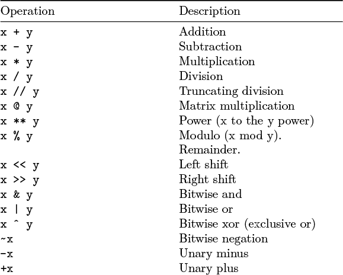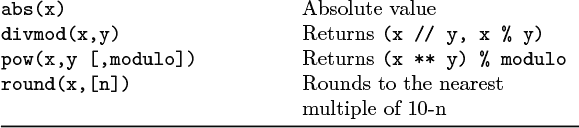

通常这些具有数值解释。然而，也有值得注意的特殊情况。例如，`+` 运算符也用于连接序列，`*` 运算符复制序列，`-` 用于集合差，而 `%` 定义用于执行字符串格式化：

```
[1,2,3] + [4,5]   # [1,2,3,4,5]

[1,2,3] * 4       # [1,2,3,1,2,3,1,2,3,1,2,3]

'%s has %d messages' % ('Dave', 37)
```

运算符的检查是一个动态过程。涉及混合数据类型的操作如果直觉上认为该操作可以行的，那么通常会“正常工作”。例如，你可以相整数和分数。

```python
>>> from fractions import Fraction

>>> a = Fraction(2, 3)

>>> b = 5

>>> a + b

Fraction(17, 3)

>>>
```

然而，它并不是万无一失的。例如，它对小数不起作用。

```python
>>> from decimal import Decimal

>>> from fractions import Fraction

>>> a = Fraction(2, 3)

>>> b = Decimal('5')

>>> a + b

Traceback (most recent call last):
  File "<stdin>", line 1, in <module>

TypeError: unsupported operand type(s) for +: 'Fraction' and 'decimal.Decimal'

>>>
```

对于大多数数字组合，Python 遵循布尔值、整数、分数、浮点数和复数的标准数值层级。混合类型操作将直接“正常工作”，你不需要担心它。

### 原地赋值

Python 在表 2 中提供了“原地”或“增强”赋值操作：

表 2：增强赋值运算符

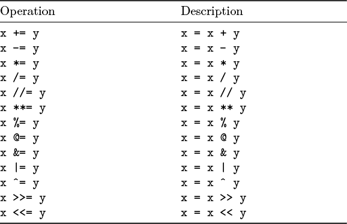

这些不被视为表达式。相反，它们是用于“原地”更新值的语法便利方法。例如：

```
a = 3

a = a + 1                         # a = 4

a += 1                            # a = 5
```

可变对象可能会使用这些运算符来执行数据的原地变异作为优化。考虑这个例子：

```python
>>> a = [1, 2, 3]

>>> b = a              # 创建一个指向 a 的新引用

>>> a += [4, 5]        # 原地更新（不创建新列表）

>>> a

[1, 2, 3, 4, 5]

>>> b

[1, 2, 3, 4, 5]

>>>
```

在这个例中，`a` 和 `b` 是同一个列表的引用。当执行 `a += [4, 5]` 时，它原地更新列表对象而不创建新列表。因此，`b` 也能看到此更新。这通常令人惊讶。

### 对象比较

相等运算符（`x == y`）测试 `x` 和 `y` 值是否相等。对于列表和元组，它们必须大小相等、元素相同且顺序相同。对于字典，只有当 `x` 和 `y` 具有相同的键且所有具有相同键的对象的值相等时，才会返回 `True`。两个集合如果具有相同的元素，则它们相等。

不兼容类型对象（例如文件和浮点数）之间的相等性比较不会触发错误，而是返回 `False`。然而，有时不同类型对象之间的比较会产生真实的结果。例如，比较具有相同值的整数和浮点数：

```python
>>> 2 == 2.0

True

>>>
```

标识运算符（`x is y` 和 `x is not y`）测试两个值是否引用的是内存中完全相同的对象（例如，`id(x) == id(y)`）。通常，可能会出现 `x == y` 但 `x is not y` 的情况。例如：

```python
>>> a = [1, 2, 3]

>>> b = [1, 2, 3]

>>> a is b

False

>>> a == b

True

>>>
```

在实践中，使用 `is` 运算符比较对象几乎不是你想要的。除非你有充分理由知道两个对象具有相同的标识，否则对于所有比较都应使用 `==` 运算符。

### 有序比较运算符

表 3 中的有序比较运算符对数字具有标准的数学解释并返回布尔值。

表 3：有序比较运算符

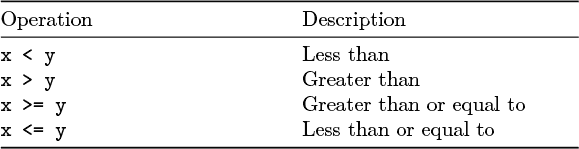

对于集合，`x < y` 测试 `x` 是否为 `y` 的真子集（即元素较少但不等于 `y`）。


在比较两个序列时，会比较每个序列的第一个元素。如果它们不同，则决定了结果。如果它们相同，则继续比较每个序列的第二个元素。这个过程一直持续，直到找到不同的元素，或者其中一个序列不再有更多元素。如果到达两个序列的末尾，则认为这两个序列是相等的。如果 `a` 是 `b` 的子序列，则 `a < b`。

字符串和字节使用字典序进行比较。每个字符都分配有一个由字符集（例如 `ASCII` 或 `Unicode`）的唯一数值索引。如果一个字符的索引小于另一个，则该字符小于另一个字符。

并不是所有类型都支持有序比较。例如，在字典上使用 `<` 是未定义的，并会导致 `TypeError`。同样，对不兼容的类型（例如在字符串和数字之间）应用有序比较将导致 `TypeError`。

### 布尔表达式与真值

`and`、`or` 和 `not` 运算符可以形成更复杂的布尔表达式。这些运算符的行为见表 4。

表 4：逻辑运算符

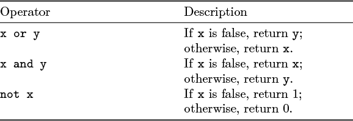

当你使用表达式来确定真或假值时，`True`、任何非零数字、非空字符串、列表、元组或字典均被视为真。`False`、零、`None` 以及空列表、元组和字典评估为假。布尔表达式从左到右求值，并且在需要确定最终值时才会消耗右操作数。例如，`a and b` 仅在 `a` 为真时才会评估 `b`。这有时被称为“短路”评估。它是简化涉及测试和后续操作的一种有用方法。例如：

```python
if y != 0:
    result = x / y
else:
    result = 0

### 替代方案

result = y and x / y
```

在第二个版本中，只有当 `y` 非零时才会执行 `x / y` 除法。

依赖对象的隐式“真值”有时是非常难以发现的错误的根源。例如，考虑这个函数：

```python
def f(x, items=None):
    if not items:
        items = []
    items.append(x)
    return items
```

该函数有一个可选参数，如果不给出，则将创建并返回一个新的列表。例如，

```python
>>> foo(4)
[4]
>>>
```

但是，如果你给它一个已有的空列表作为参数，该函数会有非常奇怪的行为：

```python
>>> a = []
>>> foo(3, a)
[3]
>>> a          # 注意 a 并没有更新
[]
>>>
```

这是一个真值检查错误。空列表评估为 `False`，因此代码创建了一个新列表，而不是使用作为参数传递的列表 (`a`)。要修复此代码，你需要在针对 `None` 的检查中更加精确：

```python
def f(x, items=None):
    if items is None:
        items = []
    items.append(x)
    return items
```

在实现条件检查时，保持精确性始终是一项良好的习惯。

### 条件表达式

一种常见的编程模式是根据表达式的结果有条件地分配值。例如：

```python
if a <= b:
    minvalue = a
else:
    minvalue = b
```

这段代码可以使用条件表达式缩短。例如：

```python
minvalue = a if a <= b else b
```

在此类表达式中，中间的条件首先被评估。如果结果为 `True`，则评估 `if` 左侧的表达式。否则，评估 `else` 之后的表达式。`else` 子句是始终必须的。

### 涉及迭代对象的操作

迭代是 Python 的一项重要特性，所有的 Python 容器（列表、元组、字典等）、文件以及生成器函数都支持迭代。表 5 中的操作可以应用于任何迭代对象 `s`：

表 5：对迭代对象的操作

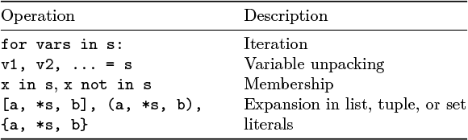

对迭代对象进行最本质的操作是 `for-loop`。这是你逐个遍历值的方式。所有其他操作都建立于此。

`x in s` 运算符测试对象 `x` 是否作为迭代对象 `s` 产生的项之一出现，并返回 `True` 或 `False`。`x not in s` 运算符等同于评估 `not (x in s)`。对于字符串，`in` 和 `not in` 运算符接受子字符串。例如，`'hello' in 'hello world'` 产生 `True`。需要注意的是，`in` 运算符不支持通配符或任何类型的模式匹配。

任何支持迭代的对象都可以将其值解包到一系列位置中。例如：

```python
items = [ 3, 4, 5 ]
x, y, z = items       # x = 3, y = 4, z = 5

letters = "abc"
x, y, z = letters       # x = 'a', y = 'b', z = 'c'
```

左侧的位置不需要是简单的变量名。事实上，任何可能出现在等号左侧的有效位置都是可以的。因此，你可以写这样的代码：

```python
items = [3, 4, 5]
d = { }
d['x'], d['y'], d['z'] = items
```

将值解包到位置时，左侧的位置必须与右侧迭代对象的数量完全匹配。对于嵌套数据结构，你可以通过相同的结构模式匹配位置和数据。考虑这个解包两个嵌套元组的示例：

```python
datetime = ((5, 19, 2008), (10, 30, "am"))
(month, day, year), (hour, minute, am_pm) = datetime
```

有时，`_` 变量用于在解包时指示一个丢弃值。例如，如果你只关心日期和小时，你可以写如下：

```python
(_, day, _), (hour, _, _) = datetime
```

如果解包的项数未知，你可以通过包含带星号的变量（如 `*extra`）使用扩展解包形式，如下例所示：

```python
a, b, *extra = [1, 2, 3, 4, 5]  # a=1, b=2, extra=[3, 4, 5]
```

### 序列的操作

序列是有大小并允许通过从 0 开始的整数索引访问项的迭代容器。示例包括字符串、列表和元组。除了所有涉及迭代的操作外，表 7 中的运算符也可以应用于序列：

表 7：序列的操作


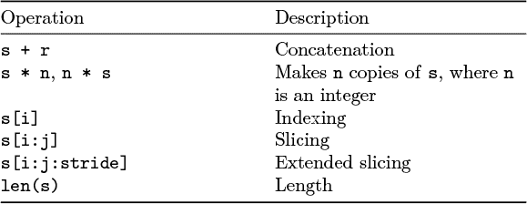

`+` 运算符用于拼接两个相同类型的序列。例如：

```
>>> a = [3, 4, 5]
>>> b = [6, 7]
>>> a + b
[3, 4, 5, 6, 7]
>>>
```

`s * n` 运算符会创建序列的 `n` 个副本。然而，这些是浅拷贝，仅通过引用复制元素。例如，考虑以下代码：

```
>>> a = [3, 4, 5]
>>> b = [a]
>>> c = 4 * b
>>> c
[[3, 4, 5], [3, 4, 5], [3, 4, 5], [3, 4, 5]]
>>> a[0] = -7
>>> c
[[-7, 4, 5], [-7, 4, 5], [-7, 4, 5], [-7, 4, 5]]

>>>
```

注意对 `a` 的修改如何影响了列表 `c` 的每一个元素。在这种情况下，列表 `a` 的引用被放在列表 `b` 中。当 `b` 被复制时，创建了四个额外的 `a` 引用。最后，当 `a` 被修改时，此更改传播到所有其他 `a` 的“副本”。这种序列乘法的行为往往出乎意料，并不是程序员的意图。解决此问题的方法之一是通过复制 `a` 的内容来手动构建复制序列。这里是一个示例：

```
a = [ 3, 4, 5 ]
c = [list(a) for _ in range(4)]  # list() 创建列表的拷贝
```

索引运算符 `s[n]` 返回序列中的第 n 个对象，其中 `s[0]` 是第一个对象。可以使用负索引从序列末尾获取字符。例如，`s[-1]` 返回最后一个项。否则，尝试访问超出范围的元素将导致 `IndexError` 异常。

切片运算符 `s[i:j]` 从 `s` 中提取一个子序列，该序列由索引为 `k` 的元素组成，其中 `i <= k < j`。`i` 和 `j` 必须是整数。如果省略起始或结束索引，则分别假设为序列的开头或结尾。允许负索引，并假设它们相对于序列末尾。如果 `i` 或 `j` 超出范围，根据其值是指向第一个元素之前的元素还是最后一个元素之后的元素，将分别指向序列的开头或结尾。

切片运算符可以接收一个可选的步长（stride），`s[i:j:stride]`，这会导致切片跳过元素。然而，其行为要微妙得多。如果提供了步长，`i` 是起始索引，`j` 是结束索引，生成的子序列是元素 `s[i]`、`s[i+stride]`、`s[i+2*stride]` 等，直到达到索引 `j`（不包含 `j`）。`stride` 也可以是负数。如果省略了起始索引 `i`，当 `stride` 为正时，将其设置为序列开头，当 `stride` 为负时，将其设置为序列末尾。如果省略了结束索引 `j`，当 `stride` 为正时，将其设置为序列末尾，当 `stride` 为负时，将其设置为序列开头。这里是一些示例：

```
a = [0, 1, 2, 3, 4, 5, 6, 7, 8, 9]
a[2:5]     # [2, 3, 4]
a[:3]      # [0, 1, 2]
a[-3:]     # [7, 8, 9]
a[::2]     # [0, 2, 4, 6, 8]
a[::-2]    # [9, 7, 5, 3, 1]
a[0:5:2]   # [0, 2, 4]
a[5:0:-2]  # [5, 3, 1]
a[:5:1]    # [0, 1, 2, 3, 4]
a[:5:-1]   # [4, 3, 2, 1, 0]
a[5::1]    # [5, 6, 7, 8, 9]
a[5::-1]   # [9, 8, 7, 6, 5]
a[5:0:-2]  # [4, 3, 2, 1]
```

复杂的切片往往导致代码难以理解。因此，有必要进行判断。切片可以使用 `slice()` 命名。例如：

```
firstfive = slice(0, 5)
s = 'hello world'
print(s[firstfive]) # 'hello'
```

### 在可变序列上的操作

字符串和元组是不可变的，创建后无法修改。列表或其他可变序列的内容可以使用以下运算符就地修改，见 表 8：

表 8：可变序列操作

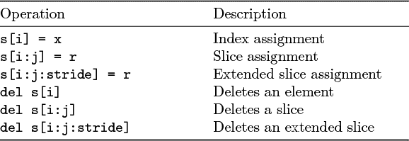

`s[i] = x` 运算符将序列的第 `i` 个元素更改引用对象 `x`，增加 `x` 的引用计数。负索引相对于列表末尾，尝试为超出范围的索引赋值将导致 `IndexError` 异常。切片赋值 `s[i:j] = r` 用来自序列 `r` 的元素替换索引 `k`（其中 `i <= k < j`）的元素。索引的值可能与切片相同，如果超出范围，则会被调整为序列的开头或结尾。如有必要，序列 `s` 的大小可能会扩大或缩小以容纳 `r` 中的所有元素。这里是一个示例：

```
a = [1, 2, 3, 4, 5]
a[1] = 6               # a = [1, 6, 3, 4, 5]
a[2:4] = [10, 11]      # a = [1, 6, 10, 11, 5]
a[:3]      = [0, 1, 2] # [0, 1, 2]
a[-3:]             # [10, 11, 5]
a[::2]             # [1, 10, 5]
a[2:] = [0]            # a = [1, 6, 0] (不，等)
```

切片赋值可以提供一个可选的步长参数。然而，其行为有些受限，因为右侧的元素数量必须与被替换切片的数量完全相同。这里是一个示例：

```
a = [1, 2, 3, 4, 5]
a[1::2] = [10, 11]      # a = [1, 10, 3, 11, 5]
a[1::2] = [30, 40, 50]  # ValueError. 左侧切片只有两个元素
```

`del s[i]` 运算符从序列中删除元素 `i` 并递减其引用计数。`del s[i:j]` 删除切片中的所有元素。也可以提供步长，如 `del s[i:j:stride]`。这些语义适用于内置 `list` 类型。切片操作与 `numpy` 不同。

### 列表、集合和字典推导式

涉及数据的最常见操作之一是将数据集合转换为另一种数据结构。例如，对列表中的所有项应用某种操作并创建一个新列表：

```python
nums = [1, 2, 3, 4, 5]
squares = []
for n in nums:
    squares.append(n * n)
```

因为这种操作非常常见，它作为一种名为列表推导式的运算符可用。这里是该代码更紧凑的版本，执行相同的操作：

```python
nums = [1, 2, 3, 4, 5]
squares = [n * n for n in nums]
```

也可以对该操作应用过滤器：

```python
squares = [n * n for n in nums if n > 2]     # [9, 16, 25]
```

列表推导式的通用语法如下：

```
[expression for item in iterable if condition]
```


```python
[expression for item1 in iterable1 if condition1
            for item2 in iterable2 if condition2
            ...
            for itemN in iterableN if conditionN ]
```

这种语法等同于以下代码：

```python
result = []

for item1 in iterable1:
    if condition1:
        for item2 in iterable2:
           if condition2:
               ...
               for itemN in iterableN:
                   if conditionN:
                       result.append(expression)
```

列表推导式（List comprehensions）是处理各种形式列表数据的非常有用的方法。以下是一些实用示例：

```python
### 一些数据（字典列表）

portfolio = [
  {'name': 'IBM', 'shares': 100, 'price': 91.1 },
  {'name': 'MSFT', 'shares': 50, 'price': 45.67 },
  {'name': 'HPE', 'shares': 75, 'price': 34.51 },
  {'name': 'CAT', 'shares': 60, 'price': 67.89 },
  {'name': 'IBM', 'shares': 200, 'price': 95.25 }
]

### 收集所有名称 ['IBM', 'MSFT', 'HPE', 'CAT', 'IBM' ]
names = [s['name'] for s in portfolio]

### 查找股份大于 100 的条目 ['IBM']
more100 = [s['name'] for s in portfolio if s['shares'] > 100 ]

### 计算总股份*价格
cost = sum([s['shares']*s['price'] for s in portfolio])

### 收集 (名称, 股份) 元组
name_shares = [ (s['name'], s['shares']) for s in portfolio ]
```

在列表推导式内部使用的所有变量对于该推导式都是私有的。因此，你不需要担心此类变量会覆盖同名的其他变量。例如：

```python
>>> x = 42
>>> squares = [x*x for x in [1,2,3]]
>>> squares
[1, 4, 9]
>>> x
42
>>>
```

与其创建一个列表，你还可以通过将方括号改为大括号来创建一个集合。这被称为集合推导式（set-comprehension）。集合推导式将给你一组不不同的值。例如：

```python
### 集合推导式
names = { s['name'] for s in portfolio }
### names = { 'IBM', 'MSFT', 'HPE', 'CAT' }
```

如果你指定了 `key:value` 对，你将创建一个字典。这被称为字典推导式（dictionary comprehension）。例如：

```python
prices = { s['name']:s['price'] for s in portfolio }
### prices = { 'IBM': 95.25, 'MSFT': 45.67, 'HPE': 34.51, 'CAT': 67.89 }
```

在创建集合和字典时，请注意后条目可能会覆盖之前的条目。例如，在 `prices` 字典中，你得到了 `'IBM'` 的最后一个价格。第一个价格丢失了。

在推导式内部无法包含任何形式的异常处理。如果这是你担心的问题，请考虑像所示使用函数封装异常：

```python
def toint(x):
    try:
        return int(x)
    except ValueError:
        return None

values = [ '1', '2', '-4', 'n/a', '-3', '5' ]
data1 = [ toint(x) for x in values ]
### data1 = [1, 2, -4, None, -3, 5]
data2 = [ toint(x) for x in values if toint(x) is not None ]
### data2 = [1, 2, -4, -3, 5]
```

在最后一个例子中，可以使用 `:=` 运算符避免对 `toint(x)` 的重评估。例如：

```python
data3 = [ v for x in values if (v:=toint(x)) is not None ]
### data3 = [1, 2, -4, -3, 5]

data4 = [ v for x in values if (v:=toint(x)) is not None and v >= 0 ]
### data4 = [1, 2, 5]
```

### 生成器表达式（Generator Expressions）

生成器表达式是一个执行与列表推导式相同计算的对象，但它是迭代地产生结果。它的语法与列表推导式相同，只是使用圆括号而不是方括号。这是一个示例：

```python
nums = [1,2,3,4]
squares = (x*x for x in nums)
```

与列表推导式不同，生成器表达式不会实际创建列表，也不会立即求值括号内的表达式。相反，它创建一个生成器对象，通过迭代按需产生值。如果你查看上述示例的结果，你会看到以下：

```python
>>> squares
<generator object at 0x590a8>
>>> next(squares)
1
>>> next(squares)
4
...
>>> for n in squares:
...     print(n)
9
16
>>>
```

生成器表达式只能使用一次。如果你尝试迭代两次，你什么也得不到：

```python
### (耗尽生成器的示例)
nums = [1,2,3,4]
squares = (x*x for x in nums)
list(squares) # [1, 4, 9, 16]
list(squares) # []
```

列表推导式和生成器表达式之间的区别非常重要。列表推导式会在内存中创建整个列表，而生成器表达式逐个产生项，对于大数据数据集来说，这要节省内存得多。


关于优先级规则的一个常见混淆是使用位与（`&`）和位或（`|`）运算符来表示逻辑逻辑与（`and`）和逻辑或（`or`）。例如：

```
>>> a = 10

>>> a <= 10 and 1 < a

True

>>> a <= 10 & 1 < a

False

>>>
```

在这里，问题在于后一个表达式被求值值为 `a <= (10 & 1) < a` 或 `a <= 0 < a`。你可以通过添加括号来修复它：

```
>>> (a <= 10) & (1 < a)

True

>>>
```

这看起来可能像是一个冷门的边缘情况，但它在像 `numpy` 和 `pandas` 等数据导向的包中频繁出现。逻辑运算符 `and` 和 `or` 无法自定义，因此转而使用位运算符——尽管它们的优先级更高，且在用于布尔关系式时其求值结果也不同。

### 结语 - 数据的秘密生活

Python 最重要的用途之一是涉及数据处理和分析的应用。通过这些操作，Python 为你提供了一种特定的“领域语言”来思考你的问题。内置运算符和表达式是该语言的核心，所有其他内容都基于此构建。因此，如果你能够对 Python 的内置对象和操作建立起一种直觉，你会发现这种直觉也适用于其他地方。

例如，假设你正在处理一个数据库，并想要遍历查询返回的记录。很有可能，你将使用 `for` 语句来实现这一点。或者假设你正在处理数值数组，并想对数组进行逐元素的数学运算。你可能认为标准的数学运算符可以工作，而且你的直觉是正确的。又假设你正在使用一个库通过 HTTP 获取数据，并想要访问 HTTP 头部的内容。数据很有可能会以类似于字典的形式呈现。

关于 Python 内部协议以及如何自定义它们的更多信息，请参见第 4 章。

## 程序结构与控制流

本章介绍了程序结构和控制流的细节。主题包括条件判断、循环、异常和上下文管理器。

### 程序结构与执行

Python 程序结构化为语句的序列。所有语言特性，包括变量赋值、表达式、函数定义、类和模块导入，都是与其他所有语句具有同等地位的语句——这意味着任何语句都可以放在程序中的几乎任何位置（尽管某些语句如 `return` 只能出现在函数内部）。例如，这段代码在条件语句内部定义了两个版本的函数：

```
if debug:

    def square(x):

        if not isinstance(x,float):
            raise TypeError('Expected a float')
        return x * x

else:

    def square(x):
        return x * x
```

在加载源文件时，解释器按照它们出现的顺序执行语句，直到没有更多语句可以执行为止。这种执行模型既适用于作为主程序运行的文件，也适用于通过 `import` 加载的库文件。

### 条件执行

`if`、`else` 和 `elif` 语句控制条件代码的执行。条件语句的标准格式如下：

```
if expression:
    statements

elif expression:
    statements

elif expression:
    statements

...

else:
    statements
```

如果不需要执行操作，可以省略条件语句的 `else` 和 `elif` 子句。如果某个子句没有语句，请使用 `pass` 语句：

```
if expression:
    pass            # 待办：请实现
else:
    statements
```

### 循环与迭代

你使用 `for` 和 `while` 语句来实现循环。这是一个示例：

```
while expression:
    statements

for i in s:
    statements
```

`while` 语句执行语句直到关联的表达式为假。`for` 语句遍历 `s` 的所有元素，直到没有更多可用元素为止。`for` 语句适用于支持迭代的对象。这包括内置的序列类型（如列表、元组和字符串），也包括任何实现了迭代器协议的对象。

在 `for i in s` 语句中，变量 `i` 被称为迭代变量。在循环的每次迭代中，它都会接收来自 `s` 的新值。迭代变量的作用域并不是 `for` 语句私有的。如果之前定义的变量具有相同的名称，该值将被覆盖。此外，迭代变量在循环完成后仍保留最后一个值。

如果迭代产生的元素是相同大小的迭代器，你可以使用如下语句将它们的值解包到单独的迭代变量中：

```
s = [ (1, 2, 3), (4, 5, 6) ]

for x, y, z in s:
    statements
```

在这个示例中，`s` 必须包含或产生迭代器，且每个迭代器都有三个元素。在每次迭代中，变量 `x`、`y` 和 `z` 的内容被赋值相应迭代器的项。虽然最常见的是在 `s` 为元组序列时使用，但如果 `s` 中的项是任何类型的迭代器（包括列表、生成器和字符串），解包仍然有效。

在解包时，有时会使用如 `_` 这样的丢弃变量。例如：

```
for x, _, z in s:
    statements
```

在这个示例中，一个值被放入 `_` 变量中，但该名称并不重要。

如果迭代产生的元素是大小不一的迭代器，你可以使用通配符解包将多个值放入变量。例如：

```
s = [ (1, 2), (3, 4, 5), (6, 7, 8, 9) ]

for x, y, *extra in s:
    statements            # x = 1, y = 2, extra = []
                          # x = 3, y = 4, extra = [5]
                          # x = 6, y = 7, extra = [8, 9]
```

在这个用例中, 至少需要两个值 `x` 和 `y`，但 `*extra` 会接收任何额外的值。这些值始终被放在列表中。在单个解包中最多只能有一个星号变量。然而，它可以出现在任何位置。所以，以下变体都是合：

```
for *first, x, y in s:
    ...

for x, *middle, y in s:
    ...
```

在循环时，除了数据值之外，跟踪数值索引是有用的。这是一个示例：

```
i = 0

for x in s:
    statements

    i += 1
```

Python 提供了一个内置函数 `enumerate()`，可以简化这段代码：

```
for i, x in enumerate(s):
    statements
```

`enumerate(s)` 创建一个迭代器，产生元组 `(0, s[0])`、`(1, s[1])`、`(2, s[2])` 等。如果需要，可以通过 `start` 关键字参数为 `enumerate()` 提供不同的计数起始值，如下：

```
for i, x in enumerate(s, start=100):
    statements
```

在这种情况下，产生的形式为 `(100, s[0])`、`(101, s[1])` 等元组。

另一个常见的循环问题涉及并行遍历两个或多个迭代器——例如，编写一个循环，在每次迭代中从不同的序列中提取项：

```
### s 和 t 是两个序列

i = 0

while i < len(s) and i < len(t):
    x = s[i]     # 从 s 取一个项

    y = t[i]     # 从 t 取一个项

    statements

    i += 1
```

这段代码可以使用 `zip()` 函数进行简化。例如：

```
### s 和 t 是两个序列

for x, y in zip(s, t):
    statements
```


`zip(s, t)` 将可迭代对象 `s` 和 `t` 合并为元组的迭代对象 `(s[0], t[0])`、`(s[1], t[1])`、`(s[2], t[2])` 等，如果 `s` 和 `t` 的长度不相等，则在最短的那个处停止。`zip()` 的结果是一个迭代器，在迭代时产生结果。如果你想将结果转换为列表，请使用 `list(zip(s, t))`。

要跳出循环，请使用 `break` 语句。例如，这段代码从文件中读取行，直到遇到空行文本：

```
with open('foo.txt') as file:
    for line in file:
        stripped = line.strip()
        if not stripped:
            break          # 是空行，停止读取
        # 处理处理后的行
        ...
```

要跳转到循环的下一次迭代（跳过循环体的剩余部分），请使用 `continue` 语句。当反转测试并增加缩进层会导致程序嵌套过深或不必要的复杂时，该语句非常有用。例如，下面的循环会跳过文件中的所有空行：

```
with open('foo.txt') as file:
    for line in file:
        stripped = line.strip()
        if not stripped:
            continue      # 跳过空行
        # 处理处理后的行
        ...
```

`break` 和 `continue` 语句仅作用于正在执行的最内层循环。如果需要跳出深度嵌套的循环结构，可以使用异常。Python 并不提供 "goto" 语句。你还可以将 `else` 语句附加到循环结构上，如下例所示：

```
### for-else
with open('foo.txt') as file:
    for line in file:
        stripped = line.strip()
        if not stripped:
            break
        # 处理处理后的行
        ...
    else:
        raise RuntimeError('Missing section separator')
```

循环的 `else` 子句只有在循环运行完成时才会执行。这要么立即发生（如果循环根本没有执行），要么在最后一次迭代之后。如果使用 `break` 语句提前终止了循环，则跳过 `else` 子句。

循环 `else` 子句的主要用场景是在迭代数据代码中，但在循环提前中断时，需要设置或检查某种标记或条件。例如，如果你不使用 `else`，之前的代码可能需要使用标记变量重写，如下所示：

```
found_separator = False
with open('foo.txt') as file:
    for line in file:
        stripped = line.strip()
        if not stripped:
            found_separator = True
            break
        # 处理处理后的行
        ...
    if not found_separator:
        raise RuntimeError('Missing section separator')
```

### 异常

异常表示错误并中断程序的正常控制流。使用 `raise` 语句抛出异常。`raise` 语句的通用格式为 `raise Exception([value])`，其中 `Exception` 是异常类型，`value` 是可选的值，用于提供异常的具体细节。这是一个示例：

```
raise RuntimeError('Unrecoverable Error')
```

要捕获异常，请使用 `try` 和 `except` 语句，如下：

```
try:
    file = open('foo.txt', 'rt')
except FileNotFoundError as e:
    statements
```

当异常发生时，解释器停止执行 `try` 块中的语句，并寻找与发生异常类型匹配的 `except` 子句。如果找到了，控制权将传递给 `except` 子句中的第一个语句。执行完 `except` 子句后，控制将从整个 `try-except` 块之后的第一个语句继续。

`try` 语句没有没有匹配所有可能发生的异常。如果找不到匹配的 `except` 子句，异常将继续传播——也许它会在另一个不同的 `try-except` 块中被捕获，从而在其他地方处理该异常。从编程风格的角度来说，你应该只捕获你的代码实际上可以恢复的异常。如果无法恢复，通常让异常传播会更好。

如果异常一直传播到程序的顶层而未被捕获，解释器将带上错误消息终止。

如果单独使用 `raise` 语句，则会再次抛出最后生成的异常（尽管这只在处理之前抛出的异常时有效）。例如：

```
try:
    file = open('foo.txt', 'rt')
except FileNotFoundError:
    print("Well, that didn't work.")
    raise       # 重新抛出当前异常
```

每个 `except` 子句都可以配合 `as var` 修饰符使用，当发生异常时，该修饰符会将异常类型的实例放入变量中。异常处理器可以检查此值以获取更多关于异常原因。例如，你可以使用 `isinstance()` 来检查异常类型。异常具有几个可能在响应错误的操作代码的标准属性：

```
e.args
```
抛出异常时提供的参数元组。在大多数情况下，这是一个包含描述错误的单项元组。对于 `OSError` 异常，该值是一个 2 元组或 3 元组，包含一个整数错误代码、字符串错误消息和一个可选的文件名。

```
e.__cause__
```
如果异常是为了响应另一个异常而故意抛出的，则为前一个异常。见后文关于链异常的章节。

```
e.__context__
```
如果在处理另一个异常时意外抛出异常，则为前一个异常。

```
e.__traceback__
```
与异常相关的堆栈回溯对象。

用于保存异常值的变量只在 `except` 块内部可访问。一旦控制权离开该块，该变量将变为未定义。例如：

```
try:
    int('N/A')               # 引发 ValueError
except ValueError as e:
    print('Failed:', e)

print(e)     # 失败 -> NameError. 'e' not defined.
```

使用多个 `except` 子句指定多个异常处理块，如下例所示：

```
try:
    do something
except TypeError as e:
    # 处理 Type error
    ...
except ValueError as e:
    # 处理 Value error
    ...
```

一个单个处理器子句可以这样捕获多个异常类型：

```
try:
    do something
except (TypeError, ValueError) as e:
    # 处理 Type 或 Value 错误
    ...
```

要忽略异常，请如下使用 `pass` 语句：

```
try:
    do something
except ValueError:
    pass              # 什么都不做（耸耸肩）。
```

静默忽略错误通常是危险的，并且是难以发现的错误的根源。即使忽略了错误，选择性允许在日志或其他你可以检查的地方报告错误通常也是是明智的。

要捕获所有与程序退出的异常相关的异常，请如下方式捕获 `Exception`：

```
try:
    do something
except Exception as e:
    print(f'An error occurred : {e!r}')
```

在捕获所有异常时，你应该非常小心向用户报告准确的错误信息。例如，在之前的代码中，正在打印错误消息和相关的异常值。如果你不包含任何关于异常值的信息，可能会使调试由于意外原因失败的代码变得非常困难。

`try` 语句还支持 `else` 子句，它必须跟在最后一个 `except` 子句之后。如果 `try` 块中的代码没有引发异常，则执行该代码。这是一个示例：

```
try:
    file = open('foo.txt', 'rt')
except FileNotFoundError as e:
    print(f'Unable to open foo : {e}')
    data = ''
else:
    data = file.read()
    file.close()
```


`finally` 语句定义了一个清理操作，无论 `try-except` 块中发生了什么，它都会执行。以下是一个示例：

```python
file = open('foo.txt', 'rt')

try:
    # 执行一些操作
    ...
finally:
    file.close()
    # 无论发生了什么，文件都会关闭
```

`finally` 子句并不是用于捕获错误。相反，它用于提供无论是否发生错误都必须执行的代码。如果没有抛出异常，`finally` 子句中的代码将在 `try` 块中的代码执行完毕后立即执行。如果发生异常，会先执行匹配的 `except` 块（如果有），然后将控制权传递给 `finally` 子句的第一条语句。如果在执行这些代码后仍有待处理的异常，该异常将重新抛出，以便由另一个异常处理器捕获。

### 异常层次结构

处理异常时的一个挑战是管理程序中可能发生的海量异常。例如，仅内置异常就有超过 60 种。加上标准库的其他部分，异常数量就变成了数百种可能的异常。此外，通常无法预先容易判断代码的任何部分可能会抛出什么类型的异常。异常不会记录在函数的调用签名中，也没有任何编译器可以验证代码中异常处理的正确性。结果是，异常处理有时感觉是杂乱无无无章的。

管理异常的一个有用工具是意识到它们通过继承被组织成层次结构。与其编写关注非常特定错误的代码，不如关注更通用的错误类别可能更简单。例如，考虑在容器中查找值时可能出现的不同错误：

```python
try:
    item = items[index]
except IndexError:      # 如果 items 是序列，则抛此异常
    ...
except KeyError:        # 如果 items 是映射，则抛此异常
    ...
```

与其像所示那样编写处理两个高度特定异常的代码，不如如下所示编写代码可能更容易：

```python
try:
    item = items[index]
except LookupError:
    ...
```

`LookupError` 是表示更高层次异常分组的类。`IndexError` 和 `KeyError` 都继承自 `LookupError`，因此所示的 `except` 子句可以捕获其中任何一个。然而，`LookupError` 并不宽泛到捕获与查找无关的错误。

表 1 描述了最常见的内置异常类别。

表 1：异常类别

`BaseException` 类在异常处理中很少直接使用，因为它匹配所有可能的异常。这包括了影响程序控制流的特殊异常，例如 `SystemExit`、`KeyboardInterrupt` 和 `StopIteration`。捕获这些异常通常不是你想要的。相反，所有与程序相关的错误都继承自 `Exception`。`ArithmeticError` 是所有数学相关错误（如 `ZeroDivisionError`、`FloatingPointError` 和 `OverflowError`）的基类。`ImportError` 是所有导入相关错误的基类。`LookupError` 是所有容器查找相关错误的基类。`OSError` 是所有源于操作系统和环境的错误的基类。`OSError` 涵盖了与文件、网络连接、权限、管道、超时等的广泛异常。当给操作提供糟糕的输入值时，通常会抛出 `ValueError` 异常。`UnicodeError` 是 `ValueError` 的子类，但用于分组所有与 Unicode 相关的编解码错误。

表 2 显示了一些直接继承自 `Exception` 但不属于较大异常组的常见内置异常。

表 2：其他内置异常

### 异常与控制流

通常异常保留用于处理错误。然而，有少数异常用于改变程序的控制流。表 3 所示的异常直接继承自 `BaseException`。

表 3：用于控制流的异常

`SystemExit` 异常用于有意识地终止程序。作为参数，你可以提供一个整数退出码或一个字符串消息。如果给出字符串，它将打印到 `sys.stderr` 且程序将以退出码 1 终止。这是一个典型的示例：

```python
import sys

if len(sys.argv) != 2:
    raise SystemExit(f'Usage: {sys.argv[0]} filename)

filename = sys.argv[1]
```

当程序接收到 `SIGINT` 信号（通常通过在终端中按下 Control-C）时，会抛出 `KeyboardInterrupt` 异常。这种异常有点异常，它是异步的——这意味着它可能在程序运行的几乎任何时间、任何语句上发生。Python 的默认行为是在这种情况发生时直接终止。如果你想控制 `SIGINT` 的递送，可以使用 `signal` 模块（参见第 9 章，“I/O”）。

`StopIteration` 异常是迭代的一部分，并指示迭代的结束。

### 定义新异常

所有内置异常都是以类的形式定义的。创建一个新异常，创建一个继承自 `Exception` 的新类，如下：

```python
class NetworkError(Exception):
    pass
```

使用你的新异常，如下所示使用 `raise` 语句：

```python
raise NetworkError('Cannot host')
```

抛出异常时，`raise` 语句提供的可选值作为类构造函数的参数。大多数情况下，这是一个指示错误信息的字符串。然而，用户定义的异常可以写为接收一个或多个异常值，如下：

```python
class DeviceError(Exception):
     def __init__(self, errno, msg):
         self.args = (errno, msg)
         self.errno = errno
         self.errmsg = msg

### 抛出异常（多个参数）
raise DeviceError(1, 'Notponding')
```

当你创建一个重新定义 `__init__` 的自定义异常类时，重要的是将包含参数的元组赋值给 `self.args`。该属性在打印回溯信息时会被使用。如果你未定义它，用户在发生错误时将无法看到有关异常的任何有用信息。

异常可以通过继承组织成层次结构。例如，之前定义的 `NetworkError` 异常可以作为各种更具体的错误的基类。这里是一个示例：

```python
class HostnameError(NetworkError):
    pass

class TimeoutError(NetworkError):
    pass

def error1():
    raise HostnameError('Unknown host')

def error2():
    raise TimeoutError('Timed out')

try:
    error1()
except NetworkError as e:
    if type(e) is HostnameError:
        # 对此类错误执行特殊操作
        ...
```

在这种情况下，`except NetworkError` 子句捕获任何派自 `NetworkError` 的异常。要找到抛出的特定类型，可以使用 `type()` 检查执行值的类型。

### 链异常

有时你可能希望响应另一个异常抛出不同的异常。为了实现这一点，如下例所示抛出一个链异常：

```python
class ApplicationError(Exception):
    pass

def do_something():
    x = int('N/A')    # 抛出 ValueError

def spam():
    try:
        do_something()
    except Exception as e:
        raise ApplicationError('It failed') from e
```

如果发生未捕获的 `ApplicationError`，你将获得一个包含两个异常的消息。例如：


```
>>> spam()

Traceback (most recent call last):

  File "c.py", line 9, in spam

    do_something()

  File "c.py", line 5, in do_something

    x = int('N/A')

ValueError: invalid literal for int() with base 10: 'N/A'

The above exception was the direct cause of the following exception:

Traceback (most recent call last):

  File "<stdin>", line 1, in <module>

  File "c.py", line 11, in spam

    raise ApplicationError('It failed') from e

__main__.ApplicationError: It failed

>>>
```

如果你捕获了一个 `ApplicationError`，产生的异常的 `__cause__` 属性将包含另一个异常。例如：

```python
try:
    spam()
except ApplicationError as e:
    print('It failed. Reason:', e.__cause__)
```

如果你想抛出一个新异常而不包含其他异常的链，可以像这样这样从 `None` 抛出错误：

```python
def spam():
    try:
        do_something()
    except Exception as e:
        raise ApplicationError('It failed') from None
```

在 `except` 块中出现的编程错误也会导致链式异常，但它们的工作方式略有不同。例如，假设你有如下某些错误代码：

```python
def spam():
    try:
        do_something()
    except Exception as e:
        print('It failed:', err)      # err 未定义（拼写错误）
```

产生的异常回溯信息略有不同：

```python
>>> spam()

Traceback (most recent call last):

  File "d.py", line 9, in spam

    do_something()

  File "d.py", line 5, in do_something

    x = int('N/A')

ValueError: invalid literal for int() with base 10: 'N/A'

在处理上述异常期间，发生了另一个异常：

Traceback (most recent call last):
  File "<stdin>", line 1, in <module>

  File "d.py", line 11, in spam
    print('It failed. Reason:', err)

NameError: name 'err' is not defined

>>>
```

如果在处理另一个异常时抛出了意外异常，`__context__` 属性（而不是 `__cause__`）将持有发生错误时正在处理的异常信息。例如：

```python
try:
    spam()
except Exception as e:
    print('It failed. Reason:', e)
    if e.__context__:
        print('While handling:', e.__context__)
```

在异常链中，预期异常和非预期异常之间存在重要的区别。在第一个示例中，代码的编写方式预到了异常的可能性。例如，代码被显式地封装在 `try-except` 块中：

```python
try:
    do_something()
except Exception as e:
    raise ApplicationError('It failed') from e
```

在第二种情况下，`except` 块中存在编程错误：

```python
try:
    do_something()
except Exception as e:
    print('It failed:', err)     # err 未定义
```

能够区分这两种情况虽然微妙但非常重要。这就是为什么异常链信息被放置在 `__cause__` 或 `__context__` 属性中的原因。`__cause__` 属性保留用于预期可能失败的情况。`__context__` 属性用于非预期情况（在处理另一个异常时发生了未捕获的错误）。

### 异常回溯（Exception Tracebacks）

异常关联有一个堆栈回溯，提供了错误发生位置的信息。回溯存储在异常的 `__traceback__` 属性中。为了报告或调试，你可能想自己生成回溯消息。可以使用 `traceback` 模块来实现这一点。例如：

```python
import traceback

try:
    spam()
except Exception as e:
    tblines = traceback.format_exception(type(e), e, e.__traceback__)
    tbmsg = ''.join(tblines)
    print('It failed:')
    print(tbmsg)
```

在这段代码中，`format_exception()` 产生一个字符串列表，包含 Python 通常在回溯消息中正常产生的输出。作为输入，你提供了异常类型、值和回溯。

### 异常处理建议

异常处理是大型程序中最难做好的事情之一。然而，有一些准则可以使其变得更容易。

第一条规则是不捕获在代码特定位置无法直接处理的异常。考虑这样一个函数：

```python
def read_data(filename):
    with open(filename, 'rt') as file:
         rows = []
         for line in file:
             row = line.split()
             rows.append((row[0], int(row[1]), float(row[2])))
    return rows
```

假设 `open()` 函数因为文件名不正确而失败了。这是一个应该在该函数中使用 `try-except` 语句捕获的错误吗？可能不。如果调用者给了一个错误的文件名，没有合理的恢复方法（没有文件可以打开，没有数据可以读取，没有其他可能可能的操作）。最好让操作失败并将异常报告给调用者。避免在 `read_data()` 中进行错误检查——这个建议似乎与习惯于特殊错误码或包装类型的语言的程序员经验大相径。在那些语言中，会非常小心地确保检查错误码。在 Python 中你不必这样做。如果操作可能会失败且你无法做任何恢复，最好让它失败。异常将传播到上层，那里通常是某些代码处理它的责任。

另一方面，一个函数可能会从坏数据中恢复。例如：

```python
def read_data(filename):
    with open(filename, 'rt') as file:
         rows = []
         for line in file:
             row = line.split()
             try:
                 rows.append((row[0], int(row[1]), float(row[2])))
             except ValueError as e:
                 print('Bad row:', row)
                 print('Reason:', e)
    return rows
```

在捕获错误时，尽量让你的 `except` 子句尽可能窄。上面的代码可以使用 `except Exception` 来捕获所有错误。然而，这样做会导致代码捕获本不应该忽略的合法的编程错误。不要这样做——这将使调试变得困难。

最后，在显式抛出异常时，考虑创建你自己的异常类型。例如：

```python
class ApplicationError(Exception):
    pass

class UnauthorizedUserError(ApplicationError):
    pass

def spam():
    ...
    raise UnauthorizedUserError('Go away')
    ...
```

虽然微妙，但大型代码库中更具挑战性的之一是为程序失败分配责任。如果你创建了自己的异常，你将能够更好地区分故意抛出的错误和合法的编程错误。例如，如果上面的程序由于某种 `ApplicationError` 崩溃，你会更立即地知道为什么抛出该错误（因为是你写了这些代码）。另一方面，如果程序由于 Python 内置异常之一（例如 `TypeError`, `ValueError` 等）崩溃，这可能表明存在更严重的问题。

### 上文管理器与 with 语句

系统资源（如文件、锁和连接）的适当管理在结合异常时通常是一个棘手问题。例如，抛出的异常会导致控制流跳过释放关键资源（如锁）的语句。

`with` 语句允许一组语句在由作为上下文管理器的对象控制的运行环境中执行。这是一个示例：


```python
with open('debuglog', 'wt') as file:
     file.write('Debugging\n')
     statements
     file.write('Done\n')

import threading

lock = threading.Lock()

with lock:
     # Critical section
     statements
     # End critical section
```

在第一个示例中，`with` 语句会在控制流离开随后的语句块时，自动关闭已打开的文件。在第二个示例中，`with` 语句会在控制进入进入和随后的语句块时，自动获取和释放锁。

`with obj` 语句允许对象 `obj` 管理当控制流进入和退出关联语句块时所发生的情况。当 `with obj` 语句执行时，它会调用 `obj.__enter__()` 方法来信号正在进入一个新上下文。当控制流离开上下文时，会执行 `obj.__exit__(type,value,traceback)` 方法。如果没有抛出异常，`__exit__()` 的三个参数都将设置为 `None`。否则，它们将包含与导致控制流离开上下文的异常相关的类型、值和回溯信息（traceback）。如果 `__exit__()` 方法返回 `True`，则表示抛出的异常已处理，不应再向下传播。返回 `None` 或 `False` 将导致异常传播。

`with obj` 语句接受一个可选的 `as var` 标识符。如果提供了标识符，`obj.__enter__()` 返回的值将放入 `var` 中。此值通常与 `obj` 相同，因为这允许在同一个步骤中构造对象并作为上下文管理器使用。例如，考虑这个类：

```python
class Manager:
    def __init__(self, x):
        self.x = x

    def yow(self):
        pass

    def __enter__(self):
        return self

    def __exit__(self, ty, val, tb):
        pass
```

按照目前的写法，你可以按照如下所示在单个步骤中创建并使用实例作为上下文管理器：

```python
with Manager(42) as m:
    m.yow()
```

这里是一个涉及列表事务的更有趣示例：

```python
class ListTransaction:
    def __init__(self,thelist):
        self.thelist = thelist

    def __enter__(self):
        self.workingcopy = list(self.thelist)
        return self.workingcopy

    def __exit__(self,type,value,tb):
        if type is None:
            self.thelist[:] = self.workingcopy
        return False
```

该类允许人们对现有列表进行一系列修改。然而，只有在没有发生异常的情况下，修改才会生效。否则，原始列表将保持不变。例如：

```python
items = [1,2,3]

with ListTransaction(items) as working:
    working.append(4)
    working.append(5)
print(items)       # 输出 [1,2,3,4,5]

try:
    with ListTransaction(items) as working:
        working.append(6)
        working.append(7)
        raise RuntimeError("We're hosed!")

except RuntimeError:
    pass

print(items)   # 输出 [1,2,3,4,5]
```

`contextlib` 标准库模块包含了与上下文管理器高级用法相关的功能。如果你发现自己经常创建上下文管理器，那么可能值得一看。

### 断言（Assertions）与 `__debug__`

`assert` 语句可以向程序引入调试代码。`assert` 的一般形式为：

```python
assert test [, msg]
```

其中 `test` 是一个求值为 `True` 或 `False` 的表达式。如果 `test` 的求值为 `False`，`assert` 会抛出一个 `AssertionError` 异常，并带有传递给 `assert` 语句的可选消息 `msg`。例如：

```python
def write_data(file, data):
    assert file, 'write_data: file not defined!'
    ...
```

`assert` 语句不应用于必须执行以确保程序正确的代码，因为当 Python 在优化模式下运行时（通过解释器的 `-O` 选项指定），它不会被执行。特别是，使用 `assert` 来检查用户输入或某些重要操作的成功是错误的。相反，`assert` 语句用于检查应该始终成立的不不变式（invariants）；如果违反了不不变式，它代表程序中的 bug，而不是用户的错误。

例如，如果之前显示的 `write_data()` 函数是打算供终端用户使用的，则应该将 `assert` 语句替换为传统的 `if` 语句所需的错误处理。

`assert` 的一个常见用法是测试。例如，你可能使用它来包含对函数的最小测试：

```python
def factorial(n):
    result = 1
    while n > 1:
        result *= n
        n -= 1
    return result

assert factorial(5) == 120
```

此类测试的目的不是详尽的，而是作为一种所谓的“冒烟测试”（smoke test）。如果函数中出现了某些明显的错误，代码在导入时将会因断言失败而立即崩溃。

断言还可以用于在预期的输入输出上指定一种编程契约。例如：

```python
def factorial(n):
    assert n > 0, "must supply a positive value"
    result = 1
    while n > 1:
        result *= n
        n -= 1
    return result
```


对象的类型也称为对象的类（class），它定义了对象的内部数据表示以及支持的方法。当特定类型的对象被创建时，该对象被称为该类型的“实例”（instance）。一旦实例被创建，它的身份标识（identity）就不会改变。如果一个对象的值可以被修改，则该对象是可变的（mutable）。如果值不能被修改，则该对象是不可变的（immutable）。持有指向其他对象引用的对象被称为容器（container）。

对象的特征是它们的属性（attributes）。属性是与对象关联的值，通过点运算符（`.`）进行访问。属性可能是一个简单的数据值，例如数字。然而，属性也可以是一个被调用以执行某些操作的函数。这类函数被称为方法（methods）。下面的示例说明了如何访问属性：

```
a = 34                # 创建一个整数

n = a.numerator       # 获取分子（一个属性）

b = [1, 2, 3]         # 创建一个列表

b.append(7)           # 使用 append 方法添加新元素
```

对象可能还会实现各种运算符，例如 `+` 运算符。例如：

```
c = a + 10            # c = 13 + 4j

d = b + [4, 5]        # d = [1, 2, 3, 4, 5]
```

尽管运算符使用了不同的语法，但它们最终会被映射到方法。例如，编写 `a + 10` 会执行方法 `a.__add__(10)`。

### 对象的身份与类型

内置函数 `id()` 返回对象的身份标识。身份标识是一个整数，通常对应于对象在内存中的位置。`is` 和 `is not` 运算符比较两个对象的身份标识。`type()` 返回对象的类型。这里是比较两个对象的不同方式示例：

```
### 比较两个对象

def compare(a, b):

    if a is b:
        print('same object')

    if a == b:
        print('same value')

    if type(a) is type(b):
        print('same type')
```

以下是该函数工作方式的示例：

```
>>> a = [1, 2, 3]

>>> b = [1, 2, 3]

>>> compare(a, a)
same object
same value
same type

>>> compare(a, b)
same value
same type

>>> compare(a, [4,5,6])
same type
>>>
```

对象的类型本身也是一个对象，被称为对象的类（object’s class）。这个对象是唯一定义的，并且对于给定类型的所有实例来说始终是相同的。类通常有名称（例如 `list`、`int`、`dict` 等），用于创建实例、执行类型检查以及类型提示（type hinting）。例如：

```
items = list()

if isinstance(items, list):
    items.append(item)

def removeall(items: list, item) -> list:
    return [i for i in items if i != item]
```

“子类型”（subtype）是通过继承定义的类型。它承载了原始类型的所有特征，加上额外的和/或重新定义的方法。继承在第 7 章中会有更详细的讨论，这里有一个为 list 添加新方法以定义子类型的示例。

```
class mylist(list):
    def removeall(self, val):
        return [i for i in self if i != val]

### 示例

items = mylist([5, 8, 2, 7, 2, 13, 9])

x = items.removeall(2)

print(x)      # [5, 8, 7, 13, 9]
```

`isinstance(instance, type)` 函数是检查值是否符合某种类型的首选方法，因为它能感知子类型。它还可以检查许多可能的类型。例如：

```python
if isinstance(items, (list, tuple)):
    maxval = max(items)
```

虽然可以在程序中添加类型检查，但类型检查通常并不如你想象的那么有用。过度的检查会影响性能。程序并不总是定义能够完美契入良好类型层级中的对象。例如，如果上述 `isinstance(items, list)` 语句的目的是测试 `items` 是否是“类列表”，那么它对于与 list 相同编程接口但没有直接继承内置 `list` 类型的对象（例如来自 `collections` 模块的 `deque` 实例）无效。

### 引用计数与垃圾回收

Python 通过自动垃圾回收管理对象。所有对象都经过引用计数（reference-counted）。当对象被赋值给新名称或放入容器（如列表、元组或字典）时，对象的引用计数就会增加，如下：

```python
a = 37       # 创建一个值为 37 的对象

b = a        # 增加 37 的引用计数

c = []

c.append(b)  # 增加 37 的引用计数
```

这个示例创建了一个包含值 37 的单个对象。`a` 是最初指向新创建对象的名称。当将 `a` 赋值给 `b` 时，`b` 变成该对象的新名称，对象的引用计数增加。

在大多数程序，垃圾回收是自动“发生”的，不需要你思考。然而，在某些情况下，手动删除对象是有意义的。一种场景出现在处理巨大数据结构时。例如，考虑以下代码：

```python
def some_calculation():
    data = create_giant_data_structure()

    # 在计算的一部分中使用 data
    ...

    # 释放数据
    del data

    # 继续计算
    ...
```

在这段代码中，使用 `del data` 语句表示 `data` 变量不再需要。如果这导致引用计数变为 0，对象会在此时立即被垃圾回收。如果没有 `del` 语句，对象将持续一段时间，直到 `data` 变量在函数结束时离开作用。

对象的当前引用计数可以使用 `sys.getrefcount()` 获取。例如：

```
>>> a = 37

>>> import sys
>>> sys.getrefcount(a)
7
>>>
```

当对象的引用计数为零时，会被垃圾回收。然而，在某些情况下，对象集合之间可能循环依赖。这里有一个示例：

```python
a = { }

b = { }

a['b'] = b      # a 包含 b

b['a'] = a      # b 包含 a

del a

del b
```

在这个示例中，`del` 语句减少了 `a` 和 `b` 的引用计数并销除了引用底层对象的名称。然而，由于每个对象都指向另一个对象，引用计数不会归零，对象保持分配状态。最终，解释器不会内存泄漏，但对象的销毁会被推迟，直到循环检测器执行并删除这些不可访问的对象。循环检测算法会在解释器在执行期间分配更多内存时定期运行。具体的行为可以通过 `gc` 标准库模块中的函数进行微调和控制。`gc.collect()` 函数可用于立即调用循环垃圾器。


当程序执行诸如 `b = a` 的赋值操作时，会创建一个指向 `a` 的新引用。对于数字和字符串等不可变对象，这种赋值似乎创建了 `a` 的一个副本（尽管事实并非如此）。然而，对于列表和字典等可变对象，其行为看起来大不相同。这里有一个示例：

```python
>>> a = [1,2,3,4]

>>> b = a                 # b 是 a 的引用

>>> b is a

True

>>> b[2] = -100           # 修改 b 中的一个元素

>>> a                     # 注意 a 也随之变化

[1, 2, -100, 4]

>>>
```

因为在这个示例中，`a` 和 `b` 指向同一个对象，所以对其中一个变量执行的修改会反映在另一个变量上。为了避免这种情况，你必须创建一个对象的副本，而不是创建一个新引用。

对于列表和字典等容器对象，有两种类型的拷贝操作：浅拷贝（shallow copy）和深拷贝（deep copy）。浅拷贝创建一个新对象，但用指向原始对象中包含的相同项目的引用来填充它。这里有一个示例：

```python
>>> a = [ 1, 2, [3,4] ]

>>> b = list(a)           # 创建 a 的浅拷贝

>>> b is a

False

>>> b.append(100)         # 向 b 中添加元素

>>> b

[1, 2, [3, 4], 100]

>>> a                     # 注意 a 没有发生变化

[1, 2, [3, 4]]

>>> b[2][0] = -100        # 修改 b 内部的元素

>>> b

[1, 2, [-100, 4], 100]

>>> a                     # 注意 a 内部的变化

[1, 2, [-100, 4]]

>>>
```

在这种情况下，`a` 和 `b` 是独立的列表对象，但它们包含的元素是共享的。因此，对 `a` 的其中一个元素的修改也会修改 `b` 的一个元素，如所示。

深拷贝创建一个新对象，并递归地拷贝它包含的所有对象。目前没有内置的运算符来创建对象的深拷贝。但是，可以使用标准库中的 `copy.deepcopy()` 函数，如下例所示：

```python
>>> import copy

>>> a = [1, 2, [3, 4]]

>>> b = copy.deepcopy(a)

>>> b[2][0] = -100

>>> b

[1, 2, [-100, 4]]

>>> a                  # 注意 a 没有发生变化

[1, 2, [3, 4]]

>>>
```

在大多数程序中，应该积极避免使用 `deepcopy()`。拷贝对象是非常缓慢的，而且通常没有必要。只有在你确定确实需要一个副本时（因为你准备修改数据且不希望更改影响原始对象），才为这种情况预留 `deepcopy()`。此外，请注意 `deepcopy()` 对于涉及系统或运行时状态的对象（例如打开的文件、网络连接、线程、生成器等）将会失败。

### 对象的表示与打印

程序通常需要显示对象。例如，向用户显示数据或为了调试目的进行打印。如果你向 `print(x)` 函数提供对象 `x`，或者使用 `str(x)` 将其转换为字符串，你通常会获得一个对象值的“友好”且可读的表示。例如，考虑一个涉及日期的示例：

```python
>>> from datetime import date

>>> d = date(2012, 12, 21)

>>> print(d)

2012-12-21

>>> str(d)

'2012-12-21'

>>>
```

这种对象的“友好”表示对于调试通常是不的。例如，在上述代码的输出中，没有明显的方法知道变量 `d` 是 `date` 实例还是包含文本 `'2012-12-21'` 的简单字符串。要获取更多信息，请使用 `repr(x)` 函数。`repr(x)` 创建一个字符串，显示该对象在源代码中必须输入的形式的表示。例如：

```python
>>> d = date(2012, 12, 21)

>>> repr(d)

'datetime.date(2012, 12, 21)'

>>> print(repr(d))

datetime.date(2012, 12, 21)

>>> print(f'The date is: {d!r}')

The date is: datetime.date(2012, 12, 21)

>>>
```

在字符串格式化中，可以给值添加 `!r` 后缀，以产生其 `repr()` 值，而不是普通的字符串转换。

### 一等对象

Python 中的所有对象都被认为是“一等的（first class）”。这意味着所有可以赋值给名称的对象都可以被视为数据。作为数据，对象可以被存储为变量，作为参数传递，从函数返回，与其他对象进行比较等。例如，这里有一个包含两个值的简单字典：

```python
items = {
    'number' : 42,
    'text' : "Hello World"
}
```

通过向此字典中添加一些更不寻常的项目，可以看到对象的一等特性。对象的一等性可以通过向此字典中添加一些更不寻常的项目来看。这里是一些示例：

```python
def my_func():
    return "hello"

items = {
    'func': my_func,
    'list': [1, 2, 3],
    'class': int
}
```

对象的一等性可以通过向此字典中添加一些更不寻常的项目来看。这里是一些关于函数作为参数的示例：

```python
def greet(func):
    print(func())

print(greet(my_func))  # 输出: hello
print(greet(lambda: [1,2,3]))  # 输出: [1,2,3]
print(greet(int))  # 输出: 0
```

对象也可以从函数返回。这里是关于函数返回对象的示例：

```python
class MyClass:
    def __init__(self, value):
        self.value = value

def get_instance(value):
    return MyClass(value)

obj = get_instance(10)
print(obj.value)  # 输出: 10
```

对象还可以与其他对象进行比较。例如：

```python
class MyClass:
    def __init__(self, val):
        self.val = val
    def __eq__(self, other):
        return self.val == other.val

a = MyClass(10)
b = MyClass(10)
print(a == b)  # 输出: True
```

对象还可以作为字典的键。例如：

```python
items = {
    tuple([1,2]): 10,
    1("key"): 20
}
print(items[tuple([1,2)])  # 输出: 10
```


现在，问问自己：允许哪些输入？答案简单得近乎欺骗——一切都是允许的！例如，初一看，这个函数似乎可能适用于数字。

```
>>> compute_cost(1.25, 50)

62.5

>>>
```

确实，它的运行结果符合预期。然而，该函数还可以处理更多类型。例如，你可以使用特殊的数字，如分数或小数。

```python
>>> from fractions import Fraction

>>> compute_cost(Fraction(5, 4), 50)

Fraction(125, 2)

>>> from decimal import Decimal

>>> compute_cost(Decimal('1.25'), Decimal('50'))

Decimal('62.50')

>>>
```

不仅如此，该函数还可以处理来自 `numpy` 等包的数组和其他复杂结构。例如：

```python
>>> import numpy as np

>>> prices = np.array([1.25, 2.10, 3.05])

>>> units = np.array([50, 20, 25])

>>> compute_cost(prices, quantities)

array([62.5 , 42\. , 76.25])

>>>
```

该函数甚至可能以意想不到的方式“工作”：

```python
>>> compute_cost('a lot', 10)

'a lota lota lota lota lota lota lota lot lot lot lot'

>>>
```

尽管如此，某些类型的组合会失败：

```python
>>> compute_cost(Fraction(5, 4), Decimal('50'))

Traceback (most recent call last):

  File "<stdin>", line 1, in <module>

  File "<stdin>", line 2, in compute_cost

TypeError: unsupported operand type(s) for *: 'Fraction' and 'decimal.Decimal'

>>>
```

Python 不像静态语言的编译器那样预先验证程序的正确行为。相反，对象的行为是由动态过程决定的，该过程涉及到对所谓“特殊”或“魔法”方法的派发。这些特殊方法的名称前后总是带有双下划线（`__`）。这些方法在程序执行时由解释器自动触发。例如，操作 `x * y` 由方法 `x.__mul__(y)` 执行。这些方法的名称及其对应的操作符是硬编码的。任何给定对象的行为完全取决于它实现的特殊方法集。

接下来的几节描述了与核心解释器功能不同类别相关的特殊方法。这些类别有时被称为“协议”。对象（包括用户定义的类）可以定义这些功能的任何组合，以使对象产生不同的行为。

### 对象协议 (Object Protocol)

Table X 中的方法与对象的整体管理有关。这包括对象的创建、初始化、销毁和表示。

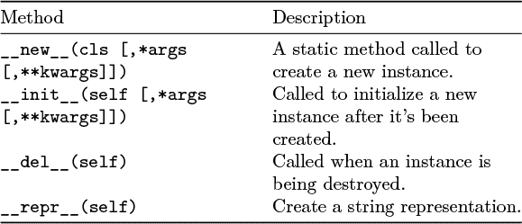

`__new__()` 和 `__init__()` 方法共同用于创建和初始化实例。当通过 `SomeClass(args)` 创建对象时，它会被翻译为以下步骤：

```python
x = SomeClass.__new__(SomeClass, args)

if isinstance(x, SomeClass):
    x.__init__(args)
```

通常情况下，这些步骤在后台处理，你不需要过度担心。类中实现的最常见方法是 `__init__()`。使用 `__new__()` 几乎总是意味着与实例创建相关的高级魔法（例如，在想要跳过 `__init__()` 的类方法中使用，或者在某些创建设计模式中，如定义单例或缓存）。`__new__()` 的实现并不一定需要返回目标类的实例——如果不是，则创建时随后的 `__init__()` 调用将被跳过。

`__del__()` 方法在实例即将被垃圾回收时调用。该方法仅在实例不再被使用时才被调用。需要注意的是，语句 `del x` 仅减少实例的引用计数，并不一定导致对此函数的调用。除非实例在销毁时需要执行额外的资源管理步骤，否则几乎不会定义 `__del__()`。

`__repr__()` 方法由内置函数 `repr()` 调用，它用于创建一个对象的字符串表示，这对于调试和打印非常有用。

该方法还负责创建你在交互式解释器中检查变量时所看到的值的输出。惯例是 `__repr__()` 返回一个表达式字符串，该字符串可以通过 `eval()` 重新创建对象。例如：

```python
a = [2, 3, 4, 5]      # 创建一个列表

s = repr(a)        # s = '[2, 3, 4, 5]'

b = eval(s)        # 将 s 变回列表
```

如果无法创建简单的字符串表达式，惯例是 `__repr__()` 返回格式为 `<...message...>` 的字符串，如下：

```python
f = open('foo.txt')

a = repr(f)

### a = "<_io.TextIOWrapper name='foo.txt' mode='r' encoding='UTF-8'>
```

### 数字值协议 (Number Protocol)

Table X 列出了对象必须实现以提供数学运算的特殊方法。

数学运算的表 X 方法

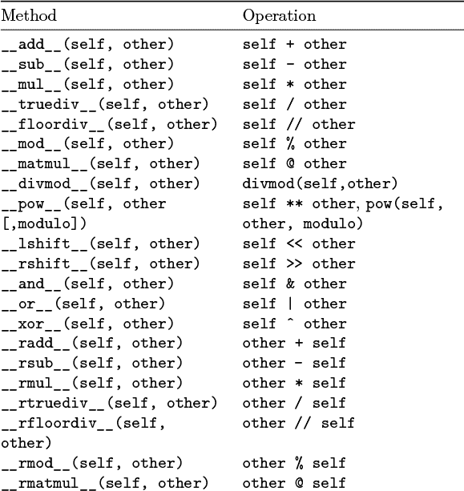


当遇到如 `x + y` 的表达式时，解释器调用 `x.__add__(y)`。如果初始方法返回 `NotImplemented`，则尝试 `y.__radd__(x)`。这里有一个例子说明该过程：

```python
>>> a = 42       # 整数

>>> b = 3.7      # 浮点数

>>> a.__add__(b)

NotImplemented

>>> b.__radd__(a)

45.7

>>>
```

这个例子可能看起来很奇怪，但它反映了整数实际上并不了解浮点数。然而，浮点数了解整数（因为整数在数学上是特殊的浮点数）。因此，反向操作产生了正确的答案。

`__add__()`、`__isub__()` 等方法用于支持原地运算符。这些运算符与标准运算方法之间的区别，是因为原地运算符的实现可能提供某些自定义，例如性能优化。例如，如果对象不是共享的，可以原地修改对象的值而无需为结果分配新创建的对象。如果未定义原地运算符，操作 `a += b` 将使用 `a = a + b`。

没有方法可以用于定义逻辑 `and`、`or` 或 `not` 运算符的行为。这两个` 运算符实现了短路评估，当最终结果已经确定时停止评估。例如：

```python
>>> True or 1/0      # 不计算 1/0

True

>>>
```

这种涉及未评估子表达式的行为无法通过普通函数或方法的相同评估规则表达。因此，没有可用的协议或方法集来重定义它（相反，它在 Python 自身的实现内部作为特例处理）。

### 比较协议 (Comparison Protocol)

对象可以用多种方式进行比较。最基本的检查是使用 `is` 运算符进行身份检查。例如，`a is b`。身份不考虑对象内部存储的值，即使它们相同。例如：

```python
>>> a = [1, 2, 3]

>>> b = a

>>> a is b

True

>>> c = [1, 2, 3]

>>> a is c

False

>>>
```

`is` 运算符是 Python 的内部部分，无法重定义。所有其他比较都通过 Table X 中的方法在对象上实现。

实例比较和哈希的表 X

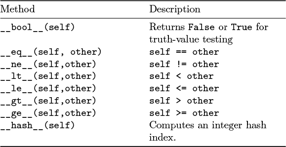


`__bool__()` 方法如果存在，则用于在对象作为条件或条件表达式的一部分进行测试时确定其“真值”（truthiness）。例如：

```
if a:              # 执行 a.__bool__()

   ...

else:

   ...
```

如果 `__bool__()` 未定义，则使用 `__len__()` 作为备选方案。如果 `__bool__()` 和 `__len__()` 都未定义，则对象被简单地视为 `"True"`。

`__eq__()` 方法用于确定与 `==` 和 `!=` 运算符配合的基本相等性。`__eq__()` 的默认实现使用 `is` 运算符通过身份标识来比较对象。`__ne__()` 方法如果存在，可以用于实现 `!=` 的特殊处理，但只要定义了 `__eq__()`，通常不需要它。

### 排序与关系运算符

排序通过关系运算符（`<`、`>`、`<=` 和 `>=`）使用 `__lt__()` 和 `__gt__()` 等方法来确定。与其他数学操作一样，其评估规则是微妙的。要评估 `a < b`，解释器将首先尝试执行 `a.__lt__(b)`，除非 `b` 是 `a` 的子类型。在那种一种特定情况下，会执行 `b.__gt__(a)`。如果此初始方法未定义或返回 `NotImplemented`，解释器将尝试反向比较。例如，调用 `b.__gt__(a)`。类似的规则也适用于 `<=` 和 `>=` 等运算符。例如，评估 `<=` 首先尝试评估 `a.__le__(b)`。如果未实现，则尝试 `b.__ge__(a)`。

每个比较方法都接受两个参数，并允许返回任何类型的值，包括布尔值、列表或其他任何 Python 类型。

例如，数值包可能会使用此方法对两个矩阵进行逐元素比较，并返回一个包含结果的矩阵。如果无法进行比较，方法应该返回内置对象 `NotImplemented`。这与 `NotImplementedError` 异常是不同的。例如：

```
>>> a = 42      # int

>>> b = 52.3    # float

>>> a.__lt__(b)

NotImplemented

>>> b.__gt__(a)

True

>>>
```

有序对象没有必要实现 表 X 中的所有比较操作。如果你希望对对象进行排序或使用 `min()` 或 `max()` 等函数，那么至少必须定义 `__lt__()`。如果你在用户定义的类中添加比较运算符，`functools` 模块中的 `@total_ordering` 类装饰器可能会很有用。只要你最少实现 `__eq__()` 和 其他比较方法之一，它就可以生成所有方法。

### 哈希方法

`__hash__()` 方法定义在要放入集合（set）或用作映射（字典）键的实例上。返回的值是一个整数，对于比较结果相等的两个实例，该值应该是相同的。此外，`__eq__()` 应该始终与 `__hash__()` 一起定义，因为这两个方法是协同工作的。`__hash__()` 返回的值通常用作各种数据结构的内部实现细节。然而，两个不同的对象可能有相同的哈希值。因此，`__eq__()` 对于解决潜在的冲突是必要的。

### 转换协议

有时，必须将对象转换为不同的内置类型，包括字符串和数字。表 X 中的方法可以为此目的定义：

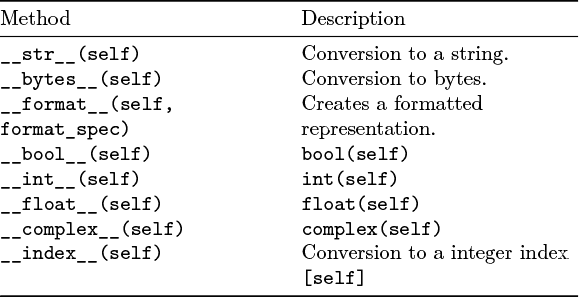

`__str__()` 方法由内置函数 `str()` 和与打印相关的函数调用。`__format__()` 方法由 `format()` 函数或字符串的 `format()` 方法调用。`format_spec` 参数是一个包含格式规范的字符串。该字符串与 `format()` 的 `format_spec` 参数相同。例如：

```
f'{x:spec}'                 # 调用 x.__format__('spec')

format(x, 'spec')           # 调用 x.__format__('spec')

'x is {0:spec}' .format(x)  # 调用 x.__format__('spec')
```

格式规范的语法是任意的，可以根据每个对象进行自定义。然而，对于内置类型有一套标准的约定。关于字符串格式化的更多信息（包括指定符的通用格式）可以在 第 9 章，“I/O”中找到。

`__bytes__()` 方法用于在传递给 `bytes()` 时创建字节表示。并非所有类型都支持字节转换。

数值转换 `__bool__()`、`__int__()`、`__float__()` 和 `__complex__()` 预期产生对应内置类型的值。

Python 永远不会使用这些方法执行隐式类型转换。因此，即使对象 `x` 实现了 `__int__()` 方法，表达式 `3 + x` 仍然会产生 `TypeError`。执行 `__int__()` 的唯一方法是通过显式使用 `int()` 函数。

`__index__()` 方法在用于需要整数值的操作时对对象进行整数转换。这包括序列操作中的索引。例如，如果 `items` 是一个列表，执行类似 `items[x]` 的操作。

### 切片与序列

Python 的切片功能比许多程序员意识的要强大得多。例如，支持以下扩展切片的变体，并且对于处理矩阵和数组等多维数据结构可能有用。

```
a = m[0:100:10]          # 步长切片 (step=10)

b = m[1:10, 3:20]        # 多维切片

c = m[0:100:10, 50:75:5] # 带有步长的多维

m[0:5, 5:10] = n         # 扩展切片赋值

del m[:10, 15:]          # 扩展切片删除
```

每个维度的通用格式为 `i:j[:step]`，其中 `step` 是可选的。与普通切片一样，你可以省略切片部分的起始或结束值。

此外，`Ellipsis`（写为 `...`）可用于表示切片中任意数量的尾或或维度：

```
a = m[..., 10:20]    # 带有 Ellipsis 的扩展切片访问

m[10:20, ...] = n
```


在使用扩展切片时，`__getitem__()`、`__setitem__()` 和 `__delitem__()` 方法分别实现访问、修改和删除。然而，传递给这些方法的值不是整数，而是一个包含切片对象或 `Ellipsis`（省略号）对象的元组。例如，

```python
a = m[0:10, 0:100:5, ...]
```

会如下所示调用 `__getitem__()`：

```python
a = m.__getitem__((slice(0,10,None), slice(0,100,5), Ellipsis))
```

Python 字符串、元组和列表目前对扩展切片提供某些支持。Python 或其标准库没有部分使用了多维切片或 `Ellipsis`。这些功能专门预留给第三方库和框架。你最常看到它们的地方可能是在 `numpy` 这样的库中。

### 迭代协议

如果一个实例 `obj` 支持迭代，它会提供一个方法 `obj.__iter__()` 返回一个迭代器。迭代器 `iter` 反而实现一个单一方法 `iter.__next__()`，该方法返回下一个对象或抛出 `StopIteration` 以信号迭代结束。这两个方法都用于 `for` 语句的实现以及其他隐式执行迭代的操作。例如，语句 `for x in s` 的执行等同于以下步骤：

```python
_iter = s.__iter__()

while True:
    try:
         x = _iter.__next__()
    except StopIteration:
         break
    # 在 for 循环体中执行语句
    ...
```

如果对象实现了 `__reversed__()` 特殊方法，它可以选择提供一个反向迭代器。该方法应该返回一个与普通迭代器具有相同接口的对象对象（即具有 `__next__()` 方法并使用 `StopIteration`）。该方法被内置函数 `reversed()` 使用。例如：

```python
>>> for x in reversed([1,2,3]):
...     print(x)
3
2
1
>>>
```

迭代的一种常见实现技术是使用涉及 `yield` 的生成器函数。例如，

```python
class FRange:
    def __init__(self, start, stop, step):
        self.start = start
        self.stop = stop
        self.step = step
    def __iter__(self):
        x = self.start
        while x < self.stop:
            yield x
            x += self.step

### 使用示例：
nums = FRange(0.0, 1.0, 0.1)
for x in nums:
    print(x)     # 0.0, 0.1, 0.2, 0.3, ...
```

这之所以有效，是因为生成器函数本身符合迭代协议。以这种方式实现迭代器要简单得多，因为你只需要担心 `__iter__()` 方法。所有其他迭代机制都由生成器提供。

### 属性协议

Table X 中的方法分别使用点 (`.`) 运算符和 `del` 运算符读取、写入和删除对象的属性。

表 X 用于属性访问的特殊方法

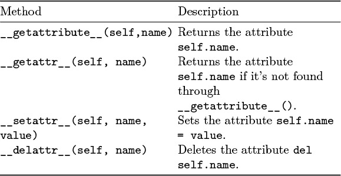

每当访问属性时，都会调用 `__getattribute__()` 方法。

如果找到了属性，则返回其值。否则，将调用 `__getattr__()` 方法。`__getattr__()` 的默认行为是抛出 `AttributeError` 异常。设置属性时，始终调用 `__setattr__()` 方法，而删除属性时，始终调用 `__delattr__()` 方法。

这些方法在某种意义是非常粗暴的，它们允许类型完全重新定义所有属性的属性访问。用户定义的类可以定义属性和描述符，允许对属性访问进行更细粒度的控制。这将在 第 7 章 中进一步讨论。

### 函数协议

对象可以通过提供 `__call__()` 方法来模拟函数。如果对象 `x` 提供了此方法，就可以像函数一样被调用。也就是说，`x(arg1, arg2, ...)` 会调用 `x.__call__(arg1, arg2, ...)`。

许多内置类型都支持函数调用。

### 上下管理器协议

`with` 语句允许简化的资源控制。上下文管理器的主要用途是解决常见的编程模式，即语句被夹在某种启动和拆卸步骤之间。例如，打开和关闭资源、获取和释放锁、订阅和取消等。通过实现此接口，对象可以在执行离开上下文时安全地清理。通用语法如下：

```python
with expression as target:
    statements
```

当 `with` 语句执行时，会调用 `__enter__()` 方法。该方法的返回值被放入变量 `target` 中。一旦控制离开块，就会调用 `__exit__()` 方法。如果发生了异常，`__exit__()` 将接收当前的异常类型、值和回溯。如果返回 `True`，则任何挂起的异常都会被清除，程序继续执行。如果返回 `False` 或 `None`，则异常将传播。更多细节请见 第 5 章。

### 关于：Pythonic

一个经常被引用的设计目标是编写“Pythonic”的代码。这可能意味着很多事情，但基本上意味着鼓励你遵循 Python 其他部分使用的既有用法。这意味着要熟悉 Python 容器、迭代器、资源管理等的协议。Python 许多流行的框架都使用这些协议来提供良好的用户体验。因此，你也应该为此努力。

在不同的协议中，有三个由于其广泛的使用而特别值得关注。第一个是用 `__repr__()` 方法创建正确的对象表示。Python 程序经常在交互式 REPL 中进行调试和实验。使用 `print()` 或日志库输出对象也是常见的。如果你能让观察对象的状态变得容易，这将让所有事情变得更容易。

其次，遍历数据是所有编程任务中最常见的之一。如果你要这样做，就应该让你的代码与 Python 的 `for` 语句配合工作。Python 的许多核心部分和标准库都是为可迭代对象设计的。通过通常的方式支持迭代，你将自动获得大量的额外功能，并且你的代码对其他程序员来说是直观的。

最后，使用上下文管理器和 `with` 语句来解决常见的编程模式，即语句被夹在某种启动和拆卸步骤之间。例如，打开和关闭资源、获取和释放锁、订阅和取消等。


函数定义的第一部分指定了函数名和代表输入值的参数名。函数体是一系列在函数被调用或应用时执行的语句。你通过编写函数名后跟括号括起来的参数来将函数应用于这些参数，例如 `a = add(3, 4)`。在执行函数体之前，参数会从左到右进行完全求值。例如，`add(1+1, 2+2)` 会先归约为 `add(2, 4)`，然后调用函数。这被称为“应用求值顺序”（applicative evaluation order）。参数的顺序和数量必须与函数定义中给出的参数匹配。如果存在不匹配，将抛出 `TypeError` 异常。调用函数的结构结构（即必需参数的数量等）被称为函数的调用签名（call signature）。

#### 默认参数

你可以通过在函数定义中赋值来为函数参数附带默认值。例如：

```python
def split(line, delimiter=','):
    statements
```

当函数定义了一个带有默认值的参数时，该参数以及其随其后的所有参数都是可选的。在任何带有默认值的参数之后，不能指定没有默认值的参数。

默认参数值在函数首次定义时求值一次，而不是在每次调用函数时求值。如果使用可变对象作为默认，这通常会导致令人惊讶的行为：

```python
def func(x, items=[]):
    items.append(x)
    return items

func(1)       # 返回 [1]
func(2)       # 返回 [1, 2]
func(3)       # 返回 [1, 2, 3]
```

注意默认参数如何保留从之前的调用中进行的修改。为了防止这种情况，最好使用 `None` 并添加如下检查：

```python
def func(x, items=None):
    if items is None:
        items = []
    items.append(x)
    return items
```

作为一种通用做法，建议仅使用不可变对象作为默认参数值（例如数字、字符串、布尔值、`None` 等）。这可以避免此类意外。

#### 变长参数

如果在最后一个参数名上使用星号（`*`）作为前缀，函数就可以接受数量数量的参数。例如：

```python
def product(first, *args):
def result = first
    for x in args:
        result = result * x
    return result

product(10, 20)       # -> 200
product(2, 3, 4, 5)   # -> 120
```

在这种情况下，所有的额外参数都以元组的形式放入 `args` 变量。作为元组，你可以可以使用序列的标准操作（例如迭代、切片、解包等）来处理参数。

#### 关键字参数

可以通过显式命名每个参数并指定一个值来提供函数参数。这些被称为关键字参数。这是一个示例：

```python
def func(w, x, y, z):
    statements

### 关键字参数调用
func(x=3, y=22, w='hello', z=[1, 2])
```

使用关键字参数，只要每个必需参数都获得一个值，参数的顺序就不重要。如果你漏掉了任何必需参数，或者关键字名称与函数定义中的任何参数名不匹配，将抛出 `TypeError` 异常。关键字参数的求值顺序与它们在函数应用中指定的顺序相同。

位置参数和关键字参数可以出现在同一个函数调用中，只要所有位置参数首先出现，为所有非可选参数都提供了值，并且没有参数接收到多个值。这里有一个示例：

```python
func('hello', 3, z=[1, 2], y=22)
func(3, 22, w='hello', z=[1, 2])    # TypeError. w 有多个值
```

如果需要，可以强制使用关键字参数。这是通过在 `*` 参数之后列出参数，或者可能仅在定义中包含单个 `*` 来实现的。例如：

```python
def read_data(filename, *, debug=False):
    ...

def product(first, *values, scale=1):
    result = first * scale
    for val in values:
        result = result * val
    return result
```

在这个示例中，`read_data` 的 `debug` 参数只能通过关键字指定。这种限制通常会提高代码的可读性：

```python
data = read_data('Data.csv', True)        # 不。TypeError
data = read_data('Data.csv', debug=True)  # 是。
```

`product()` 函数接受任意数量的位置参数和一个可选的仅限关键字参数。例如：

```python
result = product(2,3,4)             #  = 24
result = product(2,3,4, scale=10)   # 结果 240
```

#### 变长关键字参数

如果函数定义的最后一个参数带有 `**` 前缀，则所有额外的关键字参数（那些不匹配任何其他参数名的参数）都会被放在字典中并传递给函数。字典中项的顺序保证与关键字参数提供的顺序一致。

接受任意的关键字参数可能是定义接收大量可能开放的配置选项的函数的有用方法，因为这些选项如果作为参数列出将变得太繁琐。这里有一个示例：

```python
def make_table(data, **parms):
    # 从 parms（一个字典）获取配置参数
    fgcolor = parms.pop('fgcolor', 'black')
    bgcolor = parms.pop('bgcolor', 'white')
    width = parms.pop('width', None)
    ...
    # 没有更多选项了
    if parms:
         raise TypeError(f'不支持的配置选项 {list(parms)}')

make_table(items, fgcolor='black', bgcolor='white', border=1,
                  borderstyle='grooved', cellpadding=10, width=400)
```

字典的 `pop()` 方法从字典中删除一个项，如果该项不存在则返回一个可能的默认值。此代码中使用的 `parms.pop('fgcolor', 'black')` 表达式模拟了带有默认值的关键字参数的行为。

#### 接收所有输入的函数

如果你同时使用 `*` 和 `**`，你就可以写一个接受任意参数组合的函数。位置参数以元组的形式传递，关键字参数以字典的形式传递。例如：

```python
### 接受任意数量的位置参数或关键字参数
def func(*args, **kwargs):
    # args 是位置参数的元组
    # kwargs 是关键字参数的字典
    ...
```

这种 `*args` 和 `**kwargs` 的组合使用通常用于编写包装器、装饰器、代理以及类似的函数。例如，假设你有一个函数用于解析从可迭代对象获取的文本行：

```python
def parse_lines(lines, separator=',', types=(), debug=False):
    for line in lines:
        ...
        statements
        ...
```

现在，假设你想创建一个特殊函数，解析从文件名指定的文件中的数据。为了做到，你可以写：

```python
def parse_file(filename, *args, **kwargs):
    with open(filename, 'rt') as file:
        return parse_lines(file, *args, **kwargs)
```

这种方法的用处是 `parse_file()` 函数不需要知道 `parse_lines()` 各种参数的任何信息。它接受调用者提供的任何额外参数并将其传递。这也简化了 `parse_file()` 函数的维护。例如，如果向 `parse_lines()` 添加了新参数，这些参数也会神奇地在 `parse_file()` 函数中生效。


Python 的许多内置函数只接受按位置指定的参数。你会在各种帮助工具和 IDE 显示的函数调用签名中看到斜杠（`/`）的存在，这指示这一点。例如，你可能会看到类似 `func(x, y, /)` 的内容。这意味着出现在斜杠之前的所有参数只能通过位置指定。因此，你可以使用 `func(2, 3)` 调用函数，但不能使用 `func(x=2, y=3)`。为了完整性起见，这种语法也可以在定义函数时使用。例如，你可以编写以下代码：

```python
def func(x, y, /):
    pass

func(1, 2)     # Ok

func(1, y=2)   # Error
```

这种定义形式在大多数代码中仍然很少见，因为它在 Python 3.8 中才首次被支持。然而，它是避免参数名称之间潜在命名冲突的有用方法。例如，仔细考虑以下代码：

```python
import time

def after(seconds, func, /, *args, **kwargs):
    time.sleep(seconds)
    return func(*args, **kwargs)

def duration(*, seconds, minutes, hours):
    return seconds + 60 * minutes + 3600 * hours

after(5, duration, seconds=20, minutes=3, hours=2)
```

在此代码中，`seconds` 是关键字参数传递的，但它的目的是用于传递给 `after()` 的 `duration` 函数。在 `after()` 中使用仅位置参数防止了与第一个出现的 `seconds` 参数发生命名冲突。

### 命名、文档字符串和类型提示

函数的标准命名约定是使用小写字母并用下划线（`_`）作为单词分隔符。例如，使用 `read_data()` 而不是 `readData()`。如果一个函数不是打算直接使用的（因为它是辅助函数或某种内部实现细节），通常会在名称前缀加一个单下划线。例如，`_helper()`。然而，这些仅仅是约定。只要名称是有效的标识符，你可以为函数命名为任何名称。

可以通过 `__name__` 属性获取函数的名称。这在调试时有时很有用。

```python
>>> def square(x):
...    return x * x

>>> square.__name__
'square'
>>>
```

函数的第一个语句通常是描述其用法的文档字符串。例如：

```python
def factorial(n):
    '''
    计算 n 的阶乘。例如：

    >>> factorial(6)
    120

    >>>
    '''
    if n <= 1:
        return 1
    else:
        return n*factorial(n-1)
```

文档字符串存储在函数的 `__doc__` 属性中。IDE 经常访问它以提供交互式帮助。

函数还可以带有类型提示（type hints）。例如：

```python
def factorial(n: int) -> int:
    if n <= 1:
        return 1
    else:
        return n * factorial(n - 1)
```

类型提示不会改变函数评估的方式。也就是说，提示的存在并没有引入任何额外的性能收益或额外的运行时错误检查。提示仅存储在函数的 `__annotations__` 属性中，这是一个字典，将参数名称映射到所提供的提示。各种第三方工具（如 IDE 和代码检查器）可能会出于各种用途使用这些提示。

有时你会看到类型提示附加在函数内部局部变量上。例如：

```python
def factorial(n:int) -> int:
    result: int = 1  # 类型提示局部变量
    while n > 1:
        result *= n
        n -= 1
    return result
```

此类提示完全被解释器忽略。它们不会被检查、存储，甚至不会评估。再次，提示的目的是帮助第三方代码检查工具。尽管如此，除非你确实正在积极使用可以利用这些提示的代码检查工具，否则不建议为函数添加类型提示。错误地指定类型提示非常容易，除非你正在积极使用检查它们的工具，否则错误在某人决定对你的代码运行类型检查工具之前不会被发现。

### 函数应用与参数传递

当应用函数时，函数参数是绑定到传入的输入对象的局部名称。Python 会“原样”将提供的对象传递给函数，而不进行任何额外的复制。如果传递了列表或字典等变对象，则需要小心。如果进行了更改，这些更改将反映在原始对象中。这是一个示例：

```python
def square(items):
    for i, x in enumerate(items):
        items[i] = x * x  # 原地修改 items

a = [1, 2, 3, 4, 5]
square(a)      # 将 a 改为 [1, 4, 9, 16, 25]
```

这种在后台修改其输入值或更改程序其他部分状态的函数被称为具有副作用”（side effects）。作为一般原则，最好避免副作用，因为随着程序规模和复杂性的增加，它们可能会成为细微编程错误的根源（例如，从读取函数调用可能无法直观看出一个函数是否有副作用）。此类函数与涉及线程和并发的程序交互效果不好，因为副作用通常需要通过锁来保护。

区分修改对象和重新赋值变量名也同样重要。例如，考虑这个函数：

```python
def sum_squares(items):
    items = [x*x for x in items]  # 重新赋值 "items" 名称
    return sum(items)

a = [1, 2, 3, 4, 5]
result = sum_squares(a)
print(a)        # [1, 2, 3, 4, 5]    (未改变)
```

在这个示例中，看起来 `sum_squares()` 函数似乎覆盖了传递的 `items` 变量。是的，局部的 `items` 标签被重新赋值了一个新值。然而，原始输入值（`a`）没有发生改变。相反，局部变量名 `items` 被绑定到一个完全不同的对象——内部列表推导式的结果。赋值变量名和修改对象之间是有区别的。当你给一个名称赋值时，你并没有覆盖已经存在的对象。你是在将名称重新赋值给一个不同的对象。

在风格上，具有副作用的函数通常返回 `None` 作为结果。例如，考虑列表的 `sort()` 方法：

```python
>>> items = [10, 3, 2, 9, 5]
>>> items.sort()      # 观察：没有返回值
>>> items
[2, 3, 5, 9, 10]
>>>
```

`sort()` 方法对列表项进行原地排序。它不返回结果。缺少结果是副作用的强有力指示。在这种情况下，列表的元素被重新排列了。

有时，你已经在序列或映射中拥有数据，并想将其传递给函数。要这样做，你可以在函数调用中使用 `*` 和 `**`。例如：

```python
def func(x, y, z):
    ...

s = (1, 2, 3)
### 将序列作为参数传递
result = func(*s)

### 将映射作为关键字参数传递
d = { 'x':1, 'y':2, 'z':3 }
result = func(**d)
```

如果你从多个源获取数据甚至显式提供某些参数，只要函数获取了所有必需参数、没有重复且调用签名中的一切都对齐，一切都可以正常工作。你甚至可以在同一个函数调用中多次使用 `*` 和 `**`。如果你缺少参数或指定了重复的值，你将得到错误。Python 永远不允许你调用不符合签名的函数。

### 返回值

`return` 语句从函数返回一个值。如果没有指定值或省略 return 语句，则返回 `None`。要返回多个值，请将它们放在元组中：

```python
def parse_value(text):
    '''
    将格式为 name=val 的文本拆分为 (name, val)
    '''
    parts = text.split('=', 1)
    return (parts[0].strip(), parts[1].strip())
```

元元组返回的值可以解包到各个变量：


```python
name, value = parse_value('url=http://www.python.org')
```

有时可以使用命名元组（named tuples）作为替代：

```python
from typing import NamedTuple

class ParseResult(NamedTuple):
    name: str
    value: str

def parse_value(text):
    '''
    将形式为 name=val 的文本拆分为 (name, val)
    '''
    parts = text.split('=', 1)
    return ParseResult(parts[0].strip(), parts[1].strip())
```

命名元组的工作方式与普通元组相同（你可以执行所有的操作和解包），但你也可以使用命名属性来引用返回的值：

```python
r = parse_value('url=http://www.python.org')

print(r.name, r.value)
```

### 错误处理

上一节中 `parse_value()` 函数的一个问题涉及错误处理。如果输入文本格式不正确且无法返回正确的结果，应该采取什么行动？

一种方法是将结果视为可选的——也就是说，该函数要么通过返回答案来工作，要么返回 `None`（`None` 通常用于指示缺失值）。例如，可以将函数修改为如下：

```python
def parse_value(text):
    parts = text.split('=', 1)
    if len(parts) == 2:
        return ParseResult(parts[0].strip(), parts[1].strip())
    else:
        return None
```

通过这种设计，检查可选结果的负担交给了调用者：

```python
result = parse_value(text)

if result:
    name, value = result
```

或者在 Python 3.8+ 中可以使用以下更紧凑的：

```python
if result := parse_value(text):
    name, value = result
```

除了返回 `None`，你还可以通过抛出异常将格式错误的文本视为错误。例如：

```python
def parse_value(text):
    parts = text.split('=', 1)
    if len(parts) == 2:
        return ParseResult(parts[0].strip(), parts[1].strip())
    else:
        raise ValueError('Bad value')
```

在这种情况下，调用者可以选择使用 `try-except` 处理错误值。例如：

```python
try:
    name, value = parse_value(text)
    ...
except ValueError:
    ...
```

是否使用异常并不总是一而易见的。作为一个一般规则，异常是处理异常结果更常用的方法。然而，如果异常频繁发生，也是昂贵的。如果你正在编写对性能敏感的代码，返回 `None`、`False`、`-1` 或其他特殊值来指示失败可能更好。

### 作用域规则

每次执行函数时，都会创建一个局部命名空间。该命名空间表示一个环境，包含了函数参数的名称和值，以及函数体内部赋值的所有变量。名称的绑定在定义函数时就已经确定，函数体内部赋值的所有名称都绑定到局部环境。所有其他被使用但在函数体内未赋值的名称（自由变量）将在全局命名空间中动态查找，而全局命名空间始终是定义函数的闭包模块。

在函数执行期间可能会发生两种与名称相关的错误。在全局环境中查找未定义的自由变量名称会导致 `NameError` 异常。查找尚未赋值的局部变量会导致 `UnboundLocalError` 异常。后者错误通常是控制流漏洞的结果。例如：

```python
def func(x):
    if x > 0:
        y = 42
    return x + y    # 如果条件为假，y 未被赋值

func(10)    # 返回 52

func(-10)   # UnboundLocalError: y 在赋值前引用
```

`UnboundLocalError` 有时也是由粗心使用赋值运算符引起的。类似 `n += 1` 的语句被处理为 `n = n + 1`。如果在为 `n` 初始值之前使用，它将失败。

```python
def func():
    n += 1    # 错误: UnboundLocalError
```

重要的是变量名永远不会改变它们的作用域——它们要么是全局变量要么是局部变量，这在函数定义时就已经确定。这里有一个说明此点的示例：

```python
x = 42

def func():
    print(x)    # 失败。UnboundLocalError
    x = 13

func()
```

在这个示例中，`print()` 函数似乎会输出全局变量 `x` 的值。然而，稍后出现的 `x` 赋值将 `x` 标记为局部变量。该错误是访问了尚未赋值的局部变量导致的。

如果你移除 `print()` 函数，你得到的代码看起来可能在重新赋值全局变量的值。例如，考虑这段：

```python
x = 42

def func():
    x = 13

func()

### x 仍然是 42
```

当这段代码执行时，`x` 保留了它的值 `42`，尽管看起来它可能在函数 `func` 内部修改全局变量 `x`。当变量在函数内部赋值时，它们通常被绑定为局部变量；结果是函数体中的变量 `x` 指向一个包含值 `13` 的完全新对象。要更改这种行为，请使用 `global` 语句。`global` 将名称声明为全局命名空间的一部分，当修改全局变量时是必须的。这里有一个示例：

```python
x = 42
y = 37

def func():
    global x        # 'x' 在全局命名空间中
    x = 13
    y = 0

func()

### x 现在是 13。y 仍然是 37。
```

应该注意的是，使用 `global` 语句通常被认为是不良的 Python style。如果你编写函数需要在后台更改状态的代码，考虑使用类定义并通过变异实例或类变量来修改状态。例如：

```python
class Config:
    x = 42

def func():
    Config.x = 13
```

Python 允许嵌套函数定义。这里有一个示例：

```python
def countdown(start):
    n = start
    def display():        # 嵌套函数定义
        print('T-minus', n)
    while n > 0:
        display()
        n -= 1
```

嵌套函数的变量使用词法作用域绑定。也就是说，名称首先在局部作用域中解析，然后在从内部到外的连续闭包作用域中解析。再次，这不是一个动态过程——名称的绑定在定义时根据语法确定。与全局变量一样，内部函数无法重新赋值外部函数定义的局部变量的值。例如，这段代码无法工作：

```python
def countdown(start):
    n = start
    def display():
        print('T-minus', n)
    def decrement():
        n -= 1            # 失败: UnboundLocalError
    while n > 0:
         display()
         decrement()
```

要修复这个问题，你可以这样将 `n` 声明为 `nonlocal`：

```python
def countdown(start):
    n = start
    def display():
        print('T-minus', n)
    def decrement():
        nonlocal n
        n -= 1            # 修改外部的 n
    while n > 0:
         display()
         decrement()
```

`nonlocal` 不能引用全局变量——它必须引用外部作用域中的局部变量。因此，如果函数正在给全局变量赋值，你应该仍然之前使用全局声明。

使用嵌套函数和 `nonlocal` 声明不是常见的编程风格。例如，内部函数没有外部可见性，这会增加测试和调试的难度。尽管如此，嵌套函数对于将复杂的计算拆分为较小的部分并隐藏内部实现细节很有用。

### 递归

Python 支持递归函数。例如：

```python
def sumn(n):
    if n == 0:
        return 0
    else:
        return n + sumn(n-1)
```


然而，递归函数调用的深度是有限制的。`sys.getrecursionlimit()` 函数返回当前最大的递归深度，而 `sys.setrecursionlimit()` 函数可以更改该值。默认值为 1000。虽然可以增加值，但程序仍然受到宿主操作系统强制执行的栈大小限制。当超过递归深度时，会抛出 `RuntimeError` 异常。如果将限制增加得太大，Python 可能会因为段错误（segmentation fault）或其他操作系统错误而崩溃。

在实践中，递归限制问题通常只在处理深度嵌套的递归数据结构（如树和图）时出现。许多涉及树的算法天然适用于递归解决方案，如果你的数据结构太大，可能会超出栈限制。不过，这里有一些巧妙的变通方法。请参阅第 6 章关于生成器的部分作为示例。

### lambda 表达式

可以使用 `lambda` 表达式定义匿名（即无名称）函数：

```python
lambda args: expression
```

`args` 是一个用逗号分隔的参数列表，`expression` 是涉及这些参数的表达式。这是一个示例：

```python
a = lambda x, y: x + y

r = a(2, 3)            # r 获取 5
```

用 `lambda` 定义的代码必须是一个有效的表达式。多个语句和其他非表达式语句（如 `try` 和 `while`）不能出现在 `lambda` 表达式中。`lambda` 表达式遵循与函数相同的作用域规则。

`lambda` 的主要用途之一是定义小型回调函数。例如，你可能会看到它与内置操作如 `sorted()` 一起使用。例如：

```python
### 按唯一字母的数量对单词列表进行排序

result = sorted(words, key=lambda word: len(set(word)))
```

当 `lambda` 表达式包含自由变量（未指定为参数的变量）时，需要格外。考虑这个示例：

```python
x = 2

f = lambda y: x * y

x = 3

g = lambda y: x * y

print(f(10))       # --> 输出 30

print(g(10))       # --> 输出 30
```

在这个示例中，你可能期望调用 `f(10)` 打印 `20`，反映出 `x` 在定义时为 2 的事实。然而，事实并非。作为一个自由变量，`f(10)` 的求值使用的是评估时 `x` 所拥有的任何值。这个值可能与定义 `lambda` 函数时使用的值不同。这种行为有时被称为延迟绑定（late-binding）。

如果在定义时捕获变量的值很重要，请使用默认参数：

```python
x = 2

f = lambda y, x=x: x * y

x = 3

g = lambda y, x=x: x * y

print(f(10))       # --> 输出 20

print(g(10))       # --> 输出 30
```

这之所以有效，是因为默认参数的值只在函数定义时被求值，因此它们会捕获 `x` 的当前值。

### 高阶函数

Python 支持“高阶函数”的概念。这意味着函数可以作为参数传递给其他函数，放入数据结构中，并作为函数的返回结果。有时函数被称为“一等公民”，意味着你处理函数的方式与处理任何其他类型的数据没有区别。这里有一个接受另一个函数作为输入并在时间延迟后调用它的函数示例。也许它是在尝试模拟“云端”微服务的性能。

```python
import time

def after(seconds, func):
    time.sleep(seconds)
    func()

### 使用示例

def greeting():
    print('Hello World')

after(10, greeting)    # 10 秒后打印 'Hello World'
```

在这个示例中，作为 `after()` 的参数 `func` 是有时被称为“回调函数”的示例。这指的是 `after()` 函数“回调”了作为参数提供的函数。

当函数像数据一样被传递时，它隐式地携带了与定义函数的环境相关的信息。例如，假设 `greeting()` 函数使用了如下的变量：

```python
def main():
    name = 'Guido'
    def greeting():
        print('Hello', name)
    after(10, greeting)        # 输出：'Hello Guido'

main()
```

在这个示例中，变量 `name` 被 `greeting()` 使用，但它是外部函数 `main()` 的局部变量。当 `greeting` 传递给 `after()` 时，该函数记住了它的环境并使用了所需的 `name` 变量的值。这依赖于被称为“闭包”（closure）的特性。闭包是一个函数加上一个环境，该环境包含了执行函数体所需的所有变量。

如果你想基于惰性或延迟评估的概念编写代码，闭包和嵌套函数通常非常有用。之前所示的 `after()` 函数就是这一概念的说明。它接收一个不会立即求值的函数——求值将在之后的某个时间点发生。这是在其他语文中出现的常见编程模式。例如，程序可能会有只有在响应事件（例如按键）时才执行的函数。

你也可以编写创建并返回函数的函数。例如：

```python
def make_greeting(name):
    def greeting():
        print('Hello', name)
    return greeting

f = make_greeting('Guido')
g = make_greeting('Ada')

f() # 输出：'Hello Guido'
g() # 输出：'Hello Ada'
```

在这个示例中，`make_greeting()` 函数没有执行任何计算。相反，它创建并返回了 `greeting()`，后者在之后求值时实际执行工作。在这个示例中，两个变量 `f` 和 `g` 持有 `greeting()` 函数的不同版本。尽管创建它们的 `make_greeting()` 函数已不再执行，但 `greeting()` 函数仍然记得定义过的 `name` 变量。

关于闭包的一个注意事项是，绑定到变量名不是一个“快照”，而是一个动态过程——意味着闭包指向变量本身以及它最近一次被赋值的值。这很微妙，但这里有一个说明可能何何产生问题的示例：

```python
def make_greetings(names):
    funcs = []
    for name in names:
        funcs.append(lambda: print('Hello', name))
    return funcs

### 尝试
a, b, c = make_greetings(['Guido', 'Ada', 'Margaret'])

a()    # 输出 'Hello Margaret'
b()    # 输出 'Hello Margaret'
c()    # 输出 'Hello Margaret'
```

在这个示例中，创建了一组不同的函数（使用 `lambda`），看起来似乎它们都在使用 `name` 的唯一值（因为它在 `for` 循环的每次迭代中都会变化）。事实并非如此——所有函数最终都使用外部 `make_greetings()` 函数返回时设置的同一个 `name` 值。

这可能出乎意料，且通常不是你想要的。如果你想捕获变量的副本，记住你需要像之前描述的那样将其捕获为默认参数：

```python
def make_greetings(names):
    funcs = []
    for name in names:
        funcs.append(lambda name=name: print('Hello', name))
    return funcs

### 尝试
a, b, c = make_greetings(['Guido', 'Ada', 'Margaret'])

a()    # 输出 'Hello Guido'
b()    # 输出 'Hello Ada'
c()    # 输出 'Hello Margaret'
```


在最后两个示例中，函数是使用 `lambda` 定义的。这通常是创建小型回调函数的首选快捷方法。然而，这并不是强制性要求。你可以这样重写代码：

```python
def make_greetings(names):
    funcs = []
    for name in names:
        def greeting(name=name):
            print('Hello', name)
        funcs.append(greeting)
    return funcs
```

何时以及何处使用 `lambda` 通常取决于个人偏好和代码的清晰度。如果它让代码变得更难阅读，那么也许应该避免使用。

#### 回调函数中的参数传递

回调函数中一个具有挑战性的编程问题是向提供的函数传递参数。考虑之前编写的 `after()` 函数：

```python
import time

def after(seconds, func):
    time.sleep(seconds)
    func()
```

在这段代码中，`func()` 被硬编码为不带参数的调用。如果你想传递额外的参数，那就无能为力。例如，你可能会尝试这样做：

```python
def add(x, y):
    print(f'{x} + {y} -> {x+y}')
    return x + y

after(10, add(2, 3))    # 失败：add() 被立即调用
```

在这个示例中，`add(2, 3)` 函数会立即运行并返回 `5`。随后 `after()` 函数在 10 秒后崩溃，因为它尝试执行 `5()`。这绝对不是你想要达到的结果。然而，似乎没有明显的方法可以实现 `add()` 以其预期的参数被调用。

这个问题暗示了关于函数使用和通用泛式编程的更层次的设计问题——特别是与函数组合相关的问题。当函数以各种方式混合在一起时，你通常需要考虑函数的输入和输出是如何连接的。这并不总是那么简单。

在这种情况下，一种解决方案是使用 `lambda` 将计算封装到所需的零参数函数中。例如：

```python
after(10, lambda: add(2, 3))
```

这种小型零参数函数有时被称为"thunk"延迟求值表达式）。基本上，它代表一个在最终作为零参数函数被调用时才会进行求值的表达式。这是一种延迟任何表达式求值到未来某个时刻的通用方法——将表达式放入 `lambda` 中，并在实际需要该值时调用该函数。

作为使用 `lambda` 的替代方案，你还可以使用 `functools.partial()` 来创建一个部分求值的函数：

```python
from functools import partial

after(10, partial(add, 2, 3))
```

`partial()` 创建了一个可调用对象，其中一个或多个参数已经指定并被缓存。它是使不符合要求的函数在回调及其他应用程序中匹配预期调用签的有用方法。这里是使用 `partial()` 的更多示例：

```python
def func(a, b, c, d):
    print(a, b, c, d)

f = partial(func, 1, 2)        # 固定 a=1, b=2
f(3, 4)                        # func(1, 2, 3, 4)
f(10, 20)                      # func(1, 2, 10, 20)

g = partial(func, 1, 2, d=4)   # 固定 a=1, b=2, d=4
g(3)                           # func(1, 2, 3, 4)
g(10)                          # func(1, 2, 10, 4)
```

`partial()` 和 `lambda` 可以用于相似的目的，但两种技术之间存在重要的语义区别。使用 `partial()` 时，参数在部分函数首次定义时就会求值并绑定。对于零参数的 `lambda`，参数在 lambda 函数之后实际执行时才会求值并绑定（所有内容的求值都被延迟了）。可以通过这个示例来说明：

```python
>>> def func(x, y):
...    return x + y
...
>>> a = 2
>>> b = 3
>>> f = lambda: func(a, b)
>>> g = partial(func, a, b)
>>> a = 10
>>> b = 20
>>> f()    # 使用 a, b 的当前值
30
>>> g()    # 使用 a, b 的初始值
5
>>>
```

由于 partial 对象是完全求值的，由 `partial()` 创建的可调用对象是可以被序列化为字节、保存到文件中，甚至跨网络连接传输的（例如使用 `pickle` 标准库模块）。这在 `lambda` 函数中是不可能的。因此，在需要传递函数的应用程序（可能是传递给不同进程或不同机器运行的 Python 解释器），你会发现 `partial()` 更有适应性。

顺带提一下，部分函数应用与“柯里化”（currying）概念密切相关。柯里化是一种函数编程技术，将多参数函数表示为嵌套的单参数函数链。这是一个示例：

```python
### 三参数函数
def f(x, y, z):
    return x + y + z

### 柯里化版本
def fc(x):
    return lambda y: (lambda z: x + y + z)

### 使用示例
a = f(2, 3, 4)      # 3
b = fc(2)(3)(4)     # 9
```

### 从回调返回结果

上一节未解决的另一个问题是返回计算结果。考虑这个修改后的 `after()` 函数：

```python
def after(seconds, func, *args):
    time.sleep(seconds)
    return func(*args)
```


这种方法行得通，但由于涉及到两个独立的函数（`after()` 函数本身和提供的回调函数 `func`），会产生一些非常微妙的边界情况。

一个问题涉及异常处理。例如，尝试以下两个示例：

```
after("1", add, 2, 3)   # 失败：TypeError (预期为整数)

after(1, add, "2", 3)   # 失败：TypeError (无法将 int 拼接到 str)
```

在这个示例中，两种情况下都抛出了 `TypeError`，但原因非常不同，且发生在不同的函数中。第一个错误是由于 `after()` 函数本身的问题（给 `time.sleep()` 传递了错误的参数）。第二个错误由于回调函数 `func(*args)` 执行时出现的问题。如果区分这两种情况很重要，那么有几种处理方法。一种方法是依赖于链式异常（chained exceptions）。其思想是以不同的方式封装回调函数中的错误，以便它们能够与其他类型的错误分开处理。例如：

```python
class CallbackError(Exception):
    pass

def after(seconds, func, *args):
    time.sleep(seconds)
    try:
        return func(*args)
    except Exception as err:
        raise CallbackError('Callback function failed') from err
```

这段修改后的代码将提供的回调函数的错误隔离到它自己的异常类别中。你可以这样使用：

```python
try:
    r = after(delay, add, x, y)
except CallbackError as err:
    print("It failed. Reason", err.__cause__)
```

如果 `after()` 本身的执行出现问题，该异常将向外传播且不被捕获。相反，与提供的回调函数实际执行相关的问题将被捕获并报告为 `CallbackError`。这一切都非常微妙，但在实践中，管理错误是困难的。这种方法使得责任的归属更加精确，并且 `after()` 的行为更容易记录。具体来说，如果回调函数中出现问题，它始终会被报告为 `CallbackError`。

另一种方法是将回调函数的结果封装到某种特定的结果实例中，该实例同时持有值和错误。例如，你可能定义了这样一个类：

```python
class Result:
    def __init__(self, value=None, exc=None):
        self._value = value
        self._exc = exc
    def result(self):
        if self._exc:
            raise self._exc
        else:
            return self._value
```

然后你使用这个类从 `after()` 函数返回结果：

```python
def after(seconds, func, *args):
    time.sleep(seconds)
    try:
        return Result(value=func(*args))
    except Exception as err:
        return Result(exc=err)

### 使用示例：
r = after(1, add, 2, 3)
print(r.result())            # 输出 5

s = after("1", add, 2, 3)    # 立即抛出 TypeError。sleep() 参数错误。

t = after(1, add, "2", 3)    # 返回一个 "Result"
print(t.result())            # 抛出 TypeError
```

第二种方法通过将回调函数的结果报告推到一个单独步骤来实现。如果 `after()` 出问题，会立即报告。如果回调函数 `func()` 出问题，则会在用户尝试通过 `result()` 方法获取结果时报告。

这种将结果封装进特殊实例以便稍后解包的风格，是现代编程语言中日益常见的模式。使用它的一个重要性理由是它更有利于类型检查。例如，如果你在 `after()` 上放置了类型提示，它的行为就是完全定义的（例如，它始终返回一个 `Result` 而不再是其他内容）：

```python
def after(seconds, func, *args) -> Result:
    ...
```

虽然在大多数 Python 代码中看到这种模式并不常见，但在处理线程和进程等并发原语时，它会很有规律地出现。例如，所谓的 `Future` 实例在与线程池一起工作时行为就是这样的。例如：

```python
from concurrent.futures import ThreadPoolExecutor

pool = ThreadPoolExecutor(16)
r = pool.submit(add, 2, 3)     # 返回一个 Future
print(r.result())              # 解包 Future 结果
```

### 装饰器 (Decorators)

装饰器是在另一个函数周围创建包装器的函数。这种包装的主要目的是改变或增强被包装对象的行为。在语法上，装饰器使用特殊的 `@` 符号表示，如下：

```python
@decorate
def func(x):
     ...
```

前面的代码是以下内容的简写：

```python
def func(x):
     ...

func = decorate(func)
```

在示例中，定义了一个函数 `func()`。然而，在定义之后立即，函数对象本身被传递给函数 `decorate()`，该函数返回一个替换原始 `func` 的对象。

为了看到具体的实现，这里有一个装饰器 `@trace`，它可以为函数添加调试信息：

```python
def trace(func):
    def call(*args, **kwargs):
        print('Calling', func.__name__)
        return func(*args, **kwargs)
    return call

### 使用示例
@trace
def square(x):
    return x * x
```

段代码中，`trace()` 创建了一个包装函数，然后调用原始函数。因此，如果你调用 `square()`，你将看到 `print()` 的输出。如果有那么简单就好了！在实践中，函数还包含元数据，如函数名、文档字符串（doc string）和类型提示。如果你在函数周围放置一个包装器，这些信息就会被隐藏。在编写装饰器时，最佳实践是像示例中那样使用 `@wraps()` 装饰器：

```python
from functools import wraps

def trace(func):
    @wraps(func)
    def call(*args, **kwargs):
        print('Calling', func.__name__)
        return func(*args, **kwargs)
    return call
```

`@wraps()` 装饰器将各种元数据复制到替换函数 `call()`。应用装饰器时，它们必须单独出现在函数之前的一行。也可以应用多个装饰器。这里有一个示例：

```python
@decorator1
@decorator2
def func(x):
    pass
```

在这种情况下，装饰器的应用方式如下：

```python
def func(x):
    pass

func = decorator1(decorator2(func))
```

装饰器出现顺序可能很重要。例如，在类定义中，`@classmethod` 和 `@staticmethod` 等装饰器通常必须放置在处于最外层的位置。例如：

```python
class SomeClass(object):
    @classmethod            # 可以
    @trace
    def a(cls):
        pass

    @trace                  # 不行。失败。
    @classmethod
    def b(cls):
        pass
```

这种位置限制的原因与 `@classmethod` 返回的值有关。有时装饰器返回一个与普通函数不同的对象。如果最外层的装饰器没有预料到，事情就会出错。在这种情况下，`@classmethod` 创建了一个文档中描述的 `classmethod` 描述符对象。除非 `@trace` 装饰器编写时考虑了这一点，否则如果装饰器列表错误，它将失败。

装饰器还可以接受参数。例如，假设你想更改 `@trace` 装饰器以允许如下自定义消息：

```python
@trace("You called {func.__name__}")
def func():
    pass
```

如果提供了参数，装饰过程的语义如下：

```python
def func():
    pass

# 创建装饰函数
temp = trace("You called {func.__name__}")

# 将其应用到 func
func = temp(func)
```


在这种情况下，接收参数的最外层函数负责创建一个装饰器函数。然后，将被装饰的函数传入该函数以获取最终结果。以下是装饰器实现的可能样式：

```python
from functools import wraps

def trace(message):
    def decorate(func):
        @wraps(func)
        def wrapper(*args, **kwargs):
            print(message.format(func=func))
            return func(*args, **kwargs)
        return wrapper
    return decorate
```

这种实现方式的一个有趣特性是，外部函数实际上是一种“装饰器工厂”。假设你发现自己正在编写这样的代码：

```python
@trace('You called {func.__name__}')

def func1():
    pass

@trace('You called {func.__name__}')

def func2():
    pass
```

这会很快变得冗燥。你可以通过调用一次外部装饰器函数并像这样重用结果来简化它：

```python
logged = trace('You called {func.__name__}')

@logged
def func1():
    pass

@logged
def func2():
    pass
```

装饰器并不一定需要替换原始函数。有时，装饰器仅仅执行诸如注册的操作。例如，如果你正在构建一个事件处理器的注册表，你可能想要定义一个像这样的装饰器：

```python
@eventhandler('BUTTON')

def handle_button(msg):
     ...

@eventhandler('RESET')

def handle_reset(msg):
     ...
```

这是一个管理该操作装饰器：

```python
# Event handler decorator

_event_handlers = { }

def eventhandler(event):
    def register_function(func):
        _event_handlers[event] = func
        return func
    return register_function
```

## Map, Filter, and Reduce

熟悉函数式语言的程序员通常想了解如 map、filter 和 reduce 等常见的列表操作。这些功能中的很大一部分可以在列表推导式和生成器表达式中找到。例如：

```python
def square(x):
    return x * x

nums = [1, 2, 3, 4, 5]

squares = [ square(x) for x in nums ]    # [1, 4, 9, 16, 25]
```

从技术上，你甚至不需要简短的单行函数，你可以这样写：

```python
squares = [ x * x for x in nums ]
```

过滤也可以通过列表推导式完成：

```python
a = [ x for x in nums if x > 2 ]    # [3, 4, 5]
```

如果你使用生成器表达式，将得到一个通过迭代量产生结果的生成器。例如：

```python
squares = (x*x for x in nums)    # 创建一个生成器

for n in squares:
    print(n)
```

Python 提供了一个内置的 `map()` 函数，它与使用生成器表达式映射相同。例如，上面的示例可以写成：

```python
squares = map(lambda x: x*x, nums)

for n in squares:
    print(n)
```

内置的 `filter()` 函数创建一个过滤值的生成器：

```python
for n in filter(lambda x: x > 2, nums):
    print(n)
```

如果你想累加或归约值，可以使用 `functools.reduce()`。例如：

```python
from functools import reduce

total = reduce(lambda x, y: x + y, nums)
```

在通用形式下，`reduce()` 接受一个双参数函数、一个可迭代对象和一个初始值。以下是几个例子：

```python
nums = [1, 2, 3, 4, 5]

total = reduce(lambda x, y: x + y, nums)         # 15

product = reduce(lambda x, y: x * y, nums, 1)    # 120

pairs = reduce(lambda x, y: (x, y), nums, None)

# (((((None, 1), 2), 3), 4), 5)
```

`reduce()` 在提供的可迭代对象上从左到右累加值。这有时被称为“左折叠”（left-fold）操作。以下是 `reduce(func, items, initial)` 的伪代码：

```python
def reduce(func, items, initial):
    result = initial
    for item in items:
        result = func(result, item)
    return result
```

经验表明，使用 `reduce()` 通常会令人困惑。此外，常见的归约操作如 `sum()`、`min()` 和 `max()` 已经是内置的。如果你使用这些函数而不是尝试直接用 `reduce()` 实现常用操作，你的代码将更易读（并且可能运行得更快）。

## 函数内省、属性和签名

如前所示，函数是对象，这意味着它们可以赋值给变量、放在数据结构中，并以程序中任何其他类型数据的方式使用。它们还可以通过多种方式进行检查。表 1 (#ch05.xhtml_ch05tab01) 显示了函数的一些常见属性。这些属性中的许多在调试、日志和其他涉及函数的操作中非常有用。

表 1：函数属性

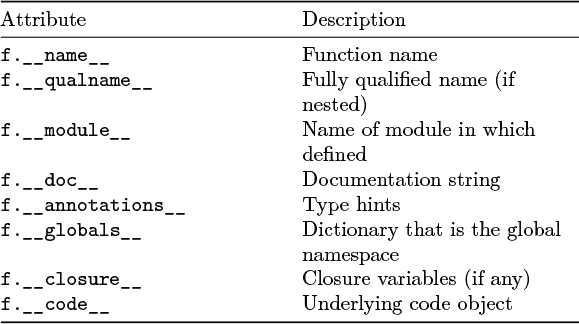

`f.__name__` 属性包含定义时使用的名称。这些属性中的许多在调试、日志和其他涉及函数的操作中非常有用。

`f.__name__` 属性包含定义时使用的名称。`f.__qualname__` 是包含周围环境的较长名称。`f.__code__` 对象代表实体的编译字节码。函数可以附加任意属性。这是一个示例：

```python
def func():
    statements

func.secure = 1

func.private = 1
```

属性在函数体内部是不可见的——它们不会在执行环境中以名称的形式出现。函数属性的主要用途是存储元数据。有时，框架或元编程技术会利用函数标记（即向函数附加属性）。一个例子是用在抽象类方法中的 `@abstractmethod` 装饰器。该装饰器除了附加一个属性外别无所做：

```python
def abstractmethod(func):
    func.__abstractmethod__ = True
    return func
```

另一些代码（在这种情况下是一个元类）正在查找此属性，并使用它来为实例创建添加额外的检查。

如果你想了解更多关于函数的参数，可以使用 `inspect.signature()` 函数获取其签名。例如：

```python
import inspect

def func(x: int, y:float, debug=False) -> float:
    pass

sig = inspect.signature(func)
```

签名对象提供了许多用于打印和获取参数详细信息的方便功能。例如：

```python
# 以整洁的形式打印签名

print(sig)  # 生成 (x: int, y: float, debug=False) -> float

# 获取参数名称列表

print(list(sig.parameters))   # 生成 [ 'x', 'y', 'debug']

# 遍历参数并打印各种元数据

for p in sig.parameters.values():
    print('name', p.name)
    print('annotation', p.annotation)
    print('kind', p.kind)
    print('default', p.default)
```

签名是描述函数性质的元数据（例如，你如何调用它、类型提示等）。作为数据，你可以对签名进行许多操作。

签名上的一个实用的操作是比较。例如，你可以如下所示检查两个函数是否具有相同的签名：

```python
def func1(x, y):
    pass

def func2(x, y):
    pass

assert inspect.signature(func1) == inspect.signature(func2)
```


这种比较在各种框架中可能非常有用。例如，框架可以使用签名比较（signature comparison）来检查你编写的函数或方法是否符合预期的原型。

如果存储在函数的 `__signature__` 属性中，签名将在帮助消息中显示并在后续使用 `inspect.signature` 时返回。例如：

```python
def func(x, y, z=None):
    ...
func.__signature__ = inspect.signature(lambda x,y: None)
```

在这个示例中，可选参数 `z` 将在对 `func` 的进一步检查中被隐藏。相反，`inspect.signature()` 将返回所附的签名。

### 环境检查

函数可以使用内置函数 `globals()` 和 `locals()` 检查其执行环境。`globals()` 返回一个作为全局命名空间的字典。这与 `func.__globals__` 属性是相同的。这通常是持有闭包模块内容的同一个字典。`locals()` 返回一个包含所有局部变量和闭包变量值的字典。该字典并不是存储这些变量的实际数据结构。局部变量可以来自外部函数（通过闭包），也可以在内部定义。`locals()` 会收集所有这些变量并将它们放入字典中为你提供。修改 `locals()` 字典中的项对底层变量没有影响。例如：

```python
def func():
    y = 20
    locs = locals()
    locs['y'] = 30       # 尝试修改 y
    print(locs['y'])     # 打印 30
    print(y)             # 打印 20
```

如果你想让更改生效，必须使用普通赋值将其复制回局部变量。

```python
def func():
    y = 20
    locs = locals()
    locs['y'] = 30
    y = locs['y']
```

函数可以使用 `inspect.currentframe()` 获取自身的堆栈帧（stack frame）。函数可以通过帧上的 `f_back` 属性跟踪堆栈轨迹来获取调用者的堆栈帧。这是一个示例：

```python
import inspect

def spam(x, y):
    z = x + y
    grok(z)

def grok(a):
    b = a * 10
    # 输出: {'a':5, 'b':50 }
    print(inspect.currentframe().f_locals)
    # 输出: {'x':2, 'y':3, 'z':5 }
    print(inspect.currentframe().f_back.f_locals)

spam(2, 3)
```

有时你也会看到使用 `sys._getframe()` 函数获取的堆栈帧。例如：

```python
import sys

def grok(a):
    b = a * 10
    print(sys._getframe(0).f_locals)    # 我
    print(sys._getframe(1).f_locals)    # 我的调用者
```

在检查帧时，表 2 中的属性可能非常有用：

表 2：帧属性
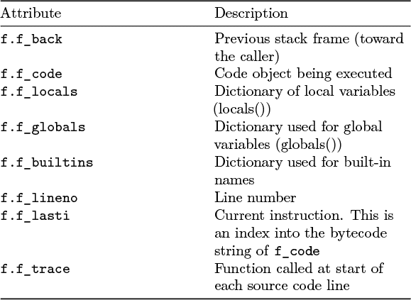

查看堆栈帧对于调试和代码检查来说是一项潜在有用的知识。例如，这里有一个有趣的调试函数，允许你查看调用者可选变量的值：

```python
import inspect
from collections import ChainMap

def debug(*varnames):
    f = inspect.currentframe().f_back
    vars = ChainMap(f.f_locals, f.f_globals)
    print(f'{f.f_code.co_filename}:{f.f_lineno}')
    for name in varnames:
        print(f'    {name} = {vars[name]!r}')

### 使用示例
def func(x, y):
    z = x + y
    debug('x','y')  # 显示 x 和 y 以及文件/行号
    return z
```

### 动态代码执行与创建

`exec(str [, globals [, locals]])` 函数执行包含任意 Python 代码的字符串。传递给 `exec()` 的代码其执行方式就像该代码实际上出现在 `exec` 操作所在的位置一样。这是一个示例：

```python
a = [3, 5, 10, 13]
exec('for i in a: print(i)')
```

传递给 `exec()` 的代码在调用者的局部和全局命名空间内执行。然而，请注意对局部变量的更改没有影响。例如：

```python
def func():
    x = 10
    exec("x = 20")
    print(x)      # 打印 10
```

这种现象的原因在于 locals 是收集的局部变量的字典，而不是实际的局部变量。详细信息请见上一节。

可选地，`exec()` 可以接受一个或两个字典对象，分别作为执行代码的全局和局部命名空间。这是一个示例：

```python
globs = {'x': 7,
           'y': 10,
           'birds': ['Parrot', 'Swallow', 'Albatross']
           }
locs = { }
# 使用上述字典作为全局和局部命名空间执行
exec('z = 3 * x + 4 * y', globs, locs)
exec('for b in birds: print(b)', globs, locs)
```

如果你省略一个或两个命名空间，将使用当前全局和局部命名空间的当前值。如果你只为 `globals` 提供一个字典，它将同时用于全局和局部。

动态代码执行的一个常见用途是创建函数和方法。例如，这里有一个根据给定名称列表为类创建 `__init__()` 方法的方法：

```python
def make_init(*names):
    parms = ','.join(names)
    code = f'def __init__(self, {parms}):\n'
    for name in names:
        code += f' self.{name} = {name}\n'
    d = { }
    exec(code, d)
    return d['__init__']

### 使用示例
class Vector:
    __init__ = make_init('x','y','z')
```

这种技术用于标准库的许多部分。例如，`namedtuple()`、`@dataclass` 和类似的功能都依赖于使用 `exec()` 进行动态代码创建。

### 异步函数与 await

Python 提供了许多与异步执行相关的语言特性。这些包括所谓的“async”函数（协程）或 awaitables。它们与 `asyncio` 模块相关。“异步函数”或“协程函数”是通过在普通函数前加上 `async` 关键字定义的。例如：

```python
async def greeting(name):
    print(f'Hello {name}')
```

如果你调用这样的函数，你会发现它并没有按照通常的方式执行——事实上它根本没有执行。相反，你得到的是一个“协程”对象的实例。例如：

```python
>>> greeting('Guido')
<coroutine object greeting at 0x041dc8>
```

要让函数运行，它必须在其他代码的监督下执行。常见的选项是 `asyncio`。例如：

```python
>>> import asyncio
>>> asyncio.run(greeting('Guido'))
Hello Guido
```

这个示例引出了异步函数最重要的特性——它们不会独立执行。始终需要某种管理器或库代码来使其执行。不一定是所示的 `asyncio`，但总会有涉及。

除了被管理之外，异步函数的评估方式与任何 Python 函数相同。语句按顺序执行，所有的控制流功能都可以正常工作。如果你想返回结果，请使用普通的 `return` 语句。例如：

```python
async def make_greeting(name):
    return f'Hello {name}'
```

传递给 `return` 的值由执行异步函数的外部 `run()` 函数返回。例如：

```python
>>> import asyncio
>>> a = asyncio.run(make_greeting('Paula'))
>>> a
'Hello Paula'
```

异步函数可以使用 `await` 表达式像这样调用其他异步函数：

```python
async def make_greeting(name):
    return f'Hello {name}'

async def main():
    for name in ['Paula', 'Thomas', 'Lewis']:
        a = await make_greeting(name)
        print(a)

# 运行它。将看到 Paula、Thomas 和 Lewis 的问候
asyncio.run(main())
```

`await` 的使用仅在封闭的 `async` 函数定义内有效。它也是执行异步函数的必要部分。如果你漏掉了 `await`，你会发现代码会报错。


使用 `await` 的要求暗示了围绕异步函数的一个通用用法问题。具体来说，它们不同的评估模型使得它们无法与 Python 现有的部分结合使用。具体而言，你无法在非异步函数中直接编写调用异步函数的代码：

```
async def twice(x):
    return 2 * x

def main():
    print(twice(2))         # 错误。没有执行函数
    print(await twice(2))   # 错误。此处不能使用 await
```

在同一个应用程序中将异步和非异步功能组合在一起可能会带来相当的复杂性，特别是考虑到涉及高阶函数、回调函数和装饰器的编程技术时。在大多数情况下，对异步函数的支持必须作为特例来构建。

Python 对迭代器协议和上下文管理器协议恰恰执行了这一点。例如，可以使用如下所示类中的 `__aenter__()` 和 `__aexit__()` 方法来定义异步上下文管理器：

```python
class AsyncManager(object):
    def __init__(self, x):
        self.x = x
    async def yow(self):
        pass
    async def __aenter__(self):
        return self
    async def __aexit__(self, ty, val, tb):
        pass
```

注意这些方法是异步函数，因此可以使用 `await` 执行其他异步函数。要使用此类管理器，你必须使用特殊的 `async with` 语法，该语法仅在异步函数内部合法如下：

```python
### 使用示例
async def main():
    async with AsyncManager(42) as m:
         await m.yow()

asyncio.run(main())
```

类同样可以通过定义方法 `__aiter__()` 和 `__anext__()` 来定义一个异步迭代器。这些方法由 `async for` 语句使用，该语句也只能出现在异步函数内部。

从实际角度来看，你应该将异步函数的行为看作与普通函数完全相同。只是它们必须在一个受管理的环境（例如 `asyncio`）中执行。除非你有意识地决定专门在该环境中工作，否则你应该继续后续操作并忽略异步函数。你会得开心得多。

## 结语：关于函数和组合的思考

任何系统都是由组件组合而成的。在 Python 中，这些组件包括各种库和对象。然而，一切的底层都是函数。函数是组合系统的胶水，也是移动数据的基本机制。

本节的大部分讨论集中在函数的性质及其接口上。输入是如何呈现给函数的？输出是如何处理的？错误是如何报告的？如何对所有这些事情进行更紧密的控制或更好的理解？

在处理大型项目时，思考函数之间的相互作用和潜在的复杂来源是值得的。这通常意味着直观易用的 API 与一团糟之间的区别。

### 生成器

生成器函数是 Python 最有趣且最强大的功能之一。生成器通常主要被介绍为一种定义新类型迭代模式的方便方法。然而，生成器从根本上改变了函数的整个执行模型。因此，使用它们可以做更多事情。本章将讨论生成器、生成器委托、基于生成器的协程以及生成器的其他内部工作机制。

### 生成器与 yield

如果一个函数使用了 `yield` 关键字，它就定义了一个名为生成器的对象。生成器的主要用途是产生用于迭代的值。这里有一个示例：

```python
def countdown(n):
     print('Counting down from', n)
     while n > 0:
          yield n
          n -= 1

### 使用示例
for x in countdown(10):
    print('T-minus', x)
```

如果你调用这个函数，你会发现它的代码没有没有任何代码开始执行。例如：

```python
>>> c = countdown(10)
>>> c
<generator object countdown at 0x105f73740>
>>>
```

相反，会创建一个生成器对象。生成器对象只有在你开始对其进行迭代时才会执行该函数。做到此点的一种方法是对其调用 `next()`。这里有一个示例：

```python
>>> next(c)
Counting down from 10
10
>>> next(c)
 9
```

当调用 `next()` 时，生成器函数会执行语句直到它遇到 `yield` 语句。`yield` 语句返回一个结果，此时函数的执行会被挂起，直到再次调用 `next()`。在挂起期间，函数保留了它所有的局部变量和执行环境。当恢复时，执行将从 `yield` 之后的语句继续进行。

`next()` 是调用生成器上的 `__next__()` 方法的简写。例如，你也可以这样做：

```python
>>> c.__next__()
8
>>> c.__next__()
7
>>>
```

你通常不会直接在生成器上调用 `next()`，而是使用 `for` 语句或其他某些消费项的操作。例如：

```python
for n in countdown(10):
     statements

a = sum(countdown(10))
```

生成器函数产生项，直到它返回（即到达函数末尾或使用 `return` 语句）。这会导致抛出 `StopIteration` 异常并终止 `for` 循环。如果生成器函数返回一个非 `None` 的值，它会被附加到 `StopIteration` 异常上。例如，假设你有这样一个生成器函数：

```python
def func():
    yield 37
    return 42
```

代码执行情况如下：

```python
>>> f = func()
<generator object func at 0x1bcd48>
>>> next(f)
37
>>> next(f)
Traceback (most recent call last):
  File "<stdin>", line 1, in <module>
StopIteration: 42
>>>
```

仔细观察，返回值是附加在 `StopIteration` 的。为了收集这个值，你需要显式地捕获 `StopIteration` 并提取它：

```python
try:
    next(f)
except StopIteration as e:
    value = e.value
```

通常情况下，你不会直接在生成器上调用 `next()`，而是使用 `for` 语句或其他某些消费项的操作。生成器函数通常没有方法获取值。这意味着获取值的唯一实际方法是使用显式的 `next()` 调用手动驱动生成器。

生成器的一个微妙问题涉及生成器只被部分消费的情况。例如，考虑这段提前终止的代码：

```python
for n in countdown(10):
     if n == 2:
         break
     statements
```

在这个示例中，`for` 循环通过调用 `break` 终止，关联的生成器从未运行到结束。如果你的生成器函数执行某些清理操作非常重要，请确保你使用了 `try-finally` 或上下文管理器。例如：

```python
def countdown(n):
    print('Counting down from', n)
    try:
         while n > 0:
              yield n
              n = n - 1
    finally:
         print('Only made it to', n)
```

即使生成器没有被完全消费，也会保证执行 `finally` 块的代码（当遗弃的生成器被垃圾回收时执行）。同样，任何涉及上下文管理器的清理代码在生成器终止时也会保证执行：

```python
def func(filename):
    with open(filename) as file:
         ...
         yield data
         ...
# 如果生成器被遗弃，文件在此关闭
```

资源的正确清理是一个棘手的问题。只要你使用 `try-finally` 或上下文管理器等结构，即使生成器被提前终止，也能保证执行正确的操作。

### 可重启的生成器

通常生成器函数只执行一次。例如：


```
>>> c = countdown(3)

>>> for n in c:
...    print('T-minus', n)
...

T-minus 3

T-minus 2

T-minus 1

>>> for n in c:
...    print('T-minus', n)
...

>>>
```

如果你想得到一个允许重复迭代的对象，可以将其定义为一个类，并将 `__iter__()` 方法实现为生成器：

```python
class countdown:

    def __init__(self, start):
        self.start = start
    def __iter__(self):
        n = self.start
        while n > 0:
            yield n
            n -= 1
```

这之所以有效，是因为每次进行迭代时，`__iter__()` 都会创建一个新的生成器。

### 生成器委派 (Generator Delegation)

生成器的一个核心特性是，包含 `yield` 的函数永远不会自己执行——它必须由由其他代码通过 `for` 循环或显式的 `next()` 调用来驱动。这使得编写涉及 `yield` 的库函数变得有些困难，因为仅仅调用生成器函数不足以让它执行。为了解决这个问题，可以使用 `yield from` 语句。例如：

```python
def countup(stop):
    n = 1
    while n <= stop:
        yield n
        n += 1

def countdown(start):
    n = start
    while n > 0:
        yield n
        n -= 1

def up_and_down(n):
    yield from countup(n)
    yield from countdown(n)
```

`yield from` 实际上将迭代过程委派给了一个外部迭代。例如，你可以编写这样的代码来驱动迭代：

```python
>>> for x in up_and_down(5):
...    print(x, end=' ')
1 2 3 4 5 5 4 3 2 1

>>>
```

`yield from` 主要让你避免了自己去驱动迭代的麻烦。如果没有这个功能，你将不得不如下所示编写 `up_and_down(n)`：

```python
def up_and_down(n):
    for x in countup(n):
        yield x
    for x in countdown(n):
        yield x
```

在编写必须递归迭代嵌套可迭代对象的代码时，`yield from` 特别有用。例如，这段代码可以平坦化嵌套列表：

```python
def flatten(items):
    for i in items:
        if isinstance(i, list):
            yield from flatten(i)
        else:
            yield i
```

这里是它是如何工作的示例：

```python
>>> a = [1, 2, [3, [4, 5], 6, 7], 8]
>>> for x in flatten(a):
...    print(x, end=' ')
...

1 2 3 4 5 6 7 8

>>>
```

该实现的一个局限性是，它仍然受 Python 递归限制的影响（它无法处理深度嵌套的结构）。将在下一节中得到解决。

### 在实践中使用生成器

初看之下，可能并不清楚如何在定义简单迭代器之外的情况下使用生成器来解决实际问题。然而，生成器在构建各种与管道和工作流相关的各种数据处理结构方面特别有效。

生成器的一个有用应用是作为重构深层嵌套 `for` 循环和条件语句代码的工具。考虑一下这个脚本，它在 Python 文件目录中搜索所有包含 "spam" 单词的注释：

```python
import pathlib
import re

for path in pathlib.Path('.').rglob('*.py'):
    if path.exists():
        with path.open('rt', encoding='latin-1') as file:
            for line in file:
                m = re.match('.*(#.*)$', line)
                if m:
                     comment = m.group(1)
                     if 'spam' in comment:
                         print(comment)
```

注意嵌套控制流的层数，以及当你看着代码时，眼睛已经开始酸疼了。现在，考虑这个使用生成器的版本：

```python
import pathlib
import re

def get_paths(topdir, pattern):
    for path in pathlib.Path(topdir).rglob(pattern):
        if path.exists():
            yield path

def get_files(paths):
    for path in paths:
        with path.open('rt', encoding='latin-1') as file:
             yield file

def get_lines(files):
    for file in files:
        yield from file

def get_comments(lines):
    for line in lines:
        m = re.match('.*(#.*)$', line)
        if m:
            yield m.group(1)

def print_matching(lines, substring):
    for line in lines:
        if substring in lines:
            print(substring)

paths = get_paths('.', '*.py')
files = get_files(pypaths)
lines = get_lines(pyfiles)
comments = get_comments(lines)
print_matching(comments, 'spam')
```

在这一节中，问题被分解为更小的自包含的组件。每个组件只关注特定的任务。例如，`get_paths()` 生成器只关注路径名称，`get_files()` 生成器只关注打开文件，以此此类推。只有在最后，各种生成器才被钩织成一个工作流来解决问题。

每个组件都是小且隔离的这种有趣的抽象技术。例如，考虑 `get_comments()` 生成器。作为输入，它接收任何可迭代对象产生的文本。这些文本可以来自任何地方（文件、列表、生成器等）。结果是，这种功能比嵌入深层嵌套 `for` 循环时要强大且灵活得多。较小的任务也更容易理解、调试和测试。

生成器对于改变函数应用的正常规则同样有用。通常，当你应用一个函数时，它会立即执行并产生结果。生成器不是这样。当生成器函数被应用时，它的执行会被推迟，直到其他代码调用它的 `next()`。例如考虑之前提到的平坦化函数：

```python
def flatten(items):
    for i in items:
        if isinstance(i, list):
            yield from flatten(i)
        else:
            yield i
```

该实现的一个问题是由于 Python 的递归限制，它无法处理深度嵌套的结构。这可以通过使用栈迭代迭代来修复。考虑这个版本：

```python
def flatten(items):
    stack = [ iter(items) ]
    while stack:
        try:
            item = next(stack[-1])
            if isinstance(item, list):
                stack.append(iter(item))
            else:
                yield item
        except StopIteration:
            stack.pop()
```

这种实现构建了迭代器的内部栈。它不受 Python 递归限制的约束，因为它将数据放在内部列表上，而不是在解释器内部栈上构建帧。因此，如果你发现自己需要平坦化几百万层极深的数据结构，你会发现这运行良好。

这些示例意味着你要用通用的生成器模式重写所有代码吗？不是。主要点是，生成器的延迟评估允许你改变正常函数评估的时空维度。在各种现实场景中，这些技术可能非常有用并以意想不到的方式应用。

### 增强生成器与 yield 表达式

在生成器函数内部，`yield` 语句还可以作为赋值运算符右侧的表达式。例如：

```python
def receiver():
    print('Ready to receive')
    while True:
          n = yield
          print('Got', n)
```


以这种方式使用 `yield` 的函数有时被称为“增强生成器”（enhanced generator）或“基于生成器的协程”。遗憾的是，所使用的术语并不精确，并且让情况更加困惑，因为“协程”在现代语境中更多地与 `async` 函数联系在一起。为了避免这种混淆，我们将使用“增强生成器”一词，以明确我们讨论的仍然是使用 `yield` 的标准函数。

将 `yield` 作为表达式使用的函数仍然是一个生成器，但其用法有所不同。它不再是产生值，而是响应发送给它的值来执行的。例如：

```
>>> r = receiver()

>>> r.send(None)        # 进到第一个 yield

Ready to receive

>>> r.send(1)

Got 1

>>> r.send(2)

Got 2

>>> r.send('Hello')

Got Hello

>>>
```

在这个示例中，初始调用 `r.send(None)` 是必要的，这样生成器才能执行通往第一个 `yield` 表达式的语句。此时，生成器挂起，等待通过关联的生成器对象 `r` 的 `send()` 方法发送一个值。传递给 `send()` 的值由生成器中的 `yield` 表达式返回。一旦接收到值，生成器将执行语句直到遇到下一个 `yield`。

按照目前的写法，该函数将无限运行。可以使用 `close()` 方法按如下所示关闭生成器：

```
>>> r.close()

>>> r.send(4)

Traceback (most recent call last):

  File "<stdin>", line 1, in <module>

StopIteration

>>>
```

`close()` 操作会在生成器内部的当前 `yield` 处抛出一个 `GeneratorExit` 异常。通常情况下，这会导致生成器静默终止（尽管如果你有兴趣，也可以捕获它以执行清理工作）。一旦关闭，如果向生成器发送更多值，则会抛出 `StopIteration` 异常。

可以使用 `throw(ty [,val [,tb]])` 方法在协程内部抛出异常，其中 `ty` 是异常类型，`val` 是异常参数（或参数元组），`tb` 是可选的溯栈跟踪。例如：

```
>>> r = receiver()

Ready to receive

>>> r.throw(RuntimeError,  "Dead")

Traceback (most recent call last):

  File "<stdin>", line 1, in <module>

  File "receiver.py", line 14, in receiver

    n = yield

RuntimeError: Dead

>>>
```

以任一方式抛出的异常都将从生成器中当前执行的 `yield` 语句开始传播。生成器可以选择捕获异常并根据情况进行处理。如果生成器没有处理该异常，它将传播到生成器之外，在更高层级进行处理。

### 增强生成器的应用

增强生成器是一种奇特的编程结构。与自然为 `for` 循环提供数据的简单生成器不同，没有核心语言特性来驱动增强生成器。因此，你为什么会想要一个接收发送给它的值的函数呢？这纯粹是学术性的吗？

从历史上看，增强生成器在并发库中被广泛使用——特别是基于异步 I/O 的库。在这种背景下，它们通常被称为“协程”或“基于生成器的协程”。然而，这些功能大部分已经整合到了 Python 的 `async` 和 `await` 特性中。因此，对于这一特定的用例，使用 `yield` 几乎没有实际理由。尽管如此，它仍然有一些实际应用。

像生成器一样，增强生成器可以用于实现不同的评估和控制流。其中一个例子是位于 `contextlib` 模块中的 `@contextmanager` 装饰器。例如：

```
from contextlib import contextmanager
```

```python
@contextmanager

def manager():

    print("Entering")

    try:
         yield 'somevalue'
    except Exception as e:
         print("An error occurred", e)
    finally:
         print("Leaving")
```

在这里，生成器被用来将上下文管理器的两个部分连接在一起。记住，上下文管理器是由实现以下协议的对象定义的：

```
class Manager:

    def __enter__(self):
        return somevalue

    def __exit__(self, ty, val, tb):
        if ty:
            # 发生了异常

            ...

            # 如果已处理则返回 True。否则返回 False。
```

使用 `@contextmanager` 生成器，`yield` 语句之前的所有内容会在管理器进入时（通过 `__enter__()` 方法）执行。`yield` 之后的所有内容会在管理器退出时（通过 `__exit__()` 方法）执行。如果发生了错误，它将作为 `yield` 语句上的异常报告出来。这里是一个示例：

```
>>> with manager() as val:
...        print(val)
...

Entering

somevalue

Leaving

>>> with manager() as val:
...        print(int(val))
...

Entering

An error occurred invalid literal for int() with base 10: 'somevalue'

Leaving

>>>
```

为了实现这一点，使用了一个包装类。这是一个说明基本思想的简化实现：

```python
class Manager:

    def __init__(self, gen):
        self.gen = gen

    def __enter__(self):
        # 运行到 yield

        return self.gen.send(None)

    def __exit__(self, ty, val, tb):
        # 传播异常（如果有）

        try:
            if ty:
                self.gen.throw(ty, val, tb)
            except StopIteration:
                return True
            except GeneratorExit:
                return False
            else:
                self.gen.send(None)
        except StopIteration:
            return False
```

增强生成器的另一个应用是使用函数来封装“工作”任务。函数调用的特征之一是它会设置局部变量的环境。对局部变量的访问经过高度优化——比访问属性快得多。由于生成器会一直存在直到显式关闭或销毁，人们可以使用生成器来设置长存任务。这是一个接收字节片段并将其组成行的生成器示例：

```python
def line_receiver():
    data = bytearray()
    line = None
    linecount = 0
    while True:
        part = yield line
        linecount += part.count(b'\n')
        data.extend(part)
        if linecount > 0:
            index = data.index(b'\n')
            line = bytes(data[:index+1])
            data = data[index+1:]
            linecount -= 1
        else:
            line = None
```

在这个示例中，生成器被设计为接收字节片段，并将它们收集到字节数组中。如果数组包含换行符，则提取并返回一行。否则，返回 `None`。这里是一个说明其如何工作的示例：

```
>>> r = line_receiver()
>>> r.send(b'hello')
>>> r.send(b'world\nit ')
b'hello world\n'
>>> r.send(b'works!')
>>> r.send(b'\n')
b'it works!\n'

>>>
```

相似的代码可以写成如下类：

```python
class LineReceiver:

    def __init__(self):
        self.data = bytearray()
        self.linecount = 0

    def send(self, part):
        self.linecount += part.count(b'\n')
        self.data.extend(part)
        if self.linecount > 0:
            index = self.data.index(b'\n')
            line = bytes(self.data[:index+1])
            self.data = self.data[index+1:]
            self.linecount -= 1
            return line
        else:
            return None
```

虽然编写类可能更熟悉，但代码在某些方面更为复杂。它的运行速度也较慢。在作者的机器上测试，使用生成器将大量块喂给接收器时，比使用此类代码快大约 40-50%。大部分这种节省归功于消除了实例属性查找（局部变量更快）。


尽管还有许多潜在的应用，但最需要记住的一点是，如果你在不涉及迭代的上下文中看到 `yield`，它可能正在使用诸如 `send()` 或 `throw()` 等增强功能。

## 生成器与通 await 的桥梁

生成器函数的一个经典用法是在与异步 I/O 相关的库中，例如标准库 `asyncio` 模块。然而，这些许多功能（自 Python 3.5 以来）已经移动到与 `async` 函数和 `await` 语句相关的不同语言特性中（参见第 5 章 的最后部分）。

`await` 语句涉及与伪装的生成器进行交互。以下是一个说明 `await` 所用底层协议的示例：

```python
class Awaitable:

    def __await__(self):

        print('About to await')

        yield    # 必须是一个生成器

        print('Resuming')

# 与 "await" 兼容的函数。返回一个 "awaitable"

def function():

    return Awaitable()

async def main():

    await function()
```

以下是你如何使用 `asyncio` 尝试代码：

```python
>>> import asyncio

>>> asyncio.run(main())

About to await

Resuming

>>>
```

了解它的工作原理绝对至关重要吗？可能不需要。所有这些机制通常是对用户隐藏的。然而，如果你发现自己正在使用异步函数，只需知道在深处某个隐藏着一个生成器函数即可。只要你继续深入挖掘技术债的坑，你最终会发现它的。

### 结语：生成器的简史与展望

生成器是 Python 最感兴趣的成功故事之一。然而，它们是关于迭代更大故事的一部分。迭代是所有编程任务中最常见的之一。在 Python 的早期版本中，迭代是通过序列索引和 `__getitem__()` 方法实现的。这后来演变为当前基于 `__iter__()` 和 `__next__()` 方法的迭代协议。生成器在随后的不久出现，作为一种实现迭代器的更方便的方法。在现代 Python 中，几乎没有理由使用生成器以外的任何东西来实现迭代器。即使是在你自己定义的可迭代对象上，`__iter__()` 方法本身也是通过这种方便的方式实现的。

在 Python 的后续版本中，随着生成器演化出与协程相关的“增强”功能（例如 `send()` 和 `throw()` 方法），它们承担了新的角色。这些不再纯粹与迭代有关，而是为在其他上下文中使用生成器开启了可能性。最值得注意的是，这形成了许多用于网络编程和并发的所谓“异步”框架的基础。然而，随着异步编程的演进，这其中的大部分内容已转化为与 `async/await` 语法相关的后续特性。因此，在迭代上下文（它们的原始目的）之外看到生成器函数已不再常见。事实上，如果你发现自己正在定义一个生成器函数但**没有**在执行迭代，你可能应该停下来重新考虑你的方法。也许有更好或更现代的方法来实现你正在做的事情。

## 类与面向对象编程

类用于创建新类型的对象。本章涵盖了类的细节，但目的不是作为面向对象编程和设计的深度参考。


在 `__init__()` 内部，通过赋值给 `self` 将属性保存到实例上。

例如，`self.owner = owner` 就是在实例上保存一个属性。一旦新创建的实例返回，可以使用点 (`.`) 运算符如下所示访问这些属性以及类的方法：

```
a.deposit(100.0)        # 调用 Account.deposit(a, 100.0)

b.withdraw(50.00)        # 调用 Account.withdraw(b, 50.0)

owner = a.owner         # 获取账户所有者
```

需要强调的是，每个实例都有自己的状态。你可以使用 `vars()` 函数查看实例变量。例如：

```
>>> a = Account('Guido', 1000.0)

>>> b = Account('Eva', 10.0)

>>> vars(a)

{'owner': 'Guido', 'balance': 1000.0}

>>> vars(b)

{'owner': 'Eva', 'balance': 10.0}

>>>
```

注意，方法没有出现在这里。方法是在类中找到的。每个实例都通过其关联的“类型”与其类保持链接。例如：

```
>>> type(a)

<class 'Account'>

>>> type(b)

<class 'Account'>

>>> type(a).deposit

<function Account.deposit at 0x10a032158>

>>> type(a).inquiry

<function Account.inquiry at 0x10a032268>

>>>
```

后后一个章节将讨论属性绑定的实现细节以及实例与类之间的关系。

### 属性访问

在实例上可以执行三个基本操作：获取、设置和删除属性。例如：

```
>>> a = Account('Guido', 1000.0)

>>> a.owner               # get

'Guido'

>>> a.balance = 750.0    # set

>>> del a.balance        # delete

>>> a.balance

Traceback (most recent call last):
  File "<stdin>", line 1, in <module>

AttributeError: 'Account' object has no attribute 'balance'

>>>
```

Python 中的一切都是动态过程，限制非常少。如果你想在对象创建后为其添加新属性，你可以自由这样做。例如：

```
>>> a = Account('Guido', 1000.0)

>>> a.creation_date = '2019-02-14'

>>> a.nickname = 'Former BDFL'

>>> a.creation_date

'2019-02-14'

>>>
```

这些操作有时不是通过使用点 (`.`) 来执行的，而是通过将属性名作为字符串传递给 `getattr()`、`setattr()` 和 `delattr()` 函数完成的。`hasattr()` 函数允许你测试属性是否存在。例如：

```
>>> a = Account('Guido', 1000.0)

>>> getattr(a, 'owner')

'Guido'

>>> setattr(a, 'balance', 750.0)

>>> delattr(a, 'balance')

>>> hasattr(a, 'balance')

False

>>> getattr(a, 'withdraw')(100)    # 方法调用

>>> a

Account('Guido', 650.0)

>>>
```

语法如 `a.attr` 和 `getattr(a, 'attr')` 是互换的。因此，像 `getattr(a, 'withdraw')(100)` 的代码等同于 `a.withdraw(100)`。`withdraw()` 是方法并不重要。

`getattr()` 函数的显著特点是它可以接受一个可选的默认值。如果你想查找一个可能存在也可能的属性，可以这样做：

```
>>> a = Account('Guido', 1000.0)

>>> getattr(s, 'balance', 'unknown')

1000.0

>>> getattr(s, 'creation_date', 'unknown')

'unknown'

>>>
```

当你像访问属性一样访问方法时，你会得到一个被称为绑定方法（bound method）的对象。例如：

```
>>> a = Account('Guido', 1000.0)

>>> w = a.withdraw

>>> w

<bound method Account.withdraw of Account('Guido', 1000.0)>

>>> w(100)

>>> a

Account('Guido', 900.0)

>>>
```

绑定方法是一个包含实例（`self`）和实现该方法的函数的对象。当你通过添加括号和参数来调用绑定方法时，它会执行该方法，并将绑定的实例作为第一个参数传递。例如，上面调用 `w(100)` 变为调用 `Account.withdraw(a, 100)`。

### 作用域规则

虽然类为方法定义了隔离的命名空间，但该命名空间并不解析方法内部使用的名称的作用域。因此，当你实现类时，对属性和方法的引用必须是完全限定。例如，在方法中，你始终通过 `self` 引用实例的属性。因此，你使用 `self.balance` 而不是 `balance`。如果你想从另一个方法调用方法，这也适用。例如，假设你想从另一个方法调用一个方法。

```python
class Account:
    def __init__(self, owner, balance):
        self.owner = owner
        self.balance = balance

    def deposit(self, amount):
        self.balance += amount

    def withdraw(self, amount):
        self.balance -= amount

    def inquiry(self):
        return self.balance

    def __repr__(self):
        return f'Account({self.owner!r}, {self.balance!r})
```

缺乏类级作用域是 Python 与 C++ 或 Java 不同之处之一。`self` 参数相当于 "this" 指针。

### 运算符重载与协议

在 Python 中，你可以定义特殊方法来实现运算符。例如，`len(obj)` 调用 `obj.__len__()`，而 `obj[n]` 调用 `obj.__getitem__(n)`。在定义新类时，定义其中一些方法是常见的。例如：

```python
class AccountPortfolio:
    def __init__(self):
        self.accounts = []

    def add_account(self, account):
        self.accounts.append(account)

    def total_funds(self):
        return sum(account.inquiry() for account in self.accounts)

    def __len__(self):
        return len(self.accounts)

    def __getitem__(self, index):
        return self.accounts[index]

    def __iter__(self):
        return iter(self.accounts)

### 示例
port = AccountPortfolio()
port.add_account(Account('Guido', 1000.0))
port.add_account(Account('Eva', 50.0))
print(port.total_funds())    # -> 1050.0

len(port)                    # -> 2

# 打印账户
for account in port:
    print(account)

# 通过索引访问单个账户
port[1].inquiry()            # -> 50.0
```

结尾的特殊方法如 `__len__`、`__getitem__` 和 `__iter__` 使 `AccountPortfolio` 能够像所示所示与各种 Python 运算符协同工作。

### 继承

继承是一种创建新类的机制，该类可以特化或修改现有类的行为。原始类被称为基类、超类或父类。新类被称为派生类、子类、子类或子类型。当通过继承创建类时，它继承了基类定义的属性。然而，派生类可以重新定义任何这些属性并添加自己的新属性。


继承是在类语句中通过逗号分隔的基类名称列表来指定的。如果没有指定基类，则类将隐式继承自 `object`。`object` 是一个所有 Python 对象的根基类，它提供了一些常用方法的默认实现，例如 `__str__()` 和 `__repr__()`。

继承的一个用途是使用新方法来扩展现有的类。例如，假设你想为 `Account` 类添加一个 `panic()` 方法来取走所有资金。你可以如下所示实现：

```
class MyAcount(Account):

    def panic(self):

        self.withdraw(self.balance)

### 示例

a = MyAcount('Guido', 1000.0)

a.withdraw(23.0)         # a.balance = 977.0

a.panic()                # a.balance = 0
```

继承也可以用于重新定义已经存在的方法。例如，这里有一个 `Account` 的特化版本，它重新定义了 `inquiry()` 方法，周期性地夸大余额，寄希望于不注意的人会透支账户，并在支付次级抵贷款时产生巨额罚款：

```
import random

class EvilAccount(Account):

    def inquiry(self):

        if random.randint(0,4) == 1:

           return self.balance * 1.10

        else:

           return self.balance

a = EvilAccount('Guido', 1000.0)

a.deposit(10.0)          # 调用 Account.deposit(a, 10.0)

available = a.inquiry()  # 调用 EvilAccount.inquiry(a)
```

在这个示例中，`EvilAccount` 的实例与 `Account` 的实例相同，除了重新定义的 `inquiry()` 方法外。

偶尔，派生类会重新实现一个方法，但又想调用原始实现。要做到这一点，可以使用 `super()` 显式地调用原始方法，如下：

```
class EvilAccount(Account):

    def inquiry(self):

        if random.randint(0,4) == 1:

           return 1.10 * super().inquiry()

        else:

           return super().inquiry()
```

在这个示例中，`super()` 允许你按照之前的定义来访问方法。`super().inquiry()` 调用的是 `inquiry()` 的原始定义，即在被 `EvilAccount` 重新定义之前使用的。

这种情况较不常见，但继承也可以用于为实例添加额外的属性。假设你想将上述示例中的 `1.10` 因子变成一个可以调整的实例级属性。你可以这样做：

```
class EvilAccount(Account):

    def __init__(self, owner, balance, factor):

        super().__init__(owner, balance)

        self.factor = factor

    def inquiry(self):

        if random.randint(0,4) == 1:

           return self.factor * super().inquiry()

        else:

           return super().inquiry()
```

添加属性时一个棘手的问题是处理已存在的 `__init__()` 方法。在这个示例中，我们定义了 `__init__()` 的新版本，其中包含了我们额外的实例变量 `factor`。然而，当重新定义 `__init__()` 时，子类有责任使用如所示的 `super().__init__()` 来初始化父类。如果你忘记这样做，你将得到一个半初始化的对象，并且一切都会崩溃。由于父类的初始化需要额外的参数，这些参数仍然必须传递给子类的 `__init__()` 方法。

继承可能会以微妙的方式破坏代码。考虑 `Account` 类的 `__repr__()` 方法：

```
class Account:

    def __init__(self, owner, balance):

        self.owner = owner

        self.balance = balance

    def __repr__(self):

        return f'Account({self.owner!r}, {self.balance!r})'
```

该方法的目的是通过生成良好的输出来辅助调试。然而，该方法被硬编码为使用 `Account` 名称。如果你开始使用继承，你会发现输出是错误的且误导的：

```python
>>> class EvilAccount(Account):
...     pass

...
>>> a = EvilAccount('Eva', 10.0)
>>> a
Account('Eva', 10.0)     # 注意具有误导性的输出
>>> type(a)
<class 'EvilAccount'>
>>>
```

为了修复这个问题，你需要修改 `__repr__()` 方法以使用正确的类型名。例如：

```python
class Account:

    ...

    def __repr__(self):
        return f'{type(self).__name__}({self.owner!r}, {self.balance!r})'
```

这是一个微妙的改变，但现在你将看到更准确的输出。继承并不总是用于每个类。然而，如果它是你正在写的类预期的用例，你就需要注意这些小细节。作为一条通用规则，你应该避免对类名的硬编码。

继承在类型系统中建立了一种关系，任何子类在类型检查时都会被视为父类。例如：

```python
>>> a = EvilAccount('Eva', 10)
>>> type(a)
<class 'EvilAccount'>
>>> isinstance(a, Account)
True
```

继承在类型系统中建立了一种关系，任何子类在类型检查时都会被视为父类。例如：

```python
>>> a = EvilAccount('Eva', 10)
>>> type(a)
<class 'EvilAccount'>
>>> isinstance(a, Account)
True
```

### 通过组合避免继承

关于继承的一个警示性用法涉及所谓的“实现继承”。为了说明，假设你想创建一个栈（stack）数据结构。实现它的的一种“快速”方法是继承列表并向其添加一个新方法：

```python
class Stack(list):

    def push(self, item):

        self.append(item)

### 示例

s = Stack()

s.push(1)

s.push(2)

s.push(3)

s.pop()     # -> 3

s.pop()     # -> 2
```

确实，这个数据结构工作起来像一个栈，但它也具有列表的所有其他功能。例如，插入、排序、切片赋值等等。这就是实现继承——你使用继承来复用你在此基础上构建东西的代码，但你也获得了许多与要解决的问题无关的功能。用户可能会觉得这个对象很奇怪。为什么栈会有排序的方法呢？

更好的方法通常是依赖组合。与其通过继承列表来构建栈，不如将栈构建为一个独立的类，该类恰好包含一个列表。内部列表是一个实现细节。例如：

```python
class Stack:

    def __init__(self):
        self._items = list()

    def push(self, item):
        self._items.append(item)

    def pop(self):
        return self._items.pop()

    def __len__(self):
        return len(self._items)

### 使用示例

s = Stack()

s.push(1)

s.push(2)

s.push(3)

s.pop()    # -> 3

s.pop()    # -> 2
```

这个对象的工作方式与之前完全一样，但它专门专注于一个栈。没有多余的列表方法或非栈功能。意图更加清晰。


这种实现的轻微扩展可以接受将内部 `list` 类作为可选参数：

```python
class Stack:
    def __init__(self, *, container=None):
        if container is None:
            container = list()
        self._items = container

    def push(self, item):
        self._items.append(item)

    def pop(self):
        return self._items.pop()

    def __len__(self):
        return len(self._items)
```

这种方法的好处之一是促进了组件之间的松耦合。例如，假设你想创建一个使用类型数组而不是列表来存储元素的栈。你可以这样操作：

```python
import array

s = Stack(container=array.array('i'))

s.push(42)

s.push(23)

s.push('a lot')     # TypeError.
```

这这也是所谓的“依赖注入”的例子。你不需要硬编码 `Stack` 依赖于 `list`，而是可以让它依赖于用户决定传递的任何容器，只要该容器实现了所需的接口。

将内部列表作为隐藏的实现细节，更广泛地与数据抽象问题相关。也许你以后决定甚至不想使用列表了。上面的设计使得这种更改变得简单。例如，如果你将实现更改如下的链元组（linked tuples），`Stack` 的用户甚至不会察觉：

```python
class Stack:
    def __init__(self):
        self._items = None
        self._size = 0

    def push(self, item):
        self._items = (item, self._items)
        self._size += 1

    def pop(self):
        (item, self._items) = self._items
        self._size -= 1
        return item

    def __len__(self):
        return self._size
```

在决定是否使用继承时，你应该后退一步，问问自己：你正在构建的对象是父类的特化版本，还是你仅仅是将其作为构建其他东西的组件？如果是后者，请不要使用继承。

### 通过函数避免继承

有时，你可能会发现自己在编写只有一个方法且该方法需要自定义的类。例如，可能你写了如下所示一个数据解析类：

```python
class DataParser:
    def parse(self, lines):
        records = []
        for line in lines:
            row = line.split(',')
            record = self.make_record(row)
            records.append(row)
        return records

    def make_record(self, row):
        raise NotImplementedError()

class PortfolioDataParser(DataParser):
    def make_record(self, row):
        return {
           'name': row[0],
           'shares': int(row[1]),
           'price': float(row[2])
        }

parser = PortfolioDataParser()
data = parser.parse(open('portfolio.csv'))
```

这里存在了太多的水水工作（plumbing）。如果你正在编写大量单方法类，考虑改用函数。例如：

```python
def parse_data(lines, make_record):
    records = []
    for line in lines:
        row = line.split(',')
        record = make_record(row)
        records.append(row)
    return records

def make_dict(row):
    return {
        'name': row[0],
        'shares': int(row[1]),
        'price': float(row[2])
    }

data = parse_data(open('portfolio.csv'), make_dict)
```

这段代码要简单得多，而且同样灵活。此外，简单的函数更容易测试。如果需要将其扩展为类，你随时可以以后再做。过早抽象通常不是好事。

### 动态绑定与鸭子类型（Duck Typing）

动态绑定是 Python 用来查找对象属性的运行时机制，它允许 Python 在不考虑类型的情况下与实例工作。在 Python 中，变量名没有关联的类型。因此，属性绑定过程独立于 `obj` 是什么对象。如果你进行像 `obj.name` 这样的查找，它将适用于任何恰好具有 `name` 属性的 `obj`。这种行为有时被称为“鸭子类型”，引用自谚语：“如果它看起来像像子，叫起来也像鸭，走起来也像鸭，那么它就是鸭。”

Python 程序员经常编写依赖这种行为的程序。例如，如果你想为现有对象创建一个自定义版本，你可以继承它，也可以创建一个看起来和行为上像它、但在其他方面与之无关的新对象。后者方法通常用于维护程序组件的松耦合。例如，代码可以编写为与任何对象工作，只要它具有一组特定的方法。最常见的例子之一是标准库中定义的各种“可迭代”（iterable）对象。有各种对象可以配合 `for` 循环产生值（列表、文件、生成器、字符串等）。然而，这些对象中没有一个继承自任何特殊的 `Iterable` 基类。它们仅仅实现了执行迭代所需的方法，而一切都能正常工作。

### 继承内置类型的危险

Python 允许继承内置类型。然而，这样做会带来危险。例如，假设你决定子类 `dict` 以强制所有键都为大写。为了实现这一点，你可能会如下重定义 `__setitem__()` 方法：

```python
class udict(dict):
    def __setitem__(self, key, value):
        super().__setitem__(key.upper(), value)
```

事实上，它最初似乎是有效的：

```python
>>> u = udict()
>>> u['name'] = 'Guido'
>>> u['number'] = 37
>>> u
{ 'NAME': 'Guido', 'NUMBER': 37 }
>>>
```

除了进一步的使用揭示了它似乎只部分有效。事实上，它似乎根本不起作用：

```python
>>> u = udict(name='Guido', number=37)
>>> u
{ 'name': 'Guido', 'number': 37 }
>>> u.update(color='blue')
>>> u
{ 'name': 'Guido', 'number': 37, 'color': 'blue' }
>>>
```

这里的问题在于，Python 的内置类型并不是像普通的 Python 类那样实现的——它们是用 C 实现的。在这个 C 实现中，大多数方法纯粹在 C 的世界中运行。例如，`dict.update()` 方法直接操作字典数据，而永远不会通过上面自定义 `udict` 类中重定义的 `__setitem__()` 方法。

`collections` 模块有特殊的类 `UserDict`、`UserList` 和 `UserString`，可以用它们创建 `dict`、`list` 和 `str` 类型的安全的子类。例如，你会发现这种解决方案效果要好得多：

```python
from collections import UserDict

class udict(UserDict):
    def __setitem__(self, key, value):
        super().__setitem__(key.upper(), value)
```

这是这个新版本运行的示例：

```python
>>> u = udict(name='Guido', num=37)
>>> u.update(color='Blue')
>>> u
{'NAME': 'Guido', 'NUM': 37, 'COLOR': 'Blue'}
>>> v = udict(u)
>>> v['title'] = 'BDFL'
>>> v
{'NAME': 'Guido', 'NUM': 37, 'COLOR': 'Blue', 'TITLE': 'BDFL'}
>>>
```

大多数情况下，子类内置类型类型是可以避免的。例如，如果构建新的容器，可能创建一个新类更好，正如第 X 页的 `Stack` 类所示。如果你确实需要子类内置类型，请注意这工作可能比你想象的要得多。

### 类变量与方法

在类定义中，所有函数都被认为在实例上操作，该实例总是作为第一个参数 `self` 传递。然而，类本身也是可以携带状态并被操作的对象。例如，你可以使用类变量 `num_accounts` 来跟踪创建了多少实例，如下所示：


```python
class Account:

    num_accounts = 0

    def __init__(self, owner, balance):
        self.owner = owner
        self.balance = balance
        Account.num_accounts += 1

    def __repr__(self):
        return f'{type(self).__name__}({self.owner!r}, {self.balance!r})'

    def deposit(self, amount):
        self.balance += amount

    def withdraw(self, amount):
        self.deposit(-amount)    # Must use self.deposit()

    def inquiry(self):
        return self.balance
```

类变量定义在普通的 `__init__()` 方法之外。在修改它们时，你应该使用类名而不是 `self`。例如：

```python
>>> a = Account('Guido', 1000.0)
>>> b = Account('Eva', 10.0)
>>> Account.num_accounts
2
```

这有点不常，但类变量也可以通过实例来访问。例如：

```python
>>> a.num_accounts
2
>>> c = Account('Ben', 50.0)
>>> Account.num_accounts
3
>>> a.num_accounts
3
```

这种机制之所以有效，是因为如果实例本身上没有匹配的属性，实例的属性查找会检查关联的类。这与 Python 通常查找方法的机制是相同的。

你也可以定义所谓的“类方法（class method）”。类方法是应用于类本身而非实例的方法。类方法的一个常见用途是定义备选的实例构造函数。例如，假设有一个需求需要从遗留的企业级输入格式创建 `Account` 实例：

```python
data = '''
<account>
    <owner>Guido</owner>
    <amount>1000.0</amount>
</account>
'''
```

为了实现这一点，你可以像下面这样写一个 `@classmethod`：

```python
class Account:
    def __init__(self, owner, balance):
        self.owner = owner
        self.balance = balance

    @classmethod
    def from_xml(cls, data):
        from xml.etree.ElementTree import XML
        doc = XML(data)
        return cls(doc.findtext('owner'),
                   float(doc.findtext('amount')))

### 使用示例
data = '''
<account>
    <owner>Guido</owner>
    <amount>1000.0</amount>
</account>
'''

a = Account.from_xml(data)
```

类方法的第一个参数总是类本身。按照惯例，该参数通常命名为 `cls`。在这个示例中，`cls` 被设置为 `Account`。如果类方法的目的是创建一个新实例，则必须采取显式步骤来实现。在示例的最后一行中，调用 `cls(..., ...)` 等同于对这两个参数调用 `Account(..., ...)`。

将类作为参数传递这一事实解决了与继承相关的重要问题。假设你定义了 `Account` 的子类，现在想创建该类的实例。你会发现它仍然有效：

```python
class EvilAccount(Account):
    pass

e = EvilAccount.from_xml(data)    # 创建一个 'EvilAccount'
```

这段代码能够有效的原因是 `EvilAccount` 现在被作为 `cls` 传递。因此，`from_xml()` 类方法的最后语句现在会创建一个 `EvilAccount` 实例。

类变量和类方法有时结合使用，以配置和控制实例的操作方式。另一个例子是考虑以下 `Date` 类：

```python
import time

class Date:
    datefmt = '{year}-{month:02d}-{day:02d}'

    def __init__(self, year, month, day):
        self.year = year
        self.month = month
        self.day = day

    def __str__(self):
        return self.datefmt.format(year=self.year,
                                   month=self.month,
                                   day=self.day)

    @classmethod
    def from_timestamp(cls, ts):
        tm = time.localtime(ts)
        return cls(tm.tm_year, tm.tm_mon, tm.tm_mday)

    # 使用示例
    # d = Date.from_timestamp(time.time())
```

### 静态方法

有时，类仅被用作声明为 `@staticmethod` 的函数的命名空间。与普通方法或类方法不同，`staticmethod` 不接收额外的 `self` 或 `cls` 参数。静态方法只是恰好位于类内部的普通函数。例如：

```python
class Ops:
    @staticmethod
    def add(x, y):
        return x + y

    @staticmethod
    def sub(x, y):
        return x - y
```

你通常不会创建此类类的实例。相反，你直接通过类调用这些函数：

```python
a = Ops.add(2, 3)        # a = 5
b = Ops.sub(4, 5)        # b = -1
```

有时，其他类会使用这样的静态方法集合来实现“可切换的”或“可配置”的行为，或者作为松散模拟导入模块行为的东西。考虑 `Account` 示例中继承的使用：

```python
class Account:
    def __init__(self, owner, balance):
        self.owner = owner
        self.balance = balance

    def __repr__(self):
        return f'{type(self).__name__}({self.owner!r}, {self.balance!r})'

    def deposit(self, amount):
        self.balance += amount

    def withdraw(self, amount):
        self.balance -= amount

    def inquiry(self):
        return self.balance

# 一个特殊的“邪恶”账户
class EvilAccount(Account):
    def deposit(self, amount):
        self.balance += 0.95 * amount

    def inquiry(self):
        import random
        if random.randint(0,4) == 1:
           return 1.10 * self.balance
        else:
           return self.balance
```

在这里使用继承有点奇怪。它引入了两种不同类型的对象（`Account` 和 `EvilAccount`）。此外，没有明显的方法可以将现有的 `Account` 实例转换为 `EvilAccount` 或反之，因为这涉及到更改实例的类型。也许将“邪恶”表现为一种账户策略会更好。以下是使用静态方法实现该点的 `Account` 另一种表示形式：


```python
class StandardPolicy:
    @staticmethod
    def deposit(account, amount):
        account.balance += amount

    @staticmethod
    def withdraw(account, amount):
        account.balance -= amount

    @staticmethod
    def inquiry(account):
        return account.balance

class EvilPolicy(StandardPolicy):
    @staticmethod
    def deposit(account, amount):
        account.balance += 0.95*amount

    @staticmethod
    def inquiry(account):
        if random.randint(0,4) == 1:
           return 1.10 * account.balance
        else:
           return account.balance

class Account:
    def __init__(self, owner, balance, *, policy=StandardPolicy):
        self.owner = owner
        self.balance = balance
        self.policy = policy

    def __repr__(self):
        return f'Account({self.policy}, {self.owner!r}, {self.balance!r})'

    def deposit(self, amount):
        self.policy.deposit(self, amount)

    def withdraw(self, amount):
        self.policy.withdraw(self, amount)

    def inquiry(self):
        return self.policy.inquiry(self)
```

在这种重构中，只被创建了一种种类型的实例，即 `Account`。然而，它有一个特殊的 `policy` 属性，提供了各种方法的实现。如果需要，可以在现有的 `Account` 实例上动态地更改策略：

```python
>>> a = Account('Guido', 1000.0)
>>> a.policy
<class 'StandardPolicy'>
>>> a.deposit(500)
>>> a.inquiry()
1500.0
>>> a.policy = EvilPolicy
>>> a.deposit(500)
>>> a.inquiry()      # 可能会随机变为 1.10 倍
1975.0
>>>
```

`@staticmethod` 在这里之所以合理的原因之一是，不需要创建 `StandardPolicy` 或 `EvilPolicy` 的实例。这些类的主要目的是组织一组方法，而不是存储与 `Account` 相关的额外实例数据。尽管如此，Python 的松耦合特性完全可以允许策略升级为持有其自己的数据。可以将静态方法更改为如下的实例方法。例如：

```python
class EvilPolicy(StandardPolicy):
    def __init__(self, deposit_factor, inquiry_factor):
        self.deposit_factor = deposit_factor
        self.inquiry_factor = inquiry_factor

    def deposit(self, account, amount):
        account.balance += self.deposit_factor * amount

    def inquiry(self, account):
        if random.randint(0,4) == 1:
           return self.inquiry_factor * account.balance
        else:
           return account.balance

### 使用示例
a = Account('Guido', 1000.0, policy=EvilPolicy(0.95, 1.10))
```

这种将方法委托给辅助类的方法是状态机和类似对象的常用实现策略。每个操作状态都可以封装到它自己的方法类中（通常是静态的）。然后，可以使用像本例中的 `policy` 属性这样的可变实例变量来持有与当前操作状态相关的特定实现细节。

### 关于设计模式的几几话

在编写面向对象的程序时，程序员有时会痴迷于命名设计模式的实现，例如“策略模式”、“权重类模式”、“单例模式”等等。这些模式中的许多源于 Erich Gamma、Richard Helm、Ralph Johnson 和 John Vlissides 编写的名著《设计模式》（Design Patterns）。

如果你熟悉这些模式，其他语言中使用的通用设计原则完全可以应用于 Python。然而，这些记录的模式中许多是为了解决由 C++ 或 Java 严格静态类型系统引起的特定问题。Python 的动态性质使得许多模式变得过时或简单来说没有必要（或者如果使用则属于过度设计）。

尽管如此，编写“良好的软件”仍有几条首要原则。例如，努力编写可调试、可测试且可扩展的代码。基本策略，如编写带有实用的 `__repr__()` 方法的类、优先使用组合而非继承、以及允许依赖注入，对于实现这些目标非常有帮助。Python 程序员也喜欢处理被认为是“Pythonic”（Python 风格）的代码。通常，这意味着创建遵守各种内置协议（如迭代、容器、上下文管理等）的对象。例如，与其尝试实现某种来自 Java 编程书籍的奇特数据遍历模式，Python 程序员可能会使用生成器函数配合 `for` 循环来实现它。或者他们可能会直接用几次字典查找替换整个模式。

### 数据封装与私有属性

在 Python 中，类的所有属性和方法都是“公共的”。这意味着它们在没有任何限制的情况下都是可访问的。这在面向对象的应用程序中通常是不可取的的，因为人们希望隐藏或封装内部实现细节。

为了解决这个问题，Python 依赖命名约定作为信号意图用法的手段。其中一种约定是使用以单个下划线（`_`）开头的名称来指示内部实现。例如，这里是 `Account` 类的一个版本，其中余额已变为“私有”属性：

```python
class Account:
    def __init__(self, owner, balance):
        self.owner = owner
        self._balance = balance

    def __repr__(self):
        return f'Account({self.owner!r}, {self.balance!r})'

    def deposit(self, amount):
        self._balance += amount

    def withdraw(self, amount):
        self._balance -= amount

    def inquiry(self):
        return self._balance
```

在这个代码中，`_balance` 属性被视为内部细节。虽然没有任何阻止用户直接访问它，但前导下划线是一个强烈的信号，表明用户应该寻找公共接口。

通常情况下，这在 Python 中是可以接受的。此外，IDE 和其他工具可能会暴露此类属性。如果你来自 C++、Java 或类似的面向对象语言，这类似于将 `_balance` 视为“保护”属性。

如果你希望有一个“更私有”的属性，请为名称加上双下划线（`__`）。所有如 `__name` 的名称都会自动重命名为形式 `_Classname__name`。这确保了父类中的私有名称不会被子类中相同的名称覆盖。这里有一个说明这种行为的示例：

```python
class A:
    def __init__(self):
        self.__x = 3        # 重命名为 self._A__x

    def __spam(self):       # 重命名为 _A__spam()
        print('A.__spam', self.__x)

    def bar(self):
        self.__spam()       # 只调用 A.__spam()

class B(A):
    def __init__(self):
        A.__init__(self)
        self.__x = 37       # 重命名为 self._B__x

    def __spam(self):       # 重命名为 _B__spam()
        print('B.__spam', self.__x)

    def grok(self):
        self.__spam()       # 调用 B.__spam()
```

在这个示例中，对 `__x` 属性有两次不同的赋值。此外，似乎类 `B` 试图通过继承重写 `__spam()` 方法。然而，事实并非如此。名称加密导致每个定义都使用唯一的名称。尝试以下示例：

```python
>>> b = B()
>>> b.bar()
A.__spam 3
>>> b.grok()
B.__spam 37
>>>
```


你可以通过查看底实例变量更直接地看到混淆后的名称：

```
>>> vars(b)

{ '_A__x': 3, '_B__x': 37 }

>>> b._A__spam()

A.__spam 3

>>> b._B__spam

B.__spam 37

>>>
```

尽管这种方案提供了数据隐藏的幻象，但并没有严格的机制来实际防止访问类的“私有”属性。特别是，如果知道类名和对应的私有属性名，仍然可以使用混淆后的名称来访问它们。如果对访问私有属性仍然有担心，你可能需要考虑更痛苦的代码审查过程。

乍看之下，名称混淆（name mangling）似乎像是一个额外的处理步骤。然而，混淆过程实际上只在类定义时发生一次。它不会在方法执行期间发生，也不会为程序执行增加额外开销。注意，名称混淆不会发生在 `getattr()`、`hasattr()`、`setattr()` 或 `delattr()` 等函数中，因为这些函数中属性名是以字符串形式指定的。对于这些函数，你需要显式地使用混淆后的名称（例如 `'_Classname__name'`）来访问属性。

在实践中，最好不要过度思考名称的隐私性。使用单下划线开头的名称非常常见——双下划线名称则较少。虽然你可以采取进一步的步骤尝试真正隐藏属性，但付出的额外努力和增加的复杂性与其带来的收益并不值得。也许最有用的点仅仅是知道：如果你看到一个名称开头有下划线，它几乎肯定是某种内部细节，最好不要去碰它。

### 类型提示 (Type Hinting)

用户定义类的属性在类型或值上没有限制。事实上，你可以将属性设置为任何你想要的值。例如：

```
>>> a = Account('Guido', 1000.0)

>>> a.owner

'Guido'

>>> a.owner = 37

>>> a.owner

37

>>> b = Account('Eva', 'a lot')

>>> b.deposit(' more')

>>> b.inquiry()

'a lot more'

>>>
```

如果这是一个实际中关心的问题，有几种可能的解决方案。一种很简单——不要那样做！另一种可能的解决方案是依赖外部工具，如 linter（代码检查器）和类型检查器。为此，类允许为选属性指定可选的类型提示。例如：

```python
class Account:

    owner: str            # 类型提示

    _balance: float       # 类型提示

    def __init__(self, owner, balance):

        self.owner = owner

        self._balance = balance

    ...
```

类型提示的引入并没有改变类的实际运行时行为。也就是说，没有发生任何额外的检查，也没有什么能阻止用户在代码中设置错误的值。然而，提示可能会在编辑器中为用户提供更有用的信息，从而在错误发生前防止粗疏的使用错误。

在实践中，准确的类型提示可能是困难的。例如，`Account` 类允许人们使用 `int` 代替 `float` 吗？或者 `Decimal` 呢？你会发现尽管提示似乎暗示如此，但这两者都是可以的。

```python
from decimal import Decimal

a = Account('Guido', Decimal('1000.0'))

a.withdraw(Decimal('50.0'))

print(a.inquiry())      # -> 950.0
```

在这些情况下如何正确地组织类型超出了本书的范围。当有疑问时，除非你正在积极使用检查代码类型的工具，否则最好不要猜测。

### 属性 (Properties)

如上一节所述，Python 对属性值或类型没有设置任何运行时限制。然而，如果你将属性置于所谓“属性（property）”的管理之下，这种强制是可能的。属性是一种特殊的属性，它会拦截属性访问并通过用户定义的方法处理它。这些方法拥有完全的自由来根据自己的意愿管理属性。这里是一个示例：

```python
import string

class Account:

    def __init__(self, owner, balance):

        self.owner = owner

        self._balance = balance

    @property

    def owner(self):

        return self._owner

    @owner.setter

    def owner(self, value):

        if not isinstance(value, str):
            raise TypeError('Expected str')

        if not all(c in string.ascii_uppercase for c in value):
            raise ValueError('Must be uppercase ASCII')

        if len(value) > 10:
            raise ValueError('Must be 10 characters or less')

        self._owner = value
```

在这里，`owner` 属性被限制为非常企业级的 10 位大写 ASCII 字符串。以下是当你尝试使用该类时它的工作方式：

```
>>> a = Account('GUIDO', 1000.0)

>>> a.owner = 'EVA'

>>> a.owner = 42
Traceback (most recent call last):
...

TypeError: Expected str

>>> a.owner = 'Carol'

Traceback (most recent call last):
...

ValueError: Must be uppercase ASCII

>>> a.owner = 'RENÉE'

Traceback (most recent call last):
...

ValueError: Must be uppercase ASCII

>>> a.owner = 'RAMAKRISHNAN'

Traceback (most recent call last):
...

ValueError: Must be 10 characters or less

>>>
```

`@property` 装饰器用于将一个属性建立为属性。在这个示例中，它被应用于 `owner` 属性。此装饰器总是首先应用于获取属性值的方法。在这种情况下，该方法返回存储在私有属性 `_owner` 中的实际值。随其后的 `@owner.setter` 装饰器用于可选地实现一个设置属性值的方法。该方法在将值存储在私有的 `_owner` 属性之前会执行各种类型和值检查。

属性的一个关键特性是，关联的名称（例如示例中的 `owner`）变得“魔法化了”。也就是说，对该属性的任何使用都会自动通过你实现的 getter/setter 方法路由。你不需要更改任何现有的代码来让其工作。例如，不需要对 `Account.__init__()` 方法进行任何更改。这看起来很奇怪，因为 `__init__()` 执行的是赋值 `self.owner = owner` 而不是使用私有属性 `self._owner`。这是设计如此的——`owner` 属性的整个点就是验证属性值。在创建实例时你绝对想要这样做。你会发现它完全按照预期工作：

```
>>> a = Account('Guido', 1000.0)

Traceback (most recent call last):
...
  File "account.py", line 5, in __init__
    self.owner = owner

  File "account.py", line 15, in owner
    raise ValueError('Must be uppercase ASCII')

ValueError: Must be uppercase ASCII

>>>
```

由于对属性的每次访问都会调用方法，实际值需要存储在一个不同的名称下。这就是为什么在 getter 和 setter 方法中使用 `_owner`。你不能使用 `owner` 作为存储位置，因为这样做会导致无限递归。

通常，属性允许拦截任何特定的属性名称。你可以实现获取、设置或删除属性值的方法。例如：

```python
class SomeClass:

    @property
    def attr(self):
        print('Getting')

    @attr.setter
    def attr(self, value):
        print('Setting', value)

    @attr.deleter
    def attr(self):
        print('Deleting')

### 示例
s = SomeClass()

s.attr         # Getting

s.attr = 13    # Setting 13

del s.attr     # Deleting
```

没有必要实现属性的所有部分。事实上，使用属性来实现只读的计算数据属性是常见的。例如：


```python
class Box(object):
    def __init__(self, width, height):
        self.width = width
        self.height = height

    @property
    def area(self):
        return self.width * self.height

    @property
    def perimeter(self):
        return 2*self.width + 2*self.height

# Example use
b = Box(4, 5)
print(b.area)       # -> 20
print(b.perimeter)  # -> 18
b.area = 5          # Error: can't set attribute
```

定义类时需要考虑的一点是，让它的编程接口尽可能统一。如果没有属性（properties），某些值将通过 `b.width` 或 `b.height` 这样的简单属性访问，而其他值则将通过 `b.area()` 和 `b.perimeter()` 这样的方法访问。需要记住何时添加额外的 `()` 会增加不必要的困惑。属性可以帮助解决这个问题。

Python 程序员经常没有意识到，方法本身被隐式地处理为一种属性。考虑这个类：

```python
class SomeClass:
    def yow(self):
        print('Yow!')
```

当用户创建一个实例如 `s = SomeClass()` 并访问 `s.yow` 时，返回的并不是原始函数对象 `yow`。相反，你得到的是这样的绑定方法（bound method）：

```python
>>> s = SomeClass()
>>> s.yow
<bound method SomeClass.yow of <__main__.SomeClass object at 0x10e2572b0>>
>>>
```

这是如何发生的？事实证明，当函数放在类中时，行为非常像属性。具体来说，函数会神奇地拦截属性访问，并在后台创建绑定方法。当你使用 `@staticmethod` 和 `@classmethod` 定义静态方法和类方法时，你实际上改变了这个过程。`@staticmethod` 会按原样返回方法函数，而不进行任何特殊的封装或处理。关于此过程的更多信息将在后面关于属性访问和描述符（descriptors）的章节中介绍。

### 类型、接口和抽象基类

当你创建一个类的实例时，该实例的类型就是类本身。要测试对象是否属于某个类，请使用内置函数 `isinstance(obj, cls)`。如果对象 `obj` 属于类 `cls` 或派自 `cls` 的任何类，该函数将返回 `True`。示例所示：

```python
class A:
    pass

class B(A):
    pass

class C:
    pass

a = A()           # 'A' 的实例
b = B()           # 'B' 的实例
c = C()           # 'C' 的实例
type(a)           # 返回类对象 A
isinstance(a, A)  # 返回 True
isinstance(b, A)  # 返回 True，B 派自 A
isinstance(b, C)  # 返回 False，B 未派自 C
```

同样，内置函数 `issubclass(A, B)` 在类 `A` 是类 `B` 的子类时返回 `True`。示例所示：

```python
issubclass(B, A)   # 返回 True
issubclass(C, A)   # 返回 False
```

类类型关系的一个常见用途是规范编程接口。例如，可以可以实现一个顶层基类来指定编程接口的要求。该基类随后可以作为类型提示的手段或通过 `isinstance()` 进行防御性类型强制：

```python
class Stream:
    def receive(self):
        raise NotImplementedError()

    def send(self, msg):
        raise NotImplementedError()

    def close(self):
        raise NotImplementedError()

### 示例
def send_request(stream, request):
    if not isinstance(stream, Stream):
        raise TypeError('Expected a Stream')
    stream.send(request)
    return stream.receive()
```

此类代码的预期不是直接使用 `Stream`。相反，不同的类将继承自 `Stream` 并实现所需的功能。用户将实例化这些类之一。例如：

```python
class SocketStream(Stream):
    def receive(self):
        ...
    def send(self, msg):
        ...
    def close(self):
        ...

class PipeStream(Stream):
    def receive(self):
        ...
    def send(self, msg):
        ...
    def close(self):
        ...

### 示例
s = SocketStream()
send_request(s, request)
```

此示例中一个可能的讨论点是 `send_request()` 中对接口的运行时强制。是否应该使用类型提示（type-hint）呢？

```python
# 使用类型提示指定接口
def send_request(stream:Stream, request):
    stream.send(request)
    return stream.receive()
```

鉴于类型提示并不是强制执行的，如何根据接口验证参数的决策实际上取决于你希望它何时发生（在运行时、作为代码检查步骤，或者完全不执行）。

这种接口类的用法在大型框架和应用程序的组织中更为常见。然而，这种方法的一个问题是无法确保子类实际上实现了所需的接口。例如，如果子类选择不实现其中一个要求的方法，或者出现了一个简单的拼写错误，其影响最初可能不会被察觉（代码可能仍然运行）。

为了防止这种情况，通常的做法是使用 `abc` 模块定义抽象基类。抽象类不是为了直接实例化。事实上，如果你尝试创建一个 `Stream` 实例，你会得到一个错误：

```python
from abc import ABC, abstractmethod

class Stream(ABC):
    @abstractmethod
    def receive(self):
        pass

    @abstractmethod
    def send(self, msg):
        pass

    @abstractmethod
    def close(self):
        pass
```

错误消息会准确告诉你 `Stream` 需要实现哪些方法。这为编写子类提供了指南。例如，假设你写了一个子类，但犯了错误：

```python
class SocketStream(Stream):
    def read(self):         # 命名错误
        ...
    def send(self, msg):
        ...
    def close(self):
        ...
```

抽象基类会在实例化时捕捉到错误。这很有用，因为错误被尽早发现了。

```python
>>> s = SocketStream()
Traceback (most recent call last):
  File "<stdin>", line 1, in <module>
TypeError: Can't instantiate abstract class SocketStream with abstract methods receive
>>>
```

虽然抽象类不能实例化，但它可以定义子类使用的方法和属性。此外，基类中的抽象方法仍然可以在子类中调用。例如，在子类中调用 `super().receive()` 是允许的。

### 多重继承、接口和混入（Mixins）

Python 支持多重继承。如果一个子类列出了多个父类，子类将继承所有父类的特征。例如：

```python
class Duck:
    def walk(self):
        print('Waddle')

class Trombonist:
    def noise(self):
        print('Blat!')

class DuckBonist(Duck, Trombonist):
    pass

d = DuckBonist()
d.walk()        # -> Waddle
d.noise()       # -> Blat!
```

在概念上，这是一个很酷的想法，但现实情况开始介入。例如，如果 `Duck` 和 `Trombonist` 各定义了一个 `__init__()` 方法会怎样？或者如果它们都定义了 `noise()` 方法呢？突然你开始意识到多重继承充满了危险。


为了更好地理解多继承的实际用途，最好退后一步，将其视为一种用于组织和代码复用的高度特化工具，而不是一种通用的编程技术。具体来说，将一组任意且不相关的类通过多继承组合在一起，以创建出奇异的“变异鸭子音乐家”，并不是标准做法。事实上，千万不要这样做。

多继承更常见的用途是组织类型和接口关系。例如，在上一节引入了抽象基类的概念。抽象基类的目的是指定一个编程接口。例如，你可能会有如下各种抽象类：

```python
from abc import ABC, abstractmethod

class Stream(ABC):

    @abstractmethod
    def receive(self):
        pass

    @abstractmethod
    def send(self, msg):
        pass

    @abstractmethod
    def close(self):
        pass

class Iterable(ABC):
    @abstractmethod
    def __iter__(self):
        pass
```

通过这些类，多继承可能被用于指定子类实现了哪些接口：

```python
class MessageStream(Stream, Iterable):

    def receive(self):
        ...

    def send(self):
        ...

    def close(self):
        ...

    def __iter__(self):
        ...
```

再次，这种多继承的使用并不是为了实现，而是为了类型关系。例如，在这个示例中，所有继承的方法甚至都没有做任何事情。没有代码复用。主要的，继承关系允许你执行如下的类型检查：

```python
m = MessageStream()

isinstance(m, Stream)     # -> True

isinstance(m, Iterable)   # -> True
```

多继承的另一个用途是定义所谓的“混入”（mixin）类。混入类是一种修改或扩展其他类功能的类。为了说明，考虑以下类定义：

```python
class Duck:
    def noise(self):
        return 'Quack'

    def waddle(self):
        return 'Waddle'

class Trombonist:
    def noise(self):
        return 'Blat!'

    def march(self):
        return 'Clomp'

class Cyclist:
    def noise(self):
        return 'On your left!'

    def pedal(self):
        return 'Pedaling'
```

这些类彼此之间完全不相关。它们没有继承关系，并且实现了不同的方法。然而，它们之间有一个共同的点，即它们都定义了一个 `noise()` 方法。以此为指导，你可以定义以下“修改器”类：

```python
class LoudMixin:
    def noise(self):
        return super().noise().upper()

class AnnoyingMixin:
    def noise(self):
        return 3*super().noise()
```

一眼看去，这些类看起来不对。它们只有一个孤立的方法，并且它使用 `super()` 委托给一个不存在的父类。这些类甚至无法运行：

```python
>>> a = AnnoyingMixin()
>>> a.noise()
Traceback (most recent call last):
...
AttributeError: 'super' object has no attribute 'noise'
>>>
```

这些是混入类。它们能够运行的唯一方法是与其他实现了缺失功能的类结合使用。例如：

```python
class LoudDuck(LoudMixin, Duck):
    pass

class AnnoyingTrombonist(AnnoyingMixin, Trombonist):
    pass

class AnnoyingLoudCyclist(AnnoyingMixin, LoudMixin, Cyclist):
    pass

d = LoudDuck()
d.noise() # -> 'QUACK'

t = AnnoyingTrombonist()
t.noise() # -> 'Blat!Blat!Blat!'

c = AnnoyingLoudCyclist()
c.noise() # -> 'ON YOUR LEFT!ON YOUR LEFT!ON YOUR LEFT!'
```

由于混入类的定义方式与普通类相同，建议在类名中包含“Mixin”单词。这种命名规范提供了更清晰的意图。

要完全理解混入，有需要更多关于继承和 `super()` 函数如何运作的知识。

首先，每当你使用继承时，Python 都会构建一个类的线性链链，被称为“方法解析顺序”（Method Resolution Order，简简称 MRO）。这可以通过类上的 `__mro__` 属性获取。以下是一些单继承的示例：

```python
class Base:
    pass

class A(Base):
    pass

class B(A):
    pass

Base.__mro__ # -> (<class 'Base'>, <class 'object'>)
A.__mro__    # -> (<class 'A'>, <class 'Base'>, <class 'object'>)
B.__mro__    # -> (<class 'B'>, <class 'A'>, <class 'Base'>, <class 'object'>)
```

MRO 指定了属性查找的搜索顺序。具体来说，每当你在实例或类上搜索属性时，MRO 上的每个类都会按照列出的顺序进行检查。在找到第一个匹配时停止搜索。注意：`object` 类被列在 MRO 中是因为无论它是否被列为父类，所有类都继承自 `object`。

为了支持多继承，Python 实现了“协作多继承”。在协作继承中，所有类根据两个主要的排序规则放在 MRO 列表中。第一个规则规定，子类必须在其父类之前被检查。第二个规则规定，如果一个类有多个父类，这些父类的检查顺序必须与它们在子类继承列表中的顺序相同。在大多数情况下，这些规则产生一个“合理”的 MRO。然而，类类的精确算法实际上是复杂的，并不是基于任何“简单”的算法（如深度优先或广度优先）。相反，顺序是根据 C3 线性算法确定的，该算法在论文《A Monotonic Superclass Linearization for Dylan》（K. Barrett, et al, 发表于 OOPSLA96）中描述。该算法的一个微妙方面是，某些类层次结构会被 Python 带有 `TypeError` 拒绝。这里有一个示例：

```python
class X: pass
class Y(X): pass
class Z(X,Y): pass # TypeError. Can't create consistent MRO
```

在这种情况下，方法解析算法拒绝了类 Z，因为它无法确定一个合理的基类顺序。例如，类 X 在继承列表中出现在类 Y 之前，因此它必须先被检查。然而，类 Y 继承自 X。因此，如果先检查 X，就违反了子类必须先被检查的规则。在实践中，这些问题很少出现——如果确实出现了，通常表明存在更严重的设计问题。

作为实践中 MRO 的示例，这里是之前所示 `AnnoyingLoudCyclist` 类的 MRO：

```python
class AnnoyingLoudCyclist(AnnoyingMixin, LoudMixin, Cyclist):
    pass

AnnoyingLoudCyclist.__mro__
# (<class 'AnnoyingLoudCyclist'>, <class 'AnnoyingMixin'>,
# <class 'LoudMixin'>, <class 'Cyclist'>, <class 'object'>)
```

在 MRO 中，你可以看到这两个规则都得到了满足。具体来说，任何子类总是列在它的父类之前。`object` 类列在最后，因为它是所有类的父类。多个父类按照它们在代码中顺序列出。


`super()` 函数的行为与底层的 MRO（方法解析顺序）相关。具体来说，它的作用是将属性委托给 MRO 中的下一个类。这基于使用 `super()` 时的类。例如，当 `AnnoyingMixin` 类使用 `super()` 时，它会查看实例的 MRO 以找到自己的位置。从那里开始，它将属性查找委托给下一个类。在这个示例中，在 `AnnoyingMixin` 类中使用 `super().noise()` 会调用 `LoudMixin.noise()`。这是因为 `LoudMixin` 是 `AnnoyingLoudCyclist` 的 MRO 中列出的下一个类。接着，`LoudMixin` 类中的 `super().noise()` 操作将委托给 `Cyclist` 类。对于任何对 `super()` 的使用，下一个类的选择随实例的类型而异。例如，如果你创建了一个 `AnnoyingTrombonist` 的实例，那么 `super().noise()` 将调用 `Trombonist.noise()`。

设计协作式多继承和混入类（mixins）是一项挑战。然而，这里有一些设计指南。首先，在检查 MRO 中的任何基类之前，总是先检查子类。因此，混入类通常共享一个共同父类，且该父类提供方法的空实现。如果同时使用多个混入类，它们将彼此排队。共同父类将出现在最后，可以在那里提供默认实现或错误检查。例如：

```python
class NoiseMixin:
    def noise(self):
        raise NotImplementedError('noise() not implemented')

class LoudMixin(NoiseMixin):
    def noise(self):
        return super().noise().upper()

class AnnoyingMixin(NoiseMixin):
    def noise(self):
        return 3 * super().noise()
```

第二个指南是，混入方法的所有实现都应该具有相同的函数签名。混入类的一个问题是它们是可选的，并且经常以不可预测的顺序混合在一起。为了让这能够运行，你必须保证涉及 `super()` 的操作无论下一个类是什么什么都能成功。为了这一点，调用链中的所有方法都需要兼容的调用签名。

最后，你必须确保在处处都使用 `super()`。有时你会遇到一个直接调用其父类的类：

```python
class Base:
    def yow(self):
        print('Base.yow')

class A(Base):
    def yow(self):
        print('A.yow')
        Base.yow(self)       # 直接调用父类

class B(Base):
    def yow(self):
        print('B.yow')
        super().yow(self)

class C(A, B):
    pass

c = C()
c.yow()

# 输出:
#    A.yow
#    Base.yow
```

此类类在多继承中使用时是不安全的。这样做会破坏方法的正确调用链并导致混惑。例如，在上面的示例中，尽管 `B.yow()` 是继承层次结构的一部分，但它永远不会有任何输出。如果你在多继承中进行几乎任何操作，你都应该使用 `super()` 而不是直接调用超类的方法。

### 基于类型的分发

有时你可能想编写根据特定类型进行分发的代码。例如：

```python
if isinstance(obj, Duck):
   handle_duck(obj)
elif isinstance(obj, Trombonist):
   handle_trombonist(obj)
elif isinstance(obj, Cyclist):
   handle_cyclist(obj)
else:
   raise RuntimeError('Unknown object')
```

编写如所示的大型 `if-elif-else` 块是不优雅且脆弱的。一种常用的解决方案是通过字典进行分发：

```python
handlers = {
    Duck: handle_duck,
    Trombonist: handle_trombonist,
    Cyclist: handle_cyclist
}
# 分发
def dispatch(obj):
    func = handlers.get(type(obj))
    if func:
         return func(obj)
    else:
         raise RuntimeError(f'No handler for {obj}')
```

此解决方案假设精确的类型匹配。如果在这种分发中也支持继承，你需要遍历 MRO：

```python
def dispatch(obj):
    for ty in type(obj).__mro__:
        func = handlers.get(ty)
        if func:
            return func(obj)
    raise RuntimeError(f'No handler for {obj}')
```

有时分发是通过使用 `getattr()` 的基于类的接口实现的，如下所示：

```python
class Dispatcher:
    def handle(self, obj):
        for ty in type(obj).__mro__:
            meth = getattr(self, f'handle_{ty.__name__}', None)
            if meth:
                return meth(obj)
        raise RuntimeError(f'No handler for {obj}')
    def handle_Duck(self, obj):
        ...
    def handle_Trombonist(self, obj):
        ...
    def handle_Cyclist(self, obj):
        ...

### 示例
dispatcher = Dispatcher()
dispatcher.handle(Duck())     # -> handle_Duck()
dispatcher.handle(Cyclist())  # -> handle_Cyclist()
```

这种使用 `getattr()` 分发到类方法的最后一个示例相当常见的编程模式。

### 类装饰器

有时你可能想执行额外的处理。例如，类装饰器可以修改它们接收到的类的内容。例如，它们甚至可以重写现有的方法。这是编写混入类和使用多继承的常见替代方案。例如，考虑以下装饰器：

```python
def loud(cls):
    orig_noise = cls.noise
    def noise(self):
        return orig_noise(self).upper()
    cls.noise = noise
    return cls

def annoying(cls):
    orig_noise = cls.noise
    def noise(self):
        return 3 * orig_noise(self)
    cls.noise = noise
    return cls

@annoying
@loud
class Cyclist(object):
    def noise(self):
        return 'On your left!'
    def pedal(self):
        return 'Pedaling'
```

这个示例与之前节的混入示例产生了相同的结果。然而，没有多继承，也没有使用 `super()`。在每个装饰器内部，对 `cls.noise` 的查找是在装饰器应用时（定义时）进行的，因此生成的 `noise()` 调用运行速度更快。

类装饰器也可以用于创建完全新的代码。例如，编写类时的一个常见任务是编写实用的 `repr()` 方法以改进调试：

```python
class Point:
    def __init__(self, x, y):
        self.x = x
        self.y = y
    def __repr__(self):
        return f'{type(self).__name__}({self.x!r}, {self.y!r})'
```

编写此类方法通常很麻烦。也许类装饰器可以为你创建该方法：

```python
_registry = {}

def register_decoder(cls):
    for mt in cls.mimetypes:
        _registry[mt] = cls
    return cls

def create_decoder(mimetype):
    return _registry[mimetype]

@register_decoder
class TextDecoder:
    mimetypes = [ 'text/plain' ]
    def decode(self, data):
        ...

@register_decoder
class HTMLDecoder:
    mimetypes = [ 'text/html' ]
    def decode(self, data):
        ...

@register_decoder
class ImageDecoder:
    mimetypes = [ 'image/png', 'image/jpg', 'image/gif' ]
    def decode(self, data):
        ...

# 示例用法
decoder = create_decoder('image/jpg')
```


```python
import inspect

def with_repr(cls):
    args = list(inspect.signature(cls).parameters)
    argvals = ', '.join('{self.%s!r}' % arg for arg in args)
    code = 'def __repr__(self):\n'
    code += f' return f"{cls.__name__}({argvals})"\n'
    locs = { }
    exec(code, locs)
    cls.__repr__ = locs['__repr__']
    return cls

# Example

@with_repr

class Point:
    def __init__(self, x, y):
        self.x = x
        self.y = y
```

在这个示例中，`__repr__()` 方法是根据 `__init__()` 方法的签名生成的。该方法以文本字符串的形式创建并传递给 `exec()` 以创建一个函数。然后，该函数被绑定到类上。

类似的代码生成技术也用于标准库的部分。例如，定义数据结构的一种方便方法是使用此处所示的 `dataclass`：

```python
from dataclasses import dataclass

@dataclass
class Point:
    x: int
    y: int
```

`dataclass` 会根据类类型提示自动创建 `__init__()` 和 `__repr__()` 等方法。这些方法使用 `exec()` 创建，方式与上一个示例类似。以下是生成的 `Point` 类的的工作原理：

```python
>>> p = Point(2, 3)
>>> p
Point(x=2, y=3)
>>>
```

然而，这种方法的一个缺点是启动性能较差。使用 `exec()` 动态创建代码会绕过 Python 通常对模块执行的编译优化。因此，以这种方式定义大量类会显著减慢代码导入的速度。

本节所示的示例说明了类装饰器的常见用途（例如：注册、代码重写、代码生成、验证等）。类装饰器的一个问题是，它们必须显式地应用于使用它们的每个类上。这并不总是所需要的。下一节将描述一种允许隐式式操作类的功能。

### 监督继承 (Supervised Inheritance)

如上一节所示，有时你想定义一个类并执行额外的操作。类装饰器是实现此操作的一种机制。然而，父类也可以代表其子类执行额外操作。这通过实现 `__init_subclass__(cls)` 类方法来实现。例如：

```python
class Base:
    @classmethod
    def __init_subclass__(cls):
        print('Initializing', cls)

# 示例（应该为每个类看到 'Initializing' 消息）
class A(Base):
    pass

class B(A):
    pass
```

如果存在 `__init_subclass__()` 方法，它会在定义任何子类时自动触发。即使子类深埋在继承层次结构中也会发生这种情况。

许多通常使用类装饰器完成的任务可以由 `__init_subclass__()` 代替。例如，类注册：

```python
class DecoderBase:
    _registry = { }

    @classmethod
    def __init_subclass__(cls):
        for mt in cls.mimetypes:
            DecoderBase._registry[mt.mimetype] = cls

# 使用注册表的工厂函数
def create_decoder(mimetype):
    return DecoderBase._registry[mimetype]()

class TextDecoder(DecoderBase):
    mimetypes = [ 'text/plain' ]
    def decode(self, data):
        ...

class HTMLDecoder(DecoderBase):
    mimetypes = [ 'text/html' ]
    def decode(self, data):
        ...

class ImageDecoder(DecoderBase):
    mimetypes = [ 'image/png', 'image/jpg', 'image/gif' ]
    def decode(self, data):
        ...

# 示例用法
decoder = create_decoder('image/jpg')
```

这是一个类的示例，它根据类 `__init__()` 方法的签名自动创建 `__repr__()` 方法：

```python
import inspect

class Base:
    @classmethod
    def __init_subclass__(cls):
        # 创建一个 __repr__ 方法
        args = list(inspect.signature(cls).parameters)
        argvals = ', '.join('{self.%s!r}' % arg for arg in args)
        code = 'def __repr__(self):\n'
        code += f' return f"{cls.__name__}({argvals})"\n'
        locs = { }
        exec(code, locs)
        cls.__repr__ = locs['__repr__']

class Point(Base):
    def __init__(self, x, y):
        self.x = x
        self.y = y
```

如果使用了多继承，你应该使用 `super()` 来确保所有实现了 `__init_subclass__()` 的类都被调用。例如：

```python
class A:
    @classmethod
    def __init_subclass__(cls):
        print('A.init_subclass')
        super().__init_subclass__()

class B:
    @classmethod
    def __init_subclass__(cls):
        print('B.init_subclass')
        super().__init_subclass__()

# 在这里应该看到两个类的输出
class C(A, B):
    pass
```

使用 `__init_subclass__()` 监督继承是 Python 最强大的功能之一。

## 对象生命周期与内存管理 (The Object Life Cycle and Memory Management)

有时，类会定义 `__new__()` 来改变实例创建的某些方面。典型应用包括实例缓存、单例和不可变性。例如，假设你希望 `Date` 类执行日期内化（interning）——即缓存 `Date` 实例并重用具有相同年、月的日的对象。以下是可能的实现方式：

```python
class Date:
    _cache = { }

    @staticmethod
    def __new__(cls, year, month, day):
        self = Date._cache.get((year,month,day))
        if not self:
            self = super().__new__(cls)
            self.year = year
            self.month = month
            self.day = day
            Date._cache[year,month,day] = self

        return self

    def __init__(self, year, month, day):
        pass

### 示例
d = Date(2012, 12, 21)
e = Date(2012, 12, 21)

assert d is e              # 同一个对象
```


在这个示例中，该类维护了一个指向之前创建的 `Date` 实例的内部字典。在创建新的 `Date` 时，会首先查询缓存。如果找到匹配项，则返回该实例。否则，将创建一个新实例并进行初始化。该解决方案的一个微妙之处在于那个为空的 `__init__()` 方法。尽管进行了缓存，但每次调用 `Date()` 仍然会触发 `__init__()`。为了避免重复工作，该方法简单地什么都不做——当实例第一次被创建时，实例的创建实际上是在 `__new__()` 中完成的。有方法可以避免对 `__init__()` 的调用，但这需要一些技巧。避免它的的一种方法是让 `__new__()` 返回一个完全不同类型的实例（例如，属于不同的类）。另一种解决方案是使用元类，这将在后文中描述。

实例一旦创建，将通过引用计数进行管理。如果引用计数达到零，实例将立即被销毁。当实例即将被销毁时，解释器首先查找与对象关联的 `__del__()` 方法并调用它。例如：

```python
class Account(object):

    def __init__(self, owner, balance):

        self.owner = owner

        self.balance = balance

    def __del__(self):

        print('Deleting Account')

>>> a = Account('Guido', 1000.0)

>>> del a

Deleting Account

>>>
```

偶尔，程序会使用 `del` 语句来删除对对象的引用，如所示。如果这导致对象的引用计数达到零，则会调用 `__del__()` 方法。然而，通常情况下，`del` 语句不会直接调用 `__del__()`，因为在其他地方可能存在该对象的引用。还有许多其他对象可能被删除的方法。例如，变量名的重新赋值或变量在函数中超出作用域：

```python
>>> a = Account('Guido', 1000.0)

>>> a = 42

Deleting Account

>>> def func():

...     a = Account('Guido', 1000.0)
...

>>> func()

Deleting Account

>>>
```

在实践中，类很少有必要定义 `__del__()` 方法。唯一的例外是对象的销毁需要额外的清理操作，例如关闭文件、关闭网络连接或释放其他系统资源。即使在这些情况下，依赖 `__del__()`来进行适当关闭也是危险的，因为无法保证该方法在你认为它可能被调用时真的会被调用。为了资源的资源的清理关闭，你应该给对象提供一个显式的 `close()` 方法。你还应该让你的类支持上下文管理器协议，以便可以使用 `with-` 语句。这里是一个涵盖了所有情况的示例：

```python
class SomeClass:

    def __init__(self):

        self.resource = open_resource()

    def __del__(self):

        self.close()

    def close(self):

        self.resource.close()

    def __enter__(self):

        return self

    def __exit__(self, ty, val, tb):

        self.close()

### 通过 __del__() 关闭

s = SomeClass()

del s

### 显式关闭

s = SomeClass()

s.close()

# 在上下文块结束时关闭

with SomeClass() as s:

    ...
```

再次需要强调的是，在大多数类中，编写 `__del__()` 几乎是没必要的。Python 已经有了垃圾回收机制，除非对象销毁时需要执行某种额外的操作，否则没有必要这么做。即使如此，你可能仍然不需要 `__del__()`（即使你什么都不做，对象可能已经被设计为可以正确善清理）。

除了引用计数和对象销毁的危险外，还有某些特定的编程模式，特别是那些涉及父子关系、图或缓存的模式，对象可能会创建所谓的“引用循环”。这是一个示例：

```python
class SomeClass:

    def __del__(self):

        print('Deleting')

parent = SomeClass()

child = SomeClass()

# 创建子-父引用循环

parent.child = child

child.parent = parent

### 尝试删除（没有出现 __del__ 的输出）

del parent

del child
```

在这个示例中，变量名被销毁了，但你从未见过 `__del__()` 方法的执行。两个对象互相持有对方的内部引用。因此，引用计数永远不会降到 0。为了处理这种情况，一种特殊的循环检测垃圾回收器会定期运行一次。最终对象将被回收，但很难预测这何时会发生。如果你想强制进行垃圾回收，可以调用 `gc.collect()`。`gc` 模块有许多与其他循环垃圾回收器和内存监控相关的其他函数。

由于垃圾回收的时间点不可预测，`__del__()` 方法受到了一些限制。首先，任何从 `__del__()` 传播出来的异常都会打印到 `sys.stderr`，但在其他情况下会被忽略。其次，`__del__()` 方法应该避免涉及获取锁或其他资源的操作。这样做可能会导致死锁，当 `__del__()` 在执行信号处理和线程的第七层内部回调循环中某个无关函数的执行中间意外触发时。如果你必须定义 `__del__()`，请保持其简单。

### 弱引用 (Weak References)

有时，当我们希望对象死亡时它们仍然保持存活。在之前的示例中，`Date` 类展示了实例的缓存。这种实现方式的问题是没有任何方法从缓存中移除实例。因此，缓存随时间不断增大。解决这个问题的方法是使用 `weakref` 模块创建弱引用。弱引用是在不增加引用计数的情况下创建对象的方法。要使用弱引用，你需要添加额外的代码来检查被引用的对象是否存在。这里是如何创建 `weakref` 的示例：

```python
>>> a = Account('Guido', 1000.0)

>>> import weakref

>>> a_ref = weakref.ref(a)

>>> a_ref

<weakref at 0x10467188; to 'Account' at 0x10460c0>

>>>
```

与普通引用不同，弱引用允许原始对象死亡。例如：

```python
>>> del a

>>> a_ref

<weakref at 0x10467188; dead>

>>>
```

弱引用包含指向对象的可选引用。要获取实际对象，你需要将弱引用作为函数调用且不带参数。这将返回对象或 `None`。例如：

```python
acct = a_ref()

if acct is not None:

    acct.withdraw(10)

### 替代

if acct := a_ref():

   acct.withdraw(10)
```

弱引用通常与缓存和其他内存管理结合使用。这是一个修改过的 `Date` 类，它在没有更多引用时会自动从缓存中移除对象：

```python
import weakref

class Date:

    _cache = { }

    @staticmethod
    def __new__(cls, year, month, day):

        selfref = Date._cache.get((year,month,day))

        if not selfref:

            self = super().__new__(cls)
            self.year = year
            self.month = month
            self.day = day
            Date._cache[year,month,day] = weakref.ref(self)
        else:

            self = selfref()

        return self

    def __init__(self, year, month, day):

        pass

    def __del__(self):

        del Date._cache[self.year,self.month,self.day]
```


```python
>>> Date._cache

{}

>>> a = Date(2012, 12, 21)

>>> Date._cache

{(2012, 12, 21): <weakref at 0x10c7ee2c8; to 'Date' at 0x10c805518>}

>>> b = Date(2012, 12, 21)

>>> a is b

True

>>> del a

>>> Date._cache

{(2012, 12, 21): <weakref at 0x10c7ee2c8; to 'Date' at 0x10c805518>}

>>> del b

>>> Date._cache

{}

>>>
```

如前所述，类的 `__del__()` 方法只有在对象的引用计数降为零时才会被调用。在示例中，第一条 `del a` 语句减少了引用计数。然而，由于存在另一个指向同一对象的引用，该对象仍然留在 `Date._cache` 中。当第二个对象被删除时，`__del__()` 被调用且缓存被清空。

对弱引用的支持要求实例具有可变的 `__weakref__` 属性。用户定义类的实例通常默认具有此类属性。但是，内置类型和某些特殊数据结构则没有（例如，命名元组、带有 `slots` 的类等）。如果你想为这些类型构造弱引用，可以通过定义添加了 `__weakref__` 属性的变体来实现：

```python
class wdict(dict):
    __slots__ = ('__weakref__',)

w = wdict()

w_ref = weakref.ref(w)      # 现在可以工作
```

在这里使用 slots 是为了避免不必要的内存开销，稍后会解释。

### 内部对象表示与属性绑定

与实例关联的状态存储在一个字典中，可以通过实例的 `__dict__` 属性访问。该字典包含了每个实例特有的数据。这里是一个示例：

```python
>>> a = Account('Guido', 1100.0)

>>> a.__dict__

{'owner': 'Guido', 'balance': 1100.0}
```

可以随时向实例添加新属性，如下所示：

```python
a.number = 123456 # 向 a.__dict__ 添加属性 'number'

a.__dict__['number'] = 654321
```

对实例的修改始终反映在本地 `__dict__` 属性中，除非该属性正由属性（property）管理。同样，如果你直接对 `__dict__` 进行修改，这些修改也会反映在属性上。

实例通过特殊属性 `__class__` 链接回它们的类。类本身只是字典上的一个薄层，可以在自己的 `__dict__` 属性中找到。类字典是存放方法的地方。例如：

```python
>>> a.__class__

<class '__main__.Account'>

>>> Account.__dict__.keys()

dict_keys(['__module__', '__init__', '__repr__', 'deposit', 'withdraw', 'inquiry',
'__dict__', '__weakref__', '__doc__'])

>>> Account.__dict__['withdraw']

<function Account.withdraw at 0x108204158>

>>>
```

类通过特殊属性 `__bases__` 链接到它们的基类，该属性是基类的元组。`__bases__` 属性仅用于信息。继承的实际运行时实现使用 `__mro__` 属性，它是按顺序列出的所有父类的元组。这种底层结构是所有获取、设置和删除实例属性操作的基础。

每当使用 `obj.name = value` 设置属性时，就会调用特殊方法 `obj.__setattr__('name', value)`。如果使用 `del obj.name` 删除属性，就会调用特殊方法 `obj.__delattr__('name')`。这些方法的默认行为是从 `obj` 的本地 `__dict__` 中修改或移除值，除非请求的属性恰好对应于属性（property）或描述符（descriptor）。在这种情况下，设置和删除操作将由与属性关联的设置和删除函数执行。

对于如 `obj.name` 的属性查找，会调用特殊方法 `obj.__getattribute__('name')`。该方法执行查找属性的搜索，通常包括检查属性、在本地 `__dict__` 属性中查找、检查类字典以及搜索 MRO。如果此搜索过程失败，将通过调用类的 `obj.__getattr__('name')` 方法（如果已定义）最后尝试查找属性。如果仍然失败，将抛出 `AttributeError` 异常。

如果需要，用户定义的类可以实现自己的属性访问函数版本。例如，这里有一个限制可以设置属性名的类：

```python
class Account:
    def __init__(self, owner, balance):
        self.owner = owner
        self.balance = balance

    def __setattr__(self, name, value):
        if name not in {'owner', 'balance'}:
            raise AttributeError(f'No attribute {name}')
        super().__setattr__(name, value)

### 示例

a = Account('Guido', 1000.0)

a.balance = 940.25          # 正常
```

### 代理、包装器与委托

有时类会实现另一个对象的包装器。委托在许多真实世界示例中出现。例如，在分布式计算中，与对象的交互可能发生在云端。代理的实现涉及 `__getattr__()` 方法的使用。这里有一个简单的示例：

代理看起来是原始对象的访问，但实际上是将其所有方法转发到服务器上。

```python
class A:
    def spam(self):
        print('A.spam')
    def grok(self):
        print('A.grok')
    def yow(self):
        print('A.yow')

class LoggedA:
    def __init__(self):
        self._a = A()

    def __getattr__(self, name):
        print("Accessing", name)
        # 委托给内部 A
        return getattr(self._a, name)

### 使用示例

a = LoggedA()

a.spam()       # 打印 "Accessing spam" 和 "A.spam"

a.yow()        # 打印 "Accessing yow" 和 "A.yow"
```

委托有时被用继承的替代方案。这里有一个示例：

```python
class A:
    def spam(self):
        print('A.spam')
    def grok(self):
        print('A.grok')
    def yow(self):
        print('A.yow')

class B:
    def __init__(self):
        self._a = A()

    def grok(self):
        print('B.grok')

    def __getattr__(self, name):
        return getattr(self._a, name)

### 使用示例

b = B()

b.spam()      # -> A.spam

b.grok()      # -> B.grok   （重写的方法）

b.yow()       # -> A.yow
```

在这个示例中，看起来类 `B` 可能正在继承类 `A` 并重写了单个方法。这是观察到的行为，但并没有使用继承。相反，`B` 内部持有一个 `A` 的引用。`A` 的某些方法可以重写。然而，所有其他方法都通过 `__getattr__()` 方法进行了委托。

转发属性查找的技术是一种常用技术。但请注意，它不适用于映射到特殊的方法。例如，考虑这个类：


```python
class ListLike:

    def __init__(self):
        self._items = list()

    def __getattr__(self, name):
        return getattr(self._items, name)

# Example

a = ListLike()
a.append(1)         # Works
a.insert(0, 2)      # Works
a.sort()            # Works
len(a)              # Fails. No __len__() method
a[0]                # Fails. No __getitem__() method
```

在这里，`ListLike` 类成功地将所有标准列表方法（例如 `list.sort()`、`list.append()` 等）转发给一个内部列表。然而，Python 的任何标准操作符都无法工作。要让这些操作生效，你必须显式实现所需的特殊方法。例如：

```python
class ListLike:

    def __init__(self):
        self._items = list()

    def __getattr__(self, name):
        return getattr(self._items, name)

    def __len__(self):
        return len(self._items)

    def __getitem__(self, index):
        return self._items[index]

    def __setitem__(self, index, value):
        self._items[index] = value
```

### 使用 `__slots__` 减少内存占用

如所述，实例将其数据存储在字典中。如果你正在创建大量的实例，可能会引入大量的内存开销。如果你知道属性名称是固定的，可以在一个名为 `__slots__` 的特殊类变量中指定这些名称。这里有一个示例：

```python
class Account(object):
    __slots__ = ('owner', 'balance')

      ...
```

`Slots` 是一种定义提示，允许 Python 在内存和执行速度上进行性能优化。带有 `__slots__` 的类实例不再使用字典来存储实例数据。相反，它将使用一种基于数组的、紧凑得多的的数据结构。在创建大量对象的程序中，使用 `__slots__` 可以显著减少内存占用，并略微缩短执行时间。

`__slots__` 中的条目仅限于实例数据属性。你不需要列出方法、属性、类变量或任何其他类级属性。基本上，这些与通常出现在实例 `__dict__` 字典键中的名称相同。

请注意，`__slots__` 的与继承之间存在复杂的交互。如果一个类继承自使用 `__slots__` 的基类，那么它也需要定义 `__slots__` 来存储它自己的属性（即使它没有添加任何属性），以利用 `__slots__` 提供的优势。如果你忘记这样做，派生类的运行速度会变慢，并且使用的内存甚至比任何类都没有使用 `__slots__` 时使用的还要多！

`__slots__` 与多继承不兼容。如果指定了多个基类且每个基类都有非空的 slots，你将得到一个 `TypeError`。

`__slots__` 的使用可能会破坏期望实例具有底层 `__dict__` 属性的代码。虽然这通常不适用于用户代码，但支持对象的实用库和其他工具可能会被程序设计为查看 `__dict__` 以进行调试、对象序列化以及其他操作。

`__slots__` 的存在不会影响在类中重新定义的如 `__getattribute__()`、`__getattr__()` 和 `__setattr__()` 等方法的调用。然而，如果你正在实现此类方法，请注意不再有任何实例 `__dict__` 属性。你的实现需要考虑到这一点。

### 描述符

通常，属性访问对应于字典操作。如果需要更强的控制，可以将属性访问路由到用户定义的获取、设置和删除函数。之前描述了属性（properties）的使用。然而，属性实际上是通过一种称为描述符（descriptor）的低级构造实现的。描述符是一个管理属性访问的类级对象。通过实现一个或多个特殊方法 `__get__()`、`__set__()` 和 `__delete__()`，它可以直接钩入属性访问机制并自定义化这些操作。这里有一个示例：

```python
class Typed:

    expected_type = object

    def __set_name__(self, cls, name):
        self.key = name

    def __get__(self, instance, cls):
        if instance:
            return instance.__dict__[self.key]
        else:
            return self

    def __set__(self, instance, value):
        if not isinstance(value, self.expected_type):
            raise TypeError(f'Expected {self.expected_type}')
        instance.__dict__[self.key] = value

    def __delete__(self,instance):
        raise AttributeError("Can't delete attribute")

class Integer(Typed):
    expected_type = int

class Float(Typed):
    expected_type = float

class String(Typed):
    expected_type = str

# Example use:

class Account:
    owner = String()
    balance = Float()

    def __init__(self, owner, balance):
        self.owner = owner
        self.balance = balance
```

在这个示例中，`Typed` 类定义了一个描述符，在分配属性时会进行类型检查，并在尝试删除属性时会产生错误。`Integer`、`Float` 和 `String` 子类专门化了 `Typed` 以匹配特定类型。在另一个类（例如 `Account`）中使用这些类。


```python
import types

class classmethod:

    def __init__(self, func):
        self.__func__ = func

    # 返回一个以 cls 作为第一个参数的绑定方法

    def __get__(self, instance, cls):
        return types.MethodType(self.__func__, cls)

class staticmethod:

    def __init__(self, func):
        self.__func__ = func

    # 返回原始函数

    def __get__(self, instance, cls):
        return self.__func__
```

由于方法描述符只有在 `instance` 字典中没有匹配项时才会起作用，它们也可以被用于实现各种属性的懒性求值。例如：

```python
class Lazy:

    def __init__(self, func):
        self.func = func

    def __set_name__(self, cls, name):
        self.key = name

    def __get__(self, instance, cls):
        if instance:
            value = self.func(instance)
            instance.__dict__[self.key] = value
            return value
        else:
            return self

class Rectangle:

    def __init__(self, width, height):
        self.width = width
        self.height = height

    area = Lazy(lambda self: self.width * self.height)

    perimeter = Lazy(lambda self: 2*self.width + 2*self.height)
```

在这个示例中，`area` 和 `perimeter` 是按需计算并存储在 `instance` 字典中的属性。一旦计算完成，值将直接从 `instance` 字典返回。

```python
>>> r = Rectangle(3, 4)

>>> r.__dict__
{'width': 3, 'height': 4 }

>>> r.area
12

>>> r.perimeter
14

>>> r.__dict__
{'width': 3, 'height': 4, 'area': 12, 'perimeter': 14 }

>>>
```

### 类定义过程

类的定义是一个动态过程。当你使用 `class` 语句定义一个类时，会创建一个新的字典作为局部类命名空间。然后，类体会在该命名空间内作为脚本执行。最终，该命名空间会变成生成的类对象的 `__dict__` 属性。类体中允许任何法的 Python 语句。通常情况下，你只是定义函数和变量，但控制流、导入、嵌套类以及其他一切都是允许的。例如，这里有一个条件定义方法的类：

```python
debug = True

class Account:

    def __init__(self, owner, balance):
        self.owner = owner
        self.balance = balance

    if debug:
        import logging
        log = logging.getLogger(f'{__module__}.{__qualname__}')

        def deposit(self, amount):
            Account.log.debug('Depositing %f', amount)
            self.balance += amount

        def withdraw(self, amount):
            Account.log.debug('Withdrawing %f', amount)
            self.balance -= amount
    else:
        def deposit(self, amount):
            self.balance += amount

        def withdraw(self, amount):
            self.balance -= amount
```

在这个示例中，全局变量 `debug` 被用于条件地定义方法。`__qualname__` 和 `__module__` 变量是预定义的字符串，包含了有关类名和闭包模块的信息。这些可以被类体中的语句使用。在示例中，它们被用于配置日志系统。可能有更简洁的方法组织上述代码，但关键点在于你可以在类中放入任何想要的内容。

关于类定义的一个关键点是，用于容纳类体内容的命名空间并不是变量的作用域。在方法内部使用的任何名称都需要是完全限定的。例如，上述示例中对 `Account.log` 的使用。

如果在类体中使用类似 `locals()` 的函数（但在方法内部不是），它将返回用于类命名空间的字典。

### 动态创建类

通常，类是使用 `class` 语句创建的，但这并不是强制要求的。正如上一节所述，类是通过执行类体来填充命名空间而定义的。如果你能够用你自己的定义来填充一个字典，你就可以在不使用 `class` 语句的情况下创建一个类。要做到这一点，你可以使用 `types.new_class()`。这是一个示例：

```python
import types

### 一些方法（不在类中）

def __init__(self, owner, balance):
    self.owner = owner
    self.balance = balance

def deposit(self, amount):
    self.balance -= amount

def withdraw(self, amount):
    self.balance += amount

methods = {
   '__init__': __init__,
   'deposit': deposit,
   'withdraw': withdraw,
}

Account = types.new_class('Account', (),
               exec_body=lambda ns: ns.update(methods))

# 你现在有了一个类

a = Account('Guido', 1000.0)
a.deposit(50)
a.withdraw(25)
```

`new_class` 函数需要一个类名、一个基类元组，以及一个负责填充类命名空间的回调函数。该回调接收类命名空间字典作为参数。它应该就地更新此字典。回调的返回值会被忽略。

如果你想从数据创建类，动态类创建可能是很有用的。正如在描述符节中提到的，通过 `type()` 定义了以下类：

```python
class Integer(Typed):
    expected_type = int

class Float(Typed):
    expected_type = float

class String(Typed):
    expected_type = str
```

这种代码是高度重复的。也许数据驱动的方法会更好：

```python
typed_classes = [
   ('Integer', int),
   ('Float', float),
   ('String', str),
]

for name, ty in typed_classes:
    globals()[name] = type(name, (), {})
```

有时你会看到使用 `type()` 来动态创建一个类。例如：

```python
Account = type('Account', (), methods)
```

这种方法可行，但它没有考虑到一些高级的类机制（稍后讨论）。

### 元类

当你在 Python 中定义一个类时，类定义本身变成了一个对象。这是一个示例：

```python
class Account:

    def __init__(self, owner, balance):
        self.owner = owner
        self.balance = balance

    def deposit(self, amount):
        self.balance += amount

    def withdraw(self, amount):
        self.balance -= amount

isinstance(Account, object)       # -> True
```

如果你思考得足够，你会意识到如果 `Account` 是一个对象，那么必须某些东西创建了它。这种类的创建是由称为元类的特殊类类控制的。简单来说，元类是创建实例的类。

在前面的示例中，创建 `Account` 的元类是名为 `type` 的内置类。事实上，如果你显示 `Account` 的类型，你会发现它是 `type` 的实例：

```python
>>> Account.__class__
<type 'type'>

>>>
```

这有点绕脑，但与整数是相似的。例如，如果你写 `x = 42` 然后查看 `x.__class__`，你会得到 `int`，它是创建整数的类。`type` 产生类型或类的实例。

当使用 `class` 语句定义新类时，会发生很多事情。首先，创建一个新类的命名空间。接下来，类体在该命名空间内执行。最后，类名、基类和填充的命名空间被用于创建类实例。以下代码说明了所发生的底层步骤：


```python
### Step 1: Create the class namespace

namespace = type.__prepare__('Account', ())

### Step 2: Execute the class body

exec('''

def __init__(self, owner, balance):
    self.owner = owner
    self.balance = balance

def deposit(self, amount):
    self.balance += amount

def withdraw(self, amount):
    self.balance -= amount
''', globals(), namespace)

### Step 3: Create the final class object

Account = type('Account', (), namespace)
```

在定义过程中，会与 `type` 类进行交互，以创建类命名空间和最终的类对象。使用 `type` 的选择是可以自定义的。事实上，类可以通过指定不同的元类（metaclass）来选择由不同的类型类进行处理。这是通过在继承中使用`metaclass`关键字参数来实现：

```python
class Account(metaclass=type):
    ...
```

如果没有给出 `metaclass`，类语句将检查基类元组中第一个条目的类型（如果有的话），并将其用作元类。因此，如果你编写 `class Account(object)`，生成的 `Account` 类将具有与 `object` 相同的类型（即 `type`）。注意：完全没有指定父类的类总是继承自 `object`，因此这仍然适用。

要创建一个新的元类，你需要定义一个继承自 `type` 的类。在这个类中，你重新定义一个或多个在类创建过程中使用的方法。这些方法通常是用于创建类命名空间的 `__prepare__()` 方法、用于创建类实例的 `__new__()` 方法、在类创建后调用的 `__init__()` 方法，以及用于创建新实例的 `__call__()` 方法。下面的示例实现了一个元类，它仅仅打印每个方法的输入参数，以便你进行实验：

```python
class mytype(type):
    # 创建类命名空间
    @classmethod
    def __prepare__(meta, clsname, bases):
        print("Preparing:", clsname, bases)
        return super().__prepare__(clsname, bases)

    # 在正体执行后创建类实例
    @staticmethod
    def __new__(meta, clsname, bases, namespace):
        print("Creating:", clsname, bases, namespace)
        return super().__new__(meta, clsname, bases, namespace)

    # 初始化类实例
    def __init__(cls, clsname, bases, namespace):
        print("Initializing:", clsname, bases, namespace)
        super().__init__(clsname, bases, namespace)

    # 创建类的的新实例
    def __call__(cls, *args, **kwargs):
        print("Creating instance:", args, kwargs)
        return super().__call__(args, **kwargs)

### 示例
class Base(metaclass=mytype):
    pass

# Base 的定义产生以下输出
### Preparing: Base ()
# Creating: Base () {'__module__': '__main__', '__qualname__': 'Base'}
# Initializing: Base () {'__module__': '__main__', '__qualname__': 'Base'}
b = Base()

### Creating instance: () {}
```

处理元类时的一个棘手方面是变量的命名以及跟踪涉及的各种实体。在上面的代码中，`meta` 名称指的是元类本身。`cls` 名称指的是由元类创建的类实例。虽然在这里没有使用，但 `self` 名称指的是由类创建的普通实例。

元类通过继承传播。因此，如果你定义了一个基类来使用不同的元类，那么所有子类也将使用该元类。如果你尝试这个示例，将看到你的自定义元类在发挥作用：

```python
class Account(Base):
    def __init__(self, owner, balance):
        self.owner = owner
        self.balance = balance

    def deposit(self, amount):
        self.balance += amount

    def withdraw(self, amount):
        self.balance -= amount

print(type(Account))   # -> <class 'mytype'>
```

元类的主要用途是在你希望对类定义环境和创建过程施加极低层级控制的情况下。在继续之前，请考虑 Python 已经提供了许多用于监控和更改类定义的功能（例如 `__init_subclass__()` 方法、类装饰器、描述符、混入 mixins 等）。在大多数情况下，你可能不需要元类。尽管如此，接下来的几个示例涵盖了元类提供唯一合理解决方案的编码情况。

元类的用途之一是在创建类对象之前重写类命名空间的内容。类的某些特性在定义时就已经确立了，稍后无法修改。其中一个特性就是 `__slots__`。如前所述，`__slots__` 是与实例内存布局相关的性能优化。这里是一个元类，它可以根据 `__init__()` 方法的调用签名自动设置 `__slots__` 属性。

```python
import inspect

class SlotMeta(type):
    @staticmethod
    def __new__(meta, clsname, bases, methods):
        if '__init__' in methods:
            sig = inspect.signature(methods['__init__'])
            __slots__ = tuple(sig.parameters)[1:]
        else:
            __slots__ = ()

        methods['__slots__'] = __slots__
        return super().__new__(meta, clsname, bases, methods)

class Base(metaclass=SlotMeta):
    pass

### 示例
class Point(Base):
    def __init__(self, x, y):
        self.x = x
        self.y = y
```

在这个示例中，创建的 `Point` 类会自动带有 `('x', 'y')` 的 `__slots__` 被创建。生成的 `Point` 实例现在在不知道正在使用 slots 的情况下节省内存。这种花技巧通过类装饰器或 `__init_subclass__()` 是无法实现的，因为这些功能只在类创建后对其进行操作。

元类的另一个用途是更改类定义环境。例如，类定义期间对名称的重复定义通常会导致静默错误——第二个定义会覆盖第一个定义。假设你想捕获这一点。这里有一个元类通过为类命名空间定义不同的字典类型来实现这一点：

```python
class NoDupeDict(dict):
    def __setitem__(self, key, value):
        if key in self:
            raise AttributeError(f'{key} already defined')
        super().__setitem__(key, value)

class NoDupeMeta(type):
    @classmethod
    def __prepare__(meta, clsname, bases):
        return NoDupeDict()

class Base(metaclass=NoDupeMeta):
    pass

### 示例
class SomeClass(Base):
    def yow(self):
        print('Yow!')

    def yow(self, x):             # 失败。已定义
        print('Different Yow!')
```

这只是可能情况的一小部分。对于框架构建者来说，元类提供了一个紧密控制类定义期间发生情况的机会——几乎允许类作为某种领域特定语言。

### 用于实例和类的内置对象

本节列出了关于用于表示类型和实例的低层对象的的一些细节。这些信息对于低层级元编程和需要直接操作类型的代码可能非常有用。

表 1 显示了类型对象 `cls` 的常用属性：

表 1：类型的属性

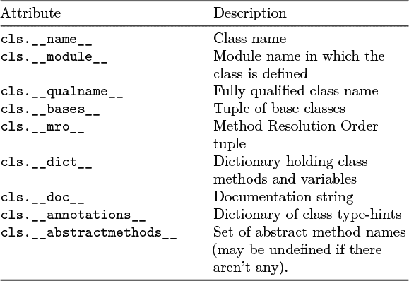


`cls.__name__` 属性包含简短的类名。`cls.__qualname__` 属性包含带有额外上下文信息的完全限定名称（如果类定义在函数内部，或者你创建了嵌套类定义，这可能非常有用）。`cls.__annotations__` 字典包含类级别的类型提示（如果有的话）。

Table 2 显示了实例 `i` 的特殊属性：

表 2：实例属性

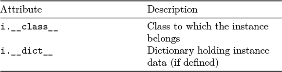

`__dict__` 属性通常存储所有与实例关联的数据的地方。然而，如果用户定义的类使用了 `__slots__`，则会使用更高效的内部表示，实例将不再有 `__dict__` 属性。

### 结语：保持简单

本章介绍了许多关于类的信息以及可以实现的各种自定义和控制方法。然而，在编写类时，保持简单往往是一个很好的策略。是的，你可以使用抽象基类、元类、描述符、类装饰器、属性、多重继承、混入（mixins）、模式和类型提示。但是，你也可以只写一个普通的类。很有可能这个类已经足够好了，而且所有人都能理解它在做什么。

从大局来看，后退一步并考虑一些通用的理想代码质量通常很有用。首先，最重要的是可读性至关重要——这一点往往会因为堆叠过多的抽象层而受到影响。其次，你应该尝试编写易于观察和调试的代码。此外，不要忘记使用 REPL。最后，使代码具有可测试性通常是良好设计的驱动力。如果你的代码无法被测试，或者测试起来太笨拙，那么可能有更好的组织解决方案的方法。

## 模块与包

Python 程序组织成模块（modules）和包（packages），通过 `import` 语句加载。本章将更详细地描述模块和包系统。重点是使用模块和包进行编程，而不是将代码打包以供部署给他人的过程。对于后者，你应该查阅 [`packaging.python.org/tutorials/packaging-projects/`](https://packaging.python.org/tutorials/packaging-projects/) 上的最新文档。

### 模块与 import 语句

任何 Python 源文件都可以作为模块导入。例如，考虑以下代码：

```
### module.py

a = 37

def func():

    print(f'func says that a is {a}')

class SomeClass:

    def method(self):

        print('method says hi')

print('loaded module')
```

该文件包含常见的编程元素，包括全局变量、函数、类定义和一个孤立语句。此示例用于说明模块加载的一些重要（有时是微妙的）特征。

要加载模块，请使用 `import module` 语句。例如：

```
>>> import module

loaded module

>>> module.a

37

>>> module.func()

func says that a is 37

>>> s = module.SomeClass()

>>> s.method()

method says hi

>>>
```

在执行导入（import）时，会发生几件事：

1. 找到模块的源代码。如果找不到，将抛出 `ImportError` 异常。
2. 创建一个新的模块对象。该对象用作模块内包含的所有全局定义的容器。它有时被称为“命名空间”（namespace）。
3. 在新创建的模块命名空间内执行模块源代码。
4. 如果没有发生错误，会在调用者中创建一个指向新模块对象的名称。该名称与模块名匹配，但没有任何文件后缀。例如，如果在文件 `module.py` 中找到代码，则模块的名称为 `module`。

在这些步骤中，第一步（定位模块）是最复杂的。新学者失败的一个常见原因是使用了错误的文件名或将代码放在未知位置。模块需要使用与变量名相同规则（字母、数字和下划线）正确命名的文件来定义，并且需要有 `.py` 后缀。例如 `module.py`。使用 `import` 时，你指定的名称不带文件后缀。因此，是 `import module` 而不是 `import module.py`（后者会产生一个相当困惑的错误信息）。该文件还需要放在 `sys.path` 中找到的目录之一。

其余步骤都与模块为代码定义一个孤立环境有关。出现在模块中的所有定义对于该模块都是孤立的。因此，用于变量、函数和类的名称不会有与其他其它模块中相同名称发生冲突的风险。在访问模块中的定义时，你使用完全限定名称，例如 `module.func()`。

`import` 执行所加载源文件中的所有语句。如果模块在定义对象之外还执行了计算或产生了输出，你将看到结果。例如示例中打印的 "loaded module" 消息。关于模块的一个常见困惑涉及对类的访问。模块始终定义一个命名空间，所以如果文件 `module.py` 定义了一个类 `SomeClass`，你使用名称 `module.SomeClass` 来引用该类。

要使用单个 `import` 导入多个模块，请使用逗号分隔的名称列表，如下：

```
import socket, os, re
```

有时，使用 `as` 限定符通过 `import` 修改用于引用模块的本地名称。例如：

```
import module as mo

mo.func()
```

后这种 `import` 样式在数据分析中是标准做法。例如，你经常看到：

```
import numpy as np

import pandas as pd

import matplotlib as plt
```

当模块被重命名时，新名称仅适用于出现 `import` 语句的上下文。其他程序模块仍然可以使用原始名称加载该模块。

更改导入模块名称可以是管理不同实现或编写可扩展程序的有用工具。例如，假设你有两个模块 `unixmodule.py` 和 `winmodule.py`，它们都定义了函数 `func()`，但涉及平台相关的实现。你可以编写如下选择性导入模块的代码：

```
if platform == 'unix':

    import unixmodule as module

elif platform == 'windows':

    import winmodule as module

...

r = module.func()
```

模块是 Python 中的一等对象。这意味着它们可以赋值给变量、放入数据结构中并作为数据在程序中传递。例如，上述示例中的 `module` 名称是一个指向对应模块对象的变量。

### 模块缓存

模块源代码只加载并执行一次，无论你使用多少次 `import` 语句。随后的 `import` 语句会将模块绑定到之前创建的模块对象。新学者的一个常见困惑是，当模块导入到交互式会话后，源代码被修改了（例如修复错误），重复 `import` 无法加载修改后的代码。这归于模块缓存。即使底层源代码已更新，Python 也不会重新加载已导入的模块。

你可以在 `sys.modules` 中找到所有当前加载模块的缓存，这是一个将模块映射到模块对象的字典。该字典的内容用于确定 `import` 是加载模块的新副本还是不是。从缓存中删除模块将强制它在下次 `import` 语句时重新加载。然而，由于模块重载章节中解释的原因，这通常是不安全的。

有时你会看到 `import` 这样用在函数内部：

```
def f(x):

    import math

    return math.sin(x) + math.cos(x)
```


乍一看，这种实现似乎会运行得极其缓慢——每次调用都要加载一个模块。实际上，`import` 的成本是微乎其微的——只会产生单次字典查找的开销，因为 Python 会立即在缓存中找到该模块。在函数内部使用 `import` 的主要反对意见是出于风格考虑的——通常会将所有的模块导入都列在文件的顶部，以便于查看。另一方面，如果你有一个很少被调用的特殊函数，将该函数的导入依赖放在函数体内部可以加快程序的加载速度。在这种情况下，你只有在实际需要时才会加载所需的模块。

### 从模块导入特定的名称

`from module import name` 语句用于将模块中的特定定义加载到当前命名空间中。它与 `import` 相同，不同之处在于，它不是创建一个指向新创建的模块命名空间的名称，而是将模块中定义的一个或多个对象的引用放入当前命名空间中：

```python
from module import func  # 导入模块并将 func 放入当前命名空间

func()                   # 调用 module.func()

module.func()            # 失败。NameError: module
```

如果你想导入多个定义，`from` 语句接受一个逗号分隔的名称列表。例如：

```python
from module import func, SomeClass
```

从语义上讲，`from module import name` 语句执行了从模块缓存到本地命名空间的名称拷贝。也就是说，Python 首先在后台执行 `import module`。随后，它将缓存赋值给本地名称，例如 `name = sys.modules['module'].name`。

一个常见的误解是认为 `import` 的 `from` 形式更高效——可能只加载了模块的一部分。事实并非如此。每当加载模块时，整个模块都会加载并存储在缓存中。

使用 `from` 形式导入函数不会改变它们的作用域规则。当函数查找变量时，它们只会在定义函数的文件中查找，而不会在导入和调用函数的命名空间中查找。例如：

```python
>>> from module import func

>>> a = 42

>>> func()
func says that a is 37

>>> func.__module__
'module'

>>> func.__globals__['a']
37

>>>
```

另一个相关的误解涉及全局变量的行为。例如，考虑以下代码，它同时导入了 `func` 和它使用的全局变量 `a`：

```python
from module import a, func

a = 42                      # 修改变量

func()                      # 打印 "func says a is 37"

print(a)                    # 打印 "42"
```

Python 中的变量赋值并不是存储操作。也就是说，此示例中的名称 `a` 并不代表某个存储值的“盒子”。初始的导入将本地名称 `a` 与原始对象 `module.a` 关联。然而，随后的重新赋值 `a = 42` 将本地名称 `a` 移动到了完全不同的对象上。此时，`a` 不再绑定到导入模块中的值。由于这种行为，无法通过使用 `from` 语句让变量表现得像 C 等语言中的全局变量一样。如果你想在程序中使用可变的全局程序参数，请将它们放在模块中，并使用 `import` 语句显式使用模块名（例如，使用 `module.a`）。

星号 `*` 通配符有时用于加载模块中的所有定义，但以下划线开头的定义除外。这是一个示例：

```python
# 将所有定义加载到当前命名空间

from module import *
```

`from module import *` 语句只能在模块的顶层使用。特别是，在函数体内部使用这种形式的导入是非法的。

模块可以通过定义列表 `__all__` 来精确控制通过 `from module import *` 导入的名称集。这是一个示例：

```python
### module: module.py

__all__ = [ 'func', 'SomeClass' ]

a = 37     # 不导出

def func():         # 导出
    ...

class SomeClass:    # 导出
    ...
```

在实践中，使用 `from module import *` 是不被鼓励的。过度使用会导致大量的混乱并污染本地命名空间。例如：

```python
from math import *

from random import *

from statistics import *

a = gauss(1.0, 0.25)        # 来自哪个模块???
```

显式指定名称通常要好得多：

```python
from math import sin, cos, sqrt

from random import gauss

from statistics import mean

a = gauss(1.0, 0.25)
```

### 循环导入

如果两个模块相互导入对方，就会出现一个奇怪的问题。例如，假设你有两个这样的文件：

```python
# ----------------------------
### moda.py
import modb

def func_a():
    modb.func_b()

class Base:
    pass

# ----------------------------
### modb.py
import moda

def func_b():
    print('B')

class Child(moda.Base):
    pass
```

这段代码中存在一种奇怪的导入顺序依赖。特别是，首先使用 `import modb` 运行正常，但如果你先使用 `import moda`，它就会因为关于 `moda.Base` 未定义的错误而崩溃。

要理解发生了什么，必须遵循控制流。`import moda` 开始执行 `moda.py`。它遇到的第一个语句是 `import modb`。因此，控制切换到 `modb.py`。该文件的第一个语句是 `import moda`。该导入并没有进入循环，而是通过模块缓存满足并继续执行 `modb.py` 的下一语句。这是好事——循环导入不会导致 Python 死锁。但在执行到此时，模块 `moda` 仅被部分评估。当控制到达 `class(moda.Base)` 语句时，它就崩溃了。

解决这个问题的一种方法是将 `import modb` 语句移动到真正需要定义的函数中：

```python
### moda.py
def func_a():
    import modb
    modb.func_b()

class Base:
    pass
```

你也可以将导入移动到文件的后部位置：

```python
### moda.py
def func_a():
    modb.func_b()

class Base:
    pass

import modb     # 必须在 Base 定义之后
```

这两种解决方案可能会在代码审查中引起质疑。大多数情况下，你不会看到模块导入出现在文件的末。循环导入的存在通常意味着代码组织存在问题。处理此问题的更好方法是将 `Base` 的定义移动到单独的文件 `base.py` 中，并重写 `modb.py` 为：

```python
### modb.py
import base

def func_b():
    print('B')

class Child(base.Base):
    pass
```

## 模块重载与卸载

对于已导入模块的重载或卸载，并没有可靠的支持。虽然你可以从 `sys.modules` 中移除模块，但这并不会将模块从内存中卸载。因为导入了该模块的其他模块仍然持有该缓存模块对象的引用。此外，如果模块中有类的实例，这些实例包含指向其类对象的引用，而类对象又持有指向定义它的模块的引用。


模块引用存在于许多地方，这一事实使得在修改实现后重新加载模块通常是不切合实际的。例如，如果你从 `sys.modules` 中删除一个模块并使用 `import` 重新加载它，这不会追溯地改变程序中之前所有对该模块的引用。相反，你将拥有一个由最近 `import` 语句创建的新模块的引用，以及一组由代码其他部分通过 `import` 创建的旧模块的引用。这通常不是你想要的结果，而且在任何理智的生产代码中都是不安全的，除非你能够仔细地控制整个执行环境。

`importlib` 库中有一个用于重新加载模块的 `reload()` 函数。你将已经加载的模块作为参数传递给它。例如：

```
>>> import module

>>> import importlib

>>> importlib.reload(module)

loaded module

<module 'module' from 'module.py'>

>>>
```

`reload()` 的工作原理是加载新版本的模块源代码，然后在已有的模块命名空间上执行它。这种操作并不会清除之前的命名空间。直观地说，这完全等同于你在不重启解释器的情况下，直接在旧代码之上输入新的源代码。

如果其他模块之前使用标准的 `import module` 语句导入了被重新加载的模块，那么重新加载将使它们像魔法一样看到更新后的代码。然而，这仍然存在许多危险。首先，重新加载不会重新加载被重加载文件可能导入的任何模块。它不是递归的——它只适用于给定 `reload()` 的单个模块。其次，如果任何模块使用了 `from module import name` 形式的导入，那么这些导入将无法看到重新加载的影响。最后，如果已经创建了类实例，重新加载不会更新这些底层的类定义。事实上，你现在会在同一个程序中拥有同一个类的两个不同定义（一个是在重加载时仍在使用的所有现有实例中的旧定义，另一个是用于新实例的类定义）。这几乎总是会引起困惑的。

最后，需要注意的是，Python 的 C/C++ 扩展无法以任何方式安全地卸载或重新加载。Python 对此不提供支持，而且底层操作系统也可能禁止这样做。因此，对于这种情况，你最好的解决办法是重启 Python 解释器进程。

### 模块编译

当模块首次被导入时，它们会被编译成解释器字节码。这段代码被写入特殊 `__pycache__` 目录下的 `.pyc` 文件中。该目录通常与原始 `.py` 文件位于同一目录。当程序在后续运行时发生相同的导入时，将加载编译后的字节码。这显著加快了导入过程。

字节码缓存是一个自动过程，你几乎不需要担心它。如果原始源代码发生变化，文件会自动重新生成。它能够正常工作。

尽管如此，仍然有几个理由需要了解这种缓存和编译过程。首先，有时 Python 文件会被（通常是不小心）安装在用户没有操作系统权限创建所需的 `__pycache__` 目录的环境中。Python 仍然可以工作，但每次导入都会加载原始源代码并将其编译为字节码。程序的加载速度将比所需的要慢得多。同样，在部署或打包 Python 应用时，确保它也包含编译后的字节码可能是有益的。这样做可以显著提高程序的启动速度。

了解模块缓存的另一个良好理由是意识到那些会干扰缓存的编程技术。涉及动态代码生成和 `exec()` 函数的高级元编程技术会破坏字节码缓存的益处。一个著名的例子是使用 `dataclasses`：

```
from dataclasses import dataclass

@dataclass

class Point:

    x: float

    y: float
```

`dataclasses` 通过生成作为文本片段的方法函数并使用 `exec()` 执行它们来工作。这些生成的代码没有被导入系统缓存。对于单个类定义，你不会注意到这一点。但是，如果你有一个包含 100 个 `dataclasses` 的模块，你可能会发现它的导入速度比一个以普通方式（尽管不那么紧凑）写出类的同类模块要慢近 20 倍。

### 模块搜索路径

在导入模块时，解释器会搜索 `sys.path` 中的目录列表。`sys.path` 中的第一个项目通常是一个空字符串 `''`，它指向当前工作目录。或者，如果你在脚本上运行 python，`sys.path` 中的第一个项目是脚本所在的目录。`sys.path` 中的其他项目通常由目录名称和 `.zip` 存档文件组成。`sys.path` 中条目的列表顺序决定了导入模块时使用的搜索顺序。要向搜索路径添加新条目，请将其添加到此列表中。这可以直接完成，也可以通过设置 `PYTHONPATH` 环境变量来实现。例如，在 Unix 上

```bash
bash $ env PYTHONPATH=/some/path python3 script.py
```

ZIP 存档文件提供了一种将模块集合打包到单个文件的方便方法。例如，假设你了两个模块 `foo.py` 和 `bar.py`，并将它们放在文件 `mymodules.zip` 中。可以如下方式将该文件添加到 Python 搜索路径：

```
import sys

sys.path.append('mymodules.zip')

import foo, bar
```

`.zip` 文件目录结构中的特定位置也可以用于路径。此外，`.zip` 文件可以与普通的路径组件混合。这里有一个例子：

```
sys.path.append('/tmp/modules.zip/lib/python')
```

ZIP 文件并不一定有 `.zip` 后缀才能使用。从历史上来看，路径上也经常遇到所谓的 `.egg` 文件。`.egg` 文件源于一个早期的 Python 包管理工具 `setuptools`。然而，一个 `.egg` 文件仅仅是一个普通的 `.zip` 文件或目录，加上了一些额外的元数据（例如版本号、依赖项等）。

### 作为主程序执行

虽然本节是关于 `import` 语句的，但 Python 文件经常作为主脚本执行。例如：

```
% python3 module.py
```

每个模块都定义了一个变量 `__name__`，该变量包含模块名。代码可以检查此变量以确定它们执行所在的模块。解释器的顶层模块命名为 `__main__`。在命令行上指定或交互式输入的程序运行在 `__main__` 模块内部。有时，程序可能会改变其行为，取决于它是作为模块导入的还是在 `__main__` 中运行。例如，一个模块可能包含一些测试代码，这些代码在模块作为主程序使用时执行，但在模块仅被另一个模块导入时不会执行。

```
### 检查是否作为程序运行

if __name__ == '__main__':

      是。作为主脚本运行

     语句

else:

     # 不，我一定是被模块导入的

     语句
```

打算作为库使用的源文件如果包含任何可选的测试或示例代码，就会使用这种技术。例如，如果你正在开发一个模块，可以将测试库功能的调试代码放在所示的 `if` 语句中，并作为主程序运行 Python 你的模块。当用户导入你的库时，这些代码就不会运行。

如果你已经制作了一个 Python 代码目录，只要它包含一个特殊的 `__main__.py` 文件，你就可以执行该目录。例如，如果你制作了这样的目录：

```
myapp/

    foo.py

    bar.py

    __main__.py
```


你可以通过输入 `python3 myapp` 在其运行 Python。执行将在 `__main__.py` 文件中开始。如果你将 `myapp` 目录转换为 ZIP 压缩包，这种方法同样有效。输入 `python3 myapp.zip` 将查找是否存在顶层 `__main__.py` 文件，如果找到，则执行它。

### 包 (Packages)

对于除了简单程序以外的所有程序，Python 代码都被组织成一个“包”（package）。包是分组在共同顶层名称下的模块集合。这种分组有助于解决不同应用程序中使用的模块名称之间的冲突，并使你的代码与其他人的代码分开。包是通过创建一个具有独特名称的目录，并在该目录中放置一个初始为空的 `__init__.py` 文件来定义的。然后你可以根据需要在该目录中放置额外的 Python 文件和子包。例如，一个包的结构如下：

```
graphics/

      __init__.py

      primitive/

         __init__.py

         lines.py

         fill.py

         text.py

         ...

      graph2d/

         __init__.py

         plot2d.py

         ...

      graph3d/

         __init__.py

         plot3d.py

         ...

      formats/

         __init__.py

         gif.py

         png.py

         tiff.py

         jpeg.py
```

`import` 语句用于从包加载模块的方法与加载简单模块相同，只是现在的名称变得长了。例如：

```python
### 完整路径

import graphics.primitive.fill

...

graphics.primitive.fill.floodfill(img, x, y, color)

### 加载特定子模块

from graphics.primitive import fill

...

fill.floodfill(img, x, y, color)

### 从子模块加载特定函数

from graphics.primitive.fill import floodfill

...

floodfill(img, x, y, color)
```

每当包的任何部分第一次被导入时，`__init__.py` 文件中的代码会首先执行。如所述，该文件可以是空的，但也可以包含用于执行包特定初始化的代码。如果导入一个深层嵌套的子模块，在遍历目录结构时遇到的所有 `__init__.py` 文件都会被执行。因此，`import graphics.primitive.fill` 语句将首先执行 `graphics/` 目录下的 `__init__.py` 文件，然后执行 `primitive/` 目录下的 `__init__.py` 文件。

`import` 语句的一个关键特性是所有模块导入都需要绝对路径或完全限定的包路径。这包括包内部使用的 `import` 语句。例如，假设 `graphics.primitive.fill` 模块想要导入 `graphics.primitive.lines` 模块。简单的 `import lines` 语句将不起作用——你会得到一个 `ImportError` 异常。相反，你需要像这样完全限定导入路径：

```python
### graphics/primitives/fill.py

# 完全限定的子模块导入

from graphics.primitives import lines
```

遗憾的是，这样写出完整的包名既麻烦又脆弱。例如，有时重命名包是有意义的（可能你想要重命名它以便使用不同的版本）。如果包名被硬编码在代码中，你就无法这样做。因此，更好的选择是使用如下所示的包相对导入：

```python
### graphics/primitives/fill.py

### 包相对导入

from . import lines
```

在这里，语句 `from . import lines` 中使用的 `.` 指向导入模块所在的目录。因此，该语句会在 `fill.py` 文件相同的目录中查找 `lines` 模块。

相对导入也可以指定包含在同一包不同目录下的子模块。例如，如果模块 `graphics.graph2d.plot2d` 想要导入 `graphics.primitive.lines`，它将使用这样的语句：

```python
### graphics/graph2d/plot2d.py

from ..primitive import lines
```

在这里，`..` 向上移动一级目录，而 `primitive` 进入另一个子包目录。

相对导入只能使用 `import` 语句的 `from module import symbol` 进行指定。因此，如 `import ..primitive.lines` 或 `import .lines` 等语句是语法错误。此外，`symbol` 必须是简单的标识符。因此，像 `from .. import primitive.lines` 的语句也是非。最后，相对导入只能在包内部使用；使用相对导入引用位于文件系统中不同目录的模块是非法的。

### 作为脚本运行包子模块

组织成包的代码与简单脚本具有不同的运行时环境。它有一个包含的包名、子模块以及相对导入的使用（相对导入仅在包内部有效）。一个不再起的功能是直接在包源文件上运行 Python。例如，假设你正在处理 `graphics/graph2d/plot2d.py` 文件，并在底部添加了一些测试代码：

```python
### graphics/graph2d/plot2d.py

from ..primitive import lines, text

class Plot2D:

    ...

if __name__ == '__main__':

    print('Testing Plot2D') p = Plot2D()

    ...
```

如果你尝试直接运行它，你会得到一个关于相对导入语句的崩溃：

```bash
bash $ python3 graphics/graph2d/plot2d.py

Traceback (most recent call last):
  File "graphics/graph2d/plot2d.py", line 3, in <module>
    from ..primitive import lines, text
ImportError: attempted relative import with no parent package
```

你无法进入包目录并运行它：

```bash
bash $ cd graphics/graph2d
bash $ python3 plot2d.py

Traceback (most recent call last):
  File "plot2d.py", line 3, in <module>
    from ..primitive import lines, text
ImportError: attempted relative import with no parent package
```

要将子模块作为主脚本运行，你需要使用 `-m`。例如：

```bash
bash $ python3 -m graphics.graph2d.plot2d

Testing Plot2D
```

`-m` 指定特定的模块或包作为主模块。Python 将以适当的环境运行该模块，以使导入生效。Python 的许多内置包都有可以通过 `-m` 使用的“秘密”功能。其中最为人知的是使用 `python3 -m http.server` 从当前目录运行 Web 服务器。你可以通过自己的包提供类似的功能。

### 控制包命名空间 (Package Namespace)

包的主要用途作为代码的顶层容器。有时用户只会导入顶层名称而不包含其他。例如：

```python
import graphics
```

此导入没有指定任何特定的子模块。它也没有让包的其他部分可用。例如，你会发现这样的代码会失败：

```python
import graphics

graphics.primitive.fill.floodfill(img,x,y,color)  # 失败！
```

当只给出顶层包导入时，唯一被导入的是关联的 `__init__.py` 文件。在示例中，它是 `graphics/__init__.py` 文件。

`__init__.py` 文件的主要用途是构建和或管理顶层包命名空间的内容。通常，这涉及到从低级子模块导入选定的函数、类和其他对象。例如，假设示例中的 `graphics` 包由数百个低级函数组成，但这些细节大部分被封装在少数高级类中。`__init__.py` 文件可能会只暴露这些类：

```python
### graphics/__init__.py

from .graph2d.plot2d import Plot2D

from .graph3d.plot3d import Plot3D
```

有了这个 `__init__.py` 文件，`Plot2D` 和 `Plot3D` 名称将出现在包的顶层。用户随后可以像认为 `graphics` 是一个简单模块一样使用这些名称：


```python
from graphics import Plot2D

plt = Plot2D(100, 100)

plt.clear()

...
```

这对于用户来说通常要方便得多，因为他们不需要知道你实际上是如何组织代码的。在某种意义上，你是在代码结构之上 set 加了一层更高层次的抽象。Python 标准库中的许多所谓的“模块”都是以这种方式构建的。例如，流行的 `collections` 模块实际上是一个包。`collections/__init__.py` 文件整合了来自几个不同位置定义，并将它们作为一个单一的整合后的命名空间呈现给用户。

### 控制包的导出

一个组织上的问题涉及 `__init__.py` 文件与低级子模块之间的交互。例如，包的不同子模块往往倾向于知道哪些符号需要导出到顶层。然而，导出符号的实际工作是在 `__init__.py` 中完成的。这使得阅读包的代码以及完全理解其高层组织结构变得令人困惑。

为了更好地管理这一点，包的子模块通常通过定义 `__all__` 变量来声明显式的导出列表。这是一个应该被推送到包命名空间上一层的名称列表。例如：

```python
### graphics/graph2d/plot2d.py

__all__ = ['Plot2D']

class Plot2D:

    ...
```

相关的 `__init__.py` 文件然后使用类似 `*` 的导入导入其子模块：

```python
### graphics/graph2d/__init__.py

### 只加载 __all__ 变量中显式列出的名称

from .plot2d import *

### 将 __all__ 传播到下一层（如果需要）

__all__ = plot2d.__all__
```

这种提升过程随后一直持续到顶层包的 `__init__.py`。例如：

```python
### graphics/__init__.py

from .graph2d import *

from .graph3d import *

### 整合导出

__all__ = [

    *graph2d.__all__,

    *graph3d.__all__
]
```

基本原理是，包的每个组件都使用 `__all__` 变量显式声明其导出内容。`__init__.py` 文件然后根据需要传播这些导出。在实践中，这可能会变得复杂，但这种方法避免了将特定的导出名称硬编码到 `__init__.py` 文件中的问题。相反，如果子模块想要导出某些内容，它的名称只需要在一个地方（即 `__all__` 变量）中列出。然后通过魔法，它会传播到包命名空间中的正确位置。

值得注意的是，尽管在用户代码中使用 `*` 导入是不被鼓励的，但在包的 `__init__.py` 文件中是一种广泛的做法。它在包中有效的原因是它通常更受控且局限——由 `__all__` 变量的内容驱动，而不是由于“让我们直接导入所有内容”这种随意的态度。

### 包数据

有时包包含（在内部）需要加载的数据（而不是源代码）。在包内部，`__file__` 变量将为你提供特定源文件的位置信息。然而，包是复杂的。它们可能被封装在 ZIP 归档文件中，或者从异常的环境加载。`__file__` 变量本身可能是不可靠的（甚至未定义）。因此，加载数据文件通常不是简单的将文件名传递给内置的 `open()` 函数并读取某些数据。

要读取包数据，请使用 `pkgutil.get_data(package, resource)`。假设你的包看起来如下所示：

```
mycode/

    resources/

        data.json

    __init__.py

    spam.py

    yow.py
```

要从文件 `spam.py` 加载文件 `data.json`，可以这样做：

```python
### spam.py

import pkgutil

import json

def func():

    rawdata = pkgutil.get_data(__package__, 'resources/data.json')

    data = json.loads(rawdata)

    print(data)
```

### 模块对象

模块是类对象。表 1 列出了模块常见的属性。

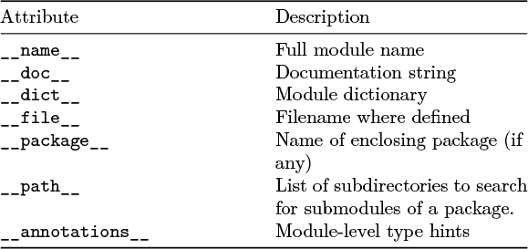

`__dict__` 属性是一个表示模块空间的字典。`__name__` 属性通常用于脚本编写，检查文件是否作为主程序运行。`__package__` 属性包含所在包的名称（如果设置）。`__path__` 属性是搜索包子模块的目录列表。

### 属性访问

讨论 `getattr()`


在 `setup()` 调用中，`packages` 是所有包目录的列表，而 `scripts` 是脚本文件列表。如果你的软件没有任何匹配的组件（即没有脚本），可以省略其中任何一个参数。`name` 是你的包的名称，`version` 是字符串格式的版本号。`setup()` 调用还支持许多其他参数，用于提供关于你包的各种元数据。完整列表请见 . . .

创建一个 `setup.py` 文件就足以创建你软件的源码分发版。输入以下 shell 命令来制作源码分发：

```
bash $ python setup.py sdist
```

这会在 `spam/dist` 目录下创建一个层诸如 `spam-1.0.tar.gz` 或 `spam-1.0.zip` 的归档文件。这就是你提供给他人安装你的软件的文件。要进行安装，用户可以使用如 `pip` 的命令。例如：

```
shell $ python3 -m pip install spam-1.0.tar.gz
```

这会将软件安装到本地 Python 分发版中，并供通用使用。代码通常会被安装到 Python 库中名为 `site-packages` 的目录。要找到该目录的确切位置，请检查 `sys.path` 的值。在基于 UNIX 的系统上，脚本通常安装在与 Python 解释器相同的目录中，或者在 Windows 上的“Scripts”目录中（在典型的安装中位于 `"C:\Python38\Scripts"`）。

如果脚本的第一行以 `#!` 开头并包含 "python" 字样，安装程序将重写该行以指向本地安装的 Python。因此，如果你编写了硬编码了特定 Python 路径（如 `/usr/local/bin/python`）的脚本，它们在安装到 Python 路径不同的其他系统时仍然可以正常工作。

必须强调的是，这里描述的 `setuptools` 的用法绝对是极简的。较大的项目可能涉及 C/C++ 扩展、复杂的包结构、示例等。涵盖所有工具以及部署此类代码的可能方法超出了本书的范围。你应该咨询 [`python.org`](https://python.org) 和 [`pypi.org`](https://pypi.org) 上的各种资源以获取建议。

### 结语：从包开始

在开始编写一个新程序时，从一个简单的单 Python 文件开始很容易的。例如，你可能会写一个名为 "program.py" 的脚本并从它开始。虽然这对于一次性程序和短任务运行良好良好，但最终你的“脚本”会开始增加功能。最终，你可能想将其拆分成多个文件。就在那时，问题往往会产生。

考虑到这一点，从一开始就养成将所有程序作为一个包习惯可能更有意义。例如，与其创建一个名为 "program.py" 的文件，也许你应该创建一个名为 "program" 的程序包目录：

```
program/
    __init__.py

    __main__.py
```

将你的起始代码放在 `__main__.py` 中，并使用 `python -m program` 等命令运行你的程序。随着代码增加，开始向包中添加新文件并使用包相对导入。使用包的优势是你的所有代码都保持隔离。你可以随心所欲命名命名，而不必与其他包、标准库模块或同事编写的代码发生冲突。虽然设置包在开始时需要额外的工作，但它可能会在以后为你节省很多麻烦。

## 输入与输出

输入和输出（I/O）是所有程序的一部分。本章描述了 Python I/O 的基本要素，包括数据编码、命令行选项、环境变量、文件 I/O 和数据序列化。特别关注了鼓励正确 I/O 处理的编程技术和抽象。本节最后提供了与 I/O 相关的常用标准库模块的概述。

### 数据表示

I/O 的主要问题是外部世界。为了与其通信，数据必须被正确表示以便进行操作。在最底层，Python 处理两种基本数据类型：表示任何类型的原始未解释数据的字节（bytes），以及表示 Unicode 字符的文本（text）。

为了表示字节，使用了两个内置类型 `bytes` 和 `bytearray`。`bytes` 是一个由整数字节值的不可变字符串。`bytearray` 是一个可变的字节数组，其行为非常类似于字节字符串和列表的结合。它的可变性使其适合以更具增量的方式构建字节组，这在从碎片组装数据时经常发生。以下示例说明了 `bytes` 和 `bytearray` 的一些特性：

```
### 指定字节字面量（注意：b' 前缀）

a = b'hello'

### 从整数列表指定字节

b = bytes([0x68, 0x65, 0x6c, 0x6c, 0x6f])

### 从部分创建并填充 bytearray

c = bytearray()

c.extend(b'world')   # d = 'world'

c.append(0x21)       # d = 'world!'

### 访问字节值

print(a[0])     # --> 输出 104

for x in b:     # 输出 104 101 108 108 111

   print(x)
```

访问 `byte` 和 `bytearray` 对象的单个元素产生整数字节值，而不是单字符字节字符串。这与文本字符串不同，是一个常见的用法错误。

文本由 `str` 数据类型表示，并存储为 Unicode 代码点的数组。例如：

```
d = 'hello'     # 文本 (Unicode)

len(d)          # --> 5

print(d[0])     # 打印 'h'
```

Python 在字节和文本之间保持了严格的分离。两种类型之间永远不会自动转换，涉及混合类型的比较结果为 `False`，且任何混合字节和文本的操作都会导致错误。例如：

```
a = b'hello'     # 字节

b = 'hello'      # 文本

c = 'world'      # 文本

print(a == b)    # -> False

d = a + c        # TypeError: can't concat str to bytes

e = b + c        # -> 'helloworld' (两者都是字符串)
```

在执行 I/O 时，你需要确保你正在处理正确类型的数据表示。如果你在处理文本，请使用文本字符串。如果你在处理二进制数据，请使用字节。

### 文本编码与解码

如果处理文本，从输入读取的所有数据必须解码，所有写入输出的数据必须编码。为了在文本和字节之间进行显式转换，文本和字节对象分别有 `encode(text [,errors])` 和 `decode(bytes [,errors])` 方法。例如

```
a = 'hello'             # 文本

b = a.encode('utf-8')   # 编码为字节

c = b'world'            # 字节

d = c.decode('utf-8')   # 解码为文本
```

`encode()` 和 `decode()` 都需要编码的名称，例如 `'utf-8'` 或 `'latin-1'`。表 1 中的编码是常见的。

表 1：常用编码

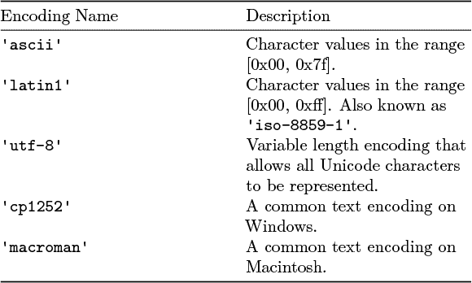

此外，编码方法还接受一个可选的 `errors` 参数，指定在出现编码错误时的行为。`errors` 是 表 2 中的值之一。

表 2：错误处理选项

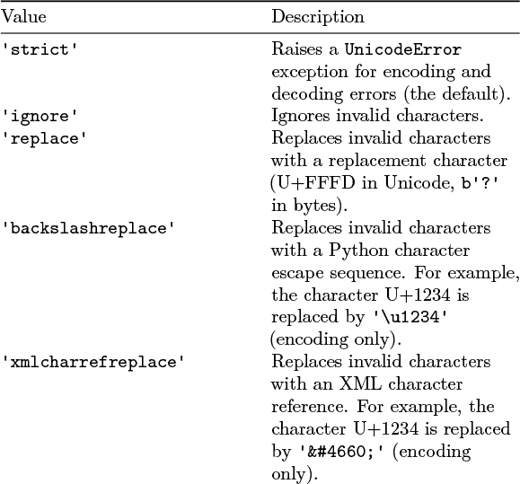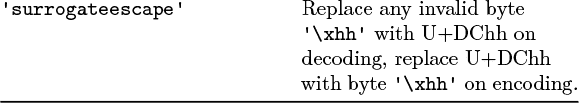

`'backslashreplace'` 和 `'xmlcharrefreplace'` 错误策略将无法表示的字符表示为一种形式，使其更容易被视为简单的 ASCII 文本或 XML 字符引用。这对于调试很有用。


'surrogateescape' 错误处理策略允许退化的字节数据（即不符合预期编码规则的数据）无论使用何种文本编码，都能在解码/编码循环中完整地保留。具体而言，`s.decode(enc, 'surrogateescape').encode(enc, 'surrogateescape') == s`。这种对数据的往返保留对于某些系统接口非常有用，这些接口期望使用文本编码，但由于 Python 控制之外的问题，无法绝对保证。Python 不会因为编码错误而丢弃/破坏数据，而是使用代理编码（surrogate encoding）将其“原样”嵌入。以下示例展示了对编码不正确的 UTF-8 字符串的处理行为：

```
>>> a = b'Spicy Jalape\xf1o'   # Invalid UTF-8

>>> a.decode('utf-8')

Traceback (most recent call last):

  File "<stdin>", line 1, in <module>

UnicodeDecodeError: 'utf-8' codec can't decode byte 0xf1

in position 12: invalid continuation byte

>>> a.decode('utf-8', 'surrogateescape')

'Spicy Jalape\udcf1o'

>>> # Encode the resulting string back into bytes

>>> _.encode('utf-8', 'surrogateescape')

b'Spicy Jalape\xf1o'

>>>
```

### 文本与字节格式化

在处理文本和字节字符串时，常见的问题是字符串的转换和格式化。例如，将浮点数转换为具有指定宽度精度的字符串。要格式化单个值，可以使用 `format()` 函数：

```
x = 123.456

format(x, '0.2f')       # '123.46'

format(x, '10.4f')      # '  123.4560'

format(x, '<*10.2f')    # '123.46****'
```

`format()` 的第二个参数是格式指定符。该指定符的一般格式通常为 `[[fill[align]][sign][0][width][,][.precision][type]`，其中 `[]` 包围的每个部分都是可选的。`width` 指定符指定要使用的最小字段宽度，`align` 指定符是用于字段内左对齐、右对齐和居中对齐的 `<`, `>`, 或 `ˆ`。可选的填充字符 `fill` 用于填充空间。例如：

```
name = 'Elwood'

r = format(name, '<10')     # r = 'Elwood    '

r = format(name, '>10')     # r = '    Elwood'

r = format(name, 'ˆ10')     # r = '  Elwood  '

r = format(name, '*ˆ10')    # r = '**Elwood**'
```

`type` 指定符指示数据的类型。表 3 列出了支持的格式代码。如果未提供，默认格式代码为字符串的 `s`、整数的 `d` 和浮点数的 `f`。

表 3：格式代码

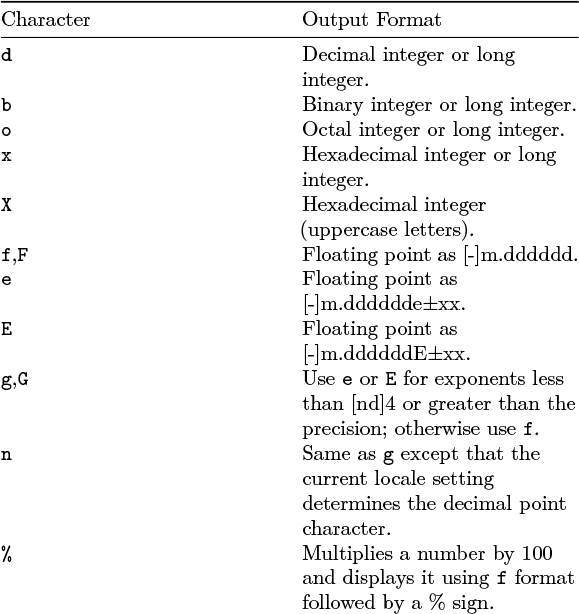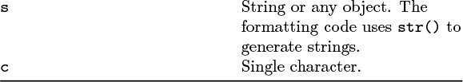

格式指定符的符号部分是 `+`、`-` 或空格之一。`+` 表示所有数字都应使用前导符号。`-` 是默认值，且仅为负数添加符号字符。空格则为正数添加前导空格。

可选的逗号（`,`）可以出现在宽度和精度之间。这包括千分位分隔符。例如：

```
x = 123456.78

format(x, '16,.2f')   # '      123,456.78'
```

指定符的 `precision` 部分提供了用于小数的精度位数。如果为数字的字段 `width` 前添加了前导 `0`，则数值将用前导 0 填充空间。以下是格式化不同类型数字的示例：

```
x = 42

r = format(x, '10d')        # r = '        42'

r = format(x, '10x')        # r = '        2a'

r = format(x, '10b')        # r = '    101010'

r = format(x, '010b')       # r = '0000101010'

y = 3.1415926

r = format(y, '10.2f')      # r = '      3.14'

r = format(y, '10.2e')      # r = '  3.14e+00'

r = format(y, '+10.2f')     # r = '     +3.14'

r = format(y, '+010.2f')    # r = '+000003.14'

r = format(y, '+10.2%')     # r = '  +314.16%'
```

对于更复杂的字符串格式化，可以使用 f-strings。例如：

```
x = 123.456

f'Value is {x:0.2f}'        # 'Value is 123.46'

f'Value is {x:10.4f}'       # 'Value is   123.4560'

f'Value is {2*x:*<10.2f}'   # 'Value is 246.91****'
```

在 f-string 中，形式为 `{expr:spec}` 的文本会被 `format(expr, spec)` 的值替换。`expr` 可以是任意表达式，只要它不包含 `{`、`}` 或 `\` 字符。格式指定符本身的部分也可以可选由其他表达式提供。例如：

```
y = 3.1415926

width = 8

precision=3

r = f'{y:{width}.{precision}f}'   # r = '   3.142'
```

如果用 `=` 结束 `expr`，则 `expr` 的字面量文本也会包含在结果中。例如：

```
x = 123.456

f'{x=:0.2f}'        # 'x=123.46'
```


`logging` 将在本章稍后的部分进行简要描述。

### 读取命令行选项

当 Python 启动时，命令行选项会以文本字符串的形式存储在列表 `sys.argv` 中。第一个项目是程序的名称。后续项目是在程序名称之后命令行上的选项。以下程序展示了手动处理简单命令行参数的最小原型：

```python
def main(argv):
    if len(argv) != 3:
        raise SystemExit(
              f'Usage : python {argv[0]} inputfile outputfile\n')
    inputfile  = argv[1]
    outputfile = argv[2]
    ...

if __name__ == '__main__':
    import sys
    main(sys.argv)
```

为了更好的代码组织、测试以及类似的原因，通常编写一个专门的 `main()` 函数来接收列表形式的命令行选项（如果有），而不是直接读取 `sys.argv` 是好做法。你可以在程序末尾包含一小段代码，如所示，将命令行选项传递给 `main()` 函数。

`sys.argv[0]` 包含正在执行的脚本名称。对于想要报告错误的命令行脚本，编写描述性的帮助信息并抛出 `SystemExit` 是标准做法。

虽然你可以为简单脚本手动处理命令行选项，但对于复杂的命令行处理，请考虑使用 `argparse` 模块。这是一个示例：

```python
import argparse

def main(argv):
    p = argparse.ArgumentParser(description="This is some program")
    # 位置参数
    p.add_argument("infile")
    # 带有参数的选项
    p.add_argument("-o","--output", action="store")
    # 设置布尔标志的选项
    p.add_argument("-d","--debug", action="store_true", default=False)
    # 解析命令行
    args = p.parse_args(args=argv)
    # 取回选项设置
    infile    = args.infile
    output    = args.output
    debugmode = args.debug
    print(infile, output, debugmode)

if __name__ == '__main__':
    import sys
    main(sys.argv[1:])
```

此示例仅展示了 `argparse` 模块最简单的用法。标准库文档提供了更高级的用法。还有像 `click` 和 `docopt` 这样的第三方模块可以简化编写更复杂的命令行解析器。

最后，命令行选项可能会使用无效的文本编码提供给 Python。此类参数仍然会被接收，但它们将使用第 X 页描述的 `'surrogateescape'` 错误处理程序进行编码。如果这些参数以后包含在任何类型的文本输出中，你就需要注意这一点，并且避免崩溃至关重要（这可能并不关键——不要为无关紧要的边缘情况过度代码）。

### 环境变量

有时数据通过在命令行 shell 中设置的环境变量传递给程序。例如，可以使用类似 `env` 的 shell 命令启动 Python 程序：

```bash
bash $ env SOMEVAR=somevalue python3 somescript.py
```

环境变量以文本字符串的形式在映射 `os.environ` 中访问。

这是一个示例：

```python
import os

path = os.environ['PATH']
user = os.environ['USER']
editor = os.environ['EDITOR']
val = os.environ['SOMEVAR']
... 等 ...
```

要修改环境变量，请设置 `os.environ` 变量。例如：

```python
os.environ['NAME'] = 'VALUE'
```

对 `os.environ` 的修改会影响运行中的程序和之后创建的子进程（例如，通过 `subprocess` 模块创建的进程）。

与命令行选项一样，编码错误的环境变量可能会产生使用 `'surrogateescape'` 错误处理策略的字符串。

### 文件和文件对象

要打开文件，请使用内置的 `open()` 函数。通常，`open()` 接收文件名和一个文件模式。它经常与 `with` 语句结合上下文管理器使用。以下示例说明了处理文件的一些常见用法模式：

```python
# 一次性将文本文件读取为字符串
with open('filename.txt', 'rt') as file:
    data = file.read()

# 按行读取文件
with open('filename.txt', 'rt') as file:
    for line in file:
        ...

# 写入文本文件
with open('out.txt', 'wt') as file:
    file.write('Some output\n')
    print('More output', file=file)
```

在大多数情况下，使用 `open()` 是非常直接的。你只需提供想要打开的文件名以及文件模式即可。例如：

```python
open('name.txt')        # 打开 "name.txt" 用于读取
open('name.txt', 'rt')  # 打开 "name.txt" 用于读取（相同）
open('name.txt', 'wt')  # 打开 "name.txt" 用于写入
open('data.bin', 'rb')  # 二进制模式读取
open('data.bin', 'wb')  # 二进制模式写入
```

对于大多数程序，你永远不需要比这些简单示例更多的内容来处理文件。然而，有一些特殊情况和 `open()` 的更深奥的特性值得了解。接下来的章节将更详细地讨论 `open()`。

### 文件名

要打开文件，请使用内置的 `open()` 函数。通常，`open()` 接收文件名和一个文件模式。它经常与 `with` 语句结合上下文管理器使用。

除了文本和字节之外，任何实现了特殊方法 `__fspath__()` 的对象都可以作为名称。这是使得标准库模块（如 `pathlib`）运行的机制。例如：

```python
>>> pathlib import Path
>>> p = Path('Data/portfolio.csv')
>>> p.__fspath__()
'Data/portfolio.csv'
```

最后，文件名可以作为低级整数文件描述符给出。这要求“文件”已经在系统中以某种方式打开。也许它对应于某个网络套接字、管道或其他暴露了文件描述符的系统资源。以下是一个使用 `os` 模块直接打开文件然后将其转换为适当文件对象的示例：

```python
>>> import os
>>> fd = os.open('/etc/passwd', os.O_RDONLY)
>>> fd
3
>>> file = open(fd, 'rt')
>>> file
<_io.TextOWrapper name=3 mode='rt' encoding='UTF-8'>
>>> data = file.read()
>>>
```

当像这样打开已的文件描述符时，返回的文件的 `close()` 方法也会关闭底层的描述符。可以通过向 `open()` 传递 `closefd=False` 来禁用此。例如：

```python
file = open(fd, 'rt', closefd=False)
```


打开文件时，你需要指定一个文件模式。核心文件模式包括用于读取的 `'r'`、用于写入的 `'w'` 以及用于追加的 `'a'`。`'w'` 模式用新内容替换任何现有文件。`'a'` 模式打开文件进行写入，并将文件指针置于文件末尾，以便追加新数据。

特殊的文件模式 `'x'` 可用于写入文件，但前提是该文件尚不存在。这是一种防止意外覆盖现有数据的很有用方法。对于此模式，如果文件已经存在，则会抛出 `FileExistsError` 异常。

Python 在文本和二进制数据之间有严格的区分。要指定数据类型，你可以在文件模式后附加 `'t'` 或 `'b'`。例如，文件模式 `'rt'` 以文本模式打开文件进行读取，而 `'rb'` 则以二进制模式打开文件进行读取。该模式决定了如 `f.read()` 等文件相关方法返回的数据类型。在文本模式下，返回的是字符串；在二进制模式下，返回的是字节（bytes）。

通过提供加号（`+`）字符，可以打开二进制文件进行就更新，例如 `'rb+'` 或 `'wb+'`。当文件以更新模式打开时，你可以同时执行输入和输出，前提是所有输出操作在任何后续输入操作之前刷新（flush）其数据。如果使用 `'wb+'` 模式打开文件，其长度首先会被截断为零。更新模式的一个常见用途是结合 `seek` 操作为文件内容提供随机读写访问。

### I/O 缓冲

默认情况下，打开文件时会启用 I/O 缓冲。通过 I/O 缓冲机制，I/O 操作以较大的块进行执行，以避免过多的系统调用。例如，写入操作将开始填充内部内存缓冲区，只有当缓冲区填满时才会实际发生输出。通过向 `open()` 提供 `buffering` 参数可以更改此行为。例如：

```python
# 打开一个无 I/O 缓冲的二进制模式文件
with open('data.bin', 'wb', buffering=0) as file:
    file.write(data)
    ...
```

值 `0` 指定无缓冲 I/O，且仅对二进制模式文件有效。值 `1` 指定行缓冲，通常只对文本模式文件有意义。任何其他正值表示使用的缓冲区大小（以字节计）。如果没有指定缓冲值，默认行为取决于文件类型。如果是普通文件（即在磁盘上的文件），缓冲按块管理，缓冲区大小设置为 `io.DEFAULT_BUFFER_SIZE`。这通常是 `4096` 字节的小倍数，可能会随系统而异。如果文件代表交互式终端，则使用行缓冲。

对于普通程序，I/O 缓冲通常不是主要考虑。然而，缓冲可能会影响涉及进程间活动通信的应用。例如，经常出现的问题是两个通信的子进程由于某些内部缓冲问题导致死锁（即：一个进程向缓冲区写入数据，但接收者看不到这些数据，因为缓冲区没有被刷新）。此类问题通常可以通过指定无缓冲 I/O 或在关联文件上使用显式的 `flush()` 调用来解决。例如：

```python
file.write(data)
file.write(data)
...
file.flush()       # 确保所有数据都从缓冲区写入
```

### 文本模式编码

对于文本模式打开的文件，可以使用 `encoding` 和 `errors` 参数指定可选的编码和错误处理策略。例如：

```python
with open('file.txt', 'rt', encoding='utf-8', errors='replace') as file:
    data = file.read()
```

传递给 `encoding` 和 `errors` 参数的值与它们对于字符串和字节的 `encode()` 和 `decode()` 方法含义相同。

默认文本编码由 `sys.getdefaultencoding()` 的值决定，并可能随系统变化。如果你提前知道编码，即使它恰好匹配你系统的默认编码，显式提供它通常也更好。

### 文本模式行处理

对于文本文件，一个复杂性涉及换行符的编码。根据主机操作系统的不同，换行被编码为 `'\n'`、`'\r\n'` 或 `'\r'`（例如 Unix 上的 `'\n'` 和 Windows 上的 `'\r\n'`）。默认情况下，Python 在读取时将所有这些行结束转换为标准的 `'\n'` 字符。在写入时，换行符会被回系统使用的默认换行符。这种行为在 Python 文档中通常被称为“通用换行模式”（universal newline mode）。

你可以通过向 `open()` 提供 `newline` 参数来更改换行行为。例如：

```python
# 确切要求 '\r\n' 并保持原样
file = open('somefile.txt', 'rt', newline='\r\n')
```

指定 `newline=None` 启用默认行处理行为，将所有行结束符转换为标准的 `'\n'` 字符。提供 `newline=''` 使 Python 识别所有行结束符，但禁用转换步骤（例如，如果行以 `'\r\n'` 结束，则 `'\r\n` 将将原样保留在输入中）。指定值 `'\n'`、`'\r'` 或 `'\r\n'` 则使该值成为预期的行结束符。

### I/O 抽象层

`open()` 函数充当了一种高级“工厂函数”，用于创建不同 I/O 的实例。


`readable()`、`writable()` 和 `seekable()` 方法被用于测试支持的文件功能和模式。`read()` 方法将整个文件作为字符串返回，除非给了一个可选的长度参数来指定最大字符数。`readline()` 方法返回下一行输入，包括终止的换行符；`readlines()` 方法将所有输入行作为字符串列表返回。`readline()` 方法可选性地接受一个最大行长度 `n`。如果读取的行超过 `n` 个字符，则返回前 `n` 个字符。剩余的行数据不会被丢弃，将在随后的读取操作中返回。`readlines()` 方法接受一个 `size` 参数，用于指定在停止之前读取的大致字符数。实际读取的字符数可能比此值大，取决于已经缓冲了多少数据。`readinto()` 方法用于避免内存拷贝，将在后文中讨论。

`read()` 和 `readline()` 通过返回空字符串来指示文件结束 (EOF)。因此，下面的代码展示了你如何检测 EOF 条件：

```
while True:
    line = file.readline()

    if not line:        # EOF
        break

    statements
    ...
```

你也可以像这样写这段代码：

```
while (line:=file.readline()):
    statements
    ...
```

使用 `for` 循环迭代是读取文件中所有行的一种方便方法。例如：

```
for line in file:    # 遍历文件中的所有行
    # 对 line 进行某些操作
    ...
```

`write()` 方法将数据写入文件，而 `writelines()` 方法将一个字符串的可迭代对象写入文件。`write()` 和 `writelines()` 不向输出中添加换行符，因此你产生的所有输出都应该已经包含了所有必要的格式。

在内部，每个打开的文件对象都保留一个文件指针，存储下一次读取或写入操作将发生的字节偏移量。`tell()` 方法返回文件指针的当前值。`seek(offset [,where])` 方法用于根据指定的整数偏移量和 `where` 中的放置规则随机访问文件的部分内容。如果 `where` 为 `os.SEEK_SET`（默认值），`seek()` 假设偏移量相对于文件开头；如果 `where` 为 `os.SEEK_CUR`，位置将相对于当前位置移动；如果 `where` 为 `os.SEEK_END`，则从文件末尾计算偏移量。

`fileno()` 方法返回文件的整数文件描述符，有时用于某些库模块中的低级 I/O 操作。例如，`fcntl` 模块使用文件描述符在 UNIX 系统上提供低级文件控制操作。

`readinto()` 方法用于执行到连续内存缓冲区的零拷贝 I/O。它最常与 `numpy` 等特殊库结合使用。例如，将数据直接读取到分配给数值数组的内存中。

文件对象还具有表 5 所示的只读数据属性。

表 5：文件属性

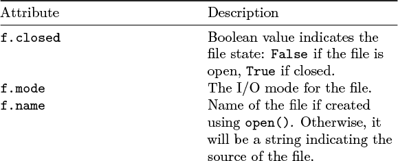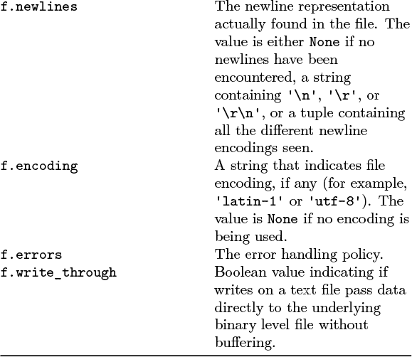

### 标准输入、输出和错误

解释器提供了三个标准文件对象，即标准输入、标准输出和标准错误，分别为 `sys.stdin`、`sys.stdout` 和 `sys.stderr`。`stdin` 是对应于提供解释器的输入字符流的文件对象。`stdout` 是接收 `print()` 生成输出的文件对象。`stderr` 是一个接收错误消息的文件。通常情况下，`stdin` 映射到用户的键盘，而 `stdout` 和 `stderr` 在屏幕上产生文本。

上一节描述的方法可以用于与用户进行 I/O 操作。例如，下面的代码向标准输出写入并从标准输入读取一行输入：

```python
import sys

sys.stdout.write("Enter your name : ")

name = sys.stdin.readline()
```

或者，内置函数 `input(prompt)` 可以从 stdin 读取一行文本，并可选性地打印提示符：

```python
name = input("Enter your name : ")
```

`input()` 读取的行不包含末尾的换行符。这与直接从 `sys.stdin` 读取不同，后者的换行符包含在输入文本中。

如有必要，可以将 `sys.stdout`、`sys.stdin` 和 `sys.stderr` 的值替换为其他文件对象，在这种情况下`print()` 和 `input()` 函数将使用新值。如果确实需要恢复 `sys.stdout` 的原始值，应先保存它。解释器启动时 `sys.stdout`、`sys.stdin` 和 `sys.stderr` 的原始值也分别可用 `sys.__stdout__`、`sys.__stdin__` 和 `sys.__stderr__` 访问。

### 目录

要获取目录列表，使用 `os.listdir(pathname)` 函数。例如，这里是打印目录文件名列表的方法：

```python
import os

names = os.listdir('dirname')

for name in names:
    print(name)
```

`listdir()` 返回的名称通常根据 `sys.getfilesystemencoding()` 返回的编码进行解码。如果你将初始路径指定为字节（bytes），文件名将以未解码的字节字符串返回。例如：

```python
import os

# 返回原始的未解码名称
names = os.listdir(b'dirname')
```

与目录列表相关的一个有用操作是根据模式匹配文件名。这有时被称为“通配符匹配 (globbing)”。`pathlib` 模块可此目的。例如，这里有一个匹配特定目录下所有 `.txt` 文件的示例：

```python
import pathlib

for filename in path.Path(dirname).glob('*.txt'):
    print(filename)
```

如果你使用 `rglob()` 而不是 `glob()`，它将递归地搜索所有子目录中匹配模式的文件名。`glob()` 和 `rglob()` 函数都返回一个通过迭代产生文件名的生成器。

### print() 函数

要打印一组由空格分隔的值，请如所示将它们全部提供给 `print()`：

```python
print('The values are', x, y, z)
```

要抑制或更改行结束符，使用关键字参数 `end`。例如：

```python
# 抑制换行符
print('The values are', x, y, z, end='')
```

要将输出重定向到文件，使用关键字参数 `file`。例如：

```python
# 重定向到文件 f
print('The values are', x, y, z, file=f)
```

要更改项目之间的分隔符，使用关键字参数 `sep`。例如：

```python
# 在值之间使用逗号
print('The values are', x, y, z, sep=',')
```

### 生成输出

直接处理文件对程序员来说最为熟悉。然而，生成器函数也可以用于作为数据片段发射 I/O 流。要这样做，可以使用 `yield` 语句，就像使用 `write()` 或 `print()` 函数一样。这是一个示例：

```python
def countdown(n):
    while n > 0:
         yield f'T-minus {n}\n'
         n -= 1
    yield 'Kaboom!\n'
```

以这种方式产生输出流提供了灵活性，因为输出流的产生与将流导向目标目的地的代码解耦。例如，如果你想将上述输出路由到文件 `f`，你可以这样做：

```python
lines = countdown(5)

f.writelines(lines)
```

相反，如果你想将输出重定向到套接字 `s`，你可以这样做：

```python
for chunk in lines:
    s.sendall(chunk)
```

或者，如果你只想将所有输出捕捉到一个字符串中，你可以这样做：

```python
out = ''.join(lines)
```

更高级的应用可以使用这种方法来实现自己的 I/O 缓冲。例如，生成器可以发射较小的文本片段，但另一个函数可以将这些片段收集到大缓冲区中，以创建更高效的单次 I/O 操作。


```python
chunks = []

buffered_size = 0

for chunk in count:
    chunks.append(chunk)
    buffered_size += len(chunk)
    if buffered_size >= MAXBUFFERSIZE:
         outf.write(''.join(chunks))
         chunks.clear()
         buffered_size = 0

outf.write(''.join(chunks))
```

对于将输出路由到文件或网络连接的程序，生成器方法也可以显著减少内存消耗，因为整个输出流通常可以以小片段的形式生成并处理，而不是先收集成一个巨大的输出字符串或字符串列表。

### 消费输入

对于消费碎片化输入的程序，扩展生成器在解码协议和其他 I/O 方面非常有用。这里是一个扩展生成器的示例，它接收字节片段并将其组装成行：

```python
def line_receiver():
    data = bytearray()
    line = None
    linecount = 0
    while True:
        part = yield line
        linecount += part.count(b'\n')
        data.extend(part)
        if linecount > 0:
            index = data.index(b'\n')
            line = bytes(data[:index+1])
            data = data[index+1:]
            linecount -= 1
        else:
            line = None
```

在这个示例中，生成器被编程为接收字节片段，这些片段被收集到一个字节数组中。如果数组包含换行符，则提取并返回一行。否则，返回 `None`。以下是一个说明其工作原理的示例：

```python
>>> r = line_receiver()
>>> r.send(None)    # 必要的第一步
>>> r.send(b'hello')
>>> r.send(b'world\nit ')
b'hello world\n'

>>> r.send(b'works!')
>>> r.send(b'\n')
b'it works!\n''
>>>>>>
```

这种方法一个有趣的副作用是它“外部化”了获取输入数据必须执行的实际 I/O 操作。具体来说，`line_receiver()` 的实现完全不包含 I/O 操作！这意味着可以在不同的上下文中使用它。例如，配合套字（sockets）：

```python
r = line_receiver()
data = None

while True:
    while not (line:=r.send(data)):
        data = sock.recv(8192)
    # 处理行
    ...
```

或者配合文件：

```python
r = line_receiver()
data = None

while True:
    while not (line:=r.send(data)):
        data = file.read(10000)
    # 处理行
    ...
```

或者在异步代码中：

```python
async def reader(ch):
    r = line_receiver()
    data = None
    while True:
        while not (line:=r.send(data)):
            data = await ch.receive(8192)
        # 处理行
        ...
```

### 对象序列化

有时需要对对象的表示进行序列化，以便可以在网络上传输、保存到文件或存储在数据库中。实现此点的方法是将数据转换为标准编码（如 JSON、XML 等）。然而，一种常用的 Python 特有数据序列化格式是 "Pickle"。

`pickle` 模块将对象序列化为字节流，可以在以后某个时刻重建该对象。`pickle` 的接口非常简单，由 `dump()` 和 `load()` 操作组成。例如，以下代码将对象写入文件：

```python
import pickle

obj = SomeObject()

with open(filename, 'wb') as file:
   pickle.dump(obj, file)      # 在文件上保存对象
```

要恢复该对象，请使用以下代码：

```python
with open(filename, 'rb') as file:
    obj = pickle.load(file)   # 恢复对象
```

`pickle` 使用的数据格式有其自己的记录帧。因此，可以通过连续发布一系列 `dump()` 操作来保存对象序列。要恢复这些对象，只需仅使用类似的 `load()` 操作序列即可。

对于网络编程，通常会使用 `pickle` 来创建字节编码的消息。为了实现这一点，请改用 `dumps()` 和 `loads()`。这些函数不是与文件读取/写入数据，而是与字节字符串一起工作。

```python
obj = SomeObject()

# 将对象转换为字节
data = pickle.dumps(obj)
...

# 将字节转换回对象
obj = pickle.loads(data)
```

通常用户定义的对象不需要为了配合 `pickle` 做任何额外工作。然而，某些类型的对象不能被 pickle。这些倾向于是包含运行时状态的对象，例如打开的文件、线程、闭包、生成器等。为了处理这些棘手的边缘情况，类可以定义特有方法 `__getstate__()` 和 `__setstate__()`。

如果定义了 `__getstate__()` 方法，它将被调用以创建一个表示对象状态的值。`__getstate__()` 返回的值通常是字符串、元组、列表或字典。`__setstate__()` 方法在反序列化（unpickling）期间接收此值，并应该根据它恢复对象的状态。

在编码对象时，`pickle` 不包含源代码本身。相反，它编码的是一个名称。


```python
def reader1(sock):
    try:
        data = sock.recv(8192)
        print('reader1 got:', data)
    except BlockingIOError:
        pass

def reader2(sock):
    try:
        data = sock.recv(8192)
        print('reader2 got:', data)
    except BlockingIOError:
        pass

def run(sock1, sock2):
    sock1.setblocking(False)
    sock2.setblocking(False)
    while True:
        reader1(sock1)
        reader2(sock2)
```

在实践中，仅依赖非阻塞 I/O 是笨拙且低效的。例如，这个程序的核心是结尾的 `run()` 函数。它会在一个快速的忙循环中运行，不断地尝试从套字上读取数据。这行得通，但不是良好的设计。

### I/O 轮询

与其依赖异常和忙等待，可以轮询 I/O 通道来检查是否有可用。可以使用 `select` 或 `selectors` 模块来实现这一目的。例如，这里是 `run()` 函数的一个稍微修改的版本。

```python
from selectors import DefaultSelector, EVENT_READ, EVENT_WRITE

def run(sock1, sock2):
    selector = DefaultSelector()
    selector.register(sock1, EVENT_READ, data=reader1)
    selector.register(sock2, EVENT_READ, data=reader2)
    # 等待事件发生
    while True:
        for key, evt in selector.select():
            func = key.data
            func(key.fileobj)
```

在这段代码中，每当在相应的套字上检测到 I/O 时，循环就会将 `reader1()` 和 `reader2()` 函数作为回调调度。`selector.select()` 操作本身是阻塞的，等待 I/O 的发生。因此，与之前的示例不同，它不会让 CPU 疯狂旋转。

这种 IO 方法是许多许多“异步”框架（如 `asyncio`）的基础，尽管你通常看不到“事件循环”的内部机制。

### 线程

在最后两个示例中，并发需要使用特殊的 `run()` 函数来驱动计算。作为替代方案，你可以使用线程编程和 `threading` 模块。将线程想象成运行在你程序内部的独立任务。这是一个同时在两个套字上读取数据的代码示例：

```python
import threading

def reader1(sock):
    while (data := sock.recv(8192)):
        print('reader1 got:', data)

def reader2(sock):
    while (data := sock.recv(8192)):
        print('reader2 got:', data)

t1 = threading.Thread(target=reader1, args=[sock1]).start()
t2 = threading.Thread(target=reader2, args=[sock2]).start()

# 等待线程完成
t1.join()
t2.join()
```

在这个程序中，`reader1()` 和 `reader2()` 函数并发执行。这是由主机操作系统管理的。因此，你不需要过多了解它的工作原理。如果一个线程发生了阻塞操作，它不会影响另一个线程。

线程编程的完整课题超出了本书的范围。不过，在本章后面的 `threading` 模块部分还提供了几个额外的示例。

### 使用 asyncio 进行并发执行

`asyncio` 模块提供了线程的替代并发实现。在内部，它基于使用 I/O 轮询的事件循环。然而，通过使用特殊的 `async` 函数，其高层编程模型看起来与线程非常相似。这里有一个示例：

```python
import asyncio

async def reader1(sock):
    loop = asyncio.get_event_loop()
    while (data := await loop.sock_recv(sock, 8192)):
        print('reader1 got:', data)

async def reader2(sock):
    loop = asyncio.get_event_loop()
    while (data := await loop.sock_recv(sock, 8192)):
        print('reader2 got:', data)

async def main(sock1, sock2):
    loop = asyncio.get_event_loop()
    t1 = loop.create_task(reader1(sock1))
    t2 = loop.create_task(reader2(sock2))
    # 等待任务完成
    await t1
    await t2

...

# 运行
asyncio.run(main(sock1, sock2))
```

使用 `asyncio` 的完整细节需要一本专门的书籍。主要是，你应该知道许多库和框架都声称支持“异步”操作。通常这意味着支持通过 `asyncio` 或类似的模块进行并发执行。大部分代码可能涉及异步函数和相关功能。

### 标准库模块

大量的标准库模块被广泛用于与各种 I/O 相关的任务结合。本节提供了常用模块的简要概述，并根据情况提供了一些示例。完整的参考资料可以在网上或 IDE 中找到，此处不再重复。本节的主要目的是通过提供你应该关注的模块名称来为你指明正确的方向。

#### asyncio 模块

`asyncio` 模块提供了对并发 I/O 的支持。要测试此代码，可以使用诸如 `nc` 或 `telnet` 的程序连接到端口 25000。如果你多次使用多个窗口连接，你会发现代码可以处理所有连接并回显你输入的文本。这里是使用 socket 的示例：

```python
import asyncio
from socket import *

async def echo_server(address):
    loop = asyncio.get_event_loop()
    sock = socket(AF_INET, SOCK_STREAM)
    sock.setsockopt(SOL_SOCKET, SO_REUSEADDR, 1)
    sock.bind(address)
    sock.listen(5)
    print('Server listening at', address)
    with sock:
        while True:
            client, addr = await loop.sock_accept(sock)
            print('Connection from', addr)
            loop.create_task(echo_client(loop, client))

async def echo_client(loop, client):
    with client:
        while True:
            data = await loop.sock_recv(client, 10000)
            if not data:
                break
            await loop.sock_sendall(client, b'Got:' + data)

if __name__ == '__main__':
    loop = asyncio.get_event_loop()
    loop.create_task(echo_server(('', 25000)))
    loop.run_forever()
```

#### binascii 模块

`binascii` 模块具有将二进制数据转换为各种表示的函数，例如十六进制和 base64。例如：

```python
>>> binascii.b2a_hex(b'hello')
b'68656cc6f'

>>> binascii.a2b_hex(_)
b'hello'

>>> binascii.b2a_base64(b'hello')
b'aGVsb8=\n'

>>> binascii.a2b_base64(_)
b'hello'
```

类似的功能在 `base64` 模块中也可以找到，此外还可以通过 `bytes` 对象的 `hex()` 和 `fromhex()` 方法实现。例如：

```python
>>> a = b'hello'
>>> a.hex()
'68656cc6f'

>>> bytes.fromhex(_)
b'hello'

>>> import base64

>>> base64.b64encode(a)
b'aGVsb8='
```

#### cgi 模块

所以，假设你只想在网页上放一个简单的表单。也许是为你每周的“猫与分类”新闻通讯提供的注册表单。当然，你可以安装最新的 Web 框架并花费所有时间摆弄它。然而，你可能也可以直接写一个简单的 CGI 脚本——老派风格。`cgi` 模块就是为此而做的。

假设你的网页上上有以下表单片段：


```html
<form method="POST" action="cgi-bin/register.py">
   <p>
   要注册，请提供联系名称和邮箱地址。
   </p>
   <div>
      <input name="name" type="text">您的姓名:</input>
   </div>
   <div>
      <input name="email" type="email">您的邮箱:</input>
   </div>
   <div class="modal-footer justify-content-center">
      <input type="submit" name="submit" value="注册"></input>
   </div>
</form>
```

这是一个在接收端接收表单数据的 CGI 脚本。

```python
#!/usr/bin/env python

import cgi

try:
    form = cgi.FieldStorage()
    name = form.getvalue('name')
    email = form.getvalue('email')
    # 验证响应并执行相应操作
    ...
    # 生成 HTML 结果（或重定向）
    print("Status: 302 Moved\r")
    print("Location: https://www.mywebsite.com/thanks.html\r")
    print("\r")
except Exception as e:
    print("Status: 501 Error\r")
    print("Content-type: text/plain\r")
    print("\r")
    print("发生了一些某种错误。\r")
```

编写这样的 CGI 脚本能让你在互联网初创公司找到工作吗？可能不能。它能解决你的实际问题吗？很可能。

### configparser 模块

所谓的 INI 文件是以人类可读的形式编码程序配置信息的常见格式。以下是一个示例：

```ini
# config.ini

; 注释

[section1]
name1 = value1
name2 = value2

[section2]
; 备选语法
name1: value1
name2: value2
```

`configparser` 模块用于读取 `.ini` 文件并提取值。这是一个基础示例：

```python
import configparser

# 创建配置解析器并读取文件
cfg = configparser.ConfigParser()
cfg.read('conig.ini')

# 提取值
a = cfg.get('section1', 'name1')
b = cfg.get('section2', 'name2')
...
```

该模块提供了许多更高级的功能，包括字符串插值功能、合并多个 `.ini` 文件的能力、提供默认值等。请咨询官方文档获取更多示例。

### csv 模块

`csv` 模块用于读取/写入逗号分隔值（CSV）文件，这些文件通常由 Microsoft Excel 等程序产生或从中导出。要使用它，你需要打开一个文件，然后在周围封装一层额外的 CSV 编码/解码。例如：

```python
import csv

# 将 CSV 文件读取为元组列表
def read_csv_data(filename):
    with open(filename) as file:
        rows = csv.reader(file)
        # 第一行通常是表头。读取这一行
        headers = next(rows)
        # 现在读取剩余数据
        for row in rows:
            # 对行进行某些操作
            ...

# 将 Python 数据写入 CSV 文件
def write_csv_data(filename, headers, rows):
    with open(filename, "w") as file:
        out = csv.writer(file)
        out.writerow(headers)
        out.writerows(rows)
```

一个常用的便利函数是改用 `DictReader()`。它将 CSV 文件的第一行解释为头，并将每行返回为字典而不是元组。

```python
import csv

def find_nearby(filename):
    with open(filename) as file:
        rows = csv.DictReader(file)
        for row in rows:
            lat = float(rows['latitude'])
            lon = float(rows['longitude'])
            if close_enough(lat, lon):
                print(row)
```

`csv` 模块除了读取或写入 CSV 数据外，对 CSV 数据没有太多其他操作。它提供的主要优势是该模块知道如何正确地编码/解码数据，包括处理许多涉及引号、特殊字符和其他细节的边缘情况。因此，你可能可能会使用该模块来编写简单的脚本，用于清理或准备数据供其他程序使用。如果你想对 CSV 数据执行各种数据分析任务，可以考虑使用第三方包，例如流行的 `pandas` 库。

### errno 模块

每当发生系统级错误时，Python 会用 `OSError` 的子类异常来报告它。一些常见的系统错误由 `OSError` 的单独子类表示（例如 `PermissionError`、`FileNotFoundError` 等）。然而，在实践中可能会发生数百种其他错误。对于这些错误，任何 `OSError` 异常都带有一个可以检查的数值 `errno` 属性。`errno` 模块提供了与这些错误代码对应的符号常量。它们通常用于编写高度专门的异常处理器时。例如，这里是一个检查设备上是否没有剩余空间的异常处理器：

```python
import errno

def write_data(file, data):
    try:
        file.write(data)
    except OSError as e:
        if e.errno == errno.ENOSPC:
            print("你的磁盘空间不足！")
        else:
            raise       # 其他错误。向上抛
```

### fcntl 模块

`fcntl` 模块用于在 Unix 上执行低级 I/O 操作。如果你想跨进程执行任何锁定，也会使用它。这里是一个结合互斥锁打开文件的示例：

```python
import fcntl

with open("somefile", "r") as file:
    try:
        fcntl.flock(file.fileno(), fcntl.LOCK_EX)
        # 使用文件
        ...
    finally:
        fcntl.flock(file.fileno(), fcntl.LOCK_UN)
```

### hashlib 模块

`hashlib` 模块提供了计算哈希值的函数，如 MD5、SHA-1 等。下面的示例说明了如何使用它：

```python
>>> h = hashlib.new('sha256')
>>> h.update(b'Hello')    # 传入数据
>>> h.update(b'World')
>>> h.digest()
b'\xa5\x91\xa6\xd4\x0b\xf4\x04\x01\x73\xcf\xb7\xb1\x90\xd6\x65\xbf\x0bc\xda32\xb57\x27\xd9\xf\x14'
>>> h.digest_size()
32
>>> h.hexdigest()
'a591a6d40bf4204401733cfb7b190d665bf0bcda32b5727d9f14'
```

### http 包

`http` 包包含大量与 HTTP 协议低级实现相关的代码。它可以用于实现服务器和客户端。然而，该包的大部分内容被认为是过时的且对于日常工作来说太底层了。处理 HTTP 的程序员更有可能使用第三方库，如 `requests`、`httpx`、`Django`、`flask` 等。

尽管如此，`http` 包的一个有用彩蛋是 Python 可以运行一个独立的 Web 服务器。进入包含文件的目录并输入以下命令：

```bash
bash $ python -m http.server

Serving HTTP on 0.0.0.0 port 8000 (http://0.0.0.0:8000/) ...
```

### io 模块

`io` 模块主要包含实现 `open()` 函数返回的文件对象的类定义。直接访问这些类并不常见。然而，该模块还包含了一对非常有用的类，用于以字符串和字节形式“伪造”文件。这在测试以及其他需要提供“文件”但通过其他方式获取数据的应用场景中非常有用。

`StringIO()` 类在字符串之上提供了一个类似文件的接口。例如，这里是如何将输出写入字符串的：


```python
# 接收一个文件的函数

def greeting(file):
    file.write('Hello\n')
    file.write('World\n')

# 使用真实文件调用函数
with open('out.txt', 'w') as file:
    greeting(file)

# 使用“伪”文件调用函数
import io

file = io.StringIO()
greeting(file)

# 获取输出结果
output = file.getvalue()
```

同样，你也可以创建一个 `StringIO` 对象并将其用于读取：

```python
file = io.StringIO('hello\nworld\n')

while (line := file.readline()):
    print(line, end='')
```

`BytesIO()` 类提供了类似的功能，但用于模拟字节（bytes）的 I/O。

## json 模块

`json` 模块用于编码和解码 JSON 格式的数据，通常用于微服务和 Web 程序的 API。有两个基本函数用于转换数据：`dumps()` 和 `loads()`。`dumps()` 接收一个 Python 字典并将其编码为 JSON Unicode 字符串：

```python
>>> import json
>>> data = { 'name': 'Mary A. Python', 'email': 'mary123@python.org' }
>>> s = json.dumps(data)
>>> s
'{"name": "Mary A. Python", "email": "mary123@python.org"}'
>>>
```

`loads()` 函数的方向则相反：

```python
>>> d = json.loads(s)
>>> d == data
True
>>>
```

`dumps()` 和 `loads()` 函数都有大量的选项，用于控制转换的各个方面以及与 Python 类实例进行交互。这超出了本节的范围，但在官方文档中提供了大量的信息。

## logging 模块 

`logging` 模块是用于报告程序诊断和进行打印式调试的事实标准模块。它可以用于将输出路由到日志文件，并提供了大量的配置选项。常见的做法是编写代码创建一个 `Logger` 实例并在其上发布消息，如下：

```python
import logging

log = logging.getLogger(__name__)

# 使用 logging 的函数
def func(args):
    log.debug("A debugging message")
    log.info("An informational message")
    log.warning("A warning message")
    log.error("An error message")
    log.critical("A critical message")

# 配置 logging（在程序启动时发生一次）
if __name__ == '__main__':
    logging.basicConfig(
         level=logging.WARNING,
         filename="output.log"
    )
```

有五个内置的日志级别，按严重程度递增排序。在配置日志系统时，你指定一个作为过滤器的级别。只有该级别或更严重程度的消息会被报告。日志记录提供了许多配置选项，大部分与日志消息的后端处理有关。在编写应用程序代码时，通常不需要了解这些——你只需要在给定的 `Logger` 实例上使用 `debug()`、`info()`、`warning()` 和类似的方法。任何特殊配置都在程序启动期间的特殊位置完成（例如，在 `main()` 函数或主代码块中）。

## os 模块

`os` 模块提供了常用操作系统操作的可移植接口，通常与进程环境、文件、目录、权限等相关。其编程接口紧密遵循 C 语言和 POSIX 等标准。

从实践上来说，该模块的大部分内容可能太底层了，无法直接在典型的应用程序中使用。然而，如果你遇到过执行某些模糊的底层系统操作的问题（例如，“如何打开一个 TTY？”），那么很有可能会在这里找到相应的功能。

## os.path 模块

`os.path` 模块是一个用于处理路径名和在文件系统中执行常用操作的遗留模块。它的功能在很大程度上被较新的 `pathlib` 模块取代，但由于其使用仍然非常广泛，你会在很多代码中看到它。

该模块解决的一个基本问题是处理 Unix（正斜杠 `/`）和 Windows（反斜线 `\`）路径分隔符的可移植性。`os.path.join()` 和 `os.path.split()` 等函数经常用于拆分文件名并重新组合：

```python
>>> filename = '/Users/beazley/Desktop/old/data.csv'
>>> os.path.split()
('/Users/beazley/Desktop/old', 'data.csv')
>>> os.path.join('/Users/beazley/Desktop', 'out.txt')
'/Users/beazley/Desktop/out.txt'
>>>
```

这里是一个使用这些函数的代码示例：

```python
import os.path

def clean_line(line):
    # 对齐一行（无论内容）
    return line.strip().upper() + '\n'

def clean_data(filename):
    dirname, basename = os.path.split()
    newname = os.path.join(dirname, basename+'.clean')
    with open(newname, 'w') as out_f:
        with open(filename, 'r') as in_f:
            for line in in_f:
                out_f.write(clean_line(line))
```

`os.path` 模块还有许多函数如 `isfile()`、`isdir()` 和 `getsize()`，用于对文件系统进行测试。

## pathlib 模块 

`pathlib` 模块是处理路径名的现代方式。它将多种功能整合在一起，并使用面向对象的接口。

```python
from pathlib import Path
filename = Path('/Users/beazley/old/data.csv')
```

一旦你有了 `Path` 的实例 `p`，就可以对其进行操作。例如：

```python
>>> filename.name
'data.csv'

>>> filename.parent
PosixPath('/Users/beazley/old')

>>> filename.parent / 'newfile.csv'
PosixPath('/Users/beazley/old/newfile.csv')

>>> filename.parts
('/', 'Users', 'beazley', 'old', 'data.csv')

>>> filename.with_suffix('.clean')
PosixPath('/Users/beazley/old/data.clean')

>>>
```

`Path` 实例还有用于获取元数据、获取目录列表以及其他类似的函数。以下是上一节中 `compute_usage()` 函数的重新实现：

```python
import pathlib

def compute_usage(filename):
    pathname = pathlib.Path(filename)
    if pathname.is_file():
        return pathname.stat().st_size
    elif pathname.is_dir():
        return sum(path.stat().st_size
                   for path in pathname.rglob('*')
                   if path.is_file())
    else:
        raise RuntimeError('Unsupported file kind')
```

## re 模块

`re` 模块用于使用正则表达式执行文本匹配、搜索和替换操作。这是一个简单的示例：

```python
>>> text = 'Today is 3/27/2018\. Tomorrow is 3/28/2018.'

>>> 查找所有日期
>>> import re
>>> re.findall(r'\d+/\d+/\d+', text)
['3/27/2018', '3/28/2018']

>>> 将所有日期替换为替换文本
>>> re.sub(r'(\d+)/(\d+)/(\d+)', r'\3-\1-\2', text)
'Today is 2018-3-27\. Tomorrow is 2018-3-28.'
>>>
```

## shutil 模块

`shutil` 模块用于执行某些需要在 shell 中执行的常用任务。这些包括复制和删除文件、处理归档等。例如，要复制文件可以使用：

```python
import shutil
shutil.copy(srcfile, dstfile)
```

移动文件：

```python
shutil.move(srcfile, dstfile)
```

复制目录树：

```python
shutil.copytree(srcdir, dstdir)
```

删除目录树：

```python
shutil.rmtree(pathname)
```


`shutil` 模块通常用作直接使用 `os.system()` 函数执行 shell 命令更安全、更灵活的替代方案。

### select 模块

`select` 模块用于对多个 I/O 流进行简单的轮询。也就是说，它可以用于监控一组文件描述符是否有就就的数据或是否有可以发送数据的能力。以下示例展示了典型的用法：

```python
import select

# 表示文件描述符的对象集合。必须是
# 整数或具有 fileno() 方法的对象。

want_to_read = [ ... ]

want_to_write = [ ... ]

check_exceptions = [ ... ]

# 超时（或 None）

timeout = None

# 轮询 I/O

can_read, can_write, have_exceptions = \
    select.select(want_to_read, want_to_write, check_exceptions, timeout)

# 执行 I/O 操作

for file in can_read:
    do_read(file)

for file in can_write:
    do_write(file)

# 处理异常

for file in have_exceptions:
    handle_exception(file)
```

在此代码中，构建了三组文件描述符。这些集合分别对应读取、写入和异常。它们连同可选的 `timeout` 一起传递给 `select()`。`select()` 返回传入参数的三个子集。这些子集代表了可以执行请求操作的文件。例如，`can_read()` 中返回的文件有待处理的入站数据。

`select()` 函数是一个标准的低级系统调用，通常用于监控系统事件并实现异步 I/O 框架，例如内置的 `asyncio` 模块。

除了 `select()` 之外，`select` 模块还暴露了 `poll()`、`epoll()`、`kqueue()` 以及类似的变体函数，它们提供了相似的功能。这些函数的可用性取决于操作系统。

`selectors` 模块为 `select` 提供了一个更高级的接口，这在某些上下文中可能非常有用。之前曾给出一个示例（见第 x 页）。

### smtp 模块

`smtp` 模块实现了 SMTP 的客户端，通常用于发送电子邮件消息。该模块的一个常见用途是编写专门执行此功能的脚本——向某人发送电子邮件。以下是一个示例：

```python
import smtplib

fromaddr = "someone@some.com"

toaddrs = ["recipient@other.com" ]

amount = 123.45

msg = f"""From: {fromaddr}\r
\r
Pay {amount} bitcoin or else.  We're watching.\r
"""

server = smtplib.SMTP('localhost')
serv.sendmail(fromaddr, toaddrs, msg)
serv.quit()
```

还有额外的功能来处理密码、身份验证和其他事项。然而，如果你在机器上运行脚本，且该机器配置为支持电子邮件，上面的示例通常就能胜任。

### socket 模块

`socket` 模块提供了对网络编程函数的低级访问。该接口模仿标准的 BSD socket 接口，该接口通常与 C 系统编程相关。

以下示例展示了如何建立出站连接并接收响应：

```python
from socket import socket, AF_INET, SOCK_STREAM

sock = socket(AF_INET, SOCK_STREAM)

sock.connect(('python.org', 80))

sock.send(b'GET /index.html HTTP/1.0\r\n\r\n')

parts = []

while True:
    part = sock.recv(10000)
    if not part:
        break
    parts.append(part)

response = b''.join(response)
print(response)
```

以下示例展示了一个基础的 echo 服务器，它接受客户端连接并回显接收到的任何数据。要测试此服务器，请运行它，然后在另一个终端会话中使用类似 `telnet localhost 25000` 或 `nc localhost 25000` 的命令连接它。

```python
from socket import socket, AF_INET, SOCK_STREAM

def echo_server(address):
    sock = socket(AF_INET, SOCK_STREAM)
    sock.bind(address)
    sock.listen(1)
    while True:
        client, addr = sock.accept()
        echo_handler(client, addr)

def echo_handler(client, addr):
    print('Connection from:', addr)
    with client:
        while True:
            data = client.recv(10000)
            if not data:
                break
            client.sendall(data)
    print('Connection closed')

if __name__ == '__main__':
    echo_server(('', 25000))
```

对于 UDP 服务器，没有连接过程。然而，服务器仍然必须将 socket 绑定到已知地址。以下是一个 UDP 服务器/客户端的典型示例：

```python
# udp.py

from socket import socket, AF_INET, SOCK_DGRAM

def run_server(address):
    sock = socket(AF_INET, SOCK_DGRAM)     # 1\. 创建一个 UDP socket
    sock.bind(address)                     # 2\. 绑定到地址/端口
    while True:
        msg, addr = sock.recvfrom(2000)    # 3\. 获取消息
        # ... 执行一些事情
        response = b'world'
        sock.sendto(response, addr)        # 4\. 发送

def run_client(address):
    sock = socket(AF_INET, SOCK_DGRAM)     # 1\. 创建一个 UDP socket
    sock.bind(address)                     # 2\. 绑定到地址/端口
    while True:
        msg, addr = sock.recvfrom(2000)    # 3\. 获取消息
        # ... 执行一些事情
        response = b'world'
        sock.sendto(response, addr)        # 4\. 发送
```

### struct 模块

`struct` 模块用于在 Python 值和以字节表示的 C 结构体之间进行转换。这里是使用 `struct` 执行此操作的方法：

```python
>>> import struct
>>> data = struct.pack('>HIff', 123, 456, 1.23, 4.56)
>>> data
b'\x00\x00\x01\xc8\x3f\xf6\xe7\x4c\x4a'
>>> struct.unpack('>HIff', data)
(123, 456, 1.2300000190734863, 4.55999942779541)
```

这种精度问题是因为转换为 32 位值时造成的精度损失。 Python 表示浮点值使用的是 64 位精度值。

### subprocess 模块

`subprocess` 模块用于执行独立的进程，但可以控制执行环境，包括 I/O 处理、终止等。该模块有两种用法。

如果你想运行一个独立程序并一次性收集其所有输出，请使用 `check_output()`。例如：

```python
import subprocess

# 运行 'netstat -a' 命令并收集其输出
try:
    out = subprocess.check_output(['netstat', '-a'])
except subprocess.CalledProcessError as e:
    print("失败:", e)
```

`check_output()` 返回的数据是字节。如果你想将其转换为文本，请确保应用了正确的解码：

```python
text = out.decode('utf-8')
```

还可以设置管道并以更详细的方式与子进程交互。要这样做，请像这样使用 `Popen` 类：

```python
import subprocess

p = subprocess.Popen(['wc'],
                     stdin=subprocess.PIPE,
                     stdout=subprocess.PIPE)

# 向子进程发送数据
p.stdin.write(b'hello world\nthis is a test\n')
p.stdin.close()

# 读取数据
out = p.stdout.read()

print(out)
```


`tempfile` 模块提供了创建临时文件和目录的支持。这是一个创建一个临时文件的示例：

```python
import tempfile

with tempfile.TemporaryFile() as f:
    f.write(b'Hello World')
    f.seek(0)
    data = f.read()
    print('Got:', data)
```

默认情况下，临时文件以二进制模式打开，并允许读取和写入。`with` 语句也常用于定义文件使用的范围。文件会在代码块结束时被删除。

如果你想创建一个临时目录，可以使用以下代码：

```python
with tempfile.TemporaryDirectory() as dirname:
    # 使用目录 dirname
    ...
```

与文件一样，目录及其所有内容都会在 `with` 块结束时被删除。

## textwrap 模块

`textwrap` 模块可以对文本进行格式化，以适应特定的终端宽度。这可能是一个比较特殊的用途，但在制作报告时清理输出文本，它有时会非常有用。这里有两个值得关注的函数。

`wrap()` 接收文本并将其换行以适应指定的列宽。该函数返回一个字符串列表。例如：

```python
import textwrap

text = """look into my eyes

look into my eyes

the eyes the eyes the eyes

not around the eyes

don't look around the eyes

look into my eyes you're under

"""

wrapped = textwrap.wrap(text, width=81)

print('\n'.join(wrapped))

# 输出结果：
# look into my eyes look into my eyes the
# eyes the eyes the eyes not around the
# eyes don't look around the eyes look
# into my eyes you're under
```

`indent()` 函数可以用于对文本块进行缩进。例如：

```python
print(textwrap.indent(text, '    '))

# 输出结果：
#    look into my eyes
#    look into my eyes
#    the eyes the eyes the eyes
#    not around the eyes
#    don't look around the eyes
#    look into my eyes you're under
```

## threading 模块

`threading` 模块用于并发执行代码。这个问题在网络程序的 I/O 处理中很常见。多线程编程是一个庞大的话题，但下面的示例将说明常见问题的解决方案。

这是一个启动线程并等待其完成的示例：

```python
import threading
import time

def countdown(n):
    while n > 0:
        print('T-minus', n)
        n -= 1
        time.sleep(1)

t = threading.Thread(target=countdown, args=[10])
t.start()
t.join()      # 等待线程完成
```

如果你永远等待线程完成，可以通过提供额外的 `daemon` 标志来将其设置为守护线程：

```python
t = threading.Thread(target=countdown, args=[10], daemon=True)
```

如果你想让一个线程终止，你需要通过标志或某些专门的变量显式地执行。线程必须被设计为去检查该标志。

```python
import threading
import time

must_stop = False

def countdown(n):
    while n > 0 and not must_stop:
        print('T-minus', n)
        n -= 1
        time.sleep(1)
```

如果线程将修改共享数据，请使用 `Lock` 保护它。

```python
import threading

class Counter:
    def __init__(self):
        self.value = 0
        self.lock = threading.Lock()
    def increment(self):
        with self.lock:
             self.value += 1

    def decrement(self):
        with self.lock:
             self.value -= 1
```

如果线程需要等待另一个线程，可以使用 `Event`。

```python
import threading
import time

event = threading.Event()

def waiter():
    print("Waiter is waiting...")
    event.wait()
    print("Event is set!")

def worker():
    print("Worker is working...")
    time.sleep(2)
    event.set()

t1 = threading.Thread(target=waiter)
t2 = threading.Thread(target=worker)

t1.start()
t2.start()
```


如果对渲染相同的 Unicode 字符串进行一致处理存在问题，应当对其进行归一化。可以使用 `unicodedata.normalize()` 函数来确保一致的字符表示。例如，`unicodedata.normalize('NFC', s)` 将确保 `s` 中的所有字符都是完全组合的，而不是以组合字符序列的形式表示。

使用 `unicodedata.normalize('NFD', s)` 将确保 `s` 中的所有字符都是完全分解的。

`unicodedata` 模块还包含测试字符属性的函数，例如大小写、数字和空白字符。可以通过 `unicodedata.category(c)` 函数获取通用字符属性。例如，`unicodedata.category('A')` 返回 `'Lu'`，表示该字符是大写字母。关于这些值的更多信息可以在官方 Unicode 字符数据库中找到：[`www.unicode.org/ucd/`](https://www.unicode.org/ucd/)。

## xml 包

`xml` 包是一个大型模块集合，用于以各种方式处理 XML 数据。然而，如果你的主要目标是读取 XML 文档并从中提取信息，使用它的最简单方法是使用 `xml.etree` 子包。假设你有一个名为 `recipe.xml` 的 XML 文档，如下：

```xml
<?xml version="1.0" encoding="iso-8859-1"?>
<recipe>
   <title>
   Famous Guacamole
   </title>
   <description>
   A southwest favorite!
   </description>
   <ingredients>
        <item num="4"> Large avocados, chopped </item>
        <item num="1"> Tomato, chopped </item>
        <item num="1/2" units="C"> White onion, chopped </item>
        <item num="2" units="tbl"> Fresh squeezed lemon juice </item>
        <item num="1"> Jalapeno pepper, diced </item>
        <item num="1" units="tbl"> Fresh cilantro, minced </item>
        <item num="1" units="tbl"> Garlic, minced </item>
        <item num="3" units="tsp"> Salt </item>
        <item num="12" units="bottles"> Ice-cold beer </item>
   </ingredients>
   <directions>
   Combine all ingredients and hand whisk to desired consistency.
   Serve and enjoy with ice-cold beers.
   </directions>
</recipe>
```

以下是如何从中提取特定元素的方法：

```python
from xml.etree.ElementTree import ElementTree

doc = ElementTree(file="recipe.xml")

title = doc.find('title')
print(title.text)

# 备用方法（直接获取元素文本）
print(doc.findtext('description'))

# 遍历多个元素
for item in doc.findall('ingredients/item'):
    num = item.get('num')
    units = item.get('units', '')
    text = item.text.strip()
    print(f'{num} {units} {text}')
```

## 结语

I/O（输入/输出）是编写任何有用程序的根本组成部分。鉴于 Python 的流行性，它能够处理任何正在使用的数据格式、编码或文档结构。虽然标准库可能不支持，但你几乎肯定可以找到第三方模块来为你解决问题。

在思考“大局”时，考虑应用程序的边缘情况可能更有用。在程序与现实之间的外部边界，经常会遇到与数据编码相关的问题。这对于文本数据和 Unicode 尤为如此。Python I/O 处理中的许多复杂性正是为了解决这一特定问题（例如支持不同的编码、错误处理策略等）。记住文本数据和二进制数据被严格区分为不同的对象也是至关重要的。因此，知道你正在处理什么有助于理解大局。

I/O 的次要考虑因素是整体评估模型。Python 代码目前被分为两个世界——普通的同步代码和通常与 `asyncio` 模块相关的异步代码（其特征是使用 `async` 函数和 `async/await` 语法）。异步代码虽然经常被过度炒作，但它几乎总是需要使用能够在该环境中运行的专用库。这反过来通常迫使你也以“异步”风格编写应用程序代码。老实说，除非你绝对确定需要它，否则你可能应该避免异步编程——如果你真的不确定，那么你几乎肯定不需要。大多数良好的 Python 社区都使用普通的同步风格编写代码，这种风格更容易进行推理、调试和测试。你应该选择那种。

## 内置函数与标准库

本章是 Python 内置函数的简明参考。这些函数始终可用，不需要任何 `import` 语句。本章最后对一些有标准库模块进行了简要概述。

### 内置函数

```python
abs(x)
```

返回 `x` 的绝对值。

```python
all(s)
```

如果可迭代对象 `s` 中的所有值评估为 True，则返回 `True`。如果 `s` 为空，则返回 `True`。

```python
any(s)
```

如果可迭代对象 `s` 中的任何值评估为 True，则返回 `True`。如果 `s` 为空，则返回 `False`。

```python
ascii(x)
```

创建对象 `x` 的可打印表示，类似于 `repr()`，但结果中只使用 ASCII 字符。非 ASCII 字符会被转换为适当的转义序列。这可以在不支持 Unicode 的终端或 shell 中查看 Unicode 字符串。

```python
bin(x)
```

返回带有整数 `x` 的二进制表示的字符串。

```python
bool([x])
```

表示布尔值 `True` 和 `False` 的类型。如果用于转换 `x`，当 `x` 使用通常的真测试语义评估为真（即非零数字、非空列表等）时，返回 `True`。否则返回 `False`。如果调用 `bool()` 时不带任何参数，返回的默认也是 `False`。`bool` 类继承自 `int`，因此布尔值 `True` 和 `False` 可以在数学计算中作为值为 1 和 0 的整数。

```python
breakpoint()
```

设置手动调试器断点。遇到时，控制将转移到 `pdb`（Python 调试器）。

```python
bytearray([x])
```

表示可变字节数组的类型。在创建实例时，`x` 可以是 0 到 255 范围内的整数可迭代序列、8 位字符串或字节字面量，或者是指定字节数组大小的整数（在这种情况下，条目将初始化为 0）。

```python
bytearray(s,encoding)
```

从字符串 `s` 中的字符创建 `bytearray` 实例的另一种调用约定，其中 `encoding` 指定转换时使用的字符编码。

```python
bytes([x])
```

表示不可变字节数组的类型。

```python
bytes(s, encoding)
```

从字符串 `s` 创建字节的另一种调用约定，其中 `encoding` 指定转换时使用的编码。

```python
callable(obj)
```

如果 `obj` 可作为函数调用，则返回 `True`。

```python
chr(x)
```

将代表 Unicode 代码点的整数 `x` 转换为单字符字符串。

```python
classmethod(func)
```

此装饰器为函数 `func` 创建一个类方法。它通常只在类定义内部使用，通过 `@classmethod` 隐式调用。与普通方法不同，类方法接收类作为第一个参数，而不是实例。

```python
compile(string, filename, kind)
```


将 `string` 编译为代码对象以供 `exec()` 或 `eval()` 使用。`string` 是一个包含有效 Python 代码的字符串。如果此代码跨行，则每行必须以单个换行符（`'\n'`）结束，而不是平台特定的变体（例如 Windows 上的 `'\r\n'`）。`filename` 是一个字符串，包含定义该字符串的文件名（如果有的话）。`kind` 对于语句序列为 `'exec'`，对于单个表达式为 `'eval'`，或者对于单个可执行的语句为 `'single'`。返回的生成的代码对象可以直接传递给 `exec()` 或 `eval()`，以代替字符串。

```
complex([real [, imag]])
```

表示复数的类型，具有实部部分 `real` 和虚部部分 `imag`，这两个部分可以作为任何数值类型提供。如果省略了 `imag`，则虚部被设置为零。如果 `real` 以字符串形式传递，则该字符串将进行解析并转换为复数。在这种情况下，应该省略 `imag`。如果 `real` 是其他类型的对象，则返回 `real.__complex__()` 的值。如果没有给出任何参数，则返回 `0j`。

Table 3 显示了 complex 的方法和属性。

表 3：complex 的属性

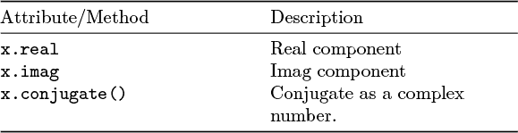

```
delattr(object, attr)
```

删除对象的属性。`attr` 是一个字符串。等同于 `del object.attr`。

```
dict([m]) or dict(key1=value1, key2=value2, ...)
```

表示字典的类型。如果没有给出参数，则返回一个空字典。如果 `m` 是一个映射对象（例如另一个字典），则返回一个与 `m` 具有相同键和相同值的新字典。例如，如果 `m` 是字典，`dict(m)` 会对其进行浅拷贝。如果 `m` 不是映射，它必须支持迭代，并产生一个 `(key,value)` 元组的序列。这些元组被用于填充字典。`dict()` 也可以用关键字参数调用。例如，`dict(foo=3, bar=7)` 会创建字典 { `foo` : 3, `bar` : 7 }。

Table 4 显示了字典支持的操作。

表 4：字典操作

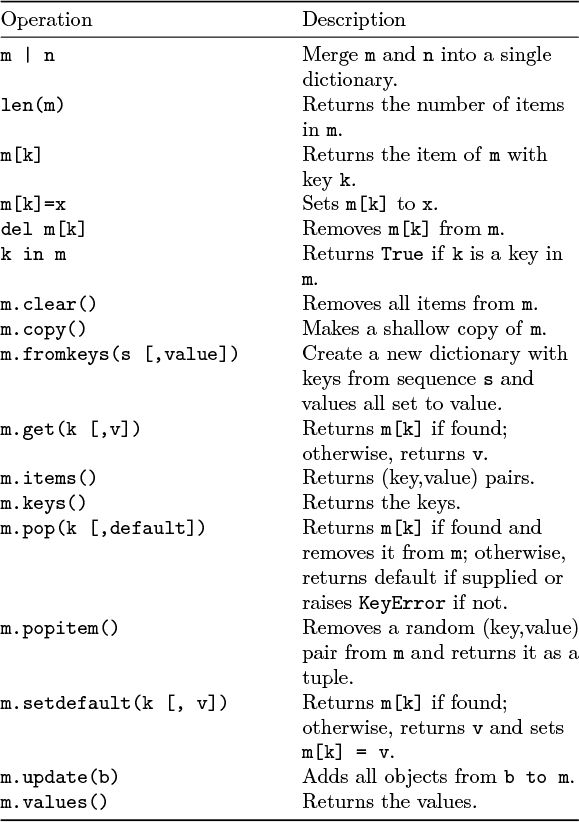

```
dir([object])
```

返回一个属性名称的排序列表。如果 `object` 是一个模块，它包含该模块中定义的符号列表。如果 `object` 是一个类型或类对象，它返回一个属性名称列表。这些名称通常从对象的 `__dict__` 属性中获取（如果已定义了话），但也可能使用其他来源。如果没有给出参数，则返回当前本地符号表中的名称。需要注意的是，此函数主要用于信息提示目的（例如，在命令行中交互式使用）。它不应该被用于正式的程序分析，因为获得的信息可能是不完整的。

此外，用户定义的类可以定义一个特殊方法 `__dir__()` 来更改此函数的结果。

```
divmod(a, b)
```

以元组形式返回长整除法的商和余数。对于整数，返回的值是 `(a // b, a % b)`。对于浮点数，返回 `(math.floor(a / b), a % b)`。此函数可能无法与复数调用。

```
enumerate(iter, start=0)
```

给定一个可迭代对象 `iter`，返回一个新的迭代器（类型为 `enumerate`），该迭代器产生包含计数和从 `iter` 产生的值的元组。例如，如果 `iter` 产生 `a`, `b`, `c`，那么 `enumerate(iter)` 产生 `(0,a)`, `(1,b)`, `(2,c)`。可选的 `start` 改变计数器的初始值。

```
eval(expr [, globals [, locals]])
```

评估表达式。`expr` 是字符串或由 `compile()` 创建的代码对象。`globals` 和 `locals` 是映射对象，分别定义该操作的全局和局部命名空间。如果省略，则使用调用者环境中执行的 `globals()` 和 `locals()` 的值来评估表达式。最常见的情况是将 globals 和 locals 指定为字典，但高级应用可以提供自定义的映射对象。

```
exec(code [, global [, locals]])
```

执行 Python 语句。`code` 是字符串、字节流或由 `compile()` 创建的代码对象。`globals` 和 `locals` 分别定义该操作的全局和局部命名空间。如果省略，则使用调用者环境中执行的 `globals()` 和 `locals()` 的值来执行代码。

```
filter(function, iterable)
```

创建一个迭代器，返回 `iterable` 中所有 `function(item)` 评估为 True 的项。

```
float([x])
```

表示浮点数的类型。如果 `x` 是数字，则将其转换为浮点数。如果 `x` 是字符串，则将其被解析为浮点数。对于所有对象类型，都会调用 `x.__float__()`。如果没有提供参数，则返回 0.0。

Table 5 显示了 float 的方法和属性。

表 5：float 的方法和属性

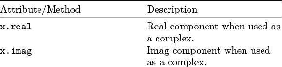

```
format(value [, format_spec])
```

根据格式规范字符串将 `value` 转换为格式化字符串。对齐方式 `<`、`>`，数字（指示字段宽度），以及代码 `'d'`、`'f'` 或 `'s'` 分别用于整数、浮点数或字符串。关于 `format()` 和说明符的更多细节可以参见 4 章，“类型与对象”。

```
frozenset([items])
```

表示不可变集合的类型，其值从 `items` 填充。值必须是不可变的。如果没有给出参数，则返回一个空集合。`frozenset` 支持 `sets` 的所有操作，但不包括任何原地修改集合的操作。

```
getattr(object, name [,default])
```

返回对象的具名属性的值。`name` 是包含属性名称的字符串。`default` 是在属性不存在时返回的可选值。否则将抛出 `AttributeError`。等同于访问 `object.name`。

```
globals()
```

返回当前模块的字典，表示全局命名空间。在函数或方法内部调用时，它返回定义该函数或方法的模块的全局命名空间。

```
hasattr(object, name)
```

如果 `name` 是对象的属性名称，则返回 `True`。`name` 是一个字符串。

```
hash(object)
```

返回一个对象的整数哈希值（如果可能）。哈希值主要用于字典、集合和其他映射对象的实现。对于任何两个相等的对象，哈希值始终是相同的。可变对象通常不定义哈希值，尽管用户定义的类可以定义一个 `__hash__()` 方法来支持此操作。

```
hex(x)
```

从整数 `x` 创建一个十六进制字符串。

```
id(object)
```

返回对象的唯一整数标识符。你不应该以任何方式解释该返回值（例如，作为内存位置）。

```
input([prompt])
```

向标准输出打印提示符，并从标准输入读取单行输入。返回的行不会被进行任何方式的修改。它不包含行尾（例如，`'\n'`）。

```
int(x [,base])
```


表示整数的类型。如果 `x` 是一个数字，它将通过向 0 截断转换为整数。如果它是一个字符串，则会被解析为整数值。`base` 可选，用于指定从字符串转换时的基数。除了支持常见的数学运算外，整数还具有许多属性和方法。

Table 6 显示了整数支持的属性。

表 6：整数的方法和属性

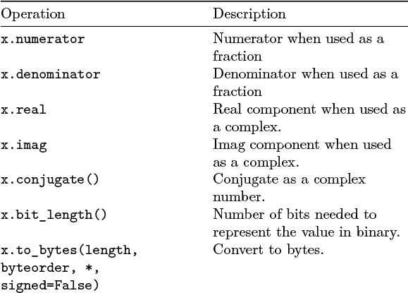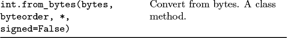

```
isinstance(object, classobj)
```

如果 `object` 是 `classobj` 的实例或 `classobj` 的子类，则返回 `True`。`classobj` 参数也可以是一个包含可能的类型或类的元组。例如，如果 `s` 是元组或列表，`isinstance(s, (list,tuple))` 将返回 `True`。

```
issubclass(class1, class2)
```

如果 `class1` 是 `class2` 的子类（派生于 `class2`），则返回 `True`。`class2` 也可以是一个包含可能类的元组，在这种情况下，将检查每个类。注意 `issubclass(A, A)` 为 `True`。

```
iter(object [,sentinel])
```

返回一个用于生成 `object` 中项的迭代器。如果省略了 `sentinel` 参数，则该对象必须提供 `__iter__()` 方法（创建一个迭代器），或者该对象必须实现 `__getitem__()` 方法（接受从 0 开始的整数参数）。如果指定了 `sentinel`，`object` 的解释方式有所不同。相反，`object` 应该是一个不带参数的可调用对象。返回的迭代器对象将反复调用此函数，直到返回的值等于 `sentinel`，此时迭代将停止。如果 `object` 不支持迭代，将产生 `TypeError`。

```
len(s)
```

返回 `s` 中包含的项数。`s` 应该是某种容器，如列表、元组、字符串、集合或字典。

```
list([items])
```

表示列表的类型。`items` 可以是任何迭代对象，其值被用于填充列表。如果 `items` 已经是列表，则会进行浅拷贝。如果没有提供参数，则返回一个空列表。

Table 7 显示了定义在列表上的操作。

表 7：列表操作符和方法

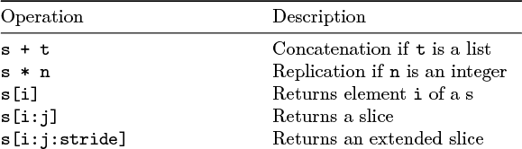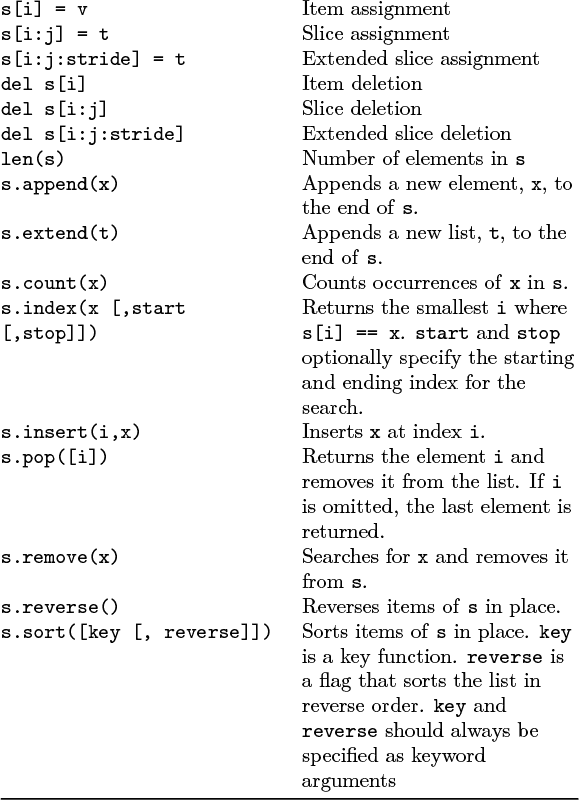

```
locals()
```

返回一个与调用者的本地命名空间对应的字典。此字典应该只用于检查执行环境——修改此字典的内容是不安全的。

```
map(function, items, ...)
```

创建一个迭代器，该迭代器产生将 `function` 应用于 `items` 中项产生的结果。如果提供了多个输入序列，则假设 `function` 接收相应数量的参数，每个参数取自不同的序列。在这种情况下，结果的长度与最短的输入序列一样长。

```
max(s [, args, ...], *, default=obj, key=func)
```

对于单个参数 `s`，此函数返回 `s` 中项的最大值，`s` 可以是任何迭代对象。对于多个参数，它返回参数中最大的一个。如果给出了仅关键字参数 `default`，则在 `s` 为空时提供返回值。如果给出了仅关键字参数 `key`，则返回使 `key(v)` 返回最大值的 `v`。

```
min(s [, args, ...], *, default=obj, key=func)
```

与 `max(s)` 相同，但返回的是最小值。

```
next(s [, default])
```

从迭代器 `s` 中返回下一个项。如果迭代器没有更多项，除非在 `default` 参数中提供了值，否则将抛出 `StopIteration` 异常。在这种情况下，将返回 `default`。

```
object()
```

Python 中所有对象的基类。你可以调用它来创建一个实例，但结果并不特别有趣。

```
oct(x)
```

将整数 `x` 转换为八进制字符串。

```
open(filename [, mode [, bufsize [, encoding [, errors [, newline [, closefd]]]]]])
```

打开文件 `filename` 并返回一个文件对象。参数详细说明见 第 9 章，输入/输出。

```
ord(c)
```

返回单个字符 `c` 的整数序数。此值通常对应字符的 Unicode 代码点值。

```
pow(x, y [, z])
```

返回 `x ** y`。如果提供了 `z`，此函数返回 `(x ** y) % z`。如果三个参数都给出，它们必须是整数，且 `y` 必须是非负的。

```
print(value, ... , *, sep=separator, end=ending, file=outfile)
```

打印一组值。作为输入，你可以提供任意数量的值，所有值都将打印在同一行。`sep` 关键字参数用于指定不同的分隔符字符（默认为空格）。`end` 关键字参数指定不同的行结束符（默认为 `'\n'`）。`file` 关键字参数将输出重定向到文件。

```
property([fget [,fset [,del [,doc]]]])

创建属性。`fget` 是一个返回属性值的函数，`fset` 设置属性值，`fdel` 删除。`doc` 提供文档字符串。属性通常如下装饰器指定：

```python
class SomeClass:

    x = property(doc='This is property')

    @x.getter
    def x(self):
        print('getting x')

    @x.setter
    def x(self, value):
        print('setting x to', value)

    @x.deleter
    def x(self):
        print('deleting x')
```

```
range([start,] stop [, step])
```

创建一个表示从 `start` 到 `stop` 的整数范围的 `range` 对象。`step` 表示步长，省略时默认为 1。负步长会创建一个降序的数字列表。

```
repr(object)
```

返回 `object` 的字符串表示。在大多数情况下，返回的字符串可以传递 `eval()`重建对象。

```
reversed(s)
```

为序列 `s` 创建反向迭代器。此函数仅在 `s` 定义了 `__reversed__()` 方法或实现了序列方法 `__len__()` 和 `__getitem__()` 时有效。它不适用于生成器。

```
round(x [, n])
```

将浮点数 `x` 四舍五入到 10 的 `n` 次方的倍数。如果省略 `n`，则默认为 0。如果两个倍数等远，则向偶数舍入，否则远离零舍入（例如，0.5 舍入到 0，1.5 舍入到 2）。

```
set([items])
```

创建一个从迭代对象 `items` 获取项填充的集合。项必须是不可变的。如果 `items` 包含其他集合，这些集合必须是 `frozenset` 类型。如果省略 `items`，则返回一个空集合。

Table 8 显示了集合的操作。

表 8：集合操作和方法

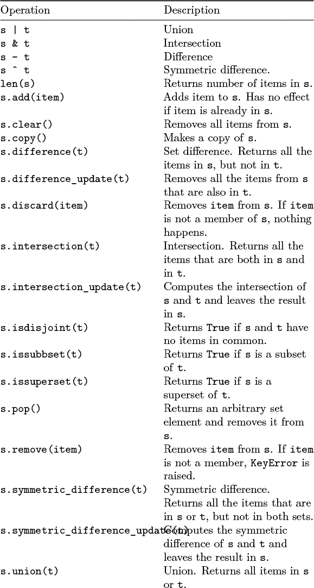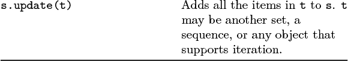

```
setattr(object, name, value)
```

设置对象的属性。`name` 是字符串。同于 `object.name = value`。

```
slice([start,] stop [, step])
```

返回一个表示指定范围的切片对象。切片对象通过扩展切片语法 `a[i:i:k]` 生成。

```
sorted(iterable, *, key=keyfunc, reverse=reverseflag)
```

从 `iterable` 中的项创建一个排序列表。关键字参数 `key` 是一个在比较之前转换转换的单参数函数。`reverse` 关键字参数是一个布尔标志，用于指定结果列表是否按逆序排序。`key` 和 `reverse` 参数必须使用关键字指定，例如 `sorted(a,key=get_name)`。

```
staticmethod(func)
```

为类中创建一个静态方法。此函数通常用作 `@staticmethod` 装饰器。

```
str([object])
```


表示字符串的类型。如果提供了对象，则通过调用其 `str()` 方法创建该值的字符串表示。这与你打印对象时看到的字符串是相同的。如果没有提供参数，则创建一个空字符串。

表 9 显示了定义在字符串上的方法。

表 9：字符串操作符和方法

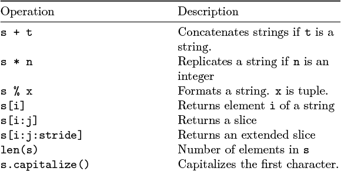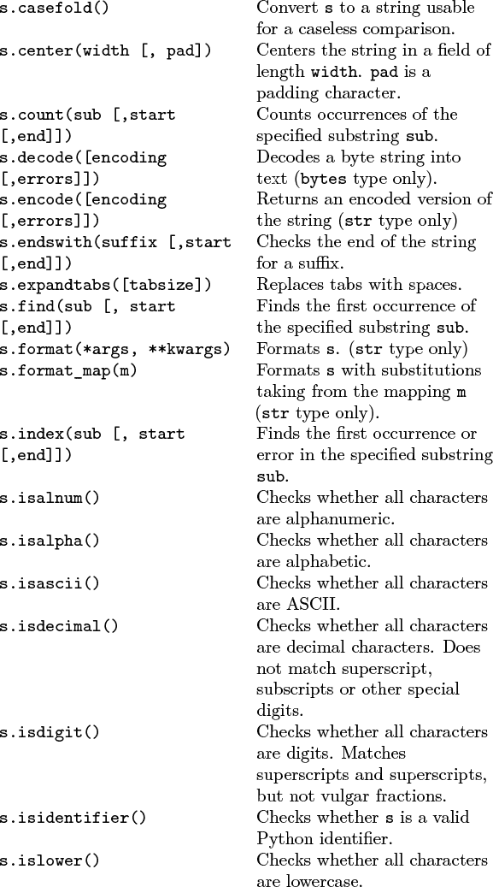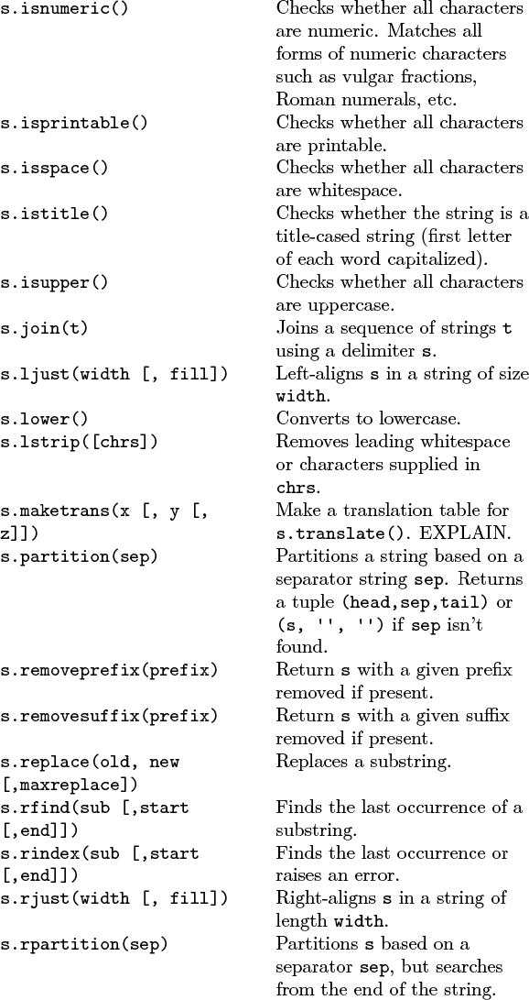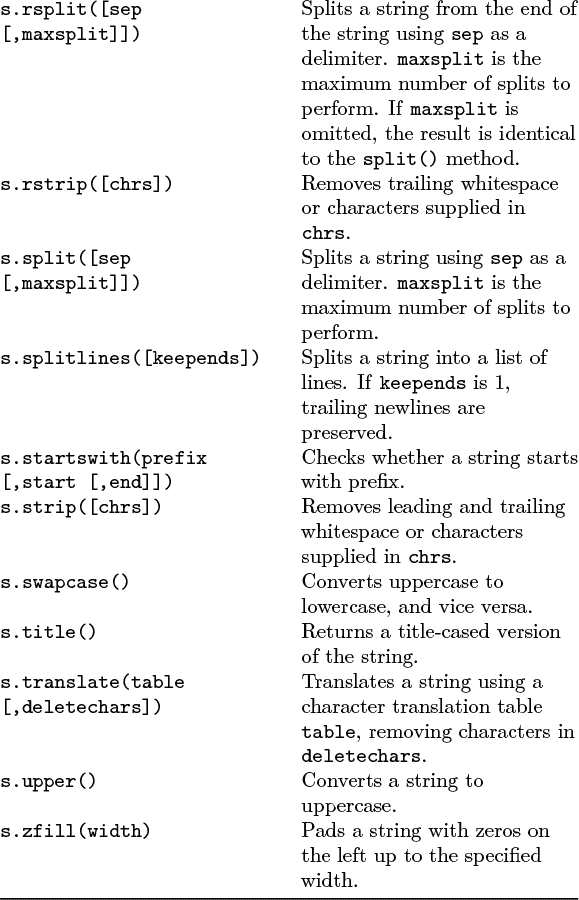

```
sum(items [,initial])
```

计算从迭代对象 `items` 中取出的序列项之和。`initial` 提供起始值，默认值为 0。此函数通常只作用于数字。

```
super()
```

返回一个表示其使用所在类的所有父类的对象。该对象的主要目的是调用基类中的方法。这里是一个示例：

```python
class B(A):

     def foo(self):

         super().foo()
```

```python
tuple([items])
```

表示元组的类型。如果提供了，`items` 是一个用于填充元组的迭代对象。然而，如果 `items` 已经是元组，则原封不动返回。如果没有提供参数，则返回空元组。

表 10 显示了定义在元组上的方法。

表 10：元组操作符和方法

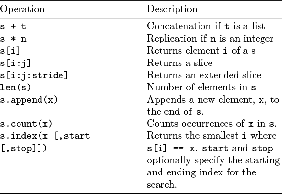

```python
type(object)
```

Python 中所有类型的基类。当作为函数调用时，返回 `object` 的类型。该类型与对象的类相同。对于整数、浮点数列表等常见类型，类型将指向其他内置类之一，如 `int`、`float`、`list` 等。对于用户定义的对象，类型是关联的类。对于 Python 内部相关的对象，你通常会获得 `types` 模块中定义的类的引用。

```python
vars([object])
```

返回 `object` 的符号表（通常位于其 `__dict__` 属性中）。如果没有提供参数，则返回一个对应于本地命名空间的字典。应该假设此函数返回的字典是只读的。修改内容是不安全的。

```
zip([s1 [, s2 [,..]]])
```

创建一个迭代器，产生包含来自 `s1`、`s2` 等每个各一个项的元组。第 n 个元组为 `(s1[n], s2[n], ... )`。当最短的输入耗尽时，生成的迭代器停止。如果没有提供参数，迭代器不产生任何值。

### 内置异常

本节描述了用于报告不同类型错误的内置异常。

#### 异常基类

以下异常作为所有其他异常的基类：

```
BaseException
```

所有异常的根类。所有内置异常都派自此类。

```
Exception
```

所有与程序相关的异常的基类，包含了 `SystemExit`、`GeneratorExit` 和 `KeyboardInterrupt` 之外的所有内置异常。用户定义的异常应该通过继承 `Exception` 来定义。

```
ArithmeticError
```

算术异常的基类，包括 `OverflowError`、`ZeroDivisionError` 和 `FloatingPointError`。

```
LookupError
```

索引和键错误的基类，包括 `IndexError` 和 `KeyError`。

```
EnvironmentError
```

发生在 Python 之外的错误的基类。是 `OSError` 的别名。

上述异常永远不会被显式抛出。然而，它们可以用于捕获某些类的错误。例如，以下代码将捕获任何类型的数值错误：

```python
try:
    # 某些操作
    ...
except ArithmeticError as e:
    # 数学错误
```

#### 异常属性

异常实例 `e` 具有几个标准属性，这些属性在某些应用程序中用于检查和/或操作。

```python
e.args
```

抛出异常时提供的参数的元组。在大多数情况下，这是一个包含描述错误的字符串的单项元素元组。对于 `EnvironmentError` 异常，该值是一个 2 元组或 3 元组，包含一个整数错误代码、字符串错误消息和一个可选的文件名。如果你需要在不同的上下文中重新创建异常，此元组的内容可能有用。例如，为了在不同的 Python 解释器进程中抛出异常。

```
e.__cause__
```

使用显式链式异常时的上一个异常。

```
e.__context__
```

隐式链式异常的上一个异常。

```
e.__traceback__
```

与异常关联的回溯轨迹对象。

#### 预定义异常类

以下异常由程序抛出：

```
AssertionError
```

断言语句执行失败。

```
AttributeError
```

属性引用或赋值失败。

```
BufferError
```

缺少预期的内存缓冲区。

```
EOFError
```

文件末尾。由内置函数 `input()` 和 `raw_input()` 生成。需要注意的是，大多数其他 I/O 操作（如文件的 `read()` 和 `readline()` 方法）返回空字符串来指示文件末尾，而不是抛出异常。

```
FloatingPointError
```

浮点操作失败。需要注意的是，浮点异常处理是复杂的，只有在配置了允许的情况下时才会抛出此异常。它是 `ArithmeticError` 的子类。

```
GeneratorExit
```

在生成器内部抛出以信号终止。当生成器过早销（在消耗所有值之前）或调用其 `close()` 方法时发生。

```
IOError
```

失败的 I/O 操作。该值是一个具有 `errno`、`strerror` 和 `filename` 属性的 `IOError` 实例。`errno` 是整数错误代码，`strerror` 是字符串错误消息，`filename` 是可选的文件名。它是 `EnvironmentError` 的子类。

```
ImportError
```

当导入语句找不到模块或在模块中未找到名称时抛出。

```
IndentationError
```

缩进错误。它是 `SyntaxError` 的子类。

```
IndexError
```

序列超出范围。它是 `LookupError` 的子类。

```
KeyError
```

映射中未找到键。它是 `LookupError` 的子类。

```
KeyboardInterrupt
```

当用户按下键（通常是 Ctrl+C）时抛出。

```
MemoryError
```

可恢复的内存错误。

```
ModuleNotFoundError
```

`import` 语句无法找到模块时。

```
NameError
```

本地或全局命名空间中未找到名称。

```
NotImplementedError
```

未实现的功能。可以由要求派生类实现某些方法的基类抛出。它是 `RuntimeError` 的子类。

```
OSError
```

操作系统错误。主要由 `os` 模块中的函数抛出。以下异常是其子类：`BlockingIOError`、`BrokenPipeError`、`ChildProcessError`、`ConnectionAbortedError`、`ConnectionError`、`ConnectionRefusedError`、`ConnectionResetError`、`FileExistsError`、`FileNotFoundError`、`InterruptedError`、`IsADirectoryError`、`NotADirectoryError`、`PermissionError`、`ProcessLookupError`、`TimeoutError`。

```
OverflowError
```

整数值太大无法表示。此异常通常只发生在传递给内部依赖固定精度机器整数的对象时。例如，在 `range` 或 `xrange` 对象中指定超过 32 位的起始或结束值时，可能会出现此错误。它是 `ArithmeticError` 的子类。

```
RecursionError
```

超出递归限制。

```
ReferenceError
```

在底层对象被破坏后访问弱引用的结果。（参见 `weakref` 模块。）

```
RuntimeError
```

未被其他类别涵盖的通用错误。


```
StopIteration
```
用于抛出迭代结束信号。这通常发生在对象的 `next()` 方法或生成器函数中。

```
StopAsyncIteration
```
用于抛出异步迭代结束。仅适用于 `async` 函数和生成器的上下文中。

```
SyntaxError
```
解析器语法错误。实例具有 `filename`、`lineno`、`offset` 和 `text` 属性，可用这些属性收集更多信息。

```
SystemError
```
解释器内部错误。其值是一个指示该问题的字符串。

```
SystemExit
```
由 `sys.exit()` 函数抛出。其值是一个表示返回码的整数。如果需要立即退出，可以使用 `os._exit()`。

```
TabError
```
制表符使用不一致。当运行 Python 时带有 `-tt` 选项时生成此错误。它是 `SyntaxError` 的子类。

```
TypeError
```
当操作或函数应用于类型不当的对象时发生此错误。

```
UnboundLocalError
```
引用了未绑定的局部变量。如果在函数中变量定义之前就引用了它，就会发生此错误。它是 `NameError` 的子类。

```
UnicodeError
```
Unicode 编码或解码错误。它是 `ValueError` 的子类。以下异常是其子类：`UnicodeEncodeError`、`UnicodeDecodeError`、`UnicodeTranslateError`

```
ValueError
```
当函数或操作的参数类型正确但值不恰当时生成此错误。

```
WindowsError
```
在 Windows 上由于系统调用失败而生成。它是 `OSError` 的子类。

```
ZeroDivisionError
```
除以零。它是 `ArithmeticError` 的子类。

# 标准库

Python 附带了一个庞大的标准库。其中许多模块在书中已经描述过。参考资料可以在 [`docs.python.org/library`](https://docs.python.org/library) 找到。这些材料在此不再重复出现。

下面列出的模块之所以引人注目，是因为它们通常对各种应用程序以及通用 Python 编程非常有用。

## collections 模块
`collections` 模块为 Python 提供了各种额外的容器对象，这些对象在处理数据时非常有用。例如，双端队列（`deque`）、自动初始化缺失项的字典（`defaultdict`）以及用于计数的计数（`Counter`）。

## datetime 模块
`datetime` 模块包含了与日期、时间以及涉及这些内容的相关的函数。

## itertools 模块
`itertools` 模块提供了各种实用的迭代模式。例如，将迭代器链在一起、遍历乘积、排列、分组以及类似的操作。

## inspect 模块
`inspect` 模块提供了用于检查代码相关元素（如函数、类、生成器和协程）内部结构的函数。它通常用于定义装饰器和类似特性的元编程中。

## math 模块
`math` 模块提供了常见的数学函数，如 `sqrt()`、`cos()` 和 `sin()`。

## os 模块
`os` 模块包含了与主机操作系统相关的低级函数。例如，进程、文件、管道、权限和类似的功能。

## random 模块
`random` 模块提供了与随机数生成相关的各种函数。

## re 模块
`re` 模块支持通过正则表达式模式匹配处理文本。

## shutil 模块
`shutil` 模块拥有执行与 shell 常用任务的函数。例如，复制文件和目录。

## statistics 模块
`statistics` 模块提供了计算常见统计值的函数，如均值、中位数标准差。

## sys 模块
`sys` 模块包含了许多与 Python 运行环境相关的属性和方法。这包括命令行选项、标准 I/O 流、导入路径和类似的功能。

## time 模块
`time` 模块包含了与系统时间相关的函数。例如，获取系统钟的值、睡眠以及经过的 CPU 秒数。

## turtle 模块
海龟图形。你知道的，给孩子玩的。

## unittest 模块
`unittest` 模块提供了编写单元测试内置支持。Python 本身使用 `unittest` 进行测试。然而，许多程序员倾向于使用 `pytest` 等第三方库进行测试。作者对此赞同。

# 结语：使用内置函数

在拥有数十万 Python 包的现代世界中，程序员很容易以第三方包依赖的形式寻求小问题的解决方案。然而，Python 长期以来有一组非常有用的内置函数和数据类型。结合标准库中的模块，通常只需要 Python 提供的功能就能解决许多常见的编程问题。如果有选择，请优先选择后者。

