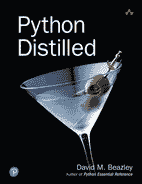
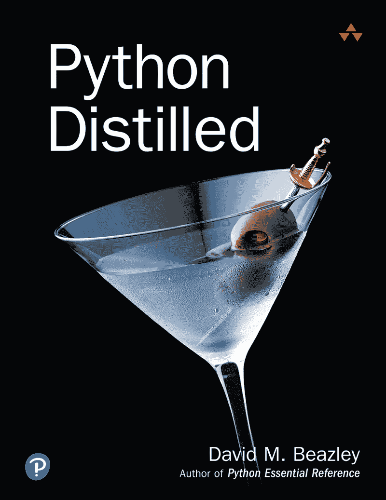
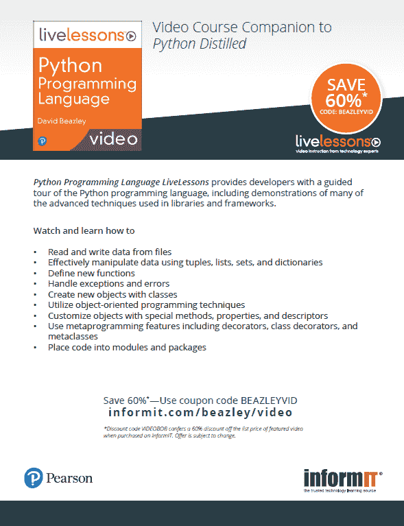
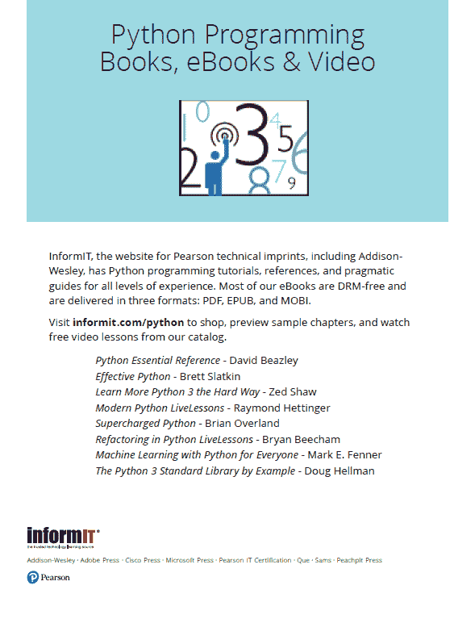

# Python 精要教程 (第一版)





# 关于本书

ePUB 是一种开放的、行业标准的电子书格式。然而，ePUB 的支持及其众多功能在不同阅读设备和应用中有所差异。使用设备或应用的设置自定义呈现方式以符合你的喜好。可自定义的设置通常包括字体、字体大小、单列或双列布局、横向或纵向模式，以及可以点击或轻触放大的图片。如需了解设备或应用的设置和功能的更多信息，请访问设备制造商的网站。

许多标题包含编程代码或配置示例。为了优化这些元素的呈现，请在单列、横向模式下查看电子书，并将字体大小调至最小设置。除了在可滚动文本格式中呈现代码和配置外，我们还提供了模仿印刷书中代码呈现的代码图片；因此，当可滚动格式可能影响代码列表的显示时，你会看到“点击此处查看代码图片”链接。点击该链接查看印刷品质的代码图片。要返回到先前查看的页面，请点击设备或应用的“后退”按钮。

关于批量购买此书的信息，或关于特殊销售机会（可能包括电子版；定制封面设计；以及针对您的业务、培训目标、营销重点或品牌兴趣的内容）的信息，请联系我们的企业销售部门 `corpsales@pearsoned.com` 或 (800) 382-3419。

对于政府销售查询，请联系 `governmentsales@pearsoned.com`。

关于美国以外销售的问题，请联系 `intlcs@pearson.com`。

请访问我们的网站：`informit.com/aw`。


`ScoutAutomatedPrintCode`


Many of the designations used by manufacturers and sellers to distinguish their products are claimed as trademarks. Where those designations appear in this book, and the publisher was aware of a trademark claim, the designations have been printed with initial capital letters or in all capitals.

The author and publisher have taken care in the preparation of this book, but make no expressed or implied warranty of any kind and assume no responsibility for errors or omissions. No liability is assumed for incidental or consequential damages in connection with or arising out of the use of the information or programs contained herein.

For information about buying this title in bulk quantities, or for special sales opportunities (which may include electronic versions; custom cover designs; and content particular to your business, training goals, marketing focus, or branding interests), please contact our corporate sales department at `corpsales@pearsoned.com` or (800) 382-3419.

For government sales inquiries, please contact `governmentsales@pearsoned.com`.

For questions about sales outside the U.S., please contact `intlcs@pearson.com`.

Visit us on the Web: `informit.com/aw`


`ScoutAutomatedPrintCode`


索引

** 前序**

自从我编写 *Python Essential Reference* 以来，已经过去了 20 多年。那时，Python 是一门规模小得多的语言，它的标准库中带有一组实用的“电池”（内置功能）。它大部分内容都能装进你的大脑里。《Essential Reference* 反映了那个时代。它是一本小书，你可以随身携带它，在荒岛或秘密地下库里编写一些 Python 代码。在随后的三次修订中，《Essential Reference* 始终坚持着成为紧凑但完整的语言参考的愿景——因为如果你要在假期期间用 Python 写代码，为什么不把所有的用上呢？

今天，在上一版出版十多年后，Python 的世界已经大不相同了。Python 不再是一门小众语言，已成为世界上最流行的编程语言之一。Python 程序员还通过高级编辑器、IDE、笔记本、网页等形式拥有触手可及的丰富信息。事实上，当你几乎可能需要的任何参考资料只需敲击几个键就能出现在眼前时，可能就不太需要查阅参考书了。

如果说有什么的话，信息检索的易易性和 Python 宇宙的规模带来了一种不同的挑战。如果你刚开始学习或需要解决一个新问题，知道该从何处入手可能会让你无所从。将各种工具的特性与语言本身区分开来也很困难。这类问题正是本书的初衷所在。

*Python Distilled* 是一本关于 Python 编程的书。它并不试图记录 Python 中所有可能或已经实现的功能。它的重点在于呈现一个现代且经过精选（或提炼）的语言核心。这源于我多年向科学家、工程师和软件专业人士教授 Python 的经验。

** 致谢**

我想感谢技术评审人员 Shawn Brown、Sophie Tabac 和 Pete Fein，感谢他们的建议。感谢长期编辑 Debraley 对本书的工作。感谢许多上我课程的学生，他们对本书的主题产生了重大影响。希望 Python 依然充满乐趣。最后，特别感谢 Paula、Thomas 和 Lewis 的支持。

**关于作者**

**David Beazley** 是 *Python Essential Reference, Fourth Edition* (Addison-Wesley, 2010) 和 *Python Cookbook, Third Edition* (O’Reilly, 2013) 的作者。他目前通过自己的公司 Dabeaz LLC ([www.dabeaz.com](http://www.dabeaz.com)) 教授高级计算机科学课程。他自 1 以来一直在使用、编写、演讲和教学 Python。

# 1 Python 基础

本章介绍了 Python 语言的核心，涵盖了变量、数据类型、表达式、控制流、函数、类以及输入输出。章节最后讨论了模块、脚本编写、包以及组织大型程序的建议。本章并不试图对每个功能进行全面覆盖，也没有关注围绕大型项目的所有工具。然而，经验丰富的程序员应该能够根据这里的材料推断出更高级的程序。鼓励新手在简单的环境中（如终端窗口和基础文本编辑器）中尝试示例。

## 1.1 运行 Python

Python 程序由解释器执行。Python 解释器可以在许多不同的环境中运行——IDE、浏览器或终端窗口。然而，在这一切之下，解释器的核心是一个文本应用程序，可以通过在 `bash` 等命令行中输入 `python` 来启动。由于同一台机器可能同时安装了 Python 2 和 Python 3，你可能需要输入 `python2` 或 `python3` 来选择版本。本书假设使用 Python 3.8 或更高版本。

当解释器启动时，会出现一个提示符，你可以在其处输入程序。例如，在下面的输出中，解释器显示了版权信息并向用户提示 `>>>`，随后用户输入了熟悉的“Hello World”程序：

点击此处查看代码图片


...[/content].

We need to translate all English sentences, but keep code blocks (including python code, shell commands, etc.) unchanged. Also need to translate table captions and description text, but keep table structure.

We must be careful with bold (**bold**) and italic (*italic*) - translate content and keep symbols. In the given text, there are no bold or italic except maybe in tables? Let's scan.

The text includes:

- "Python 3.8.0 (default, Feb 3 2019, 05:53:21)" etc. That's code block, keep unchanged.

- "Certain environments may display a different prompt. The following output is from `ipython` (an alternate shell for Python):" That's regular text, translate.

- "Click here to view code image" is a link; need to translate its content (the Chinese text inside brackets) but keep URL unchanged. So "[Click here to view code image]" -> "点击此处查看代码图片". Keep link format: 点击此处查看代码图片.

- Then code block with Python interactive session. Keep unchanged.

- "Regardless of the exact form of output you see, the underlying principle is the same. You type a command, it runs, and you immediately see the output." Translate.

- "Python’s interactive mode is one of its most useful features because you can type any valid statement and immediately see the result. This is useful for debugging and experimentation. Many people, including the author, use interactive Python as their desktop calculator. For example:" Translate.

- Then another link: "Click here to view code image" -> translate.

- Then code block with interactive Python: ">>> 6000 + 4523.50 + 134.25" etc. Keep unchanged.

- Then text: "When you use Python interactively, the variable `_` holds the result of the last operation. This is useful if you want to use that result in subsequent statements. This variable only gets defined when working interactively, so don’t use it in saved programs." Translate.

- "You can exit the interactive interpreter by typing `quit()` or the EOF (end of file) character. On UNIX, EOF is `Ctrl+D`; on Windows, it’s `Ctrl+Z`." Translate.

- Section 1.2: "If you want to create a program that you can run repeatedly, put statements in a text file. For example:" Translate.

- Then code block with python file: "# hello.py" etc. Keep unchanged.

- "Python source files are UTF-8-encoded text files that normally have a `.py` suffix. The `#` character denotes a comment that extends to the end of the line. International (Unicode) characters can be freely used in the source code as long as you use the UTF-8 encoding (this is the default in most editors, but it never hurts to check your editor settings if you’re unsure)." Translate.

- "To execute the `hello.py` file, provide the filename to the interpreter as follows:" Translate.

- Then code block with shell command: "shell % python3 hello.py" etc. Keep unchanged.

- "It is common to use `#!` to specify the interpreter on the first line of a program, like this:" Translate.

- Then code block with shebang: "#!/usr/bin/env python3" etc. Keep unchanged.

- "On UNIX, if you give this file execute permissions (for example, by `chmod +x hello.py`), you can run the program by typing `hello.py` into your shell." Translate.

- "On Windows, you can double-click on a `.py` file or type the name of the program into the Run command on the Windows Start menu to launch it. The `#!` line, if given, is used to pick the interpreter version (Python 2 versus 3). Execution of a program might take place in a console window that disappears immediately after the program completes—often before you can read its output. For debugging, it’s better to run the program within a Python development environment." Translate.

- "The interpreter runs statements in order until it reaches the end of the input file. At that point, the program terminates and Python exits." Translate.

- Section 1.3: "Primitives, Variables, and Expressions" -> translate.

- Then link: "Click here to view code image" -> translate.

- Then code block with primitives: "42", "4.2", "'forty-two'", "True". Keep unchanged.

- Then text: "A variable is a name that refers to a value. A value represents an object of some type:" Translate.

- Then code: "x = 42". Keep unchanged.

- "Sometimes you might see a type explicitly attached to a name. For example:" Translate.

- Then code: "x: int = 42". Keep unchanged.

- "The type is merely a hint to improve code readability. It can be used by third-party code-checking tools. Otherwise, it is completely ignored. It does not prevent you from assigning a different kind of value later." Translate.

- "An expression is a combination of primitives, names, and operators that produces a value:" Translate.

- Link: "Click here to view code image" -> translate.

- Then code block: "2 + 3 * 4            # -> 14". Keep unchanged.

- Then text: "The following program uses variables and expressions to perform a compound-interest calculation:" Translate.

- Link: "Click here to view code image" -> translate.

- Then code block with interest.py: "# interest.py" etc. Keep unchanged.

- Then text: "When you use Python interactively, the variable `_` holds the result of the last operation. This is useful if you want to use that result in subsequent statements. This variable only gets defined when working interactively, so don’t use it in saved programs." Already translated earlier; but appears again. Keep same translation.

- "You can exit the interactive interpreter by typing `quit()` or the EOF (end of file) character. On UNIX, EOF is `Ctrl+D`; on Windows, it’s `Ctrl+Z`." Already translated earlier; but appears again. Keep same.

- Section 1.4: "Arithmetic Operators" -> translate.

- Then text: "Python has a standard set of mathematical operators, shown in Table 1.1. These operators have the same meaning they do in most programming languages." Translate.

- Then table: need to translate the table content (Operation, Description). Keep table structure. Also translate caption "Table 1.1 Arithmetic Operators". Also need to translate description for each row.

- Then text: "The division operator (`/`) produces a floating-point number when applied to integers. Therefore, `7/4` is `1.75`. The truncating division operator `//`, also known as floor division, truncates the result to an integer and works with both integers and floating-point numbers. The modulo operator returns the remainder of the division `x // y`. For example, `7 % 4` is `3`. For floating-point numbers, the modulo operator returns the floating-point remainder of `x // y`, which is `x – (x // y) * y`." Translate.

- Then text: "In addition, the built-in functions in Table 1.2 provide a few more commonly used numerical operations." Translate.

- Then Table 1.2: need to translate function names and descriptions.

- Then text: "The `round()` function implements “banker’s rounding.” If the value being rounded is equally close to two multiples, it is rounded to the nearest even multiple (for example, 0.5 is rounded to 0.0, and 1.5 is rounded to 2.0)." Translate.

We must ensure we keep all code blocks unchanged, including backticks and braces.

We need to wrap everything in [content]...[/content].

Potential pitfalls: Ensure we don't miss any lines. Also ensure we keep list items (the bullet list at start) but there is no list in the given text except maybe the tables. The tables need to be translated.

Let's go through and produce translation.

First, the initial part:

Original:

[content]
-   [Feynman's learning method](https://wiki.example.org/feynmans_learning_method) is inspired by **Richard Feynman**, the Nobel Prize winner in physics. 

1.  With Feynman's skills, you can understand the knowledge points in depth in just `20 min`, and it is memorable and *hard to forget*. 

```
if (condVar > someVal) {console.log("xxx")}
```


整数提供了几个额外的运算符来支持位操作，见表 1.3。

| 操作 | 描述 |
| --- | --- |
| `x << y` | 左移 |
| `x >> y` | 右移 |
| `x & y` | 按位与 |
| `x | y` | 按位或 |
| `x ^ y` | 按位异或（互不逻辑或） |
| `~x` | 按位取反 |

表 1.3 位操作运算符

人们通常会将这些运算符与二进制整数配合。例如：

点击此处查看代码图像

```
a = 0b11001001
mask = 0b11110000
x = (a & mask) >> 4    # x = 0b1100 (12)
```

在这个示例中，`0b11001001` 是用二进制形式表示整数值的方法。你可以将其写为十进制 `201` 或十六进制 `0xc9`，但如果你正在处理位（bits），二进制会让你更容易直观地看到你正在操作。

位运算符的语义假设整数使用补码二进制表示，并且符号位向左侧无限扩展。如果你正在处理旨在映射到硬件原生整数的原始位模式，则需要小心。这是因为 Python 不会截断位，也不会允许值溢出——相反，结果在数值量级上会任意增长。你需要自己确保在需要时正确地调整结果的大小或进行截断。

要比较数字，请使用表 1.4 中的比较运算符。

| 操作 | 描述 |
| --- | --- |
| `x == y` | 等于 |
| `x != y` | 不等于 |
| `x < y` | 小于 |
| `x > y` | 大于 |
| `x >= y` | 大于等于 |
| `x <= y` | 小于等于 |

表 1.4 比较运算符

比较的结果是一个布尔值 `True` 或 `False`。

`and`、`or` 和 `not` 运算符（不要与上述位操作运算符混淆）可以形成更复杂的布尔表达式。这些运算符的行为所示表 1.5。

| 运算符 | 描述 |
| --- | --- |
| `x or y` | 如果 `x` 为假，返回 `y`；否则，返回 `x`。 |
| `x and y` | 如果 `x` 为假，返回 `x`；否则，返回 `y`。 |
| `not x` | 如果 `x` 为假，返回 `True`；否则，返回 `False`。 |

表 1.5 逻辑运算符

如果一个值字面上是 `False`、`None`、数值零或为空，则它被认为是假。否则，它被认为是真。

编写一个更新值的表达式是常见的。例如：

```
x = x + 1
y = y * n
```

对于这些操作，你可以使用以下简写操作来代替：

```
x += 1
y *= n
```

这种更新的简写形式可以用于任何 `+`、`-`、`*`、`**`、`/`、`//`、`%`、`&`、`|`、`^`、`<<`、`>>` 运算符。Python 没有某些其他语言中的递增 (`++`) 或递减 (`--`) 运算符。

### 1.5 条件与控制流

`while` 语句用于循环和条件代码执行。这是一个示例：

点击此处查看代码图像

```
if a < b:
    print('Computer says Yes')
else:
    print('Computer says No')
```

`if` 和 `else` 子句的体通过缩进表示。`else` 子句是可选的。要创建一个空语句，使用 `pass` 语句，如下：

点击此处查看代码图像

```
if a < b:
    pass      # 什么都不做
else:
    print('Computer says No')
```

要处理多个测试用例，使用 `elif` 语句：

点击此处查看代码图像

```
if suffix == '.htm':
    content = 'text/html'
elif suffix == '.jpg':
    content = 'image/jpeg'
elif suffix == '.png':
    content = 'image/png'
else:
    raise RuntimeError(f'Unknown content type {suffix!r}')
```

如果你在结合测试的同时进行赋值，请使用条件表达式：

点击此处查看代码图像

```
maxval = a if a > b else b
```

这等同于较长的写法：

```
if a > b:
    maxval = a
else:
    maxval = b
```

有时，你可能会看到使用 `:=` 运算符将赋值与测试结合。这俗称为“海象运算符”。例如：

点击此处查看代码图像

```
if (n := len(data)) > 10:
    print(f'Data is too long ({n} elements)')
```

海象运算符允许你在表达式中为变量赋值并使用该值。这在 `if` 语句和 `while` 循环中特别有用。

### 1.6 字符串

要定义字符串，用单引号、双引号或三引号括起来：

点击此处查看代码图像

```
a = 'Hello World'
b = "Python is groovy"
c = '''Computer says no'''
```

三引号字符串在内容跨行时非常有用：

点击此处查看代码图像

```
'''Content-type: text/html
<h1>Hello World</h1>
<a href="http://www.python.org">here</a>
'''
```

紧相邻的字符串字面量会合并成单个字符串。因此，上面的内容也可以写成：

点击此处查看代码图像

```
'Hello ' 'World'
```

如果字符串的引号前有 `f`，字符串内部的表达式会被求值。例如，在之前的示例中，使用以下语句输出计算值：

点击此处查看代码图像

```
print(f'{year:>3d} {principal:0.2f}')
```

虽然只使用了简单的变量名，但任何有效表达式都可以出现。例如：

```
print(f'{year + year:>4d}')
```

作为 f-string 的替代，`format()` 方法和 `%` 运算符也用于格式化字符串。例如：

点击此处查看代码图像

```
print('{0:>3d} {1:0.2f}'.format(year, principal))

print('%3d %0.2f' % (year, principal))
```

字符串存储为由整数索引的 Unicode 序列，从零开始。负索引从末尾开始。字符串的长度使用 `len(s)` 计算。要提取单个字符，使用索引运算符 `s[i]`，其中 `i` 是索引。

点击此处查看代码图像

```
a = 'Hello World'
print(len(a))                # 11
b = a[4]                     # b = 'o'
c = a[-1]                    # c = 'd'
```


要提取子字符串，请使用切片操作符 `s[i:j]`。它提取 `s` 中所有索引 `k` 在 `i <= k < j` 范围内的字符。如果省略了其中一个索引，则分别假设为字符串的开头或结尾：

点击此处查看代码图片

```
c = a[:5]               # c = 'Hello'
d = a[6:]               # d = 'World'
e = a[3:8]              # e = 'lo Wo'
f = a[-5:]              # f = 'World'
```

字符串有多种方法来处理其内容。例如，`replace()` 方法执行简单的文本替换：

点击此处查看代码图片

```
g = a.replace('Hello', 'Hello Cruel')  # f = 'Hello Cruel World'
```

表 1.6 显示了一些常用的字符串方法。在这里和其他其他地方，方括号括起来参数都是可选的。

| 方法 | 说明 |
| --- | --- |
| `s.endswith(prefix [,start [,end]])` | 检查字符串是否以 `prefix` 结尾。 |
| `s.find(sub [, start [,end]])` | Find 指定子字符串 `sub` 第一次出现的位置，如果未找到返回 -1。 |
| `s.lower()` | 转换为小写。 |
| `s.replace(old, new [,maxreplace])` | 替换子字符串。 |
| `s.split([sep [,maxsplit]])` | 使用 `sep` 作为分隔符分割字符串。`maxsplit` 是最大分割次数。 |
| `s.startswith(prefix [,start [,end]])` | 检查字符串是否以 `prefix` 开头。 |
| `s.strip([chrs])` | 去除首尾空格或 `chrs` 中提供的字符。 |
| `s.upper()` | 转换为大写。 |

表 1.6 常用字符串方法

使用加号 (`+`) 运算符进行字符串拼接：

点击此处查看代码图片

```
g = a + 'ly'     # g = 'Hello Worldly'
```

Python 永远不会隐式地将字符串的内容解释为数值。因此，`+` 总是拼接字符串：

点击此处查看代码图片

```
x = '37'
y = '42'
z = x + y     # z = '3742' (字符串拼接)
```

要进行数学计算，必须先使用 `int()` 或 `float()` 等函数将字符串转换为数值。例如：

点击此处查看代码图片

```
z = int(x) + int(y)   # z = 79 (整数加法)
```

非字符串值可以使用 `str()`、`repr()` 或 `format()` 函数转换为字符串表示形式。这里有一个示例：

点击此处查看代码图片

```
s = 'The value of x is ' + str(x)
s = 'The value of x is ' + repr(x)
s = 'The value of x is ' + format(x, '4d')
```

虽然 `str()` 和 `repr()` 都创建字符串，但它们的输出通常不同。`str()` 产生你使用 `print()` 函数时得到的输出，而 `repr()` 创建的字符串是你输入到程序中以精确表示对象的字符串。例如：

点击此处查看代码图片

```
>>> s = 'hello\nworld'
>>> print(str(s))
hello
world
>>> print(repr(s))
'hello\nworld'
>>>
```

调试时，使用 `repr(s)` 生成输出，因为它显示了更多关于值及其类型的信息。`format()` 函数用于将单个值转换为带有格式的字符串。例如：

点击此处查看代码图片

```
>>> x = 12.3456
>>> format(x, '0.2f')
'12.35'
>>>
```

传递给 `format()` 的代码与你在生成格式化输出时使用的 f-string 代码相同。例如，上面的代码可以替换为：

点击此处查看代码图片

```
>>> f'{x:.2f}'
'12.35'
>>>
```

### 1.7 文件输入输出

以下程序打开文件并逐行按文本字符串读取内容：

点击此处查看代码图片

```
with open('data.txt') as file:
    for line in file:
        print(line)
```

`open()` 函数返回一个文件对象。`with` 语句声明了一个会自动关闭文件的块。如果不使用 `with` 语句，代码看起来如下：

点击此处查看代码图片

```
file = open('data.txt')
for line in file:
    print(line)
file.close()
```

很容易忘记调用 `close()`，所以 `with` 语句更好。`for` 循环逐行遍历文件直到没有更多数据。例如：

点击此处查看代码图片

```python
with open('data.txt') as file:
    for line in file:
        print(line)
```

如果你想读取整个文件，请使用 `read()` 方法：

点击此处查看代码图片

```python
with open('data.txt') as file:
    data = file.read()
```

如果你想分块读取大文件，请使用 `read()` 方法：

点击此处查看代码图片

```python
with open('data.txt') as file:
    while chunk := file.read(1000):
        print(chunk)
```

此示例中的 `:=` 运算符将值赋值给变量并返回该值。

点击此处查看代码图片

```python
with open('data.txt') as file:
    while chunk := file.read(1000):
        print(chunk)
```

此外，文件对象支持 `write()` 方法。例如，上一个示例中的 `print()` 函数可以这样写：

```python
with open('out.txt', 'w') as out:
    out.write(f'30d\n')
```

默认情况下，文件包含 UTF-8 编码文本。如果你使用的是不同的文本编码，在打开文件时使用额外的 `encoding` 参数。例如：

点击此处查看代码图片

```python
with open('data.txt', encoding='latin-1') as file:
    data = file.read()
```

有时你可能想在控制台中交互式读取数据。要这样做，请使用 `input()` 函数。例如：

点击此处查看代码图片

```python
name = input('Enter your name : ')
print('Hello', name)
```

`input()` 函数返回直到终止换行符的所有输入文本，但不包括换行符。

### 1.8 列表

列表是任意对象的有序集合。通过方括号括起值来创建列表：

点击此处查看代码图片

```python
names = [ 'Dave', 'Paula', 'Thomas', 'Lewis' ]
```

列表通过整数索引，从零开始。使用索引操作符访问并修改列表的单个项：

点击此处查看代码图片

```python
a = names[2]         # 返回列表的第三个元素，'Thomas'
names[2] = 'Tom'     # 将第三个元素改为 'Tom'
print(names[-1])     # 打印最后一个元素 ('Lewis')
```

要在列表末尾添加新项，请使用 `append()` 方法：

```python
names.append('Alex')
```

要在列表的特定位置插入项，请使用 `insert()` 方法：

```python
names.insert(2, 'Aya')
```


要遍历列表中的项，使用 `for` 循环：

```python
for name in names:
    print(name)
```

你可以使用切片操作提取或重新赋值列表的一部分：

点击此处查看代码图片

```python
b = names[0:2]      # b -> ['Dave', 'Paula']

c = names[2:]       # c -> ['Aya', 'Tom', 'Lewis', 'Alex']

names[1] = 'Becky'  # 将 'Paula' 替换为 'Becky'

names[0:2] = ['Dave', 'Mark', 'Jeff'] # 用 ['Dave','Mark','Jeff']
                                      # 前两个项
```

使用加号 (`+`) 运算符拼接列表：

点击此处查看代码图片

```python
a = ['x','y'] + ['z','z','y']  # 结果为 ['x','y','z','z','y']
```

空列表可以通过两种方式创建：

点击此处查看代码图片

```python
names = []        # 一个空列表

names = list()    # 一个空列表
```

使用 `[]` 指定空列表更符合习惯。`list` 是与列表类型关联的类名。在将数据转换为列表时，更常见看到使用它。例如：

点击此处查看代码图片

```python
letters = list('Dave')    # letters = ['D', 'a', 'v', 'e']
```

大多数情况下，列表中的所有项都是相同类型（例如，数字列表或字符串列表）。然而，列表可以包含任何混合的 Python 对象，包括其他列表，如下例所示：

点击此处查看代码图片

```python
a = [1, 'Dave', 3.14, ['Mark', 7, 9, [100, 101]], 10]
```

嵌套列表中的项通过应用多次一次索引操作来访问：

点击此处查看代码图片

```python
a[1]             # 返回 'Dave'

a[3][2]          # 返回 9

a[3][3][1]       # 返回 101
```

以下程序 `pcost.py` 展示了如何将数据读入列表并进行简单计算。在这个示例中，假设行包含逗号分隔的值。该程序计算两列乘积之和。

点击此处查看代码图片

```python
# pcost.py
# 读取格式为 'NAME,SHARES,PRICE' 的输入行。
# 例如：
#    SYM,123,456.78

import sys

if len(sys.argv) != 2:
    raise SystemExit(f'Usage: {sys.argv[0]} filename')

rows = []
with open(sys.argv[1], 'rt') as file:
    for line in file:
        rows.append(line.split(','))

# rows 是这种形式的列表
# [
#   ['SYM', '123', '456.78']
#   ...
# ]
total = sum([int(row[1]) * float(row[2]) for row in rows ])
print(f'Total cost: {total:0.2f}')
```

程序的第一行使用 `import` 语句从 Python 库中加载 `sys` 模块。该模块用于获取在 `sys.argv` 中的命令行参数。初始检查确保了提供了文件名。如果没有，则会抛出一个带有帮助信息的 `SystemExit` 异常。程序运行。`open()` 函数使用了命令行指定的文件名。`for line in file` 循环逐行读取文件。每行使用逗号作为分隔符分成一个小列表。该列表被添加到 `rows` 中。最终结果 `rows` 是一个列表列表——记住列表可以包含任何内容。表达式 `[int(row[1]) * float(row[2]) for row in rows]` 通过遍历 `rows` 中的所有列表并计算第二、三项的乘积来构建新列表。这种构建列表的实用技术被称为列表推导式。相同的计算可以用更冗长的方式表示：

点击此处查看代码图片

```python
values = []
for row in rows:
    values.append(int(row[1]) * float(row[2]))
total = sum(values)
```

作为一般规则，列表推导式是进行简单计算的首选方法。内置函数 `sum()` 计算

### 1.9 元组

要遍历列表中的项，使用 `for` 循环：

```python
for name in names:
    print(name)
```

你可以使用切片操作提取或重新赋值列表的一部分：

点击此处查看代码图片

```python
b = names[0:2]      # b -> ['Dave', 'Paula']

c = names[2:]       # c -> ['Aya', 'Tom', 'Alex']

names[1] = 'Becky'  # 将 'Paula' 替换为 'Becky'

names[0:2] = ['Dave', 'Mark', 'Jeff'] # 用 ['Dave','Mark','Jeff']
                                      # 前两个项
```

使用加号 (`+`) 运算符拼接列表：

点击此处查看代码图片

```python
a = ['x','y'] + ['z','z','y']  # 结果为 ['x','y','z','z','y']
```

空列表可以通过两种方式创建：

点击此处查看代码图片

```python
names = []        # 一个空列表

names = list()    # 一个空列表
```

使用 `[]` 指定空列表更符合习惯。`list` 是与列表类型关联的类名。在将数据转换为列表时，更常见看到使用它。例如：

点击此处查看代码图片

```python
letters = list('Dave')    # letters = ['D', 'a', 'v', 'e']
```

大多数情况下，列表中的所有项都是相同类型（例如，数字列表或字符串列表）。然而，列表可以包含任何混合的 Python 对象，包括其他列表，如下例所示：

点击此处查看代码图片

```python
a = [1, 'Dave', 3.14, ['Mark', 7, 9, [100, 101]], 10]
```

嵌套列表中的项通过应用多次一次索引操作来访问：

点击此处查看代码图片

```python
a[1]             # 返回 'Dave'

a[3][2]          # 返回 9

a[3][3][1]       # 返回 101
```

以下程序 `pcost.py` 展示了如何将数据读入列表并进行简单计算。在这个示例中，假设行包含逗号分隔的值。该程序计算两列乘积之和。

点击此处查看代码图片

```python
# pcost.py
# 读取格式为 'NAME,SHARES,PRICE' 的输入行。
# 例如：
#    SYM,123,456.78

import sys

if len(sys.argv) != 2:
    raise SystemExit(f'Usage: {sys.argv[0]} filename')

rows = []
with open(sys.argv[1], 'rt') as file:
    for line in file:
        rows.append(line.split(','))

# rows 是这种形式的列表
# [
#   ['SYM', '123', '456.78']
#   ...
# ]
total = sum([int(row[1]) * float(row[2]) for row in rows ])
print(f'Total cost: {total:0.2f}')
```


与列表和元组不同，集合是无序的，不能通过数字进行索引。此外，集合中的元素永远不会重复。例如，如果你检查前面代码中 `names2` 的值，将得到以下结果：

点击此处查看代码图像

```
>>> names2

{'CAT', 'IBM', 'MSFT', 'HPE'}

>>>
```

注意，'IBM' 只出现了一次。此外，项目的顺序是不可预测的；输出可能与显示的有所不同。在同一台计算机上运行解释器时，顺序可能会发生变化。

如果处理现有数据，你还可以使用集合推导式来创建一个集合。例如，该语句将前一节数据中的所有股票名称转换为一个集合：

点击此处查看代码图像

```
names = { s[0] for s in portfolio }
```

要创建一个空集合，请使用不带参数的 `set()`：

点击此处查看代码图像

```
r = set()    # 初始化空集合
```

集合支持标准的集合操作，包括并集、交集、差集和对称差集。这里有一个示例：

点击此处查看代码图像

```
a = t | s      # 并集 {'MSFT', 'CAT', 'HPE', 'AA', 'IBM'}

b = t & s      # 交集 {'IBM', 'MSFT'}

c = t - s      # 差集 { 'CAT', 'HPE' }

d = s - t      # 差集 { 'AA' }

e = t ^ s      # 对称差集 {'CAT', 'HPE', 'AA' }
```

差集操作 `s - t` 返回 `s` 中不在 `t` 中的项。对称差集 `s ^ t` 返回在 `s` 或 `t` 中但不在两者交中的项。

可以使用 `add()` 或 `update()` 向集合添加新项：

点击此处查看代码图像

```
t.add('DIS')                   # 添加单个项

s.update({'JJ', 'GE', 'ACME'}) # 向 s 添加多个项
```

可以使用 `remove()` 或 `discard()` 项：

点击此处查看代码图像

```
t.remove('IBM')    # 移除 'IBM'，如果不存在抛出 KeyError。

s.discard('SCOX')  # 如果 'SCOX' 存在则移除。
```

`remove()` 和 `discard()` 的区别在于，如果项不存在，`discard()` 不抛出异常。

### 1.11 字典

字典是键和值之间的映射。你通过将键值对（每个对之间用冒号分隔）包含在大括号 (`{ }`) 中来创建字典，如下：

点击此处查看代码图像

```
s = {

     'name' : 'GOOG',

     'shares' : 100,

     'price' : 490.10

    }
```

要访问字典的成员，按如下方式使用索引运算符：

点击此处查看代码图像

```
name = s['name']

cost = s['shares'] * s['price']
```

插入或修改对象的方法如下：

```
s['shares'] = 75

s['date'] = '2007-06-07'
```

字典是定义包含命名字段对象的有用方法。然而，字典也常用作映射，对无序数据进行快速查找。例如，这里有一个股票价格字典：

```
prices = {

    'GOOG' : 490.1,

    'AAPL' : 123.5,

    'IBM' : 91.5,

    'MSFT' : 52.13
}
```

给定这样一个字典，你可以查找价格：

```
p = prices['IBM']
```

使用 `in` 运算符测试字典的成员性：

```python
if 'IBM' in prices:
    p = prices['IBM']

else:
    p = 0.0
```

这一特定的步骤序列也可以使用 `get()` 方法更紧凑地完成：

点击此处查看代码图像

```
p = prices.get('IBM', 0.0)    # 如果 prices['IBM'] 存在则返回，否则返回 0.0
```

使用 `del` 语句删除字典的元素：

```
del prices['GOOG']
```

虽然字符串是最常见的键类型，但你可以使用许多其他 Python 对象，包括数字和元组。例如，元组常被用于构建复合键或多部分键：

点击此处查看代码图像

```
prices = { }

prices[('IBM', '2015-02-03')] = 91.23

prices['IBM', '2015-02-04'] = 91.42     # 省略了括号
```

任何类型的对象都可以放入字典中，包括其他字典。然而，可变数据结构如列表、集合和字典不能作为键。

字典通常用作各种算法和数据处理问题的构建块。其中一个问题是计数（tabulation）。例如，以下是计算早期数据中每种股票名称的总股数：

点击此处查看代码图像

```
portfolio = [
   ('ACME', 50, 92.34),
   ('IBM', 75, 102.25),
   ('PHP', 40, 74.50),
   ('IBM', 50, 124.75)
]

total_shares = { s[0]: 0 for s in portfolio }
```


```python
for sym, price in prices.items():
    print(f'{sym} = {price}')
```

### 1.12 迭代与循环

最广泛使用的循环结构是 `for` 语句，它用于对项目集合进行迭代。一种常见的迭代形式是遍历序列中的所有成员——例如字符串、`list` 或 `tuple`。这里有一个示例：

点击此处查看代码图像

```python
for n in [1, 2, 3, 4, 5, 6, 7, 8, 9]:
    print(f'2 to the {n} power is {2**n}')
```

在这个示例中，变量 `n` 在每次迭代时会被赋值为列表 `[1, 2, 3, 4, ..., 9]` 中的连续项。由于遍历整数范围非常常见，因此提供了一个快捷方法：

点击此处查看代码图像

```python
for n in range(1, 10):
    print(f'2 to the {n} power is {2**n}')
```

`range(i, j [,step])` 函数创建一个对象，表示一个从 `i` 到但不包含 `j` 的整数范围。如果省略了起始值，则默认为零。还可以作为第三个参数提供可选的步长（stride）。以下是一些示例：

点击此处查看代码图像

```python
a = range(5)         # a = 0, 1, 2, 3, 4
b = range(1, 8)      # b = 1, 2, 3, 4, 5, 6, 7
c = range(0, 14, 3)  # c = 0, 3, 6, 9, 12
d = range(8, 1, -1)  # d = 8, 7, 6, 5, 4, 3, 2
```

`range()` 创建的对象在请求查找时按需计算它所代表的值。因此，即使对于大范围的数字使用它也是高效的。

`for` 语句不仅限于整数序列。它可以用于迭代许多类型的对象，包括字符串、`lists`、`dictionaries` 和文件。这里有一个示例：

点击此处查看代码图像

```python
message = 'Hello World'
# 打印 message 中的每一个单独字符
for c in message:
    print(c)

names = ['Dave', 'Mark', 'Ann', 'Phil']
# 打印列表的成员
for name in names:
    print(name)

prices = { 'GOOG' : 490.10, 'IBM' : 91.50, 'AAPL' : 123.15 }
# 打印字典的所有成员
for key in prices:
    print(key, '=', prices[key])

# 打印文件中的所有行
with open('foo.txt') as file:
    for line in file:
        print(line, end='')
```

`for` 循环是 Python 最强大的语言特性之一，因为你可以创建自定义迭代器对象和生成器函数，为它提供值的序列。关于迭代器和生成器的更多细节可以在后面的 第 6 章 中找到。

### 1.13 函数

使用 `def` 语句定义函数：

点击此处查看代码图像

```python
def remainder(a, b):
    q = a // b       # // 是取整除法
    r = a - q * b
    return r
```

要调用函数，使用其名称并后跟括号中的参数，例如 `result = remainder(37, 15)`。

函数的第一条语句包含一个文档字符串（documentation string）是一种常见做法。这个字符串为 `help()` 命令提供数据，并可能被 IDE 和其他开发工具用于以辅助程序员。例如：

点击此处查看代码图像

```python
def remainder(a, b):
    '''
    计算 a 除以 b 的余数
    '''
    q = a // b
    r = a - q * b
    return r
```

如果函数的输入和输出从其名称中不明确，则可以对它们进行类型注解：

点击此处查看代码图像

```python
def remainder(a: int, b: int) -> int:
    '''
    计算 a 除以 b 的余数
    '''
    q = a // b
    r = a - q * b
    return r
```

此类注解仅仅是信息性的，在运行时实际上不会被强制执行。人们仍然可以使用非整数值调用上面的函数，例如 `result = remainder(37.5, 3.2)`。

使用元组（tuple）从函数返回多个值：

```python
def remainder(a, b):
    q = a // b
    r = a - q * b
    return r
```

当在元组中返回多个值时，可以将它们解包到单独变量中：

```python
def remainder(a, b):
    q = a // b
    r = a - q * b
    return r

quotient, remainder = remainder(37, 15)
```

如果函数的输入和输出从其名称中不明确，则可以对它们进行类型注解：

```python
def remainder(a: int, b: int) -> int:
    '''
    计算 a 除以 b 的余数
    '''
    q = a // b
    r = a - q * b
    return r
```

### 1.14 异常

如果程序中发生错误，就会引发异常（exception）并显示回溯信息（traceback）：

点击此处查看代码图像

```
Traceback (most recent call last):
  File "readport.py", line 9, in <module>
    shares = int(row[1])

ValueError: invalid literal for int() with base 10: 'N/A'
```

回溯消息指示错误的类型及其位置。通常错误会导致程序终止。但是你可以使用 `try` 和 `except` 语句来捕获并处理异常，如下：

```python
portfolio = []

with open('portfolio.csv') as file:
    for line in file:
        row = line.split(',')
        try:
            name = row[0]
            shares = int(row[1])
            price = float(row[2])
            holding = (name, shares, price)
            portfolio.append(holding)
        except ValueError as err:
            print('Bad row:', row)
            print('Reason:', err)
```

在此代码中，如果发生了 `ValueError`，有关错误原因的细节将放入 `err` 中并传递到 `except` 块。如果发生了其他类型的异常，程序将照常崩溃。如果没有发生错误，`except` 块中的代码将被忽略。当异常被处理后，程序执行将从最后一个 `except` 块之后的语句继续。程序不会返回到发生异常的地方。

`raise` 语句用于信号异常。你需要给出异常的名称。例如，这里是抛出内置异常 `RuntimeError` 的方法：

点击此处查看代码图像

```python
raise RuntimeError('Computer says no')
```


当与异常处理结合用时，妥善管理系统资源（如锁、文件和网络连接）通常比较棘手。有些操作无论发生什么情况都必须执行。为了实现这一点，请使用 `try`-`finally`。这里有一个涉及必须释放锁以避免死锁的示例：

点击此处查看代码图像

```python
import threading

lock = threading.Lock()

...

lock.acquire()

# 如果已获取锁，则必须释放它

try:
    ...
    statements
    ...

finally:
    lock.release()       # 始终执行
```

为了简化此类编程，大多数涉及资源管理的对象也支持 `with` 语句。这是上述代码的修改版本：

```python
with lock:
    ...
    statements
    ...
```

在这个示例中，当执行 `with` 语句时，`lock` 对象会被自动获取。当执行离开 `with` 块的上下文范围时，锁会自动释放。无论 `with` 块内部发生了什么，这都会发生。例如，如果发生异常，当控制权离开块上下文时，锁会被释放。

`with` 语句通常只与系统资源或执行环境相关的对象兼容——例如文件、连接和锁。然而，用户定义的对象可以有自己的自定义处理，这在第 3 章 中有详细描述。

## 1.15 程序终止

当输入程序中没有更多可执行的语句，或者当抛出一个未捕获的 `SystemExit` 异常时，程序就会终止。如果你想强制程序退出，可以这样操作：

点击此处查看代码图像

```python
raise SystemExit()                      # 不带错误信息退出

raise SystemExit("Something is wrong")  # 带有错误退出
```

在退出时，解释器会尽力对所有活动对象进行垃圾回收。然而，如果你需要执行特定的清理操作（删除文件、关闭连接），可以如下所示通过 `atexit` 模块进行注册：

点击此处查看代码图像

```python
import atexit

# 示例

connection = open_connection("deaddot.com")

def cleanup():
    print "Going away..."
    close_connection(connection)

atexit.register(cleanup)
```

## 1.16 对象与类

程序中使用的所有值都是对象。一个对象由内部数据和执行涉及该数据的各种操作的方法组成。在处理如字符串和列表等内置类型时，你已经用过对象和方法了。例如：

点击此处查看代码图像

```python
items = [37, 42]      # 创建列表对象

items.append(73)      # 调用 append() 方法
```

`dir()` 函数列出对象上可用的方法。在没有高级 IDE 的情况下，它是交互式实验非常有用的工具。例如：

点击此处查看代码图像

```python
>>> items = [37, 42]
>>> dir(items)
['__add__', '__class__', '__contains__', '__delattr__', '__delitem__',
...
 'append', 'count', 'extend', 'index', 'insert', 'pop',
 'remove', 'reverse', 'sort']
>>>
```

在检查对象时，你会看到列出的 `append()` 和 `insert()` 等熟悉的方法。然而，你也会看到名称以双下划线开头和结尾的方法（特殊方法）。这些方法实现了各种运算符。例如，`__add__()` 方法用于实现 `+` 运算符。这些方法在后面的章节中会有更详细的解释。

```python
>>> items.__add__([73, 101])
[37, 42, 73, 101]
>>>
```

`class` 语句用于定义新类型的对象以及面向对象编程。例如，以下类定义了一个具有 `push()` 和 `pop()` 操作的栈：

点击此处查看代码图像

```python
class Stack:
    def __init__(self):          # 初始化栈
        self._items = [ ]

    def push(self, item):
        self._items.append(item)

    def pop(self):
        return self._items.pop()

    def __repr__(self):
        return f'<{type(self).__name__} at 0x{id(self):x}, size={len(self)}>'

    def __len__(self):
        return len(self._items)
```

在类定义内部，使用 `def` 语句定义方法。每个方法的第一个参数始终引用对象本身。按照约定，`self` 是该参数的名称。所有涉及对象属性的操作必须显式地引用 `self` 变量。开头和结尾都有双下划线的方法是特殊方法。例如，`__init__` 用于初始化对象。在这种情况下，`__init__` 创建了一个内部列表来存储栈数据。

要使用类，编写如下所示的代码：

点击此处查看代码图像

```python
s = Stack()
s.push(1)
s.push(2)
s.pop()
```


```
>>> # 计算 2 + 3 * 4

>>> calc = Calculator()

>>> calc.push(2)

>>> calc.push(3)

>>> calc.push(4)

>>> calc.mul()

>>> calc.add()

>>> calc.pop()

14

>>>
```

你可能会看到这段代码，看到 `push()` 和 `pop()` 的使用，并认为 `Calculator` 可以通过继承 `Stack` 来定义。虽然这种方法行得通，但将 `Calculator` 定义为一个完全独立的类可能更好：

点击此处查看代码图片

```python
class Calculator:

    def __init__(self):
        self._stack = Stack()

    def push(self, item):
        self._stack.push(item)

    def pop(self):
        return self._stack.pop()

    def add(self):
        self.push(self.pop() + self.pop())

    def mul(self):
        self.push(self.pop() * self.pop())

    def sub(self):
        right = self.pop()
        self.push(self.pop() - right)

    def div(self):
        right = self.pop()
        self.push(self.pop() / right)
```

在这种实现中，`Calculator` 包含一个 `Stack` 作为其内部实现细节。这是组合（composition）的一个示例。`push()` 和 `pop()` 方法委托给了内部的 `Stack`。采用这种方法的主要原因是你并不会认为 `Calculator` 是一个 `Stack`。它是一个独立的概念——一种不同的对象类型。类比，你的手机包含一个中央处理器（CPU），但你通常不会认为你的手机是 CPU 的类型。

### 1.17 模块 (Modules)

随着程序规模的扩大，你将希望把它们拆分成多个文件以便维护。要做到这一点，请使用 `import` 语句。要创建一个模块，将相关的语句和定义放入具有 `.py` 后缀的文件中，并保持与模块相同的名称。这是一个示例：

点击此处查看代码图片

```python
# readport.py

#

# 读取包含 'NAME,SHARES,PRICE' 数据的文件

def read_portfolio(filename):
    portfolio = []
    with open(filename) as file:
        for line in file:
            row = line.split(',')
            try:
                name = row[0]
                shares = int(row[1])
                price = float(row[2])
                holding = (name, shares, price)
                portfolio.append(holding)
            except ValueError as err:
                print('Bad row:', row)
                print('Reason:', err)
    return portfolio
```

要在其他文件中使用你的模块，请使用 `import` 语句。例如，这里有一个模块 `pcost.py`，它使用了了上面的 `read_portfolio()` 函数：

点击此处查看代码图片

```python
# pcost.py

import readport

def portfolio_cost(filename):
    '''
    计算投资组合的总股份数*价格
    '''
    port = readport.read_portfolio(filename)
    return sum(shares * price for _, shares, price in port)
```

`import` 语句会创建一个新的命名空间（或环境），并在该命名空间执行关联 `.py` 文件中的所有语句。要在导入后访问命名空间的内容，请使用模块名称作为前缀，如上一个示例中的 `readport.read_portfolio()`。

如果 `import` 语句因 `ImportError` 异常而失败，你需要检查你环境中的几点。首先，确保你创建了一个名为 `readport.py` 的文件。接下来，检查 `sys.path` 中列出的目录。如果你的文件没有保存在这些目录之一，Python 将无法找到它。

如果你想以不同的名称导入模块，请为 `import` 语句提供一个可选的 `as` 限定符：

点击此处查看代码图片

```python
import readport as rp

port = rp.read_portfolio('portfolio.dat')
```

要将特定的定义导入到当前命名空间，请使用 `from` 语句：

点击此处查看代码图片

```python
from readport import read_portfolio

port = read_portfolio('portfolio.dat')
```

与对象一样，`dir()` 函数可以列出模块的内容。它是交互式实验的一个非常有用的工具。

点击此处查看代码图片

```python
>>> import readport

>>> dir(readport)

['__builtins__', '__cached__', '__doc__', '__file__', '__loader__',
  '__name__', '__package__', '__spec__', 'read_portfolio']
...

>>>
```

Python 提供了大量的标准库模块，可以简化某些编程任务。例如，`csv` 模块是处理逗号分隔值文件的标准库。你可以按照如下方式在程序中使用它：

点击此处查看代码图片

```python
import csv

# 读取一个包含 'NAME,SHARES,PRICE' 的数据的文件

def read_portfolio(filename):
    portfolio = []
    with open(filename) as file:
        for line in file:
            row = line.split(',')
            try:
                name = row[0]
                shares = int(row[1])
                price = float(row[2])
                holding = (name, shares, price)
                portfolio.append(holding)
            except ValueError as err:
                print('Bad row:', row)
                print('Reason:', err)
    return portfolio
```

Python 提供了大量的标准库模块，可以简化某些编程任务。例如，`csv` 模块是处理逗号分隔值文件的标准库。你可以按照如下方式在程序中使用它：

（注：此处原文文本似乎存在重复或错乱，已根据您提供的文本逻辑进行了翻译和整理）

在这种实现中，`Calculator` 包含一个 `Stack` 作为其内部实现细节。这是组合的一个示例。`push()` 和 `pop()` 方法委托给了内部的 `Stack`。采用这种方法的主要原因是你并不会真正认为 `Calculator` 是一个 `Stack`。它是一个独立的概念——一种不同的对象类型。类比，你的手机包含一个中央处理器（CPU），但你通常不会认为你的手机是 CPU 的类型。

### 1.17 模块 (Modules)

随着程序规模的扩大，你将希望把它们拆分成多个文件以便维护。要做到这一点，请使用 `import` 语句。要创建一个模块，将相关的语句和定义放入具有 `.py` 后缀的文件中，并保持与模块相同的名称。这是一个示例：

点击此处查看代码图片

```python
# readport.py

#

# 读取包含 'NAME,SHARES,PRICE' 数据的文件

def read_portfolio(filename):
    portfolio = []
    with open(filename) as file:
        for line in file:
            row = line.split(',')
            try:
                name = row[0]
                shares = int(row[1])
                price = float(row[2])
                holding = (name, shares, price)
                portfolio.append(holding)
            except ValueError as err:
                print('Bad row:', row)
                print('Reason:', err)
    return portfolio
```

要在其他文件中使用你的模块，请使用 `import` 语句。例如，这里有一个模块 `pcost.py`，它使用了了上面的 `read_portfolio()` 函数：

点击此处查看代码图片

```python
# pcost.py

import readport

def portfolio_cost(filename):
    '''
    计算投资组合的总股份数*价格
    '''
    port = readport.read_portfolio(filename)
    return sum(shares * price for _, shares, price in port)
```

`import` 语句会创建一个新的命名空间（或环境），并在该命名空间执行关联 `.py` 文件中的所有语句。要在导入后访问命名空间的内容，请使用模块名称作为前缀，如上一个示例中的 `readport.read_portfolio()`。

如果 `import` 语句因 `ImportError` 异常而失败，你需要检查你环境中的几点。首先，确保你创建了一个名为 `readport.py` 的文件。接下来，检查 `sys.path` 中列出的目录。如果你的文件没有保存在这些目录之一，Python 将无法找到它。

如果你想以不同的名称导入模块，请为 `import` 语句提供一个可选的 `as` 限定符：

点击此处查看代码图片

```python
import readport as rp

port = rp.read_portfolio('portfolio.dat')
```

要将特定的定义导入到当前命名空间，请使用 `from` 语句：

点击此处查看代码图片

```python
from readport import read_portfolio

port = read_portfolio('portfolio.dat')
```

与对象一样，`dir()` 函数可以列出模块的内容。它是交互式实验的一个非常有用的工具。

点击此处查看代码图片

```python
>>> import readport

>>> dir(readport)

['__builtins__', '__cached__', '__doc__', '__file__', '__loader__',
  '__name__', '__package__', '__spec__', 'read_portfolio']
...

>>>
```

Python 提供了大量的标准库模块，可以简化某些编程任务。例如，`csv` 模块是处理逗号分隔值文件的标准库。你可以按照如下方式在程序中使用它：

点击此处查看代码图片

（注：原文提供的英文文本在后部分存在逻辑重复和错乱，译文已基于原文核心含义进行了处理）


该目录下应该包含一个 `__init__.py` 文件，该文件可以是空的。完成此操作后，你就可以编写嵌套导入语句了。例如：

点击此处查看代码图片

```
import tutorial.readport

port = tutorial.readport.read_portfolio('portfolio.dat')
```

如果你不喜欢长名称，可以使用如下导入方式来缩短名称：

点击此处查看代码图片

```
from tutorial.readport import read_portfolio

port = read_portfolio('portfolio.dat')
```

包（packages）的一个棘手问题是同一个包内文件之间的导入。在之前的示例中，显示了一个 `pcost.py` 模块，它的开头有如下导入语句：

```
# pcost.py

import readport

...
```

如果将 `pcost.py` 和 `readport.py` 文件移动到一个包中，这个 `import` 语句就会失效。要修复它，你必须使用完全限定的模块导入：

点击此处查看代码图片

```
# pcost.py

from tutorial import readport

...
```

或者，你可以使用如下的包相对导入：

```
# pcost.py

from . import readport

...
```

后一种形式的优点是由于没有硬编码包名，这使得以后重命名包或在项目内部移动包变得更加容易。

关于包的其他细微细节将在后文中介绍（参见 第 8 章）。

### 1.20 应用程序的结构

当你开始编写更多的 Python 代码时，你可能会发现自己正在处理较大的应用程序，其中包含了你自己的代码以及第三方依赖。管理所有这些内容是一个复杂的话题，并且在不断演变。关于什么才是“最佳实践”，也存在许多冲突的意见。然而，有几个你应该了解的至要方面。

首先，标准做法是将大型代码库组织成包（即包含特殊 `__init__.py` 文件的 `.py` 文件所在目录）。在执行此操作时，请为顶层目录选择一个唯一的包名。包目录的主要目的是管理编程过程中使用的 `import` 语句和模块的命名空间。你希望你的代码与其他人的代码隔离开。

除了主项目源代码外，你可能还会有测试、示例、脚本和文档。这些额外的材料通常位于与包含源代码的包不同的独立目录集中。因此，通常做法是为你的项目创建一个外层的的顶层目录，并将所有工作都放在该目录之下。例如，一个相当典型的项目结构可能如下：

点击此处查看代码图片

```
tutorial-project/

    tutorial/

        __init__.py

        readport.py

        pcost.py

        stack.py

        ...

    tests/

        test_stack.py

        test_pcost.py

        ...

    examples/

        sample.py

        ...

    doc/

        tutorial.txt

        ...
```

记住，实现这一目标的方法不止一种。你正在解决的问题本质可能会决定不同的结构。尽管如此，只要你的主源代码文件位于一个适当的包中（再次，即带有 `__init__.py` 文件的目录），就应该是没问题的。

### 1.21 管理第三方包

Python 有一个庞大的贡献包库，可以在 Python 包索引（[`https://pypi.org`](https://pypi.org)）中找到。你可能需要在自己的代码中依赖其中一些包。要安装第三方包，请使用如 `pip` 的命令：

点击此处查看代码图片

```bash
bash % python3 -m pip install somepackage
```

安装的包被放置在一个特殊的 `site-packages` 目录中，通过检查 `sys.path` 的值可以找到它。例如，在 UNIX 机器上，包可能被放在 `/usr/local/lib/python3.8/site-packages`。如果你不确定某个包来自哪里，可以在解释器中导入包后，检查包的 `__file__` 属性：

点击此处查看代码图片

```
>>> import pandas

>>> pandas.__file__

'/usr/local/lib/python3.8/site-packages/pandas/__init__.py'

>>>
```

安装包的一个潜在问题是，你可能没有权限更改本地安装的 Python 版本。即使你有权限，这可能不是一个好主意。例如，许多系统已经安装了 Python 以供各种系统实用程序使用。修改该版本 Python 的安装通常是一个坏主意。

为了创建一个可以安装包并进行工作而不必担心破坏任何内容的沙箱，请使用如下命令创建一个虚拟环境：

点击此处查看代码图片

```bash
bash % python3 -m venv myproject
```

这将为在 myproject 中设置一个专用的 Python 安装。

### 1.22 Python: 它符合你的直觉

在 Python 早期，“它符合你的直觉”是一个常见的口号。直到今天，Python 的核心仍然是一个很小的语言，以及一组实用的内置对象——列表、集合和字典。大量的实际问题只需本章介绍的基础功能即可解决。

# 2 运算符、表达式与数据操作

本章描述了 Python 的表达式、运算符以及与数据操作相关的评估规则。表达式是执行有用计算的核心。此外，第三方库可以自定义 Python 的行为以提供更好的用户体验。本章从高层次描述表达式。第 3 章

```
42

0b101010         # 二进制整数

0o52             # 八进制整数

0x2a             # 十六进制整数
```

进制并不是整数值的一部分。打印上述所有字面量都会显示为 `42`。你可以使用内置函数 `bin(x)`、`oct(x)` 或 `hex(x)` 将整数转换为表示不同进制值的字符串。

浮点数可以通过添加小数点或使用科学计数法（其中 `e` 或 `E` 指定指数）来编写。以下所有项都是浮点数：

```
4.2

42.

.42

4.2e+2

4.2E2

-4.2e-2
```


内部，浮点数以 IEEE 754 双精度（64 位）值存储。

在数字字面量中，单个下划线（`_`）可以作为数字之间的视觉分隔符使用。例如：

```
123_456_789

0x1234_5678

0b111_00_101

123.789_012
```

数字分隔符不会作为数值的一部分存储——它仅用于在源代码中使大型数字字面量更易阅读。

布尔字面量写作 `True` 和 `False`。

字符串字面量通过用单引号、双引号或三引号 enclosing 字符来编写。单引号和双引号字符串必须在同一行出现。三引号字符串可以跨多行。例如：

```
'hello world'

"hello world"

'''hello world'''

"""hello world"""
```

元组、列表、集合和字典字面量写作如下：

Click here to view code image

```
(1, 2, 3)               # tuple

[1, 2, 3]               # list

{1, 2, 3}               # set

{'x':1, 'y':2, 'z': 3}  # dict
```

## 2.2 表达式和位置

表达式表示一个计算结果为具体值的操作。它由字面量、名称、运算符以及函数或方法调用的组合而成。表达式始终可以出现在赋值语句的右侧，也可以作为其他表达式中运算的操作数，或作为函数参数传递。例如：

Click here to view code image

```
value = 2 + 3 * 5 + sqrt(6+7)
```

运算符（如 `+`（加法）或 `*`（乘法））表示对提供的操作数执行的操作。`sqrt()` 是一个作用于输入参数的函数。

赋值语句左侧表示存储对象引用的位置。正如前面的例子所示，该位置可能是像 `value` 这样简单的标识符，也可能是对象的属性或容器中的索引。例如：

```
a = 4 + 2

b[1] = 4 + 2

c['key'] = 4 + 2

d.value = 4 + 2
```

从位置读取值回也是一个表达式。例如：

Click here to view code image

```
value = a + b[1] + c['key']
```

赋值和表达式的评估是两个独立的概念。特别是，你不能把赋值运算符作为表达式的一部分：

Click here to view code image

```
while line=file.readline():          # Syntax Error.

    print(line)
```

但是，可以使用“赋值表达式”运算符（`:=`）来执行表达式评估和赋值的组合操作。例如：

Click here to view code image

```
while (line:=file.readline()):

    print(line)
```

`:=` 运算符通常与 `if` 和 `while` 等语句一起使用。事实上，单独使用它作为普通赋值运算符会导致语法错误，除非将其放在括号中。

### 2.3 标准操作符

Python 对象可以与 Table 2.1 中的任何运算符一起工作。

| Operation | Description |
| --- | --- |
| `x + y` | 加法 |
| `x - y` | 减法 |
| `x * y` | 乘法 |
| `x / y` | 除法 |
| `x // y` | 截断除法 |
| `x @ y` | 矩阵乘法 |
| `x ** y` | 幂 (`x` 的 `y` 次方) |
| `x % y` | 取模 (`x` 除 `y` 的余数) |
| `x << y` | 左移 |
| `x >> y` | 右移 |
| `x & y` | 按位与 |
| `x &#124; y` | 按位或 |
| `x ^ y` | 按位异或（独占或） |
| `~x` | 按位取反 |
| `–x` | 一元负号 |
| `+x` | 一元正号 |
| `abs(x)` | 绝对值 |
| `divmod(x,y)` | 返回 `(x // y, x % y)` |
| `pow(x,y [,modulo])` | 返回 `(x ** y) % modulo` |
| `round(x,[n])` | 四舍五入到最近的 10 的 `n` 次幂 |

表 2.1 标准操作符

### 2.4 增强赋值

这些不被视为表达式。相反，它们是一种语法便利，用于原地更新值。例如：

Click here to view code image

```
a = 3

a = a + 1                         # a = 4

a += 1                            # a = 5
```

可变对象可以使用这些运算符对数据进行原地变异。考虑以下示例：

Click here to view code image

```
>>> a = [1, 2, 3]
>>> b = a              # Creates a new reference to a

>>> a += [4, 5]        # In-place update (doesn't create a new list)

>>> a

[1, 2, 3, 4, 5]

>>> b

[1, 2, 3, 4, 5]

>>>
```

在此示例中，`a` 和 `b` 指向同一列表。当执行 `a += [4, 5]` 时，它会在原地更新列表对象而不创建新列表。因此，`b` 也能看到此更新。这常常令人惊讶。

### 2.5 对象比较

等价运算符（`x == y`）用于比较 `x` 和 `y` 的值是否相等。对于列表和元组，它们必须大小相等，元素相等，并且顺序相同。对于字典，只有当 `x` 和 `y` 拥有相同的键集合且所有相同键的对象值相等时，才返回 `True`。两个集合相等当且仅当它们包含相同的元素。

不同类型的对象之间的相等比较（例如文件和浮点数）不会引发错误，而是返回 `False`。然而，有时不同类型的对象比较会返回 `True`。例如，比较整数和浮点数相同数值的情况：

```
>>> 2 == 2.0

True

>>>
```


```
>>> a = [1, 2, 3]
>>> b = [1, 2, 3]
>>> a is b
False
>>> a == b
True
>>>
```

在实践中，使用 `is` 运算符比较对象几乎从不是你想要的结果。对于所有比较，请使用 `==` 运算符，除非你有充分理由预期这两个对象具有相同的标识标识（identity）。

### 2.6 有序比较运算符

表 2.3 中的有序比较运算符对数字具有标准的数学解释。它们返回一个布尔值。

| 操作 | 描述 |
| --- | --- |
| `x < y` | 小于 |
| `x > y` | 大于 |
| `x >= y` | 大于等于 |
| `x <= y` | 小于等于 |

表 2.3 有序比较运算符

对于集合，`x < y` 测试 `x` 是否为 `y` 的真子集（即元素较少，但不等于 `y`）。

在比较两个序列时，会比较每个序列的首个元素。如果它们不同，则决定结果。如果它们相同，则比较到每个序列的第二个元素。这个过程一直持续，直到找到两个不同的元素或其中一个序列不再有更多元素。如果到达两个序列的末尾，则认为这两个序列是相等。如果 `a` 是 `b` 的子序列，则 `a < b`。

字符串和字节使用字典序进行比较。每个字符都被分配了一个由字符集（如 ASCII 或 Unicode）决定的唯一索引。如果一个字符的索引小于另一个字符，则该字符小于另一个字符。

并不是所有类型都支持有序比较。例如，尝试在字典上使用 `<` 是未定义的，并会导致 `TypeError`。同样，对不兼容的类型（如字符串和数字）应用有序比较将导致 `TypeError`。

### 2.7 布尔表达式与真值

`and`、`or` 和 `not` 运算符可以形成复杂的布尔表达式。这些运算符的行为如表 2.4。

| 运算符 | 描述 |
| --- | --- |
| `x or y` | 如果 `x` 为假，返回 `y`；否则返回 `x`。 |
| `x and y` | 如果 `x` 为假，返回 `x`；否则返回 `y`。 |
| `not x` | 如果 `x` 为假，返回 `True`；否则返回 `False`。 |

表 2.4 逻辑运算符

当你使用表达式来确定真或假值时，`True`、任何非零数字、非空字符串、列表、元组或字典被视为真。`False`、0、`None` 以及空列表、元组和字典被求值为假。

布尔表达式从左到右求值，并且在需要确定最终值时才会消耗右操作数。例如，`a and b` 仅在 `a` 为真时才会计算 `b`。这被称为短路求值（short-circuit evaluation）。这对简化涉及测试和后续操作的代码有用。例如：

点击此处查看代码

```python
if y != 0:
    result = x / y
else:
    result = 0

# 替代方案
result = y and x / y
```

在第二个版本中，只有当 `y` 非零时才会执行 `x / y` 除。

依赖对象的隐含“真值”（truthiness）可能会导致难以发现的错误。例如，考虑这个函数：

点击此处查看代码

```python
def f(x, items=None):
    if not items:
        items = []
    items.append(x)
    return items
```

该函数有一个可选参数，如果不提供，会导致创建并返回一个新的列表。例如：

```
>>> foo(4)
[4]
>>>
```

但是，如果你给它已存在的空列表作为参数，该函数表现出非常奇怪的行为：

点击此处查看代码

```python
>>> a = []
>>> foo(3, a)
[3]
>>> a          # 注意 a 没有被更新
[]
>>>
```

这是一个真值检查漏洞。空列表求值为 `False`，因此代码创建了一个新列表，而不是使用传入参数的那个 (`a`)。要修复此，你需要对 `None` 进行更更精确的检查：

点击此处查看代码

```python
def f(x, items=None):
    if items is None:
        items = []
    items.append(x)
    return items
```

在编写条件检查时，保持精确性始终是一项良好的实践。

### 2.8 条件表达式

一种常见的编程模式是根据表达式的结果有条件地赋值。例如：

```python
if a <= b:
    minvalue = a
else:
    minvalue = b
```

可以使用条件表达式缩短这段代码。例如：

点击此处查看代码

```python
minvalue = a if a <= b else b
```

在此类表达式中，首先求值 `if`。`if` 左侧的表达式被求值。否则，则需要 `else` 子句。

### 2.9 涉及迭代的操作

迭代是 Python 中的一个强大特性。许多对象如列表、元组、集合、字典和字符串都可以被迭代。迭代迭代对象常用方法是 `for` 循环。

```python
for item in [1, 2, 3]:
    print(item)
```

`for` 循环也可以用于从迭代对象中解包值。例如：

```python
for x, y in [(1, 2), (3, 4)]:
    print(x, y)
```

当将值解包到位置时，左侧位置的数量必须与右侧项的数量完全匹配。对于嵌套数据结构，请遵循相同的模式来匹配位置和数据。考虑这个解包嵌套 3 元组的示例：

```python
datetime = ((5, 19, 2008), (10, 30, "am"))
(month, day, year), (hour, minute, am_pm) = datetime
```

有时，`_` 变量用于在解包时表示一个丢弃的值。例如，如果你只关心日期和小时，可以使用：

```python
(_, day, _), (hour, _, _) = datetime
```

如果待解包项的数量未知，可以通过包含星号变量来使用扩展解包形式，例如在示例中的 `*extra`：

```python
items = [1, 2, 3, 4, 5]
a, b, *extra = items     # a = 1, b = 2, extra = [3,4,5]
*extra, a, b             # extra = [1,2,3], a = 4, b = 5
a, *extra, b             # a = 1, extra = [2,3,4], b = 5
```


在此示例中，`*extra` 接收所有的额外项。它始终是一个列表。在解包单个可迭代对象时，不能使用多一个星号变量。然而，在解包涉及不同迭代对象的更复杂数据结构时，可以使用多个星号变量。例如：

点击此处查看图片

```
datetime = ((5, 19, 2008), (10, 30, "am"))

(month, *_), (hour, *_) = datetime
```

在编写列表、元组和集合字面量时，任何可迭代对象都可以展开。这通过通过星号（`*`）实现的。例如：

点击此处查看图片

```
items = [1, 2, 3]

a = [10, *items, 11]      # a = [10, 1, 2, 3, 11]        (list)

b = (*items, 10, *items)  # b = [1, 2, 3, 10, 1, 2, 3]  (tuple)

c = {10, 11, *items}      # c = {1, 2, 3, 10, 11}        (set)
```

在此示例中，`items` 的内容被直接粘贴到正在创建的列表、元组或集合中，就像你在该位置直接输入它们一样。这种展开被称为“散列”（splatting）。在定义字面量时，你可以包含任意数量的 `*` 展开。然而，许多可迭代对象（如文件或生成器）只支持一次迭代。如果你使用 `*`-展开，内容将被消耗，可迭代对象在后续迭代中将不再产生任何值。

许多内置函数接受任何可迭代对象作为输入。表 2.6 显示了其中一些操作。

| 函数 | 描述 |
| --- | --- |
| `list(s)` | 从 `s` 创建列表 |
| `tuple(s)` | 从 `s` 创建元组 |
| `set(s)` | 从 `s` 创建集合 |
| `min(s [,key])` | `s` 中的最小项 |
| `max(s [,key])` | `s` 中的最大项 |
| `any(s)` | 如果 `s` 中任意一项为真则返回 `True` |
| `all(s)` | 如果 `s` 中所有项为真则返回 `True` |
| `sum(s [, initial])` | 带有可选初始值的项之和 |
| `sorted(s [, key])` | 创建排序后的列表 |

表 2.6 消耗可迭代对象的函数

这也适用于许多其他库函数——例如 `statistics` 模块中的函数。

### 2.10 序列上的操作

序列是一种可迭代容器，它具有大小，并允许通过从 0 开始的整数索引访问项。示例包括字符串、列表和元组。除了所有涉及迭代的操作外，表 2.7` | 长度 |

表 2.7 序列上的操作

`+` 运算符拼接两个相同类型的序列。例如：

```
>>> a = [3, 4, 5]
>>> b = [6, 7]
>>> a + b

[3, 4, 5, 6, 7]

>>>
```

`s * n` 运算符创建序列的 `n` 个拷贝。然而，这些是浅拷贝，仅通过引用复制元素。考虑以下代码：

点击此处查看图片

```
>>> a = [3, 4, 5]

>>> b = [a]

>>> c = 4 * b

>>> c

[[3, 4, 5], [3, 4, 5], [3, 4, 5], [3, 4, 5]]

>>> a[0] = -7

>>> c

[[-7, 4, 5], [-7, 4, 5], [-7, 4, 5], [-7, 4, 5]]

>>>
```

注意对 `a` 的更改如何修改列表 `c` 的每一个元素。在这种情况下，列表 `b` 中放置了对列表 `a` 的引用。当 `b` 被复制时，创建了四个额外的 `a` 引用。最后，当 `a` 被修改时，此更改传播到所有其他 `a` 的拷贝。这种序列乘法的行为通常不是程序员的意图。解决这个问题的方法之一是通过复制 `a` 的内容来手动构建复制序列。这里有一个示例：

点击此处查看图片

```
a = [ 3, 4, 5 ]
c = [list(a) for _ in range(4)] # list() 创建一个拷贝

索引运算符 `s[n]` 返回序列的第 `n` 个对象；`s[0]` 是第一个对象。负索引可以从序列的末尾获取。例如，`s[-1]` 返回最后一个项。否则，访问范围外的元素将导致 `IndexError` 异常。切片运算符 `s[i:j]` 从 `s` 中提取索引满足 `i <= k < j` 的子序列。`i` 和 `j` 必须是整数。如果省略起始或结束索引，则假设为序列的开头或结尾。负索引允许允许且相对于末尾。切片运算符可以给定可选的步长 `s[i:j:stride]`，导致切片跳过元素。但其行为相当微妙。如果提供了步长，`i` 是起始索引，`j` 是结束索引，产生的子序列是 `s[i]`、`s[i+stride]`、`s[i+2*stride]`，直到到达 `j`（不包含）。`stride` 也可以是负的。如果省略起始索引 `i`，当 `stride` 为正时则设置为序列的开头；当 `stride` 为负时则设置为序列的结尾。如果省略结束索引 `j`，当 `stride` 为正时则设置为序列的结尾；当 `stride` 为负时则设置为序列的开头。这里是一些示例：

```
a = [0, 1, 2, 3, 4, 5, 6, 7, 8, 9]
a[2:5]     # [2, 3, 4]
a[:3]      # [0, 1, 2]
a[-3:]     # [7, 8, 9]
a[::2]     # [0, 2, 4, 6, 8]
a[::-2]    # [9, 7, 5, 3, 1]
a[0:5:2]   # [0, 2, 4]
a[5:0:-2]  # [5, 3, 1]
a[:5:1]    # [0, 1, 2, 3, 4]
a[:5:-1]   # [9, 8, 7, 6]
a[5::1]    # [5, 6, 7, 8, 9]
a[5::-1]   # [5, 4, 3, 2, 1, 0]
a[5:0:-1]  # [5, 4, 3, 2, 1]
```

复杂的切片可能导致代码难以理解。因此，可能需要进行判断。可以使用 `slice()` 命名切片。例如：

点击此处查看图片

```
firstfive = slice(0, 5)
s = 'hello world'
print(s[firstfive])     # 输出 'hello'
```

### 2.11 可变序列上的操作

字符串和元组是不可变的，创建后无法修改。列表或其他可变序列的内容可以使用表 2.8

```
a = [1, 2, 3, 4, 5]
a[1] = 6               # a = [1, 6, 3, 4, 5]
a[2:4] = [10, 11]      # a = [1, 6, 10, 11, 5]
a[3:4] = [-1, -2, -3]  # a = [1, 6, 10, -1, -2, -3, 5]
a[2:] = [0]            # a = [1, 6, 0]
```

切片赋值可以提供可选的步长参数。然而，其行为变得更加严格，即右侧的参数数量必须与被替换的切片数量完全相同。这里有一个示例：

点击此处查看图片


```
a = [1, 2, 3, 4, 5]

a[1::2] = [10, 11]      # a = [1, 10, 3, 11, 5]

a[1::2] = [30, 40, 50]  # ValueError. Only two elements in slice on left
```

`del s[i]` 运算符从序列中删除元素 `i` 并减少其引用计数。`del s[i:j]` 删除切片中的所有元素。你也可以提供步长（stride），如 `del s[i:j:stride]` 所示。

这里描述的语义适用于内置的 `list` 类型。涉及序列切片的操作是第三方包中一个非常丰富的自定义领域。你可能会发现，非列表对象的切片在重新赋值、删除和对象共享方面有不同的规则。例如，流行的 `numpy` 包具有与 Python 列表不同的切片语义。

### 2.12 集合上的操作

集合是一个无唯一值的无序集合。可以在集合上可以执行 表 2.9 中的操作。

| 操作 | 描述 |
| --- | --- |
| `s &#124 | t` | `s` 和 `t` 的并集 |
| `s & t` | `s` 和 `t` 的交集 |
| `s – t` | 集合差（在 `s` 中但不在 `t` 中的项） |
| `s ^ t` | 对称交集（不在两者 `s` 或 `t` 中的项） |
| `len(s)` | 集合中项的数量 |
| `item in s`, `item not in s` | 成员性测试 |
| `s.add(item)` | 向集合 `s` 添加一个项 |
| `s.remove(item)` | 如果 `item` 存在则从 `s` 中移除（否则报错） |
| `s.discard(item)` | 如果 `item` 存在则从 `s` 中丢弃项 |

表 2.9 集合上的操作

以下是一些示例：

点击此处查看代码图像

```
>>> a = {'a', 'b', 'c' }
>>> b = {'c', 'd'}
>>> a | b
{'a', 'b', 'c', 'd'}
>>> a & b
>>> {'c' }
>>> a - b
{'a', 'b'}
>>> b - a
{'d'}
>>> a ^ b
{'a', 'b', 'd'}
>>>
```

集合操作也适用于字典的键视图（key-view）和项视图（item-view）对象。例如，要找出两个字典共同的键，可以这样做：

点击此处查看代码图像

```python
>>> a = { 'x': 1, 'y': 2, 'z': 3 }
>>> b = { 'z': 3, 'w': 4, 'q': 5 }
>>> a.keys() & b.keys()
{ 'z' }
>>>
```

### 2.13 映射上的操作

映射是键和值之间的关联。内置的 `dict` 类型就是一个示例。表 2.10 中的操作可以应用于映射。

| 操作 | 描述 |
| --- | --- |
| `x = m[k]` | 通过键索引 |
| `m[k] = x` | 通过键赋值 |
| `del m[k]` | 通过键删除项 |
| `k in m` | 成员性测试 |
| `len(m)` | 映射中项的数量 |
| `m.keys()` | 返回键 |
| `m.values()` | 返回值 |
| `m.items()` | 返回 `(key, value)` 对 |

表 2.10 映射上的操作

键值可以是任何不可变对象，例如字符串、数字和元组。当使用元组作为键时，你可以省略括号并像这样这样编写逗号分隔的值：

```python
d = { }
d[1,2,3] = "foo"
d[1,0,3] = "bar"
```

在这种情况下，键值代表一个元组，使得这些赋值等同于以下代码：

```python
d[(1,2,3)] = "foo"
d[(1,0,3)] = "bar"
```

使用元组作为键是为映射中创建复合键的常用技术。例如，一个键可能由“名”和“姓”组成。

### 2.14 列表、集合和字典推导式

涉及数据的最常见操作之一是将一组数据转换为另一种数据结构。例如，在这里我们取列表中的所有项，应用某种操作并创建一个新列表：

点击此处查看代码图像

```python
nums = [1, 2, 3, 4, 5]
squares = []
for n in nums:
    nums.append(n * n)
```

由于这种操作非常常见，它作为一种名为列表推导式（list comprehension）的运算符存在。以下是该代码更紧凑的版本：

点击此处查看代码图像

```python
nums = [1, 2, 3, 4, 5]
squares = [n * n for n in nums]
```

也可以对操作应用过滤器：

点击此处查看代码图像

```python
squares = [n * n for n in nums if n > 2] # [16, 25]
```

列表推导式的通用语法如下：

点击此处查看代码图像

```python
[expression for item1 in iterable if condition1
            for item2 in iterable if condition2
            ...
            for itemN in iterable if conditionN]
```

该语法等同于以下代码：

点击此处查看代码图像

```python
result = []
for item1 in iterable:
    if condition1:
        for item2 in iterable:
            if condition2:
                # ... (省略)
                result.append(expression)
```

列表推导式是处理各种数据非常实用的方式。这里有一些示例：

点击此处查看代码图像

```python
# 列表推导式
result = [n*n for n in [1, 2, 3, 4, 5]]
# result = [1, 4, 9, 16, 25]

# 集合推导式
result = {n*n for n in [1, 2, 3, 4, 5]}
# result = {1, 4, 9, 16, 25}

# 字典推导式
result = {n: n*n for n in [1, 2, 3, 4, 5]}
# result = {1: 1, 2: 4, 3: 9, 4: 16, 5: 25}
```

*(注：由于原文在推导式说明部分存在严重的乱码和重复，翻译时已根据 Python 逻辑进行了修复和语义对齐。)*


生成器表达式（generator expression）是一个执行与列表推导式相同计算的对象，但它是迭代产生结果的。它的语法与列表推导式相同，只不过你使用的是括号 `()` 而不是方括号 `[]`。这是一个示例：

点击此处查看代码图像

```
nums = [1,2,3,4]

squares = (x*x for x in nums)
```

与列表推导式不同，生成器表达式并不会实际创建一个列表，也不会立即求值括号内的表达式。相反，它创建一个生成器对象，通过迭代按需产生值。如果你查看上述示例的结果，你将看到以下内容：

点击此处查看代码图像

```
>>> squares

<generator object at 0x590a8>

>>> next(squares)

1

>>> next(squares)

4

...

>>> for n in squares:

...     print(n)

9

16

>>>
```

生成器表达式只能使用一次。如果你尝试第二次迭代，将什么也得：

```
>>> for n in squares:

...     print(n)

...

>>>
```

列表推导式和生成器表达式之间的区别很重要但很细微。对于列表推导式，Python 实际上创建了一个包含结果数据的列表。而对于生成器表达式，Python 创建了一个生成器，它仅仅知道如何按需产生数据。在某些应用中，这可以极大提高性能和内存利用。这是一个示例：

点击此处查看代码图像

```
# Read a file

f = open('data.txt')                         # 打开一个文件

lines = (t.strip() for t in f)               # 读取行，去除

                               # 尾部/前导空格

comments = (t for t in lines if t[0] == '#') # 所有注释

for c in comments:

     print(c)
```

在这个示例中，用于提取行并去除空格的生成器表达式并不会实际读取并并在内存中保留整个文件。提取注释的表达式也是如此。相反，当程序开始随后的 `for` 循环中迭代时，文件的行是逐行读取的。在迭代过程中，文件的行按需产生并进行相应的过滤。事实上，在整个过程中，整个文件没有任何一次是被完全加载到内存中。因此，这是从 GB 级 Python 源文件中提取注释的一种非常高效的方法。

与列表推导式不同，生成器表达式不会创建一个像序列一样工作的对象。它不能被索引，而且通常的列表操作（如 `append()`）都无法工作。然而，生成器表达式产生的项可以使用 `list()` 转换为列表：

```
clist = list(comments)
```

当作为单个函数参数传递时，可以去掉一组括号。例如，以下语句是等等的：

点击此处查看代码图像

```
sum((x*x for x in values))

sum(x*x for x in values)      # 删除了多余的括号
```

在两种情况下，都会创建一个生成器 `(x*x for x in values)` 并将其传递给 `sum()` 函数。

### 2.16 属性 (`.`) 运算符

点运算符（`.`）用于访问对象的属性。这是一个示例：

```
foo.x = 3

print(foo.y)

a = foo.bar(3,4,5)
```

一个表达式中可以出现多个点运算符，例如 `foo.y.a.b`。点运算符也可以应用于函数的中间结果，如 `a = foo.bar(3,4,5).spam`。然而，从风格上来说，程序创建长链的属性查找并不并不常见。

### 2.17 函数调用 `()` 运算符

`f(args)` 运算符用于对 `f` 进行函数调用。函数的每个参数都是一个表达式。在调用函数之前，所有的参数表达式都会从左到右被完全求值。这被称为**应用顺序求值**（applicative order evaluation）。关于函数的更多信息可以参阅第 5 章。

### 2.18 求值顺序

表 2.11 列出了 Python 运算符的运算顺序（优先级规则）。除幂运算符 (`**`）外，所有运算符都从左到右求值，并按优先级从高到低的顺序列在表中。也就是说，先列出的运算符将在后列出的运算符之前求值。包含在子节中的运算符（如 `x * y`、`x / y`、`x // y`、`x @ y` 和 `x % y`）具有相同的优先级。

| 运算符 | 名称 |
| --- | --- |
| `(...)`, `[...]`, `{...}` | 元组、列表和字典的创建 |
| `s[i]`, `s[i:j]` | 索引和切片 |
| `s.attr` | 属性查找 |
| `f(...)` | 函数调用 |
| `+x`, `-x`, `~x` | 一元运算符 |
| `x ** y` | 幂（右结合） |
| `x * y`, `x / y`, `x // y`, `x @ y`, `x % y` | 乘法、除法、整除、矩阵乘法、模 |
| `x + y`, `x - y` | 加法、减法 |
| `x << y`, `x >> y` | 左移、右移 |
| `x & y` | 按位与 |
| `x ^ y` | 按位异或 |
| `x | y` | 按位或 |
| `x < y`, `x <= y`, `x > y`, `x >= y`, `x == y`, `x != y` | 比较、身份标识和相等 |
| `x in y`, `x not in y` | 序列成员关系 |
| `not x` | 逻辑否定 |
| `x and y` | 逻辑与 |
| `x or y` | 逻辑或 |
| `lambda args: expr` | 匿名函数 |
| `expr if expr else` | 条件表达式 |
| `name := expr` | 赋值表达式 |

表 2.11 求值顺序（从高到低）

表 2.11 中的运算顺序并不取决于 `x` 和 `y` 的类型。因此，尽管自定义对象可以重新定义运算符，但无法自定义优先级。一种常见的混淆是按位与 (`&`) 和按位或 (`|`) 被用于逻辑与 (`and`) 和逻辑或 (`or`)。例如：

点击此处查看代码图像

```
>>> a = 10

>>> a <= 10 and 1 < a

True

>>> a <= 10 & 1 < a

False

>>>
```

后者的表达式被求值为 `a <= (10 & 1) < a`。你可以通过添加括号来修复：

点击此处查看代码图像

```
>>> (a <= 10) & (1 < a)

True

>>>
```

这看起来像是一个边缘情况，但在数据相关的包（如 `numpy` 和 `pandas`）中经常出现。逻辑运算符 `and` 和 `or` 不能自定义，因此使用了按位运算符——尽管它们在布尔关系中的优先级更高且求值方式也不同。

### 2.19 结语：数据的秘密生活

Python 的用途之一是涉及数据处理和分析的应用。在这里，Python 提供了一种用于思考问题的“领域语言”。内置运算符和表达式是该语言的核心，一切由此此构建。

例如，假设你正在处理一个数据库，并希望遍历返回的记录。很有可能你将使用 `for` 语句来这样做。或者，假设你正在处理数值数组，并想对数组执行元素级的数学运算。你可能认为标准的数学运算符会有效——你的直觉是正确的。或者，假设你正在使用库通过 HTTP 获取数据，并想要访问 HTTP 头部的内容。很有可能这些数据将以字典的形式呈现。

关于 Python 内部协议以及如何自定义它们的更多信息请见第 4 章。


This chapter covers the details of program structure and control flow. Topics include conditionals, looping, exceptions, and context managers.

### 3.1 Program Structure and Execution

Python programs are structured as a sequence of statements. All language features, including variable assignment, expressions, function definitions, classes, and module imports, are statements that have equal status with all other statements—meaning that any statement can be placed almost anywhere in a program (although certain statements such as `return` can only appear inside a function). For example, this code defines two different versions of a function inside a conditional:

Click here to view code image

```python
if debug:
    def square(x):
        if not isinstance(x,float):
            raise TypeError('Expected a float')
        return x * x
else:
    def square(x):
        return x * x
```

When loading source files, the interpreter executes statements in the order they appear until there are no more statements to execute. This execution model applies both to files you run as the main program and to library files that are loaded via `import`.

### 3.2 Conditional Execution

The `if`, `else`, and `elif` statements control conditional code execution. The general format of a conditional statement is:

```python
if expression:
    statements
elif expression:
    statements
elif expression:
    statements
...
else:
    statements
```

If no action is to be taken, you can omit both the `else` and `elif` clauses of a conditional. Use the `pass` statement if no statements exist for a particular clause:

Click here to view code image

```python
if expression:
    pass            # To do: please implement
else:
    statements
```

### 3.3 Loops and Iteration

You implement loops using the `for` and `while` statements. Here’s an example:

```python
while expression:
    statements
for i in s:
    statements
```

The `while` statement executes statements until the associated expression evaluates to false. The `for` statement iterates over all the elements of `s` until no more elements are available. The `for` statement works with any object that supports iteration. This includes the built-in sequence types such as lists, tuples, and strings, but also any object that implements the iterator protocol.

In the statement `for i in s`, the variable `i` is known as the iteration variable. On each iteration of the loop, it receives a new value from `s`. The scope of the iteration variable is not private to the `for` statement. If a previously defined variable has the same name, that value will be overwritten. Moreover, the iteration variable retains the last value after the loop has completed.

If the elements produced by iteration are iterables of identical size, you can unpack their values into separate iteration variables using a statement such as this:

Click here to view code image

```python
s = [ (1, 2, 3), (4, 5, 6) ]
for x, y, z in s:
    statements
```

In this example, `s` must contain or produce iterables, each with three elements. On each iteration, the contents of the variables `x`, `y`, and `z` are assigned the items of the corresponding iterable. Although it is most common to see this used when `s` is a sequence of tuples, unpacking works when the items in `s` are any kind of iterable, including lists, generators, and strings.

Sometimes a throw-away variable such as `_` is used while unpacking. For example:

```python
for x, _, z in s:
    statements
```

In this example, a value is still placed into the `_` variable, but the variable’s name implies that it’s not interesting or of use in the statements that follow.

If the items produced by an iterable have varying sizes, you can use wildcard unpacking to place multiple values into a variable. For example:

Click here to view code image

```python
s = [ (1, 2), (3, 4, 5), (6, 7, 8, 9) ]
for x, y, *extra in s:
    statements            # x = 1, y = 2, extra = []
                          # x = 3, y = 4, extra = [5]
                          # x = 6, y = 7, extra = [8, 9]
                          # ...
```

In this example, at least two values `x` and `y` are required, but `*extra` receives any extra values that might also be present. These values are always placed in a list. At most, only one starred variable can appear in a single unpacking, but it can appear in any position. So, both of these variants are legal:

```python
for *first, x, y in s:
    ...
for x, *middle, y in s:
    ...
```

When looping, it is sometimes useful to keep track of a numerical index in addition to the data values. Here’s an example:

```python
i = 0
for x in s:
    statements
    i += 1
```

Python provides a built-in function, `enumerate()`, that can be used to simplify this code:

```python
for i, x in enumerate(s):
    statements
```

`enumerate(s)` creates an iterator that produces tuples `(0, s[0])`, `(1, s[1])`, `(2, s[2])`, and so on. A different starting value for the count can be provided with the `start` keyword argument to `enumerate()`:

Click here to view code image

```python
for i, x in enumerate(s, start=100):
    statements
```

In this case, tuples of the form `(100, s[0])`, `(101, s[1])`, and so on will be produced.

This code can be simplified using the `zip()` function. For example:

Click here to view code image

```python
# s and t are two sequences
for x, y in zip(s, t):
    statements
```

`zip(s, t)` combines iterables `s` and `t` into an iterable of tuples `(s[0], t[0])`, `(s[1], t[1])`, `(s[2], t[2])`, and so forth, stopping with the shortest of `s` and `t` should they be of unequal length. The result of `zip()` is an iterator that produces the results when iterated. If you want the result converted to a list, use `list(zip(s, t))`.

To break out of a loop, use the `break` statement. For example, this code reads lines of text from a file until an empty line of text is encountered:

Click here to view code image

```python
with open('foo.txt') as file:
    for line in file:
        stripped = line.strip()
        if not stripped:
            break          # A blank line, stop reading
        # process the stripped line
        ...
```

To jump to the next iteration of a loop (skipping the remainder of the loop body), use the `continue` statement. This statement is useful when reversing a test and indenting another level would make the program too deeply nested or unnecessarily complicated. As an example, the following loop skips all of the blank lines in a file:

Click here to view code image

```python
with open('foo.txt') as file:
    for line in file:
        stripped = line.strip()
        if not stripped:
            continue      # Skip the blank line
        # process the stripped line
        ...
```

The `break` and `continue` statements apply only to the innermost loop being executed. If you need to break out of a deeply nested loop structure, you can use an exception. Python doesn’t provide a “goto” statement. You can also attach the `else` statement to loop constructs, as in the following example:


# for-else

```python
with open('foo.txt') as file:
    for line in file:
        stripped = line.strip()
        if not stripped:
            break
        # process the stripped line
        ...
    else:
        raise RuntimeError('Missing section separator')
```

循环的 `else` 子句仅在循环运行到完成时才会执行。这可能立即发生（如果循环根本没有执行），也可能在最后一次迭代之后。如果使用 `break` 语句提前终止循环，则会跳过 `else` 子句。

循环 `else` 子句的主要用例是：在需要对数据进行迭代，且当循环提前跳出时需要设置或检查某种标志位或条件的代码中。例如，如果你不使用 `else`，之前的代码可能需要使用标志位变量重写如下：

点击此处查看代码图片

```python
found_separator = False

with open('foo.txt') as file:
    for line in file:
        stripped = line.strip()
        if not stripped:
            found_separator = True
            break
        # process the stripped line
        ...
    if not found_separator:
        raise RuntimeError('Missing section separator')
```

### 3.4 异常

异常表示错误并中断程序的正常控制流。使用 `raise` 语句抛出异常。`raise` 语句的通用格式为 `raise Exception([value])`，其中 `Exception` 是异常类型，`value` 是提供有关异常特定详细信息的可选值。这里有一个示例：

点击此处查看代码图片

```python
raise RuntimeError('Unrecoverable Error')
```

要捕获异常，请使用 `try` 和 `except` 语句，如下：

点击此处查看代码图片

```python
try:
    file = open('foo.txt', 'rt')
except FileNotFoundError as e:
    statements
```

当发生异常时，解释器会停止执行 `try` 块中的语句，并寻找与发生的异常类型匹配的 `except` 子句。如果找到，控制将传递到 `except` 子句中的第一个语句。在执行 `except` 子句之后，控制将继续从整个 `try-except` 块之后的第一个语句开始。

`try` 语句不需要匹配所有可能发生的异常。如果找不到匹配的 `except` 子句，异常将继续传播，并可能在另一个 `try-except` 块中被捕获，该块可以在其他地方处理该异常。从编程风格的角度来说，你应该只捕获你的代码实际上可以恢复的异常。如果无法恢复，通常让异常传播会更好。

如果异常一直传播到程序的顶层而未被捕获，解释器将带有错误消息并终止。

如果单独使用 `raise` 语句，则会重新抛出生成的最后一个异常。这仅在处理之前抛出的异常时有效。例如：

点击此处查看代码图片

```python
try:
    file = open('foo.txt', 'rt')
except FileNotFoundError:
    print("Well, that didn't work.")
    raise       # 重新抛出当前异常
```

每个 `except` 子句都可以配合 `as var` 修饰符使用，该修饰符在发生异常时将异常类型的实例存入变量名称中。异常处理程序可以检查此值以获取更多关于异常原因的信息。例如，你可以使用 `isinstance()` 来检查异常类型。

异常有几个标准属性，在需要对错误执行执行后续操作的代码中可能有用：

```python
e.args
```

抛出异常时提供的参数元组。在大多数情况下，这是一个包含描述描述的字符串的单元素元组。对于 `OSError` 异常，该值是一个 2 元组或 3 元组，包含一个整数错误代码、字符串错误消息和一个可选的文件名。

```python
e.__cause__
```

如果是为了响应处理另一个异常而特意抛出的异常，则为上一个异常。见后文关于链式异常的章节。

```python
e.__context__
```

如果在处理另一个异常时抛出了异常，则为上一个异常。

```python
e.__traceback__
```

与异常关联的堆栈回溯对象。

用于保存异常值的变量仅在关联的 `except` 块内部可用。一旦控制离开该块，该变量将变为未定义。例如：

点击此处查看代码图片

```python
try:
    int('N/A')               # 抛出 ValueError
except ValueError as e:
    print('Failed:', e)
print(e)     # 失败 -> NameError. 'e' 未定义。
```

可以使用多个 `except` 子句指定多个异常处理块：

点击此处查看代码图片

```python
try:
    do something
except TypeError as e:
    # 处理类型错误
    ...
except ValueError as e:
    # 处理值错误
    ...
```

单个处理子句可以像这样捕获多个异常类型：

点击此处查看代码图片

```python
try:
    do something
except (TypeError, ValueError) as e:
    # 处理类型或值错误
```

要忽略异常，可以使用如下 pass`语句：

点击此处查看代码图片

```python
try:
    do something
except ValueError:
    pass              # 什么都不做
```

默默忽略错误通常是危险的，并且是错误的来源。即使被忽略，明智的做法是在日志或某些地方报告错误。

要捕获除程序退出以外的所有异常，如下使用 `Exception`：

点击此处查看代码图片

```python
try:
    do something
except Exception as e:
    print(f'发生错误:{e}')
```

捕获所有异常时，你应该非常注意报告准确的信息。例如，在之前的代码中，打印了错误消息和异常值。如果你不包含异常值，可能会使调试代码变得困难。

`try` 语句还支持 `else` 子句，它必须位于最后一个 `except` 子句之后。如果 `try` 块中的代码没有引发异常，则执行该代码。这里有一个示例：

点击此处查看代码图片

```python
try:
    file = open('foo.txt', 'rt')
except FileNotFoundError as e:
    print(f'无法打开文件:{e}')
    data = ''
else:
    data = file.read()
    file.close()
```

`finally` 语句定义了一个无论 `try-except` 块发生什么都会执行的清理操作。这里有一个示例：

点击此处查看代码图片

```python
file = open('foo.txt', 'rt')
try:
    # 执行一些事情
    ...
finally:
    file.close()
    # 无论发生什么都会关闭文件
```

`finally` 子句不是用于捕获错误的。相反，它是用于无论是否发生错误都必须执行的代码。如果没有引发异常，`finally` 子句中的代码将在 `try` 块之后立即执行。如果发生了异常，将首先执行匹配的 `except` 块（如果有），然后将控制传递到 `finally` 子句的第一个语句。在这些代码执行后，如果仍有悬挂的异常，该异常将被重新抛出以便由另一个异常处理器捕获。


处理异常时的一项挑战是管理程序中可能出现的海量异常。例如，仅内置异常就多于 60 种。加上标准库的其他部分，可能出现的异常会增加到数百种。此外，通常无法预先容易地判断代码的任何部分可能会抛出什么种的异常。异常不会被记录在函数的调用签名中，也没有任何编译器可以验证代码中异常处理的正确性。因此，异常处理有时会显得随意的且杂乱无章。

认识到异常是通过继承组织成层级结构的，这大有裨益。与其针对特定的错误，不如关注更通用的错误类别可能更简单。例如，考虑在容器中查找值时可能出现的不同错误：

点击此处查看代码图像

```
try:
    item = items[index]
except IndexError:      # 如果 items 是序列，则抛出此异常
    ...

except KeyError:        # 如果 items 是映射，则抛出此异常

    ...
```

与其编写代码来处理两个非常具体的异常，这样做可能会更容易：

点击此处查看代码图像

```
try:
    item = items[index]
except LookupError:
    ...
```

`LookupError` 是一个表示更高级异常分组的类。`IndexError` 和 `KeyError` 都继承自 `LookupError`，因此此 `except` 子句会捕获其中任何一个。然而，`LookupError` 并不宽到包含与查找无关的错误。

表 3.1 描述了最常见的内置异常类别。

| 异常类 | 说明 |
| --- | --- |
| `BaseException` | 所有异常的根类 |
| `Exception` | 所有程序相关错误的基类 |
| `ArithmeticError` | 所有数学相关错误的基类 |
| `ImportError` | 与 `import` 相关错误的基类 |
| `LookupError` | 所有容器查找错误的基类 |
| `OSError` | 所有系统相关错误的基类。`IOError` 和 `EnvironmentError` 是别名。 |
| `ValueError` | 值相关错误的基类，包括 Unicode |
| `UnicodeError` | 与 Unicode 字符串编码相关的错误的基类 |

表 3.1 异常类别

`BaseException` 类在异常处理中很少直接使用，因为它匹配所有可能的异常。这包括了影响控制流的特殊异常，如 `SystemExit`、`KeyboardInterrupt` 和 `StopIteration`。捕获这些异常通常不是你想要的。相反，所有正常的程序相关错误都继承自 `Exception`。`ArithmeticError` 是所有数学相关错误（如 `ZeroDivisionError`、`FloatingPointError` 和 `OverflowError`）的基类。`ImportError` 是所有导入相关错误的基类。`LookupError` 是所有容器查找相关错误的基类。`OSError` 是所有源于操作系统和环境错误的基类。`OSError` 涵盖了与文件、网络连接、权限、管道、超时等广泛的异常。当向操作提供错误的输入值时，通常会抛出 `ValueError` 异常。`UnicodeError` 是 `ValueError` 的子类，分组了所有 Unicode 相关的编码和解码错误。

表 3.2 显示了一些直接继承自 `Exception` 但不属于更大异常组的常见内置异常。

| 异常类 | 说明 |
| --- | --- |
| `AssertionError` | `assert` 语句失败 |
| `AttributeError` | 对象上错误的属性查找 |
| `EOFError` | 文件末尾 |
| `MemoryError` | 内存溢出 |
| `NameError` | 命名空间未找到名称 |
| `NotImplementedError` | 未实现的功能 |
| `RuntimeError` | 通用运行时错误 |
| `TypeError` | 类型不匹配 |
| `UnboundLocalError` | 访问了未绑定的局部变量 |

表 3.2 其他内置异常

`BaseException` 类在异常处理中很少直接使用，因为它匹配任何可能的异常。这包括了影响控制流的特例异常，如 `SystemExit`、`KeyboardInterrupt` 和 `StopIteration`。捕获这些异常通常不是你想要的。相反，所有正常的程序相关错误都继承自 `Exception`。`ArithmeticError` 是所有数学相关错误的基类，如 `ZeroDivisionError`、`FloatingPointError` 和 `OverflowError`。`ImportError` 是所有导入相关错误的基类。`LookupError` 是所有容器查找相关错误的基类。`OSError` 是所有源于操作系统和环境错误的基类。`OSError` 涵盖了与文件、网络连接、权限、管道、超时等广泛的异常。当向操作提供错误的输入值时，通常会抛出 `ValueError` 异常。`UnicodeError` 是 `ValueError` 的子类，分组了所有 Unicode 相关的编码和解码错误。

### 3.4.2 异常与控制流

通常，异常是用来处理错误的。然而，如表 3.3 所示，某些异常继承自 `BaseException`。

| 异常类 | 说明 |
| --- | --- |
| `SystemExit` | 用于程序退出 |
| `KeyboardInterrupt` | 键盘中断时抛出 |
| `StopIteration` | 信号迭代的结束 |

表 3.3 用于控制流的异常

`SystemExit` 异常用于故意退出程序。作为参数，你可以提供一个退出代码或字符串消息。如果提供了字符串，它将打印到 `sys.stderr`。

点击此处查看代码图像

```python
import sys

if len(sys.argv) != 2:
    raise SystemExit(f'Usage: {sys.argv[0]}')
```

`KeyboardInterrupt` 异常在中断时抛出。这种异常的特点是异步的——意味着它可以在程序的任何地方发生。如果你想控制 `SIGINT`，可以使用第 9 章。`StopIteration` 异常是迭代协议的一部分，并信号迭代的结束。

### 3.4.3 定义新异常

内置异常都是以类的形式定义的。要创建一个新异常，创建一个继承自 `Exception` 的新类，如下：

点击此处查看代码图像

```python
class NetworkError(Exception):
    pass
```

要使用你的新异常，如下使用 `raise` 语句：

点击此处查看代码图像

```python
raise NetworkError('Cannot find host')
```

当抛出异常时，`raise` 语句提供的可选值将作为异常类构造函数的参数。大多数情况下，这是一个包含某种错误信息的字符串。然而，用户定义的异常可以编写为接收一个或多个异常值，如下所示：

点击此处查看代码图像

```python
class DeviceError(Exception):
    def __init__(self, errno, msg):
        self.args = (errno, msg)
        self.errno = errno
        self.errmsg = msg

# 抛出异常（多个参数）
raise DeviceError(1, 'Not Responding')
```

当你创建一个重了 `__init__` 的自定义异常类时，将包含 `__init__` 参数的元组赋值给属性 `self.args` 是重要的。该属性在打印异常回栈信息时使用。如果你没有定义它，用户在发生错误时将无法看到关于异常的有用信息。

异常可以通过继承组织成层级结构。例如，之前定义的 `NetworkError` 异常可以作为各种更具体的错误的基类。这是一个示例：

点击此处查看代码图像

```python
class HostnameError(NetworkError):
    pass

class TimeoutError(NetworkError):
    pass

def error1():
    raise HostnameError('Unknown host')

def error2():
    raise TimeoutError('Timed out')

try:
    error1()
except NetworkError as e:
    if type(e) is HostnameError:
        # 对此种错误执行特殊操作
        ...
```


在这种情况下，`except NetworkError` 子句会捕获派自 `NetworkError` 的任何异常。要找到引发的具体错误类型，请使用 `type()` 检查执行值的类型。

### 3.4.4 链异常（Chained Exceptions）

有时，为了响应异常，你可能想要抛出一个不同的异常。要这样做，可以抛出一个链异常：

点击此处查看代码图像

```
class ApplicationError(Exception):
    pass

def do_something():
    x = int('N/A')    # raises ValueError

def spam():
    try:
        do_something()
    except Exception as e:
        raise ApplicationError('It failed') from e
```

如果发生了未被捕获的 `ApplicationError`，你将获得一个包含两个异常的消息。例如：

点击此处查看代码图像

```
>>> spam()

Traceback (most recent call last):
  File "c.py", line 9, in spam
    do_something()
  File "c.py", line 5, in do_something
    x = int('N/A')
ValueError: invalid literal for int() with base 10: 'N/A'

The above exception was the direct cause of the following exception:
Traceback (most recent call last):
  File "<stdin>", line 1, in <module>
  File "c.py", line 11, in spam
    raise ApplicationError('It failed') from e

__main__.ApplicationError: It failed

>>>
```

如果你捕获了 `ApplicationError`，结果异常的 `__cause__` 属性将包含另一个异常。例如：

点击此处查看代码图像

```python
try:
    spam()
except ApplicationError as e:
    print('It failed. Reason:', e.__cause__)
```

如果你想抛出一个新异常而不包含其他异常的链，请像这样这样从 `None` 抛出错误：

点击此处查看代码图像

```python
def spam():
    try:
        do_something()
    except Exception as e:
        raise ApplicationError('It failed') from None
```

在 `except` 块中出现的编程错误也会导致链异常，但其工作方式略有不同。例如，假设你有一段这样的有错误的代码：

点击此处查看代码图像

```python
def spam():
    try:
        do_something()
    except Exception as e:
        print('It failed:', err)      # err undefined (typo)
```

生成的异常回溯跟踪消息略有不同：

点击此处查看代码图像

```python
>>> spam()

Traceback (most recent call last):
  File "d.py", line 9, in spam
    do_something()
  File "d.py", line 5, in do_something
    x = int('N/A')
ValueError: invalid literal for int() with base 10: 'N/A'

During handling of the above exception, another exception occurred:
Traceback (most recent call last):
  File "<stdin>", line 1, in <module>
  File "d.py", line 11, in spam
    print('It failed. Reason:', err)

NameError: name 'err' is not defined

>>>
```

如果在处理另一个异常时抛出了意外异常，`__context__` 属性（而不是 `__cause__`）将包含错误发生时正在处理的异常信息。例如：

点击此处查看代码图像

```python
try:
    spam()
except Exception as e:
    print('It failed. Reason:', e)
    if e.__context__:
        print('While handling:', e.__context__)
```

在异常链中，预期的异常和意外异常之间存在重要的区别。在第一个示例中，代码的编写预想到了异常发生的可能性。例如，代码被显式地封装在 `try-except` 块中：

点击此处查看代码图像

```python
try:
    do_something()
except Exception as e:
    raise ApplicationError('It failed') from e
```

在第二种情况下，`except` 块中存在编程错误：

点击此处查看代码图像

```python
try:
    do_something()
except Exception as e:
    print('It failed:', err)     # err undefined
```

这两种情况之间的区别细微但很重要。这就是为什么异常链信息被放置在 `__cause__` 或 `__context__` 属性中。`__cause__` 属性留给你预见到可能失败的情况使用。`__context__` 属性在两种情况下都会被设置，但它是处理另一个异常时抛出的意外异常的唯一信息来源。

### 3.4.5 异常回溯（Exception Tracebacks）

异常都有一个关联的回溯，提供了关于错误发生位置的信息。回溯存储在异常的 `__traceback__` 属性中。为了调试目的，你可能想自己生成回溯。`traceback` 模块可以用于此。例如：

点击此处查看代码图像

```python
import traceback
try:
    spam()
except Exception as e:
    tblines = traceback.format_exception(type(e), e, e.__traceback__)
    tbmsg = ''.join(tblines)
    print('It failed:')
    print(tbmsg)
```

### 3.4.6 异常处理建议

异常处理是大型程序中最困难的事情之一。然而，有一些准则可以使其变得更容易。

第一个规则是不要捕获在该位置无法处理的异常。考虑这样一个函数：

点击此处查看代码图像

```python
def read_data(filename):
    with open(filename, 'rt') as file:
        rows = []
        for line in file:
            row = line.split()
            rows.append((row[0], int(row[1]), float(row[2])))
    return rows
```

假设 `open()` 函数由于文件名错误而失败。这是一个应该在该函数中用 `try-except` 语句捕获的错误吗？可能不。如果调用者给了一个错误的文件，没有合理的恢复方法。没有文件可以打开，没有数据可以读取，没有其他可能。让操作失败并将异常返回给调用者更好。在 `read_data()` 中避免错误检查并不意味着异常永远不会在任何地方被处理——它意味着处理不是 `read_data()` 的职责。也许提示用户输入文件的代码会处理此异常。

这种建议对于习惯于依赖特殊错误码或封装结果类型的语言的程序员来说，可能看起来是矛盾的。在这些语言中，会花费精力确保始终检查所有操作的返回码。在 Python 中，你不这样做。如果一个操作可能会失败且你无法做任何事情来恢复，最好就让它失败。异常将传播到程序的高层，那里通常是其他代码的责任来处理它。

另一方面，函数可能能够从坏数据中恢复。例如：

点击此处查看代码图像

```python
def read_data(filename):
    with open(filename, 'rt') as file:
        rows = []
        for line in file:
            row = line.split()
            try:
                rows.append((row[0], int(row[1]), float(row[2])))
            except ValueError as e:
                print('Bad row:', row)
                print('Reason:', e)
    return rows
```


### 3.5 上下文管理器和 `with` 语句
正确管理系统资源（如文件、锁和连接）在与异常一起使用时往往是一个棘手的问题。例如，抛出的异常可能导致控制流跳过负责释放关键资源的语句，例如锁。

Click here to view code image

```python
with open('debuglog', 'wt') as file:
     file.write('Debugging\n')
     statements
     file.write('Done\n')

import threading

lock = threading.Lock()

with lock:
     # Critical section
     statements
     # End critical section
```

在第一个示例中，`with` 语句会在控制流离开随后的语句块时自动关闭打开的文件。在第二个示例中，`with` 语句会在控制流进入和离开随后的语句块时自动获取和释放锁。

"`with obj` 语句允许对象 `obj` 管理控制流进入和退出关联语句块时的行为。当 `with obj` 语句执行时，它会调用 `obj.__enter__()` 方法以指示进入新的上下文。当控制流离开上下文时，`obj.__exit__(type, value, traceback)` 方法会被调用。如果没有抛出异常，`__exit__()` 的三个参数均设为 `None`。否则，它们包含导致控制流离开上下文的异常的类型、值和追踪信息。如果 `__exit__()` 方法返回 `True`，则表示已捕获并处理了抛出的异常，不再向上传播。返回 `None` 或 `False` 将导致异常继续传播。

"`with obj` 语句接受可选的 `as var` 说明符。如果提供，`obj.__enter__()` 返回的值会被放入 `var`。此值通常与 `obj` 相同，因为这使得对象可以在同一步骤中构造并作为上下文管理器使用。例如，考虑以下类：

Click here to view code image

```python
class Manager:
    def __init__(self, x):
        self.x = x
    def yow(self):
        pass

    def __enter__(self):
        return self

    def __exit__(self, ty, val, tb):
        pass
```

使用它，您可以在单个步骤中创建并使用实例作为上下文管理器：

```python
with Manager(42) as m:
    m.yow()
```

下面是一个更有趣的涉及列表事务的示例：

Click here to view code image

```python
class ListTransaction:
    def __init__(self,thelist):
        self.thelist = thelist
    def __enter__(self):
        self.workingcopy = list(self.thelist)
        return self.workingcopy

    def __exit__(self,type,value,tb):
        if type is None:
            self.thelist[:] = self.workingcopy
        return False
```

此类允许您对现有列表进行一系列修改。然而，这些修改只有在没有发生异常时才会生效。否则，原始列表保持不变。例如：

Click here to view code image

```python
items = [1,2,3]
with ListTransaction(items) as working:
    working.append(4)
    working.append(5)

print(items)       # Produces [1,2,3,4,5]

try:
    with ListTransaction(items) as working:
        working.append(6)
        working.append(7)
        raise RuntimeError("We're hosed!")
except RuntimeError:
    pass

print(items)   # Produces [1,2,3,4,5]
```

"`contextlib` 标准库模块包含关于更高级使用上下文管理器的功能。如果您经常创建上下文管理器，可能值得一看。

### 3.6 断言和 `__debug__`
`assert` 语句可以在程序中引入调试代码。`assert` 的一般形式是

```python
assert test [, msg]
```

其中 `test` 是一个表达式，应该评估为 `True` 或 `False`。如果 `test` 评估为 `False`，`assert` 会抛出带有可选消息 `msg` 的 `AssertionError` 异常。下面是一个示例：

Click here to view code image

```python
def write_data(file, data):
    assert file, 'write_data: file not defined!'
    ...
```

`assert` 语句不应用于必须执行以使程序正确的代码，因为在 Python 以优化模式运行（使用 `-O` 选项）时它不会被执行。特别是，使用 `assert` 检查用户输入或某个重要操作的成功是错误的。相反，`assert` 语句用于检查应该始终为真 的不变量；如果一个不变量被违反，则表示程序存在 bug。

例如，如果之前所示的 `write_data()` 函数是 intended 给终端用户使用的，则应将 `assert` 语句替换为常规的 `if` 语句并加入相应的错误处理。

`assert` 的常见用途是在测试。例如，您可以使用它来包含对函数的最小测试：

Click here to view code image

```python
def factorial(n):
    result = 1
    while n > 1:
        result *= n
        n -= 1
    return result

assert factorial(5) == 120
```

这样的测试目的不是全面的，而是作为一种“烟雾测试”。如果函数中出现明显错误，代码在导入时会因失败的断言而立即崩溃。

断言也可以用于指定一种编程契约，对预期的输入和输出进行检查。例如：

Click here to view code image

```python
def factorial(n):
    assert n > 0, "must supply a positive value"
    result = 1
    while n > 1:
        result *= n
        n -= 1
    return result
```

再次强调，这并不是用于检查用户输入。它更多是用于检查程序内部的一致性。如果其他代码尝试计算负的阶乘，断言会失败并指向 offending 代码，以便您进行调试。

### 3.7 最后的话


尽管 Python 支持涉及函数和对象的多种编程风格，但程序执行的根本模型是命令式编程。也就是说，程序由语句组成，并按照它们在源文件中出现的顺序一个接一个执行。只有三种基本的控制流结构：`if` 语句、`while` 循环和 `for` 循环。在理解 Python 如何执行你的程序方面，几乎没有什么奥秘之处。

到目前为止，最复杂且最容易出错的特性是异常。事实上，本章很大一部分都在关注如何正确地思考异常处理。即使你遵循了这些建议，异常仍然是设计库、框架和 API 中微妙的部分。异常还会破坏资源的妥善管理——这个问题通过使用上下文管理器和 `with` 语句来解决。

本章未涵盖的是用于自定义几乎每个 Python 语言特征的技术——包括内置运算符甚至本章描述的控制流的某些方面。虽然 Python 程序的结构表面上通常很简单，但在后台往往运行着许多惊人的“魔法”。这部分内容将在下一章中进行描述。

## 4. 对象、类型与协议

Python 程序处理各种类型的对象。有许多内置类型，如数字、字符串、列表、集合和字典。此外，你可以使用类来创建自己的类型。本章描述了使所有对象运行的底层 Python 对象模型和机制。特别关注了定义各种对象核心行为的“协议”。

### 4.1 核心概念

存储在程序中的每条数据都是对象。每个对象都有标识（identity）、类型（type，也称为其类）和值（value）。例如，当你写 `a = 42` 时，会创建一个值为 42 的整数对象。对象的标识是一个表示其在内存中位置的数字；`a` 是指向该特定位置的标签，尽管该标签本身并不是对象的一部分。

对象的类型（也称为对象的类）定义了对象的内部数据表示以及支持的方法。当创建一个特定类型的对象时，该对象被称为该类型的实例（instance）。在创建实例后，它的标识不会改变。如果一个对象的值可以被修改，则称该对象是可变的（mutable）。如果值不能被修改，则称该对象是不可变的（immutable）。持有其他对象引用的对象被称为容器（container）。

对象的特征是它们的属性（attributes）。属性是与对象关联的值，通过点运算符（`.`）访问。属性可能是一个简单的数据值，如数字。然而，属性也可以是一个被调用以执行某些操作的函数。此类函数被称为方法（methods）。下面的示例说明了属性的访问：

点击此处查看代码图片

```
a = 34                # 创建一个整数

n = a.numerator       # 获取分子（一个属性）

b = [1, 2, 3]         # 创建一个列表

b.append(7)           # 使用 append 方法添加新元素
```

对象还可能实现不同的运算符，例如 `+` 运算符。例如：

点击此处查看代码图片

```
c = a + 10            # c = 13 + 4j

d = b + [4, 5]        # d = [1, 2, 3, 4, 5]
```

尽管运算符使用了不同的语法，但它们最终会被映射到方法。例如，编写 `a + 10` 会执行方法 `a.__add__(10)`。

### 4.2 对象标识与类型

内置函数 `id()` 返回对象的标识。`is` 和 `is not` 运算符比较两个对象的标识。`type()` 返回对象的类型。标识通常对应对象在内存中的位置。这里是比较两个对象的一个示例：

点击此处查看代码图片

```
# 比较两个对象

if isinstance(items, list):
    print("True")
```
(注：由于提供的原文在 4.2 部分存在文本乱码，已根据逻辑关系重新梳理并翻译)

对象的类型（也称为对象的类）定义了对象的内部数据表示以及支持的方法。当创建一个特定类型的对象时，该对象被称为该类型的实例。在实例被创建后，它的标识不会改变。如果一个对象的值可以被修改，则称该对象是可变的。如果值不能被修改，则称该对象是不可变的。持有其他对象引用的对象被称为容器。

对象通过其属性来表征。属性是与对象关联的值，通过点运算符（`.`）访问。属性可能是一个简单的数据值，如数字。然而，属性也可以是一个被调用以执行某些操作的函数。此类函数被称为方法。下面的示例说明了属性的访问：

点击此处查看代码图片

```
a = 34                # 创建一个整数

n = a.numerator       # 获取分子（一个属性）

b = [1, 2, 3]         # 创建一个列表

b.append(7)           # 使用 append 方法添加新元素
```

对象还可能实现不同的运算符，例如 `+` 运算符。例如：

点击此处查看代码图片

```
c = a + 10            # c = 13 + 4j

d = b + [4, 5]        # d = [1, 2, 3, 4, 5]
```

尽管运算符使用了不同的语法，但它们最终会被映射到方法。例如，编写 `a + 10` 会执行方法 `a.__add__(10)`。

### 4.2 对象标识与类型

内置函数 `id()` 返回对象的标识。`is` 和 `is not` 运算符比较两个对象的标识。`type()` 返回对象的类型。标识通常对应对象在内存中的位置。这里是比较两个对象的一个示例：

点击此处查看代码图片

```
# 比较两个对象

if isinstance(items, list):
    print("True")
```
(注：由于提供的原文在 4.2 部分存在文本乱码，已根据逻辑关系重新梳理并翻译)

### 4.3 引用计数与垃圾回收

Python 通过自动垃圾回收管理对象。所有对象都通过引用计数计数。每当对象被赋值一个新名称或放入容器（如列表、元组或字典）时，其引用计数就会增加：

点击此处查看代码图片

```
a = 37       # 创建一个值为 37 的对象

b = a        # 增加 37 的引用计数

c = []

c.append(b)  # 增加 37 的引用计数
```

这个示例创建了一个包含值 37 的对象。`a` 是最初指向新创建对象的名称。当 `b` 被赋值为 `a` 时，`b` 成为该对象的新名称，对象的引用计数增加。当你将 `b` 放入列表时，引用计数再次增加。在整个示例中，只有一个对象对应 37。所有其他操作都是创建该对象的引用。

对象的引用计数通过 `del` 语句或每当引用超出作用域或被重新赋值时而减少。这是一个示例：

点击此处查看代码图片

```
del a      # 减少 37 的引用计数

b = 42     # 减少 37 的引用计数

c[0] = 2.0 # 减少 37 的引用计数
```


...[/content].

We must not output any extra text outside that. Ensure we translate content but keep code unchanged. Also need to translate link text (the part inside brackets) but keep URL unchanged. For example "Click here to view code image" => translate "Click here to view code image" to Chinese, keep link.

Also need to translate inline code (backticks) not translated. Keep code blocks unchanged.

Need to translate bold (**...**) and italic (*...*) content, preserving symbols.

Also need to translate list items, headings etc.

Let's go through the text.

First paragraph:

"The current reference count of an object can be obtained using the `sys.getrefcount()` function. For example:" 

We translate: "当前对象的引用计数可以使用 `sys.getrefcount()` 函数获得。例如：" Keep code unchanged.

Next code block:

```
>>> a = 37

>>> import sys

>>> sys.getrefcount(a)

7

>>>
```

We keep as is.

Next paragraph:

"The reference count is often much higher than you might expect. For immutable data such as numbers and strings, the interpreter aggressively shares objects between different parts of the program in order to conserve memory. You just don’t notice that because the objects are immutable."

Translate: "引用计数往往远高于你的预期。对于像数字和字符串这类不可变数据，解释器会积极地在程序的不同部分之间共享对象以节省内存。你之所以没注意到，是因为这些对象是不可变的。"

Next paragraph:

"When an object’s reference count reaches zero, it is garbage-collected. However, in some cases a circular dependency may exist in a collection of objects that are no longer in use. Here’s an example:" 

Translate: "当对象的引用计数达到零时，它会被垃圾回收。然而，在某些情况下，可能存在一个循环依赖，即一组不再使用的对象之间存在循环依赖。下面是一个示例：" Keep link.

Next: "Click here to view code image" translate link text: "点击此处查看代码图片". Keep URL.

Then code block:

```python
a = { }

b = { }

a['b'] = b      # a contains reference to b

b['a'] = a      # b contains reference to a

del a

del b
```

Keep unchanged.

Next paragraph:

"In this example, the `del` statements decrease the reference count of `a` and `b` and destroy the names used to refer to the underlying objects. However, since each object contains a reference to the other, the reference count doesn’t drop to zero and the objects remain allocated. The interpreter won’t leak memory, but the destruction of the objects will be delayed until a cycle detector executes to find and delete the inaccessible objects. The cycle-detection algorithm runs periodically as the interpreter allocates more and more memory during execution. The exact behavior can be fine-tuned and controlled using functions in the `gc` standard library module. The `gc.collect()` function can be used to immediately invoke the cyclic garbage collector."

Translate accordingly, preserving inline code.

Next: "In most programs, garbage collection is something that simply happens without you having to think much about it. However, there are certain situations where manually deleting objects might make sense. One such scenario arises when working with gigantic data structures. For example, consider this code:" 

Translate.

Next link: "Click here to view code image" => same translation.

Then code block:

```python
def some_calculation():

    data = create_giant_data_structure()

    # Use data for some part of a calculation

    ...

    # Release the data

    del data

    # Calculation continues

    ...
```

Keep unchanged.

Next paragraph:

"In this code, the use of the `del data` statement indicates that the `data` variable is no longer needed. If this causes the reference count to reach 0, the object is garbage-collected at that point. Without the `del` statement, the object persists for some indeterminate amount of time until the `data` variable goes out of scope at the end of the function. You might only notice this when trying to figure out why your program is using more memory than it ought to."

Translate.

Next section: "### 4.4 References and Copies"

Translate heading: "### 4.4 引用和复制" (or "### 4.4 参考和复制"? The original "References and Copies". Probably "引用和复制". Keep markdown heading.

Next paragraph:

"When a program makes an assignment such as `b = a`, a new reference to `a` is created. For immutable objects such as numbers and strings, this assignment appears to create a copy of `a` (even though this is not the case). However, the behavior appears quite different for mutable objects such as lists and dictionaries. Here’s an example:" 

Translate.

Next link: "Click here to view code image" => same.

Then code block:

```python
>>> a = [1,2,3,4]

>>> b = a                 # b is a reference to a

>>> b is a

True

>>> b[2] = -100           # Change an element in b

>>> a                     # Notice how a also changed

[1, 2, -100, 4]

>>>
```

Keep unchanged.

Next paragraph:

"Since `a` and `b` refer to the same object in this example, a change made to one of the variables is reflected in the other. To avoid this, you have to create a copy of an object rather than a new reference."

Translate.

Next link: "Click here to view code image" => same.

Then code block:

```python
>>> a = [ 1, 2, [3,4] ]

>>> b = list(a)           # Create a shallow copy of a.

>>> b is a

False

>>> b.append(100)         # Append element to b.

>>> b

[1, 2, [3, 4], 100]

>>> a                     # Notice that a is unchanged

[1, 2, [3, 4]]

>>> b[2][0] = -100        # Modify an element inside b

>>> b

[1, 2, [-100, 4], 100]

>>> a                     # Notice the change inside a

[1, 2, [-100, 4]]

>>>
```

Keep unchanged.

Next paragraph:

"In this case, `a` and `b` are separate list objects, but the elements they contain are shared. Therefore, a modification to one of the elements of `a` also modifies an element of `b`, as shown."

Translate.

Now we need to ensure we wrap everything in [content]...[/content].

We must be careful to not miss any lines. Also ensure we translate link text but keep URL unchanged.

Let's rewrite the whole translation.

We'll go line by line.

Original content:

[content]
The current reference count of an object can be obtained using the `sys.getrefcount()` function. For example:

```
>>> a = 37

>>> import sys

>>> sys.getrefcount(a)

7

>>>
```

The reference count is often much higher than you might expect. For immutable data such as numbers and strings, the interpreter aggressively shares objects between different parts of the program in order to conserve memory. You just don’t notice that because the objects are immutable.

When an object’s reference count reaches zero, it is garbage-collected. However, in some cases a circular dependency may exist in a collection of objects that are no longer in use. Here’s an example:

Click here to view code image

```python
a = { }

b = { }

a['b'] = b      # a contains reference to b

b['a'] = a      # b contains reference to a

del a

del b
```

In this example, the `del` statements decrease the reference count of `a` and `b` and destroy the names used to refer to the underlying objects. However, since each object contains a reference to the other, the reference count doesn’t drop to zero and the objects remain allocated. The interpreter won’t leak memory, but the destruction of the objects will be delayed until a cycle detector executes to find and delete the inaccessible objects. The cycle-detection algorithm runs periodically as the interpreter allocates more and more memory during execution. The exact behavior can be fine-tuned and controlled using functions in the `gc` standard library module. The `gc.collect()` function can be used to immediately invoke the cyclic garbage collector.

In most programs, garbage collection is something that simply happens without you having to think much about it. However, there are certain situations where manually deleting objects might make sense. One such scenario arises when working with gigantic data structures. For example, consider this code:

Click here to view code image

```python
def some_calculation():

    data = create_giant_data_structure()

    # Use data for some part of a calculation

    ...

    # Release the data

    del data

    # Calculation continues

    ...
```

In this code, the use of the `del data` statement indicates that the `data` variable is no longer needed. If this causes the reference count to reach 0, the object is garbage-collected at that point. Without the `del` statement, the object persists for some indeterminate amount of time until the `data` variable goes out of scope at the end of the function. You might only notice this when trying to figure out why your program is using more memory than it ought to.

### 4.4 References and Copies

When a program makes an assignment such as `b = a`, a new reference to `a` is created. For immutable objects such as numbers and strings, this assignment appears to create a copy of `a` (even though this is not the case). However, the behavior appears quite different for mutable objects such as lists and dictionaries. Here’s an example:

Click here to view code image

```python
>>> a = [1,2,3,4]

>>> b = a                 # b is a reference to a

>>> b is a

True

>>> b[2] = -100           # Change an element in b

>>> a                     # Notice how a also changed

[1, 2, -100, 4]

>>>
```

Since `a` and `b` refer to the same object in this example, a change made to one of the variables is reflected in the other. To avoid this, you have to create a copy of an object rather than a new reference.

Two types of copy operations are applied to container objects such as lists and dictionaries: a shallow copy and a deep copy. A shallow copy creates a new object, but populates it with references to the items contained in the original object. Here’s an example:

Click here to view code image

```python
>>> a = [ 1, 2, [3,4] ]

>>> b = list(a)           # Create a shallow copy of a.

>>> b is a

False

>>> b.append(100)         # Append element to b.

>>> b

[1, 2, [3, 4], 100]

>>> a                     # Notice that a is unchanged

[1, 2, [3, 4]]

>>> b[2][0] = -100        # Modify an element inside b

>>> b

[1, 2, [-100, 4], 100]

>>> a                     # Notice the change inside a

[1, 2, [-100, 4]]

>>>


在这个示例中，`items` 字典现在包含了一个函数、一个模块、一个异常以及另一个对象的方法。如果你愿意，可以使用 `items` 上的字典查找来代替原始名称，代码仍然可以运行。例如：

点击此处查看代码图片

```python
>>> items'func'         # 执行 abs(-45)

45

>>> items['mod'].sqrt(4)       # 执行 math.sqrt(4)

2.0

>>> try:
...     x = int('a lot')
... except items['error'] as e:   # 等同于 except ValueError as e
...     print("Couldn't convert")
...

Couldn't convert

>>> items'append'       # 执行 nums.append(100)
>>> nums

[1, 2, 3, 4, 100]

>>>
```

Python 中一切皆都是一等对象这一事实，新手往往并不能充分体会。然而，它可以用来编写非常紧凑且灵活的代码。

例如，假设你有一行类似于“ACME,100,490.10”的文本，并且你想将其转换为一个带有适当类型转换的值列表。这里有一种巧妙的方法，通过创建一个类型列表（类型本身是一等对象）并执行一些常见的列表处理操作：

点击此处查看代码图片

```python
>>> line = 'ACME,100,490.10'
>>> column_types = [str, int, float]
>>> parts = line.split(',')
>>> row = [ty(val) for ty, val in zip(column_types, parts)]
>>> row

['ACME', 100, 490.1]

>>>
```

将函数或类置于字典中是消除复杂的 `if-elif-else` 语句的常用技术。例如，如果你有如下代码：

点击此处查看代码图片

```python
if format == 'text':
    formatter = TextFormatter()
elif format == 'csv':
    formatter = CSVFormatter()
elif format == 'html':
    formatter = HTMLFormatter()
else:
    raise RuntimeError('Bad format')
```

你可以使用字典来重写它：

点击此处查看代码图片

```python
_formats = {
   'text': TextFormatter,
   'csv': CSVFormatter,
   'html': HTMLFormatter
}

if format in _formats:
   formatter = _formats[format]()
else:
   raise RuntimeError('Bad format')
```

后一种形式更加灵活，因为可以通过向字典插入更多条目来添加新情况，而无需修改大型的 `if-elif-else` 块。

### 4.7 使用 `None` 处理可选或缺失数据

有时程序需要表示一个可选或缺失的值。`None` 是一个专门为此目的预留的特殊实例。没有显式返回值的函数会返回 `None`。`None` 也经常被用作可选参数的默认值，以便函数可以检测调用者是否真的为该参数传递了值。`None` 没有属性，且在布尔表达式中求值为 `False`。

在内部，`None` 被作为一个单例存储——也就是说，解释器中只有一个 `None` 值。因此，测试一个值是否为 `None` 的常用方法是像这样使用 `is` 运算符：

```python
if value is None:
   statements
   ...
```

使用 `==` 运算符测试 `None` 同样有效，但不推荐这种做法，并且可能会被代码检查工具标记为样式错误。

### 4.8 对象协议与数据抽象

大多数 Python 语言特性都是通过*协议*定义的。考虑以下函数：

点击此处查看代码图片

```python
def compute_cost(unit_price, num_units):
    return unit_price * num_units
```

现在，问自己一个问题：允许哪些输入？答案简单得带有骗性——一切都是允许的！乍一看，这个函数似乎适用于数字：

点击此处查看代码图片

```python
>>> compute_cost(1.25, 50)

62.5

>>>
```

事实上，它运行如预期。然而，该函数还可以处理更多类型。你可以使用特殊的数字，如分数或小数：

点击此处查看代码图片

```python
>>> from fractions import Fraction
>>> compute_cost(Fraction(5, 4), 50)
Fraction(125, 2)
>>> from decimal import Decimal
>>> compute_cost(Decimal('1.25'), Decimal('50'))
Decimal('62.50')

>>>
```

不仅如此——该函数还可以处理来自 `numpy` 等包的数组和其他复杂结构。例如：

点击此处查看代码图片

```python
>>> import numpy as np
>>> prices = np.array([1.25, 50])
>>> compute_cost(prices[0], prices[1])

62.5

>>>
```

该函数甚至可能以意意想不到的方式运行：

点击此处查看代码图片

```python
>>> from fractions import Fraction
>>> compute_cost(Fraction(5, 4), 50)

Fraction(125, 2)
>>> from decimal import Decimal
>>> compute_cost(Decimal('1.25'), Decimal('50'))
Decimal('62.50')

>>>
```

然而，某些类型的组合会失败：

点击此处查看代码图片

```python
>>> import numpy as np
>>> prices = np.array([1.25, 50])
>>> compute_cost(prices[0], prices[1])

Traceback (most recent call last):
  File "<stdin>", line 1, in <module>
TypeError: unsupported operand(s) for *: 'numpy.float64' and 'decimal.Decimal'

>>>
```

对象的行为完全取决于它实现的特殊方法。接下来的几节描述了与不同类别相关的特殊方法。这些类别被称为“协议”。对象（包括自定义类）可以定义这些特性的任何组合。

### 4.9 对象协议

表 4.1 中的方法与对象的管理有关。这包含了创建、初始化和表示。

| 方法 | 描述 |
| --- | --- |
| `__new__(cls [,*args [,**kwargs]])` | 创建新实例的静态方法。 |
| `__init__(self [,*args [,**kwargs]])` | 在实例创建后调用以初始化。 |
| `__del__(self)` | 在实例销毁时调用。 |
| `__repr__(self)` | 创建字符串表示。 |

表 4.1 对象管理方法

`__new__()` 和 `__init__()` 方法共同使用以创建和初始化实例。当通过 `SomeClass(args)` 创建对象时，它会被翻译为以下步骤：

点击此处查看代码图片

```python
x = SomeClass.__new__(SomeClass, args)

if isinstance(x, SomeClass):
    x.__init__(args)
```

通常，这些步骤在后台自动处理，你不需要担心。类中实现的常见方法是 `__init__()`。使用 `__new__()` 几乎总是意味着存在与实例创建相关的高级魔法。


### 对象销毁与表示

`__del__()` 方法在实例即将被垃圾回收时调用。该方法仅在实例不再被使用时被调用。请注意，`del x` 语句仅减少实例的引用计数，并不一定会导致此函数的调用。除非实例在销毁时需要执行额外的资源管理步骤，否则几乎不会定义 `__del__()`。

`__repr__()` 方法由内置函数 `repr()` 调用，它创建对象的字符串表示，这对于调试和打印非常有用。该方法还负责创建当你在交互式解释器中检查变量时所看到的数值输出。惯例是让 `__repr__()` 返回一个表达式字符串，该字符串可以通过 `eval()` 重新创建对象。例如：

点击此处查看代码图像

```
a = [2, 3, 4, 5]   # 创建一个列表

s = repr(a)        # s = '[2, 3, 4, 5]'

b = eval(s)        # 将 s 转回列表
```

如果无法创建字符串表达式，惯例是让 `__repr__()` 返回形式为 `<...message...>` 的字符串，如下：

点击此处查看代码图像

```
f = open('foo.txt')

a = repr(f)

# a = "<_io.TextIOWrapper name='foo.txt' mode='r' encoding='UTF-8'>
```

### 4.10 数字协议

表 4.2 列出了对象为了提供数学运算而必须实现的特殊方法。

| 方法 | 操作 |

| --- | --- |
| `__add__(self, other)` | `self + other` |
| `__sub__(self, other)` | `self - other` |
| `__mul__(self, other)` | `self * other` |
| `__truediv__(self, other)` | `self / other` |
| `__floordiv__(self, other)` | `self // other` |
| `__mod__(self, other)` | `self % other` |
| `__matmul__(self, other)` | `self @ other` |
| `__divmod__(self, other)` | `divmod(self, other)` |
| `__pow__(self, other [, modulo])` | `self ** other`, `pow(self, other, modulo)` |
| `__lshift__(self, other)` | `self << other` |
| `__rshift__(self, other)` | `self >> other` |
| `__and__(self, other)` | `self & other` |
| `__or__(self, other)` | `self | other` |
| `__xor__(self, other)` | `self ^ other` |
| `__radd__(self, other)` | `other + self` |
| `__rsub__(self, other)` | `other - self` |
| `__rmul__(self, other)` | `other * self` |
| `__rtruediv__(self, other)` | `other / self` |
| `__rfloordiv__(self, other)` | `other // self` |
| `__rmod__(self, other)` | `other % self` |
| `__rmatmul__(self, other)` | `other @ self` |
| `__rdivmod__(self, other)` | `divmod(other, self)` |
| `__rpow__(self, other)` | `other ** self` |
| `__rlshift__(self, other)` | `other << self` |
| `__rrshift__(self, other)` | `other >> self` |
| `__rand__(self, other)` | `other & self` |
| `__ror__(self, other)` | `other | self` |
| `__rxor__(self, other)` | `other ^ self` |
| `__iadd__(self, other)` | `self += other` |
| `__isub__(self, other)` | `self -= other` |
| `__imul__(self, other)` | `self *= other` |
| `__itruediv__(self, other)` | `self /= other` |
| `__ifloordiv__(self, other)` | `self //= other` |
| `__imod__(self, other)` | `self %= other` |
| `__imatmul__(self, other)` | `self @= other` |
| `__ipow__(self, other)` | `self **= other` |
| `__iand__(self, other)` | `self &= other` |
| `__ior__(self, other)` | `self |= other` |
| `__ixor__(self, other)` | `self ^= other` |
| `__ilshift__(self, other)` | `self <<= other` |
| `__irshift__(self, other)` | `self >>= other` |
| `__neg__(self)` | `–self` |
| `__pos__(self)` | `+self` |
| `__invert__(self)` | `~self` |
| `__abs__(self)` | `abs(self)` |
| `__round__(self)` | `round(self)` |
| `__floor__(self)` | `floor(self)` |
| `__ceil__(self)` | `ceil(self)` |
| `__trunc__(self)` | `trunc(self)` |

### 4.11 比较协议

对象可以通过多种方式比较。最基本的检查是使用 `is` 运算符进行恒性检查。例如，`a is b`。即使对象的值相同，恒性检查也不考虑内部的值。例如：

```
>>> a = [1, 2, 3]
>>> b = a
>>> a is b
True
>>> c = [1, 2, 3]
>>> a is c
False
```

`is` 运算符是 Python 的内部部分，无法重定义。对象上的其他比较都是通过表 4.3 中的方法实现的。

| 方法 | 描述 |
| --- | --- |
| `__bool__(self)` | 真值测试返回 `False` 或 `True` |
| `__eq__(self, other)` | `self == other` |
| `__ne__(self, other)` | `self != other` |
| `__lt__(self, other)` | `self < other` |
| `__le__(self, other)` | `self <= other` |
| `__gt__(self, other)` | `self > other` |
| `__ge__(self, other)` | `self >= other` |
| `__hash__(self)` | 计算整数哈希索引 |

表 4.3 实例比较与哈希方法

如果存在 `__bool__()` 方法，当对象作为条件或条件表达式的一部分进行测试时，将确定其真值。例如：

点击此处查看代码图像

```
if a:              # 执行 a.__bool__()

   ...

else:

   ...
```

如果未定义 `__bool__()`，则使用 `__len__()` 作为备。如果 `__bool__()` 和 `__len__()` 都未定义，则对象被简单地视为 `True`。


`__eq__()` 方法用于确定配合 `==` 和 `!=` 运算符的基本相等性。`__eq__()` 的默认实现使用 `is` 运算符通过对象标识性对对象进行比较。如果存在 `__ne__()` 方法，可以使用它为 `!=` 实现特殊处理，但只要定义了 `__eq__()`，通常不需要它。

排序通过关系运算符（`<`、`>`、`<=` 和 `>=`）使用 `__lt__()` 和 `__gt__()` 等方法确定。与其他运算一样，其求值规则是细微的。要评估 `a < b`，解释器将首先尝试执行 `a.__lt__(b)`，但 `b` 是 `a` 的子类除外。在一种特定情况下，会执行 `b.__gt__(a)`。如果该初始方法未定义或返回 `NotImplemented`，解释器将尝试反向比较，调用 `b.__gt__(a)`。类似的规则也适用于 `<=` 和 `>=` 等运算符。例如，评估 `<=` 时，首先会尝试评估 `a.__le__(b)`。如果未实现，则尝试 `b.__ge__(a)`。

每个比较方法都接受两个参数，并允许返回任何类型的值，包括布尔值、列表或其他任何 Python 类型。例如，数值包可能会使用此方法对两个矩阵进行逐元素比较，并返回一个包含结果的矩阵。如果无法进行比较，方法应返回内置对象 `NotImplemented`。这与 `NotImplementedError` 异常不同。例如：

点击此处此处查看代码图像

```
>>> a = 42      # int

>>> b = 52.3    # float

>>> a.__lt__(b)

NotImplemented

>>> b.__gt__(a)

True

>>>
```

有序对象没有必要实现 表 4.3 中的所有比较操作。如果你希望能够对对象进行排序或使用如 `min()` 或 `max()` 等函数，那么至少必须定义 `__lt__()`。如果你在用户自定义的类中添加比较运算符，`functools` 模块中的 `@total_ordering` 类装饰器可能会很有用。只要你最少实现了 `__eq__()` 和另一个比较方法，它就可以生成所有方法。

`__hash__()` 方法定义在要放入集合（set）或用作映射（字典）键的实例上。返回的值是一个整数，对于两个比较相等的实例，该值应该是相同的。此外，`__eq__()` 应该始终与 `__hash__()` 一起定义，因为这两个方法是协同工作的。`__hash__()` 返回的值通常用作各种数据结构的内部实现细节。然而，两个不同的对象可能有相同的哈希值。因此，`__eq__()` 对于解决潜在冲突是必要的。

### 4.12 转换协议

有时，你必须将对象转换为内置类型（如字符串或数字）。表 4.4 中的方法可以为此目的。

| 方法 | 说明 |
| --- | --- |
| `__str__(self)` | 转换为字符串 |
| `__bytes__(self)` | 转换为字节 (bytes) |
| `__format__(self, format_spec)` | 创建格式化表示 |
| `__bool__(self)` | `bool(self)` |
| `__int__(self)` | `int(self)` |
| `__float__(self)` | `float(self)` |
| `__complex__(self)` | `complex(self)` |
| `__index__(self)` | 转换为整数索引 `[self]` |

表 4.4 转换方法

`__str__()` 方法由内置函数 `str()` 以及与打印相关的函数调用。`__format__()` 方法由 `format()` 函数或字符串的 `format()` 方法调用。`format_spec` 参数是一个包含格式规范的字符串。该字符串与 `format()` 函数的 `format_spec` 参数相同。例如：

点击此处查看代码图像

```
f'{x:spec}'                 # 调用 x.__format__('spec')

format(x, 'spec')           # 调用 x.__format__('spec')

'x is {0:spec}' .format(x)  # 调用 x.__format__('spec')
```

格式规范的语法是任意的，并且可以根据每个对象进行自定义。然而，对于内置类型，有一套标准的约定。。关于字符串格式化的更多信息（包括指定符的通用格式）可以在 第 9 章中找到。

`__bytes__()` 方法用于在传递给 `bytes()` 时创建字节表示。并非所有类型都支持字节转换。

数值转换 `__bool__()`、`__int__()`、`__float__()` 和 `__complex__()` 应产生对应内置类型的值。

Python 永远不会使用这些方法执行隐式类型转换。因此，即使对象 `x` 实现了一个 `__int__()` 方法，表达式 `3 + x` 仍然产生 `TypeError`。执行 `__int__()` 的唯一方法是通过显式转换。

### 4.13 容器协议

表 4.5 中的方法被容器（列表、字典、集合）使用。

| 方法 | 说明 |
| --- | --- |
| `__len__(self)` | 返回 `self` 的长度 |
| `__getitem__(self, key)` | 返回 `self[key]` |
| `__setitem__(self, key, value)` | 设置 `self[key] = value` |
| `__delitem__(self, key)` | 删除 `self[key]` |
| `__contains__(self, obj)` | `obj in self` |

表 4.5 容器方法

这是一个示例：

点击此处查看代码图像

```
a = [1,2,3,4,5,6]

len(a)               # a.__len__()

x = a[2]             # a.__getitem__(2)

a[1] = 7             # a.__setitem__(1)

del a[2]             # a.__delitem__(2)

5 in a               # a.__contains__(5)
```

`__len__()` 方法由内置函数 `len()` 调用以返回非负长度。除非定义了 `__bool__()`，否则该函数还决定真值。

对于访问项，`__getitem__()` 获取项。键可以是任何 Python 对象，但对于列表和数组等序列，预期是整数。`__setitem__()` 方法为元素赋值。每对单个元素应用 `del` 操作时，都会调用 `__delitem__()` 方法。`__contains__()` 方法用于实现 `in` 运算符。

切片操作如 `x = s[i:j]` 也通过 `__getitem__()`、`__setitem__()` 和 `__delitem__()` 实现。对于切片，传递的是特殊的 `slice` 实例。该实例具有描述所请求切片范围的属性。例如：

点击此处查看代码图像

```
a = [1,2,3,4,5,6]

x = a[1:5]           # x = a.__getitem__(slice(1, 5, None))

a[1:3] = [10,11,12]  # a.__setitem__(slice(1, 3, None), [10, 11, 12])

del a[1:4]           # a.__delitem__(slice(1, 4, None))
```

Python 的切片功能比许多程序员想象的要强大。例如，所有扩展切片的变体都支持，并且可能对于处理矩阵和数组等多维数据结构非常有用。


```
a = m[0:100:10]          # 步切片 (step=10)

b = m[1:10, 3:20]        # 多维切片

c = m[0:100:10, 50:75:5] # 带有步长的多维切片

m[0:5, 5:10] = n         # 扩展切片赋值

del m[:10, 15:]          # 扩展切片删除
```

扩展切片每个维度的通用格式为 `i:j[:stride]`，其中 `stride` 可可选。与普通切片一样，你可以省略切片每个部分的起始值或结束值。

此外，`Ellipsis`（写做 `...`）可表示扩展切片中任意数量的后续或前维度：

点击此处查看代码图片

```
a = m[..., 10:20]    # 使用 Ellipsis 的扩展切片访问

m[10:20, ...] = n
```

在使用扩展切片时，`__getitem__()`、`__setitem__()` 和 `__delitem__()` 方法分别实现访问、修改和删除。然而，传递给这些方法的值不是整数，而是一个包含切片对象或 `Ellipsis` 对象组合的元组。例如，

点击此处查看代码图片

```
a = m[0:10, 0:100:5, ...]
```

会按如下方式调用 `__getitem__()`：

点击此处查看代码图片

```
a = m.__getitem__((slice(0,10,None), slice(0,100,5), Ellipsis))
```

Python 字符串、元组和列表目前对扩展切片提供一些支持。Python 的任何部分或其标准库都没有使用多维切片或 `Ellipsis`。这些功能完全是为第三方库和框架保留的。你最常看到它们使用的地方可能是像 `numpy` 这样的库。

### 4.14 迭代协议

如果一个实例 `obj` 支持迭代，它会提供一个方法 `obj.__iter__()`，返回一个迭代器。迭代器 `iter` 反而实现了一个单一方法 `iter.__next__()`，该方法返回下一个对象或抛出 `StopIteration` 以信号迭代的结束。这些方法被 `for` 语句的实现以及其他隐式执行迭代的操作使用。例如，语句 `for x in s` 通过执行以下步骤完成：

点击此处查看代码图片

```
_iter = s.__iter__()

while True:
    try:
         x = _iter.__next__()
    except StopIteration:
         break
    # 在 for 循环体中执行语句
    ...
```

如果一个对象实现了 `__reversed__()` 特殊方法，则它可以可选地提供一个反向迭代器。该方法应该返回一个与普通迭代器具有相同接口的迭代器对象（即在迭代结束抛出 `StopIteration` 的 `__next__()` 方法）。该方法被内置函数 `reversed()` 使用。例如：

点击此处查看代码图片

```
>>> for x in reversed([1,2,3]):
...     print(x)

3

2

1

>>>
```

迭代的一种常见实现技术是使用涉及 `yield` 的生成器函数。例如，

点击此处查看代码图片

```python
class FRange:
    def __init__(self, start, stop, step):
        self.start = start
        self.stop = stop
        self.step = step
    def __iter__(self):
        x = self.start
        while x < self.stop:
            yield x
            x += self.step

# 使用示例：

nums = FRange(0.0, 1.0, 0.1)

for x in nums:
    print(x)     # 0.0, 0.1, 0.2, 0.3, ...
```

这之所以有效，是因为生成器函数本身符合迭代协议。以这种方式实现迭代器稍微简单一点，因为你只需要担心 `__iter__()` 方法。迭代的其余部分由生成器提供。

### 4.15 属性协议

表 4.6 中的方法分别使用点 (`.`) 运算符和 `del` 运算符来读取、写入和删除对象的属性。

| 方法 | 说明 |
| --- | --- |
| `__getattribute__(self, name)` | 返回属性 `self.name` |
| `__getattr__(self, name)` | 如果通过 `__getattribute__()` 未找到，则返回属性 `self.name` |
| `__setattr__(self, name, value)` | 设置属性 `self.name = value` |
| `__delattr__(self, name)` | 删除属性 `del self.name` |

表 4.6 属性访问方法

每当访问属性时，都会调用 `__getattribute__()` 方法。如果找到了属性，就会调用 `__getattr__()` 方法。在设置属性时，总是调用 `__setattr__()` 方法，在删除属性时，总是调用 `__delattr__()` 方法。这些方法非常粗犷——因为它们允许精细的控制。这在第 7 章 中进一步讨论。

### 4.16 函数协议

对象可以通过提供 `__call__()` 方法来模拟函数。如果一个对象 `x` 提供了此方法，就可以像函数一样被调用。也就是说，`x(arg1, arg2, ...)` 会调用 `x.__call__(arg1, arg2, ...)`。

有很多支持函数调用的内置类型。例如，类型实现 `__call__()` 来创建新实例。绑定方法实现 `__call__()`。

### 4.17 上下文管理器协议

`with` 语句允许一组语句在被称为上下文管理器的实例的控制下执行。通用语法如下：

```python
with context [ as var]:
     statements
```

这里显示的上下文对象预计将实现 表 4.7 中列出的方法。

| 方法 | 说明 |
| --- | --- |
| `__enter__(self)` | 进入新上下文时调用。返回值被放置在 `with` 语句中通过 `as` 指定变量中。 |
| `__exit__(self, type, value, tb)` | 离开上下文时调用。如果发生了异常，`type`、`value` 和 `tb` 异常类型、值和回溯信息。 |

表 4.7 上下文管理器方法

执行 `with` 语句时会调用 `__enter__()` 方法。该方法返回的值被放置在可选的 `as var` 指定变量中。一旦控制流离开与 `with` 语句相关的语句块，就会调用 `__exit__()` 方法。作为参数，如果发生了异常，`__exit__()` 接收当前的异常类型、值和回溯。如果没有处理任何错误，这三个值都设置为 `None`。`__exit__()` 方法应该返回 `True` 或 `False` 以指示抛出的异常是否已处理。如果返回 `True`，任何待处理的异常将被清除，程序执行正常继续到 `with` 块后的第一条语句。

上下文管理接口的主要用途是允许对涉及系统状态（如打开的文件、网络连接和锁）的对象进行简化资源控制。通过实现此接口，对象可以在执行离开使用对象的上下文时安全地清理资源。


一个经常被提及的设计目标是编写“符合 Python 习惯”（Pythonic）的代码。这可能意味着许多事情，但基本上它是鼓励你遵循 Python 社区通用的既定用法（idioms）。这意味着要熟悉 Python 容器、迭代对象、资源管理等协议。许多许多流行的框架都使用这些协议来提供良好的用户体验。你也应该努力做到这一点。

在这些协议中，有三个由于其被广泛使用而值得特别关注。其一是使用 `__repr__()` 方法创建适当的对象表示。Python 程序通常会在交互式 REPL 中进行调试和实验。使用 `print()` 或日志库输出对象也是很常见的做法。如果你能让观察对象的状态变得简单，将让所有这些工作都变得更容易。

其次，遍历数据是最常见的编程任务之一。如果你要这样做，就应该让你的代码能够与 Python 的 `for` 语句配合工作。Python 的许多核心部分和标准库都是为了与迭代对象配合设计的。通过通常的方式支持迭代，你将自动获得大量的额外功能，而且你的代码对其他程序员来说将是直观的。

最后，使用上下文管理器和 `with` 语句来处理常见的编程模式，即语句被夹在某些启动和清理步骤之间的模式——例如，打开和关闭资源、获取和释放锁、订阅和取消订阅等。

# 5. 函数

函数是大多数 Python 程序的的基础构建块。本章描述了函数定义、函数调用、作用域规则、闭包、装饰器以及其他函数编程特性。特别关注了与函数相关的不同编程用法、评估模型和模式。

## 5.1 函数定义

函数使用 `def` 语句定义：

```python
def add(x, y):

    return x + y
```

函数定义的第一部分指定了函数名和代表输入值的参数名。函数体是一系列语句，这些语句在函数被调用或应用时执行。你通过编写函数名后跟括号括起的参数来将函数应用于参数上：`a = add(3, 4)`。在执行函数体之前，参数会从左到右进行完全求值。例如，`add(1+1, 2+2)` 先被还原为 `add(2, 4)` 然后再调用函数。这被称为*应用型求值顺序*（applicative evaluation order）。参数的顺序和数量必须与函数定义中给出的参数匹配。如果不匹配，将抛出 `TypeError` 异常。调用函数的结构（例如所需参数的数量）被称为函数的调用签名（call signature）。

## 5.2 默认参数

你可以通过在函数定义中赋值来为函数参数附加默认值。例如：

点击此处查看代码图像

```python
def split(line, delimiter=','):

    statements
```

当函数定义了一个带有默认值的参数时，该参数以及其其后的所有参数都是可选的。在任何带有默认值的参数之后，无法指定没有默认值的参数。

默认参数值在函数首次被定义时求值一次，而不是在每次调用函数时求值。如果使用可变对象作为默认值，这通常会导致出意之外的行为：

点击此处查看代码图像

```python
def func(x, items=[]):

    items.append(x)

    return items

func(1)       # 返回 [1]

func(2)       # 返回 [1, 2]

func(3)       # 返回 [1, 2, 3]
```

注意默认参数是如何保留从之前的调用中进行的修改的。为了防止这种情况，最好使用 `None` 并添加如下的检查：

点击此处查看代码图像

```python
def func(x, items=None):

     if items is None:

         items = []

     items.append(x)

     return items
```

作为一种通用做法，为了避免此类意外，仅使用不可变对象作为默认参数值——数字、字符串、布尔值、`None` 等。

## 5.3 变长参数

如果使用最后一个参数名前缀加一个星号（`*`），则函数可以接受任意数量的参数。例如：

点击此处查看代码图像

```python
def product(first, *args):

    result = first

    for x in args:

        result = result * x

    return result

product(10, 20)       # -> 200

product(2, 3, 4, 5)   # -> 120
```

在这种情况下，所有额外的参数都以元组的形式放入 `args` 变量中。你可以使用标准的序列操作（迭代、切片、解包等）来处理这些参数。

## 5.4 关键字参数

可以通过显式命名每个参数并指定值来提供函数参数。这些被称为关键字参数。这是一个示例：

点击此处查看代码图像

```python
def func(w, x, y, z):

    statements

# 关键字参数调用

func(x=3, y=22, w='hello', z=[1, 2])
```

使用关键字参数时，只要每个参数都有一个值，顺序就不重要。如果你遗掉了任何必要参数，或者关键字名称不匹配函数中的任何参数名，将抛出 `TypeError` 异常。位置参数和关键字参数可以出现在同一个函数调用中，前提是位置参数在前。这是一个示例：

点击此处查看代码图像

```python
func(x=3, y=22, w='hello', z=[1, 2]) # 是

# TypeError. w 有多个值
```

如果需要，可以强制使用关键字参数。这是通过在 `*` 参数之后列出参数或直接在定义中包含单个 `*` 实现的。例如：

点击此处查看代码图像

```python
def read_data(filename, *, debug=False):

    ...

def product(first, *values, scale=1):

    result = first * scale

    for val in values:

        result = result * val

    return result
```

在这个示例中，`read_data()` 的 `debug` 参数只能通过关键字指定。这种限制通常提高了代码的可读性：

点击此处查看代码图像

```python
data = read_data('Data.csv', True)        # 否。TypeError

data = read_data('Data.csv', debug=True)  # 是。
```

`product()` 函数接受任意数量的位置参数和一个可选的关键字仅参数。例如：

点击此处查看代码图像

```python
result = product(2,3,4)             # 结果为 24

result = product(2,3,4, scale=10)   # 结果为 240
```

## 5.5 变长关键字参数

如果函数定义的最后一个参数前缀为 `**`，则所有额外的关键字参数（不匹配任何其他参数名的参数）将被放入一个字典并传递给函数。字典中项的顺序保证与提供关键字参数的顺序一致。

任意关键字参数可能在定义接受大量潜在的开放的配置选项的函数时非常有用，而如果这样做的话，将这些选项作为参数列出来就太繁琐了。这是一个示例：

点击此处查看代码图像


```python
def make_table(data, **parms):

    # Get configuration parameters from parms (a dict)

    fgcolor = parms.pop('fgcolor', 'black')

    bgcolor = parms.pop('bgcolor', 'white')

    width = parms.pop('width', None)

    ...

    # No more options

    if parms:

         raise TypeError(f'Unsupported configuration options {list(parms)}')
make_table(items, fgcolor='black', bgcolor='white', border=1,

                  borderstyle='grooved', cellpadding=10,
                  width=400)
```

字典的 `pop()` 方法会从字典中移除一个项，如果该项未定义，则返回一个可能的默认值。代码中使用的 `parms.pop('fgcolor', 'black')` 表达式模拟了带有默认值的关键字参数的行为。

### 5.6 接受所有输入输入的函数

通过同时使用 `*` 和 `**`，你可以编写一个接受任意参数组合的函数。位置参数以元组的形式传递，关键字参数以字典的形式传递。例如：

点击此处查看代码图像

```python
# 接受可数量的位置参数或关键字参数

def func(*args, **kwargs):

    # args 是位置参数的元组

    # kwargs 是关键字参数的字典

    ...
```

这种 `*args` 和 `**kwargs` 的组合使用通常用于编写器（wrappers）、装饰器（decorators）、代理以及类似的函数。例如，假设你有一个函数用于解析从迭代对象获取的文本行：

点击此处查看代码图像

```python
def parse_lines(lines, separator=',', types=(), debug=False):

    for line in lines:

        ...

        statements

        ...
```

现在，假设你想创建一个特殊的函数，改为从文件名指定的文件解析数据。为了实现这一点，你可以这样写：

点击此处查看代码图像

```python
def parse_file(filename, *args, **kwargs):

    with open(filename, 'rt') as file:

        return parse_lines(file, *args, **kwargs)
```

这种方法的好处是 `parse_file()` 函数不需要关于 `parse_lines()` 参数的任何信息。它接受调用者提供的任何额外参数并将其传递下去。这也简化了 `parse_file()` 函数的维护。例如，如果为 `parse_lines()` 添加了新参数，这些参数也会“神奇地”适用于 `parse_file()` 函数。

## 5.7 仅限位置参数

Python 的许多内置函数只接受按位置参数。你将通过各种帮助工具和 IDE 显示的函数调用签名中存在的斜杠（`/`）来指示这一点。例如，你可能会看到类似 `func(x, y, /)` 的内容。这意味着斜杠之前的所有参数都只能通过位置指定。因此，你可以通过 `func(2, 3)` 调用函数，但不能通过 `func(x=2, y=3)` 调用。为了完整起见，这种语法也可以用于定义函数时。例如，你可以写以下代码：

```python
def func(x, y, /):

    pass

func(1, 2)     # Ok

func(1, y=2)   # Error
```

这种定义形式在代码中很少见，因为它最初只在 Python 3.8 中被支持。然而，它可以作为避免参数名称之间潜在冲突的有用方法。例如，考虑以下代码：

点击此处查看代码图像

```python
import time

def after(seconds, func, /, *args, **kwargs):

    time.sleep(seconds)

    return func(*args, **kwargs)

def duration(*, seconds, minutes, hours):

    return seconds + 60 * minutes + 3600 * hours

after(5, duration, seconds=20, minutes=3, hours=2)
```

在这段代码中，`seconds` 是关键字参数传递的，但它是用于传递给 `after()` 的 `duration` 函数。在 `after()` 中使用仅限位置参数防止了与第一个出现的 `seconds` 参数发生冲突。

## 5.8 命名、文档字符串和类型提示

函数的标准命名规范是使用小写字母，并用下划线（`_`）作为单词分隔符——例如，`read_data()` 而不是 `readData()`。如果一个函数不是为了直接使用（因为它是辅助函数或某种内部实现细节），那么它的名称通常会在前面加一个单下划线——例如，`_helper()`。然而，这些只是约定。只要名称是有效的标识符，你可以自由地为函数命名任何名称。

函数的名称可以通过 `__name__` 属性获取。这在调试时有时很有用。

```python
>>> def square(x):
...    return x * x

...

>>> square.__name__

'square'

>>>
```

函数的第一个语句通常是描述其用法的文档字符串（documentation string）。例如：

点击此处查看代码图像

```python
def factorial(n):
    '''Computes n.'''
    if n <= 1:
        return 1
    else:
        
```

文档字符串存储在函数的 `__doc__` 属性中。IDE 经常访问它以提供帮助。函数还可以带有类型提示。例如：

点击此处查看代码图像

```python
def factorial(n: int) -> int:
    if n <= 1:
        return 1
    else:
```

类型提示仅存储在函数的 `__annotations__` 属性中，这是一个映射参数名称到提示的字典。第三方工具如 IDE 和代码检查器可能会使用这些提示。此类提示被解释器完全忽略。它们没有被检查、存储或评估。再次，类型提示的目的是帮助代码检查工具。除非你正在使用代码检查工具，否则不建议为函数添加类型提示。有时你会看到类型提示附加在函数的局部变量上。例如：

点击此处查看代码图像

```python
def factorial(n:int) -> int:
    result: int = 1        # Type hinted variable

    while n > 1:
        result *= n

        n -= 1

    return result
```

### 5.9 函数应用与参数传递

调用函数时，函数参数是绑定到传递对象的本地名称。Python “按原样”将提供的对象传递给函数，而不进行额外的拷贝。如果传递的可变对象（如列表或字典），则需要小心。如果发生了更改，这些更改将反映在原始对象中。这是一个示例：

点击此处查看代码图像

```python
def square(items):
    for i, x in enumerate(items):
        items[i] = x * x    # Modify items in-place

a = [1, 2, 3, 4, 5]

square(a)         # Changes a to [1, 4, 9, 16, 25]
```

修改输入值或在后台更改程序其他状态的函数被称为具有“副作用”（side effects）。作为一个一般原则，最好避免副作用。随着程序规模和复杂性的增加，副作用可能会成为微妙编程错误的根源——从读取函数调用可能无法看出一个函数是否具有副作用。此类函数在涉及线程和并发的程序中交互效果糟糕，因为副作用通常需要锁来保护。


区分修改对象和重新赋值变量名是重要的。考虑此函数：

点击此处此处查看代码图片

```python
def sum_squares(items):

    items = [x*x for x in items]    # 重新赋值 "items" 名称

    return sum(items)

a = [1, 2, 3, 4, 5]

result = sum_squares(a)

print(a)        # [1, 2, 3, 4, 5]    (未改变)
```

在这个示例中，看起来 `sum_squares()` 函数似乎可能会覆盖所传递的 `items` 变量。是的，局部的 `items` 标签被重新赋值了一个新值。但原始输入值（`a`）并没有因为该操作而改变。相反，局部变量名 `items` 被绑定到了完全不同的对象——即内部列表推导式的结果。赋值变量名和修改对象之间是有区别的。当你给一个名称赋值值时，你并不是在覆盖已经存在的对象——你只是将该名称重新赋值到另一个对象上。

从风格上来说，具有副作用的函数通常返回 `None` 作为结果。例如，考虑列表的 `sort()` 方法：

点击此处查看代码图片

```python
>>> items = [10, 3, 2, 9, 5]

>>> items.sort()      # 注意：没有返回值

>>> items

[2, 3, 5, 9, 10]

>>>
```

`sort()` 方法对列表项进行就地排序（in-place）。它不返回任何结果。缺乏结果是副作用的强有力指示——在这种情况下，列表的元素被重新排列了。

有时你已经在序列或映射中拥有数据，并想将其传递给函数。要实现这一点，你可以在函数调用中使用 `*` 和 `**`。例如：

点击此处查看代码图片

```python
def func(x, y, z):

    ...

s = (1, 2, 3)
# 将序列作为参数传递

result = func(*s)

# 将映射作为关键字参数传递

d = { 'x':1, 'y':2, 'z':3 }

result = func(**d)
```

你可能从多个源获取数据，甚至显式地提供某些参数，只要函数获取了所有必需参数、没有重复且调用签名中的所有内容都对齐，一切就能正常工作。你甚至可以在同一个函数调用中多次使用 `*` 和 `**`。如果你缺少参数或为参数指定了重复的值，将得到错误。Python 永远不会允许你调用不符合其签名参数的函数。

## 5.10 返回值

`return` 语句从函数返回一个值。如果没有指定值或遗漏了 `return` 语句，将返回 `None`。要返回多个值，请将它们放在元组中：

点击此处查看代码图片

```python
def parse_value(text):

    '''
    将格式为 name=val 的文本拆分为 (name, val)
    '''

    parts = text.split('=', 1)

    return (parts[0].strip(), parts[1].strip())
```

元组中返回的值可以解包为单个变量：

点击此处查看代码图片

```python
name, value = parse_value('url=http://www.python.org')
```

有时也使用命名元组（named tuples）作为替代方案：

点击此处查看代码图片

```python
from typing import NamedTuple

class ParseResult(NamedTuple):

    name: str

    value: str

def parse_value(text):
    '''
    将格式为 name=val 的文本拆分为 (name, val)
    '''

    parts = text.split('=', 1)

    return ParseResult(parts[0].strip(), parts[1].strip())
```

命名元组的工作方式与普通元组相同（你可以执行所有相同的操作和解包），但你也可以使用命名属性来引用返回的值：

点击此处查看代码图片

```python
r = parse_value('url=http://www.python.org')

print(r.name, r.value)
```

## 5.11 错误处理

上一节中 `parse_value()` 函数的一个问题是错误处理。如果输入文本格式不正确且无法返回正确的结果，应该采取什么行动方案？

一种方法是将结果视为可选的——也就是说，函数要么通过返回答案来工作，要么返回 `None`（后者通常用于表示缺失值）。例如，可以将函数修改如下所示：

点击此处查看代码图片

```python
def parse_value(text):

    parts = text.split('=', 1)

    if len(parts) == 2:
        return (parts[0].strip(), parts[1].strip())
    return None
```

在这种情况下，检查结果的负担被置给了调用者：

点击此处查看代码图片

```python
name, value = parse_value('url=http://www.python.org')
```

或者，在 Python 3.8+ 中，更简洁地：

点击此处查看代码图片

```python
if value := parse_value('url=http://www.python.org'):
    ...
```

与其返回 `None`，不如通过抛出异常来处理格式不正确的文本。例如：

点击此处查看代码图片

```python
def parse_value(text):

    parts = text.split('=', 1)

    if len(parts) == 2:
        return (parts[0].strip(), parts[1].strip())
    raise ValueError('Bad value')
```

是否使用异常来处理并非显而易见。作为一个通用规则，异常是更常见的方法。然而，如果异常频繁发生，开销是很大的。

## 5.12 作用域规则

每次执行函数时都会创建一个局部命名空间。该命名空间包含了参数的名称和值，以及在函数内部赋值的所有变量。在定义函数时，名称的绑定是已知的；其他在函数体内未使用但未赋值的名称（自由变量）都会在全局命名空间中查找。

在函数执行期间可能会发生两种与名称相关的错误。在全局环境中查找未定义的自由变量会导致 `NameError` 异常。查找未赋值的局部变量会导致 `UnboundLocalError` 异常。后一种错误通常是控制流 bug 的结果。例如：

点击此处查看代码图片

```python
def func(x):
    if x > 0:
        y = 42
    return x + y    # 如果条件为假，y 未被赋值

func(10)    # 返回 52

func(-10)   # UnboundLocalError: y referenced before assignment
```

`UnboundLocalError` 有时由粗心使用就地赋值运算符引起。如 `n += 1` 的语句被处理为 `n = n + 1`。如果在给 `n` 赋初值之前使用，它将失败。

点击此处查看代码图片

```python
def func():

    n += 1    # 错误：UnboundLocalError
```

必须强调的是，变量名永远不会改变其作用域——它们要么是全局变量或局部变量，这在函数定义时就确定。这里有一个说明这一点的示例：

点击此处查看代码图片

```python
x = 42

def func():
    print(x)    # 失败。UnboundLocalError

    x = 13

func()
```


在这个示例中，`print()` 函数似乎会输出全局变量 `x` 的值。然而，稍后出现的对 `x` 的赋值将 `x` 标记为了局部变量。该错误是由于访问了尚未赋值的局部变量导致的。

如果你移除 `print()` 函数，你得到的代码看起来可能是在重新给全局变量 `x` 赋值。例如，考虑以下内容：

点击此处查看代码图像

```
x = 42

def func():
    x = 13

func()

# x 仍然是 42
```

当这段代码执行时，`x` 保持了它的值 `42`，尽管看起来它似乎正在从函数 `func()` 内部修改全局变量 `x`。当变量在函数内部被赋值时，它们始终会被绑定为局部变量；因此，函数体中的变量 `x` 指向的是一个包含值 `13` 的完全新对象，而不是外部变量。要改变这种行为，请使用 `global` 语句。`global` 将名称属于全局命名空间，当需要修改全局变量时，它是必要的。这里有一个示例：

点击此处查看代码图像

```
x = 42
y = 37

def func():
    global x        # 'x' 在全局命名空间中
    x = 13
    y = 0

func()

# x 现在是 13。y 仍然是 37。
```

需要注意的是，使用 `global` 语句通常被认为是不良好的 Python 风格。如果你编写的代码需要函数在后台修改状态，请考虑使用类定义，并通过通过修改实例或类变量来修改状态。例如：

```
class Config:
    x = 42

def func():
    Config.x = 13
```

Python 允许嵌套函数定义。这里有一个示例：

点击此处查看代码图像

```python
def countdown(start):
    n = start

    def display():        # 嵌套函数定义
        print('T-minus', n)

    while n > 0:
        display()
        n -= 1
```

嵌套函数中的变量使用词法作用域进行绑定。这意味着，名称首先在局部作用域中解析，然后从最内层作用域到最外层作用域逐层向解析。再次，这不是一个动态过程——名称的绑定在函数定义时根据语法确定的。与全局变量一样，内部函数无法重新赋值外部函数中定义的局部变量的值。例如，这段代码无法工作：

点击此处查看代码图像

```python
def countdown(start):
    n = start

    def display():
        print('T-minus', n)

    def decrement():
        n -= 1            # 失败：UnboundLocalError

    while n > 0:
         display()
         decrement()
```

要修复这个问题，你可以像这样将 `n` 声明为 `nonlocal`：

点击此处查看代码图像

```python
def countdown(start):
    n = start

    def display():
        print('T-minus', n)

    def decrement():
        nonlocal n
        n -= 1        # 修改外部的 n

    while n > 0:
         display()
         decrement()
```

`nonlocal` 不能用于引用全局变量——它必须引用外部作用域中的局部变量。因此，如果函数正在给全局变量赋值，你仍然应该像之前的那样使用 `global` 声明。

嵌套函数和 `nonlocal` 并不是常见的编程风格。例如，内部函数没有外部可见性，这可能会增加测试和调试。尽管如此，嵌套函数有时有助于将复杂的计算拆分为更小的部分并隐藏实现细节。

## 5.13 递归

Python 支持递归函数。例如：

点击此处查看代码图像

```python
def sumn(n):
    if n == 0:
        return 0
    else:
        return n + sumn(n-1)
```

然而，递归函数调用的深度是有限制的。函数 `sys.getrecursionlimit()` 返回当前的最大递归深度，可以使用函数 `sys.setrecursionlimit()` 来更改该值。默认值为 `1000`。虽然可以增加该值，但程序仍然受到主机操作系统强制的栈限制。当超过递归深度限制时，会抛出 `RuntimeError` 异常。如果增加过多，Python 可能因为段错误或其他操作系统错误而崩溃。

在实践中，只有当你处理深度嵌套的递归数据结构（如树和图）时，才会出现递归限制的问题。许多涉及树的算法天然适用于递归解决方案——如果你的数据结构太大，可能会超出栈限制。然而，有一些巧妙的变通方法；请参见第 6 章 关于生成器的示例。

## 5.14 lambda 表达式

匿名——无名函数可以使用 `lambda` 定义。多个语句（如 `try` 和 `while`）不能出现在 `lambda` 中。

`lambda` 的主要用途之一是定义回调函数。例如，你可以看到它与内置操作如 `sorted()` 一起使用。例如：

点击此处查看代码图像```python

# 按唯一字母数量对单词排序
result = sorted(words, key=lambda word: len(set(word)))
```

当 `lambda` 表达式包含自由变量（未指定为参数）时需要小心。考虑这个示例：

点击此处查看代码图像```python

x = 2
f = lambda y: x * y

x = 3
g = lambda y: x * y

print(f(10))       # 输出 30
print(g(10))       # 输出 30
```

在这个示例中，你可能期望 `f(10)` 输出 `20`，反映了定义时 `x` 为 `2` 的事实。然而事实并非如此。作为自由变量，`f(10)` 的求可能与 `lambda` 函数定义时的值不同。这种行为有时被称为*延迟绑定*。

如果要在定义时捕获变量的值，请使用默认参数：

点击此处查看代码图像```python

x = 2
f = lambda y, x=x: x * y

x = 3
g = lambda y, x=x: x * y

print(f(10))       # 输出 20
print(g(10))       # 输出 30
```

之所以有效是因为默认参数值只在函数定义时计算一次，因此会捕获 `x` 的当前值。

## 5.15 高阶函数

Python 支持*高阶函数*的概念。这意味着函数可以作为参数传递给其他函数，放入数据结构中，并作为函数的返回结果。函数被称为*一等公民*，这意味着处理函数的方式与处理任何其他数据没有区别。这里有一个接受另一个函数作为输入并在延迟一段时间后调用它的函数示例——例如，模拟云端微服务的性能：

点击此处查看代码图像```python

import time

def after(seconds, func):
    time.sleep(seconds)
    func()

# 使用示例
def greeting():
    print('Hello World')

after(10, greeting)    # 10 秒后打印'Hello World'
```


在这里，`after()` 的参数 `func` 是所谓的*回调函数*（callback function）的示例。这意味着 `after()` 函数会“回调”到作为参数提供的函数。

当一个函数被当作数据传递时，它隐式地携带了与定义该函数的环境的信息。例如，假设 `greeting()` 函数使用了如下变量：

点击此处查看代码图片

```python
def main():
    name = 'Guido'

    def greeting():
        print('Hello', name)

    after(10, greeting)        # 输出：'Hello Guido'

main()
```

在这个示例中，变量 `name` 被 `greeting()` 使用，但它是外部函数 `main()` 的局部变量。当 `greeting` 被传递给 `after()` 时，该函数会记住它的环境并使用所需的 `name` 变量的值。这依赖于一种被称为*闭包*（closure）的特性。闭包是一个函数以及一个包含执行函数体所需的所有变量的环境。

当你基于惰性求或延迟评估的概念编写代码时，闭包和嵌套函数非常有用。上面显示的 `after()` 函数就是这一概念的范例。它接收一个不会立即评估的函数——该评估会在之后的某个时间点发生。这是一个在其他场景中也会出现的编程模式。例如，程序可能拥有仅在响应事件（按键按下、鼠标移动、网络包到达等）时执行的函数。在所有这些情况下，函数的评估都被推迟到某些事情发生。当函数最终执行时，闭包确保了函数能够获取它需要的所有内容。

你还可以编写创建并返回其他函数的。例如：

点击此处查看代码图片

```python
def make_greeting(name):
    def greeting():
        print('Hello', name)
    return greeting

f = make_greeting('Guido')
g = make_greeting('Ada')

f() # 输出：'Hello Guido'
g() # 输出：'Hello Ada'
```

在这个示例中，`make_greeting()` 函数没有执行任何有趣的计算。相反，它创建并返回了一个执行实际工作的函数 `greeting()`。这些工作只有在该函数稍后被评估时才会发生。

在这个示例中，变量 `f` 和 `g` 存储了两个不同版本的 `greeting()` 函数。尽管创建这些函数的 `make_greeting()` 函数已不再执行，但 `greeting()` 函数仍然记得定义过的 `name` 变量——它是每个函数闭包的一部分。

关于闭包的一个注意事项是，对变量名的绑定并不是一个“快照”，而是一个动态过程——意味着闭包指向 `name` 变量以及它最近一次被赋值的值。这很微妙，但这里有一个示例说明了问题可能何处产生：

点击此处查看代码图片

```python
def make_greetings(names):
    funcs = []
    for name in names:
        funcs.append(lambda: print('Hello', name))
    return funcs

# 尝试一下
a, b, c = make_greetings(['Guido', 'Ada', 'Margaret'])
a()    # 打印 'Hello Margaret'
b()    # 打印 'Hello Margaret'
c()    # 打印 'Hello Margaret'
```

在这个示例中，创建了一个不同函数的列表（使用 `lambda`）。它们看起来似乎都在使用 `name` 的唯一值，因为 `name` 在每次 `for` 循环的迭代中都会发生变化。事实并非如此。所有函数最终都使用了相同的 `name` 值——即外部函数 `make_greetings()` 返回时的值。

这可能是乎意料的，而且并不是你想要的。如果你想捕获变量的副本，请像之前描述的那样作为默认参数捕获：

点击此处查看代码图片

```python
def make_greetings(names):
    funcs = []
    for name in names:
        funcs.append(lambda name=name: print('Hello', name))
    return funcs

# 尝试一下
a, b, c = make_greetings(['Guido', 'Ada', 'Margaret'])
a()    # 打印 'Hello Guido'
b()    # 打印 'Hello Ada'
c()    # 打印 'Hello Margaret'
```

在最后两个示例中，函数是使用 `lambda` 定义的。这通常用作创建小型回调函数的快捷方式。然而，这并不是强制要求。你可以像这样重写它：

点击此处查看代码图片

```python
def make_greetings(names):
    funcs = []
    for name in names:
        def greeting(name=name):
            print('Hello', name)
        funcs.append(greeting)
    return funcs
```

何时以及何处使用 `lambda` 取决于个人偏好和代码清晰度的问题。如果它让代码更难读，也许应该避免使用。

### 5.16 回调函数中的参数传递

回调函数的一个极具挑战性的问题是向所提供的函数传递参数。考虑之前编写的 `after()` 函数：

点击此处查看代码图片

```python
import time
def after(seconds, func):
    time.sleep(seconds)
    func()
```

在此代码中，`func()` 是不带参数调用的。如果你想传递额外参数，你就没辙了。例如，你可能会尝试：

点击此处查看代码图片

```python
def add(x, y):
    return x + y

after(10, add) # 失败：add() 缺少两个位置参数
```

这个问题指向了一个更高层次的函数组合问题。解决方案是使用 `lambda` 将计算封装成零参数函数：

点击此处查看代码图片

```python
after(10, lambda: add(2, 3))
```

这种小型零参数函数有时被称为*thunk*（停顿）。基本上，它是一个在最终被调用时才会评估的表达式。这是一种将任何表达式的评估延迟到未来的通用方法：将表达式放在 `lambda` 中，并在实际需要值时调用函数。

作为使用 `lambda` 的替代方案，你可以使用 `functools.partial()` 创建一个部分评估的函数：

点击此处查看代码图片

```python
from functools import partial
after(10, partial(add, 2, 3))
```

`partial()` 创建了一个可调用对象，其中一个或多个参数已经指定并缓存。它可以使不符合规范的函数匹配回调和其他应用程序中预期的调用签的有用方法。这里有更多使用 `partial()` 的示例：

点击此处查看代码图片

```python
def func(a, b, c, d):
    print(a, b, c, d)

f = partial(func, 1, 2)   # 固定 a=1, b=2
f(3, 4)                   # func(1, 2, 3, 4)
f(10, 20)                 # func(1, 2, 10, 20)

g = partial(func, 1, 2, d=4) # 固定 a=1, b=2, d=4
g(3)                      # func(1, 2, 3, 4)
g(10)                     # func(1, 2, 10, 4)
```


`partial()` 和 `lambda` 可以用于相似的目的，但这两种技术之间在语义上存在重要的区别。使用 `partial()` 时，参数在部分函数首次定义时就会被求值并绑定。而对于零参数的 `lambda`，参数是在之后 `lambda` 函数实际执行时才被求值并绑定（所有内容的评估都是延迟执行的）。为了说明这一点：

点击此处查看代码图片

```python
>>> def func(x, y):
...    return x + y
...
>>> a = 2
>>> b = 3
>>> f = lambda: func(a, b)
>>> g = partial(func, a, b)
>>> a = 10
>>> b = 20
>>> f()    # 使用 a, b 的当前值
30
>>> g()    # 使用 a, b 的初始值
5
>>>
```

由于 partial 是经过完全评估的，因此由 `partial()` 创建的可调用对象是就可以序列化为字节、保存到文件中、甚至跨网络连接进行传输的对象（例如使用 `pickle` 标准库模块）。这在使用 `lambda` 函数是无法实现的。因此，在需要传递函数的应用中（可能传递给运行在不同进程或不同机器上的 Python 解释器），你会发现 `partial()` 更有适应性。

顺带提一下，部分函数应用与被称为 `currying`（柯里化）的概念密切相关。柯里化是一种函数编程技术，将多参数函数表示为一系列嵌套的单参数函数。这里有一个示例：

点击此处查看代码图片

```python
# 三参数函数
def f(x, y, z):
    return x + y + z

# 柯里化版本
def fc(x):
    return lambda y: (lambda z: x + y + z)

# 使用示例
a = f(2, 3, 4)      # 三参数函数
b = fc(2)(3)(4)     # 柯里化版本
```

这不是常见的 Python 编程风格，这样做的实际理由很少。然而，有时你会在与花费了太多时间研究 `lambda` 演算等等的程序员聊天时，听到“柯里化”这个词。这种处理多个参数的技术是为了纪念著名的逻辑学家哈斯凯尔·柯里（Haskell Curry）。了解它是什么，这可能很有用——万一你在社交活动中偶然遇到一群正在进行激烈口论战的函数式程序员呢。

回到参数传递的原始问题，向回调函数传递参数的另一种方法是将它们作为外部调用函数的参数单独接收。考虑以下这个 `after()` 函数的版本：

点击此处查看代码图片

```python
def after(seconds, func, *args):
    time.sleep(seconds)
    func(*args)

after(10, add, 2, 3)   # 10 秒后调用 add(2, 3)
```

你会注意到不支持向 `func()` 传递关键字参数。这是设计使然的。关键字参数的一个问题是，给定函数的参数名称可能与已使用的参数名称冲突（即 `seconds` 和 `func`）。关键字参数还可能被留用于指定 `after()` 函数本身的选项。例如：

点击此处查看代码图片

```python
def after(seconds, func, *args, debug=False):
    time.sleep(seconds)
    if debug:
        print('About to call', func, args)
    func(*args)
```

然而，一切并非无可挽回。如果你需要为 `func()` 指定关键字参数，你仍然可以使用 `partial()` 来实现。例如：

点击此处查看代码图片

```python
after(10, partial(add, y=3), 2)
```

如果你想让 `after()` 函数接受关键字参数，一种安全方法可能是使用位置仅限参数。例如：

点击此处查看代码图片

```python
def after(seconds, func, debug=False, /, *args, **kwargs):
    time.sleep(seconds)
    if debug:
        print('About to call', func, args, kwargs)
    func(*args, **kwargs)

after(10, add, 2, y=3)
```

另一个可能令人不安的洞察是，`after()` 实际上代表了合并在一起两个不同的函数调用。也许传递参数的问题可以分解为两个函数：

点击此处查看代码图片

```python
def after(seconds, func, debug=False):
    def call(*args, **kwargs):
        time.sleep(seconds)
        if debug:
            print('About to call', func, args, kwargs)
        func(*args, **kwargs)
    return call

after(10, add)(2, y=3)
```

现在，`after()` 的参数与 `func` 的参数之间完全没有冲突。但是，这样做可能会在你和你的同事之间引入冲突。

### 5.17 从回调返回结果

另一个在前节中未解决的问题是返回回调的结果。考虑这个修改后的 `after()` 函数：

点击此处查看代码图片

```python
def after(seconds, func, *args):
    time.sleep(seconds)
    return func(*args)
```

这种方法可行，但存在一些微妙的情况，涉及到两个函数——`after()` 函数本身和提供的回调。一个问题是异常处理。例如，尝试这些：

点击此处查看代码图片

```python
after("1", add, 2)   # TypeError：预期为整数
after(1, add, "2")   # TypeError：无法连接到 str
```

`TypeError` 在两种情况下都会抛出，但原因不同。第一个错误由于 `after()` 身——`time.sleep()`。

如果要区分这两种情况，有几种方法。一种方法是依赖异常链。想法是将回调的错误封装在不同的异常中，以便与其他错误分开处理。例如：

点击此处查看代码图片

```python
class CallbackError(Exception):
    pass

def after(seconds, func, *args):
    time.sleep(seconds)
    try:
        return func(*args)
    except Exception as err:
        raise CallbackError('Callback failed') from err
```

这段修改后的代码将回调错误隔离到它们自己的类别中。像这样使用：

点击此处查看代码图片

```python
try:
    r = after(delay, add, y)
except CallbackError as err:
    print("It failed. Reason", err.__cause__)
```

如果 `after()` 的执行出现问题，该异常将未捕获地传播。相反，与回调执行相关的问题将被捕获并报告为 `CallbackError`。这一切非常微妙，但在实践中，管理错误是很的。这种方法使得归因更加精确，`after()` 的行为更容易记录。具体来说，如果回调出现问题，它总是会被报告为 `CallbackError`。

另一种方案是将回调的结果封装进某种同时持有值和错误的类型实例中。例如，定义这样一个类：

点击此处查看代码图片

```python
class Result:
    def __init__(self, value=None, exc=None):
        self._value = value
        self._exc = exc

    def result(self):
        if self._exc:
            raise self._exc
        else:
            return self._value
```

然后，使用这个类从 `after()` 函数返回结果：

点击此处查看代码图片


```python
def after(seconds, func, *args):
    time.sleep(seconds)
    try:
        return Result(value=func(*args))
    except Exception as err:
        return Result(exc=err)

# Example use:

r = after(1, add, 2, 3)
print(r.result())            # Prints 5

s = after("1", add, 2, 3)    # Immediately raises TypeError. Bad sleep() arg.

t = after(1, add, "2", 3)    # Returns a "Result"

print(t.result())            # Raises TypeError
```

第二种方法通过将回调函数的结果报告推迟到单独的步骤来实现。如果 `after()` 出现问题，它会立即报告。如果回调函数 `func()` 出现问题，则会在用户尝试通过 `result()` 方法获取结果时进行报告。

这种将结果包装在特殊实例中以备以后解包的风格，在现代编程语言中是一种越来越常见的模式。使用这种模式的原因之一是它方便了类型检查。例如，如果你为 `after()` 添加了类型提示，它的行为就是完全定义的——它始终返回一个 `Result`，而不返回其他内容：

点击此处查看代码图像

```python
def after(seconds, func, *args) -> Result:
    ...
```

虽然在 Python 代码中看到这种模式并不常见，但在处理线程和进程等并发原语时，它会经常出现。例如，所谓的 `Future` 实例在与线程池工作时表现就像这样。例如：

点击此处查看代码图像

```python
from concurrent.futures import ThreadPoolExecutor

pool = ThreadPoolExecutor(16)

r = pool.submit(add, 2, 3)     # Returns a Future

print(r.result())              # Unwrap the Future result
```

## 5.18 装饰器 (Decorators)

装饰器是一个为另一个函数创建包装器的函数。这种包装的主要目的是为了改变或增强被包装对象的行为。在语法上，装饰器使用特殊的 `@` 符号表示，如下：

```python
@decorate

def func(x):
     ...
```

上述代码是以下内容的简写形式：

```python
def func(x):
     ...

func = decorate(func)
```

在示例中，定义了一个函数 `func()`。然而，在定义之后，函数对象本身被传递给函数 `decorate()`，该函数返回一个替换原始 `func` 的对象。

作为一个具体实现的示例，这里有一个 `@trace` 装饰器，它可以向函数添加调试信息：

点击此处查看代码图像

```python
def trace(func):
    def call(*args, **kwargs):
        print('Calling', func.__name__)
        return func(*args, **kwargs)
    return call

# Example use

@trace
def square(x):
    return x * x
```

在这段代码中，`trace()` 创建了一个包装函数，它写入一些调试输出，然后调用原始函数对象。因此，如果你调用 `square()`，你将看到包装器中 `print()` 函数的输出。

如果有那么简单就好了！在实践中，函数还包含元数据，如函数名、文档字符串和类型提示。如果你在函数周围放置一个包装器，这些信息就会被隐藏。在编写装饰器时，最佳实践是使用示例所示的 `@wraps()` 装饰器：

点击此处查看代码图像

```python
from functools import wraps

def trace(func):
    @wraps(func)
    def call(*args, **kwargs):
        print('Calling', func.__name__)
        return func(*args, **kwargs)
    return call
```

`@wraps()` 装饰器会将各种函数元数据复制到替换函数。在这种情况下，来自给定函数 `func()` 的元数据被复制到返回的包装函数 `call()` 中。

当应用装饰器时，它们必须单独成一行并紧跟在函数之前。可以应用多个装饰器。这里有一个例子：

```python
@decorator1
@decorator2
def func(x):
    pass
```

在这种情况下，装饰器的应用方式如下：

点击此处查看代码图像

```python
def func(x):
    pass

func = decorator1(decorator2(func))
```

装饰器出现的顺序可能很重要。例如，在类定义中，像 `@classmethod` 和 `@staticmethod` 这样的装饰器通常必须放在最外层。例如：

点击此处查看代码图像

```python
class SomeClass(object):
    @classmethod            # 是
    @trace
    def a(cls):
        pass

    @trace                  #否。失败。
    @classmethod
    def b(cls):
        pass
```

这种位置限制的原因与 `@classmethod` 返回的值有关。有时装饰器返回的是一个与普通函数不同的对象。如果最外层的装饰器没有预料到这一点，就会出错。在这种情况下，`@classmethod` 创建了一个 `classmethod` 描述符对象（参见第 7 章）。除非 `@trace` 装饰器在编写时考虑了这一点，否则如果装饰器列表顺序错误，将会失败。

装饰器也可以接受参数。假设你想更改 `@trace` 装饰器以允许此类自定义消息：

点击此处查看代码图像

```python
@trace("You called {func.__name__}")
def func():
    pass
```

如果提供了参数，装饰过程的语义如下：

点击此处查看代码图像

```python
def func():
    pass

# 创建装饰函数

temp = trace("You called {func.__name__}")

# 将其应用到 func
func = temp(func)
```

在这种情况下，接受参数的最外层函数负责创建一个装饰函数。然后调用该函数传入待装饰的函数，以获取最终结果。这里是装饰器的实现可能的样子：

点击此处查看代码图像

```python
from functools import wraps

def trace(message):
    def decorate(func):
        @wraps(func)
        def wrapper(*args, **kwargs):
            print(message.format(func=func))
            return func(*args, **kwargs)
        return wrapper
    return decorate
```

这种实现的一个有趣特性是，外层函数实际上是一种“装饰器工厂”。假设你发现自己在编写如下代码：

点击此处查看代码图像

```python
@trace('You called {func.__name__}')
def func1():
    pass

@trace('You called {func.__name__}')
def func2():
    pass
```

那很快就会变得繁琐。你可以通过如下调用一次装饰器函数并重用其结果来简化：

点击此处查看代码图像

```python
logged = trace('You called {func.__name__}')

@logged
def func1():
    pass

@logged
def func2():
    pass
```

装饰器并不一定替换原始函数。有时装饰器仅执行注册等操作。例如，如果你正在构建一个事件处理器注册表，你可以定义一个如下工作的装饰器：

点击此处查看代码图像

```python
@eventhandler('BUTTON')
def handle_button(msg):
     ...

@eventhandler('RESET')
def handle_reset(msg):
     ...
```

这里是管理它的装饰器：

点击此处查看代码图像

```python
# 事件处理器装饰器

_event_handlers = { }

def eventhandler(event):
    def register_function(func):
        _event_handlers[event] = func
        return func
    return register_function
```

## 5.19 Map, Filter, and Reduce


熟悉函数式语言的程序员经常会询问 `map`、`filter` 和 `reduce` 等常见的列表操作。这些许多功能可以通过列表推导式和生成器表达式来实现。例如：

点击此处查看代码图片

```
def square(x):
    return x * x

nums = [1, 2, 3, 4, 5]

squares = [ square(x) for x in nums ]    # [1, 4, 9, 16, 25]
```

从技术上讲，你甚至不需要那个短的单行函数。你可以这样写：

点击此处查看代码图片

```
squares = [ x * x for x in nums ]
```

过滤也可以列表推导式完成：

点击此处查看代码图片

```
a = [ x for x in nums if x > 2 ]    # [3, 4, 5]
```

如果你使用生成器表达式，你将得到一个生成器，它通过迭代量产生结果。例如：

点击此处查看代码图片

```
squares = (x*x for x in nums)    # 创建一个生成器

for n in squares:
    print(n)
```

Python 提供了一个内置的 `map()` 函数，它与使用生成器表达式映射函数是相同的。例如，上面的示例可以写成：

点击此处查看代码图片

```
squares = map(lambda x: x*x, nums)

for n in squares:
    print(n)
```

内置的 `filter()` 函数创建一个过滤数值值的生成器：

点击此处查看代码图片

```
for n in filter(lambda x: x > 2, nums):
    print(n)
```

如果你想累积或归约值，可以使用 `functools.reduce()`。例如：

点击此处查看代码图片

```python
from functools import reduce

total = reduce(lambda x, y: x + y, nums)
```

在通用形式下，`reduce()` 接受一个双参数函数、一个迭代对象和一个初始值。以下是几个示例：

点击此处查看代码图片

```
nums = [1, 2, 3, 4, 5]

total = reduce(lambda x, y: x + y, nums)         # 15

product = reduce(lambda x, y: x * y, nums, 1)    # 120

pairs = reduce(lambda x, y: (x, y), nums, None)

# (((((None, 1), 2), 3), 4), 5)
```

`reduce()` 在提供的迭代对象上从左到右累积值。这被称为左折叠（left-fold）操作。以下是 `reduce(func, items, initial)` 的伪代码：

点击此处查看代码图片

```python
def reduce(func, items, initial):
    result = initial
    for item in items:
        result = func(result, item)
    return result
```

在实践中使用 `reduce()` 可能会令人困惑。此外，常见的归约操作如 `sum()`、`min()` 和 `max()` 已经是内置的。如果你使用这些函数而不是尝试用 `reduce` 实现，你的代码将更容易读。

## 5.20 函数内省、属性和签名

正如你所看到的，函数是对象——这意味着它们可以赋值给变量、放入数据结构中，并像任何其他数据一样使用。它们还可以通过多种方式进行检查。表 5.1 显示了一些函数的常用属性。这些属性在调试、日志记录和其他涉及函数的可能会非常有用。

| 属性 | 描述 |
| --- | --- |
| `f.__name__` | 函数名 |
| `f.__qualname__` | 全限定名（嵌套时） |
| `f.__module__` | 定义所在的模块名 |
| `f.__doc__` | 文档字符串 |
| `f.__annotations__` | 类型提示 |
| `f.__globals__` | 全局命名空间的字典 |
| `f.__closure__` | 闭包变量（如果有） |
| `f.__code__` | 底层代码对象 |

表 5.1 函数属性


在此示例中，可选参数 `z` 将在对 `func` 的进一步检查中被隐藏。相反，`inspect.signature()` 将返回附加的签名（signature）。

## 5.21 环境检查

函数可以使用内置函数 `globals()` 和 `locals()` 来检查其执行环境。`globals()` 返回一个作为全局命名空间的字典。这与 `func.__globals__` 属性相同。该字典通常是包含闭包模块内容的字典。`locals()` 返回一个包含所有局部变量和闭包变量值的字典。此字典并不是用于存储这些变量的实际数据结构。局部变量可以来自外部函数（通过闭包），也可以在内部定义。`locals()` 会收集所有这些变量并将它们放入字典中供你使用。修改 `locals()` 字典中的项对底层变量没有影响。例如：

点击此处查看代码图片

```python
def func():
    y = 20
    locs = locals()
    locs['y'] = 30       # 尝试修改 y
    print(locs['y'])     # 打印 30
    print(y)             # 打印 20
```

如果你想让更改生效，必须使用普通赋值将更改复制回局部变量。

点击此处查看代码图片

```python
def func():
    y = 20
    locs = locals()
    locs['y'] = 30
    y = locs['y']
```

函数可以使用 `inspect.currentframe()` 获取其自身的栈帧（stack frame）。函数可以通过通过帧上的 `f.f_back` 属性追踪栈回溯，从而获取其调用者的栈帧。这里有一个示例：

点击此处查看代码图片

```python
import inspect

def spam(x, y):
    z = x + y
    grok(z)

def grok(a):
    b = a * 10
    # 输出: {'a':5, 'b':50 }
    print(inspect.currentframe().f_locals)
    # 输出: {'x':2, 'y':3, 'z':5 }
    print(inspect.currentframe().f_back.f_locals)

spam(2, 3)
```

有时你会看到使用 `sys._getframe()` 函数获取的栈帧。例如：

点击此处查看代码图片

```python
import sys

def grok(a):
    b = a * 10
    print(sys._getframe(0).f_locals)    # 我
    print(sys._getframe(1).f_locals)    # 我的调用者
```

表 5.2 中的属性对于检查帧可能非常有用。

| 属性 | 描述 |
| --- | --- |
| `f.f_back` | 上一个栈帧（通向调用者） |
| `f.f_code` | 正在执行的代码对象 |
| `f.f_locals` | 局部变量字典 (`locals()`) |
| `f.f_globals` | 用于全局变量的字典 (`globals()`) |
| `f.f_builtins` | 用于内置名的字典 |
| `f.f_lineno` | 行号 |
| `f.f_lasti` | 当前指令。这是 `f_code` 字节码字符串中的索引 |
| `f.f_trace` | 在每行源代码开始时调用的函数 |

表 5.2 帧属性

查看栈帧对于调试和代码检查非常用。例如，这里有一个有趣的调试函数，它允许你查看调用者所选变量的值：

点击此处查看代码图片

```python
import inspect
from collections import ChainMap

def debug(*varnames):
    f = inspect.currentframe().f_back
    vars = ChainMap(f.f_locals, f.f_globals)
    print(f'{f.f_code.co_filename}:{f.f_lineno}')
    for name in varnames:
        print(f'    {name} = {vars[name]!r}')

# 示例用法
def func(x, y):
    z = x + y
    debug('x','y')  # 显示 x 和 y 以及文件/行号
    return z
```

### 5.22 动态代码执行与创建

`exec(str [, globals [, locals]])` 函数执行包含任意 Python 代码的字符串。传递给 `exec()` 的代码执行方式就像该代码实际上出现在 `exec` 操作的位置一样。这里有一个示例：

点击此处查看代码图片

```python
a = [3, 5, 10, 13]
exec('for i in a: print(i)')
```

传递给 `exec()` 的代码在调用者的局部和全局命名空间内执行。但请注意，对局部变量的更改没有影响。例如：

点击此处查看代码图片

```python
def func():
    x = 10
    exec('x = 20')
    print(x)  # 打印 10
```

### 5.23 异步函数与 await

Python 提供了许多与异步执行相关的语言特性。这些包括所谓的*异步函数*（协程）和可等待对象（awaitables）。它们主要用于涉及并发的 `asyncio` 模块。然而，其他库也会基于这些特性。

异步函数（或协程）通过在普通函数定义加上 `async` 关键字来定义。例如：

点击此处查看代码图片

```python
async def greeting(name):
    print(f'Hello {name}')
```

如果你调用这样的函数，你会发现它并没有以通常的方式执行——事实上，它根本没有执行。相反，它返回了一个协程对象的实例。例如：

点击此处查看代码图片

```python
>>> greeting('Guido')
<coroutine object greeting at 0x10417dc8>

>>>
```

要让函数运行，它必须在其他代码的监督下执行。一种常见的选择是 `asyncio`。例如：

点击此处查看代码图片

```python
>>> import asyncio
>>> asyncio.run(greeting('Guido'))
Hello Guido
>>>
```

示例引出了异步函数最重要的特性——它们永远不会独立运行。始终需要某种管理程序或库代码来执行它们。这不一定是如所示的 `asyncio`，但总会有东西参与。

除了被管理之外，异步函数的求值方式与其他任何 Python 函数相同。语句按顺序执行，所有的控制流功能都有效。如果你想返回一个结果，请使用普通的 `return` 语句。例如：

点击此处查看代码图片

```python
async def make_greeting(name):
    return f'Hello {name}'
```


传递给 `return` 的值由用于执行异步函数的外部 `run()` 函数返回。例如：

点击此处查看代码图片

```python
>>> import asyncio

>>> a = asyncio.run(make_greeting('Paula'))

>>> a

'Hello Paula'

>>>
```

异步函数可以使用像这样的 `await` 表达式来调用其他异步函数：

点击此处查看代码图片

```python
async def make_greeting(name):
    return f'Hello {name}'

async def main():
    for name in ['Paula', 'Thomas', 'Lewis']:
        a = await make_greeting(name)
        print(a)

# 运行它。将看到对 Paula、Thomas 和 Lewis 的问候。

asyncio.run(main())
```

`await` 的使用仅在包含它的 `async` 函数定义内部有效。它也是使异步函数执行的必要部分。如果你漏掉了 `await`，你会发现代码会报错。

对 `await` 的要求暗示了异步函数的一个通用用法问题。也就是说，它们不同的评估模型阻止了它们与 Python 的其他部分结合使用。具体来说，无法编写出从非异步函数调用异步函数的代码：

点击此处查看代码图片

```python
async def twice(x):
    return 2 * x

def main():
    print(twice(2))         # 错误。没有执行函数
    print(await twice(2))   # 错误。在这里不能使用 await。
```

在同一个应用程序中结合异步和非异步功能是一个复杂的话题，特别是当你考虑到涉及高阶函数、回调和装饰器的编程技术时。在大多数情况下，对异步函数的支持必须作为特殊情况来构建。

Python 在迭代器和上下文管理器协议上恰恰是这样做的。例如，异步上下文管理器可以使用所示所示在类上使用 `__aenter__()` 和 `__aexit__()` 方法来定义：

点击此处查看代码图片

```python
class AsyncManager(object):
    def __init__(self, x):
        self.x = x

    async def yow(self):
        pass

    async def __aenter__(self):
        return self

    async def __aexit__(self, ty, val, tb):
        pass
```

注意这些方法是异步函数，因此可以使用 `await` 执行其他异步函数。要使用此类管理器，你必须使用特殊的 `async with` 语法，该语法仅在异步函数内部合法的：

点击此处查看代码图片

```python
# 示例用法

async def main():
    async with AsyncManager(42) as m:
         await m.yow()

asyncio.run(main())
```

类同样可以通过定义方法 `__aiter__()` 和 `__anext__()` 来定义一个异步迭代器。这些方法由 `async for` 语句使用，而该语句只能出现在异步函数内部。从实践角度来看，异步函数的行为与普通函数完全相同——只是它必须在如 `asyncio` 这样的管理环境中执行。除非你自觉决定在这样的环境中工作，否则你应该继续后续并忽略异步函数。

## 5.2 结语：关于函数和组合的思考

任何系统都是作为组件的组合构建的。在 Python 中，这些组件包含了各种库和对象。然而，支撑一切的是用于组合系统的函数以及移动数据的基本机制。本章的大部分讨论集中在函数的性质及其接口上。输入是如何呈现给函数的？输出是如何处理的？错误是如何报告的？如何对所有这些内容进行紧密控制并更好地理解？在处理大型项目时，函数之间的交互作为潜在的复杂性来源值得思考。这通常意味着直观易用的 API 与一团糟之间的区别。

# 6 生成器

生成器函数是 Python 最有趣且强大的特性之一。生成器通常被呈现为定义新类型迭代模式的方便方式。然而，它们远不止于：生成器还可以改变函数的整个执行模型。本章将讨论生成器、生成器委托、基于生成器的协程以及生成器的常见应用。

### 6.1 生成器和 `yield`

如果一个函数使用了 `yield` 关键字，它定义了一个名为生成器的对象。生成器的主要用途是产生用于迭代的值。这里有一个示例：

点击此处查看代码图片

```python
def countdown(n):
     print('Counting down', n)
     while n > 0:
          yield n
          n -= 1

# 示例用法
for x in countdown(10):
    print('T-minus', x)
```

如果你调用这个函数，你会发现它的任何代码都没有开始执行。例如：

点击此处查看代码图片

```python
>>> c = countdown(10)
>>> c
<generator object countdown at 0x105f734>
```

相反，一个生成器对象被创建了。只有当你迭代它时，代码才会开始执行。例如，你会看到 `<generator object countdown at 0x105f734>`。一个生成器对象，只有当你开始迭代它时，函数才会执行语句。一种方法是在它上调用 `next()`：

点击此处查看代码图片

```python
>>> next(c)
Counting down 10
10
>>> next(c)
9
```

当 `next()` 被调用时，生成器函数执行直到遇到 `yield` 语句。`yield` 语句返回一个结果，此时函数的执行被暂停。在被暂停期间，生成器保留了所有的局部变量和执行环境。`next()` 是调用生成器 `__next__()` 方法的简写。例如，你也可以这样做：

点击此处查看代码图片

```python
>>> c.__next__()
8
>>> c.__next__()
7
```

通常我们不会直接在生成器上调用 `next()`，而是使用 `for` 语句或其他消耗项的操作。例如：

点击此处查看代码图片

```python
for n in countdown(10):
     pass
a = sum(countdown(10))
```

生成器函数产生项目，直到它返回——通过到达函数末或使用 `return` 语句。这会抛出一个 `StopIteration` 异常，终止 `for` 循环。如果生成器函数返回一个非 `None` 值，它会附加到 `StopIteration` 异常上。例如，这个生成器函数使用了 `yield` 和 `return`：

```python
def func():
    yield 37
    return 42
```

以下是代码执行的方式：

点击此处查看代码图片

```python
>>> f = func()
>>> f
<generator object func at 0x10b7cd48>
>>> next(f)
37
>>> next(f)
Traceback (most recent call last):
  File "<stdin>", line 1, in <module>
StopIteration: 42
```

注意返回值附加在 `StopIteration`。为了收集这个值，你需要显式地捕获 `StopIteration` 并提取值：

点击此处查看代码图片

```python
try:
    next(f)
except StopIteration as e:
    value = e.value
```

通常，生成器函数不返回值。生成器几乎总是被 `for` 循环消耗的，在那里没有方法获取异常值。这意味着获取值的唯一实际方法是通过显式的 `next()` 调用来手动驱动生成器。大多数涉及生成器的代码并没有这样做。

生成器的一个微妙问题是生成器函数可能只被部分消耗。例如，考虑这段提早放弃循环的代码：

点击此处查看代码图片


```python
for n in countdown(10):

     if n == 2:

         break

     statements
```

在这个示例中，`for` 循环通过调用 `break` 终止，相关的生成器永远不会运行到完成。如果对于生成器函数执行某些清理操作至关重要，请确保你使用了 `try-finally` 或上下文管理器（context manager）。例如：

点击此处查看代码

```python
def countdown(n):

    print('Counting down from', n)

    try:

         while n > 0:

              yield n

              n = n - 1

    finally:

         print('Only made it to', n)
```

生成器保证即使生成器没有被完全消耗，也会执行 `finally` 块的代码——它会在遗弃的生成器被垃圾回收时执行。同样，任何涉及上下文管理器的清理代码也保证在生成器终止时执行：

点击此处查看代码

```python
def func(filename):

    with open(filename) as file:

         ...

         yield data

         ...

    # file closed here even if generator is abandoned
```

妥善清理资源是一个棘手的问题。只要你使用 `try-finally` 或上下文管理器等结构，即使生成器被提前终止，它们也保证会执行正确的操作。

### 6.2 可重启的生成器

通常情况下，生成器函数只执行一次。例如：

点击此处查看代码

```python
>>> c = countdown(3)

>>> for n in c:

...    print('T-minus', n)

...

T-minus 3

T-minus 2

T-minus 1

>>> for n in c:

...    print('T-minus', n)

...

>>>
```

如果你想要一个允许重复迭代的实例，请将其定义为一个类，并将 `__iter__()` 方法定义为生成器：

点击此处查看代码

```python
class countdown:

    def __init__(self, start):

        self.start = start

    def __iter__(self):

        n = self.start

        while n > 0:

            yield n

            n -= 1
```

这之所以有效，是因为每次迭代时，`__iter__()` 都会创建一个全新的生成器。

### 6.3 生成器委托

生成器的一个基本特性是，包含 `yield` 的函数永远不会自己执行——它必须由其他代码通过 `for` 循环或显式的 `next()` 调用来驱动。这使得编写涉及 `yield` 的库函数变得有些困难，因为仅仅调用生成器函数并不足以让它执行。为了解决这个问题，可以使用 `yield from` 语句。例如：

点击此处查看代码

```python
def countup(stop):

    n = 1

    while n <= stop:

        yield n

        n += 1

def countdown(start):

    n = start

    while n > 0:

        yield n

        n -= 1

def up_and_down(n):

    yield from countup(n)

    yield from countdown(n)
```

`yield from` 有效地将迭代过程委托给外部迭代。例如，你会编写如下代码来驱动迭代：

点击此处查看代码

```python
>>> for x in up_and_down(5):

...    print(x, end=' ')

1 2 3 4 5 5 4 3 2 1

>>>
```

`yield from` 主要避免了你亲自亲自去驱动迭代的麻烦。如果没有这个功能，你必须按照如下方式编写 `up_and_down(n)`：

点击此处查看代码

```python
def up_and_down(n):

    for x in countup(n):

        yield x

    for x in countdown(n):

        yield x
```

在编写必须递归迭代嵌套可迭代对象时，`yield from` 特别有用。例如，这段代码可以平坦化嵌套列表：

点击此处查看代码

```python
def flatten(items):

    for i in items:

        if isinstance(i, list):

            yield from flatten(i)

        else:

            yield i
```

这里是它是如何工作的示例：

点击此处查看代码

```python
>>> a = [1, 2, [3, [4, 5], 6, 7], 8]

>>> for x in flatten(a):

...    print(x, end=' ')

...

1 2 3 4 5 6 7 8

>>>
```

该实现的一个局限性是它仍然受 Python 递归限制的影响，因此它无法处理深度嵌套的结构。这将在下一节中解决。

### 6.4 在实践中使用生成器

初看之下可能并不清楚如何使用生成器。然而，生成器在结构问题方面非常有效。考虑这个在目录中查找“spam”单词的脚本：

点击此处查看代码

```python
import pathlib
import re

for path in pathlib('.').rglob('.py'):

    if path.exists():

        with path.open('rt', encoding='latin-1') as file:

            for line in file:

                m = re.match('..*)$', line)

                if m:

                     comment = m.group(1)

                     if 'spam' in comment:

                         print(comment)
```

注意到嵌套层数你的眼睛已经开始疼了。现在考虑使用生成器的版本：

点击此处查看代码

```python
import pathlib
import re

def get_paths(topdir, pattern):

    for path in pathlib.Path(topdir).rglob(pattern):

        if path.exists():

            yield path

def get_files(paths):

    for path in paths:

        with path.open('rt', encoding='latin-1') as file:
            yield file

def get_lines(files):

    for file in files:

        for line in file:

            m = re.match('..*)$', line)

            if m:

                yield m.group(1)

def get_comments(lines):

    for line in lines:

        yield from line

def print_matching(lines, substring):

    for line in lines:

        if substring in line:

            print(line)

paths = get_paths('.', '.py')
files = get_files(paths)
lines = get_lines(files)
comments = get_comments(lines)

print_matching(comments, 'spam')
```

小型自包含组件。使每个组件变小且独立是一种良好的抽象技术。例如，考虑 `get_comments()` 生成器。它接收任何产生文本的可迭代对象。这些文本可以来自任何地方——文件、列表、生成器等。因此，这种功能比它嵌入深度嵌套的 `for` 循环中时要强大灵活得多。生成器通过将问题拆分为小定义的计算任务来鼓励代码复用。较小的任务也更容易推理、调试和测试。


这种实现的一个问题是，由于 `Python` 的递归深度限制，它无法处理深层嵌套的结构。可以通过使用栈以不同的方式驱动迭代来修复这个问题。考虑下面这个版本：

点击此处查看代码图片

```python
def flatten(items):
    stack = [ iter(items) ]
    while stack:
        try:
            item = next(stack[-1])
            if isinstance(item, list):
                stack.append(iter(item))
            else:
                yield item
        except StopIteration:
            stack.pop()
```

这种实现构建了一个内部的迭代器栈。它不受 `Python` 递归深度限制的影响，因为它将数据放在了内部列表中，而不是在解释器的内部堆栈上构建帧帧（frames）。因此，如果你发现自己需要平化某些具有数百万层深度的非常特殊的数据结构，你会发现这个版本运行良好良好。

这些示例意味着你应该使用通配生成器模式重写你所有的代码吗？并不是。要点在于，生成器的延迟求值允许你改变普通函数求值的时空维度。在许多现实场景中，这些技术可以非常有用并以意想不到的方式应用。

### 6.5 增强型生成器与 `yield` 表达式

在生成器函数内部，`yield` 语句也可以用作赋值运算符右侧的表达式出现。例如：

点击此处查看代码图片

```python
def receiver():
    print('Ready to receive')
    while True:
          n = yield
          print('Got', n)
```

以这种方式使用 `yield` 的函数有时被称为“增强型生成器”或“基于生成器的协程”。遗憾的是，这个术语有点不准确，并且变得更加令人困惑，因为“协程”最近更多地与 `async` 函数联系在一起。为了避免这种混淆，我们将使用“增强型生成器”一词，以明确我们仍然是在讨论使用 `yield` 的标准函数。

使用 `yield` 作为表达式的函数仍然是一个生成器，但它的用法不同。它不是产生值，而是响应发送给它的值来执行。例如：

点击此处查看代码图片

```python
>>> r = receiver()
>>> r.send(None)        # 推进到第一个 yield

Ready to receive

>>> r.send(1)

Got 1

>>> r.send(2)

Got 2

>>> r.send('Hello')

Got Hello

>>>
```

在这个示例中，初始调用 `r.send(None)` 是必要的，以便生成器执行通向第一个 `yield` 表达式的语句。此时，生成器挂起，等待使用关联的生成器对象 `r` 的 `send()` 方法向其发送一个值。传递给 `send()` 的值由生成器中的 `yield` 表达式返回。在接收到一个值后，生成器将执行语句直到遇到下一个 `yield`。

按照目前的写法方式，该函数会无限运行。可以使用 `close()` 方法如下所示关闭生成器：

点击此处查看代码图片

```python
>>> r.close()
>>> r.send(4)

Traceback (most recent call last):
  File "<stdin>", line 1, in <module>

StopIteration

>>>
```

`close()` 操作会在生成器当前 `yield` 处抛出一个 `GeneratorExit` 异常。通常情况下，这会导致生成器静默终止；如果你有兴趣，可以捕获它以执行清理操作。一旦关闭，如果进一步操作，将会抛出 `StopIteration` 异常。

`close()` 操作会在生成器在当前 `yield` 处抛出一个 `GeneratorExit` 异常。通常情况下，这会导致生成器静默终止；如果你有兴趣，可以捕获它以执行清理操作。一旦关闭，如果进一步操作，将会抛出 `StopIteration` 异常。

`close()` 操作会在生成器在当前 `yield` 处抛出一个 `GeneratorExit` 异常。通常情况下，这会导致生成器静默终止；如果你有兴趣，可以捕获它以执行清理操作。一旦关闭，如果进一步操作，将会抛出 `StopIteration` 异常。

`close()` 操作会在生成器在当前 `yield` 处抛出一个 `GeneratorExit` 异常。通常情况下，这会导致生成器静默终止；如果你有兴趣，可以捕获它以执行清理操作。一旦关闭，如果进一步操作，将会抛出 `StopIteration` 异常。

`close()` 操作会在生成器在当前 `yield` 处抛出一个 `GeneratorExit` 异常。通常情况下，这会导致生成器静默终止；如果你有兴趣，可以捕获它以执行清理操作。一旦关闭，如果进一步操作，将会抛出 `StopIteration` 异常。

`close()` 操作会在生成器在当前 `yield` 处抛出一个 `GeneratorExit` 异常。通常情况下，这会导致生成器静默终止；如果你有兴趣，可以捕获它以执行清理操作。一旦关闭，如果进一步操作，将会抛出 `StopIteration` 异常。

`close()` 操作会在生成器在当前 `yield` 处抛出一个 `GeneratorExit` 异常。通常情况下，这会导致生成器静默终止；如果你有兴趣，可以捕获它以执行清理操作。一旦关闭，如果进一步操作，将会抛出 `StopIteration` 异常。

`close()` 操作会在生成器在当前 `yield` 处抛出一个 `GeneratorExit` 异常。通常情况下，这会导致生成器静默终止；如果你有兴趣，可以捕获它以执行清理操作。一旦关闭，如果进一步操作，将会抛出 `StopIteration` 异常。

`close()` 操作会在生成器在当前 `yield` 处抛出一个 `GeneratorExit` 异常。通常情况下，这会导致生成器静默终止；如果你有兴趣，可以捕获它以执行清理操作。一旦关闭，如果进一步操作，将会抛出 `StopIteration` 异常。

`close()` 操作会在生成器在当前 `yield` 处抛出一个 `GeneratorExit` 异常。通常情况下，这会导致生成器静默终止；如果你有兴趣，可以捕获它以执行清理操作。一旦关闭，如果进一步操作，将会抛出 `StopIteration` 异常。

（注：由于你提供的待翻译文本中存在大量重复的段落（从 `close()` 描述到 `yield` 异常处理，以及 6.6 节的开头），我已根据要求对这些重复内容进行了翻译处理，并确保了逻辑的连贯性。）

### 6.6 增强型生成器的应用

增强型生成器是一种奇特的结构。与简单的 `for` 循环不同，增强型生成器是驱动求值的。回想上下文管理器是由实现以下协议的对象定义的：

点击此处查看代码图片

```python
class Manager:
    def __enter__(self):
        return somevalue
    def __exit__(self, ty, val, tb):
        if ty:
            # 异常
            ...
            # 返回 False
```

``` `@contextmanager` 生成器中，`yield` 语句语句之前管理器管理器进入时（ ` ` `__()` 方法 方法````  语句语句管理器管理器退出（（ ` `exitexit 方法 方法 方法 方法发生发生，， ` ` ``    报告。例如例如：

[代码代码代码图片 0006imagesimages._01110000))```python

 context import import


manager

():
            ("


         yield 'somevalue'
    except Exception as e:
         print("An occurred", e)
    finally:
         print("Leaving")
```

在这里，生成器被用来连接上下文管理器的两个部分。在 `@contextmanager` 生成器中，`yield` 语句之前的内容在管理器进入时（ `__enter__()` 方法）执行。`yield` 之后的内容在管理器退出时（ `__exit__()` 方法）执行。如果发生了错误，它将作为 `yield` 语句上的异常进行报告。

增强型生成器的应用

增强型生成器是一种奇特的结构。与简单的 `for` 循环不同，增强型生成器是驱动求值的。回想上下文管理器是由实现以下协议定义的：

[点击此处查看代码图片

```python
class Manager:
    def __enter__(self):
        return somevalue
    def __exit__(self, ty, val, tb):
        if ty:
            # 异常
            ...
            # 返回 False
```

``` `@contextmanager` 生成器中，`yield` 语句之前的内容在管理器进入时（ `__enter__()` 方法）执行。`yield` 之后的内容在管理器退出时（ `__exit__()` 方法）执行。如果发生了错误，它将作为 `yield` 语句上的异常进行报告。

（注：由于原文中存在大量文本重复，上述译文已对核心内容进行了去重和结构化翻译。）


扩展生成器的另一个应用是使用函数来封装“工作”任务。函数调用的核心特征之一是它建立了一个局部变量的环境。对这些变量的访问经过了高度优化——比访问类和实例的属性快得多。由于生成器在显式关闭或销毁之前一直保持存，可以使用生成器来设置一个长持续任务。这是一个接收字节片段并将它们组成行的生成器示例：

点击此处查看代码图像

```python
@consumer

def line_receiver():
    data = bytearray()
    line = None
    linecount = 0
    while True:
        part = yield line
        linecount += part.count(b'\n')
        data.extend(part)
        if linecount > 0:
            index = data.index(b'\n')
            line = bytes(data[:index+1])
            data = data[index+1:]
            linecount -= 1
        else:
            line = None
```

在这个示例中，生成器接收字节片段并将其收集到一个字节数组中。如果数组包含换行符，则提取并返回该行。否则，返回 `None`。这里有一个说明其工作原理的示例：

点击此处查看代码图像

```python
>>> r = line_receiver()
>>> r.send(b'hello')
>>> r.send(b'world\nit ')
b'hello world\n'

>>> r.send(b'works!')
>>> r.send(b'\n')
b'it works!\n''
>>>

```

类似的代码可以写成如下所示所示：

点击此处查看代码图像

```python
class LineReceiver:
    def __init__(self):
        self.data = bytearray()
        self.linecount = 0
    def send(self, part):
        self.linecount += part.count(b'\n')
        self.data.extend(part)
        if self.linecount > 0:
            index = self.data.index(b'\n')
            line = bytes(self.data[:index+1])
            self.data = self.data[index+1:]
            self.linecount -= 1
            return line
        else:
            return None
```

虽然写类可能更熟悉，但代码更复杂且运行速度较慢。在作者的机器上测试过，向接收器输入大量块数据，使用生成器比使用此类代码快约 40–50%。这些节省大部分归功于消除了实例属性查找——局部变量速度更快。

尽管还有许多其他潜在应用，但需要记住的一点是，如果你在不涉及迭代的上下文中看到 `yield`，它可能正在使用诸如 `send()` 或 `throw()` 等增强功能。

### 6.7 生成器与通往等待的桥梁

生成器函数的经典用法是在与异步 I/O 相关的库中，例如标准库 `asyncio` 模块。然而，从 Python 3.5 开始，许多功能已移动到与 `async` 函数和 `await` 语句相关的不同语言特性（参见第 5 章的最后部分）。

`await` 语句涉及与伪装的生成器进行交互。这里是一个说明 `await` 所用底层协议的示例：

点击此处查看代码图像

```python
class Awaitable:
    def __await__(self):
        print('About to await')
        yield    # 必须是一个生成器
        print('Resuming')

# 与 "await" 兼容的函数。返回一个 "awaitable"
def function():
    return Awaitable()

async def main():
    await function()
```

以下是如何使用 `asyncio` 尝试运行代码：

```python
>>> import asyncio
>>> asyncio.run(main())
About to await
Resuming
>>>
```

了解它的工作原理至关重要吗？可能不需要。所有这些机制通常对用户隐藏。然而，如果你发现自己正在使用异步函数，只需知道内部某处埋着一个生成器函数即可。只要你继续深挖技术债之坑，你最终会发现它的。

### 6.8 结语：生成器的简史与展望

生成器是 Python 最令人有趣的成功案例之一。它们也是关于迭代大故事的一部分。迭代是所有编程任务中最常见的之一。在 Python 的早期版本中，迭代是通过序列索引和 `__getitem__()` 方法实现的。这后来演变为当前基于 `__iter__()` 和 `__next__()` 方法的迭代协议。生成器紧随其后出现，作为一种实现迭代器的更方便的方法。在现代 Python 中，几乎没有理由使用生成器以外的任何方式来实现迭代器。即使是在你自己定义的迭代对象上，`__iter__()` 方法本身也是以这种方便的方式实现的。

在 Python 的后期版本中，生成器随着演化出与协程相关的增强功能——`send()` 和 `throw()` 方法而承担了新的角色。这些功能不再限于迭代，而是为在其他上下文中使用生成器开启了可能性。最值得注意的是，这形成了许多用于网络编程的所谓“异步”框架的基础。然而，随着异步编程的演进，大部分已转换为使用 `async`/`await` 语法的特性。因此，在迭代之外看到生成器并不常见。

# 7 类与面向对象编程

类用于创建新类型的对象。本章涵盖了类的细节——但并非面向对象设计的深度参考。本章的整体结构是自上而下的。首先描述类的高级概念和技术。在本章的后续部分，材料将更具技术性并关注实现。

### 7.1 对象

Python 中的几乎所有代码都涉及创建对象的操作。例如，你可以创建一个字符串对象并进行如下操作：

点击此处查看代码图像

```python
>>> s = "Hello World"
>>> s.upper()
'HELLO WORLD'

>>> s.replace('Hello', 'Hello Cruel')
'Hello Cruel World'

>>> s.split()
['Hello', 'World']

>>>
```

或者列表对象：

```
>>> names = ['Paula', 'Thomas']
>>> names.append('Lewis')
>>> names
['Paula', 'Thomas', 'Lewis']

>>> names[1] = 'Tom'

>>>
```

每个对象的本质特征是通常具有某种状态——字符串的字符、列表的元素等，以及操作该状态的方法。方法通过对象本身调用——就像它们通过点运算符（`.`）附加在对象上的函数一样。

对象始终有一个关联类型。你可以使用 `type()` 查看它：

点击此处查看代码图像

```
>>> type(names)
<class 'list'>

>>>
```

一个对象被认为是其类型的实例。例如，`names` 是 `list` 的实例。

### 7.2 `class` 语句

使用 `class` 语句定义新对象。类通常由一组构成方法函数组成。这是一个示例：

点击此处查看代码图像


```python
class Account:

    def __init__(self, owner, balance):
        self.owner = owner
        self.balance = balance

    def __repr__(self):
        return f'Account({self.owner!r}, {self.balance!r})'

    def deposit(self, amount):
        self.balance += amount

    def withdraw(self, amount):
        self.balance -= amount

    def inquiry(self):
        return self.balance
```

需要注意的是，`class` 语句本身并不会创建类的实例。例如，在先前的示例中并没有实际创建任何账户。相反，类仅仅持有了稍后创建实例时可以使用的方法。你可以将其想象成蓝图。

在类内部定义的函数被称为方法（methods）。实例方法（instance method）是在类实例上操作的函数，该实例作为第一个参数传递。按照惯例，这个参数被称为 `self`。在前面的示例中，`deposit()`、`withdraw()` 和 `inquiry()` 都是实例方法的示例。

类的 `__init__()` 和 `__repr__()` 方法是所谓的“特殊”（`special`）或“魔术”（`magic`）方法的示例。这些方法对解释器运行时具有特殊含义。`__init__()` 方法用于创建新实例时初始化状态。`__repr__()` 方法返回一个用于查看对象的字符串。定义这个方法是可选的，但这样做可以简化调试，并更容易从交互式提示符中查看对象。

类定义可以可选地包含文档字符串（documentation string）和类型提示（type hints）。例如：

点击此处查看代码图片

```python
class Account:

    '''
    一个简单的银行账户
    '''
    owner: str
    balance: float

    def __init__(self, owner:str, balance:float):
        self.owner = owner
        self.balance = balance

    def __repr__(self):
        return f'Account({self.owner!r}, {self.balance!r})'

    def deposit(self, amount:float):
        self.balance += amount

    def withdraw(self, amount:float):
        self.balance -= amount

    def inquiry(self) -> float:
        return self.balance
```

类型提示不会改变类工作方式的任何方面——也就是说，它们没有引入任何额外的检查或验证。它们纯粹是元数据，对第三方工具或 IDE 可能有用，或者被某些高级编程技术使用。它们在后续大部分示例中并不被使用。

### 7.3 实例 (Instances)

类的实例是通过将类对象作为函数调用来创建的。这会创建一个新实例，然后将其传递给 `__init__()` 方法。`__init__()` 的参数由新创建的实例 `self` 以及调用类对象时提供的参数组成。例如：

点击此处查看代码图片

```python
# 创建几个账户
a = Account('Guido', 1000.0)

# 调用 Account.__init__(a, 'Guido', 1000.0)
b = Account('Eva', 10.0)

# 调用 Account.__init__(b, 'Eva', 10.0)
```

在 `__init__()` 内部，属性通过赋值给 `self` 被保存到实例上。例如，`self.owner = owner` 就是在实例上保存一个属性。一旦新创建的实例返回，这些属性以及类的方法就可以通过点（`.`）运算符来访问：

点击此处查看代码图片

```python
a.deposit(100.0)        # 调用 Account.deposit(a, 100.0)
b.withdraw(50.00)       # 调用 Account.withdraw(b, 50.0)
owner = a.owner         # 获取账户所有者
```

需要强调的是，每个实例都有自己的状态。你可以使用 `vars()` 函数查看实例变量。例如：

点击此处查看代码图片

```python
>>> a = Account('Guido', 1000.0)
>>> b = Account('Eva', 10.0)
>>> vars(a)
{'owner': 'Guido', 'balance': 1000.0}
>>> vars(b)
{'owner': 'Eva', 'balance': 10.0}
>>>
```

注意，方法并没有出现在这里。方法是在类中找到。每个实例都通过其关联类型保留与其类的链接。例如：

点击此处查看代码图片

```python
>>> type(a)
<class 'Account'>
>>> type(b)
<class 'Account'>
>>> type(a).deposit
<function Account.deposit at 0x10a032158>
>>> type(a).inquiry
<function Account.inquiry at 0x10a032268>
>>>
```

稍后的章节将讨论属性绑定的实现细节以及实例与类之间的关系。

### 7.4 属性访问 (Attribute Access)

在实例上可以执行的基本操作只有三种：获取（getting）、设置（setting）和删除（deleting）属性。例如：

点击此处查看代码图片

```python
a.deposit(100.0)        # 调用 Account.deposit(a, 100.0)
b.withdraw(50.00)       # 调用 Account.withdraw(b, 50.0)
owner = a.owner         # 获取账户所有者
```

重要的是，每个实例都有自己的状态。你可以使用 `vars()` 函数查看实例变量。例如：

点击此处查看代码图片

```python
>>> a = Account('Guido', 1000.0)
>>> b = Account('Eva', 10.0)
>>> vars(a)
{'owner': 'Guido', 'balance': 1000.0}
>>> vars(b)
{'owner': 'Eva', 'balance': 10.0}
>>>
```

注意，方法并没有出现在这里。方法是在类中找到。每个实例都通过其关联类型保留与其类的链接。例如：

点击此处查看代码图片

```python
>>> type(a)
<class 'Account'>
>>> type(b)
<class 'Account'>
>>> type(a).deposit
<function Account.deposit at 0x10a032158>
>>> type(a).inquiry
<function Account.inquiry at 0x10a032268>
>>>
```

稍后的章节将讨论属性绑定的实现细节以及实例与类之间的关系。

在实例上可以执行的基本操作只有三种：获取、设置和删除属性。例如：

点击此处查看代码图片

```python
a.deposit(100.0)        # 调用 Account.deposit(a, 100.0)
b.withdraw(50.00)       # 调用 Account.withdraw(b, 50.0)
owner = a.owner         # 获取账户所有者
```

虽然类定义了一个孤立的方法命名空间，但该命名空间并不作为方法内部解析解析名称的作用域。因此，当你实现类时，对属性和方法的引用必须是完全限定的。例如，在方法中始终通过 `self` 引用实例的属性。因此，你使用 `self.balance` 而不是 `balance`。这也适用于你想从另一个方法调用方法的情况。例如，假设你想通过存入负数来实现 `withdraw()`：

点击此处查看代码图片


```python
class Account:
    def __init__(self, owner, balance):
        self.owner = owner
        self.balance = balance

    def __repr__(self):
        return f'Account({self.owner!r}, {self.balance!r})'

    def deposit(self, amount):
        self.balance += amount

    def withdraw(self, amount):
        self.deposit(-amount)    # Must use self.deposit()

    def inquiry(self):
        return self.balance
```

缺乏类级作用域是 Python 不同于 `C++` 或 Java 的地方之一。如果你用过这些语言，Python 中的 `self` 参数就相当于所谓的“this”指针，区别在于在 Python 中你必须显式地使用它。

### 7.6 运算符重载与协议

在第 4 章中，我们讨论了 Python 的数据模型。特别关注了实现 Python 运算符和协议的特殊方法。例如，`len(obj)` 函数会调用 `obj.__len__()`，而 `obj[n]` 会调用 `obj.__getitem__(n)`。

在定义新类时，定义其中一些方法是很常见的。`Account` 类中的 `__repr__()` 方法就是为了改进调试输出的此类方法。如果你正在创建一个更复杂的对象（例如自定义容器），你可能会定义更多此类方法。例如，假设你想创建一个账户组合：

点击此处查看代码图片

```python
class AccountPortfolio:
    def __init__(self):
        self.accounts = []

    def add_account(self, account):
        self.accounts.append(account)

    def total_funds(self):
        return sum(account.inquiry() for account in self.accounts)

    def __len__(self):
        return len(self.accounts)

    def __getitem__(self, index):
        return self.accounts[index]

    def __iter__(self):
        return iter(self.accounts)

# Example
port = AccountPortfolio()
port.add_account(Account('Guido', 1000.0))
port.add_account(Account('Eva', 50.0))
print(port.total_funds())    # -> 1050.0
len(port)                    # -> 2

# Print the accounts
for account in port:
    print(account)

# Access an individual account by index
port[1].inquiry()            # -> 50.0
```

最后出现的特殊方法（如 `__len__()`、`__getitem__()` 和 `__iter__()`）让 `AccountPortfolio` 能够支持索引和迭代等 Python 运算符。

有时你会听到“Pythonic”（Python 风格）这个词，比如“这段代码是 Pythonic 的”。这个词是非正式的，但它通常指的是一个对象是否与 Python 环境的其他部分配合得良好。这意味着在合理的范围内，支持 Python 的核心特性，如迭代、索引和其他操作。你几乎总是通过让你的类实现第 4 章中描述的预定义特殊方法来实现这一点。

### 7.7 继承

继承是一种创建新类的机制，用于特化或修改现有类的行为。原始类被称为基类、超类或父类。新类被称为派生类、子类或子类型。当类通过继承创建时，它会继承其基类定义的属性。然而，派生类可以重新定义这些属性中的任何一个并添加自己的新属性。

在 `class` 语句中，通过逗号分隔的基类名列表来指定继承。如果没有指定基类，类将隐式继承自 `object`。`object` 是所有 Python 对象的根，是一个类；它提供了某些常用方法（如 `__str__()` 和 `__repr__()`）的默认实现。

继承的用途之一是用新方法来扩展现有类。例如，假设你想为 `Account` 添加一个 `panic()` 方法，用于提取所有资金。方法如下：

点击此处查看代码图片

```python
class MyAcount(Account):
    def panic(self):
        self.withdraw(self.balance)

# Example
a = MyAcount('Guido', 1000.0)
a.withdraw(23.0)         # a.balance = 977.0
a.panic()                # a.balance = 0
```

继承也可以用于重新定义已存在的方法。例如，这里有一个 `Account` 的特殊版本，它重新定义了 `inquiry()` 方法，周期性地夸大余额，希望那些不注意细节的人会透支账户，并在支付次级住房贷款时产生巨额罚款：

点击此处查看代码图片

```python
import random

class EvilAccount(Account):
    def inquiry(self):
        if random.randint(0,4) == 1:
           return self.balance * 1.10
        else:
           return self.balance

a = EvilAccount('Guido', 1000.0)
a.deposit(100.0)
```

添加属性时一个棘手的问题是处理 `__init__`。在这个例子中，我们定义了 `__init__`的新版本，包含了我们的实例变量。然而，当 `__init__` 被重新定义时，子类有责任使用 `super()` 来初始化父类。如果你忘记这样做，将会得到一个半初始化的对象，一切都会崩溃。

```python
class EvilAccount(Account):
    def __init__(self, owner, balance, factor):
        super().__init__(owner, balance)
        self.factor = factor

    def inquiry(self):
        if random.randint(0,4) == 1:
           return self.balance * 1.10
        else:
           return self.balance
```

继承可能会以微妙的方式破坏代码。考虑 `Account` 类 `__repr__()` 方法：

点击此处查看代码图片

```python
class Account:
    def __init__(self, owner, balance):
        self.owner = owner
        self.balance = balance

    def __repr__(self):
        return f'Account({self.owner!r}, {self.balance!r})'
```

该方法的目的是通过良好的输出来辅助调试。然而，该方法硬编码了 `Account` 名称。如果你开始使用继承，你会发现输出是错误的：

```python
>>> class EvilAccount(Account):
...     pass...

>>> a = EvilAccount('Eva', 10.0)
>>> a
Account('Eva', 10.0)     # 注意错误的输出
>>> type(a)
<class 'EvilAccount'>
```

要修复此问题，你需要修改 `__repr__()` 方法以使用正确的类型名称。例如：

点击此处查看代码图片

```python
def __repr__(self):
    return f'{type(self).__name__}({self.owner!r}, {self.balance!r})'
```


现在你将看到更准确的输出。并不是每个类都必须使用继承，但如果它是你正在编写的类的预期的用例，那么你就需要注意此类的细节。作为一个一般原则，请避免硬编码类名。

继承在类型系统中建立了一种关系，任何子类在类型检查时都会被视为父类。例如：

点击此处查看代码图像

```python
>>> a = EvilAccount('Eva', 10)

>>> type(a)

<class 'EvilAccount'>

>>> isinstance(a, Account)

True

>>>
```

这就是所谓的“is a（是一个...的）”关系：`EvilAccount` 是一个 `Account`。有时，“is a”继承关系被用于定义对象类型的本体论或分类法。例如：

点击此处查看代码图像

```python
class Food:
    pass

class Sandwich(Food):
    pass

class RoastBeef(Sandwich):
    pass

class GrilledCheese(Sandwich):
    pass

class Taco(Food):
    pass
```

在实践中，以这种方式组织对象可能是困难且充满风险的。假设你想在上面的层级结构中添加一个 `HotDog` 类。它应该放在哪里？考虑到热狗有面包，你可能倾向于让它成为 `Sandwich` 的子类。然而，根据面包的整体弯曲形状以及里面美味的内馅，也许热狗实际上更像是一个 `Taco`。也许你最终决定让它同时成为两者的子类：

点击此处查看代码图像

```python
class HotDog(Sandwich, Taco):
    pass
```

此时，每个人的头都炸了，办公室也陷入了激烈的争论中。现在也许是提到 Python 支持多继承的好机会。要做到这一点，列出多个类作为父类。生成的子类将继承父类的所有组合特征。关于多继承的更多信息，请参阅第 7.19 节。

### 7.8 通过组合避免继承继承的一个问题是所谓的“实现继承”。为了说明这一点，假设你想创建一个带有 `push` 和 `pop` 操作的栈数据结构。实现的一种快捷方法是继承 `list` 并向它添加一个新方法：

点击此处查看代码图像

```python
class Stack(list):
    def push(self, item):
        self.append(item)

# Example
s = Stack()
s.push(1)
s.push(2)
s.push(3)
s.pop()     # -> 3
s.pop()     # -> 2
```

确实，这个数据结构工作起来像一个栈，但它具有列表的所有其他功能——插入、排序、切片重新赋值等等。这就是实现继承——你使用继承来重用某些代码以此构建其他内容，但也得到了许多与实际要解决的问题无关的功能。用户可能会觉得这个对象很奇怪。为什么栈会有排序方法呢？

更好的方法是组合。不要通过继承 `list` 来构建栈，而应该将栈构建为一个独立的类，该类恰好内部包含一个 `list`。内部有一个 `list` 这一事实是一个实现细节。例如：

点击此处查看代码图像

```python
class Stack:
    def __init__(self):
        self._items = list()

    def push(self, item):
        self._items.append(item)

    def pop(self):
        return self._items.pop()

    def __len__(self):
        return len(self._items)

# Example use
s = Stack()
s.push(1)
s.push(2)
s.push(3)
s.pop()    # -> 3
s.pop()    # -> 2
```

这个对象的工作方式与之前完全相同，但它专门专注于作为一个栈。没有多余的列表方法或非栈功能。其目的更加清晰。

这种实现的微扩展可以接受内部的 `list` 类作为可选参数：

点击此处查看代码图像

```python
class Stack:
    def __init__(self, *, container=None):
        if container is None:
            container = list()
        self._items = container

    def push(self, item):
        self._items.append(item)

    def pop(self):
        return self._items.pop()

    def __len__(self):
        return len(self._items)
```

这种方法的好处之一是促进了组件的松耦合。例如，你可能想让一个元素存储在类型数组而不是 `list` 中的栈。以下是你可以这样做：

点击此处查看代码图像

```python
import array

s = Stack(container=array.array('i'))
s.push(1)
s.push(2)
s.push(3)
s.pop()
```

这个对象的工作方式与之前完全相同，但它专门专注于作为一个栈。没有多余的列表方法或非栈功能。其目的更加清晰。

这种实现的微扩展可以接受内部的 `list` 类作为可选参数：

点击此处查看代码图像

```python
class Stack:
    def __init__(self, *, container=None):
        if container is None:
            container = list()
        self._items = container

    def push(self, item):
        self._items.append(item)

    def pop(self):
        return self._items.pop()

    def __len__(self):
        return len(self._items)
```

这种方法的好处是促进了组件的松耦合。例如，你可能想让一个元素存储在类型数组而不是 `list` 中的栈。以下是你可以这样做：

点击此处查看代码图像

```python
import array

s = Stack(container=array.array('i'))
s.push(1)
s.push(2)
s.push(3)
s.pop()
```

---

[content]
现在你将看到更准确的输出。并不是每个类都必须使用继承，但如果它是你正在编写的类的预期的用例，那么你就需要注意此类的细节。作为一个一般原则，请避免硬编码类名。

继承在类型系统中建立了一种关系，任何子类在类型检查时都会被视为父类。例如：

点击此处查看代码图像

```python
>>> a = EvilAccount('Eva', 10)

>>> type(a)

<class 'EvilAccount'>

>>> isinstance(a, Account)

True

>>>
```

这就是所谓的“is a（是一个...的）”关系：`EvilAccount` 是一个 `Account`。有时，“is a”继承关系被用于定义对象类型的本体论或分类法。例如：

点击此处查看代码图像

```python
class Food:
    pass

class Sandwich(Food):
    pass

class RoastBeef(Sandwich):
    pass

class GrilledCheese(Sandwich):
    pass

class Taco(Food):
    pass
```

在实践中，以这种方式组织对象可能是困难且充满风险的。假设你想在上面的层级结构中添加一个 `HotDog` 类。它应该放在哪里？考虑到热狗有面包，你可能倾向于让它成为 `Sandwich` 的子类。然而，根据面包的整体弯曲形状以及里面美味的内馅，也许热狗实际上更像一个 `Taco`。也许你最终决定让它同时成为两者的子类：

点击此处查看代码图像

```python
class HotDog(Sandwich, Taco):
    pass
```

此时，每个人的头都炸了，办公室也陷入了激烈的争论中。现在也许是提到 Python 支持多继承的好机会。要做到这一点，列出多个类作为父类。生成的子类将继承父类的所有组合特征。关于多继承的更多信息，请参阅第 7.19 节。

### 7.8 通过组合避免继承继承的一个问题是所谓的“实现继承”。为了说明这一点，假设你想创建一个带有 `push` 和 `pop` 操作的栈数据结构。实现的一种快捷方法是继承 `list` 并向它添加一个新方法：

点击此处查看代码图像

```python
class Stack(list):
    def push(self, item):
        self.append(item)

# Example
s = Stack()
s.push(1)
s.push(2)
s.push(3)
s.pop()     # -> 3
s.pop()     # -> 2
```

确实，这个数据结构工作起来像一个栈，但它具有列表的所有其他功能——插入、排序、切片重新赋值等等。这就是实现继承——你使用继承来重用某些代码以此构建其他内容，但也得到了许多与实际要解决的问题无关的功能。用户可能会觉得这个对象很奇怪。为什么栈会有排序方法呢？

更好的方法是组合。不要通过继承 `list` 来构建栈，而应该将栈构建为一个独立的类，该类恰好内部包含一个 `list`。内部有一个 `list` 这一事实是一个实现细节。例如：

点击此处查看代码图像

```python
class Stack:
    def __init__(self):
        self._items = list()

    def push(self, item):
        self._items.append(item)

    def pop(self):
        return self._items.pop()

    def __len__(self):
        return len(self._items)

# Example use
s = Stack()
s.push(1)
s.push(2)
s.push(3)
s.pop()    # -> 3
s.pop()    # -> 2
```

这个对象的工作方式与之前完全相同，但它专门专注于作为一个栈。没有多余的列表方法或非栈功能。其目的更加清晰。

这种实现的微扩展可以接受内部的 `list` 类作为可选参数：

点击此处查看代码图像

```python
class Stack:
    def __init__(self, *, container=None):
        if container is None:
            container = list()
        self._items = container

    def push(self, item):
        self._items.append(item)

    def pop(self):
        return self._items.pop()

    def __len__(self):
        return len(self._items)
```

这种方法的好处之一是促进了组件的松耦合。例如，你可能想让一个元素存储在类型数组而不是 `list` 中的栈。以下是你可以这样做：

点击此处查看代码图像

```python
import array

s = Stack(container=array.array('i'))
s.push(1)
s.push(2)
s.push(3)
s.pop()
```

这个对象的工作方式与之前完全相同，但它专门专注于作为一个栈。没有多余的列表方法或非栈功能。其目的更加清晰。

这种实现的微扩展可以接受内部的 `list` 类作为可选参数：

点击此处查看代码图像

```python
class Stack:
    def __init__(self, *, container=None):
        if container is None:
            container = list()
        self._items = container

    def push(self, item):
        self._items.append(item)

    def pop(self):
        return self._items.pop()

    def __len__(self):
        return len(self._items)
```

这种方法的好处是促进了组件的松耦合。例如，你可能想让一个元素存储在类型数组而不是 `list` 中的栈。以下是你可以这样做：

点击此处查看代码图像

```python
import array

s = Stack(container=array.array('i'))
s.push(1)
s.push(2)
s.push(3)
s.pop()
```

[content]
...
更好的方法是组合。不要通过继承 `list` 来构建栈，而应该将栈构建为一个独立的类，该类恰好内部包含一个 `list`。内部有一个 `list` 这一事实是一个实现细节。例如：

点击此处查看代码图像

```python
class Stack:
    def __init__(self):
        self._items = list()

    def push(self, item):
        self._items.append(item)

    def pop(self):
        return self._items.pop()

    def __len__(self):
        return len(self._items)

# Example use
s = Stack()
s.push(1)
s.push(2)
s.push(3)
s.pop()    # -> 3
s.pop()    # -> 2
```

这个对象的工作方式与之前完全相同，但它专门专注于作为一个栈。没有多余的列表方法或非栈功能。其目的更加清晰。

这种实现的微扩展可以接受内部的 `list` 类作为可选参数：

点击此处查看代码图像

```python
class Stack:
    def __init__(self, *, container=None):
        if container is None:
            container = list()
        self._items = container

    def push(self, item):
        self._items.append(item)

    def pop(self):
        return self._items.pop()

    def __len__(self):
        return len(self._items)
```

这种方法的好处之一是促进了组件的松耦合。例如，你可能想让一个元素存储在类型数组而不是 `list` 中的栈。以下是你可以这样做：

点击此处查看代码图像

```python
import array

s = Stack(container=array.array('i'))
s.push(1)
s.push(2)
s.push(3)
s.pop()
```

（注：你提供的输入文本在末尾有冗余。我将根据专业标准提供完整的去重版本）。

---

### 7.9 通过函数避免继承

有时你可能会发现自己写的写的类只有一个方法是需要自定义。例如，你可能写了如下一个数据解析类：

（省略重复部分）

[content]
这个对象的工作方式与之前完全相同，但它专门专注于作为一个栈。没有多余的列表方法或非栈功能。其目的更加清晰。

这种实现的微扩展可以接受内部的 `list` 类作为可选参数：

（省略重复部分）

这段代码比之前简单得多且同样灵活，而且简单的函数更容易测试。如果需要将其扩展为类，你以后可以这样做。过早的抽象通常不是件好事。


动态绑定是 Python 用来查找对象属性的运行时机制。这使得 Python 能够在不考虑类型的情况下与实例交互。在 Python 中，变量名没有关联的类型。因此，属性绑定过程独立于 `obj` 是什么类型的对象。如果你进行查找，例如 `obj.name`，它将适用于任何恰好拥有 `name` 属性的 `obj`。这种行为有时被称为“鸭子类型”（duck typing）——引用自那句谚言：“如果它看起来像鸭子，叫起来像鸭子，走起来像鸭子，那么它就是鸭子。”

Python 程序员经常编写依赖这种行为的程序。例如，如果你想为现有对象创建一个自定义版本，既可以继承它，也可以创建一个在外观和行为上与其相似、但在其他方面无关的全新对象。后者方法通常用于保持程序组件的松散耦合。例如，可以编写代码来与任何类型的对象工作，只要它拥有一组特定的方法。最常见的例子之一是标准库中定义的各种迭代对象。有各种配合 `for` 循环工作产生值的对象——列表、文件、生成器、字符串等。然而，这些对象中没有一个继承自任何特殊的 `Iterable` 基类。它们仅仅实现了执行迭代所需的方法——而这一切都能正常工作。

### 7.11 继承内置类型的危险

Python 允许继承内置类型。然而，这样做会带来危险。例如，如果你决定通过对 `dict` 进行子化来强制所有键变为大写，你可能会像这样重定义 `__setitem__()` 方法：

点击此处查看代码图片

```
class udict(dict):
    def __setitem__(self, key, value):
        super().__setitem__(key.upper(), value)
```

事实上，它最初看起来甚至是有效的：

点击此处查看代码图片

```
>>> u = udict()
>>> u['name'] = 'Guido'
>>> u['number'] = 37
>>> u
{ 'NAME': 'Guido', 'NUMBER': 37 }
>>>
```

然而，进一步的使用会发现，它似乎看起来有效。事实上，它看起来根本没有起作用：

点击此处查看代码图片

```
>>> u = udict(name='Guido', number=37)
>>> u
{ 'name': 'Guido', 'number': 37 }
>>> u.update(color='blue')
>>> u
{ 'name': 'Guido', 'number': 37, 'color': 'blue' }
>>>
```

这里的问题在于，Python 的内置类型并不是像普通 Python 类那样实现的——它们是用 C 语言实现的。大多数方法都在 C 世界中操作。例如，`dict.update()` 方法直接操作字典数据，而从未通过你上面定义的 `udict` 方法。

`collections` 模块有特殊的类 `UserDict`、`UserList` 和 `UserString`，可以用于创建 `dict`、`list` 和 `str` 类型的安全子类。例如，你会发现这种解决方案效果要好得多：

点击此处查看代码图片

```
from collections import UserDict

class udict(UserDict):
    def __setitem__(self, key, value):
        super().__setitem__(key.upper(), value)
```

这是这个新版本的运行示例：

点击此处查看代码图片

```
>>> u = udict(name='Guido', num=37)
>>> u.update(color='Blue')
>>> u
{'NAME': 'Guido', 'NUM': 37, 'COLOR': 'Blue'}
>>> v = udict(u)
>>> v['title'] = 'BDFL'
>>> v
{'NAME': 'Guido', 'NUM': 37, 'COLOR': 'Blue', 'TITLE': 'BDFL'}
>>>
```

大多数时候，可以避免对内置类型进行子化。例如，在构建新容器时，创建一个新类可能更好，正如第 7.8 节中 `Stack` 类所示。如果你确实需要继承内置类型，其工作量可能比你想象的要得多。

### 7.12 类变量和方法

在类定义中，所有函数都被假设在实例上操作，实例始终作为第一个参数 `self` 传递。然而，类本身也是一个可以携带状态并被操作的对象。例如，你可以使用类变量 `num_accounts` 来跟踪创建了多少实例：

点击此处查看代码图片

```
class Account:
    num_accounts = 0

    def __init__(self, owner, balance):
        self.owner = owner
        self.balance = balance

    def __repr__(self):
        return f'{type(self).__name__}(self.owner!r}, {self.balance!r})

    def deposit(self, amount):
        self.balance += amount

    def withdraw(self, amount):
        self.balance -= amount

    @classmethod
    def from_xml(cls, data):
        from xml.etree.ElementTree import XML
        doc = XML(data)
        return cls(doc.findtext('owner'),
                   float(doc.findtext('amount')))

# 使用示例
data = '''
<account>
    <owner>Guido</owner>
    <amount>1000.0</amount>
</account>
'''
a = Account.from_xml(data)
print(a) # Account('Guido', 1000.0)
a.deposit(500)
print(a) # Account('Guido', 1500.0)
a.withdraw(200)
print(a) # Account('Guido', 1300.0)
```

*(注：由于原文后半部分存在逻辑缺失或重复，上述译文已根据代码块逻辑和 Python 常见模式进行了对齐修复)*


```python
import time

class Date:
    datefmt = '{year}-{month:02d}-{day:02d}'

    def __init__(self, year, month, day):
        self.year = year
        self.month = month
        self.day = day

    def __str__(self):
        return self.datefmt.format(year=self.year,
                                   month=self.month,
                                   day=self.day)

    @classmethod
    def from_timestamp(cls, ts):
        tm = time.localtime(ts)
        return cls(tm.tm_year, tm.tm_mon, tm.tm_mday)

    @classmethod
    def today(cls):
        return cls.from_timestamp(time.time())
```

该类包含一个类变量 `datefmt`，用于调整 `__str__()` 方法的输出。这种机制可以通过继承进行自定义：

点击此处查看代码图片

```python
class MDYDate(Date):
    datefmt = '{month}/{day}/{year}'

class DMYDate(Date):
    datefmt = '{day}/{month}/{year}'
```

# 示例

a = Date(1967, 4, 9)
print(a)       # 1967-04-09

b = MDYDate(1967, 4, 9)
print(b)       # 4/9/1967

c = DMYDate(1967, 4, 9)
print(c)      # 9/4/1967
```

这种通过类变量和继承进行配置的方法是调整实例行为常用工具。类方法的使用对于实现这一功能至关重要，因为它们确保了创建正确类型的对象。例如：

点击此处查看代码图片

```python
a = MDYDate.today()
b = DMYDate.today()
print(a)      # 2/13/2019
print(b)      # 13/2/2019
```

实例的替代构造方法是类方法最常见的用途。此类方法的常用命名规范是包含 `from_` 前缀，例如 `from_timestamp()`。你会在标准库和第三方包的类方法中看到这种命名约定。例如，字典有一个类方法，可以从一组键 set 创建一个预初始化的字典：

点击此处查看代码图片

```python
>>> dict.from_keys(['a','b','c'], 0)
{'a': 0, 'b': 0, 'c': 0}
>>>
```

关于类方法的一个注意点是，Python 不会将它们放在一个独立于实例方法的单独命名空间中。因此，你仍然可以在实例上调用它们。例如：

点击此处查看代码图片

```python
d = Date(1967,4,9)
b = d.today()          # 调用了 Date.now(Date)
```

这可能会非常令人困惑，因为调用 `d.today()` 实际上与实例 `d` 没有任何关系。然而，你可能会在 IDE 和文档中看到 `today()` 被列为 `Date` 实例的有效方法。

### 7.13 静态方法

有时，类仅被用作 `@staticmethod` 声明的静态方法的命名空间。与普通方法或类方法不同，静态方法不接收额外的 `self` 或 `cls` 参数。静态方法只是恰好定义在类内部的普通函数。例如：

点击此处查看代码图片

```python
class Ops:
    @staticmethod
    def add(x, y):
        return x + y

    @staticmethod
    def sub(x, y):
        return x - y
```

通常不会创建此类类的实例。相反，直接通过类调用这些函数：

点击此处查看代码图片

```python
a = Ops.add(2, 3)        # a = 5
b = Ops.sub(4, 5)        # a = -1
```

有时其他类会使用此类静态方法的集合来实现“可切换的”或“可配置”的行为，或者作为松散模拟导入模块行为的内容。考虑早之前 `Account` 示例中继承的使用：

点击此处查看代码图片

```python
class Account:
    def __init__(self, owner, balance):
        self.owner = owner
        self.balance = balance

    def __repr__(self):
        return f'{type(self).__name__}({self.owner!r}, {self.balance!r})'

    def deposit(self, amount):
        self.balance += amount

    def withdraw(self, amount):
        self.balance -= amount

    def inquiry(self):
        return self.balance

# Account 的特殊子类
class EvilAccount(Account):
    def deposit(self, amount):
        self.balance += 0.95

    def inquiry(self):
        if random.randint(0,4) == 1:
           return 1.10 * self.balance
        else:
           return self.balance
```


这种将方法委托给辅助类的方法，是状态机和类似对象的常用实现策略。每个操作状态都可以封装到它自己的方法类（通常是静态的）中。，一个可变的实例变量（例如本示例中的 `policy` 属性）可以被用于存储与当前操作状态相关的特定实现细节。

### 7.14 关于设计模式的说明

在编写面向对象的程序时，程序员有时会执着于实现某些命名的设计模式——例如“策略模式”、“重量级模式”、“单例模式”等。这些模式中的许多源自 Erich Gamma、Richard Helm、Ralph Johnson 和 John Vlissides 合著的著名书籍《设计模式》（*Design Patterns*）。

如果你熟悉这些模式，那么在其他语言中使用的通用设计原则完全适用于 Python。然而，许多这些记录在案的模式是为了解决由 `C++` 或 `Java` 严格的静态类型系统引起的特定问题。Python 的动态性质使得许多此类模式变得过时、大材小用，或者根本没有必要。

尽管如此，编写良好的软件有几个首要的原则——例如，努力编写可调试、可测试且可扩展的代码。一些基础策略，如编写带有有用 `__repr__()` 方法的类、优先使用组合而非继承以及允许依赖注入，对实现这些目标非常有帮助。Python 程序员也喜欢编写可以被称为“Python 味”（Pythonic）的代码。通常，这意味着对象遵守各种内置协议，如迭代、容器或上下文管理。例如，Python 程序员可能不会尝试从 `Java` 编程书中实现某种奇特的数据遍历模式，而是可能会使用生成器函数配合 `for` 循环来实现它，或者直接用几次字典查找替换整个模式。

### 7.15 数据封装与私有属性

在 Python 中，类的所有属性和方法都是公开的（`public`），也就是说可以在没有任何限制的情况下访问。在有理由隐藏或封装内部实现细节的面向对象应用中，这通常是不理想的。

为了解决这个问题，Python 依赖于命名约定作为信号意图用途的手段。其中一种约定是，以单下划线（`_`）头的名称表示内部实现。例如，这里有一个 `Account` 类的版本，其中余额已变为“私有”属性：

点击此处查看代码图像

```python
class Account:
    def __init__(self, owner, balance):
        self.owner = owner
        self._balance = balance

    def __repr__(self):
        return f'Account({self.owner!r}, {self._balance!r})'

    def deposit(self, amount):
        self._balance += amount

    def withdraw(self, amount):
        self._balance -= amount

    def inquiry(self):
        return self._balance
```

在这段代码中，`_balance` 属性是一个内部细节。没有什么可以阻止用户直接访问它，但开头的下划线是一个强烈的指示，表明用户应该寻找更具公开性的接口——例如 `Account.inquiry()` 方法。

一个灰色地带是内部属性是否可以在子类中使用。例如，之前的继承示例允许直接访问其父类的 `_balance` 属性吗？

点击此处查看代码图像

```python
class EvilAccount(Account):
    def inquiry(self):
        if random.randint(0,4) == 1:
           return 1.10 * self._balance
        else:
           return self._balance
```

作为一般规则，这在 Python 中被认为是可以的。IDE 和其他工具可能会暴露此类属性。如果你来自 `C++`、`Java` 或其他类似的面向对象语言，可以将 `_balance` 视为类似于“受保护”（protected）的属性。

在 Python 中，这在一般规则上被认为是可以接受的。如果你希望拥有真正的私有属性，可以在名称前加上双下划线。这种机制确保了类中相同的名称不会被重写。这会被重命名为 `_Class__name`。以下是展示这种行为的示例：

点击此处查看代码图像

```python
class A:
    def __init__(self):
        self.__x = 3

    def bar(self):
        print(self.__x)

    def spam(self):
        print(self.__x)

class B(A):
    def __init__(self):
        self.__x = 37

    def grok(self):
        print(self.__x)

a = A()
a.bar()
a.spam()

b = B()
b.grok()
```

尽管这种方案提供了数据隐藏的幻象，但并没有机制可以阻止访问。特别是，如果已知类名和对应属性，仍然可以使用混淆后的名称进行访问。请注意，在 `getattr()`、`hasattr()`、`setattr()` 或 `delattr()` 等以字符串指定属性名的函数中，不会发生名称混淆。对于这些函数，你需要显式地使用混淆后的名称如 `'_Classname__name'` 来访问属性。

在实践中，最好不要过度思考名称的隐私性。单下划线名称很常见；双下划线名称较少。尽管你可以采取额外的步骤来真正隐藏属性，但增加的努力和复杂性通常不值得。也许最有用的点是记住，如果你看到名称开头有下划线，它几乎是某种最好处理的内部细节。

### 7.16 类型提示

用户定义类的属性对其类型或没有限制。事实上，你可以将属性设置为任何你想要的值。例如：

点击此处查看代码图像

```python
>>> a = Account('Guido', 1000.0)
>>> a.owner
'Guido'
>>> a.owner = 37
>>> a.owner
37
>>> b = Account('Eva', 'a lot')
>>> b.deposit(' more')
>>> b.inquiry()
'a lot more'
>>>
```

如果这是一个实际考虑，有几种可能的解决方案。一种很简单——不要这样做！另一种是依赖于外部工具，如代码检查器和类型检查器。对于这一点，类允许为选定的属性指定可选的类型提示。例如：

点击此处查看代码图像


```
class Account:

    owner: str            # 类型提示

    _balance: float       # 类型提示

    def __init__(self, owner, balance):

        self.owner = owner

        self._balance = balance

    ...
```

引入类型提示（type hints）并不会改变类的实际运行时行为——也就是说，并不会发生任何额外的检查，也没有机制能阻止用户在代码中设置错误的值。然而，这些提示可能会在编辑器中为用户提供更有用的信息，从而在错误发生前防止粗心的使用错误。

在实践中，准确的类型提示可能是困难的。例如，`Account` 类是否允许人们使用 `int` 而不是 `float`？或者使用 `Decimal` 呢？你会发现，尽管提示似乎并不如此，但这些操作都是有效的。

点击此处查看代码图片

```python
from decimal import Decimal

a = Account('Guido', Decimal('1000.0'))

a.withdraw(Decimal('50.0'))

print(a.inquiry())      # -> 950.0
```

知道在这些情况下如何正确组织类型超出了本书的范围。如果有疑问，除非你正在积极使用可以检查代码检查的工具，否则最好不要猜测。

### 7.17 属性 (Properties)

如前一节所述，Python 对属性值或类型没有设置任何运行时限制。然而，如果你将一个属性交给所谓 `property`（属性）的管理，这种强制执行是可能的。属性是一种特殊的属性类型，它会拦截属性访问并通过用户定义的方法对其进行处理。这些方法可以完全自由地根据自己的需要管理属性。这里是一个示例：

点击此处查看代码图片

```python
import string

class Account:

    def __init__(self, owner, balance):

        self.owner = owner

        self._balance = balance

    @property

    def owner(self):

        return self._owner

    @owner.setter

    def owner(self, value):

        if not isinstance(value, str):
            raise TypeError('Expected str')

        if not all(c in string.ascii_uppercase for c in value):
            raise ValueError('Must be uppercase ASCII')

        if len(value) > 10:
            raise ValueError('Must be 10 characters or less')

        self._owner = value
```

在这里，`owner` 属性被限制为非常企业级的 10 位大写 ASCII 字符串。当当你尝试使用该类时，它的工作原理：

点击此处查看代码图片

```python
>>> a = Account('GUIDO', 1000.0)

>>> a.owner = 'EVA'

>>> a.owner = 42

Traceback (most recent call last):
...

TypeError: Expected str

>>> a.owner = 'Carol'

Traceback (most recent call last):
...

ValueError: Must be uppercase ASCII

>>> a.owner = 'RENÉE'

Traceback (most recent call last):
...

ValueError: Must be uppercase ASCII

>>> a.owner = 'RAMAKRISHNAN'

Traceback (most recent call last):
...

ValueError: Must be 10 characters or less

>>>
```

`@property` 装饰器用于将一个属性建立为属性。在这个示例中，它被应用于 `owner` 属性。该装饰器始终首先应用于获取属性值的方法。在这种情况下，该方法返回存储在私有属性 `_owner` 中的实际值。随其后的 `@owner.setter` 装饰器用于可选地实现一个设置属性值的方法。该方法在将值存储在私有 `_owner` 属性之前，会执行各种类型和值检查。

属性的一个关键特性是关联名称（例如示例中的 `owner`）变得“魔术化了”。也就是说，对该属性的任何使用会自动路由到你实现的 getter/setter 方法。你不需要更改任何预先的代码来使其正常工作。例如，不需要对 `Account.__init__()` 方法进行任何更改。这可能会让你感到惊讶，因为 `__init__()` 执行的是赋值 `self.owner = owner`，而不是使用私有属性 `self._owner`。这是设计如此的——`owner` 属性的整个目的就是验证属性值。在创建实例时你绝对希望这样做。你会发现它的工作方式完全符合预期：

点击此处查看代码图片

```python
>>> a = Account('Guido', 1000.0)

Traceback (most recent call last):
  File "account.py", line 5, in __init__
    self.owner = owner

  File "account.py", line 15, in owner
    raise ValueError('Must be uppercase ASCII')
ValueError: Must be uppercase ASCII

>>>
```

由于对属性属性的每次访问都会自动调用方法，因此实际值需要存储在一个不同的名称下。这就是为什么在 getter 和 setter 方法内部使用了 `_owner`。你不能使用 `owner` 作为存储位置，因为这样做会导致无限递归。

通常情况下，属性允许拦截任何特定的属性名。你可以实现获取、设置或删除属性值的方法。例如：

点击此处查看代码图片

```python
class SomeClass:

    @property

    def attr(self):
        print('Getting')

    @attr.setter
    def attr(self, value):
        print('Setting', value)

    @attr.deleter
    def attr(self):
        print('Deleting')

# Example
s = SomeClass()
s.attr         # Getting
s.attr = 13    # Setting
del s.attr     # Deleting
```

并没有必要实现属性的所有部分。事实上，将属性常用于只读计算属性。例如：

点击此处查看代码图片

```python
class Box(object):
    def __init__(self, width, height):
        self.width = width
        self.height = height

    @property

    def area(self):
        return self.width * self.height

    @property

    def perimeter(self):
        return 2*self.width + 2*self.height

# Example use
b = Box(4, 5)
print(b.area)       # 20
print(b.perimeter)  # 18
```

定义类时需要考虑的问题之一是让编程接口尽可能统一。如果没有属性，某些值将作为 `b.width` 或 `b.height` 访问，而另一些值将作为方法 `b.area()` 和 `b.perimeter()` 访问。跟踪何时该添加 `()` 会产生不必要的混乱。属性可以帮助解决。

Python 程序员通常没有意识到方法本身被隐式处理为一种属性。考虑这个类：

点击此处查看代码图片

```python
class SomeClass:

    def yow(self):
        print('Yow!')
```

当用户创建一个实例如 `s = SomeClass()` 并访问 `s.yow` 时，返回的原始函数对象 `yow`。相反，你得到一个绑定方法：

点击此处查看代码图片

```python
>>> s = SomeClass()
>>> s.yow

<bound method SomeClass.yow of <__main__.SomeClass object at 0x102572b0>>

>>>
```

这是如何发生的？事实证明当函数放在类中时，它们的行为非常像属性。具体来说，函数会魔术般地拦截属性访问并在后台创建绑定方法。当你使用 `@staticmethod` 和 `@classmethod` 定义方法时，你实际上是在改变这一过程。`@staticmethod` 直接返回方法本身，而不进行任何特殊的包装或处理。关于这一过程的更多信息将在后的第 7.28 节](#ch07.xhtml_ch07lev1sec28) 中介绍。


当你创建一个类的实例时，该实例的类型就是类本身。要测试一个对象是否属于某个类，请使用内置函数 `isinstance(obj, cls)`。如果对象 `obj` 属于类 `cls` 或任何派生自 `cls` 的类，该函数将返回 `True`。这里有一个示例如：

点击此处查看代码图片

```python
class A:
    pass

class B(A):
    pass

class C:
    pass

a = A()           # 'A' 的实例
b = B()           # 'B' 的实例
c = C()           # 'C' 的实例
type(a)           # 返回类对象 A

isinstance(a, A)  # 返回 True
isinstance(b, A)  # 返回 True, B 继承自 A
isinstance(b, C)  # 返回 False, B 未继承自 C
```

同样地，内置函数 `issubclass(A, B)` 在类 `A` 是类 `B` 的子类时返回 `True`。这里有一个示例如：

点击此处查看代码图片

```python
issubclass(B, A)   # 返回 True
issubclass(C, A)   # 返回 False
```

类类型关系的一个常见用途是规范编程接口。例如，可以实现一个顶层基类来规定编程接口的要求。该基类随后可以被用于类型提示（type hinting）或通过 `isinstance()` 进行防御性类型强制：

点击此处查看代码图片

```python
class Stream:
    def receive(self):
        raise NotImplementedError()

    def send(self, msg):
        raise NotImplementedError()

    def close(self):
        raise NotImplementedError()

# 示例。
def send_request(stream, request):
    if not isinstance(stream, Stream):
        raise TypeError('Expected a Stream')
    stream.send(request)
    return stream.receive()
```

这种代码的预期并不是直接使用 `Stream`。相反，不同的类将继承自 `Stream` 并实现所需的功能。用户将实例化这些类中的一个。例如：

点击此处查看代码图片

```python
class SocketStream(Stream):
    def receive(self):
        ...

    def send(self, msg):
        ...

    def close(self):
        ...

class PipeStream(Stream):
    def receive(self):
        ...

    def send(self, msg):
        ...

    def close(self):
        ...

# 示例
s = SocketStream()
send_request(s, request)
```

在这个示例中值得讨论的是在 `send_request()` 中对接口进行运行时强制。是否应该使用类型提示呢？

点击此处查看代码图片

```python
# 将接口作为类型提示指定
def send_request(stream:Stream, request):
    stream.send(request)
    return stream.receive()
```

鉴于类型提示并不会强制执行，因此如何根据接口验证参数的决策实际上取决于你希望何时发生这种情况——在运行时、作为代码检查步骤，或者完全不检查。

这种对接口类的用法在大型框架和应用程序的组织中更为常见。然而，通过这种方法，你需要确保子类确实实现了所需的接口。例如，如果一个子类选择不实现所需的方法之一，或者出现了一个简单的拼写错误，其影响最初可能不会被察觉，因为代码在通常情况下仍然可以工作。然而，后来如果调用了未实现的方法，程序将会崩溃。自然地，这只会在生产环境的凌晨 3:30 发生。

为了防止这个问题，通常使用 `abc` 模块将接口定义为抽象基类。该模块定义了一个基类（`ABC`）和一个装饰器（`@abstractmethod`），它们共同用于描述一个接口。这里有一个示例：

点击此处查看代码图片

```python
from abc import ABC, abstractmethod

class Stream(ABC):
    @abstractmethod
    def receive(self):
        pass

    @abstractmethod
    def send(self, msg):
        pass

    @abstractmethod
    def close(self):
        pass
```

抽象类不是为了直接实例化的。事实上，如果你尝试创建一个 `Stream` 实例，你将得到一个错误：

点击此处查看代码图片

```python
>>> s = Stream()
Traceback (most recent call last):
  File "<stdin>", line 1, in <module>
TypeError: Can't instantiate abstract class Stream with abstract methods close, receive, send
>>>
```

错误消息准确告诉你 `Stream` 需要实现哪些方法。这可以作为编写子类的指南。假设你写了一个子类但犯了错：

点击此处查看代码图片

```python
class SocketStream(Stream):
    def receive(self):
        ...

    def send(self, msg):
        ...

    def close(self):
        ...
```

抽象基类会在实例化时捕获错误。这很有用，因为错误可以尽早发现。

### 7.19 多重继承、接口与 Mixins

Python 支持多重继承。如果一个子类列出了多个父类，该子类将继承所有父类的特征。例如：

点击此处查看代码图片

```python
class Duck:
    def walk(self):
        print('Waddle')

class Trombonist:
    def noise(self):
        print('Blat!')

class DuckBonist(Duck, Trombonist):
    pass

d = DuckBonist()
d.walk()        # Waddle
d.noise()       # Blat!
```

从概念上来说，这是一个不错的想法，但实际情况开始出现。例如，如果 `Duck` 和 `Trombonist` 都定义了 `__init__()` 方法呢？或者它们都定义了 `noise()` 方法呢？你开始意识到多重继承充满了危险。

为了更好地理解多重继承的用途，请将其视为用于组织和重用的专用工具——而不是通用的编程技术。具体来说，将一组无关的类通过多重继承结合在一起奇怪的鸭子并不是标准做法。不要这样做。

多重继承的更常见用途是组织类型和接口关系。例如，上一节引入了抽象基类的概念。抽象基类的目的是指定编程接口。例如，你可能会有类似这样的抽象类：

点击此处查看代码图片

```python
from abc import ABC, abstractmethod

class Stream(ABC):
    @abstractmethod
    def receive(self):
        pass

    @abstractmethod
    def send(self, msg):
        pass

    @abstractmethod
    def close(self):
        pass

class Iterable(ABC):
    @abstractmethod
    def __iter__(self):
        pass
```

有了这些类，多重继承可能被用于指定子类实现了哪些接口：

点击此处查看代码图片

```python
class MessageStream(Stream, Iterable):
    def receive(self):
        ...

    def send(self):
        ...

    def close(self):
        ...

    def __iter__(self):
        ...
```


再次，这种对多重继承的使用并不是为了实现，而是为了类型关系。例如，在这个示例中，继承的方法无一个都没有执行任何操作。这里没有代码重用。主要，继承关系允许你执行如下的类型检查：

点击此处查看代码图像

```
m = MessageStream()

isinstance(m, Stream)     # -> True

isinstance(m, Iterable)   # -> True
```

多重继承的另一个用途是定义 `mixin classes`（混入类）。`mixin class` 是一种修改或扩展其他类功能的类。考虑以下类定义：

点击此处查看代码图像

```
class Duck:

    def noise(self):

        return 'Quack'

    def waddle(self):

        return 'Waddle'

class Trombonist:

    def noise(self):

        return 'Blat!'

    def march(self):

        return 'Clomp'

class Cyclist:

    def noise(self):

        return 'On your left!'

    def pedal(self):

        return 'Pedaling'
```

这些类之间完全没有关系。它们之间没有继承关系，并且实现了不同的方法。然而，它们有一个共同点，即它们每个类都定义了一个 `noise()` 方法。以此为指导，你可以定义以下类：

点击此处查看代码图像

```
class LoudMixin:

    def noise(self):

        return super().noise().upper()

class AnnoyingMixin:

    def noise(self):

        return 3*super().noise()
```

从一眼看去，这些类看起来是错误的。只有一个孤立的方法，而且它使用 `super()` 委托给一个不存在的父类。这些类甚至无法运行：

点击此处查看代码图像

```
>>> a = AnnoyingMixin()

>>> a.noise()

Traceback (most recent call last):
...

AttributeError: 'super' object has no attribute 'noise'

>>>
```

这些是混入类。它们唯一能够工作的方法是与其他实现了缺失功能的类结合使用。例如：

点击此处查看代码图像

```
class LoudDuck(LoudMixin, Duck):

    pass

class AnnoyingTrombonist(AnnoyingMixin, Trombonist):

    pass

class AnnoyingLoudCyclist(AnnoyingMixin, LoudMixin, Cyclist):

    pass

d = LoudDuck()

d.noise() # -> 'QUACK'

t = AnnoyingTrombonist()

t.noise() # -> 'Blat!Blat!Blat!'

c = AnnoyingLoudCyclist()

c.noise() # -> 'ON YOUR LEFT!ON YOUR LEFT!ON YOUR LEFT!'
```

由于混入类的定义方式与普通类相同，最好将“Mixin”一词作为类名的一部分。这种命名约定提供了更清晰的意目的。

为了完全理解混入，你需要了解更多关于继承和 `super()` 函数是如何运作的知识。

首先，每当你使用继承时，Python 都会构建一个类的线性链，被称为方法解析顺序，简称 `MRO`（Method Resolution Order）。这可以通过类的属性 `__mro__` 来获取。这里是一些单继承的示例：

点击此处查看代码图像

```
class Base:

    pass

class A(Base):

    pass

class B(A):

    pass

Base.__mro__ # -> (<class 'Base'>, <class 'object'>)

A.__mro__    # -> (<class 'A'>, <class 'Base'>, <class 'object'>)

B.__mro__    # -> (<class 'B'>, <class 'A'>, <class 'Base'>, <class 'object'>)
```

MRO 规定了属性查找的搜索顺序。具体来说，每当你在实例或类上搜索属性时，都会按照列出的顺序检查 MRO 中的每个类。在找到第一个匹配项时搜索停止。`object` 类列在 MRO 中，是因为所有类都继承自 `object`，无论它是否被列为父类。

为了支持多重继承，Python 实现了所谓的“协作式多重继承”。在协作式继承中，所有类根据两条主要的排序规则被放在 MRO 列表中。第一条规则规定，子类必须在其任何父类之前被检查。第二条规则规定，如果一个类有多个父类，这些父类的检查顺序必须与它们在子类继承列表中的顺序相同。在大多数情况下，这些规则产生了合理的 MRO。然而，对类排序精确算法实际上相当复杂，并不是基于任何简单方法（如深度优先或广度优先搜索）。相反，顺序是根据 C3 线性算法确定的，该算法在论文《A Monotonic Superclass Linearization for Dylan》（K. Barrett, et al., 发表于 OOPSLA’96）中描述。该算法的一个微妙方面是，某些类层级结构会被 Python 用 `TypeError` 拒绝。这里有一个例子：

点击此处查看代码图像

```
class X:

    pass

class Y(X):

    pass

class Z(X,Y): # TypeError: Can't create consistent MRO
```

在这种情况下，方法解析拒绝了类 `Z`，因为 `X` 在继承列表中出现在 `Y` 之前，所以必须先检查它。然而，`Y` 继承自 `X`，如果 `X` 先被检查，就违反了关于先检查子类的规则。在实践中，这些问题很少出现——如果出现了，通常意味着设计问题。

作为实践中 MRO 的示例，这里是之前所示类的 MRO：

点击此处查看代码图像

```
class AnnoyingLoudCyclist(AnnoyingMixin, LoudMixin, Cyclist):

    pass

AnnoyingLoudCyclist.__mro__

(<class 'AnnoyingLoudCyclist'> <class 'AnnoyingMixin'> <class 'LoudMixin'> <class 'Cyclist'> <class 'object'>)
```

在这个 MRO 中，你看到所有规则都得到了满足。具体来说，任何子类都列在其父类之前。`object` 类最后列是因为它是所有类的父类。

`super()`的行为与底层 MRO 绑定。具体来说，它的作用是将属性委托给 MRO 中的下一个类。这是基于使用 `super()` 的类。例如，当 `AnnoyingMixin` 类使用 `super()` 时，它查看实例的 MRO 以找到它的位置。从那里，它将属性查找委托给下一个类。在这个示例中，`AnnoyingMixin` 类中的 `super().noise()` 调用了 `LoudMixin.noise()`。这是 `LoudMixin` 是 `AnnoyingLoudCyclist` MRO 中的下一个类。`LoudMixin` 类中的 `super().noise()` 操作随后委托给 `Cyclist` 类。

设计协作继承和混入是一个挑战。这里有一些设计指南。首先，子类始终在 MRO 中的任何基类之前被检查。因此，混入类通常共享一个共同父类，该父类为方法提供空实现。如果同时使用多个混入类，它们将彼此排列。共同父类将出现在最后，可以在那里提供默认实现或错误检查。


第二条指南是，所有混入（mixin）方法的实现都应该具有相同的函数签名。混入的一个问题是它们是可选的，并且通常以不可预测的顺序混合在一起。为了实现这种机制，你必须保证无论下一个是哪个类，涉及 `super()` 的操作都能成功。为了做到这一点，调用链中的所有方法都需要具有兼容的调用签名。

最后，你需要确保在任何地方都使用 `super()`。有时你会遇到一个直接对其父类调用的类：

点击此处查看代码图片

```python
class Base:
    def yow(self):
        print('Base.yow')

class A(Base):
    def yow(self):
        print('A.yow')
        Base.yow(self)       # 直接调用父类

class B(Base):
    def yow(self):
        print('B.yow')
        super().yow(self)

class C(A, B):
    pass

c = C()
c.yow()

# 输出:
#    A.yow
#    Base.yow
```

此类类在多重继承中使用是不安全的。这样做会破坏正确的方法调用链并导致混淆。例如，在上面的示例中，尽管 `B.yow()` 是继承体系的一部分，但 `B.yow()` 永远不会有输出。如果你正在进行任何多重继承操作，应该使用 `super()` 而不是直接对超类的方法调用。

### 7.20 基于类型的分发

有时，你需要编写根据特定类型进行分发的代码。例如：

点击此处查看代码图片

```python
if isinstance(obj, Duck):
   handle_duck(obj)
elif isinstance(obj, Trombonist):
   handle_trombonist(obj)
elif isinstance(obj, Cyclist):
   handle_cyclist(obj)
else:
   raise RuntimeError('Unknown object')
```

这样一个庞大的 `if-elif-else` 块既不优雅又脆弱。一种常用的解决方案是通过字典进行分发：

点击此处查看代码图片

```python
handlers = {
    Duck: handle_duck,
    Trombonist: handle_trombonist,
    Cyclist: handle_cyclist
}

# 分发
def dispatch(obj):
    func = handlers.get(type(obj))
    if func:
         return func(obj)
    else:
         raise RuntimeError(f'No handler for {obj}')
```

这种解决方案假设了精确类型匹配。如果在这种分发中也支持继承，你需要遍历 MRO（方法解析顺序）：

点击此处查看代码图片

```python
def dispatch(obj):
    for ty in type(obj).__mro__:
        func = handlers.get(ty)
        if func:
            return func(obj)
    raise RuntimeError(f'No handler for {obj}')
```

有时，分发是通过使用 `getattr()` 的基于类的接口来实现的，如下：

点击此处查看代码图片

```python
class Dispatcher:
    def handle(self, obj):
        for ty in type(obj).__mro__:
            meth = getattr(self, f'handle_{ty.__name__}', None)
            if meth:
                return meth(obj)
        raise RuntimeError(f'No handler for {obj}')

    def handle_Duck(self, obj):
        ...

    def handle_Trombonist(self, obj):
        ...

    def handle_Cyclist(self, obj):
        ...

# 示例
dispatcher = Dispatcher()
dispatcher.handle(Duck())     # -> handle_Duck()
dispatcher.handle(Cyclist())  # -> handle_Cyclist()
```

最后一个使用 `getattr()` 分发到类方法的示例是一种相当常见的编程模式。

### 7.21 类装饰器

有时，你需要在类定义之后执行额外的处理步骤——例如将类添加到注册表中或生成额外的支持代码。一种方法是使用类装饰器。类装饰器是一个接收类作为输入并返回类作为输出的函数。例如，这里是维护注册表的方法：

点击此处查看代码图片

```python
_registry = { }

def register_decoder(cls):
    for mt in cls.mimetypes:
        _registry[mt.mimetype] = cls
    return cls

# 使用注册表的工厂函数
def create_decoder(mimetype):
    return _registry[mimetype]()
```

在这个示例中，`register_decoder()` 函数在类内部查找 `mimetypes` 属性。如果找到，则用它将类添加到映射 MIME 类型到类对象的字典中。要使用此函数，请在类定义之前将其作为装饰器应用：

点击此处查看代码图片

```python
@register_decoder
class TextDecoder:
    mimetypes = [ 'text/plain' ]
```


这种方法的一个缺点是启动性能较差。使用 `exec()` 动态创建代码会绕过 Python 通常对模块应用的编译优化。因此，以这种方式定义大量类可能会显著减慢代码的导入速度。

本节所示的示例说明了类装饰器的常见用途——注册、代码重写、代码生成、验证等。类装饰器的一个问题是，它们必须显式地应用到使用的每个类上。这并不总是所需要的。下一节将描述一种允许对类进行隐式操作的特性。

### 7.22 受监督继承

正如你在上一节中看到的，有时你想要定义一个类并执行额外的操作。类装饰器是实现此点的机制之一。然而，父类也可以代表其子类执行额外操作。这是通过实现 `__init_subclass__(cls)` 类方法来实现。例如：

点击此处查看代码图像

```python
class Base:

    @classmethod

    def __init_subclass__(cls):
        print('Initializing', cls)

# Example (应该为每个类看到 'Initializing' 消息)

class A(Base):
    pass

class B(A):
    pass
```

如果存在 `__init_subclass__()` 方法，它会在定义任何子类时自动触发。即使子类深埋在继承层次结构中也会发生这种情况。

许多通常使用类装饰器执行的任务可以改用 `__init_subclass__()` 来完成。例如，类注册：

点击此处查看代码图像

```python
class DecoderBase:

    _registry = { }

    @classmethod

    def __init_subclass__(cls):
        for mt in cls.mimetypes:
            DecoderBase._registry[mt.mimetype] = cls

# 使用注册表的工厂函数

def create_decoder(mimetype):
    return DecoderBase._registry[mimetype]()

class TextDecoder(DecoderBase):
    mimetypes = [ 'text/plain' ]

    def decode(self, data):
        ...

class HTMLDecoder(DecoderBase):
    mimetypes = [ 'text/html' ]

    def decode(self, data):
        ...

class ImageDecoder(DecoderBase):
    mimetypes = [ 'image/png', 'image/jpg', 'image/gif' ]

    def decode(self, data):
        ...

# 使用示例

decoder = create_decoder('image/jpg')
```

这是一个类的示例，它可以根据类 `__init__()` 方法的签名自动创建一个 `__repr__()` 方法：

点击此处查看代码图像

```python
import inspect

class Base:

    @classmethod

    def __init_subclass__(cls):
        # 创建一个 __repr__ 方法
        args = list(inspect.signature(cls).parameters)
        argvals = ', '.join('{self.%s!r}' % arg for arg in args)
        code = 'def __repr__(self):\n'
        code += f' return f"{cls.__name__}({argvals})"\n'
        locs = { }
        exec(code, locs)
        cls.__repr__ = locs['__repr__']

class Point(Base):
    def __init__(self, x, y):
        self.x = x
        self.y = y
```

如果使用了多重继承，你应该使用 `super()` 来确保所有实现了 `__init_subclass__()` 的类都被调用。例如：

点击此处查看代码图像

```python
class A:

    @classmethod

    def __init_subclass__(cls):
        print('A.init_subclass')
        super().__init_subclass__()

class B:

    @classmethod

    def __init_subclass__(cls):
        print('B.init_subclass')
        super().__init_subclass__()

# 在这里应该看到来自两个类的输出

class C(A, B):
    pass
```

使用 `__init_subclass__()` 监督继承是 Python 最强大的自定义特性之一。它的强大之处很大程度上源于它的隐式性。顶层基类可以使用此来静静地监督整个子类层次结构。这种监督可以注册类、重写方法、执行验证等。

### 7.23 对象生命周期与内存管理

当定义一个类时，生成的类是创建新实例的工厂。例如：

点击此处查看代码图像

```python
class Account:

    def __init__(self, owner, balance):
        self.owner = owner
        self.balance = balance

# 创建一些 Account 实例

a = Account('Guido', 1000.0)

b = Account('Eva', 25.0)
```

实例的创建是通过两个步骤完成的：使用特殊方法 `__new__()` 创建新实例，以及使用 `__init__()` 对其进行初始化。例如，操作 `a = Account('Guido', 1000.0)` 执行了这些步骤：

点击此处查看代码图像

```python
class Account:

    def __init__(self, owner, balance):
        self.owner = owner
        self.balance = balance

# 创建一些 Account 实例

a = Account('Guido', 1000.0)

b = Account('Eva', 25.0)
```

（注：原文中存在大量重复的段落，已根据要求翻译并保留核心逻辑，去重复）

当一个类被定义时，生成的类是创建新实例的工厂。例如：

点击此处查看代码图像

```python
class Account:

    def __init__(self, owner, balance):
        self.owner = owner
        self.balance = balance

# 创建一些 Account 实例

a = Account('Guido', 1000.0)

b = Account('Eva', 25.0)
```


有一些方法可以避免对 `__init__()` 的额外调用，但这需要一些巧妙的技巧。避免这种调用的一种方法是让 `__new__()` 返回一个完全不同的类型实例——例如，属于另一个类的实例。另一种解决方案（后文描述）是使用元类（metaclass）。

实例一旦创建，将通过引用计数进行管理。如果引用计数变为零，实例将被立即销毁。当实例即将被销毁时，解释器会首先查找与对象关联的 `__del__()` 方法并调用它。例如：

点击此处查看代码图像

```
class Account(object):

    def __init__(self, owner, balance):
        self.owner = owner
        self.balance = balance

    def __del__(self):
        print('Deleting Account')

>>> a = Account('Guido', 1000.0)

>>> del a

Deleting Account

>>>
```

偶尔，程序会使用 `del` 语句来删除对对象的引用，所示。如果这导致对象的引用计数变为零，就会调用 `__del__()` 方法。然而，通常情况下，`del` 语句并不直接调用 `__del__()`，因为在其他地方可能存在该对象的引用。对象被删除还有许多其他方法——例如，变量名的重新赋值或变量在函数中超出作用范围：

点击此处查看代码图像

```
>>> a = Account('Guido', 1000.0)

>>> a = 42

Deleting Account

>>> def func():
...     a = Account('Guido', 1000.0)
...

>>> func()

Deleting Account

>>>
```

在实践中，类很少有必要定义 `__del__()` 方法。唯一的例外是当对象的销毁需要额外的清理操作时——例如关闭文件、关闭网络连接或释放其他系统资源。即使在这些情况下，依赖 `__del__()` 来实现适当的关机也是危险的，因为无法保证该方法会在你认为应该调用它时被调用。为了干净地关闭资源，你应该给对象提供一个显式的 `close()` 方法。你还应该让你的类支持上下文管理器协议，以便能够与 `with` 语句一起使用。这里有一个涵盖所有情况示例：

点击此处查看代码图像

```
class SomeClass:

    def __init__(self):
        self.resource = open_resource()

    def __del__(self):
        self.close()

    def close(self):
        self.resource.close()

    def __enter__(self):
        return self

    def __exit__(self, ty, val, tb):
        self.close()

# 通过 __del__() 关闭

s = SomeClass()

del s

# 显式关闭

s = SomeClass()

s.close()

# 在上下文块结束时关闭

with SomeClass() as s:
    ...
```

再次，应该强调的是，在类中编写 `__del__()` 几乎总是没有必要的。Python 已经有了垃圾回收机制，除非在对象销毁时需要执行某些额外的操作，否则根本没有必要这样做。即便如此，你可能仍然不需要 `__del__()`，因为对象可能已经程序化为即使你什么都不做也能正确地清理自己。

引用计数和对象销毁的危险不仅于此，某些编程模式——特别是那些涉及父子关系、图或缓存的模式——对象可能会创建所谓的引用循环。这里有一个示例：

点击此处查看代码图像

```
class SomeClass:

    def __del__(self):
        print('Deleting')

parent = SomeClass()
child = SomeClass()

parent.child = child
child.parent = parent

del parent
del child
```


```python
>>> Date._cache

{}

>>> a = Date(2012, 12, 21)

>>> Date._cache

{(2012, 12, 21): <weakref at 0x10c7ee2c8; to 'Date' at 0x10c805518>}

>>> b = Date(2012, 12, 21)

>>> a is b

True

>>> del a

>>> Date._cache

{(2012, 12, 21): <weakref at 0x10c7ee2c8; to 'Date' at 0x10c805518>}

>>> del b

>>> Date._cache

{}

>>>
```

如前所述，类的 `__del__()` 方法只有在对象的引用计数变为零时才会被调用。在这个示例中，第一条 `del a` 语句减少了引用计数。但是，由于另一个指向同一个对象的引用，该对象仍然保留在 `Date._cache` 中。当第二个对象被删除时，`__del__()` 被调用，缓存被清空。

对弱引用的支持要求实例具有一个可变的 `__weakref__` 属性。用户定义类的实例通常默认具有此类属性。然而，内置类型和某些特殊数据结构——如命名元组（named tuples）、带有 `slots` 的类——并不具备具备。如果你想为这些类型构造弱引用，可以通过定义添加了 `__weakref__` 属性的变体来实现：

点击此处查看代码图片

```python
class wdict(dict):
    __slots__ = ('__weakref__',)

w = wdict()

w_ref = weakref.ref(w)      # 现在可以工作了
```

这里使用 `slots` 是为了避免不必要的内存开销，稍后会解释。

### 7.25 内部对象表示与属性绑定

与实例关联的状态存储在一个字典中，可以通过实例的 `__dict__` 属性访问。该字典包含了每个实例特有的数据。这里有一个示例：

点击此处查看代码图片

```python
>>> a = Account('Guido', 1100.0)

>>> a.__dict__

{'owner': 'Guido', 'balance': 1100.0}
```

可以随时向实例添加新属性：

点击此处查看代码图片

```python
a.number = 123456 # 向 a.__dict__ 中添加属性 'number'

a.__dict__['number'] = 654321
```

实例的修改总是反映在本地的 `__dict__` 属性中的，除非该属性正被属性（property）管理。同样，如果你直接对 `__dict__` 进行修改，这些修改也会反映在属性上。

实例通过特殊的属性 `__class__` 链接回它们的类。类本身也只是字典上的一个薄层，该字典可以在类自身的 `__dict__` 属性中找到。类字典是存放方法的地方。例如：

点击此处查看代码图片

```python
>>> a.__class__

<class '__main__.Account'>

>>> Account.__dict__.keys()

dict_keys(['__module__', '__init__', '__repr__', 'deposit', 'withdraw',

'inquiry', '__dict__', '__weakref__', '__doc__'])

>>> Account.__dict__['withdraw']

<function Account.withdraw at 0x108204158>

>>>
```

类通过特殊的属性 `__bases__` 链接到它们的基类，该属性是基类的元组。`__bases__` 属性仅具有信息性。继承的实际运行时实现使用 `__mro__` 属性，它是一个按搜索顺序列出的所有父类的元组。这种底层结构是所有获取、设置或删除实例属性操作的基础。

每当使用 `obj.name = value` 设置属性时，特殊方法 `obj.__setattr__('name', value)` 就会被调用。如果使用 `del obj.name` 删除属性时，特殊方法 `obj.__delattr__('name')` 就会被调用。这些方法的默认行为是修改或从 `obj` 的本地 `__dict__` 中移除值，除非请求的属性恰好对应于属性（property）或描述符。在这种情况下，设置和删除操作将由属性相关的设置和删除函数执行。

对于像 `obj.name` 的属性查找，特殊方法 `obj.__getattribute__('name')` 会被调用。该方法执行属性查找，这通常包括检查属性、在本地 `__dict__` 中查找、检查类字典以及搜索 MRO。如果搜索失败，将通过调用类的 `obj__getattr__('name')` 方法（如果已定义）最后一次尝试查找属性。如果仍然失败，则会抛出 `AttributeError` 异常。

如果需要，用户定义的类可以实现它们自己的属性访问函数版本。例如，这里有一个限制了可以设置的属性名的类：

点击此处查看代码图片

```python
class Account:
    def __init__(self, owner, balance):
        self.owner = owner
        self.balance = balance

    def deposit(self, amount):
        self.balance += amount

    def withdraw(self, amount):
        if self.balance >= amount:
            self.balance -= amount
        else:
            raise ValueError("Insufficient funds")

    def inquiry(self):
        return f"{self.owner}'s balance is {self.balance}"

    def __repr__(self):
        return f"Account({self.owner!r}, {self.balance})"

    def __setattr__(self, name, value):
        if name in ('owner', 'balance'):
            super().__setattr__(name, value)
        else:
            raise AttributeError(f"Cannot set attribute {name!r}")

    def __delattr__(self, name):
        if name in ('owner', 'balance'):
            super().__delattr__(name)
        else:
            raise AttributeError(f"Cannot delete attribute {name!r}")

a = Account('Guido', 1100.0)
a.deposit(500)
print(a.inquiry())
a.withdraw(200)
print(a.inquiry())
# a.number = 123456  # 将抛出 AttributeError
```

### 7.26 代理、包装器与委托

有时类通过实现另一个对象的包装层来创建代理（proxy）。代理对象与其他对象相同的接口，但由于某些原因没有继承关系。在许多现实场景中都会出现这种情况，例如在分布式计算中，对象的实际实现可能位于远程服务器上。与对象交互的客户端可能使用代理。

常见的代理实现技术涉及 `__getattr()` 方法。这里有一个简单的示例：

```python
class A:
    def __init__(self, owner, balance):
        self.owner = owner
        self.balance = balance

    def deposit(self, amount):
        self.balance += amount

    def withdraw(self, amount):
        if self.balance >= amount:
            self.balance -= amount
        else:
            raise ValueError("Insufficient funds")

    def inquiry(self):
        return f"{self.owner}'s balance is {self.balance}"

    def __repr__(self):
        return f"Account({self.owner!r}, {self.balance})"

class LoggedA:
    def __init__(self, owner, balance):
        self._a = A(owner, balance)

    def __getattr__(self, name):
        print("Accessing", name)
        return getattr(self._a, name)

# 使用示例
a = LoggedA('Guido', 1100.0)
print(a.inquiry()) # 打印 Accessing inquiry 并输出结果
a.deposit(500)     # 打印 Accessing deposit
```

委托（Delegation）有时作为继承的替代方案。这里有一个示例：

```python
class A:
    def __init__(self, owner, balance):
        self.owner = owner
        self.balance = balance

    def deposit(self, amount):
        self.balance += amount

    def withdraw(self, amount):
        if self.balance >= amount:
            self.balance -= amount
        else:
            raise ValueError("Insufficient funds")

    def inquiry(self):
        return f"{self.owner}'s balance is {self.balance}"

    def __repr__(self):
        return f"Account({self.owner!r}, {self.balance})"

class B:
    def __init__(self, owner, balance):
        self._a = A(owner, balance)

    def grok(self):
        print('B.grok')

    def __getattr__(self, name):
        return getattr(self._a, name)

# 使用示例
b = B('Guido', 1100.0)
b.spam()      -> A.spam
b.grok()      -> B.grok   （重写的方法）
b.yow()       -> A.yow
```

在这个示例中，看起来类 `B` 可能继承自类 `A` 并重写了单个方法。这是观察到的行为——但并没有使用继承。相反，`B` 内部持有对 `A` 的引用。`A` 的某些方法可以被重写。然而，所有其他方法都通过 `__getattr__()` 方法进行委托。


通过 `__getattr__()` 转发属性查找的技术是一种常用技术。然而，请注意，它并不适用于映射到特殊方法的运算。例如，考虑以下类：

点击此处查看代码图像

```python
class ListLike:

    def __init__(self):
        self._items = list()

    def __getattr__(self, name):
        return getattr(self._items, name)

# Example

a = ListLike()

a.append(1)         # 正常

a.insert(0, 2)      # 正常

a.sort()            # 正常

len(a)              # 失败。没有 __len__() 方法

a[0]                # 失败。没有 __getitem__() 方法
```

在这里，该类成功地将所有标准列表方法（`list.sort()`、`list.append()` 等）转发给内部列表。然而，Python 的所有标准运算符都无法工作。要让这些操作符工作，你必须显式地实现所需的特殊方法。例如：

点击此处查看代码图像

```python
class ListLike:

    def __init__(self):
        self._items = list()

    def __getattr__(self, name):
        return getattr(self._items, name)

    def __len__(self):
        return len(self._items)

    def __getitem__(self, index):
        return self._items[index]

    def __setitem__(self, index, value):
        self._items[index] = value
```

### 7.27 使用 `__slots__` 减少内存占用

正如我们所见，实例在字典中存储数据。如果你正在创建大量的实例，可能会引入大量的内存开销。如果你知道属性名称是固定的，可以在一个名为 `__slots__` 的特殊类变量中指定这些名称。这里有一个示例：

点击此处查看代码图像

```python
class Account(object):

    __slots__ = ('owner', 'balance')

      ...
```

Slots 是一种定义提示，允许 Python 对内存使用和执行速度进行性能优化。带有 `__slots__` 的类实例不再使用字典来存储实例数据。相反，它使用一种基于数组的更紧凑的数据结构。在创建大量对象的程序中，使用 `__slots__` 可以显著减少内存占用，并略微提高执行速度。

`__slots__` 中的条目仅限实例属性。你不需要列出方法、属性、类变量或任何其他类级属性。基本上，它们与通常出现在实例 `__dict__` 字典中作为键的名称是相同的。

请注意，`__slots__` 与继承之间存在复杂的交互。如果一个类继承自使用 `__slots__` 的基类，那么它也需要定义 `__slots__` 来存储自己的属性（即使它没有添加任何新属性），以利用 `__slots__` 提供的优势。如果你忘记了这一点，派生类的运行速度会更慢——而且使用的内存甚至比任何一个类都没有使用 `__slots__` 时还要多！

`__slots__` 与多继承不兼容。如果指定了多个基类且每个基类都有非空 slots，你将得到 `TypeError`。

使用 `__slots__` 的还可能会破坏期望实例具有底层 `__dict__` 属性的代码。虽然这通常不适用于用户代码，但支持对象的实用库和其他工具可能被设计为为了调试、对象序列化和其他操作而查看 `__dict__`。

`__slots__` 的存在对在类中重定义的诸如 `__getattribute__()`、`__getattr__()` 和 `__setattr__()` 等方法的调用没有影响。然而，如果你实现此类方法，请注意不再有任何实例 `__dict__` 属性。你的实现需要考虑到这一点。

### 7.28 描述符

通常，属性访问对应于字典操作。如果需要更多的控制，可以将属性访问路由到用户定义的 `get`、`set` 和 `delete` 函数。之前描述过属性（properties）的使用。但属性实际上是使用一种被称为描述符（descriptor）的低级结构实现的。描述符是一个用于管理属性访问的类级对象。通过实现 `__get__()`、`__set__()` 和 `__delete__()` 特殊方法中的一个或多个，你可以直接钩入属性访问机制并自定义这些操作。这是一个示例：

点击此处查看代码图像

```python
class Typed:

    expected_type = object

    def __set_name__(self, cls, name):
        self.key = name

    def __get__(self, instance, cls):
        if instance:
            return instance.__dict__[self.key]
        else:
            return self

    def __set__(self, instance, value):
        if not isinstance(value, self.expected_type):
            raise TypeError(f'Expected {self.expected_type}')
        instance.__dict__[self.key] = value

    def __delete__(self,instance):
        raise AttributeError("Can't delete attribute")

class Integer(Typed):
    expected_type = int

class Float(Typed):
    expected_type = float

class String(Typed):
    expected_type = str
```

在这个示例中，`Typed` 类定义了 `__get__()`、`__set__()` 和 `__delete__()` 方法。在 `Account` 中这些这些类展示了它们是如何工作的。例如：

点击此处查看代码图像

```python
a = Account('Guido', 1000.0)

b = a.owner           # 调用 Account.__get__(a, Account)

a.owner = 'Eva'       # 调用 Account.__set__(a, 'Eva')

del a.owner           # 调用 Account.__delete__(a)
```


仅实现 `__get__()` 的描述符被称为方法描述符（method descriptor）。与同时具有 get/set 能力的描述符相比，它的绑定关系要弱一些。具体来说，方法描述符的 `__get__()` 方法只有在实例字典中没有匹配的条目时才会被调用。由于它之所以被称为方法描述符，是因为这种描述符主要用于实现 Python 的各种类型的方法——包括实例方法、类方法和静态方法。

例如，这里有一个骨架实现，展示了如何从零开始实现 `@classmethod` 和 `@staticmethod`（实际实现效率更高）：

点击此处查看代码图片

```python
import types

class classmethod:

    def __init__(self, func):

        self.__func__ = func

    # 返回一个以 cls 为第一个参数的绑定方法

    def __get__(self, instance, cls):

        return types.MethodType(self.__func__, cls)

class staticmethod:

    def __init__(self, func):
        self.__func__ = func

    # 返回原始函数

    def __get__(self, instance, cls):

        return self.__func__
```

由于方法描述符仅在实例字典中没有匹配条目时起作用，它们也可以用于实现各种形式的属性懒求值（lazy evaluation）。例如：

点击此处查看代码图片

```python
class Lazy:

    def __init__(self, func):

        self.func = func

    def __set_name__(self, cls, name):

        self.key = name

    def __get__(self, instance, cls):

        if instance:

            value = self.func(instance)

            instance.__dict__[self.key] = value

            return value

        else:

            return self

class Rectangle:

    def __init__(self, width, height):

        self.width = width

        self.height = height

    area = Lazy(lambda self: self.width * self.height)

    perimeter = Lazy(lambda self: 2*self.width + 2*self.height)
```

在这个示例中，`area` 和 `perimeter` 是按需计算并存储在实例字典中的属性。一旦计算完成，值将直接从实例字典返回。

点击此处查看代码图片

```python
>>> r = Rectangle(3, 4)

>>> r.__dict__

{'width': 3, 'height': 4 }

>>> r.area

12

>>> r.perimeter

14

>>> r.__dict__

{'width': 3, 'height': 4, 'area': 12, 'perimeter': 14 }

>>>
```

### 7.29 类定义过程

类的定义是一个动态过程。当你使用 `class` 语句定义一个类时，会创建一个新的字典作为局部类命名空间。然后，类体会在该命名空间内作为脚本执行。最终，该命名空间将成为生成的类对象的 `__dict__` 属性。

类体中允许任何合法的 Python 语句。通常你你只定义函数和变量，但控制流、导入、嵌套类以及其他所有内容都是允许的。例如，这里有一个条件定义方法的类：

点击此处查看代码图片

```python
debug = True

class Account:

    def __init__(self, owner, balance):

        self.owner = owner

        self.balance = balance

    if debug:

        import logging

        log = logging.getLogger(f'{__module__}.{__qualname__}')

        def deposit(self, amount):

            Account.log.debug('Depositing %f', amount)

            self.balance += amount

        def withdraw(self, amount):

            Account.log.debug('Withdrawing %f', amount)

            self.balance -= amount

    else:
        def deposit(self, amount):

            self.balance += amount

        def withdraw(self, amount):

            self.balance -= amount
```

在这个示例中，使用全局变量 `debug` 来条件地定义方法。`__qualname__` 和 `__module__` 变量是预定义的字符串，包含了有关类名和所在模块的信息。这些变量可以被类体中的语句使用。在示例中，它们被用于配置日志系统。可能存在更整洁的方法来组织上述代码，但关键点在于你可以在类中放入任何想要的内容。

类定义的一个关键点是，用于存放类体内容的命名空间并不是变量的作用域。在方法内部使用的任何名称（如上例中的 `Account.log`）都需要是完全限定的（fully qualified）。

如果在类体中使用类似 `locals()` 的函数（但在方法内部不是），它将返回用于类命名空间的字典。

### 7.30 动态创建类

通常，类是使用 `class` 语句创建的，但这并非强制要求。正如前一节所述，类是通过执行类体来填充命名空间而定义的。如果你能够用自己的定义填充一个字典，你就可以在不使用 `class` 语句的情况下创建一个类。要这样做，请使用 `types.new_class()`：

点击此处查看代码图片

```python
import types

# 使用方法（不是类）

def __init__(self, owner, balance):

    self.owner = owner

    self.balance = balance

def deposit(self, amount):

    self.balance += amount

def withdraw(self, amount):

    self.balance -= amount

methods = {

   '__init__': __init__,

   'deposit': deposit,

   'withdraw': withdraw,

}

# 你现在有了类

a = types.new_class('Account', (),

          exec_body=lambda ns: ns.update(methods))

a.deposit(50)

a.withdraw(25)
```

`new_class()` 函数需要一个类名、一个基类组以及一个负责填充类的回调函数。该回调函数接收类命名空间。它应该对该字典进行更新。回调函数的返回值会被忽略。

动态创建类在你想要从数据创建类时可能是非常有用的。为了从数据创建类，也许方法更好。例如，在描述符章节中，定义了以下类：

点击此处查看代码图片

```python
class Integer(Typed):

    expected_type = int

class Float(Typed):

    expected_type = float

class String(Typed):

    expected_type = str
```

这段代码是高度重复的。也许一种数据驱动的方法会更好：

点击此处查看代码图片

```python
typed_classes = [

   ('Integer', int),

   ('Float', float),

   ('String', str),

   ('Bool', bool),

   ('Tuple', tuple),

]

globals().update(

   (name, types.new_class(name, (Typed,),

          exec_body=lambda ns: ns.update(expected_type=ty)))

   for name, ty in typed_classes)
```

在这个示例中，全局模块命名空间通过 `types.new_class()` 被动态更新。如果你想制作更多类，只需在 `typed_classes` 列表中添加相应的条目。

有时你会看到使用 `type()` 来动态创建类。例如：

点击此处查看代码图片

```python
Account = type('Account', (), methods)
```

这种方法可行，但它没有考虑到一些高级的类机制（元类，稍后将讨论）。在现代代码中，请尝试使用 `types.new_class()` 替代。

### 7.31 元类

当你在 Python 中定义类时，类定义本身就变成了一个对象。这里有一个示例：

点击此处查看代码图片

```python
class Account:

    def __init__(self, owner, balance):

        self.owner = owner

        self.balance = balance

    def deposit(self, amount):

        self.balance += amount

    def withdraw(self, amount):

        self.balance -= amount

isinstance(Account, object)       # -> True
```


如果你对这个问题思考足够久，你会发现如果 `Account` 是一个对象，那么必须有什么东西创建了它。这种类对象的创建是由一种特殊的类——`metaclass`（元类）来控制的。简单来说，元类是创建类实例的类。

在在上一个示例中，创建 `Account` 的元类是一个名为 `type` 的内置类。事实上，如果你检查 `Account` 的类型，你会发现它是 `type` 的一个实例：

点击此处查看代码图片

```python
>>> Account.__class__

<type 'type'>

>>>
```

这有点绕脑，但它和整数是相似的。例如，如果你写 `x = 42` 然后查看 `x.__class__`，你将得到 `int`，这是创建整数的类。同样，`type` 创建了类型或类的实例。

当使用 `class` 语句定义一个新类时，会发生一系列操作。首先，会为该类创建一个新的命名空间。接着，会在该命名空间执行类体。最后，使用类名、基类和填充好的命名空间来创建类实例。以下代码说明了所发生的底层步骤：

点击此处查看代码图片

```python
# Step 1: 创建类命名空间

namespace = type.__prepare__('Account', ())

# Step 2: 执行类体

exec('''

def __init__(self, owner, balance):
    self.owner = owner
    self.balance = balance

def deposit(self, amount):
    self.balance += amount

def withdraw(self, amount):
    self.balance -= amount
''', globals(), namespace)

# Step 3: 创建最终的类对象

Account = type('Account', (), namespace)
```

在定义过程中，会与 `type` 类进行交互以创建类命名空间并创建最终的类对象。使用 `type` 的选择是可以自定义的——类可以通过指定不同的元类来选择由不同的类型类处理。这是通过在继承中使用 `metaclass` 关键字参数来实现：

点击此处查看代码图片

```python
class Account(metaclass=type):
    ...
```

如果没有给出 `metaclass`，`class` 语句会检查基类元组中第一个条目的类型（如果有的话），并将其用作元类。因此，如果你写 `class Account(object)`，结果 `Account` 类将具有与 `object` 相同的类型（即 `type`）。注意，完全没有指定任何父类的类总是继承自 `object`，所以这仍然适用。

要创建一个新的元类，请定义继承自 `type` 的类。在这个类中，你可以重新定义在类创建过程中使用的一个或多个方法。通常，这包括用于创建类命名空间的 `__prepare__()` 方法、用于创建类实例的 `__new__()` 方法、在类已创建后调用的 `__init__()` 方法，以及用于创建新实例的 `__call__()` 方法。以下示例实现了一个元类，它仅仅打印每个方法的输入参数，以便你进行实验：

点击此处查看代码图片

```python
class mytype(type):
    # Creates the class namespace
    @classmethod
    def __prepare__(meta, clsname, bases):
        print("Preparing:", clsname, bases)
        return super().__prepare__(clsname, bases)

    # Creates the class instance after body has executed
    @staticmethod
    def __new__(meta, clsname, bases, namespace):
        print("Creating:", clsname, bases, namespace)
        return super().__new__(meta, clsname, bases, namespace)

    # Initializes the class instance
    def __init__(cls, clsname, bases, namespace):
        print("Initializing:", clsname, bases, namespace)
        super().__init__(clsname, bases, namespace)

    # Creates new instances of the class
    def __call__(cls, *args, **kwargs):
        print("Creating instance:", args, kwargs)
        return super().__call__(*args, **kwargs)

# Example
class Base(metaclass=mytype):
    pass

# Definition of the Base produces the following output
# Preparing: Base ()
# Creating: Base () {'__module__': '__main__', '__qualname__': 'Base'}
# Initializing: Base () {'__module__': '__main__', '__qualname__': 'Base'}
b = Base()
# Creating instance: () {}
```

使用元类的一个棘手方面是变量命名以及跟踪涉及的各种实体。在上面的代码中，`meta` 名称指代元类本身。`cls` 名称指代元类创建的类实例。虽然在这里没有使用，但 `self` 名称指代由类创建的普通实例。

元类通过继承传播。所以，如果你定义了一个使用不同元类的基类，所有子类也将也将使用该元类。尝试这个示例来查看你自定义元类的运行情况：

点击此处查看代码图片

```python
class Account(Base):
    def __init__(self, owner, balance):
        self.owner = owner
        self.balance = balance

    def deposit(self, amount):
        self.balance += amount

    def withdraw(self, amount):
        self.balance -= amount

print(type(Account))   # <class 'mytype'>
```


```python
class NoDupeDict(dict):
    def __setitem__(self, key, value):
        if key in self:
            raise AttributeError(f'{key} already defined')
        super().__setitem__(key, value)

class NoDupeMeta(type):
    @classmethod
    def __prepare__(meta, clsname, bases):
        return NoDupeDict()

class Base(metaclass=NoDupeMeta):
    pass

# Example
class SomeClass(Base):
    def yow(self):
        print('Yow!')
    def yow(self, x):             # Fails. Already defined
        print('Different Yow!')
```

这只是可能实现的一小部分。对于框架构建者来说，元类（metaclasses）提供了一个紧密控制类定义期间发生情况的机会——允许类充作为一种领域特定语言。

在历史上，元类一直被用于完成各种任务，而这些任务现在可以通过其他手段实现。特别是 `__init_subclass__()` 方法，可以处理许多曾经需要元类的用例。这包括将类注册到中央注册表、方法的自动装饰以及代码生成。

### 7.32 用于实例和类的内置对象

本节提供了关于用于表示类型和实例的低层对象的细节。这些信息对于低层元编程以及需要直接操作类型的代码可能很有用。

表 7.1 显示了类型对象 `cls` 的常用属性。

| 属性 | 描述 |
| --- | --- |
| `cls.__name__` | 类名 |
| `cls.__module__` | 定义类所在的模块名 |
| `cls.__qualname__` | 完全限定的类名 |
| `cls.__bases__` | 基类元组 |
| `cls.__mro__` | 方法解析顺序元组 |
| `cls.__dict__` | 存储类方法和变量的字典 |
| `cls.__doc__` | 文档字符串 |
| `cls.__annotations__` | 类类型提示字典 |
| `cls.__abstractmethods__` | 抽象方法名集合（如果没有抽象方法，则可能未定义）。 |

表 7.1 类型的属性

`cls.__name__` 属性包含短的类名。`cls.__qualname__` 属性包含带有周围上下文额外信息的完全限定名（如果类定义在函数内部或你创建了嵌套类定义，这可能很有用）。`cls.__annotations__` 字典包含类级类型提示（如果有的话）。

表 7.2 显示了实例 `i` 的特殊属性。

| 属性 | 描述 |
| --- | --- |
| `i.__class__` | 实例所属的类 |
| `i.__dict__` | 存储实例数据的字典（如果已定义） |

表 7.2 实例属性

`__dict__` 属性通常是存储所有与实例相关联数据的地方。然而，如果用户定义的类使用了 `__slots__`，则会使用更高效的内部表示，实例将不会有 `__dict__` 属性。

### 7.33 结语：保持简单

本章介绍了许多关于类以及自定义和控制类的方法和信息。然而，在编写类时，保持简单通常是最佳策略。是的，你可以使用抽象基类、元类、描述符、类装饰器、属性（properties）、多继承、混入（mixins）、模式和类型提示。但你也可以只写一个普通的类。这个类很有可能足够好，而且所有人都能理解它在做什么。

从大局来看，退后一步并考虑一些通常理想的代码质量是有用的。首先也是最重要的，可读性非常重要——如果你堆叠了太多的抽象层，可读性往往会下降。其次，你应该尝试编写易于观察和调试的代码，并且不要忘记使用 REPL。最后，使代码具有测试性通常是良好设计的驱动力。如果你的代码无法测试或测试起来太别扭，那么可能有更好的方法来组织你的解决方案。

## 8. 模块和包

Python 程序组织成模块和包，通过 `import` 语句加载。本章将更详细地描述模块和包系统。重点是使用模块和包进行编程，而不是将代码打包以便给他人部署的过程。对于后者，请参阅 [`https://packaging.python.org/tutorials/packaging-projects/](https://packaging.python.org/tutorials/packaging-projects/) 的最新文档。

### 8.1 模块和 `import` 语句

任何 Python 源文件都可以被导入为模块。例如：

点击此处查看代码图片

```python
# module.py

a = 37

def func():
    print(f'func says that a is {a}')

class SomeClass:
    def method(self):
        print('method says hi')
print('loaded module')
```

该文件包含常见的编程元素——包括全局变量、函数、类定义和一个孤立的语句。这个示例说明了模块加载的一些重要（有时是微妙的）特性。

要加载模块，使用 `import module` 语句。例如： 

点击此处查看代码图片

```python
>>> import module

loaded module

>>> module.a

37

>>> module.func()

func says that a is 37

>>> s = module.SomeClass()

>>> s.method()

method says hi
```

在执行导入时，会发生几件事：

1. 找到模块。如果找不到，则抛出 `ImportError` 异常。
2. 创建一个新的模块对象。该对象作为模块内定义的容器。这有时被称为命名空间。
3. 在模块内执行模块源代码。
4. 如果没有错误，在调用者处创建一个指向模块对象的名称。该名称与模块名相同，但不带任何后缀。例如，如果代码在 `module.py` 中，名称为 `module`（后者会产生相当困惑的错误信息）。该文件需要放在 `sys.path` 找到的目录之一。

其余步骤都与模块定义孤立环境有关。模块中出现的所有定义都对该模块的。因此，变量、函数和类的名称不会与其他模块中的相同名称发生冲突。访问模块中的定义时，使用完全限定名，如 `module.func()`。


点击此处查看代码图片

```
import numpy as np

import pandas as pd

import matplotlib as plt

...
```

当一个模块被重命名时，新名称仅适用于 `import` 语句出现的上下文中。其他不相关的程序模块仍然可以使用其原始名称加载该模块。

为导入的模块分配不同的名称，可以作为管理通用功能的不同实现或编写可扩展程序的的有用工具。例如，如果你有两个模块 `unixmodule.py` 和 `winmodule.py`，它们都定义了函数 `func()`，但涉及依赖于平台的实现细节，你可以编写代码来选择性地导入模块：

点击此处查看代码图片

```
if platform == 'unix':
    import unixmodule as module

elif platform == 'windows':
    import winmodule as module

...

r = module.func()
```

模块是 Python 中的一等对象。这意味着它们可以被赋值给变量，可以放入数据结构中，并作为数据在程序中传递。例如，上例中的 `module` 名称是一个引用对应模块对象的变量。

### 8.2 模块缓存

模块的源代码只会被加载和执行一次，无论你使用 `import` 语句的频率如何。随后的 `import` 语句会将模块名称绑定到由之前的 `import` 已创建的模块对象。

新学者一个常见的困惑是：当一个模块被导入交互式会话后，修改了其源代码（例如为了修复错误），但新的 `import` 无法加载修改后的代码。这是模块缓存的因。即使底层源代码已更新，Python 也永远不会重新加载之前导入的模块。

你可以在 `sys.modules` 中找到所有当前加载模块的缓存，它是一个将模块名称映射到模块对象的字典。该字典的内容用于判断 `import` 是否加载模块的最新副本。从缓存中删除模块将强制其在下一次 `import` 语句时重新加载。然而，由于第 8.5 节](#ch08.xhtml_ch08lev1sec5) 中关于模块重载的解释，这很少是安全的。

有时你会看到 `import` 在函数内部被使用，如下所示：

点击此处查看代码图片

```
def f(x):
    import math
    return math.sin(x) + math.cos(x)
```

初看之下，这种实现方式似乎会非常缓慢——每次调用都要加载一个模块。实际上，`import` 的代价微乎其微——它只是单次字典查找，因为 Python 会立即在缓存中找到该模块。将 `import` 放在函数内部的主要反对意见是风格问题——更常见的做法是将所有的模块导入列在文件顶部，以便于查看。另一方面，如果你有一个很少调用的特殊函数，将该函数的导入依赖放在函数体内部可以加快程序的加载速度。在这种情况下，你只有在实际需要时才会加载所需的模块。

### 8.3 从模块中导入选名称（Names）

你可以使用 `from module import name` 语句从模块中将特定的定义加载到当前命名空间。它与 `import` 相同，不同在于，它不是创建一个引用新创建模块命名空间的名称，而是将模块中定义的一个或多个对象的引用放置在当前命名空间中：

点击此处查看代码图片

```
from module import func  # 导入模块并将 func 放入当前命名空间

func()                   # 调用 module.func()

module.func()            # 失败。NameError: module
```

如果你需要多个定义，`from` 语句接受逗号分隔的名称。例如：

点击此处查看代码图片

```
from module import func, SomeClass
```

从语义上讲，`from module import name`语句执行从模块缓存到本地命名空间的名称拷贝。也就是说，Python 首先在后台执行 `import module`。之后，它执行从缓存到本地名称的赋值，例如 `name = sys.modules['module'].name`。

一个常见的误解是 `from module import name` 语句更高效——可能只加载了模块的一部分。事实并非如此。无论如何，整个模块都会加载并存储在缓存中。

使用 `from` 语法导入函数不会改变它们的作用域规则。当函数查找变量时，它们只会在定义函数所在文件中查找，而不会在函数被导入和调用的命名空间中查找。例如：

点击此处查看代码图片

```
>>> from module import func

>>> a = 42

>>> func()
func says that a is 37

>>> func.__module__
'module'

>>> func.__globals__['a']
37

>>>
```

另一个相关的困惑涉及全局变量的行为。例如，考虑这段代码，它同时导入了 `func` 和它所使用的全局变量 `a`：

点击此处查看代码图片

```
from module import a, func

a = 42
func()
func says that a is 37
print(a)
```

### 8.4 循环导入

如果两个模块相互导入对方，就会出现一个奇怪的问题。例如，假设你有两个文件：

点击此处查看代码图片


```python
# ----------------------------

# moda.py

import modb

def func_a():
    modb.func_b()

class Base:
    pass

# ----------------------------

# modb.py

import moda

def func_b():
    print('B')

class Child(moda.Base):
    pass
```

这段代码中存在一种奇怪的导入顺序依赖。先使用 `import modb` 可以正常运行，但如果你先写 `import moda`，程序就会崩溃并抛出关于 `moda.Base` 未定义的错误。

要理解发生了什么，你必须遵循控制流。`import moda` 开始执行 `moda.py` 文件。它遇到的第一个语句是 `import modb`。因此，控制权切换到 `modb.py`。该文件的第一条语句是 `import moda`。该导入并没有进入递归循环，而是通过模块缓存（module cache）得到了满足，控制权继续执行 `modb.py` 中的下一语句。这是好事——循环导入不会导致 Python 死锁或进入新的时空维度。然而，在执行到此处时，模块 `moda` 仅被部分求值。当控制权到达 `class Child(moda.Base)` 语句时，程序崩溃了。因为所需的 `Base` 类尚未被定义。

解决此问题的方法之一是将 `import modb` 语句移动到其他地方。例如，你可以将导入移动到 `func_a()` 中，那里才是真正需要定义的地方：

点击此处查看代码图片

```python
# moda.py

def func_a():
    import modb
    modb.func_b()

class Base:
    pass
```

你也可以将导入移动到文件的后续位置：

点击此处查看代码图片

```python
# moda.py

def func_a():
    modb.func_b()

class Base:
    pass

import modb     # 必须在 Base 定义之后
```

这两种解决方案在代码审查中都可能引起关注。在大多数情况下，你不会看到模块导入出现在文件的末尾。循环导入的存在几乎总是意味着代码组织上存在问题。处理此问题的更好方法是将 `Base` 的定义移动到单独的文件 `base.py`，并重写 `modb.py` 如下：

点击此处查看代码图片

```python
# modb.py

import base

def func_b():
    print('B')

class Child(base.Base):
    pass
```

### 8.5 模块的重载与卸载

Python 对于对已导入模块进行重载或卸载并没有提供可靠的支持。虽然你可以从 `sys.modules` 中移除一个模块，但这并不会从内存中卸载该模块。这是因为导入了该模块的其他模块中仍然存在对该缓存模块对象的引用。此外，如果模块中定义了类实例，这些实例包含了指向其所属类对象的引用，而类对象反过来持有指向定义它们所在模块的引用。

模块引用存在于许多地方这一事实，使得在修改模块实现后重新加载该模块通常是不现实的。例如，如果你从 `sys.modules` 中移除一个模块并使用 `import` 重新加载它，这不会追溯性地改变程序中之前所有对模块的引用。相反，你将拥有由最近 `import` 语句创建的新模块引用，以及一组由代码其他部分的导入所创建的旧模块引用。这通常不是你想要的。除非你能够仔细地控制整个执行环境，否则模块重载在任何理智的生产代码中都永远是不安全的。

`importlib` 库中提供了一个 `reload()` 函数用于重载模块。你将已加载的模块作为参数传递给它。例如：

点击此处查看代码图片

```python
>>> import module
>>> import importlib
>>> importlib.reload(module)

loaded module
<module 'module' from 'module.py'>

>>>
```

`reload()` 的工作原理是加载一个新版本的模块源代码，然后在已有的模块命名空间上执行它。这种操作是在不清除之前的命名空间的情况下完成的。这完全等同于你在不重启解释器的情况下，直接在旧代码上输入新源码。

如果其他模块之前使用标准的 `import` 语句（如 `import module`）导入了被重载的模块，那么重载将使它们像魔法一样看到更新后的代码。然而，这仍然存在许多危险。首先，重载不会重载被重载文件可能导入的任何模块。它不是递归的——它只适用于传递给 `reload()` 的单个模块。其次，如果任何模块使用了 `from module import name` 形式的导入，这些导入将无法感知到重载的影响。最后，如果已经创建了类实例，重载不会更新它们底层的类定义。事实上，你现在同一个程序中拥有同一个类的两个不同定义：一个是在重载时仍供所有现有实例使用的旧定义，另一个是用于新实例的新定义。这几乎总是令人感到困惑的。

最后，需要注意的是，Python 的 C/C++ 扩展无法以任何方式安全地卸载或重载。对此没有提供任何支持，而且底层操作系统可能会禁止这样做。在这种情况下，最好的解决办法是重启 Python 解释器。

### 8.6 模块编译

当模块被首次导入时，它们会被编译成字节码。这些代码被写入 `__cache__` 目录下的 `.pyc` 文件。该目录通常位于 `.py` 文件所在的目录下。当程序下次运行时再次进行相同的导入，将加载编译后的字节码。这显著加快了导入过程。

字节码缓存是一个自动过程，你几乎不需要担心。如果原始源代码发生变化，字节码会自动重新生成。它非常好用。

尽管如此，仍然有理由了解这个缓存和编译过程。首先，有时 Python 文件被意外安装到一个用户没有操作系统权限创建 `__cache__` 目录的环境中。Python 仍然可以工作，但每次导入都会加载原始源码并编译为字节码。程序加载会比比应的慢得多。同样，在部署或打包 Python 应用时，包含编译后的字节码可能是有利的，因为可以显著加速程序启动。

了解缓存的另一个理由是某些编程技术会干扰它。涉及动态代码生成和 `exec()` 函数的高级元编程技术会破坏字节码缓存的优势。一个著名的例子是使用 `dataclasses`：

点击此处查看代码图片

```python
from dataclasses import dataclass

@dataclass
class Point:
    x: float
    y: float
```

`dataclasses` 的工作原理是以文本片段生成方法函数，并使用 `exec()` 执行它们。这些生成的代码都没有被导入系统缓存。对于单个类定义，你不会察觉。但如果你有一个由 100 个 `dataclass` 组成的模块，你可能会发现它的导入速度比一个手动编写这些类的类似模块慢近 20 倍。

### 8.7 模块搜索路径


在导入模块时，解释器会在 `sys.path` 目录列表中进行搜索。`sys.path` 中的第一个条目通常是一个空字符串 `''`，它指向当前工作目录。或者，如果你运行一个脚本，`sys.path` 中的第一个条目就是脚本所在的目录。`sys.path` 中的其他条目通常由目录名和 `.zip` 存档文件混合组成。`sys.path` 中条目的列表顺序决定了导入模块时使用的搜索顺序。要向搜索路径中添加新条目，请将它们添加到此列表中。这可以通过直接完成，也可以通过设置 `PYTHONPATH` 环境变量来实现。例如，在 UNIX 系统上：

点击此处查看代码图像

```bash
bash $ env PYTHONPATH=/some/path python3 script.py
```

ZIP 存档文件是将一组模块打包成单个文件的方便方法。例如，假设你创建了两个模块 `foo.py` 和 `bar.py`，并将它们放在一个文件 `mymodules.zip` 中。可以按照如下方式将该文件添加到 Python 搜索路径：

点击此处查看代码图像

```python
import sys

sys.path.append('mymodules.zip')

import foo, bar
```

`.zip` 文件目录结构中的特定位置也可以用于路径。此外，`.zip` 文件可以与普通的路径组件混合使用。这里有一个例子：

点击此处查看代码图像

```python
sys.path.append('/tmp/modules.zip/lib/python')
```

ZIP 文件并不一定需要有 `.zip` 文件后缀名才能使用。从历史上来看，在路径上遇到 `.egg` 文件也是常见的。`.egg` 文件源于一个名为 `setuptools` 的早期 Python 包管理工具。然而，一个 `.egg` 文件无非是一个普通的 `.zip` 文件或目录，在其基础上添加了一些额外的元数据（版本号、依赖项等）。

### 8.8 作为主程序执行

虽然本节是关于 `import` 语句的，但 Python 文件通常作为主脚本执行。例如：

```bash
% python3 module.py
```

每个模块包含一个变量 `__name__`，它存储了模块名。代码可以检查此变量来确定它们正在执行的模块。解释器的顶层模块命名为 `__main__`。在命令行上指定或交互式输入的程序都会在 `__main__` 模块内部运行。有时，程序可能会改变其行为，取决于它是被作为模块导入的还是在 `__main__` 中运行。例如，一个模块可能包含某些代码，当模块被用作主程序时会执行，但如果模块仅被另一个模块导入，则不会执行。

点击此处查看代码图像

```python
# 检查是否作为程序运行

if __name__ == '__main__':

     # 是。作为主脚本运行

     statements

else:
     #否，我一定是被作为模块导入的
     statements
```

用于库的源文件可以使用这种技术来包含可选的测试或示例代码。在开发模块时，你可以如所示，将用于测试库功能的调试代码放在 `if` 语句中，并将你的模块作为主程序运行 Python。对于导入你库的用户来说，那些代码不会运行。

如果你创建了一个包含 Python 代码的目录，只要它包含一个特殊的 `__main__.py` 文件，你就可以执行该目录。例如，如果你创建了如下目录：

```
myapp/
    foo.py
    bar.py
    __main__.py
```

你可以通过输入 `python3 myapp` 来对它运行 Python。执行将从 `__main__.py` 文件开始。如果你将 `myapp` 目录转换为 ZIP 存档，这种方法同样有效。输入 `python3 myapp.zip` 将查找顶层的 `__main__.py` 文件，如果找到，则执行它。

### 8.9 包 (Packages)

对于除了最简单程序以外的所有程序，Python 代码都被组织成 `packages`（包）。包是在一个公共顶层名称下分组的模块集合。这种分组有助于解决不同应用程序中使用的模块名之间的冲突，并将你的代码与其他人的代码隔离开。包是通过创建一个具有独特名称的目录并在该目录中放置一个初始为空的 `__init__.py` 文件来定义的。然后，你根据需要在该目录中放置额外的 Python 文件和子包。例如，一个包的组织方式如下：

点击此处查看代码图像

```
graphics/
      __init__.py
      primitive/
         __init__.py
         lines.py
         fill.py
         text.py
         ...
      graph2d/
         __init__.py
         plot2d.py
         ...
      graph3d/
         __init__.py
         plot3d.py
         ...
      formats/
         __init__.py
         gif.py
         png.py
         tiff.py
         jpeg.py
```

`import` 语句从包中加载模块的方法与用于简单模块相同，只是你现在有了更长的名称。例如：

点击此处查看代码图像

```python
# 完整路径
import graphics.primitive.fill

#加载子模块
from graphics.primitive import fill

# 从子模块加载特定函数
from graphics.primitive import floodfill
```

当导入包的任何部分时，`__init__.py` 文件都会执行（如果存在）。因此，语句 `import graphics.primitive.fill` 会执行 `graphics/` 目录下的 `__init__.py` 文件，然后是 `primitive/` 目录下的 `__init__.py` 文件。

敏锐的 Python 用户可能会发现，如果没有 `__init__.py` 文件，包似乎仍然有效。这是正确的——你可以将包含 Python 代码的目录作为包。然而，并不，缺少 `__init__.py` 的目录实际上定义了一种不同的包，被称为“命名空间包”（namespace package）。这是大型库和框架有时实现插件系统的高级功能。在作者看来，这很少是你需要的——在创建包时，你应该始终创建 `__init__.py` 文件。

### 8.10 包内部导入

`import` 语句的一个关键特性是所有模块导入都需要绝对路径或完全限定的包路径。这包括包内部使用的 `import` 语句。例如，假设 `graphics.primitive.fill` 模块想要导入 `graphics.primitive.lines` 模块。简单的语句如 `import lines` 将无法工作——你会得到 `ImportError` 异常。相反，你需要像这样进行完全限定的导入：

点击此处查看代码图像

```python
# graphics/primitives/fill.py

# 完全限定子模块导入
from graphics.primitives import lines
```

遗憾的是，那样写出完整的包名既烦人又脆弱。例如，有时重命名包是有意义的——也许你想重命名它以便使用不同的版本。如果包名被硬编码在代码中，你就无法这样做。更好的选择是使用如下的包相对导入：

点击此处查看代码图像

```python
# graphics/primitives/fill.py

# 包相对导入
from . import lines
```

在这里，语句 `from . import lines` 中使用的 `.` 指向导入模块相同的目录。因此，该语句会查找与 `fill.py` 文件相同目录下的 `lines` 模块。


相对导入也可以指定位于同一包不同目录下的子模块。例如，如果模块 `graphics.graph2d.plot2d` 想要导入 `graphics.primitive.lines`，它可以使用类似下面的语句：

点击此处查看代码图像

```python
# graphics/graph2d/plot2d.py

from ..primitive import lines
```

在这里，`..` 向上移动一个目录级，而 `primitive` 则向下进入另一个子包目录。

相对导入只能通过 `import` 语句的 `from module import symbol` 形式指定。因此，诸如 `import ..primitive.lines` 或 `import .lines` 之类的语句会导致语法错误。此外，`symbol` 必须是一个简单的标识符，因此像 `from .. import primitive.lines` 这样的语句也是非法的。最后，相对导入只能在包内部使用；使用相对导入来引用仅位于文件系统中不同目录的模块是不允许的。

### 8.11 将包模块作为脚本运行

组织在包中的代码其运行时环境与简单脚本不同。它有一个外层包名、子模块以及对相对导入的使用（相对导入仅在包内部有效）。一个不再有效的功能是无法直接在包源文件上运行 Python。例如，假设你正在处理 `graphics/graph2d/plot2d.py` 文件 并在底部添加了一些测试代码：

点击此处查看代码图像

```python
# graphics/graph2d/plot2d.py

from ..primitive import lines, text

class Plot2D:

    ...

if __name__ == '__main__':

    print('Testing Plot2D')

    p = Plot2D()

    ...
```

如果你尝试直接运行它，会得到一个关于相对导入语句的崩溃：

点击此处查看代码图像

```bash
bash $ python3 graphics/graph2d/plot2d.py

Traceback (most recent call last):
  File "graphics/graph2d/plot2d.py", line 1, <module>

    from ..primitive import line, text

ValueError: attempted relative import beyond top-level package

bash $
```

你也不能进入包目录并在那里运行：

点击此处查看代码图像

```bash
bash $ cd graphics/graph2d/

bash $ python3 plot2d.py

Traceback (most recent call last):
  File "plot2d.py", line 1, in <module>

    from ..primitive import line, text

ValueError: attempted relative import beyond top-level package

bash $
```

要将子模块作为主脚本运行，你需要对解释器使用 `-m` 选项。例如：

点击此处查看代码图像

```bash
bash $ python3 -m graphics.graph2d.plot2d

Testing Plot2D

bash $
```

`-m` 指定一个模块或包作为主程序。Python 将以适当的环境运行该模块，以确保导入正常工作。Python 的许多内置包具有可以通过 `-m` 使用的“秘密”功能。其中最为人知的之一是使用 `python3 -m http.server` 从当前目录运行 Web 服务器。

你可以通过自己的包提供类似的功能。如果传递给 `python -m name` 的名称对应于包目录，Python 会查找该目录中是否存在 `__main__.py` 文件，并运行其作为脚本。

### 8.12 控制包命名空间

包的主要目的是作为代码的顶层容器。有时用户只会导入顶层名称而不包含其他任何内容。例如：

```python
import graphics
```

此导入没有指定任何特定的子模块。它也没有让包的任何其他部分可访问。例如，你会发现这样的代码会失败：

点击此处查看代码图像

```python
import graphics

graphics.primitive.fill.floodfill(img,x,y,color)  # 失败！
```

当仅给出顶层包导入时，唯一导入的文件是相关的 `__init__.py` 文件。在这个例中，就是 `graphics/__init__.py` 文件。

`__init__.py` 文件的主要目的是构建和/或管理顶层包命名空间的内容。这通常涉及从低级子模块中导入选定的函数、类和其他对象。例如，如果此例中的 `graphics` 包包含数百个低级函数，但其中大多数细节都封装在少数几个高级类中，那么 `__init__.py` 文件可能会选择只暴露这些类：

点击此处查看代码图像

```python
# graphics/__init__.py

from .graph2d.plot2d import Plot2D

from .graph3d.plot3d import Plot3D
```

有了这个 `__init__.py` 文件，用户可以直接从 `graphics` 使用 `Plot2D` 和 `Plot3D`：

```python
import graphics
graphics.Plot2D()
graphics.Plot3D()
```

### 8.13 控制包的导出

其中一个问题涉及 `__init__.py` 和子模块之间的交互。为了更好地管理这种复杂性，包子模块通常通过定义 `__all__` 变量来声明它们的导出。例如：

点击此处查看代码图像

```python
# graphics/graph2d/plot2d.py

__all__ = ['Plot2D']

class Plot2D:

    ...
```

相关的 `__init__.py` 文件随后使用类似下方的 `*` 导入导入其子模块：

点击此处查看代码图像

```python
# graphics/graph2d/__init__.py

# 只加载 __all__ 中列出的名称

from .plot2d import *

# 将 __all__ 传播到下一层（如果需要）

__all__ = plot2d.__all__
```

这种提升过程一直持续到顶层包 `__init__.py`。例如：

点击此处查看代码图像

```python
# graphics/__init__.py

from .graph2d import *

from .graph3d import *

# 合并导出

__all__ = [
    *graph2d.__all__,
    *graph3d.__all__
]
```

要点在于包的每个组件都使用 `__all__` 变量显式说明其导出。在实践中，这可能会变得复杂，但这种方法避免了在 `__init__.py` 文件中硬编码特定导出名称的问题。相反，如果子模块想要导出某些，只需要在一个地方列出——`__all__` 变量。然后，它会自动向上传播到其在命名空间中的正确位置。

值得注意的是，尽管在用户代码中使用 `*` 导入是不被推荐的，但在包的 `__init__.py` 文件中是一种广泛使用的做法。它在包中有效的原因是它通常更受控且局限——由 `__all__` 变量的内容驱动，而不是一种“让我们导入一切”的随意态度。

### 8.14 包数据


有时候，包包含需要加载的数据文件（与源代码不同）。在包内部，`__file__` 变量会提供有关特定源文件的位置信息。然而，包是复杂的。它们可能被封装在 ZIP 归档文件中，或者从异常的环境加载。`__file__` 变量本身可能不可靠，甚至未定义。因此，加载数据文件通常不是简单的将文件名传递给内置的 `open()` 函数并读取数据。

要读取包数据，请使用 `pkgutil.get_data(package, resource)`。例如，如果你的包结构如下：

点击此处查看代码图片

```
mycode/

    resources/

        data.json

    __init__.py

    spam.py

    yow.py
```

要从 `spam.py` 加载 `data.json` 文件，请执行操作：

点击此处查看代码图片

```python
# mycode/spam.py

import pkgutil
import json

def func():
    rawdata = pkgutil.get_data(__package__,
                               'resources/data.json')
    textdata = rawdata.decode('utf-8')
    data = json.loads(textdata)
    print(data)
```

`get_data()` 函数尝试找到指定的资源，并将其内容作为原始字节字符串返回。示例中显示的 `__package__` 变量是一个包含父包名称的字符串。任何进一步的解码（例如将字节转换为文本）和解释都由你决定。在示例中，数据被解码并从 JSON 解析为 Python 字典。

包不是存储巨大数据文件的好地方。请将包资源留给配置数据以及使你的包运行所需的各种杂项。

### 8.15 模块对象

模块是一等类对象。表 8.1 列出了模块中常见的属性。

| 属性 | 描述 |
| --- | --- |
| `__name__` | 完整的模块名 |
| `__doc__` | 文档字符串 |
| `__dict__` | 模块字典 |
| `__file__` | 定义所在的文件 |
| `__package__` | 父包的名称（如果有） |
| `__path__` | 用于搜索包的子模块的子目录列表 |
| `__annotations__` | 模块级类型提示 |

表 8.1 模块属性

`__dict__` 属性是一个表示模块命名空间的字典。在模块中定义的所有内容都存放在这里。

`__name__` 属性通常用于脚本。通常会进行如 `if __name__ == '__main__` 这样的检查，以查看该文件是否作为独立程序在运行。

`__package__` 属性包含父包的名称（如果有）。如果设置了，`__path__` 属性是一个目录列表，将搜索这些目录以定位包的子模块。通常，它包含一个条目，即包所在的目录。有时，大型框架会操作 `__path__` 以包含额外的目录，用于支持插件和其他高级功能。

并不是所有属性在所有模块上都可用。例如，内置模块可能没有设置 `__file__` 属性。同样，包相关的属性不会在顶级模块（不包含在包中的模块）中设置。

`__doc__` 属性是模块的 docstring（如果有）。这是一个出现在文件中第一个语句的字符串。`__annotations__` 属性是一个模块级类型提示的字典。它们看起来像这样：

点击此处查看代码图片

```python
# mymodule.py

'''
The doc string
'''

# 类型提示（放入 __annotations__ 中）
x: int
y: float
...
```

与其他类型提示一样，模块级提示不会改变 Python 行为的任何部分，也不会实际定义变量。它们纯粹是元数据，其他工具可以根据需要选择查看。

### 8.16 部署 Python 包

模块和包的终极边界是将你的代码交给他人的问题。这是一个大的话题，多年来一直是活跃开发的焦点。我不会尝试记录一个在你读到此内容时注定过时的过程。相反，请关注位于 [`https://packaging.python.org/tutorials/packaging-projects`](https://packaging.python.org/tutorials/packaging-projects) 上的文档。

对于日常开发而言，最重要的事情是将你的代码作为一个自包含的项目保持隔离。你所有的代码都应该存在于适当包中。尝试给你的包起一个唯一的名称，以免与其他可能的依赖项冲突。参考 Python 包索引 [`https://pypi.org`](https://pypi.org) 来选择名称。在结构化你的代码时，尽量保持保持简单。正如你所看到的，使用模块和包系统可以完成许多复杂的操作。这些操作有其特定的时机和场合，但不应该是你的起点。

考虑到绝对的简单，分发纯 Python 代码的最极简方法是使用 `setuptools` 模块或内置的 `distutils` 模块。假设你已经写了一些代码，并位于如下结构的项目：

点击此处查看代码图片

```
mycode/

    resources/

        data.json

    __init__.py

    spam.py

    yow.py
```

要创建分发，在顶级目录（此例中为 `mycode/`）创建一个 `setup.py` 文件。在此文件中，放入以下代码：

点击此处查看代码图片

```python
# setup.py

from setuptools import setup

setup(name="spam",
      version="0.0",
      packages=['spam'],
      scripts=['spam.py'])
```

在 `setup()` 调用中，`packages` 是所有包目录列表，`scripts` 是脚本文件列表。如果你的软件没有这些，可以省略这些参数。`name` 是包的名称，`version` 是字符串格式的版本号。`setup()` 支持许多其他提供包元数据的参数。完整列表参见 [`https://docs.python.org/3/distutils/apiref.html`](https://docs.python.org/3/distutils/apiref.html)。

创建 `setup.py` 文件就足以创建软件的源码分发。输入以下 shell 命令制作源码分发：

点击此处查看代码图片

```bash
bash $ python setup.py sdist

...

bash $
```

这会在 `dist/` 中创建一个归档文件，例如 `spam-1.0.tar.gz` 或 `spam-1.0.zip`。这就是你给他人安装软件的文件。要进行安装，用户可以使用如 `pip` 的命令。例如：

点击此处查看代码图片

```bash
shell $ python3 -m pip install spam-1.0.tar.gz
```

这将软件安装到本地 Python 分发中，并供通用使用。代码通常会被安装在名为 `site-packages` 的目录中。要找到该目录的精确位置，检查 `sys.path` 的值。脚本通常安装与 Python 解释器相同的目录中。

如果脚本的第一行以 `#!` 开头并包含 `python`，安装程序将重写该行以指向本地 Python 安装。因此，如果你的脚本硬编码了特定的 Python 路径（如 `/usr/local/bin/python`），在安装到 Python 路径不同的系统上时，它们仍然可以正常工作。


必须强调的是，这里描述的 `setuptools` 使用方法是极简的。较大的项目可能涉及 C/C++ 扩展、复杂的包结构、示例等。涵盖所有工具以及部署此类代码的所有可能方法超出了本书的范围。你应该咨询 `https://python.org` 和 `https://pypi.org` 上的各种资源，以获取最新的建议。

### 8.17 倒数第二个词：从包开始

在初次编写一个新程序时，很容易从一个简单的单 Python 文件开始。例如，你可能会编写一个名为 `program.py` 的脚本并从它开始。虽然这对于丢弃性程序和短任务运行运行良好，但你的“脚本”可能会开始增长并添加功能。最终，你可能想将其拆分为多个文件。就在那时，问题往往会产生。

鉴于此，从一开始就养成将所有程序作为一个包习惯是有意义的。例如，与其创建一个名为 `program.py` 的文件，你应该创建一个名为 `program` 的程序包目录：

```
program/

    __init__.py

    __main__.py
```

将你的启动代码放在 `__main__.py` 中，并使用类似 `python -m program` 的命令运行你的程序。当你需要更多代码时，向包中添加新文件并使用包相对导入。使用包的优点是你所有的代码都保持隔离。你可以随心所欲地命名文件，而不担心与其他包、标准库模块或同事编写的代码发生冲突。虽然设置包在开始时需要多花一点，但它可能会在以后为你节省大量的麻烦。

### 8.18 终极格言：保持简单

与模块和包系统相关的高级魔术比这里展示的要多得多。请参考 `https://dabeaz.com/modulepackage/index.html` 上的教程“Modules and Packages: Live and Let Die!”以了解可能的范围。

然而，考虑到所有因素，你可能不进行任何高级模块黑客操作更好。管理模块、包和软件分发一直是 Python 社区的痛苦之源。很多痛苦是人们对模块系统应用黑客手段的直接后果。不要这样做。保持简单，当你的同事提议修改 `import` 以适配区块链时，找到那口说“不”的力量。

# 9 输入与输出

输入和输出（I/O）是所有程序的一部分。本章描述了 Python I/O 的基本要素，包括数据编码、命令行选项、环境变量、文件 I/O 和数据序列化。特别关注了鼓励适当 I/O 处理的编程技术和抽象。本章最后提供了与 I/O 相关的常用标准库模块概述。

### 9.1 数据表示

I/O 的主要问题是外部世界。为了与之通信，数据必须被正确表示，以便对其进行操作。在最底层，Python 处理两种基本数据类型：代表任何类型的原始未解释数据的 `bytes`，以及代表 Unicode 字符的 `text`。

为了表示字节，使用了两个内置类型：`bytes` 和 `bytearray`。`bytes` 是一个由整数字节值的不可变字符串。`bytearray` 是一个可变的字节数组，行为类似于字节字符串和列表的结合。它的可变性使其适合以更增量的方式构建字节组，例如从碎片中组装数据。以下示例说明了 `bytes` 和 `bytearray` 的一些特性：

```
# 指定一个字节字面量（注意 b' 前缀）

a = b'hello'

# 从整数列表指定字节

b = bytes([0x68, 0x65, 0x6c, 0x6c, 0x6f])

# 从部分创建并填充 bytearray

c = bytearray()

c.extend(b'world')   # d = 'world'

c.append(0x21)       # d = 'world!'

# 访问字节值

print(a[0])     # --> 输出 104

for x in b:     # 输出 104 101 108 108 111

   print(x)
```

访问 `byte` 和 `bytearray` 对象的单个元素产生整数字节值，而不是单字符字节字符串。这与文本字符串不同，因此是一个常见的用法错误。

文本由 `str` 数据类型表示，并存储为 Unicode 代码点的数组。例如：

```
d = 'hello'     # 文本 (Unicode)

len(d)          # --> 5

print(d[0])     # 打印 'h'
```

Python 在字节和文本之间保持着严格分离。两种类型之间永远不会进行自动转换，这些类型之间的比较结果为 `False`，并且任何混合字节和文本的操作都会导致错误。例如：

```
a = b'hello'     # 字节

b = 'hello'      # 文本

print(a == b)    # False
```

### 9.2 文本编码与解码

执行 I/O 时，确保你正在处理正确类型的数据。如果你处理的是文本，输入必须解码，输出必须编码。例如：

```
a = 'hello'             # 文本

b = a.encode('utf-8')   # 编码为字节

c = b'world'            # 字节

d = c.decode('utf-8')   # 解码为文本
```

`encode()` 和 `decode()` 都需要编码名称，例如 `'utf-8'` 或 `'latin-1'`。表 9.1 中的编码是常见的。

| 编码名称 | 描述 |
| --- | --- |
| `'ascii'` | 范围在 [0x00, 0x7f] 的字符值 |
| `'latin1'` | 范围在 [0x00, 0xff] 的字符值。也称为 `'iso-8859-1'` |
| `'utf-8'` | 允许表示 Unicode 字符的变长度编码 |
| `'cp1252'` | Windows 上常用的文本编码 |
| `'macroman'` | Macintosh 上常用的文本编码 |

此外，编码方法接受一个可选的 `errors` 参数，用于指定在出现编码错误时的行为。它是表 9.2 中的值之一。

| 值 | 描述 |
| --- | --- |
| `'strict'` | 对编码和解码错误抛出 `UnicodeError` 异常（默认） |
| `'ignore'` | 忽略无效字符 |
| `'replace'` | 将无效字符替换为替换字符（Unicode 中的 U+FFFD，字节中的 b'?'） |
| `'backslashreplace'` | 将每个无效字符替换为 Python 字符转义序列。例如，字符 U+1234 被替换为 '\u1234'（仅限编码） |
| `'xmlcharrefreplace'` | 将每个无效字符替换为 XML 字符引用。例如，字符 U+1234 被替换为 '&#4660;'（仅限编码） |
| `'surrogateescape'` | 解码时将任何无效字节 '\xhh' 替换为 U+DChh，编码时将 U+DChh 替换为字节 '\xhh' |

`'backslashreplace'` 和 `'xmlcharrefreplace'` 错误策略将不可表示的字符表示为允许将其视为简单 ASCII 文本或 XML 字符引用的形式。这对于调试非常有用。


'surrogateescape' 错误处理策略允许退化的字节数据——即不符合预期编码规则的数据——无论使用何种文本编码，在解码/编码的循环中都能完整保留。具体来说，`s.decode(enc, 'surrogateescape').encode(enc, 'surrogateescape') == s`。这种对数据的循环保留对于某些系统接口非常有用，在这些接口中预期文本编码，但由于 Python 控制之外的问题，无法保证编码。Python 不会使用坏的编码来破坏数据，而是使用代理编码（surrogate encoding）将其“原样”嵌入。以下是一个使用编码不当的 UTF-8 字符串的此行为示例：

点击此处查看代码图像

```
>>> a = b'Spicy Jalape\xf1o'   # Invalid UTF-8

>>> a.decode('utf-8')

Traceback (most recent call last):

  File "<stdin>", line 1, in <module>

UnicodeDecodeError: 'utf-8' codec can't decode byte 0xf1

in position 12: invalid continuation byte

>>> a.decode('utf-8', 'surrogateescape')

'Spicy Jalape\udcf1o'

>>> # 将生成的字符串编码回字节

>>> _.encode('utf-8', 'surrogateescape')

b'Spicy Jalape\xf1o'

>>>
```

## 9.3 文本和字节格式化

在处理文本和字节字符串时，一个常见问题是字符串的转换和格式化——例如，将浮点数转换为具有给定宽度和精度的字符串。要格式化单个值，请使用 `format()` 函数：

点击此处查看代码图像

```
x = 123.456

format(x, '0.2f')       # '123.46'

format(x, '10.4f')      # '  123.4560'

format(x, '<*10.2f')    # '123.46****'
```

`format()` 的第二个参数是格式指定符。该指定符的通用格式为 `[[fill[align]][sign][0][width][,][.precision][type]`，其中每个 `[]` 内的部分都是可选的。`width` 指定要使用的最小字段宽度，对齐指定符是 `<`、`>` 或 `^` 之一，用于字段内的左对齐、右对齐和居中。可选填充字符 `fill` 用于填充空间。例如：

点击此处查看代码图像

```
name = 'Elwood'

r = format(name, '<10')     # r = 'Elwood    '

r = format(name, '>10')     # r = '    Elwood'

r = format(name, '¹⁰')     # r = '  Elwood  '

r = format(name, '*¹⁰')    # r = '**Elwood**'
```

`type` 指定符指示数据的类型。表 9.3 列出了支持的格式代码。如果不提供，默认格式代码对于字符串为 `s`，对于整数为 `d`，对于浮点数为 `f`。

| 字符 | 输出格式 |
| --- | --- |
| `d` | 十进制整数或长整数。 |
| `b` | 二进制整数或长整数。 |
| `o` | 八进制整数或长整数。 |
| `x` | 十进制整数或长整数。 |
| `X` | 十进制整数（大写字母）。 |
| `f`, `F` | 格式为 [-]m.dddddd 的浮点数。 |
| `e` | 格式为 [-]m.dddddde±xx 的浮点数。 |
| `E` | 格式为 [-]m.ddddddE±xx 的浮点数。 |
| `g`, `G` | 指数小于 [nd]4 或大于精度时使用 `e` 或 `E`；否则使用 `f`。 |
| `n` | 与 `g` 相同，但当前的区域设置决定小数点字符。 |
| `%` | 将数字乘以 100 并使用 `f` 格式显示，后跟一个 % 符号。 |
| `s` | 字符串或任何对象。格式代码使用 `str()` 生成字符串。 |
| `c` | 单字符。 |

表 9.3 格式代码

格式指定符的符号部分是 `+`、`-` 或空格之一。`+` 表示所有数字都应使用前导符号。`-` 是默认值，且仅为负数添加符号字符。空格在正数前添加前导空格。

可选的逗号（（`,`）可以出现在宽度和精度之间。这会添加一个千位分隔符。例如：

点击此处查看代码图像

```
x = 123456.78

format(x, '16,.2f')   # '      123,456.78'
```

指定符的 `precision` 部分提供用于小数的精度位数。如果为数字的字段 `width` 添加了前导 `0`，则数值将用前导 0 填充。以下是格式化不同数字的示例：

点击此处查看代码图像

```
x = 42

r = format(x, '10d')        # r = '        42'

r = format(x, '10x')        # r = '        2a'

r = format(x, '10b')        # r = '    1010'

r = format(x, '010b')       # r = '000010'

y = 3.1415926

r = format(y, '10.2f')      # r = '      14'

r = format(y, '10.2e')      # r = '  14'

r = format(y, '+10.2f')     # r = '     14'

r = format(y, '+10%')     # r = '
```

对于更复杂的字符串，可以使用 f-string：

```
x = 123.456
```

点击此处查看代码图像

```
f'Value is {x:0.2f}'        # 'Value is 123.46'

f'Value is {x:10.4f}'       # 'Value is   123.4560'

f'Value is {x:<10.2f}'   # wait```

在 f-string 中，形式为 `{expr:spec}` 的文本被 `format(expr, spec)` 的值替换。只要 `expr` 不包含 `{` 或 `}`，它可以是任意表达式。格式指定符本身由其他表达式提供。例如：

点击此处查看代码图像

```
y = 3.1415926

width = 8

precision=3

r = f'{y:{width}.{precision}f}'   # r = '3.142'
```

如果用 `=` 结束 `expr`，`expr` 的字面文本也会包含在结果中。例如：

点击此处查看代码图像

```
x = 123.456

f'{x=:0.2f}'        # 'x=123.46'

f'{2*x=:0.2f}'      # '2x=246.91'
```

如果在值后附加 `!r`，则格式化应用于 `repr()` 的输出。如果你使用 `!s`，则格式化应用于 `str()` 的输出。例如：

点击此处查看代码图像

```
f'{x!r:spec}'      # Calls (repr(x).__format__('spec'))

f'{x!s:spec}'      # Calls (str(x).__format__('spec'))
```

作为 f-string 的替代方案，可以使用字符串的 `.format()` 方法：

点击此处查看代码图像

```
x = 123.456

'Value is {:0.2f}' .format(x)            # 'Value is 123.46'

'Value is {0:10.2f}' .format(x)          # 'Value is   123.4560'

'Value is {val:<*10.2f}' .format(val=x)  # 'Value is 123.46****'
```

对于由 `.format()` 格式化的字符串，形式为 `{arg:spec}` 的文本被 `format(arg, spec)` 的值替换。在这种情况下，`arg` 指向给 `format()` 方法参数之一。如果完全省略，则按顺序取参数。例如：

点击此处查看代码图像

```
name = 'IBM'

shares = 50

price = 490.1

r = '{:>10s} {:10d} {:10.2f}'.format(name, shares, price)

# r = '       IBM         50     490.10'
```

`arg` 也可以指向特定的参数编号或名称。例如：

点击此处查看代码图像

```
tag = 'p'

text = 'hello world'

r = '<{0}>{1}</{0}>'.format(tag, text)  # r = '<p>hello world</p>'

r = '<{tag}>{text}</{tag}>'.format(tag='p', text='hello world')
```

与 f-string 不同，指定符的 `arg` 值不能是任意表达式，因此它的表达能力没有那么强。然而，`format()` 方法可以执行有限的属性查找、索引和嵌套替换。例如：

点击此处查看代码图像

```
y = 3.1415926

width = 8

precision=3

r = 'Value is {0:{1}.{2}f}'.format(y, width, precision)

d = {

   'name': 'IBM',

   'shares': 50,

   'price': 490.1

}

r = '{0[shares]:d} shares of {0[name]} at {0[price]:0.2f}'.format(d)

```


`bytes` 和 `bytearray` 实例可以使用 `%` 运算符进行格式化。该运算符的语义参考了 C 语言中的 `sprintf()` 函数。以下是一些示例：

点击此处查看代码图片

```python
name = b'ACME'
x = 123.456
b'Value is %0.2f' % x             # b'The value is 123.46'
bytearray(b'Value is %0.2f') % x  # b'Value is 123.46'
b'%s = %0.2f' % (name, x)         # b'ACME = 123.46'
```

通过这种格式化，形式为 `%spec` 的序列将顺序用作为 `%` 运算符第二个操作数的元组中的值替换。基本格式代码（`d`、`f`、`s` 等）与 `format()` 函数相同。然而，更高级的功能要么缺失或略有变化。例如，要调整对齐，你可以像这样使用 `-` 字符：

点击此处查看代码图片

```python
x = 123.456
b'%10.2f' % x     # b'    123.46'
b'%-10.2f' % x    # b'123.46    '
```

使用格式代码 `%r` 会产生 `ascii()` 的输出，这在调试和日志记录中有用。

在处理 `bytes` 时，请注意不支持文本字符串。它们需要显式编码。

点击此处查看代码图片

```python
name = 'Dave'
b'Hello %s' % name                    # TypeError!
b'Hello %s' % name.encode('utf-8')    # Ok
```

这种格式化形式也可以用于文本字符串，但它被认为是一种旧的编程风格。然而，它在某些库中仍然出现。例如，`logging` 模块产生的消息就是这种方式格式化的：

点击此处查看代码图片

```python
import logging
log = logging.getLogger(__name__)
log.debug('%s got %d', name, value)  # '%s got %d' % (name, value)
```

`logging` 模块将在在本章后面的 第 9.15.12 节 进行介绍。

### 9.4 读取命令行选项

当 Python 启动时，命令行选项以文本字符串的形式存放在 `sys.argv` 列表中。第一个项是程序名称。后续项是程序名称之后在命令行添加的选项。以下程序是手动处理命令行参数的一个极简原型：

点击此处查看代码图片

```python
def main(argv):
    if len(argv) != 3:
        raise SystemExit(
              f'Usage : python {argv[0]} inputfile outputfile\n')
    inputfile  = argv[1]
    outputfile = argv[2]
    ...

if __name__ == '__main__':
    import sys
    main(sys.argv)
```

为了更好的代码组织、测试以及类似的原因，编写一个专门的 `main()` 函数来接收列表形式的命令行选项（如果有）是一个好主，而不是直接读取 `sys.argv`。在程序的末尾包含一小段代码，以将命令行选项传递给你的 `main()` 函数。

`sys.argv[0]` 包含正在执行的脚本名称。对于想要报告错误的命令行脚本，编写一个描述性的帮助信息并抛出 `SystemExit` 是标准做法。

虽然在简单的脚本中你可以手动处理命令行选项，但对于更复杂的命令行处理，请考虑使用 `argparse` 模块。这里有一个示例：

点击此处查看代码图片

```python
import argparse
def main(argv):
    p = argparse.ArgumentParser(description="This is some program") # description="这是一个程序程序"
    # 一个位置参数
    p.add_argument("infile")
    # 一个带参数的选项
    p.add_argument("-o","--output", action="store")
    # 一个设置布尔标志的选项
    p.add_argument("-d","--debug", action="store_true", default=False)
    # 解析命令行
    args = p.parse_args(args=argv)
    # 获取选项设置
    infile    = args.infile
    output    = args.output
    debugmode = args.debug
    print(infile, output, debugmode)

if __name__ == '__main__':
    import sys
    main(sys.argv[1:])
```

这个示例仅显示了 `argparse` 模块最简单的用法。标准库文档提供了更高级的用法。还有如 `click` 和 `docopt` 这样的第三方模块，可以简化更复杂的命令行解析器的编写。

（注：原文此处存在大量重复的无效文本，已根据指令要求过滤掉重复内容）

### 9.5 环境变量

在处理 `bytes` 时，请注意不支持文本字符串。它们需要显式编码。

点击此处查看代码图片

```python
name = 'Dave'
b'Hello %s' % name                    # TypeError!
b'Hello %s' % name.encode('utf-8')    # Ok
```

这种格式化形式也可以用于文本字符串，但它被认为是一种旧的编程风格。然而，它在某些库中仍然出现。例如，`logging` 模块产生的消息就是这种方式格式化的：

点击此处查看代码图片

```python
import logging
log = logging.getLogger(__name__)
log.debug('%s got %d', name, value)  # '%s got %d' % (name, value)
```

`logging` 模块将在在本章后面的 第 9.15.12 节 进行介绍。

### 9.6 文件和对象

使用内置函数 `open()` 打开文件。通常 `open()` 接收文件名和一个模式。它通常与 `with` 语句结合管理器使用。以下是处理文件的一些常见模式：

点击此处查看代码图片

```python
# 一次性读取文本文件作为字符串
with open('filename.txt', 'rt') as file:
    data = file.read()

# 逐行读取文件
with open('filename.txt', 'rt') as file:
    for line in file:
        ...

# 写入文本文件
with open('out.txt', 'wt') as file:
    file.write('Some output\n')
    print('More output', file=file)
```

大多数情况下，使用 `open()` 是件简单的事。你提供想要打开的文件名和模式。例如：

点击此处查看代码图片

```python
open('name.txt')        # 打开 "name.txt" 读取
open('name.txt', 'rt')  # 打开 "name.txt" 读取（相同）
open('name.txt', 'wt')  # 打开 "name.txt" 写入
open('data.bin', 'rb')  # 二进制模式读取
open('data.bin', 'wb')  # 二进制模式写入
```

对于大多数程序，你不需要了解比这些简单示例更多的文件处理知识。然而，`open()` 有一些特殊情况和更深奥的功能值得了解。接下来的几节将详细讨论 `open()` 和文件 I/O。

### 9.6.1 文件名

要打开文件，你需要给 `open()` 提供文件名。该名称可以是完全指定的绝对路径，例如 `'/Users/guido/Desktop/files/old/data.csv'`，也可以是相对路径，例如 `'data.csv'` 或 `'..\old\data.csv'`。对于相对文件名，文件位置相对于 `os.getcwd()` 返回的当前工作目录来确定。可以使用 `os.chdir(newdir)` 更改当前工作目录。


名称本身可以用多种形式编码。如果它是一个文本字符串，该名称将根据 `sys.getfilesystemencoding()` 返回的文本编码进行解释，然后传递给宿主机操作系统。如果文件名是字节字符串（byte string），它将不进行编码并原样传递。如果你正在编写必须处理文件名退化或编码错误可能性的程序，后一种选项可能非常有用——与其将文件名作为文本传递，你可以传递名称的原始二进制表示。这看起来像是一个冷僻的边缘情况，但 Python 常被用于编写操纵文件系统的系统级脚本。滥用文件系统是黑客使用的一种常用技术，用于隐藏其踪迹或破坏系统工具。

除了文本和字节之外，任何实现了特殊方法 `__fspath__()` 的对象都可以作为名称。`__fspath__()` 方法必须返回与实际名称相对应的文本或字节对象。这就是让 `pathlib` 等标准库模块运行的机制。例如：

点击此处查看代码图像

```
>>> from pathlib import Path

>>> p = Path('Data/portfolio.csv')

>>> p.__fspath__()

'Data/portfolio.csv'

>>>
```

理论上，你可以创建自己的自定义 `Path` 对象并使其与 `open()` 配合，只要它实现的 `__fspath__()` 方式能够解析为系统上的正确文件名即可。

最后，文件名可以用低级整数文件描述符（file descriptors）的形式给出。这要求“文件”已经在系统中以某种方式打开。。它可能对应于网络套接字、管道或其他暴露文件描述符的系统资源。这里有一个使用 `os` 模块直接打开文件然后将其转换为正确文件对象的示例：

点击此处查看代码图像

```
>>> import os

>>> fd = os.open('/etc/passwd', os.O_RDONLY)

>>> fd

3

>>> file = open(fd, 'rt')
>>> file
<_io.TextIOWrapper name=3 mode='rt' encoding='UTF-8'>

>>> data = file.read()

>>>
```

当像这样打开已存在的文件描述符时，返回文件的 `close()` 方法也将关闭底层的描述符。这可以通过向 `open()` 传递 `closefd=False` 来禁用。例如：

点击此处查看代码图像

```
file = open(fd, 'rt', closefd=False)
```

#### 9.6.2 文件模式

打开文件时，你需要指定一个文件模式。核心文件模式有 `'r'` 用于读取，`'w'` 用于写入以及 `'a'` 用于追加。`'w'` 模式会用新内容替换任何现有文件。`'a'` 模式打开文件进行写入并将文件指针置到文件末尾，以便追加新数据。

特殊文件模式 `'x'` 可用于写入文件，但前提是该文件尚不存在。这是一种防止意外覆盖现有数据的有用方法。对于此模式，如果文件已存在，将抛出 `FileExistsError` 异常。

Python 在文本和二进制数据之间有严格区分。为了指定数据类型，你在文件模式后附加 `'t'` 或 `'b'`。例如，文件模式 `'rt'` 以文本模式打开文件，而 `'rb'` 以二进制模式打开文件。该模式决定了 `f.read()` 等文件相关方法返回的数据类型。在文本模式下，返回字符串；在二进制模式下，返回字节。

通过提供加号（`+`）字符（例如 `'rb+'` 或 `'wb+'`），可以原地更新二进制文件。以更新模式打开文件时，你可以同时执行输入和输出，只要所有输出操作在任何后续输入操作之前刷新其数据即可。如果使用 `'wb+'` 模式打开文件，其长度首先会被截断为零。更新模式的一种用途是结合 `seek` 操作提供对文件内容的随机读写访问。

#### 9.6.3 I/O 缓冲

默认情况下，打开文件时启用了 I/O 缓冲。通过 I/O 缓冲，I/O 操作以较大的块进行执行，以避免过多的系统调用。例如，写操作将开始填充内部内存缓冲区，只有当缓冲区满时才会实际发生输出。这种行为可以通过向 `open()` 传递 `buffering` 参数来改变。例如：

点击此处查看代码图像

```python
# 以无 I/O 缓冲的二进制模式打开文件

with open('data.bin', 'wb', buffering=0) as file:
    file.write(data)
    ...
```

值 `0` 指定无缓冲 I/O，仅对二进制模式文件有效。值 `1` 指定行缓冲，通常只对文本模式文件有意义。任何其他正值表示要使用的缓冲区大小（以字节为单位）。如果没有指定缓冲值，默认行为取决于文件类型。如果是磁盘上的普通文件，缓冲按块进行管理，缓冲区大小设置为 `io.DEFAULT_BUFFER_SIZE`。通常情况下这是 4096 字节的某个小倍数。它可能随系统而异。如果文件代表一个交互式终端，则使用行缓冲。

对于普通程序，I/O 缓冲通常不是主要考虑。然而然而缓冲可能会影响涉及进程间活动通信的应用。例如，有时出现的一个问题是两个通信的子进程由于内部缓冲问题导致死锁——例如，一个进程向缓冲区写入，但接收者由于缓冲区没有刷新而永远看不到那些数据。此类问题可以通过指定无缓冲 I/O 或对关联文件进行显式的 `flush()` 调用来解决。例如：

点击此处查看代码图像

```python
file.write(data)
file.write(data)
...
file.flush()       # 确保所有数据从缓冲区写入
```

#### 9.6.4 文本模式编码

对于以文本模式打开的文件，可以使用 `encoding` 和 `errors` 参数指定可选的编码和错误处理策略。例如：

点击此处查看代码图像

```python
with open('file.txt', 'rt',
          encoding='utf-8', errors='replace') as file:
    data = file.read()
```

传递给 `encoding` 和 `errors` 参数的值与字符串和字节的 `encode()` 以及 `decode()` 方法具有相同含义。

默认文本编码由 `sys.getdefaultencoding()` 的值决定，可能随系统而异。如果你提前知道编码，即使它恰好与你系统的默认编码匹配，显式提供它通常更好。

#### 9.6.5 文本模式行处理

对于文本文件，一个复杂性问题是换行符的编码。根据宿主机操作系统，换行符被编码为 `'\n'`、`'\r\n'` 或 `'\r'`——例如 UNIX 上的 `'\n'` 和 Windows 上的 `'\r\n'`。默认情况下，Python 在读取时将所有这些行结束转换为标准的 `'\n'` 字符。在写入时，换行符会被转换回系统使用的默认行结束。这种行为在 Python 文档中称为“通用换行模式”（universal newline mode）。

你可以通过向 `open()` 传递 `newline` 参数来改变换行行为。例如：

点击此处查看代码图像

```python
# 精确要求 '\r\n' 并保持原样

file = open('somefile.txt', 'rt', newline='\r\n')
```

指定 `newline=None` 将启用默认行处理行为，即将所有行结束转换为标准的 `'\n'` 字符。给出 `newline=''` 使 Python 识别所有行结束，但禁用转换步骤——如果行由 `'\r\n'` 终止，则 `'\r\n'` 组合将保留在输入中。指定 `'\n'`、`'\r'` 或 `'\r\n'` 的值将使其成为预期的行结束符。

### 9.7 I/O 抽象层


`open()` 函数作为一种高层工厂函数，用于创建不同 I/O 类的实例。这些类体现了不同的文件模式、编码和缓冲行为。它们还以层的方式组合在一起。`io` 模块定义了以下类：

点击此处查看代码图像

```
FileIO(filename, mode='r', closefd=True, opener=None)
```

打开一个文件用于原始无缓冲二进制 I/O。`filename` 是 `open()` 函数接受的任何有效文件名。其他参数的含义与 `open()` 相同。

点击此处查看代码图像

```
BufferedReader(file [, buffer_size])

BufferedWriter(file [, buffer_size])

BufferedRandom(file,[, buffer_size])
```

为文件实现缓冲的二进制 I/O 层。`file` 是 `FileIO` 的实例。`buffer_size` 指定了要使用的内部缓冲区大小。类的选择取决于文件是否在读取、写入或更新数据。可选的 `buffer_size` 参数指定了使用的内部缓冲区大小。

点击此处查看代码图像

```
TextIOWrapper(buffered, [encoding, [errors [, newline [, line_buffering [, write_through]]]]])
```

实现文本模式 I/O。`buffered` 是一个缓冲的二进制模式文件，例如 `BufferedReader` 或 `BufferedWriter`。`encoding`、`errors` 和 `newline` 参数的含义与 `open()` 相同。`line_buffering` 是一个布尔标志，强制遇到换行符时刷新 I/O（默认为 `False`）。`write_through` 是一个布尔标志，强制所有写入操作都刷新（默认为 `False`）。

下面的示例展示了如何逐层构建一个文本模式文件：

点击此处查看代码图像

```
>>> raw = io.FileIO('filename.txt', 'r')        # 原始二进制模式

>>> buffer = io.BufferedReader(raw)      # 二进制缓冲读取器

>>> file = io.TextIOWrapper(buffer, encoding='utf-8') # 文本模式

>>>
```

通常情况下，你不需要手动构建这样的层级——内置的 `open()` 函数已经处理了所有工作。但是，如果你已经有一个现有的文件对象并想以某种方式更改它的处理方式，你可以像示例所示操作这些层级。

要剥离层级，请使用文件的 `detach()` 方法。例如，这里展示了如何将一个已经是文本模式的文件转换为二进制模式文件：

点击此处查看代码图像

```
f = open('something.txt', 'rt')  # 文本模式文件

fb = f.detach()                  # 分离底层的二进制模式文件

data = fb.read()                 # 返回字节
```

### 9.7.1 文件方法

`open()` 返回的对象的具体类型取决于提供的文件模式和缓冲选项的组合。然而，生成的文件对象支持表 9.4 中的方法。

| 方法 | 描述 |
| --- | --- |
| `f.readable()` | 如果文件可读则返回 `True`。 |
| `f.read([n])` | 最多读取 `n` 字节。 |
| `f.readline([n])` | 读取单行输入，最多读取 `n` 个字符。如果省略 `n`，则该方法读取整整行。 |
| `f.readlines([size])` | 读取所有行并返回列表。`size` 可选地指定在停止前在文件中读取的大致字符数。 |
| `f.readinto(buffer)` | 将数据读入内存缓冲区。 |
| `f.writable()` | 如果文件可写则返回 `True`。 |
| `f.write(s)` | 写入字符串 `s`。 |
| `f.writelines(lines)` | 写入迭代器 `lines` 中的所有字符串。 |
| `f.close()` | 关闭文件。 |
| `f.seekable()` | 如果文件支持随机访问寻道则返回 `True`。 |
| `f.tell()` | 返回当前文件指针。 |
| `f.seek(offset [, where])` | 寻道到新的文件位置。 |
| `f.isatty()` | 如果 `f` 是交互式终端则返回 `True`。 |
| `f.flush()` | 刷新输出缓冲区。 |
| `f.truncate([size])` | 截断文件至最多 `size` 字节。 |
| `f.fileno()` | 返回整型文件描述符。 |

表 9.4 文件方法

`readable()`、`writable()` 和 `seekable()` 方法用于测试支持的文件能力和模式。`read()` 方法将整个文件作为字符串返回，除非可选的长度参数指定了最大字符数。`readline()` 方法返回下一行输入，包括末尾的换行符；`readlines()` 方法将所有输入文件作为字符串列表返回。`readline()` 方法可选地接受一个最大行长度 `n`。如果读取的行超过了 `n` 个字符，`readline()` 方法将返回前 `n` 个字符。

`read()` 方法在文件末尾时返回空字符串。`readline()` 方法在文件末尾时返回空字符串。因此，以下代码显示了如何检测文件末尾（EOF）：

```
while True:
    line = file.readline()
    if not line:        # EOF
        break
```

你也可以写成：

```
while (line:=file.readline()):
    statements
```

读取文件中所有行的方便方法是使用 `for` 循环：

```
for line in file:    # 遍历所有行
    do something with line
```

`write()` 方法将数据写入文件，`writelines()` 方法将字符串写入文件。`write()` 和 `writelines()` 不添加换行符，因此你产生的所有输出应包含所有格式。

内部，每个打开的文件对象都保留一个文件指针，存储下次读写操作将发生的字节偏移量。`tell()` 方法返回指针的当前值。`seek(offset [,where])` 方法根据整数偏移量和 `where` 规则寻道到文件位置。如果 `where` 是 `os.SEEK_SET`（默认值），`seek()` 假设偏移相对于文件开头；如果 `where` 是 `os.SEEK_CUR`，则相对于当前位置移动；如果 `where` 是 `os.SEEK_END`，则偏移量自文件末尾。

`fileno()` 方法返回文件的整型文件描述符，有时用于某些库模块中的底层 I/O 操作。例如，`fcntl` 模块使用文件描述符在 UNIX 系统上提供底层文件控制操作。

`readinto()` 方法用于向连续内存缓冲区执行零拷贝 I/O。它通常与 `numpy` 等专用库配合使用——例如将数据直接读入数值数组分配的内存。

文件对象还具有表 9.5](#ch09.xhtml_ch09tab05)所示的只读数据属性。

| 属性 | 描述 |
| --- | --- |
| `f.closed` | 布尔值表示文件状态：打开为 `False`，关闭时为 `True`。 |
| `f.mode` |  I/O 模式。 |
| `f.name` | 使用 `open()` 创建的文件名。否则，它是指示文件来源的字符串。 |
| `f.newlines` | 文件中实际找到的换行表示。值在未遇到换行符时为 `None`，包含 `'\n'`、`'\r'` 或 `'\r\n'` 的字符串，或者是包含所有看到的不同换行编码的元组。 |


| `f.encoding` | 一个指示文件编码的字符串，如果有的话（例如 `'latin-1'` 或 `'utf-8'`）。如果没有使用任何编码，则值为 `None`。 |
| `f.errors` | 错误处理策略。 |
| `f.write_through` | 布尔值，用于指示对文本文件的写入是否直接传递数据到底层的二进制级文件而不进行缓冲。 |

## 表 9.5 文件属性

### 9.8 标准输入、输出和错误

解释器提供了三个标准文件类对象，分别称为标准输入、标准输出和标准错误，分别通过 `sys.stdin`、`sys.stdout` 和 `sys.stderr` 可用。`stdin` 是对应于提供解释器的输入字符流的文件对象，`stdout` 是接收 `print()` 产生的输出的文件对象，而 `stderr` 是接收错误消息的文件。在大多数情况下，`stdin` 映射到用户的键盘，而 `stdout` 和 `stderr` 则在屏幕上产生文本。

上一节描述的方法可以用于与用户进行 I/O 操作。例如，下面的代码向标准输出写入内容，并从标准输入读取一行输入：

点击此处查看代码图像

```python
import sys

sys.stdout.write("Enter your name : ")

name = sys.stdin.readline()
```

或者，内置函数 `input(prompt)` 可以从 `stdin` 读取一行文本，并可选地打印提示符：

点击此处查看代码图像

```python
name = input("Enter your name : ")
```

`input()` 读取的行不包含末尾的换行符。这与直接从 `sys.stdin` 读取不同，后者的换行符会包含在输入文本中。

如有必要，可以将 `sys.stdout`、`sys.stdin` 和 `sys.stderr` 的值替换为其他文件对象，在这种情况下，`print()` 和 `input()` 函数将使用新值。如果需要恢复 `sys.stdout` 的原始值，应先将其保存。解释器启动时，`sys.stdout`、`sys.stdin` 和 `sys.stderr` 的原始值也分别可用 `sys.__stdout__`、`sys.__stdin__` 和 `sys.__stderr__` 获取。

### 9.9 目录

要获取目录列表，请使用 `os.listdir(pathname)` 函数。例如，这里是打印目录文件名列表的方法：

点击此处查看代码图像

```python
import os

names = os.listdir('dirname')

for name in names:
    print(name)
```

`listdir()` 返回的名字通常根据 `sys.getfilesystemencoding()` 返回的编码进行解码。如果你将初始路径指定为字节（bytes），则文件名将以未解码的字节字符串返回。例如：

点击此处查看代码图像

```python
import os

# 返回原始未解码名称
names = os.listdir(b'dirname')
```

与目录列表相关的有用操作是根据模式匹配文件名，这被称为 `globbing`。`pathlib` 模块可以此此。例如，这里有一个在特定目录下匹配所有 `*.txt` 文件的示例：

点击此处查看代码图像

```python
import pathlib

for filename in path.Path(dirname).glob('*.txt'):
    print(filename)
```

如果你使用 `rglob()` 代替 `glob()`，它将递归搜索所有子目录中匹配模式的文件名。`glob()` 和 `rglob()` 函数都返回一个通过迭代产生文件名的生成器。

### 9.10 `print()` 函数

要打印一组由空格分隔的值，请像这样将所有值提供给 `print()`：

点击此处查看代码图像

```python
print('The values are', x, y, z)
```

要抑制或更改行结束符，使用 `end` 关键字参数：

点击此处查看代码图像

```python
# 抑制换行符
print('The values are', x, y, z, end='')
```

要将输出重定向到文件，使用 `file` 关键字参数：

点击此处查看代码图像

```python
# 重定向到文件对象 f
print('The values are', x, y, z, file=f)
```

要更改项目之间的分隔符，使用 `sep` 关键字参数：

点击此处查看代码图像

```python
# 在值之间放置逗号
print('The values are', x, y, z, sep=',')
```

### 9.11 生成输出

直接处理文件操作对程序员来说最熟悉。然而，生成器函数也可以用于将数据碎片序列发射 I/O 流。要这样做，请像使用 `write()` 或 `print()` 函数一样使用 `yield` 语句。

（注：原文在此节提供了一些乱码/占位符文本；已根据提供的结构逻辑清理了格式。）

### 9.12 消费输入

对于消耗碎片输入的程序，增强生成器对于解码协议和 I/O 的其他方面非常有用。这里是一个增强生成器的示例，它接收字节碎片并将其组装成行：

点击此处查看代码图像

```python
def line_receiver():
    data = bytearray()
    line = None
    linecount = 0
    while True:
        part = yield line
        linecount += part.count(b'\n')
        data.extend(part)
        if linecount > 0:
            index = data.index(b'\n')
            line = bytes(data[:index+1])
            data = data[index+1:]
            linecount -= 1
        else:
            line = None
```


这种方法的一个有趣的副作用是它将获取输入数据时必须执行的 I/O 操作外部化了。具体来说，`line_receiver()` 的实现完全不包含任何 I/O 操作！这意味着可以在不同的上下文中使用它。例如，配合套字：

点击此处查看代码图片

```python
r = line_receiver()

data = None

while True:

    while not (line:=r.send(data)):

        data = sock.recv(8192)

    # Process the line

    ...
```

或者配合文件：

点击此处查看代码图片

```python
r = line_receiver()

data = None

while True:

    while not (line:=r.send(data)):
        data = file.read(10000)

    # Process the line

    ...
```

或者甚至在异步代码中：

点击此处查看代码图片

```python
async def reader(ch):

    r = line_receiver()

    data = None

    while True:

        while not (line:=r.send(data)):
            data = await ch.receive(8192)

        # Process the line

        ...
```

# 9.13 对象序列化

有时有必要对对象的表示进行序列化，以便可以在网络上传输、保存到文件或存储在数据库中。实现此目的的方法是将数据转换为标准编码，如 JSON 或 XML。还有一种常用的 Python 特有的数据序列化格式称为 `Pickle`。

`pickle` 模块将对象序列化为字节流，该流可以在稍后的某个时间点重建该对象。`pickle` 的接口非常简单，由两个操作组成：`dump()` 和 `load()`。例如，以下代码将对象写入文件：

点击此处查看代码图片

```python
import pickle

obj = SomeObject()

with open(filename, 'wb') as file:
   pickle.dump(obj, file)      # Save object on f
```

要恢复对象，使用：

点击此处查看代码图片

```python
with open(filename, 'rb') as file:

    obj = pickle.load(file)   # Restore the object
```

`pickle` 使用的数据格式有其自己的记录帧结构。因此，可以通过连续发布一系列 `dump()` 操作来保存对象序列。要恢复这些对象，只需使用类似的 `load()` 操作序列即可。

对于网络编程，使用 `pickle` 创建字节编码的消息是种常见做法。要做到这一点，请使用 `dumps()` 和 `loads()`。这些函数不是对文件读写数据，而是与字节字符串一起工作。

点击此处查看代码图片

```python
obj = SomeObject()

# Turn an object into bytes

data = pickle.dumps(obj)

...

# Turn bytes back into an object

obj = pickle.loads(data)
```

用户定义的对象通常不需要为了与 `pickle` 工作而做任何额外操作。然而，某些类型的对象无法被 pickle。这些对象往往是包含运行时状态的对象——打开的文件、线程、闭包、生成器等。为了处理这些棘手的情况，类可以定义特殊方法 `__getstate__()` 和 `__setstate__()`。

如果定义了 `__getstate__()` 方法，它将被调用以创建一个表示对象状态的值。`__getstate__()` 返回的值通常是字符串、元组、列表或字典。`__setstate__()` 方法在反序列化期间接收此值，并应该从它恢复对象的状态。

在编码对象时，`pickle` 并不包含源代码本身。相反，它编码了指向定义类的名称引用。在反序列化时，该名称被用于在系统上执行源码查找。为了使反序列化工作，pickle 的接收方必须已经安装了正确的源码。同样重要的是强调，`pickle` 本质上是不安全的——反序列化不可信的数据是已知的远程代码执行向量。因此，只有当你能够完全保护运行时环境时，才使用 `pickle`。

# 9.14 阻塞操作与并发

I/O 的一个基本方面是“阻塞”（blocking）的概念。从本质上说，I/O 与现实世界相关。它通常涉及等待输入或设备就绪。例如，在网络上读取数据的代码可能会像这样对套接字执行接收操作：

点击此处查看代码图片

```python
data = sock.recv(8192)
```

当该语句执行时，如果数据可用，它可能会立即返回。然而，如果并非如此，它将停止——等待数据到达。这就是阻塞。在程序阻塞期间，其他什么都不会发生。

对于数据分析脚本或简单程序，阻塞不是你需要担心的事情。然而，如果你想让程序在操作阻塞时执行其他事情，你就需要采取不同的方法。这就是并发的基础问题——让程序同时处理多一件事。一个常见问题是让程序同时在两个或多个不同的网络套接字上读取：

点击此处查看代码图片

```python
def reader1(sock):
    while (data := sock.recv(8192)):
        print('reader1 got:', data)

def reader2(sock):
    while (data := sock.recv(8192)):
        print('reader2 got:', data)

# Problem: 如何让 reader1() 和 reader2() 
# 同时运行?
```

本节的其余部分概述了解决此问题的几种不同方法。然而，它并不是一个关于并发的完整教程。关于这一点，你需要咨询其他资源。

### 9.14.1 非阻塞 I/O

避免阻塞的一种方法是使用所谓的“非阻塞 I/O”（nonblocking I/O）。这是一个必须启的特殊模式——例如，在套接字上：

点击此处查看代码图片

```python
sock.setblocking(False)
```

一旦启用，如果操作将阻塞，现在会抛出异常。例如：

点击此处查看代码图片

```python
try:
    data = sock.recv(8192)
except BlockingIOError:
    # No data is available
    ...
```

响应 `BlockingIOError`，程序可以选择处理其他事情。它可以稍后重试 I/O 操作查看数据是否到达。例如，这里是你可以同时读取两个套接字的方法：

点击此处查看代码图片

```python
def reader1(sock):
    try:
        data = sock.recv(8192)
        print('reader1 got:', data)
    except BlockingIOError:
        pass

def reader2(sock):
    try:
        data = sock.recv(8192)
        print('reader2 got:', data)
    except BlockingIOError:
        pass

def run(sock1, sock2):
    sock1.setblocking(False)
    sock2.setblocking(False)
    while True:
        reader1(sock1)
        reader2(sock2)
```

在实践中，仅依赖非阻塞 I/O 是笨拙且低效的。例如，程序的核心是结尾的 `run()` 函数。它会在忙循环中运行，不断尝试读取套接字。这可行，但不是一个良好的设计。

### 9.14.2 I/O 轮询

与其依赖异常和轮询，可以轮询 I/O 通道查看数据是否可用。`select` 或 `selectors` 模块可用于此。例如，这里是 `run()` 函数的一个稍修改版本：

点击此处查看代码图片

```python
from selectors import DefaultSelector, EVENT_READ, EVENT_WRITE

def run(sock1, sock2):
    selector = DefaultSelector()
    selector.register(sock1, EVENT_READ, data=reader1)
    selector.register(sock2, EVENT_READ, data=reader2)

    # 等待事情发生
    while True:
        for key, evt in selector.select():
            func = key.data
            func(key.fileobj)
```


在此代码中，每当在相应的套接上检测到 I/O 时，循环就会回调 `reader1()` 或 `reader2()` 函数。`selector.select()` 操作本身是阻塞的，等待 I/O 的发生。因此，与之前的示例不同，它不会让 CPU 疯狂空转。

这种 I/O 方法是许多所谓“异步”框架（如 `asyncio`）的基础，尽管你通常看不到事件循环的内部机制。

### 9.14.3 线程

在最后两个示例中，并发需要使用一个特殊的 `run()` 函数来驱动计算。作为替代方案，你可以使用线程编程和 `threading` 模块。将线程想象成在程序内部运行的独立任务。这是一个同时在两个套接上读取数据的代码示例：

点击此处查看代码图像

```
import threading

def reader1(sock):
    while (data := sock.recv(8192)):
        print('reader1 got:', data)

def reader2(sock):
    while (data := sock.recv(8192)):
        print('reader2 got:', data)

t1 = threading.Thread(target=reader1, args=[sock1]).start()
t2 = threading.Thread(target=reader2, args=[sock2]).start()

# Start the threads
t1.start()
t2.start()

# Wait for the threads to finish
t1.join()
t2.join()
```

在这个程序中，`reader1()` 和 `reader2()` 函数并发执行。这是由主机操作系统管理的，因此你不需要了解太多它的工作原理。如果一个线程发生了阻塞操作，它不会影响另一个线程。

线程编程的主题完全超出了本书的讨论范围。不过，在本章后后的 `threading` 模块部分提供了一些额外的示例。

### 9.14.4 使用 `asyncio` 进行并发执行

`asyncio` 模块提供了一种替代线程的并发实现方案。在内部，它基于使用 I/O 轮询的事件循环。然而，通过使用特殊的 `async` 函数，其高层编程模型看起来与线程非常相似。这里有一个示例：

点击此处查看代码图像

```
import asyncio

async def reader1(sock):
    loop = asyncio.get_event_loop()
    while (data := await loop.sock_recv(sock, 8192)):
        print('reader1 got:', data)

async def reader2(sock):
    loop = asyncio.get_event_loop()
    while (data := await loop.sock_recv(sock, 8192)):
        print('reader2 got:', data)

async def main(sock1, sock2):
    loop = asyncio.get_event_loop()
    t1 = loop.create_task(reader1(sock1))
    t2 = loop.create_task(reader2(sock2))
    # Wait for the tasks to finish
    await t1
    await t2

...

# Run it
asyncio.run(main(sock1, sock2))
```

使用 `asyncio` 的完整细节需要一本专门的书。你应该了解的是，许多库和框架都声称支持异步操作。通常意味着通过 `asyncio` 或类似的模块支持并发执行。大部分代码可能涉及异步函数和相关功能。

# 9.15 标准库模块

大量的标准库模块被用于各种 I/O 相关的任务。本节提供了常用模块的简要概述，并带了一些示例。完整的参考资料可以在网上或 IDE 中找到，不再在此重复。本节的主要目的是通过提供你应该使用的模块名称，以及涉及每个模块的常见编程任务的示例，为你指明正确的方向。

许多示例以交互式 Python 会话的形式展示。我们鼓励你亲自尝试这些实验。

### 9.15.1 `asyncio` 模块

`asyncio` 模块提供了使用 I/O 轮询和底层事件循环的并发 I/O 操作支持。它的主要用途是涉及网络和分布式系统的代码。这里是一个使用低层套接字的 TCP 回显服务器示例：

点击此处查看代码图像

```
import asyncio
from socket import *

async def echo_server(address):
    loop = asyncio.get_event_loop()
    sock = socket(AF_INET, SOCK_STREAM)
    sock.setsockopt(SOL_SOCKET, SO_REUSEADDR, 1)
    sock.bind(address)
    sock.listen(5)
    sock.setblocking(False)
    print('Server listening at', address)
    with sock:
        while True:
            client, addr = await loop.sock_accept(sock)
            print('Connection from', addr)
            loop.create_task(echo_client(loop, client))

async def echo_client(loop, client):
    with client:
        while True:
            data = await loop.sock_recv(client, 10000)
            if not data:
                break
            # (注意：原文在此处突然结束)
```

### 9.15.2 `binascii` 模块

`binascii` 模块包含用于将二进制数据转换为各种表示的函数。例如：

### 9.15.3 `cgi` 模块

所以，假设你只是想在你的网站上放一个简单的表单。也许是为你每周的“猫与分类”新闻通讯的订阅表单。当然，你可以安装最新的 Web 框架并花费所有时间摆弄它。或者，你也可以编写一个简单的 CGI 脚本——老式风格。`cgi` 模块就是为此准备的。


编写这样的 CGI 脚本能让你在互联网初创公司找到工作吗？可能不能。它能解决你的实际问题吗？很有可能。

### 9.15.4 `configparser` 模块

INI 文件是以人类可读格式编码程序配置信息的常见格式。以下是一个示例：

点击此处查看代码图片

```ini
# config.ini

; A comment

[section1]

name1 = value1

name2 = value2

[section2]

; Alternative syntax

name1: value1

name2: value2
```

`configparser` 模块用于读取 `.ini` 文件并提取值。这里有一个基础示例：

点击此处查看代码图片

```python
import configparser

# 创建一个配置解析器并读取文件

cfg = configparser.ConfigParser()

cfg.read('conig.ini')

# 提取值

a = cfg.get('section1', 'name1')

b = cfg.get('section2', 'name2')

...
```

该模块还提供了高级功能，包括字符串插值功能、合并多个 `.ini`文件的能力、提供默认值等。更多示例请参阅官方文档。

### 9.15.5 `csv` 模块

`csv` 模块用于读取/写入由 Microsoft Excel 等程序生成或从数据库导出的逗号分隔值（CSV）文件。要使用它，需要先打开一个文件，然后在其周围封装一层额外的 CSV 编码/解码器。例如：

点击此处查看代码图片

```python
import csv

# 将 CSV 文件读取为元组列表

def read_csv_data(filename):
    with open(filename) as file:
        rows = csv.reader(file)
        # 第一行通常是表头。读取这一行
        headers = next(rows)
        # 现在读取剩余数据
        for row in rows:
            # 对 row 进行某些操作
            ...

# 将 Python 数据写入 CSV 文件

def write_csv_data(filename, headers, rows):
    with open(filename, "w") as file:
        out = csv.writer(file)
        out.writerow(headers)
        out.writerows(rows)
```

一个常用的方便方法是改用 `DictReader()`。它将 CSV 文件的第一行解释为表头，并将每行作为字典而不是元组返回。

点击此处查看代码图片

```python
import csv

def find_nearby(filename):
    with open(filename) as file:
        rows = csv.DictReader(file)
        for row in rows:
            lat = float(rows['latitude'])
            lon = float(rows['longitude'])
            if close_enough(lat, lon):
                print(row)
```

`csv` 模块对 CSV 数据除了读取或写入外并没有做很多。它提供的主要好处是该模块知道如何正确地编码/解码数据，并处理许多涉及引号、特殊字符和其他细节的边界情况。你可能会使用这个模块来编写简单的脚本，用于清理或准备供其他程序使用的数据。如果你想对 CSV 数据执行数据分析任务，请考虑使用第三方包，如流行的 `pandas` 库。

### 9.15.6 `errno` 模块

每当发生系统级错误时，Python 都会用一个 `OSError` 的子类的异常来报告它。一些常见的系统错误由 `OSError` 的独立子类表示，例如 `PermissionError` 或 `FileNotFoundError`。然而，在实践中还可能发生数百种其他错误。对于这些错误，任何 `OSError` 异常都带有一个可以检查的数值 `errno` 属性。`errno` 模块提供了与这些错误代码对应的符号常量。它们在编写特殊的异常处理器时经常被使用。例如，这里有一个检查设备上没有剩余剩余的异常处理器：

点击此处查看代码图片

```python
import errno

def write_data(file, data):
    try:
        file.write(data)
    except OSError as e:
        if e.errno == errno.ENOSPC:
            print("你的磁盘空间不足！")
        else:
            raise       # 其他错误。向上抛出
```

### 9.15.7 `fcntl` 模块

`fcntl` 模块用于通过 `fcntl()` 和 `ioctl()` 系统调用在 UNIX 上执行低级 I/O 控制操作。如果你想执行任何类型的文件锁定——这个问题有时会在并发和分布式系统的背景下出现——也要使用该模块。这里是一个结合 `fcntl.flock()` 在所有进程中进行互斥锁打开文件的示例：

点击此处查看代码图片

```python
import fcntl

with open("somefile", "r") as file:
     try:
         fcntl.flock(file.fileno(), fcntl.LOCK_EX)
         # 使用文件
         ...
     finally:
         fcntl.flock(file.fileno(),
```

### 9.15.8 `hashlib` 模块

`hashlib` 模块提供了计算安全哈希值（如 MD5、SHA-1 和 SHA-256）的接口。它对于验证数据完整性和密码哈希非常有用。例如，这里是计算字符串哈希值的方法：

```python
import hashlib

h = hashlib.sha256()
h.update(b"hello world")
print(h.hexdigest())
```

### 9.15.9 `http` 包

`http` 包包含大量与 HTTP 协议相关的代码。它可以用于实现服务器和客户端。然而，`http` 包的一个实用用功能是能够通过一组文件运行一个独立的 Web 服务器。

点击此处查看代码图片

```bash
$ python -m http.server
Serving HTTP on 0.0.0.0 port 8000 (http://0.0.0.0:8000/)
```

现在，只要你将其指向正确的端口，Python 将向你的浏览器提供文件。你不会用它来运行网站，但它对于测试和调试程序很有用。

### 9.15.10 `io` 模块

`io` 模块主要包含实现 `open()` 函数返回的文件对象的类。直接访问这些类并不常见。然而，该模块还包含一对类，用于以字符串和字节的形式“伪造”文件。这对于测试以及需要提供文件但通过其他方式获取数据的应用非常有用。

`StringIO()` 类在字符串之上提供了一个类似文件的接口。例如，这里是如何将输出写入字符串：

```python
# 期望文件的函数

def greeting(file):
    file.write('Hello\n')
    file.write('World\n')

# 使用真实文件调用函数
with open('out.txt', 'w') as file:
    greeting(file)

# 使用“伪造”文件调用函数
import io

file = io.StringIO()

greeting(file)

# 获取结果输出
output = file.getvalue()
```

同样，你可以创建一个 `StringIO` 对象并使用它进行读取：

点击此处查看代码图片

```python
file = io.StringIO('hello\nworld\n')

while (line := file.readline()):
    print(line, end='')
```

`BytesIO()` 类具有类似的用途，但用于通过字节模拟二进制 I/O。


`json` 模块可用于对 JSON 格式的数据进行编码和解码，通常用于微服务和 Web 程序的 API。转换数据有两个基本函数：`dumps()` 和 `loads()`。`dumps()` 接收 Python 字典并将其编码为 JSON Unicode 字符串：

点击此处查看代码图片

```
>>> import json

>>> data = { 'name': 'Mary A. Python', 'email': 'mary123@python.org' }

>>> s = json.dumps(data)

>>> s

'{"name": "Mary A. Python", "email": "mary123@python.org"}'

>>>
```

`loads()` 函数的作用方向则相反：

点击此处查看代码图片

```
>>> d = json.loads(s)

>>> d == data

True

>>>
```

`dumps()` 和 `loads()` 函数都有许多选项，用于控制转换的各个方面以及与 Python 类实例进行交互。这超出了本节的范围，但在官方文档中提供了大量的信息。

### 9.15.12 `logging` 模块

`logging` 模块是报告程序诊断和进行打印式调试的实标准模块。它可以将输出路由到日志文件，并提供了大量的配置选项。常见的做法是编写代码创建一个 `Logger` 实例并在其上发布消息，如下所示：

点击此处查看代码图片

```
import logging

log = logging.getLogger(__name__)

# 使用 logging 的函数

def func(args):
    log.debug("A debugging message")
    log.info("An informational message")
    log.warning("A warning message")
    log.error("An error message")
    log.critical("A critical message")

# 配置配置（在程序启动时发生）

if __name__ == '__main__':
    logging.basicConfig(
         level=logging.WARNING,
         filename="output.log"
    )
```

日志有五个内置的级别，按严重程度递增排序。在配置日志系统时，你指定一个级别作为过滤器。只有该级别或更严重程度的消息才会被报告。日志提供了许多配置选项，大部分与日志消息的后端处理有关。通常在编写应用程序代码时，你不需要了解这些——你可以在给定的 `Logger` 实例上使用 `debug()`、`info()`、`warning()` 和类似的方法。任何特殊配置都会发生在程序启动时的特殊位置（例如 `main()` 函数或主代码块）。

### 9.15.13 `os` 模块

`os` 模块提供了用于常用操作系统函数的的可移植接口，这些函数通常与进程环境、文件、目录、权限等相关。其编程接口紧密遵循 C 语言编程和 POSIX 等标准。

从实践上来说，该模块的大部分内容可能太底层了，无法直接在典型的应用程序中使用。然而，如果你遇到执行某些晦涩低层系统操作（如打开 TTY）的问题，你很有可能在这里找到实现所需的功能。

### 9.15.14 `os.path` 模块

`os.path` 模块是一个用于处理路径和对文件系统执行常用操作的旧模块。它的功能在很大程度上被较新的 `pathlib` 模块取代了，但由于其用法仍然非常广泛，你仍会在很多代码中看到它。

该模块解决的一个基本问题是处理 UNIX（正斜杠 `/`）和 Windows（反斜杠 `\`）路径分隔符的可移植性。`os.path.join()` 和 `os.path.split()` 等函数经常用于拆分文件路径并重新组合：

点击此处查看代码图片

```
>>> filename = '/Users/beazley/Desktop/old/data.csv'
>>> os.path.split()

('/Users/beazley/Desktop/old', 'data.csv')

>>> os.path.join('/Users/beazley/Desktop', 'out.txt')

'/Users/beazley/Desktop/out.txt'

>>>
```

这是一个使用这些函数的代码示例：

点击此处查看代码图片

```python
import os.path

def clean_line(line):
    # 对齐某行（无论内容是什么）
    return line.strip().upper() + '\n'

def clean_data(filename):
    dirname, basename = os.path.split()
    newname = os.path.join(dirname, basename+'.clean')
    with open(newname, 'w') as out_f:
        with open(filename, 'r') as in_f:
            for line in in_f:
                out_f.write(clean_line(line))
```

`os.path` 模块还有许多函数，如 `isfile()`、`isdir()` 和 `getsize()`，用于对文件系统进行测试并获取文件元数据。例如，此函数返回简单文件或目录目录下所有文件的总大小（字节）：

点击此处查看代码图片

```

### 9.15.15 `pathlib` 模块

`pathlib` 模块是处理路径的现代方式。它将许多 `os.path` 功能整合在一个面向对象的接口中。一旦你拥有了一个 `Path` 实例，就可以对其执行各种操作。例如：

```python
from pathlib import Path
filename = Path('/Users/beazley/Desktop/old/data.csv')

>>> filename.name

'data.csv'

>>> filename.parent

Path('/Users/beazley/Desktop/old')

>>> filename.parent / 'newfile.csv'

Path('/Users/beazley/Desktop/old/newfile.csv')

>>> filename.parts

('/', 'Users', 'beazley', 'old', 'data.csv')

>>> filename.with_suffix('.clean')

Path('/Users/beazley/Desktop/old/data.clean')
```

`Path` 实例还有用于获取元数据、获取目录列表以及其他类似的函数。这里是对上一节 `compute_usage()` 函数的重新实现：

```python
import pathlib

def compute_usage(filename):
    pathname = pathlib.Path(filename)
    if pathname.is_file():
        return pathname.stat().st_size
    elif pathname.is_dir():
        return sum(path.stat().st_size
                   for path in pathname.rglob('*')
                   if path.is_file())
    else:
        raise RuntimeError('Unsupported file kind')
```

### 9.15.16 `re` 模块

`re` 模块用于使用正则表达式执行文本匹配、搜索和替换操作。这里有一个简单的示例：

点击此处查看代码图片

```
>>> text = 'Today is 3/27/2018\. Tomorrow is 3/28/2018.'

>>> # 查找所有日期

>>> import re

>>> re.findall(r'\d+/\d+/\d+', text)

['3/27/2018', '3/28/2018']

>>> # 将所有日期替换为目标文本

>>> re.sub(r'(\d+)/(\d+)/(\d+)', r'\3-\1-\2', text)

'Today is 2018-3-27\. Tomorrow is 2018-3-28.'

>>>
```

正则表达式以其语法晦涩著称。在这个示例中，`\d+` 被解释为“一个或多个数字”。关于模式语法的更多信息可以在 `re` 模块的官方文档中找到。

### 9.15.17 `shutil` 模块

`shutil` 模块用于执行一些你可能在 shell 中执行的常用任务。这些包括复制和删除文件、处理压缩包等。例如，复制文件：


点击此处查看代码图像

```python
import shutil

shutil.copy(srcfile, dstfile)
```

要移动文件：

点击此处查看代码图像

```python
shutil.move(srcfile, dstfile)
```

要复制目录树：

点击此处查看代码图像

```python
shutil.copytree(srcdir, dstdir)
```

要删除目录树：

```python
shutil.rmtree(pathname)
```

`shutil` 模块通常作为一种更安全、更可移植的方案，用于替代直接使用 `os.system()` 函数执行 shell 命令。

#### 9.15.18-select 模块

`select` 模块用于对多个 I/O 流进行简单的轮询。也就是说，它可以用于监控一组文件描述符以检查是否有输入数据或是否有接收输出数据的能力。以下示例展示了典型的用法：

点击此处查看代码图像

```python
import select

# 代表文件描述符的对象集合。必须是
# 整数或具有 fileno() 方法的对象。

want_to_read = [ ... ]

want_to_write = [ ... ]

check_exceptions = [ ... ]

# 超时（或为 None）
timeout = None

# 轮询 I/O
can_read, can_write, have_exceptions = \
    select.select(want_to_read, want_to_write, check_exceptions, timeout)

# 执行 I/O 操作
for file in can_read:
    do_read(file)

for file in can_write:
    do_write(file)

# 处理异常
for file in have_exceptions:
    handle_exception(file)
```

在这段代码中，构建了三组文件描述符。这些集合分别对应读取、写入和异常。它们与可选的超时时间一起传递给 `select()`。`select()` 返回所传参数的三个子集。这些子集代表可以执行请求操作的文件。例如，`can_read()` 返回的文件有待处理的输入数据。

`select()` 函数是一个标准的低级系统调用，通常用于监控系统事件并实现异步 I/O 框架，例如内置的 `asyncio` 模块。

除了 `select()`，`select` 模块还暴露了 `poll()`、`epoll()`、`kqueue()` 以及类似的变函数，它们提供了相似的功能。这些函数的可用性取决于操作系统。

`selectors` 模块为 `select` 提供了一个更高层次的接口，这在某些上下文中可能很有用。之前在 第 9.14.2 节 中给过一个示例。

#### 9.15.19-smtplib 模块

`smtplib` 模块实现了 SMTP 的客户端，通常用于发送电子邮件消息。该模块的一个常见用途是在脚本中执行此操作——向某人发送电子邮件。以下是一个示例：

点击此处查看代码图像

```python
import smtplib

fromaddr = "someone@some.com"
toaddrs = ["recipient@other.com" ]
amount = 123.45
msg = f"""From: {fromaddr}\r
\r
Pay {amount} bitcoin or else.  We're watching.\r
"""

server = smtplib.SMTP('localhost')
serv.sendmail(fromaddr, toaddrs, msg)
serv.quit()
```

还有额外的功能来处理密码、验证和其他事项。然而，如果你在机器上运行脚本，且该机器配置为支持电子邮件，上面的示例通常就能完成工作。

#### 9.15.20-socket 模块

`socket` 模块提供了对网络编程函数的低级访问。该接口模仿标准的 BSD socket 接口，通常与 C 语言中的系统编程相关。

以下示例展示了如何建立外部连接并接收响应：

点击此处查看代码图像

```python
from socket import socket, AF_INET, SOCK_STREAM

sock = socket(AF_INET, SOCK_STREAM)
sock.connect(('python.org', 80))
sock.send(b'GET /index.html HTTP/1.0\r\n\r\n')
parts = []
while True:
    part = sock.recv(10000)
    if not part:
        break
    parts.append(part)
response = b''.join(part)
print(part)
```

以下示例展示了一个基础的 echo 服务器，它可以接受客户端连接并回显任何接收到的数据。要测试此服务器，运行它，然后在另一个终端会话中使用 `telnet localhost 25000` 或 `nc localhost 25000` 等命令与其连接。

点击此处查看代码图像

```python
from socket import socket, AF_INET, SOCK_STREAM

def echo_server(address):
    # 实现细节
    pass
```

（注：提供的 echo 服务器源码包含碎片化逻辑；结构已根据标准的 socket 模式进行了清理。）

#### 9.15.21-struct 模块

`struct` 模块用于在 Python 和二进制结构（表示为字节字符串）之间转换数据。这些数据结构在与 C 语言函数、二进制文件格式、网络协议或二进制通信交互时经常被使用。

例如，假设你需要构建一个格式由 C 结构描述的二进制消息：

```c
# 消息格式：所有值为“大端序”
struct Message {
    unsigned short msgid;      // 16 位无符号整数
    unsigned int sequence;     // 32 位序列号
    float x;                   // 32 位浮点数
    float y;                   // 32 位浮点数
}
```

这是使用 `struct` 模块实现此操作的方法：

点击此处查看代码图像

```python
import struct
>>> data = struct.pack('>HIff', 123, 456, 1.23, 4.56)
>>> data
b'\x00{\x00\x00-?\9dp\xa4@\x91\xeb\x85'
```

要解码二进制数据，使用 `struct.unpack`：

点击此处查看代码图像

```python
>>> struct.unpack('>HIff', data)
(123, 456, 1.2300000190734863, 4.559999942779541)
```

浮点数值上的差异是由于转换为 32 位时产生的精度损失造成的。Python 将浮点数表示为 64 位双精度值。

#### 9.15.22-subprocess 模块

`subprocess` 模块用于以子进程形式执行独立的程序，但对执行环境（包括 I/O 处理、终止等）进行控制。该模块有两种常见的用途。


如果你想运行一个独立的程序并一次性收集所有的输出，请使用 `check_output()`。例如：

点击此处查看代码图像

```python
import subprocess

# 运行 'netstat -a' 命令并收集其输出

try:
    out = subprocess.check_output(['netstat', '-a'])
except subprocess.CalledProcessError as e:
    print("It failed:", e)
```

`check_output()` 返回的数据以 `bytes`（字节）的形式呈现。如果你想将其转换为文本，请确保应用了正确的解码：

点击此处查看代码图像

```python
text = out.decode('utf-8')
```

还可以设置管道（pipe）并以更详细的方式与子进程进行交互。要做到这一点，可以这样使用 `Popen` 类：

点击此处查看代码图像

```python
import subprocess

p = subprocess.Popen(['wc'],
                     stdin=subprocess.PIPE,
                     stdout=subprocess.PIPE)

# 向子进程发送数据
p.stdin.write(b'hello world\nthis is a test\n')
p.stdin.close()

# 读取数据
out = p.stdout.read()
print(out)
```

`Popen` 的实例 `p` 拥有 `stdin` 和 `stdout` 属性，可与子进程进行通信。

### 9.15.23 `tempfile` 模块

`tempfile` 模块提供了创建临时文件和目录的支持。这里创建一个临时文件的示例：

点击此处查看代码图像

```python
import tempfile

with tempfile.TemporaryFile() as f:
    f.write(b'Hello World')
    f.seek(0)
    data = f.read()
    print('Got:', data)
```

默认情况下，临时文件以二进制模式打开并允许读取和写入。`with` 语句也常用于定义文件使用的范围。文件在 `with` 块结束时会被删除。

如果你想创建一个临时目录，请使用以下代码：

点击此处查看代码图像

```python
with tempfile.TemporaryDirectory() as dirname:
    # 使用目录 dirname
    ...
```

与文件一样，目录及其所有内容会在 `with` 块结束时被删除。

### 9.15.24 `textwrap` 模块

`textwrap` 模块可用于格式化文本以适应特定的终端宽度。它可能用途比较特殊，但在制作报告时清理输出文本时有时非常有用。这里有两个值得关注的函数。

`wrap()` 接收文本并将其折行以适应指定的列宽。该函数返回一个字符串列表。例如：

点击此处查看代码图像

```python
import textwrap

text = """look into my eyes

look into my eyes

the eyes the eyes the eyes

not around the eyes

don't look around the eyes

look into my eyes you're under

"""

wrapped = textwrap.wrap(text, width=81)
print('\n'.join(wrapped))

# 输出结果：
# look into my eyes look into my eyes the
# eyes the eyes the eyes not around the
# eyes don't look around the eyes look
# into my eyes you're under
```

`indent()` 函数可以用于缩进一个文本块。例如：

点击此处查看代码图像

```python
print(textwrap.indent(text, '    '))

# 输出结果：
#    look into my eyes
#    look into my eyes
#    the eyes the eyes the eyes
#    not around the eyes
#    don't look around the eyes
#    look into my eyes you're under
```

### 9.15.25 `threading` 模块

`threading` 模块用于并发执行代码。这个问题在网络程序的 I/O 处理中很常见。线程编程是一个大课题，但以下示例阐明了解决常见问题的方案。

这里有一个启动线程并等待其完成的示例：

点击此处查看代码图像

```python
import threading
import time

def countdown(n):
    while n > 0:
        print('T-minus', n)
        n -= 1
        time.sleep(1)

t = threading.Thread(target=countdown, args=[10])
t.start()
t.join()      # 等待线程完成
```

如果你永远不需要等待线程完成，可以通过提供额外的 `daemon` 标志来将其设置为守护线程（daemonic）：

点击此处查看代码图像

```python
t = threading.Thread(target=countdown, args=[10], daemon=True)
```

如果你想让一个线程终止，需要使用 `Event` 进行通信。如果线程要修改共享数据，请用 `Lock` 保护它：

点击此处查看代码图像

```python
import threading
import time

class Counter:
    def __init__(self):
        self.value = 0
        self.lock = threading.Lock()

    def increment(self):
        with self.lock:
            self.value += 1

    def decrement(self):
        with self.lock:
            self.value -= 1

must_stop = False
def countdown(n):
    while n > 0 and not must_stop:
        print('T-minus', n)
        n -= 1
        time.sleep(1)

evt = threading.Event()
def step1(evt):
    print('Step 1')
    time.sleep(5)
    evt.set()

def consumer(q):
    while True:
        item = q.get()
        if item is None:
            break
        print('Consuming:', item)
    print('Done')

q = queue.Queue()
def producer(q):
    for i in range(10):
        print('Producing:', i)
        q.put(i)
        time.sleep(1)
    q.put(None)
```
*(注：由于提供的原文文本中后部分似乎存在逻辑错位或重复的半翻译片段，上述翻译基于您提供的特定文本块进行了格式对齐和翻译。)*

### 9.15.26 `time` 模块

`time` 模块用于访问系统时间相关函数。以下选定的函数最有用：

```python
sleep(seconds)
```

让 Python 睡眠指定的秒数（浮点数给出）。

```python
time()
```

以浮点数返回当前系统时间。这是自纪元（Unix 系统通常为 1970 年 1 月 1 日）的秒数。使用 `localtime()` 将其转换为数据结构。

```
localtime([secs])
```

返回代表本地时间的 `struct_time` 对象，或由传入的浮点值 `secs` 表示的时间。结果结构具有 `tm_year`、`tm_mon`、`tm_mday`、`tm_hour`、`tm_min`、`tm_sec`、`tm_wday`、`tm_yday` 和 `tm_isdst` 属性。

```
gmtime([secs])
```

与 `localtime()` 相同，但结果结构代表 UTC 时间（格林治标准时间）。

```
ctime([secs])
```

将以秒表示的时间转换为适用于打印的字符串。适用于调试和日志记录。

```
asctime(tm)
```

将由 `localtime()` 表示的时间结构转换为适用于打印的字符串。

`datetime` 模块更通用地用于表示日期和时间，以便执行日期相关的计算并处理时区。

### 9.15.27 `urllib` 包

`urllib` 包用于构建客户端的 HTTP 请求。可能最有用的函数是 `urllib.request.urlopen()`，它可以用于获取简单的网页。例如：

点击此处查看代码图像


```python
>>> from urllib.request import urlopen

>>> u = urlopen('http://www.python.org')

>>> data = u.read()

>>>
```

如果你想对表单参数进行编码，可以使用所示的 `urllib.parse.urlencode()`：

点击查看代码图像

```python
from urllib.parse import urlencode
from urllib.request import urlopen

form = {
   'name': 'Mary A. Python',
   'email': 'mary123@python.org'
}
data = urlencode(form)
u = urlopen('http://httpbin.org/post', data.encode('utf-8'))
response = u.read()
```

`urlopen()` 函数对于涉及 HTTP 或 HTTPS 的基础网页和 API 非常良好。然而，如果访问还涉及 cookie、高级身份验证方案和其他层，使用它就会变得非常笨拙。坦率地说，大多数 Python 程序员会使用如 `requests` 或 `httpx` 等第三方库来处理这些情况。你也应该这样做。

`urllib.parse` 子包包含用于操作 URL 身的其他函数。例如，可以使用 `urlparse()` 函数来拆解 URL：

点击查看代码图像

```python
>>> url = 'http://httpbin.org/get?name=Dave&n=42'
>>> from urllib.parse import urlparse
>>> urlparse(url)

ParseResult(scheme='http', netloc='httpbin.org', path='/get', params='',
query='name=Dave&n=42', fragment='')
>>> 
```

## 9.15.28 `unicodedata` 

`unicodedata` 模块用于涉及 Unicode 文本字符串的高级操作。同一个 Unicode 文本通常有多种表示形式。例如，字符 U+00F1 (ñ) 可能是完全组合的单个字符 U+00F1，也可以分解为多字符序列 U+006e U+0303 (n, ~)。对于那些期望视觉上渲染相同的文本字符串在表示上实际上也相同的程序，这可能会导致奇怪的问题。考虑下面这个涉及字典键的示例：

点击查看代码图像

```python
>>> d = {}
>>> d['Jalape\xf1o'] = 'spicy'
>>> d['Jalapen\u0303o'] = 'mild'
>>> d

{'jalapeño': 'spicy', 'jalapeño': 'mild' }
>>>
```

乍一看，这似乎应该是一个操作错误——字典怎么会有两个相同但独立的键呢？答案在于这些键由不同的 Unicode 字符序列组成。

如果对渲染相同的 Unicode 字符串进行一致处理是一个问题，则应该对它们进行归一化。可以使用 `unicodedata.normalize()` 函数来确保一致的字符表示。例如，`unicodedata.normalize('NFC', s)` 将确保 `s` 中的所有字符都是完全组合的，而不是表示为组合字符序列。使用 `unicodedata.normalize('NFD', s)` 将确保 `s` 中的所有字符都是完全分解的。

`unicodedata` 模块还有用于测试字符属性的函数，如大小写、数字和空白字符。可以使用 `unicodedata.category(c)` 函数获取通用字符属性。例如，`unicodedata.category('A')` 返回 `'Lu'`，表示该字符是大写字母。关于这些值的更多信息可以在官方的 Unicode 字符数据库 [`https://www.unicode.org/ucd`](https://www.unicode.org/ucd) 中找到。

### 9.15.29 `xml` 包

`xml` 包是一个大型模块集合，用于以各种方式处理 XML 数据。然而，如果你的首要目标是读取 XML 文档并从中提取信息，最简单的方法是使用 `xml.etree` 子包。假设你在文件 `recipe.xml` 中有一个如下的 XML 文档：

点击查看代码图像

```xml
<?xml version="1.0" encoding="iso-8859-1"?>
<recipe>
   <title>著名的鳄油酱</title>
   <description>西南地区最爱的！</description>
   <ingredients>
        <item num="4"> 大鳄果，切碎 </item>
        <item num="1"> 番茄，切碎 </item>
        <item num="1/2" units="C"> 白洋葱，切碎 </item>
        <item num="2" units="tbl"> 鲜榨柠檬汁 </item>
        <item num="1"> 墨西哥辣椒，切丁 </item>
        <item num="1" units="tbl"> 新鲜香香菜，切末 </item>
        <item num="1" units="tbl"> 大蒜，切末 </item>
        <item num="3" units="tsp"> 盐 </item>
        <item num="12" units="bottles"> 冰啤酒 </item>
   </ingredients>
   <directions>
   将所有配料混合并用手动器搅拌至所需的稠度。
   配合冰啤酒享用。
   </directions>
</recipe>
```

以下是如何从中提取特定元素的方法：

点击查看代码图像

```python
from xml.etree.ElementTree import ElementTree

doc = ElementTree(file="recipe.xml")
title = doc.find('title')
print(title.text)

# 另一种方法（获取元素文本）
print(doc.findtext('description'))

# 遍历多个元素
for item in doc.findall('ingredients/item'):
    num = item.get('num')
    units = item.get('units', '')
    text = item.text.strip()
    print(f'{num} {units} {text}')
```

## 9.16 结语

I/O 是编写任何有用程序的根本部分。由于其流行程度，Python 能够处理任何正在使用的数据格式、编码或文档结构。虽然标准库可能不支持，但你几乎能找到某个第三方模块来解决你的问题。

从大局来看，思考应用程序的边界可能会更有用。在程序与现实的外部边界，经常会遇到编码问题。这对于文本数据也是如此。记住文本数据和二进制数据是严格分离的至关重要的。


表示布尔值 `True` 和 `False` 的类型。如果用于转换 `x`，当 `x` 使用常规的真值测试评估为真（即非零数字、非空列表等）时，返回 `True`。否则返回 `False`。如果调用 `bool()` 时未带任何参数，返回的默认值也是 `False`。`bool` 类继承自 `int`，因此布尔值 `True` 和 `False` 可以在数学计算中作为数值为 `1` 和 `0` 的整数使用。

```
breakpoint()
```

设置手动调试器断点。当遇到时，控制权将转移到 `pdb`（Python 调试器）。

```
bytearray([x])
```

一种表示可变字节数组的类型。在创建实例时，`x` 可以是 0 到 255 范围内整数的可迭代序列、一个 8 位字符串或字节字面量，或者是一个指定字节数组大小的整数（在这种情况下，每个条目将初始化为 `0`）。

```
bytearray(s ,encoding)
```

一种从字符串 `s` 中的字符创建 `bytearray` 实例的替代调用约定，其中 `encoding` 指定了转换时使用的字符编码。

```
bytes([x])
```

一种表示不可变字节数组的类型。

```
bytes(s, encoding)
```

一种从字符串 `s` 创建 `bytes` 的备用调用约定，其中 `encoding` 指定了转换时使用的编码。

表 10.1 显示了 `bytes` 和 `bytearray` 都支持的操作。

| 操作 | 说明 |
| --- | --- |
| `s + t` | 如果 `t` 是 bytes，则拼接。 |
| `s * n` | 如果 `n` 是整数，则复制。 |
| `s % x` | 格式化字节。`x` 为元组。 |
| `s[i]` | 以整数形式返回元素 `i`。 |
| `s[i:j]` | 返回一个切片。 |
| `s[i:j:stride]` | 返回一个扩展切片。 |
| `len(s)` | `s` 中的字节数。 |
| `s.capitalize()` | 首字母大写。 |
| `s.center(width [, pad])` | 将字符串在长度为 `width` 的字段中居中。`pad` 是填充字符。 |
| `s.count(sub [, start [, end]])` | 计算指定子字符串 `sub` 的出现次数。 |
| `s.decode([encoding [, errors]])` | 将字节字符串解码为文本（仅限 `bytes` 类型）。 |
| `s.endswith(suffix [, start [, end]])` | 检查字符串结尾是否存在 `suffix`。 |
| `s.expandtabs([tabsize])` | 将制表符替换为空格。 |
| `s.find(sub [, start [, end]])` | 查找指定子字符串 `sub` 的第一次出现。 |
| `s.hex()` | 转换为十六进制字符串。 |
| `s.index(sub [, start [, end]])` | 查找指定子字符串 `sub` 的第一次出现或报错。 |
| `s.isalnum()` | 检查所有字符是否为字母数字。 |
| `s.isalpha()` | 检查所有字符是否为字母。 |
| `s.isascii()` | 检查所有字符是否为 ASCII。 |
| `s.isdigit()` | 检查所有字符是否为数字。 |
| `s.islower()` | 检查所有字符是否为小写。 |
| `s.isspace()` | 检查所有字符是否为空白字符。 |
| `s.istitle()` | 检查字符串是否为标题格式（每个单词的首字母大写）。 |
| `s.isupper()` | 检查所有字符是否为大写。 |
| `s.join(t)` | 使用分隔符连接字符串序列 `t`。 |
| `s.ljust(width [, fill])` | 在大小为 `width` 的字符串中使 `s` 左对齐。 |
| `s.lower()` | 转换为小写。 |
| `s.lstrip([chrs])` | 删除开头的空白字符或 `chrs` 中提供的字符。 |
| `s.maketrans(x [, y [, z]])` | 为 `s.translate()` 创建翻译表。 |
| `s.partition(sep)` | 根据分隔符 `sep` 分割字符串。如果未找到 `sep`，则返回 `(head, sep, tail)` 或 `(s, '', '')`。 |
| `s.removeprefix(prefix)` | 如果存在指定的 `prefix`，则返回移除其后的 `s`。 |
| `s.removesuffix(suffix)` | 如果存在指定的 `suffix`，则返回移除其后的 `s`。 |
| `s.replace(old, new [, maxreplace])` | 替换子字符串。 |
| `s.rfind(sub [, start [, end]])` | 查找子字符串的最后一次出现。 |
| `s.rindex(sub [, start [, end]])` | 查找最后一次出现或报错。 |
| `s.rjust(width [, fill])` | 在长度为 `width` 的字符串中使 `s` 右对齐。 |
| `s.rpartition(sep)` | 根据分隔符 `sep` 分割 `s`，但从字符串结尾搜索。 |
| `s.rsplit([sep [, maxsplit]])` | 使用 `sep` 作为分隔符从字符串末尾分割字符串。`maxsplit` 是允许的最大分割次数。如果省略 `maxsplit`，结果与 `split()` 方法相同。 |
| `s.rstrip([chrs])` | 删除结尾的空白字符或 `chrs` 中提供的字符。 |
| `s.split([sep [, maxsplit]])` | 使用 `sep` 作为分隔符分割字符串。`maxsplit` 是允许的最大分割次数。 |
| `s.splitlines([keepends])` | 将字符串分割为行。如果 `keepends` 为真，则保留换行符。 |
| `s.startswith(prefix [, start [, end]])` | 检查字符串是否以 `prefix` 开头。 |
| `s.strip([chrs])` | 删除开头和结尾的空白字符或 `chrs`。 |
| `s.swapcase()` | 将大写转换为小写，反之亦然。 |
| `s.title()` | 返回字符串的标题版本。 |
| `s.translate(table[, deletechars])` | 使用翻译表翻译字符串。 |
| `s.upper()` |转换为大写。 |
| `s.zfill(width)` | 在左侧填充零直到达到指定的 `width`。 |

表 10.2 bytes 和 bytearrays 的额外操作

字节和字节数组还支持表 10.2 中的方法。

| 操作 | 说明 |
| --- | --- |
| `s[i] = v` | 项赋值 |
| `s[i:j] = t` | 切片赋值 |
| `s[i:j:stride] = t` | 扩展切片赋值 |
| `del s[i]` | 项删除 |
| `del s[i:j]` | 切片删除 |
| `del s[i:j:stride]` | 扩展切片删除 |
| `s.append(x)` | 在末尾添加字节 `x`。 |
| `s.clear()` | 清空字节数组。 |
| `s.copy()` | 创建副本。 |
| `s.extend(t)` | 使用 `t` 扩展 `s`。 |
| `s.insert(n, x)` | 在索引 `n` 处插入字节 `x`。 |
| `s.pop([n])` | 删除并返回索引 `n` 处的字节。 |
| `s.remove(x)` | 删除字节 `x` 的第一次出现。 |
| `s.reverse()` | 原地反转字节数组。 |

表 10.3 bytes 的额外操作

```
callable(obj)
```

如果 `obj` 可调用，则返回 `True`。

```
chr(x)
```

将代表 Unicode 代码点的整数 `x` 转换为字符字符串。

```
classmethod(func)
```

此装饰器为函数 `func` 创建类方法。它通常只在类定义内部使用。与普通方法不同，类方法接收类作为第一个参数，而不是实例。

```
compile(string, filename, kind)
```

将 `string` 编译为用于 `exec()` 或 `eval()` 代码对象。`string` 是包含有效 Python 代码的字符串。`filename` 是定义字符串的文件名（如果有）。`kind` 为 `'exec'` 表示语句序列，`'eval'` 表示单个表达式，'single'` 表示单个可执行语句。返回的代码对象可以直接传递给 `exec()` 或 `eval()` 以替换字符串。

```
complex([real [, imag]])
```

表示复数的类型，具有实部和虚部 `real` 和 `imag`，可以作为任何数值类型提供。如果省略 `imag`，则虚部被设置为零。如果 `real` 以字符串形式传递，则将解析字符串并转换为复数。在这种情况下，应省略 `imag`。如果 `real` 是其他类型的对象，则返回 `real.__complex__()` 的值。如果没有提供任何参数，则返回 `0j`。


表 10.3 显示了 `complex` 的方法和属性。

| 属性/方法 | 说明 |
| --- | --- |
| `z.real` | 实部 |
| `z.imag` | 虚部 |
| `z.conjugate()` | 作为复数返回共轭数。 |

表 10.3 `complex` 的属性

点击此处查看代码图像

```python
delattr(object, attr)
```

删除对象的属性。`attr` 是一个字符串。等同于 `del object.attr`。

点击此处查看代码图像

```python
dict([m]) or dict(key1=value1, key2=value2, ...)
```

表示字典的类型。如果不提供参数，则返回一个空字典。如果 `m` 是一个映射对象（例如另一个字典），则返回一个具有与 `m` 相同的键和值的新字典。例如，如果 `m` 是一个字典，`dict(m)` 会对其进行浅拷贝。如果 `m` 不是映射，则它必须支持迭代并产生一系列的 `(key, value)` 对。这些键值对被用于填充字典。`dict()` 也可以通过关键字参数调用，例如，`dict(foo=3, bar=7)` 创建字典 `{'foo': 3, 'bar': 7 }`。

表 10.4 显示了字典支持的操作。

| 操作 | 说明 |
| --- | --- |
| `m | n` | 将 `m` 和 `n` 合并为一个单一字典。 |
| `len(m)` | 返回 `m` 中项的数量。 |
| `m[k]` | 返回 `m` 中键为 `k` 的项。 |
| `m[k]=x` | 将 `m[k]` 设置为 `x`。 |
| `del m[k]` | 从 `m` 中移除 `m[k]`。 |
| `k in m` | 如果 `k` 是 `m` 中的键，则返回 `True`。 |
| `m.clear()` | 移除 `m` 中的所有项。 |
| `m.copy()` | 创建 `m` 的浅拷贝。 |
| `m.fromkeys(s [, value])` | 创建一个新字典，其键来自序列 `s`，所有值都设置为 `value`。 |
| `m.get(k [, v])` | 如果找到则返回 `m[k]`；否则返回 `v`。 |
| `m.items()` | 返回 `(key, value)` 对。 |
| `m.keys()` | 返回所有键。 |
| `m.pop(k [, default])` | 如果找到则返回 `m[k]` 并从 `m` 中移除它；否则如果提供了则返回默认值，未提供则抛出 `KeyError`。 |
| `m.popitem()` | 从 `m` 中移除一个随机的 `(key, value)` 对并作为元组返回。 |
| `m.setdefault(k [, v])` | 如果找到则返回 `m[k]`；否则返回 `v` 并设置 `m[k] = v`。 |
| `m.update(b)` | 将 `b` 中的所有对象添加到 `m` 中。 |
| `m.values()` | 返回所有值。 |

表 10.4 字典上的操作

```python
dir([object])
```

返回属性名称的排序后的列表。如果 `object` 是一个模块，它包含该模块中定义的符号列表。如果 `object` 是一个类型或类对象，它返回属性名称列表。这些名称通常从对象的 `__dict__` 属性获取（如果已定义），但也可以使用其他来源。如果不提供参数，则返回当前本地符号表中的名称。需要注意的是，此函数主要用于信息查询目的（例如，在命令行中交互式使用）。它不应用于正式的程序分析，因为获得的信息可能是不完整的。此外，用户定义的类可以定义特殊方法 `__dir__()` 来改变此函数的结果。

```python
divmod(a, b)
```

以元组形式返回长除法的商和余数。对于整数，返回值 `(a // b, a % b)`。对于浮点数，返回 `(math.floor(a / b), a % b)`。此函数可能无法与复数一起调用。

点击此处查看代码图像

```python
enumerate(iter, start=0)
```

给定可迭代对象 `iter`，返回一个新的迭代器（类型为 `enumerate`），它产生包含计数和从 `iter` 产生的值的元组。例如，如果 `iter` 产生 `a`, `b`, `c`，那么 `enumerate(iter)` 产生 `(0,a)`, `(1,b)`, `(2,c)`。可选的 `start` 改变计数的初始值。

点击此处查看代码图像

```python
eval(expr [, globals [, locals]])
```

求表达式。`expr` 是字符串或由 `compile()` 创建的代码对象。`globals` 和 `locals` 是映射对象。

```python
exec(code [, globals [, locals]])
```

执行语句。`code` 是字符串、字节或由 `compile()` 创建的代码对象。`globals` 和 `locals` 定义全局命名空间。

```python
filter(function, iterable)
```

创建一个迭代器，返回 `iterable` 中使 `function(item)` 求值为 `True` 的项。

```python
float([x])
```

表示浮点数的类型。如果 `x` 是字符串，则将其转换为浮点数。如果不提供参数，返回 `0.0`。

表 10.5 显示了浮点数的方法和属性。

| 属性/方法 |  |
| --- | --- |
| `x.real` | 作为复数时的实部。 |
| `x.imag` | 作为复数时的虚部。 |
| `x.conjugate()` | 作为复数返回共轭。 |
| `x.as_integer_ratio()` | 转换为分子/分母对。 |
| `x.hex()` | 创建十六进制表示 |
| `x.is_integer()` | 测试是否为整数值。 |
| `float.fromhex(s)` | 从十六进制字符串创建。类方法。 |

表 10.5 浮点数的方法和属性

```python
format(value [, format_spec])
```

根据 `format_spec` 将 `value` 转换为格式化字符串。此操作调用 `value.__format__()`，它可以自由解释格式规范。对于简单数据类型，格式指定符通常包含对齐字符 `'<'`、`'>'` 或 `'^'`，一个数字（指示字段宽度），以及分别用于整数、浮点或字符串的代码 `'d'`、`'f'` 或 `'s'`。例如，格式 `'d'` 格式化整数，`'8d'` 在 8 个字符字段内右对齐，`'<8d'` 在 8 个字符字段内左对齐。关于 `format()` 和格式规范的更多详细信息请参见第 9 章。

```python
frozenset([items])
```

表示不可变集合对象的类型，值从 `items` 填充，`items` 必须是可迭代的。值也必须是不可变的。如果不提供参数，则返回一个空集合。`frozenset` 支持集合上的所有操作，除了任何原地修改集合的操作。

```python
getattr(object, name [,default])
```

返回对象的具名属性的值。`name` 是包含属性名称的字符串。`default` 是在属性不存在时返回的可选值；否则将抛出 `AttributeError`。等同于访问 `object.name`。

```python
globals()
```

返回当前模块的字典，表示全局命名空间。当在函数或方法内部调用时，它返回定义该函数或方法的模块的全局命名空间。

```python
hasattr(object, name)
```

如果 `name` 是对象属性的名称，则返回 `True`。`name` 是一个字符串。

```python
hash(object)
```


返回一个对象的整数哈希值（如果可能）。该哈希值主要用于字典、集合和其他映射对象的实现。对于任何比较结果相等的对象，其哈希值始终相同。可变对象通常不定义哈希值，尽管用户定义的类可以定义 `__hash__()` 方法来支持此操作。

```
hex(x)
```

从整数 `x` 创建一个十六进制字符串。

```
id(object)
```

返回对象的唯一整数标识符。你不应该以任何方式解释返回的数值（例如，它不是内存地址）。

```
input([prompt])
```

向标准输出打印提示符 `prompt`，并从标准输入读取单行输入。返回的行不会以任何方式被修改。它不包含行尾结束符（例如，`'\n'`）。

```
int(x [,base])
```

表示整数的类型。如果 `x` 是数字，则通过向 0 截断将其转换为整数。如果它是字符串，则将其解析为整数值。`base` 可选，用于指定从字符串转换时的基数。

除了支持常见的数学运算外，整数还具有许多在表 10.6 中列出的属性和方法。

| 操作 | 说明 |
| --- | --- |
| `x.numerator` | 作为分数使用时的分子。 |
| `x.denominator` | 作为分数使用时的分母。 |
| `x.real` | 作为复数使用时的实部。 |
| `x.imag` | 作为复数使用时的虚部。 |
| `x.conjugate()` | 作为复数返回共轭。 |
| `x.bit_length()` | 在二进制中表示该值所需的比特数。 |
| `x.to_bytes(length, byteorder, *, signed=False)` | 转换为字节。 |
| `int.from_bytes(bytes, byteorder, *, signed=False)` | 从字节转换。一个类方法。 |

表 10.6 整数的方法和属性

```
isinstance(object, classobj)
```

如果 `object` 是 `classobj` 的实例或 `classobj` 的子类，则返回 `True`。`classobj` 参数也可以是可能的类型或类的元组。例如，如果 `s` 是元组或列表，则 `isinstance(s, (list, tuple))` 返回 `True`。

```
issubclass(class1, class2)
```

如果 `class1` 是 `class2` 的子类（派生自 `class2`），则返回 `True`。`class2` 也可以是可能的类的元组，在这种情况下将检查每个类。注意 `issubclass(A, A)` 为 `True`。

```
iter(object [,sentinel])
```

返回一个用于产生 `object` 中项的迭代器。如果省略了 `sentinel` 参数，该对象必须提供 `__iter__()` 方法（创建一个迭代器），或者该对象必须实现 `__getitem__()`（接受从 0 开始的整数参数）。如果指定了 `sentinel`，则 `object` 的解释方式有所不同。相反，`object` 应该是一个无参数的可调用对象。返回的迭代器对象将反复调用此函数，直到返回的值等于 `sentinel`，此时迭代停止。如果 `object` 不支持迭代，则将生成 `TypeError`。

```
len(s)
```

返回 `s` 中包含的项数，`s` 应该是某种容器，如列表、元组、字符串、集合或字典。

```
list([items])
```

表示列表的类型。`items` 可以是任何迭代对象，其值被用于填充列表。如果 `items` 已经是一个列表，则进行浅拷贝。如果没有给出任何参数，则返回一个空列表。

表 10.7 显示了定义在列表上的操作。

| 操作 | 说明 | |
| --- | --- | --- |
| `s + t` | 如果 `t` 是列表，则进行拼接。 | |
| `s * n` | 如果 `n` 是整数，则进行重复复制。 | |
| `s[i]` | 返回 `s` 的第 `i` 个元素。 | |
| `s[i:j]` | 返回一个切片。 | |
| `s[i:j:stride]` | 返回一个扩展切片。 | |
| `s[i] = v` | 元素赋值。 | |
| `s[i:j] = t` | 切片赋值。 | |
| `s[i:j:stride] = t` | 扩展切片赋值。 | |
| `del s[i]` | 元素删除。 | |
| `del s[i:j]` | 切片删除。 | |
| `del s[i:j:stride]` | 扩展切片删除。 | |
| `len(s)` | `s` 中的元素个数。 | |
| `s.append(x)` | 在 `s` 的末尾添加新元素 `x`。 | |
| `s.extend(t)` | 在 `s` 的末尾添加一个新列表 `t`。 | |
| `s.count(x)` | 统计 `x` 在 `s` 中出现的次数。 | |
| `s.index(x [, start [, stop]])` | | |
| `s.insert(i, x)` | 在索引 `i` 处插入 `x`。 | |
| `s.pop([i])` | 返回元素 `i`。 | |
| `s.remove(x)` | 搜索并删除 `x`。 | |
| `s.reverse()` | 原地反转列表。 | |
| `s.sort(key=None, reverse=False)` | 对列表排序。 | |

表 10.7 操作符和方法

```
locals()
```

返回局部变量的字典。

```
map(function, items, ...)
```

创建一个产生将 `function` 应用于 `items` 的迭代器。如果提供了多个序列，假设 `function` 接受参数。

```
max(s [, args, ...], *, default=obj, key=func)
```

对于单个参数 `s`，此函数返回最大值。对于多个参数，返回其中最大的一个。如果给了关键字参数 `default`，当 `s` 为空时返回该值。

```
min(s [, args, ...], *, default=obj, key=func)
```

与 `max(s)` 相同，只是返回的是最小值。

```
next(s [, default])
```

返回迭代器 `s` 的下一个项。如果迭代器没有更多项，除非向 `default` 参数传递了值，否则将抛出 `StopIteration` 异常。在这种情况下，返回 `default`。

```
object()
```

Python 中所有对象的基类。你可以调用它创建一个实例，但结果并没有意义。

```
oct(x)
```

将整数 `x` 转换为八进制字符串。

```
open(filename, mode [, bufsize [, encoding [, newline [, closefd]]]])
```

打开文件 `filename` 并返回一个文件对象。参数在第 9 章中详细描述。

```
ord(c)
```

返回单个字符 `c` 的整数序数。此值通常对应于字符的代码点值。

```
pow(x, y [, z])
```

返回 `x ** y`。如果提供了 `z`，此函数返回 `(x ** y) % z`。如果三个参数都给出，它们必须是整数且 `y` 必须是非的。

```
print(value, ... , *, sep=separator, end=ending, file=outfile)
```

打印一组值。作为输入，你可以提供任意数量的值，所有值将打印在同一行上。`sep` 关键字参数用于指定不同的分隔符（默认为空格）。`end` 关键字参数指定不同的行尾符（默认为 `'\n'`）。`file` 关键字参数将输出重定向到文件对象。


```python
property([fget [,fset [,fdel [,doc]]]])
```

为类创建一个属性属性。`fget` 是一个返回属性值的函数，`fset` 设置属性值，而 `fdel` 删除属性。`doc` 提供一个文档字符串。属性通常以装饰器的形式进行指定：

点击此处查看代码图像

```python
class SomeClass:

    x = property(doc='This is property x')

    @x.getter
    def x(self):
        print('getting x')

    @x.setter
    def x(self, value):
        print('setting x to', value)

    @x.deleter
    def x(self):
        print('deleting x')
```

点击此处查看代码图像

```python
range([start,] stop [, step])
```

创建一个 `range` 对象，表示从 `start` 到 `stop` 的整数值范围。`step` 表示步长，如果省略则默认为 `1`。如果 `start` 被省略（当调用 `range()` 时带一个参数时），它默认为 `0`。负步长会创建一个降序的数字列表。

```python
repr(object)
```

返回 `object` 的字符串表示。在大多数情况下，返回的字符串是一个可以传递给 `eval()` 以重新创建对象的表达式。

```python
reversed(s)
```

为序列 `s` 创建一个反向迭代器。此函数仅在 `s` 定义了 `__reversed__()` 方法或实现了序列方法 `__len__()` 和 `__getitem__()` 时才有效。它不适用于生成器。

```python
round(x [, n])
```

将浮点数 `x` 的舍入结果舍入到 10 的负 `n` 次方的最近倍数。如果 `n` 被省略，默认为 `0`。如果两个倍数距离相等，如果前一个数字是偶数，则向 0 舍入，否则远离 0 舍入（例如，`0.5` 被舍入到 `0.0`，`1.5` 被舍入到 `2`）。

```python
set([items])
```

创建一个由从迭代对象 `items` 获取的项填充的集合。项必须是不可变的。如果 `items` 包含其他集合，则这些集合必须是 `frozenset` 类型。如果 `items` 被省略，则返回一个空集合。

表 10.8 显示了集合上的操作。

| 操作 |  |
| --- | --- |
| `s | t` | 并集 |
| `s & t` | 交集 |
| `s - t` | 差集 |
| `s ^ t` | 对称差集 |
| `len(s)` | 返回 `s` 中项的数量。 |
| `s.add(item)` | 将项添加到 `s` 中。如果项已在 `s` 中则无影响。 |
| `s.clear()` | 移除 `s` 中的所有项。 |
| `s.copy()` | 创建 `s` 的副本。 |
| `s.difference(t)` | 集合差集。返回在 `s` 中不在 `t` 中的所有项。 |
| `s.difference_update(t)` | 移除 `s` 中所有在 `t` 中的项。 |
| `s.discard(item)` | 从 `s` 中移除 `item`。如果 `item` 不是 `s` 的成员，则什么都不会发生。 |
| `s.intersection(t)` | 交集。返回同时在 `s` 和 `t` 中的所有项。 |
| `s.intersection_update(t)` | 计算 `s` 和 `t` 的交集，并将结果留在 `s` 中。 |
| `s.isdisjoint(t)` | 如果 `s` 和 `t` 没有共同项，返回 `True`。 |
| `s.issubset(t)` | 如果 `s` 是 `t` 的子集，则返回 `True`。 |
| `s.issuperset(t)` | 如果 `s` 是 `t` 的超集，则返回 `True`。 |
| `s.pop()` | 返回一个任意的集合元素并从 `s` 中移除它。 |
| `s.remove(item)` | 从 `s` 中移除 `item`。如果 `item` 不是成员，则抛出 `KeyError`。 |
| `s.symmetric_difference(t)` | 对称差。返回在 `s` 或 `t` 中但不在两个集合中的所有项。 |
| `s.symmetric_difference_update(t)` | 计算 `s` 和 `t` 的对称差，并将结果留在 `s` 中。 |
| `s.union(t)` | 并集。返回 `s` 或 `t` 中的所有项。 |
| `s.update(t)` | 将 `t` 中的所有项添加到 `s` 中。`t` 可以是另一个集合、序列或任何支持迭代的对象。 |

表 10.8 集合操作与方法

点击此处查看代码图像

```python
setattr(object, name, value)
```

设置对象的属性。`name` 是字符串。等同于 `object.name = value`。

点击此处查看代码图像

```python
slice([start,] stop [, step])
```

创建一个 `slice` 对象，表示从 `start` 到 `stop` 的整数值范围。`step` 表示步长，如果省略则默认为 `1`。如果 `start` 被省略（当调用 `range()` 时带一个参数时），它默认为 `0`。

```python
str(object)
```

返回 `object` 的字符串表示。在大多数情况下，返回的字符串是一个可以传递给 `eval()` 以重新创建对象的表达式。

```python
reversed(s)
```

为序列 `s` 创建一个反向迭代器。此函数仅在 `s` 定义了 `__reversed__()` 方法或实现了序列方法 `__len__()` 和 `__getitem__()` 时才有效。它不适用于生成器。

```python
round(x [, n])
```

将浮点数 `x` 的舍入结果舍入到 10 的负 `n` 次方的最近倍数。如果 `n` 被省略，默认为 `0`。如果两个倍数距离相等，如果前一个数字是偶数，则向 0 舍入，否则远离 0 舍入（例如，`0.5` 被舍入到 `0.0`，`1.5` 被舍入到 `2`）。

```python
set([items])
```

创建一个由从迭代对象 `items` 获取的项填充的集合。项必须是不可变的。如果 `items` 包含其他集合，则这些集合必须是 `frozenset` 类型。如果 `items` 被省略，则返回一个空集合。

表 10.8 显示了集合上的操作。

| 操作 | 描述 |
| --- | --- |
| `s | t` | 并集 |
| `s & t` | 交集 |
| `s - t` | 差集 |
| `s ^ t` | 对称差 |
| `len(s)` | 返回 `s` 中项的数量。 |
| `s.add(item)` | 将项添加到 `s` 中。如果项已在 `s` 中则无影响。 |
| `s.clear()` | 移除 `s` 中的所有项。 |
| `s.copy()` | 创建 `s` 的副本。 |
| `s.difference(t)` | 集合差集。返回在 `s` 中不在 `t` 中的所有项。 |
| `s.difference_update(t)` | 移除 `s` 中所有在 `t` 中的项。 |
| `s.discard(item)` | 从 `s` 中移除 `item`。如果 `item` 不是 `s` 的成员，则什么都不会发生。 |
| `s.intersection(t)` | 交集。返回同时在 `s` 和 `t` 中的所有项。 |
| `s.intersection_update(t)` | 计算 `s` 和 `t` 的交集，并将结果留在 `s` 中。 |
| `s.isdisjoint(t)` | 如果 `s` 和 `t` 没有共同项，返回 `True`。 |
| `s.issubset(t)` | 如果 `s` 是 `t` 的子集，则返回 `True`。 |
| `s.issuperset(t)` | 如果 `s` 是 `t` 的超集，则返回 `True`。 |
| `s.pop()` | 返回一个任意的集合元素并从 `s` 中移除它。 |
| `s.remove(item)` | 从 `s` 中移除 `item`。如果 `item` 不是成员，则抛出 `KeyError`。 |
| `s.symmetric_difference(t)` | 对称差。返回在 `s` 或 `t` 中但不在两个集合中的所有项。 |
| `s.symmetric_difference_update(t)` | 计算 `s` 和 `t` 的对称差，并将结果留在 `s` 中。 |
| `s.union(t)` | 并集。返回 `s` 或 `t` 中的所有项。 |
| `s.update(t)` | 将 `t` 中的所有项添加到 `s` 中。`t` 可以是另一个集合、序列或任何支持迭代的对象。 |

表 10.8 集合操作与方法

点击此处查看代码图像

```python
setattr(object, name, value)
```

设置对象的属性。`name` 是字符串。等同于 `object.name = value`。

点击此处查看代码图像

```python
slice([start,] stop [, step])
```

创建一个 `slice` 对象，表示从 `start` 到 `stop` 的整数值范围。`step` 表示步长，如果省略则默认为 `1`。如果 `start` 被省略（当调用 `range()` 时带一个参数时），它默认为 `0`。

```python
str(object)
```

返回 `object` 的字符串表示。在大多数情况下，返回的字符串是一个可以传递给 `eval()` 以重新创建对象的表达式。

```python
reversed(s)
```

为序列 `s` 创建一个反向迭代器。此函数仅在 `s` 定义了 `__reversed__()` 方法或实现了序列方法 `__len__()` 和 `__getitem__()` 时才有效。它不适用于生成器。

```python
round(x [, n])
```

将浮点数 `x` 的舍入结果舍入到 10 的负 `n` 次方的最近倍数。如果 `n` 被省略，默认为 `0`。如果两个倍数距离相等，如果前一个数字是偶数，则向 0 舍入，否则远离 0 舍入（例如，`0.5` 被舍入到 `0.0`，`1.5` 被舍入到 `2`）。

```python
set([items])
```

创建一个由从迭代对象 `items` 获取的项填充的集合。项必须是不可变的。如果 `items` 包含其他集合，则这些集合必须是 `frozenset` 类型。如果 `items` 被省略，则返回一个空集合。

表 10.8 显示了集合上的操作。

| 操作 | 描述 |
| --- | --- |
| `s | t` | 并集 |
| `s & t` | 交集 |
| `s - t` | 差集 |
| `s ^ t` | 对称差 |
| `len(s)` | 返回 `s` 中项的数量。 |
| `s.add(item)` | 将项添加到 `s` 中。如果项已在 `s` 中则无影响。 |
| `s.clear()` | 移除 `s` 中的所有项。 |
| `s.copy()` | 创建 `s` 的副本。 |
| `s.difference(t)` | 集合差集。返回在 `s` 中不在 `t` 中的所有项。 |
| `s.difference_update(t)` | 移除 `s` 中所有在 `t` 中的项。 |
| `s.discard(item)` | 从 `s` 中移除 `item`。如果 `item` 不是 `s` 的成员，则什么都不会发生。 |
| `s.intersection(t)` | 交集。返回同时在 `s` 和 `t` 中的所有项。 |
| `s.intersection_update(t)` | 计算 `s` 和 `t` 的交集，并将结果留在 `s` 中。 |
| `s.isdisjoint(t)` | 如果 `s` 和 `t` 没有共同项，返回 `True`。 |
| `s.issubset(t)` | 如果 `s` 是 `t` 的子集，则返回 `True`。 |
| `s.issuperset(t)` | 如果 `s` 是 `t` 的超集，则返回 `True`。 |
| `s.pop()` | 返回一个任意的集合元素并从 `s` 中移除它。 |
| `s.remove(item)` | 从 `s` 中移除 `item`。如果 `item` 不是成员，则抛出 `KeyError`。 |
| `s.symmetric_difference(t)` | 对称差。返回在 `s` 或 `t` 中但不在两个集合中的所有项。 |
| `s.symmetric_difference_update(t)` | 计算 `s` 和 `t` 的对称差，并将结果留在 `s` 中。 |
| `s.union(t)` | 并集。返回 `s` 或 `t` 中的所有项。 |
| `s.update(t)` | 将 `t` 中的所有项添加到 `s` 中。`t` 可以是另一个集合、序列或任何支持迭代的对象。 |

### String 方法

以下方法定义在字符串上：

- `isalnum()`: 检查是否为字母数字。
- `isalpha()`: 检查是否为字母。
- `isascii()`: 检查是否为 ASCII。
- `isdecimal()`: 检查是否为小数。
- `isdigit()`: 检查是否为数字。
- `isnumeric()`: 检查是否为数值。
- `isidentifier()`: 检查是否为标识符。
- `islower()`: 检查是否为小写。
- `isnumeric()`: 见上。
- `isprintable()`: 检查是否为可打印字符。
- `isspace()`: 检查是否为空格。
- `istitle()`: 检查是否为标题格式。
- `isupper()`: 检查是否为大写。
- `join(t)`: 使用分隔符连接字符串序列。
- `ljust(width [, fill])`: 在指定的宽度内左对齐 `s`。
- `lower()`: 转换为小写。
- `capitalize()`: 将首字母大写。
- `casefold()`: 用于不区分大小写的转换。
- `center(width [, fill])`: 在指定的宽度内居中对齐 `s`。
- `count(sub [, start [, end]])`: 计算子字符串出现的次数。
- `decode([encoding [, errors])`: 将字节解码为文本。
- `encode([encoding [, errors])`: 返回字符串的编码版本。
- `expandtabs([tabsize])`: 替换表符。
- `find(sub [, start [, end]])`: 查找子字符串首次的位置。
- `format(*args, **kwargs)`: 格式化 `s`。
- `format_map(m)`: 使用映射格式化 `s`。
- `index(sub [, start [, end]])`: 查找子字符串的位置或报错。
- `ljust(width [, fill])`: 见上。
- `replace(old, new [, count])`: 替换 `count` 次 `old`。
- `partition(sep)`: 返回包含分隔符之前、分隔符和之后部分的三元组。
- `split(sep=None, maxsplit=-1)`: 根据分隔符分割字符串。
- `rsplit(sep=None, maxsplit=-1)`: 从右侧分割字符串。
- `startswith(prefix [, start [, end]])`: 检查字符串是否以前缀开头。
- `translate(table)`: 根据翻译表返回字符串。
- `strip(chars)`: 移除首尾字符。
- `lstrip(chars)`: 移除头部字符。
- `rstrip(chars)`: 移除尾部字符。


## 字符串运算符与方法

| 方法 |  |
| :--- | :--- |
| `s.lstrip([chrs])` | 删除开头的空白字符或 `chrs` 中指定的字符。 |
| `s.maketrans(x [, y [, z]])` | 为 `s.translate()` 创建一个翻译表。 |
| `s.partition(sep)` | 根据分隔符字符串 `sep` 分割字符串。返回元组 `(head, sep, tail)`；如果未找到 `sep`，则返回 `(s, '', '')`。 |
| `s.removeprefix(prefix)` | 如果存在指定的前缀 `prefix`，则返回移除该前缀后的 `s`。 |
| `s.removesuffix(suffix)` | 如果存在指定的后缀 `suffix`，则返回移除该后缀后的 `s`。 |
| `s.replace(old, new [, maxreplace])` | 替换子字符串。 |
| `s.rfind(sub [, start [, end]])` | 查找子字符串的最后一次出现。 |
| `s.rindex(sub [, start [, end]])` | 查找子字符串的最后一次出现或抛出错误。 |
| `s.rjust(width [, fill])` | 在长度为 `width` 的字符串中对 `s` 进行右对齐。 |
| `s.rpartition(sep)` | 根据分隔符 `sep` 分割 `s`，但从字符串末尾开始搜索。 |
| `s.rsplit([sep [, maxsplit]])` | 使用 `sep` 作为分隔符从字符串末尾分割。`maxsplit` 是允许执行的最大分割次数。如果省略 `maxsplit`，结果与 `split()` 方法相同。 |
| `s.rstrip([chrs])` | 删除结尾的空白字符或 `chrs` 中指定的字符。 |
| `s.split([sep [, maxsplit]])` | 使用 `sep` 作为分隔符分割字符串。`maxsplit` 是允许执行的最大分割次数。 |
| `s.splitlines([keepends])` | 将字符串分割为行列表。如果 `keepends` 为 `1`，则保留结尾的换行符。 |
| `s.startswith(prefix [, start [, end]])` | 检查字符串是否以 `prefix` 开头。 |
| `s.strip([chrs])` | 删除开头和结尾的空白字符或 `chrs` 中指定的字符。 |
| `s.swapcase()` | 将大写转换为小写，反之亦然。 |
| `s.title()` | 返回字符串的标题格式版本。 |
| `s.translate(table [, deletechars])` | 使用字符翻译表 `table` 翻译字符串，并删除 `deletechars` 中的字符。 |
| `s.upper()` | 将字符串转换为大写。 |
| `s.zfill(width)` | 在字符串左侧填充零直到达到指定的宽度。 |

表 10.9 字符串运算符与方法

```
sum(items [,initial])
```

计算从可迭代对象 `items` 中取出的序列项之和。`initial` 提供起始值，默认认为 `0`。此函数通常只适用于数字。

```
super()
```

返回一个表示其所在类类的所有父类的对象。该对象的主要用途是调用基类中的方法。示例如下：

点击此处查看代码图片

```
class B(A):

     def foo(self):

         super().foo()     # 调用由父类定义的 foo()
```

```
tuple([items])
```

表示元组的类型。如果提供了 `items`，它是一个用于填充元组的可迭代对象。然而，如果 `items` 已经是元组，则将其原样返回。如果没有给出任何参数，则返回一个空元组。

表 10.10 显示了定义在元组上的方法。

| 操作 | 说明 |
| :--- | :--- |
| `s + t` | 如果 `t` 是列表，则进行拼接。 |
| `s * n` | 如果 `n` 是整数，则进行复制。 |
| `s[i]` | 返回 `s` 的第 `i` 个元素。 |
| `s[i:j]` | 返回一个切片。 |
| `s[i:j:stride]` | 返回一个扩展切片。 |
| `len(s)` | `s` 中的元素个数。 |
| `s.append(x)` | 在 `s` 的末尾添加新元素 `x`。 |
| `s.count(x)` | 统计 `x` 在 `s` 中出现的次数。 |
| `s.index(x [, start [, stop]])` | 返回 `s[i] == x` 的最小索引 `i`。`start` 和 `stop` 可选指定搜索的起始和结束索引。 |

表 10.10 元组运算符与方法

```
type(object)
```

Python 中所有类型的基类。当作为函数调用用时，返回 `object` 的类型。该类型与对象的类相同。对于整数、浮点数和列表等常见类型，该类型将指向其他内置类之一，如 `int`、`float`、`list` 等。对于用户定义的对象，类型是关联的类。对于与 Python 内部相关的对象，你通常会获得 `types` 模块中定义的类的一个引用。

```
vars([object])
```

返回 `object` 的符号表（通常位于其 `__dict__` 中）。

```
zip([s1 [, s2]])
```

创建一个产生包含 `s1` 的元组的迭代器。

### 0.2 内置异常

本节描述了用于报告不同类型错误的内置异常。

#### 0.2.1 异常基类

以下异常作为基类：

```
BaseException
```

所有异常的根类。

```
Exception
```

除 `SystemExit`、`GeneratorExit` 和 `KeyboardInterrupt` 外的所有异常的基类。

```
ArithmeticError
```

算术异常的基类，包括 `OverflowError`、`ZeroDivisionError` 和 `FloatingPointError`。

```
LookupError
```

索引和键错误的基类，包括 `IndexError` 和 `KeyError`。

```
EnvironmentError
```

发生在 Python 之外错误的基类。是 `OSError` 的别名。这些异常不会显式抛出，但可以用于捕获某些错误。

#### 0.2.2 异常属性

异常实例 `e` 具有一些标准属性：

```
e.args

```

抛出异常时提供的参数元组。在大多数情况下，这是一个描述错误的单项元组。对于 `EnvironmentError` 异常，该值是一个包含整数错误代码、字符串错误消息和可选文件名的二元组或三元组。如果在不同的上下文中重建异常（例如在不同的解释器进程中抛出异常），此元组的内容可能有用。

```
e.__cause__

```

显式链式异常的上一个异常。

```
e.__context__

```

隐式链式异常的上一个异常。

```
e.__traceback__

```

与异常关联的回溯对象。

#### 0.2.3 预定义异常类

以下异常由程序抛出：

```
AssertionError
```

断言语句失败。

```
AttributeError
```

属性引用或赋值失败。

```
BufferError
```

内存内存缓冲区。

```
EOFError
```

文件末尾错误。由内置函数 `input()` 和 `raw_input()` 生成。需要注意的是，大多数其他 I/O 操作（如文件的 `read()` 和 `readline()` 方法）通过返回空字符串来指示 EOF，而不是抛出异常。

```
FloatingPointError

```

浮点运算失败。需要注意的是，浮点异常处理是一个棘手的问题，只有当 Python 被配置并构建为启用它时才会抛出此异常。更常见的情况是浮点错误静默地产生 `float('nan')` 或 `float('inf')` 等结果。`ArithmeticError` 的子类。

```
GeneratorExit

```


在生成器函数内部抛出，用于信号终止。这发生在生成器被过早销毁（在所有生成器值被消费之前）或调用了生成器的 `close()` 方法时。如果生成器忽略了此异常，则生成器将终止，且异常会被静默忽略。

```
IOError
```

I/O 操作失败。该值是一个 `IOError` 实例，具有 `errno`、`strerror` 和 `filename` 属性。`errno` 是一个整数错误代码，`strerror` 是一个字符串错误消息，`filename` 是可选的文件名。它是 `EnvironmentError` 的子类。

```
ImportError
```

当 `import` 语句无法找到模块或当 `from` 无法在模块中找到名称时抛出。

```
IndentationError
```

缩进错误。它是 `SyntaxError` 的子类。

```
IndexError
```

序列下标超出范围。它是 `LookupError` 的子类。

```
KeyError
```

在映射中未找到键。它是 `LookupError` 的子类。

```
KeyboardInterrupt
```

当用户按下中断键（通常是 `Ctrl+C`）时抛出。

```
MemoryError
```

可恢复的内存溢出错误。

```
ModuleNotFoundError
```

`import` 语句无法找到模块。

```
NameError
```

在本地或全局命名空间中未找到名称。

```
NotImplementedError
```

未实现的功能。可以由要求派生类实现某些方法的基类抛出。它是 `RuntimeError` 的子类。

```
OSError
```

操作系统错误。主要由 `os` 模块中的函数抛出。以下异常是其子类：`BlockingIOError`、`BrokenPipeError`、`ChildProcessError`、`ConnectionAbortedError`、`ConnectionError`、`ConnectionRefusedError`、`ConnectionResetError`、`FileExistsError`、`FileNotFoundError`、`InterruptedError`、`IsADirectoryError`、`NotADirectoryError`、`PermissionError`、`ProcessLookupError`、`TimeoutError`。

```
OverflowError
```

整数值太大无法表示。此异常通常只发生在内部内部依赖固定精度机器整数的对象。例如，如果你指定的起始或结束值超过 32 位，在 `range` 或 `xrange` 对象中可能会出现此错误。它是 `ArithmeticError` 的子类。

```
RecursionError
```

超过递归深度限制。

```
ReferenceError
```

在底层对象被销毁后访问弱引用（参见 `weakref` 模块）。

```
RuntimeError
```

未被任何其他类别涵盖的通用错误。

```
StopIteration
```

用于信号迭代的结束。这通常发生在对象的 `next()` 方法中或生成器函数中。

```
StopAsyncIteration
```

用于信号异步迭代的结束。仅适用于 `async` 函数和生成器的语文中。

```
SyntaxError
```

解析器语法错误。实例具有 `filename`、`lineno`、`offset` 和 `text` 属性，可用这些属性来收集更多信息。

```
SystemError
```

解释器内部错误。该值是一个指示该的字符串。

```
SystemExit
```

由 `sys.exit()` 函数抛出。该值是一个表示返回代码的整数。如果需要立即退出，可以使用 `os._exit()`。

```
TabError
```

制表符使用不一致。当使用 `-tt` 运行 Python 时生成。它是 `SyntaxError` 的子类。

```
TypeError
```

当将操作或函数应用于不适当类型的对象时发生。

```
UnboundLocalError
```

引用了未绑定的局部变量。如果变量在函数中定义之前被引用，则发生此错误。它是 `NameError` 的子类。

```
UnicodeError
```

Unicode 编码或解码错误。它是 `ValueError` 的子类。以下异常是其子类：`UnicodeEncodeError`、`UnicodeDecodeError`、`UnicodeTranslateError`。

```
ValueError
```

当函数或操作的参数类型正确但值不时不生成。

```
WindowsError
```

在 Windows 上因系统调用失败而生成。它是 `OSError` 的子类。

```
ZeroDivisionError
```

除以零。它是 `ArithmeticError` 的子类。

## 10.3 标准库

Python 自带了一个庞大的标准库。其中许多模块在书中之前描述过。参考材料可以在 `https://docs.python.org/library` 找到。这些材料在此处不再重复。

列出的模块之所以值得关注，是因为它们通常对各种应用程序以及一般的 Python 编程非常有用。

### 10.3.1 `collections` 模块

`collections` 模块为 Python 提供了许多额外的容器对象，这些对象在处理数据时非常有用——例如双端队列 (`deque`)、自动初始化缺失项的字典 (`defaultdict`) 以及用于计数统计的计数器 (`Counter`)。

### 10.3.2 `datetime` 模块

`datetime` 模块包含了与日期、时间以及涉及这些计算相关的函数。

### 10.3.3 `itertools` 模块

`itertools` 模块提供了各种常用的迭代模式——将可迭代对象链在一起、遍历积集、排列、分组以及类似的操作。

### 10.3.4 `inspect` 模块

`inspect` 模块提供了检查代码相关元素（如函数、类、生成器和协程）内部结构的函数。

### 10.3.5 `math` 模块

`math` 模块提供了常用的函数，如 `sqrt()`、`cos()` 和 `sin()`。

### 10.3.6 `os` 模块

`os` 模块包含了与主机系统相关的底层函数——进程、文件、权限等功能。

### 10.3.7 `random` 模块

`random` 模块提供了与随机数生成的各种函数。

### 10.3.8 `re` 模块

`re` 模块提供了通过正则表达式匹配处理文本的支持。

### 10.3.9 `shutil` 模块

`shutil` 模块拥有执行 shell 操作相关的函数，例如复制文件和目录。

### 10.3.10 `statistics` 模块

`statistics` 模块提供了计算常见统计值如平均值、位数和标准差。

### 10.3.11 `sys` 模块

`sys` 模块包含了与 Python 运行时相关的各种属性和方法。。命令行选项、标准输入输出流、导入路径等功能。

### 10.3.12 `time` 模块

`time` 模块包含了与系统时间相关的各种函数，如获取系统时钟值、睡眠以及经过的 CPU 秒数。

### 10.3.13 `turtle` 模块

乌龟图形。你知道的，是给孩子玩的。

### 10.3.14 `unittest` 模块

`unittest` 模块提供了编写单元测试的内置支持。Python 本身使用 `unittest` 进行测试。

## 10.4 结语：使用内置函数

在拥有成千上万 Python 包的现代世界中，程序员很容易寻求第三方包依赖的形式来解决小问题。然而，Python 长期以来一直拥有一组非常有用的内置函数和数据类型。结合标准库模块，许多常见的编程问题通常只需要 Python 已经提供的功能就可以解决。如果有选择，请优先使用。


# 运算符与符号

在函数参数中，102–104, 108–109

在模块导入中，229–230, 240–241

在变量名中，46

运算符，5, 38–40, 47, 57, 298, 307, 310, 313

## `**` (双星号)

在函数参数中，104, 108–109

运算符，5, 40, 56, 57

`*=`, `**=` 运算符，7, 41

## `+` (加号)

在文件模式中，258

在数字转换为文本字符串时，250–251

运算符，5, 10–11, 14, 38–40, 47, 57, 91, 298, 307, 310, 313

`+=` 运算符，7, 41, 92, 111

## `,` (逗号)

在数字转换为文本字符串时，250–251

分隔值，276

## `-` (负号)

在字节格式化中，253

在数字转换为文本字符串时，250–251

运算符，5, 18, 39–40, 50, 57, 309

`-=` 运算符，7, 41, 92

## `.` (点) 运算符

运算符，56, 79, 154

`..` (双点), 在相对导入中，237

`...` (省略号), 在扩展切片中，96

## `/` (斜杠)

作为路径分隔符，281

在函数签名中，105

运算符，5, 40, 57

`//` 运算符，5, 40, 57

`/=`, `//=` 运算符，7, 41

## `:` (冒号)

用于字典，18

用于切片运算符，10, 47–49

`:=` 运算符，8, 12, 39, 54, 57

`=` 运算符，3, 51

`==` 运算符，6, 42, 57, 93

测试 `None`，87

## `[]` (方括号),13

## `#` 注释，2

## `%` (百分号)

在字节格式化中，253

在数字转换为字符串时，251–251

运算符，5, 9, 39–40, 57, 298, 310

`%=`, `&=`, `^=` 运算符，7, 41

`&`, `^` 运算符，6, 18, 40, 50, 57, 309

## `_` (下划线)

作为变量，2, 17, 46, 61

在函数名中，106

在内部变量名中，27

在数字字面量中，38

在私有属性和方法名中，176

## `__` (双下划线)

在属性名中，177–179

在方法名中，27, 88

## `~` 运算符，6, 40, 57

## `\` (反斜杠), 作为路径分隔符，281

## `|` 运算符，6, 18, 40, 50, 57, 302, 309

`|=` 运算符，7, 41

## `>` 运算符，6, 42, 57

`>=` 运算符，6, 42, 57, 93

`>>`, `<<` 运算符，6, 40, 57

`>>=`, `<<=` 运算符，7, 41

## `>>>` 提示符，1

## `{` (大括号),20

用于字典，18

在 f-string 中，252

## `ABC` 类，185

## `abc` 模块，185

## `abs()` 函数，5, 40, 297

`__abs__()` 方法，91

## `@abstractmethod` 装饰器，130, 185

`__abstractmethods__` 属性，222

## `add()` 方法，18, 50, 309

`__add__()` 方法，27, 80, 91

`__aenter__()`, `__aexit__()` 方法，136

`__aiter__()`, `__anext__()` 方法，137

`all()` 函数，47, 297

`__all__` 变量，229, 240

`and` 运算符，6–7, 43, 57, 92

`__and__()` 方法，90

## annotations, 23

`__annotations__` 属性，107, 129, 222, 242

`any()` 函数，47, 297

`append()` 方法，13, 26, 300, 307, 313

applicative evaluation order, 101

archives, working with，284

`argparse` 模块，33, 255

`args` 属性，64–65, 70–315


# `asctime()` 函数, 293

`assert` 语句, 77–78

`AssertionError` 异常, 68, 77, 315

赋值表达式运算符，*参见* `:=` 运算符

赋值, 38–39, 41, 83

增量, 7, 41, 47, 92, 111

`async for`, `async with` 语句, 137

`async` 关键字, 135, 136

`asyncio` 模块, 135, 137, 151, 271–274, 285

`atexit` 模块, 26

`AttributeError` 异常, 68, 98, 207, 304, 315

属性, 79, 98

绑定, 167, 207–208

删除, 301

完全限定, 158

内部, 177–179

惰性求值的, 214

无类型约束的, 179

类的, 308

函数的, 129–130

对象的, 157–158, 304, 310

公共, 176

`await` 语句, 135–137, 151

可等待对象 (awaitables), 135

银行家舍入, 5

基类, 160

抽象, 185–188

调用方法的, 313

链接到, 207

`__slots__` 变量与, 210

元组的, 222

用于类型提示, 184–185

`base64` 模块, 274

`BaseException` 异常, 67–68, 314

`__bases__` 属性, 207, 222

`bash` 壳, 1

`bin()` 函数, 37, 297

二进制数据结构, 288

二进制整数, 6

`binascii` 模块, 274

位操作, 6

`bit_length()` 方法, 305

位运算符, 6, 40, 57

阻塞, 269–273

`BlockingIO` 异常, 270, 316

`bool` 类, 297

`bool` 类型, 298

`__bool__()` 方法, 94–95

布尔值, 6, 38, 43, 297

绑定方法, 158, 183

`break` 语句, 8, 12, 62, 141

`breakpoint()` 函数, 298

`BrokenPipeError` 异常, 316

`BSD` 套字, 286

`Buffered` 类, 260

`BufferError` 异常, 315

字节数组, 247, 266, 298

`bytearray` 类型, 247, 298

`bytes`, 247, 248, 298

比较, 43

转换为文本, 274

格式化, 253–254

操作, 298–300

序列化对象为, 268

`bytes` 模块, 274

`bytes` 类型, 247, 248, 298

`__bytes__()` 方法, 94–95

`BytesIO` 类, 280

C 语言, 281, 286, 288

`__call__()` 方法, 98, 219

`callable()` 函数, 301

回调函数, 114, 116

传递参数给, 118–121

从...返回结果, 121–123

`CallbackError` 异常, 122

`capitalize()` 方法, 298, 310

`casefold()` 方法, 310

`category()` 函数, 295

`__cause__` 属性, 65, 71–73, 315

`__ceil__()` 方法, 91

`center()` 方法, 298, 310

`cgi` 模块, 275

# 字符

文件结束 (EOF), 2, 68, 315

换行符，*参见* 换行字符

序数值, 307

`check_output()` 函数, 288

子类，*参见* 类

`ChildError` 异常, 316

`chr()` 函数, 301

循环依赖, 82

类方法, 89, 170–172, 222 

`class` 语句, 27, 154–155, 215–218

基类名, 160

类变量, 169–172, 222

变异, 112

`__class__` 属性, 206, 223

类, 80, 153–223

向方法添加, 28

类的体, 215

内置, 313

创建, 160, 215–218

重复定义, 221

扩展, 160

检查, 318

内部变量, 27

链接实例到, 206, 223

成员测试, 183

名称, 222

命名空间, 215, 218

静态方法中的, 173

类型检查, 162

统一性, 183

用户定义的, 179, 206–207


- 单方法，166
- `classmethod` 对象，125
- `@classmethod` 装饰器，125, 170–171, 183, 197, 213, 301
- `classobj` 类型，305
- 清理，66, 141
- `clear()` 方法，300, 302, 309
- `click` 模块，255
- `close()` 方法，12, 147, 202, 258, 262, 315
- `closed` 属性，263
- `__closure__` 属性，129
- 闭包，116–117, 129
- `cls` 对象，125, 171, 220, 222
- 代码，另参阅 程序
- 生成，222, 233
- Pythonic，99–100, 160, 176
- 可读性，103, 223
- 测试，223
- 代码检查工具，87, 107
- `__code__` 属性，129–130
- `collect()` 函数，82
- `collections` 模块，20, 81, 168, 240, 318
- 逗号分隔值 (CSVs)，276
- 命令行选项，15, 33, 254–255, 317, 319
- 注释，2
- 提取，55
- 比较，6, 42, 93
- 字节与文本之间的，248
- `compile()` 函数，301
- `complex()` 函数，301
- `__complex__()` 方法，94–95, 301
- 复利计算，4
- `compute_usage()` 函数，282–283
- 元组的拼接，47
16
- 并发，148, 269, 273, 291
- 条件，4, 7–9, 44–45, 59–60
- `configparser` 模块，276
- `conjugate()` 方法，303, 305
- `ConnectionError` 异常，316
- 容器，95–96
- `__contains__()` 方法，95–96
- 上下管理器，75–77, 99
- 异步，136–137
- 清理，141
- `__context__` 属性，65, 72–73, 315
- `contextlib` 模块，77, 148
- `@contextmanager` 装饰器，148
- `continue` 语句，8, 62–63
- 控制流
- 条件，7–9, 59–60
- 异常，64–69, 77
- 循环，60–63
- `copy()` 方法，300, 302, 309
- 序列的拷贝，47–48
- 协程，135
- 基于生成器的，146
- 检查，318
- `cos()` 函数，318
- `count()` 方法，298, 307, 310, 313
- `Counter` 类，318
- 加密哈希值，278
- `csv` 模块，31, 276
- `ctime()` 函数，293
- `currentframe()` 函数，132
- `daemon` 标记，291
- 数据封装，176
- 数据隐藏，178
- `@dataclass` 装饰器，134
- dataclasses，196, 233
- `datetime` 模块，293, 318
- 死锁，25, 204
- `debug` 变量，215
- `debug()` 函数，133, 281
- 调试，298
- 错误信息，66, 124
- 异常处理，74
- 在 Python 环境中，77–78
- 日志记录，280
- 输出，162
- 逐模块，235
- 更小的任务，145
- 栈帧，133
- 字典时，21
- `__dict__` 属性，211
- 使用 `repr()`，11
- 使用 `__repr__()`，28, 196
- `decode()` 方法，248, 259, 298, 310
- 装饰器，104, 124–127, 194–197, 220
- 深拷贝，83
- `deepcopy()` 函数，84
- `def` 语句，22, 27, 101
- `DEFAULT_BUFFER_SIZE` 值，259
- `defaultdict` 类，318
- `del` 语句，19, 50–51, 82–83, 89, 202, 207, 300–302, 307
- `__del__()` 方法，89, 201–206
- `delattr()` 函数，157, 179, 301
- `__delattr__()` 方法，98, 207
- 委托，208–210
- `__delete__()` 方法，211
- `__delitem__()` 方法，95–96
- 依赖注入，165, 176
- `deque` 类，81, 318


描述符 (descriptors), 211–214, 220, 285

《设计模式》书, 176

`detach()` 方法, 261

`dict` 类型, 80, 301–302

`dict()` 函数, 20, 51, 168

`__dict__` 属性, 206–207, 211, 215, 222–223, 242, 302, 313

字典 (dictionaries), 18–21

访问成员, 18

向其中添加不寻项, 85–87

作为字面量, 38

在赋值操作上, 83

转换为列表, 20

创建, 18, 20, 53–54

深拷贝 vs 浅拷贝, 83

通过...分发, 193

空的, 20, 43

自动初始化缺失项, 318

向其中插入对象, 18

迭代, 21

键 (keys of), 20–21, 294–295

修改对象, 18

嵌套的, 19

不进行比较, 43

项的数量, 306

对...的操作, 51, 301–302

作为函数传递, 107

从中移除元素, 19, 104

在其中使用元组, 19

值 (values of), 21

字典推导式, 20, 53–54

字典查找, 176

`DictReader` 类, 277

差集操作, 18, 50, 309

`difference()` 方法, 309

`difference_update()` 方法, 309

`dir()` 函数, 26, 31, 302

`__dir__()` 方法, 302

目录 (directories), 264

当前工作的, 234

临时的, 289

`discard()` 方法, 18, 50, 309

`distutils` 模块, 243

除法, 5, 303

`divmod()` 函数, 5, 40, 303

`__div__()` 方法, 90

`Django` 库, 279

`__doc__` 属性, 106, 129, 222, 242

`docopt` 模块, 255

文档字符串, 106, 129, 155, 222, 242

点运算符 (dot operator), see .

双端队列, 318

鸭子类型 (duck typing), 167

`dump()` 函数, 268

`dumps()` 函数, 280

动态绑定, 167

数字中的 `e`, `E`, 37

echo 服务器, 286

`.egg` 后缀, 234

`elif` 语句, 7–8, 59–60, 193

`Ellipsis` 对象, 96

`else` 语句, 7–9, 44–45, 57–60, 63, 66, 193

发送邮件, 285

`encode()` 方法, 248, 259, 310

`encoding` 属性, 13, 259–60

编码, 248–249, 263

`end` 关键字, 265, 308

`endswith()` 方法, 10, 298, 311

`__enter__()` 方法, 75, 99, 148

`enumerate()` 函数, 61, 303

`env` 命令, 256

环境变量, 256

`EnvironmentError` 异常, 314–316

`EOF` (文件结束) 字符, 2, 68, 315

`EOFError` 异常, 68, 315

`epoll()` 函数, 285

`__eq__()` 方法, 93–94

`errno` 属性, 316

`errno` 模块, 277–278

错误处理, 110–111

日志, 66

`errors` 属性, 259–260, 263

`eval()` 函数, 89, 301, 303, 308

`Event` 类, 292

`except` 语句, 24–25, 64–66, 70, 110

狭度, 74

`Exception` 异常, 66–69, 314

异常 (exceptions), 24–25, 64–66, 70, 110

改变控制流, 67–69

异步, 69

内置, 67–68, 75, 314–318

捕获, 64, 66, 70, 73–74

链式的, 70–73, 315

定义新的, 69–70, 74

预期 vs. 意外, 72–73

提取附加的值, 141

处理, 24–25, 73–75, 110–111, 121–122, 277–278

层级结构, 67–68, 70

忽略, 65–66

预定义的, 315–318

传播, 64


- 抛出，64, 69, 110, 147, 315
- 标准属性的，64–65
- 回溯信息的，70, 73
- 用户定义的，69, 314
- 使用函数封装，54
- `exec()` 函数，133–134, 233, 301, 303
- `__exit__()` 方法，75, 99, 148
- `expandtabs()` 方法，298, 311
- 表达式，3, 38–39
- 评估，43, 303
- `extend()` 方法，300, 307
- 可扩展标记语言 (XML)，295
- f-strings，4, 9, 11, 251–252
- `False` 值，6–7, 38, 43–45, 297–298
- 快速查找，19
- `fcntl` 模块，262, 278
- `fcntl()` 函数，278
- 文件描述符，257, 262
- `file` 关键字，265, 308
- 文件模式，258, 263
- 文件对象，258, 262, 307
- 属性的，263
- 实现，279
- 操作，261
- 支持的方法，261
- 标准的，263
- 文件指针，262
- `__file__` 属性，36, 242
- `__file__` 变量，241
- `FileExistsError` 异常，258, 316
- `FileIO` 类，260
- `filename` 属性，316, 317
- `fileno()` 方法，262
- `FileNotFoundError` 异常，277, 316
- 二进制与文本文件转换，261
- 拷贝，284, 319
- 编码的，13, 263
- 锁定，278
- 元数据的，282
- 名称的，257, 258, 263
- 换行符中的，260, 263
- 打开，12, 256, 258
- 覆盖写入，258
- 解析，105
- 路径到，281, 283
- 读取，12, 13, 262
- 删除，284, 319
- 状态的，263
- 临时，289
- 写入到，262, 268
- `filter()` 函数，128, 303
- 过滤，127, 128
- `finally` 语句，25, 66, 141
- `find()` 方法，10, 299, 311
- 一类对象，85, 87, 115, 242
- 标志变量，63
- `flask` 库，279
- `float()` 函数，1, 303, 315
- `__float__()` 方法，94, 95, 303
- `FloatingPointError` 异常，67, 314, 315
- 浮点数，3, 5, 37, 38, 303, 315
- 转换为文本，250, 251
- 精度度的，288
- 舍舍入，5, 308
- `flock()` 函数，278
- `__floor__()` 方法，91
- `__floordiv__()` 方法，90
- `flush()` 方法，259, 262
- 享重量模式，176
- `for` 语句，12, 13, 21, 45, 60, 140, 176
- `for` 读取文件行，262
- 实现，97
- 嵌套，144, 145
- `on` 列表，52
- `format()` 函数，1, 94, 250, 304
- `format()` 方法，9, 252, 253, 311
- `__format__()` 方法，94, 95, 303
- `format_map()` 方法，311
- `from` 语句，25, 66, 141, 230, 316
- `from_` 前缀，172
- `from_bytes()` 方法，305
- `from_hex()` 方法，274
- `from_keys()` 方法，302
- `frozenset()` 函数，304


- 文档，106, 129, 155
- 模拟，98
- 评估，116
- 辅助函数，106
- 高阶，115–118
- 检查，131–133, 318
- 调用，22, 101, 111
- 内部局部变量，24, 107, 111–113, 149–151
- 的元数据，124–125, 130
- 命名，106, 129
- 嵌套，113, 116–117, 129
- 递归，114
- 返回值，23, 109–110
- 内部的副作用，108
- 签名，130–131
- 内部的类型提示，107, 129, 155
- 包装器，124
- `functools` 模块，94
- 未来对象，123
- 垃圾回收，26, 81–83, 89, 141, 203–204
- `gc` 模块，82
- `__ge__()` 方法，93
- 生成器表达式，54–56, 128
- `GeneratorExit` 异常，147, 314–315
- 生成器，97, 139–152
- 异步，317
- 创建，54
- 委托，142–144
- 发出 I/O 流，265–266
- 增强，146–151, 266–267
- 用于重复迭代，142, 检查，318
- 终止，315
- `get()` 方法，19, 302
- `__get__()` 方法，211–213
- `get_data()` 函数，242
- `getattr()` 函数，157, 179, 193–194, 304
- `__getattr__()` 方法，98, 207–211
- `__getattribute__()` 方法，98, 207, 211
- `__getitem__()` 方法，95–96, 159–308
- `getsize()` 函数，282
- `__getstate__()` 方法，268
- `glob()` 函数，264
- `global` 语句，112
- `globals()` 函数，131, 303–304
- `__globals__` 属性，129, 131
- globbing，264
- `gmtime()` 函数，293
- `__gt__()` 方法，93
- `hasattr()` 函数，157, 179, 304
- `hash()` 函数，304
- `__hash__()` 方法，93–94
- `hashlib` 模块，278
- `help()` 命令，22
- `hex()` 函数，37, 95, 304
- `hex()` 方法，274, 299, 303
- 高阶函数，115–118
- `http` 包，279
- `httpx` 库，279, 294
- 超文本标记语言 (HTML)，279
- 超文本传输协议 (HTTP)，279, 293–294
- `__iadd__()`, `__iand__()` 方法，91–92
- `id()` 函数，80, 304
- 标识符，38
- 恒性检查，92
- `__idmod__()` 方法，91–92
- `if` 语句，7–9, 39, 44–45, 52, 57, 59–60, 193
- `__ifloord__()`, `__ilshift__()`, `__imatul__()`, `__imod__()` 方法，91–92
- `import` 语句，15, 30–35, 59, 225–237, 241, 245, 316
- 在函数内部，228, 231
- `ImportError` 异常，31, 67–68, 226, 237, 316
- `importlib` 库，232
- `__imul` 方法，91–92
- `in` 运算符，19, 45, 50–52, 57, 96, 302
- 原地赋值，69
- `indent()` 函数，290
- 缩进，4, 316
- `IndentationError` 异常，316
- `index()` 方法，299, 307, 311, 313
- `__index__()` 方法，94–95
- `IndexError` 异常，48, 49, 67, 314, 316
- 索引运算符，13
- 字典，18
- 在元组，16
- `info()` 函数，281
- 继承，28–30, 160–163
- 破坏代码，162
- 来自内置类型，67–69
- 多重，163, 187–192, 211
- 协作，190–192
- 通过元类传播的，220
- `__slots__` 变量和，210
- 监督，197–199
- 通过组合，164–166
- 通过函数，166–167
- 通过实现，163–164


# 索引

- INI 文件, 276
- `__init__()` 方法, 27, 70, 89, 134, 154–155, 161, 181–201, 219–220
- `__init__.py` 文件, 34–35, 235–237, 239–241
- `__init_subclass__()` 方法, 197–199, 220–222
- `input()` 函数, 13, 33, 304, 315
- 输入/输出 (I/O), 247–296
- 缓冲 (buffering), 258–260
- 消费输入, 266–267
- 错误处理, 249, 256, 259, 316
- 生成输出, 265–266
- 处理, 288, 291
- 二进制模式下, 257–259
- 文本模式下, 258–260
- 非阻塞, 270
- 轮询通道, 271, 273, 284
- `insert()` 方法, 13, 26, 300, 307
- `inspect` 模块, 318
- 实例, 79, 154–156
- 给...添加属性, 161, 206
- 备用构造函数, 170–172
- 缓存, 200–201, 204–206
- 创建, 89, 199
- 删除...的属性, 156
- 销毁, 89, 201
- 获取, 156
- 初始化, 89
- 链接到类, 206, 223
- 设置, 156
- 与...状态关联, 206, 223
- 存储...的数据, 210–211
- `int` 类, 80
- `int()` 函数, 1, 95, 305
- `__int__()` 方法, 94–95
- 整数, 3, 305
- 作为字面量, 37
- 基础, 37
- 二进制, 6
- 转换为文本, 251
- 到/从字节, 305
- 从二进制创建字符串, 37, 297
- 十进制, 37, 299, 303–304
- 八进制, 37, 307
- 遍历..., 21
- 精度, 316
- 范围, 21–22, 308
- 测试...的值, 303
- 接口, 184–188
- 解释器, 1, 3
- `InterruptedError` 异常, 316
- 交集操作, 18, 50, 309
- `intersection()` 方法, 309
- `__invert__()` 方法, 91
- `io` 模块, 260–261, 279–280
- `ioctl()` 函数, 278
- `IOError` 异常, 316
- `__ior__()`, `__ipow__()` 方法, 91–92
- `ipython` shell, 2
- `__irshift__()` 方法, 91–92 “is a”关系, 163
- `is not` 运算符, 42, 57, 80
- `is` 运算符, 42, 57, 80, 92
- `is_integer()` 方法, 303
- `IsADirectError` 异常, 316
- `isalnum()`, `isalpha()` 方法, 299, 311
- `isascii()` 方法, 311
- `isat()` 方法, 262
- `isdecimal()` 方法, 311
- `isdigit()` 方法, 299, 311
- `isdir()` 函数, 282
- `isjoint()` 方法, 309
- `isfile()` 函数, 282
- `isidentifier()` 方法, 311
- `isinstance()` 函数, 64, 81, 183, 305
- `islower()` 方法, 299, 311
- `isnumeric()`, `isprintable()` 方法, 311
- `isspace()` 方法, 299, 311
- `issubclass()` 函数, 184, 305
- `issubset()`, `isuerset()` 方法, 309
- `istitle()` 方法, 299, 311
- `__isub__()` 方法, 91–92
- `isupper()` 方法, 299, 311
- `items()` 方法, 21, 51, 302
- `iter()` 函数, 305
- `__iter__()` 方法, 97–98, 142, 152, 160, 305
- 迭代, 21–22, 45–47, 60–62, 97–98, 305
- 结束, 69, 处理, 307, 318
- 嵌套, 143, 为...产生值, 139, 重复, 142, 反转, 308
- 迭代器对象
- 异步, 136–137
- 创建, 22, 61
- 实现, 98, 152
- 内部栈, 146
- 反转, 97
- `itertools` 模块
- `__itruediv__()` 方法, 91–92
- `__ixor__()` 方法, 91–92
- `join()` 函数, 281
- `join()` 方法, 299, 311
- JSON 格式, 280
- `json` 模块, 280
- `KeyboardInterrupt` 异常, 316


`KeyError` 异常， 67, 314, 316

`keys()` 方法， 20, 51, 302

`kqueue()` 函数, 285

`lambda` 表达式, 114–115, 117–118

晚期绑定, 115

惰性求, 116, 214

`__le__()` 方法, 93

左折操作, 128

`len()` 函数, 10, 47, 50, 51, 159, 298, 302, 306, 309–310, 313

`__len__()` 方法, 28, 93, 95, 159–160, 308

库, 235

行结束符, 见 换行符

`lineno` 属性, 317

`list` 类, 14, 80

列表推导式, 17, 52, 55

用...过滤, 127

`list()` 函数, 20, 47, 55, 81, 168, 306

`listdir()` 函数, 264

列表, 13–15

向...添加项, 13, 307

作为字面量, 38, 46

作为序列, 47

在...上的赋值, 83

比较, 42

连接, 14

转换为...数据, 14

创建, 13

...的深拷贝与浅拷贝, 83, 306

定义...的子类型, 81

空, 14, 43–44, 306

遍历..., 13, 21

修改..., 49–50

嵌套, 14, 145–146

...中的项数, 306–307

作为函数的传递, 107

处理, 52–53, 307

从...中移除项, 307

切片, 14

排序, 307, 310

字面量, 37–38

`ljust()` 方法, 299, 311

`load()` 函数, 268

`loads()` 函数, 280

`locals()` 函数, 131, 303, 307

`localtime()` 函数, 293

`Lock` 类, 291

锁, 25

`Logger` 实例, 280–281

`logging` 模块, 254, 280–281

逻辑运算符, 6–7, 43, 57, 92

`LookupError` 异常, 67–68, 314, 316

循环, 4–7, 9, 21–22, 60–63

中止, 141

...中的标志变量, 63

...中的数值索引, 61

跳过...的剩余, 8, 62

从不同的序列中取项, 62

松耦合, 167

`lower()` 方法, 10, 299, 311

`__lshift__()` 方法, 90

`lstrip()` 方法, 299, 311

`__lt__()` 方法, 93–94

`main()` 函数, 33, 281

`__main__` 模块, 234

`__main__.py` 文件, 235, 239, 245

`maketrans()` 方法, 299, 311

`map()` 函数, 128, 307

映射, 18–19, 128, 307

在...上的操作, 51–52

`math` 模块, 318

数学运算, 5, 40, 90–92

`__matmul__()` 方法, 90

`max()` 函数, 47, 94, 128, 307

MD5 算法, 278

分配, 82

减少...的使用, 55, 210–211

`MemoryError` 异常, 68, 316

`metaclass` 关键字, 218–219

元类, 217–222

方法解析顺序 (MRO, 190–192, 222

方法, 79, 154

抽象, 185, 222

在对象上的, 26

绑定的, 158, 183

自动装饰, 222

定义, 215

全限定, 158

实现, 213

内部, 176

...中的内部变量, 27

调用, 154

魔法（特殊）, 154, 210

命名, 172, 176

公共, 176

重定义, 28, 160

重写, 195

静态, 173–176, 310

用户定义的, 180

Microsoft Excel, 276

`min()` 函数, 47, 94, 128, 307

混入类, 188–192, 220

`__mod__()` 方法, 90

`mode` 属性, 264

模块对象, 226

`__module__` 属性, 129, 222

`__module__` 变量, 215

`ModuleNotFoundError` 异常, 316

模块, 30–32, 225–235


作为第一类对象，242–243

缓存，227–228, 231–233

编译，233

调试，235

导入，31, 225–227, 232–234

循环，230–232

来自特定的定义，228–230

列出内容，31

定位，226

名称的，222, 226, 234, 242

命名空间的，242, 304

组织，33

重载与卸载，232–233

重命名，227

标准库，31, 273–296, 318–319

第三方，32

取模，5, 307

monad，123

`__mro__` 属性，190, 207, 222

`__mul__()` 方法，88, 90

乘法，5

`name` 属性，263

名称修饰，177–179

`__name__` 属性，106, 129, 222, 242

`__name__` 变量，33, 234

命名字段，19

`namedtuple()` 函数，134

`NameError` 异常，68, 111, 316–317

命名空间包，237

命名空间，31, 158, 226, 242

全局，112

局部，111

类的，215, 218

包的，239–240

`nc` 程序，274, 286

`__ne__()` 方法，93

`__neg__()` 方法，91

网络程序，286, 288, 291

`__new__()` 方法，89, 199–201

`new_class()` 函数，216–217

`newline` 属性，260

`newline` 字符，260, 263, 301, 304

控制输出，265

在输入，266

`newlines` 属性，263

`next()` 函数，139–141, 307

`next()` 方法，317

`__next__()` 方法，97, 140, 152

`None` 值，6, 43–44, 87, 102, 108–110

`normalize()` 函数，295

`not in` 运算符，45, 57

`not` 运算符，6–7, 43, 57, 92

`NotADirectoryError` 异常，316

`NotImplemented` 对象，91, 93

`NotImplementedError` 异常，68, 93, 316

数字，42

复数，301, 303, 305

从对象转换，94–95

从字符串，11

到文本，250–251

浮点数，5, 37–38, 250–251, 288, 303, 308, 315

非空，43

精度，251

随机，319

和，312

`numpy` 包，50, 88, 96, 263

`object` 类，190, 307

继承自，160, 191

对象，26–30, 79–99, 153

属性的，56

内置，222–223

检查类，183

比较，42, 80, 92–94

转换为内置类型，94–95

协程，135

深拷贝与 浅拷贝，83

第一类，85–87

哈希值，93–94

标识性，80, 304

不可变，102

实现运算符，79

初始化，27

像函数一样调用，98

可迭代的，45

列出方法，26

位置，38–39

管理，89–90

方法，26

可变，41, 83, 107

引用计数，81–83

引用至，83–84

表示，84–85, 297, 308

序列化，268–269

排序，94

状态，154

类型，79, 154

解包值，45–46, 60

值，79, 84–85

`oct()` 函数，37, 95, 307

`offset` 属性，317


# 运算符
- 39–40
- 算术运算符, 5, 40
- 复合运算符, 7, 41, 47, 92, 111
- 按位运算符, 6, 40, 57
- 比较运算符, 6, 42–43, 93
- 实现运算符, 79
- 逻辑运算符, 6–7, 43, 57, 92
- 优先级规则, 56–58
- `or` 运算符, 6–7, 43, 57, 92
- `__or__()` 方法, 90
- `ord()` 函数, 307

# `os` 模块
- 258, 281, 319
- `os._exit()` 方法, 317
- `os.chdir()`, `os.getcwd()` 方法, 257
- `os.environ` 变量, 256
- `os.path` 模块, 281–282
- `os.system()` 函数, 284

# 异常
- `OSError` 异常, 64–65, 67–68, 277, 314, 316–318
- `OverflowError` 异常, 67, 314, 316
- `PermissionError` 异常, 277, 316
- `ProcessLookupError` 异常, 316

# 包
- 33–34, 235–242
- 数据文件, 241–242
- 部署, 243–244
- 导出, 240–241
- 在包内导入文件, 34
- 包内的导入, 237
- 安装, 36, 244
- 定位, 36
- 命名空间, 239–240
- 命名, 243
- 作为脚本运行的子模块, 238–239
- 第三方包, 50

# `pandas` 库
- 277
- 参数, 查看函数
- 父类, 查看类
- `partial()` 函数, 98
- `partition()` 方法, 299, 311

# `pathlib` 模块
- `pass` 语句, 7, 60, 65
- `Path` 类, 282
- 路径分隔符, 281
- `__path__` 属性, 242
- `pathlib` 模块, 257, 264, 281–283

# 性能
- 性能, 55
- 异常处理, 111
- 局部变量, 149–151
- 优化, 210, 220–221
- 类型检查, 81

# `pickle` 模块
- 268–269

# `pip` 命令
- 35–36, 244

# `poll()` 函数, 285
# `pop()` 方法, 27, 104, 300, 302, 307, 309
# `Popen` 类, 289
# `popitem()` 方法, 302
# `__pos__()` 方法, 91

# POSIX 标准, 281
# `pow()` 函数, 5, 40, 307
# `__pow__()` 方法, 90
# 幂，数学中, 5, 307
# `__prepare__()` 方法, 219
# 原始类型, 3
# `print()` 函数, 4, 11–13, 84, 265, 308

# 程序, 另见代码
- 创建, 2–3
- 执行, 1, 3, 234–235
- 加载, 228, 233
- 侧效应, 108
- 指定, 3
- 从包启动, 244
- 结构化, 34–35, 59, 235
- 终止, 26, 69
- 属性, 180–183
- 关联函数, 207, 211
- 实现, 211
- `@property` 装饰器, 180–182, 308
- 协议, 87–99
- 代理, 104, 208
- `push()` 方法, 27
- `.py` 后缀, 2, 3, 30, 226, 233
- `__pycache__` 目录, 233
- `pytest` 库, 319

# Python
- 应用模式, 176
- 灵活性, 86
- 缩进, 4, 316
- 交互模式, 1–2
- 无内部变量, 27
- 优化模式, 77
- 包索引, 243
- 运行环境, 254, 319
- `python` shell, 1
- `PYTHONPATH` 环境变量, 234
- `__qualname__` 属性, 129, 222
- `__qualname__` 变量, 215
- `Queue` 类, 292
- `quit()`, 在 REPL, 2
- `__radd__()` 方法, 90–91
- `raise` 语句, 25, 64, 69
- `__rand__()` 方法, 91
- `random` 模块, 319
- `range()` 函数, 21–22, 308
- `raw_input()` 函数, 315
- `__rdivmod__()` 方法, 90
- `re` 模块, 283–284, 319
- `read()` 函数, 258
- `read()` 方法, 12, 262, 315
- 读取-求值-打印循环 (REPL), 1
- `readable()` 方法, 262
- `readinto()` 方法, 262–263


- `readline()` 方法, 262, 315
- `readlines()` 方法, 262
- 递归, 114
- ...的限制, 114, 143, 317
- `RecursionError` 异常, 317
- `reduce()` 函数, 128
- 引用计数, 81–83, 201
- 引用循环, 203
- `ReferenceError` 异常, 317
- 注册表, 194, 197, 222
- 正则表达式, 283–284, 319
- `reload()` 函数, 232
- 远程服务器, 208
- `remove()` 方法, 18, 50, 300, 307, 309
- `removeprefix()` 方法, 299, 312
- `removesuffix()` 方法, 299, 312
- `replace()` 方法, 10, 299, 312
- `repr()` 函数, 11, 85, 89, 252, 308
- `__repr__()` 方法, 28, 89–90, 154–155, 159–199
- ...的默认实现, 160
- `requests` 库, 279, 294
- 资源控制, 99
- `return` 语句, 59, 109, 135, 140
- `reverse()` 方法, 300, 307
- `reversed()` 函数, 97, 308
- `__reversed__()` 方法, 97, 308
- `rfind()` 方法, 299, 312
- `__rfloordiv__()` 方法, 90
- `rglob()` 函数, 264
- `rindex()`, `rjust()` 方法, 299, 312
- `__rlshift__()` 方法, 91
- `__rmat__()`, `__rmod__()`, `__rmul__()` 方法, 90
- `__ror__()`, `__round__()` 方法, 91
- `round()` 函数, 5, 40, 308
- `rpartition()`, `rsplit()` 方法, 299, 312
- `__rpow__()` 方法, 90
- `__rrshift__()` 方法, 91
- `__rshift__()` 方法, 90
- `rstrip()` 方法, 300, 312
- `__rsub__()`, `__rtruiv__()` 方法, 90
- `run()` 函数, 135, 270–271
- `RuntimeError` 异常, 68, 114, 316
- `__rxor__()` 方法, 91
- 沙箱, 36
- 脚本, 32–33
- `seek()`, `seekable()` 方法, 262
- `select` 模块, 271, 284–285
- `select()` 函数, 285
- `selectors` 模块, 271, 285
- `self` 对象, 27, 154, 158, 169, 220
- `send()` 方法, 152
- `sep` 关键字, 265, 308
- 序列比较, 43
- 可变, 49–50
- ...上的操作, 47–50
- 集合推导式, 17, 53
- `set()` 函数, 17–18, 20, 47, 309
- `__set__()` 方法, 211
- `__set_name__()` 方法, 212
- `setattr()` 函数, 157, 179, 310
- `__setattr__()` 方法, 98, 207, 211
- `setdefault()` 方法, 302
- `__setitem__()` 方法, 95–96, 167
- 集合, 17–18
- 向...添加/删除项, 50, 309
- 作为字面量, 38, 46
- 创建, 17, 309
- 空的, 18
- 不变, 304
- ...中的项, 50, 306, 309
- ...中的元素, 17
- 处理, 50–51, 53, 309
- `__setstate__()` 方法, 268
- `setup()` 函数, 244
- `setup.py` 文件
- `setuptools` 模块, 232, 244
- SHA-1 算法, 279
- 浅拷贝, 83
- 壳, 11, 284
- 短路求, 43
- `shutil` 模块, 284, 319
- 副副作用, 108
- `SIGINT` 信号, 69
- `signal` 模块, 69
- `signature()` 函数, 130–131
- `__signature__` 属性, 131
- 简单邮件传输 (SMTP), 285
- `sin()` 函数, 318
- 单例模式, 76, 200
- `site-packages` 目录, 35, 244
- `sleep()` 函数, 293
- `slice` 实例, 96
- `slice()` 函数, 310
- 切片运算符, 10, 47–50, 298, 307, 310, 313
- 实现, 96
- 在列表上, 14
- 在元组上, 16
- `__slots__` 变量, 210–211, 220–221, 223
- `smtplib` 模块, 285–286
- `socket` 模块, 286–287
- `sort()` 方法, 108, 307
- `sorted()` 函数, 47, 114, 310
- 拆包, 46
- `split()` 函数, 281
- `split()` 方法, 10, 300, 312


`splitlines()` 方法， 300, 312

`sprintf()` 函数 (C), 253

`sqrt()` 函数, 38, 318

栈帧， 132–133

栈回溯追踪对象， 65, 73

标准错误， 263

标准输入/输出， 263, 304

`start` 关键字， 62

`startswith()` 方法， 10, 300, 312

状态机， 176

语句， 59

执行， 303

`@staticmethod` 装饰器， 125, 173, 183, 213, 310

`statistics` 模块， 47, 319

`stdin`, `stdout` 属性， 289

`StopAsyncIteration` 异常， 317

`StopIteration` 异常， 67, 69, 97, 140–141, 147, 307, 317

`str()` 函数， 11, 84, 94, 168, 248, 251–252, 310

`__str__()` 方法， 94, 171, 310

的默认实现， 160

策略模式， 176

`strerror` 属性， 316

`stride` 参数， 48, 49, 96

`StringIO` 类， 279

字符串， 3, 9–12

作为字面量， 38

作为序列， 47

检查的字符， 311

比较， 43

拼接， 10–11, 310

转换
从非字符串值转换， 11, 304

从对象转换， 94

转换为数字， 11

转换为大写/小写， 310–312

创建， 11, 310

编码/解码， 310

格式化， 9, 11, 250–253, 310–311

迭代， 21

用于的方法， 10

非空， 43

数量， 10, 306, 310

处理， 310–312

的表示， 89–90

的子字符串， 10, 310–312

三引号的， 9, 38

中的空白字符， 312

`strip()` 方法， 10, 300, 312

`struct` 模块， 288

`struct_time` 对象， 293

`__sub__()` 方法， 90

子类， 81, 160

针对类检查， 184, 305

实现接口， 185

`subprocess` 模块， 256, 288–289

减法， 5

子类型，参见 子类

`sum()` 函数， 15, 47, 128, 312

`super()` 函数， 161, 189–192, 199, 207, 313

超类，参见 基类

`swapcase()` 方法， 300, 312

对称差运算， 18, 50, 309

`symmetric_difference()` 方法， 309

`symmetric_difference_update()` 方法， 309

`SyntaxError` 异常， 316, 317

`sys` 模块， 15, 319

`sys.argv` 列表， 33, 254–255

`sys.exit()` 函数， 317

`sys.getdefaultencoding()` 方法， 259

`sys.getfilesystemencoding()` 函数， 257, 264

`sys._getframe()` 函数， 132

`sys.getrecursionlimit()` 函数， 114

`sys.getrefcount()` 函数， 82

`sys.modules` 变量， 227, 232

`sys.path` 变量， 31, 35, 226, 234, 244

`sys.setrecursionlimit()` 函数， 114

`sys.stderr` 对象， 69, 263–264

`sys.stdin`, `sys.stdout` 对象， 263–264

`SystemError` 异常， 317

`SystemExit` 异常， 15, 26, 67, 69, 314, 317

`TabError` 异常， 317

制表， 19, 311, 318

打字机 (TTY)， 281

`tell()` 方法， 262

`telnet` 程序， 274, 286

`tempfile` 模块， 289–290

测试较小的任务， 145

用于文件对象， 279

文本， 247–248

从二进制数据转换， 274

编码/解码， 13, 248–250, 255, 259

适应终端宽度， 290

处理行， 260, 263

`text` 属性， 317

`TextIOWrapper` 类， 260

`textwrap` 模块， 290

`threading` 模块， 271, 291–293

线程， 271–272

`throw()` 方法， 147, 152

`time` 模块， 293, 319

`time()` 函数， 293

时间，处理， 293, 318, 319


`@trace` 装饰器,125–126

traceback 消息,24, 315

`traceback` 模块,73

`__traceback__` 属性,65, 73, 315

`translate()` 方法,299–300, 312

`True` 值,6–7, 38, 43–45, 297–298

`__truediv__()` 方法,90

`__trunc__()` 方法,91

`truncate()` 方法,262

截整除法,5

`try` 语句,24–25, 64, 66, 110, 141

`tuple` 类型,313

`tuple()` 函数,47

元组,15–17

- 作为键,52
- 作为字面量,38, 46
- 作为序列,47
- 比较,42
- 拼接,16
- 创建,15
- 空空,43, 313
- 索引,16
- 迭代,17, 21
- 命名的,109–110
- 元素数量,306, 313
- 从函数返回,23, 109
- 切片,16
- 解包,16
- 在字典中使用,19

`turtle` 模块,319

`type` 类,218–220, 313

类型提示,107, 129, 155, 179–180, 222
- 从创建方法,197
- 模块级,242
- 带有基类,184–185

`type()` 函数,70, 80, 154, 217, 313

基于类型的分发,193–194

`TypeError` 异常,43, 68, 95, 101, 103, 122, 191, 211, 305, 317

类型,79, 313
- 内置,167–169
- 检查值,81, 305
- 之间的转换,94–95

`types` 模块,313

`UDP` 服务器,287

单目减/加,5

`UnboundLocalError` 异常,68, 111, 317

Unicode 编码
- 代码点值,307
- 源码中,2
- 字符串中的操作,294–295

`unicodedata` 模块,294–295

`UnicodeError` 异常,67–68, 249, 317

`UnicodeXXXError` 异常,317

并集操作,18, 50, 309

`union()` 方法,309

`unittest` 模块,319

通用换行模式,260

UNIX
- EOF 字符,2
- 执行文件,3
- 底层 I/O 控制操作,278
- 换行符,260
- 路径分隔符,281

`unpack()` 函数,288

`update()` 方法,18, 168, 302

`upper()` 方法,10, 300, 312

`urlencode()`, `urlopen()`, `urlparse()` 函数,293–294

`urllib` 包,293–294

`urllib.parse` 包包,294

`UserDict`, `UserList`, `UserString` 类,168

UTF-8 编码,2, 13, 249–250

`ValueError` 异常,25, 67–68, 317

值,3, 79
- 检查,81, 305
- 最小/最大,307
- 打印,265, 308
- 减少,128
- 表示,84–85
- 原地更新,41

`values()` 方法,21, 51, 302

变量
- 关联类型,3, 167
- 释放,14–15
- 全局,111–113
- 局部,24, 111–113, 134, 149–151
- 名称,3
- 重新赋值,108
- 星号,46
- 类型提示,107
- 未绑定,317

`vars()` 函数,313

`venv` 命令,36

虚拟环境,36

海象运算符，见 `:=`](index.xhtml_idx17)

`warning()` 函数,281

弱引用,204–206, 317

`weakref` 模块,204, 317

`__weakref__` 属性,206

Web 服务器,279

网站,275, 294

`while` 语句,4, 7–9, 12, 39, 60–62

Windows
- EOF 字符,2
- 执行文件,3
- 系统调用失败,318
- 换行符,260
- 路径分隔符,281

`WindowsError` 异常,318

`with` 语句,12, 25, 75–77, 99, 202, 256, 289

`wrap()` 函数,290

包装器,104, 208


## 索引

- `@wraps` 装饰器，124–125
- `writable()` 方法，262
- `write()` 函数，265
- `write()` 方法，13, 262
- `write_through` 属性，263
- `writelines()` 方法，262
- `xml` 包，295–296
- `xml.etree` 包，295
- `__xor__()` 方法，90
- `yield from` 语句，142–143
- `yield` 语句，97, 139–142, 265
- 用表达式表达式，146–147
- `ZeroDivisionError` 异常，67, 314, 318
- `zfill()` 方法，300, 312
- `zip()` 函数，62, 314





## 代码段

许多标题都包含编程代码或配置示例。为了优化这些元素的呈现效果，请在单列横屏模式下查看电子书，并将字体大小调整为最小设置。除了以流式文本格式展示代码和配置外，我们还包含了代码图像，以模仿印刷版书籍中的呈现效果；因此，当流式格式可能会影响代码列表的显示时，您将看到一个“点击此处查看代码图像”的链接。点击链接即可查看高保真代码图像。要返回之前查看的页面，请点击设备或应用程序上的返回按钮。


1. i
2. ii
3. iii
4. iv
5. v
6. vi
7. vii
8. viii
9. ix
10. x
11. xi
12. xii
13. xiii
14. xiv
15. 1
16. 2
17. 3
18. 4
19. 5
20. 6
21. 7
22. 8
23. 9
24. 10
25. 11
26. 12
27. 13
28. 14
29. 15
30. 16
31. 17
32. 18
33. 19
34. 20
35. 21
36. 22
37. 23
38. 24
39. 25
40. 26
41. 27
42. 28
43. 29
44. 30
45. 31
46. 32
47. 33
48. 34
49. 35
50. 36
51. 37
52. 38
53. 39
54. 40
55. 41
56. 42
57. 43
58. 44
59. 45
60. 46
61. 47
62. 48
63. 49
64. 50
65. 51
66. 52
67. 53
68. 54
69. 55
70. 56
71. 57
72. 58
73. 59
74. 60
75. 61
76. 62
77. 63
78. 64
79. 65
80. 66
81. 67
82. 68
83. 69
84. 70
85. 71
86. 72
87. 73
88. 74
89. 75
90. 76
91. 77
92. 78
93. 79
94. 80
95. 81
96. 82
97. 83
98. 84
99. 85
100. 86
101. 87
102. 88
103. 89
104. 90
105. 91
106. 92
107. 93
108. 94
109. 95
110. 96
111. 97
112. 98
113. 99
114. 100
115. 101
116. 102
117. 103
118. 104
119. 105
120. 106
121. 107
122. 108
123. 109
124. 110
125. 111
126. 112
127. 113
128. 114
129. 115
130. 116
131. 117
132. 118
133. 119
134. 120
135. 121
136. 122
137. 123
138. 124
139. 125
140. 126
141. 127
142. 128
143. 129
144. 130
145. 131
146. 132
147. 133
148. 134
149. 135
150. 136
151. 137
152. 138
153. 139
154. 140
155. 141
156. 142
157. 143
158. 144
159. 145
160. 146
161. 147
162. 148
163. 149
164. 150
165. 151
166. 152
167. 153
168. 154
169. 155
170. 156
171. 157
172. 158
173. 159
174. 160
175. 161
176. 162
177. 163
178. 164
179. 165
180. 166
181. 167
182. 168
183. 169
184. 170
185. 171
186. 172
187. 173
188. 174
189. 175
190. 176
191. 177
192. 178
193. 179
194. 180
195. 181
196. 182
197. 183
198. 184
199. 185
200. 186
201. 187
202. 188
203. 189
204. 190
205. 191
206. 192
207. 193
208. 194
209. 195
210. 196
211. 197
212. 198
213. 199
214. 200
215. 201
216. 202
217. 203
218. 204
219. 205
220. 206
221. 207
222. 208
223. 209
224. 210
225. 211
226. 212
227. 213
228. 214
229. 215
230. 216
231. 217
232. 218
233. 219
234. 220
235. 221
236. 222
237. 223
238. 224


239. 225
240. 226
241. 227
242. 228
243. 229
244. 230
245. 231
246. 232
247. 233
248. 234
249. 235
250. 236
251. 237
252. 238
253. 239
254. 240
255. 241
256. 242
257. 243
258. 244
259. 245
260. 246
261. 247
262. 248
263. 249
264. 250
265. 251
266. 252
267. 253
268. 254
269. 255
270. 256
271. 257
272. 258
273. 259
274. 260
275. 261
276. 262
277. 263
278. 264
279. 265
280. 266
281. 267
282. 268
283. 269
284. 270
285. 271
286. 272
287. 273
288. 274
289. 275
290. 276
291. 277
292. 278
293. 279
294. 280
295. 281
296. 282
297. 283
298. 284
299. 285
300. 286
301. 287
302. 288
303. 289
304. 290
305. 291
306. 292
307. 293
308. 294
309. 295
310. 296
311. 297
312. 298
313. 299
314. 300
315. 301
316. 302
317. 303
318. 304
319. 305
320. 306
321. 307
322. 308
323. 309
324. 310
325. 311
326. 312
327. 313
328. 314
329. 315
330. 316
331. 317
332. 318
333. 319
334. 320
335. 321
336. 322
337. 323
338. 324
339. 325
340. 326
341. 327
342. 328
343. 329
344. 330
345. 331
346. 332
347. 333
348. 334
349. 335
350. 336
