# Python 入门指南：涵盖 Linux Mint LTS

# 前言

对于我，迈克·麦克拉思而言，编写这本书是一段激动人心的个人旅程，让我得以发现如今 Python 如何用于过程式和面向对象编程，以开发应用程序并提供在线功能。本书中列出的示例代码展示了如何通过简单步骤来制作 Python 程序——而截图则展示了实际结果。我真诚地希望你能享受探索 Python 激动人心可能性的过程，并在阅读本书时像我写作时一样乐在其中。

为了澄清每个示例步骤中列出的代码，我采用了一定的着色约定。Python 编程语言中的组件为蓝色，程序员指定的名称为红色，数值和字符串数据值为黑色，注释为绿色，如下所示：

```python
# Write the traditional greeting.
greeting = 'Hello World!'
print(greeting)
```

此外，为了识别步骤中描述的每个源代码文件，步骤旁边的页边空白处会出现一个彩色图标和文件名：

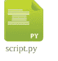

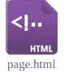


为了方便起见，我将本书示例中的源代码文件放在了一个单一的 ZIP 归档中。你可以按照以下简单步骤获取完整的归档：

1. 访问 **www.ineasysteps.com**，然后导航到 *免费资源* 并选择 *下载* 部分
2. 在列表中找到 *Python in easy steps, 2nd edition*，然后点击标题为 *所有代码示例* 的超链接以下载归档
3. 接下来，将 **MyScripts** 和 **MyProjects** 文件夹提取到你的主目录（例如 **C:\**），并将 **htdocs** 文件夹的所有内容复制到你的 web 服务器的文档目录中
4. 现在，按照步骤调用 Python 解释器并查看输出

你还可以在本书的 *下载* 部分找到本书的更新内容（如果有）。

## 1 起步

欢迎进入 Python 编程语言令人兴奋的世界。本章演示如何安装 Python 并创建你的第一个程序。

- 认识 Python
- 在 Windows 上安装 Python
- 在 Linux 上安装 Python
- 了解解释器
- 编写你的第一个程序
- 使用变量
- 获取用户输入
- 修正错误
- 本章小结

### 认识 Python

Python 是一种高级（人类可读的）编程语言，由 Python “解释器”处理以产生结果。Python 包含一个全面的、经过测试的代码模块标准库，可以轻松集成到你自己的程序中。

Python 语言由 Guido van Rossum 在 20 世纪 80 年代末和 90 年代初在荷兰国家数学与计算机科学研究开发研究所开发。Python 衍生自许多其他语言，包括 C、C++、Unix shell 和其他编程语言。如今，Python 由该研究所的一个核心开发团队维护，尽管 Guido van Rossum 仍然在指导其发展方面发挥着至关重要的作用。

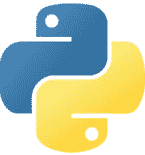

在 www.python.org 在线了解所有最新的 Python 新闻

Python 语言的基本哲学是易读性，这使其特别适合计算机编程初学者，并可以通过以下原则总结：

- 优美胜于丑陋。
- 明确胜于含蓄。
- 简单胜于复杂。
- 复杂胜于繁琐。
- 可读性很重要。

由于 Python 旨在具有高度的可读性，因此它经常使用英语关键字，而其他语言可能使用标点符号。最重要的是，它使用缩进来将语句分组为代码“块”，而其他语言可能使用关键字或标点符号来实现此目的。例如，在 Pascal 编程语言中，块以关键字 **begin** 开头，以关键字 **end** 结尾，而在 C 编程语言中，块被包含在花括号 ({ }) 中。通过缩进对语句块进行分组有时会受到熟悉使用标点符号分组的语言的编程者的批评，但 Python 中使用缩进肯定能产生视觉布局整洁的代码。


通过缩进对块进行分组的编程语言被认为遵循“越位规则”——这是对足球中越位规则的双关语。

Python 的一些关键区分特征使其成为初学者的有吸引力的语言选择，包括：

- **Python 是免费的** – 是开源可分发的软件。
- **Python 易于学习** – 具有简单的语言语法。
- **Python 易于阅读** – 没有标点符号的杂乱。
- **Python 易于维护** – 为了简洁而模块化。
- **Python 是“电池内置”** – 提供大型标准库，便于集成到你自己的程序中。
- **Python 是交互式的** – 具有用于调试和测试代码片段的终端。
- **Python 是可移植的** – 在广泛的硬件平台上运行，并在所有平台上具有相同的界面。
- **Python 是解释型的** – 不需要编译。
- **Python 是高级的** – 具有自动内存管理。
- **Python 是可扩展的** – 允许添加低级模块到


解释器进行自定义。

- **Python 功能多样** – 支持面向过程的编程和面向对象的编程 (OOP)。

- **Python 灵活性强** – 可以创建控制台程序、窗口式 GUI（图形用户界面）应用程序，以及用于处理 Web 数据的 CGI（通用网关接口）脚本。


Python 的名字源自英国电视喜剧系列《蒙提·派森的飞行马戏团》（Monty Python’s Flying Circus）– 您可能会在 Python 文档中遇到与此相关的引用。

随着 Python 开发的持续进行，与大多数软件一样，新版本会不断发布。目前，最后一个 2.7 版本已经发布，并且该版本已宣布提供扩展支持，标志着其生命周期的结束。2.x 分支在此之后将不再有新的主要版本发布。

3.x 分支正处于积极开发中，并且已经发布了多个稳定版本。这意味着所有最近的标准库改进，例如，仅在 Python 3.x 中可用。本书描述并演示了 Python 当前及未来特性的最新 3.x 版本。


Python 3.x 与 Python 2.7 不向后兼容。

### 在 Windows 上安装 Python

在您开始使用 Python 语言编程之前，您需要在计算机上安装 Python 解释器以及随附的经过测试的标准库代码模块。这可以通过 Python 网站 https://python.org/downloads 免费下载。Windows 用户可以使用 32 位和 64 位版本安装程序：

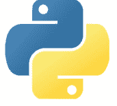

macOS/Mac OS X 的 32 位和 64 位版本安装程序可在 python.org/downloads 获取

1.  启动 Web 浏览器，然后导航到 python.org/downloads 并下载适合您系统的相应安装程序 – 在本例中，这是一个名为 “python-3.7.0.exe” 的文件

2.  下载完成后，运行安装程序并勾选 “Add Python 3.7 to PATH”（将 Python 3.7 添加到 PATH）选项

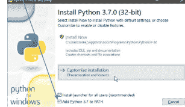

3.  接下来，点击 “Customize installation”（自定义安装）选项

4.  勾选所有 “Optional Features”（可选功能）选项，然后点击 **Next**（下一步）

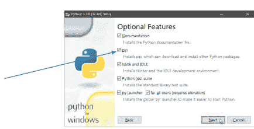


请务必勾选安装 “pip” 的选项，以便您稍后可以轻松安装 Python 包。

5.  现在，将冗长的建议安装位置更改为更简单的位置 “C:\Python37”

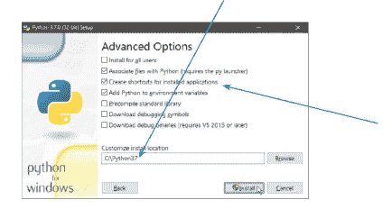


在高级选项对话框中接受建议的功能 – 如这里所示。

6.  点击 **Install**（安装）开始将文件复制到您的 PC 上，然后点击 **Close**（关闭）按钮以完成安装

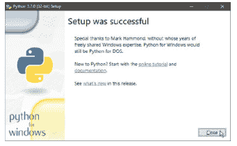

7.  要确认 Python 现在可用，启动一个命令提示符窗口（运行 `cmd.exe`）并准确输入命令 `python -V` – Python 解释器应响应其版本号

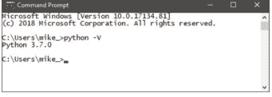


> 命令中的字母 V **必须**是大写。在进行本书中的示例之前，请确保命令响应了版本号。

### 在 Linux 上安装 Python

Linux 发行版通常包含 Python，但通常将 2.7 版本作为其默认版本。要在 Python 3.x 分支的发布上进行开发，您可能需要与默认版本一起安装最新发布版本。


请查阅您的 Linux 发行版文档以获取更多有关安装 Python 的帮助。

1.  启动终端窗口并准确输入此命令以显示已安装的默认 Python 版本 **python -V**

```
mike@ubuntu:~$ python -V
Python 2.7.3
mike@ubuntu:~$ █
```

2.  接下来，准确输入此命令以显示 Python 3.x 分支的默认版本（如果有安装的话）**python3 -V**

```
mike@ubuntu:~$ python3 -V
Python 3.2.3
mike@ubuntu:~$ █
```

3.  现在，启动您的 Linux 系统的包管理器，查看是否有更新的 Python 版本可供安装 – 例如，在 Ubuntu 系统上使用软件中心

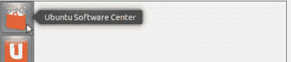


请不要从系统中删除默认的 2.7 版本 Python，以防某些应用程序依赖于它。


在包管理器中搜索 “python” 以查看安装了哪些 Python 版本和组件，或者是否有更新版本可供安装

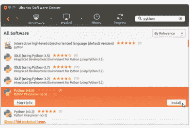


最后，为 Linux 安装 Python 3.x 分支的最新版本 – 在这种情况下，它是 Python 3.5


要确认您的计算机上现在可用最新的 Python 版本，请启动一个终端窗口并准确输入此明确命令 python3 -V

```
mike@ubuntu:~ $ python3 -V
Python 3.5.2
mike@ubuntu:~ $
```

您也可以选择安装 Python 3.5 的 IDLE，但这并不是绝对要求，因为本书中的所有 Python 编程示例都是在 Nano 这样的纯文本编辑器中创建的。

现在您可以使用命令 **python3** 让该版本的 Python 解释器处理您的程序。

### 认识解释器

Python 解释器处理基于文本的程序代码，并且还具有一种交互模式，您可以在其中测试代码片段，这对调试代码非常有用。Python 的交互模式可以通过多种方式进入：

-  从常规命令提示符 – 只需输入命令 `python` 即可产生 Python 主提示符 `>>>`，您可以在此与解释器交互。

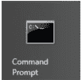

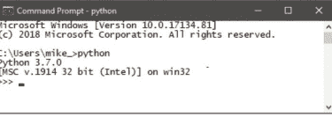

-  从开始菜单 – 选择 “Python”（命令行）以打开包含 Python `>>>` 主提示符的窗口。

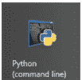

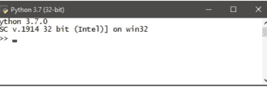

-  从开始菜单 – 选择 “IDLE”（Python GUI）以启动包含 Python >>> 主提示符的 Python Shell 窗口。

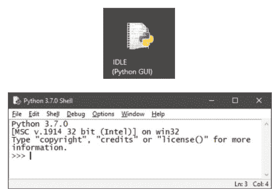

无论使用哪种方法进入交互模式，Python 解释器对在其 >>> 主提示符处输入的commands 反应方式都是相同的。在最简单的形式中，解释器可以用作计算器。

1.  进入 Python 交互模式，使用上文概述的任何方法，然后输入一个简单的加法并按 Return 键以查看解释器打印出总和

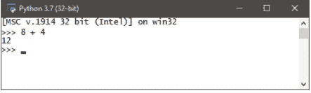

Python 解释器也理解表达式，因此可以使用括号来赋予更高的优先级 – 括号内封闭的表达式部分将首先被计算。

2.  接下来，在 Python 提示符处输入一个由三个组件组成的表达式，而不指定任何优先级顺序

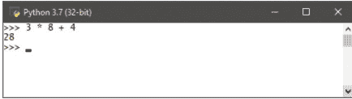

3.  现在，在 Python 提示符处输入相同的表达式，但添加括号以指定优先级顺序

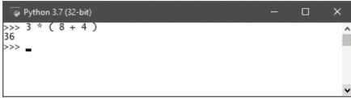


表达式中的空格会被忽略，因此 8+4 也可以加上空格以提高清晰度 – 如这里所示。


交互模式主要用于测试代码片段和调试代码。


“IDLE” 是 Python 集成开发环境（Integrated DeveLopment Environment）的缩写，但功能有限，因此不用于演示本书中的示例。

### 编写您的第一个程序

Python 的交互模式作为简单的计算器很有用，但您可以创建具有更广泛功能的程序。Python 程序只是一个使用编辑器（例如 Windows 的记事本）创建的纯文本文件脚本，并以 “.py” 文件扩展名保存。Python 程序可以在终端提示符下通过 **python** 命令后跟脚本文件名来执行。

学习任何编程语言时创建的传统第一个程序只是打印出指定的问候消息。在 Python 中，使用 **print()** 函数在其括号内指定消息。这必须是由引号包围的字符字符串。这些可以是 “” 双引号或 ‘ ’ 单引号 – 但不能混合使用两者。

1.  在 Windows 上，启动任何纯文本编辑器，例如记事本应用程序


2.  接下来，在空的文本编辑器窗口中准确输入以下语句
   `print('Hello World!')`

3.  现在，在 C:\MyScripts 创建一个新的目录并将文件在其中保存为 **hello.py**

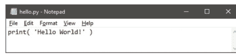

4.  最后，启动一个命令提示符窗口，导航到新的目录并准确输入命令 **python hello.py** – 以查看 Python 解释器运行您的程序并打印出指定的问候语


#### message

```
C:\MyScripts>python hello.py
Hello world!

C:\MyScripts>
```


不要使用文字处理器来创建程序文件，因为它们会在文件中添加格式信息。


在 **C:\MyScripts** 创建的目录将用于存放本书中所有的 Windows 示例。

在 Linux 系统上创建传统的第一个 Python 程序的步骤与在 Windows 系统上的步骤相同。然而，在任何安装了不同版本 Python 的平台上，重要的是要意识到：你必须使用正确的命令来调用所需的特定 Python 解释器。这在经常默认安装 Python 2.7 版本的 Linux 系统上尤为重要。这意味着 `python` 命令将假定你想要调用的是那个解释器。如果安装了 Python 3.3，并且你想调用该特定解释器来处理脚本，你必须使用 `python3.3` 命令来明确调用该版本的解释器。

- 1. 在 Linux 上，启动任何纯文本编辑器，例如 `Nano` 应用程序


- 2. 接下来，在空的文本编辑器窗口中精确输入以下语句
  `print('Hello World!')`

- 3. 现在，将文件保存在你的主目录中，命名为 **hello.py**

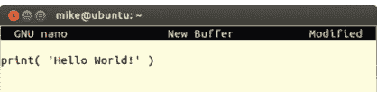

- 4. 最后，启动一个终端窗口并导航到你的主目录，精确输入命令 `python3.3 hello.py` —— 以查看 Python 解释器运行你的程序并打印出指定的问候消息

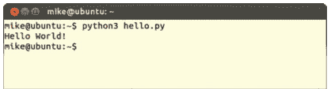


本书中后续的所有示例都在 Windows 上进行说明（仅仅是因为该平台用户最多），但它们也可以在 Linux 上创建和运行。

#### 使用变量

在编程中，“变量”是计算机内存中用于存储数据值的容器。存储的值可以通过变量的名称来引用。程序员可以为变量选择任何名称，除了本书内页封面列出的 Python 关键字之外，并且良好的实践是选择能够反映变量内容的有意义的名称。


要存储在变量中的数据通过 Python 程序声明语句中的 = 赋值运算符进行分配。例如，要在名为 “a” 的变量中存储数字值 8：

```
a = 8
```

存储的值可以通过变量的名称进行引用，因此语句 print(a) 将输出存储的值 8。该变量随后可以被分配不同的值，因此随着程序的进行，其值可以变化——这就是“变量”一词的由来。

在 Python 编程中，变量必须在其在程序中声明的语句中被分配一个初始值（“初始化”）——否则解释器将报告“未定义”错误。

可以使用一系列 = 赋值在单个语句中初始化多个具有共同值的变量。例如，要初始化名为 “a”、“b” 和 “c” 的变量，每个都带有数值 8，如下所示：

```
a = b = c = 8
```

或者，可以使用逗号分隔符在单个语句中初始化多个具有不同值的变量。例如，要初始化名为 “a”、“b” 和 “c” 的变量，分别带有数值 1、2 和 3，如下所示：

```
a, b, c = 1, 2, 3
```

某些编程语言，如 Java，要求在声明中指定变量可能包含的数据类型。这会保留特定大小的内存空间，被称为“静态类型”。另一方面，Python 变量没有这种限制，并调整内存分配以适应分配给变量的各种数据值（“动态类型”）。这意味着它们可以根据需要存储整数、浮点数、文本字符串或 **True** 或 **False** 布尔值。


字符串数据必须包含在引号内，以表示字符串的开始和结束。


要求指定变量类型的编程语言也称为“强类型”，而不要求指定的则称为“弱类型”。

可选地，如果在 Python 脚本中添加注释，并且前面带有 # 井号字符，可以描述语句或代码段的目的。# 井号字符之后的所有内容直到行尾都会被 Python 解释器忽略。给你的代码添加注释以使其目的对他人清楚，或者当你稍后回顾代码时，这是很有用的。

- 启动一个纯文本编辑器，然后声明并初始化一个变量——然后显示其存储的值
  ```
  # Initialize a variable with an integer value.
  var = 8
  print(var)
  ```

- 2. 接下来，分配一个新值并显示该存储的值
  ```
  # Assign a float value to the variable.  
  var = 3.142  
  print(var)
  ```

- 3. 现在，分配一个不同的值并显示存储的值
  ```
  # Assign a string value to the variable.  
  var = "Python in easy steps"  
  print(var)
  ```

- 4. 最后，分配另一个值并显示存储的值
  ```
  # Assign a boolean value to the variable.  
  var = True  
  print(var)
  ```

- 5. 将文件保存在你的脚本目录中，然后在那里打开一个命令提示符窗口并运行程序——以查看随着程序的进行输出存储的值

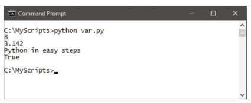


如果包含在三引号 “””，“”” 之间，可以向脚本添加多行注释。

#### 获取用户输入

正如可以在 Python 脚本中将数据值分配给变量一样，也可以使用 Python `input()` 函数将用户指定的值分配给变量。它接受括号内的一个字符串，该字符串将提示用户输入，通过显示该字符串然后等待读取一行输入。

用户输入作为文本字符串读取，即使它是数字的，也可以使用 = 赋值运算符像往常一样分配给变量。分配给任何变量的值可以通过向 `print()` 函数指定变量名来显示——以引用该变量的存储值。

要显示的多个值可以作为逗号分隔的列表指定给 `print()` 函数，位于其括号内。

- 1. 启动一个纯文本编辑器，然后通过请求用户输入来声明并初始化一个变量
  ```
  # Initialize a variable with a user-specified value.
  user = input( 'I am Python. What is your name? ' )
  ```

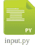

- 2. 接下来，通过引用存储的用户名显示确认输入响应消息
  ```
  # Output a string and a variable value.
  print('Welcome', user)
  ```

- 3. 现在，将文件保存在你的脚本目录中，然后在那里打开一个命令提示符窗口并运行此程序——输入你的名字，然后按回车键，以查看响应消息中包含你的名字

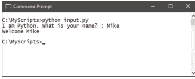


注意提示字符串以一个空格结束，该空格在输出中显示——因此用户输入在输入时与冒号分开。

当向 print() 函数指定多个值时，它默认在输出中显示每个值，由单个空格分隔。然而，可以通过向逗号分隔列表添加 sep 参数来指定替代分隔符。例如，`sep = '•'` 将在输出中显示每个值，由星号字符分隔。

由 print() 函数显示的输出默认会在行尾添加一个不可见的 \n 换行符，以自动将打印头移动到下一行。然而，可以通过向逗号分隔列表添加 end 参数来指定替代的行尾。例如，`end = '!'` 将在输出中显示每个值，然后用感叹号结束该行。

- 4. 编辑脚本，通过请求更多用户输入来声明并初始化第二个变量
  ```
  # Initialize another variable with a user-specified value.
  lang = input( 'Favorite programming language? : ' )
  ```

- 5. 接下来，通过引用存储的语言名称显示确认输入的响应消息——并指定自定义分隔符和自定义行尾
  ```
  # Output a string and a variable value.
  print( lang , 'is', 'Fun' , sep = ' * ' , end = '!' )
  ```

- 6. 现在，再次保存文件，然后在那里打开一个命令提示符窗口并再次运行此程序——输入你的名字和一种编程


#### 语言输入

输入语言，然后按回车键查看包含用户输入的响应消息

```
Command Prompt

C:\MyScripts>python input.py
I am Python. What is your name? : Mike
Welcome Mike
Favorite programming language? : Python
Python * Is * Fun!

C:\MyScripts>
```


你可以显式地为 **end** 参数指定换行符；例如，`end='\n'` 会同时添加一个感叹号和一个换行字符。


为了提高清晰度，你可以在分隔符字符周围包含空格字符——就像本例中星号字符周围显示的那样。

#### 纠正错误

在 Python 编程中，可能会出现三种类型的错误。识别不同的错误类型有助于更轻松地纠正它们：


编程错误通常被称为“bug”，而寻找这些错误的过程通常被称为“debugging”（调试）。

- **语法错误** – 发生在程序执行期间，即程序运行时。例如，字符串周围缺少引号。解释器会停止并报告错误，而不执行程序。
- **运行时错误** – 发生在程序执行期间，即程序运行时。例如，后来变量名拼写错误，导致变量无法被识别。解释器会运行程序，但在遇到错误时停止，并将错误的性质报告为“Exception”（异常）。
- **语义错误** – 发生在程序表现出乎意料时。例如，当表达式中未指定优先级顺序时。解释器会运行程序，并且不报告错误。

纠正语法错误和运行时错误相当直接，因为解释器会报告错误发生的位置或错误类型的性质，但语义错误需要检查代码。


##### 练习

1. 启动一个纯文本编辑器，然后添加一条语句，输出一个省略了右引号的字符串
   `print(‘Python in easy steps )`

2. 将文件保存在你的 scripts 目录中，然后在该目录下打开一个命令提示符窗口并运行此程序 – 以查看解释器报告语法错误并指示代码中错误发生的位置

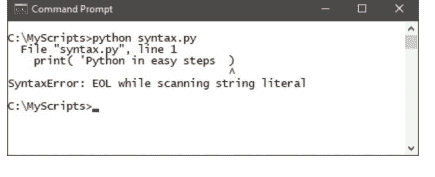


通常，语法错误指示器指向代码中遗漏处的下一个字符。

3. 在右括号前插入一个引号以终止字符串，然后保存文件并再次运行程序 – 以查看错误已被纠正

4. 接下来，通过初始化一个变量开始一个新程序，然后尝试使用错误的变量名输出其值 – 以查看解释器报告运行时错误
   `title = ‘Python in easy steps’`
   `print( titel )`

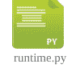

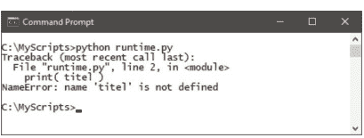

5. 修改变量名以匹配变量声明中的名称，然后保存文件并再次运行程序 – 以查看错误已被纠正

6. 现在，通过初始化一个变量开始一个新程序，然后尝试输出一个使用其值但没有显式优先级的表达式 – 以查看一个可能意想不到的结果 28

   ```python
   num = 3
   print( num * 8 + 4 )
   ```

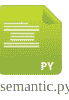

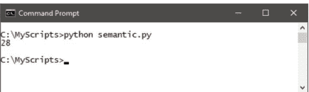

7. 添加括号将表达式分组为 3 * (8 + 4)，然后保存文件并再次运行程序 – 以查看预期的结果 36，纠正语义错误


关于如何在脚本代码中处理运行时异常错误的详细信息请见此处。

### 总结

- Python 是一种高级编程语言，由 Python 解释器处理以产生结果。
- Python 使用缩进来将语句分组为代码块，而其他语言使用关键字或标点符号。
- Python 2.7 是 2.x 开发分支的最终版本，但 3.x 分支包含最新的改进。
- Windows 用户可以通过安装程序安装 Python，Linux 用户可以通过其包管理器安装 Python。
- Python 解释器有一种交互模式，你可以在其中测试代码片段，这对于调试代码非常有用。
- Python 程序只是一个使用纯文本编辑器创建并保存为“.py”文件扩展名的文本文件。
- Python 的 print() 函数输出其括号内指定的字符串。
- 字符串值必须用引号括起来。
- 如果在同一系统上安装了多个版本的 Python，则明确调用所需的解释器非常重要。
- Python 变量是一个命名容器，其存储的值可以通过该变量的名称引用。
- Python 变量可以包含任何数据类型，但在声明时必须赋予初始值。
- Python 的 input() 函数输出其括号内指定的字符串，然后等待读取一行输入。
- 由于代码错误导致的语法错误会在程序执行前被解释器识别。
- 由于异常导致的运行时错误会在程序执行期间被解释器识别。
- 由于意外表现导致的语义错误不会被解释器识别。

# 2
### 执行操作

本章介绍 Python 运算符，并演示它们可以执行的操作。

- 执行算术运算
- 赋值
- 比较值
- 评估逻辑
- 检查条件
- 设置优先级
- 转换数据类型
- 操作位
- 总结

#### 执行算术运算

在 Python 编程中常用的算术运算符在下表中列出，并附带它们执行的操作：

| 运算符 | 操作 |
| :------- | :------- |
| + | 加法 |
| - | 减法 |
| * | 乘法 |
| / | 除法 |
| % | 取模 |
| // | 地板除法 |
| ** | 指数 |

加法、减法、乘法和除法运算符的行为符合预期。然而，必须注意对表达式进行分组，当使用多个运算符时，以澄清表达式 – 最内层括号内的操作最先执行。例如，对于这个表达式：

```
a = b * c - d % e / f
```


与运算符一起用于形成表达式的值称为“操作数” – 在表达式 2 + 3 中，数值 2 和 3 是操作数。

希望执行操作的顺序不明确，但可以通过添加括号来澄清，如下所示：

```
a = ( b * c ) - ( ( d % e ) / f )
```

`%` 取模运算符将第一个给定的数除以第二个给定的数，并返回操作的余数。这对于确定一个数是奇数还是偶数很有用。

`//` 地板除法运算符执行与 `/` 除法运算符完全相同的操作，但在小数点处截断结果 – 删除任何浮点值。

`**` 指数运算符返回第一个操作数提升到第二个操作数幂的结果。

##### 练习

1. 通过初始化两个具有整数值的新变量开始一个新的 Python 脚本

   ```python
   a = 8
   b = 2
   ```

   

2. 接下来，显示变量值相加的结果

   ```python
   print(‘Addition:\t’, a, ‘+’, b, ‘=’, a + b)
   ```

3. 现在，显示变量值相减的结果

   ```python
   print(‘Subtraction:\t’, a, ‘-’, b, ‘=’, a - b)
   ```

4. 然后，显示变量值相乘的结果

   ```python
   print(‘Multiplication:\t’, a, ‘x’, b, ‘=’, a * b)
   ```

5. 显示变量值相除的结果，包括和不包括浮点值的情况

   ```python
   print(‘Division:\t’, a, ‘/’, b, ‘=’, a / b)
   print(‘Floor Division:\t’, a, ‘//’, b, ‘=’, a // b)
   ```

6. 接下来，显示值相除后的余数

   ```python
   print(‘Modulo:\t’, a, ‘%’, b, ‘=’, a % b)
   ```

7. 最后，显示将第一个操作数提升到第二个操作数幂的结果

   ```python
   print(‘Exponent:\t’, a, ‘^’, ‘=’, a ** b, sep = ‘‘)
   ```

8. 将文件保存在你的 scripts 目录中，然后打开一个命令提示符


并运行此程序 – 以查看算术运算的结果

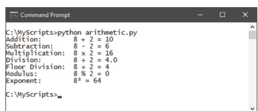


此处所示的 `\t` 转义序列添加了一个不可见的制表符以格式化输出。


你可以使用 **sep** 参数来明确指定输出之间的分隔符 – 在这里，它通过分配两个无空格单引号来指定不使用空格。

### 赋值

下表列出了 Python 编程中用于赋值的运算符。除简单的 = 赋值运算符外，其他运算符都是较长表达式的简写形式，因此为了清晰起见，给出了每个等效表达式：

| 运算符： | 示例： | 等效表达式： |
| :--- | :--- | :--- |
| = | a = b | a = b |
| += | a += b | a = (a + b) |
| -= | a -= b | a = (a - b) |
| *= | a *= b | a = (a * b) |
| /= | a /= b | a = (a / b) |
| %= | a %= b | a = (a % b) |
| //= | a //= b | a = (a // b) |
| **= | a **= b | a = (a ** b) |

在上面的示例中，名为“a”的变量被分配了存储在名为“b”的变量中的值 – 因此这就成为了存储在 a 变量中的新值。


重要的是要将 = 运算符理解为“赋值”而不是“等于”，以避免与 == 相等运算符混淆。

`+=` 运算符可用于将一个值加到存储在 `a` 变量中的现有值上。

在表格示例中，`+=` 运算符首先将变量 `a` 中包含的值加到变量 `b` 中获得的值。然后它将结果赋值给变量 `a`，作为存储在其中的新值。

所有其他运算符的工作方式相同，首先对两个值进行算术运算，然后将该运算的结果赋值给第一个变量 – 作为其新的存储值。

对于 `%=` 运算符，第一个操作数 `a` 除以第二个操作数 `b`，然后该运算的余数被赋值给 `a` 变量。

- 创建一个 Python 新脚本，通过分配整数值来初始化两个变量，并显示两个赋值的值

```python
a = 8
b = 4
print( 'Assign Values:\t\t', 'a =', a, '\tb =', b )
```

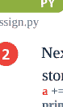

- 接下来，将新值加到第一个变量并赋值，然后显示其存储的值

```python
a += b
print( 'Add & Assign:\t\t', 'a =', a , '(8 + 4)' )
```

- 现在，将新值从第一个变量中减去并赋值，显示其存储的值，然后乘以并赋值给第一个变量，显示其存储的值

```python
a -= b
print( 'Subtract & Assign:\t', 'a =', a , '(12 - 4)' )

a *= b
print( 'Multiply & Assign:\t', 'a =', a , '(8 x 4)' )
```

- 最后，将新值除以第一个变量并赋值，显示其存储的值，然后取模并赋值给第一个变量，显示其存储的值

```python
a /= b
print( 'Divide & Assign:\t' , 'a =', a, '(32 ÷ 4)' )

a %= b
print( 'Modulo & Assign:\t' , 'a =', a, '(8 % 4)' )
```

- 将文件保存在你的 scripts 目录中，然后在那里打开一个命令提示符窗口并运行此程序 – 以查看赋值运算的结果

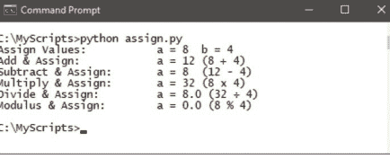


与 = 赋值运算符不同，== 相等运算符比较操作数，并在此处进行了描述。

### 比较值

下表列出了 Python 编程中常用于比较两个操作数值的运算符：

| 运算符： | 比较测试： |
| --- | --- |
| == | 等于 |
| != | 不等于 |
| > | 大于 |
| < | 小于 |
| >= | 大于或等于 |
| <= | 小于或等于 |

`==` 相等运算符比较两个操作数，如果两者值相等则返回 `True`，否则返回 `False` 值。如果两者都是相同的数字，则它们相等；或者如果两者都是字符，则比较它们的 ASCII 代码值以实现比较结果。

相反，`!=` 不等运算符在两个操作数不相等时返回 `True`，使用与 `==` 相等运算符相同的规则，否则返回 `False`。相等和不等运算符在测试两个变量的状态以根据结果在程序中进行条件分支时非常有用。


A-Z 大写字母的 ASCII 代码值为 65-90，而 a-z 小写字母的 ASCII 代码值为 97-122。

">" 大于运算符比较两个操作数，如果第一个操作数的值大于第二个操作数，则返回 `True`；如果值相等或较小，则返回 `False`。"<" 小于运算符进行相同的比较，但如果第一个操作数的值小于第二个操作数，则返回 `True`，否则返回 `False`。">" 大于运算符或 "<" 小于运算符通常用于测试循环中迭代计数器的值。

在 > “大于”或 < “小于”运算符后添加 = 运算符，如果两个操作数值完全相等，则也返回 **True**。

- 通过初始化为比较值的五个变量开始创建一个新的 Python 脚本

```python
nil = 0
num = 0
max = 1
cap = 'A'
low = 'a'
```

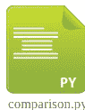

- 接下来，添加语句以显示数字和字符相等比较的结果

```python
print( 'Equality \t', nil, '==', num, nil == num )
print( 'Equality \t', cap, '==', low, cap == low )
```

- 现在，添加语句以显示不等比较的结果

```python
print( 'Inequality \t', nil, '!=', max, nil != max )
```

- 然后，添加语句以显示大于和小于比较的结果

```python
print( 'Greater \t', nil, '>', max, nil > max )
print( 'Lesser \t', nil, '<', max, nil < max )
```

- 最后，添加语句以显示大于或等于和小于或等于比较的结果

```python
print( 'More Or Equal \t', nil, '>=', num, nil >= num )
print( 'Less or Equal \t', max, '<=', num, max <= num )
```

- 将文件保存在你的 scripts 目录中，然后在那里打开一个命令提示符窗口并运行此程序 – 以查看比较运算的结果

```
Command Prompt
C:\MyScripts>python arithmetic.py
Addition:		8 + 2 = 10
Subtraction:	8 - 2 = 6
Multiplication:	8 × 2 = 16
Division:		8 ÷ 2 = 4.0
Floor Division:	8 ÷ 2 = 4
Modulus:		8 % 2 = 0
Exponent:		8**2 = 64
C:\MyScripts>■
```


此处所示的 \t 转义序列添加了一个不可见的制表符以格式化输出。


大写字母 “A” 的 ASCII 代码值为 65，但小写字母 “a” 的值为 97 – 因此，此处的比较返回 False。

### 评估逻辑

下表列出了 Python 编程中最常用的逻辑运算符：

| 运算符： | 操作： |
| :-- | :-- |
| and | 逻辑与 |
| or | 逻辑或 |
| not | 逻辑非 |

逻辑运算符用于具有布尔值 **True** 或 **False** 的操作数，或者可以转换为 **True** 或 **False** 的值。

（逻辑与） **and** 运算符将评估两个操作数，并且仅当两个操作数本身都为 **True** 时返回 **True**。否则， **and** 运算符将返回 **False**。这用于条件分支，其中程序的方向由测试两个条件决定 – 如果两个条件都满足，程序将朝某个方向执行，否则它将朝另一个方向执行。

与需要两个操作数都为 **True** 的 **and** 运算符不同，（逻辑或） **or** 运算符将评估其两个操作数，如果任一操作数本身返回 **True**，则返回 **True**。如果两个操作数都不返回 **True**，则 **or** 运算符将返回 **False**。这在 Python 编程中非常有用，用于在两个测试条件中任一满足时执行特定操作。

（逻辑非） **not** 运算符是一元运算符，用于单个操作数之前。它返回给定操作数的反向值，因此，如果变量 a 的值为 **True**，则 **not a** 的值将为 **False**。 **not** 运算符在 Python 程序中非常有用，可以使用像 a = not a 这样的语句在连续的循环迭代中切换变量的值。这确保在循环的每次迭代中，布尔值都会反转，就像打开和关闭灯开关一样。


“布尔”（Boolean）一词指的是一种由英国数学家乔治·布尔（George Boole，1815–1864）开发的逻辑思维体系。


1. 通过初始化两个具有布尔值的变量，开始编写一个新的 Python 脚本，以便进行逻辑评估
   - `a = True`
   - `b = False`
2. 接下来，添加语句以显示逻辑与（AND）评估的结果
   - `print('\nAND Logic:')`
   - `print('a and a =', a and a)`
   - `print('a and b =', a and b)`
   - `print('b and b =', b and b)`
3. 现在，添加语句以显示逻辑或（OR）评估的结果
   - `print('\nOR Logic:')`
   - `print('a or a =', a or a)`
   - `print('a or b =', a or b)`
   - `print('b or b =', b or b)`
4. 最后，添加语句以显示逻辑非（NOT）评估的结果
   - `print('\nNOT Logic:')`
   - `print('a =', a, 'not a =', not a)`
   - `print('b =', b, 'not b =', not b)`

5. 将文件保存在你的脚本目录中，然后在那里打开一个**命令提示符**窗口并运行此程序——以查看逻辑运算的结果。

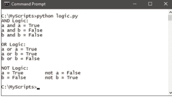


在 Python 编程中，布尔值也可以表示为数值，其中 **True** 是 **1**，**False** 是 **0**（零）。


请注意，表达式 **False and False** 返回 **False**，而不是 **True** – 这也许体现了“两个错误不会变成正确”这一格言。

### 检查条件

许多编程语言，如 C++ 或 Java，都有一个 `?:` “三元”运算符，它根据 True 或 False 条件对表达式求值，然后根据求值结果返回两个指定值中的一个。`?:` 三元运算符具有这种语法：

```
(test-expression) ? if-true-return-this : if-false-return-this
```

与其他编程语言不同，Python 没有 `?:` 三元运算符，而是有一个以类似方式工作的“条件表达式”，它使用 if 和 else 关键字，其语法如下：

```
if-true-return-this if (test-expression) else if-false-return-this
```

虽然条件表达式的语法起初可能看起来令人困惑，但熟悉这个表达式是绝对值得的，因为它可以用最少的代码执行强大的程序分支。例如，要在变量不是值 1 时进行分支：

```
if-true-do-this if ( var != 1 ) else if-false-do-this
```

条件表达式可用于 Python 编程中，将两个变量的最大值或最小值分配给第三个变量。例如，要像这样分配最小值：

```
c = a if ( a < b ) else b
```

括号中的表达式在变量 a 的值小于变量 b 的值时返回 True – 因此在这种情况下，变量 a 的较小值被分配给变量 c。

类似地，将测试表达式中的 < 小于运算符替换为 > 大于运算符，会将变量 b 的较大值分配给变量 c。

条件表达式的另一个常见用法是在测试表达式中结合 % 取模运算符，以确定变量的值是奇数还是偶数：

```
if-true(odd)-do-this if ( var % 2 != 0 ) else if-false(even)-do-this
```

当变量值除以二后有剩余结果时，该数为奇数 – 当没有剩余结果时，该数为偶数。测试表达式 (`var % 2 == 1`) 会产生相同的效果，但最好测试不等式 – 发现不同比发现相同更容易。


在一般编程术语中，“表达式”始终返回一个值，而“语句”则不一定 – 但语句可以包含一个或多个表达式。


条件表达式实际上有三个操作数 – 测试表达式和两个可能的返回值。

1. 通过初始化两个具有整数值用于条件评估的变量，开始编写一个新的 Python 脚本
   - `a = 1`
   - `b = 2`

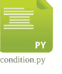

2. 接下来，添加语句以显示条件评估的结果 – 描述第一个变量的值
   - `print('\nVariable a Is :', 'One' if (a == 1) else 'Not One')`
   - `print('Variable a Is :', 'Even' if (a % 2 == 0 ) else 'Odd')`

3. 现在，添加语句以显示条件评估的结果 – 描述第二个变量的值
   - `print('\nVariable b Is :', 'One' if (b == 1) else 'Not One')`
   - `print('Variable b Is :', 'Even' if (b % 2 == 0 ) else 'Odd')`

4. 然后，添加一个语句将条件评估的结果分配给一个新变量
   - `max = a if ( a > b ) else b`

5. 最后，添加一个语句以显示分配的结果 – 标识两个变量值中较大的那个
   - `print( "\nGreater Value Is:", max )`

将文件保存在你的脚本目录中，然后在那里打开一个命令提示符窗口并运行此程序 – 以查看条件表达式运算的结果。

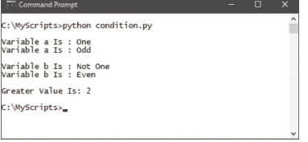

你可能会发现，一些 Python 程序员不喜欢条件表达式，因为他们认为其语法与易于阅读的原则相矛盾。

### 设置优先级

运算符优先级决定了 Python 解释器评估表达式的顺序。例如，在表达式 `3 * 8 + 4` 中，默认的优先级顺序确定乘法先完成，因此结果是 28（24 + 4）。


`*` 乘法运算符位于 `+` 加法运算符之上的一行 – 因此在表达式 `3 * 8 + 4` 中，乘法在加法之前完成。

下表按降序列出了运算符优先级 – 中间一行的具有最高优先级，较低行的依次具有较低优先级。同一行上运算符的优先级按从左到右的顺序链接：

| 运算符 | 描述 |
| :--- | :--- |
| `**` | 幂 |
| `+` | 正号 |
| `-` | 负号 |
| `~` | 按位取反 |
| `*` | 乘法 |
| `/` | 除法 |
| `//` | 地板除法 |
| `%` | 取模 |
| `+` | 加法 |
| `-` | 减法 |
| `|` | 按位或 |
| `^` | 按位异或 |
| `&` | 按位与 |
| `>>` | 按位右移 |
| `<<` | 按位左移 |
| `>`, `>=`, `<`, `<=`, `==`, `!=` | 比较 |
| `=`, `%=`, `/=`, `//=`, `-=` , `+=`, `*=`, `**=` | 赋值 |
| `is`, `is not` | 同一性 |
| `in`, `not in` | 成员资格 |
| `not` | 布尔非 |
| `and` | 布尔与 |
| `or` | 布尔或 |


按位、同一性和成员资格运算符将在本书后面引入 – 但为了完整性包含在此处。

1. 通过初始化三个具有整数值用于优先级比较的变量，开始编写一个新的 Python 脚本
   - `a = 2`
   - `b = 4`
   - `c = 8`

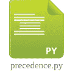

2. 接下来，添加语句以显示默认优先级的结果以及强制在乘法之前执行加法的结果
   ```python
   print('\nDefault Order:\t', a, ' * ', c, '+', b, ' =', a * c + b)
   print('Forced Order:\t', a, ' * ( ', c, '+', b, ') =', a * (c + b))
   ```

3. 现在，添加语句以显示默认优先级的结果以及强制在除法之前执行减法的结果
   ```python
   print('\nDefault Order:\t', c, '//', b, '-', a, '=', c // b - a)
   print('Forced Order:\t', c, '// (', b, '-', a, ') =', c // (b - a))
   ```

4. 最后，添加语句以显示默认优先级的结果以及强制在取模运算之前和在幂运算之前执行加法的结果
   ```python
   print('\nDefault Order:\t', c, '%', a, '-', b, '=', c % a + b)
   print('Forced Order:\t', c, '% (', a, '-', b, ') =', c % (a + b))
   
   print('\nDefault Order:\t', c, '**', a, '+', b, '=', c ** a + b)
   print('Forced Order:\t', c, '** (', a, '+', b, ') =', c ** (a + b))
   ```

5. 将文件保存在你的脚本目录中，然后在那里打开一个命令提示符窗口并运行此程序 – 以查看默认和显式优先级的结果。

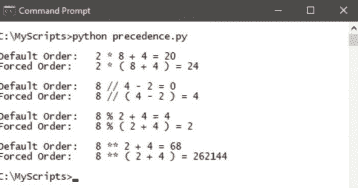


`//` 地板除法运算符在小数点后截断浮点值 – 但 `/` 除法运算符保留它们。


不要依赖默认优先级 – 始终使用括号来澄清你的表达式。


### 数据类型转换

尽管 Python 变量可以存储任意数据类型的值，但了解其所含数据的不同类型对于避免在程序中操作该数据时出现错误至关重要。Python 有多种数据类型，但其中最常见的是 `str`（字符串）、`int`（整数）和 `float`（浮点数）。

在将数值数据从用户输入赋值给变量时，识别数据类型尤为重要，因为这些数据默认以 `str`（字符串）类型存储。字符串值不能用于算术表达式，因为尝试将字符串值相加只会将它们连接（拼接）在一起，而不是进行数值相加。例如 `'8' + '4' = '84'`。

幸运的是，存储值的数据类型可以轻松地使用 Python 内置函数转换为（“强制转换”为）另一种数据类型。要转换的值指定在函数名后的括号内。将 `str`（字符串）值强制转换为 `int`（整数）值后，它们就可以用于算术表达式，例如，`8 + 4 = 12`。

Python 内置的数据类型转换函数返回一个代表转换后值的新对象，最常用的转换函数在下表中列出：

| 函数 | 描述 |
| :--- | :--- |
| `int(x)` | 将 x 转换为整数 |
| `float(x)` | 将 x 转换为浮点数 |
| `str(x)` | 将 x 转换为字符串表示 |
| `chr(x)` | 将整数 x 转换为字符 |
| `unichr(x)` | 将整数 x 转换为 Unicode 字符 |
| `ord(x)` | 将字符 x 转换为其整数值 |
| `hex(x)` | 将整数 x 转换为十六进制字符串 |
| `oct(x)` | 将整数 x 转换为八进制字符串 |

可以使用 Python 内置的 `type()` 函数来确定变量中包含的值属于哪个数据类型类，只需在其括号内指定该变量的名称即可。


> 将 **float**（浮点数）数据类型转换为 **int**（整数）数据类型时，会在小数点处截断数字，从而丢失小数部分。

1. 通过用用户输入的数值初始化两个变量，开始创建一个新的 Python 脚本

   ```python
   a = input( 'Enter A Number: ' )
   b = input( 'Now Enter Another Number: ' )
   ```

   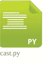

2. 接下来，添加语句将变量值相加，然后显示组合结果及其数据类型 – 以查看拼接的字符串值结果

   ```python
   sum = a + b
   print( '\nData Type sum :' , sum , type( sum ) )
   ```

3. 现在，添加语句将强制转换后的变量值相加，然后显示结果及其数据类型 – 以查看总和的整数值结果

   ```python
   sum = int( a ) + int( b )
   print( 'Data Type sum :' , sum , type( sum ) )
   ```

4. 然后，添加语句强制转换变量值，然后显示结果及其数据类型 – 以查看总和的浮点数值

   ```python
   sum = float( sum )
   print( 'Data Type sum :' , sum , type( sum ) )
   ```

5. 最后，添加语句强制转换变量值的整数表示，然后显示结果及其数据类型 – 以查看字符字符串值

   ```python
   sum = chr( int( sum ) )
   print('Data Type sum :',sum, type(sum) )
   ```

6. 将文件保存在你的脚本目录中，然后在该处打开命令提示符窗口并运行此程序 – 以查看作为各种数据类型强制转换的结果

   ```bash
   Command Prompt
   C:\\MyScripts>python cast.py
   Enter A Number: 60
   Now Enter Another Number: 5
   Data Type sum : 605 <class 'str'>
   Data Type sum : 65 <class 'int'>
   Data Type sum : 65.0 <class 'float'>
   Data Type sum : A <class 'str'>
   C:\\MyScripts> 
   ```

   

数字 65 是大写字母 A 的 ASCII 字符代码。

### 位的操作

在计算机术语中，每个字节由八个位组成，每个位可以包含 1 或 0 来存储二进制数，表示从 0 到 255 的十进制值。只有当该位包含 1 时，每一位才贡献一个十进制分量。这些分量从右到左指定，从“最低有效位”（LSB）到“最高有效位”（MSB）。下方位模式中的二进制数是 00110010，代表十进制数 50（2+16+32）：

| 位号 | 8 MSB | 7 | 6 | 5 | 4 | 3 | 2 | 1 LSB |
| :--- | :--- | :--- | :--- | :--- | :--- | :--- | :--- | :--- |
| **十进制** | 128 | 64 | 32 | 16 | 8 | 4 | 2 | 1 |
| **二进制** | 0 | 0 | 1 | 1 | 0 | 0 | 1 | 0 |

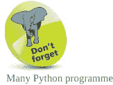

许多 Python 程序员从不使用按位运算符，但了解它们是什么以及如何可能使用它们是有益的。

可以使用下面列出并描述的 Python“按位”运算符来操作字节的各个部分：

| 运算符 | 名称 | 二进制数操作 |
| :--- | :--- | :--- |
| `\|` | OR（或） | 在比较的两个位中任何一个为 1 的每个位上返回 1<br>示例：**1010 \| 0101 = 1111** |
| `&` | AND（与） | 在比较的两个位都为 1 的每个位上返回 1<br>示例：**1010 & 1100 = 1000** |
| `~` | NOT（非） | 在比较的两个位都不为 1 的每个位上返回 1<br>示例：**1010 ~ 0011 = 0100** |
| `^` | XOR（异或） | 在比较的两个位中只有一个为 1 的每个位上返回 1<br>示例：**1010 ^ 0100 = 1110** |
| `<<` | 左移 | 将每个为 1 的位向左移动指定的位数<br>示例：**0010 << 2 = 1000** |
| `>>` | 右移 | 将每个为 1 的位向右移动指定的位数<br>示例：**1000 >> 2 = 0010** |


字节的每一半被称为一个“半字节”（nibble，4 位）。表中示例中的二进制数描述了存储在半字节中的值。

除非是为资源有限的设备编程，否则很少需要利用按位运算符，但它们可能很有用。例如，XOR（异或）运算符允许你在不需要第三个变量的情况下交换两个变量之间的值。


#### bitwise.py

1. 通过用数值初始化两个变量并显示这些初始值，开始创建一个新的 Python 脚本

   ```python
   a = 10
   b = 5
   print ('a =', a, 'b = ', b)
   ```

2. 接下来，添加一条语句，通过二进制位操作更改第一个变量的十进制值

   ```python
   # 1010 ^ 0101 = 1111 (十进制 15)
   a = a ^ b
   ```

3. 现在，添加一条语句，通过二进制位操作更改第二个变量的十进制值

   ```python
   # 1111 ^ 0101 = 1010 (十进制 10)
   b = a ^ b
   ```

4. 然后，添加一条语句，通过进一步的位操作再次更改第一个变量的十进制值

   ```python
   # 1111 ^ 1010 = 0101 (十进制 5)
   a = a ^ b
   ```

5. 最后，添加一条语句显示交换后的值

   ```python
   print('a =', a, '\tb =', b)
   ```

6. 将文件保存在你的脚本目录中，然后在该处打开命令提示符窗口并运行此程序 - 以查看按位操作的结果

   ```bash
   C:\MyScripts>python bitwise.py
   a = 10    b =     5
   a =  5    b =    10
   C:\MyScripts>
   ```

   

> 不要将按位运算符与逻辑运算符混淆。按位运算符比较二进制数，而逻辑运算符评估布尔值。

### 总结

- 算术运算符可以形成包含两个操作数的表达式，用于加法 `+`、减法 `-`、乘法 `*`、除法 `/`、整除 `//`、取模 `%` 或幂运算 `**`。

- 赋值 `=` 运算符可以与算术运算符结合，执行算术计算并分配其结果。

- 比较运算符可以形成比较两个操作数的表达式，用于相等 `==`、不等 `!=`、大于 `>`、小于 `<`、大于或等于 `>=` 以及小于或等于 `<=` 的值。

- 逻辑 `and` 和 `or` 运算符形成评估两个操作数并返回布尔值 `True` 或 `False` 的表达式。

- 逻辑 `not` 运算符返回单个操作数的反向布尔值。

- 条件 `if-else` 表达式评估给定表达式的布尔 `True` 或 `False` 值，然后根据结果返回两个操作数之一。

- 包含多个运算符的表达式将按照默认的优先级规则执行其操作，除非通过添加括号 `()` 明确确定顺序。

- 变量值的数据类型可以通过内置 Python 函数 `int()`、`float()` 和 `str()` 转换为不同的数据类型，以返回一个新的转换对象。

- Python 内置的 `type()` 函数确定指定变量属于哪个数据类型类。

- 按位运算符 OR `|`、AND `&`、NOT `~` 和 XOR `^` 每个在比较两个位内的值后返回一个值，而左移 `<<` 和右移 `>>` 运算符将位值向其方向移动指定的位数。


# 编写语句

本章演示了如何通过评估表达式来确定 Python 程序的执行方向。

- 编写列表
- 操作列表
- 限制列表
- 关联列表元素
- 使用 if 进行分支
- 循环 while 为真
- 循环遍历项目
- 跳出循环
- 总结

### 编写列表

在 Python 编程中，声明变量所在的语句必须为变量分配初始值（初始化），否则解释器将报告“未定义”错误。


可以使用一系列 = 赋值在单个语句中用公共值初始化多个变量。例如，同时为三个变量分配公共值：

```
a = b = c = 10
```

或者，可以使用逗号分隔符在单个语句中以不同的值初始化多个变量。例如，同时为三个变量分配不同的值：

```
a, b, c = 1, 2, 3
```

与普通变量（只能存储单个数据项）不同，Python“列表”是一个可以存储多个数据项的变量。数据存储在按索引编号（从零开始）的列表“元素”中。因此，第一个值存储在元素 0 中，第二个值存储在元素 1 中，以此类推。

创建列表的方式与其他变量类似，但它是通过分配值作为方括号之间的逗号分隔列表进行初始化的。例如，创建一个名为“nums”的列表，如下所示：

```
nums = [0, 1, 2, 3, 4, 5]
```

可以使用列表名称后跟包含该元素索引号的方括号来引用单个列表元素。这意味着 nums[1] 引用的是上述示例中的第二个元素——而不是第一个元素，因为元素编号从零开始。

列表可以有多个索引——用于表示多个维度，而不是普通列表的单维度。具有三个或更多索引的多维列表并不常见，但二维列表对于存储基于网格的信息（如 X,Y 坐标）非常有用。

字符串值的列表甚至可以被认为是一个多维列表，因为每个字符串本身就是一个字符列表。因此，每个字符都可以通过其在特定字符串中的索引号来引用。

1. 通过初始化一个包含三个元素且均含字符串值的列表来开始编写一个新的 Python 脚本
   `quarter = ['January', 'February', 'March']`

2. 接下来，添加语句以分别显示每个列表元素中包含的值
   `print('First Month :', quarter[0])`
   `print('Second Month :', quarter[1])`
   `print('Third Month :', quarter[2])`

3. 添加一个语句来创建一个包含两个元素的多维列表，这些元素本身是列表，每个列表包含三个存储整数值元素
   `coords = [[1,2,3],[4,5,6]]`

4. 现在，添加语句以显示两个特定内部列表元素中包含的值
   `print('Top Left 0,0 :', coords[0][0])`
   `print('Bottom Right 1,2 :', coords[1][2])`

5. 最后，添加一个语句以仅显示字符串值的一个字符
   `print('\nSecond Month First Letter:', quarter[1][0])`

6. 将文件保存在你的脚本目录中，然后在那里打开一个命令提示符窗口并运行此程序——以查看列表元素值被显示

```
Command Prompt
C:\MyScripts>python list.py
First Month : January
Second Month : February
Third Month : March

Top Left 0,0 : 1
Bottom Right 1,2 : 6
Second Month First Letter : F

C:\MyScripts>
```


字符串索引也可以是负数——从右边开始计数，其中 -1 引用最后一个字母。

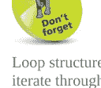

循环结构（将在本章稍后介绍）通常用于遍历列表元素。

#### 操作列表

可以包含多个数据项的列表变量在 Python 编程中广泛使用，并且具有一些可以“点号后缀”到列表名称上的“方法”进行操作：

| 列表方法： | 描述： |
| :------- | :------- |
| list.append(x) | 将项目 x 添加到列表末尾 |
| list.extend(L) | 将列表 L 中的所有项目添加到列表末尾 |
| list.insert(i,x) | 在索引位置 i 处插入项目 x |
| list.remove(x) | 从列表中移除第一个项目 x |
| list.pop(i) | 移除索引位置 i 处的项目并返回它 |
| list.index(x) | 返回列表中第一个项目 x 的索引位置 |
| list.count(x) | 返回 x 在列表中出现的次数 |
| list.sort() | 原地排序所有列表项目 |
| list.reverse() | 原地反转所有列表项目 |

Python 还有一个有用的 len(L) 函数，它返回列表 L 的长度，即其包含的元素总数。与 index() 和 count() 方法一样，返回的值是数字型的，因此不能直接拼接到文本字符串中用于输出。

然而，数值字符串表示形式可以通过 Python 的 str(n) 函数生成，以便与其他字符串拼接，该函数返回数字 n 值的字符串版本。同样，整个列表的字符串表示形式可以由 str(L) 函数返回，以便与其他字符串拼接。在这两种情况下，请记住，原始版本保持不变，因为返回的版本仅仅是原始版本的副本。

可以通过指定索引号给 Python del() 函数来删除单个列表元素。这可以在指定的 i 索引位置移除单个元素，或者可以使用切片表示法 i1:i2 移除一个“切片”的元素，以指定第一个和最后一个元素的索引号。在这种情况下，i1 是要移除的第一个元素的索引号，所有元素直到但不包括索引号为 i2 的元素将被移除。


对于同时包含数值和字符串值的列表，**sort()** 方法返回的列表元素首先按数值排序，然后按字母顺序排序——例如 1,2,3,A,B,C。


Python 还有一个 **int(s)** 函数，它返回字符串 s 值的数字版本。

1. 通过初始化两个各包含三个元素且均含字符串值的列表来开始编写一个新的 Python 脚本
   `basket = ['Apple', 'Bun', 'Cola']`
   `crate = ['Egg', 'Fig', 'Grape']`


2. 接下来，添加语句以显示第一个列表的元素内容及其长度
   `print('Basket List:', basket)`
   `print('Basket Elements:', len(basket))`

3. 现在，添加语句以添加一个元素并显示所有列表元素，然后移除最后一个元素并再次显示所有列表元素
   `basket.append('Damson')`
   `print('Appended:', basket)`
   `print('Last Item Removed:', basket.pop())`
   `print('Basket List:', basket)`

4. 最后，添加语句以将第二个列表的所有元素添加到第一个列表并显示所有第一个列表元素，然后移除元素并再次显示第一个列表

```python
basket . extend ( crate )
print ( 'Extended: ' , basket )
del basket [ 1 ]
print ( 'Item Removed: ' , basket )
del basket [ 1 : 3 ]
print ( 'Slice Removed: ' , basket )
```

5. 将文件保存在你的脚本目录中，然后在那里打开一个命令提示符窗口并运行此程序——以查看列表被操作

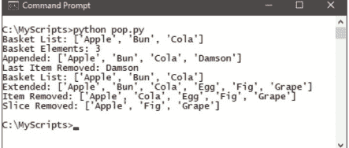


切片中的最后一个索引号表示停止移除元素的位置，但该位置的元素不会被移除。


### 限制性列表

#### 元组

常规列表中的值可以在程序运行过程中被更改（它们是“可变的”），但可以创建具有固定“不可变”值的列表，这些值不能被程序更改。

一种具有限制性的不可变 Python 列表被称为“元组”（tuple），它是通过在一个称为“元组打包”（tuple packing）的过程中，将值作为逗号分隔的列表分配在括号内来创建的：

```python
colors-tuple = ( 'Red','Green','Red','Blue','Red' )
```

可以使用元组名称后跟包含该元素索引号的方括号来引用元组中的单个元素。有用的是，存储在元组内的所有值可以在一个称为“序列解包”（sequence unpacking）的过程中分配给单独的变量：

```python
a, b, c, d, e = colors-tuple
```

#### 集合

常规列表中的值可以在其元素中重复，如上文的元组所示，但可以创建一个不允许重复值的唯一值列表。一种具有限制性的 Python 唯一值列表被称为“集合”（set），它是通过将值作为逗号分隔的列表分配在花括号（braces）内来创建的：

```python
phonetic-set = { 'Alpha','Bravo','Charlie'}
```

集合中的单个元素不能通过集合名称后跟包含索引号的方括号来引用，但集合具有方法，可以通过点后缀添加到集合名称进行操作和比较：

| 集合方法： | 描述： |
| :--- | :--- |
| `set.add(x)` | 将项 x 添加到集合 |
| `set.update(x,y,z)` | 将多个项添加到集合 |
| `set.copy()` | 返回集合的副本 |
| `set.pop()` | 从集合中移除一个随机项 |
| `set.discard( x )` | 如果在集合中找到项 x，则移除该项 |
| `set1.intersection(set2)` | 返回在两个集合中都出现的项 |
| `set1.difference(set2)` | 返回在 set1 中但不在 set2 中的项 |


与列表的索引编号类似，元组序列中的项从零开始编号。


解包元组时，变量的数量必须与项的数量相同。


更多集合方法可在 Python 文档中找到。

可以使用 Python 的 `type()` 函数来确定这些列表的数据结构类，并且可以使用 Python 内置的成员运算符 `in` 在集合中查找值。

1. 通过初始化一个元组开始新的 Python 脚本，然后显示其内容、长度和类型

```python
zoo = ('Kangaroo', 'Leopard', 'Moose')
print('Tuple:', zoo, '\tLength:', len(zoo))
print(type(zoo))
```


2. 接下来，初始化一个集合并添加另一个元素，然后显示其内容、长度和类型

```python
bag = {'Red', 'Green', 'Blue'}
bag.add('Yellow')
print(f'\nSet:', bag, '\tLength', len(bag))
print(type(bag))
```

3. 现在，添加语句以在集合中查找两个值

```python
print(f'\nIs Green In bag Set?: ', 'Green' in bag)
print(f'\nIs Orange In bag Set?: ', 'Orange' in bag)
```

4. 最后，初始化第二个集合并显示其内容、长度以及两个集合中找到的所有公共值

```python
box = {'Red', 'Purple', 'Yellow'}
print(f'\nSet:', box, '\t\tLength', len(box))
print(f'\tCommon To Both Sets:', bag.intersection(box))
```

5. 将文件保存到脚本目录中，然后在那里打开命令提示符窗口并运行此程序 – 以查看元组和集合的值

```text
C:\MyScripts>python set.py
Tuple: ('Kangaroo', 'Leopard', 'Moose')    Length: 3
<class 'tuple'>
Set: {'Blue', 'Green', 'Yellow', 'Red'}     Length: 4
<class 'set'>

Is Green In bag Set?: True
Is Orange In bag Set?: False
Set: {'Purple', 'Yellow', 'Red'}            Length: 3
Common To Both Sets: {'Red', 'Yellow'}

C:\MyScripts>
```


也可以通过在 `set()` 构造函数的括号内指定花括号包围的列表来创建集合，并使用 `frozenset()` 构造函数创建不可变集合。

### 关联列表元素

在 Python 编程中，“字典”（dictionary）是一种可以存储多个数据项作为键值对（key:value）列表的数据容器。与常规列表容器的值不同（它们通过其索引号引用），存储在字典中的值通过其关联的键引用。键在该字典中必须是唯一的，并且通常是一个字符串名称，尽管也可以使用数字。

创建字典只需将键值对作为逗号分隔的列表分配在花括号（braces）之间，并赋予您选择的名称即可。字符串通常必须用引号括起来，并且键及其关联值之间必须有一个冒号 `:` 字符。

可以通过指定字典名称和该键值对的键给 `del` 关键字来从字典中删除一个键值对。相反，可以通过将值分配给字典名称和一个新键来向字典中添加一个键值对。

Python 字典有一个 `keys()` 方法，可以通过点后缀添加到字典名称以返回该字典中所有键的随机顺序列表。如果您希望将键排序为字母数字顺序，只需将该语句包含在 Python `sorted()` 函数的括号内即可。

可以使用 Python 的 `in` 运算符搜索字典以检查是否包含特定键，语法为 `key in dictionary`。当在指定字典中找到键时，搜索将返回布尔值 `True`，否则将返回 `False`。

字典是 Python 编程中可用的最后一类数据容器。总结来说，各种类型如下：

- **变量** – 存储单个值。
- **列表** – 按有序索引存储多个值。
- **元组** – 按序列存储多个固定值。
- **集合** – 在无序集合中存储多个唯一值。
- **字典** – 存储多个无序键值对。


在其他编程语言中，列表通常被称为“数组”，而字典通常被称为“关联数组”。


数据经常作为键值对进行关联 – 例如，当您提交网页表单时，在输入字段中输入的文本值通常与该文本字段的名称作为其键进行关联。

1. 通过初始化一个字典开始新的 Python 脚本，然后显示其键值内容

```python
dict = { 'name' : 'Bob', 'ref' : 'Python', 'sys' : 'Win' }
print( 'Dictionary:', dict )
```


2. 接下来，通过其键引用显示单个值

```python
print( '\nReference:', dict[ 'ref' ] )
```

3. 现在，显示字典中的所有键

```python
print( '\nKeys:', dict.keys() )
```

4. 从字典中删除一个键值对并添加一个替代键值对，然后显示新的键值内容

```python
del dict[ 'name' ]
dict[ 'user' ] = 'Tom'
print( '\nDictionary:', dict )
```

5. 最后，搜索字典中的特定键并显示搜索结果

```python
print('\nIs There A name Key?', 'name' in dict)
```

6. 将文件保存到脚本目录中，然后在那里打开命令提示符窗口并运行此程序 — 以查看字典的键和值

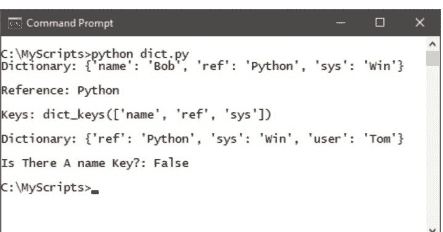


请注意，在字符串中引号前必须有一个反斜杠转义字符 —— 以防止字符串过早终止。

### 使用 if 分支

Python 的 `if` 关键字执行基本的条件测试，将给定表达式评估为布尔值 `True` 或 `False`。这允许程序根据测试结果以不同方向运行，这被称为“条件分支”。


被测试的表达式必须后跟一个冒号 `:`，然后是在测试成功时执行的语句，应位于下方单独的各行中，并且每行都必须从 `if` 测试行缩进。缩进的大小并不重要，但每一行必须相同。因此，语法看起来像这样：

```
if test-expression :
    statements-to-execute-when-test-expression-is-True
    statements-to-execute-when-test-expression-is-True
```

可选地，`if` 测试可以在测试失败时提供替代语句，方法是将在测试成功时执行的语句之后添加 `else` 关键字。`else` 关键字必须后跟一个冒号 `:`，并且与 `if` 关键字对齐，但其语句必须以类似的方式缩进，因此其语法看起来像这样：

```
if test-expression :
    statements-to-execute-when-test-expression-is-True
else :
    statements-to-execute-when-test-expression-is-False
    statements-to-execute-when-test-expression-is-False
```

`if` 测试块后面可以跟着使用 `elif` 关键字（“否则如果”）的替代测试，它提供在替代测试成功时要执行的语句。这也必须与 `if` 关键字对齐，后跟一个冒号 `:`，并且其语句需要缩进。最后可以添加一个 `else` 关键字以提供


当测试失败时执行的替代语句。完整的 **if-elif-else** 结构的语法如下所示：

```
if test-expression-1 :
    statements-to-execute-when-test-expression-1-is-True
    statements-to-execute-when-test-expression-1-is-True
elif test-expression-2 :
    statements-to-execute-when-test-expression-2-is-True
    statements-to-execute-when-test-expression-2-is-True
else :
    statements-to-execute-when-test-expressions-are-False
    statements-to-execute-when-test-expressions-are-False
```


在 Python 中，代码的缩进非常重要，因为它用于向解释器标识代码块——其他编程语言通常使用花括号。


**if: elif: else:** 序列是 Python 中与其他语言中的 switch 或 case 语句对应的结构。

- 1. 通过初始化一个包含用户输入整数的变量来开始一个新的 Python 脚本
  `num = int( input( ‘Please Enter A Number: ‘ ) )`


- 2. 接下来，测试该变量并显示适当的响应
  ```
  if num > 5 :
      print( ‘Number Exceeds 5’ )
  elif num < 5 :
      print( ‘Number Is Less Than 5’ )
  else :
      print( 'Number Is 5' )
  ```

现在，再次使用两个表达式测试该变量，仅在成功时显示响应

```
if num > 7 and num < 9 :
    print( 'Number is 8' )
if num == 1 or num == 3 :
    print( 'Number Is 1 or 3' )
```

将文件保存在您的脚本目录中，然后在那里打开一个命令提示符窗口并运行此程序 – 以查看条件分支

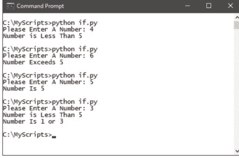


默认情况下，用户输入被读取为字符串值，因此必须将其强制转换为 **int** 数据类型，以便进行算术比较。


**and** 关键字确保仅当两个测试都成功时评估结果才为 **True**，而 **or** 关键字确保当任一测试成功时评估结果即为 **True**。

#### 当值为 true 时循环

循环是程序中自动重复执行的一段代码。循环内所有语句的一次完整执行被称为“迭代”或“遍”。循环的长度由循环内的条件测试控制。只要测试表达式被确定为 True，循环就会继续 – 直到测试表达式被确定为 False，此时循环结束。


在 Python 编程中，while 关键字创建循环。其后跟随测试表达式，然后是 : 冒号字符。测试成功时要执行的语句应写在下面的单独行中，并且每行必须与 while 测试行缩进相同的空格。此语句块必须包含一条语句，该语句将在某时改变测试表达式评估的结果 – 否则将创建无限循环。

在 Python 的交互模式中，代码块的缩进也必须遵守 – 例如，以下示例通过 while 循环生成斐波那契数列：

```
>>> a, b = 0, 1
>>> while b < 100 :
        print(b)
        a, b = b, a + b
1
1
2
3
5
8
13
21
34
55
89
>>> 
```

循环可以嵌套，一个在另一个内部，以便在外层循环的每次迭代中完全执行内层嵌套循环的所有迭代。可以在每个循环定义之前立即初始化一个具有起始值的“计数器”变量，将其包含在测试表达式中，并在每次迭代中递增，直到测试失败 – 此时循环结束。


与其他 Python 关键字不同，关键字 **True** 和 **False** 以大写开头。


按 Return 键移动到下一行，并查看解释器自动缩进新行，因为它期待后续语句。再次按 Return 键以执行已输入的代码。

- 1. 通过初始化一个“计数器”变量并使用该变量在测试表达式中定义外层循环，来开始一个新的 Python 脚本
  ```
  i = 1
  while i < 4 :
      print(“\nOuter Loop Iteration:”,i)
      i += 1
  ```


- 2. 接下来，添加缩进的语句以显示计数器的值，并在每次循环迭代中递增其值
  ```
  print(“\nOuter Loop Iteration:”,i)
  i += 1
  ```

- 3. 现在，（仍然保持缩进）初始化第二个“计数器”变量，并使用该变量在测试表达式中定义内层循环
  ```
  j = 1
  while j < 4 :
  ```

- 4. 最后，添加进一步缩进的语句以显示此计数器的值，并在每次迭代中递增其值
  ```
  print(“\tInner Loop Iteration:”,j)
  j += 1
  ```

- 5. 将文件保存在您的脚本目录中，然后在那里打开一个命令提示符窗口并运行此程序 – 以查看每次循环迭代中显示的输出

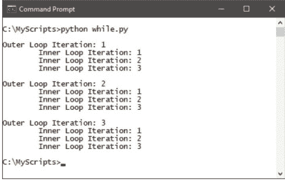


内层循环打印的输出由 \t 制表符字符相对于外层循环的输出进行缩进。


`+=` 赋值语句 `i += 1` 只是 `i = i+1` 的简写形式 – 你也可以使用 `*=` `/=` `-=` 简写形式为变量赋值。

### 遍历项目

在 Python 编程中，**for** 关键字遍历指定给 **in** 关键字的列表中的所有项目。此语句必须以 **:** 冒号字符结尾，并且每次循环迭代时要执行的语句必须在下面缩进，如下所示：

```
for *each-item* in *list-name* :
	*statements-to-execute-on-each-iteration*
	*statements-to-execute-on-each-iteration*
```

由于字符串只不过是字符的列表，**for in** 语句可以遍历每个字符。同样，**for in** 语句可以遍历列表中的每个元素、元组中的每个项目、集合中的每个成员或字典中的每个键。

**for in** 循环按序列中出现顺序遍历任何列表或字符串中的项目，但你不能直接指定迭代次数、停止条件或迭代步长的大小。然而，你可以在 **range()** 函数的参数中指定一个数值结束值，从而遍历数字序列。这将生成一个从零开始并持续到但不包括指定结束值的序列。例如，**range(5)** 生成 0,1,2,3,4。

可选地，你可以在 **range()** 函数的括号内指定开始值和结束值，用逗号分隔。例如，**range(1,5)** 生成 1,2,3,4。此外，你可以向 **range()** 函数指定开始值、结束值和步长值，作为括号内的逗号分隔列表。例如，**range(1,14,4)** 生成 1,5,9,13。

你可以在 Python 的 **enumerate()** 函数的括号内指定列表的名称，以显示每个元素的索引号及其关联值。

当同时遍历多个列表时，可以通过在 Python 的 **zip()** 函数的括号内指定逗号分隔的列表名称，将每个列表中相同索引号的元素值一起显示。

当遍历字典时，你可以使用字典的 **items()** 方法，并向 **for** 关键字指定两个逗号分隔的变量名 —— 一个用于键名，另一个用于其值 —— 来显示每个键及其关联值。


**range()** 函数可以生成递减序列，向下计数，也可以生成向上计数的序列。


Python 中的 **for** 循环与其他语言（如 C）中的循环不同，因为它不允许指定步长大小和结束条件。

- 1. 通过初始化一个列表、一个元组和一个字典来开始一个新的 Python 脚本
  ```python
  chars = [ 'A' , 'B' , 'C' ]
  fruit = ( 'Apple' , 'Banana' , 'Cherry' )
  dict = { 'name' : 'Mike' , 'ref' : 'Python' , 'sys' : 'Win' }
  ```


- 2. 接下来，添加语句以显示所有列表元素值
  ```python
  print( '\nElements:\t' , end = '' )
  for item in chars :
      print( item , end = '' )
  ```

- 3. 现在，添加语句以显示所有列表元素值及其相对索引号
  ```python
  print( '\nEnumerated:\t' , end = '' )
  for item in enumerate( chars ) :
      print( item , end = '' )
  ```

- 4. 然后，添加语句以显示所有列表和元组元素
  ```python
  print( '\nZipped:\t' , end = '' )
  ```


```python
for item in zip(chars, fruit):
    print(item, end=' ')
```

5. 最后，添加语句以显示所有字典的键名及其对应的元素值
   ```python
   print('\nPaired:')
   for key, value in dict.items():
       print(key, '=', value)
   ```
6. 将文件保存到 scripts 目录中，然后在该目录打开一个命令提示符窗口并运行此程序 – 以查看循环迭代中显示的项目

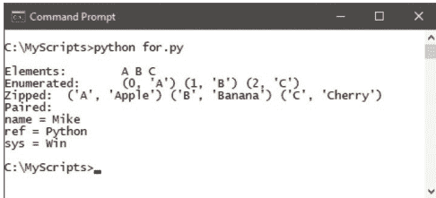


在 Python 编程中，任何包含多个可以循环遍历的项目的内容都被描述为“可迭代的”（iterable）。

### 跳出循环

Python 的 `break` 关键字可用于在满足指定条件时提前终止循环。`break` 语句位于循环语句块内部，并且由一个测试表达式引导。当测试返回 **True** 时，循环立即结束，程序继续执行下一个任务。例如，在嵌套的内层循环中，它将进入外层循环的下一个迭代。

1. 创建一个包含循环语句的新 Python 脚本，该循环迭代三次
   `for i in range(1, 4):`


2. 接下来，添加一个缩进的语句，创建一个同样迭代三次的“嵌套”内层循环
   `for j in range(1, 4):`

3. 现在，在内层循环中进一步添加一个缩进语句，在内层循环的每次迭代中显示计数器数值（包括外层和内层循环的）
   `print('Running i=', i, ' j=', j)`

4. 将文件保存到 scripts 目录中，然后在该目录打开一个命令提示符窗口并运行此程序 – 以查看每次循环迭代中的计数器值

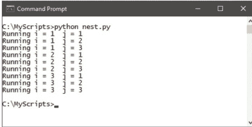


将这些嵌套的 **for** 循环与这里的嵌套 **while** 循环示例进行比较。

5. 现在，在内层循环块的开头插入此 **break** 语句，以跳出内层循环 – 然后保存文件并再次运行程序

```python
if i == 2 and j == 1 :
    print('Breaks inner loop at i=2 j=1')
    break
```

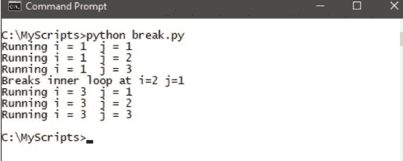

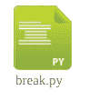

Python 的 `continue` 关键字可用于在满足指定条件时跳过循环的单次迭代。`continue` 语句位于循环语句块内部，并由一个测试表达式引导。当测试返回 **True** 时，那一次迭代结束，程序进入下一次迭代。

6. 在内层循环块的开头插入此 `continue` 语句，以跳过内层循环的第一次迭代 – 然后保存文件并再次运行程序

```python
if i == 1 and j == 1 :
    print('Continues inner loop at i=1 j=1')
    continue
```


在这里，**break** 语句在外层循环第二次尝试运行内层循环时，终止了内层循环的所有三次迭代。


在这里，**continue** 语句在外层循环第一次尝试运行内层循环时，仅跳过了内层循环的第一次迭代。

### 总结

- 在 Python 中，多重赋值可用于在单个语句中初始化多个变量。
- Python 列表是一个可以存储多个数据项的变量，这些数据项存储在从零开始编号的连续元素中。
- 存储在列表元素中的数据可以使用列表名称后跟方括号 [ ] 中的索引号来引用。
- `len()` 函数返回指定列表的长度。
- Python 元组是一个不可变的列表，其值可以通过“序列解包”分配给单个变量。
- 存储在元组元素中的数据可以使用元组名称后跟方括号 [ ] 中的索引号来引用。
- Python 集合是一个无序的唯一元素集合，其值可以通过其方法进行比较和操作。
- 存储在集合中的数据不能通过索引号引用。
- Python 字典是一个由键:值数据对组成的列表，其中每个键必须是唯一的。
- 存储在字典元素中的数据可以使用字典名称后跟方括号 [ ] 中的键来引用。
- Python 的 `if` 关键字对表达式进行条件测试，以判断其布尔值为 `True` 还是 `False`。
- 条件分支通过 `else` 和 `elif` 关键字为 `if` 测试提供替代方案。
- `while` 循环重复执行，直到测试表达式返回 `False`。
- `for in` 循环遍历指定列表或字符串中的每个项目。
- range() 函数生成一个数值序列，可用于指定 for in 循环的长度。
- break 和 continue 关键字中断循环迭代。

# 4

## 定义函数

*本章演示如何创建可在程序需要时调用来执行语句的函数。*

- 理解作用域
- 提供参数
- 返回值
- 使用回调
- 添加占位符
- 生成生成器
- 处理异常
- 调试断言
- 总结

### 理解作用域

本书前面的示例使用了 Python 编程语言的内置函数，例如 `print`() 函数。然而，大多数 Python 程序包含许多自定义函数，可以在程序运行期间根据需要调用。

自定义函数使用 `def`（定义）关键字创建，后跟您选择的名称和 ( ) 括号。程序员可以为函数选择任何名称，但除外本书封二列出的 Python 关键字以及现有内置函数的名称。该行必须以 `:` 冒号字符结束，然后每当函数被调用时需要执行的语句必须出现在下方的行中并进行缩进。因此，函数定义的语法如下所示：

```python
def function-name():
    statements-to-be-executed
    statements-to-be-executed
```

一旦执行完函数语句，程序流将在直接跟随函数调用的位置恢复。这种模块化在 Python 编程中非常有用，可以隔离一组例程，以便可以重复调用它们。

为了创建自定义函数，有必要理解程序中变量的可访问性（“作用域”）：

- 在函数外部创建的变量可以被函数内部的语句引用 – 它们具有“全局”作用域。
- 在函数内部创建的变量不能在创建它们的函数外部引用 – 这些具有“局部”作用域。

局部变量的有限可访问性意味着相同名称的变量可以出现在不同的函数中而不发生冲突。

如果您想强制将一个局部变量使其在其他地方可访问，它必须首先用 Python `global` 关键字加上其名称进行声明。随后可以分配一个值，该值可以在程序中的任何地方引用。当全局变量和局部变量具有相同名称时，函数将使用局部版本。


函数语句必须从定义行缩进相同的量，以便 Python 解释器能够识别该代码块。


尽量避免使用全局变量，以防止意外冲突 – 在可能的情况下仅使用局部变量。

1. 通过初始化一个全局变量来开始新的 Python 脚本
   `global_var = 1`

   

2. 接下来，创建一个名为 "my_vars" 的函数，以显示全局变量中包含的值
   ```python
   def my_vars():
       print('Global Variable:', global_var)
   ```

3. 现在，向函数块中添加缩进的语句，以初始化一个局部变量并显示其包含的值
   ```python
   local_var = 2
   print('Local variable:', local_var)
   ```

4. 然后，向函数块中添加缩进的语句，创建一个强制全局变量并分配初始值
   ```python
   global inner_var
   inner_var = 3
   ```


- 在函数后添加一条语句，以调用该函数并执行其包含的语句
- my_vars()

- 最后，添加一条语句来显示强制转换后的全局变量中所包含的值
- print('Coerced Global:', inner_var)

- 将文件保存在你的 scripts 目录中，然后在那里打开一个命令提示符窗口并运行此程序 – 以查看自定义函数显示变量值


那些不是全局变量但出现在某个外部作用域中的变量，可以使用 `nonlocal` 关键字来引用。

### 提供参数

在 Python 编程中定义自定义函数时，你可以选择在函数的括号内指定一个“参数”名称。通过在调用该函数时在其括号内指定值，可以将值传递给该参数。现在，函数可以在执行过程中通过引用参数名称来使用传入的值。例如，定义一个函数来接受一个用于打印的参数，如下所示：

```python
def echo( user ):
    print( 'User:', user )
```

调用此函数时，必须在括号内指定要传递给参数的值，以便将其打印出来：

```python
echo( 'Mike' )
```

可以通过在函数括号内包含逗号分隔的参数名称列表，在函数定义中指定多个参数（也称为“形参”）：

```python
def echo( user, lang, sys ):
    print( 'User:', user, 'Language:', lang, 'Platform:', sys )
```

当调用其定义中指定了参数的函数时，调用中必须包含与参数数量相同的数据值。例如，以多个参数调用此示例：

```python
echo( 'Mike', 'Python', 'Windows' )
```

除非调用者同时指定了参数名称，否则传入的值必须按参数列表中的相同顺序出现，如下所示：

```python
echo( lang='Python', user='Mike', sys='Windows' )
```

可选地，在定义函数时可以在参数列表中指定默认值。当调用者为该参数指定值时，此默认值将被覆盖；但当调用者没有传递值时，函数将使用该默认值：

```python
def echo( user, lang, sys='Linux' ):
    print( 'User:', user, 'Language:', lang, 'Platform:', sys )
```

这意味着你可以调用该函数，传递比函数定义中指定的参数数量更少的值，以使用默认参数值，或者传递与指定参数数量相同的值以覆盖默认值。


参数命名遵循与变量和函数相同的约定。


将参数命名为与传递给它们的变量相同，以使数据流动清晰明了。

1. 通过定义一个接受三个参数的函数来创建一个新的 Python 脚本，该函数将打印传入的值
   ```python
   def echo( user, lang, sys ):
       print( 'User:', user, 'Language:', lang, 'Platform:', sys )
   ```
   `args.py`

2. 接下来，按参数出现的顺序向函数参数传递字符串值来调用该函数
   ```python
   echo( 'Mike', 'Python', 'Windows' )
   ```

3. 现在，通过指定参数名称向函数参数传递字符串值来调用该函数
   ```python
   echo( lang='Python', sys='Mac OS', user='Anne' )
   ```

4. 然后，定义另一个函数，接受两个具有默认值的参数，这些参数将打印出参数值
   ```python
   def mirror(user='Carole', lang='Python'):
       print('\nUser:', user, 'Language:', lang)
   ```

5. 最后，添加语句来调用第二个函数，既使用默认值又覆盖默认值
   ```python
   mirror()
   mirror(lang='Java')
   mirror(user='Tony')
   mirror('Susan', 'C++')
   ```

6. 将文件保存在你的 scripts 目录中，然后在那里打开一个命令提示符窗口并运行此程序 — 以查看函数显示参数值


### 返回值

就像 Python 的内置 `str()` 函数一样，该函数将其参数指定的值的字符串表示形式返回给调用者，自定义函数也可以使用 Python 的 `return` 关键字指定要返回的值，从而向调用者返回值。例如，向调用者返回两个指定参数值之和，如下所示：

```python
def sum(a, b):
    return a + b
```


调用者可以将返回的结果赋值给变量，供程序后续使用，如下所示：

```python
total = sum(8, 4)
print('Eight Plus Four Is:', total)
```

或者，可以直接“内联”使用返回的结果，如下所示：

```python
print('Eight Plus Four Is:', sum(8, 4))
```

通常，`return` 语句将出现在函数块的末尾，以返回执行该函数中包含的所有语句的最终结果。

然而，`return` 语句也可能出现在函数块的前面，以停止该块中所有后续语句的执行。这将立即使程序在调用者处恢复执行。可选地，`return` 语句可以指定返回给调用者的值，或者省略该值。如果没有指定值，则假定默认值为 `None`。通常，这用于在条件测试结果为 `False` 时停止函数语句的执行。例如，当传入的参数值低于指定数字时：

```python
def sum(a, b):
    if a < 5:
        return
    return a + b
```

在这种情况下，如果第一个传入参数值低于五，该函数将返回默认值 **None**，并且最终语句将不会执行。

当函数需要执行算术运算时，可以使用内置的 *isdigit()* 函数来验证用户输入是否为整数值。


你可以为函数定义中的参数指定默认值。

1. 通过初始化一个变量来创建一个新的 Python 脚本，该变量接收用户输入的整数值以进行操纵
   ```python
   num = input( 'Enter An Integer:' )
   ```

   

2. 接下来，添加一个函数定义，该定义接受一个从调用者传递的单个参数值
   ```python
   def square( num ):
   ```

3. 现在，在函数块中插入一个缩进的语句，以验证传入的值是否为整数，或者停止函数语句的进一步执行
   ```python
   if not num.isdigit( ):
       return 'Invalid Entry'
   ```

4. 然后，添加缩进语句，将传入的值转换为 **int** 数据类型，然后向调用者返回该值平方后的总和
   ```python
   num = int( num )
   return num * num
   ```

5. 最后，添加一条语句来输出一个字符串和函数调用返回的值
   ```python
   print( num, 'Squared Is:', square( num ) )
   ```

6. 将文件保存在你的 scripts 目录中，然后在那里打开一个命令提示符窗口并运行此程序 – 以查看函数显示返回的值


请记住，用户输入被读取为 **str** 数据类型 – 因此必须将其转换为 **int** 或 **float** 数据类型才能进行算术运算。

### 使用回调

在 Python 中，使用 `def` 关键字创建命名函数，该关键字指定一个函数名称，该名称可以在程序中的任何时间使用来调用该函数并执行其包含的语句。可选地，命名函数可以返回一个值给调用者。

Python 还允许使用 `lambda` 关键字创建匿名无名称函数。匿名函数只能包含单个表达式，该表达式必须始终返回值。

与通常使用 `def` 关键字创建函数不同，使用 `lambda` 关键字创建函数会返回一个“函数对象”。这可以分配给一个变量，然后可以在程序中的任何时间使用（“回调”）该变量来引用该函数，以执行其包含的表达式。

因此，`lambda` 关键字为程序员提供了创建函数的替代语法。例如：

```python
def square( x ):
    return x ** 2
```

可以简写为更简洁的...

```python
square = lambda x : x ** 2
```

在两种情况下，调用 `square(5)` 都会通过向函数传入一个整数参数来返回结果 25。注意 `lambda` 关键字后跟着一个没有括号的参数，并且指定的表达式不需要 `return` 关键字，因为所有使用 `lambda` 创建的函数都必须隐式地返回值。

虽然 `lambda` 关键字提供了创建函数的替代方式，但它主要用于在代码中嵌入函数。例如，回调通常被编码为直接嵌入在调用者参数列表中的内联 `lambda` 表达式 – 而不是在程序的其他地方使用 `def` 关键字创建并按名称引用。例如：

```python
def function_1(): statements-to-be-executed
def function_2(): statements-to-be-executed
callbacks = [ function_1, function_2 ]
```


...或者可以更简洁地写成...

`callbacks = [ lambda : expression , lambda : expression ]`


内联的 **lambda** 回调通常用于定义 GUI 程序中按钮的行为。

1. 通过定义三个函数来开始一个新的 Python 脚本，这些函数将传入参数分别提升到不同的幂次
   ```python
   def function_1(x) : return x ** 2
   def function_2(x) : return x ** 3
   def function_3(x) : return x ** 4
   ```


2. 接下来，添加一条语句，通过引用函数名来创建指向每个函数的回调列表
   `callbacks = [ function_1 , function_2 , function_3 ]`

3. 现在，显示一个标题，并显示将某个值传递给每个命名函数后的结果
   ```python
   print('\nNamed Functions:')
   for function in callbacks : print( 'Result:', function(3))
   ```

4. 然后，添加一条语句，创建一个指向内联匿名函数的回调列表，这些匿名函数将传入参数提升到不同的幂次
   ```python
   callbacks = \
   [ lambda x : x ** 2 , lambda x : x ** 3 , lambda x : x ** 4 ]
   ```

5. 最后，显示一个标题，并显示将某个值传递给每个匿名函数后的结果
   ```python
   print('\nAnonymous Functions:')
   for function in callbacks : print( 'Result:', function(3))
   ```

6. 将文件保存在你的脚本目录中，然后在该目录下打开一个命令提示符窗口并运行此程序——以查看常规函数和匿名函数的返回值


仅包含一条语句的函数定义可以写在同一行——如此处所示。


`\` 字符可用于允许代码在下一行继续——如此处所示。

### 添加占位符

Python 的 `pass` 关键字在编写程序代码时非常有用，它作为一个临时占位符，可以插入到代码中，以便将来在需要进一步添加代码的地方使用。`pass` 关键字插入在语法上需要语句但暂时无法确定具体逻辑的位置，它仅执行一个“空”操作——当执行它时，什么也不会发生，也不需要执行任何代码。这使得一个不完整的程序可以通过模拟正确的语法被执行以进行测试，从而解释器不会报告错误。

1. 通过初始化一个布尔变量并添加一个不完整的条件测试来开始一个新的 Python 脚本
   ```python
   bool = True
   if bool :
           print( 'Python In Easy Steps' )
   else :
           # Statements to be inserted here.
   ```


2. 将文件保存在你的脚本目录中，然后在该目录下打开一个命令提示符窗口并运行此程序——以查看解释器报告一个错误


3. 用 `pass` 关键字替换该注释，然后保存文件并再次运行程序——此时解释器不再发现错误，程序将正常执行

```text
Command Prompt

C:\MyScripts>python pass.py
Python In Easy Steps

C:\MyScripts>
```


在循环结构中，重要的是不要混淆 **pass** 关键字（它允许解释器处理该次迭代中的后续所有语句）和 **continue** 关键字（它仅跳过该次循环迭代中的后续语句）。

1. 通过初始化一个字符串变量来开始一个新的 Python 脚本
   `title = "Python In Easy Steps"`


2. 接下来，添加一个循环来打印字符串中的每个字符
   `for char in title : print( char , end = '' )`

3. 现在，添加一个循环，打印每个字符串字符，但将任何‘y’字符替换为星号，然后跳过到下一次迭代
   ```python
   for char in title :
       if char == 'y' :
           print( '*' , end = '' )
           continue
       print( char , end = '' )
   ```

4. 最后，添加一个循环，打印每个字符串字符，但在每个‘y’字符前插入一个星号
   ```python
   for char in title :
       if char == 'y' :
           print( '*' , end = '' )
       print( char , end = '' )
   ```

5. 将文件保存在你的脚本目录中，然后在该目录下打开一个命令提示符窗口并运行此程序——以查看每个循环产生的不同输出


在循环中，`continue` 关键字会继续到下一次迭代，而 `pass` 关键字则会通过当前迭代并进入同一迭代中的下一条语句。

### 生成生成器

当调用 Python 函数时，它会执行其中包含的语句，并可能返回指定给 **return** 关键字的任何值。函数结束后，控制权返回给调用者，函数的状态不会被保留。当下次调用该函数时，它将再次从头到尾处理其语句。

另一方面，Python 生成器是一种特殊函数，它向调用者返回一个“生成器对象”而不是数据值。这实际上保留了函数上次调用时的状态，因此下次调用时它会从该点继续执行。

生成器函数的定义方式与普通函数类似，但包含一个“yield”语句。该语句以 Python 的 **yield** 关键字开头，并指定要返回给调用者的生成器对象。当执行到 **yield** 语句时，生成器对象的状态被冻结，其“表达式列表”中的当前值被保留。**yield** 语句返回的生成器对象可以方便地赋值给一个变量。然后，可以使用 Python 内置的 **next()** 函数，在其括号内指定该变量名，从而从冻结的点继续执行函数——就好像 yield 语句只是另一个外部调用一样。

重复使用 **next()** 函数调用生成器对象将继续执行函数，直到引发异常。可以通过将 **yield** 语句封装在一个无限循环中来避免这种情况，这样每次迭代都会返回下一个值。例如，要在每次调用时产生一个递增的值：

```python
def incrementer():
    i = 1
    while True:
        yield i
        i += 1

inc = incrementer()
print(next(inc))
print(next(inc))
print(next(inc))
```

这些调用显示整数值 1，然后是 2，然后是 3。

或许更有用的是，生成器对象可以从循环中引用，以依次遍历各个值。


将此循环中的条件测试更改为 `while i < 3` 将导致在第三次调用时引发 `StopIteration` 错误。

1. 通过定义一个函数来开始一个新的 Python 脚本，该函数首先将两个变量初始化为整数 1
   ```python
   def fibonacci_generator():
       a = b = 1
   ```


2. 接下来，在函数体中插入一个缩进的无限循环，以生成前两个值之和
   ```python
   while True:
       yield a
       a, b = b, a + b
   ```

3. 现在，将返回的生成器对象赋值给一个变量
   `fib = fibonacci_generator()`

4. 最后，添加一个循环，依次调用生成器函数并在每次迭代中显示其值
   ```python
   for i in fib:
       if i > 100:
           break
       else:
           print('Generated:', i)
   ```

5. 将文件保存在你的脚本目录中，然后在该目录下打开一个命令提示符窗口并运行此程序——以查看循环显示逐渐增大的生成值


在此处，变量通过一条语句初始化为相同的值。


你可以使用内置的 *type()* 函数来确认对象类型——此处，确认 *type*(fib) 为生成器类对象。


### 处理异常

在 Python 脚本中，某些部分（例如处理用户输入的部分）可能会预见到错误发生，这些部分可以被包裹在 `try except` 块中，以处理“异常错误”。要执行的语句被分组在 `try :` 块中，而异常则传递给随后的 `except :` 块进行处理。可选地，这之后可以跟一个 `finally :` 块，其中包含在异常被处理后需要执行的语句。

Python 识别许多内置异常，例如：`NameError`，当变量名未找到时发生；`IndexError`，当试图访问不存在的列表索引时发生；以及 `ValueError`，当内置操作或函数接收到值不适当的参数时发生。

每个异常都会返回一个描述性消息，该消息可以有用地通过 `as` 关键字赋值给一个变量。这样就可以在异常发生时，用来显示该异常的性质。

1. 通过初始化一个字符串值变量来开始编写新的 Python 脚本
```python
title = 'Python In Easy Steps'
```


**try.py**

2. 接下来，添加一个 try 语句块，尝试显示该变量的值 – 但错误地指定了名称
```python
try :
    print( titel )
```

3. 现在，添加一个 except 语句块，以便在发生 `NameError` 时显示错误消息
```python
except NameError as msg :
    print( msg )
```

4. 将文件保存到你的脚本目录中，然后在那里打开一个命令提示符窗口并运行此程序 – 以查看错误是如何被处理的


在 [http://docs.python.org/3/library/exceptions.html](http://docs.python.org/3/library/exceptions.html) 在线发现更多内置异常

可以通过在 `except` 块内的括号中指定以逗号分隔的类型列表来处理多个异常：

```python
except (NameError, IndexError) as msg:
    print(msg)
```

你还可以使用 **raise** 关键字强制解释器报告异常，通过指定要识别的异常类型以及括号中的自定义描述性消息来实现。

1. 通过初始化一个整数值变量来开始编写新的 Python 脚本
```python
day = 32
```


2. 接下来，添加一个 try 语句块，测试变量值，然后指定异常和自定义消息
```python
try:
    if day > 31:
        raise ValueError('Invalid Day Number')
    # More statements to execute get added here.
```

3. 现在，添加一个 except 语句块，以便在发生 `ValueError` 时显示错误消息
```python
except ValueError as msg:
    print('The Program found An', msg)
```

4. 然后，添加一个 finally 语句块，以便在异常被成功处理后显示一条消息
```python
finally :
    print(‘But Today Is Beautiful Anyway.’)
```

5. 将文件保存到你的脚本目录中，然后在那里打开一个命令提示符窗口并运行此程序 – 以查看引发的错误被处理

**Command Prompt**

```
C:\MyScripts>python raise.py
The Program Found An Invalid Day Number
But Today Is Beautiful Anyway.

C:\MyScripts> ▫
```


除非或直到发生异常，否则 try 块中的语句都会被执行。

### 调试断言

在追踪（调试）代码中的错误时，通常通过在每个行前添加 `#` 井号字符来“注释掉”一行或多行代码，这对定位问题所在很有用 – 就像用于注释那样。Python 解释器将忽略这些行的执行，从而有助于定位问题所在。例如，如果你怀疑变量赋值存在问题，可以像这样将其排除：


```python
# elem = elem / 2
```

如果程序现在没有错误地运行了，那么被注释掉的赋值就可以被假定为是有问题的。

另一种有用的调试技术是利用 Python 的 **assert** 关键字向脚本中添加错误检查代码。这会检查指定的测试表达式是否得到布尔 True 或 False 结果，并在测试失败时报告 “AssertionError”。可选地，assert 语句可以包含一个描述性消息，用于在报告 AssertionError 时提供，其语法如下：

*assert 测试表达式 , 描述性消息*

当测试表达式失败时，解释器报告 AssertionError 并停止脚本的执行；但当测试成功时，assert 语句不做任何事，脚本的执行继续。

使用 assert 语句是记录脚本的有效方式，因为其描述性消息提供了解释，并且其测试会在代码有错误时提醒你。

#### 断言与异常

乍一看，AssertionError 可能与 Exception 混淆相似，但重要的是要认识到它们的区别：

- **Exceptions（异常）** 提供了一种处理可能在运行时合法发生的错误的方法。
- **AssertionErrors（断言错误）** 提供了一种在开发期间提醒程序员注意错误的方法。

通常，在调试完成后，`assert` 语句将从程序的发布版本中移除，而 `except` 语句将保留以处理运行时错误。


你可以在运行命令中使用 `-O` 开关让解释器忽略所有 assert 语句 – 例如，`python -O assert.py`

1. 通过初始化一个包含几个字符串值的列表来开始编写新的 Python 脚本
   `chars = [ 'Alpha', 'Beta', 'Gamma', 'Delta', 'Epsilon' ]`

   

2. 接下来，定义一个接受单个参数的函数
   ```python
   def display( elem ) :
   ```

3. 现在，在函数体中添加缩进的语句，以确保传入的参数值是整数，然后显示该索引号对应的列表元素
   ```python
   assert type( elem ) is int , ‘Argument Must Be Integer!’
   print( ‘List Element’ , elem , ‘=’, chars[ elem ] )
   ```

4. 然后，初始化一个整数值变量并调用该函数，将此变量值作为其参数传入
   ```python
   elem = 4
   display( elem )
   ```

5. 最后，修改变量的值，然后再次调用该函数，将新的变量值作为其参数传入
   ```python
   elem = elem / 2
   display( elem )
   ```

6. 将文件保存到你的脚本目录中，然后在那里打开一个命令提示符窗口并运行此程序 – 以查看报告的 AssertionError


这个 AssertionError 发生的原因是除法运算返回的是浮点数值，而不是整数值。

### 总结

- 函数使用 **def** 关键字定义，并包含缩进的语句，以便在函数被调用时执行。
- 具有全局作用域的变量可以从任何地方引用，但具有局部作用域的变量只能从声明它的函数内部引用。
- 参数声明为函数定义括号内的逗号分隔列表。
- 除非在声明中指定了默认值，否则函数调用必须为每个函数参数提供数据。
- 可选地，函数可以包含一个 **return** 语句，以将值返回给调用者。
- 包含单个表达式的匿名函数使用 **lambda** 关键字创建，并返回一个函数对象。
- 回调通常被编码为直接嵌入在调用者参数列表中的内联 **lambda** 表达式。
- 可以通过在语法上需要语句的位置插入 **pass** 关键字来创建占位符。
- 当函数块中出现使用 **yield** 关键字的语句时，就创建了一个生成器函数。
- 生成器函数保留函数最后一次调用时的状态，并向调用者返回一个生成器对象。
- 内置的 **next()** 函数可用于从生成器函数冻结的地方继续执行该生成器函数。
- 预期的运行时异常错误可以通过将语句包裹在 **try except** 块中来进行处理。


- 可选地，可以使用 **finally** 语句来指定在异常处理完成后要执行的语句。
- 可以使用 **assert** 关键字向脚本添加错误检查代码，以报告开发错误。

## 5 导入模块

本章演示如何在程序中使用 Python 模块。

- 存储函数
- 拥有函数名
- 询问系统
- 执行数学运算
- 计算小数
- 显示时间
- 运行计时器
- 匹配模式
- 总结

### 存储函数

Python 函数定义可以方便地存储在一个或多个单独的文件中，以便于维护，并允许在多个程序中使用它们，而无需将定义复制到每个程序中。每个存储函数定义的文件称为“模块”（module），模块名是不包含“.py”扩展名的文件名。

模块中存储的函数通过使用 Python 的 `import` 关键字后接模块名即可在程序中使用。虽然并非必需，但惯例是将任何导入语句放在程序开头。

导入的函数可以通过在模块名后加上一连字符和函数名来调用。例如，来自名为“ineasy”的导入模块中的“steps”函数可以通过 `ineasy.steps()` 来调用。

当存储在模块中的函数包含参数时，通常很有用处在定义中为参数分配一个默认值。这使函数更加通用，因为调用时指定参数值变得可选。

1. 通过定义一个为其参数提供默认字符串值用于显示的函数，开始一个新的 Python 模块
   ```python
   def purr( pet = 'A Cat' ) :
       print( pet , 'Says MEOW!' )
   ```

   

2. 接下来，添加另外两个函数定义，它们也为其参数提供默认字符串值用于显示
   ```python
   def lick( pet = 'A Cat' ) :
       print( pet , 'Drinks Milk' )
   def nap( pet = 'A Cat' ) :
       print( pet , 'Sleeps By The Fire' )
   ```

3. 现在，将文件保存为“cat.py”，以便模块名为“cat”

4. 开始一个新的 Python 脚本，包含一个语句以提供“cat”模块的函数
   ```python
   import cat
   ```

   

5. 接下来，调用每个函数而不提供参数
   ```python
   cat.purr()
   cat.lick()
   cat.nap()
   ```

6. 现在，再次调用每个函数并传递参数给每个函数，然后保存文件
   ```python
   cat.purr('Kitty')
   cat.lick('Kitty')
   cat.nap('Kitty')
   ```

   

7. 通过再次提供“cat”模块的函数，开始另一个 Python 脚本
   ```python
   import cat
   ```

   

8. 然后，请求用户输入一个名称以覆盖默认参数值
   ```python
   pet = input('Enter A Pet Name: ')
   ```

9. 最后，调用每个函数，将用户定义的值作为参数传递
   ```python
   cat.purr( pet )
   cat.lick( pet )
   cat.nap( pet )
   ```

10. 将文件保存在您的脚本目录中，然后在那里打开一个命令提示符窗口并运行这些程序 —— 以查看来自导入模块的输出

   
   

您可以在导入模块时使用 `import as` 关键字创建别名。例如，`import cat as tom` 允许您在调用中使用 **tom** 作为函数前缀。

### 拥有函数名

在内部，每个 Python 模块和程序都有自己的“符号表”（symbol table），仅供在该上下文中定义的所有函数使用。这避免了如果一个程序导入了两个模块，且这两个模块中有同名函数时可能发生的冲突。

当您使用 **import** 语句导入一个模块时，该模块的符号表不会添加到程序的符号表中 – 只有模块名会被添加。这就是为什么您需要使用模块名前缀来调用模块的函数。从名为“ineasy”的模块导入“steps”函数，并从名为“dance”的模块导入另一个“steps”函数，意味着可以无冲突地调用它们为 `ineasy.steps()` 和 `dance.steps()`。

通常，最好通过导入模块名并使用模块名前缀调用其函数来避免冲突，但您也可以用 **from import** 语句导入单独的函数名。模块名指定在 **from** 关键字之后，要导入的函数指定在 **import** 关键字之后，作为逗号分隔的列表。或者，可以在 **import** 后指定 * * 通配符来将所有函数名导入到程序自己的符号表中。这意味着可以没有模块名前缀地调用这些函数。

1. 通过定义一个为其参数提供默认字符串值的函数，开始一个新的 Python 模块
   ```python
   def bark(pet = 'A Dog'):
       print(pet, 'Says WOOF!')
   ```

   

2. 接下来，添加另外两个函数定义，它们也为其参数提供默认字符串值
   ```python
   def lick(pet = 'A Dog'):
       print( pet , 'Drinks Water' )
   def nap( pet = 'A Dog' ) :
       print( pet , 'Sleeps In The Sun' )
   ```

3. 将文件保存为“dog.py”，以便模块名为“dog”

4. 开始一个新的 Python 脚本，包含一个语句以提供“dog”模块的单独函数
   ```python
   from dog import bark , lick , nap
   ```

   
   

   > 当您导入单独的函数名时，模块名未被导入 – 因此它不能用作前缀。

5. 接下来，调用每个函数而不提供参数
   ```python
   bark()
   lick()
   nap()
   ```

   

6. 现在，再次调用每个函数并传递参数值给每个函数，然后保存文件
   ```python
   bark( 'Pooch' )
   lick( 'Pooch' )
   nap( 'Pooch' )
   ```

7. 通过提供“dog”模块的所有函数，开始另一个 Python 脚本
   ```python
   from dog import *
   ```

   

8. 然后，请求用户输入一个名称以覆盖默认参数值
   ```python
   pet = input( 'Enter A Pet Name: ')
   ```

9. 最后，调用每个函数，将用户定义的值作为参数传递
   ```python
   bark( pet )
   lick( pet )
   nap( pet )
   ```

10. 将文件保存在您的脚本目录中，然后在那里打开一个命令提示符窗口并运行这些程序 – 以查看来自导入函数的输出

   ```text
   C:\>MyScripts>python pooch.py
   A Dog Says WOOF!
   A Dog Drinks Water
   A Dog Sleeps In The Sun
   Pooch Says WOOF!
   Pooch Drinks Water
   Pooch Sleeps In The Sun

   C:\>MyScripts>python fido.py
   Enter A Pet Name: Fido
   Fido Says WOOF!
   Fido Drinks Water
   Fido Sleeps In The Sun
   C:\>MyScripts>
   ```

   

对于较大的程序，您可以将模块导入到其他模块中以构建模块层次结构。

### 询问系统

Python 包含“sys”和“keyword”模块，它们对于询问 Python 系统本身非常有用。关键字模块在其 kwlist 属性中包含所有 Python 关键字的列表，并提供了 iskeyword() 方法，如果您想测试一个单词的话。

您可以使用交互模式（Interactive Mode）的帮助系统来探索“sys”模块的许多功能，实际上也可以是 Python 的任何功能。只需在 >>> 提示符下输入 help() 来启动帮助系统，然后在该出现的 help> 提示符下输入 sys。

也许最有用的是，“sys”模块具有包含 Python 版本号、系统中解释器位置以及解释器寻找模块文件的所有目录列表的属性 – 因此，如果您将模块文件保存在这些目录中的任何一个里，您可以确信解释器会找到它们。

1. 通过导入“sys”和“keyword”模块以提供其功能，开始一个新的 Python 脚本
   ```python
   import sys , keyword
   ```

   

2. 接下来，添加一条语句以显示 Python 版本
   ```python
   print( 'Python Version:' , sys.version )
   ```

3. 现在，添加一条语句以显示 Python 解释器在您系统上的实际位置
   ```python
   print( 'Python Interpreter Location:' , sys.executable )
   ```

4. 然后，添加语句以显示 Python 解释器查找模块文件的所有目录列表
   ```python
   print( 'Python Module Search Path: ' )
   for dir in sys.path :
       print( dir )
   ```


5. 最后，添加语句以显示所有 Python 关键字的列表

```python
print('Python Keywords:')
for word in keyword.kwlist:
    print(word)
```

6. 将文件保存到你的脚本目录中，然后在那里打开一个命令提示符窗口并运行此程序——以查看系统中 Python 版本的详细信息


Python 搜索路径中的第一项是你的当前目录——因此，该目录内或你在那里创建的任何子目录内的任何文件都会被 Python 解释器找到。


花一点时间使用交互模式帮助工具，以发现更多关于 Python 的信息。

### 执行数学运算

Python 包含一个 “math” 模块，一旦导入，就可以提供许多用于执行数学程序的方法。

**math.ceil()** 和 **math.floor()** 方法使程序能够对指定在它们括号内的浮点值进行取整到最接近的整数——**math.ceil()** 向上取整，**math.floor()** 向下取整，但返回的值虽然是整数，却是 *float* 数据类型而不是 *int* 数据类型。

**math.pow()** 方法需要两个参数，将指定值提升到指定幂次。**math.sqrt()** 方法则只需要一个参数，并返回该指定值的平方根。这两种方法的结果均返回为 *float* 数据类型的数值。

典型的三角函数运算也可以使用 math 模块中的方法执行，例如 **math.sin()**、**math.cos()** 和 **math.tan()**。

Python 还包含一个 “random” 模块，一旦导入程序中，就可以用来生成伪随机数。

**random.random()** 方法生成零和 1.0 之间的单个浮点数。更有趣的是，**random.sample()** 方法生成一个从序列中随机选择的元素列表。此方法需要两个参数来指定要从中选择的序列以及要生成的列表长度。由于 **range()** 函数返回数字序列，因此它可以用作 **random.sample()** 方法的第一个参数来指定序列——因此它将从该序列中随机选择数字，生成一个没有重复数字的列表。

1. 通过导入 “math” 和 “random” 模块来开始一个新的 Python 脚本，以使它们的功能可用

```python
import math, random
```


2. 接下来，添加语句以显示两个取整后的值

```python
print('Rounded Up 9.5:', math.ceil(9.5))
print('Rounded Down 9.5:', math.floor(9.5))
```


可以使用 `float()` 函数将整数从 `int` 数据类型转换为 `float` 数据类型，并使用 `str()` 函数转换为 `string` 数据类型。

3. 现在，添加一个语句以整数值的变量进行初始化

```python
num = 4
```

4. 添加语句以显示变量值的平方和平方根

```python
print(num, 'Squared:', math.pow(num, 2))
print(num, 'Square Root:', math.sqrt(num))
```

5. 然后，添加一个语句以生成一个由 1 到 59 之间六个唯一数字组成的随机列表

```python
nums = random.sample(range(1, 59), 6)
```

6. 最后，添加一个语句以显示随机列表

```python
print('Your Lucky Lotto Numbers Are:', nums)
```

7. 将文件保存到你的脚本目录中，然后在那里打开一个命令提示符窗口并运行此程序——以查看数学结果和随机样本


这里所有的数学方法都返回 **float** 数据类型的浮点数。


**random.sample()** 生成的列表实际上并不替换序列中的元素，而只是复制一个样本，正如其名称所示。

### 计算小数

尝试浮点算术的 Python 程序可能会产生意外且不准确的结果，因为浮点数无法准确表示所有十进制数。

1. 通过初始化两个具有浮点值的变量来开始一个新的 Python 脚本

```python
item = 0.70
rate = 1.05
```


2. 接下来，尝试使用前两个变量进行浮点算术来初始化另外两个变量

```python
tax = item * rate
total = item + tax
```

3. 现在，添加语句以显示变量值并格式化为保留两位小数，以便显示末尾的零

```python
print('Item: ', '%.2f' % item)
print('Tax: ', '%.2f' % tax)
print('Total: ', '%.2f' % total)
```

4. 将文件保存到你的脚本目录中，然后在那里打开一个命令提示符窗口并运行程序——以查看输出显示不准确的加法


# 5

为了帮助理解这个问题，编辑所有三个 print 语句以将变量值扩展到 **20 位小数**，然后运行修改后的程序

```python
print('Item:\t', '%.20f' % item)
print('Tax:\t', '%.20f' % tax)
print('Total:\t', '%.20f' % total)
```


这里，变量值使用字符串替换技术进行格式化以显示两位小数——此处有更详细的描述。


现在很清楚，tax 值在数值上略低于 0.735，因此四舍五入到 0.73。相反，total 值在数值上略高于 1.435，因此四舍五入到 1.44，从而造成了明显的加法错误。

使用 Python 的 “decimal” 模块可以避免浮点算术中的错误。它提供了 `Decimal()` 对象，可以更准确地表示浮点数。

6. 在程序开头添加一个语句以导入 “decimal” 模块，以使所有功能可用

```python
from decimal import *
```


7. 接下来，编辑前两个变量赋值以使用 `Decimal` 对象

```python
item = Decimal(0.70)
rate = Decimal(1.05)
```

8. 保存更改，然后运行修改后的程序以查看 tax 和 total 的表示现在都将向下取整——因此当字符串格式改回两位小数时，输出将显示准确的加法


这个问题并非 Python 独有——Java 有一个 `BigDecimal` 类，它以与 Python 中 decimal 模块类似的方式克服了这个问题。


始终使用 **Decimal()** 对象来计算货币值或在任何需要准确性的地方。

## 报时

可以将 Python 的 “datetime” 模块导入程序中以利用时间和日期。它提供了 **datetime** 对象，具有年、**month**、**day**、**hour**、分钟、秒、微秒等属性。

**datetime** 对象有一个 today() 方法，将当前日期和时间值分配给其属性并以元组形式返回。它还有一个 getattr() 方法，需要两个参数，指定 datetime 对象名称和要检索的属性。或者，可以使用点表示法（例如 **datetime.year**）引用属性。

**datetime** 对象中的所有值都以数值形式存储，但可以使用其 strftime() 方法转换为等效的文本形式，这将很有用。这需要单个字符串参数，即“指令”，指定要返回元组的哪个部分以及格式为何。可能的指令列于下表：


| 指令 | 返回内容 |
| :--- | :--- |
| %A | 完整的工作日名称（%a 为缩写日名称） |
| %B | 完整的月份名称（%b 为缩写月份名称） |
| %c | 适合本地区域的日期和时间 |
| %d | 月份中的日期数字 1–31 |
| %f | 微秒数字 0–999999 |
| %H | 小时数字 0–23（24小时制） |
| %I | 小时数字 1–12（12小时制） |
| %j | 一年中的第几天数字 0–366 |
| %m | 月份数字 1–12 |


| %M | 分钟数 0-59 |
| %p | 本地化环境下的 AM 或 PM 等效值 |
| %S | 秒数 0-59 |
| %w | 星期几数字 0(星期日)-6 |
| %W | 一年中的第几周 0-53 |
| %X | 适合本地化环境的当前时间格式 (适合当前日期格式为 %x) |
| %Y | 年份 0001-9999 (00-99 年份格式为 %y) |
| %z | 时区偏移量，相对于 UTC，格式为 +HHMM 或 -HHMM |
| %Z | 时区名称 |


由于 datetime 对象位于同名的模块中，简单地导入该模块意味着它将作为 **datetime.datetime** 被引用。使用 **from datetime import \*** 以便可以直接作为 **datetime** 引用。


由于 **strftime()** 方法需要一个字符串参数，指令必须包含在引号之间。

1.  通过导入“datetime”模块开始一个新的 Python 脚本，使其功能可用
    `from datetime import *`


2.  接下来，创建一个 datetime 对象，将属性赋给当前日期和时间值，然后显示其内容

```python
today = datetime.today()
print( 'Today Is:', today )
```

3.  添加一个循环，分别显示每个属性的值

```python
for attr in \
['year','month','day','hour','minute','second','microsecond'] :
    print( attr ,':', getattr( today , attr ) )
```

4.  现在，添加一条语句，使用点符号显示时间

```python
print( 'Time:', today.hour ,':', today.minute , sep = " ")
```

5.  然后，将格式化的星期和月份名称赋值给变量

```python
day = today.strftime( '%A' )
month = today.strftime( '%B' )
```

6.  最后，添加一条语句以显示格式化后的日期

```python
print( 'Date:', day , month , today.day )
```

7.  将文件保存在你的 scripts 目录中，然后在那里打开一个命令提示符窗口并运行此程序 – 以查看日期和时间值的显示


注意此循环中如何使用 \ 反斜杠字符，以便语句可以在下一行继续而不会导致错误。


你可以使用 `replace()` 方法为 datetime 对象的属性分配新值，例如 `today = today.replace(year=2020)`。

## 运行计时器

获取事件前后的当前时间意味着可以通过它们的差值来计算事件的持续时间。可以导入 Python 的“time”模块到程序中，以提供各种与时间相关的函数。

当前系统时间通常计算为自 1970 年 1 月 1 日 00:00:00 GMT 的纪元（Epoch）以来经过的秒数。调用 time 模块的 time() 方法时，它会以浮点数形式返回自纪元以来的当前时间（以秒为单位）。

time() 方法返回的数字可以使用 gmtime() 或 localtime() 方法转换为“struct_time”对象。该对象具有 tm_year、tm_mon、tm_mday、tm_hour、tm_min、tm_sec、tm_wday、tm_yday、tm_yday 和 tm_isdst 属性，可以使用点符号进行引用。例如，struct.tm_wday。

struct_time 对象中的所有值都存储为数值，但可以使用 strftime() 方法转换为文本等效值。这需要提供一个参数，该参数是一个由格式“指令”后跟 struct_time 对象名称组成的字符串。可能的指令包括针对 *datetime* 对象在*此处*列出的那些。例如，*strftime* (*'%A'*, *struct*) 用于星期几。

实用的是，time 模块还提供了一个 sleep() 方法，可用于暂停程序的执行。其参数指定延迟执行的秒数。

1.  通过导入“time”模块开始一个新的 Python 脚本，使其功能可用
    `from time import *`


2.  接下来，用一个浮点数初始化一个变量，该值为自纪元以来的当前经过时间

```python
start_timer = time()
```

3.  现在，添加一条语句，从经过时间值创建 struct_time 对象

```python
struct = localtime( start_timer )
```

4.  然后，宣布倒计时即将从当前时间起点开始

```python
print( ‘\nStarting Countdown At:’ , strftime( ‘%X’ , struct ) )
```


**gmtime**() 方法将自纪元以来的经过时间转换为 UTC 时区的 **struct_time** 对象，其夏令时始终设置为零；而 **localtime**() 则转换为本地系统时间的 **struct_time** 对象。

5.  添加一个循环，初始化和打印计数器变量的值，然后在每次迭代中将计数器减一并暂停一秒

```python
i = 10
while i > -1:
    print( i )
    i -= 1
    sleep( 1 )
```

6.  接下来，用一个浮点数初始化一个变量，该值为自纪元以来当前的经过时间

```python
end_timer = time()
```

7.  现在，用一个变量初始化两个时间点之间时间差的四舍五入秒数值

```python
difference = round( end_timer - start_timer )
```

8.  最后，添加一条语句以显示执行倒计时循环所花费的时间

```python
print( ‘\nRuntime:’ , difference , ‘Seconds’ )
```

9.  将文件保存在你的 scripts 目录中，然后在那里打开一个命令提示符窗口并运行此程序 – 以查看循环在每次迭代中的暂停和经过的时间

```
Command Prompt
C:\MyScripts>python timer.py
Starting Countdown At : 14:34:16
10
9
8
7
6
5
4
3
2
1
0
Runtime: 11 Seconds
C:\MyScripts>
```


`sleep()` 方法的参数可以是浮点数，以指示更精确的睡眠暂停时间。


不要混淆本例中使用的 `time.strftime()` 方法和上一例中使用的 `datetime.strftime()` 方法。

## 匹配模式

可以导入 Python 的“re”模块到程序中，以利用描述特定字符序列的正则表达式模式。正则表达式对于文本验证以及通过将其指定模式与文本的某个部分匹配来进行文本中的查找和替换操作非常有用。

正则表达式模式可能完全由描述要匹配的字符串的“字面字符”组成。例如，正则表达式“wind”在“*windows*”中找到匹配 – 该模式按字面匹配文本中的字符串。更典型地，正则表达式模式由字面字符和这些“元字符”的组合组成：

| 元字符 | 匹配 | 示例 |
|---|---|---|
| . | 任意字符 | py..on |
| ^ | 开头字符 | ^py |
| $ | 结尾字符 | ...on$ |
| * | 零次或多次重复 | py* |
| + | 一次或多次重复 | py+ |
| ? | 零次或一次重复 | py? |
| { } | 多次重复 | a{ 3 } |
| [ ] | 字符类 | [ a-z ] |
| \ | 特殊序列 | \s |
| \| | 任选可选字符 | a\|b |
| ( ) | 表达式组 | ( ... ) |

将定义要匹配的模式的字面字符和元字符的组合指定给 *re.compile()* 方法，可以返回一个模式对象。该对象具有一个 *match()* 方法，在其括号中指定一个字符串来与模式进行比较。

当 *match()* 比较成功时，返回一个包含匹配信息的 match 对象；否则，当比较失败时返回 `None` 值。

match 对象具有 `start()` 和 `end()` 方法，返回匹配的位置，以及一个 `group()` 方法，返回比较匹配的字符串。


正则表达式的话题很广泛，超出了本书的范围 – 但这里提供了一个简要的介绍以求完整。


字符类 `[a-z]` 仅匹配小写字符，但 `[a-z0-9]` 也匹配数字。

1.  通过导入“re”模块开始一个新的 Python 脚本，使正则表达式方法可用
    `from re import *`


2.  接下来，用一个正则表达式对象初始化一个变量
    `pattern = compile( '^[\\s]([-a-z0-9_]+@([-a-z0-9]+)(\\.)+[a-z]{2,6}$')`

3.  现在，通过请求用户输入并开始函数定义，尝试将其与模式匹配

```python
def get_address( ) :
    address = input( 'Enter Your Email Address: ' )
    is_valid = pattern.match( address )
```


4.  然后，添加缩进语句以显示适当的消息，描述尝试是否成功

```
if is_valid: print('Valid Address:', is_valid.group()) else: print('Invalid Address! Please Retry...\n')
```

5.  最后，添加一个语句来调用已定义的函数

```
get_address()
```

6.  将文件保存在你的脚本目录中，然后在那里打开命令提示符窗口并运行此程序 – 以查看只有完整的电子邮件地址才会通过验证


你可以在 docs.python.org/3/ 库/ [re.html](https://docs.python.org/3/library/re.html) 的 Python 文档库参考部分发现更多有关[正则表达式](https://en.wikipedia.org/wiki/Regular_expression)的信息

### 总结

- 函数可以存储在模块中，模块的名称为不带“.py”文件扩展名的文件名
- **import**（导入）语句通过在模块名称后加点缀来使模块函数在程序中可用。
- **from import**（从...导入）语句使模块函数在程序中可用，而无需点缀其名称。
- **sys** 模块具有包含 Python 版本号、解释器位置以及搜索模块的路径的属性。
- **keyword** 模块有一个 **kwlist** 属性，其中包含当前所有 Python 关键字的列表。
- **math** 模块提供执行数学运算的方法，例如 *math.ceil()* 和 *math.floor()*。
- **random** 模块提供一个 *random()* 方法来生成伪随机数，以及一个 *sample()* 方法来生成一个从序列中随机选择的元素列表。
- **decimal** 模块提供一个 *Decimal()* 对象，该对象可以精确表示浮点数以计算货币值。
- **datetime** 模块提供一个 *datetime* 对象，该对象具有 *year, month, day, hour, minute, second, microsecond*（年、月、日、时、分、秒、微秒）属性，可以通过点缀或使用 *getattr()* 方法来引用。
- *datetime* 对象有一个 *strftime()* 方法，可以指定指令以返回对象的格式化部分。
- **time** 模块提供一个 *time()* 方法，该方法返回自纪元（Epoch）以来的当前经过时间（以秒为单位）。
- *gmtime()* 和 *localtime()* 方法返回一个 *struct_time* 对象，该对象包含包含日期和时间组件的属性。
- `re` 模块提供一个 `compile()` 方法来创建正则表达式模式，以及一个 `match()` 方法将模式与指定字符串进行比较。

# 6

# 管理字符串

本章演示如何在 Python 程序中处理字符串数据值和文本文件。

- 操作字符串
- 格式化字符串
- 修改字符串
- 转换字符串
- 访问文件
- 读取和写入文件
- 更新文件字符串
- 数据持久化（Pickling）
- 总结

### 操作字符串

可以使用下表列出的各种运算符在 Python 程序中操作字符串值：

| 运算符 | 描述 | 示例 |
| :--- | :--- | :--- |
| `+` | **拼接（Concatenate）** - 将字符串连接在一起 | 'Hello' + 'Mike' |
| `*` | **重复（Repeat）** - 对字符串进行乘法运算 | 'Hello' * 2 |
| `[ ]` | **切片（Slice）** - 选择指定索引位置的字符 | 'Hello' [0] |
| `[ : ]` | **范围切片（Range Slice）** - 选择指定索引范围内的字符 | 'Hello' [ 0 : 4 ] |
| `in` | **成员包含（Membership Inclusive）** - 如果字符存在于字符串中则返回 True | 'H' in 'Hello' |
| `not in` | **成员排除（Membership Exclusive）** - 如果字符不存在于字符串中则返回 True | 'h' not in 'Hello' |
| `r/R` | **原始字符串（Raw String）** - 抑制转义字符的含义 | print(r'\n') |
| `""" """` | **文档字符串（Docstring）** - 描述模块、函数、类或方法 | def sum( a,b ) :""" Add Args """ |

`[ ]` 切片运算符和 `[ : ]` 范围切片运算符认识到字符串仅仅是一个列表，其中每个列表元素内包含一个单独的字符，可以通过它们的索引号进行引用。


成员运算符执行大小写敏感的匹配，因此 'A' in 'abc' 将会失败。同样，in 和 not in 成员运算符会遍历每个元素，试图匹配指定的字符。

原始字符串运算符 r（或大写字母 R）必须放在开引号之前，以抑制字符串中的转义字符，这在字符串包含反斜杠字符时非常有用。

“文档字符串”（docstring）是一个描述性的字符串字面量，它出现在模块、函数、类或方法定义的第一条语句中。这应该包含在三重单引号内。独特的是，文档字符串成为该对象的 `__doc__` 特殊属性，因此可以使用其名称和点缀进行引用。所有模块通常都应有文档字符串，且由模块导出的所有函数和类也应具有文档字符串。


范围切片返回字符串，直到但不包括最后指定的索引位置。


- 通过定义包含文档字符串描述的简单函数开始一个新的 Python 脚本
- `def display(s):` `“Display an argument value.”` `print(s)`
- 接下来，添加一个语句来显示函数描述
- `display(display.__doc__)`
- 现在，添加一个语句来显示包含反斜杠字符的原始字符串值
- `display(r'C:\Program Files')`
- 然后，添加一个语句来显示两个包含转义字符和空格的字符串值的拼接
- `display('\nHello'+'Python')`

5.  接下来，添加一个语句来显示指定字符串在元素索引号范围内的切片
   ```python
   display( 'Python In Easy Steps'[7:1] )
   ```

6.  最后，显示在指定字符串中查找字符的结果
   ```python
   display( 'P' in 'Python')
   ```

7.  将文件保存在你的脚本目录中，然后在那里打开命令提示符窗口并运行此程序 – 以查看被操作的字符串被显示出来


**doc** 关键字前面有两个 **_下划线_** 字符，后面也有两个 **_下划线_** 字符。


请记住，字符串必须包含在单引号或双引号内。


对于范围切片，如果省略起始索引号，则假定为零；如果省略结束索引号，则假定为字符串长度。

### 格式化字符串

Python 内置的 `dir()` 函数通过在其括号内指定模块名来检查模块中定义的函数和变量名称，这可能很有用。交互模式可以很容易地用于此目的，通过导入模块名然后调用 `dir()` 函数。下面的示例检查了上一章中在 [这里](#) 创建的“dog”模块：


以双下划线开头和结尾的那些已定义名称是 Python 对象，而其他的是程序员定义的。`__builtins__` 模块也可以使用 `dir()` 函数进行检查，以检查默认定义的函数和变量的名称，例如 `print()` 函数和 `str` 对象。

`str` 对象定义了几个用于字符串格式化的有用方法，包括一个实际执行替换的 `format()` 方法。通过 `format()` 方法格式化的字符串可以包含文本和标记插入文本位置的“替换字段”，这些文本来自有序的逗号分隔值列表。每个替换字段由 `{}` 大括号表示，其中可以选择性地包含替换在列表中的索引位置号。

字符串也可以使用 C 风格的 `%s` 替换运算符进行格式化，以标记字符串中将从逗号分隔的有序值列表插入文本的位置。


请注意，在前一个示例中引入的 `__doc__` 属性在此处由 dir() 函数列出了。


不要将此处描述的 str 对象与将值转换为字符串数据类型的 `str()` 函数混淆。

1. 通过用格式化字符串初始化一个变量来开始一个新的 Python 脚本
   ```python
   snack = "{} and {}".format('Burger', 'Fries')
   ```
2. 接下来，显示变量的值，以查看按列出的顺序替换后的文本
   ```python
   print('\nReplaced:', snack)
   ```
3. 现在，将一个不同格式的字符串分配给该变量
   ```python
   snack = "{1} and {0}".format('Burger', 'Fries')
   ```
4. 然后，再次显示变量的值，以查看文本现在被指定的索引元素值替换
   ```python
   print('\nReplaced:', snack)
   ```
5. 将另一个格式化字符串分配给该变量
   ```python
   snack = "%s and %s" % ('Milk', 'Cookies')
   ```
6. 最后，再次显示变量的值，以查看按列出的顺序替换后的文本
   ```python
   print('\nSubstituted:', snack)
   ```
7. 将文件保存在你的 scripts 目录中，然后在那里打开一个命令提示符窗口并运行此程序 – 以查看格式化字符串被显示

```bash
C:\MyScripts>python format.py
Replaced: Burger and Fries
Replaced: Fries and Burger
Substituted: Milk and Cookies
C:\MyScripts>_
```

你不能在替换字段的索引号周围留有空格。

其他数据类型可以使用 %d 替换为十进制整数，%c 替换为字符，%f 替换为浮点数。

### 修改字符串

Python `str` 对象有许多有用的方法，可以点缀接在其名称后进行字符串修改及其内容检查。最常用的字符串修改方法在下表中列出，并附有简要描述：

| 方法: | 描述: |
| :-- | :-- |
| `capitalize()` | 将字符串的第一个字母改为大写 |
| `title()` | 将所有第一个字母改为大写 |
| `upper()`<br>`lower()`<br>`swapcase()` | 分别将所有字母改为大写、小写或当前大小写的相反状态 |
| `join( seq )` | 将字符串合并到分隔符序列 `seq` 中 |
| `lstrip()`<br>`rstrip()`<br>`strip()` | 分别去除前导空白、尾部空白或前导和尾部空白 |
| `replace( old , new )` | 用 `new` 替换 `old` 的所有出现 |
| `ljust( w , c )`<br>`rjust( w , c )` | 分别用字符 `c` 填充字符串以左对齐或右对齐，总列宽为 `w` |
| `center( w , c )` | 用字符 `c` 填充字符串两侧以居中，总列宽为 `w`（默认为空格） |
| `count( sub )` | 返回 `sub` 出现的次数 |
| `find( sub )` | 返回 `sub` 第一次出现的索引号，如果未找到则返回 -1 |
| `startswith( sub )`<br>`endswith( sub )` | 如果 `sub` 分别在开头或结尾找到，则返回 True – 否则返回 False |
| `isalpha()`<br>`isnumeric()`<br>`isalnum()` | 如果所有字符仅为字母、仅为数字或仅为字母或数字，则返回 True – 否则返回 False |
| `islower()`<br>`isupper()`<br>`istitle()` | 如果字符串字符是小写、大写或所有第一个字母仅为大写，则返回 True – 否则返回 False |
| `isspace()` | 如果字符串仅包含空白，则返回 True – 否则返回 False |
| `isdigit()` | 如果字符串仅包含数字，则返回 True |
| `isdecimal()` | 如果字符串仅包含十进制数字，则返回 True |


空格字符不是字母数字字符，因此 **`isalnum()`** 在检查包含空格的字符串时返回 **False**。

1. 通过用小写字母和空格的字符串初始化一个变量来开始一个新的 Python 脚本
   ```python
   string = 'python in easy steps'
   ```
   
2. 接下来，显示首字母大写、标题格式和居中的字符串
   ```python
   print('\nCapitalized:\t', string.capitalize())
   print('\nTitled:\t', string.title())
   print('\nCentered:\t', string.center( 30, '**' ))
   ```
3. 现在，显示全大写的字符串以及与两个星号序列合并的结果
   ```python
   print('\nUppercase:\t', string.upper())
   print('\nJoined:\t', string.join( '**' ))
   ```
4. 然后，显示左侧用星号填充的字符串
   ```python
   print('\nJustified:\t', string.rjust( 30, '*' ))
   ```
5. 最后，显示所有 's' 字符出现均被替换为星号的字符串
   ```python
   print('\nReplaced:\t', string.replace( 's', '*' ))
   ```
6. 将文件保存在你的 scripts 目录中，然后在那里打开一个命令提示符窗口并运行此程序 – 以查看修改后的字符串被显示

```bash
C:\MyScripts>python modify.py
Capitalized:		Python in easy steps
Titled:			Python In Easy Steps
Centered:		******python in easy steps******
Uppercase:		PYTHON IN EASY STEPS
Joined:		*python in easy steps*
Justified:		**********python in easy steps
Replaced:		python in ea*y *tep*
C:\MyScripts> _
```


使用 **rjust()** 方法时，右对齐的字符串会在其左侧添加填充；使用 **ljust()** 方法时，左对齐的字符串会在其右侧添加填充。

### 转换字符串

在 Python 3.0 之前，字符串字符以其 ASCII 数值代码值存储在 0-127 的范围内，仅代表无重音的拉丁字符。例如，小写字母 'a' 被分配 97 作为其代码值。实际上，计算机内存的每个字节可以存储 0-255 范围内的值，但这仍然太有限，无法表示所有带重音字符和非拉丁字符。例如，西欧使用的带重音字符和用于俄语的西里尔字母无法在 128-255 范围内表示，因为有超过 127 个这样的字符。Python 的最近版本通过存储字符串字符为其 Unicode 码点值来克服这一限制，以在 0-1,114,111 的数字范围内表示所有字符和字母表。高于 ASCII 范围的字符可能需要两个字节来表示其码点值，例如 'Ö' 的十六进制 `0xC3 0xB6`。

`str` 对象的 `encode()` 方法可用于从默认 Unicode 编码进行转换，其 `decode()` 方法可用于转换回 Unicode 默认编码。

Python 的 “`unicodedata`” 模块有用地提供了一个 `name()` 方法，可揭示每个字符的 Unicode 名称。带重音和非拉丁字符可以通过其 Unicode 名称或解码其 Unicode 十六进制码点值来引用。


术语 “ASCII” 是 American Standard Code for Information Interchange（美国信息交换标准代码）的首字母缩写。

1. 通过用一个包含非 ASCII 字符的字符串初始化一个变量来开始一个新的 Python 脚本，然后显示其值、数据类型和字符串长度
   ```python
   s = 'Röd'
   print('\nRed String:', s)
   print('Type:', type(s), 'Length:', len(s))
   ```
   
2. 接下来，编码该字符串，并再次显示其值、数据类型和字符串长度
   ```python
   s = s.encode('utf-8')
   print('\nEncoded String:', s)
   print('Type:', type(s), 'Length:', len(s))
   ```
3. 现在，解码该字符串，并再次显示其值、数据类型和字符串长度 — 以揭示非 ASCII 字符的十六进制码点
   ```python
   s = s.decode('utf-8')
   print('\nDecoded String:', s)
   print('Type:', type(s), 'Length:', len(s))
   ```
4. 然后，添加语句以使 “unicodedata” 功能可用，并添加一个循环来揭示字符串中每个字符的 Unicode 名称
   ```python
   import unicodedata
   for i in range(len(s)):
       print(s[i], unicodedata.name(s[i]), sep=':')
   ```
5. 接下来，添加语句将变量分配一个包含非 ASCII 字符十六进制码点的新值，然后显示解码的字符串值
   ```python
   s = b'Gr\xc3\xb6n'
   print('\nGreen String:', s.decode('utf-8'))
   ```
6. 最后，添加语句将变量分配另一个包含非 ASCII 字符 Unicode 名称的新值，然后显示字符串值
   ```python
   s = 'Gr\N{LATIN SMALL LETTER O WITH DIAERESIS}n'
   print('Green String:', s)
   ```
7. 将文件保存在你的 scripts 目录中，然后在那里打开一个命令提示符窗口并运行此程序 — 以查看转换的字符串和 unicode 字符名称


C:\MyScripts>python unicode.py

红色字符串：Röd
类型：<class 'str'>       长度：3

编码后的字符串：b'R\xc3\xb6d'
类型：<class 'bytes'>     长度：4

解码后的字符串：Röd
类型：<class 'str'>       长度：3
R : 拉丁字母大写 R
ö : 带分音符的大写拉丁字母 O
d : 拉丁字母小写 d

绿色字符串：Grön
绿色字符串：Grön
C:\MyScripts>


包含字节地址的字符串必须在前面立即加上 **b**，以表示该字符串是字节字面量。


在此表示格式中，Unicode 名称均为大写，并通过在 `{ }` 花括号中包含该名称，并在前面加上 `\N` 来引用。

### 访问文件

可以使用 `dir()` 函数检查 `__builtins__` 模块，以揭示其中包含一个文件对象，该对象定义了几种用于处理文件的方法，包括 `open()`、`read()`、`write()` 和 `close()`。

在读取或写入文件之前，必须首先使用 `open()` 方法打开该文件。这需要两个字符串参数来指定文件的名称和位置，以及以下“模式”说明符之一，用于指定打开文件的方式：

| 文件模式： | 操作： |
| :---: | :--- |
| **r** | 打开现有文件以读取 |
| **w** | 打开现有文件以写入。如果文件不存在则创建新文件，或者打开现有文件并丢弃其所有先前内容 |
| **a** | 追加文本。在文件末尾打开或创建一个文本文件用于写入 |
| **r+** | 打开文本文件以读取或写入 |
| **w+** | 打开文本文件以写入或读取 |
| **a+** | 在文件末尾打开或创建文本文件以读取或写入 |

如果模式在上述列出的任何文件模式后包含 **b**，则该操作针对的是二进制文件而非文本文件。例如，**rb** 或 **w+b**

一旦文件被打开并且你拥有一个文件对象，你就可以从其属性中获取与该文件相关的各种详细信息：

| 属性： | 描述： |
| :---: | :--- |
| **name** | 已打开文件的名称 |
| **mode** | 文件打开时的模式 |
| **closed** | 表示 **True** 或 **False** 的状态布尔值 |
| **readable()** | 表示 **True** 或 **False** 的读取权限布尔值 |
| **writable()** | 表示 **True** 或 **False** 的写入权限布尔值 |


文件模式参数是字符串值，因此必须用引号包围。


你也可以使用 `readlines()` 方法，该方法返回所有行的列表。

- 通过为名为“example.txt”的新文本文件创建一个文件对象以写入内容，从而开始编写一个新的 Python 脚本
  ```python
  file = open( ‘example.txt’ , ‘w’ )
  ```


- 接下来，添加语句以显示文件名和模式
  ```python
  print( ‘File Name:’ , file.name )
  print( ‘File Open Mode:’ , file.mode )
  ```

- 现在，添加语句以显示文件访问权限
  ```python
  print( ‘Readable:’ , file.readable() )
  print( ‘Writable:’ , file.writable() )
  ```

- 然后，定义一个函数来确定文件的状态
  ```python
  def get_status( f ) :
      if ( f.closed != False ) :
          return ‘Closed’
      else :
          return ‘Open’
  ```

- 最后，添加语句以显示当前文件状态，然后关闭文件并再次显示文件状态
  ```python
  print( ‘File Status:’ , get_status( file ) )
  ```

```python
file.close()
print('\nFile Status:', get_status( file ) )
```

**6**

将文件保存到你的脚本目录中，然后在那里打开一个命令提示符窗口并运行此程序 – 以查看文件被打开用于写入然后被关闭


如果你的程序试图以 **r** 模式打开一个不存在的文件，解释器将报告错误。

### 读取和写入文件

一旦文件成功打开，根据在 **open()** 方法调用中指定的模式，可以读取该文件或向其追加内容，或者在文件中写入新文本。在此之后，必须通过调用 **close()** 方法始终关闭打开的文件。

正如你可能预期的那样，**read()** 方法返回文件的整个内容，而 **write()** 方法向文件添加内容。

你可以在循环中快速高效地读取整个内容，逐行迭代。

- 1. 通过初始化一个包含换行符的拼接字符串变量，从而开始编写一个新的 Python 脚本
  ```python
  poem = 'I never saw a man who looked\n'
  poem += 'With such a wistful eye\n'
  poem += 'Upon that little tent of blue\n'
  poem += 'Which prisoners call the sky\n'
  ```


- 2. 接下来，添加一条语句以创建名为 "poem.txt" 的新文本文件的文件对象以写入内容
  ```python
  file = open('poem.txt', 'w')
  ```

- 3. 现在，添加语句将变量中包含的字符串写入文本文件，然后关闭该文件
  ```python
  file.write(poem)
  file.close()
  ```

- 4. 然后，添加一条语句以创建现有文本文件 "poem.txt" 的文件对象以读取
  ```python
  file = open('poem.txt', 'r')
  ```

- 5. 现在，添加语句以显示文本文件的内容，然后关闭该文件
  ```python
  for line in file :
      print( line , end = " " )
  file.close()
  ```

- 6. 将文件保存到你的脚本目录中，然后在那里打开一个命令提示符窗口并运行此程序 – 以查看文件被创建然后被读取并显示


写入现有文件将自动覆盖其内容！


- 7. 启动记事本文本编辑器以确认新的文本文件存在并揭示由程序写入的内容


- 8. 现在，在程序末尾添加语句以将引用追加到文本文件中，然后再次保存脚本文件

```python
file = open('poem.txt', 'a')
file.write('\'(Oscar Wilde)\'')
file.close()
```

- 9. 再次运行此程序以重写文本文件，然后在记事本中查看其内容 – 以查看引用现在被追加在原始文本内容之后


当字符串本身包含换行符时，抑制 `print()` 函数提供的默认换行。


你还可以使用文件对象的 `readlines()` 方法，该方法返回文件中所有行的列表 – 每个元素对应一行。

### 更新文件字符串

文件对象的 `read()` 方法默认会从文件的开头（索引位置 0）到末尾（最后一个字符的索引位置）读取文件的整个内容。可选地，`read()` 方法可以接受一个整数参数以指定应该读取多少个字符。

读取或写入的文件内部位置可以使用文件对象的 `seek()` 方法进行精细控制。该方法接受一个整数参数，指定相对于文件起始位置移动的字符偏移量。

可以随时通过调用文件对象的 `tell()` 方法来发现文件内的当前位置，该方法返回一个整数位置。

在处理文件对象时，使用 Python 的 `with` 关键字将文件操作语句分组在一个块内是一种良好的实践。这种技术确保在操作结束后文件被正确关闭，即使在过程中引发了异常也是如此，并且比编写等效的 try-except 块要简短得多。

- 1. 通过将一个字符串值赋值给一个包含要写入文件的文本的变量，从而开始编写一个新的 Python 脚本
  ```python
  text = “The political slogan “Workers Of The World Unite!”
  is from The Communist Manifesto.”
  ```
  <code>update.py</code>

- 2. 接下来，添加语句以将文本字符串写入文件，并在 “with” 块中显示文件的当前状态
  ```python
  with open(‘update.txt’, ‘w’ ) as file :
      file.write( text )
      print( “\nFile Now Closed?:”, file.closed )
  ```


现在，在“with”代码块后添加一条非缩进的语句，以显示文件的新状态
`print('File Now Closed?:', file.closed)`

然后，重新打开该文件并显示其内容，以确认它现在包含整个文本字符串
```python
with open('update.txt', 'r+') as file:
    text = file.read()
    print('\nString:', text)
```

接下来，添加缩进的语句来显示当前文件位置，然后重新定位并显示新的位置
```python
    print('\nPosition In File Now:', file.tell())
    position = file.seek(33)
    print('Position In File Now:', file.tell())
```

现在，添加一条缩进的语句，从当前文件位置覆盖文本
```python
    file.write('All Lands')
```

然后，添加缩进的语句，再次在文件中重新定位，并从新位置覆盖文本
```python
    file.seek(59)
    file.write('the tombstone of Karl Marx.')
```

最后，添加缩进的语句，返回文件开头并显示其整个更新后的内容
```python
    file.seek(0)
    text = file.read()
    print('\nString:', text)
```

将该文件保存到您的脚本目录中，然后在那里打开一个命令提示符窗口并运行此程序 – 查看文件字符串被更新的过程。

```
C:\MyScripts>python update.py
File Now Closed?: False
File Now Closed?: True

String: The political slogan "Workers Of All Lands Unite!"
is from the tombstone of Karl Marx.

Position In File Now: 83
Position In File Now: 33

String: The political slogan "Workers Of All Lands Unite!"
is from the tombstone of Karl Marx.

C:\MyScripts>
```


`seek()` 方法可以选择地接受第二个参数值为 0、1 或 2，分别表示从起始位置、当前位置或结束位置移动指定数量的字符 – 零是默认的起始位置。


与字符串一样，文件中的第一个字符位于索引位置零 – 而不是索引位置一。

### 数据序列化（Pickling）

在 Python 中，字符串数据可以轻松地使用前面示例中展示的技术存储在文本文件中。其他数据类型，如数字、列表或字典，也可以存储在文本文件中，但首先需要转换为字符串。在检索时将该存储的数据恢复为原始数据类型需要再次进行转换。一种更简单的方式来对任意数据对象实现数据持久性由“pickle”模块提供。

“序列化”（pickling）对象的过程存储对象的字符串表示形式，该表示形式后来可以“反序列化”（unpickling）回其原始状态，这是一种非常常见的 Python 编程过程。

可以通过指定 pickle 对象的 dump() 方法的参数（对象和文件）将对象转换为文件存储格式。之后，可以通过将文件名作为 **pickle** 对象 load() 方法的唯一参数从该文件中恢复该对象。

除非存储文件出于某种原因需要人类可读，否则使用机器可读的二进制文件效率更高。

当程序需要检查存储文件是否存在时，“os”模块提供了一个 **path** 对象，它具有一个 **isfile()** 方法，如果在其括号内指定的文件被找到，则返回 **True**。

- 通过使“pickle”和“os”模块方法可用，开始编写一个新的 Python 脚本
  ```python
  import pickle, os
  ```


data.py

- 接下来，添加一条语句来测试特定的数据文件是否已经存在
  ```python
  if not os.path.isfile('pickle.dat'):
  ```

- 现在，添加一条语句，如果未找到指定文件，则创建一个包含两个元素的列表
  ```python
  data = [0, 1]
  ```

- 然后，添加语句以请求用户数据并赋给列表的每个元素
  ```python
  data[0] = input('Enter Topic: ')
  data[1] = input('Enter Series: ')
  ```

- 接下来，添加一条语句以创建用于写入的二进制文件
  ```python
  file = open('pickle.dat', 'wb')
  ```

- 现在，添加一条语句，将变量中包含的值作为数据转储到二进制文件中
  ```python
  pickle.dump(data, file)
  ```

- 然后，在写完文件后，记得关闭它
  ```python
  file.close()
  ```

- 接下来，如果特定数据文件已经存在，则添加替代语句以打开现有文件进行读取
  ```python
  else:
      file = open('pickle.dat', 'rb')
  ```

- 现在，添加语句将该现有文件中存储的数据加载到变量中，然后关闭文件
  ```python
  data = pickle.load(file)
  file.close()
  ```

- 最后，添加一条语句以显示恢复的数据
  ```python
  print('\nWelcome Back To:', data[0], data[1])
  ```

- 将该文件保存到您的脚本目录中，然后在那里打开一个命令提示符窗口并运行此程序 – 查看用户输入被存储在文件中然后被检索的过程。


序列化是创建可用于其他程序的 Python 对象的标准方式。


虽然此示例只是在列表中存储了两个字符串值，但序列化几乎可以存储任何类型的 Python 对象。

### 摘要

- 字符串可以通过运算符进行拼接 +、切片选择 [ ]，以及使用 in 和 not in 进行成员关系测试。
- 特殊的 `__doc__` 属性可以包含描述模块、函数、类或方法的“文档字符串”（docstring）。
- Python 内置的 `dir()` 函数可用于检查模块中定义的函数和变量的名称。
- `__builtins__` 模块包含默认可用的函数和变量，例如 `print()` 函数。
- `str` 对象具有用于字符串格式化的 `format()` 方法，以及许多用于字符串修改的方法，如 `capitalize()`。
- 默认使用 Unicode 字符编码，但这可以通过 `str` 对象的 `encode()` 和 `decode()` 方法更改。
- `unicodedata` 模块提供一个 `name()` 方法，显示每个字符的 Unicode 名称。
- `file` 对象具有用于处理文件的 `open()`、`read()`、`write()` 和 `close()` 方法，以及描述文件属性的特征。
- `open()` 方法必须指定文件名字符串参数和文件模式字符串参数，例如 “r” 表示读取文件。
- 文件中的位置（读取或写入的位置）可以使用 `seek()` 方法指定，并由 `tell()` 方法报告。
- Python 的 `with` 关键字将文件操作语句分组在一个块中，并自动关闭打开的文件。
- 对象的“序列化”过程存储对象的字符串表示形式，该表示形式后来可以“反序列化”回其原始状态。
- `pickle` 对象的 `dump()` 方法需要参数来指定要转换的对象以及存储数据的文件名。
- 可以通过在 `pickle` 对象的 `load()` 方法中指定存储该数据的文件名来检索存储的对象数据。

## 7 编程对象

*本章演示如何使用 Python 进行面向对象编程*

- 封装数据
- 创建实例对象
- 访问类属性
- 检查内置属性
- 收集垃圾
- 继承特性
- 重写基类方法
- 利用多态性
- 摘要

### 封装数据

“类”是描述表征对象的一组属性的指定原型。每个类都有一个数据结构，其中可以包含函数和变量来表征对象。

类的属性被称为其数据“成员”。类的函数成员被称为其“方法”，类变量成员（在类结构内部但任何方法定义外部声明）被称为其“属性”。


类成员可以在整个程序中使用点表示法引用，将成员名称缀在类名称之后，语法为 *类名.方法名*() 或 *类名.属性名*。

类声明以 **class** 关键字开始，后跟程序员指定的名称（遵循通常的 Python 命名约定但以大写字母开头），然后是 : 冒号。接下来是缩进的语句，可选地指定类文档字符串、类变量属性声明和类方法定义 – 因此类块的语法如下所示：

```python
class ClassName:
    "类文档字符串"
    类变量声明
    类方法定义
```

类声明，其中指定了其属性和方法，是一个蓝图，可以从中创建工作副本（“实例”）。

在所有方法定义内声明的变量都称为“实例”变量，并且仅在声明它们的方法内部局部可用 – 它们不能在类结构外部直接引用。


通常，实例变量包含在创建类实例副本时由调用者传入的数据。由于这些数据仅在内部本地可用，因此实际上对程序的其余部分隐藏了。这种数据“封装”技术确保数据安全地存储在类结构中，并且是面向对象编程（OOP）的首要原则。


惯例上，类名以大写字母开头，而对象名以小写字母开头。

类的所有属性在内部都通过点符号前缀 `self` 引用 – 因此，名为 “sound” 的属性是 `self.sound`。此外，类中所有方法定义必须将 `self` 作为其第一个参数 – 因此，名为 “talk” 的方法是 `talk(self)`。

当创建类实例时，会自动调用特殊的 `__init__(self)` 方法。如果需要传递值以初始化其属性，可以在其括号中追加后续参数。

完整的 Python 类声明可能如下例所示：

```python
class Critter:
    """A base class for all critter properties."""
    count = 0

    def __init__(self, chat):
        self.sound = chat
        Critter.count += 1

    def talk(self):
        return self.sound
```

分析此示例的类组件很有用：

- 变量 `count` 是一个类变量，其整数值在此类的所有实例之间共享 – 此值可以在类内部或外部通过 `Critter.count` 引用。
- 第一个方法 `__init__()` 是初始化方法，在创建类实例时自动调用。
- 在此情况下，`__init__()` 方法使用从 `chat` 参数传入的值初始化实例变量 `sound`，并且每当创建此类实例时，都会增加类变量 `count` 的值。
- 第二个方法 `talk()` 的声明类似于常规函数，除了第一个参数是 `self`，它是自动包含的 – 调用者无需传递值。
- 在此情况下，`talk()` 方法简单地返回封装在实例变量 `sound` 中的值。


类的文档字符串可以通过特殊的 `__doc__` 文档字符串属性，使用 `ClassName.__doc__` 访问。


虽然程序类无法完美模拟现实世界中的对象，但其目的是封装所有相关的属性和动作。

### 创建实例对象

类对象的“实例” simply 是通过调用该类名的构造函数并指定其括号内所需数量的参数而创建的原始模板的副本。调用时的参数必须与 `__init__()` 方法定义中指定的参数匹配 – 除了内部 `self` 参数的值除外。

构造函数返回的类实例对象使用语法 `instance-name = ClassName(args)` 赋值给变量。

点符号可用于引用实例对象的方法和类变量属性，方法是将其名称后缀为 `instance-name.method-name()` 或 `instance-name.attribute-name`。

通常，可以将基类定义为 Python 模块文件，以便可以导入到其他脚本中，从而可以轻松地从“主”类原型创建实例对象。

- 1. 通过声明带有描述性文档字符串的新类来开始新的 Python 脚本
    ```python
    class Bird:
        """A base class to define bird properties."""
    ```


- 2. 接下来，添加一个缩进的语句，声明并初始化一个整数值为零的类变量属性
    ```python
    count = 0
    ```

- 3. 现在，定义初始化类方法以初始化实例变量并增加类变量
    ```python
    def __init__(self, chat):
        self.sound = chat
        Bird.count += 1
    ```

- 4. 最后，添加一个在调用时返回实例变量值的类方法 – 然后保存此类文件
    ```python
    def talk(self):
        return self.sound
    ```


构造函数创建类的实例，它 simply 是类名后跟包含任何必需参数值的括号。


您不得为 `self` 参数传递参数值，因为这是由 Python 自动包含的。

- 5. 通过使类文件的功能可用，开始另一个 Python 脚本，然后显示其文档字符串
    ```python
    from Bird import *
    print('\nClass Instances Of:\n', Bird.__doc__)
    ```


- 6. 接下来，添加一个语句来创建类的实例，并将字符串参数值传递给其实例变量
    ```python
    polly = Bird('Squawk, squawk!')
    ```

- 7. 现在，显示此实例变量值并调用类方法以显示公共类变量值
    ```python
    print('\nNumber Of Birds:', polly.count)
    print('Polly Says:', polly.talk())
    ```


- 8. 创建类的第二个实例，将不同的字符串参数值传递给其实例变量
    ```python
    harry = Bird('Tweet, tweet!')
    ```

- 9. 最后，显示此实例变量值并调用类方法以显示公共类变量值
    ```python
    print('\nNumber Of Birds:', harry.count)
    print('Harry Says:', harry.talk())
    ```


- 10. 在您的脚本目录中保存文件，然后在那里打开一个命令提示窗口并运行此程序 – 以查看创建了两个 Bird 类的实例


类变量 `count` 也可以用 `Bird.count` 引用，但封装的实例变量 `sound` 只能通过调用实例的 `talk()` 方法来访问。

### 定位类属性

可以使用点符号来定位属性，随时添加、修改或删除类实例的属性。执行将值分配给属性的语句将更新现有属性中包含的值，或创建具有指定名称并包含已赋值的新属性：
`instance-name.attribute-name = value`
`del instance-name.attribute-name`

或者，您可以使用以下 Python 内置函数来添加、修改或删除实例变量：

- `getattr(instance-name, 'attribute-name')` – 返回类实例的属性值。
- `hasattr(instance-name, 'attribute-name')` – 如果属性值存在于实例中则返回 `True`，否则返回 `False`。
- `setattr(instance-name, 'attribute-name', value)` – 更新现有属性值或在实例中创建新属性。
- `delattr(instance-name, 'attribute-name')` – 从实例中删除属性。

Python 自动提供的属性名称始终以下划线字符开头，以名义上指示“私有” – 因此，不应修改或删除这些属性。如果您愿意，可以添加自己命名的属性以指示私有，但实际上这些属性可以像其他任何属性一样被修改。

- 1. 通过使此处创建的 Bird 类的功能可用，开始新的 Python 脚本
    ```python
    from Bird import *
    ```


- 2. 接下来，创建类的实例，然后使用点符号添加一个新属性并赋值
    ```python
    chick = Bird('Cheep, cheep!')
    chick.age = '1 week'
    ```

- 3. 现在，显示两个实例变量属性的值
    ```python
    print('\nChick Says:', chick.talk())
    print('Chick Age:', chick.age)
    ```


传递给这些内置函数的属性名称必须用引号括起来。

- 4. 然后，使用点符号修改新属性并显示其新值
    ```python
    chick.age = '2 weeks'
    print('Chick Now:', chick.age)
    ```

- 5. 接下来，再次修改新属性，这次使用内置函数
    ```python
    setattr(chick, 'age', '3 weeks')
    ```


- 6. 现在，使用内置函数显示所有非私有实例属性及其相应值的列表
    ```python
    print('\nChick Attributes...')
    for attrib in dir(chick):
        if attrib[0] != '_':
            print(attrib, ':', getattr(chick, attrib))
    ```

- 7. 最后，使用内置函数移除新属性并确认其移除


#### 检查内置属性

每个 Python 类在创建时都会自动拥有许多内置的私有属性，其值可以通过点符号语法引用。例如，使用 *类名*.__doc__ 可以查看指定类名所对应的文档字符串属性值。

内置的 dir() 函数可用于显示类的所有内置属性列表，它是通过测试每个属性名是否以下划线开头来实现的，指定的类名需放在括号内。

内置的 __dict__ 属性包含一个“命名空间”字典，其中存储了类组成部分的键及其关联的值。基类的字典包括其默认的 _init_() 方法，以及所有的类方法和属性。类实例的字典则包含其实例属性。

- 1. 通过使 *此处* 创建的 Bird 类可用，开始一个新的 Python 脚本

```python
from Bird import *
```


- 2. 接下来，添加一条语句以创建该类的一个实例

```python
zola = Bird('Beep, beep!')
```

- 3. 现在，添加一个循环以显示所有内置实例属性

```python
print('\nBuilt-in Instance Attributes...')
for attrib in dir( zola ) :
    if attrib[0] != '_' :
        print(attrib )
```

- 4. 然后，添加一个循环以显示类字典中的所有项目

```python
print('\nClass Dictionary...')
for item in Bird.__dict__ :
    print(item,':',Bird.__dict__[item])
```

- 最后，添加一个循环以显示实例字典中的所有项目

```python
print("\nInstance Dictionary...")
for item in zola.__dict__ :
    print(item ,':',zola.__dict__[ item ])
```

- 将该文件保存到你的脚本目录中，然后在那里打开一个命令提示窗口并运行此程序——以检查内置属性


字典中存储的函数值是该函数所存储的机器地址。


Bird - zola.

类字典的输出显示了所有的类属性，而实例字典的输出仅显示实例属性——类属性由实例共享。


在这个程序中，首先创建了一个类实例，因此在列出字典之前，`__init__()` 方法已被调用以递增 `count` 值。


`__weakref__` 属性仅内部用于自动垃圾回收程序中的“弱引用”，以提高效率。

#### 垃圾回收

当创建一个类实例对象时，它会分配一个唯一的内存地址，可以使用内置的 `id()` 函数查看。Python 自动执行“垃圾回收”，通过定期删除不再需要的对象（如类实例）来释放内存空间——从而使它们的内存地址变为空闲。

每当对象被赋予新名称或放入容器（如列表）中时，其“引用计数”会增加。相反，当这些引用被移除或超出作用域时，其计数会减少。当该计数为零时，对象就变得可以被回收了。

销毁类的实例可能会（可选地）调用一个“析构函数”以执行 `__del__()` 方法——显式地回收占用的内存空间并执行任何指定的语句。

- 1. 通过声明一个类来开始一个新的 Python 脚本，该类包含一个初始化方法，用于创建两个实例变量，以及一个用于显示其中一个变量值的方法

```python
class Songbird :
    def __init__ ( self , name , song ) :
        self.name = name
        self.song = song
        print(self.name , 'Is Born...')
```


- 2. 接下来，添加一个方法，用于简单地显示两个变量值

```python
def sing ( self ) :
    print(self.name , 'Sings:' , self.song )
```

- 3. 现在，添加一个析构方法，以便在类的实例被销毁时进行确认——然后保存此文件

```python
def __del__ ( self ) :
    print(self.name , 'Flew Away!\n')
```

- 4. 通过使类文件的功能可用，开始另一个 Python 脚本

```python
from Songbird import *
```


- 5. 接下来，创建该类的一个实例，然后显示其实例属性值及其身份地址

```python
bird_1 = Songbird('Koko', 'Tweet, tweet!\n')
print(bird_1.name, 'ID:', id(bird_1))
bird_1.sing()
```

- 6. 现在，删除此实例——调用其析构方法

```python
del bird_1
```


- 7. 创建另外两个类的实例，然后显示它们的实例属性值和身份地址

```python
bird_2 = Songbird('Louie', 'Chirp, chirp!\n')
print(bird_2.name, 'ID:', id(bird_2))
bird_2.sing()

bird_3 = Songbird('Misty', 'Squawk, squawk!\n')
print(bird_3.name, 'ID:', id(bird_3))
bird_3.sing()
```


- 8. 最后，删除这些实例——调用它们的析构函数

```python
del bird_2
del bird_3
```


将文件保存到你的脚本目录中，然后在那里打开一个命令提示窗口并运行此程序——以查看由垃圾回收处理的内存空间

```text
Command Prompt
C:\MyScripts>python garbage.py
Koko Is Born...
Koko ID: 24243888
Koko Sings: Tweet, tweet!

Koko Flew Away!

Louie Is Born...
Louie ID: 24243888
Louie Sings: Chirp, chirp!

Misty Is Born...
Misty ID: 24244016
Misty Sings: Squawk, squawk!

Louie Flew Away!

Misty Flew Away!

C:\MyScripts>
```


这里创建的第二个实例被分配了当第一个实例被删除时腾出的内存地址。

#### 继承特性

Python 类可以像之前的例子那样作为一个全新的类创建，也可以从一个现有类中“派生”。重要的是，派生类继承自其父类（基类）的成员——除了它自己的成员外。


从基类继承成员的能力允许创建共享某些在基类中定义的公共属性的派生类。例如，“多边形”基类可以定义宽度和高度属性，这些是所有多边形共有的。“矩形”和“三角形”类可以从多边形类派生——除了定义其独特特性的自身成员外，还继承了宽度和高度属性。


继承的优点极其强大，它是面向对象编程（OOP）的第二原则。

派生类的声明在其类名后添加 () 括号，指定其父基类的名称。

- 1. 创建一个新的 Python 脚本，声明一个包含两个类变量和一个用于设置其值的方法的基类

```python
class Polygon:
    width = 0
    height = 0
    def set_values( self , width , height ) :
        Polygon.width = width
        Polygon.height = height
```


- 2. 接下来，创建一个声明派生类的脚本，该类包含一个返回经过处理的类变量值的方法

```python
from Polygon import *
class Rectangle( Polygon ) :
    def area( self ) :
        return self.width * self.height
```


- 3. 现在，创建另一个声明派生类的脚本，该类包含一个返回经过处理的类变量值的方法

```python
from Polygon import *
class Triangle( Polygon ) :
    def area( self ) :
        return ( self.width * self.height ) / 2
```


- 4. 保存这三个类文件，然后通过使两个派生类的功能可用，开始一个新的 Python 脚本

```python
from Rectangle import *
from Triangle import *
```


## 5
接下来，创建每个派生类的实例
```python
rect = Rectangle()
trey = Triangle()
```

## 6
现在，调用从基类继承的类方法，传递参数以赋值给类变量
```python
rect.set_values(4, 5)
trey.set_values(4, 5)
```

## 7
最后，显示操作从基类继承的类变量的结果
```python
print('Rectangle Area:', rect.area())
print('Triangle Area:', trey.area())
```

## 8
将文件保存到脚本目录中，然后在那里打开一个命令提示符窗口并运行此程序 – 以查看使用继承特性显示的输出

```text
C:\MyScripts>python inherit.py
Rectangle Area: 20
Triangle Area: 10.0

C:\MyScripts>
```


类声明可以通过在声明名称后的括号中列出多个基类，从而从一个以上的类派生。


不要混淆类实例和派生类——实例是类的副本，而派生类是一个新的类，它继承了其派生基类的属性。

### 重写基类方法

可以在派生类中声明一个方法来重写基类中的匹配方法 – 如果两个方法声明具有相同的名称和相同数量的列出的参数。这实际上隐藏了基类方法，因为它变得无法访问，除非显式调用，使用基类名称进行识别。

当基类中的方法提供默认参数值时，这可以用于对基方法的显式调用，或者可以通过重写方法提供替代值。

1. 创建一个新的 Python 脚本，声明一个基类，其中包含一个初始化方法以设置实例变量，以及第二个方法来显示该变量值

```python
class Person:
    """A base class to define Person properties."""

    def __init__(self, name):
        self.name = name

    def speak(self, msg=('Calling The Base Class')):
        print(self.name, msg)
```


2. 接下来，创建一个脚本，声明一个派生类，其中包含一个方法来重写第二个基类方法

```python
from Person import *

class Man(Person):
    """A derived class to define Man properties."""

    def speak(self, msg):
        print(self.name, '\n\nHello!', msg)
```


3. 现在，创建另一个脚本，也声明一个派生类，其中包含一个方法再次重写基类中的相同方法

```python
from Person import *

class Hombre(Person):
    """A derived class to define Hombre properties."""

    def speak(self, msg):
        print(self.name, '\n¡Hola!', msg)
```


4. 保存这三个类文件，然后开始一个新的 Python 脚本，使两个派生类的特性可用

```python
from Man import *
from Hombre import *
```


5. 接下来，创建每个派生类的实例，初始化 "name" 实例变量属性

```python
guy_1 = Man('Richard')
guy_2 = Hombre('Ricado')
```

6. 现在，调用每个派生类的重写方法，将不同的值赋给 "msg" 参数

```python
guy_1.speak('It's a beautiful evening.\n')
guy_2.speak('Es una tarde hermosa.\n')
```


7. 最后，显式调用基类方法，传递对每个派生类的引用 – 但不为 “msg” 变量传递，因此其默认值将被使用

```python
Person.speak(guy_1)
Person.speak(guy_2)
```

8. 将文件保存到脚本目录中，然后在那里打开一个命令提示符窗口并运行此程序 – 以查看来自重写和基类方法的输出


派生类中的方法声明必须与基类中的方法声明完全匹配才能重写它。

### 利用多态性

面向对象编程（OOP）的三大基石是封装、继承和多态性。本章前面的示例已经展示了如何在 Python 类中封装数据，以及派生类如何继承其基类的属性。本示例介绍了多态性这一最终基石原则。

术语 “polymorphism”（源自希腊语，意为“多种形式”）描述了根据上下文为实体分配不同含义或目的的能力。

在 Python 中，+ 字符实体可以被称为多态的，因为它在数值操作数的上下文中表示算术加法运算符，或在字符操作数的上下文中表示字符串连接运算符。


也许更重要的是，Python 类方法也可以是多态的，因为 Python 语言使用 “鸭子类型” – 意思是……如果它走起来像鸭子，游起来像鸭子，叫起来像鸭子，那么这只鸟就被认为是鸭子。

在鸭子类型语言中，你可以创建一个函数来接受任何类型的对象并调用该对象的方法。如果对象确实具有被调用的方法（被认定为鸭子），则它们被执行，否则函数会报告运行时错误。

可以创建多个类的同名方法，并且这些类的实例将执行相应的版本。

1. 创建一个新的 Python 脚本，声明一个类，其中包含方法来显示该类特有的字符串

```python
class Duck:
    def talk(self):
        print('Duck Says: Quack!')

    def coat(self):
        print('Duck Wears: Feathers')
```


2. 接下来，创建一个 Python 脚本，声明一个类，其中包含同名方法，但用于显示该类特有的字符串

```python
class Mouse:
    def talk(self):
        print('Mouse Says: Squeak!')

    def coat(self):
        print('Mouse Wears: Fur')
```


3. 保存这两个类文件，然后开始一个新的 Python 脚本，使两个类的特性可用

```python
from Duck import *
from Mouse import *
```


4. 接下来，定义一个函数，该函数接受任何单个对象作为其参数并尝试调用该对象的方法

```python
def describe(object):
    object.talk()
    object.coat()
```

5. 现在，创建每个类的实例对象

```python
donald = Duck()
mickey = Mouse()
```


6. 最后，添加语句来调用函数并将每个实例对象作为参数传递给它

```python
describe(donald)
describe(mickey)
```


7. 将文件保存到脚本目录中，在那里打开一个命令提示符窗口，然后运行此程序 – 以查看调用相应版本的方法


使用 Python 进行面向对象编程允许数据封装、继承和多态性。基类方法可以被派生类中同名方法重写。然而，Python 不支持在其他语言中发现的 “重载” 技术 – 即在单个类中创建具有不同参数列表的同名方法。


一个类只能有一个具有给定名称的方法 – Python 不支持方法重载。

### 总结

- 类是一个数据结构原型，用其方法和属性成员描述对象属性。
- 每个类声明以 class 关键字开始，随后是一个缩进的代码块，其中可能包含类文档字符串、类变量和类方法。
- 类变量具有全局作用域，但实例变量（在方法定义内声明）仅具有局部作用域。
- 实例变量在类结构中安全地封装数据，并在创建类实例时初始化。
- 类的属性通过点符号引用，并在内部使用 self 前缀寻址。
- 类实例是原型的副本，当实例首次创建时自动调用其 `__init__()` 方法。
- 类的属性可以使用点符号或内置函数 `getattr()`、`hasattr()`、`setattr()` 和 `delattr()` 添加、修改或删除。
- Python 自动提供的属性名称以下划线字符开头，以示表示私有性。
- 内置的 `__dict__` 属性包含类组件键和值的命名空间字典。


Python 是一种鸭子类型语言，支持多个类中同名方法的多态性。

## 8 处理请求

*本章演示如何创建服务器端的 Python 脚本来处理 HTML 网络请求。*

- 发送响应
- 处理值
- 提交表单
- 提供文本域
- 勾选复选框
- 选择单选按钮
- 选择选项
- 上传文件
- 小结

### 发送响应

每当用户希望在浏览器中查看一个在线网页时，浏览器会向 Web 服务器请求该页面，并通过 HTTP 协议接收作为响应的页面。

如果请求的网页地址是一个 HTML 文档（通常具有 .html 文件扩展名），Web 服务器响应会将该文件返回给浏览器，以便显示其内容。

如果在托管 Web 服务器的计算机上安装了 Python，可以配置 Web 服务器以识别 Python 脚本（通常具有 .py 文件扩展名），并在向 Web 服务器发送 HTML 响应以返回给浏览器客户端之前，调用 Python 解释器处理脚本代码。


被 Web 浏览器请求的 Python 脚本可以通过在第一行描述内容类型为 `Content-type:text/html\r\n\r\n` 来生成完整的 HTML 文档响应，这样 Web 浏览器就会解析标记内容以便在屏幕上显示。


本章的示例使用免费的 Abyss Personal Edition Web 服务器，可在 www.aprelium.com 获取。本地安装在您的计算机上后，可以通过域名 localhost 或 IP 地址 127.0.0.1 来访问它。

1. 确保 Web 服务器正在运行，并配置为执行 Python 脚本


2. 接下来，通过描述其生成的输出内容类型为 HTML 文档来开始一个新的 Python 脚本

```python
print( 'Content-type:text/html\r\n\n' )
```


*response.py*

3. 现在，添加语句以输出包含所有 HTML 标记标签的整个网页

```python
print('<!DOCTYPE HTML>')
print('<html lang="en">')
print('<head>')
print('<meta charset="UTF-8">')
print('<title>Python Response</title>')
print('</head>')
print('<body>')
print('<h1>Hello From Python Online!</h1>')
print('</body>')
print('</html>')
```

4. 最后，将文件保存在 Web 服务器的 HTML 文档目录中 – 通常这是 */htdocs*

- 打开一个 Web 浏览器，通过 HTTP 协议向 Web 服务器请求该脚本 – 以查看由 Python 脚本提供的 HTML 文档响应


**Content-type** 输出描述作为 HTTP 标头发送给浏览器，并且必须出现在第一行。


将 HTML 属性值用双引号括起来，以免与包围字符串的单引号混淆。

### 处理值

当浏览器发出 HTTP 请求时，可以将值传递给 Web 服务器上的 Python 脚本。这些值可以在脚本中使用，并在返回给浏览器的响应中回显。

Python 的“cgi”模块可用于轻松处理通过 HTTP 请求从 Web 浏览器传递的数据。它提供了一个 FieldStorage() 构造函数，该函数创建一个对象，将传递的数据存储为键:值对的字典。然后，可以通过指定与其关联的键名称在该 FieldStorage 对象的 getvalue() 方法的括号内来检索任何单个值。

浏览器可以使用“GET”方法向脚本提交数据，该方法只是将 key=value 对附加到脚本的 URL 地址之后。这些对跟在文件名后的 ? 问号字符之后，多个对必须用 & 和号字符分隔。例如，script.py?key1=value1&key2=value2。


1. 创建一个新的 HTML 文档，其中包含带有附加值以传递给 Python 脚本的超链接

```html
<!DOCTYPE HTML>
<html lang="en">
<head>
<meta charset="UTF-8">
<title>Python Appended Values</title>
</head>
<body>
<h1>
<a href="get.py?make=Ferrari&model=Dino">Ferrari</a>
<a href="get.py?make=Fiat&model=Topolino">Fiat</a>
<a href="get.py?make=Ford&model=Mustang">Ford</a>
</h1>
</body>
</html>
```


*get.py*

- 接下来，通过使 CGI 处理功能可用并创建一个 FieldStorage 数据对象来开始一个新的 Python 脚本

```python
import cgi

data = cgi.FieldStorage()
```

- 现在，通过指定其关联的键名称，将两个传递的值分配给变量

```python
make = data.getvalue('make')
model = data.getvalue('model')
```

- 然后，添加语句以输出包含传递值的整个 HTML 网页

```python
print('Content-type: text/html\r\n\r\n')
print('<!DOCTYPE HTML>')
print('<html lang="en">')
print('<head>')
print('<meta charset="UTF-8">')
print('<title>Python Response</title>')
print('</head>')
print('<body>')
print('<h1>', make, model, '</h1>')
print('<a href="get.html">Back</a>')
print('</body>')
print('</html>')
```

- 最后，将两个文件都保存在 Web 服务器的 */htdocs* 目录中
- 打开一个 Web 浏览器并加载 HTML 文档，然后单击任何超链接 – 以在响应中查看传递的值


GET 方法中的请求字符串限制为 1024 个字符，因此不适合传递大量的 key=value 对。


附加到 URL 的值在响应的浏览器地址栏中可见，因此不应使用 GET 方法向 Web 服务器发送密码或其他敏感数据值。

### 提交表单

使用 GET 方法将 key:value 对附加到 URL，从而将数据从网页传递到 Web 服务器很简单，但存在一些限制 – 请求字符串长度不能超过 1024 个字符，并且值会出现在浏览器地址栏中。

作为一种更可靠的替代方案，浏览器可以使用“POST”方法向脚本提交数据，该方法将信息作为单独的附加消息发送到 Web 服务器，而不附加到 URL。

Python 的 `cgi` 模块可以用于以与处理从浏览器通过 GET 方法传递的数据完全相同的方式，处理通过 POST 方法从浏览器发送的表单数据。该模块的 `FieldStorage()` 构造函数可以创建一个对象，将发布的每个表单字段的数据存储为 key:value 对的字典。可以通过指定其关联的键名称给对象的 `getvalue()` 方法来检索任何单个值。


1. 创建一个新的 HTML 文档，其中包含一个表单，该表单有两个包含默认值的文本字段和一个提交按钮，用于将所有表单值发布到 Python 脚本

```html
<!DOCTYPE HTML>
<html lang="en">
<head>
<meta charset="UTF-8">
<title>Python Form Values</title>
</head>
<body>
<form method="POST" action="post.py">
Make: <input type="text" name="make" value="Ford"> Model:
<input type="text" name="model" value="Mustang">
<p><input type="submit" value="Submit"></p>
</form>
</body>
</html>
```


*post.py*

2. 接下来，通过使 CGI 处理功能可用并创建一个 FieldStorage 数据对象来开始一个新的 Python 脚本

```python
import cgi
data = cgi.FieldStorage()
```

3. 现在，通过指定其关联的键名称，将两个传递的值分配给变量

```python
make = data.getvalue( 'make' )
model = data.getvalue( 'model' )
```

4. 然后，添加语句以输出包含发布值的整个 HTML 网页

```python
print( 'Content-type:text/html\r\n\n' )
print( '<!DOCTYPE HTML>' )
print( '<html lang="en">' )
print( '<head>' )
print( '<meta charset="UTF-8">' )
print( '<title>Python Response</title>' )
print( '</head>' )
print( '<body>' )
print( '<h1>', make , model , '</h1>' )
print( '<a href="post.html">Back</a>' )
print( '</body>' )
print( '</html>' )
```

5. 最后，将两个文件都保存在 Web 服务器的 /htdocs 目录中
6. 打开一个 Web 浏览器并加载 HTML 文档，然后按下按钮 – 以在响应中查看发布的值


本章中的所有 HTML 文档都必须通过像 **localhost** 这样的 web 服务器域名加载到浏览器中——你无法直接打开它们来尝试这些示例。

点击“Back”超链接，更改文本框的值，然后再次提交表单，以查看回显的新值。

### 提供文本区域

大量的用户输入文本数据可以使用 HTML `<textarea>` 标签和表单 POST 方法从网页传递到 web 服务器。此标签没有 value 属性，因此不能提供默认值。因此，让 Python 脚本测试文本区域是否留空，并在用户未输入任何文本时提供默认值是很有用的。

- 1. 创建一个包含带文本区域字段和提交按钮的表单的新 HTML 文档

```html
<!DOCTYPE HTML>
<html lang="en">
<head> <meta charset="UTF-8">
<title>Text Area Example</title> </head>
<body>
<form method="POST" action="text.py">
<textarea name="Future Web" rows="5" cols="40">
</textarea>
<input type="submit" value="Submit">
</form>
</body>
</html>
```

- 2. 接下来，通过使 CGI 处理功能可用并创建 FieldStorage 数据对象来启动一个新的 Python 脚本

```python
import cgi
data = cgi.FieldStorage()
```

现在，测试文本区域是否为空，并将其内容字符串或默认字符串分配给一个变量

```python
if data.getvalue('Future Web'):
    text = data.getvalue('Future Web')
else:
    text = 'Please Enter Text!'
```

然后，添加语句以输出包含提交或默认值的整个 HTML 网页

```python
print('Content-type: text/html\n\r\n')
print('<!DOCTYPE HTML>')
print('<html lang="en">')
print('<head> <meta charset="UTF-8">')
print('<title>Python Response</title> </head>')
print('<body>')
print('<h1>', text, '</h1>')
print('<a href="text.html">Back</a>')
print('</body>')
print('</html>')
```

最后，将两个文件保存在 web 服务器的 /htdocs 目录中，并在浏览器中加载 HTML 文档，然后点击表单按钮——以查看响应中的值

- 6. 使用浏览器开发者工具检查 HTTP 请求和响应组件，以查看文本是否作为 HTTP “请求体” 中的单独消息发送

平均字符宽度可能因浏览器而异——因此文本区域字段的物理大小也可能不同。

你可以使用 web 浏览器中的 F12 开发者工具来检查 HTTP 请求和响应组件，如所示。

### 复选框

HTML 表单可以提供一个可视化的复选框“开/关”开关，用户可以切换该开关以选择是否将其关联的数据提交到 web 服务器。被指定处理表单数据的 Python 脚本可以通过测试是否已接收到来自该名称复选框的值来测试每个复选框是否已被勾选。

- 1. 创建一个包含带三个带有关联值的复选框和提交按钮的表单的新 HTML 文档，以将仅勾选的值提交到 Python 脚本

```html
<!DOCTYPE HTML>
<html lang="en">
<head> <meta charset="UTF-8">
<title>Checkbox Example</title> </head>
<body>
<form method="POST" action="check.py"> Sailing:
<input type="checkbox" name="sail" value="Sailing"> Walking:
<input type="checkbox" name="walk" value="Walking"> Ski-ing:
<input type="checkbox" name="skei" value="Ski-ing">
</form>
</body>
</html>
```

- 2. 接下来，通过使 CGI 处理功能可用并创建 FieldStorage 数据对象来启动一个新的 Python 脚本

```python
import cgi
data = cgi.FieldStorage()
```

现在，将已勾选框值的列表作为无序 HTML 列表的元素分配给一个变量

```python
list = '<ul>'
if data.getvalue('sail'):
    list += '<li>' + data.getvalue('sail')
if data.getvalue('walk'):
    list += '<li>' + data.getvalue('walk')
if data.getvalue('skew'):
    list += '<li>' + data.getvalue('skew')
list += '</ul>'
```

然后，添加语句以输出包含提交值列表的整个 HTML 网页

```python
print( 'Content-type:text/html\r\n\r\n' )
print( '<!DOCTYPE HTML>' )
print( '<html lang="en">' )
print( '<head>' )
print( '<meta charset="UTF-8">' )
print( '<title>Python Response</title>' )
print( '</head>' )
print( '<body>' )
print( '<h1>', list, '</h1>' )
print( '<a href="check.html">Back</a>' )
print( '</body>' )
print( '</html>' )
```

最后，将两个文件保存在 web 服务器的 /htdocs 目录中，并在浏览器中加载 HTML 文档，然后点击提交按钮——以查看响应中已勾选的值

可以在任何复选框 `<input>` 元素中添加 **checked** 关键字，使其默认处于勾选状态。

由于在此示例中“Walking”复选框未被勾选，其键值对甚至不会发送到 web 服务器。

### 选择单选按钮

HTML 表单可以提供一个“单选按钮”组，用户只能选择其中一个按钮以将其关联数据提交到 web 服务器。与复选框不同，共享相同名称的单选按钮是互斥的，因此当组中的一个按钮被选中时，该组中的所有其他按钮都会被取消选中。被指定处理表单数据的 Python 脚本可以测试为单选按钮组名称提交的值并提供适当的响应。

- 1. 创建一个包含带有一个由三个单选按钮组成的组的表单的新 HTML 文档，以及一个提交按钮，以将所选按钮的值提交到 Python 脚本

```html
<!DOCTYPE HTML>
<html lang="en">
<head> <meta charset="UTF-8">
<title>Radio Button Example</title> </head>
<body>
<form method="POST" action="radio.py">
<fieldset>
<legend>HTML Language Category?</legend> Script
<input type="radio" name="cat" value="Script" checked> Markup
<input type="radio" name="cat" value="Markup"> Program
<input type="radio" name="cat" value="Program">
<input type="submit" value="Submit">
</fieldset>
</form>
</body>
</html>
```

- 接下来，通过使 CGI 处理功能可用并创建 FieldStorage 数据对象来启动一个新的 Python 脚本

```python
import cgi
data = cgi.FieldStorage()
```

- 现在，测试提交的单选组值，并将适当的响应分配给一个变量

```python
answer = data.getvalue('cat')

if answer == 'Markup':
    result = answer + ' Is Correct'
else:
    result = answer + ' Is Incorrect'
```

- 然后，添加语句以输出包含提交值在适当输出中的整个 HTML 网页

```python
print('Content-type:text/html\r\n\r\n')
print('<!DOCTYPE HTML>')
print('<html lang="en">')
print('<head>')
print('<meta charset="UTF-8">')
print('<title>Python Response</title>')
print('</head>')
print('<body>')
print('<h1>', result, '</h1>')
print('<a href="radio.html">Back</a>')
print('</body>')
print('</html>')
```

- 最后，将两个文件保存在 web 服务器的 /htdocs 目录中

- 在浏览器中加载 HTML 文档，然后选择正确的单选按钮答案并点击提交按钮——以查看响应中关联的所选值


始终包含 **checked** 属性，以便在每个单选按钮组中自动选中一个按钮——从而提供一个默认选项。


单选按钮元素类似于老式收音机上的按钮，每个按钮用于选择特定的电台——当然，不能同时选择两个电台。

### 选择选项

HTML 表单可以提供一个可选选项的下拉列表，用户可从中选择一个选项，将其关联数据提交给 Web 服务器。提交的值可以通过在该 FieldStorage 对象的 getvalue() 方法的括号内指定其关联的列表键名来检索。


- 1. 创建一个新的 HTML 文档，其中包含一个带有下拉选项列表和提交按钮的表单

```html
<!DOCTYPE HTML>
<html lang="en">
<head> <meta charset="UTF-8">
<title>Selection List Example</title> </head>
<body>
<form method="POST" action="selection.py">
<select name="CityList">
<option value="New York">New York</option>
<option value="London">London</option>
<option value="Paris">Paris</option>
<option value="Beijing">Beijing</option>
</select>
<input type="submit" value="Submit" >
</form>
</body>
</html>
```


- 2. 接下来，通过使 CGI 处理功能可用，开始编写一个新的 Python 脚本，并创建一个 FieldStorage 数据对象

```python
import cgi
data = cgi.FieldStorage()
```

- 3. 现在，将选中的选项值分配给一个变量
      `city = data.getvalue( 'CityList' )`

- 4. 然后，添加语句以输出包含已提交选项值的完整 HTML 网页

```python
print( `Content-type:text/html\r\n\r\n` )
print( `<!DOCTYPE HTML>` )
print( `<html lang="en">` )
print( `<head> <meta charset="UTF-8">` )
print( `<title>Python Response</title> </head>` )
print( `<body>` )
print( `<h1>City:`, city, `</h1>` )
print( `<a href="selection.html">Back</a>` )
print( `</body>` )
print( `</html>` )
```

- 5. 最后，将两个文件保存在 Web 服务器的 `/htdocs` 目录中，在浏览器中加载 HTML 文档，然后按下提交按钮——以查看响应中的选中值


通常，除非你打开下拉列表并选择另一个选项，否则默认将选择第一个列表选项进行提交。


你可以在 `<option>` 标签中包含 **selected** 属性，以便在每个列表中自动选中一个选项——从而提供一个默认选项。

### 上传文件

HTML 表单可以提供一个文件选择功能，该功能调用操作系统的“选择文件”对话框，允许用户浏览其本地文件系统并选择一个文件。为了启用此功能，HTML <form> 标签必须包含一个 enctype 属性，指定编码类型为“multipart/form-data”。

所选上传文件的完整路径地址是存储在 FieldStorage 对象列表中的一个值，可以使用其关联的键名来访问。实用的是，可以通过“os”模块的 path.basename() 方法从路径地址中剥离出文件名。

可以通过读取 FieldStorage 对象的 file 属性，将上传文件的副本写入 Web 服务器。


- 1. 创建一个新的 HTML 文档，其中包含一个带有文件选择功能和提交按钮的表单

```html
<!DOCTYPE HTML>
<html lang="en">
<head> <meta charset="UTF-8">
<title>File Upload Example</title> </head>
<body>
<form method="POST" action="upload.py" enctype="multipart/form-data" >
<input type="file" name="filename" style="width:400px">
<input type="submit" value="Submit">
</form>
</body>
</html>
```


```
upload.py
```

- 2. 接下来，通过使 CGI 处理和操作系统功能可用，开始编写一个新的 Python 脚本，然后创建一个 FieldStorage 数据对象

```python
import cgi, os
data = cgi.FieldStorage()
```

- 3. 现在，将上传文件的完整路径分配给一个变量，将其剥离出的文件名分配给另一个变量

```python
upload = data[ 'filename' ]
filename = os.path.basename( upload.filename )
```

- 4. 然后，在 Web 服务器上写入上传文件的副本

```python
with open( filename, 'wb') as copy:
    copy.write( upload.file.read() )
```

- 5. 然后，添加语句以输出包含上传文件名的完整 HTML 网页

```python
print(‘Content-type:text/html\r\n\n’)`
print(‘<!DOCTYPE HTML>’)`
print(‘<html lang=\"en\">’)
print(‘<head>’)`
print(‘<meta charset=\"UTF-8\">’)`
print(‘<title>Python Response</title>’)`
print(‘</head>’)`
print(‘<body>’)`
print(‘<h1>File Uploaded:’, filename, ‘</h1>’)`
print(‘<a href=\"upload.html\">Back</a>’)`
print(‘</body>’)`
print(‘</html>’)`
```

- 6. 最后，将两个文件保存在 Web 服务器的 /htdocs 目录中，在浏览器中加载 HTML 文档，然后选择一个文件进行上传——以查看文件上传响应


(C:) » MyProjects »


Abyss Web Server » htdocs


请注意，这里使用二进制文件模式来复制上传的文件。

### 总结

- Python 可以安装在 Web 服务器主机上，以便在将响应发送到 Web 浏览器客户端之前处理脚本代码。
- 服务器端 Python 脚本可以通过将内容类型描述为 **Content-type:text/html\r\n\n** 来生成 HTML 文档。
- **cgitmodule** 提供一个 **FieldStorage()** 构造函数，用于创建一个对象，以键值对的形式存储提交的数据。
- FieldStorage 对象中存储的任何值都可以通过向该对象的 **getvalue()** 方法指定其键名来检索。
- 浏览器可以使用 GET 方法向脚本发送数据，该方法在 URL 地址后添加一个 **?** 标记后附加键值对。
- 如果每个键值对之间用 **&** 字符分隔，则可以使用 GET 方法提交多个键值对数据。
- GET 方法请求字符串长度不能超过 1024 个字符，并且将在浏览器地址栏中可见。
- 浏览器可以使用 POST 方法向脚本发送数据，该方法将键值对作为单独的消息提交。
- 从 HTML 表单提交的数据可以存储为键值对形式的 Field Storage 对象，对应于每个表单字段。
- 服务器端 Python 脚本可以为用户留空的提交 HTML 表单字段提供默认值。
- HTML 表单中未勾选的复选框字段不会提交给 Web 服务器。
- 组中选中的单选按钮提供与表单提交时组名关联的值。
- 下拉列表中选中项提供与表单提交时列表名关联的值。
- 仅当其 **enctype** 属性指定编码类型为“multipart/form-data”时，HTML 表单才允许文件上传。

# 9

# 构建界面

本章演示了如何使用 Python 创建图形窗口应用程序。

- 启动窗口
- 响应按钮
- 显示消息
- 收集输入
- 列出选项
- 轮询单选按钮
- 检查复选框
- 添加图像
- 总结


### 创建窗口

你可以用来创建图形应用程序的标准 Python 模块称为“tkinter”——一个*用于与系统 GUI（图形用户界面）交互的工具包*。

**tkinter** 模块可以像其他模块一样导入到程序中，为窗口应用提供属性和方法。每个 **tkinter** 程序都必须通过调用 `Tk()` 构造函数来创建窗口对象。窗口的大小可选地指定为窗口对象的 *geometry()* 方法的 ‘*widthxheight*’ 字符串参数。同样，窗口标题可以指定为窗口对象的 *title()* 方法的 ‘*title*’ 字符串参数。如果未指定，将使用默认的大小和标题值。


> 程序代码中只能调用一次 `Tk()` 构造函数，并且必须位于程序代码的开始处。

每个 **tkinter** 程序还必须调用窗口对象的 **mainloop()** 方法来捕获事件，例如用户关闭窗口以退出程序。这个循环应出现在程序的末尾，因为它还处理执行期间可能实施的窗口更新。

在 **tkinter** 中，可以包含在应用窗口中的所有图形控件（如按钮或复选框）被称为“控件（widgets）”。最简单的控件可能是一个非交互式标签对象，它只是在应用界面中显示文本或图像。标签对象可以通过将窗口对象的名称和 *text='string'* 作为参数传入 *Label()* 构造函数来创建。一旦创建，每个控件（如标签）都必须使用这些“几何管理器”方法之一添加到窗口中：

- **pack()** – 使用为其 **side=** 参数指定的 **TOP**、**BOTTOM**、**LEFT** 或 **RIGHT** 常量值，将控件放置在窗口的指定一侧。
- **place()** – 使用为其 x= 和 y= 参数指定的数值，将控件放置在窗口中的 XY 坐标处。
- **grid()** – 使用为其 row= 和 column= 参数指定的数值，将控件放置在窗口单元格中。


本示例演示了 grid() 几何管理器方法。

可选地，pack() 方法可以包含 fill 参数以在可用空间中扩展控件。例如，fill = ‘x’。或者，pack() 方法可以包含 padx 和 pady 参数，沿指定轴扩展指定数量的控件。

1. 使用使“tkinter”模块 GUI 方法和属性可用的语句启动新的 Python 脚本
   ```python
   from tkinter import *
   ```

   

2. 接下来，添加一条语句，调用构造函数创建窗口对象
   ```python
   window = Tk()
   ```

3. 现在，添加一条语句为此窗口指定标题
   ```python
   window.title('Label Example')
   ```

4. 然后，添加一条语句，调用构造函数创建标签对象
   ```python
   label = Label( window , text = 'Hello World!')
   ```

5. 使用 packer 将标签添加到窗口，并通过水平和垂直填充进行定位
   ```python
   label.pack( padx = 200 , pady = 50 )
   ```

6. 最后，添加必需的语句，通过捕获事件来维持窗口
   ```python
   window.mainloop()
   ```

7. 将程序保存在脚本目录中，然后在该处打开命令提示符窗口，使用命令 `python tk_window.py` 运行此程序 – 你会看到一个包含标签控件的窗口出现


除非通过几何管理器添加，否则运行程序时控件不会出现在窗口中。

### 响应按钮

Button 控件在应用窗口中提供图形按钮，其中可以包含文本或图像以传达按钮的功能。通过指定窗口名称和选项作为参数，可以创建按钮对象。每个选项都指定为 option=value 对。`command` 选项必须始终指定在用户单击该按钮时调用的函数或方法名称。最受欢迎的选项及其简要描述如下：

| 选项 | 描述 |
| :--- | :--- |
| activebackground | 光标悬停时的背景颜色 |
| activeforeground | 光标悬停时的前景颜色 |
| bd | 边框宽度（像素）（默认为 2） |
| bg | 背景颜色 |
| command | 单击时调用的函数 |
| fg | 前景颜色 |
| font | 按钮标签的字体 |
| height | 按钮高度（文本行数）或图像像素 |
| highlightcolor | 焦点状态下的边框颜色 |
| image | 代替文本显示的图像 |
| justify | 多行文本对齐方式：LEFT、CENTER 或 RIGHT |
| padx | 水平填充 |
| pady | 垂直填充 |
| relief | 边框样式：SUNKEN、RIDGE、RAISED 或 GROOVE |
| state | 启用状态：NORMAL 或 DISABLED |
| underline | 文本中需要下划线的字符索引号 |
| width | 按钮宽度（字母数）或图像像素 |
| wraplength | 文本换行的长度 |

分配给其他选项的值决定了控件的外观。可以通过为控件的 `configure()` 方法指定新的 option=value 对作为参数来更改这些值。此外，可以通过将其名称作为字符串参数传递给控件的 `cget()` 方法来获取当前的选项值。


你还可以通过调用按钮的 `invoke()` 方法，进而调用为其 `command` 选项指定的函数。

1. 通过使 GUI 功能可用来启动新的 Python 脚本，然后创建窗口并指定标题
   ```python
   from tkinter import *
   window = Tk()
   window.title('Button Example')
   ```

2. 接下来，创建一个按钮，使其在被点击时退出程序
   ```python
   btn_end = Button(window, text='Close', command=exit)
   ```

3. 现在，添加一个函数，当另一个按钮被点击时切换窗口的背景颜色
   ```python
   def tog():
       if window.cget('bg') == 'yellow':
           window.configure(bg='gray')
       else:
           window.configure(bg='yellow')
   ```

4. 然后，创建一个按钮，使其在被点击时调用该函数
   ```python
   btn_tog = Button(window, text='Switch', command=tog)
   ```

5. 使用位置填充将按钮添加到窗口
   ```python
   btn_end.pack(padx=150, pady=20)
   ```

   

   ```python
   tk_button.py
   ```

   ```python
   btn_tog.pack(padx = 150, pady = 20)
   ```

6. 最后，添加循环以捕获此窗口的事件
   ```python
   window.mainloop()
   ```

7. 将文件保存在脚本目录中，然后在该处打开命令提示符窗口，使用命令 `python tk_button.py` 运行此程序 – 点击按钮可以看到窗口背景颜色变化


`command` 选项只指定函数名称。不要在赋值中添加尾部括号。


‘gray’ 颜色是窗口的原始默认颜色。

### 显示消息

程序可以通过调用“tkinter.messagebox”模块提供的方法来向用户显示消息。必须单独导入该模块，并且其较长的名称可以方便地通过 *import as* 语句分配一个短别名。

消息框通过向这些方法之一提供框标题和要显示的消息作为两个参数来创建：

| 方法 | 图标 | 按钮 |
| :--- | :---: | :--- |
| showinfo() | ⓘ | 确定 |
| showwarning() | ⚠ | 确定 |
| showerror() | ⊗ | 确定 |
| askquestion() | ❓ | 是（返回字符串 ‘yes’）和 否（返回字符串 ‘no’） |
| askokcancel() | ❓ | 确定（返回 1）和 取消 |
| askyesno() | ❓ | 是（返回 1）和 否 |
| askretrycancel() | ❓ | 重试（返回 1）和 取消 |


只有 askquestion() 方法返回两个值 – askyesno() 的 No 按钮和两个 Cancel 按钮均不返回任何值。

那些包含单个 OK 按钮的消息框方法在用户点击按钮时不返回任何值。那些确实返回值的方法可以通过测试该值来执行条件分支。

1. 通过使 GUI 功能可用，并将 messagebox 功能作为简短别名可用，开始一个新的 Python 程序

```
from tkinter import *
import tkinter.messagebox as box
```


2. 接下来，创建一个窗口对象并指定标题

```
window = Tk()
window.title(‘Message Box Example’ )
```

3. 添加一个函数以显示各种消息框

```
def dialog() :
    var = box.askyesno(‘Message Box’, ‘Proceed?’ )
    if var == 1 :
        box.showinfo(‘Yes Box’, ‘Proceeding...’ )
    else :
        box.showwarning(‘No Box’, ‘Canceling...’ )
```

4. 然后，创建一个按钮，以便在点击时调用该函数

```
btn = Button( window , text = ‘Click’ , command =dialog )
```

5. 将按钮以位置填充的方式添加到窗口中

```
btn.pack( padx = 150 , pady = 50 )
```

6. 最后，添加循环以捕获此窗口的事件

```
window.mainloop()
```

7. 将该文件保存在你的脚本目录中，然后在那里打开一个命令提示符窗口，并使用命令 `python tk_message.py` 运行此程序 – 点击按钮以查看消息框出现


可以将选项作为第三个参数添加到这些方法调用中。例如，添加 `type='abortretryignore'` 以获取三个按钮。

### 收集输入项

Entry 小部件在应用程序中提供一个单行输入字段，程序可以从中收集用户的输入项。Entry 对象通过指定其父容器的名称（如窗口或框架名称）以及作为 Entry() 构造函数的参数的选项来创建。每个选项都指定为一个 option=value 对。常用选项及其简要描述如下：

| 选项 | 描述 |
| :--- | :--- |
| **bd** | 边框宽度（像素）（默认为 2） |
| **bg** | 背景颜色 |
| **fg** | 用于渲染文本的前景色 |
| **font** | 文本的字体 |
| **highlightcolor** | 获得焦点时的边框颜色 |
| **selectbackground** | 所选文本的背景颜色 |
| **selectforeground** | 所选文本的前景色 |
| **show** | 使用 show=`*` 隐藏密码字符 |
| **state** | 启用状态为 NORMAL 或 DISABLED |
| **width** | 以字符为单位的 Entry 宽度 |

多个小部件可以分组在框架中以实现更好的定位。框架对象通过指定窗口名称作为 Frame() 构造函数的参数来创建。然后，该框架的名称可以指定为小部件构造函数的第一个参数，以将其标识为该小部件的容器。


如果你希望允许用户输入多行文本，请使用 Text 小部件代替 Entry 小部件。

在实际将小部件添加到框架时，你可以使用 **TOP, BOTTOM, LEFT 或 RIGHT** 常量指定在框架中向哪一侧填充它们。例如，**entry.pack(side=LEFT)**。 

通常，entry 小部件会与一个描述期望用户输入类型的标签并排出现，或者与一个用户可以点击以对其输入的数据执行某些操作的按钮小部件并排出现，因此在框架中定位是理想的。 

当前输入到 entry 小部件中的数据可以通过程序使用该小部件的 **get()** 方法获取。 

1. 通过使 GUI 功能可用，并将 messagebox 功能作为简短别名可用，开始一个新的 Python 程序 
```
from tkinter import *
import tkinter.messagebox as box
```


2. 接下来，创建一个窗口对象并指定标题 
```
window = Tk()
window.title(‘Entry Example’ )
```

3. 现在，创建一个框架以容纳用于输入的 entry 字段 
```
frame = Frame( window )
entry = Entry( frame )
```

4. 然后，添加一个函数以显示当前输入的数据 
```
def dialog() :
    box.showinfo(‘Greetings’, ‘Welcome’ + entry.get() )
```

5. 现在，创建一个按钮，以便在点击时调用该函数 
```
btn = Button( frame, text = ‘Enter Name’, command=dialog )
```

6. 将按钮和 entry 添加到框架的指定侧边 
```
btn.pack( side = RIGHT, padx = 5 )
entry.pack( side = LEFT )
frame.pack( padx = 20, pady = 20 )
```

7. 最后，添加循环以捕获此窗口的事件
```
window.mainloop()
```

8. 将该文件保存在你的脚本目录中，然后在那里打开一个命令提示符窗口，并使用命令 `python tk_entry.py` 运行此程序 – 输入你的名字并点击按钮以查看问候消息出现


如果你希望显示用户无法编辑的文本，请使用 Label 小部件代替 Entry 小部件。

### 列出选项

Listbox 小部件在应用程序中提供一个项目列表，用户可以从中进行选择。Listbox 对象通过指定其父容器的名称（如窗口或框架名称）以及作为 **Listbox()** 构造函数的参数的选项来创建。常用选项及其简要描述如下：

| 选项 | 描述 |
| :--- | :--- |
| **bd** | 边框宽度（像素）（默认为 2） |
| **bg** | 背景颜色 |
| **fg** | 用于渲染文本的前景色 |
| **font** | 文本的字体 |
| **height** | 列表中的行数（默认为 10） |
| **selectbackground** | 所选文本的背景颜色 |
| **selectmode** | SINGLE（默认）或 MULTIPLE 选择 |
| **width** | 以字符为单位的 Listbox 宽度（默认为 20） |
| **yscrollcommand** | 附加到垂直滚动条 |


在 Tkinter 中，滚动条是一个独立的小部件，可以附加到 Listbox、Text、Canvas 和 Entry 小部件。

通过指定列表索引号和项目字符串作为其 **insert()** 方法的参数，将项目添加到 listbox 中。

你可以通过在其 **get()** 方法的括号内指定其索引号来从 listbox 中获取任何项目。有用的是，listbox 还有一个 **curselection()** 方法，该方法返回当前选中项目的索引号，因此可以将此作为参数提供给其 get() 方法以检索当前选择。

1. 通过使 GUI 功能可用，并将 messagebox 功能作为简短别名可用，开始一个新的 Python 程序
```
from tkinter import *
import tkinter.messagebox as box
```


2. 接下来，创建一个窗口对象并指定标题
```
window = Tk()
window.title( 'Listbox Example' )
```

3. 现在，创建一个框架以容纳小部件
```
frame = Frame( window )
```

4. 创建一个提供三个列表项的 listbox 小部件
```
listbox = Listbox( frame )
listbox.insert( 1 , 'HTML5 in easy steps' )
listbox.insert( 2 , 'CSS3 in easy steps' )
listbox.insert( 3 , 'JavaScript in easy steps' )
```

5. 接下来，添加一个函数以显示 listbox 的选择
```
def dialog() :
    box.showinfo( 'Selection' , 'Your Choice: ' + \
    listbox.get( listbox.curselection() ) )
```

6. 现在，创建一个按钮，以便在点击时调用该函数
```
btn = Button( frame , text = 'Choose' , command = dialog )
```

7. 然后，将按钮和 listbox 添加到框架的指定侧边
```
btn.pack( side = RIGHT , padx = 5 )
listbox.pack( side = LEFT )
frame.pack( padx = 30 , pady = 30 )
```

8. 最后，添加循环以捕获此窗口的事件
```
window.mainloop()
```

9. 将该文件保存在你的脚本目录中，然后在那里打开一个命令提示符窗口，并使用命令 `python tk_listbox.py` 运行此程序


选择一个选项并单击按钮，以确认您的选择


如果 `selectmode` 设置为 `MULTIPLE`，则 `curselection()` 方法返回所选索引号的元组。

### 轮询单选按钮

Radiobutton 组件提供应用程序中的单个选项供用户选择。当多个单选按钮分组在一起时，用户只能在该组中选择任意一个选项。在 tkinter 中，当单选按钮对象提名相同的控制变量对象来在选中时分配值时，这些单选按钮对象会被分组在一起。可以使用 *StringVar()* 构造函数创建空的字符串变量对象，或使用 *IntVar()* 构造函数创建空的整数变量对象，以实现此目的。


您不能使用常规变量来存储从单选按钮选择分配的值——它必须是一个对象。

通过向 *Radiobutton()* 构造函数指定四个参数来创建单选按钮对象：

- 父容器的名称，例如框架名称。
- 显示标签的文本，以 `text=text` 对的形式指定。
- 控制变量对象，以 `variable=variable` 对的形式指定。
- 要分配的值，以 `value=value` 对的形式指定。

每个单选按钮对象都有一个 `select()` 方法，可用于在程序启动时指定一组单选按钮中的默认选择。通过选择单选按钮分配的字符串值可以通过字符串变量对象的 `get()` 方法获取。

- 通过使 GUI 功能可用并将 messagebox 功能可用为简短别名，开始一个新的 Python 程序
  ```python
  from tkinter import *
  import tkinter.messagebox as box
  ```


#### tk_radio.py

接下来，创建一个窗口对象并指定标题

```python
window = Tk()
window.title( 'Radio Button Example' )
```

现在，创建一个框架来包含组件

```python
frame = Frame( window )
```

然后，构建一个字符串变量对象来存储选择

```python
book = StringVar()
```

接下来，创建三个单选按钮组件，其值将在选中时分配给字符串变量

```python
radio_1 = Radiobutton( frame , text = 'HTML5' , \
    variable = book , value = 'HTML5 in easy steps' )
radio_2 = Radiobutton( frame , text = 'CSS3' , \
    variable = book , value = 'CSS3 in easy steps' )
radio_3 = Radiobutton( frame , text = 'JS' , \
    variable = book , value = 'JavaScript in easy steps' )
```

现在，添加一条语句以指定程序启动时哪个单选按钮将被默认选中

```python
radio_1.select()
```

然后，添加一个函数来显示单选按钮的选择，以及一个按钮来调用此函数

```python
def dialog() :
    box.showinfo( 'Selection' , \
    'Your Choice: ' + book.get() )
btn = Button( frame , text = 'Choose' , command = dialog )
```

将按钮和单选按钮添加到框架中

```python
btn.pack( side = RIGHT , padx = 5 )
radio_1.pack( side = LEFT )
radio_2.pack( side = LEFT )
radio_3.pack( side = LEFT )
frame.pack( padx = 30 , pady = 30 )
```

最后，添加循环以捕获此窗口的事件

```python
window.mainloop()
```

将文件保存在您的脚本目录中，然后在那里打开命令提示符窗口，并使用命令 `python tk_radio.py` 运行此程序 – 选择一个选项并单击按钮，以确认您的选择


Radiobutton 对象有一个 deselect() 方法，可用于以编程方式取消选择。

### 复选框

Checkbutton 组件提供应用程序中的单个选项供用户选择。当多个复选框一起出现时，用户可以选择一个或多个选项。复选框对象提名一个单独的控制变量对象，无论是否勾选，都向其分配值。可以使用 StringVar() 构造函数为此创建一个空的字符串变量对象，或使用 IntVar() 构造函数创建一个空的整数变量对象。

通过向 Checkbutton() 构造函数指定五个参数来创建复选框对象：

- 父容器的名称，例如框架名称。
- 显示标签的文本，作为 text=text 对。
- 控制变量对象，作为 variable=variable 对。
- 如果勾选要分配的值，作为 onvalue=value 对。
- 如果未勾选要分配的值，作为 offvalue=value 对。

由复选框分配的整数值可以通过整数变量对象的 get() 方法获取。

1. 通过使 GUI 方法可用并将 messagebox 功能可用为简短别名，开始一个新的 Python 程序
   ```python
   from tkinter import *
   import tkinter.messagebox as box
   ```


2. 接下来，创建一个窗口对象并指定标题
   ```python
   window = Tk()
   window.title('Check Button Example')
   ```

3. 现在，创建一个框架来包含组件
   ```python
   frame = Frame(window)
   ```

4. 然后，构建三个整数变量对象来存储值
   ```python
   var_1 = IntVar()
   var_2 = IntVar()
   var_3 = IntVar()
   ```

5. 创建三个复选框组件，其值无论是否勾选都将分配给整数变量
   ```python
   book_1 = Checkbutton(frame, text = 'HTML5',
       variable = var_1, onvalue = 1, offvalue = 0 )
   book_2 = Checkbutton(frame, text = 'CSS3',
       variable = var_2, onvalue = 1, offvalue = 0 )
   book_3 = Checkbutton(frame, text = 'JS',
       variable = var_3, onvalue = 1, offvalue = 0 )
   ```

6. 接下来，添加一个函数来显示复选框的选择
   ```python
   def dialog():
       str = 'Your Choice:'
       if var_1.get() == 1 : str += '\nHTML5 in easy steps'
       if var_2.get() == 1 : str += '\nCSS3 in easy steps'
       if var_3.get() == 1 : str += '\nJavaScript in easy steps'
       box.showinfo( 'Selection' , str )
   ```

7. 现在，创建一个按钮，在点击时调用该函数
   ```python
   btn = Button( frame , text = 'Choose' , command = dialog )
   ```

8. 然后，将按钮和复选框添加到框架中
   ```python
   btn.pack( side = RIGHT , padx = 5 )
   book_1.pack( side = LEFT )
   book_2.pack( side = LEFT )
   book_3.pack( side = LEFT )
   frame.pack( padx = 30, pady = 30 )
   ```

9. 最后，添加循环以捕获此窗口的事件
   ```python
   window.mainloop()
   ```

10. 将文件保存在您的脚本目录中，然后在那里打开命令提示符窗口，并使用命令 `python tk_check.py` 运行此程序 – 勾选一些复选框并单击按钮，以确认您的选择


Checkbutton 对象有 select() 和 deselect() 方法，可用于打开或关闭状态。例如，check_1.select()。


任何 Checkbutton 对象的状态都可以通过调用其 toggle() 方法来反转。

### 添加图像

使用 tkinter 模块，可以使用 *PhotoImage()* 构造函数创建图像对象，从而在 Label、Button、Text 和 Canvas 组件上显示 GIF 或 PGM/PPM 文件格式的图像。这只需要一个 *file=* 参数来指定图像文件。有趣的是，它还有一个 *subsample()* 方法，可以通过向 *x=* 和 *y=* 参数说明采样值来缩小指定图像的尺寸。例如，*x*=2 和 *y*=2 的值每第二个像素进行采样——因此图像对象是原始大小的一半。

一旦创建了图像对象，就可以通过 *image=* 选项将其添加到 Label 或 Button 的构造函数语句中。

Text 对象有一个 *image_create()* 方法，用于将图像嵌入到文本字段中。这需要两个参数来指定位置和 *image=*。例如，*'1,0'* 指定第一行和第一个字符。

Canvas 对象有一个 *create_image()* 方法，需要两个参数来指定位置和 *image=*。这里，位置设置要在画布上绘制图像的 x,y 坐标。

1. 通过使 GUI 方法和属性可用，开始一个新的 Python 程序，然后创建一个窗口对象并指定标题
   ```python
   from tkinter import *
   window = Tk()
   window.title('Image Example')
   ```


#### tk_image.py


python.gif
(200 x 200)


现在，从一个本地图像文件创建图像对象
`img = PhotoImage( file = 'python.gif' )`

然后，创建一个标签对象以在彩色背景上显示上述图像
`label = Label( window , image = img , bg = 'yellow' )`

从第一个图像对象创建一个半尺寸图像对象
`small_img = PhotoImage.subsample( img, x = 2, y = 2 )`

现在，创建一个按钮以显示小图像
`btn = Button( window , image = small_img )`


PhotoImage 类还有一个 zoom() 方法，在 x=2 和 y=2 的值相同的情况下，它会将图像尺寸加倍。

创建一个文本框并嵌入小图像，然后在其后插入一些文本
`txt = Text( window , width = 25, height = 7 )`
`txt.image_create( '1.0' , image = small_img )`
`txt.insert( '1.1', 'Python Fun!' )`

创建一个画布，在彩色背景上绘制小图像，然后在其上方绘制一条对角线
`can = Canvas( window , width = 100 , height = 100 , bg = 'cyan' )`
`can.create_image( ( 50 , 50 ), image = small_img )`
`can.create_line( 0 , 0 , 100 , 100, width = 25 , fill = 'yellow' )`

然后，将小部件添加到窗口
`label.pack( side = TOP )`
`btn.pack( side = LEFT , padx = 10 )`
`txt.pack( side = LEFT )`
`can.pack( side = LEFT , padx = 10 )`

最后，添加循环以捕获此窗口的事件
`window.mainloop()`

将文件保存在你的脚本目录中，然后在那里打开一个命令提示符窗口，并使用命令 `python tk_image.py` 运行此程序 – 以查看图像


请注意，Text 方法为 `image_create()`，但 Canvas 方法为 `create_image()` – 相似但不同。


Text 和 Canvas 小部件都很强大且灵活 – 请在 docs.python.org/3.7/library/tkinter.html 上发现更多内容

### 摘要

- **tkinter** 模块可以导入 Python 程序中，为窗口化应用程序提供属性和方法。
- 每个 **tkinter** 程序都必须通过调用 `Tk()` 来创建窗口并调用其 `mainloop()` 方法来捕获事件。
- 窗口对象的标题由其 `title()` 方法指定。
- **Label** 小部件通过将其父容器的名称及其文本作为 **Label()** 构造函数的参数来创建。
- 可以使用 `pack()`、`grid()` 或 `place()` 布局管理器将小部件添加到应用程序中。
- 按钮小部件通过将其父容器的名称、其文本以及当用户按下时调用的函数名称作为 **Button()** 构造函数的参数来创建。
- **tkinter.messagebox** 模块可以导入 Python 程序中，为消息框提供属性和方法。
- 要求用户做出选择的消息框会向程序返回一个值，用于条件分支。
- **Frame()** 构造函数创建一个容器，其中可以组合多个小部件以获得更好的定位。
- **Entry()** 构造函数创建一个单行文本框，其当前内容可以通过其 `get()` 方法检索。
- 项通过 **Listbox** 对象的 `insert()` 方法添加，并通过指定其索引号给其 `get()` 方法检索。
- **Radiobutton** 和 **Checkbutton** 对象在由其 `variable` 属性指定的 **StringVar** 或 **IntVar** 对象中存储值。
- **PhotoImage()** 构造函数创建具有 `subsample()` 方法的图像对象，该方法可以缩小图像。
- 图像可以添加到 Button 和 Label 对象中，嵌入在 Text 对象中，并在 Canvas 对象上绘制。

## 10

### 开发应用程序

*本章将前面章节中的元素整合起来，以构建一个完整的 Python 应用程序。*

- 生成随机数
- 规划程序
- 设计界面
- 分配静态属性
- 初始化动态属性
- 添加运行时功能
- 测试程序
- 安装冻结工具
- 冻结程序
- 摘要

### 生成随机数

本书后续页面中开发的图形应用程序将在特定范围内生成六个随机数。最初，其功能可以作为控制台应用程序开发，然后再进行转换，以说明如何将其应用于图形小部件组件。

标准 Python 库有一个 random 模块，提供生成伪随机数的方法。默认情况下，每当随机生成器初始化时，使用当前系统时间来“播种”随机生成器 – 因此它不会重复其选择。

可以通过调用 random 模块的 random() 方法来生成 0.0 到 1.0 之间的伪随机浮点数。使用 * 乘法运算符指定最大值可以修改生成数的范围，并使用内置的 int() 函数将其向下取整为整数值。例如，要在零到九的范围内生成一个整数：

```python
int(random.random() * 10)
```

或者要在 1 到 10 的范围内生成一个整数：

```python
int(random.random() * 10) + 1
```

此语句可以在循环中使用，以在给定范围内生成多个随机整数，但输出中可能会重复任何数字 – 没有保证唯一性。相反，可以通过 random 模块的 sample() 方法在给定范围内生成多个唯一的随机整数。这需要两个参数来指定范围和要返回的唯一整数数量。使用内置的 range() 函数指定最大值很方便。例如，要在零到九的范围内生成六个唯一数字：

```python
random.sample(range(10), 6)
```

或者要在 1 到 10 的范围内生成六个唯一数字：

```python
random.sample(range(1, 11), 6)
```

此技术可以通过选择例如在 1 到 59 之间的六个唯一数字来表示随机彩票号码。


由内置 **int()** 函数从 **float** 数据类型转换为 **int** 数据类型的浮点数在小数点处被截断。


**range()** 函数可以指定开始和结束值。如果没有提供起始值，则默认为零。

1. 启动一个纯文本编辑器，然后通过从 “random” 模块导入两个函数开始 Python 程序
   `from random import random , sample`

   

   sample.py

2. 接下来，将一个随机浮点数赋值给一个变量，然后显示其值
   `num = random()`
   `print('Random Float 0.0-1.0 :', num)`

3. 现在，将浮点数相乘并将其转换为整数，然后显示其值
   `num = int( num * 10 )`
   `print('Random Integer 0 - 9 :', num)`

4. 添加一个循环，将多个随机整数分配给列表，然后显示列表项
   `nums = [] ; i = 0`

   ```python
   while i < 6:
       nums.append(int(random() * 10) + 1)
       i += 1
   print('Random Multiple Integers 1-10:', nums)
   ```

5. 最后，将多个唯一的随机整数分配给列表，然后显示列表项

   ```python
   nums = sample(range(1, 59), 6)
   print('Random Integer Sample 1 - 59:', nums)
   ```

6. 保存文件，然后多次执行程序 – 以查看生成的随机数

   

   

**random.sample()** 函数返回一个列表，但实际上不会替换指定范围内的任何元素。

### 规划程序

在创建新的图形应用程序时，首先花一些时间规划其设计是有用的。明确定义程序的精确目的，决定需要哪些应用程序功能，然后决定需要哪些界面小部件。

一个简单的应用程序计划，用于为彩票号码选择数字，可能看起来像这样：


#### 程序目的

- 该程序将生成 1-59 范围内的一系列六个唯一的随机数，并具有重置功能。

#### 所需功能

- 一个生成并显示六个唯一随机数的函数。
- 一个清除显示的最近六个随机数的函数。

#### 所需的界面小部件

- 一个不可调整大小的窗口，包含所有其他小部件并显示应用程序标题。
- 一个 Label 小部件，显示静态的应用程序徽标图像 – 仅用于增强界面外观。
- 六个 Label 小部件，动态显示生成的唯一随机数序列 – 每个 Label 显示一个数字。
- 一个 Button 小部件，当此 Button 被点击时生成并在 Label 小部件中显示数字。当...


### 设计界面

数字将显示在界面上。

-   一个按钮控件用于清除标签控件上显示的数字。当点击此按钮时执行清除操作。如果界面上没有显示数字，则此按钮将处于不可用状态。

制定好程序计划后，你就可以通过创建所有必要的控件来构建应用程序的基础部分了。


将按钮控件状态属性的值从 `NORMAL` 切换为 `DISABLED`，以引导用户——在这种情况下，应用程序必须重置后，才能生成另一组唯一的随机数。


#### lotto(widgets).py

-   启动一个纯文本编辑器，然后导入 “tkinter” 模块中的所有功能，开始编写 Python 程序

```python
# Widgets:
from tkinter import *
```


#### lotto.gif

-   接下来，添加语句以创建窗口对象和图像对象

```python
window = Tk()
img = PhotoImage( file = 'logo.gif' )
```

-   现在，添加语句以创建所有必要的控件

```python
imgLbl = Label( window, image = img )
label1 = Label( window, relief = 'groove', width = 2 )
label2 = Label( window, relief = 'groove', width = 2 )
label3 = Label( window, relief = 'groove', width = 2 )
label4 = Label( window, relief = 'groove', width = 2 )
label5 = Label( window, relief = 'groove', width = 2 )
label6 = Label( window, relief = 'groove', width = 2 )
getBtn = Button( window )
resBtn = Button( window )
```

-   然后，使用网格布局管理器将控件添加到窗口中——为下一阶段设计中指定控件位置参数的准备就绪

```python
# Geometry:
imgLbl.grid()
label1.grid()
label2.grid()
label3.grid()
label4.grid()
label5.grid()
label6.grid()
getBtn.grid()
resBtn.grid()
```

-   最后，添加一个循环语句以维持窗口运行

```python
# Sustain window:
window.mainloop()
```

-   保存文件，然后执行程序——以查看包含所有必要控件的窗口出现


**relief** 属性指定边框样式，而 **width** 属性指定标签的宽度（以字符数计算）。


在此创建所有必要的控件后，你可以通过添加参数来指定控件的位置，从而设计界面布局。水平设计会将 Logo 标签放置在左侧，其余六个标签排成一行位于其右侧，两个按钮位于这一行下方。网格布局管理器将控件放置在行和列中，可以轻松生成此设计，允许 Logo 标签跨越包含其余六个标签的一行以及包含两个按钮的一行。一个按钮可以跨越四列，另一个按钮可以跨越两列，排列如下：


-   1. 编辑此处开始的程序——首先将包含 Logo 的标签放置在第一行第一列，并让它跨越第二行

```python
# Geometry:
imgLbl.grid(row=1, column=1, rowspan=2)
```


#### lotto(layout).py

-   2. 接下来，将一个标签放置在第一行第二列，并在其左右两侧添加 10 像素的内边距

```python
label1.grid(row=1, column=2, padx=10)
```

-   3. 现在，将一个标签放置在第一行第三列，并在其左右两侧添加 10 像素的内边距

```python
label2.grid(row=1, column=3, padx=10)
```

-   4. 将一个标签放置在第一行第四列，并在其左右两侧添加 10 像素的内边距

```python
label3.grid(row=1, column=4, padx=10)
```


网格布局管理器的 **rowspan** 和 **columnspan** 属性类似于 HTML 表格单元格属性 **rowspan** 和 **colspan**。

-   5. 将一个标签放置在第一行第五列，并在其左右两侧添加 10 像素的内边距

```python
label4.grid(row=1, column=5, padx=10)
```

-   6. 将一个标签放置在第一行第六列，并在其左右两侧添加 10 像素的内边距

```python
label5.grid(row=1, column=6, padx=10)
```

-   7. 将一个标签放置在第一行第七列，然后在标签左侧添加 10 像素的内边距，在标签右侧添加 20 像素的内边距

```python
label6.grid(row=1, column=7, padx=(10, 20))
```

-   8. 接下来，将一个按钮放置在第二行第二列，并让它跨越四列

```python
getBtn.grid(row=2, column=2, columnspan=4)
```

-   9. 现在，将一个按钮放置在第二行第六列，并让它跨越两列

```python
resBtn.grid(row=2, column=6, columnspan=2)
```

-   10. 保存文件，然后执行程序——以查看窗口中出现所有必要的控件，并且它们现在已按照你的网格布局设计排列


窗口大小会根据网格内容自动调整，按钮控件会自动在跨越的列宽度中居中。


在第一行最后一列的标签右侧增加额外的内边距，会扩展窗口宽度，从而简单地在右侧创建一个小的边距区域。


按钮将会扩展以容纳即将显示在每个按钮表面的静态文本——将在下一阶段中指定。

### 分配静态属性

在所有必要控件已按网格布局[排列在此](\_ 链接)之后，你現在可以為控件分配靜態值。這些值在程序執行期間**不會**改變。

-   1. 修改[此处](\_ 链接)的程序，在最终循环语句之前插入一个新部分，该部分以指定窗口标题的语句开始

```python
# Static Properties:
window.title('Lotto Number Picker')
```


#### lotto(static).py

-   2. 接下来，添加一条语句以防止用户沿 X 轴和 Y 轴调整窗口大小——这将禁用窗口的“调整大小”按钮

```python
window.resizeable(0, 0)
```

-   3. 现在，添加一条语句以指定显示在第一个按钮控件表面的文本

```python
getBtn.configure(text='Get My Lucky Numbers')
```

-   4. 然后，添加一条语句以指定显示在第二个按钮控件表面的文本

```python
resBtn.configure(text='Reset')
```

-   5. 保存文件，然后执行程序——以查看窗口现在拥有标题，其调整大小按钮被禁用，并且按钮已根据文本重新调整大小


控件的 **configure()** 方法允许在控件创建后，随后添加或修改属性。

### 初始化动态属性

在指定了面向页面上的静态属性值之后，现在可以为那些在程序执行期间将动态变化的属性指定初始值。

-   1. 修改面向页面的程序，在最终循环语句之前插入另一个新部分，该部分指定每个小空白标签最初应显示省略号

```python
# Initial Properties:
label1.configure(text='...')
label2.configure(text='...')
label3.configure(text='...')
label4.configure(text='...')
label5.configure(text='...')
label6.configure(text='...')
```

-   2. 接下来，添加一条语句以指定第二个按钮控件最初应为禁用状态

```python
resBtn.configure(state=DISABLED)
```

-   3. 保存文件，然后执行程序——以查看每个小标签现在显示省略号，并且“Reset”按钮已被禁用


按钮的状态由 **tkinter** 中的 **DISABLED**（关闭）、**NORMAL**（正常）或 **ACTIVE**（按下）常量来识别。

### 添加运行时功能

在编写了用于初始化动态属性的代码后，你现在可以添加运行时功能，以响应程序执行过程中用户对按钮控件的点击。

1. 通过在最终循环语句之前插入一个新的部分来修改此处的程序，该部分首先从“random”模块中使 `sample()` 函数可用

   ```python
   # Dynamic Properties:
   from random import sample
   ```

   lotto.py

2. 接下来，定义一个函数，生成并分配六个唯一的随机数给小号标签，并反转两个按钮的状态

   ```python
   def pick():
       nums = sample( range( 1, 59 ), 6 )
       label1.configure( text = nums[0] )
       label2.configure( text = nums[1] )
       label3.configure( text = nums[2] )
       label4.configure( text = nums[3] )
       label5.configure( text = nums[4] )
       label6.configure( text = nums[5] )
       getBtn.configure( state = DISABLED )
       resBtn.configure( state = NORMAL )
   ```

3. 现在，定义一个函数，在每个小号标签上显示省略号，并将两个按钮恢复到其初始状态

   ```python
   def reset():
       label1.configure( text = '...' )
       label2.configure( text = '...' )
       label3.configure( text = '...' )
       label4.configure( text = '...' )
       label5.configure( text = '...' )
       label6.configure( text = '...' )
       getBtn.configure( state = NORMAL )
       resBtn.configure( state = DISABLED )
   ```

4. 然后，添加语句，指定当用户按下每个按钮时应调用的相关函数

   ```python
   getBtn.configure( command = pick )
   resBtn.configure( command = reset )
   ```

5. 最后，保存文件 – 完整的程序应该如右侧所示


这些步骤提供了与此处控制台应用程序相当的功能。

```python
# widgets:
from tkinter import *
window = Tk()
img = PhotoImage( file = 'logo.gif' )
imgBl = Label( window, image = img )
label1 = Label( window, relief = 'groove', width = 2 )
label2 = Label( window, relief = 'groove', width = 2 )
label3 = Label( window, relief = 'groove', width = 2 )
label4 = Label( window, relief = 'groove', width = 2 )
label5 = Label( window, relief = 'groove', width = 2 )
label6 = Label( window, relief = 'groove', width = 2 )
getBtn = Button( window )
resBtn = Button( window )

# Geometry:
imgBl.grid( row = 1, column = 1, rowspan = 2 )
label1.grid( row = 1, column = 2, padx = 10 )
label2.grid( row = 1, column = 3, padx = 10 )
label3.grid( row = 1, column = 4, padx = 10 )
label4.grid( row = 1, column = 5, padx = 10 )
label5.grid( row = 1, column = 6, padx = 10 )
label6.grid( row = 1, column = 7, padx = ( 10, 20 ) )
getBtn.grid( row = 2, column = 2, columnspan = 4 )
resBtn.grid( row = 2, column = 6, columnspan = 2 )

# Static Properties:
window.title( 'Lotto Number Picker' )
window.resizable( 0, 0 )
getBtn.configure( text = 'Get My Lucky Numbers' )
resBtn.configure( text = 'Reset' )

# Initial Properties:
label1.configure( text = '...' )
label2.configure( text = '...' )
label3.configure( text = '...' )
label4.configure( text = '...' )
label5.configure( text = '...' )
label6.configure( text = '...' )
resBtn.configure( state = DISABLED )

# Dynamic Properties:
from random import sample
def pick( ) :
    nums = sample( range( 1, 59 ), 6 )
    label1.configure( text = nums[0] )
    label2.configure( text = nums[1] )
    label3.configure( text = nums[2] )
    label4.configure( text = nums[3] )
    label5.configure( text = nums[4] )
    label6.configure( text = nums[5] )
    getBtn.configure( state = DISABLED )
    resBtn.configure( state = NORMAL )

def reset( ) :
    label1.configure( text = '...' )
    label2.configure( text = '...' )
    label3.configure( text = '...' )
    label4.configure( text = '...' )
    label5.configure( text = '...' )
    label6.configure( text = '...' )
    getBtn.configure( state = NORMAL )
    resBtn.configure( state = DISABLED )

getBtn.configure( command = pick )
resBtn.configure( command = reset )

# Sustain window
window.mainloop()
```


惯例是将所有 **import** 语句放在脚本的开始处，但它们可以出现在任何位置，正如此处所列。


IDLE 编辑器中的颜色高亮与本书其他地方使用的不同 – 但代码与此章节步骤中列出的代码完全一致。

### 测试程序

在完成了此处 [这里的程序规划](http://example.com/here) 之后，所需的控件和功能现已添加到应用程序中 – 因此，它已准备好进行测试。

1. 启动应用程序并检查其初始外观 窗口标题栏和按钮控件上显示静态文本，窗口的调整大小按钮被禁用，小号标签包含其初始的省略号文本值，且“Reset”按钮处于其初始的禁用状态。


2. 接下来，点击“Get My Lucky Numbers”按钮控件 – 以执行 `pick()` 函数内的所有语句 显示一系列所需范围内的数字，且按钮状态已按要求改变 – 在应用程序重置之前，无法生成另一组数字。


3. 记下这第一组生成的数字，以便稍后进行比较


任何一组中都没有重复的数字，因为 random 模块的 `sample()` 函数返回一组 **唯一** 的随机整数。

4. 点击“Reset”按钮控件 – 以执行 `reset()` 函数内的所有语句，并查看应用程序按要求恢复其初始外观


5. 再次点击“Get My Lucky Numbers”按钮控件 – 再次执行其 `pick()` 函数，并确认新的数字序列与第一组数字不同


6. 最后，重新启动应用程序，再次点击“Get My Lucky Numbers”按钮控件 – 并确认这次的第一组数字与上次应用程序运行时记录的第一组数字不同


每次启动应用程序时，生成的数字序列都不会重复，因为随机数生成器由当前系统时间播种 – 每次调用生成器时该时间都不同。

### 安装冻结工具

在成功测试了此处 [的应用程序](#) 后，你可能希望将其分发到其他计算机上使用，这些计算机上未必安装了 Python 解释器。为确保应用程序在没有 Python 解释器的情况下也能成功执行，你的程序文件可以被“冻结”为一个捆绑包，包含在一个独立的单文件可执行文件中。


“PyInstaller” 工具是一个免费程序，用于将 Python 脚本冻结为 Windows、Linux 或 Mac 的可执行文件。Windows、Linux 和 macOS/Mac OS X 均可用 32 位和 64 位版本的 PyInstaller，但这些不是跨平台工具。这意味着它们只会为相同的操作系统生成可执行文件。例如，Windows 版的 PyInstaller 只会为 Windows 操作系统生成可执行（.exe）文件。

PyInstaller 工具是一个包，可以从 Python 包索引（“PyPI”）安装 – PyPI 是 Python 社区的默认包索引，所有 Python 开发者均可访问。使用应自动包含在你的 Python 目录 Scripts 文件夹中的“pip”命令行程序轻松实现从 PyPI 安装包：

- 要确认 pip 可用，请打开一个命令提示符窗口并输入命令 **pip -h** – 程序应响应其命令列表


### 冻结程序

使用此处介绍的 PyInstaller 工具，可以将用 Python 语言开发的应用程序冻结为适用于 Windows、Linux 和 Mac 系统的独立可执行文件。如果需要包含额外文件（例如图像文件），则需要修改脚本文件，以便 PyInstaller 工具能够通过其绝对地址轻松定位这些文件：


1.  确保已连接互联网，然后输入命令 `pip install pyinstaller` 来安装冻结工具


你可以在 pyinstaller.org 上发现更多关于 PyInstaller 的信息并寻求帮助


只有当 Python 目录（例如 `C:\Python37`）被添加到系统的 PATH 中时，pip 程序才会在命令提示符中可用 – 详情参见此处。你可以在 pip.pypa.io 上在线发现更多关于 pip 程序的信息

2.  成功安装 PyInstaller 后，输入命令 `pyinstaller -h` 以列出 PyInstaller 参数 – 注意脚本名称始终需要作为最终参数


3.  向下滚动列表，找到“要生成什么”部分 – 查看生成单个文件的 `--onefile` 选项


4.  继续向下滚动列表到“要打包什么”部分 – 查看包含图像文件的 `--add-binary` 选项


5.  继续向下滚动列表到“Windows 选项”部分 – 查看抑制控制台的 `--noconsole` 选项


你需要使用此处展示的高亮显示的四个选项来创建 Lotto 程序的可执行版本。


也请注意 `--icon` 选项，它可以用于指定为生成的可执行程序包含的图标 (.ico) 文件的路径。


6.  打开 `lotto.py` 程序文件，在脚本的最开头添加此实用函数定义

```python
def resource_path(relative_path):
    absolute_path = os.path.abspath(__file__)
    root_path = os.path.dirname(absolute_path)
    base_path = getattr(sys, 'MEIPASS', root_path)
    return os.path.join(base_path, relative_path)
```

7.  修改 `img` 变量的赋值 – 使用添加的实用函数来识别图像文件的位置

```python
img = PhotoImage(file = resource_path('logo.gif'))
```


8.  将修改后的文件保存为“MyScripts”文件夹中的“lucky.py”，然后在该文件夹中打开一个命令提示符

9.  以 `pyinstaller --onefile --noconsole` 开始命令，以指示 PyInstaller 创建一个文件，并防止程序同时打开控制台窗口

10. 继续使用 `--add-binary logo.gif;` 来扩展命令，以便在单个可执行文件中包含图像文件

11. 使用 `lucky.py` 脚本名完成命令 – 使命令现在看起来像对面页上的那样


*file* 属性前面有两个 _ 下划线字符，后面也有两个 _ 下划线字符。

```console
C:\MyScripts>pyinstaller --onefile --noconsole --add-binary logo.gif; lucky.py
```

12. 当您确信命令正确后，按 Enter 键创建独立的可执行文件 (.exe)

13. PyInstaller 会在您的 MyScripts 文件夹内创建两个名为“build”和“dist”的文件夹。独立的可执行文件可以在“dist”文件夹中找到


# **9**

可执行文件可以分发给未安装 Python 的其他用户，并且可以通过命令行或双击其文件图标来运行该程序


跟随在 `--add-binary` 参数后面的项指定了文件名（`logo.gif`）和期望的目的地（. 表示当前目录），它们由 ; 分号字符分隔。Unix 系统必须使用 : 冒号字符作为此分隔符。


PyInstaller 将脚本所需的所有文件（包括 Python 解释器）的副本打包到一个可执行文件中。这意味着其需求可能会不同。为了获取帮助和更多详细信息，请参见位于 pyinstaller.readthedocs.io 的 PyInstaller 手册

### 总结

- 标准 Python 库有一个 `random` 模块，提供生成伪随机数的函数。
- `random` 模块的 `random()` 函数可以生成 0.0 到 1.0 之间的伪随机浮点数。
- `random` 模块的 `sample()` 函数可以生成给定范围内的多个唯一随机整数。
- 程序计划应定义程序的目的、所需功能以及所需的界面小部件。
- 在设计程序界面时，`grid()` 布局管理器将小部件定位在行和列中。
- 静态属性在程序执行期间不会改变。
- 动态属性在程序执行期间使用运行时功能响应用户操作而发生改变。
- 完成后，应测试程序以确保其在各个方面都按预期运行。
- 可以将程序文件“冻结”成捆绑包，分发到其他没有 Python 解释器的计算机上。
- PyInstaller 工具可用于将程序冻结为 Windows、Mac 或 Linux 的可执行文件。
- `pyinstaller` 命令的 `--onefile` 参数指定应创建单个可执行文件。
- `pyinstaller` 命令的 `--noconsole` 参数指定可执行文件不应同时生成控制台窗口。
- `pyinstaller` 命令的 `--add-binary` 参数可以指定要打包在可执行文件中的图像文件。
- 打包图像文件时，必须在程序脚本中指定其在系统上的绝对路径地址。

# Python 基础

**关键字：**

| False | None | True | and | as | assert | async |
| :--- | :--- | :--- | :--- | :--- | :--- | :--- |
| await | break | class | continue | def | del | elif |
| else | except | finally | for | from | global | if |
| import | in | is | lambda | nonlocal | not | or |
| pass | raise | return | try | while | with | yield |

**列表方法：**

- `list.append( item )`
- `list.extend( list )`
- `list.insert( position , item )`
- `list.remove( item )`
- `list.pop( item )`
- `list.index( item )`
- `list.count( item )`
- `list.sort( )`
- `list.reverse( )`

**文件方法：**

- `file = open( filename , filemode )`
- `file.readable( )`
- `file.writable( )`
- `file.read( size )`
- `file.readlines( size )`
- `file.seek( offset )`
- `file.tell( )`
- `file.write( string )`
- `file.close( )`

**字符串方法：**

| | | |
| :--- | :--- | :--- |
| `string.capitalize( )` | `string.isdecimal( )` | `string.lstrip( )` |
| `string.center( width )` | `string.isdigit( )` | `string.replace( old , new )` |
| `string.count( sub )` | `string.islower( )` | `string.rjust( width )` |
| `string.decode( )` | `string.isnumeric( )` | `string.rstrip( )` |
| `string.encode( )` | `string.isspace( )` | `string.startswith( sub )` |
| `string.endswith( sub )` | `string.istitle( )` | `string.strip( )` |
| `string.find( sub )` | `string.isupper( )` | `string.swapcase( )` |
| `string.format( )` | `string.join( )` | `string.title( )` |
| `string.isspace( )` | `string.ljust( width )` | `string.upper( )` |
| `string.isalpha( )` | `string.lower( )` | |


# 喜欢这本书？更多标题助您轻松领先

- 会计与簿记
- 敏捷项目管理
- 老年人使用安卓手机
- Arduino
- 组装电脑
- 开发安卓应用
- C 语言编程
- C# 编程
- C++ 编程
- 初学者编程入门
- 酷炫的 Scratch 项目
- 创建您的第一个网站
- CSS3
- 高效项目管理
- 高效时间管理
- Excel VBA
- Facebook 入门
- HTML5
- iPad 工作技巧
- iPhone
- iPhone 与 Apple Watch
- 健康与健身
- Java
- JavaScript
- jQuery
- Linux
- Mac 基础
- MacBook
- macOS/Mac OS X
- Microsoft Access
- Microsoft Excel
- Microsoft Office
- Microsoft Word
- 在线营销
- Photoshop
- Photoshop Elements
- PHP 与 MySQL
- PHP 7
- R 数据分析
- Raspberry Pi
- Scratch 编程
- Scrum
- SQL
- Unix
- Visual Basic
- Web 设计
- Windows 10
- Windows 10 技巧、窍门与快捷键
- Windows 10 – 特别版
- WordPress


**In Easy Steps 电子书**

现已开放下载，可安装在您的
电脑、平板电脑和智能手机上
访问 www.ineasysteps.com


访问 **www.ineasysteps.com** 以获取更多详情

# 为何选择这本书？

它使用通俗易懂的英语撰写
被行话吓住了吗？别担心，我们保持内容直白易懂。

它易于跟随
清晰的逐步指导让学习变得简单。

它全彩插图丰富
我们不仅告诉您怎么做，还向您展示怎么做。

它采用全彩印刷
本书采用彩色印刷，使其更易使用且对眼睛更友好。

并且物超所值
我们还需要多说吗？

这是该畅销指南的第二版，通过简单易懂的模块讲解 Python 编程。《Python in easy steps》首先解释如何安装免费的 Python 解释器。随后，它涵盖了所有核心内容，包括：

- Python 语言基础。
- 面向对象编程 (OOP)。
- 使用 CGI 脚本处理网页表单数据。
- 创建和部署图形窗口化应用程序。

书中提供了完整的示例，并配有可免费下载的彩色源代码。本版本涵盖 Python 3.7，但示例也可用于后续版本——只需下载最新版本的 Python，然后按照简单步骤操作，即可从第一天起开始创建自己的可执行程序！

所有年龄段的 Python 新手不可或缺的指南！


类别：计算机/编程

www.ineasysteps.com
