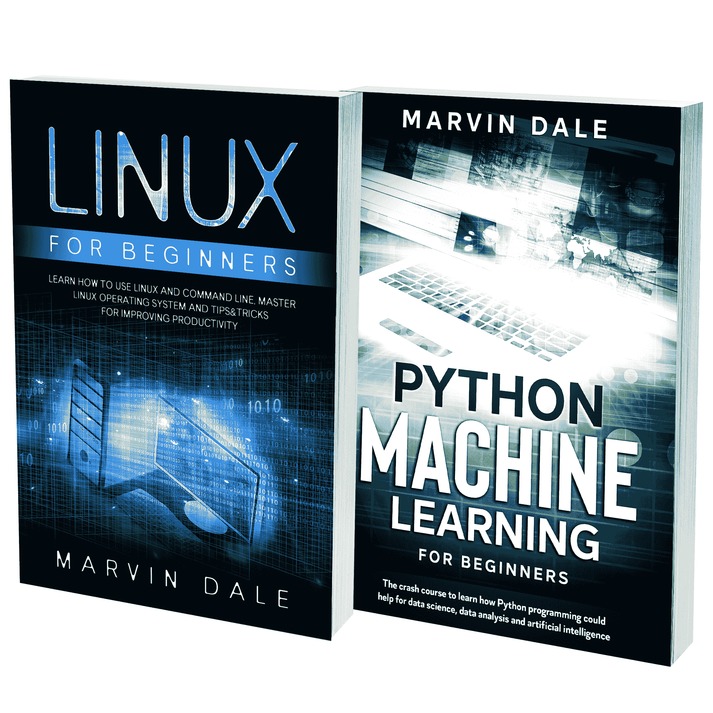

# Python 编程与 Linux 初学者指南：二合一：通过这本易于学的学者指南学习 Linux 系统并开始用于数据科学与机器学习的 Python 编程



© Copyright 2020 Marvin Dale - 版权所有。

本文档旨在就其涵盖的主题和问题提供准确且可靠的信息。本书的出版理念是，出版者不需要提供会计、官方许可或其他合规的服务。如果需要法律或专业建议，应聘请该领域内具有经验的专业人士。此内容摘自一份由美国律师协会委员会和出版商及相关协会委员会共同接受并批准的《原则宣言》。

在任何情况下，通过电子手段或打印格式复制、复制或传输本文档的任何部分都是不法的。严禁录制出版物，除非获得出版者的书面许可，否则不允许对本文进行任何存储。保留所有权利。

此地提供的信息据称是真实且一致的，对于由于疏忽或其他原因，对本文包含的任何政策、流程或指令的任何使用或滥用而产生的任何责任，完全由接收读者的个人承担。在任何情况下，出版者对因本文信息直接或间接导致的任何赔偿、损害或金钱损失均不承担法律责任或过。

各作者拥有出版者未持有的版权。此处信息仅供参考之用，且具有通用性。信息的呈现不带有任何合同或任何类型的保证说明。

所使用的商标均未经任何许可，且商标的发布未经商标所有者的许可或支持。书中的所有商标和品牌仅用于说明目的，由所有者所有，与本文无关。

## 引言

Python 是一种著名的面向对象高级计算机编程语言，被全球许多软件开发者、游戏开发者、网站开发者、数据科学家等使用。Guido van Rossum 先生于 1991 年开发并构建了这种语言，Python 软件公司负责进一步开发。尽管当时已经有很多 OOP 语言，但构建 Python 的主要目的是强调代码连贯性和逻辑或数值处理，例如 `NumPy`、`SymPy`、`Orange` 等。展望未来，Python 的语法简洁且直观。Python 是一种开源、面向对象且多用途的语言，支持大量的标准库。

Python 在信息科学领域也闻名全球。全球组织都在使用 Python 从它们的信息中收集知识碎片并增加竞争优势。与其他 Python 教学练习不同，在本计算机编程指南中，你将学习 Python 编程的基本概念。这是一份循序渐式的 Python 编程指南，确保对 Python 编程的理解。首先，需要了解 Python 的句子结构和语法以及基础表达式。然后，它将引导主要的“函数”，如数学运算和标准库。此外，还有关于运算符、逻辑数据、Python 中的数组、指针、类和字符串概念的完整指导。

本特定指南专为希望在几天内学习 Python 基础概念的初学者设计。

## 第 1 章：Python 入门

谈到 Python 的起源，我们必须谈谈 20 世纪 80 年代使用的 ABC ABC 编程语言。主要是 ABC 编程语言的影响促进了 Python 的增长和兴起，它现在是最流行的语言之一。20 世纪 80 年代初，计算机工程师兼数学家 Vansum 先生曾在 Centrum Wiskunde en Informatica 任职，担任一种名为 ABC 的编程语言的项目协调员。Vansum 在开发一个名为 `AMOEBA` 的新操作系统时，开始寻找一种像 ABC 一样具有新语法的新脚本语言，它可以访问 ABC 的系统调用。因此，Vansum 自己开始创建一种可以解决 ABC 编程语言缺陷的新语言。最后，他的编程语言的第一版本由 Vansum 在 20 世纪 90 年代发布。最初，他的编程语言使用了 `Modula-3` 模块框架。我们今天把他的语言称为“Python”。

人们通常认为 Python 是用蛇命名的，甚至 Python 的标志标志中也显示了两条蛇，第一条是蓝色的，第二条是金色的。但很少有人知道 Python 名字背后的真实故事。20 世纪 70 年代 BBC 上有一部名为《Monty Python's Fly Circus》的成功喜剧节目。巧合 Rossum 是该节目的大粉丝。因此，在看了《Monty Python's Fly Circus》后，Rossum 为他新出生的语言取了名。

### 1.1 学习 Python 的步骤

Python 是现代世界中每个开发者都应该知道的最基本的编程结构和语言之一。大多数程序员使用这种语言来构建网站、开发学习算法和执行其他编程任务。首先，学习 Python 可能是令人敬畏、沮丧且困难的，特别是当你不确定如何接触工具和资源时。你可能会发现最大的挑战之一是所有学习材料和资源是多么相似。假设你对理解 Python 和编写它感兴趣。在这种情况下，你会发现在你考虑做你感兴趣的事情之前，任何编写资源都需要你花费大量时间在 Python 的语法上。这种不一致性使得许多程序员学习 Python 变得非常困难。经验程序员还会向你抛出这样的论点：“噢，天哪！学习 Python 太容易了！”他们甚至经常向你保证这一点。但事实上，即使是几行看起来简单的代码也可能让人难以置信地困惑。例如，甚至是一行代码就能让你感到困惑！在 Python 中：

### "django.http" 是什么意思！

### 为什么某些代码行中会有括号？

当你对 Python 一无所知时，要理解它是如何协同工作的是非常困难的。这里最初的问题是，你需要理解 Python 的构建模块才能构建出有趣的东西。上面提到的代码段 `django.http` 使用流行的 MVC 架构来创建网站的视图（view），这是网站的关键构建模块之一。如果你无法编写开发视图的代码，那么在现阶段，你毕竟是不可能创建一个动态网站的。

大多数 Python 编程教程和课程都假定你将在开始做某些事情之前，需要理解 Python 语法的所有内容。这导致你在语法上浪费了几个几个月的时间，而你真正想做的是分析数据、创建一个网站或制作一个自动无人机。

通常情况下，把所有时间花在学习语法上会导致灵感流失。我们在这里将其想为一面“无聊之墙”。许多教程和课程建议你准备得足够充分，以爬越这道“无聊之墙”，使其变成“你将要从事的迷人领域”，但相信我们，这并不是学习 Python 的唯一途径！

一个人在遇到几次那堵“无聊之墙”并离开后，可能会发现一个更适合他自己的过程。他/她特别可以找到一种将简单学习与开发有趣的想法和程序相结合的方法。在某种意义上，他绕过了“无聊的区块”，直接到达了顶端。他应该在学习基础知识上花费尽可能少的时间，然后立即跳跃到他感兴趣的事情中。

在这个阶段，我们将逐步向你展示如何重现这个过程，无论你为什么要学学习 Python。这一切都是从找到你的灵感开始的！

#### 动机

在你开始探索并跳入 Python 的世界之前，值得问问自己为什么要学习它，因为成为一名 Python 开发者将是一段漫长且往往充满挫败的旅程。如果没有足够的灵感，你是无法坚持下去的！

所以！根据我的观点，动机非常重要，比你想象的要重要得多！高中和大学的大多数人在编程课程上睡着觉，在课程中他们必须背诵语法，他们并没有受到启发。另一方面，当他们需要使用 Python 创建一个自动生成文章的网站时，他们会为了完成它而连续工作几个晚上学习 Python。

所以，如果换一种说法，我们可能会认为，当我们有学习的理由时，学习更多东西会容易得多。如果你能弄清楚什么激发了你，动机将帮助你找到最终目标以及一条通目标的路径，而不会感到失望。你并没有一个特定的项目要计划。当你准备学习 Python 时，可以选择一个你感兴趣的通用领域。

Python 提供了许多可能让你感兴趣的领域。你可以选择你感兴趣的领域，例如：

* 数据科学

* 机器学习

* 人工智能

* 手机设备

* 游戏开发

* 硬件 / 纳米技术 / 机器人 / 传感器

* 自动化脚本

你可以选择一个或多个你感兴趣并愿意追求的领域。在你感兴趣的领域，你可以专注于学习，并最终在这些领域开发项目。

#### 学习语法

遗憾的是，在学习 Python 时，你不能跳过这一阶段。在深入研究你感兴趣的领域之前，你必须学习 Python 语法的最基础知识。我知道你想在这里花费尽可能少的时间，因为这既没有动力也没有启发。我将在书中帮助你学习一些 Python 语法的基础知识。

#### 开发项目

一旦你掌握了基础语法，就可以开始设计自己的项目了。学习的一种极佳方法是创建自己的想法，因为这帮助你将经验转化为有用的东西。你应该注意，如果不应用自己的想法，获得更多经验将是困难。项目将培养你的能力，帮助你理解和学习新概念，并帮助你建立供未来雇主查看的作品集。

在此时，非常自由的项目将很困难。你会感到非常困惑，并且必须回到文档中去阅读。因此，通常在你感到足够安全可以完全在自己的管理下构建项目之前，创建更正式的项目会容易一些。为了让你从中学习，大多数教程网站或书籍都拥有结构化的项目。这有助于你在对这些项目进行一些编辑后，在你感兴趣的领域创建出有趣的物品，从而防止你迷失。由于你想创建一个游戏，或者从事技术工作，或者做其他事情，你可能对 Python 感兴趣。所以，在这个编程指南的最后，我们将从人工智能的角度来看 Python 的未来。

#### 工作，工作还是工作

如果完成了上述所有阶段，在 Python 编程中，你可以不断增加项目的种类和复杂性。如果你对自己创造的内容完全满意，这意味着是你时候尝试某些困难得多且复杂的东西了。你可以考虑一个新的更具挑战的项目，或者为你最近的项目添加一些难度，也许你可能为你的项目准备一个完全不同的挑战。嘿！为了这一点！你必须记住，人通过通过练习可以变得更好！

为了增加任务的难度，以下是一些建议，以确保你真的在学习 Python 上取得了进展。

* 你可以尝试向新手展示你是如何开发出想法的。没有什么比教别人更能帮助你更好地理解一个话题了！

* 你应该考虑可以增加项目能力的程序。

* 你可以考虑关注项目的有效性。

* 你可以提出让界面更用户友好的方法。

* 你可以考虑让你的项目公开的方法。

### 1.2 Python 基础

在开始编写你的第一个 Python 程序（通常被称为 "Hello World"）之前，你必须学习 Python 语法的基础知识。在这一阶段，我们将讨论 Python 编程的基础及其语法，这无疑将帮助你开启成为 Python 开发者的职业生涯。现在，让我们先编写最基础的 Python 程序。

#### 编写你的第一个 Python 软件/程序

Python 程序通常以两种不同的形式进行打印和编译：

*   **交互模式**：程序员可以简单地在 Python 的交互模式下编写并正常编译 Python 程序。

*   **脚本模式**：程序员必须预先以脚本方式执行其 Python 程序，这通常是一个以 `.py` 扩展的文件，并且已经保存在你的计算机上。

让我们实际观察一下这两种方式。

#### 交互模式下的 Hello World!

你可以在终端（Terminal）的 Python 编程交互模式下输入以下命令来编写你的第一个程序。

```
>>> $ Python
```

如果你在终端中输入并执行了此命令，你现在处于 Python 的交互模式。另一方面，如果你正在使用 IDE 来进入 Python 的交互模式，则无需输入上述命令。以下是用于你第一个软件编译的基础 Python 编程语法。第一个程序通常被称为 "Hello World!"，但我们将改变一下常规。我们将编写第一个“Hello to the Universe of Python!”（你好，Python 宇宙！）

当你编写第一个程序并按下回车时，你的 IDE 应该显示 "Hello to the Universe of Python!"。你应该注意，括号中你写的内容“将写在你的 IDE 上”。在我们的案例中，它是 Hello to the Universe of Python!

语法：

```
>>> print ("Hello to the Universe of Python!")
```

输出：编译上述命令后，你将在执行屏幕上看到文本“Hello to the Universe of Python!”

#### 脚本模式下的 Hello World!

假设你已将“Hello to the Universe of Python!”项目保存为一个编写好的程序和 Python 文件，即 `.py` 文件。现在你可以在计算机上寻找 `.py` 扩展的文件。假设你将项目保存为 `Hello to the Python.py`，以下是你的代码在 Python 脚本模式下的运行方式。

你编写并保存的项目文件在开始必须是可用且可执行的。通常，程序员通过使用以下命令来实现这一点：

```
>>> $ chmod +x test.py
```

现在，如果你的文件可以运行并重复执行，你就可以在 Python 的脚本模式下运行并执行你的软件了。

```
>>> $ Python Hello to the Python.py
```

你可以看到终端或控制台上显示 "Hello to the Universe of Python!"，直到该命令结束。通过运行 "Hello to the Universe of Python!" 你掌握了第一个 Python 语法。

#### Python 关键字和标识符

Python 编程中总共有三十一个关键字和五个重要的标识符。在学习 Python 编程技能时，你可以快速熟悉标识符和关键字。

*   **Python 标识符**：通常，Python 标识符是一个函数、模块、向量、类或其他内容。在 Python 编程中，你为对象分配一个名称，这被称为标识符。通常，正确的标识符以大写字母 (A-Z)、小写字母 (a-z) 或下划线（`_`）开头。这些通常伴随着下划线、零、字母或数字（0 到 9）。

Python 编程中有五种基本的标识符形式：

1. 函数

2. 模块

3. 类

4. 变量

5. 对象

我们应该看看 Python 语法中提供的关键字以便继续后续。

*   **Python 语法关键字基础**：你必须打开 IDE 并输入以下命令来查看 Python 中所有的三十一个关键字。

语法：

```
>>> import keyword
>>> keyword.kwlist
```

输出：当你输入这些命令时，你的 IDE 将打印出关键字表：`['False', 'None', 'True', 'and', 'as', 'assert', 'break', 'class', 'continue', 'def', 'del', 'elif', 'else', 'except', 'finally', 'for', 'from', 'global', 'if', 'import', 'in', 'is', 'lambda', 'nonlocal', 'not', 'or', 'pass', 'raise', 'return', 'try', 'while', 'with', 'yield']`

随着 Python 新版本的发布，这些列出的关键字可能会发生变化。现在，当使用 Python 作为编程语言时，还有几点你需要记住。存在特定的关键字，我们不能将它们作为标识符。

*   在 Python 中，关键字是大小敏感的（通常如此）。

*   关键字被称为保留字。

#### Python 语句

在我们继续 Python 语法的基本概念之前，你接下来需要记住的是“行”和“缩进”。在 Python 中，组织代码块或模块的主要支持手段是缩进。此外，它是强制执行的，这使得 Python 代码具有可读性、易于扫描且可审查。我们必须注意，每种情况下缩进的空格数不同。我们需要观察以下代码来理解这一点。

```python
>>> Person = ["David", "Jennifer", "Michael"]
>>> for n in person:
>>> if n == "David":
>>> print(n)
>>> else:
>>> print("Not David")
```

在以下代码中，你必须记住“for 语句”（即缩进）有一个空格，而“if 语句”有两个空格。

在 Python 中，你以后也可以在一行内高效地声明多个语句。例如：

```python
>>> Person = "David" ; age = 25 ; location = "NYC"
```

#### 命令行参数

在 `Hello to Python.py` 中以及交互模式下，我们简单地使用了命令行声明。因此，最好的方法是向你介绍命令行参数。这些是 Python 编程语法基础不可或缺的一部分，你可以阅读相关的相关内容。

#### 如何创建虚拟环境

对于任何新项目，虚拟环境将是你会创建的内容之一。在 Python 中，无需构建新的虚拟环境，你也可以在新项目上工作。然而，这样做可能会让你陷入一种局面：

*   依赖项可能无法得到增强或优化。例如，Python 的默认版本可能没有更新（从 2.7 更新到 3.8）。

你必须进入终端并输入以下命令创建一个新的虚拟环境：

```bash
$virtualenv newenvironment
```

在该命令中，我们刚刚创建的相关虚拟环境名称为 `newenvironment`。现在，要打开你的新世界，请输入以下指令：

```bash
source newenvironment
```

#### 从用户获取输入

可以两种常见的 Python 语法类型，它们可能会请求用户输入：

*   **原始输入 (Raw Input)**：通过这种方式，任何程序员都可以邀请用户提交他们的输入。

```python
raw_input()
```

这在 Python 3.0 中已经不再准确或有效。取而代之的新的输入形式是 `input()`。

*   **input()**：我们必须查看上述示例来理解这个概念。

```python
user_input_request = input ("Enter your worst Ex’s name: ")
```

在你输入这个之后，你的 IDE 将允许你输入你最糟糕的前任的名字。我的错！

## 第 2 章：Python 的基本属性

到目前为止，我们拥有的编程语言数量几乎可以用手指数得过来。编程语言如此多，每种计算机编程语言都有其独特的特点。这些特性使一种语言区别于其他语言。


最后，由于该语言的特性，某种语言可能会被转换或被用于更广泛的项目。因此，在开始学习 Python 概念之前，让我们看看 Python 的功能、独特性应用等。在接下来的章节中，你将学习 Python 的基本概念、特性、应用和架构，这使其与其他许多语言相比是独特且强大的。

## 2.1 Python 的独特特性

让我们从 Python 的一些独特特性开始。

### 易于理解和编码

当我们用“简单”或“容易”一词来描述 Python 编程时，必须从一个非常不同的背景来看待。我们之前读过 Python 语言是一门高级语言。大多数情况下，通过非常少的关键字和标识符，你会发现 Python 代码与英语相似。任何程序员甚至非程序员都能通过观察代码看出这段代码的作用。

然而，Python 是动态类型语言，这需要缩进。这一功能使得 Python 代码更加稳定且易于理解。此外，在写完我们的第一个程序后，我们可以发现在 Python 中编写代码是毫不费力的。我们可能会发现与其他编程语言相比，Python 代码更容易编写。在短短几个小时内，有编程背景的人就能学会 Python 语法。然而，要成为精通其原理、模块和包的 Python 大师还需要一些时间。换句话说，我们可以说 Python 是一门对开发者友好的语言。

### 开源且免费

首先，你会知道 Python 是免费的，并且在许多平台上可用。它的官方网站是下载和安装 Python 最可靠来源，即 `https://www.python.org/`。

第二点是，Python 是一门开源编程语言。开源确保公众可以随时访问 Python 的源代码。即使是非专业人士也可以下载、修改、使用和分发 Python。这类软件或语言通常被称为“FLOSS（自由、许可和开源软件）”。所有的 Python 开发者都在 Python 世界中为了一个共同的目标努力，即增强 Python 及其功能。Python 为此已将源代码变为了开源代码。

### 高级语言

从书的开始，我们一直在讨论这样一个观点，即 Python 是一门高级计算机编程语言。作为开发者，你不需要思考或回忆你的计算机或设备的设计。你用 Python 编写的代码可以在全球任何程序、机器或系统中使用。你也不需要关心系统的内存。这一功能使得在 Python 中编写和编码变得更容易。因此，我们可以像之前描述的那样将 Python 称为“开发者友好的语言”。

### 可移植语言

对于你面向 Windows 系统的计算机，假设你构建了一个 Python 程序或应用程序。假设你只想在面向 MAC 系统的计算机上运行该程序。现在，你不需要对 Python 代码进行太多的改进。你可以从面向 Windows 系统的计算机上获取 Python 代码并在任何 MAC 机器上运行它。因此，如果你使用 Python，就不需要为不同的工具或操作系统编写不同的代码。这种 Python 特性使得我们的语言——一种极具移植性的编程语言变得非常重要。在这方面你只需要记住一点，并且避免任何依赖于系统的函数。

### 解释型语言

如果你已经是 C++ 或 Java 或其他编程语言的开发者，或者熟悉编程语言，你需要意识到必须先编译代码。然后它才能运行或执行任务。但当你选择 Python 作为编程语言时，你的代码最初不需要编译。Python 将设备内的源代码转换为即时类型，即字节码（byte-code）。

换句话说，无需担心连接相关的库或其他任何大事，你就可以运行用 Python 编写的源代码。当你的计算机或单元读取你的 Python 代码时，你可以发现源代码是逐行执行的，而不是一次性执行所有代码。这种 Python 功能使得调试你的 Python 代码变得更简单。另一方面，翻译确实让 Python 比 Java 等其他语言慢一点，但与 Python 的优点相比，这并不重要。

### 支持面向对象范式的语言

我们从一开始就在讨论这个观点，即 Python 可以重塑现实世界，正因如此，它是一门面向对象范式的编程语言。它关注对象，并将数据及其功能放在一起。与此相反，任何面向过程语言的函数是可以重复使用的代码。Python 是一门既支持面向过程编程又支持面向对象范式的语言，这一特性使得 Python 成为最特殊的编程语言。此外，与 Java 相比，Python 是在单文件中支持多继承的语言。

### 可扩展语言

假设你是其他语言的开发者。你需要编写 Python 代码来使用其他语言（如 C++）的命令。这种 Python 特性使其成为一门非常可扩展的编程语言，这意味着它可以扩展包含其他语言。

### 嵌入式语言

在上一个阶段，我们已经提到其他语言的代码也可以被我们的源代码所接受。你也可以将 Python 代码引入到其他语言（如 C++）的源代码中。这有助于我们把其他语言的脚本能力整合到我们的代码中。

### 更大的标准库

通过更全面的包，它提供了更丰富的功能。在许多应用程序中，你可以看到创建 Python 图形用户界面（GUI）。

| Python 版本 | 发布日期 |
| :--- | :--- |
| Python 1.1.0 | 1994 年 1 月 |
| Python 1.5.1 | 1997 年 12 月 |
| Python 1.6.1 | 2000 年 9 月 |
| Python 2.0. | 2000 年 10 月 |
| Python 2.0.1 | 2001 年 4 月 |
| Python 2.2.3 | 2003 年 12 月 |
| Python 2.3.7 | 2003 年 7 月 |
| Python 2.4.6 | 2004 年 11 月 |
| Python 2.5.6 | 2006 年 9 月 |
| Python 2.6.9 | 2008 年 10 月 |
| Python 2.7.17 | 2010 年 7 月 |
| Python 3.0.1 | 2008 年 12 月 |
| Python 3.1.5 | 2009 年 6 月 |
| Python 3.2.6 | 2011 年 2 月 |
| Python 3.3.7 | 2012 年 9 月 |
| Python 3.4.10 | 2014 年 3 月 |
| Python 3.5.9 | 2015 年 9 月 |
| Python 3.6.10 | 2016 年 12 月 |
| Python 3.7.6 | 2018 年 6 月 |
| Python 3.8.1 | 2019 年 10 月 |
| Python 3.9.0 Alpha 1 | 2020 年 5 月（预计日期） |

...

* 它运行快速且 Bug 极少。
* 它能够打开巨大的文档。
* 它支持许多编程语言及其变体。

### GNU/EMACS 文本编辑器

这是一款许多开发者高度推荐的 GNU 文本编辑器。该文本编辑器由理查德·斯尔曼（Richard Stallman）开发，在二十多年里，它一直是软件开发人员和编程专业人士中最受欢迎的文本编辑器。该文本编辑器的所有者理查德·斯尔曼先生让每位用户都能免费使用。

在许多计算机编程语言中，`GNU/EMACS` 文本编辑器主要使用独特的定制来实现渐进式方法。该编辑器使用的一个扩展是 `Elpy` 扩展。该编辑器有许多使其与其他文本编辑器区分开来的特性。例如，它提供了一种句子结构，可以将文本之间的存档记录分段和空间隔离开，以获得最佳的格式。

### 主要优势

* 它是免费的，并提供了一个完全灵活的编程环境。
* 它支持记录结构所需分段的自动扩展。
* 它支持具有 24 位色色的各种操作系统。

## 3.3 Python 的 IDE

你可以使用 IDE，即集成开发环境（Integrated Development Environment），来进行 Python 开发。IDE 通常用于这些目的。

* 可以使用 IDE 来处理代码。
* 你可以使用 IDE 运行、开发、调试或制造你的代码、编译器或设备。
* IDE 可以控制代码和编译器的脚本及源文件。

大多数 IDE 提供了更多的编程格式，并包含许多特定的亮点。然而，为了正确使用 IDE，你需要相关信息。`IDE` 代表“集成开发环境（Environment for Incorporated Development）”。`IDE` 被视为一种编码工具或设备，帮助机械化 `SDLC`（软件开发生命周期）组装、测试、修改以及许多其他方面的奇迹。此外，它为开发者提供了执行、创建和编译代码的路径。下面是一些知名的 Python IDE 列表。

* `PyCharm`
* `Spyder`
* `PyDev`
* `Atom`
* `Wing`
* `JUPYTER Notebook`
* `Thonny`
* `Visual Studio for Microsoft`
* `Eric Python`
* `The PYCHARM IDE`

### PYCHARM IDE

`PYCHARM`，即跨阶段集成开发环境，是一个跨阶段 `IDE`。理想情况下，该工具是为 Python 设计的。`PYCHARM` 是全球使用最广泛的设备，它有两种形式可用：付费版和免费开源版。在处理日常工作时，`PYCHARM` 为你节省了大量时间。对于 Python 而言，`PYCHARM` 是一个非常实用的 `IDE`。它为你提供了许多特殊功能，如快速项目路线、自动代码生成的实现、远程开发支持、快速检查和修复错误、数据库等。

### 特殊特性

* 有效的调试
* 它提供了一条通高效的代码路径
* 大量突出错误

### SPYDER IDE

对于数据科学开发者来说，`SPYDER IDE` 是他们最好的 IDE。它是一个开源 `IDE`。`SPYDER` 的全称是“科学 Python 开发环境（Scientific Python Development Environment）”。`SPYDER` 兼容 `Windows OS`、`MAC OS X` 和面向 `LINUX OS` 的机器。`SPYDER` 通常涉及 `Anaconda` 包管理器的分，因此你可以信赖它。关于 `SPYDER` 的有趣事实是，它旨在针对使用 Python 的数据科学家兴趣群体。通过 `Matplotlib`、`SciPy` 和 `NumPy` 等标准 Python 科学库，`SPYDER` 协调得非常好。你可以想象 `SPYDER` 拥有大量的基础 `IDE` 功能。例如，`SPYDER` 是一个具有持久语言结构特征的 Python 代码管理器。此外，它包含了 Python 代码实现，它甚至还是 `IDP`，即集成文档程序（Incorporated Documentation Program）。你在其他 Python IDE 中可能看到的另一个元素是，`SPYDER` 包含一个“变量漫游者（variable voyager）”，它允许你在使用基于表格的设计的同时在 `IDE` 内部显示信息。

### 特殊特性

* 集成的 `IPython`
* 高质量的语法

### PYDEV IDE

`PYDEV IDE` 是世界上需求最大的 Python IDE 之一。对于 Python 开发者来说，他们出于许多原因偏好使用 `PYDEV`。`PYDEV` 拥有一项特性，包括“django”、智能缩进、程序代码的实现和正方形缩进等许多功能。`Windows OS`、`MAC OS X` 和面向 `Linux OS` 的机器使得 `PYDEV` 可用。我们也可以将 `PYDEV` 视为基于 Java 开发的认可开源 `IDE`。它包含一个附加和扩展项的商业中心。此功能使得 `PYDEV` 对于各种改进和练习非常有用。

### 特殊特性

* `PyLint`、远程调试器、单元测试的结合。
* 代码检查和验证。

### Atom IDE

`Atom IDE` 是 Python 最流行的 `IDE`，由 `GitHub` 开发。它是一个开源且跨平台的 `IDE`。在 `Atom IDE` 中，通过循序渐进的方式，原始和教学练习向你介绍有关该 `IDE` 的所有功能。这种协作技术允许你以高度集成的方式在不同平台之间工作。此外，`Atom IDE` 是一个非常实用的工具。除了它的优缺点，对于学者来说，它是最好的科学工具。它是处理高级编程语言的工具之一。

### 特殊特性

* 拥有 `Markdown Plus` 模块
* 显示运行结果

### Wing IDE

首先，`Wing IDE` 是免费开源的。它包含了一些亮点，可以进行实现、调查和缩进。它还有一个付费版本，称为 `Wing Pro`。使用 `Wing Pro` 的好处是它为你的代码提供了调试、亮点等许多功能。

### 特殊特性

* 结合单元测试的远程调试
* 它是自定义的，并且拥有扩展

### Jupyter Notebook IDE

`Jupyter IDE` 是一个为客户端服务器架构开发的 `IDE`。对于你的 Python 程序，它允许你创建并控制记本文报告。2014 年 10 月，`jupyter notebook` 针对 `IPython` 发布。它是一个基于客户端服务器架构的 Web 应用程序，并允许你在记事本上创建和控制。然而`Jupyter Notebook` 证明它是每个 Python 数据研究人员工具箱的基本部分。它对于原型开发非常出色，也用于记事本的可表示形式。

### 特殊特性

* 你的代码可以在 `IDE` 中生成并轻松修改
* `jupyter notebooks` 提供了 markdown 支持
* 该 `IDE` 是数据科学初学者的理想选择

### 微软 Visual Studio IDE

对于研究和改进基于 Web 的活动，微软 Visual Studio IDE 是最合适的集成开发环境。该 IDE 是一个开源代码的生成器，并拥有自己的市场。此外，微软公司负责此 IDE 的创建。

### 特殊特性

- 在 Visual Studio 环境中，该 IDE 允许你使用 `Python` 进行编码，这是该 IDE 一个非常显著的特征。
- 该 IDE 提供付费和免费两种形式。

...

* 字母或下划线 `_` 必须是标识符的核心字符。
* 除了上述字符外，每个字符可以是字母 `"a-z"`、`"A-Z"` 字母、下划线或小写的 `"0-9"` 数字。
* 变量名不能包含任何空白或空区域，也不能包含任何特殊或不常见的字符，如 `!`、`@`、`#`、百分号、`^`、`&` 和 `*`。
* 变量名不能与你 Python 程序语法中描述的任何口号相似。
* 在 Python 中，变量是区分大小写的。例如，`I'm cool` 和 `cool` 是不等等的。
* 有效标识符实例：`n696`、`v`、`v 69` 等。
* 无效标识符实例：`5a`、`v percent 69`、`x69` 等。

### 多重任务

在单个描述中（通常称为不同的赋值），Python 帮助为不同的标识符保留机会。它可以通过两种替代方式使用：要么同时为多个标识符声明同一个激励，要么在不同时间将不同的特征分配给多个变量。

### 示例 - 1

打开 Python 控制台或 IDE 并编写声明变量的命令。

```python
>>> n=v=w=987
>>> print
>>> print (n, v, w)
```

输出：

当你输入 `print` 变量值的命令时，输出将如下所示。

```python
>>> 987, 987, 987
```

### 示例 – 2

```python
>>> n, v, w = 987, 876, 765
>>> print
>>> print (n)
>>> print (v)
>>> print (w)
```

输出：

对于输出，当你输入命令 `print (n)` 时，你的控制台将打印 `"987"`。当你输入命令 `print (v)` 时，控制台将打印 `"876"`。当你输入命令 `print (w)` 时，控制台将打印 `"765"`。

## 5.2 Python 中的运算符

一般来说，运算符是语言特有的语法标记，需要执行某些操作。运算符主要源于数学原理。例如，`"乘法符号 (*)"` 是一个 Python 编程运算符。它用于两个数字的乘法。

在 Python 中，运算符表示为函数的符号表示，为了实现某些真实且理想的结果，在两个操作数之间执行特定操作。在单个计算机编程语言中，运算符被视为软件运行的基石。Python 提供的运算符选择被视为一种追求。为了执行基本操作，这里是一些被广泛使用的运算符：

* 算术运算符
* 比较运算符
* 赋值运算符
* 逻辑运算符
* 位运算符
* 成员运算符
* 标识符运算符

在本书的这一部分中，我们将讨论上述提到的的部分运算符。

### 算术运算符

为了得到所需的结果，算术运算符用于执行复杂的算术运算。在这种情况下取两个操作数，通过运算符在它们之间执行操作，产生某些所需的、唯一的且绝对的值。以下是 Python 中广泛使用且重要实用的算术运算符。

* 加法 `"+"`
* 减法 `"-"`
* 除法 `"/"`
* 乘法 `"*"`
* 取模 `"%"`

这些运算符的详细定义：

### 加法 `"+"`

该运算符用于两个操作数之间执行加法或求和操作。

示例代码：

```python
>>> n, v = 25, 25
>>> n + v
```

在这种情况下，你的控制台将打印 `"50"`。

### 减法 `"-"`

该运算符取第一个操作数，并从第一个中减去第二个。

示例代码：

```python
>>> n, v = 25, 25
>>> n - v
```

在这种情况下，你的控制台将打印 `"0"`。

### 除法 `"/"`

该操作数获取第二个操作数并将第二个操作数除以第一个操作数，并根据你的性能给出商。

示例代码：

```python
>>> n, v = 6, 2
>>> n / v
```

在这种情况下，你的控制台将打印 `"3.0"`。

### 乘法 `"*"`

如前所述，该运算符在第一个操作数和第二个操作数之间执行乘法操作。

示例代码：


```python
>>> n, v = 6, 3
>>> n * v
```

在这种情况下，你的控制台将打印`"18"`。

## 取模 `"%"`

该运算符负责除法服务，并接收余数作为产出。

示例代码：

```python
>>> c, w = 4, 2
>>> c % w
```

在这种情况下，你的控制台将打印`"0"`。

## Python 的比较运算符

当我们谈论 Python 时，比较运算符用于比较两个操作数并分别返回一个布尔类型，即 TRUE 或 FALSE。

- `==`：真实：当且仅当值在逻辑上相等且有效时，才使用此运算符。
- `!=`：真实：当值准确但不相等时，使用此运算符。
- `<=`：真：当第一个操作数小于或等于第二个操作数时，使用此运算符。
- `>=`：真：当第一个操作数大于或等于第二个操作数时，使用此运算符。
- `<>`：真实：当值不等时不使用此运算符。
- `>`：真：当第一个操作数大于第二个操作数时，使用此运算符。
- `<`：真：当第一个操作数小于第二个操作数时，使用此运算符。

## Python 的赋值运算符

在 Python 中，赋值运算符用于将右侧赋值给左侧。

- `=`：此运算符用于将右侧的值赋值给左侧。
- `+=`：将右侧的操作数加到左侧操作数上。

示例代码：

```python
>>> n, v = 4, 2
>>> n += v
>>> n
```

在这种情况下，你的控制台将打印`"6"`。

- `-=`：从左侧操作数减去右侧的操作数。

示例代码：

```python
>>> n, v = 4, 2
>>> n -= v
>>> n
```

在这种情况下，你的控制台将打印`"2"`。

- `*=`：将左侧操作数乘以右侧的操作数。

示例代码：

```python
>>> n, v = 4, 2
>>> n *= v
>>> n
```

在这种情况下，你的控制台将打印`"8"`。

- `%=`：该运算符负责将左侧操作数除以右侧操作数并取余数。

示例代码：

```python
>>> n, v = 4, 2
>>> n %= v
>>> n
```

在这种情况下，你的控制台将打印`"0"`。

## Python 中的逻辑运算符

我们还需要根据逻辑事实（即真或假）来做出决策，正如我们在现实生活中所做。例如，如果有人打电话问你“你在家吗？”你有两个选择：“是的，我在家”或“不，我不在”。在编程中，这对应 0（假）和 1（真）。这被认为是合理的。

在 Python 中，为了实现这些独特的选项，逻辑运算符用于测试表达式。这些运算符对于任何逻辑编写都非常有用。为了更好地理解这些运算符，以下是逻辑运算符列表及其简要描述。

### 与运算符

如果表达式`C`有效且表达式`W`也为真，则结果是正确的。在任何其他情况下，结果都是错误的。

此表可以帮助你更好地理解“与运算符”。

| C | W | C and W |
|---|---|---|
| True | True | True |
| True | False | False |
| False | True | False |
| False | False | False |

### 或运算符

当且仅当两个操作数都为假时，才会导致假。假设表达式`C`为真，另一个表达式`W`为假，那么结果将是有效的/真。

此表可以帮助你更好地理解“或运算符”。

| C | W | C or W |
|---|---|---|
| True | True | True |
| True | False | True |
| False | True | True |
| False | False | False |

## Python 中的数据类型

数据类型指定了一组可以应用于相关值的操作和值。例如，由于它有两个不同的值，灯泡开关可以类比为计算机系统；`True`表示开启，`False`表示关闭。由于灯泡开关只包含这两个值，我们可以认为它的大小为二。每转动一次开关，只有两种操作可以执行：

- 我们可以将其开启
- 我们可以将其关闭

Python 中的因子（变量）可以携带不同类型的数据估值。Python 是一种构成日益复杂的计算机编程语言，因此，在声明和描述它们时，我们不需要描述所有变量的形式。`variables`（变量）将激励绑定到它们的类型。此外，Python 允许开发者验证软件中使用的变量类型。Python 为我们提供了“种类”（结构），它返回所传递的变量类型。为了表征各种数据类型的形式并验证它们的类型，你可以参考配套的指南。

示例：

```python
>>> C = 69
>>> W = "Hi Python"
>>> K = 17.5
>>> print ( type (C));
>>> print ( type (W));
>>> print ( type (K));
```

输出：

当你输入命令`>>> print ( type (C));`时

你的控制台将打印`<type 'int'>`

当你输入命令`>>> print ( type (W));`时

你的控制台将打印`<type 'str'>`

当你输入命令`>>> print ( type (K));`时

你的控制台将打印`<type 'float'>`

### 标准数据类型

Python 中的标识符可以承受不同的性质。例如，任何人的名字必须存储为字符串，而他的 ID 必须存储为整数。Python 为我们提供了各种标准数据类型，通过类型技术定义每一种类型。Python 中通常使用的具有特征的数据类型命名如下：

- 数字 (Numbers)
- 字符串 (String)
- 列表 (List)
- 元组 (Tuple)
- 字典 (Dictionary)

我们现在通过以下示例来澄清其中一些。

### 数字

数字作为数据类型，在 Python 中存储数值。每当将数字赋值给变量或标识符时，Python 会生成一个数值实体。

示例：

```python
>>> C = 79
>>> W = 06
```

在上述示例中，`c`和`w`是数值对象。Python 支持四种不同的数值数据类型：

- 整数 (`int`)
- 长整数 (`long`)
- 浮点数 (`float`)
- 复数 (Complex)

### 字符串

在 Python 中，字符串可以定义为由引号表示的字符序列。此外，为了描述序列，可以使用单引号、双引号或三引号。字符串的处理是一个简单、易理解且非常清晰的任务，因为 Python 提供了几个内置函数和运算符来执行此任务。`+`运算符用于 Python 中的字符串处理，用于拼接两个字符串，处理过程`"Hello" + "Mr. David Robertson"`返回`"Hello Mr. David Robertson"`。此外，`*`运算符通常被称为重复运算符，因为操作`"Object" * 2`返回`"Object Object"`。你可以通过以下示例理解 Python 中的字符串处理。

示例：

```python
>>> string1 = "Hi Mr. David Robertson"
>>> string2 = "How are you"
>>> print (string1 [0:2]) # 使用切片运算符打印前两个字符
>>> print (string1 [4]) # 打印字符串的第 4 个字符
>>> print (string1 * 2) # 打印两次字符串
>>> print (string1 + string2) # 打印 string1 和 string2 的拼接
```

输出：

当你编写第一个命令并按回车时，即`print (string1 [0:2])`，你的控制台将使用切片运算符打印字符串的前两个字符。因此，在这种情况下，你的控制台将打印`"Hi"`。

当你编写第二个命令时，即`print (string1 [4])`，你的控制台将打印字符串的第四个字符。因此，在这种情况下，你的控制台将打印`"r"`。

当你编写第三个命令并按回车时，即`print (string1 * 2)`，你的控制台将打印两次你的字符串。因此，在这种情况下，你的控制台将打印`"Hi Mr. David Robertson Hi Mr. David Robertson"`。

当你编写第四个命令并按回车时，即`print (string1 + string2)`，你的控制台将打印`string1`和`string2`的拼接。因此，在这种情况下，你的控制台将打印`"Hi Mr. David Robertson How are you"`。

### 列表

在 Python 中，因为我们在 C 或 C++ 中使用数组，所以我们使用列表。但列表可以包含不同类型的数据。存储在列表中的项由逗号`","`分隔并括在方括号`[]`中。切片运算符`[:]`可以访问列表的元素。加或拼接运算符`+`以及重复或乘运算符`*`对列表的操作与字符串相同。

示例：

```python
>>> l = [1.5, "Hello", "Python", 7]
>>> print (l [3 :]);
>>> print (l [0:2]);
>>> print (l);
>>> print (l + l);
>>> print (l * 3);
```

输出：

当你编写第一个命令并按回车时，即`print (l [3 :])`，你的控制台将打印`[7]`。

当你编写第二个命令时，即`print (l [0:2])`，你的控制台将打印`[1.5, 'Hello']`。

当你编写第三个命令时，即`print (l)`，你的控制台将打印`[1.5, 'Hello', 'Python', 7]`。

当你编写第四个命令时，即`print (l + l)`，你的控制台将打印`[1.5, 'Hello', 'Python', 7, 1.5, 'Hello', 'Python', 7]`。

当你编写第五个命令时，即`print (l * 3)`，你的控制台将打印`[1.5, 'Hello', 'Python', 7, 1.5, 'Hello', 'Python', 7, 1.5, 'Hello', 'Python', 7]`。

### 元组

元组在 Python 中在许多方面与集合相似。元组中的项通常由逗号`","`分隔并括在括号`()`中。此外，机器本身无法更改元组的大小、值和数量。

示例：

```python
>>> t = ("Hello", "Python’s world", 69)
>>> print (t [1 :]);
>>> print (t [0:1]);
>>> print (t);
>>> print (t + t);
>>> print (t * 3);
>>> print (type (t))
>>> t [2] = "hello";
```

## Python 中的正则表达式、表达式语句、循环

与其他编程语言一样，Python 也拥有正则表达式、表达式语句和循环。但 Python 的表达式和循环是独特的，是 Python 编程的。所有这些方法、函数、循环和语句在构建高效程序以及执行其他任务时都起着至关重要的作用。Python 库中这些操作运行器的添加和更新有很多原因。

### Python 的正则表达式

Python 中的正则表达式也称为 regex。regex 用于分析字符串中的模式。有许多正则表达式功能可以继承、调用或导入以使用。为了导入这些函数，可以使用命令`>>> import.re`。

#### 正则函数

- **Split 函数**：用于拆分所需的字符串。
- **Sub 函数**：我们使用 sub 来替换字符串中的匹配项。
- **Match**：Match 在 Python 中评估正则表达式并返回布尔类型结果，即 True 或 False。
- **Findall**：Findall 在 Python 中用于恢复字符串中的所有匹配项。
- **Search**：搜索用于在字符串中查找所有匹配项。

### Python 的语句表达式

标记`=`；“等号”用于表示赋值语句。在 Python 的语法结构和方言中，赋值语句的工作方式与其他主要的计算机编程语言和方言不同，而这一基础系统（考虑到 Python 因子形式的理念）揭示了 Python 语言的许多不同特性。

如果我们认为 C 编程语言中考虑此任务，它将是，比如`v = 2`，这意味着有一个名为`"v"`的复合变量，它具有数值为`2`的副本。在这种情况下，右侧或值被复制到一个用于赋值的存储区域中，左侧的变量名是该区域的标识性位置。分配给变量`"v"`的内存足够容纳该特定类型。

在 Python 任务最明确实例中，让我们使用一个非常相似的模型`v = 2`，意味着“（非排他的）名称`v`获取了指向不同的、逐步赋值的、值为`2`的数值或整数`int`类型对象的引用”。在这里，我们将讨论 Python 在例中使用的基本语句。

#### If 语句

在 Python 中，`if`语句限制性地执行一段代码，并带有`else`和`elif`（它是`else-if`的压缩形式）。

#### For 语句

在 Python 中，`for`语句强调迭代。它将每个元素捕获到一个相邻的因子中，供后续代码块使用。

#### While 语句

在 Python 中，`While`语句只要其条件有效，就会执行一段代码。

#### Try 语句

在 Python 中，`try`语句允许在其各自和相关的代码块中提出的某些特殊情况被`except`要求所捕获并处理；这同样保证了`try`和`finally`块中的清理代码将始终运行，而不论代码块是如何退出的。

#### Raise 语句

Python 使用`raise`语句来抛出指定的异常或重新抛出许多特殊情况。

#### Import 语句

...

### for 循环

关于 Python 中的 for 循环，其语法如下：

```python
for iterating_variable in sequence:
    {statements}
```

示例：

```python
v=1
number = int (input ("Enter your desired number:")));
for v in range(1,11):
    print("%d X %d = %d"% (number,v,number*v))
```

输出：

当你运行此程序时，你的控制台将打印：

Enter your desired number

假设你输入了“10”作为数字。你的控制台将打印：

10 X 1 = 10

10 X 2 = 20

10 X 3 = 30

10 X 4 = 40

10 X 5 = 50

10 X 6 = 60

10 X 7 = 70

10 X 8 = 80

10 X 9 = 90

10 X 10 = 100

### 嵌套 for 循环

在 Python 中，嵌套 for 循环是指将一个“for 循环”放在另一个“for 循环”内部以执行多次。嵌套 for 循环的语法如下：

```python
for iterating_variable1 in sequence:
    for iterating_variable2 in sequence:
        (block of statements)
    (Other statements)
```

示例：

```python
v = int(input("Enter your desired number of rows"))
v,w=0,0
for v in range(0,n):
    print ()
    for w in range(0,i+1):
        print("*",end="")
```

输出：

当你运行此程序时，你的控制台屏幕将打印：

Enter your desired number of rows

假设你输入了“6”。它将打印：

*********************

### for 循环中的 else 语句

`else`语句是许多条件语句的重要组成部分。它也用于许多其他编程语言中满足某些条件。在 Python 中，`else`语句可以在“for 循环”内部执行。

示例 - 1：

```python
for v in range(0,8):
    print(v)
else:
    print("Excluding break statement therefore for loop completely exhausted.");
```

输出：

在这种情况下，你的控制台屏幕将打印：

01234567

由于没有 break，for 循环完全执行完毕

示例 – 2：

```python
for v in range(0,5):
    print(v)
    break;
else:
    print("for loop is exhausted now!");
print ("break statement is used therefore loop gets broken")
```

`break`语句停止了`else`语句的执行。

输出：

在这种情况下，你的控制台将打印：

0

the break statement is used therefore loop gets broken

### while 循环

通常情况下，while 循环负责确保只要已知条件为真，就执行一段代码。它通常用于无法预知迭代次数的情况。while 循环的语法如下。

```python
while expression:
    (statements)
```

`expression`必须是任何产生真或假值的有效 Python 表达式。在这种情况下，`True`是任何非零值。


## 示例 – 1

```python
v=1
while v<=11:
    print(v);
    v=v+1;
```

输出：

在这种情况下，你的控制台将打印一个直到 11 的整数列表。

```
1234567891011
```

## Python 中的无限 while 循环

如果 `while` 循环提供的条件没有变为假，则 `while` 循环将永远不会结束，结果将导致无限死循环。为了获得 `True` 条件，我们在 `while` 循环中使用非零值，并使用零值来表示 `False` 条件。

示例：

```python
variable = 1

while variable != 2:

    v = int(input("Enter your desired number :"))

    print ("Entered value is %d"%(v))
```

输出：

其结果将是：

```
Enter your desired number : 6
Entered value is 67
Enter your desired number : 69
Entered value is 69
Enter your desired number : 68
Entered value is 68
Enter your desired number : 76 …
```

它将是一个无限循环。

## Python while 循环中的 else

Python 允许开发者在 `while` 循环内部同样使用 `while` 循环。当 `while` 语句中的给定条件变为假时，它执行 `else` 块。与 `for` 循环一样，如果 `while` 循环使用 `break` 语句打破，在这种情况下，`else` 块将不会执行，而是会执行 `else` 块之后的语句。

### 示例 - 1

```python
v=1
while v<=4:
    print(v)
    v=v+1;
else:
    print("The while loop is broken");
```

输出：

在这种情况下，你的控制台将打印：

```
1234
The while loop is broken
```

### 示例 – 2

```python
v=1

while v<=5:

    print(v)

    v=v+1;

    if(v==3):

        break;

else:

    print("The while loop is broken");
```

输出：

在这种情况下，你的控制台将打印：

```
12
```

# 第 7 章：Python 函数与文件处理

Python 函数和文件处理是 Python 编程中最重要的部分。没有这些功能，程序无法实现预期结果。

## 7.1 Python 中的函数

Python 函数是高度实用的小型代码包，可以通过调用来执行特定任务。它们被用于程序中执行特殊角色。基本上，它们是封装在 `{}` 中的唯一语句。在 Python 中，你可以根据需要调用函数。

### Python 函数的优点

以下是 Python 函数的一些主要优点：

- 通过函数，我们可以避免代码重复。通过一个语句即可调用整个函数。
- 具有可重用性，重用性是一个非常吸引人的特性。它们可以在程序中被多次调用。
- 通过这些函数，可以将较大的程序分成多个函数。这提高了利用率。

### Python 函数

Python 编程语言中有许多函数。它们可以从解释器包中调用，并在任何程序中使用。没有了这些函数，Python 对软件社区将失去吸引力。如今，它们在全世界范围内被广泛用于执行所有主要的编程任务。

### `abs()` 函数

该函数主要用于数值。当我们程序中输入任何整数时，它会返回一个绝对值。它专门用于获取单个参数的绝对值。这里有一些绝对数的示例，以理解该概念。

示例：

```python
### int number
>>> integer = -25
>>> print(' abs value of -25 is', abs(integer))
### float number
>>> float = -55
>>> print('abs value of -55', abs(float))
```

输出：

```
abs value of -25 is: 25
abs value of -55 is: 55
```

这些结果显示了 `abs()` 函数的工作原理。

### `bin()` 函数

该函数 `bin()` 返回整数的二进制结果。二进制输出在值的开头有前缀 `0b`。

示例：

```python
>>> n=20
>>> v= bin(n)
>>> print(v)
```

输出：

在这种情况下，你的控制台将打印 `0b2020`。

### `bool()` 函数

该函数通过使用真值测试方法输出布尔类型的值。它是 Python 的一个重要内置函数。如果有任何值输入，结果为真；否则，它打印假。

示例：

```python
>>> v1=[5]
>>> print(v1, 'is',bool(v1))
>>> v1= No-value
>>> print(v1, 'is',bool(v1))
```

输出：

```
[5] is True
No-value is False
```

### `bytes()` 函数

在 Python 中，`bytes()` 函数对于获取字节形式的对象非常有帮助。它属于字节数组命令。大多数 Python 编程专业人士通过此命令生成对象来获得帮助。

示例：

```python
>>> string= "Hi Friend."
>>> array= bytes(string, 'utf-8')
>>> print(array)
```

结果：

```
Hi Friend
```

### `callable()` 函数

相关函数会调查对象，如果对象看起来可调用的，则显示 `True`，否则显示 `False`。该函数可以通过仅用一个命令通知用户对象的可用性来节省时间。

示例：

```python
>>> v= 12
>>> print (callable(v))
```

输出：

```
False
```

### `compile()` 函数

该函数 `compile()` 通过 Python 的编译器对源代码进行处理，并最终生成带有该代码的对象。稍后我们可以使用同一个程序中的另一个函数 `exec()` 来执行这段代码。

示例：

```python
>>> yourcode_str= 'v=10\n w=15\n print("sum=",v+w)'
>>> yourcode=compile(yourcode_str, "sum.py','exec')
>>> print(type(yourcode))
>>> exec(yourcode)
>>> exec(c)
```

输出：

```
sum = 25
```

### `exec()` 函数

`exec()` 函数在 Python 内置函数中具有额外的重要。它运行 Python 程序并产生输出。没有这个函数，Python 程序将无法执行。

示例：

```python
>>> v = 12
>>> exec('print(v==12)')
>>> exec('print(v+4)')
```

输出：

```
True
16
```

### `sum()` 函数

在 Python 中，当我们使用数值数据进行算术运算时，`sum()` 函数变得不可或缺。我们使用该函数对列表中可用值进行求和。

示例：

```python
>>> v = sum([2, 5,4 ])
>>> print(v)
>>> v = sum([4, 2, 4], 10)
>>> print(v)
```

输出：

```
11
20
```

### `any()` 函数

Python 中的 `any()` 函数提供布尔类型的值输出，可能是真可能是假。当列表中有任何真值时，它打印真。但如果没有真值，它返回假。对于处理大数据项目的数据科学家来说，这也是非常有用的函数。

示例：

```python
>>> V=[4, False,9]
>>> Print(any(V))
>>> V=[]
>>> Print(any(V))
```

结果：

```
True
False
```

### `ascii()` 函数

`ascii()` 函数在 Python 中起着重要作用。该函数的输出值始终是一个字符串。我们必须记住，它不会打印其他的 ASCII 字符。

示例：

```python
>>> vQ= 'Have a good day'
>>> print(ascii(vQ))
>>> wQ= 'Have a nice day'
>>> print(ascii(wQ))
>>> print('Have\xf6n a good day')
```

输出：

```
'Have a good day'
'Have\xf6n a good day'
'Have a nice day'
```

### `bytearray()` 函数

`bytearray()` 函数在 Python 编程中起着重要作用。为了创建一个对象，该函数帮助用户或软件专业人士不浪费时间。

示例：

```python
>>> string1= "Computer Programming"
#string1 with encode ‘utf-8'
>>> array1= bytearray(string, ‘utf-8')
>>> print(array1)
```

结果：

```
bytearray(b'Computer Programming')
```

### `eval()` 函数

`eval()` 函数在 Python 编程中发挥额外作用。该函数在运行的程序中执行自身，以帮助代码管理器快速完成工作。

示例：

```python
>>> w= 6
>>> print(eval('w+1'))
```

输出：

```
7
```

### `format()` 函数

Python 中的这个 `format()` 函数为每个程序员使编码变得更简单。通过格式化值和其他给定的数据，它节省了程序员的时间。

示例：

```python
>>> d, f and b are a type# integer
>>> print(format(515, "d"))
### float arguments
>>>print(format(515.7898, "f"))
### binary format
>>> print(format(15, "b"))
```

输出：

```
515
515.789800
1111
```

### `frozenset()` 函数

`frozenset()` 函数在 Python 编程中起着重要作用。为了创建一个对象，该函数帮助用户或软件专业人士不浪费时间。

示例：

```python
>>> string1= "Computer Programming"
#string1 with encode ‘utf-8'
>>> array1= bytearray(string, ‘utf-8')
>>> print(array1)
```

结果：

```
bytearray(b'Computer Programming')
```

### `getattr()` 函数

`getattr()` 函数用于从对象获取属性值。

示例：

```python
>>> v = 12
2
```

### `globals()` 函数

`globals()` 函数返回当前的全局符号表。

示例：

```python
>>> globals()
```

### `hasattr()` 函数

`hasattr()` 函数用于检查对象是否具有特定属性。

示例：

```python
>>> hasattr(obj, 'attr')
```

### `iter()` 函数

`iter()` 函数返回一个对象的迭代器对象。

示例：

```python
>>> list = [1, 2, 3]
>>> it = iter(list)
>>> next(it)
```

### `len()` 函数

`len()` 函数返回对象中的项数。

示例：

```python
>>> string = "abc"
>>> print(len(string))
```

### `list()` 函数

`list()` 函数用于创建一个列表。

示例：

```python
>>> l = list((1, 2, 3))
>>> print(l)
```

### `locals()` 函数

`locals()` 函数返回当前的本地符号表。

示例：

```python
def func():
    local_var = 5
    print(locals())
```

### `map()` 函数

`map()` 函数将函数应用到输入列表中的所有项。

示例：

```python
def double(x): return x * 2
result = map(double, [1, 2, 3])
print(list(result))
```

### `delattr()` 函数

`delattr()` 函数用于从对象中删除属性。

示例：

```python
class A: a = 10
obj = A()
delattr(obj, 'a')
```

### `divmod()` 函数

`divmod()` 函数返回包含商和余数的元组。

示例：

```python
>>> divmod(10, 3)
```

### `enumerate()` 函数

`enumerate()` 函数返回一个枚举对象，在迭代可迭代对象时产生计数和值。

示例：

```python
for index, value in enumerate(['apple', 'banana']):
    print(index, value)
```

### `dict()` 函数

`dict()` 函数返回一个字典。


```python
>>> yourcode_str = 'v=10\n w=15\n print("sum=",v+w)'
>>> yourcode = compile(yourcode_str, "sum.py", 'exec')
>>> print(type(yourcode))
>>> exec(yourcode)
>>> exec(c)
```

输出：

```text
sum = 25
```

### `exec()` 函数

`exec()` 函数在 Python 内置函数中具有额外的重要性。它运行 Python 程序并产生输出。没有这个函数，Python 程序将无法执行。

示例：

```python
>>> v = 12
>>> exec('print(v==12)')
>>> exec('print(v+4)')
```

输出：

```text
True
16
```

### `sum()` 函数

在 Python 中，当我们使用数值数据进行算术运算时，`sum()` 函数变得不可或缺。我们使用该函数对列表中可用值进行求和。

示例：

```python
>>> v = sum([2, 5, 4])
>>> print(v)
>>> v = sum([4, 2, 4], 10)
>>> print(v)
```

输出：

```text
11
20
```

### `any()` 函数

Python 中的 `any()` 函数提供布尔类型的值输出，可能是真可能是假。当列表中有任何真值时，它打印真。但如果没有真值，它返回假。对于处理大数据项目的数据科学家来说，这也是非常有用的函数。

示例：

```python
>>> V = [4, False, 9]
>>> Print(any(V))
>>> V = []
>>> Print(any(V))
```

结果：

```text
True
False
```

### `ascii()` 函数

`ascii()` 函数在 Python 中起着重要作用。该函数的输出值始终是一个字符串。我们必须记住，它不会打印其他的 ASCII 字符。

示例：

```python
>>> vQ = 'Have a good day'
>>> print(ascii(vQ))
>>> wQ = 'Have a nice day'
>>> print(ascii(wQ))
>>> print('Have\xf6n a good day')
```

输出：

```text
'Have a good day'
'Have\xf6n a good day'
'Have a nice day'
```

### `bytearray()` 函数

`bytearray()` 函数在 Python 编程中起着重要作用。为了创建一个对象，该函数帮助用户或软件专业人士不浪费时间。

示例：

```python
>>> string1 = "Computer Programming"
# string1 with encode ‘utf-8'
>>> array1 = bytearray(string, ‘utf-8')
>>> print(array1)
```

结果：

```text
bytearray(b'Computer Programming')
```

### `eval()` 函数

`eval()` 函数在 Python 编程中发挥额外作用。该函数在运行的程序中执行自身，以帮助代码管理器快速完成工作。

示例：

```python
>>> w = 6
>>> print(eval('w+1'))
```

输出：

```text
7
```

### `format()` 函数

Python 中的 `format()` 函数为每个程序员使编码变得更简单。通过格式化值和其他给定的数据，它节省了程序员的时间。

示例：

```python
>>> d, f and b are a type  # integer
>>> print(format(515, "d"))
### float arguments
>>> print(format(515.7898, "f"))
### binary format
>>> print(format(15, "b"))
```

输出：

```text
515
515.789800
1111
```

### `frozenset()` 函数

`frozenset()` 函数在 Python 编程中起着重要作用。为了创建一个对象，该函数帮助用户或软件专业人士不浪费时间。

示例：

```python
>>> string1 = "Computer Programming"
# string1 with encode ‘utf-8'
>>> array1 = bytearray(string, ‘utf-8')
>>> print(array1)
```

结果：

```text
bytearray(b'Computer Programming')
```

### `getattr()` 函数

`getattr()` 函数用于从对象获取属性值。

示例：

```python
>>> v = 12
>>> print(getattr(obj, 'attr'))
```

### `globals()` 函数

`globals()` 函数返回当前的全局符号表。

示例：

```python
>>> globals()
```

### `hasattr()` 函数

`hasattr()` 函数用于检查对象是否具有特定属性。

示例：

```python
>>> hasattr(obj, 'attr')
```

### `iter()` 函数

`iter()` 函数返回一个对象的迭代器对象。

示例：

```python
>>> list = [1, 2, 3]
>>> it = iter(list)
>>> next(it)
```

### `len()` 函数

`len()` 函数返回对象中的项数。

示例：

```python
>>> string = "abc"
>>> print(len(string))
```

### `list()` 函数

`list()` 函数用于创建一个列表。

示例：

```python
>>> l = list((1, 2, 3))
>>> print(l)
```

### `locals()` 函数

`locals()` 函数返回当前的本地符号表。

示例：

```python
def func():
    local_var = 5
    print(locals())
```

### `map()` 函数

`map()` 函数将函数应用到输入列表中的所有项。

示例：

```python
def double(x):
    return x * 2

result = map(double, [1, 2, 3])
print(list(result))
```

### `delattr()` 函数

`delattr()` 函数用于从对象中删除属性。

示例：

```python
class A:
    a = 10

obj = A()
delattr(obj, 'a')
```

### `divmod()` 函数

`divmod()` 函数返回包含商和余数的元组。

示例：

```python
>>> divmod(10, 3)
```

### `enumerate()` 函数

`enumerate()` 函数返回一个枚举对象，在迭代可迭代对象时产生计数和值。

示例：

```python
for index, value in enumerate(['apple', 'banana']):
    print(index, value)
```

### `dict()` 函数

`dict()` 函数返回一个字典。该函数生成三种类型的字典：

- **空字典**：当没有传递参数时。
- **相同键值对字典**：当存在潜在参数时。
- **关键字和值添加字典**：当存在关键字参数时。

示例：

```python
N = dict()
V = dict(c=4, d=5)
print(result)
print(result2)
```

输出：

```text
{}  # 空字典
{'c': 4, 'd': 5}  # 带有值的字典
```

### `filter()` 函数

`filter()` 函数用于通过提供两个参数（函数和变量）对值进行过滤。在 `None` 函数的情况下，它只返回 `TRUE`。

示例：

```python
def filterdata(w):
    if w > 4:
        return w

result = filter(filterdata, (1, 2, 7))
print(list(result))
```

输出：

```text
[7]
```

### `hash()` 函数

`hash()` 在 Python 中通过哈希算法生成数值。这些值可以是用于比较字典键的整数。

示例：

```python
V = hash(35)
W = hash(35.6)
print(v)
print(W)
```

输出：

```text
35756783388388221
```

### `help()` 函数

`help()` 函数负责调用帮助信息以辅助对象传递。通过额外的参数，此函数与您共享帮助数据。

示例：

```python
Information = help()
print(Information)
```

输出：

```text
Help Centre!
```

### `min()` 函数

`min()` 函数通过接收两个输入（元素列表和关键字列表）帮助获取最小或最基本的元素。

示例：

```python
V = min(2100, 221, 225)
W = min(1000.25, 2025.35, 5625.36, 10052.50)
print(V)
print(W)
```

输出：

```text
221
1000.25
```

### `set()` 函数

`set()` 函数通过使用迭代对象生成对象。这个 Python 编程中的函数被认为是程序的基础。

示例：

```python
v = set('25')
w = set('python')
print(v)
print(w)
```

输出：

```text
{'2', '5'}
{'y', 'o', 't', 'h', 'p', 'n'}
```

### `hex()` 函数

`hex()` 函数将整数参数转换为十六进制字符串值。此函数为所有程序员、软件开发者、工程师和专业 Python 专家简化了转换。

示例：

```python
n = hex(4)
v = hex(140)
print(n)
print(v)
```

输出：

```text
0x4
0x70
```

### `id()` 函数

`id()` 函数通过参数生成标识整数。

示例：

```python
N = id("Python")
V = id(1500)
W = id([95, 236, 92, 3225])
print(N)
print(V)
print(W)
```

输出：

```text
5969677172866864
23653919945047867
```

### `setattr()` 函数

此函数负责设置对象的属性。它接收不同的值，并在执行函数后不返回任何内容。

示例：

```python
RollNo = 0  # RN- 学号
Name = ""

def __init__(my, RollNo, Name):
    my.RollNo = RollNo
    self.Name = Name

V = Student(33, "David")
print(V.RollNo)
print(V.Name)
print(V.email)  # 产品错误
setattr(V, 'email', 'davidrobert6185512@gcaill.com')  # 添加新属性
print(V.email)
```

输出：

```text
33
David
davidrobert6185512@gcail.com
```

### `slice()` 函数

`slice()` 函数从一组元素中提取切片。初始接收单个参数，但第二个函数需要三个参数才能继续。

示例：

```python
V = slice(7)
W = slice(0, 7, 3)
print(V)
print(W)
```

### `sorted()` 函数

我们使用此函数对元素进行排序。由于此函数，排序按升序进行。为了继续，此函数通常使用四个值。

示例：

```python
V = "python"
W = sorted(V)  # 排序字符串
print(W)
```

### `next()` 函数

`next()` 函数允许从给定组中获取下一个元素。通过两个参数，此函数产生单个元素。

示例：

```python
V = iter([128, 16, 42])
W = next(V)
print(W)

W = next(V)
print(W)

W = next(V)
print(W)  # V 是一个数字，W 是一个项
```

输出：

```text
128
16
42
```

### `input()` 函数

`input()` 函数专门用于从程序员、软件开发者或用户处接收指令。获取信息后，它将该值转换为程序所需的数据格式。

示例：

```python
value = input("Please insert your desired value: ")
print("You entered:", value)
```

输出：

```text
Please Insert your desired value: 22
You entered: 22
```

### `int()` 函数

`int()` 函数旨在获取整数，通常用户用它将字符串和其他数据结构转换为指定的整数值。

示例：

```python
n = int(15)  # 整数
v = int(15.52)  # 浮点数
w = int('15')  # 字符串
print("Int val:", a, b, c)
```

输出：

```text
Int val: 15 15 15
```

### `pow()` 函数

我们使用 `pow()` 函数计算幂以定义项目或程序所需的特定结果。它是执行许多代数求解的重要函数。

示例：

```python
# Positive v, Positive w (v**w)
print(pow(2, 3))

# Negative v, Positive w (-v**w)
print(pow(-2, 3))

# Positive v, Negative w (v**-w)
print(pow(2, -3))

# Negative v, Negative w (-v**-w)
print(pow(-2, -3))
```

输出：

```text
8
8
```

### `print()` 函数

`print()` 函数负责在屏幕上打印元素或对象。

示例：

```python
print("Hello! To the world of Python Programming!")

v = 7
print("v =", v)

w = v
print('v =', v, '= w')
```

输出：

```text
Hello! To the world of Python Programming!
v = 7
v = 7 = w
```

### `range()` 函数

`range()` 函数提供从 0 开始的序列，它每次增加并停止在某个特定数字。

示例：

```python
print(list(range(9, 12)))
range(start, stop)
```

输出：

```text
[10, 11]
```

### `reversed()` 函数

`reversed()` 函数返回给定序列的反序。

示例：

```python
string = 'Hello'
print(list(reversed(string)))
```

输出：

```text
['o', 'l', 'l', 'e', 'H']
```

- 它允许多部分记录传输和溢出下载。
- 它自动处理去纠缠和编程解压缩。
- 它是浏览器式的 SSL 确认。
- 在此库中，可以根据先决条件修改和改进功能。
- 此库保持活动并提供的池化支持国际域名和 URL。

### PIL

`PIL` 或 `Python Imaging Library` 是一个免费的 Python 库，为 Python 变量增加了图像处理能力。简单来说，`PIL` 允许控制、打开和保存在 Python 中整理的不同图像记录。该库由 `Alex Clark` 和贡献者开发。`Pillow` 是 `PIL` 库的一个子集。此外，该库提供了惊人的图像处理能力；`PIL` 提供了强大的内部表示和广泛的记录组织支持。相关的核心 Python 库旨在快速访问存储在几种基本像素设计中的信息。


### 特殊功能

- 此库可以通过使用`show()`策略有效地调查支持项。
- 此库非常适合组处理应用程序。
- 相关的库变量和处理程序支持大范围的图像文档格式。
- `PIL`额外提供了`BitmapImage`、`PhotoImage`和`Windows DIB`接口。
- 此库支持相对裁量更改、色彩空间转换、带有许多隐含卷积部分的分离、图像缩放和旋转以及点操作。
- 在此库中，直方图技术允许从图像中提取一些测量值，可用于程序化的差异升级和全局事实调查。

### Scrapy

`Scrapy`也是一个免费开源的`Python`框架，广泛用于网络和各种任务，包括自动化测试和信息挖掘。最初，`Scrapy`是为了网络抓取而开发的，但在发展过程中它已更新以满足不同的目的。该库还为爬取网站和从网站分离结构化信息提供了一种快速且异常的状态策略。此库用`Python`编写。`Scrapy`围绕本质上独立的爬虫的错误和漏洞工作，这些爬虫提供了许多指南。遵循`DRY`标准，`Scrapy`使得构建和扩展可靠的网络爬虫任务变得简单。

### 特殊功能

- `Scrapy`容易编写虫来爬取网站并集中信息。
- 它遵循`DRY`规则。
- 这个`Python`库提供了一个网络爬虫外壳，允许工程师测试网站的行为。
- 此库支持使用命令行发送已抓取的信息。

### Tkinter

当我们使用`Tkinter`工作时，`Python`为 GUI 应用程序的开发提供了一条简单快速的路径。该库被认为是`Python`编程的标准 GUI 库。它为`Tk GUI`工具箱提供了一个奇妙的对象界面。我们应该记住，使用`Tkinter`开发 GUI 应用程序是简单的。你只需要遵循这些基本进阶：

### 特殊功能

- 此库带有一系列工具，有助于几何执行者的策略。
- 它在创建 GUI 应用程序时提供了便利。
- `Tkinter`支持强大的对象定位界面。

### Six

我们必须承认`six`是 Python 库中最简单的。它是一个奇的`Python`库，旨在平滑`Python 2`和`Python 3`版本之间的差异。`Six`的开发是为了支持可以在无需调整的情况下同时在`Python 2`和`Python 3`上运行的代码库。`Six`库被认为极其简单，因为它作为一个单一的`Python`文档提供。因此，将库复制到`Python`项目中是极其简单的。`Six`的名字反映了`Python 2` x `Python 3`。

### 特殊功能

- `Six`易于利用这些功能使 Python 代码在`Python 2`和`Python 3`中都完美。
- 此库支持每个版本的 Python，从`Python 2.6`开始。
- 使用包含在单一`Python`文档中的`Six`非常容易。

### Pygame

`Pygame`是一个开源免费的`Python`库，旨在在 Python 中实现基于视频和声音的应用程序开发。特别是它支持二维游戏项目。因此，它被新手和资深 Python 游戏开发者广泛。在`Python`编译器或 IDE 中，`Pygame`使用`SDL`，即`Simple DirectMedia Layer`库。像`SDL`库一样，`Pygame`库非常方便并并许多阶段和操作系统提供帮助。`Pygame`可以在基于 Android 的设备（手机和平板）上引导使用`Pygame`创建的应用。出于许多原因，你应该更倾向于`pg4a`，它是 Android 的`Pygame`子集。

### 特殊功能

- 此库不要求`OpenGL`。
- 它帮助你简单地利用多中心 CPU。
- 在使用此库时，使用每个可用功能都不需要 GUI。
- 此库支持大范围的阶段和操作系统。
- 此库易于使用。
- `Pygame`使用`Assembly Code`和高级`C`代码来实现核心功能。

### Bokeh

`Bokeh`是 Python 编程语言的一种直观表示库；它允许在现代网络程序中以惊叹和关键的方式可视化数据。该数据表示库鼓励创建仪表板、数据应用程序和有趣的图表。尽管对通用计划提供了简短而漂亮的改进，`Bokeh`库通过对溢出或海量数据集和数据库的最佳知识扩展了其能力。

### 特殊功能

- 使用此库时，可以轻松构建具有清晰标题的真实图表。
- `Bokeh`可以成功引入两个最标准的框架：`Django`和`Flask`。
- 它提供了在多种编程语言中制作奇异和自然数据识别的能力。

### Asyncio

此库用于通过`async`和预期语法编写并发代码。在程序的大部分，`asyncio`库非常适合 IO 密集型和高级组织化系统源码。`Asyncio`已用于 Python 非并发框架的结构差异，这些框架提供了数据库相关、循环任务、精英系统和 Web 服务器等。相关的库包含了各种高级和低级 API。

### 特殊功能

- 此库用于通过传输实现协议。
- 使用此库时，你会发现 Python 代码简单且直观。
- `Asyncio`有助于生成许多不同的循环。

# 8.2 Python 数据科学库

Python 库每天都在变得更加易于使用和更加实用。作为一套开源语言，有数百万计数据科学家正在通过高级编码，利用工具和库来丰富`Python`。现在，数据科学家已经在使用许多极其先进的包和库来完成多项数据分析任务。下面给出了一些最优秀的 Python 数据科学库的简要描述。

## Numpy

`NumPy`是一个非常重要的 Python 数据科学库，专门用于逻辑注册。它为极其强大的 N 维数组对象和广播机制提供了支持。此外，该库还提供了傅里变换、任意精度数值，以及用于协调`C`、`C++`和`FORTRAN`代码的设备。对于利用`Python`从事人工智能项目的全栈开发者来说，掌握`NumPy`的工作信息是必要的。

`Numpy`是在`Python`中处理数据的根本且完美的组合，因为不同的数据调查程序包都是基于`Numpy`和`sci-kit-learn`包构建的，后者被用于构建人工智能应用，并且与`Numpy`配合得非常完美。最初，`Numpy`提供了卓越的对象数组——即 n 维集群。在`'ndarray'`对象（又称为`'exhibit'`）中，你可以存储各种相似类型信息的物品。数组对象周围的功能使得`Numpy`在执行数学计算和数据控制方面变得非常有优势。

### 特色

- `Numpy`是一个非常有交互性的库，而且非常易用。
- 在使用`Numpy`时，可以轻松地解决数学问题。

### Pandas

在`Python`中，我们使用二维表格来像在`SQL`或`Excel`中那样的分析数据。最初，`Python`并没有这个功能。但随后`Pandas`被引入了。毫无疑问，`Pandas`是“Python 版的 SQL”。简而言之，`Pandas`是一个可以帮助我们在`Python`中处理二维数据表格的库。在许多情况下，它类似于`SQL`。

此外，`Pandas`基于`NumPy`库，这意味着`NumPy`的大部分结构都被使用或复制以开发`Pandas`。`pandas`中的数据经常被用于加固`SciPy`中的事实检查、`Matplotlib`的绘图能力以及`Scikit-learn`中的机器学习计算。同时，`Jupyter Notebooks`为利用`pandas`执行数据调查和演示提供了一个良好的环境，但`pandas`也可以简单地用在内容工具中。

`Jupyter Notebooks`允许开发者在特定的单元格中执行代码，而不是运行整个记录。这在处理庞大的数据集和复杂更改时节省了大量时间。Scratchpad 同样提供了一种简单的方法来可视化`pandas'`的`DataFrames`和图表。确实如此。

`Pandas`主要因在`Python`中提供数据大纲而闻名。这是一个卓越的数据检查库，与像`R`等其他领域特定的语言相比。通过使用`Pandas`，处理缺失信息变得更简单，支持处理从许多不同资源收集的具有不同字段的信息，并支持程序化的数据整理。此外，它提供了数据检查和数据结构的设备，如合并、塑形或切割数据集，它在处理与时间序列识别的数据方面也特别有效，因为它提供了强有力的工具从`Excel`、平级文档和数据库中堆叠数据。

使用`Pandas`库让程序员处理命名数据或社交数据变得更加简单和直观。它还提供了表达性、快速且可扩展的数据结构。`Pandas`的设计是为了填补在使用 Python 作为编程语言时进行数据检查所需的关键高层结构空白。

`Pandas`最强大的特征之一是利用极少量的指令来解释复杂的数据活动。此外，人工智能库在合并、分离和收集数据的技术方面也不乏工作。它还强调了时间序列的功能。

### 特色

- `Pandas`能够通过极少几个指令来解释复杂的数据活动。
- 此外，人工智能库在合并、分离和收集数据的技术方面也不乏工作。
- 它还突出了时间序列的功能。
- 在使用`Pandas`时，可以非常容易地完成类型操作。
- 使用`Pandas`，数据操作变得更简单。

### Matplotlib

`Matplotlib`是一个 Python 的二维绘图库，具有强大的表示模块。除了用于`Python`终端、内容和`IPython`终端外，`Matplotlib`还可以用于：

- `Jupyter`
- Web 服务器
- GUI 工具箱

正如`Matplotlib`官方网站所说，这个`Python`库试图“让简单的变得简单，让困难变得可能”。这个二维绘图库允许用更少的代码生成条形图、误差图、直方图、散点图等。

也许，表示最大的优势是它允许我们有效地访问海量数据。`Matplotlib`包含了一些图表，如线图、条形图、直方图、散点图等。

`Matplotlib`是`Python`中的一个数学绘图库。它是一个常用于数据表示的库，包括 3D 图、直方图、图像、散点图、条形图，并带有亮眼的缩放和搜索功能。它支持几乎所有的平台，例如 Windows、Mac 和 Linux。该库同样作为`NumPy`库的扩展。`Matplotlib`有一个`pyplot`模块用于表示，这通常与`MATLAB`进行对比。

这些库是业余爱好者利用`Python`语言开始数据科学的最佳选择。还有许多其他 Python 库可用，例如`NLTK`用于标准语言准备、`Pattern`用于网络挖掘、`Theano`用于深度学习、`IPython`、`Scrapy`用于网络抓取、`Mlpy`、`Stats models`等，仅此限。

### Scikit-Learn

`Scikit-learn`通过 Python 中一种一致的接口提供了一系列监督和无监督学习算法。它在宽松的重新发行 BSD 许可证下授权，并发布在许多 Linux 发行版中，适用于学术和商业用途。该库基于`SciPy`（科学 Python），在使用`sci-kit-learn`之前必须先安装它。

有几个 Python 库提供了机器学习算法范围的强力实现。其中最广为人知的是`Scikit-Learn`，它是一个提供了许多基础算法的高效实现包。`Scikit-Learn`的特点是拥有完美、统一且精简的 API，以及极其有用且内容详尽的在线文档。这种一致性带来的优势在于，一旦你理解了某类模型`Scikit-Learn`的基本用法和语言结构，切换到另一个模型或算法就会变得非常直接。

毫无疑问，Python 中最复杂的领域是机器学习和预测性。而这些领域最好的库就是`Scikit-Learn`，它基本上自称为“Python 时代的机器学习”。`Scikit-Learn`拥有许多技术，基本上涵盖了你在数据科学职业前几年可能需要的所有内容：回归策略、分类策略和聚类，以及模型评估和模型选择。这个流行的库用于数据科学中的人工智能，涉及不同的回归、排序和聚类算法，提供了支持向量机、朴素贝叶、梯度提升和逻辑回归。`SciKit`旨在与`SciPy`和`NumPy`协同工作。

### 特性

- 能够从图像和文本中提取特征。
- 可以在多个场景中重复使用。

### Scipy

存在`scipy`库和`scipy`栈。大多数库和包都是`scipy`栈的一部分（用于 Python 中的逻辑处理）。其中一个部分就是`scipy`库，它为数值计划（AI 模型背后的数学内容）提供了高效答案。这些包括集成、导入、优化等。`Scipy`为`Scikit-learn`中不可预测的 AI 提供了核心科学策略。

这是一个开源库，用于注册不同的模块，例如图像处理、连接、插入、特殊功能、增强、线性代数、傅里叶变换、聚类以及许多不同的任务。该库与`NumPy`一起用于执行高效数值计算。

### 特性

- 轻松处理数学操作。
- 使用子模块提供高效且快速的数值程序，如数值积分和优化。
- 支持信号处理。

### TensorFlow

任何从事使用 Python 的 AI 机器学习任务的人都至少听说过`TensorFlow`。它由 Google 开发，是一个开源的代表性数学库，利用数据流图进行数值计算。普通`TensorFlow`数据流图中的科学活动由图节点表示。图的边，则代表在图节点之间流动的多维数据表示，即`Tensors`（张量）。

`TensorFlow`采用了一种灵活的设计。它允许 Python 工程师将计算传送到工作站、手机手机或服务器中的一个或多个 CPU 或 GPU 上，而无需修改代码。在`TensorFlow`中创建的所有库都是用`C`和`C++`编写的广泛使用的 Google 产品如 Google Photos 和 Google 语音搜索都是使用`TensorFlow`构建的。该库为 Python 提供了一个复杂的前端。Python 代码将被编译，然后在`TensorFlow`提供的执行引擎上运行。

### 特性

- 允许训练各种神经网络并使用许多 GPU，使得模型在大规模框架下极其高效。
- 可在 CPU 和 GPU 上轻松训练以进行分布式计算。
- 操作的灵活性，这意味着`TensorFlow`提供了提取你需要的部分并留下你不需要部分的选择。
- 高级别的网络和设计支持。
- 与其他数据科学 Python 库不同，`TensorFlow`改进了想象图中每一个部分的方法。

### Keras

它被认为是最酷的 AI（算法）Python 库之一；`Keras`为神经网络的通信提供了一个更简单的工具。它还具有用于累积模型、准备数据集、可视化图表等的强大的实用工具。`Keras`用 Python 编写，可以在`CNTK`、`TensorFlow`和`Theano`上运行。这个 Python AI 库的创建核心重点是允许快速实验。所有的`Keras`模型都是紧凑的。与其他 Python AI 库相比，`Keras`是非常轻量。这是因为它先利用后端框架创建一个计算图，然后使用该图来执行操作。`Keras`在进行创新性研究时非常有表现力且灵活。

### 特性

- 完全基于 Python，使其更容易调试和调查。
- 本质上是模块化的。
- 神经网络模型可以组合以构建日益复杂的模型。
- 在 CPU 和 GPU 上均可运行。
- 支持几乎所有的神经网络模型，包括卷积、嵌入、全连接、池化和循环。

### Seaborn

`Seaborn`本质上是一个 Python 的数据可视化库，基于`Matplotlib`库。此外，它与`Pandas`数据结构紧密集成。这个 Python 数据可视化库提供了一个高级接口来绘制美观且实用的统计图。

`Seaborn`的主要点是将可视化成为研究和获取信息的不可或缺的一部分。它的数据集的绘图功能作用于包含整个数据集的帧和边缘。该库非常适合检查多个因素之间的关系。`Seaborn`内部处理了创建教育性图表的所有重要语义映射和测量数据收集。Python 数据可视化库还具有在调色板之间选择的设备，有助于发现数据集中的设计。

### 特性

- 自动估计以及直接回归模型的绘制。
- 轻松查看复杂数据集的总体结构。
- 使用高级判断简化构建复杂的表示法。
- 可视化二变量或单变量分布的选择。
- 对清晰词汇的专门支持。

# Natural Language Toolkit (NLTK)

它是常用自然语言处理和设计识别任务的有价值工具，可用于创建智能模型、分词、标记、思考以及有助于 AI 应用的其他任务。

### 特性

- 自带一个语言结构标记器。
- 支持词法分析。

## 第 9 章：人工智能与 Python

人工智能（即 A.I）已经存在了半个多世纪，其发展正呈指数级增长。AI 市场正处于最强时期，如果你想了解人工智能，那么你来对地方了。这本关于人工智能和 Python 的书籍将帮助你理解 Python 中所有的 AI 概念。

### 9.1 什么是人工智能？

人工智能（AI）是一种用于理性推理和行为的工具。这些计算机由其内部的软件驱动，因此 AI 与驱动它们的创新软件程序密切相关。它是一门可以帮助机器理解世界并像人类一样对情况做出反应的科学。

观察过去几年来 AI 如何出现，你会发现不同的研究人员倾向于关注其他的 AI 定义概念。在现实世界中，AI 以多种多样的形式存在于许多垂直领域。我们希望的机器人能够检测、理解、梦幻和行为。我们也希望让我们的机器人具有逻辑性。

人工智能与人脑研究紧密相。研究人员得出，通过理解人脑的工作原理来实现人工智能。通过模仿人类大脑的思考、信仰和行为方式，我们将创造同样的计算机。这可以被用构建智能学习系统的平台。

### 9.2 什么是机器学习？

机器学习是实现人工智能（AI），允许设备在没有直接编程的情况下自动学习和发展行为。机器学习侧重于创建可以为了其目的而操纵和使用数据的计算机系统。

学习过程始于见解或证据（例如证据、直接经验或训练），以识别知识中的趋势，并根据我们提供的示例在未来做出明智的决策。其主要目的是允许计算机在没有人类干预或协助的情况下自动学习并改变行为。

使用经典的机器学习算法，文本被称为一个关键字序列；相反，它是一种语义处理方法，模仿人类解释书籍语境的能力。


## 9.3 Python 编程在现代人工智能中的作用

Python 凭借其人工智能原型算法在 AI 方面非常有帮助。该组织还支持无需常规编译器语言的解释性执行时间，并为 AI 提供了独特的结构化算法，例如简洁的语法、数据结构和简单的控制流。

### 人工智能与 Python

#### Python

它是一种具有复杂语义的高级面向对象语言。它通过易读且清晰的语法降低了软件开发成本，即使是初学者也能读。

#### 人工智能

它是一个计算机科学领域，优先开发能够像人类一样运行的智能机器，例如语音识别、视觉感知、翻译，甚至选择。

### Python 的优势和特性

#### 虚拟机或模拟器的简单解释

它在执行之前不需要编译成机器语言。尽管如此，程序员可以使用硬件可理解的原生机器语言直接运行它。

#### 高级编程语言

它包含了变量、表格、复杂算术、人工制品、布尔表达式和其他抽象原理，使其更易使用。

#### 通用编程语言

它可以跨越技术和领域。

#### 自动内存控制和动态类型系统

它有一系列编程风格，包括命令式、面向对象、函数和过程化的特征。

### 独立平台

它可以在所有操作系统上运行，是一种开源编程语言。

### 为什么选择 AI 和 Python？

与其他面向对象编程（OOP）相比，Python 提供了 1/5 的代码。我们应该从其他编程语言选择 Python 用于 AI 的原因如下：

- **内置库**：用于 Python 机器学习的 `Numpy`、`PyBrain` 以及用于高级计算的 `Scipy` 等库使得 Python 成为 AI 的正确语言。

- **强大的社区**：全球的 Python 开发者通过论坛和指南提供支持并贡献代码以帮助编写代码。

- **独立平台**：它通过少量的简单代码更改即可灵活地使用各种操作系统。

- **OOP 脚本和概念选择**：通过使用多种算法帮助 IDE（集成软件开发环境）解决开发者的困境。

## 使用 AI 进行 Python 编码

Python 有了一系列库包用于 AI 项目的创建和解码。少数高级包包括：

- **NumPy**：用作通用数据容器，由 N 维数组项、集成的 `C / C++` 资源、随机数能力等功能组成。

- **Pandas**：为 Python 提供了易于使用的数据结构和计算方法，是一个开源库。

- **Matplotlib**：这是一个 2D 绘图库，用于生成用于质量图像。

- **AIMA**：Russel 和 Norvig 使用《人工智能：一种新的方法》来应用通用 AI 算法。

- **PyDatalog**：这是一个 Python 逻辑编程引擎。

- **Easy**：用于构建用于 AI 游戏的基础双玩家 Python 引擎。（例如：`Negamax`）（仅限法语）。

- **PyBrain**：一种简单但强大的机器学习算法，用于评估和比较预定义的环境。

- **PyML**：一个双边 SVM 和其他内核方法系统。支持 Linux 和 Mac OS X。

- **Scikit-Learn**：最流行的机器学习库是一个非常强大的数据分析平台。

- **MDP-Toolkit**：学习算法由管理且无人值守，并可以扩展到网络架构的使用。

- **NLTK**：自然语言工具包用于语言数据和文档的文本解释，以及自然语言处理的研究与开发。

## AI Python 对比 C++

- Python 是 AI 最常用的 C++ 语言，并以 57% 的得票领先开发者。Python 易于阅读和应用。它们也可以使用多个存储库进行数据挖掘。

- C++ 在效率方面胜过 Python。这是因为 C++ 是一种静态类型语言，因此运行时不会有类型错误。C++ 还让运行时编程更轻量、更快。

- Python 是一种动态语言（而非静态语言），这降低了交互的复杂性；可以使用更少的代码引入功能。与 C++ 可能是所有编译器的特定框架不同，Python 代码可以在几乎所有平台上使用，而无需花费时间进行设置。

- Python 通过增长并行的 GPU 加速编程能力优于 C++，产生了诸如 `CUDA Python` 和 `cuDNN` 等库。这意味着 GPU 越来越多地从真实的机器学习编程中释放出来——结果是 C++ 可能提供的任何性能提升都变得毫无意义。

- Python 在代码简单性方面胜过 C++，特别是对于新开发者而言。掌握低层次语言需要更多的知识和能力。

- Python 的简单语法也使得通常更直接的 ETL 方法（提取、转换、加载），并与 C++ 相比，帮助开发者更容易地评估机器学习算法。

### 结论

Python 通过提供强大的框架、高效的库以及易于使用的可视化软件，满足了创建人工智能框架的所有需求。当 AI 需要 500 kB 的 `Java` 代码时，`Python` 只需 20 到 30 行代码（包括库）即可实现，这表明 `Python` 在人工智能系统中起着至关重要的作用。在切纳纳的 SLA 就业中心学习最好的 `Python` 和人工智能培训，并获得准确的资源、资深教练的指导以及就业建议。

祝喜你！如果你已经读到了这里，我们希望你已经真正开始理解 `Python` 编程的基本概念和复杂性。在这一阶段，我们认为你应该能够有信心且理解地阅读几乎任何用 `Python` 编写的代码了。

我们试图在本书中涵盖许多重要的 `Python` 概念和特征，包括面向对象编程（也称为“OOP”）的一些概念。此外，我们还努力让写作变得清晰易懂，书中包含了许多理论性、实践性以及解释性的示例。

在计算机科学和计算机编程领域，你可能会发现许多学术书籍。其中许多是为学生设计的。你可能会发现其他书籍是专门为专业开发人员设计的，他们在开发程序时需要关于如何解决代码中语法问题和运行时问题的个人建议。如果你通过编写代码来学习，那么在书中，很少有页面没有 `Python` 源代码，但每个概念都至少通过一个代码示例进行了演示。

代码示例格式非常规范、易读且整洁，因此你会发现 `Python` 编程非常简单。

展望未来，如果你是学习 `Python` 的初学者，只需读这本书即可，因为书中共有八个章节，使你可以在一周内更好地理解 `Python`。有些人可能会说这本书不适合初学者！看看它的厚度就知道了！这本书对于像你这样的初学者来说太太让人压力压力了！请不要听他们的！如果你能找到更简单的书，就去读吧。好吧，我们无法告诉你这本书是对是错的。我们猜每个人的理解都非常不同。我们建议这本书适合计算机编程新手但具有商业专业背景的人士！

# 初学者级 Linux

学习如何使用 `Linux` 和命令行，精通 `Linux` 操作系统以及提高生产力的技巧与秘诀

作者：Marvin Dale

© Copyright 2020 Marvin Dale - 版权所有。

本文档旨在就其涵盖的主题和问题提供准确可靠的信息。本出版物的销售基于这样观点：出版者不需要提供会计、官方许可或其他合规服务。如果需要法律或专业建议，则应聘请该行业内有经验的专业人士。—— 摘自一份被美国律师协会委员会和出版商与协会委员会共同接受并批准的《原则宣言》。

以任何方式通过电子手段或纸质格式复制、复制或传输本文档的任何部分都是非法的。严禁录制本书，除非获得出版者的书面许可，否则不允许存储本文档。版权所有。

此处提供的信息被声称是真实且一致的，这意味着对于由于疏忽或其他原因在使用或滥用其中包含的任何政策、流程或指示而产生的任何责任，均由接收读者自行承担。在任何情况下，出版者不对因本文中的信息直接或间接导致的任何赔偿、损害或资金损失承担任何法律责任或指责。各作者拥有出版者未持的所有版权。文中的信息仅供参考之用，且具有通用性。信息的呈现不带有任何合同或任何类型的保证。所使用的商标未经任何许可，商标的发布未经商标所有者的许可或支持。书中的所有商标和品牌仅用于澄清目的，归所有者所有，与本文无关。

## 目录

- 引言
- 第 1 章：操作系统历史
- 1.1 什么是操作系统？
- 1.2 IBM 硬件上的系统
- 1.3 主机操作系统
- 第 2 章：Linux
- 2.1 什么是 Linux？
- 2.2 使用 Linux 的优势与风险
- 2.3 获取访问权限
- 第 3 章：Linux 与其他主流操作系统及 Linux 版本的比较
- 3.1 Linus OS 对比 Windows OS
- 3.2 Linux OS 对比 Mac OS
- 3.3 Linux OS 对比 FreeBSD OS
- 3.4 Linux 版本
- 第 4 章：开始学习 Linux
- 4.1 获取访问
- 4.2 获取 Linux 连接
- 4.3 Linux 布局
- 4.4 基础 Linux 命令
- 4.5 创建和删除指示符
- 第 5 章：深入研究 Linux
- 5.1 Linux Shell
- 5.2 程序与操作
- 5.3 用户更改与激活
- 结论

## 引言

普通用户并不太了解操作系统（`OS`）是最常用的平台。它适用于手机、智能手表、冰箱、视频游戏机等设备，而 `Linux` 可以用于托管网站、构建另一个设备以及恢复崩溃的文件。`NASA` 和惠尔普也加入了 `Linux` Shell。`Linux` 最初是作为 `UNIX` 家族创建的，并在 1991 年由 Linus Torvalds 发布。

### 必要的软件

如果你有 `Linux` 文本编辑器或环境，它将很有帮助。沙箱允许程序在机器上运行。在编写新应用程序代码时，沙箱是必不可少的。许多不同的沙箱，大多数是免费的，没有是免费的。你将首先使用 `Linux` 内核，它包含特定的程序和命令。

### 编程语言

`Linux` 最常用的编程语言是 `C`，这种语言最早于 1972 年出现在贝尔实验室。`C` 是在 `C` 中最早的类之一。任何编程语言都可以用于编写 `Linux` 代码，但你最常用的语言是编写代码的方法。新语言如 `Java`、`C++` 和 `Python` 允许更高的灵活性和更复杂的程序，如块结构。在各种语言上运行的 Linux 与 `Linux` 内核是一致的。如果你有文本编辑器、Linux shell 和高级环境，以及良好且稳定的机器，将会帮助。

### 第 1 章：操作系统历史

早期计算机没有任何应用程序。运行在这些计算机上的每个程序都需要代码来操作计算机、连接硬件并进行计算。这种情况使得即使是最简单的程序变得复杂。为了解决这个问题，计算机所有者开始开发系统软件，使他们编写并执行计算机程序，从而诞生了第一个应用程序。第一个操作系统是由通用汽车公司在 1956 年使用单台计算机开发的。在 20 世纪 60 年代，IBM 是第一个承担开发应用程序并在计算机上分发应用程序的计算机制造商。

现在，第一批操作系统开发于 1950 年代，当时计算机只能运行一个程序。几后，计算机开始安装额外的软件程序（有时称为库），它们汇聚在一起形成了现代应用程序的开始。在 20 世纪 60 年代，第一个版本的 `UNIX` 应用被开发。它用 `C` 语言编写，并在早期是免费提供的。`UNIX` 很容易适应新程序并被广泛采用。大多数现代操作系统包括 `Apple OS X` 和所有不同的 Linux 版本都追溯或依赖 Unix 操作系统。

`Microsoft Windows` 是为了响应 IBM 对运行计算机或 PC 操作系统的应用程序需求而开发的。Microsoft 的第一个操作系统不叫 Windows；它叫 `MS-DOS`，构建于 1981 年，当时从 Seattle Computer Products 购买了 `86-DOS` 操作系统并对其修改以满足 IBM 的需求。“Windows”最早用在 20 世纪中期，当时图形用户界面被创建并与 `MS-DOS` 配对或集成。今天，`Apple`、`OS X`、`Microsoft Windows` 和各种 Linux 版本（包括 `Android`）占据了当今大多数操作系统市场，正如我们之前看到的。许多软件操作系统设计为与特定公司的操作系统配合，例如 `Windows`（微软）或仅限 `macOS`（苹果）。软件将指示支持哪些操作系统并在适用情况下指定更多，包括它支持的相关 OS 版本。例如，视频制作软件可能兼容 `Windows 10`、`Windows 8` 和 `Windows 7`，但不兼容之前的 Windows 版本（如 `Windows Vista` 和 `XP`）。软件开发者经常发布软件的不同版本，以与其他或其他或其他类型。回到视频制作程序的例子，该公司还可以推出另一个具有相似功能但适用于 mac OS（Windows 操作系统）的版本。了解你的应用程序是 32 位还是 64 位也至关重要。这是你下载软件时他们问你的常见问题。

#### 1.1 什么是操作系统？

操作系统（`OS`）是一种在计算机上最初安装后，管理所有系统程序的程序。用户也可以通过定义的接口（`API`）、命令行界面（`CLI`）或图形界面（`GUI`）直接与操作系统通信。

##### 为什么使用操作系统？

操作系统为计算机软件开发带来了强大的益处。在应用程序之外，整个应用程序需要 UI 来输入命令。只要应用程序以相同的方式访问资源和服务，操作系统就可以依赖设备驱动程序在特定位置，执行大多数常见任务，如在显示器等输出设备上显示文本。在多任务处理的情况下，多个程序同时运行时，OS 决定哪些程序应该按顺序运行，以及在给另一个程序机会之前允许每个程序运行多久。

##### 操作系统功能

操作系统提供三项关键能力：为 `CLI` 或 `GUI` 提供 UI；呈现并管理应用程序；识别并显示硬件资源——通常是默认的。OS X 升级增加了诸许多功能，如自动备份和用于小型可用应用程序的“仪表板”管理器（小组件）。自 2007 年以来，Apple 引入了许多可以访问互联网的移动设备，包括 `iPhone` 手机和 `iPad` 平板电脑。Apple 很快强调了 OS X 连接这些设备的能力。2011 年，Apple 引入了 `iCloud`，一种云计算服务。

##### 用户标识（UI）

每个操作系统都需要一个 `UI`，以便用户和管理员与操作系统进行交互。有两种主要的 UI 类型：`CLI` 和 `GUI`。`CLI` 模式或终端模式提供了一个基于文本的显示，用户只需依靠键盘输入特定命令。图形用户界面或桌面提供了一个基于图标和符号的视觉界面，用户依靠触控板、触摸屏和鼠标设备来执行操作。

##### 设备管理

操作系统负责识别、配置并赋予应用程序对计算机硬件的正常访问。当 OS 检测并识别硬件时，OS 将安装设备的兼容驱动程序，使操作系统和运行在 OS 上的应用程序无需特定的硬件或设备知识即可操作设备。操作系统负责识别正确的打印机并安装相应的打印机驱动程序，以便系统只需对打印机进行调用，而无需使用特定于打印机的代码或指令——这就是应用程序的功能。其他设备也是类似的，例如 `USB` 端口、社交网络网站、图形设备（如图形处理器 `GPUs`）、主板上的芯片组以及存储设备（如串行 SCSI `SAS` 磁盘适配器和格式化为相应文件系统的磁盘）。

OS 识别并准备有效且易理解的服务设备，并通常在标准格式（如 `Windows Registry`）中记录它们。设备制造商偶尔配对和更新驱动程序，OS 必须更新它们以确保最大的安全和设备性能；当设备被替换时，OS 会重新安装并准备新驱动程序。

## 1.2 IBM 硬件上的系统

`IBM PureApplication System` 是一种基于云的计算机程序，集成了用于在云中部署和执行任务的硬件和软件换句话之，企业数据中心添加到私有云环境所需的一切。书中这部分专门处理 `IBM PureApplication System` `v1.1` 软件，描述了第二代硬件系统的变化。它由一组之前发表的文章共同解释了提供应用管理软件的硬件和软件 `PureApplication System`。这些主题包括：

- 计算机硬件：`IBM PureApplication System` 硬件访问了安装在 `PureApplication System` 内部的硬件。本文扩展了第一代详细第二代硬件。它没有定义系统中的所有硬件，而是关注从第一代发生的变化。
- 修改的计算机硬件：在 `IBM PureApplication System` 中使用即服务（IaaS）的良好实践。
- 云系统的本质：管理 `IBM PureApplication System` 解释了如何使用云环境来工作。

标题：第二代硬件系统在 2014 年 6 月检测到。现在，主要的区别是：

- 第二代硬件：`Windows2500`（Intel）
- 第二代硬件：`Windows2700`（Power）
- `IBM PureApplication System` `v384` 现在可见并作为 `PureSystem` 服务
- `IBM PureApplication System` `v42U` 现在挂载在架子上
- `IBM PureApplication System` `v50U` 目前是一个架子，作为 `PureSystem`

### 1.3 主机操作系统

`Microsoft Windows` 也称为 `Windows` 和 `Windows OS`，是由 Microsoft 公司开发的计算机系统（`OS`）。采用图形界面（GUI）的 `IBM` 兼容电脑很快主导了市场。大约 90% 的 PC 使用某种形式的 `Windows`。第一个版本的 `Windows` 于 80 年代中期发布，基于 `DOS` 的部分，`Apple Inc.` 允许用户移动鼠标指针视觉化地导航桌面，而不是使用文本指令和方向。


后续版本引入了强大的性能，包括`Windows`文件管理器以及强大的界面。1995 年发布的`Windows 95`与`DOS`完全集成并提供内置支持，包括`Internet Explorer`浏览器。在 2001 年发布`XP`时，Microsoft 将其各种`Windows`包整合在一个旗帜下，提供给消费者和其他。`XP`在 2006 年后期获得成功并面临强力竞争。面对令人失望的`Vista`发现，Microsoft 在 2009 年发布了`Windows 7`，一个具有虚拟界面的 OS，具有显著的改进并满足需求。2015 年，Microsoft 发布了`Windows 10`，它带有`Cortana`（类似于 Apple 的`Siri`）以及替换`Internet Explorer`的`Microsoft Edge`。Microsoft 还宣布`Windows 10`是最新版本的`Windows`，用户将收到定期更新。

## 系统类型和示例

虽然应用程序的基本角色无处不在，但有许多适用于各种硬件和用户的应用程序。

### 标准操作系统

标准用途`OS`代表大量用于广泛硬件的应用程序。标准用途`OS`可以安装在多个桌面级和笔记本电脑型号上，并运行从网络浏览器到数据库的应用程序。

- `Windows`：`Windows`是微软的一种操作系统，是家庭和商务计算机的标准。于 1985 年推出，基于 GUI 的`OS`已发布在多个型号上。
- `Windows 95`：`Windows 95`与`DOS`完全集成并提供内置支持，包括`Internet Explorer`浏览器。
- `Mac OS X`：`Mac OS X`是基于`NextStep`程序和 Apple 最新 OS 版本的重大重新设计。
- `UNIX`：`UNIX`是一种为了灵活性和灵活设计的多用途应用程序。20 世纪 70 年代初开发的`UNIX`是用`C`编写的应用程序之一。
- `Linux`：`Linux`是`Unix`的克隆，旨在为 PC 用户提供免费或低成本的选择。

### 移动操作系统

在多任务处理的情况下，多个程序同时运行时，OS 决定哪些程序应该按顺序运行，以及在给另一个程序机会之前允许每个程序运行多久。对于移动设备，`Apple iOS`和 Google Android 是两个例子。

### 嵌入式操作系统

操作系统负责识别、配置并赋予应用程序对计算机硬件的正常访问。对于这个例子，嵌入式 Linux 是一个嵌入式操作系统的例子。

### 网络操作系统

网络操作系统（NOS）是另一种特殊的 OS，旨在促进局域网（LAN）内设备之间的通信。NOS 提供网络协议栈，以形成、交换和解包网络包。今天，特殊 NOS 的概念不再适用，因为某些 OS 类型对网络连接非常敏感。Windows 10 和 Windows Server 2019 就是例子。

### 实时操作系统

当计算机设备必须在持续和循环的时间限制内与现实世界交互时，设备制造商可能会选择使用实时应用程序（RTOS）。例如，工业控制系统可以调节工厂的运行。

1. **i 列表 (List of i)**：描述每个文件的特定节点列表。该节点包含的内容比现在要少，但关键细节保持一致：文件保护模式、其类型和大小，以及包含内容的物理块列表。
2. **折页 (Brochures)**：一种特殊文件类型，包含一个词汇序列和一个相关的数字`i`。
3. **特殊文件 (Special files)**：用于描述设备。设备规格没有显式包含在节点中，而是编码在代码中：某些`I`数字对应于特定的文件或文件夹。

20 世纪 60 年代年代后期，Thompson 和 Ritchie 想要在一台比`PDP-7`大得多的机器上运行 Unix，他们向贝尔实验室的另一项财务资助承诺添加 Unix 文本处理能力，并对`PDP-11/20`机器码进行了编码。因此，在 1970 年，活跃的 Unix 系统首次正式发布并实现在`PDP-11/20`上。它增加了一个名为`roff`的文本开发程序和一个文本编辑器。这三者都是用`PDP-11/20`会编语言编写的。贝尔实验室将这个由 Unix 开发的第一个“文本处理”程序`Roff`以及编辑器应用于专利申请的文本处理中。`Roff`很快演变成了`troff`，这是第一个具有完整编辑能力的电子出版系统。

1972 年，Unix 用`C`语言进行了重写，这与当时的一种普遍认知形成对比，当时人们认为“没有任何处理关键周期性事件的应用程序如此复杂，只能用汇编语言编写”（尽管 Unix 并不是第一个用高级语言编写的操作系统，自 1961 年以来，`Burroughs B5000`就已经了）。`C`语言是由 Ritchie 作为`B`语言的改进版本开发的，而 Thompson 是基于 Martin Richards 的`BCPL`翻译开发的。从汇编语言向高级`C`语言的迁移产生了可移植软件，当 Unix 安装在其他计算机平台上时，只需替换少量的基于机器的代码。

AT&T 已经通过许可协议将 Unix 提供给大学、商业公司以及美国政府。许可内容包含所有源代码，包括用`PDP-11`汇编代码编写的容器机器部分。指定的 Unix 内核源码副本在 20 世纪 70 年代后期以纸质副本的形式广泛分发，这导致了 Unix 作为教育模型被广泛使用。在某一时期，`ARPA`（高级研究计划局）将 Unix 采用为`Arpanet`（前互联网）社区的官方语言。

20 世纪 70 年代后期和 80 年代初，Unix 对学术界的影响使其被广泛接受（特别是来自加州大学伯克利分校的`BSD`版本），并引发了许多商业倡议，例如`Solaris`、`HP-UX`和`AIX`。今天，除了上述的 Unix 认证程序外，经常还会遇到如`Linux`和`BSD`世代（`FreeBSD`、`NetBSD`和`OpenBSD`）等 Unix 驱动程序。

# Linux OS

由于其庞大的发行量和用户基础，Unix 是世界上最活跃的程序之一。它最初是 20 世纪 70 年代中期为微机和大型机开发的多用途系统。从那时起，它成为任何地方最广泛使用的应用程序之一，尽管其视觉界面有时令人困惑且缺乏中间暂停机制。

Unix 受欢迎的真正原因是什么？许多黑客认为 Unix 是“三位一体”——唯一的操作系统。因此，Linux 的开发是一个日益增长的 Unix 黑客群体的，他们想要亲自动手操作自己的系统。Unix 版本出现在许多程序中，从个人电脑到像`Cray Y-MP`这样的大型计算机。你的计算机许多 Unix 版本非常昂贵且复杂。当时，`ATM T's System V 386`单引擎版本的价格约为 1500 美元。

`Linux`是一个广泛分发的 Unix 版本，最早由 Linus Torvalds 开发，他在 1990 年初作为芬兰赫尔辛基大学的一的一学生学生开始研究 Linux。Linus 现在运营位于加利福尼亚州圣塔克拉拉的`Transmeta Corporation`，并维护应用程序最底层的组件`Linux kernel`。

Linus 在互联网上免费发布了第一个版本的 Linux，无意中引入了历史上规模最大的软件升级之一。今天，Linux 由一个散布全球互联网、自由工作的数千名开发者组成的团队（如果不是所有人的话）编写和维护。公司已经开始提供 Linux 支持，将其封装成易于安装的发行版，并销售预装好的工作站和 Linux 软件。1999 年 3 月，首场商业`Linux World Expo`在加利福尼亚州圣何塞举行，据报道有超过 12,000 人参加。大多数估计认为全球 Linux 用户数大约在 1000 万左右（并预计你在阅读这段文字时会觉得这个数字很小）。

受到`Andrew Tanenbaum`的`Minix`程序（另一个用于 PC 的免费 Unix，尽管非常简单）的鼓励，Linux 起始于一个课堂项目，Linus 想要构建一个可以在基于`386`的 PC 上运行简单 Unix 程序。关于 Linux 的首次对话发生在`Usenet comp.os.minix`新闻组。这些讨论对于想要更多功能的`Minix`用户开发 Unix 微型课程是一个主要关注点。

Linux 的早期开发主要集中在`80386`保护接口的切换特性，全部用汇编代码编写。Linus 写道：

```bash
在那之后，一切变得清晰了：虽然仍然要安装各种代码，但我有一些设备，而且修复错误很容易。我那个阶段我开始使用 C 和 C++，这确实加速了进度。那是我目标开始认真对待我那关于让“Minix 比 Minix 更好”的狂妄想法的时期。我希望有一天能在 Linux 下重新汇集 GCC。
```

两个月的基础设置，但持续了很长时间，直到我有了驱动程序，修复错误变得容易。那是 1991 年 8 月我制作`0.01`版本时，当时它很丑，但已经在我的机器上运行了。

## 第 2 章：Linux

Unix 是一项广泛使用的系统，由于其开源特性，它在所有硬件上运行，包括大型机和更小的设备。由于其 Unix 式的设计，Linux 在服务器上运行得最好。Linux 是一项被广泛使用的开源系统，它以其稳定性而闻名。

### 2.1 什么是 Linux？

在我们开始下载之前，了解它是重要的。如果你不了解它，你可能是 Windows 或 Mac 用户，它们非常流行。Linux 是一个操作系统。

### 为什么使用 Linux？

如果你是 Windows 用户，你是否一直想学习一个全新的系统吗？几乎每个电脑都是如此 —— 买新笔记本电脑、去图书馆、在工作时使用。与 Windows 不同，Linux 提供了一些很棒的功能，例如 Linux 是完全免费的（你可以根据需要定制你的系统）。

### Linux 是用来做什么的？

通过应用程序，Linux 具有一些“开箱即用”的功能。

- 你可以使用它来解决其他电脑的问题。
- 例如，你的电脑无法启动，你仍然可以使用 Linux 磁盘。
- 托管网站；事实上，大多数网站都在 Linux 上运行。
- 你的操作系统。
- 以较低的价格构建服务器。Linux 在你的电视、智能手机，甚至洗衣机上。

### 2.2 使用 Linux 的优点与风险

### Linux 的优点

- Linux 非常容易安装，你不需要立即安装。如果你只是想测试一下是否喜欢，可以从 USB 驱动器或 CD 启动 Linux。它运行良好，你不需要对硬盘进行任何更改 —— 双赢。
- 如果你是一个年轻的工程师并且知道自己在做什么，Linux 适合你。与 Windows 不同（作为）。
- 如上所述，Linux 是免费的！所以你不需要为它付费。
- 所以，你可以分发你的更改给他人。
- Linux 以更稳定和安全著称（在 Linux 上被感染的概率远低于其他 OS）。
- 它使用的资源和空间不像 Windows。你可以在 500MB 的硬盘和内存上启动程序。这令人印象深刻。
- 它可以在 Windows 内部使用，如果你不想完全跳转。
- 它是一个非常智能且强大的程序，实际上比你想要的任何东西都强大，并且准备好了一。
- 有几乎任何系统的替代方案，例如 Photoshop、Microsoft Word 有免费版本。
- 有社区支持解决问题。

### Linux 的缺点

- Linux 不像 Windows 那样简单，或者说不是“开箱即用”。
- 没有专门的技术支持，除非你注册企业版 Linux，否则“修复”问题就在你自己手中。然而，你获得的是免费软件，所以这是值得考虑的。
- 如果你发现了视频游戏，你会选择 Windows，因为大多数游戏不可用，但这并不意味着你不能。没多少，而且很容易。
- 驱动程序并不真的在那里，虽然有一个操作系统，但用户在尝试使用旧硬件时报告了问题。
- 它可能作为双启动 own Windows 的替代品，因为你可以在上面找到正确的程序，尽管它提供了亲戚，但并不一样。Photoshop 毕竟是 Photoshop。
- 终点的终？Linux 是一项允许你在其中做任何你想做的大型程序，而且它是免费的。事实上，你在运行 Windows 或 Mac 的电脑上阅读这个，而且它是可能的的。

### 2.3 获取访问权限

在 Linux 中，`access`命令用于检查系统是否拥有某个文件的权限。它可以检查文件是否存在。检查是通过`UID`和`GID`进行。

```c
int access (const char *pathname, int mode);
```

在这里，第一个参数接收文件路径，第二个参数接收标志`R_OK`、`W_OK`或`X_OK`。

- `F_OK`: 用于检查文件是否存在。
- `R_OK`: 用于读取权限。
- `W_OK`: 用于写入权限。
- `X_OK`: 用于执行权限。

注意：如果`access()`无法访问该文件，它将返回`-1`，否则返回`0`。

### 示例 1

```c
#include <stdio.h>
#include <unistd.h>
#include <errno.h>
#include <sys/types.h>
#include <stat.h>
#include <fcntl.h>

int main (int argc, char *argv[]) {
    if (access("sample.txt", F_OK) == -1) {
        perror("错误描述:");
    } else {
        printf("没有错误\n");
    }
    return 0;
}
```

### 示例 2

```c
#include <stdio.h>
#include <unistd.h>
#include <errno.h>
#include <sys/types.h>
#include <stat.h>
#include <fcntl.h>

int main (int argc, char *argv[]) {
    if (access("sample.txt", R_OK | W_OK | X_OK) == -1) {
        perror("错误描述:");
    } else {
        printf("没有错误\n");
    }
    return 0;
}
```

### 示例 3

```c
#include <stdio.h>
#include <unistd.h>
#include <errno.h>
#include <sys/types.h>
#include <stat.h>
#include <fcntl.h>

int main (int argc, char *argv[]) {
    if (access("sample.txt", R_OK) == -1) {
        perror("错误描述:");
    } else {
        printf("没有错误\n");
    }
    return 0;
}
```

# 第 3 章：Linux 与其他主流操作系统的比较

### 3.1 Linux OS 与 Windows OS

### 用户

Linux 上有三种用户（普通用户、管理员`root`和服务），而 Windows 有四种类型（管理员、标准用户、儿童和访客）。

### 使用

根据市场研究数据，全球 92.63%的电脑运行 Windows，而至少 1%的电脑用户使用 Linux。许多用户认为 Linux 比 Windows 难以使用，因此 Linux 的抱怨仅限于家庭使用。无论是否有 GUI，服务器程序运行在 Linux 上。此外，得益于与微软的许可，各种电脑供应商都有权将 Windows OS 集成，使得 Linux 越来越受欢迎。尽管今天 Dell 和 HP 等许多电脑供应商开始提供 Linux 作为预装操作系统，但 Windows 仍然主导市场。

### 内核

Linux 使用内核内核，占用空间更大，而 Windows 使用微内核，占用空间较少但效率低于 Linux。

### 文件

在 Microsoft Windows 中，文件存储在不同驱动器的目录中，如`C:`、`D:`、`E:`，但在 Linux 上，文件是从根目录开始的树形结构，没有子记录。在 Linux OS 中，一切都被视为文件。引用是文件，以及外部连接设备（如打印机、键盘）也是文件。

### 安全

每个 Windows 用户都会偶尔遇到安全和稳定性问题。由于 Microsoft Windows 是最常用的操作系统，黑客和垃圾邮件经常针对 Windows。Windows（消费者类型）最初设计用于没有网络连接的单用户 PC，没有内置安全功能。微软经常通过 Windows Update 服务移除漏洞。这每月发布一次，即使在需要时提供关键更新。大多数时候，Windows OS 用户遇到蓝屏。这是由于系统无响应。最后，用户必须放下顾虑并手动重启电脑。另一方面，Linux 基于多用户构建，使其比单用户操作系统（Windows）更稳定。由于 Linux 由全球的公共开发者运行，任何新问题都可以在几小时内解决。

### 兼容性

Windows 胜出。Linux 是协作的伙伴。尽管最近的软件或安装，Windows 用户可以确保任何软件（即使是最冷门、过时的）都能运行或被开发者放弃。Linux 有良好的支持。Linux、Linux、Linux... Linux 是 Windows 用户认为理所当然的基础设施。

### 易用性

多年来，Linux 在易用性方面已经走得太远并受到了限制。像 Linux Mint 和 Ubuntu 等发行版已经做到让非技术用户更轻松地安装和设置。由于份额的增长，Linux 已经成为大多数设备的默认 OS。

### 3.2 Linux OS 与 Mac OS

虽然 Linux 和 Mac 都是计算机硬件应用，但 Linux 是一个可以在任何设备上使用的开放操作系统，而 Mac 是只能在 Mac 设备上使用的操作系统。Linux 作为应用程序、运行其他程序的平台以及服务器单元工作。同时，Mac 是一个允许其他操作系统在其运行的操作系统。

### 硬件支持


Linux 和 Mac OS 两个系统在该领域都很出色。由于 Mac OS 只用于苹果制造的硬件，因此它提供了健壮且集成良好的软件组合，为你提供最高性能。对于 Linux，它有很多驱动支持软件。以前，这是 Linux 可以提供的问题；不，我应该说；硬件制造商没有为其硬件在 Linux 系统提供驱动支持。但现在时机已经了。桌面或服务器设备上都有 Linux。现在所有主要零售商都为兼容的 Linux 发行版提供驱动，如 Windows OS。

## 用户群体

如果你愿意花很多钱并且想要一个准备好就用的系统，那么你会倾向于选择 Mac OS。这个程序将给你一个漂亮且酷炫的桌面环境。Mac OS 是初学者以及想要处理高质量音频、视频记录或图形设计的高级用户的优秀选择。如果你是 Linux 世界的新手，去 Ubuntu、Linux Mint 或 Elementary OS，选择 Arch 或 Kali，如果你需要一个终端或命令行界面来工作。Linux 提供了 Linux 界面作为主要工具。

## Linux OS 与 FreeBSD OS

Linux 和 FreeBSD 都是开源系统，它们的许可证不同。FreeBSD 在 Unix 操作系统多年后出现，并进行了修改。Linux 的开发是作为 `MINIX` 的替代品。BSD 许可证是 Linux 之间的主要差异。此外，由于各种相似性，Linux 和 FreeBSD 可以共享多个工具和应用。

### 许可证变体

Linux 和 FreeBSD 的一些主要差异是：所有 Linux 发行版、Linux 内核都是根据 GNU 许可证许可的。GNU GPL 几乎与 BSD 许可证相同，但它是左拷贝（copy-left）。任何人都可以轻松访问、共享或修改其源代码而无需重写。BSD 许可证的成本完全取决于用户。Linux 是开放且免费的。

### 基础差异

Linux 和 FreeBSD 之间的主要差异是：Linux 的历史和程序谱系是另一个主要差异。Linus Torvalds 开发了 Linux 内核取代了 `MINIX`，后者被禁止进一步研究。Linux 在许多方面与 Unix 不同。另一方面，FreeBSD 与 Unix 有着紧密的关系。

## Linux 版本

### Gentoo

Gentoo 是一个高度灵活的元发行版，允许用户使用身份验证软件。该项目由 Daniel Robbins 在 2000 年发布。尽管它提供了灵活性，但它需要技术来使用。换句话说，这对没有经验的用户来说并不友好，适应可能花费长时间。

### Arch Linux

Arch Linux 由 Judd Vinet 在 2002 年发布。最初它被视为处于用户和高级用户之间的独立项目。后来它使用了“滚动发布”设备。滚动发布意味着程序具有保持更新的能力。Arch Linux 拥有出色的软件基础设施。可以从源代码安装软件。另一个误解是由于偶尔不稳定导致的风险。

### Ubuntu

Ubuntu 为桌面用户转换 Linux。它已经有名很长时间了。它在 20 世纪初发布，并且在 Linux 用户中仍然流行。Ubuntu 基于 DEB 包。它有 Canonical 的长期支持，现在也支持自己的服务器类型。Ubuntu 的一些特殊功能包括 Live DVD，支持新手可以轻松地使用 Ubuntu 和不同的桌面环境。Ubuntu 最重要的问题之一是它的不兼容性。

### MX Linux

MX Linux 作为 MEPIS Linux 站点引入。这是为了个人和商业目的。MX Linux 最受欢迎的功能是它的图形控制工具，被称为 MX-Tools。它还有不同的平台支持、不同的图形兼容性以及易于管理。MX Linux 可能没有 Mint 和 Ubuntu 那么友好。需要时间来适应它的安装程序，某些工具可能看起来不同。

### Mint

Linux Mint 于 2006 年发布。基于 Ubuntu 开发。这种发行版最适合初学者。Mint 有各种增强功能使其易于使用。提供了与其他应用程序的交互。因此，它不仅适用于个人，也适用于商业使用。开发者提供三种类型的版本，即官方版、点版本（根据需要，例如错误修复）和每月总结版。这使得 Mint 更加稳定。

### Kali

Kali Linux 用于系统安全和访问。Kali 是目前最流行的登录平台。这一切始于从 WHAX 集成 BackTrack（WHAX 是一个基于 Linux 的 Slax 发版）。背后的公司是 Offensive Security。之前的 WHAX 版本基于 Knoppix（称为 Whoppix）。BackTrack 5 基于 Ubuntu Lucid LTS。支持 ARM 的 32 位和 64 位格式。2013 年，公司基于 Debian 重建了该平台并以 Kali 之名发布。Kali Linux 非常稳定且先进，具有其能力和一组先进的入门级工具。

## 第 4 章：开始学习 Linux

学习 Linux 有许多理由。Linux 是一个基于 UNIX 的操作系统。作为专业人士，你一定会从 Linux 中获益。

### 为什么？

#### 学习很有趣

Linux 阅读起来很有趣。如果你学到了新东西，不会感到惊讶。如果你有好奇心和有趣的性格，你会喜欢它提供的一切！

#### 减轻钱包负担并省钱

Linux 是一个使用开源的高效系统。这意味着你不需要为它支付任何费用。与 Windows 或任何付费应用相比。

#### 下载 Linux 并开始

你需要的是一台可以运行 Linux 的机器，它甚至在旧电脑上也可以工作。不需要操作系统本身，下载 Linux。Linux 生态系统很棒，你可以用它做任何你想的事！如果你正在使用 Linux，你可能不需要购买任何软件。开发者喜欢 Linux，他们找到了尝试新事物的场所。

#### 支持所有主要语言

许多公司使用 Linux 作为主要语言来进行开发和部署。即使在 2019 年，这也意味着作为学生，你只需要学习 Linux。

#### 在工作场所提高成功

Linux 被视为开发的理想操作系统。如果你精通 Linux，你绝对会有收获。

#### 教会他人

即使在 2019 年，我们也有很大的需求来共享 Linux。这是你可以获得机会。

### 获取访问权限

以下是进入 Linux 的十种方式：

#### 加入 Free Shell

有很多人使用 free shell 比服务器还多的 Linux（记住“Linux 服务器”可以从任何笔记本电脑开始）。许多管理员使用带有 Linux 的 free shell 账户。如果你想花时间在终端上阅读指令、编写 `C++` 以及基础，这是一种简单的开始方法。

#### Freeshell.de

Freeshell.de 是一种在线访问方法，自 2002 年以来一直存在。你可以访问 `SSH`（为了尝试）、`OpenSSL`（基础）以及 `MySQL` 数据库。

#### Blinkhell

Blinkhell 提供了一个 Linux 终端来阅读 Unix，使用 `IRC`、托管简单的网站并共享文件。它自 2006 年以来一直存在。Blinkhell 并不是 Linux。

#### SDF 社区访问

现在，大家所知，Unix 系统是在 1987 年末建立的。`BSD` 不是 Linux，但它是开源的。你通常可以通过特殊请求来参与活动。你可以使用特殊请求来对搜索引擎、编译器和高级语言感兴趣。

#### 下载 Linux 到启动 U 盘

在 USB 盘上管理 Linux，无论你去到哪里，都可以从该 U 盘启动你遇到的任何电脑。你可以获得一个自定义的 Linux 桌面，而不需要担心下载的细节。这不会影响你的 Linux OS，你的 Linux OS 也不影响电脑。适用于酒店、购物中心、学校或只是为了一个机会来启动 Linux。这种灵活性允许你选择以持久模式启动并将所有数据保存回驱动器，或者在临时模式下（一旦耗尽，一切都会消失）。有很多 Linux 发行版可以尝试，有些是低功率电脑的小型桌面。我偏于 `Porteus Linux`。

##### 如何使用

从 USB 盘上重启“Linux live”提供了完整的 Linux 发行版。现在，数据存储方式与你在硬盘上安装的系统略有不同，一切如你所预期的。

#### 在 Windows 上尝试 WSL 2

信不信由，微软从 2019 年 6 月开始在 Windows 上提供 Linux，这意味着你可以从 Windows 使用 Linux 程序，作为 Windows 子系统（`WSL 2`）的第二个副本。虽然高度针对开发者，但 Windows 用户在没有意识的情况下就获得了一个 Linux 空间。这是一个新阶段且持续工作中。如果你试图推得太远，可能会遇到一两个 bug，但如果你只是想开始学习 Linux、阅读一些指令并感觉在文本环境中进行敏感工作，WSL 2 可能正是你需要的。

##### 如何使用

WSL 没有的路径或目的，但为你的 Windows 机器提供了 Linux 环境。你拥有 root 权限，可以使用 Linux 发行版和应用程序，因此是一种简单无缝的学习方法。然而，尽管 Linux 是 Linux，它并不是 Linux 的标准。Linux 由 Windows 提供的，你可能在现实世界中体验它。WSL 是一个开发和教育工具，但如果它可用，你应该使用它。

#### 线上之旅

Ubuntu 想了一个好主意，在浏览器中托管 `GNOME` 桌面。要尝试，打开浏览器访问 `ubuntu.com`。你可以自己选择你想进行的活动。

#### 使用 JavaScript 在浏览器中启动 Linux

不久前，虚拟化被用于计算机调用，局限于用户。`JS` 让你随时随地在浏览器中运行 Linux，感谢优秀的 `QEMU` 模拟器的作者 `Fabrice Bellard`。之后，Bellard 启动了 Jsoup 项目。终点的终？Linux 是一项允许你在其中做任何你想做的大型程序，而且它是免费的。事实上，你在运行 Windows 或 Mac 的电脑上阅读这个，而且它是可能的。

#### 关于 Linux

并不是所有 Linux 都是为了满足你，但你可能需要熟悉它。它是一个从源代码到启动的。Linux 是一个网站，你可以从那里去发现它。

#### 下载 Linux 到启动 U 盘

在 USB 盘上管理 Linux，无论你去到哪里，都可以从该 U 盘启动你遇到的任何电脑。你可以获得一个自定义的 Linux 桌面，而不需要担心下载的细节。这不会影响你的 Linux OS。任何你想存储的数据都加密在压缩文件系统中并作为系统的备份，当你启动时。这种灵活性允许你选择以持久模式启动并将所有数据保存回驱动器，或者在临时模式下（一旦耗尽，一切都会消失）。有很多 Linux 发行版可以尝试，有些是低功率电脑的小型桌面，有些是全功能桌面。我偏于 `Porteus Linux`。过去八年来，我每天都在密钥上携带它，在出差期间作为主电脑平台，并在电脑遇到问题时使用。它是一个可靠且稳定的应用程序，有趣且易用。在 Mac 或 Windows 上，下载 `Fedora Media Writer` 为任何移动发行版创建启动 U 盘。

##### 如何使用

从 USB 盘上重启“Linux live”提供了完整的 Linux 发行版。现在，数据存储方式与你在硬盘上安装的系统略有不同，一切如你所预期的。

#### 在 Windows 上尝试 WSL 2

信不信由，微软从 2019 年 6 月开始在 Windows 上提供 Linux，这意味着你可以从 Windows 使用 Linux 程序，作为 Windows 子系统（`WSL 2`）的第二个副本。虽然高度针对开发者，但 Windows 用户在没有意识的情况下就获得了一个 Linux 空间。这是一个新阶段且持续工作中。如果你试图推得太远，可能会遇到一两个 bug，但如果你只是想开始学习 Linux、阅读一些指令并感觉在文本环境中进行敏感工作，WSL 2 可能正是你需要的。

##### 如何使用

WSL 没有清晰的路径或目的，但为你的 Windows 机器提供了 Linux 环境。你拥有 root 权限，可以使用 Linux 发行版和应用程序，因此是一种简单无缝的学习方法。然而，尽管 Linux 是 Linux，它并不是 Linux 的标准。Linux 由 Windows 提供的，你可能在现实世界中体验它。WSL 是一个开发和教育工具，但如果它可用，你应该使用它。

#### 线上之旅

Ubuntu 想了一个好主意，在浏览器中托管 `GNOME` 桌面。要尝试，打开浏览器访问 `ubuntu.com`。你可以自己选择你想进行的活动。

#### 使用 JavaScript 在浏览器中启动 Linux

不久前，虚拟化被用于计算机调用，局限于用户。`JS` 让你随时随地在浏览器中运行 Linux，感谢优秀的 `QEMU` 模拟器的作者 `Fabrice Bellard`。之后，Bellard 启动了 Jsoup 项目。终点的终？Linux 是一项允许你在其中做任何你想做的大型程序，而且它是免费的。事实上，你在运行 Windows 或 Mac 的电脑上阅读这个，而且它是可能的。

#### 关于 Linux

并不是所有 Linux 都是为了满足你，但你可能需要熟悉它。它是一个从源代码到启动的。Linux 是一个网站，你可以从那里去发现它。

| | 软件本身 | 配置 | 内容 | 日志、转储等 |
| :--- | :--- | :--- | :--- | :--- |
| 数据库服务器 | `/usr/bin/`, `/usr/lib/`, `/usr/share/doc/mydb/`, `/usr/share/doc/mydb/examples/` | `/etc/mydb/` | `/var/db/instance1/`, `/var/db/instance2/`, 等 | |
| | | `/var/db/instance1/transactions/`, `/var/log/db/access-instance1.log`, `/var/log/db/access-instance2.log` | | |
| 文本编辑器 | `/usr/bin/`, `/usr/lib/`, `/usr/lib/myeditor/plugins/`, `/usr/share/myeditor/templates/`, `/usr/share/doc/myeditor/` | `$HOME/.myeditor.conf` | `$HOME/Docs/` | |
| | `$HOME/.myeditor-tmp/` | | | |
| MP3 生成器 | `/usr/bin/`, `/usr/lib/`, `/usr/lib/mymp3/plugins/`, `/usr/share/doc/mymp3/` | `$HOME/.mymp3.conf` | `$HOME/Music/` | |
| | `$HOME/.mymp3-tmp/` | | | |
| Web 服务器 | `/usr/sbin/`, `/usr/bin/`, `/usr/lib/httpd-modules/`, `/usr/share/doc/httpd/`, `/usr/share/doc/httpd/examples/` | `/etc/httpd/`, `/etc/httpd/instance1/`, `/etc/httpd/instance2/` | `/var/www/`, `/var/www/instance1/`, `/var/www/instance2/` | `/var/logs/httpd/`, `/var/logs/httpd/instance1/`, `/var/logs/httpd/instance2/` |
| 邮件服务器 | `/usr/sbin/`, `/usr/bin/`, `/usr/lib/`, `/usr/share/doc/mymail/` | `/etc/mail/`, `/etc/mailserver.cf` | `/var/mail/` | `/var/spool/mailqueue/`, `/var/logs/mail.log` |

工程师们！不要包含登录 `/select` 或 `/usr`/`location`！如果你是程序管理员，这一部分不属于你。这是一篇为开发者和软件包编写的文章，旨在让**系统管理员**的生活变得更轻松。

`/opt` 和 `/usr`/local` 指标被系统管理员用于那些没有软件手动包（RPM 之外）的文件，确切地说，是这些文件中不受控的开放性。注意这个文件夹在整个系统中是如何分类的。

手动安装过程（不包括 RPM，或基于简单的文件复制）写在抽屉里被遗忘的文字中（如果有的话），以及在安装者的脑子里。当他去另一份工作时，这种包含对整个团队来说变得显而易见，这是一个定时炸弹。

使用 RPM 则完全不同。RPM（或其他包程序）本身就是“安装过程”。它记录在数据库中，以及安装前和安装后的操作，这实现了完全控制。它独立于执行者来更改安装，它在业务流程中改变安装。

基于 `/opt` 或 `/usr`/local` 的文件管理安装，远没有提供 RPM 提供的组织性、系统可见性和控制力。可以说，当所有软件都实现 RPM 化后，`/opt` 和 `/usr`/local` 将过期。

在 Linux 的演进和大规模生产（尤其是桌面之战）中，工程师停止使用这些地狱提示并开始使用 FHS（文件系统层次结构标准）是非常重要的。

完全集成在一个目录下的产品使用了“挂载方法”，这种方法有几个问题：

* 它迫使用户更改自然变量（如 `$PATH` 和 `$LD_LIBRARY_PATH`）以便轻松地使用你的产品。
* 将文件包含在不熟悉的区域，导致复杂的系统集成，以及为你的产品的未来扩展留出扩展复杂性。
* 系统管理员可能没有调整这些组件的磁盘空间，导致在安装期间出现问题。

这是没有命令行概念的纯洁应用唯一可接受的方式。这就是为什么它在 Windows 中很受欢迎。

许多开发者认为，“内容”方法允许他们处理同一个产品的多个版本，用于测试或任何其他目的。是的，承认吧，出于这个原因或世界上任何其他正当理由。但请记住，高质量软件（或商业级软件）的目标应该是为最终用户服务，而不是让其开发者和测试人员方便。邀请自己去访问一位没有经验的用户（潜在客户），并观察他或她安装你的产品。

开发者，不要害怕根据 FHS 分发你的文件，因为 RPM 会盯着它们。


如果你有业务理由允许用户同时处理你产品的多个版本（或其他原因），请创建一个便携包，这在《Maximum RPM 手册》中有所描述。此外，请注意书中描述的使用该功能的后果。

## 4.4 基础 Linux 命令

在我看来，你会熟悉 Windows 和 Mac OS X 等许多操作系统。Linux 是当今正在使用的最强大的操作系统之一。根据超级计算机 TOP500 购买者的最新数据，“Linux 如今占据了全球前 500 台超级计算机的 100%”。这难道不让你感到困扰吗？

操作系统是计算机和所有现代计算设备的灵魂和大脑。它是处理与你的桌面或笔记本电脑相关的所有硬件资源的软件。换句话说，操作系统控制着你的`Software`与硬件之间的连接。

Linux 是如此无处不在的，它出现在手机、汽车、冰箱和 Roku 设备上。它使用了互联网的大部分和大多数计算机。事实上，多个国家的全球股票交易所运行在 Linux 上。Linux 作为可用最可靠、最安全且强大的应用程序之一，已成为全球范围内部署桌面、服务器和嵌入式应用的平台。

### 基础 Linux 指令

现在，让我们来看 Linux 上最重要的 20 个命令。Linux 命令非常敏感，所以你需要对你说的话小心。

* `ls` – 如果你认识 Windows，就会知道`dir`用于过滤索引内容。某些类型支持颜色编码。蓝色的字代表引用的名称。
* `ls -l | more` – 这有助于分离结果，以便你可以逐页查看。否则，列表会滚动得非常快。你可以随时使用`ctrl+c`返回命令行。

```
$ ls -l file name
```

* `cd /var/log` – 改变当前目录。Linux 上使用高级斜杠。例如，一个附有各种 Linux 版本的 Linux 指南。如果你使用`ls -l`，你将能够看到索引中内容的许多细节：
    * 文件
    * 文件关联权限
    * 文件所有者
    * 与文件关联的组
    * 文件大小
    * 时间戳
    * 文件名

```
$ cd /var/log
```

* `grep` – 在文件中查找文本。`grep`命令同时搜索多个文件以找到你想要的文本段。

```
grep PATTERN [FILE]
```

```
grep failed transaction.log
```

上面的命令将找到文件中所有类似于单词“failed”的词。

```
$ grep 'failed' transaction.log
```

* `su` / Sudo 顺序 – Linux 系统中某些命令需要更高的操作权限。因此，你可以以系统管理员身份执行普通用户无法执行的操作。
* `sudo` – 如果你只需要以超级用户身份使用某些东西，可以使用`sudo`命令。这将允许你将命令应用到建议的权限，并且独立于执行者来更改安装，它在业务流程中改变安装。

基于`/opt`或`/usr/local`的文件管理安装，远没有提供 RPM 提供的组织性、系统可见性和控制力。可以说，当所有软件都实现 RPM 化后，`/opt`和`/usr/local`将过期。

在 Linux 的演进和大规模生产（尤其是桌面之战）中，工程师停止使用这些地狱提示并开始使用 FHS 是非常重要的。

完全集成在一个目录下的产品使用了“挂载方法”，这种方法有几个问题：
* 它迫使用户更改自然变量（如`$PATH`和`$LD_LIBRARY_PATH`）以便轻松地使用你的产品。
* 将文件包含在不熟悉的区域，导致复杂的系统集成，以及为你的产品的未来扩展留出扩展复杂性。
* 系统管理员可能没有调整这些组件的磁盘空间，导致在安装期间出现问题。

这是没有命令行概念的纯洁应用唯一可接受的方式。这就是为什么它在 Windows 中很受欢迎。

许多开发者认为，“内容”方法允许他们处理同一个产品的多个版本，用于测试或任何其他目的。是的，承认吧，出于这个原因或世界上任何其他正当理由。但请记住，高质量软件（或商业级软件）的目标应该是为最终用户服务，而不是让其开发者和测试人员方便。邀请自己去访问一位没有经验的用户（潜在客户），并观察他或她安装你的产品。

开发者，不要害怕根据 FHS 分发你的文件，因为 RPM 会盯着它们。

如果有业务理由允许用户同时处理你产品的多个版本（或其他原因），请创建一个便携包，这在《Maximum RPM 手册》中有所描述。此外，请注意书中描述的使用该功能的后果。

### 4.5 创建和删除目录

Linux 文件系统是一个高层树结构，根目录为`/`。所有其他目录都是该目录下的子目录。大多数 Linux 发行版遵循文件系统层次结构标准（FHS），该标准开发于 1994 年，防止目录结构之间的混乱。在 Microsoft Windows 中，我们有`C:`、`D:`等磁盘，它们上方没有目录。在 Linux 上，尽管有不同的驱动器，我们只有一个根目录。

### 创建目录

导航当前目录最简单的方法是使用`mkdir`命令：

```
[root@linux ~] #mkdir test
```

你就在当前目录下创建了一个名为`test`的文件夹。我们也可以使用完整路径指定目录，例如在`/tmp`目录下创建一个`test1`目录：

```
[root@linux ~] #mkdir /tmp/test1
```

如果需要用同一个命令创建多个目录，可以这样做：下一个命令将同时创建`test2`和`test3`目录：

```
[root@linux ~] #mkdir test2 test3
```

还有一个小技巧叫做括号扩展，它可以帮助你根据模式构建更多目录。以下命令将创建`test4`、`test5`、`testa`和`testb`：

```
[root@linux ~] #mkdir test {4,5,a,b}
```

你甚至可以指定括号的范围，如下命令所示，创建`test6`到`test10`的引用：

```
[root@linux ~] #mkdir test {6..10}
```

### 删除目录

`rm`命令用于删除文件或目录。如果目录不是空的，则无法删除：

```
[root@linux ~] #rm test
```

`rm -r`命令删除目录及其所有内容：

```
[root@linux ~] #rm -r test
```

## 第 5 章：深入研究 Linux

### 5.1 Linux Shell

Shell 是 Unix 或 GNU/Linux 等操作系统中的命令解释器，是一个使用其他程序的程序。它为 GNU/Linux 系统提供了计算机用户界面，使用户可以使用不同的命令或资源/工具。当 Shell 完成程序运行后，它将输出发送到用户的屏幕，这是一个标准的输出设备。由于这个原因，它被称为“命令解释器”。Shell 不仅仅是解释命令，它的系统语言具有完整的语言结构，如条件执行、约束、灵活性、任务等。这就是为什么 GNU/Linux Shell 比 Windows Shell 更强大。
