# Python：完全手册 - Python 用户必备指南 - 立即精通 Python！第一版

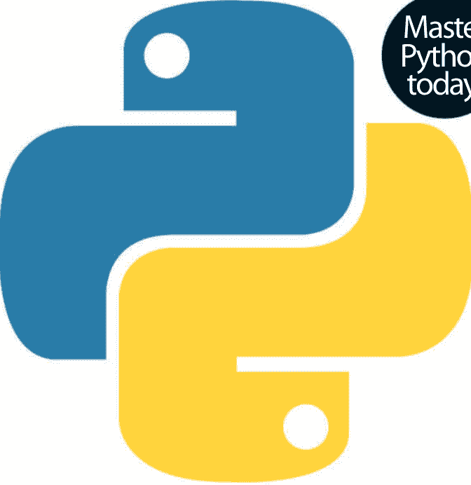

# 欢迎来到 Python

Python 是一种多功能语言，它的流行日益并不令人意外。它与日常语言的相似性使其成为树莓派的完美伙伴，而树莓派通常是实际编程的第一步。但不要被它对初者的友好所迷惑——Python 有许多更高级的功能。在本杂志中，你将学习如何使用 Python 编程，发现奇的项目来提高理解，并寻找使用 Python 增强计算体验的方法。你还将创建有趣的项目，包括编写四旋无人机和从树莓派发送短信。让我们开始编码吧！

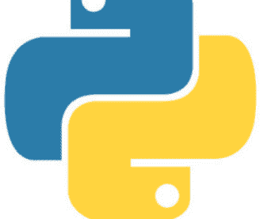


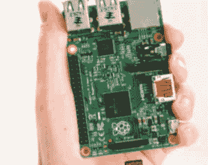


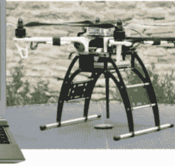

## 从 Python 开始

- **122 编写机器人** 使用 `Twitter-API`


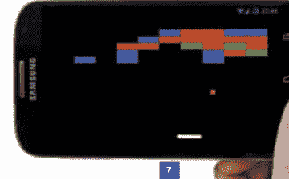

## 欢迎来到 Python

Python 是一种多功能语言，它的流行日益并不令人意外。它与日常语言的相似性使其成为树莓派的完美伙伴，而树莓派通常是实际编程的第一步。但不要被它对初者的友好所迷惑——Python 有许多更高级的功能。在本杂志中，你将学习如何使用 Python 编程，发现奇的项目来提高理解，并寻找使用 Python 增强计算体验的方法。你还将创建有趣的项目，包括编写四旋无人机和从树莓派发送短信。让我们开始编码吧！


## Hello World

第一行以 shebang（符号 `#!`）开头，随后是 Python 解释器的路径。程序加载器使用此行来确定后续行是否需要解释。如果你在像 `IDLE` 这样的 IDE 中运行，不需要这样做。

解释器实际读取的代码只有一行。我们通过在调用函数后的括号中将 Hello World 传递给 `print` 函数。Hello World 没有加引号，以表示它是一个字面量，而不应被解释为源代码。正如我们预期的，Python 中的 `print` 函数会打印传递它的任何值。

你可以使用键组合 `Ctrl+O` 然后按 Enter 在 `nano` 中保存文件的更改。使用 `Ctrl+X` 退出 `nano`。

```python
#!/usr/bin/env python2
print("Hello World")
```

你可以通过在文件名前加 `/` 来运行 Hello World 程序——在这种情况下你输入：

`hello_world.py`

```
[Liam@liam-laptop Python]$ ./hello_world.py
Hello World
```

## 变量和数据类型

变量是源代码中的名称，它与内存区域关联，可以使用该区域存储数据，然后在代码中调用它。数据可以是许多类型之一，包括：

| 类型 | 描述 |
|---|---|
| 整数 | 存储整数 |
| 浮点数 | 存储小数 |
| 布尔 | 值为 True 或 False |
| 字符串 | 存储字符集合。"Hello World" 是一个字符串 |


> "变量与内存区域关联，可以使用该区域存储数据"

### 入门

### 从 Python 入门

提示

此时，值得解释的是，Python 文件中任何跟在 `#` 字符后面的文本都会被解释器忽略。这样做是为了让你代码中编写注释。

除了这些主要数据类型，还有序列类型（从技术上讲，字符串是一种序列类型，但由于它非常常用，我们将其归为主要数据类型）；

| 类型 | 说明 |
| :--- | :--- |
| List (列表) | 包含特定顺序的数据集合 |
| Tuple (元组) | 包含特定顺序的不可变数据集合 |

元组通常用于坐标之类内容，包含存储为单个变量的 x 和 y 值，而列表通常用于存储更大的集合。存储在元组中的数据是不可变的，因为你无法更改元组中单个元素的值。然而，在列表中你可以做到这一点。

了解 Python 的字典（dictionary）类型也会很有用。字典是一种映射数据类型。这意味着你使用该值对应的键（key）来访问字典中存储的值，这与你使用列表的方式不同。在列表中，你使用元素的索引（表示该元素在列表中位置的数字）来访问列表的元素。

让我们编写一个程序，用来演示如何使用变量和不同的数据类型。此时值得注意的是，在 Python 中你并不总是需要指定数据类型。请在任何你喜欢的编辑器中创建此文件。只要你记得让文件具有可执行性，一切都能正常工作。我们将该文件命名为 `variables.py`。


### 解释型与编译型语言

| 像 Python 这样的解释型语言是指源代码每次程序运行时都会转换为机器码并执行的语言。 | 这与 C 等编译型语言不同，编译型语言源代码只会被转换为一次机器码——生成的机器码会在每次程序运行时执行。 |

### 从 Python 入门

### 入门

### 完整代码列表

```python
#!/usr/bin/env python2
# 我们通过编写变量名后跟一个等号来创建变量，等号后面跟的是我们想要存储在 # 变量中的值。例如，下面这一行创建了一个名为 hello_str 的变量，包含字符串 Hello World。
hello_str = "Hello World"
hello_int = 21
hello_bool = True
hello_tuple = (21, 32)
```

下一行创建了一个整数变量 `hello_int`，值为 21。注意它不需要被放在引号中。

同样的原理也适用于元组。我们以如下方式创建元组。

并以这种方式创建列表：

```python
hello_list = ["Hello", "this", "is", "a", "list"]
# 现在这个列表包含 5 个字符串。注意这些字符串之间没有空格，所以如果你想将它们连接成一个句子，你必须在每个元素之间添加空格。
hello_list = list()
hello_list.append("Hello")
hello_list.append("this")
hello_list.append("is")
hello_list.append("a")
hello_list.append("list")
```

也可以通过以下方式创建相同的列表：第一行创建一个空列表，接下来的行使用列表类型的 `append` 函数向列表中添加元素。在处理高级字符串时，这种使用 `#` 列表的方法并不真的那么有用，但在处理动态数据（如用户 `#` 输入）时可能很有用。这个列表将在无任何警告的情况下覆盖第一个列表。

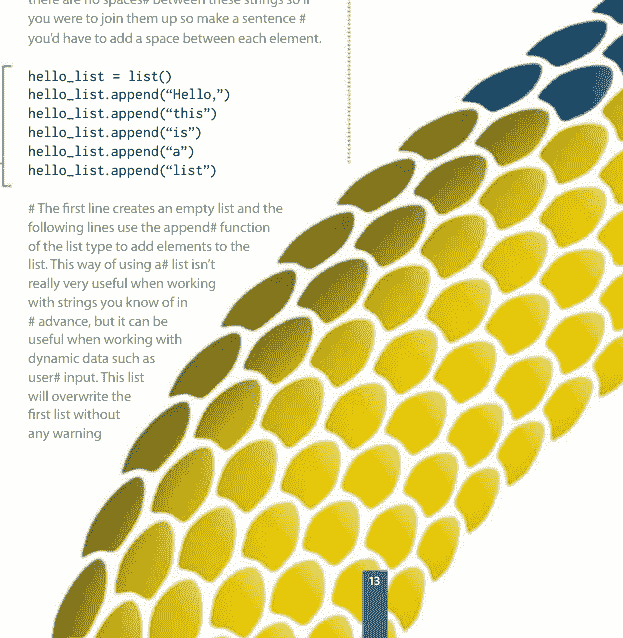

### 入门

### 从 Python 入门

顺便我们也创建一个字典。注意我们对齐下面的冒号以使代码整洁，因为我们使用了之前列表相同的变量名。

```python
hello_dict = { "first_name": "Liam", "last_name": "Fraser", "eye_colour": "Blue" }
```

### 访问集合内部的一些元素

获取 `hello_list` 中的最后一个字符串并在末尾添加一个感叹号。“list”字符串是列表中的第 5 个元素。然而，Python 中的索引是从0 开始的，这意味着第一个元素的索引为 0。

注意当我们打印该元素时，会有两个感叹号：

```python
print(hello_list[4])
hello_list[4] += "!"
# 上述行等于
hello_list[4] + "!"
print(hello_list[4])
```

记得元组是不可变的，尽管我们可以像这样访问它们的元素：


```python
print(str(hello_tuple[0]))
```

# 我们无法像刚才对列表那样更改这些元素的值

# 注意在上方使用 `str` 函数是为了在打印之前显式地将元组内部的整数值转换为字符串。

让我们使用 `hello_dict` 中的数据创建一个句子：

```python
print(hello_dict["first_name"] + " " + hello_dict["last_name"] + " " + hello_dict["eye_colour"])
```

一个更整洁的方法是使用字符串格式化：

```python
print("{0} {1} has {2} eyes".format(hello_dict["first_name"],
  hello_dict["last_name"],
  hello_dict["eye_colour"]))
```


## 从 Python Python

### 入门

### 缩进详解

如前所述，缩进决定了语句属于哪个块。在 Python 中缩进是强制的，而在其他语言中则使用大括号来组织代码块。通常使用四个空格表示缩进。你可以使用制表符，但制表符并没有很好的定义，尤其是当你打开多个编辑器时。


### 控制结构

在程序编程中，控制结构是指任何可以改变代码执行路径的语句。例如，一个在数字小于5时结束程序的控制结构看起来如下：

```python
#!/usr/bin/env python2
import sys # 用于 sys.exit 函数
int_condition = 5
if int_condition < 6:
    sys.exit("int_condition must be >= 6")
else:
    print("int_condition was >= 6")
```

代码路径将取决于整数 `int_condition` 的值。`if` 块中的代码只有在条件为真时执行。`import` 语句用于加载系统库；后者提供了 `exit` 函数，允许退出程序。注意缩进（在这种情况下为每层四个空格）用于指示代码块属于语句。`if` 语句可能是最常用的结构。其他结构包括你在使用 Python 时应该注意的以下项：

- `For` 语句，允许你遍历集合中的项，或重复执行某些代码

- `While` 语句，在条件为真时持续运行的循环

我们将编写一个接受用户输入的程序，以演示控制结构是如何工作的。将其命名为 `construct.py`。`for` 循环使用的是当前值的本地副本，这意味着循环内部的任何更改都不会对列表产生影响。然而，`while` 循环直接访问列表元素，因此如果你需要，可以在那里更改列表。我们将在文章后面的部分更详细讨论变量作用范围。程序如下：

```bash
$liam@liam-laptop Python$ ./construct.py
How many integers? acd
You must enter an integer
$liam@liam-laptop Python$ ./construct.py
How many integers? 3 t
Please enter integer 1: t
You must enter an integer 1: 5
Please enter integer 2: 2
Please enter integer 3: 6
Using a for loop
5
2
6
Using a while loop
5
2
6
```


## 开始上手

### 代码列表

```python
#!/usr/bin/env python2

# 我们将编写一个程序，要求用户
# 输入任意数量的整数，将它们存储在集合中，
# 然后演示如何结合各种控制
# 结构使用该集合。

import sys # 用于 sys.exit 函数

target_int = raw_input("要输入多少个整数？")

# 此时，变量 target_int 包含了用户输入的
# 任何内容的字符串表示。我们需要尝试
# 将其转换为整数，但要准备好在
# 不是整数时处理错误。
# 否则程序将会
# 崩溃。
try:
    target_int = int(target_int)
except ValueError:
    sys.exit("你必须输入整数")

ints = list()

count = 0
```

- 我们在列表中需要的整数数量

- 用于存储整数的列表

- 这些变量用于跟踪我们当前拥有的整数数量

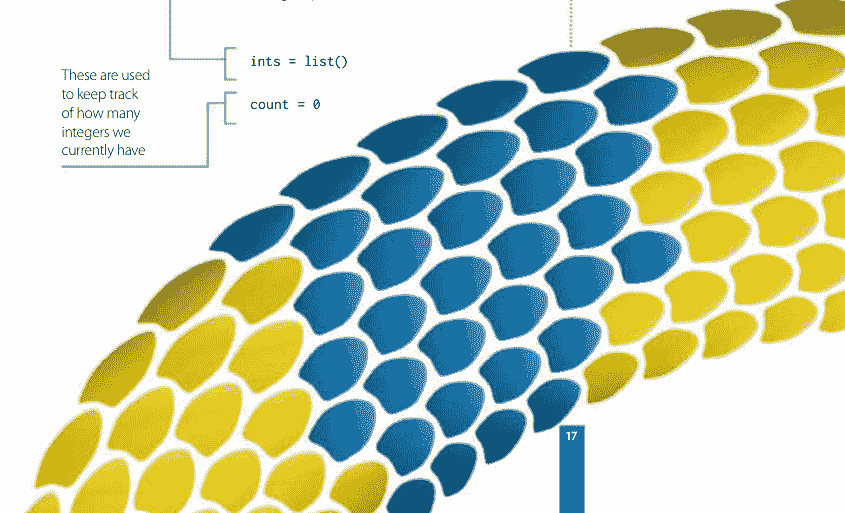

### 开始学习 Python

如果上述操作成功，则 `isint` 将设置为 `True`：`isint = True`

```python
# 继续询问输入整数，直到我们达到
# 要求的数量 < target_int：
while count < target_int:
    new_Int = raw_input("请输入整数 (): ".format(count + 1))
    isint = False
```

```python
try:
    new_int = int(new_int)
except:
    print("你必须输入整数")
```

# 只有在我们获得整数时才继续。否则，我们将再次循环

# 注意在下面我使用了 `==`，这与以下不同

# 单等号是赋值运算符，而双等

# 号是比较运算符。

```python
if isint == True:
    # 将计数器添加到集合中
    ints.append(new_int)
```

```python
# 计数器加 1
count += 1
```

此时，用户已经放弃，或者我们已经有一个满了整数的列表。我们可以通过两种方式遍历这些内容。第一种是使用 `for` 循环

```python
print("使用 for 循环")
for value in ints:
    print(str(value))
```

```python
# 或者使用 while 循环：
print("使用 while 循环")
# 我们在上面已经有了总数，但知道
# len 函数是非常用的。
# 非常有用。
total = len(ints)
count = 0
while count < total:
    print(str(ints[count]))
    count += 1
```

### 关于 Python 列表

Python 列表类似于其他语言中的数组。列表（或元组）可以包含数据类型，这在其他语言的数组中通常是不可能的。出于如此，我们建议你只在列表中存储相同类型的数据。由于列表中数据处理方式的性质，这几乎总是应该是这样的。


### 函数与变量作用域

编程中的函数用于将过程拆分为更小的块。这通常会让代码变得易易读得多。如果设计得当，函数还可以被复用。Python 中的变量始终通过值传递传递，这意味着变量的副本被传递给函数，该副本仅在函数的作用域内有效。在函数内部对原始变量的任何更改都将被丢弃。然而，函数也可以返回值，所以这不是问题。函数用关键字 `def` 定义，后面紧跟函数名。任何可以传递的变量都放在函数名后的括号中。多个变量之间用逗号分隔。括号中赋予变量的名称是它们在函数作用域内拥有的名称，无论传递给函数的变量被称为什么。让我们实际操作一下。对应程序的输出如下：

> “函数用关键字 `def` 定义，然后是函数名”

```python
#!/usr/bin/env python2 # 下面是一个名为 modify_string 的
# 函数，它接受一个变量
# 在函数作用域内将被命名为 original。
# 函数定义下方缩进 4 个空格的内容
# 都在作用域内。
def modify_string(original):
    original += " 已经被
    修改。"
# 此时，只有此字符串的本地副本被修改了。

def modify_string_return(original):
    original += " 已经被
    修改。"

# 然而，我们可以将本地副本返回给
# 调用者。函数一旦使用 return
# 语句就会结束，无论它在
# 函数的哪个位置。
    return original
```

我们现在处于 `modify_string` 函数的作用域之外了，因为我们减少了缩进层级

此段代码中测试字符串不会被改变

```python
test_string = "这是一个测试字符串"
modify_string(test_string)
```


```python
test_string = "这是一个测试字符串"
modify_string_return(test_string)
print(test_string)
```

作用域是一个重要的事情，值得习惯。然而，如果你在函数内部定义了一个变量，它只在那个函数内部可用。这是由于作用域的原因。如果你想在函数外部使用该变量，你必须返回它。例如：

```python
def my_function():
    x = 10
    return x

result = my_function()
print(result)
```

奠定基础并构建你的知识

既然你已经迈出了 Python 的第一步，现在是时候利用这些知识来编写代码了。在本节中，你将了解到如何为 Android 操作系统（第32页）和全球网（第26页）开始编写应用程序。这些简单易懂的教程将帮助你巩固所学会的 Python 语言，同时开发一项在当前技术市场上非常有用的技能。最后，我们将为你提供 50 个核心 Python 技巧（第40页），帮助你快速增加知识储备。

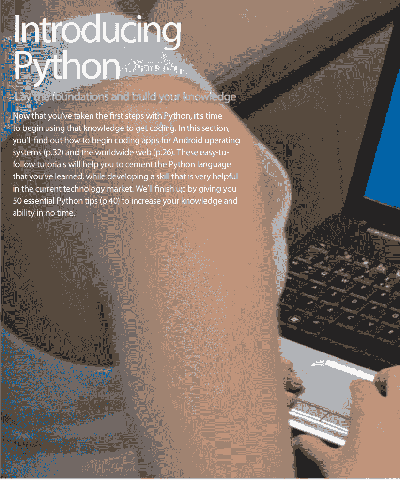


## 使用 Python 开发 Web 应用

### 你需要准备的……

- `Python 2.7`: https://www.python.org/download/release-2.7/
- `Django` 版本 1.4: https://www.djangoproject.com/

Python 提供了一种快速简单构建应用程序的方法，包括 Web 应用。了解如何使用它来构建一个功能完备的 Web 应用

Python 以简单性和强大的功能而闻名。目前，它已经先进到几乎没有什么是 Python 做不到的，而征服网络只是其中的可能性之一。当你使用 Python 进行 Web 开发时，你可以获得海量的模块库和社区支持——请充分利用它们。

Web 开发可以通过许多不同的方式实现，从使用原始的 CGI 模块到利用成熟的 Web 框架。使用后者是使用 Python 构建 Web 应用最流行的方法，因为它允许你构建应用程序而无需担心所有底层的实现细节。Python 有许多 Web 框架可用，例如 `Django`、`TurboGears` 和 `Web2Py`。在本教程中，我们将使用我们目前的首选方案：`Django`。

### 01 创建项目

`django-admin.py` 文件用于创建新的 Django 项目。让我们为我们的问题跟踪器项目创建一个……

在 Django 中，项目（project）代表网站及其设置。而应用程序（application）代表网站的特定功能，如博客或标签。这种方法的好处是，你的应用程序变得可移植，并且可以以很小的代价与其他 Django 网站集成。

```bash
$ django-admin.py startproject issueTracker
```

将创建一个目录。这将作为你包含 Django 的开发 Web 服务器的根。在项目目录下，你将找到以下项：

- `manage.py`: 用于操作项目的 Python 脚本。
- `issueTracker`: 项目的 Python 包（一个包含 `__init__.py` 文件的项目目录）。


该包包含了你的项目设置和配置数据。

- `issueTracker/settings.py`: 该文件包含项目的所有配置。
- `issueTracker/urls.py`: 该文件包含 URL 映射。
- `wsgi.py`: WSGI 兼容 Web 服务器提供你项目的入口点。只有在你部署项目时才需要它。在本教程中我们不需要它。

现在更新路径选项：

```python
TEMPLATE_DIRS = (
    getabspath('templates'),
)

MEDIA_ROOT = getabspath('media')
MEDIA_URL = '/media/'
```

我们还需要在配置文件中启用它：

```python
INSTALLED_APPS = (
    'django.contrib.admin',
    'issuedis',
)
```

现在我们将为你的站点启用管理界面。这是 Django 的一个功能，允许自动创建网站的管理界面，并用于添加和管理网站的内容。取消以下行的注释：

### 02 配置项目

在开始开发应用程序之前，根据我们的需求配置 Django 项目。编辑 `issueTracker/settings.py` 如下（仅显示需要修改的部分）：

数据库设置：我们使用 SQLite3 作为数据库系统。

注意：文本编辑表示新代码或更新后的代码。

```python
'default': {
    'ENGINE': 'django.db.backends.sqlite3',
    'NAME': 'issuedis',
},
```

### 03 创建应用

在这一步中，我们为网站创建主应用 `issuedis`。为了实现这一点，我们将使用 manage 脚本：

```bash
$ python manage.py startapp issuedis
```

Django 要求目录设置使用绝对路径。但我们希望传递相对目录引用。为了实现，我们将添加一个辅助函数。将代码插入设置文件的顶部。

```python
import os
def getabspath(path):
    return os.path.join(os.path.abspath(__file__), path)
```

```python
INSTALLED_APPS = (
    'django.contrib.auth',
    'django.contrib.contenttypes',
    'django.contrib.sessions',
    'django.contrib.sites',
    'django.contrib.messages',
    'django.contrib.staticfiles',
    'django.contrib.admin',
    'issuedis',
)
```

### 04 定义数据模型

这部分是我们为应用定义数据模型。请查看注释以理解这里发生了什么。

```python
from django.db import models
# 我们正在导入在此应用中内置的用户身份认证模块
from django.contrib.auth import models
# 我们还将为应用创建一个管理界面
from django.db import admin

# 一个用于存储多字符字段的元组。
# 第一个表示显示名称的字段名
ISSUE_STATUS_CHOICES = (
    ('New', 'New'),
    ('accepted', 'Accepted'),
    ('reviewed', 'Reviewed'),
    ('started', 'Started'),
    ('closed', 'closed')
)

class Issue(models.Model):
    # owner 将是 Django 内置的 User 模型的外键
    owner = models.ForeignKey(
        models.User, null=True, blank=True, default="new"
    )
    status = models.CharField(
        max_length=20,
        choices=ISSUE_STATUS_CHOICES,
        default="new"
    )
    text = models.TextField()
    opened_on = models.DateTimeField(auto_now_add=True)
    modified_on = models.DateTimeField(auto_now=True)

class IssueAdmin(models.ModelAdmin):
    list_display = ('id', 'text', 'status', 'modified_on')
    list_filter = ('status', 'owner')
    date_hierarchy = 'opened_on'
    search_fields = ('text', 'status')

admin.register(Issue, IssueAdmin)
```

### 05 启用管理站点

管理站点已经启用，但我们需要在 `urls.py` 中启用它。如下所示更新 `urls.py` 文件：


```python
from django.conf.urls import path
from django.urls import include
from django.contrib import admin

urlpatterns = [
    path('admin/', admin.site.urls),
    path('', include('issuedis.urls')),
]
```

06 Django 包含一个内置 Web 服务器，对于测试和调试 Django 应用程序非常方便。让我们看看我们的管理界面……启动 Web 服务器：

```bash
$ python manage.py runserver
```

如果你的代码没有错误，服务器应该在 8000 端口可用。要启动管理界面，请访问 `http://localhost:8000/admin`。系统会要求登录。输入用户名和密码。

## 使用 Python 开发 Web 应用

### 介绍 Python

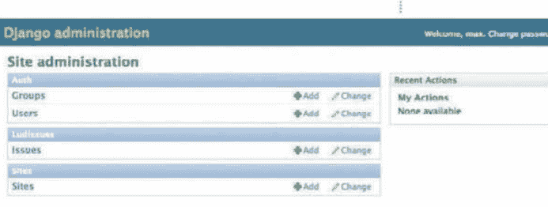

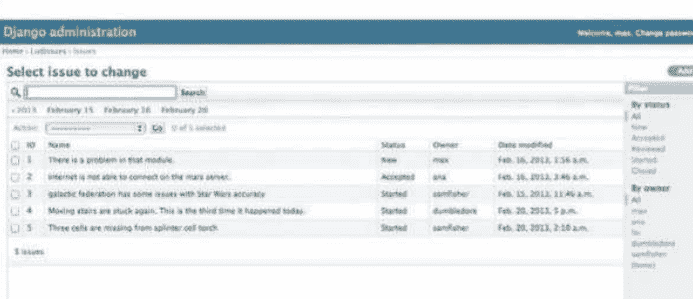

在建模应用的同时进行开发吗？它们没有出现在这里是因为它们不支持被暴露给用户。

`created_` 将自动设置为创建日期，`modified_` 将自动设置为该问题创建的日期。

```python
include(admin.site.urls)
```

这确保了所有的请求将首先由 ludussices 处理。

另外一点是，`owner`（所有者）字段会自动填充站点中的所有用户。

> 此时，管理界面已经可以工作了。我们需要一种方法使用管理界面来显示我们拥的数据。但目前还没有公共界面。让我们现在就创建它。

我们已经在模型中定义了列表来显示 ID、name、status、owner 和 'modified'。你可以通过访问 `http://localhost:8000/admin/ludussices/issue/` 来进入此视图。

在应用目录 (`ludussices/urls.py`) 中创建一个 py 文件，内容如下：

```python
# 我们将必须开始编辑主 urls.py (ludussitracker/urls.py)
urlpatterns = patterns(
    ('', include('ludussices.urls')),
    ('admin/', 
)
```

- `import patterns`, `include url`
- 使用列表模型
- 从 `models` 导入
- 包含所有内容的字典


```python
# ludicules 中的对象
info = {
  'queryset': ludicules.objects.all(),
}
```

### 我们在 Python 代码之外使用列表

### 我们正在使用列表-详情通用视图 (list-detail generic view)

```python
# listdetail 是我们正在使用的视图名称
urlpatterns = patterns(
    'django.views.generic.listdetail',
    # list-issue 和 issue-detail 是模板名称
    # 它们将链接到默认模板目录中
    {
      'object_name':'object',
      'list_name':'list_info',
      'url':'<id>/<object>',
      'detail_name':'item-detail',
    })
```

为了显示列表和详情，我们使用了 Django 的特色通用视图。在这种情况下，它们允许我们创建列表视图和详情视图。这些视图会在使用 `list.html` 和 `detail.html` 模板时应用。在接下来的步骤中，我们将创建模板文件。

09 在这一步中，我们将创建模板和媒体目录。已经提到模板目录为

`TEMPLATE_DIRS =`

```python
path('templates')
```

它对应 `ludussitracker/ludussitracker/templates/`。由于我们是解耦，我们将从应用页面访问模板，完整路径为 `ludussitracker/ludussitracker/templates/`。在你的项目文件夹中创建这些文件夹。此外，创建 `ludussitracker/ludussitracker/media/` 来处理 CSS 文件。你可以从代码文件夹的 resources 目录提供 css。为了从该目录提供文件，请使其可用。打开 `settings.py` 并在 `ludussitracker/ludussitracker/urls.py` 中添加这些行：

```python
# 在 Django 中，我们从 ludussitracker/ludussitracker/templates/base.html 开始。将其视为主模板，可以由从属所有者启用。
```

`ludussitracker/ludussitracker/templates/base.html`

```html
<!DOCTYPE HTML>
<html PUBLIC "-//http://www.w3.org/TR/HTML1/Strict//EN" "http://www.w3.org/TR/html11-strict.">">
<head>
<title>LUD Issues</title>
<link rel="stylesheet" href="{{ MEDIA_URL }}.style.class" type="text/css" media="screen"/>
</head>
<body>
<div id="head">
<h1>Issue Tracker/<span></span></h1>
</div>
</div><div id="mn">
<ul>
<li><a href="" class="View Issues">a</a></li>
</ul>
</div>
<div id="bd">

</div>
</div>
</body>
</html>
```

```python
from django.contrib import admin
admin.autodiscover()
```

```python
urlpatterns = patterns(
    (r'^', include('ludussices.urls')),
    (r'admin/', include(admin.site.urls)),
    (r'media/', static/(?P<path>.*), django.views.static.serve,
        'document_root': settings.MEDIA_ROOT})
))
```

10 在这一步中，我们将创建

来自 `ludussitracker/ludussitracker/templates/` 的

为了显示列表和详情，我们使用了 Django 的特色通用视图。在这种情况下，它们允许我们创建列表视图和详情视图。这些视图会在使用 `list.html` 和 `detail.html` 模板时应用。在接下来的步骤中，我们将创建模板文件。


| Issue | Description | Status | Owner |
| :--- | :--- | :--- | :--- |
| 1 | 有一个问题。 | {{ status }} | {{ owner }} |
| 2 | 这是另一个问题。 | {{ status }} | {{ owner }} |
| 3 | 我们 own一些问题。 | {{ status }} | {{ owner }} |
| 4 | 这是一个测试。 | {{ status }} | {{ owner }} |
| 5 | 另一个问题。 | {{ status }} | {{ owner }} |

`{{ status }}` `{{ owner }}` `{{ status }}` `{{ owner }}`

我们现在使用 Django 的特色通用视图。在这种情况下，它们允许我们创建列表视图和详情视图。这些视图会在使用 `list.html` 和 `detail.html` 模板时应用。在接下来的步骤中，我们将创建模板文件。


整个游戏逻辑。我们专门将其设计为 `FloatLayout` 的子类，因为这种特殊的布局能够根据其自身的位置和大小对其子组件进行定位和缩放——无论我们在哪里运行它或如何调整窗口大小，它都能正确地放置所有的游戏对象。

小组件画布（`canvas`），我们在这里可以使用它来绘制每个小组件形状：

可以设置的不同属性，例如矩形的 `pos` 和 `size`，你可以在线查看 Kivy 文档以了解所有不同的可能性。最大的优势是，尽管我们仍然声明了简单的 canvas 指令，但 kv 语言足以检测到我们引用了哪些 Kivy 属性，并在它们更新时（小组件移动或调整大小时）自动跟踪它们。移动以跟随这个！

```
<Player>
canvas:
    Color:
        rgba: 1, 1, 1, 1
    Rectangle:
        pos: self.pos
        size: self.size
```

接下来，我们可以使用 Kivy 的图形指令在我们的小组件上绘制各种形状。我们将演示简单的矩形以显示它们的位置，尽管你可能还会喜欢研究更多高级的选项。在 Python 文件中，我们可以通过在任何小组件的画布上声明来使用任何指令，如图 03 所示。

```
<Ball>
canvas:
    Color:
        rgb: 1, 0.55, 0
    Rectangle:
        pos: self.pos
        size: self.size
```


这将绘制一个与玩家实例化瞬间的位置和大小相同的红色矩形——不幸的是，这产生了一个问题：绘制是静态的。当我们之后移动玩家小组件时，红色矩形将留在原处，而小组件在其实际位置上将是不可见的。

```python
from kivy.app import App
from kivy.uix.widget import Widget
from kivy.uix.floatlayout import FloatLayout
from kivy.uix.modalview import ModalView
```

```
<Block>
canvas:
    Color:
        rgb: self.colour
    # 我们上面预定义的属性
    Rectangle:
        pos: self.pos
        size: self.size
```

```python
if __name__ == '__main__':
    # 在 Android 编译期间使用
pass
```

我们可以通过保留对画布指令的引用并反复更新它们的属性来跟踪玩家以修复这个问题，但有一个更简单的方法来实现这一切——我们可以使用上次介绍的 Kivy 语言。它有一套特殊的绘图语法。

```
Rectangle:
    pos: [self.x, self.y, self.width, self.height]
```

```python
class BreakoutApp(App):
    pass

BreakoutApp().run()
```

画布声明是特殊的，除非我们可以编写任何画布指令会引起混淆，画布不是一个小组件，像 `Line` 这样的图形指令也不是。它有一套画布特有的语法。指令具有所有


```python
from kivy.properties import ListProperty, NumericProperty, ObjectProperty, StringProperty
```

```python
class Game(FloatLayout):
    def __init__(self, **kwargs):
        # 将包含一切
        self.blocks = ListProperty([])
        super(Game, self).__init__(**kwargs)
        self.player = ObjectProperty()
        # Game 的实例
        self.ball = ObjectProperty()
        with self.canvas:
            Color(1, 0, 1)
            # rect(0, 1, r, g, b, a -> 红色
        def add_block(self, block):
            self.blocks.append(block)
            add_widget(block)
```

```python
class Player(Widget): # 一个移动的挡板
    position = NumericProperty(0.5)
    direction = StringProperty('none')
    classclass Ball(Widget): # 一个弹跳球
        # 用于定位的 _pos_hints
        pos_hint_x = NumericProperty(0.5)
        pos_hint_y = NumericProperty(0.3)
        proper_size = NumericProperty(0.8)
        velocity = ListProperty([0.1, 0.5])
```

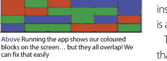

你可能注意到，我们有一个 Block 的 'Color' 指令之一来清除其属性。这意味着我们可以随时更改该属性以更新块的颜色，或者在这种情况下，给每个块赋予一个随机颜色（图 04）。

现在每个小组件都有了图形表示，让我们学习如何放置它们，以便启动应用程序并在屏幕上真正看到一些东西。

在这里创建我们想要的小组件，然后使用 `add_widget` 将其添加到图形中。我们在屏幕上的根小组件是 `Game` 的实例，每个块都被添加以进行显示。

唯一的新点是，每个 `Block` 都被赋予了 `pos_hint`。所有小组件都有这个特殊属性，它被像我们的 `Game` 这样的布局用于以设置它们相对于布局的比例的位置。

字典用于处理各种参数，但在这种情况下，'X' 给 y 和 Block 的位置是相对于宽度和高度的比例分数。

现在你可以运行应用程序，并在显示在屏幕上之前向 `Game` 添加 50 个块。每个块都应该有三种随机颜色之一，并在网格中定位，但你现在会注意到它们的大小没有手动设置，因此它们重叠了。我们可以通过设置它们的 `size_hint` 属性来修复这个问题——让我们看看

```python
class Block(Widget): # 每个要消除的彩色块
    colour = ListProperty([1, 0, 0])
```

图 03

```python
from kivy.graphics.context_instructions import Color
from kivy.graphics.vertex_instructions import Rectangle

class Game(FloatLayout):
    def setup_blocks(self):
        for y_jump in range(5):
            for x_jump in range(10):
                block = Block(pos_hint={
                    'x': 0.05 + 0.09*x_jump,
                    'y': 0.05 + 0.18*y_jump
                })
```

这些用于与触摸或鼠标输入的函数在检测到输入时会自动调用，你可以根据触摸做出任何喜欢的操作。

```python
if scancode == 275:
    self.direction = 'right'
elif scancode == 276:
    self.direction = 'left'
else:
    self.direction = 'none'
```

现在我们必须添加游戏机制。对于这样的游戏，通常希望每秒运行多次更新函数，更新小组件

```python
def on_key_up(self, args):
    self.direction = 'none'
```

```python
def update(self, dt):
    dir = {'right': 1, 'left': -1}
    self.position.x += (50 * dt * dir[self.direction])
```

# 介绍 Python

## 使用 Python 构建 Android 应用程序


球击中了玩家屏幕的底部，现在我们来添加一些游戏结束代码来处理这些情况（图 08）。并将图 09 所示的代码添加到 `breakout.py` 中。这应该能完全处理失败或胜利的情况，弹出一个带有适当消息的弹出框，并提供一个重试的按钮。最后，我们必须处理当球击中方块时销毁球（图 10）。

这完全涵盖了所有最后的条件，通过 kivy 的 `build_collide_method` 比较它们的边界框（`pos` 和 `size`）来检查碰撞。反弹将取决于球穿透了多远距离，因为我们将告诉它已经击中了方块（`Block`）。

大功告成了，你可以运行代码来玩你简单的打砖块游戏。目前它非常简单，但希望你能看到为不同类型的方块和增强道具添加额外行为的不同方法——你可以添加生命值系统、更复杂的球拍/球交互，或者构建一个带有菜单和设置界面的完整游戏界面。

我们刚刚结束展示一个你可以做的酷炫功能——为你的游戏编译为 Android 版本！通而言之，可以将任何 Kivy 应用程序转换为可以在你的任何 Android 设备上运行的 Android APK。你甚至可以访问标准的 Android API 来访问硬件或 OS 特性，如振动、传感器或原生通知。

我们将使用 Buildtool 来构建 Android，它是 Kivy 的一个姐妹项目，封装了其他构建工具以创建不同的系统。该工具会处理下载和运行 Android 构建工具（SDK、NDK 和 Kivy 的 Python-for-android）以创建 APK。

```python
size_hint: None, None
proper_size: min(3*self.parent.height,3*self.parent.width)
size: self.proper_size,self.proper_size
# canvas part
```

图 06

```python
from kivy.clock import Clock
from kivy.core.window import Window
from kivy.utils import platform
```

```python
class Game(FloatLayout):
    def update(self, dt):
        self.ball.update(dt) # Not defined yet
        self.player.update(dt) # Not defined yet
```

图 04

```python
import random

class Ball(Widget):
    def __init__(self,**kwargs):
        super(Ball,self).__init__(**kwargs)
        self.colour = random.choice((0.78,0.63,0.28),(0.25,0))
    def start(self,*args):
        Clock.schedule_interval(self.update, 1./60.)
```

图 05

```kvivy
<Widget>:
    size_hint: 0.09, 0.05
    # canvas part
<Player>:
    size_hint: 0.1, 0.25
    position: {'x': self.position,'y': 0.1}
    # canvas part
<Ball>:
    size_hint: {'x': self.pos_hint_x,'y': self.pos_hint_y}
```

```python
def reset(self):
    for block in self.blocks:
        self.remove_widget(block)
    self.blocks = []
    self.setup_()
    self.ball.velocity = [random.random(),0.5]
    self.player.position = 0.5
```

```python
class BreakoutApp(App):
    def build(self):
```


# 使用 Python 构建 Android 应用程序

# 介绍 Python

图 09

```python
g = Game()
if platform() != 'android':
```

# 介绍 Python

## 50 个 Python 技巧


# 50 个 Python 技巧

Python 是一种让你工作更快速、更有效地整合系统的编程语言。今天，Python 是开源领域最流行的语言之一。环顾四周，你会发现它无处不在，从各种配置工具到 XML 解析。这里是 50 个精华集合，让你的 Python 体验变得有所价值……

## 基础

### 运行 Python 脚本

- 01 在大多数的 UNIX 系统上，你可以从命令行运行 Python 脚本。

```bash
$ python myprogram.py
```

### 从 Python 解释器运行 Python 程序

- 02 交互式解释器让你能够轻松尝试编程的第一步并使用所有的 Python 命令。你只需要逐一个输入每个命令，结果会立即显示。

可以使用以下命令启动 Python 解释器：

```bash
$ python
Kunal@ubuntu:~$ Python 2.6.2 (release-2$main, Apr 19 2009, 01:56:41) [GCC 4.3] on linux
Type "help", "copyright", "credits" or "license" 获取更多信息.
>>> commands here>>
```

在本文中，所有的 `>>>` 符号都表示在 Python 提示符处输入。

记住，Python 对此非常严谨——如果你接收到任何错误，请修正制表符间进。

## 动态类型

- 03 在 Java、C++ 和其他静态类型语言中，你必须为每个参数指定返回值的类型。相反，Python 是一种动态类型语言。在 Python 中，你永远不需要指定所使用的任何值的类型。基于此，Python 会自动跟踪数据类型。

## Python 语句

- 04 Python 使用换行符来分隔语句，使用冒号和缩进来分隔代码块。大多数编译语言（如 C 和 C++）使用分号来分隔语句，使用括号来表示代码块。

## == 和 = 运算符

- 05 Python 使用 `==` 进行比较，使用 `!=` 进行不等于赋值：Python 不支持内联赋值，因此在你实际上想要比较它时，没有意外赋值的可能。

## 字符串拼接

- 06 你可以使用 `+` 来拼接字符串。

```python
>>> print 'kunal'+'al'
kunal
```

## __init__ 方法

- 07 当类的实例创建时，会立即运行 `__init__` 方法。该方法用于对你的对象进行任何你想要的初始化：`__init__` 类似于 C++ 或 Java 中的构造函数。

示例：

```python
Class:
    def __init__(self, name):
        self.name = name
    def hi(self):
        print('Hello, my name is ' + self.name)
```

```python
p = Person('Kunal')
p.hi()
```

输出：

```
Hello, my name is Kunal
```

## 模块

- 08 为了让你的程序随着规模的扩大而保持可维护性，你可能想将它们分成几个文件。Python 允许你将多个函数定义放在一个文件中，然后将其作为模块导入使用。这些文件必须具有 `.py` 扩展名。

```python
>> print '\n'.join(mylist)
spam
ham
```

### 向 Python 脚本传递参数

示例：

```python
# file_function.py
def min_max(a,b):
    if a < b:
        max = a, b
    else:
        min = b, a
    return min
# 模块用法
import my_function
```

### Python 解释器中的 Tab 补全

- 11 Python 允许你在调用脚本时访问传递给脚本的内容。命令行内容存储在 `sys.argv` 中。

```python
import sys
print sys.argv
```

### 加载模块和启动

- 15 你可以通过解释你的 `.python_file`（或 Python 启动时读取的文件）的想法来实现自动补全：


```python
>> import readline
>> readline.parse_and_bind('tab',complete=''))
```

这将使 Python 在你按下 Tab 键时补全部分输入的函数、方法和变量名。

- `12` 你可以使用环境变量 `PYTHONPATH` 定义任何 Python 脚本的模块和命令。你可以将环境变量 `PYTHONPATH` 设置为一个包含必要模块或命令的文件。

## Python 文档工具

### 模块定义名称

- `09` 内置函数 `dir()` 用于查找模块定义的名称。它返回一个排序后的字符串列表：

```python
>> dir(time)
>> ['__doc__', '__file__', '__name__', '__package__', 'acctime', 'time', 'daylight', 'gettime', 'localtime', 'mtime', 'sleep', 'strptime', 'struct_time', 'timezone', 'tz']
```

### 计算最大值、最小值和和

### 50 个 Python 技巧

### 介绍 Python

你可以使用内置函数。

- `27` `max`: 返回列表中的最大元素：

- `min`: 返回列表中的最小元素。

- `sum`: 此函数返回列表中所有元素的和。它接受一个可选的第二个参数：求和开始的起始值（默认值为 `0`）：

一旦你创建了一个数组对象，假设为 `myarray`，你就可以对它应用许多方法。这里有几个重要的方法：

- `myarray.count(x)`: 返回 `x` 在列表中出现的次数

- `myarray.extend(x)`: 将 `x` 附加到数组末尾。

- `myarray.reverse()`: 反转数组的顺序。

大写字母

匹配成功！

>>> if re.search("\d", s): print("Match") # 数字类

## 使用 bzip2 (.bz2) 压缩工作

你可以使用 `bzip2` 模块通过 `bzip2` 压缩算法进行读写。

- `33` `bzip2.compress()`: 用于压缩

`bzip2.decompress()`: 用于解压缩 示例：

```
# File: bz-example.py
import bzip2
MESSAGE = "Kunal is a bad boy"
>>> compressed = bzip2.compress(MESSAGE)
>>> decompressed = bzip2.decompress(compressed)
>>> print("original:")
>>> print(MESSAGE)
>>> print("compressed:")
>>> print(compressed)
>>> print("decompressed:")
>>> print(decompressed)
>>> print("decompressed-message:")
>>> print(decompressed)
```

## 表示分数

`28` 在 Python 中，使用以下构造函数创建 `Fraction`：

- `Fraction(numerator[,denominator])`

## 执行数学运算

`29` `math` 模块提供了大量的数学函数。这些函数作用于整数和浮点数，复数除外。对于复数，使用名为 `'cmath'` 的模块。

例如：

`math.acos(x)`: 返回 `x` 的反弦

`math.cos(x)`: 返回 `x` 的余弦。

- `math.factorial(x)`: 返回阶乘。

## 排序项目

`31` `'sort'` 方法可以非常方便地保持列表的任何可能的顺序。你可以使用该函数对列表进行排序：

- `list.insert(index, item)`

按排序顺序插入项目。如果项目已在列表中，新条目将插入到任何现有条目的右侧：

- `bisect.insort(list, item, [high])`

如果项目已在列表中，新条目将插入到任何现有条目的右侧。

## 使用正则表达式的搜索

`32` `re` 模块方便了使用正则搜索。你可以使用基于正则表达式的表达式 `search()` 函数。查看下面的输出

```
示例:
>>> import re
>>> s = "Kunal is a bad boy"
>>> if re.search("[A-Z]", s): print("Match")
# 字符类或
```

## 使用数组工作

`30` `array` 模块提供了一种在程序中使用数组的高效方法'array' 模块定义了类型：

- `array(typecode [`

## 有工具帮助 Python 开发

## 在 Python 中使用 SQLite

## 使用通配符搜索文件名

## 从 Python 执行 UNIX 命令

SQLite 是一个快速且受欢迎的嵌入式数据库，因为它不需要配置，且性能优异。你可以使用 `'sqlite3'` 模块来处理 SQLite 数据库。

`36` 你可以使用 `'glob'` 模块，根据 UNIX shell 使用的规则找到所有匹配模式的文件名，用 `[!]` 表示的字符范围将被匹配。

`38` 你可以使用模块命令来执行 UNIX。这在 Python 3 中是不可用的——相反，在这里，你需要使用 `'subprocess'` 模块。

示例：

```
>>> import sqlite3
>>> connection = sqlite.connect('test.db')
>>> cursor = connection.cursor()
>>> cursor.execute('CREATE TABLE item...')
```

示例：

```
>>> import glob
>>> glob.glob('[0-9]*')
>>> glob.glob('*.txt')
>>> glob.glob('*.py')
>>> glob.glob('*.?*')
```

示例：

```
>>> import commands
>>> commands.getoutput('ls')
>>> 'bz2-example.py'
```

## 执行基本文件操作

你可以使用 `'shutil'` 模块执行文件操作。该模块与命名管道、缓冲区和设备等特殊文件一起。

## 使用 zip 文件工作

`35` 你可以使用 `'zipfile'` 模块。`zipfile.ZipFile(filename, mode[,allow_pickle])`

- `shutil.copytree(src, dst)` 将 `src` 树复制到文件或目录

- `shutil.move(src, dst)` 将文件移动到目录

- `shutil.copytree(src, dst, symlinks=ignore)` 递归复制整个目录

- `shutil.rmtree(path, errors=ignore)` 删除整个目录。

- `zipfile.close()` 关闭存档文件；在程序结束之后。

示例：

```python
>>> import os
>>> os.path.abspath('posixpath')
>>> os.environ
{'PATH': '/usr/lib/python2', 'LANG': 'en_US', 'TERM': 'xterm', 'SHELL': '/bin/bash', 'SESSION_ID': '925c443597c120486535afd6d5', 'HOME': '/home/kunal/', ''}
```

## 寻找寻找无处不在的 Python，从各种工具到 XML 解析

`40` 你可以使用 `smtplplib` 模块发送电子邮件（简单邮件协议）接口。

```
# 下载文件
uu = urllib2.urlopen("ftp://redhat.com/pub/redhat/README")
# 输出文件内容
print(u.read())
```

## 发送邮件

使用 Google SMTP 服务器发送邮件的示例：

```python
import smtplib
# 使用你自己的邮箱地址
fromaddr = 'kunal@gmail.com'
toaddr = 'to@gmail.com'
msg = 'I am a Python geek. Here is the proof!'
```

## 程序运行时的凭据

```python
username = 'kunal@gmail.com'
password = 'password'
# 实际邮件
server = smtplib.SMTP('smtp.gmail.com:587')
# Google Mail 对 SMTP 使用安全连接
server.starttls()
server.login(username,password)
server.sendmail(fromaddr,toaddr,msg)
server.quit()
```

## 处理 CSV 文件


45 CSV 文件在数据交换中非常流行。使用 `csv` 模块，你可以读取和写入 CSV 文件。

示例：

- `import csv`

- `# 写入状态值`

`writer = csv.writer('stocks.csv', 'w', newline='')`

`writer.writerow([`

    `('GOOG', 'Google, Inc.', 505.24, 0.47, 0.19)`,

    `('YAHO!', 'Yahoo, Inc.', 27.38, 0.33, -1.22)`,

    `('CNET', 'CNet, Inc.', 16.2, -8.13, -1.49)`

`])`

示例：

- `# 读取状态数据，状态消息`

`stocks = csv.reader(open('stocks.csv', 'rb'))`

`status_labels = {'-': 'down', '0': 'unchanged', '1': 'up'}`

```
for ticker, name, price, change in stocks:
    status = status_labels[float(change)]
    print "%s %s %%%" % (name, status, pct)
```

## 写入系统日志

安装后，你可以使用 `easy_install` 命令来执行任何必要的 Python 包管理任务。

47 你可以使用 `syslog` 模块写入系统日志。`syslog` 是 UNIX 日志库的接口。

示例：

- `import syslog`

`syslog.log('mygeekeack: started logging')`

- `for i in ['a', 'b', 'c']:`  
    `b = 'mygeekeack: I found letter ' + i`  
    `syslog.syslog(b)`  
    `syslog.log('mygeekeack: the script goes to sleep now, bye,bye!')`

- `python myfile.py`

- `tail -f /var/log/messages`

Nov 18 22:34 ubuntu

Nov 18 22:34 ubuntu ubuntu: geekeack: started logging

Nov 18 22:34 ubuntu ubuntu: geekeack: I found a letter a

Nov 18 22:34 ubuntu ubuntu: geekeack: I found letter b

Nov 18 22:34 ubuntu ubuntu: python: I found a letter c

## 使用 setuptools 安装第三方模块

46 `setuptools` 是一个 Python 包，它可以让你非常轻松地下载和构建。使用 `setuptools` 来安装和卸载包：

使用 setuptools 安装 simplejson：

- `kunalumba-sudo easy_install simplejson`

Searching for simplejson

Reading here: http://python.org/simple/simplejson/

Reading here: http://undefined/2.9

- Downloading http://pypi.org/packages/source/simplejson-2.9.tar.gz.md5=af5e67a9c3a480563411d57e6d4

- Processing simplejson setup.py -q dist_egg --dist/tmp/easy_install-PyYAML simplejson-2.9-egg-info/tmp-GW

- Adding simple2.9 to easy-install.pth

Installed /usr/local/packages/simplejson-2.9-py2.6-linux-1866

- Processing dependencies for simplejson

Finished processing dependencies for simplejson

## 第三方模块

48 `ReportLab` 是一个用于 Python 生成 PDF 的常用模块。

## 你可以使用 `random` 模块通过基础生成器生成各种随机数

## 生成 PDF 文档

```
$ wget http://www.reportLab.org/ftp/Report_Lab_2.3.tar.gz
$ tar xvfz ReportLab_2_3.tar.gz
$ cd ReportLab_2_3
$ sudo python setup.py
```

如果安装成功，你应该会看到类似的消息：

```python
>>> pdf.font("Courier", 40)
>>> pdf.drawCentredString(letter[0] / 2, inch * 6, "CLASSIFIED")
>>> pdf.drawCentredString(letter[0] / 2, inch * 5, "07's Eyes Only")
# 关闭当前页的绘图
>>> pdf.showPage()
# 保存 pdf 页面
>>> pdf.save()
```

## 输出

# 从 `/home/python/ReportLab_2_3/src/addons/renderPM` 安装 freetype 版本 21

## 使用 Twitter API

50 你可以使用 Python 使用 Yahoo! 搜索 API。49 你可以轻松地使用 `Python-Twitter` 模块连接。

执行安装步骤：

```
$ wget http://yahoo.com/download/files/python-twitter-0.6.tar.gz
$ cd python-twitter
$ sudo python setup.py
```

示例：

```python
>>> from yahoo.search import NewsSearch
>>> info = search_parse(NewsSearch('YahooDemo', query='London'))
>>> info.total_results
```

示例（接上列表）：

```python
>>> import twitter
>>> twitter.Api(username='kinaldo',password='xxxx')
>>> friends = twitter.Getfriends(friends)
>>> print [u.name for u in friends]
>>> for result in results: print "%s"
```

“用户可以使用 Py 和 IDLE 等服务来帮助他们进行 Python 开发”，阿富汗彭博会议如是。

## 实用的 Python 技巧和项目

让强大的编程语言发挥作用

通过对 Python 有更深入的理解，你真的可以开始让它为你工作。

随着对 Python 有更扎实的理解，你真的可以开始让它为你工作。在本节中，我们将展示如何使用 Python 替代 shell（50页），然后查看 NumPy 如何帮助进行科学计算（58页）。在本节中，我们将展示如何充分利用 Python 的潜力（72页）。

## 用 Python 替代 shell

你可能需要...

Python 是一种很强大的语言，但你知道它甚至可以替代 shell 吗？我们每天都使用 shell。多年来Bash 一直一直是默认的 shell。相比于其他 UNIX shell，如 Korn Shell (`KSH`)、`C Shell` (`CSH`) 甚至 `TCSH`，我们仍然认为Bash 是最好的。

本教程不是关于 Bash 的不能，而是关于如何为 shell 注入新的生命来完成旧有的任务。话不多说，让我们开始吧。

虽然 Python 编程语言可能需要你编写更长的命令来完成任务（由于 Python 模块的组织方式），但这并不担心。你可以轻松地编写想要替换的 Bash 命令的别名。

Python 支持直接执行系统命令（通过 `os` 或 `subprocess` 模块），但在可能的情况下我们专注于 Python 原生实现。

### 第 1 部分：使用 shutil 完成基础 shell 任务

`shutil` 模块提供了文件和目录操作的支持。它提供了文件属性、复制、归档等支持。让我们看看它的一些重要函数。

- `copy(src,dst)`: 将源文件复制到目标目录。在此模式下，复制权限位但不复制元数据。

- `copy2(src,dst)`: 与 `copy()` 相同，但也会复制元数据。

- `copytree(src, dst[, symlinks=False, ignore=None])`: 这类似于 `cp -r`，允许你复制整个目录。


- `ignore_patterns` (`*patterns`): `ignore_patterns` 是一个可以作为 `copytree()` 回调的函数，允许忽略由 glob 模式指定的文件和目录。

- `rtree` (`path`[, `ignore_errors`, `onerror`]): `rtree` 用于删除整个目录。

- `move` (`src`,`dst`): 类似于 `mv`，允许递归地移动文件或目录到新位置。

- `make_archive` (`base_name`, `format`[, `root_dir`[, `base_dir`[, `dry_run`, `owner`[, `group`[, `logger`]]]]): 可以将其视为 `tar`, `zip`, `bzip2` 等的替代品。`make_archive()` 创建一个指定格式（如 `zip`, `bztar`, `gtar`）的归档文件。归档支持可以通过 Python 模块进行扩展。

# 使用 Python 工作

## 用 Python 替换你的 shell

在 Python 中，它旨在替换 `os.system`, `os.spawn*`, `os.popen`, `popen2.*` 以及 `commands.*` 模块。

## os 模块

`environ` 以字符串对象的形式表示操作系统的环境变量。

示例：

```python
import os
os.environ

{'VERSION_PYTHON_PREFER_32_BIT': 'no', 'LC_TYPE': 'UTF-8', 'TERM_PROGRAM_VERSION': '297', 'LOGNAME': 'kunaldeo', 'USER': 'kunaldeo', 'PATH': '/System/Library/Frameworks/Python.framework/Versions/2.7/bin:/Users/kunaldeo/narwhal/bin:/opt/local/bin:/usr/local/bin:/usr/bin:/sbin:sbin:/usr/local/bin:/usr/X11:/opt/local/bin:Applications/MOTODEV_Studio_Android_2.0.0_x86/android_sdk/Applications/MOTODEV_Studio_Android_2.0.0_x86/android_sdk/platform-forms:/CyanogenModWorkspace/bin, 'HOME': '/kunaldeo', 'PS1': '\\u0032m\\u00e5m\\u00e5m\\u00e5m \u[1;37m', 'NARMAL_ENGINE': 'jsc', 'DISPLAY': 'Apple Terminal, TERM-TERM_PROGRAM': '/tmp-s2Lufa/org.x:0', 'term-color', 'Apple_PubSub_Socket_': '/tmp/launch-kDul5/RENDER', '2.7', 'VERSION_PYTHON_VERSION': '', 'SECURITYID': '18645', 'ANDROID_SDK': '/Applications/MOTODEV_Studio_Android_2.0.0_x86/android_sdk': '/System/Library/Frameworks/Python.framework/Versions/2.7/bin', 'TERM_SESSION_ID': 'AFCE4290-B35C-418E-B4E9C63FB850c, 'SH_AUTH_OUT': '/tmp/launch-dj6MK4/Listeners', 'SHELL': '/bin/bash', 'TMPDIR': '/var/folders/6s/gkmmn8b11873mb8sz8x480000g/T/', 'COLORS': 'EfxcDx8hexegadabadagad', 'COLICOR': '1', '__UTF_TEXT_ENCODING': '0x1F:5:0', 'PWD': '/Users/kunaldeo', 'COMMAND_MODE': 'unix2023'}
```

你也可以获取环境变量的值：

```python
os.environ['HOME']
/kunaldeo
```

## 用 Python 替换你的 shell

- `putenv`(`varname`,`value`) : 使用给定的变量名和值添加或设置环境变量。

- `getuid()` : 返回当前进程的用户 ID。

- `getlogin()` : 返回当前登录用户的用户名。

- `getpid`(`pid`) : 返回给定的 `pid` 的进程组 ID。在不带任何参数使用时，它返回当前进程 ID。

- `getcwd()` : 返回当前工作目录的路径。

- `chdir`(`path`) : 将当前工作目录更改为给定路径。

- `list`(`path`) : 类似于 `ls`，返回一个包含给定路径上可用目录的文件内容的列表。

示例：

```python
os.listdir("/home/homer")
```

```
['gnome2', 'pulse', 'gnconf', 'gnfd', 'beagle', 'gnome2_private', 'gksu.lock', 'Public', 'ICEauthority', '.bash_history', '.compiz', '.gvfs', '.update-notifier', '.cache', '.vimfo', '.Videos', '.profile', '.config', '_esdauth', '.viminfo', '.sudo_as_admin_successful', 'mbox', 'xsession-errors', '.bashrc', 'Music', '.dbus', '.local', 'gstreamer-0.10', 'Documents', 'gtk-bookmarks', 'Downloads', 'Pictures', '.pulse-cookie', 'nautilus', 'examples.desktop', 'Templates', '.bash_logout']
```

- `mkdir`(`path`, `model`) : 使用给定的路径和数字代码模式创建目录。默认模式为 `0777`。

- `makedirs`(`path`, `model`) : 递归创建给定路径（包括其所有目录）。默认模式为 `0777`。

示例：

```python
import os
path = "/home/kunal/greatdir"
os.makedirs(path, 0755)
```

- `rename`(`old`,`new`) : 将文件或目录 `"old"` 重命名为 `"new"`。如果 `"new"` 是目录，将抛出错误。在 Unix 和 Linux 上，如果 `"new"` 存在且为文件，只要用户有权限，它会被静默替换。

- `rename`(`old`,`new`) : 与 `rename` 类似但在必要时也会递归创建目录。

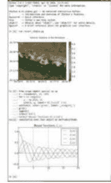

上方具有 GUI 能力的 IPython 控制台截图

- `rmdir`(`path`) : 从指定的路径删除目录。如果该路径已存在文件，你需要使用 `shutil.rmtree()`。

## subprocess:

- `call`(`*popenargs`, `**kwargs`) : 带参数运行命令。在进程完成后返回 `returncode` 属性。

示例：

```python
import subprocess
print(subprocess.call(["ls","-l"]))
```


```
total 368468
drwxr-xr-x 5 kunaldeo staff 170 Aug 19 01:37 Desktop
drwxr-xr-x 10 kunaldeo staff 340 Jul 26 08:30 Documents
drwxr-xr-x 50 kunaldeo staff 1700 Aug 19 12:50 Downloads
drwxr-xr-x 127 kunaldeo staff 4318 Aug 19 01:43 Dropbox
drwx------@ 42 kunaldeo staff 1428 Aug 12 15:17 Library
drwx------@ 3 kunaldeo staff 102 Jul 3 23:32 Movies
drwxr-xr-x 5 kunaldeo staff 170 Aug 19 01:37 Music
drwxr-xr-x 5 kunaldeo staff 170 Aug 19 01:37 Pictures
drwxr-xr-x 5 kunaldeo staff 170 Aug 19 01:37 Public
drwxr-xr-x 5 kunaldeo staff 170 Aug 19 01:37 Terminal
drwxr-xr-x 5 kunaldeo staff 170 Aug 19 01:37 Terminal
```


上方具有 GUI 能力的 IPython 控制台截图（标准 `shell_INPUT/OUTPUT/ERROR_HANDLE`）

# 用 Python 替换你的 shell

## 使用 Python 工作

IPython 自带了一组预定义的“魔法”函数，它们可以使用命令行风格的语法。IPython 魔法命令习惯上以 `%` 前缀，但如果开启了 `%automagic`，你就可以在没有 `%` 的情况下调用魔法命令。要查看可用魔法函数的列表，请使用 `%magic`。它们包括与代码一起工作的函数（如 `%run`, `%edit`, `%macro`, `%reall` 等）、影响 shell 的函数（如 `%colors`, `%xmode`, `%autoindent` 等）以及其他函数（如 `%reset`, `%timeit`, `%paste` 等）。IPython 的大多数功能都是通过魔法函数驱动的。

### 补全

标签补全是探索任何对象的极佳方式。它还可以帮助避免拼写错误。

示例：

```python
import os
os.path [Tab]
```

### 对象资源器

你可以在任何对象后添加 `?` 来查看其详细信息。你也可以使用双问号（`??`）来查看相关对象的源代码。

```
%page %paste %pastebin %pdf %pdoc %pfile
%info %pinfo2 %popd %pprint %precision %profile %prun
%search %psource %pushd %pwd %pycat %pylab %quickref
%recall %rehash %reload_ext %rper %rerun %reset
%reset_selective %reselect %save %xsc %xsb %thb %timeout
%unalias %unload_ext %who %who_is %whos %xdel %mode
```

`Autmagic` 已关闭，魔法函数需要 `%paste`。要查看任何魔法函数的的帮助，请调用 `%magic?`。运行时代码编辑：你可以使用 `%run` 运行任何 Python 脚本。你也可以使用 `control-run` 配合 `pdb` 调试器 `-d` 运行 Python 脚本，或使用 `pdb` 性能分析 `-p`。你还可以使用 `%edit` 命令编辑 Python 脚本，该命令会在 `EDITOR` 环境变量定义的编辑器中打开指定的 Python 脚本。

**支持 Shell 命令：** 要运行 shell 命令，请在命令前加 `!`

示例：

[5]: `!ps`

| PID TTY | TIME | CMD |
| --- | --- | --- |
| 4508 tty000 | 00:00.07 | -bash |
| 84275 tty001 | 00:00.03 | -bash |
| 17958 tty002 | 00:00.18 | -bash |

[8]: `!clang prog.c -o prog`

`prog.c:21:2: warning: type specifier missing, defaults to 'int' [-Wimplicit-int]`

已生成。

Qt 控制台：IPython 自带基于 Qt 的控制台。它提供了只有 GUI 才能的功能，如内联函数、使用语法高亮的多行编辑以及图形功能。通过以下命令启动 Qt：

```
$ ipython qtconsole
```

## 结论

如你所示，很容易为你的 shell 环境需求定制 Python。`os`、`subprocess` 和 `shift` 等 Python 模块可供你使用，利用 Python 完成你所需的一切工作。IPython 将这种体验变成了一个更完整的包。为了执行标准 Python shell 能执行的操作并带有更方便的功能，Python 的魔法函数确实提升了你的 shell 体验。下次当你打开 Bash 会话时，再考虑一下，既然铂金触手可及，何满足于黄金？

如果你遇到关于缺少模块的错误，请确保已安装相关依赖包 -`PyQt`、`pygments`、`pyx` 和 `ZeroMQ`。

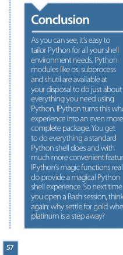

# 使用 NumPy 进行科学计算

## 你将需要...

- `NumPy`
  www.numpy.org
- `SciPy`
  www.scipy.org
- `Matplotlib`
  www.matplotlib.org

使用 NumPy、SciPy 和 Matplotlib 进行强大的计算

`NumPy` 是执行科学计算的主要 Python 软件包。它拥有强大的多维数组对象、用于集成 C/C++ 和 Fortran 代码的工具、线性代数、傅里叶变换以及随机数功能等。`NumPy` 还支持广播机制（`broadcasting`），这是通用函数以有意义的方式处理形式不完全相同的输入的一种巧妙方法。

除了功能外，`NumPy` 的另一个优势是它可以集成到 Python 程序中。换句话说，你可以从数据库、另一个程序的输出、外部文件或 HTML 页面获取数据，然后使用 `NumPy` 进行处理。

本文将向你展示如何安装 `NumPy`、进行计算、绘制数据、读写外部文件，并向你介绍一些与 `NumPy` 配合良好的 `Matplotlib` 和 `SciPy` 包。

`NumPy` 还可以与 `Pygame`（一个用于创建游戏的 Python 包）一起工作，尽管遗憾解释其用法超出了本文的范围。

在将命令放入 Python 程序之前，在 Python shell 中尝试各种 NumPy 命令被认为是良好的做法。本文示例使用了 Python shell 或 IPython。

## 使用 NumPy 进行科学计算 与 Python 工作

一个简单的多项式拟合 Python 程序！

```python
import numpy as np
x = np.array([0, 1, 2, 3, 4])
y = np.array([1, 2, 4, 8, 16])
pp = np.polyfit(x, y, 2)
pf = np.poly1d(pp)
print(pf)
```

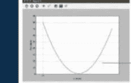

Matplotlib 生成输出 使用 SciPy 处理图像的 Python 脚本

```python
import numpy as np
from scipy import ndimage
import matplotlib.pyplot as plt
image = plt.imread('image.png')
image_filtered = ndimage.gaussian_filter(image, sigma=3)
plt.imshow(image_filtered)
```


查找帮助很容易

## 安装 NumPy

大多数 Linux 发行版都提供了可以安装的包。安装后，你可以通过以下命令查看 NumPy 版本：

- `$ python`

`Python 2.7 (default, Mar 13 20:55) on GCC 4.7`

输入 `"help"`, `"license"` 获取更多信息：

- `>> numpy.version`

`Traceback (most recent call last):`


File `"<stdin>"`, line 1, in `<module>`

NameError: name `'numpy'` not defined

* `>> import numpy`

* `>> numpy.version`

`>> '1.6'`

你不仅找到了 NumPy 版本，还知道 NumPy 已正确安装。

## 使用 NumPy 进行简单计算

关于 NumPy，尽管名字简单，NumPy 是一个主要用于数组和矩阵的强大包。创建数组的许多方法是使用 `array` 函数。给定一个名为 `myArray` 的数组，你可以执行以下命令找到其中的最小值和最大值：

- `>> myArray = np.array([1,2,3,4])`
- `>> myArray.min()`
- `>> myArray.max()`

如果你创建一个二维数组，可以使用 `array` 函数：

- `>> twoD = np.array([[1,2,3,4],[5,6,7,8]])`

如果你想找到所有数组元素的平均值，可以运行下一个命令：

- `>> myArray.mean()`

`array([1,2,3,4])`

同样，你可以找到元素的位数，位数是将数据集分成具有相同数量元素的子集（左侧和右侧）。如果数据集元素个数为奇数，位数就是数据的中间部分。另一方面，如果元素个数为偶数，位数就是排序数据集两个中间元素的平均值。

## NumPy 数组

NumPy 数组采用了 Python 用于字符串和列表的索引方法，但对其进行了扩展。如果你想从数组中选择一个元素，使用以下符号：

- `>> arr[0,1]`

你也可以使用以下符号选择数组的切片（切片）：

- `>> arr[1:1:3]`

最后，你可以使用 `tolist()` 函数将数组转换为 Python 列表。

img/c72194f2c3aec198936695a665a5167c_59_1.png)

## 读取文件

假设你刚刚使用 NumPy 从 Apache 日志收集了信息，现在你想使用 NumPy 处理文件。以下 AWK 代码找出每个时间点的请求总数：

```
$ cat access.log | cut -d ' ' -f2 | cut -d ' ' -f1 | awk '{print $2}' | sort | uniq -c | awk '{print $2, $1}' > time.txt
```

数据文件 `time.txt` 的格式如下：

```
00 191
01 225
02 121
03 104
```

读取 `time.txt` 文件并将其赋值给新变量可以这样操作：

```
aa = np.loadtxt("time.txt")
```

## 写入文件

将变量写入文件与读取文件非常相似。如果你有一个名为 `aa` 的数组变量，可以使用以下命令轻松将内容保存到文件 `aa.txt`：

- In [17]: `np.savetxt("aa.txt", aa)`

随后你可以使用 `loadtxt()` 函数轻松读取 `aa.txt` 的内容。

## 常用函数

NumPy 执行了许多数值和统计函数。当你将函数应用到数组时，该函数将自动应用到所有数组元素：

在处理矩阵时，可以通过输入 `"A.inv()"` 找到 `A` 的逆。你还可以使用 `"np.linalg.eigvals(A)"` 找到特征值，使用 `"np.linalg.eig()"` 找到特征向量。

## 矩阵操作

二维 NumPy 数组的一个特殊子集是矩阵。矩阵类似于数组，矩阵乘法取代了逐逐元素的乘法。使用 `matrix`（或 `mat`）函数生成矩阵如下：

- In [2]: `aa = np.mat("0 1 1

1 1; 1 1")`

# 使用 NumPy 进行科学计算：使用 Python 工作

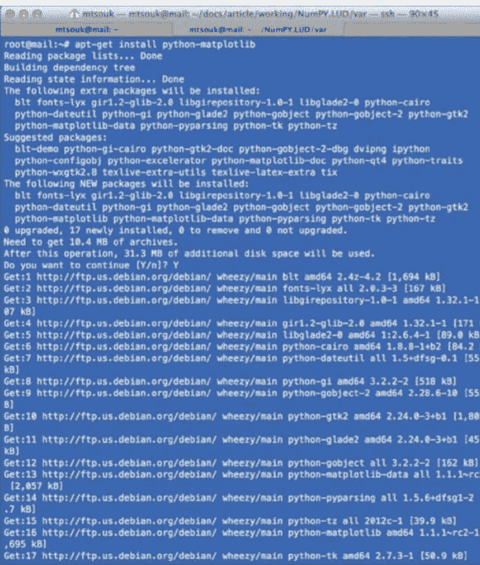


# 使用 NumPy 进行科学计算：使用 Python 工作


```bash
mtsouk@mail:~$ mtsouk@mail:~ /docs/article/NumPy_LUD/var -- ssh 90x45
root@mail:~# apt-get install python-matplotlib
Reading package lists... Done
Building dependency tree
Reading state information... Done
The following extras will be installed:
libqt5-gif-2.0-libgiproject-1.0-libglairoairo2-cairo
python-dateutil-python-gib2-python-glad2-python-gobject-python-gobject-2-python-gtk2
python-matplotlib-data-python-pypparsing-python-tk-tz
Suggested packages:
bl3-python-gi3-cairo-python-gtk2-dkc-python-object-2 dbg dvping ipnthon
python-configobj-python-qtairo-matplotlib-doc-python-qt4-python-traits
python-xwtk8.2-libqt5-core-latex-extra-utils-latex-live-latex-tex
The following new packages will be installed:
libqt5-gif-2.0-libgiproject-1.0-libglairo-2-cairo
python-dateutil-python-gib2-python-glad2-python-gobject-python-gobject-2-python-gtk2
python-matplotlib-data-python-pypparsing-python-tk-tz
upgraded, 17 installed, 0 to remove and not be upgraded.
After this operation, 31.3 MB of additional disk space will be used.
Do you want to continue? [Y/n] Y
Get 1 http://ftp.debian.org/debian/weeezy/main/amd64/2.4-r4.2 [1,694 kB]
Get 2 http://ftp.debian.org/debian/weeezy/main/fontx-all_2.0.3-3 [167 kB]
Get 3 http://ftp.debian.org/debian/weeezy/main/librepository-1.0-1_amd64_13.2.1-1 [107 kB]
Get 4 http://ftp.debian.org/debian/weeezy/main/libg1.2-2.0_amd64 [176 kB]
```


Get 5 http://ftp.debian.org/debian/weeezy/main/libylad2-2_amd64_1.26.4-1 [89.0 kB]

Get 6 http://ftp.debian.org/debian/weeezy/main/libqt5-common-1.1.1-2_amd64 [84.2 kB]

Get 7 http://ftp.debian.org/debian/weeezy/main/python-dateutil-all_1.5-dfgs-0.1 [55.3 kB]

Get 8 http://ftp.debian.org/debian/weeezy/main/python-gi1_amd64_3.2.2 [518 kB]

Get 9 http://ftp.debian.org/debian/weeezy/main/python-gobject-2_amd64_2.28.6-1 [555 kB]

Get 10 http://ftp.debian.org/debian/weeezy/main/python-gtk2_amd64_2.24.0-3b1 [1,085 kB]

Get 11 http://ftp.debian.org/debian/weeezy/main/python-glade_amd64_2.24.0-3b1 [45.8 kB]

Get 12 http://ftp.debian.org/debian/weeezy/main/python-gobject_amd64_3.2.2-2 [162 kB]

Get 13 http://ftp.debian.org/debian/weeezy/main/python-matplotlib-data_all_1.1-rc2-1 [2,257 kB]

Get 14 http://ftp.debian.org/debian/weeezy/main/python-pypparsing_all_1.6-dfgs-1 [64.7 kB]

Get 15 http://ftp.debian.org/debian/weeezy/main/python-tz_amd64_2012-c1-9 [39.9 kB]

# 使用 NumPy 进行科学计算：使用 Python 工作


```bash
mtsouk@mail:~$ mtsouk@mail:~ /docs/article/NumPy_LUD/var -- ssh 90x45
root@mail:~# apt-get install python-matplotlib
Reading package lists... Done
Building dependency tree
Reading state information... Done
The following extras will be installed:
libqt5-gif-2.0-libgiproject-1.0-libglairo-2-cairo
python-dateutil-python-gib2-python-glad2-python-gobject-python-gobject-2-python-gtk2
python-matplotlib-data-python-pypparsing-python-tk-tz
Suggested packages:
bl3-python-gi3-cairo-python-gtk2-dkc-python-object-2 dbg dvping ipnthon
python-configobj-python-qtairo-matplotlib-doc-python-qt4-python-traits
python-xwtk8.2-libqt5-core-latex-extra-utils-latex-live-latex-tex
The following new packages will be installed:
libqt5-gif-2.0-libgiproject-1.0-libglairo-2-cairo
python-dateutil-python-gib2-python-glad2-python-gobject-python-gobject-2-python-gtk2
python-matplotlib-data-python-pypparsing-python-tk-tz
upgraded, 17 installed, 0 to remove and not be upgraded.
After this operation, 31.3 MB of additional disk space will be used.
Do you want to continue? [Y/n] Y
Get 1 http://ftp.debian.org/debian/weeezy/main/amd64/2.4-r4.2 [1,694 kB]
Get 2 http://ftp.debian.org/debian/weeezy/main/fontx-all_2.0.3-3 [167 kB]
Get 3 http://ftp.debian.org/debian/weeezy/main/librepository-1.0-1_amd64_13.2.1-1 [107 kB]
Get 4 http://ftp.debian.org/debian/weeezy/main/libg1.2-2.0_amd64 [176 kB]
Get 5 http://ftp.debian.org/debian/weeezy/main/libylad2-2_amd64_1.26.4-1 [89.0 kB]
Get 6 http://ftp.debian.org/debian/weeezy/main/libqt5-common-1.1.1-2_amd64 [84.2 kB]
Get 7 http://ftp.debian.org/debian/weeezy/main/python-dateutil-all_1.5-dfgs-0.1 [55.3 kB]
Get 8 http://ftp.debian.org/debian/weeezy/main/python-gi1_amd64_3.2.2 [518 kB]
Get 9 http://ftp.debian.org/debian/weeezy/main/python-gobject-2_amd64_2.28.6-1 [555 kB]
Get 10 http://ftp.debian.org/debian/weeezy/main/python-gtk2_amd64_2.24.0-3b1 [1,085 kB]
Get 11 http://ftp.debian.org/debian/weeezy/main/python-glade_amd64_2.24.0-3b1 [45.8 kB]
Get 12 http://ftp.debian.org/debian/weeezy/main/python-gobject_amd64_3.2.2-2 [162 kB]
Get 13 http://ftp.debian.org/debian/weeezy/main/python-matplotlib-data_all_1.1-rc2-1 [2,257 kB]
Get 14 http://ftp.debian.org/debian/weeezy/main/python-pypparsing_all_1.6-dfgs-1 [64.7 kB]
Get 15 http://ftp.debian.org/debian/weeezy/main/python-tz_amd64_2012-c1-9 [39.9 kB]
Get 16 http://ftp.debian.org/debian/weeezy/main/python-pypparsing_all_1.6-dfgs-1 [64.7 kB]
```

# 系统管理员的 Python 教程

## 使用 Python

```ini
zend.zel_compatibility_mode = Off

short_open_tag = On

asp_tags = Off

precision = 14

y2k_compliance = On

output_buffering = 4096

;output_handler = =

zlib.output_compression = Off
```

```python
host(),'localhost'

config.set('MySQL','mysql.default_port','3306')

config.set('MySQL','mysql.allow_persistent','On')

config.set('MySQL','mysql.max_persistent','20')
```

```ini
[MySQL]

; 或阻止持久连接。

mysql.allow_persistent = On
```


`mysql.max_persistent` = 20

`mysql.max_links` = -1

`mysql.default_port` = 3306

`mysql.default_socket` = =

`mysql.default_host` = localhost

`mysql.connect_timeout` = 60

`mysql.trace_mode` = Off

```
```python

with open('php.ini', 'ap') as config:

    config.write(config)

Output:php.ini

[MySQL]

mysql.max_persistent = 20

mysql.allow_persistent = On

mysql.default_port = 3306

mysql.default_host = localhost

mysql.trace_mode = Off

mysql.connect_timeout = 60

```
```

Python 提供了一个名为 ConfigParser 的内置模块（在 Python 3.0 中重命名为 `configparser`）。你可以使用该模块来解析和创建配置文件。

> `@code:writeconfig.py`
> `@description:` 以下示例演示了如何向 `php.ini` 文件写入 MySQL 段。
> `@warning:` 不要对实际的 `php.ini` 文件使用此脚本，因为它并没有设计处理完整 phpini 的所有方面。

```python

@code:parseconfig.py

@description: 解析并更新配置文件

import ConfigParser

config = ConfigParser.ConfigParser()

# 打印配置值

print config.get('MySQL','mysql.default_host')

print config.get('MySQL','mysql.default_port')

config.remove_option('MySQL','mysql.trace_mode')

with open('php.ini', 'wb') as config:

    config.write(config)

```

# 解析 JSON 数据

JSON（也称为 JavaScript 对象表示法）是一种轻量级的现代数据交换格式。JSON 是 ECMA-262 下的开放标准。它是一种文本格式


并且完全独立于语言。JSON 也被用作 Mozilla Firefox 和 Google Chrome 等现代应用的配置格式。JSON 也非常流行 Facebook、Twitter、Amazon EC2 等现代网络服务。在本节中，我们将使用 Python 模块 `simplejson` 来访问 Yahoo 搜索（使用 Yahoo Web Services API），该 API 输出 JSON 数据。

在本节中，我们将使用 `simplejson.Load` 函数，它允许我们将 JSON 对象反序列化为 Python 对象。

要使用本节内容，你需要以下条件：

- 1. Python 模块：`simplejson`。

```python

@code: YahooSearch.py

import simplejson, urllib

APP_ID = 'xxxxxxx' # 更改为你的 APP ID

SEARCH_BASE = 'search.yahooapis.com/WebSearchService/1/webSearch

```

注意：你可以使用命令 `easy_install <module_name>` 安装 Python 模块。这假设你有一个可用的互联网连接。

```python

class YahooSearchError(Exception):

    pass

```

- 2. Yahoo App ID:
Yahoo App ID 可以从 https://developers.yahoo.com/dashboard/createKey.html 创建。Yahoo App ID 将在下一页生成。详情见截图。`simplejson` 非常易使用。在接下来的示例中，我们将利用将 JSON 数据结构映射到 Python 数据类型的功能。这让我们可以直接访问 JSON 数据，而无需编写任何 XML 解析代码。

```python

def search(query,results=20, start=1, **kwargs):

    kwargs.update({

        'appid': APP_ID,

        'query': query,

        'results': results,

        'start': start,

        'output': 'json'

    })

    url = SEARCH_BASE + '?' + urllib.parse.urlencode(kwargs)

    result = simplejson.load(urllib.request.urlopen(url))

    if 'Error' in result:

        # 发生错误；抛出异常

        raise YahooSearchError(result['Error'])

    return result['ResultSet']

```

# JSON 数据映射

| JSON | Python |
| --- | --- |
| object | dict |
| array | list |
| string | unicode |
| number (int) | int, long |
| number (real) | float |
| TRUE | TRUE |
| FALSE | FALSE |
| null | None |

在 Python shell 中运行上述列的代码来查看它是如何工作的。切换到保存 `LUDYSearch.py` 的目录并打开 Python shell。

`@code: Python Shell Output.`


所以，你想使用一些 Yahoo! APIs...
为了使用 Yahoo Web Services，我们需要你提供一些信息。我们需要关于应用程序的信息，以便更好地理解 Yahoo 服务的使用。所有问题都是必要的。

| SUBMIT FORM | GET YOUR ADDRESS | WRITE YOUR CODES |
| --- | --- | --- |

关于应用程序

| Application Name: | LudySearch |
| --- | --- |
| Kind of Application: | Client/Desktop |
| Description: | 使用 Python 解析 JSON 的应用少于 260 个字符 |

Favicon URL: http://www.yahoo.com/this/App/Favicon.gif
可选：指定一个 JPG、PNG 或 GIF  URL。

# 安全与隐私

Yahoo APIs 使用 OAuth 协议进行 API 使用验证和端用户身份验证。访问范围：此应用仅访问公共 API、网络服务或 RSS 馈。此应用需要私有数据。

# 联系信息

万一出现问题我们需要帮助：
应用程序名称: LudySearch
邮箱: 
使用条款：同意

系统管理员的一项工作是收集信息。下一个示例展示了如何这样做。以下代码显示内存和文件系统信息。

```python

@code: PySysInfo.py

import os

import sigar

s = sigar.open()

mem = mem.system()

swap = sg.swap()

fslist = sg.file_system_list()

print "====Memory ===="

print "Information===="

print "\tTotal\tUsed\tFree"

print "Mem:\t",

```

```

@Output

==================

Information====

Total Used Free

Mem: 8388608 6061884 2326274

Swap: 131072 16048 115024

RAM: 8192 MB

====File System ====

Information====

Filesystem Size Used Avail

Use% Mounted on Type

```

```python

def format_size(size):


```python
return sigar.format_size(size)
```

```python
for fs in fslist:
  dir_name = fs.dir_name()
  usage = sg.file_system_usage(dir_name)
  total = usage.total()
  used = total - usage.free()
  avail = usage.avail()
  pct = usage.usage_percent() * 100
  if pct == 0.0:
    print fs.dev_name(), format_size(total), format_size(used), format_name(name), '/', fs.type_name()
```

# 系统管理员的 Python 教程：使用 Python

- `/dev/disk02` | 300G | 175G | 124G | 59.0 / hfs / local
- devvs | 191K | 191K | 0 - /dev/devfs / none

- `import base64, getpass, os, socket, sys, socket, traceback`
- `import paramiko`
- `import interactive`
- `# 设置日志`
`paramiko.util.log_to_file('demo_simple.log')`
- `# 获取主机名`
`username = ""`
- `if len(sys.argv) > 1:`
    `hostname = sys.argv[1]`
    `if hostname.find('@') >= 0:`
        `username, hostname = hostname.split('@')`
`else:`
    `hostname = raw_input('Hostname: ')`
    `if len(hostname) == 0:`
        `print('*** Hostname required.')`
        `sys.exit(1)`
    `port = 22`
    `if hostname.find('::') >= 0:`
        `hostname, portstr = hostname.split(':')`
        `port = int(portstr)`

## 访问安全外壳 (SSH) 服务

SSH（Secure Shell）是旧版 Telnet 的现代替代品。它允许在两个网络设备之间通过安全通道进行数据交换。管理员经常使用 SSH 来管理网络系统。除了提供远程 shell 外，SSH 还用于安全文件传输（使用 SSH 文件协议，即 SFTP）和 X 服务器转发（允许 SSH 客户端作为 X 服务器）。在本节中，我们将学习如何使用 Python 模块 `paramiko` 来使用 SSH，该模块为 Python 实现了 SSH2 协议。可以通过以下步骤安装 `paramiko`：

- `$ git clone https://github.com/robey/paramiko.git`
- `$ cd paramiko`
- `$ sudo setup.py install`

`paramiko` 的核心是 `SSHClient` 类。该类封装了 `[Transport]`、`[Channel]` 和 `[SFTPClient]` 用来处理 SSH 的大部分方面。你可以使用 `SSHClient`：

```python
client = SSHClient()
client.load_system_host_keys()
client.connect('some.host.com')
stdin, stdout, stderr = client.exec_command('dir')
```

以下示例演示了使用 `paramiko` 模块编写的完整 SSH 客户端。

- `@code: PySSHClient`

```python
# 获取用户名
username = ""
default_username = getpass.getuser()
username = raw_input('Username [%s]: ' % (default_username))
if len(username) == 0:
    default_password = getpass.getpass('Password for %s: ' % (default_username))
# 现在，连接并使用 paramiko Client 跨连接协商 SSH2
try:
    client = paramiko.SSHClient()
    client.load_system_host_keys()
    client.set_missing_host_key_policy(paramiko.WarningPolicy)
    *** Connecting...***
    client.connect(hostname, port, username, password)
    chan = client.invoke_shell()
    print(repr(client.get_transport()))
    print('*** SSH Server Connected!**')
    ~ $:
    interactive.interactive_shell(chan)
    chan.close()
    client.close()
except Exception, e:
    print('*** Caught exception: %s' % (e.__class__, e))
    traceback.print_exc(e)
    try:
        client.close()
    except:
        pass
```

*** Caught exception: <type exceptions.TypeError>: unbound method missing_host_key() must be called with WarningPolicy instance as first argument (got SSHClient instance instead)

这意味着客户端无法验证你所连接服务器的真实性。要将主机添加到已知主机列表中，请使用 `ssh` 命令。请记住，这不是添加主机密钥的理想方法；相反你应该使用 `ssh-keygen`。为了方便运行，你还需要一个自定义的 Python 类 `interactive.py`，它实现了 SSH 会话的交互式 shell。在 FileSilo 上查找此文件并将其复制到创建 `SSHClient.py` 的相同文件夹中。

```bash
kuna@ubuntu-vm-kde:~\$ ssh ssh
luduser@192.168.1.2
```

主机 '192.168.1.2' ('192.168.1.2') 的真实性无法建立。
RSA 密钥指纹为：01:76:c4:b9:bb:66:9:e3:cd:37:00:a4:36:d3:01

你确定要继续吗？(yes/no)? yes
Warning: Permanently added '192.168.1.2' (RSA) to the list of known hosts.

```text
@Code_Output
kunal@ubuntu-vm:~/src/paramiko/
demos$ python demo_sample.py
Hostname: 192.168.1.2
Username]: luduser
Password for luduser@192.168.1.2:
*** Connecting...***
<paramiko.Transport at 0xb76201acl (cipher aes128-ctr)>
*** SSH Server Connected!**
```

## 使用 Python

### 给系统管理员的 Python

如果 SSH 服务器的密钥未添加到你的 `$HOME/ssh/known_hosts` 文件中，客户端将抛出以下错误：

## 使用 Beautiful Soup 爬取 Wikipedia 与 Python 工作

## 完整代码

+ 1 导入库
这些是我们在程序中将使用的

```python
01 import os, sys, urllib2, argparse, datetime, atexit
from bs4 import BeautifulSoup
```

```python
addresses = []
deepestaddresses = []
maxlevel = 1
storeFolder = "Wikstore" + str(datetime.datetime.now().strftime("%Y-%m-%d %H:%M:%S"))
```


02 `undesirables = [<element="table",attr="class="infobox"\"><element="table",attr="class="vertical-orphan"\"><element="span",attr="class="mw-editwindow"\"><element="span",attr="class="reference"\"><element="div",attr="class=""><element="div",attr="class="thumb"\"><element="span",attr="class=""><element="table",attr="class="reflist"\"><element="table",attr="class="nowraplinks"\"><element="table",attr="class="Ambox-refinfo"\"><element="img",attr="None"><element="table",attr="class="script"\"><element="None",attr="None"><element="table",attr="class=""><element="table",attr="class="mbox-Orphan"\"><element="table",attr="class="mainarticle"\"><element="None",attr="None"><element="attr",attr="class="References">`

+ 2 设置变量
这些是一些我们将用来跟踪脚本进度的变量

```python
def init():
    parser = argparse.ArgumentParser(description="处理页面页码和我们要爬取的层数")
    parser.add_argument('--URL', dest='link', action='store', help='从这里开始爬取的 Wikipedia 页面')
    parser.add_argument('--levels', dest='levels', action='store', help='爬虫应该深入到多少层？')
    args = parser.parse_args()
```

```python
03 if args.level is None:
    global maxlevel
    maxlevel = int(args.levels)
```

```python
if args.link is None:
    print("你需要通过 -URL 标志传递链接")
    sys.exit(0)
else:
    if not os.path.exists(storeFolder):
        os.makedirs(storeFolder)
    grabPage(args.link, 0, args.link.split("/wiki/")[1].replace("-", ""))
    atexit.register(cleanup)
```

```python
def isValidLink(link):
    if "/wiki/" in link and "-" not in link and "http://" not in link and "wikibooks" not in link and "#" not in link and "wikiquote" not in link and "wiktionary" not in link and "university" not in link and "wikivoyage" not in link and "wikisource" not in link and "wikinews" not in link and "wikidata" not in link:
        return True
    else:
        return False
```

+ 3 初始化
这是我们处理来自用户输入的初始函数

```python
04 grabPage(URL, level, name):
    opener = urllib2.build_opener()
    opener.headers = [{"User-agent", "Mozilla/5.0"}
    req = opener.open(URL)
```


# 使用 Python 工作

## 使用 Beautiful Soup 爬取 Wikipedia

# 百事百科（Wiki-Everything）

Wikipedia 有许多相互互联的不同服务，我们不想抓取那些页面，因此我们编写了一个很长的条件语句来停止操作。它在确保我们只获取来自 Wikipedia 的链接方面表现非常好。

## 创建有用变量

02 这些变量将跟踪脚本运行期间我们访问的链接；`addresses` 是一个包含我们访问过的每个链接的列表；`deepestAddresses` 是从起点开始链接最深处的页面链接；`storeFolder` 是我们保存 HTML 文件的地方，`maxLevel` 是我们可以跟随链接到起始页面的最大深度。

# 处理用户输入

03 在此函数的前几行中，我们只是在创建一个辅助语句。之后，我们解析执行时传递给程序的任何参数，并寻找 `-URL` 标志和 `-levels` 标志。如果我们已经预设了要跟随链接的深度，则 `-levels` 标志是可选的，但如果缺少 `-URL` 标志，我们需要一个起始链接，我们会提示用户并退出。如果我们有链接，我们会快速检查我们是否有一个存储文件的目录——如果没有，我们就创建一个——然后调用函数来获取该页面。最后，我们注册一个在脚本尝试退出时运行的句程序。

# 从 URL 获取页面

04 在这里，我们使用 `urllib` 请求用户请求的页面，一旦我们收到该页面，我们将通过 `soup` 变量将内容传递给 `BeautifulSoup`。这允许我们在解析文档时访问将要调的方法。

# 修剪冗余

05 Wikipedia 有许多我们不想解析的节点。内容部分允许我们直接忽略 Wikipedia 的大部分 GUI，但仍然有很多我们不想解析的元素。我们通过遍历在文档早些创建的 `undesirables` 列表来解决这个问题。对于我们不想要的每个不同 div/section/节点，我们调用 `BeautifulSoup` 的 `find_all()` 方法并从文档中提取该节点。在 `undesirables` 列表的末尾，大部分我们不需要的内容都将消失。我们还会查找 Wiki 页面中的 `also` 元素。通常，这之后的所有内容对我们都有用。通过在 `also` 节点上调用 `find_all_next()` 方法，我们可以获得从该点开始可以移除的所有元素列表。

> "HTML 页面在渲染页面时使用内置的浏览器样式"

## 使用 Beautiful Soup 爬取 Wikipedia

“Wikipedia 有许多不同的服务相互互联；我们不想抓取那些页面”

```python
page = req.read()
req.close()
soup = BeautifulSoup(page, "html5lib", from_encoding="UTF-8")
content = soup.find(id="mw-content")
if hasattr(content, 'find_all'):
    global undesirables
    for notWanted in undesirables:
        removal = content.find_all(notWanted)
        if len(removal) > 0:
            for el in removal:
                el.extract()
also = soup.find(id="also")
if also is not None:
    tail = also.find_next('li')
    if len(tail) > 0:
        for element in tail:
            element.extract()
for link in content.find_all('a'):
    href = link['href']
    if isValidLink(href):
        if level < maxlevel:
            stored = False
            for addr in addresses:
```


```
if addr == href:

    stored = True

if stored == False:

    title = href.replace("/wiki/", "")

    addresses.append(str(title) + ".html")

    grabPage("http://wikipedia.org" + href, level, title)
```

### 4 获取页面
在这里我们使用 `urllib` 请求用户请求的页面，一旦我们收到该页面，我们将通过 `soup` 变量将内容传递给 `BeautifulSoup`。这允许我们在解析文档时访问将要调的方法。

### 5 检查链接
我们遍历所有的 `<a>` 标签，并检查 `href` 中是否有有效的 Wikipedia 链接。如果链接有效，我们会快速检查从当前页面跟随了多深。如果我们达到了可以跟随的最大深度，我们会存储此页面并退出，否则我们将开始寻找可以抓取的链接。对于请求的每个页面，我们将它的 URL 添加到 `addresses` 列表中；确保不会对每个链接重复调用页面。

### 样式
这之后的所有内容对我们都有用。通过在 `also` 节点上调用 `find_all_next()` 方法，我们可以获得从该点开始可以移除的所有元素列表。当前，HTML 在渲染页面时将使用内置的浏览器样式。

```python
print title

link['href'] = link['href'].replace("/wiki/",
```

1, title

## 抓取链接
上方查看 Beautiful Soup 文档 http://bit.ly/02I68D

## 写入文件
现在我们创建一个文件以便以后读取新解析的文档。我们将文件名中的任何 `?` 更改为 `.so`，以免脚本尝试写入随机随机文件夹。我们还会快速检查目前为止跟随了多少链接。如果达到了它的最大深度，我们将将其添加到 `deepestAddresses` 列表中。我们稍后会用到这一小部分。

## 使用 Beautiful Soup 爬取维基百科

## 收尾工作

08 在我们的脚本遍历每个页面上的每个链接并达到它能达的最大深度后，它将尝试退出。在代码中 `init` 函数（磁盘和在线版本）的第 34 行，我们注册了 `cleanUp` 函数在程序退出时执行；`cleanUp` 的任务是遍历我们下载的文档，并检查我们在页面中下的每个链接是否确实指向一个我们可以使用的的文件。如果无法将文件中的链接与地址列表匹配，将将其删除。一旦完成，我们就拥有了一个完全便携的维基百科片段，可以随带使用。

06 复制到文件 之后，我们将解析出的内容放入一个全新的 HTML 文件

```python
doctype = "!DOCTYPE html"

head = "<head<meta charset='UTF-8'/></title>" + fileName + "</title>"

f = open(storeFolder + "/" + fileName.replace('_', '_') + ".html", 'w')

f.write(doctype + "<html>\n" + head + "<body><h1>" + content + "</h1></body></html>")

f.close()
```

```python
def cleanup(soup):
    print("\n正在移除指向未保存页面的链接\n")
    for deepPage in deepestAddresses:
        rf = open(storeFolder + "/" + deepPage, 'r')
        deepSoup = BeautifulSoup(rf.read(), 'html5lib', from_encoding='UTF-8')
        for link in deepSoup.find_all('a'):
            pageStored = False
            for addr in addresses:
                if addr == link:
                    pageStored = True
            if pageStored == False:
                if '#' is not in link:
                    del deepLinks[link['href']]
                elif '#' in link and len(link.split('#')) > 1 or ':' in link:
                    del deepLinks[link['href']]
            wf = open(storeFolder + "/" + deepPage, 'w')
            wf.write(deepSoup)
            wf.close()
```

07 清理 一旦每个页面都已解析并存储，我们将遍历并尝试移除任何死链接

08 初始化 这是我们初始化脚本的方式

```python
print("Complete")

if __name__ == "__main__":
    init()
```


# 使用 Python 创建

享受编程的乐趣

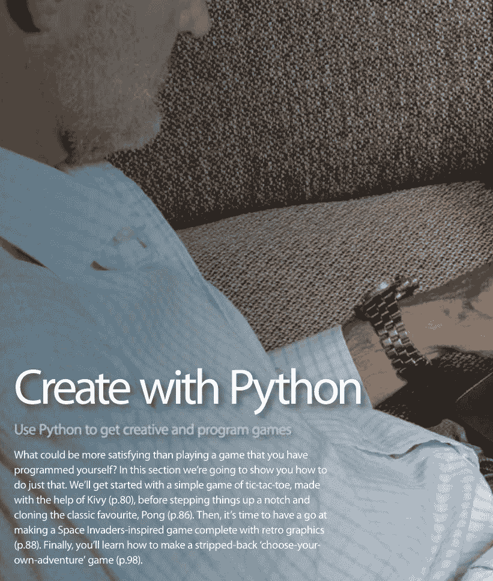

# 使用 Python 创建

使用 Python 发挥创意并编写游戏
还有比玩一个自己编写的游戏更令人满足的呢？在本节中，我们将向你展示如何实现这一点。我们将从一个借助 Kivy (p.80) 制作的简单井井棋游戏开始，然后进阶克隆经典的喜爱游戏——乒乓球 (Pong, p.86)。接着，是时候尝试制作一个带有复古画面的受《太空入侵者》启发的游戏了 (p.88)。最后，你将学习如何制作一个精版的“自选冒险”游戏 (p.98)。

## 享受编程的乐趣

# 使用 Python 创建


“制作一个可玩的游戏并没有你想象的那么困难”

# 使用 Python 创建

## 使用 Kivy 构建井井棋

你可能需要的...

**Python**
www.python.org/doc

## 使用 Kivy 构建井井棋

通过在100多行 Python 代码中创建井井棋，轻松熟悉 Kivy 的原理...

Kivy 是一个为 Python 设计的跨平台图形框架，用于创建新的多触摸用户界面。它的应用程序不仅可以在 Linux、OS X 和 Windows 等传统桌面平台运行，还可以在 Android、iOS 以及树莓派等设备上运行。这意味着你可以使用 Requests、SQLAlchemy 甚至 NumPy 等 Python 库来开发跨平台应用。访问原生 API。另一个优秀特性是 Kivy 优化的图形管线，允许实现高级视觉效果，尽管基础 API 非常简单。

Kivy 是一组 Python/Cython 模块，可以通过 pip 轻松地安装，但你需要一些依赖项。它使用 Pygame 作为渲染后端（尽管其 API 未暴露），使用 Cython 进行图形编译，使用 Gstreamer 处理多媒体。这些应该可以通过你的发行版或 pip 获取。在满足这些依赖项后，你应该通过正常指令安装 Kivy。当前版本是 1.8.0，相同的代码支持 python2 和 python3。本教程的代码与版本无关，运行在 python2.7 和 python3 中。

```bash
pip install kivy
```

如果你在 pip 上遇到任何问题，可以使用发行版提供的 easy_install。你可以在 Kivy 网站找到更多信息。Kivy 应用通过实例化和运行 'App' 类启动，这是初始化窗口并提供

## 使用 Kivy 构建井井棋 使用 Python

创建我们 GUI 的入口。我们可以开始制作最简单的 Kivy 应用：

```python
from kivy.app import App

class TicTacToeApp(App):
    pass

if __name__ == "__main__":
    TicTacToeApp().run()
```


你可以轻松运行它，你的应用将启动并获得一个空白窗口。太兴奋了！我们可以用 Kivy 组件构建自己的 GUI。每个组件都是具有特定行为的简单元素，从标准 GUI 功能（例如 `Button`, `Label`）到子组件布局（例如 `BoxLayout`, `GridLayout`），再到更复杂的硬件交互任务（例如 `FileChooser`, `VideoPlayer`）。重要的是，Kivy 的组件设计为易于组合——包括想象中的每一个组件，组件保持简单，但我们将在教程中看到一些

```python
def build(self):
    return Label(text='Hello World!',
                 font_size=100,
                 color=(r, g, b, a))
```

`build` 方法在 `App` 时被调用，返回值就是 App 的根。在我们的情况下它是一个 `Label`，我们设置了几个属性——`text`、`font_size` 和 `color`。所有组件都有控制外观的不同属性，可以动态更新，在这里我们只看到一次：

- 注意，属性不仅仅是 Python 属性，而是 Kivy 内部的属性。这些访问方式像普通属性，但通过挂钩 Kivy 的事件系统提供了额外功能。
- 我们将看到创建属性的示例，如果你要在 Kivy 的事件和绑定中使用你的变量，也应该这样做。
- 你只需要显示一些简单的文本，所以再次运行程序检查这是否有效。如果任何参数不清楚，请尝试实验。

```python
from kivy.uix.label import Label
```

我们将通过返回 `Label` 作为应用的根组件来显示它。每个应用都有一个根组件，顶层文本，它会自动调整大小以填充窗口。稍后我们将看到如何通过添加更多组件来构建 GUI，但现在通过向 `App` 添加一个新方法来设置根组件就足够：

# 使用 Python 创建

## 使用 Kivy 构建井井棋

我们的组件：井井棋

由于 Kivy 没有井井棋，我们必须自己制作！我们将创建一个新的组件类来包含这些子组件。这个示例演示了前者，通过声明每个实例化的 `TicTacGrid` 都应该将其 `cols` 属性设置为 3，为 `TicTacGrid` 组件创建了一个规则。

```python
from kivy.uix.gridlayout import GridLayout

class TicTacGrid(GridLayout):
    pass
```

我们将稍后使用更多布局功能，但现在回到 Python 在你的井井棋网格中创建按钮。现在这显然没有做什么，除了它继承了 Kivy `GridLayout` 组件的所有行为——我们需要告诉它有多少列，但随后它将安排任何组件以整齐的行形式排列。井井棋需要三列和九个子组件。

```python
from kivy.uix.button import Button
from kivy.properties import ListProperty
```

```python
class GridEntry(Button):
    coords = ListProperty([0, 0])
```

在这里我们引入 Kivy 语言 `kv`，一种用于创建 Kivy 树的特殊领域特定语言。它简单但消除了许多管理 UI 所需的样板代码——作为类比，你可能会认为它是 HTML/CSS 之于 JavaScript。Python 给了我们做任何事情的动态权力，但如果我们只想声明 UI 的基础结构，可能永远不需要 Kivy 语言，你完全可以在纯 Python 中实现同样的功能。

这种继承自 Kivy 的组件，与鼠标或触摸交互，在切换时分发事件。我们可以挂钩这些事件，在用户按下按钮时调用自己的函数，并设置按钮的 `text` 属性以显示 `X` 或 `O`。我们为组件创建了一个新的 Kivy 属性，`coords`——稍后我们将展示这有多用。这与在 `GridEntry.__init__` 中通过编写 `self, coords = [0, 0]` Python 属性几乎相同。

Kivy 提供了使用 kv 所需的所有工具，最简单的方法将其写在一个根据你的 App 类命名的文件中。也就是说，我们应该将以下内容放在名为 `tictacttoe.kv` 的文件中：

对于 `TicTacGrid` 我们将使用 kv 语言样式化我们的新类，但这次我们可以看到一些有趣的。

```kv
<TicTacGrid:
cols: 3
```

```kv
<GridEntry>:
font_size: self.height
```

## 使用 Kivy 构建井井棋游戏

# 使用 Python 创建

从 Python 中创建这些绑定（除了稍后使用的 `bind` 方法外），通常并不像直接引用我们想要绑定的属性那样方便。

我们显示了它们，并知道它们会自动排列成我们之前设置的具有数字列的网格。

现在，我们必须将我们的根组件（从 `App.build` 返回）替换为 `TicTacToeGrid`，这样我们就能看到应用的样子了。

让我们向 `TicTacToeGrid` 中填充 `GridEntry` 小组件。

```python
class TicTacToeGrid(GridLayout):
    def __init__(self, *args, **kwargs):
        super(TicTacToeGrid, self).__init__(*args, **kwargs)
        for row in range(3):
            for column in range(3):
                grid_entry = GridEntry(
                    coords=(row, column))
                grid_entry.bind(on_release=self.button_pressed)
                self.add_widget(grid_entry)
```

```python
def build(self):
    return TicTacToeGrid()
```

通过此，你可以再次运行 Python 文件并享受你的新程序。一切正常，单个 `Label` 被替换为一个由九个按钮组成的网格，每个按钮都可以点击（它会自动改变），并且你会看到来自你绑定的输出信息。

我们可以通过修改 Button 的其他属性来定制外观，但现在我们让它们保持原样。

```python
def button_pressed(self, instance):
    print('button clicked!'.format(instance.coords))
```

有人获胜了吗？
我们需要跟踪棋盘的状态以检查是否有人获胜，我们可以通过多个 Kivy 属性来实现。

这里引入了一个新概念：当我们实例化 `GridEntry` 小组件时，我们能够简单地通过作为关键字参数（kw）传递来设置它们的 `coords` 属性。这是一个 Kivy 属性自动处理的小功能。

```python
from kivy.properties import (ListProperty, NumericProperty)
```

我们使用 `bind` 方法在每当 `GridEntry` 小组件触发 `on_release` 事件时调用 `button_pressed` 方法。每当用户释放 `GridEntry` 按钮时，这种操作会自动发生。我们还可以绑定到 `on_press`（在按钮首次被点击时触发），或者绑定到按钮的任何 Kivy 属性（当属性修改时动态触发）。

```python
class TicTacToeGrid(GridLayout):
    status = ListProperty((0, 0, 0, 0, 0, 0, 0))
    current_player = NumericProperty(1)
```

我们通过 `add_widget` 方法将每个 `GridEntry` 小组件添加到我们的 `Grid` 中。这意味着每一个都是 `TicTacToeGrid` 的子组件，因此它将...

这添加了一个状态列表来表示谁玩过棋，并给当前玩家分配了一个数字（1 代表 `O`，-1 代表 `X`）。

通过将这些放入我们的状态列表中，我们就能知道某行、某列或对角线的和是否为 +3，从而有人获胜。现在我们可以在进行移动时更新我们的图形网格。

# 使用 Python 创建

## 使用 Kivy 构建井井棋游戏

```python
def button_pressed(self, button):
    player = {'O': 'O', 'X': 'X'}
```


`colours = {1: (1, 0, 0), -1: (0, 1, 0)}`

`# (r, g, b, a)`

`row, column = button.coords`

`status_index = 3*row + column`

`already_played = self.status[status_index]`

`if not already_played:`

`self.status[status_index] = self.current_player`

`button.text = {'O': 'O', 'X': 'X'}[self.current_player]`

`button.background_color = colours[self.current_player]`

`self.current_player *= -1`

```python
def on_status(self, instance, new_value):
    status = new_value
    sums = [sum(status[0:3]), # 行
               sum(status[3:6]),
               sum(status[6:9]),
               sum(status[0::2]), # 列
               sum(status[1::2]),
               sum(status[::2]), # 对角线
               sum(status[2::::-2])]
    if 3 in sums:
        print('Os win!')
    elif -3 in sums:
        print('Xs win!')
    elif 0 not in self.status: # 网格已满
        print('Draw!')
```

你可以运行此应用来确切看到它的效果，你会发现点击每个按钮都会根据轮到谁来放置 `'O'` 或 `'X'` 以及一个有颜色的背景。不仅如此，由于我们的状态跟踪了已有的移动，你每个按钮上只能玩一次。

这已经足够玩游戏了，但还缺少一个关键元素：一个告诉你在何时获胜的大弹窗！在我们做此之前，我们需要添加一些代码来检查游戏是否结束。Kivy 属性在这里还有另一个有用功能：每当它们改变时，会自动调用如果存在的 `_property` 方法，并在 Kivy 的事件系统中分发相应的事件。这使得在 Python 和 kv 语言中编写在属性更改时运行的代码变得简单。在我们的案例中，可以用它在每次更新状态列表时检查状态，如果玩家填满了某列、某行或对角线，这将很特别。

这涵盖了胜负或局的基本检测，但仅将结果打印到标准输出。在这个阶段，我们可能想要重置棋盘，以便玩家再次尝试，并显示结果的图形指示。

```python
def reset(self, *args):
    self.status = [0 for _ in range(9)]
    for child in self.children:
        child.text = ""
        child.background_color = (1, 1, 1, 1)
    self.current_player = 1
```

最后，我们需要修改 `_status` 方法以同时重置棋盘并在 `'ModalView'` 小组件中显示获胜者。

```python
from kivy.uix.modalview import ModalView
```


# 使用 Kivy 构建井井棋游戏

## 使用 Python 创建

这是一个弹窗，它绘制在其他所有内容之上，而不是作为普通组件树的一部分。当用户点击它外部时，它也会自动关闭。

```python
winner = None
if -3 in sums:
    winner = 'Xs win!'
elif 3 in sums:
    winner = 'Os win!'
elif 0 not in sums:
    winner = 'Draw...nobody wins!'
```

```python
if winner:
    popup = ModalView(size_hint=(0.75, 0.5))
    victory_label = Label(text=winner, font_size=50)
    popup.add_widget(victory_label)
    popup.bind(on_dismiss=self.reset)
    popup.open()
```


井井棋网格现在接收输入，交替添加 `'O'` 或 `'X'`，每回合

# 使用 Python 创建

## 使用 Python 制作 Pong 克隆游戏

### 你需要准备...

- 最新版本的树莓派镜像：`www.raspberrypi.org/downloads`
- Pillow: `https://github.com/python-imaging/Pillow`
- SimpleGUItk: `https://github.com/dholm/simpleGUItk/`

## 使用 Python 制作 Pong 克隆游戏

我们正在使用一个名为 SimpleGUItk 的新库，为 Linux 时代更新了复古经典游戏 Pong。

树莓派是学习编程的一种极佳方式。对于业余游戏编程来说，这是一个非常有感的领域，可以获得更具互动性的结果和更大的成就感。游戏编程还能教授即兴发挥和高级数学技能。我们将使用 Python 中极佳的 SimpleGUItk 模块，这是使用 Tkinter 创建图形界面的一种非常直接的方法。

下方：“Tux for you”是一个很棒的小型 Pong 克隆游戏，它将深受爱的 Linux 形象 Tux 放在了动作中心。


### Python 模块准备

#### SimpleGUI 代码

前往“你需要准备”中列出的网站，从 GitHub 页面下载源代码 zip 包。更新你的树莓派包并安装它们。

`draw` 部分中的重要部分是 `draw`、`line_image` 和 `draw text` 函数。这些函数专门来自 SimpleGUI，允许你根据大小、位置和颜色轻松地在屏幕上放置这些对象。不过，你需要绑定一个对象——在这种情况下是 `canvas`。这告诉软件我们想把这些项目显示在屏幕上查看。

```
$ sudo apt-get install python-dev setuptools tk8.5-dev
```

```
$ sudo python setup.py
# 完成后，确保使用 simpleguitk 文件夹并使用相同的命令安装它。
```

## 安装模块

## 编写你的代码

启动 IDE 2（而不是 IDE 3），并打开一个新窗口。代码编辑器将跟随我们的游戏“Tux for You”！请仔细跟随代码，以确保你清楚自己在做什么。如果你愿意，也可以修改游戏规则。

### SimpleGUI 设置代码

打开终端并使用 `cd` 移动到解压后的文件夹。然后输入：

最后几部分完全用于界面。我们将编写按下和释放按键时执行的操作，并给它提供一个运行框架（frame）。框架负责处理图形、按键函数等。最后，我们赋予它框架并启动，让它运行。

## 设置游戏

启动代码时没有什么新创的：Tux 和挡板的初始位置是根据 Tux 的初始速度和方向设置的。在得分和重置场地时，也会用到方向和速度。每次生成时方向和速度都会重置。


## 使用 Python 制作 Pong 克隆游戏

# 使用 Python 创建

## 完整代码列表


```python
import simpleguikit as simpleguikit
import random

w, h = 600, 400
tux = 20
pad_w = 0
pad_h = 80

def tux_spawn(right):
    global tux_pos, tux_vel
    tux_pos = [0, 0]
    tux_vel = [0, 0]
    tux_pos[0] = w/2
    tux_pos[1] = h
    if right:
        tux_vel[0] = random.randint(2, 4)
    else:
        tux_vel[0] = -random.randint(2, 4)
        tux_vel[1] = random.randint(1, 3)

def start():
    global paddle1_pos, paddle2_pos
    paddle1_vel, paddle2_vel
    global score1, score2
    score1 = random.choice([True, False])
    score2 = 2, 0
    paddle1_pos = [0, 2.2]
    paddle2_pos = [w, h/2]

def draw(canvas):
    global score1, score2, paddle1_pos,
    paddle2_pos, tux_pos
    if paddle1_pos[0] > (h - pad_h/2):
        paddle1_pos[0] = (h - pad_h/2)
    elif paddle2_pos[0] < (pad_h/2):
        paddle2_pos[0] = (pad_h/2)

    paddle1_pos[0] += paddle1_vel[0]
    canvas.draw_line((w/2, 0), (w/2, h), 4, 'Green')
    canvas.draw_line((0, pad_w/2), (w, pad_w2 + pad_w/2), 10, 'Green')
    canvas.draw_rect((pad_w/2, pad_h/2), (pad_w/2 + pad_w, pad_h * 2), 'Green')
    tux_pos[0] += tux_vel[0]
    tux_pos[1] += tux_vel[1]
    if tux_pos[0] <= 0 or tux_pos[0] >= w:
        tux_vel[0] *= -1
        tux_vel[1] = -tux_vel[1]*1
```

```python
if tux_pos[0] <= pad_w + tux_r/2:
    if (paddle_pos[1] + (pad_h/2)) >= tux_pos[1]:
        if tux_pos[1] >= (paddle_pos[1] - (pad_h/2)):
            tux_vel[0] = -tux_vel[0]*1.1
            tux_vel[1] *= 1
    else:
        score = 2
        tux_spawn(True)
if tux_pos[0] >= pad_w - tux_r:
    if (paddle_pos[1] - (pad_h/2)) <= tux_pos[1]:
        if tux_pos[1] <= (paddle_pos[1] + (pad_h/2)):
            tux_vel[0] = -tux_vel[0]*1.1
            tux_vel[1] *= 1.1
    else:
        score = 1
        tux_spawn(False)
canvas.draw_image(ux, (265 / 2, 314 / 2), (265, 314))
canvas.draw_text(str(score), [150, 100], 'Green')
canvas.draw_text(str(score), [450, 100], 'Green')
```

```python
def keydown(key):
    global paddle1_pos, paddle2_vel
    acc = 3
    if key == simplegui.KEY_MAP['w']:
        paddle1_vel[1] += acc
    elif key == simplegui.KEY_MAP['s']:
        paddle1_vel[1] -= acc
    elif key == simplegui.KEY_MAP['up']:
        paddle2_vel[1] += acc
    elif key == simplegui.KEY_MAP['down']:
        paddle2_vel[1] -= acc
```

```python
frame = simplegui.create('Pong for Two', w, h)
frame.set_key_handler(keydown)
frame.set_key_handler(keyup)
frame.set_image('http://upload.wikipedia.org/wikipedia/commons/a/af/Tux.png')
```

```python
start()
frame.start(start)
```


# 使用 Python 创建

## 制作一个 Space Invaders 克隆游戏

### 你需要准备...

- 树莓派：www.raspberrypi.org/downloads
- Python：www.python.org
- Pygame：www.pygame.org

## 编写 300 行 Python

当你学习新语言或尝试新模块时，通过熟悉的项目来扩展知识是一种很好的练习方法。`Space Invaders` 是一个完美的例子，它使用了许多 `Pygame` 的功能，让创建游戏和交互应用程序变得简单。我们花了几十行代码来处理碰撞检测和屏幕更新。享受这个项目并确保让它成为你自己的！太空侵击者是最伟大的游戏之一吗？每个人都知道如何玩！


## 太空侵击者 (Invaders)

# 使用 Python 创建

## 完整代码


```python
#!/usr/bin/env python
import pygame, random

BLACK = (0, 0, 0)
BLUE = (0, 0, 255)
WHITE = (255, 255, 255)
RED = (255, 0, 0)
ALIEN_SIZE = (30, 40)
ALIEN_SPAC = 20
BARRIER_ROW = 10
BARRIER_COLUMN = 4
BULLET_SIZE = (5, 10)
MISSILE_SIZE = (5, 5)
BLOCK_SIZE = (10, 10)
RES = (0, 0, 600)

class Player(pygame.sprite.Sprite):
    def __init__(self):
        super().__init__(self)
        self.size = (50, 50)
        self.rect = self.image.get_rect()
        self.rect.x = (RES[0] / 2) - (self.size[0] / 2)
        self.rect.y = 520
        self.speed = 350
        self.time = pygame.time.get_ticks()

    def update(self):
        self.rect.x += self.vector.x * self.speed
        if self.rect.x < 0:
            self.rect.x = 0
        elif self.rect.x > RES[0] - self.size[0]:
            self.rect.x = RES[0] - self.size[0]

def update_alien(self):
    if GameState.alien_time - self.time > 700:
        if self.has_moved() < 12:
            self.rect.x += self.vector[0] * self.speed
            self.has_moved() += 1
```

```
if not self.has_moved():
    self.rect.y += self.vector[1] * self.speed
    self.vector[0] *= -1
    self.has_moved() = [0, 0]
    if self.speed <= 100:
        self.speed += 20
GameState.alien_time = time

class Alien(pygame.sprite.Sprite):
    def __init__(self, color, width, height):
        super().__init__(self)
        self.image = pygame.Surface((width, height))
        self.image.fill(color)
        self.rect = self.image.get_rect()
        self.speed = 0
        self.vector = 0

    def update(self):
    self.rect.y += self.vector.x * self.speed
    if self.rect.y < 0 or self.rect.y > RES[1]:
        self.rect.y = RES[1]

class Block(pygame.sprite.Sprite):
    def __init__(self, color, width, height):
        super().__init__(self)
        self.image = pygame.Surface((width, height))
        self.image.fill(color)
        self.rect = self.image.get_rect()
        GameState.pass
        pass

class Game(object):
    def __init__(self):
        pygame.init()
        self.clock = pygame.time.Clock()
        self.game_font = pygame.font.Font('data/orbitraciter.ttf', 20)
        self.info_font = pygame.font.Font('data/orbitraciter.ttf', 70)
        self.screen = pygame.display.set_mode((RES[0], RES[1]))
        self.time = pygame.time.get_ticks()
        self.refresh_rate = 20
        self.rounds = 0
        self.level_up = 50
        self.score = 0
        self.lives = 2
        self.player_group = pygame.sprite.Group()
        self.alien_group = pygame.sprite.Group()
        self.bullet_group = pygame.sprite.Group()
        self.missile_group = pygame.sprite.Group()
        self.barrier_group = pygame.sprite.Group()
```

# 使用 Python 创建《星际入侵者》克隆版

## 设置依赖项

## 全局变量与元组

如果你想更更好地了解如何使用 `Pygame` 和 `Python` 编写游戏，我们强烈建议你将本教程中的 `Pivaders` 代码复制到自己的程序中。这是一个非常棒的练习，并让你有机会根据自己的喜好调整游戏元素，无论是更换图像、改变难度还是外星人波次的行为。不过，如果你只想玩玩这个游戏，也可以轻松实现。无论如何，游戏唯一的依赖项是 `Pygame`（如果还没有安装的话），可以通过终端安装：

一旦我们合并了它，对于项目需要的模块来说就是完美的；这里有一份大写字母的快速列表。那些变量是常量（全局变量）。这些是永远不会的重要变量——与代码相关的内容，如颜色、区块大小和分辨率。你还会注意到 `colours` 包含了多个括号内的数字——这些是元组（`tuples`）。你也可以使用方括号（将它们变成列表），但我们在这里使用元组是因为它们代表常量，意味着你不能为元组内的单个项目赋值。对于常量来说，它们本身就被设计为不可更改。

```
sudo apt install python-pygame
```

## 安装

对于 `Pivaders`，我们使用了 `Git`，一种非常出的版本控制形式，可以安全地存储游戏并保留代码的历史版本。`Git` 已经安装在你的 `Pi` 上，你可以通过以下方式访问：

```
sudo apt-get git
```

就你的代码而言，`Git` 允许你克隆其他项目的副本进行开发，或者直接使用它们。克隆 `Pivaders`，在终端中进入你的主目录 (`cd -`)，为项目创建一个目录 (`mkdir pivaders`)，进入该目录 (`cd pivaders`) 并执行：

```bash
git clone https://github.com/rub78/pivaders
```

## 测试 Pivaders

## 类（Classes） – 第一部分

有了 `Pygame` 和克隆到本地机器的项目（你也可以在此问题封面的 `DVD` 上找到 `zip` 包——只需将其解压并复制到你的主目录即可），你就可以对其进行快速测试，以确保一切都设置正确。你需要在终端的文件夹内输入 `pivaders.py` 来启动。你可以使用空格键开始游戏（使用相同的按钮），并使用键盘上的左右箭头移动你的飞船左右。

类（`Class`）本质上是你可能想要创建的对象的蓝图。以我们的玩家为例，它包含了所有必要信息，我们可以从这里创建多个副本（我们在项目中通过 `make_player` 方法创建了玩家实例）；`Pygame` 中类很棒的之处在于，它们继承了 `Pygame` `sprite` 类的能力和特性，正如类的第一行大括号内找到的 `pygame.sprite.Sprite` 所示。你可以通过 `www.pygame.org/docs/ref/sprite.html` 读取文档以了解更多关于 `Sprite` 类的信息。

## 创建你的类


一旦你获得了一个高分（超过 2000 分就非常富足可观了）并熟悉了我们的简单实现，你通过跟随学习、探索代码以及阅读后续的简要说明将获得更多收获。对于那些想要创建自己的项目的人，创建一个新文件夹，并使用 IDE 或 Leafpad（或者可能是 Geany）保存你自己的 `.py` 文件。


我们尝试使用了 Pygame 的许多功能，它的设计是为了让创建游戏和交互式应用程序变得简单

# 使用 Python 编写一个《星际入侵者》克隆版

接第 89 页

```python
self.all_sprite_list = pygame.sprite.Group()
self.intro_screen = pygame.image.load(
'data/start_screen.jpg').convert()
self.background = pygame.image.load(
'data/Space-Background.jpg').convert()
pygame.display.set_caption("Space Invaders\n")
self.screen.blit(self.game_font.render(
"PRESS SPACE TO PLAY", 1, WHITE), (274, 191))
pygame.display.flip()
self.control()
pygame.mouse.set_visible(False)
Player.image = pygame.image.load(
'data/ship.png').convert()
Player.image.set_color(BLACK)
Alien.image = pygame.image.load(
'data/Alien.png').convert()
Alien.image.set_color(WHITE)
GameState.end = False
GameState.start_screen = True
GameState.vector = 0
```

```python
def control(self):
    for event in event.event():
        if event.type == pygame.QUIT:
            GameState.start_screen = False
            GameState.end = True
        if event.type == pygame.KEYDOWN:
            if event.key == pygame.K_ESCAPE:
                GameState.start_screen = False
                GameState.end = True
            if event.key == pygame.K_LEFT:
                GameState.vector = -1
            elif event.key == pygame.K_RIGHT:
                GameState.vector = 1
            if event.key == pygame.K_SPACE:
                GameState.start_screen = False
                self.lives = 1
                score = 0
```

```python
def splash_screen(self):
    while GameState.start_screen:
        self.kill_all()
        self.screen.blit(self.intro_font.render(
"INVADERS", 1, WHITE), (265, 120))
        self.screen.blit(self.game_font.render(
"PRESS SPACE TO START", 1, WHITE), (105, 355))
        pygame.display.flip()
```

```python
def make_player(self):
    player = Player()
    self.player_group.add(player)
    self.all_sprite_list.add(player)
```

```python
def refresh_screen(self):
    self.all_sprite_list.draw(self.screen)
    self.scores = []
    pygame.display.flip()
    self.screen.blit(self.game_font.render(
"SCORE: " + str(self.score), 1, WHITE), (0, 0))
    self.clock.tick(self.refresh_rate)
```

```python
def alien_wave(self):
    self.screen.blit(self.game_font.render(
"LIVES: " + str(self.lives), 1, RED), (10, 355))
    for column in range(BARRIER_COLUMN):
        for row in range(ALIEN):
            alien = Alien()
            alien.rect.center = (column * (ALIEN_SIZE + ALIEN_SPACE), row * (ALIEN_SIZE + ALIEN_SPACE))
            self.rect_group.add(alien)
            self.alien_group.add(alien)
            self.all_sprite_list.add(alien)
            alien.speed = -speed
```

```python
def make_bullet(self):
    if GameState.game_time - self.player.speed:
        bullet = Bullet(0, BLUE, BLUE)
        self.bullet_group.add(bullet)
        self.all_sprite_list.add(bullet)
        bullet.rect.x = self.player.rect.x + 28
        bullet.rect.y = self.player.rect.y
        self.game_time = GameState.game_time
```

```python
def make_missile(self):
    if GameState.game_time - self.player.speed:
        missile = Missile(0, RED, RED)
        self.missile_group.add(missile)
        self.all_sprite_list.add(missile)
        missile.rect.x = random.randint(0, BARRIER_WIDTH)
        missile.rect.y = 0
        self.game_time = GameState.game_time
```

接第 93 页

# 编写一个《太空入侵者》克隆版

## 使用 Python 创建

```
missile.vector = 1
missile.rect.x = shooter.x + 15
missile.rect.y = shooter.y + 40
missile.speed = 10
self.missile_group.add(missile)
self.all_sprites.add(missile)
```

```python
def make_barrier(self, columns, rows, spacer):
    for col in range(columns):
        for row in range(rows):
            barrier = Block(WHITE, BLOCK_SIZE)
            barrier.rect.x = col * (200 + spacer)
            barrier.rect.y = row * (50 + 10) + 0
```


```python
self.refresh_screen()
    pygame.time.delay(3000)
    return True
```

```python
def calc_collisions(self):
    pygame.sprite.groupcollide(self.missile, self.barrier_group, True, True)
    pygame.sprite.groupcollide(self.player, self.barrier_group, False, True)
```

```python
def make_defenses(self):
    for i, spacing in enumerate(range(0)):
        make_barrier(3, 9, spacing)
        barrier.rect.x = 450 + (i * 10)
        self.barrier_group.add(barrier)
        self.all_sprites.add(barrier)
```

```python
def kill_all(self):
    for items in [self.bullet, self.player_group, self.alien_group, self.missile_group]:
        for i in items:
            i.kill()
```

```python
self.score += 10
    if pygame.sprite.groupcollide(self.player, self.alien_group, False, True):
        self.lives -= 1
        self.lives -= 1
```

```python
def is_dead(self):
    if self.lives < 0:
        self.screen.blit(self.game_font.render("战争输了！你的得分为 " + str(self.score), True, (255, 255, 255)), (250, 250))
        self.refresh_screen()
        pygame.time.delay(3000)
        return True
```

```python
def next_round(self):
    for alien in self.alien_group:
        alien.wave_level(self.level)
    make_defenses(self)
    self.level += 50
```

```python
def win_round(self):
    if len(self.alien_group) < 1:
        self.rounds_won += 1
        self.screen.blit(self.game_font.render("你赢得了这一回合战斗！" + str(self.rounds_won), True, (0, 255, 0)), (200, 250))
        self.refresh_screen()
        pygame.time.delay(3000)
        return True
```

```python
    while not Game.state.end_game:
        Game.game_time = pygame.time.get_ticks()
        Game.state.alien_time = pygame.time.get_ticks()
        self.control():
            self.make_missile()
        for alien in self.alien_group:
            alien.move()
```

```python
def defenses_breached(self):
    for alien in self.alien_group:
        if alien.rect.bottom > 410:
            self.screen.blit(self.game_font.render("外星人突破了地球", True, (255, 0, 0)), (180, 155))
```

```python
        if self.Game_shoot:
            self.make_bullet()
        self.calc_collisions(self)
        if self.is_dead() or self.defenses_breached():
            Game.state.end_game = True
        if self.win_round():
            self.next_round()
            self.refresh_screen()
            self.splash_screen()
            pygame.quit()
```

```python
if __name__ == '__main__':
    game = Game()
    game.main_loop()
```


# 使用 Python 创建《太空入侵者》克隆版

## 太空入侵者第 2 部分：图形与声音

### 你需要...

- Raspian

  www.raspberry.org/downloads

- Python

  www.python.org/docs

- Pygame

  www.pygame.org/docs

- Art assets

  opengame.org

## 太空入侵者第 2：图形与声音

这一次我们将扩展《太空入侵者》克隆版，包含沉浸式动画和声音。

在之前的教程中，我们创建了基础的《太空入侵者》克隆版，由于 Pygame 的组管理和碰撞检测能力，这为我们的项目带来了巨大的变化。不仅在代码长度上，如果你错过了第一部分，可以通过 GitHub 找到 v0.1 代码列表，而你可以找到 v0.2 代码，包含了所有的图像、音乐和音效。

为了帮助你保持项目易于管理和遵循代码，我们在 `Game` 类中集成了一些动画方法并使用了精灵图（sprite sheet）。这不仅让绘制屏幕变得非常简单，还保持了计数性能，这对于树莓派尤其重要。我们希望你喜欢使用我们的技术为项目添加动画和声音！


## 设置依赖

01 你可以通过下载代码来获得更多练习。无论你只是只想运行代码，都需要一些基础依赖。这两项要求是 Pygame 和 Git，它们都是默认安装的。这很简单！

## 下载依赖

02 Git 是一个优秀的版本控制系统，帮助程序员保存代码和文件。它不仅可以保留更改历史，意味着你可以从 GitHub 等地方克隆整个项目。要克隆本教程项目的最新版本，从命令行进入文件夹并输入：

## 导航项目

03 在 `pivaders` 文件夹中，readme 文件包含主游戏文件 `game.py`。你会找到图形和声音的子文件夹，以及用于标题屏幕的字体。要进行测试，只需进入子目录 (`cd pivaders`)，并使用方向键左右移动，使用空格键射击。你可以按 Escape 键退出。

```
git pull https://github.com/russ/pivadars
```

这将创建文件夹。


## 太空入侵者第 2 部分：图形与声音

## 使用 Python 创建

### 代码列表（从...行开始）


```python
class Game(object):
    def __init__(self):
        pygame.init()
        pygame.font.init()
        self.clock = pygame.time.Clock()
        self.font = pygame.font.Font('data/Orbitracer.ttf', 50)
        self.screen = pygame.display.set_mode([RES])
        self.time = pygame.time.get_ticks()
        self.refresh_rate = 60
        self.level = 50
        self._player = pygame.sprite.Group()
        self.alien = pygame.sprite.Group()
        self.bullet = pygame.sprite.Group()
        self.missile = pygame.sprite.Group()
        self.barrier = pygame.sprite.Group()
        self.ship = pygame.sprite.Group()
        self.intro = pygame.image.load('data/start_screen.jpg').convert()
        self.background = pygame.image.load('data/start_background.jpg').convert()
        pygame.display.set_caption('Pivaders - ESC to exit!')
        self.alien = pygame.image.load('data/ship.png').convert_alpha()
        self.alien_color = pygame.COLOR(WHITE)
        self.ani_pos = 5
        self.ship_sheet = pygame.image.load('data/ship_sheet.png').convert_alpha()
        self.Player = pygame.sprite.Group()
        self.alien_pos = False, 0, 64
        self.animate = False
        self.explosion = False
        self.explosion = pygame.image.load('data/explosion.png').convert_alpha()
        self.explosion = self.explosion.subsurface(0, 0, 79, 96)
        self.alien_explosion = pygame.image.load('data/alien_explosion.png').convert_alpha()
        self.alien_explosion = self.alien_explosion.subsurface(0, 0, 94, 98)
        self.alien_explosion = False
        self.alien_pos = 0
        pygame.mixer.music.load('data/sound/10_Arpanauts.ogg')
        pygame.mixer.music.set_volume(.7)
        self.bullet_fx = pygame.mixer.Sound('data/sound/mediatix_pc-bitcrunched-lazer-beam.ogg')
        self.explosion_fx = pygame.mixer.Sound('data/sound/timgolly-0-bit-explosion.ogg')
        self.explosion_fx.set_volume(0.5)
        self.explode_alien = []
```

# 使用 Python 创建

## Pygameaders 第 2 部分：图形与声音

### 加载精灵图集

07 由于我们继承了 `Sprite` 类来创建 `Player` 类，我们可以通过更改 `pygame` 轻松地改变玩家的外。首先，我们需要使用 `pygame.image.load()` 加载精灵图集。由于我们是用透明背景制作的，可以在行末尾使用 `convert_alpha()` 以确保帧能够正确显示（无任何背景）。然后我们使用 `subsurface` 将 `PlayerImage` 设置为图集中间的精灵，其初始大小为 5。更改此值将改变绘制到屏幕上的图像：'0' 会让它完全向左倾斜；'1' 则向右。

```python
GameState.end_game = False
GameState.start_screen = True
GameState.vector = 0
GameState.shoot_bullet = False
```

```python
def control(self):
    for event in pygame.event.get():
        if event.type == pygame.QUIT:
            GameState.start_screen = False
            GameState.end_game = True
        if event.type == pygame.KEYDOWN \
            and event.key == pygame.ESCAPE:
                if GameState.start_screen:
                    GameState.end_game = True
                    self.kill_all()
        if GameState.start_screen:
            keys = pygame.key.get_pressed()
            if keys[pygame.K_LEFT]:
                GameState.vector = -1
                self.animate_left = True
                self.animate_right = False
            elif keys[pygame.K_RIGHT]:
                GameState.vector = 1
                self.animate_right = True
                self.animate_left = False
```

### 动画图

08 在 `Game` 类初始化代码列表稍靠后的位置，我们为玩家设置了两个标记：`animate_left` 和 `animate_right`。正如你在 `Game` 类的 `Control` 方法中看到的，当我们想要发生动画时，使用这些标记为 `True` 或 `False`。它还允许我们自动将精灵恢复到自然静止状态（否则飞船在停止后将继续像在向左飞行一样）。

```python
GameState.vector = 0
self.animate_right = False
self.animate_left = False
```

```python
if keys[pygame.K_SPACE]:
    if GameState.start_screen:
        GameState.start_screen = False
        self.lives = 2
        self.make_player()
        self.make_defenses(2)
        self.make_alien_wave()
```

```python
GameState.shoot_bullet = True
self.bullet_fx.play()
```

### 动画方法

09 我们在玩家代码中使用了标记：`animate_player()`。在这里我们使用嵌套语句来控制动画并物理地设置玩家图像。它规定，如果 `animate_right` 为 `True` 且当前位置不是我们想要的，我们就会增加 `ani_pos` 变量并设置玩家图像。`Else` 语句则将精灵动画回静止状态，相同的逻辑也适用于相反的方向。


```python
def animate_player(self):
    if animate_right:
        if self.ani_pos < 6:
            Player.image = self.sprite_sheet.subsurface(self.ani_pos*64, 0, 64, 61)
            self.ani_pos += 1
    else:
        if self.ani_pos > 5:
            self.ani_pos -= 1
            Player.image = self.sprite_sheet.subsurface(self.ani_pos*64, 0, 64, 61)
    if animate_left:
        if self.ani_pos > 0:
            self.ani_pos -= 1
```


```python
Player.image = self.ship_sheet.subsurface(self.ani_pos*64, 0, 64, 61)
else:
    if self.ani_pos < 5:
        Player.image = self.ship_sheet.subsurface(self.ani_pos*64, 0, 64, 61)
        self.ani_pos += 1
```

### 制作动画爆炸

```python
def player_explode(self):
    if self.explode:
        if self.explode_pos < 8:
            self.explode_image = self.explosion_sheet.subsurface(self.explode_pos*76, 39)
            self.explode_pos += 1
            self.screen.blit(self.explode_image, [self.player.rect.x-10, self.player.rect.y-30])
        else:
            self.explode = False
            self.explode_pos = 0
```

游戏类的 `player_explosion()` 和 `alien_explosion()` 方法在玩家爆炸后的执行是相似的。对于预定义的一组帧（垂直方向），我们只需要在 `explode` 和 `self_explode` 标记为 `true` 之前看到它们。

### 添加音乐

```python
def alien_explode(self):
    if self.alien_explode:
        if self.alien_pos < 9:
            self.alien_explosion_graphics = self.alien_explosion_sheet.subsurface(self.alien_pos*96, 94, 96)
            self.alien_pos += 1
            self.screen.blit(self.alien_explosion_graphics, [int(self.explode_alien[0]) - 50, int(self.explode_alien[1])])
        else:
            self.alien_explode = False
            self.alien_pos = 0
```

Pygame 可以轻松地为你的喜欢的格式添加合适的音乐，使用 `mixer` 类加载它。由于已经在播放，我们只需要通过 `pygame.music.play()` 请求音乐开始并直到结束。如果设置为 `-1`，音乐将循环。通过 `www.pygame.org/docs/mixer.html` 了解更多关于 `mixer` 类的信息。

```python
def splash_screen(self):
    while Game.state:
        self.screen.blit(self.intro_screen, (0, 0))
        self.screen.blit(self.intro_font.render("PYGAME: PRESS SPACE TO START", True, (255, 255)), (265, 120))
        pygame.display.flip()
        self.clock.tick(refresh_rate)
```

### 使用音效

加载和使用音效与我们在 Pygame 中处理图像相似。首先我们使用简单的赋值加载音效。在按下空格键时，我们想要播放它，在 `Game` 类的 `shoot_bullet` 标记设置后触发音效：

```python
self.bullet_fx = pygame.mixer.Sound('location/of/file')
```

你可以从 `freesound.org` 获取不同系统所需的不同声音。

```python
def make_player(self):
    self.player = Player
```

精灵图集轻松绘制到屏幕，但也保持了资源数量和性能。

---

# 创建视觉小说游戏

使用 Python 创建跨越书籍与游戏之间的差距。大多数人都在现代游戏中寻找引人入胜的故事，视觉小说是非常流行的娱乐形式，通常通过玩家点击故事做出决定来体验不同的情节和结局。在 Python 中，这是一个相对简单的项目，添加 `pygame` 模块后可以变得更简单，甚至未来还可以扩展。Pygame 为图像和文本的定位提供了更好的支持，创建显示窗口和鼠标输入从而简化了编码过程。我们在标准 Python 中编写这些，请确保在编写、测试和编码时在 IDE 中运行。


### Pygame 依赖项

为你的系统安装 Pygame 的最佳方法是编译它。为了做到这一点，你首先需要安装正确的依赖项。在 Ubuntu 中安装以下包：

```bash
sudo apt-get install \
mercurial-dev python-numpy libav-tools \
libsdl1-image-dev libsdl2-dev mixer1.2-dev sdl2-ttf2.0-dev \
libpeg-dev libsdl11-dev libportmidi-dev libscale-dev \
libavformat-dev libcodec-dev
```


Pygame 构建在 SDL2 上，相比 SDL1 有许多变化（见头部）。它包含了如：

- 迁移到 Branch
- 移除了 SDL 1.2 支持，Pygame 不支持
- 用 pygame setup 版本 2.1.2.dev553

```bash
python -m pip install pygame
```

如果没有找到依赖项，说明没有安装 pygame。尝试再次检查配置。

### 其他安装方式

如果上述方法不起作用（或有点困难），你可以检查网站适用于其他系统和 Linux 的二进制文件。前往 `http://pygame.org/download.html` 获取你特定系统（Windows 和 OS X）所需的文件。教程的其他部分通用。

### 接下来从源码下载 Pygame 代码

仍在终端中，你可以通过输入以下命令：

```bash
git clone https://github.com/pygame/pygame
```

这将将其下载到 `pygame` 文件夹。在终端中移动该文件夹以便继续构建。

### 理解脚本文件

步骤，我们需要分步进行。首先，我们需要使用终端准备代码：

目前脚本文件很小，仅仅是视觉小说的脚本——它由行与行组成，通过将其分成场景。这包括每行的位置、角色行本身以及关于游戏流程的信息。这些矩阵包含了信息，并且是完全自定义的。

```bash
python setup.py
```

一旦完成，你就可以实际安装它：

```bash
python setup.py install
```

### 获取视觉小说文件

我们已经将代码上传到 File5，我们将带你了解我们制作的功能。下载视觉小说的文件并解压。我们目前关心的文件是 `visual.py` 和 `script.py` —— 这是所有重要的代码所在。

> “Pygame 为图像和文本的定位提供了更好的支持”

这不会花费太久。


```python
#!/usr/bin/env python
# 一个演示基础的 Python 程序
import sys

# 获取用户名
name = input('请输入你的名字： ')

# 打印问候
print(f'Hello, {name}!')

# 简单循环
for i in range(5):
    print(f'Iteration {i}')

# 函数定义
def greet(person):
    return f"Welcome, {person}!"

# 调用函数
print(greet("World"))

# 错误处理
try:
    number = int(input("输入一个数字： "))
    print(f"{number} 的平方是 {number**2}")
except ValueError:
    print("这不是一个数字!")

if __name__ == "__main__":
    print("程序结束。")
```

# 在 Raspberry Pi 上使用 Python

教程将涵盖以下主题：

- 基础运算
- 比较运算符
- 控制结构
- 文件处理
- 函数
- 库
- 模块
- 面对象编程
- 字符串
- 元组
- 列表
- 变量
- 字典
- 集合

# 在树莓派上使用 Python 进行 Pi 编程

## 保存你的工作

03 在编程时，随时使用 `Ctrl+S` 保存工作一直是个好主意，因为丢失你所做的一切将是非常遗憾的。第一次保存文件：按 `Ctrl+S` 或进入菜单并保存。为文件起一个合理的名称，并将其保存到你之前创建的整洁结构中。编程时保持良好的条理是一个好习惯，因为当你的项目变得更大、更复杂时，这会让事情变得更简单。

| 名称 | 大小 | 修改日期 |
|---|---|---|
| HelloWorld2.py | | |
| Hello world v2 | | |
| Python Hello World v2 | | |
| Places | | |

## 设置环境

05 在代码中包含详细的注释可以让你记录你发现的内容并记录复杂的步骤。如果未来其他程序员在阅读你的代码时遇到困难，他们将非常感激。先从添加一个描述程序将做什么以及为什么要这么做的注释开始。所有注释都以井号 (`#`) 开头，不会被 Python 解释器解释为代码。我们导入库以便以后可以使用 `exit` 函数关闭程序。我们还从 `decimal` 库导入了所有内容，因为我们要使用 `decimal` 类型。

> “编程时保持良好的条理是一个好习惯”

## 变量

05 变量是存储在内存中并可以通过名称访问的数据。我们的程序将询问你的名字，将其存储在变量中，然后打印欢迎消息。我们将添加一条注释来解释这一点，并创建一个名为 `FirstName` 的变量。注意我们如何将单词的首字母大写，以便更容易阅读。我们希望变量持有由名为 `input` 的函数返回的值，该函数要求用户输入。问题被传递到函数括号中，它返回一个带有引号的字符串。这种类型基本上是字符的集合。注意在用户输入这个问题之后输入内容之前，我们在冒号后面添加了空格。

```python
#!/usr/bin/env python
# 进阶 Hello World
# Python 编程 v
# 适用于 Linux 用户和开发者

# 导入库
import sys
# 导入所有
from decimal import *
```

## 打印消息

06 现在我们在 `filename` 中已经有一个值了，我们需要在屏幕上输出欢迎消息。在 Python 中，我们使用 `print` 函数向屏幕打印内容。函数后面跟着一对括号，里面包裹着值。当对字符串使用加运算符时，它们会被连接在一起。注意 `filename` 不需要包含在引号中，如果包含在引号中，输出将是文本 "filename"。我们最后通过向输出中添加一个 `\n` 字符（换行）来结束，以便在开始下一个示例之前留出一个空行。

# 在树莓派上进行 Python 编程

## 在树莓派上使用 Python

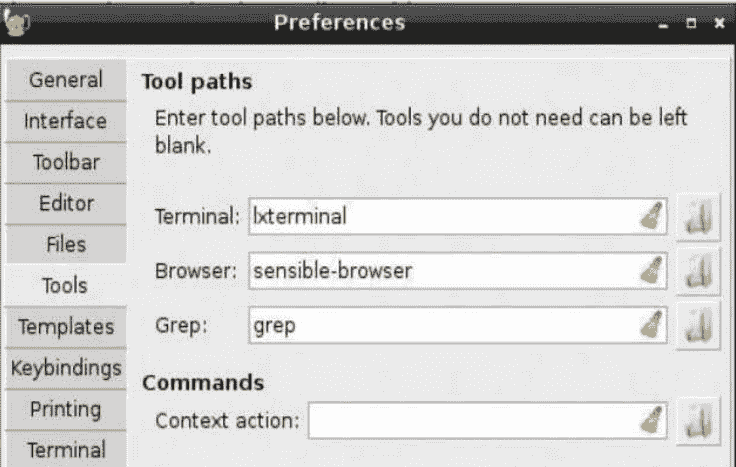

## 测试我们的程序

08 现在我们已经完成了那部分，为什么不测试一下呢？注意的是，你必须在运行程序之前保存，否则自上次保存以来做的任何操作都不会被 Python 解释。使用 `F5` 键运行程序。通过输入并按回车键输入名字。完成后，你将看到欢迎消息。如果程序以代码 0 退出，说明一切运行成功。按回车键关闭终端。

## 修复小问题

07 我们目前使用的 Debian 镜像有一个小的配置错误问题。如果你尝试使用 `F5` 键运行程序或进入 Build 菜单并选择 Execute（执行），你就会发现存在这个问题。如果问题存在，什么都不会发生，你会看到一条消息 'Could not find terminal: xterm'。别担心，很容易修复。进入 Edit 菜单并选择 Preferences（偏好）。进入 Tools 选项卡，并将 Terminal 的值从 `xterm` 更改为 `terminal`。

## 处理数字

09 我们基本上通过重复之前的前几行代码来向用户索要一个数字。一旦用户给了我们一个数字，我们将将其平方并翻倍。`raw_input` 函数返回用户输入的值是一个字符串。字符串是一种文本值，我们无法对其进行算术运算。Python 中的整数类型（integer）只能存储小数部分为零数字。我们将进行一种被称为“类型转换”（cast）的操作，它基本上是将一种类型的值转换为另一种类型。我们将数字字符串转换为小数值（decimal），因为如果我们要减半数字，可能会涉及到小数。如果数字是整数类型，任何小数都将直接从末尾截掉，而不进行四舍五入。这被称为截断（truncation）。

## 执行算术运算

Python 中主要的算术运算符是 `+` `-` `/` `*`，后两个分别是除法和乘法。我们创建了三个新变量 `Number`、`numberDouble` 和 `numberSquared`。注意我们不需要指定它们应该是小数，因为 Python 会根据变量初始值的类型赋予变量相应的类型。`number` 变量是小数类型，因此对该数字进行算术运算返回的所有也将也是小数类型。

```python
# 打印我们刚刚计算的值，将每个浮点值
# 转换为字符串
print("result of halving: " + str(number))
print("result of doubling: " + str(numberDouble))
print("result of squaring: " + str(numberSquared))
```

## 打印我们的结果

现在我们已经完成了算术运算，我们需要使用 `print` 函数打印结果。`print` 函数只接受传递给它的值。这意味着我们需要在打印之前将每个小数值转换为字符串。在引号之间什么都不加使用 `print` 语句会打印一个空行。这之所以有效，是因为 `print` 函数也会在其输出末尾添加一个新行，除非另有规定，所以打印空字符串会打印一个新行。

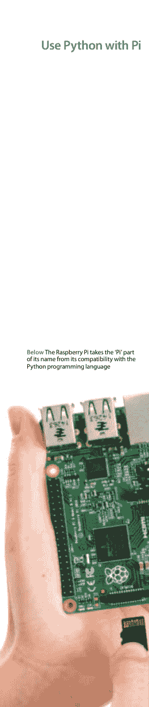

树莓派上的 Python 编程

在树莓派上使用 Python

## 带有循环和 if 语句

```python
# 处理结果
if result == 'yes':
    print('Continuing')
else:
    print('Exiting')
    sys.exit()
```

> `print` 函数也会在其输出末尾添加一个新行，除非另有规定，所以打印空字符串会打印一个新行

## 增加计数

```python
# 像 while 循环一样给数字加 5 并每次输出
print('Incrementing the number by 5')
count = 5
number = 1
print('number ' + str(count) + ' = ' + str(number))
# 增加计数
count += 1
```

# 在 Pi 上使用 Python

## 从你的 Pi 发送短信

### 你需要准备...

### 从你的 Pi 发送短信

- 树莓派 (`Raspberry Pi`)

创建一个结合了 Twilio 代码的程序，并从你的 Pi 发送短信


短信消息，或称 `SMS`（短消息服务），已成为日常通信的主流。对于我们许多人来说，几乎没有一天不发短信。这项服务最初是一项 40 便士的短信服务，现在由大多数资费提供商作为无限服务提供。`Twilio` 是一家云通信公司，它允许你仅需六行代码，就能从你的树莓派向手机免费发送短信。这样，你再也不需要工作时一直被束缚在手机旁，可以专注于一个屏幕而不是两个！

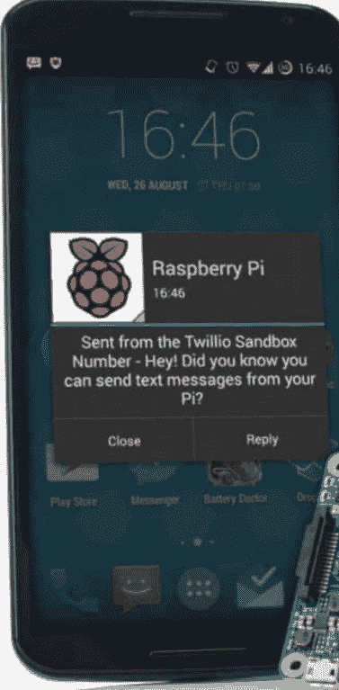

通过这种方法，你可以让你的 Pi 在运行完脚本后发送一条短信


# 从你的 Pi 发送短信

# 在 Pi 上使用 Python

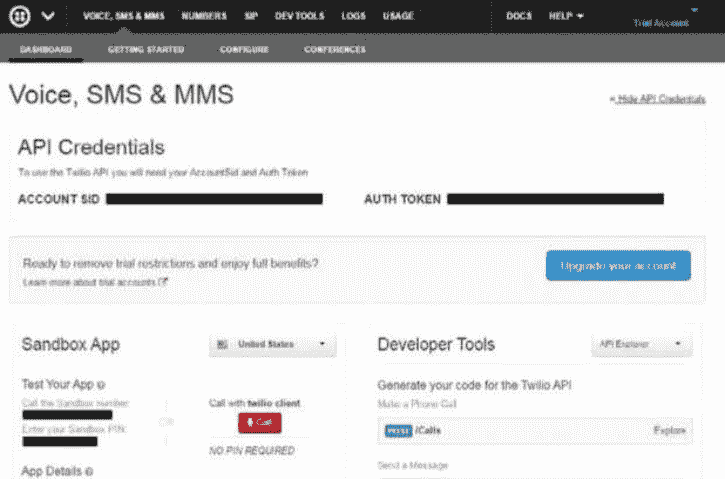

# 语音、短信与 MMS

### API 凭据

要使用 `Twilio` `API`，你需要你的 `AccountSid` 和 `Auth Token`

### ACCOUNT SID

### AUTH TOKEN


准备好移除试用限制并享受完整福利了吗？

了解更多关于试用账户的信息 ->


# 沙盒应用 (Sandbox App)

### 开发者工具

测试你的应用

- 生成用于 `Twilio` `API` 代码
- 调用沙盒号码
- 拨打电话
- 输入沙盒 PIN
- 探索
- 不需要 PIN
- 发送消息
- 应用详情

> 在上方，你可以在 `Twilio` 仪表板上找到你的 `AccountSid` 和 `Auth Token`

## 设置你的 Twilio 账户

- 01 该项目的第一步是注册 `Twilio` 账户和 `Twilio` 号码。这是免费的，并将使你能够向已注册并验证的手机发送短信。一旦注册，你将通过短信向注册的手机接收验证码。在提示时，将此代码输入 `Twilio` 网站以验证你的账户，并访问 `twilio.com/try-twilio` 创建你的账户。

## 注册并验证手机号

- 02 你的 `Twilio` 账户是一个试用账户（除非你升级付费），这意味着你只能从经过验证的手机号码发送和接收通信。输入你想验证的手机号码，确保你选择了正确的国家代码。`Twilio` 将向你发送一条短信验证码。将此代码输入网站表单并按提交。

## 仪表板

- 03 注册并登录后，访问仪表板页面，那里将显示你的 `AccountSid` 和 `Auth Token`。使用 `Twilio` `REST` 时这两者都是必须的。请保持它们安全私密，但务必做好记录，因为你稍后在 `Python` 程序中会需要它们。

# 在 Pi 上使用 Python

# 从你的 Pi 发送短信

## REST

### 安装软件

`REST` 代表表述状态转移（有时拼为 "`REST`"）。它依赖于一种无状态、客户端-服务器、可缓存的通信协议——在几乎所有情况下都是用于设计网络应用的 `HTTP` 协议架构风格。

- 04 启动你的树莓派并连接到互联网。在安装之前，

（注：此处原文似乎有重复，已按逻辑翻译）。


### 开发者工具

测试你的应用

- 生成用于 Twilio API 代码
- 调用沙盒号码
- 拨打电话
- 输入沙盒 PIN
- 探索
- 不需要 PIN
- 发送消息
- 应用详情

> 在上方，你可以在 Twilio 仪表板上找到你的 `AccountSid` 和 `Auth Token`

## 设置你的 Twilio 账户

- 01 该项目的第一步是注册 Twilio 账户和 Twilio 号码。这是免费的，将使你能够向已注册并验证的手机发送短信。一旦注册，你将通过短信向注册的手机接收验证码。在提示时，将此代码输入 Twilio 网站以验证你的账户，并访问 `twilio.com/try-twilio` 创建你的账户。

## 注册并验证手机号

- 02 你的 Twilio 账户是一个试用账户（除非你升级付费），这意味着你只能从经过验证的手机号码发送和接收通信。输入你想验证的手机号码，确保你选择了正确的国家代码。Twilio 将向你发送一条短信验证码。将此代码输入网站表单并按提交。

## 仪表板

- 03 注册并登录后，访问仪表板页面，那里将显示你的 `AccountSid` 和 `Auth Token`。使用 Twilio REST 时这两者都是必须的。请保持它们安全私密，但务必做好记录，因为你稍后在 Python 程序中会需要它们。

# 在 Pi 上使用 Python

# 从你的 Pi 发送短信

## REST

### 安装软件

REST 代表表述状态转移（有时拼为 "REST"）。它依赖于一种无状态、客户端-服务器、可缓存的通信协议——在几乎所有情况下都是用于设计网络应用的 HTTP 协议架构风格。

- 04 启动你的树莓派并连接到互联网。在安装之前，

*(注：由于原文存在大量重复，此处已按逻辑进行去重处理。)*

# 语音合成器

# 在树莓派上使用 Python

# 使用 Python 进行录制

## 完整代码列表

在 Python 中使用 eSpeak 最基本的方法是使用 `subprocess`。导入它，然后使用：

导入必要的 esSpeak 和 GUI 模块，以及用于获取时间的模块

```
from espeak import espeak
from Tkinter import *
from datetime import datetime
```

```
subprocess.call(["espeak", ["option i1", "option 2"], ["option nj", "Your message here"]])
```

定义界面将用到的不同函数，包括一个简单的固定消息、显示时间以及自定义消息

```python
def hello_world():
    espeak.synth("Hello World")
```

```python
def time_now():
    t = datetime.now().strftime("%k %M")
    espeak.synth("The time is %s%s")
```

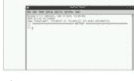

```python
def text_read():
    text_to_read = input_text.get()
    espeak.synth(text_to_read)
```

# 母语

```python
root = Tk()
root.title("语音盒盒")
input_text = StringVar()
pack = Frame(root, height=200, width=500)
pack.pack_propagate(0)
pack.pack(padx=5, pady=5)
```

使用 Tkinter 为你的界面创建一个基础窗口，并创建用于文本的变量

esSpeak 模块非常简单，可以将某些文本转换为语音。尝试这个示例：

```python
Label(box,text="Enter text").pack()
entry_ready = Entry(box, textvariable=input_text)
entry_ready.pack()
read_ready = Button(box, text="Read this", command=read_ready)
read_ready.pack()
hello_button = Button(box, text="Hello World")
hello_button.pack()
time_button = Button(box, text="What's time?", command=time_now)
time_button.pack()
root.mainloop()
```

- `from espeak import espeak`

  `espeak.synth("[message]")`

你可以像使用任何其他模块一样将其整合到 Python 中用于自动化。

文本输入结束于创建的变量，每个按钮都会调用代码中定义的函数


# 语音合成器

通过代码列表，我们正在使用 Tkinter 创建一个简单的界面，带有预设的按钮和自定义的输入方法。我们展示了如何操作 espeak 模块来改变它的输出。这用于读取推文或自动化消息。祝玩得开心！

> “甚至有一个模块允许你在 Python 中使用 esSpeak，这样就可以执行自动化任务”


# 在树莓派上使用 Python

# 编写四翼飞行器程序

# 你需要...

- Raspbian: `www.raspberry.org/downloads`
- Python: `www.python.org/doc`

# 编写四翼飞行器程序

如何挑战树莓派的极限？给它装上翅膀。Andy Baker 向我们展示了如何做到这一点

树莓派是一个极佳的项目板。由于我们热爱挑战，我们开始寻找能够真正挑战我们黑客技术和编码技能极限的东西。我们选择了一架四翼飞行器。

本文使用在线提供的 Python 代码作为指南，介绍了构建四翼飞行器所需的内容，在比喻意义上将它们螺栓在一起，以便在结束时，你不仅理解了代码，还理解了与真实世界的交互，使你能够充满心地构建属于自己的四翼飞行器。你可以在 Andy 的博客上找到他的代码。

# 你知道吗

本文作者 Andy Baker 在 `blog.peterford.co.uk` 经营着博客，提供了关于他项目的极佳见解。

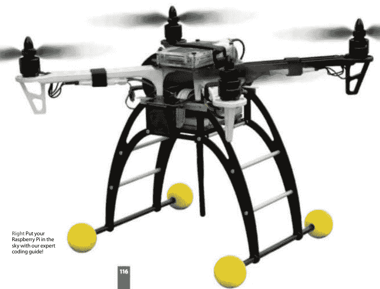

跟随我们的专家编程指南，让你的树莓派飞向天空！

# 在树莓派上使用 Python

# 编写四翼飞行器程序

# 传感器视角图

四翼飞行器视角下的传感器如何转换为地球（水平/垂直）视角，以提供水平运动

# 动力

在这里我们看到了来自螺旋桨的力

# 矢量

螺旋桨相对于地球轴的力（水平 / 垂直）

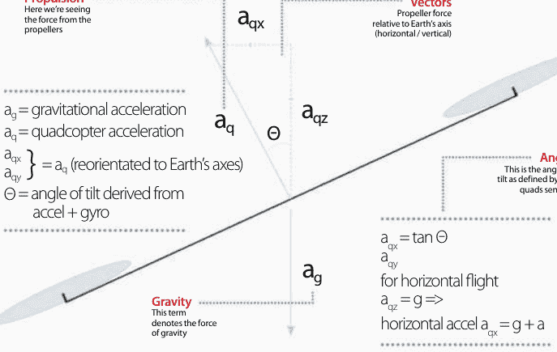

- `$a_g$` = 重力加速度
- `$a_q$` = 四翼飞行器加速度
- `$a_{qx} = a_q$`（重新对齐到地球轴）
- `$\Theta$` = 从加速度+陀螺仪得出的倾斜角

这是由角度定义的倾斜角

`$a_{qx} = \tan \Theta$`

`$a_{qy}$` 用于水平飞行

`$a_{qz} = g$`

水平 `$a = g + a$`

此项表示重力

# 解释器

# 轴

01 命令解释器将来自无线电或编程的一系列命令转换为代码。这些命令结合了用户希望四翼飞行器遵循的相对于地平线的方向和速度。代码将这些转换为速度、水平速度和偏航速度的一系列目标——来自摇杆的任何命令都可以被分解为一组目标。

02 四翼飞行器的输入来自一系列电子传感器，提供其在空气中运动的信息。主要的两个是加速度计测量三个轴上的加速度（重力），陀螺仪测量四翼飞行器俯仰（机头/尾部向上）、横滚（左/右）和偏航（绕四翼飞行器中心轴顺时针和逆时针旋转）的角速度。

03 加速度相对于四翼飞行器轴的方向，目标相对于地球轴——地平线和重力。要在四翼飞行器轴和地球轴之间转换输出需要使用三角函数。你还需要知道四翼飞行器相对于地球的横滚和俯仰角。这是相当复杂的内容，但这些页面上的图表有助于你理解逻辑。

04 加速度计和陀螺仪都可以提供这种角度信息，但两者都有缺陷。加速度计输出可以使用欧拉算法计算角度。然而，加速度计输出受到电机/螺旋桨噪声的干扰，这意味着单次读数某侧可能巨大，平均读数随时间推保持不准确。相比之下，陀螺仪输出不受噪声影响，但由于它是角传感器，需要随时间进行积分以找到四翼飞行器相对于地平线的绝对角度。舍入误差导致误差随时间不断增加，最终限制了最大飞行时间。

滤波器


05 尽管它们都有缺陷，但可以在数学上将它们合并，使每个补偿对方的缺陷，从而获得无噪声、长期准确的读数。这些数学噪声/漂移滤波器有许多版本。最常用的是卡尔曼滤波（`Kalman`）：它的准确性稍低，但更容易理解和精炼。有了角度后，可以将传感器数据转换为相对于地球轴的输入，并计算四翼飞行器相对于设定目标向上、向下、向左、向右以及向前向后移动的情况。

你可以从许多在线零售处购买即插即用（RTF）四翼飞行器套件。价格从150英元起。

# 在树莓派上使用 Python

## 编写四翼飞行器程序

### PID 控制器

所以我们现在有了一个四翼飞行器执行的目标，以及 06 一个它正在执行的输入以缩小两者之间的差距——我们需要一种方法将它们结合起来。直接数学算法几乎是不可能的——四翼飞行器的重量、每个叶片的旋转功率等都需要纳入方程。而且在飞行期间（以及坠机时）这些因素是不稳定的，需要考虑飞行器的重量和湿度。希望这种方法不会失败。

相反，使用来自传感器的反馈的估计方法来调整该估计。由于估计循环每秒运行100次，这种方法确实会产生误差，而且它对正在补偿的这些因素一无所知——这就是`PID`。它获取目标，减去反馈，产生误差。误差通过比例、积分和微分算法处理以产生输出。

### 理解四翼飞行器

#### 混合

07 输出分配给每个`ESC`：垂直速度应用于俯仰角分50/50，减去前面的叶片并增加后面的叶片，产生俯仰。横滚随机处理。偏航也以简单的方式处理，但应用于相同方向旋转的对角叶片。

这些特定的`ESC`输出转换为`PWM`信号，为硬件`ESC`提供更新的螺旋桨/电机速度

# 编写无人机

## 代码与现实

在这种案例中，总共有九个 `PID`。对于 X 轴和 Y 轴的水平面，水平速度 `PID` 将用户定义的速度转换为所需的水平加速度/倾斜角；然后角度 `PID` 将将旋转速度 `PID` 转换的旋转转换为前/后和左/右电机的速度变化。

逆风会导致无人机向着风力施加作用的方向向后漂移。为了补偿这一点，它必须以一定的角度向下倾斜，以便螺旋桨产生的推力有一部分作用于水平方向以抵消风力。这样做时，原本在固定高度悬停的无人机现在正在与风力斗争；总功率被降低，无人机将开始漂移。

在垂直方向上，单个 `PID` 将上升/下降速率转换为应用于每个云台的加速度输出。最后，防止偏航（像陀螺一样）使用了两个 `PID` —— 一个用于设置期望的偏航角，另一个用于设置旋转速度。这些控制输出控制着以相同方向旋转的偏航电机。最关键的是俯仰/横滚稳定性。这确保了无论其他 `PID` 和外部因素强制执行什么要求，无人机在实现这些目标时都是稳定的；没有这种稳定性，其余 `PID` 就无法工作。俯仰由前后螺旋桨之间的差异控制；偏航由左右方向控制，并通过与相应 `PID` 输出的顺时针/逆时针差异控制。三个 `PID` 的合力然后应用于相应的电机 `PWM` 通道的适当组合，转换为单个脉冲宽度。

水平移动更为复杂。目标是以每秒 1 米的速度移动。初始要求是逆风补偿 —— 低头头加增加功率将产生导致向前加速度的力。但一旦达到水平速度，电机需要停止，或者空气中的摩擦将减慢运动。因此，有一个动态倾斜/后仰来维持这种稳定的前进速度。

实现稳定性后，使用垂直速度 `PID` 实现了程度的起飞、悬停和着陆。将无人机放在水平面上，将目标设置为 0 m/s，它就会飞向空中，而速度 `PID` 确保在整个短飞行和着陆过程中保持水平起飞角。

抗风抑制和水平移动控制都使用了一些嵌套 `PID`；X 和 Y 轴速度 `PID` 输入是前进和横滚角度 `PID` 目标的输出；输出馈给俯仰和横滚角度 `PID`，以在满足其他目标的同时确保稳定性。传感器反馈确保接近期望的水平速度，水平速度 `PID` 误差缩小，减少了角度 `PID` 的目标，从而使无人机重新回到水平位置。

到为止，`PID` 都是独立的。但是水平移动以及抑制风中的漂移又是呢？

希望这能更清楚地说明为什么精确的角度跟踪很重要：在低头逆风的示例中，垂直速度 `PID` 确保传感器减少了相对于水平面的测得倾斜角的余弦值。

这时变得更复杂了。先考虑漂移抑制，逆风中的无人机

> 先考虑漂移抑制，逆风中的无人机将向着风力施加作用的方向向后漂移

同样，X 和 Y 轴速度 `PID` 输入在比较速度与加速度时，与俯仰和横滚角进行比较。不要忘记检查文章中的图表，它们对我们涵盖的许多主题提供了清晰的图形表示。


### 实验与调优

09 虽然代码准确地反映了我们在这里描述的所有内容，但有一组关键步骤只能通过现场测试找到：这些就是 `PID` 增益。对于每个 `PID` 调优，都有独立的比例、积分和差分增益，这些只能通过估计/实验找到。每台无人机的结果都会有所不同。幸运的是，有一种相对安全的方法。

相应地调整 `P` 增益。一旦 `P` 良好，加入一点 `I` 增益 —— 这将确保返回位置并保持稳定性。`D` 增益是可选的，但可以增加刚性和敏捷的响应。敲击一个 `D` 增益稳定的无人机就像敲桌子一样 —— 它不会移动。

# 使用 Python 和 Pi 编写你自己的 Twitter 机器人

## 创建访问令牌

```python
def timestr_to_datetime(timestr):
    # 将类似 Sat Nov 09 09:25:53 +0000 
    # 2013 的字符串转换为 datetime 对象。移除时区
    # 并将年份设置为当前年份
    timestr = "%s %s".format(timestr[:19], datetime.now().year)
```

进入“Settings”（设置）选项卡，将“Access type”（访问类型）从“Read only”（只读）更改为“Read and Write”（读写）。点击“Update Twitter application's settings”（更新 Twitter 应用设置）按钮。接下来创建一个访问令牌。点击“Create token”（创建令牌）按钮刷新详情页，你将获得 consumer name（用户名）、consumer secret（密钥）和 access token（访问令牌），这就是与 Twitter 验证所需的所有内容。

```python
# 我们有 Sat Nov 09 09:25:53
return datetime.strptime(timestr, "%a %b %d %H:%M:%S " + year + "%Y")
```

```python
def retweet_task(self, screen_name):
    # 转发任何我们未见过的推文
    for user in tweets:
        print("Checking for new tweets from {}".format(screen_name))
        pass
```

## 与 Twitter 进行身份验证

我们将机器人创建为一个类，并在构造函数中与 Twitter 进行身份验证。我们将上一步获取的令牌作为参数，并使用它们创建 Twitter API 实例。我们还有一个变量 `last_run`，它被设置为当前时间。这被用于检查自上次运行以来是否有新推文。

- 获取用户最新推文的列表

- `timeline = self.api.get_user_timeline(screen_name = screen_name)`

- 遍历每条推文，并检查它们是否在我们上次调用之后发布

- `for t in timeline:`

```python
tweet_time = timestr_to_datetime(t['created_at'])
if tweet_time > self.last_run:
    print("Retweeting {}".format(t['id']))
    self.api.retweet(id = t['id'])
```

## 转发用户推文

我们首先需要获取用户的推文列表。我们遍历每个字符串，然后将其创建时间转换为 `datetime` 对象。然后，我们检查推文的时间是否比函数上次调用的时间新——如果是，则转发。

- `__name__ == "main__":`

- consumer keys 可以在你的应用程序详情页找到，地址为：https://dev.twitter.com/apps

- `consumer_key="(OAuth 4 Settings)"`

- `consumer_secret=""`

- access tokens 可以在你的应用程序详情页找到，地址为：https://dev.twitter.com/apps

- （位于“Your access token”下方）

- `a_token=""`

- `a_secret="="`

## 主部分

主部分非常直观。我们使用令牌创建机器人实例，然后进入无限循环。在每次循环中，我们针对不同的用户（即我们正在监控的用户）运行转发任务，然后更新所有内容上次运行的时间，并休眠五分钟。

- 创建机器人类的一个实例

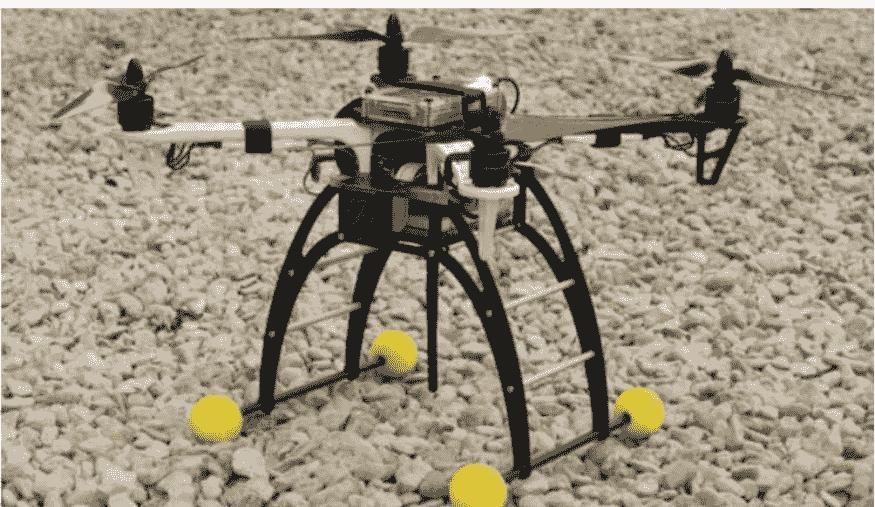


`twitter` = `bot`(`c_key`, `c_secret`, `a_token`, `a_secret`)

- 每隔 5 分钟转发 @LinuxUserMag 的任何新内容

```python
while True:
    # 在每次 retweet_task 后更新时间，以便我们只转发新内容
    twitter.retweet_task("LinuxUserMag")
    twitter.last_run = datetime.now()
    time.sleep(5 * 60)
```


# 使用 Python 和 Pi

## 使用 GPIO 控制 LED

### 你需要准备...

- 面包板：www.proto-pic.co.uk/half-size-breadboard
- 3mm LED 灯：www.ultraleds.co.uk/led-product-catalogue/basic-3-5-10-mm.html
- 杜邦线：www.picomake.com/product/breadboard-wires
- 270欧姆电阻：http://goo.gl/ox4ftp5nj0091

## 使用 GPIO 控制 LED

介绍 Pi 上的外部输出（如 LED）

当你启动了 Pi，可能安装了 XBMC 并尝试过流媒体传输后，你可能已经准备好迎接下一个挑战了。其中一个方向是为这台小型电脑可用的许多桌面操作系统寻找有趣的用途，也许将其用作 Web 服务器、NAS 或复古游戏机。这些都很有趣，但 Pi 的一个经常被忽视的功能是它的硬件引脚定义（pinouts）。如果你从未接触过电子产品，那么 Pi 是一个极佳的起点。或者你过去可能用过如 Arduino 等可编程微控制器；Pi 比 Arduino 拥有更高的 CPU 和 RAM，为项目开启了更多可能性。

树莓派具有一个 PWM（脉冲宽度调制）输出引脚，以及一系列 GPIO（通用输入输出）引脚。这些使得可以通过 Pi 控制蜂鸣器、灯和开关等电子硬件。对于习惯于仅“使用”计算机，或只编写对机器本身起作用软件的人来说，控制灯这样一个真实的物理物品可能是一种全新的发现。本教程假设你没有电子或编程方面的先验，将带你完成使用 Raspberry Pi 控制 LED 的步骤，从设置到编写简单的应用程序。

- 图 1：使用 PWM 获取一个 LED 所需的所有物品。线缆应有公头和母头
- 图 2：将母头放置在 Pi 上，注意 1 号引脚由微小的 Pi 标志标识：蓝色线是接地的
- 图 3：一旦连接好一切，插上你的 USB 电源线
- 图 4：开启电源，LED 将亮起。如果光线暗，请使用阻值较低电阻

> “我们将带你完成使用 Pi 控制 LED 的步骤，从设置到编写代码”

# 使用 Python 和 Pi 使用 GPIO 控制 LED

- 面包板或原型板为创建和更改开发电路提供了一个易于使用且无需焊接的环境
- 对于任何初级工程师来说，面包板线——这些公头对公头和公头对母头的线可以快速方便地构建电路
- GPIO 引脚为电气电路提供了输入和提供输出的机制，能够实现响应式程序
- 彩色 LED 是物理上匹配软件运行部分的极佳方法，并帮助你理解程序流程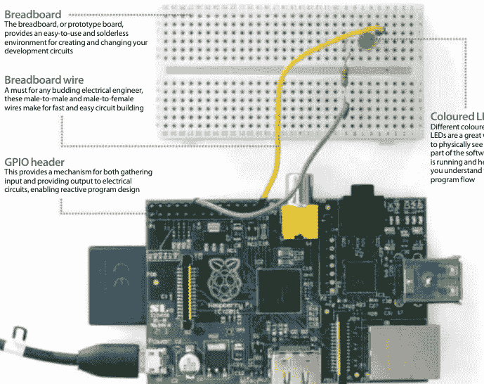

## Pi 的引脚

### 引脚编号

### GPIO 引脚

- 01 在我们深入编写代码之前，让我们看看 Pi 上引脚的布局。如果你的 Pi 在壳子里，请把它拿出来，面向右侧的 USB 接口。接下来的几步将查看在使用 GPIO 端口时会遇到的一些问题。
- 03 如果你看那个白色标签“P1”。这是 1 号引脚，它的上方是 2 号引脚。1 号引脚的右侧是 3 号引脚，3 的上方是 4 号。这种模式一直持续到最后的 26 号引脚。正如你在下一步中看到的，某些引脚有重要的用途。
- 05 板板上的其他引脚是 GPIO（通用输入输出）。这些用于当你的项目变得复杂和具有挑战性时需要执行的其他任务。请注意，电源无法为大型设备提供足够的功率范围。

## Pi 版本 1 还是 2？

- 02 取决于你何时购买 Pi。在深入编写代码之前，我们需要看看 Pi 上引脚的布局。如果你的 Pi 在壳子里，请把它拿出来，面向右侧的 USB 接口。
- 04 电源供应无法为大型设备提供足够的功率范围。
- 22 基础 LED
- 05 板板上的其他引脚是 GPIO（通用输入输出）。这些用于当你的项目变得复杂和具有挑战性时需要执行的其他任务。
- 06 基础 LED
- 07 基础 LED
- 08 基础 LED
- 09 基础 LED
- 10 基础 LED
- 11 基础 LED
- 12 基础 LED
- 13 基础 LED
- 14 基础 LED
- 15 基础 LED
- 16 基础 LED
- 17 基础 LED
- 18 基础 LED
- 19 基础 LED
- 20 基础 LED
- 21 基础 LED
- 22 基础 LED
- 23 基础 LED
- 24 基础 LED
- 25 基础 LED
- 26 基础 LED
- 27 基础 LED
- 28 基础 LED
- 29 基础 LED
- 30 基础 LED
- 31 基础 LED
- 32 基础 LED
- 33 基础 LED
- 34 基础 LED
- 35 基础 LED
- 36 基础 LED
- 37 基础 LED
- 38 基础 LED
- 39 基础 LED
- 40 基础 LED
- 41 基础 LED
- 42 基础 LED
- 43 基础 LED
- 44 基础 LED
- 45 基础 LED
- 46 基础 LED
- 47 基础 LED
- 48 基础 LED
- 49 基础 LED
- 50 基础 LED
- 51 基础 LED
- 52 基础 LED
- 53 基础 LED
- 54 基础 LED
- 55 基础 LED
- 56 基础 LED
- 57 基础 LED
- 58 基础 LED
- 59 基础 LED
- 60 基础 LED
- 61 基础 LED
- 62 基础 LED
- 63 基础 LED
- 64 基础 LED
- 65 基础 LED
- 66 基础 LED
- 67 基础 LED
- 68 基础 LED
- 69 基础 LED
- 70 基础 LED
- 71 基础 LED
- 72 基础 LED
- 73 基础 LED
- 74 基础 LED
- 75 基础 LED
- 76 基础 LED
- 77 基础 LED
- 78 基础 LED
- 79 基础 LED
- 80 基础 LED
- 81 基础 LED
- 82 基础 LED
- 83 基础 LED
- 84 基础 LED
- 85 基础 LED
- 86 基础 LED
- 87 基础 LED
- 88 基础 LED
- 89 基础 LED
- 90 基础 LED
- 91 基础 LED
- 92 基础 LED
- 93 基础 LED
- 94 基础 LED
- 95 基础 LED
- 96 基础 LED
- 97 基础 LED
- 98 基础 LED
- 99 基础 LED
- 100 基础 LED

## 使用 GPIO 控制 LED

## 在 Pi 上使用 Python

> 你知道吗...
> 官方 Python 文档是初学者和专业人士极好的资源
> http://python.org/doc.

## 使用 PWM

20 下一步是告诉引脚输出并设置一种退出程序的方法。在这里我们再次调用 GPIO 类，然后调用 PWM 方法并传入引脚号；第二个值是赫兹频率频率——在此情况下为 50。

```python
p = GPIO.PWM(12, 5)
p.start(1)
input("Press return to stop:")
p.stop()
GPIO.cleanup()
```

## 测试脚本

17 现在为了确保脚本已导入，我们需要运行 python 命令，然后输入我们创建的脚本名称。如果一切顺利，你不应该看到任何错误信息。但是，如果你看到了，请返回之前的步骤检查每一步是否都正常。

- `python gpio.py`


## 设置 GPIO 模式

18 再次在 `nano` 中重新加载脚本。我们将把 GPIO 模式设置为 `BOARD`。这种方法最安全，无论你使用的是哪个版本的 Pi。最好选择一种 GPIO 规范并坚持使用下去，否则这在以后会引起困惑。

- `nano gpio.py`

`GPIO.setmode(GPIO.BOARD)`

## 调整 PWM

21 为了给 LED 增加淡出的时间，我们首先需要导入库，然后设置 12 号引脚初始频率为 50Hz。

```python
import time
import RPi.GPIO as GPIO
GPIO.setmode(GPIO.BOARD)
GPIO.setup(12, GPIO.OUT)
p = GPIO.PWM(12, 50) # channel=1 frequency=50Hz
p.start(0)
```

## 添加渐变

22 然后我们将添加另一个 `try-except` 块，这次检查 LED 在 - 状态，一旦达到特定水平，就反转过程。要运行此代码，请从 `nano` 保存并运行 `python gpio.py`。

```python
while 1:
  for dc in range(0, 101, 5):
    p.ChangeDutyCycle(dc)
    time.sleep(0.1)
  for dc in range(100, -1, -5):
    p.ChangeDutyCycle(dc)
    time.sleep(0.1)
except KeyboardInterrupt:
  pass
```

## 设置引脚模式

19 引脚必须先定义为输入或输出才能工作。最简单的方法是调用 `GPIO.setup` 方法。传入引脚号，然后是 `GPIO`、`OUT` 或 `IN`。因为我们想将 LED 作为输出。你将频繁使用这些规范，所以在在它们刻入大脑之前尽可能地学习它们吧！

- `GPIO.setup(12, GPIO.BOARD)`

> "我们将 GPIO 模式设置为 `BOARD`。无论你使用的是哪个版本的 Pi，这都有效"

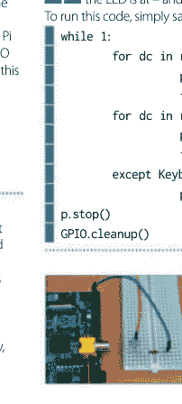

## 特别促销优惠

## 喜欢这本书吗？

## 新用户的独家优惠

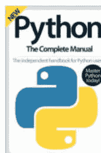


- 此优惠允许英国直接借记新订阅者以 5 英镑获得前三期。在这些期之后，订阅者每 15 期需支付 25.15 英镑。订阅者可以随时取消此订阅。新订阅将从下一期可用杂志开始。必须引用代码 `ZGGZINE` 以获得此特种订阅价格。根据要求提供直接借记担保。此优惠于 2017 年 3 月 31 日过期。

- 这是一个美国订阅优惠。美国刊物费率基于每年 13 期 65 英镑的订阅费计算的，在写作时相当于 102 美元，而报刊亭 13 期 16.99 美元的价格相比为 220.87 美元。您的订阅将从下一期可用杂志开始。此优惠于 2017 年 3 月 31 日过期。


## 唯一关于 Linux 的杂志

## 为你而写

`Linux User & Developer` 是唯一针对高级用户、开发者和 IT 专业人士的杂志。

## 深度指南与专题介绍

由基层开发者和行业专家撰写

## 每期都有免费资源

每月四种最热门的发行版—— 登录 `FileSo`，下载并测试所有它们！


## 订阅... LinuxUser & Developer

用 5 英镑试读 3 期

## 如何使用

### 你需要知道的一切

### 制作游戏：游戏简介

### 使用 GTK 制作 GUI：在这段视频中，我将向你展示如何制作图形用户界面 `GUI`

### Pyome Novel：桥接书本与视频的差距

### 教程需要帮助吗

在任何教程中遇到困难了吗？不知道如何最好利用免费资源？为什么不访问 `Linux User & Developer Imagineazines` 的 Facebook 页面来你的所有问题和疑虑呢？那里有一个友好的 Linux 爱好者社区等待帮助你，团队还会定期发布帖子和更新。今天关注我们并开始聊天吧！


`facebook.com/ImagineBookazines` `facebook.com/LinuxUser`
