# Python：完全手册：Python 用户必备指南

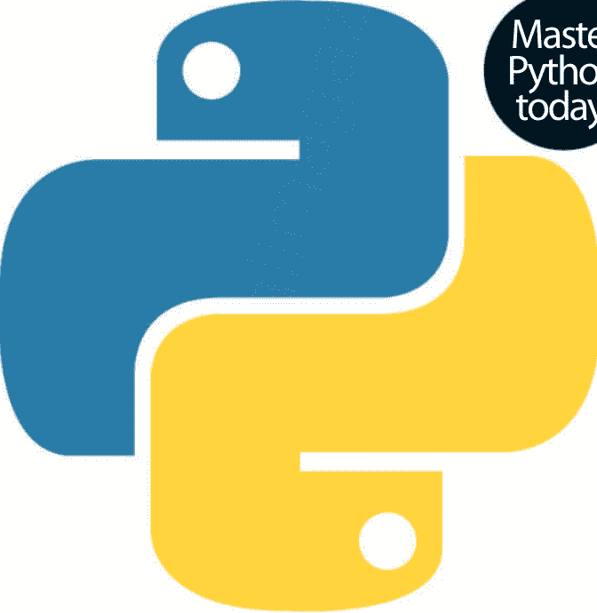

> 今天就开始精通 Python！

# 欢迎来到 Python

## 完全手册

Python 是一种多功能的语言，它的兴起确实并不意外。它与日常语言的相似性使其成为树莓派的完美伙伴，而这通常是实际编程的第一步。但不要被它对初学者友标签误导——Python 拥有许多高级功能。在本电子杂志中，你将学习如何用 Python 编程，发现惊人的项目来提高理解，并找到使用 Python 增强计算体验的方法。你还将创建一些有趣的项目，包括编写四翼无人机和从树莓派发送短信。让我们开始编码吧！

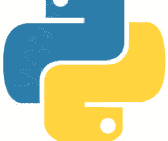

aaron Ansari

Ross Andrews

Alex Harkin

Gill White

Perry Marshall-Wicks

James Sheppard


> 用 Python 编码并创造！

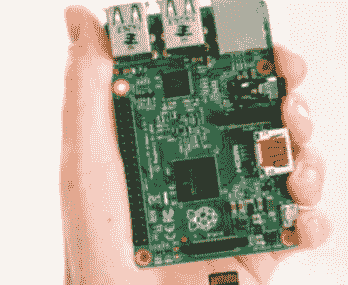


# 从 Python 开始

8 大师课

探索 Python 基础

## 介绍 Python

## 用 Python 创作

## 在 Pi 上使用 Python


## 使用 Python 工作


开始使用 Beautiful Soup


# 从开始

一直想尝试编程吗？别找借口了，因为 Python 是入门的完美方式！

Python 对初学者和专家来说都是非常棒的语言。它的设计考虑了代码的可读性，对于仍在习惯各种编程概念的初学者是一个极佳的选择。这种语言非常流行，并有很多可用库，让程序员可以用相对少的代码完成大量工作。你可以用 Python 各种类型的应用程序：你可以使用 Pygame 框架编写简单的 2D 游戏，使用 GTK 库创建更具野心的应用，例如使用 Python 的蓝牙和输入库获取 USB 键盘的输入并将输入事件传输到安卓手机。对于本教程，我们将使用 Python 2.x，因为这是最可能安装在你的 Linux 上的版本。

# Hello World

从 Python 开始


# Hello World

让我们把 Hello World 值传递给 `print` 函数。

## 入门

## 学习 Python

提示

在此处有必要说明一下，Python 文件中任何跟在 `#` 字符后面的文本都会被解释器忽略。这样你就可以在代码中编写注释。

除了这些主要的数据类型外，还有序列类型（技术上地说，字符串是一种序列类型，但由于它非常常用，我们将其归为主要数据类型）：

| 类型 |  |
| :--- | :--- |
| List (列表) | 包含特定顺序的数据集合 |
| Tuple (元组) | 包含特定顺序的不可变数据集合 |

元组通常用于坐标之类的内容，包含存储为单个变量的 x 和 y 值，而列表通常用于存储更大的集合。存储在元组中的数据是不可变的，因为你无法更改元组中单个元素的值。然而，在列表中你可以这样做。

了解 Python 的 `dictionary` 类型也会很有用。`dictionary` 是一种映射数据类型。它存储键值对。这意味着你使用该值对应的键来访问 `dictionary` 中存储的值，这与使用列表的方式不同。在列表中，你使用元素的索引（表示该元素在列表中位置的数字）来访问列表的元素。

让我们来编写一个程序，演示如何使用变量和不同的数据类型。此时值得注意的是，在 Python 中你并不总是需要指定数据类型。可以在任何你喜欢的编辑器中创建此文件。只要你记住让该文件具有执行权限，一切都能正常工作。我们将我们的文件命名为 `variables.py`。

## 解释型与编译型语言

像 Python 这样的解释型语言是指源代码在每次程序运行时都会转换为机器码执行执行的。这与 C 等编译型语言不同，源代码只被转换为一次机器码——生成的机器码在每次程序运行时执行。


## 学习 Python

## 入门

## 完整代码列表

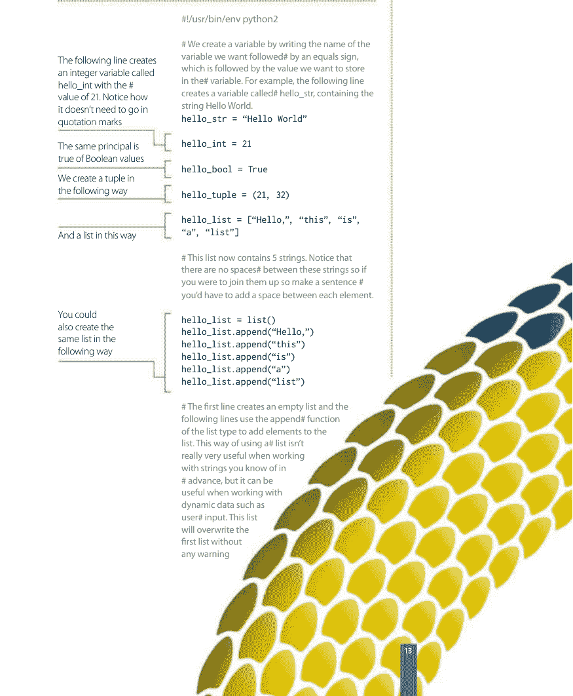

```python
#!/usr/bin/env python2
```

我们通过编写变量名后跟一个等号，后面跟我们想要存储的值来创建一个变量。例如，以下行创建了一个名为 `hello_str` 的变量，包含字符串 `World`。

下一行创建了一个名为 `hello_int` 的整数变量，值为 `21`。注意它不需要引号。

```python
hello_str = "Hello World"
```

```python
hello_int = 21
```

同样的原理也适用于布尔值

```python
hello_bool = True
```

```python
hello_tuple = (21, 32)
```

我们以以下方式创建一个元组

```python
hello_list = ["Hello", "this", "is", "a", "list"]
```

并以这种方式创建一个列表

此列表现在包含 5 个字符串。请注意，这些字符串之间没有空格，所以如果你要把它们连接成一个句子，必须在每个元素之间添加空格。

你可以通过以下方式创建相同的列表：

```python
hello_list = list()
hello_list.append("Hello")
hello_list.append("this")
hello_list.append("is")
hello_list.append("a")
hello_list.append("list")
```

第一行创建了一个空列表，接后的行使用列表类型的 `append` 函数向列表添加元素。当你已经熟悉如何处理字符串时，这种使用列表的方法并不常用，但在处理如用户输入等动态数据时可能很有用。由于我们使用了与之前列表相同的变量名，此列表将覆盖第一个列表且无任何警告。

我们顺便也创建一个字典吧。注意我们对齐了下面的冒号以使代码整洁

```python
hello_dict = { "first_name" : "Liam",
               "last_name" : "Fraser",
               "eye-colour" : "Blue" }
```

## 访问集合内部的某些元素

我们首先更改 `hello_list` 中字符串的值，并在末尾添加一个感叹号。"list" 字符串是列表中的第 5 个元素。然而，Python 中的索引是从零开始的，这意味着第一个元素的索引为 0。

注意，当我们打印元素时，会有两个感叹号

```python
print(hello_list[4])
hello_list[4] += "!"
# 上面的一行等于
# hello_list[4] = hello_list[4] + "!"
print(hello_list[4])
```

记住元组是不可变的，尽管我们可以像下面这样访问它的元素

```python
print(str(hello_tuple[0]))
# 我们不能像刚才对列表那样
# 更改这些元素的值
# 注意上面使用了 str 函数，
# 在打印之前显式地将元组内部的整数值
# 转换为字符串。
```

让我们使用 `hello_dict` 中的数据创建一个句子

```python
print(hello_dict["first_name"] + " " + hello_dict["last_name"] + " " + hello_dict["eye-colour"])
```

实现此更整洁的方法是使用 Python 的字符串格式化


```python
print("{0} {1} {2}".format(hello_dict["first_name"],
                            hello_dict["last_name"],
                            hello_dict["eye-colour"]))
```

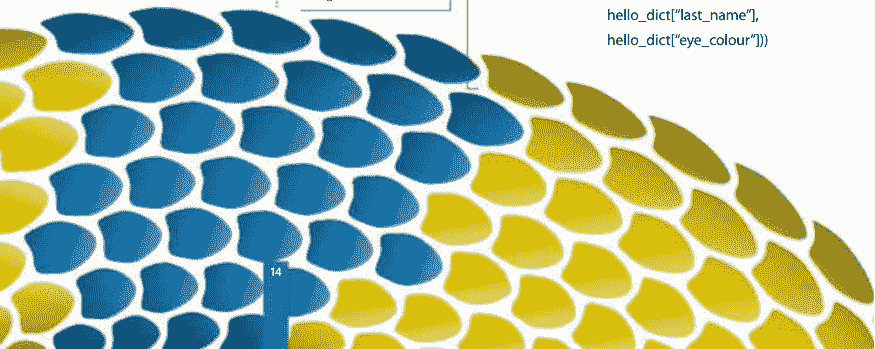

## 详细缩进

正如前面提到的，缩进级别决定了代码块属于哪个。在 Python 中缩进是强制的，而在其他语言中，使用大括号来组织块。由于这个原因，使用一致的缩进至关重要。你可以使用制表符，但如果在多个编辑器中打开文件，那么制表符的定义并不清晰。


## 控制结构

在编程编程中，控制结构是指任何可以改变代码执行路径的语句。例如，一个如果数字小于 5 就结束程序的控制结构看起来像这样：

```python
#!/usr/bin/env python2
import sys
int_condition = 5
if int_condition < 6:
    sys.exit("int_condition must be >= 6")
else:
    print("int_condition was >= 6")
```

代码路径取决于整数 `int_condition` 的值。其他控制结构包括以下项目，你在使用 Python 时应该注意：

- For 语句：允许你遍历集合中的项，或按次数重复一段代码
- While 语句：当条件为真时持续的循环

我们将编写一个接受用户输入的程序，以演示控制结构的工作原理。我们将列表命名为 `construct.py`。`for` 循环使用当前值的局部副本，这意味着循环内部的任何更改都不会影响列表。另一方面，`while` 循环是直接访问列表中的元素，因此你会希望这样做。我们将在文章稍后部分更详细地讨论变量作用范围。程序如下：

```
$ liam@liam-laptop$ ./construct.py
How many integers? acd
You must enter an integer

$ liam@liam-laptop$ ./construct.py
How many integers? 3
Please enter integer 1: t
You must enter an integer
Please enter integer 1: 5
Please enter integer 2: 2
Please enter integer 3: 6
Using a for loop
5
2
6
Using a while loop
5
2
6
```


# Python 入门

## 入门

### 代码列表

```python
#!/usr/bin/env python2

# 我们将编写一个程序，要求用户
# 输入任意数量的整数，将它们存储在集合中，
# 然后演示如何使用各种控制
# 结构来使用该集合。

import sys # 用于 sys.exit 函数
target_int = raw_input("How many integers?")

# 此时，变量 target_int 包含了用户
# 输入的任何内容的字符串表示。我们需要尝试
# 将其转换为整数，但要准备好在如果它不是整数时
# 处理错误。
# 否则程序将
# 崩溃。
try:
    # 用于存储整数的列表
    target_int = int(target_int)
except ValueError:
    # sys.
    sys.exit("You must enter an integer")

ints = list()

count = 0
```

- 我们希望在列表中拥整数数量
- 用于存储整数的列表
- 这些用于跟踪我们目前拥有多少个整数

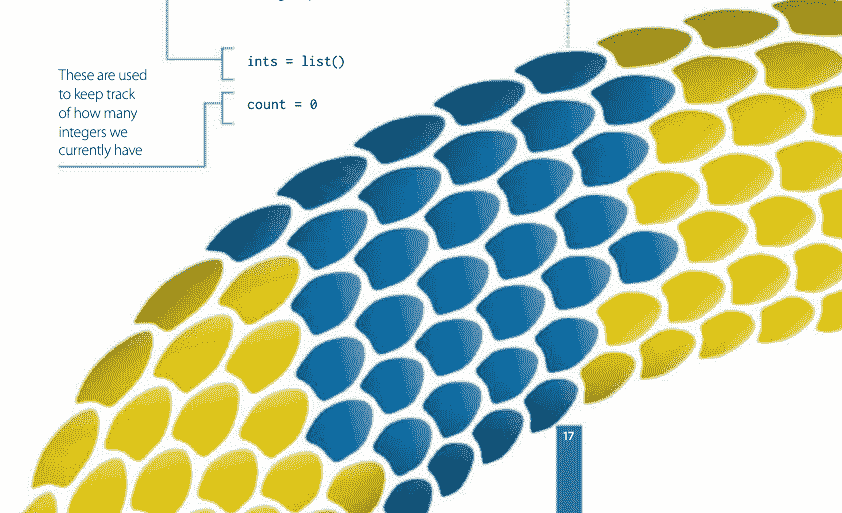

## 入门

如果上述操作成功，则 `isint` 将被设置为 `true`：`isint=True`

```python
## 继续询问整数，直到我们达到
# 要求的数量
while count < target_int:
    line = raw_input("Please enter integer (): ".format(count + 1))
    isint = False
    try:
        new_int = int(line)
    except:
        print("You must enter an integer")
```

此时，用户已经放弃了，或者我们已经有一个满了整数的列表。我们可以通过两种方式遍历这些整数。第一是使用 `for` 循环

```python
## 只有当我们有一个整数时才继续。否则，
# 我们将再次循环
# 注意下面我使用了 ==，这与
# == 不同。单等号是
# 赋值运算符，而双等号是比较运算符。
```

```python
if isint == True:
    # 将整数添加到集合中
    ints.append(new_int)
    # 计数加 1
    count += 1
```

```python
print("Using a for loop")
for value in ints:
    print(str(value))
```

```python
# 或者使用 while 循环：
print("Using a while loop")
# 我们已经有了上面的总数，但知道
```

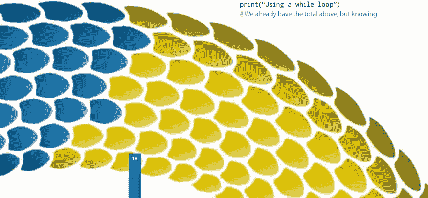

## Python 列表

Python 列表类似于其他语言中的数组。Python 列表（或元组）可以包含不同的数据类型，这在其他语言的数组中通常是不可能的。由于这个原因，我们建议你只在列表中存储相同类型的数据。由于列表中数据处理方式的性质，几乎在所有情况下都是如此的。


## 函数和变量作用域

编程中的函数用于将过程分解成更小的部分。这通常会让代码变得更易读。如果设计得当，函数还可以被复用。函数可以接收传递的变量。Python 中的变量始终通过值传递，这意味着变量的副本被传递给函数，该副本仅在函数作用域内有效。在函数内部对原始变量的任何更改都将被丢弃。然而，函数也可以返回值，所以这不是问题。函数使用关键字 `def` 定义，后面紧跟函数名。任何可以传递的变量都在函数名后的括号中。多个变量之间用逗号分隔。在这些括号中变量的名称就是它们在函数作用域内的名称，无论传递给函数的变量被称为什么。

让我们来看一下实际操作。对应的程序程序输出如下：

> “函数使用关键字 `def` 定义，然后是函数名”


## 入门

```python
#!/usr/bin/env python2 # 下面是一个名为 modify_string 的函数，它接受一个变量
## 该变量在函数作用域内被称为 original。在函数定义下方缩进 4 个空格的内容都是
# 作用域：
def modify_string(original):
    original += " that has been
    modified."
# 目前，只有此字符串的本地副本被修改了

def modify_string_return(original):
    original += " that has been
    modified."
# 然而，我们可以将本地副本返回给调用者
```

此时，用户已经放弃了，或者我们已经有一个满了整数的列表。我们可以通过两种方式遍历这些整数。第一是使用 `for` 循环

```python
## 只有当我们有一个整数时才继续。否则，
# 我们将再次循环
# 注意下面我使用了 ==，这与
# == 不同。单等号是
# 赋值运算符，而双等号是比较运算符。
```

```python
if isint == True:
    # 将整数添加到集合中
    ints.append(new_int)
    # 计数加 1
    count += 1
```

```python
## len 函数非常
# 有用。
total = len(ints)
count = 0
while count < total:
    print(str(ints[count]))
    count += 1
```


```python
## len 函数非常
# 有用。
total = len(ints)
count = 0
while count < total:
    print(str(ints[count]))
    count += 1
```

关于 Python 列表的更多信息

Python 列表类似于其他语言中的数组。Python 列表（或元组）可以包含不同的数据类型，这在其他语言的数组中通常是不可能的。由于这个原因，我们建议你只在列表中存储相同类型的数据。由于列表中数据处理方式的性质，几乎在所有情况下都是如此的。

## 开始使用 Python

## 入门

## 编码风格

花一点时间讨论编码风格是值得的。编写整洁的代码并不，关键在于一致性。例如，你应该始终以相同的方式命名变量。无论你是想使用驼峰法（`camelCase`）还是像我们这样的下划线命名法，并不重要。至关重要的一点是为变量使用自文档的标识符。你不应该去猜测变量的作用。另外一点是始终为代码编写注释。这将帮助任何阅读你代码的人，以及未来的你自己。在代码文件的开头放置一个简短的总结，描述应用程序的功能（或者如果应用程序由多个文件组成，则描述一部分），也是很有用的。

## 总结

这篇文章应该向你介绍了 Python 编程的基础知识。希望你已经习惯了 Python 的语法、缩进以及 Python 程序的整体感觉。下一步是学习如何提出你想要解决的问题，并将其拆分为可以在编程语言中实现的小步骤。Google 或任何其他搜索引擎都非常有帮助。如果你遇到任何问题，或者无法解决的错误信息，将其输入 Google，你就会离解决问题又近了一步。例如，如果我们搜索 'python'，第一个链接会带我们进入 Stack Overflow，那里有很多实用的回复。不要害怕卡壳——编程的真正乐趣在于一个一个块地解决问题。

## 介绍 Python

Python 基础

奠定基础并构建知识

现在你已经迈了 Python 的第一步，是时候开始使用这些知识来编写代码了。在这一部分，你将发现如何开始为操作系统编写应用程序。这些易俗易懂的教程将帮助你巩固所学的 Python 语言，培养出在当前技术中非常有用的技能。我们将最后提供一些本质提示，帮助你在短时间内增加知识和能力。

## 

Python 提供了一种快速且方便的方法来构建应用程序，包括 Web 应用。Python 以其简单性和强大功能而闻名。目前，它已经先进到没有什么是 Python 做不到的，而征服 Web 只是可能性之一。当你使用 Python 进行 Web 开发时，你可以访问巨大的模块目录并充分利用它们。Web 开发可以通过许多方式实现，从使用纯 CGI 模块到完全完善的框架。后者是 Python 构建 Web 应用最流行的方法，因为它允许你在无需担心低级实现的情况下构建应用程序。Python 有许多 Web 框架可用，例如 Django、TurboGears 和 Web2Py。在本教程中，我们将使用我们首选的项目 Django。

## Django 项目

`django-admin` 文件用于创建新的 Django 项目。在 Django 中，一个项目（project）代表网站及其设置。另一方面，应用程序（application）代表网站的特定功能，如博客或标签。这种方法的用处是你的 Django 应用程序变得可移植，并且可以很轻松地集成到其他网站。

```$ django-admin startproject issueTracker
```

将创建一个项目目录。这也将作为 Django 自带开发服务器的根目录。在项目目录下，你将找到以下项：

- `manage.py`: 与你的项目工作的脚本。

- `issueTracker`: 你的项目包（一个包含 `__init__.py` 文件的目录）。该程序包包含了你项目的设置和配置数据。

- `issueTracker/settings.py`: 此文件包含项目的所有配置选项。

- `issueTracker/urls.py`: 此文件包含各种 URL。

- `wsgi.py`: Django Web 服务器提供你项目的入口点。只有在你部署项目时才有用。在本教程中我们不需要它。

现在更新路径选项：

```python
TEMPLATE_DIRS = (
    path('templates'),
)

MEDIA_ROOT = path('media')
MEDIA_URL = '/media/'
```

我们还需要在配置文件中启用此应用：

```python
INSTALLED_APPS = (
    'django.contrib.admin',
    'issueTracker',
)
```

## 配置 Django 项目

在启动应用程序之前，让我们根据要求配置 Django 项目。编辑 `issueTracker/settings.py` 如下（仅需修改）：

数据库设置：我们将使用 SQLite 作为我们的数据库系统。

注意：红色文本表示新或更新的代码：

```python
'default': {
    'ENGINE': 'django.db.backends.sqlite3',
    'NAME': 'db.sqlite3',
}
```

## 创建数据模型

现在我们需要为 Django 站点启用管理界面。这是 Django 的一个功能，允许自动创建网站管理界面，用于使用和管理你 Django 站点的内容。取消下行的注释：

```python
INSTALLED_APPS = (
    'django.contrib.admin',
    'django.contrib',
    'django.contrib.sessions',
    'django.contrib.sites',
    'django.contrib.messages',
    'django.contrib.staticfiles',
)
```

这是我们为应用定义数据模型的部分。请查看内联注释以理解这里发生了什么。

```python
from django.db import models

# 我们正在导入用户认证模块，我们使用了内置的应用
from django.contrib import admin
# 我们也会为我们的应用创建一个管理界面
from django.contrib import admin

# 用于存储多选字段的元组。
# 第一个注册项代表显示名称的字段名
STATUS_CHOICES = (
    ('New', 'New'),
    ('accepted', 'Accepted'),
    ('reviewed', 'Reviewed'),
    ('started', 'Started'),
    ('closed', 'Closed'),
)
```

## 创建应用

在这一步中，我们为我们的跟踪器创建一个名为 `issue` 的应用。为了让创建的数据模型反映在数据库中，请运行：

```
$ manage.py startapp issue
```

```python
import os
from django.db import models
from django.contrib import admin

# 我们正在导入用户认证模块，我们使用了内置的应用
from django.contrib import admin
# 我们也会为我们的应用创建一个管理界面
from django.contrib import admin

# 用于存储多选字段的元组。
# 第一个注册项代表显示名称的字段名
STATUS_CHOICES = (
    ('New', 'New'),
    ('accepted', 'Accepted'),
    ('reviewed', 'Reviewed'),
    ('started', 'Started'),
    ('closed', 'Closed'),
)

class Issue(models.Model):
    name = models.CharField(max_length=200)
    description = models.TextField()
    status = models.CharField(choices=STATUS_CHOICES, max_length=20, default='New')
    owner = models.ForeignKey('User', on_delete=models.CASCADE)
    opened_on = models.DateTimeField(auto_now_add=True)
    modified = models.DateTimeField(auto_now=True)

    def __str__(self):
        return self.name
```

## 启用管理站点

`admin` 已经启用，但我们需要在 `urls.py` 中启用它——它使用基于的映射到视图。如下编辑 `urls.py` 文件：


```python
from django.urls import path, include
from django.contrib import admin

urlpatterns = [
    path('admin/', admin.site.urls),
    path('', include('issue.urls')),
]
```

```python
class IssueAdmin(admin.ModelAdmin):
    date_hierarchy = ('opened_on',)
    list_filter = ('status', 'owner')
    list_display = ('id', 'name', 'status', 'modified', 'opened_on')
    search_fields = ['description', 'status']
# 将我们的站点注册 Django 管理界面
admin.site.register(Issue, IssueAdmin)
```

## 启动 Web 服务器

Django 包含内置的 Web 服务器，用于调试和测试 Django 应用程序。让我们看看我们的管理界面是如何工作的……启动 Web 服务器：

```
$ manage.py runserver
```

如果你的代码没有错误，服务器应该在 8000 端口可用。要启动管理界面，请在浏览器中访问 `http://localhost:8000`。将被要求登录。输入用户名和密码。你没有超级用户。你想创建一个吗？(yes/no)

```
$ manage.py createsuperuser
```

## 使用 Python 开发 Web 应用

### 介绍 Python

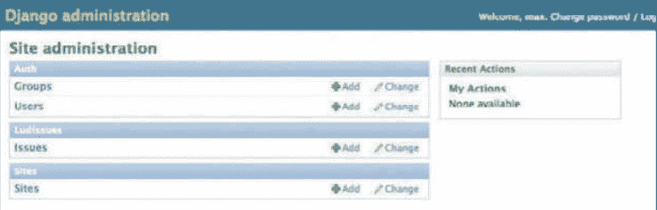

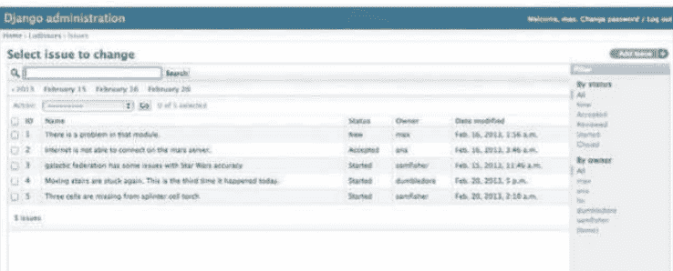

在建模应用时？它们不在这里，是因为它们不应该由用户输入输入。`opened_` 会自动设置创建日期，而 `modified_` 会自动设置为问题被修改的日期。

另一个酷的地方是，所有者 `owner` 字段会自动填充站点中的所有用户。

我们定义了列表视图 `list view`，在模型上显示 `ID`、`name`、`status` 和“修改 `modified`”。你可以通过访问 `http://localhost:8000/admin/ludissimus/issue/` 来进入此视图。

### 为 ludissimus 创建公共用户界面

此时，管理员界面已经工作了。但我们需要一种方法来显示已添加到管理员界面的数据。不过目前还没有公共界面。让我们创建一个吧。

我们必须开始编辑主 `urls.py` (`ludissimus/tracker/urls.py`)

```python
urlpatterns = patterns(
include(admin.site_urls)
)
```

这确保了所有请求将由 `ludissimus.first` 处理。

### 创建 ludissimus.url

在应用目录 (`ludissimus/urls.py`) 中创建一个 `urls.py`，内容如下：

```python
from django.urls import path, include
## 我们包含了模型
from models import ludissues
```

```python
r'admin/', include('ludissimus.urls'))
```

### 包含所有内容的字典

### 介绍 Python

### 使用 Python 开发 Web

`ludissues` 中的对象

```python
info = {
    'queryset': ludissues.objects.all(),
}
```

当翻译到 `ludissueTracker/ludissueTracker/templates/` 时。由于我们将从应用页面访问模板，`path` 的完整目录路径将是 `ludissueTracker/ludissueTracker/templates/`。请在你的项目文件夹中创建这些文件夹。

在 Django 中，我们从 `ludissueTracker/ludissueTracker/templates/base.html` 模板开始。它是作为主模板的，可以被切片 `slices` 编辑。
`ludissueTracker/ludissueTracker/templates/`

### 我们使用 Python 代码列表

#### 我们正在使用列表通用视图 list-generic view

```html

<!DOCTYPE HTML PUBLIC "

//DTD HTML 4.01//EN

//HYPERLINK "http://www.w3.org/TR/html4/1/html-strict.dtd">

```

#### list detail 是我们正在使用的视图名称

```python

urlpatterns = (

patterns='django.views.generic.

list_detail,

# issue-list 和 issue-detail

# 它们将在模板名称和默认模板目录中链接 = (

    url('issue',object,info,list_name='issue',

    url('issue/<id:\d+>/',object,detail,info_name='issue-detail'),

)

)

```

```html

<head>

<title>LUD Issues</title>

<link rel="stylesheet" href="{{ MEDIA_URL }}style.css" type="text/css" content="screen"/>

</head>

<body>

<div id="header">

<h1>Issue Tracker</h1>

<div id="main">

<ul>

```

此外，创建 `ludissueTracker/media/` 用来存放所有 CSS 文件。从代码文件夹的资源目录拷贝这些静态文件。从文件夹中提供服务，使其变为可用。
打开 `settings.py` 并在 `ludissueTracker/settings.py` 中添加这些行：

```python

from django.urls import url, patterns, include

from django.contrib import admin

admin

admin.site.register()

```

#### 我们连接这两行代码以启用管理员功能

```python

urlpatterns = patterns(

    (r'', include('ludissues.urls')),

    (r'/admin/', include(admin.site.urls)),

    (r'/media/', (r'(?P<path>.*)', django.views.static.static), 

    {'document_root': settings.MEDIA_ROOT}),

)

```

为了显示列表和详情，我们正在使用 Django 特有的通用视图 `generic views`。在这种情况下，我们使用的是名为 `list` 和 `detail` 的视图。这允许我们创建一个列表详情视图。这些视图随后通过 `list_html` 和 `issue_detail` 模板应用。在接下来的步骤中，我们将创建模板。

```html

<li><a href="" class="style">视图 (Views)</a></li>

<li><a href="/admin/">管理员站点 (Admin Site)</a></li>

</ul>

<div id="content">



</div>

</body>

</html>

```

### 设置模板和媒体目录

### 创建模板

模板将从 `ludissueTracker/ludissueTracker/templates` 加载。

```python

path('templates'),
```


# 使用 Python 开发 Web 应用

# 介绍 Python

查看管理员站点源代码

它是

| 问题 (Issue) | 描述 (Description) | 状态 (Status) | 所有者 (Owner) |
| --- | --- | --- | --- |
| 1 | 有一个问题 | 新 | ana |
| 2 | 网络未连接 | 已接受 | mars |
| 3 | 银河系有些 | 已开始 | ludfisher |
| 4 | 今天移动 | 已开始 | dumb |
| 5 | 有三个缺失 | 已开始 | ludfisher |

```html
<table class="options">
  <tr>
    <td>问题 (Issue)</td>
    <td>描述 (Description)</td>
    <td>状态 (Status)</td>
    <td>所有者 (Owner)</td>
  </tr>
  
  <tr>
    <td>{{ issue.id }}</td>
    <td>{{ issue.description }}</td>
    <td>{{ issue.status }}</td>
    <td>{{ issue.owner }}</td>
  </tr>
  
</table>
```

```html
<div id="content">
  
  
</div>
```

## 使用 Python 为 Android 构建应用

整个游戏。我们专门创建了 `FloatLayout` 的一个子类，因为这种布局能够根据其自身的位置和大小，对其子元素进行定位和缩放——无论我们在哪里运行它，或者如何调整窗口大小，它都能相应地填充所有的游戏对象。

组件画布（widget canvases），我们在这里用它们来绘制每个组件形状：

介绍可以设置的不同 Python 属性，即矩形的 `pos` 和 `size`，你可以在线查看 Kivy 文档以获取所有可能性。最大的优势在于，虽然我们仍然声明了简单的画布指令，但 `kv` 语言可以检测到我们引用了哪些 Kivy 属性并自动跟踪它们；当这些属性更新时（组件移动或调整大小），画布指令也会随之移动！

```kv
<Player>
canvas:
    Color:
        rgba: 1, 1, 1, 1
```

```kv
Rectangle:
    pos:self.pos
    size:self.size
```

接下来，我们可以使用 Kivy 的图形指令在我们的组件上绘制各种形状。我们将演示如何将一个简单的矩形移动到它们的位置，你可能还喜欢研究更多高级选项。在 Python 文件中，我们可以通过在任何组件的画布上声明它来找到任何指令，如图 03 所示。这将绘制一个在实例化时与玩家具有相同位置和大小的红色矩形——遗憾的是，这产生了一个问题，因为绘制是静态的。当我们以后移动玩家组件时，红色矩形将留在原地，而组件在处于其正确位置时将是不可见的。

```kv
<Base>
canvas:
    Color:
        rgb: 1, 0.55, 0
```

```kv
Rectangle:
    pos:self.pos
    size:self.size
```

图 01

```python
evenfrom kivy.app import App
from kivy.uix.widget import Widget
from kivy.uix.floatlayout import FloatLayout
from kivy.uix.modalview import ModalView
```

```python
## 我们在上面预定义的属性
Rectangle:
    pos:self.pos
    size:self.size
Color:
    rgb: 0.1, 0.1, 0.1
rectangle:
    [self.x,self.y,self.width,self.height]
```

```python
__init__ = '0.1' # 后用于 Android 编译
```

```python
class BreakoutApp(App):
    pass
```

```python
BreakoutApp.run()
```

我们可以通过保留画布指令的引用并反复更新它们的属性来跟踪玩家从而修复这个问题，但有一种更简单的方法可以完成这一切——我们可以使用上次介绍的 Kivy 语言。它在绘图上有一种特殊的语法。

画布声明是特殊的，尽管我们可以随所欲地编写任何画布指令。不要混淆，画布不是一个组件，也不是像 `Line` 那样的图形指令。这是画布特有的特殊语法。所有指令都具有

图 02

```python
from kivy.properties
import(ListProperty,
        NumericProperty,
        ObjectProperty,
        StringProperty)
```


## 介绍 Python

## 使用 Python 为 Android 构建应用

```python
class Game(FloatLayout):
    def __init__(self, **kwargs):
        # 将包含一切
        jump, 'y': 0.05 + 0.09*y
        blocks = ListProperty([])
        super(Player, self).__init__(**kwargs)
        player = ObjectProperty()
        jump())
        self.__init__(*kwargs) ## 游戏的实例 append(block)
        ball = ObjectProperty() with self. self.add_
        游戏的 Ball 实例 canvas: Color(1, 0, 1) widget(block)
```

```python
class Player(Widget): # A
    moving padding
    position = = NumericProperty(0.5)
    direction = = StringProperty('none')
    class Ball(Widget): # A
        bouncing ball
        # pos_hints 用于
        按比例定位，
        # 见下文
        pos_hint_x = NumericProperty(0.3)
        pos_hint_y = 
        proper_size = NumericProperty(0.8)
        velocity = = ListProperty([0.1, 0.5])
        class Block(Widget): #
            每个块去
            销
            colour = ListProperty([1, 0, 0])
```

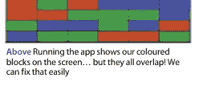

你可能注意到我们有一个 `Block` 的一个 'Color' 指令来清空属性。这意味着我们可以随时更改该属性来更新块的颜色，或者在这种情况下，给每个块赋予随机颜色（图 04）。在这里，我们创建了想要添加的组件并使用 `add_widget` 将它们添加到图形中。屏幕上的根组件是 `Game` 的实例，每个块都被添加以显示。其中唯一的新奇点是每个 `Block` 都被赋予了一个 `pos_hint`。它具有这种特殊属性，并被像我们的 `Game` 这样的 `FloatLayout` 使用，以相对于宽度和高度设置它们的位置。你现在可以运行应用了，你会发现它们的大小没有手动设置，所以它们重叠了。我们可以通过设置它们的属性来修复这个问题。

```python
class Game(FloatLayout):
    def setup_blocks(self):
        for i in range(10):
            block = Block(pos_hint={'x': random.random(), 'y': random.random()})
```


`self.add_widget(block)`

```python
def update(self, dt):
    for block in self.blocks:
        # 更新逻辑
```
```python
from kivy.app import App
from kivy.uix.widget import Widget
from kivy.uix.floatlayout import FloatLayout
from kivy.clock import Clock
import random

class BreakoutApp(App):
    def build(self):
        game = Game()
        game.setup_blocks()
        Clock.schedule_interval(game.update, 1/60.0)
        return game
```

## 介绍 Python

## 使用 Python 构建 Android 应用程序

击中了播放器的屏幕底部，现在让我们添加一些游戏结束代码来处理所有这些情况（图 08）。并将图 09 中的代码添加到你的 `breakpoint.py` 中。

这应该能够完全处理失败或胜利，提供一个带有适当消息的弹出窗口，并提供一个重试的按钮。最后，我们必须处理当球击中它们时的销毁（图 10）。

这完全涵盖了这些情况，通过 Kivy 的 `build_collide` 方法检查碰撞，该方法会比较它们的边界框（`pos` 和 `size`）。你的反弹将取决于球穿入了多远，我们将在调用 Block 时告诉它。

现在大功告成了，你可以运行代码来玩你简单的打砖块（Breakout）游戏。目前它非常简单，但希望你可以看到不同的方法来为不同类型的块添加额外行为、弹出窗口、生命值系统、更复杂的板/球交互，或者甚至构建一个带有菜单和设置界面的完整游戏界面。

我们刚刚展示了一个你已经可以做到的酷功能——为 Android 编译你的游戏！通常情况下，你可以将任何 Kivy 应用直接转换为 Android APK，并运行在你的 Android 设备上。你甚至可以访问标准的 Android API 来访问硬件或功能，如振动、传感器或原生通知。

我们将使用 Buildozer 工具为 Android 构建，Kivy 简单项目从构建工具开始，在不同系统上创建包。这涉及到下载和运行 Android 构建工具（SDK、NDK 和用于 Kivy 的 Python-for-Android）来创建 APK。

```python
size_hint: None, None
property_size: min(0.03*self.parent.height, 0.03*self.parent.width)
size: self.property_size, self.property_size
## canvas part
```

图 06

```python
from kivy.clock import Clock
from kivy.core.window import Window
from kivy.met..platform import platform
```

```python
class Game(FloatLayout):
    def update(self, dt):
        self.ball.update(update) # 尚未定义
        self.player.update(update) # 尚未定义
```

图 04

```python
import random
class Block(Widget):
    def __init__(self, **kwargs):
        super(Block, self).__init__(**kwargs)
        self.colour = random.choice([(0.78, 0.28, 0.63, 0.25), (0.28, 0.28, 0.78)])
```

图 05

```kv
<Block>:
size_hint: 0.09, 0.05
## canvas part
<Player>:
size_hint: {'x': 0.1}
position: {'y': 0.1}
## canvas part
<Ball>:
pos_hint: {'x': self.pos_hint_x, 'y': self.pos_hint_y}
```

```python
def start(self):
    Clock.schedule_interval(self.update, 1.60)
def stop(self):
    unschedule(self.update)
def reset(self):
    for block in self.blocks:
        self.remove_widget(block)
    self.blocks = []
    self.setup_()
    self.ball.velocity = [random.random(), 0.5]
    self.player.
```

```python
class BreakoutApp(App):
    def build(self):
```


```python
g = Game()
if not platform() != 'android':
    Window.bind(on_key_down=g.player.on_key_down)
    Window.bind(on_key_up=g.player.on_key_up)
def bounce(self, player):
    if self.collide_widget(player):
        self.velocity[1] = abs(self.velocity[1])
    self.velocity[0] += ((self.center_x - player.center_x) / player.center_x)
```

图 09

```kv
<GameEndPopup>:
size_hint: 0.8, 0.8
auto_dismiss: False
## 如果玩家点击外部，不要关闭
```

图 07

```python
class Ball(Widget):
    def update(self, dt):
        self.pos_hint_x += self.velocity[0]
        self.pos_hint_y += self.velocity[1]
        if self.right > self.parent.right: # 从右侧反弹
            self.velocity[0] = -1 * abs(self.velocity[0])
        if self.x < self.parent.x: # 从左侧反弹
            self.velocity[0] = -1 * abs(self.velocity[0])
```

```python
class Game(Widget):
    pass
class GameEndPopup(Popup):
    message = StringProperty('再次游戏?')
    game = ObjectProperty()
    text: root.message
    font_size: 60
    on_release:
        root.game.start()
        root.dismiss()
```


## 使用 Python 构建 Android 应用程序

## 介绍 Python

图 10

```python
blocks) if len(self):
    self.parent.do_
    self.layout() win() =
    return #
    self.parent.destroy_ 仅移除最多 1 个块
blocks(self) per frame
```

> 注册成为 Google Play 开发者
访问 `https://play.google.com/apps/publish/signup` 并按照说明操作。你需要支付一次性 25 美元的费用，然后你就可以上传任意数量的应用程序了。

```python
```


`class Game(FloatLayout)`:

    `def destroy_blocks(self, ball)`:

```
> 将你的应用上传到商店
点击“添加新应用程序！”来提交你的应用，包括你的 APK 和 Aab。当一切都准备就绪后，只需点击“发布”，你的应用就会在几小时后上线了！
```

图 11

```python
    for i, block in enumerate(self.blocks):
        if ball.collide_widget(block):
```

```python
    title = Kivy Breakout # 在你的应用抽屉中显示
    package_name = breakout #
```

```python
        y_overlap = ( # 一个唯一的标识字符串,
        along with the package. # 域
        fullscreen = 0 # 这将会
```

```python
        top = ball.x if ball.velocity[1] > 0
        else
        top = ball.y) / block.size_hint_y =
    意味着导航栏没有
    被覆盖
    log_level = 2 # 这不重要，
    但这将打印多得
    调试信息
```

```python
        x_overlap = ( # 信息
        right = ball.x if ball.velocity[0] > 0
        else
    and be useful if
    something
    # 发生错误时很有用
```

```python
    block.right - ball.x() /
    block.size_hint_x = x_overlap < y_overlap:
```


```python
        ball.velocity[0] *= -1
    else:
        ball.velocity[1] *= -1
```

```python
    self.remove_widget(block)
    self.blocks.pop(i)
```

# 介绍 Python

## 50 个 Python 技巧


## 50 个 Python 技巧

Python 是一门让你工作更快速、更有效地整合系统的编程语言。今天，Python 是开源领域最流行的编程语言之一。环顾四周，你会发现它无处不在，从各种配置工具到 XML 解析。这里有 50 个精囊建议，让你的 Python 体验物有所值……

## 基础

Python 不支持内联赋值，因此当你想要比较一个值时，没有意外赋值该值的机会。

## 运行 Python 脚本

### 字符串拼接

- 01 在大多数 UNIX 系统上，你可以从命令行运行 Python 脚本。
- `python myprogram.py`
- 06 你可以使用 `++` 来拼接字符串。

```python
>> print 'kun'+'+al' # kunal
```

## 动态类型

### 从 Python 解释器运行 Python 程序

- 03 在 Java、C++ 和其他静态类型语言中，你必须在使用之前指定每个变量的数据类型。相反，Python 是一门动态类型语言。在 Python 中，你永远不需要指定所使用的任何对象的类型。根据值的使用情况，Python 会自动跟踪数据类型。
- 02 交互式解释器让你易于尝试编程的第一步并使用所有的 Python 命令。只需逐一个输入每个命令（--并立即查看结果。

## Python 语句

可以使用以下命令启动 Python 解释器：

```bash
$ python
Kunal@ubuntu:~$ Python 2.6 (release-26, Apr 19 2009, 01:56:41)
GCC [4.3.1] on linux
```

输入 `help`, `copyright`, `credits` 或 `license` 获取更多信息。
`>>>` 在此处输入命令
在本文中，以 `>>>` 符号开头的代码都是表示给出

- 04 Python 使用回车符分隔语句，使用冒号缩进分隔不同的块。大多数编译型编程语言（如 C 和 C++）使用分号分隔语句并清晰地分离块。

## `__init__` 方法

- 07 `__init__` 方法在类对象被实例化后立即运行。该方法对于对你的对象进行任何初始化非常有用。
`__init__` 方法类似于 C++ 或 Java 中的构造函数。

示例：
```python
Class Person:
    def __init__(self, name):
        self.name = name
    def sayHi(self):
        print('Hello, my name', self.name)
is = 'self'
p = Person('Kunal')
sayHi()
```
输出：
```
[/usr/python $] python Hello, my name is Kunal
```

## `==` 和 运算符

- 05 Python 使用 `==` 进行比较，使用 `=` 进行赋值


## 50 Python 技巧

## 介绍 Python

## 50 Python 技巧

Python 是一门让你工作更快速、更有效地整合系统的编程语言。今天，Python 是开源领域最流行的编程语言之一。环顾四周，你会发现它无处不在，从各种配置工具到 XML 解析。这里有 50 个精囊建议，让你的 Python 体验物有所值……

## 基础

Python 不支持内联赋值，因此当你想要比较一个值时，没有意外赋值该值的机会。

## 运行 Python 脚本

### 字符串拼接

- 01 在大多数 UNIX 系统上，你可以从命令行运行 Python 脚本。
- `python myprogram.py`
- 06 你可以使用 `++` 来拼接字符串。

```python
>> print 'kun'+'+al' # kunal
```

## 动态类型

### 从 Python 解释器运行 Python 程序

- 03 在 Java、C++ 和其他静态类型语言中，你必须在使用之前指定每个变量的数据类型。相反，Python 是一门动态类型语言。在 Python 中，你永远不需要指定所使用的任何对象的类型。根据值的使用情况，Python 会自动跟踪数据类型。
- 02 交互式解释器让你易于尝试编程的第一步并使用所有的 Python 命令。只需逐一个输入每个命令（--并立即查看结果。

## Python 语句

可以使用以下命令启动 Python 解释器：

```bash
$ python
Kunal@ubuntu:~$ Python 2.6 (release-26, Apr 19 2009, 01:56:41)
GCC [4.3.1] on linux
```

输入 `help`, `copyright`, `credits` 或 `license` 获取更多信息。
`>>>` 在此处输入命令
在本文中，以 `>>>` 符号开头的代码都是表示给出

- 04 Python 使用回车符分隔语句，使用冒号缩进分隔不同的块。大多数编译型编程语言（如 C 和 C++）使用分号分隔语句并清晰地分离块。

## `__init__` 方法

- 07 `__init__` 方法在类对象被实例化后立即运行。该方法对于对你的对象进行任何初始化非常有用。
`__init__` 方法类似于 C++ 或 Java 中的构造函数。

示例：
```python
Class Person:
    def __init__(self, name):
        self.name = name
    def sayHi(self):
        print('Hello, my name', self.name)
is = 'self'
p = Person('Kunal')
sayHi()
```
输出：
```
[/usr/python $] python Hello, my name is Kunal
```


## == 和 运算符

- 05 Python 使用 `==` 进行比较，使用 `=` 进行赋值


# 50 Python 技巧

## 介绍 Python

Python 是一门让你工作更快速、更有效地整合系统的编程语言。今天，Python 是开源领域最流行的编程语言之一。环顾四周，你会发现它无处不在，从各种配置工具到 XML 解析。这里有 50 个精囊建议，让你的 Python 体验物有所值……

## 基础

Python 不支持内联赋值，因此当你想要比较一个值时，没有意外赋值该值的机会。

## 运行 Python 脚本

## 字符串拼接

- 01 在大多数 UNIX 系统上，你可以从命令行运行 Python 脚本。
- `python myprogram.py`
- 06 你可以使用 `++` 来拼接字符串。

```python
>> print 'kun'+'+al' # kunal
```

## 动态类型

## 从 Python 解释器运行 Python 程序

- 03 在 `Java`、`C++` 和其他静态类型语言中，你必须在使用之前指定每个变量的数据类型。相反，Python 是一门动态类型语言。在 Python 中，你永远不需要指定所使用的任何对象的类型。根据值的使用情况，Python 会自动跟踪数据类型。
- 02 交互式解释器让你易于尝试编程的第一步并使用所有的 Python 命令。只需逐一个输入每个命令并立即查看结果。

## Python 语句

可以使用以下命令启动 Python 解释器：

```bash
$ python
Kunal@ubuntu:~$ Python 2.6 (release-26, Apr 19 2009, 01:56:41)
GCC [4.3.1] on linux
```

输入 `help`, `copyright`, `credits` 或 `license` 获取更多信息。
`>>>` 在此处输入命令
在本文中，以 `>>>` 符号开头的代码都是表示给出

- 04 Python 使用回车符分隔语句，使用冒号缩进分隔不同的块。大多数编译型编程语言（如 C 和 C++）使用分号分隔语句并清晰地分离块。

## `__init__` 方法

- 07 `__init__` 方法在类对象被实例化后立即运行。该方法对于对你的对象进行任何初始化非常有用。
`__init__` 方法类似于 C++ 或 Java 中的构造函数。

示例：
```python
Class Person:
    def __init__(self, name):
        self.name = name
    def sayHi(self):
        print('Hello, my name', self.name)
is = 'self'
p = Person('Kunal')
sayHi()
```
输出：
```
/usr/python $] python Hello, my name is Kunal
```

# 计算最大值、最小值和和

## 50 个 Python 技巧

## 介绍 Python

`initializer();`

一旦你创建了一个数组（例如 `mayarray`），你可以使用许多方法来编辑它。这里有几个重要的方法：

大写字母

+ - 匹配！
`>>> if re.search("\d", s): print("Match")` # 数字类

你可以使用内置函数。
`max`: 返回列表中的最大元素：
`min`: 返回列表中的最小元素：
`sum`: 返回列表中所有元素的总和。它接受一个可选的第二个参数：用于累加的起始值（默认为 0）：

+ - `mayarray.count(x)`: 返回 x 在数组中出现的次数。
- `mayarray.extend(x)`: 将 x 附加到数组末尾。
- `mayarray.reverse()`: 反转数组的顺序。

# 使用 bzip2 (.bz2) 压缩格式工作

+ 27 在 Python 中，可以使用以下结构创建分数：
`Fraction(enumerator[, denominator])`

你可以使用 `"bz2"` 模块使用 bzip2 压缩算法来读取和写入数据。

+ - `bz2.compress()`: 用于压缩。
- `bz2.decompress(original)`: 用于解压缩。

# 对项目进行排序

示例：

## File: bz-example.py

```python
import bz2
MESSAGE = "Kunal is a bad boy"
>>> print("original")
>>> compressed = bz2.compress(MESSAGE)
>>> decompressed = bz2.decompress(compressed)
>>> print("compressed message:")
>>> print(decompressed)
>>> print("compressed message:")
>>> print(repr(decompressed))
```

+ 31 `'bisect'` 模块可以非常方便地保持列表的任何可能的顺序。你可以使用以下函数处理列表：
- `bisect.insert(list, item, [low])`: 将 item 插入排序列表。如果 item 已经在列表中，则新条目将插入到任何现有条目的右侧。
- `bisect.insert_left(list, item, [low])`: 将 item 插入排序列表。如果 item 已经在列表中，则新条目将插入到任何现有条目的左侧。

## 表示分数

输出：

- `/src/python[:] bz2-example.py`
`>>> original: "Kunal is a bad boy"`
`>>> print("compressed message:")`
`b'\x89\x91\x5Y\x87\x80\x83\x80\x84\x88\x84\x80\x84\x8a\\x82\x83\x82\x84\x8c\x83\x82\x84\x8c\x<'`
`>>> decompressed: b'Kunal is a bad boy"`


## 执行数学运算


### 使用基于表达式的搜索

`'math'` 提供了大量的数学函数。这些函数作用于整数和浮点数。对于复数，使用了另一个名为 `'cmath'` 的模块。

`'re'` 模块可以方便地使用正则表达式搜索。你可以配合基于正则表达式的表达式使用 `'re.search()'` 函数。查看下面的示例：

+   例如：
- `math.acos(x)`: 返回 `x` 的反弦。
- `math.cos(x)`: 返回 `x` 的余弦。
- `math.factorial(x)`: 返回 `x` 的阶乘。

+   示例：
```
>>> import re
>>> s = "Kunal is a bad boy"
>>> if re.search("[A-Z]", s): print("Match") # 字符类
匹配！
>>> if re.search("\d", s): print("Match") # 数字类
```

## 数组操作

`'array'` 模块提供了一种在程序中使用数组的高效方法。`array` 模块定义了类型：
`array(typecode [,

# "有工具可以帮助用 Python 开发"

## 介绍 Python

## 50 个 Python 类型

## 在 Python 中使用 SQLite

# 使用通配符搜索文件名

# 从 Python 执行 UNIX 命令

SQLite 因为需零配置且性能优异，正迅速成为一种非常流行的嵌入式数据库。你可以使用 `'sqlite3'` 模块来操作 SQLite 数据库。

36 你可以使用 `'glob'` 模块来查找所有符合 shell `*` 规则的模式，并且用 `[ ]` 表示的字符范围将被匹配。

38 你可以使用模块来执行 UNIX 命令。这在 Python -3 中是不可用的；相反，在此时你需要使用 `'subprocess'` 模块。

示例：

示例：

示例：

```python
>>> import commands
>>> commands.
getoutput('ls')
'bz2-example.py.test.py'
```

```python
>>> import sqlite3
>>> connection = sqlite.connect('test.db')
>>> cursor = connection.cursor()
>>> cursor.execute('''CREATE TABLE item (id INTEGER PRIMARY key, item text unique, scancode text, desc, price REAL)''')
```

```python
>>> import glob
>>> glob.glob('[0-9].*')
>>> glob.glob('???.txt')
>>> glob.glob('*.gif')
>>> glob.glob('??.gif')
```

# 执行基础文件操作

## 读取环境变量

37 你可以使用 `'shutil'` 模块执行高级别的基础文件操作。该模块不仅作用于普通文件，也作用于命名管道、设备等特殊文件。

示例：

```python
>>> shutil.copyfile(src, dst)
将文件 src 复制到文件或 dst。
>>> shutil.move(src, dst)
移动文件或目录。
>>> shutil.copytree(src, dst, symlinks=None)
递归复制 src 处的目录。
```

```python
>>> import os
>>> os.environ
'LANG': 'en_US', 'TERM': 'color', 'PATH': '/usr/bin', 'SESSION_COOKIE': '92c44350971f4065afd56125763132.11f79235', 'PWD': '/home/user/', 'LESS': '/bin/less'
>>> os.name
```

## zip 文件操作

35 你可以使用 `'zipfile'` 模块来处理 zip 文件。打开一个 zip 文件，它将是一个路径或类文件对象。关闭该文件。在退出前使用 `'close()'`，否则资源将会丢失。从 zip 文件中提取成员，`'path'` 指定目录，`'member'` 可以是文件名。

# 在各处并查找 Python


# 50 个技巧

## 发送邮件

40 你可以使用 `'smtplib'` 模块发送邮件，这是一个 SMTP（简单邮件传输协议）客户端接口。运行程序时使用你自己的邮箱地址。使用 Gmail 服务器发送邮件示例：
```python
import smtplib
fromaddr = 'kunal@gmail.com'
toadd = 'email@gmail.com'
msg = 'I am a Python geek. Here is the proof!'
username = 'kunal@gmail.com'
password = 'password'
server = smtplib.SMTP('smtp.gmail.com:587')
server.starttls()
server.login(username, password)
server.sendmail(fromaddr, toadd, msg)
server.quit()
```

## 下载文件

```python
import ftplib
import urllib2
ftp_ = ftplib.FTP(host, user, timeout)
u = urllib2.urlopen("ftp://ftp.redhat.com/pub/redhat/linux/README")
print(u.read())
```

输出：
- 旧版本的 Red Hat Linux 已移动到以下位置：
https://archive.redhat.com/pub/redhat/linux/

## 访问 FTP

41 `'ftplib` 是 Python 的功能齐全 FTP 客户端模块。要建立连接，使用函数：
`ftplib.FTP(host, user, pass, timeout)`

## 创建哈希

43 `'hashlib'` 模块支持大量的安全哈希算法，包括 SHA1, SHA256, SHA384, SHA512 和 MD5。对给定文本进行哈希的示例：
```python
import hashlib
>>> val digest
>>> hashlib.sha256(MISC Classified (007))
```
e224b154fd5422ecc0cb935aeb9991ba8b2e8
# sha224 Digest
>> hashlib.sha224(MISC Classified (007))

## 设置随机种子

44 你可以使用生成器产生各种数字。当 `random.seed()` 为 None 或 0 时，使用当前时间来初始化生成器。当前系统也用于：

# 使用 浏览器启动 Web 服务器

22 `'webserver'` 模块提供了使用默认浏览器启动页面的方法。示例（使用系统默认浏览器打开 google.co.uk）：
```python
import webserver
>>> webserver.open("http://google.com/")
True
```


## 介绍 Python

### 50 Python 类型

#### 处理 CSV 文件

45 CSV 文件在网络数据交换中非常流行。使用 `csv` 模块，你可以读取和写入 CSV 文件。

安装后，你可以使用 `easy_install` 命令执行任何必要的 Python 包管理任务。你将需要从你的发行版包管理器中安装这些包。

示例：
```python
import csv
import syslog
```
- 将股票数据记录为 syslog
```python
syslog.log('mygeek: started logging')
writer = csv_writer
for a in ['a', 'b', 'c']:
    b = 'mygeek: I found letter '
    writer.writerows(('GOOG', 'Google, Inc.', 505.24, 0.47, 0.69), ('YHOO', 'Yahoo Inc.', 27.38, 0.13, -1.49), ('CNT', 'Cenet', 8.62, -0.13, -1.49))
    syslog.syslog(b)
```
# 脚本现在进入休眠，拜见，再见！

输出：
```
$ python my.log
$ tail -f /var/log/messages
Nov 18 22:34:10 ubuntu: mygeek: started logging
Nov 18 22:34:10 ubuntu ubuntu: mygeek: I found a letter
Nov 18 22:34:10 ubuntu ubuntu: mygeek: I found letter b
Nov 18 22:34:10 ubuntu ubuntu: python: I found letter c
Nov 18 22:34:10 ubuntu ubuntu: the script goes to sleep bye, bye, bye!
```
- 股票数据，打印状态消息
```python
stocks = csv.reader(open('stocks.csv'))
status_labels = {'-1': 'down', '0': 'unchanged', '1': 'up'}
for ticker, name, price, change in stocks:
    status = status_labels[str(int(change))]
    print(" %s is %s%%" % (name, status, pct))
```

### 使用 setuptools 安装第三方模块

46 `setuptools` 是一个 Python 包，它可以让你非常方便地下载、构建、安装和卸载包。要使用 `setuptools`

示例（安装 simplejson）：
```
kunal@ubuntu~$ sudo easy_install simplejson
Searching for simplejson
Reading: //python.org/simplejson/
Reading: //undefined.
Downloading //://pypi.python.org/source=simplejson/simplejson-2.9.tar.gz#md5=af567a3c9a3ca408563411D57e6d4
Processing simplejson
Running simplejson-2.0 setup.py -q bdist_egg --dist-dir /easy-install-PYPI/simple-2.9/egg-tmp=2GW
Adding simple-2.0 to easy-install.path
Installed /usr/local/lib/python/dist-packages/simplejson-2.9-py2.linux-1866
Processing dependencies for simplejson
Finished processing dependencies for simplejson
```


#### 第三方模块

48 `ReportLab` 是一个用于从 Python 生成 PDF 的流行模块。执行以下步骤安装 ReportLab：

```bash
$ wget http://www.reportlab.org/ftp/ReportLab-2.3.tar.gz
$ tar xvzf ReportLab-2.3.tar.gz
cd ReportLab-2.3
$ sudo setup.py install
```

### 50 Python 技巧

你可以使用 `random` 模块用基础计算机生成各种随机数。

```python
Generating PDF documents
import random
c = Canvas("output.pdf")
c.setFont("Courier", 12)
c.drawString(100, 750, "CLASSIFIED")
c.drawString(100, 730, "SUMMARY INFO: Eyes Only")
c.drawString(100, 710, "The drawing for current page")
c.showPage()
c.save()
```

示例：
```python
from reportlab.pdfgen import canvas
c = Canvas("bond.pdf")
c.setFont("Courier", 0)
c.setFillColorRGB(1,0,0)
c.drawString(100, 750, "PDF Output")
c.showPage()
c.save()
```

## 进行 Yahoo 搜索

49 你可以使用 Python 中的 Yahoo 搜索 API 轻松连接到 Yahoo。执行步骤安装 Python-Twitter：

```bash
$ wget http://twitter.com/download/files/python-twitter-0.6.tar.gz
$ tar xzf python-twitter-0.6.tar.gz
cd python-twitter
$ sudo setup.py install
```

示例（获取粉丝列表）：
```python
import twitter
api = twitter.API(username='kali', password='xxxx')
friends = api.getfriends()
print([u.name for u in friends])
```

示例：导入新闻搜索 API
```python
from yahoo.search.news import NewsSearch
sr = NewsSearch('YahooDemo', key='London')
info = sr.parse()
print(info.total_results_returned)
for result in info.results:
    print('%s - %s' % (result['Title'], result['NewsSource']))
```


Afghan Handover to Be Planned at London Conference. Brown Says, from Bloomberg

> 有许多服务如 `Py` 和 `IDLE` 可以帮助用户进行 Python 开发。


## 使用 Python

## 实用的 Python 技巧与项目


## 用 Python 替换你的 shell

## 你需要...

让强大的语言发挥作用

对 Python 有了更深入的理解后，你就可以开始让它为你服务了。它是一种功能强大且多用途语言，在本节中，我们将展示如何在如何在自己的项目中使用这种灵活性。首先，我们将展示如何使用 Python 抛弃主 shell（p.50），然后查看 `NumPy` 如何帮助科学计算（p.58）。我们还将查看 Python 如何帮助系统管理（p.64），以及你如何结合 `Beautiful Soup` 离线读取维基百科（p.72）。准备好充分利用 Python 的潜力吧。


## 用 Python 替换你的 shell

## 使用 Python 工作

- `copy(src,dst)`: 将源文件复制到目标目录。在此模式下，会复制权限位，但不会复制元数据。
- `copy2(src, dst)`: 与 `copy()` 相同，但也会复制元数据。
- `copytree(src, dst, symlinks=False, ignore=None)`: 这类似于 `cp -r`，允许你复制整个目录。
- `ignore_patterns (*patterns)`: `ignore_patterns` 是一个可以作为 `copytree()` 回调函数使用的函数，它允许你忽略由 glob 风格指定的文件和目录。
- `rmtree(path, ignore_errors, onerror)`: `rmtree` 用于删除整个目录。
- `move(src,dst)`: 类似于 `mv` 命令，允许你递归地移动文件或目录到新位置。

```python
from shutil import copytree, ignore_patterns

copytree(source, destination, ignore=ignore_patterns('*.pyc', 'tmp*'))
```

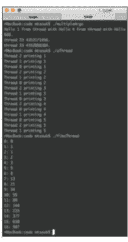

`make_archive(base_name, format, root_dir, base_dir, verbose, dry_run, owner, group, logger[...])`: 将此视为 `tar`、`zip`、`bzip2` 的替代方案。`make_archive()` 创建一个给定格式（如 bztar, tar, gtar）的存档文件。可以通过 Python 模块扩展存档支持。

```python
from shutil import make_archive

import os

archive_name = os.path.expanduser(os.path.join('~', 'ludarchive'))

root_dir = os.path.expanduser(os.path.join('~', '.ssh'))

make_archive(archive_name, 'gtar', root_dir)
```

`'Users/kunal/ludarchive.tar.gz'`

## 2. 操作系统与子进程接口

Python 提供了两个用于操作系统交互和管理的模块：`os` 和 `subprocess`。这些模块允许你与核心操作系统 shell 交互，并处理环境进程、用户和文件描述符。`subprocess` 模块的引入是为了支持对子进程更好的（已有）管理。

> 你可能再也不需要使用 Bash 了，专用 Python 模块旨在替换 `os.system`、`os.spawn`、`os.popen` 和 `commands` 模块。

`os` 模块以字符串对象的形式表示操作 环境变量。

示例：

```python
{
'HOME': '/Users/kunal',
'LC_TYPE': 'UTF-8',
'LANG': 'en_US.UTF-8',
'LOGNAME': 'kunal',
'USER': 'kunal',
'PATH': '/System/Library/Frameworks/Python.framework/Versions/2.7/bin:/Users/kunal/bin:/opt/local/bin:/usr/bin:/sbin:/usr/local/bin:/Applications/Python 2.7/bin',
'XFER_PYTHON_HOME': '/Users/kunal',
'PWD': '/Users/kunal',
'COMMAND_MODE': 'unix',
'TERM': 'Terminal',
'SHELL': '/bin/bash',
'TMPDIR': '/tmp/',
'COLORS': 'x',
'TEXT_ENCODING': 'UTF-8'
}
```

你也可以获取环境变量的值：

```python
os.environ['HOME']
/Users/kunal
```

- `putenv(varname,value)`: 添加或设置给定名称和值的环境变量。
- `getuid()`: 返回当前进程的用户 ID（UID）。
- `getlogin()`: 返回当前登录用户的用户名。
- `getpid(pid)`: 返回给定 pid 的进程 ID。当不带任何参数使用时，它返回当前进程 ID。
- `getcwd(path)`: 返回当前工作目录的路径。
- `chdir(path)`: 将当前工作目录更改为给定路径。
- `listdir(path)`: 类似于 `ls`，返回包含给定路径上目录和文件内容的列表。

示例：

```python
os.listdir("/home/kumar")
['gnome2', 'pulse', 'conf', 'beagle', 'gnome2_private', 'gks.lock', 'Public', 'ICEAuthority', 'bash_history', 'compiz', 'gvfs', 'update-notifier', 'cache', 'Desktop', 'Videos', '.profile', '.config', '.esd', '.viminfo', '.sudo_info_admin', 'mbox', 'session-errors', 'Documents', '.bashrc', 'Music', 'dbus', 'local', 'gstreamer', 'Documents', 'gtk-bookmarks', 'Downloads', 'Pictures', 'pulse-cookie', 'nautilus', 'examples.desktop', 'Templates', '.bash_logout']
```

- `mkdir(path, mode)`: 使用给定的数字代码创建目录。默认模式为 0777。
- `makedirs(path, mode)`: 递归创建给定路径（包括其所有子目录）。默认模式为 0777。

示例：

```python
import os

path = "/home/kunal/greatdir"

os.makedirs(path, 0755)
```


- `rename(old,new)`: 将文件或目录 `old` 重命名为 `new`。如果 `new` 已存在，将抛出错误。在 Unix 和 Linux 上，如果 `new` 存在且是一个文件，只要用户权限允许它将被静默替换。
- `renames(old,new)`: 类似于 `rename` 但也会创建

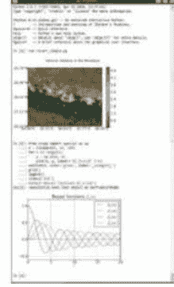 以上 IPython 以前提供了带有 GUI 的

`STD_INPUT_HANDLE`: 标准输入设备。初始为控制缓冲区。

`STD_OUTPUT_HANDLE`: 标准输出设备。初始为活动屏幕缓冲区。

`STD_ERROR_HANDLE`: 标准错误设备。初始为活动屏幕缓冲区。

## 第 2 节 IPython：现成的 Python shell

在第 1 节中，我们介绍了可以轻松完成系统相关任务的 Python 模块。使用原生 Python 你可以构建一个功能完整的 shell 并减少大量的样板代码。然而，如果你是想要现成工具的人，那么你幸运了。IPython 提供了一个强大的交互式 shell，你可以作为主 shell 使用。 IPython 支持 Python 2.6 到 2.7 以及 3.1 到 3.2。它支持两种类型的 Python shell：基于终端的和基于 Qt 的。

再次强调，IPython 完全用 Python 实现，并提供 100% 符合 Python 标准的 shell 接口，因此你在第 1 节中学学到的所有内容都可以无问题地在 IPython 中运行。

IPython 已经在大多数 Linux 发行版中可用。可以在你发行版的仓库中查找。如果没找到，可以使用 `easyinstall` 或 PyPI 安装。IPython 许多许多的功能，使其成为极佳的 shell 替代品。

补全：补全是探索你正在处理的任何 Python 对象的极佳方式。它还能帮助避免拼写错误。

示例：

```python
In [3]: import o {hit tab)
objc opcode operator optparse os2emxpath
```

```python
In [3]: import os
```

```python
In [4]: os.p {hit tab}
sos.pardir os.path_names os.popen os.popen4
sos.path os.pathsep os.popen2 os.putenv
sos.pathconf os.pipe os.popen3
```

内置对象资源管理器：在任何 Python 对象后添加 `?` 即可查看其详情，如类型、基类、字符串格式、命名空间、文件和文档字符串。

## 使用 Python 工作

### 将你的 shell 替换为 Python

示例：

```
In [28]: os.path?
Type:     module
Base Class: <type 'module'>
String Form: <module 'posixpath' from '/System/Library/Frameworks/Python.framework/Versions/2.7/lib/posixpath.py'>
Namespace:  Interactive
File:      /System/Library/Frameworks/Python.framework/Versions/2.7/lib/posixpath.py
```

在 POSIX 路径上的常用操作。

不要直接导入此模块，而是导入 `os` 并将其引用为 `os.path`。在 POSIX 系统上，`os.path` 是该模块的别名；在其他系统（例如 Mac、Windows）上，`ospath` 提供了特定于平台的操作，并且它是其他（例如 `macpath`, `ntpath`）的别名。

这些内容在非 POSIX 系统上也可能有用，例如处理 URL 的路径名部分。你也可以使用双问号 `??` 来查看相关对象的源代码。

魔术函数：IPython 附带了一组预定义的“魔术”函数，采用命令行风格的语法。魔术命令通常以 `%` 为前，但如果将 `%automagic` 设置为开启，你就可以在不加 `%` 的情况下调用魔术命令。要查看可用魔术函数列表，使用 `%magic`。它们包括与代码相关的函数如 `%run`、`%edit`、`%macro`、`%recall` 等；影响 shell 的函数如 `%colors`、`%xmode`、`%autoindent` 等；其他的如 `%reset`、`%timeit`、`%paste` 等。IPython 的大部分功能都是通过魔术函数实现的。

示例：

```
In [45]: %lsmagic
Available magic functions:
alias %autocall %autoindent %automagic %bookmark %cd
%colors %cpaste %debug %dhist %dirs %doctest_mode %ed
%edit %env %gui %hist %install_default_config
%install_profiles %load_ext %loadpy %logoff %blogger
%logstart %logstate %logstop %lsmagic %macro %magic
```

```
%page %paste %pastebin %pdb %pdoc %pfile
%info %pinfo2 %popd %pprint %precision %profile %prun
%search %psource %pushd %pwnd %pycat %pylab %quickref
%recall %rehash %reload_ext %repr %rerun %reset
%reset_selective %reselect %save %sc %xss %xtb Time %timeout
%unalias %unload_ext %who %who_is %whos %xdel %mode
```

`Autmagic` 为关闭状态，魔术函数需要 `%`。要查看任何魔术函数的帮助，请使用 `%comagic?` 以及运行时代码编辑：你可以使用 `%run` 运行任何 Python 脚本。你也可以使用 pdb 调试器 `-d` 运行 Python 脚本，或使用 `-p` 进行 pdb 性能分析。你还可以使用 `%edit` 命令编辑 Python 脚本，它会在由 `EDITOR` 环境变量定义的编辑器中打开指定的 Python 脚本。

Shell 命令支持：要运行 shell 命令，请在命令前加 `!`。

示例：
In [5]: !ps

| PID | TTY | CMD |
| 4508 | tty000 | 0:00.07 -bash |
| 84275 | tty001 | 0:00.03 -bash |
| 17958 | tty002 | 0:00.18 -bash |

In [8]: !clang prog.c -o prog
prog.c:2:1: warning: type specifier missing, defaults to 'int' [-Wimplicit-int]
main()

1 generated.

Qt 控制台：IPython 附带了一个基于 Qt 的控制台。它提供了只有 GUI 才有的功能、内联图形、多行显示、语法高亮和图形调用。使用以下命令启动控制台：

```
$ ipythonconsole
```


如果遇到缺少模块的错误，请确保你已安装依赖包 - `PyQt`、`pyments`、`pyxect` 和 `ZeroMoQ`。

## 结论

如你所见，很容易根据你的环境需求定制 Python：像 `os`、`subprocess` 和 `shutil` 这样的 Python 模块供你随用，使用 Python 完成你需要的一切。IPython 将其变成一个更完整的包。要实现标准 Python shell 的功能并带有更多特性，IPython 的魔术函数确实提升了 shell 体验。下次你打开 Bash 会话时，既然铂金触手可及，为什么不直接选择黄金呢？

# 使用 Python 工作

## 使用 NumPy 进行科学计算

### 你需要...

- `NumPy` (www.numpy.org)
- `SciPy` (www.scipy.org)
- `Matplotlib` (www.matplotlib.org)

使用 `NumPy`、`SciPy` 和 `Matplotlib` 进行强大的计算

`NumPy` 是执行科学计算的主要包。它拥有强大的 N 维数组对象、集成 C/C++ 和 Fortran 代码的工具、线性代数、傅里叶变换和随机数能力等。`NumPy` 还支持广播（`broadcasting`），这是一种巧妙的方法，让通用函数以有意义的方式处理不完全相同的输入。

除了这些功能外，`NumPy` 的另一个优势是它可以集成到 Python 程序中。也就是说，你可以从数据库、另一个程序的输出、外部文件或 HTML 页面获取数据，然后使用 `NumPy` 对其进行处理。

这篇文章将向你如何安装 `NumPy`、进行计算、绘制数据图、读取和写入数据。`NumPy` 的某些功能在非 POSIX 系统上也可能有用，例如处理 URL 的路径名部分。你也可以使用双问号（`??`）来查看相关对象的源代码。

魔术函数：IPython 附带了一组预定义的“魔术”函数，采用命令行风格的语法。魔术命令通常以 `%` 为前，但如果将 `%automagic` 设置为开启，你就可以在不加 `%` 的情况下调用魔术命令。要查看可用魔术函数列表，使用 `%magic`。它们包括与代码相关的函数如 `%run`、`%edit`、`%macro`、`%recall` 等；影响 shell 的函数如 `%colors`、`%xmode`、`%autoindent` 等；其他的如 `%reset`、`%timeit`、`%paste` 等。IPython 的大部分功能都是通过魔术函数实现的。

示例：

```
In [45]: %lsmagic

Available magic functions:

alias %autocall %autoindent %automagic %bookmark %cd

%colors %cpaste %debug %dhist %dirs %doctest_mode %ed

%edit %env %gui %hist %install_default_config

%install_profiles %load_ext %loadpy %logoff %blogger

%logstart %logstate %logstop %lsmagic %macro %magic
```

## 将你的 shell 替换为 Python

```python
$ mtsouk@mail:~ mtsouk@mail:~ /docs/article/working/NumPy_LUD/var -- ssh -90x45

mtsouk@mail:~ mtsouk@mail:~ NumPyLUD/var
```


`root@mail:~# apt-get install python-matplotlib`

读取列表... 完成

构建依赖树

读取状态信息... 完成

将安装以下额外的软件包包：

`libglib2-0-2.0` `libglade2-0-cairo`

`python-dateutil` `python-glib2-giobject` `python-object2` `python-gtk2`

`python-matplotlib-data` `data-pyparsing-python-tk-tz`

建议安装的软件包：

`bt-python-glib2-gi-cairo` `python-gtk2-dkc` `python-object--2` `dvping`

`python-configobj-extractor-matplotlib-python-qt4` `python-traits`

`python-xtk82-2` `libglib2-0-cairo` `extra-utils-tikz-latex-tikz`

将安装以下新软件包的包：

`libglib2-0-2.0` `libglade2-0-cairo-8-cairo`

`python-dateutil` `python-glib2-giobject` `python-object2` `python-gtk2`

`python-matplotlib-data` `data-pyparsing-python-tk-tz`

0 个升级，17 个新安装，0 个移除，0 个未升级。

操作后，将使用 31.3 MB 的额外磁盘空间。

您想继续吗？[Y/n]

`Get1 http://ftp.debian.org/debian/whezy/main blz amd64 24.2-4.2 [1,694 kB]`

`Get2 http://ftp.debian.org/debian/whezy/main fonts-lyx 2.0.3-3 [167 kB]`

`Get3 http://ftp.debian.org/debian/whezy/main libglibrepository-1.0-1 amd64 1.32.1-1 [07 kB]`

`Get4 http://ftp.debian.org/debian/whezy/main libgir1-db2.0 amd64 1.32.1-1 [37 kB]`

`Get5 http://ftp.debian.org/debian/whezy/main libglade2-0 amd64 1.2.6.4-1 [89.0 kB]`

`Get6 http://ftp.debian.org/debian/whezy/main libglib2-0 1.32.1-1 [84.2 kB]`

`Get7 http://ftp.debian.org/debian/whezy/main python-dateutil all 1.5-dfgs-0.1 [55.3 kB]`

`Get8 http://ftp.debian.org/debian/whezy/main python-gi1 amd64 3.2.2 [518 kB]`

`Get9 http://ftp.debian.org/debian/whezy/main python-object-2 amd64 2.28.10-6 [555 kB]`

`Get10 http://ftp.debian.org/debian/whezy/main python-gtk2 amd64 2.24.0-3b1 [1,085 kB]`

`Get11 http://ftp.debian.org/debian/whezy/main python-glib2-glade2 amd64 2.24.0-3b1 [45.8 kB]`

`Get12 http://ftp.debian.org/debian/whezy/main python-object all 3.2.2-2 [162 kB]`

`Get13 http://ftp.debian.org/debian/whezy/main python-matplotlib-lib-data all 1.1-rc-1 [2,297 kB]`

`Get14 http://ftp.debian.org/debian/whezy/main python-pyparsing all 1.6-dfgs1-2 [64.7 kB]`

`Get15 http://ftp.debian.org/debian/whezy/main python-tz all 2.0.12-1 [39.9 kB]`

`Get16 http://ftp.debian.org/debian/whezy/main python-matplotlib amd64 1.1-rc2-1 [699 kB]`

`Get17 http://ftp.debian.org/debian/whezy/main python-tk amd64 2.7.3-1 [50.80 kB]`

使用 `AA + BB` 添加矩阵名称 `AA` 和 `BB`。同样，你可以通过 `AA * BB` 将它们相乘。

也会安装的依赖项。你学习的第一件事是绘制多项式函数。多项式的必要命令如下：

## 使用 Matplotlib 绘图

你应该进行的第一件事是安装 Matplotlib。如你所见，Matplotlib 有许多

> “在 Python shell 内部尝试各种命令”

- `import numpy as np`
- `matplotlib.pyplot`

```python
import numpy as np

import matplotlib.pyplot as plt

myPoly = np.poly1d(np.array([3, -1, 11]).astype(float))

x = np.linspace(-5, 5, 100)

y = myPoly(x)

plt.xlabel('x values')

plt.ylabel('y values')

ticks = np.arange(-5, 10)

ticks = np.arange(0, 100, 10)

plt.xticks(ticks)

plt.yticks(ticks)

plt.plot(x)
```

# 系统管理员 Python 教程

## 使用 Python

```ini
zend.zel_compatibility_mode = Off

short_open_tag = On

asp_tags = Off

precision = 14

y2k_compliance = On

output_buffering = 4096

;output_handler = =
zlib.output_compression = Off
```

```python
host','localhost'
config.set('MySQL','mysql.default-port','3306')
config.set('MySQL','mysql.allow_persistent','On')
config.set('MySQL','mysql.max-persistent','20')
```

```ini
[MySQL]
; 允许或阻止持久连接。
mysql.allow_persistent = On
mysql.max_persistent = 20
mysql.max_links = -1
mysql.default_port = 3360
mysql.default_socket = 
mysql.default_host = localhost
mysql.connect_timeout = 60
mysql.trace_mode = Off
```

```python
with open('php.ini', 'ap') as configfile:
    config.write(configfile)
Output:php.ini
[MySQL]
mysql.max_persistent = 20
mysql.allow_persistent = On
mysql.default_port = 3386
mysql.default_host = localhost
mysql.trace_mode = Off
mysql.connect_timeout = 60
```

Python 提供了一个内置模块 `ConfigParser`（在 Python 3.0 中名为 `configparser`）。你可以使用该模块来解析和创建配置文件。

```python
@code:writeconfig.py
@description:以下演示了如何向 php.ini 文件中添加 MySQL 段
@warning:不要对实际的 php.file 使用此脚本，因为它并非设计用于处理完整 php.ini 的所有方面。
```

```python
@code:parseconfig.py
@description: 解析并更新配置文件
import ConfigParser
config = ConfigParser.ConfigParser()
```


`config.read('php.ini')`

## 打印配置值

`print(config.get('MySQL','mysql.default-host'))`

`print(config.get('MySQL','mysql.default-port'))`

`config.remove_option('MySQL','mysql.trace-mode')`

```python
with open('php.ini', 'wb') as configfile:
    config.write(configfile)
```

```python
import ConfigParser

config = ConfigParser.RawConfigParser()

config.add_section('MySQL')

config.set('MySQL','mysql.trace_mode','Off')

config.set('MySQL','mysql.connect-timeout','60')

config.set('MySQL','mysql.default_')
```

## 解析 JSON 数据

JSON（也称为 JavaScript 对象表示法）是一种轻量级的现代数据交换格式。JSON 是 ECMA-262 下的开放标准。它是一种文本格式，完全与语言无关。JSON 也被用作 Mozilla Firefox 和 Google Chrome 等现代应用程序的配置文件格式。JSON 在 Facebook、Twitter、Amazon EC2 等现代 Web 服务中也非常流行。在本节中，我们将使用 `simplejson` 模块通过 Yahoo Web Services API 来解析 Yahoo 搜索（该 API 输出 JSON 数据）。

在本小节中，我们将使用 `simplejson.Load` 函数，它允许我们将一个 JSON 对象反序列化为 Python 对象。

```python
@code:LUDSearch.py

import simplejson, urllib

APP_ID = 'xxxxxxx' # 更改为你的 APP ID

SEARCH_BASE = 'http://search.yahooapis.com/WebSearch/V1/webSearch'
```

要使用本节内容，你需要具备：

- 1. Python 模块：`simplejson`。
- ：：你可以使用命令 `easy_install <module name>` 安装 Python 模块。该命令假设你已拥有可用的互联网连接。
- 2. Yahoo App ID：

Yahoo App ID 可以从 https://developers.yahoo.com/dashboard/createKey.html 创建。Yahoo App ID 将在下一页生成。详情见截图。`simplejson` 非常易用。在接下来的示例中，我们将利用将 JSON 数据结构直接映射到 Python 数据类型的功能。这让我们可以直接访问 JSON 数据，而无需编写任何 XML 解析代码。

```python
class YahooSearchError(Exception):
    pass

def search(query,results=20, start=1, **kwargs):
    kwargs.update({
        'appid': APP_ID,
        'query': query,
        'results': results,
        'start': start,
        'output': 'json'
    })
    url = SEARCH_BASE + '?' + urllib.encode(kwargs)
    result = simplejson.load(urllib.urlopen(url))
    if 'Error' in result:
        # 发生错误；抛出异常
        raise YahooSearchError(result['Error'])
    return result['Results']
```

| JSON 数据映射 | JSON | Python |
| :--- | :--- | :--- |
| object | dict |
| array | list |
| string | unicode |
| number (int) | int, long |
| number (real) | float |
| TRUE | TRUE |
| FALSE | FALSE |
| null | None |

让我们在 Python Shell 中运行上述代码来查看它是如何工作的。切换到保存 `LUDYSearch.py` 的目录并打开 Python Shell。

```python
@code: Python Shell 输出。
```

所以你想使用一些 Yahoo APIs... 为了使用 Yahoo Web 服务，我们需要你提供一些信息，以及关于你正在构建的应用的更多信息。我们需要这些信息来更好地了解 Yahoo Web 服务的使用情况，并保护用户安全和隐私。所有问题均为必填。

| 应用名称 | LUDPySearch |
| :--- | :--- |
| 应用类型 | 客户端/桌面 |
|get | 演示使用 Python 解析 JSON 的应用（少于 26 个字符） |
| Favicon URL | http://www.yahoo.com/this/App/favicon.gif |
| 可选：指定 URL | JPG 或 GIF 图像。 |

- Yahoo APIs 使用 OAuth 协议进行安全的 API 使用和身份验证（如果需要的话）。
- 访问范围：此应用将仅访问公共 API 或 RSS 馈。
- 当发生某些情况且我们需要联系你时，此应用需要访问私有数据的权限。

| 联系信息 | |
| :--- | :--- |
| 应用所有者 | Kumar Desai |
| 联系邮箱 | kumard@yahoo.com |
| 使用条款 | 我已阅读并同意至 |

生成 Yahoo App ID

```python
starting with ''
>>> execute('LUDPySearch.py')
>>> results = search('LUDPySearch')
>>> results=['Results']
>>> items = results['Results']
>>> Result in items:
```

```python
import os
import sigar
s = sigar.open()
mem = sg.mem()
swap = sg.swap()
fslist = sg.file_system_list()
print "====Memory===="
print "====Information===="
print "Total\tUsed\tFree"
print "Mem:\t", ""
```

```
/ /dev/disk0 300G 175G 24G 59.0 / hfs / local
devs 191K 191K 0 - /dev devfs /none
```

```python
import base64, getpass, os, socket, sys
import traceback
import paramiko
import interactive
# 设置日志\
paramiko.util.log_to_file('demo_simple.log')

## 获取主机
username = ""
if len(sys.argv) > 1:
    hostname = sys.argv[1]
    if hostname.find('@') >= 0:
        username, hostname = hostname.split('@')
else:
    hostname = raw_input('Hostname:')
    if len(hostname) == 0:
    print('*** 需要主机名.')
    sys.exit(1)

port = 2
if hostname.find(':') >= 0:
    hostname, portstr = hostname.split(':')
    port = int(portstr)

## 获取用户名
if username == "":
    default_username = getpass.getuser()
    username = raw_input('Username [%s]: ' % default_username)

if len(username) == 0:
```

# 系统管理员 Python入门：使用 Python


`username = default_username`

## 访问安全外壳 (SSH) 服务

SSH (`Secure Shell`) 是旧版 shell 系统 `Telnet` 的现代替代品。它允许在两个设备之间通过安全通道进行数据交换。系统管理员经常使用 SSH 来管理网络系统。除了提供远程 shell 之外，SSH 还用于安全文件传输（使用 SSH 文件协议，或 `SFTP`）和 X 服务器转发（允许你将 SSH 客户端用作 X 服务器）。在本节中，我们将学习如何使用 Python 模块 `paramiko` 从 Python 使用该协议，该模块为 Python 实现了 SSH2 协议。可以通过以下步骤安装 `paramiko`：

- `$ git clone https://github.com/robey/paramiko.git`
- `$ cd paramiko`
- `$ sudo pip setup.py install`

`paramiko` 的核心是 `SSHClient` 类。该类封装了 `L(Transport)`、`L(Channel)` 和 `L(SFTPClient)` 来处理 SSH 的大部分方面。你可以使用以下代码：

```python
client = SSHClient()
client.load_system_host_keys()
client.connect('some.host.com')
stdout, stdin, stderr = client.exec_command('dir')
```

下面的示例演示了使用 `paramiko` 模块编写的完整 SSH 客户端。

@code: PySSHClient.py


```python
*** Connecting...***
client.connect(hostname, port, username, password)
chan = client.invoke_shell()
print(repr(client.get_transport()))
print('*** SSH 服务器已连接！***')
```

> ~ $:

如果 SSH 服务器的主机密钥未添加到你的 `$HOME/ssh/known_hosts` 文件中，客户端将抛出以下错误：

```python
try:
    interactive.interactive_shell(chan)
    chan.close()
    client.close()
except Exception, e:
    print('*** 捕获到异常: %s' % (e.__class__, e))
    traceback.print_exc(n)
try:
    client.close()
except:
    pass
sys.exit(1)
```

*** 捕获到异常: <type 'exceptions.TypeError>: unbound method missing_host_key()必须带有 WarningPolicy 实例作为第一个参数（得到的是 SSHClient 实例）

这意味着客户端无法验证你所连接的服务器的真实性。要将主机密钥添加到你的列表中，请使用 `ssh` 命令。请记住，这不是添加主机密钥的理想方法；你应该使用 `ssh-keygen`。为了简单起见

```
$ luna@ubuntu-vm-kdeo:~/.ssh ssh
luser@192.168.1.2
```
主机 '192.168.1.2' (192.168.1.2') 的真实性无法建立。

RSA 密钥指纹为: 01:76:64:b9:bb:6:94:e63:37:00:a46:33:d1

确定要连接吗 (yes/no)? yes
Warning: 已永久将 '192.168.1.2' (RSA) 添加到已知主机列表。

要运行此程序，你还需要一个自定义的 Python 类 `interactive.py`，它实现了 SSH 会话的交互式 shell。在 File5 上查找此文件并将其复制到你创建 PySSHClient 的同名文件夹中。

```python
@code_Output
lunkal@ubuntu-vm:~/src/paramiko/
demos$ python demo_sample.py
hostname:192.168.1.2
[Username]: luduser
Password for luduser@192.168.1.2:
*** Connecting...***
<paramiko.Transport as 0x7b601acl1 (cipher aes128-ctr, 128 bits) active: 1
open channel(s))
*** SSH 服务器已连接！***
Last login: Thu Jan 13 02:01:06 from 192.168.1.9
```

现在，你已经看到了使用 `paramiko` 模块编写 SSH 客户端是多么简单。

## 使用 Beautiful Soup 爬取 Wikipedia

## 完整代码

### 1 导入库
这些是我们将在程序中将使用的库

```python
import os, sys, urllib2, argparse, datetime
import atexit as ateexit
from bs4 import BeautifulSoup
addresses = []
deepestaddresses = []
maxlevel = 1
storeFolder = str(datetime.now().strftime("%Y-%m-%d %H:%M:%S"))
storeFolder = "Wikistore"
desiriderables = [{"element": "table", "attr": {"class": "infobox"}, {"element": "table", "attr": {"class": "vertical-navbox"}, {"element": "span", "attr": {"class": "thumb"}, {"element": "span", "attr": {"class": "mw-editsection"}, {"element": "span", "attr": {"class": "reference"}, {"element": "div", "attr": "global"}, {"element": "table", "attr": {"class": "reflit"}, {"element": "table", "attr": {"class": "nowplinks"}, {"element": "table", "attr": {"class": "Ambox-refinfo"}, {"element": "img", "attr": None}, {"element": "table", "attr": {"class": "script"}, {"element": "None", "attr": None}, {"element": "table", "attr": {"class": "div"}, {"element": "div", "attr": "coordinates"}, {"element": "table", "attr": {"class": "Ambox-Orphan"}, {"element": "div", "attr": {"class": "mainarticle"}, {"element": "None", "attr": {"id": "References"}}]
def init():
    parser = argparse.ArgumentParser(description="处理起始页面和我们准备爬取的层级")
    parser.add_argument("URL", dest="link", action='store', help='我们将从这里开始爬取的 Wikipedia 页面')
    parser.add_argument("--levels", dest="levels", action='store', help='爬虫应该爬到多少层深？')
    args = parser.parse_args()
    if(args.levels != None):
        maxlevel = int(args.levels)
```

### 2 设置变量
这些是我们将用于跟踪脚本进度的变量

### 3 初始化
这是我们将处理来自用户输入的初始函数

```python
if(args.link == None):
    print("你需要通过 -URL 标志传递一个链接")
    sys.exit(0)
else:
```


```python
if not os.path.exists(storeFolder):
    os.makedirs(storeFolder)

grabPage(args.link, 0, args.link.split("/wiki/")[1].replace("-", ""))

atexit.register(cleanup)
```

```python
def isValidLink(link):
    if "/wiki/" in link and "." not in link and "http://" not in link and "wikibooks" not in link and "#" not in link and "wikiquote" not in link and "wiktionary" not in link and "wikisity" not in link and "wikivoyage" not in link and "wikisource" not in link and "wikinews" not in link and "wikidata" not in link:
        if True:
            return True
    else:
        return False
```

```python
def grabPage(url, level):
    opener = urllib2.build_opener()
    opener.headers = [{"User-agent", "Mozilla/5.0"}]
    req = opener.get(url)
```


## 使用 Python 开发

## 使用 Beautiful Soup 爬取 Wikipedia

## Wiki 全百科

## 创建一些实用的变量

Wikipedia 有许多相互关联的服务，我们不想抓取那些页面，因此我们设置了一个相当复杂的条件语句来停止这样做。它很好地确保我们只获取来自 Wikipedia 的链接。

02 这些变量将跟踪脚本运行期间访问过的链接；`addresses` 是一个包含我们访问过的每个链接的列表；`deepestAddresses` 是距离起始点最远的链接；`storeFolder` 是我们保存创建的 HTML 文件的地方，`maxLevel` 是我们可以追踪链接到起始页面的深度。

## 处理用户输入

03 在这个函数的几行中，我们只是在创建一个辅助语句。之后，我们解析执行时传递给程序的任何参数，并寻找 `-URL` 标志和 `-levels` 标志。`levels` 标志是可选的，因为我们已经有一个预设的深度来追踪链接，但如果缺少 `-URL` 标志，我们需要一个链接作为起点，这种情况下我们将提示用户并退出。如果我们有链接，我们会快速检查我们是否有一个用于存储文件的目录（如果没有则我们将创建）——并启动函数来获取该页面。最后，我们为脚本尝试退出时注册一个处理程序。

## 从 URL 获取页面

04 在这里，我们使用 `URLlib` 来请求用户请求的页面，一旦收到该页面，我们将通过 `soup` 变量将内容传递给 `Beautiful Soup`。这使我们能够访问正在调用的方法，同时我们解析文档。

## 修剪冗余

05 Wikipedia 有许多我们不想解析的节点。`content` 变量允许我们直接过滤掉大部分 Wikipedia 的 GUI，但仍然有很多我们不想解析的元素。我们通过遍历早在文档中创建的 `undesirable` 列表来解决这个问题。对于每个我们不需要 `div`，我们调用 Beautiful Soup 的 `find_all()` 方法从文档中删除该节点。在 `undesirable` 列表结束后，大部分内容都消失了。我们还在 Wikipedia 页面中寻找 `also` 元素。通常，之后的内容对我们没用。通过对 `also` 节点调用 `find_all_next()` 方法，我们可以获取从该点开始的所有元素列表。HTML 页面在渲染时使用内置浏览器。


## 使用 Beautiful Soup 爬取 Wikipedia 与 Python 开发

“Wikipedia 有许多相互关联的服务；我们不想抓取那些页面”

```python
page = req.read()
req.close()
soup = BeautifulSoup(page, 'html5lib', from_encoding='UTF-8')
content = soup.find(id='mw-content-text')
if hasattr(content, 'find_all'):
    global undesirable
    for notWanted in undesirable:
        removal = content.find_all(notWanted['element'], notWanted['attr'])
        if len(removal) > 0:
            for el in removal:
                el.extract()
also = soup.find(id='See_also')
if (also is not None):
    tail = also.find_all_next()
    if len(tail) > 0:
        for element in tail:
            element.extract()
```

## 4 获取页面

在这里我们抓取想要的页面，并移除我们不需要的文档部分


## 5 检查链接

我们遍历所有的 `<a>` 标签，检查是否存在指向我们可以抓取的另一个页面的有效链接，并为我们进行调整。


```python
for link in content.find_all('a'):
    href = link['href']
    if isValidLink(href):
        if level < maxLevel:
            stored = False
            for addr in addresses:
                if addr == link.get('href'):
                    stored = True
        if(stored == False):
            title = link.get('href').replace('wiki/', '')
            addresses.append(str(title) + '.html')
            grabPage(link.get('http://en.wikipedia.org/') + link.get('href'), level)
```

### 1, 标题

```python
print(title)
link['href'] = link['href'].replace('/wiki/', '/wiki/', '') + '.html'
fileName = str(title)
if level == maxLevel:
    deepestAddresses.append(fileName.replace('/', '_') + '.html')
```


> 样式
HTML 页面在渲染时将使用内置浏览器。如果你喜欢，可以在教程资源中包含样式表使其看起来更好。你可以对脚本进行压缩并将其包含在第 102 行 head 字符串的 `<style>` 标签中，或者重写 head 字符串为：

```html
head = '<meta charset="UTF-8"><title></title><style type="text/css">#MYSTYLES</style></head>'
```


# 使用 Python 开发 使用 Beautiful Soup 爬取 Wikipedia

## Beautiful Soup 文档

Beautiful Soup 是一个从 HTML 和 XML 中提取数据的库。它与你的解析器配合工作，提供便捷的方法。

这些说明展示了 Beautiful Soup 的所有功能，并提供了 4 个示例向你展示它为什么有用、如何使用它、如何让它执行你想要的操作、在哪里以及何时发送请求。

## 简介

你可能正在寻找 Beautiful Soup 3 的文档。如果是这样，你应该知道 Beautiful Soup 3 不再进行开发，我们建议在新项目中使用 Soup 4。如果你想了解 Beautiful Soup 3 和 Soup 4 之间的差异，

此文档由 Beautiful Soup 翻译成其他语言：

- 日本語（日语）
- 한국어（韩语）
- العربية语
- 简体中文

## 获取帮助

如果你对 Beautiful Soup 有疑问，或遇到问题，请加入讨论组。如果你的问题涉及 HTML 文档，请务必提到。

## 快速开始

这是一个在整个示例中将使用的 HTML 文档。它是《爱丽丝仙游记》故事的一部分：

```python
from bs4 import BeautifulSoup

html_doc = """<html><head><title>Alice's Adventures</title></head><body><p>Alice was sitting by the bank with her sister, and was so tired of reading the book her sister was reading, which had no pictures or conversations, that she began to doze off. <a href="http://example.com/alice">Click here!</a></p></body></html>"""

soup = BeautifulSoup(html_doc, 'html.parser')

print(soup.find('a'))
```

## 使用 Beautiful Soup 爬取 Wikipedia

## 使用 Python 进行工作

## 完成收尾工作

08 在我们的脚本遍历每个页面上的每个链接并达到它能触及的最大深度后，它将尝试退出。在函数的代码第 34 行（磁盘和在线上的代码）中，我们注册了 `cleanUp` 函数，以便在程序尝试退出时执行它；`cleanUp` 的工作是检查我们已经下载的文档，并检查我们在页面中留下的每个链接是否指向我们已有的本地文件。如果它无法将文件中的链接与地址列表匹配，它将将其删除。一旦完成，我们就拥有一个完全便携的维基百科区块，可以随身携带。

### 06 复制到文件
之后，我们将解析后的内容放入一个全新的 HTML 文件中

```python
doctype = "<!DOCTYPE html>
head = "<head><meta charset=\"UTF-8\"></title>" + filename + "</title>"
f = open(storeFolder + "/" + filename.replace(".", '_') + ".html", 'w')
f.write(doctype + "<html lang=\"\">" + head + "<body><h1>" + filename + "</h1>\n" + str(content) + "</body></body>\n</html>")
f.close()
def cleanUp():
    print("\n移除指向未保存页面的链接")
    for deepPage in deepestAddresses:
        rf = open(storeFolder + "/" + deepPage, 'r')
        deepSoup = BeautifulSoup(rf.read(), "html5lib", encoding="UTF-8")
        for deepLinks in deepSoup.find_all('a'):
            link = deepLinks.get('href')
```

### 07 清理
一旦所有页面都已解析并存储，我们将遍历并移除任何死链

```python
pageStored = False
for addr in addresses:
    if addr == link:
        pageStored = True
if pageStored == False:
    if link is not None:
        if '#' not in link:
            del deepLinks[link.split('#')]
        elif '#' in link and len(link.split('#')) > 1 or ';' in link:
            del deepLinks[link.split('#')[0]]
f = open(storeFolder + "/" + deepPage, 'w')
f.write(str(deepSoup))
f.close()
```

### 08 初始化
这是我们初始化脚本的方式

```python
print("Complete")
if __name__ == "__main__":
    init()
```


## 使用 Python 创建

享受编程的乐趣

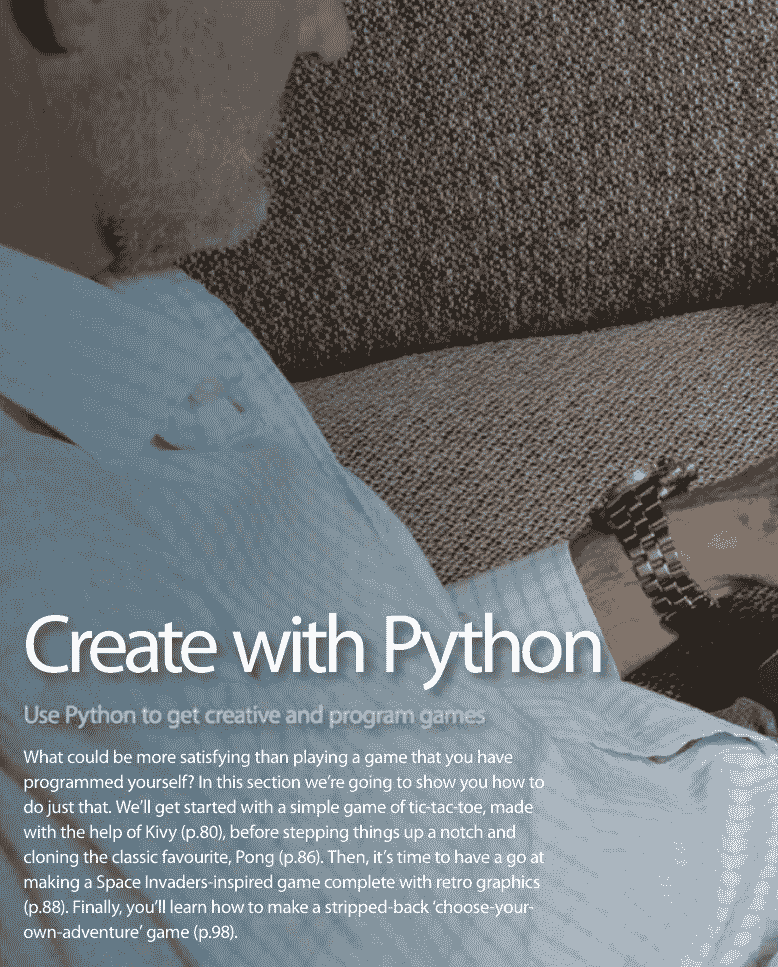

## 使用 Python 创建

使用 Python 发挥创意并编写游戏

还有什么比玩自己编写的游戏更满足的呢？在本节中，我们将向你展示如何实现这一点。我们将从一个在 Kivy（第 80 页）的帮助下制作的简单井棋游戏开始，然后提升一个台阶，克隆经典的受欢迎游戏——乒乓球（Pong，第 86 页）。接着，是时候尝试制作一个受《太空入侵者》启发的、带有复古画面的的游戏了（第 88 页）。最后，你将学习如何制作一个精简的“互动式冒险”游戏（第 98 页）。

享受编程的乐趣

使用 Python 创建


“制作一个可玩的游戏并没有你想象的那么困难”

79

## 使用 Python 创建

## 使用 Kivy 构建井棋

你将需要...

- Python
- www.python.org/doc

## 使用 Kivy 构建井棋

通过仅用 100 多行 Python 代码创建这款经典的纸笔游戏，简易地上手 Kivy 的工作原理……

Kivy 是一个高度跨平台的 Python 图形化框架，旨在创建诸如多点应用等创新用户界面。它的应用程序不仅可以运行在 Linux、OS X 和 Windows 等传统平台上，还可以运行在 Android 和 iOS，以及树莓派设备上。

这意味着你可以使用 Requests、SQLAlchemy 甚至 NumPy 等 Python 库开发跨平台应用。你甚至可以通过你的兄弟项目直接从 Python 访问原生移动 API。另一个很棒的功能是 Kivy 优化的 OpenGL 流水线，即使基础 Python API 非常简单，也能实现高级的 GPU 效果。

Kivy 是一组 Python/Cython 模块，可以通过 `pip` 轻松安装，但你需要一些依赖项。它使用 Pygame 作为渲染后端（尽管其 API 未暴露），使用 Cython 编译快速图形编译器内部，并使用 Gstreamer 处理多媒体。这些应该可以通过你发行版的仓库或通过 `pip install` 获取。

满足这些依赖项后，你应该使用普通的 pip 命令安装 Kivy。当前版本为 1.8.0，代码库支持 python2 和 python3。本教程中的代码是版本无关的，可以在 python2 和 python3 中运行。

```bash
pip install kivy
```

如果你在使用 pip 时遇到任何问题，可以通过 `easy install` 使用 `easy_install`。某些发行版也有相应的包。你可以在 Kivy 网站找到更多信息。Kivy 应用是通过实例化并运行 `App` 类启动的。这是 Kivy 窗口的入口，它与操作系统交互并提供了

## 使用 Kivy 构建井棋 使用 Python 创建

这是创建我们 GUI 的入口点。我们可以从制作最简单的 App 开始：

```python
```


from kivy.app import App

class TicTacToeApp(App):
    pass

if __name__ == "__main__":
    TicTacToeApp().run()

你已经可以运行这个了，你的程序将启动，你会得到一个空白的窗口。太兴奋了！我们可以用 Kivy 组件构建自己的 GUI。每个组件都是带有特定行为的简单元素，从标准 GUI 功能（如 `Button`、`Label`）到布局组件（如 `BoxLayout` 或 `GridLayout`），再到更复杂的任务如与硬件交互（如 `FileChooser`、`VideoPlayer`）。Kivy 组件的设计非常易于组合——包含了各种需要的组件，组件保持简单但易于连接。

“Hello World”在我们的编程中基本上是强制性的，让我们通过使用简单的 `label` 来完成这部分并显示文本：

```python
def build(self):
    return Label(text='Hello World!',
                 font_size=100,
                 color=(0, 1, 0, 1))
```

`build` 方法在 `App` 运行时被调用，它返回的内容自动成为根组件。在我们的情况下是一个 `Label`，我们设置了几个属性：`text`、`font_size` 和 `color`。所有组件都有控制外观的各种属性，以后可以动态更新。注意这些不仅仅是 Python 属性，而是 Kivy 属性。它们的访问方式类似于普通属性，但通过挂钩 Kivy 的事件系统提供了额外功能。如果你想配合 Kivy 的事件和绑定功能使用变量，你应该这样做。

我们将看到创建属性的示例，这些是：

```python
from kivy.uix.label import Label
```

我们将通过返回 `Label` 作为我们的根组件来显示它。每个应用都有一个根树，它将成为根树的顶层并调整大小填充窗口。稍我们将我们将如何通过添加更多组件来构建完整的 GUI，但现在通过向 `App` 添加新方法来设置根组件就足够了：

### 我们的组件：井棋

由于 Kivy 没有井棋组件，我们必须自己制作！我们将创建一个新的组件类来包含这种行为：此示例演示了为 `TicTacGrid` 组件创建规则，即声明实例化的 `TicTacGrid` 的 `cols` 属性应设置为 3。

```python
from kivy.uix.gridlayout import GridLayout

class TicTacGrid(GridLayout):
    pass
```

稍后我们将使用更多 kv 语言特性，但现在回到 Python 来创建作为井棋网格条目的按钮。

```python
from kivy.uix.button import Button
from kivy.properties import ListProperty
```

现在这显然还没有做任何事情，除了它继承了 Kivy `GridLayout` 的所有行为——也就是说，我们需要告诉它有多少列，然后它会自动排列任何组件以适应所需的行。井棋需要三列和九个子元素。

```python
class GridEntry(Button):
    coords = ListProperty([0, 0])
```

在这里我们引入 Kivy 语言 `kv`，一种用于创建 Kivy 树的特殊领域语言。它简单地移除了用 Python 代码管理 UI 所需的大量样板代码——一个很好的类比，你可以将其视为 Python 的 JavaScript 的 HTML/CSS。Python 给了我们做任何事情的动态力量，如果我们只需要声明 GUI 的基本结构，所有这些力量都会成为障碍。现在你永远不需要 kv 语言，始终可以用纯 Python 做同样的事情，但 Kivy 程序员通常喜欢使用 kv 的其他原因是：这继承自 Kivy 的 `Button`，它与鼠标或触摸交互，并在实例切换时分发事件。我们可以挂钩这些事件，在用户按下按钮时调用我们的函数，并设置按钮的 `text` 属性来显示 'X' 或 'O'。我们的组件添加了一个新的 Kivy 属性 `coords`——稍后我们将展示如何使用它。这与在 `GridEntry.__init__` 中编写 `self.coords = (0, 0)` 创建普通 Python 属性几乎相同。

通过 `TicTacGrid`，我们将使用 kv 语言为我们的网格设置样式，但这次我们看到了一个更有趣的功能。Kivy 提供了使用 kv 所需的所有工具：简单的方法是在基于你的 App 类命名的文件中编写它。也就是说，我们应该将内容放在名为 'tictact-toe.kv' 的文件中：

```kv
<GridEntry>
    font_size: self.height
```

```kv
<TicTacGrid>:
    cols: 3
```

这是 kv 语言的语法，对于每个组件我们都可以编写一个定义其行为的规则，像之前一样，这种语法定义了如何构建 `GridEntry` 组件，这次设置 `font_size` 属性控制按钮标签中文本的大小。额外的魔法在于' 语言会自动检测到我们引用了按钮的高度，并创建一个绑定来更新这种关系——当 `GridEntry` 高度变化时，它的 `font_size` 将改变，文本完美贴合。我们可以

## 使用 Kivy 构建井字游戏 使用 Python 创建

这些绑定是直接从 Python 创建的（其他用法，尽管如此，是稍后使用的 'bind' 方法），但很少作为对我们想要绑定的属性的引用。

显示它们并知道它会自动将它们排列成我们之前设置的列数的网格。

让我们用 'GridEntry' 组件填充我们的 'TicTacToeGrid'。
现在我们必须将根组件（从 'App.build' 返回）替换为 'TicTacToeGrid'，就可以看到输出效果了。

```python
class TicTacToeGrid(GridLayout):
    def __init__(self, *args, **kwargs):
        super(TicTacToeGrid, self).__init__(*args, **kwargs)
        for row in range(3):
            for column in range(3):
                grid_entry = GridEntry(coords=(row, column))
                grid_entry.bind(on_release=self.button_pressed)
                self.add_widget(grid_entry)
```

```python
def build(self):
    return TicTacToeGrid()
```

通过这种，你可以再次运行你的 Python 文件并享受你的新程序。如果一切顺利，Label 将被替换为九个按钮的网格，每个按钮都可以点击（它会自动改变颜色），并且将看到来自我们绑定的打印输出信息。

我们可以通过修改 Button 的其他属性来定制外观，但现在我们让保持原样。

### 有人获胜了吗？

我们希望跟踪棋盘的状态以检查是否有人赢，我们可以使用更多的 Kivy 属性来实现。

```python
from kivy.properties import (ListProperty, NumericProperty)
```

```python
class TicTacToeGrid(GridLayout):
    status = ListProperty((0, 0, 0, 0, 0, 0, 0))
    current_player = NumericProperty(1)
```


这引入了几个概念：当我们实例化我们的 `GridEntry` 组件时，我们能够通过简单的传递关键字参数来设置它们的 `coords` 属性。这是一个由 Kivy 属性自动处理的次要功能。

我们使用 `bind` 方法，每当 `GridEntry` 组件分发 `on_release` 事件时，调用网格的 `button_pressed` 方法。这由 `Button` 自定义自动处理，并且每当用户按下、释放 `GridEntry` 按钮时都会发生。我们还可以绑定到 `on_press`（当按钮首次被点击时分发），或绑定到按钮的任何 Kivy 属性（当属性修改时动态分发）。

我们通过 `add_widget` 方法将每个 `GridEntry` 组件添加到我们的 `Grid` 中。这意味着每一个组件都是 `TicTacToeGrid` 的子组件，因此它将

这添加了一个表示我们对局方式的状态列表，以及一个代表当前玩家的数字（用于 `0` 或 `1`）。

通过将这些放置在我们的状态列表中，我们将知道是否有人获胜，因为行、列、对角线之和将为 `+3`。现在我们可以在进行移动走子时更新我们的图形网格。


```python
def button_pressed(self, instance):
    print('{} button clicked.'.format(instance.coords))
```

## 使用 Python 创建

## 使用 Kivy 构建井字游戏

```python
def button_pressed(self, button):
    player = { 'O': 0, 'X': 1 }
    colours = { 1: (1, 0, 0), -1: (0, 0, 1) }
    # (r, g, b, a)
    row, column = button.coords
    status_index = 3*row + column
    already_played = self.status[status_index]
    if not already_played:
        self.status[status_index] = current_player
        button.text = { 'O': 'O', 'X': 'X' }
        button.background_color = colours[current_player]
        self.current_player *= -1
```

```python
def on_status(self, instance, new_value):
    status = new_value
    sums = [
        sum(status[0:3]), # rows
        sum(status[3:6]),
        sum(status[6:9]),
        sum(status[0:9:3]), # columns
        sum(status[1:9:3]),
        sum(status[2:9:3]),
        sum(status[0:9:4]), # diagonals
        sum(status[6:1:-1])
    ]
    if 3 in sums:
        print('Os win!')
    elif -3 in sums:
        print('Xs win!')
    elif 0 not in status:
        print('Draw!')
```

这添加了一个表示我们对局方式的状态列表，以及一个代表当前玩家的数字（用于 `0` 或 `1`）。

通过将这些放置在我们的状态列表中，我们将知道是否有人获胜，因为行、列、对角线之和将为 `+3`。现在我们可以在进行移动走子时更新我们的图形网格。


```python
def button_pressed(self, instance):
    print('{} button clicked.'.format(instance.coords))
```

```python
def button_pressed(self, button):
    player = { 'O': 0, 'X': 1 }
    colours = { 1: (1, 0, 0), -1: (0, 0, 1) }
    # (r, g, b, a)
    row, column = button.coords
    status_index = 3*row + column
    already_played = self.status[status_index]
    if not already_played:
        self.status[status_index] = current_player
        button.text = { 'O': 'O', 'X': 'X' }
        button.background_color = colours[current_player]
        self.current_player *= -1
```

```python
def on_status(self, instance, new_value):
    status = new_value
    sums = [
        sum(status[0:3]), # rows
        sum(status[3:6]),
        sum(status[6:9]),
        sum(status[0:9:3]), # columns
        sum(status[1:9:3]),
        sum(status[2:9:3]),
        sum(status[0:9:4]), # diagonals
        sum(status[6:1:-1])
    ]
    if 3 in sums:
        print('Os win!')
    elif -3 in sums:
        print('Xs win!')
    elif 0 not in status:
        print('Draw!')
```

## 使用 Python 创建

# 使用 Python 制作一个 Pong 游戏克隆

## 你需要...

- 最新版本的 Raspbian 镜像：`www.raspberry.org/downloads`
- Pillow: `https://github.com/raspberry/python-Pillow`
- SimpleGUItk: `https://github.com/dholm/simpleguitk/`

## 使用 Python 制作一个 Pong 游戏克隆

我们通过一个名为 SimpleGUItk 的新库，为 Linux 时代更新了经典的 Pong 游戏。

以下：《Tux 对战》是一个很棒的小 Pong 游戏，使用了深受喜爱的 Linux 吉吉祥 Tux 作为动作中心。

树莓派是学习编程的绝佳方式。对于业程序员来说，游戏编程是一个非常有回报的领域，因为它提供更互动性的结果和更大的成就感。游戏编程还能教授即兴发挥和高级数学技能。我们将使用 Python 中优秀的 SimpleGUItk 模块，这是使用 Tkinter 创建图形界面的一种非常直接的方法。


## Python 模块准备

## 安装模块

- 01 前往我们在“你需要”中列出的网站，从 GitHub 页面下载源代码压缩包。更新你的 Raspbian 软件包并开始安装：
- 06 `draw_line`、`draw_image` 和 `draw` 函数中绘制部分的重要部分。这些专门来自 SimpleGUI，允许你根据大小、颜色轻松地将对象放在屏幕上。不过，你需要将它们绑定到对象上——在画布中。这告诉软件我们想何时将这些项目放在屏幕上供用户查看。

```bash
$ sudo apt-get install python-dev setuptools tk8.5-dev
```


- 02 打开终端并使用 `cmd` 解压提取出的 Pillow 文件夹，然后使用 `type`：

- `$ $ sudo python setup.py install`
完成后，确保使用 `simpleGUItk` 并使用相同的命令安装它：

- 03 启动 IDE（在 IDLE 3 之后），打开一个新模块。使用代码编辑器编写你的游戏“`Tux for two!`”。我们将仔细跟随操作，确保你清楚我们在做什么。如果你愿意，可以修改规则。

## SimpleGUI 设置代码

### 设置游戏

- 04 代码开始部分没有什么特别创新的：设置了 Tux 和挡板的初始位置，以及 Tux 的速度和方向。这些在得分得分和重置游戏场时会被用到。每次生成时，方向和速度都会设置为随机。

- 06 最后部分纯粹用于界面。代码将告诉在按下和释放按键时做什么，并为其提供框架。该框架将告诉你如何处理图形、按键函数等。最后，我们调用 `frame.start()` 让它运行。


# 使用 Python 制作一个 Pong 游戏克隆

## 完整代码列表

```python

import simpleguitk as simpleguikit

import random

w, h = 600, 400

tux = 20

pad_w = 0

pad_h = 80

def tux_spawn(right):

    global tux_pos, tux_vel

    tux_pos = [0,0]

    tux_vel = [0,0]

    tux_pos[0] = w/2

    tux_pos[1] = h/2

    if right:

        tux_vel[0] = random.randint(2, 4)

    else:

        tux_vel[0] = -random.randint(2, 4)

        tux_vel[1] = -random.randint(1, 3)

def start():

    global paddle_pos, paddle_vel, score

    paddle_pos = [random.choice([True, False])]

    paddle_vel = [0,0]

    score = 2,0

    paddle_pos = [w/2, h - pad_h/2]

def draw(canvas):

    global score, paddle_pos, paddle_vel

    if paddle_pos[1] > (h - pad_h/2):

        paddle_pos[1] = (h - pad_h/2)

    elif paddle_pos[1] < 0:

        paddle_pos[1] = 0

    paddle_pos += paddle_vel

    if paddle_pos[0] > (w - pad_w/2):

        paddle_pos[0] = (w - pad_w/2)

    elif paddle_pos[0] < 0:

        paddle_pos[0] = 0

    paddle_pos += paddle_vel

    canvas.draw_line([w/2, 0], [w/2, h], 2, "Green")

    canvas.draw_line([0, h/2], [w, h/2], 2, "Green")

    canvas.draw_rectangle([paddle_pos[0], paddle_pos[1], paddle_pos[0]+pad_w, paddle_pos[1]+pad_h], "Green")

    tux_pos[0] += tux_vel[0]

    tux_pos[1] += tux_vel[1]

    if tux_pos[0] <= 0 or tux_pos[0] >= w:

        tux_vel[0] = -tux_vel[0]

    if paddle_pos[0] <= pad_w:

        if (paddle_pos[1] + pad_h/2) >= tux_pos[1]:

            tux_pos[1] = (paddle_pos[1])

            tux_vel[0] = -tux_vel[0]

            tux_vel[1] *= 1

        else:

        score += 2

        tux_spawn(True)

    if paddle_pos[0] >= w - pad_w:

        if (paddle_pos[1] + pad_h/2) <= tux_pos[1]:

            tux_vel[0] = -tux_vel[0]

            tux_vel[1] *= 1

        else:

        score += 1

    canvas.draw_image(tux, (265, 314 / 2), (265, 45), "Green")

    canvas.draw_text(str(score), [150, 100], "Green")

def keydown(event):

    global paddle_pos, paddle_vel

    acc = 3

    if event.key == simplegui.KEY_MAP['left']:

        paddle_vel[0] -= acc

    elif event.key == simplegui.KEY_MAP['right']:

        paddle_vel[0] += acc

    elif event.key == simplegui.KEY_MAP['up']:

        paddle_vel[1] -= acc

frame = simplegui.create_frame('Tux for Two', w, h)

frame.set_keydown_handler(keydown)

frame.set_keyup_handler(keyup)

frame = simplegui.load_image('http://upload.wikimedia.org/wikipedia/commons/af/Tux.png')

start()

frame.start()

```


## 使用 Python 创建

## 制作一个入侵者大战（Space Invaders）克隆

### 你需要...

- Raspberry: www.raspberry.org/downloads
- Python: www.python.org/doc
- Pygame: www.pygame.org/docs

### 制作一个入侵者大战克隆

用 300 行 Python 写你自己的射击游戏

当你学习用新语言编程或掌握新模块时，尝试熟悉且简单的项目是一个非常有用的练习，可以帮助扩展对所用工具的理解。我们的入侵者大战克隆就是一个适合 Python 和 Pygame 模块的示例——它具有几乎通用的规则和逻辑。

我们尝试使用了 Pygame 的许多功能，这些功能旨在让游戏和交互式应用的创建变得简单。在这个项目中享受乐趣，并确保调整和更改它们使其成为你自己的！> **你知道吗...**
> 入侵者大战是世界上最大的街机游戏之一。每个人都知道怎么玩！
> Raspberry Invaders 是我们专门为 Pi 制作的入侵者大战克隆。


## 使用 Python 制作入侵者大战

## 完整代码列表

```python

#!/usr/bin/env python2

import pygame, random

BLACK = (0, 0, 0)

BLUE = (0, 0, 255)

WHITE = (255, 255, 255)

RED = (255, 0, 0)

ALIEN = (0, 30, 40)

ALIEN_SPACER = (0, 200)

BARRIER_ROW = 10

BARRIER_COLUMN = 4

BULLET_SIZE = (5, 10)

MISSILE_SIZE = (5, 5)

BLOCK_SIZE = (10, 10)

RES = (800, 600)

class Player(pygame.sprite.Sprite):

    def __init__(self):

        super().__init__(self)


```python
self.size = (50, 50)

self.rect = self.image.get_rect()

self.rect.x = (RES[0] / 2) - (self.size[0] / 2)

self.rect.y = 520

self.travel = 7

self.speed = 350

self.time = pygame.time.get_ticks()

def update(self):

    self.rect.x += self.vector[0]

    if self.rect.x < 0:

        self.rect.x = 0

    elif self.rect.x > RES[0]:

        self.rect.x = RES[0]

class Alien(pygame.sprite.Sprite):

    def __init__(self, color, width, height):

        pygame.sprite.Sprite.__init__(self)

        self.image = pygame.Surface((width, height))

        self.image.fill(color)

        self.rect = self.image.get_rect()

        self.speed = 0

        self.vector = 0

    def update(self):

        self.rect.y += self.vector[1]
```

继续见第 91 页

## 使用 Python 创建

## 编写一个太空侵略者克隆游戏

### 设置依赖项

### 全局变量与元组

如果你想更好地理解如何使用 Pygame 和 Python 编写游戏，我们强烈建议你将本教程中的 Pygame 代码复制到你自己的程序中。这是一个非常棒的练习，并让你有机会调整游戏元素以适应你的需求，或者构建不同的图像、改变难度或外星人波的行为。如果你只是想玩这个游戏，也可以轻松实现。无论哪种方式，游戏唯一的依赖 `Pygame`（如果尚未安装的话）可以通过终端通过以下命令安装：

```bash
sudo apt-get install pygame
```

一旦我们导入了项目所需的模块，就会有一系列全大写的变量。大写表示这些变量是常量（全局变量）。这些是永远不会改变的重要变量——我们在代码中引用的内容……

### 安装

对于《入侵者游戏》，我们使用了 `Git`，这是一种出色的版本控制形式，可以安全地存储游戏并保留代码的历史版本。你的电脑上应该已经安装了 `Git`，或者你可以通过以下方式获取：

```bash
sudo apt-get install git
```

作为代码的一项有用考虑，`Git` 允许你克隆其他项目的副本，你可以对其进行开发或直接使用。克隆 Pygame，在终端中进入你的主文件夹（`cd ~`），为项目创建一个目录（`pygame invaders`），进入该目录（`cd invaders`）并拉取：

```bash
git pull https://github.com/russell78/pygame.inv
```

### 测试 Pyaders

### 类 – 第一部分

在安装 `Pygame` 并将项目代码放到你的电脑上（你也可以在此 issue 的封面 DVD 中找到 zip 包——只需将其解压并复制到你的主目录）即可正确设置。你需要在终端的 `pyaders` 目录下输入 `python game.py` 来开始。你可以使用空格键开始游戏（相同的按钮），并只需使用键盘上的左右箭头控制你的飞船左右移动。

类本质上是你想要创建的对象的蓝图。对于我们的玩家，它包含了所有必需的信息，你可以通过这些信息创建多个副本（我们在 `main_player` 中创建了一个实例），方法贯穿整个项目。`Pygame` 中类的伟大之处在于它们继承了 `Pygame` 精精灵（`Sprite`）类的功能特征，正如类第一行括号内的标记 `pygame.sprite.Sprite` 所示。你可以阅读文档以通过以下了解更多关于 `Sprite` 类

# 创建你的克隆版本

一旦你获得了高分（超过 2000 分就很不错了），并且通过跟随学习、探索代码以及对发生过程简要说明了解了它的简单实现。对于想要创建自己的项目的人，创建一个新的项目文件夹，并使用 `IDLE` 或 `Leafpad`（或者安装 `Gedit`）来创建你的人生存档文件。

> “我们尝试使用了 `Pygame` 的许多功能，它旨在让游戏和交互式应用的创建变得更容易”


## 编写一个太空侵略者克隆游戏

## 使用 Python 创建

```python
self.all_sprite_list = pygame.sprite.Group(Group)

self.intro_screen = pygame.image.load(
'data/start_screen.jpg').convert()

self.background = pygame.image.load(
'data/Space-Background.jpg').convert()

pygame.display.set_caption('Invaders \
ESC to exit')

pygame.mouse.set_visible(False)

Player.image = pygame.image.load(
'data/spaceship.png').convert()

Alien.image = pygame.image.load(
'data/alien.png').convert()

Alien.image.set_color(WHITE)

GameState.end = False

GameState.start_screen = True

GameState.vector = 0
```

```python
self.screen.blit(self.game_font.render(
'PRESS SPACE TO PLAY', 1, WHITE),)
pygame.display.flip()
self.control()
```

```python
def make_player(self):
    self.player = Player()
    self.player_group.add(self.player)
    self.sprite_list.add(self.player)
```

```python
def refresh_screen(self):
    self.all_sprite_list.draw(self.screen)
    self.frame_scores = []
    pygame.display.flip()
    self.screen.blit(self.background, [0, 0])
    self.clock.tick(self.refresh_rate)
```

```python
def control(self):
    for event in event.get():
        if event.type == pygame.QUIT:
            GameState.start_screen = False
            GameState.end = True
        if event.type == pygame.KEYDOWN:
            if event.key == pygame.K_SPACE:
                GameState.start_screen = False
                GameState.end = True
                self.kill_all(0)
                GameState.start_screen = True
    self.keys = pygame.key.get_pressed()
        if self.keys[pygame.K_LEFT]:
            GameState.vector = -1
        elif self.keys[pygame.K_RIGHT]:
            GameState.vector = 1
        else:
            GameState.vector = 0
        if self.keys[pygame.K_SPACE]:
```


# 编写一个太空际入侵者克隆游戏

## 使用 Python 创建

```python
GameState.start_screen = False

self.lives -= 1

self.score = 0

self.player.move()

self.defenses()
else:
    GameState.end = True
```

```python
self.screen.blit(self.game_font.render(
'SCORE ' + str(self.score), 1, WHITE), (100, 10))

self.screen.blit(self.game_font.render(
'LIVES ' + str(self.lives), 1, WHITE), (350, 55))
```

```python
def alien_wave(self, speed):
    for column in range(BARRIER):
        alien = Alien()
        alien.rect.x = 100 + column * ALIEN_SIZE
        alien.rect.y = 50
        self.all_sprite_list.add(alien)
        alien.python
```

```python
def draw_title(self):
    . = .
    ................
    self.screen.blit(self.game_font.render(
    'INVADERS', 1, WHITE), (265, 120))
```


```python
missile.vector = 1
missile.rect.x = shooter.rect.x + 15
missile.rect.y = shooter.y + 40
missile.speed = 10
self.missile_group.add(missile)
self.all_sprite_list.add(missile)
```

```python
self.refresh_screen()
pygame.time.delay(3000)
return True
```

```python
def calc_colisions(self):
 pygame.sprite.groupcollide(
  self.missile_group, self.barrier_group,
  True, True
 )
```

```python
def make_barrier(self, columns, rows, spacer):
 for column in range(columns):
  for row in range(rows):
   barrier = Block(WHITE, BLOCK_SIZE)
   barrier.rect.x = 200 + (column * (50 + spacer))
   barrier.rect.y = 450 + (row * 10)
   self.barrier_group.add(barrier)
   self.all_sprite_list.add(barrier)
```

```python
pygame.sprite.groupcollide(
 self.bullet_group, self.barrier_group,
  False, True
 )
pygame.sprite.groupcollide(
  self.bullet_group, self.alien_group,
  False, True
 )
```

```python
def make_defense(self):
 for spacing, alien in enumerate(range(0)):
  self.make_barrier(3, 9, 9)
```

```python
self.score += 10
 pygame.sprite.groupcollide(
  self.player_group, self.alien_group,
  False, True
 )
self.lives -= 1
```

```python
def kill_alien(self):
 for items in [self.bullet_group, self.player_group]:
  self.alien_group.spritecollide(items, True)
  for i in range(1):
   i.kill()
```

```python
def next_round(self):
 for actor in [self.missile_group, self.barrier_group, self.bullet_group]:
  for i in range(1):
   i.kill()
 self.make_wave(self.level)
 self.make_defense(self)
 self.level += 50
```

```python
def is_dead(self):
 if self.lives < 0:
  self.screen.blit(self.game_font.render(
  "The game is lost! You scored " + str(self.score), 1, RED), (250, 150))
  self.refresh_screen()
  pygame.time.delay(3000)
  return True
```

```python
while not Game.end_game:
  while not Game.Start_screen:
   Game.alien_time = pygame.time.get_ticks()
  get_ticks()
```

```python
def win_round(self):
 if len(self.alien_group) < 1:
  self.screen.blit(self.game_font.render(
  "You won round " + str(self.rounds_won), +
  1, RED), (200, 180))
  self.refresh_screen()
  pygame.time.delay(3000)
  return True
```

```python
self.control()
 self.make_alien()
 for actor in [self.player_group, self.alien_group, self.message_group]:
  for i in range(1):
   i.update()
 if Game.Alien_bullet:
```

```python
def defenses_breached(self):
 for alien in self.alien_group:
  if alien.rect.y > 410:
   self.screen.blit(self.game_font.render(
    "The aliens have breached Earth!"
    1, RED), (180, 155))
```

```python
if Game.Alien_bullet:
  self.calc_colisions()
 if self.is_dead() or defenses_breached():
  Game.Start_screen = True
 if self.win_round():
  self.next_round()
  self.splash_screen()
pygame.quit()
```

```python
if __name__ == '__main__':
 pv = Game()
 pv.main_loop()
```


# 使用 Python 创建

## PyInvaders 第 2 部分：图形与音

### 你需要...

- Raspbian
  `www.raspberry.org/downloads`
- Python
  `www.python.org/doc`
- Pygame
  `www.pygame.org/docs`
- 艺术资源
  `opengameart.org`

## PyInvaders 第 2 部分：图形与声音

这次，我们将扩展太空际入侵者克隆游戏，以包含沉浸式的动画和声音。

在上一份指南中，我们在创建基础版太空际入侵者克隆游戏 `PyInvaders` 时玩非常开心。得益于 `Sprite` 类，Pygame 分组、管理和检测碰撞的能力对我们的项目产生了巨大的影响，不仅体现在代码长度上，如果你错过了第一部分，可以通过 `git.io` 找到 `v0.1` 代码，而你可以找到 `v0.2` 版本，包含了所有的图像、音乐和音效。

为了让你的项目易于管理且直观，我们将一些动画方法集成到 `Game` 类中，并选择使用精灵（sprite）。这不仅让绘制屏幕变得容易，还能控制数量和关卡，这对于树莓派尤为重要。希望你喜欢使用这些技术制作动画和声音！


### 安装依赖

### 下载 PyInvaders

你将从练习中获得更多并使用它创建自己的动画和声音。无论你只是想简单地运行代码还是想更好地理解基础游戏，两个要求都是安装了最新的 `Pygame`。版本控制帮助程序员保存更改。

```bash
git pull https://github.com/user/pyinvaders
```

在 `PyInvaders` 中有一个第二个文件夹。它包含了主游戏文件，你可以在这里运行应用程序。在 `data` 文件夹中，你会找到图形和声音，以及我们用于标题屏幕的字体。要进行测试，只需按方向键移动左右并按空格键射击。可以使用 `Escape` 键退出。这就是 `PyInvaders`。


## 使用 Python 创建

### 动画 & 音（从第 87 行开始）

```python
class Game(object):
    def __init__(self):
        pygame.init()
        pygame.font.init()
        self.clock = pygame.time.Clock()
        self.game_font = pygame.font.Font(
            'data/orbitracer.ttf', 50)
        self.intro_font = pygame.font.Font(
            'data/orbitracer.ttf', 72)
        self.screen = pygame.display.set_mode([RES])
        self.refresh_rate = pygame.time.get_ticks()
        self.rounds_won = 0
        self.level = 50
        self.score = 0
        self.lives = []
        self.player_group = pygame.sprite.Group()
        self.alien_group = pygame.sprite.Group()
        self.bullet_group = pygame.sprite.Group()
        self.missile_group = pygame.sprite.Group()
        self.barrier_group = pygame.sprite.Group()
        self.sprite_list = pygame.sprite.Group()
        self.intro_screen = pygame.image.load(
            'data/graphics/start_screen.jpg').convert()
        self.background = pygame.image.load(
            'data/graphics/Space_background.jpg').convert()
        pygame.display.set_caption('PyInvaders - ESC to exit')
        self.alien = pygame.image.load(
            'data/graphics/ships.png').convert_alpha()
        self.alien_col = COLORKEY(WHITE)
        self.ani_pos = [5, 50]
        self.ship_sheet = pygame.image.load(
            'data/graphics/ship_final.png').convert_alpha()
        self.Player = Player(self, self.ship_sheet, self.surface,
            0, 79, 64)
        self.animate_rate = False
        self.animate = False
        self.explosion = pygame.image.load(
            'data/graphics/explosion.png').convert_alpha()
        self.explosion = self.explosion.subsurface(
            0, 0, 79, 98)
        self.alien_explosion = pygame.image.load(
            'data/graphics/explosion.png').convert_alpha()
        self.alien_explosion = self.alien_explosion.subsurface(
            0, 0, 94, 98)
        self.alien_explosion = False
        self.alien_pos = [0, 0]
        pygame.mixer.music.load('data/sound/10_Arpeggauts.ogg')
        pygame.mixer.music.set_volume(0.7)
        self.bullet_fx = pygame.mixer.Sound(0.5)
        self.explosion_list = []
```

04 与上个月教程中的游戏相比，你会发现它现在更加动态。当你改变方向并旋转时，飞船现在会向弯倾斜。当你击中外星飞船时，它会发生几帧动画爆炸，你的飞船也应该产生较小的爆炸。激光和爆炸音效也会在动画发生时出现。

### 寻找用于动画的图像

05 在编写任何代码之前，是时候设置组来使用精灵了；这些精灵可以加载一次，也可以用 Pygame 创建。我们需要几个代表每一帧的单独尺寸和间距的图像“帧”。我们在 `opengart.com` 找到了我们的素材。

### 调整资源

06 虽然在网上找到的资源可以直接使用，但你可能想将其导入到 GIMP 等图像编辑软件中以根据你的需求进行配置。我们从一张帧宽度和高度的表开始，然后复制了它的另一侧。最终我们在一个文档中得到了 11 帧相同尺寸和宽度的图像。像素级的尺寸和宽度是关键，因此我们可以将其乘以下一帧。

## 使用 Python 创建

## Pivaders 第 2 部分：图形与声音

### 加载精灵集

由于我们继承了 `Sprite` 类来创建 `Player` 类，我们可以通过更改 pygame 轻松地改变玩家的外。首先，我们需要使用 `pygame.image.load()` 加载精灵集。由于我们是透明背景制作的，因此我们在行末尾添加了 `convert_alpha()` 以确保精灵帧正确显示（没有任何背景）。然后，我们使用 `subsurface` 将初始 `Player` 图像设置为图集的中间。我们定义了 `pos`，其初始值为 5。更改此值将改变绘制的图像：'0' 会使其向左倾斜；'11' 则完全完全在右侧。

```python
GameState.end_game = False
```


`GameState.start_screen = True`

`GameState.vector = 0`

`GameState.shoot_bullet = False`

```python
def control(self):
    for event in pygame.event.get():
        if event.type == pygame.QUIT:
            GameState.start_screen = False
            GameState.end_game = True
        if event.type == pygame.KEYDOWN \
            and event.key == pygame.K_ESCAPE:
                GameState.start_screen = False
                GameState.end_game = True
                self.kill()
        if GameState.start_screen == True:
            keys = pygame.key.get_pressed()
            if keys[pygame.K_LEFT]:
                self.animate_left = True
                self.animate_right = False
            elif keys[pygame.K_RIGHT]:
                self.animate_right = True
                self.animate_left = False
```

# 动画标志

在 `Game` 类初始化代码列表稍后的位置，我们为玩家设置了两个标志：`animate_left` 和 `animate_right`。由于我们在 `Game` 类的 `Control` 方法中使用它们，我们将在想要发生动画时将其设置为 `True`，否则设置为 `False`。这还允许我们将玩家精灵自动恢复到自然静止状态（否则飞船在停止后将继续像在向左飞行一样）。

```python
self.GameState.vector = 0
self.animate_left = False
self.animate_right = False
```

```python
if keys[pygame.K_SPACE]:
    if GameState.start_screen:
        GameState.start_screen = False
        self.lives = 2
        self.make_player()
        self.make_defenses(1)
```

```python
GameState.shoot_bullet = True
self.bullet_fx.play()
```

## 动画方法

我们在玩家代码中使用标志：`animate_player()`。在这里，我们使用嵌套的 `if` 来控制动画并物理上设置玩家图像。它表示，如果 `animate_right` 标志为 `True` 且当前位置与我们要求的不同，我们就增加 `animate_pos` 变量并设置玩家图像。`Else` 语句将精灵恢复到静止状态，相同的逻辑也适用于反方向。

```python
def animate_player(self):
    if self.animate_right:
```

```python
if self.animate_pos < 10:
    self.image = self.ship_sheet.subsurface(self.animate_pos*64, 0, 64, 64)
    self.animate_pos += 1
```

```python
else:
    if self.animate_pos > 5:
        self.animate_pos -= 1
    self.image = self.ship_sheet.subsurface(self.animate_pos*64, 0, 64, 64)
```

```python
if self.animate_left:
    if self.animate_pos > 0:
        self.animate_pos -= 1
```


## Pivaders 第 2 部分：图形与声音

### 使用 Python 创建

```python
Player.image = self.ship_sheet.subsurface(
self.ani_pos*64, 0, 64, 61)
else:
    if self.ani_pos < 5:
        Player.image = self.ship_sheet.subsurface(
self.ani_pos*64, 0, 64, 61)
        self.ani_pos += 1
```

# 制作爆炸动画

```python
def player_explode(self):
    if self.explode:
        if self.explode_pos < 8:
            self.explode_image = self.ship_sheet.subsurface(self.explode_pos*28, 79, 36)
            self.explode_pos += 1
            self.screen.blit(self.explode_image, [self.rect.x-10, self.rect.y - 30])
        else:
            self.explode = False
            self.explode_pos = 0
```

10 游戏中位于玩家之后的 `player_explosion()` 和 `alien_explosion()` 方法相似，但执行逻辑相同。由于这只有一组预定义的帧（在垂直方向上的时间），我们只需要查看并增加改变图像的变量。添加音乐可以轻松地为项目添加一段合适的音乐。只需使用你偏好的格式即可。由于它已经非常易用，我们可以获取并加载音乐。`music.play(-1)` 将音乐随程序启动并循环直到退出。如果替换为 `-5`，音乐将在结束前循环五次。通过 `pygame.org/docs/mixer.html` 了解更多关于 `Mixer` 类的内容。

```python
def alien_explode(self):
    if self.alien_explode:
        if self.alien_pos < 9:
            self.alien_explosion_graphics = self.alien.subsurface(0, self.alien_pos*96, 64, 96)
            self.alien_pos += 1
            self.screen.blit(self.alien_explosion_graphics, [int(self.explode_alien[0]) - 50, int(self.explode_alien[1])])
    else:
        self.alien_explode = False
        self.explode_explosion = 0
        self.explode_alien = []
```

# 使用特效

```python
def splash_screen(self):
    while GameState.start_screen:
        self.screen.blit(self.intro_screen, (0, 0))
        self.screen.blit(self.game_font.render(
        "PIVADERS", 1, WHITE), (265, 120))
        pygame.display.flip()
        self.control()
        self.clock.tick(refresh_rate / 2)
```

12 使用声音与在 Pygame 中处理图像类似。首先我们使用简单的赋值加载声音。对于激光束，初始化看起来如下：

```python
```


`self.bullet_fx = pygame.mixer.Sound("location/of/file")`

```python
def make_player(self):
    self.player = Player
```

剩余代码位于 `github/russ78/pivaders`

> “精灵集使得绘制到屏幕变得简单，但也保持了资源数量和性能水平”


# 使用 Python 创建

## 制作视觉小说

### 你需要...

- Python (`www.python.org/doc`)
- Pygame (`www.pygame.org/docs`)
- IDLE Python
- 游戏资源
- 来自 FileSilo 的代码（可选）

通过使用 Python 创建交互式小说来弥接书籍与游戏之间的差距。大多数人都在现代游戏中寻找引人入胜的故事，而没有故事的人较少。讲述纯故事的一种极佳方法是通过视觉小说类型，你可以用 Python 简单地创建一个。交互式小说在日本是非常受欢迎的娱乐形式，通常通过玩家点击故事并做出决定来体验不同的情节和结局。

在 Python 中，这是一个相对简单的项目，但通过添加 `pygame` 模块，我们可以使其变得更容易，并且在未来更有扩展性。`pygame` 为图像和文本定位提供了更好的支持，创建窗口以及使用鼠标和键盘输入，简化了编码过程。

我们将使用标准 Python 2 进行编码，因此在编写、测试和编码时，请确保运行 `IDLE 2` 而不是 `IDLE 3`。


## 使用 Python 创建


### Pygame 依赖

01 为你的系统安装 Pygame 的最佳方法是编译它。要做到这一点，你需要首先安装正确的依赖。打开终端并安装包，如下：

```python
python setup.py build
```

02 安装，我们需要从源码下载代码。在终端中，你可以这样做：

```bash
git clone https://github.com/russ78/pivaders
```

03 安装，我们需要分两步完成。首先我们使用以下命令准备代码：

```python
python setup.py install
```

04 如果上述方法不起（或有点复杂），你可以检查网站是否有适用于其他操作系统和 Linux 发行版的二进制文件。访问 `http://pygame.org/download.html` 获取你特定系统的文件。

05 我们已经将代码上传到 File0，我们将引导你如何让它运行。下载视觉小说的文件并解压。我们目前关注的文件是 `visual novel py` 和 `script` 文件——这是所有重要代码所在。

06 目前 `script` 文件很小，字面上只是视觉小说游戏的脚本。它是逐行组成的，通过将其拆分为场景。这包括每个场景的位置、角色本身以及游戏如何流动的信息。这些矩阵包含了信息，并且是完全自定义的。


### 获取视觉小说文件

游戏需要角色、背景和对话文件。

Pygame 是一个使用 SDL2 更改 SDL1 支持构建的库。它已发布并兼容 python 版本 3.8。

其中一个依赖未找到。Pygame 将报错。修复依赖项并继续配置...


### 获取 Pygame 代码

接下来我们需要从源码下载代码。在终端中，你可以这样做：

```bash
git clone https://github.com/russ78/pivaders
```

### 构建 Pygame 模块

安装，我们需要分两步完成。首先我们使用以下命令准备代码：

```python
python setup.py install
```

### 理解脚本文件

“`pygame` 为图像和文本定位提供了更好的支持”

## 工作原理

```python
screen = pygame.display.set_mode(size)
menu_screen()
screen.fill(gray)
text = pygame.font.render('SCHOOL', True, (330, 100, 100))
start_button = pygame.draw.rect(screen, (black), (418, 310, 180, 55))
pygame.blit(text, (418, 330))
pygame.display.flip()
```

**07** 在我们的游戏中，代码会在执行过程中从脚本中提取元素。这在之后会很有有用，但也允许我们在稍后实现改变游戏可能走向的决策。

```python
for event in pygame.event.get():
    if event.type == pygame.MOUSEDOWN:
        if start_button.collidepoint(event.pos):
            start_game()
```

```python
import pygame, time, script
pygame.init()
```

### 查看鼠标

### 第一屏

### 启动游戏

**11** 当我们创建了图像并显示在菜单上时，我们悬停在上方以判断按钮何时被点击。首先，我们必须使用 `event.get()` 查看鼠标整体状态，然后通过 `get_pos()` 查找位置。之后，我们将等待点击（使用矩形的坐标进行点击），并在之后做出决策。

**13** 第一屏与众不同，而且为了获取界面上的每一个元素——这使得代码处理时间稍微缩短。我们开始使用字符串/整数方法来显示我们在故事中的位置，并从脚本中调用相关函数。

**08** 在这里对于视觉小说的状态，我们不需要很多模块。我们实现了新的游戏逻辑、作为 `script` 的我们的模块以及出于美学考虑的主题资源——我们将分部分编写代码，而不是通过简单的 `pygame.init()` 切换到下一个场景。

### 添加变量和资源

我们随后使用迭代过程来成功添加屏幕，营造出正在构建第一屏的错觉。我们通过推进进度值来完成它。

**09** 我们使用了混合信息来获取新内容。我们定义了显示尺寸（宽 1000 像素，高 563 像素）以及代码中的 RGB 颜色。我们还使用 Pygame 字体，并在场景中使用大字体，同时为游戏添加图像。

> "我们的下一个 if 语句和迭代会检查下一行的不同之处"

### 启动游戏

**10** Pygame 通过不断更新菜单新信息来工作。菜单函数向显示器上添加元素（我们将其命名为 `screen`），例如填充颜色、更新和形状以添加图像，或者在本例中添加文本。通过场景更改的缓冲区，使用 `flip` 函数进行更新。

```python
turn = 0 and click_state = 1:
    line_start = 0
    for(4):
        line_start = 0 and line[0] = 1:
            screen.blit(location(line[0]), [0, 0])
            time.delay(10)
        line_start = 1 and line[1] = 1:
            screen.blit(character(line[1]), [377, 113])
            line_start = 0
        screen.blit(gray, pygame.draw.rect(line(2), 1, white), (135, 430))
    turn = 1
    for(3):
        game_script = line[2]
        game_script = line[3]
        game_state = line[4]
        line_start = 1
    pygame.display.flip()
```


# 制作视觉小说游戏

## 使用 Python 创建

```python
def game():
    global game_running
    while game_running == True:
        menu_screen()
```


# 扩展你的代码

代码是高度可扩展的，允许你添加跳转到不同场景（或视觉小说路线）的选择，让游戏更有互动性。这不需要很多语句，也是添加图形按钮的好方法。

`game()`

## 添加变量和资源

### 启动函数

- 与我们原始启动代码工作方式类似，下一个 `if` 语句和迭代会检查下一行的不同之处，并移动到不同的函数。此外，它还会在填充缓冲区之前改变。我们在脚本中标记了这一点。
- 我们完成了整个代码。这只是为了封装整个代码并允许我们以不同的方式关闭它，加载所有内容并在最后运行 `game()` 函数——这类似于在命令行中添加 `__main__` 函数。

### 移动资源

目前代码包含视觉小说的特定资源。这些可以移动到脚本，允许你在启动时拥有多个不同的脚本。


嘿，进展如何？

# 使用 Python Pi

## 创建有趣的项目


## 树莓派

到目前为止，你已经在 Python 上打了基础。现在我们将添加一些有趣的项目，例如从手机发送短信 (`p14`)、语音合成器 (`p21`) 以及无人机 (`p22`)。你还将学习如何编写 (`p24`)。


103

## 你需要...

### 带有树莓派的所有外设

使用 Python 程序，为你的未来奠下基础。使用 Raspberry Pi 的好处在于操作系统已经为我们配置好了。相比文本编辑器，Geany 提供了更友好的界面。本教程将涵盖：

- 基础算术
- 比较运算符，例如“等于”和“不等于”
- 控制结构，例如循环和 `if` 语句

结束时，我们将有一个高级版本的“hello world”应用程序。让我们进入...


### 保持组织

我们不想要混乱的文件夹，所以让我们去管理器自己整理。点击屏幕左下角的图标打开文件管理器。右键点击并选择“新建”，然后输入名称并点击“确定”。我们创建了一个名为 Python 的文件夹，并在里面创建了一个名为 Hello World v2 的文件夹。带有

# 在 Raspberry Pi 上使用 Python

在文件顶部描述程序的用途是一个良好的习惯。这在你处理带有多个文件的大型项目时很有帮助。

```python

#!/usr/bin/env python

# 一个高级的 Hello World 程序，将演示 Python 的基础。此脚本是一系列示例。由 Liam Fraser 创建。

# Linux 用户和开发者：22/04/2012。

## 导入 sys.exit 函数的库

# 从 Decimal 库导入所有内容

from decimal import Decimal

# 获取名字并输出欢迎消息

name = input('Please enter your name: ')

print('Hello ' + name + '!')

# 用户询问数字并进行平方、除法和减半

number = input('Please enter a number: ')

number = Decimal(number)

numberdoubled= number * 2

numberssquared= number * number

## 输出我们刚刚处理的值，输出每个值

print('The result of doubling: ' + str(numberdoubled))

print('The result of halving: ' + str(number/2))

print('The result of squaring: ' + str(numberssquared))

print('-'*20)

# while 循环的停止条件

# 循环运行直到用户输入 "yes" 或 "no"

while yesno == False:

    result = input('Do you want to continue? (yes/no) ')

    if result == 'no':

        yesno = True

        print('Error, please type yes or no')

    else:

        # 处理结果

        if result == 'yes':

            print('Continuing...')

        else:

            print('Invalid...')

            sys.exit()

# 创建作为 while 循环停止条件的计数

count = 0

# 使用 while 循环每次给数字加 5 并输出值

while count < 5:

    number += 5

    print('number=' + str(number))

    # 增加计数

    count += 1

# 最后打印我们正在退出

print('Exiting...')

```

# 在树莓派上使用 Python

## 在树莓派上进行 Python 编程

### 保存你的工作

在编程时，使用 `Ctrl+S` 保存工作始终是一个好习惯，因为失去你第一次的工作将是非常可惜的；只需按 `Ctrl+S` 或转到文件菜单并选择“保存”。给文件起一个合理的名称，并将其保存到你之前创建的整洁结构中。良好的组织习惯是一个好习惯，因为当你的项目变得更大、更复杂时，这会让事情变得更容易。

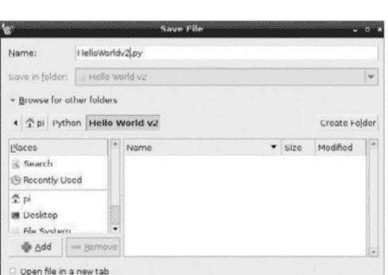

### 设置

在代码中编写详细的注释是非常重要的，因为你在编程和编写项目文档时需要记录一些内容。如果未来其他程序员需要处理你的代码，他们会非常感激。首先添加一个注释，说明程序将执行什么以及你的名字。所有注释都以哈号 `#` 开头，以便 Python 解释器识别。我们导入库是为了以便稍后使用 `exit` 函数关闭程序。还从 `decimal` 库导入所有内容，因为我们要使用 `decimal` 类型的名称。

> “编程时保持良好的组织是一个好习惯”

### 变量

变量是存储在内存中并通过名称访问的数据。我们的程序将从询问你的名字开始，然后将其存储在变量中并打印欢迎消息。我们将添加一条注释解释这一点，并创建一个名为 `firstly` 的变量。注意我们如何将第二个单词的首字母大写，以便更易于阅读。

我们希望变量名能够持有由名为 `input` 的函数返回的值，该函数会要求用户输入。问题被传递到函数括号中，结果是一个带有引号的字符串。字符串类型本质上是字符的集合。注意我们在用户输入这个问题之后之后输入之前，冒号后面添加的空格。

### 打印消息

```python

#!/usr/bin/env python

## 一个 Hello World

## Python 编程 v

## 适用于 Linux 用户和开发者

# 导入库用于

import sys

## 导入所有内容

from decimal import *
```


06 现在我们在 `firstly` 中有了一个变量，我们需要在屏幕上输出一条消息。在 Python 中，我们使用 `print` 函数在屏幕上打印。该函数由一对括号括起来，括号内是值。当在字符串上使用加运算符时，它们会被连接。注意 `firstly` 不需要括在引号中，否则将输出文本 `firstly`。最后，我们在输出末尾添加一个 `\n` 字符（换行），以便在开始下一个示例之前留出一个空行。

## 在树莓派上进行 Python 编程 在树莓派上使用 Python

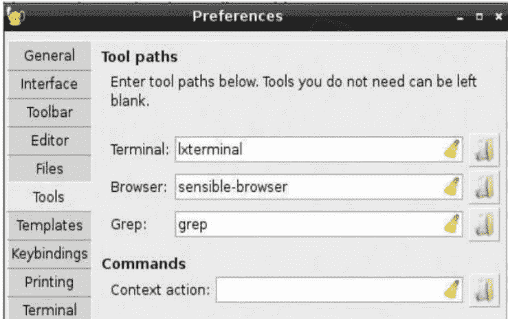

## 测试我们的程序

08 现在我们已经完成了那部分，为什么不测试一下呢？值得注意的是，在运行程序之前必须保存，否则你自上次保存以来所做的任何更改将不会被 Python 解释。按 `F5` 键运行程序。通过输入并按 `Enter` 键输入你的数字。完成操作后，你将看到一条消息。如果程序以代码 0 退出，则说明一切运行成功。按 `Enter` 关闭终端。

## 修复小问题

> 07 我们目前使用的 Debian 镜像在 Geany 中有一个微小的配置错误。如果你尝试通过 `F5` 键运行程序或转到“Build”菜单并选择“Execute”，就会遇到这个问题。如果问题出现，将会发生并看到消息‘Could not find terminal: xterm’。很容易修复：转到“Edit”菜单然后选择“Preferences”。进入“Tools”选项卡，将 `Terminal` 的值从 `xterm` 更改为 `terminal`。

## 处理数字

09 我们将通过重复前几行代码向用户请求一个数字。一旦用户给了我们数字，我们将将其平方并翻倍。`raw_input` 函数返回用户输入的字符串格式的值。字符串是一种基于文本的值，我们可以对其进行算术运算。Python 中的整数（integer）类型只能存储整数，而 `decimal` 类型可以存储带小数的数字。我们将进行一种被称为“类型转换”的操作，基本上是将一种类型的值转换为另一种类型。我们将数字字符串转换为 `decimal` 值，因为这会涉及到小数。如果数字是整数类型，任何值都将简单地从末尾截断，而不进行任何四舍入。这被称为截断。

## 在树莓派上使用 Python 在树莓派上进行 Python 编程

## 执行算术运算

Python 中的主要算术运算符分别是 `+`、`-`、 `/`、 `*`，除和乘。我们创建了三个名为 `numberHalved`、`numberDoubled` 和 `numberSquared` 的变量。注意我们需要指定它们初始值的类型。`number` 变量是 `decimal` 类型，因此对 `number` 进行算术返回的所有值也将是 `decimal` 类型。

```python
# 打印我们刚刚计算出的值，将每个值转换为字符串

print("result of halving number: " + str(numberHalved))

print("result of doubling number: " + str(numberDoubled))

print("result of squaring number: " + str(numberSquared))
```

## 打印我们的数字

现在我们已经进行了算术运算，我们需要使用 `print` 函数打印结果。`print` 函数只接受传递给它的值。这意味着在打印之前，我们需要使用 `str()` 函数将每个 `decimal` 值转换为字符串。我们使用引号之间什么都不内容的 `print` 来打印一个空行。这之所以有效，是因为除非另有说明，否则 `print` 函数总会在输出末尾添加新行。

## 使用循环和 if 语句进行输入验证

为了演示循环和 `if` 语句，我们将向用户输出一个需要“yes”或“no”回答的问题。循环一直运行直到条件不再满足。在这种情况下，我们将创建一个变量 `yesNo`，并且循环将在 `yesNo` 为 `False` 时持续运行。任何作为循环一部分的代码都需要在冒号下方的行中进行缩进。任何未缩进的代码将不属于循环。`if` 语句也是如此。使用比较运算符 `==` 检查条件。单个 `=` 是赋值运算符，而双重比较运算符 `!=` 意味着“不等于”。我们创建了一个名为 `result` 的变量，它存有问题“你想继续吗？”这个问题的值。然后我们用 `if` 语句检查此结果是否有效。如果用户输入 `no`，则将 `yesNo` 设置为 `True`，这会在下次运行时停止循环。否则，我们输出一条错误消息，循环将再次运行。用户可以使用 `Ctrl+C` 命令。

用户可以使用 `Ctrl+C` 命令。


在树莓派上使用 Python

在树莓派上进行 Python

| 行 | 代码 |
| :--- | :--- |
| 42 | if result == 'yes': |
| 43 | print("Continuing") |
| 44 | else: |
| 45 | print("Exiting") |
| 46 | exit() |

> “`print` 函数总会在输出末尾添加新行”

继续？

我们将 `\n` 添加到输出中以便在开始示例示例之前一个空空。这之所以有效，是因为换行符 `\n` 可以位于字符串的任何地方，而不只在引号内。

| 行 | 代码 |
| :--- | :--- |
| 52 | # like while loop to add 5 |
| 53 | print("Incrementing the number by 5") |
| 54 | while count <= 5: |
| 55 | number += 5 |
| 56 | print("number " + str(count) + " = " + str(number)) |
| 57 | # Increment the count |
| 58 | count -= 1 |

## 结束

最后一步是打印程序正在退出。这是最后一行，我们不需要做其他事情，因为 Python 在没有更多行可解释时就会结束。

## 数字的循环

我们将使用一个带有数字和 `<=`（小于等于）运算符作为停止条件的循环。该循环将用于在每次循环中增加数字，直到满足停止条件。`count` 变量允许我们知道循环运行了多少次。

```python
Please enter your first name: Liam

Welcome Liam

Please enter a number: 12.12

The result of halving number: 6.06

The result of doubling number: 24.24

The result of squaring number: 146.894

Do you want to continue? (yes/no) yes

Continuing

Incrementing the number by 5

number + 1 = 13.12

number + 2 = 14.12

number + 3 = 15.12

number + 4 = 16.12

number + 5 = 17.12

Exiting
```


# 在 Pi 上使用 Python

## 从你的 Pi 发送短信

你可能需要的...

## 从你的 Pi 发送短信

- 树莓派
- Twilio 账户

创建一个结合 Twilio Python 代码的程序，并从你的 Pi 发送短信

短信，或 SMS（短消息服务），已成为日常通信的主流。对于我们许多人来说，没有哪一天不发短信。这种最初只是一项 40 便士短信费的服务，现在已由大多数资费提供商作为无限服务。

Twilio 是一家云通信公司，它允许你仅需六行代码，就能从树莓派免费向手机发送短信。因此，当你工作时，你就不再需要被束缚在手机旁，而且可以专注于一个屏幕而不是两个屏幕了！

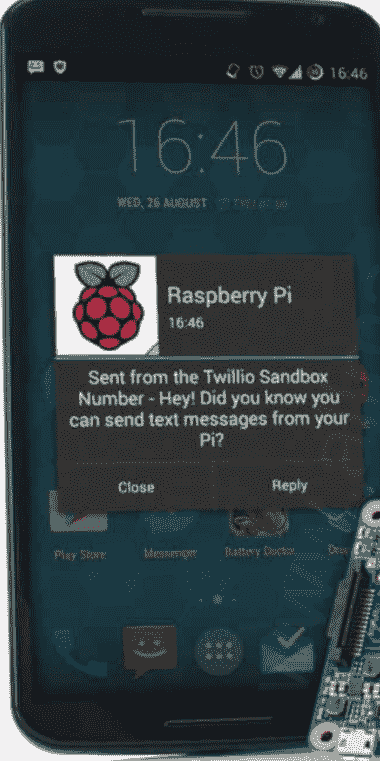

通过这种方法，你可以让你的 Pi 在运行完脚本后发送短信

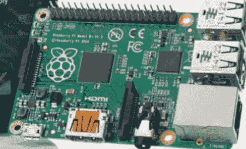

## 语音、短信与 MMS

### API 凭据

要使用 Twilio API，你需要 `AccountSid` 和 `Auth Token`

#### ACCOUNT SID

#### AUTH TOKEN

准备好移除试用限制并享受完整功能了吗？
了解有关试用账户的更多信息

升级你的账户

### Sandbox 应用

### 开发者工具

### 测试你的应用

生成 Twilio API 的代码

调用 Sandbox 号

拨打电话

输入你的 Sandbox PIN 码

1 次呼叫

不需要 PIN 码

导出

发送消息

应用详情

在上方你可以在 Twilio 仪表板上找到你的 `AccountSid` 和 `Auth Token`

## 设置你的 Twilio 账户

此项目的第一步是注册 Twilio 账户和 Twilio 号。这是免费的，并将使你能够向注册并验证过的手机发送短信。一旦注册，你将通过短信向注册手机接收验证码。在提示时，将此代码输入 Twilio 网站以验证你的账户并访问 `twilio.com/try-twilio` 创建你的账户。

## 注册并验证手机号码

你的 Twilio 账户是一个试用账户（除非你升级付费），这意味着你只能从验证过的手机号码发送和接收通信。输入你想验证的手机号码，确保选择了正确的国家代码。Twilio 会给你一个验证码。将此代码输入网站表单并提交。

## 仪表板

注册并登录后，访问仪表板页面，它将显示你的 `AccountSid` 和 `Auth Token`。使用 Twilio REST 需要这两者。请保持它们的安全和隐私，但务必做好记录，因为你稍后编写 Python 程序时需要它们。

## REST

## 安装软件

REST 代表表象状态转换（有时写为 "`REST`"）。它依赖于无状态、客户端-服务器、可缓存的通信协议——在几乎所有情况下都是设计网络应用的 HTTP 协议架构风格。

04 启动你的树莓派并连接到。在安装 Twilio 软件之前，最好更新并升级你的 Pi。在 LX Terminal 中，输入 `sudo apt-get update`，然后输入 `sudo apt-get upgrade`。完成后，输入 `sudo easy-install twilio` 或 `sudo apt-get install twilio` 来安装软件。（如果你需要安装 pip，输入 `sudo apt-get install3-dev`，按回车，然后输入 `sudo pip install -U pip`。）

## Twilio 验证

05 现在你准备好创建一个发送短信到手机的程序了。打开你的 Python 编辑器并导入 Twilio REST 库（下方的第一行）。接下来替换你的 `AccountSid` 和 `Auth Token`，将 X 替换为在仪表板上找到的内容。

```python
from twilio.rest import TwilioRestClient

account_sid = "XXXXXXXXXXXXXXXXXXXXXX"

## 输入你自己的 X

auth_token = "XXXXXXXXXXXXXXXXXXXXXX"

## 输入你自己的 X

client = TwilioRestClient(account_sid, auth_token)
```


图中所示的 Twilio 网站已被可口可乐、Uber 和 Nordstrom 等大公司使用

Twilio 提供了大量的 API 代码和参考文档来创建其他通信程序

## 发送消息

## 创建你的消息

现在发送你的消息。下面的代码不是必须的，但对于指示消息已发送很有用。添加这些行并保存你的程序。Pi 已连接到互联网且你的手机在线，然后运行你的程序。你刚刚从你的树莓派发送了短信。

你可能想更改同一个内容。在程序中创建一个名为 `message` 的新变量。这会提示你输入想要发送到手机的文本。当程序运行时，这就是将发送的消息：

```python
message = raw_input("Please enter your message")
```

```python
print_message.sid

print "Your message is being sent"

print "Check your phone!"
```

## 添加你的号码

## 其他 API 和代码

要发送消息，你需要添加下面的代码和两个号码。第一个号码是你的手机号码，经过 Twilio 验证的。第二个号码是你的 Twilio 号码，可以从你的仪表板获取。将 Sandbox 号更改为你的位置并记得添加国家代码。

Twilio 提供了广泛的 API 代码和参考文档来创建其他通信程序，如拨打电话、录音以及来者 ID 和时长。

```python
message = client.messages.create(to="+44YOURMOBILE",
from="+44YOURILIO", body=message)
```

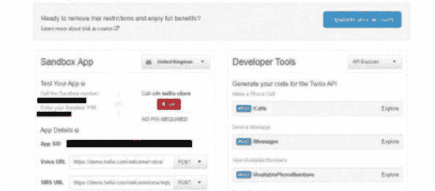

## 你可能需要的...

- 便携式扬声器
- python-espeak 模块
- Raspbian

## 语音合成器

将语音功能添加到你的树莓派项目中。我们展示了树莓派如何用于各种项目，但作为一个微型电脑，eSpeak 库对于任何想要使用它的人都是轻而易用的。还有一个模块允许你在 Python 中使用 eSpeak，这样你可以执行自动化任务。使用 eSpeak 可以控制说话的方式，让声音听起来不同。

## Pi 的第一个词


02 eSpeak 库非常简单——在终端中让它说点什么：

```
$ espeak "[message]"
```

这将使用库的默认设置来读取任何输入的内容。虽然这个简单的命令很有趣，但还有更多可以做的……

## 说些更多

03 你可以更改 eSpeak 读取文本的方式，例如性别、读取速度，甚至它的发音音节。例如，命令如下：

```
$ espeak -f3150 "[message]"
```

...会让声音变成女性、大写字母并让阅读变慢。

## 你需要的一切

01 我们将安装此教程中计划使用的所有内容。包括 eSpeak 库和 Python 模块。打开终端并安装：

```
$ sudo apt-get install python-espeak-tk
```


## 在 Python 中调用命令

## 完整代码列表

04 在 Python 中使用 espeak 的基本方法。导入它，然后使用：`subprocess.call("espeak", ["Option 1", "Option 2", "Option 3"], "Your message here")`

导入必要的 eSpeak 和 GUI 模块，以及获取时间的模块

```python
from espeak import espeak
from tkinter import *
from datetime import datetime
```

定义界面将使用的不同函数，包括简单的固定消息、时间和自定义消息

```python
def hello_world():
    espeak.synth("Hello World")
```


```python
def time_now():
    t = datetime.now().strftime("%H:%M")
    espeak.synth("The time is %s" % t)
```


## 母地语言

```python
def text_read():
    text_to_read = input_text.get()
    espeak.synth(text_to_read)
```

```python
root = Tk()
root.title("Voice box")
input_text = StringVar()
frame = Frame(root, height = 200, width = 500)
frame.pack_propagate(0)
frame.pack(padx = 5, pady = 5)
```

05 Python `eSpeak` 模块非常简单，用于转换为语音。尝试这段示例代码：

```python
from espeak as espeak
espeak.synth("message")
```

你可以将其整合到 Python 中，就像你需要任何其他模块用于自动化。

使用 `Tkinter` 为你的界面创建基础窗口，同时创建输入变量

```python
Label(box, text="Enter text").pack()
entry_text = Entry(box, textvariable=input_text)
entry_text.pack()
entry_read = Button(box, text="Read this", command=text_read)
entry_read.pack()
```

```python
root.mainloop()
```

### 一个语音

06 使用代码列表，我们正在使用 `Tkinter` 创建一个简单的界面，带有一些预设按钮和一个自定义方法。我们展示了如何操纵 `espeak` 模块来改变其输出。这是用于读取推文或自动化消息的。玩得开心！

> 还有一个模块允许你在 Python 中使用 eSpeak，这样你就可以执行自动化任务

## 在 Pi 上使用 Python

### 编写四翼飞行器程序

#### 你需要...

- `Raspbian`: www.raspberry.org/downloads
- `Python`: www.python.org/doc

#### 编写四翼飞行器

你如何榨取 Pi 的极限？给它装上翅膀。`Andy Baker` 为我们展示了如何实现……

树莓派 是一块非常棒的项目开发板。由于我们热爱挑战，我们开始寻找能够真正挑战我们黑客和编码技能极限的东西。我们选择了四翼飞行器。

本文以网络上的 Python 代码作为指南，介绍了构建四翼飞行器所需的各个环节，比喻地将它们螺栓在一起，以便在结束时，你不仅理解了代码，还理解了与真实世界的交互，从而让你有信心构建出自己的四翼飞行器。你可以在 Andy 的博客上找到他的代码。

### 你知道吗...

本文的作者 `Andy Baker` 在 `blog.petstuffi.co.uk` 运营着一个博客，提供了关于他项目的极佳见解。

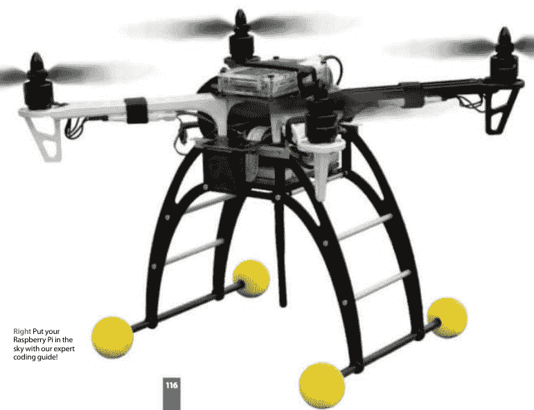

通过我们的专家编码指南，让你的树莓派飞向云端吧！

### 编写四翼飞行器程序

### 在 Pi 上使用 Python

#### 传感器视角图

四翼飞行器视角下的传感器数据如何转换为地球（水平/垂直）视角，以提供水平运动

#### 动力系统

在这里我们看到的是来自螺旋桨的力

#### 矢量

相对于地球轴（水平 / 垂直）的螺旋桨推力

```
$a_{qx}$ = 重力加速度
$a_{qy}$ = 四翼飞行器加速度
$a_{qz} = a_{a}$ （重新对齐到地球轴）
$\Theta$ = 由加速度计 + 陀螺仪得出的倾斜角
```

```
$a_{qx} = \tan \Theta$
$a_{qy}$ = 用于水平飞行
$a_{qz} = g +$
水平加速度 $a = g + a_{qz}$
```


# 在 Pi 上使用 Python 编写四翼飞行器程序


如果你只想享受飞行的乐趣，可以买到即插即飞（RTF）套件，但为了挑战，我们从一个几乎即插即飞（ARF）开始开始，即 DJI Flame F450——包含了所有硬件，但没有控制电子元件和软件。许多爱好者已成功地使用 Arduino 构建了四翼飞行器，虽然这是可能的，但极少有人使用树莓派。

## 角度
这是由四翼飞行器传感器定义的倾斜角

## 重力
该术语表示重力


## 解释器
01 命令解释器将来自无线控器或程序本身的一系列命令转换为代码。这些命令是相对于地平线的方向和速度，用户使用这些指令让四翼飞行器跟随。代码将这些命令转换为速度、水平速度和航向速度的目标目标——来自双摇杆的任何命令都可以分解为这组目标。

## 轴
03 加速度计对应四翼飞行器轴的方向，而命令目标相对于地球轴的——即地平线和重力。要在四翼飞行器轴和地球轴之间转换输出，需要一些数学知识，特别是三角函数。你还需要知道四翼飞行器相对于地球的滚角和俯仰角。这看起来很复杂，但这些页面上的图表将帮助你理解逻辑。

## 输入
02 四翼飞行器的输入来自一系列电子传感器，提供其在空中运动的信息。主要的两个四翼飞行器轴：一个加速度计测量三个方向上的加速度力（重力），一个陀螺仪测量四翼飞行器俯仰（头/尾部向上和向下）的角速度

## 滤波
04 加速度计和陀螺仪都可以提供这种角度信息，但它们都有缺陷。加速度计的输出可用于使用欧拉算法计算角度。然而，加速度计的输出读数是不准确的。它们相互补偿对方的缺陷，从而获得无噪声、长期准确的读数。

05 尽管独立来看它们都有缺陷，但可以通过数学方法将它们合并。有许多版本的数学噪声/漂移滤波器。最常用的一个准确性略低，但更容易理解且更易编码——互补滤波（complementary filter）：

相比之下，陀螺仪输出不受噪声影响，但由于测量的是角速度，需要对时间进行积分以找到四翼飞行器相对于地平线的角度。积分中的舍入会导致误差随时间增加，最终导致飞行的最大长度。

现在有了角度，可以将加速度传感器数据转换为相对于地球轴的输入，并计算四翼飞行器相对于设定目标向上、向下、向左、向右以及向前移动的方式。

> 你可以在许多在线零售商处购买即插即飞（RTF）四翼飞行器套件。价格从 £150 / $200 起，但会大涨！


## 编写四翼飞行器程序

## PID 控制
PIDs 这里的 PID 是为了让四翼飞行器保持稳定。PID 控制是比例、积分和微分控制。它通过不断调整电机输出来减少目标值与实际值之间的误差。对于四翼飞行器，PID 通常用于控制高度、俯仰、横滚和航向。通过这种算法，飞行器可以在复杂的空气流中保持预定的飞行轨迹。

## 实验与调优
09 虽然代码准确地反映了我们在这里描述的所有内容，但有一组关键的步骤只能通过现场测试找到：那就是 PID 增益。对于每个运行的 PID，都有独立的比例（Proportional）、积分（Integral）和微分（Differential）增益，这些增益只有通过估算/实验才能找到。每台四翼飞行器的结果都会有所不同。幸运的是，有一个相对安全的方法。

相应地调整 P 增益。一旦 P 增益良好，再加入一点 I 增益——这将确保它返回原位并保持稳定。D 增益是可选的，但可以增加稳度和快速响应。轻敲一个 D 增益稳定的无人飞行器就像敲桌子——它不会移动。

首先，找到 PWM 起飞速度：通过让你的无人飞行器坐在地上并缓慢增加 PWM 值，直到它看起来变得轻盈——对于你的专家来说，这也是 1900 脉冲宽度（或代码所示的 1000 + 590）。

垂直 PID 去种子；起飞速度为 0.5m/s，因此 P 增益设为 100 是可以的。不需要 I 或 D 增益。尽管如此，真实的起飞和降落都是安全的，这很好，因为这些

接下来，分类稳定性 PID —— 假设你的无人飞行器是正方形的且平衡大致位于中心，那么俯仰角（pitch）调优的结果也适用于偏航角（yaw）调优。对于俯仰调优，在水平方向上禁用两个对角线的电机。提高跳动电机的 PWM 值，使其低于起飞速度（在你的专家案例中为 1550 脉冲宽度）。无人飞行器可能会摇晃，在没有足够控制的情况下摇晃，在被推挤时自动复正，或者无所反应？

在这里调优无人飞行器群绕墙壁是非常危险的——在它们撞击地面之前，在空中进行过度的或执行动作。最好在户外开阔的田野/花园/公园执行，那里经过一夜雨水后地面很软。

这没有捷径，所以只需接受会有坠机，并尽所能地享受这头猛兽。

假设以上一切都按计划进行，那么你就拥有了一个可以在有风力条件下起飞、悬停和降落的无人飞行器。下一步是添加遥控器，但我们留到另一天再说！

# 在 Pi 上使用 Python 编写你自己的 Twitter 机器人

你需要...

- 互联网连接
- 最新版本的树莓派
- `www.raspberrypi.org/downloads`

创建一个你独有的 Twitter 机器人，它可以转发他人的智慧结晶。

Twitter 是与世界分享信息的有用方式，也是我们快速、方便地发表观点的最爱方法。数百万人从他们的电脑、移动设备使用这个微博客平台，可能还在电视上使用它。

不过，你不需要一直点击转发按钮。只要加入一点 Python，你就可以让树莓派为你完成它。以下是创建你的 Twitter 机器人的方法...


## 完整代码列表

## 安装所需的软件

```
#!/usr/bin/env python2
```

01 使用用户名 Pi 和密码 raspberry 登录 Raspberry Pi 系统。使用命令 `sudo apt-get update` 获取最新的包列表。使用 `sudo apt-get install python-pip` 安装 Python 包安装器。完成后，运行 `sudo pip install twython` 来安装我们将使用的 Twitter 库。

# 一个用于树莓派的 Twitter 机器人，可以转发任何内容

```python
import sys
import time
from datetime import datetime
from twython import Twython
```

```python
class bot:
    def __init__(self, key, c_key, c_secret, a_token, a_token_secret):
        # 创建一个 Twitter API 实例
        self.api = Twython(key, c_key, c_secret, a_token,
```

# 在 Twitter 上注册你的“应用”

02 我们需要使用 OAuth 与 Twitter 进行身份验证。在此之前，你需要访问 `https://twitter.com/apps` 并登录你想让 Pi 发推文的账户。点击“创建一个新应用”按钮。我们将我们的应用命名为 LUD Pi Bot，并将网站设置为 `www.limuxuser.co.uk`。

```python
## 确保我们身份验证正确
try:
    self.api.verify_credentials()
except:
    sys.exit("Authentication Failed")
self.last_ran = datetime.now()
```

```python
@staticmethod
```

## 创建访问令牌

```python
def timestr_to_datetime(timestr):
    # 将像 Sat Nov 09 09:22:55 +0000 
    # 2013 这样的字符串转换为 datetime 对象。移除时区
    #并将年份设置为当前年份
    timestr = "({0})".format(timestr[:19], datetime.year)
```


03 进入“设置（Settings）”选项卡，并将访问类型（Access type）从“读取（Read）”更改为“读写（Read and Write）”。然后点击“更新此 Twitter 应用设置”按钮。接下来创建一个访问令牌。点击“创建令牌（Create token）”按钮刷新页面，你将获得密钥（consumer key）和访问密钥（access secret）。这就是我们身份验证所需的所有。

```python
## 我们有 Sat Nov 09 09:25:53

return datetime.strptime(timestr, "%a %b %d %H:%M:%S")
```

# 与 Twitter 进行身份验证

```python
def retweet_task(self, screen_name):
    # 转发我们未见过的任何推文
    for user in timeline:
        print("Checking for new tweets from {}".format(screen_name))
```

04 我们将机器人编写为一个类，并在构造函数中与 Twitter 进行身份验证。我们从之前的步骤中获取令牌并使用它们来创建 Twitter API 的实例。我们还有一个变量 `last_run`，它设置为当前时间。这用于检查自此之后是否有推文。

```python
## 获取最新推文列表
timeline = self.api.get_user_timeline(screen_name=screen_name)

## 遍历每条推文并检查它们是否是在
## 之后发布的
for t in timeline:
    tweet_time = datetime.parse(t['created_at'])
    if tweet_time > self.last_run:
        print("Checking for new tweets from {}".format(screen_name))
        self.api.retweet(id=t['id'])
```

```python
if __name__ == "__main__":
    # 确保我们身份验证正确
    # 密钥（consumer key）可以找到
    key = "YOUR_KEY"
    # 访问密钥（access secret）可以找到
    c_secret = "YOUR_SECRET"
    # 访问令牌（access token）可以找到
    a_token = "YOUR_TOKEN"
    # 访问令牌密钥（access token secret）可以找到
    a_token_secret = "YOUR_TOKEN_SECRET"
    # 实例化机器人
    bot = bot(key, c_key, c_secret, a_token, a_token_secret)
    # 运行任务
    bot.retweet_task("USERNAME")
```


```python
def timestr_to_datetime(timestr):
    # 将像 Sat Nov 09 09:22:55 +0000
    # 2013 这样的字符串转换为 datetime 对象。移除时区
    # 并将年份设置为当前年份
    timestr = "({0})".format(timestr[:19], datetime.year)
```

03 进入“设置（Settings）”选项卡，并将访问类型（Access type）从“读取（Read）”更改为“读写（Read and Write）”。然后点击“更新此 Twitter 应用设置”按钮。接下来创建一个访问令牌。点击“创建令牌（Create token）”按钮刷新页面，你将获得密钥（consumer key）和访问密钥（access secret）。这就是我们身份验证所需的所有。

```python
## 我们有 Sat Nov 09 09:25:53
return datetime.strptime(timestr, "%a %b %d %H:%M:%S")
```

# 与 Twitter 进行身份验证

```python
def retweet_task(self, screen_name):
    # 转发我们未见过的任何推文
    for user in timeline:
        print("Checking for new tweets from {}".format(screen_name))
```

04 我们将机器人编写为一个类，并在构造函数中与 Twitter 进行身份验证。我们从之前的步骤中获取令牌并使用它们来创建 Twitter API 的实例。我们还有一个变量 `last_run`，它设置为当前时间。这用于检查自此之后是否有推文。

```python
## 获取最新推文列表
timeline = self.api.get_user_timeline(screen_name=screen_name)

## 遍历每条推文并检查它们是否是在
## 之后发布的
for t in timeline:
    tweet_time = datetime.parse(t['created_at'])
    if tweet_time > self.last_run:
        print("Checking for new tweets from {}".format(screen_name))
        self.api.retweet(id=t['id'])
```

```python
if __name__ == "__main__":
    # 确保我们身份验证正确
    # 密钥（consumer key）可以找到
    key = "YOUR_KEY"
    # 访问密钥（access secret）可以找到
    c_secret = "YOUR_SECRET"
    # 访问令牌（access token）可以找到
    a_token = "YOUR_TOKEN"
    # 访问令牌密钥（access token secret）可以找到
    a_token_secret = "YOUR_TOKEN_SECRET"
    # 实例化机器人
    bot = bot(key, c_key, c_secret, a_token, a_token_secret)
    # 运行任务
    bot.retweet_task("USERNAME")
```


# 在 Twitter 上注册你的“应用”

02 我们需要使用 OAuth 与 Twitter 进行身份验证。在此之前，你需要访问 `https://twitter.com/apps` 并登录你想让 Pi 发推文的账户。点击“创建一个新应用”按钮。我们将我们的应用命名为 LUD Pi Bot，并将网站设置为 `www.limuxuser.co.uk`。

## 确保我们身份验证正确

```python
try:
    self.api.verify_credentials()
except:
    sys.exit("Authentication Failed")
self.last_ran = datetime.now()
```

## 编写你自己的 Twitter 机器人

## 在 Pi 上使用 Python

## 创建访问令牌

```python
def timestr_to_datetime(timestr):
    # 将像 Sat Nov 09 09:22:55 +0000 
    # 2013 这样的字符串转换为 datetime 对象。移除时区
    #并将年份设置为当前年份
    timestr = "({0})".format(timestr[:19], datetime.year)
```

03 进入“设置（Settings）”选项卡，并将访问类型（Access type）从“读取（Read）”更改为“读写（Read and Write）”。然后点击“更新此 Twitter 应用设置”按钮。接下来创建一个访问令牌。点击“创建令牌（Create token）”按钮刷新页面，你将获得密钥（consumer key）和访问密钥（access secret）。这就是我们身份验证所需的所有。

```python
## 我们有 Sat Nov 09 09:25:53
return datetime.strptime(timestr, "%a %b %d %H:%M:%S")
```

# 与 Twitter 进行身份验证

```python
def retweet_task(self, screen_name):
    # 转发我们未见过的任何推文
    for user in timeline:
        print("Checking for new tweets from {}".format(screen_name))
```

04 我们将机器人编写为一个类，并在构造函数中与 Twitter 进行身份验证。我们从之前的步骤中获取令牌并使用它们来创建 Twitter API 的实例。我们还有一个变量 `last_run`，它设置为当前时间。这用于检查自此之后是否有推文。

```python
## 获取最新推文列表
timeline = self.api.get_user_timeline(screen_name=screen_name)
## 遍历每条推文并检查它们是否是在
## 之后发布的
for t in timeline:
    tweet_time = datetime.parse(t['created_at'])
    if tweet_time > self.last_run:
        print("Checking for new tweets from {}".format(screen_name))
        self.api.retweet(id=t['id'])
```

```python
if __name__ == "__main__":
    # 确保我们身份验证正确
    # 密钥（consumer key）可以找到
    key = "YOUR_KEY"
    # 访问密钥（access secret）可以找到
    c_secret = "YOUR_SECRET"
    # 访问令牌（access token）可以找到
    a_token = "YOUR_TOKEN"
    # 访问令牌密钥（access token secret）可以找到
    a_token_secret = "YOUR_TOKEN_SECRET"
    # 实例化机器人
    bot = bot(key, c_key, c_secret, a_token, a_token_secret)
    # 运行任务
    bot.retweet_task("USERNAME")
```

# 使用 Python 在 Pi 上通过 GPIO 控制 LED

## 实验板
实验板（或原型板）提供了一个易于使用且无需焊接的环境，用于创建和更改你的开发电路。

### 实验板跳线
这是任何初级电气工程师的必备品，这些公对公和公对母的跳线可以快速方便地构建电路。

### GPIO 引脚
这为电气电路提供了收集输入和提供输出的机制，能够实现响应式程序设计。

### 彩色 LED
不同颜色的 LED 是物理映射运行软件部分的极佳方式，并能帮助你理解程序流。

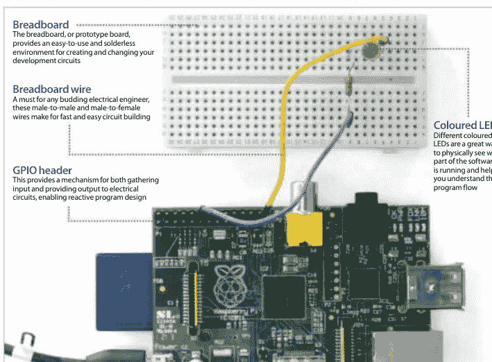

## Pi 的引脚

## 引脚编号

## GPIO 引脚

- 01:在我们深入编写 Pi 的引脚布局之前。如果你的 Pi 装在外壳中，请将其取出并放在你面前，USB 接口在右侧。接下来的几步将介绍在使用 GPIO 端口时可能会遇到的一些问题。
- 03: 看看顶部的白色标签“P1”。这个引脚是 1，它的上方是引脚 2。引脚 1 的右侧是引脚 3，3 的上方是 4。这种模式一直持续到最后的 26。正如你将在接下来的步骤中看到的，某些引脚具有重要的用途。
- 05: 板板上的其他引脚是 GPIO（通用输入/输出）。当你的项目变得越来越复杂和挑战时，它们用于其他任务。请注意，USB 供电无法为大型设备提供足够的功率。

## Pi 版本 1 还是 2？

## 引脚用途

## 基础 LED 照明

- 02: 当你购买 Pi 时，可能有一个“版本 1”或“版本 2”型号。每个版本的 GPIO 略有不同，尽管它们的功能相同。我们这里有一个版本 1；版本 2b 在 2012 年底推出。
- 04: 引脚 1 是 5V，3.3 伏。这是我们在指南中用于为 GPIO 引脚供电的主要引脚。引脚 2 和 4 是 5V，是我们在这里使用的另一个引脚。地引脚为 9、14、20 和 25。你应该始终确保你的项目正确接地。
- 06: 那么，让我们开始制作些东西吧。首先，准备好实验板、两根跳线、一个 220 欧姆电阻和一个 LED。LED 的其中一个引脚略微弯曲，这对于以后很重要。确保你的 Pi...

## 在 Pi 上使用 Python

## 使用 GPIO 控制 LED

## 电路板接线

## 设置编程环境

- 07: 将一根跳线插进 1 号引脚，另一端插入实验板。注意，插在哪里都无所谓，但要确保周围有空槽以便于添加 LED 电阻。现在再拿另一根跳线。
- 12: 现在，我们需要能够做比打开灯多多的事情——我们希望通过代码来控制它。设置新的 Raspberry 安装（相关指南见第 28 页）。你不需要图形界面——如果你愿意，所有操作都可以通过终端完成。在开始之前，最好检查一切是否已更新到最新：

```bash
sudo apt-get dist-upgrade
```

## 添加另一根跳线

## 打开终端

- 08: 将跳线的末端插入 6 号引脚（地线），另一端插入实验板，根据电阻的大小确保为电阻留出空间。接下来，准备好你的电阻。你可以使用高于或低于 270 欧姆的电阻，但完全不使用电阻可能会烧坏 LED。
- 13: 假设我们使用 GUI 而不是通过 SSH 登录 Pi，请双击 LXTerminal 打开一个新终端窗口。然后输入 `su` 后跟密码，或在任何命令前加上 `sudo` 前缀。
- `su`
- 后跟密码或添加
- `sudo`

## 下载 GPIO 库

## 添加电阻

- 14: 有一个实用的 GPIO Python 库，让操作 GPIO 引脚变得轻而易举。在下载文件中，使用 `tar` 命令进行解压。这将所有文件提取到一个新目录中。

```bash
wget https://pypi.python.org/packages/source/R/RPI/RPI.GPIO-0.5.2a.tar.gz
tar xzf RPI.GPIO-0.5.2a.tar.gz
cd RPI.GPIO-0.5.2a
```

## 安装库

- 09: 接下来我们需要将跳线连接到实验板上的地线，另一端在稍后添加 LED 时连接到所有 LED 的 3V3 跳线所在的槽位上。注意，添加电阻没有正确与错误之分。
- 15: 现在我们需要安装该库。这是一个使用 Python 安装方法的简单案例，因此我们需要 Python 版本。在运行此命令之前，确保你位于库目录中。

```bash
sudo apt-get install-python
sudo setup.py install
```


## 添加 LED

## 接通电源

- 10: 拿起你的 LED，将“弯曲”的引脚放置在实验板上 `3V3` 跳线旁边。将另一个引脚放置在相对于地线的电阻另一侧。这完成了电路，我们准备好测试了。

## 安装库

- 15: 现在我们需要安装该库。这是一个使用 Python 安装方法的简单案例，因此我们需要 Python 版本。在运行此命令之前，确保你位于库目录中。

```bash
sudo apt-get install-python
sudo setup.py install
```

## 接通电源

- 10: 拿起你的 LED，将“弯曲”的引脚放置在实验板上 `3V3` 跳线旁边。将另一个引脚放置在相对于地线的电阻另一侧。这完成了电路，我们准备好测试了。

## 导入库

- 16: 创建新脚本。导入库，然后使用 `try-except` 块。

```python
import RPi.GPIO as GPIO
try:
    GPIO.setmode(GPIO.BCM)
except RuntimeError:
    print("Error")
```


## 使用 GPIO 控制 LED

## 在 Pi 上使用 Python


## 测试脚本

## 调整 PWM

- 22: 然后我们添加另一个 `try-except` 块，这次检查 LED 的功率，一旦达到某个水平，就反向执行过程。要运行此代码，只需从 `nano` 保存，然后使用 `gpio.py`。循环 1：

```python
import time
import RPi.GPIO as GPIO
GPIO.setmode(GPIO.BCM)
GPIO.setup(18, GPIO.OUT)
p = GPIO.PWM(18, 50)
p.start(0)
try:
    for dc in range(0, 101, 5): 
        p.setDutyCycle(dc)
        time.sleep(0.1)
    for dc in range(100, -1, -5):
        p.setDutyCycle(dc)
        time.sleep(0.1)
except KeyboardInterrupt:
    pass
p.stop()
GPIO.cleanup()
```

# 唯一专注于 Linux 的杂志

# 为你而写

《Linux User & Developer》是唯一专为高级用户、开发者和 IT 专业人士设计的杂志

# 深度指南与专题介绍

由基层开发者和行业专家撰写

# 每期均有免费资源

每月介绍四种最热门的发行版特性——登录 `FileSilo`，下载并测试所有内容！


# 在英国仅需 5 英镑即可体验 3 期*，或在美国仅需每期 7.85 美元**（比报刊价节省了 54%）

# 欲获取更多优惠请访问 www.imaginesubs.co.uk/lud

输入优惠代码 `ZGGINE` 或拨打英国电话 `0844 249 0282`+ 境外 `+44 (0)1795 418 661`
+通话费用为每分钟 7 便士，外加您电信公司的接接入费

# 如何使用 FileSilo

关于访问您的新数字存储库所需的一切知识

## 要访问 FileSilo，请访问 filesilo.co.uk/bks-893

- 01 按照屏幕上的指令在我们安全的 `FileSilo` 系统中创建账户，登录并通过回答关于该系统的简单问题进行书签。仅限单单词回答！您可以随时免费访问内容。
- 02 登录后，您可以自由探索丰富的内容教程、指南以及可下载资源。您购买的数字杂志（bookazines）越多，您的即时可用数字内容收藏就越丰富。
- 03 您可以使用任何流行的浏览器在任何设备、平板电脑或手机上访问 `FileSilo`。我们建议使用桌面电脑下载内容，因为您可能无法通过手机或平板下载文件。
- 04 如果您在访问 `FileSilo` 内容或注册过程中遇到任何问题，请查看常见问题解答（FAQ）或发送邮件至 `filesilohelp@imagine-publishing.co.uk`


制作 PyGame——游戏开发入门。学习如何使用树莓派制作游戏！

使用 GTK 的 GUI
在视频中，我将展示如何制作一个 GUI……

Pygame 小说
通过创建交互式小说来弥合书籍与视频游戏之间的差距……

# 教程需要帮助吗？

在本杂志的教程技巧上遇到困难了吗？不知道如何充分利用您的免费资源？想让业内人士评价您的作品吗？为什么不访问 Linux User & Developer 和 Imagine Bookazines 的 Facebook 页面提出您的问题、疑虑和反馈？这里有一个友好的 Linux 爱好者社区等待为您提供帮助，《Linux User & Developer》杂志的团队还会定期发布帖子和更新。今天就关注我们并开始聊天吧！


facebook.com/ImagineBookazines
facebook.com/LinuxUserUK


# Python
完全手册


- **学习使用 Python**
  在学习如何使用这种世界上最多功能的语言之一的同时，掌握基础知识并编写简单的项目。
- **精通应用开发**
  通过分步教程制作您自己的 Web 和 Android 应用程序。
- **游戏编程**
  利用您所学的知识创建可玩的游戏，看看 Python 到底有多强大。
- **使用树莓派创作**
  使用 Python 这一官方认可的编程语言释放树莓派电脑的真实潜力。
- **核心技巧**
  发现编写整洁代码、充分利用 Python 功能以及更多你所需的一切知识。
- **让 Python 发挥作用**
  将 Python 用于功能性项目，例如科学计算，并让离线阅读网站变得更加轻松和有趣。
- **惊人的项目**
  发挥创意并完成完整项目，包括编写无人机和从树莓派发送短信。
- **免费在线资源**
  通过您免费的 `FileSilo` 资源下载完成书中步骤所需的所有教程文件，以及视频等更多内容。

www.imaginebookshop.co.uk
