# linux 和 windows 2000 的 Qt 编程

本附文涉及位于图书馆媒体中心的非书籍资料。


已撤回

爱荷华州立大学

图书馆


> 已撤回
> 爱荷华州立大学
> 图书馆


由互联网档案馆 (Internet Archive) 数字化

2022 年，由卡勒/奥斯丁基金会 (Kahle/Austin Foundation) 资助

`https://archive.org/details/qtprogrammingfor0000ward`

## 前言

1991 年夏天，我和 Haavard Nord 一起坐在挪威特隆赫姆的一个公园长椅上。当时我们都在特隆赫姆地区医院同一个医疗数据库项目工作。我们正在讨论如何进行用户界面时，Haavard 说：“我们需要一个面向对象的显示系统。”

一年后，因为那句话，我制作了一个 C++ GUI 工具包。又过了一年，我制作该工具包的公司（也是我当时工作的公司）决定将其废弃以采用 Motif。我认为他们疯了。一天晚上，Haavard 给我打电话说：“让我们从头开始构建一个更新、更好的工具包。辞职，和我一起创办一家公司。”

Haavard 首先完成了他的论文，制作了第一个 Qt 内核。然后，在接下来的一年里，我们在一间小办公室里日夜编写代码，靠我们的妻子生活。我们有幸在无打扰的环境中工作。Qt 逐渐成形，我们打磨细节，设计并重新设计，直到感觉恰到好处（这是 Trolltech 至今仍遵循的设计准则）。随后我们获得了一个小型咨询合同，其中使用了我们当时仍相当原始的版本 0.60 的 Qt，以极其低廉的薪水雇用了 Arnt Gulbrandsen，雪球开始滚动起来。

我从未想象过有一天我会为 Prentice Hall 出版的一本关于 Qt 的书写前言。我们的许多梦想已经成真，这是其中之一。

我很荣幸遇到了本书的作者 Patric Ward。除了是一位出色的 Qt 黑客，他也是一个非常好的人，且有很好的幽默感。我认为这对于编写这样一本书来说是一个完美的组合。现在请坐下来，享受 Patric Ward 讲述的 Qt 的奇妙之处。帕特，舞台交给您了。

Eirik Eng，

Trolltech AS 总裁

## 序言

本书是一本指南，用于使用 Trolltech AS 的 Qt 软件工具包编写适用于 Linux、Microsoft NT 4.0、Windows 2000、Windows 95 和 Windows 98 的应用程序。正如任何一本尊重编程指南所应做的，它提供了对 Qt 软件发行版以及 Qt 工具包提供的对象、小部件和便利功能的工作知识。此外，它还探索了一些在企业应用开发中并不明显的 Qt 编程方面，这些内容在工具包供应商的文档中并不显而易见。

### 目标读者

本书面向希望使用 Qt 工具包编写有效应用程序的 C++ 程序员和学生。重点主要在于平台无关的软件，但不可避免地涵盖了一些平台特定的主题。

### 假设条件

本书不是 Qt 对象和小部件的参考手册——Trolltech 在提供 HTML 和 Adobe Postscript 格式的参考文档方面做得非常出色。他们的文档包含在 `Qt-Free` 版本和 `Qt-Professional` 版本的许可证中，并且可以从 Troll 网站获取。`http://www/trolltech.com/`

本书既面向经验丰富的 C++ 程序员，也面向知识渊博的初学者。假设读者熟悉标准 C++ 数据类型以及如何创建新的数据类型。读者应熟悉面向对象（OO）设计和实现的基本概念，特别是对象继承的概念。为了清晰起见，我在示例中避免使用多重继承，但鼓励读者进行实验。

虽然本书的标题暗示其重点是 Linux 和 Windows 2000，但实际范围要大得多。大多数示例以及 CD 上提供的代码，在 Qt 支持的几乎任何平台上都能正确编译和运行。

如果您是一位经验丰富的 Microsoft 开发人员，这里展示的一些编码风格可能会引起轻微困惑。请记住，除了少数例外，本书中展示的代码旨在用于跨平台使用。因此，您很少会看到对 `DWORD`、`LPVOID` 和 `LPSTR` 数据类型的引用，因为在 Microsoft 领域之外的平台上它们是未定义的，而且由于大多数标准 Unix 数据类型与 Windows 开发兼容，因此使用它们作为替代。两者的“正确性”完全是主观的。

Microsoft 平台特定的示例需要 `Qt-Professional` 许可证。可以直接从 Trolltech 获得许可证，并在第 1 章中详细讨论。虽然可以使用 Borland 编译器和工具进行 Qt 软件开发，但开发人员使用 Microsoft Visual C++ 更为常见。因此，假设 Windows 开发人员可以访问 Microsoft Visual Studio 6.0 和 `VC98`（Visual C++）。

从理论上讲，可以使用 Cygnus Win32 实现、`ming32` 编译器发行版、Win32 的 X11R6.3 开发工具包以及适当的 X 服务器，在 Windows 平台上编译和使用 `Qt-Frame` 版本的应用程序。由于这是一个极其罕见的环境，本书中的任何示例都没有涉及。但是，假设您成功使用 Cygnus 编译器发行版编译了 `Qt-Frame` 版本，任何 Linux 示例都应该可以工作——这是我尚未尝试的事情。

可以使用 `Qt-Frame` 版本进行 Linux 开发。您需要一个 C++ 编译器。本书假设使用来自自由软件基金会（FSF）的通用 `gcc/g++` 发行版（示例中使用了 `gcc-2.95`），假设它是合理的最低公分母。

Troll 开箱即用地支持许多其他平台。我在 HP/UX 或 AIX 上使用 Qt 几乎没有遇到麻烦。

### 本书的组织结构

本书分为三个部分。第一部分是对 Qt 工具包的简介。它提供了一些初步的编程示例，并讨论了一些使 Qt 开发区别于其他工具包的独特功能。第二部分详细讨论工具包组件。第三部分讨论项目层面的考量和调试技术。

附录 A 列出了随书 CD-ROM 的内容。附录 B（以及索引）有助于梳理本书的内容。

## 排版约定

*斜体*文本用于强调要点、引入新术语，或者在第五章和第六章中用作基本示例的标题。

命令行文本的示例采用不同的字体，并且通常独占一行，如下面的 Linux 命令行示例所示：

```
find . -name "*.cpp" -exec findtr {} \> /tr_text \;
```

示例和代码片段也采用不同的字体，如下例所示：

```
#include <stdio.h> int main( int argc, char **argv ) { printf( "Howdy, Terre!\n" ); return( 0 ); }
```

## 随书 CD-ROM

随书附赠的 CD-ROM 采用带 Joliet 扩展（支持长文件名）的 `ISO9660` 格式。CD-ROM 的根目录包含若干个子目录，其名称（希望如此）能描述其中的内容。根目录中唯一的文件是名为 `contents.txt` 的文件，它出人意料地包含了一份 CD-ROM 内容的文本地图，以及这些内容的简要说明。

# 第一部分

## 入门

## 第 1 章

### Qt 简介

Qt（通常读作 cute）是一个 C++ 类库和 GUI 工具包，提供了在 Linux（或几乎任何 UNIX）平台以及 Microsoft Windows 2000（及其所有前身，直至 Windows 95）上进行大多数常见应用程序开发所需的基本服务集。Qt 是 Trolltech AS 的产品（下文简称为 Troll、Trolltech，或非正式地称为“Trolls”）。Trolltech AS 是一家位于挪威奥斯陆的公司，由 Eirik Eng 和 Haavard Nord 于 1994 年创立。

本章将向你介绍该工具包以及 Qt 帮助消除的一些常见编程问题。

Qt 工具包提供的应用程序开发服务包括：

- 一套完整的 GUI 小部件（在 Windows 社区中常被称为“控件”）
- 一套全面的文件和文件系统操作工具
- 用于处理图像、数组和国际ization文本的类
- 集合类和模板类

以上仅为其中几项。所有这些类要么功能完整且平台无关，要么旨在便于在工具包支持的目标平台之间进行移植。


自 1996 年 K 桌面环境（KDE）团队选择 Qt 作为其基础工具包以来，Qt 的普及率迅速增长（尽管 Qt 的历史可追溯到 1991 年）。KDE 在作者看来是 Linux 上第一个真正具有企业级品质的图形桌面环境。其他 UNIX 用户有 CDE、OpenWindows、VUE 等，而 Linux 用户当时只有花哨的窗口管理器。Qt 提供了外观和基本 GUI 框架，而 KDE 提供了集成的桌面环境。应用软件可以迅速开发、部署并集成到最终用户的桌面中。

在 Qt 出现之前，为 UNIX 和 Windows 平台编写软件通常需要两次开发工作，而且通常需要两个开发团队。让我们花一点时间来探讨一下其中的原因：

UNIX 程序员往往将 PC（和 Windows）视为玩具，不值得严肃的程序员关注。这些程序员有时将 Windows 软件现象的流行视为用户群智力或技术衰退的症状。许多 UNIX 程序员拒绝承认 Windows 软件是比“为指点戳水群众准备的软件”更多的东西，并坚决拒绝参与 Windows 软件的开发。持有这种态度（这并不罕见），加上传统 Windows 软件编码风格与 UNIX 编码风格截然不同，以及代码在 UNIX 和 Windows 平台之间几乎完全不具可移植性，结果就陷入了僵局。

另一方面，Windows 程序员通常认为 UNIX 编程在编码风格上过于晦涩、复杂且令人困惑。用于简化编码工作的工具可用性很差（充其量如此），许多 Windows 程序员痛恨命令行编程——尤其是使用标准编辑器 vi。再次，我们陷入了僵局。

UNIX 程序员常常拒绝编写 Windows 代码，而 Windows 程序员常常无法或不愿编写 UNIX 代码。大多数组织的解决方案通常是雇用两个编程团队，并为他们提供他们偏好的开发环境——即使两个团队使用相同的语言编写代码。这种方法使典型开发工作的成本增加了一倍多。它通过增加两个团队无法共同满意地解决的问题发生的可能性，从而增加了项目失败的风险（由于此原因，许多截止日期被错过，许多项目也在萌芽阶段被放弃）。事实上，双团队方案增加了项目团队每个成员的工作量——从倒垃圾的人到处理医疗保险索赔的人。

Qt 解决了大多数 UNIX GUI 工具包不一致性和跨平台开发的问题，且未牺牲任何功能。这听起来很理想吗？并不完全如此，但它比之前任何工具包都更接近理想，而新版本则更加接近。毕竟，“理想”是一个完全主观的术语。

Qt 也有其不足之处，本书将指出其中一些，但 Troll 的开发人员始终在改进并添加功能——以至于每个新版本仍然超出了我的预期。

## 工具包的功能

为了在 Linux 和 Windows 平台上提供 GUI 开发能力，Qt 使用目标平台的底层低级 API 调用来模拟流行工具包的高级接口组件。工具包以近乎无缝的精度执行此任务，使得如果你唯一的线索是应用程序按钮、列表框、对话框和文本的外观，将很难确定使用的是哪个平台。

对于 UNIX 和 Linux 系统，这意味着 Qt 使用来自 `libX11` 的 X11 API 调用（在有限程度上使用 `libXext`），并执行生成视觉上愉悦和熟悉的控件所需的所有适当步骤。熟悉 Xlib 编程的人知道这是一项繁琐且令人望而生畏的任务，结果往往在审美上令人难以接受。熟悉 Motif 或 Xt 编程的人无疑会欣赏 Qt 更高的性能以及大大简化的开发模型。然而，Motif 程序员会哀叹那些他们已经习惯的上万个资源设置的丧失，以及他们心爱的 UIL 代码。

在 Microsoft Windows 系统中，Qt 使用 SDK 调用来创建与 Windows NT 4.0 和 Windows 98 系统上可用的某些熟悉的 MFC 组件和控件非常相似的组件。Windows 2000 中引入的视觉变化和组件尚未包含在当前版本的 Qt 中，但我严重怀疑 Trolls 会让功能或外观上的差距持续太久。

Qt 提供了许多类来执行常见的平台相关操作，这些操作通常是程序员头痛的来源，例如文件和目录操作以及国际化文本的处理。

资深 Microsoft Windows 程序员在开始探索典型的 Qt 开发实践时会经历短暂的困惑。熟悉但令人困惑的初始化和事件处理代码的缺失已经导致了多次文化冲击。然而，工具包鼓励的更简单、更直观的编程风格使适应过程变得轻松且富有回报。虽然你可以自由使用 Windows 特有的类型定义，如 `DWORD` 和 `LPSTR`，但为了避免未来的可移植性问题，你应尽量避免使用它们。你还应该知道，Qt 方法不会接受许多这些数据类型作为参数，原因就在于此。

## 工具包包含的内容

Qt 提供了大量的功能，并且是一个不断变化的进行中工作。仅作为功能摘要，Qt 提供了以下应用程序开发资源组：

- 与 Microsoft Foundation Class 和平台 SDK 库、OSF Motif 以及 Common Desktop Environment（CDE，基于 Motif）中可用的组件密切相似的图形用户界面组件

## Qt 工具包的特点

- 一种自然且直观的对象交互模型，基于“信号”和“槽”，其工作原理类似于接线板
- 用于文件和目录操作的平台无关服务
- 异步 I/O 抽象
- 一个强大、高效且快速的字符串存储和操作类，支持单字节或 Unicode 文本
- 简单的富文本格式操作
- 用于图像 I/O 和格式转换的图像操作类
- 非常快速的绘图能力
- 字典集合
- 日期和时间抽象
- 缓存操作
- 优雅的事件封装
- 二进制数据序列化/反序列化
- 所有工具包源代码
- 许多演示工具包部分的示例应用程序
- 以及更多内容

提供了一套名为 Qt 扩展的附加组件，用于创建 Netscape 插件、OpenGL 图形应用程序、扩展的图像格式操作以及对传统 X11/Motif 应用程序开发的支持。尽管大多数人可能更喜欢 HTML 文档，但那些需要纸质参考资料的用户可以从 Troll 网站获取 Adobe PostScript 版本（不过截至本文撰写时，Troll 尚未更新网络链接以指向较新版本发布的文档）。你可以通过他们的 FTP 服务器访问不同版本。请注意，PostScript 文档非常庞大，包含超过 1,000 页。

Qt 包含综合概述、教程、编程指南以及 HTML 格式的参考文档。尽管大多数人可能更喜欢 HTML 文档，但那些需要纸质参考资料的用户可以从 Troll 网站获取 Adobe PostScript 版本（不过截至本文撰写时，Troll 尚未更新网络链接以指向较新版本发布的文档）。你可以通过他们的 FTP 服务器访问不同版本。请注意，PostScript 文档非常庞大，包含超过 1,000 页。

## 使用 Qt 在线参考文档

文档通常是最优秀的应用程序、实用工具和 API 的短板。要么组织混乱，要么不准确，要么干脆不存在。即使产品文档编写得再好，你仍然面临需要查找某条信息时找不到书籍的问题。如果你的书桌和我的差不多，你会花费大量时间在椅子伸手可及范围内的所有水平表面上搜索，寻找那本像邮票一样大的手册。即使你找到了书，解开了缠绕在粘性螺旋装订上的耳机线，并为耳机在抓起书时在你额头上造成的擦伤涂上了合适的药膏，你仍然面临着寻找所需信息的任务。Troll 选择不使用纸质书籍，而是使用 HTML 文档作为 Qt 工具包。它的组织非常井井有条，采用了一致且可预测的方法——正如 Qt 工具包本身一样。

由于文档以 HTML 形式提供，你需要一个网络浏览器来阅读它。几乎任何浏览器都可以工作：Netscape Communicator/Navigator、Microsoft Internet Explorer、Opera，甚至 Lynx。尝试几个并使用你最喜欢的一个。

我强烈建议你在以下页面介绍每个新对象或 widget 时阅读其参考文档。这将帮助你习惯于在参考资料中查找所需信息——这是一项容易适应且对成功开发 Qt 至关重要的技能。

假设你已安装 Qt 发行版，并且有一个指向 Qt 目录结构顶部的环境变量，即 `$QTDIR` 或 `%QTDIR%`，你可以轻松通过打开 Qt 主页 `$QTDIR/doc/index.html` 来查看文档，具体方式取决于你首选浏览器提供的功能。你可能希望在你的网络浏览器中为此页面创建一个书签，以便于将来参考。

## 通用

本节是 Troll 的市场营销页面。它提供了供应商和产品的简要描述。“常见问题”部分可以为你节省多封寻求支持的电子邮件。

- 关于 Qt：工具包的简要描述，包含指向 Troll 网站和许可信息的链接。
- 常见问题：最常被报告的问题列表（通常是我们自己的错误），以及解决这些问题的信息。
- 如何购买 Qt：包含指向许可信息的链接。

## 入门指南

与 Motif 不同，Qt 工具包提供了出色的培训材料，帮助你快速掌握新的技能集。本节提供完整的教程和指向示例应用程序的链接。

- 教程：工具包提供的教程练习指导用户创建一个相当有趣的游戏过程。
- 详解：解释典型应用程序是如何创建的，涉及的步骤以及每个步骤的目的。
- 示例：指向所有示例程序源代码列表 HTML 版本的 HTML 链接。

## 新特性

Trolltech 一直致力于改进和增强工具包。你可以期待大约每六个月发布一个新版本。“新特性”部分使你能够迅速了解新版本的更新内容。


## Qt 2 的关键特性
总结当前版本的重大变化。

## 详细更改说明
提供关于当前版本和之前版本更改的详细信息。

## 从 Qt-1.X 移植到 Qt-2.0
讨论当前 Qt 版本与之前主要版本之间的不兼容性。Troll 包含了使你的传统应用程序在新版本中运行所需的步骤。

### API 参考
你会希望在你的网络浏览器中收藏本节。本节提供有关 Qt 工具包 widget 和其他类的详细信息。

- **按字母排序的类列表**：工具包应用程序编程接口的按类划分的参考文档。这很可能是文档中使用最频繁的部分。你可以在本节中找到指向所有 Qt widget 和类详细信息的链接。
- **结构概述**：本节命名不准确。它应该被命名为“API 结构概述”。它提供了一个重新组织的参考来源——按功能组组织。它是上述按字母排序类列表的良好补充。
- **带注释的类列表**：Qt 类的字母顺序列表，并附有对其用途的简要描述。
- **继承层次结构**：提供每个类继承树的概览视角，并包含指向每个类参考文档的链接。
- **所有函数（长列表）**：正如标题所示，这是 Qt 类暴露的所有方法的完整列表，并带有指向参考文档的 HTML 链接。标题也暗示了它非常长。
- **头文件索引**：指向头文件 HTML 版本的 HTML 链接。请注意，这是一个糟糕的文档来源，因为头文件描述了 widget 和类的内部实现，并且总是可能在后续版本中发生变化。

### 概述
在某些方面，Qt 编程与其他工具包（如 MFC 或 Motif）的编程略有不同。本节详细描述了这些差异，使你在短时间内就能变得高效。

- **Qt 对象模型简介**：简要讨论 Qt 编程的一些独特方面。
- **使用元对象编译器 (moc)**：这更像是一个用户指南而不是概述。它讨论了 Qt 元对象编译器（`moc` 或 `moc.exe`）的使用、能力和局限性。
- **几何管理**：讨论 Qt *布局* 机制，并包含许多示例。
- **拖放 (DnD)**：讨论 Qt 如何实现拖放功能，并附带一些示例。
- **国际化 (i18n)**：本节讨论工具包提供的设施，帮助程序员创建多语言应用程序，并使用不同的字符集和输入法。
- **调试技术**：提供了一些用于调试 Qt 应用程序的有用技术，超越了特定平台开发环境提供的功能。
- **网络编程**：本节涵盖不属于 Qt 工具包本身，但作为独立扩展工具包分发网络编程对象。它提供了 Qt 网络编程模型及其使能抽象的概述。其中几乎所有对象都是随着 Qt 2 的发布而新增的。文档随 Qt 一起包含，因为这些对象将在未来的版本中成为工具包的组成部分。
- **Widget 截图**：这是 Qt 工具包中几乎所有不同视觉组件（widget）的列表。每个通常都以 Qt 提供的各种 GUI 样式显示。

### Trolltech
本节提供有关供应商的信息。它讨论 Qt 支持和 qt-interest 邮件列表。

- 关于 Trolltech：提供联系信息（电话号码、传真号码、地址、电子邮件地址以及指向其网站的 HTML 链接）。
- 如何报告错误：提供有关如何向 Troll 报告可能缺陷的基本说明。
- 邮件列表信息：提供可订阅的可用 Qt 电子邮件列表的描述。该页面甚至提供了一个“订阅”按钮以使其更便捷。

### 针对 Qt 的产品
这曾经是一个相当大的部分。随着 2.1 版本的发布，Trolls 选择将许多功能移至外部工具包。我猜想 OpenGL 接口保留下来，仅仅是因为它是一个 widget。

- Qt OpenGL 3D 图形：讨论和参考允许你在 Qt 应用程序中进行 OpenGL 渲染的 Qt 扩展。

### 附录
本节涵盖一些不适合其他类别的杂项主题，尽管许可讨论可能属于“关于 Qt”部分。

- 标准加速器：这是 Qt 提供的标准键盘加速器完整列表。当 Qt 的加速器与 Open Group 标准不同时，会提供解释。
- **Qt 免费版许可证：** 这是官方的最终用户许可证，用于规范 Qt 免费版的使用。
- **Qt 中使用的其他许可证：** 本节描述并记录了 Qt 提供的产品中不属于 Qt 工具包且不受 Q 公共许可证约束的许可信息。
- **致谢：** 一份因各种原因而值得特别提及的人员列表。

### Qt 的可移植性
如果你需要关注 UNIX 和 Windows 平台之间的可移植性问题——只有目光短浅的开发者才会把自己排除在这个分类之外——你会惊叹于 Qt 提供的实现跨平台解决方案的功能。使用 Qt 工具包，创建复杂且优雅的应用程序非常容易，这些应用程序只需在目标平台上重新编译即可。还有其他几个工具包提供这种程度的可移植性，但代价通常是性能。在任何一个特定平台上，Qt 应用程序通常都会优于为这些其他工具包编写的应用程序，同时不会牺牲其巨大的美学优势。

为此，该工具包将*帮助*打破 Windows 和 UNIX 平台之间存在的壁垒，但始终会有一些平台依赖的障碍，没有哪个工具包能在平台精通的程序员稍加指点的情况下逾越这些障碍。关于操作系统依赖的低级 I/O、专有协议等问题，Qt 工具包并不直接处理，但有几个基本框架可以帮助支持你的任务，如果你需要解决这些问题。

将 Qt 与其他平台服务进行接口连接相对容易。这在 Linux 或 UNIX 环境中比在 Windows 环境中更明显，但本书在后续章节中会涵盖足够的此类主题，使读者在面对任何环境中的常规任务时都能感到自如。本书提供的所有示例在 Qt 支持的任何一个平台上都应该能同样良好地编译和运行，除非明确描述为依赖于平台（例如某些仅限 Windows 2000 的示例——它们仍然可以编译，但别指望它们能*做多少事*）。

### 微软 Windows Logo 计划
似乎许多 Windows 程序员有一个观念，即不使用 MFC 的应用程序无法获得 Windows Logo 计划的认证。事实并非如此。任何 Qt 应用程序都可以符合 Windows Logo 计划规范或 Windows 2000 应用程序规范。符合这些规范中包含的所有建议并非认证的要求，在使用 Qt 时实现起来会有一些困难，但并非不可能。

对于基于文档的应用程序，规范要求你使用符合 MAPI 的过程在应用程序的文件菜单中实现“发送到”菜单项。由于 MAPI“标准”会发生变化（大概是在微软遇到其 Exchange 产品中的新 bug 时），你的软件在独立测试机构完成认证的时间内可能会变得不符合规范。无论如何，Qt 都能与你当前拥有的任何 MAPI 进行接口连接，没有任何问题。

除了 Qt 发行版中提供的 MDI（多文档界面）示例外，所有示例都符合微软的 Windows Logo 计划，尽管我怀疑 Trolltech 没有花时间按照微软的规定让第三方实际认证它们。

MDI 示例本身可以很容易通过修改来获得合规性，只需在提供的“文件”菜单中添加所需的“发送到...”菜单项，并调用 Windows 默认邮件客户端（Outlook、cc:Mail、OpenMail WinGUI 等）来执行实际的发送操作即可。

### 构建和安装 Qt
由于 Qt 是以源代码形式分发的，你需要构建工具库并将工具包安装在方便的位置。在顶级目录中可以找到一个名为 `INSTALL` 的文件，其中提供了关于构建和安装 Qt 的详细说明。该过程非常简单，但建议你阅读 `INSTALL` 文件和伴随每个 Qt 版本发布的发布说明。

Qt 配置脚本支持以下平台，尽管将 Qt 移植到其他平台相对容易：

- 使用 GNU `g++` 或 `xlc` 编译器的 IBM AIX
- 使用 GNU `g++` 编译器的 BSD
- 使用 GNU `g++` 编译器的 Data General DGUX
- 使用 GNU `g++` 编译器的 Free BSD
- 使用 `aCC`、`CC` 或 GNU `g++` 编译器的 Hewlett-Packard Co. HP/UX
- Silicon Graphics Inc. Irix
- 使用 GNU `g++` 的 Linux
- 使用 GNU `g++` 的 NetBSD
- 使用 GNU `g++` 的 OpenBSD
- 使用 `CC` 和 GNU `g++` 的 OSF-1
- 使用 GNU `g++` 的 QNX
- 使用 GNU `g++` 的 SCO UNIX/UNIXWare
- 使用 GNU `gcc`、`g++` 和 `CC` 的 Sun Microsystems Solaris
- 使用 GNU `g++` 的 SunOS
- 使用 GNU 的 Digital Equipment Ultrix

除了上述内容外，Qt 专业版许可证还支持微软 Windows 系列，包括 Visual C++ 4.2、5.0 或 6.0，或 Borland C++。

如果你获取了 Cygnus Solutions 的 `CygWin32` 发行版和用于 `CygWin32` 的 XFree86 开发者套件，你应该可以轻松地使用 Qt 免费版创建原生 NT X11 应用程序，就像在 Linux 和 `g++` 环境中编译一样。我实际上并没有尝试过，也不知道有谁尝试过。它似乎对现实世界项目的应用潜力非常有限，但我在此提及以便进行推测。

### Qt 许可证


不幸的是，目前软件经销商无法提供 `Qt` 许可证。获取 `Qt` 许可证的唯一方式是直接从 `Trolltech` 通过 Web、传真、邮寄等方式获得。软件可以从 `Troll` 网站获取，`Qt` 免费版也经常与其他 Linux 软件发行版捆绑提供。`Qt` 免费版也包含在随书附带的 CD 上。鼓励读者查看 `Troll` 网站，因为新版本和功能增强总是不错的。

`Troll` 提供有时限的 `Qt` 评估副本以及两种工具包许可证形式：`Qt` 专业版和 `Qt` 免费版。`QPL`（`Q` 公共许可证）规范 `Qt` 免费版。`QPL` 被认定为 `OpenSource` 许可证，并为 `OpenSource` 开发者提供了广泛的自由度。`QPL` 也非常容易理解——这是大多数最终用户许可的一种令人耳目一新的替代方案。`QPL` 还授予你使用 `QPL` 本身用于你自己软件的权利，只要保留 `QPL` 的条款即可。

规范 `Qt` 免费版使用的 `QPL` 1.0 版本允许你使用 `Qt` 开发应用程序并分发这些应用程序，同时遵循以下（及其他）相关约束：

- 你可以为你的软件收取费用。
- 必须向任何想要它的人免费提供你应用程序的源代码，但可收回分发成本。
- 你必须允许你的应用程序用户免费再分发你的应用程序及其源代码，无论他们选择给谁。
- 如果你的应用程序不是普遍可用的，且 `Troll` 的代表索要副本，你必须免费提供。
- 你无权获得产品支持——`Qt` 免费版是按“原样”提供的。
- 你将无法开发原生微软 `Windows` 应用程序。

`QPL` 还规范 `Qt` 免费版及衍生作品（如补丁、错误修复和功能增强）的再分发。它还授予分发 `Qt` 和/或修改版（如共享库或静态库）的二进制编译物的权利。请确保你修改 `Troll` 的任何版权声明信息。

`Qt` 专业版许可证移除了对你开发软件的约束，并增加了出色的基于电子邮件的技术支持系统。专业版许可证提供三种类型：仅限 `UNIX`、仅限微软 `Windows`，以及“双核装”，即同时包含 `UNIX` 和 `Windows` 的专业版许可证。后两者提供

原生的 `Microsoft Windows` 开发能力。当然，使用任何类型的专业授权，你将失去分发 `Professional Qt` 源代码和开发代码的权利，但运行时共享库可以在免版税的情况下分发。仅技术支撑就足以证明专业授权的性价比。

本书中的大量材料假定了拥有“`Windows`”或“双平台”专业授权，因为它涵盖了 `Microsoft Windows` 开发的各个方面。

随书附带的 CD 中包含了一份 `Qt` 免费版的源代码副本以及一个独立的已编译好的 `Linux` 二进制安装程序，可以即装即用。请注意，提供的仅包含静态编译支持，但你可以随时重新配置以支持共享库。

无论你是经验丰富的高阶开发者，还是知识渊博的新手，你都应认识到理解软件分发权利和责任的重要性。在采取其他任何行动之前，请先阅读随本发行版提供的许可协议。

## 摘要

`Qt` 工具包提供了创建一流应用程序所需的工具、文档和功能，这些应用程序可以在大多数流行计算机平台上编译和运行，并且对许多开发者来说，该工具包是完全免费的。这将继续成为所有相关方的制胜组合，尽管我怀疑这种优势更多地体现在软件开发社区而非供应商一方。

# 第 2 章

## 创建你的第一个 Qt 应用程序

基于最简方案天生最为优雅的假设，本章将展示 `Qt` 应用程序可以有多优雅。对于习惯了为 `Microsoft Windows` 编写 `GUI` 应用程序的人来说，你可能会认为这是一个错误——或者以为我忘了包含 `Windows` 示例。事实并非如此。下面的示例在任何支持 `Qt` 开发的平台上都能运行。事实上，屏幕截图是在 `Windows 98` 系统上完成的。

每个示例之后都会介绍一些使其运行的典型方法。后续章节中的示例将假定编译成功，除非需要额外的或深奥的技术。目前，我将避免使用 `Makefile` 和 `VC++` 工程，而是使用命令行。

请记住，你不需要理解这些示例源码中发生了什么。它们的意图更在于让你惊叹于 `Qt` 工具包的优雅，而非作为训练练习。然而，有些人会发现这些示例足以让他们在没有进一步解释的情况下开始编写严肃的软件。我会劝阻这种倾向——至少在你读完本章之前。

如果你对 `C++` 或 `GUI` 编程还比较陌生，*强烈*建议你实际输入并编译这些示例，因为这有助于强化所涵盖的概念。你需要一个编辑器、一个与创建 `Qt` 库所用编译器兼容的 `C++` 编译器，以及一个链接编辑器。对于 `Windows` 开发者，你需要调用命令提示符并执行 `VC++` 提供的脚本 `VC/ARS32.BAT` 来设置适当的环境。你可以使用 `Windows` 记事本输入源代码，或者使用 `VC++` 创建一个新的、空的“`Win32`”应用程序工程。

在本书中，我使用以下工具（当然不包括 `Qt`）：

- `Linux`：(内核版本 2.3.18)
- `vim` 编辑器
- `gcc-2.95`
- 来自 `nVIDIA` 的 `XFree86 4.0beta`
- `Microsoft Windows 2000` 服务器版、`Windows 98`：
  - `Cygnus Solutions cygwin32` 发布的 '`vi`'
  - `Microsoft Visual C++ 6.0` (`SP3`)

### 你好世界示例

没有你好世界示例，任何编程书都是不完美的。尽管打破传统的诱惑很大，但我会抵制一下……至少片刻：

```cpp
// Hello.cpp
#include <qapplication.h>
#include <qlabel.h>

int main(int argc, char **argv)
{
    QApplication *app = new QApplication(argc, argv);
    QLabel *l = new QLabel("Hello World", 0, 0);
    app->setMainWindow(l);
    l->show();
    app->exec();
    delete app;
    return(0);
}
```

在 `Linux` 系统上，可以通过以下命令行进行编译和链接（假定你遵循了发行版 `INSTALL` 文件中给出的指令，且环境变量 `QTDIR` 已设置为编译后发行版的根目录，并且你正在执行*共享*编译）：

```bash
g++ -I$QTDIR/include hello.cpp -o hello -L$QTDIR/lib -lqt
```

`Microsoft Windows` 开发者可以使用类似的方法，尽管比 `Linux` 编译稍复杂：

```bash
cl -nologo -I%QTDIR%\include -c hello.cpp
link -nologo hello.obj @QTDIR%\lib\qt.lib user32.lib gdi32.lib \
comdlg32.lib ole32.lib uuid.lib imm32.lib ws2ck32.lib
```

该示例将产生类似图 2.1 所示的输出：


对于几乎所有的 `Qt` 对象，都有一个合适命名的头文件提供使用该对象所需的所有定义。在上面的示例中，我们使用了两个对象，`QApplication` 和 `QLabel`，分别由 `qapplication.h` 和 `qlabel.h` 头文件支持。`Qt` 的大多数类都由以类似且合理的方式命名的头文件提供支持。

任何使用事件或可视化的 `Qt` 应用程序都需要 `QApplication` 类，但仅使用 `QString`、`容器类` 等的应用程序则不需要。在可视化或事件驱动的应用程序中，该类有且*必须有*且仅有一个实例。`QApplication` 类在本章后续内容中将详细介绍，但目前只需假设 `QApplication` 负责所有底层的、特定于平台的启动和初始化细节。

该示例在堆上创建了一个 `QApplication` 实例并传递命令行参数。然后，它在堆上创建一个 `QLabel` 实例，并将标签文本设置为参数字符串。接着，我们告诉 `QApplication` 对象该 `QLabel` 是将被管理的*控件*（widget）。接下来，我们让 `QLabel` 显示自身。最后，我们将控制权移交给 `QApplication` 的事件循环。

如果你的开发背景主要是 `Microsoft Windows`，你可能会疑惑“什么是控件（widget）？” 术语 *widget* 是 `Window Gadget` 的俚语，源自 `X Window` 系统的 `X Toolkit` (`Xt`) 和 `Athena Widget` (`Xaw`) 库。我听说过一些声称它来自基于 `Xt` 和 `Xlib` 的 `Motif` 的说法，但 `Motif` 是在 `Athena Widgets` 已经流行之后才出现的。这三个工具包都是伪面向对象 `C` 语言代码，许多 `GUI` 程序员都是用它开始了他们的 `GUI` 开发生涯。你会经常听到 `Qt` 开发者互相调侃关于*这个* *widget* 或 *那个* *widget* 的*你们的*（yours）。在 `Qt` 圈子中，他们很可能指的是 `Qt` 或衍生作品的可视化组件。如果你用“control”（控件）替换“widget”一词，他们的对话就会更有意义。


如果你是有经验的 Windows 或 Motif 程序员，你可能会惊讶于示例的简单性——但我向你保证，这只是 Qt 提供的众多优势中的第一个。现在，让我们尝试一个具有实际世界应用潜力的示例。下面的示例可以作为基本的联系人列表数据库接口。目前，我们不必担心保存它生成的数据，因为这只是创建用户界面的练习，我们也不需要提供正式的、多行的地址支持。

### 联系人列表接口示例

你好世界示例是展示简单首个应用程序的好方法，但它们实际上并没有做有用的事。一个让无用应用程序变得容易创建的工具包，其用处也就和那些应用程序本身差不多。幸运的是，Qt 可以以很少的代码产生非常有用的应用程序。下面的示例演示了一个简单的联系人列表应用程序，接受姓名、号码和地址。

#### 联系人列表 UI

```cpp
#include <qapplication.h>
#include <qlabel.h>
#include <qlineedit.h>
#include <qpushbutton.h>
#include <qlayout.h>
#include <qstring.h>

//
// ContactUI-a contact list data-entry widget
class ContactUI : public QWidget
{
    // Signal/Slot support
    Q_OBJECT
public:
    // CTOR -
    ContactUI( QWidget *parent=0, const char *name=0 );

    // methods to retrieve current field values
    // expect a compiler warning here-this is an
    // example!
    const QString &name()  { return(theName->text());  }
    const QString &number() { return(theNumber->text()); }
    const QString &address() { return(theAddr->text());  }

public slots:
    // methods to set current field values
    void  setName( const QString & );
    void  setNumber( const QString & );
    void  setAddress( const QString & );

// Here's that 'slot' thing again
protected slots:
    // Internal method to end the dialog
    void  ok();

private:
    // So we can reference each field
    QLineEdit *theName;
    QLineEdit *theNumber;
    QLineEdit *theAddr;
};

// Constructor-inherits QWidget functionality
ContactUI::ContactUI( QWidget *parent, const char *name )
:   QWidget( parent, name )
{
    // Layouts manage placement and resizing
    QVBoxLayout *top = new QVBoxLayout( this, 5 );
}
```

// 名称小部件组

`QLabel` *l = new `QLabel`( "姓名:", this );

// 将标签添加到布局中

`top->addWidget`( l );

// 一个用于添加/编辑姓名的文本框

`theName` = new `QLineEdit`( this );

`top->addWidget`( `theName` );

// 增加一点额外的间距

`top->addSpacing`( 5 );

// 号码小部件组

`l` = new `QLabel`( "电话号码:", this );

`top->addWidget`( `l` );

`theNumber` = new `QLineEdit`( this );

`top->addWidget`( `theNumber` );

`top->addSpacing`( 5 );

// 地址小部件组

`l` = new `QLabel`( "地址:", this );

`top->addWidget`( `l` );

`theAddr` = new `QLineEdit`( this );

`top->addWidget`( `theAddr` );

`top->addSpacing`( 10 );

// 一个“确定”按钮

`QPushButton` *pb = new `QPushButton`( "确定", this );

`top->addWidget`( `pb` );

// 将按钮的 clicked 信号连接到

// 我们自己的 ok 槽

`connect`( `pb`, `SIGNAL(clicked())`, `SLOT(ok())` );

}

// 当用户每次点击“确定”按钮时，该按钮会向此槽发送信号。

// 然后我们可以关闭小部件或退出，或者执行其他操作。

void

`ContactUI::ok`()

{

// 通过 Qt 全局 `QApplication` 引用

// 调用 `QApplication` 的 quit 槽。

`qApp->quit`();

}

// 设置姓名字段

void

`ContactUI::setName`( const `QString` &s )

{

`theName->setText`( s );

}

void

`ContactUI::setNumber`( const `QString` &s )

{

`theNumber->setText`( s );

}

// 设置地址字段

void

`ContactUI::setAddress`( const `QString` &s )

{

`theAddr->setText`( s );

}

// 让我们看看它的作用

int

`main`( int argc, char **argv )

{

`QApplication` app( argc, argv ); // 在 `main()` 中使用栈是没问题的

`ContactUI` *cui = new `ContactUI`();

`app.setMainWidget`( cui );

`cui->show`();

return( `app.exec`() );

}

#include <cui.moc>

该示例的输出看起来如图 2.2 所示。

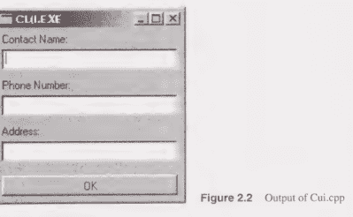

在 Linux 系统上，通过以下方式编译：

```
moc Cui.cpp -o cui.moc
g++ -I. Cui.cpp -o cui -L$QTDIR -lqt
```

在 Windows 系统上，通过以下方式：

```text
moc Cui.cpp -o cui.moc
cl -nologo -I%QTDIR%\include -I . -c Cui.cpp
link -nologo Cui.obj %QTDIR%\lib\qt.lib user32.lib gdi32.lib
comdlg32.lib ole32.lib uuid.lib m32.lib wsock32.lib
```

本示例引入了四个新对象和四个新概念（但它们彼此相关）。首先出现的是 `QString` 对象。`QString` 是 Troll 对字符串概念的封装。它提供了许多功能，包括“安全的”字符串存储、UNICODE 或 ASCII 字符串解释、搜索、分词等。接下来登场的是 `QLineEdit` 对象。这是 Qt 的标准“文本框”对象，允许用户输入和编辑单行文本。`QPushButton` 正如你可能猜测的那样——是带有文本或图片标签的按钮。`QLayout` 有助于管理界面的整体布局。

示例中引入的四个新概念是类定义顶部的 `Q_OBJECT` 行、类定义中间的“`slot`”关键字、构造函数末尾的 `connect()` 调用，以及最后一行包含的一个神秘的、不存在的文件 `cui.moc`。这四个都与 Qt 的信号/槽机制有关。

Qt 提供了一种相对独特的机制，将一个对象的行为连接到另一个对象。Troll 公司将其称为信号/槽机制，它在 Qt 及其衍生作品中得到广泛应用。该机制将在下一章中详细讨论，所以目前请假装它并不重要，但它以某种方式与示例中的四个奇怪引用相关。有两条简单的规则涵盖了几乎所有 Qt 编码情况：

- 如果你的类将发出或接收信号（通过槽），类定义必须包含顶部的 `Q_OBJECT` 术语。


# Qt 元编译与基础概念

任何包含 `Q_OBJECT` 术语的源文件都需要使用元编译器 `moc` 进行“元编译”，该编译器作为 Qt 工具包的一部分提供。生成的元代码必须通过平台编译器进行编译，并与最终二进制文件链接。

为了支持 Qt 信号/槽机制的使用，编译此示例涉及一个额外步骤。你必须使用 Qt 提供的工具对源文件进行预处理，以生成支持信号和槽的额外代码。这个新步骤在 Linux 或 Windows 上是相同的，看起来像这样：

```text
moc Cui.cpp -o cui.moc
```

`moc` 程序是在 Qt 构建过程中创建的，应位于 Linux 下的 `$QTDIR/bin/moc`，或 Windows 系统上的 `%QTDIR%\bin\moc.exe`。对于任一平台，将此目录添加到 `PATH` 环境变量是个好主意。

对于那些使用 `VC++` 项目输入示例的人，我发现将“自定义生成步骤”添加到源文件中最方便。指定类似以下内容：

```text
moc $(InputDir)\file.cpp -o $(InputDir)\file.moc
```

其中 `file` 被源文件名替换。一旦你完成源的元编译，你就可以使用平台编译器编译源了。你可以平台编译 `moc` 的输出，或者像我在这个示例中所做的那样，你可以简单地将其包含在源中。我出于简洁使用了 `#include` 方法。

你可能注意到在这个示例中我在 `QLabel` 构造函数中使用了不同数量的参数。Qt 类通常为构造函数提供几个重载，以及任何有意义的 C++ 运算符。你也可以在实例化后设置或测试 Qt 类的大多数值设置。诸如以下语句：

```cpp
QLabel *myLabel = new QLabel(this);
myLabel->setText("Hello World");
QString ltext( myLabel->text());
cout << (const char *)ltext << "\n";
```

将像 Troll 魔法一样起作用。Motif 程序员可能会自问：“权衡在哪里？”对于 Motif 开发人员来说，存在权衡——你牺牲了难以编写的代码，而必须接受卓越的性能。唉。

## 栈与堆

极其重要的是，你要么始终在堆上实例化类（通过 `new` 关键字）*或者*对你的编译器如何处理在栈上或特定作用域内创建的对象有深入的了解。大多数编码者可能已经注意到我在两个示例中对 `QApplication` 类使用了这两种方法。这是故意的。两者都是合法的并且运行良好——除非有人创建了一个新的编译器或运行时，使得持久的 `main()` 函数变得不可靠。

我听到过关于栈实例化总是坏主意的争论。与其他任何事情一样，如果你不知道自己在做什么——或者在这种情况下，你的编译器在做什么——几乎一切都是坏主意。栈实例化可能导致一些难以调试的严重问题，但它也可以带来显著的可支持性和性能改进。如果你怀疑，请使用堆。一个真正讨厌的栈分配错误是一个极佳的学习机会——尽管大多数人没有时间和精力去承受。

## QT 工具包基础

如果你只学习以下基本原则，你就已经超过了成为一名熟练的 Qt 开发人员的半程之路。作为一个读者和 Qt-interest 邮件列表的常客，我经常看到发布的问题，如果这个人熟悉 Qt 基础知识，这些问题本可以避免。当有人回答这些问题时，你几乎可以想象某处有人因自我沮丧而拍打额头。

以下是你在继续之前应该熟悉的基本概念：

- `QApplication`——Qt 应用程序启动类处理大多数平台特定的初始化程序。
- Qt 使用信号/槽消息传递模型，而不是 X 工具包（Motif 的基础）或 Microsoft Foundation Class Library 使用的回调方法。
- `QObject`——任何发送信号或提供槽的 Qt 类都继承自 `QObject`，它是几乎所有 Qt 类的基础。这非常简短且易于消化，但极其重要，因为它是大多数 Qt 类的基础 CLASS。
- `QWidget`——所有 Qt 小部件都继承自 `QWidget`，它提供了 Qt 小部件大多数一致的功能和特性。

## QAPPLICATION 类

对于你创建的任何使用可视化组件，或处理*任何*类型输入或事件的 Qt 应用程序，你必须创建一个（*且仅一个*）`QApplication` 类实例，并且你必须在你创建其他界面组件之前创建此单一实例。如果你尝试创建多个 `QApplication` 实例，工具包会警告你。是 `QApplication` 执行所有繁琐的基础的、平台相关的图形和事件通知功能的初始化。默认字体、字体属性、窗口颜色和鼠标行为等全局桌面首选项都被复制到 Qt 应用程序的空间中，因此你的 Qt 应用程序将如用户所期望的那样显示，尽管桌面主题各异。`QApplication` 提供事件分派循环，允许你的应用程序从底层窗口管理器接收事件。

如果 Qt 没有使用定义的 `QT_NODEBUG` 标志编译，则以下调试选项可用：

- `-nograb`: Qt 永远不应抓取鼠标或键盘焦点。
- `-dgrab`: 这是 `-nograb` 选项的对应项，允许你的 Qt 应用程序抓取鼠标或键盘焦点。在调试器内执行 Qt 应用程序时，有时需要这样做。此选项仅在 X11 平台上有意义。
- `-sync`: 通常，X11 应用程序将请求排队到 X 服务器——它们被缓冲并按 FIFO 顺序处理。此标志会禁用目标应用程序的正常缓冲。这对于初始调试可能非常有用，但请注意，你的应用程序性能将极其低下。此选项仅在 X11 平台上有意义。

所有 Qt 应用程序都理解以下参数：

- `style=<style>` 其中 `style` 为 `motif`、`windows` 或 `platinum`。
- `session=<session_id>` 其中 `session_id` 是你想要恢复的会话的 `session manager`（会话管理器）特定标识符。这只在提供完整会话管理系统的平台上才有效，例如 KDE、CDE、VUE 等。Microsoft Windows 不提供任何真正的会话管理。然而，Windows 提供了注销和关机通知，可用于保存更改或提示用户，甚至可能取消注销或关机。

在 X11 环境中运行的 Qt 应用程序可以使用以下命令行参数来改变运行时行为：

- `display` `<Display>` 其中 Display 是应用程序界面应呈现的显示名称和屏幕。这使用通常的 `hostname:screen_number` 语法指定，环境变量 `$DISPLAY` 是默认值。
- `geometry` `<geometry_spec>` 其中 `geometry_spec` 是标准的 X11 几何规格。示例：

    - `myapp -geometry +600+200` # 在 x=600, y=200 处启动 myapp
    - `myapp -geometry 400x200` # 宽度 400 像素，高度 200 像素
- `fn`/`font` 将 `font` 设置为默认应用程序字体。
- `bg`/`background` `<color>` 使用 `color` 作为默认控件背景颜色。
- `fg`/`foreground` `<color>` 使用 `color` 作为默认前景颜色。
- `btn`/`button` `<color>` 使用 `color` 作为默认按钮背景颜色。
- `name` `<name>` 将应用程序名称设置为 `name`。注意，这设置的是 X 服务器眼中的应用程序名称，不一定会影响窗口管理器标题栏中显示的名称。
- `title` `<name>` 将应用程序在窗口管理器标题栏中的标题设置为指定的 `name`。大多数应用程序会通过调用 `QWidget::setCaption()` 显式设置此项。
- `visual` `<visual>` 其中 `visual` 是你希望应用程序使用的视觉类型。目前，只定义了 `TrueColor` 视觉类型，并在 8 位显示器上提供真彩视觉——如果 X 服务器支持的话。
- `nclrs` `<num_colors>` 如果使用了 `QApplication::ManyColor` 颜色分配规范，此选项将限制你的 Qt 应用程序在 8 位显示器上为其颜色立方体分配的颜色数量，限制为由 `num_colors` 指定的数量。
- `cmap` 此选项将导致应用程序安装一个私有颜色映射。

`QApplication` 公开了相当多的方法。表 2.1 列出了这些方法及其目的的简要概述：

### 表 2.1：公共函数

| **公共函数** | **目的** |
| :--- | :--- |
| `QApplication( int &argc, char **argv )` | 构造函数 |
| `QApplication( int &argc, char **argv, bool GUIenabled )` | 构造函数 |
| `virtual QApplication()` | 析构函数 |
| `int argc()` | 返回命令行参数的数量 |
| `char** argv()` | 返回命令行参数的数组 |
| `QWidget* mainWindow()` | 返回指向 QApplication 主控件的指针 |


| `virtual void setMainWindow( QWidget * )` | 设置应用程序的主控件 |
| `virtual void polish( QWidget * )` | 调用 QStyle::polish() 函数作用于参数控件 |
| `QWidget* focusWidget()` | 返回指向当前拥有焦点的控件的指针 |
| `QWidget* activeWindow()` | 返回指向当前拥有焦点的顶层窗口的指针 |
| `int exec()` | 内置事件循环 |
| `void processEvents()` | 处理所有未决事件，完成后返回 |
| `void processEvents( int xmaxtime )` | 最多处理指定毫秒数内的未决事件 |
| `void processOneEvent()` | 处理一个未决事件 |
| `int enter_loop()` | 使事件循环再递归一层。成功时返回零，失败时返回非零 |
| `void exit_loop()` | 强制从递归进入的事件循环条目中返回 |
| `int loopLevel() const` | 返回进入事件循环的递归次数 |
| `virtual bool notify( QObject *, QEvent * )` | 向参数 QObject 发送一个事件。返回接收者事件处理程序返回的值 |
| `void setDefaultCodec( QTextCodec * )` | 为应用程序设置不同的文本编码。默认为 Latin1。 |
| `QTextCodec * defaultCodec()` | 返回指向默认文本编码的指针。 |
| `void installTranslator( QTranslator * )` | 为应用程序安装新的翻译器 |
| `void removeTranslator( QTranslator * )` | 从应用程序中移除当前的翻译器 |

#### 表 2.1（续）：公共函数

| **公共函数** | **目的** |
| :--- | :--- |
| `QString translate( const char *scope, const char *key )` | 翻译字符串并返回结果。 |
| `bool isSessionRestored()` | 如果这是一个恢复的会话，则返回 true |
| `QString sessionId()` | 返回会话 ID（如果可用） |
| `virtual void commitData( QSessionManager &sm )` | 当会话管理器希望应用程序提交其所有未决数据时，调用此方法 |
| `virtual void saveState( QSessionManager &sm )` | 导致会话管理器保存应用程序的当前状态 |
| `void wakeUpGuiThread()` | 在 Microsoft Windows 系统上，此方法会导致 GUI 线程执行 |

#### 表 2.1（续）：公共槽

| **公共槽** | **目的** |
| :--- | :--- |
| `void quit()` | 导致事件循环返回零。这通常会导致应用程序退出 |
| `void closeAllWindows()` | 此方法导致所有顶层窗口关闭 |

#### 表 2.1（续）：静态公共成员

| **静态公共成员** | **目的** |
| :--- | :--- |
| `QStyle & style()` | 返回当前的样式 |
| `void setStyle( QStyle * )` | 为应用程序设置新的样式 |
| `int colorSpec()` | 返回应用程序的颜色分配样式 |
| `void setColorSpec( int )` | 为应用程序设置新的颜色分配样式 |
| `QCursor * overrideCursor()` | 返回当前的覆盖光标 |
| `void setOverrideCursor( const QCursor &, bool replace=FALSE )` | 为应用程序设置新的覆盖光标 |
| `void restoreOverrideCursor()` | 恢复之前的覆盖光标（setOverrideCursor() 将当前光标压入内部堆栈） |
| `bool hasGlobalMouseTracking()` | 如果此应用程序已启用全局鼠标跟踪，则返回 true |
| `void setGlobalMouseTracking( bool enable )` | 启用或禁用全局鼠标跟踪 |

#### 表 2.1（续）：静态公共成员

| **静态公共成员** | **目的** |
| :--- | :--- |
| `QPalette palette( const QWidget *w = 0 )` | 返回默认应用程序调色板 |
| `void setPalette( const QPalette &, bool informWidgets=FALSE, const char *className = 0 )` | 设置默认应用程序调色板 |
| `QFont font( const QWidget *w = 0 )` | 返回默认应用程序字体 |
| `void setFont( const QFont &, bool informWidgets= FALSE, const char *className = 0 )` | 设置默认应用程序字体 |
| `QFontMetrics fontMetrics()` | 返回当前应用程序字体的当前字体度量 |
| `QWidgetList * allWidgets()` | 返回所有控件的列表 |
| `QWidgetList * topLevelWidgets()` | 返回所有顶层控件的列表 |
| `QWidget * desktop()` | 返回将桌面作为控件的指针 |
| `QWidget * activePopupWidget()` | 返回当前活动弹出控件的指针（如果存在） |
| `QWidget * activeModalWidget()` | 返回当前活动模态控件的指针（如果存在） |
| `QClipboard * clipboard()` | 返回指向 Qt 剪贴板接口的指针 |
| `QWidget * widgetAt( int x, int y, bool child=FALSE )` | 返回指向给定坐标处控件的指针 |
| `QWidget * widgetAt( const QPoint &, bool child=FALSE )` | 返回指向给定坐标处控件的指针，由 QPoint 参数表示 |
| `void exit( int retcode=0 )` | 导致 QApplication 事件循环返回参数返回值 |
| `bool sendEvent( QObject *rcvr, QEvent *event )` | 将参数事件发送给参数对象 |
| `void postEvent( QObject *rcvr, QEvent *event )` | 将参数事件放入内部事件队列并立即返回 |
| `void sendPostedEvents( QObject *rcvr, int event_type )` | 立即分发所有参数类型的且目标为参数接收者的事件 |
| `void sendPostedEvents()` | 立即分发所有已发布的事件 |
| `void removePostedEvents( QObject *receiver )` | 立即分发所有为参数接收者发布的事件 |
| `bool startUp()` | 如果应用程序对象尚未创建，则返回 true |

#### 表 2.1（续）

| 静态公共成员 | 用途 |
| :--- | :--- |
| `bool closingDown()` | 如果应用程序对象正在被销毁，则返回 true |
| `void flushX()` | 刷新 X11 事件队列（仅对 X11 有效） |
| `void syncX()` | 使 Qt 对应用程序显示的理解与 X 服务器同步（仅对 X11 有效） |
| `void beep()` | 发出平台铃声 |
| `void setDesktopSettingsAware( bool )` | 当使用 false 参数时，禁用 Qt 使用系统默认字体、颜色等的默认行为 |
| `bool desktopSettingsAware()` | 如果继承桌面字体和颜色设置的标准行为已被禁用，则返回 false |
| `void setCursorFlashTime( int )` | 设置文本光标闪烁的总时间周期（以毫秒为单位） |
| `int cursorFlashTime()` | 返回文本光标闪烁的总时间周期 |
| `void setDoubleClickInterval( int )` | 设置鼠标双击间隔（以毫秒为单位） |


| `int doubleClickInterval()` | 返回当前的鼠标双击间隔（以毫秒为单位） |

| `void setWheelScrollLines(int)` | 设置鼠标滚轮旋转时滚动的行数 |

| `int wheelScrollLines()` | 返回鼠标滚轮旋转时当前滚动的行数 |

| `void setStartDragTime(int)` | 指定鼠标按钮按下与拖拽事件开始之间的时间延迟（以毫秒为单位） |

| `int startDragTime()` | 返回鼠标按钮按下与拖拽事件开始之间的当前延迟（以毫秒为单位） |

| `void setStartDragDistance(int)` | 指定鼠标点击后必须移动的距离，之后才被解释为拖拽事件 |

| `int startDragDistance()` | 返回鼠标点击后必须移动的距离，之后才被解释为拖拽事件 |

### QApplication 的用途

`QApplication`类作为您的应用程序与底层窗口系统之间的主要接口，并充当该应用程序所有可视组件的基础对象。以下特性将为您提供`QApplication`类所提供功能的概览：

- `QApplication`通过称为`Style`（样式）的概念封装了应用程序的`外观和感觉`。可以使用`QApplication::setStyle()`方法在运行时更改全局样式。也可以进行针对单个小部件的样式控制，但这往往会使接口变得混乱。样式本身通过`QStyle`进行封装。
- `QApplication`通过`QApplication::setColorSpec()`方法指定应用程序如何分配和使用颜色。`您必须在实例化 QApplication 对象本身之前设置颜色规格，否则该规格将不会生效。`（Qt 的颜色分配模型将在下文讨论。）
- `QApplication`设置默认文本编解码器（参见`QApplication::setDefaultCodec()`），它定义了字符串如何通过`QApplication::translate()`方法本地化或翻译。
- `QApplication`封装了一些极其依赖平台的概念，如“桌面”和“剪贴板”，以确保您的应用程序在任何部署平台上都能按预期工作。TrollTech 将此定义为“Troll 魔法”——但这只是他们在幕后付出了大量艰苦工作的结果。
- `QApplication`通过`QWidget::widgetAt()`、`QWidget::topLevelWidgets()`和`QWidget::closeAllWindows()`方法提供足够的窗口交互和管理功能。
- `QApplication`提供每个应用程序都需要的事件分发机制；即，它从底层窗口系统接收事件，并将它们发送到合适的小部件。您可以使用`QApplication::postEvent()`和`QApplication::sendEvent()`向应用程序的小部件发送自定义消息。还有什么比这更有趣的吗？
- `QApplication`管理鼠标事件的处理方式，并通过`QApplication::setOverrideCursor()`和`QApplication::setGlobalMouseTracking()`提供适当的控制来自定义此处理方式。然而，您几乎不会使用这些函数；通常可以在`QWidget`级别实现所需的效果。
- 在 X11 环境中，`QApplication`提供通过`QApplication::flushX()`和`QApplication::syncX()`控制 X11 协议流的方法。
- `QApplication`提供实现完整会话管理控制所需的框架——即使在 Microsoft Windows 平台上也是如此。此功能通过`QSessionManager`类以及`QApplication::isSessionRestored()`、`QApplication::sessionId()`、`QApplication::commitData()`和`QApplication::saveState()`方法提供。

### 颜色管理

Qt 为您的应用程序提供了几种管理颜色分配的方法。如果您主要习惯于 X11 编程，毫无疑问您已经阅读过 MIT 关于该主题的相关文档，并且为了证明这一点而抓破了头。各种视觉类型的 X11 颜色模型可能会令人困惑。对于大多数（并非所有）应用程序，Qt 使颜色分配变得简单且可预测，而`QApplication`类在这种简化中发挥了重要作用。

Qt 在 X11 平台上提供的选项比在 Microsoft Windows 平台上更多，但用法是一致且简单的。Qt 通过几种方式管理颜色分配，具体取决于对`QApplication::setColorSpec()`和`QColor::enterColorContext()`的使用情况。

`QApplication::setColorSpec()`接受一个枚举值，其值为以下之一：

- `QApplication::NormalColor`——这是默认值。它使您的应用程序使用默认的系统颜色，这对使用颜色很少的应用程序效果很好。在 Windows 平台上，这可能导致明显的颜色抖动。
- `QApplication::CustomColor`——此设置对于必须分配少量特定颜色的应用程序很有用。与默认设置相比，此设置在 X11 平台上没有效果。在 Windows 系统中，此设置会创建一个新的调色板，并从中按需分配颜色。
- `QApplication::ManyColors`——当您的应用程序需要许多（甚至成千上万种）颜色时，此设置是合适的。

您可以通过`QColor::enterColorContext()`方法在应用程序运行时获得额外的颜色分配控制程度，该方法允许应用程序临时分配许多颜色。但如果您的应用程序帮助文件在任何地方提到了 Pantone 名称，您将需要为`QColor`添加自己的改进，以获取您要查找的确切颜色。

### QWIDGET 类

`QWidget`是用户界面对象的抽象，是 Qt 界面设计的基本单元。`QWidget`提供了大量的功能并执行许多有用的任务。它从底层窗口系统接收事件，并提供了您最可能需要用来处理这些事件的方法。它维护诸如字体和调色板等属性，尽管它不直接使用该属性。Qt 工具包中的所有可视对象都是`QWidget`的子类，因此所有可视对象都继承`QWidget`的方法和功能。表 2.2 列出了`QWidget`类暴露的方法：

#### 表 2.2 QWidget 类方法

| 公共成员 | 用途 |
| :--- | :--- |
| `QWidget(QWidget *parent=0, const char *name=0, WFlags f=0)` | 构造函数。默认行为中，当 widget 参数等于零时，构造一个顶级小部件 |
| `QWidget()` | 析构函数 |
| `QWidget ID` | 返回平台无关的窗口 ID |
| `QStyle & style()` | 返回此小部件当前的 Qt 样式 |
| `void setStyle(QStyle *)` | 为此小部件设置新样式 |
| `bool isTopLevel()` | 如果这是顶级小部件，则返回 true |
| `bool isModal()` | 如果此小部件是模态的，则返回 true（true 意味着顶级） |
| `bool isPopup()` | 如果此小部件设置了 WType_Popup 标志，则返回 true |
| `bool isDesktop()` | 如果此小部件引用桌面，则返回 true |
| `bool isEnabled()` | 如果此小部件已启用，则返回 true |
| `bool isEnabledTo(QWidget *)` | 如果参数小部件启用或禁用时此小部件也会随之启用或禁用，则返回 true |
| `QRect frameGeometry()` | 返回此小部件相对于其父级（包括窗口框架）的几何信息 |
| `const QRect & geometry()` | 返回此小部件相对于其父级的几何信息 |
| `int x()` | 返回此小部件相对于其父级的 x 坐标 |
| `int y()` | 返回此小部件相对于其父级的 y 坐标 |
| `QPoint pos()` | 返回此小部件相对于其父级的 QPoint 坐标 |
| `QSize frameSize()` | 返回窗口系统框架的大小（仅对顶级小部件有效） |
| `QSize size()` | 返回小部件的大小 |
| `int width()` | 返回小部件的宽度（以像素或 pel 为单位） |
| `int height()` | 返回小部件的高度（以像素或 pel 为单位） |

### 第 2 章 创建您的第一个 Qt 应用程序

### 表 2.2（续）

| 公共成员 | 用途 |
| :--- | :--- |
| `QRect rect()` | 返回小部件的内部几何形状，不包含窗口边框 |
| `QRect childrenRect()` | 返回此小部件子小部件包围矩形的几何形状 |


# QWidget 尺寸与外观相关方法

| 方法 | 描述 |
|------|------|
| `QRegion childrenRegion()` | 返回此小部件子小部件的组合区域 |
| `QSize minimumSize()` | 返回此小部件当前的最小尺寸 |
| `QSize maximumSize()` | 返回此小部件当前的最大尺寸 |
| `int minimumWidth()` | 返回此小部件当前的最小宽度 |
| `int minimumHeight()` | 返回此小部件当前的最小高度 |
| `int maximumWidth()` | 返回此小部件当前的最大宽度 |
| `int maximumHeight()` | 返回此小部件当前的最大高度 |
| `void setMinimumSize( const QSize & )` | 设置此小部件的最小尺寸 |
| `virtual void setMinimumSize( int minw, int minh )` | 设置此小部件的最小宽度和高度 |
| `void setMaximumSize( const QSize & )` | 设置此小部件的最大尺寸 |
| `virtual void setMaximumSize( int maxw, int maxh )` | 设置此小部件的最大宽度和高度 |
| `void setMinimumWidth( int )` | 设置此小部件的最小宽度 |
| `void setMinimumHeight( int )` | 设置此小部件的最小高度 |
| `void setMaximumWidth( int )` | 设置此小部件的最大宽度 |
| `void setMaximumHeight( int )` | 设置此小部件的最大高度 |
| `QSize sizeIncrement()` | 返回当前的尺寸增量值（在 Microsoft Windows 上被忽略，可能也被窗口管理器忽略） |
| `void setSizeIncrement( const QSize & )` | 设置调整大小增量值。窗口将按此量的步长进行大小调整（在 Microsoft Windows 上被忽略，可能也被窗口管理器忽略） |
| `virtual void setSizeIncrement( int w, int h )` | 设置调整大小增量的宽度和高度。窗口将按此量的步长进行大小调整（在 Microsoft Windows 上被忽略，可能也被窗口管理器忽略） |
| `QSize baseSize()` | 返回当前的基本小部件尺寸（仅对尺寸增量有用） |
| `void setBaseSize( const QSize & )` | 设置小部件的基本尺寸（仅对尺寸增量有用） |
| `void setBaseSize( int w, int h )` | 设置小部件的基本宽度和高度（仅对尺寸增量有用） |
| `void setFixedSize( const QSize & )` | 为小部件设置固定尺寸。 |
| `void setFixedSize( int w, int h )` | 为小部件设置固定宽度和高度 |
| `void setFixedWidth( int )` | 为小部件设置固定宽度 |
| `void setFixedHeight( int )` | 为小部件设置固定高度 |
| `QPoint mapToGlobal( const QPoint & )` | 将参数中小部件相对坐标转换为全局（窗口系统）坐标 |
| `QPoint mapFromGlobal( const QPoint & )` | 将参数中全局（窗口系统）坐标转换为小部件相对坐标 |
| `QPoint mapToParent( const QPoint & )` | 将参数中小部件相对坐标转换为父小部件中的坐标。 |
| `QPoint mapFromParent( const QPoint & )` | 将参数中父小部件坐标转换为相对于此小部件的坐标。 |
| `QWidget * topLevelWidget()` | 返回指向此小部件祖先的顶层小部件的指针。 |
| `BackgroundMode backgroundMode()` | 返回当前的背景模式。默认值为 `PaletteBackground` |
| `virtual void setBackgroundMode( BackgroundMode )` | 设置当前的背景模式 |
| `const QColor & backgroundColor()` | 返回此小部件当前的背景颜色 |
| `const QColor & foregroundColor()` | 返回此小部件当前的前景颜色 |
| `virtual void setBackgroundColor( const QColor & )` | 设置小部件的背景颜色。这通常不是您想要的！请使用 `setPalette()`！ |
| `const QPixmap * backgroundPixmap()` | 返回指向背景位图的指针 |
| `virtual void setBackgroundPixmap( const QPixmap & )` | 错误。它设置了背景位图 |
| `const QColorGroup & colorGroup()` | 返回当前的颜色组 |
| `const QPalette & palette()` | 返回小部件的当前调色板。如果未为此小部件设置自定义调色板，此方法返回小部件类调色板、父级调色板或应用程序调色板 |
| `virtual void setPalette( const QPalette & )` | 为此小部件设置新的调色板 |
| `void unsetPalette()` | 移除自定义调色板，恢复默认值 |
| `QFont font()` | 返回当前的小部件字体 |
| `virtual void setFont( const QFont & )` | 为此小部件设置自定义字体 |
| `void unsetFont()` | 移除自定义字体，恢复默认值 |
| `QFontMetrics fontMetrics()` | 返回此小部件当前的字体度量 |
| `QFontInfo fontInfo()` | 返回当前的字体信息 |
| `const QCursor & cursor()` | 返回鼠标位于此小部件上时使用的当前光标 |
| `virtual void setCursor( const QCursor & )` | 设置当鼠标指针位于此小部件上时将出现的光标形状 |
| `virtual void unsetCursor()` | 移除自定义光标设置，恢复默认值 |
| `QString caption()` | 返回当前的小部件标题（顶层小部件的窗口边框标题栏） |
| `const QPixmap * icon()` | 返回指向当前设置为此小部件图标的位图的指针 |
| `QString iconText()` | 返回图标文本（如果已设置，否则返回 NULL） |
| `bool hasMouseTracking()` | 如果小部件启用了鼠标跟踪，则返回 true。 |
| `virtual void setMask( const QBitmap& )` | 从参数位图设置小部件掩码，该掩码控制小部件如何被裁剪（这就是创建圆形按钮的方法）。 |
| `virtual void setMask( const QRegion& )` | 从参数区域信息设置小部件掩码，该区域信息控制小部件如何被裁剪。 |
| `void clearMask()` | 禁用由之前 `setMask()` 调用的小部件掩码 |
| `bool isActiveWindow()` | 如果此小部件位于活动窗口中，则返回 true |
| `virtual void setActiveWindow()` | 将此窗口设置为活动状态 |
| `bool isFocusEnabled()` | 如果此小部件可以接收键盘焦点，则返回 true |
| `FocusPolicy focusPolicy()` | 返回小部件当前的焦点策略。 |
| `virtual void setFocusPolicy( FocusPolicy )` | 设置或更改小部件当前的焦点策略 |
| `bool hasFocus()` | 如果此小部件拥有键盘焦点，则返回 true |
| `virtual void setFocusProxy( QWidget * )` | 设置参数小部件为此小部件代理键盘焦点 |
| `QWidget* focusProxy()` | 返回为此小部件代理键盘焦点的小部件（如果没有则为 Null） |
| `void grabMouse()` | 捕获鼠标输入。在调用 `releaseMouse()` 之前，没有其他小部件会接收鼠标输入 |
| `void grabMouse( const QCursor& )` | 捕获鼠标输入并将鼠标外观更改为参数形式。在调用 `releaseMouse()` 之前，没有其他小部件会接收鼠标输入 |
| `void releaseMouse()` | 在小部件调用 `grabMouse()` 后释放鼠标 |


### 表 2.2（续）

### 公共成员

| 公共成员 | 用途 |
|---|---|
| `void grabKeyboard()` | 捕获键盘输入。在调用 `releaseKeyboard()` 之前，没有其他小部件会接收键盘输入 |
| `void releaseKeyboard()` | 在小部件调用 `grabKeyboard()` 后释放键盘 |
| `bool isUpdatesEnabled()` | 如果此小部件的更新已启用，则返回 `true` |
| `virtual bool close( bool )` | 关闭小部件。如果参数为 `true`，小部件将与其子小部件一起被删除 |
| `bool isVisible()` | 如果小部件可见（或可能可见），则返回 `true`。被另一个小部件遮挡的小部件在此意义上可以是可见的 |
| `bool isVisibleTo( QWidget * )` | 如果参数祖先小部件变为可见时此小部件也会变为可见，则返回 `true` |
| `QRect visibleRect()` | 返回小部件当前可见的矩形 |
| `bool isMinimized()` | 如果此小部件被最小化，则返回 `true` |
| `virtual QSize sizeHint()` | 通常在子类中被重写，此方法返回此小部件的合适尺寸 |
| `virtual QSize minimumSizeHint()` | 通常在子类中被重写，此方法返回此小部件最小的可用尺寸 |
| `virtual QSizePolicy sizePolicy()` | 返回此小部件当前的尺寸策略。诸如 `QPushButton` 和 `QLineEdit` 等小部件“喜欢”在水平方向上增长/缩小，但在垂直方向上不这样做。这是 `QSizePolicy` 值的效果 |
| `virtual int heightForWidth( int )` | 给定参数宽度，返回首选高度。默认返回零（不在乎）。这不考虑布局。 |
| `virtual void adjustSize()` | 调整此小部件的大小以适应下方的内容。如果 `sizeHint()` 有效则使用它，否则尝试适应子小部件的包围矩形 |
| `QLayout * layout()` | 返回管理此小部件子小部件的 `QLayout` 的指针，如果没有使用布局则返回 `NULL` |
| `void updateGeometry()` | 通知布局此小部件的几何形状已更改。 |
| `virtual void reparent( QWidget *parent, WFlags, const QPoint & bool show=FALSE )` | 将参数小部件重新父化为父小部件，将其定位在参数点并应用参数窗口标志。如果 `show == true`，小部件将立即显示 |

### 公共成员

| 公共成员 | 用途 |
|---|---|
| `void reparent( QWidget *parent, const QPoint &, bool show=FALSE )` | 将参数小部件重新父化为当前小部件，并将其定位在参数指定的点。如果 `show` 为 `true`，该小部件将立即显示 |
| `void erase()` | 将整个小部件擦除为背景颜色 |
| `void erase( int x, int y, int w, int h )` | 将参数描述出的矩形擦除为背景颜色 |
| `void erase( const QRect & )` | 将参数描述出的矩形擦除为背景颜色 |
| `void erase( const QRegion & )` | 将参数描述出的区域擦除为背景颜色 |
| `void scroll( int x, int y )` | 将小部件向右滚动 `x` 像素，向下滚动 `y` 像素。如果 `x` 和 `y` 为负值，滚动方向将反转 |
| `void scroll( int x, int y, const QRect & )` | 将小部件中参数指定的矩形区域向右滚动 `x` 像素，向下滚动 `y` 像素。如果 `x` 和 `y` 为负值，滚动方向将反转 |
| `void drawText( int x, int y, const QString & )` | 在小部件上由 `x` 和 `y` 坐标引用的点处绘制参数字符串 |
| `void drawText( const QPoint &, const QString & )` | 在小部件上参数指定的点处绘制参数字符串 |
| `QWidget * focusWidget()` | 返回指向当前窗口中拥有焦点的小部件的指针 |
| `QRect microFocusHint()` | 返回平台相关输入方法当前的焦点位置和大小 |
| `bool acceptDrops()` | 如果此小部件接受拖放事件，则返回 `true` |
| `virtual void setAcceptDrops( bool )` | 如果参数为 `true`，则设置此小部件以接受拖放事件 |
| `virtual void setAutoMask( bool )` | 每当发生大小改变事件或焦点变化时，启用/禁用自动调用小部件的 `updateMask()` 方法 |
| `bool autoMask()` | 如果对于大小改变事件和焦点变化启用了自动调用 `updateMask()`，则返回 `true` |
| `void setBackgroundOrigin( BackgroundOrigin )` | 设置小部件的背景相对于参数原点类型进行绘制，类型为 `WidgetOrigin`（默认）或 `ParentOrigin`（通常用于融合相邻小部件的背景，使其看起来像同一个整体） |
| `BackgroundOrigin backgroundOrigin()` | 返回此小部件当前的背景原点类型（`WidgetOrigin` 或 `ParentOrigin`） |
| `virtual bool customWhatsThis()` | 如果此小部件手动处理“What's This”弹出帮助，则返回 `true`。默认值为 `false` |
| `QWidget * parentWidget()` | 返回指向父小部件的指针。如果这是顶级小部件，则返回 `NULL` |
| `bool testWFlags( WFlags )` | 如果设置了参数中的窗口标志，则返回 `true` |

### 公共槽

| 公共槽 | 用途 |
|---|---|
| `virtual void setEnabled( bool )` | 启用/禁用此小部件。这会影响其行为和外观 |
| `virtual void setCaption( const QString & )` | 设置小部件的标题文本。对于顶级小部件，这将在窗口边框中设置标题栏字符串 |
| `virtual void setIcon( const QPixmap & )` | 为此小部件设置图标位图。对于顶级小部件，这将在窗口边框的标题栏中设置显示的图标 |
| `virtual void setIconText( const QString & )` | 设置图标文本 |
| `virtual void setMouseTracking( bool )` | 启用/禁用鼠标跟踪。当禁用（默认）时，只有在按下鼠标按钮时才会接收到鼠标移动事件。当启用跟踪时，无论是否按下按钮，小部件都会接收移动事件 |
| `virtual void setFocus()` | 设置此小部件（或其焦点代理）以接收键盘焦点 |
| `void clearFocus()` | 移除此小部件（或其代理）的焦点 |
| `virtual void setUpdatesEnabled( bool )` | 启用/禁用小部件接收更新。如果更新被禁用，对 `repaint()` 的调用将无效 |
| `void update()` | 如果启用更新，小部件的任何无效区域将被擦除并重绘 |
| `void update( int x, int y, int w, int h )` | 如果启用更新，这将更新指定的区域 |
| `void update( const QRect & )` | 如果启用更新，这将更新指定的区域 |
| `void repaint()` | 如果启用更新且小部件可见，此方法将擦除并重绘整个小部件。 |
| `void repaint( bool erase )` | 如果启用更新且小部件可见，此方法将重绘整个小部件。如果参数为 `true`，小部件将先被擦除 |
| `void repaint( int x, int y, int w, int h, bool erase=TRUE )` | 如果启用更新且小部件可见，此方法将重绘小部件的指定矩形区域。如果 `erase` 参数为 `true`（默认），小部件将先被擦除 |
| `void repaint( const QRect &, bool erase=TRUE )` | 如果启用更新且小部件可见，此方法将重绘小部件的指定矩形区域。如果 `erase` 参数为 `true`（默认），小部件将先被擦除 |


| `void repaint( const QRegion &, bool erase=TRUE )` | 如果启用更新且小部件可见，此方法将重绘小部件的指定区域。如果 erase 参数为 true（默认），小部件将先被擦除 |
| `virtual void show()` | 使小部件及其子部件变为可见。您几乎不需要调用此方法 |
| `virtual void hide()` | 使此小部件及其子部件不可见 |
| `virtual void showMinimized()` | 使小部件显示为最小化状态（作为图标）。这仅对顶级小部件有用 |
| `virtual void showMaximized()` | 使小部件显示为最大化状态。这仅对顶级小部件有用 |
| `void showFullScreen()` | 使小部件以全屏模式显示。这仅对顶级小部件有用 |
| `virtual void showNormal()` | 使小部件正常显示 |
| `virtual void polish()` | 此槽在小部件创建之后但显示之前被调用。这有助于执行额外的初始化 |
| `void constPolish()` | 通过调用 `polish()` 确保小部件完全初始化。不要从构造函数中调用此方法！ |
| `bool close()` | 向小部件发送 `QCloseEvent`。如果事件被接受（默认行为），小部件将被隐藏。如果关闭事件被接受，则返回 true |
| `void raise()` | 如果兄弟小部件遮挡了此小部件，则将此小部件提升到父级堆栈的顶部 |
| `void lower()` | 降低此小部件在父级堆栈中的位置，可能会使其被兄弟小部件遮挡 |
| `virtual void move( int x, int y )` | 将小部件移动到相对于父级（以及任何窗口边框）的新坐标 |
| `void move( const QPoint & )` | 将小部件移动到相对于父级（以及任何窗口边框）的新坐标 |
| `virtual void resize( int w, int h )` | 将小部件调整大小到指定尺寸（假设尺寸介于最小和最大尺寸之间）。如果小部件可见，它将立即接收大小改变事件。否则，它将在变为可见之前接收大小改变事件 |
| `void resize( const QSize & )` | 将小部件调整大小到指定尺寸（假设尺寸介于最小和最大尺寸之间）。如果小部件可见，它将立即接收大小改变事件。否则，它将在变为可见之前接收大小改变事件 |
| `virtual void setGeometry( int x, int y, int w, int h )` | 将小部件的几何形状设置为参数值（假设尺寸介于最小和最大尺寸之间） |
| `virtual void setGeometry( const QRect & )` | 将小部件的几何形状设置为参数值（假设尺寸介于最小和最大尺寸之间） |

### 静态公共成员

| 静态公共成员 | 用途 |
| --- | --- |
| `void setTabOrder( QWidget *first, QWidget *second )` | 设置小部件的制表顺序。这是成对进行的，即从 first 到 second，从 second 到 third，等等 |
| `QWidget * mouseGrabber()` | 返回指向当前捕获鼠标的小部件的指针，否则返回 NULL |
| `QWidget * keyboardGrabber()` | 返回指向当前捕获键盘的小部件的指针，否则返回 NULL |
| `QWidget * find( WId )` | 返回指向窗口具有参数窗口 ID 的小部件的指针 |

### 受保护成员

| 受保护成员 | 用途 |
| --- | --- |
| `virtual bool event( QEvent * )` | 主事件处理程序。事件会与所有注册的事件类型进行比较，并分派到专门的事件处理程序 |
| `virtual void mousePressEvent( QMouseEvent * )` | 当按下鼠标按钮时调用 |
| `virtual void mouseReleaseEvent( QMouseEvent * )` | 当释放鼠标按钮时调用 |
| `virtual void mouseDoubleClickEvent( QMouseEvent * )` | 当双击鼠标按钮时调用 |
| `virtual void mouseMoveEvent( QMouseEvent * )` | 如果启用跟踪，每当鼠标移动时调用。否则，当鼠标移动且鼠标按钮被按下时调用 |
| `virtual void wheelEvent( QWheelEvent * )` | 当鼠标滚轮旋转时调用 |
| `virtual void keyPressEvent( QKeyEvent * )` | 当按下键盘按键时调用 |
| `virtual void keyReleaseEvent( QKeyEvent * )` | 当释放键盘按键时调用 |
| `virtual void focusInEvent( QFocusEvent * )` | 当小部件获得键盘焦点时调用 |
| `virtual void focusOutEvent( QFocusEvent * )` | 当小部件失去键盘焦点时调用 |
| `virtual void enterEvent( QEvent * )` | 当鼠标指针进入小部件区域时调用 |
| `virtual void leaveEvent( QEvent * )` | 当鼠标指针离开小部件区域时调用 |
| `virtual void paintEvent( QPaintEvent * )` | 如果启用更新，当小部件的一部分需要重绘时调用此函数 |

### 表 2.2（续）

| 受保护成员 | 用途 |
| :--- | :--- |
| `virtual void moveEvent( QMoveEvent * )` | 当小部件被移动时调用 |
| `virtual void resizeEvent( QResizeEvent * )` | 当小部件被调整大小时调用 |
| `virtual void closeEvent( QCloseEvent * )` | 由先前对 `close()` 方法的调用触发。默认行为是 `accept()` 该事件，这将隐藏小部件。 |
| `virtual void dragEnterEvent( QDragEnterEvent * )` | 当拖动操作正在进行且鼠标进入小部件区域时调用 |
| `virtual void dragMoveEvent( QDragMoveEvent * )` | 当拖动操作正在进行且鼠标在小部件区域内移动时调用 |
| `virtual void dragLeaveEvent( QDragLeaveEvent * )` | 当拖动操作正在进行且鼠标离开小部件区域时调用 |
| `virtual void dropEvent( QDropEvent * )` | 当拖动操作正在进行且鼠标按钮在该小部件区域内释放时调用 |
| `virtual void showEvent( QShowEvent * )` | 在小部件显示之前调用 |
| `virtual void hideEvent( QHideEvent * )` | 在小部件隐藏之后调用 |
| `virtual void customEvent( QCustomEvent * )` | 显式从 `QApplication` 的 `sendEvent()` 或 `postEvent()` 方法调用，以实现自定义事件类型 |
| `virtual void updateMask()` | 如果 `isAutoMask()` 为真，则自动调用。这将更新小部件掩码以适应大小调整和焦点变化 |
| `virtual void styleChange( QStyle & )` | 当小部件的样式发生变化时调用 |
| `virtual void enabledChange( bool )` | 每当小部件的启用状态发生变化时调用 |
| `virtual void backgroundColorChange( const QColor & )` | 当通过调用 `setBackgroundColor()` 改变小部件的背景颜色时调用 |
| `virtual void backgroundPixmapChange( const QPixmap & )` | 当背景位图发生变化时调用 |
| `virtual void paletteChange( const QPalette & )` | 当小部件的调色板发生变化时调用 |
| `virtual void fontChange( const QFont & )` | 当小部件的字体发生变化时调用 |


| `virtual void create( WId = 0, bool initializeWindow = TRUE, bool destroyOldWindow = TRUE )` | 如果窗口 ID 参数为零，则创建新的小部件窗口；否则，将小部件移动到具有该 ID 的窗口。`initializeWindow` 参数指定是否初始化新窗口的几何形状。如果 `destroyOldWindow` 参数为真，前一个窗口将被销毁 |
| `virtual void destroy( bool destroyWindow = TRUE, bool destroySubWindows = TRUE )` | 如果 `destroyWindow` 为真，则销毁小部件窗口。如果 `destroySubWindows` 为真，则递归地对子小部件调用 `destroy()` |
| `WFlags getWFlags( )` | 获取当前的小部件标志 |
| `virtual void setWFlags( WFlags )` | 设置指定的小部件标志 |
| `void clearWFlags( WFlags )` | 重置（清除）指定的小部件标志 |
| `virtual bool focusNextPrevChild( bool next )` | 在当前制表顺序中查找一个新的接收键盘焦点的小部件。如果成功则返回 true，否则返回 false |
| `QFocusData * focusData( )` | 返回指向该小部件的顶级小部件祖先的焦点数据的指针 |
| `virtual void setKeyCompression( bool )` | 启用/禁用键事件压缩。启用时，可以在单个事件处理中处理多个键事件，这对于多字符 Unicode 输入很有用。默认情况下禁用 |
| `virtual void setMicroFocusHint( int x, int y, int w, int h, bool text=TRUE )` | 设置用于平台相关输入方法的焦点位置和大小 |

### 父子关系

`QWidget` 维护其子小部件的列表（可以通过 `QWidget::children()` 方法访问）。给定小部件的子小部件是指其父小部件（作为构造函数第一个参数传入）为给定小部件的新小部件。默认的 `QWidget` 析构函数在删除自身之前会删除其所有子小部件。要删除一条小部件链，只需删除父小部件即可。

父子关系规则很简单：没有父小部件的 `QWidget` 是一个*顶级*小部件（通常带有窗口管理器边框、标题栏等），所有以该顶级小部件为父小部件的 `QWidget` 都是该小部件的子小部件。

`QApplication` 维护应用程序中顶级小部件的列表，这些顶级小部件维护其子小部件的列表。如果你删除一个小部件，其析构函数将首先删除其所有子小部件。（这种共生关系几乎是完美的。你可能会偶尔发现内存泄漏，但它们总是非常小且不传播的。）

Qt 小部件的几何形状受其父小部件几何形状的限制。创建一个 300 乘 200 像素的列表视图作为 50 乘 50 框架小部件的子小部件，将不会按你预期的那样显示。

以下示例有助于说明父子关系。

#### NewWidget.h

```c++
#ifndef _NEWWIDGET_H
#define _NEWWIDGET_H

#include <qlabel.h>
#include <qlayout.h>
#include <qstring.h>

// A subclass of QWidget
class NewWidget : public QWidget
{
    // To make our two slots work:
    Q_OBJECT
public:
    // The constructor accepts a widget parent but the default
    // behavior is a toplevel widget.
    NewWidget( QWidget *parent=0, const char *name=0 );
public slots:
    void setLabel( const QString &s ) { left->setText( s ); }
    void setValue( const QString &s ) { val->setText( s ); }

private:
    QLabel *left, *val;
};
#endif // _NEWWIDGET_H
```

#### NewWidget.cpp

```c++
NewWidget::NewWidget( QWidget *p, const char *n )
: QWidget( p, n ) // Pass the arguments to the base class
{
    // Add a layout
    QBoxLayout *top = new QBoxLayout( this, 5 );
    // 'left' is the label in the pair
    left = new QLabel( this );
    left->setAlignment( AlignVCenter|AlignRight );
    top->addWidget( left );
    // val displays the value in the pair
    val = new QLabel( this );
    top->addWidget( val );
}
#include "NewW.moc"
```

好的，我们得到了一个新的小部件。它暴露了与 `QWidget` 相同的所有方法、信号和槽，并在此过程中增加了两个新的槽。内部，它维护一个布局和两个标签小部件，但你无需关心管理是如何实现的——对于本次讨论来说，它就是如此。

现在，我们将使用我们的新小部件。我们将创建两个 `NewWidget` 实例，并在用户点击按钮时删除其中一个，然后讨论你可以预期会发生什么：

#### main.cpp

```c++
#include "NewW.h"
#include <qapplication.h>
#include <qpushbutton.h>

class screen : public QWidget
{
    Q_OBJECT
public:
    screen();
protected slots:
    void delbot() { delete bottom; bottom = 0; }
private:
    NewWidget *above, *bottom;
};

screen::screen()
    : QWidget( 0, 0 )
{
    // Vertical layout---two NewWidgets and a button
    QVBoxLayout *top = new QVBoxLayout( this );
    above = new NewWidget( this );
    above->setLabel( "Upper Value:" );
    above->setValue( "Above it all" );
    top->addWidget( above );
    bottom = new NewWidget( this );
    bottom->setLabel( "Lower Value:" );
    bottom->setValue( "Bottomed-out" );
    top->addWidget( bottom );
    QPushButton *pb = new QPushButton( "Delete Bottom", this );
    connect(pb, SIGNAL(clicked()), SLOT(delbot()));
}

int
main( int argc, char **argv )
{
    QApplication app( argc, argv );
    screen *s = new screen();
    app.setMainWidget( s );
    s->show();
    return app.exec() ;
}

// We have slots in the above class, so we have to meta compile
// this code and link to it (or just include the moc output)
#include "main.moc"
```

上述代码定义了 `QWidget` 的一个子类 `screen`，它在垂直布局中管理两个 `NewWidget` 小部件和一个按钮。在 `screen` 的构造函数中，由按钮发出的 `clicked()` 信号连接到 `screen` 小部件的 `delbot()` 槽。`delbot()` 槽只是检查底部的 `NewWidget`（指针）是否等于零，如果不等于，则删除其指向的对象。


由于创建的每个小部件实例都会分配资源，当你点击按钮时，`bottom`指针指向的`NewWidget`实例分配的所有资源会怎么样？你猜对了——该特定`NewWidget`的所有子小部件将首先被删除。这意味着`所有`子小部件。这种行为存在于`QWidget`、`QObject`及其子类中，你务必考虑到这一点很重要。如果你删除*主*小部件，即传递给`QApplication::setMainWidget()`的参数小部件，你的应用程序将会退出。

### 小部件标志

顶级小部件是指没有父小部件的任何小部件。有时，你希望创建具有与默认不同的*小部件标志*值的顶级小部件。以下示例说明了一个简单的对话框样式顶级小部件。请注意添加了小部件标志参数。

#### dialog.h

```c++
#include <qlabel.h>
#include <qlayout.h>
#include <qpushbutton.h>

class dialog : public QWidget
{
    Q_OBJECT
public:
    dialog( const QString &, const QPixmap & );
```

公共槽：

```
void setText( const QString &s ) { msg->setText( s ); }
```

保护槽：

```
virtual void byebye();
```

私有：

```
QLabel *msg;
```

```
};
```

`dialog.cpp`

```
#include "dialog.h"

dialog::dialog( const QString &msg, const QPixmap &pix )
{
	QWidget( 0, 0, WStyle_Dialog|WType_Modal )

	// Something for the title bar
	setCaption( tr( "Alert!" ) );

	// Use the same pixmap for a window icon
	setIcon( pix );

	// Vertical layout (overall)
	QBoxLayout *top = new QVBoxLayout( this );
	// Horizontal layout for an icon and a message
	QHBoxLayout *hb = new QHBoxLayout();

	// The icon and the message get all the vertical stretch
	top->addLayout( hb, 5 );

	QLabel *l = new QLabel( this );
	l->setPixmap( pix );
	
	hb->addWidget( l, 1 );
	msg = new QLabel( msg, this );
	hb->addWidget( msg, 2 );

	// An OK button
	QPushButton *pb = new QPushButton( tr("OK"), this );
	connect( pb, SIGNAL(clicked()), SLOT(byebye()) );
	top->addWidget( pb );
}

void
dialog::byebye()
{
	delete this;
}

#include <dialog.moc>
```

当然，使用`QMessageBox`类来执行此操作要容易得多，但这更好地说明了一个顶级小部件。

小部件标志值通常仅用于顶级小部件。以下是当前的小部件标志值及其含义（这些值可能会随着版本发布而变化，因此建议检查`qnamespace.h`文件并阅读 Qt 类的文档）。它们分为三组：影响类型、样式和修饰符的标志。

### 小部件类型标志

类型标志会影响应用程序和底层窗口系统如何对待该窗口。

- `WType_TopLevel`—将此小部件设置为顶级小部件，意味着它将具有窗口管理器装饰、边框等。

- `WType_Modal`—表示这是一个应用程序模态的顶级小部件。在关闭此小部件之前，应用程序中的其他顶级小部件无法接收输入。此小部件类型还隐含`WStyle_Dialog`样式。

- `WType_Popup`—将此小部件设置为应用程序模态的顶级小部件，其样式适合弹出菜单。

- `WType_Desktop`—表示这是窗口系统桌面。参见下面的`WPaintDesktop`修饰符标志。

### 小部件样式标志

样式标志决定窗口管理器将添加到小部件的窗口装饰，例如边框、调整大小控件等。

- `WStyle_Customize`—不提供窗口装饰、图标（系统菜单）、标题栏（标题）、按钮（最小化、最大化和关闭）或调整大小控件。这意味着你将使用`WStyle_XXX`小部件标志设置所有样式提示。这对闪屏界面本身非常有用。

- `WStyle_NormalBorder`—提供标准的窗口装饰、图标、标题栏、按钮和调整大小控件。你不能将此标志与`WStyle_DialogBorder`或`WStyle_NoBorder`结合使用。

- `WStyle_DialogBorder`—提供标题栏、图标和关闭按钮。此标志不能与`WStyle_NormalBorder`或`WStyle_NoBorder`结合使用。

- `WStyle_NoBorder`—提供无装饰的普通窗口。此标志不能与`WStyle_NormalBorder`或`WStyle_DialogBorder`结合使用。

- `WStyle_Title`—提供标题栏。

- `WStyle_SysMenu`—提供系统菜单图标。

- `WStyle_Minimize`—提供最小化按钮。

- `WStyle_Maximize`—提供最大化按钮。

- `WStyle_MinMax`—同时提供最小化和最大化按钮。

- `WStyle_Tool`—提供标题栏和关闭按钮。

- `WStyle_StayOnTop`—使窗口保持在其他窗口之上。

- `WStyle_Dialog`—提供适合对话框的外观。它具有标题栏、图标和关闭按钮。此标志将防止在系统任务栏上创建额外的图标，并且对话框将（通常——这取决于底层窗口系统）随父窗口一起最小化。

- `WStyle_ContextHelp`—添加上下文敏感帮助按钮。

### 小部件修饰符标志

修饰符标志改变其他标志值的行为。

- `WDestructiveClose`—当小部件接受`closeEvent()`或尝试忽略`closeEvent()`失败时，会导致小部件被销毁。

- `WPaintDesktop`—使小部件接收桌面的绘制事件。

- `WPaintUnclipped`—使所有`painters`以非裁剪方式绘制。此小部件的所有子小部件以及其前方（Z 顺序中高于此小部件）的所有小部件都不会裁剪画笔可以绘制的区域。

- `WPaintClever`—表示 Qt 不应尝试优化小部件的重绘，且底层窗口系统将直接将重绘事件传递给小部件。这可能会生成更多事件，但通常减小了将被重绘区域的尺寸（例如通过 expose 事件）。

- `WResizeNoErase`—表示小部件在调整大小时不应擦除其内容。这可以减少因使用`WPaintClever`而在调整大小过程中可能产生的闪烁。

- `WRepaintNoErase`—表示小部件负责绘制（和重绘）其所有像素。滚动、expose 事件、更新和焦点变化不会擦除内容。这可以减少因使用`WPaintClever`修饰符可能导致闪烁。

- `WMouseNoMask`—使带有蒙版的小部件（具有不规则形状的小部件）接收整个小部件窗口（始终为矩形或正方形）的鼠标事件。

- `WNorthWestGravity`—表示小部件的内容静态对齐到左上角。调整大小事件只会为新暴露的小部件内容创建重绘事件。

上述所有标志都可以组合以实现所需的特殊效果，尽管更高级（子类化）Qt 小部件的默认标志通常就足够了。

### QOBJECT 类

几乎所有 Qt 类都继承`QObject`类的行为。它是 Qt 对象模型的基类，提供了使信号/槽机制（下一节讨论）工作所需的功能。`QObject`包含一个可选的对象名称值，并可以报告其类名（如果类定义中包含 Qt 特定关键字`Q_OBJECT`）。它可以通过`QObject::event()`方法接收事件，为其他`QObject`过滤事件，并可以拦截其子对象的 event。`QObject`管理父子对象树的方式与`QWidget`类类似。如果你删除一个`QObject`，其所有子对象将先被销毁。


可能会出现你需要在小部件的子类中使用 `QObject` 功能，但该小部件并不继承 `QObject` 的情况。一个好的例子是 `QListViewItem`。你可以使用 C++ 多重继承特性从 `QObject` 和 `QListViewItem` 派生一个新的类，但你必须始终首先从 `QObject` 派生。以下代码片段说明了其外观：

```cpp
#include <QObject.h>
#include <QListViewItem>

class myItem : public QObject, QListViewItem
{
    Q_OBJECT
  public:
    myItem(QMidget *p = 0, const char *n = 0 );
    ...};
```

如果你在 `QListViewitem` 之后从 `QObject` 派生，你会浪费大量时间试图弄清楚为什么你的槽和信号没有按预期工作。

虽然你很少会在本书中看到使用 `QObject`、`QWidget` 及其子类的名称参数的示例，但这样做通常是个好主意（我将其省略是因为它们使示例变大，并且我希望保持示例简单）。Qt 错误处理机制将报告经历或引发问题对象的名称。（虽然没有正式的 Qt 特定异常处理机制，但内置的错误处理机制通常足够了。）

表 2.3 列出了 `QObject` 类公开的方法：

### 表 2.3 QObject 类方法

| 公共成员 | 用途 |
|:--------------------------------|:---------------------------------------------------------------------|
| `QObject(QObject * parent=0, const char * name=0)` | 构造函数 |
| `virtual QObject()` | 析构函数 |
| `virtual bool event(QEvent * )` | 接收对象的事件，如果事件被识别和处理则应返回 true |
| `virtual bool eventFilter(QObject *, QEvent *)` | 如果该对象已安装为其他对象的事件过滤器，则过滤事件 |
| `virtual QMetaObject * metaQObject()` | 返回指向此对象的元对象的指针 |
| `virtual const char * className()` | 返回此对象的类名，或者如果缺少 Q_OBJECT 关键字则返回无效名称 |
| `bool isa( const char * )` | 如果此对象匹配参数类类型则返回 true，否则返回 false |

#### 表 2.3（续）

| 公共成员 | 用途 |
| :--- | :--- |
| `bool inherits( const char * )` | 如果此对象实例继承了参数所指定的类类型，则返回 true |
| `const char * name()` | 返回此对象的实例名称 |
| `const char * name( const char * )` | 如果此对象存在实例名称，则返回该名称；否则，将参数赋值作为新的实例名称 |
| `virtual void setName( const char * )` | 设置此对象的实例名称 |
| `bool isWidgetType()` | 如果此对象是一个部件，则返回 true |
| `bool highPriority()` | 如果此对象是一个高优先级对象，则返回 true |
| `bool signalsBlocked()` | 如果此对象阻断了信号，则返回 true |
| `void blockSignals( bool b )` | 启用或禁用此对象对信号的阻断 |
| `int startTimer( int )` | 启动一个周期等于参数所指定毫秒数的定时器。它返回一个定时器 ID |
| `void killTimer( int )` | 停止具有参数所指定 ID 的定时器 |
| `void killTimers()` | 停止与此对象关联的所有定时器 |
| `QObject * child( const char *name, const char *type = 0 )` | 返回指向具有指定名称和类型的对象的指针，否则返回 NULL |
| `const QObjectList * children()` | 返回指向此对象的子对象列表的指针 |
| `QObjectList * queryList( const char * inherit=0, const char *name=0, bool regexMatch=true, bool recursiveSearch=true )` | 允许使用正则表达式搜索特定对象。它返回指向匹配对象列表的指针 |
| `virtual void insertChild( QObject * )` | 将指定的参数插入为此对象的子对象 |
| `virtual void removeChild( QObject * )` | 从此对象的树中移除指定的对象 |
| `void installEventFilter( const QObject * )` | 为此对象安装事件过滤器 |
| `void removeEventFilter( const QObject * )` | 从此对象移除事件过滤器 |

#### 表 2.3（续）

| 公共成员 | 用途 |
| :--- | :--- |
| `bool connect( const QObject *sender, const char *signal, const char *member )` | 将发送者对象的信号连接到成员槽。成功时返回 true，失败时返回 false |
| `bool disconnect( const char *signal=0, const QObject *receiver=0, const char *member=0 )` | 断开连接到接收者对象成员槽的信号。成功时返回 true，失败时返回 false |
| `bool disconnect( const QObject *receiver, const char *member=0 )` | 断开所有连接到接收者对象成员槽的信号。成功时返回 true，失败时返回 false |
| `void dumpObjectTree()` | 对调试非常有用。将对象树结构转储到调试输出中（在 Linux 上为 stderr，在 Windows 上为应用程序控制台（需要 Qt 以启用调试的方式构建） |
| `void dumpObjectInfo()` | 对调试非常有用。将对象信息（如槽连接等）转储到调试输出中（在 Linux 上为 stderr，在 Windows 上为应用程序控制台（需要 Qt 以启用调试的方式构建） |
| `bool setProperty( const char *name, const QVariant &value )` | 将对象的属性名称设置为参数值。成功时返回 true，失败时返回 false |
| `QVariant property( const char * )` | 从对象中返回指定的属性 |
| `QObject * parent()` | 返回指向对象的父对象的指针，如果不存在父对象则返回 NULL |

##### 静态公共成员

| 成员 | 用途 |
| :--- | :--- |
| `QString tr( const char * )` | 返回参数字符串的翻译版本，如果不存在翻译则返回参数字符串 |
| `const QObjectList * objectTrees()` | 返回指向所有对象的对象树列表的指针 |
| `bool connect( const QObject *sender, const char *signal, const QObject *receiver, const char *member )` | 将发送者对象的信号连接到接收者对象的成员槽。成功时返回 true，失败时返回 false |
| `bool disconnect( const QObject *sender, const char *signal, const QObject *receiver, const char *member )` | 将发送者对象的信号从接收者对象的成员槽断开。成功时返回 true，失败时返回 false |

##### 受保护成员

| 成员 | 用途 |
| :--- | :--- |
| `QConnectionList * receivers( const char * )` | 返回指向参数信号的对象/槽对数组的指针，如果该信号未连接到任何对象则返回零 |
| `const QObject * sender()` | 返回指向向此对象发送信号的最后一个对象的指针 |


| `virtual void initMetaObject()` | 启用与此对象关联的元对象。这是按需执行的 |
| `virtual void timerEvent( QTimerEvent * )` | 在子类中重新实现此方法以接收定时器事件 |
| `virtual void childEvent( QChildEvent * )` | 在子类中重新实现此方法以接收子对象事件（当子对象被插入或移除时发送事件） |
| `virtual void connectNotify( const char * )` | 当参数信号连接到某个槽时，调用此方法 |
| `virtual void disconnectNotify( const char * )` | 当参数信号从某个槽断开时，调用此方法 |
| `virtual bool checkConnectArgs( const char *sig, const QObject *receiver, const char *member )` | 如果 `sig` 可以连接到接收者对象的成员槽，则返回 `true`，否则返回 `false` |

### 静态受保护成员

| 成员 | 用途 |
| :--- | :--- |
| `QMetaObject * staticMetaObject()` | 启用与此对象关联的元对象。这是按需执行的。与 `initMetaObject()` 相同，但重新实现为静态方法 |

## 信号和槽与回调函数

任何提供用户交互的 GUI 应用程序（以及许多不提供交互的应用程序）都在某种程度上依赖于事件或消息，它们将触发代码的执行，从而（希望）处理特定的事件或消息。对于 X11 应用程序，这些通常被称为*事件*，而在 Windows 术语中被称为*消息*。术语本身无关紧要，但概念大致相同。这两种架构中用于处理它们的方法略有不同。

基于 X11 工具包、Xi（Motif 及其朋友）的应用程序使用*回调*函数，这些函数接受特定于部件或旨在处理的事件的参数。对于每个将使用特定回调的部件，必须将 Xi 注册这些回调函数，并且程序员有责任确保参数列表在运行时匹配。由于编译时执行非常少（或没有）类型检查，因此无法保证回调函数的参数将按照程序员意图进行设置。如果你犯了错误并且非常幸运，程序将会崩溃，你将有一个核心文件或一些调试信息来帮助你找到代码中的问题。不幸的是，更常见的情况是，程序会表现出异常行为，你不得不花费更多时间来追踪它。无论结果如何，如果这些连接是*类型检查*的，在调试这些应用程序上花费的时间本可以更少。

微软基础类库，或称 *MFC*，使用编译时宏和消息映射将消息连接到 C++ 方法。C 或 C++ 编译器都无法对宏进行类型检查，因此 MFC 在这方面相对于 Motif 的回调方法并没有提供任何好处。MFC 还要求程序员提供一个相当复杂的消息映射，其阅读难度不亚于编写难度。这个问题通常通过使用先进的 Microsoft 或 Borland IDE 及其可视化设计工具来处理。我不会猜测 Microsoft 创建对 Microsoft 工具的依赖的原因，你也不应该这么做。

Qt 以一种优雅的替代方案解决了所有这些问题。Qt 对象和你创建的对象可以在不知道哪些对象将接收信号的情况下*发出*（或发送）信号。Qt 对象也可以提供槽来接收由其他对象发出的信号，而无需了解发出该信号的对象。这是相对于上述其他方法的巨大改进，并提出了一些独特的自身问题，稍后将会讨论。

### 信号

不要将 Qt 信号或 Linux 或 UNIX 信号混淆！它们之间毫无关系。

Qt 信号由 Qt 对象或你创建的对象发出。对象发出信号，并不关心是否有人接收该信号。对象可以发出信号以通知鼠标已移动或某个值已改变。无需了解谁将使用该对象，从而消除了预期该对象预期使用的需要，这支持了一种鼓励重用现有代码的组件开发模型。

### 槽

Qt 对象和你创建的对象可以提供称为*槽*的特殊函数。槽函数之所以特殊，是因为使用 `QObject::connect()` 和 `QObject::disconnect()` 方法，可以将由任何 Qt 对象发出的信号连接到或断开这些槽函数。对连接的唯一约束是信号的类型必须与槽的类型匹配。如果你曾经进行过任何形式的电子“面包板”制作（一种非常注重组件的电子原型制作方法），

信号/槽机制的优势在两种开发方式非常相似时便一目了然。

虽然编译器通常不会捕获已连接信号和槽之间的不匹配，但工具包会在运行时捕获这些问题，因为实际的连接正是在那时发生的。默认行为是生成一条警告消息并继续执行。只有当连接的信号具有匹配的参数列表（部分匹配或完全匹配）时，槽才会被调用（例如，如果一个信号向一个匹配前两个参数的槽传递了三个参数，连接将会建立，第三个参数将被丢弃）。但这只是默认行为。您可以轻松地更改 Qt 处理这些条件的方式，以适合您的具体需求。

## 定义信号和槽

实现信号和槽很简单，但有几点需要考虑：

- 任何实现信号或槽的对象都必须直接或间接继承 `QObject`。所有 Qt 用户界面对象（控件）都继承 `QObject`。
- 您必须在类定义的顶部包含关键字 `Q_OBJECT`。
- 信号和槽的返回值必须始终为 `void`。
- 信号在类定义的一个名为 `signals:` 的部分中定义。访问说明符对信号没有意义，因此您不能提供访问说明符。
- 槽通过在所需的访问说明符后添加新的关键字 `slots:` 来定义，例如 `public slots:`、`protected slots:` 或 `private slots:`。槽不能声明为 `static`。
- 任何包含关键字 `Q_OBJECT` 的代码都必须使用 Qt 元对象编译器（称为 `moc`，在 Windows 上为 `moc.exe`）进行预编译。`moc` 的输出必须编译并与最终程序链接。

以下是一个完全无用的示例，它仅展示了一些可能的声明和实现。它会执行——只是别指望会有什么顿悟或华丽的烟花表演。

```cpp
#include <qobject.h>
#include <stdio.h>

class DoLittle : public QObject
{
 Q_OBJECT
 public:
 DoLittle();

 signals:
 // 重载的信号
 void callSlot( int );
 void callSlot( bool );
 void callSlot( const char * );

public slots:
    void        intSlot( int );

protected slots:
    virtual void boolSlot( bool );

private slots:
    void        asciiSlot( const char * );
};

DoLittle::DoLittle()
{
    connect( this, SIGNAL(callSlot( int )),
             SLOT(intSlot( int )) );
    connect( this, SIGNAL(callSlot( bool )),
             SLOT(boolSlot( bool )) );
    connect( this, SIGNAL(callSlot( const char * )),
             SLOT(asciiSlot( const char * )));
}

void
DoLittle::intSlot( int v )
{
    if( v != 0 ) emit callSlot( true );
    else emit callSlot( false );
}

void
DoLittle::boolSlot( bool v )
{
    emit callSlot( ( v == true) ? "true" : "false" );
}

void
DoLittle::asciiSlot( const char * p )
{
    printf("%s\n", p );
}
```

这个示例仅演示了各种类型信号的一些可能声明以及连接它们的某些槽。如您所见，槽的编写方式与其他任何方法一样，甚至可以用与普通类方法相同的方式调用。接下来是一个更有用的示例，更能代表您可能会编写的代码。

考虑以下示例，它通过添加一个名为 `copy2clip()` 的新槽来修改现有 `QLineEdit` 控件的行为。程序主体将把 `clicked()` 信号（当鼠标光标位于控件上方并点击左键时，所有 `QPushButtons` 都会发出此信号）连接到我们的新槽，该槽会将输入的任何文本复制到剪贴板。


```cpp
#include <qpushbutton.h>
#include <qlineedit.h>
#include <qapplication.h>

// 一种新的 QLineEdit 类型，继承了
// QLineEdit 的所有行为。我们添加了一个名为 clear() 的新公共槽
//
class MyEdit : public QLineEdit
{
    Q_OBJECT
public:
    // 标准控件构造函数
    MyEdit( QWidget *p=0, const char *n=0 );

public slots:
    virtual void copy2clip();
};

MyEdit::MyEdit( QWidget *p, const char *n )
:QLineEdit(p, n )
{
}

void
MyEdit::copy2clip()
{
    copy();
}

// 我们将使用此类来呈现一个 MyEdit 控件
// 和一个垂直排列的按钮。
//
class MyWidget : public QWidget
{
public:
    MyWidget();

private:
    QPushButton *button;
    MyEdit      *lineedit;
};

MyWidget::MyWidget()
{
    QVBoxLayout *top = new QVBoxLayout( this, 5 );
    lineedit = new MyEdit( this );
    top->addWidget( lineedit );
    button = new QPushButton( "Copy", this );
    connect( button, SIGNAL(clicked()), lineedit,
             SLOT(copy2clip()) );
    top->addWidget( button );
}

// 以及一个 main() 例程来驱动它
int
main( int argc, char **argv )
{
    QApplication *app = new QApplication( argc, argv );
    MyWidget *mw = new MyWidget();
    app->setMainWindow( mw );
    mw->show();
    return app->exec( ) ;
}

// 我们需要在编译中包含
// moc 生成的输出
#include "MyEdit.moc"
```

您需要使用 `moc` 工具对此代码进行预处理，以生成在示例第 67 行中包含的 `MyEdit.moc` 文件。在任何平台上执行此操作的方法都是相同的：

```bash
moc MyEdit.cpp -o MyEdit.moc
```

现在您已准备好编译并运行该示例。您应该按照前面示例中描述的方式编译此代码。执行程序，在新创建的 `MyEdit` 对象中输入一些文本，然后点击标有“Copy”的按钮。现在，您可以将 `MyEdit` 控件的内容粘贴到您喜欢的任何地方。

当光标位于 `QPushButton` 上方时按下鼠标左键，`QPushButton` 会接收鼠标事件并发出 `clicked()` 信号，我们使用 `QObject` 继承的 `connect()` 方法将该信号连接到了我们的 `copy2clip()` 槽。`QWidget`（`MyWidget` 的基类）继承自 `QObject`。

虽然了解每个 Qt 对象的继承层次结构并不是绝对必要的，但它肯定会帮助您预测最终应用中的行为。如果对层次结构没有理解，您很可能会发现自己重新实现已经提供的方法。这听起来可能是一项令人畏惧的任务，但 Qt 参考文档非常便于追踪对象的前辈。

上面的示例虽然肯定有用，但并不令人兴奋。当您开始将信号/槽概念应用于我们每天处理的某些更复杂的任务时，其优势就会显现出来。在后续章节中您会看到许多这样的示例。

如果您还没有这样做，现在是练习 Qt 工具包发行版中提供的教程练习的好时机。仔细注意 Troll 对信号和槽的使用，并在引入新控件时阅读参考文档。如果在每一步都使用参考文档追踪每个控件的继承关系，您会发现您的 Qt 编程技能足以解决大多数基本任务。

### 信号/槽的缺点

信号/槽机制的缺点包括生成 `moc` 输出代码所需的额外构建步骤。最严重的缺陷是无法提供通过传统宏条件编译的信号和槽。以下代码不会产生预期的结果，因为 `moc` 编译器不解释宏或宏定义：

```cpp
#include <qobject.h>

class MyObject : public QObject
{
    Q_OBJECT
public:
    MyObject();

signals:
    #ifdef WIN64 // 被 moc 忽略
        void    valueChanged( __int64 );
    #else
        void    valueChanged( unsigned int );
    #endif

public slots:
    #ifdef WIN64 // 被 moc 忽略
        void    setValue( __int64 );
    #else
        void    setValue( double );
    #endif

private:
    #ifdef WIN64
        unsigned __int64    value;
    #else
        unsigned int        value;
    #endif
};
```

`moc` 编译器的输出将产生两组信号和槽，因为用于 `WIN64` 的宏测试被 Qt MOC 编译器忽略。如果编译器尚未支持 `__int64` 数据类型，或者您试图在非 Windows 系统上编译此代码，即使您采取了防止错误的正确步骤——至少从 C++ 的角度来看——您也会在编译时得到错误。当然，您可以通过在类定义外部定义类型来绕过这个问题，但该示例只是一个说明。

`moc` 程序 *会* 截获两个特殊注释，这使得阻止 `moc` 编译器处理大量代码变得更加容易：


```cpp
// MOC_SKIP_BEGIN
moc won't see this
// MOC_SKIP_END
```

我假设未来 `moc` 编译器的实现将支持完整的头文件解析和条件编译解释，但这本身也会带来问题。C++ 语言并不旨在依赖预处理器，而提供这种编译时支持需要预处理的步骤。

## 摘要

在本章中，我简要讨论了使 Qt 工具包独具特色的基本概念。在我刚开始使用该工具包时，我发现自己在 Qt-interest 邮件列表上提出了本可以通过花时间阅读 `QWidget` 文档来避免的问题。回顾起来，我意识到邮件列表上的专家们拥有无限的耐心。

如果您读到本书此处，却尚未阅读过 `QWidget` 参考文档，请立即放下这本书，马上去做这件事。这至少能为您节省一封发给 Qt-interest 邮件列表上专家们的邮件。

# 第 11 部分

## Qt 部件与便捷类

# 第 3 章

## 用户交互对象

接下来的几页将讨论 Qt 的可视化对象，即部件（widgets），它们提供了用户可能与之交互的某种机制。在适当的地方包含了一些可能的用途示例。此外，还包括了对这些对象行为的一些简单修改，尽管纯粹主义者可能会对我看似偏离“标准界面和样式指南”（仿佛存在这样的指南）的做法感到不满。

这并不是旨在全面介绍所有 Qt 可视内容的指南。试图这样做只能模仿优秀的在线参考文档。相反，我试图将 Qt 的可视组件组织为以某种方式支持最终用户交互的部件。这种分类进一步划分为功能相关的组。希望这种组织方式能够让用户在浏览所需功能时，无需完整阅读本书或 Qt 在线参考文档。这应该能减轻查找特定任务合适部件所需的工作量，同时也应该让经验较少的 Qt 程序员更容易可视化解决实际问题的不同方法。对部件的讨论包括对对象目的或用途的简要讨论。有些讨论还包括您可能觉得有用的现有行为的常见或显而易见的修改。

## 用户交互对象

我将*用户交互对象*定义为允许应用程序的最终用户输入信息、更改操作参数或触发操作的对象。这包括允许用户从列表中选取某些内容的对象。

在有意义的前提下，我包含了不直接提供接口或交互的支持对象。

### 按钮

这些对象以按钮、单选按钮、工具栏、复选框以及用于管理它们的类的形式提供用户交互。

### QCheckBox

复选框是一种布尔指示器和输入部件，它由一个图形框（根据样式不同显示对勾或"x"）和一个可选的文本标签组成。示例如图 3.1 所示。


**图 3.1** `QCheckBox` 部件

* 一种可能的实例化


```cpp
QCheckBox *cb = new QCheckBox( "Option A", this );
```

* 使用示例

```cpp
cb->setChecked( true );
```

如果您的设计需要大量复选框，或者可用的屏幕空间不足以创建所有必需的复选框，请考虑使用加载了适当 `QListItems` 的 `QListView`。

### QPushButton

按钮用于触发某种操作，或用作切换按钮时设置布尔值。使用 Qt 按钮非常简单——除非您来自 Motif 背景——如果是那样，您会怀念 Motif 传递给您的回调的部件指针。当然，该指针的用途仅与按钮数组处理相关，这在 Qt 中的处理方式略有不同。图 3.2 展示了一个按钮的示例。

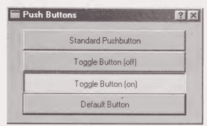

**图 3.2** `QDialog` 中的 `QPushButton` 部件

* 一种可能的实例化

```cpp
QPushButton *pb = new QPushButton( "Quit", this );
```

* 使用示例

```cpp
connect( pb, SIGNAL(clicked()), qApp, SLOT(quit()) );
```

如果您需要创建一个按钮数组，并且需要在单个插槽中区分它们，您应该使用 `QButtonGroup` 对按钮进行分组，或者创建您自己的自定义按钮，提供一个包含指向自身的指针作为参数的信号。使用 `QButtonGroup` 比 Motif 中典型的按钮数组处理更容易（也可能更快）。以下示例展示了一个无用的按钮数组实现：

```cpp
// Array of buttons

#include <qpushbutton.h>
#include <qbuttongroup.h>
#include <qlabel.h>
#include <qlayout.h>
#include <QString.h>

class MyWidget : public QWidget
{
  Q_OBJECT
 public:
   MyWidget( QWidget *p=0, const char *n=0 );

 protected slots:
   virtual void onClick( int );

 private:
  QLabel    *label;
};

MyWidget::MyWidget( QWidget *p, const char *n )
{
  QPushButton *pb[5];
  QString s;

  QBoxLayout *top = new QBoxLayout( this, 10 );
  QButtonGroup *vbg = new QButtonGroup( this );
  for( int a=0; a<5; a++ ){
    s.sprintf( "Button %d", a );
    pb[a] = new QPushButton( s, vbg );
  }
  connect( vbg, SIGNAL(clicked( int )),
           SLOT(onClick( int )) );
  top->addWidget( vbg );
  label = new QLabel( "Click one.", this );
  top->addWidget( label );
}

void
MyWidget::onClick( int val )
{
      // val == index into push button array
   QString s;
   s.sprintf( "Button %d clicked.", val );
   label->setText( s );
}

#include "MyWidget.moc"
```

### QRadioButton

单选按钮结合了布尔信息的图形指示器和输入以及文本标签，在许多方面与复选框相似。单选按钮与复选框的区别在于，它们通常以两个或更多单选按钮的组形式使用，运行在独占模式下——一次只能设置一个单选按钮。您通常会将单选按钮与 `QButtonGroup` 一起使用。图 3.3 展示了 `QButtonGroup` 中的三个 `QRadioButton`。

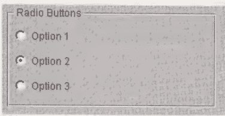

**图 3.3** `QButtonGroup` 中的 `QRadioButton` 部件

* 一种可能的实例化

```cpp
QButtonGroup *bg = new QButtonGroup( "Options", this );
QRadioButton *rb = new QRadioButton( "Option A", bg );
```

* 使用示例

```cpp
if( rb->isChecked() == true ) {
    // User has selected Option A
}
```

### QToolBar

工具栏（见图 3.4 和 3.5）是一组常用的按压/切换按钮，既提供图标又提供文本标签，水平或垂直排列。它们纯粹是为最终用户提供的便捷功能，并非总是必要或有用。然而，由于几乎每个新的软件包都提供工具栏（无论是否有意义），您可能会发现最新的项目规范中包含描述工具栏的部分。

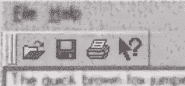

**图 3.4** `QMainWindow` 上的“标准”`QToolBar`


**图 3.5** 自定义 `QDialog` 上的 `QToolBar`。这提供了可拆卸的工具栏行为

* 一种可能的实例化

```cpp
// Create a new toolbar on this QMainWindow
QToolBar *tools = new QToolBar( this );
```

* 使用示例

```cpp
icon = QPixmap( idata );
toolb = new QToolButton( icon, "Save", "Save Changes",
                         this, SLOT(save()), tools, 0 );
toolb->setIconSet( QIconSet( idata ) );
```

在大多数情况下，使用 Qt 实现工具栏相当简单。它肯定比寻找或创建向用户传达按钮功能的图标更容易。虽然 `QToolbars` 不提供创建自由浮动工具栏的方法，但您始终可以将工具栏添加到无边框对话框并让用户四处拖动——无论如何，它看起来是一样的。

您会注意到的一个奇怪行为是 `QMainWindow::usesBigPixmaps()` 以及正交的 `QMainWindow::setUsesBigPixmaps( bool )` 函数。更改此设置会影响该 `QMainWindow` 的所有子 `QToolBars`。在单独的 `QToolBar` 中没有一个方法可以询问或设置此。也许下一个版本……

### QToolButton

工具按钮（见图 3.6）只是专为在 `QToolBar` 中使用的按钮。您可以在按钮上显示一个 `QPixmap` 和一个可选的文本标签。您可以（并且应该）为工具按钮创建并分配一个 `QIconSet`。`QIconSet` 为按钮创建适当的启用/禁用和大型/小型图标。


**图 3.6** `QToolBar` 上的 `QToolButton`

* 一种可能的实例化

```cpp
icon = QPixmap( idata );
```

### 预定义对话框

Qt 为文件、字体和颜色选择等常见功能提供了一系列静态对话框。由于这些对话框是静态的，因此无需实例化它们。

#### QColorDialog

顾名思义，该部件是一个允许用户选择或指定颜色值的对话框。（图 3.7 是 `QColorDialog` 的灰度屏幕截图。）

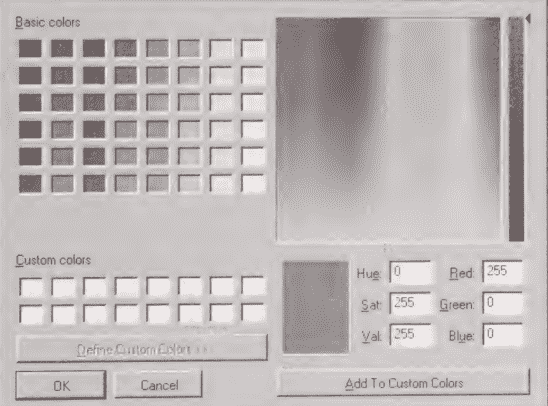

图 3.7 `QColorDialog` 部件（灰度显示）

### 使用示例

```cpp
// Always start the dialog with red as default
QColor face = QColor( "#ff0000" );
// Get a user-defined color
QColor newface = QColorDialog( face, qApp );
// Make sure user didn't cancel-use default if so
if( newface.isValid() == false) newface = face;
```

您不需要实例化此对话框，因为它是模态的并且提供静态方法。典型用法如下：


```cpp
QColor userColor = QColorDialog::getColor();
myLabel->setPalette( QPalette( userColor ) );
```

## QDialog

`QDialog`是所有 Qt 对话框的基类。您可以对`QDialog`进行子类化，从而提供几乎任何可以想到的弹出窗口形式，从弹出表单到启动画面。当然，您可以使用`QWidget`实现相同的功能，但`QDialog`增加了适合典型对话框行为的一些方便功能。

`QDialog`部件（以及下文讨论的`QSemaphoreDialog`）的父子关系会影响对话框在屏幕上的外观。向对话框传递有效的部件父级会使对话框位于父级部件上方居中，而没有父级的对话框会在屏幕本身居中。

以下示例是一个基于`QDialog`的“启动画面”部件。（我不赞同使用启动画面，但承认它们*有时*是必要的。）

```cpp
// Splash.h

#ifndef _SPLASH_H
#define _SPLASH_H

#include <qdialog.h>
#include <qpixmap.h>
#include <qstring.h>
#include <qprogressbar.h>
#include <qlabel.h>

class Splash : public QDialog
{
    Q_OBJECT
public:
    Splash( const QPixmap &p, const char *title,
            const char *cpry, bool pbar=false );

    bool             isProgressSplash( )  { return( isps ); }
    int              progressValue( )      { return( progr ); }

public slots:
    void         setProgressValue( int );
    void         setProgressText( const QString & );

private:
    bool             isps;
    int              progr;
    QProgressBar *pbar;
    QLabel       *plabel;
};

#endif // _SPLASH_H
```

```cpp
// splash.cpp

#include <Splash.h>
#include <qlayout.h>
#include <qlabel.h>
#include <qprogressbar.h>

Splash::Splash( const QPixmap &pix,
                const char *mssg, const char *cpry, bool isp )
: QDialog( 0, "Splash", false,
           WStyle_DialogBorder|WStyle_Customize )
{
    isps = isp;
    progr = 0;

    QVBoxLayout *top = new QVBoxLayout( this, 10 );
    QHBoxLayout *hb = new QHBoxLayout();
    top->addLayout( hb, 5 );
    hb->addSpacing( 10 );

    // Add Pix
    QLabel *l = new QLabel( this );
    l->setPixmap( pix );
    hb->addSpacing( 10 );

    // Add Product name/Main message
    QVBoxLayout *vb = new QVBoxLayout();
    hb->addLayout( vb );
    if(mssg != 0) {
        l = new QLabel( this );
        l->setAlignment( AlignVCenter|AlignHCenter );
        l->setFont( QFont( "helvetica", 18,
                           QFont::Bold,QFont::Italic ) );
        l->setText( mssg );
        vb->addWidget( l, 2 );
    }

    // Add copyright info
    if( cpry != 0) {
        l = new QLabel( this );
        l->setAlignment( AlignVCenter|AlignHCenter );
        l->setText( cpry );
        vb->addWidget( l, 3 );
    }

    // Maybe add progressbar
    if( isps == true) {
        hb = new QHBoxLayout();
        top->addLayout( hb );

        // A text label
        plabel = new QLabel( this );
        plabel->setAlignment( AlignVCenter|AlignRight );
        plabel->setFixedHeight( fontMetrics().height()
                                + 6 );
        hb->addWidget( plabel );

        // A progress bar
        pbar = new QProgressBar( 100, this );
        pbar->setFixedHeight( fontMetrics().height()
                              + 6 );
        pbar->setValue( 0 );
        hb->addWidget( pbar );
    }
    top->activate();
    show();
}

void
Splash::setProgressValue( int v )
{
    if( isps == false) return;
    pbar->setValue( v );
    progr = v;
}

void
Splash::setProgressText( const QString &s )
{
    if( isps == false) return;
    plabel->setText( s );
}

#include <Splash.moc>
```

## QFileDialog

`QFileDialog`（参见图 3.8）用于允许终端用户选择文件以执行打开或保存功能，或者选择或创建子目录。

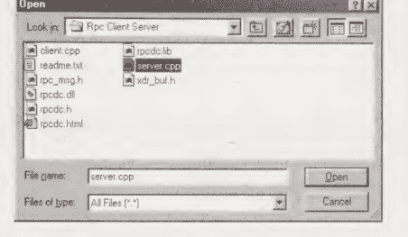

图 3.8 `QFileDialog`部件

这是另一个静态对话框，因此通常以以下方式使用：

### 使用示例

```cpp
// Get a filename from the user to save to
QString s = QFileDialog::getSaveFileName( "*.txt" );
if(!s.isNull()) { // Save it
    // ...
} // else user cancelled
// ...
```

## QFontDialog

字体对话框（参见图 3.9）用于提示用户选择文本字体和样式。与大多数 Qt 对话框一样，`QFontDialog`没有构造函数。典型用法如下：

### 使用示例

```cpp
// ...
bool ret;
QLabel *l = new QLabel( "Altered Font", this );
QFont f = QFontDialog::getFont( &ret, this );
```

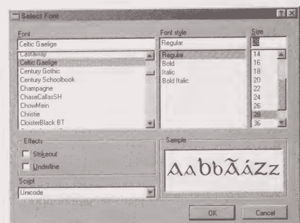

图 3.9 `QFontDialog`部件

```cpp
if ( ret == true ) {
    l->setFont( f );
}
// ...
```

## QInputDialog

此对话框是 Qt 2 中的新增功能。它提供了一系列方便的方法，用于输入单个值，无论是文本字符串、整数、浮点值还是来自组合框的值。图 3.10 是 `QInputDialog`的`getText()`对话框示例。


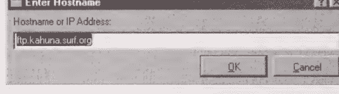

图 3.10 `QInputDialog::getText()` 对话框

以下示例生成了图 3.10 中显示的对话框：

### 使用示例

```cpp
bool retry = FALSE;
QString svr = QInputDialog::getText( "Enter Hostname",
                                     "Hostname or IP Address:",
                                     "ftp.kahuna-surf.org",
                                     &retry, this );
if( retry == true && !svr.isEmpty() )
    // Deal with a retry attempt
else
    // No hostname or user pressed cancel
```

#### QMessageBox

这是 Qt 的标准消息框部件。它由一个对话框框、一个可选的图标、一个对话框标题、一个用于某些文本的标签以及最多三个可自定义标签的按钮组成。

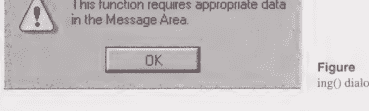

它提供了通常的 `warning()`（示例见图 3.11）、`critical()` 和 `information()` 方法，这些方法决定了与您提供的消息框文本一起显示的图标，并且它们非常易于使用：

### 使用示例

```cpp
QMessageBox::information( this, "Info", "Details" );
```

#### QProgressDialog

`QProgressDialog`（图 3.12）为终端用户提供进度反馈。（参见图 3.12。）您可能希望为耗时较长的操作实现这些反馈。

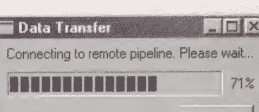

图 3.12 `QProgressDialog` 部件

### 使用示例

```cpp
QProgressDialog progress("Copying...", "Cancel", 0, 100);
for (int a=0; a<100; a++)
{
    progress.setProgress(a);
    if (progress.wasCanceled() == true)
        break;
    // Make one copy
    myCopy(a);
}
progress.setProgress(100);
```

#### QSemaphoreDialog

这是所有半模态对话框的基类。使用该部件创建的对话框与使用 `QDialog` 创建的对话框不同，它们没有事件循环，也没有默认按钮的概念。

`QSemaphoreDialog` 提供的功能远少于 `QDialog`。因此，子类（如 `QProgressDialog`）必须提供所有定期更新对话框内容的代码。

#### QTabDialog

选项卡对话框（参见图 3.13）提供了一组选项卡式部件。这些部件通常用于在配置对话框中展示一组易于导航的属性页，但它们也可以同样有效地用于其他目的。

通常，您会对 `QTabDialog` 进行子类化，如下例所示：

```cpp
class SDialog : public QTabDialog
{
    Q_OBJECT
public:
    SDialog(QWidget *p=0, const char *n=0)
    {
    }
protected slots:
    void ok();
    void cancel();
};
```

### 图 3.13 QTabDialog 控件

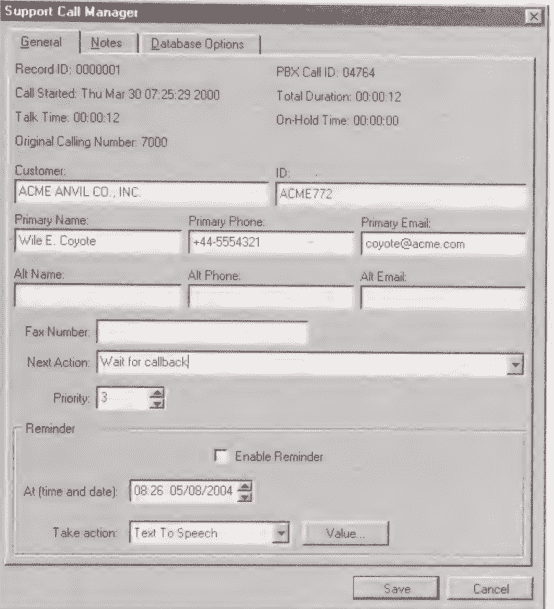

```cpp
SDialog::SDialog( QWidget *p, const char *n )
: QTabDialog( p, n )
{
    // Single "General" tab
    QWidget *w = new QWidget( this );
    setOkButton( "Save" );
    connect( this, SIGNAL(applyButtonPressed()), SLOT(ok()) );
    setCancelButton( "Cancel" );
    connect( this, SIGNAL(cancelButtonPressed()), SLOT(cancel()) );

    // Vertical Layout
    QVBoxLayout *top = new QVBoxLayout( w, 5 );

    QHBoxLayout *hb = new QHBoxLayout();
    top->addLayout( hb );

    QLabel *l = new QLabel( "Useless Label", w );
    hb->addWidget( l, 1 );
    QLineEdit *e = new QLineEdit( w );
    hb->addWidget( e, 2 );

    top->activate();
    addTab( w, "&General" );
}
```

#### 简单 TabDialog

### QWizard

向导（Wizard）是源自 Microsoft Windows 系列的功能。它们通常提供安装或配置功能，并可以引导即使是毫无经验的用户通过一系列（可能很复杂的）顺序步骤，使用单独的“页面”来表示每个步骤，并提供“向前”、“向后”、“完成”和“取消”按钮。图 3.14 展示了一个简单向导的第一个“页面”。

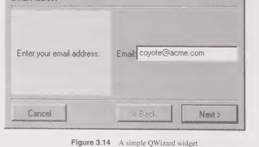

**图 3.14** 一个简单的 `QWizard` 控件

### 功能分组

将相关任务分组在一起，并为最终用户提供一个视觉提示，表明这组控件与那组控件之间存在区别，可以使复杂的表单变得更直观。除了为最终用户提供视觉提示外，出于程序化原因（例如控件数组），您可能希望创建一组控件。Qt 提供了一套相当全面的抽象，以及许多更常用的分组机制。

#### QGroupBox

组框（图 3.15）提供一个边框和一个文本标签。它们通常用于向用户展示相关功能或功能的逻辑分组。对于可能不熟悉信息如何整合在一起的用户来说，复杂的表单可能会非常令人困惑。组框和选项卡表单是解决这种潜在困惑的两种方法。

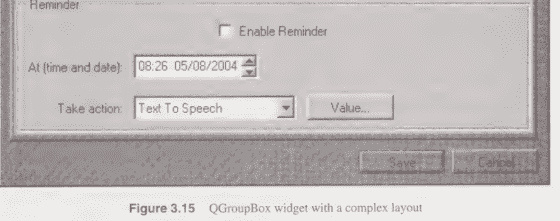

图 3.15 具有复杂布局的 `QGroupBox` 控件

#### 可能的实例化

```cpp
QGroupBox *gb = new QGroupBox( "Detail Info", this );
```

### 使用示例


```cpp
// Reminder box
QGroupBox *box = new QGroupBox( "Reminder", this );
QVBoxLayout *vb = new QVBoxLayout( box, 10 );
vb->addSpacing( 10 );

// Add a line to the overall layout
QHBoxLayout *hb = new QHBoxLayout();
vb->addLayout( hb );
/////
// First line in the box
// Add an empty label for spacing
l = new QLabel( box );
hb->addWidget( l, 2 );
// Add a enable/disable checkbox
enabled = new QCheckBox( "Enable Reminder", box );
enabled->setChecked( was_enabled );
hb->addWidget( enabled, 0 );
// Add another empty label
l = new QLabel( box );
l->setFixedHeight( fh+10 );
hb->addWidget( l, 2 );
/////
// Second line in layout--add a SpinTime_T widget
hb = new QHBoxLayout();
vb->addLayout( hb );
l = new QLabel( "At (time and date):", box );
hb->addWidget( l );
sptime = new SpinTime_T( 0, 0xffffff, r->alert, box );
connect(sptime, SIGNAL(valueChanged( time_t )),
        SLOT(deltaTime( time_t )));
hb->addWidget( sptime );
l = new QLabel( box );
hb->addWidget( l, 10 );
...
```

通常有必要（除非你喜欢硬编码控件的大小和位置——这是一种我鄙视的做法）为组框添加一组布局，以便包含的控件不会重叠在一起。下面的代码片段展示了如何实现这一点：

```cpp
QGroupBox *box = new QGroupBox( "Status", this );
// Add a vertical layout
QVBoxLayout *boxtop = new QVBoxLayout( box, 10 );
boxtop->addSpacing( 10 );
// Add a button
QPushButton *pb = new QPushButton( "Update", box );
connect( pb, SIGNAL(clicked()), SLOT(update()));
boxtop->addWidget( pb );
// Add an indicator/label pair horizontally
QHBoxLayout *boxhb = new QHBoxLayout( boxtop );
iconLabel = new QLabel( box );
iconLabel->setPixmap( QPixmap( "statOK.xpm" ) );
boxhb->addWidget( iconLabel );
QLabel *boxl = new QLabel( "Current State", box );
boxb->addWidget( boxl, 1 );
```

- `QGroupBox`: `QHGroupBox` 是 `QGroupBox` 的一个便捷子类，它在一个组内以单行水平方式组织控件。
- `QVGroupBox`: `QVGroupBox` 是 `QGroupBox` 的另一个便捷子类，它在一个组内以单列垂直方式组织控件。
- `QButtonGroup`: 此类提供了一种将多个 `QButton` 控件作为逻辑组进行管理的方法。该控件通常以两种方式之一实例化：要么带有可选的边框和文本标签，要么没有任何视觉组件。如果你需要管理一个按钮数组，这个类可能很有用。图 3.16 表示按钮组内的六个平铺按钮。当点击其中任何一个按钮时，`QButtonGroup` 控件将发出 `clicked(int)` 信号。

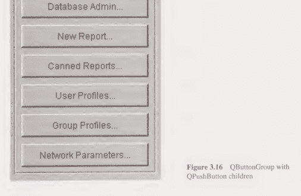

#### 可能的实例化

```cpp
QButtonGroup *bg = new QButtonGroup( "Options", this );
QRadioButton *rb = new QRadioButton( "Option A", bg );
if( rb->isChecked() == true ) {
// User has selected Option A
}
```

虽然 `QButtonGroup` 类不提供默认布局，但有两个子类 `QHBoxLayout` 和 `QVBoxLayout`，分别提供水平或垂直布局。创建自定义布局非常容易，但你需要了解 `QLayout` 类才能做到——或者你可以提供硬编码的控件几何规格。这里有一个在 `QGroupBox` 讨论中添加自定义布局的示例，相同的方法也适用于 `QButtonGroup`。

- `QHBoxLayout`: `QButtonGroup` 的一个子类，`QHBoxLayout` 在一个组内以单行水平方式组织 `QButton` 控件，适用于少量的复选框、单选按钮等。
- `QVBoxLayout`: `QButtonGroup` 的另一个子类，`QVBoxLayout` 在一个组内以单列垂直方式组织 `QButton` 控件，适用于少量的复选框、单选按钮等。

### 布局和几何管理

界面的设计——特别是数据输入表单——可能是 GUI 开发过程中最关键且最耗时的部分。如果界面令人困惑，最终用户无法快速高效地学习使用它，那么最有用的或行为最好的应用程序也几乎毫无价值。界面设计过程几乎总是涉及多次迭代，因为我们程序员与最终用户对工作流有着完全不同的视角。就像任何客户一样，最终用户总是对的（除非 beta 测试的小白鼠开始使用诸如“更大”、“更小”或其他纯粹主观的术语）。

与任何 GUI 工具包一样，Qt 提供了两种界面布局方法：硬编码的控件几何规格和相对布局。每种方法都有其缺点和优点，但我认为相对布局方法是两者中更好的；它更易于维护，并允许应用程序进行合理、可预测且更简单的调整大小。

如果你曾经使用过 WYSIWYG（所见即所得）对话框或表单编辑器，你可能注意到这些工具几乎总是使用硬编码几何方法来进行表单布局，几乎从不提供相对布局的工具。这是因为编辑器可以很容易地将你的控件定位和大小信息转换为硬编码的 x, y 坐标和宽度、高度大小。准确表示一个抽象的布局方案（可能会受到每个控件的运行时属性（如字体大小或内容）的显著影响）并不容易（有时是不可能的）。

对基于 `QLayout` 的类有良好的理解和大量经验，将使你能够仅凭表单应该看起来怎样的初步草图，快速实现复杂的表单。这需要练习，但具备该技能的程序员使用相对布局实现复杂对话框的速度几乎与使用 WYSIWYG 对话框编辑器生成不那么优雅、硬编码且调整大小能力较差的接口的程序员一样快。大多数 Motif 程序员已经对此非常了解。

- `QHBox`, `QVBox`, and `QGrid`: 这些类管理控件的行、列或两者的几何结构，并在单独的边框中显示每个受管理的控件。这些类实际上几乎没有实用价值——可能的例外是状态栏上的状态/状态指示器，这在许多 Microsoft Windows 应用程序中经常见到。然而，它们可以用于在布局要求不严格的“快速”应用程序中提供简单的管理。
- `QLayoutItem`, `QWidgetItem`, and `QSpacerItem`: `QLayoutItems` 是 `QLayout` 操作的抽象项。`QWidgetItem` 是特定于 `QWidget` 的 `QLayoutItem`。`QSpacerItem` 只是一个你可以用于间隔目的的空白 `QLayoutItem`。
- `QLayout`: 所有布局的基类，`QLayout` 提供了 `QBoxLayouts` 和 `QGridLayouts` 中常见功能的抽象。

在线参考文档提供了基于 `QLayout` 的自定义布局示例。如果你需要使用无法通过使用提供的布局类的组合轻松实现的特殊布局，这里是显而易见的起点。

- `QBoxLayout`, `QHBoxLayout`, and `QVBoxLayout`: `QBoxLayout` 在水平或垂直方向上管理控件。`QHBoxLayout` 和 `QVBoxLayout` 是便捷实现，分别提供水平或垂直布局。

#### 可能的实例化

```cpp
// Create a top-level layout with a spacing of ten pels
QBoxLayout *top = new QBoxLayout(this, 10);
```


### 使用示例

```cpp
QBoxLayout *top = new QBoxLayout(this, 10);
QHBoxLayout *hb = new QHBoxLayout();
```

`top->addLayout( hb );`

布局的方向（水平或垂直）在实例化时通过构造函数的`Direction`参数确定。你会注意到（或许会略带失望），该值在实例化后可以被查询，但无法更改。

当控件（或其他布局）被添加到`QBoxLayout`时，布局内部会创建一个单元来管理其几何形状。为你添加的控件提供适当的`minimumSize()`和`maximumSize()`方法非常重要。这将防止布局将你的控件调整到不合适的值。虽然大多数你添加的控件会自动提供这些方法，但你无疑会遇到至少一个控件尺寸调整不正确的情况。

`QBoxLayout`与两个边距值相关联。第一个是布局本身与周围对象之间的边距，称为边框宽度（border width）。第二个是布局自身每个单元之间的边距，称为控件内部宽度（intra widget width）。这些边距通过构造函数的参数设置。

关于`QLayout`需要熟悉的一个术语是`stretch`（伸缩系数）。给定单元的伸缩系数决定了该单元相对于布局中其他单元的调整大小方式。例如，考虑一个极其常见的场景：你创建多个垂直排列的标签和文本字段对。你可能希望文本字段比其伴随的标签更多地调整大小。你可能不希望标签完全调整大小，但这通常会产生不理想的“拥挤”外观。以下代码片段展示了一种可能的方法，该方法将导致标签与其文本字段对齐，并以一种随着宽度增加而创建整体宽敞感的方式水平调整大小：

```cpp
int a;
QLabel *labs[10];
QLineEdit *fields[10];
QString str;
int StdA = AlignVCenter|AlignRight;

// A toplevel layout with 10 pels border-width and
// 5 pels of intra-widget spacing
QBoxLayout *ftop = new QBoxLayout( this, 10, 5 );
// Two vertical layout children that the toplevel
// layout will horizontally resize in a 2:5 ratio
QBoxLayout *lVbox = new QBoxLayout( );
ftop->addLayout( lVbox, 2 );
QBoxLayout *fVBox = new QBoxLayout( );
ftop->addLayout( fVBox, 5 );
for(a=0;a<5;a++) {
    str.sprintf( "Data Field %d", a+1);
    labs[a] = new QLabel( str, this );
    labs[a]->setAlignment( StdA );
    lVBox->addWidget( labs[a] );
    fields[a] = new QLineEdit( this );
    fVBox->addWidget( fields[a] );
}
```

### QGridLayout

网格布局是按行和列排列的二维布局。使用`QBoxLayout`也可以实现相同的行为——代价是编写更多的代码。

### 一种可能的实例化

```cpp
QGridLayout *gl = new QGridLayout( this, 2, 3 );
```

### 使用示例

```cpp
int a, b;
QString s;
QLabel *l;

QGridLayout *gl = new QGridLayout( this, 2, 3 );
for(a=0;a<2;a++) {
    for(b=0;b<3;b++) {
        s.sprintf( "%d %d", a, b );
        l = new QLabel( s, this );
        gl->addWidget( l, a, b );
    }
}
```

### QRect, QPoint, and QSize

这些类封装了屏幕坐标和大小信息，并提供方便的转换方法以满足很可能遇到的大多数需求。大多数 Qt 控件（以及`QWidget`本身）接受这些类作为几何规格说明符。

### 一种可能的实例化

```cpp
// get the current desktop size
QRect r_wsSize = QApplication::desktop()->rect();

// Convert to a QSize
QSize s_wsSize( r_wsSize.width(), r_wsSize.height() );
```

`QSizeGrip`此控件为顶层窗口提供调整大小抓手图形。由于`QStatusBar`（由`QMainWindow`提供）已经集成了`QSizeGrip`，因此你不太可能需要显式创建其实例。

### 一种可能的实例化

```cpp
QSizeGrip *eg = new QSizeGrip( this );
```

`QSizePolicy`这是一个属性对象，决定了水平和垂直调整大小的执行方式。如果默认行为不可接受，请使用此属性为你的控件设置适当的调整大小行为。

宽高比控制以及基于控件动态`sizeHint()`值的受控调整大小是你自定义此属性的两个可能原因。

### 列表、表格和列表项

许多应用程序（并非全部）都需要显示或从项目列表中进行选择。当列表是静态的（从不更改）时，有时最好提供一组复选框、按钮、切换按钮等。当列表是动态的，经常或偶尔变更，或者列表很大时，通常更有意义的做法是提供这些项目的滚动列表，让用户选择要使用的项。

每个严肃的工具包都提供了列表框，Qt 也是如此。Qt 的列表速度稍快，效率略高，类方法也更有意义。除此之外，你几乎不会注意到与 MFC、Motif、Lesstif 和其他工具包在外观或行为上有太大区别。

`QHeader` `QHeader`（图 3.17）为表格提供标题，例如`QListView`控件所提供的表格。它们允许最终用户重新排列列、调整表格数据的列大小或切换排序顺序。


**图 3.17** `QListView`中的`QHeader`控件

### 使用示例

```cpp
// Create a list and implied header-3 cells
QListView *theView = new QListView( this );
theView->addColumn( "Employees" );
theView->addColumn( "Salary" );
theView->addColumn( "Raise" );

// If profits were uninspired...
if( profits < ideal ) {
    theView->header()->setLabel( 2, "Pay Cut" );
}
```

### QListBox

`QListBox`（图 3.18）提供典型的列表框功能。它显示一个只读项目列表，并在用户选择项目或更改选择时发出信号。如果显示数据的大小大于列表框的视口，则显示垂直和水平滚动条。

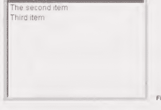

**图 3.18** `QListBox`控件

### 一种可能的实例化

```cpp
QListBox *lb = new QListBox( this );
```

### 使用示例

```cpp
QString s;
QListBox *lb = new QListBox( this );
for(int a=0;a<1000;a++) {
    s.sprintf( "List Item %d", a );
    lb->insertItem( s );
}
```

Qt 列表框使用`QListBoxItems`作为显示内容。这与其他工具包实现略有不同，但提供了对列表内容控制的更大灵活性。

### QListBoxItem

这是所有`QListBox`行项目的基础类。它被`QListBoxPixmap`和`QListBoxText`子类化，这两者在下面讨论。

虽然这肯定是偏好和风格的问题，但我觉得在一个列表项中提供多个对象（例如，一个位图和一个文本项）是令人困惑的。这仅仅是因为列表框没有提供列标题来提示用户应该看什么。观点有用吗？

### QListBoxPixmap

这是一个仅提供位图的列表框项。

### QListBoxText

这是一个仅提供文本标签的列表框项。

### QListView


列表视图（图 3.19）提供具有可选树行为的表格视图。列表视图显示 `QListViewItem`，其中可以包含有限数量的位图或文本标签项。随 Qt 软件分发中包含的 Qt 示例充分展示了列表视图的许多用途，所以我不会用详细示例来烦你。

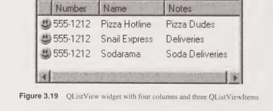

### 一种可能的实例化

```cpp
QListView *theView = new QListView( this );
```

### 使用示例

```cpp
// Create a list and implied header-3 cells
QListView *theView = new QListView( this );
theView->addColumn( "Employee" );
theView->addColumn( "Salary" );
theView->addColumn( "Raise" );

// If profits were uninspired...
if( profits < ideal ) {
    theView->header()->setLabel( 2, "Pay Cut" );
}
QCheckBox *cb = new QCheckBox( "Option A", this );
QListViewItem *li = new QListViewItem( theView,
    "Billy", "$0.14/week", "$0.02" );
```

Qt 列表视图中的数据集中的行项由 `QListViewItem` 或其子类封装。可以使用 `QListViewItemIterator` 来跟踪或枚举 `QListViewItem`。

Qt 列表视图中的树行为和外观取决于 `QListViewItem` 的父级：父级是 `QListView` 本身的 `QListViewItem` 将在列表视图中具有顶级外观，而父级是这些顶级控件之一的 `QListViewItem` 将作为列表视图的第二级子项出现，依此类推。

### QListViewItem

`QListView` 使用 `QListViewItem`（见图 3.20）显示信息，`QListViewItem` 可以很好地管理非常大的数据集。`QListViewItem` 的父子关系决定了 `QListView` 树的出现和行为。

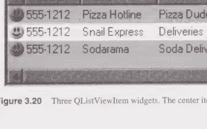

#### 一种可能的实例化

```cpp
QListViewItem *li = new QListViewItem( parent_ListView,
    "Column0", "Column1", "Column2" );
```

您很快就会发现，`QListViewItem` 的构造函数不支持超过 8 列，尽管您可以重新实现该类以获得更多列。`QListViewItem` 维护一种父子关系，这会影响它们在 `QListView` 中的显示方式。`QListView` 将以直观的树浏览方式显示 `QListViewItem` 树，类似于大多数文件系统浏览器。

### QListViewItemIterator

提供此类以便轻松地遍历 `QListViewItem` 的集合，或遍历 `QListView` 中的项目。请参考在线文档以获取实用示例。

#### 使用示例

```cpp
QListViewItem *
MyWidget::checkSelected( QListView *theView )
{
    // We already have a loaded QListView.  See if an item
    // is selected...
    QListViewItemIterator it( theView );
    for( ;it.current();++it) {
        if( it.current()->isSelected() == true ) break;
    }
    return( it.current() );
}
```

### QCheckListItem

这是 `QListViewItem` 的子类，提供了一些额外的功能，支持带有可选树行为的可勾选列表项列表。

您可以使用 `QListViewItemIterator` 遍历这些类。图 3.21 表示 `QListView` 中的多个 `QCheckListItem` 部件。

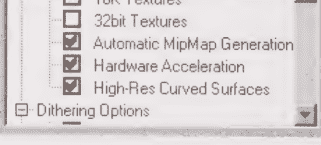

### 复合部件支持

本节介绍 Qt 工具包中的复合部件（这是作者自己的定义）。为了清晰起见，*复合部件*是指整合了两个或更多部件的任意部件，这些部件可以在复合部件之外单独使用，并且不提供便捷对话框所提供的事件循环等。正如您将注意到的，目前这是一个非常短的列表。下一个版本（或者可能再下一个版本）将提供其他的。我相信是的。

#### QMainWindow

`QMainWindow`（图 3.22）提供了应用程序通常所需的大多数功能，包括菜单栏、工具栏支持和状态栏。通常您将子类化 `QMainWindow`。有关许多变体，请参见 Qt 示例程序。

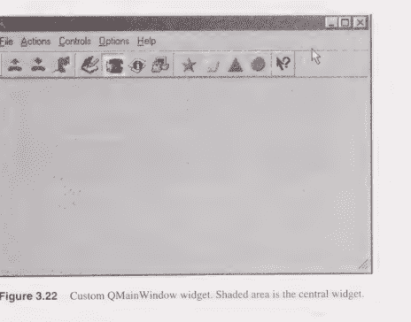

##### 可能的实例化

```cpp
QMainWindow *mw = new QMainWindow();
```

#### 使用示例

```cpp
QApplication app( argc, argv );
QMainWindow *mw = new QMainWindow();
QPushButton *pb = new QPushButton( "Push Me", mw );
mw->setCentralWidget( pb );
app.setMainWidget( mw );
mw->show();
return app.exec();
```

值得注意的是，许多程序员并不总是认可这种类型的应用程序界面。

### QMenuBar

此类提供如图 3.23 所示的水平菜单栏功能。

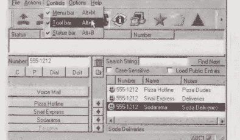

图 3.23 带有弹出菜单的 `QMenuBar`

#### 可能的实例化

```cpp
QMenuBar *menu = new QMenuBar( this );
```

#### 使用示例

```cpp
QMenuBar *menu = new QMenuBar( this );
QPopupMenu *file = new QPopupMenu();
file->setFont( orgFont );
menu->insertItem( "&File", file );
file->insertItem( "&Quit", this, SLOT(quit()), CTRL+Key_Q );
```

`QMenuBar` 设置其自身的几何形状，使其位于父部件的顶部。布局类提供了一种方法来处理这种行为可能会引起的布局问题。

### QMenuData

`QMenuBar` 和 `QPopupMenu` 的基类 `QMenuData` 提供了管理菜单项所需的功能。

### QPopupMenu

弹出菜单（图 3.24）用于菜单栏和组合框上的下拉菜单，以及您可能需要为列表项或其他部件提供的上下文菜单。

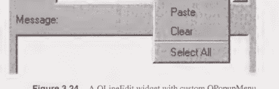

#### 可能的实例化

```cpp
QPopupMenu *file = new QPopupMenu();
```

### 文本输入

几乎所有应用程序都要求用户在某个时刻输入文本。这通常仅限于单行文本，例如用户姓名。这种类型的输入通常称为单行编辑。

有些应用程序必须接受多行文本——文字处理器就是一个很好的例子——接受这种类型数据的部件通常被称为多行编辑。我预计在未来的版本中会出现一个功能齐全的编辑器部件。目前，我们使用基本功能。

显然，Qt 工具包支持这两个文本输入示例，但也存在其他接受用户文本输入的方式。以下部件介绍了工具包提供的部件及其默认行为的一些可能变体。

#### QComboBox

`QComboBox`（图 3.25 和 3.26）是文本字段和弹出菜单功能的结合。有两种类型：只读和读写。只读类型仅提供可能值的弹出菜单供用户选择。读写类型允许用户输入任何期望的值，或者可以使用验证器进行约束。


图 3.25 `QLabel` 部件和 `QComboBox` 部件

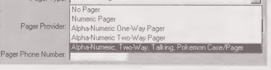

图 3.26 图 3.25 中的 `QComboBox`，显示其弹出菜单

##### 可能的实例化

```cpp
QComboBox *cb = new QComboBox( this );
```

#### 使用示例


```cpp
QComboBox *box = new QComboBox( true, this );
box->setAutoCompletion( true );
box->insertItem( "Log Off" );
box->insertItem( "Reboot" );
box->insertItem( "Shut Down" );
```

它们主要用于两种类型的场景：

- 用户*必须*从一组预定义的可能是硬编码的值列表中选择

- 用户可以输入自由格式或已验证的值或者从列表中选择预定义值

组合框的另一种可能用途是以文本字段历史记录的形式保留先前的文本输入。使用 `setAutoCompletion( bool )` 插槽启用自动完成可以进一步简化用户编辑繁琐表单的过程。

`QLineEdit` 此类提供单行用户可编辑文本以及您可能需要完成此基本任务的所有功能。相当简单，对吧？错了。文本的用户输入有许多特殊考虑因素。图 3.27 描绘了两个 `QLineEdit` 部件，每个都带有 `QLabel`。


**图 3.27** 两个 `QLabel`/`QLineEdit` 对

### 可能的实例化

```cpp
QLineEdit *le = new QLineEdit( this );
```

### 使用示例

```cpp
QLineEdit *le = new QLineEdit( this );
connect( le, SIGNAL( textChanged( QString & ) ),
         SLOT( validate( QString & ) ) );
```

由于提供的对象接受任何 Unicode 文本，因此您通常需要验证用户输入的内容在特定上下文中是否有效。未经修改的对象提供将 `QValidator` 对象附加到部件的功能。这对大多数目的来说是足够的，但并非所有。

通常通过子类化此部件并添加所需的更改，您可以确切地从该部件获得所需的功能。以下示例演示了一个虚构的部件号部件，它是 `QLineEdit` 的简单子类。我们的设计规格为：

- 接受范围在 A0000 到 Z9999 之间的五个字符标识符

- 第一个字符是“A”和“Z”之间的字母值

- 其余字符是 0 到 9 范围内的数字

- 提供布尔值测试以确定有效性

- 当有效状态改变时生成通知，适合连接到 `QButton::setEnabled( bool )` 插槽，例如，一个 OK 按钮

- 可以编程设置值

- 不接受无效输入

- 小写开头字母会自动大写

```cpp
#ifdef _PARTNUMH
#define _PARTNUMH

#include <qlineedit.h>
#include <ctype.h>

class PartNum : public QLineEdit
{
  Q_OBJECT
public:
  PartNum( QWidget *p=0, const char *n=0 );
  virtual PartNum();

  bool       isValid( { return _valid } );

signals:
  // We'll emit this whenever the validity
  // changes
  void       valid( bool );

protected slots:
  // This slot will perform all the input
  // validation
  virtual void verify( const QString & );

private:
  bool       _valid;
};

PartNum.h

#include <PartNum.h>

PartNum::PartNum( QWidget *parent,
                   const char *name )
  : QLineEdit( parent, name )
{
  _valid = false;
  connect( this,
           SIGNAL(textChanged( const QString & ) ),
           SLOT(verify( const QString & ) ) );
}
```

### PartNum.cpp

```cpp
PartNum::~PartNum()
{
}

void
PartNum::verify( const QString &s )
{

    static bool busy = false;
    char bp[6];  // OK-range invalid for 118n
    int i;

    if(busy == true) return;
    memset( bp, 0, 6);
    strncpy(bp, s, 5);
    if(strlen(s) > 5) {

        busy = true;
        setText( bp );
        busy = false;
    }
    if(bp[0] >= 'a' && bp[0] <= 'z') {
        bp[0] = toupper(bp[0]);
        busy = true;
        setText( bp );
        busy = false;
    }
    if(bp[0] >= 'A' && bp[0] <= 'Z') {
        for(i=1;i<5;i++) {
            if(!isdigit(bp[i])) break;
        }
        if(i == 5) {
            if(_valid == false) {
                _valid = true;
                emit valid( _valid );
            }
        }
        return;
    } else {
        bp[i] = '\0';
        busy = true;
        setText( bp );
        busy = false;
    }
    }
    if(_valid == true) {
        _valid = false;
        emit valid( _valid );
    }
    return;
}

#include <PartNum.moc>
```

验证例程中的 `busy` 标志旨在防止递归以及随之而来的栈溢出。当您通过调用 `set(Text)` 方法让插槽调用自身如验证例程所做的那样时，就会发生这种情况。

以下是对 `QLineEdit` 的一个非常有用且可复用的修改，它为鼠标右键提供了一个弹出菜单。该菜单提供了一些常见的剪贴板或剪切缓冲区操作，PC 用户会从像 Office 2000 和其他 Microsoft 产品中熟悉这些操作。提供的功能包括复制、粘贴、剪切、全选、清空、粘贴，以及全选和复制。请注意，相同的修改也可以应用于 `QMultiLineEdit` 的子类。Qt 2.1 及以上版本已具备此功能，因此这种修改可能不再是必需的。

### LineEdit.h

```cpp
#ifndef _LINEEDIT_H
#define _LINEEDIT_H

#include <qlineedit.h>
#include <qevent.h>
#include <qpopupmenu.h>

class LineEdit : public QLineEdit
{
 Q_OBJECT
public:
 LineEdit( QWidget *p=0, const char *n=0 );

protected slots:
 virtual void mousePressEvent( QMouseEvent * );
 virtual void doCut();
 virtual void doCopy();
 virtual void doPaste();
 virtual void doSelect();
 virtual void doClear();
 virtual void doClearPaste();
 virtual void doSelectCopy();

private:
 int pmid[7];
 QPopupMenu *pop;
};

#endif // _LINEEDIT_H
```

### LineEdit.cpp


```cpp
#include <LineEdit.h>

LineEdit::LineEdit( QWidget *parent,
 const char *name )
 : QLineEdit( parent, name )
{
 pop = new QPopupMenu();
 pmid[0] = pop->insertItem( "Cut", this,
                  SLOT(doCut()) );
pmid[1] = pop->insertItem( "Copy", this,
                  SLOT(doCopy()) );
pmid[2] = pop->insertItem( "Paste", this,
                  SLOT(doPaste()) );
pmid[3] = pop->insertItem( "Clear All", this,
                  SLOT(doClear()) );
pop->insertSeparator();
pmid[4] = pop->insertItem( "Select All",
                  this, SLOT(doSelect()) );
pop->insertSeparator();
pmid[5] = pop->insertItem(
                  "Select All & Copy", this,
                  SLOT(doSelectCopy()) );
pmid[6] = pop->insertItem(
                  "Clear All & Paste", this,
                  SLOT(doClearPaste()) );
}

void
LineEdit::mousePressEvent( QMouseEvent *e )
{
    if(e->button() != RightButton) {
        QLineEdit::mousePressEvent( e );
        return;
    }
    int n = strlen(text());
    pop->setItemEnabled( pmid[0],
                    hasMarkedText() );
    pop->setItemEnabled( pmid[1],
                    hasMarkedText() );
    pop->setItemEnabled( pmid[3],
                    (n > 0) ? true : false );
    pop->popup( e->globalPos() );
}

void
LineEdit::doCopy()
{
    copy();
}

void
LineEdit::doCut()
{
    cut();
}

void
LineEdit::doPaste()
{
    paste();
}

void
LineEdit::doSelect()
{
    selectAll();
}

void
LineEdit::doClear()
{
    setText( "" );
}

void
LineEdit::doClearPaste()
{
    setText( "" );
    paste();
}

void
LineEdit::doSelectCopy()
{
    selectAll();
    copy();
}

#include <LineEdit.moc>
```

这最后一个修改提供了在 `QLineEdit` 控件获得键盘焦点时，选择并高亮显示其现有内容的功能：

### LineEdit.h

```cpp
#ifndef LINEEDIT_H
#define LINEEDIT_H
#include <qevent.h>
#include <qlineedit.h>

class LineEdit : public QLineEdit
{
    Q_OBJECT
public:
    LineEdit( QWidget *parent=0,
        const char *name=0 );

protected slots:
    void    focusInEvent( QFocusEvent * );
    void    focusOutEvent( QFocusEvent * );
}

#endif
```

### LineEdit.cpp

```cpp
#include <LineEdit.h>

LineEdit::LineEdit( QWidget *parent,
		 const char *name )
	: QLineEdit( parent, name )
{
}

void
LineEdit::focusInEvent( QFocusEvent *e )
{
	QLineEdit::focusInEvent( e );
	selectAll();
	repaint( false );
}

void
LineEdit::focusOutEvent( QFocusEvent *e )
{
	QLineEdit::focusOutEvent( e );
	setSelection( 0, 0 );
	repaint( false );
}

#include <LineEdit.moc>
```

# 第 3 章 用户交互对象

**`QMultiLineEdit`** 这是一个非常基本的文本编辑器控件。虽然它提供了最简单文本编辑所需的大多数底层功能，但它缺乏大多数编辑任务所需的高级功能。图 3.28 展示了一个带有 `QLabel` 的 `QMultiLineEdit` 控件示例。


图 3.28 一个 `QLabel` 控件和一个 `QMultiLineEdit` 控件

#### 可能的实例化

```cpp
QMultiLineEdit *me = new QMultiLineEdit( this );
```

### 使用示例

```cpp
me->setText( "The quick brown fox\njumped over the"
"slow lazy dog" );
```

一个非常简单的增强功能是添加在 `QLineEdit` 讨论中描述的剪切和粘贴菜单。

# 数值输入

有时应用程序需要从用户处获取数值。您可以提供一个标准的行编辑框并分配一个验证器，使其仅接受数字，但即使有工具提示帮助，这也不总是直观的。多年来，人们已经设计并测试了其他方法，将来还会有更多。以下是 Qt 提供的控件。

## QSlider

`QSlider`（图 3.29）提供了一种直观的方式来获取用户数值输入。边界检查通过 `QSlider` 的 `QRangControl` 父类提供。


图 3.29 `QSlider` 控件

#### 可能的实例化

```cpp
QSlider *s = new QSlider( QSlider::Horizontal, this );
```

### 使用示例

```cpp
QSlider *s = new QSlider( QSlider::Horizontal, this );
s->setRange( -180, 180 );
s->setValue( 0 );
```

## QSpinBox

旋转框（图 3.30）是一个接受（通常）整数数据的文本字段。它包含一对按钮，允许用户增加或减少显示的值。步长和范围是可以编程的。


图 3.30 `QSpinBox` 控件

#### 可能的实例化

```cpp
QSpinBox *sb = new QSpinBox( this );
```

### 使用示例

```cpp
// Create a spinbox for invoice payment
// period allowance.
// Minimum = 10, Maximum = 90, step = 10
// Default to COD, (-1 from sb->value())
QSpinBox *sb = new QSpinBox( 10, 90, 10, this );
sb->setSuffix( " days net" );
sb->setSpecialText( "C.O.D." );
```

提供了方法来重新解释非整数值的值类型，但最终值必须被评估为整数。要对 `QSpinBox` 的功能进行重大更改，通常需要重新实现该控件。光盘上包含了一个基于时间 t 值工作的旋转框示例。

# 滚动


与其他所有 GUI 工具包一样，Qt 提供了滚动条。它们比其他工具包实现更容易使用。

## QScrollBar

滚动条（图 3.31）是一种常见的图形控件，允许用户滚动或平移一个可能被裁剪的视图，该视图可能是一个非常大的视觉组件。`QScrollBar`控件提供了一个功能丰富的实现。


**图 3.31** 带有垂直和水平 `QScrollBar`控件的 `QLineEdit`控件

### 一种可能的实例化

```cpp
QScrollBar *sb = new QScrollBar( QScrollBar::Vertical, this, "MyScroll" );
```

#### 示例用法

```cpp
QScrollBar *sb = new QScrollBar( 1, num_lines, 20, 1, QScrollBar::Vertical, this, "MyScroll" );
connect(sb, SIGNAL(valueChanged( int )), SLOT(handleScroll( int )) );
```

最常见的抱怨似乎都围绕着使用整数值作为位置信息这一事实。然而，由于最大整数值与（甚至超过了）受支持平台的坐标系限制相匹配，因此使用更大数据值的理由并不十分充分。

#### `QScrollView`

滚动视图只是一个通用的、可滚动的区域，它会根据需要提供适当的垂直和水平滚动条。

### 一种可能的实例化

```cpp
QScrollView *sv = new QScrollView( this );
```

#### 示例用法

```cpp
// 创建一个巨大的按钮数组
QPushButton *pb;
QScrollView *sv = new QScrollView( this, "SV1", WPaintCleaner );
QVButtonGroup *vbg = new QVButtonGroup( sv );
for( int a=0; a<1000; a++ ) {
    pb = new QPushButton( "Yet Another Button", vbg );
}
```

滚动视图对于显示大量视觉数据非常有用，但您会碰到在 `QScrollBar`讨论中提到的平台整数限制。同样，平台整数值在受支持的所有平台上都达到或超过显示坐标系，虽然某些架构（例如 Windows 2000–Win64）一旦 64 位处理器普及，很可能会支持 64 位（实际上是 63 位）屏幕坐标，但实际创建超出当前限制的显示是浪费系统资源的。

任意大数据集的虚拟视口并不是一个新概念，在当前限制内可以轻松实现——即使是需要内部 64 位或 128 位坐标系统的 datasets，只要以常识性地接近问题，使用少至 11 位的 `QScrollView`坐标分辨率也可以被非常有效且快速地显示。

## 分屏面板和标签页

许多应用程序可以从可见的分区中受益，以将应用程序界面细分为逻辑功能分组。有几种方法可以实现这一点。第一种是将界面划分为用户可以移动或调整大小的独立面板。另一种方法是提供一行“标签页”，用户可以选择以显示不同的信息或功能“页面”。还有其他方法在编程角度上不那么直接，但以下方法在 Qt 工具包中提供。

#### `QSplitter`

`QSplitter`为其子部件提供分屏调整大小功能。几乎可以添加任意数量的子部件，尽管在某种程度上，结果将在视觉上变得不吸引人，更不用说令最终用户感到困惑了。

### 一种可能的实例化

```cpp
QSplitter *s = new QSplitter( this );
```

#### 示例用法

```cpp
// 创建一个左侧为列表框、右侧为列表视图的分屏
QSplitter *s = new QSplitter( this );
QListBox *lb = new QListBox( s );
QListView *lv = new QListView( s );
```

#### `QTab`

`QTab`是用于实现 `QTabBars`中单个标签页的类。如果您想定制应用程序标签页的外观，这是您应该开始的地方。

#### `QTabBar`

标签栏提供了一种与最终用户的视觉交互，产生类似于卡片文件或笔记本中标签分隔符的效果。用户选择一个标签页，并展示一个部件的“页面”。

### 一种可能的实例化

```cpp
QTabBar *tb = new QTabBar( this );
```

#### 示例用法

```cpp
QTab t[3];
t[0] = new QTab();
t[0]->label.setText( "&General" );
t[1] = new QTab();
t[1]->label.setText( "&Advanced" );
t[2] = new QTab();
t[2]->label.setText( "&Basic" );
QTabBar *tb = new QTabBar( this );
tb->addTab( t[0] );
tb->addTab( t[2] );
tb->addTab( t[1] );
```

默认情况下，标签页只有一个文本标签。您可以通过重新实现 `QTab`类来满足规格要求而更改默认设置。

## QTabWidget

`QTabWidget`提供带有标签页的部件堆栈。这对保留屏幕空间非常有用，但缺乏一些重要功能，例如设置显示的页面。

### 一种可能的实例化

```cpp
QTabWidget *tabs = new QTabWidget( this );
```

#### 示例用法

```cpp
// 创建一个 QTabWidget
QTabWidget *tabs = new QTabWidget( this );
// 一个执行自身几何管理的自定义部件实例
SoundProperties *sp = new SoundProperties( this );
// 添加一个标签页和加速器
tabs->insertTab( sp, "&Sound Properties" );
// 添加更多标签页...
```

您可能认为使用 `QWidgetStack`和 `QToolBar`实现类似功能更有价值。

## 工具提示和“这是什么”支持

您为最终用户提供的帮助越多，您就越不可能收到因困惑而打来的支持电话。Qt 以工具提示（per-widget 弹出帮助）和更正式的弹出帮助“What’s This?”两种形式提供直接的用户帮助。当您分配了帮助消息的部件上鼠标悬停时，工具提示会弹出，而“What’s This”帮助通常需要诸如工具按钮或弹出菜单项等触发部件来显示帮助。

### QToolTip

工具提示是一个弹出窗口，为任何部件显示非常简单的（通常是单个短行）帮助。

### 一种可能的实例化

```cpp
QPushButton *pb = new QPushButton( "Exit", this );
connect( pb, SIGNAL(clicked()), qApp, SLOT(quit()) );
QToolTip::add( pb, "Exit this application." );
```

### QToolTipGroup

`QToolTipGroups`将部件的弹出工具提示与一个可选的（可能不同的）工具提示关联，该工具提示可以显示在状态栏或其他部件中。这最常见于使用组文本参数构建的 `QToolButton`部件中，该参数显示在状态栏中。

### 一种可能的实例化

```cpp
QToolTipGroup *tg = new QToolTipGroup( this );
```

#### 示例用法

```cpp
QPushButton *pb = new QPushButton( "OK", this );
QToolTipGroup *tg = new QToolTipGroup( this );
QLabel *helpline = new QLabel( this );

connect( tg, SIGNAL(showTip(const QString &)),
        helpline, SLOT(setText(const QString &)) );
connect( tg, SIGNAL(removeTip()),
        helpline, SLOT(clear()) );
QToolTips::add( pb, "OK", tg, "Press this button to proceed." );
```

### QWhatsThis

`QWhatsThis`类提供了一组部件描述（必须由您提供），当用户首次点击工具栏上的 `QWhatsThis`按钮然后点击他们好奇的部件时，或者通过显式调用 `QMainWindow::whatsThis()`时访问。提供了几种自定义默认行为的方法。

#### 示例用法


```cpp
QPushButton *pb = new QPushButton( "OK", this );
QWhatsThis::add( pb, "Press this button to continue." );
```

## 总结

重要的是要记住，上述讨论的所有部件，以及后续章节中讨论的所有部件，都可以组合、子类化或修改以创建全新的部件——只需最少的编码努力。根据我的经验，`QLineEdit`部件提供的基本行编辑是最需要修改的部件，正如提供的修改示例所证明的那样。

同样重要的是在整个应用程序中保持一致的感觉和行为，以避免让用户感到困惑。`Qt`使得“玩弄”不同方法来达到单一结果变得非常容易。这有时会导致令人困惑的界面、功能蔓延，或者两者兼有。

# 第 4 章：程序输出对象

程序输出对象通常是用于显示信息的类。与上一章讨论的部件不同，这些对象本身不提供默认的用户交互功能或行为。它们不提供键盘或鼠标处理功能，尽管如果需要，您可以轻松添加任一功能。

## 颜色和调色板支持

颜色管理的细节高度依赖于平台。`Microsoft Windows`分配颜色的方式与`X11`应用程序分配颜色的方式不同，并且`X11`颜色分配模型极其复杂，特别是当必须考虑到高端图形适配器及其伴随的`X`服务器扩展时。

在大多数应用程序中，`Qt`极大地简化了选择和显示颜色元素所涉及的大多数问题。当然，面向高端图形用户的高度专业化程序需要比`Qt`类默认提供的更细粒度的控制。仅此一点就足以成为整本书的主题。

### `QColor` 和 `QColorGroup`

`QColor`类提供了颜色属性的抽象。该类处理动态的智能分配与释放，并提供了用于指定`RGB`或`HSV`颜色的构造函数。

颜色组是对小部件可能使用的常见一组颜色属性的封装。如果你想更改小部件的默认前景色、背景色等，你还需要阅读关于`QPalette`的内容。

#### 一种可能的实例化

```cpp
QColor text( "blue" );
QColor bgd( "#e0e0e0" );
QColorGroup *lc = new QColorGroup();
lc->setColor( QColorGroup::Foreground, text );
lc->setColor( QColorGroup::Background, bgd );
```

#### 使用示例

```cpp
QLabel *l = new QLabel( "Color Label", this );
QColor text( "blue" );
QColor bgd( "#e0e0e0" );
QColorGroup lc = l->palette().active();
lc.setColor( QColorGroup::Foreground, text );
lc.setColor( QColorGroup::Background, bgd );
QPalette *pal = new QPalette( lc );
l->setPalette( pal );
```

### `QPalette`

`QPalette`封装了用于表示不同小部件状态（正常、禁用和激活）的`QColorGroup`。

#### 一种可能的实例化

```cpp
QPalette *pal = new QPalette( QColor( "red" ) );
```

#### 使用示例

```cpp
QPalette pal( QColor( "red" ) );
QPushButton *pb = new QPushButton( "Stop!", this );
pb->setPalette( pal );
```

# 图形图像输出支持

以下类提供了必要的支持，用于将图形图像数据输出到支持使用`QPainter`的小部件，或输出到图形输出设备。

## `QBitmap`

`QBitmap`类提供了一种离屏的单色（单比特深度）绘制机制。

### 一种可能的实例化

```cpp
QBitmap bm;
```

### 使用示例

```cpp
QBitmap bm;
bm.load("arrow.xbm", "XBM");
```

`QBitmap`的用途包括：

- 光标和光标掩码
- 画笔
- 小部件掩码

光标和光标掩码在`QCursor`的在线参考文档中有介绍。画笔将在本章稍后讨论。小部件掩码的一个示例（一个椭圆形的、3D 的、动画按钮）可以在本书附带的`CD`中的`chapter-examples`目录下的`QBitmap`目录中找到。我不赞成这种“噱头”，但它仍然是一个很好的视觉演示。

## `QCursor`

`QCursor`是鼠标光标属性的封装。几乎任何有效的`QBitmap`都可以用來创建新的鼠标光标，并且预定义了合理的平台相关默认值。

### 一种可能的实例化

```cpp
QCursor wait( QCursor::WaitCursor );
```

### 使用示例

```cpp
setCursor( QCursor( QCursor::WaitCursor ) );
```

### `QIconSet`

此类提供了一组各种尺寸的图标，并提供了表示启用或禁用视觉队列的图标。通常你将在`QToolButton`的图标中使用图标集。

#### 一种可能的实例化

```cpp
QPixmap p = QPixmap( "pix.bmp" );
QIconSet ico( p );
```

#### 使用示例

```cpp
#include "myicon.xpm"
QPixmap p = QPixmap( (const char **)myicon );
QToolButton *toolb = new QToolButton( p, "Save",
                         "Save this document",
                         this, SLOT(save()) ),
              mytools, 0 );
toolb->setIconSet( QIconSet( myicon ) );
connect( this, SIGNAL(pixmapSizeChanged( bool )),
         toolb, SLOT(setUsesBigPixmap( bool )) );
```

### `QImage`

`QImage`是平台无关的图像表示，提供了对逐像素图像数据的直接访问。

#### 一种可能的实例化

```cpp
// 创建一个 640x480 的灰度图像
QImage i( 640, 480, 1, 2 );
```

#### 使用示例

```cpp
QImage i, mirror;
if( i.load( "Pix.bmp", "BMP" ) == true) {
    mirror = i.mirror( true, false );
} else {
    mirror = i;
}
```

### `QMovie`

`QMovie`增量加载动画图像，并提供了用于处理在提供绘制设备的小部件上显示动画的方法。通常你将在`QLabel`上实现电影，但`QPushButton`也同样适用。

#### 一种可能的实例化

```cpp
QMovie *m = new QMovie( "flix.gif" );
```

#### 使用示例

```cpp
#include "world.h"

// 创建一个包含 QMovie 的标签
movieLabel = new QLabel(this );
// 使用原始 GIF 数据加载 QByteArray
barray.setRawData( (const char *)world, world_len);
movie = QMovie( barray );
movie.setSpeed( 100 );
movie.connect( &status, this,
           SLOT( animStat(int)));
movieLabel->setMovie( &movie );
movieLabel->setMargin( 0 );
movieLabel->setFixedSize( 64+movieLabel->frameWidth()*2,
                          64+movieLabel->frameWidth()*2 );
movie.pause();
```

请注意，内置的`GIF`支持并非自动提供，需要在配置你的`Qt`安装时具体包含。这是因为`GIF`图像格式是专有的，并且因为在某些国家（特别是美国）`GIF`压缩算法需要获得许可。`Unixys`毫无疑问会赞赏你关于软件专利法这一主题的任何反馈。

如果你不想从`Unixys`购买`Lempel-Ziv-Welch`软件许可证来实现`QMovie`，你可以使用任何良好的点处理程序以`PNG`格式创建动画帧，然后使用`QPNGImagePacker`创建压缩的动画图像。

#### `QPainterDevice` 和 `QPaintDeviceMetrics`


`QPaintDevice` 是一个二维空间的抽象，你可以使用 `QPainter` 类向其进行绘制。

`QPaintDeviceMetrics` 类封装了 `QPaintDevice` 的物理尺寸信息。

### `QPainter`

此类提供了一些在 `QPaintDevice` 上绘制的方法，速度非常快。

#### 一种可能的实例化
```cpp
QPainter p( this );
```

#### 使用示例
```cpp
QPushButton *pb = new QPushButton( this );
QPixmap pm = QPixmap( "ButtonBgd.bmp" );
pb->setPixmap( pm );
QPainter p( &pm, pb );
p.begin();
p.drawText( pb->rect(), AlignCenter, "Click Me" );
p.end();
```

提供了许多常用绘制形状（包括文本）。Qt 文档中包含许多示例。

#### `QPen` 和 `QBrush`

`QPen` 定义了 `QPainter` 的轮廓绘制样式和颜色。`QBrush` 定义了 `QPainter` 的填充样式和颜色。

#### `QPicture`

`QPicture` 是一个类，它捕获离屏绘制设备中的 `QPainter` 命令，并对这些命令进行序列化，以实现平台无关的重放。Windows 程序员会认出这些是元文件。序列化数据可以保存和恢复。

#### 一种可能的实例化
```cpp
QPicture *pic = new QPicture();
```

#### 使用示例
```cpp
// 创建并保存一个新图片
QPicture *pic = new QPicture();
QPainter p;
p.begin( pic );
p.drawText( pb->rect(), AlignCenter, "Some Text" );
p.end();
pic->save( "some_text.pic" );

// 加载并显示该图片
QLabel *l = new QLabel( this );
QPicture newpic;
newpic.load( "some_text.pic" );
QPainter np;
np.begin( l );
np.drawPicture( newpic );
np.end();
```

## `QPixmap`

`QPixmap` 是一个离屏绘制设备。大多数接受图像或图标作为参数的 Qt 小部件方法都假设该参数是一个 `QPixmap`。

#### 一种可能的实例化
```cpp
QPixmap pix = QPixmap( "forest.bmp" );
```

#### 使用示例
```cpp
QPixmap pix = QPixmap( "forest.bmp" );
QLabel *l = new QLabel( this );
l->setPixmap( pix );
```

由于我花费大量时间在 Windows 2000 上编码，我通常使用 Windows 绘图程序创建图标，并以 Windows 位图格式 `.bmp` 保存它们。虽然该格式对于嵌入式图形并不直接有用，但你可以利用提供的 `load()` 和 `save()` 方法将图像转换为 XPM 格式。然后，你可以将 XPM 图像嵌入到你的代码中，如下所示：
```cpp
#ifndef NEED_CVT
#include "pixmaps/new_icon.xpm"
#endif
QPixmap new_ico;
#ifdef NEED_CVT
new_ico.load( "new_icon.bmp" );
new_ico.save( "pixmaps/new_icon.xpm", "XPM" );
#else
new_icon = QPixmap( (const char **)new_icon );
#endif
```
这种方法使得通过条件编译即可批量转换整套新的工具栏图标变得非常容易，极大地简化了项目部署。

## `QPNGImagePacker`

此类对于创建压缩的 PNG 动画图像非常有用。

#### 一种可能的实例化
```cpp
QFile f( "anim.png" );
f.open( IO_WriteOnly );
QPNGImagePacker p( f, 8, 0 );
```

#### 使用示例
```cpp
QFile f( "anim.png" );
f.open( IO_ WriteOnly );
QPNGImagePacker p( f, 8, 0 );
QImage img = myLabel->pixmap().convertToImage();
p.packImage( img );
```

鉴于 Unisys Corporation 对 LZW 压缩使用态度的限制，我建议使用 PNG 图像格式用于动画，以避免在某些国家所需的授权问题。

## `QPrinter`

`QPrinter` 是用于打印机的绘图设备。在 Microsoft Windows 系统上，`QPrinter` 使用现有的打印机驱动器和原生 spooler。在 Linux 系统上，`QPrinter` 生成 PostScript 输出，并将其发送到您选择的 spooler。

#### 可能的实例化
```cpp
QPrinter *p = new QPrinter();
```
在线文档提供了详细的示例。

## `QRegion`

`QRegions` 定义了 `QPainter` 的剪裁区域。

#### 可能的实例化
```cpp
QRegion r( QRect(10, 10, 50, 50), QRegion::Ellipse );
```

#### 使用示例
```cpp
QLabel *l = new QLabel( this );
QPixmap pic = QPixmap( "my_square_pic.bmp" );
QRegion r( QRect( 0, 0, pic.width(), pic.height()), QRegion::Ellipse );
QPainter p;
p.begin( l );
p.setClipRegion( r );
p.drawPixmap( 0, 0, pic );
p.end();
```

## 文本支持

以下类提供支持文本显示所需的数据和方法。

### `QFont`, `QFontInfo` 和 `QFontMetrics`

`QFont` 提供针对平台相关文本字体的封装。`QFontInfo` 提供关于指定字体的一般信息。`QFontMetrics` 提供关于字体的度量信息。

#### 使用示例
```cpp
QFont f( "Helvetica", 10 );
setFont( f );
int fw = fontMetrics().width( "Hello" );
int fh = fontMetrics().height();
QLabel *l = new QLabel( "Hello", this );
l->setFixedWidth( fw );
```

### `QSimpleRichText`

`QSimpleRichText` 封装了 Qt 简化版富文本的实现。您主要将使用它来为自定义控件添加富文本绘制支持。

#### 可能的实例化
```cpp
QSimpleRichText rt( "<b>Boldly</b> going", font() );
```

#### 使用示例
```cpp
QLabel *l = new QLabel( this );
QSimpleRichText rt( "<b>Boldly</b> going", font() );
QPainter p;
p.begin( l );
rt.draw( &p, 0, 0,
         QRegion( QRect( 0, 0, rt.widthUsed() ),
                  rt.height() ),
         palette());
p.end();

// 更简单的方法：
l->setRichText( "<b>Boldly</b> going" );
```
如上述示例所示，Qt 控件的一个有限子集支持 Qt 富文本实现。这肯定会随时间发生变化。在此期间，您可以使用 `QSimpleRichText` 在任何绘图设备上实现 Qt 富文本。

### `QStyleSheet`

`QStyleSheet` 提供了用于 Qt 简化富文本渲染机制的基本样式集合。

#### 可能的实例化
```cpp
QStyleSheet *ns = QStyleSheet::defaultSheet();
```
通过向样式表添加 `QStyleSheetItems`，您正在为该样式表添加新的标签支持。

## 输出控件

以下控件仅用于输出或显示目的。

### `QFrame`

框架（Frame）是控件周围的图形边框，或者它可以呈现为垂直或水平线。`QFrame` 是那些具有框架或具有可选框架（如 `QLabel`）的控件的基类。


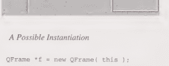

图 3.32 各种 `QFrame` 控件

### 可能的实例化

```cpp
QFrame *f = new QFrame( this );
```

### 使用示例

```cpp
QFrame *f = new QFrame( this );
f->setFrameStyle( QFrame::HLine | QFrame::Sunken );
f->setLineWidth( 2 );
```

如果您来自 Motif 背景，您可能会假设 pushbutton 在某个地方继承了 `QFrame`——但它们没有。

### QLabel

`QLabels` 用于显示文本字符串或位图图像。


`QLabel` 控件

#### 可能的实例化

```cpp
QLabel *l = new QLabel( "Hello", this );
```

### 使用示例

```cpp
QLabel *status = new QLabel( this );
status->setFrameStyle( QFrame::WinPanel | QFrame::Sunken );
status->setText( "Status bar created. ");
```

嵌入的简单富文本会被识别并相应地绘制。例如：

```cpp
QLabel *l = new QLabel( "<b>Bold</b> text", this );
```

### QLCDNumber

此类以类似于 LCD 显示屏的方式显示十进制数。图 3.34 描绘了使用 `QLCDNumbers` 的数字时钟。


来自分发版中 dclock 示例的 `QLCDNumber` 控件

#### 可能的实例化

```cpp
QLCDNumber *lcd = new QLCDNumber( 3, this );
```

### 使用示例

```cpp
countdown = new QLCDNumber( 2, this );
countdown->display( 30 );

mytimer = new QTimer(this);
connect( mytimer, SIGNAL(timeout()), SLOT(count()));
mytimer->start( 1000, false );

...

void MyWidget::count()
{
    int a;
    a = countdown->intValue();
    if(a <= 0) {
        mytimer->stop();
        // Blast off
    }else {
        countdown->display( a-1 );
    }
}
```

### QProgressBar

`QProgressBar`（图 3.35）提供水平进度指示器。

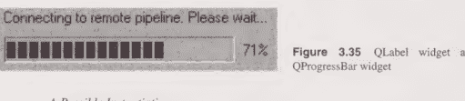

#### 可能的实例化

```cpp
QProgressBar *bar = new QProgressBar( 100, this );
```

### 使用示例

```cpp
QProgressBar *bar = new QProgressBar( 100, this );
bar->setProgress( 0 );
```

### QStatusBar

此控件提供水平条，可用于向最终用户显示临时消息。图 3.36 是 `QMainWindow` 控件上的 `QStatusBar` 控件。

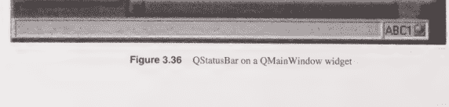

#### 可能的实例化

```cpp
QStatusBar *b = new QStatusBar( this );
```

### 使用示例

```cpp
QMainWindow *mw = new QMainWindow();
mw->show();
QStatusBar *status = mw->statusBar();
status->message( "Starting up. Please Wait." );
status->clear();
```

### QStyle

`QStyle` 封装了 GUI 外观和感觉的许多通用元素。并非总是可以（或合理）捕获使 GUI 呈现其外观的所有元素，但许多视觉元素是通用的。pushbutton 具有框架或边框，并且当用户使用鼠标单击时，该框架或边框可能会发生变化。`QStyle` 捕获的就是这些通用元素。

许多 Qt 控件使用它们继承的样式向用户呈现其视觉外观，因此通过更改控件继承的 `QStyle` 来更改应用程序的整体外观相对容易。

Qt 为您提供四种预定义样式：

- `QCDEStyle` 捕获了 CDE 接口的许多元素。
- `QMotifStyle` 提供 Motif 外观和感觉。
- `QPlatinumStyle` 提供一种非常不同的外观，并且*不太*糟糕。
- `QWindowsStyle` 封装了 Windows 9x 或 NT4 的外观和感觉。

创建新样式并不困难，但使新样式具有吸引力和直观性需要相当多的时间投入。

### QTextBrowser

`QTextBrowser`（见图 3.37）提供一个非常基本的简单富文本查看器，并具备浏览所需的一些功能。

#### 可能的实例化

```cpp
QTextBrowser *b = new QTextBrowser( this );
```

### 使用示例

```cpp
QTextBrowser *b = new QTextBrowser( this );
b->setSource("file:///mytext.html");
```

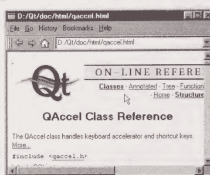

在 Qt helpviewer 示例中实现的 `QTextBrowser`

`QTextBrowser` 继承自 `QTextView`。因此，您可以将 `QTextBrowser` 的浏览支持与 `QTextView` 的 MIME 内容支持结合使用，为几乎任何形式的数据和几乎任何传输（本地文件系统、网络等）创建浏览查看器。

### QTextView

此控件提供高级且高度可定制的富文本查看能力，仅限于单页。根据需要提供滚动条。图 3.38 显示了对话框上的 `QTextView` 控件。

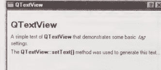

对话框上的 `QTextView` 控件

#### 可能的实例化

```cpp
QTextView *tv = new QTextView( this );
```

### 使用示例

```cpp
QTextView *tv = new QTextView( this );
tv->setText( "<p>Some text.</p>" );
tv->append( "<p>Yet more text.</p>" );
```

任何标签解析限制都继承自基础的 `QStyleSheet` 实现。您几乎肯定需要添加一些自定义的 `QStyleSheetItems` 来处理比非常基本的富文本显示更复杂的情况。

## QWidgetStack

`QWidgetStack` 管理一个控件“栈”，在任何给定时刻只有顶部控件可见。这是在有限空间环境中呈现信息多个视图的绝佳方式，当每次只需要或相关一个视图时尤其适用。

#### 可能的实例化

```cpp
QWidgetStack *cards = new QWidgetStack( this );
```

### 使用示例

```cpp
QWidgetStack *cards = new QWidgetStack( this );
// Create an instance of our new Gizmo Widget
myCustomWidget *gizmoWidget = new myCustomWidget( this );
// Add it to the ‘top’ of the stack
cards->addWidget( gizmoWidget, 0 );
// Create an instance of the Cosmos Widget
myCosmos = new myCosmos( this );
// Add it to the stack
cards->addWidget( myCosmos, 1 );
// Make Cosmos the one on top (visible)
cards->raiseWidget( 1 );
```

没有提供视觉控件排队机制，但工具栏或标签栏是一个直观的解决方案，可以轻松添加。

## 总结


在本章中，我简述了那些主要用于为应用程序提供输出机制的 Qt 控件。所提供的控件对于大多数应用程序而言已经足够。只需少量工作，即可将它们组合或增强，以提供你可能需要的大多数功能。

Trolltech 在 2.1 版本发布前夕移除了一些仅用于输出的控件。这是为了缓解工具包快照版本中开始出现的功能膨胀及其相关的 bug。其中，最引人注目的对象是 `QCanvas` 控件，它用于管理动画精灵。我希望这些控件能在未来的版本中重新出现。

# 第 5 章

## Qt 便捷对象

从未有实用的应用程序仅靠可视化代码创建而成。接下来的页面试图整理那些不直接提供用户交互，或仅为方便起见而提供的 Qt 类的描述。组织方式如下：

- 事件处理类和参数
- 输入/输出相关类
- 集合、数组和链表类
- 文本和国际化类

如同上一章一样，这些描述旨在提供一个可用 Qt 功能的“购物清单”，而非各类别和参数的参考手册——Qt 在线参考资料和示例已经提供了非常充分的文档。

## 事件与事件参数

由于 Qt 始终使用底层窗口系统的机制来接收输入或使用计时器等其他此类生成事件的现象，并且由于所有受支持的窗口系统都是事件驱动的，因此 Qt 也是事件驱动的，并依赖底层窗口系统传递给它的参数来接收键盘输入、鼠标输入等。事件是应用程序在正常处理 Qt 事件循环期间接收到的异步消息。Qt 在 `QApplication::exec()` 和 `QDialog::show()` 方法中提供了默认的事件循环。这些循环只是反复调用 `QApplication::processNextEvent()` 方法。当事件发生时，底层窗口系统的平台相关事件参数会被转换为相应的 Qt 平台无关事件格式，然后作为 Qt 事件传递给你的应用程序。你可以利用对这些事件的默认“反应”，也可以创建自定义事件处理程序以更改应用程序的行为。

本节讨论标准事件类型、导致这些事件发生的原因以及一些可能的修改。

### QChildEvent

当你从 `QObject` 中插入或移除一个子对象时，会向父 `QObject` 传递一个 `QChildEvent`。为了使用它，你必须重新实现 `QObject::childEvent( QChildEvent * )` 方法。

### QCloseEvent

`QWidget` 类提供了一个 `QWidget::closeEvent( QCloseEvent * )` 方法，当使用窗口菜单（窗口管理器的功能）关闭控件或从程序内部显式调用控件的 `QWidget::close()` 方法时，该方法会被调用。`QCloseEvent` 参数包含一个接受标志，可用于清理功能。以下示例说明了 `QCloseEvent` 的典型用法：

```cpp
void
MyMainWindow::closeEvent( QCloseEvent *e )
{
    if ( modified == true ) {
        int v = QMessageBox::information( this,
                                           "Whoa, Big Fellow",
                                           "You have changed the drawing!",
                                           "Save...", "Cancel", "Exit", 0, 1 );
        switch( v ) {
            case 0: // Save!
                save();
                e->accept();
                break;
            case 1: // Cancel
                e->ignore();
                break;
            default: // Exit
                e->accept();
                break;
        }
    } else {
        e->accept();
    }
}
```

### QCustomEvent

此类为定义用户自定义事件提供支持。你可以使用提供的 `QApplication::postEvent()` 和 `QApplication::sendEvent()` 方法来生成事件。任何 `QWidget` 子类都可以通过实现 `QWidget::customEvent (QCustomEvent *)` 方法来提供处理程序。

### QDragEnterEvent

当拖放对象首次拖动到这个 `QWidget` 上时，此事件会被发送到该 `QWidget`。此事件之后会跟随一个或多个 `QDragMoveEvents`，因此只需要实现其中一个即可。参见下面的 `QDragMoveEvent`。

### QDragLeaveEvent

当拖放对象离开当前 `QWidget` 的“空域”时，该 `QWidget` 将接收此事件。

### QDragMoveEvent

在拖放操作进行过程中，此事件会被发送到鼠标下方的 `QWidget`。如果 `QWidget` 通过 `QWidget::setAcceptDrops (bool )` 接受拖放事件，并且该控件通过 `QDragMoveEvent::accept( bool )` 接受该事件，那么它有资格接收 `QDropEvent`。

### QDropEvent

当拖放操作完成时，此事件会被发送到一个 `QWidget`。

### QEvent

这是所有其他事件类的基类，仅包含一个事件类型参数。这些事件类型是枚举值，已在 `QEvent` 参考文档中记录。由于枚举值可能会变化，你不应使用硬编码的值来引用或测试特定事件。

### QFocusEvent

当焦点发生变化时，会为 `QWidget` 生成 `QFocusEvents`。该类只提供了两个显而易见的方法：`gotFocus()` 和 `lostFocus()`。以下示例演示了对 `QLineEdit` 的修改，当行编辑控件获得键盘焦点时，它会选中所有文本。当失去焦点时，它还会取消选中文本：

SLineEdit.h

```cpp
#define _SLINEEDIT_H
#include <qlineedit.h>

class SLineEdit : public QLineEdit
{
    Q_OBJECT
public:
    SLineEdit( QWidget *p=0, const char *n=0 );

protected slots:
    virtual void focusInEvent( QFocusEvent * );
    virtual void focusOutEvent( QFocusEvent * );
};

#endif // _SLINEEDIT_H
```

SLineEdit.cpp

```cpp
#include "SLineEdit.h"

SLineEdit::SLineEdit( QWidget *parent, const char *name )
    : QLineEdit( parent, name )
{
}

void
SLineEdit::focusInEvent( QFocusEvent *e )
{
    QLineEdit::focusInEvent( e );
    selectAll();
    repaint( false );
}

void
SLineEdit::focusOutEvent( QFocusEvent *e )
{
    QLineEdit::focusOutEvent( e );
    setSelection( 0, 0 );
    repaint( false );
}

#include "SLineEdit.moc"
```

### QHideEvent

此事件是在使用 `QWidget::hide()` 方法隐藏 `QWidget` *之后*，但在 `hide()` 方法返回*之前*发送的。当窗口管理器将顶层控件图标化时，也会生成此事件。

### QKeyEvent

每当 `QWidget` 拥有键盘焦点时，它都有资格接收 `QKeyEvents`。此类提供了处理大多数按键所需的基本信息，并且可以轻松地定制以提供额外信息。默认的 `QWidget` 实现为 `keyPressEvent()` 和 `keyReleaseEvent()` 提供了事件处理程序。

### QMouseEvent

出乎意料的是，`QMouseEvent` 类是描述鼠标事件的参数。`QWidget` 类为 `mousePressEvent()`、`mouseReleaseEvent()`、`mouseDoubleClickEvent()` 和 `mouseMoveEvent()` 提供了处理程序。

### QMoveEvent


当控件被移动（相对于其父控件）时，它会接收到 `QMoveEvent`。你可以通过重新实现 `QWidget::moveEvent( QMoveEvent * )` 方法利用此事件。

### QPaintEvent

Motif 程序员会认出这是一个 *expose*（暴露）事件。当控件需要重绘自身时，会生成此事件。你可以使用 `QPaintEvent::rect()` 获取代表需要重绘区域的 `QRect`。

### QResizeEvent

当控件大小改变时，它通过其 `QWidget::resizeEvent()` 方法接收到 `QResizeEvent`。

### QShowEvent

显示事件可以由底层窗口系统生成（外部显示事件），或者在调用 `QWidget::show()` 方法时生成（内部显示事件），并由控件的 `showEvent()` 方法处理。对于内部显示事件，该事件在控件变为可见*之前*被接收。

### QTimerEvent

当 `QObject` 激活了一个或多个计时器时，`QObject::timerEvent()` 接收到的计时器事件由 `QTimerEvent` 描述。目前，唯一的有用值是指定触发此事件的特定计时器的计时器 ID。参见 `QTimer` 文档。

### QWheelEvent

当控件拥有焦点时旋转鼠标滚轮，会生成 `QWheelEvent`。`QWheelEvent` 提供了一个特殊的 `accept()` 方法，允许你阻止父控件接收相同的事件。

## 输入和输出类

每个交互式应用程序都会执行 I/O（输入/输出）。输入可能来自键盘、鼠标、文件或网络套接字。输出可能指向显示小部件、文件，或者另一个网络套接字。`Qt` 提供了许多有用的类，帮助以平台无关的方式执行这些通常依赖于平台的操作。

### QAccel

该类提供对加速器键和快捷键击的处理。注意，`QAccel` 处理包含 `QAccel` 父小部件的顶层小部件的键盘事件，以及该顶层小部件的所有子小部件。

- *一种可能的实例化*

```cpp
QAccel *a = new QAccel( this );
```

- *使用示例*

```cpp
QAccel* a = new QAccel( this );
a->connectItem( a->insertItem( ALT+Key_M ),
                this, SLOTS( toggleMenuBar() ) );
a->connectItem( a->insertItem( ALT+Key_T ),
                this, SLOTS( toggleToolBar() ) );
a->connectItem( a->insertItem( ALT+Key_B ),
                this, SLOTS( toggleStatusBar() ) );
```

### QAsyncIO

`QAsyncIO` 提供了一种抽象机制，用于在不阻塞用户界面的情况下执行耗时长或缓慢的 I/O 操作。请参阅下方的 `QDataPump`。

### QBuffer

该类提供带缓冲的 `QByteArray` I/O 功能。你可以使用 `QBuffer` 内部的 `QByteArray`，或者提供你自己的。

- *一种可能的实例化*

```cpp
QBuffer b();
```

- *使用示例*

```cpp
// 一种迂回的变量初始化器
int a, b;
QByteArray s;
QBuffer b( &s );
QTextStream ts( &b );
ts << "456 123" << '\0';
QTextIStream tis( &s ) >> b >> a;
```

注意，该类不适合创建 Unicode 文本流。`QTextStream` 为此目的提供了 `QString` 实现。

### QDataStream

`QDataStream` 提供了一些基本方法，用于将二进制数据序列化到 `QIODevice`。数据流独立于平台相关的字节顺序。

- *一种可能的实例化*

```cpp
QFile f( "some_data.dat" );
f.open( IO_ReadOnly );
QDataStream s( f );
```

- *使用示例*

```cpp
float myfloat;

// 打开文件用于写入
QFile f( "data.dat" );
f.open( IO_WriteOnly );
// 将文件的 QIODevice 与流关联
QDataStream s( f );
// 将数据写入流
s << 0x0102030405;
s << (double)3.1416;
myfloat = 0.01120113;
s << myfloat;
// 关闭文件
f.close();
```

注意，`QDataStream` 允许你指定输出的字节顺序（默认是 MSB 优先，即大端序），但更改默认设置会破坏可移植性。

### QDataPump

`QDataPump` 在正常的事件处理期间（交错式）检查其参数的 `QDataSource::readyToSend()` 和 `QDataSink::readyToReceive()` 方法，并响应 `QDataSource` 和 `QDataSink` 的 `asyncIO::activate()` 信号，从而将数据从 `QDataSource` 移动到 `QDataSink`。`Qt` 工具包使用 `QDataPump` 异步地为 `QMovie` 对象“馈送”动画图像数据。

### QDataSink

`QDataSink` 是数据的异步消费者。它通常与 `QDataPump` 和 `QDataSource` 一起使用，将异步数据从点 A 移动到点 B。请参阅上方的 `QDataPump` 和下方的 `QDataSource`。

### QDataSource

`QDataSource` 是数据的异步生产者，通常与 `QDataPump` 和 `QDataSink` 一起使用，从 ASIC 端口或网络套接字读取异步数据。请参阅上方的 `QDataPump`。

### QDir

`QDir` 以平台无关的方式封装了文件系统目录的概念（在 Windows 系统中，这些通常被称为“文件夹”）。

- *一种可能的实例化*

```cpp
QDir d( "/etc/ppp" );
```

- *使用示例*

```cpp
QDir d( "/etc/ppp" );
QFile f( d.filePath( "options" ) );
if( f.open( IO_ReadWrite ) == true ){
// 修改 PPP 选项
}else{
QMessageBox::warning( 0, "Whoops!",
"Can't open /etc/ppp/options..." );
}
```

### QFile

`QFile` 以平台无关的方式封装文件 I/O 功能。Windows 程序员应学会使用正斜杠 (`/`) 作为目录分隔符。这将便于移植到其他平台。

- *一种可能的实例化*

```cpp
QFile f( "/Windows/system.ini" );
```

- *使用示例*

```cpp
QFile f( "/Windows/win.ini" );
f.open( IO_ReadWrite );
if(f.size() > 0) {
     QString s;
     f.readLine( s, 256 );
     // 执行某些操作
 } else {
    // 执行其他操作
 }
 f.close();
```

### QFileInfo

`QFileInfo` 以平台无关的方式提供文件信息。

- *一种可能的实例化*

```cpp
QFile f( "/vmlinux" );
QFileInfo fi( f );
```

- *使用示例*

```cpp
QFile of( "/usr/src/linux/arch/i386/vmlinux" );
QFileInfo ofi( of );
QFile f( "/vmlinux" );
QFileInfo fi( f );
if( fi.lastModified() < ofi.lastModified() ) {
      // vmlinux 较旧或时间相同...
}
```

### QIODevice

这是所有 `Qt` I/O 设备的基类，提供了平台 I/O 设备所需的许多公共功能。`QBuffer` 和 `QFile` 是 `QIODevice` 的子类。

### QIODeviceSource

该类是 `QDataSource` 的子类，其数据由任何 `QIODevice` 或 `QIODevice` 子类（如 `QFile`）提供。它提供以 `QIODevice` 为源头的异步数据源。

### QTextIStream

`QTextStream` 的这个子类是一个便捷类，提供文本输入流。

- *一种可能的实例化*

```cpp
...
QCString s = "1234567";
int n;
QTextIStream( &s ) >> n;
...
```

### QTextOStream


QTextStream 的这个子类是一个便捷类，提供文本输出流。

## QTextStream

`QTextStream`提供了读取或写入文本（ASCII 或 Unicode）到/从`QIODevice`所需的典型 C++ I/Ostream 功能。

## QSocketNotifier

`QSocketNotifier`提供了事件驱动套接字通信所需的机制。由于该类的 Linux/X11 实现使用单个`select()`系统调用用于所有`QSocketNotifier`，因此可以使用该类来监控除网络套接字以外的其他对象——例如命名管道。

### 一种可能的实例化

```cpp
...
QSocketNotifier *gen = new QSocketNotifier( sock,
                                            QSocketNotifier::Read );
...
```

### 使用示例

```cpp
...
Socket.h

#ifndef SOCKET_H
#define SOCKET_H
#include <stdio.h>
#include <stdlib.h>

#ifndef WIN32
#include <unistd.h>
#include <stdarg.h>
#endif

#include <qapplication.h>
#include <qsocknotifier.h>
#include <sys/types.h>
#ifndef WIN32
#include <sys/socket.h>
#include <netinet/in.h>
#include <sys/ioctl.h>
#include <fcntl.h>
#include <netdb.h>
#include <sys/param.h>
#else
#include <winsock.h>
#endif
#include <errno.h>

// 对于 Linux，我们定义一个通用类型
#ifndef WIN32
#define INVALID_SOCKET -1
typedef int SOCKET;
#endif

class Socket : public QObject
{
    Q_OBJECT
public:
    //Create on existing descriptor
    Socket( SOCKET _sock );

    // Create and connect
    Socket( const char *_host, unsigned short _port );

    // Destroy - closing if still open
    ~Socket();

    // Retrieve the descriptor
    SOCKET socket() const { return sock; }

    // Enable read - If true, emit readEvent on socket input
    void enableRead( bool );

    // Enable write - If true, emit writeEvent on socket input
    void enableWrite( bool );

    // Retrieve the address
    unsigned long getAddr();

    // Formatted print()
    void print( const char *fmt, ... );

    // Retrieve one 'line' of data up to 'len' bytes or
    // EOF or newline
    char *line(char *p, int len);

signals:
// Data is available for reading (if enableRead( true ) called)
void readEvent( Socket * );

// Socket is ready for writing (if enableWrite( true ) called)
void writeEvent( Socket * );

// Raised when connection is broken
void closeEvent( Socket * );

public slots:
// Connected to the Notifiers
void slotWrite( int );
void slotRead( int );

protected:
bool connect( const char *_host, unsigned short _port );
bool init_sockaddr( const char *hostname, unsigned short port );

struct sockaddr_in name;
SOCKET sock;
in_addr addr;

QSocketNotifier *readNotifier, *writeNotifier;
};

class ServerSocket : public QObject
{
Q_OBJECT
public:
ServerSocket( int _port );
~ServerSocket();

// Retrieve the descriptor
SOCKET socket() const { return sock; }

// Retrieve the port being monitored
unsigned short getPort();

// Retrieve the current address
unsigned long getAddr();

public slots:
// Called when someone connects to our port
virtual void slotAccept( int );
}
```

## Socks.h

```cpp
signals:
// A connection has been accepted
// don't forget to delete the Socket when no longer needed
void accepted( Socket * );

protected:
bool init( unsigned short );

QSocketNotifier *notifier;
SOCKET sock;
};

#endif
```

## Socket.cpp


```cpp
#include <Socks.h>

#ifdef WIN32
static bool isInited = false;
// Here's where we initialize Winsock (goofy, huh?)
static void
initWinSock()
{
    if(isInited == true) return;
    WORD wVersionRequested;
    WSADATA wsaData;
    int r;

    wVersionRequested = MAKEWORD( 1, 1 );

    r = WSAStartup( wVersionRequested, &wsaData );
    if ( r == 0 ) {
        isInited = true;
    }
}
#endif

// Socket ctor with existing platform socket
Socket::Socket( SOCKET _sock )
{
#ifdef WIN32
    initWinSock();
#endif
    sock = _sock;
    readNotifier = 0L;
    writeNotifier = 0L;
}

// Socket ctor from host/port info
Socket::Socket( const char *_host, unsigned short int _port )
{
#ifdef WIN32
    initWinSock();
    if(isInited == false) return;
#endif
    sock = INVALID_SOCKET;
    readNotifier = 0L;
    writeNotifier = 0L;
    connect( _host, _port );
}

// print() - print formatted to stream, same syntax as printf
void
Socket::print( const char *fmt, ...)
{
    char p[4096];
    va_list ap;

#ifdef WIN32
    if(isInited == false) return;
#endif

    memset(p, 0, 4096);
    va_start(ap, fmt);
#ifdef _HPUX_SOURCE  // Old 9.0x stuff
    vprintf(p, fmt, ap);
#endif
#ifdef WIN32
    vprintf(p, fmt, ap);
#else
    vsnprintf(p, 8191, fmt, ap);
    va_end(ap);
#endif
    send( sock, p, strlen(p), 0 );
}

// Enable/Disable the read QSocketNotifier
void
Socket::enableRead( bool state )
{
    if( state ) {
        if( !readNotifier ) {
            readNotifier = new QSocketNotifier( sock,
                 QSocketNotifier::Read );
            QObject::connect( readNotifier,
                   SIGNAL( activated(int) ), this,
                   SLOT( slotRead() ) );
        } else readNotifier->setEnabled( true );
    } else if ( readNotifier )
        readNotifier->setEnabled( false );
}

// Enable/Disable the write QSocketNotifier
void
Socket::enableWrite( bool state )
{
    if( state ) {
        if( !writeNotifier ) {
            writeNotifier = new QSocketNotifier( sock,
                QSocketNotifier::Write );
            QObject::connect( writeNotifier,
                SIGNAL( activated(int) ), this,
                SLOT( sSlotWrite(int) ) );
        } else {
            writeNotifier->setEnabled( true );
        }
    } else if( writeNotifier )
        writeNotifier->setEnabled( false );
}

/// The read slot - argument notifier is ignored
void
Socket::sSlotRead( int )
{
    char buffer[2];

#ifdef WIN32
    if(isInited == false) return;
#endif

    if(sock == INVALID_SOCKET) return;
    int n = recv( sock, buffer, 1, MSG_PEEK );
#ifdef WIN32
    if( n <= 0 )
        emit closeEvent( this );
    else
        emit readEvent( this );
#else
    /// Winsock is verbose...
    if(n > 0) {
        emit readEvent( this );
        return;
    }
    switch(n) {
    case 0:
        emit closeEvent( this );
        break;

    case SOCKET_ERROR:
        n = WSAGetLastError();

        switch(n) {
        case WSANOTINITIALISED:
            break;

        case WSAENETDOWN:
            emit closeEvent( this );
            break;

        case WSAEFAULT:
            break;
        case WSAENOTCONN:
            emit closeEvent( this );
            break;
        case WSAEINTR:
            break;
        case WSAEINPROGRESS:
            break;
        case WSAENETRESET:
            emit closeEvent( this );
            break;
        case WSAEINOTSOCK:
            emit closeEvent( this );
            break;
        case WSAEOPNOTSUPP:
            break;
        case WSAESHUTDOWN:
            emit closeEvent( this );
            break;
        case WSAEWOULDBLOCK:
            break;
        case WSAEMSGSIZE:
            break;
        case WSAEINVALID:
            break;
        case WSAECONNABORTED:
            emit closeEvent( this );
            break;
        case WSAETIMEDOUT:
            emit closeEvent( this );
            break;
        case WSAECONNRESET:
            emit closeEvent( this );
            break;
        default:
            break;
        }
        break;
    }
#endif
}

void Socket::slotWrite( int )
{
    emit writeEvent( this );
}

// Initialize the platform-level socket
// Note that this will even work with dotted IP on
// Win95 platforms...
bool
Socket::init_sockaddr( const char *hostname, unsigned short int port )
{
    struct hostent *hostinfo;
    int oa, ob, oc, od;
    name.sin_family = AF_INET;
    name.sin_port = htons( port );
    // Tacky - should use QString
    if (sscanf(hostname, "%d.%d.%d.%d", &oa, &ob, &oc, &od) == 4) {
        addr.S_un.S_addr = inet_addr( hostname );
        name.sin_addr = addr;
    } else {
        if((hostinfo = gethostbyname( hostname )) == NULL) {
            return( false );
        }
        name.sin_addr = *(struct in_addr*) hostinfo->h_addr;
    }
    return true;
}

bool
Socket::connect( const char *host, unsigned short int _port )
{
    sock = ::socket(PF_INET, SOCK_STREAM, 0);
    if (sock == INVALID_SOCKET) {
        return false;
    }
    if ( !init_sockaddr( _host, _port )) {
#ifdef WIN32
        ::closesocket( sock );
#else
        ::close( sock );
#endif
        sock = INVALID_SOCKET;
        return false;
    }
    if ( ::connect(sock, (struct sockaddr*)(&name), sizeof( name )) < 0 )
    {
#ifdef WIN32
        ::closesocket( sock );
#else
        ::close( sock );
#endif
        sock = INVALID_SOCKET;
        return false;
    }
    return true;
}

unsigned long
Socket::getAddr()
{
    struct sockaddr_in name;
    int len = sizeof(name);
    getsockname(sock, (struct sockaddr *) &name, &len);
    return ntohs(name.sin_addr.s_addr);
}

char *
Socket::line( char *p, int len )
{
    unsigned char c;
    int a;

#ifdef WIN32
    if(isInited == false) return( NULL );
#endif
    memset(p, 0, len);

    for(a=0;a<len;a++) {
        if(recv(sock, (char *)&c, 1, 0) <= 0) {
            if(a == 0) return(NULL);
            else return(p);
        }
        p[a] = c;
        if(c == '\n') return(p);
    }
    return(p);
}

Socket::~Socket()
{
    if ( readNotifier ) {
        delete readNotifier;
    }
    if ( writeNotifier ) {
        delete writeNotifier;
    }
#ifdef WIN32
    if(isInited == false) return;
#endif
    if(sock != INVALID_SOCKET) {
#ifdef WIN32
        ::closesocket( sock );
#else
        ::close( sock );
#endif
    }
    sock = INVALID_SOCKET;
}

ServerSocket::ServerSocket( int _port ) :
    sock( -1 )
{
    sock = INVALID_SOCKET;

#ifdef WIN32
    initWinSock();
    if (isInited == false) return;
#endif
    if ( !init ( _port ) ) {
        return;
    }

    notifier = new QSocketNotifier( sock, QSocketNotifier::Read );
    connect( notifier, SIGNAL( activated(int) ), this,
        SLOT( slotAccept(int) ) );
}

bool
ServerSocket::init( unsigned short int _port )
{
    struct sockaddr_in name;

    sock = ::socket( PF_INET, SOCK_STREAM, 0 );
    if (sock == INVALID_SOCKET) {
        return false;
    }

    name.sin_family = AF_INET;
    name.sin_port = htons( _port );
    name.sin_addr.s_addr = htonl(INADDR_ANY);

    if ( bind(sock, (struct sockaddr*) &name,sizeof( name )) < 0 ) {
#ifdef WIN32
        ::closesocket( sock );
#else
        ::close( sock );
#endif
        sock = INVALID_SOCKET;
        return false;
    }
    if ( listen(sock, 1000) < 0 ) {
#ifdef WIN32
        ::closesocket( sock );
#else
        ::close( sock );
#endif
        sock = INVALID_SOCKET;
        return false;
    }

    return true;
}

unsigned short
ServerSocket::getPort()
{
    struct sockaddr_in name;
    int len = sizeof(name);
    getsockname(sock, (struct sockaddr *) &name, &len);
    return ntohs(name.sin_port);
}

unsigned long
ServerSocket::getAddr()
{
    struct sockaddr_in name;
    int len = sizeof(name);
    getsockname(sock, (struct sockaddr *) &name, &len);
    return ntohl(name.sin_addr.s_addr);
}

void
ServerSocket::slotAccept( int v )
{
    struct sockaddr_in client;
    SOCKET new_sock;

    int size = sizeof(client);

    if ( (new_sock = ::accept(sock,
        (struct sockaddr *) &client,
        &size)) < 0 ) {
        return;
    }

    emit accepted( new Socket( new_sock ) );
}

ServerSocket::~ServerSocket()
{
    if ( notifier )
        delete notifier;

#ifdef WIN32
    if(isInited == false) return;
    ::closesocket( sock );
#else
    ::close( sock );
#endif
    sock = INVALID_SOCKET;
}

#include "Socket.moc"
```


上述示例提供了*极其*基础的 TCP 套接字级别支持。基于协议的 Qt 网络扩展将在未来某个时候可用。在此之前，像这样的临时解决方案将是一种必要的代价。

CD-ROM 中包含此代码以及一个电子邮件客户端（极简版）和 SMTP 类的示例。（不要急着删除你的电子邮件客户端——这些类仅具备绝对最低限度的功能。）

## 集合、数组和链表

Qt 工具包提供了一些非常灵活的类，用于维护对象集合、数组和链表。在我看来，这些类构成了工具包整体价值近一半的部分。在选择特定类时需要稍加谨慎，因为 Troll 经常提供某类的两种变体；一种是基于值的操作，另一种是基于引用的操作。与其他大多数 Qt 类不同，命名约定并不总是能很好地提示哪些类是基于值或基于引用的。我在随后的描述中试图让这一点更明显一些。

### `QArray`

`QArray` 是一个基于值的模板类，可以维护简单对象的数组，其中“简单”意味着没有构造函数、析构函数或虚拟函数。

#### 可能的实例化

```cpp
...
QArray<int> nums(10);
...
```

#### 示例用法

```cpp
...
QArray<int> so(100);
for(int a=0;a<100;a++) so[a] = a;
...
```

`QArray` 使用位级复制和比较操作。有关数组的基于引用的实现，请参阅 `QVector` 类。

### `QAsciiCache`

`QAsciiCache` 是一个模板类，提供基于字符指针键的缓存功能。键按最近最少使用（LRU）顺序存储。注意，此类不适合用于 Unicode 缓存实现。`QCache` 提供基于 `QString` 的缓存机制，支持完整的 Unicode，而且两者之间没有性能差异，因此 `QAsciiCache` 仅用于遗留代码兼容。

### `QAsciiCacheIterator`

此类为 `QAsciiCache` 对象提供迭代器。

### `QAsciiDict`

`QAsciiDict` 提供基于字符指针键的字典。此类不提供 Unicode 支持，而 `QDict` 提供。此类旨在支持不兼容 Unicode 的遗留代码。

### `QAsciiDictIterator`

此类为 `QAsciiDict` 对象提供迭代器。

### `QBitArray`

此类维护单比特值数组，并提供对数组元素执行位级操作的方法。

#### 可能的实例化

```cpp
QBitArray b( 4 );
```

#### 示例用法

```cpp
// 新数组，初始化为 010
QBitArray first( 3 );
first[0] = 0;
first[1] = 1;
first[2] = 0;
// 另一个，初始化为 011
QBitArray second( 3 );
second.clearBit( 0 );
second.setBit( 1 );
second.setBit( 2 );
// 新数组 == 010 | 011 == 011
QBitArray third = first | second;
```

### `QByteArray`

`QByteArray` 由 `QArray` 实现，提供显式共享的字节值数组。

### `QCache`

`QCache` 是一个模板类，提供基于 `QString` 键的简单缓存机制。构造函数的两个可选参数将影响性能。这些是 `maxcost` 和 `size` 参数。

`maxcost` 指定缓存机制使用的最大大小。当存储新项目会导致超过此参数时，最近最少使用的项目将被丢弃以为其腾出空间。

`size` 参数指定将使用多少个哈希槽。这应该是一个素数，达到或超过预期条目总数。每个实现都需要一些调整，以达到性能与资源利用之间的最佳平衡。

### `QCacheforwardIterator`

此类为 `QCache` 集合类提供迭代器。

### `QCollection`

`QCollection` 是所有 Qt 集合类的基类。

### `QDict`

`QDict` 是一个模板类，提供基于 `QString` 键的字典。`QDict` 对其元素进行操作引用。有关基于值的实现，请参阅 `QMap`。

#### 可能的实例化

```cpp
QDict<char> d;
```

#### 示例用法

```cpp
class myType
{
public:
    myType(int s=0, int v=2) { _sal = s; _vac = v; }
    int salary() { return( _sal ); }
    int vacation() { return( _vac ); }

private:
    int _sal;
    int _vac;
};

QDict<myType> d( 23, FALSE );

d.insert( "Bob", new myType( 40000, 2 ));
d.insert( "George", new myType( 54000, 3 ));

cout << "Bob's Salary: " << d["Bob"].salary() << "\n";
```

### `QDictIterator`

此类为 `QDict` 集合类提供迭代器。

### `QIntCache`

`QIntCache` 提供基于整数键的缓存机制。

### `QIntCacheIterator`

`QIntCacheIterator` 是 `QIntCache` 集合类的迭代器。

### `QIntDict`

`QIntDict` 提供整数值字典。

### `QIntDictIterator`

`QIntDictIterator` 是 `QIntDict` 集合类的迭代器。

### `QIntValidator`

`QIntValidator` 提供整数值的上下限范围检查。

### `QList`

`QList` 是一个模板类，实现双向链表。`QList` 对其元素进行操作引用。有关基于值的实现，请参阅 `QValueList`。

#### 可能的实例化

```cpp
--
    QList<myItem> *theList = new QList<myItem>();
--
```

#### 示例用法

```cpp
--
// 将单词与数据库偏移量匹配
class ref
{
public:
    ref( unsigned long offset=UL );
    virtual ~ref();

    QString					retrievе( const QString & );

private:
    unsigned long		offset;
};
--
```

### `QListIterator`

`QListIterator` 是 `QList` 集合的迭代器。

### `QMap`

`QMap` 是一个模板类，提供集合和字典查找功能。`QMap` 与 `QList` 或 `QDict` 之间最显著的区别在于 `QMap` 是基于值的。它维护集合的离散副本。`QList` 和 `QDict` 是基于引用的。

### `QMapConstIterator`

`QMapConstIterator` 是 `QMap` 集合的两种迭代器之一。正如名称中的“const”所暗示的那样，使用此类迭代 `QMap` 集合时，不允许修改集合值。

### `QMapIterator`

`QMapIterator` 是 `QMap` 集合的两种迭代器之一。另请参阅 `QMapConstIterator`。

### `QPtrDict`

`QPtrDict` 提供基于 void 指针键的字典。

### `QPtrDictIterator`

此类为 `QPtrDict` 集合提供迭代器。

### `QQueue`

此模板类实现先进先出（FIFO）队列。有关 LIFO 行为，请参阅 `QStack`。

### `QSortedList`

这是 `QList` 的一个子类，提供排序所需的额外功能，基于 < 和 = 运算符。

### `QStack`

`QStack` 是一个基于引用的模板类，提供后进先出（LIFO）栈。有关 FIFO 行为，请参阅 `QQueue`。有关基于值的实现，请参阅 `QValueStack`。

### `QStringList` 和 `QStringList`

`QStringList` 提供字符指针值的双向链表。`QStringList` 添加了不区分大小写的比较。

### `QStringListIterator`

这是 `QStringList` 或 `QStringList` 集合的迭代器。

### `QStringList`

此类管理 `QString` 对象列表，并提供搜索方法。

### `QValueList`

`QValueList` 是一个*基于值*的模板类，提供双向链表。有关基于引用的实现，请参阅 `QList`。

### `QValueListConstIterator`

这是 `QValueList` 集合的两种迭代器之一。它不允许修改 `QValueList` 的值。

### `QValueListIterator`

这是 `QValueList` 集合的两种迭代器之一。请参阅 `QValueListConstIterator`。

### `QValueStack`

这是一个*基于值*的模板类，实现 LIFO 栈。对于基于引用的实现，请使用 `QStack`。

### `QVector`


QVector 是一个基于引用 的模板类，用于实现数组。`QVector` 相比 `QArray` 的优势在于，数组元素的复杂性不会受到 `QArray` 基于值实现施加的限制。有关基于值的实现，请参阅 `QArray`。

## 文本处理

Qt 提供类以在平台无关的方式（在某些情况下甚至是语言无关的方式）封装文本对象和概念。以下讨论简要介绍了这些类及其预期用途。

### QChar

`QChar` 封装了 Unicode 字符，并提供了类似于 `ctype.h` 为 ASCII 字符提供的测试、分类和转换方法。

### QClipboard

`QClipboard` 提供了访问底层窗口系统剪贴板的方法。

### QConstString

此类提供了 `QString` 类的功能，但针对现有的 Unicode 数据进行了优化。通过消除复制操作（`QString` 类的主要开销），`QConstString` 类可以带来显著的性能提升。但是，如果尝试修改数据，该类会复制数据，以确保数据保持不变。

### QString

此类是典型以零结尾字符串的抽象。`QString` 继承自 `QArray`，因此其内容是显式共享的。另请参阅 `QString`。

### QDoubleValidator

`QDoubleValidator` 为双精度浮点数提供范围检查。请参阅 `QValidator` 和 `QIntValidator`。

### QRegExp

`QRegExp` 以类似 GNU 正则表达式实现的方式，提供使用正则表达式进行模式匹配的功能。除了非 ASCII Latin-1 字符外，该类支持 Unicode 以及不区分大小写的匹配。

### QString

`QString` 是 Unicode 文本和字符串的抽象。`QString` 隐式共享文本字符串。

### QTextCodec

该抽象类提供文本编码之间的转换，并封装了 Qt 文本编码的常见元素。

### QTextDecoder

`QTextDecoder` 提供单个方法 `toUnicode()`，用于将字节数组转换为 Unicode 文本。该类维护先前状态信息以便在后续调用中进行持续处理，使 `QTextDecoder` 适用于数据流。请参阅 `QTextEncoder`。

`QTextEncoder` 将 Unicode 转换为其他格式（当然需要提供目标格式），并维护先前状态信息以便在后续调用中进行处理。这使得该类适用于数据流的使用。请参阅 `QTextDecoder`。

### QtTranslator

`QtTranslator` 为文本输出提供国际化支持。`QtTranslator` 对象包含从参考语言到目标语言的一组翻译，并提供添加、查找或移除这些翻译的方法。还提供了方法将当前对象保存到文件，或加载之前保存的文件。

### QtValidator

`QtValidator` 是验证输入文本的基类。请参阅 `QIntValidator` 和 `QDoubleValidator`。

## 日期和时间

尽管所有受支持的平台都提供 `time_t` 标准值作为时间的表示，以及所有相关的库函数，但 Qt 提供了自己的日期和时间封装，其限制程度不及平台表示形式。

### QtDate

`QtDate` 是日期值的抽象。其实现是对格里高利日期的平台无关计算，适用于从 1752 年 9 月 14 日到第八个千年。我预计随着 64 位 CPU 架构变得更加普遍，Qt 未来版本中的分辨率将有显著变化。这些系统上的原生 `time_t` 值在 BSN（Beyond Solar Nova，超新星爆发后）之前有效。

### QtDateTime

`QtDateTime` 结合了 `QtDate` 和 `QtTime` 类的功能。该类还增加了一些便利例程，以便与 Qt 可用平台提供的原生 `time_t` 值进行接口交互。

### QtTime

`QtTime` 类是自午夜以来时、分、秒和毫秒的时间抽象。`QtTime` 提供比较和转换方法。

## 杂项

以下大多数类不属于任何特定类别，但仍然极其有用。

### QRangeControl

此类提供了在特定范围内限制整数值的方法。这比让用户通过文本字段输入整数更直观，在某些情况下甚至比旋转框更直观（具体取决于上下文）。

#### 可能的实例化

```cpp
QRangeControl *rc = new QRangeControl( 0, 100, 1, 10, 0 );
```

#### 常见用法

```cpp
QRangeControl *rc = new QRangeControl( 0, 100, 1, 10, 0 );
int n = rc->pageStep();
```

该类涵盖了五个概念，使其在 `QScrollBar` 小部件中的使用显得尤为明显：

- 一个作为有界整数的当前值，通过 `QRangeControl::value()` 方法获取，并使用 `QRangeControl::setValue()` 方法设置。
- 最小值。
- 最大值。
- 一个用于确定首选滚动行数的行步长值。
- 一个用于确定页面向前或向后滚动时合适行数滚动量的页步长值。

### QGuardedPtr

该模板类为 `QObject` 提供受保护的指针。受保护指针的行为与其他 C++ 指针相同，除了当其所引用的对象被删除时，其值会被设置为 NULL。使用受保护指针并未发现任何显著的性能损失，而且它可以提高产品的可靠性。当然，使用受保护指针会增加编码时间和复杂度。

### QMimeSource

`QMimeSource` 封装了抽象数据片段。它被拖放类和 `QClipboard` 使用。

### QMimeSourceFactory

`QMimeSourceFactory` 提供访问抽象数据集合的接口。

### QPoint

`QPoint` 是平面内点的抽象。

### QPointArray

`QPointArray` 维护一个显式共享的 `QPoint` 对象数组。

### QRect

`QRect` 提供平面矩形区域的抽象。

### QSignal

`QSignal` 提供了一种非常简单的方法，用于向接受无参数槽发送无参数信号。这通常用于不继承 `QObject` 的类来发送信号。

### QSignalMapper

`QSignalMapper` 提供将不提供参数的信号映射为提供整数或 `QString` 参数的信号的机制。这对于从单个槽管理多个弹出菜单项非常有用。你也可以使用此类将推按钮数组映射到单个槽。

### QSize

`QSize` 定义二维对象的尺寸（以像素为单位），并提供用于比较和值修改的方法及运算符。

### QTimer

`QTimer` 提供周期性定时和单次定时信号。

#### 可能的实例化

```cpp
QTimer *t = new QTimer( this, false );
```

#### 常见用法

```cpp
// 我们需要一个闪烁的文本标签，因此我们子类化 QLabel 并
// 添加一个 QTimer。我们试图告诉客户它消耗大量资源……
class Blinky : public QLabel
{
   Q_OBJECT
public:
   Blinky( QWidget *p=0, const char *n=0 );
   Blinky( const QString &s, QWidget *p=0, const char *n=0 );

public slots:
   void setValue( const QString &s );

protected slots:
   void myTimeout();

private:
   QLabel *l;
   QString str;
   bool showing;
};

// 便利构造函数设置标签文本并保存副本
Blinky::Blinky( const QString &s, QWidget *p, const char *n )
{
   QLabel( s, p, n )
   str = s;
}

// 标准构造函数添加定时器
Blinky::Blinky( QWidget *p, const char *n )
{
   Blinky( ":", p, n );
   showing = true;
   tnr = new QTimer( this );
   connect( tnr, SIGNAL(timeout( ) ), SLOT(myTimeout()) );
   t -> start( 500 );
}

// 设置文本值的槽
void
Blinky::setValue( const QString &s )
{
   setText( s );
   str = s;
}
```

```cpp
// 这将由我们的 QTimer 每 500ms 调用
void
Blinky::myTimeout()
{
// 每 500ms 切换文本...
if (showing == true) {
showing = false;
setText( "" );
} else {
showing = true;
setText( str );
}
}
...
```

### QVariant

`QVariant` 的行为类似于许多常用 Qt 数据类型的联合体。

### QMatrix


QMatrix 执行坐标系的二维变换。结果可以应用于图形图像，以平移、缩放、剪切或旋转图像。请参阅前一章中的 `QPainter`。

## 总结

虽然 `Qt` 并未为纯视觉界面组件领域之外的每种可想象的编程需求提供类，但它确实涵盖了广泛的常见任务，从显而易见的省时工具到令人望而生畏的复杂链表处理器。我期待在未来版本中能看到更多。

# 第 6 章

## Qt 命名空间与 Qt 扩展

有几个话题值得讨论，但并不足以占用一整章的篇幅。第一个话题是 `Qt` 类，它提供了一些常用的枚举常量值。第二个话题讨论的是 Trolltech 对 Qt 工具包的扩展，这些扩展已经发展到一定程度，以至于 Trolls 将这些扩展从工具包的第二版中移除了。

### QT 类

提供全局值是一种糟糕的做法，几乎每一个面向对象（OO）程序员都对此不屑一顾。有很多很好的理由支持这一观点。避免使用全局定义的最有说服力的理由是为了避免污染开发命名空间。微软的开发环境就是一个命名空间被污染的典型例子——随着 VC++ 每个新版本的发布，创建一个不与其所包含头文件中某个宏发生冲突的唯一标识符名称变得越来越困难。例如，考虑以下宏定义：

```c
...
#define AlignLeft      0x01
#define AlignRight     0x02
...
```

这些宏定义乍看之下似乎无害，但在编译几乎任何图形工具包（不仅仅是 Qt）的代码时，都会导致有趣的事情发生。创建全局变量、宏和常量值会带来麻烦。即使你分配了不太可能重名的名称，将来仍有可能与他人的代码产生冲突。

解决“全局”常量需求的更好方法是在类中声明它们，然后简单地继承该类。这就是 `Qt` 类所服务的目的。

许多 Qt 小部件和类接受在几乎所有小部件和许多便捷类中通用的常量标志、修饰符和数据值。为了不再进一步污染命名空间，Qt 工具包定义了一个名为 `Qt` 的类，该类的目的是将这些通用值暴露给其派生类对象。由于 `QObject`（以及许多不基于 `QObject` 的类）都继承了 `Qt` 类，因此这些枚举常量可以直接从任何从这些 `Qt` 子类派生的类中访问。当然，显式访问其中一个值并没有错；例如：

```cpp
QColor r( Qt::red );
```

对于 `QObject` 的任何子类或 Qt 的其他子类，直接访问这些值要简单得多，如下所示：

```cpp
QColor r( red );
```

类 `QBrush`、`QCustomMenuItem`、`QEvent`、`QIconViewItem`、`QListViewItem`、`QObject`、`QPalette`、`QPen`、`QPixmap`、`QStyleSheet`、`QToolTip` 和 `QWhatsThis` 都继承了 `Qt` 类，因此这些常量可以直接被这些子类及其后续子类的方法访问。

表 6.1 列出了数据类型和常量名对。

**表 6.1 数据类型和常量名对**

| 值类型 | 常量 |

| :--- | :--- |

| ButtonState | NoButton, LeftButton, RightButton, MidButton, MouseButtonMask, ShiftButton, ControlButton, AltButton, KeyButtonMask |

| Orientation | Horizontal, Vertical |

| AlignementFlags | AlignLeft, AlignRight, AlignHCenter, AlignTop, AlignBottom, AlignVCenter, AlignCenter = AlignHCenter \| AlignVCenter, SingleLine, DontClip, ExpandTabs, ShowPrefix, WordBreak, DontPrint |

| WidgetState | WState_Created, WState_Disabled, WState_Visible, WState_ForcedHide, WState_OwnCursor, WState_MouseTracking, WState_CompressKeys, WState_BlockUpdates, WState_InPaintEvent, WState_Reparented, WState_Configuring, WState_Resizable, WState_AutoMask, WState_Polished, WState_IND, WState_Modal, WState_Reserved, WState_Reserved2, WState_Reserved3, WState_Reserved4, WState_TranslateBackground, WState_ForceDisabled, WState_Exposed |

| WidgetFlags | WType_TopLevel, WType_Modal, WType_Popup, WType_Desktop, WType_Mask, WType_Customize, WStyle_NormalBorder, WStyle_DialogBorder, WStyle_NoBorder, WStyle_Title, WStyle_SystemMenu, WStyle_Minimize, WStyle_Maximize, WStyle_MinMax = WStyle_Minimize \| WStyle_Maximize, WStyle_Tool, WStyle_StayOnTop, WStyle_Dialog, WStyle_ContextHelp, WStyle_NoBorderEx, WStyle_Mask, WDesktopIgnoreClose, WPaintDesktop, WPaintUnclipped, WPaintCliver, WResizeNoErase, WMouseEventMask, WMonitorTweaks, WRepaintNoErase, WM_X11ByPassWM |

| ImageConversionFlags | ColorMode_Mask, AutoColor, ColorOnly, MonoOnly, AlphaDither_Mask, ThresholdAlphaDither, OrderedAlphaDither, DitherMode_Mask, NoAlpha, Dither_Mask, ThresholdAlphaDither, OrderedAlphaDither, NoAlpha |

| BMode | TransparentMode, OpaqueMode |

| PaintUnit | PixelUnit, LoMetricUnit, HiMetricUnit, LogNishUnit, HiEngNishUnit, TwipUnit |

| GUIStyle | MacStyle, WindowsStyle, Win32Style, PMStyle, MotifStyle |

| Modifier | SHIFT_CTRL_ALT, MODIFIER_MASK, UNICODE_ACCEL, ASCII_ACCEL = UNICODE_ACCEL |


| Key | Key_Escape, Key_Tab, Key_Backtab, Key_BackTab = Key_Backtab, Key_Backspace, Key_Return, Key_Enter, Key_Insert, Key_Delete, Key_Pause, Key_Print, Key_SysReq, Key_Home, Key_End, Key_Left, Key_Up, Key_Right, Key_Down, Key_Prior, Key_PageUp = Key_Prior, Key_Next, Key_PageDown = Key_Next, Key_Shift, Key_Control, Key_Meta, Key_Alt, Key_CapsLock, Key_NumLock, Key_ScrollLock, Key_F1, Key_F2, Key_F3, Key_F4, Key_F5, Key_F6, Key_F7, Key_F8, Key_F9, Key_F10, Key_F11, Key_F12, Key_F13, Key_F14, Key_F15, Key_F16, Key_F17, Key_F18, Key_F19, Key_F20, Key_F21, Key_F22, Key_F23, Key_F24, Key_F25, Key_F26, Key_F27, Key_F28, Key_F29, Key_F30, Key_F31, Key_F32, Key_F33, Key_F34, Key_F35, Key_Super_L, Key_Super_R, Key_Menu, Key_Hyper_L, Key_Hyper_R, Key_Space, Key_Any = Key_Space, Key_Exclam, Key_QuoteDbl, Key_NumberSign, Key_Dollar, Key_Percent, Key_Ampersand, Key_Apostrophe, Key_ParenLeft, Key_ParenRight, Key_Asterisk, Key_Plus, Key_Comma, Key_Minus, Key_Priod, Key_Slash, Key_0, Key_1, Key_2, Key_3, Key_4, Key_5, Key_6, Key_7, Key_8, Key_9, Key_Colon, Key_Semicolon, Key_Less, Key_Equal, Key_Greater, Key_Question, Key_At, Key_A, Key_B, Key_C, Key_D, Key_E, Key_F, Key_G, Key_H, Key_I, Key_J, Key_K, Key_L, Key_M, Key_N, Key_O, Key_P, Key_Q, Key_R, Key_S, Key_T, Key_U, Key_V, Key_W, Key_X, Key_Y, Key_Z, Key_BraceLeft, Key_Slash, Key_BraceRight, Key_AsciiCircum, Key_Underscore, Key_QuoteLeft, Key_BraceLeft, Key_Bar |

| ArrowType | UpArrow, DownArrow, LeftArrow, RightArrow |

| RasterOp | CopyROP, OrROP, XorROP, NotAndROP, EraseROP = NotAndROP, NotCopyROP, NotORROP, NotXorROP, AndROP, NotEraseROP=AndROP, NotClearROP, SetROP, NoROP, AndNotROP, OrNotROP, NanDroP, NoRoP, LastROP=NorROP |

| PenStyle | NoPen, SolidLine, DashLine, DotLine, DashDotLine, DashDotDotLine, MPenStyle |

### QT 扩展

Qt 扩展位于供应商支持的核心功能之外。这并不意味着如果你发现 bug，Troll 就不支持这些扩展，但 Troll 不会对其在特定平台上的可移植性或功能提供正式的保修。以下信息提供了扩展的概述以及使用它们的简要示例。

### OpenGL 扩展

OpenGL 是硅图形公司（Silicon Graphics, Inc.，简称 SGI）提供的一种 3D 渲染 API。Qt 可用的所有平台上都提供 OpenGL 或类似的 API，但 OpenGL 在提供 2D 用户界面支持方面的功能非常有限。从历史上看，OpenGL 应用程序通常会包含一些 Motif 或 MFC 代码来实现此目的。Qt 的 OpenGL 扩展起到了相同的作用，允许 Qt 程序员在其应用程序中添加 3D 渲染视图——或者允许 OpenGL 程序员在其渲染应用程序中添加良好的用户界面——具体取决于你当前是在 2D/3D 围墙的哪一边划定领地。

Qt 的 OpenGL 扩展可以与 OpenGL、Mesa、GLX 以及其他一些技术很好地协同工作，并提供了几个有用的示例。与所有扩展一样，你必须显式构建源代码，或者如果你使用该扩展，你将会有一个额外的库需要链接。

该扩展提供了以下类：

- `QGLWidget`——一个易于使用的 Qt 小部件，支持 OpenGL 渲染上下文。
- `QGLContext`——OpenGL 渲染上下文的封装。
- `QGLFormat`——指定渲染视口的显示格式和操作参数。

### 网络支持

虽然 Qt 工具包本身并未提供正式的network协议支持，但目前正在开发一个独立的 Qt 扩展。请查看 Trolltech 网站以了解其可用性。

## 摘要

本章涵盖的主题与先前或后续章节的内容无关，因此拥有独立的一章。

Qt 类定义了大量常量，传统上这些常量会被归类为全局变量或全局常量。由于大多数 Qt 类都继承自 Qt 类，这些类及其子类可以直接使用这些值。

尽管 Trolltech（Trolls）已经减少了工具包中可用的扩展数量，转而倾向于将扩展作为单独的库提供，但他们似乎希望继续维持这一传统一段时间。从 1.X 和 2.0 版本中保留下来的唯一扩展是 OpenGL 控件类。

# 第三部分

## 开发专业的 Qt 应用程序

# 第 7 章

## Qt 开发注意事项

应用程序开发不仅仅是将控件位置摆得恰到好处，或者优雅且富有风格地封装算法或编程概念类。大多数企业级开发项目（至少在客户端方面）是由列出了产品中必须出现的功能特性的市场规格驱动的。该规格通常用于创建原型。在市场人员对无数次的“狗和驴表演”（be thankful that programmers usually don’t have to attend these，谢天谢地程序员通常不需要参加这些）中对着原型发出“哦哦”和“啊啊”的惊叹后，会生成一份修订后的市场规格。

从循环的这个阶段通常有两条路径：要么将详细规格刻在石板上，要么刻在微软 PowerPoint 演示幻灯片集上（我讨厌这些），要么开始创建、测试、审查和修订的重复循环。后一种方法有时被称为“迭代方法”（因其项目经历的大量迭代而得名），通常是最具生产力的。无论如何，你将拥有一套针对最终产品的目标，很可能包括国际分销标准、目标平台限制、尺寸和性能目标，以及除了功能要求之外的所有其他内容。

以下主题试图以与 Qt 相关的方式讨论其中一些话题。

# 国际化

将国际化支持（I18N）添加到新或现有项目中有许多原因。项目可能书面要求支持美式英语和加拿大法语，或者你预见到未来在除本国以外的其他国家进行分销的需求。无论原因如何，Qt 工具包提供了一些国际化机制，其易用性使得无论规格是否要求，实现国际化应用程序都是有意义的，因为它扩大了应用程序的可使用受众。现有的 Qt 应用程序可以相对容易地改装以包含 I18N 支持。

你很可能已经看到过包含嵌入字符串的源代码示例。这些嵌入字符串可以采取几种不同的形式。例如，下面的代码片段演示了将硬编码字符串嵌入应用程序的两种非常常见的方法：

```cpp
/* I’ve actually seen this error message:
#define EMSG0001 "Bad treeout in do_rel_op"

    fprintf( stderr, "%s\n", EMSG0001 );

    QLabel *l = new QLabel( "Enter Password:", this );
```

在应用程序中嵌入字符串的这些方法非常常见。像这样对代码进行国际化的传统方法是繁琐且耗时的。程序员必须添加对（依赖于平台的！）翻译方法的调用，如下面的代码片段所示：


```cpp
/*** Set up for I18N support ***/
setlocale( LC_ALL, "" );
if (XSetLocaleLocale()) {
    XSetLanguageProc(NULL, (XtLanguageProc)myProc, NULL);
}
msgCatalog = catopen( CATALOG_NAME, 0 );
char *msg = catmsg( S_HELLO, "Hello World" );
```

将翻译支持添加到现有项目可能不仅仅是耗时的，它甚至令人沮丧，特别是当时间表被推迟、截止日期错过，而你的市场部正在索要每小时进度报告时。

Qt 的 `QObject` 和 `QApplication` 类提供了简化国际化工作中输出翻译部分的函数，无论是在实现点还是针对遗留的 Qt 应用程序。考虑以下一个简单的 `QLabel` 控件的非国际化和国际化实现的例子：

```cpp
// Non I18N label
QLabel *l = new QLabel( "Hello World", this );
// I18N-enabled label
QLabel *l = new QLabel( tr("Hello World"), this );
```

当然，这不是全部，它也没有解决围绕用户输入的复杂问题，但它有助于展示转换遗留 Qt 应用程序的简便性以及最初实现过程中添加 I18N 支持的简便性。

以下规则将有助于确保你的应用程序尽可能独立于语言。

## 使用 QString

由于 Qt 的 `QString` 类在内部将文本实现为 Unicode，并且所有 Qt 对象（除明确操作 `char *` 值的对象外）都接受 `QString` 参数，因此国际化应用程序不会因添加 I18N 支持而直接导致性能下降。

始终使用 `QString` 对象存储所有用户可见的文本。`QString` 在内部将文本存储为 Unicode 文本，因此可以处理当前使用的几乎所有编码。它使用简便，并提供共享字符串存储、自动存储等更多功能。示例：

```cpp
QString *s = new QString( tr("Last Name:") );
```

尽管一个更实际的示例是：

```cpp
// Open a file—who knows what's in it
QFile f( "/Program Files\\Acme\\Anvil\\config.nfo" );
f.open( IO_ReadOnly );
// Associate the file with a stream
QTextStream *stream = new QTextStream( &f );
// Read one line (strips whitespace)
QString s = stream->readLine();
// Loop to EOF
while( s.isNull() == false ) {
// add it to our listBox if not a blank line
if( s.isEmpty() == false ) myList->insertItem( s );

// Read another line
s = stream->readLine();
// Close the file
f.close();
delete stream;
}
```

对于用户永远不会看到的字符串字面量，例如你为类名或对象实例名称提供的字符串，不需要使用 `QString`。这样做没有任何优势。

## QObject::tr()

Qt 提供了从母语（参考语言）到相应其他文本对象的简单文本对象翻译。这是通过 `QApplication::translate()` 方法实现的，或者更便捷地，使用 `QObject::tr()` 方法。Qt 使用专有的格式用于翻译消息文件，并提供实用程序以使添加语言支持的过程变得无痛苦。一个例子可能是演示添加新语言支持有多快的最快方法。

对字符串字面量使用 `QObject::tr()`，或直接使用 `QApplication::translate()`。以下是一些示例：

```cpp
// If this is a member function of a class derived
// from QObject
QLabel *l = new QLabel( tr("Customer Number:"), this );
// If this is a member function of a class that is NOT
// derived from QObject, use another object that is
QLabel *l = new QLabel( myWidget::tr("Enter ID:"), this );
// Or use QApplication::translate() directly
QLabel *ll = new QLabel();
ll->setText( QApplication::translate("Enter ID:") );
```

下面的例子是一个“你好世界”程序示例，以美式英语编写，但硬编码使用西班牙文翻译。我们将分步骤查看这个示例，从实际的源代码开始：

```cpp
#include <qapplication.h>
#include <qtranslator.h>
#include <qlabel.h>

class HiLabel : public QLabel
{
public:
    HiLabel( QWidget *p=0, const char *n=0 );
};
```

## findtr 实用工具

```cpp
HiLabel:HiLabel( QWidget *p, const char *n )
: QLabel( p, n )
{
// Hard-coded default string, translated text
setText( tr( "Hello World" ) );
}
int
main( int argc, char **argv )
{
QApplication *app = new QApplication( argc, argv );
// Create a new translator
QTranslator xlat = QTranslator( 0 );
// Load the Spanish translation
xlat.load( "hello_sp.qm", "." );
// Install the new translator
app->installTranslator( xlat );
// Create a translated label
HiLabel *l = new HiLabel();
app->setMainWidget( l );
return( app->exec() );
}
```

上述对 `QObject::tr()` 的调用是实际执行翻译的地方。仍然需要一个包含从美国英语示例中适当翻译的翻译表文件，并且它将在运行时由 `main()` 中创建的 `QTranslator` 实例加载。Qt 提供了三个实用工具来协助创建翻译表文件。它们是 `findtr`、`msg2qm` 和 `merger`。`.po` 翻译文件可以手工创建，但使用这些实用工具要容易得多。下面将逐一讨论它们。

`findtr` 程序（实际上是一个 Perl 脚本）可以定位命名输入文件中所有对 `tr( const char * )` 的调用，并生成一个可以手工编辑以包含字符串翻译的文本表。通常，您会使用如下语法创建一个单独的翻译文件：

```bash
findtr hello.cpp > hello_sp.po
```

这将创建一个基线翻译文件，该文件可以被复制到为每种目标语言合理命名的文件中（例如，西班牙语文件为 `hello_sp.po`）。使用上面的 `hello` 程序，`findtr` 将生成一些有助于识别翻译文件和用于生成它的 *findtr* 实用工具版本的信息。它还会生成以下条目：

```text
#: hello.cpp:15
msgid "HiLabel::Hello World"
msgstr ""
```

实际的表条目由 *msgid* 和 *msgstr* 对组成。您可以很容易地从 *msgid* 值中识别出所需的翻译，但不要翻译 *msgid* 值的整个文本，因为它包含作用域信息（*QApplication::translate()* 方法所需）。假设我们的目标语言是西班牙语，以下是 *hello_sp.po* 中针对示例的手工编辑的西班牙语翻译片段：

```text
#: hello.cpp:15
msgid "HiLabel::Hello World"
msgstr "Hola Mundo"
```

现在我们可以使用 *msg2qm* 实用工具创建平台独立的二进制消息文件了。

## msg2qm 实用工具


一旦您使用 `findtr` 实用工具创建了基线翻译表并完成了所有字符串的翻译任务，您就可以为目标语言创建平台独立的 Qt 消息文件了。这是通过 `msg2qm` 实用工具完成的，该工具可以在 Qt 发行版中的 `src/util` 目录下找到。出于某种奇怪的原因，默认的 Qt 构建过程会编译并安装 `findtr` 实用工具（您并不需要它）到 Qt 发行版的 `bin` 目录中——但 `msg2qm`（您*确实*需要）和 `merger` 实用工具必须从它们的 *源* 目录 `src/util` 中显式编译。

要为前面的示例创建西班牙语消息文件，只需按以下方式执行实用工具即可：

```bash
msg2qm hello_sp.po hello_sp.qm
```

`msg2qm` 实用工具将人类可读的翻译文件转换为内部格式，读取速度更快。当您运行示例程序时，它将显示为西班牙语。

## merger 实用工具

随着您对应用程序进行更改或添加，您可能需要相应地更改您的翻译文件。为此，您可以简单地再次运行 `findtr` 实用工具以创建新的基线翻译文件，然后使用 `merger` 实用工具将这些更改合并到您现有的特定语言翻译文件中。这将重新生成目标翻译文件，并附带有关更改的注释。

一旦您编辑了新的翻译文件，您可以使用 `msg2qm` 实用工具创建 QtTranslator 期望的 Qt 消息文件。

```bash
findtr hello.cpp > hello.po # create a new base
```

（编辑 `hello.po`，进行任何必要的更改或添加。）

```bash
merger hello.po hello_sp.po
msg2qm hello_sp.po hello_sp.qm
```

使用良好的版本控制系统（如 `RCS`、`Microsoft VSS` 或您喜欢的任何系统）来维护翻译文件是个好主意。在项目初期，当项目面临重大功能变更时，这一点尤其重要。如果您不知道应用程序的某个版本适合哪些翻译文件，很容易就会迷失方向。

## 输入方法

当然，Qt 并没有解决国际化应用程序开发中涉及的*所有*复杂问题。底层窗口系统必须负责许多低级功能。这在键盘输入方法的情况下尤为如此。很少有公司拥有提供全面输入方法集所需的资源，但由于 Qt 在 Linux 社区中得到了广泛接受，免费可用的实现数量正在不断增加。

那些具有单向单字节编码的语言（如欧洲拉丁语 1 和 KOI8-R 等）以及单向多字节编码（如东亚 EUC-JP、EUC-KR 等）得到直接支持。对“复杂”编码的支持——那些可能需要从右到左输入或复杂字符组合（例如阿拉伯语、希伯来语和泰文）——*可能*会在后续版本中实现。

以下是编码支持（大致）的现状（假设您的操作系统尚未提供这种支持，例如在 Linux 上）：

- Microsoft Windows——本地编码始终受支持。
- ISO 标准编码——`ISO 8859-1`、`ISO 8859-2`、`ISO 8859-3`、`ISO 8859-4`、`ISO 8859-5`、`ISO 8859-7`、`ISO 8859-9` 和 `ISO 8859-15` 完全受支持。
- 阿拉伯语（`ISO 8859-6-1`）和希伯来语（`ISO 8859-8-1`）编码不受支持，但正在由第三方开发。
- `KOI8-R` 完全受支持。
- `EUC-JP` 完全受支持。
- `EUC-KR` 完全受支持（感谢 Mizzi Research, Inc.）。
- Big5——Qt 包含由 Ming Che-Chuang 开发的 Big5 编解码器。正在 `xcin` (2.5.x) `XIM` 服务器上进行测试。
- “简化”中文——目前不受支持。
- `EUC-TW`——正在外部开发中。

如果您不需要 `XIM` 协议 4.0 修订版的功能，那么使用专有输入方法（例如 HP/UX 区域包提供的那些）应该不会遇到麻烦，因为 HP 仍然提供 3.5 版本。

Qt 使在任何应用程序（即使是未“正确”编码的现有 Qt 项目）中编码国际化支持变得更加容易。在为一个中等规模的现有项目添加语言翻译支持（几乎除鼠标操作外没有其他输入）后，我学到了一个重要教训：无论规范是否要求，都要（至少）添加语言翻译支持。这很容易；没有明显的性能损失，而且您可能会为自己节省几小时的未来时间，因为您永远不知道何时会告诉您的项目将发货到一个外国。

虽然“吹捧”雇主的有点难为情，但我认为值得注意的是，Hewlett-Packard 和大多数其他大型 UNIX 供应商都销售带有迷你 DIN 连接器的 PS/2 键盘（配有特定语言的键帽）。在宣扬竞争对手产品的代价上，IBM 出售带有可拆卸特定语言键帽组的 PS/2 键盘。这些在大多数基于 Intel 的 Linux 实现上都能工作，尽管您仍然需要提供某种形式的输入方法，或者只是为您的 X 服务器提供自定义键盘配置。联系您最喜欢的供应商以获取专用键盘的报价，但不要指望他们在 Linux 上提供太多的键盘支持。

## 平台独立项目

关于项目构建脚本的创建和维护，有几种不同的观点。在 Linux（或其他类 UNIX）平台上，开发人员已经习惯于 `Makefile` 格式。这些 `Makefile` 通常由配置脚本按需创建，该脚本可能是高度定制的 shell、Perl 或 Tcl 脚本，或者是 GNU autotools 脚本的产物。来自 Microsoft Windows 平台的开发人员通常更习惯于 Visual C++ 项目或工作区文件。这又造成了另一个与其他平台依赖项不同的平台依赖性障碍。

## Tmake 工具

Trolltech 通过一个名为 `Tmake` 的免费工具解决了这个问题。`Tmake` 是一个 Perl 脚本，它读取平台无关的项目描述文件（通常具有 `.pro` 后缀），并创建平台相关的 `Makefile` 或 Visual C++ 项目（`.dsp` 后缀）文件。`Tmake` 工具以二进制形式提供给 Windows 平台，因此作为开发人员，你不需要成为 Perl 专家也能使用它。`Tmake` 随附 HTML 文档、一些常用的模板文件，以及另一个名为 `progen` 的工具，该工具可以根据它在当前目录及其子目录中发现的 C++ 源文件和头文件自动创建一个非常简单的 Tmake 项目文件。

随本书附带的 CD 中包含了 `Tmake 1.4` 的 1999 年 10 月快照版本的副本，适用于 Linux（以及其他 Un*x 系统）和 Microsoft Windows。大约花三十分钟你就能熟练使用它。你很可能认为这三十分钟花得很值，因为这个工具使任何开发项目都更容易管理。

可以根据特定需求修改 `Tmake`，但 Windows 开发人员需要获取 Perl for Windows 的副本才能做到这一点。

## 对象复用考量

资深 C++ 程序员可能会跳过这一章——它不过是对即将基于 Qt 创建可重用工具的开发人员基本设计考虑事项的简要概述。

使用面向对象语言最常见的原因之一就是与多态玄学相关的对象复用含义。Troll 开发人员展示了一贯的政策，使 Qt 工具包对象可以以可预测的方式回收利用（即，通常你不需要查看文档或头文件来确定完成特定任务需要重写什么）。

大多数 C++ 开发人员最终都会获得识别他们所产生代码中可重用部分的能力。其中只有一小部分开发人员实际上能让其他开发人员复用他们的代码。这确实是一项不小的成就。几乎每个开发人员的天性就是宣称“如果……那会更好”。这种态度当然没有错，但如果开发人员走到重新实现整个平台 SDK 的地步，他们的项目将永远无法完成！

有整本书甚至专门的课程致力于这一主题。虽然没有能保证你的新 XYZ 小工具立即被广泛采用的神奇规则，但有一些简单的指导原则可以帮助你产生一致的结果，让用户感到使用舒适。

### 保持简单且切中要害

良好的对象设计仅公开执行其所有预期功能所需的方法。添加额外的或离题的功能，尤其是那些不太可能经常使用的功能，会导致不专业的、“被恶搞的”外观。简单的接口通常意味着简单——因此*可靠*——的实现。

对象的方法应接受一组简单且明显的参数。对象的用户永远不应该挠头，疑惑某个方法为什么需要特定的无关信息。

每当已知值使用频率超过一半时，都应使用默认值。如果所有参数的任意组合与你的默认值结合都会破坏实现，则不要提供默认值。如有疑问，就不要提供默认值。

### 始终考虑性能 . . .

. . . 但避免对性能的*痴迷*。

许多项目因在早期设计阶段对性能关注甚少或根本没有关注而被彻底取消。虚函数很棒，但与其运行时管理相关的是非常真实的性能和资源成本。仔细考虑对象的使用方式可以帮助防止开发周期后期出现不必要的性能（甚至资源）问题。

如果你看不出更改特定方法行为的理由，就不要将其声明为虚函数。如果需要重新审视设计的该部分，你的用户会告诉你。

如果某个方法可以用一两行代码实现，不需要是虚函数，也不需要向用户隐藏实现，请考虑将其制作成内联函数。（我提出这一点是因为我刚刚意识到在一个旧实用程序中，仅仅通过内联其中一个经常被调用的方法，性能就提高了百分之七十。）

### 了解你的编译器

虽然不是绝对必要，而且获取起来有些困难，但对编译器将如何处理你编写的代码有扎实的理解几乎肯定会产生行为良好且健壮的产品。至少，了解编译时发生的事情与运行时发生的事情之间的区别至关重要。


如果你曾见过接受（可能很大的）结构体*值*作为参数的库例程，那么你就见过由不懂编译器如何处理代码的人编写的代码。虽然更高级的编译器可以弥补一些判断错误，但没有编译器是绝对可靠的。任何关于编译器设计的书都是一项明智的投资。

### 不假设任何事

始终将私有和全局数据初始化为合理的值。仅凭你的*Acme 千年版，豪华 C++ 编译器*保证所有未初始化的指针在运行时为 NULL，并不意味着在整个产品生命周期中都会使用这个相同的编译器。

始终检查 `new` 运算符的返回值，随后调用 Qt 的 `CHECK_PTR()` 宏。否则，对象构造函数中的 bug 或资源/配额问题可能非常难以定位。以下示例演示了可以使用的可能约定。

```cpp
QLabel *label = new QLabel( this );
CHECK_PTR( label );
```

### 使用插槽处理公开返回 void 的方法

在类方法上声明访问说明符为“<access> slot;”如果没有以正常类方法方式调用该方法，则没有相关的性能成本。在文本（或代码）段内会产生非常小的资源成本，如果通过 emit 调用该方法，则会有非常微小的性能成本。由于信号/插槽机制完全独立于 GUI 事件循环，因此使用信号和插槽并不意味着你的对象必须用于 GUI 应用程序。

考虑以下代码片段：

```cpp
class MyObject : public QObject
{
 Q_OBJECT
public:
 MyObject( QObject *p=0 );
 const QString &text();
 void nonSlotSetText( const QString &s ) { data = s; }

public slots:
 void setText( const QString &s ) { data = s; }

private:
 QString data;
};
```

在此示例中，当作为正常类方法调用时，`nonSlotSetText()` 方法的表现不会比 `setText()` 插槽方法更好（或更差）。唯一的真正区别在于，`nonSlotSetText()` 方法无法连接到另一个对象的信号。因此，将可重用组件的公开或保护返回 void 的方法公开为插槽是合理的，无论你是否能预见将它们连接到信号的需求。

## 动态链接和静态链接

几乎所有现代操作系统都采用了例程*动态*（或共享）库的概念。在 Linux 平台上，这些通常由可执行文件上的 `.so.Major.Minor` 后缀表示，让人想起 Sun Microsystems 的命名约定。在其他类 UNIX 平台上，使用 `.sl` 后缀或末尾的 `.so` 约定。在 Microsoft Windows 上，`.dll` 后缀很流行。

无论你使用什么命名约定用于共享库机制，概念都是相同的。每个例程库的单一体文本段（在 Windows 上是代码段）图像被加载到内存中，并被使用这些例程的所有应用程序共享。每个应用程序将有私有的栈和堆段，因此库例程中的局部变量受到保护，不会被使用相同库的另一个进程修改。与*静态链接*模型相比，当每个使用库例程的应用程序副本都有一个完全独立的每个库例程副本时，这种机制可以节省大量内存。选择似乎显而易见，许多开发人员不会关注链接可执行文件的显然后果差异。然而，在决定采用共享库部署项目之前，有一些重要的考量需要进行。

### 大型程序

静态链接的程序会*很大*。它将具有更大的文件系统占用空间，并且执行时使用更多的内存。除少数例外情况外，每次后续调用使用的内存量与第一次相同。一些编译器允许应用程序的某些部分在运行时共享，完全独立于共享库机制，但这些情况并不常见。

静态程序具有非常好的兼容性。一个行为良好的静态应用程序产生的支持呼叫非常少。

### 兼容性

正如几乎每个 Microsoft Windows 用户、IT 专业人员或开发人员都会证明的那样，共享库版本之间的版本冲突是一个严重的支持头痛问题。大多数 Linux 开发人员也经历过共享库不兼容问题，尽管 Linux 传统上在解决此问题方面保持优势，而且开发人员看到错误信息时通常不会惊慌，而终端用户往往会惊慌。*Windows 2000* 极大地降低了不兼容问题的风险——针对*Windows 2000*特定的项目。然而，遗留项目可能仍然会经历问题。

Trolltech 经常发布 Qt 工具包的新版本——大约每六个月左右。这些发布并不总是二进制兼容的，尽管 Troll 非常擅长警告消费者潜在冲突。即便如此，你的动态链接应用程序，具有小的内存和文件系统占用空间，依赖于特定的库例程，这些例程可能（或者将会）在一天被替换为会破坏你的应用程序的版本。

### 可能的解决方案

可以通过多种方式管理这两个问题。每个都有优缺点，你需要根据自己的独特情况决定什么是最好的。

## 配置管理

在生产环境中，负责任的 IT 管理人员可以制定全面的配置管理（CM）策略，防止在共享材料通过一系列批准的兼容性测试之前被安装。在大多数情况下，这将足以解决问题，但它在安装新的或更新的软件方面带来了严重的限制，因为所有更改都必须由 IT 部门批准。这通常耗时很长。

开发环境应尽可能接近最终用户环境，以避免因共享资源版本控制中的疏忽而导致的代价高昂的延迟。这意味着在软件安装和更新方面，开发环境与生产环境受到相同的限制，尽管开发团队在这方面通常拥有更大的灵活性。

测试和质量控制环境应由 IT 人员维护，并遵守生产环境的所有限制。IT 人员可能会施加额外的限制，涉及网络访问、对关键生产数据仓库的访问以及其他关键资源。

## 完全静态链接

通过仅链接应用程序使用的所有库的静态版本，可以实现完全静态链接。虽然应用程序的完全静态链接通常不受到开发人员和 IT 专业人士的青睐，但有一些明确的优势需要与救援成本进行权衡：

- 静态链接的应用程序永远不会遇到共享库版本不匹配故障或库兼容性问题。永远都不会。
- 完全静态链接的应用程序可以在任何二进制兼容的系统上运行，而无需安装额外的支持库，因此依赖项跟踪是一项简单的任务，几乎不需要关注目标环境。
- 当你的应用程序是使用其库例程的唯一应用程序，且可能同时只有一个该应用程序实例在运行时，静态链接版本将比动态链接版本使用更少的系统资源，并且启动时间将显著缩短。请记住，共享库管理涉及系统开销。

## 混合静态/动态链接

这是一种相当常见的折中方案，许多供应商使用它来降低兼容性问题的风险，同时提供与动态链接相关的一些好处。这涉及将应用程序与任何*不保证*存在于目标平台上的库进行静态链接，并与可以安全假设存在于目标平台上的库进行动态链接。Netscape 产品家族以高度成功的方式使用了这种方法。Communicator 传统上为许多口味的 UNIX 系统提供两种变体：动态或静态 Motif 链接。基础 C 库在两者中都是动态链接的。

折中的结果当然是，以系统资源利用率的相应增加为代价，提高了兼容性并降低了对彼此的依赖。

没有人能告诉你哪种模型对你的目标最终用户最好或最合适。你必须自己决定，现有基础设施在决定过程中发挥着关键作用。如果你的目标受众是产品的“共享软件”或“免费软件”版本，兼容性应该是你的首要关注点。如果你的用户生活在受保护的 IT“气泡”中，你很可能可以尝试尽可能节省资源。

# 调试项目

“软件缺陷”的一个安全定义是：任何偏离最终用户期望的软件行为。这是一个非常宽泛的陈述，但它体现了整个软件开发生命周期中唯一真正重要的方面——满足或超越最终用户的期望。任何软件——无论是 GUI CD 播放器、系统管理工具、网络服务守护进程，还是电网控制应用程序——都是为某个目的创建的。该目的可能是由详细且计划周密的规范规定的，也可能是由半成品的、巧克力和咖啡因引发的顿悟造成的，并伴随着 Nine Inch Nails 的电锯般的和声被实施。无论软件的目的来源如何，最终用户将根据其对该目的的感知，对软件的行为有一些期望。如果这些期望没有得到满足，你的软件就存在缺陷。它可能是一个文档缺陷，也可能是一个导致纽约市完全断电的软件逻辑漏洞。无论如何，最终用户的期望都未得到满足。

作为一名软件开发者，你最终会参与到与每个软件项目相关的支持过程中。并非每个开发人员都是熟练或有经验的故障排除者，而且没有成为故障排除者的捷径。然而，如果你尝试解决最终用户问题时遵循这些基本步骤，你成功的机会将大大增加：

- 获取问题的准确描述。这是最重要且通常也是最困难的一步。当与接受过很少或没有技术训练的用户打交道时，获取良好的问题描述尤为困难。请记住，使用酷刑提取问题描述违反了多项国际条约。
- 一旦用户给出了你认为可能足够的描述，请向用户复述该描述，并要求用户确认或纠正你的版本。这将消除几乎所有的沟通问题。
- 如果你不确定这对用户的工作有何影响，请询问用户。这有两个目标：它可以帮助你确定解决方案所涉及任务的优先级，并向用户表明你理解他的整个问题——以他看到的方式。如果你已经知道对用户的影响，请告诉用户你认为的影响是什么，并请用户核实。用户可能会将你列入他的遗嘱或送你一箱啤酒——至少，他会更加合作。
- 尝试确定用户是否能复现他描述的问题。如果可能，请用户写下操作步骤或通过电子邮件发送给你。
- 如果这是一个复杂的问题，或者用户无法描述问题，请尝试与最终用户达成协议，确定解决方案将“看起来像什么”。目的是获取该用户期望的准确描述。


显然，这是一种相当正式的支持方法论，许多开发人员永远不会与最终用户交谈，因为这些开发人员幸运地拥有独立的最终用户支持组织——或者他们只为其他开发人员开发，这些开发人员会默默地自己解决问题，并在事后将所有工作的功劳占为己有。

## 文档和培训缺陷

我将文档缺陷定义为与软件相关的任何视觉提示，导致最终用户期望软件提供其并非旨在交付的内容。它可以简单到使用不当/令人困惑的图标，或用户看到的误导性程序名称。它也可以复杂到由一位最近死于急性读写障碍的技术写作者撰写的明显不准确的用户手册。如果你选择将最新的电子邮件应用程序命名为`cd_player`，你就存在一个明显的文档缺陷。

文档缺陷通常很容易检测，往往也很容易纠正。在纠正文档问题后，你可能仍然会面临培训问题。如果你足够坚持为你的项目创建详细文档，并且幸运地让用户体验了该文档，那么你的用户是用有缺陷的材料接受训练的。可能需要大量的努力才能让这些用户阅读更正后的资料，而且你大概会不得不继续回答问题，直到他们阅读为止。

培训缺陷可能由正式课堂培训项目中的缺陷、文档中的缺陷，或最终用户对这两者的误解引起。此外，用户可能因先前使用遗留软件或其他类似软件的经验而产生了错误的期望。如上所述，文档缺陷很容易纠正。正式培训缺陷通常也很容易纠正。用户误解如果在大范围内发生，通常表明存在文档或培训缺陷——即使整个开发团队都坚信并非如此。

## 用户感知缺陷

软件缺陷报告或增强请求通常具有主观性质。如果用户抱怨`XYZ`小部件太<小、大、亮、暗、模糊、清晰等>，而许多其他用户认为其现状很好，那么为了满足该用户的期望而更改软件应该是一个坏主意，因为几乎可以肯定的是，是她（他）的期望有缺陷。你通常可以通过给用户一大摞精心设计的（且无法完成）的“软件规范委员会，讨论潜在变更的正式听证会申请”表格让其填写，来劝阻此类报告。

## 软件缺陷

软件缺陷可以定义为任何偏离设计的软件行为。软件可能会转储核心（Linux 及类似系统）或导致“Dr. Watson”对话框弹出，或者软件在计算二加二时得出三的和。有时，软件缺陷很容易修正。但另一些时候，开发人员可能要花费数周时间来追踪特定问题。

在开发周期的初始测试或 beta 发布阶段未能检测到的缺陷通常更难修正——无论是就调试/修正本身而言，还是随之而来的软件重新部署而言。

如果你还没有阅读过在线`Qt`文档中关于调试技巧的内容，请务必阅读。`Qt`提供了一些有用的机制来协助解决问题。

由于每位开发人员对调试软件缺陷的“最佳”方式都有自己的看法，我将向经验较少的读者提供我的方法。如果某种方法不适用或未能检测出问题，请尝试另一种方法。这可能花费很长时间，但任何问题都可以解决。

## 缺陷事件捕获

在缺陷发生之时或发生之前，捕获所发生事件的详细信息。这是调试过程中显而易见的第一步。你可以暂时添加硬编码的打印语句，使用 `qDebug()` 宏，或者添加 `ASSERT()` 宏语句。当问题发生时，完全理解代码内部正在发生的事情非常有帮助。根据我的经验，使用这种方法，多达 95% 的软件缺陷可以在几分钟内被分析和修正。

下面的示例代码代表了一个可能的事件日志记录类，可以帮助你轻松发现缺陷，并且（对许多人来说很重要）进行远程操作。通过在代码中添加对 `Log::print()` 的调用，你可以轻松地在事后回顾中查看哪些部分正常工作，哪些部分没有。该类提供毫秒级精度的时间戳（受操作系统限制）、有限的日志文件大小以及日志序列号（有助于通过电话协调支持工作）。

```cpp
// Log.h

#ifndef _LOG_H
#define _LOG_H

#include <stdio.h>
#include <stdlib.h>
#include <stdarg.h>
#include <qobject.h>
#include <qstring.h>
#include <qfile.h>

/** Simplifies specifying the filename and line number */
#define FLI __FILE__, __LINE__

class Log : public QObject
{
Q_OBJECT
public:
    enum Sizes { HalfMeg = 524288, OneMeg = 1048576 };
    Log( const QString &file=0, int size=HalfMeg,
         bool stdredir=false );
    virtual ~Log();

    /** Usage is identical to printf(3C) */
    virtual void print( const char *fmt, ... );
    /** Typically, you'll pass the macro FLI to this method
     *  followed by standard printf(3C) arguments */
    virtual void *print( const char *file, int line,
                         const char *fmt, ... );
    /** This method will print data to the log without the
     *  timestamp and log sequence ID. */
    virtual void raw( const char *fmt, ... );

    /** Tests whether the file is open */
    bool isOpen() { return(opensuccess); }
    /** Tests whether sequence IDs are enabled */
    bool sequence();

public slots:
    /** Flush the buffer stream to the log */
    void flush();
    /** Flushes then closes the stream */
    void close();
    /** ASCII/hexidecimal data buffer dump */
    void buf_dump( void *buf, int bytes );
    /** Enable/disable sequence IDs */
    void setSequence( bool );

protected slots:
    /** Called by the ctor */
    virtual void create( const QString &file,
                         int size, bool stdredir );

private:
    bool doseq;
    bool redir;
    bool opensuccess;
    QString fname;
    int limit;
    QFile *ofp;
    unsigned long seq;
};

#endif
```


```cpp
// Log.cpp

#include <Log.h>
#include <qdatetime.h>
#include <qfile.h>
#ifdef WIN32
#include <io.h>
#endif
#include <ctypes.h>

// Ctor: filename, max size, redirect stdout/stderr
Log::Log( const QString &file, int size, bool stredir )
{
    doseq = true;
    redir = stredir;
    limit = size;
    opensuccess = false;
    seq = 0L;
    if(strcmp(file, "stderr") ) {
        _create( file, size, stredir );
    } else {
        ofp = new QFile();
        ofp->open( IO_WriteOnly, stderr );
        opensuccess = true;
    }
}

// Create file method, rotate log files
void
Log::create( const QString &file, int size, bool stredir )
{
    if(file != 0) {
        fname = file;
        ofp = new QFile( file );
    } else {
        ofp = new QFile();
        ofp->open( IO_WriteOnly, stderr );
        if(stredir == true) {
            opensuccess = true;
#ifdef WIN32
            dup2(ofp->handle(), 1);
#else
            _dup2(ofp->handle(), 1);
#endif
        }
    }
    return;

    if(ofp->size() >= limit) {
        QString nn;
        nn.sprintf("%s.old", file);

#ifdef WIN32
        link(file, nn);
        unlink(file);
#else
        rename( file, nn );
#endif

        if( ofp->open( IO_WriteOnly|IO_Truncate ) == false) {
            opensuccess = false;
            delete ofp;
            ofp = new QFile();
            ofp->open( IO_WriteOnly, stderr );
        } else {
            opensuccess = true;
        }
        if(stdredir == true) {
#ifdef WIN32
            _dup2(ofp->handle(), 1);
            _dup2(ofp->handle(), 2);
#else
            dup2(ofp->handle(), 1);
            dup2(ofp->handle(), 2);
#endif
        }
    } else {
        if(ofp->open( IO_WriteOnly|IO_Append ) == false) {
            opensuccess = false;
            delete ofp;
            ofp = new QFile();
            ofp->open( IO_WriteOnly, stderr );
        } else {
            opensuccess = true;
        }
        if(stdredir == true) {
#ifdef WIN32
            _dup2(ofp->handle(), 1);
            _dup2(ofp->handle(), 2);
#else
            dup2(ofp->handle(), 1);
            dup2(ofp->handle(), 2);
#endif
        }
    }
}

Log::~Log()
{
    ofp->flush();
    ofp->close();
}

void
Log::raw(const char *fmt, ...)
{
    char p[4096];
    va_list ap;

    if(ofp == 0) return;

    va_start(ap, fmt);
#ifdef _HPUX_SOURCE
    vsprintf(p, fmt, ap);
#endif
#ifdef WIN32
    vsprintf(p, fmt, ap);
#endif
#ifdef LINUX
    vsnprintf(p, 4095, fmt, ap);
    va_end(ap);
#endif

    ofp->writeBlock(p, strlen(p));

    if(ofp->size() >= limit && ofp->handle() != fileno(stderr)) {
        ofp->flush();
        ofp->close();
        create(fname, limit, redir);
    }
}

void
Log::print(const char *fmt, ...)
{
    char p[4096];
    QString buf;
    va_list ap;

    if(ofp == 0) return;
    memset(p, 0, 4096);

    va_start(ap, fmt);
#ifdef _HPUX_SOURCE
    vsprintf(p, fmt, ap);
#endif
#ifdef WIN32
    vsprintf(p, fmt, ap);
#endif
#ifdef LINUX
    vsnprintf(p, 4095, fmt, ap);
    va_end(ap);
#endif

    QDateTime t = QDateTime::currentDateTime();
    if(doSeq == true) {
        buf.sprintf("%06ld %02d:%02d:%02d.%03ld %02d/%02d: %s",
                    seq++,
                    t.time().hour(),
                    t.time().minute(),
                    t.time().second(),
                    t.time().msec(),
                    t.date().month(),
                    t.date().day(), p );

    } else {
        buf.sprintf("%02d:%02d:%02d.%03ld %02d/%02d: %s",
                    t.time().hour(),
                    t.time().minute(),
                    t.time().second(),
                    t.time().msec(),
                    t.date().month(),
                    t.date().day(), p );

    }

    ofp->writeBlock(buf, strlen(buf));

    if(ofp != 0 && ofp->size() >= limit &&
       ofp->handle() != fileno(stderr)) {
        ofp->flush();
        ofp->close();
        strcpy(p, fname);
        create(const_cast<char*>(p), limit, redir);
    }
}

void
Log::lprint(const char *file, int line, const char *fmt, ...)
{
    char p[4096];
    QString buf;
    va_list ap;

    if(ofp == NULL) return;
    memset(p, 0, 4096);

    va_start(ap, fmt);
#ifdef _HPUX_SOURCE
    vsprintf(p, fmt, ap);
#endif
#ifdef WIN32
    vsprintf(p, fmt, ap);
#endif
#ifdef LINUX
    vsnprintf(p, 4095, fmt, ap);
#endif

    QDateTime t = QDateTime::currentDateTime();
    if(doseq == true) {
        buf.sprintf("%06ld %02d:%02d:%02d.%03ld ",
```

## 日志输出格式与缓冲区转储

以下代码片段展示了日志时间戳格式的字符串拼接及缓冲区转储（`buf_dump`）功能的实现逻辑：

```cpp
```


```cpp
if (flag & Log::Time) {

    buf.sprintf(`"%02d/%02d: (%s:%d) %s*`,

                t_date().month(),

                t_date().day(),

                t_time().hour(),

                t_time().minute(),

                t_time().second(),

                t_time().msec(),

                file, line, p);

} else {

    buf.sprintf(`"$02d:$02d:$02d:$03ld "

                 "$02d/$02d: (%s:%d) %s*",

                t_time().hour(),

                t_time().minute(),

                t_time().second(),

                t_time().msec(),

                t_date().month(),

                t_date().day(),

                file, line, p);

}
```

```cpp
ofp->writeBlock(buf, strlen(buf));
ofp->flush();
if (ofp != 0 && ofp->size() >= limit &&
    ofp->handle() != fileno(stderr)) {
    ofp->close();
    strcpv(p, fname);
    create((const char *)p, limit, reidr);
}
```

### 缓冲区转储实现

```cpp
void
Log::buf_dump(void *data, int len)
{
    size_t a, b;
    unsigned char c, *dat;
    dat = (unsigned char *)data;
    if (ilen || len < 0) return;
    raw(` Hexadecimal ASCII\n*);
    raw(` -------------------------------*);
    raw(` *);
    for (a = 0; a < len; a++) {
        c = (unsigned char)dat[a];
        if (a && !(a % 8)) raw(`` *);
        if (a && !(a & 16)) {
            raw(` *);
            for (b = a - 16; b < a; b++) {
                c = (unsigned char)dat[b];
                if (!isspace(dat[b])) {
                    if (isprint(dat[b])) {
                        raw(`%c", c);
                    } else {
                        raw(`*-` *);
                    }
                }
            }
            raw("\n %02x", c);
        } else {
            raw("%02x", c);
        }
    }
    for (b = a; (b & 16); b++) raw(" ");
    raw(" ");
    for (b = a - 16; b < a; b++) {
        c = (unsigned char)dat[b];
        if (isprint(dat[b])) raw("%c", c);
        else raw("-");
    }
    for (; (b & 16); b++) raw(" ");
    raw("\n");
    raw(" -------------------------------------"
        "--------------------------------------\n");
}
```

### 日志类其他方法

```cpp
void
Log::flush()
{
    ofp->flush();
}

bool
Log::sequence()
{
    return (doseq);
}

void
Log::setSequence(bool val)
{
    doseq = val;
}

void
Log::close()
{
    ofp->flush();
    ofp->close();
}

#include <Log.moc>
```

这是一个并不美观或优雅的类，但它确实能工作。使用 `Log` 类非常简单。在应用的某个超类中创建一个实例，方式类似于：

```cpp
// 创建全局日志实例
log = new Log( ".myapp.log", Log::OneMeg, true );
// 散布在代码各处...
log->lprint( FLI, "IP: %\n", (const char *)sock->ip() );
// 将结构转储到日志
log->buf_dump( &db_buffer, sizeof(db_buffer) );
```

这将生成类似的行：

```text
000127 14:29:27.240 04/16: {Project/ci_con.cpp:254} IP: 11.27.32.3
                ASCII
----------------
000000000000000000 000000000000000000 [--------]
000000000000000000 000000000000000000 [--------]
000000000000000000 000000000000000000 [--------]
000000
----------------
```


第一行中的第一个值是一个序列 ID，它对每个非 raw 日志条目进行递增。下一个值是日志条目的 HH:MM:SS.ms 时间戳。下一个值是 MM/DD（月/日）标记。接下来是源文件名和行号，后面跟着参数输出字符串。剩下的行是 `db_buffer` 内容转储的输出。

## 核心转储分析（仅限 Linux/UNIX）

如果你很幸运，你的应用程序中存在一个试图违反程序内存分段约束的缺陷。这几乎总是会导致核心转储（core dump），其中将提供你隔离原因所需的大约所有信息。当发生此类违规时，操作系统很可能会向你的应用程序发送一个信号，触发默认（或自定义）行为。默认行为是转储应用程序内存空间的内容，包括堆栈跟踪，以及可能来自 OS 系统表（如进程、用户和文件表）的与其运行时环境相关的某些信息。除非你非常有经验，否则你不想覆盖这些信号的默认处理。核心转储的最常见原因是：

- 你的应用程序显式调用 `abort(2)` 系统调用。
- `SIGSEGV`——这会导致显示 stderr 消息“memory fault—core dumped”。这是核心转储最常见的原因。你的应用程序试图访问或修改不属于软件分配地址空间的内存地址。这通常是由未初始化或 NULL 指针造成的，但也可能由固定长度数组越界引起。堆栈跟踪通常会显示检测到问题的位置，但不一定提供关于发生原因的信息。
- `SIGIOT`——将显示 stderr 消息“illegal instruction—core dumped”。你的应用程序破坏了其自身的“文本”段——分配给该应用程序执行代码的内存段已被非法或毫无意义的指令覆盖。此错误几乎总是由数组越界条件引起。这些缺陷通常很难分析和纠正。
- `SIGBUS`——显示 stderr 消息“bus error—core dumped”。你应用程序中的一个方法耗尽了其可用的栈段。这几乎总是由失控的递归引起——方法调用了自己太多次——每次调用时，方法的参数（或仅返回地址）都可能被压入栈中。最终，软件将超出其配额，或者可用资源将被耗尽。这些缺陷通常很容易定位，因为应用程序中调用自身的方法应该很少。

## Dr. Watson（仅限 Windows）

基于 NT 的操作系统（包括 Windows 2000）以及安装了 *Resource Toolkit* 的 Windows 98 系统，拥有一个名为 Dr. Watson 的软件故障日志代理（据推测是以 Arthur Conan Doyle 的《福尔摩斯》系列小说中的虚构人物命名的）。它将与软件故障及故障发生时计算机状态相关的信息进行收集和记录。Dr. Watson 可以生成脚本，调试器（或其他应用程序）可以解析这些脚本以获取其记录的详细信息。只要 Windows 没有真正“挂起”——即所有应用程序和系统软件完全无响应的状态——Dr. Watson 还可以获取当前系统状态的“快照”——许多 Windows 用户惊人地接受这种状态是正常的。真是不可思议。

Dr. Watson 并未在默认（安装时）启动配置中启动，通常必须手动启动或通过向“启动”文件夹添加快捷方式来启动。要手动启动 Dr. Watson，请选择“开始”菜单，单击“运行”，输入“`drwatson`”，然后按 Enter 键（或单击确定）。从“系统信息”工具启动 Dr. Watson 将提供配置其将创建的各种文件位置以及其它参数的机会，例如故障发生前执行的前几条指令的数量。

## 使用调试器

教会读者如何使用每个调试器超出了这本书（或任何书）的范围，所以我将只使用非常通用的术语和步骤。你的调试器应该提供大量文档，解释如何执行这些步骤。

如果你可以轻松复现软件缺陷，并且该缺陷导致软件异常终止，你可以通过启用编译器的调试选项重新编译软件来节省时间。接下来，启动你的调试器并加载/执行软件。当你复现缺陷时，堆栈跟踪应该清楚地指示缺陷在源代码中被 *检测到* 的位置。错误实际发生的位置需要检查代码。你可能需要设置断点并逐步执行代码，但这很少必要，而且通常很耗时。

间歇性缺陷需要更多的工作，并且需要非常清晰的问题描述。你将不得不分析代码中可能导致所报告行为的每一行。在这个过程中，你可能会发现其他未被报告的缺陷，所以不要认为这段时间完全浪费了。

## 快速应用程序开发

面对现实：创建大型、复杂的对话框屏幕是一项繁琐的工作，无论你针对什么平台开发或正在使用什么工具包来完成工作，Qt 也不例外。虽然未来的 Qt 产品可能包含一个“所见即所得”（WYSIWYG）对话框编辑器和代码生成器，但当前版本并没有。尽管如此，开发商们已慷慨地向公众提供了几种可用的 RAD（快速应用程序开发）实用工具。以下几页描述了它们当前的功能集，并且都可以通过 Troll Web 网站 `www.troll-tech.com` 上的链接获取。

虽然 Troll 目前不提供 WYSIWYG 构建器，但他们很可能在未来的某个版本中提供。你不应该因此被阻止创建自己的编辑器或修改下面提到的编辑器之一以适应你的需求。以下是可用于 Qt 的一些 IDE 和 WYSIWYG 编辑器。

### Qt Architect

这是我最喜欢的，仅仅因为它是我最开始使用的工具，并且它做了我需要这类工具做的很多事情（而且有 Windows 的二进制文件）。你的体验可能不同。据我写作之时，Qt Architect 支持 Qt 版本 `2.0.2` 的大部分功能，因此没有对 `QCanvas` 或 `QDialog` 小工具的本地支持——尽管你可以使用 Qt Architect 的 Widget Modules 功能添加本地支持。Qt Architect 的作者非常擅长更新软件，似乎致力于打造一个全面的产品。可以合理假设，在读者读完本书到此位置所需的时间里，作者们将为 Qt 2.1 功能准备好一个新版本。

Qt Architect 支持添加到对话框的小工具的布局和硬编码几何形状。可以同时编辑多个对话框，并以项目方式分组。每个对话框创建为对话框参数和源代码的单独文件集。对话框项目文件保存为 XML。（见图 7.1.1。）

### QtEZ

QtEZ 更像是一个完整的 IDE，而不是 Qt Architect，但它依赖于 KDE 开发工具和库，这使得移植到 Windows 平台变得困难。

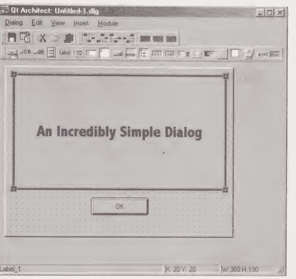

图 7.1 Qt Architect 的对话框编辑器。

## KDevelop

如果你大部分工作都在 UNIX 环境中进行（正如我那样），你可能会想要看看 KDevelop 环境提供了什么。这个 IDE 承诺成为 Linux 平台的标准 IDE。它支持 KDE、Qt、C++ 或 C 应用程序的开发，提供用于框架生成的“向导”，以及通常的 C++ 开发工具集，例如类浏览器、语言感知编辑器等。

Windows 开发者不太可能看到 Windows 平台的二进制文件。

## Ebuilder

Ebuilder 是另一个 WYSIWYG（所见即所得）GUI 编辑器；其最佳特性无疑是其对正在编辑的项目的分层小部件视图。项目是面向应用程序的，而不是 Qt Architect 的面向对话框的方法，使其更像许多 Motif 程序员会记得的自底向上编辑器。

Ebuilder 的另一个**不错**特性是**成员函数视图**，它使向正在设计的小部件添加成员函数变得容易。你还可以添加额外的包含文件用于外部代码。当你开始向 Ebuilder 生成的代码中添加自己的代码时，你会看到这有多重要。

在撰写本文时，没有可用的 Windows 版 Ebuilder 二进制文件。

## 摘要

有许多其他与应用开发相关的考虑因素，但它们不受使用 Qt 工具包这一选择的影响，因此未在此讨论中涉及。如果你订阅了 `qt-interest` 邮件列表，你会听到很多关于这些无关话题的讨论。这些讨论通常被警惕的 Trolls 所劝阻，他们倾向于保持讨论在主题内。

关于源代码管理、软件许可实践以及许多其他话题的讨论，有专门的新闻组只讨论这些内容。

# 第 8 章

## Windows 2000 主题

我听到 Windows 开发者声称 Qt 无法与其他 Windows 应用程序进行接口交互。本章，以及前面大量的材料，应该有助于消除这一误解。在这本书中，我混合使用了 Windows 和 Linux 开发术语，因为简单来说，Qt 并不关心你使用什么平台。除了特别注明的情况外，本书中的所有内容都适用于这两个平台。这并不意味着 Windows 和 Linux 是一样的。Microsoft Windows 有一些功能在 UNIX 平台上无法很好地转换（反之亦然）。本章专门致力于 Windows 问题，并提供 Windows 依赖功能的 Qt 编程示例。

执行某些更极端的平台依赖任务——例如为应用程序添加系统托盘图标——*可能*有点困难——但这是可以做到的。以下示例使用了一些许多开发者可能会遇到的极其 Windows 依赖的功能。

## DDE 服务器类

将你的 Windows Qt 应用程序转换为 DDE 服务器既简单又不可移植。以下示例类提供了一个非常简单的 DDE 执行服务器。

DDE 执行服务器-dde.h

```cpp
#ifndef __DDE_H__

#define __DDE_H__
```


# DDE 执行服务器

## dde.h

```cpp
#include <qwidget.h>

#include <qlist.h>

#include <qstring.h>

#include <windows.h>

#include <ddeml.h>

#include <tchar.h>

// DdeTopics store a function/handle pair

// DdeExecutes search a list of these for a topic and
// execute the function which returns true for ACK or
// false for others.

class DdeTopic
{
public:
  DdeTopic( bool (*func)( const char * ), Hsz name )
    { hConv = NULL; fun = func; topicA = name; }
  Hsz topic(){ return( topicA ); }
  void setConversation( HCONV h ) { hConv = h; }
  HCONV conversation(){ return( hConv ); }
  bool (*function(){} (const char * ) { return( fun ); }
private:
  bool (*fun)(const char *);
  Hsz topicA;
  HCONV hConv;
};

class DdeServer : public QObject
{
  Q_OBJECT
public:
  DdeServer( QString &svc_name );
  virtual ~DdeServer();
  void      insertTopic( bool (*func)( const char * ),
            const char *name );
signals:
  void      execute( void * );
private:
  DWORD     idInst;
  HINSTANCE hinst;
  Hsz       svc;
};

#endif // __DDE_H__
```

## dde.cpp

```cpp
#include <Dde.h>

static QList<DdeTopic> topics;

static HHRESULT CALLBACK
Callback( UINT wType, UINT wFmt, HCONV hConv, HDSZ hsz1,
            HDSZ hsz2, HDEDATA hDDData, DWORD dwData1,
            DWORD dwData2 )
{
    DdeTopic *p;
    DWORD len;
    bool (*fun)(const char *);
    const char *s;

switch (wType)
{
    case XTYP_REGISTER:
    case XTYP_UNREGISTER:
        return( (HHRESULT)false );
    case XTYP_ADVDATA:
        return( (HHRESULT)DDE_FACK );
    case XTYP_XACT_COMPLETE:
        return( (HHRESULT)false );
    case XTYP_DISCONNECT:
        return( (HHRESULT)false );
    case XTYP_EXECUTE:
        s = (const char *)DdeAccessData( hDDData,
            &len );
        for(p=topics.first();p; p=0;p=topics.next()) {
            if(p->topic() == hsz1) {
                fun = p->function();
                if( fun( s ) == true )
                    return( (HHRESULT)DDE_FACK );
            } else
                return( (HHRESULT)DDE_FNOTPROCESSED);
        }
        return( (HHRESULT)DDE_FNOTPROCESSED );
    case XTYP_CONNECT:
        for(p=topics.first();p; p=0;p=topics.next()) {
            if(p->topic() == hsz1) {
                p->setConversation( hConv );
                return( (HHRESULT)true );
            }
        }
        return( (HHRESULT)false );
default:
return( (HHRESULT)false );
}
}

DdeServer::DdeServer( QString &svc_name )
{
    idInst = 0;
    DdeInitialize( &idInst, Callback,
    APPEX_CLASS_STANDARD|CBF_SKIP_ALLNOTIFICATIONS, 0 );
    svc = DdeCreateStringHandle( idInst,
    (const char *)svc_name, CP_WINANSI );
    if(!DdeNameService( idInst, svc, 0,
    DNS_REGISTER|DNS_FL_TERMINAL )) {
    // Cctor failed...
    }
}

DdeServer::~DdeServer()
{
    DdeUninitialize( idInst );
}

void
DdeServer::insertTopic( bool ( *func)(const char *),
    const char *name )
{
    HDSZ n = DdeCreateStringHandle( idInst, name,
    CP_WINANSI );
    topics.append( new DdeTopic( func, n ));
}

#include <Dde.moc>
```

要在应用程序中使用此类，你只需要定义用于特定主题的函数，并为应用程序实例化一个 `DdeServer` 对象。这里有一个无用的示例：

```cpp
#include <qmessagebox.h>
#include <Dde.h>

static bool
myfunc( const char *p )
{
    QMessageBox::information( 0, "DDE Execute", p );
    return( true );
}

...
dde = new DdeServer( QString("DDESample") );
dde->insertTopic( myfunc, "TestTopic" );
...
```

每当另一个 Windows 应用程序对应用程序 `DDESample`、主题 `TestTopic` 执行 DDE 执行时，此示例会弹出一个消息框，显示客户端的执行字符串。

## 多媒体支持

以下示例为不同类型的媒体提供非常简单的音频支持。每个槽都假设你已经确定了正在使用的媒体类型（MIDI、WAV 等）。如果目标平台安装了 SAPI 运行时，该类透明地支持 Microsoft SAPI 3.0 TTS（文本转语音）API 调用。然而，构建此类支持需要 SAPI SDK。你可以从 MSDN 网站获取该 SDK——`http://www.msdn.microsoft.com`。

向此类添加 MIME 类型支持应该是一个简单的练习，以消除了解涉及的媒体类型的需要。

```cpp
Audio.h
#ifndef _AUDIO_H
#define _AUDIO_H

#ifndef WIN32
#error
#endif

#include <qwidget.h>

// Avoids the warning caused by lack of #pragma once
#ifndef STRICT
#define STRICT
#endif

#include <windows.h>
```


#include <Midi.h>

class Audio : public QObject
{
    Q_OBJECT
public:
    Audio();
    ~Audio();
    enum { Idle=0, Speech, Midi, Wav };
    int pitch();
    int speed();
    int voice();
    bool isSpeaking();
    bool canSpeak() { return(!cantalk); }
    public slots:
```

### Audio.h
```c
void speak( const char * );
void midiPlay( const char * );
void wavPlay( const char * );
void setPitch( int );
void setSpeed( int );
void setVoice( int );
void properties( QWidget *parent );
void pause();
void resume();
void stop();
void repeat();
private:
int state;
LilMidi *midi;
WCHAR *spbBuffer[2048];
char file[1024];
bool cantalk;
};
#endif // _AUDIO_H
```

### Midi.h
```c
#ifndef __MIDI_H__
#define __MIDI_H__
#ifndef WIN32
#error // Only supported on Win32
#endif
#include <qobject.h>
#include <qstring.h>
class LilMidi : public QObject
{
Q_OBJECT
public:
LilMidi();
virtual ~LilMidi();
enum { Stopped=0, Playing, Paused };
int tempo();
int status();
int divisionType();
bool open( const QString & );
bool seek( unsigned long msec );
unsigned long pos();
public slots:
void setTempo( int );
void close();
void play();
void stop();
void pause();
void fastPwd( int sec );
void rewind( int sec );
private:
    int state;
    WORD device;
    BOOL isopen;
};
#endif //__MIDI_H__
```

### Audio.cpp
```c
#include <Audio.h>
#include <string.h>
#include <stdio.h>
// Zap this if you don't want to use the SAPI stuff
#define TTS
#ifdef TTS
#include <mmsystem.h>
#include <initguid.h>
#include <objbase.h>
#include <ole2ver.h>
#include <spchwrap.h>
#include <qmessagebox.h>
static CTTSmode *speech;
#endif // TTS
#define GOOFY_MS_GLITCH
#ifdef GOOFY_MS_GLITCH
int errno;
#endif
Audio::Audio()
{
#ifdef TTS
    HRESULT hRes;
    // Initialize Speech
    TTMODEINFO mode;
    memset(&mode, 0, sizeof(TTSMODEINFO));
    speech = NULL;
    memset(file, 0, 1024);
memset( spbBuffer, 0, 2048 * sizeof( WCHAR ));
state = idle;
SetMessageQueue(96);
CoInitialize(NULL);
speech = new CTTSMode();
wcopy(mode.szSpeaker, L"Mary");
if ((hRes = speech->Init ( &mode, NULL )) != S_OKERROR) {
cantalk = true;
QString s = QString( (QChar *)mode.szSpeaker,
TTSI_NAMelen ));
} else cantalk = false;
#endif // TTS
midi = new LiiMidi();
}
Audio::~Audio()
{
#ifdef TTS
if(cantalk == true || speech != NULL) {
delete speech;
}
CoUnitialize();
#endif
delete midi;
}
int
Audio::pitch()
{
#ifdef TTS
if(cantalk == false || speech == NULL) return(-1);
#endif
return( 0 );
}
int
Audio::speed()
{
#ifdef TTS
if(cantalk == false || speech == NULL) return(-1);
return( speech->SpeedGet( ) );
#endif
return(0);
}
// Pops a dialog with the properties dialog (if supported
// by TTS engine)
void
Audio::properties( QWidget *p )
{
#ifdef TTS
if(cantalk == false || speech == NULL) return;
speech->GeneralDlg( p->winID(), "TTS Properties" );
#endif
}
int
Audio::voice()
{
#ifdef TTS
if(cantalk == false || speech == NULL) return(-1);
#endif
return(0);
}
void
Audio::speak( const char *p )
{
#ifdef TTS
if(cantalk == false || speech == NULL) return;
state = Speech;
memset(spksbuffer, 0, 2048*sizeof(WCHAR));
Qstring msgs = Qstring(p);
wcsncpy( spksbuffer,
(WCHAR *) (msgs.unicode(), 1023);
spksbuffer[strlen(p)] = 0;
speech->Speak( (PCWSTR)spksbuffer, true, NULL );
#endif
}
void
Audio::midiPlay( const char *p )
{
state = Midi;
memset(file, 0, 1024);
strncpy(file, p, 1023);
midi->close();
midi->open( p );
midi->play();
}
void
Audio::wavPlay( const char *p )
{
state = Wav;
memset(file, 0, 1024);
strncpy(file, p, 1023);
PlaySound( file, NULL, SND_ASYNC|SND_FILENAME );
}
void
Audio::setPitch( int v )
{
}
void
Audio::setSpeed( int v )
{
#ifdef TTS
  speech->SpeedSet(v);
#endif
}
void
Audio::setVoice( int v )
{
}
void
Audio::pause()
{
```


```cpp
switch(state) {
    case Speech:
#ifdef TTS
        speech->AudioPause();
#endif
        break;
    case WAV:
        PlaySound( NULL, NULL, SND_PURGE );
        break;
    case Midi:
        midi->pause();
        break;
    default:
        break;
}
}
```

```cpp
void
Audio::resume()
{
  switch(state) {
    case Speech:
#ifdef TTS
        speech->AudioResume();
#endif
        break;
    case WAV:
        PlaySound( file, NULL,
                  SND_ASYNC|SND_FILENAME );
        break;
    case Midi:
        midi->play();
        break;
    default:
        break;
  }
}
```

```cpp
void
Audio::stop()
{
    switch(state) {
    case Speech:
#ifdef TTS
        speech->AudioReset();
#endif
        break;
    case Wave:
        PlaySound( NULL, NULL, SND_PURGE );
        break;
    case Midi:
        midi->stop();
        break;
    default:
        break;
    }
}
```

```cpp
void
Audio::repeat()
{
    switch(state) {
    case Speech:
#ifdef TTS
        speech->Speak( spkbuffer, true, NULL );
#endif
        break;
    case Wave:
        PlaySound( file, NULL,
             SND_ASYNC|SND_FILENAME );
        break;
    case Midi:
        midi->seek( 0L );
        midi->play();
        break;
    default:
        break;
    }
}
```

```cpp
#include <Audio.moc>
```

### Midi.cpp

```cpp
#include <afxwin.h>
#include <mmsystem.h>
// Avoids the warning caused by lack of #pragma once
#define STRICT
#undef STRICT
#endif
#include <Midi.h>
#include <QFile.h>

// LilMidi ctor
LilMidi::LilMidi()
{
    state = Stopped;
    device = 0;
    isopen = false;
}

// Default dtor
LilMidi::~LilMidi()
{
    close();
}

// bool open( const QString &file_name )
// Open the midi file, set stream position to 0
bool
LilMidi::open( const QString &filename )
{
    QFile fi( filename );
    // If we aren't stopped, stop and close.
    if( isopen == true ) {
        if( state != Stopped ) stop();
        close();
    }
    device = 0;
    // See if the file exists
    if( fi.exists() == false ) {
        return( false );
    }
    // Get the device
    MCI_OPEN_PARMS parms;
    parms.lpstrDeviceType = (LPCSTR)MCI_DEVTYPE_SEQUENCER;
    parms.lpstrElementName= (LPCSTR)(const char *)filename;
    parms.wDeviceID = 0;
    if( mciSendCommand( NULL,
            MCI_OPEN,
            MCI_WAIT | MCI_OPEN_TYPE |
            MCI_OPEN_TYPE_ID | MCI_OPEN_ELEMENT,
            (DWORD)(LPOID)&parms ) ) {
        return( false );
    }
    device = parms.wDeviceID;
    isopen = true;
    // Set the time format to milliseconds
    MCI_SET_PARAMS sparms;
    sparms.dwTimeFormat = MCI_FORMAT_MILLISECONDS;
    if (mciSendCommand( device,
    MCI_SET,
    MCI_SET_TIME_FORMAT,
    (DWORD)(LPVOID)&sparms ) ) {
    close ();
    return( false );
    }
    mciSendCommand( device, MCI_SEEK, MCI_SEEK_TO_START, NULL );
    return( true );
}

// void close()
// Stop and close the mci stream
void
LiiMidi::close()
{
    if (isopen == true ) {
        // Stop playing and close
        mciSendCommand( device, MCI_STOP, NULL, NULL );
        state = Stopped;
        mciSendCommand( device, MCI_CLOSE, NULL, NULL );
        device = 0;
        isopen = false;
    }
}

// void play()
// begin play from current stream position
void
LiiMidi::play()
{
    if (isopen == true ) {
        MCI_STATUS_PARAMS sparms;
        MCI_PLAY_PARMS parms;
        // Start playing from current position
        // if paused
        if( state == Paused ) {
            sparms.dwItem = MCI_STATUS_POSITION;
            if( mciSendCommand(
            device,
            MCI_STATUS,
            MCI_WAIT | MCI_STATUS_ITEM,
            (DWORD)(LPVOID)&sparms ) ) {
                return;
            } else (
            sparms.dwReturn = 0;
            }
            parms.dwCallback = NULL;
            parms.dwFrom = sparms.dwReturn;
            if( mciSendCommand(
                 device,
                 MCI_PLAY,
                 MCI_FROM,
                 (DWORD)(LPVOID)&parms) ) {
                 return;
            }
            state = Playing;
        }
    }
}

// void stop()
// Stop and reposistion stream to 0
void
LilMidi::stop()
{
    if( isopen == true ) {
        if(state == Playing ) {
            mciSendCommand( device, MCI_STOP, NULL, NULL );
```


```cpp
}
mciSendCommand(device, MCI_SEEK, MCI_SEEK_TO_START, NULL);
state = Stopped;
}
}

// void pause()
void
LilMidi::pause()
{
    if (isopen == true && state == Playing) {
        MCI_PLAY_PARMS parms;
        if (mciSendCommand(device, MCI_PAUSE, 0, (DWORD)(LPVOID)&parms))
            return;
        state = Paused;
    }
}

// unsigned long pos()
// Returns current stream position
unsigned long
LilMidi::pos()
{
    if (isopen == true) {
        MCI_STATUS_PARMS parms;
        parms.dwItem = MCI_STATUS_POSITION;
        if (mciSendCommand(
```

```cpp
MCI_STATUS,
MCI_WAIT | MCI_STATUS_ITEM,
(DWORD)(LPVOID)&parms)) {
    return(OL);
}
return(parms.dwReturn);
return(OL);
```

// int status()
// update and return current state
// LilMidi:::(Stopped, Playing, or Paused)
int
LilMidi::status()
{
    if (isopen == true) {
        MCI_STATUS_PARMS parms;
        parms.dwItem = MCI_STATUS_MODE;
        if (mciSendCommand(
            device,
            MCI_STATUS,
            MCI_WAIT | MCI_STATUS_ITEM,
            (DWORD)(LPVOID)&parms)) {
            return(Stopped);
        }
        switch (parms.dwReturn) {
            case MCI_MODE_PLAY:
                state = Playing;
                break;
            case MCI_MODE_PAUSE:
                state = Paused;
                break;
            default:
                state = Stopped;
                break;
        }
    } else {
        state = Stopped;
    }
    return(state);
}

// bool seek(unsigned long milliseconds)
// seek to the stream position
bool
LilMidi::seek(unsigned long msec)
{
    if (isopen == true) {
        MCI_SEEK_PARMS params;
        params.dwTo = msec;
        switch (status()) {
            case Playing:
                if (mciSendCommand(device, MCI_PAUSE, 0, NULL))
                    return(false);
                if (mciSendCommand(device, MCI_SEEK, MCI_TO | MCI_WAIT, (DWORD)(LPVOID)&params)) {
                    return(false);
                }
                state = Paused;
                play();
                break;
            default:
                if (mciSendCommand(device, MCI_SEEK, MCI_TO | MCI_WAIT, (DWORD)(LPVOID)&params)) {
                    return(false);
                }
                break;
        }
        return(true);
    }
    return(false);
}

// void fastPwd(int seconds)
// advance the stream position
void
LilMidi::fastPwd(int sec)
{
    if (isopen == true) {
        unsigned long p = pos();
        p += (unsigned long)(sec * 1000);
        seek(p);
    }
}

// void rewind(int seconds)
// rewind the stream
void
LilMidi::rewind(int sec)
{
    if (isopen == true) {
        unsigned long p = pos();
        if (p < (unsigned long)(sec * 1000))
            p = 0;
        else
            p -= (unsigned long)(sec * 1000);
        seek(p);
    }
}

// int divisionType()
// Returns 0 on error or MCI_SEQ_DIV_???? value
int
LilMidi::divisionType()
{
    if (isopen == true) {
        MCI_STATUS_PARMS parms;
        parms.dwItem = MCI_SEQ_STATUS_DIVTYPE;
        if (mciSendCommand(device, MCI_STATUS, MCI_WAIT | MCI_STATUS_ITEM, (DWORD)(LPVOID)&parms)) {
            return(0);
        }
        return((int)parms.dwReturn);
    }
    return(0);
}

// int tempo()
// -1 on error, else tempo value
int
LilMidi::tempo()
{
    if (isopen == true) {
        MCI_STATUS_PARMS parms;
        parms.dwItem = MCI_SEQ_STATUS_TEMPO;
        if (mciSendCommand(device, MCI_STATUS, MCI_WAIT | MCI_STATUS_ITEM, (DWORD)(LPVOID)&parms)) {
            return(-1);
        }
```


```
return( (int)parms.dwReturn );
}

return( -1 );
}

// void setTempo( int tempo )
void
LilMidi::setTempo( int tempo )
{
    if( isopen == true ) {
        MCI_SEQ_SET_PARMS parms;
        parms.dwTempo = tempo;
        mciSendCommand( device,
            MCI_SET,
            MCI_WAIT | MCI_SEQ_SET_TEMPO,
            (DWORD)(LPVOID)&parms );
    }
}
#include <Midi.moc>
```

使用该类非常简单。以下示例展示了实例化和使用方法：

```cpp
#include <Audio.h>

Audio *aud = new Audio();

aud->wavPlay( "sounds\\hello.wav" );

aud->speak( "This is a test." );
```


当然，如果目标系统没有安装 TTS 引擎（这在 Win98 或 NT4 系统上很常见），`Audio::speak` 不会执行任何操作，但在 Windows 2000 上应该能正常工作，并且在不包含 TTS 引擎的系统中也不会引起问题。

添加 MIDI 支持或将 `Audio` 类调整为使用不同于微软 SPCAPI 的其他 TTS 引擎应该是一件简单的事情。

## 总结

虽然在我心目中，Linux 仍然是我首选的操作系统（作为开发平台），但 Windows 2000 提供了许多功能，使得选择最喜欢的系统变得越来越困难。Qt 发行版中附带的大多数示例主要面向 Linux 用户。我这样说的依据是，其中一些示例在 Windows 平台上无法构建（且相关性不大）。我预计在未来版本的 Qt 中会看到一些仅适用于 Windows 的示例。让我们拭目以待。

## 附录 A

### Qt 工具包内容

下表详细列出了 Qt 工具包在 2.1 版本中提供的类方法级别的功能。该表按字母顺序列出方法，并交叉引用了包含这些方法的类。关于访问规范，请参阅当前文档，因为供应商定期进行的调整往往会导致从一个版本到下一个版本的访问权限发生变化。

#### Qt 类方法字母表列表

下表提供了 Qt 类方法、信号、槽以及暴露它们的类的综合列表。

| 槽、信号或方法 | 暴露它的类 |
|---|---|
| `AsciiToUnicode()` | `QjpUnicodeConv` |
| `Jisx0201KanaToUnicode()` | `QjpUnicodeConv` |
| `Jisx0201LatinToUnicode()` | `QjpUnicodeConv` |
| `Jisx0201ToUnicode()` | `QjpUnicodeConv` |
| `Jisx0208ToUnicode()` | `QjpUnicodeConv` |
| `Jisx0212ToUnicode()` | `QjpUnicodeConv` |
| `SjisToUnicode()` | `QjpUnicodeConv` |
| `UnicodeToAscii()` | `QjpUnicodeConv` |
| `UnicodeToSjisx0201()` | `QjpUnicodeConv` |
| `UnicodeToSjisx0201Kans()` | `QjpUnicodeConv` |
| `UnicodeToSjisx0201Latin()` | `QjpUnicodeConv` |
| `UnicodeToSjisx0208()` | `QjpUnicodeConv` |
| `UnicodeToSjisx0212()` | `QjpUnicodeConv` |
| `UnicodeToSjis()` | `QjpUnicodeConv` |

| 方法 | 暴露它的类 |
|---|---|
| `abort()` | `QPrinter` |
| `aborted()` | `QPrinter` |
| `about()` | `QMessageBox` |
| `aboutQt()` | `QMessageBox` |
| `aboutQQuilt()` | `QApplication` |
| `aboutToShow()` | `QWidgetStack` `QTabDialog` `QPopupMenu` |
| `absFilePath()` | `QFile` |
| `absPath()` | `QDir` |
| `accel()` | `QButton` `QMenuData` |
| `accept()` | `QDropEvent` `QWheelEvent` `QCloseEvent` `QKeyEvent` |
| `acceptAction()` | `QDialog` `QDragMoveEvent` |
| `acceptDrop()` | `QDropEvent` |
| `acceptDrops()` | `QConViewItem` |
| `accum()` | `QWidget` |
| `action()` | `QListFormat` |
| `activate()` | `QDropEvent` |
| `activateFilters()` | `QListViewItem` `QCheckBoxItem` `QLayout` `QSignal` |
| `activate_signal()` | `QObject` |
| `activate_signal_bool()` | `QObject` |
| `activate_signal_string()` | `QObject` |
| `activate_signal_strref()` | `QObject` |
| `activated()` | `QAccel` `QComboBox` `QMenuBar` `QPopupMenu` `QSocketNotifier` |
| `activatedPos()` | `QListViewItem` |
| `activatedRedirect()` | `QPopupMenu` |
| `active()` | `QPalette` |
| `activeModalWidget()` | `QApplication` |
| `activePopupWidget()` | `QApplication` |
| `activeWindow()` | `QNamespace` `Application` |
| `actual()` | `QNplugin` |
| `add()` | `QWhatsThis` `QLayout` `QGridLayout` `QToolTip` |
| `addChild()` | `QScrollView` |
| `addChildLayout()` | `QLayout` |
| `addColSpacing()` | `QGridLayout` |
| `addColumn()` | `QListView` |
| `addDays()` | `QDateTime` `QDate` |
| `addFilePath()` | `QImageSourceFactory` |
| `addFilter()` | `QFileDialog` |
| `addItem()` | `QBoxLayout` `QGridLayout` `QLayout` |
| `addLabel()` | `QHeader` |

### asBool()
`QVariant`

### asBrush()
`QVariant`

### ascant()
`QFontMetrics`

### ascii()
`QString` `QKeyEvent`

### asColor()
`QVariant`

### asColorGroup()
`QVariant`

### asString()
`QVariant`

### asCursor()
`QVariant`

### asDouble()
`QVariant`

### asFont()
`QVariant`

### asIconSet()
`QVariant`

### asImage()
`QVariant`

### asInt()
`QVariant`

### asList()
`QVariant`

### asPalette()
`QVariant`

### asPixmap()
`QVariant`

### asPoint()
`QVariant`

### asPointArray()
`QVariant`

### asRect()
`QVariant`

### asRegion()
`QVariant`

### asSize()
`QVariant`

### asString()
`QVariant`

### asStringList()
`QVariant`

### asUint()
`QVariant`

### at()
`QList`, `QList`, `QVariantList`, `QVector`, `QBuffer`, `QFile`, `QByteArray`, `QByteArray`, `QGArray`, `QVector`, `QIODevice`, `QArray`, `QString`

### atBeginning()
`QMultiLineEdit`

### atEnd()
`QIODevice`, `QDataStream`, `QMultiLineEdit`, `QFile`, `QTextStream`

### atFirst()
`QCachedIterator`, `QIntCacheIterator`, `QAscii`, `QCacheIterator`, `QListIterator`, `QListIterator`, `QStrListIterator`, `QCacheIterator`

### atLast()
`QCacheIterator`, `QAsciiCacheIterator`, `QListIterator`, `QCacheIterator`, `QStrListIterator`, `QListIterator`, `QIntCacheIterator`, `QLayout`

### autoAdd()

### autoArrange()
`QIconView`

### autoBufferSwap()
`QWidget`

### autoClose()
`QProgressDialog`

### autoCompletion()
`QComboBox`

### autoDefault()
`QPushButton`

### autoDelete()
`QCollection`, `QStack`, `QQueue`, `QNetworkProtocol`

### autoMask()
`QWidget`

### autoRaise()
`QToolButton`

### autoRepeat()
`QButton`

### autoReset()
`QProgressDialog`

### autoResize()
`QButton`, `QComboBox`, `QLabel`

### autoUpdate()
`QMultiLineEdit`, `QTableView`

### back()
`QWizard`

### backButton()

### background()
`QColorGroup`

### backgroundColor()
`QWidget`, `QPainter`, `QMovie`

### backgroundColorChange()
`QWidget`

### backgroundMode()
`QWidget`, `QPainter`

### backgroundOrigin()
`QWidget`

### backgroundPixmap()
`QWidget`

### backgroundPixmapChange()
`QWidget`

### backspace()
`QLineEdit`, `QMultiLineEdit`

### backward()
`QTextBrowser`

### backwardAvailable()
`QTextBrowser`

### badSuperClassWarning()
`QObject`

### base()
`QColorGroup`

### baseName()
`QFileInfo`

### baseSize()
`QWidget`

### baseDirContext()
`QString`

### beep()
`QApplication`

### begin()
`QByteArrayList`, `QPainter`, `QByteArray`, `QValueList`, `QMap`

### bevelButtomRect()
`QStyle`

### bitmap()
`QCursor`

### bitOrder()
`QImage`

### bits()
`QImage`

### block()
`QSignal`

### blockSignals()
`QObject`

### blue()
`QColor`

### bold()
`QFont`, `QFontInfo`, `QFontDatabase`

### bottom()
`QRect`, `QDoubleValidator`, `QIntValidator`

### bottomLeft()
`QRect`

### bottomMargin()
`QScrollViewer`

### bottomRight()
`QRect`

### bound()
`QRadioButton`, `QSlider`

### boundedRo()
`QSize`

### boundingRect()
`QPoint`, `QRegion`, `QFontMetrics`, `QPainter`

### brightText()
`QColorGroup`

### brush()
`QPalette`, `QPainter`, `QColorGroup`

### brushOrigin()
`QPainter`

### search()
`QByteArrayList`, `QVector`, `QByteArray`, `QIntValidator`

### buffer()
`QBuffer`

### button()
`QColorGroup`, `QMouseEvent`

### buttonClicked()
`QButtonGroup`

### buttonDefaultIndicatorWidth()
`QButtonGroup`

### buttonPressed()
`QStyle`, `QPlatinumStyle`

### buttonRect()
`QButtonGroup`

### buttonReleased()
`QSpinBox`

### buttonSymbolic()
`QColorGroup`, `QMessageBox`

### buttonToggled()
`QButtonGroup`

### byteOrder()
`QDataStream`

### bytesPerLine()
`QImage`

### cacheLimit()
`QPixmapCache`

### cacheStatistics()
`QFont`

### caching()
`QFileInfo`

### calcRect()

### calcTmpText()

### canCast()

### cancel()
`QProgressDialog`, `QSessionManager`

### cancelButton()
`QWizard`

### cancelButtonPressed()
`QTabDialog`

### cancelLied()
`QProgressDialog`

### canDecode()
`QUrlDrag`, `QColorDrag`, `QImageDrag`, `QIconDrag`

### canEncode()
`QTextDrag`

### canonicalPath()
`QTextCodec`

### capStyle()
`QDir`

### caption()
`QOpen`

### cascade()
`QWdgExp`

### caseSensitive()
`QNamespace`

### category()
`QRegExp`

### cd()
`QChar`

### cdUp()
`QDir`

### cell()
`QUrl`, `QUrl`, `QDir`

### cellAt()
`QChar`

### cellGeometry()
`QHeader`

### cellHeight()
`QGridLayout`

### cellPos()
`QTableView`

### cellSize()
`QHeader`

### cellUpdateRect()
`QHeader`

### cellWidth()
`QTableView`

### center()
`QTableView`

### centerCurrentItem()
`QRect`, `QScrollView`

### centerIndicator()
`QListBox`

### centralWidget()
`QProgressBar`

### cfirst()
`QMainWindow`

### changed()
`QList`

### changeInterval()
`QImageConsumer`

### changeItem()
`QTimer`

### changeSize()
`QMnuData`, `QListBox`, `QComboBox`

### changeTab()
`QSpacerItem`

### charSet()
`QTabWidget`, `QTabDialog`

### charSetForLocale()
`QFontInfo`, `QFont`

### charSets()
`QFont`

### charSetSample()
`QFontDatabase`

### checkConnectArgs()
`QFontDatabase`

### checkConnection()
`QObject`

### checkOverflow()
`QNetworkProtocol`

### checkValid()
`QCNumber`

### child()
`QUrlOperator`

### childCount()
`QObject`, `QChildEvent`

### childEvent()
`QListViewItem`, `QListView`

### childIsVisible()
`QMainWindow`, `QSpliter`, `QQGroubBox`, `QWidgetStack`

### children()
`QOject`, `QWorkspace`

### childrenRect()
`QScrollView`

### childrenRegion()
`QOject`

### childx()
`QScrollView`

### childY()
`QScrollView`

### chooseContext()
`QGLContext`

### classInfo()
`QMetaObject`

### className()
`QObject`, `QMetaObject`

### clist()
`QGList`

### cleanBuffers()
`QPointerArray`

### cleanDirPath()
`QDir`

### cleanText()
`QSpinBox`

### cleanup()
`QFont`, `QPainter`, `QColor`, `QCursor`, `QToolTip`, `QToolBar`, `QMultiLineEdit`, `QIntCache`, `QVariant`, `QCollection`, `QStack`, `QValueList`, `QListView`, `QAccel`, `QLineEdit`, `QList`, `QCache`, `QListBox`, `QVector`, `QIntDict`, `QAsciiClass`, `QStatusbar`, `QCache`, `QTranslator`, `QVector`, `QDict`, `QMap`, `QLabel`, `QGridLayout`, `QAsciiDict`, `QClipboard`, `QMenuData`, `QComboBox`, `QPixmapCache`, `QQueue`, `QGList`, `QListArray`, `QComboBox`, `QCursor`, `QMetaProperty`, `QWidget`, `QListBox`, `QWidget`, `QNetworkProtocol`, `QIconView`, `QListBox`, `QListView`, `QTableWidget`, `QLineEdit`, `QComboBox`, `QWidget`, `QWidget`, `QWidget`, `QHeader`, `QListWidget`, `QIconView`, `QButtonGroup`, `QListView`, `QButton`

### clicked()
`QWidget`, `QHeader`, `QListWidget`, `QIconView`, `QButtonGroup`, `QListView`, `QButton`

### clipboard()
`QApplication`

### clipper()
`QScrollView`

### clipRegion()
`QPainter`

### close()
`QBuffer`, `QIODevice`, `QWidget`, `QFile`

### closeAllWindows()
`QApplication`

### closeEvent()
`QProgressDialog`, `QPopupMenu`, `QWidget`, `QDialog`

### closingDown()
`QApplication`

### cmd()
`QPaintDevice`, `QPicture`, `QPrinter`

### codecForContent()
`QTextCodec`

### codecForIndex()
`QTextCodec`

### codecForLocale()
`QTextCodec`

### codecForMib()
`QTextCodec`

### codecForName()
`QTextCodec`

### colIsVisible()
`QTableView`

### collapsed()
`QListView`

### color()
`QBrush`, `QColorGroup`, `QPen`, `QImage`, `QPalette`, `QStyleSheetItem`

### colorGroup()
`QWidget`

### colorIndex()
`QGLContext`

### colorMode()
`QPrinter`

### colorSpace()
`QApplication`

### colorTable()
`QImage`

### colStretch()
`QGridLayout`

### columnAlignment()
`QListView`

### columnMode()
`QListBox`

### columns()
`QPopupMenu`, `QList`, `QGroupBox`

### columnText()
`QListView`

### columnWidth()
`QListView`

### columnWidthMode()
`QListView`

### colPos()
`QTableView`

### combobuttonFocusRect()
`QWindowStyle`, `QStyle`, `QPlatinumStyle`, `QMotifStyle`, `QCommonStyle`, `QStyle`, `QCommonStyle`, `QPlatinumStyle`, `QWindowsStyle`, `QMotifStyle`

### commitData()
`QApplication`

### compare()
`QIconViewItem`, `QString`

### compareItems()
`QList`, `QSortedList`, `QVector`

### compile()
`QRegExp`

### complete()
`QProcess`

### compose()
`QString`

### connect()
`QSignal`, `QAnyString`, `QObject`

### connectionStateChanged()
`QUrlOperator`, `QNetworkProtocol`

### connectItem()
`QMenuData`, `QCell`

### connectNotify()
`QClipboard`, `QObject`

### connectResize()
`QMovie`

### connectStatus()
`QMovie`

### connectUpdate()
`QMovie`

### constPolish()
`QWidget`

### constRef()
`QString`

### contains()
`QMap`, `QList`, `QRegion`, `QTranslator`, `QVector`, `QMap`, `QString`, `QVector`, `QArray`, `QList`, `QValueList`, `QIconViewItem`, `QRect`, `QByteArray`, `QString`

### containsRef()
`QList`, `QList`, `QVector`, `QVector`

### contentsDragEnterEvent()
`QIconView`, `QScrollView`

### contentsDragLeaveEvent()
`QIconView`, `QScrollView`

### contentsDragMoveEvent()
`QIconView`, `QScrollView`

### contentsDropEvent()
`QScrollView`, `QIconView`

### contentsHeight()
`QScrollView`

### contentsMouseDoubleClick()
`QIconView`, `QListView`, `QScrollView`

### contentsMouseEvent()
`QScrollView`, `QIconView`, `QListView`

### contentsMousePressEvent()
`QListView`, `QScrollView`, `QIconView`

### contentsMouseReleaseEvent()
`QListView`, `QScrollView`, `QIconView`

### contentsMoving()
`QScrollView`

### contentsRect()
`QFrame`

### contentsToViewPort()
`QScrollView`

### contentsWheelEvent()
`QScrollView`

### contentsWidth()
`QScrollView`

### context()
`QScrollView`

### context()
`QScrollView`

### contextx()
`QScrollView`

### contexts()
`QGLWidget`, `QTextView`, `QSimpleRichText`, `QStyleSheetItem`

## 附录 A Qt 工具包内容

`convertToBorder()` `QImage`
`convertDepth()` `QImage`
`convertDepthWithPalette()` `QImage`
`convertFromImage()` `QPixmap`
`convertFromPlainText()` `QStyleSheet`
`convertSeparators()` `QDir`
`convertToTabs()` `QFileInfo`
`convertToImage()` `QPixmap`
`coords()` `QRect`
`copy()` `QString` `QLineEdit` `QByteArray` `QImage` `QToolBar` `QPolygonArray` `QPalette` `QUrlOperator` `QMultiLineEdit` `QTextView` `QBitmap`
`copyText()` `QMultiLineEdit`
`cornerWidget()` `QScrollView`
`count()` `QDict` `QCache` `QStrListIterator` `QQueue` `QPointer` `QPtrDictIterator` `QStack` `QArray` `QKeyEvent` `QValueList` `QDict` `QMap` `QComboBox` `QIntDictIterator` `QVector` `QAsciiCache` `QDictIterator` `QAsciiIterator` `QCacheIterator` `QStrListIterator` `QCollection` `QFocusData` `QIntCacheIterator` `QAsciiDict` `QICache` `QDir` `QIconView` `QListBox` `QButtonGroup` `QAsciiCacheIterator` `QIntDict` `QHeader` `QCell` `QMenuData` `QVector` `QList` `QAsciiDictIterator`

`create()` `QImage` `QGLContext` `QPlugin` `QWidget`
`createAlphaMask()` `QImage`
`createdDirectory()` `QUrlOperator` `QNetworkProtocol`
`createHeuristicMask()` `QPixmap` `QImage`
`creator()` `QPrinter`
`critical()` `QMessageBox`
`current()` `QDictIterator` `QStack` `QLayoutIterator` `QPtrDictIterator` `QIntDictIterator` `QListBoxItem` `QIntCacheIterator` `QListIterator` `QLayoutIterator` `QDir` `QCacheIterator` `QList` `QQueue` `QListViewItemIterator` `QStrListIterator` `QAsciiDictIterator` `QAsciiCache` `QColor`

`currentAllocContext()` `QGLContext` `QListView`
`currentChanged()` `QGLContext`
`currentContext()` `QDate`
`currentData()` `QDateTime`
`currentDirPath()` `QDir`
`currentItem()` `QIconView` `QListBox` `QListView` `QComboBox` `QAsciiCacheIterator` `QIntCacheIterator` `QDictIterator` `QPtrDictIterator` `QIntDictIterator` `QCacheIterator` `QAsciiDictIterator`
`currentNode()` `QList`
`currentPage()` `QTabWidget` `QTabDialog` `QWizard`
`currentTab()` `QTabBar`
`currentText()` `QComboBox` `QListBox`
`currentTime()` `QTime`
`currentValueText()` `QSpinBox`

`cursor()` `QWidget`
`cursorDown()` `QMultiLineEdit`
`cursorFlashTime()` `QApplication`
`cursorLeft()` `QLineEdit` `QMultiLineEdit`
`cursorPoint()` `QMultiLineEdit`
`cursorPosition()` `QLineEdit` `QMultiLineEdit`
`cursorRight()` `QLineEdit` `QMultiLineEdit`
`cursorUp()` `QMultiLineEdit`
`cursorWordBackward()` `QMultiLineEdit` `QLineEdit`
`cursorWordForward()` `QLineEdit` `QMultiLineEdit`
`customColor()` `QColorDialog`
`customCount()` `QColorDialog`
`customEvent()` `QWidget`
`customWhatIsThis()` `QPopupMenu` `QWidget` `QMenuBar`
`cut()` `QMultiLineEdit` `QLineEdit`
`dark()` `QColor` `QColorGroup`
`data()` `QArray` `QByteArray` `QTimeSourceFactory` `QVector` `QPicture` `QMapIterator` `QVector` `QUrlOperator` `QNetworkProtocol` `QIconDragItem` `QMapConstIterator` `QGArray` `QCustomEvent` `QDropEvent` `QClipboard`
`dataChanged()` `QClipboard`
`dataTransferProgress()` `QUrlOperator` `QNetworkProtocol`
`date()` `QDateTime`
`day()` `QDate`
`dayName()` `QDate`
`dayOfWeek()` `QDate`
`dayOfYear()` `QDate`
`daysInMonth()` `QDate`
`daysInYear()` `QDate`
`daysTo()` `QDate` `QDateTime`
`decimals()` `QDoubleValidator`
`docFontPointSize()` `QFont`
`decode()` `QTextDrag` `QImageDrag` `QUrlDrag` `QImageFormat` `QImageDecoder` `QUrl` `QColorDrag`
`decodeLocalFiles()` `QUrlDrag`
`decoderName()` `QFile`
`decoderFor()` `QImageFormat`
`decodeToUnicodeUris()` `QUrlDrag`
`decompositionTag()` `QChar`
`defaultButtonPressed()` `QTabDialog`
`defaultCodec()` `QApplication`
`defaultDepth()` `QPixmap`
`defaultFactory()` `QTimeSourceFactory`
`defaultFamily()` `QFont`
`defaultFont()` `QFont`
`defaultFormat()` `QGLFormat`
`defaultFrameWidth()` `QDesktop` `QCommonStyle` `QStyle`
`defaultOptimization()` `QPixmap`
`defaultOverlayFormat()` `QGLFormat`
`defaultSheet()` `QStyleSheet`
`defaultTabStop()` `QMultiLineEdit`
`defineIOHandler()` `QImageIO`
`defineFontItalic()` `QStyleSheetItem`
`defineFontUnderline()` `QStyleSheetItem`
`del()` `QLineEdit` `QMultiLineEdit`
`delay()` `QToolTipGroup`
`deleteAllCodecs()` `QTextEdit`
`deleteAllItems()` `QLayout`
`deleteCurrent()` `QLayoutIterator`
`deleteData()` `QBitArray` `QGArray`
`deleteItem()` `QCollection`
`deleteNetworkProtocol()` `QUrlOperator`
`delta()` `QWheelEvent`
`depth()` `QPaintDeviceMetrics` `QListViewItem` `QImage` `QPixmap` `QGLFormat`
`dequeue()` `QQueue`
`descent()` `QFontMetrics`
`description()` `QImageIO`
`deselect()` `QLineEdit` `QMultiLineEdit`
`designable()` `QMetaProperty`
`desktop()` `QApplication`
`desktopSettingsAware()` `QApplication`
`destroy()` `QWidget`
`destroyAllocContext()` `QColor`
`destroyed()` `QObject`
`detach()` `QArray` `QValueList` `QImage` `QMap` `QByteArray` `QPixmap` `QIconSet` `QArray` `QBitArray`
`device()` `QTextStream` `QDataStream` `QPainter` `QGLContext`
`deviceIsPixmap()` `QGLContext`
`devType()` `QPaintDevice`
`digitValue()` `QChar`
`dir()` `QFileInfo`
`direction()` `QChar` `QBoxLayout`
`directRendering()` `QGLFormat`
`directSetValue()` `QRangeControl`
`dirEntered()` `QFileDialog`
`dirName()` `QDir`
`dirPath()` `QDir` `QFileInfo` `QFileDialog`
`dirty()` `QFont`
`disabled()` `QPalette`
`discardCommand()` `QSessionManager`
`disconnect()` `QObject` `QSignal`
`disconnectItem()` `QAccel` `QMenuData`
`disconnectNotify()` `QObject`
`disconnectResize()` `QMovie`
`disconnectStatus()` `QMovie`
`disconnectUpdate()` `QMovie`
`display()` `QLCDNumber`
`displayMode()` `QStyleSheetItem`
`displayText()` `QLineEdit`
`doAutoScroll()` `QListView` `QIconView`
`docName()` `QPrinter`
`documentTitle()` `QTextView`
`doLayout()`
`done()` `QDialog`
`doneCurrent()` `QGLContext`
`dotsPerMeterX()` `QImage`
`dotsPerMeterY()` `QImage`
`doubleBuffer()` `QKeyFormat` `QGLWidget`
`doubleClicked()` `QIconView` `QListView` `QListBox`
`doubleClickInterval()` `QApplication`
`downButton()` `QSpinBox`
`drag()` `QDragObject`
`dragAutoScroll()` `QScrollView`
`dragCopy()` `QDragObject`
`dragEnabled()` `QIconViewItem`
`dragEntered()` `QIconViewItem`
`dragEnterEvent()` `QLineEdit` `QWidget` `QMultiLineEdit`
`dragGripSlider()` `QScrollBar`
`dragLeaveEvent()` `QMultiLineEdit` `QWidget`
`dragLeft()` `QIconViewItem`
`dragMove()` `QDragObject`
`dragMoveEvent()` `QMultiLineEdit` `QWidget`
`dragObject()` `QIconView`
`draw()` `QSimpleRichText`
`drawArc()` `QPainter`
`drawArrow()` `QWindowsStyle` `QStyle` `QMotifStyle` `QCDEStyle`
`drawBackground()` `QIconView`
`drawBevelButton()` `QStyle` `QMotifStyle` `QWindowsStyle` `QPlatinumStyle`
`drawButton()` `QToolButton` `QButton` `QCheckBox` `QWindowStyle`
`drawButtonLabel()` `QRadioButton` `QMotifStyle` `QPlatinumStyle` `QStyle`
`drawButtonMask()` `QPushButton`
`drawCheckmark()` `QPushButton` `QCheckBox` `QRadioButton` `QToolButton`
`drawChord()` `QButton`
`drawComboButton()` `QStyle`
`drawComboButtonMask()` `QStyle` `QPlatinumStyle` `QMotifStyle` `QWindowsStyle`
`drawContents()` `QPainter`
`drawContentsMask()` `QPlatinumStyle` `QMotifStyle` `QStyle` `QCommonStyle`
`drawContentsOffset()` `QWindowsStyle`
`drawEllipse()` `QCommonStyle` `QStyle`
`drawExclusiveIndicator()` `QFrame` `QProgressBar` `QLCDNumber` `QScrollView` `QIconView` `QLabel` `QMenuBar` `QPopupMenu`
`drawExclusiveIndicatorMask()` `QLabel` `QProgressBar` `QFrame`
`drawFocusRect()` `QListView` `QScrollView` `QTextView`
`drawFrame()` `QPainter`
`drawFrameMask()` `QStyle` `QWindowsStyle` `QPlatinumStyle` `QCDEStyle`
`drawImage()` `QMotifStyle`
`drawIndicator()` `QMotifStyle` `QWindowsStyle` `QStyle`
`drawIndicatorMask()` `QMotifStyle` `QStyle` `QWindowsStyle`
`drawLine()` `QFrame`
`drawLineSegments()` `QPainter`
`drawPanel()` `QWindowStyle` `QStyle`
`drawPicture()` `QPainter`
`drawPie()` `QPainter`
`drawPixmap()` `QPainter`
`drawPoint()` `QPainter`
`drawPoints()` `QPainter`
`drawPolygon()` `QPainter`
`drawPolyline()` `QPainter`
`drawPopupMenu()` `QStyle` `QPlatinumStyle` `QMotifStyle` `QWindowsStyle`
`drawPopupPanel()` `QStyle` `QWindowsStyle` `QPlatinumStyle`
`drawPushButton()` `QPlatinumStyle` `QWindowsStyle` `QMotifStyle` `QStyle`
`drawPushButtonLabel()` `QCommonStyle` `QStyle` `QPlatinumStyle`
`drawQuadBezier()` `QPainter`
`drawRect()` `QPainter` `QStyle`
`drawRoundStrong()` `QStyle`
`drawRiffles()` `QPlatinumStyle`
`drawRoundRect()` `QPainter`
`drawRubber()` `QIconView`
`drawScrollBarBackground()` `QPlatinumStyle`
`drawScrollBarControls()` `QWindowsStyle` `QStyle` `QPlatinumStyle` `QMotifStyle`
`drawSeparator()` `QStyle`
`drawSlider()` `QMotifStyle` `QPlatinumStyle` `QStyle` `QWindowsStyle`
`drawSliderGroove()` `QWindowsStyle` `QMotifStyle` `QPlatinumStyle` `QStyle`
`drawSliderGrooveMask()` `QCommonStyle` `QStyle`
`drawSliderMask()` `QStyle` `QWindowsStyle` `QPlatinumStyle` `QCommonStyle`
`drawSplitter()` `QWindowsStyle` `QSplitter` `QStyle` `QMotifStyle`
`drawTab()` `QStyle` `QCommonStyle` `QWindowsStyle` `QMotifStyle`
`drawTabMask()` `QMotifStyle` `QCommonStyle` `QStyle` `QWindowsStyle`
`drawText()` `QWidget` `QPainter`
`drawTicks()` `QSlider`
`drawTiledPixmap()` `QPainter`
`drawToolBarItem()` `QStyle`
`drawToolButton()` `QSlider`
`drawWinFocusRect()` `QPainter`
`drawWinGroove()` `QStyle`
`drawWinShades()` `QWindowsStyle`
`drives()` `QDir`
`dropEnabled()` `QIconViewItem`
`dropEvent()` `QMultiLineEdit` `QWidget` `QLineEdit`
`dropObjectInfo()` `QIconView` `QIconViewItem`
`dumpObjectInfo()` `Object`
`dumpObjectTree()` `Object`
`duplicate()` `QByteArray` `QArray` `QGArray`
`duplicatesEnabled()` `QComboBox`
`dx()` `QMatrix`
`dy()` `QMatrix`
`echoMode()` `QMultiLineEdit`
`edited()` `QMultiLineEdit` `QLineEdit`

## 附录 A Qt 工具包内容

- `editor()`
- `elapsed()`
- `emitRenamed()`
- `emitSelectionChanged()`
- `enableClipper()`
- `enabled()`
- `enabledChange()`
- `enableRewind()`
- `encode()`
- `encodedData()`
- `encodedEntryList()`
- `encodedPathAndQuery()`
- `encodedName()`
- `encodingName()`
- `end()`
- `endMovingToolBar()`
- `enforceSortOrder()`
- `enqueue()`
- `ensureCurrentVisible()`
- `ensureItemVisible()`
- `ensureVisible()`
- `enter_loop()`
- `enterAllocContext()`
- `enterEvent()`
- `enterInstance()`
- `enterWhatIsThisMode()`
- `entryInfoList()`
- `entryList()`
- `enumKeys()`
- `eof()`
- `eor()`
- `equal()`
- `erase()`
- `erased()`
- `eraseRect()`
- `error()`
- `errorCode()`
- `event()`
- `eventFilter()`
- `exactMatch()`
- `excludeIndicatorSize()`
- `exec()`
- `exists()`
- `exit()`
- `exit_loop()`

#### 类参考条目

- **`QSpinBox`**
- **`QTime`**
- **`QIconView`**
- **`QIconView`**
- **`QScrollViewer`**
- **`QToolTipGroup`** `QToolTip`
- **`QListView`** `QButton` `QWidget`
- **`QIODeviceSource`** `QDataSource`
- **`QUrl`**
- **`QStoredDrag`** `QDropEvent` `QIconDrag` `QTextDrag` `QImageDrag` `QMimeSource`
- **`QDir`**
- **`QUrl`**
- **`QFile`**
- **`QFont`**
- **`QMultiLineEdit`** `QImageConsumer` `QByteArray` `QMap` `QPainter` `QNPStream` `QValueList` `QArray` `QLineEdit`
- **`QMainWindow`**
- **`QListViewItem`**
- **`QQueue`**
- **`QListBox`**
- **`QIconView`** `QListView`
- **`QScrollView`**
- **`QApplication`**
- **`QColor`**
- **`QToolButton`** `QIconView` `QWidget`
- **`QNPWidget`**
- **`QWhatIsThis`**
- **`QDir`**
- **`QMetaProperty`**
- **`QDataStream`** `QTextStream` `QDataSink`
- **`QRegion`**
- **`QUrlInfo`**
- **`QWidget`**
- **`QPaintEvent`**
- **`QPainter`**
- **`QStyleSheet`**
- **`QNetworkOperation`**
- **`QClipboard`** `QWidget` `QMainWindow` `QTime` `QToolBar` `QSocketNotifier` `QSplitter` `QObject`
- **`QWorkspace`** `QMenuBar` `QFileLayout` `QLayout` `QScrollView` `QMainWindow` `QComboBox` `QFontDialog`
- **`QListBox`** `QIconView` `QLabel` `QWizard` `QTabWidget`
- **`QObject`** `QSpinBox` `QToolBar`
- **`QFont`** `QFontInfo`
- **`QWindowTextStyle`** `QMotifStyle` `QPlatinumStyle` `QStyle`
- **`QPopupMenu`** `QApplication` `QDialog`
- **`QFileInfo`** `QDir` `QFile`
- **`QApplication`**
- **`QApplication`**

**`expand()`**
`QGridLayout`

**`expanded()`**
`QListView`

**`expandedRows()`**
`QSize`

**`expanding()`**
`QLayoutItem` `QSpacerItem` `QLayout` `QBoxLayout`
`QGridLayout` `QSizePolicy` `QWidgetItem`

**`extension()`**
`QFileInfo`

**`extraData()`**
`QWidget`

**`extraPopupMenuWidth()`**
`QPlatinumStyle` `QWindowsStyle` `QMotifStyle` `QStyle`

**`families()`**
`QFontDatabase`

**`family()`**
`QFont` `QFontInfo`

**`familyListBox()`**
`QFontDialog`

**`fileHighlighted()`**
`QFileDialog`

**`fileName()`**
`QFileInfo` `QUrl` `QImageIO`

**`filePath()`**
`QDir` `QMimeSourceFactory` `QFileInfo`

**`fileSelected()`**
`QFileDialog`

**`fill()`**
`QGArray` `QBitArray` `QCString` `QString` `QByteArray`
`QArray` `QVector` `QTextStream` `QImage` `QVector`
`QPixmap`

**`fillRect()`**
`QPainter`

**`filter()`**
`QDir`

**`find()`**
`QGList` `QVector` `QWidget` `QAsciiDict` `QGArray`
`QAsciiCache` `QIntCache` `QButtonGroup` `QCache` `QIntDict` `QCString` `QMap` `QGList` `QPixmapCache` `QWaluelist` `QArray` `QTranslator` `QVector` `QPtrDict`
`QDict` `QByteArrayList` `QString`

**`find_other()`**
`QGCache`

**`find_string()`**
`QGCache`

**`findCol()`**
`QTableView`

**`findFirstVisibleItem()`**
`QIconView`

**`findIndex()`**
`QValueList`

**`findItem()`**
`QIconView` `QMenuData` `QListBox`

**`findKey()`**
`QCache`

**`findLastVisibleItem()`**
`QIconView`

**`findNext()`**
`QList`

**`findNextRef()`**
`QList`

**`findPopup()`**
`QMenuData`

**`findRef()`**
`QGList` `QGList` `QVector` `QVector`

**`findRow()`**
`QCString` `QGString`

**`findRow()`**
`QTableView`

**`findWidget()`**
`QGridLayout` `QBoxLayout`

**`finishButton()`**
`QWizard`

**`finished()`**
`QNetworkProtocol` `QUrlOperator` `QMovie`

**`first()`**
`QGList` `QValueList` `QGList`

**`firstChild()`**
`QListViewItem` `QGListBox`

**`firstItem()`**
`QIconView` `QListBox`

**`fixedPitch()`**
`QFont` `QFontInfo`

**`fmap()`**
`QValueList`

**`flags()`**
`QTextStream` `QIODevice`

**`flash()`**
`QFile` `QIODevice` `QBuffer` `QPainter`

**`flush()`**
`QGApplication`

**`focalsData()`**
`QWidget`

`QListbox` `QTabbar` `QGroupBox` `QLineEdit` `QRadioButton` `QSlider` `QMultiLineEdit` `QComboBox` `QButton` `QWidget` `QIconView` `QPushButton` `QTextView` `QMenuBar` `QPopupMenu` `QListView` `QScrollview` `QPopupMenu` `QButton` `QWidget` `QListView` `QconView` `QSlider` `QTextView` `QLineedit` `QMultilineEdit` `QTabbar` `QWidget` `QListbox` `QPopupMenu` `QMenuBar` `QButton` `QPushButton` `QWidget` `QWidget` `QWidget` `QTooltip` `Qpainter` `QApplication` `QFont Database` `QMenuBar` `QLabel` `QWidget` `QGroupBox` `QStyleSheetItem` `QFontDialog` `QpaintDevice` `QWidget` `Qpainter` `QStyleSheetItem` `QStyleSheetItem` `QStyleSheetItem` `QStyleSheetItem` `QStyleSheetItem` `QColorGroup` `QWidget` `QImageDrag` `QMimeSource` `QStoredDrag` `QWidget` `QGLWidget` `QGLContext` `QTextDrag` `QDropEvent` `QIconDrag` `QImageQImageDecoder` `QImageFormatType` `QImageDecoder` `QTextBorrower` `QTextBorrower` `QLineEdit` `QFrame` `QWidgetStack` `QGrid` `QHbox` `QScrollview` `QImageConsumer` `QWidget` `Qmovie` `Qmovie` `Qframe` `Qframe` `Qframe` `QWidget` `QWidget` `Qframe` `QNetworkOperation` `QValueList` `QString` `QString` `QString` `QPrinter`

**`fromPage()`**

**`fromLocal8Bit()`**

**`fromLatin1()`**

**`fromAscii()`**

**`free()`**

**`frameWidth()`**

**`frameStyle()`**

**`frameSize()`**

**`frameShape()`**

**`frameShadow()`**

**`frameRect()`**

**`framePixmap()`**

**`frameNumber()`**

**`frameGeometry()`**

**`frameChanged()`**

**`frame()`**

**`forwardAvailable()`**

**`forward()`**

**`format()`**

**`foregroundColor()`**

**`foreground()`**

**`fontWeight()`**

**`fontUnderline()`**

**`fontSize()`**

**`fontSelected()`**

**`fontPropagation()`**

**`fontMetrics()`**

**`fontItalic()`**

**`fontInfo()`**

**`font()`**

**`focusWidget()`**

**`focusProxy()`**

**`focusPolicy()`**

**`focusOutEvent()`**

**`focusNextPrevChild()`**

**`focusInEvent()`**

`QStringList`

`QTextCodec` `QJisCodec` `QEucKrCodec` `QTextEncoder` `QCodecOpCode` `QKbKCodec`

`QString`

`QPrinter`

`QCustomMenuItem`

`QLayout` `QSpacerItem` `QWidget` `QLayoutItem` `QWidth-getItem`

`QGLInterator` `QGCacheIterator` `QUrlOperator` `QGLInt` `QGLDictIterator`

`QWindowsStyle` `QStyle` `QPlatinumStyle` `QCommon-Style`

`QFile` `QIODevice` `QBuffer`

`QColorDialog`

`QMultiLineEdit`

`QNode`

`QInputDialog`

`QFileDialog_`

`QList`

`QFontDialog`

`QColor`

`QInputDialog`

`QInputDialog`

`QPlugin`

`QPlugin`

`QPinInstance`

`QGLDictIterator` `QGCacheIterator`

`QCacheIterator` `QGLDictIterator`

`QGLDictIterator`

`QGLDictIterator` `QGCacheIterator`

`QList`

`QMainWindow`

`QMultiLineEdit`

`QPlugin`

`QNetworkProtocol` `QUrlOperator`

`QFileDialog`

`QPlugin`

`QPlugin`

`QPlugin`

`QSplitter`

`QColorDialog`

`QFileDialog`

`QMultiLineEdit`

`QInputDialog`

`QPinInstance`

`QPinInstance`

`QMovie`

`QPlugin`

`QWidget`

`QWidget`

`QLWidget`

`QLWidget`

**`globa1Pos()`**
`QWheelEvent` `QMouseEvent`

**`globa1X()`**
`QWheelEvent` `QMouseEvent`

**`globa1Y()`**
`QMouseEvent` `QWheelEvent`

**`getFocus()`**
`QFocusEvent`

**`grabKeyboard()`**
`QWidget`

**`grabMouse()`**
`QWidget`

**`grabWidget()`**
`QPixmap`

**`grabWindow()`**
`QPixmap`

**`greaterThan()`**
`QUrlInfo`

**`green()`**
`QColor`

**`grep2jul()`**
`QDate`

**`grep()`**
`QStringList`

**`gridX()`**
`QIconView`

**`gridY()`**
`QIconView`

**`group()`**
`QUrlInfo` `QToolTip` `QFileInfo` `QPushButton`

**`groupId()`**
`QFileInfo`

**`guiStyle()`**
`QStyle`

**`guiThreadAwake()`**
`QApplicat ion`

**`handle()`**
`QFile`

**`hasAlphaBuffer()`**
`QImage`

**`hasApplyButton()`**
`QTabDialog`

**`hasCancelButton()`**
`QTabDialog`

**`hasClipping()`**
`QPainter`

**`hasDefaultButton()`**
`QTabDialog`

**`hasFocus()`**
`QWidget`

**`hasGlobalMouseTracking()`**
`QApplicat ion`

**`hasHeightForWidth()`**
`QBoxLayout` `QLayoutItem` `QWidgetItem` `QGridLayout`

**`hasHelpButton()`**
`QSizePolicy`

**`hasKeyAction()`**
`QTabDialog`

**`hasKeyString()`**
`QDialog`

**`hasCost()`**
`QDialog`

**`hasMarkedText()`**
`QMultiLineEdit` `QLineEdit`

**`hasMouseTracking()`**
`QWidget`

**`hasOkButton()`**
`QTabDialog`

**`hasOnlyLocalFileSystem()`**
`QNetworkProtocol`

**`hasOpenGL()`**
`QGLFormat`

**`hasOpenGLOverlays()`**
`QGLFormat`

**`hasOverlay()`**
`QGLFormat`

**`hasPassword()`**
`QUrl`

**`hasPath()`**
`QUrl`

**`hasRef()`**
`QTextView`

**`hasSelectedText()`**
`QUrl`

**`hasUser()`**
`QPainter`

**`hasViewXForm()`**
`QPainter`

**`hasWorldXForm()`**
`QQueue`

**`head()`**
`QListView`

**`header()`**
`QWidget`

**`height()`**
`QPaintDeviceMetrics` `QFontMetrics` `QList-BoxQPixmap` `QRect` `QListViewItem` `QPixmap` `QIcon-ViewI tern` `QListBoxItem` `QImage` `QSize` `QSimpleRich-Text` `QLabelBoxText`

## 附录 A Qt 工具包内容

- `heightForWidth()` `QWidgat` `QGridLayout` `QBoxLayout` `QTextView` `QLabel` `QWidgetItem` `QMenuBar` `QLayoutItem`
- `heightForMM()` `QPaintDeviceMetrics`
- `help()` `QWizard`
- `helpButton()` `QWizard`
- `helpButtonPressed()` `QTabDialog`
- `helpClicked()` `QWizard`
- `HeuristicContentMatch()` `QTextCodec` `QgbcCodec` `QJisCodec` `QEncrCodec`
- `HeuristicNameMatch()` `QDucpCodec` `QEncpCodec` `QgbcCodec` `QEncrCodec` `QJisCodec` `QTextCodec`
- `hide()` `QWidgat` `QMenuBar` `QDialog` `QToolBar` `QPopupMenu` `QToolTip`
- `hideEvent()` `QWidget`
- `highlight()` `QColorGroup`
- `highlighted()` `QMenuBar` `QTextBrowser` `QPopupMenu` `QListbox` `QComboBox`
- `highlightRedirect()` `QPopupMenu`
- `highlighterText()` `QColorGroup`
- `hideOrShow()` `QStatusBar`
- `highPriority()` `QObject`
- `hitButton()` `QRadioButton` `QButton`
- `home()` `Qdir` `QMultiLineEdit` `QFocusData` `QlineEdit` `QTextBrowser`
- `homeForMargin()` `Qdir`
- `homeDirPath()` `Qdir`
- `horData()` `QSizePolicy`
- `horizontalScrollBar()` `QScrollView` `QTableView`
- `host()` `QUrl`
- `hotSpot()` `QCursor`
- `hour()` `QTime`
- `hscrollBarMode()` `QScrollView`
- `hav()` `QColor`
- `icon()` `QWidget` `QMessageBox`
- `iconPixmap()` `QmessageBox`
- `iconProvider()` `QFileDialog`
- `iconset()` `QtoolButton` `QmenuData` `QpushButton` `Qheader`
- `iconText()` `QWidget`
- `iconViewer()` `QtconViewitem`
- `id()` `QWidgetStack` `QButtonGroup`
- `idAfter()` `QSplitter`
- `idAt()` `QpopupMenu` `QDataModel`
- `ignore()` `QKeyEvent` `QDragMoveEvent` `QdropEvent` `QcloseEvent`
- `ignoreWhatsThis()` `QwheelEvent`
- `ignore()` `Qcolox`
- `image()` `QimageDecoder` `QImageIo` `Qclipboard`
- `imageFormat()` `QImageIo` `QImage` `Qpximap`
- `inactive()` `Qpalette`
- `indent()` `QLabel`
- `index()` `QListbox` `QiconViewItem` `QiconView`
- `indexChange()` `Qheader`
- `indexOf()` `QmenuData`
- `indicatorFollowsStyle()` `QProgressBar`
- `indicatorSize()` `QWindowsStyle` `QStyle` `QMotifStyle` `QPlatinumStyle`
- `info()` `QUrlOperator`
- `infoText()` `QFontMetrics`
- `information()` `QMessageBox`
- `inherits()` `QObject` `QMetaObject`
- `initialize()` `QPainter` `QColor` `QFont` `QCursor`
- `initialized()` `QGLContext`
- `initializeGL()` `QGLWidget`
- `initializeOverlayGL()` `QGLWidget`
- `initMetaObject()` `QObject`
- `inputFormatList()` `QImage`
- `inputFormats()` `QImage` `QImage` `QImageDecoder` `QImageEdit` `QPtrDict` `QString` `QVector` `QCache` `QCString` `QList` `QAsciiCache` `QStyleSheet` `QIntDict` `QAsciiDict` `QTranslator` `QValueList` `QMultiLineEdit` `QPixmapCache` `QMap` `QButtonGroup` `QIntCache` `QVector` `QDict`
- `insert()` `QCache`
- `insert_other()` `QCache`
- `insert_string()` `QCache`
- `insertAt()` `QList` `QMultiLineEdit`
- `insertChar()` `QMultiLineEdit`
- `insertChild()` `QObject`
- `inserted()` `QChildEvent`
- `insertExpand()` `QVector`
- `insertionPolicy()` `QComboBox`
- `insertInGrid()` `QIconView`
- `insertItem()` `QAccel` `QComboBox` `QMenuData` `QListView` `QIconView`
- `insertLayout()` `QListViewItem` `QBoxLayout` `QListBox`
- `insertLine()` `QMultiLineEdit`
- `insertSeparator()` `QMenuData`
- `insertSpacing()` `QBoxLayout`
- `insertStretch()` `QBoxLayout`
- `insertStringList()` `QListBox` `QComboBox`
- `insertStrList()` `QListBox` `QComboBox`
- `insertSubstitution()` `QFont`
- `insertTab()` `QTabDialog` `QTabWidget` `QTabBar`
- `insertTearOffHandle()` `QPopupMenu`
- `insertWidget()` `QBoxLayout`
- `inSort()` `QList` `QGLList`
- `installEventFilter()` `QObject`
- `installTranslator()` `QApplication`
- `instance()` `QNPWidget` `QNPStream`
- `interpretText()` `QSpinBox`
- `intersect()` `QRegion` `QRect`
- `intersects()` `QRect` `QIconViewItem`
- `inText()` `QSimpleRichText`
- `invalidate()` `QBoxLayout` `QLayoutItem` `QLayout` `QGridLayout`
- `invalidateHeights()` `QListViewItem`
- `intValue()` `QLCDNumber`
- `invert()` `QMatrix`
- `invertPixels()` `QImage`
- `invertSelection()` `QIconView` `QListBox` `QListView`
- `inWhatsThisMode()` `QWhatsThis`
- `ioDevice()` `QImageIO`
- `is()` `QObject`
- `isAccepted()` `QDropEvent` `QCloseEvent` `QKeyEvent` `QWheelEvent` `QDropEvent`
- `isActionAccepted()` `QDropEvent`
- `isActive()` `QTimer` `QPainter`
- `isActionView()` `QtMimeData` `QMimeData`
- `isAnchor()` `QStyleSheetItem`
- `isAsynchronous()` `QIODevice`
- `isAutoRepeat()` `QKeyEvent`
- `isBitmapsSclable()` `QFONtDatabase`
- `isBlocked()` `QSignal`
- `isBuffered()` `QIODevice`
- `isCachable()` `QPopupMenu`
- `isChecked()` `QRadioButton` `QCheckBox`
- `isClickEnabled()` `QHead`
- `isCombinedAccess()` `QIODevice`
- `isConnected()` `QConnection`
- `isContentsPreviewEnabled()` `QFileDialog`
- `isCopyOf()` `QFONt` `QPalette`
- `isDefault()` `QPushButton`
- `isDefaultUp()` `QMenuBar`
- `isDeactivator()` `QWidget`
- `isDigit()` `QChar`
- `isDir()` `QFileinfo` `QUrlInfo` `QUrlOperator`
- `isDirectAccess()` `QIODevice`
- `isDirty()` `QColor`
- `isDockEnabled()` `QMainWindow`
- `isDockMenuEnabled()` `QMaimWindow`
- `isDown()` `QButton`
- `isEmpty()` `QIntCacheIterator` `QStack` `QCAce` `QAsciiDictIterator` `QSpacerItem` `QArray` `QList` `QIntCache` `QPtrDictIterator` `QMap` `QValueList` `QRect` `QAsciiCacheIterator` `QString` `QPtrDict` `QRegExp` `QWIDGETItem` `QQueue` `QLayout` `QStrListIterator` `QAsciiDict` `QSize` `QRegion` `QCString` `QAsciiCache` `QIntDictIterator` `QDictIterator` `QListIterator` `QVector` `QLayoutItem` `QCacheIterator` `QDict` `QByteArray` `QIntDict`
- `isEnabled()` `QWidget` `QSocketNotifier` `QAccel`
- `isEnabledTo()` `QWidget`
- `isEnabledToTLW()` `QWidget`
- `isEndOfParagraph()` `QMultiLineEdit`
- `isEnumType()` `QMetaProperty`
- `isEqual()` `QArray`
- `isExclusive()` `QButtonGroup`
- `isExclusiveToggle()` `QButton`
- `isExecutable()` `QUrlInfo` `QFileinfo`
- `isExpandable()` `QListViewItem`
- `isExtDev()` `QPaintDevice`
- `isFile()` `QUrlInfo` `QFileinfo`
- `isFocusEnabled()` `QWidget`
- `isGenerated()` `QIconSet`
- `isGrayScale()` `QImage`
- `isHorizontalStretchable()` `QToolBar`
- `isActive()` `QWidget`
- `isInfoPreviewEnabled()` `QFileDialog`
- `isItemChecked()` `QMenuBar` `QMenuData`
- `isItemEnabled()` `QAcceler` `QMenuData`
- `isLetter()` `QChar`
- `isLetterOrNumber()` `QChar`
- `isLocalFile()` `QUrl`
- `isMark()` `QChar`
- `isMenuButton()` `QPushButton`
- `isMinimized()` `QWidget`
- `isModal()` `QWidget`
- `isMovingEnabled()` `QHeader`
- `isMultipleSelection()` `QListBox` `QListView`
- `isNull()` `QGuardedPtr` `QSize` `QPixmap` `QPicture` `QArray` `QTime` `QChar` `QByteArrar` `QMovie` `QRegion` `QVector` `QDate-Time` `QIconSet` `Qrect` `QImage` `QString` `QPoint` `QDate` `QCString`
- `isNumber()` `QChar`
- `isOn()` `QButton` `QCheckkListtItem`
- `isOpen()` `QListViewItem` `QListViewititem` `QIODevice`
- `isOverrideMode()` `QMultilineEdit`
- `isPhase2()` `QSessionManager`
- `isPopup()` `QWidget`
- `isPrint()` `QChar`
- `isPrintableData()` `QDataStream`
- `isPunct()` `QChar`
- `isQBitMap()` `QPixmap`
- `isRadioButtonExclusive()` `QButtonGroup`
- `isRaw()` `QIODevice`
- `isReadable()` `QIODevice` `QFileinfo` `QUrlinfo` `QDir`
- `isReadOnly()` `QMultilineEdit` `QLineEdit`
- `isReadWrite()` `QIODevice`
- `isRelative()` `QDir` `QFileinfo`
- `isRelativePath()` `QDir`
- `isRelativeUrl()` `QUrl`
- `isResizeEnabled()` `QHeader`
- `isRoot()` `QDir`
- `isScalable()` `QFontDatabase`
- `isSelectable()` `QListViewItem` `QIconViewItem` `QListBoxItem`
- `isSelected()` `QIconViewitem` `QListBox` `QListViewItem` `QListView` `QCustomMenuitem`
- `isSeparator()` `QIODevice`
- `isSequentialAccess()` `QApplication`
- `isSessionRestored()` `QMetaProperty`
- `issetType()` `QGLContext` `QGLWidget`
- `isSharing()` `QStatusBar`
- `isSizeGripEnabled()` `QFontDatabase`
- `isSpace()` `QChar`
- `isSymlink()` `QFileInfo` `QUrlInfo`
- `isSynchronous()` `QIODevice`
- `isTabEnabled()` `QTabWidget` `QTabDialog` `QTabBar`
- `isToggleButton()` `QButton`
- `isTopLevel()` `QLayout` `QWidget`
- `isTranslated()` `QIODevice`
- `isUndoEnabled()` `QMultiLineEdit`
- `isUpdateEnabled()` `QWidget`
- `isValid()` `QUrl` `QGLWidget` `QSize` `QMetaProperty` `QColor` `QRect` `QDate` `QGLContext` `QVariant` `QDateTime` `QTime` `QRegExp`
- `isVerticalStretchable()` `Exp`
- `isVisible()` `QToolBar`
- `isVisibleTo()` `Qwidget`
- `isVisibleToTWM()` `QWidget`
- `isWidgetType()` `QObject`
- `isWritable()` `QIODevice` `QFileInfo` `QUrlInfo`
- `italic()` `QFontDatabase` `QFontInfo` `QFont` `QStyleSheet` `QListBox`
- `item()` `QListViewItem`
- `itemAbove()` `QListView` `QListBox`
- `itemAt()` `QListViewItem`
- `itemBelow()` `QListViewItem`
- `itemChanged()` `QNetworkProtocol` `QUrlOperator`
- `itemHeight()` `QPopupMenu` `QListBox`
- `itemMargin()` `QListView`
- `itemParameter()` `QMenuData`
- `itemPos()` `QListView` `QListViewItem`
- `itemRect()` `QListView` `QStyle` `QListBox`
- `itemRenamed()` `QIconView`
- `itemRemovable()` `QIconView`
- `itemTextBackground()` `QIconView`
- `itemTextPos()` `QIconView`
- `itemVisible()` `QListBox`
- `iterator()` `QLayoutItem` `QBoxLayout` `QGridLayout` `QLayout`
- `join()` `QStringList`
- `joining()` `QChar`
- `joinStyle()` `QFont`
- `jul2Greg()` `QDate`
- `jumpTable()` `QImage`
- `key()` `QKeyEvent` `QMapIterator` `QIconViewItem` `QFont` `QMapConstIterator` `QListViewItem` `QAccel`
- `keyboardFocusTab()` `QTabBar`
- `keyboardGrabber()` `Qwidget`
- `keyPressEvent()` `QListBox` `QComboBox` `QDialog` `QListViewItem` `QMessageBox` `QPopupMenu` `QMenuBar` `QIconView` `QMultiLineEdit` `QMenuBar` `QTabBar` `QTextBrowser` `QScrollBar` `QButton` `QTextView` `QFileDialog` `QSlider` `Qwidget`
- `keyReleaseEvent()` `QButton` `Qwidget`
- `keyValue()` `QMetaProperty`
- `keyToString()` `QAccel`
- `keyValue()` `QMetaProperty`

## 附录 A Qt 工具包内容

#### A

- `killLine()` `QMultiLineEdit`
- `killTimer()` `QObject`
- `killTimers()` `QObject`
- `label()`
- `label1Text()` `QLabel` `QHeader`
- `last()`
- `lastColVisible()` `QTableView`
- `lastItem()`
- `lastModified()` `QIconViewItem`
- `lastRead()`
- `lastResortFamily()` `QUrlInfo` `QFileInfo` `QMPEGStream`
- `lastResortFont()` `QFileIcon` `QUrlInfo`
- `lastRow()` `QTable`
- `lastRowVisible()` `QTable`
- `lastWindowClosed()`
- `latin1()` `QChar` `QString`
- `layout()` `QWidget` `QLayout` `QLayoutItem`
- `layoutButtonRow()`
- `layoutTitleRow()`
- `layoutTtitleRow()` `QWizard`
- `layooutTabs()` `QTabbar`
- `leading()` `QColor` `QPaintEngine`
- `leapYear()` `QDate`
- `leapAlloc()` `QColor`
- `leapAllocContext()` `QDate` `QMPEGStream`
- `leaveInstance()`
- `leaveWhatsThisMode()` `QAbstractButton` `QMessageBox`
- `left()`
- `leftBearing()` `QWhatsThis`
- `leftCell()` `QString` `QRect`
- `leftJustify()` `QPaintMetrics`
- `leftMargin()` `QTableView`
- `length()`
- `lessThan()`
- `light()`
- `lineEdit()`
- `lineLength()` `QComboBox` `QMultiLineEdit`
- `lineSpacing()` `QPaintEngine`
- `lineStep()` `QScrollBar` `QRangeControl` `QSpinBox` `QSlider`
- `lineTo()`
- `lineUpToolBar()` `QMainWindow`
- `lineWidth()` `QPaintMetrics` `QFrame`
- `linkColor()`
- `linkUnderline()` `QTextView`
- `listBegin()` `QTable` `QComboBox`
- `listBox()` `QVariant`
- `listChildren()` `QUrlOperator`
- `listEnd()`
- `listStyle()` `QVariant`
- `listView()`
- `listViewText()`
- `load()`
- `loadCharmap()`
- `loadCharmapFile()` `QCodec`
- `loadFromData()` `QImage` `QPixmap`
- `local8Bit()` `QString`
- `locale()` `QCodec`
- `locale_init()` `QFont`
- `localFileToUri()` `QDrag`
- `logicalDpiX()` `QPaintDeviceMetrics`
- `logicalDpiY()` `QPaintDeviceMetrics`
- `logicalPointSize()` `QStyleSheetItem`
- `logicalPointSizeStep()` `QStyleSheetItem`
- `look_ascii()` `QGDict`
- `look_int()` `QGDict`
- `look_ptr()` `QGDict`
- `look_string()` `QGDict`
- `loopLevel()` `Application`
- `lostFocus()` `FocusEvent`
- `lower()` `QWidget` `QString` `QChar`
- `m11()` `QMatrix`
- `m12()` `QMatrix`
- `m21()` `QMatrix`
- `m22()` `QMatrix`
- `mainWidget()` `Layout` `Application`
- `mainWindow()` `QToolBar`
- `makeAbsolute()` `QTimeSourceFactory`
- `makeArc()` `QPointArray`
- `makeCurrent()` `QGLContext` `QWidget`
- `makeDecoder()` `QGCodec` `QGJSCopCodec` `QCodec` `QJISCodec` `QJSCoDEncoder`
- `makeEllipse()` `QPointArray`
- `makeEncoder()` `QCodec`
- `makeOverlayCurrent()` `QGLWidget`
- `makeRowLayout()` `QConView`
- `manhattanLength()` `QPoint`
- `map()` `QMatrix` `QSignalMapper`
- `mapFromGlobal()` `QWidget`
- `mapFromParent()` `QWidget`
- `mapped()` `QSignalMapper`
- `mapPastToValue()` `QSpinBox`
- `mapToActual()` `QHeader`
- `mapToGlobal()` `QWidget`
- `mapToIndex()` `QHeader`
- `mapToLogical()` `QHeader`
- `mapToSection()` `QWidget`
- `mapValueToText()` `QHeader`
- `margin()` `QStyleSheetItem` `QWidget` `Layout` `QFrame`
- `maxColOffset()` `QTableView`
- `maxColors()` `QColor`
- `maxCost()` `QCache` `QAsciiCache` `QIntCache` `QGCache`
- `maxCount()` `QComboBox`
- `maximumHeight()` `QWidget`
- `maximumSize()` `QLayoutItem` `GridLayout` `QWidgetItem` `QWidget`
- `maximumSliderDragDistance()` `QLayout` `QBoxLayout` `QSpacerItem` `QCommonStyle` `QStyle` `QPlatinumStyle` `QWindowsStyle`
- `maximumWidth()` `QWidget`
- `maxItemTextLength()` `QListView`
- `maxLength()` `QListBox` `QIconView`
- `maxLine()` `QMultiLineEdit` `QLineEdit`
- `maxLength()` `QMultiLineEdit`
- `maxLines()` `QMultiLineEdit`
- `maxLineWidth()` `QMultiLineEdit`
- `maxPage()` `QPrinter`
- `maxRowOffset()` `QTableView`
- `maxValue()` `QSlider` `QScrollBar` `QSpinBox` `QRangeControl`
- `maxView()` `QTableView`
- `maxWidth()` `QTableView`
- `maxXOffset()` `QFontMetrics`
- `maxYOffset()` `QTableView`
- `maybeReady()` `QTableView`
- `maybeTip()` `QDataSource` `QDataSink`
- `mayGrowHorizontally()` `QSizePolicy`
- `mayGrowVertically()` `QSizePolicy`
- `mayShrinkHorizontally()` `QSizePolicy`
- `mayShrinkVertically()` `QSizePolicy`
- `member()` `QSizePolicy`
- `memberName()` `QConnection`
- `menubar()` `QMenu` `QMainWindow`
- `menuButtonIndicatorWidth()` `QStyle`
- `menuContentsChanged()` `QMenuData` `QMenuBar`
- `menuDelayPop()` `QMenuData`
- `menuInPop()` `QMenuData`
- `menuStateChange()` `QMenuData` `QMenuBar`
- `message()` `QMenuBar`
- `matchObject()` `QObject`
- `metric()` `QPicture` `QPrinter` `QPaintDevice` `QPixmap` `QWidget`
- `mimeEnum()` `QBufCodec` `QGbkCodec` `QTextCodec` `QIsCodec`
- `microrFocusHint()` `QWidget`
- `mid()` `QCString` `QString` `QColorGroup`
- `midAlign()` `QColorGroup`
- `midLineWidth()` `QFrame`
- `mightBeRichText()` `QStyleSheet`
- `mimeSourceFactory()` `QTextView`
- `minimuDuartion()` `QProgressDialog`
- `minimiumHeight()` `QWidget`
- `minimumSize()`
- `minimumSizeHint()`
- `minimumWidth()`
- `minLeftBearing()`
- `minPage()`
- `minRightBearing()`
- `minute()`
- `minValue()`
- `minViewX()`
- `minViewY()`
- `mirror()`
- `mirrored()`
- `mirroredChar()`
- `mixedColor()`
- `mkdir()`
- `mode()`
- `month()`
- `monthName()`
- `mouseButtonClicked()`
- `mouseButtonPressed()`
- `mouseDoubleClickEvent()`
- `mouseGrabber()`
- `mouseMoveEvent()`
- `mousePressEvent()`
- `mouseReleaseEvent()`
- `move()`
- `moveBottomLeft()`
- `moveBottomRight()`
- `moveBy()`
- `moveCell()`
- `moveCenter()`
- `moveChild()`
- `moved()`
- `moveEvent()`
- `moveFocus()`
- `moveSection()`
- `moveSplitter()`
- `moveTo()`
- `moveToFirst()`
- `moveToLast()` `QSplitter`
- `moveTopLeft()` `QRect`
- `moveTopRight()` `QRect`
- `move()` `QLabel`
- `msec()` `QTime`
- `msecTo()` `QTime`
- `name()` `QBufferCodec` `QFile` `QTextCodec` `QObject` `QBufferCodec` `QUrlInfo` `QIcoCodec` `QMetaProperty` `QSignal` `QStyleSheetItem` `QObject` `QColor`
- `nameFilter()` `QUrlParser` `QDir`
- `netToType()` `QVariant`
- `networkOrdered()` `QChar`
- `new_classInfo()` `QObject`
- `new_metadata()` `QObject`
- `new_metaenum()` `QObject`
- `new_metaenum_item()` `QObject`
- `new_metaobject()` `QObject`
- `new_metaProperty()` `QObject`
- `newChild()` `QNetworkProtocol`
- `newChildren()` `QUrlOperator` `QNetworkProtocol`
- `newConverter()` `QPngPluginConv`
- `newInstance()` `QPlugin`
- `newItem()` `QCollection`
- `newLine()` `QMultiLineEdit`
- `newPage()` `QPrinter`
- `newStream()` `QPInstance`
- `newStreamCreated()` `QPInstance`
- `newWindow()` `QPInstance`
- `next()` `QList` `QListBoxItem` `QLayoutIterator` `QList` `QCursorData` `QWizard`
- `nextButton()` `QWizard`
- `nextItem()` `QIconViewItem`
- `nextLine()` `QScrollBar`
- `nextPage()` `QScrollBar`
- `nextSibling()` `QListViewItem`
- `normal()` `QPalette`
- `normalize()` `QRect`
- `notify()` `QPInstance`
- `notifyURL()` `QPInstance`
- `nrefs()` `QArray` `QByteArray` `QGArray`
- `numArgs()` `QConnection`
- `number()` `QString`
- `numberOfColumns()` `QStyleSheetItem`
- `numBitPlanes()` `QColor`
- `numBytes()` `QImage`
- `numClassInfo()` `QObject`
- `numColors()` `QImage` `QPaintDeviceMetrics`
- `numCols()` `QGridLayout` `QTableView`
- `numColumns()` `QListBox`
- `numCops()` `QPrinter`
- `numDigits()` `QLCDNumber`
- `numItemsVisible()` `QListBox`
- `numLines()` `QMultiLineEdit`
- `numRows()` `QMultiBox` `QGridLayout` `QTableView`
- `numSignals()` `QMetaObject`
- `numSlots()` `QMetaObject`
- `object()` `QConnection`
- `objectTrees()` `QObject`
- `offIconSet()` `QToolButton`
- `offset()` `QHeader` `QImage`
- `okay()` `QNpsStream`
- `oldPos()` `QMoveEvent`
- `oldSize()` `QResizeEvent`
- `onIconSet()` `QToolButton`
- `onItem()` `QIconView` `QListBox` `ListView`
- `onViewport()` `QListBox` `QListView` `QIconView`
- `opaqueMoving()` `QMainWindow`
- `opaqueResize()` `QSplitter`
- `open()` `QFile` `QBuffer` `QIODevice`
- `operation()` `QNetworkOperation`
- `operationGet()` `QNetworkProtocol` `QLocalFs`
- `operationInProgress()` `QNetworkProtocol`
- `operationListChildren()` `QLocalFs` `QNetworkProtocol`
- `operationMkDir()` `QLocalFs` `QNetworkProtocol`
- `operationPut()` `QNetworkProtocol` `QLocalFs`
- `operationRemove()` `QNetworkProtocol` `QLocalFs`
- `operationRename()` `QNetworkProtocol` `QLocalFs`
- `operator()` `QString`
- `operator!=()` `QMatrix` `QPen` `QVariant` `QRegExp` `QGuardedPtr` `QDate` `QDateTime` `QByteArray` `QColorGroup` `QTime` `QMapConstIterator` `QRegion` `QBit` `QValueList` `QImage` `QArray` `QPalette` `QColor` `QValueListConstIterator` `QBrush` `QMapIterator` `QValueListIterator` `QFont` `QRegion` `QRect` `QBitArray` `QRect` `QRegion`
- `operator<()` `QListIterator` `QAsciiDictIterator` `QAsciiCacheIterator` `QCacheIterator` `QCacheIterator` `QDictIterator` `QIntCacheIterator` `QListIterator` `QPtrConstIterator` `QValueListConstIterator` `QListIterator` `QDictIterator` `QIntDictIterator` `QDictIterator` `QStringIterator` `QGuardedPtr` `QMapIterator` `QMapConstIterator` `QValueListConstIterator` `QListIterator` `QValueListIterator` `QMatrix` `QSize` `QPoint` `QValueList` `QRegion`

### 运算符 `+=()`
`QPoint` `QListIterator` `QString` `QListViewItemIterator` `QDictIterator` `QValueList` `QDictIterator` `QPtrDictIterator` `QCacheIterator` `QCString` `QGCacheIterator` `QIntDictIterator` `QListIterator` `QStringListIterator` `QAsciiCacheIterator` `QRegion` `QIntCacheIterator` `QAsciiDictIterator` `QSize` `QRegion`

### 运算符 `-()`
`QValueListIterator` `QCacheIterator` `QGCacheIterator` `QValueListConstIterator` `QListIterator` `QListIterator` `QIntCacheIterator` `QStrListIterator` `QListViewItemIterator` `QAsciiCacheIterator` `QAsciiCacheIterator` `QListIterator` `QCacheIterator` `QIntCacheIterator` `QListViewItemIterator`

### 运算符 `=()`
`QSize` `QRegion` `QGCacheIterator` `QGCacheIterator` `QStrListIterator` `QPoint`

### 运算符 `-=()`
`QGuardedPtr`

### 运算符 `->()`
`QSize` `QPoint`

### 运算符 `/()`
`QDate` `QDateTime` `QTime`

### 运算符 `<<()`
`QDataStream` `QTextStream` `QValueList`

### 运算符 `<=()`
`QTime` `QDateTime` `QDate`

### 运算符 `*()`
`QDictIterator` `QGCache` `QPointArray` `QList` `QPtrDict` `QQueue` `QGDict` `QDict` `QIconSet` `QIntCacheIterator` `QBitVal` `QVariant` `QList` `QCursor` `Qmove` `QGVector` `QDict` `QMap` `QGuardedPtr` `QUrlOperator` `QGCacheIterator` `QIntCache` `QPicture` `QStrList` `QPointMetrics` `QGCacheIterator` `QBytArray` `QVector` `QBrush` `QPen` `QGCache` `QGcache` `QGcacheIterator` `QCacheIterator` `QListIterator` `QList` `QPalette` `QUrl` `QDir` `QValueList` `QMap` `QString` `QStack` `QPixmap` `QRegExp` `QFont` `QFileInfo` `QSortedList` `QIntDict` `QColor` `QUrlInfo` `QArray` `QListViewItemIterator` `QListIterator` `QGArray` `QIm- cache` `QGString` `QStrListIterator` `QPointInfo` `QGc cache`

### 运算符 `==()`
`QColorGroup` `QGValueListIterator` `QFont` `QImage` `QGuardedPtr` `QList` `QBrush` `QMatrix` `QValueList` `QRegion` `QByteArray` `QValueListConstIterator` `QDate` `QUrl` `QList` `QPen` `QMapIterator` `QDateTime` `QGArray` `QColor` `QMapConstIterator` `QVariant` `QUrlInfo` `QRegExp` `QPalette`

### 运算符 `>()`
`QDateTime` `QTime` `QDate`

### 运算符 `>=()`
`QDateTime` `QDate` `QTime`

### 运算符 `>>()`
`QDataStream` `QDataStream`

### 运算符 `[]()`
`QAsciiDict` `QGcing` `QDict` `QValueList` `QAsciiCache` `QBitArray` `QIntCache` `QDict` `QPtrDict` `QIntDict` `QByteArray` `QGArray` `QDict` `QMap` `QVector`

### 运算符 `+()`
`QRegion`

### 运算符 `^()`
`QBitArray` `QRegion`

### 运算符 `|()`
`QRect` `QRegion`

### 运算符 `=()`
`QRegion` `QBitArray` `QRect`

### 运算符 `=()`
`QBitArray`

### 优化( )
`QPixmap`

### orientation( )
`QGroupBox` `QScrollBap` `QPrinter` `QSplitter` `QSlider` `QToolBar` `QHeader`

### orientationChanged( )
`QToolBar`

### outputFileName( )
`QPrinter`

### outputFormatList( )
`QImage`

### outputFormats( )
`QImage` `QImageIO`

### outputProfile( )
`QPrinter`

### overflow( )
`QLCDNumber`

### overlayContext( )
`QGLWidget`

### overlayTransparentColor( )
`QGLContext`

### overrideCursor( )
`Qpplication`

### owner( )
`QUrlinfo` `QFilelinfo`

### ownerid( )
`QFileInfo`

### packImage( )
`QPmImagePacker`

### page( )
`QWizard`

### pageCount( )
`QWizard`

### pageDown( )
`QMulitLineEdit`

### pageOrder( )
`QPrinter`

### pageSize( )
`QPrinter`

### pageStep( )
`QSlider` `QRangeControl` `QScrollBar` `QMulitLineEdit`

### paint( )
`QListBoxItem` `QListeBoxText` `QListeBoxPixmap` `QTab- Bar` `QCustomemenuitem`

### paintBranches( )
`QCheckBoxItem` `QListeViewItem`

### paintCell( )
`QListBox` `QMulitLineEdit` `QTableView`

### paintEmptyArea( )
`QListViewer` `QCheckLilstItem`

### paintEvent( )
`QListViewer`

### paintFous( )
`QSlider` `QWidget` `QMainWindow` `QLineEdit` `QFrame`

### paintGL( )
`QScrollBar` `QButton` `QTableView` `QComboBox` `QSize-`

### paintingActive( )
`Qrip` `QPopupMenu` `QStatusBar` `QGLwidget` `QTabDialoq`

### paintItem( )
`QToolBar` `QHeader` `QTabBar` `QGroupBox`

### paintLabel( )
`QCheckBoxItem` `QiconViewItem` `QListViewItem`

### paintOverlayGL( )
`QGLWidget`

### paintSection( )
`QHeader`

### paintSectionLabel( )
`QHeader`

### paintSlider( )
`QSlider`

### palette( )
`QWidget` `QApplicatlon` `QToolTip`

### paletteChange( )
`QTextView` `QWidget`

### palettePropagated( )
`QWidget`

### paper( )
`QTextView`

### paperColorGroup( )
`QTextView`

### parameter( )
`QSignal`

### parameters( )
`QImageIO`

### parent( )
`QObject` `QListViewiItem`

### parentWidget( )
`QToolTip` `QWidget`

### parse( )
`QurlOperator` `Qurl`

### password( )
`Qul`

### paste( )
`QMuItLineEdit` `QLineEdit`

### path( )
`Ctrl` `QDir`

### pattern( )
`QRegExp`

### pause( )
`QMovie`

### paused( )
`QMovie`

### pen( )
`QPainter`

### permission( )
`QFileInfo`

### permissions( )
`QUrlInfo`

### pixel( )
`QImage` `QColor`

### pixelIndex( )
`QImage`

### pixelSize( )
`QFont`

### pixmap( )
`QListBox` `QPixmap` `QButton` `QListViewItem` `QBrush` `QListBoxItem` `QListViewProvider` `QDragObject` `QLabel` `QMenuData` `QListBox` `QClipboard` `QComboBox` `QIconViewItem` `QIconSet`

### pixmapHotSpot( )
`QDragObject`

### pixmapRect( )
`QIconViewItem`

### pixmapSizeChanged( )
`QMainWindow`

### plane( )
`QGLFormat`

### play( )
`QPicture`

### point( )
`QPointArray`

### pointSize( )
`QFont` `QFontInfo`

### pointSizeF( )
`QFont`

### pointSizes( )
`QFontDatabase`

### polish( )
`QApplication` `QMotifStyle` `QWidget` `QStyle`

### polarPopupMenu( )
`QWindowStyle` `QStyle` `QPlatinumStyle` `QMotifStyle`

### pop( )
`QValueStack` `QStack`

### popup( )
`QToolButton` `QComboBox` `QPushButton` `QPopupMenu`

### popupDelay( )
`QToolButton`

### popupMenuMenuItemHeight( )
`QWindowStyle` `QMotifStyle` `QPlatinumStyle` `QStyle`

### popupSubmenuItemIndicatorWidth( )
`QStyle` `QCommonStyle`

### port( )
`QUrl`

### pos( )
`QCursor` `QWidget` `QMoveEvent` `QDropEvent`

### positionFromValue( )
`QMouseEvent` `QIconViewItem` `QPainter` `QWheelEvent`

### postEvent( )
`QRangeControl`

### postURL( )
`QApplication`

### precision( )
`QNPInstance`

### prefix( )
`QTextStream`

### prepend( )
`QSpinBox`

### pressed( )
`QValueList` `QString` `QList` `QString`

### prev( )
`QButtonGroup` `QButton` `QListView` `QIconView`

### previewMode( )
`QHeader` `QListBox`

### previewUrl( )
`QList` `QListBoxItem` `QList` `QFocusData`

### prevItem( )
`QFileDialog`

### prevLine( )
`QFilePreview`

### prevPage( )
`QIconViewItem`

### prevValue( )
`QScrollBar`

### print( )
`QScrollBar`

### printerName( )
`QRangeControl`

### printerSelectionOption( )
`QNPInstance`

### printFullPage( )
`QPrinter`

### printProgram( )
`QPrinter`

### processEvents( )
`QApplication`

### processOneEvent( )
`QApplication`

### processOperation( )
`QNetworkProtocol`

### progress( )
`QProgressBar` `QProgressDialog`

### property( )
`QMetaObject` `QObject`

### propertyNames( )
`QMetaObject`

### protocol( )
`QUrl`

### protocolDetails( )
`QNetworkOperation`

### provide( )
`QTimeLineService` `QDropEvent`

### push( )
`QValueStack` `QStack`

### pushButtonContentsRect( )
`QPushButton`

### put( )
`QOperator`

### put( )
`QFile` `QBuffer` `QIODevice`

### putPoints( )
`QPointArray`

### qglClearColor( )
`QGLWidget`

### qglColor( )
`QGLWidget`

### quadBeziel( )
`QPointArray`

### query( )
`QUrl`

### queryList( )
`QObject`

### quit( )
`QApplication`

### raise( )
`QWidget`

### raiseWidget( )
`QWidgetStack`

### rangeChange( )
`QRangeControl` `QSlider` `QScrollBar` `QSpinBox`

### rasterOp( )
`QPainter`

### rasterOp( )
`QNetworkOperation`

### rawMode( )
`QFontInfo` `QFont`

### rawName( )
`QFont`

### rBottom( )
`QRect`

### read( )
`QImageIO` `QGDIIC` `QVector` `QGList` `QTextStream`

### readAll( )
`QIODevice`

### readBlock( )
`QBuffer` `QIODevice` `QFile`

### readBytes( )
`QDataStream`

### readLine( )
`QFile` `QIODevice` `QBuffer` `QTextStream`

### readLink( )
`QFile`

### readRawBytes( )
`QDataStream` `QTextStream`

### ready( )
`QAsyncIO`

### readyToReceive( )
`QDataSink`

### readyToSend( )
`QIODeviceSource` `QDataSource`

### reason( )
`QFocusEvent`

### receive( )
`QDataSink`

### receivers( )
`QObject`

### rect( )
`QPixmap` `QPaintEvent` `QImage` `QWidget` `QRect` `QIcon-View Item`

### rects( )
`QRegion`

### red( )
`QColor`

### redirect( )
`QPainter`

### redo( )
`QMultiLineEdit`

### redoAvailable( )
`QMultiLineEdit`

### ref( )
`QString` `QUrl`

### reformat( )
`QStatusBar`

### refresh( )
`QSplitter` `QFileInfo`

### region( )
`QPaintEvent`

### registerDecoderFactory( )
`QImageDecoder`

### registerNetworkProtocol( )
`QNetworkProtocol`

### reject( )
`QDialog`

### release( )
`QSessionManager`

### releases( )
`QHeader` `QButton` `QButtonGroup`

### releaseKeyboard( )
`QWidget`

### releaseMouse( )
`QWidget`

### relinkNode( )
`QList`

### remove( )
`QVector` `QValueList` `QStack` `QQueue` `QIntCache`

### remove_asciic( )
`QWhatsThis` `QString` `QCache` `QDict` `QGVectOr` `QPtr- Dict` `QAsciiCache` `QFile` `QDir` `QIntDict` `QTransla- tor` `QAsciiDict` `QToolIp` `QButton- Group` `QMap` `QStrIng` `QUrlOperator`

### remove_int( )
`QDict`

### remove_qchar( )
`QCache`

### remove_ptr( )
`QDict`

### remove_string( )
`QCache` `QCDict`

### removeAt( )
`QList`

### removeChild( )
`QObject` `QScrollView`

### removeColumn( )
`QListView`

### removed( )
`QIoperator` `QChildEvent` `QNetworkProtocol`

### removeEventFilter( )
`QObject`

### removeFilter( )
`QList` `Qist`

### removeItem( )
`QListViewItem` `QMenuData` `QComboBox` `QListView`

### removeItemAt( )
`QAccel` `QListbox`

### removeLabel( )
`QMenuData`

### removeLast( )
`QHeader`

### removeLine( )
`QList` `QList`

### removeMapping( )
`QMultiLineEdit`

### removeNode( )
`QSignalMapper`

### removePage( )
`QList` `QList`

### removePostedEvents( )
`QTabWidget` `QWizard` `QTabDialog`

### removeRef( )
`QApplication`

### removeRenameBox( )
`QList` `QList`

### removeSubstitution( )
`QIconViewItem`

### removeTab( )
`QFont`

### removeTip( )
`QTabbar`

### removeToolBar( )
`QToolTipGroup`

### removeTranslator( )
`QMainWindow`

### removeWidget( )
`Application`

### rename( )
`QStatusBar` `QWidgetQStack`

### renameEnabled( )
`QIconViewItem` `QDir` `QIurOperator`

### renderPixmap( )
`QIconViewItem`

### repaint( )
`QGLWidget`

### repaintArea( )
`QIconViewItem` `QWidget` `QTableView` `QListViewItem`

### repaintContents( )
`QLineEdit`

### repaintItem( )
`QScrollView`

### repaintEventFilter( )
`QListView` `QIconView`

### reparent( )
`QAccel`

### reparent( )
`QWidget`

## 附录 B
### 如何深入学习

你有许多选择来进一步学习 Qt 工具包。主要由于 Qt 在开源社区中的存在，也因为 Qt 本身确实是一款出色的产品，与其他任何 GUI 工具包相比，Qt 应用程序代码的自由可用示例都要多得多。除了 Trolltech 维护的网站外，还有许多网站致力于分发有用的 Qt 小部件和类。Trolls（Trolltech 的昵称）维护着一个优秀的邮件列表，许多 Qt 高手都在关注它，他们对 Qt 的了解远超我本人。

以下是关于 Qt 工具包的可靠信息来源（虽然有很多来源，但以下这些几乎总是可用的）：

- **`qt-interest`**：`qt-interest` 邮件列表由 Trolltech 维护。它专注于讨论 Qt 开发主题、经验分享以及观点探讨。请在下方列出的 Trolltech 网站上查看加入该列表的最新说明。
- **`www.trolltech.com`**：这是 Trolltech 的主站点。你可以在这里找到当前版本的 Qt 工具包，以及许多由用户贡献的小部件和应用。这里也是你可以找到当前 `tmake` 工具的地方。
- **`www.kde.org`**："K\* 桌面环境”（即 KDE）的首页。这是 Linux 系统中最领先的桌面环境，基于 Qt 构建。
- **`developer.kde.org`**：KDE 开发者的首页。
- **`ftp.sunsite.edu`**：Linux 下 KDE 和 Qt 应用程序示例的优秀来源。
- **`ftp.cc.gatech.edu`**：sunsite FTP 服务器的很大一部分在此处有镜像。

有大量基于 Qt 的开源软件项目正在独立于 Trolltech 和 KDE 组之外开发。其中大部分都可以在某个 FTP 站点上找到，并且是实际示例代码的绝佳来源。

### CD-ROM 的内容

如第 1 章所述，随书附带的 CD-ROM 采用 **`ISO9660`** 格式并带有 Joliet 扩展；也就是说，只要你加载了能够与光驱通信的 **`ISO9660`** 驱动程序，它就应该能从 Linux（或其他类 UNIX 系统）挂载。

在 Linux 系统中，如果你的驱动程序不支持 Joliet 文件系统扩展，某些文件夹和文件名可能会发生乱码，但文件应能正常读取。如果你在 Linux 环境下遇到问题，我建议阅读每个发行版附带的详尽的 HOWTO 信息。

在 Windows 平台上，你应该像读取任何 CD-ROM 一样没有任何问题地读取该 CD-ROM。但是，你将无法在 Windows 平台上构建 CD-ROM 中的 Qt 免费版发行版。要做到这一点，要么需要 Trolltech 的"Pro"许可证，要么需要一个评估许可证。你还需要一个编译器。我使用 Microsoft® Visual Studio 6.0 配合 Visual C++，但你可能会更喜欢使用 Borland 编译器。根据我的经验，两者很难说谁比谁更好，除了我已经更习惯 Microsoft 的环境外。

文件 `contents.txt` 提供了 CD-ROM 内容的详细列表。CD-ROM 组织成以下子目录：

- `./Distribution`
- `./Distribution/qt-2.1.0`

这些文件夹包含 Qt 免费版，既有压缩 tar 格式，也有非压缩且已解压的格式。这些图像直接来自 Qt 发行版，且未进行任何配置。在受支持的平台上，你只需将整个目录树复制到硬盘，设置 `QTDIR` 环境变量指向新目录树的顶部，执行 `*/configure*`，然后键入 `make` 即可。

Qt 不直接支持的的平台需要做一些调整。

- `./Distribution/tmake-1.4`

此文件夹包含 `tmake` 工具的源代码，该工具将平台无关的项目描述文件转换为平台相关的 makefile 或 Microsoft 项目文件。构建 `tmake` 与构建 Qt 一样简单。

- `./Distribution/RedHat-6.1/static`
- `./Distribution/RedHat-6.1/shared`

这些文件夹包含针对 RedHat Linux 6.1 版本预先构建的 Qt 免费版源代码副本，使用 egcs-1.1.2 编译器。这是（可以说）最常见的 Linux 发行版，但它在其他许多 Linux 发行版上也能正确运行。

我提供了专门的静态链接和专门的动态链接构建版本。你选择哪种方法很大程度上取决于你的最终用户环境。

- `./Book/Examples/chap2`
- `./Book/Examples/chap3`
- `./Book/Examples/chap4`
- `./Book/Examples/chap5`
- `./Book/Examples/chap7`
- `./Book/Examples/chap8`

你可能已经猜到，这些文件夹包含书中的示例。一些示例已被修改以提供“演示”功能。如果你希望在应用程序中使用它们，你需要要么移除 main() 函数定义，要么将它们包裹在条件编译中。

- `./Binaries/Windows/examples`

虽然构建 Windows 平台的 Qt 需要 Pro 许可证，但让 Windows 用户看到 Qt 发行版中包含的示例在 Windows 环境中运行可能会有帮助。出于这个原因，此文件夹中提供了 Qt 示例的可执行文件形式。

- `./Extras`

此文件夹包含我在多年间编写的一些有用类和 HTML 文档。我们鼓励你改进这些类并分享这些改进——但记得给予适当的署名。

需要注意的是，SpinTime 小部件是一个工作得非常好的周末临时方案，其中包含直接取自 Qt QSpinBox 小部件的代码块，因此这些代码归 Trolltech 所有，并受其宽松的许可证约束。经 Trolltech 善意许可后，这些代码在 SpinTime 中被重新发布。我最终会重写该小部件以支持 QString、QDateTime 以及显示格式国际化——如果我没有忙着写这本书，这项任务早就完成了。

### 索引

#### A

- AlignmentFlags 类型，158
- 按字母顺序排列的类列表，8
- Qt 类方法的按字母顺序列表，211-65
- 带注释的类列表，8
- API 参考部分，8
- 应用程序开发，163-92
    - 国际化，166-72
    - 快速应用程序开发（RAD），190-92
- 数组，参见 集合/数组/链表
- ArrowType，160
- Athena Widget (Xaw) 库，15

#### B

- -bg/-background <color>，23
- BGMode，159
- 边框宽度，84
- "面包板实验"，53-54
- BrushStyle，161
- 带 GNU g++ 编译器的 BSD，11
- -bfn/-button <color>，23
- 按钮，64-69
    - QCheckBox，64
    - QPushButton，64-66
    - QRadioButton，66-67
    - QToolBar，67-68
    - QToolButton，68-69
- ButtonState，158

#### C

- 回调函数，53
- CD-ROM，xvii
    - 内容，267-68
- 集合/数组/链表，145-50
    - QArray，145
    - QAsciiCache，145
    - QAsciiCacheIterator，145
    - QAsciiDict，146
    - QAsciiDictIterator，146
    - QBitArray，146
    - QByteArray，146
    - QCache，146-47
    - QCacheIterator，147
    - QCollection，147
    - QDict，147
    - QDictIterator，148
    - QIntCache，148
    - QIntCacheIterator，148
    - QIntDict，148
    - QIntDictIterator，148
    - QIntValidator，148
    - QList，148-49
    - QMap，149
    - QMapConstIterator，149
    - QMapIterator，149
    - QPtrDict，149
    - QPtrDictIterator，149
    - QQueue，149
    - QSortedList，149
    - QStack，149
    - QStringList，150
    - QStringListList，150
    - QStringListIterator，150
    - QMap，149
    - QValueList，150
    - QValueListConstIterator，150
    - QValueListIterator，150
    - QValueStack，150
    - QVector，150
- 颜色管理，29
- 颜色和调色板支持，109-110
    - QColor，110
    - QColorGroup，110
    - QPalette，110
- 公共桌面环境（CDE），5
- 复合小部件支持，91-93
    - QMainWindow，91-92
    - QMenuBar，92-93
    - QMenuData，93
    - QPopupMenu，93
- 联系人列表界面示例，16-21
- 便利对象，125-56
    - 集合/数组/链表，145-50
        - QArray，145
        - QAsciiCache，145
        - QAsciiDict，146
        - QAsciiDictIterator，146
        - QBitArray，146
        - QByteArray，146
        - QCache，146-47
        - QCacheIterator，147
        - QCollection，147
        - QDict，147
        - QDictIterator，148
        - QIntCache，148
        - QIntCacheIterator，148
        - QIntDict，148
        - QIntDictIterator，148
        - QIntValidator，148
        - QList，148-49
        - QMap，149
        - QValueList，150
        - QValueListConstIterator，150
        - QValueListIterator，150
        - QValueStack，150
        - QVector，150
    - 日期和时间，152
    - 事件和事件参数，125-29
        - QChildEvent，126
        - QCloseEvent，126-27
        - QCustomEvent，127
        - QDragEnterEvent，127
        - QDragLeaveEvent，127
        - QDragMoveEvent，127
        - QDropEvent，127
        - QEvent，127
        - QFocusEvent，127-28
        - QHideEvent，128
        - QKeyEvent，129
        - QMouseEvent，129
        - QMoveEvent，129
        - QPaintEvent，129
        - QResizeEvent，129
        - QShowEvent，129
        - QTimeEvent，129
        - QWheelEvent，129
    - 输入/输出类，130-45
        - QAscii，130
        - QAsyncIO，130
        - QBuffer，130-31
        - QDataSink，131
        - QDataSource，132
        - QDataStream，131
        - QDir，132
        - QFile，133
        - QFile Info，133
        - QIODevice，134
        - QIODeviceSource，134
        - QSocketNotifier，134-45
        - QTextIOStream，134
        - QMIOStream，134
        - QTextStream，134
- copy2clip()，55, 57
- 核心转储分析，188-89
- Cygnus Solutions Cygwin32，12

#### D

- 带 GNU g++ 编译器的 Data General DGUX，11
- 数据类型和常量名称对，158-61
- 日期和时间，152
- DDE 服务器类，193-97

#### D
- 调试器，使用，189-90
- 调试项目，178-90
    - 核心转储分析（仅 Linux/UNIX），188-89
    - 调试器，使用，189-90
    - 缺陷事件捕获，180-88
    - 文档缺陷，179
    - Dr. Watson（仅 Windows），189
    - 快速应用程序开发（RAD），190-92
        - Ebuilder，191-92
        - KDevelop，191
        - Qt Architect，190-91
        - QtEZ，190
    - 软件缺陷，180
    - 培训缺陷，179
    - 用户感知缺陷，179-80
- 缺陷事件捕获，180-88
- developer.kde.org，267
- 带 GNU 的 Digital Equipment Ultrix，11
- -display <Display>，23
- -dograb，22
- Dr. Watson，189
- DWD，5
- 动态链接和静态链接，175-78
    - 配置管理，177
    - 混合静态/动态链接，177-78
    - 解决方案，176
    - 完全静态链接，177

#### E
- Ebuilder，191-92
- 事件和事件参数，125-29
    - QChildEvent，126
    - QWheelEvent，129
    - QCloseEvent，126-27
    - QCustomEvent，127
    - QDragEnterEvent，127
    - QDragLeaveEvent，127
    - QDragMoveEvent，127
    - QDropEvent，127
    - QEvent，127
    - QFocusEvent，127-28
    - QHideEvent，128
    - QKeyEvent，129
    - QMouseEvent，129
    - QMoveEvent，129
    - QPaintEvent，129
    - QResizeEvent，129
    - QShowEvent，129
    - QTimerEvent，129
    - QWheelEvent，129
- 扩展图像格式操作，6
- 扩展功能，6, 161-62
    - 网络支持，162
    - OpenGL 扩展，161

#### F
- -fg/-foreground <color>，23
- findir 工具，169-70
- -fn/-font <font>，23
- 带 GNU g++ 编译器的 Free BSD，11
- ftp.cc.gatech.edu，267
- ftp.sunsite.edu，267
- 功能分组，79-82
    - QButtonGroup，81-82
    - QGroupBox，79-81
    - QHButtonGroup，82
    - QVButtonGroup，82
    - QVGroupBox，81

#### G
- -geometry <geometry_spec>，23
- 几何管理，82-86
    - *另见 布局和几何管理*
- 图形位图输出支持，111-16
    - QBitmap，111
    - QBrush，114
    - QCursor，111
    - QIconSet，112
    - QImage，112
    - QMovie，112-13
    - QPaintDevice，113
    - QPaintDeviceMetrics，113
    - QPainter，113-14
    - QPen，114
    - QPicture，114
    - QPixmap，115
    - QPngImagePacker，115-16

#### H
- 图形图像输出支持，（续）
    - QPrinter，116
    - QRegion，116
- GUIStyle，159
- 硬编码小部件几何规格，82
- 堆栈 vs. 堆，21
- Hello.cpp，输出，16
- 你好世界示例，15-16
- 带 aCC、CC 或 GNU g++ 编译器的 Hewlett-Packard Co. HP/UX，11

#### I
- 带 GNU g++ 或 xlc 编译器的 IBM AIX，11
- ImageConversionFlags，159
- 继承层次结构，8
- 输入/输出类，130-45
    - QAccel，130
    - QAsyncIO，130
    - QBuffer，130-31
    - QDataSink，131
    - QDataSource，132
    - QDataStream，131
    - QDir，132
    - QFile，133
    - QFileInfo，133
    - QIODevice，134
    - QIODeviceSource，134
    - QSocketNotifier，134-45
    - QTextIStream，134
    - QTextOStream，134
    - QTextStream，134
- 安装，11-12
- 国际化，166-72
    - findstr 工具，169-70
    - 输入法，171-72
    - mag2qm 工具，170
    - merger 工具，171
    - QObject::tr()，168-69
    - QString，使用，167-68
- 小部件内部宽度，84

#### K
- K 桌面环境（KDE）团队，4
- KDevelop，191
- Key，159-60

#### L
- 布局和几何管理，82-86
    - 边框宽度，84
    - 硬编码小部件几何规格，82
    - 小部件内部宽度，84
    - 布局方向，83-84
    - QBoxLayout，83-84
    - QGrid，83
    - QGridLayout，85
    - QHBox，83
    - QHBoxLayout，83
    - QLayout，83
    - 基于 QLayout 的类，83
    - QLayoutItem，83
    - QPoint，85
    - QRect，85
    - QSize，85
    - QSizePolicy，86
    - QSpacerItem，83
    - QVBox，83
    - QVBoxLayout，83
    - QWidgetItem，83
    - 相对布局，82
    - 拉伸，84
- libX11，5
- 许可，12-13
- 链表，另见 集合/数组/链表
- 带 GNU g++ 的 Linux，11
- 列表/表格/列表项，86-91
    - QChecklistItem，90
    - QHeader，86-87
    - QListBox，87-88
    - QListBoxItem，88
    - QListBoxPixmap，88
    - QListBoxText，88
    - QListView，88-89
    - QListViewItem，89-90
    - QListViewItemIterator，90
    - LPSTR，5

#### M
- mag2am 工具，170
- MDI（多文档界面），10-11
- 成员函数视图，Ebuilder，192
- merger 工具，171
- 元对象编译器（moc），8, 54
- Microsoft Foundation Class Library (MFC)，5, 22, 53
- Microsoft Foundation Class (MFC)，5
- Microsoft Windows 徽标计划，10-11
- 修饰符，159
- 多行编辑，94
- 多媒体支持，197-210

#### O
- OpenGL 图形应用程序，6
- Open Windows，4
- 方向，158
- 带 CC 和 GNU g++ 的 OSF-I，11
- OSF Motif，5
- 输出类，另见 输入/输出类
- 输出小部件，118-23
    - QFrame，118
    - QLabel，119
    - QLCDNumber，119-20
    - QProgressBar，120
    - QStatusBar，120-21
    - QStyle，121
    - QTextBrowser，121-22
    - QTextView，122-23
    - QWidgetStack，123
- 文本支持，117-18
    - QFont，117
    - QFontInfo，117
    - QFontMetrics，117
    - QSimpleRichText，117
    - QStyleSheet，118

#### N
- -name <name>，23
- -ncols <num_colors>，23
- 带 GNU g++ 的 NetBSD，11
- Netscape 插件，6
- 网络支持，162
- 网络编程，9
- -noagr，22
- 数值输入，102-3
    - QSlider，102
    - QSpinBox，102-3

#### P
- PaintUnit，159
- 调色板支持，另见 颜色和调色板支持
- PenCapStyle，161
- PenJoinStyle，161
- PenStyle，161
- 平台无关项目，172-73
- 平台 SDK 库，5
- 可移植性，10
- 预定义对话框，69-78
    - QColorDialog，69-70
    - QDialog，70-72
    - QFileDialog，73
    - QFontDialog，73-74
    - QInputDialog，74-75
    - QMessageBox，75
    - QProgressDialog，75-76
    - QStyle，76
    - QTabDialog，76-78
    - QWizard，78
- progen 工具，173
- 程序输出对象，109-24
    - 颜色和调色板支持，109-10
        - QColor，110
        - QColorGroup，110
        - QPalette，110
    - 图形图像输出支持，111-16
        - QBitmap，111
    - 图形图像输出支持，（续）
        - QBrush，114
        - QCursor，111
        - QIconSet，112
        - QImage，112
        - QMovie，112-13
        - QPaintDevice，113
        - QPaintDeviceMetrics，113
        - QPainter，113-14
        - QPen，114
        - QPicture，114
        - QPixmap，115
        - QPngImagePacker，115-16
        - QPrinter，116
        - QRegion，116
    - 输出小部件，118-23
        - QFrame，118
        - QLabel，119
        - QLCDNumber，119-20
        - QProgressBar，120
        - QStatusBar，120-21
        - QStyle，121
        - QTextBrowser，121-22
        - QTextView，122-23
        - QWidgetStack，123
    - 文本支持，117-18
        - QFont，117
        - QFontInfo，117
        - QFontMetrics，117
        - QSimpleRichText，117
        - QStyleSheet，118

#### Q
- QAccel，130
- QApplication: CustomColor，29
- QApplication: ManyColors，29
- QApplication: NormalColor，29
- QApplication 类，16, 21, 22-29
    - 颜色管理，29
    - 定义，22
    - 公共函数，24-25
    - 公共槽，25
    - 用途，28
    - 静态公共成员，25-27
- QArray，145
- QAsciiCache，145
- QAsciiCacheIterator，145
- QAsciiDict，146
- QAsciiDictIterator，146
- QAsyncIO，130
- QBitArray，146
- QBitmap，111
- QBoxLayout，83-84
- QBrush，114, 158
- QBuffer，130-31
- QButtonGroup，81-82
- QByteArray，146
- QCache，146-47
- QCellIterator，147
- QChar，151
- QCheckBox，64
- QCheckListItem，90
- QChildEvent，126
- QClipboard，151
- QCloseEvent，126-27
- QCollection，147
- QColor，110
- QColorDialog，69-70
- QColorGroup，110
- QComboBox，94-95
- QConstString，151
- QCString，151
- QCursor，111
- QCustomEvent，127
- QCustomMenuItem，158
- QDataStream，131
- QDataSource，132
- QDate，152
- QDateTime，152
- QDialog，70-72
- QDict，147
- QDictIterator，148
- QDir，132
- QDoubleValidator，151
- QDragEnterEvent，127
- QDragLeaveEvent，127
- QDragMoveEvent，127
- QDropEvent，127
- QEvent，127, 158
- QFile，133
- QFileIo，73
- QFileInfo，133

